# CLR via C#（预印本）第 4 版

## 第1章：CLR 的执行模型

本章内容：

- 将源代码编译为托管模块 — 1
- 将托管模块合并为程序集 — 5
- 加载公共语言运行时 — 6
- 执行程序集的代码 — 9
- 本机代码生成工具：NGen.exe — 18
- 框架类库 — 20
- 公共类型系统 — 22
- 公共语言规范 — 25
- 与非托管代码互操作 — 29

Microsoft .NET Framework 引入了许多概念、技术和术语。本章的目标是概述 .NET Framework 的设计方式，介绍该框架包含的一些技术，并定义您开始使用它时会遇到的许多术语。我还会带您经历将源代码构建为应用程序或一组可再分发的组件（文件）的过程，这些组件包含类型（类、结构等），然后解释应用程序将如何执行。

### 将源代码编译为托管模块

好了，您已决定将 .NET Framework 用作开发平台。太好了！第一步是确定您打算构建哪种类型的应用程序或组件。我们假设您已完成这个小小细节；一切均已设计好，规范也已编写完毕，您已准备好开始开发。

现在，您必须决定使用哪种编程语言。这项任务通常很困难，因为不同的语言提供不同的能力。例如，在非托管 C/C++ 中，您对系统有相当底层的控制。您可以完全按照自己想要的方式管理内存，需要时轻松创建线程，等等。另一方面，Microsoft Visual Basic 6 允许您非常快速地构建 UI 应用程序，并让您轻松控制 COM 对象和数据库。

公共语言运行时（CLR）正如其名：一种可供各种不同编程语言使用的运行时。CLR 的核心功能（例如内存管理、程序集加载、安全性、异常处理和线程同步）可供任何以它为目标的编程语言使用——就是这样。例如，运行时使用异常来报告错误，因此所有以该运行时为目标的语言也会通过异常获得错误报告。另一个例子是，运行时还允许您创建线程，因此任何以该运行时为目标的语言都可以创建线程。

事实上，在运行时，CLR 并不知道开发者使用哪种编程语言编写源代码。这意味着您应选择最能轻松表达意图的编程语言。只要用于编译代码的编译器以 CLR 为目标，您就可以用任何想要的编程语言开发代码。

那么，如果我说的是真的，使用一种编程语言相对于另一种有什么优势？嗯，我把编译器看作语法检查器和“正确代码”分析器。它们检查您的源代码，确保您写的内容有一定意义，然后输出描述您意图的代码。不同的编程语言允许您使用不同的语法进行开发。不要低估这种选择的价值。例如，对于数学或金融应用，与使用 Perl 语法表达相同意图相比，使用 APL 语法表达意图可以节省许多天的开发时间。

Microsoft 已创建多个以该运行时为目标的语言编译器：C++/CLI、C#（读作“C sharp”）、Visual Basic .NET、F#（读作“F sharp”）、IronPython、IronRuby 以及中间语言（IL）汇编器。除 Microsoft 外，还有其他几家公司、学院和大学创建了可生成以 CLR 为目标代码的编译器。我知道 Ada、APL、Caml、COBOL、Eiffel、Forth、Fortran、Haskell、Lexico、LISP、LOGO、Lua、Mercury、ML、Mondrian、Oberon、Pascal、Perl、PHP、Prolog、RPG、Scheme、Smalltalk 和 Tcl/Tk 的编译器。

图 1-1 展示了编译源代码文件的过程。如图所示，您可以创建用任何支持 CLR 的编程语言编写的源代码文件。然后使用相应的编译器检查语法并分析源代码。无论使用哪种编译器


你使用的，结果就是一个托管模块。托管模块是一个标准的 32 位 Microsoft Windows 可移植可执行(PE32)文件，或一个标准的 64 位 Windows 可移植可执行(PE32+)文件，需要 CLR 才能执行。顺便提一下，托管程序集始终利用 Windows 中的数据执行保护(DEP)和地址空间布局随机化(ASLR)；这两个功能可提高整个系统的安全性。

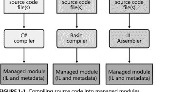

**图1-1** 将源代码编译为托管模块。

表1-1描述托管模块的组成部分。

**表1-1 托管模块的组成部分**

| 组成部分 | 描述 |
| --- | --- |
| PE32 或 PE32+ 头 | 标准 Windows PE 文件头，类似于通用对象文件格式(COFF)头。如果该头使用 PE32 格式，文件可在 32 位或 64 位版本的 Windows 上运行。如果该头使用 PE32+ 格式，文件需要 64 位版本的 Windows 才能运行。此头还指示文件类型：GUI、CUI 或 DLL，并包含指示文件生成时间的时间戳。对于只包含 IL 代码的模块，PE32(+)头中的大部分信息会被忽略。对于包含本机 CPU 代码的模块，此头包含有关本机 CPU 代码的信息。 |
| CLR 头 | 包含由 CLR 和实用工具解释的信息，这些信息使该文件成为托管模块。该头包括所需的 CLR 版本、一些标志、托管模块入口点方法（Main 方法）的 MethodDef 元数据标记，以及模块的元数据、资源、强名称的位置/大小、一些标志和其他不太重要的内容。 |
| 元数据 | 每个托管模块都包含元数据表。主要有两种类型的表：描述源代码中定义的类型和成员的表，以及描述源代码引用的类型和成员的表。 |
| IL 代码 | 编译器在编译源代码时生成的代码。运行时，CLR 将 IL 编译为本机 CPU 指令。 |

本机代码编译器生成面向特定 CPU 架构（如 x86、x64 或 ARM）的代码。所有符合 CLR 的编译器则生成 IL 代码。（本章后面我将更详细地介绍 IL 代码。）IL 代码有时称为托管代码，因为 CLR 管理其执行。

除了生成 IL 之外，每个面向 CLR 的编译器还必须在每个托管模块中生成完整元数据。简言之，元数据是一组数据表，描述模块中定义的内容，例如类型及其成员。此外，元数据还有表指示托管模块引用的内容，例如导入的类型及其成员。元数据是 COM 的类型库和接口定义语言(IDL)文件等较旧技术的超集。需要注意的重要一点是，CLR 元数据要完整得多。并且，与类型库和 IDL 不同，元数据始终与包含 IL 代码的文件相关联。事实上，元数据始终与代码嵌入同一个 EXE/DLL 中，因此无法将两者分开。由于编译器同时生成元数据和代码，并将它们绑定到生成的托管模块中，因此元数据和它所描述的 IL 代码永远不会彼此不同步。

元数据有许多用途。以下是一些：

- 元数据消除了编译时对本机 C/C++ 头文件和库文件的需要，因为有关引用类型/成员的所有信息都包含在具有实现该类型/成员的 IL 的文件中。编译器可以直接从托管模块读取元数据。
- Microsoft Visual Studio 使用元数据帮助你编写代码。其 IntelliSense 功能分析元数据，告诉你某个类型提供哪些方法、属性、事件和字段，对于方法，还告诉你该方法期望哪些参数。
- CLR 的代码验证过程使用元数据确保你的代码只执行“类型安全”的操作。（我很快会讨论验证。）
- 元数据允许将对象的字段序列化到内存块中，发送到另一台机器，然后再反序列化，从而在远程机器上重新创建该对象的状态。
- 元数据允许垃圾回收器跟踪对象的生存期。对于任何对象，垃圾回收器都可以确定对象的类型，并根据元数据知道该对象中哪些字段引用其他对象。

在第2章“生成、打包、部署和管理应用程序和类型”中，我将更详细地描述元数据。

Microsoft 的 C#、Visual Basic、F# 和 IL 汇编器始终生成包含托管代码(IL)和托管数据（垃圾回收的数据类型）的模块。最终用户必须在其机器上安装 CLR（目前作为 .NET Framework 的一部分提供），才能执行任何包含托管代码和/或托管数据的模块，就像他们必须安装 Microsoft Foundation Class (MFC) 库或 Visual Basic DLL 才能运行 MFC 或 Visual Basic 6 应用程序一样。

默认情况下，Microsoft 的 C++ 编译器生成 EXE/DLL 模块，这些模块包含非托管（本机）代码，并在运行时操作非托管数据（本机内存）。这些模块不需要 CLR 来执行。然而，通过指定 /CLR 命令行开关，C++ 编译器会生成包含托管代码的模块，当然，此时必须安装 CLR 才能执行此代码。在提到的所有 Microsoft 编译器中，C++ 的独特之处在于，它是唯一允许开发人员编写托管和非托管代码并将其生成到单个模块中的编译器。它也是唯一允许开发人员在源代码中定义托管和非托管数据类型的 Microsoft 编译器。Microsoft 的 C++ 编译器提供的灵活性是其他编译器无法比拟的，因为它允许开发人员从托管代码中使用现有的本机 C/C++ 代码，并根据自己的需要开始集成托管类型的使用。

### 将托管模块合并为程序集

CLR 实际上不直接使用模块，而是使用程序集。程序集是一个抽象概念，一开始可能难以理解。首先，程序集是一个或多个模块或资源文件的逻辑分组。其次，程序集是重用、安全性和版本控制的最小单元。根据你对编译器或工具的选择，可以生成单文件或多文件程序集。在 CLR 世界中，程序集就是我们所说的组件。

在第2章中，我将非常详细地介绍程序集，所以这里不想花太多时间。我现在只想让你意识到存在这样一个额外的概念，它提供了一种将一组文件视为单个实体的方式。

图1-2应该有助于解释程序集是什么。在此图中，某个工具正在处理一些托管模块和资源（或数据）文件。该工具生成一个 PE32(+)文件，表示这些文件的逻辑分组。实际情况是，此 PE32(+)文件包含一个称为清单的数据块。清单只是另一组元数据表。这些表描述构成程序集的文件、程序集中的文件所实现的公开导出的类型，以及与程序集关联的资源或数据文件。

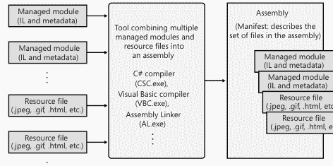

**图1-2** 将托管模块合并为程序集。

默认情况下，编译器实际上会完成将生成的托管模块转换为程序集的工作；也就是说，C# 编译器会生成一个包含清单的托管模块。清单指示该程序集仅由这一个文件组成。因此，对于只有一个托管模块且没有资源（或数据）文件的项目，程序集就是该托管模块，你在生成过程中不需要执行任何额外步骤。如果想把一组文件分组为一个程序集，你必须了解更多工具（例如程序集链接器 AL.exe）及其命令行选项。我将在第2章解释这些工具和选项。

程序集允许你将可重用、可保护、可版本控制的组件的逻辑概念与物理概念解耦。如何将代码和资源划分到不同文件完全由你决定。例如，你可以将很少使用的类型或资源放入作为程序集一部分的单独文件中。这些单独文件可以在运行时根据需要从 Web 按需下载。如果这些文件从未需要，就永远不会下载，从而节省磁盘空间并缩短安装时间。程序集允许你拆分文件的部署，同时仍将所有文件视为单个集合。

程序集的模块还包括有关引用程序集的信息（包括其版本号）。此信息使程序集具有自描述性。换句话说，CLR 可以确定程序集的直接依赖项，以便程序集中的代码执行。注册表或 Active Directory 域服务(AD DS)中不需要其他信息。由于不需要其他信息，部署程序集比部署非托管组件容易得多。

### 加载公共语言运行时

你构建的每个程序集既可以是可执行应用程序，也可以是包含一组类型的 DLL，用于


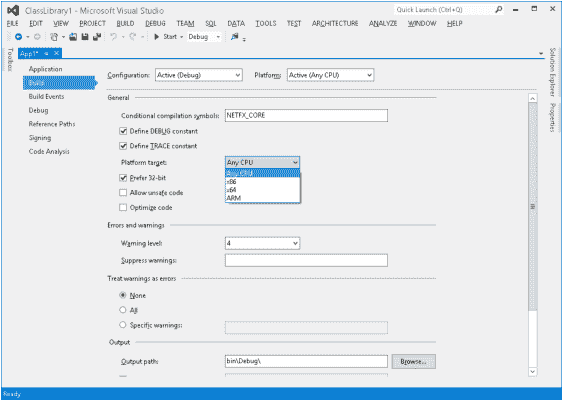

**图 1-3** 使用 Visual Studio 设置平台目标。

在图 1-3 中，你会注意到“Prefer 32-bit”复选框。仅当“平台目标”设置为“Any CPU”并且项目类型生成可执行文件时，此复选框才启用。如果在 Visual Studio 中选中“Prefer 32-bit”，它会启动 C# 编译器并指定“/platform:anycpu32bitpreferred”编译器开关。此选项指示可执行文件即使在 64 位计算机上运行，也应作为 32 位可执行文件运行。如果你的应用程序不需要 64 位进程所提供的额外内存，那么这通常是一种好方法，因为 Visual Studio 不支持 x64 应用程序的“编辑并继续”。此外，如果你的应用程序需要，32 位应用程序可以与 32 位 DLL 和 COM 组件互操作。

根据平台开关，C# 编译器将生成包含 PE32 或 PE32+ 头的程序集，并且编译器还会将所需的 CPU 架构（或架构无关）信息写入该头中。Microsoft 提供了两个 SDK 命令行实用工具 DumpBin.exe 和 CorFlags.exe，可用于检查编译器在托管模块中生成的头信息。

运行可执行文件时，Windows 会检查该 EXE 文件的头，以确定应用程序需要 32 位还是 64 位地址空间。带有 PE32 头的文件可以在 32 位或 64 位地址空间中运行，而带有 PE32+ 头的文件需要 64 位地址空间。Windows 还会检查头中嵌入的 CPU 架构信息，以确保其与计算机中的 CPU 类型匹配。最后，64 位版本的 Windows 提供了一种允许 32 位 Windows 应用程序运行的技术。此技术称为 WoW64（即 Windows on Windows64）。

表 1-2 展示了两件事。第一，它展示了当你为 C# 编译器指定各种 /platform 命令行开关时会得到哪种托管模块。第二，它展示了该应用程序将如何在各种版本的 Windows 上运行。

**表 1-2** /platform 对生成的模块和运行时的影响

| /platform 开关 | 生成的托管模块 | x86 Windows | x64 Windows | ARM Windows RT |
|---|---|---|---|---|
| anycpu（默认） | PE32/agnostic | 作为 32 位应用程序运行 | 作为 64 位应用程序运行 | 作为 32 位应用程序运行 |
| anycpu32bitpreferred | PE32/agnostic | 作为 32 位应用程序运行 | 作为 32 位应用程序运行 | 作为 32 位应用程序运行 |
| x86 | PE32/x86 | 作为 32 位应用程序运行 | 作为 WoW64 应用程序运行 | 无法运行 |
| x64 | PE32+/x64 | 无法运行 | 作为 64 位应用程序运行 | 无法运行 |
| ARM | PE32/ARM | 无法运行 | 无法运行 | 作为 32 位应用程序运行 |

在 Windows 检查完 EXE 文件的头以确定创建 32 位还是 64 位进程之后，Windows 会将 x86、x64 或 ARM 版本的 MSCorEE.dll 加载到进程的地址空间中。在 x86 或 ARM 版本的 Windows 上，32 位版本的 MSCorEE.dll 可以在 %SystemRoot%\System32 目录中找到。在 x64 版本的 Windows 上，x86 版本的 MSCorEE.dll 可以在 %SystemRoot%\SysWow64 目录中找到，而 64 位版本可以在 %SystemRoot%\System32 目录中找到（出于向后兼容原因）。然后，进程的主线程调用 MSCorEE.dll 内定义的方法。此方法初始化 CLR，加载 EXE 程序集，然后调用其入口点方法（Main）。此时，托管应用程序已启动并运行。<sup>1</sup>

**注意** 使用 Microsoft C# 编译器 1.0 或 1.1 版构建的程序集包含 PE32 头，并且与 CPU 架构无关。但是，在加载时，CLR 会将这些程序集仅视为 x86。对于可执行文件，这会提高应用程序实际在 64 位系统上工作的可能性，因为可执行文件将加载到 WoW64 中，从而为进程提供与在 32 位 x86 版本 Windows 上非常相似的环境。

¹ 你的代码可以查询 Environment 的 Is64BitOperatingSystem 属性，以确定它是否运行在 64 位版本的 Windows 上。你的代码还可以查询 Environment 的 Is64BitProcess 属性，以确定它是否运行在 64 位地址空间中。

如果非托管应用程序调用 Win32 LoadLibrary 函数来加载托管程序集，Windows 会知道要加载并初始化 CLR（如果尚未加载），以便处理该程序集内包含的代码。当然，在这种情况下，进程已经启动并运行，这可能会限制程序集的可用性。例如，使用 /platform:x86 开关编译的托管程序集根本无法加载到 64 位进程中，而使用同一开关编译的可执行文件在运行 64 位版本 Windows 的计算机上则会加载到 WoW64 中。

### 执行程序集的代码

如前所述，托管程序集包含元数据和 IL。IL 是 Microsoft 在与若干外部商业和学术语言/编译器编写者协商后创建的一种与 CPU 无关的机器语言。IL 是一种比大多数 CPU 机器语言高级得多的语言。IL 可以访问和操作对象类型，并具有创建和初始化对象、调用对象上的虚方法以及直接操作数组元素的指令。它甚至具有用于错误处理的引发和捕获异常的指令。你可以将 IL 视为一种面向对象的机器语言。

通常，开发者会使用高级语言编程，例如 C#、Visual Basic 或 F#。这些高级语言的编译器会生成 IL。然而，与任何其他机器语言一样，IL 可以用汇编语言编写，并且 Microsoft 确实提供了 IL 汇编器 ILAsm.exe。Microsoft 还提供了 IL 反汇编器 ILDasm.exe。

请记住，任何高级语言很可能只公开 CLR 所提供功能的一个子集。但是，IL 汇编语言允许开发者访问 CLR 的所有功能。因此，如果你选择的编程语言隐藏了 CLR 提供且你确实希望利用的某项功能，你可以选择用 IL 汇编或另一种公开你所寻求的 CLR 功能的编程语言来编写代码中的那部分。

要了解 CLR 提供哪些功能，唯一的方法是阅读专门针对 CLR 本身的文档。在本书中，我尽量重点介绍 CLR 功能以及 C# 语言如何公开或不公开这些功能。我猜想，大多数其他书籍和文章会从语言视角来介绍 CLR，而大多数开发者会逐渐相信 CLR 只提供开发者所选语言所公开的内容。只要你的语言能让你完成你试图完成的任务，这种模糊的看法并不坏。

**重要** 我认为这种能够轻松切换编程语言、并且语言之间具有丰富集成能力的功能，是 CLR 的一个极佳特性。遗憾的是，我也认为开发者常常会忽视此特性。诸如 C# 和 Visual Basic 之类的编程语言非常适合执行 I/O 操作。APL 是执行高级工程或财务计算的出色语言。通过 CLR，你可以用 C# 编写应用程序的 I/O 部分，然后用 APL 编写工程计算部分。CLR 在这些语言之间提供了前所未有的集成水平，确实使多语言编程值得在许多开发项目中考虑。

要执行方法，必须先将其 IL 转换为本机 CPU 指令。这是 CLR 的 JIT（即时）编译器的任务。

图 1-4 展示了第一次调用方法时发生的情况。

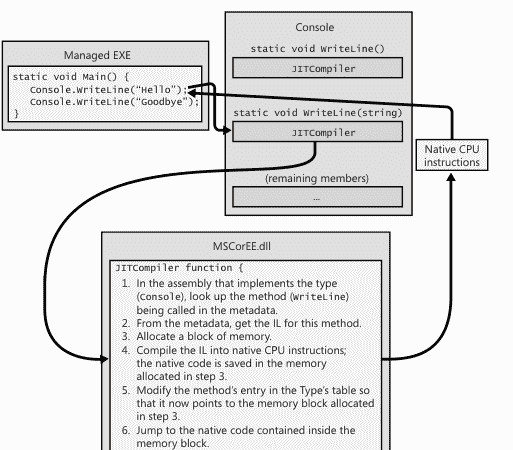

**图 1-4** 第一次调用方法。

就在 Main 方法执行之前，CLR 会检测 Main 的代码所引用的所有类型。这会使 CLR 分配一个内部数据结构，用于管理对所引用类型的访问。在图 1-4 中，Main 方法引用单个类型 Console，这使 CLR 分配单个内部结构。此内部数据结构为 Console 类型定义的每个方法包含一个条目。每个条目保存可找到方法实现的地址。初始化此结构时，CLR 将每个条目设置为 CLR 自身内部包含的一个未记录函数。我将此函数称为 JITCompiler。


当 `Main` 首次调用 `WriteLine` 时，会调用 `JITCompiler` 函数。`JITCompiler` 函数负责将方法的 IL 代码编译为本机 CPU 指令。由于 IL 是“即时”编译的，CLR 的这个组件通常被称为 JITer 或 JIT 编译器。

**注意** 如果应用程序运行在 x86 版 Windows 上或 WoW64 中，JIT 编译器会生成 x86 指令。如果你的应用程序在 x64 版 Windows 上作为 64 位应用程序运行，JIT 编译器会生成 x64 指令。如果应用程序运行在 ARM 版 Windows 上，JIT 编译器会生成 ARM 指令。

被调用时，`JITCompiler` 函数知道正在调用哪个方法，以及哪个类型定义了该方法。然后，`JITCompiler` 函数在定义程序集的元数据中搜索被调用方法的 IL。接下来，`JITCompiler` 验证 IL 代码并将其编译为本机 CPU 指令。这些本机 CPU 指令保存在动态分配的内存块中。然后，`JITCompiler` 回到 CLR 所创建类型内部数据结构中被调用方法的条目，用包含它刚编译好的本机 CPU 指令的内存块地址，替换最初调用它的那个引用。最后，`JITCompiler` 函数跳转到该内存块中的代码。这段代码就是 `WriteLine` 方法的实现（接受 `String` 参数的那个版本）。当这段代码返回时，它会返回到 `Main` 中的代码，后者继续正常执行。

现在，`Main` 第二次调用 `WriteLine`。这一次，`WriteLine` 的代码已经过验证并编译。因此，调用会直接转到该内存块，完全跳过 `JITCompiler` 函数。`WriteLine` 方法执行后，会返回 `Main`。图 1-5 展示了第二次调用 `WriteLine` 时该过程的样子。

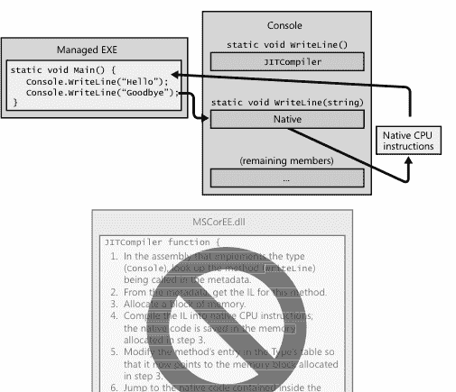

**图 1-5** 第二次调用方法。

只有在方法第一次被调用时才会产生性能损失。之后对该方法的所有调用都会以本机代码的全速执行，因为不需要再次执行验证和到本机代码的编译。

JIT 编译器将本机 CPU 指令存储在动态内存中。这意味着编译后的代码会在应用程序终止时被丢弃。因此，如果你将来再次运行该应用程序，或者同时运行该应用程序的两个实例（在两个不同的操作系统进程中），JIT 编译器将不得不再次将 IL 编译为本机指令。视应用程序而定，与只读代码页可由运行中应用程序的所有实例共享的本机应用程序相比，这会显著增加内存消耗。

对于大多数应用程序而言，JIT 编译带来的性能损失并不显著。大多数应用程序往往会一遍又一遍地调用相同的方法。在应用程序执行期间，这些方法只会承受一次性能损失。而且，在方法内部花费的时间很可能比调用该方法所花的时间更多。

你还应该知道，CLR 的 JIT 编译器会像非托管 C++ 编译器的后端那样优化本机代码。同样，生成优化代码可能需要更多时间，但代码执行时的性能会比未优化时好得多。

有两个影响代码优化的 C# 编译器开关：/optimize 和 /debug。下表显示了这些开关对 C# 编译器生成的 IL 代码质量以及 JIT 编译器生成的本机代码质量的影响：

| 编译器开关设置 | C# IL 代码质量 | JIT 本机代码质量 |
| --- | --- | --- |
| /optimize- /debug-（这是默认设置） | 未优化 | 已优化 |
| /optimize- /debug(+/full/pdbonly) | 未优化 | 未优化 |
| /optimize+ /debug(+/full/pdbonly) | 已优化 | 已优化 |

使用 /optimize- 时，C# 编译器生成的未优化 IL 代码包含许多无操作（NOP）指令，还包含跳转到下一行代码的分支。发出这些指令是为了在调试时启用 Visual Studio 的编辑并继续功能；额外的指令还使代码更易于调试，因为可以在 for、while、do、if、else、try、catch 和 finally 语句块等控制流指令上设置断点。在生成优化的 IL 代码时，C# 编译器会移除这些多余的 NOP 和分支指令，这使得在调试器中单步执行代码更困难，因为控制流会被优化。此外，在调试器内部执行某些函数求值时，这些求值可能无法正常工作。不过，IL 代码更小，从而使生成的 EXE/DLL 文件更小；而且对于那些（像我一样）喜欢检查 IL 以了解编译器生成了什么的开发者来说，IL 往往更易读。

此外，只有指定 /debug(+/full/pdbonly) 开关时，编译器才会生成程序数据库（PDB）文件。PDB 文件帮助调试器查找局部变量，并将 IL 指令映射到源代码。/debug:full 开关告诉 JIT 编译器你打算调试该程序集，JIT 编译器将跟踪每个 IL 指令对应的本机代码。这使你能够使用 Visual Studio 的实时（JIT）调试器功能，将调试器附加到已在运行的进程，并轻松调试代码。在没有 /debug:full 开关的情况下，JIT 编译器默认不跟踪 IL 到本机代码的信息，这使 JIT 编译器运行得稍快一些，并且使用的内存也稍少一些。如果使用 Visual Studio 调试器启动进程，它会强制 JIT 编译器跟踪 IL 到本机代码的信息（无论 /debug 开关如何），除非你在 Visual Studio 中关闭“在模块加载时抑制 JIT 优化（仅限托管）”选项。

在 Visual Studio 中新建 C# 项目时，项目的 Debug 配置指定了 /optimize- 和 /debug:full 开关，而 Release 配置指定了 /optimize+ 和 /debug:pdbonly 开关。

对于来自非托管 C 或 C++ 背景的开发者来说，你很可能正在思考这一切带来的性能影响。毕竟，非托管代码是针对特定 CPU 平台编译的，调用时可以直接执行。在这种托管环境中，代码编译分两个阶段完成。首先，编译器遍历源代码，尽可能多地完成生成 IL 的工作。但是要执行代码，IL 本身必须在运行时编译为本机 CPU 指令，这需要分配更多不可共享的内存，并需要额外的 CPU 时间来完成这项工作。

相信我，由于我自己也是从 C/C++ 背景接触 CLR 的，我当初对这项额外开销相当怀疑和担忧。事实是，运行时发生的第二个编译阶段确实会损害性能，也确实会分配动态内存。不过，Microsoft 已经做了大量性能工作，将这项额外开销保持在最低限度。

如果你也持怀疑态度，你当然应该构建一些应用程序并亲自测试性能。此外，你还应该运行一些 Microsoft 或其他公司开发的有一定复杂度的托管应用程序，并测量它们的性能。我想你会对实际性能之好感到惊讶。

你可能会觉得这难以置信，但许多人（包括我）认为托管应用程序实际上可能比非托管应用程序性能更好。有很多理由相信这一点。例如，当 JIT 编译器在运行时将 IL 代码编译为本机代码时，编译器对执行环境的了解比非托管编译器更多。以下是托管代码可能胜过非托管代码的一些方式：

- JIT 编译器可以确定应用程序是否运行在 Intel Pentium 4 CPU 上，并生成本机代码以利用 Pentium 4 提供的任何特殊指令。通常，非托管应用程序是针对最低通用 CPU 编译的，并避免使用会给应用程序带来性能提升的特殊指令。

- JIT 编译器可以确定某个测试在其运行的机器上是否始终为 false。例如，考虑一个包含以下代码的方法：

  ```
  if (numberOfCPUs > 1) {
  ...
  }
  ```

  如果主机只有一个 CPU，这段代码可能会使 JIT 编译器不生成任何 CPU 指令。在这种情况下，本机代码将针对主机进行微调；生成的代码更小，执行更快。

- CLR 可以分析代码的执行情况，并在应用程序运行时将 IL 重新编译为本机代码。根据观察到的执行模式，可以重新组织重新编译后的代码，以减少错误的分支预测。当前版本的 CLR 不执行此操作，但未来版本可能会。

这些只是你应该预期未来托管代码比当今非托管代码执行得更好的部分原因。正如我所说，目前大多数应用程序的性能已经相当好，而且随着时间推移，性能有望继续提高。


如果实验表明CLR的JIT编译器无法为你的应用程序提供所需性能，你可以利用.NET Framework SDK附带的NGen.exe工具。此工具将程序集的所有IL代码编译为本机代码，并将生成的本机代码保存到磁盘文件中。运行时加载程序集时，CLR会自动检查该程序集是否存在预编译版本；如果存在，CLR就加载预编译代码，因此运行时无需编译。请注意，NGen.exe必须对有关实际执行环境的假设保持保守，因此NGen.exe生成的代码不会像JIT编译器生成的代码那样高度优化。本章后面将更详细地讨论NGen.exe。

此外，你可以考虑使用System.Runtime.ProfileOptimization类。此类使CLR记录（到文件）应用程序运行期间哪些方法被JIT编译。然后，在应用程序未来启动时，如果你的应用程序在多CPU机器上运行，JIT编译器将使用其他线程并发编译这些方法。最终结果是应用程序运行得更快，因为多个方法被并发编译，并且在应用程序初始化期间编译，而不是在用户与应用程序交互时即时编译这些方法。

### IL 与验证

IL基于栈，这意味着其所有指令都将操作数压入执行栈，并从栈中弹出结果。由于IL不提供操作寄存器的指令，人们很容易创建生成面向CLR代码的新语言和编译器。

IL指令也是无类型的。例如，IL提供add指令，将压入栈的最后两个操作数相加。add指令没有单独的32位或64位版本。执行add指令时，它确定栈上操作数的类型并执行相应操作。

在我看来，IL的最大好处并不是它抽象掉了底层CPU。IL提供的最大好处是应用程序健壮性和安全性。将IL编译为本机CPU指令时，CLR会执行称为验证的过程。验证检查高级IL代码，并确保代码所做的一切都是安全的。例如，验证检查每个方法调用时参数数量正确、传递给每个方法的每个参数类型正确、每个方法的返回值使用正确、每个方法都有return语句，等等。托管模块的元数据包含验证过程使用的所有方法和类型信息。

在Windows中，每个进程都有自己的虚拟地址空间。独立地址空间是必要的，因为你不能信任应用程序的代码。应用程序完全可能（不幸的是，也司空见惯）读取或写入无效内存地址。通过将每个Windows进程置于独立地址空间，你可以获得健壮性和稳定性；一个进程不能不利影响另一个进程。

然而，通过验证托管代码，你可以知道代码不会不当访问内存，也不会不利影响另一个应用程序的代码。这意味着你可以在单个Windows虚拟地址空间中运行多个托管应用程序。

因为Windows进程需要大量操作系统资源，拥有许多进程会损害性能并限制可用资源。通过在单个OS进程中运行多个应用程序来减少进程数，可以提高性能、需要更少资源，并且与每个应用程序都有自己的进程一样健壮。这是托管代码与非托管代码相比的另一个好处。

事实上，CLR确实提供在单个OS进程中执行多个托管应用程序的能力。每个托管应用程序在AppDomain中执行。默认情况下，每个托管EXE文件将在自己的独立地址空间中运行，其中只有一个AppDomain。然而，承载CLR的进程（如Internet Information Services [IIS]或Microsoft SQL Server）可以决定在单个OS进程中运行AppDomain。我将在第22章“CLR宿主与AppDomain”中花一部分篇幅讨论AppDomain。

### 不安全代码

默认情况下，Microsoft的C#编译器生成安全代码。安全代码是可验证安全的代码。然而，Microsoft的C#编译器允许开发者编写不安全代码。不安全代码允许直接处理内存地址，并可以操作这些地址处的字节。这是非常强大的功能，通常在与非托管代码互操作或希望提高时间关键算法性能时有用。

然而，使用不安全代码会带来重大风险：不安全代码可能破坏数据结构，并利用甚至打开安全漏洞。因此，C#编译器要求所有包含不安全代码的方法都用unsafe关键字标记。此外，C#编译器要求你使用/unsafe编译器开关编译源代码。

当JIT编译器尝试编译不安全方法时，它会检查包含该方法的程序集是否已被授予System.Security.Permissions.SecurityPermission，并且设置了System.Security.Permissions.SecurityPermissionFlag的SkipVerification标志。如果设置了此标志，JIT编译器将编译不安全代码并允许其执行。CLR信任此代码，并希望直接地址和字节操作不会造成任何伤害。如果未设置该标志，JIT编译器将抛出System.InvalidProgramException或System.Security.VerificationException，阻止该方法执行。事实上，整个应用程序此时可能会终止，但至少不会造成伤害。

**注意** 默认情况下，从本地计算机或通过网络共享加载的程序集被授予完全信任，这意味着它们可以做任何事，包括执行不安全代码。然而默认情况下，通过Internet执行的程序集不被授予执行不安全代码的权限。如果它们包含不安全代码，将抛出前述异常之一。管理员/最终用户可以更改这些默认设置；但管理员要对代码行为承担全部责任。

Microsoft提供名为PEVerify.exe的实用工具，它检查程序集的所有方法，并通知你任何包含不安全代码的方法。你可以考虑对引用的程序集运行PEVerify.exe；这会让你知道通过intranet或Internet运行应用程序是否可能有问题。

应注意，验证需要访问任何依赖程序集中包含的元数据。因此使用PEVerify检查程序集时，它必须能够定位并加载所有引用的程序集。因为PEVerify使用CLR定位依赖程序集，所以使用与执行该程序集时通常相同的绑定和探测规则来定位这些程序集。我将在第2章和第3章“共享程序集与强命名程序集”中讨论这些绑定和探测规则。

### IL 与保护知识产权

有些人担心IL不能为其算法提供足够的知识产权保护。换句话说，他们认为你可以构建一个托管模块，而别人可以使用IL反汇编器之类的工具，轻松逆向工程出应用程序代码的确切行为。

是的，IL代码确实比大多数其他汇编语言级别更高，而且通常逆向工程IL代码相对简单。然而，在实现服务器端代码（如Web服务、Web窗体或存储过程）时，程序集位于服务器上。因为公司外部无人能访问该程序集，所以公司外部无人能使用任何工具查看IL——你的知识产权完全安全。

如果你担心分发的任何程序集，可以从第三方供应商处获取混淆器实用工具。这些工具会打乱程序集元数据中所有私有符号的名称。别人将很难还原这些名称并理解每个方法的用途。注意这些混淆器只能提供很少的保护，因为IL必须在某个时刻可用，以便CLR对其进行JIT编译。

如果你觉得混淆器不能提供你想要的知识产权保护，可以考虑在某个非托管模块中实现更敏感的算法，该模块将包含本机CPU指令而不是IL和元数据。然后你可以使用CLR的互操作功能（假设你有足够权限）在应用程序的托管和非托管部分之间通信。当然，这假设你不担心别人逆向工程非托管代码中的本机CPU指令。


### 本机代码生成工具：NGen.exe

随 .NET Framework 一起提供的 NGen.exe 工具可用于在应用程序安装到用户机器上时，将 IL 代码编译为本机代码。由于代码在安装时编译，CLR 的 JIT 编译器不必在运行时编译 IL 代码，这可以提高应用程序的性能。NGen.exe 工具在两种场景下很有意义：

- **改善应用程序的启动时间** 运行 NGen.exe 可以改善启动时间，因为代码已经编译成本机代码，因此不必在运行时进行编译。
- **减少应用程序的工作集** 如果你认为某个程序集将被同时加载到多个进程中，对该程序集运行 NGen.exe 可以减少应用程序的工作集。原因是 NGen.exe 工具将 IL 编译为本机代码，并将输出保存在单独的文件中。此文件可以同时内存映射到多个进程的地址空间中，从而允许共享代码；并非每个进程都需要自己的一份代码副本。

当安装程序对某个应用程序或单个程序集调用 NGen.exe 时，该应用程序的所有程序集或指定的那一个程序集都会将其 IL 代码编译为本机代码。NGen.exe 会创建一个新的程序集文件，其中仅包含此本机代码而不是 IL 代码。这个新文件被放在名称类似 `%SystemRoot%\Assembly\NativeImages_v4.0.#####_64` 的目录下的一个文件夹中。目录名包含 CLR 的版本以及表示本机代码是为 32 位还是 64 位 Windows 版本编译的信息。

现在，每当 CLR 加载程序集文件时，CLR 会查看是否存在相应的 NGen 编译的本机文件。如果找不到本机文件，CLR 会像往常一样 JIT 编译 IL 代码。但是，如果相应的本机文件确实存在，CLR 将使用该本机文件中包含的已编译代码，并且该文件的方法不必在运行时编译。

表面上看，这听起来很棒！听起来好像你获得了托管代码的所有好处（垃圾回收、验证、类型安全等），却没有托管代码的所有性能问题（JIT 编译）。然而，实际情况并不像乍看起来那么美好。对于 NGen 编译文件，存在几个潜在问题：

- **没有知识产权保护** 许多人认为，可能可以在不发布包含原始 IL 代码的文件的情况下发布 NGen 编译文件，从而对其知识产权保密。不幸的是，这是不可能的。在运行时，CLR 需要访问程序集的元数据（用于反射和序列化等功能）；这就要求发布包含 IL 和元数据的程序集。此外，如果 CLR 由于某种原因（如下所述）无法使用 NGen 编译文件，CLR 会平稳地回退到 JIT 编译该程序集的 IL 代码，而这些 IL 代码必须可用。
- **NGen 编译文件可能会不同步** 当 CLR 加载 NGen 编译文件时，它会比较有关先前编译的代码和当前执行环境的许多特征。如果任一特征不匹配，则无法使用 NGen 编译文件，而会改用正常的 JIT 编译器过程。以下是必须匹配的特征的部分列表：
    - CLR 版本：随补丁或 Service Pack 而变化
    - CPU 类型：如果你升级处理器硬件，则会变化
    - Windows OS 版本：随新的 Service Pack 更新而变化
    - 程序集的标识模块版本 ID (MVID)：重新编译时会变化
    - 所引用程序集的版本 ID：重新编译所引用的程序集时会变化
    - 安全性：当你撤销曾经授予的权限（例如声明式继承、声明式链接时、SkipVerification 或 UnmanagedCode 权限）时会变化

**注意** 可以在更新模式下运行 NGen.exe。这会告诉该工具对所有之前已经过 NGen 编译的程序集运行 NGen.exe。每当最终用户安装 .NET Framework 的新 Service Pack 时，该 Service Pack 的安装程序将自动以更新模式运行 NGen.exe，以便 NGen 编译文件与所安装的 CLR 版本保持同步。

- **执行时性能较差** 在编译代码时，NGen 对执行环境所作的假设不如 JIT 编译器那么多。这导致 NGen.exe 生成较差的代码。例如，NGen 不会优化某些 CPU 指令的使用；它会为静态字段访问增加间接访问，因为静态字段的实际地址直到运行时才知道。NGen 会在各处插入调用类构造函数的代码，因为它不知道代码的执行顺序，也不知道某个类构造函数是否已经被调用。（有关类构造函数的更多信息，请参见第 8 章“方法”。）某些 NGen 编译的应用程序与经过 JIT 编译的对应版本相比，实际性能大约慢 5%。因此，如果你正在考虑使用 NGen.exe 来提高应用程序性能，应当比较 NGen 编译版本和非 NGen 编译版本，以确保 NGen 编译版本实际上不会运行得更慢！对于某些应用程序，工作集大小的减少会提高性能，因此使用 NGen 可以成为净收益。

由于刚刚列出的所有问题，在考虑使用 NGen.exe 时应当非常谨慎。对于服务器端应用程序，NGen.exe 几乎没有意义或完全没有意义，因为只有第一个客户端请求会经历性能损失；后续客户端请求会高速运行。此外，对于大多数服务器应用程序，只需要一个代码实例，因此没有工作集方面的好处。

对于客户端应用程序，如果某个程序集被多个应用程序同时使用，那么使用 NGen.exe 来改善启动时间或减少工作集可能是有意义的。即使某个程序集未被多个应用程序使用，对程序集运行 NGen 也可能改善工作集。此外，如果

| 命名空间 | 内容说明 |
|---|---|
| System.IO | 用于执行流 I/O 以及遍历目录和文件的类型 |
| System.Net | 允许进行低层网络通信并使用一些常见 Internet 协议的类型。 |
| System.Runtime.InteropServices | 允许托管代码访问非托管 OS 平台设施（如 COM 组件以及 Win32 或自定义 DLL 中的函数）的类型 |
| System.Security | 用于保护数据和资源的类型 |
| System.Text | 用于处理不同编码（如 ASCII 和 Unicode）文本的类型 |
| System.Threading | 用于异步操作和同步对资源访问的类型 |
| System.Xml | 用于处理可扩展标记语言 (XML) 架构和数据的类型 |

本书介绍 CLR 以及与该 CLR 密切交互的通用类型。因此，本书内容适用于所有编写面向 CLR 的应用程序或组件的程序员。还有许多其他好书涵盖特定的应用程序类型，例如 Web 服务、Web Forms/MVC、Windows Presentation Foundation 等。这些其他书籍将为你构建应用程序提供极好的起步帮助。我倾向于认为这些特定于应用程序的书籍帮助你自上而下地学习，因为它们关注的是应用程序类型，而不是开发平台。在本书中，我将提供帮助你自下而上学习的信息。阅读本书和一本特定于应用程序的书籍后，你应该能够轻松而熟练地构建你想要的任何类型的应用程序。

### 公共类型系统

到目前为止，你应该已经明显看出，CLR 的核心就是类型。类型向你的应用程序和其他类型公开功能。类型是一种机制，通过它，用一种编程语言编写的代码可以与用另一种编程语言编写的代码通信。由于类型是 CLR 的根基，Microsoft 创建了一个正式规范——公共类型系统 (CTS)——来描述类型如何定义以及如何表现。

**注意** 事实上，Microsoft 一直在将 CTS 以及 .NET Framework 的其他部分（包括文件格式、元数据、IL 以及对底层平台的访问 (P/Invoke)）提交给 ECMA，以进行标准化。该标准称为公共语言基础结构 (CLI)，即 ECMA-335 规范。此外，Microsoft 还提交了 FCL 的部分内容、C#


编程语言（ECMA-334）以及 C++/CLI 编程语言。有关这些行业标准的信息，请访问与第 39 技术委员会相关的 ECMA 网站：http://www.ecma-international.org/。你也可以参考 Microsoft 自己的网站：http://msdn.microsoft.com/en-us/netframework/a569283.aspx。此外，Microsoft 已将其 Community Promise 应用于 ECMA-334 和 ECMA-335 规范。有关此内容的更多信息，请参见 http://www.microsoft.com/openspecifications/en/us/programs/community-promise/default.aspx。

CTS 规范指出，一个类型可以包含零个或多个成员。在第二部分“设计类型”中，我将非常详细地介绍所有这些成员。现在，我只想简要介绍它们：

- **字段（Field）**  作为对象状态一部分的数据变量。字段通过其名称和类型来标识。
- **方法（Method）**  对对象执行操作的函数，通常会改变对象的状态。方法具有名称、签名和修饰符。签名指定参数的数量（及其顺序）、参数的类型、方法是否返回值，以及如果返回值，方法返回值的类型。
- **属性（Property）**  对调用方而言，此成员看起来像字段。但对类型实现者而言，它看起来像一个方法（或两个方法）。属性允许实现者在访问值和/或仅在必要时计算值之前，验证输入参数和对象状态。它们还允许类型的使用者拥有简化的语法。最后，属性允许你创建只读或只写“字段”。
- **事件（Event）**  事件允许在对象与其他感兴趣的对象之间建立通知机制。例如，按钮可以提供一个事件，在按钮被单击时通知其他对象。

CTS 还规定了类型可见性以及访问类型成员的规则。例如，将类型标记为 public（称为 public）会导出该类型，使其对任何程序集可见且可访问。另一方面，将类型标记为 assembly（在 C# 中称为 internal）会使该类型仅对同一程序集内的代码可见且可访问。因此，CTS 确立了程序集构成类型可见性边界的规则，而 CLR 强制执行这些可见性规则。

对调用方可见的类型可以进一步限制调用方访问该类型成员的能力。以下列表显示了控制成员访问权限的有效选项：

- **私有（Private）**  该成员只能由同一类类型中的其他成员访问。
- **族（Family）**  该成员可由派生类型访问，无论它们是否在同一程序集中。注意，许多语言（如 C++ 和 C#）将族（family）称为 protected。
- **族和程序集（Family and assembly）**  该成员可由派生类型访问，但仅当派生类型定义在同一程序集中。许多语言（如 C# 和 Visual Basic）不提供此选项

### 公共语言规范

COM 允许用不同语言创建的对象相互通信。另一方面，CLR 现在集成了所有语言，并允许用一种语言创建的对象被用完全不同语言编写的代码视为平等公民。之所以能实现这种集成，是因为 CLR 提供了标准类型集、元数据（自描述类型信息）和公共执行环境。

虽然这种语言集成是一个极好的目标，但事实是，编程语言彼此之间差异很大。例如，有些语言不区分符号的大小写，有些语言不提供无符号整数、运算符重载或支持可变数量参数的方法。

如果你打算创建易于从其他编程语言访问的类型，则只能使用你的编程语言中保证在所有其他语言中都可用的功能。为了帮助你做到这一点，Microsoft 定义了公共语言规范（CLS），该规范向编译器供应商详细说明了：如果这些编译器要生成与在 CLR 之上由其他符合 CLS 的语言编写的其他组件兼容的类型，它们必须支持的最小功能集。

CLR/CTS 支持的功能远多于 CLS 所定义的子集，因此如果你不关心跨语言互操作性，就可以开发非常丰富的类型，仅受该语言功能集的限制。具体而言，CLS 定义了外部可见的类型和方法若要能从任何符合 CLS 的编程语言访问就必须遵守的规则。请注意，CLS 规则不适用于仅在定义程序集内部可访问的代码。图 1-6 总结了本段所表达的思想。

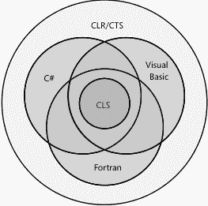

**图 1-6** 语言提供 CLR/CTS 的一个子集和 CLS 的一个超集（但未必是相同的超集）。

如图 1-6 所示，CLR/CTS 提供了一组功能。有些语言公开了 CLR/CTS 的很大一部分子集。例如，程序员通常希望用一种符合 CLS 的语言编写代码，从而能够使用 CLR/CTS 提供的所有功能。大多数其他语言（如 C#、Visual Basic 和 Fortran）向程序员公开 CLR/CTS 功能的一个子集。CLS 定义了所有语言都必须支持的最小功能集。

如果你用一种语言设计类型，并期望该类型被另一种语言使用，那么你不应在其公共成员和受保护成员中利用任何 CLS 之外的功能。这样做意味着，用其他编程语言编写代码的程序员可能无法访问你的类型成员。

在以下代码中，用 C# 定义了一个符合 CLS 的类型。但是，该类型有一些不符合 CLS 的构造，导致 C# 编译器对代码发出警告。

```csharp
using System;

// Tell compiler to check for CLS compliance
[assembly: CLSCompliant(true)]

namespace SomeLibrary {
    // Warnings appear because the class is public
    public sealed class SomeLibraryType {

        // Warning: Return type of 'SomeLibrary.SomeLibraryType.Abc()'
        // is not CLS-compliant
        public UInt32 Abc() { return 0; }

        // Warning: Identifier 'SomeLibrary.SomeLibraryType.abc()'
        // differing only in case is not CLS-compliant
        public void abc() { }

        // No warning: this method is private
        private UInt32 ABC() { return 0; }
    }
}
```

在这段代码中，[assembly:CLSCompliant(true)] 特性应用于程序集。此特性告诉编译器确保任何公开暴露的类型都不包含会阻止其他任何编程语言访问该类型的构造。编译这段代码时，C# 编译器会发出两个警告。第一个警告是因为方法 Abc 返回无符号整数；某些其他编程语言无法操作无符号整数值。第二个警告是因为该类型公开了两个仅在大小写和返回类型上不同的公共方法：Abc 和 abc。Visual Basic 和某些其他语言无法同时调用这两个方法。

有趣的是，如果你从 'sealed class SomeLibraryType' 前面删除 public

```csharp
// An event
public event EventHandler AnEvent;
}
```

当编译器编译这段代码时，结果是一个在其中定义了许多字段和方法的类型。你可以使用 .NET Framework SDK 提供的 IL 反汇编器工具（ILDasm.exe）来检查生成的托管模块，如图 1-7 所示，从而轻松看到这一点。

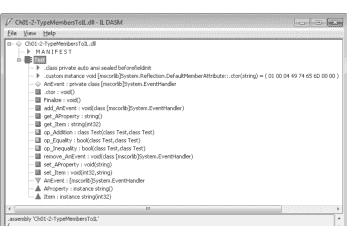

**图 1-7** ILDasm 显示 Test 类型的字段和方法（从元数据中获得）。

表 1-4 显示了编程语言构造如何映射到等效的 CLR 字段和方法。

**表 1-4** Test 类型的字段和方法（从元数据中获得）

| 类型成员 | 成员类型 | 等效的编程语言构造 |
| --- | --- | --- |
| AnEvent | 字段 | 事件；字段名为 AnEvent，其类型为 System.EventHandler。 |
| .ctor | 方法 | 构造函数。 |
| Finalize | 方法 | 终结器。 |
| add_AnEvent | 方法 | 事件添加访问器方法。 |
| get_AProperty | 方法 | 属性 get 访问器方法。 |
| get_Item | 方法 | 索引器 get 访问器方法。 |
| op_Addition | 方法 | + 运算符。 |
| op_Equality | 方法 | == 运算符。 |


|  |  |  |
|---|---|---|
| op_Inequality | 方法 | != 运算符。 |
| remove_AnEvent | 方法 | 事件移除访问器方法。 |
| set_AProperty | 方法 | 属性设置访问器方法。 |
| set_Item | 方法 | 索引器设置访问器方法。 |

Test 类型下未在表 1-4 中提及的其他节点——.class、.custom、AnEvent、AProperty 和 Item——标识了该类型的附加元数据。这些节点不会映射到字段或方法；它们只是提供一些关于该类型的附加信息，CLR、编程语言或工具可以访问这些信息。例如，工具可以看到 Test 类型提供了一个名为 AnEvent 的事件，该事件通过两个方法（add_AnEvent 和 remove_AnEvent）公开。

### 与非托管代码的互操作性

.NET Framework 相比其他开发平台提供了大量优势。然而，很少有公司能够负担得起重新设计并重新实现其所有现有代码。Microsoft 意识到了这一点，并构建了 CLR，使其提供允许应用程序同时包含托管和非托管部分的机制。具体来说，CLR 支持三种互操作场景：

- **托管代码可以调用 DLL 中的非托管函数** 托管代码可以通过一种称为 P/Invoke（平台调用）的机制轻松调用 DLL 中包含的函数。毕竟，FCL 中定义的许多类型都会在内部调用从 Kernel32.dll、User32.dll 等导出的函数。许多编程语言会公开一种机制，使托管代码可以轻松调用 DLL 中包含的非托管函数。例如，C# 应用程序可以调用从 Kernel32.dll 导出的 CreateSemaphore 函数。
- **托管代码可以使用现有的 COM 组件（服务器）** 许多公司已经实现了大量非托管 COM 组件。使用这些组件的类型库，可以创建一个描述该 COM 组件的托管程序集。托管代码可以像访问任何其他托管类型一样访问该托管程序集中的类型。有关更多信息，请参阅 .NET Framework SDK 附带的 TlbImp.exe 工具。有时，你可能没有类型库，或者你可能希望更多地控制 TlbImp.exe 生成的内容。在这些情况下，你可以在源代码中手动构建一个类型，CLR 可以使用该类型来实现适当的互操作性。例如，你可以从 C# 应用程序使用 DirectX COM 组件。
- **非托管代码可以使用托管类型（服务器）** 大量现有非托管代码要求你提供一个 COM 组件，以便这些代码正常工作。使用托管代码实现这些组件要容易得多，这样可以避免所有与引用计数和接口相关的代码。例如，你可以创建一个 ActiveX

## 第2章：生成、打包、部署和管理应用程序及类型

## 

本章内容：

- .NET Framework 部署目标
- 32 将类型生成到模块中
- 33 元数据简介
- 36 将模块合并为程序集
- 43 程序集版本资源信息
- 53 区域性
- 58 简单应用程序部署（私有部署的程序集）
- 59 简单管理控制（配置）
- 61

在我们进入讲解如何为 Microsoft .NET Framework 开发程序的章节之前，先讨论一下生成、打包和部署应用程序及其类型所需的步骤。在本章中，我将重点介绍如何生成仅供你的应用程序单独使用的程序集的基础知识。在第 3 章“共享程序集和强命名程序集”中，我将介绍你需要理解的更高级概念，包括如何生成和使用包含将由多个应用程序共享的类型的程序集。在这两章中，我还将讨论管理员可以影响应用程序及其类型执行的方式。

如今，应用程序由多种类型组成，这些类型通常由你和 Microsoft 创建。此外，还有许多组件供应商创建并销售类型，其他公司可以使用这些类型来缩短软件项目的开发时间。如果这些类型是使用任何面向公共语言运行时 (CLR) 的语言开发的，它们就可以无缝地协同工作；用一种语言编写的类型可以将另一种类型用作其基类，而不必担心基类是用哪种语言开发的。

在本章中，我还将解释这些类型如何生成并打包到文件中以便部署。在此过程中，我将带你简要回顾 .NET Framework 正在解决的一些问题的历史。

### .NET Framework 部署目标

多年来，Microsoft Windows 一直以不稳定和复杂而闻名。无论这种名声是否名副其实，它都是许多不同因素造成的结果。首先，所有应用程序都使用来自 Microsoft 或其他供应商的动态链接库 (DLL)。由于应用程序执行来自不同供应商的代码，任何一段代码的开发者都无法 100% 确定其他人将如何使用它。尽管这种交互可能会引发各种麻烦，但在实践中，这些问题通常不会出现，因为应用程序在部署前都经过了测试和调试。

然而，当一家公司决定更新其代码并向用户交付新文件时，用户经常会遇到问题。这些新文件本应与旧文件向后兼容，但谁能确定呢？事实上，当供应商更新其代码时，通常会发现不可能重新测试和调试所有已经交付的应用程序，以确保更改不会产生不良影响。

我确信，阅读本书的每个人都经历过这个问题的某种变体：安装新应用程序时，你发现它以某种方式破坏了已经安装的应用程序。这种困境被称为“DLL 地狱”。这种不稳定性让普通计算机用户内心充满恐惧。最终结果是，用户必须仔细考虑是否要在自己的机器上安装新软件。就我个人而言，我决定不尝试某些应用程序，因为担心它可能会对我真正依赖的某个应用程序产生不利影响。

造成 Windows 上述名声的第二个原因是安装的复杂性。如今，大多数应用程序安装时会影响系统的所有部分。例如，安装应用程序会导致文件被复制到各种目录、更新注册表设置，并在桌面和开始菜单/屏幕上安装快捷方式。这样做的问题在于，应用程序并没有作为一个单一实体被隔离。你无法轻松备份应用程序，因为你必须复制应用程序的文件以及注册表的相关部分。此外，你无法轻松移动

例如，你可以有一个名为 MyProject.rsp 的响应文件，其中包含以下文本：

```text
/out:MyProject.exe
/target:winexe
```

要让 CSC.exe 使用这些设置，可以按如下方式调用它：

```text
csc.exe @MyProject.rsp CodeFile1.cs CodeFile2.cs
```

这会告诉 C# 编译器如何命名输出文件以及创建何种目标。如你所见，响应文件非常方便，因为每次编译项目时，你都不必手动表达所需的命令行参数。

C# 编译器支持多个响应文件。除了你在命令行上显式指定的文件之外，编译器还会自动查找名为 CSC.rsp 的文件。当你运行 CSC.exe 时，它会在包含 CSC.exe 文件的目录中查找全局 CSC.rsp 文件。你希望应用于所有项目的设置应放入此文件。编译器会汇总并使用所有这些响应文件中的设置。如果本地和全局响应文件中存在冲突设置，本地文件中的设置将覆盖全局文件中的设置。同样，在命令行上显式传递的任何设置都会覆盖从本地响应文件获取的设置。

安装 .NET Framework 时，它会在 %SystemRoot%\Microsoft.NET\Framework(64)\vX.X.X 目录中安装一个默认的全局 CSC.rsp 文件（其中 X.X.X 是你安装的 .NET Framework 版本）。该文件的最新版本包含以下开关：

```text
# 
# 
# 
# 

# 
/r:Accessibility.dll
/r:Microsoft.CSharp.dll
/r:System.Configuration.dll
/r:System.Configuration.Install.dll
/r:System.Core.dll
/r:System.Data.dll
/r:System.Data.DataSetExtensions.dll
/r:System.Data.Linq.dll
/r:System.Data.OracleClient.dll
/r:System.Deployment.dll
/r:System.Design.dll
/r:System.DirectoryServices.dll
/r:System.dll
/r:System.Drawing.Design.dll
/r:System.Drawing.dll
/r:System.EnterpriseServices.dll
/r:System.Management.dll
/r:System.Messaging.dll
/r:System.Runtime.Remoting.dll
/r:System.Runtime.Serialization.dll
/r:System.Runtime.Serialization.Formatters.Soap.dll
```


### 元数据浅析

现在我们知道我们创建的是哪种 PE 文件了。但 Program.exe 文件中到底有什么呢？一个托管 PE 文件有四个主要部分：PE32(+) 头、CLR 头、元数据和 IL。PE32(+) 头是 Windows 期望的标准信息。CLR 头是一小块信息，专门针对需要 CLR 的模块（托管模块）。该头包含生成该模块所针对的 CLR 主版本号和次版本号；一些标志；一个 MethodDef 标记（稍后描述），如果该模块是 CUI、GUI 或 Windows Store 可执行文件，则指示该模块的入口点方法；以及一个可选的强名称数字签名（在第 3 章讨论）。最后，该头还包含模块中某些元数据表的大小和偏移量。你可以通过查看 CorHdr.h 头文件中定义的 IMAGE_COR20_HEADER，了解 CLR 头的确切格式。

元数据是一块由多个表组成的二进制数据。表分为三类：定义表、引用表和清单表。表 2-1 描述了模块的元数据块中一些比较常见的定义表。

表 2-1 常见的定义元数据表

| 元数据定义表名称 | 描述 |
| --- | --- |
| ModuleDef | 始终包含一个标识该模块的条目。该条目包括模块的文件名和扩展名（不含路径），以及一个模块版本 ID（由编译器生成的 GUID 形式）。这使得文件可以被重命名，同时保留其原始名称的记录。但是，强烈不建议重命名文件，这可能会阻止 CLR 在运行时定位程序集，因此不要这样做。 |
| TypeDef | 为模块中定义的每个类型包含一个条目。每个条目都包含类型的名称、基类型和标志（public、private 等），并包含它在 MethodDef 表中拥有的方法、在 FieldDef 表中拥有的字段、在 PropertyDef 表中拥有的属性以及在 EventDef 表中拥有的事件的索引。 |
| MethodDef | 为模块中定义的每个方法包含一个条目。每个条目都包含方法的名称、标志（private、public、virtual、abstract、static、final 等）、签名，以及其 IL 代码在模块中的偏移量。每个条目还可以引用 ParamDef 表中的条目，从中可以找到有关方法参数的更多信息。 |
| FieldDef | 为模块中定义的每个字段包含一个条目。每个条目都包含标志（private、public 等）、类型和名称。 |
| ParamDef | 为模块中定义的每个参数包含一个条目。每个条目都包含标志（in、out、retval 等）、类型和名称。 |
| PropertyDef | 为模块中定义的每个属性包含一个条目。每个条目都包含标志、类型和名称。 |
| EventDef | 为模块中定义的每个事件包含一个条目。每个条目都包含标志和名称。 |

当编译器编译源代码时，代码定义的所有内容都会在表 2-1 所述的某个表中创建一个实体。当编译器检测到源代码引用的类型、字段、方法、属性和事件时，也会创建元数据表条目。创建的元数据包含一组引用表，用于记录被引用的项。表 2-2 展示了一些比较常见的引用元数据表。

表 2-2 常见的引用元数据表

| 元数据引用表名称 | 描述 |
| --- | --- |
| AssemblyRef | 为该模块引用的每个程序集包含一个条目。每个条目都包含绑定到该程序集所需的信息：程序集名称（不含路径和扩展名）、版本号、区域性，以及公钥标记（通常是由发布者的公钥生成的小哈希值，用于标识所引用程序集的发布者）。每个条目还包含一些标志和一个哈希值。这个哈希值原本是所引用程序集二进制数据的校验和。CLR 完全忽略此哈希值，并且将来可能继续忽略。 |
| ModuleRef | 为每个实现此模块所引用类型的 PE 模块包含一个条目。每个条目都包含模块的文件名和扩展名（不含路径）。此表用于绑定到由调用程序集的不同模块所实现的类型。 |
| TypeRef | 为该模块引用的每个类型包含一个条目。每个条目都包含类型的名称，以及对可以找到该类型的位置的引用。如果该类型在另一个类型中实现，则该引用将指示一个 TypeRef 条目。如果该类型在同一模块中实现，则该引用将指示一个 ModuleDef 条目。如果该类型在调用程序集内的另一个模块中实现，则该引用将指示一个 ModuleRef 条目。如果该类型在不同的程序集中实现，则该引用将指示一个 AssemblyRef 条目。 |
| MemberRef | 为该模块引用的每个成员（字段和方法，以及属性和事件方法）包含一个条目。每个条目都包含成员的名称和签名，并指向定义该成员的类型所对应的 TypeRef 条目。 |

除了表 2-1 和表 2-2 中列出的表之外，还有更多的表，但我只是想让您了解编译器为生成元数据信息而发出的信息类型。前面我提到还有一组清单元数据表；本章稍后将讨论这些表。

有多种工具可让你检查托管 PE 文件中的元数据。我经常使用的一种工具是 ILDasm.exe，即 IL 反汇编器。要查看元数据表，请执行以下命令行：

```
ILDasm Program.exe
```

这将运行 ILDasm.exe，并加载 Program.exe 程序集。要以良好的可读格式查看元数据，请选择 View/MetaInfo/Show/ 菜单项（或按 CTRL+M）。随后将显示以下信息：

```
===========================================================
ScopeName : Program.exe
MVID       : {CA73FFB8-0D42-4610-A8D3-9276195C35AA}
===========================================================
Global functions
------------------------------------------------

Global fields
------------------------------------------------

Global MemberRefs
------------------------------------------------

TypeDef #1 (02000002)
------------------------------------------------
   TypeDefName: Program (02000002)
   Flags      : [Public] [AutoLayout] [Class] [Sealed] [AnsiClass]
                [BeforeFieldInit] (00100101)
   Extends    : 01000001 [TypeRef] System.Object
   Method #1 (06000001) [ENTRYPOINT]
      ------------------------------------------------
      MethodName: Main (06000001)
      Flags     : [Public] [Static] [HideBySig] [ReuseSlot] (00000096)
      RVA       : 0x00002050
      ImplFlags : [IL] [Managed] (00000000)
      CallConv : [DEFAULT]
      ReturnType: Void
      No arguments.

   Method #2 (06000002)
      ------------------------------------------------
      MethodName: .ctor (06000002)
      Flags     : [Public] [HideBySig] [ReuseSlot] [SpecialName]
                  [RTSpecialName] [.ctor] (00001886)
      RVA       : 0x0000205c
      ImplFlags : [IL] [Managed] (00000000)
      CallConv: [DEFAULT]
      hasThis
      ReturnType: Void
      No arguments.

TypeRef #1 (01000001)
~~~
................................................................
Token:                  0x01000001
ResolutionScope:        0x23000001
TypeRefName:            System.Object
  MemberRef #1 (0a000004)
    ------------------------------------------------------------
    Member: (0a000004) ctor:
    CallConv: [DEFAULT]
    hasThis
    ReturnType: Void
    No arguments.

TypeRef #2 (01000002)
................................................................
Token:                  0x01000002
ResolutionScope:        0x23000001
TypeRefName:            System.Runtime.CompilerServices.CompilationRelaxationsAttribute
  MemberRef #1 (0a000001)
    ------------------------------------------------------------
    Member: (0a000001) ctor:
    CallConv: [DEFAULT]
    hasThis
    ReturnType: Void
    1 Arguments
      Argument #1:  I4

TypeRef #3 (01000003)
................................................................
Token:                  0x01000003
ResolutionScope:        0x23000001
TypeRefName:            System.Runtime.CompilerServices.RuntimeCompatibilityAttribute
  MemberRef #1 (0a000002)
    ------------------------------------------------------------
    Member: (0a000002) ctor:
    CallConv: [DEFAULT]
    hasThis
    ReturnType: Void
    No arguments.

TypeRef #4 (01000004)
................................................................
Token:                  0x01000004
ResolutionScope:        0x23000001
TypeRefName:            System.Console
  MemberRef #1 (0a000003)
    ------------------------------------------------------------
    Member: (0a000003) WriteLine:
    CallConv: [DEFAULT]
    ReturnType: Void
    1 Arguments
      Argument #1:  String

Assembly
................................................................
  Token: 0x20000001
~~~
```


```text
Name : Program
Public Key :
Hash Algorithm : 0x00008004
Version: 0.0.0.0
Major Version: 0x00000000
Minor Version: 0x00000000
Build Number: 0x00000000
Revision Number: 0x00000000
Locale: <null>
Flags : [none] (00000000)
CustomAttribute #1 (0c000001)
-----------------------------------
CustomAttribute Type: 0a000001
CustomAttributeName:
    System.Runtime.CompilerServices.CompilationRelaxationsAttribute ::
    Instance void .ctor(int32)
Length: 8
Value : 01 00 08 00 00 00 00 00                          >                    <
ctor args: (8)

CustomAttribute #2 (0c000002)
-----------------------------------
CustomAttribute Type: 0a000002
CustomAttributeName: System.Runtime.CompilerServices.RuntimeCompatibilityAttribute ::
    Instance void .ctor()
Length: 30
Value : 01 00 01 00 54 02 16 57 72 61 70 4e 6f 6e 45 78   >   T W r a p N o n E x
        : 63 65 70 74 69 6f 6e 54 68 72 6f 77 73 01            > c e p t i o n T h r o w s <
ctor args: ()

AssemblyRef #1 (23000001)
-----------------------------------
Token: 0x23000001
Public Key or Token: b7 7a 5c 56 19 34 e0 89
Name: mscorlib
Version: 4.0.0.0
Major Version: 0x00000004
Minor Version: 0x00000000
Build Number: 0x00000000
Revision Number: 0x00000000
Locale: <null>
HashValue Blob:
Flags: [none] (00000000)

User Strings
-----------------------------------
70000001 : ( 2) L"Hi"

Coff symbol name overhead:  0
============================================================
============================================================
============================================================
```

幸运的是，ILDasm 会处理元数据表，并在适当的时候合并信息，这样你就不必解析原始的表格信息。例如，在上面的转储中，你会看到，当 ILDasm 显示一个 TypeDef 项时，相应的成员定义信息会随它一起显示，然后才显示第一个 TypeRef 项。

你不需要完全理解这里看到的所有内容。要记住的重要一点是，Program.exe 包含一个名为 Program 的 TypeDef。该类型标识一个公共密封类，它派生自 System.Object（一个从另一个程序集引用的类型）。Program 类型还定义了两个方法：Main 和 .ctor（一个构造函数）。

Main 是一个公共静态方法，其代码是 IL（而不是本机 CPU 代码，例如 x86）。Main 的返回类型为 void，并且不接受参数。构造函数方法（始终显示为 .ctor 这个名称）是公共的，其代码也是 IL。构造函数具有 void 返回类型，不接受参数，并有一个 this 指针，它指向调用该方法时要构造的对象的内存。

我强烈建议你尝试使用 ILDasm。它可以向你展示大量信息，而且你越理解所看到的内容，就越能理解 CLR 及其能力。正如你将看到的，我将在本书中更多地使用 ILDasm。

为了好玩，让我们看一下关于 Program.exe 程序集的一些统计数据。当你选择 ILDasm 的“视图/统计”菜单项时，将显示以下信息：

```text
File size           : 3584
PE header size      : 512 (496 used)       (14.29%)
PE additional info  : 1411                 (39.37%)
Num.of PE sections  : 3
CLR header size     : 72                   ( 2.01%)
CLR meta-data size  : 612                  (17.08%)
CLR additional info : 0                    ( 0.00%)
CLR method headers  : 2                    ( 0.06%)
Managed code        : 20                   ( 0.56%)
Data                : 2048                 (57.14%)
Unaccounted         : -1093                (-30.50%)

Num.of PE sections  : 3
    .text           - 1024
    .rsrc           - 1536
    .reloc          - 512

CLR meta-data size  : 612
    Module          - 1 (10 bytes)
    TypeDef         - 2 (28 bytes)       0 interfaces, 0 explicit layout
    TypeRef         - 4 (24 bytes)
    MethodDef       - 2 (28 bytes)       0 abstract, 0 native, 2 bodies
    MemberRef       - 4 (24 bytes)
    CustomAttribute - 2 (12 bytes)
    Assembly        - 1 (22 bytes)
    AssemblyRef     - 1 (20 bytes)
    Strings         - 184 bytes
    Blobs           - 68 bytes
UserStrings    -    8 bytes
Guid           -   16 bytes
Uncategorized  -  168 bytes

CLR method headers : 2
  Num.of method bodies  - 2
  Num.of fat headers    - 0
  Num.of tiny headers   - 2

Managed code : 20
  Ave method size - 10
```

在这里，你可以看到文件的大小（以字节为单位）以及构成该文件各个部分的大小（以字节和百分比为单位）。对于这个非常小的 Program.cs 应用程序，PE 头和元数据占据了文件大小的大部分。事实上，IL 代码仅占 20 字节。当然，随着应用程序的增长，它会重用其大部分类型以及对其他类型和程序集的引用，从而使元数据和头信息相对于文件总大小显著缩小。

> **注意** 顺便说一下，ILDasm.exe 确实有一个 bug，会影响所显示的文件大小信息。特别是，你不能信任“未计入”信息。

### 将模块组合成程序集

上一节讨论的 Program.exe 文件不仅仅是一个带有元数据的 PE 文件；它还是一个程序集。程序集是一个或多个文件的集合，这些文件包含类型定义和资源文件。程序集中的一个文件被选择用来存放清单。清单是另一组元数据表，主要包含属于该程序集的文件名。它们还描述程序集的版本、区域文化、发布者、公开导出的类型以及组成该程序集的所有文件。

CLR 对程序集进行操作；也就是说，CLR 总是先加载包含清单元数据表的文件，然后使用清单获取程序集中其他文件的名称。以下是你应该记住的程序集的一些特征：

- 程序集定义可重用类型。
- 程序集标有版本号。
- 程序集可以有关联的安全信息。

程序集的各个文件没有这些属性——除了包含清单元数据表的文件。

要打包、设置版本、保护和使用类型，你必须将它们放入属于程序集的模块中。在大多数情况下，程序集由一个文件组成，如前面的 Program.exe 示例所示。然而，程序集也可以由多个文件组成：一些带有元数据的 PE 文件，以及一些资源文件，例如 .gif 或 .jpg 文件。将程序集视为逻辑上的 EXE 或 DLL 可能会有所帮助。

我确信，许多读到这里的读者会想知道微软为什么引入这个新的程序集概念。原因是程序集允许你将可重用类型的逻辑概念和物理概念解耦。例如，一个程序集可以由多个类型组成。你可以将经常使用的类型放在一个文件中，将不太经常使用的类型放在另一个文件中。如果你的程序集通过 Internet 下载进行部署，那么如果客户端从不访问这些类型，包含不常用类型的文件可能永远不必下载到客户端。例如，专门从事 UI 控件的独立软件供应商（ISV）可能会选择在单独的模块中实现 Active Accessibility 类型（以满足 Microsoft 的 Logo 要求）。只有需要额外辅助功能特性的用户才需要下载此模块。

你可以通过在应用程序的配置文件中指定 codeBase 元素（在第 3 章讨论）来配置应用程序下载程序集文件。codeBase 元素标识一个 URL，指向可以找到程序集所有文件的位置。当尝试加载程序集的文件时，CLR 获取 codeBase 元素的 URL，并检查计算机的下载缓存以查看该文件是否存在。如果存在，则加载该文件。如果文件不在缓存中，CLR 会从 URL 指向的位置将文件下载到缓存中。如果找不到该文件，CLR 在返回时会抛出 FileNotFoundException 异常。

我已经确定了使用多文件程序集的三个原因：

- 你可以将类型划分到不同的文件中，从而允许按照 Internet 下载场景中所述进行增量下载。将类型划分到不同文件中还允许对你购买和安装的应用程序进行部分或零散打包和部署。

- 你可以向程序集添加资源或数据文件。例如，你可能有一个计算某些保险信息的类型。该类型可能需要访问一些精算表才能进行计算。你可以使用工具（例如后面讨论的程序集链接器 AL.exe）将数据文件视为程序集的一部分，而不是将精算表嵌入源代码中。顺便说一下，这个数据文件可以是任何格式——文本文件、Microsoft Office Excel 电子表格、Microsoft Office Word 表格，或任何你喜欢的格式——只要你的应用程序知道如何解析文件内容即可。

- 你可以创建包含用不同编程语言实现的类型的程序集。例如，你可以用 C# 实现一些类型，用 Microsoft Visual Basic 实现一些类型，并用其他语言实现其他类型。当你编译用 C# 源代码编写的类型时，编译器会生成一个模块。当你编译用 Visual Basic 源代码编写的其他类型时，编译器会生成一个单独的模块。然后你可以使用工具将所有这些模块合并到一个程序集中。对于使用该程序集的开发者来说，程序集看起来只包含一堆类型；开发者甚至不会知道使用了不同的编程语言。顺便说一下，如果你愿意，你可以对每个模块运行 ILDasm.exe 以获得 IL 源代码文件。然后你可以运行 ILAsm.exe，并将所有这些都传递给它

IL 源代码文件。ILAsm.exe 将生成一个包含所有类型的单个文件。此技术要求源代码编译器生成仅含 IL 的代码。

**重要** 总结来说，程序集是重用、版本控制和安全的单元。它允许你将类型和资源划分到单独的文件中，以便你和程序集的使用者可以确定将哪些文件一起打包和部署。一旦 CLR 加载包含清单的文件，它就能确定程序集的哪些其他文件包含应用程序所引用的类型和资源。使用该程序集的任何人只需知道包含清单的文件名；文件划分随后对使用者抽象掉，并且将来可以更改而不会破坏应用程序的行为。

如果有多个类型可以共享单个版本号和安全设置，建议将所有类型放在单个文件中，而不是将类型分散到单独的文件中，更不用说单独的程序集了。原因是性能。加载文件/程序集需要 CLR 和 Windows 花费时间来查找程序集、加载它并初始化它。加载的文件/程序集越少越好，因为加载更少的程序集有助于减少工作集，并减少进程地址空间的碎片。最后，NGen.exe 在处理较大文件时可以执行更好的优化。

要生成程序集，必须选择一个 PE 文件作为清单的持有者。或者，可以创建一个仅包含清单的单独 PE 文件。表 2-3 显示了将托管模块转变为程序集的清单元数据表。

#### 表 2-3 清单元数据表

| 清单元数据表名称 | 描述 |
|---|---|
| AssemblyDef | 如果此模块标识一个程序集，则包含单个条目。该条目包括程序集的名称（不含路径和扩展名）、版本（主版本、次版本、生成号和修订号）、区域设置、标志、哈希算法以及发布者的公钥（可以为 null）。 |
| FileDef | 为属于该程序集的每个 PE 文件和资源文件包含一个条目（包含清单的文件除外，因为它作为 AssemblyDef 表中的单个条目出现）。该条目包括文件名和扩展名（不含路径）、哈希值和标志。如果此程序集仅由它自己的文件组成，则 FileDef 表没有任何条目。 |
| ManifestResourceDef | 为属于该程序集的每个资源包含一个条目。该条目包括资源名称、标志（如果在程序集外部可见则为公共，否则为私有），以及一个指向 FileDef 表的索引，指示包含资源文件或流的文件。如果资源不是独立文件（例如 .jpg 或 .gif），则该资源是包含在 PE 文件内的流。对于嵌入资源，该条目还包括一个偏移量，指示资源流在 PE 文件内的起始位置。 |
| ExportedTypesDef | 为从程序集所有 PE 模块导出的每个公共类型包含一个条目。该条目包括类型名称、一个指向 FileDef 表的索引（指示此程序集的哪个文件实现该类型），以及一个指向 TypeDef 表的索引。注意：为节省文件空间，从包含清单的文件导出的类型不会在此表中重复，因为类型信息可通过元数据的 TypeDef 表获得。 |

清单的存在在程序集的使用者与程序集的分区细节之间提供了一层间接性，并使程序集具有自描述性。另外，请注意，包含清单的文件具有元数据信息，指示哪些文件是程序集的一部分，但各个文件本身没有元数据信息来指定它们是程序集的一部分。

**注意** 包含清单的程序集文件中也包含一个 AssemblyRef 表。此表为程序集所有文件所引用的所有程序集包含一个条目。这允许工具打开程序集的清单并查看其引用的程序集集合，而无需打开程序集的其他文件。同样，AssemblyRef 表中的条目存在是为了使程序集具有自描述性。

当你指定以下任意命令行开关时，C# 编译器会生成一个程序集：/t[arget]:exe、/t[arget]:winexe、/t[arget]:appcontainerexe、/t[arget]:library 或 /t[arget]:winmdobj。所有这些开关都会使编译器生成一个包含清单元数据表的单个 PE 文件。生成的文件分别是 CUI 可执行文件、GUI 可执行文件、Windows 应用商店可执行文件、类库或 WINMD 库。

除这些开关之外，C# 编译器还支持 /t[arget]:module 开关。此开关告诉编译器生成一个不包含清单元数据表的 PE 文件。生成的 PE 文件始终是 DLL PE 文件，并且必须先将此文件添加到程序集，CLR 才能访问其中的任何类型。使用 /t:module 开关时，C# 编译器默认将输出文件的扩展名命名为 .netmodule。

**重要** 遗憾的是，Microsoft Visual Studio 集成开发环境 (IDE) 并不原生支持创建多文件程序集。如果要创建多文件程序集，只能求助于使用命令行工具。

将模块添加到程序集有很多方法。如果使用 C# 编译器生成带清单的 PE 文件，可以使用 /addmodule 开关。为了理解如何生成多文件程序集，假设我们有两个源代码文件：

² 使用 /t[arget]:winmdobj 时，生成的 .winmdobj 文件必须传递给 WinMDExp.exe 工具，该工具会对元数据稍作调整，以便将程序集的公共 CLR 类型公开为 Windows Runtime 类型。WinMDExp.exe 工具完全不改动 IL 代码。

- RUT.cs，其中包含不常使用的类型
- FUT.cs，其中包含经常使用的类型

让我们将不常使用的类型编译到它们自己的模块中，这样程序集的使用者如果从不访问这些不常使用的类型，就无需部署此模块：

```
csc /t:module RUT.cs
```

此行会使 C# 编译器创建 RUT.netmodule 文件。此文件是标准 DLL PE 文件，但 CLR 本身无法加载它。

接下来，让我们将经常使用的类型编译到它们自己的模块中。我们将让此模块成为程序集清单的持有者，因为这些类型使用得非常频繁。事实上，由于此模块现在将代表整个程序集，我将把输出文件重命名为 MultiFileLibrary.dll，而不是称其为 FUT.dll：

```
csc /out:MultiFileLibrary.dll /t:library /addmodule:RUT.netmodule FUT.cs
```

此行告诉 C# 编译器编译 FUT.cs 文件以生成 MultiFileLibrary.dll 文件。由于指定了 /t:library，一个包含清单元数据表的 DLL PE 文件会被生成到 MultiFileLibrary.dll 文件中。/addmodule:RUT.netmodule 开关告诉编译器，RUT.netmodule 是一个应被视为程序集一部分的文件。具体来说，/addmodule 开关告诉编译器将该文件添加到 FileDef 清单元数据表，并将 RUT.netmodule 的公开导出类型添加到 ExportedTypesDef 清单元数据表。

编译器完成所有处理后，将创建图 2-1 所示的两个文件。右侧的模块包含清单。

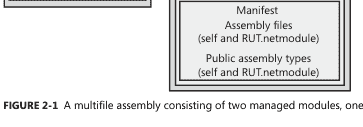

**图 2-1** 由两个托管模块组成的多文件程序集，其中一个带有清单。

RUT.netmodule 文件包含通过编译 RUT.cs 生成的 IL 代码。此文件还包含描述 RUT.cs 所定义的类型、方法、字段、属性、事件等的元数据表。元数据表还描述 RUT.cs 所引用的类型、方法等。MultiFileLibrary.dll 是一个单独的文件。与 RUT.netmodule 一样，此文件包含通过编译 FUT.cs 生成的 IL 代码，还包含类似的定义和引用元数据表。然而，MultiFileLibrary.dll 包含额外的清单元数据表，使 MultiFileLibrary.dll 成为一个程序集。额外的清单元数据表描述组成该程序集的所有文件（MultiFileLibrary.dll 文件本身和 RUT.netmodule 文件）。清单元数据表还包括从 MultiFileLibrary.dll 和 RUT.netmodule 导出的所有公共类型。

> **注意** 实际上，清单元数据表并不真正包含从包含清单的 PE 文件导出的类型。此优化的目的是减少 PE 文件中清单信息所需的字节数。因此，像“清单元数据表还包括从 MultiFileLibrary.dll 和 RUT.netmodule 导出的所有公共类型”这样的说法并非 100% 准确。不过，这种说法确实准确反映了清单在逻辑上公开的内容。

生成 MultiFileLibrary.dll 程序集后，你可以使用 ILDasm.exe 检查元数据的清单表，以验证程序集文件确实引用了 RUT.netmodule 文件的类型。以下是 FileDef 和 ExportedTypesDef 元数据表的样子：

```
File #1 (26000001)
---------------------------------------------
    Token: 0x26000001
    Name : RUT.netmodule
    HashValue Blob : e6 ed 6f 62 2c a1 2c 59 97 65 0f 21 44 10 15 96 f2 7e db c2
    Flags : [ContainsMetaData]  (00000000)

ExportedType #1 (27000001)
---------------------------------------------
    Token: 0x27000001
    Name: ARarelyUsedType
    Implementation token: 0x26000001
    TypeDef token: 0x02000002
    Flags     : [Public] [AutoLayout] [Class] [Sealed] [AnsiClass]
                [BeforeFieldInit] (00100101)
```

由此可以看到，RUT.netmodule 是一个被视为程序集一部分的文件，其标记为 0x26000001。从 ExportedTypesDef 表中可以看到，有一个公开导出的类型 ARarelyUsedType。此类型的实现标记为 0x26000001，这表明该类型的 IL 代码包含在 RUT.netmodule 文件中。

> **注意** 供好奇者参考：元数据标记是 4 字节值。高字节指示标记的类型（0x01=TypeRef，0x02=TypeDef，0x23=AssemblyRef，0x26=File（文件定义），0x27=ExportedType）。完整列表请参阅 .NET Framework SDK 附带的 CorHdr.h 文件中的 CorTokenType 枚举类型。标记的三个低字节仅用于标识对应表中的行。


元数据表。例如，实现标记 0x26000001 引用 File 表的第一行。对于大多数表，行从 1 开始编号，而不是从 0 开始。对于 TypeDef 表，行实际上从 2 开始。

任何使用 MultiFileLibrary.dll 程序集类型的客户端代码都必须使用 `/r[eference]:MultiFileLibrary.dll` 编译器开关来生成。此开关告诉编译器在搜索外部类型时，加载 MultiFileLibrary.dll 程序集及其 FileDef 表中列出的所有文件。编译器要求该程序集的所有文件都已安装且可访问。如果你删除了 RUT.netmodule 文件，C# 编译器将产生以下错误：“fatal error CS0009: 无法打开元数据文件 'C:\MultiFileLibrary.dll'——导入程序集 'C:\MultiFileLibrary.dll' 的模块 'RUT.netmodule' 时出错——系统找不到指定的文件”。这意味着，要生成新的程序集，所引用程序集的所有文件都必须存在。

当客户端代码执行时，它会调用方法。首次调用某个方法时，CLR 会检测该方法作为参数、返回类型或局部变量引用的类型。然后，CLR 尝试加载包含清单的所引用程序集文件。如果要访问的类型位于此文件中，CLR 会执行其内部簿记，从而允许使用该类型。如果清单指示所引用的类型位于其他文件中，CLR 会尝试加载必要的文件，执行其内部簿记，并允许访问该类型。仅当调用某个方法，而该方法引用未加载程序集中的类型时，CLR 才会加载程序集文件。这意味着，要运行应用程序，并不需要所引用程序集的所有文件都存在。

#### 使用 Visual Studio IDE 向项目添加程序集

如果你使用 Visual Studio IDE 生成项目，则必须将要引用的任何程序集添加到项目中。为此，请打开解决方案资源管理器，右键单击要添加引用的项目，然后选择“添加引用”菜单项。这将显示图 2-2 所示的“引用管理器”对话框。

```text
csc /t:module FUT.cs
al /out:MultiFileLibrary.dll /t:library FUT.netmodule RUT.netmodule
```

图 2-3 显示了创建这些语句后生成的文件。

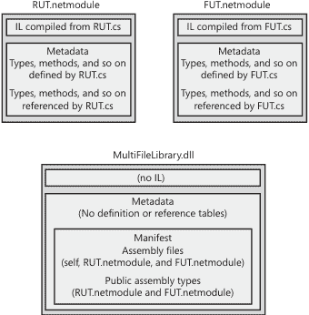

**图 2-3** 一个由三个托管模块（其中一个包含清单）组成的多文件程序集。

在此示例中，创建了两个独立的模块：RUT.netmodule 和 FUT.netmodule。这两个模块都不是程序集，因为它们不包含清单元数据表。然后生成第三个文件：MultiFileLibrary.dll，这是一个小型 DLL PE 文件（由于使用了 /t[target]:library 开关），其中不包含 IL 代码，但具有清单元数据表，指示 RUT.netmodule 和 FUT.netmodule 是程序集的一部分。生成的程序集由三个文件组成：MultiFileLibrary.dll、RUT.netmodule 和 FUT.netmodule。程序集链接器无法将多个文件合并为单个文件。

AL.exe 实用工具还可以通过使用 /t[target]:exe、/t[target]:winexe 或 /t[target]:appcontainerexe 命令行开关，生成 CUI、GUI 和 Windows 商店应用 PE 文件。但这非常不寻常，因为这意味着你会有一个 EXE PE 文件，其中只包含刚好足够的 IL 代码，用来调用另一个模块中的方法。在调用 AL.exe 时，可以通过添加 /main 命令行开关，指定模块中的哪个方法应作为入口点。以下示例演示如何使用 /main 命令行开关调用程序集链接器 AL.exe：

```text
csc /t:module /r:MultiFileLibrary.dll Program.cs
al /out:Program.exe /t:exe /main:Program.Main Program.netmodule
```

这里，第一行将 Program.cs 文件生成为 Program.netmodule 文件。第二行生成一个包含清单元数据表的小型 Program.exe PE 文件。此外，由于 /main:Program.Main 命令行开关，AL.exe 会发出一个名为 __EntryPoint 的小型全局函数。此函数 __EntryPoint 包含以下 IL 代码：

```
    .method privatescope static void __EntryPoint$PST06000001() cil managed
    {
      .entrypoint
      // Code size       8 (0x8)
      .maxstack  8
      IL_0000:  tail.
      IL_0002:  call       void [.module 'Program.netmodule']Program::Main()
      IL_0007:  ret
    } // end of method 'Global Functions'::__EntryPoint
```

如你所见，这段代码只是调用 Program.netmodule 文件中定义的 Program 类型所包含的 Main 方法。AL.exe 中的 /main 开关并不是很有用，因为你不太可能为某个应用程序创建程序集，而该应用程序的入口点却不在包含清单元数据表的 PE 文件中。我在这里提到这个开关，只是让你知道它的存在。

对于本书附带的代码，我创建了一个 Ch02-3-BuildMultiFileLibrary.bat 文件，它封装了生成多文件程序集所需的所有步骤。Visual Studio 中的 Ch02-4-AppUsingMultiFileLibrary 项目将此批处理文件作为生成前命令行步骤调用。你可以检查此项目，了解如何在 Visual Studio 中集成生成和引用多文件程序集。

#### 向程序集添加资源文件

使用 AL.exe 创建程序集时，可以通过使用 /embed[resource] 开关将文件作为资源添加到程序集。此开关接受一个文件（任意文件），并将该文件的内容嵌入生成的 PE 文件中。清单的 ManifestResourceDef 表会更新，以反映这些资源的存在。

AL.exe 还支持 /link[resource] 开关，该开关也接受一个包含资源的文件。但是，/link[resource] 开关会更新清单的 ManifestResourceDef 和 FileDef 表，指示该资源存在，并标识程序集的哪个文件包含它。该资源文件不会嵌入程序集 PE 文件中；它保持独立，并且必须与其他程序集文件一起打包和部署。

与 AL.exe 类似，CSC.exe 也允许将资源合并到 C# 编译器生成的程序集中。C# 编译器的 /resource 开关会将指定的资源文件嵌入生成的程序集 PE 文件中，并更新 ManifestResourceDef 表。编译器的 /linkresource 开关会向 ManifestResourceDef 和 FileDef 清单表添加一个条目，以引用独立的资源文件。

关于资源的最后一点说明：可以将标准 Win32 资源嵌入程序集。使用 AL.exe 或 CSC.exe 时，通过 /win32res 开关指定 .res 文件的路径名，即可轻松完成此操作。此外，使用 AL.exe 或 CSC.exe 时，通过 /win32icon 开关指定 .ico 文件的路径名，即可快速轻松地将标准 Win32 图标资源嵌入程序集文件。在 Visual Studio 中，可以显示项目属性，然后单击“应用程序”选项卡，从而将资源文件添加到程序集。嵌入图标的典型原因是让 Windows 资源管理器能够为托管可执行文件显示图标。

**注意** 托管程序集文件中也包含 Win32 清单资源信息。默认情况下，C# 编译器会自动生成此清单信息，但你可以使用 /nowin32manifest 开关告诉它不要生成。C# 编译器生成的默认清单如下所示：

```xml
<?xml version="1.0" encoding="UTF-8" standalone="yes"?>
<assembly xmlns="urn:schemas-microsoft-com:asm.v1" manifestVersion="1.0">
  <assemblyIdentity version="1.0.0.0" name="MyApplication.app" />
  <trustInfo xmlns="urn:schemas-microsoft-com:asm.v2">
    <security>
      <requestedPrivileges xmlns="urn:schemas-microsoft-com:asm.v3">
        <requestedExecutionLevel level="asInvoker" uiAccess="false"/>
      </requestedPrivileges>
    </security>
  </trustInfo>
</assembly>
```

### 程序集版本资源信息

当 AL.exe 或 CSC.exe 生成 PE 文件程序集时，它还会将标准 Win32 版本资源嵌入到该 PE 文件中。用户可以通过查看文件属性来检查此资源。应用程序代码还可以在运行时通过调用 System.Diagnostics.FileVersionInfo 的静态 GetVersionInfo 方法，并以程序集路径名作为参数，来获取并检查此信息。图 2-4 显示了 Ch02-3-MultiFileLibrary.dll 属性对话框的“详细信息”选项卡。


| 版本资源 | AL.exe 开关 | 自定义特性/注释 |
|---|---|---|
| PRODUCTVERSION | /productversion | System.Reflection.AssemblyInformationalVersionAttribute. |
| FILEFLAGSMASK | （无） | 始终设置为 VS_FFI_FILEFLAGSMASK（在 WinVer.h 中定义为 0x0000003F）。 |
| FILEFLAGS | （无） | 始终为 0。 |
| FILEOS | （无） | 当前始终为 VOS_WINDOWS32。 |
| FILETYPE | /target | 如果指定 /target:exe 或 /target:winexe，则设置为 VFT_APP；如果指定 /target:library，则设置为 VFT_DLL。 |
| FILESUBTYPE | （无） | 始终设置为 VFT2_UNKNOWN。（此字段对 VFT_APP 或 VFT_DLL 没有意义。） |
| AssemblyVersion | /version | System.Reflection.AssemblyVersionAttribute. |
| Comments | /description | System.Reflection.AssemblyDescriptionAttribute. |
| CompanyName | /company | System.Reflection.AssemblyCompanyAttribute. |
| FileDescription | /title | System.Reflection.AssemblyTitleAttribute. |
| FileVersion | /version | System.Reflection.AssemblyFileVersionAttribute. |
| InternalName | /out | 设置为指定输出文件的名称（不带扩展名）。 |
| LegalCopyright | /copyright | System.Reflection.AssemblyCopyrightAttribute. |
| LegalTrademarks | /trademark | System.Reflection.AssemblyTrademarkAttribute. |
| OriginalFilename | /out | 设置为输出文件的名称（不带路径）。 |
| PrivateBuild | （无） | 始终为空。 |
| ProductName | /product | System.Reflection.AssemblyProductAttribute. |
| ProductVersion | /productversion | System.Reflection.AssemblyInformationalVersionAttribute. |
| SpecialBuild | （无） | 始终为空。 |

**重要** 在 Visual Studio 中创建新的 C# 项目时，系统会自动在 Properties 文件夹中为你创建一个 AssemblyInfo.cs 文件。此文件包含本节所述的所有程序集版本特性，以及我将在第 3 章介绍的几个附加特性。你只需打开 AssemblyInfo.cs 文件并修改程序集特定信息即可。Visual Studio 还提供了一个对话框，可用于编辑此文件中的程序集版本信息。要查看此对话框，请在解决方案资源管理器中双击项目的“属性”项，然后在“应用程序”选项卡上单击“程序集信息”；你将看到如图 2-5 所示的对话框。

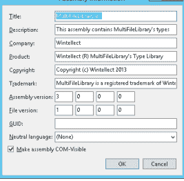

**图 2-5** Visual Studio 的“程序集信息”对话框。

### 版本号

上一节中，你了解到可以将多个版本号应用于一个程序集。所有这些版本号都具有相同的格式：每个版本号由四个用句点分隔的部分组成，如表 2-5 所示。

**表 2-5** 版本号的格式

| | 主版本号 | 次版本号 | 生成号 | 修订号 |
|---|---|---|---|---|
| 示例： | 2 | 5 | 719 | 2 |

表 2-5 显示了一个版本号示例：2.5.719.2。前两个数字构成公众对该版本的认知。公众会将此示例视为该程序集的 2.5 版。第三个数字 719 表示程序集的生成号。如果公司每天生成程序集，也应每天递增生成号。最后一个数字 2 表示生成的修订号。如果由于某种原因，公司必须在一天内生成程序集两次，例如为了解决阻碍其他工作的紧急 bug，则应递增修订号。Microsoft 使用这种版本编号方案，强烈建议你也使用此方案。

你会注意到，一个程序集关联了三个版本号。这很不幸，会导致很多混淆。下面我来解释每个版本号的用途以及预期用法：

- **AssemblyFileVersion** 此版本号存储在 Win32 版本资源中。此编号仅用于提供信息；CLR 不会以任何方式检查此版本号。通常，你将主版本号和次版本号部分设置为希望公众看到的版本。然后，每次执行生成时递增生成号部分和修订号部分。理想情况下，Microsoft 的工具（如 CSC.exe 或 AL.exe）会根据执行生成时的日期和时间自动为你更新生成号和修订号，但不幸的是，它们并不会这样做。使用 Windows 资源管理器时可以看到此版本号，并且在排查客户系统问题时，通常用它来标识程序集的特定版本。

- **AssemblyInformationalVersion** 此版本号也存储在 Win32 版本资源中，同样，此编号仅用于提供信息；CLR 不会以任何方式检查或关心它。此版本号用于指示包含该程序集的产品版本。例如，产品的 2.0 版可能包含多个程序集；其中一个程序集被标记为 1.0 版，因为它是同一产品的 1.0 版中未随附的新程序集。通常，你将此版本号的主版本号和次版本号部分设置为表示产品的公开版本。然后，每次打包包含所有程序集的完整产品时，递增生成号部分和修订号部分。

- **AssemblyVersion** 此版本号存储在 AssemblyDef 清单元数据表中。CLR 在绑定到强命名程序集时会使用此版本号（将在第 3 章讨论）。此编号极其重要，用于唯一标识程序集。开始开发程序集时，应设置主版本号、次版本号、生成号和修订号，并且在准备开始处理程序集的下一个可部署版本之前，不应更改它们。当 Assembly-A 引用强命名程序集 Assembly-B 时，Assembly-B 的版本会嵌入到 Assembly-A 的 AssemblyRef 表条目中。这样，当 CLR 需要加载 Assembly-B 时，它就能确切知道 Assembly-A 是使用哪个版本生成和测试的。通过使用绑定重定向，可以让 CLR 加载不同版本，这将在第 3 章讨论。

### 区域性

与版本号一样，程序集也将区域性作为其标识的一部分。例如，我可以有一个专门用于德语的程序集、另一个用于瑞士德语的程序集、另一个用于美国英语的程序集，等等。区域性通过一个包含主标记和次标记的字符串来标识（如 RFC 1766 所述）。表 2-6 显示了一些示例。

**表 2-6** 程序集区域性标记示例

| 主标记 | 次标记 | 区域性 |
|---|---|---|
| De | （无） | 德语 |
| De | AT | 奥地利德语 |
| De | CH | 瑞士德语 |
| En | （无） | 英语 |
| En | GB | 英国英语 |
| En | US | 美国英语 |

一般来说，如果创建包含代码的程序集，不要为其分配区域性。这是因为代码通常不包含任何特定于区域性的假设。未分配区域性的程序集称为区域性中立程序集。

如果你正在设计包含一些特定于区域性的资源的应用程序，Microsoft 强烈建议你创建一个程序集，其中包含你的代码和应用程序的默认（或回退）资源。生成此程序集时，不要指定区域性。其他程序集在创建和操作此程序集公开的类型时，将引用此程序集。

现在，你可以创建一个或多个单独的程序集，其中仅包含特定于区域性的资源——完全不含代码。标记了区域性的程序集称为附属程序集。对于这些附属程序集，请分配一个能准确反映放入该程序集中的资源的区域性。对于你打算支持的每种区域性，都应创建一个附属程序集。

通常，你会使用 AL.exe 工具生成附属程序集。你不会使用编译器，因为附属程序集内不应包含任何代码。使用 AL.exe 时，通过 /c[culture] : text 开关指定所需的区域性，其中 text 是诸如“en-US”的字符串，表示美国英语。部署附属程序集时，应将其放在名称与区域性文本匹配的子目录中。例如，如果应用程序的基目录是 C:\MyApp，则美国英语附属程序集应放在 C:\MyApp\en-US 子目录中。在运行时，使用 System.Resources.ResourceManager 类访问附属程序集的资源。

**注意** 可以创建包含代码的附属程序集，但不鼓励这种做法。如果愿意，你可以使用 System.Reflection.AssemblyCultureAttribute 自定义特性来指定区域性，而不使用 AL.exe 的 /culture 开关，例如，如下所示：

```
// Set assembly's culture to Swiss German
[assembly:AssemblyCulture("de-CH")]
```

通常，不应生成引用附属程序集的程序集。换句话说，程序集的 AssemblyRef 条目应全部引用区域性中立的程序集。如果要访问附属程序集中包含的类型或成员，应使用反射技术，如所讨论的那样。


### 简单应用程序部署（私有部署程序集）

在本章中，我已解释如何构建模块以及如何将这些模块组合成一个程序集。现在，我准备解释如何打包和部署所有程序集，以便用户能够运行应用程序。

Windows 商店应用对程序集打包有非常严格的规则，Visual Studio 会将应用程序所需的所有程序集一起打包到一个 .appx 文件中，该文件要么上传到 Windows 商店，要么可以旁加载到某台机器上。当用户安装 .appx 文件时，其中包含的所有程序集都会被放置到一个目录中，CLR 将在该目录中加载它们，并且 Windows 会向用户的“开始”屏幕添加一个应用磁贴。如果其他用户安装同一个 .appx 文件，则会使用先前安装的程序集，新用户只会在其“开始”屏幕上获得一个新增的磁贴。当用户卸载 Windows 商店应用时，系统会从用户的“开始”屏幕移除该磁贴。如果没有其他用户安装该应用，那么 Windows 会销毁该目录及其所有程序集。请注意，不同用户可以安装同一个 Windows 商店应用的不同版本。为了适应这种情况，Windows 会将程序集安装到不同的目录中，以便单个应用的多个版本可以同时驻留在一台机器上。

对于桌面（非 Windows 商店）应用程序，程序集并不规定或要求任何特殊的打包方式。打包一组程序集的最简单方法就是直接复制所有文件。例如，你可以将所有程序集文件放到 CD-ROM 上，并随附一个批处理文件安装程序将其交付给用户，该程序只将文件从 CD 复制到用户硬盘上的某个目录。由于程序集包含所有依赖程序集引用和类型，用户只需运行应用程序，运行时会到应用程序的目录中查找被引用的程序集。应用程序运行不需要修改注册表。要卸载应用程序，只需删除所有文件——就这样！

当然，你还可以使用其他机制来打包和安装程序集文件，例如 .cab 文件（通常用于 Internet 下载场景，以压缩文件并缩短下载时间）。你也可以将程序集文件打包到 MSI 文件中，供 Windows Installer 服务（MSIExec.exe）使用。使用 MSI 文件可以让程序集在 CLR 首次尝试加载该程序集时按需安装。此功能对 MSI 来说并不新鲜；它也可以为非托管 EXE 和 DLL 文件执行同样的按需加载功能。

**注意** 使用批处理文件或其他简单的“安装软件”可以让应用程序进入用户的机器；但是，你还需要更复杂的安装软件来在用户的桌面和“开始”菜单/屏幕中创建快捷方式链接。此外，你可以轻松备份和还原应用程序，或将其从一台机器移动到另一台机器，但各种快捷方式链接将需要特殊处理。

当然，Visual Studio 有一个内置机制，你可以通过显示项目的“属性”页并单击“发布”选项卡来发布应用程序。你可以使用“发布”选项卡上可用的选项，让 Visual Studio 生成 MSI 文件，并将生成的 MSI 文件复制到网站、FTP 服务器或文件路径。该 MSI 文件还可以安装任何必备组件，例如 .NET Framework 或 Microsoft SQL Server Express Edition。最后，应用程序可以利用 ClickOnce 技术自动检查更新并在用户机器上安装更新。

部署到与应用程序相同目录中的程序集称为私有部署程序集，因为程序集文件不与任何其他应用程序共享（除非其他应用程序也部署到同一目录）。私有部署程序集对开发人员、最终用户和管理员来说都是一大优势，因为它们可以直接复制到应用程序的基目录中，CLR 会加载它们并执行其中的代码。此外，只需删除其目录中的程序集即可卸载应用程序。这同样允许简单的备份和还原。

这种简单的安装/移动/卸载场景之所以可行，是因为每个程序集都有元数据，指明应加载哪个被引用的程序集；不需要注册表设置。此外，引用程序集限定了每个类型的作用域。这意味着应用程序始终绑定到它构建和测试时所用的同一类型；CLR 无法加载恰好提供了同名类型的另一个程序集。这与 COM 不同，在 COM 中，类型记录在注册表中，使机器上运行的任何应用程序都可以使用它们。

在第 3 章中，我将讨论如何部署可由多个应用程序访问的共享程序集。

### 简单管理控制（配置）

用户或管理员最能确定应用程序执行的某些方面。例如，管理员可能决定移动用户硬盘上某个程序集的文件，或覆盖程序集清单中包含的信息。还存在与版本控制相关的其他场景；我将在第 3 章中讨论其中一些。

为了允许对应用程序进行管理控制，可以将配置文件放在应用程序的目录中。应用程序的发布者可以创建并打包此文件。然后，安装程序会将此配置文件安装到应用程序的基目录中。此外，机器的管理员或最终用户可以创建或修改此文件。CLR 会解释此文件的内容，以更改其定位和加载程序集文件的策略。

这些配置文件包含可扩展标记语言 (XML)，并且可以与应用程序或机器关联。使用单独的文件（相对于注册表设置）可以轻松备份该文件，还可以让管理员将应用程序复制到另一台机器——只需复制必要的文件，管理策略也会一并复制。

在第 3 章中，我们将更详细地探讨此配置文件。但现在我想让你先体验一下。假设某个应用程序的发布者希望将其应用程序与 MultifileLibrary 程序集文件部署到与应用程序程序集文件不同的目录中。所需的目录结构如下所示：

```text
AppDir directory (contains the application's assembly files)
    Program.exe
        Program.exe.config (discussed below)

    AuxFiles subdirectory (contains MultifileLibrary's assembly files)
        MultifileLibrary.dll
        FUT.netmodule
        RUT.netmodule
```

由于 MultifileLibrary 文件不再位于应用程序的基目录中，CLR 将无法定位和加载这些文件；运行应用程序将导致抛出 System.IO.FileNotFoundException 异常。要解决此问题，发布者需要创建一个 XML 配置文件并将其部署到应用程序的基目录。此文件的名称必须是应用程序主程序集文件的名称加上 .config 扩展名：在本例中为 Program.exe.config。该配置文件应如下所示：

```xml
<configuration>
   <runtime>
      <assemblyBinding xmlns="urn:schemas-microsoft-com:asm.v1">
         <probing privatePath="AuxFiles" />
      </assemblyBinding>
   </runtime>
</configuration>
```

每当 CLR 尝试定位程序集文件时，它总是先在应用程序的目录中查找；如果在那里找不到该文件，则会在 AuxFiles 子目录中查找。你可以为 probing 元素的 privatePath 属性指定多个以分号分隔的路径。每个路径都被视为相对于应用程序的基目录。你不能指定标识应用程序基目录之外目录的绝对路径或相对路径。其思想是，应用程序可以控制其目录及其子目录，但无法控制其他目录。

#### 探测程序集文件

当 CLR 需要定位程序集时，它会扫描若干个子目录。以下是针对区域性中立程序集探测目录的顺序（其中 firstPrivatePath 和 secondPrivatePath 通过配置文件的 privatePath 属性指定）：

```text
AppDir\AsmName.dll
AppDir\AsmName\AsmName.dll
AppDir\firstPrivatePath\AsmName.dll
AppDir\firstPrivatePath\AsmName\AsmName.dll
AppDir\secondPrivatePath\AsmName.dll
AppDir\secondPrivatePath\AsmName\AsmName.dll
...
```


在此示例中，如果将 MultiFileLibrary 程序集文件部署到名为 MultiFileLibrary 的子目录，则不需要配置文件，因为 CLR 会自动扫描名称与所搜索程序集名称匹配的子目录。

如果在前面任何子目录中都找不到该程序集，CLR 会从头开始，使用 .exe 扩展名而不是 .dll 扩展名。如果仍然找不到该程序集，则抛出 FileNotFoundException。

对于附属程序集，遵循类似规则，不同之处在于：程序集应位于应用程序基目录下名称与该区域性匹配的子目录中。例如，如果 AsmName.dll 应用了 "en-US" 区域性，则会探测以下目录：

```text
C:\AppDir\en-US\AsmName.dll
C:\AppDir\en-US\AsmName\AsmName.dll
C:\AppDir\FirstPrivatePath\en-US\AsmName.dll
C:\AppDir\FirstPrivatePath\en-US\AsmName\AsmName.dll
C:\AppDir\SecondPrivatePath\en-US\AsmName.dll
C:\AppDir\SecondPrivatePath\en-US\AsmName\AsmName.dll

C:\AppDir\en-US\AsmName.exe
C:\AppDir\en-US\AsmName\AsmName.exe
C:\AppDir\FirstPrivatePath\en-US\AsmName.exe
C:\AppDir\FirstPrivatePath\en-US\AsmName\AsmName.exe
C:\AppDir\SecondPrivatePath\en-US\AsmName.exe
C:\AppDir\SecondPrivatePath\en-US\AsmName\AsmName.exe

C:\AppDir\en\AsmName.dll
C:\AppDir\en\AsmName\AsmName.dll
C:\AppDir\FirstPrivatePath\en\AsmName.dll
C:\AppDir\FirstPrivatePath\en\AsmName\AsmName.dll
C:\AppDir\SecondPrivatePath\en\AsmName.dll
C:\AppDir\SecondPrivatePath\en\AsmName\AsmName.dll

C:\AppDir\en\AsmName.exe
C:\AppDir\en\AsmName\AsmName.exe
C:\AppDir\FirstPrivatePath\en\AsmName.exe
C:\AppDir\FirstPrivatePath\en\AsmName\AsmName.exe
C:\AppDir\SecondPrivatePath\en\AsmName.exe
C:\AppDir\SecondPrivatePath\en\AsmName\AsmName.exe
```

如你所见，CLR 会探测具有 .exe 或 .dll 文件扩展名的文件。由于探测可能非常耗时（尤其是当 CLR 通过网络查找文件时），在 XML 配置文件中，你可以指定一个或多个 culture 元素，以限制 CLR 在查找附属程序集时执行的探测。Microsoft 提供了一个 FusLogVw.exe 工具，你可以使用它查看 CLR 在运行时如何绑定到程序集。有关它的更多信息，请参见 http://msdn.microsoft.com/en-us/library/e74a18c4(v=vs.110).aspx。

此 XML 配置文件的名称和位置因应用程序类型而异：

- 对于可执行应用程序（EXE），配置文件必须位于应用程序的基目录中，并且名称必须是 EXE 文件名后追加 “.config”。

- 对于 Microsoft ASP.NET Web Forms 应用程序，该文件必须位于 Web 应用程序的虚拟根目录中，并且始终命名为 Web.config。此外，子目录也可以包含自己的 Web.config 文件，并且配置设置会被继承。例如，位于 http://Wintellect.com/Training 的 Web 应用程序将使用虚拟根目录及其 Training 子目录中包含的 Web.config 文件中的设置。

如本节开头所述，配置设置适用于特定应用程序和计算机。安装 .NET Framework 时，它会创建一个 Machine.config 文件。对于你在计算机上安装的每个 CLR 版本，都有一个 Machine.config 文件。

Machine.config 文件位于以下目录中：

```text
%SystemRoot%\Microsoft.NET\Framework\version\CONFIG
```

当然，%SystemRoot% 标识你的 Windows 目录（通常为 C:\WINDOWS），而 version 是标识 .NET Framework 特定版本的版本号（类似于 v4.0.####）。

Machine.config 文件中的设置表示影响计算机上运行的所有应用程序的默认设置。管理员可以通过修改单个 Machine.config 文件来创建计算机范围的策略。但是，管理员和用户应避免修改此文件，因为它包含许多与各种内容相关的设置，使其更难以导航。此外，你希望应用程序的设置能够备份和还原，而将应用程序的设置保存在应用程序特定的配置文件中可以实现这一点。

## 第3章：共享程序集和强命名程序集

## 

本章内容：

- 两种程序集，两种部署
- 66 为程序集指定强名称
- 67 全局程序集缓存
- 73 生成引用强命名程序集的程序集
- 75 强命名程序集具有防篡改性
- 76 延迟签名
- 77 私有部署强命名程序集
- 80 运行时如何解析类型引用
- 81 高级管理控制（配置）
- 84

在第2章“生成、打包、部署和管理应用程序及类型”中，我讨论了生成、打包和部署程序集所需的步骤。我重点介绍了所谓的私有部署，在这种部署中，程序集被放在应用程序的基目录（或其子目录）中，供该应用程序专用。以私有方式部署程序集使公司能够获得很大程度的

显然，仅通过使用文件名来区分程序集还不够好。CLR 需要支持某种机制，使程序集能够被唯一标识。这就是术语*强命名程序集*所指的内容。强命名程序集由四个属性组成，这些属性唯一标识该程序集：文件名（不带扩展名）、版本号、区域性标识和公钥。由于公钥是很大的数字，我们经常使用从公钥派生出的一个小哈希值。这个哈希值称为*公钥标记*。以下程序集标识字符串（有时称为程序集显示名称）标识四个完全不同的程序集文件：

```text
"MyTypes, Version=1.0.8123.0, Culture=neutral, PublicKeyToken=b77a5c561934e089"
"MyTypes, Version=1.0.8123.0, Culture="en-US", PublicKeyToken=b77a5c561934e089"
"MyTypes, Version=2.0.1234.0, Culture=neutral, PublicKeyToken=b77a5c561934e089"
"MyTypes, Version=1.0.8123.0, Culture=neutral, PublicKeyToken=b03f5f7f11d50a3a"
```

第一个字符串标识一个名为 MyTypes.exe 或 MyTypes.dll 的程序集文件（实际上你无法从程序集标识字符串确定文件扩展名）。生成该程序集的公司正在创建此程序集的 1.0.8123.0 版本，并且程序集中没有任何内容对某一区域性敏感，因为 Culture 设置为 neutral。当然，任何公司都可以生成一个 MyTypes.dll（或 MyTypes.exe）程序集文件，并将其标记为版本号 1.0.8123.0 和中性区域性。

必须有一种方法将这家公司的程序集与另一家公司恰好具有相同属性的程序集区分开来。出于几个原因，Microsoft 选择使用标准的公钥/私钥加密技术，而不是任何其他唯一标识技术，例如 GUID、URL 或 URN。具体来说，加密技术提供了一种方法，可以在程序集的位安装到计算机上时检查其完整性，并且还允许按发布者授予权限。我将在本章后面讨论这些技术。因此，想要唯一标记其程序集的公司必须创建公钥/私钥对。然后，公钥可以与程序集关联。任何两家公司都不应拥有相同的公钥/私钥对，正是这种区别使两家公司能够创建具有相同名称、版本和区域性的程序集，而不会造成任何冲突。

**注意** `System.Reflection.AssemblyName` 类是一个帮助器类，它使你能够轻松生成程序集名称并获取程序集名称的各个部分。该类提供几个公共实例属性，例如 `CultureInfo`、`FullName`、`KeyPair`、`Name` 和 `Version`。该类还提供几个公共实例方法，例如 `GetPublicKey`、`GetPublicKeyToken`、`SetPublicKey` 和 `SetPublicKeyToken`。

在第2章中，我向你展示了如何命名程序集文件，以及如何应用程序集版本号和区域性。弱命名程序集可以在清单元数据中嵌入程序集版本和区域性属性；但是，当 CLR 探测子目录以查找附属程序集时，它始终忽略版本号，只使用区域性信息。由于弱命名程序集始终是私有部署的，CLR 在……中搜索程序集文件时只使用程序集的名称（附加 .dll 或 .exe 扩展名）。

应用程序的基目录，或在可扩展标记语言（XML）配置文件中探测元素的`privatePath` XML 属性所指定的应用程序的任何子目录中。

强命名程序集具有文件名、程序集版本和区域性。此外，强命名程序集使用发布者的私钥进行签名。

创建强命名程序集的第一步是使用随 .NET Framework SDK 和 Microsoft Visual Studio 一起提供的强名称工具 SN.exe 获取密钥。此工具根据你指定的命令行开关提供许多功能。请注意，SN.exe 的所有命令行开关都区分大小写。要生成公钥/私钥对，你可以按如下方式运行 SN.exe：

```
SN -k MyCompany.snk
```

此行告诉 SN.exe 创建一个名为 MyCompany.snk 的文件。此文件将包含以二进制格式保存的公钥和私钥数字。

公钥数字非常大。如果你愿意，在创建了包含公钥和私钥的文件之后，可以再次使用 SN.exe 实用程序来查看实际的公钥。为此，你必须执行 SN.exe 实用程序两次。首先，使用 `-p` 开关调用 SN.exe，以创建一个仅包含公钥的文件（MyCompany.PublicKey）：³

```
SN -p MyCompany.snk MyCompany.PublicKey sha256
```

然后，调用 SN.exe，向其传递 `-tp` 开关以及仅包含公钥的文件：

```
SN -tp MyCompany.PublicKey
```

当我执行此行时，我得到以下输出：

```
Microsoft (R) .NET Framework Strong Name Utility  Version 4.0.30319.17929
Copyright (c) Microsoft Corporation.  All rights reserved.

Public key (hash algorithm: sha256):
00240000048000009400000006020000002400005253413100040000010001003f9d621b702111
85b0f45b3d92b6d5a58c020eb7b804f75d67a30b207cf786ffa3797b669215afb4d814a6f294010
b233bac0b8c8098ba809855da256d964cd0d7f16463d918d651a4a846a62317328cac893626a550
69f21aa125bc0b3193261176dd629eac6c90d36858de3cfb781bfc8b817936a567cad08ae672b6
1fb08e0b

Public key token is 3db32f38c8d42c9a
```

SN.exe 实用程序不提供任何显示私钥的方法。

³ 在此示例中，我使用的是 .NET Framework 4.5 版本中引入的*增强强命名*。如果你需要生成与 .NET Framework 早期版本兼容的程序集，则还必须使用 `AssemblySignatureKeyAttribute` 创建反向签名。有关详细信息，请参阅 http://msdn.microsoft.com/en-us/library/hh415055(v=vs.110).aspx。

公钥的大小使其难以使用。为了让开发人员（以及最终用户）更方便，*公钥标记*被引入。公钥标记是公钥的 64 位哈希。SN.exe 的 `-p` 开关在其输出末尾显示与完整公钥对应的公钥标记。

既然你知道了如何创建公钥/私钥对，创建强命名程序集就很简单了。当你编译程序集时，使用 `/keyfile:<file>` 编译器开关：

```
csc /keyfile:MyCompany.snk Program.cs
```

当 C# 编译器看到此开关时，编译器会打开指定文件（MyCompany.snk），使用私钥对程序集进行签名，并将公钥嵌入清单中。请注意，你只对包含清单的程序集文件进行签名；程序集的其他文件不能显式签名。

如果你使用的是 Visual Studio，可以通过显示项目属性、单击“签名”选项卡、选中“为程序集签名”复选框，然后从“选择强名称密钥文件”组合框中选择“<新建...>”选项来创建新的公钥/私钥文件。

对文件进行签名意味着什么：当你构建强命名程序集时，程序集的 FileDef 清单元数据表包含组成程序集的所有文件的列表。当每个文件的名称被添加到清单中时，会对文件的内容进行哈希处理，并将此哈希值与文件名一起存储在 FileDef 表中。你可以使用 AL.exe 的 `/algid` 开关覆盖默认的哈希算法，或在程序集的某个源代码文件中应用程序集级别的 `System.Reflection.AssemblyAlgorithmIdAttribute` 自定义属性。默认情况下，使用 SHA-1 算法。

在构建包含清单的 PE 文件之后，PE 文件的全部内容（除了任何 Authenticode 签名、程序集的强名称数据和 PE 头校验和）都会被哈希处理，如图 3-1 所示。此哈希值使用发布者的私钥进行签名，所产生的 RSA 数字签名存储在 PE 文件内的一个保留部分（不包含在哈希中）。PE 文件的 CLR 头会更新，以反映数字签名在文件中的嵌入位置。

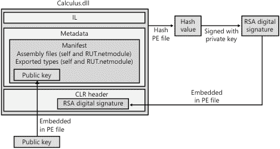

**图 3-1** 对程序集进行签名。

发布者的公钥也会嵌入到此 PE 文件的 AssemblyDef 清单元数据表中。文件名、程序集版本、区域性和公钥的组合赋予此程序集强名称，该名称保证是唯一的。除非两家公司彼此共享此密钥对，否则不可能各自生成具有相同公钥/私钥的名为 *OurLibrary* 的程序集。

此时，程序集及其所有文件已准备好打包和分发。

如第 2 章所述，当你编译源代码时，编译器会检测代码引用的类型和成员。你必须向编译器指定被引用的程序集。对于 C# 编译器，使用 `/reference` 编译器开关。编译器的部分工作是在生成的管理模块中发出 AssemblyRef 元数据表。AssemblyRef 元数据表中的每个条目都标识被引用程序集的名称（不带路径和扩展名）、版本号、区域性和公钥信息。

**重要** 由于公钥是很大的数字，并且单个程序集可能引用许多程序集，因此生成文件的很大一部分大小将被公钥信息占用。为了节省存储空间，Microsoft 对公钥进行哈希处理，并取哈希值的最后 8 个字节。这些缩减后的公钥值（称为公钥标记）才是实际存储在 AssemblyRef 表中的内容。通常，开发人员和最终用户看到公钥标记值的频率远高于完整公钥值。

但请注意，CLR 在进行安全或信任决策时从不使用公钥标记，因为可能存在多个公钥哈希到同一个公钥标记的情况。

此处显示了使用 ILDasm.exe 获取的简单类库 DLL 文件的 AssemblyRef 元数据信息：

```text
AssemblyRef #1 (23000001)
--------------------------
Token: 0x23000001
Public Key or Token: b7 7a 5c 56 19 34 e0 89
Name: mscorlib
Version: 4.0.0.0
Major Version: 0x00000004
Minor Version: 0x00000000
Build Number: 0x00000000
Revision Number: 0x00000000
Locale: <null>
HashValue Blob:
Flags: [none] (0x00000000)
```

从这里你可以看到，该 DLL 程序集引用了包含在具有以下属性的程序集中的类型：

"MSCORLib, Version=4.0.0.0, Culture=neutral, PublicKeyToken=b77a5c561934e089"

遗憾的是，ILDasm.exe 使用术语 Locale，而实际上应该使用 Culture。

如果你查看该 DLL 程序集的 AssemblyDef 元数据表，你会看到以下内容：

```
Assembly
-----------------------------------------------------------
Token: 0x20000001
Name : SomeClassLibrary
Public key :
Hash Algorithm : 0x00008004
Version: 3.0.0.0
Major Version: 0x00000003
Minor Version: 0x00000000
Build Number: 0x00000000
Revision Number: 0x00000000
Locale: null
Flags : [none] (00000000)
```

这等同于以下内容：

```
"SomeClassLibrary, Version=3.0.0.0, Culture=neutral, PublicKeyToken=null"
```

在此行中，未指定公钥标记，因为该 DLL 程序集未使用公钥/私钥对签名，因此它是弱命名程序集。如果我使用 SN.exe 创建密钥文件，并使用 /keyfile 编译器开关进行编译，生成的程序集将被签名。如果我随后使用 ILDasm.exe 探索新程序集的元数据，AssemblyDef 条目将在 Public Key 字段后出现字节，并且该程序集将是强命名的。顺便说一下，AssemblyDef 条目始终存储完整的公钥，而不是公钥标记。完整的公钥对于确保文件未被篡改是必要的。我将在本章后面解释强命名程序集的防篡改特性。

### 全局程序集缓存

既然你知道了如何创建强命名程序集，接下来该了解如何部署此程序集，以及 CLR 如何使用这些信息来定位和加载程序集。

如果程序集要被多个应用程序访问，则必须将程序集放置到众所周知的目录中，并且 CLR 必须在检测到对程序集的引用时自动在此目录中查找。这个众所周知的目录称为全局程序集缓存（GAC）。GAC 的确切位置是实现细节，可能随 .NET Framework 的不同版本而变化。但是，你通常可以在以下目录中找到它：

```
%SystemRoot%\Microsoft.NET\Assembly
```

GAC 目录是有结构的：它包含许多子目录，并且使用一种算法来生成这些子目录的名称。你绝不应手动将程序集文件复制到 GAC 中；相反，你应该使用工具来完成此任务。这些工具了解 GAC 的内部结构以及如何生成正确的子目录名称。


在开发和测试期间，将强命名程序集安装到 GAC 中最常用的工具是 GACUtil.exe。不带任何命令行参数运行该工具时，会显示以下用法：

```text
Microsoft (R) .NET Global Assembly Cache Utility. Version 4.0.30319.17929
Copyright (c) Microsoft Corporation.  All rights reserved.

Usage: Gacutil <command> [ <options> ]
Commands:
 /i <assembly_path> [ /r <...> ] [ /f ]
    Installs an assembly to the global assembly cache.

 /il <assembly_path_list_file> [ /r <...> ] [ /f ]
    Installs one or more assemblies to the global assembly cache.

 /u <assembly_display_name> [ /r <...> ]
    Uninstalls an assembly from the global assembly cache.

 /ul <assembly_display_name_list_file> [ /r <...> ]
    Uninstalls one or more assemblies from the global assembly cache.

 /l [ <assembly_name> ]
    List the global assembly cache filtered by <assembly_name>

 /lr [ <assembly_name> ]
    List the global assembly cache with all traced references.

 /cdl
    Deletes the contents of the download cache

 /ldl
    Lists the contents of the download cache

 /?
    Displays a detailed help screen

Options:
 /r <reference scheme> <reference id> <description>
    Specifies a traced reference to install (/i, /il) or uninstall (/u, /ul).

 /f
    Forces reinstall of an assembly.

 /nologo
    Suppresses display of the logo banner

 /silent
    Suppresses display of all output
```

如你所见，可以调用 GACUtil.exe，指定 /i 开关将程序集安装到 GAC；也可以使用 GACUtil.exe /u 开关从 GAC 卸载程序集。注意，你永远不能将弱命名程序集放入 GAC。如果将弱命名程序集的文件名传递给 GACUtil.exe，它会显示以下错误消息：“向缓存添加程序集失败：尝试安装没有强名称的程序集。”

**注意** 默认情况下，只有属于 Windows Administrators 组的用户才能操作 GAC。如果调用该工具的用户不是此组的成员，GACUtil.exe 将无法安装或卸载程序集。

使用 GACUtil.exe 的 /i 开关对开发人员测试非常方便。但是，如果使用 GACUtil.exe 在生产环境中部署程序集，建议除了指定 /i 或 /u 开关来安装或卸载程序集之外，还要使用 GACUtil.exe 的 /r 开关。/r 开关会将程序集与 Windows 安装和卸载服务集成。基本上，它告诉系统哪个应用程序需要该程序集，然后将应用程序和程序集绑定在一起。

**注意** 如果强命名程序集打包在 Cabinet（.cab）文件中或以某种方式压缩，则必须先将该程序集的文件解压到临时文件，然后才能使用 GACUtil.exe 将程序集的文件安装到 GAC。程序集的文件安装完成后，可以删除临时文件。

GACUtil.exe 工具不随最终用户 .NET Framework 可再发行组件包提供。如果你的应用程序包含一些要部署到 GAC 的程序集，则应使用 Windows Installer (MSI)，因为 MSI 是唯一保证存在于最终用户计算机上并且能够将程序集安装到 GAC 的工具。

**重要** 将程序集文件全局部署到 GAC 是注册程序集的一种形式，尽管实际的 Windows 注册表不会受到任何影响。将程序集安装到 GAC 会破坏简单应用程序安装、备份、还原、移动和卸载的目标。因此，建议尽可能避免全局部署，而使用私有部署。

在 GAC 中“注册”程序集的目的是什么？假设有两家公司各自生成一个 OurLibrary 程序集，该程序集由一个文件组成：OurLibrary.dll。显然，这两个文件不能放在同一目录中，因为最后安装的文件会覆盖先安装的文件，这必然破坏某些应用程序。当你将程序集安装到 GAC 时，会在 %SystemRoot%\Microsoft.NET\Assembly 目录下创建专用子目录，并且程序集文件会被复制到其中一个子目录中。

通常，没有人会检查 GAC 的子目录，因此 GAC 的结构实际上不应该对你重要。只要工具和 CLR 知道该结构，一切就都没问题。

### 生成引用强命名程序集的程序集

每当生成程序集时，该程序集都会引用其他强命名程序集。这是真的，因为 System.Object 定义在 MSCorLib.dll 中，而 MSCorLib.dll 是强命名的。但是，程序集很可能引用由 Microsoft、第三方或你自己的组织发布的其他强命名程序集中的类型。在第 2 章中，我向你展示了如何使用 CSC.exe 的 /reference 编译器开关来指定要引用的程序集文件名。如果文件名是完整路径，CSC.exe 会加载指定的文件，并使用其元数据信息生成程序集。如第 2 章所述，如果指定的文件名没有路径，CSC.exe 会尝试按以下目录顺序查找程序集（按此处列出的顺序）：

- 1. 工作目录。
- 2. 包含 CSC.exe 文件本身的目录。此目录还包含 CLR DLL。
- 3. 使用 /lib 编译器开关指定的任何目录。
- 4. 使用 LIB 环境变量指定的任何目录。

因此，如果要生成引用 Microsoft 的 System.Drawing.dll 的程序集，可以在调用 CSC.exe 时指定 /reference:System.Drawing.dll 开关。编译器将检查前面显示的目录，并在包含 CSC.exe 文件本身的目录中找到 System.Drawing.dll 文件，该目录与包含编译器所绑定 CLR 版本的 DLL 的目录相同。尽管这是编译时找到程序集的目录，但这并不是运行时加载程序集的目录。

你看，安装 .NET Framework 时，实际上会安装 Microsoft 程序集文件的两份副本。一组安装到编译器/CLR 目录，另一组安装到 GAC 子目录。编译器/CLR 目录中的文件存在是为了让你可以轻松生成程序集，而 GAC 中的副本存在是为了在运行时加载它们。

CSC.exe 不在 GAC 中查找被引用程序集的原因是，你必须知道程序集文件的路径，而 GAC 的结构没有文档记录。另一种方案是，CSC.exe 可以允许你指定一个仍然很长但稍微好看一点的字符串，例如“System.Drawing, Version=4.0.0.0, Culture=neutral, PublicKeyToken=b03f5f7f11d50a3a”。这两种解决方案都被认为比在用户硬盘上安装两次程序集文件更糟。

此外，编译器/CLR 目录中的程序集与机器无关。也就是说，这些程序集只包含元数据。由于生成时不需要 IL 代码，此目录不必包含程序集的 x86、x64 和 ARM 版本。GAC 中的程序集包含元数据和 IL 代码，因为只有在运行时才需要代码。而且，由于代码可以针对特定 CPU 架构进行微调，GAC 允许程序集的多个副本驻留在其中；每个副本位于针对每种 CPU 架构的不同子目录下。

### 强命名程序集是防篡改的

使用私钥对程序集进行签名，并将签名和公钥嵌入程序集，使 CLR 能够验证程序集未被修改或损坏。当程序集安装到 GAC 时，系统会对包含清单的文件内容进行哈希，并将哈希值与嵌入 PE 文件中的 RSA 数字签名值进行比较（在用公钥验证签名之后）。如果值相同，则文件内容未被篡改。此外，系统还会对程序集其他文件的内容进行哈希，并将哈希值与清单文件 FileDef 表中存储的哈希值进行比较。如果任何哈希值不匹配，则至少有一个程序集文件已被篡改，程序集将无法安装到 GAC。

当应用程序需要绑定到程序集时，CLR 使用被引用程序集的属性（名称、版本、区域性和公钥）在 GAC 中定位程序集。如果找到被引用的程序集，则返回包含它的子目录，并加载包含清单的文件。以这种方式找到程序集可以向调用方保证：运行时加载的程序集与编译代码时所依据的程序集来自同一发布者。这种保证之所以可行，是因为引用程序集的 AssemblyRef 表中的公钥标记与被引用程序集的 AssemblyDef 表中的公钥相对应。如果被引用的程序集不在 GAC 中，CLR 会先查找应用程序的基目录，然后查找应用程序配置文件中标识的任何私有路径；接着，如果应用程序是使用 MSI 安装的，CLR 会要求 MSI 定位程序集。如果在这些位置中的任何一处都找不到该程序集，绑定就会失败，并引发 `System.IO.FileNotFoundException`。

当从 GAC 以外的位置（通过应用程序的基目录或通过配置文件中的 codeBase 元素）加载强命名程序集文件时，CLR 会在加载程序集时比较哈希值。换句话说，每次应用程序执行并加载程序集时，都会对文件进行哈希。这种性能损失是为了确保程序集内容未被篡改而付出的代价。当 CLR 在运行时检测到哈希值不匹配时，会引发 `System.IO.FileLoadException`。

**注意** 当强命名程序集安装到 GAC 中时，系统会确保包含清单的文件未被篡改。此检查只在安装时发生一次。此外，为了提高性能，如果强命名程序集是完全受信任的，并且正在加载到完全受信任的 AppDomain 中，CLR 不会检查该程序集是否被篡改。另一方面，当从 GAC 以外的目录加载强命名程序集时，CLR 会验证程序集的清单文件，以确保文件内容未被篡改，因此每次加载该文件时都会造成额外的性能损失。


### 延迟签名

在本章前面，我讨论了 SN.exe 工具如何生成公钥/私钥对。该工具通过调用 Windows 提供的 Crypto API 来生成密钥。这些密钥可以存储在文件或其他存储设备中。例如，大型组织（如微软）会将返回的私钥保存在锁在保险库中的硬件设备里；公司中只有少数人能访问该私钥。这种预防措施可以防止私钥泄露，并确保密钥的完整性。而公钥则是公开的，可以自由分发。

当你准备打包强命名程序集时，必须使用安全的私钥为其签名。然而，在开发和测试程序集期间，访问安全的私钥可能很麻烦。为此，.NET Framework 支持*延迟签名*，有时也称为*部分签名*。延迟签名允许你仅使用公司的公钥来生成程序集，而无需私钥。使用公钥可以让引用你程序集的其他程序集在其 AssemblyRef 元数据条目中嵌入正确的公钥值。同时，它也能让程序集被适当地放入 GAC。如果你不用公司的私钥对文件进行签名，就会失去所有防篡改保护，因为程序集的文件不会经过哈希处理，文件中也不会嵌入数字签名。不过，这种保护上的缺失并不是问题，因为延迟签名只在你开发自己的程序集时使用，而不是在你准备打包和部署程序集时使用。

基本上，你需要将公司的公钥值放入一个文件，然后将该文件名传递给用于构建程序集的任何工具。（正如本章前面所示，你可以使用 SN.exe 的 **-p** 开关从包含公钥/私钥对的文件中提取公钥。）你还必须告诉该工具你希望程序集采用延迟签名，即你并未提供私钥。对于 C# 编译器，你可以通过指定 **/delaysign** 编译器开关来做到这一点。在 Visual Studio 中，你可以显示项目属性，单击“签名”选项卡，然后选中“仅延迟签名”复选框。如果你使用 AL.exe，可以指定 **/delay[+|-]sign** 命令行开关。

当编译器或 AL.exe 检测到你正在对程序集进行延迟签名时，它会发出程序集的 AssemblyDef 清单条目，其中包含程序集的公钥。同样，公钥的存在允许程序集被放入 GAC。它还允许你构建引用此程序集的其他程序集；引用程序集将在其 AssemblyRef 元数据表条目中包含正确的公钥。在生成最终程序集时，生成的 PE 文件中会为 RSA 数字签名预留空间。（该工具可以根据公钥的大小确定需要多少空间。）请注意，此时文件的内容也不会被哈希。

此时，生成的程序集没有有效签名。尝试将程序集安装到 GAC 会失败，因为文件内容的哈希尚未完成——该文件似乎已被篡改。在需要将程序集安装到 GAC 的每台机器上，你必须阻止系统验证程序集文件的完整性。为此，你可以使用 SN.exe 工具，指定 **-Vr** 命令行开关。使用此开关执行 SN.exe 还会告诉 CLR 在运行时跳过对程序集任何文件的哈希值检查。

在内部，SN 的 –Vr 开关会在以下注册表子键下添加程序集标识：
HKEY_LOCAL_MACHINE\SOFTWARE\Microsoft\StrongNameVerification。

**重要** 当使用操作注册表的工具时，请确保在 64 位机器上运行该工具的 64 位版本。默认情况下，32 位工具安装在 C:\Program Files (x86)\Microsoft SDKs\Windows\v8.0A\bin\NETFX 4.0 Tools，而 64 位工具安装在 C:\Program Files (x86)\Microsoft SDKs\Windows\v8.0A\bin\NETFX 4.0 Tools\x64。

当你完成程序集的开发和测试后，需要正式为其签名，以便打包和部署。要签名程序集，请再次使用 SN.exe 工具，这次使用 –R 开关以及包含实际私钥的文件名。–R 开关会使 SN.exe 对文件内容进行哈希，用私钥签名，并将 RSA 数字签名嵌入到文件中先前为此预留的空间处。完成此步骤后，你就可以部署完全签名的程序集了。在开发和测试机器上，别忘了使用 SN.exe 的 –Vu 或 –Vx 命令行开关重新开启对此程序集的验证。以下列表总结了本节讨论的使用延迟签名技术开发程序集的步骤：

- 1. 在开发程序集时，获取一个仅包含你公司公钥的文件，并使用 /keyfile 和 /delaysign 编译器开关编译程序集：
    ```
    csc /keyfile:MyCompany.PublicKey /delaysign MyAssembly.cs
    ```
- 2. 构建程序集后，执行以下命令行，以便 CLR 信任程序集的字节，而不执行哈希和比较。这允许你将程序集安装到 GAC 中（如果你希望的话）。现在，你可以构建引用该程序集的其他程序集，并可以测试该程序集。请注意，你只需在每台机器上执行一次以下命令行；不必在每次构建程序集时都执行此步骤。
    ```
    SN.exe –Vr MyAssembly.dll
    ```
- 3. 当准备打包和部署程序集时，获取你公司的私钥，然后执行下面的命令行。如果你愿意，可以将这个新版本安装到 GAC 中，但在执行步骤 4 之前，不要尝试将其安装到 GAC。
    ```
    SN.exe –Ra MyAssembly.dll MyCompany.PrivateKey
    ```
- 4. 要在真实条件下进行测试，请执行以下命令行重新开启验证：
    ```
    SN.exe –Vu MyAssembly.dll
    ```

在本节开头，我提到组织如何将其密钥对保存在诸如智能卡之类的硬件设备中。为了确保这些密钥的安全，你必须确保密钥值永远不会持久化到磁盘文件中。加密服务提供程序（CSP）提供了抽象密钥位置的容器。例如，微软使用一种 CSP，其容器在被访问时，会从硬件设备中获取私钥。

如果你的公钥/私钥对位于 CSP 容器中，你就必须为 CSC.exe、AL.exe 和 SN.exe 程序指定不同的开关：编译（CSC.exe）时，指定 /keycontainer 开关而不是 /keyfile 开关；链接（AL.exe）时，指定其 /keyname 开关而不是 /keyfile 开关；使用强名称程序（SN.exe）向延迟签名的程序集添加私钥时，指定 –Rc 开关而不是 –R 开关。SN.exe 还提供了其他开关，允许你使用 CSP 执行操作。

**重要** 延迟签名在你想要在打包程序集之前对它执行某些其他操作时也很有用。例如，你可能希望对程序集运行混淆器。程序集完全签名后就不能再混淆了，因为哈希值会不正确。因此，如果你想混淆程序集文件或执行任何其他类型的构建后操作，则应使用延迟签名，执行构建后操作，然后运行带有 –R 或 –Rc 开关的 SN.exe，以通过其所有哈希值完成程序集的签名过程。

#### 私有部署强命名程序集

将程序集安装到 GAC 有若干好处。GAC 使许多应用程序能够共享程序集，从而整体上减少物理内存使用。此外，将新版本的程序集部署到 GAC 并让所有应用程序通过发布者策略（本章后面将介绍）使用新版本也很容易。GAC 还为程序集的不同版本提供了并行管理。然而，GAC 通常受到保护，只有管理员才能将程序集安装到其中。此外，安装到 GAC 会破坏简单的复制部署模式。

尽管强命名程序集可以安装到 GAC 中，但它们当然不必这样做。实际上，建议仅当程序集旨在供许多应用程序共享时，才将其部署到 GAC 中。如果程序集不打算共享，则应进行私有部署。私有部署保留了简单的复制安装部署模式，并且更好地隔离了应用程序及其程序集。另外，GAC 并不是要成为新 C:\Windows\System32 那样的公共文件倾倒场。原因在于新版本的程序集不会覆盖旧版本；它们会并行安装，占用磁盘空间。

除了将强命名程序集部署到 GAC 或私有部署外，强命名程序集还可以部署到一小部分应用程序知道的任意目录中。例如，你正在制作三个应用程序，它们都希望共享一个强命名程序集。安装时，你可以创建四个目录：每个应用程序一个，再为要共享的程序集额外创建一个目录。当你将每个应用程序安装到其目录中时，还要安装一个 XML 配置文件，并让共享程序集的 codeBase 元素指明共享程序集的路径。这样，在运行时，CLR 就会知道在哪里查找共享程序集。需要说明的是，这种技术很少使用，而且有点不被鼓励，因为没有单个应用程序能够控制何时卸载该程序集的文件。

**注意** 配置文件中的 codeBase 元素实际上标识的是一个 URL。这个 URL 可以指向任何


System.Console 类型）。从 TypeRef 条目开始，CLR 被引导到 AssemblyRef 条目：“mscorlib, Version=4.0.0.0, Culture=neutral, PublicKeyToken=b77a5c561934e089”。此时，CLR 知道它需要哪个程序集。现在，CLR 必须定位该程序集以便加载它。

当解析被引用的类型时，CLR 可以在以下三个位置之一找到该类型：

- **同一文件** 对同一文件中类型的访问在编译时确定（有时称为早期绑定）。该类型直接从文件中加载，然后继续执行。

- **不同文件，同一程序集** 运行时确保被引用的文件确实位于当前程序集清单的 ModuleRef 表中。然后，运行时在加载程序集清单文件的目录中查找。该文件被加载，检查其哈希值以确保文件完整性，找到该类型的成员，然后继续执行。

- **不同文件，不同程序集** 当被引用的类型位于另一个程序集的文件中时，运行时加载包含被引用程序集清单的文件。如果此文件不包含该类型，则加载相应的文件。找到该类型的成员，然后继续执行。

**注意** ModuleDef、ModuleRef 和 FileDef 元数据表使用文件名及其扩展名来引用文件。然而，AssemblyRef 元数据表通过不带扩展名的文件名来引用程序集。当绑定到程序集时，系统会在尝试通过探测目录来定位文件时自动追加 .dll 和 .exe 文件扩展名，如第 2 章“简单管理控制（配置）”一节所述。

如果在解析类型引用时发生任何错误——找不到文件、无法加载文件、哈希不匹配等——则会抛出相应的异常。

**注意** 如果需要，你的代码可以向 System.AppDomain 的 AssemblyResolve、ReflectionOnlyAssemblyResolve 和 TypeResolve 事件注册回调方法。在回调方法中，你可以执行解决绑定问题的代码，使应用程序能够继续运行而不抛出异常。

在前面的示例中，CLR 确定 System.Console 是在与调用方不同的程序集中实现的。CLR 必须搜索该程序集，并加载包含该程序集清单的 PE 文件。然后扫描清单，以确定实现该类型的 PE 文件。如果清单文件包含被引用的类型，则一切正常。如果该类型位于该程序集的另一个文件中，则 CLR 加载另一个文件并扫描其元数据以定位该类型。然后，CLR 创建其内部数据结构来表示该类型，JIT 编译器完成 Main 方法的编译。最后，Main 方法可以开始执行。

图 3-2 说明了类型绑定是如何发生的。

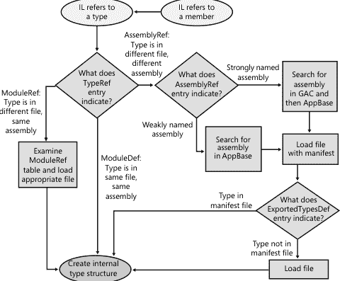

注意：如果任何操作失败，则会抛出相应的异常。

**图 3-2** 流程图展示了在给定引用某个方法或类型的 IL 代码时，CLR 如何使用元数据来定位定义该类型的正确程序集。

**重要** 严格来说，刚才描述的示例并非 100% 正确。对于引用未随 .NET Framework 一起发布的程序集中定义的方法和类型，上述讨论是正确的。然而，.NET Framework 程序集（包括 MSCorLib.dll）与正在运行的 CLR 版本紧密相关。任何引用 .NET Framework 程序集的程序集始终绑定到与 CLR 版本匹配的版本。这称为*统一*，Microsoft 这样做是因为他们使用特定版本的 CLR 测试所有 .NET Framework 程序集；因此，统一代码栈有助于确保应用程序正常工作。

因此，在前面的示例中，对 `System.Console` 的 `WriteLine` 方法的引用会绑定到与 CLR 版本匹配的任意版本的 MSCorLib.dll，而不管程序集的 AssemblyRef 元数据表中引用的是哪个版本的 MSCorLib.dll。

这个故事还有一个转折：对 CLR 而言，所有程序集都通过名称、版本、区域性和公钥来标识。然而，GAC 使用名称、版本、区域性、公钥和 CPU 架构来标识程序集。当在 GAC 中搜索程序集时，CLR 会确定应用程序当前运行在哪种类型的进程中：32 位 x86（可能使用 WoW64 技术），

```xml
<bindingRedirect
  oldVersion="1.0.0.0" newVersion="2.0.0.0" />

<codeBase version="2.0.0.0"
  href="http://www.Wintellect.com/SomeClassLibrary.dll" />

</dependentAssembly>

<dependentAssembly>

  <assemblyIdentity name="TypeLib"
    publicKeyToken="1f2e74e897abbcfe" culture="neutral"/>

  <bindingRedirect
    oldVersion="3.0.0.0-3.5.0.0" newVersion="4.0.0.0" />

  <publisherPolicy apply="no" />

</dependentAssembly>

</assemblyBinding>
</runtime>
</configuration>
```

这个 XML 文件向 CLR 提供了大量信息。它说明了以下内容：

- **probing 元素** 当尝试查找弱命名程序集时，请在应用程序基目录的 AuxFiles 和 bin\subdir 子目录中查找。对于强命名程序集，CLR 会在 GAC 中或 codeBase 元素指定的 URL 中查找。只有在未指定 codeBase 元素时，CLR 才会在应用程序的私有路径中查找强命名程序集。

- **第一个 dependentAssembly、assemblyIdentity 和 bindingRedirect 元素** 当尝试定位由控制 32ab4ba45e0a69a1 公钥标记的组织发布的、区域性中立的 SomeClassLibrary 程序集的 1.0.0.0 版本时，改为定位同一程序集的 2.0.0.0 版本。

- **codeBase 元素** 当尝试定位由控制 32ab4ba45e0a69a1 公钥标记的组织发布的、区域性中立的 SomeClassLibrary 程序集的 2.0.0.0 版本时，请尝试在以下 URL 找到它：*www.Wintellect.com/SomeClassLibrary.dll*。尽管我在第 2 章没有提到，codeBase 元素也可以用于弱命名程序集。在这种情况下，程序集的版本号会被忽略，并且应从 XML 的 codeBase 元素中省略。此外，codeBase URL 必须指向应用程序基目录下的某个目录。

- **第二个 dependentAssembly、assemblyIdentity 和 bindingRedirect 元素** 当尝试定位由控制 1f2e74e897abbcfe 公钥标记的组织发布的、区域性中立的 TypeLib 程序集的 3.0.0.0 版本到 3.5.0.0 版本（含）时，改为定位同一程序集的 4.0.0.0 版本。

- **publisherPolicy 元素** 如果生成 TypeLib 程序集的组织已部署发布者策略文件（将在下一节描述），则 CLR 应忽略此文件。

在编译方法时，CLR 确定被引用的类型和成员。运行时利用此信息，通过查看引用程序集的 AssemblyRef 表，确定在生成调用程序集时最初引用的程序集。然后，CLR 在应用程序的配置文件中查找该程序集/版本，并应用任何版本号重定向；此时 CLR 正在查找这个程序集/版本。

如果 publisherPolicy 元素的 apply 属性设置为 yes——或者该元素被省略——CLR 会检查 GAC 中是否有新的程序集/版本，并应用程序集发布者认为必要的任何版本号重定向；此时 CLR 正在查找这个程序集/版本。我将在下一节更详细地讨论发布者策略。最后，CLR 在计算机的 Machine.config 文件中查找新的程序集/版本，并在那里应用任何版本号重定向。

此时，CLR 知道它应加载的程序集版本，并尝试从 GAC 加载该程序集。如果该程序集不在 GAC 中，并且没有 codeBase 元素，则 CLR 会像我在第 2 章中描述的那样探测该程序集。如果执行最后一次重定向的配置文件还包含 codeBase 元素，则 CLR 会尝试从 codeBase 元素指定的 URL 加载该程序集。

使用这些配置文件，管理员可以真正控制 CLR 决定加载哪个程序集。如果应用程序遇到 bug，管理员可以联系出问题的程序集的发布者。发布者可以向管理员发送一个可安装的新程序集。默认情况下，CLR 不会加载这个新程序集，因为已经生成的程序集不引用新版本。然而，管理员可以修改应用程序的 XML 配置文件，指示 CLR 加载新程序集。

如果管理员希望计算机上的所有应用程序都采用新程序集，则可以改为修改计算机的 Machine.config 文件，这样每当应用程序引用旧程序集时，CLR 都会加载新程序集。

如果新程序集未能修复原始 bug，管理员可以从配置文件中删除绑定重定向行，应用程序将恢复为之前的行为。需要注意的是，系统允许使用与元数据中记录的程序集版本不完全匹配的程序集。这种额外的灵活性非常方便。

#### 发布者策略控制

在上一节描述的场景中，程序集的发布者只是将程序集的新版本发送给管理员，管理员安装该程序集并手动编辑应用程序或计算机的 XML 配置文件。一般来说，当发布者修复程序集中的 bug 时，发布者希望有一种简便的方法来打包新程序集并将其分发给所有用户。但发布者还需要一种方法，告诉每个用户的 CLR 使用新的程序集版本而不是旧程序集版本。当然，每个用户可以修改其应用程序或计算机的

XML 配置文件虽然可以，但这非常不方便且容易出错。发布者需要的是在安装新程序集时，将策略信息安装到用户计算机上的方式。在本节中，我将演示程序集的发布者如何创建这些策略信息。

假设你是某个程序集的发布者，并且刚刚创建了一个修复了一些 bug 的新版本程序集。当你打包新程序集以分发给所有用户时，还应该创建一个 XML 配置文件。这个配置文件与我们一直在讨论的配置文件看起来一模一样。下面是一个用于 SomeClassLibrary.dll 程序集的示例文件（名为 SomeClassLibrary.config）：

```xml
<configuration>
    <runtime>
        <assemblyBinding xmlns="urn:schemas-microsoft-com:asm.v1">
            <dependentAssembly>

                <assemblyIdentity name="SomeClassLibrary"
                    publicKeyToken="32ab4b45e0a69a1" culture="neutral"/>

                <bindingRedirect
                    oldVersion="1.0.0.0" newVersion="2.0.0.0" />

                <codeBase version="2.0.0.0"
                    href="http://www.intellect.com/SomeClassLibrary.dll"/>

            </dependentAssembly>
        </assemblyBinding>
    </runtime>
</configuration>
```

当然，发布者只能为自己创建的程序集设置策略。此外，此处显示的元素是可以在发布者策略配置文件中指定的唯一元素；例如，你不能指定 probing 或 publisherPolicy 元素。

这个配置文件告诉 CLR，只要引用了 SomeClassLibrary 程序集的 1.0.0.0 版本，就加载该程序集的 2.0.0.0 版本。现在，你作为发布者，可以创建一个包含此发布者策略配置文件的程序集。你可以通过如下方式运行 AL.exe 来创建发布者策略程序集：

```text
AL.exe /out:Policy.1.0.SomeClassLibrary.dll
      /version:1.0.0.0
      /keyfile:MyCompany.snk
      /linkresource:SomeClassLibrary.config
```

让我解释一下 AL.exe 的命令行开关的含义：

-   `/out` 这个开关告诉 AL.exe 创建一个名为 Policy.1.0.SomeClassLibrary.dll 的新 PE 文件，该文件仅包含一个清单。这个程序集的名称非常重要。名称的第一部分 Policy 告诉 CLR 这个程序集包含发布者策略信息。名称的第二和第三部分 1.0 告诉 CLR 这个发布者策略程序集适用于主版本号和次版本号为 1.0 的 SomeClassLibrary 的任何版本。发布者策略仅适用于程序集的主版本号和次版本号；你不能创建针对程序集特定构建或修订版本的发布者策略。名称的第四部分 **SomeClassLibrary** 表示此发布者策略对应的程序集的名称。名称的第五部分也是最后一部分 *dll* 只是生成程序集文件的扩展名。
-   `/version` 此开关标识发布者策略程序集的版本；这个版本号与 SomeClassLibrary 程序集本身无关。你知道，发布者策略程序集也可以有版本。今天，发布者可能会创建一个发布者策略，将 SomeClassLibrary 的 1.0.0.0 版本重定向到 2.0.0.0 版本。将来，发布者可能希望将 SomeClassLibrary 的 1.0.0.0 版本定向到 2.5.0.0 版本。CLR 使用此版本号，以便知道要选择最新版本的发布者策略程序集。
-   `/keyfile` 此开关使 AL.exe 使用发布者的公钥/私钥对来对发布者策略程序集进行签名。这个密钥对也必须与用于 SomeClassLibrary 程序集所有版本的密钥对匹配。毕竟，CLR 正是通过这种方式知道同一个发布者同时创建了 SomeClassLibrary 程序集和此发布者策略文件。
-   `/linkresource` 此开关告诉 AL.exe，XML 配置文件将被视为程序集的一个单独文件。生成的程序集由两个文件组成，这两个文件都必须随新版本的 SomeClassLibrary 程序集一起打包并部署给用户。顺便说一下，你不能使用 AL.exe 的 `/embedresource` 开关将 XML 配置文件嵌入到程序集文件中，从而生成单文件程序集，因为 CLR 要求 XML 文件必须包含在它自己的单独文件中。

一旦构建了这个发布者策略程序集，它就可以与新 SomeClassLibrary.dll 程序集文件一起打包并部署给用户。发布者策略程序集必须安装到 GAC 中。虽然 SomeClassLibrary 程序集也可以安装到 GAC 中，但它不是必须的。它可以部署到应用程序的基目录或由 codeBase URL 标识的其他目录中。

**重要说明** 发布者只应在部署程序集的更新版本或服务包版本时创建发布者策略程序集。在全新安装应用程序时，不应安装任何发布者策略程序集。

关于发布者策略，我想最后说明一点。假设某个发布者发布了发布者策略程序集，但出于某种原因，新程序集引入的 bug 比修复的 bug 还多。如果出现这种情况，管理员可能想让 CLR 忽略该发布者策略程序集。要让运行时这样做，管理员可以编辑应用程序的配置文件，并添加以下 `publisherPolicy` 元素：

```xml
<publisherPolicy apply="no"/>
```

该元素可以作为 `<assemblyBinding>` 元素的子元素放在应用程序的配置文件中，以便它适用于所有程序集；或者作为 `<dependentAssembly>` 元素的子元素放在应用程序的配置文件中，以使其适用于特定程序集。当 CLR 处理应用程序的配置文件时，它会看到不应在 GAC 中查找发布者策略程序集。因此，CLR 将继续使用旧版本的程序集运行。但请注意，CLR 仍将检查并应用 Machine.config 文件中指定的任何策略。

**重要说明** 发布者策略程序集是发布者就程序集不同版本之间的兼容性做出声明的一种方式。如果程序集的新版本不打算与早期版本兼容，则发布者不应创建发布者策略程序集。通常，当你构建修复 bug 的程序集新版本时，应使用发布者策略程序集。你应该测试程序集新版本的向后兼容性。另一方面，如果你要向程序集添加新功能，则应将此程序集视为与先前版本没有关系，并且不应发布发布者策略程序集。此外，对此类程序集无需进行任何向后兼容性测试。

## 第 4 章：类型基础

**本章内容：**

-   所有类型都派生自 `System.Object` — 91
-   类型之间的转换 — 93
-   命名空间和程序集 — 97
-   运行时如何关联 — 102

在本章中，我将介绍使用类型和公共语言运行时（CLR）所需的基础信息。具体来说，我将讨论你可以期望每个类型都具有的最小行为集。我还将描述类型安全、命名空间、程序集以及将对象从一种类型转换为另一种类型的各种方式。最后，我将通过解释类型、对象、线程栈和托管堆在运行时如何相互关联来结束本章。

### 所有类型都派生自 `System.Object`

运行时要求每个类型最终都必须派生自 `System.Object` 类型。这意味着以下两种类型定义是相同的：

```csharp
// Implicitly derived from Object              // Explicitly derived from Object
class Employee {                              class Employee : System.Object {
    ...                                           ...
}                                             }
```

因为所有类型最终都派生自 `System.Object`，所以你可以保证每种类型的每个对象都具有一组最小的方法。具体来说，`System.Object` 类提供了表 4-1 中列出的公共实例方法。

**表 4-1** `System.Object` 的公共方法

| 公共方法 | 说明 |
|---|---|


| 公共方法 | 描述 |
|---|---|
| `Equals` | 如果两个对象具有相同的值，则返回 true。有关此方法的更多信息，请参见第5章“基元类型、引用类型和值类型”中的“对象相等性与同一性”一节。 |
| `GetHashCode` | 返回此对象值的哈希码。如果类型的对象要作为哈希表集合（如 `Dictionary`）中的键使用，则该类型应重写此方法。该方法应为其对象提供良好的分布。遗憾的是，此方法定义在 `Object` 中，因为大多数类型从不作为哈希表中的键使用；此方法本应定义在接口中。有关此方法的更多信息，请参见第5章中的“对象哈希码”一节。 |
| `ToString` | 默认实现返回类型的完整名称（`this.GetType().FullName`）。然而，通常重写此方法，使其返回一个包含对象状态表示的 `String` 对象。例如，核心类型（如 `Boolean` 和 `Int32`）会重写此方法以返回其值的字符串表示。出于调试目的重写此方法也很常见；你可以调用它并获得一个显示对象字段值的字符串。事实上，Microsoft Visual Studio 的调试器会自动调用此函数，向你显示对象的字符串表示。请注意，`ToString` 应能识别与调用线程关联的 `CultureInfo`。第14章“字符、字符串与文本处理”更详细地讨论了 `ToString`。 |
| `GetType` | 返回一个 Type 派生对象的实例，该对象标识用于调用 `GetType` 的对象的类型。返回的 `Type` 对象可与反射类一起使用，以获取有关对象类型的元数据信息。反射将在第23章“程序集加载与反射”中讨论。`GetType` 方法是非虚方法，这可防止类重写此方法并谎报其类型，从而违反类型安全。 |

此外，从 `System.Object` 派生的类型可以访问表 4-2 中列出的受保护方法。

**表 4-2** `System.Object` 的受保护方法

| 受保护方法 | 描述 |
|---|---|
| `MemberwiseClone` | 此非虚方法创建该类型的新实例，并将新对象的实例字段设置为与 `this` 对象的实例字段完全相同。返回对新实例的引用。 |
| `Finalize` | 当垃圾回收器确定对象为垃圾，并在回收该对象的内存之前，会调用此虚方法。需要在被回收时进行清理的类型应重写此方法。我将在第21章“自动内存管理（垃圾回收）”中更详细地讨论这个重要方法。 |

CLR 要求所有对象都使用 `new` 运算符创建。以下行展示如何创建 `Employee` 对象：

```
Employee e = new Employee("ConstructorParam1");
```

以下是 new 运算符执行的操作：

1. 它计算该类型及其所有基类型（直到并包括 System.Object，后者本身不定义任何实例字段）中定义的所有实例字段所需的字节数。堆上的每个对象都需要一些额外成员——称为类型对象指针和同步块索引——供 CLR 管理对象使用。这些额外成员的字节数会加到对象大小中。
2. 它通过从托管堆中分配指定类型所需的字节数为对象分配内存；然后所有这些字节都设置为零 (0)。
3. 它初始化对象的类型对象指针和同步块索引成员。
4. 调用类型的实例构造函数，并向其传递在调用 new 时指定的任何参数（前面示例中的字符串 "ConstructorParam1"）。大多数编译器会自动在构造函数中生成调用基类构造函数的代码。每个构造函数负责初始化定义该构造函数的类型中的实例字段。最终会调用 System.Object 的构造函数，而这个构造函数方法除返回外不做任何事。

new 执行完所有这些操作后，会返回对新创建对象的引用（或指针）。在前面的代码示例中，该引用保存在变量 e 中，其类型为 Employee。

顺便说一下，new 运算符没有互补的 delete 运算符；也就是说，无法显式释放为对象分配的内存。CLR 使用垃圾回收环境（第21章将介绍），该环境会自动检测对象何时不再被使用或访问，并自动释放对象的内存。

### 类型之间的转换

CLR 最重要的功能之一是类型安全。在运行时，CLR 始终知道对象是什么类型。你可以始终通过调用 GetType 方法发现对象的准确类型。由于此方法是非虚方法，类型不可能伪装成另一种类型。例如，Employee 类型不能重写 GetType 方法并让其返回 SuperHero 类型。

开发者经常发现有必要将对象转换为各种类型。CLR 允许你将对象转换为其类型或它的任何基类型。你所选择的编程语言决定了如何向开发者公开转换操作。例如，C# 不要求任何特殊语法就能将对象转换为它的任何基类型，因为转换为基类型被视为安全的隐式转换。然而，C# 确实要求开发者将对象显式转换为其任何派生类型，因为此类转换可能在运行时失败。以下代码演示了转换为基类型和派生类型：

```
Employee e = (Employee) o;
...
}
}
```

在 Main 方法中，构造一个 Manager 对象并将其传递给 PromoteEmployee。此代码可以编译并执行，因为 Manager 最终派生自 Object，而 PromoteEmployee 期望的正是 Object 类型。进入 PromoteEmployee 后，CLR 确认 o 引用的对象要么是 Employee，要么是派生自 Employee 的类型。由于 Manager 派生自 Employee，CLR 执行转换并允许 PromoteEmployee 继续执行。

PromoteEmployee 返回后，Main 构造一个 DateTime 对象并将其传递给 PromoteEmployee。同样，DateTime 派生自 Object，编译器会顺利编译调用 PromoteEmployee 的代码。然而，在 PromoteEmployee 内部，CLR 检查转换并检测到 o 引用的是 DateTime 对象，因此它不是 Employee，也不是派生自 Employee 的任何类型。此时，CLR 不能允许该转换，并会抛出 System.InvalidCastException。

如果 CLR 允许该转换，就不会有类型安全，结果也将不可预测，包括可能因类型能够轻易伪装成其他类型而导致应用程序崩溃和安全漏洞。类型伪装是许多安全漏洞的成因，并会损害应用程序的稳定性和健壮性。因此，类型安全是 CLR 中极其重要的一部分。

顺便说一下，声明 PromoteEmployee 方法的正确方式是指定 Employee 类型而不是 Object 类型作为其参数，这样编译器会生成编译时错误，使开发者不必等到运行时异常发生才发现问题。我使用 Object 是为了演示 C# 编译器和 CLR 如何处理转换与类型安全。

#### 使用 C# 的 is 和 as 运算符进行转换

在 C# 语言中，另一种转换方式是使用 is 运算符。is 运算符检查对象是否与给定类型兼容，计算结果是 Boolean：true 或 false。is 运算符永远不会抛出异常。以下代码演示：

```
Object o = new Object();
Boolean b1 = (o is Object);   // b1 is true.
Boolean b2 = (o is Employee); // b2 is false.
```

如果对象引用为 null，则 is 运算符始终返回 false，因为没有可用于检查其类型的对象。

is 运算符通常按如下方式使用：

```
if (o is Employee) {
    Employee e = (Employee) o;
    // Use e within the remainder of the 'if' statement.
```


|  |  |  |  |
|---|---|---|
| `Object o1 = new Object();` | `3` |  |  |
| `Object o2 = new B();` | `3` |  |  |
| `Object o3 = new D();` | `3` |  |  |
| `Object o4 = o3;` | `3` |  |  |
| `B b1 = new B();` | `3` |  |  |
| `B b2 = new D();` | `3` |  |  |
| `D d1 = new D();` | `3` |  |  |
| `B b3 = new Object();` |  | `3` |  |
| `D d2 = new Object();` |  | `3` |  |
| `B b4 = d1;` | `3` |  |  |
| `D d3 = b2;` |  | `3` |  |
| `D d4 = (D) d1;` | `3` |  |  |
| `D d5 = (D) b2;` | `3` |  |  |
| `D d6 = (D) b1;` |  |  | `3` |
| `B b5 = (B) o1;` |  |  | `3` |
| `B b6 = (D) b2;` | `3` |  |  |

> **注意** C# 允许类型定义转换运算符方法，如第 8 章“方法”中的“转换运算符方法”一节所述。这些方法仅在使用强制转换表达式时调用；在使用 C# 的 `as` 或 `is` 运算符时从不调用。

### 命名空间与程序集

命名空间允许对相关类型进行逻辑分组，开发人员通常使用它们来更容易地定位特定类型。例如，System.Text 命名空间定义了一组用于执行字符串操作的类型，而 System.IO 命名空间定义了一组用于执行 I/O 操作的类型。下面是一些构造 System.IO.FileStream 对象和 System.Text.StringBuilder 对象的代码：

```csharp
public sealed class Program {
    public static void Main() {
        System.IO.FileStream fs = new System.IO.FileStream(...);
        System.Text.StringBuilder sb = new System.Text.StringBuilder();
    }
}
```

如你所见，这段代码相当冗长；如果有一些简写方式来引用 FileStream 和 StringBuilder 类型以减少输入量，那就好了。幸运的是，许多编译器确实提供了减少程序员输入量的机制。C# 编译器通过 using 指令提供此机制。以下代码与上一个示例相同：

```csharp
using System.IO;    // Try prepending "System.IO."
using System.Text;  // Try prepending "System.Text."

public sealed class Program {
    public static void Main() {
        FileStream fs = new FileStream(...);
        StringBuilder sb = new StringBuilder();
    }
}
```

对编译器而言，命名空间只是一种简单方式，通过在类型名称前加上由点分隔的符号，使类型名称更长、更可能唯一。因此，编译器会将此示例中对 FileStream 的引用解释为 System.IO.FileStream。类似地，编译器会将 StringBuilder 的引用解释为 System.Text.StringBuilder。

使用 C# using 指令完全是可选的；如果你愿意，随时可以键入类型的完全限定名。C# using 指令指示编译器尝试在类型名称前添加不同前缀，直到找到匹配项。

**重要：** CLR 对命名空间一无所知。当你访问某个类型时，CLR 需要知道该类型的完整名称（可能是一个包含句点的非常长的名称），以及哪个程序集包含该类型的定义，以便运行时能够加载正确的程序集、找到该类型并对其进行操作。

在上一个代码示例中，编译器需要确保引用的每个类型都存在，并确保我的代码以正确方式使用该类型：调用存在的方法、向这些方法传递正确数量的参数、确保参数类型正确、正确使用方法返回值，等等。如果编译器在源文件或任何引用的程序集中找不到具有指定名称的类型，它会在类型名称前添加 System.IO. 并检查生成的名称是否与现有类型匹配。如果编译器仍然找不到匹配项，它会在类型名称前添加 System.Text.。前面显示的两个 using 指令让我只需在代码中键入 FileStream 和 StringBuilder——编译器会自动将引用扩展为 System.IO.FileStream 和 System.Text.StringBuilder。我相信你可以很容易地想象这节省了多少输入量，以及代码读起来要清晰多少。

检查类型定义时，必须通过 /reference 编译器开关告诉编译器要检查哪些程序集，如第 2 章“生成、打包、部署和管理应用程序及类型”和第 3 章“共享程序集和强命名程序集”所述。编译器将扫描所有引用的程序集，查找该类型的定义。一旦编译器找到正确的程序集，程序集信息和类型信息将被发出到生成的托管模块的元数据中。要获取程序集信息，必须将定义任何被引用类型的程序集传递给编译器。默认情况下，即使你没有明确告诉 C# 编译器，它也会自动查找 MSCorLib.dll 程序集。MSCorLib.dll 程序集包含所有核心框架类库（FCL）类型的定义，例如 Object、Int32、String 等。

你可能会想到，编译器处理命名空间的方式存在一些潜在问题：不同命名空间中可能存在两个（或更多）同名类型。Microsoft 强烈建议为类型定义唯一名称。然而，在某些情况下，这根本不可能。运行时会鼓励重用组件。你的应用程序可能利用 Microsoft 创建的一个组件以及 Wintellect 创建的另一个组件。这两家公司可能都提供一个名为 Widget 的类型——Microsoft 的 Widget 做一件事，而 Wintellect 的 Widget 做完全不同的事。在这种情况下，你无法控制类型的命名，因此可以在引用这两个 widget 时使用它们的完全限定名来区分它们。要引用 Microsoft 的 Widget，应使用 Microsoft.Widget；要引用 Wintellect 的 Widget，应使用 Wintellect.Widget。在以下代码中，对 Widget 的引用存在歧义，因此 C# 编译器会生成以下消息：“error CS0104: ‘Widget’ 在 ‘Microsoft.Widget’ 和 ‘Wintellect.Widget’ 之间是模糊引用。”

```csharp
using Microsoft;  // Try prepending "Microsoft."
using Wintellect; // Try prepending "Wintellect."

public sealed class Program {
    public static void Main() {
        Widget w = new Widget();// An ambiguous reference
    }
}
```

要消除歧义，必须明确告诉编译器你要创建哪个 Widget：

```csharp
using Microsoft;  // Try prepending "Microsoft."
using Wintellect; // Try prepending "Wintellect."
```

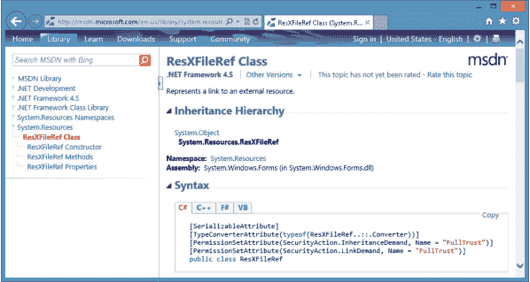

图 4-1 显示某类型命名空间和程序集信息的 SDK 文档。

### 运行时各事物的关系

在本节中，我将解释类型、对象、线程栈和托管堆在运行时的关系。此外，我还将解释调用静态方法、实例方法和虚方法之间的区别。让我们从计算机的一些基础知识开始。我即将描述的内容并非 CLR 特有，但我会先描述它，以便我们有一个可用的基础，然后我会修改讨论以纳入 CLR 特有的信息。

图 4-2 显示了一个已加载 CLR 的 Microsoft Windows 进程。此进程中可能有许多线程。创建线程时，会为其分配 1 MB 的栈。此栈空间用于向方法传递参数以及存放方法内定义的局部变量。在图 4-2 中，显示了一个线程栈的内存（在右侧）。栈从高内存地址向低内存地址构建。在图中，此线程一直在执行一些代码，其栈上已经有一些数据（显示为栈顶部的阴影区域）。现在，假设该线程已执行一些调用 M1 方法的代码。

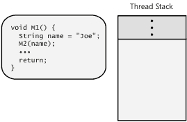


**图 4-2** 线程的栈，M1 方法即将被调用。

除最简单的方法外，几乎所有方法都包含一些**序言代码**，用于在方法开始执行其工作之前初始化该方法。这些方法还包含**尾声代码**，用于在方法完成其工作后清理该方法，以便它可以返回给调用方。当 M1 方法开始执行时，其序言代码从线程的栈中为局部 name 变量分配内存（见图 4-3）。

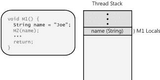

**图 4-3** 在线程的栈上分配 M1 的局部变量。

然后，M1 调用 M2 方法，并将 name 局部变量作为参数传入。这会将 name 局部变量中的地址压入栈中（见图 4-4）。在 M2 方法内部，将使用名为 s 的参数变量来标识该栈位置。（注意，某些体系结构通过寄存器传递参数以提高性能，但这一区别对本次讨论并不重要。）此外，当调用一个方法时，还会将表明被调用方法应返回到调用方法中何处的地址压入栈中（同样如图 4-4 所示）。

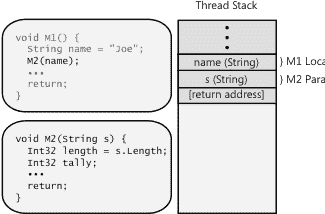

**图 4-4** M1 在调用 M2 时将参数和返回地址压入线程的栈。

当 M2 方法开始执行时，其序言代码从线程的栈中为局部 length 和 tally 变量分配内存（见图 4-5）。然后，M2 方法内部的代码开始执行。最终，M2 执行到其 return 语句，这会使 CPU 的指令指针被设置为栈中的返回地址，并且 M2 的栈帧被展开，使其看起来与图 4-3 所示的一样。此时，M1 继续执行紧跟在调用 M2 之后的代码，并且其栈帧准确地反映了 M1 所需的状态。

最终，M1 将通过把 CPU 的指令指针设置为返回地址（图中未显示，但该地址应位于栈上 name 参数的正上方）而返回给其调用方，并且 M1 的栈帧被展开，使其看起来与图 4-2 所示的一样。此时，调用 M1 的方法继续执行紧跟在调用 M1 之后的代码，并且其栈帧准确地反映了该方法所需的状态。

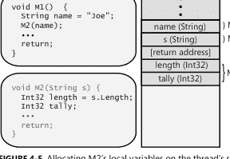

**图 4-5** 在线程的栈上分配 M2 的局部变量。

现在，让我们将讨论转向 CLR。假设我们有下面这两个类定义：

```csharp
internal class Employee {
    public Int32 GetYearsEmployed() { ... }
    public virtual String GetProgressReport() { ... }
    public static Employee Lookup(String name) { ... }
}

internal sealed class Manager : Employee {
    public override String GetProgressReport() { ... }
}
```

我们的 Windows 进程已经启动，CLR 已加载到其中，托管堆已初始化，并且已创建一个线程（以及其 1 MB 的栈空间）。该线程已经执行了一些代码，并且这些代码决定调用 M3 方法。所有这些如图 4-6 所示。M3 方法包含演示 CLR 如何工作的代码；这不是你通常会编写的代码，因为它实际上没有做任何有用的事情。

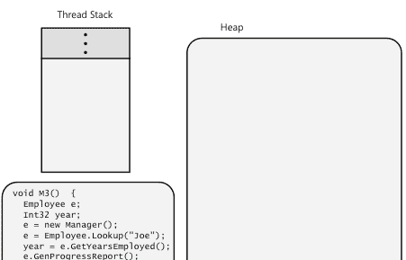

```csharp
void M3() {
    Employee e;
    Int32 year;
    e = new Manager();
    e = Employee.Lookup("Joe");
    year = e.GetYearsEmployed();
    e.GetProgressReport();
}
```

**图 4-6** CLR 加载到进程中、其堆已初始化，以及线程的栈，其中 M3 方法即将被调用。

当即时（JIT）编译器将 M3 的中间语言（IL）代码转换为本机 CPU 指令时，它会注意到 M3 内部引用的所有类型：Employee、Int32、Manager 和 String（因为 "Joe"）。此时，CLR 确保加载定义这些类型的程序集。然后，CLR 使用程序集的元数据提取有关这些类型的信息，并创建一些数据结构来表示这些类型本身。Employee 和 Manager 类型对象的数据结构如图 4-7 所示。由于该线程在调用 M3 之前已经执行了一些代码，我们假设 Int32 和 String 类型对象已经创建（这很可能，因为它们是常用类型），因此我不会在图中显示它们。

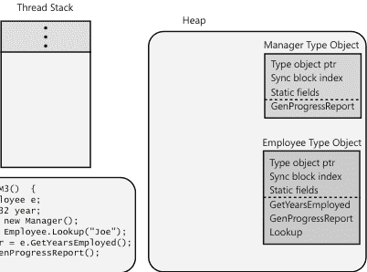

```csharp
void M3() {
    Employee e;
    Int32 year;
    e = new Manager();
    e = Employee.Lookup("Joe");
    year = e.GetYearsEmployed();
    e.GetProgressReport();
}
```

**图 4-7** 就在 M3 被调用时，Employee 和 Manager 类型对象被创建。

让我们花点时间讨论这些类型对象。正如本章前面所讨论的，堆上的所有对象都包含两个额外成员：类型对象指针和同步块索引。如你所见，Employee 和 Manager 类型对象都具有这两个成员。定义类型时，可以在其中定义静态数据字段。为这些静态数据字段提供存储的字节分配在类型对象自身内部。最后，每个类型对象内部都有一个方法表，类型中定义的每个方法对应一个表项。这就是第 1 章“CLR 的执行模型”中讨论的方法表。由于 Employee 类型定义了三个方法（GetYearsEmployed、GetProgressReport 和 Lookup），因此 Employee 的方法表中有三个表项。由于 Manager 类型定义了一个方法（GetProgressReport 的重写），因此 Manager 的方法表中只有一个表项。

现在，在 CLR 确保方法所需的所有类型对象都已创建并且 M3 的代码已编译之后，CLR 允许线程执行 M3 的本机代码。当 M3 的序言代码执行时，必须从线程的栈中为局部变量分配内存，如图 4-8 所示。顺便说一下，作为方法序言代码的一部分，CLR 会自动将所有局部变量初始化为 null 或 0（零）。但是，如果你编写的代码试图读取源代码中未显式初始化的局部变量，C# 编译器会发出“使用了未赋值的局部变量”错误消息。

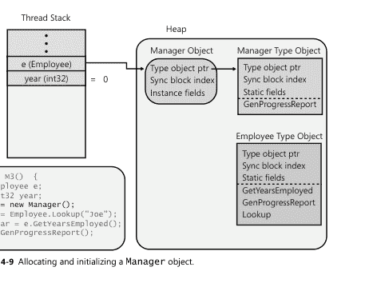

**图 4-9** 分配并初始化一个 Manager 对象。

M3 中的下一行代码调用 Employee 的静态 Lookup 方法。调用静态方法时，JIT 编译器会定位与定义该静态方法的类型相对应的类型对象。然后，JIT 编译器在类型对象的方法表中定位引用被调用方法的表项，对该方法进行 JIT 编译（如有必要），并调用 JIT 编译后的代码。就我们的讨论而言，假设 Employee 的 Lookup 方法查询数据库以查找 Joe。还假设数据库表明 Joe 是公司的经理，因此，Lookup 方法在内部会在堆上构造一个新的 Manager 对象，为 Joe 初始化该对象，并返回该对象的地址。该地址保存在局部变量 e 中。此操作的结果如图 4-10 所示。

注意，e 不再引用所创建的第一个 Manager 对象。事实上，由于没有任何变量引用该对象，它极有可能在将来被垃圾回收，从而回收（释放）该对象使用的内存。

M3 中的下一行代码调用 Employee 的非虚实例方法 GetYearsEmployed。调用非虚实例方法时，JIT 编译器会定位与用于进行调用的变量类型相对应的类型对象。在本例中，变量 e 被定义为 Employee。（如果 Employee 类型没有定义被调用的方法，JIT 编译器会沿类层次结构向 Object 查找此方法。它可以这样做，因为每个类型对象中都有一个引用其基类型的字段；图中未显示此信息。）然后，JIT 编译器在类型对象的方法表中定位引用被调用方法的表项，对该方法进行 JIT 编译（如有必要），然后调用 JIT 编译后的代码。就我们的讨论而言，假设 Employee 的 GetYearsEmployed 方法返回 5，因为 Joe 已在该公司工作了五年。该整数保存在局部变量 year 中。此操作的结果如图 4-11 所示。


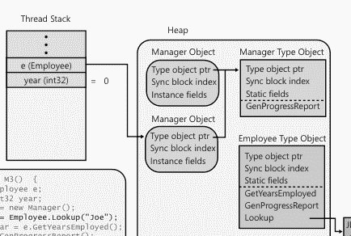

```csharp
void M3() {
    Employee e;
    Int32 year;
    e = new Manager();
    e = Employee.Lookup("Joe");
    year = e.GetYearsEmployed();
    e.GetProgressReport();
}
```

图 4-10　Employee 的静态 Lookup 方法为 Joe 分配并初始化一个 Manager 对象。

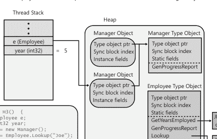

```csharp
void M3() {
    Employee e;
    Int32 year;
    e = new Manager();
    e = Employee.Lookup("Joe");
    year = e.GetYearsEmployed();
    e.GetProgressReport();
}
```

图 4-11　调用 Employee 的非虚实例方法 GetYearsEmployed，返回 5。

M3 中的下一行代码调用 Employee 的虚实例方法 GetProgressReport。调用虚实例方法时，JIT 编译器会在该方法中生成一些额外代码，每次调用该方法时都会执行这些代码。这段代码首先查看用于发起调用的变量，然后沿着地址找到调用对象。在此例中，变量 e 指向表示“Joe”的 Manager 对象。然后，代码将检查对象的内部类型 MSCorLib.dll）。Employee 和 Manager 类型对象是该类型的“实例”，因此它们的类型对象指针成员会被初始化为引用 System.Type 类型对象，如图 4-13 所示。

当然，System.Type 类型对象本身也是一个对象，因此其中也有一个类型对象指针成员，那么很自然会问这个成员引用的是什么。它引用的是自身，因为 System.Type 类型对象本身就是类型对象的一个“实例”。现在你应该理解 CLR 的完整类型系统及其工作方式了。顺便说一句，System.Object 的 GetType 方法只是返回存储在指定对象的类型对象指针成员中的地址。换句话说，GetType 方法返回指向对象类型对象的指针，通过这种方式，你可以确定系统中任何对象（包括类型对象）的真实类型。

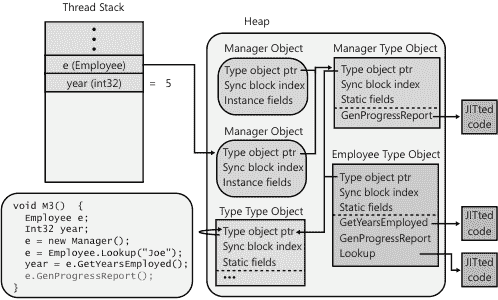

```csharp
void M3() {
    Employee e;
    Int32 year;
    e = new Manager();
    e = Employee.Lookup("Joe");
    year = e.GetYearsEmployed();
    e.GetProgressReport();
}
```

**图 4-13**　Employee 和 Manager 类型对象是 System.Type 类型的实例。

| 基元类型 | FCL 类型 | 符合 CLS | 描述 |
| --- | --- | --- | --- |
| decimal | System.Decimal | 是 | 128 位。1 位表示值的符号，96 位表示值本身，8 位表示用来除 96 位值的 10 的幂（可以是 0 到 28 之间的任意值）。其余位未使用。 |
| string | System.String | 是 | 字符数组 |
| object | System.Object | 是 | 所有类型的基类型 |
| dynamic | System.Object | 是 | 对公共语言运行时（CLR）而言，dynamic 与 object 完全相同。但是，C# 编译器允许 dynamic 变量使用简化语法参与动态调度。有关详细信息，请参见本章末尾的“dynamic 基元类型”一节。 |

换一种方式理解，C# 编译器会自动假定你在所有源代码文件中都有以下 using 指令（如第 4 章“类型基础”所述）：

```csharp
using sbyte = System.SByte;
using byte = System.Byte;
using short = System.Int16;
using ushort = System.UInt16;
using int = System.Int32;
using uint = System.UInt32;
...
```

C# 语言规范指出：“作为风格问题，优先使用关键字而不是完整的系统类型名称。”我不同意语言规范；我更喜欢使用 FCL 类型名称，并完全避免使用基元类型名称。事实上，我希望编译器甚至不提供基元类型名称，而是强制开发者改用 FCL 类型名称。以下是我的理由：

- 我见过许多开发者感到困惑，不知道在自己的代码中应该使用 string 还是 String。因为在 C# 中，string（一个关键字）精确映射到 System.String（一个 FCL 类型），所以二者没有区别，使用哪一个都可以。同样，我听一些开发者说，当应用程序运行在 32 位操作系统上时，int 表示 32 位整数；当应用程序运行在 64 位操作系统上时，它表示 64 位整数。这种说法绝对错误：在 C# 中，int 始终映射到 System.Int32，因此无论代码运行在什么操作系统上，它都表示 32 位整数。如果程序员在代码中使用 Int32，那么这种潜在困惑也会消除。
- 在 C# 中，long 映射到 System.Int64，但在另一种编程语言中，long 可能映射到 Int16 或 Int32。事实上，C++/CLI 确实将 long 当作 Int32 处理。如果某人习惯于用另一种编程语言编程，那么他在阅读某种语言的源代码时，很容易误解代码的意图。事实上，大多数语言甚至不会把 **long** 当作关键字，也不会编译使用它的代码。
- FCL 中有许多方法的方法名包含类型名称。例如，`BinaryReader` 类型提供 `ReadBoolean`、`ReadInt32`、`ReadSingle` 等方法，`System.Convert` 类型提供 `ToBoolean`、`ToInt32`、`ToSingle` 等方法。虽然编写以下代码是合法的，但带有 `float` 的那一行让我觉得非常不自然，而且这一行是否正确也不明显：

    ```csharp
    BinaryReader br = new BinaryReader(...);
    float val = br.ReadSingle();  // OK, but feels unnatural
    Single val = br.ReadSingle();  // OK and feels good
    ```

- 许多只使用 C# 的程序员往往会忘记，其他编程语言也可以用于 CLR，因此 C# 特有写法会渗入类库代码。例如，Microsoft 的 FCL 几乎完全是用 C# 编写的，而 FCL 团队的开发者现在已经在库中引入了这样的方法，例如 `Array’s GetLongLength`，它返回一个 `Int64` 值，该值在 C# 中是 `long`，但在其他语言（如 C++/CLI）中不是。另一个例子是 `System.Linq.Enumerable’s LongCount` 方法。

基于所有这些理由，我将在本书中通篇使用 FCL 类型名称。

在许多编程语言中，你会期望以下代码能够正确编译和执行：

```csharp
Int32  i = 5;    // A 32-bit value
Int64  l = 1;    // Implicit cast to a 64-bit value
```

然而，基于第 4 章中介绍的强制转换讨论，你不会期望这段代码能编译。毕竟，`System.Int32` 和 `System.Int64` 是不同的类型，而且两者都不是从对方派生的。好吧，你会很高兴知道，C# 编译器确实能正确编译这段代码，并且它按预期运行。为什么？原因是 C# 编译器对基元类型有深入的了解，并在编译代码时应用自己的特殊规则。换句话说，编译器会识别常见编程模式，并特殊处理代码，使编写的代码按预期工作。具体来说，C# 编译器支持与强制转换、字面量和运算符相关的模式，如下例所示。

首先，编译器能够在基元类型之间执行隐式或显式强制转换，例如：

```csharp
Int32  i = 5;          // Implicit cast from Int32 to Int32
Int64  l = 1;          // Implicit cast from Int32 to Int64
Single s = i;          // Implicit cast from Int32 to Single
Byte   b = (Byte) i;   // Explicit cast from Int32 to Byte
Int16  v = (Int16) s;  // Explicit cast from Single to Int16
```

如果转换是“安全”的，即不可能发生数据丢失，例如将 `Int32` 转换为 `Int64`，C# 允许隐式转换。但如果转换可能不安全，C# 要求显式转换。对于数值类型，“不安全”意味着你可能会因此丢失精度或数量级

转换。例如，从 `Int32` 转换为 `Byte` 需要显式强制转换，因为较大的 `Int32` 数值可能会丢失精度；从 `Single` 转换为 `Int16` 需要强制转换，因为 `Single` 能表示的数值量级比 `Int16` 更大。

请注意，不同编译器可能生成不同的代码来处理这些强制转换操作。例如，将值为 6.8 的 `Single` 强制转换为 `Int32` 时，有些编译器可能生成将 6 放入 `Int32` 的代码，而另一些编译器可能通过将结果向上舍入为 7 来执行强制转换。顺便说一下，C# 总是截断结果。有关 C# 在强制转换基元类型时遵循的确切规则，请参阅 C# 语言规范中的“Conversions”一节。

除强制转换外，基元类型还可以写为字面量。字面量被视为该类型本身的实例，因此，可以像下面这样使用该实例调用实例方法：

```csharp
Console.WriteLine(123.ToString() + 456.ToString());  // "123456"
```

此外，如果表达式由字面量组成，编译器能够在编译时计算该表达式，从而提高应用程序的性能。

```csharp
Boolean found = false;       // Generated code sets found to 0
Int32 x = 100 + 20 + 3;     // Generated code sets x to 123
String s = "a" + "b";       // Generated code sets s to "ab"
```

最后，编译器会自动知道在代码中使用运算符（如 +、-、*、/、%、&、^、|、==、!=、>、<、>=、<=、<<、>>、~、!、++、-- 等）时如何解释它们以及按什么顺序解释：

```csharp
Int32 x = 100;              // Assignment operator
Int32 y = x + 23;           // Addition and assignment operators
Boolean lessThanFifty = (y < 50);  // Less-than and assignment operators
```

### checked 和 unchecked 基元类型操作

程序员很清楚，对基元执行的许多算术运算可能导致溢出：

```csharp
Byte b = 100;
b = (Byte) (b + 200);       // b now contains 44 (or 2C in Hex).
```

**重要** 执行上述算术运算时，第一步要求将所有操作数的值扩展为 32 位值（如果任一操作数需要超过 32 位，则扩展为 64 位值）。因此，b 和 200（所需位数小于 32 位的值）首先转换为 32 位值，然后相加。结果是 32 位值（十进制 300，或十六进制 12C），必须先强制转换为 Byte，然后才能将结果存回变量 b。C# 不会为你隐式执行此强制转换，这就是前面代码第二行需要进行 Byte 强制转换的原因。

在大多数编程场景中，这种静默溢出是不可取的；如果未被检测到，会导致应用程序以奇怪且异常的方式运行。然而，在一些罕见的编程场景中（例如计算哈希值或校验和），这种溢出不仅可以接受，而且是所需的。

不同语言以不同方式处理溢出。C 和 C++ 不将溢出视为错误，并允许值回绕；应用程序继续运行。另一方面，Microsoft Visual Basic 始终将溢出视为错误，并在检测到溢出时引发异常。

CLR 提供 IL 指令，使编译器能够选择所需的行为。CLR 有一条名为 add 的指令，用于将两个值相加。add 指令不执行溢出检查。CLR 还有一条名为 add.ovf 的指令，也用于将两个值相加。但是，如果发生溢出，add.ovf 会引发 System.OverflowException。除了用于加法操作的这两条 IL 指令外，CLR 还提供用于减法（sub/sub.ovf）、乘法（mul/mul.ovf）和数据转换（conv/conv.ovf）的类似 IL 指令。

C# 允许程序员决定应如何处理溢出。默认情况下，溢出检查处于关闭状态。这意味着编译器使用不包含溢出检查的加法、减法、乘法和转换指令版本生成 IL 代码。因此，代码运行得更快，但开发者必须确保不会发生溢出，或者其代码已设计为能够预见这些溢出。

让 C# 编译器控制溢出的一种方法是使用 /checked+ 编译器开关。此开关告诉编译器生成包含加法、减法、乘法和转换 IL 指令的溢出检查版本的代码。代码执行速度会稍慢，因为 CLR 正在检查这些操作以确定是否发生了溢出。如果发生溢出，CLR 将引发 OverflowException。

除了全局启用或禁用溢出检查外，程序员还可以在代码的特定区域控制溢出检查。C# 通过提供 checked 和 unchecked 运算符来实现这种灵活性。下面是使用 unchecked 运算符的示例：

```csharp
UInt32 invalid = unchecked((UInt32) (-1));   // OK
```

下面是使用 checked 运算符的示例：

```csharp
Byte b = 100;
b = checked((Byte) (b + 200));      // OverflowException is thrown
```

在此示例中，b 和 200 首先转换为 32 位值，然后相加；结果为 300。然后，由于显式强制转换，300 被转换为 Byte；这会生成 OverflowException。如果 Byte 强制转换在 checked 运算符之外执行，则不会发生异常。

```csharp
b = (Byte) checked(b + 200);       // b contains 44; no OverflowException
```

除了 checked 和 unchecked 运算符外，C# 还提供 checked 和 unchecked 语句。这些语句会使块内的所有表达式被检查或不检查：

```csharp
checked {
    Byte b = 100;                         // Start of checked block
    b = (Byte) (b + 200);                 // This expression is checked for overflow.
}                                         // End of checked block
```

事实上，如果使用 checked 语句块，现在就可以对 Byte 使用 += 运算符，这会使代码稍微简化：

```csharp
checked {           // Start of checked block
    Byte b = 100;
    b += 200;        // This expression is checked for overflow.
}                   // End of checked block
```

**重要** 由于 checked 运算符和语句的唯一作用是确定生成加法、减法、乘法和数据转换 IL 指令的哪个版本，因此在 checked 运算符或语句中调用方法不会对该方法产生影响，如下代码所示：

```csharp
checked {
    // Assume SomeMethod tries to load 400 into a Byte.
    SomeMethod(400);
    // SomeMethod might or might not throw an OverflowException.
    // It would if SomeMethod were compiled with checked instructions.
}
```

根据我的经验，我见过许多计算产生令人惊讶的结果。通常，这是由于无效的用户输入，但也可能是由于系统某些部分返回了程序员根本意料之外的值。因此，我现在建议程序员执行以下操作：

- 尽可能使用有符号数据类型（如 Int32 和 Int64），而不是无符号数值类型（如 UInt32 和 UInt64）。这使编译器能够检测更多溢出/下溢错误。此外，类库的各个部分（例如 Array 和 String 的 Length 属性）被硬编码为返回有符号值，并且在代码中移动这些值时需要进行的强制转换更少。更少的强制转换使源代码更简洁、更易于维护。此外，无符号数值类型不符合 CLS。
- 在编写代码时，在可能因无效输入数据而发生意外溢出的块周围显式使用 checked，例如处理包含最终用户或客户端计算机提供的数据的请求。你可能还希望捕获 OverflowException，以便应用程序能够从这些故障中优雅地恢复。
- 在编写代码时，在允许溢出的块周围显式使用 unchecked，例如计算校验和。
- 对于任何不使用 checked 或 unchecked 的代码，假定你确实希望在溢出时发生异常，例如计算某些内容（如质数），其中输入已知，而溢出是缺陷。

现在，在开发应用程序时，为调试版本打开编译器的 /checked+ 开关。应用程序运行会变慢，因为系统将对你未显式标记为 checked 或 unchecked 的任何代码检查溢出。如果发生异常，你将很容易检测到它，并能够修复代码中的缺陷。对于应用程序的发布版本，使用编译器的 /checked- 开关，以便代码运行更快，并且不会生成溢出异常。要更改

要在 Microsoft Visual Studio 中使用“检查”设置，请显示项目的属性，选择“生成”选项卡，单击“高级”，然后选择“检查算术溢出/下溢”选项，如图 5-1 所示。

如果你的应用程序能够容忍始终执行检查操作带来的轻微性能损失，那么我建议你即使对于发布版本也使用 /checked 命令行选项进行编译，因为这可以防止你的应用程序在数据损坏和可能存在安全漏洞的情况下继续运行。例如，你可能执行乘法来计算数组的索引；与由于数学运算回绕而访问不正确的数组元素相比，获得 `OverflowException` 要好得多。

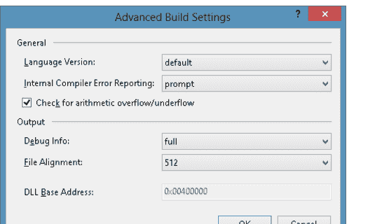

**图 5-1** 使用 Visual Studio 的“高级生成设置”对话框更改编译器执行检查算术的默认设置

**重要** `System.Decimal` 类型是非常特殊的类型。尽管许多编程语言（包括 C# 和 Visual Basic）将 `Decimal` 视为基元类型，但 CLR 不这样认为。这意味着 CLR 没有知道如何操作 `Decimal` 值的 IL 指令。如果你在 .NET Framework SDK 文档中查找 `Decimal` 类型，你会看到它具有名为 `Add`、`Subtract`、`Multiply`、`Divide` 等的公共静态方法。此外，`Decimal` 类型还提供了用于 `+`、`-`、`*`、`/` 等的运算符重载方法。

当你编译使用 `Decimal` 值的代码时，编译器会生成代码来调用 `Decimal` 的成员以执行实际操作。这意味着操作 `Decimal` 值比操作 CLR 基元值更慢。另外，由于没有用于操作 `Decimal` 值的 IL 指令，checked 和 unchecked 运算符、语句以及编译器开关都没有效果。如果操作无法安全执行，对 `Decimal` 值的操作始终会抛出 `OverflowException`。

类似地，`System.Numerics.BigInteger` 类型也很特殊，因为它在内部使用 `UInt32` 数组来表示任意大的整数，其值没有上限或下限。因此，对 `BigInteger` 的操作永远不会导致 `OverflowException`。但是，如果值变得太大并且没有足够的可用内存来调整数组大小，`BigInteger` 操作可能会抛出 `OutOfMemoryException`。

### 引用类型和值类型

CLR 支持两种类型：引用类型和值类型。虽然 FCL 中的大多数类型是引用类型，但程序员最常使用的类型是值类型。引用类型始终从托管堆分配，并且 C# 的 `new` 运算符返回对象的内存地址——该内存地址指向对象的位。使用引用类型时，你需要牢记一些性能方面的考虑因素。首先，考虑以下事实：

- 内存必须从托管堆分配。
- 在堆上分配的每个对象都有一些与之关联的额外开销成员，这些成员必须初始化。
- 对象中的其他字节（用于字段）始终设置为零。
- 从托管堆分配对象可能会强制发生垃圾回收。

如果每个类型都是引用类型，应用程序的性能将大大降低。想象一下，如果每次使用 `Int32` 值时都会发生一次内存分配，性能会有多差！为了提高简单且常用类型的性能，CLR 提供了称为值类型的轻量级类型。值类型实例通常分配在线程的栈上（尽管它们也可以作为字段嵌入引用类型对象中）。表示实例的变量不包含指向实例的指针；该变量包含实例本身的字段。由于变量包含实例的字段，因此不必取消引用指针即可操作实例的字段。值类型实例不受垃圾回收器的控制，因此使用它们可以减轻托管堆的压力，并减少应用程序在其生命周期内所需的回收次数。

.NET Framework SDK 文档明确指出了哪些类型是引用类型，哪些类型是值类型。在文档中查找类型时，任何称为类的类型都是引用类型。例如，`System.Exception` 类、`System.IO.FileStream` 类和 `System.Random` 类都是引用类型。另一方面，文档将每个值类型称为结构或枚举。例如，`System.Int32` 结构、`System.Boolean` 结构、`System.Decimal` 结构、`System.TimeSpan` 结构、`System.DayOfWeek` 枚举、`System.IO.FileAttributes` 枚举和 `System.Drawing.FontStyle` 枚举都是值类型。

所有结构都直接派生自 `System.ValueType` 抽象类型。`System.ValueType` 本身直接派生自 `System.Object` 类型。根据定义，所有值类型都必须派生自 `System.ValueType`。所有枚举都派生自 `System.Enum` 抽象类型，而该类型本身派生自 `System.ValueType`。CLR 和所有编程语言都对枚举给予特殊处理。有关枚举类型的更多信息，请参阅第 15 章“枚举类型和位标志”。

尽管在定义自己的值类型时不能选择基类型，但值类型可以根据你的选择实现一个或多个接口。此外，所有值类型都是密封的，这阻止值类型用作任何其他引用类型或值类型的基类型。因此，例如，不可能使用 Boolean、Char、Int32、UInt64、Single、Double、Decimal 等作为基类型来定义任何新类型。

**重要** 对于许多开发人员（例如非托管 C/C++ 开发人员）来说，引用类型和值类型起初会显得很奇怪。在非托管 C/C++ 中，你声明一个类型，然后使用该类型的代码决定该类型的实例应分配在线程的栈上还是应用程序的堆中。在托管代码中，定义类型的开发人员指明该类型的实例分配在何处；使用该类型的开发人员对此无法控制。

以下代码和图 5-2 演示了引用类型和值类型的不同之处：

```csharp
// Reference type (because of 'class')
class SomeRef { public Int32 x; }

// Value type (because of 'struct')
struct SomeVal { public Int32 x; }

static void ValueTypeDemo() {
    SomeRef r1 = new SomeRef();     // Allocated in heap
    SomeVal v1 = new SomeVal();     // Allocated on stack
    r1.x = 5;                       // Pointer dereference
    v1.x = 5;                       // Changed on stack
    Console.WriteLine(r1.x);        // Displays "5"
    Console.WriteLine(v1.x);        // Also displays "5"
    // The left side of Figure 5-2 reflects the situation
    // after the lines above have executed.

    SomeRef r2 = r1;                // Copies reference (pointer) only
    SomeVal v2 = v1;                // Allocate on stack & copies members
    r1.x = 8;                       // Changes r1.x and r2.x
    v1.x = 9;                       // Changes v1.x, not v2.x
    Console.WriteLine(r1.x);        // Displays "8"
    Console.WriteLine(r2.x);        // Displays "8"
    Console.WriteLine(v1.x);        // Displays "9"
    Console.WriteLine(v2.x);        // Displays "5"
    // The right side of Figure 5-2 reflects the situation
    // after ALL of the lines above have executed.
}
```

在设计自己的类型时，请仔细考虑是将类型定义为值类型而不是引用类型。在某些情况下，值类型可以提供更好的性能。特别是，如果以下所有陈述都为真，则应将类型声明为值类型：

- 该类型充当基元类型。具体来说，这意味着它是一个相当简单的类型，没有任何成员会修改其任何实例字段。当一个类型不提供任何更改其字段的成员时，我们说该类型是不可变的。事实上，建议许多值类型将其所有字段标记为 `readonly`（在第 7 章“常量和字段”中讨论）。
- 该类型不需要从任何其他类型继承。
- 该类型不会有任何其他类型从它派生。

你的类型实例的大小也是需要考虑的条件，因为默认情况下，参数按值传递，这会导致值类型实例中的字段被复制，从而损害性能。同样，返回值类型的方法会导致实例中的字段在方法返回时被复制到调用方分配的内存中，进一步损害性能。因此，除了前面的条件之外，如果以下陈述之一为真，则应将类型声明为值类型：

- 该类型的实例很小（大约 16 字节或更小）。
- 该类型的实例很大（大于 16 字节），并且不作为方法参数传递或从方法返回。

值类型的主要优点是它们不会作为对象在托管堆中分配。当然，与引用类型相比，值类型自身也有几个限制。以下是值类型和引用类型不同的一些方面：

- 值类型对象有两种表示形式：未装箱形式和装箱形式（在下一节中讨论）。引用类型始终是装箱形式。
- 值类型派生自 `System.ValueType`。此类型提供与 `System.Object` 定义的方法相同的方法。但是，`System.ValueType` 重写 `Equals` 方法，以便如果两个对象的字段值匹配，则返回 true。此外，`System.ValueType` 重写 `GetHashCode` 方法，以通过使用考虑对象实例字段值的算法来生成哈希代码值。由于此默认实现的性能问题，在定义自己的值类型时，应重写并提供 `Equals` 和 `GetHashCode` 方法的显式实现。我将在本章末尾介绍 `Equals` 和 `GetHashCode` 方法。
- 因为你不能使用值类型作为基类来定义新的值类型或新的引用类型，所以不应将任何新的虚方法引入值类型。任何方法都不能是抽象的，并且所有方法都是隐式密封的（不能被重写）。
- 引用类型变量包含堆中对象的内存地址。默认情况下，创建引用类型变量时，它被初始化为 null，这表明该引用类型

变量当前未指向有效对象。尝试使用 null 引用类型变量会导致引发 NullReferenceException。相比之下，值类型变量始终包含底层类型的值，并且值类型的所有成员都初始化为 0。由于值类型变量不是指针，因此访问值类型时不可能生成 NullReferenceException。CLR 确实提供了一项特殊功能，为值类型增加了可空性概念。这项功能称为可空类型，将在第 19 章“可空值类型”中讨论。

- 将值类型变量赋给另一个值类型变量时，会进行逐字段复制。将引用类型变量赋给另一个引用类型变量时，只复制内存地址。
- 由于上一点，两个或更多引用类型变量可以引用堆中的同一个对象，因此对一个变量的操作会影响另一个变量所引用的对象。另一方面，值类型变量是彼此不同的对象，对一个值类型变量的操作不可能影响另一个值类型变量。
- 因为未装箱的值类型不是在堆上分配的，所以一旦定义该类型实例的方法不再处于活动状态，为它们分配的存储空间就会立即释放，而不必等待垃圾回收。

### CLR 如何控制类型字段的布局

为了提高性能，CLR 能够以它选择的任何方式排列类型的字段。例如，CLR 可能会在内存中重新排列字段，以便将对象引用分组在一起，并对数据字段进行适当对齐和打包。不过，在定义类型时，你可以告诉 CLR：它必须按照开发人员指定的顺序保留该类型的字段，还是可以按它认为合适的方式重新排列这些字段。

通过对所定义的类或结构应用 System.Runtime.InteropServices.StructLayoutAttribute 特性，可以告诉 CLR 该怎么做。可以将 LayoutKind.Auto 传递给该特性的构造函数，让 CLR 安排字段；传递 LayoutKind.Sequential，让 CLR 保留你的字段布局；或者传递 LayoutKind.Explicit，通过偏移量显式排列内存中的字段。如果你没有在定义的类型上显式指定 StructLayoutAttribute，编译器会选择它认为最佳的布局。

应注意，Microsoft 的 C# 编译器为引用类型（类）选择 LayoutKind.Auto，为值类型（结构）选择 LayoutKind.Sequential。显然，C# 编译器团队认为，结构通常在与非托管代码互操作时使用；而要实现这种互操作，字段必须保持程序员定义的顺序。但是，如果你创建的值类型与非托管代码互操作无关，则可以重写 C# 编译器的默认行为。下面是一个示例：

```csharp
using System;
using System.Runtime.InteropServices;

// Let the CLR arrange the fields to improve
// performance for this value type.
[StructLayout(LayoutKind.Auto)]
internal struct SomeValueType {
    private readonly Byte m_b;
    private readonly Int16 m_x;
    ...
}
```

StructLayoutAttribute 还允许你通过向其构造函数传递 LayoutKind.Explicit 来显式指示每个字段的偏移量。然后，你对每个字段应用 System.Runtime.InteropServices.FieldOffsetAttribute 的实例，并向该特性的构造函数传递一个 Int32，用于指示字段第一个字节从实例开头算起的偏移量（以字节为单位）。显式布局通常用于模拟非托管 C/C++ 中的联合体，因为可以让多个字段从内存中的同一偏移量开始。下面是一个示例：

```csharp
using System;
using System.Runtime.InteropServices;

// The developer explicitly arranges the fields of this value type.
[StructLayout(LayoutKind.Explicit)]
internal struct SomeValueType {
    [FieldOffset(0)]
    private readonly Byte m_b; // The m_b and m_x fields overlap each
                               // other in instances of this type

    [FieldOffset(0)]
    private readonly Int16 m_x; // other in instances of this type
}
```

应注意，定义引用类型和值类型重叠的类型是非法的。可以定义多个引用类型在同一起始偏移量处重叠的类型；不过，这是无法验证的。定义多个值类型重叠的类型是合法的；不过，要使该类型可验证，所有重叠的字节都必须可通过公共字段访问。

### 值类型的装箱与拆箱

值类型比引用类型更轻量，因为它们不作为对象分配在托管堆上，不进行垃圾回收，也不通过指针引用。但是，在许多情况下，你必须获取对值类型实例的引用。例如，假设你想创建一个 ArrayList 对象（System.Collections 命名空间中定义的类型）来保存一组 Point 结构。代码可能如下所示：

```csharp
// Declare a value type.
```

Add 方法。Point 对象将保留在堆中，直到被垃圾回收。Point 值类型变量（p）可以重复使用，因为 ArrayList 从不知道它的任何信息。请注意，装箱后的值类型的生存期会超过未装箱值类型的生存期。

**注意** 应当指出，FCL 现在包含一组新的泛型集合类，使非泛型集合类过时。例如，应使用 `System.Collections.Generic.List<T>` 类，而不是 `System.Collections.ArrayList` 类。泛型集合类相比非泛型等效类提供了许多改进。例如，API 已得到清理和改进，集合类的性能也大幅提高。但最大的改进之一是，泛型集合类允许你处理值类型的集合，而不需要集合中的项进行装箱/拆箱。这本身就极大地提高了性能，因为在托管堆上创建的对象会少得多，从而减少应用程序所需的垃圾回收次数。此外，你将获得编译时类型安全，并且由于强制转换更少，源代码会更整洁。这些内容将在第 12 章“泛型”中进一步详细说明。

既然你已了解装箱的工作原理，我们来讨论拆箱。假设你想使用以下代码从 ArrayList 中取出第一个元素：

```csharp
Point p = (Point) a[0];
```

这里，你取出 ArrayList 的元素 0 中包含的引用（或指针），并试图将其放入 Point 值类型实例 p 中。为此，必须将装箱的 Point 对象中包含的所有字段复制到线程栈上的值类型变量 p 中。CLR 分两步完成此复制。首先，获取装箱的 Point 对象中 Point 字段的地址。此过程称为拆箱。然后，将这些字段的值从堆复制到基于栈的值类型实例。

拆箱并不是装箱的完全逆操作。拆箱操作的开销远低于装箱。拆箱实际上只是获取指向对象中包含的原始值类型（数据字段）的指针的操作。实际上，该指针引用的是装箱实例中的未装箱部分。因此，与装箱不同，拆箱不涉及在内存中复制任何字节。在作出这一重要澄清之后，必须注意，拆箱操作之后通常会复制字段。

显然，装箱和拆箱/复制操作会在速度和内存两方面损害应用程序的性能，因此你应了解编译器何时自动生成代码来执行这些操作，并尽量编写能最大限度减少此类代码生成的代码。

在内部，装箱的值类型实例被拆箱时，具体会发生以下情况：

- 1. 如果包含对装箱值类型实例的引用的变量为 `null`，则会引发 `NullReferenceException`。
- 2. 如果该引用不指向所需值类型的装箱实例，则会引发一个


```
}
```

本片段底部的代码仅用于将 Point 的 x 字段从 1 改为 2。为此，必须执行一次拆箱操作，随后复制字段，再更改字段（在堆栈上），最后执行一次装箱操作（在托管堆中创建一个全新的已装箱实例）。希望你能看出装箱和拆箱/复制操作对应用程序性能的影响。

某些语言，如 C++/CLI，允许在不对字段进行复制的情况下拆箱一个已装箱的值类型。拆箱会返回已装箱对象中未装箱部分的地址（忽略对象的类型对象指针和同步块索引的开销）。现在你可以使用该指针来操作未装箱实例的字段（这些字段恰好位于堆上的已装箱对象中）。例如，如果用 C++/CLI 编写，前面的代码会高效得多，因为你可以直接修改已装箱的 Point 实例中的 x 字段的值。这样既避免了在堆上分配新对象，也避免了对所有字段进行两次复制！

**重要** 如果你对应用程序的性能有哪怕一丝担忧，就必须注意编译器何时生成执行这些操作的代码。不幸的是，许多编译器会隐式地发出装箱对象的代码，因此当你编写代码时，并不容易看出正在发生装箱。如果我担心某个特定算法的性能，我总是会使用像 ILDasm.exe 这样的工具来查看我的方法的 IL 代码，看看 box IL 指令出现在哪里。

让我们再看几个演示装箱和拆箱的示例：

```csharp
public static void Main() {
    Int32 v = 5;            // Create an unboxed value type variable.
    Object o = v;           // o refers to a boxed Int32 containing 5.
    v = 123;                // Changes the unboxed value to 123

    Console.WriteLine(v + ", " + (Int32) o);    // Displays "123, 5"
}
```

在这段代码中，你能猜出发生了多少次装箱操作吗？你可能会惊讶地发现答案是三次！让我们仔细分析这段代码，以真正理解发生了什么。为了帮助你理解，我附上了前面代码中 Main 方法生成的 IL 代码。我对其添加了注释，这样你可以轻松看到各个操作。

```cil
.method public hidebysig static void Main() cil managed
{
    .entrypoint
    // Code size       45 (0x2d)
    .maxstack  3
    .locals init ([0]int32 v,
             [1] object o)
    // Load 5 into v.
    IL_0000:  ldc.i4.5
    IL_0001:  stloc.0
    // Box v and store the reference pointer in o.
    IL_0002:  ldloc.0
    IL_0003:  box        [mscorlib]System.Int32
    IL_0008:  stloc.1

// Load 123 into v.
IL_0009:  ldc.i4.s   123
IL_000b:  stloc.0

// Box v and leave the pointer on the stack for Concat.
IL_000c:  ldloc.0
IL_000d:  box        [mscorlib]System.Int32

// Load the string on the stack for Concat.
IL_0012:  ldstr      ", "

// Unbox o: Get the pointer to the Int32's field on the stack.
IL_0017:  ldloc.1
IL_0018:  unbox.any  [mscorlib]System.Int32

// Box the Int32 and leave the pointer on the stack for Concat.
IL_001d:  box        [mscorlib]System.Int32

// Call Concat.
IL_0022:  call       string [mscorlib]System.String::Concat(object,
                                                          object,
                                                          object)

// The string returned from Concat is passed to WriteLine.
IL_0027:  call       void [mscorlib]System.Console::WriteLine(string)

// Return from Main terminating this application.
IL_002c:  ret
} // end of method App:Main
```

首先，在堆栈上创建一个 Int32 未装箱值类型实例 (v)，并初始化为 5。然后创建一个类型为 Object 的变量 (o)，并将其初始化为指向 v。但由于引用类型变量必须始终指向堆中的对象，C# 生成了相应的 IL 代码来装箱 v，并将装箱副本的地址存储到 o 中。现在，值 123 被放入未装箱值类型实例 v 中；这对已装箱的 Int32 值没有影响，它仍然保持值 5。

接下来是对 WriteLine 方法的调用。WriteLine 需要一个 String 对象作为参数，但目前并没有字符串对象。相反，有三个可用项：一个未装箱的 Int32 值类型实例 (v)，一个 String（它是一个引用类型），以及一个对已装箱 Int32 值类型实例 (o) 的引用，该实例正被强制转换为未装箱的 Int32。这些项必须以某种方式组合起来创建一个 String。

为了创建 String，C# 编译器会生成调用 String 的静态 Concat 方法的代码。Concat 方法有多个重载版本，所有版本的功能相同——唯一的区别在于参数的数量。因为要通过对三个项进行连接来创建一个 String，编译器会选择以下 Concat 方法的重载版本：

```il
IL_0012:  ldstr      ", "
// Load the address of the boxed Int32 on the stack for Concat.
IL_0017:  ldloca.s 1

// Call Concat.
IL_001a:  call       string [mscorlib]System.String::Concat(object,
                                                         object,
                                                         object)

// The string returned from Concat is passed to WriteLine.
IL_001d:  call       void [mscorlib]System.Console::WriteLine(string)

// Return from Main terminating this application.
IL_0022:  ret
} // end of method App:Main
```

快速比较这两个版本的 Main 方法的 IL 可以看出，没有 (Int32) 强制转换的版本比有强制转换的版本小 10 字节。第一个版本中额外的拆箱/装箱步骤显然生成了更多代码。然而，更大的担忧是，额外的装箱步骤会从托管堆中分配一个额外的对象，将来必须进行垃圾回收。当然，两个版本产生的结果相同，速度差异也不明显，但循环中额外且不必要的装箱操作会严重降低应用程序的性能和内存使用。

你可以通过这样调用 WriteLine 来进一步改进前面的代码：

```csharp
Console.WriteLine(v.ToString() + ", " + o);   // Displays "123, 5"
```

现在，对未装箱的值类型实例 v 调用 ToString，返回一个 String。String 对象已经是引用类型，可以直接传递给 Concat 方法，无需任何装箱。

让我们再看另一个演示装箱和拆箱的示例：

```csharp
public static void Main() {
    Int32 v = 5;                // Create an unboxed value type variable.
    Object o = v;                // o refers to the boxed version of v.

    v = 123;                     // Changes the unboxed value type to 123
    Console.WriteLine(v);        // Displays "123"

    v = (Int32) o;               // Unboxes and copies o into v
    Console.WriteLine(v);        // Displays "5"
}
```

你在这段代码中数出了多少次装箱操作？答案是 1。之所以只有一次装箱操作，是因为 System.Console 类定义了一个接受 Int32 作为参数的 WriteLine 方法：

```csharp
public static void WriteLine(Int32 value);
```

在上面的两次 `WriteLine` 调用中，变量 v（一个 Int32 未装箱值类型实例）是按值传递的。现在，`WriteLine` 可能会在内部对这个 Int32 进行装箱，但你对此无法控制。重要的是，你应该尽力而为，并从自己的代码中消除装箱。

如果你仔细查看 FCL，会发现许多重载方法根据其值类型参数的不同而有所区别。例如，`System.Console` 类型提供了 `WriteLine` 方法的几个重载版本：

```csharp
public static void WriteLine(Boolean);
public static void WriteLine(Char);
public static void WriteLine(Char[]);
public static void WriteLine(Int32);
public static void WriteLine(UInt32);
public static void WriteLine(Int64);
public static void WriteLine(UInt64);
public static void WriteLine(Single);
public static void WriteLine(Double);
public static void WriteLine(Decimal);
public static void WriteLine(Object);
public static void WriteLine(String);
```

你还会发现类似的一组重载方法，包括 `System.Console` 的 `Write` 方法、`System.IO.BinaryWriter` 的 `Write` 方法、`System.IO.TextWriter` 的 `Write` 和 `WriteLine` 方法、`System.Runtime.Serialization.SerializationInfo` 的 `AddValue` 方法、`System.Text.StringBuilder` 的 `Append` 和 `Insert` 方法，等等。这些方法中的大多数提供重载版本的唯一目的是减少常见值类型发生装箱操作的次数。

如果你定义了自己的值类型，这些 FCL 类将不会提供接受你的值类型的这些方法的重载。此外，FCL 中已经定义了许多值类型，但并没有针对这些类型的这些方法的重载。如果你调用的方法没有针对你所传入的特定值类型的重载，那么你最终总是会调用接受 `Object` 的重载。将值类型实例作为 `Object` 传递会导致装箱发生，这会对性能产生不利影响。如果你在定义自己的类，可以将类中的方法定义为泛型（可能将类型参数约束为值类型）。泛型为你提供了一种定义方法的方式，该方法可以接受任何类型的值类型而无需装箱。第 12 章将讨论泛型。

关于装箱的最后一点：如果你知道自己正在编写的代码会导致编译器对同一个值类型重复进行装箱，那么手动对该值类型进行装箱会使你的代码更小、更快。下面是一个示例：

```csharp
using System;

public sealed class Program {
    public static void Main() {
        Int32 v = 5;    // Create an unboxed value type variable.
```


```csharp
#if INEFFICIENT
                // When compiling the following line, v is boxed
                // three times, wasting time and memory.
                Console.WriteLine("{0}, {1}, {2}", v, v, v);
#else
                // The lines below have the same result, execute
                // much faster, and use less memory.
                Object o = v; // Manually box v (just once).

                // No boxing occurs to compile the following line.
                Console.WriteLine("{0}, {1}, {2}", o, o, o);
#endif
            }
        }
```

如果代码在定义了 INEFFICIENT 符号的情况下编译，编译器将生成代码将 v 装箱三次，导致从堆中分配三个对象！这极其浪费，因为每个对象的内容完全相同：5。如果代码在未定义 INEFFICIENT 符号的情况下编译，v 只被装箱一次，因此只从堆中分配一个对象。然后，在调用 Console.WriteLine 时，指向这个已装箱对象的引用被传递三次。第二个版本执行得快得多，并且从堆中分配的内存更少。

在这些示例中，识别值类型的实例何时需要装箱相当容易。基本上，如果你想要一个指向值类型实例的引用，该实例就必须被装箱。通常发生这种情况是因为你有一个值类型实例，并且想把它传递给需要引用类型的方法。然而，这并不是唯一需要装箱值类型实例的情形。

回想一下，未装箱的值类型比引用类型更轻量，原因有两个：

- 它们不在托管堆上分配。
- 它们没有堆上每个对象都有的额外开销成员：类型对象指针和同步块索引。

因为未装箱的值类型没有同步块索引，所以你不能通过 System.Threading.Monitor 类型的方法（或使用 C# 的 `lock` 语句）让多个线程同步对实例的访问。

尽管未装箱的值类型没有类型对象指针，你仍然可以调用该类型继承或重写的虚方法（例如 Equals、GetHashCode 或 ToString）。如果你的值类型重写了某个虚方法，那么 CLR 可以非虚方式调用该方法，因为值类型是隐式密封的，不能有任何从它们派生的类型。此外，用于调用该虚方法的值类型实例不会被装箱。但是，如果你的虚方法重写调用了基类型对该方法的实现，那么在调用基类型的实现时，值类型实例确实会被装箱，以便指向堆对象的引用被传递给基方法中的 `this` 指针。

然而，调用继承的非虚方法（例如 GetType 或 MemberwiseClone）总是要求值类型被装箱，因为这些方法由 `System.Object` 定义，所以这些方法期望 `this` 参数是指向堆上对象的指针。

此外，将未装箱的值类型实例强制转换为该类型的某个接口时，要求该实例被装箱，因为接口变量必须始终包含指向堆上对象的引用。（我将在第 13 章“接口”中讨论接口。）以下代码演示了这一点：

```csharp
using System;

internal struct Point : IComparable {
    private readonly Int32 m_x, m_y;

    // Constructor to easily initialize the fields
    public Point(Int32 x, Int32 y) {
        m_x = x;
        m_y = y;
    }

    // Override ToString method inherited from System.ValueType
    public override String ToString() {
        // Return the point as a string. Note: calling ToString prevents boxing
        return String.Format("({0}, {1})", m_x.ToString(), m_y.ToString());
    }

    // Implementation of type-safe CompareTo method
    public Int32 CompareTo(Point other) {
        // Use the Pythagorean Theorem to calculate
        // which point is farther from the origin (0, 0)
        return Math.Sign(Math.Sqrt(m_x * m_x + m_y * m_y)
            - Math.Sqrt(other.m_x * other.m_x + other.m_y * other.m_y));
    }

    // Implementation of IComparable’s CompareTo method
    public Int32 CompareTo(Object o) {
        if (GetType() != o.GetType())
            throw new ArgumentException("o is not a Point");
        // Call type-safe CompareTo method
        return CompareTo((Point)o);
    }
}
```

```csharp
public static class Program {
    public static void Main() {
        // Create two Point instances on the stack.
        Point p1 = new Point(10, 10);
        Point p2 = new Point(20, 20);

        // p1 does NOT get boxed to call ToString (a virtual method).
        Console.WriteLine(p1.ToString()); // "(10, 10)"

        // p1 DOES get boxed to call GetType (a non-virtual method).
        Console.WriteLine(p1.GetType()); // "Point"

        // p1 does NOT get boxed to call CompareTo.
        // p2 does NOT get boxed because CompareTo(Point) is called.
        Console.WriteLine(p1.CompareTo(p2)); // "-1"

        // p1 DOES get boxed, and the reference is placed in c.
        IComparable c = p1;
        Console.WriteLine(c.GetType()); // "Point"

        // p1 does NOT get boxed to call CompareTo.
        // Since CompareTo is not being passed a Point variable,
        // CompareTo(Object) is called which requires a reference to
        // a boxed Point.
        // c does NOT get boxed because it already refers to a boxed Point.
        Console.WriteLine(p1.CompareTo(c)); // "0"

        // c does NOT get boxed because it already refers to a boxed Point.
        // p2 does get boxed because CompareTo(Object) is called.
        Console.WriteLine(c.CompareTo(p2)); // "-1"

        // c is unboxed, and fields are copied into p2.
        p2 = (Point) c;

        // Proves that the fields got copied into p2.
        Console.WriteLine(p2.ToString()); // "(10, 10)"
    }
}
```

这段代码演示了与装箱和拆箱相关的几个场景：

- **调用 ToString** 在调用 ToString 时，p1 不必装箱。起初，你会认为 p1 必须装箱，因为 ToString 是从基类型 System.ValueType 继承的虚方法。通常，要调用虚方法，CLR 需要确定对象的类型，以便定位该类型的方法表。由于 p1 是未装箱的值类型，因此没有类型对象指针。然而，即时（JIT）编译器看到 Point 重写了 ToString 方法，于是它生成直接（非虚）调用 ToString 的代码，而无需进行任何装箱。编译器知道这里不会发生多态，因为 Point 是值类型，且没有任何类型可以从它派生以提供该虚方法的另一种实现。请注意，如果 Point 的 ToString 方法内部调用 base.ToString()，那么在调用 System.ValueType 的 ToString 方法时，该值类型实例将被装箱。

- **调用 GetType** 在调用非虚的 GetType 方法时，p1 确实必须装箱。原因是 Point 类型从 System.Object 继承了 GetType。因此，要调用 GetType，CLR 必须使用指向类型对象的指针，而该指针只能通过装箱 p1 获得。

- **调用 CompareTo（第一次）** 在第一次调用 CompareTo 时，p1 不必装箱，因为 Point 实现了 CompareTo 方法，编译器可以直接调用它。请注意，传递给 CompareTo 的是一个 Point 变量（p2），因此编译器调用接受 Point 参数的 CompareTo 重载。这意味着 p2 将按值传递给 CompareTo，不需要装箱。

- **强制转换为 IComparable** 将 p1 强制转换为接口类型的变量（c）时，p1 必须装箱，因为接口按定义是引用类型。因此，p1 被装箱，指向这个已装箱对象的指针存储在变量 c 中。下面调用 GetType 证明了 c 确实引用堆上的一个已装箱 Point。

- **调用 CompareTo（第二次）** 在第二次调用 CompareTo 时，p1 不必装箱，因为 Point 实现了 CompareTo 方法，编译器可以直接调用它。请注意，传递给 CompareTo 的是一个 IComparable 变量（c），因此，编译器调用接受 Object 参数的 CompareTo 重载。这意味着传递的参数必须是指向堆上对象的指针。幸运的是，c 确实引用一个已装箱的 Point，因此，c 中的那个内存地址可以传递给 CompareTo，不需要额外的装箱。

- **调用 CompareTo（第三次）** 在第三次调用 CompareTo 时，c 已经引用堆上的一个已装箱 Point 对象。由于 c 是 IComparable 接口类型，你只能调用该接口中要求 Object 参数的 CompareTo 方法。这意味着传递的参数必须是指向堆上对象的指针。因此，p2 被装箱，指向这个已装箱对象的指针被传递给 CompareTo。

- **强制转换为 Point** 将 c 强制转换为 Point 时，c 所引用的堆上对象被拆箱，其字段从堆复制到 p2，即驻留在栈上的 Point 类型实例。

我意识到，所有这些关于引用类型、值类型和装箱的信息起初可能让人不知所措。然而，牢固理解这些概念对任何 .NET Framework 开发人员的长期成功都至关重要。相信我：扎实掌握这些概念将使你能够更快、更轻松地构建高效的应用程序。

### 通过接口修改已装箱值类型中的字段（以及为什么你不应该这样做）

让我们轻松一下，看看你对值类型、装箱和拆箱的理解有多好。检查以下代码，看看你能否弄清楚它在控制台上显示什么：

```csharp
using System;

// Point is a value type.
internal struct Point {
    private Int32 m_x, m_y;

    public Point(Int32 x, Int32 y) {
        m_x = x;
        m_y = y;
```


```csharp
}

public void Change(Int32 x, Int32 y) {
    m_x = x; m_y = y;
}

public override String ToString() {
    return String.Format("({0}, {1})", m_x.ToString(), m_y.ToString());
}

public sealed class Program {
    public static void Main() {
        Point p = new Point(1, 1);

        Console.WriteLine(p);

        p.Change(2, 2);
        Console.WriteLine(p);

        Object o = p;
        Console.WriteLine(o);

        ((Point) o).Change(3, 3);
        Console.WriteLine(o);
    }
}
```

很简单，Main 在栈上创建一个 Point 值类型的实例（p），并将其 m_x 和 m_y 字段设置为 1。然后，在第一次调用 WriteLine 之前，p 会被装箱，WriteLine 会调用装箱后的 Point 的 ToString，并按预期显示 (1, 1)。接着，使用 p 调用 Change 方法，该方法将栈上 p 的 m_x 和 m_y 字段的值改为 2。第二次调用 WriteLine 需要再次装箱 p，并按预期显示 (2, 2)。

现在，p 第三次被装箱，o 引用这个装箱后的 Point 对象。第三次调用 WriteLine 再次显示 (2, 2)，这也符合预期。最后，我想调用 Change 方法来更新装箱后的 Point 对象中的字段。然而，Object（变量 o 的类型）对 Change 方法一无所知，所以我必须先把 o 强制转换为 Point。将 o 强制转换为 Point 会拆箱 o，并把装箱后的 Point 中的字段复制到线程栈上的一个临时 Point 中！这个临时 Point 的 m_x 和 m_y 字段被改为 3 和 3，但装箱后的 Point 不受这次 Change 调用的影响。第四次调用 WriteLine 时，再次显示 (2, 2)。许多开发者没有预料到这一点。

某些语言（如 C++/CLI）允许你更改装箱值类型中的字段，但 C# 不允许。不过，你可以通过使用接口来“骗过” C#，让它允许这样做。下面的代码是前面代码的修改版本：

```csharp
using System;

// Interface defining a Change method
internal interface IChangeBoxedPoint {
```

```csharp
// If both references point to the same object,
// they must have the same value.
if (this == obj) return true;

// Assume that the objects do not have the same value.
return false;
}
}
```

起初，这似乎是 `Equals` 的一个合理的默认实现：如果 `this` 和 `obj` 参数引用完全相同的对象，则返回 true。这看似合理，因为 `Equals` 知道一个对象必须与自身具有相同的值。然而，如果参数引用不同的对象，`Equals` 无法确定这些对象是否包含相同的值，因此返回 `false`。换句话说，`Object` 的 `Equals` 方法的默认实现实际上实现的是同一性，而不是值相等。

不幸的是，事实证明，`Object` 的 `Equals` 方法并不是一个合理的默认实现，而且它本就不应该以这种方式实现。当你开始思考类继承层次结构以及如何正确重写 `Equals` 时，你立刻就会看到问题所在。下面是内部正确实现 `Equals` 方法的方式：

- 1. 如果 `obj` 参数为 null，则返回 `false`，因为在调用非静态 `Equals` 方法时，由 `this` 标识的当前对象显然不为 null。
- 2. 如果 `this` 和 `obj` 参数引用同一个对象，则返回 `true`。当比较具有许多字段的对象时，此步骤可以提高性能。
- 3. 如果 `this` 和 `obj` 参数引用不同类型的对象，则返回 `false`。显然，检查一个 `String` 对象是否等于一个 `FileStream` 对象应得到 false 结果。
- 4. 对于该类型定义的每个实例字段，将 `this` 对象中的值与 `obj` 对象中的值进行比较。如果任何字段不相等，则返回 `false`。
- 5. 调用基类的 `Equals` 方法，以便它可以比较由其定义的任何字段。如果基类的 `Equals` 方法返回 `false`，则返回 `false`；否则，返回 `true`。

因此，Microsoft 本应像这样实现 `Object` 的 `Equals`：

```csharp
public class Object {
    public virtual Boolean Equals(Object obj) {
        // The given object to compare to can't be null
        if (obj == null) return false;

        // If objects are different types, they can't be equal.
        if (this.GetType() != obj.GetType()) return false;

        // If objects are same type, return true if all of their fields match
        // Since System.Object defines no fields, the fields match
        return true;
    }
}
```

- Equals 必须是可传递的；也就是说，如果 x.Equals(y) 返回 true，且 y.Equals(z) 返回 true，那么 x.Equals(z) 也必须返回 true。
- Equals 必须是一致的。只要被比较的两个值没有变化，Equals 就应一致地返回 true 或 false。

如果你的 Equals 实现未能遵守所有这些规则，你的应用程序将以奇怪且不可预测的方式运行。

重写 Equals 方法时，你可能还想做以下几件事：

- 让该类型实现 System.IEquatable<T> 接口的 Equals 方法。这个泛型接口允许你定义类型安全的 Equals 方法。通常，你会实现接受 Object 参数的 Equals 方法，以便在内部调用类型安全的 Equals 方法。
- 重载 == 和 != 运算符方法。通常，你会实现这些运算符方法，以便在内部调用类型安全的 Equals 方法。

此外，如果你认为你的类型的实例会为了排序目的而被比较，你还会希望你的类型实现 System.IComparable 的 CompareTo 方法以及 System.IComparable<T> 的类型安全 CompareTo 方法。如果实现了这些方法，你还会希望重载各种比较运算符方法（<、<=、>、>=），并在内部实现这些方法以调用类型安全的 CompareTo 方法。

### 对象的哈希代码

FCL 的设计者认为，如果任何对象的任何实例都能放入哈希表集合中，那将极其有用。为此，System.Object 提供了一个虚 GetHashCode 方法，以便可以为任何对象获取一个 Int32 哈希代码。

如果定义了一个类型并重写了 Equals 方法，那么也应重写 GetHashCode 方法。事实上，如果你定义了一个重写 Equals 但不重写 GetHashCode 的类型，Microsoft 的 C# 编译器会发出警告。例如，编译以下类型会产生此警告：“warning CS0659: 'Program' overrides Object.Equals(object o) but does not override Object.GetHashCode()”。

```csharp
public sealed class Program {
    public override Boolean Equals(Object obj) { ... }
}
```

定义 Equals 的类型也必须定义 GetHashCode 的原因是，System.Collections.Hashtable 类型、System.Collections.Generic.Dictionary 类型以及一些其他集合的实现要求：任何两个相等的对象必须具有相同的哈希代码值。因此，如果重写了 Equals，就应重写 GetHashCode，以确保用于计算相等性的算法与用于计算对象哈希代码的算法相对应。

基本上，当你向集合添加键/值对时，首先会获取键对象的哈希代码。此哈希代码指示该键/值对应存储在哪个“桶”中。当集合需要查找某个键时，它会获取指定键对象的哈希代码。此代码标识出随后要顺序搜索的“桶”，以查找与指定键对象相等的已存储键对象。使用这种存储和查找键的算法意味着：如果你更改集合中的某个键对象，集合将再也无法找到该对象。如果你打算更改哈希表中的键对象，应先移除原始键/值对，修改键对象，然后将新的键/值对重新添加到哈希表中。

定义 GetHashCode 方法可能既简单又直接。但根据你的数据类型和数据分布，要设计出一种能返回分布良好的值范围的哈希算法可能并不容易。下面是一个简单示例，对 Point 对象来说很可能完全够用：

```csharp
internal sealed class Point {
    private readonly Int32 m_x, m_y;
    public override Int32 GetHashCode() {
        return m_x ^ m_y;  // m_x XOR'd with m_y
    }
    ...
}
```

在为你的类型的实例选择计算哈希代码的算法时，请尽量遵循以下准则：

- 使用能提供良好随机分布的算法，以获得哈希表的最佳性能。
- 你的算法也可以调用基类型的 GetHashCode 方法，并包括其返回值。不过，通常不希望调用 Object 或 ValueType 的 GetHashCode 方法，因为这两个方法中的实现都不适合高性能哈希算法。
- 你的算法应至少使用一个实例字段。
- 理想情况下，算法中使用的字段应是不可变的；也就是说，这些字段应在构造对象时初始化，并且在对象的生存期内绝不再更改。
- 你的算法应尽可能快地执行。
- 具有相同值的对象应返回相同的代码。例如，两个具有相同文本的 String 对象应返回相同的哈希代码值。

System.Object 对 GetHashCode 方法的实现对其派生类型以及该类型中的任何字段一无所知。因此，Object 的 GetHashCode 方法

返回一个在对象生存期内保证不会改变的数值。

**重要** 如果你因为某些原因要实现自己的哈希表集合，或者你正在实现任何会调用 GetHashCode 的代码片段，那么你绝对不应该持久化哈希代码值。原因是哈希代码值可能会发生变化。例如，某个类型的未来版本可能会使用不同的算法来计算对象的哈希代码。

有一家公司没有注意这个重要警告。在其网站上，用户可以通过选择用户名和密码来创建新账户。该网站随后取出密码 String，调用 GetHashCode，并将哈希代码值持久化到数据库中。当用户重新登录该网站时，他们输入密码。该网站会再次调用 GetHashCode，并将哈希代码值与数据库中的存储值进行比较。如果哈希代码匹配，用户就会被授予访问权限。不幸的是，当该公司升级到新版本的 CLR 时，String 的 GetHashCode 方法已经改变，现在返回不同的哈希代码值。最终结果是，没有任何用户能够再登录该网站！

### 动态基元类型

C# 是一种类型安全的编程语言。这意味着所有表达式都会解析为某个类型的实例，并且编译器只会生成尝试执行对该类型有效的操作的代码。类型安全的编程语言相对于非类型安全编程语言的好处是，许多程序员错误会在编译时被检测出来，有助于确保代码在你尝试执行之前是正确的。此外，编译时语言通常能生成更小、更快的代码，因为它们在编译时做出更多假设，并将这些假设固化到生成的 IL 和元数据中。

然而，也有很多场合，程序必须处理直到运行时才知道的信息。虽然你可以使用类型安全的编程语言（如 C#）与此类信息交互，但语法往往很笨拙，尤其是因为你经常要大量处理字符串，而且性能也会受到影响。如果你编写的是纯 C# 应用程序，那么处理运行时确定的信息的唯一场合就是使用反射（在第 23 章讨论）。然而，许多开发人员也使用 C# 与非 C# 实现的组件通信。其中一些组件可能是 .NET 动态语言（如 Python 或 Ruby），或者支持 IDispatch 接口的 COM 对象（可能用原生 C 或 C++ 实现），或者 HTML 文档对象模型（DOM）对象（使用各种语言和技术实现）。在构建 Microsoft Silverlight 应用程序时，与 HTML DOM 对象通信特别有用。

为了让使用反射或与其他组件通信的开发人员更轻松，C# 编译器提供了一种将表达式类型标记为 dynamic 的方法。你也可以将表达式的结果放入变量中，并且可以将变量类型标记为 dynamic。然后，这个动态表达式/变量可用于调用成员，例如字段、属性/索引器、方法、委托以及一元/二元/转换运算符。当你的代码使用动态表达式/变量调用成员时，编译器会生成描述所需操作的特殊 IL 代码。这种特殊代码称为负载。在运行时，负载代码会根据动态表达式/变量当前引用的对象的实际类型，确定要执行的确切操作。

以下代码演示了我所说的内容：

```
internal static class DynamicDemo {
    public static void Main() {
        dynamic value;
        for (Int32 demo = 0; demo < 2; demo++) {
            value = (demo == 0) ? (dynamic) 5 : (dynamic) "A";
            value = value + value;
            M(value);
        }
    }

    private static void M(Int32 n) { Console.WriteLine("M(Int32): " + n); }
    private static void M(String s) { Console.WriteLine("M(String): " + s); }
}
```

当我执行 Main 时，得到以下输出：

```
M(Int32): 10
M(String): AA
```

要理解发生了什么，我们先从 + 运算符看起。该运算符作用于 dynamic 类型。由于 value 是 dynamic，C# 编译器会生成负载代码，该代码将在运行时检查 value 的实际类型，并确定 + 运算符实际应该做什么。

+ 运算符第一次求值时，value 包含 5（一个 Int32），结果是 10（也是一个 Int32）。这会将结果放入 value 变量中。然后，调用 M 方法，并将 value 传递给它。对于 M 的调用，编译器会生成负载代码，该代码将在运行时检查传递给 M 的实参的实际类型，并确定要调用 M 方法的哪个重载。当 value 包含 Int32 时，将调用接受 Int32 参数的 M 重载。

+ 运算符第二次求值时，value 包含 "A"（一个 String），结果是 "AA"（将 "A" 与自身连接的结果）。然后，再次调用 M 方法，并将 value 传递给它。这一次，负载代码确定传递给 M 的实际类型是 String，并调用接受 String 参数的 M 重载。

当字段、方法参数或方法返回值的类型被指定为 dynamic 时，编译器会将此类型转换为 System.Object 类型，并在元数据中将 System.Runtime.CompilerServices.DynamicAttribute 的实例应用到该字段、参数或返回类型。如果局部变量被指定为 dynamic，那么该变量的类型也将是 Object 类型，但由于局部变量的使用局限于方法内部，因此不会将 DynamicAttribute 应用到该局部变量。由于 dynamic 实际上与 Object 相同，因此不能编写仅通过 dynamic 和 Object 来区分签名的方法。

在为泛型类（引用类型）、结构（值类型）、接口、委托或方法指定泛型类型实参时，也可以使用 **dynamic**。这样做时，编译器会将 dynamic 转换为 Object，并在合适的各个元数据部分应用 DynamicAttribute。请注意，你正在使用的泛型代码已经编译完成，并会以静默方式将类型设置为 Object；不会执行动态调度，因为编译器没有在泛型代码中生成任何负载代码。

任何表达式都可以隐式转换为 dynamic，因为所有表达式得到的类型都派生自 Object⁵。通常，编译器不允许你编写将表达式从 Object 隐式转换为另一种类型的代码；必须使用显式转换语法。然而，编译器确实允许你使用隐式转换语法将表达式从 dynamic 转换为另一种类型。

```
object o = 123;       // OK: Implicit cast from Int32 to Object (boxing)
Int32 n1 = o;           // Error: No implicit cast from Object to Int32
Int32 n2 = (Int32) o;   // OK: Explicit cast from Object to Int32 (unboxing)

dynamic d1 = 123;       // OK: Implicit cast from Int32 to dynamic (boxing)
Int32 n3 = d1;          // OK: Implicit cast from dynamic to Int32 (unboxing)
```

虽然编译器允许你在从 dynamic 转换为其他类型时省略显式转换，但 CLR 会在运行时验证该转换，以确保维持类型安全。如果对象的类型与该转换不兼容，CLR 将抛出 InvalidCastException 异常。

请注意，对 dynamic 表达式求值的结果是 dynamic 表达式。检查以下代码：

```
dynamic d = 123;
var result = M(d);  // Note! 'var result' is the same as 'dynamic result'
```

在这里，编译器允许你编译，因为它在编译时不知道将调用哪个 M 方法。因此，它也不知道 M 将返回什么类型的结果。于是，编译器假定 result 变量本身的类型就是 dynamic。你可以将鼠标悬停在 Visual Studio 编辑器中的 var 上来验证这一点；IntelliSense 窗口将显示 'dynamic: 表示一个其操作将在运行时解析的对象。' 如果运行时调用的 M 方法返回类型为 void，则会抛出 Microsoft.CSharp.RuntimeBinder.RuntimeBinderException 异常。

**重要** 不要混淆 dynamic 和 var。使用 var 声明局部变量只是一种语法快捷方式，编译器会从表达式推断具体数据类型。var 关键字只能用于声明方法内部的局部变量，而 dynamic 关键字可用于局部变量、字段和参数。不能将表达式转换为 var，但可以将表达式转换为 dynamic。必须显式初始化使用 var 声明的变量，而使用 dynamic 声明的变量不必初始化。有关 C# 的 var 的更多信息，请参见第 9 章“参数”中的“隐式类型的局部变量”一节。

⁵ 并且，一如既往，值类型将被装箱。


然而，从 dynamic 转换为另一种静态类型时，结果类型当然就是该静态类型。类似地，当通过向类型的构造函数传递一个或多个 dynamic 参数来构造类型时，结果就是你正在构造的对象的类型：

```
dynamic d = 123;
var x = (Int32) d;       // Conversion: 'var x' is the same as 'Int32 x'
var dt = new DateTime(d); // Construction: 'var dt' is the same as 'DateTime dt'
```

如果将 dynamic 表达式指定为 foreach 语句中的集合，或指定为 using 语句中的资源，编译器将生成代码，分别尝试将该表达式强制转换为非泛型 System.Collections.IEnumerable 接口或 System.IDisposable 接口。如果强制转换成功，则使用该表达式，代码会正常运行。如果强制转换失败，则会抛出 Microsoft.CSharp.RuntimeBinder.RuntimeBinderException 异常。

> **重要** 动态表达式实际上与 System.Object 是同一类型。编译器假定你对表达式尝试的任何操作都是合法的，因此编译器不会生成任何警告或错误。然而，如果你尝试执行无效操作，运行时将抛出异常。此外，Visual Studio 无法提供任何 IntelliSense 支持来帮助你针对动态表达式编写代码。你不能定义扩展 dynamic 的扩展方法（第8章“方法”中讨论过），尽管可以定义扩展 Object 的扩展方法。并且，不能将 lambda 表达式或匿名方法（两者都在第17章“委托”中讨论过）作为参数传递给 dynamic 方法调用，因为编译器无法推断所使用的类型。

下面是一个 C# 代码示例，它使用 COM IDispatch 创建 Microsoft Office Excel 工作簿，并将一个字符串放入单元格 A1：

```
using Microsoft.Office.Interop.Excel;
...
public static void Main() {
    Application excel = new Application();
    excel.Visible = true;
    excel.Workbooks.Add(Type.Missing);
    excel.Cells[1, 1].Value = "Text in cell A1"; // Put this string in cell A1
    }
```

如果不使用 dynamic 类型，那么 excel.Cells[1, 1] 返回的值是 Object 类型，在访问其 Value 属性之前必须先将其强制转换为 Range 类型。然而，在为 COM 对象生成运行时可调用包装程序集时，COM 方法中任何对 VARIANT 的使用实际上都会转换为 dynamic；这称为动态化。因此，由于 excel.Cells[1, 1] 是 dynamic 类型，你不必先将其显式强制转换为 Range 类型就可以访问其 Value 属性。动态化可以极大地简化与 COM 对象互操作的代码。下面是更简单的代码：

```
using Microsoft.Office.Interop.Excel;
...
public static void Main() {
    Application excel = new Application();
    excel.Visible = true;
    excel.Workbooks.Add(Type.Missing);
    excel.Cells[1, 1].Value = "Text in cell A1"; // Put this string in cell A1
    }
```

下面的代码展示了如何使用反射在 String 目标（"Jeffrey Richter"）上调用方法（"Contains"），向它传递一个 String 参数（"ff"），并将 Boolean 结果存储到局部变量（result）中：

```
    Object target = "Jeffrey Richter";
    Object arg = "ff";

    // Find a method on the target that matches the desired argument types
    Type[] argTypes = new Type[] { arg.GetType() };
    MethodInfo method = target.GetType().GetMethod("Contains", argTypes);

    // Invoke the method on the target passing the desired arguments
    Object[] arguments = new Object[] { arg };
    Boolean result = Convert.ToBoolean(method.Invoke(target, arguments));
```

使用 C# 的 dynamic 类型，这段代码可以用大大改进的语法重写：

```
    dynamic target = "Jeffrey Richter";
    dynamic arg = "ff";
    Boolean result = target.Contains(arg);
```

前面我提到，C# 编译器会生成负载代码，这些代码在运行时根据对象的实际类型确定要执行什么操作。这种负载代码使用一个称为运行时绑定器的类。不同的编程语言定义各自的运行时绑定器，以封装该语言的规则。C# 运行时绑定器的代码位于 Microsoft.CSharp.dll 程序集中，当你构建使用 dynamic 关键字的项目时，必须引用该程序集。该程序集在编译器的默认响应文件 CSC.rsp 中被引用。正是该程序集中的代码知道要生成代码（在运行时），以便在 + 运算符应用于两个 Int32 对象时执行加法，而在应用于两个 String 对象时执行串联。

在运行时，Microsoft.CSharp.dll 程序集将不得不加载到 AppDomain 中，这会损害应用程序的性能并增加内存消耗。Microsoft.CSharp.dll 还会加载 System.dll 和 System.Core.dll。如果你使用 dynamic 来帮助与 COM 组件互操作，那么 System.Dynamic.dll 也会加载。并且当负载代码执行时，它会在运行时生成动态代码；这些代码将位于一个名为 "Anonymously Hosted DynamicMethods Assembly" 的内存程序集中。此代码的目的是，在特定调用点使用具有相同运行时类型的 dynamic 参数进行大量调用的场景中，提高动态调度的性能。

由于 C# 内置动态求值功能会带来所有这些开销，你应该有意识地判断：dynamic 功能带来的语法简化是否足够充分，值得为加载所有这些程序集以及它们消耗的额外内存付出额外的性能损失。如果你的程序中只有少数几处需要动态行为，那么按老办法来做可能更高效：对于托管对象，调用反射方法；对于 COM 对象，进行手动强制转换。

在运行时，C# 运行时绑定器根据对象的运行时类型来解析动态操作。绑定器首先检查该类型是否实现 IDynamicMetaObjectProvider 接口。如果对象确实实现了此接口，则调用该接口的 GetMetaObject 方法，该方法返回一个派生自 DynamicMetaObject 的类型。此类型可以处理该对象的所有成员、方法和运算符绑定。IDynamicMetaObjectProvider 接口和 DynamicMetaObject 基类都定义在 System.Dynamic 命名空间中，并且都位于 System.Core.dll 程序集中。

动态语言（例如 Python 和 Ruby）为其类型赋予派生自 DynamicMetaObject 的类型，以便在从其他编程语言（如 C#）操作它们时，能够以适合它们的方式访问。类似地，在访问 COM 组件时，C# 运行时绑定器将使用一个知道如何与 COM 组件通信的、派生自 DynamicMetaObject 的类型。COM 的派生自 DynamicMetaObject 的类型定义在 System.Dynamic.dll 程序集中。

如果动态表达式中使用的对象类型没有实现 IDynamicMetaObjectProvider 接口，那么 C# 编译器会将该对象视为普通 C# 定义类型的实例，并使用反射对该对象执行操作。

dynamic 的局限性之一是，你只能使用它来访问对象的实例成员，因为 dynamic 变量必须引用一个对象。但是，有时动态调用某个类型的静态成员会很有用，而该类型是在运行时确定的。为实现这一点，我创建了一个 StaticMemberDynamicWrapper 类，它派生自 System.Dynamic.DynamicObject，而后者实现了 IDynamicMetaObjectProvider 接口。该类在内部使用了大量反射（第23章“程序集加载与反射”中介绍过）。以下是我的 StaticMemberDynamicWrapper 类的代码：

```
internal sealed class StaticMemberDynamicWrapper : DynamicObject {
    private readonly TypeInfo m_type;
    public StaticMemberDynamicWrapper(Type type) { m_type = type.GetTypeInfo(); }

    public override IEnumerable<string> GetDynamicMemberNames() {
        return m_type.DeclaredMembers.Select(mi => mi.Name);
    }

    public override Boolean TryGetMember(GetMemberBinder binder, out object result) {
        result = null;
        var field = FindField(binder.Name);
        if (field != null) { result = field.GetValue(null); return true; }

        var prop = FindProperty(binder.Name, true);
        if (prop != null) { result = prop.GetValue(null, null); return true; }
        return false;
    }

    public override Boolean TrySetMember(SetMemberBinder binder, object value) {
        var field = FindField(binder.Name);
```


```
if (field != null) { field.SetValue(null, value); return true; }

var prop = FindProperty(binder.Name, false);
if (prop != null) { prop.SetValue(null, value, null); return true; }
return false;
}

public override Boolean TryInvokeMember(InvokeMemberBinder binder, object[] args, out object result) {
    MethodInfo method = FindMethod(binder.Name);
    if (method == null) { result = null; return false; }
    result = method.Invoke(null, args);
    return true;
}

private MethodInfo FindMethod(String name, Type[] paramTypes) {
    return m_type.DeclaredMethods.FirstOrDefault(mi => mi.IsPublic && mi.IsStatic && mi.Name == name
        && ParametersMatch(mi.GetParameters(), paramTypes));
}

private Boolean ParametersMatch(ParameterInfo[] parameters, Type[] paramTypes) {
    if (parameters.Length != paramTypes.Length) return false;
    for (Int32 i = 0; i < parameters.Length; i++)
        if (parameters[i].ParameterType != paramTypes[i]) return false;
    return true;
}

private FieldInfo FindField(String name) {
    return m_type.DeclaredFields.FirstOrDefault(fi => fi.IsPublic && fi.IsStatic && fi.Name == name);
}

private PropertyInfo FindProperty(String name, Boolean get) {
    if (get)
        return m_type.DeclaredProperties.FirstOrDefault(
            pi => pi.Name == name && pi.GetMethod != null &&
            pi.GetMethod.IsPublic && pi.GetMethod.IsStatic);

    return m_type.DeclaredProperties.FirstOrDefault(
        pi => pi.Name == name && pi.SetMethod != null &&
        pi.SetMethod.IsPublic && pi.SetMethod.IsStatic);
}
```

要动态调用静态成员，请构造此类的实例，传入希望其操作的 Type，并将该引用放入 dynamic 变量中。然后，使用实例成员语法调用所需的静态成员。以下示例演示如何调用 String 的静态 Concat(String, String) 方法：

```
dynamic stringType = new StaticMemberDynamicWrapper(typeof(String));
var r = stringType.Concat("A", "B");    // dynamically invoke String’s static Concat method
Console.WriteLine(r);                  // Displays "AB"
```

## 第 6 章：类型与成员基础

本章内容：

- 不同类型的类型成员
- 155 — 类型可见性
- 158 — 成员可访问性
- 160 — 静态类
- 162 — 分部类、结构和接口
- 164 — 组件、多态和版本控制

在第 4 章和第 5 章中，我重点讨论了类型，以及对于任意类型的所有实例而言，哪些操作是保证存在的。我还解释了所有类型如何归入两类之一：引用类型和值类型。在本章以及本部分的后续章节中，我将展示如何通过类型内部可定义的不同种类的成员来设计类型。在第 7 章到第 11 章中，我将详细讨论各种成员。

### 不同类型的类型成员

一个类型可以定义以下零个或多个种类的成员：

- **常量** 常量是标识永不更改的数据值的符号。这些符号通常用于使代码更具可读性和可维护性。常量始终与类型关联，而不是与类型的实例关联。从逻辑上讲，常量始终是静态成员。在第 7 章“常量和字段”中讨论。
- **字段** 字段表示只读或读/写的数据值。字段可以是静态的，在这种情况下，该字段被视为类型状态的一部分。字段也可以是实例（非静态）的，在这种情况下，它被视为对象状态的一部分。我强烈建议你将字段设为私有，这样类型或对象的状态就不会被定义类型之外的代码破坏。在第 7 章中讨论。
- **实例构造函数** 实例构造函数是一种特殊方法，用于将新对象的实例字段初始化为良好的初始状态。在第 8 章“方法”中讨论。
- **类型构造函数** 类型构造函数是一种特殊方法，用于将类型的静态字段初始化为良好的初始状态。在第 8 章中讨论。
- **方法** 方法是执行操作以更改或查询类型（静态方法）或对象（实例方法）状态的函数。方法通常读取和写入类型或对象的字段。在第 8 章中讨论。
- **运算符重载** 运算符重载是一种方法，用于定义当某些运算符应用于对象时应如何操作该对象。由于并非所有编程语言都支持运算符重载，因此运算符重载方法不属于公共语言规范 (CLS) 的一部分。在第 8 章中讨论。
- **转换运算符** 转换运算符是一种方法，用于定义如何将对象从一个类型隐式或显式地强制转换或转换为另一个类型。与运算符重载方法一样，并非所有编程语言都支持转换运算符，因此它们不属于 CLS 的一部分。在第 8 章中讨论。
- **属性** 属性是一种机制，它允许使用类似字段的简单语法来设置或查询类型（静态属性）或对象（实例属性）的逻辑状态的一部分，同时确保该状态不会被破坏。属性可以是无参数的（非常常见）或有参数的（相当少见，但经常与集合类一起使用）。在第 10 章“属性”中讨论。
- **事件** 静态事件是一种机制，允许类型向一个或多个静态或实例方法发送通知。实例（非静态）事件是一种机制，允许对象向一个或多个静态或实例方法发送通知。事件通常是为响应提供事件的对象或类型中发生的状态更改而引发的。事件由两个方法组成，这两个方法允许静态或实例方法注册和注销对该事件的关注。除了这两个方法之外，事件通常还使用委托字段来维护已注册方法的集合。在第 11 章“事件”中讨论。
- **类型** 一个类型可以在其内部定义其他嵌套类型。这种方法通常用于将大型、复杂的类型分解为更小的构建块，以简化实现。

同样，本章的目的不是详细描述这些各种成员，而是奠定基础并解释这些各种成员都有哪些共同点。

无论你使用哪种编程语言，相应的编译器都必须处理

```
    }
    // Instance event
    public event EventHandler SomeEvent;               // 17
    }
```

如果编译刚才定义的类型并检查 ILDasm.exe 中的元数据，你将看到图 6-1 所示的输出。

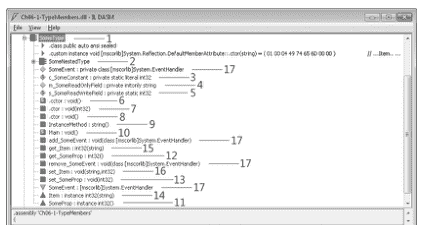

图 6-1 显示前述代码中元数据的 ILDasm.exe 输出。

请注意，源代码中定义的所有成员都会使编译器发出一些元数据。事实上，某些成员还会使编译器生成额外的成员以及额外的元数据。例如，事件成员 (17) 会使编译器发出一个字段、两个方法以及一些额外的元数据。我不指望你现在完全理解在这里看到的内容。但是，在阅读接下来几章时，我建议你回看这个示例，了解成员是如何定义的，以及它对编译器生成的元数据有什么影响。

### 类型可见性

在文件作用域定义类型时（相对于在另一个类型内部定义嵌套类型），你可以将类型的可见性指定为 public 或 internal。public 类型对于定义程序集中的所有代码以及其他程序集中编写的所有代码都可见。internal 类型对于定义程序集中的所有代码可见，而该类型对于其他程序集中编写的代码不可见。如果在定义类型时没有显式指定这两者中的任何一个，C# 编译器会将类型的可见性设置为 internal（两者中限制更严格的那个）。以下是一些示例：

```
    using System;

    // The type below has public visibility and can be accessed by code
    // in this assembly as well as code written in other assemblies.
```


```
public class ThisIsAPublicType { ... }

// The type below has internal visibility and can be accessed by code
// in this assembly only.
internal class ThisIsAnInternalType { ... }

// The type below is internal because public/internal
// was not explicitly stated
class ThisIsAlsoAnInternalType { ... }
```

### 友元程序集

设想以下场景：一家公司有一个 TeamA 团队，该团队在一个程序集中定义了一组实用工具类型，并期望这些类型能被另一个 TeamB 团队的成员使用。由于时间安排、地理位置，或者成本中心、汇报结构不同等各种原因，这两个团队无法将所有类型都构建到同一个程序集中；相反，每个团队都会生成自己的程序集文件。

为了让 TeamB 的程序集能够使用 TeamA 的类型，TeamA 必须将其所有实用工具类型定义为 public。然而，这意味着他们的类型对任何程序集都是公开可见的；另一家公司的开发者可以编写使用这些公共实用工具类型的代码，而这并不理想。也许这些实用工具类型会做出某些假设，而 TeamB 在编写使用 TeamA 类型的代码时也假定了这些假设。我们真正想要的是这样一种方式：TeamA 可以将自己的类型定义为 internal，同时仍允许 TeamB 访问这些类型。CLR 和 C# 通过友元程序集支持这一点。当你希望让一个程序集包含针对另一个程序集中的内部类型执行单元测试的代码时，友元程序集功能也很有用。

在构建程序集时，可以通过使用 `System.Runtime.CompilerServices` 命名空间中定义的 `InternalsVisibleTo` 特性来指明它认为哪些其他程序集是“友元”。该特性有一个字符串参数，用于标识友元程序集的名称和公钥（传给该特性的字符串不能包含版本、区域性/文化或处理器架构）。请注意，友元程序集可以访问某个程序集的所有内部类型以及这些类型的内部成员。下面是一个示例，说明一个程序集如何将另外两个名为“Wintellect”和“Microsoft”的强命名程序集指定为其友元程序集：

```
using System;
using System.Runtime.CompilerServices; // For InternalsVisibleTo attribute

// This assembly's internal types can be accessed by any code written
// in the following two assemblies (regardless of version or culture):
[assembly:InternalsVisibleTo("Wintellect, PublicKey=12345678...90abcdef")]
[assembly:InternalsVisibleTo("Microsoft, PublicKey=b77a5c56...1934e089")]

internal sealed class SomeInternalType { ... }
internal sealed class AnotherInternalType { ... }
```

从友元程序集访问上述程序集的内部类型非常简单。例如，下面是一个名为“Wintellect”、公钥为“12345678...90abcdef”的友元程序集如何访问

| CLR 术语 | C# 术语 | 描述 |
| --- | --- | --- |
| Private | private | 该成员只能由定义类型或任何嵌套类型中的方法访问。 |
| Family | protected | 该成员只能由定义类型、任何嵌套类型或其派生类型中的方法访问，与程序集无关。 |
| Family and Assembly | （不支持） | 该成员只能由定义类型、任何嵌套类型中的方法，或同一程序集中定义的任何派生类型访问。 |
| Assembly | internal | 该成员只能由定义程序集中的方法访问。 |
| Family or Assembly | protected internal | 该成员可由任何嵌套类型、任何派生类型（无论程序集）或定义程序集中的任何方法访问。 |
| Public | public | 该成员可由任何程序集中的所有方法访问。 |

当然，任何成员要被访问，都必须定义在一个可见的类型中。例如，如果 AssemblyA 定义了一个带有公共方法的内部类型，则 AssemblyB 中的代码无法调用该公共方法，因为该内部类型对 AssemblyB 不可见。

编译代码时，语言编译器负责检查代码是否正确引用了类型和成员。如果代码错误地引用了某个类型或成员，编译器负责发出相应的错误消息。此外，即时 (JIT) 编译器还确保在运行时将 IL 代码编译为本机 CPU 指令时，对字段和方法的引用是合法的。例如，如果 JIT 编译器检测到代码不正当地尝试访问私有字段或方法，JIT 编译器将分别抛出 `FieldAccessException` 或 `MethodAccessException`。

验证 IL 代码可确保被引用成员的可访问性在运行时得到正确遵守，即使语言编译器忽略了检查可访问性。另一种更可能的情况是：语言编译器编译了访问另一个类型（在另一个程序集中）的公共成员的代码，但在运行时加载了该程序集的另一个版本，而在这个新版本中，该公共成员已经更改，现在变成了 protected 或 private。

在 C# 中，如果你没有显式声明成员的可访问性，编译器通常（但不总是）默认选择 private（所有可访问性中最严格的一种）。CLR 要求接口类型的所有成员都是 public。C# 编译器知道这一点，并禁止程序员显式指定接口成员的可访问性；编译器会直接为你将所有成员设为 public。

**更多信息** 请参阅 C# 语言规范中的“声明可访问性”一节以获取完整

如果检测到任何这些用法，编译器将发出错误。

下面是一个静态类的示例，它定义了一些静态成员；这段代码可以编译（并带有一个警告），但这个类并没有做任何有趣的事情：

```
using System;

public static class AStaticClass {
    public static void AStaticMethod() { }

    public static String AStaticProperty {
        get { return s_AStaticField; }
        set { s_AStaticField = value; }
    }

    private static String s_AStaticField;

    public static event EventHandler AStaticEvent;
}
```

如果你将上述代码编译为一个库 (DLL) 程序集，并使用 ILDasm.exe 查看结果，你将看到图 6-2 所示的内容。正如你在图 6-2 中所见，使用 static 关键字定义类会使 C# 编译器将该类同时设为抽象和密封。此外，编译器不会向该类型中发出实例构造函数方法。请注意，图 6-2 中没有显示实例构造函数 (.ctor) 方法。

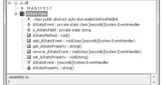

图 6-2 在元数据中将该类显示为抽象密封的 ILDasm.exe。

### 分部类、结构和接口

在本节中，我将讨论分部类、结构和接口。`partial` 关键字告诉 C# 编译器：单个类、结构或接口定义的源代码可以跨一个或多个源代码文件。应注意，编译器在编译时会将某个类型的所有分部组合在一起；CLR 始终处理完整的类型定义。你可能希望将一个类型的源代码拆分到多个文件中，主要有三个原因：

- **源代码管理** 假设某个类型的定义包含大量源代码，并且一名程序员将其从源代码管理中签出以进行更改。在没有稍后进行合并的情况下，其他程序员将无法同时修改该类型。使用 `partial` 关键字，你可以将该类型的代码拆分到多个源代码文件中，每个文件都可以单独签出，从而使多个程序员可以同时编辑该类型。
- **在单个文件中将类、结构或接口拆分为不同的逻辑单元** 我有时会创建一个提供多项功能的单一类型，以便该类型能够提供完整的解决方案。为了简化实现，我有时会在单个源代码文件中重复声明同一个 `partial` 类型。然后，在 `partial` 类型的每个部分中，我会实现一个功能及其所有字段、方法、属性、事件等。这使我能够轻松看到提供单个功能的所有成员分组在一起，从而简化我的编码。此外，我还可以轻松注释掉 `partial` 类型的某一部分，从而从该类型中移除整个功能，并用另一种实现（通过 `partial` 类型的新部分）替换它。
- **代码拆分器** 在 Microsoft Visual Studio 中，创建新项目时，会自动创建一些源代码文件作为项目的一部分。这些源代码文件包含模板，可帮助你先开始构建这类项目。当你使用 Visual Studio 设计器并将控件拖放到设计图面上时，Visual Studio 会自动为你编写源代码，并将此代码拆分到源代码文件中。这确实提高了你的工作效率。过去，生成的代码会被写入你正在处理的同一个源代码文件中。这样做的问题在于，你可能会意外编辑生成的代码，并导致设计器停止正常工作。从 Visual Studio 2005 开始，当你创建新窗体、用户控件等时，Visual Studio 会创建两个源代码文件：一个用于你的代码，另一个用于设计器生成的代码。由于设计器代码位于单独的文件中，你意外编辑它的可能性会大大降低。

`partial` 关键字应用于所有文件中的类型。当这些文件一起编译时，编译器会组合代码，生成一个位于结果 `.exe` 或 `.dll` 程序集文件（或 `.netmodule` 模块文件）中的类型。正如我在本节开头所述，分部类型功能完全由 C# 编译器实现；CLR 对分部类型一无所知。这就是为什么该类型的所有源代码文件必须使用相同的编程语言，并且它们必须作为一个编译单元一起编译。

### 组件、多态和版本控制

面向对象编程 (OOP) 已经存在很多很多年了。当它在 20 世纪 70 年代末/80 年代初首次被使用时，应用程序的规模要小得多，而且使应用程序运行的所有代码都由一家公司编写。当然，那时已经有操作系统，而且

假设某公司发布了一个版本为 2.7.0.0 的程序集。如果该公司后来想修复此组件中的一个 bug，就会生成一个新的程序集，其中只更改版本的 build/revision 部分，类似版本 2.7.1.34。这表明该程序集是一个服务版本，其意图是与原始组件（版本 2.7.0.0）向后兼容。

另一方面，如果该公司想制作该程序集的新版本，并对其做出重大更改，因此不打算与原始程序集向后兼容，那么该公司实际上是在创建一个新组件，并且应该为新程序集指定一个版本号，其中 major/minor 部分与现有组件不同（例如版本 3.0.0.0）。

**注意** 我刚才描述了应当如何看待版本号。遗憾的是，CLR 并不这样处理版本号。目前，CLR 将版本号视为不透明值，如果一个程序集依赖于另一个程序集的版本 1.2.3.4，CLR 只会尝试加载版本 1.2.3.4（除非存在绑定重定向）。

现在我们已经了解了如何使用版本号更新组件的标识以反映新版本，接下来看看 CLR 和编程语言（如 C#）提供的一些功能，这些功能使开发者能够编写出可以适应其所使用组件中可能发生变化的代码。

当一个组件（程序集）中定义的类型被用作另一个组件（程序集）中某个类型的基类时，版本控制问题就会出现。显然，如果基类在派生类之下发生版本（变化），派生类的行为也会改变，而且很可能以导致该类行为不当的方式改变。在派生类型重写基类型定义的虚方法的多态场景中，尤其如此。

C# 提供了五个关键字，可将它们应用于会影响组件版本控制的类型和/或类型成员。这些关键字直接映射到 CLR 中为支持组件版本控制而支持的功能。表 6-2 列出了与组件版本控制相关的 C# 关键字，并说明每个关键字如何影响类型或类型成员的定义。

**表 6-2** C# 关键字及其对组件版本控制的影响

| C# 关键字 | 类型 | 方法/属性/事件 | 常量/字段 |
|---|---|---|---|
| abstract | 指示不能构造该类型的实例 | 指示派生类型必须重写并实现此成员，然后才能构造派生类型的实例 | （不允许） |
| virtual | （不允许） | 指示该成员可由派生类型重写 | （不允许） |
| override | （不允许） | 指示派生类型正在重写基类型的成员 | （不允许） |
| sealed | 指示该类型不能用作基类型 | 指示该成员不能由派生类型重写。此关键字只能应用于正在重写虚方法的方法。 | （不允许） |
| new | 当应用于嵌套类型、方法、属性、事件、常量或字段时，指示该成员与基类中可能存在的类似成员没有关系 |  |  |

我将在后面题为“处理类型版本控制时的虚方法”的一节中演示所有这些关键字的价值和用法。但在进入版本控制场景之前，让我们先关注 CLR 实际如何调用虚方法。

### CLR 如何调用虚方法、属性和事件

在本节中，我将重点讨论方法，但这里的讨论同样适用于虚属性和虚事件。属性和事件实际上是以方法实现的；这将在它们相应的章节中展示。

方法表示对类型（静态方法）或类型的实例（非静态方法）执行某种操作的代码。所有方法都有名称、签名和返回类型（返回类型可能为 void）。CLR 允许一个类型定义多个同名方法，只要每个方法具有不同的参数集或不同的返回类型。因此，只要返回类型不同，就可以定义两个名称相同且参数相同的方法。但是，除了 IL 汇编语言之外，我不知道还有哪种语言利用了这个“特性”；大多数语言（包括 C#）都要求方法按参数区分，并在确定唯一性时忽略方法的返回类型。（C# 实际上在定义转换运算符方法时放宽了这一限制；详情参见第 8 章。）

下面所示的 Employee 类定义了三种不同的方法：

```csharp
internal class Employee {
    // A nonvirtual instance method
    public      Int32    GetYearsEmployed() { ... }

    // A virtual method (virtual implies instance)
    public virtual String GetProgressReport() { ... }

    // A static method
    public static Employee Lookup(String name) { ... }
}
```

指令，而不是 callvirt 指令。如果方法从非虚方法变为虚方法，而引用代码没有重新编译，那么该虚方法将以非虚方式被调用，从而导致应用程序产生不可预测的行为。如果引用代码是用 C# 编写的，这不成问题，因为 C# 使用 callvirt 调用所有实例方法。但如果引用代码是用其他编程语言编写的，这就可能成为问题。

有时，编译器会使用 call 指令而不是 callvirt 指令来调用虚方法。乍一看，这似乎令人惊讶，但下面的代码演示了为什么有时需要这样做：

```csharp
internal class SomeClass {
    // ToString is a virtual method defined in the base class: Object.
    public override String ToString() {

        // Compiler uses the ‘call’ IL instruction to call
        // Object’s ToString method nonvirtually.

        // If the compiler were to use ‘callvirt’ instead of ‘call’, this
        // method would call itself recursively until the stack overflowed.
        return base.ToString();
    }
}
```

在调用 base.ToString（一个虚方法）时，C# 编译器会发出 call 指令，以确保基类型中的 ToString 方法以非虚方式被调用。这是必需的，因为如果以虚方式调用 ToString，该调用将递归执行，直到线程栈溢出，这显然不是期望的结果。

当调用由值类型定义的方法时，编译器倾向于使用 call 指令，因为值类型是密封的。这意味着即使对于值类型的虚方法，也不存在多态，这使得调用的性能更快。此外，值类型实例的性质保证它永远不能为 null，因此永远不会抛出 NullReferenceException。最后，如果你要以虚方式调用值类型的虚方法，CLR 需要持有对该值类型的类型对象的引用，以便引用其中的方法表。这要求对该值类型进行装箱。装箱会给堆带来更大压力，迫使更频繁的垃圾回收，并损害性能。

无论使用 call 还是 callvirt 来调用实例方法或虚方法，这些方法始终会接收一个隐藏的 this 参数作为方法的第一个参数。this 参数引用被操作的对象。

设计类型时，应尽量减少定义的虚方法数量。第一，调用虚方法比调用非虚方法慢。第二，虚方法不能被 JIT 编译器内联，这会进一步损害性能。第三，虚方法会使组件的版本控制更加脆弱，如下一节所述。第四，定义基类型时，通常会提供一组方便的 overloaded 方法。如果你希望这些方法具有多态性，最好的做法是让最复杂的方法成为虚方法，并让所有


便捷重载方法是非虚拟的。顺便说一句，遵循这一准则还能提高组件版本化的能力，而不会对派生类型产生不利影响。下面是一个示例：

```csharp
public class Set {
    private Int32 m_length = 0;

    // 这个便捷重载不是虚拟的
    public Int32 Find(Object value) {
        return Find(value, 0, m_length);
    }

    // 这个便捷重载不是虚拟的
    public Int32 Find(Object value, Int32 startIndex) {
        return Find(value, startIndex, m_length - startIndex);
    }

    // 功能最丰富的方法是虚拟的，可以被重写
    public virtual Int32 Find(Object value, Int32 startIndex, Int32 endIndex) {
        // 这里放置可以被重写的实际实现...
    }

    // 其他方法放在这里
}
```

### 明智地使用类型可见性和成员可访问性

在 .NET Framework 中，应用程序由定义在多个程序集中的类型组成，这些程序集由不同公司生成。这意味着开发者对他或她所使用的组件以及那些组件中定义的类型几乎没有控制权。开发者通常无法访问源代码（甚至可能不知道创建组件时使用了哪种编程语言），而且组件往往按不同的时间表进行版本化。此外，由于多态性和受保护成员的存在，基类开发者必须信任派生类开发者所编写的代码。当然，派生类的开发者也必须信任他继承自基类的代码。这些只是你在设计组件和类型时需要真正思考的一部分问题。

在本节中，我想就如何带着这些问题来设计类型简单说几句。具体来说，我将重点讨论如何正确设置类型可见性和成员可访问性，以便你能获得最大的成功。

首先，在定义新类型时，编译器应默认将类设为密封（sealed），以便该类不能用作基类。相反，包括 C# 在内的许多编译器默认使用非密封类，并允许程序员使用 `sealed` 关键字将类显式标记为密封。显然，现在改变已经太晚了，但我认为当今的编译器选择了错误的默认值，如果未来的编译器能够改变这一点就好了。密封类比非密封类更好有三个原因：

- **版本化** 当一个类最初是密封的，将来可以改为非密封而不会破坏兼容性。然而，一旦一个类是非密封的，你就永远无法将它改为密封的。

使用 `ConditionalWeakTable` 类（在第 21 章讨论）可以模拟将状态附加到对象上。

以下是我在定义自己的类时遵循的准则：

- 在定义类时，除非我真的打算让该类成为允许派生类特化的基类，否则我总是显式地将其设为密封。如前所述，这与 C# 和许多其他编译器当前的默认行为相反。我还默认将类设为 internal，除非我希望该类在程序集之外公开暴露。幸运的是，如果你没有显式指定类型的可见性，C# 编译器会默认设为 internal。如果我确实觉得定义一个允许其他类派生但又不希望允许特化的类很重要，我会通过使用上述技术密封我的类继承的虚拟方法来模拟创建一个封闭类。

- 在类内部，我总是将数据字段定义为 private，这一点我从不妥协。幸运的是，C# 确实默认将字段设为 private。我其实更希望 C# 规定所有字段都必须是 private，并且不能将字段设为 protected、internal、public 等等。暴露状态是陷入麻烦、让对象行为不可预测以及打开潜在安全漏洞的最简单途径。即使你只把一些字段声明为 internal，情况也是如此。即使在单个程序集内，要跟踪引用某个字段的所有代码也太过困难，尤其是当多个开发者编写代码并编译到同一个程序集时。

- 在类内部，我总是将方法、属性和事件定义为 private 和非 virtual。幸运的是，C# 默认也是如此。当然，我会将某个方法、属性或事件设为 public 以从类型中暴露某些功能。我尽量避免将这些成员中的任何一个设为 protected 或 internal，因为这会让我 的类型暴露于某些潜在漏洞。然而，我宁愿将成员设为 protected 或 internal，也不愿将成员设为 virtual，因为 virtual 成员会放弃大量控制权，并且真正依赖于派生类的正确行为。

- 有一条古老的面向对象编程格言是这样说的：当事情变得太复杂时，就创建更多的类型。当某个算法的实现开始变得复杂时，我会定义一些封装了独立功能块的辅助类型。如果这些辅助类型是供某个“超级类型”使用的，我会将辅助类型嵌套在“超级类型”内部。这样可以实现作用域隔离，也允许嵌套的辅助类型中的代码引用“超级类型”中定义的私有成员。然而，有一条设计准则（由 Visual Studio 中的代码分析工具 FxCopCmd.exe 强制执行）规定，公开暴露的嵌套类型应在文件或程序集作用域内定义，而不应在另一个类型内部定义。这条规则存在是因为一些开发者发现引用嵌套类型的语法很繁琐。我理解并尊重这条规则，所以我从不定义公共嵌套类型。

### 类型版本化时处理虚拟方法

如前所述，在组件软件编程环境中，版本化是一个非常重要的问题。在第三章“共享程序集和强命名程序集”中，我谈到了一些版本化问题，当时我解释了强命名程序集，并讨论了管理员如何确保应用程序绑定到它构建和测试时所使用的程序集。然而，其他版本化问题会导致源代码兼容性问题。例如，如果某个类型被用作基类型，那么在添加或修改该类型的成员时必须非常小心。让我们看一些例子。

公司A设计了以下类型 `Phone`：

```csharp
namespace CompanyA {
    public class Phone {
        public void Dial() {
            Console.WriteLine("Phone.Dial");
            // 在这里执行拨号的工作。
        }
    }
}
```

现在假设公司B定义了另一个类型 `BetterPhone`，它使用公司A的 `Phone` 类型作为基类：

```csharp
namespace CompanyB {
    public class BetterPhone : CompanyA.Phone {
        public void Dial() {
            Console.WriteLine("BetterPhone.Dial");
            EstablishConnection();
            base.Dial();
        }

        protected virtual void EstablishConnection() {
            Console.WriteLine("BetterPhone.EstablishConnection");
            // 执行建立连接的工作。
        }
    }
}
```

当公司B尝试编译其代码时，C# 编译器会发出以下消息：“警告 CS0108：'CompanyB.BetterPhone.Dial()' 隐藏了继承的成员 'CompanyA.Phone.Dial()'。如果是有意隐藏，请使用 new 关键字。”该警告是在通知开发者，`BetterPhone` 定义了一个 `Dial` 方法，它将隐藏 `Phone` 中定义的 `Dial` 方法。这个新方法可能会改变 `Dial` 的语义（正如公司A最初创建 `Dial` 方法时所定义的那样）。

编译器会警告你这种潜在的语义不匹配，这是一个非常好的特性。编译器还会告诉你如何消除警告：在 `BetterPhone` 类的 `Dial` 定义前添加 `new` 关键字。以下是修正后的 `BetterPhone` 类：


```csharp
namespace CompanyB {
    public class BetterPhone : CompanyA.Phone {

        // This Dial method has nothing to do with Phone's Dial method.
        public new void Dial() {
            Console.WriteLine("BetterPhone.Dial");
            EstablishConnection();
            base.Dial();
        }

        protected virtual void EstablishConnection() {
            Console.WriteLine("BetterPhone.EstablishConnection");
            // Do work to establish the connection.
        }
    }
}
```

此时，CompanyB 可以在其应用程序中使用 BetterPhone.Dial。以下是 CompanyB 可能编写的一些示例代码：

```csharp
public sealed class Program {
    public static void Main() {
        CompanyB.BetterPhone phone = new CompanyB.BetterPhone();
        phone.Dial();
    }
}
```

当这段代码运行时，会显示以下输出：

```
BetterPhone.Dial
BetterPhone.EstablishConnection
Phone.Dial
```

此输出表明 CompanyB 获得了它期望的行为。对 Dial 的调用调用了 BetterPhone 定义的新 Dial 方法，该方法调用虚拟 EstablishConnection 方法，然后调用 Phone 基类型的 Dial 方法。

现在让我们设想几家公司决定使用 CompanyA 的 Phone 类型。再进一步设想，这些其他公司认为在 Dial 方法中建立连接的能力确实是一个有用的特性。这个反馈被提供给 CompanyA，CompanyA 现在修订其 Phone 类：

```csharp
namespace CompanyA {
    public class Phone {
        public void Dial() {
            Console.WriteLine("Phone.Dial");
            EstablishConnection();
            // Do work to dial the phone here.
        }

        protected virtual void EstablishConnection() {
            Console.WriteLine("Phone.EstablishConnection");
            // Do work to establish the connection.
        }
    }
}
```

现在，当 CompanyB 编译其 BetterPhone 类型（派生自这个新版本的 CompanyA 的 Phone）时，编译器会发出以下消息：“warning CS0114: ‘CompanyB.BetterPhone.EstablishConnection()’ hides inherited member ‘CompanyA.Phone.EstablishConnection()’. To make the current member override that implementation, add the override keyword. Otherwise, add the new keyword.”

编译器提醒你注意这样一个事实：Phone 和 BetterPhone 都提供了一个 EstablishConnection 方法，并且两者的语义可能并不完全相同；仅仅重新编译 BetterPhone 已无法再提供与使用第一版 Phone 类型时相同的行为。

如果 CompanyB 认为两个类型中的 EstablishConnection 方法在语义上并不相同，CompanyB 可以告诉编译器，BetterPhone 中定义的 Dial 和 EstablishConnection 方法是应使用的正确方法，并且它与 Phone 基类型中定义的 EstablishConnection 方法没有关系。CompanyB 通过向 EstablishConnection 方法添加 new 关键字来告知编译器这一点：

```csharp
namespace CompanyB {
    public class BetterPhone : CompanyA.Phone {

        // Keep 'new' to mark this method as having no
        // relationship to the base type's Dial method.
        public new void Dial() {
            Console.WriteLine("BetterPhone.Dial");
            EstablishConnection();
            base.Dial();
        }

        // Add 'new' to mark this method as having no
        // relationship to the base type's EstablishConnection method.
        protected new virtual void EstablishConnection() {
            Console.WriteLine("BetterPhone.EstablishConnection");
            // Do work to establish the connection.
        }
    }
}
```

在这段代码中，new 关键字告诉编译器发出元数据，向 CLR 明确表明 BetterPhone 的 EstablishConnection 方法应被视为由 BetterPhone 类型引入的新函数。CLR 将知道 Phone 的方法与 BetterPhone 的方法之间没有关系。

当相同的应用程序代码（在 Main 方法中）执行时，输出如下：

```
BetterPhone.Dial
BetterPhone.EstablishConnection
Phone.Dial
Phone.EstablishConnection
```

此输出表明，Main 对 Dial 的调用调用了由 BetterPhone.Dial 定义的新 Dial 方法，该方法又调用了同样由 BetterPhone 定义的虚拟 EstablishConnection 方法。当 BetterPhone 的 EstablishConnection 方法返回后，会调用 Phone 的 Dial 方法。Phone 的 Dial 方法调用 EstablishConnection，但由于 BetterPhone 的 EstablishConnection 标记了 new，BetterPhone 的 EstablishConnection 方法不会被视为对 Phone 的虚拟 EstablishConnection 方法的override。因此，Phone 的 Dial 方法调用 Phone 的 EstablishConnection 方法——这是预期行为。

**注意** 如果编译器默认将方法视为override（就像本机 C++ 编译器那样），那么 BetterPhone 的开发人员就无法使用 Dial 和 EstablishConnection 这两个方法名。这很可能在整个源代码库中引起一连串的更改，破坏源代码和二进制兼容性。这种普遍性的更改是不可取的，尤其是在任何中型到大型项目中。不过，如果更改方法名只会导致源代码中的适度更新，那么你应该更改这些方法的名称，以免 Dial 和 EstablishConnection 的两种不同含义使其他开发人员感到困惑。

另一种情况是，CompanyB 可能已经获取了新版本的 CompanyA 的 Phone 类型，并认为 Phone 版本的 Dial 和 EstablishConnection 正是它一直在寻找的。在这种情况下，CompanyB 会通过完全删除其 Dial 方法来修改其 BetterPhone 类型。此外，由于 CompanyB 现在想告诉编译器 BetterPhone 的 EstablishConnection 方法与 Phone 的 EstablishConnection 方法相关，因此必须删除 new 关键字。不过，仅仅删除 new 关键字还不够，因为现在编译器无法准确判断 BetterPhone 的 EstablishConnection 方法的意图是什么。为了准确表达其意图，CompanyB 开发人员还必须将 BetterPhone 的 EstablishConnection 方法从 virtual 改为 override。以下代码展示了新版本的 BetterPhone：

```csharp
namespace CompanyB {
    public class BetterPhone : CompanyA.Phone {

        // Delete the Dial method (inherit Dial from base).

        // Remove 'new' and change 'virtual' to 'override' to
        // mark this method as having a relationship to the base
        // type's EstablishConnection method.
        protected override void EstablishConnection() {
            Console.WriteLine("BetterPhone.EstablishConnection");
            // Do work to establish the connection.
        }
    }
}
```

现在，当相同的应用程序代码（在 Main 方法中）执行时，输出如下：

```
Phone.Dial
BetterPhone.EstablishConnection
```

此输出表明，Main 对 Dial 的调用调用了由 Phone 定义并由 BetterPhone 继承的 Dial 方法。然后，当 Phone 的 Dial 方法调用虚拟 EstablishConnection 方法时，会调用 BetterPhone 的 EstablishConnection 方法，因为它override了 Phone 定义的虚拟 EstablishConnection 方法。

## 第7章：常量和字段
## 

- 本章内容：
  - 常量 ................................ 181
  - 字段 ................................... 183

在本章中，我将向你展示如何向类型添加数据成员。具体来说，我们将研究常量和字段。

### 常量

*常量* 是一个具有永不改变的值符号。定义常量符号时，其值必须在编译时确定。然后，编译器将常量的值保存在程序集的元数据中。这意味着你只能为编译器视为基元类型的类型定义常量。在 C# 中，以下类型是基元类型，可用于定义常量：Boolean、Char、Byte、SByte、Int16、UInt16、Int32、UInt32、Int64、UInt64、Single、Double、Decimal 和 String。不过，如果将该值设置为 null，C# 还允许你定义非基元类型的常量变量：

```csharp
using System;

public sealed class SomeType {
    // SomeType is not a primitive type but C# does allow
    // a constant variable of this type to be set to 'null'.
    public const SomeType Empty = null;
}
```

由于常量值永不改变，常量始终被视为定义类型的一部分。换句话说，常量始终被视为静态成员，而不是实例成员。定义常量会导致元数据的创建。

当代码引用常量符号时，编译器会在定义该常量的程序集的元数据中查找该符号，提取常量的值，并将该值嵌入到生成的中间语言（IL）代码中。由于常量的值直接嵌入代码中，因此常量在运行时不需要为其分配任何内存。此外，你无法获取常量的地址，也无法通过引用传递常量。这些限制还意味着常量没有良好的跨程序集版本控制方案，因此，你只应在你知道该

符号的值永远不会改变。（将 MaxInt16 定义为 32767 就是一个很好的例子。）让我确切地演示一下我的意思。首先，请将以下代码编译为 DLL 程序集：

```csharp
using System;

public sealed class SomeLibraryType {
   // NOTE: C# doesn't allow you to specify static for constants
   // because constants are always implicitly static.
   public const Int32 MaxEntriesInList = 50;
}
```

然后使用以下代码生成应用程序集：

```csharp
using System;

public sealed class Program {
   public static void Main() {
      Console.WriteLine("Max entries supported in list: "
         + SomeLibraryType.MaxEntriesInList);
   }
}
```

你会注意到，这段应用程序代码引用了 SomeLibraryType 类中定义的 MaxEntriesInList 常量。当编译器生成应用程序代码时，它发现 MaxEntriesInList 是一个值为 50 的常量字面量，并将 Int32 值 50 直接嵌入应用程序的 IL 代码中，如下面的 IL 代码所示。事实上，在生成应用程序集之后，DLL 程序集在运行时甚至不会被加载，并且可以从磁盘删除，因为编译器甚至不会在应用程序的元数据中添加对 DLL 程序集的引用。

```cil
.method public hidebysig static void Main() cil managed
{
   .entrypoint
   // Code size       25 (0x19)

   .maxstack  8
   IL_0000:  nop
   IL_0001:  ldstr      "Max entries supported in list: "
   IL_0006:  ldc.i4.s   50
   IL_0008:  box        [mscorlib]System.Int32
   IL_000d:  call       string [mscorlib]System.String::Concat(object, object)
   IL_0012:  call       void [mscorlib]System.Console::WriteLine(string)
   IL_0017:  nop
   IL_0018:  ret
} // end of method Program::Main
```

这个示例应该会让你清楚地看到版本控制问题。如果开发者将 MaxEntriesInList 常量改为 1000 并且只重新生成 DLL 程序集，那么应用程序集不会受到影响。要让应用程序获取新值，它也必须重新编译。如果你需要在运行时（而不是编译时）让一个程序集中的值被另一个程序集获取，就不能使用常量。相反，你可以使用 readonly 字段，我接下来会讨论它。

```csharp
using System;

public sealed class SomeLibraryType {
   // The static is required to associate the field with the type.
   public static readonly Int32 MaxEntriesInList = 50;
}
```

这是你唯一需要做的更改；应用程序代码完全不必更改，尽管你必须重新生成它才能看到新行为。现在，当应用程序的 Main 方法运行时，CLR 将加载 DLL 程序集（因此该程序集现在在运行时是必需的），并从为其分配的动态内存中获取 MaxEntriesInList 字段的值。当然，该值将是 50。

假设 DLL 程序集的开发者将 50 改为 1000 并重新生成该程序集。当应用程序代码重新执行时，它将自动获取新值：1000。在这种情况下，应用程序代码不必重新生成——它就能正常工作（尽管其性能会受到不利影响）。需要注意：此场景假设新版本的 DLL 程序集不是强命名，并且应用程序的版本控制策略使得 CLR 加载这个新版本。

下面的示例展示了如何定义与类型本身关联的 readonly 静态字段，以及读/写静态字段和 readonly 与读/写实例字段，如下所示：

```csharp
public sealed class SomeType {
   // This is a static read-only field; its value is calculated and
   // stored in memory when this class is initialized at run time.
   public static readonly Random s_random = new Random();

   // This is a static read/write field.
   private static Int32 s_numberOfWrites = 0;

   // This is an instance read-only field.
   public readonly String Pathname = "Untitled";

   // This is an instance read/write field.
   private System.IO.FileStream m_fs;

   public SomeType(String pathname) {
      // This line changes a read-only field.
      // This is OK because the code is in a constructor.
      this.Pathname = pathname;
   }

   public String DoSomething() {
      // This line reads and writes to the static read/write field.
      s_numberOfWrites = s_numberOfWrites + 1;

      // This line reads the read-only instance field.
      return Pathname;
   }
}
```

## 第8章：方法

本章内容：

- 实例构造器与类（引用类型） 187
- 实例构造器与结构（值类型） 191
- 类型构造器 194
- 运算符重载方法 200
- 转换运算符方法 204
- 扩展方法 207
- 分部方法 213

本章重点介绍你会遇到的各种方法，包括实例构造器和类型构造器，以及如何定义方法来重载运算符和类型转换（用于隐式和显式强制转换）。我们还会讨论扩展方法，它允许你逻辑上将自己的实例方法添加到已有类型中；以及分部方法，它允许你将类型的实现分散到多个部分中。

### 实例构造器与类（引用类型）

构造器是特殊方法，允许将类型的实例初始化为良好状态。在方法定义元数据表中，构造器方法始终称为 .ctor（表示构造器）。创建引用类型的实例时，会为该实例的数据字段分配内存，初始化对象的开销字段（类型对象指针和同步块索引），然后调用该类型的实例构造器。不应从构造器中调用虚方法，因为对象仍在构造中。原因是，如果在正在实例化的类型中重写了该虚方法，则将执行派生类型对该重写方法的实现，但层次结构中的所有字段尚未完全初始化。在构造器内调用虚方法可能导致不可预测的行为。

C# 提供了一种简单的语法，允许在构造类型实例时初始化引用类型中定义的字段：

```csharp
internal sealed class SomeType {
    private Int32 m_x = 5;
}
```

当构造 SomeType 对象时，其 m_x 字段将被初始化为 5。这是如何发生的呢？如果你查看 SomeType 的构造器方法（也称为 .ctor）的中间语言（IL），就会看到如下所示的代码：

```cil
.method public hidebysig specialname rtspecialname
        instance void .ctor() cil managed
{
  // Code size       14 (0xe)
  .maxstack  8
  IL_0000:  ldarg.0
  IL_0001:  ldc.i4.5
  IL_0002:  stfld      int32 SomeType::m_x
  IL_0007:  ldarg.0
  IL_0008:  call       instance void [mscorlib]System.Object::.ctor()
  IL_000d:  ret
} // end of method SomeType::.ctor
```

在这段代码中，你会看到 SomeType 的构造器包含将 5 存储到 m_x 的代码，然后调用基类的构造器。换句话说，C# 编译器允许这种方便的语法，让你内联初始化实例字段，并将其转换为构造器方法中执行初始化的代码。这意味着你应该注意代码膨胀，如下面的类定义所示：

```csharp
internal sealed class SomeType {
    private Int32 m_x = 5;
    private String m_s = "hi there";
    private Double m_d = 3.14159;
    private Byte   m_b;

    // Here are some constructors.
    public SomeType()        { ... }
    public SomeType(Int32 x) { ... }
    public SomeType(String s) { ..., m_d = 10; }
}
```

当编译器为这三个构造器方法生成代码时，每个方法的开头都包含用于初始化 m_x、m_s 和 m_d 的代码。在这段初始化代码之后，编译器会插入对基类构造器的调用，然后编译器将代码追加到该方法中


### 实例构造函数与结构（值类型）

值类型（结构）构造函数的工作方式与引用类型（类）构造函数截然不同。公共语言运行时（CLR）始终允许创建值类型实例，无法阻止值类型被实例化。因此，值类型实际上甚至不需要在其内部定义构造函数，而且 C# 编译器不会为值类型生成默认无参数构造函数。检查以下代码：

```csharp
internal struct Point {
    public Int32 m_x, m_y;
}
internal sealed class Rectangle {
    public Point m_topLeft, m_bottomRight;
}
```

要构造 Rectangle，必须使用 new 运算符，并且必须指定构造函数。在这种情况下，会调用由 C# 编译器自动生成的默认构造函数。为 Rectangle 分配内存时，该内存包含 Point 值类型的两个实例。出于性能原因，CLR 不会尝试为引用类型中包含的每个值类型字段调用构造函数。但正如我之前提到的，值类型的字段会被初始化为 0/null。

CLR 确实允许你在值类型上定义构造函数。这些构造函数执行的唯一方式是你编写代码显式调用其中一个，如下面 Rectangle 的构造函数所示：

```csharp
internal struct Point {
    public Int32 m_x, m_y;

    public Point(Int32 x, Int32 y) {
        m_x = x;
        m_y = y;
    }
}

internal sealed class Rectangle {
    public Point m_topLeft, m_bottomRight;

    public Rectangle() {
        // In C#, new on a value type calls the constructor to
        // initialize the value type's fields.
        m_topLeft = new Point(1, 2);
        m_bottomRight = new Point(100, 200);
    }
}
```

值类型的实例构造函数仅在显式调用时才会执行。因此，如果 Rectangle 的构造函数没有使用 new 运算符调用 Point 的构造函数来初始化其 m_topLeft 和 m_bottomRight 字段，那么两个 Point 字段中的 m_x 和 m_y 字段都将是 0。

在前面定义的 Point 值类型中，没有定义默认无参数构造函数。不过，让我们将该代码重写如下：

```csharp
internal struct Point {
    public Int32 m_x, m_y;

    public Point() {
        m_x = m_y = 5;
    }
}

internal sealed class Rectangle {
    public Point m_topLeft, m_bottomRight;

    public Rectangle() {
    }
}
```

现在，当构造一个新的 Rectangle 时，你认为两个 Point 字段 m_topLeft 和 m_bottomRight 中的 m_x 和 m_y 字段会被初始化为什么：0 还是 5？（提示：这是一个陷阱问题。）

许多开发人员（尤其是具有 C++ 背景的开发人员）会期望 C# 编译器在 Rectangle 的构造函数中生成代码，自动为 Rectangle 的两个字段调用 Point 的默认无参数构造函数。然而，为了提高应用程序的运行时性能，C# 编译器不会自动生成此代码。事实上，许多编译器永远不会自动生成调用值类型默认构造函数的代码，即使该值类型提供了无参数构造函数。要让值类型的无参数构造函数执行，开发人员必须添加显式代码来调用值类型的构造函数。

根据上一段的信息，在之前显示的代码中，你应该预期 Rectangle 的两个 Point 字段中的 m_x 和 m_y 字段会被初始化为 0，因为代码中任何地方都没有显式调用 Point 的构造函数。

不过，我确实说过我最初的问题是一个陷阱问题。陷阱之处在于，C# 不允许值类型定义无参数构造函数。因此，前面的代码实际上无法编译。在尝试编译该代码时，C# 编译器会生成以下消息：“error CS0568: 结构不能包含显式无参数构造函数。”

C# 故意不允许值类型定义无参数构造函数，以消除开发人员可能对何时调用该构造函数产生的任何困惑。如果无法定义该构造函数，编译器就永远无法生成自动调用它的代码。没有无参数构造函数时，值类型的字段始终会被初始化为 0/null。

**注意** 严格来说，当值类型是嵌套在引用类型中的字段时，其字段保证为 0/null。然而，基于堆栈的值类型字段并不保证为 0/null。为了可验证性，任何基于堆栈的值类型字段都必须在读取之前写入。如果代码可以在写入值类型的字段之前读取该字段，就可能发生安全漏洞。C# 和其他生成可验证代码的编译器会确保所有基于堆栈的值类型的字段被清零，或者至少在读取之前已写入，从而不会在运行时抛出验证异常。在大多数情况下，这意味着你可以假定值类型的字段已初始化为 0，并且可以完全忽略本注意中的所有内容。

请记住，尽管 C# 不允许值类型具有无参数构造函数，但 CLR 允许。因此，如果前面描述的不明显行为不会困扰你，你可以使用另一种编程语言（例如 IL 汇编语言）来定义具有无参数构造函数的值类型。

由于 C# 不允许值类型具有无参数构造函数，编译以下类型会生成以下消息：“error CS0573: 'SomeValType.m_x': 结构体中不能有实例字段初始化器。”

```csharp
internal struct SomeValType {
    // You cannot do inline instance field initialization in a value type
    private Int32 m_x = 5;
}
```

此外，由于可验证代码要求值类型的每个字段在读取任何字段之前都必须先写入，因此你为值类型定义的任何构造函数都必须初始化该类型的所有字段。以下类型为值类型定义了构造函数，但未能初始化所有字段：

```csharp
internal struct SomeValType {
    private Int32 m_x;
    private Int32 m_y;

    // C# allows value types to have constructors that take parameters.
    public SomeValType(Int32 x) {
        m_x = x;
        // Notice that m_y is not initialized here.
    }
}
```

编译此类型时，C# 编译器会生成以下消息：“error CS0171: 字段 'SomeValType.m_y' 必须在控制离开构造函数之前完全赋值。”要解决此问题，请在构造函数中为 y 赋值（通常为 0）。

作为初始化值类型所有字段的另一种方式，你实际上可以这样做：

```csharp
// C# allows value types to have constructors that take parameters.
public SomeValType(Int32 x) {
    // Looks strange but compiles fine and initializes all fields to 0/null
    this = new SomeValType();

    m_x = x; // Overwrite m_x’s 0 with x
    // Notice that m_y was initialized to 0.
}
```

初始化类型的静态字段：

```csharp
internal sealed class SomeType {
    private static Int32 s_x = 5;
}
```

**注意** 虽然 C# 不允许值类型对实例字段使用内联字段初始化语法，但它允许你对静态字段使用该语法。换句话说，如果你将上面的 SomeType 类型从 `class` 改为 `struct`，代码将按预期编译并工作。

构建此代码时，编译器会自动为 SomeType 生成类型构造函数。就好像源代码最初编写如下：

```csharp
internal sealed class SomeType {
    private static Int32 s_x;
    static SomeType() { s_x = 5; }
}
```

使用 `ILDasm.exe`，通过检查类型构造函数的 IL 很容易验证编译器实际生成了什么。在方法定义元数据表中，类型构造函数方法始终称为 `.cctor`（表示类构造函数）。

在下面的代码中，你会看到 `.cctor` 方法是私有和静态的。此外，请注意该方法中的代码确实将 5 加载到静态字段 `s_x` 中。

```il
.method private hidebysig specialname rtspecialname static
        void .cctor() cil managed
{
  // Code size       7 (0x7)
  .maxstack  8
  IL_0000:  ldc.i4.5
  IL_0001:  stsfld     int32 SomeType::s_x
  IL_0006:  ret
} // end of method SomeType::.cctor
```

类型构造函数不应调用基类型的类型构造函数。这种调用没有必要，因为类型的静态字段都不会从其基类型共享或继承。

**注意** 某些语言（例如 Java）期望访问某个类型时会调用其类型构造函数及其所有基类型的类型构造函数。此外，这些类型实现的接口也必须调用其类型构造函数。CLR 不提供此行为。然而，CLR 通过 `System.Runtime.CompilerServices.RuntimeHelpers` 类型提供的 `RunClassConstructor` 方法，确实让编译器和开发人员能够提供此行为。任何需要此行为的语言都会让其编译器在类型的类型构造函数中生成代码，为所有基类型调用此方法。使用 `RunClassConstructor` 方法调用类型构造函数时，CLR 知道该类型构造函数之前是否已执行；如果已执行，CLR 不会再次调用它。

最后，假设你有以下代码：

```
internal sealed class SomeType {
    private static Int32 s_x = 5;

    static SomeType() {
        s_x = 10;
    }
}
```

在这种情况下，C# 编译器会生成一个单独的类型构造函数方法。该构造函数首先将 s_x 初始化为 5，然后再将 s_x 初始化为 10。换句话说，当 C# 编译器为类型构造函数生成 IL 代码时，它会先发出初始化静态字段所需的代码，然后发出类型构造函数方法中包含的显式代码。

**重要提示** 开发人员偶尔会问我，是否有办法在类型卸载时执行某些代码。你首先应该知道，只有在 AppDomain 卸载时类型才会被卸载。当 AppDomain 卸载时，标识该类型的对象变得不可达，垃圾回收器会回收类型对象的内存。这种行为导致许多开发人员认为他们可以向类型添加一个静态 Finalize 方法，该方法会在类型卸载时自动被调用。遗憾的是，CLR 不支持静态 Finalize 方法。不过，情况并非毫无希望。如果你希望在 AppDomain 卸载时执行某些代码，你可以向 System.AppDomain 类型的 DomainUnload 事件注册一个回调方法。

### 运算符重载方法

某些编程语言允许类型定义运算符应如何操作该类型的实例。例如，许多类型（如 System.String、System.Decimal 和 System.DateTime）重载了相等（==）和不相等（!=）运算符。CLR 对运算符重载一无所知，因为它甚至不知道运算符是什么。你的编程语言定义了每个运算符符号的含义，以及当这些特殊符号出现时应生成的代码。

例如，在 C# 中，将 + 符号应用于基元数字时，编译器会生成将两个数字相加的代码。当 + 符号应用于 String 对象时，C# 编译器会生成将两个字符串连接在一起的代码。对于不相等，C# 使用 != 符号，而 Microsoft Visual Basic 使用 <> 符号。最后，^ 符号在 C# 中表示异或（XOR），但在 Visual Basic 中表示幂运算。

尽管 CLR 对运算符一无所知，但它确实指定了语言应如何公开运算符重载，以便用不同编程语言编写的代码可以方便地使用它们。每种编程语言都可以自行决定是否支持运算符重载，以及如果支持，表达和使用它们的语法是什么。就 CLR 而言，运算符重载只是方法。

你对编程语言的选择决定了你是否获得运算符重载的支持以及语法是什么样的。当你编译源代码时，编译器会生成一个标识运算符行为的方法。CLR 规范要求运算符重载方法必须是 **public** 和 **static** 方法。此外，C#（以及许多其他语言）要求运算符方法的参数中至少有一个必须与定义该运算符方法的类型相同。之所以有这个限制，是因为它使 C# 编译器能够在合理的时间内搜索到可以绑定的运算符方法。

以下是在 C# 类定义中定义的运算符重载方法的示例：

```
public sealed class Complex {
    public static Complex operator+(Complex c1, Complex c2) { ... }
}
```

编译器为名为 op_Addition 的方法发出一个元数据方法定义条目；该条目还设置了特殊名称标志，指示这是一个“特殊”方法。当语言编译器（包括 C# 编译器）在源代码中看到 + 运算符时，它们会检查其中一个操作数的类型是否定义了一个名为 op_Addition 的特殊名称方法，其参数与操作数的类型兼容。如果存在此方法，编译器会发出调用此方法的代码。如果不存在这样的方法，则会发生编译错误。

表 8-1 和 8-2 显示了 C# 支持重载的一元运算符和二元运算符集合、它们的符号以及编译器发出的相应公共语言规范（CLS）方法名称。我将在下一节中解释表格的第三列。

**表 8-1** C# 一元运算符及其符合 CLS 的方法名称

| C# 运算符符号 | 特殊方法名称 | 建议的符合 CLS 的方法名称 |
|---|---|---|
| + | op_UnaryPlus | Plus |
| - | op_UnaryNegation | Negate |
| ! | op_LogicalNot | Not |
| ~ | op_OnesComplement | OnesComplement |
| ++ | op_Increment | Increment |
| -- | op_Decrement | Decrement |
| （无） | op_True | IsTrue { get; } |
| （无） | op_False | IsFalse { get; } |

**表 8-2** C# 二元运算符及其符合 CLS 的方法名称

| C# 运算符符号 | 特殊方法名称 | 建议的符合 CLS 的方法名称 |
|---|---|---|
| + | op_Addition | Add |
| - | op_Subtraction | Subtract |
| * | op_Multiply | Multiply |
| / | op_Division | Divide |
| % | op_Modulus | Mod |
| & | op_BitwiseAnd | BitwiseAnd |
| \| | op_BitwiseOr | BitwiseOr |
| ^ | op_ExclusiveOr | Xor |
| << | op_LeftShift | LeftShift |
| >> | op_RightShift | RightShift |
| == | op_Equality | Equals |
| != | op_Inequality | Equals |
| < | op_LessThan | Compare |
| > | op_GreaterThan | Compare |
| <= | op_LessThanOrEqual | Compare |
| >= | op_GreaterThanOrEqual | Compare |

CLR 规范定义了许多可以重载的附加运算符，但 C# 不支持这些附加运算符。因此，它们并未被主流使用，所以我不会在这里列出它们。如果你对完整列表感兴趣，请参阅公共语言基础结构（CLI）的 ECMA 规范（www.ecma-international.org/publications/standards/Ecma-335.htm），第一部分，概念和体系结构，第 10.3.1 节（一元运算符）和第 10.3.2 节（二元运算符）。

**注意** 如果你检查框架类库（FCL）中的核心数值类型（Int32、Int64、UInt32 等），你会发现它们没有定义任何运算符重载方法。原因在于编译器会专门查找对这些基元类型的操作，并发出直接操作这些类型实例的 IL 指令。如果这些类型提供方法，并且编译器发出代码来调用这些方法，那么方法调用将带来运行时性能开销。此外，该方法最终无论如何都必须执行一些 IL 指令来执行预期的操作。这就是核心 FCL 类型不定义任何运算符重载方法的原因。这对你意味着：如果你使用的编程语言不支持某个核心 FCL 类型，你将无法对该类型的实例执行任何操作。

### 运算符与编程语言互操作性

运算符重载是一个非常实用的工具，它能让开发人员用简洁的代码表达想法。然而，并非所有编程语言都支持运算符重载。当使用不支持运算符重载的语言时，该语言将不知道如何解释 + 运算符（除非该类型是该语言中的基元类型），编译器会发出错误。当使用不支持运算符重载的语言时，该语言应允许你直接调用所需的 op_* 方法（例如 op_Addition）。

如果你使用的语言不支持在类型中定义 + 运算符重载，显然该类型仍然可以提供 op_Addition 方法。从 C# 的角度，你可能会期望可以通过 + 运算符来调用这个 op_Addition 方法，但实际上不能。当 C# 编译器检测到 + 运算符时，它会查找一个具有 specialname 元数据标志的 op_Addition 方法，以便编译器确定该 op_Addition 方法旨在作为运算符重载方法。由于 op_Addition 方法是由不支持运算符重载的语言生成的，因此该方法不会带有 specialname 标志，C# 编译器将产生编译错误。当然，任何语言的代码都可以显式调用一个恰好名为 op_Addition 的方法，但编译器不会将 + 符号的用法转换为调用此方法。

#### Jeff 对微软运算符方法命名规则的看法

我相信所有这些关于何时可以以及何时不能调用运算符重载方法的规则看起来非常令人困惑且过于复杂。如果支持运算符重载的编译器不发出 specialname 元数据标志，规则会简单得多，程序员在处理提供运算符重载方法的类型时会更容易。支持运算符重载的语言会支持运算符符号语法，而所有语言都会支持显式调用各种 op_ 方法。我想不出微软为什么要把这件事弄得如此困难，我希望他们能在未来版本的编译器中放宽这些规则。

对于定义了运算符重载方法的类型，微软建议该类型还定义更友好的公共静态方法，在内部调用这些运算符重载方法。例如，重载 op_Addition 方法的类型应定义一个名为 Add 的友好公共方法。表 8-1 和 8-2 中的第三列列出了每个运算符的推荐友好名称。因此，前面显示的 Complex 类型应这样定义：

```
public sealed class Complex {
    public static Complex operator+(Complex c1, Complex c2) { ... }
    public static Complex Add(Complex c1, Complex c2) { return(c1 + c2); }
}
```

当然，用任何编程语言编写的代码都可以调用任何友好的运算符方法，例如 Add。微软关于类型提供这些友好方法名称的指导方针使情况变得更加复杂。我觉得这个额外的复杂性是不必要的，而且


}

通过调用这些构造函数和方法，使用任何编程语言的开发者都可以将 Int32 或 Single 对象转换为 Rational 对象，并将 Rational 对象转换为 Int32 或 Single 对象。执行这些转换的能力可能非常方便，并且在设计类型时，你应该认真考虑哪些转换构造函数和方法对你的类型有意义。

在上一节中，我讨论了某些编程语言如何提供运算符重载。嗯，有些编程语言（如 C#）还提供转换运算符重载。*转换运算符*是将对象从一种类型转换为另一种类型的方法。通过使用特殊语法来定义转换运算符方法。CLR 规范要求转换运算符方法必须是公共的静态方法。此外，C#（以及许多其他语言）要求参数或返回类型中必须有一个与定义转换方法的类型相同。此限制的原因是它使 C# 编译器能够在合理的时间内搜索要绑定的可能运算符方法。以下代码向 Rational 类型添加四个转换运算符方法：

```csharp
public sealed class Rational {
    // Constructs a Rational from an Int32
    public Rational(Int32 num) { ... }

    // Constructs a Rational from a Single
    public Rational(Single num) { ... }

    // Convert a Rational to an Int32
    public Int32 ToInt32() { ... }

    // Convert a Rational to a Single
    public Single ToSingle() { ... }

    // Implicitly constructs and returns a Rational from an Int32
    public static implicit operator Rational(Int32 num) {
        return new Rational(num);
    }

    // Implicitly constructs and returns a Rational from a Single
    public static implicit operator Rational(Single num) {
        return new Rational(num);
    }

    // Explicitly returns an Int32 from a Rational
    public static explicit operator Int32(Rational r) {
        return r.ToInt32();
    }

    // Explicitly returns a Single from a Rational
    public static explicit operator Single(Rational r) {
        return r.ToSingle();
    }
}
```

仅返回类型不同的多个方法的定义。少数语言（如 IL 汇编语言）允许开发者显式选择要调用这些方法中的哪一个。当然，IL 汇编语言程序员不应利用这种能力，因为他们定义的方法无法从其他编程语言调用。尽管 C# 不向 C# 程序员公开这种能力，但当类型定义转换运算符方法时，编译器确实会在内部利用这种能力。

C# 完全支持转换运算符。当它检测到你使用一种类型的对象而预期另一种类型的对象的代码时，编译器会搜索能够执行转换的隐式转换运算符方法，并生成调用该方法的代码。如果存在隐式转换运算符方法，编译器会在生成的 IL 代码中发出对该方法的调用。如果编译器看到将对象从一种类型显式转换为另一种类型的源代码，编译器会搜索隐式或显式转换运算符方法。如果存在，编译器会发出对该方法的调用。如果编译器找不到合适的转换运算符方法，则会报错并且不编译该代码。

**注意** 在使用强制转换表达式时，C# 会生成调用显式转换运算符的代码；使用 C# 的 **as** 或 **is** 运算符时，它们永远不会被调用。

要真正理解运算符重载方法和转换运算符方法，我强烈建议你将 **System.Decimal** 类型作为典范来研究。**Decimal** 定义了几个构造函数，允许你将各种类型的对象转换为 **Decimal**。它还提供了几个 **ToXxx** 方法，让你可以将 **Decimal** 对象转换为另一种类型。最后，该类型还定义了几个转换运算符和运算符重载方法。

### 扩展方法

理解 C# 的*扩展方法*特性的最佳方式是通过一个示例。在第 14 章“字符、字符串和文本处理”的“StringBuilder 成员”一节中，我提到 **StringBuilder** 类为操作字符串提供的方法比 **String** 类少，以及考虑到 **StringBuilder** 类由于可变而成为操作字符串的首选方式，这有多么奇怪。因此，假设你想自己定义其中一些缺失的方法来操作 **StringBuilder**。例如，你可能想按如下方式定义你自己的 **IndexOf** 方法：

```csharp
public static class StringBuilderExtensions {
    public static Int32 IndexOf(StringBuilder sb, Char value) {
        for (Int32 index = 0; index < sb.Length; index++)
            if (sb[index] == value) return index;
        return -1;
    }
}
```

现在你已经定义了这个方法，可以像以下代码演示的那样使用它：

```csharp
StringBuilder sb = new StringBuilder("Hello. My name is Jeff.");   // The initial string

// Change period to exclamation and get # characters in 1st sentence (5).
Int32 index = StringBuilderExtensions.IndexOf(sb.Replace('.', '!'), '!');
```

这段代码运行得很好，但从程序员的角度来看并不理想。第一个问题是，想要获取 StringBuilder 中某个字符索引的程序员必须知道 StringBuilderExtensions 类甚至存在。第二个问题是，代码没有反映在 StringBuilder 对象上执行的操作顺序，使代码难以编写、阅读和维护。程序员希望先调用 Replace，然后调用 IndexOf；但当你从左到右阅读最后一行代码时，IndexOf 先出现在该行，而 Replace 第二个出现。当然，你可以通过像这样重写代码来缓解这个问题，并使代码的行为更容易理解：

```csharp
// First, change period to exclamation mark
sb.Replace('.', '!');

// Now, get # characters in 1st sentence (5)
Int32 index = StringBuilderExtensions.IndexOf(sb, '!');
```

然而，这段代码的两个版本都存在第三个问题，它影响对代码行为的理解。StringBuilderExtensions 的使用过于喧宾夺主，使程序员的注意力从正在执行的操作上转移开：IndexOf。如果 StringBuilder 类定义了自己的 IndexOf 方法，那么我们可以按如下方式重写代码：

```csharp
// Change period to exclamation and get # characters in 1st sentence (5).
Int32 index = sb.Replace('.', '!').IndexOf('!');
```

哇，看看这在代码可维护性方面有多棒！在 StringBuilder 对象中，我们将把句号替换为感叹号，然后查找感叹号的索引。

现在，我可以解释 C# 的扩展方法特性做了什么。它允许你定义一个静态方法，并可以使用实例方法语法调用它。或者换句话说，我们现在可以定义自己的 IndexOf 方法，上面提到的三个问题就消失了。要将 IndexOf 方法变成扩展方法，我们只需在第一个参数前添加 this 关键字：

```csharp
public static class StringBuilderExtensions {
    public static Int32 IndexOf(this StringBuilder sb, Char value) {
        for (Int32 index = 0; index < sb.Length; index++)
            if (sb[index] == value) return index;
        return -1;
    }
}
```

现在，当编译器看到这样的代码时：

```csharp
Int32 index = sb.IndexOf('X');
```

编译器首先检查 StringBuilder 类或其任何基类是否提供一个实例

名为 `IndexOf` 的方法接受单个 `Char` 参数。如果存在匹配的实例方法，那么编译器会生成 IL 代码来调用它。如果不存在匹配的实例方法，那么编译器会查看所有静态类，这些静态类定义了名为 `IndexOf` 的静态方法，并且该静态方法的第一个参数类型与用于调用该方法的表达式类型匹配。该类型还必须用 `this` 关键字标记。在此示例中，表达式是 `sb`，其类型为 `StringBuilder`。在这种情况下，编译器专门查找接受两个参数的 `IndexOf` 方法：一个 `StringBuilder`（用 `this` 关键字标记）和一个 `Char`。编译器会找到我们的 `IndexOf` 方法，并生成调用我们静态方法的 IL 代码。

好——那么现在解释了编译器如何改善我前面提到的与代码可理解性相关的最后两个问题。然而，我还没有解决第一个问题：程序员如何知道存在一个可以操作 `StringBuilder` 对象的 `IndexOf` 方法？这个问题的答案在 Microsoft Visual Studio 的 IntelliSense 功能中。在编辑器中，当你键入一个句点时，Visual Studio 的 IntelliSense 窗口会打开，向你显示可用的实例方法列表。其实，该 IntelliSense 窗口还会显示句点左侧表达式类型所存在的任何扩展方法。图 8-1 显示了 Visual Studio 的 IntelliSense 窗口；扩展方法的图标旁边有一个向下箭头，方法旁边的工具提示表明该方法实际上是一个扩展方法。这真是太棒了，因为现在可以轻松定义自己的方法来操作各种类型的对象，并让其他程序员在使用这些类型的对象时自然地发现你的方法。

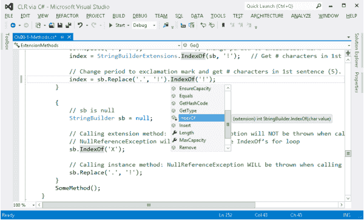

**图 8-1** Visual Studio 的 IntelliSense 窗口，显示扩展方法。

#### 规则和指南

关于扩展方法，还有一些你应该了解的附加规则和指南：

- C# 仅支持扩展方法；它不提供扩展属性、扩展事件、扩展运算符等。
- 扩展方法（第一个参数前带 this 的方法）必须在非泛型静态类中声明。不过，类的名称没有限制；你可以随意命名。当然，扩展方法必须至少有一个参数，并且只有第一个参数可以用 this 关键字标记。
- C# 编译器只查找那些自身定义在文件作用域的静态类中定义的扩展方法。换言之，如果你将静态类嵌套定义在另一个类中，C# 编译器将发出以下消息："error CS1109: 扩展方法必须定义在顶级静态类中；StringBuilderExtensions 是嵌套类。"
- 由于静态类可以是你想要的任何名称，C# 编译器在查找扩展方法时需要时间，因为它必须查看所有文件作用域的静态类，并扫描它们的静态方法以寻找匹配项。为了提高性能，同时避免考虑你可能不想要的扩展方法，C# 编译器要求你“导入”扩展方法。例如，如果某人在 Wintellect 命名空间中定义了 StringBuilderExtensions 类，那么想要访问该类扩展方法的程序员必须在其源代码文件顶部放置 using Wintellect; 指令。
- 多个静态类有可能定义相同的扩展方法。如果编译器检测到存在两个或更多扩展方法，那么编译器会发出以下消息："error CS0121: 以下方法或属性之间的调用不明确：'StringBuilderExtensions.IndexOf(string, char)' 和 'AnotherStringBuilderExtensions.IndexOf(string, char)'。" 要修复此错误，必须修改源代码。具体来说，你不能再使用实例方法语法来调用这个静态方法；相反，现在必须使用静态方法语法，在其中显式指出静态类的名称，以明确告诉编译器你想调用哪个方法。
- 你应谨慎使用此功能，因为并非所有程序员都熟悉它。例如，当你用扩展方法扩展某个类型时，实际上也在用该方法扩展派生类型。因此，你不应定义第一个参数为 System.Object 的扩展方法，因为该方法将可被所有表达式类型调用，并且这确实会污染 Visual Studio 的 IntelliSense 窗口。
- 扩展方法存在潜在的版本化问题。如果将来 Microsoft 向其 StringBuilder 类添加一个与我代码尝试调用的方法具有相同原型的 IndexOf 实例方法，那么当我重新编译代码时，编译器将绑定到 Microsoft 的 IndexOf 实例方法，而不是我的静态 IndexOf 方法。因此，我的程序将表现出不同的行为。这个版本化问题是应谨慎使用此功能的另一个原因。

#### 使用扩展方法扩展各种类型

在本章中，我演示了如何为 StringBuilder 类定义扩展方法。我想指出，由于扩展方法实际上是对静态方法的调用，CLR 不会生成代码来确保用于调用该方法的表达式的值不为 null：

```csharp
// sb is null
StringBuilder sb = null;

// Calling extension method: NullReferenceException will NOT be thrown when calling IndexOf
// NullReferenceException will be thrown inside IndexOf's for loop
sb.IndexOf('X');

// Calling instance method: NullReferenceException WILL be thrown when calling Replace
sb.Replace('.', '!');
```

我还想指出，你可以为接口类型定义扩展方法，如下代码所示：

```csharp
public static void ShowItems<T>(this IEnumerable<T> collection) {
    foreach (var item in collection)
        Console.WriteLine(item);
}
```

现在可以使用任何结果为实现了 IEnumerable<T> 接口的类型的表达式来调用上述扩展方法：

```csharp
public static void Main() {
    // Shows each Char on a separate line in the console
    "Grant".ShowItems();

    // Shows each String on a separate line in the console
    new[] { "Jeff", "Kristin" }.ShowItems();

    // Shows each Int32 value on a separate line in the console
    new List<Int32>() { 1, 2, 3 }.ShowItems();
}
```

**重要** 扩展方法是 Microsoft 语言集成查询（LINQ）技术的基石。关于提供许多扩展方法的类的一个很好的示例，请参阅 Microsoft .NET Framework SDK 文档中的静态 System.Linq.Enumerable 类及其所有静态扩展方法。该类中的每个扩展方法都扩展 IEnumerable 或 IEnumerable<T> 接口。

你也可以为委托类型定义扩展方法。下面是一个示例：

```csharp
public static void InvokeAndCatch<TException>(this Action<Object> d, Object o)
    where TException : Exception {
    try { d(o); }
    catch (TException) { }
}
```

下面是调用它的示例：

```csharp
Action<Object> action = o => Console.WriteLine(o.GetType()); // throws NullReferenceException
action.InvokeAndCatch<NullReferenceException>(null);          // Swallows NullReferenceException
```

你还可以向枚举类型添加扩展方法。我在第 15 章“枚举类型和位标志”的“向枚举类型添加方法”一节中展示了相关示例。

最后但同样重要的是，我想指出，C# 编译器允许你创建一个委托（更多信息参见第 17 章“委托”），该委托引用某个对象上的扩展方法：

```csharp
public static void Main () {
    // Create an Action delegate that refers to the static ShowItems extension method
    // and has the first argument initialized to reference the "Jeff" string.
    Action a = "Jeff".ShowItems;
    .
    .
    .
    // Invoke the delegate which calls ShowItems passing it a reference to the "Jeff" string.
    a();
}
```

在上面的代码中，C# 编译器生成 IL 代码来构造一个 Action 委托。创建委托时，构造函数会接收应被调用的方法，还会接收一个对象引用，该对象应传递给方法的隐藏 this 参数。通常，当你创建引用静态方法的委托时，对象引用为 null，因为静态方法没有 this 参数。然而，在此示例中，C# 编译器生成了一些特殊代码，创建一个引用静态方法（ShowItems）的委托，并且该静态方法的目标对象是对 "Jeff" 字符串的引用。之后，当调用委托时，CLR 将调用该静态方法，并将对 "Jeff" 字符串的引用传递给它。这有点取巧，但它工作得很好，而且只要不去想内部发生了什么，就会感觉很自然。

### 扩展特性

如果扩展方法这一概念并非 C# 专有，那将是最好的。具体来说，我们希望程序员在某种编程语言中定义一组扩展方法，并让其他编程语言中的人能够利用它们。为此，所选的编译器必须支持搜索静态类型和方法以寻找可能匹配的扩展方法。而且编译器需要快速完成这项工作，以便将编译时间保持在最低限度。

在 C# 中，当你用 this 关键字标记静态方法的第一个参数时，编译器会在内部对该方法应用一个自定义特性，并且该特性会持久化到生成文件的元数据中。该特性定义在 System.Core.dll 程序集中，其形式如下：

```csharp
// Developer-produced code in some other source code file:
internal class Derived : Base {
    protected override void OnNameChanging(string value) {
        if (String.IsNullOrEmpty(value))
            throw new ArgumentNullException("value");
    }
}
```

遗憾的是，上面的代码存在两个问题：

- 该类型必须是非密封类。不能对密封类或值类型使用此技术（因为值类型是隐式密封的）。此外，也不能对静态方法使用此技术，因为静态方法不能被重写。
- 这里存在效率问题。仅仅为了重写一个方法就定义了一个类型；这会浪费少量系统资源。而且，即使你不想重写 OnNameChanging 的行为，基类代码仍会调用一个虚方法，而该方法除了返回之外什么也不做。另外，无论 OnNameChanging 是否访问传给它的参数，ToUpper 都会被调用。

C# 的部分方法特性允许你选择重写某个类型的行为，同时修复上述问题。下面的代码使用部分方法来实现与前面代码相同的语义：

```csharp
// Tool-produced code in some source code file:
internal sealed partial class Base {
    private String m_name;

    // This defining-partial-method-declaration is called before changing the m_name field
    partial void OnNameChanging(String value);

    public String Name {
        get { return m_name; }
        set {
            OnNameChanging(value);   // Inform class of potential change
            m_name = value;           // Change the field
        }
    }
}
```

```csharp
// Developer-produced code in some other source code file:
internal sealed partial class Base {

    // This implementing-partial-method-declaration is called before m_name is changed
    partial void OnNameChanging(String value) {
        if (String.IsNullOrEmpty(value))
            throw new ArgumentNullException("value");
    }
}
```

不会调用 ToUpper 方法。结果是元数据/IL 更少，并且运行时性能极佳！

**注意** 部分方法的工作方式与 `System.Diagnostics.ConditionalAttribute` 特性类似。但是，部分方法仅在单个类型内起作用，而 `ConditionalAttribute` 可用于选择性地调用另一个类型中定义的方法。

#### 规则和准则

关于部分方法，还有一些你应该了解的附加规则和准则：

- 它们只能在部分类或部分结构中声明。
- 部分方法必须始终具有 void 返回类型，并且不能有任何用 `out` 修饰符标记的参数。设置这些限制是因为在运行时该方法可能不存在，因此你不能根据方法可能返回的内容来初始化变量，因为该方法可能不存在。同样，不能有 `out` 参数，因为方法必须初始化它，而该方法可能不存在。部分方法可以具有 `ref` 参数、可以是泛型的、可以是实例方法或静态方法，并且可以标记为不安全。
- 当然，定义部分方法声明和实现部分方法声明必须具有相同的签名。如果两者都应用了自定义特性，则编译器会将两个方法的特性合并在一起。应用于参数的任何特性也会被合并。
- 如果没有实现部分方法声明，那么不能有任何尝试创建引用该部分方法的委托的代码。原因同样是该方法在运行时不存在。编译器会生成以下消息：`error CS0762: Cannot create delegate from method 'Base.OnNameChanging(string)' because it is a partial method without an implementing declaration`。
- 部分方法始终被视为私有方法。但是，C# 编译器禁止你在部分方法声明之前放置 `private` 关键字。

## 第9章：参数

本章内容：

- 可选参数和命名参数
- 隐式类型局部变量
- 通过引用向方法传递参数
- 向方法传递可变数量的参数
- 参数和返回类型准则
- 常量性

本章重点介绍向方法传递参数的各种方式，包括如何可选地指定参数、按名称指定参数、通过引用传递参数，以及如何定义接受可变数量参数的方法。

### 可选参数和命名参数

设计方法的参数时，可以为部分或全部参数指定默认值。这样，调用这些方法的代码可以选择不指定某些实参，从而接受默认值。此外，调用方法时，可以使用参数名称来指定实参。以下代码演示了同时使用可选参数和命名参数：

```csharp
public static class Program {
    private static Int32 s_n = 0;

    private static void M(Int32 x = 9, String s = "A",
        DateTime dt = default(DateTime), Guid guid = new Guid()) {
        Console.WriteLine("x={0}, s={1}, dt={2}, guid={3}", x, s, dt, guid);
    }

    public static void Main() {
        // 1. Same as: M(9, "A", default(DateTime), new Guid());
        M();

        // 2. Same as: M(8, "X", default(DateTime), new Guid());
        M(8, "X");

        // 3. Same as: M(5, "A", DateTime.Now, Guid.NewGuid());
        M(5, guid: Guid.NewGuid(), dt: DateTime.Now);

        // 4. Same as: M(0, "1", default(DateTime), new Guid());
        M(s_n++, s_n++.ToString());

        // 5. Same as: String t1 = "2"; Int32 t2 = 3;
        //    M(t2, t1, default(DateTime), new Guid());
        M(s: (s_n++).ToString(), x: s_n++);
    }
}
```

运行此程序时，我得到以下输出：

```text
x=9, s=A, dt=1/1/0001 12:00:00 AM, guid=00000000-0000-0000-0000-000000000000
x=8, s=X, dt=1/1/0001 12:00:00 AM, guid=00000000-0000-0000-0000-000000000000
x=5, s=A, dt=8/16/2012 10:14:25 PM, guid=d24a59a0-6000-4aae-9295-839155811309
x=0, s=1, dt=1/1/0001 12:00:00 AM, guid=00000000-0000-0000-0000-000000000000
x=3, s=2, dt=1/1/0001 12:00:00 AM, guid=00000000-0000-0000-0000-000000000000
```

如你所见，每当在调用点省略实参时，C# 编译器就会嵌入该参数的默认值。第三次和第五次对 M 的调用使用了 C# 的命名参数特性。在这两次调用中，我显式传递了 x 的值，并指明我想要为名为 guid 和 dt 的参数传递实参。

向方法传递实参时，编译器从左到右计算实参。在第四次调用 M 时，s_n 中的值（0）被传递给 x，然后 s_n 递增，s_n 的值（1）被转换为字符串并传递给 s，然后 s_n 再次递增到 2。使用命名参数传递实参时，编译器仍然从左到右计算实参。在第五次调用 M 时，s_n 中的值（2）被转换为字符串，并保存在编译器创建的临时变量（t1）中。接着，s_n 递增到 3，这个值被保存在编译器创建的另一个临时变量（t2）中，然后 s_n 再次递增到 4。最终，调用 M，向它传递 t2、t1、一个默认 DateTime 和一个新的 Guid。

#### 规则和准则

为某些参数指定默认值来定义方法时，还有一些你应该了解的附加规则和准则：

- 可以为方法、构造函数以及带参数属性（C# 索引器）的参数指定默认值。还可以为委托定义中的参数指定默认值。这样，在调用此委托类型的变量时，可以省略实参并接受默认值。
- 带有默认值的参数必须位于所有没有默认值的参数之后。也就是说，一旦你将某个参数定义为具有默认值，那么它右侧的所有参数也必须具有默认值。例如，在 M 方法的定义中，如果我移除 s 的默认值（"A"），就会得到编译器错误。此规则有一个例外：params 数组参数（本章稍后讨论）必须位于所有参数（包括具有默认值的参数）之后，并且该数组本身不能具有默认值。
- 默认值必须是编译时已知的常量值。这意味着，可以为 C# 视为基元类型的类型参数设置默认值，如第 5 章“基元类型、引用类型和值类型”中的表 5-1 所示。这还包括枚举类型，并且任何引用类型都可以设置为 null。对于任意值类型的参数，可以将默认值设置为该值类型的实例，其中所有字段都包含零。可以使用 `default` 关键字或 `new` 关键字来表达这一点；两种语法生成相同的中间语言（IL）代码。我的 M 方法分别使用了这两种语法来设置 dt 参数和 guid 参数的默认值。
- 注意不要重命名参数变量，因为任何按参数名传递实参的调用方都将不得不修改其代码。例如，在 M 方法的声明中，如果我将 dt 变量重命名为 dateTime，那么前面代码中对 M 的第三次调用将导致编译器生成以下消息：`error CS1739: The best overload for 'M' does not have a parameter named 'dt'`。
- 请注意，如果从模块外部调用该方法，更改参数的默认值可能存在危险。调用点会将默认值嵌入其调用中。如果之后更改了参数的默认值，但没有重新编译包含该调用点的代码，那么它将使用旧的默认值调用你的方法。你可能希望考虑使用 0/null 作为默认值，作为指示默认行为的哨兵值；这样，你无需重新编译所有包含调用点的代码即可更改默认值。下面是一个示例：

```csharp
// Don't do this:
private static String MakePath(String filename = "Untitled") {
    return String.Format(@"C:\{0}.txt", filename);
}

// Do this instead:
private static String MakePath(String filename = null) {
    // I am using the null-coalescing operator (??) here; see Chapter 19
    return String.Format(@"C:\{0}.txt", filename ?? "Untitled");
}
```

- 不能为用 `ref` 或 `out` 关键字标记的参数设置默认值，因为无法为这些参数传递有意义的默认值。


使用可选参数或命名参数调用方法时，还有一些你应该了解的其他规则和准则：

-   实参可以按任意顺序传递；但是，命名实参必须始终出现在实参列表的末尾。
-   可以按名称将实参传递给没有默认值的形参，但必须传递所有必需实参（按位置或按名称），编译器才能编译代码。
-   C# 不允许像 `M(1, , DateTime.Now)` 那样省略逗号之间的实参，因为这可能导致难以阅读的数逗号代码。如果要为具有默认值的形参省略某些实参，请通过其形参名称传递实参。
-   若要按形参名称传递需要 ref/out 的实参，请使用如下语法：

```csharp
// Method declaration:
private static void M(ref Int32 x) { ... }

// Method invocation:
Int32 a = 5;
M(x: ref a);
```

**注意** 在编写与 Microsoft Office 中的 COM 对象模型互操作的 C# 代码时，C# 的可选参数和命名参数功能确实非常方便。而且，在调用 COM 组件时，C# 还允许在按引用传递实参时省略 ref/out，从而进一步简化编码。在不调用 COM 组件时，C# 要求对实参应用 out/ref 关键字。

### `DefaultParameterValue` 和 `Optional` 特性

如果这种默认实参和可选实参的概念不是 C# 特有的，那将是最好的。具体来说，我们希望程序员在某种编程语言中定义方法时，指明哪些形参是可选的以及它们的默认值应该是什么，然后让使用其他编程语言的程序员能够调用它们。为了实现这一点，所选的编译器必须允许调用方省略某些实参，并且有一种方法来确定这些实参的默认值应该是什么。

在 C# 中，当你为形参指定默认值时，编译器会在内部将 `System.Runtime.InteropServices.OptionalAttribute` 自定义特性应用于该形参，并且此特性会持久保存在生成文件的元数据中。此外，编译器会将 `System.Runtime.InteropServices.DefaultParameterValueAttribute` 应用于该形参，并将此特性持久保存在生成文件的元数据中。然后，将你在源代码中指定的常量值传递给 `DefaultParameterValueAttribute` 的构造函数。

现在，当编译器看到你的代码调用某个方法时缺少一些实参，编译器可以确保你省略的是可选实参，从元数据中获取它们的默认值，并自动将这些值嵌入到调用中。

### 隐式类型局部变量

C# 支持从用于初始化方法局部变量的表达式类型推断该局部变量的类型。下面是一些演示此功能用法的示例代码：

```csharp
private static void ImplicitlyTypedLocalVariables() {
    var name = "Jeff";
    ShowVariableType(name);        // Displays: System.String

    // var n = null;            // Error: Cannot assign <null> to an implicitly-typed local variable
    var x = (String)null;    // OK, but not much value
    ShowVariableType(x);        // Displays: System.String

    var numbers = new Int32[] { 1, 2, 3, 4 };
    ShowVariableType(numbers); // Displays: System.Int32[]

    // Less typing for complex types
    var collection = new Dictionary<String, Single>() { { "Grant", 4.0f } };

    // Displays: System.Collections.Generic.Dictionary`2[System.String,System.Single]
    ShowVariableType(collection);

    foreach (var item in collection) {
        // Displays: System.Collections.Generic.KeyValuePair`2[System.String,System.Single]
        ShowVariableType(item);
    }
}

private static void ShowVariableType<T>(T t) {
    Console.WriteLine(typeof(T));
}
```

`ImplicitlyTypedLocalVariables` 方法内的第一行代码使用 C# `var` 标记引入了一个新的局部变量。为了确定 name 变量的类型，编译器会查看赋值运算符（`=`）右侧表达式的类型。由于 "Jeff" 是字符串，编译器推断 name 的类型必须是 String。为了证明编译器正确推断了类型，我编写了 `ShowVariableType` 方法。这个泛型方法推断其实参的类型，然后在控制台上显示它推断出的类型。为了便于阅读，我在 `ImplicitlyTypedLocalVariables` 方法内以注释形式添加了 `ShowVariableType` 显示的内容。

`ImplicitlyTypedLocalVariables` 方法内的第二个赋值（已注释掉）会产生编译器错误（“error CS0815: Cannot assign <null> to an implicitly-typed local variable”），因为 null 可以隐式转换为任何引用类型或可空值类型；因此，编译器无法为它推断出不同的类型。不过，在第三个赋值中，我展示了如果你显式指定类型（在我的示例中是 String），就可以用 null 初始化隐式类型局部变量。虽然这可行，但并没有太大用处，因为你也可以编写 String x = null; 来得到相同的结果。

在第四个赋值中，你会看到使用 C# 隐式类型局部变量功能的一些真正价值。如果没有此功能，你就必须在赋值运算符两侧都指定 Dictionary<String, Single>。这不仅需要大量输入，而且如果你决定更改集合类型或任何泛型参数类型，那么你还必须同时修改赋值运算符两侧的代码。

在 foreach 循环中，我也使用 var 让编译器自动推断集合内元素的类型。这表明将 var 与 foreach、using 和 for 语句一起使用是可行的，而且非常有用。在试验代码时，它也可能很有用。例如，你从某个方法的返回类型初始化一个隐式类型局部变量，而在开发该方法的过程中，你可能会决定更改其返回类型。如果这样做，编译器会自动发现返回类型已更改，并自动更改变量的类型！这很棒，但当然，如果方法中使用该变量的其他代码在访问成员时假定它是旧类型，那么这些代码可能无法再编译。

在 Microsoft Visual Studio 中，你可以将鼠标光标悬停在源代码中的 var 上，编辑器会显示一个工具提示，向你展示编译器从表达式推断出的类型。在方法内处理匿名类型时，必须使用 C# 的隐式类型局部变量功能；有关更多详细信息，请参见第 10 章“属性”。

不能使用 var 声明方法的形参类型。其原因对你来说应该很明显，因为编译器必须根据调用点传递的实参来推断形参类型，而调用点可能不存在，也可能有很多。此外，不能使用 var 声明类型的字段。C# 有此限制的原因有很多。一个原因是字段可以被多个方法访问，而 C# 团队认为这种契约（变量的类型）应该显式声明。另一个原因是，允许这样做会使匿名类型（在第 10 章中讨论）泄漏到单个方法之外。

**重要** 不要混淆 dynamic 和 var。使用 var 声明局部变量只是一种语法快捷方式，让编译器从表达式推断具体数据类型。var 关键字只能用于声明方法内的局部变量，而 dynamic 关键字可用于局部变量、字段和实参。不能将表达式强制转换为 var，但可以将表达式强制转换为 dynamic。必须显式初始化使用 var 声明的变量，而使用 dynamic 声明的变量则不必初始化。有关 C# 动态类型的更多信息，请参见第 5 章中的“dynamic 基元类型”一节。

### 按引用向方法传递参数

默认情况下，公共语言运行时（CLR）假定所有方法形参都按值传递。当传递引用类型对象时，传递的是对象的引用（或指针）（按

```csharp
AddVal(ref x);          // x must be initialized.
Console.WriteLine(x);   // Displays "15"
}

private static void AddVal(ref Int32 y) {
    y += 10;  // This method can use the initialized value in y.
}
}
```

在这段代码中，x 也在 Main 的栈帧中声明，并初始化为 5。然后，x 的地址被传递给 AddVal。AddVal 的 y 是指向 Main 栈帧中 Int32 值的指针。在 AddVal 内部，y 所指向的 Int32 必须已经有一个值。因此，AddVal 可以在它希望的任何表达式中使用该初始值。AddVal 也可以更改该值，而新值将被“返回”给调用方。在此示例中，AddVal 将初始值加 10。当 AddVal 返回时，Main 的 x 将包含 15，这就是在控制台中显示的内容。

总之，从 IL 或 CLR 的角度来看，out 和 ref 所做的完全相同：它们都会导致传递一个指针。不同之处在于，编译器会帮助确保你的代码是正确的。下面的代码尝试将未初始化的值传递给一个期望 ref 参数的方法，会产生以下消息：“error CS0165：使用了未赋值的局部变量 'x'。”

```csharp
public sealed class Program {
    public static void Main() {
        Int32 x;             // x is not initialized.

        // The following line fails to compile, producing
        // error CS0165: Use of unassigned local variable 'x'.
        AddVal(ref x);

        Console.WriteLine(x);
    }

    private static void AddVal(ref Int32 y) {
        y += 10;  // This method can use the initialized value in y.
    }
}
```

**重要** 我经常被问到，为什么 C# 要求对方法的调用必须指定 out 或 ref。毕竟，编译器知道被调用的方法是否需要 out 或 ref，并且应该能够正确编译代码。事实证明，编译器确实可以自动做出正确的处理。然而，C# 语言的设计者认为调用方应该明确表达其意图。这样，在调用点就能清楚地看出，被调用的方法预期会更改所传递变量的值。

此外，CLR 允许根据方法对 out 和 ref 参数的使用来重载方法。例如，在 C# 中，以下代码是合法的，并且可以正常编译：

```csharp
public sealed class Point {
    static void Add(Point p) { ... }
    static void Add(ref Point p) { ... }
}
```

仅通过 out 和 ref 来区分的方法重载是不合法的，因为这些方法签名在元数据中的表示形式会是相同的。因此，我也不能在前面的 Point 类型中定义以下方法：

```csharp
static void Add(out Point p) { ... }
```

如果你尝试将最后一个 Add 方法包含在 Point 类型中，C# 编译器会发出以下消息：
“error CS0663：'Add' 无法定义重载方法，因为仅在 ref 和 out 上有区别。”

对值类型使用 out 和 ref 所得到的行为，与按值传递引用类型时已经得到的行为相同。对于值类型，你添加 ref，并允许方法操作单个值类型实例。调用方必须为该实例分配内存，而被调用方则操作该内存。对于引用类型，调用方为指向引用对象的指针分配内存，而被调用方操作该指针。由于这种行为，对引用类型使用 out 和 ref 只有在方法要“返回”一个它已知对象的引用时才有用。以下代码演示了这一点：

```csharp
using System;
using System.IO;

public sealed class Program {
    public static void Main() {
        FileStream fs;    // fs is uninitialized

        // Open the first file to be processed.
        StartProcessingFiles(out fs);

        // Continue while there are more files to process.
        for (; fs != null; ContinueProcessingFiles(ref fs)) {

            // Process a file.
            fs.Read(...);
        }
    }

    private static void StartProcessingFiles(out FileStream fs) {
        fs = new FileStream(...);  // fs must be initialized in this method
    }

    private static void ContinueProcessingFiles(ref FileStream fs) {
        fs.Close();  // Close the last file worked on.

        // Open the next file, or if no more files, "return" null.
        if (noMoreFilesToProcess) fs = null;
        else fs = new FileStream(...);
    }
}
```

如你所见，这段代码的主要区别在于，具有 out 或 ref 引用类型参数的方法会构造一个对象，并将指向新对象的指针返回给调用方。

你还会注意到，`ContinueProcessingFiles` 方法可以在返回新对象之前操作传入它的对象。这是可行的，因为该参数用 `ref` 关键字标记。你可以稍微简化前面的代码，如下所示：

```csharp
using System;
using System.IO;

public sealed class Program {
    public static void Main() {
        FileStream fs = null;  // Initialized to null (required)

        // Open the first file to be processed.
        ProcessFiles(ref fs);

        // Continue while there are more files to process.
        for (; fs != null; ProcessFiles(ref fs)) {
            // Process a file.
            fs.Read(...);
        }
    }

    private static void ProcessFiles(ref FileStream fs) {
        // Close the previous file if one was open.
        if (fs != null) fs.Close();  // Close the last file worked on.

        // Open the next file, or if no more files, “return” null.
        if (noMoreFilesToProcess) fs = null;
        else fs = new FileStream (...);
    }
}
```

下面是另一个示例，演示如何使用 `ref` 关键字实现交换两个引用类型的方法：

```csharp
public static void Swap(ref Object a, ref Object b) {
    Object t = b;
    b = a;
    a = t;
}
```

要交换对两个 `String` 对象的引用，你可能会认为可以编写如下代码：

```csharp
public static void SomeMethod() {
    String s1 = "Jeffrey";
    String s2 = "Richter";

    Swap(ref s1, ref s2);
    Console.WriteLine(s1);  // Displays "Richter"
    Console.WriteLine(s2);  // Displays "Jeffrey"
}
```

然而，这段代码无法编译。问题在于，通过引用传递给方法的变量必须与方法签名中声明的类型相同。换句话说，Swap 期望两个 Object 引用，而不是两个 String 引用。要交换这两个 String 引用，你必须这样做：

```csharp
public static void SomeMethod() {
    String s1 = "Jeffrey";
    String s2 = "Richter";

    // Variables that are passed by reference
    // must match what the method expects.
    Object o1 = s1, o2 = s2;
    Swap(ref o1, ref o2);

    // Now cast the objects back to strings.
    s1 = (String) o1;
    s2 = (String) o2;

    Console.WriteLine(s1);  // Displays "Richter"
    Console.WriteLine(s2);  // Displays "Jeffrey"
}
```

这个版本的 SomeMethod 确实可以按预期编译和执行。传入的参数必须与方法期望的参数匹配，原因是要确保类型安全得以保留。以下代码（幸好无法编译）展示了类型安全可能如何被破坏。

```csharp
internal sealed class SomeType {
    public Int32 m_val;
}

public sealed class Program {
    public static void Main() {
        SomeType st;

        // The following line generates error CS1503: Argument '1':
        // cannot convert from 'ref SomeType' to 'ref object'.
        GetAnObject(out st);

        Console.WriteLine(st.m_val);
    }

    private static void GetAnObject(out Object o) {
        o = new String('X', 100);
    }
}
```

在这段代码中，Main 显然期望 GetAnObject 返回一个 SomeType 对象。然而，由于 GetAnObject 的签名表明参数是对 Object 的引用，GetAnObject 可以随意将 o 初始化为任意类型的对象。在此示例中，当 GetAnObject 返回 Main 时，st 将引用一个 String，而它显然不是 SomeType 对象，因此对 Console.WriteLine 的调用肯定会失败。幸运的是，C# 编译器不会编译前面的代码，因为 st 是对 SomeType 的引用，而 GetAnObject 要求对 Object 的引用。

你可以使用泛型修复这些方法，使它们按你预期的方式工作。以下是修复前面所示 Swap 方法的方法：


```csharp
public static void Swap<T>(ref T a, ref T b) {
    T t = b;
    b = a;
    a = t;
}
```

现在，按照上面的方式重写 Swap 之后，以下代码（与之前展示的代码相同）将能够完美地编译并运行。

```csharp
public static void SomeMethod() {
    String s1 = "Jeffrey";
    String s2 = "Richter";

    Swap(ref s1, ref s2);
    Console.WriteLine(s1);  // Displays "Richter"
    Console.WriteLine(s2);  // Displays "Jeffrey"
}
```

有关使用泛型解决此问题的其他一些示例，请参阅 System.Threading 的 Interlocked 类及其 CompareExchange 和 Exchange 方法。

### 向方法传递可变数量的参数

有时，开发者定义能够接受可变数量参数的方法会很方便。例如，System.String 类型提供了一些方法，允许将任意数量的字符串连接在一起，也提供了一些方法，允许调用方指定一组要一起格式化的字符串。

要声明接受可变数量参数的方法，可以按如下方式声明该方法：

```csharp
static Int32 Add(params Int32[] values) {
    // NOTE: it is possible to pass the 'values'
    // array to other methods if you want to.

    Int32 sum = 0;
    if (values != null) {
        for (Int32 x = 0; x < values.Length; x++)
            sum += values[x];
    }
    return sum;
}
```

这个方法中的所有内容对你来说应该都非常熟悉，除了应用于方法签名最后一个参数的 params 关键字。暂时忽略 params 关键字，很明显，此方法接受一个 Int32 值数组，遍历该数组并将所有值相加。得到的和返回给调用方。

显然，代码可以按如下方式调用此方法：

对于传递给它的每个对象：

```csharp
public sealed class Program {
    public static void Main() {
        DisplayTypes(new Object(), new Random(), "Jeff", 5);
    }

    private static void DisplayTypes(params Object[] objects) {
        if (objects != null) {
            foreach (Object o in objects)
                Console.WriteLine(o.GetType());
        }
    }
}
```

运行这段代码会生成以下输出：

```text
System.Object
System.Random
System.String
System.Int32
```

**重要** 请注意，调用接受可变数量参数的方法会带来额外的性能开销，除非显式传递 null。毕竟，必须在堆上分配数组对象，必须初始化数组的元素，并且数组的内存最终必须被垃圾回收。为了帮助减少与此相关的性能开销，你可以考虑定义几个不使用 params 关键字的重载方法。例如，请查看 System.String 类的 Concat 方法，它具有以下重载：

```csharp
public sealed class String : Object, ... {
    public static string Concat(object arg0);
    public static string Concat(object arg0, object arg1);
    public static string Concat(object arg0, object arg1, object arg2);
    public static string Concat(params object[] args);

    public static string Concat(string str0, string str1);
    public static string Concat(string str0, string str1, string str2);
    public static string Concat(string str0, string str1, string str2, string str3);
    public static string Concat(params string[] values);
}
```

如你所见，Concat 方法定义了若干不使用 params 关键字的重载。这些 Concat 方法版本是最常被调用的重载，这些重载的存在是为了提高最常见场景下的性能。使用 params 关键字的重载则用于不太常见的场景；这些场景会承受性能开销，但幸运的是，它们很少见。

### 参数和返回类型指南

在声明方法的参数类型时，应指定尽可能弱的类型，优先使用接口而不是基类。例如，如果你正在编写一个操作项集合的方法，最好使用诸如 `IEnumerable<T>` 这样的接口来声明该方法的参数，而不是使用诸如 `List<T>` 这样的强数据类型，甚至更强的接口类型，如 `ICollection<T>` 或 `IList<T>`：

```csharp
// Desired: This method uses a weak parameter type
public void ManipulateItems<T>(IEnumerable<T> collection) { ... }
```

```csharp
// Undesired: This method uses a strong parameter type
public void ManipulateItems<T>(List<T> collection) { ... }
```

原因当然是，调用第一个方法时可以传入数组对象、`List<T>` 对象、String 对象等——任何类型实现了 `IEnumerable<T>` 的对象。第二个方法只允许传入 `List<T>` 对象；它不会接受数组或 String 对象。显然，第一个方法更好，因为它灵活得多，可用于更广泛的场景。

当然，如果你正在编写一个需要列表（而不只是任意可枚举对象）的方法，那么应将参数类型声明为 `IList<T>`。你仍然应避免将参数类型声明为 `List<T>`。使用 `IList<T>` 允许调用方传入数组以及类型实现了 `IList<T>` 的任何其他对象。

请注意，我的示例讨论的是集合，集合是使用接口体系结构设计的。如果我们讨论的是使用基类体系结构设计的类，这一概念仍然适用。因此，例如，如果我们要实现一个处理来自流的字节的方法，我们会这样写：

```csharp
// Desired: This method uses a weak parameter type
public void ProcessBytes(Stream someStream) { ... }
```

```csharp
// Undesired: This method uses a strong parameter type
public void ProcessBytes(FileStream fileStream) { ... }
```

第一个方法可以处理来自任何类型流的字节：FileStream、NetworkStream、MemoryStream 等。第二个方法只能对 FileStream 操作，因此受限得多。

另一方面，通常最好使用尽可能强的类型来声明方法的返回类型（尽量不要让自己受限于某个特定类型）。例如，声明一个返回 FileStream 对象的方法，比声明一个返回 Stream 对象的方法更好：

```csharp
// Desired: This method uses a strong return type
public FileStream OpenFile() { ... }
```

```csharp
// Undesired: This method uses a weak return type
public Stream OpenFile() { ... }
```

这里首选第一个方法，因为它允许方法调用方选择将返回的对象当作 FileStream 对象或 Stream 对象来处理。同时，第二个方法要求调用方将返回的对象当作 Stream 对象。基本上，最好让调用方在调用方法时拥有尽可能大的灵活性，使该方法可用于最广泛的场景。

有时你希望保留更改方法内部实现而不影响调用方的能力。在刚才所示的示例中，OpenFile 方法不太可能更改其内部实现来返回 FileStream 对象以外的任何内容（或类型派生自 FileStream 的对象）。然而，如果你有一个返回 `List<String>` 对象的方法，你很可能希望在将来更改该方法的内部实现，使其改为返回 `String[]`。在你希望为自己留有一些灵活性以更改方法返回内容的情况下，请选择较弱的返回类型。例如：

```csharp
// Flexible: This method uses a weaker return type
public IList<String> GetStringCollection() { ... }
```

```csharp
// Inflexible: This method uses a stronger return type
public List<String> GetStringCollection() { ... }
```

在此示例中，尽管 GetStringCollection 方法内部使用 `List<String>` 对象并返回它，但最好将该方法原型声明为返回 `IList<String>`。将来，GetStringCollection 方法可以将其内部集合改为使用 `String[]`，而该方法的调用方无需更改任何源代码。事实上，他们甚至不必重新编译代码。请注意，在此示例中，我使用的是最弱类型中最强的类型。例如，我没有使用 `IEnumerable<String>`，甚至也没有使用 `ICollection<String>`。

### 常量性

在某些语言（例如非托管 C++）中，可以将方法或参数声明为常量，从而禁止实例方法中的代码更改对象的任何字段，或阻止代码修改传入方法的任何对象。CLR 不提供此功能，许多程序员一直对这一缺失的特性感到遗憾。由于 CLR 不提供此功能，因此任何语言（包括 C#）都无法提供此功能。

首先，你应该注意，在非托管 C++ 中，将实例方法或参数标记为 const 只能确保程序员无法编写会修改对象或参数的常规代码。在方法内部，始终可以编写代码来改变对象/参数：要么通过强制转换去掉 const 属性，要么获取对象/参数的地址然后写入该地址。从某种意义上说，非托管 C++ 对程序员撒了谎，让他们相信自己的常量对象/参数不能被写入，尽管实际上可以。

在设计类型的实现时，开发者只需避免编写会操作对象/参数的代码。例如，字符串是不可变的，因为 String 类不提供任何可以更改字符串对象的方法。


此外，要让微软为CLR赋予验证常量对象/参数是否被修改的能力是非常困难的。CLR 必须在每次写入时验证该写入是否针对常量对象，这会显著损害性能。当然，一旦检测到违规，CLR 将抛出异常。而且，常量支持还会给开发人员带来许多复杂性。例如，如果某个类型是不可变的，那么所有派生类型都必须遵守这一约束。此外，不可变类型可能还必须由同样是不可变类型的字段组成。

以上只是 CLR 不支持常量对象/参数的部分原因。

相关信息，可以使用类似下面的代码来查询和设置：

```csharp
Employee e = new Employee();
e.Name = "Jeffrey Richter";   // Set the employee's Name.
e.Age  = 48;                 // Set the employee's Age.

Console.WriteLine(e.Name);   // Displays "Jeffrey Richter"
```

按照我刚才演示的方式查询和设置对象的状态信息是非常常见的。然而，我认为前面的代码不应该按所示方式实现。面向对象设计和编程的标志之一是*数据封装*。数据封装意味着类型的字段永远不应公开暴露，因为很容易编写不当使用字段的代码，从而破坏对象的状态。例如，开发人员很容易用如下代码破坏 Employee 对象：

```csharp
e.Age = -5; // How could someone be -5 years old?
```

封装类型数据字段的访问还有其他原因。例如，你可能希望在访问字段时执行某些副作用、缓存某个值或惰性创建某个内部对象。你可能还希望访问字段是线程安全的。或者，该字段可能是一个逻辑字段，其值并不由内存中的字节表示，而是通过某种算法计算得出。

出于这些原因，在设计类型时，我强烈建议所有字段都设为 private。然后，为了允许类型的用户获取或设置状态信息，你为这个特定目的公开方法。包装字段访问的方法通常称为访问器方法。这些访问器方法可以选择性地执行合理性检查，确保对象的状态永远不会被破坏。例如，我会将前面的类重写如下：

```csharp
public sealed class Employee {
    private String m_Name;      // Field is now private
    private Int32  m_Age;       // Field is now private

    public String GetName() {
        return(m_Name);
    }

    public void SetName(String value) {
        m_Name = value;
    }

    public Int32 GetAge() {
        return(m_Age);
    }

    public void SetAge(Int32 value) {
        if (value < 0)
            throw new ArgumentOutOfRangeException("value", value.ToString(),
                "The value must be greater than or equal to 0");
        m_Age = value;
    }
}
```

虽然这是一个简单的例子，但你仍然应该能够看到封装数据字段带来的巨大好处。你还应该看到创建只读或只写属性是多么容易：只需不实现其中一个访问器方法即可。或者，你可以通过将 SetXxx 方法标记为 protected 来允许只有派生类型修改该值。

如上所示封装数据有两个缺点。第一，你必须编写更多代码，因为必须实现额外的方法。第二，类型的用户现在必须调用方法而不是简单地引用单个字段名。

```csharp
e.SetName("Jeffrey Richter");    // updates the employee's name
String EmployeeName = e.GetName(); // retrieves the employee's name
e.SetAge(48);                    // Updates the employee's age
e.SetAge(-5);                    // Throws ArgumentOutOfRangeException
Int32 EmployeeAge = e.GetAge();  // retrieves the employee's age
```

就个人而言，我认为这些缺点相当微不足道。然而，编程语言和 CLR 提供了一种称为属性的机制，它稍微缓解了第一个缺点，并完全消除了第二个缺点。

这里显示的类使用了属性，并且与前面显示的类在功能上相同：

```csharp
public sealed class Employee {
    private String m_Name;
    private Int32  m_Age;

    public String Name {
        get { return(m_Name); }
        set { m_Name = value; } // The 'value' keyword always identifies the new value.
    }

    public Int32 Age {
        get { return(m_Age); }
        set {
            if (value < 0)   // The 'value' keyword always identifies the new value.
                throw new ArgumentOutOfRangeException("value", value.ToString(),
                    "The value must be greater than or equal to 0");
            m_Age = value;
        }
    }
}
```

如你所见，属性使类型的定义稍微复杂化，但它们允许你像下面这样编写代码，这一事实足以弥补额外的工作：

```csharp
e.Name = "Jeffrey Richter";    // "sets" the employee name
String EmployeeName = e.Name;  // "gets" the employee's name
e.Age = 48;                    // "sets" the employee's age
e.Age = -5;                    // Throws ArgumentOutOfRangeException
Int32 EmployeeAge = e.Age;     // "gets" the employee's age
```

你可以将属性视为智能字段：背后带有额外逻辑的字段。CLR 支持静态、实例、抽象和虚属性。此外，属性可以用任何可访问性修饰符（在第6章“类型和成员基础”中讨论）进行标记，并且可以在接口中定义（在第13章“接口”中讨论）。

每个属性都有一个名称和一个类型（不能是 void）。属性不能重载（也就是说，不能有两个名字相同但类型不同的属性）。在定义属性时，通常要同时指定 get 和 set 方法。但是，你可以省略 set 方法来定义只读属性，或省略 get 方法来定义只写属性。

属性通常也会让 get/set 方法操作类型中定义的私有字段。这个字段通常称为后备字段。然而，get 和 set 方法并不一定需要访问后备字段。例如，System.Threading.Thread 类型提供了一个直接与操作系统通信的 Priority 属性；Thread 对象不为线程优先级维护字段。没有后备字段的属性的另一个例子是那些在运行时计算的只读属性——例如，零终止数组的长度，或者当你有矩形的高度和宽度时它的面积。

定义属性时，根据其定义，编译器会将以下两项或三项内容写入生成的托管程序集中：

-   表示属性 get 访问器方法的方法。仅当为属性定义了 get 访问器方法时才会发出。
-   表示属性 set 访问器方法的方法。仅当为属性定义了 set 访问器方法时才会发出。
-   托管程序集元数据中的属性定义。始终会发出。

回顾前面显示的 Employee 类型。当编译器编译此类型时，它会遇到 Name 和 Age 属性。因为这两个属性都有 get 和 set 访问器方法，所以编译器会向 Employee 类型发出四个方法定义。就好像原始源代码是这样写的：

```csharp
public sealed class Employee {
    private String m_Name;
    private Int32 m_Age;

    public String get_Name(){
        return m_Name;
    }
    public void set_Name(String value) {
        m_Name = value; // The argument 'value' always identifies the new value.
    }

    public Int32 get_Age() {
        return m_Age;
    }

    public void set_Age(Int32 value) {
```


```csharp
if (value < 0)        // The 'value' always identifies the new value.
    throw new ArgumentOutOfRangeException("value", value.ToString(),
        "The value must be greater than or equal to 0");
m_Age = value;
}
}
}
```

编译器会通过在开发者指定的属性名前面加上 `get_` 或 `set_` 来自动为这些方法生成名称。

C# 内置支持属性。当 C# 编译器看到试图获取或设置属性的代码时，编译器实际上会生成对其中一个方法的调用。如果你使用的编程语言不直接支持属性，你仍然可以通过调用所需的访问器方法来访问属性。效果完全相同；只是源代码看起来不那么漂亮。

除了生成访问器方法之外，编译器还会为源代码中定义的每个属性，在托管程序集的元数据中生成一个属性定义项。该项包含一些标志和属性的类型，并引用 get 和 set 访问器方法。这些信息的存在只是为了在“属性”这一抽象概念与其访问器方法之间建立关联。编译器和其它工具可以使用此元数据，该元数据可通过使用 System.Reflection.PropertyInfo 类获得。CLR 不使用此元数据信息，在运行时只需要访问器方法。

#### 自动实现的属性

如果你创建属性只是为了简单地封装一个支持字段，那么 C# 提供了一种简化的语法，称为自动实现的属性 (AIP)，如下所示为 Name 属性所示：

```csharp
public sealed class Employee {
    // This property is an automatically implemented property
    public String Name { get; set; }

    private Int32 m_Age;

    public Int32 Age {
        get { return(m_Age); }
        set {
            if (value < 0)    // The 'value' keyword always identifies the new value.
                throw new ArgumentOutOfRangeException("value", value.ToString(),
                    "The value must be greater than or equal to 0");
            m_Age = value;
        }
    }
}
```

当你声明一个属性并且不为 get/set 方法提供实现时，C# 编译器会自动为你声明一个私有字段。在此示例中，该字段的类型将为 String，即属性的类型。而且，编译器会自动为你实现 get_Name 和 set_Name 方法，分别用于返回字段中的值和设置字段的值。

你可能会想，这样做与只声明一个名为 Name 的公共 String 字段相比有什么价值。嗯，有很大的区别。使用 AIP 语法意味着你已经创建了一个属性。任何访问此属性的代码实际上都在调用 get 和 set 方法。如果你后来决定自己实现 get 和/或 set 方法，而不是接受编译器的默认实现，那么任何访问该属性的代码都不必重新编译。但是，如果你将 Name 声明为字段，然后后来将其改为属性，那么所有访问该字段的代码都必须重新编译，以便现在访问属性方法。

- 就个人而言，我不喜欢编译器的 AIP 功能，因此通常出于以下原因避免使用它：字段声明的语法可以包含初始化，这样你就可以在一行代码中声明并初始化字段。然而，没有方便的语法将 AIP 设置为初始值。因此，你必须在每个构造函数方法中显式初始化每个 AIP。

- 运行时序列化引擎会将字段的名称持久化到序列化流中。AIP 的支持字段的名称由编译器决定，而且每次重新编译代码时，它实际上可能会更改此支持字段的名称，从而使反序列化包含 AIP 的任何类型的实例的能力失效。不要对你打算序列化或反序列化的任何类型使用 AIP 功能。

- 调试时，你不能在 AIP 的 get 或 set 方法上放置断点，因此无法轻松检测应用程序何时获取或设置此属性。你可以在手动实现的属性上设置断点，这在跟踪 bug 时非常方便。

你还应该知道，当你使用 AIP 时，属性必须可读和可写；也就是说，编译器必须同时生成 get 和 set 方法。这是合理的，因为只写字段如果无法读取其值就没有用；同样，只读字段将始终具有其默认值。此外，由于你不知道编译器生成的支持字段的名称，你的代码必须始终使用属性名来访问该属性。而且，如果你决定显式实现其中一个访问器方法，那么你必须显式实现两个访问器方法，并且你不再使用 AIP 功能。对于单个属性，AIP 功能是全有或全无的。

#### 明智地定义属性

就个人而言，我不喜欢属性，我希望 Microsoft .NET Framework 及其编程语言不支持属性。原因是属性看起来像字段，但它们是方法。众所周知，这会导致大量的混淆。当程序员看到看起来像是在访问字段的代码时，程序员会做出许多假设，而这些假设对于属性来说可能并不成立。例如，

- 属性可以是只读或只写的；字段访问始终可读和可写。如果你定义属性，最好同时提供 get 和 set 访问器方法。

- 属性方法可能抛出异常；字段访问从不抛出异常。

- 属性不能作为 out 或 ref 参数传递给方法；字段可以。例如，以下代码将无法编译：

```csharp
using System;

public sealed class SomeType {
   private static String Name {
      get { return null; }
      set {}
   }

   static void MethodWithOutParam(out String n) { n = null; }

   public static void Main() {
      // For the line of code below, the C# compiler emits the following:
      // error CS0206: A property, indexer or dynamic member access may not
      // be passed as an out or ref parameter
      MethodWithOutParam(out Name);
   }
}
```

- 属性方法可能需要很长时间执行；字段访问始终立即完成。使用属性的一个常见原因是执行线程同步，这可能会永久停止线程，因此，如果需要线程同步，则不应使用属性。在这种情况下，首选方法是方法。此外，如果你的类可以远程访问（例如，你的类派生自 System.MarshalByRefObject），调用属性方法会非常慢，因此，方法优先于属性。在我看来，派生自 MarshalByRefObject 的类永远不应使用属性。

- 如果连续多次调用，属性方法可能每次返回不同的值；字段每次返回相同的值。System.DateTime 类有一个只读的 Now 属性，返回当前日期和时间。每次查询此属性时，它都会返回不同的值。这是一个错误，Microsoft 希望他们可以通过将 Now 改为方法而不是属性来修复该类。Environment 的 TickCount 属性是此错误的另一个示例。

- 属性方法可能导致可观察的副作用；字段访问从不这样做。换句话说，类型的用户应该能够以他或她选择的任何顺序设置类型定义的各种属性，而不会注意到该类型有任何不同的行为。

- 属性方法可能需要额外的内存，或返回对实际上不属于对象状态的内容的引用，因此修改返回的对象对原始对象没有影响；查询字段始终返回对保证属于原始对象状态的对象的引用。使用返回副本的属性可能会让开发人员非常困惑，而且这种特性通常没有文档记录。

我注意到人们使用属性的频率远高于应有的程度。如果你

审视一下属性和字段之间的这些差异列表，你会发现，定义属性实际上有用且不会给开发人员带来困惑的情况少之又少。属性唯一能给你带来的就是一些简化的语法；与调用非属性方法相比，它没有任何性能优势，而且代码的可理解性会降低。如果我参与了.NET Framework和编译器的设计，我根本不会提供属性；相反，我会让程序员按需实现GetXxx和SetXxx方法。那么，如果编译器想为调用这些方法提供某种特殊的简化语法，也未尝不可。但我希望编译器使用的语法与字段访问语法不同，这样程序员就能真正理解他们在做什么——一次方法调用。

#### 属性和Visual Studio调试器

Microsoft Visual Studio允许你在调试器的监视窗口中输入对象的属性。当你这样做时，每次命中断点，调试器都会调用属性的get访问器方法并显示返回的值。这在追踪bug时非常有用，但也可能导致bug发生并损害你的调试性能。例如，假设你为网络共享上的文件创建了一个FileStream，然后将FileStream的Length属性添加到调试器的监视窗口中。现在，每次命中断点，调试器都会调用Length的get访问器方法，该方法内部会向服务器发出网络请求以获取文件的当前长度！

同样，如果你的属性的get访问器方法有副作用，那么每次命中断点时这个副作用都会执行。例如，假设你的属性的get访问器方法每次被调用时都会递增一个计数器；现在每次命中断点时，这个计数器也会被递增。由于这些潜在问题，Visual Studio允许你关闭监视窗口中显示的属性的属性计算。要在Visual Studio中关闭属性计算，请选择“工具”、“选项”、“调试”和“常规”，然后在图10-1的列表框中，清除“启用属性计算和其他隐式函数调用”选项。请注意，即使清除了此项，你仍然可以将属性添加到监视窗口，并通过单击监视窗口“值”列中的强制计算圆圈来手动强制Visual Studio计算它。

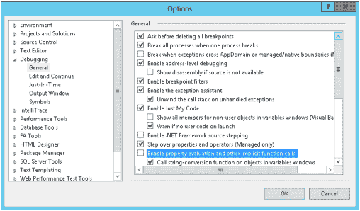

**图10-1** Visual Studio常规调试器设置。

#### 对象和集合初始化器

构造一个对象然后设置该对象的一些公共属性（或字段）是非常常见的。为了简化这种常见的编程模式，C#语言支持一种特殊的对象初始化语法。下面是一个示例：

```csharp
Employee e = new Employee() { Name = "Jeff", Age = 45 };
```

通过这条语句，我构造了一个Employee对象，调用了它的无参构造函数，然后将其公共Name属性设置为"Jeff"，公共Age属性设置为45。实际上，上面的代码与下面的代码是等价的，你可以通过检查这两个代码片段的中间语言（IL）来验证：

```csharp
Employee _tempVar = new Employee();
_tempVar.Name = "Jeff";
_tempVar.Age = 45;
```

```csharp
// Only assign to e if the assignments above don't throw an exception.
// This prevents e from referring to a partially-initialized object.
Employee e = _tempVar;
```

对象初始化器语法的真正好处在于，它允许你在表达式上下文（相对于语句上下文）中编码，从而实现函数的可组合性，进而提高代码的可读性。例如，我现在可以这样写：

```csharp
String s = new Employee() { Name = "Jeff", Age = 45 }.ToString().ToUpper();
```

所以现在，在一条语句中，我构造了一个`Employee`对象，调用了它的构造函数，初始化了两个公共属性，然后利用结果表达式，对其调用`ToString`，接着调用`ToUpper`。关于函数可组合性的更多内容，请参阅第8章“方法”中的“扩展方法”一节。

顺便提一下，如果你想调用无参构造函数，C#还允许你省略左花括号前的括号。下面这行代码与上面那行代码生成的IL相同：

```csharp
String s = new Employee { Name = "Jeff", Age = 45 }.ToString().ToUpper();
```

如果属性的类型实现了`IEnumerable`或`IEnumerable<T>`接口，那么该属性就被视为集合，而初始化集合是一个附加操作，而非替换操作。例如，假设我有以下类定义：

```csharp
public sealed class Classroom {
    private List<String> m_students = new List<String>();
    public List<String> Students { get { return m_students; } }

    public Classroom() {}
}
```

现在我可以编写代码来构造一个`Classroom`对象并初始化`Students`集合，如下所示：

```csharp
public static void M() {
    Classroom classroom = new Classroom {
        Students = { "Jeff", "Kristin", "Aidan", "Grant" }
    };

    // Show the 4 students in the classroom
    foreach (var student in classroom.Students)
        Console.WriteLine(student);
}
```

编译这段代码时，编译器看到`Students`属性的类型是`List<String>`，并且该类型实现了`IEnumerable<String>`接口。接着，编译器假定`List<String>`类型提供了一个名为`Add`的方法（因为大多数集合类实际上都提供了向集合中添加项的`Add`方法）。然后编译器生成代码来调用集合的`Add`方法。因此，上面展示的代码会被编译器转换成如下代码：

```csharp
public static void M() {
    Classroom classroom = new Classroom();
    classroom.Students.Add("Jeff");
    classroom.Students.Add("Kristin");
    classroom.Students.Add("Aidan");
    classroom.Students.Add("Grant");

    // Show the 4 students in the classroom
    foreach (var student in classroom.Students)
        Console.WriteLine(student);
}
```

如果属性的类型实现了`IEnumerable`或`IEnumerable<T>`，但该类型没有提供`Add`方法，那么编译器不会允许你使用集合初始化器语法向集合中添加项；相反，编译器会发出类似如下的消息：`error CS0117: 'System.Collections.Generic.IEnumerable<string>' does not contain a definition for 'Add'.`

有些集合的`Add`方法接受多个参数。例如，`Dictionary`的`Add`方法：

```csharp
public void Add(TKey key, TValue value);
```

你可以通过在集合初始化器中使用嵌套花括号向`Add`方法传递多个参数，如下所示：

```csharp
var table = new Dictionary<String, Int32> {
  { "Jeffrey", 1 }, { "Kristin", 2 }, { "Aidan", 3 }, { "Grant", 4 }
};
```

上面这行代码等同于：

```csharp
var table = new Dictionary<String, Int32>();
table.Add("Jeffrey", 1);
table.Add("Kristin", 2);
table.Add("Aidan", 3);
table.Add("Grant", 4);
```

#### 匿名类型

C#的匿名类型特性允许你使用一种非常简单简洁的语法自动声明一个不可变的元组类型。元组类型^6是一种包含一组属性的类型，这些属性通常以某种方式相互关联。在下面代码的第一行中，我定义了一个具有两个属性（类型为String的Name和类型为Int32的Year）的类，构造了该类型的一个实例，并将其Name属性设置为"Jeff"，Year属性设置为1964。

```csharp
// Define a type, construct an instance of it, & initialize its properties
var o1 = new { Name = "Jeff", Year = 1964 };

// Display the properties on the console:
Console.WriteLine("Name={0}, Year={1}", o1.Name, o1.Year);// Displays: Name=Jeff, Year=1964
```

这第一行代码创建了一个匿名类型，因为我没有在new关键字后面指定类型名称，所以编译器会自动为我创建一个类型名称，并且不会告诉我它是什么（这就是为什么它被称为匿名类型）。这行代码使用了上一节讨论的对象初始化器语法来声明属性并初始化这些属性。此外，由于我（开发人员）在编译时不知道类型的名称，所以我也不知道应该将变量o1声明为什么类型。然而，这不成问题，因为我可以使用C#的隐式类型局部变量特性（var），如第9章“参数”中所讨论的，让编译器从表达式中推断类型。

6. 该术语源于对以下序列的抽象：single、double、triple、quadruple、quintuple、n-tuple。


```csharp
String Name = "Grant";
DateTime dt = DateTime.Now;

// Anonymous type with two properties
// 1. String Name property set to Grant
// 2. Int32 Year property set to the year inside the dt
var o2 = new { Name, dt.Year };
```

在这个示例中，编译器确定第一个属性应命名为 Name。由于 Name 是局部变量的名称，编译器将该属性的类型设置为与该局部变量相同的类型：String。对于第二个属性，编译器使用字段/属性的名称：Year。Year 是 DateTime 类的 Int32 属性，因此匿名类型中的 Year 属性也将是 Int32。现在，当编译器构造此匿名类型的实例时，它会将实例的 Name 属性设置为与 Name 局部变量中相同的值，因此 Name 属性将引用同一个 "Grant" 字符串。编译器会将实例的 Year 属性设置为 dt 的 Year 属性返回的相同值。

编译器在定义匿名类型方面非常智能。如果编译器发现你在源代码中定义了多个结构完全相同的匿名类型，编译器只会为该匿名类型创建一个定义，并创建该类型的多个实例。所谓“相同结构”，是指这些匿名类型的每个属性都具有相同的类型和名称，并且这些属性以相同的顺序指定。在上面的代码示例中，变量 o1 的类型和变量 o2 的类型将是同一类型，因为这两行代码定义了一个具有 Name/String 属性和 Year/Int32 属性的匿名类型，并且 Name 排在 Year 之前。

由于这两个变量属于同一类型，我们可以做一些很酷的事情，例如检查这两个对象是否包含相等的值，以及将一个对象的引用赋给另一个对象的变量，如下所示：

```csharp
// One type allows equality and assignment operations.
Console.WriteLine("Objects are equal: " + o1.Equals(o2));
o1 = o2; // Assignment
```

此外，由于这种类型同一性，我们可以创建匿名类型的隐式类型数组（在第 16 章“数组”的“初始化数组元素”一节中讨论）：

```csharp
// This works because all of the objects are of the same anonymous type
var people = new[] {
    o1,  // Error in this section
    new { Name = "Kristin", Year = 1978 },
    new { Name = "Aidan", Year = 2003 },
    new { Name = "Grant", Year = 2008 }
};
```

```csharp
// This shows how to walk through the array of anonymous types (var is required)
foreach (var person in people) {
    Console.WriteLine("Person={0}, Year={1}", person.Name, person.Year);
}
```

匿名类型最常与语言集成查询（LINQ）技术一起使用，在这种技术中，你执行一个查询，该查询会生成一个对象集合，这些对象都属于同一匿名类型。然后，你处理结果集合中的对象。所有这些都发生在同一个方法中。下面是一个示例，它返回我的文档目录中在过去七天内修改过的所有文件：

```csharp
String myDocuments = Environment.GetFolderPath(Environment.SpecialFolder.MyDocuments);
var query =
    from pathname in Directory.GetFiles(myDocuments)
    let LastWriteTime = File.GetLastWriteTime(pathname)
    where LastWriteTime > (DateTime.Now - TimeSpan.FromDays(7))
    orderby LastWriteTime
    select new { Path = pathname, LastWriteTime }; // Set of anonymous type objects

foreach (var file in query)
    Console.WriteLine("LastWriteTime={0}, Path={1}", file.LastWriteTime, file.Path);
```

匿名类型的实例不应泄漏到方法外部。方法不能声明为接受匿名类型的参数，因为无法指定该匿名类型。同样，方法也不能指示它返回对匿名类型的引用。虽然可以将匿名类型的实例当作 Object 处理（因为所有匿名类型都派生自 Object），但无法将 Object 类型的变量强制转换回匿名类型，因为在编译时你不知道该匿名类型的名称。如果你想传递元组，那么应该考虑使用下一节讨论的 System.Tuple 类型。

#### System.Tuple 类型

在 System 命名空间中，Microsoft 定义了几个泛型 Tuple 类型（都派生自 Object），它们按元数（泛型参数的个数）不同而不同。以下是最简单和最复杂的 Tuple 类型本质上大致的样子：

```csharp
// This is the simplest:
[Serializable]
public class Tuple<T1> {
    private T1 m_Item1;
    public Tuple(T1 item1) { m_Item1 = item1; }
    public T1 Item1 { get { return m_Item1; } }
}

// This is the most complex:
[Serializable]
public class Tuple<T1, T2, T3, T4, T5, T6, T7, TRest> {
    private T1 m_Item1; private T2 m_Item2; private T3 m_Item3; private T4 m_Item4;
    private T5 m_Item5; private T6 m_Item6; private T7 m_Item7; private TRest m_Rest;

    public Tuple(T1 item1, T2 item2, T3 item3, T4 item4, T5 item5, T6 item6, T7 item7,
        TRest rest) {
        m_Item1 = item1; m_Item2 = item2; m_Item3 = item3; m_Item4 = item4;
        m_Item5 = item5; m_Item6 = item6; m_Item7 = item7; m_Rest = rest;
    }
}
```

如果你想创建一个包含超过八个元素的 Tuple，那么可以像下面这样为 Rest 参数传入另一个 Tuple：

```csharp
var t = Tuple.Create(0, 1, 2, 3, 4, 5, 6, Tuple.Create(7, 8));
Console.WriteLine("{0}, {1}, {2}, {3}, {4}, {5}, {6}, {7}, {8}",
   t.Item1, t.Item2, t.Item3, t.Item4, t.Item5, t.Item6, t.Item7,
   t.Rest.Item1.Item1, t.Rest.Item1.Item2);
```

**注意** 除了匿名类型和 **Tuple** 类型之外，你可能还想看看 **System.Dynamic.ExpandoObject** 类（定义在 System.Core.dll 程序集中）。当你将此类的实例与 C# 的 **dynamic** 类型（在第 5 章“基元类型、引用类型和值类型”中讨论）一起使用时，你就有了另一种将一组属性（键/值对）组合在一起的方法。结果不是编译时类型安全的，但语法看起来不错（尽管你不会获得 IntelliSense 支持），而且你可以在 C# 和 Python 等动态语言之间传递 **ExpandoObject** 对象。下面是一些使用 **ExpandoObject** 的示例代码：

```csharp
dynamic e = new System.Dynamic.ExpandoObject();
e.x = 6;          // Add an Int32 'x' property whose value is 6
e.y = "Jeff";     // Add a String 'y' property whose value is "Jeff"
e.z = null;       // Add an Object 'z' property whose value is null

// See all the properties and their values:
foreach (var v in (IDictionary<String, Object>)e)
   Console.WriteLine("Key={0}, V={1}", v.Key, v.Value);

// Remove the 'x' property and its value
var d = (IDictionary<String, Object>)e;
d.Remove("x");
```

### 有参属性

在上一节中，属性的 get 访问器方法不接受任何参数。因此，我把这些属性称为*无参属性*。这些属性很容易理解，因为它们的感觉就像访问字段。除了这些类似字段的属性之外，编程语言还支持我所说的*有参属性*，其 get 访问器方法接受一个或多个参数，其 set 访问器方法接受两个或更多参数。不同的编程语言以不同方式公开有参属性。此外，语言使用不同的术语来称呼有参属性：C# 称它们为**索引器**，Visual Basic 称它们为*默认属性*。在本节中，我将重点介绍 C# 如何通过使用有参属性来公开其索引器。

在 C# 中，有参属性（索引器）使用类似数组的语法公开。换句话说，你可以把索引器看作 C# 开发者重载 `[]` 运算符的一种方式。下面是一个 `BitArray` 类的示例，它允许使用类似数组的语法来索引该类实例维护的位集合：

```csharp
using System;
```


```csharp
public sealed class BitArray {
    // Private array of bytes that hold the bits
    private Byte[] m_byteArray;
    private Int32 m_numBits;

    // Constructor that allocates the byte array and sets all bits to 0
    public BitArray(Int32 numBits) {
        // Validate arguments first.
        if (numBits <= 0)
            throw new ArgumentOutOfRangeException("numBits must be > 0");

        // Save the number of bits.
        m_numBits = numBits;

        // Allocate the bytes for the bit array.
        m_byteArray = new Byte[(m_numBits + 7) / 8];
    }

    // This is the indexer (parameterful property).
    public Boolean this[Int32 bitPos] {

        // This is the indexer's get accessor method.
        get {
            // Validate arguments first.
            if ((bitPos < 0) || (bitPos >= m_numBits))
                throw new ArgumentOutOfRangeException("bitPos");

            // Return the state of the indexed bit.
            return (m_byteArray[bitPos / 8] & (1 << (bitPos % 8))) != 0;
        }

        // This is the indexer's set accessor method.
        set {
            if ((bitPos < 0) || (bitPos >= m_numBits))
                throw new ArgumentOutOfRangeException("bitPos", bitPos.ToString());
            if (value) {
                // Turn the indexed bit on.
                m_byteArray[bitPos / 8] = (Byte)
                    (m_byteArray[bitPos / 8] | (1 << (bitPos % 8)));
            } else {
                // Turn the indexed bit off.
                m_byteArray[bitPos / 8] = (Byte)
                    (m_byteArray[bitPos / 8] & ~(1 << (bitPos % 8)));
            }
        }
    }
}
```

使用 BitArray 类的索引器非常简单：

```csharp
// Allocate a BitArray that can hold 14 bits.
BitArray ba = new BitArray(14);

// Turn all the even-numbered bits on by calling the set accessor.
for (Int32 x = 0; x < 14; x++) {
    ba[x] = (x % 2 == 0);
}

// Show the state of all the bits by calling the get accessor.
for (Int32 x = 0; x < 14; x++) {
    Console.WriteLine("Bit " + x + " is " + (ba[x] ? "On" : "Off"));
}
```

在 BitArray 示例中，索引器接受一个 Int32 参数 bitPos。所有索引器必须至少有一个参数，但也可以有更多参数。这些参数（以及返回类型）可以是任意数据类型（void 除外）。可以在 System.Drawing.Imaging.ColorMatrix 类（随 System.Drawing.dll 程序集提供）中找到具有多个参数的索引器示例。

创建索引器以在关联数组中查找值是非常常见的。事实上，System.Collections.Generic.Dictionary 类型提供了一个索引器，它接受一个键并返回与该键关联的值。与无参数属性不同，一个类型可以提供多个重载索引器，只要它们的签名不同。

与无参数属性的 set 访问器方法一样，索引器的 set 访问器方法也包含一个隐藏参数，在 C# 中称为 value。此参数表示“被索引元素”所需的新值。

CLR 不区分无参数属性和有参数属性；对 CLR 来说，每个属性都只是一对方法和类型内定义的一段元数据。如前所述，不同的编程语言需要不同的语法来创建和使用有参数属性。C# 要求使用 [] 作为表达索引器的语法，这完全是 C# 团队的选择。这个选择意味着 C# 只允许在对象实例上定义索引器。C# 不提供允许开发者定义静态索引器属性的语法，尽管 CLR 确实支持静态有参数属性。

由于 CLR 对待有参数属性的方式与无参数属性相同，编译器会将以下各项中的两项或三项生成到结果托管程序集中：

- 表示有参数属性的 get 访问器方法的方法。仅当你为该属性定义了 get 访问器方法时才会生成此项。
- 表示有参数属性的 set 访问器方法的方法。仅当你为该属性定义了 set 访问器方法时才会生成此项。
- 托管程序集元数据中的属性定义，此项始终会生成。没有特殊的有参数属性元数据定义表，因为对 CLR 来说，有参数属性只是属性。

对于前面展示的 BitArray 类，编译器编译索引器的方式就如同原始源代码编写如下：

```csharp
public sealed class BitArray {

    // This is the indexer's get accessor method.
    public Boolean get_Item(Int32 bitPos) { /* ... */ }

    // This is the indexer's set accessor method.
    public void set_Item(Int32 bitPos, Boolean value) { /* ... */ }
}
```

编译器通过将 `get_` 和 `set_` 添加到索引器名称前，自动为这些方法生成名称。由于 C# 的索引器语法不允许开发者指定*索引器名称*，C# 编译器团队必须选择一个默认名称用于这些访问器方法；他们选择了 `Item`。因此，编译器生成的方法名是 `get_Item` 和 `set_Item`。

在查阅 .NET Framework 参考文档时，你可以通过查找名为 `Item` 的属性来判断某个类型是否提供索引器。例如，`System.Collections.Generic.List` 类型提供了一个名为 `Item` 的公共实例属性；此属性就是 List 的索引器。

使用 C# 编程时，你永远不会看到 `Item` 这个名称，因此通常不会在意编译器为你选择了这个名称。然而，如果你正在为某个类型设计索引器，而其他编程语言编写的代码将访问该类型，你可能希望更改赋予索引器 get 和 set 访问器方法的默认名称 `Item`。C# 允许你通过将 `System.Runtime.CompilerServices.IndexerNameAttribute` 自定义特性应用于索引器来重命名这些方法。以下代码演示了如何执行此操作：

```csharp
using System;
using System.Runtime.CompilerServices;

public sealed class BitArray {

    [IndexerName("Bit")]
    public Boolean this[Int32 bitPos] {
        // At least one accessor method is defined here
    }
}
```

现在，编译器将生成名为 `get_Bit` 和 `set_Bit` 的方法，而不是 `get_Item` 和 `set_Item`。编译时，C# 编译器会看到 IndexerName 特性，这会告诉编译器如何命名方法和属性元数据；该特性本身不会生成到程序集的元数据中。⁷

以下是一些 Visual Basic 代码，演示如何访问这个 C# 索引器：

```vb
' Construct an instance of the BitArray type.
Dim ba As New BitArray(10)

' Visual Basic uses () instead of [] to specify array elements.
Console.WriteLine(ba(2))  ' Displays True or False

' Visual Basic also allows you to access the indexer by its name.
Console.WriteLine(ba.Bit(2))  ' Displays same as previous line
```

在 C# 中，只要所有索引器采用不同的参数集，单个类型就可以定义多个索引器。在其他编程语言中，IndexerName 特性允许你定义多个具有相同签名的索引器，因为每个索引器可以有不同的名称。C# 不允许这样做，因为其语法不会通过名称引用索引器；编译器将不知道你指的是哪个索引器。尝试编译以下 C# 源代码会导致编译器生成以下消息："error CS0111: Type 'SomeType' already defines a member called 'this' with the same parameter types."

```csharp
using System;
using System.Runtime.CompilerServices;

public sealed class SomeType {

    // Define a get_Item accessor method.
    public Int32 this[Boolean b] {
        get { return 0; }
    }

    // Define a get_Jeff accessor method.
    [IndexerName("Jeff")]
    public String this[Boolean b] {
        get { return null; }
    }
}
```

你可以清楚地看到，C# 将索引器视为重载 [] 运算符的一种方式，而这个运算符无法用于区分具有不同方法名但参数集相同的有参数属性。

顺便说一下，System.String 类型是一个更改了其索引器名称的类型示例。String 的索引器名称是 Chars，而不是 Item。这个只读属性允许你获取字符串中的单个字符。对于不使用 [] 运算符语法访问此属性的编程语言，Chars 被确定为更有意义的名称。

#### 选择主要的有参数属性

C# 在索引器方面的限制引出了以下两个问题：

- 如果某个类型是在允许开发者定义多个有参数属性的编程语言中定义的，该怎么办？
- 如何从 C# 中使用这个类型？


这两个问题的答案都是：类型必须通过将 `System.Reflection.DefaultMemberAttribute` 的实例应用到类本身，来选择其中一个有参属性名称作为默认属性。需要说明的是，`DefaultMemberAttribute` 可以应用于类、结构或接口。在 C# 中，编译定义了有参属性的类型时，编译器会自动将 `DefaultMemberAttribute` 的实例应用到定义类型，并在使用 `IndexerName` 特性时将其考虑在内。该特性的构造函数指定用于该类型默认有参属性的名称。

因此，在 C# 中，如果定义了一个具有有参属性的类型，并且没有指定 `IndexerName` 特性，则定义类型将有一个 `DefaultMember` 特性，指示 `Item`。如果将 `IndexerName` 特性应用于有参属性，则定义类型将有一个 `DefaultMember` 特性，指示 `IndexerName` 特性中指定的字符串名称。请记住，如果代码包含名称不同的有参属性，C# 将不会编译该代码。

对于支持多个有参属性的语言，必须选择其中一个属性方法名称，并由该类型的 `DefaultMember` 特性标识。这是 C# 能够访问的唯一有参属性。

当 C# 编译器看到试图获取或设置索引器的代码时，编译器实际上会发出对其中某个方法的调用。某些编程语言可能不支持有参属性。要从这些语言之一种访问有参属性，必须显式调用所需的访问器方法。对 CLR 而言，无参属性和有参属性没有区别，因此可以使用同一个 `System.Reflection.PropertyInfo` 类来查找有参属性与其访问器方法之间的关联。

#### 调用属性访问器方法的性能

对于简单的 get 和 set 访问器方法，即时 (JIT) 编译器会内联代码，因此使用属性而不是字段不会导致运行时性能损失。内联是指将方法（此处为访问器方法）的代码直接编译到进行调用的方法中。这样就去除了运行时进行调用相关的开销，代价是使编译后方法的代码变大。由于属性访问器方法通常包含的代码非常少，内联它们可以使本机代码更小，并使其执行得更快。

**注意** 调试代码时，JIT 编译器不会内联属性方法，因为内联后的代码更难调试。这意味着访问属性的性能在发布版本中可能很快，而在调试版本中可能很慢。字段访问在调试版本和发布版本中都很快。

#### 属性访问器可访问性

有时，在设计类型时，希望 get 访问器方法具有一种可访问性，而 set 访问器方法具有另一种可访问性。最常见的情况是使用公共 get 访问器和受保护 set 访问器：

```csharp
public class SomeType {
    private String m_name;
    public String Name {
        get { return m_name; }
        protected set { m_name = value; }
    }
}
```

从上面的代码可以看出，Name 属性本身被声明为公共属性，这意味着 get 访问器方法将是公共的，因此可由所有代码调用。但是，请注意，set 访问器被声明为受保护，只能从 SomeType 内定义的代码或从 SomeType 派生的类中的代码调用。

定义具有不同可访问性的访问器方法的属性时，C# 语法要求属性本身必须使用限制最少的可访问性来声明，并且更严格的可访问性只能应用于其中一个访问器方法。在上面的示例中，属性是公共的，而 set 访问器是受保护的（比公共更严格）。

#### 泛型属性访问器方法

由于属性实际上只是方法，并且 C# 和 CLR 允许方法为泛型，有时人们希望定义引入自己的泛型类型参数的属性（而不是使用包含类型的泛型类型参数）。但是，C# 不允许这样做。属性不能引入自己的泛型类型参数的主要原因是，这在概念上说不通。属性应当表示对象的一种可查询或设置的特征。引入泛型类型参数将意味着查询/设置的行为可以改变，但从概念上讲，属性不应具有行为。如果希望对象公开某种行为——无论是否为泛型——请定义方法，而不是属性。

## 第11章：事件

本章内容：

- 设计公开事件的类型 — 260
- 编译器如何实现事件 — 266
- 设计侦听事件的类型 — 269
- 显式实现事件 — 271

在本章中，我将讨论类型可以定义的最后一种成员：事件。定义了事件成员的类型允许该类型（或该类型的实例）通知其他对象发生了某些特殊事情。例如，Button 类提供了一个名为 `Click` 的事件。当单击 Button 对象时，应用程序中的一个或多个对象可能希望接收有关此事件的通知，以便执行某些操作。事件就是允许这种交互的类型成员。具体来说，定义事件成员意味着类型提供以下能力：

- 方法可以注册其对该事件的关注。
- 方法可以注销其对该事件的关注。
- 当事件发生时，已注册的方法将收到通知。

类型在定义事件时之所以能提供此功能，是因为它们维护已注册方法的列表。当事件发生时，类型会通知集合中的所有已注册方法。

公共语言运行时 (CLR) 的事件模型基于*委托*。委托是一种类型安全的方式来调用回调方法。回调方法是对象接收其订阅的通知的方式。在本章中，我将使用委托，但直到第17章“委托”才会完整解释其所有细节。

为了帮助你完全理解事件在 CLR 中的工作方式，我将从一个事件有用的场景开始。假设你想设计一个电子邮件应用程序。当电子邮件到达时，用户可能希望将该邮件转发到传真机或寻呼机。在设计此应用程序的架构时，假设你将首先设计一个名为 `MailManager` 的类型来接收传入的电子邮件。`MailManager` 将公开一个名为 `NewMail` 的事件。其他类型（如 `Fax` 和 `Pager`）可以注册对此事件的关注。当 `MailManager` 收到新的电子邮件时，它将引发该事件，使该邮件分发给每个已注册对象。每个对象可以按任何其希望的方式处理该邮件。

当应用程序初始化时，假设只实例化一个 `MailManager` 实例——然后应用程序可以实例化任意数量的 `Fax` 和 `Pager` 类型。图 11-1 显示了应用程序如何初始化，以及新电子邮件到达时会发生什么。

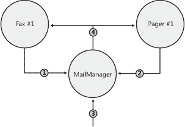

1. Fax 对象中的方法向 MailManager 的事件注册关注。
2. Pager 对象中的方法向 MailManager 的事件注册关注。
3. 新的邮件到达 MailManager。
4. MailManager 对象将通知发送给所有已注册方法，这些方法按需处理该邮件。

**图 11-1** 将应用程序设计为使用事件。

图 11-1 所示应用程序的工作方式如下：应用程序通过构造 `MailManager` 的实例进行初始化。`MailManager` 提供一个 `NewMail` 事件。当构造 `Fax` 和 `Pager` 对象时，它们会向 `MailManager` 的 `NewMail` 事件注册一个实例方法，以便 `MailManager` 知道在新电子邮件到达时通知 `Fax` 和 `Pager` 对象。现在，当 `MailManager` 收到新的电子邮件（或将来类似的内容）时，它将引发 `NewMail` 事件，使所有已注册方法有机会以任何其希望的方式处理新邮件。

### 设计公开事件的类型

为了定义公开一个或多个事件成员的类型，开发人员必须执行许多步骤。在本节中，我将逐一介绍每个必要步骤。`MailManager` 示例

（它几乎总是 public，以便其他代码可以访问该事件成员），一种委托类型，用于指示将被调用的方法的原型，以及一个名称（可以是任何有效标识符）。我们的 MailManager 类中的事件成员如下所示：

```csharp
internal class MailManager {

    // Step #2: Define the event member
    public event EventHandler<NewMailEventArgs> NewMail;
    ...
}
```

NewMail 是这个事件的名称。该事件成员的类型是 `EventHandler<NewMailEventArgs>`，这意味着事件通知的所有接收者都必须提供一个回调方法，其原型与 `EventHandler<NewMailEventArgs>` 委托类型的原型相匹配。由于泛型 `System.EventHandler` 委托定义如下：

```csharp
public delegate void EventHandler<TEventArgs>(Object sender, TEventArgs e);
```

因此方法原型必须如下所示：

```csharp
void MethodName(Object sender, NewMailEventArgs e);
```

**注意** 很多人想知道，为什么事件模式要求 sender 参数始终为 Object 类型。毕竟，既然 MailManager 将是唯一使用 NewMailEventArgs 对象引发事件的类型，那么将回调方法的原型定义为下面这样会更合理：

```csharp
void MethodName(MailManager sender, NewMailEventArgs e);
```

该模式要求 sender 参数为 Object 类型，主要是出于继承的考虑。如果 MailManager 被用作 SmtpMailManager 的基类，会怎样？在这种情况下，回调方法的 sender 参数应原型化为 SmtpMailManager 而不是 MailManager，但这无法实现，因为 SmtpMailManager 只是继承了 NewMail 事件。因此，原本期望由 SmtpMailManager 引发事件的代码，仍然必须将 sender 参数强制转换为 SmtpMailManager。换句话说，强制转换仍然不可避免，因此 sender 参数还不如直接声明为 Object 类型。

将 sender 参数声明为 Object 类型的另一个原因只是为了灵活性。它允许该委托被多种类型使用，这些类型提供的事件会传递 NewMailEventArgs 对象。例如，即使 PopMailManager 类不是从 MailManager 派生，它也可以使用该委托。

事件模式还要求委托定义和回调方法将派生自 EventArgs 的参数命名为 e。这样做的唯一原因是为该模式增加额外的一致性，使开发人员更容易学习和实现该模式。生成源代码的工具（例如 Microsoft Visual Studio）也知道将该参数称为 e。

最后，事件模式要求所有事件处理程序都具有 void 返回类型。这是必要的，因为引发事件可能会调用多个回调方法，而无法获取所有这些方法的返回值。返回类型为 void 使得回调无法返回值。不幸的是，FCL 中有一些事件处理程序（例如 ResolveEventHandler）没有遵循 Microsoft 自己规定的模式，因为它返回 Assembly 类型的对象。

#### 步骤 #3：定义一个负责引发事件的方法，以通知已注册对象该事件已发生

按照约定，该类应定义一个受保护的虚拟方法，当要引发事件时，由该类及其派生类内部的代码调用该方法。该方法接受一个参数，即 NewMailEventArgs 对象，其中包含传递给接收通知的对象的信息。该方法的默认实现只是检查是否有任何对象已注册对该事件感兴趣；如果有，则引发事件，从而通知已注册的方法该事件已发生。我们的 MailManager 类中的该方法如下所示：

```csharp
internal class MailManager {
    ...
    // Step #3: Define a method responsible for raising the event
    // to notify registered objects that the event has occurred
    // If this class is sealed, make this method private and nonvirtual
    protected virtual void OnNewMail(NewMailEventArgs e) {

        // Copy a reference to the delegate field now into a temporary field for thread safety
        EventHandler<NewMailEventArgs> temp = Volatile.Read(ref NewMail);

        // If any methods registered interest with our event, notify them
        if (temp != null) temp(this, e);
    }
    ...
}
```

### 以线程安全的方式引发事件

在 .NET Framework 最初发布时，建议开发人员使用类似下面的代码来引发事件：

```csharp
// Version 1
protected virtual void OnNewMail(NewMailEventArgs e) {
    if (NewMail != null) NewMail(this, e);
}
```

OnNewMail 方法的问题在于，线程可能会看到 NewMail 不为 null，然后，就在调用 NewMail 之前，另一个线程可能从链中移除一个委托，使 NewMail 变为 null，从而导致抛出 NullReferenceException。为了解决这个竞态条件，许多开发人员将 OnNewMail 方法编写如下：

```csharp
// Version 2
protected virtual void OnNewMail(NewMailEventArgs e) {
    EventHandler<NewMailEventArgs> temp = NewMail;
    if (temp != null) temp(this, e);
}
```

这里的思路是，将 NewMail 的引用复制到临时变量 temp 中，该变量在执行赋值的那一刻指向委托链。现在，该方法将 temp 与 null 进行比较并调用 temp，因此，在给 temp 赋值后，即使另一个线程更改了 NewMail，也没有关系。请记住，委托是不可变的，这就是该技术在理论上可行的原因。然而，许多开发人员没有意识到，编译器可能会优化这段代码，完全移除局部变量 temp。如果发生这种情况，这个版本的代码就与第一个版本相同，因此仍然可能发生 NullReferenceException。

要真正修复这段代码，应将 OnNewMail 重写为如下形式：

```csharp
// Version 3
protected virtual void OnNewMail(NewMailEventArgs e) {
    EventHandler<NewMailEventArgs> temp = Volatile.Read(ref NewMail);
    if (temp != null) temp(this, e);
}
```

对 Volatile.Read 的调用会强制在调用点读取 NewMail，并且此时引用确实必须复制到 temp 变量中。然后，仅当 temp 不为 null 时才调用 temp。有关 Volatile.Read 方法的更多信息，请参见第 29 章《基元线程同步构造》。

虽然这段代码的最后一个版本是技术上正确的最佳版本，但实际上可以使用第二个版本，因为即时 (JIT) 编译器了解此模式，并且知道不要优化掉局部变量 temp。具体来说，Microsoft 的所有 JIT 编译器都遵循不引入对堆内存的新读取这一不变式，因此，将引用缓存在局部变量中可确保该堆引用只被访问一次。这一点没有文档记录，而且理论上可能会改变，因此应使用最后一个版本。但实际上，Microsoft 的 JIT 编译器绝不会接受会破坏此模式的更改，因为太多应用程序会因此中断。8 此外，事件大多用于单线程场景（Windows Presentation Foundation 和 Windows Store 应用），因此线程安全无论如何都不是问题。

非常重要的一点是，由于这种线程竞态条件，某个方法在从事件的委托链中移除后仍可能被调用。

为方便起见，可以定义一个扩展方法（如第 8 章《方法》中所述）来封装此线程安全逻辑。像这样定义该扩展方法：

```csharp
public static class EventArgExtensions {
    public static void Raise<TEventArgs>(this TEventArgs e,
        Object sender, ref EventHandler<TEventArgs> eventDelegate) {

        // Copy a reference to the delegate field now into a temporary field for thread safety
        EventHandler<TEventArgs> temp = Volatile.Read(ref eventDelegate);

        // If any methods registered interest with our event, notify them
        if (temp != null) temp(sender, e);
    }
}
```

8 这实际上是 Microsoft JIT 编译器团队的一位成员告诉我的。


```
if (temp != null) temp(sender, e);
}
}
```

现在，我们可以将 `OnNewMail` 方法重写如下：

```
protected virtual void OnNewMail(NewMailEventArgs e) {
    e.Raise(this, ref m_NewMail);
}
```

使用 `MailManager` 作为基类型的类可以自由重写 `OnNewMail` 方法。这一能力让派生类能够控制事件的引发。派生类可以按照自己认为合适的任何方式处理新邮件消息。通常，派生类型会调用基类型的 `OnNewMail` 方法，以便已注册的方法收到通知。不过，派生类也可以决定不允许事件被转发。

### 步骤 #4：定义一个将输入转换为所需事件的方法

你的类必须具有某种方法，它接收一些输入并将其转换为事件的引发。在我的 `MailManager` 示例中，调用 `SimulateNewMail` 方法来表示新邮件消息已到达 `MailManager`：

```
internal class MailManager {

    // Step #4: Define a method that translates the
    // input into the desired event
    public void SimulateNewMail(String from, String to, String subject) {

        // Construct an object to hold the information we wish
        // to pass to the receivers of our notification
        NewMailEventArgs e = new NewMailEventArgs(from, to, subject);

        // Call our virtual method notifying our object that the event
        // occurred. If no type overrides this method, our object will
        // notify all the objects that registered interest in the event
        OnNewMail(e);
    }
}
```

`SimulateNewMail` 接收有关消息的信息，并构造一个 `NewMailEventArgs` 对象，将消息信息传递给其构造函数。然后调用 `MailManager` 自己的虚方法 `OnNewMail`，以正式通知 `MailManager` 对象新邮件消息已到达。通常，这会导致事件被引发，从而通知所有已注册的方法。（如前所述，使用 `MailManager` 作为基类的类可以重写此行为。）

### 编译器如何实现事件

现在你已经知道如何定义提供事件成员的类，让我们更仔细地看看事件到底是什么以及它是如何工作的。在 `MailManager` 类中，有一行代码定义了事件成员本身。

```
public event EventHandler<NewMailEventArgs> NewMail;
```

当 C# 编译器编译上面这一行时，它会将这一行源代码转换为以下三个构造：

```
/// 1. A PRIVATE delegate field that is initialized to null
private EventHandler<NewMailEventArgs> NewMail = null;

// 2. A PUBLIC add_XXX method (where Xxx is the Event name)
// Allows methods to register interest in the event.
public void add_NewMail(EventHandler<NewMailEventArgs> value) {
    // The loop and the call to CompareExchange is all just a fancy way
    // of adding a delegate to the event in a thread-safe way
    EventHandler<NewMailEventArgs> prevHandler;
    EventHandler<NewMailEventArgs> newMail = this.NewMail;
    do {
        prevHandler = newMail;
        EventHandler<NewMailEventArgs> newHandler =
            (EventHandler<NewMailEventArgs>) Delegate.Combine(prevHandler, value);
        newMail = Interlocked.CompareExchange<EventHandler<NewMailEventArgs>>(
            ref this.NewMail, newHandler, prevHandler);
    } while (newMail != prevHandler);
}
```

```
// 3. A PUBLIC remove_XXX method (where Xxx is the Event name)
// Allows methods to unregister interest in the event.
public void remove_NewMail(EventHandler<NewMailEventArgs> value) {
    // The loop and the call to CompareExchange is all just a fancy way
    // of removing a delegate from the event in a thread-safe way
    EventHandler<NewMailEventArgs> prevHandler;
    EventHandler<NewMailEventArgs> newMail = this.NewMail;
    do {
        prevHandler = newMail;
        EventHandler<NewMailEventArgs> newHandler =
            (EventHandler<NewMailEventArgs>) Delegate.Remove(prevHandler, value);
        newMail = Interlocked.CompareExchange<EventHandler<NewMailEventArgs>>(
            ref this.NewMail, newHandler, prevHandler);
    } while (newMail != prevHandler);
}
```

第一个构造只是相应委托类型的一个字段。该字段是对委托列表头部的引用，当事件发生时，这些委托将被通知。该字段初始化为 `null`，表示没有监听者注册对该事件的兴趣。当某个方法注册对事件的兴趣时，该字段引用一个 `EventHandler<NewMailEventArgs>` 委托实例，该实例可能还引用其他 `EventHandler<NewMailEventArgs>` 委托。当监听者注册对事件的兴趣时，监听者实际上只是将该委托类型的一个实例添加到列表中。显然，取消注册意味着从列表中移除该委托。

你会注意到，委托字段（本例中的 `NewMail`）始终是 private 的，即使原始源代码行将事件定义为 public。将委托字段设为 private 的原因是为了防止定义类之外的代码不正当地操作它。如果该字段是 public 的，任何代码都可以更改该字段的值，并可能清除所有已注册对该事件感兴趣的委托。

C# 编译器生成的第二个构造是一个方法，允许其他对象注册对事件的兴趣。C# 编译器自动通过在事件名称（`NewMail`）前加上 `add_` 来命名此函数。C# 编译器自动生成此方法内部的代码。该代码总是调用 `System.Delegate` 的静态 `Combine` 方法，该方法将委托实例添加到委托列表中，并返回列表的新头部，然后将其保存回字段中。

C# 编译器生成的第三个构造是一个方法，允许对象注销对事件的兴趣。同样，C# 编译器自动通过在事件名称（`NewMail`）前加上 `remove_` 来命名此函数。此方法内部的代码总是调用 `Delegate` 的静态 `Remove` 方法，该方法从委托列表中移除委托实例，并返回列表的新头部，然后将其保存回字段中。

**警告** 如果你尝试移除一个从未添加过的方法，那么 `Delegate` 的 `Remove` 方法在内部不会执行任何操作。也就是说，你不会得到任何类型的异常或警告；事件的方法集合保持不变。

**注意** `add` 和 `remove` 方法使用一种众所周知的模式以线程安全的方式更新值。这一模式在第 29 章的“The Interlocked Anything Pattern”一节中讨论。

在本例中，`add` 和 `remove` 方法是 public 的。它们之所以是 public 的，是因为原始源代码行将事件声明为 public。如果事件被声明为 protected，编译器生成的 `add` 和 `remove` 方法也将被声明为 protected。因此，当你在类型中定义事件时，事件的可访问性决定了哪些代码可以注册和注销对该事件的兴趣，但只有类型本身才能直接访问委托字段。事件成员还可以声明为 static 或 virtual，在这种情况下，编译器生成的 `add` 和 `remove` 方法将分别是 static 或 virtual。

除了生成上述三个构造之外，编译器还会在托管程序集的元数据中生成一个事件定义条目。该条目包含一些标志和底层委托类型，并引用 `add` 和 `remove` 访问器方法。该信息的存在只是为了在“事件”的抽象概念与其访问器方法之间建立关联。编译器和其他工具可以使用该元数据，并且也可以通过使用 `System.Reflection.EventInfo` 类来获取该信息。然而，CLR 本身不使用该元数据信息，在运行时只需要访问器方法。

### 设计一个监听事件的类型

到目前为止，艰巨的工作肯定已经完成了。在本节中，我将向你展示如何定义一个使用其他类型提供的事件的类型。让我们先检查 `Fax` 类型的代码：

```
internal sealed class Fax {
    // Pass the MailManager object to the constructor
    public Fax(MailManager mm) {

        // Construct an instance of the EventHandler<NewMailEventArgs>
        // delegate that refers to our FaxMsg callback method.
        // Register our callback with MailManager's NewMail event
        mm.NewMail += FaxMsg;
    }

    // This is the method the MailManager will call
    // when a new email message arrives
    private void FaxMsg(Object sender, NewMailEventArgs e) {

        // 'sender' identifies the MailManager object in case
        // we want to communicate back to it.

        // 'e' identifies the additional event information
        // the MailManager wants to give us.

        // Normally, the code here would fax the email message.
        // This test implementation displays the info in the console
        Console.WriteLine("Faxing an email message:");
        Console.WriteLine("  From={0}, To={1}, Subject={2}",
            e.From, e.To, e.Subject);
    }

    // This method could be executed to have the Fax object unregister
    // itself when the NewMail event so that it no longer receives
    // notifications
    public void Unregister(MailManager mm) {

        // Unregister with MailManager's NewMail event
        mm.NewMail -= FaxMsg;
    }
}
```

当电子邮件应用程序初始化时，它首先会构造一个 `MailManager` 对象，并将对该对象的引用保存在一个变量中。然后，应用程序会构造一个 `Fax` 对象，并将 `MailManager` 对象的引用作为参数传递。在 `Fax` 构造函数中，`Fax` 对象使用 C# 的 `+=` 运算符注册它对 `MailManager` 的 `NewMail` 事件的兴趣：

```
mm.NewMail += FaxMsg;
```


从事件的委托列表中移除。如果未找到匹配项，则不会发生错误，列表也不会改变。

顺便说一句，C# 要求代码使用 += 和 -= 运算符来向列表添加和移除委托。如果尝试显式调用 add 或 remove 方法，C# 编译器会生成 CS0571“无法显式调用运算符或访问器”错误消息。

#### 显式实现事件

System.Windows.Forms.Control 类型定义了大约 70 个事件。如果 Control 类型通过允许编译器隐式生成 add 和 remove 访问器方法及委托字段来实现这些事件，那么每个 Control 对象仅这些事件就会包含 70 个委托字段！由于大多数程序员只关心少数几个事件，因此对于从 Control 派生类型创建的每个对象，都会浪费大量内存。顺便说一句，ASP.NET 的 System.Web.UI.Control 和 Windows Presentation Foundation (WPF) 的 System.Windows.UIElement 类型也提供了许多大多数程序员不会使用的事件。

在本节中，我将讨论 C# 编译器如何允许类开发者显式实现事件，从而使开发者能够控制 add 和 remove 方法如何操作回调委托。我将演示如何利用显式实现事件来高效实现一个提供许多事件的类。不过，当然还有其他场景可能需要显式实现某个类型的事件。

为了高效存储事件委托，每个公开事件的对象都会维护一个集合（通常是字典），以某种事件标识符为键，以委托列表为值。创建新对象时，该集合为空。当注册对某个事件的关注时，会在集合中查找该事件的标识符。如果事件标识符存在，则将新委托与该事件的委托列表合并。如果集合中不存在该事件标识符，则将该事件标识符连同委托一起添加。

当对象需要触发事件时，会在集合中查找事件标识符。如果集合中没有该事件标识符的条目，则表示没有任何对象注册对该事件感兴趣，不需要回调任何委托。如果事件标识符在集合中，则调用与该事件标识符关联的委托列表。实现这种设计模式是设计定义事件的类型的开发者的责任；使用该类型的开发者并不知道事件在内部是如何实现的。

以下示例展示了如何实现此模式。首先，我实现了一个 EventSet 类，它表示事件集合以及每个事件的委托列表，如下所示：

```csharp
using System;
using System.Collections.Generic;

// This class exists to provide a bit more type safety and
// code maintainability when using EventSet

public sealed class EventKey { }

public sealed class EventSet {
    // The private dictionary used to maintain EventKey -> Delegate mappings
    private readonly Dictionary<EventKey, Delegate> m_events =
        new Dictionary<EventKey, Delegate>();

    // Adds an EventKey -> Delegate mapping if it doesn't exist or
    // combines a delegate to an existing EventKey
    public void Add(EventKey eventKey, Delegate handler) {
        Monitor.Enter(m_events);
        Delegate d;
        m_events.TryGetValue(eventKey, out d);
        m_events[eventKey] = Delegate.Combine(d, handler);
        Monitor.Exit(m_events);
    }

    // Removes a delegate from an EventKey (if it exists) and
    // removes the EventKey -> Delegate mapping if the last delegate is removed
    public void Remove(EventKey eventKey, Delegate handler) {
        Monitor.Enter(m_events);
        // Call TryGetValue to ensure that an exception is not thrown if
        // attempting to remove a delegate from an EventKey not in the set
        Delegate d;
        if (m_events.TryGetValue(eventKey, out d)) {
            d = Delegate.Remove(d, handler);

            // If a delegate remains, set the new head else remove the EventKey
            if (d != null) m_events[eventKey] = d;
            else m_events.Remove(eventKey);
        }
        Monitor.Exit(m_events);
    }

    // Raises the event for the indicated EventKey
    public void Raise(EventKey eventKey, Object sender, EventArgs e) {
        // Don't throw an exception if the EventKey is not in the set
        Delegate d;
        Monitor.Enter(m_events);
        m_events.TryGetValue(eventKey, out d);
        Monitor.Exit(m_events);

        if (d != null) {
            // Because the dictionary can contain several different delegate types,
            // it is impossible to construct a type-safe call to the delegate at
            // compile time. So, I call the System.Delegate type's DynamicInvoke
            // method, passing it the callback method's parameters as an array of
            // objects. Internally, DynamicInvoke will check the type safety of the
            // parameters with the callback method being called and call the method.
            // If there is a type mismatch, then DynamicInvoke will throw an exception.
            d.DynamicInvoke(new Object[] { sender, e });
        }
    }
}
```

## 

本报告总结了公司2020年的主要业绩和发展情况。

- 收入增长20%
- 客户满意度提升15%
- 新拓展3个市场

| 指标 | 数值 |
| --- | --- |
| 收入 | $10M |
| 利润 | $2M |

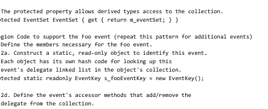

> 2020年是充满挑战与机遇的一年。

使用 TypeWithLotsOfEvents 类型的代码无法分辨事件是由编译器隐式实现的，还是由开发者显式实现的。它们只是使用常规语法注册事件。以下代码演示了这一点：

```csharp
public sealed class Program {
    public static void Main() {
        TypeWithLotsOfEvents twle = new TypeWithLotsOfEvents();

        // Add a callback here
        twle.Foo += HandleFooEvent;

        // Prove that it worked
        twle.SimulateFoo();
    }

    private static void HandleFooEvent(object sender, FooEventArgs e) {
        Console.WriteLine("Handling Foo Event here...");
    }
}
```

## 第12章：泛型

## 

本章内容：

- 框架类库中的泛型 — 281
- 泛型基础设施 — 282
- 泛型接口 — 289
- 泛型委托 — 290
- 委托和接口的逆变与协变泛型类型实参 — 291
- 泛型方法 — 293
- 泛型和其他成员 — 296
- 可验证性与约束

熟悉面向对象编程的开发者都知道它带来的好处。其中一个让开发者极具生产力的大好处是代码重用，即能够派生一个继承基类所有能力的类。派生类可以简单地重写虚方法或添加一些新方法，以自定义基类的行为来满足开发者的需求。泛型是公共语言运行时 (CLR) 和编程语言提供的另一种机制，它提供了又一种代码重用形式：算法重用。

基本上，一个开发者定义一种算法，例如排序、搜索、交换、比较或转换。然而，定义算法的开发者并不指定该算法操作的数据类型；该算法可以泛化地应用于不同类型的对象。然后，另一个开发者只要指明该算法应操作的具体数据类型，就可以使用这个现有算法，例如，操作 Int32、String 等的排序算法，或操作 DateTime、Version 等的比较算法。

大多数算法都封装在类型中，CLR 允许创建泛型引用类型以及泛型值类型，但不允许创建泛型枚举类型。此外，CLR 允许创建泛型接口和泛型委托。有时，单个方法可以封装有用的算法，因此，CLR 允许创建定义在引用类型、值类型或接口中的泛型方法。

让我们看一个快速示例。框架类库 (FCL) 定义了一个泛型列表算法，它知道如何管理一组对象；这些对象的数据类型并未由泛型算法指定。想要使用泛型列表算法的人可以稍后指定要与其一起使用的确切数据类型。

封装泛型列表算法的 FCL 类称为 `List<T>`（读作 List of Tee），该类定义在 `System.Collections.Generic` 命名空间中。该类定义如下所示（代码已大幅简化）：

```csharp
[Serializable]
public class List<T> : IList<T>, ICollection<T>, IEnumerable<T>,
    IList, ICollection, IEnumerable {

    public List();
    public void Add(T item);
    public Int32 BinarySearch(T item);
    public void Clear();
    public Boolean Contains(T item);
    public Int32 IndexOf(T item);
    public Boolean Remove(T item);
    public void Sort();
    public void Sort(IComparer<T> comparer);
    public void Sort(Comparison<T> comparison);
    public T[] ToArray();

    public Int32 Count { get; }
    public T this[Int32 index] { get; set; }
}
```

定义泛型 List 类的程序员通过在类名后紧跟 `<T>` 来表示该类适用于未指定的数据类型。定义泛型类型或方法时，它为类型指定的任何变量（如 T）都称为类型参数。T 是一个变量名，可用于源代码中任何可指定数据类型的位置。例如，在 List 类定义中，你会看到 T 用于方法参数（Add 方法接受 T 类型的参数）和返回类型（ToArray 方法返回 T 类型的一维数组）。另一个例子是索引器方法（在 C# 中称为 this）。索引器有一个 get 访问器方法，返回 T 类型的值；还有一个 set 访问器方法，接受 T 类型的参数。由于 T 变量可用于任何可指定数据类型的位置，因此也可以在方法内定义局部变量或在类型内定义字段时使用 T。


**注意** Microsoft 的设计准则指出，泛型参数变量要么命名为 T，要么至少以大写 T 开头（如 TKey 和 TValue）。大写 T 代表*类型*，就像大写 I 代表*接口*一样（如 IComparable）。

既然已经定义了泛型 `List<T>` 类型，其他开发者就可以通过指定希望该算法操作的确切数据类型来使用这个泛型算法。使用泛型类型或方法时，指定的数据类型称为*类型实参*。例如，开发者可能想通过指定 DateTime 类型实参来使用 List 算法。以下代码展示了这一点：

```csharp
private static void SomeMethod() {
    // Construct a List that operates on DateTime objects
    List<DateTime> dtList = new List<DateTime>();

    // Add a DateTime object to the list
    dtList.Add(DateTime.Now);        // No boxing

    // Add another DateTime object to the list
    dtList.Add(DateTime.MinValue);   // No boxing

    // Attempt to add a String object to the list
    dtList.Add("1/1/2004");          // Compile-time error

    // Extract a DateTime object out of the list
    DateTime dt = dtList[0];         // No cast required
}
```

泛型为开发者提供了如下重大好处，正如刚展示的代码所体现的那样：

- **源代码保护**  使用泛型算法的开发者不需要访问该算法的源代码。然而，使用 C++ 模板时，算法的源代码必须对使用该算法的开发者可用。

- **类型安全**  当泛型算法与特定类型一起使用时，编译器和 CLR 会理解这一点，并确保只有与指定数据类型兼容的对象才能与该算法一起使用。尝试使用不兼容类型的对象将导致编译器错误或抛出运行时异常。在示例中，尝试将 String 对象传递给 Add 方法会导致编译器发出错误。

- **更简洁的代码**  由于编译器强制执行类型安全，源代码中需要的强制转换更少，这意味着代码更易于编写和维护。在 SomeMethod 的最后一行，开发者不需要使用 (DateTime) 强制转换就能将索引器的结果（查询索引 0 处的元素）放入 dt 变量。

- **更好的性能**  在泛型出现之前，定义通用算法的方式是将其所有成员定义为使用 Object 数据类型工作。如果要将该算法与值类型实例一起使用，CLR 必须在调用算法的成员之前对值类型实例进行装箱。正如第 5 章“基元类型、引用类型和值类型”所讨论的，装箱会导致托管堆上发生内存分配，从而导致更频繁的垃圾回收，进而损害应用程序的性能。由于现在可以创建泛型算法来处理特定的值类型，值类型的实例可以按值传递，CLR 不再需要执行任何装箱。此外，由于不需要强制转换（见上一项），CLR 不必检查所尝试的强制转换的类型安全性，这也使代码运行更快。

为了充分说明泛型的性能优势，我编写了一个程序，用于测试泛型 List 算法与 FCL 的非泛型 ArrayList 算法的性能。事实上，我通过同时使用值类型对象和引用类型对象测试了这两种算法的性能。程序本身如下：

```csharp
using System;
using System.Collections;
using System.Collections.Generic;
using System.Diagnostics;

public static class Program {
   public static void Main() {
      ValueTypePerfTest();
      ReferenceTypePerfTest();
   }

   private static void ValueTypePerfTest() {
      const Int32 count = 100000000;

      using (new OperationTimer("List<Int32>")) {
         List<Int32> l = new List<Int32>();
         for (Int32 n = 0; n < count; n++) {
            l.Add(n);              // No boxing
            Int32 x = l[n];        // No unboxing
         }
         l = null; // Make sure this gets GC'd
      }

      using (new OperationTimer("ArrayList of Int32")) {
         ArrayList a = new ArrayList();
         for (Int32 n = 0; n < count; n++) {
            a.Add(n);                  // Boxing
            Int32 x = (Int32) a[n];    // Unboxing
         }
         a = null; // Make sure this gets GC'd
      }
   }

   private static void ReferenceTypePerfTest() {
      const Int32 count = 100000000;

      using (new OperationTimer("List<String>")) {
         List<String> l = new List<String>();
         for (Int32 n = 0; n < count; n++) {
            l.Add("X");            // Reference copy
            String x = l[n];       // Reference copy
         }
         l = null; // Make sure this gets GC'd
      }

      using (new OperationTimer("ArrayList of String")) {
         ArrayList a = new ArrayList();
         for (Int32 n = 0; n < count; n++) {
            a.Add("X");
            String x = (String) a[n];  // Cast check & reference copy
         }
         a = null; // Make sure this gets GC'd
      }
   }
}

// This class is useful for doing operation performance timing
internal sealed class OperationTimer : IDisposable {
   private Stopwatch m_stopwatch;
   private String m_text;
   private Int32 m_collectionCount;

   public OperationTimer(String text) {
      PrepareForOperation();

      m_text = text;
      m_collectionCount = GC.CollectionCount(0);

      // This should be the last statement in this
      // method to keep timing as accurate as possible
      m_stopwatch = Stopwatch.StartNew();
   }

   public void Dispose() {
      Console.WriteLine("{0} (GCs={1,3}) {2}", (m_stopwatch.Elapsed),
         GC.CollectionCount(0) - m_collectionCount, m_text);
   }

   private static void PrepareForOperation() {
      GC.Collect();
      GC.WaitForPendingFinalizers();
      GC.Collect();
   }
}
```

当我在计算机上编译并运行该程序的发布版本（已开启优化）时，得到以下输出：

```text
00:00:01.6246959 (GCs=  6) List<Int32>
00:00:10.8555008 (GCs=390) ArrayList of Int32
00:00:42.5427847 (GCs=  4) List<String>
00:00:42.7944831 (GCs=  7) ArrayList of String
```

这里的输出表明，将泛型 List 算法与 Int32 类型一起使用，比将非泛型 ArrayList 算法与 Int32 一起使用快得多。事实上，差异非常惊人：1.6 秒对将近 11 秒。这大约快了 7 倍！此外，将值类型（Int32）与 ArrayList 一起使用会导致大量装箱操作发生，从而造成 390 次垃圾回收。而 List 算法只需要 6 次垃圾回收。

使用引用类型的测试结果就没有那么重大。在这里我们看到，时间和垃圾回收次数大致相同。因此，泛型 List 算法在这里似乎没有什么好处。不过，请记住，使用泛型算法时，你还能获得更简洁的代码和编译时类型安全。所以，虽然性能提升并不巨大，但使用泛型算法时获得的其他好处通常也算是一种改进。

**注意** 你确实需要认识到，CLR 在第一次针对特定数据类型调用某个方法时，会为该每个方法生成本机代码。这会增加应用程序的工作集大小，从而损害性能。我将在本章的“泛型基础结构”一节中进一步讨论这一点。

### 框架类库中的泛型

当然，泛型最明显的用途是用于集合类，FCL 定义了多个可供使用的泛型集合类。这些类大多位于 System.Collections.Generic 命名空间和 System.Collections.ObjectModel 命名空间中。System.Collections.Concurrent 命名空间中还提供了线程安全的泛型集合类。Microsoft 建议程序员使用泛型集合类，并且现在不鼓励使用非泛型集合类，原因有几个。首先，非泛型集合类不是泛型的，因此你无法获得使用泛型集合类时所能获得的类型安全、更简洁的代码和更好的性能。其次，泛型类比非泛型类具有更好的对象模型。例如，虚方法更少，从而带来更好的性能；并且泛型集合中添加了新成员以提供新功能。

这些集合类实现了许多接口，而放入集合中的对象可以实现集合类用于排序和搜索等操作的接口。FCL 附带了多个泛型接口定义，以便在处理接口时也能获得泛型的好处。常用的接口包含在 System.Collections.Generic 命名空间中。

新的泛型接口并不是旧的非泛型接口的替代品；在许多场景中，你将不得不同时使用两者。原因是向后兼容。例如，如果 `List<T>` 类只实现 `IList<T>` 接口，那么任何代码都无法将 `List<DateTime>` 对象视为 IList。

我还应该指出，System.Array 类（所有数组类型的基类）提供了许多静态泛型方法，例如 AsReadOnly、BinarySearch、ConvertAll、Exists、Find、FindAll、FindIndex、FindLast、FindLastIndex、ForEach、IndexOf、LastIndexOf、Resize、Sort 以及

有时，人们会在泛型类型上定义静态构造函数，以确保类型实参满足某些条件。例如，如果你想定义一个只能与枚举类型一起使用的泛型类型，可以这样做：

```csharp
internal sealed class GenericTypeThatRequiresAnEnum<T> {
    static GenericTypeThatRequiresAnEnum() {
        if (!typeof(T).IsEnum) {
            throw new ArgumentException("T must be an enumerated type");
        }
    }
}
```

CLR 有一个称为约束的功能，它为你提供了一种更好的方式来定义泛型类型，并指明哪些类型实参对该类型有效。我将在本章后面讨论约束。遗憾的是，约束不支持将类型实参限制为只能是枚举类型，这就是为什么前面的示例需要静态构造函数来确保该类型是枚举类型。

### 泛型类型与继承

泛型类型也是一种类型，因此它可以派生自任何其他类型。当你使用泛型类型并指定类型实参时，你是在 CLR 中定义一个新的类型对象，而这个新类型对象派生自该泛型类型所派生自的类型。换句话说，由于 `List<T>` 派生自 `Object`，所以 `List<String>` 和 `List<Guid>` 也派生自 `Object`。类似地，由于 `DictionaryStringKey<TValue>` 派生自 `Dictionary<String, TValue>`，所以 `DictionaryStringKey<Guid>` 也派生自 `Dictionary<String, Guid>`。理解“指定类型实参与继承层次结构无关”这一点，将帮助你认识到可以执行和不能执行哪种类型转换。

例如，如果一个链表节点类定义如下：

```csharp
internal sealed class Node<T> {
    public T m_data;
    public Node<T> m_next;

    public Node(T data) : this(data, null) {
    }

    public Node(T data, Node<T> next) {
        m_data = data; m_next = next;
    }

    public override String ToString() {
        return m_data.ToString() +
            ((m_next != null) ? m_next.ToString() : String.Empty);
    }
}
```

那么我可以编写一些代码来构建一个链表，大致如下：

```csharp
private static void SameDataLinkedList() {
    Node<char> head = new Node<char>('C');
    head = new Node<char>('B', head);
    head = new Node<char>('A', head);
    Console.WriteLine(head.ToString());  // Displays "ABC"
}
```

在刚才展示的 `Node` 类中，`m_next` 字段必须引用另一个节点，而该节点的 `m_data` 字段具有同一种数据类型。这意味着链表中包含的节点里，所有数据项都必须是相同类型（或派生类型）。例如，我不能使用 `Node` 类创建一个链表，让其中一个元素包含 `Char`，另一个元素包含 `DateTime`，还有一个元素包含 `String`。好吧，如果我在所有地方都使用 `Node<Object>`，那也可以，但这样会失去编译时类型安全，而且值类型会被装箱。

因此，更好的做法是定义一个非泛型的 `Node` 基类，然后定义一个泛型 `TypedNode` 类（使用 `Node` 类作为基类）。现在，我可以拥有一个链表，其中每个节点都可以是特定的数据类型（而不是 `Object`），获得编译时类型安全，并避免值类型装箱。下面是新的类定义：

```csharp
internal class Node {
    protected Node m_next;

    public Node(Node next) {
        m_next = next;
    }
}

internal sealed class TypedNode<T> : Node {
    public T m_data;

    public TypedNode(T data) : this(data, null) {
    }

    public TypedNode(T data, Node next) : base(next) {
        m_data = data;
    }

    public override String ToString() {
        return m_data.ToString() +
            ((m_next != null) ? m_next.ToString() : String.Empty);
    }
}
```

现在我可以编写代码来创建一个链表，其中每个节点都是不同的数据类型。代码可能大致如下：

```csharp
private static void DifferentDataLinkedList() {
    Node head = new TypedNode<Char>('A', null);
    head = new TypedNode<DateTime>(DateTime.Now, head);
    head = new TypedNode<String>("Today is ", head);
    Console.WriteLine(head.ToString());
}
```

### 泛型类型标识

有时，泛型语法会让开发人员感到困惑。毕竟，源代码中可能散布着大量小于号（<）和大于号（>），这会影响可读性。为了改善语法，一些开发人员会定义一个新的非泛型类类型，它派生自某个泛型类型，并指定所有类型实参。例如，为了简化下面这样的代码：

```csharp
List<DateTime> dtl = new List<DateTime>();
```

一些开发人员可能会先定义一个像这样的类：

```csharp
internal sealed class DateTimeList : List<DateTime> {
    // No need to put any code in here!
}
```

现在，创建列表的代码可以更简单地重写（不带小于号和大于号），如下所示：

```csharp
DateTimeList dtl = new DateTimeList();
```

虽然这看起来很方便，尤其是当你将这个新类型用于参数、局部变量和字段时，但你绝不应该仅仅为了让源代码更易读而显式定义一个新类。原因在于你会失去类型标识和等价性，正如你在以下代码中所看到的：

```csharp
Boolean sameType = (typeof(List<DateTime>) == typeof(DateTimeList));
```

当上面的代码运行时，`sameType` 将被初始化为 `false`，因为你比较的是两个不同的类型对象。这也意味着，一个原型声明为接受 `DateTimeList` 的方法将无法接受传入的 `List<DateTime>`。然而，一个原型声明为接受 `List<DateTime>` 的方法可以接受传入的 `DateTimeList`，因为 `DateTimeList` 派生自 `List<DateTime>`。程序员可能会很容易被这一切弄糊涂。

幸运的是，C# 确实提供了一种使用简化语法来引用泛型封闭类型的方法，而且完全不会影响类型等价性；你可以在源代码文件顶部使用老牌的 `using` 指令。下面是一个示例：

```csharp
using DateTimeList = System.Collections.Generic.List<System.DateTime>;
```

在这里，`using` 指令实际上只是定义了一个名为 `DateTimeList` 的符号。在代码编译时，编译器会将所有出现的 `DateTimeList` 替换为 `System.Collections.Generic.List<System.DateTime>`。这只是让开发人员能够使用简化语法，而不会影响代码的实际含义，因此类型标识和等价性得以保持。所以现在，当下面这一行执行时，`sameType` 将被初始化为 `true`。

```csharp
Boolean sameType = (typeof(List<DateTime>) == typeof(DateTimeList));
```

作为另一种便利，你可以使用 C# 的隐式类型局部变量功能，编译器会根据你赋给方法局部变量的表达式类型来推断该变量的类型：

```csharp
using System;
using System.Collections.Generic;
...
internal sealed class SomeType {
    private static void SomeMethod() {
        // Compiler infers that dtl is of type
        // System.Collections.Generic.List<System.DateTime>
        var dtl = new List<DateTime>();

        ...
    }
}
```

### 代码爆炸

当使用泛型类型参数的方法被 JIT 编译时，CLR 会获取该方法的 IL，替换指定的类型实参，然后生成特定于该方法在指定数据类型上操作的本机代码。这正是你想要的，也是泛型的主要特性之一。然而，这也有一个缺点：CLR 会为每一种方法/类型组合不断生成本机代码。这被称为代码爆炸。这最终可能会大幅增加应用程序的工作集，从而损害性能。

幸运的是，CLR 内置了一些优化来减少代码爆炸。首先，如果某个方法因特定的类型实参而被调用，之后又使用相同的类型实参再次调用该方法，那么 CLR 只会为这个“方法/类型”组合编译一次代码。因此，如果一个程序集使用 `List<DateTime>`，而另一个完全不同的程序集（加载在同一 AppDomain 中）也使用 `List<DateTime>`，CLR 将只为 `List<DateTime>` 的方法编译一次。这会大幅减少代码爆炸。

CLR 还有另一项优化：CLR 认为所有引用类型实参都是相同的，因此代码同样可以共享。例如，CLR 为 `List<String>` 的方法编译的代码可以用于 `List<Stream>` 的方法，因为 `String` 和 `Stream` 都是引用类型。事实上，对于任何引用类型，都会使用相同的代码。CLR 能够执行这项优化，是因为所有引用类型实参或变量实际上都只是指向堆上对象的指针（在 32 位 Windows 系统上为 32 位，在 64 位 Windows 系统上为 64 位），而对象指针都以相同的方式操作。

但是，如果任何类型实参是值类型，CLR 就必须专门为该值类型生成本机代码。原因在于值类型的大小可能不同。而且，即使两个值类型大小相同（例如 `Int32` 和 `UInt32` 都是 32 位），CLR 仍然无法共享代码，因为可以使用不同的本机 CPU 指令来操作这些值。


泛型类型参数只能出现在输出位置，例如方法的返回类型。

例如，假设存在以下委托类型定义（顺便说一句，它确实存在）：

```csharp
public delegate TResult Func<in T, out TResult>(T arg);
```

这里，泛型类型参数 T 用 in 关键字标记，使其成为逆变的；泛型类型参数 TResult 用 out 关键字标记，使其成为协变的。

那么现在，如果我有一个如下声明的变量：

```csharp
Func<Object, ArgumentException> fn1 = null;
```

我可以将其强制转换为另一个 Func 类型，其中泛型类型参数不同：

```csharp
Func<String, Exception> fn2 = fn1; // No explicit cast is required here
Exception e = fn2("");
```

这段话的意思是，fn1 引用一个接受 Object 并返回 ArgumentException 的函数。fn2 变量想要引用一个接受 String 并返回 Exception 的方法。由于可以将 String 传递给需要 Object 的方法（因为 String 派生自 Object），并且由于可以获取返回 ArgumentException 的方法的结果并将其视为 Exception（因为 Exception 是 ArgumentException 的基类），所以上面的代码可以编译，并且在编译时已知会保持类型安全。

**注意** 变体仅当编译器能够验证类型之间存在引用转换时才适用。换句话说，值类型不可能有变体，因为需要装箱。在我看来，正是这一限制使这些变体特性不那么有用。例如，如果我有以下方法：

```csharp
void ProcessCollection(IEnumerable<Object> collection) { ... }
```

我不能通过传入对 List<DateTime> 对象的引用来调用它，因为 DateTime 值类型与 Object 之间不存在引用转换，即使 DateTime 派生自 Object。可以通过如下声明 ProcessCollection 来解决此问题：

```csharp
void ProcessCollection<T>(IEnumerable<T> collection) { ... }
```

此外，ProcessCollection(IEnumerable<Object> collection) 的一大好处是只有一份 JIT 编译的代码。然而，对于 ProcessCollection<T>(IEnumerable<T> collection)，也只有一份 JIT 编译的代码由所有引用类型的 T 共享。对于值类型的 T，会得到两个版本的 JIT 编译代码，但现在至少可以调用该方法并向其传递值类型的集合。

此外，如果该类型的实参使用 out 或 ref 关键字传递给方法，则不允许对泛型类型参数使用变体。例如，下面这行代码会使编译器生成以下错误消息：“无效变体：类型参数 'T' 必须在 'SomeDelegate<T>.Invoke(ref T)' 上保持不变有效。'T' 是逆变的。”

```csharp
delegate void SomeDelegate<in T>(ref T t);
```

使用接受泛型参数和返回类型的委托时，建议尽可能始终为逆变和协变指定 `in` 和 `out` 关键字，因为这样做没有不良影响，并且能使委托在更多场景中使用。

与委托类似，具有泛型类型参数的接口可以使其类型参数为逆变或协变。以下是一个具有协变泛型类型参数的接口示例：

```csharp
public interface IEnumerator<out T> : IEnumerator {
   Boolean MoveNext();
   T Current { get; }
}
```

由于 T 是协变的，以下代码可以成功编译并运行：

```csharp
// This method accepts an IEnumerable of any reference type
Int32 Count(IEnumerable<Object> collection) { ... }

...

// The call below passes an IEnumerable<String> to Count
Int32 c = Count(new[] { "Grant" });
```

**重要** 有时开发者会问，为什么必须在泛型类型参数上显式放置 `in` 或 `out`。他们认为编译器应该能够检查委托或接口声明，并自动检测哪些泛型类型参数可以是逆变的和协变的。虽然编译器确实可以自动检测这一点，但 C# 团队认为你是在声明一项契约，因此应该明确说明你希望允许什么。例如，如果编译器判定某个泛型类型参数可以是逆变的，而将来你向接口添加了一个成员，该成员将类型参数用于输出位置，那会很糟。下次编译时，编译器会判定该类型参数应保持不变，但所有引用其他成员的代码位置现在都可能产生错误，如果它们曾利用该类型参数是逆变的事实。

因此，编译器团队强制你在声明泛型类型参数时显式指定。然后，如果你试图在不匹配声明方式的上下文中使用该类型参数，编译器会发出错误，让你知道你正试图破坏契约。如果你随后决定通过在泛型类型参数上添加 `in` 或 `out` 来破坏契约，那么你应该预料到必须修改一些使用旧契约的代码位置。

### 泛型方法

定义泛型类、结构或接口时，这些类型中定义的任何方法都可以引用该类型指定的类型参数。类型参数可以用作方法的参数、方法的返回类型，或用作方法内部定义的局部变量。然而，CLR 还支持方法指定自己的类型参数的能力。这些类型参数也可以用于参数、返回类型或局部变量。以下是一个有些刻意的示例，其中类型定义了一个类型参数，而方法拥有自己的类型参数：

```csharp
internal sealed class GenericType<T> {
```

泛型 Display 方法（用 String 替换 T）。然而，C# 编译器总是优先选择更显式的匹配而不是泛型匹配，因此它会生成对接受 String 的非泛型 Display 方法的调用。对于第二次调用，编译器不能调用接受 String 的非泛型 Display 方法，因此必须调用泛型 Display 方法。顺便说一句，幸运的是编译器总是优先选择更显式的匹配；如果编译器优先选择泛型方法，那么由于泛型 Display 方法会再次调用 Display（但使用 ToString 返回的 String），就会导致无限递归。

第三次调用 Display 指定了一个泛型类型实参 String。这告诉编译器不要尝试推断类型实参，而是使用我显式指定的类型实参。在这种情况下，编译器还假定我确实想调用泛型 Display 方法，因此将调用泛型 Display。在内部，泛型 Display 方法会对传入的字符串调用 ToString，得到一个字符串，然后将其传递给非泛型 Display 方法。

### 泛型与其他成员

在 C# 中，属性、索引器、事件、运算符方法、构造函数和终结器本身不能有类型参数。但是，它们可以定义在泛型类型中，并且这些成员中的代码可以使用该类型的类型参数。

C# 不允许这些成员指定自己的泛型类型参数，因为微软 C# 团队认为开发者很少需要将这些成员用作泛型。此外，就为语言设计足够的语法而言，为这些成员添加泛型支持的成本会相当高。例如，当你在代码中使用 + 运算符时，编译器可能会调用运算符重载方法。在代码中无法随 + 运算符一起指明任何类型实参。

### 可验证性与约束

编译泛型代码时，C# 编译器会分析代码，并确保该代码适用于当前存在的任何类型或将来可能定义的类型。让我们看看以下方法：

```csharp
private static Boolean MethodTakingAnyType<T>(T o) {
    T temp = o;
    Console.WriteLine(o.ToString());
    Boolean b = temp.Equals(o);
    return b;
}
```

此方法声明一个类型为 T 的临时变量（temp），然后执行几个变量赋值和几次方法调用。此方法适用于任何类型。如果 T 是引用类型，它适用。如果 T 是值类型或枚举类型，它适用。如果 T 是接口或委托类型，它适用。此方法适用于当前存在的所有类型或将来会定义的所有类型。


因为每种类型都支持赋值和对 Object 定义的方法（如 ToString 和 Equals）的调用。

现在来看下面的方法：

```csharp
private static T Min<T>(T o1, T o2) {
    if (o1.CompareTo(o2) < 0) return o1;
    return o2;
}
```

Min 方法试图使用 `o1` 变量调用 CompareTo 方法。但是有很多类型没有提供 CompareTo 方法，因此 C# 编译器无法编译这段代码并保证该方法适用于所有类型。如果你尝试编译上述代码，编译器会发出以下消息：'error CS1061: 'T' does not contain a definition for 'CompareTo' and no extension method 'CompareTo' accepting a first argument of type 'T' could be found (are you missing a using directive or an assembly reference?)'

因此，使用泛型时，你似乎可以声明泛型类型的变量，进行一些变量赋值，调用 Object 定义的方法，仅此而已！这使得泛型几乎毫无用处。幸运的是，编译器和 CLR 支持一种名为约束（constraints）的机制，你可以利用它让泛型重新变得有用。

约束是一种限制可指定为泛型实参的类型数量的方式。限制类型数量允许你对这些类型做更多操作。下面是 Min 方法的一个新版本，它指定了一个约束（以粗体显示）：

```csharp
public static T Min<T>(T o1, T o2) where T : IComparable<T> {
    if (o1.CompareTo(o2) < 0) return o1;
    return o2;
}
```

C# 的 `where` 标记告诉编译器，为 T 指定的任何类型都必须实现相同类型 (T) 的泛型 IComparable 接口。由于这个约束，编译器现在允许该方法调用 CompareTo 方法，因为该方法是由 `IComparable<T>` 接口定义的。

现在，当代码引用泛型类型或方法时，编译器负责确保指定满足约束的类型实参。例如，以下代码会导致编译器发出以下消息：'error CS0311: The type 'object' cannot be used as type parameter 'T' in the generic type or method 'SomeType.Min<T>(T, T)'. There is no implicit reference conversion from 'object' to 'System.IComparable<object>'.'

编译器发出该错误是因为 System.Object 没有实现 `IComparable<Object>` 接口。事实上，System.Object 根本不实现任何接口。

现在你已经对约束是什么以及它们如何工作有了概念，我们将开始更深入地研究它们。约束可以应用于泛型类型的类型参数，也可以应用于泛型方法的类型参数（如 Min 方法所示）。CLR 不允许基于类型参数名称或约束进行重载；你只能基于元数（arity）重载类型或方法。下面的例子说明我的意思：

```csharp
// It is OK to define the following types:
internal sealed class AType {}
internal sealed class AType<T> {}
internal sealed class AType<T1, T2> {}

// Error: conflicts with AType<T> that has no constraints
internal sealed class AType<T> where T : IComparable<T> {}

// Error: conflicts with AType<T1, T2>
internal sealed class AType<T3, T4> {}

internal sealed class AnotherType {
    // It is OK to define the following methods:
    private static void M() {}
    private static void M<T>() {}
    private static void M<T1, T2>() {}

    // Error: conflicts with M<T> that has no constraints
    private static void M<T>() where T : IComparable<T> {}

    // Error: conflicts with M<T1, T2>
    private static void M<T3, T4>() {}
}
```

重写虚泛型方法时，重写方法必须指定相同数量的类型参数，并且这些类型参数将继承基类方法在它们上面指定的约束。事实上，重写方法完全不允许在其类型参数上指定任何约束。然而，它可以更改类型参数的名称。类似地，实现接口方法时，该方法必须指定与接口方法相同数量的类型参数，并且这些类型参数将继承接口方法在它们上面指定的约束。下面是一个通过虚方法演示此规则的示例：

```csharp
internal class Base {
    public virtual void M<T1, T2>()
        where T1 : struct
        where T2 : class {
    }
}

internal sealed class Derived : Base {
    public override void M<T3, T4>()
        where T3 : EventArgs // Error
        where T4 : class    // Error
    {
    }
}
```

尝试编译上述代码会导致编译器发出以下消息："error CS0460: Constraints for override and explicit interface implementation methods are inherited from the base method, so they cannot be specified directly." 如果我们从 Derived 类的 `M<T3, T4>` 方法中移除两个 `where` 行，代码将正常编译。注意，你可以更改类型参数的名称（如示例中：从 T1 到 T3，从 T2 到 T4）；但是，你不能更改（甚至不能指定）约束。

现在让我们讨论编译器/CLR 允许应用于类型参数的不同种类的约束。类型参数可以使用主约束、次要约束和/或构造函数约束进行约束。我将在接下来的三节中讨论这三种约束。

#### 主约束

类型参数可以指定零个主约束或一个主约束。主约束可以是标识非密封类的引用类型。你不能指定以下特殊引用类型之一：System.Object、System.Array、System.Delegate、System.MulticastDelegate、System.ValueType、System.Enum 或 System.Void。

指定引用类型约束时，你向编译器保证指定的类型实参要么是与约束类型相同的类型，要么是从约束类型派生的类型。例如，请看下面的泛型类：

```csharp
internal sealed class PrimaryConstraintOfStream<T> where T : Stream {
    public void M(T stream) {
        stream.Close(); // OK
    }
}
```

在这个类定义中，类型参数 T 有一个主约束 Stream（在 System.IO 命名空间中定义）。这告诉编译器，使用 `PrimaryConstraintOfStream` 的代码必须指定一个 Stream 类型或派生自 Stream 的类型（如 FileStream）作为类型实参。如果类型参数没有指定主约束，则假定为 System.Object。但是，如果你在源代码中显式指定 System.Object，C# 编译器会发出错误消息（"error CS0702: Constraint cannot be special class 'object'"）。

有两种特殊的主约束：`class` 和 `struct`。`class` 约束向编译器保证指定的类型实参将是引用类型。任何类类型、接口类型、委托类型或数组类型都满足此约束。例如，请看下面的泛型类：

```csharp
internal sealed class PrimaryConstraintOfClass<T> where T : class {
    public void M() {
        T temp = null; // Allowed because T must be a reference type
    }
}
```

在这个例子中，将 `temp` 设置为 `null` 是合法的，因为已知 `T` 是引用类型，而所有引用类型变量都可以设置为 `null`。如果 `T` 不受约束，上面的代码将无法编译，因为 `T` 可能是值类型，而值类型变量不能设置为 `null`。

`struct` 约束向编译器保证指定的类型实参将是值类型。任何值类型（包括枚举）都满足此约束。然而，编译器和 CLR 将任何 `System.Nullable<T>` 值类型视为特殊类型，而可空类型不满足此约束。原因是 `Nullable<T>` 类型将其类型参数约束为 `struct`，并且 CLR 希望禁止类似 `Nullable<Nullable<T>>` 的递归类型。可空类型将在第 19 章“可空值类型”中讨论。

下面是一个使用 `struct` 约束其类型参数的示例类：

```csharp
internal sealed class PrimaryConstraintOfStruct<T> where T : struct {
    public static T Factory() {
        // Allowed because all value types implicitly
        // have a public, parameterless constructor
        return new T();
    }
}
```

在这个例子中，`new` 出一个 `T` 是合法的，因为已知 `T` 是值类型，而所有值类型都隐式具有公共无参构造函数。如果 `T` 不受约束、约束为引用类型或约束为 `class`，上述代码将无法编译，因为某些引用类型没有公共无参构造函数。

#### 次要约束

类型参数可以指定零个或多个次要约束，其中次要约束表示接口类型。指定接口类型约束时，你向编译器保证指定的类型实参将是实现该接口的类型。由于你可以指定多个接口约束，类型实参必须指定一个实现所有接口约束（以及所有主约束，如果指定了的话）的类型。第 13 章将详细讨论接口约束。

还有一种次要约束，称为 *类型参数约束*（有时称为 *裸类型参数约束*）。这种约束的使用频率远低于接口约束。它允许泛型类型或方法表明指定的类型实参之间必须存在某种关系。类型参数可以应用零个或多个类型约束。下面是一个演示类型参数约束用法的泛型方法：

```csharp
private static List<TBase> ConvertList<T, TBase>(IList<T> list)
    where T : TBase {
    List<TBase> baseList = new List<TBase>(list.Count);
    for (Int32 index = 0; index < list.Count; index++) {
        baseList.Add(list[index]);
    }
    return baseList;
}
```


```
}
```

ConvertIList 方法指定了两个类型参数，其中 T 参数受 TBase 类型参数约束。这意味着，无论为 T 指定什么类型实参，该类型实参都必须与为 TBase 指定的类型实参兼容。下面这个方法展示了对 ConvertIList 的一些合法和非法调用：

```csharp
private static void CallingConvertIList() {
    // Construct and initialize a List<String> (which implements IList<String>)
    IList<String> ls = new List<String>();
    ls.Add("A String");

    // Convert the IList<String> to an IList<Object>
    IList<Object> lo = ConvertIList<String, Object>(ls);

    // Convert the IList<String> to an IList<IComparable>
    IList<IComparable> lc = ConvertIList<String, IComparable>(ls);

    // Convert the IList<String> to an IList<IComparable<String>>
    IList<IComparable<String>> lcs =
        ConvertIList<String, IComparable<String>>(ls);

    // Convert the IList<String> to an IList<String>
    IList<String> ls2 = ConvertIList<String, String>(ls);

    // Convert the IList<String> to an IList<Exception>
    IList<Exception> le = ConvertIList<String, Exception>(ls); // Error
}
```

在第一次调用 ConvertIList 时，编译器确保 String 与 Object 兼容。由于 String 派生自 Object，第一次调用符合类型参数约束。在第二次调用 ConvertIList 时，编译器确保 String 与 IComparable 兼容。由于 String 实现了 IComparable 接口，第二次调用符合类型参数约束。在第三次调用 ConvertIList 时，编译器确保 String 与 IComparable<String> 兼容。由于 String 实现了 IComparable<String> 接口，第三次调用符合类型参数约束。在第四次调用 ConvertIList 时，编译器知道 String 与自身兼容。在第五次调用 ConvertIList 时，编译器确保 String 与 Exception 兼容。由于 String 与 Exception 不兼容，第五次调用不符合类型参数约束，编译器会发出以下消息：'error CS0311: The type 'string' cannot be used as type parameter 'T' in the generic type or method Program.ConvertIList<T,TBase>(System.Collections.Generic.IList<T>)'. There is no implicit reference conversion from 'string' to 'System.Exception'.

#### 构造函数约束

一个类型参数可以指定零个构造函数约束或一个构造函数约束。指定构造函数约束时，你是在向编译器承诺：指定的类型实参将是一个实现公共无参构造函数的非抽象类型。请注意，C# 编译器认为将构造函数约束与 struct 约束一起指定是错误的，因为这是多余的；所有值类型都隐式提供公共无参构造函数。下面是一个使用构造函数约束来约束其类型参数的示例类：

```
internal sealed class ConstructorConstraint<T> where T : new() {
    public static T Factory() {
        // Allowed because all value types implicitly
        // have a public, parameterless constructor and because
        // the constraint requires that any specified reference
        // type also have a public, parameterless constructor
        return new T();
    }
}
```

在这个示例中，用 new 创建 T 的实例是合法的，因为已知 T 是一个具有公共无参构造函数的类型。对于所有值类型来说这当然成立，而构造函数约束要求作为类型实参指定的任何引用类型也必须满足这一点。

有时，开发人员希望使用构造函数约束来声明类型参数，而该构造函数本身接受各种参数。目前，CLR（因而 C# 编译器）只支持无参构造函数。Microsoft 认为这对几乎所有场景都足够好，我同意。

#### 其他可验证性问题

在本节剩余部分，我想指出另外一些代码构造，它们在用于泛型时会因可验证性问题而出现意外行为，以及如何使用约束使代码重新变得可验证。

#### 强制转换泛型类型变量

将泛型类型变量强制转换为另一种类型是非法的，除非转换为与某个约束兼容的类型：

```
private static void CastingAGenericTypeVariable1<T>(T obj) {
    Int32 x = (Int32) obj;   // Error
    String s = (String) obj; // Error
}
```

编译器会在上面两行都报错，因为 T 可能是任意类型，无法保证强制转换会成功。你可以先强制转换为 Object 来修改这段代码，使其能够编译：

```
private static void CastingAGenericTypeVariable2<T>(T obj) {
    Int32 x = (Int32) (Object) obj;   // No error
    String s = (String) (Object) obj; // No error
}
```

尽管这段代码现在可以编译，但 CLR 仍可能抛出

## 

天工SkyAgents是国内领先的AI智能体平台，解决专业知识获取难、使用门槛高、数据安全风险大等痛点，通过智能体连接人与世界，让知识创作与获取更加高效。平台由昆仑万维重磅推出，融合了人工智能大模型与先进知识库技术，为用户提供智能、安全、高效的智能体服务。

### 

- **智能体广场**：汇聚丰富多样的智能体，覆盖工作、学习、生活、娱乐等多个领域，让用户轻松获取专业知识。
- **零代码智能体开发**：提供零代码开发环境，通过拖拽式操作即可快速创建专属智能体。
- **个性化知识库**：支持构建专属知识库，帮助用户快速构建专业知识体系，实现高效知识管理与应用。
- **数据安全保障**：支持私有化部署，确保数据安全可控，让用户放心使用。

天工SkyAgents已广泛应用于金融、教育、政务、医疗等多个行业，助力企业实现智能化转型，提升工作效率与服务质量。

## 第13章：接口

## 

本章内容：

- 类和接口继承
- 308 定义接口
- 308 继承接口
- 310 关于调用接口方法的更多内容
- 312 隐式和显式接口方法实现（幕后发生了什么）
- 314 泛型接口
- 315 泛型与接口约束
- 318 实现多个具有相同方法名和签名的接口
- 319 使用显式接口方法实现提高编译时类型安全性
- 320 小心显式接口方法实现
- 322 设计：基类还是接口？

许多程序员都熟悉多重继承的概念：能够定义一个派生自两个或更多基类的类。例如，设想有一个名为 *TransmitData* 的类，其功能是传输数据，还有另一个名为 *ReceiveData* 的类，其功能是接收数据。现在设想你想创建一个名为 *SocketPort* 的类，其功能是传输和接收数据。为了实现这一点，你会希望 *SocketPort* 同时派生自 *TransmitData* 和 *ReceiveData*。

一些编程语言允许多重继承，使 *SocketPort* 类可以派生自 *TransmitData* 和 *ReceiveData* 这两个基类。然而，公共语言运行时（CLR）——因而所有托管编程语言——并不支持多重继承。CLR 并非完全不提供任何形式的多重继承，而是通过*接口*提供一种缩减版的多重继承。本章将讨论如何定义和使用接口，并提供一些指导原则，帮助你确定何时应使用接口而不是基类。

### 类和接口继承

在 Microsoft .NET Framework 中，有一个名为 `System.Object` 的类，它定义了四个公共实例方法：`ToString`、`Equals`、`GetHashCode` 和 `GetType`。这个类是所有其他类的根类或最终基类——所有类都会继承 `Object` 的四个实例方法。这也意味着，为操作 `Object` 类实例而编写的代码实际上可以对任意类的实例执行操作。

由于 Microsoft 的某个人已经实现了 `Object` 的方法，任何派生自 `Object` 的类实际上都继承了以下内容：

- **方法签名** 这使代码可以认为自己正在操作 `Object` 类的实例，而实际上它可能正在操作某个其他类的实例。
- **这些方法的实现** 这使定义派生自 `Object` 的类的开发人员不必手动实现 `Object` 的方法。

在 CLR 中，一个类始终派生自一个且仅一个类（该类最终必须派生自 `Object`）。这个基类提供一组方法签名以及这些方法的实现。定义新类的一个妙处在于，它可以成为其他开发人员将来定义的另一个类的基类——所有方法签名及其实现都将由新的派生类继承。

CLR 还允许开发人员定义*接口*，接口实际上只是一种为一组方法签名命名的方式。这些方法完全不带任何实现。类通过指定接口的名称来继承接口，并且类必须显式提供该接口方法的实现，CLR 才会认为该类型定义有效。当然，


实现接口方法可能很繁琐，这就是为什么我将接口继承称为实现多重继承的一种缩小的机制。C# 编译器和 CLR 实际上允许一个类继承多个接口，当然，该类必须为所有继承的接口方法提供实现。

类继承的一大特性是，它允许派生类型的实例在所有期望基类型实例的上下文中被替换。类似地，接口继承允许实现该接口的类型的实例在所有期望该命名接口类型实例的上下文中被替换。现在我们将看看如何定义接口，以使我们的讨论更加具体。

### 定义接口

如上一节所述，接口是一组命名的方法签名。请注意，接口还可以定义事件、无参数属性和有参数属性（C# 中的索引器），因为正如前几章所示，所有这些都只是映射到方法的语法简写。然而，接口不能定义任何构造函数方法。此外，接口不允许定义任何实例字段。

尽管 CLR 确实允许接口定义静态方法、静态字段、常量和静态构造函数，但符合公共语言规范 (CLS) 的接口不得包含任何这些静态成员，因为某些编程语言无法定义或访问它们。事实上，C# 阻止接口定义任何这些静态成员。

在 C# 中，你使用 interface 关键字来定义接口，为其指定名称及其一组实例方法签名。以下是框架类库 (FCL) 中定义的几个接口的定义：

```csharp
public interface IDisposable {
    void Dispose();
}

public interface IEnumerable {
    IEnumerator GetEnumerator();
}

public interface IEnumerable<out T> : IEnumerable {
    new IEnumerator<T> GetEnumerator();
}

public interface ICollection<T> : IEnumerable<T>, IEnumerable {
    void    Add(T item);
    void    Clear();
    Boolean Contains(T item);
    void    CopyTo(T[] array, Int32 arrayIndex);
    Boolean Remove(T item);
    Int32   Count   { get; } // Read-only property
    Boolean IsReadOnly { get; } // Read-only property
}
```

对 CLR 而言，接口定义就像类型定义一样。也就是说，CLR 将为接口类型对象定义一个内部数据结构，并且可以使用反射来查询接口类型的特性。与类型一样，接口可以在文件作用域中定义，也可以嵌套在另一个类型中定义。定义接口类型时，你可以指定你想要的任何可见性/可访问性（`public`、`protected`、`internal` 等）。

按照惯例，接口类型名称以大写字母 I 为前缀，以便在源代码中容易识别接口类型。CLR 确实支持泛型接口（正如你从前面一些示例中看到的）以及接口中的泛型方法。我将在本章后面以及第 12 章“泛型”中讨论泛型接口提供的许多特性中的一些，在那里我将更广泛地介绍泛型。

接口定义可以“继承”其他接口。然而，我在这里相当宽松地使用 *继承* 一词，因为接口继承的工作方式与类继承并不完全相同。我倾向于认为接口继承包括其他接口的契约。例如，ICollection<T> 接口定义包括 IEnumerable<T> 和 IEnumerable 接口的契约。这意味着：

- 任何继承 ICollection<T> 接口的类都必须实现 ICollection<T>、IEnumerable<T> 和 IEnumerable 接口定义的所有方法。
- 任何期望对象类型实现 ICollection<T> 接口的代码都可以假定该对象的类型也实现了 IEnumerable<T> 和 IEnumerable 接口的方法。

### 继承接口

在本节中，我将展示如何定义实现接口的类型，然后展示如何创建此类型的实例并使用该对象调用接口的方法。C# 实际上使这非常简单，但幕后发生的事情要复杂一些。我将在本章后面解释幕后发生的事情。

System.IComparable<T> 接口（在 MSCorLib.dll 中）定义如下：

```csharp
public interface IComparable<T> {
   Int32 CompareTo(T other);
}
```

以下代码展示了如何定义实现此接口的类型，还展示了比较两个 Point 对象的代码：

```csharp
using System;

// Point is derived from System.Object and implements IComparable<T> for Point.
public sealed class Point : IComparable<Point> {
    private Int32 m_x, m_y;

    public Point(Int32 x, Int32 y) {
        m_x = x;
        m_y = y;
    }

    // This method implements IComparable<T>.CompareTo() for Point
    public Int32 CompareTo(Point other) {
        return Math.Sign(Math.Sqrt(m_x * m_x + m_y * m_y)
            - Math.Sqrt(other.m_x * other.m_x + other.m_y * other.m_y));
    }

    public override String ToString() {
        return String.Format("({0}, {1})", m_x, m_y);
    }
}

public static class Program {
    public static void Main() {
        Point[] points = new Point[] {
            new Point(8, 3),
            new Point(1, 2),
        };

        // Here is a call to Point's IComparable<T>.CompareTo method
        if (points[0].CompareTo(points[1]) > 0) {
            Point tempPoint = points[0];
            points[0] = points[1];
            points[1] = tempPoint;
        }

        Console.WriteLine("Points from closest to (0, 0) to farthest:");
        foreach (Point p in points)
            Console.WriteLine(p);
    }
}
```

C# 编译器要求实现接口的方法必须标记为 public。CLR 要求接口方法标记为 virtual。如果你没有在源代码中显式将该方法标记为 virtual，编译器会将该方法标记为 virtual 和 sealed；这可以防止派生类重写接口方法。如果你显式将该方法标记为 virtual，编译器会将该方法标记为 virtual（并使其保持未密封）；这允许派生类重写接口方法。

如果接口方法是 sealed 的，派生类不能重写该方法。然而，派生类可以重新继承相同的接口，并可以为该接口的方法提供自己的实现。当在对象上调用接口的方法时，将调用与该对象类型关联的实现。下面是一个演示此情况的示例：

### 更多关于调用接口方法

FCL 的 System.String 类型继承 System.Object 的方法签名及其实现。此外，String 类型还实现了几个接口：IComparable、ICloneable、IConvertible、IEnumerable、IComparable<String>、IEnumerable<Char> 和 IEquatable<String>。这意味着 String 类型不需要实现（或重写）其 Object 基类型提供的方法。然而，String 类型必须实现所有接口中声明的方法。

CLR 允许你定义接口类型的字段、参数或局部变量。使用接口类型的变量可以调用该接口定义的方法。此外，CLR 将允许你调用 Object 定义的方法，因为所有类都继承 Object 的方法。以下代码演示了这一点：

```csharp
// The s variable refers to a String object.
String s = "Jeffrey";
// Using s, I can call any method defined in
// String, Object, IComparable, ICloneable, IConvertible, IEnumerable, etc.

// The cloneable variable refers to the same String object
ICloneable cloneable = s;
// Using cloneable, I can call any method declared by the
// ICloneable interface (or any method defined by Object only).

// The comparable variable refers to the same String object
IComparable comparable = s;
// Using comparable, I can call any method declared by the
// IComparable interface (or any method defined by Object) only.

// The enumerable variable refers to the same String object
// At run time, you can cast a variable from one interface to another as
// long as the object's type implements both interfaces.
IEnumerable enumerable = (IEnumerable) comparable;
// Using enumerable, I can call any method declared by the
// IEnumerable interface (or any method defined by Object) only.
```

在这段代码中，所有变量都引用托管堆中的同一个“Jeffrey”String 对象，因此，我在使用这些变量中的任何一个时调用的任何方法都应用于这一个“Jeffrey”String 对象。然而，变量的类型指示我可以对该对象执行的操作。s 变量的类型是 String，因此，我可以使用 s 调用 String 类型定义的任何成员（例如 Length 属性）。我还可以使用变量 s 调用从 Object 继承的任何方法（例如 GetType）。

cloneable 变量的类型是 ICloneable 接口类型，因此，使用 cloneable 变量，我可以调用此接口定义的 Clone 方法。此外，我可以调用 Object 定义的任何方法（例如 GetType），因为 CLR 知道所有类型都派生自 Object。然而，使用 cloneable 变量，我不能调用 String 本身定义的公共方法，也不能调用 String 实现的任何其他接口定义的任何方法。类似地，使用 comparable


```
public static void Main() {
    SimpleType st = new SimpleType();

    // This calls the public Dispose method implementation
    st.Dispose();

    // This calls IDisposable's Dispose method implementation
    IDisposable d = st;
    d.Dispose();
}
```

在第一次调用 Dispose 时，调用的是 SimpleType 定义的 Dispose 方法。然后我定义了一个变量 d，其类型是 IDisposable 接口类型。我将 d 变量初始化为引用 SimpleType 对象。现在当我调用 d.Dispose() 时，调用的是 IDisposable 接口的 Dispose 方法。由于 C# 要求公共 Dispose 方法也同时作为 IDisposable.Dispose 方法的实现，所以会执行相同的代码，在这个例子中，你看不到任何可观察到的差异。输出如下：

```
Dispose
Dispose
```

现在，让我重写上面的 SimpleType，以便你能看到可观察到的差异：

```
internal sealed class SimpleType : IDisposable {
    public void Dispose() { Console.WriteLine("public Dispose"); }
    void IDisposable.Dispose() { Console.WriteLine("IDisposable Dispose"); }
}
```

如果不更改前面所示的 Main 方法，只需重新编译并重新运行程序，输出将如下所示：

```
public Dispose
IDisposable Dispose
```

在 C# 中，当你用定义该方法的接口名称作为方法名的前缀（如此例中的 IDisposable.Dispose）时，你就是在创建显式接口方法实现（EIMI）。请注意，在 C# 中定义显式接口方法时，不允许指定任何可访问性（如 public 或 private）。但是，当编译器为该方法生成元数据时，其可访问性被设置为 private，从而防止任何使用该类实例的代码直接调用该接口方法。调用接口方法的唯一方式是通过接口类型的变量。

还要注意，EIMI 方法不能标记为 virtual，因此不能被重写。这是因为 EIMI 方法并不是类型对象模型的真正一部分；它是一种将接口（一组行为或方法）附加到类型上而不让这些行为/方法变得显而易见的方式。如果这一切对你来说有点笨拙，那么你的理解是正确的——这确实有点笨拙。在本章后面，我将展示一些使用 EIMI 的有效理由。

### 泛型接口

C# 和 CLR 对泛型接口的支持为开发者提供了许多强大的功能。在本节中，我将讨论使用泛型接口所带来的好处。

首先，泛型接口提供了强大的编译时类型安全性。一些接口（如非泛型的 IComparable 接口）定义了带有 Object 参数或返回类型的方法。当代码调用这些接口方法时，可以传递任何类型实例的引用。但这通常不是我们想要的。以下代码演示了这一点：

```csharp
private void SomeMethod1() {
    Int32 x = 1, y = 2;
    IComparable c = x;

    // CompareTo expects an Object; passing y (an Int32) is OK
    c.CompareTo(y);     // y is boxed here

    // CompareTo expects an Object; passing "2" (a String) compiles
    // but an ArgumentException is thrown at runtime
    c.CompareTo("2");
}
```

显然，最好是让接口方法具有强类型，这正是 FCL 包含泛型 IComparable<T> 接口的原因。以下是使用泛型接口修改后的新版本代码：

```csharp
private void SomeMethod2() {
    Int32 x = 1, y = 2;
    IComparable<Int32> c = x;

    // CompareTo expects an Int32; passing y (an Int32) is OK
    c.CompareTo(y);     // y is not boxed here

    // CompareTo expects an Int32; passing "2" (a String) results
    // in a compiler error indicating that String cannot be cast to an Int32
    c.CompareTo("2");   // Error
}
```

泛型接口的第二个好处是，在处理值类型时，装箱操作会少很多。注意在 SomeMethod1 中，非泛型 IComparable 接口的 CompareTo 方法期望一个 Object；传递 y（一个 Int32 值类型）会导致 y 中的值被装箱。然而，在 SomeMethod2 中，泛型 IComparable<int> 接口的 CompareTo 方法期望一个 Int32；传递 y 时，它是按值传递的，不需要装箱。

**注意** FCL 定义了 IComparable、ICollection、IList 和 IDictionary 接口的非泛型及泛型版本，以及其他一些接口。如果你正在定义一个类型，并且希望实现这些接口中的任何一个，通常应该实现这些接口的泛型版本。非泛型版本保留在 FCL 中，是为了向后兼容，以便与 .NET Framework 支持泛型之前编写的代码一起工作。非泛型版本还为用户提供了一种更通用、类型安全性较低的数据操作方式。

一些泛型接口继承了非泛型版本，因此你的类将不得不同时实现接口的泛型和非泛型版本。例如，泛型 IEnumerable<out T> 接口继承了非泛型 IEnumerable 接口。所以如果你的类实现了 IEnumerable<out T>，你的类也必须实现 IEnumerable。

有时在与其他代码集成时，你可能不得不实现非泛型接口，因为接口的泛型版本根本不存在。在这种情况下，如果接口的任何方法接受或返回 Object，你将失去编译时类型安全性，并且值类型会发生装箱。你可以在一定程度上缓解这种情况，方法是使用我在本章末尾附近的“使用显式接口方法实现提高编译时类型安全性”一节中描述的技术。

泛型接口的第三个好处是，只要使用不同的类型参数，一个类就可以多次实现同一个接口。以下代码展示了这可能有多么有用：

```csharp
using System;

// This class implements the generic IComparable<T> interface twice
public sealed class Number: IComparable<Int32>, IComparable<String> {
    private Int32 m_val = 5;

    // This method implements IComparable<Int32>'s CompareTo
    public Int32 CompareTo(Int32 n) {
        return m_val.CompareTo(n);
    }

    // This method implements IComparable<String>'s CompareTo
    public Int32 CompareTo(String s) {
        return m_val.CompareTo(Int32.Parse(s));
    }
}

public static class Program {
    public static void Main() {
        Number n = new Number();

        // Here, I compare the value in n with an Int32 (5)
        IComparable<Int32> cInt32 = n;
        Int32 result = cInt32.CompareTo(5);

        // Here, I compare the value in n with a String ("5")
        IComparable<String> cString = n;
        result = cString.CompareTo("5");
    }
}
```

接口的泛型类型参数也可以标记为逆变和协变，这为使用泛型接口提供了更大的灵活性。有关逆变和协变的更多信息，请参阅第 12 章中的“委托和接口的逆变与协变泛型类型实参”一节。

### 泛型与接口约束

在上一节中，我讨论了使用泛型接口的好处。在本节中，我将讨论将泛型类型参数约束为接口的好处。

第一个好处是，你可以将单个泛型类型参数约束到多个接口。这样做时，你传入的参数类型必须实现所有接口约束。下面是一个示例：

```
public static class SomeType {
    private static void Test() {
        Int32 x = 5;
        Guid g = new Guid();

        // This call to M compiles fine because
        // Int32 implements IComparable AND IConvertible
        M(x);

        // This call to M causes a compiler error because
        // Guid implements IComparable but it does not implement IConvertible
        M(g);
    }

    // M’s type parameter, T, is constrained to work only with types that
    // implement both the IComparable AND IConvertible interfaces
    private static Int32 M<T>(T t) where T : IComparable, IConvertible {
        ...
    }
}
```

这实际上非常酷！当你定义方法的参数时，每个参数的类型都表明所传递的参数必须属于该参数的类型或由其派生。如果参数类型是接口，则表明参数可以是任何类类型，只要该类实现了该接口。使用多个接口约束实际上可以让方法表明所传递的参数必须实现多个接口。

事实上，如果我们将 T 约束为一个类和两个接口，就是说所传递的参数类型必须是指定的基类（或由其派生），并且它还必须实现这两个接口。这种灵活性让方法真正决定了调用者可以传递什么，如果调用者不满足这些约束，就会生成编译器错误。

接口约束的第二个好处是，在传递值类型实例时减少装箱。在前面的代码片段中，M 方法接收了 x（Int32 的一个实例，是值类型）。当 x 传递给 M 时不会发生装箱。如果 M 内部的代码调用 t.CompareTo(...)，进行调用时仍然不会发生装箱（传递给 CompareTo 的参数可能仍会发生装箱）。


另一方面，如果 M 的声明方式如下：

```csharp
private static Int32 M(IComparable t) {
    ...
}
```

那么为了将 x 传递给 M，就必须对 x 进行装箱。

对于接口约束，C# 编译器会发出某些中间语言 (IL) 指令，这些指令会直接在值类型上调用接口方法，而无需对其进行装箱。除了使用接口约束之外，没有其他方法能让 C# 编译器发出这些 IL 指令，因此，在值类型上调用接口方法总是会导致装箱。

#### 实现多个具有相同方法名和签名的接口

有时，你可能会发现自己定义了一个类型，它实现多个接口，而这些接口定义了具有相同名称和签名的方法。例如，假设有两个接口定义如下：

```csharp
public interface IWindow {
    Object GetMenu();
}
```

```csharp
public interface IRestaurant {
    Object GetMenu();
}
```

假设你想定义一个实现这两个接口的类型。你就必须通过显式接口方法实现来为该类型的成员提供实现，如下所示：

```csharp
// This type is derived from System.Object and
// implements the IWindow and IRestaurant interfaces.
public sealed class MarioPizzeria : IWindow, IRestaurant {

    // This is the implementation for IWindow's GetMenu method.
    Object IWindow.GetMenu() { ... }

    // This is the implementation for IRestaurant's GetMenu method.
    Object IRestaurant.GetMenu() { ... }

    // This (optional method) is a GetMenu method that has nothing
    // to do with either interface.
    public Object GetMenu() { ... }
}
```

由于该类型必须实现多个独立的 GetMenu 方法，你需要告诉 C# 编译器哪个 GetMenu 方法包含针对特定接口的实现。

实现，各种控件类只需继承它即可正常工作。

相比之下，Microsoft 将 FCL 集合设计为基于接口的。System.Collections.Generic 命名空间定义了若干与集合相关的接口：IEnumerable<out T>、ICollection<T>、IList<T> 和 IDictionary<TKey, TValue>。然后，Microsoft 提供了许多类，例如 List<T>、Dictionary<TKey, TValue>、Queue<T>、Stack<T> 等，这些类实现了上述接口的各种组合。这里，设计者在类与接口之间选择了“CAN-DO”（能做）关系，因为这些不同集合类的实现彼此截然不同。换句话说，List<T>、Dictionary<TKey, TValue> 和 Queue<T> 之间没有太多可共享的代码。

尽管如此，这些集合类提供的操作却相当一致。例如，它们都维护一组可枚举的元素，并且都允许添加和删除元素。如果你有一个引用，其对象类型实现了 IList<T> 接口，你就可以编写代码来插入元素、删除元素和搜索元素，而不必确切知道正在处理的是哪种集合类型。这是一个非常强大的机制。

最后，应该指出的是，你实际上可以两者兼做：定义一个接口，并提供一个实现该接口的基类。例如，FCL 定义了 IComparer<in T> 接口，任何类型都可以选择实现该接口。此外，FCL 还提供了一个抽象基类 Comparer<T>，它实现该接口，并为非泛型 IComparer 的 Compare 方法提供默认实现。同时提供接口定义和基类带来了极大的灵活性，因为开发者现在可以选择自己更偏好的方式。

## 第14章：字符、字符串与文本处理

本章内容：

- 字符 — 327
- System.String 类型 — 330
- 高效构造字符串 — 346
- 获取对象的字符串表示形式：`ToString` — 350
- 解析字符串以获取对象：`Parse` — 359
- 编码：在字符与字节之间转换 — 361
- 安全字符串 — 369

在本章中，我将解释在 Microsoft .NET Framework 中处理单个字符和字符串的机制。我将首先讨论 System.Char 结构以及操作字符的各种方式。然后，我将介绍更有用的 System.String 类，它允许你处理不可变字符串。（字符串一旦创建，就不能以任何方式修改。）在考察字符串之后，我将展示如何高效地执行各种操作，通过 System.Text.StringBuilder 类动态构建字符串。在介绍完字符串基础知识之后，我将描述如何将对象格式化为字符串，以及如何通过使用各种编码高效地持久化或传输字符串。最后，我将讨论 System.Security.SecureString 类，它可用于保护敏感字符串数据，例如密码和信用卡信息。

### 字符

在 .NET Framework 中，字符始终以 16 位 Unicode 代码值表示，这便于开发全球应用程序。字符由 System.Char 结构（一种值类型）的实例表示。System.Char 类型非常简单。它提供两个公共只读常量字段：MinValue（定义为 '\0'）和 MaxValue（定义为 '\uffff'）。

给定一个 Char 实例，你可以调用静态 GetUnicodeCategory 方法，该方法返回 System.Globalization.UnicodeCategory 枚举类型的值。此值指示字符是控制字符、货币符号、小写字母、大写字母、标点字符、数学符号还是其他字符（如 Unicode 标准所定义）。

为便于开发，Char 类型还提供若干静态方法，例如 IsDigit、IsLetter、IsWhiteSpace、IsUpper、IsLower、IsPunctuation、IsLetterOrDigit、IsControl、IsNumber、IsSeparator、IsSurrogate、IsLowSurrogate、IsHighSurrogate 和 IsSymbol。这些方法大多在内部调用 GetUnicodeCategory，并相应地直接返回 true 或 false。请注意，所有这些方法的参数要么是单个字符，要么是 String 以及该 String 中某个字符的索引。

此外，你可以通过调用静态 ToLowerInvariant 或 ToUpperInvariant 方法，以与文化无关的方式将单个字符转换为其小写或大写等效形式。或者，ToLower 和 ToUpper 方法使用与调用线程关联的区域性信息来转换字符（这些方法内部通过查询 System.Globalization.CultureInfo 类的静态 CurrentCulture 属性来获取该信息）。你也可以通过向这些方法传递 CultureInfo 类的实例来指定特定的区域性。ToLower 和 ToUpper 需要区域性信息，因为字母大小写转换是一种依赖于区域性的操作。例如，土耳其语将 U+0069（LATIN LOWERCASE LETTER I）的大写视为 U+0130（LATIN UPPERCASE LETTER I WITH DOT ABOVE），而其他区域性则将结果视为 U+0049（LATIN CAPITAL LETTER I）。

除了这些静态方法之外，Char 类型还提供了一些自己的实例方法。如果两个 Char 实例表示相同的 16 位 Unicode 代码点，则 Equals 方法返回 true。CompareTo 方法（由 IComparable/IComparable<Char> 接口定义）返回两个 Char 实例的比较结果；此比较不区分区域性。ConvertFromUtf32 方法从单个 UTF-32 字符生成一个由一个或两个 UTF-16 字符组成的字符串。ConvertToUtf32 从低/高代理项对或从字符串生成 UTF-32 字符。ToString 方法返回一个由单个字符组成的 String。与 ToString 相反的是 Parse/TryParse，它接受一个单字符 String 并返回其 UTF-16 代码点。

最后一个方法 GetNumericValue 返回字符的数值等效项。我在以下代码中演示此方法：

```csharp
using System;
```


```csharp
public static class Program {
    public static void Main() {
        Double d;                         // '\u0033' is the "digit 3"
        d = Char.GetNumericValue('\u0033'); // '3' would work too
        Console.WriteLine(d.ToString());   // Displays "3"

        // '\u00bc' is the "vulgar fraction one quarter ('¼')"
        d = Char.GetNumericValue('\u00bc');
        Console.WriteLine(d.ToString());   // Displays "0.25"

        // 'A' is the "Latin capital letter A"
        d = Char.GetNumericValue('A');
        Console.WriteLine(d.ToString());   // Displays "-1"
    }
}
```

最后，有三种技术可以在各种数值类型和 Char 实例之间进行相互转换。下面按照优先顺序列出这些技术：

- **强制转换** 将 Char 转换为数值类型（如 Int32）的最简单方法就是强制转换。在这三种技术中，这种方法效率最高，因为编译器会发出中间语言（IL）指令来执行转换，无需调用任何方法。此外，有些语言（如 C#）允许你指定转换应使用 checked 还是 unchecked 代码来执行（将在第 5 章“基元类型、引用类型和值类型”中讨论）。

- **使用 Convert 类型** System.Convert 类型提供了几个静态方法，可以在 Char 和数值类型之间进行转换。所有这些方法都会执行 checked 转换操作，如果转换导致数据丢失，则会抛出 OverflowException。

- **使用 IConvertible 接口** Char 类型和 .NET Framework 类库（FCL）中的所有数值类型都实现了 IConvertible 接口。该接口定义了诸如 ToUInt16 和 ToChar 之类的方法。这种技术是三种技术中效率最低的，因为对值类型调用接口方法要求对实例进行装箱——Char 和所有数值类型都是值类型。如果类型无法转换（例如将 Char 转换为 Boolean）或者转换导致数据丢失，IConvertible 的方法会抛出 System.InvalidCastException。请注意，许多类型（包括 FCL 的 Char 和数值类型）都将 IConvertible 的方法实现为显式接口成员实现（在第 13 章“接口”中描述）。这意味着必须先显式地将实例转换为 IConvertible，然后才能调用该接口的任何方法。除 GetTypeCode 之外，IConvertible 的所有方法都接受一个实现了 IFormatProvider 接口的对象的引用。如果转换出于某种原因需要考虑区域性信息，这个参数会很有用。对于大多数转换，可以为此参数传递 null，因为它无论如何都会被忽略。

以下代码演示了如何使用这三种技术：

```csharp
using System;

public static class Program {
    public static void Main() {
        Char  c;
        Int32 n;

        // Convert number <-> character using C# casting
        c = (Char) 65;
        Console.WriteLine(c);                 // Displays "A"

        n = (Int32) c;
        Console.WriteLine(n);                 // Displays "65"

        c = unchecked((Char) (65536 + 65));
        Console.WriteLine(c);                 // Displays "A"


        // Convert number <-> character using Convert
        c = Convert.ToChar(65);
        Console.WriteLine(c);                 // Displays "A"

        n = Convert.ToInt32(c);
        Console.WriteLine(n);                 // Displays "65"

        // This demonstrates Convert's range checking
        try {
            c = Convert.ToChar(70000);        // Too big for 16 bits
            Console.WriteLine(c);             // Doesn't execute
        }
        catch (OverflowException) {
            Console.WriteLine("Can't convert 70000 to a Char.");
        }


        // Convert number <-> character using IConvertible
        c = ((IConvertible) 65).ToChar(null);
        Console.WriteLine(c);                 // Displays "A"

        n = ((IConvertible) c).ToInt32(null);
        Console.WriteLine(n);                 // Displays "65"
    }
}
```

### System.String 类型

任何应用程序中最常用的类型之一就是 System.String。String 表示不可变的字符序列。String 类型直接派生于 Object，因此它是一种引用类型，所以 String 对象（其字符数组）总是存在于堆上，而绝不会在线程的栈上。String 类型还实现了几个接口（`IComparable`/`IComparable<String>`、`ICloneable`、`IConvertible`、`IEnumerable`/`IEnumerable<Char>` 和 `IEquatable<String>`）。

#### 构造字符串

许多编程语言（包括 C#）都将 String 视为基元类型——也就是说，编译器允许在源代码中直接表达字符串字面量。编译器将这些字符串字面量放入模块的元数据中，然后在运行时加载并引用它们。

在 C# 中，不能使用 new 运算符从字符串字面量构造 String 对象：

```csharp
using System;

public static class Program {
    public static void Main() {
        String s = new String("Hi there."); // <-- Error
        Console.WriteLine(s);
    }
}
```

相反，必须使用以下简化语法：

```csharp
using System;

public static class Program {
    public static void Main() {
        String s = "Hi there.";
        Console.WriteLine(s);
    }
}
```

如果编译这段代码并检查其 IL（使用 ILDasm.exe），你会看到以下内容：

```il
.method public hidebysig static void Main() cil managed
{
  .entrypoint
  // Code size       13 (0xd)
  .maxstack  1
  .locals init ([0] string s)
  IL_0000:  ldstr      "Hi there."
  IL_0005:  stloc.0
  IL_0006:  ldloc.0
  IL_0007:  call       void [mscorlib]System.Console::WriteLine(string)
  IL_000c:  ret
} // end of method Program::Main
```

newobj IL 指令用于构造对象的新实例。然而，在上面的 IL 代码示例中并没有出现 newobj 指令。相反，你会看到特殊的 ldstr（加载字符串）IL 指令，它使用从元数据中获取的字符串字面量来构造 String 对象。这说明公共语言运行时（CLR）确实有一种特殊的方式来构造字符串字面量 String 对象。

如果你使用不安全代码，可以从 Char* 或 SByte* 构造 String 对象。为此，你可以使用 C# 的 new 运算符，并调用 String 类型提供的接受 Char* 或 SByte* 参数的构造函数之一。这些构造函数会创建 String 对象，并从一个 Char 实例数组或有符号字节数组初始化该字符串。其他构造函数没有任何指针参数，可以用任何托管编程语言编写的安全（可验证）代码来调用。

C# 提供了一些特殊语法来帮助你在源代码中输入字符串字面量。对于换行、回车和退格等特殊字符，C# 使用了 C/C++ 开发者熟悉的转义机制：

```csharp
// String containing carriage-return and newline characters
String s = "Hi\r\nthere.";
```

**重要说明** 尽管前面的示例将回车和换行字符硬编码到了字符串中，但我不建议这样做。相反，System.Environment 类型定义了一个只读的 NewLine 属性，当应用在 Microsoft Windows 上运行时，该属性会返回一个由这些字符组成的字符串。不过，NewLine 属性是与平台相关的，它会返回底层平台为了获取换行所需的适当字符串。因此，举例来说，如果将公共语言基础结构（CLI）移植到 UNIX 系统，NewLine 属性将返回一个仅由单个字符 \n 组成的字符串。下面是定义前面字符串的正确方式，使其能在任何平台上正常工作：

```csharp
String s = "Hi" + Environment.NewLine + "there.";
```

你可以使用 C# 的 + 运算符将几个字符串连接成一个字符串，如下所示：

```csharp
// Three literal strings concatenated to form a single literal string
String s = "Hi" + " " + "there.";
```

在这段代码中，因为所有字符串都是字符串字面量，C# 编译器会在编译时将它们连接起来，最终在模块的元数据中只放置一个字符串——“Hi there.”。对非字面量字符串使用 + 运算符会导致在运行时执行连接。要在运行时将多个字符串连接在一起，应避免使用 + 运算符，因为它会在垃圾回收堆上创建多个字符串对象。相反，应使用 System.Text.StringBuilder 类型（本章稍后将解释）。

最后，C# 还提供了一种特殊的方式来声明字符串，其中引号之间的所有字符都被视为字符串的一部分。这些特殊声明被称为逐字字符串，通常用于指定文件或目录的路径，或用于处理正则表达式。下面是一些代码，分别展示了使用和不使用逐字字符串字符（@）来声明相同字符串的方法。

```csharp
// Specifying the pathname of an application
String file = "C:\\Windows\\System32\\Notepad.exe";
```

```csharp
// Specifying the pathname of an application by using a verbatim string
String file = @"C:\Windows\System32\Notepad.exe";
```


你可以在程序中使用前面任一代码行，因为它们在程序集的元数据中生成相同的字符串。然而，第二行字符串前面的 @ 符号告诉编译器该字符串是逐字字符串。实际上，这告诉编译器将反斜杠字符视为反斜杠字符，而不是转义字符，从而使路径在源代码中可读性高得多。

既然你已经了解了如何构造字符串，我们来谈谈可以对 String 对象执行的一些操作。

### 字符串不可变

关于 String 对象，最重要的一点是它是不可变的。也就是说，字符串一旦创建，就永远不能变长、变短，也不能更改其中的任何字符。不可变字符串具有几个优点。首先，它允许你对字符串执行操作，而无需实际更改该字符串：

```
if (s.ToUpperInvariant().Substring(10, 21).EndsWith("EXE")) {
    ...
}
```

在这里，ToUpperInvariant 返回一个新字符串；它不会修改字符串 s 的字符。Substring 对 ToUpperInvariant 返回的字符串进行操作，并且也返回一个新字符串，然后由 EndsWith 检查该字符串。由 ToUpperInvariant 和 Substring 创建的两个临时字符串不会被应用程序代码长期引用，垃圾回收器将在下一次回收时回收它们的内存。如果你执行大量字符串操作，最终会在堆上创建大量 String 对象，这会导致更频繁的垃圾回收，从而损害应用程序的性能。

字符串不可变还意味着，在操作或访问字符串时不存在线程同步问题。此外，CLR 可以通过单个 String 对象共享多个相同的 String 内容。这可以减少系统中的字符串数量——从而节省内存使用——这正是字符串驻留（本章后面将讨论）的意义所在。

出于性能原因，String 类型与 CLR 紧密集成。具体而言，CLR 知道 String 类型中定义的字段的确切布局，并且 CLR 直接访问这些字段。这种性能和直接访问带来了很小的开发成本：String 类是密封的，这意味着你不能将它用作自己类型的基类。如果你能够定义自己的类型，并使用 String 作为基类型，那么你可以添加自己的字段，这会破坏 CLR 的假设。此外，你可能会破坏 CLR 团队关于 String 对象不可变的一些假设。

### 比较字符串

比较可能是对字符串执行的最常见操作。比较两个字符串有两个原因。我们比较两个字符串以确定是否相等，或对它们进行排序（通常用于向用户呈现）。

在确定字符串是否相等或为排序而比较字符串时，强烈建议你调用以下方法之一（由 String 类定义）：

```
Boolean Equals(String value, StringComparison comparisonType)
static Boolean Equals(String a, String b, StringComparison comparisonType)
```

```
static Int32 Compare(string strA, string strB, StringComparison comparisonType)
static Int32 Compare(string strA, string strB, Boolean ignoreCase, CultureInfo culture)
static Int32 Compare(string strA, string strB, CultureInfo culture, CompareOptions options)
static Int32 Compare(string strA, Int32 indexA, string strB, Int32 indexB, Int32 length,
    StringComparison comparisonType)
static Int32 Compare(string strA, Int32 indexA, string strB, Int32 indexB, Int32 length,
    CultureInfo culture, CompareOptions options)
static Int32 Compare(string strA, Int32 indexA, string strB, Int32 indexB, Int32 length,
    Boolean ignoreCase, CultureInfo culture)
```

```
Boolean StartsWith(String value, StringComparison comparisonType)
Boolean StartsWith(String value,
    Boolean ignoreCase, CultureInfo culture)
```

```
Boolean EndsWith(String value, StringComparison comparisonType)
Boolean EndsWith(String value, Boolean ignoreCase, CultureInfo culture)
```

排序时，应始终执行区分大小写的比较。原因是，如果仅大小写不同的两个字符串被视为相等，那么每次排序时它们的顺序可能不同；这会让用户感到困惑。

comparisonType 参数（在上面显示的大多数方法中）是 StringComparison 枚举类型定义的值之一，该类型定义如下：

```
public enum StringComparison {
    CurrentCulture = 0,
    CurrentCultureIgnoreCase = 1,
    InvariantCulture = 2,
    InvariantCultureIgnoreCase = 3,
    Ordinal = 4,
    OrdinalIgnoreCase = 5
}
```

options 参数（在上面两个方法中）是 CompareOptions 枚举器类型定义的值之一：

```
[Flags]
public enum CompareOptions {
    None = 0,
    IgnoreCase = 1,
    IgnoreNonSpace = 2,
    IgnoreSymbols = 4,
    IgnoreKanaType = 8,
    IgnoreWidth = 0x00000010,
    Ordinal = 0x40000000,
    OrdinalIgnoreCase = 0x10000000,
    StringSort = 0x20000000
}
```

接受 CompareOptions 参数的方法还强制你显式传入区域性。当传入 Ordinal 或 OrdinalIgnoreCase 标志时，这些 Compare 方法会忽略指定的区域性。

许多程序将字符串用于内部编程目的，例如路径名、文件名、URL、注册表项和值、环境变量、反射、可扩展标记语言 (XML) 标记、XML 属性等。通常，这些字符串不会显示给用户，而仅在程序内部使用。比较编程字符串时，应始终使用 `StringComparison.Ordinal` 或 `StringComparison.OrdinalIgnoreCase`。这是执行不受任何语言学方式影响的比较的最快方法，因为执行比较时不会考虑区域性信息。

另一方面，当你希望以语言学上正确的方式比较字符串时（通常用于向最终用户显示），应使用 `StringComparison.CurrentCulture` 或 `StringComparison.CurrentCultureIgnoreCase`。

**重要** 在大多数情况下，不应使用 `StringComparison.InvariantCulture` 和 `StringComparison.InvariantCultureIgnoreCase`。尽管这些值会使比较在语言学上正确，但使用它们比较编程字符串比执行序数比较耗时更长。此外，固定区域性不区分区域性，因此当你处理要显示给最终用户的字符串时，它是一个错误的选择。

**重要** 如果你希望在执行序数比较之前更改字符串字符的大小写，应使用 `String's ToUpperInvariant` 或 `ToLowerInvariant` 方法。规范化字符串时，强烈建议使用 `ToUpperInvariant` 而不是 `ToLowerInvariant`，因为 Microsoft 已优化了执行大写比较的代码。事实上，FCL 在执行不区分大小写的比较之前，会在内部将字符串规范化为大写。我们使用 `ToUpperInvariant` 和 `ToLowerInvariant` 方法，因为 String 类不提供 `ToUpperOrdinal` 和 `ToLowerOrdinal` 方法。我们不使用 ToUpper 和 ToLower 方法，因为它们区分区域性。

有时，当你以语言学上正确的方式比较字符串时，你希望指定特定区域性，而不是使用与调用线程关联的区域性。在这种情况下，可以使用前面显示的 StartsWith、EndsWith 和 Compare 方法的重载，它们都接受 Boolean 和 CultureInfo 参数。

**重要** 除了前面显示的版本之外，String 类型还定义了 Equals、StartsWith、EndsWith 和 Compare 方法的几个重载。Microsoft 建议避免使用这些其他版本（本书未显示）。此外，String 的其他比较

方法——CompareTo（IComparable 接口要求）、CompareOrdinal 以及 == 和 != 运算符——也应避免。避免这些方法和运算符的原因是，调用方没有明确指示应如何执行字符串比较，而且你无法从方法名称判断默认比较将是什么。例如，默认情况下，CompareTo 执行区分区域性的比较，而 Equals 执行序数比较。如果你始终明确指示希望如何执行字符串比较，代码将更易读、更易维护。

现在，让我们讨论如何执行语言上正确的比较。.NET Framework 使用 System.Globalization.CultureInfo 类型表示语言/国家/地区对（如 RFC 1766 标准所述）。例如，“en-US”标识美国使用的英语，“en-AU”标识澳大利亚使用的英语，“de-DE”标识德国使用的德语。在 CLR 中，每个线程都有两个与之关联的属性。这两个属性都引用一个 CultureInfo 对象。这两个属性是：

- **CurrentUICulture** 此属性用于获取向最终用户显示的资源。它对 GUI 或 Web Forms 应用程序最有用，因为它指示显示标签和按钮等 UI 元素时应使用的语言。默认情况下，创建线程时，此线程属性被设置为一个 CultureInfo 对象，该对象使用 Win32 GetUserDefaultUILanguage 函数标识应用程序所运行的 Windows 版本的语言。如果你运行的是多语言用户界面 (MUI) 版本的 Windows，可以通过“区域和语言选项”控制面板设置对话框进行设置。在非 MUI 版本的 Windows 上，语言由所安装的 OS 本地化版本（或已安装的语言包）决定，并且语言不可更改。
- **CurrentCulture** 此属性用于 CurrentUICulture 未用于的所有其他用途，包括数字和日期格式设置、字符串大小写转换和字符串比较。格式设置时，会使用 CultureInfo 对象的语言和国家/地区两部分。默认情况下，创建线程时，此线程属性被设置为一个 CultureInfo 对象，其值通过调用 Win32 GetUserDefaultLocaleName 方法确定，而该值在“区域和语言”控制面板小程序中设置。

对于上述两个线程属性，你可以通过设置 CultureInfo 的静态 DefaultThreadCurrentCulture 和 DefaultThreadCurrentUICulture 属性，覆盖系统在创建新线程时使用的 AppDomain 默认值。

在许多计算机上，线程的 CurrentUICulture 和 CurrentCulture 属性会被设置为同一个 CultureInfo 对象，这意味着它们使用相同的语言/国家/地区信息。但是，它们可以设置为不同值。例如：在美国运行的应用程序可以对其所有菜单项和其他 GUI 元素使用西班牙语，同时正确显示美国的所有货币和日期格式。为此，应将线程的 CurrentUICulture 属性设置为使用语言“es”（西班牙语）初始化的 CultureInfo 对象，而将线程的 CurrentCulture 属性设置为使用语言/国家/地区对“en-US”初始化的 CultureInfo 对象。

在内部，CultureInfo 对象有一个字段引用 System.Globalization.CompareInfo 对象，该对象封装了 Unicode 标准定义的该区域性的字符排序表信息。以下代码演示了执行序数比较与执行区分区域性的字符串比较之间的差异：

```csharp
using System;
using System.Globalization;

public static class Program
{
    public static void Main()
    {
        String s1 = "Strasse";
        String s2 = "Straße";
        Boolean eq;

        // CompareOrdinal returns nonzero.
        eq = String.Compare(s1, s2, StringComparison.Ordinal) == 0;
        Console.WriteLine("Ordinal comparison: '{0}' {2} '{1}'", s1, s2,
            eq ? "==" : "!=");

        // Compare strings appropriately for people
        // who speak German (de) in Germany (DE)
        CultureInfo ci = new CultureInfo("de-DE");

        // Compare returns zero.
        eq = String.Compare(s1, s2, true, ci) == 0;
        Console.WriteLine("Cultural comparison: '{0}' {2} '{1}'", s1, s2,
            eq ? "==" : "!=");
    }
}
```

构建并运行此代码将产生以下输出：

```
Ordinal comparison: 'Strasse' != 'Straße'
Cultural comparison: 'Strasse' == 'Straße'
```

**注意。** 当 Compare 方法不执行序数比较时，它执行*字符扩展*。字符扩展是指无论区域性如何，都将一个字符扩展为多个字符。在上述情况中，德语 *Eszett* 字符“ß”始终扩展为“ss”。类似地，“Æ”连字字符始终扩展为“AE”。因此，在代码示例中，无论我实际传入哪个区域性，第二次调用 Compare 都将始终返回 0。

在某些罕见情况下，在比较字符串是否相等或排序时，你可能需要更强的控制能力。比较由日语字符组成的字符串时，这可能是必要的。可以通过 CultureInfo 对象的 CompareInfo 属性访问这种额外控制能力。如前所述，CompareInfo 对象封装了一个区域性的字符比较表，并且每个区域性只有一个 CompareInfo 对象。

调用 String 的 Compare 方法时，如果调用方指定了区域性，则使用指定的区域性；如果未指定区域性，则使用调用线程的 CurrentCulture 属性中的值。在内部，Compare 方法会获取对相应区域性的 CompareInfo 对象的引用，并调用该 CompareInfo 对象的 Compare 方法，同时传递相应的选项（例如不区分大小写）。当然，如果你需要额外控制，也可以自行调用特定 CompareInfo 对象的 Compare 方法。

CompareInfo 类型的 Compare 方法接受 CompareOptions 枚举类型中的一个值作为参数（如前所示）。你可以将这些位标志按位或组合，从而在比较字符串时对格式设置获得显著更强的控制能力。有关这些符号的完整说明，请参阅 .NET Framework 文档。

以下代码演示了区域性对字符串排序的重要性，并展示了执行字符串比较的各种方式：

```csharp
using System;
using System.Text;
using System.Windows.Forms;
using System.Globalization;
using System.Threading;

public sealed class Program {
    public static void Main() {
        String output = String.Empty;
        String[] symbol = new String[] { "<", "=", ">" };
        Int32 x;
        CultureInfo ci;

        // The code below demonstrates how strings compare
        // differently for different cultures.
        String s1 = "coté";
        String s2 = "côte";

        // Sorting strings for French in France.
        ci = new CultureInfo("fr-FR");
        x = Math.Sign(ci.CompareInfo.Compare(s1, s2));
        output += String.Format("{0} Compare: {1} {2} {3}",
            ci.Name, s1, s2, symbol[x + 1]);
        output += Environment.NewLine;

        // Sorting strings for Japanese in Japan.
        ci = new CultureInfo("ja-JP");
        x = Math.Sign(ci.CompareInfo.Compare(s1, s2));
        output += String.Format("{0} Compare: {1} {2} {3}",
            ci.Name, s1, s2, symbol[x + 1]);
        output += Environment.NewLine;

        // Sorting strings for the thread's culture
        ci = Thread.CurrentThread.CurrentCulture;
        x = Math.Sign(ci.CompareInfo.Compare(s1, s2));
        output += String.Format("{0} Compare: {1} {2} {3}",
            ci.Name, s1, s2, symbol[x + 1]);
        output += Environment.NewLine + Environment.NewLine;
    }
}
```

```csharp
// The code below demonstrates how to use CompareInfo.Compare's
// advanced options with 2 Japanese strings. One string represents
// the word "shinkansen" (the name for the Japanese high-speed
// train) in hiragana (one subtype of Japanese writing), and the
// other represents the same word in katakana (another subtype of
// Japanese writing).
s1 = "\u3057\u3093\u304b\u3093\u305b\u3093";
s2 = "\u30b7\u30f3\u30ab\u30f3\u30bb\u30f3";

// Here is the result of a default comparison
ci = new CultureInfo("ja-JP");
x = Math.Sign(String.Compare(s1, s2, true, ci));
output += String.Format("Simple {0} Compare: {1} {3} {2}",
    ci.Name, s1, s2, symbol[x + 1]);
output += Environment.NewLine;

// Here is the result of a comparison that ignores
// kana (a type of Japanese writing)
CompareInfo compareInfo = CompareInfo.GetCompareInfo("ja-JP");
x = Math.Sign(compareInfo.Compare(s1, s2, CompareOptions.IgnoreKanaType));
output += String.Format("Advanced {0} Compare: {1} {3} {2}",
    ci.Name, s1, s2, symbol[x + 1]);

MessageBox.Show(output, "Comparing Strings For Sorting");
}
```

**注意** 此源代码文件不能以 ANSI 保存，否则日语字符将丢失。要在 Microsoft Visual Studio 中保存此文件，请转到“另存为”对话框，单击“保存”按钮中的向下箭头，然后选择“使用编码保存”。我选择了 "Unicode (UTF-8 with signature) – Codepage 65001"。Microsoft 的 C# 编译器可以使用此代码页成功解析源代码文件。

生成并运行此代码将产生如图 14-1 所示的输出。

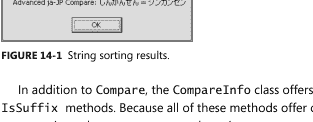

**图 14-1** 字符串排序结果。

除了 Compare 之外，CompareInfo 类还提供 IndexOf、LastIndexOf、IsPrefix 和 IsSuffix 方法。由于所有这些方法都提供接受 CompareOptions 枚举值作为参数的重载，因此它们比 String 类定义的 Compare、IndexOf、LastIndexOf、StartsWith 和 EndsWith 方法提供更多控制。此外，你应该知道 FCL 包含一个 `System.StringComparer` 类，你也可以使用它来执行字符串比较。当你需要对许多不同字符串反复执行同一种比较时，这个类很有用。

### 字符串驻留

如我在上一节所述，检查字符串是否相等是许多应用程序的常见操作——这项任务会显著影响性能。执行序号相等检查时，CLR 会快速测试两个字符串是否具有相同数量的字符。如果字符数不同，则字符串肯定不相等；如果字符数相同，则字符串可能相等，此时 CLR 必须比较每个单独的字符才能确定。执行区分文化的比较时，CLR 必须始终比较所有单独的字符，因为长度不同的字符串可能被视为相等。

此外，如果在内存中有同一字符串的多个实例重复存在，你就在浪费内存，因为字符串是不可变的。如果内存中只有一个字符串实例，并且所有需要引用该字符串的变量都只指向这个单一的字符串对象，那么内存使用效率会高得多。

如果你的应用程序经常使用区分大小写的序号比较来检查字符串是否相等，或者你预期会有许多具有相同值的字符串对象，那么利用 CLR 中的字符串驻留机制可以大幅提升性能。当 CLR 初始化时，它会创建一个内部哈希表，其中的键是字符串，值是托管堆中 String 对象的引用。最初，该表是空的（当然）。String 类提供两个方法，允许你访问这个内部哈希表：

```
public static String Intern(String str);
public static String IsInterned(String str);
```

第一个方法 Intern 接收一个 String，获取它的哈希代码，并在内部哈希表中检查是否有匹配项。如果已存在相同的字符串，则返回对已存在的 String 对象的引用。如果不存在相同的字符串，则创建该字符串的副本，将该副本添加到内部哈希表，并返回对该副本的引用。如果应用程序不再保留对原始 String 对象的引用，垃圾回收器就能够释放该字符串的内存。请注意，垃圾回收器无法释放内部哈希表所引用的字符串，因为内部哈希表持有对这些 String 对象的引用。内部哈希表所引用的 String 对象只有在 AppDomain 卸载或进程终止时才能被释放。

与 Intern 方法一样，IsInterned 方法接收一个 String，并在内部哈希表中查找它。如果哈希表中有匹配的字符串，IsInterned 返回对驻留字符串对象的引用。但是，如果哈希表中没有匹配的字符串，IsInterned 返回 null；它不会将该字符串添加到哈希表。

默认情况下，当加载程序集时，CLR 会驻留该程序集元数据中描述的所有字面量字符串。Microsoft 发现，由于额外的哈希表查找，这会显著损害性能，因此现在可以关闭这个“功能”。如果程序集用 `System.Runtime.CompilerServices.CompilationRelaxationsAttribute` 标记，并指定 `System.Runtime.CompilerServices.CompilationRelaxations.NoStringInterning` 标志值，那么根据 ECMA 规范，CLR 可以选择不驻留该程序集元数据中定义的所有字符串。请注意，为了尝试提高应用程序的性能，每当你编译程序集时，C# 编译器总是指定此特性/标志。

即使程序集指定了此特性/标志，CLR 也可能选择驻留这些字符串，但你不应依赖这一点。事实上，除非你自己编写了显式调用 String 的 `Intern` 方法的代码，否则你真的绝不应编写依赖字符串被驻留的代码。以下代码演示字符串驻留：

```
String s1 = "Hello";
String s2 = "Hello";
Console.WriteLine(Object.ReferenceEquals(s1, s2));  // Should be 'False'

s1 = String.Intern(s1);
s2 = String.Intern(s2);
Console.WriteLine(Object.ReferenceEquals(s1, s2));  // 'True'
```

在第一次调用 ReferenceEquals 方法时，s1 引用堆中的一个 "Hello" 字符串对象，而 s2 引用堆中另一个不同的 "Hello" 字符串对象。由于引用不同，应显示 `False`。但是，如果在 CLR 4.5 版上运行此代码，你会看到显示 True。原因是此版本的 CLR 选择忽略 C# 编译器发出的特性/标志，并且当程序集加载到 AppDomain 时，CLR 会驻留字面量 "Hello" 字符串。这意味着 s1 和 s2 引用堆中的单个 "Hello" 字符串。但是，如前所述，你绝不应编写依赖此行为的代码，因为未来版本的 CLR 可能会遵守该特性/标志，而不驻留 "Hello" 字符串。事实上，当使用 NGen.exe 实用工具编译此程序集的代码时，CLR 4.5 版确实会遵守该特性/标志。

在第二次调用 ReferenceEquals 方法之前，"Hello" 字符串已被显式驻留，s1 现在引用一个驻留的 "Hello"。然后再次调用 Intern，将 s2 设置为引用与 s1 相同的 "Hello" 字符串。现在，第二次调用 ReferenceEquals 时，无论程序集是否使用该特性/标志编译，我们都能保证得到 True 的结果。

那么现在，让我们看一个示例，了解如何使用字符串驻留来提高性能并减少内存使用。下面的 NumTimesWordAppearsEquals 方法接受两个参数：一个单词和一个字符串数组，其中每个数组元素引用一个单词。然后，此方法确定指定单词在单词列表中出现多少次，并返回此计数：

```
private static Int32 NumTimesWordAppearsEquals(String word, String[] wordlist) {
    Int32 count = 0;
    for (Int32 wordnum = 0; wordnum < wordlist.Length; wordnum++) {
        if (word.Equals(wordlist[wordnum], StringComparison.Ordinal))
            count++;
    }
```


编译器多年来一直在这样做。（微软的 C/C++ 编译器称之为字符串池化。）即便如此，字符串池化仍是提升字符串性能的另一种方式，也是你应当纳入知识储备的又一项知识。

### 检查字符串的字符和文本元素

尽管比较字符串对于排序或检测相等性很有用，但有时你只需要检查字符串中的字符。String 类型提供若干属性和方法来帮助你完成此操作，包括 Length、Chars（C# 中的索引器）、GetEnumerator、ToCharArray、Contains、IndexOf、LastIndexOf、IndexOfAny 和 LastIndexOfAny。

实际上，System.Char 表示单个 16 位 Unicode 码值，它不一定等同于一个抽象 Unicode 字符。例如，一些抽象 Unicode 字符是两个码值的组合。组合在一起时，U+0625（阿拉伯字母 *阿勒夫*，下方带 *哈姆扎*）和 U+0650（阿拉伯语卡斯腊）字符构成单个抽象字符或*文本元素*。

此外，一些 Unicode 文本元素需要超过 16 位的值来表示。这些文本元素使用两个 16 位码值表示。第一个码值称为高代理项，第二个码值称为低代理项。高代理项的值介于 U+D800 和 U+DBFF 之间，低代理项的值介于 U+DC00 和 U+DFFF 之间。代理项的使用使 Unicode 能够表达超过一百万个不同字符。

代理项在美国和欧洲很少使用，但在东亚更常用。要正确处理文本元素，应使用 System.Globalization.StringInfo 类型。使用此类型的最简单方式是构造它的实例，并向其构造函数传入一个字符串。然后，可以通过查询 StringInfo.LengthInTextElements 属性来查看字符串中有多少个文本元素。随后，可以调用 StringInfo 的 SubstringByTextElements 方法，提取所需的文本元素或指定数量的连续文本元素。

此外，StringInfo 类提供静态的 GetTextElementEnumerator 方法，该方法获取一个 System.Globalization.TextElementEnumerator 对象，使你能够枚举字符串中包含的所有抽象 Unicode 字符。最后，可以调用 StringInfo 的静态 ParseCombiningCharacters 方法，以获得一个 Int32 值数组。数组的长度表示字符串中包含多少个文本元素。数组的每个元素标识字符串中的一个索引，在该索引处可以找到新文本元素的第一个码值。

以下代码演示了使用 StringInfo 类操作字符串文本元素的各种方式：

```csharp
using System;
using System.Text;
using System.Globalization;
using System.Windows.Forms;

public sealed class Program {
    public static void Main() {
        // The string below contains combining characters
        String s = "a\u0304\u0308bc\u0327";
        SubstringByTextElements(s);
        EnumTextElements(s);
        EnumTextElementIndexes(s);
    }

    private static void SubstringByTextElements(String s) {
        String output = String.Empty;

        StringInfo si = new StringInfo(s);
        for (Int32 element = 0; element < si.LengthInTextElements; element++) {
            output += String.Format(
                "Text element {0} is '{1}'{2}",
                element, si.SubstringByTextElements(element, 1),
                Environment.NewLine);
        }
        MessageBox.Show(output, "Result of SubstringByTextElements");
    }

    private static void EnumTextElements(String s) {
        String output = String.Empty;

        TextElementEnumerator charEnum =
            StringInfo.GetTextElementEnumerator(s);
        while (charEnum.MoveNext()) {
            output += String.Format(
                "Character at index {0} is '{1}'{2}",
                charEnum.ElementIndex, charEnum.GetTextElement(),
                Environment.NewLine);
        }
        MessageBox.Show(output, "Result of GetTextElementEnumerator");
    }

    private static void EnumTextElementIndexes(String s) {
        String output = String.Empty;

        Int32[] textElemIndex = StringInfo.ParseCombiningCharacters(s);
        for (Int32 i = 0; i < textElemIndex.Length; i++) {
            output += String.Format(
                "Character {0} starts at index {1}{2}",
                i, textElemIndex[i], Environment.NewLine);
        }
        MessageBox.Show(output, "Result of ParseCombiningCharacters");
    }
}
```

生成并运行此代码会显示如图 14-2、14-3 和 14-4 所示的消息框。

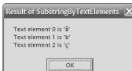

图 14-2 SubstringByTextElements 的结果。

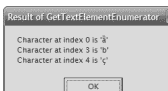

图 14-3 GetTextElementEnumerator 的结果。

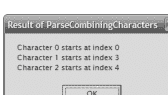

图 14-4 ParseCombiningCharacters 的结果。

### 其他字符串操作

`String` 类型还提供允许复制字符串或其部分内容的方法。表 14-1 总结了这些方法。

**表 14-1** 复制字符串的方法

| 成员 | 方法类型 | 描述 |
| :--- | :--- | :--- |
| Clone | 实例 | 返回对同一对象（`this`）的引用。这没问题，因为 `String` 对象是不可变的。此方法实现 `String` 的 `ICloneable` 接口。 |
| Copy | 静态 | 返回指定字符串的新副本字符串。此方法很少使用，其存在是为了帮助将字符串视为标记的应用程序。通常，具有相同字符集的字符串会被驻留到单个字符串。此方法创建一个新的字符串对象，以便即使字符串包含相同字符，引用（指针）也不同。 |
| CopyTo | 实例 | 将字符串的一部分字符复制到字符数组。 |
| Substring | 实例 | 返回一个新字符串，表示原始字符串的一部分。 |
| ToString | 实例 | 返回对同一对象（`this`）的引用。 |

除这些方法外，String 还提供许多操作字符串的静态和实例方法，例如 Insert、Remove、PadLeft、Replace、Split、Join、ToLower、ToUpper、Trim、Concat、Format 等。同样，关于所有这些方法要记住的重要一点是：它们返回新的字符串对象；因为字符串是不可变的，所以一旦创建，就不能（使用安全代码）修改。

### 高效构造字符串

因为 String 类型表示不可变字符串，所以 FCL 提供了另一种类型 System.Text.StringBuilder，它允许你高效地对字符串和字符执行动态操作，以创建 String。可以把 StringBuilder 看作一个精巧的构造函数，用于创建可与框架其余部分一起使用的 String。通常，应设计接受 String 参数而不是 StringBuilder 参数的方法。

从逻辑上讲，StringBuilder 对象包含一个字段，该字段引用 Char 结构的数组。StringBuilder 的成员允许你操作此字符数组，从而有效地缩短字符串或更改字符串中的字符。如果字符串增长超出已分配的字符数组，StringBuilder 会自动分配一个更大的新数组，复制字符，并开始使用新数组。先前的数组会被垃圾回收。

使用 StringBuilder 对象构造完字符串后，只需调用 StringBuilder 的 ToString 方法，即可将 StringBuilder 的字符数组“转换”为 String。这会在堆中创建一个新的 String 对象，其中包含调用 ToString 时 StringBuilder 中的字符串。此时，你可以继续操作 StringBuilder 内部的字符串，之后可以再次调用 ToString 将其转换为另一个 String 对象。

#### 构造 StringBuilder 对象

与 String 类不同，CLR 没有关于 StringBuilder 类的特殊信息。此外，大多数语言（包括 C#）不认为 StringBuilder 类是基元类型。你可以像构造任何其他非基元类型一样构造 StringBuilder 对象：

```csharp
StringBuilder sb = new StringBuilder();
```

StringBuilder 类型提供许多构造函数。每个构造函数的职责是分配并初始化每个 StringBuilder 对象所维护的状态：

- **最大容量** 一个 Int32 值，指定可放入字符串中的最大字符数。默认值为 Int32.MaxValue（约 20 亿）。它是


| 成员 | 成员类型 | 描述 |
|---|---|---|
| AppendLine | 方法 | 向字符数组末尾追加一个空行，或追加一个字符串并在其后附加一个空行；如有必要，会增加数组的容量。 |
| Replace | 方法 | 将字符数组中的一个字符替换为另一个字符，或将其中一个字符串替换为另一个字符串。 |
| Remove | 方法 | 从字符数组中移除指定范围的字符。 |
| Equals | 方法 | 仅当两个 StringBuilder 对象具有相同的最大容量、容量以及数组中的字符时，才返回 true。 |
| CopyTo | 方法 | 将 StringBuilder 中字符的子集复制到 Char 数组。 |

关于 StringBuilder 的方法，需要注意一个重要事项：其中大多数方法都返回对同一个 StringBuilder 对象的引用。这允许使用一种方便的语法将多个操作链接在一起：

```csharp
StringBuilder sb = new StringBuilder();
String s = sb.AppendFormat("{0} {1}", "Jeffrey", "Richter").
    Replace(' ', '-').Remove(4, 3).ToString();
Console.WriteLine(s); // Jeff-Richter
```

你会注意到，String 类和 StringBuilder 类的方法并不完全对等；也就是说，String 具有 ToLower、ToUpper、EndsWith、PadLeft、PadRight、Trim 等方法，而 StringBuilder 类不提供这些方法中的任何一个。另一方面，StringBuilder 类提供了更丰富的 Replace 方法，允许你替换字符串中某一部分（而不是整个字符串）的字符或字符串。遗憾的是，这两个类之间并不完全对等，因为现在你必须要在 String 和 StringBuilder 之间进行转换才能完成某些任务。例如，若要构建一个字符串、将所有字符转换为大写，然后插入一个字符串，就需要像下面这样的代码：

```csharp
// Construct a StringBuilder to perform string manipulations.
StringBuilder sb = new StringBuilder();

// Perform some string manipulations by using the StringBuilder.
sb.AppendFormat("{0} {1}", "Jeffrey", "Richter").Replace(' ', '-');

// Convert the StringBuilder to a string in
// order to uppercase all the characters.
String s = sb.ToString().ToUpper();

// Clear the StringBuilder (allocates a new Char array).
sb.Length = 0;

// Load the uppercase String into the StringBuilder.
// and perform more manipulations.
sb.Append(s).Insert(8, "Marc-");

// Convert the StringBuilder back to a String.
s = sb.ToString();

// Display the String to the user.
Console.WriteLine(s);   // "JEFFREY-RICHTER"
```

仅仅因为 StringBuilder 没有提供 String 所具备的全部操作，就必须编写这样的代码，既不方便也不高效。我希望将来 Microsoft 能为 StringBuilder 添加更多字符串操作方法，使它成为一个更完整的类。

### 获取对象的字符串表示形式：ToString

你经常需要获取对象的字符串表示形式。通常，当你想要向用户显示数值类型（例如 Byte、Int32 和 Single）或 DateTime 对象时，就需要这样做。由于 .NET Framework 是一个面向对象的平台，每种类型都负责提供将实例的值转换为等效字符串的代码。在设计类型应如何完成此操作时，FCL 的设计者设计了一种将在整个框架中一致使用的模式。在本节中，我将描述这种模式。

你可以通过调用 ToString 方法获取任何对象的字符串表示形式。System.Object 定义了一个公共的、虚拟的、无参数的 ToString 方法，因此可以使用任何类型的实例调用它。从语义上讲，ToString 返回一个表示对象当前值的字符串，并且该字符串应针对调用线程的当前区域性进行格式化；也就是说，数字的字符串表示形式应使用与分配给调用线程的区域性相关联的正确小数分隔符、数字分组符号和其他元素。

System.Object 对 ToString 的实现只返回对象类型的完整名称。这个值并不是特别有用，但对于许多无法提供合理字符串的类型来说，它是一个合理的默认值。例如，FileStream 或 Hashtable 对象的字符串表示形式应该是什么样子呢？

所有希望提供合理方式以获取表示对象当前值的字符串的类型，都应重写 ToString 方法。FCL 内置的许多核心类型（Byte、Int32、UInt64、Double 等）都重写了它们的 ToString 方法，并返回一个能感知区域性的字符串。在 Visual Studio 调试器中，当鼠标放在某个特定变量上时会显示数据提示。数据提示中显示的文本是通过调用对象的 ToString 方法获得的。因此，在定义类时，应始终重写 ToString 方法，以便获得良好的调试支持。

#### 特定格式和区域性

无参数的 ToString 方法有两个问题。首先，调用方无法控制字符串的格式。例如，应用程序可能希望将数字格式化为货币字符串、十进制字符串、百分比字符串或十六进制字符串。其次，调用方无法轻松选择使用特定区域性来格式化字符串。对于服务器端应用程序代码而言，第二个问题比客户端代码更麻烦。在少数情况下，应用程序需要使用与调用线程关联的区域性不同的区域性来格式化字符串。为了更好地控制字符串格式，你需要一个允许指定精确格式和区域性信息的 ToString 方法版本。

为调用方提供格式和区域性选择的类型实现 System.IFormattable 接口：

```csharp
public interface IFormattable {
    String ToString(String format, IFormatProvider formatProvider);
}
```

在 FCL 中，所有基元类型（Byte、SByte、Int16/UInt16、Int32/UInt32、Int64/UInt64、Single、Double、Decimal 和 DateTime）都实现此接口。此外，其他一些类型（例如 Guid）也实现此接口。最后，每个枚举类型定义都会自动实现 IFormattable 接口，以便可以从枚举类型的实例获取有意义的字符串符号。

IFormattable 的 ToString 方法接受两个参数。第一个参数 format 是一个字符串，用于告诉方法应如何格式化对象。ToString 的第二个参数 formatProvider 是实现 System.IFormatProvider 接口的类型的实例。该类型向 ToString 方法提供特定的区域性信息。我很快就会讨论具体方式。

实现 IFormattable 接口的 ToString 方法的类型决定它将识别哪些格式字符串。如果传入该类型无法识别的格式字符串，则该类型应引发 System.FormatException。

Microsoft 在 FCL 中定义的许多类型都能识别若干格式。例如，DateTime 类型支持 "d" 表示短日期，"D" 表示长日期，"g" 表示常规，"M" 表示月/日，"s" 表示可排序，"T" 表示长时间，"u" 表示 ISO 8601 格式的通用时间，"U" 表示完整日期格式的通用时间，"Y" 表示年/月，等等。所有枚举类型都支持 "G" 表示常规，"F" 表示标志，"D" 表示十进制，"X" 表示十六进制。我将在第 15 章“枚举类型和位标志”中更详细地介绍枚举类型的格式化。

此外，所有内置数值类型都支持 "C" 表示货币，"D" 表示十进制，"E" 表示指数（科学）记数法，"F" 表示定点，"G" 表示常规，"N" 表示数字，"P" 表示百分比，"R" 表示往返，"X" 表示十六进制。实际上，数值类型还支持图片格式字符串，以防简单格式字符串不能完全满足你的需求。图片格式字符串包含特殊字符，用于准确告诉类型的 ToString 方法要显示多少位数字、小数点应放在什么位置、小数点后应放多少位数字，等等。有关格式字符串的完整信息，请参阅 .NET Framework SDK 中的“格式化类型”。


对于大多数类型，调用 `ToString` 并为格式字符串传递 `null`，与调用 `ToString` 并为格式字符串传递 `"G"` 完全相同。换句话说，对象默认使用 `"General format"` 来格式化自身。实现某个类型时，应选择你认为最常用的格式；这种格式就是 `"General format."`。顺便说一下，不接受参数的 `ToString` 方法假定调用方希望使用 `"General format."`。

既然格式字符串已经讲完，现在转向区域文化信息。默认情况下，字符串使用与调用线程关联的区域文化信息进行格式化。无参数的 `ToString` 方法当然会这样做；如果为 `formatProvider` 参数传递 `null`，`IFormattable` 的 `ToString` 也会这样做。

当你格式化数字（包括货币、整数、浮点数、百分比、日期和时间）时，会应用区域文化敏感信息。`Guid` 类型有一个 `ToString` 方法，它只返回表示其值的字符串。生成 `Guid` 的字符串时不需要考虑区域文化，因为 GUID 仅用于编程目的。

格式化数字时，`ToString` 方法会查看你为 `formatProvider` 参数传递的内容。如果传递的是 `null`，`ToString` 会通过读取 `System.Globalization.CultureInfo.CurrentCulture` 属性来确定与调用线程关联的区域文化。该属性返回 `System.Globalization.CultureInfo` 类型的实例。

使用这个对象，`ToString` 会根据正在格式化的是数字还是日期/时间，读取其 `NumberFormat` 或 `DateTimeFormat` 属性。这些属性分别返回 `System.Globalization.NumberFormatInfo` 或 `System.Globalization.DateTimeFormatInfo` 的实例。`NumberFormatInfo` 类型定义了许多属性，例如 `CurrencyDecimalSeparator`、`CurrencySymbol`、`NegativeSign`、`NumberGroupSeparator` 和 `PercentSymbol`。同样，`DateTimeFormatInfo` 类型也定义了各种属性，例如 `Calendar`、`DateSeparator`、`DayNames`、`LongDatePattern`、`ShortTimePattern` 和 `TimeSeparator`。`ToString` 在构造和格式化字符串时会读取这些属性。

调用 `IFormattable` 的 `ToString` 方法时，你可以不传递 `null`，而是传递一个引用，该引用指向其类型实现了 `IFormatProvider` 接口的对象：

```csharp
public interface IFormatProvider {
    Object GetFormat(Type formatType);
}
```

`IFormatProvider` 接口背后的基本思想是：当一个类型实现此接口时，它表示该类型的实例能够提供特定区域文化的格式信息，并且应忽略与调用线程关联的区域文化信息。

`System.Globalization.CultureInfo` 类型是 FCL 中定义的极少数实现 `IFormatProvider` 接口的类型之一。例如，如果要将字符串格式化为适合越南的格式，你可以构造一个 `CultureInfo` 对象，并将该对象作为 `ToString` 的 `formatProvider` 参数传入。下面的代码获取一个 `Decimal` 数值的字符串表示形式，并将其格式化为适合越南的货币格式：

```csharp
Decimal price = 123.54M;
String s = price.ToString("C", new CultureInfo("vi-VN"));
MessageBox.Show(s);
```

如果生成并运行这段代码，会出现图 14-5 所示的消息框。

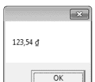

图 14-5 数值格式化正确，表示越南货币。

在内部，`Decimal` 的 `ToString` 方法发现 `formatProvider` 参数不为 `null`，于是按如下方式调用该对象的 `GetFormat` 方法：

```csharp
NumberFormatInfo nfi = (NumberFormatInfo)
    formatProvider.GetFormat(typeof(NumberFormatInfo));
```

这就是 `ToString` 从 `CultureInfo` 对象请求相应数字格式信息的方式。数字类型（例如 `Decimal`）只请求数字格式信息。但其他类型（例如 `DateTime`）可以像这样调用 `GetFormat`：

```csharp
DateTimeFormatInfo dtfi = (DateTimeFormatInfo)
    formatProvider.GetFormat(typeof(DateTimeFormatInfo));
```

实际上，由于 `GetFormat` 的参数可以标识任何类型，因此该方法足够灵活，允许请求任何类型的格式信息。.NET Framework 中的类型调用 `GetFormat` 时只请求数字或日期/时间信息；将来可能还会请求其他类型的格式信息。

顺便说一下，如果你希望获取未针对任何特定区域文化格式化的对象字符串，应调用 `System.Globalization.CultureInfo` 的静态 `InvariantCulture` 属性，并将返回的对象作为 `ToString` 的 `formatProvider` 参数传入。

```csharp
Decimal price = 123.54M;
String s = price.ToString("C", CultureInfo.InvariantCulture);
MessageBox.Show(s);
```

如果生成并运行这段代码，会出现图 14-6 所示的消息框。注意结果字符串中的第一个字符：¤。这是货币的国际符号（U+00A4）。


通常，你不会向用户显示使用固定区域性格式化的字符串。通常，你只会将此字符串保存到数据文件中，以便以后解析。

在 FCL 中，只有三种类型实现 `IFormatProvider` 接口。第一种是 `CultureInfo`，我已经解释过。另外两种是 `NumberFormatInfo` 和 `DateTimeFormatInfo`。对 `NumberFormatInfo` 对象调用 `GetFormat` 时，该方法会检查请求的类型是否为 `NumberFormatInfo`。如果是，则返回该对象本身；如果不是，则返回 `null`。类似地，对 `DateTimeFormatInfo` 对象调用 `GetFormat` 时，如果请求的是 `DateTimeFormatInfo`，则返回该对象本身；如果不是，则返回 `null`。这两种类型实现此接口只是为了编程方便。当尝试获取对象的字符串表示形式时，调用方通常会指定格式，并使用与调用线程关联的区域文化。因此，你经常调用 `ToString`，为格式参数传递一个字符串，并为 `IFormatProvider` 参数传递 `null`。为了让你更容易调用 `ToString`，许多类型提供了 `ToString` 方法的多个重载。例如，`Decimal` 类型提供了四种不同的 `ToString` 方法：

```csharp
// This version calls ToString(null, null).
// Meaning: General numeric format, thread's culture information
public override String ToString();

// This version is where the actual implementation of ToString goes.
// This version implements IFormattable's ToString method.
// Meaning: Caller-specified format and culture information
public String ToString(String format, IFormatProvider formatProvider);

// This version simply calls ToString(format, null).
// Meaning: Caller-specified format, thread's culture information
public String ToString(String format);

// This version simply calls ToString(null, formatProvider).
// This version implements IConvertible's ToString method.
// Meaning: General format, caller-specified culture information
public String ToString(IFormatProvider formatProvider);
```

### 将多个对象格式化为单个字符串

到目前为止，我已经解释了单个类型如何格式化其自身的对象。然而，有时你想构造由许多已格式化对象组成的字符串。例如，下面的字符串包含日期、人名和年龄：

```csharp
String s = String.Format("On {0}, {1} is {2} years old.",
    new DateTime(2012, 4, 22, 14, 35, 5), "Aidan", 9);
Console.WriteLine(s);
```

如果在 "en-US" 是线程当前区域文化的情况下生成并运行这段代码，你会看到下面这行输出：

```text
On 4/22/2012 2:35:05 PM, Aidan is 9 years old.
```

`String` 的静态 `Format` 方法接受一个格式字符串，该字符串使用大括号中的数字来标识可替换参数。此示例中使用的格式字符串告诉 `Format` 方法：用格式字符串之后的第一个参数（日期/时间）替换 `{0}`，用格式字符串之后的第二个参数（"Aidan"）替换 `{1}`，用格式字符串之后的第三个参数（9）替换 `{2}`。

在内部，`Format` 方法会调用每个对象的 `ToString` 方法以获取该对象的字符串表示形式。然后，所有返回的字符串都会被追加，最后返回完整的最终字符串。这当然没问题，但这意味着所有对象都是使用其常规格式和调用线程的区域文化信息来格式化的。

如果在 braces 中指定格式信息，你就能在格式化对象时拥有更多控制权。例如，下面的代码与上一个示例相同，只是我为可替换参数 0 和 2 添加了格式信息：

```csharp
String s = String.Format("On {0:D}, {1} is {2:E} years old.",
    new DateTime(2012, 4, 22, 14, 35, 5), "Aidan", 9);
Console.WriteLine(s);
```

如果在 "en-US" 是线程当前区域文化的情况下生成并运行这段代码，你会看到下面这行输出：

```text
On Sunday, April 22, 2012, Aidan is 9.000000E+000 years old.
```

当 `Format` 方法解析格式字符串时，它会发现可替换参数 0 应调用其 `IFormattable` 接口的 `ToString` 方法，并为其两个参数传入 "D" 和 `null`。同样，`Format` 会调用可替换参数 2 的 `IFormattable` `ToString` 方法，并传入 "E" 和 `null`。如果该类型没有实现 `IFormattable` 接口，`Format` 会调用其从 `Object` 继承（且可能已被重写）的无参数 `ToString` 方法，并将默认格式追加到结果字符串中。

`String` 类提供了静态 `Format` 方法的多个重载。其中一个版本接受一个实现 `IFormatProvider` 接口的对象，以便你可以使用调用方指定的区域文化信息来格式化所有可替换参数。显然，`Format` 会调用每个对象的 `IFormattable.ToString` 方法，并将传递给 `Format` 的 `IFormatProvider` 对象传给它。

如果你使用 `StringBuilder` 而不是 `String` 来构造字符串，可以调用 `StringBuilder` 的 `AppendFormat` 方法。此方法的工作方式与 `String` 的 `Format` 方法完全相同。


除了它会格式化一个字符串并追加到 StringBuilder 的字符数组中之外，其余与 String 的 Format 方法类似。AppendFormat 接受一个格式字符串，并且有一个重载接受 IFormatProvider。

System.Console 提供了 Write 和 WriteLine 方法，它们也接受格式字符串和可替换参数。但是，Console 的 Write 和 WriteLine 方法没有任何重载允许你传递 IFormatProvider。如果你想针对特定的区域性格式化字符串，就必须先调用 String 的 Format 方法，将所需的 IFormatProvider 对象传给它，然后再将结果字符串传给 Console 的 Write 或 WriteLine 方法。这应该不是什么大问题，因为正如我之前所说，客户端代码很少会使用调用线程关联的区域性以外的区域性来格式化字符串。

#### 提供你自己的自定义格式化器

到目前为止，你应该已经清楚，.NET Framework 中的格式化能力旨在为你提供极大的灵活性和控制力。不过，我们还没说完。你可以定义一个方法，让 StringBuilder 的 AppendFormat 方法在将任何对象格式化为字符串时调用它。换句话说，AppendFormat 可以调用你定义的函数，而不是为每个对象调用 ToString，从而允许你以任何想要的方式格式化任意或全部对象。我将要描述的内容同样适用于 String 的 Format 方法。

让我通过一个例子来解释这种机制。假设你正在格式化用户将在 Internet 浏览器中查看的 HTML 文本。你希望所有 Int32 值都以粗体显示。要做到这一点，每次将 Int32 值格式化为字符串时，你都想用 HTML 粗体标签 <B> 和 </B> 将其包围。下面的代码演示了这样做有多么简单：

```csharp
using System;
using System.Text;
using System.Threading;

public static class Program {
    public static void Main() {
        StringBuilder sb = new StringBuilder();
        sb.AppendFormat(new BoldInt32s(), "{0} {1} {2:M}", "Jeff", 123, DateTime.Now);
        Console.WriteLine(sb);
    }
}

internal sealed class BoldInt32s : IFormatProvider, ICustomFormatter {
    public Object GetFormat(Type formatType) {
        if (formatType == typeof(ICustomFormatter)) return this;
        return Thread.CurrentThread.CurrentCulture.GetFormat(formatType);
    }

    public String Format(String format, Object arg, IFormatProvider formatProvider) {
        String s;

        IFormattable formattable = arg as IFormattable;

        if (formattable == null) s = arg.ToString();
```

### 将字符串解析为对象：Parse

在前一节中，我解释了如何取得一个对象并获得该对象的字符串表示。在本节中，我将讨论相反的过程：如何取得一个字符串并获取它的对象表示。从字符串获取对象并不是一个非常常见的操作，但偶尔确实能派上用场。微软认为有必要将一种机制正式化，通过该机制可以将字符串解析为对象。

任何能够解析字符串的类型都会提供一个名为 `Parse` 的公共静态方法。该方法接受一个 `String` 并返回该类型的一个实例；在某种意义上，`Parse` 扮演着工厂的角色。在 FCL 中，所有数值类型以及 `DateTime`、`TimeSpan` 和少数其他类型（如 SQL 数据类型）都具有 `Parse` 方法。

让我们看看如何将字符串解析为数值类型。几乎所有的数值类型（`Byte`、`SByte`、`Int16`/`UInt16`、`Int32`/`UInt32`、`Int64`/`UInt64`、`Single`、`Double`、`Decimal` 和 `BigInteger`）都至少提供了一个 `Parse` 方法。这里我将只介绍 `Int32` 类型定义的 `Parse` 方法。（其他数值类型的 `Parse` 方法与 `Int32` 的 `Parse` 方法工作方式类似。）

```csharp
public static Int32 Parse(String s, NumberStyles style,
    IFormatProvider provider);
```

仅从原型来看，你应该能准确猜出这个方法的工作方式。`String` 参数 `s` 标识你希望解析为 `Int32` 对象的数字字符串表示。`System.Globalization.NumberStyles` 参数 `style` 是一组位标志，标识 `Parse` 应预期在字符串中找到的字符。`IFormatProvider` 参数 `provider` 标识一个对象，`Parse` 方法可以用它来获取区域性特定的信息，正如本章前面所讨论的那样。

例如，下面的代码会导致 `Parse` 抛出 `System.FormatException`，因为被解析的字符串包含一个前导空格：

```csharp
Int32 x = Int32.Parse(" 123", NumberStyles.None, null);
```

要允许 `Parse` 跳过前导空格，请将 `style` 参数更改如下：

```csharp
Int32 x = Int32.Parse(" 123", NumberStyles.AllowLeadingWhite, null);
```

有关 `NumberStyles` 枚举类型定义的位符号和常见组合的完整说明，请参阅 .NET Framework SDK 文档。

下面是一个演示如何解析十六进制数字的代码片段：

```csharp
Int32 x = Int32.Parse("1A", NumberStyles.HexNumber, null);
Console.WriteLine(x); // Displays "26"
```

这个 `Parse` 方法接受三个参数。为方便起见，许多类型提供了额外的 `Parse` 重载，这样你就不必传递那么多参数。例如，`Int32` 提供了四个 `Parse` 方法的重载：

```csharp
// Passes NumberStyles.Integer for style
// and thread’s culture’s provider information.
public static Int32 Parse(String s);
```

```csharp
// Passes thread’s culture’s provider information.
public static Int32 Parse(String s, NumberStyles style);
```

```csharp
// Passes NumberStyles.Integer for the style parameter.
public static Int32 Parse(String s, IFormatProvider provider);
```

```csharp
// This is the method I’ve been talking about in this section.
public static Int32 Parse(String s, NumberStyles style,
    IFormatProvider provider);
```

DateTime 类型也提供了一个 Parse 方法：

```csharp
public static DateTime Parse(String s,
    IFormatProvider provider, DateTimeStyles styles);
```

这个方法的工作方式与数值类型上定义的 Parse 方法类似，只不过 DateTime 的 Parse 方法接受一组由 System.Globalization.DateTimeStyles 枚举类型定义的位标志，而不是 NumberStyles 枚举类型。有关 DateTimeStyles 类型定义的位符号和常见组合的完整说明，请参阅 .NET Framework SDK 文档。

为方便起见，DateTime 类型提供了三个 Parse 方法的重载：

```csharp
// Passes thread’s culture’s provider information
// and DateTimeStyles.None for the style.
public static DateTime Parse(String s);
```

```csharp
// Passes DateTimeStyles.None for the style
public static DateTime Parse(String s, IFormatProvider provider);
```

```csharp
// This is the method I’ve been talking about in this section.
public static DateTime Parse(String s,
    IFormatProvider provider, DateTimeStyles styles);
```

解析日期和时间是复杂的。许多开发者发现 DateTime 类型的 Parse 方法过于宽容，有时会解析不包含日期或时间的字符串。因此，DateTime 类型还提供了 ParseExact 方法，它接受一个图片格式字符串，用来精确指示日期/时间字符串应该如何格式化和解析。有关图片格式字符串的更多信息，请参阅 .NET Framework SDK 中的 DateTimeFormatInfo 类。

> **注意** 一些开发者向微软反馈了以下情况：当他们的应用程序频繁调用 Parse，而 Parse 因无效用户输入而反复抛出异常时，应用程序的性能会受到影响。针对这些对性能敏感的 Parse 使用场景，微软为所有数值数据类型、DateTime、DateTimeOffset、TimeSpan，甚至

UTF-8 将一些字符编码为 1 个字节，一些字符编码为 2 个字节，一些字符编码为 3 个字节，还有一些字符编码为 4 个字节。值低于 0x0080 的字符被压缩为 1 个字节，这对于美国使用的字符非常有效。介于 0x0080 和 0x07FF 之间的字符被转换为 2 个字节，这对于欧洲和中东语言非常有效。0x0800 及以上的字符被转换为 3 个字节，这对于东亚语言非常有效。最后，代理项对被写出为 4 个字节。UTF-8 是一种极其流行的编码，但如果你编码许多值在 0x0800 或以上的字符，它的效率不如 UTF-16。

尽管 UTF-16 和 UTF-8 编码是迄今为止最常见的编码，但 FCL 还支持一些不太常用的编码：

- UTF-32 将所有字符编码为 4 个字节。当你想要编写一个简单的算法来遍历字符，并且不希望必须处理字符占用可变字节数的情况时，这种编码很有用。例如，使用 UTF-32 时，你不需要考虑代理项，因为每个字符都是 4 个字节。显然，就内存使用而言，UTF-32 并不是一种高效的编码，因此很少用于将字符串保存到文件或传输到网络。这种编码通常在程序内部使用。另请注意，UTF-32 可用于从小端转换为大端，反之亦然。

- UTF-7 编码通常用于处理可用 7 位值表示的字符的较旧系统。应避免使用此编码，因为它通常最终会扩展数据，而不是压缩数据。Unicode Consortium 已弃用此编码。

- ASCII 将 16 位字符编码为 ASCII 字符；也就是说，任何值小于 0x0080 的 16 位字符都会转换为单个字节。任何值大于 0x007F 的字符都无法转换，因此该字符的值会丢失。对于由 ASCII 范围（0x00 到 0x7F）内的字符组成的字符串，此编码会将数据压缩一半，并且速度非常快（因为高字节被直接截去）。如果你有 ASCII 范围之外的字符，则不适合使用此编码，因为这些字符的值将会丢失。

最后，FCL 还允许你将 16 位字符编码到任意代码页。与 ASCII 编码一样，编码到代码页是有风险的，因为任何无法在指定代码页中表示的字符都会丢失。你应始终使用 UTF-16 或 UTF-8 编码，除非你必须处理已经使用其他某种编码的旧版文件或应用程序。

当你需要对一组字符进行编码或解码时，应获取一个派生自 System.Text.Encoding 的类的实例。Encoding 是一个抽象基类，提供若干静态只读属性，每个属性都返回一个 Encoding 派生类的实例。

下面是一个使用 UTF-8 对字符进行编码和解码的示例：

```csharp
using System;
using System.Text;

public static class Program {
    public static void Main() {
        // This is the string we're going to encode.
        string s = "Hi there.";

        // Obtain an Encoding-derived object that knows how
        // to encode/decode using UTF8
        Encoding encodingUTF8 = Encoding.UTF8;

        // Encode a string into an array of bytes.
        byte[] encodedBytes = encodingUTF8.GetBytes(s);

        // Show the encoded byte values.
        Console.WriteLine("Encoded bytes: " +
            BitConverter.ToString(encodedBytes));

        // Decode the byte array back to a string.
        string decodedString = encodingUTF8.GetString(encodedBytes);

        // Show the decoded string.
        Console.WriteLine("Decoded string: " + decodedString);
    }
}
```

此代码生成以下输出：

```text
Encoded bytes: 48-69-20-74-68-65-72-65
Decoded string: Hi there.
```

除了 UTF8 静态属性外，Encoding 类还提供以下静态属性：Unicode、BigEndianUnicode、UTF7、UTF8、UTF32、ASCII 和 Default。Default 属性返回一个对象，该对象能够使用用户代码页进行编码/解码，该代码页由控制面板中“区域/管理”选项卡对话框的“非 Unicode 程序的语言”选项指定。（有关详细信息，请参阅 GetACP Win32 函数。）但是，不建议使用 Default 属性，因为应用程序的行为将取决于计算机设置，因此，如果你更改系统的默认代码页，或者应用程序在另一台计算机上运行，应用程序的行为会有所不同。

除了这些属性之外，Encoding 还提供一个静态 GetEncoding 方法，该方法允许你指定代码页（通过整数或字符串），并返回一个能够使用指定代码页进行编码/解码的对象。例如，你可以调用 GetEncoding，并传入 "Shift_JIS" 或 932。

首次请求某个编码对象时，Encoding 类的属性或 GetEncoding 方法会为所请求的编码构造单个对象并返回该对象。如果以后再次请求已经请求过的编码对象，Encoding 类只会返回它之前构造的对象；它不会为每次请求都构造新对象。这种高效做法减少了系统中的对象数量，并减轻了垃圾回收堆的压力。

除了调用 Encoding 的某个静态属性或其 GetEncoding 方法之外，你也可以构造以下某个类的实例：System.Text.UnicodeEncoding、System.Text.UTF8Encoding、System.Text.UTF32Encoding、System.Text.UTF7Encoding 或 System.Text.ASCIIEncoding。但是，请记住，构造这些类中的任何一个都会在托管堆中创建新对象，从而影响性能。

这些类中有四个——UnicodeEncoding、UTF8Encoding、UTF32Encoding 和 UTF7Encoding——提供多个构造函数，让你可以更好地控制编码和前导码。（前导码有时称为*字节顺序标记*或*BOM*。）上述前三个类还提供构造函数，使你可以让该类在解码无效字节序列时引发异常；当你希望应用程序安全并能抵御无效传入数据时，应使用这些构造函数。

在使用 `BinaryWriter` 或 `StreamWriter` 时，你可能希望显式构造这些编码类型的实例。`ASCIIEncoding` 类只有一个构造函数，因此无法对编码提供更多控制。如果需要 `ASCIIEncoding` 对象，请始终通过查询 `Encoding` 的 `ASCII` 属性来获取它，这会返回对单个 `ASCIIEncoding` 对象的引用。如果你自己构造 `ASCIIEncoding` 对象，就会在堆上创建更多对象，从而影响应用程序的性能。

一旦获得 `Encoding` 派生对象，就可以通过调用 `GetBytes` 方法将字符串或字符数组转换为字节数组。（此方法有多个重载。）要将字节数组转换为字符数组或字符串，请调用 `GetChars` 方法或更有用的 `GetString` 方法。（这两种方法都有多个重载。）前面的代码演示了对 `GetBytes` 和 `GetString` 方法的调用。

所有 `Encoding` 派生类型都提供 `GetByteCount` 方法，该方法获取编码一组字符所需的字节数，而无需实际执行编码。尽管 `GetByteCount` 并不是特别有用，但你可以使用此方法分配字节数组。还有一个 `GetCharCount` 方法，它返回将要解码的字符数，而无需实际解码这些字符。如果你试图节省内存并重用数组，这些方法会很有用。

`GetByteCount`/`GetCharCount` 方法并不算快，因为它们必须分析字符/字节数组才能返回准确结果。如果你更看重速度而不是精确结果，可以改为调用 `GetMaxByteCount` 或 `GetMaxCharCount` 方法。这两个方法都接受一个整数，用于指定字节数或字符数，并返回最坏情况下的值。

每个 `Encoding` 派生对象都提供一组公共只读属性，你可以查询这些属性来获取有关编码的详细信息。有关这些属性的说明，请参阅 .NET Framework SDK 文档。

为了说明大多数属性及其含义，我编写了以下程序，该程序显示几种不同*编码*的属性值：

```csharp
using System;
using System.Text;

public static class Program {
    public static void Main() {
```


### 编码和解码字符与字节流

```csharp
foreach (EncodingInfo ei in Encoding.GetEncodings()) {
    Encoding e = ei.GetEncoding();
    Console.WriteLine("{0}" +
        "\tCodePage={2}, WindowsCodePage={3}{0}" +
        "\tWebName={4}, HeaderName={5}, BodyName={6}{0}" +
        "\tIsBrowserDisplay={7}, IsBrowserSave={8}{0}" +
        "\tIsMailNewsDisplay={9}, IsMailNewsSave={10}{0}",
        Environment.NewLine,
        e.EncodingName, e.CodePage, e.WindowsCodePage,
        e.WebName, e.HeaderName, e.BodyName,
        e.IsBrowserDisplay, e.IsBrowserSave,
        e.IsMailNewsDisplay, e.IsMailNewsSave);
    }
}
```

运行该程序将产生以下输出（为节省纸张而缩减）：

```text
IBM EBCDIC (US-Canada)
        CodePage=37, WindowsCodePage=1252
        WebName=IBM037, HeaderName=IBM037, BodyName=IBM037
        IsBrowserDisplay=False, IsBrowserSave=False
        IsMailNewsDisplay=False, IsMailNewsSave=False

OEM United States
        CodePage=437, WindowsCodePage=1252
        WebName=IBM437, HeaderName=IBM437, BodyName=IBM437
        IsBrowserDisplay=False, IsBrowserSave=False
        IsMailNewsDisplay=False, IsMailNewsSave=False

IBM EBCDIC (International)
        CodePage=500, WindowsCodePage=1252
        WebName=IBM500, HeaderName=IBM500, BodyName=IBM500
        IsBrowserDisplay=False, IsBrowserSave=False
        IsMailNewsDisplay=False, IsMailNewsSave=False

Arabic (ASMO 708)
        CodePage=708, WindowsCodePage=1256
        WebName=ASMO-708, HeaderName=ASMO-708, BodyName=ASMO-708
        IsBrowserDisplay=False, IsBrowserSave=False
        IsMailNewsDisplay=False, IsMailNewsSave=False

Unicode
        CodePage=1200, WindowsCodePage=1200
        WebName=utf-16, HeaderName=utf-16, BodyName=utf-16
        IsBrowserDisplay=False, IsBrowserSave=False
        IsMailNewsDisplay=False, IsMailNewsSave=False

Unicode (Big-Endian)
        CodePage=1201, WindowsCodePage=1200
        WebName=unicodeFFFE, HeaderName=unicodeFFFE, BodyName=unicodeFFFE
        IsBrowserDisplay=False, IsBrowserSave=False
        IsMailNewsDisplay=False, IsMailNewsSave=False

Western European (DOS)
        CodePage=850, WindowsCodePage=1252
        WebName=ibm850, HeaderName=ibm850, BodyName=ibm850
        IsBrowserDisplay=False, IsBrowserSave=False
        IsMailNewsDisplay=False, IsMailNewsSave=False

Unicode (UTF-8)
        CodePage=65001, WindowsCodePage=1200
        WebName=utf-8, HeaderName=utf-8, BodyName=utf-8
        IsBrowserDisplay=True, IsBrowserSave=True
        IsMailNewsDisplay=True, IsMailNewsSave=True
```

表14-3涵盖了所有Encoding派生类提供的最常用的方法。

**表14-3** Encoding派生类的方法

| 方法 | 描述 |
|---|---|
| `GetPreamble` | 返回一个字节数组，指示在写入任何编码字节之前应向流中写入什么内容。通常，这些字节被称为BOM字节。当你开始从流中读取时，BOM字节会自动帮助检测写入流时使用的编码，以便使用正确的解码器。对于某些Encoding派生类，此方法返回一个0字节的数组——即没有前导字节。可以显式构造一个`UTF8Encoding`对象，使此方法返回一个3字节的数组：`0xEF`、`0xBB`、`0xBF`。可以显式构造一个`UnicodeEncoding`对象，使此方法返回一个2字节的数组：对于大端编码为`0xFE`、`0xFF`，对于小端编码为`0xFF`、`0xFE`。默认是小端。 |
| `Convert` | 将源编码中指定的字节数组转换为目标编码指定的字节数组。在内部，此静态方法调用源编码对象的`GetChars`方法，并将结果传递给目标编码对象的`GetBytes`方法。生成的字节数组返回给调用者。 |
| `Equals` | 如果两个Encoding派生对象表示相同的代码页和前导设置，则返回true。 |
| `GetHashCode` | 返回编码对象的代码页。 |

### 

想象一下，你正在通过一个`System.Net.Sockets.NetworkStream`对象读取UTF-16编码的字符串。字节很可能会以数据块的形式流入。换句话说，你可能首先从流中读取5个字节，然后是7个字节。在UTF-16中，每个字符由2个字节组成。因此，调用Encoding的`GetString`方法并传递第一个5字节数组将返回一个只包含两个字符的字符串。如果之后再次调用`GetString`，传入从流中到达的下一个7个字节，`GetString`将返回一个由三个字符组成的字符串，并且所有的码点值都是错误的！

这种数据损坏问题之所以发生，是因为所有Encoding派生类在方法调用之间不维护任何状态。如果你要分块编码或解码字符/字节，你必须在调用之间做一些额外的工作来维护状态，以防止任何数据丢失。

要解码字节块，你应该获取一个Encoding派生对象的引用（如前一节所述），并调用其GetDecoder方法。此方法返回一个新建对象的引用，该对象的类型派生自System.Text.Decoder类。与Encoding类一样，Decoder类是一个抽象基类。如果你查看.NET Framework SDK文档，你不会找到任何表示Decoder类具体实现的类。然而，FCL确实定义了一组Decoder派生类。这些类都是FCL内部的，但GetDecoder方法可以构造这些类的实例并将它们返回给应用程序代码。

所有Decoder派生类都提供两个重要的方法：GetChars和GetCharCount。显然，这些方法用于解码字节数组，其工作方式类似于前面讨论的Encoding的GetChars和GetCharCount方法。当你调用这些方法之一时，它会尽可能多地解码字节数组。如果字节数组没有足够的字节来完成一个字符，剩余的字节会保存在解码器对象内部。下次调用这些方法之一时，解码器对象会使用剩余的字节以及传递给它的新字节数组——这确保了数据块被正确解码。在从流中读取字节时，Decoder对象非常有用。

Encoding派生类型可用于无状态编码和解码。然而，Decoder派生类型只能用于解码。如果你想分块编码字符串，应调用GetEncoder而不是Encoding对象的GetDecoder方法。GetEncoder返回一个新建对象的引用，其类型派生自抽象基类System.Text.Encoder。同样，.NET Framework SDK文档中不包含任何表示Encoder类具体实现的类。然而，FCL确实定义了一些Encoder派生类。与Decoder派生类一样，这些类都是FCL内部的，但GetEncoder方法可以构造这些类的实例并将它们返回给应用程序代码。

所有Encoder派生类都提供两个重要的方法：GetBytes和GetByteCount。在每次调用时，Encoder派生对象会维护任何剩余的状态信息，以便你可以分块编码数据。

#### Base-64字符串编码与解码

在撰写本文时，UTF-16和UTF-8编码相当流行。将字节序列编码为base-64字符串也非常流行。FCL确实提供了进行base-64编码和解码的方法，你可能会期望这将通过Encoding派生类型来完成。然而，出于某种原因，base-64编码和解码是使用System.Convert类型提供的一些静态方法完成的。

要将字节数组编码为base-64字符串，你可以调用Convert的静态FromBase64String或FromBase64CharArray方法。同样，要将base-64字符串解码为字节数组，你可以调用Convert的静态ToBase64String或ToBase64CharArray方法。以下代码演示了如何使用其中一些方法：

```csharp
using System;

public static class Program
{
    public static void Main()
    {
        // 获取一组10个随机生成的字节
        Byte[] bytes = new Byte[10];
        new Random().NextBytes(bytes);

        // 显示字节
        Console.WriteLine(BitConverter.ToString(bytes));

        // 将字节解码为base-64字符串并显示该字符串
        String s = Convert.ToBase64String(bytes);
        Console.WriteLine(s);

        // 将base-64字符串重新编码为字节并显示这些字节
        bytes = Convert.FromBase64String(s);
        Console.WriteLine(BitConverter.ToString(bytes));
    }
}
```

编译此代码并运行可执行文件会产生以下输出（由于随机生成的字节，你的输出可能与我的不同）：

```text
3B-B9-27-40-59-35-86-54-5F-F1
07nkQfk1h1R8Q==
3B-B9-27-40-59-35-86-54-5F-F1
```

#### 安全字符串

通常，String对象用于包含敏感数据，例如用户的密码或信用卡信息。不幸的是，String对象在内存中包含一个字符数组，如果允许一些不安全或非托管代码执行，这些不安全/非托管代码可能会在进程的地址空间中窥探，找到包含敏感信息的字符串，并以未经授权的方式使用这些数据。即使String对象只被短暂使用然后被垃圾回收，CLR也可能不会立即重用String对象的内存（特别是如果String对象位于较老的一代中），从而将String的字符留在进程的内存中，信息可能会因此泄露。此外，由于字符串是不可变的，当你操作它们时，旧的副本会残留在内存中，最终内存中到处都有不同版本的字符串。

一些政府部门有严格的安全要求，需要非常具体的安全保证。为了满足这些要求，微软在


在你的方法内部，必须让 SecureString 对象先创建一个包含已解密字符的非托管内存缓冲区，然后你的方法才能使用该缓冲区。为了让恶意代码访问敏感数据的时机窗口尽可能小，你的代码应尽可能缩短对已解密字符串的访问时间。使用完该字符串后，你的代码应尽快将缓冲区清零并释放它。此外，切勿将 SecureString 的内容放入 String；如果这样做，String 会以未加密的形式存在于堆中，并且其字符在垃圾回收后内存被重用之前不会被清零。SecureString 类没有重写 ToString 方法，其目的正是为了避免暴露敏感数据（如果将其转换为 String 就会暴露）。

下面是一个示例代码，演示如何初始化和使用 SecureString（编译此代码时，你需要为 C# 编译器指定 /unsafe 开关）：

```csharp
using System;
using System.Security;
using System.Runtime.InteropServices;

public static class Program {
    public static void Main() {
        using (SecureString ss = new SecureString()) {
            Console.Write("Please enter password: ");
            while (true) {
                ConsoleKeyInfo cki = Console.ReadKey(true);
                if (cki.Key == ConsoleKey.Enter) break;

                // Append password characters into the SecureString
                ss.AppendChar(cki.KeyChar);
                Console.Write("*");
            }
            Console.WriteLine();

            // Password entered, display it for demonstration purposes
            DisplaySecureString(ss);
        }
        // After 'using', the SecureString is Disposed; no sensitive data in memory
    }

    // This method is unsafe because it accesses unmanaged memory
    private unsafe static void DisplaySecureString(SecureString ss) {
        Char* pc = null;
        try {
            // Decrypt the SecureString into an unmanaged memory buffer
            pc = (Char*) Marshal.SecureStringToCoTaskMemUnicode(ss);

            // Access the unmanaged memory buffer that
            // contains the decrypted SecureString
            for (Int32 index = 0; pc[index] != 0; index++)
                Console.Write(pc[index]);
        }
        finally {
            // Make sure we zero and free the unmanaged memory buffer that contains
            // the decrypted SecureString characters
            if (pc != null)
                Marshal.ZeroFreeCoTaskMemUnicode((IntPtr) pc);
        }
    }
}
```

System.Runtime.InteropServices.Marshal 类提供了五个方法，你可以调用它们将 SecureString 的字符解密到非托管内存缓冲区中。这些方法全部是静态方法，都接受一个 SecureString 参数，并且都返回一个 IntPtr。每个方法都有一个对应的方法，你必须调用对应方法来清零内部缓冲区并释放它。表 14-4 展示了 System.Runtime.InteropServices.Marshal 类将 SecureString 解密到内存缓冲区的方法，以及用于清零并释放缓冲区的对应方法。

**表 14-4** Marshal 类用于处理安全字符串的方法

| 将 SecureString 解密到缓冲区的方法 | 清零并释放缓冲区的方法 |
|---|---|
| SecureStringToBSTR | ZeroFreeBSTR |
| SecureStringToCoTaskMemAnsi | ZeroFreeCoTaskMemAnsi |
| SecureStringToCoTaskMemUnicode | ZeroFreeCoTaskMemUnicode |
| SecureStringToGlobalAllocAnsi | ZeroFreeGlobalAllocAnsi |
| SecureStringToGlobalAllocUnicode | ZeroFreeGlobalAllocUnicode |

## 第 15 章：枚举类型和位标志

- 本章内容：
  - 枚举类型 373
  - 位标志 379
  - 向枚举类型添加方法 383

在本章中，我将讨论枚举类型和位标志。由于 Microsoft Windows 和许多编程语言使用这些结构已经很多年了，我相信你们中的许多人已经熟悉如何使用枚举类型和位标志。然而，公共语言运行时（CLR）和框架类库（FCL）协同工作，使枚举类型和位标志成为真正的面向对象类型，提供了我怀疑大多数开发人员并不熟悉的酷炫功能。令我惊讶的是，这些功能（也是本章的重点）使得应用程序代码的开发变得如此容易。

### 枚举类型

*枚举类型*是一种定义一组符号名称和值对的类型。例如，这里显示的 Color 类型定义了一组符号，每个符号标识一种颜色：

```csharp
internal enum Color {
    White,      // Assigned a value of 0
    Red,        // Assigned a value of 1
    Green,      // Assigned a value of 2
    Blue,       // Assigned a value of 3
    Orange      // Assigned a value of 4
}
```

当然，程序员总是可以用 0 表示白色、1 表示红色等来编写程序。但是，程序员不应在代码中硬编码数字，而应改用枚举类型，至少有两点原因：

- 枚举类型使程序更易于阅读和维护。使用枚举类型，符号名称贯穿整个代码，程序员无需在脑中映射每个硬编码值的含义（例如，白色是 0，或反之）。此外，如果某个符号的数值发生变化，只需重新编译代码，无需对源代码进行任何更改。另外，文档工具和其他实用程序（如调试器）可以向程序员显示有意义的符号名称。

- 枚举类型是强类型的。例如，如果我将 Color.Orange 作为值传递给需要 Fruit 枚举类型参数的方法，编译器将报告错误。

在 Microsoft .NET Framework 中，枚举类型不仅仅是编译器关心的符号。枚举类型在类型系统中被视为一等公民，这允许执行一些非常强大的操作，而这些操作在其他环境（例如非托管 C++）中根本无法使用枚举类型完成。

每个枚举类型都直接派生自 System.Enum，而 System.Enum 派生自 System.ValueType，System.ValueType 又派生自 System.Object。因此，枚举类型是值类型（在第 5 章“基元、引用和值类型”中描述），可以以未装箱和已装箱的形式表示。但是，与其他值类型不同，枚举类型不能定义任何方法、属性或事件。不过，你可以使用 C# 的扩展方法功能来模拟向枚举类型添加方法。有关示例，请参阅本章末尾的“向枚举类型添加方法”一节。

编译枚举类型时，C# 编译器会将每个符号转换为该类型的常量字段。例如，编译器会像处理你编写了类似以下代码一样处理前面显示的 Color 枚举：

```csharp
internal struct Color : System.Enum {
    // Below are public constants defining Color's symbols and values
    public const Color White  = (Color) 0;
    public const Color Red    = (Color) 1;
    public const Color Green  = (Color) 2;
    public const Color Blue   = (Color) 3;
    public const Color Orange = (Color) 4;

    // Below is a public instance field containing a Color variable's value
    // You cannot write code that references this instance field directly
    public Int32 value__;
}
```

C# 编译器实际上不会编译此代码，因为它禁止你定义从特殊的 System.Enum 类型派生的类型。然而，这个伪类型定义展示了内部发生的情况。基本上，枚举类型只是一个结构，其中定义了一组常量字段和一个实例字段。常量字段会被写入程序集的元数据中，并且可以通过反射访问。这意味着你可以在运行时获取与枚举类型关联的所有符号及其值。这也意味着你可以将字符串符号转换为其等效的数值。System.Enum 基类型为你提供了这些操作，它提供了几个可在枚举类型实例上执行的静态和实例方法，让你不必使用反射。我将讨论其中一些


接下来讨论操作。

**重要** 由枚举类型定义的符号是常量值。因此，当编译器看到引用枚举类型符号的代码时，编译器会在编译时替换该符号的数值，并且这段代码不再引用定义该符号的枚举类型。这意味着定义该枚举类型的程序集在运行时可能不需要；它只在编译时才需要。如果你有代码引用该枚举类型——而不只是引用该类型定义的符号——那么包含该枚举类型定义的程序集在运行时将是必需的。由于枚举类型符号是常量而不是只读值，因此会出现一些版本控制问题。我在第7章“常量和字段”的“常量”一节中解释了这些问题。

例如，System.Enum 类型有一个名为 GetUnderlyingType 的静态方法，System.Type 类型有一个名为 GetEnumUnderlyingType 的实例方法：

```csharp
public static Type GetUnderlyingType(Type enumType);        // Defined in System.Enum
public        Type GetEnumUnderlyingType();                 // Defined in System.Type
```

这些方法返回用于保存枚举类型值的核心类型。每个枚举类型都有一个基础类型，它可以是 byte、sbyte、short、ushort、int（最常见的类型，也是 C# 默认选择的类型）、uint、long 或 ulong。当然，这些 C# 基元类型对应于 FCL 类型。然而，为了使编译器本身的实现更简单，C# 编译器要求你在这里指定基元类型名称；使用 FCL 类型名（如 Int32）会生成以下消息：“error CS1008: 应输入类型 byte、sbyte、short、ushort、int、uint、long 或 ulong。”以下代码展示了如何声明基础类型为 byte（System.Byte）的枚举类型：

```csharp
internal enum Color : byte {
White,
Red,
Green,
Blue,
Orange
}
```

以这种方式定义 Color 枚举类型后，以下代码展示了 GetUnderlyingType 将返回什么：

```csharp
// The following line displays "System.Byte".
Console.WriteLine(Enum.GetUnderlyingType(typeof(Color)));
```

C# 编译器将枚举类型视为基元类型。因此，你可以使用许多熟悉的运算符（==、!=、<、>、<=、>=、+、-、^、&、|、~、++ 和 --）来操作枚举类型实例。所有这些运算符实际上都作用于每个枚举类型实例内部的 value__ 实例字段。此外，C# 编译器允许你将枚举类型的实例显式强制转换为不同的枚举类型。你还可以将枚举类型实例显式强制转换为数值类型。

```csharp
Console.WriteLine("{0,5:D}\t{0:G}", c);
}
```

前面的代码产生以下输出：

定义的符号数：5

| 值 | 符号 |
| ----: | :----- |
| 0 | White |
| 1 | Red |
| 2 | Green |
| 3 | Blue |
| 4 | Orange |

就我个人而言，我不喜欢 GetValues 和 GetEnumValues 方法，因为它们都返回 Array，而我随后必须将其强制转换为适当的数组类型。因此，我总是定义自己的方法：

```csharp
public static TEnum[] GetEnumValues<TEnum>() where TEnum : struct
{
    return (TEnum[])Enum.GetValues(typeof(TEnum));
}
```

使用我的泛型 GetEnumValues 方法，我可以获得更好的编译时类型安全，并将前一个示例中的第一行代码简化为：

```csharp
Color[] colors = GetEnumValues<Color>();
```

这个讨论展示了可以对枚举类型执行的一些很酷的操作。我猜想，只要字符串不需要本地化（因为枚举类型不提供本地化支持），使用常规格式的 ToString 方法将非常频繁地用于在程序的用户界面元素（列表框、组合框等）中显示符号名称。除了 GetValues 方法之外，System.Enum 类型和 System.Type 类型还提供以下返回枚举类型符号的方法：

```csharp
// Returns a String representation for the numeric value
public static String GetName(Type enumType, Object value);    // Defined in System.Enum
public          String GetEnumName(Object value);              // Defined in System.Type

// Returns an array of Strings: one per symbol defined in the enum
public static String[] GetNames(Type enumType);                // Defined in System.Enum
public          String[] GetEnumNames();                       // Defined in System.Type
```

我已经讨论了许多可用于查找枚举类型符号的方法。但你还需要一个能够查找符号等效值的方法，例如，这个操作可用于将用户输入到文本框中的符号转换为枚举类型。将符号转换为枚举类型的实例很容易通过使用 Enum 的静态 Parse 和 TryParse 方法之一来完成：

```csharp
public static Object Parse(Type enumType, String value);
public static Object Parse(Type enumType, String value, Boolean ignoreCase);
public static Boolean TryParse<TEnum>(String value, out TEnum result) where TEnum : struct;
public static Boolean TryParse<TEnum>(String value, Boolean ignoreCase, out TEnum result)
    where TEnum : struct;
```

以下代码演示了如何使用这个方法：

```csharp
// Because Orange is defined as 4, 'c' is initialized to 4.
Color c = (Color) Enum.Parse(typeof(Color), "Orange", true);

// Because Brown isn't defined, an ArgumentException is thrown.
c = (Color) Enum.Parse(typeof(Color), "Brown", false);

// Creates an instance of the Color enum with a value of 1
Enum.TryParse<Color>("1", false, out c);

// Creates an instance of the Color enum with a value of 23
Enum.TryParse<Color>("23", false, out c);
```

最后，使用 Enum 的静态 IsDefined 方法和 Type 的 IsEnumDefined 方法，

```csharp
public static Boolean IsDefined(Type enumType, Object value);    // Defined in System.Enum
public         Boolean IsEnumDefined(Object value);                // Defined in System.Type
```

你可以确定某个数值对于枚举类型是否合法：

```csharp
// Displays "True" because Color defines Red as 1
Console.WriteLine(Enum.IsDefined(typeof(Color), (Byte)1));

// Displays "True" because Color defines White as 0
Console.WriteLine(Enum.IsDefined(typeof(Color), "White"));

// Displays "False" because a case-sensitive check is performed
Console.WriteLine(Enum.IsDefined(typeof(Color), "white"));

// Displays "False" because Color doesn't have a symbol of value 10
Console.WriteLine(Enum.IsDefined(typeof(Color), (Byte)10));
```

IsDefined 方法经常用于参数验证。以下是一个示例：

```csharp
public void SetColor(Color c) {
    if (!Enum.IsDefined(typeof(Color), c)) {
        throw(new ArgumentOutOfRangeException("c", c, "Invalid Color value."));
    }
    // Set color to White, Red, Green, Blue, or Orange
    ...
}
```

参数验证很有用，因为有人可能会像这样调用 SetColor：

```csharp
SetColor((Color) 547);
```

因为没有符号具有对应值 547，所以 SetColor 方法将抛出 ArgumentOutOfRangeException 异常，指出哪个参数无效以及原因。

**重要** `IsDefined` 方法非常方便，但你必须谨慎使用它。首先，IsDefined 总是执行区分大小写的搜索，并且无法让它执行不区分大小写的搜索。其次，`IsDefined` 相当慢，因为它在内部使用反射；如果你编写代码手动检查每个可能的值，应用程序的性能肯定会更好。第三，只有当枚举类型本身定义在调用 `IsDefined` 的同一个程序集中时，你才真正应该使用 `IsDefined`。原因如下：假设 `Color` 枚举定义在一个程序集中，而 `SetColor` 方法定义在另一个程序集中。`SetColor` 方法调用 `IsDefined`，如果颜色是 White、Red、Green、Blue 或 Orange，`SetColor` 就执行其工作。然而，如果将来 `Color` 枚举发生变化，包含了 Purple，`SetColor` 现在将允许 Purple，而这是它以前从未预料到的，该方法可能会以不可预测的结果执行。

最后，`System.Enum` 类型提供了一组静态 `ToObject` 方法，用于将 `Byte`、`SByte`、`Int16`、`UInt16`、`Int32`、`UInt32`、`Int64` 或 `UInt64` 的实例转换为枚举类型的实例。

枚举类型总是与某些其他类型结合使用。通常，它们用于该类型的方法参数或返回类型、属性和字段。一个常见的问题是：是将枚举类型嵌套在需要它的类型内部定义，还是将枚举类型定义在与需要它的类型相同的级别。如果你查看 FCL，你会发现枚举类型通常定义在需要它的类相同的级别。原因很简单，就是为了减少所需的输入量，让开发者的生活稍微轻松一些。因此，除非你遇到了某些冲突，否则应该将枚举类型定义在同一级别。

### 位标志

程序员经常处理位标志集合。当你调用 `System.IO.File` 类型的 `GetAttributes` 方法时，它返回 `FileAttributes` 类型的实例。`FileAttributes` 类型是基于 `Int32` 的枚举类型的实例，其中每一位反映文件的单个属性。`FileAttributes` 类型在 FCL 中的定义如下：

```csharp
[Flags, Serializable]
public enum FileAttributes {
    ReadOnly          = 0x000001,
    Hidden            = 0x000002,
    System            = 0x000004,
    Directory         = 0x000010,
    Archive           = 0x000020,
    Device            = 0x000040,
    Normal            = 0x000080,
    Temporary         = 0x000100,
    SparseFile        = 0x000200,
    ReparsePoint      = 0x000400,
    Compressed        = 0x000800,
    Offline           = 0x001000,
    NotContentIndexed = 0x002000,
    Encrypted         = 0x004000,
    IntegrityStream   = 0x008000,
    NoScrubData       = 0x020000
}
```


要确定某个文件是否隐藏，可以执行如下代码：

```
String file = Assembly.GetEntryAssembly().Location;
FileAttributes attributes = File.GetAttributes(file);
Console.WriteLine("Is {0} hidden? {1}", file, (attributes & FileAttributes.Hidden) != 0);
```

**注意** Enum 类定义了一个 **HasFlag** 方法，定义如下：

```
public Boolean HasFlag(Enum flag);
```

使用此方法，可以将对 Console.WriteLine 的调用改写为如下形式：

```
Console.WriteLine("Is {0} hidden? {1}", file,
                  attributes.HasFlag(FileAttributes.Hidden));
```

但是，出于以下原因，我建议避免使用 **HasFlag** 方法：由于它接受 **Enum** 类型的参数，因此传递给它的任何值都必须装箱，这需要分配内存。

下面的代码演示了如何将文件属性更改为只读和隐藏：

```
File.SetAttributes(file, FileAttributes.ReadOnly | FileAttributes.Hidden);
```

正如 **FileAttributes** 类型所示，使用枚举类型来表示可组合的位标志集合很常见。然而，尽管枚举类型和位标志相似，但它们并不具有完全相同的语义。例如，枚举类型表示单个数值，而位标志表示一组位，其中一些位为开，一些位为关。

在定义用于标识位标志的枚举类型时，当然应显式地为每个符号分配一个数值。通常，每个符号都会有一个单独的位被打开。也常见到名为 None 的符号被定义为值 0，还可以定义表示常用组合的符号（参见下面的 **ReadWrite** 符号）。还强烈建议将 **System.FlagsAttribute** 自定义特性类型应用到枚举类型，如下所示：

```
[Flags]    // The C# compiler allows either "Flags" or "FlagsAttribute".
internal enum Actions {
    None    = 0,
    Read    = 0x0001,
    Write   = 0x0002,
    ReadWrite = Actions.Read | Actions.Write,
    Delete  = 0x0004,
    Query   = 0x0008,
    Sync    = 0x0010
}
```

由于 **Actions** 是枚举类型，因此在处理位标志枚举类型时，可以使用上一节中描述的所有方法。不过，如果其中一些函数的行为稍有不同，那会更好。例如，假设有以下代码：

```
Actions actions = Actions.Read | Actions.Delete;   // 0x0005
Console.WriteLine(actions.ToString());             // "Read, Delete"
Console.WriteLine(actions.ToString("F"));       // "Read, Delete"
```

如果数值中有一位无法映射到符号，则返回的字符串将仅包含一个十进制数，指示原始数值；字符串中不会出现任何符号。

请注意，在枚举类型中定义的符号不必是纯 2 的幂。例如，Actions 类型可以定义一个名为 All 的符号，其值为 0x001F。如果 Actions 类型的实例的值为 0x001F，则格式化该实例将生成一个包含“All”的字符串。其他符号字符串不会出现。

到目前为止，我已经讨论了如何将数值转换为标志字符串。也可以通过调用 Enum 的静态 Parse 和 TryParse 方法，将逗号分隔的符号字符串转换为数值。下面的代码演示了如何使用这些方法：

```csharp
// Because Query is defined as 8, 'a' is initialized to 8.
Actions a = (Actions) Enum.Parse(typeof(Actions), "Query", true);
Console.WriteLine(a.ToString()); // "Query"

// Because Query and Read are defined, 'a' is initialized to 9.
Enum.TryParse<Actions>("Query, Read", false, out a);
Console.WriteLine(a.ToString()); // "Read, Query"

// Creates an instance of the Actions enum with a value of 28
a = (Actions) Enum.Parse(typeof(Actions), "28", false);
Console.WriteLine(a.ToString()); // "Delete, Query, Sync"
```

调用 Parse 和 TryParse 时，内部会执行以下操作：

- 1. 它会移除字符串开头和结尾的所有空白字符。
- 2. 如果字符串的第一个字符是数字、加号（+）或减号（-），则假定该字符串是数字，并返回一个枚举实例，其数值等于该字符串转换后的数值。
- 3. 传入的字符串会被拆分为一组标记（以逗号分隔），并去除每个标记中的所有空白。
- 4. 每个标记字符串都会在枚举类型已定义的符号中查找。如果未找到该符号，Parse 会抛出 System.ArgumentException，TryParse 会返回 false。如果找到该符号，则将其数值按位或到累计结果中，然后查找下一个标记。
- 5. 如果所有标记都已查找并找到，则返回累计结果。

绝不要对位标志枚举类型使用 IsDefined 方法。它不会起作用，原因有两个：

- 如果向 IsDefined 传递字符串，它不会将该字符串拆分为单独的标记来查找；它会尝试将该字符串当作一个包含逗号的大符号来查找。由于不能定义包含逗号的符号的枚举，因此该符号将永远找不到。
- 如果向 IsDefined 传递数值，它会检查枚举类型是否定义了单个符号，其数值与传入的数字匹配。由于这对位标志来说不太可能，因此 IsDefined 通常会返回 false。

#### 为枚举类型添加方法

在本章前面，我提到过不能将方法定义为枚举类型的一部分。而且，多年来这让我感到遗憾，因为有很多时候我都希望能为我的枚举类型提供一些方法。幸运的是，我可以使用 C# 的扩展方法特性（在第 8 章“方法”中讨论）来模拟向枚举类型添加方法。

如果我想向 FileAttributes 枚举类型添加一些方法，可以如下定义一个包含扩展方法的静态类：

```csharp
internal static class FileAttributesExtensionMethods {
    public static Boolean IsSet(this FileAttributes flags, FileAttributes flagToTest) {
        if (flagToTest == 0)
            throw new ArgumentOutOfRangeException("flagToTest", "Value must not be 0");
        return (flags & flagToTest) == flagToTest;
    }

    public static Boolean IsClear(this FileAttributes flags, FileAttributes flagToTest) {
        if (flagToTest == 0)
            throw new ArgumentOutOfRangeException("flagToTest", "Value must not be 0");
        return !IsSet(flags, flagToTest);
    }

    public static Boolean AnyFlagsSet(this FileAttributes flags, FileAttributes testFlags) {
        return ((flags & testFlags) != 0);
    }

    public static FileAttributes Set(this FileAttributes flags, FileAttributes setFlags) {
        return flags | setFlags;
    }

    public static FileAttributes Clear(this FileAttributes flags,
        FileAttributes clearFlags) {
        return flags & ~clearFlags;
    }

    public static void ForEach(this FileAttributes flags,
        Action<FileAttributes> processFlag) {
        if (processFlag == null) throw new ArgumentNullException("processFlag");
        for (UInt32 bit = 1; bit != 0; bit <<= 1) {
            UInt32 temp = ((UInt32)flags) & bit;
            if (temp != 0) processFlag((FileAttributes)temp);
        }
    }
}
```

下面是一些演示调用其中一些方法的代码。如你所见，这段代码看起来就像我在枚举类型上调用方法：

```csharp
FileAttributes fa = FileAttributes.System;
fa = fa.Set(FileAttributes.ReadOnly);
fa = fa.Clear(FileAttributes.System);
fa.ForEach(f => Console.WriteLine(f));
```

的 Int32 数组。最初，myIntegers 将被设置为 null，因为我还没有分配数组。第二行代码分配一个包含 100 个 Int32 值的数组；所有 Int32 都初始化为 0。由于数组是引用类型，容纳 100 个未装箱 Int32 所需的内存块会在托管堆上分配。实际上，除了数组元素之外，数组对象占用的内存块还包含类型对象指针、同步块索引以及一些额外的开销成员。该数组内存块的地址会被返回并保存到变量 myIntegers 中。

也可以创建引用类型数组：

```
Control[] myControls;        // Declares a reference to an array
myControls = new Control[50]; // Creates an array of 50 Control references
```

第一行中，myControls 是一个能够指向 Control 引用的一维数组的变量。最初，myControls 将被设置为 null，因为我还没有分配数组。第二行分配一个包含 50 个 Control 引用的数组；所有这些引用都初始化为 null。由于 Control 是引用类型，创建该数组只会创建一组引用；此时并不会创建实际对象。该内存块的地址会被返回并保存到变量 myControls 中。

图 16-1 展示了值类型数组和引用类型数组在托管堆中的样子。

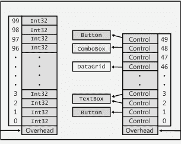

**图 16-1** 托管堆中的值类型数组和引用类型数组。

图中，Controls 数组展示了执行以下代码行后的结果：

```
myControls[1] = new Button();
myControls[2] = new TextBox();
myControls[3] = myControls[2];  // Two elements refer to the same object.
myControls[46] = new DataGrid();
myControls[48] = new ComboBox();
myControls[49] = new Button();
```


公共语言规范（CLS）要求所有数组都必须是零基的（zero-based）。这使得用 C# 编写的方法可以创建数组，并将该数组的引用传递给用其他语言编写的代码，例如 Microsoft Visual Basic .NET。此外，由于零基数组目前是最常见的数组类型，Microsoft 花费了大量精力来优化其性能。然而，CLR 确实支持非零基数组，尽管不鼓励使用它们。对于那些不在意轻微性能损失或跨语言可移植性的人，我将在本章后面演示如何创建和使用非零基数组。

请注意，在图 1-6 中，每个数组都带有一些额外的开销信息。这些信息包含数组的秩（维数）、每个维度的下界（几乎总是 0）以及每个维度的长度。开销中还包含数组的元素类型。我将在本章后面提到允许你查询这些开销信息的方法。

到目前为止，我展示的示例都是演示如何创建一维数组。在可能的情况下，你应该坚持使用一维零基数组，有时也称为 SZ 数组或向量（vector）。向量的性能最佳，因为你可以使用特定的中间语言（IL）指令——如 `newarr`、`ldlen`、`ldelem` 和 `stelem`——来操作它们。然而，如果你更喜欢使用多维数组，也可以。以下是一些多维数组的示例：

```csharp
// 创建一个 Double 类型的二维数组。
Double[,] myDoubles = new Double[10, 20];

// 创建一个 String 引用的三维数组。
String[,,] myStrings = new String[5, 3, 10];
```

CLR 还支持交错数组（jagged arrays），即数组的数组。零基的一维交错数组具有与普通向量相同的性能。然而，访问交错数组的元素意味着必须进行两次或更多次数组访问。以下是一些示例，演示如何创建一个多边形数组，其中每个多边形由一个 Point 实例数组组成：

```csharp
// 创建一个 Point 数组的一维数组。
Point[][] myPolygons = new Point[3][];

// myPolygons[0] 引用一个包含 10 个 Point 实例的数组。
myPolygons[0] = new Point[10];

// myPolygons[1] 引用一个包含 20 个 Point 实例的数组。
myPolygons[1] = new Point[20];

// myPolygons[2] 引用一个包含 30 个 Point 实例的数组。
myPolygons[2] = new Point[30];

// 显示第一个多边形中的点。
for (Int32 x = 0; x < myPolygons[0].Length; x++)
    Console.WriteLine(myPolygons[0][x]);
```

**注意** CLR 会验证数组的索引是否有效。换句话说，你不能创建一个包含 100 个元素的数组（编号从 0 到 99），然后尝试访问索引为 -5 或 100 的元素。这样做会抛出 `System.IndexOutOfRangeException` 异常。允许访问数组范围之外的内存将违反类型安全，并可能造成安全漏洞，CLR 不允许可验证代码这样做。通常，与索引检查相关的性能损失是微不足道的，因为即时（JIT）编译器通常会在循环执行之前检查一次数组边界，而不是在每次循环迭代时检查。然而，如果你仍然担心 CLR 索引检查的性能影响，你可以在 C# 中使用不安全代码来访问数组。本章后面的“数组访问性能”部分将演示如何做到这一点。

### 初始化数组元素

在上一节中，我展示了如何创建数组对象，然后展示了如何初始化数组的元素。C# 提供了一种语法，允许你在一条语句中完成这两个操作。例如：

```
    String[] names = new String[] { "Aidan", "Grant" };
```

花括号中包含的逗号分隔的标记集合称为*数组初始值设定项*（array initializer）。每个标记可以是一个任意复杂的表达式，或者，在多维数组的情况下，可以是一个嵌套的数组初始值设定项。在上面的示例中，我只使用了两个简单的 String 表达式。

如果你正在方法中声明一个局部变量来引用已初始化的数组，那么可以使用 C# 的隐式类型局部变量（`var`）功能来稍微简化代码：

```
    // 使用 C# 的隐式类型局部变量功能：
    var names = new String[] { "Aidan", "Grant" };
```

在这里，编译器推断 `names` 局部变量的类型应为 `String[]`，因为这是赋值运算符（`=`）右侧表达式的类型。

你可以使用 C# 的隐式类型数组功能，让编译器推断数组元素的类型。请注意下面这行代码中，`new` 和 `[]` 之间没有指定类型：

```
    // 使用 C# 的隐式类型局部变量和隐式类型数组功能：
    var names = new[] { "Aidan", "Grant", null };
```

在上面这行代码中，编译器检查数组中用于初始化元素的表达式的类型，并选择所有元素共有的最近的基类来确定数组的类型。在此示例中，编译器看到两个 String 和一个 `null`。由于 `null` 可以隐式转换为任何引用类型（包括 String），编译器推断它应该创建并初始化一个 String 引用数组。

如果你使用以下代码，

```
    // 使用 C# 的隐式类型局部变量和隐式类型数组功能：（错误）
    var names = new[] { "Aidan", "Grant", 123 };
```

编译器将发出消息“error CS0826: No best type found for implicitly-typed array.”（找不到隐式类型数组的最佳类型）。这是因为两个 String 和 Int32 之间的共同基类型是 Object，这意味着编译器必须创建一个 Object 引用数组，然后将 123 装箱，并让最后一个数组元素引用一个值为 123 的装箱 Int32。C# 编译器团队认为，将数组元素装箱对于编译器来说隐式地为你做太多事情，因此编译器发出了错误。

作为初始化数组时的额外语法奖励，你可以编写以下代码：

```
String[] names = { "Aidan", "Grant" };
```

注意，在赋值运算符（`=`）的右侧，只给出了数组初始值设定项表达式，没有 `new`，没有类型，也没有 `[]`。这种语法很好，但遗憾的是，C# 编译器不允许你将隐式类型局部变量与此语法一起使用：

```
// 这是一个局部变量（错误）
var names = { "Aidan", "Grant" };
```

如果你尝试编译上面的代码行，编译器会发出两条消息：“error CS0820: Cannot initialize an implicitly-typed local variable with an array initializer”（无法使用数组初始值设定项初始化隐式类型局部变量）和“error CS0622: Can only use array initializer expressions to assign to array types. Try using a new expression instead.”（只能使用数组初始值设定项表达式来赋值给数组类型。请改用 new 表达式。）。虽然编译器可以使其工作，但 C# 团队认为编译器在此处为你做了太多事情：它需要推断数组的类型、创建数组、初始化数组，还要推断局部变量的类型。

我最后想展示的是如何将隐式类型数组与匿名类型和隐式类型局部变量一起使用。匿名类型以及类型标识如何应用于它们将在第 10 章“属性”中讨论。请查看以下代码：

```
// 使用 C# 的隐式类型局部变量、隐式类型数组和匿名类型功能：
var kids = new[] { new { Name="Aidan" }, new { Name="Grant" } };

// 示例用法（使用另一个隐式类型局部变量）：
foreach (var kid in kids)
    Console.WriteLine(kid.Name);
```

在此示例中，我使用了一个数组初始值设定项，其中包含两个用于数组元素的表达式。每个表达式都表示一个匿名类型（因为在 `new` 运算符后面没有指定类型名称）。由于这两个匿名类型具有相同的结构（一个名为 Name 的 String 类型字段），编译器知道这两个对象属于完全相同的类型。现在，我使用 C# 的隐式类型数组功能（在 `new` 和 `[]` 之间未指定类型），以便编译器推断数组本身的类型，构造此数组对象，并将其引用初始化为该匿名类型的两个实例。10 最后，对该数组对象的引用被赋值给 `kids` 局部变量，由于 C# 的隐式类型局部变量功能，该变量的类型由编译器推断。

10 如果你觉得这些句子读起来很有趣，你只能想象当初写它们时是多么有趣！


我以 foreach 循环为例，说明如何使用刚刚创建并用两个匿名类型对象初始化好的这个数组。在循环中，我也必须使用一个隐式类型的局部变量（kid）。运行这段代码时，得到以下输出：

```
Aidan
Grant
```

### 数组的强制转换

对于元素为引用类型的数组，CLR 允许将源数组的元素类型隐式强制转换为目标类型。要使强制转换成功，两个数组类型必须具有相同的维数，并且必须存在从源元素类型到目标元素类型的隐式或显式转换。CLR 不允许将元素为值类型的数组强制转换为任何其他类型。（不过，通过使用 Array.Copy 方法，可以创建一个新数组并填充其元素，以获得所需效果。）以下代码演示数组强制转换的工作方式：

```csharp
// Create a two-dimensional FileStream array.
FileStream[,] fs2dim = new FileStream[5, 10];

// Implicit cast to a two-dimensional Object array
Object[,] o2dim = fs2dim;

// Can't cast from two-dimensional array to one-dimensional array
// Compiler error CS0030: Cannot convert type 'object[*]' to
// 'System.IO.Stream'
Stream[] s1dim = (Stream[]) o2dim;

// Explicit cast to two-dimensional Stream array
Stream[,] s2dim = (Stream[,]) o2dim;

// Explicit cast to two-dimensional String array
// Compiles but throws InvalidCastException at runtime
String[,] st2dim = (String[,]) o2dim;

// Create a one-dimensional Int32 array (value types).
Int32[] i1dim = new Int32[5];

// Can't cast from array of value types to anything else
// Compiler error CS0030: Cannot convert type 'int[]' to 'object[]'
Object[] o1dim = (Object[]) i1dim;

// Create a new array, then use Array.Copy to coerce each element in the
// source array to the desired type in the destination array.
// The following code creates an array of references to boxed Int32s.
Object[] ob1dim = new Object[i1dim.Length];
Array.Copy(i1dim, ob1dim, i1dim.Length);
```

Array.Copy 方法不仅仅是一个将元素从一个数组复制到另一个数组的方法。Copy 方法会正确处理内存中的重叠区域，C 的 memmove 函数也是如此。

```csharp
oa[5] = "Jeff";   // Perf hit: CLR checks oa's element type for String; OK
oa[3] = 5;         // Perf hit: CLR checks oa's element type for Int32; throws
                   // ArrayTypeMismatchException
```

在上面的代码中，oa 变量的类型为 Object[]；然而，它实际引用的是一个 String[]。编译器允许你编写代码尝试将 5 放入数组元素，因为 5 是 Int32，而 Int32 派生自 Object。当然，CLR 必须确保类型安全，并且在向数组元素赋值时，CLR 必须确保该赋值合法。因此，CLR 必须在运行时检查数组是否包含 Int32 元素。在此例中，数组并不包含 Int32 元素，因此不允许该赋值；CLR 将抛出 ArrayTypeMismatchException。

**注意** 如果你只需要将某些数组元素复制到另一个数组，System.Buffer 的 BlockCopy 方法比 Array 的 Copy 方法执行得更快。不过，Buffer 的 BlockCopy 仅支持基元类型；它不提供与 Array 的 Copy 方法相同的强制转换能力。Int32 参数表示为数组内的字节偏移量，而不是元素索引。BlockCopy 实际上设计用于将按位兼容的数据从一种数组类型复制到另一种 blittable 数组类型，例如将包含 Unicode 字符（按正确字节顺序）的 Byte[] 复制到 Char[]。此方法使程序员能够部分弥补无法将数组视为任意类型内存块的不足。

如果你需要可靠地将一组数组元素从一个数组复制到另一个数组，应使用 System.Array 的 ConstrainedCopy 方法。此方法保证复制操作要么完成，要么抛出异常，并且不会破坏目标数组中的任何数据。这使得 ConstrainedCopy 可以在受约束执行区域 (CER) 中使用。为了提供此保证，ConstrainedCopy 要求源数组的元素类型与目标数组的元素类型相同，或派生自目标数组的元素类型。此外，它不会执行任何装箱、拆箱或向下转换。

### 所有数组都隐式派生自 System.Array

当你像这样声明一个数组变量时，

```csharp
FileStream[] fsArray;
```

那么 CLR 会自动为 AppDomain 创建一个 FileStream[] 类型。此类型将隐式派生自 System.Array 类型，因此，System.Array 类型上定义的所有实例方法和属性都将由 FileStream[] 类型继承，从而允许使用 fsArray 变量调用这些方法和属性。这使得数组的使用极其方便，因为 System.Array 定义了许多有用的实例方法和属性，例如 Clone、CopyTo、GetLength、GetLongLength、GetLowerBound、GetUpperBound、Length、Rank 等。

System.Array 类型还公开了大量极其有用的、用于操作数组的静态方法。这些方法都接受一个数组引用作为参数。一些有用的静态方法包括 AsReadOnly、BinarySearch、Clear、ConstrainedCopy、ConvertAll、Copy、Exists、Find、FindAll、FindIndex、FindLast、FindLastIndex、ForEach、IndexOf、LastIndexOf、Resize、Reverse、Sort 和 TrueForAll。这些方法中每一个都有许多重载。事实上，许多方法提供了泛型重载，以实现编译时类型安全和良好的性能。我鼓励你查阅 SDK 文档，以了解这些方法有多么有用和强大。

### 所有数组都隐式实现 IEnumerable、ICollection 和 IList

有许多方法可操作各种集合对象，因为这些方法使用 IEnumerable、ICollection 和 IList 等参数进行声明。可以将数组传递给这些方法，因为 System.Array 也实现了这三个接口。System.Array 实现这些非泛型接口，是因为它们将所有元素都视为 System.Object。不过，如果 System.Array 实现这些接口的泛型等效接口，从而提供更好的编译时类型安全性和更好的性能，那将更好。

不过，CLR 团队并不希望 System.Array 实现 IEnumerable<T>、ICollection<T> 和 IList<T>，因为存在与多维数组和非零基数组相关的问题。在 System.Array 上定义这些接口会使所有数组类型都启用这些接口。相反，CLR 采用了一个小技巧：当创建一维零下限数组类型时，CLR 会自动使该数组类型实现 IEnumerable<T>、ICollection<T> 和 IList<T>（其中 T 是数组的元素类型），并且只要该数组类型的所有基类型是引用类型，也会为它们实现这三个接口。以下层次结构图有助于说明这一点：

```
Object
  Array (non-generic IEnumerable, ICollection, IList)
    Object[]        (IEnumerable, ICollection, IList of Object)
      String[]       (IEnumerable, ICollection, IList of String)
      Stream[]       (IEnumerable, ICollection, IList of Stream)
        FileStream[] (IEnumerable, ICollection, IList of FileStream)
      .
      .       (other arrays of reference types)
      .
```

因此，例如，如果你有以下代码行，

```csharp
FileStream[] fsArray;
```

那么当 CLR 创建 FileStream[] 类型时，会使该类型自动实现 IEnumerable<FileStream>、ICollection<FileStream> 和 IList<FileStream> 接口。此外，FileStream[] 类型还将为基类型实现接口：IEnumerable<Stream>、IEnumerable<Object>、ICollection<Stream>、ICollection<Object>、IList<Stream> 和 IList<Object>。由于所有这些接口都由 CLR 自动实现，因此凡是存在这些接口中的任意一个的地方，都可以使用 fsArray 变量。例如，可以将 fsArray 变量传递给具有以下任意原型的方法：

```csharp
void M1(List<FileStream> fList) { ... }
void M2(ICollection<Stream> collection) { ... }
void M3(IEnumerable<Object> oEnumerable) { ... }
```

注意，如果数组包含值类型元素，数组类型将不会实现元素基类型的接口。例如，如果有下面这行代码，

```csharp
DateTime[] dtArray; // An array of value types
```

那么 DateTime[] 类型将只实现 IEnumerable<DateTime>、ICollection<DateTime> 和 IList<DateTime>；它不会实现这些接口中针对 System.ValueType 或 System.Object 泛型化的版本。这意味着 dtArray 变量不能作为参数传递给前面展示的 M3 方法。原因在于值类型数组在内存中的布局方式与引用类型数组不同。本章前面已讨论过数组的内存布局。

### 传递和返回数组

当将数组作为参数传递给方法时，实际上传递的是对该数组的引用。因此，被调用的方法能够修改数组中的元素。如果不希望允许这样做，必须创建数组的副本，并将副本传入方法。注意，Array.Copy 方法执行的是浅拷贝，因此，如果数组的元素是引用类型，新数组将引用已存在的对象。

类似地，有些方法会返回对数组的引用。如果方法构造并初始化该数组，那么返回对数组的引用没有问题。但如果方法想返回对由字段维护的内部数组的引用，就必须决定是否希望方法的调用者可以直接访问该数组及其元素。如果希望，只需返回数组的引用。但大多数情况下，你不希望方法的调用者拥有这种访问权限，因此方法应构造一个新数组并调用 Array.Copy，返回对新数组的引用。同样要注意，Array.Copy 对原始数组进行的是浅拷贝。

如果定义的方法返回对数组的引用，并且该数组中没有元素，那么方法可以返回 null，也可以返回对零元素数组的引用。在实现这类方法时，Microsoft 强烈建议让方法返回零长度数组，因为这样可简化调用该方法的开发人员必须编写的代码。例如，下面这段易于理解的代码即使没有可迭代的预约也能正确运行。

```csharp
// This code is easier to write and understand.
Appointment[] appointments = GetAppointmentsForToday();
for (Int32 a = 0; a < appointments.Length; a++) {
    ...
}
```

如果没有可迭代的预约，下面这段代码也能正确运行。然而，下面这段：

```csharp
Int32 firstYear    = quarterlyRevenue.GetLowerBound(0);
Int32 lastYear     = quarterlyRevenue.GetUpperBound(0);
Int32 firstQuarter = quarterlyRevenue.GetLowerBound(1);
Int32 lastQuarter  = quarterlyRevenue.GetUpperBound(1);

for (Int32 year = firstYear; year <= lastYear; year++) {
    Console.Write(year + " ");
    for (Int32 quarter = firstQuarter; quarter <= lastQuarter; quarter++) {
        Console.Write("{0,9:C} ", quarterlyRevenue[year, quarter]);
    }
    Console.WriteLine();
}
```

如果编译并运行这段代码，将得到以下输出：

| 年份 | 第1季度 | 第2季度 | 第3季度 | 第4季度 |
|---|---|---|---|---|
| 2005 | $0.00 | $0.00 | $0.00 | $0.00 |
| 2006 | $0.00 | $0.00 | $0.00 | $0.00 |
| 2007 | $0.00 | $0.00 | $0.00 | $0.00 |
| 2008 | $0.00 | $0.00 | $0.00 | $0.00 |
| 2009 | $0.00 | $0.00 | $0.00 | $0.00 |

#### 数组内部

在内部，CLR 实际上支持两种不同的数组：

- 下限为 0 的一维数组。这类数组有时称为 SZ（表示单维、从零开始）数组或向量。
- 下限未知的一维数组和多维数组。

实际上，可以通过执行以下代码看到不同类型的数组（输出显示在代码注释中）：

```csharp
using System;

public sealed class Program {
    public static void Main() {
        Array a;

        // Create a 1-dim, 0-based array, with no elements in it
        a = new String[0];
        Console.WriteLine(a.GetType());   // "System.String[]"

        // Create a 1-dim, 0-based array, with no elements in it
        a = Array.CreateInstance(typeof(String),
            new Int32[] { 0 }, new Int32[] { 0 });
        Console.WriteLine(a.GetType());   // "System.String[]"

        // Create a 1-dim, 1-based array, with no elements in it
        a = Array.CreateInstance(typeof(String),
            new Int32[] { 0 }, new Int32[] { 1 });
        Console.WriteLine(a.GetType());   // "System.String[*]"  <-- INTERESTING!

        Console.WriteLine();

        // Create a 2-dim, 0-based array, with no elements in it
        a = new String[0, 0];
        Console.WriteLine(a.GetType());   // "System.String[,]"

        // Create a 2-dim, 0-based array, with no elements in it
        a = Array.CreateInstance(typeof(String),
            new Int32[] { 0, 0 }, new Int32[] { 0, 0 });
        Console.WriteLine(a.GetType());   // "System.String[,]"

        // Create a 2-dim, 1-based array, with no elements in it
        a = Array.CreateInstance(typeof(String),
            new Int32[] { 0, 0 }, new Int32[] { 1, 1 });
        Console.WriteLine(a.GetType());   // "System.String[,]"
    }
```

每个 Console.WriteLine 旁边都有一条注释，指示输出。对于一维数组，从零开始的数组显示的类型名是 System.String[]，而从 1 开始的数组显示的类型名是 System.String[*]。* 表示 CLR 知道该数组不是从零开始的。注意，C# 不允许声明 String[*] 类型的变量，因此无法使用 C# 语法访问一维、非从零开始的数组。尽管可以调用 Array 的 GetValue 和 SetValue 方法来访问数组元素，但由于方法调用的开销，这种访问会很慢。

对于多维数组，从零开始和从 1 开始的数组都显示相同的类型名：System.String[,]。CLR 在运行时将所有多维数组都视为非从零开始。这可能会让你以为类型名应显示为 System.String[*,*]；然而，CLR 不对多维数组使用 *，因为它们始终会存在，而星号只会让大多数开发人员困惑。

访问一维、从零开始的数组的元素比访问非从零开始的一维数组或多维数组的元素稍快。原因有几个。第一，有特定的 IL 指令——例如 newarr、ldelem、ldelema、ldlen 和 stelem——用于操作一维、从零开始的数组，这些特殊的 IL 指令使 JIT 编译器生成优化后的代码。例如，JIT 编译器会生成假定数组从零开始的代码，这意味着访问元素时不必从指定索引中减去偏移量。第二，在常见情况下，JIT 编译器能够将索引范围检查代码提升到循环之外，使其只执行一次。例如，看看下面这段常见的代码：

```csharp
using System;

public static class Program {
    public static void Main() {
        Int32[] a = new int[5];
        for (Int32 index = 0; index < a.Length; index++) {
            // do something with a[index]
        }
    }
```

关于这段代码，首先要注意的是 for 循环测试表达式中对数组 Length 属性的调用。由于 Length 是属性，查询长度实际上代表一次方法调用。然而，JIT 编译器知道 Length 是 Array 类上的属性，并且 JIT 编译器实际上会生成只调用该属性一次、将结果存储到临时变量中的代码，并在循环的每次迭代中检查该临时变量。结果是 JIT 编译后的代码很快。事实上，一些开发人员低估了 JIT 编译器的能力，试图编写“聪明代码”来帮助 JIT 编译器。然而，你想到的任何聪明尝试几乎肯定会对性能产生负面影响，并使代码更难阅读，降低其可维护性。最好在上述代码中保留对数组 Length 属性的调用，而不是自己尝试将其缓存到局部变量中。

关于上述代码，第二点要注意的是，JIT 编译器知道 for 循环正在访问数组元素 0 到 Length – 1。因此，JIT 编译器生成的代码会在运行时测试所有数组访问是否都在数组的有效范围内。具体来说，JIT 编译器生成代码检查 if ( 0 >= a.GetLowerBound(0) && (Length - 1) <= a.GetUpperBound(0) )。该检查发生在循环之前。如果检查通过，JIT 编译器不会在循环内生成代码来验证每次数组访问是否在有效范围内。这使得循环内的数组访问非常快。

不幸的是，正如本章前面所提到的，访问非从零开始的一维数组或多维数组的元素，比访问一维、从零开始的数组慢得多。对于这些数组类型，JIT 编译器不会将索引检查提升到循环之外，因此每次数组访问都会验证指定的索引。此外，JIT 编译器还会添加代码，从指定索引中减去数组的下限，这也会降低代码速度，即使你使用的多维数组恰好从零开始。因此，如果性能对你很重要，可以考虑使用数组的数组（交错数组）而不是矩形数组。

C# 和 CLR 还允许使用不安全（不可验证）代码访问数组，这实际上是一种在访问数组时关闭索引边界检查的技术。注意，这种不安全的数组操作技术适用于元素类型为 SByte、Byte、Int16、UInt16、Int32、UInt32、Int64、UInt64、Char、Single、Double、Decimal、Boolean、枚举类型，或字段为上述任意类型的值类型结构的数组。

这是一个非常强大的功能，应极其谨慎地使用，因为它允许执行直接内存访问。如果这些内存访问超出数组边界，不会抛出异常；相反，你将破坏内存、违反类型安全，并可能打开安全漏洞！因此，包含不安全代码的程序集必须被授予完全信任，或者至少拥有已开启“跳过验证”的安全权限。


以下 C# 代码演示了三种访问二维数组的技术（安全、交错和不安全）：

```csharp
using System;
using System.Diagnostics;

public static class Program {
    private const Int32 c_numElements = 10000;

    public static void Main() {
        // Declare a two-dimensional array
        Int32[,] a2Dim = new Int32[c_numElements, c_numElements];

        // Declare a two-dimensional array as a jagged array (a vector of vectors)
        Int32[][] aJagged = new Int32[c_numElements][];
        for (Int32 x = 0; x < c_numElements; x++)
            aJagged[x] = new Int32[c_numElements];

        // 1: Access all elements of the array using the usual, safe technique
        Safe2DimArrayAccess(a2Dim);

        // 2: Access all elements of the array using the jagged array technique
        SafeJaggedArrayAccess(aJagged);

        // 3: Access all elements of the array using the unsafe technique
        Unsafe2DimArrayAccess(a2Dim);
    }

    private static Int32 Safe2DimArrayAccess(Int32[,] a) {
        Int32 sum = 0;
        for (Int32 x = 0; x < c_numElements; x++) {
            for (Int32 y = 0; y < c_numElements; y++) {
                sum += a[x, y];
            }
        }
        return sum;
    }

    private static Int32 SafeJaggedArrayAccess(Int32[][] a) {
        Int32 sum = 0;
        for (Int32 x = 0; x < c_numElements; x++) {
            for (Int32 y = 0; y < c_numElements; y++) {
                sum += a[x][y];
            }
        }
        return sum;
    }

    private static unsafe Int32 Unsafe2DimArrayAccess(Int32[,] a) {
        Int32 sum = 0;
        fixed (Int32* pi = a) {
            for (Int32 x = 0; x < c_numElements; x++) {
                Int32 baseOfDim = x * c_numElements;
                for (Int32 y = 0; y < c_numElements; y++) {
                    sum += pi[baseOfDim + y];
                }
            }
        }
        return sum;
    }
}
```

Unsafe2DimArrayAccess 方法用 unsafe 修饰符标记，这是使用 C# 的 fixed 语句所必需的。要编译这段代码，你必须在调用 C# 编译器时指定 /unsafe 开关，或者在 Microsoft Visual Studio 中“项目属性”窗格的“生成”选项卡上选中“允许不安全代码”复选框。

显然，不安全技术有其适用的时间和场景，在你自己的代码中可能最适合使用，但要注意使用这种技术有三个严重的缺点：

- 与使用其他技术操作数组元素相比，操作数组元素的代码读写起来更复杂，因为你使用了 C# 的 fixed 语句并执行内存地址计算。
- 如果计算中出错，你就会访问不属于该数组的内存。这可能导致计算错误、内存损坏、类型安全违规以及潜在的安全漏洞。
- 由于存在潜在问题，CLR 禁止不安全代码在降低安全性的环境中运行（例如 Microsoft Silverlight）。

### 不安全数组访问和固定大小数组

不安全数组访问非常强大，因为它允许你访问：

- 位于堆上的托管数组对象中的元素（如上一节所示）。
- 位于非托管堆上的数组中的元素。第 14 章“字符、字符串和文本处理”中的 SecureString 示例演示了如何对调用 System.Runtime.InteropServices.Marshal 类的 SecureStringToCoTaskMemUnicode 方法返回的数组使用不安全数组访问。
- 位于线程栈上的数组中的元素。

在性能极其关键的情况下，你可以避免在堆上分配托管数组对象，而是使用 C# 的 stackalloc 语句（其工作方式很像 C 的 alloca 函数）在线程栈上分配数组。stackalloc 语句只能用于创建元素类型为值类型的一维、从零开始的数组，并且该值类型不能包含任何引用类型字段。实际上，你应该把它看作分配了一块内存，你可以通过不安全指针来操作它，因此，你不能把这个内存缓冲区的地址传给绝大多数 FCL 方法。当然，当方法返回时，栈分配的内存（数组）会自动释放；这正是我们获得性能提升的地方。使用此功能还要求你向 C# 编译器指定 /unsafe 开关。

下面代码中的 StackallocDemo 方法展示了如何使用 C# 的 stackalloc 语句的示例：

```csharp
using System;

public static class Program {
    public static void Main() {
        StackallocDemo();
        InlineArrayDemo();
    }

    private static void StackallocDemo() {
        unsafe {
            const Int32 width = 20;
            Char* pc = stackalloc Char[width]; // Allocates array on stack

            String s = "Jeffrey Richter";      // 15 characters

            for (Int32 index = 0; index < width; index++) {
                pc[width - index - 1] =
                    (index < s.Length) ? s[index] : '.';
            }

            // The line below displays ".....rethciR yerffeJ"
            Console.WriteLine(new String(pc, 0, width));
        }
    }

    private static void InlineArrayDemo() {
        unsafe {
            CharArray ca;                        // Allocates array on stack
            Int32 widthInBytes = sizeof(CharArray);
            Int32 width = widthInBytes / 2;

            String s = "Jeffrey Richter"; // 15 characters

            for (Int32 index = 0; index < width; index++) {
                ca.Characters[width - index - 1] =
                    (index < s.Length) ? s[index] : '.';
            }

            // The line below displays ".....rethciR yerffeJ"
            Console.WriteLine(new String(ca.Characters, 0, width));
        }
    }
}

internal unsafe struct CharArray {
    // This array is embedded inline inside the structure
    public fixed Char Characters[20];
}
```

通常，由于数组是引用类型，结构中定义的数组字段实际上只是指向数组的指针或引用；数组本身位于结构的内存之外。但是，可以像前面代码中的 CharArray 结构那样，将数组直接嵌入结构中。要将数组直接嵌入结构，有几个要求：

- 该类型必须是结构（值类型）；不能将数组嵌入类（引用类型）中。
- 该字段或其定义结构必须用 unsafe 关键字标记。
- 数组字段必须用 fixed 关键字标记。
- 数组必须是一维的且从零开始。
- 数组的元素类型必须是以下类型之一：Boolean、Char、SByte、Byte、Int16、UInt16、Int32、UInt32、Int64、UInt64、Single 或 Double。

内联数组通常用于与非托管代码互操作的场景，其中非托管数据结构也具有内联数组。不过，内联数组也可以用于其他场景。前面显示的代码中的 InlineArrayDemo 方法提供了一个如何使用内联数组的示例。InlineArrayDemo 方法执行与 StackAllocDemo 方法相同的功能；只是方式不同。

## 第17章：委托

## 

在本章中：

- **初识委托** — 405
- **使用委托回调静态方法** — 408
- **使用委托回调实例方法** — 409
- **揭开委托的神秘面纱** — 410
- **使用委托回调多个方法（链接）** — 415
- **委托定义已经够多了（泛型委托）** — 422
- **C# 为委托提供的语法糖** — 423
- **委托与反射** — 431

在本章中，我将讨论回调函数。回调函数是一种极其有用的编程机制，已经存在多年。Microsoft .NET Framework 通过使用委托来公开回调函数机制。与其他平台（例如非托管 C++）中使用的回调机制不同，委托提供了更多的功能。例如，委托确保回调方法是类型安全的，这符合公共语言运行时（CLR）最重要的目标之一。委托还集成了按顺序调用多个方法的能力，并支持调用静态方法以及实例方法。


```csharp
Counter(1, 3, new Feedback(p.FeedbackToFile));

Console.WriteLine();
}

private static void ChainDelegateDemo1(Program p) {
    Console.WriteLine("----- Chain Delegate Demo 1 -----");
    Feedback fb1 = new Feedback(FeedbackToConsole);
    Feedback fb2 = new Feedback(FeedbackToMsgBox);
    Feedback fb3 = new Feedback(p.FeedbackToFile);

    Feedback fbChain = null;
    fbChain = (Feedback) Delegate.Combine(fbChain, fb1);
    fbChain = (Feedback) Delegate.Combine(fbChain, fb2);
    fbChain = (Feedback) Delegate.Combine(fbChain, fb3);
    Counter(1, 2, fbChain);

    Console.WriteLine();
    fbChain = (Feedback)
        Delegate.Combine(fbChain, new Feedback(FeedbackToMsgBox));
    Counter(1, 2, fbChain);
}

private static void ChainDelegateDemo2(Program p) {
    Console.WriteLine("----- Chain Delegate Demo 2 -----");
    Feedback fb1 = new Feedback(FeedbackToConsole);
    Feedback fb2 = new Feedback(FeedbackToMsgBox);
    Feedback fb3 = new Feedback(p.FeedbackToFile);

    Feedback fbChain = null;
    fbChain += fb1;
    fbChain += fb2;
    fbChain += fb3;
    Counter(1, 2, fbChain);

    Console.WriteLine();
    fbChain -= new Feedback(FeedbackToMsgBox);
    Counter(1, 2, fbChain);
}

private static void Counter(Int32 from, Int32 to, Feedback fb) {
    for (Int32 val = from; val <= to; val++) {
        // If any callbacks are specified, call them
        if (fb != null)
            fb(val);
    }
}

private static void FeedbackToConsole(Int32 value) {
    Console.WriteLine("Item=" + value);
}

private static void FeedbackToMsgBox(Int32 value) {
    MessageBox.Show("Item=" + value);
}

private void FeedbackToFile(Int32 value) {
    using (StreamWriter sw = new StreamWriter("Status", true)) {
        sw.WriteLine("Item= " + value);
    }
}
}
```

现在我来描述这段代码在做什么。在顶部，请注意内部委托 Feedback 的声明。委托指示回调方法的签名。在此示例中，Feedback 委托标识一个接受一个参数（Int32）并返回 void 的方法。在某种程度上，委托非常像表示函数地址的非托管 C/C++ typedef。

Program 类定义了一个名为 Counter 的私有静态方法。此方法从 from 参数计数到 to 参数。Counter 方法还接受一个 fb，它是对 Feedback 委托对象的引用。Counter 遍历所有整数，并且对于每个整数，如果 fb 变量不为 null，则调用（由 fb 变量指定的）回调方法。此回调方法会接收正在处理的项的值，即项号。回调方法可以设计和实现为以任何认为合适的方式处理每一项。

### 使用委托回调静态方法

现在你已经理解了 Counter 方法是如何设计的以及它如何工作，让我们看看如何使用委托来回调静态方法。上一代码示例中出现的 StaticDelegateDemo 方法是本节的重点。

StaticDelegateDemo 方法调用 Counter 方法，在第三个参数中传入 null，该参数对应于 Counter 的 fb 参数。由于 Counter 的 fb 参数接收到 null，因此处理每一项时不会调用任何回调方法。

接下来，StaticDelegateDemo 方法第二次调用 Counter，在方法调用的第三个参数中传入一个新构造的 Feedback 委托对象。此委托对象是方法的包装器，允许通过该包装器间接调用该方法。在此示例中，静态方法 Program.FeedbackToConsole 的名称被传递给 Feedback 类型的构造函数，指示它就是要被包装的方法。从 new 运算符返回的引用被作为第三个参数传递给 Counter。现在，当 Counter 执行时，它会为该系列中的每一项调用 Program 类型的静态 FeedbackToConsole 方法。FeedbackToConsole 只是向控制台写入一个字符串，指示正在处理的项。

**注意** FeedbackToConsole 方法在 Program 类型内部被定义为 private，但 Counter 方法能够调用 Program 的私有方法。在这种情况下，你可能不会预期有问题，因为 Counter 和 FeedbackToConsole 都定义在同一类型中。然而，即使 Counter 方法定义在另一个类型中，这段代码也能正常工作。简而言之，只要委托对象是由具有足够安全/可访问性的代码创建的，一个类型拥有通过委托调用另一个类型私有成员的代码，并不构成安全性或可访问性违规。

StaticDelegateDemo 方法中对 Counter 的第三次调用与第二次调用几乎相同。唯一的区别是，Feedback 委托对象包装的是静态方法 Program.FeedbackToMsgBox。FeedbackToMsgBox 构建一个指示正在处理的项的字符串。然后，此字符串会显示在消息框中。

此示例中的所有内容都是类型安全的。例如，在构造 Feedback 委托对象时，编译器会确保 Program 的 FeedbackToConsole 和 FeedbackToMsgBox 方法的签名与 Feedback 委托定义的签名兼容。具体而言，两个方法都必须接受一个参数（Int32），并且两个方法都必须具有相同的返回类型（void）。如果 FeedbackToConsole 被定义成这样：

```csharp
private static Boolean FeedbackToConsole(String value) {
   ...
}
```

C# 编译器将不会编译代码，并会发出以下错误：“错误 CS0123: 没有与委托‘Feedback’匹配的‘FeedbackToConsole’重载。”

在将方法绑定到委托时，C# 和 CLR 都允许引用类型进行协变和逆变。协变意味着方法可以返回一个派生自委托返回类型的类型。逆变意味着方法可以接受一个作为委托参数类型基类的参数。例如，给定这样定义的委托：

```csharp
delegate Object MyCallback(FileStream s);
```

可以构造此委托类型的实例，并将其绑定到像这样声明原型的方法：

```csharp
String SomeMethod(Stream s);
```

这里，SomeMethod 的返回类型（String）是派生自委托返回类型（Object）的类型；这种协变是允许的。SomeMethod 的参数类型（Stream）是委托参数类型（FileStream）的基类；这种逆变是允许的。

请注意，协变和逆变仅支持引用类型，不支持值类型或 void。因此，例如，我不能将以下方法绑定到 MyCallback 委托：

```csharp
Int32 SomeOtherMethod(Stream s);
```

尽管 SomeOtherMethod 的返回类型（Int32）派生自 MyCallback 的返回类型（Object），但不允许这种形式的协变，因为 Int32 是值类型。显然，值类型和 void 不能用于协变和逆变的原因是，这些事物的内存结构会变化，而引用类型的内存结构始终是一个指针。幸运的是，如果你尝试执行不受支持的操作，C# 编译器会产生错误。

### 使用委托回调实例方法

我刚才解释了如何使用委托回调静态方法，但委托也可以用于调用特定对象的实例方法。要理解回调实例方法如何工作，请看本章开头所示代码中出现的 `InstanceDelegateDemo` 方法。

请注意，在 `InstanceDelegateDemo` 方法中构造了一个名为 p 的 Program 对象。此 Program 对象没有任何关联的实例字段或属性；我创建它仅仅是为了演示目的。在调用 Counter 方法时构造新的 Feedback 委托对象，其构造函数会接收 p.FeedbackToFile。这会使委托包装对 FeedbackToFile 方法的引用，而该方法是一个实例方法（不是静态方法）。当 Counter 调用由其 fb 参数标识的回调方法时，会调用 FeedbackToFile 实例方法，并且最近构造的对象 p 的地址将作为隐式 this 参数传递给该实例方法。

FeedbackToFile 方法的工作方式与 FeedbackToConsole 和 FeedbackToMsgBox 方法类似，不同之处在于它会打开一个文件并将字符串追加到文件末尾。（该方法创建的 Status 文件可以在应用程序的 AppBase 目录中找到。）

同样，此示例的目的是演示委托既可以包装对实例方法的调用，也可以包装对静态方法的调用。对于实例方法，委托需要知道该方法将要操作的对象实例。包装实例方法很有用，因为对象内部的代码可以访问该对象的实例成员。这意味着对象可以具有某种状态，该状态可以在回调方法执行其处理时使用。

### 揭秘委托

从表面上看，委托似乎很容易使用：使用 C# 的 delegate 关键字定义它们，使用熟悉的 new 运算符构造它们的实例，并使用熟悉的方法调用语法调用回调（只是使用方法名时，你使用的是引用委托对象的变量）。

然而，实际发生的情况比前面示例所展示的要复杂得多。编译器和 CLR 做了大量幕后处理来隐藏这种复杂性。在本节中，我将重点介绍编译器和 CLR 如何协同工作来实现委托。掌握这些知识将增进你对委托的理解，并教会你如何高效且有效地使用它们。我还会简要介绍委托提供的一些附加功能。

让我们从重新审视这行代码开始：

```csharp
internal delegate void Feedback(Int32 value);
```


当编译器看到这一行时，实际上会定义一个完整的类，大致如下：

```
    internal class Feedback : System.MulticastDelegate {
       // Constructor
       public Feedback(Object @object, IntPtr method);

       // Method with same prototype as specified by the source code
       public virtual void Invoke(Int32 value);

       // Methods allowing the callback to be called asynchronously
       public virtual IAsyncResult BeginInvoke(Int32 value,
          AsyncCallback callback, Object @object);
       public virtual void EndInvoke(IAsyncResult result);
    }
```

编译器定义的类有四个方法：一个构造函数、Invoke、BeginInvoke 和 EndInvoke。在本章中，我将重点介绍构造函数和 Invoke 方法。BeginInvoke 和 EndInvoke 方法与 .NET Framework 的异步编程模型有关，该模型现在被认为已过时，并已被任务取代，我将在第 27 章“计算密集型异步操作”中讨论。

事实上，你可以通过使用 ILDasm.exe 检查生成的程序集来验证编译器确实自动生成了这个类，如图 17-1 所示。

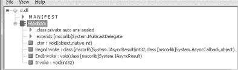

**图 17-1** ILDasm.exe 显示编译器为委托生成的元数据。

在这个例子中，编译器定义了一个名为 Feedback 的类，它派生自框架类库（FCL）中定义的 System.MulticastDelegate 类型。（所有委托类型都派生自 MulticastDelegate。）

**重要** System.MulticastDelegate 类派生自 System.Delegate，而 System.Delegate 本身又派生自 System.Object。存在两个委托类的原因既是历史造成的，也是不幸的；FCL 中本应只有一个委托类。遗憾的是，你需要了解这两个类，因为尽管你创建的所有委托类型都以 MulticastDelegate 为基类，但有时你会使用由 Delegate 类（而不是 MulticastDelegate 类）定义的方法来操作委托类型。例如，Delegate 类有名为 Combine 和 Remove 的静态方法。（稍后我会解释这些方法的作用。）这两个方法的签名都表明它们接受 Delegate 参数。由于你的委托类型派生自 MulticastDelegate，而 MulticastDelegate 又派生自 Delegate，因此你的委托类型的实例可以传递给这些方法。

该类具有私有可见性，因为委托在源代码中声明为 internal。如果源代码指示为公共可见性，编译器生成的 Feedback 类也会是公共的。你应该知道，委托类型可以定义在某个类型内部（嵌套在另一个类型中），也可以定义在全局作用域中。基本上，由于委托是类，所以凡是可以定义类的地方都可以定义委托。

由于所有委托类型都派生自 MulticastDelegate，因此它们继承 MulticastDelegate 的字段、属性和方法。在所有这些成员中，三个非公共字段可能最重要。表 17-1 描述了这些重要字段。

**表 17-1 MulticastDelegate 的重要非公共字段**

| 字段 | 类型 | 描述 |
| --- | --- | --- |
| `_target` | `System.Object` | 当委托对象包装静态方法时，此字段为 `null`。当委托对象包装实例方法时，此字段指回调方法被调用时应操作的对象。换言之，此字段指示应为实例方法的隐式 `this` 参数传递的值。 |
| `_methodPtr` | `System.IntPtr` | CLR 用来标识要回调的方法的内部整数。 |
| `_invocationList` | `System.Object` | 此字段通常为 `null`。在构建委托链时（本章稍后讨论），它可以引用委托数组。 |

注意，所有委托都有一个接受两个参数的构造函数：一个对象引用和一个引用回调方法的整数。然而，如果你查看源代码，会发现我传入的是 Program.FeedbackToConsole 或 p.FeedbackToFile 之类的值。你学过的所有编程知识都告诉你，这段代码不应该能编译通过！

然而，C# 编译器知道正在构造委托，并会分析源代码以确定引用的是哪个对象和方法。对象引用会传给构造函数的对象参数，而一个标识该方法的特殊 IntPtr 值（从 MethodDef 或 MemberRef 元数据标记获得）会传给方法参数。对于静态方法，对象参数传入 null。在构造函数内部，这两个参数分别保存在 _target 和 _methodPtr 私有字段中。此外，构造函数将 _invocationList 字段设置为 null。我将把关于 _invocationList 字段的讨论推迟到下一节“使用委托回调多个方法（链式）”。

因此，每个委托对象实际上都是对一个方法以及一个在……时要操作的对象进行包装，当

```
    .method private hidebysig static void  Counter(int32 from,
                                                    int32 'to',
                                                    class Feedback fb) cil managed
    {
      // Code size       23 (0x17)
      .maxstack  2
      .locals init (int32 val)
      IL_0000:  ldarg.0
      IL_0001:  stloc.0
      IL_0002:  br.s       IL_0012
      IL_0004:  ldarg.2
      IL_0005:  brfalse.s  IL_000e
      IL_0007:  ldarg.2
      IL_0008:  ldloc.0
      IL_0009:  callvirt   instance void Feedback::Invoke(int32)
      IL_000e:  ldloc.0
      IL_000f:  ldc.i4.1
      IL_0010:  add
      IL_0011:  stloc.0
      IL_0012:  ldloc.0
      IL_0013:  ldarg.1
      IL_0014:  blt.s      IL_0004
      IL_0016:  ret
    } // end of method Program:Counter
```

事实上，你可以修改 Counter 方法以显式调用 Invoke，如下所示：

```
    private static void Counter(int32 from, int32 to, Feedback fb) {
        for (int32 val = from; val <= to; val++) {
            // If any callbacks are specified, call them
            if (fb != null)
                fb.Invoke(val);
        }
    }
```

你会记得，编译器在定义 Feedback 类时定义了 Invoke 方法。调用 Invoke 时，它使用私有的 _target 和 _methodPtr 字段在指定对象上调用所需的方法。注意，Invoke 方法的签名与委托的签名匹配；因为 Feedback 委托接受一个 Int32 参数并返回 void，所以 Invoke 方法（由编译器生成）也接受一个 Int32 参数并返回 void。

#### 使用委托回调多个方法（链式）

委托本身非常有用。但加上对链式调用的支持后，委托会变得更有用。链式调用是一组或一个委托对象集合，它提供调用（或称为调用）该组中所有委托所表示的方法的能力。要理解这一点，请参见本章开头所示代码中的 ChainDelegateDemo1 方法。在此方法中，在 Console.WriteLine 语句之后，我构造了三个委托对象，并让变量 fb1、fb2 和 fb3 分别引用每个对象，如图 17-3 所示。

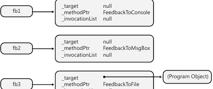

图 17-3 由 fb1、fb2 和 fb3 变量引用的委托对象的初始状态。

指向 Feedback 委托对象的引用变量 `fbChain` 旨在引用一个委托对象链或委托对象集合，这些委托对象包装可被回调的方法。将 `fbChain` 初始化为 `null` 表示当前没有要回调的方法。`Delegate` 类的公共静态 `Combine` 方法用于向链中添加委托：

```csharp
fbChain = (Feedback) Delegate.Combine(fbChain, fb1);
```

当这行代码执行时，`Combine` 方法看到我们试图合并 `null` 和 `fb1`。在内部，`Combine` 将直接返回 `fb1` 中的值，并且 `fbChain` 变量将被设置为引用与 `fb1` 变量所引用的相同委托对象，如图 17-4 所示。

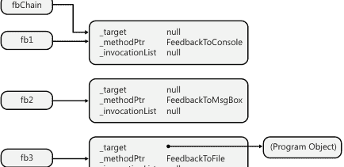

图 17-4 在链中插入第一个委托后委托对象的状态。

要向链中添加另一个委托，需再次调用 `Combine` 方法：

```csharp
fbChain = (Feedback) Delegate.Combine(fbChain, fb2);
```

在内部，`Combine` 方法看到 `fbChain` 已经引用了一个委托对象，因此 `Combine`

将构造一个新的委托对象。这个新委托对象会将其私有 \_target 和 \_methodPtr 字段初始化为对本讨论并不重要的值。然而，重要的是，\_invocationList 字段会被初始化为引用一个委托对象数组。该数组的第一个元素（索引 0）将被初始化为引用包装 FeedbackToConsole 方法的委托（也就是 fbChain 当前引用的委托）。该数组的第二个元素（索引 1）将被初始化为引用包装 FeedbackToMsgBox 方法的委托（也就是 fb2 引用的委托）。最后，fbChain 将被设置为引用新创建的委托对象，如图 17-5 所示。

要将第三个委托添加到链中，需再次调用 Combine 方法：

```
    fbChain = (Feedback) Delegate.Combine(fbChain, fb3);
```

同样，Combine 发现 fbChain 已经引用了一个委托对象，这会促使构造一个新的委托对象，如图 17-6 所示。和之前一样，这个新委托对象会将私有 \_target 和 \_methodPtr 字段初始化为对本讨论不重要的值，并且 \_invocationList 字段会被初始化为引用一个委托对象数组。该数组的第一个和第二个元素（索引 0 和 1）将被初始化为引用前一个委托对象在其数组中所引用的相同委托。该数组的第三个元素（索引 2）将被初始化为引用包装 FeedbackToFile 方法的委托（也就是 fb3 引用的委托）。最后，fbChain 将被设置为引用这个新创建的委托对象。注意，先前创建的委托及其 \_invocationList 字段所引用的数组现在已成为垃圾回收的候选对象。

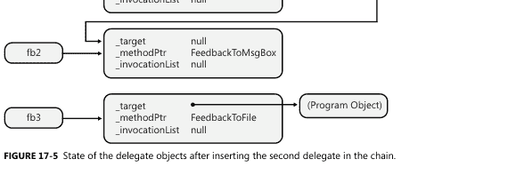

**图 17-5** 在链中插入第二个委托后各委托对象的状态。

```
_methodPtr.Invoke(_target, value);
// The line above is an approximation of the actual code.
// What really happens cannot be expressed in C#.
}
}
```

注意，也可以通过调用 Delegate 的公共静态 Remove 方法从链中移除一个委托。这在 ChainDelegateDemo1 方法的末尾进行了演示：

```
fbChain = (Feedback) Delegate.Remove(fbChain, new Feedback(FeedbackToMsgBox));
```

调用 Remove 时，它会扫描第一个参数（在我的示例中是 fbChain）所引用的委托对象内部维护的委托数组（从末尾向索引 0 方向）。Remove 会查找一个委托项，其 \_target 和 \_methodPtr 字段与第二个参数（在我的示例中是新的 Feedback 委托）中的相应字段匹配。如果找到匹配项且数组中只剩一个项，则返回该数组项。如果找到匹配项且数组中剩余多个项，则会构造一个新的委托对象——当然，创建并初始化的 \_invocationList 数组将引用原始数组中除被移除项之外的所有项——并返回对这个新委托对象的引用。如果要移除链中唯一的元素，Remove 返回 null。注意，每次调用 Remove 只会从链中移除一个委托；它不会移除所有具有匹配 \_target 和 \_methodPtr 字段的委托。

到目前为止，我展示的示例中，我的委托类型 Feedback 都定义为具有 void 返回值。不过，我也可以将 Feedback 委托定义如下：

```
public delegate Int32 Feedback(Int32 value);
```

如果这样定义，它的 Invoke 方法在内部会像下面这样（同样是伪代码）：

```
public Int32 Invoke(Int32 value) {
    Int32 result;
    Delegate[] delegateSet = _invocationList as Delegate[];
    if (delegateSet != null) {
        // This delegate's array indicates the delegates that should be called
        foreach (Feedback d in delegateSet)
            result = d(value);    // Call each delegate
    } else {
        // This delegate invokes a single method to be called back
        // Call the callback method on the specified target object.
        result = _methodPtr.Invoke(_target, value);
        // The line above is an approximation of the actual code.
        // What really happens cannot be expressed in C#.
    }
    return result;
}
```

当数组中的每个委托被调用时，其返回值会保存到 result 变量中。循环完成后，result 变量将只包含最后调用的委托的结果（先前的返回值会被丢弃）；该值会返回给调用 Invoke 的代码。

#### C# 对委托链的支持

为了让 C# 开发人员更轻松，C# 编译器会自动为委托类型的实例提供 `+=` 和 `-=` 运算符的重载。这些运算符分别调用 `Delegate.Combine` 和 `Delegate.Remove`。使用这些运算符可以简化委托链的构建。本章开头所示的源代码中的 `ChainDelegateDemo1` 和 `ChainDelegateDemo2` 方法会生成完全相同的 IL 代码。这两个方法之间唯一的区别是，`ChainDelegateDemo2` 方法利用 C# 的 `+=` 和 `-=` 运算符简化了源代码。

如果你需要证明这两个方法生成的 IL 代码完全相同，可以生成代码，并使用 ILDasm.exe 查看这两个方法的 IL。这将确认 C# 编译器确实分别将所有 `+=` 和 `-=` 运算符替换为对 Delegate 类型的公共静态 Combine 和 Remove 方法的调用。

#### 更好地控制委托链的调用

至此，你已经了解如何构建委托对象链，以及如何调用该链中的所有对象。链中的所有项都会被调用，因为委托类型的 Invoke 方法包含遍历数组中所有项并调用每一项的代码。这显然是一个非常简单的算法。尽管这个简单算法对许多场景来说已经足够，但它有许多限制。例如，除最后一个回调方法的返回值外，所有回调方法的返回值都会被丢弃。使用这个简单算法，无法获取所有被调用的回调方法的返回值。但这并不是唯一的限制。如果被调用的某个委托抛出异常或阻塞很长时间，会发生什么？由于该算法串行调用链中的每个委托，某个委托对象出现“问题”会阻止链中所有后续委托被调用。显然，这个算法并不健壮。

对于该算法不足以应对的场景，`MulticastDelegate` 类提供了一个实例方法 `GetInvocationList`，你可以使用它显式调用链中的每个委托，并采用任何满足需求的算法：

```
public abstract class MulticastDelegate : Delegate {
    // Creates a delegate array where each element refers
    // to a delegate in the chain.
    public sealed override Delegate[] GetInvocationList();
}
```

`GetInvocationList` 方法作用于派生自 `MulticastDelegate` 的对象，并返回一个 Delegate 引用数组，其中每个引用都指向链中的一个委托对象。在内部，`GetInvocationList` 会构造一个数组，并初始化每个元素使其引用链中的一个委托；然后返回对该数组的引用。如果 `_invocationList` 字段为 null，则返回的数组包含一个元素，该元素引用链中唯一的委托：委托实例本身。

你可以轻松编写一个算法来显式调用数组中的每个对象。以下代码演示了这一点：

```csharp
using System;
using System.Reflection;
using System.Text;

// Define a Light component.
internal sealed class Light {
    // This method returns the light's status.
    public String SwitchPosition() {
        return "The light is off";
    }
}

// Define a Fan component.
internal sealed class Fan {
    // This method returns the fan's status.
    public String Speed() {
        throw new InvalidOperationException("The fan broke due to overheating");
    }
}

// Define a Speaker component.
internal sealed class Speaker {
    // This method returns the speaker's status.
    public String Volume() {
        return "The volume is loud";
    }
}

public sealed class Program {

    // Definition of delegate that allows querying a component's status.
    private delegate String GetStatus();

    public static void Main() {
        // Declare an empty delegate chain.
        GetStatus getStatus = null;

        // Construct the three components, and add their status methods
        // to the delegate chain.
        getStatus += new GetStatus(new Light().SwitchPosition);
        getStatus += new GetStatus(new Fan().Speed);
        getStatus += new GetStatus(new Speaker().Volume);

        // Show consolidated status report reflecting
        // the condition of the three components.
        Console.WriteLine(GetComponentsStatusReport(getStatus));
    }

    // Method that queries several components and returns a status report
    private static String GetComponentsStatusReport(GetStatus status) {

        // If the chain is empty, there is nothing to do.
```


```csharp
if (status == null) return null;

// Use this to build the status report.
StringBuilder report = new StringBuilder();

// Get an array where each element is a delegate from the chain.
Delegate[] arrayOfDelegates = status.GetInvocationList();

// Iterate over each delegate in the array.
foreach (GetStatus getStatus in arrayOfDelegates)
{
    try
    {
        // Get a component's status string, and append it to the report.
        report.AppendFormat("{0}{1}{1}", getStatus(), Environment.NewLine);
    }
    catch (InvalidOperationException e) {
        // Generate an error entry in the report for this component.
        Object component = getStatus.Target;
        report.AppendFormat(
            "Failed to get status from {0}{2}{0}    Error: {3}{0}{0}",
            Environment.NewLine,
            ((component == null) ? "" : component.GetType() + "."),
            getStatus.GetMethodInfo().Name,
            e.Message);
    }
}

// Return the consolidated report to the caller.
return report.ToString();
}
}
```

编译并运行这段代码时，会出现以下输出：

```
The light is off

Failed to get status from Fan.Speed
    Error: The fan broke due to overheating

The volume is loud
```

### 委托定义已经够多了（泛型委托）

很多年前，当 .NET Framework 才刚刚开始开发时，Microsoft 引入了委托的概念。程序员在向 FCL 添加类时，只要引入一个回调方法，就会定义新的委托类型。随着时间的推移，定义了许多委托。事实上，仅在 MSCorLib.dll 中，现在定义的委托类型就接近 50 个。我们只看看其中的几个：

```csharp
public delegate void TryCode(Object userData);
public delegate void WaitCallback(Object state);
public delegate void TimerCallback(Object state);
public delegate void ContextCallback(Object state);
public delegate void SendOrPostCallback(Object state);
public delegate void ParameterizedThreadStart(Object obj);
```

你有没有注意到我挑选的这几个委托定义有什么相似之处？它们其实全都一样：这些委托类型中的任何一个变量都必须引用一个接受 Object 并返回 void 的方法。实在没有理由定义所有这些委托类型；实际上只需要一个。

事实上，既然 .NET Framework 支持泛型，我们其实只需要少数几个泛型委托（定义在 System 命名空间中），用来表示最多接受 16 个参数的方法：

```csharp
public delegate void Action(); // OK, this one is not generic
public delegate void Action<T>(T obj);
public delegate void Action<T1, T2>(T1 arg1, T2 arg2);
public delegate void Action<T1, T2, T3>(T1 arg1, T2 arg2, T3 arg3);
...
public delegate void Action<T1, ..., T16>(T1 arg1, ..., T16 arg16);
```

因此，.NET Framework 现在附带了 17 个 Action 委托，从没有参数到有 16 个参数。如果你需要调用一个参数超过 16 个的方法，将被迫定义自己的委托类型，但这非常不可能。

除了 Action 委托之外，.NET Framework 还附带了 17 个 Func 委托，它们允许回调方法返回值：

```csharp
public delegate TResult Func<TResult>();
public delegate TResult Func<T, TResult>(T arg);
public delegate TResult Func<T1, T2, TResult>(T1 arg1, T2 arg2);
public delegate TResult Func<T1, T2, T3, TResult>(T1 arg1, T2 arg2, T3 arg3);
...
public delegate TResult Func<T1, ..., T16, TResult>(T1 arg1, ..., T16 arg16);
```

现在建议尽可能使用这些委托类型，而不是让开发者在代码中定义更多委托类型。这减少了系统中的类型数量，也简化了编码。但是，如果你需要使用 `ref` 或 `out` 关键字按引用传递参数，可能不得不定义自己的委托：

```csharp
delegate void Bar(ref Int32 z);
```

如果你希望委托通过 C# 的 `params` 关键字接受可变数量的参数、希望为委托的任意参数指定默认值，或者需要约束委托的泛型类型参数，也可能必须这样做。

在使用接受泛型参数并返回值的委托时，逆变和协变就会发挥作用，建议你始终利用这些特性，因为它们没有不良影响，还能让委托在更多场景中使用。有关更多信息，请参阅“委托与接口的逆变和协变泛型类型”

### C# 为委托提供的语法糖

大多数程序员觉得使用委托很麻烦，因为语法太奇怪了。例如，看下面这行代码：

```csharp
button1.Click += new EventHandler(button1_Click);
```

其中 button1_Click 是一个类似下面这样的方法：

```csharp
void button1_Click(Object sender, EventArgs e) {
    // Do something, the button was clicked...
}
```

第一行代码背后的意图是把 button1_Click 方法的地址注册到按钮控件，这样当按钮被单击时，就会调用该方法。对大多数程序员来说，仅仅为了指定 button1_Click 方法的地址而构造 EventHandler 委托对象，感觉很不自然。然而，CLR 要求构造 EventHandler 委托对象，因为这个对象提供了一个包装器，确保只能以类型安全的方式调用该方法。该包装器还允许调用实例方法和链接。不幸的是，大多数程序员不想考虑这些细节。程序员更愿意像下面这样编写上面的代码：

```csharp
button1.Click += button1_Click;
```

幸运的是，Microsoft 的 C# 编译器为程序员提供了一些处理委托时的语法快捷方式。我将在本节中解释所有这些快捷方式。开始之前最后一点：我即将描述的内容实际上归结为 C# 语法糖；这些新的语法快捷方式实际上只是给程序员提供一种更简单的方式，来生成必须生成的 IL，以便 CLR 和其他编程语言能够处理委托。这也意味着我即将描述的内容是 C# 特有的；其他编译器可能不提供这些额外的委托语法快捷方式。

#### 语法快捷方式 #1：无需构造委托对象

正如已经演示的那样，C# 允许你指定回调方法的名称，而不必构造委托对象包装器。下面是另一个示例：

```csharp
internal sealed class AClass {
    public static void CallbackWithoutNewingADelegateObject() {
        ThreadPool.QueueUserWorkItem(SomeAsyncTask, 5);
    }

    private static void SomeAsyncTask(Object o) {
        Console.WriteLine(o);
    }
}
```

这里，ThreadPool 类的静态 QueueUserWorkItem 方法期望一个 WaitCallback 委托对象的引用，该对象包含对 SomeAsyncTask 方法的引用。由于 C# 编译器能够自行推断这一点，它允许我省略构造 WaitCallback 委托对象的代码，使代码更易读、更易懂。当然，当代码编译时，C# 编译器确实会生成 IL，而该 IL 实际上会新建 WaitCallback 委托对象——我们只是得到了一个语法快捷方式。

#### 语法快捷方式 #2：无需定义回调方法（Lambda 表达式）

在上面的代码中，回调方法 SomeAsyncTask 的名称被传递给 ThreadPool 的 QueueUserWorkItem 方法。C# 允许你以内联方式编写回调方法的代码，因此不必将其写在它自己的方法中。例如，上面的代码可以重写如下：

```csharp
internal sealed class AClass {
    public static void CallbackWithoutNewingADelegateObject() {
        ThreadPool.QueueUserWorkItem(obj => Console.WriteLine(obj), 5);
    }
}
```

注意，QueueUserWorkItem 方法的第一个“参数”是代码（我在其中使用了斜体）！更正式地说，这段斜体代码称为 C# lambda 表达式，由于使用了 C# 的 lambda 表达式运算符：=>，很容易识别。你可以在编译器通常期望看到委托的地方使用 lambda 表达式。而且，当编译器看到这个 lambda 表达式的使用时，编译器会自动在类中（本例中为 AClass）定义一个新的私有方法。这个新方法称为匿名函数，因为编译器会自动为你创建方法名，而通常情况下，你并不知道它的名称。但是，你可以使用 ILDasm.exe 之类的工具来检查编译器生成的代码。在我编写上面的代码并编译之后，我通过使用 ILDasm.exe 看到，C# 编译器决定将此方法命名为 `<CallbackWithoutNewingADelegateObject>b__0`，并确保此方法接受单个 Object 参数并返回 void。

编译器选择让方法名以 < 符号开头，因为在 C# 中，标识符不能包含 < 符号；这确保你不会意外定义一个与编译器为你选择的名称重合的方法。顺便说一句，虽然 C# 禁止标识符包含 < 符号，但 CLR 允许，这就是它能奏效的原因。另外，请注意，虽然你可以通过将方法名作为字符串传递来通过反射访问该方法，但 C# 语言规范指出，并不保证编译器如何生成该名称。例如，每次编译代码时，编译器都可能为该方法生成不同的名称。

使用 ILDasm.exe，你可能还会注意到 C# 编译器将 `System.Runtime.CompilerServices.CompilerGeneratedAttribute` 特性应用于此方法，以

向各种工具和实用程序指明，此方法是由编译器而非程序员生成的。然后，=> 运算符右侧的代码会被放入这个编译器生成的方法中。

> **注意** 编写 lambda 表达式时，无法将自己的自定义特性应用到编译器生成的方法上。此外，也不能向该方法应用任何方法修饰符（例如 `unsafe`）。不过这通常不是问题，因为编译器生成的匿名方法最终总是私有的，并且方法是静态还是非静态取决于它是否访问任何实例成员。因此，没有必要向该方法应用诸如 `public`、`protected`、`internal`、`virtual`、`sealed`、`override` 或 `abstract` 之类的修饰符。

最后，如果你编写上面所示的代码并进行编译，就仿佛 C# 编译器将你的代码重写成了这样（注释是我添加的）：

```csharp
internal sealed class AClass {
    // This private field is created to cache the delegate object.
    // Pro: CallbackWithoutNewingADelegateObject will not create
    //     a new object each time it is called.
    // Con: The cached object never gets garbage collected
    [CompilerGenerated]
    private static WaitCallback <>9__CachedAnonymousMethodDelegate1;

    public static void CallbackWithoutNewingADelegateObject() {
        if (<>9__CachedAnonymousMethodDelegate1 == null) {
            // First time called, create the delegate object and cache it.
            <>9__CachedAnonymousMethodDelegate1 =
                new WaitCallback(<CallbackWithoutNewingADelegateObject>b__0);
        }
        ThreadPool.QueueUserWorkItem(<>9__CachedAnonymousMethodDelegate1, 5);
    }

    [CompilerGenerated]
    private static void <CallbackWithoutNewingADelegateObject>b__0(Object obj) {
        Console.WriteLine(obj);
    }
}
```

lambda 表达式必须与 WaitCallback 委托的签名匹配：它返回 void，并且接受一个 Object 参数。不过，我只是通过将 obj 放在 => 运算符的左侧来指定参数名称。在 => 运算符的右侧，Console.WriteLine 恰好返回 void。然而，如果我放置的表达式不返回 void，编译器生成的代码会直接忽略该返回值，因为编译器生成的方法必须具有 void 返回类型才能满足 WaitCallback 委托。

同样值得注意的是，匿名函数被标记为 private；这会禁止任何未在类型内部定义的代码访问该方法（尽管反射会揭示该方法确实存在）。另外，请注意匿名方法被标记为 static；这是因为代码没有访问任何实例成员（它也不能访问，因为 CallbackWithoutNewingADelegateObject 本身是一个静态方法）。但是，代码可以引用类中定义的任何静态字段或静态方法。示例如下：

```csharp
internal sealed class AClass {
    private static String sm_name;    // A static field

    public static void CallbackWithoutNewingADelegateObject() {
        ThreadPool.QueueUserWorkItem(
            // The callback code can reference static members.
            obj => Console.WriteLine(sm_name + ": " + obj),
            5);
    }
}
```

如果 CallbackWithoutNewingADelegateObject 方法不是静态的，那么匿名方法的代码就可以包含对实例成员的引用。如果它不包含对实例成员的引用，编译器仍会生成一个静态匿名方法，因为这比实例方法更高效，且不需要额外的 this 参数。但是，如果匿名方法的代码确实引用了实例成员，编译器将生成一个非静态匿名方法：

```csharp
internal sealed class AClass {
    private String m_name;    // An instance field

    // An instance method
    public void CallbackWithoutNewingADelegateObject() {
        ThreadPool.QueueUserWorkItem(
            // The callback code can reference instance members.
            obj => Console.WriteLine(m_name + ": " + obj),
            5);
    }
}
```

=> 运算符的左侧是你指定要传递给 lambda 表达式的任何参数名称的位置。你必须遵循一些规则。请看下面的示例：

```csharp
// If the delegate takes no arguments, use ()
Func<String> f = () => "Jeff";

// If the delegate takes 1+ arguments, you can explicitly specify the types
Func<Int32, String> f2 = (Int32 n) => n.ToString();
Func<Int32, Int32, String> f3 = (Int32 n1, Int32 n2) => (n1 + n2).ToString();

// If the delegate takes 1+ arguments, the compiler can infer the types
Func<Int32, String> f4 = (n) => n.ToString();
Func<Int32, Int32, String> f5 = (n1, n2) => (n1 + n2).ToString();

// If the delegate takes 1 argument, you can omit the ()s
Func<Int32, String> f6 = n => n.ToString();

// If the delegate has ref/out arguments, you must explicitly specify ref/out and the type
Bar b = (out Int32 n) => n = 5;
```

对于最后一个示例，假设 Bar 定义如下：

```csharp
delegate void Bar(out Int32 z);
```

=> 运算符的右侧是你指定匿名函数体的位置。函数体通常由一个简单或复杂的表达式组成，该表达式最终返回一个非 void 的值。在上面的代码中，我将返回 String 的 lambda 表达式赋值给了所有 Func 委托变量。函数体由单个语句组成的情况也很常见。例如，当我调用 ThreadPool.QueueUserWorkItem 时，向它传递了一个调用 Console.WriteLine（返回 void）的 lambda 表达式。

如果你希望函数体由两个或更多语句组成，则必须用大括号将它括起来。如果委托期望一个返回值，那么你必须在函数体内包含一条 return 语句。示例如下：

```csharp
Func<Int32, Int32, String> f7 = (n1, n2) => { Int32 sum = n1 + n2; return sum.ToString(); };
```

**重要** 如果这一点尚不明显，请允许我明确指出，lambda 表达式的主要好处是它们消除了源代码中的一层间接性。通常，你必须编写一个单独的方法，为该方法命名，然后在需要委托的地方传递该方法的名称。名称为你提供了一种引用代码体的方式，如果你需要在源代码中的多个位置引用相同的代码体，那么编写一个方法并为其命名是一种很好的做法。然而，如果你需要让一个代码体仅在源代码中被引用一次，那么 lambda 表达式允许你直接内联放置该代码，而无需为其命名，从而提高了程序员的工作效率。

**注意** 当 C# 2.0 发布时，它引入了一个名为*匿名方法*的特性。与 lambda 表达式（在 C# 3.0 中引入）一样，匿名方法描述了一种创建匿名函数的语法。现在（见 C# 语言规范第 7.14 节）建议开发人员使用更新的 lambda 表达式语法，而不是较旧的匿名方法语法，因为 lambda 表达式语法更简洁，使代码更易于编写、阅读和维护。当然，微软的 C# 编译器继续支持解析这两种创建匿名函数的语法，因此开发人员不必修改任何最初为 C# 2.0 编写的代码。在本书中，我将只解释和使用 lambda 表达式语法。

#### 语法快捷方式 #3：无需手动将局部变量包装到类中即可将其传递给回调方法

我已经展示了回调代码如何引用类中定义的其他成员。然而，有时你可能希望回调代码引用定义方法中存在的局部参数或变量。下面是一个有趣的示例：

```csharp
internal sealed class AClass {
   public static void UsingLocalVariablesInTheCallbackCode(Int32 numToDo) {
      // Some local variables
```


```csharp
Int32[] squares = new Int32[numToDo];
AutoResetEvent done = new AutoResetEvent(false);

// Do a bunch of tasks on other threads
for (Int32 n = 0; n < squares.Length; n++) {
    ThreadPool.QueueUserWorkItem(
        obj => {
            Int32 num = (Int32) obj;

            // This task would normally be more time consuming
            squares[num] = num * num;

            // If last task, let main thread continue running
            if (Interlocked.Decrement(ref numToDo) == 0)
                done.Set();
        },
        n);
}

// Wait for all the other threads to finish
done.WaitOne();

// Show the results
for (Int32 n = 0; n < squares.Length; n++)
    Console.WriteLine("Index {0}, Square={1}", n, squares[n]);
}
```

这个示例充分展示了 C# 让实现过去相当复杂的任务变得多么容易。上面的方法定义了一个参数 numToDo，以及两个局部变量 squares 和 done。而 lambda 表达式的主体引用了这些变量。

现在设想 lambda 表达式主体中的代码被放在一个单独的方法中（这是 CLR 的要求）。变量的值将如何传递给这个单独的方法？唯一的方法是定义一个新的辅助类，并为每个想要传递给回调代码的值定义一个字段。此外，回调代码必须在这个辅助类中定义为实例方法。然后，UsingLocalVariablesInTheCallbackCode 方法必须构造辅助类的实例，用其局部变量中的值初始化这些字段，再构造绑定到辅助对象/实例方法的委托对象。

**注意**  当 lambda 表达式导致编译器生成一个类，并且该类包含它要修改的参数/局部变量时，这些变量所引用的对象的生存期会被延长。通常，参数/局部变量在方法内最后一次使用该变量时离开作用域。然而，将变量转换为字段会导致该字段在其所属对象的整个生存期内保持它所引用的对象存活。在大多数应用程序中这不是大问题，但你应该意识到这一点。

这是一项非常繁琐且容易出错的工作，当然，C# 编译器会自动为你完成所有这些工作。当你编写上面所示的代码时，就好像 C# 编译器重写了你的代码，使其看起来像下面这样（注释由我插入）：

```csharp
internal sealed class AClass {
    public static void UsingLocalVariablesInTheCallbackCode(Int32 numToDo) {

        // Some local variables
        WaitCallback callback1 = null;

        // Construct an instance of the helper class
        <>c__DisplayClass2 class1 = new <>c__DisplayClass2();

        // Initialize the helper class's fields
        class1.numToDo = numToDo;
        class1.squares = new Int32[class1.numToDo];
        class1.done = new AutoResetEvent(false);

        // Do a bunch of tasks on other threads
        for (Int32 n = 0; n < class1.squares.Length; n++) {
            if (callback1 == null) {
                // New up delegate object bound to the helper object and
                // its anonymous instance method
                callback1 = new WaitCallback(
                    class1.<UsingLocalVariablesInTheCallbackCode>b__0);
            }

            ThreadPool.QueueUserWorkItem(callback1, n);
        }

        // Wait for all the other threads to finish
        class1.done.WaitOne();

        // Show the results
        for (Int32 n = 0; n < class1.squares.Length; n++)
            Console.WriteLine("Index {0}, Square={1}", n, class1.squares[n]);
    }

    // The helper class is given a strange name to avoid potential
    // conflicts and is private to forbid access from outside AClass
    [CompilerGenerated]
    private sealed class <>c__DisplayClass2 : Object {

        // One public field per local variable used in the callback code
        public Int32[] squares;
        public Int32 numToDo;
        public AutoResetEvent done;

        // public parameterless constructor
        public <>c__DisplayClass2() { }

        // Public instance method containing the callback code
        public void <UsingLocalVariablesInTheCallbackCode>b__0(Object obj) {
            Int32 num = (Int32) obj;
            squares[num] = num * num;
            if (Interlocked.Decrement(ref numToDo) == 0)
                done.Set();
        }
    }
}
```

回调方法。

幸运的是，`System.Reflection.MethodInfo` 提供了一个 `CreateDelegate` 方法，使你在编译时没有关于委托的所有必要信息时也能创建委托。下面是 `MethodInfo` 定义的方法重载：

```csharp
public abstract class MethodInfo : MethodBase {
    // Construct a delegate wrapping a static method.
    public virtual Delegate CreateDelegate(Type delegateType);

    // Construct a delegate wrapping an instance method; target refers to the ‘this’ argument.
    public virtual Delegate CreateDelegate(Type delegateType, object target);
}
```

创建委托后，你可以使用 `Delegate` 的 `DynamicInvoke` 方法调用它，该方法如下所示：

```csharp
public abstract class Delegate {
    // Invoke a delegate passing it parameters
    public Object DynamicInvoke(params Object[] args);
}
```

使用反射 API（在第23章“程序集加载与反射”中讨论），你必须先获取一个 `MethodInfo` 对象，它引用你想要为其创建委托的方法。然后，你调用 `CreateDelegate` 方法，让它构造一个由第一个参数 `delegateType` 标识的、派生自 `Delegate` 的类型的新对象。如果委托包装的是实例方法，你还需要向 `CreateDelegate` 传递一个目标参数，指示应作为实例方法参数传入的对象。

`System.Delegate` 的 `DynamicInvoke` 方法允许你调用委托对象的回调方法，并传递一组你在运行时确定的参数。当你调用 `DynamicInvoke` 时，它会在内部确保你传递的参数与回调方法期望的参数兼容。如果兼容，就会调用回调方法。如果不兼容，则抛出 `ArgumentException`。`DynamicInvoke` 返回回调方法返回的对象。

以下代码展示了如何使用 `CreateDelegate` 和 `DynamicInvoke` 方法：

```csharp
using System;
using System.Reflection;
using System.IO;

// Here are some different delegate definitions
internal delegate Object TwoInts2(Int32 n1, Int32 n2);
internal delegate Object OneString(String s1);

public static class DelegateReflection {
    public static void Main(String[] args) {
        if (args.Length < 2) {
            String usage =
}

try {
    // Invoke the delegate and show the result
    Object result = d.DynamicInvoke(callbackArgs);
    Console.WriteLine("Result = " + result);
}
catch (TargetParameterCountException) {
    Console.WriteLine("Incorrect number of parameters specified.");
}

// This callback method takes 2 Int32 arguments
private static Object Add(Int32 n1, Int32 n2) {
    return n1 + n2;
}

// This callback method takes 2 Int32 arguments
private static Object Subtract(Int32 n1, Int32 n2) {
    return n1 - n2;
}

// This callback method takes 1 String argument
private static Object NumChars(String s1) {
    return s1.Length;
}

// This callback method takes 1 String argument
private static Object Reverse(String s1) {
    return new String(s1.Reverse().ToArray());
}

}
```

## 第18章：自定义特性

本章内容：

- 使用自定义特性 435
- 定义自己的特性类 439
- 特性构造函数与字段/属性数据类型 443
- 检测自定义特性的使用 444
- 将两个特性实例相互匹配 448
- 在不创建特性派生对象的情况下检测自定义特性的使用 451
- 条件特性类 454

在本章中，我将讨论 Microsoft .NET Framework 提供的最具创新性的功能之一：*自定义特性*。自定义特性允许你以声明方式批注代码构造，从而启用特殊功能。自定义特性允许定义信息并将其应用于几乎任何元数据表项。这种可扩展的元数据信息可以在运行时查询，以动态改变代码执行方式。当你使用各种 .NET Framework 技术（Windows Forms、WPF、WCF 等）时，你会发现它们都利用自定义特性，让开发者可以非常容易地在代码中表达意图。对于任何 .NET Framework 开发者来说，牢固理解自定义特性都是必要的。


```csharp
public OSVERSIONINFO() {
    OSVersionInfoSize = (UInt32) Marshal.SizeOf(this);
}

public UInt32 OSVersionInfoSize = 0;
public UInt32 MajorVersion      = 0;
public UInt32 MinorVersion      = 0;
public UInt32 BuildNumber       = 0;
public UInt32 PlatformId        = 0;

[MarshalAs(UnmanagedType.ByValTStr, SizeConst = 128)]
public String CSDVersion        = null;
}

internal sealed class MyClass {
    [DllImport("kernel32", CharSet = CharSet.Auto, SetLastError = true)]
    public static extern Boolean GetVersionEx([In, Out] OSVERSIONINFO ver);
}
```

在本例中，StructLayout 特性应用于 OSVERSIONINFO 类，MarshalAs 特性应用于 CSDVersion 字段，DllImport 特性应用于 GetVersionEx 方法，In 和 Out 特性应用于 GetVersionEx 的 ver 参数。每种编程语言都定义了开发人员必须使用的语法，以便将自定义特性应用于某个目标。例如，Microsoft Visual Basic .NET 要求使用尖括号（<、>）而不是方括号。

CLR 允许将特性应用于几乎任何可以在文件的元数据中表示的内容。最常见的是，特性应用于以下定义表中的项：TypeDef（类、结构、枚举、接口和委托）、MethodDef（包括构造函数）、ParamDef、FieldDef、PropertyDef、EventDef、AssemblyDef 和 ModuleDef。具体而言，C# 只允许将特性应用于定义了以下任意目标的源代码：程序集、模块、类型（类、结构、枚举、接口、委托）、字段、方法（包括构造函数）、方法参数、方法返回值、属性、事件和泛型类型参数。

应用特性时，C# 允许你指定一个前缀，专门指示该特性所应用的目标。以下代码展示了所有可能的前缀。在许多情况下，如果省略前缀，编译器仍能确定特性所应用的目标，如前面的示例所示。在某些情况下，必须指定前缀，以便让编译器明确你的意图。下面以斜体显示的前缀是必需的。

```csharp
using System;

[assembly: SomeAttr]             // Applied to assembly
[module:   SomeAttr]             // Applied to module

[type:     SomeAttr]             // Applied to type
internal sealed class SomeType<[typeparam: SomeAttr] T> {  // Applied to generic type variable

    [field: SomeAttr]            // Applied to field
    public Int32 SomeField = 0;
}
```

```csharp
[return: SomeAttr]       // Applied to return value
[method: SomeAttr]       // Applied to method
public Int32 SomeMethod(
    [param: SomeAttr]    // Applied to parameter
    Int32 SomeParam) { return SomeParam; }

[property: SomeAttr]     // Applied to property
public String SomeProp {
    [method: SomeAttr]   // Applied to get accessor method
    get { return null; }
}

[event: SomeAttr]        // Applied to event
[field: SomeAttr]       // Applied to compiler-generated field
[method: SomeAttr]       // Applied to compiler-generated add & remove methods
public event EventHandler SomeEvent;
}
```

现在你知道了如何应用自定义特性，接下来让我们弄清楚特性到底是什么。自定义特性其实就是一个类型的实例。为了符合公共语言规范（CLS），自定义特性类必须直接或间接派生自公共抽象 System.Attribute 类。C# 只允许符合 CLS 的特性。通过查看 .NET Framework SDK 文档，你会看到（前面示例中的）以下类已定义：StructLayoutAttribute、MarshalAsAttribute、DllImportAttribute、InAttribute 和 OutAttribute。所有这些类恰好都定义在 System.Runtime.InteropServices 命名空间中，但特性类可以定义在任何命名空间中。进一步查看后，你会注意到所有这些类都派生自 System.Attribute，因为所有符合 CLS 的特性类都必须如此。

> **注意** 在源代码中将特性应用于目标时，C# 编译器允许省略 `Attribute` 后缀，以减少编程输入并提高源代码的可读性。本章中的代码示例利用了 C# 的这一便利。例如，我的源代码包含 `[DllImport(...)]`，而不是 `[DllImportAttribute(...)]`。

如前所述，特性是一个类的实例。该类必须有一个公共构造函数，以便能够创建它的实例。因此，当你将特性应用于目标时，语法类似于调用该类的某个实例构造函数。此外，语言可能允许某些特殊语法，以便你设置与特性类关联的任何公共字段或属性。让我们看一个示例。回想前面将 DllImport 特性应用于 GetVersionEx 方法的情况：

```csharp
[DllImport("Kernel32", CharSet = CharSet.Auto, SetLastError = true)]
```

这一行的语法对你来说应该显得很奇怪，因为你在调用构造函数时绝不可能使用这样的语法。如果你在文档中查看 DllImportAttribute 类，你会看到它的构造函数需要一个 String 参数。在此示例中，为该参数传递的是 "Kernel32"。构造函数的参数称为位置参数，并且是必需的；应用特性时必须指定该参数。

另外两个“参数”是什么？这种特殊语法允许你在 DllImportAttribute 对象构造之后设置该对象的任何公共字段或属性。在此示例中，当构造 DllImportAttribute 对象并将 "Kernel32" 传递给构造函数时，该对象的公共实例字段 CharSet 和 SetLastError 分别设置为 CharSet.Auto 和 true。用于设置字段或属性的“参数”称为命名参数，并且是可选的，因为在应用特性的实例时不必指定这些参数。稍后，我将解释是什么导致 DllImportAttribute 类的实例实际被构造出来。

另请注意，可以将多个特性应用于单个目标。例如，在本章的第一个程序清单中，GetVersionEx 方法的 ver 参数同时应用了 In 和 Out 特性。将多个特性应用于单个目标时，请注意特性的顺序无关紧要。另外，在 C# 中，每个特性可以括在方括号中，也可以将多个特性用逗号分隔在同一组方括号内。如果特性类的构造函数不接收参数，则圆括号是可选的。最后，如前所述，Attribute 后缀也是可选的。下面几行代码的行为相同，并演示了应用多个特性的所有可能方式：

```
[Serializable][Flags]
[Serializable, Flags]
[FlagsAttribute, SerializableAttribute]
[FlagsAttribute()][Serializable()]
```

### 定义自己的特性类

你知道特性是派生自 System.Attribute 的类的实例，也知道如何应用特性。现在让我们看看如何定义自己的自定义特性类。假设你是负责为枚举类型添加位标志支持的 Microsoft 员工。为此，你要做的第一件事是定义一个 FlagsAttribute 类：

```
namespace System {
    public class FlagsAttribute : System.Attribute {
        public FlagsAttribute() {
        }
    }
}
```

注意，FlagsAttribute 类继承自 Attribute；这正是使 FlagsAttribute 类成为符合 CLS 的自定义特性的原因。此外，该类的名称带有 Attribute 后缀；这遵循标准约定，但不是必需的。最后，所有非抽象特性都必须包含至少一个公共构造函数。简单的 FlagsAttribute 构造函数不接收参数，并且不执行任何操作。


**重要** 你应将特性视为一个逻辑状态容器。也就是说，虽然特性类型是一个类，但这个类应当简单。该类应只提供一个公共构造函数，用于接受特性的必需（或位置）状态信息；该类可以提供公共字段/属性，用于接受特性的可选（或命名）状态信息。该类不应提供任何公共方法、事件或其他成员。

一般来说，我一直不鼓励使用公共字段，对特性也仍然不鼓励。使用属性要好得多，因为如果你以后决定更改特性类的实现方式，这会提供更大的灵活性。

到目前为止，FlagsAttribute 类的实例可以应用于任何目标，但这个特性实际上应当只应用于枚举类型。将该特性应用于属性或方法没有意义。为了告诉编译器这个特性可以合法地应用于何处，你要将 System.AttributeUsageAttribute 类的实例应用于该特性类。下面是新代码：

```csharp
namespace System {
    [AttributeUsage(AttributeTargets.Enum, Inherited = false)]
    public class FlagsAttribute : System.Attribute {
        public FlagsAttribute() {
        }
    }
}
```

在这个新版本中，我已将 AttributeUsageAttribute 的一个实例应用到了该特性上。毕竟，特性类型只是一个类，而类可以应用特性。AttributeUsageAttribute 是一个简单的类，它允许你向编译器指定自定义特性可以合法应用于何处。所有编译器都内置支持这个特性，并且当用户定义的自定义特性被应用于无效目标时，编译器会生成错误。在这个例子中，AttributeUsage 特性指定 Flags 特性的实例只能应用于枚举类型目标。

因为所有特性都只是类型，所以你可以很容易地理解 AttributeUsageAttribute 类。该类的 FCL 源代码如下所示：

```csharp
[Serializable]
[AttributeUsage(AttributeTargets.Class, Inherited=true)]
public sealed class AttributeUsageAttribute : Attribute {
    internal static AttributeUsageAttribute Default =
        new AttributeUsageAttribute(AttributeTargets.All);

    internal Boolean m_allowMultiple = false;
    internal AttributeTargets m_attributeTarget = AttributeTargets.All;
    internal Boolean m_inherited = true;

    // This is the one public constructor
    public AttributeUsageAttribute(AttributeTargets validOn) {
        m_attributeTarget = validOn;
    }

    internal AttributeUsageAttribute(AttributeTargets validOn,
        Boolean allowMultiple, Boolean inherited) {
        m_attributeTarget = validOn;
        m_allowMultiple = allowMultiple;
        m_inherited = inherited;
    }

    public Boolean AllowMultiple {
        get { return m_allowMultiple; }
        set { m_allowMultiple = value; }
    }

    public Boolean Inherited {
        get { return m_inherited; }
        set { m_inherited = value; }
    }

    public AttributeTargets ValidOn {
        get { return m_attributeTarget; }
    }
}
```

如你所见，AttributeUsageAttribute 类有一个公共构造函数，允许你传入位标志，以指示你的特性可以合法应用于何处。System.AttributeTargets 枚举类型在 FCL 中的定义如下：

```csharp
[Flags, Serializable]
public enum AttributeTargets {
    Assembly          = 0x0001,
    Module             = 0x0002,
    Class              = 0x0004,
    Struct             = 0x0008,
    Enum               = 0x0010,
    Constructor        = 0x0020,
    Method             = 0x0040,
    Property           = 0x0080,
    Field              = 0x0100,
    Event              = 0x0200,
    Interface          = 0x0400,
    Parameter          = 0x0800,
    Delegate           = 0x1000,
    ReturnValue        = 0x2000,
    GenericParameter   = 0x4000,
    All                = Assembly   | Module    | Class   | Struct | Enum   |
                         Constructor | Method    | Property | Field  | Event  |
                         Interface   | Parameter | Delegate | ReturnValue |
                         GenericParameter
}
```

AttributeUsageAttribute 类还提供两个额外的公共属性，在将该特性应用于某个特性类时可以选择设置：AllowMultiple 和 Inherited。

对于大多数特性来说，将它们多次应用于同一个目标没有意义。例如，将 Flags 或 Serializable 特性多次应用于同一个目标不会带来任何好处。事实上，如果你尝试编译下面的代码，编译器会报告以下消息：'error CS0579: Duplicate 'Flags' attribute.'

```csharp
[Flags][Flags]
internal enum Color {
    Red
}
```

然而，对于少数特性来说，将特性多次应用于同一个目标确实有意义。在 FCL 中，ConditionalAttribute 特性类允许将自身的多个实例应用于同一个目标。如果没有显式将 AllowMultiple 设置为 true，你的特性最多只能应用于一个选定目标一次。

AttributeUsageAttribute 的另一个属性 Inherited 指示：当特性应用于基类时，是否应应用于派生类和重写方法。以下代码演示了特性被继承意味着什么：

```csharp
[AttributeUsage(AttributeTargets.Class | AttributeTargets.Method, Inherited=true)]
internal class TastyAttribute : Attribute {
}
```

```csharp
[Tasty][Serializable]
internal class BaseType {

    [Tasty] protected virtual void DoSomething() { }
}

internal class DerivedType : BaseType {
    protected override void DoSomething() { }
}
```

在这段代码中，DerivedType 及其 DoSomething 方法都被认为具有 Tasty 特性，因为 TastyAttribute 类被标记为可继承。然而，DerivedType 不是可序列化的，因为 FCL 的 SerializableAttribute 类被标记为非继承特性。

请注意，.NET Framework 仅将类、方法、属性、事件、字段、方法返回值以及参数这些目标视为可继承的。因此，在定义特性类型时，只有当你的目标包含上述任一目标时，才应将 Inherited 设置为 true。注意，继承的特性不会导致为派生类型向托管模块中发出额外元数据。稍后我会在“检测自定义特性的使用”一节中进一步说明。

**注意** 如果你定义自己的特性类，却忘记将 AttributeUsage 特性应用于你的类，那么编译器和 CLR 将假定你的特性可以应用于所有目标、只能应用于单个目标一次，并且是可继承的。这些假定模仿了 AttributeUsageAttribute 类中的默认字段值。

#### 特性的构造函数与字段/属性数据类型

在定义自己的自定义特性类时，你可以定义其构造函数来接受开发人员在应用特性类型实例时必须指定的参数。此外，你还可以在类型中定义非静态公共字段和属性，用于标识开发人员可以为特性类实例可选选择的设置。

在定义特性类的实例构造函数、字段和属性时，你必须将自己限制在少量数据类型中。具体来说，合法数据类型集合仅限于以下类型：Boolean、Char、Byte、SByte、Int16、UInt16、Int32、UInt32、Int64、UInt64、Single、Double、String、Type、Object 或枚举类型。此外，你可以使用这些类型中任意类型的一维、从零开始的数组。但是，你应避免使用数组，因为构造函数接受数组的自定义特性类不符合 CLS。

应用特性时，你必须传递一个与特性类所定义类型匹配的编译时常量表达式。只要特性类定义了 Type 参数、Type 字段或 Type 属性，你就必须使用 C# 的 typeof 运算符，如下面的代码所示。只要特性类定义了 Object 参数、Object 字段或 Object 属性，你就可以传递 Int32、String 或任何其他常量表达式（包括 null）。如果常量表达式表示值类型，那么在构造特性实例时，该值类型将在运行时被装箱。

下面是一个特性及其用法的示例：

```csharp
using System;

internal enum Color { Red }

[AttributeUsage(AttributeTargets.All)]
internal sealed class SomeAttribute : Attribute {
  public SomeAttribute(String name, Object o, Type[] types) {
    // 'name' refers to a String
    // 'o' refers to one of the legal types (boxing if necessary)
    // 'types' refers to a 1-dimension, 0-based array of Types
  }
}

[Some("Jeff", Color.Red, new Type[] { typeof(Math), typeof(Console) })]
internal sealed class SomeType {
}
```

从逻辑上讲，当编译器检测到应用于某个目标的自定义特性时，编译器会调用特性类的构造函数来构造该类的实例，并向其传递任何指定的参数。然后，编译器使用通过增强构造函数语法指定的值来初始化任何公共字段和属性。现在自定义特性对象已初始化，编译器会将特性对象的状态序列化到目标的元数据表项中。


重要提示：我发现，对开发者而言，理解自定义特性的最佳方式是：自定义特性是类的实例，这些类已被序列化为驻留在元数据中的字节流。之后，在运行时，可以通过反序列化元数据中包含的字节来构造该类的实例。实际上，真正发生的是，编译器将创建特性类实例所需的信息生成到元数据中。每个构造函数参数都会写出一个1字节的类型ID，后跟值。在“序列化”构造函数的参数之后，编译器会写出每个指定的字段和属性值：先写出字段/属性名，再写出1字节的类型ID，然后写出值。对于数组，先保存元素数量，然后保存每个单独的元素。

### 检测自定义特性的使用

仅定义特性类本身是没有用的。当然，你可以随意定义特性类并随意应用它们的实例，但这只会导致额外的元数据被写入程序集——应用程序代码的行为不会改变。

在第15章“枚举类型和位标志”中，你看到将Flags特性应用于枚举类型会改变System.Enum的ToString和Format方法的行为。这些方法行为不同的原因是，它们在运行时检查所操作的枚举类型是否关联了Flags特性元数据。代码可以通过一种称为反射的技术来查找特性的存在。我在这里会简要演示反射，但会在第23章“程序集加载和反射”中完整讨论。

如果你是负责实现Enum的Format方法的Microsoft员工，你会这样实现它：

```csharp
public override String ToString() {

    // Does the enumerated type have an instance of
    // the FlagsAttribute type applied to it?
    if (this.GetType().IsDefined(typeof(FlagsAttribute), false)) {
        // Yes; execute code treating value as a bit flag enumerated type.
        ...
    } else {
        // No; execute code treating value as a normal enumerated type.
        ...
    }
    ...
}
```

这段代码调用Type的IsDefined方法，实际上是请求系统查找该枚举类型的元数据，并查看是否有关联的FlagsAttribute类实例。如果IsDefined返回true，则说明该枚举类型关联了FlagsAttribute实例，Format方法就知道将该值视为包含一组位标志。如果IsDefined返回false，Format就会将该值视为普通枚举类型。

因此，如果你定义自己的特性类，还必须实现一些代码来检查`GetCustomAttribute`。每次调用这些方法之一时，它都会构造指定特性类型的新实例，并根据源代码中指定的值设置该实例的每个字段和属性。这些方法返回对已应用特性类的完全构造实例的引用。

当你调用这些方法中的任何一个时，在内部，它们必须扫描托管模块的元数据，执行字符串比较以定位指定的自定义特性类。显然，这些操作需要时间。如果你关注性能，应考虑缓存调用这些方法的结果，而不是反复调用它们来请求相同的信息。

`System.Reflection`命名空间定义了几个类，允许你检查模块元数据的内容：`Assembly`、`Module`、`ParameterInfo`、`MemberInfo`、`Type`、`MethodInfo`、`ConstructorInfo`、`FieldInfo`、`EventInfo`、`PropertyInfo`，以及它们各自的`*Builder`类。所有这些类也都提供`IsDefined`和`GetCustomAttributes`方法。

反射类定义的`GetCustomAttributes`版本返回`Object`实例数组（`Object[]`），而不是`Attribute`实例数组（`Attribute[]`）。这是因为反射类能够返回不符合CLS的特性类的对象。你不必担心这种不一致，因为不符合CLS的特性非常罕见。事实上，在我使用.NET Framework的所有时间里，我甚至从未见过一个。

**注意** 请注意，只有`Attribute`、`Type`和`MethodInfo`类实现了遵循布尔`inherit`参数的反射方法。所有其他查找特性的反射方法都会忽略`inherit`参数，并且不检查继承层次结构。如果你需要检查事件、属性、字段、构造函数或参数上是否存在继承的特性，必须调用`Attribute`的某个方法。

还有一点你应该注意：当你将某个类传递给`IsDefined`、`GetCustomAttribute`或`GetCustomAttributes`时，这些方法会搜索你指定的特性类或从指定类派生的任何特性类的应用。如果你的代码正在查找特定的特性类，你应该对返回值执行额外检查，以确保这些方法返回的正是你要找的类。你可能还想考虑将特性类定义为密封的，以减少潜在混淆并消除这种额外检查。

下面是一些示例代码，它列出某个类型中定义的所有方法，并显示应用于每个方法的特性。该代码仅用于演示；通常，你不会像我这里这样将那些特定的自定义特性应用于这些目标。

```csharp
using System;
using System.Diagnostics;
using System.Linq;
using System.Reflection;

[assembly: CLSCompliant(true)]

[Serializable]
[DefaultMemberAttribute("Main")]
[DebuggerDisplayAttribute("Richter", Name = "Jeff", Target = typeof(Program))]
public sealed class Program {
    [Conditional("Debug")]
    [Conditional("Release")]
    public void DoSomething() { }

    public Program() {
    }

    [CLSCompliant(true)]
    [STAThread]
    public static void Main() {
        // Show the set of attributes applied to this type
        ShowAttributes(typeof(Program));

        // Get the set of methods associated with the type
        var members =
            from m in typeof(Program).GetTypeInfo().DeclaredMembers.OfType<MethodBase>()
            where m.IsPublic
            select m;

        foreach (MemberInfo member in members) {
            // Show the set of attributes applied to this member
            ShowAttributes(member);
        }
    }

    private static void ShowAttributes(MemberInfo attributeTarget) {
        var attributes = attributeTarget.GetCustomAttributes(typeof(Attribute));

        Console.WriteLine("Attributes applied to {0}: {1}",
            attributeTarget.Name, (attributes.Count() == 0 ? "None" : String.Empty));

        foreach (Attribute attribute in attributes) {
            // Display the type of each applied attribute
            Console.WriteLine("  {0}", attribute.GetType().ToString());

            if (attribute is DefaultMemberAttribute)
                Console.WriteLine("    MemberName={0}",
                    ((DefaultMemberAttribute) attribute).MemberName);

            if (attribute is ConditionalAttribute)
                Console.WriteLine("    ConditionString={0}",
                    ((ConditionalAttribute) attribute).ConditionString);

            if (attribute is CLSCompliantAttribute)
                Console.WriteLine("    IsCompliant={0}",
                    ((CLSCompliantAttribute) attribute).IsCompliant);

            DebuggerDisplayAttribute dda = attribute as DebuggerDisplayAttribute;
            if (dda != null) {
                Console.WriteLine("  Value={0}, Name={1}, Target={2}",
                    dda.Value, dda.Name, dda.Target);
            }
            Console.WriteLine();
        }
    }
}
```

生成并运行此应用程序会得到以下输出：

```text
Attributes applied to Program:
  System.SerializableAttribute
  System.Diagnostics.DebuggerDisplayAttribute
    Value=Richter, Name=Jeff, Target=Program
  System.Reflection.DefaultMemberAttribute
    MemberName=Main

Attributes applied to DoSomething:
  System.Diagnostics.ConditionalAttribute
    ConditionString=Release
  System.Diagnostics.ConditionalAttribute
    ConditionString=Debug

Attributes applied to Main:
  System.CLSCompliantAttribute
    IsCompliant=True
  System.STAThreadAttribute

Attributes applied to .ctor: None
```

### 匹配两个特性实例

现在你的代码知道如何检查某个特性实例是否应用于目标，它可能想要检查该特性的字段以查看它们具有什么值。一种方法是编写代码显式检查特性类字段的值。然而，System.Attribute重写了Object的Equals方法，并且在内部，该方法会比较两个对象的类型。如果它们不完全相同，Equals返回false。如果类型相同，那么Equals使用反射来比较两个特性对象字段的值（通过对每个字段调用Equals）。如果所有字段都匹配，则返回true；否则返回false。你可以在自己的特性类中重写Equals以消除反射的使用，从而提高性能。

System.Attribute还公开了一个虚拟的Match方法，你可以重写它以提供更丰富的语义。Match的默认实现只是调用Equals并返回其结果。以下代码演示如何重写Equals和Match（如果一个特性表示另一个特性的子集，则返回true），然后展示如何使用Match：

```csharp
using System;
```


```csharp
// NOTE: This line may be deleted if you trust
// that the base type implemented Equals correctly.
if (obj == null) return false;

// If the objects are of different types, they can't be equal
// NOTE: This line may be deleted if you trust
// that the base type implemented Equals correctly.
if (this.GetType() != obj.GetType()) return false;

// Cast obj to our type to access fields. NOTE: This cast
// can't fail since we know objects are of the same type
AccountsAttribute other = (AccountsAttribute) obj;

// Compare the fields to see if they have the same value
// This example checks if 'this' accounts is the same
// as other's accounts
if (other.m_accounts != m_accounts)
    return false;

return true;    // Objects are equal
}

// Override GetHashCode since we override Equals
public override Int32 GetHashCode() {
    return (Int32) m_accounts;
}
}

[Accounts(Accounts.Savings)]
internal sealed class ChildAccount { }

[Accounts(Accounts.Savings | Accounts.Checking | Accounts.Brokerage)]
internal sealed class AdultAccount { }

public sealed class Program {
    public static void Main() {
        CanWriteCheck(new ChildAccount());
        CanWriteCheck(new AdultAccount());

        // This just demonstrates that the method works correctly on a
        // type that doesn't have the AccountsAttribute applied to it.
        CanWriteCheck(new Program());
    }

    private static void CanWriteCheck(Object obj) {
        // Construct an instance of the attribute type and initialize it
        // to what we are explicitly looking for.
        Attribute checking = new AccountsAttribute(Accounts.Checking);

        // Construct the attribute instance that was applied to the type
        Attribute validAccounts =
            obj.GetType().GetCustomAttribute<AccountsAttribute>(false);

        // If the attribute was applied to the type AND the
        // attribute specifies the "Checking" account, then the
        // type can write a check
        if ((validAccounts != null) && checking.Match(validAccounts)) {
            Console.WriteLine("{0} types can write checks.", obj.GetType());
        }
        else {
            Console.WriteLine("{0} types can NOT write checks.", obj.GetType());
        }
    }
}
```

生成并运行此应用程序会得到以下输出：

```text
ChildAccount types can NOT write checks.
AdultAccount types can write checks.
Program types can NOT write checks.
```

### 在不创建派生自 Attribute 的对象的情况下检测自定义特性的使用

在本节中，我将讨论另一种用于检测应用于元数据项的自定义特性的技术。在一些注重安全的场景中，这种替代技术可确保 Attribute 派生类中的任何代码都不会执行。毕竟，当你调用 Attribute 的 GetCustomAttribute(s) 方法时，这些方法会在内部调用特性类的构造函数，还可能调用属性设置访问器方法。此外，首次访问某个类型会促使 CLR 调用该类型的类型构造器（如果存在）。构造函数、设置访问器和类型构造器方法中可能包含这样的代码：只要有人只是在查找特性，这些代码就会执行。这会让未知代码在 AppDomain 中运行，因而是一种潜在的安全漏洞。

要在不允许特性类代码执行的情况下发现特性，可使用 System.Reflection.CustomAttributeData 类。该类定义了一个用于检索与目标关联的特性的静态方法：GetCustomAttributes。此方法有四个重载：一个接受 Assembly，一个接受 Module，一个接受 ParameterInfo，还有一个接受 MemberInfo。该类定义在 System.Reflection 命名空间中，第 23 章将讨论该命名空间。通常，你会使用 CustomAttributeData 类来分析通过 Assembly 的静态 ReflectionOnlyLoad 方法（第 23 章也会讨论）加载的程序集的元数据中的特性。简而言之，ReflectionOnlyLoad 加载程序集的方式会阻止 CLR 执行其中的任何代码；这包括类型构造器。

CustomAttributeData 的 GetCustomAttributes 方法充当工厂。也就是说，当你调用它时，它会以 `IList<CustomAttributeData>` 类型的对象返回 CustomAttributeData 对象的集合。该集合为应用于指定目标的每个自定义特性包含一个元素。对于每个 CustomAttributeData 对象，你可以查询一些只读属性，以确定特性对象将如何构造和初始化。具体来说，Constructor 属性指示*将*调用哪个构造函数方法；ConstructorArguments 属性以 `IList<CustomAttributeTypedArgument>` 的实例返回将传递给该构造函数的参数；NamedArguments 属性以 `IList<CustomAttributeNamedArgument>` 的实例返回将设置的字段/属性。请注意，我在前面几句中说“将”，是因为构造函数和设置访问器方法实际上不会被调用——我们通过阻止任何特性类方法执行来获得额外的安全性。

下面是一个先前代码示例的修改版本，它使用 `CustomAttributeData` 类安全地获取应用于各种目标的特性：

```csharp
using System;
using System.Diagnostics;
using System.Reflection;
using System.Collections.Generic;

[assembly: CLSCompliant(true)]

[Serializable]
[DefaultMemberAttribute("Main")]
[DebuggerDisplayAttribute("Richter", Name="Jeff", Target=typeof(Program))]
public sealed class Program {
    [Conditional("Debug")]
    [Conditional("Release")]
    public void DoSomething() { }

    public Program() {
    }

    [CLSCompliant(true)]
    [STAThread]
    public static void Main() {
        // Show the set of attributes applied to this type
        ShowAttributes(typeof(Program));

        // Get the set of methods associated with the type
        MemberInfo[] members = typeof(Program).FindMembers(
            MemberTypes.Constructor | MemberTypes.Method,
            BindingFlags.DeclaredOnly | BindingFlags.Instance |
            BindingFlags.Public | BindingFlags.Static,
            Type.FilterName, "*");

        foreach (MemberInfo member in members) {
            // Show the set of attributes applied to this member
            ShowAttributes(member);
        }
    }

    private static void ShowAttributes(MemberInfo attributeTarget) {
        IList<CustomAttributeData> attributes =
            CustomAttributeData.GetCustomAttributes(attributeTarget);

        Console.WriteLine("Attributes applied to {0}: {1}",
            attributeTarget.Name, (attributes.Count == 0 ? "None" : String.Empty));

        foreach (CustomAttributeData attribute in attributes) {
            // Display the type of each applied attribute
            Type t = attribute.Constructor.DeclaringType;
            Console.WriteLine("{0}", t.ToString());
            Console.WriteLine("  Constructor called={0}", attribute.Constructor);

            IList<CustomAttributeTypedArgument> posArgs = attribute.ConstructorArguments;
            Console.WriteLine("  Positional arguments passed to constructor: " +
                ((posArgs.Count == 0) ? " None" : String.Empty));
            foreach (CustomAttributeTypedArgument pa in posArgs) {
                Console.WriteLine("    Type={0}, Value={1}", pa.ArgumentType, pa.Value);
            }

            IList<CustomAttributeNamedArgument> namedArgs = attribute.NamedArguments;
            Console.WriteLine("  Named arguments set after construction: " +
                ((namedArgs.Count == 0) ? " None" : String.Empty));
            foreach (CustomAttributeNamedArgument na in namedArgs) {
                Console.WriteLine("    Name={0}, Type={1}, Value={2}",
                    na.MemberInfo.Name, na.TypedValue.ArgumentType, na.TypedValue.Value);
            }

            Console.WriteLine();
        }
        Console.WriteLine();
    }
}
```

生成并运行此应用程序会得到以下输出：

```text
Attributes applied to Program:
System.SerializableAttribute
  Constructor called=Void .ctor()
  Positional arguments passed to constructor: None
  Named arguments set after construction: None

System.Diagnostics.DebuggerDisplayAttribute
  Constructor called=Void .ctor(System.String)
  Positional arguments passed to constructor:
    Type=System.String, Value=Richter
  Named arguments set after construction:
    Name=Name, Type=System.String, Value=Jeff
    Name=Target, Type=System.Type, Value=Program

System.Reflection.DefaultMemberAttribute
  Constructor called=Void .ctor(System.String)
  Positional arguments passed to constructor:
    Type=System.String, Value=Main
  Named arguments set after construction: None
```


被称为 *条件* 特性类。下面是一个示例：

```csharp
//#define TEST
#define VERIFY

using System;
using System.Diagnostics;

[Conditional("TEST")][Conditional("VERIFY")]
public sealed class CondAttribute : Attribute {
}

[Cond]
public sealed class Program {
    public static void Main() {
        Console.WriteLine("CondAttribute is {0} applied to Program type.",
            Attribute.IsDefined(typeof(Program),
                typeof(CondAttribute)) ? "" : "not ");
    }
}
```

当编译器看到 CondAttribute 的一个实例被应用于某个目标时，只有在编译包含该目标的代码时定义了 TEST 或 VERIFY 符号，编译器才会将特性信息写入元数据。然而，特性类的定义元数据和实现仍会保留在程序集中。

## 第19章：可空值类型

- 本章内容：
  - C# 对可空值类型的支持 — 459
  - C# 的空合并运算符 — 462
  - CLR 对可空值类型的特殊支持 — 463

如你所知，值类型的变量永远不能为 null；它总是包含值类型的值本身。事实上，这正是它们被称为值类型的原因。遗憾的是，在某些场景中这会成为问题。例如，在设计数据库时，你可以将列的数据类型定义为 32 位整数，它将映射到 Framework 类库（FCL）的 Int32 数据类型。但数据库中的列可以指示值为可空的。也就是说，行的该列可以没有值。使用 Microsoft .NET Framework 处理数据库数据可能会相当困难，因为在公共语言运行时（CLR）中，无法将 Int32 值表示为 null。

**注意** Microsoft ADO.NET 的表适配器确实支持可空类型。但遗憾的是，System.Data.SqlTypes 命名空间中的类型并未被可空类型所取代，部分原因在于类型之间并不存在一一对应的关系。例如，SqlDecimal 类型最多支持 38 位数字，而常规的 Decimal 类型只能达到 29 位。此外，SqlString 类型支持自己的区域设置和比较选项，而普通的 String 类型并不支持这些。

再举一个例子。在 Java 中，java.util.Date 类是引用类型，因此该类型的变量可以设置为 null。然而，在 CLR 中，System.DateTime 是值类型，DateTime 变量永远不能为 null。如果一个用 Java 编写的应用程序想要将日期/时间传递给运行 CLR 的 Web 服务，那么当 Java 应用程序发送 null 时就会出现问题，因为 CLR 无法表示 null 并对其进行操作。

为了改善这种情况，微软在 CLR 中添加了可空值类型的概念。要理解它们的工作原理，我们首先需要查看定义在 FCL 中的 System.Nullable\<T> 结构。以下是 System.Nullable\<T> 类型定义的逻辑表示：

```csharp
[Serializable, StructLayout(LayoutKind.Sequential)]
public struct Nullable<T> where T : struct {

    // These 2 fields represent the state
    private Boolean hasValue = false; // Assume null
    internal T value = default(T);    // Assume all bits zero

    public Nullable(T value) {
        this.value = value;
        this.hasValue = true;
    }

    public Boolean HasValue { get { return hasValue; } }

    public T Value {
        get {
            if (!hasValue) {
                throw new InvalidOperationException(
                    "Nullable object must have a value.");
            }
            return value;
        }
    }

    public T GetValueOrDefault() { return value; }

    public T GetValueOrDefault(T defaultValue) {
        if (!hasValue) return defaultValue;
        return value;
    }

    public override Boolean Equals(Object other) {
        if (!hasValue) return (other == null);
        if (other == null) return false;
        return value.Equals(other);
    }

    public override Int32 GetHashCode() {
        if (!hasValue) return 0;
        return value.GetHashCode();
    }

    public override string ToString() {
        if (!hasValue) return "";
        return value.ToString();
    }

    public static implicit operator Nullable<T>(T value) {
        return new Nullable<T>(value);
    }

    public static explicit operator T(Nullable<T> value) {
        return value.Value;
    }
}
```

如你所见，这个类封装了“值类型也可以为 null”的概念。由于 Nullable\<T> 本身也是值类型，因此它的实例仍然相当轻量级。也就是说，实例仍可位于栈上，且实例的大小等于原始值类型的大小加上一个 Boolean 字段的大小。注意，Nullable 的类型参数 T 被约束为 struct。这样做是因为引用类型变量本就可以为 null。

所以现在，如果你想在代码中使用可空的 Int32，可以像下面这样写：

```csharp
Nullable<Int32> x = 5;
Nullable<Int32> y = null;
Console.WriteLine("x: HasValue={0}, Value={1}", x.HasValue, x.Value);
Console.WriteLine("y: HasValue={0}, Value={1}", y.HasValue, y.GetValueOrDefault());
```

当我编译并运行这段代码时，得到以下输出：

```text
x: HasValue=True, Value=5
y: HasValue=False, Value=0
```

### C# 对可空值类型的支持

注意，在上述代码中，C# 允许你使用相当简单的语法来初始化两个 Nullable\<Int32> 变量 x 和 y。事实上，C# 团队希望将可空值类型集成到 C# 语言中，使其成为一等公民。为此，C# 提供了更简洁的语法来处理可空值类型。C# 允许使用问号表示法来声明和初始化 x 和 y 变量：

```csharp
Int32? x = 5;
Int32? y = null;
```

在 C# 中，Int32? 是 Nullable\<Int32> 的同义词表示法。但 C# 不止于此。C# 允许你对可空实例执行转换和强制转换。C# 还支持对可空实例应用运算符。以下代码展示了这些用法：

```csharp
private static void ConversionsAndCasting() {
    // Implicit conversion from non-nullable Int32 to Nullable<Int32>
    Int32? a = 5;

    // Implicit conversion from 'null' to Nullable<Int32>
    Int32? b = null;  // Same as "Int32? b = new Int32?();" which sets HasValue to false

    // Explicit conversion from Nullable<Int32> to non-nullable Int32
    Int32 c = (Int32) a;

    // Casting between nullable primitive types
    Double? d = 5; // Int32->Double? (d is 5.0 as a double)
    Double? e = b; // Int32?->Double? (e is null)
}
```

- **关系运算符 (<, >, <=, >=)** 如果任一操作数为 null，结果为 false。如果两个操作数都不为 null，则比较值。

你应该注意到，操作可空实例确实会生成大量代码。例如，请看下面的方法：

```csharp
private static Int32? NullableCodeSize(Int32? a, Int32? b) {
    return a + b;
}
```

当我编译这个方法时，会生成相当多的中间语言（IL）代码，这也使得对可空类型执行操作比非可空类型执行相同操作更慢。以下是编译器生成的 IL 代码的 C# 等价形式：

```csharp
private static Nullable<Int32> NullableCodeSize(Nullable<Int32> a, Nullable<Int32> b) {
    Nullable<Int32> nullable1 = a;
    Nullable<Int32> nullable2 = b;
    if (!nullable1.HasValue && nullable2.HasValue) {
        return new Nullable<Int32>();
    }
    return new Nullable<Int32>(nullable1.GetValueOrDefault() + nullable2.GetValueOrDefault());
}
```

最后，我要指出，你可以定义自己的值类型，并重载上面提到的各种运算符。我将在第8章“方法”中的“运算符重载方法”一节讨论如何做到这一点。如果随后使用了你自己值类型的可空实例，编译器会正确地调用你重载的运算符。例如，假设你有一个 Point 值类型，它定义了 == 和 != 运算符的重载，如下所示：

```csharp
using System;

internal struct Point {
    private Int32 m_x, m_y;
    public Point(Int32 x, Int32 y) { m_x = x; m_y = y; }

    public static Boolean operator==(Point p1, Point p2) {
        return (p1.m_x == p2.m_x) && (p1.m_y == p2.m_y);
    }

    public static Boolean operator!=(Point p1, Point p2) {
        return !(p1 == p2);
    }
}
```

此时，你可以使用 Point 类型的可空实例，编译器将调用你重载的运算符：

```csharp
internal static class Program {
    public static void Main() {
        Point? p1 = new Point(1, 1);
        Point? p2 = new Point(2, 2);
```


```csharp
String s = SomeMethod1() ?? SomeMethod2() ?? "Untitled";
```

比下面这段代码更易于阅读和理解：

```csharp
String s;
var sm1 = SomeMethod1();
if (sm1 != null) s = sm1;
else {
    var sm2 = SomeMethod2();
    if (sm2 != null) s = sm2;
    else s = "Untitled";
}
```

### CLR 对可空值类型的特殊支持

CLR 对可空值类型提供内置支持。这种特殊支持用于装箱、拆箱、调用 GetType、调用接口方法，并且它被赋予可空类型，使它们更无缝地融入 CLR。这也使它们的行为更自然，更符合大多数开发人员的预期。让我们更仔细地了解 CLR 对可空类型的特殊支持。

#### 装箱可空值类型

想象一个逻辑上设置为 null 的 Nullable<Int32> 变量。如果将此变量传递给一个原型期望 Object 的方法，则该变量必须被装箱，并且对装箱后的 Nullable<Int32> 的引用会传递给该方法。这并不理想，因为现在传递给该方法的是一个非 null 值，即使 Nullable<Int32> 变量逻辑上包含 null 值。为了解决这个问题，CLR 在装箱可空变量时执行一些特殊代码，以维持可空类型是环境中一等公民的假象。

具体来说，当 CLR 装箱一个 Nullable<T> 实例时，它会检查该实例是否为 null；如果是，CLR 实际上不装箱任何内容，并返回 null。如果可空实例不为 null，CLR 会从可空实例中取出值并将其装箱。换句话说，值为 5 的 Nullable<Int32> 会被装箱为值为 5 的已装箱 Int32。下面的一些代码演示了此行为：

```csharp
// Boxing Nullable<T> is null or boxed T
Int32? n = null;
Object o = n;  // o is null
Console.WriteLine("o is null={0}", o == null); // "True"

n = 5;
o = n;   // o refers to a boxed Int32
Console.WriteLine("o's type={0}", o.GetType()); // "System.Int32"
```

#### 拆箱可空值类型

CLR 允许将已装箱的值类型 T 拆箱为 T 或 Nullable<T>。如果对已装箱值类型的引用为 null，并且你将其拆箱为 Nullable<T>，则 CLR 会将 Nullable<T> 的值设置为 null。下面的一些代码演示了此行为：

```csharp
// Create a boxed Int32
Object o = 5;

// Unbox it into a Nullable<Int32> and into an Int32
Int32? a = (Int32?) o;   // a = 5
Int32 b = (Int32) o;     // b = 5

// Create a reference initialized to null
o = null;

// "Unbox" it into a Nullable<Int32> and into an Int32
a = (Int32?) o;          // a = null
b = (Int32) o;           // NullReferenceException
```

#### 通过可空值类型调用 GetType

当对 Nullable<T> 对象调用 GetType 时，CLR 实际上会“说谎”，返回类型 T 而不是类型 Nullable<T>。下面的一些代码演示了此行为。

```csharp
Int32? x = 5;

// The line below displays "System.Int32"; not "System.Nullable<Int32>"
Console.WriteLine(x.GetType());
```

#### 通过可空值类型调用接口方法

在下面的代码中，我将 n（一个 Nullable<Int32>）强制转换为 IComparable<Int32>（一个接口类型）。但是，Nullable<T> 类型并不像 Int32 那样实现 IComparable<Int32> 接口。C# 编译器无论如何都允许此代码编译，并且 CLR 的验证器认为此代码可验证，以允许你使用更便捷的语法。

```csharp
Int32? n = 5;
Int32 result = ((IComparable) n).CompareTo(5);  // Compiles & runs OK
Console.WriteLine(result);                      // 0
```

如果 CLR 不提供这种特殊支持，那么在可空值类型上编写调用接口方法的代码会更加繁琐。你必须先将拆箱后的值类型强制转换，然后再强制转换为接口才能进行调用。

```csharp
Int32 result = ((IComparable) (Int32) n).CompareTo(5); // Cumbersome
```

## 第20章：异常与状态管理

## 

本章内容：

- 定义“异常”
- 466 — 异常处理机制
- 467 — System.Exception 类
- 474 — FCL 定义的异常类
- 478 — 抛出异常
- 480 — 定义自己的异常类
- 481 — 以可靠性换取生产力
- 484 — 准则与最佳实践
- 492 — 未处理异常
- 500 — 调试异常
- 504 — 异常处理的性能考虑
- 506 — 受约束执行区域 (CERs)

本章完全关于错误处理。但不仅仅如此。错误处理涉及多个部分。首先，我们将定义错误实际上是什么。然后，我们将讨论如何发现代码何时遇到错误，以及如何从此错误中恢复。此时，状态就成了一个问题，因为错误往往在不利的时候出现。你的代码在遇到错误时很可能正在更改某个状态，并且你的代码很可能必须将某个状态恢复到尝试更改它之前的状态。当然，我们还将讨论你的代码如何通知其调用方它已检测到错误。

在我看来，异常处理是公共语言运行时 (CLR) 最薄弱的领域，因此给编写托管代码的开发人员带来了许多问题。多年来，Microsoft 已做出一些重大改进来帮助开发人员处理错误，但我认为，在我们真正拥有一个良好、可靠的系统之前，还有许多工作必须完成。我将详细讨论在处理未处理异常、受约束执行区域、代码契约、运行时包装异常、不可捕获异常等方面所做的各种增强。

### 定义“异常”

设计类型时，首先想象该类型将被使用的各种情况。类型名称通常是名词，例如 `FileStream` 或 `StringBuilder`。然后，你为该类型定义属性、方法、事件等。你定义这些成员的方式（属性数据类型、方法参数、返回值等）成为该类型的编程接口。这些成员指示可由类型自身或类型的实例执行的操作。这些操作成员通常是动词，例如 Read、Write、Flush、Append、Insert、Remove 等。当操作成员无法完成其任务时，该成员应抛出异常。

> **重要** 异常是指成员未能完成其名称所指示应执行的任务。

请看下面的类定义：

```csharp
internal sealed class Account {
    public static void Transfer(Account from, Account to, Decimal amount) {
        from -= amount;
        to += amount;
    }
}
```

Transfer 方法接受两个 Account 对象和一个 Decimal 值，该值标识要在账户之间转移的金额。显然，Transfer 方法的目标是从一个账户中减去钱并向另一个账户中加钱。Transfer 方法可能因多种原因失败：from 或 to 参数可能为 null；from 或 to 参数可能未引用已打开的账户；from 账户可能资金不足；to 账户中可能有太多钱，以至于增加更多会导致溢出；或者 amount 参数可能为 0、负数，或小数点后超过两位数。

调用 Transfer 方法时，其代码必须检查所有这些可能性，并且如果检测到其中任何一种，它就不能转移资金，并应通过抛出异常来通知调用方它失败了。事实上，请注意 Transfer 方法的返回类型是 void。这是因为 Transfer 方法没有有意义的值可返回；只要它返回，就说明成功了。如果失败，它会抛出一个有意义的异常。

面向对象编程使开发人员能够非常高效，因为你可以编写这样的代码：

```csharp
Boolean f = "Jeff".Substring(1, 1).ToUpper().EndsWith("E"); // true
```

在这里，我通过将多个操作链接在一起来组合我的意图。¹¹ 这段代码对我来说很容易编写，对其他人来说也很容易阅读和维护，因为意图很明显：取一个字符串，截取其中一部分，将该部分大写，然后检查它是否以 'E' 结尾。这很好，但这里有一个很大的假设：没有任何操作失败。但是，当然，错误总是可能的，因此我们需要一种方法来处理这些错误。事实上，有许多面向对象的构造——构造函数、获取/设置属性、添加/移除事件、调用运算符重载、调用转换运算符——无法返回错误代码，但这些构造仍然必须能够报告错误。Microsoft .NET Framework 及所有支持它的编程语言提供的机制称为异常处理。

> **重要** 许多开发人员错误地认为异常与某事发生的频率有关。例如，设计文件 Read 方法的开发人员可能会这样说：“从文件读取时，你最终会到达其数据的末尾。由于到达末尾总是会发生，我将设计我的 Read 方法，让它通过返回一个特殊值来报告结束；我不会让它抛出异常。” 这句话的问题在于，它是由设计 Read 方法的开发人员说的，而不是由调用 Read 方法的开发人员说的。
>
> 在设计 Read 方法时，开发人员不可能知道该方法被调用的所有可能情况。因此，开发人员不可能知道 Read 方法的调用方多久会尝试读取超过文件末尾的位置。事实上，由于大多数文件包含结构化数据，尝试读取超过文件末尾的位置是很少发生的事情。

¹¹ 事实上，C# 的扩展方法特性存在于该语言中，是为了允许你将更多原本无法链接的方法链接在一起。


### try 块

`try` 块包含需要执行常见清理操作、异常恢复操作或同时需要这两种操作的代码。清理代码应放在单个 `finally` 块中。try 块还可以包含可能引发异常的代码。异常恢复代码应放在一个或多个 catch 块中。对于应用程序能够安全恢复的每一种异常，都应创建一个 catch 块。try 块必须至少与一个 catch 或 finally 块关联；单独存在的 try 块没有意义，C# 会阻止你这样做。

> **重要** 有时开发人员会问，他们应该把多少代码放进单个 `try` 块中。答案取决于状态管理。如果在 `try` 块中执行多个操作，而这些操作都可能抛出同一种异常类型，并且你恢复这种异常类型的方式因操作而异，那么就应该把每个操作分别放进各自的 `try` 块中，以便正确恢复状态。

### catch 块

`catch` 块包含为响应异常而执行的代码。try 块可以关联零个或多个 catch 块。如果 try 块中的代码没有导致抛出异常，CLR 将绝不会执行其任何 catch 块中包含的代码。线程将直接跳过所有 catch 块，并执行 `finally` 块中的代码（如果存在）。`finally` 块中的代码执行完毕后，执行将继续进行到 `finally` 块之后的语句。

出现在 `catch` 关键字后的括号表达式称为 *catch 类型*。在 C# 中，必须指定 `System.Exception` 或派生自 `System.Exception` 的 catch 类型。例如，前面的代码包含用于处理 `InvalidOperationException`（或派生自它的任何异常）和 `IOException`（或派生自它的任何异常）的 catch 块。最后一个 catch 块（未指定 catch 类型）会处理除前面 catch 块所指定的异常类型之外的任何异常；这等效于有一个指定 `System.Exception` 作为 catch 类型的 catch 块，不同之处在于你无法通过 catch 块大括号内的代码访问异常信息。

**注意** 使用 Microsoft Visual Studio 调试经过 `catch` 块时，可以通过将特殊的 `$exception` 变量名添加到监视窗口来查看当前抛出的异常对象。

CLR 会从上到下搜索匹配的 catch 类型，因此应将更具体的异常类型放在顶部。最派生的异常类型应最先出现，随后是其基类型（如果有），一直到 `System.Exception`（或不指定 catch 类型的异常块）。事实上，如果更具体的 catch 块出现在更靠近底部的位置，C# 编译器会生成错误，因为该 catch 块将不可达。

如果 `try` 块内执行的代码（或从 try 块内调用的任何方法）抛出异常，CLR 会开始搜索 catch 类型与被抛出异常的类型相同或是其基类型的 catch 块。如果没有任何 catch 类型与该异常匹配，CLR 会继续沿调用堆栈向上搜索与该异常匹配的 catch 类型。如果到达调用堆栈顶部后仍未找到具有匹配 catch 类型的 catch 块，则会发生未处理异常。本章稍后会更详细地讨论未处理异常。

一旦 CLR 找到具有匹配 catch 类型的 catch 块，它就会执行所有内部 *finally* 块中的代码，从代码抛出异常的那个 *try* 块开始，到与该异常匹配的 catch 块为止。注意，与该匹配异常的 catch 块关联的任何 *finally* 块尚未执行。这个 *finally* 块中的代码要等到处理该异常的 catch 块中的代码执行完毕后才会执行。

所有内部 *finally* 块中的代码执行完毕后，处理异常的 catch 块中的代码开始执行。这段代码通常执行一些操作来处理该异常。在 catch 块末尾，你有三种选择：

- 重新抛出同一异常，通知调用堆栈中更高层的代码发生了该异常。
- 抛出不同的异常，向调用堆栈中更高层的代码提供更丰富的异常信息。
- 让线程从 catch 块底部退出。

本章稍后，我将提供一些关于何时应使用每种技术的指导原则。如果你选择前两种技术中的任意一种，你就是在抛出异常，CLR 的行为与之前一样。它会沿调用堆栈向上查找类型与被抛出异常类型匹配的 catch 块。

如果选择最后一种技术，当线程从 catch 块底部退出时，它会立即开始执行 *finally* 块（如果存在）中包含的代码。*finally* 块中的所有代码执行完毕后，线程会离开 *finally* 块，并开始执行紧跟在 *finally* 块之后的语句。如果不存在 *finally* 块，线程将在最后一个 catch 块之后的语句处继续执行。

在 C# 中，可以在 catch 类型之后指定变量名。捕获异常时，该变量引用被抛出的、派生自 System.Exception 的对象。catch 块的代码可以引用该变量来访问特定于该异常的信息（例如导致该异常的堆栈跟踪）。尽管可以修改此对象，但你不应该这样做；应将该对象视为只读。本章稍后我将解释 Exception 类型以及可以用它做什么。

**注意** 你的代码可以向 AppDomain 的 FirstChanceException 事件注册，以便在 AppDomain 内发生异常时立即收到通知。此通知发生在 CLR 搜索任何 catch 块之前。有关此事件的更多信息，请参见第 22 章“CLR 托管与 AppDomain”。

### *finally* 块

*finally* 块包含保证会执行的代码。<sup>12</sup> 通常，*finally* 块中的代码执行 *try* 块中所执行操作需要的清理操作。例如，如果你在 *try* 块中打开文件，就应把关闭文件的代码放在 *finally* 块中：

```csharp
private void ReadData(string pathname) {

    FileStream fs = null;
    try {
        fs = new FileStream(pathname, FileMode.Open);
        // Process the data in the file...
    }
    catch (IOException) {
        // Put code that recovers from an IOException here...
    }
    finally {
        // Make sure that the file gets closed.
        if (fs != null) fs.Close();
    }
}
```

如果 *try* 块中的代码执行时没有抛出异常，则文件保证会被关闭。如果 *try* 块中的代码确实抛出了异常，*finally* 块中的代码仍会执行，并且无论异常是否被捕获，文件都保证会被关闭。把关闭文件的语句放在 *finally* 块之后是不恰当的；如果抛出异常且未被捕获，该语句将不会执行，这会导致文件保持打开状态（直到下一次垃圾回收）。

*try* 块不要求关联 *finally* 块；有时 *try* 块中的代码根本不需要任何清理代码。但是，如果你确实有 *finally* 块，它必须出现在所有 *catch* 块之后。一个 *try* 块最多只能关联一个 *finally* 块。

当线程到达 *finally* 块中包含的代码末尾时，线程会直接开始执行紧跟在 *finally* 块之后的语句。请记住，*finally* 块中的代码是清理代码。这段代码应只执行清理 *try* 块中所启动操作所需的内容。*catch* 和 *finally* 块内的代码应该非常短，并且应很可能成功执行而自身不抛出异常。通常，这些块中的代码只有一两行。

异常恢复代码或清理代码始终有可能失败并抛出一个

12 中止线程或卸载 AppDomain 会导致 CLR 抛出 `ThreadAbortException`，从而允许 *finally* 块执行。如果只是通过 `Win32 TerminateThread` 函数终止线程，或者通过 `Win32 TerminateProcess` 函数或 `System.Environment's FailFast` 方法终止进程，那么 *finally* 块将不会执行。当然，进程终止时，Windows 会清理该进程使用的所有资源。


异常。虽然有可能发生，但概率很低；如果真的发生了，通常意味着某处出了非常严重的问题。最可能的情况是某处的某些状态已经损坏。如果在 catch 或 finally 块中无意间抛出了异常，世界并不会末日——CLR 的异常机制会像该异常是在 finally 块之后抛出一样执行。然而，CLR 不会跟踪相应 try 块中抛出的第一个异常（如果有），并且你将丢失关于第一个异常的所有可用信息（例如堆栈跟踪）。很可能（也希望如此），这个新异常不会被你的代码处理，而会变成未处理异常。然后 CLR 将终止你的进程，这很好，因为所有损坏的状态现在都将被销毁。这比让你的应用程序继续运行、产生不可预测的结果并可能存在安全漏洞要好得多。

我个人认为，C# 团队本应为异常处理机制选择不同的语言关键字。程序员想做的是尝试执行某段代码。然后，如果某处失败，要么从失败中恢复并继续，要么进行补偿以撤销某些状态更改，并继续将失败报告给调用方。程序员还希望无论发生什么都能保证清理。左边的代码是为了让 C# 编译器满意而必须编写的代码，但右边的代码是我更愿意采用的理解方式：

```csharp
void Method() {
    try {
        ...
    } catch (XxxException) {
        ...
    } catch (YyyException) {
        ...
    } catch {
        ...; throw;
    } finally {
        ...
    }
}
```

```csharp
void Method() {
    try {
        ...
    } handle (XxxException) {
        ...
    } handle (YyyException) {
        ...
    } compensate {
        ...
    } cleanup {
        ...
    }
}
```

### CLS 与非 CLS 异常

所有面向 CLR 的编程语言都必须支持抛出派生自 Exception 的对象，因为公共语言规范（CLS）强制要求这一点。然而，CLR 实际上允许抛出任何类型的实例，而且一些编程语言允许代码抛出不符合 CLS 的异常对象，例如 String、Int32 或 DateTime。C# 编译器只允许代码抛出派生自 Exception 的对象，而用其他一些语言编写的代码则允许抛出派生自 Exception 的对象以及不派生自 Exception 的对象。

许多程序员并不知道，CLR 允许抛出任何对象来报告异常。大多数开发者认为只能抛出派生自 Exception 的对象。在 CLR 2.0 之前，当程序员编写 catch 块来捕获异常时，他们只捕获符合 CLS 的异常。如果 C# 方法调用了用另一种语言编写的方法，而该方法抛出了不符合 CLS 的异常，那么 C# 代码根本不会捕获这个异常，从而导致一些安全漏洞。

在 CLR 2.0 中，Microsoft 引入了一个新的 RuntimeWrappedException 类（定义在 System.Runtime.CompilerServices 命名空间中）。该类派生自 Exception，因此是一种符合 CLS 的异常类型。RuntimeWrappedException 类包含一个 Object 类型的私有字段（可通过 RuntimeWrappedException 的 WrappedException 只读属性访问）。在 CLR 2.0 中，当抛出一个不符合 CLS 的异常时，CLR 会自动构造 RuntimeWrappedException 类的实例，并初始化其私有字段，使其引用实际抛出的对象。实际上，CLR 现在会将所有不符合 CLS 的异常转换为符合 CLS 的异常。现在任何捕获 Exception 类型的代码都会捕获不符合 CLS 的异常，从而修复了潜在的安全漏洞问题。

尽管 C# 编译器只允许开发者抛出派生自 Exception 的对象，但在 C# 2.0 之前，C# 编译器确实允许开发者使用如下代码捕获不符合 CLS 的异常：

```csharp
private void SomeMethod() {
    try {
        // Put code requiring graceful recovery and/or cleanup operations here...
    }
    catch (Exception e) {
        // Before C# 2.0, this block catches CLS-compliant exceptions only
        // Now, this block catches CLS- & non-CLS-compliant exceptions
        throw;  // Re-throws whatever got caught
    }
    catch {
        // In all versions of C#, this block catches CLS- & non-CLS-compliant exceptions
        throw;  // Re-throws whatever got caught
    }
}
```

现在，一些开发者知道 CLR 同时支持符合 CLS 和不符合 CLS 的异常，这些开发者可能编写了上面的两个 catch 块，以便捕获这两种异常。如果上面的代码针对 CLR 2.0 或更高版本重新编译，第二个 catch 块将永远不会执行，C# 编译器会通过发出以下警告来指出这一点：“CS1058：前面的 catch 子句已捕获所有异常。所有抛出的非异常对象都将包装在 System.Runtime.CompilerServices.RuntimeWrappedException 中。”

开发者有两种方法将代码从 .NET Framework 2.0 之前的版本迁移过来。第一种方法是将两个 catch 块中的代码合并到一个 catch 块中，并删除其中一个 catch 块。这是推荐的方法。或者，你可以告诉 CLR，你的程序集中的代码希望遵循旧规则。也就是说，告诉 CLR 你的 catch (Exception) 块不应捕获新的 RuntimeWrappedException 类的实例。相反，CLR 应解开不符合 CLS 的对象，并且仅当你有一个完全不指定类型的 catch 块时才调用你的代码。你可以像下面这样将 RuntimeCompatibilityAttribute 的实例应用到程序集，从而告诉 CLR 你想要旧行为：

```csharp
using System.Runtime.CompilerServices;
[assembly:RuntimeCompatibility(WrapNonExceptionThrows = false)]
```

**注意** 此特性具有程序集范围的影响。无法在同一程序集中混合使用包装和未包装的异常样式。将新代码（期望 CLR 包装异常）添加到包含旧代码（其中 CLR 未包装异常）的程序集时，要小心。

### System.Exception 类

CLR 允许抛出任何类型的实例作为异常——从 Int32 到 String，甚至更广泛。然而，Microsoft 决定不强制所有编程语言抛出和捕获任意类型的异常，因此他们定义了 System.Exception 类型，并规定所有符合 CLS 的编程语言都必须能够抛出和捕获其类型派生自该类型的异常。派生自 System.Exception 的异常类型被称为符合 CLS 的异常类型。C# 和许多其他语言编译器只允许你的代码抛出符合 CLS 的异常。

System.Exception 类型是一个非常简单的类型，包含表 20-1 中描述的属性。通常，你不会编写任何代码以任何方式查询或访问这些属性。相反，当你的应用程序因未处理异常而终止时，你将在调试器中，或在生成并写入 Windows 应用程序事件日志或崩溃转储的报告中查看这些属性。

**表 20-1** System.Exception 类型的公共属性

| 属性 | 访问权限 | 类型 | 描述 |
| --- | --- | --- | --- |
| Message | 只读 | String | 包含有助于说明为何抛出异常的文本。当抛出的异常未被处理时，该消息通常会写入日志。由于最终用户不会看到此消息，因此消息应尽可能技术化，以便查看日志的开发者在生成新版本时能够利用消息中的信息修复代码。 |


| 属性 | 访问 | 类型 | 描述 |
|---|---|---|---|
| Data | 只读 | `IDictionary` | 对键值对集合的引用。通常，引发异常的代码会在引发异常之前向此集合添加条目；捕获异常的代码可以查询这些条目，并在其异常恢复处理中使用这些信息。 |
| Source | 读写 | `String` | 包含生成该异常的程序集的名称。 |
| StackTrace | 只读 | `String` | 包含导致引发异常的方法的名称和签名。此属性对于调试非常宝贵。 |
| TargetSite | 只读 | `MethodBase` | 包含引发异常的方法。 |
| HelpLink | 读写 | `String` | 包含一个 URL（例如 `file:///C:\MyApp\Help.htm#MyExceptionHelp`），指向可帮助用户理解该异常的文档。请记住，良好的编程和安全实践会阻止用户看到原始未处理异常，因此除非你想向其他程序员传达信息，否则此属性很少使用。 |
| InnerException | 只读 | `Exception` | 如果当前异常是在处理异常时引发的，则指示前一个异常。此只读属性通常为 null。`Exception` 类型还提供一个公共 `GetBaseException` 方法，该方法遍历内部异常链表并返回最初引发的异常。 |
| HResult | 读写 | `Int32` | 在跨越托管代码和本机代码边界时使用的 32 位值。例如，当 COM API 返回失败的 HRESULT 值时，CLR 会引发一个派生自 Exception 的对象，并将 HRESULT 值保存在此属性中。 |

我想就 System.Exception 的只读 StackTrace 属性说几句。catch 块可以读取此属性，以获取堆栈跟踪，指示在异常发生前调用了哪些方法。当你试图检测异常原因以便修正代码时，这些信息可能极其宝贵。访问此属性时，你实际上会调用 CLR 中的代码；该属性并不只是返回一个字符串。构造一个派生自 Exception 类型的新对象时，StackTrace 属性会初始化为 null。如果读取该属性，你不会得到堆栈跟踪，而会得到 null。

引发异常时，CLR 会在内部记录 throw 指令发生的位置。当 catch 块接受异常时，CLR 会记录捕获该异常的位置。如果现在在 catch 块内访问所引发异常对象的 StackTrace 属性，实现该属性的代码会调用 CLR，而 CLR 会生成一个字符串，标识从异常引发位置到捕获该异常的筛选器之间的所有方法。

**重要** 引发异常时，CLR 会重置该异常的起始点；也就是说，CLR 只记住最近一次引发异常对象的位置。

以下代码引发它捕获的同一异常对象，并导致 CLR 重置该异常的起始点：

```csharp
private void SomeMethod() {
    try { ... }
    catch (Exception e) {
        throw e;  // CLR thinks this is where exception originated.
                   // FxCop reports this as an error
    }
}
```

相反，如果仅使用 throw 关键字重新引发异常对象，CLR 不会重置堆栈的起始点。以下代码重新引发它捕获的同一异常对象，从而使 CLR 不重置该异常的起始点：

```csharp
private void SomeMethod() {
    try { ... }
    catch (Exception e) {
        ...
        throw;  // This has no effect on where the CLR thinks the exception
                // originated. FxCop does NOT report this as an error
    }
}
```

事实上，这两个代码片段的唯一区别在于 CLR 认为异常最初引发的位置。不幸的是，当你重新引发异常时，Windows 确实会重置堆栈的起始点。因此，如果该异常变为未处理异常，报告给 Windows 错误报告的堆栈位置就是最后一次 throw 或重新 throw 的位置，即使 CLR 知道最初引发异常的堆栈位置。这很不幸，因为它使调试在现场失败的应用程序变得更加困难。一些开发者觉得这实在无法忍受，因此选择另一种方式实现代码，以确保堆栈跟踪真正反映异常最初引发的位置：

```csharp
private void SomeMethod() {
    Boolean trySucceeds = false;
    try {
        ...
        trySucceeds = true;
    }
    finally {
        if (!trySucceeds) { /* catch code goes in here */ }
    }
}
```

StackTrace 属性返回的字符串不包含调用堆栈中位于 catch 块接受异常对象的位置之上的任何方法。如果你想获得从线程开始到异常处理程序的完整堆栈跟踪，可以使用 System.Diagnostics.StackTrace 类型。此类型定义了一些属性和方法，使开发者能够以编程方式操作堆栈跟踪以及构成堆栈跟踪的帧。

你可以使用多个不同的构造函数构造 StackTrace 对象。一些构造函数会构建从线程开始到构造 StackTrace 对象位置的帧。其他构造函数则通过使用作为参数传入的派生自 Exception 的对象来初始化 StackTrace 对象的帧。

如果 CLR 能为你的程序集找到调试符号（位于 .pdb 文件中），则 System.Exception 的 StackTrace 属性或 System.Diagnostics.StackTrace 的 ToString 方法返回的字符串将包含源代码文件路径和行号。此信息对调试非常有用。

每当你获得堆栈跟踪时，可能会发现实际调用堆栈中的一些方法未出现在堆栈跟踪字符串中。原因有两个。第一，堆栈实际上记录的是线程应返回到哪里，而不是线程来自哪里。第二，实时 (JIT) 编译器可以内联方法，以避免调用单独方法并从中返回的开销。许多编译器（包括 C# 编译器）提供 `/debug` 命令行开关。使用此开关时，这些编译器会将信息嵌入生成的程序集，以告诉 JIT 编译器不要内联该程序集的任何方法，从而使堆栈跟踪对调试代码的开发者来说更完整、更有意义。

**注意** JIT 编译器会检查应用于程序集的 System.Diagnostics.DebuggableAttribute 自定义特性。C# 编译器会自动应用此特性。如果此特性指定了 DisableOptimizations 标志，JIT 编译器将不会内联该程序集的方法。使用 C# 编译器的 `/debug` 开关会设置此标志。通过将 System.Runtime.CompilerServices.MethodImplAttribute 自定义特性应用于某个方法，你可以禁止 JIT 编译器在调试版本和发布版本中内联该方法。以下方法定义展示了如何禁止内联该方法：

```csharp
using System;
using System.Runtime.CompilerServices;

internal sealed class SomeType {

    [MethodImpl(MethodImplOptions.NoInlining)]
    public void SomeMethod() {
    } ...
}
```

### FCL 定义的异常类

框架类库 (FCL) 定义了许多异常类型（它们最终都派生自 System.Exception）。以下层次结构显示了 MSCorLib.dll 程序集中定义的异常类型；其他程序集定义的异常类型甚至更多。（用于获得此层次结构的应用程序见第 23 章“程序集加载和反射”。）

```text
System.Exception
    System.AggregateException
    System.ApplicationException
        System.Reflection.InvalidFilterCriteriaException
        System.Reflection.TargetException
        System.Reflection.TargetInvocationException
        System.Reflection.TargetParameterCountException
        System.Threading.WaitHandleCannotBeOpenedException
    System.Diagnostics.Tracing.EventSourceException
    System.InvalidTimeZoneException
    System.IO.IsolatedStorage.IsolatedStorageException
    System.Threading.LockRecursionException
    System.Runtime.CompilerServices.RuntimeWrappedException
    System.SystemException
        System.Threading.AbandonedMutexException
        System.AccessViolationException
        System.Reflection.AmbiguousMatchException
        System.AppDomainUnloadedException
        System.ArgumentException
            System.ArgumentNullException
            System.ArgumentOutOfRangeException
            System.Globalization.CultureNotFoundException
            System.Text.DecoderFallbackException
            System.DuplicateWaitObjectException
            System.Text.EncoderFallbackException
        System.ArithmeticException
            System.DivideByZeroException
            System.NotFiniteNumberException
            System.OverflowException
        System.ArrayTypeMismatchException
        System.BadImageFormatException
        System.CannotUnloadAppDomainException
        System.ContextMarshalException
        System.Security.Cryptography.CryptographicException
            System.Security.Cryptography.CryptographicUnexpectedOperationException
        System.DataMisalignedException
        System.ExecutionEngineException
        System.Runtime.InteropServices.ExternalException
            System.Runtime.InteropServices.COMException
            System.Runtime.InteropServices.SEHException
        System.FormatException
            System.Reflection.CustomAttributeFormatException
        System.Security.HostProtectionException
        System.Security.Principal.IdentityNotMappedException
        System.IndexOutOfRangeException
```


- System.InsufficientExecutionStackException
- System.InvalidCastException
- System.Runtime.InteropServices.InvalidComObjectException
- System.Runtime.InteropServices.InvalidOleVariantTypeException
- System.InvalidOperationException
- System.ObjectDisposedException
- System.InvalidProgramException
- System.IO.IOException
  - System.IO.DirectoryNotFoundException
  - System.IO.DriveNotFoundException
  - System.IO.EndOfStreamException
  - System.IO.FileLoadException
  - System.IO.FileNotFoundException
  - System.IO.PathTooLongException
- System.Collections.Generic.KeyNotFoundException
- System.Runtime.InteropServices.MarshalDirectiveException
- System.MemberAccessException
  - System.FieldAccessException
  - System.MethodAccessException
  - System.MissingMemberException
    - System.MissingFieldException
    - System.MissingMethodException
- System.Resources.MissingManifestResourceException
- System.Resources.MissingSatelliteAssemblyException
- System.MulticastNotSupportedException
- System.NotImplementedException
- System.NotSupportedException
  - System.PlatformNotSupportedException
- System.NullReferenceException
- System.OperationCanceledException
  - System.Threading.Tasks.TaskCanceledException
- System.OutOfMemoryException
  - System.InsufficientMemoryException
- System.Security.Policy.PolicyException
- System.RankException
- System.Reflection.ReflectionTypeLoadException
- System.Runtime.Remoting.RemotingException
  - System.Runtime.Remoting.RemotingTimeoutException
- System.Runtime.InteropServices.SafeArrayRankMismatchException
- System.Runtime.InteropServices.SafeArrayTypeMismatchException
- System.Security.SecurityException
- System.Threading.SemaphoreFullException
- System.Runtime.Serialization.SerializationException
- System.Runtime.Remoting.ServerException
- System.StackOverflowException
- System.Threading.SynchronizationLockException
- System.Threading.ThreadAbortException
- System.Threading.ThreadInterruptedException
- System.Threading.ThreadStartException
- System.Threading.ThreadStateException
- System.TimeoutException
- System.TypeInitializationException
- System.TypeLoadException
  - System.DllNotFoundException

绝不应抛出 System.Exception 对象，13 并且如果抛出任何其他基类异常类型，你应当极其谨慎。

13 事实上，System.Exception 类本应标记为 abstract，这会禁止试图抛出它的代码通过编译。

**重要** 这里也存在版本控制方面的影响。如果你定义一个新异常类型，它派生自现有异常类型，那么所有捕获现有基类型的代码现在也会捕获你的新类型。在某些场景中这可能是期望的，而在某些场景中可能不是。问题在于，这实际上取决于捕获基类的代码如何响应该异常类型及其派生类型。从未预料到新异常的代码现在可能行为不可预测并引入安全漏洞。定义新异常类型的人无法知道捕获基异常的所有位置以及如何处理它。因此，在实践中，这里不可能做出明智而合理的决定。

第二个问题涉及决定要将什么字符串消息传递给异常类型的构造函数。当你抛出异常时，应包含一条字符串消息，其中详细说明该方法为何无法完成其任务。如果异常被捕获并处理，则不会看到此字符串消息。然而，如果异常成为未处理异常，则通常会记录此消息。未处理异常表示应用程序中存在真正的 bug，必须由开发人员参与修复该 bug。最终用户不会有源代码，也没有能力修复代码并重新编译。事实上，不应将此字符串消息显示给最终用户。因此，这些字符串消息可以非常技术化，必要时也可以极客到任何程度，以帮助开发人员修复代码。

此外，由于所有开发人员都必须会英语（至少在一定程度上如此，因为编程语言以及 FCL 类和方法都是英文的），通常不需要本地化异常字符串消息。但是，如果你正在构建一个将由使用不同语言的开发人员使用的类库，则可能希望本地化这些字符串。Microsoft 会本地化 FCL 抛出的异常消息，因为世界各地的开发人员都将使用这个类库。

### 定义自己的异常类

遗憾的是，设计自己的异常既繁琐又容易出错。主要原因在于，所有派生自 Exception 的类型都应该是可序列化的，以便它们能够跨 AppDomain 边界，或被写入日志或数据库。序列化涉及许多问题，第 24 章“运行时序列化”对此进行了讨论。因此，为了简化事情，我创建了自己的泛型 `Exception<TExceptionArgs>` 类，其定义如下：

```csharp
[Serializable]
public sealed class Exception<TExceptionArgs> : Exception, ISerializable
    where TExceptionArgs : ExceptionArgs {

    private const String c_args = "Args"; // For (de)serialization
    private readonly TExceptionArgs m_args;

    public TExceptionArgs Args { get { return m_args; } }

    public Exception(String message = null, Exception innerException = null)
        : this(null, message, innerException) { }

    public Exception(TExceptionArgs args, String message = null,
        Exception innerException = null) : base(message, innerException) { m_args = args; }

    // This constructor is for deserialization; since the class is sealed, the constructor is
    // private. If this class were not sealed, this constructor should be protected
    [SecurityPermission(SecurityAction.LinkDemand,
        Flags=SecurityPermissionFlag.SerializationFormatter)]
    private Exception(SerializationInfo info, StreamingContext context)
        : base(info, context) {
        m_args = (TExceptionArgs)info.GetValue(c_args, typeof(TExceptionArgs));
    }

    // This method is for serialization; it's public because of the ISerializable interface
    [SecurityPermission(SecurityAction.LinkDemand,
        Flags=SecurityPermissionFlag.SerializationFormatter)]
    public override void GetObjectData(SerializationInfo info, StreamingContext context) {
        info.AddValue(c_args, m_args);
        base.GetObjectData(info, context);
    }

    public override String Message {
        get {
            String baseMsg = base.Message;
            return (m_args == null) ? baseMsg : baseMsg + " (" + m_args.Message + ")";
        }
    }

    public override Boolean Equals(Object obj) {
        Exception<TExceptionArgs> other = obj as Exception<TExceptionArgs>;
        if (other == null) return false;
        return Object.Equals(m_args, other.m_args) && base.Equals(obj);
    }
    public override int GetHashCode() { return base.GetHashCode(); }
}
```

而 TExceptionArgs 所约束的 ExceptionArgs 基类非常简单，如下所示：

```csharp
[Serializable]
public abstract class ExceptionArgs {
    public virtual String Message { get { return String.Empty; } }
}
```

现在，定义了这两个类之后，我就可以在需要时轻松定义更多异常类。要定义一个表示磁盘已满的异常类型，我只需这样做：

```csharp
[Serializable]
public sealed class DiskFullExceptionArgs : ExceptionArgs {
    private readonly String m_diskpath; // private field set at construction time

    public DiskFullExceptionArgs(String diskpath) { m_diskpath = diskpath; }

    // Public read-only property that returns the field
    public String DiskPath { get { return m_diskpath; } }

    // Override the Message property to include our field (if set)
    public override String Message {
        get {
            return (m_diskpath == null) ? base.Message : "DiskPath=" + m_diskpath;
        }
    }
}
```

而且，如果我没有想要放入类中的额外数据，它就会简单到像这样：

```csharp
[Serializable]
public sealed class DiskFullExceptionArgs : ExceptionArgs { }
```

现在我可以编写这样的代码，它抛出并捕获其中一种异常：

```csharp
public static void TestException() {
    try {
        throw new Exception<DiskFullExceptionArgs>(
            new DiskFullExceptionArgs(@"C:\"), "The disk is full");
    }
    catch (Exception<DiskFullExceptionArgs> e) {
        Console.WriteLine(e.Message);
    }
}
```

**注意** 关于我的 `Exception<TExceptionArgs>` 类，有两点需要注意。第一个问题是，使用它定义的任何异常类型始终派生自 System.Exception。在大多数场景中，这根本不是问题，事实上，首选浅而宽的异常类型层次结构。第二个问题是，Visual Studio 的未处理异常对话框不显示 `Exception<T>` 类型的泛型类型参数，如此处所示：

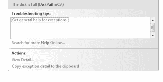


### 以可靠性换取生产力

我从1975年开始编写软件。我做了相当多的 BASIC 编程，随着我对硬件越来越感兴趣，我转向了汇编语言。随着时间的推移，我又转向了 C 编程语言，因为它让我能够以高得多的抽象层次访问硬件，使我的编程更容易。我的背景是编写操作系统代码和平台/库代码，所以我总是努力使我的代码尽可能小、尽可能快，因为应用程序的好坏只能取决于它们所使用的操作系统和库。

除了编写小而快的代码，我还一直关注错误恢复。在分配内存时（通过使用 C++ 的 new 运算符，或调用 malloc、HeapAlloc、VirtualAlloc 等），我总是检查返回值，以确保我请求的内存确实分配给了我。而且，如果内存请求失败，我总是有一条备用代码路径，确保程序其余状态不受影响，并让我的调用者知道我失败了，这样调用代码也可以采取纠正措施。

出于某种我无法完全解释的原因，在为 .NET Framework 编写代码时，并没有这样做这种对细节的关注。内存不足的情况总是可能发生，但我几乎从未看到任何包含 catch 块以从 OutOfMemoryException 恢复的代码。事实上，甚至有一些开发人员告诉我，CLR 不允许程序捕获 OutOfMemoryException。郑重声明，这绝对不是真的：你可以捕获这个异常。事实上，在执行托管代码时可能发生许多错误，而我几乎从未看到开发人员编写试图从这些潜在故障中恢复的代码。在本节中，我想指出一些潜在的故障，以及为什么忽略它们已成为文化上可接受的做法。我还想指出忽略这些故障时可能发生的一些重大问题，并提出一些帮助缓解这些问题的方法。

面向对象编程使开发人员能够非常高效。其中很大一部分是组合性，它使代码易于编写、阅读和维护。以这行代码为例：

```
Boolean f = "Jeff".Substring(1, 1).ToUpper().EndsWith("E");
```

上面的代码做了一个很大的假设：不会发生错误。但是，当然，错误总是可能的，所以我们需要一种处理这些错误的方法。这就是异常处理构造和机制的全部意义所在，也是为什么我们需要它们，而不是像 Win32 和 COM 函数那样让方法返回 true/false 或 RESULT 来指示成功/失败。

除了代码的组合性之外，我们还因编译器提供的各种出色特性而高效。例如，编译器会隐式地：

- 在调用方法时插入可选参数
- 装箱值类型实例
- 构造/初始化参数数组
- 绑定到动态变量和表达式的成员
- 绑定到扩展方法
- 绑定/调用重载运算符
- 构造委托对象
- 在调用泛型方法、声明局部变量和使用 lambda 表达式时推断类型
- 为 lambda 表达式和迭代器定义/构造闭包类
- 定义/构造/初始化匿名类型及其实例
- 重写代码以支持语言集成查询（LINQ；查询表达式和表达式树）

而且，CLR 本身为开发人员做了各种出色的事情，让我们的生活更加轻松。例如，CLR 会隐式地：

- 调用虚方法和接口方法
- 加载程序集并 JIT 编译方法，这可能抛出 FileLoadException、BadImageFormatException、InvalidProgramException、FieldAccessException、MethodAccessException、MissingFieldException、MissingMethodException 和 VerificationException
- 在访问 MarshalByRefObject 派生类型的对象时跨 AppDomain 边界转换，这可能抛出 AppDomainUnloadedException
- 在跨 AppDomain 边界时序列化和反序列化对象
- 在调用 Thread.Abort 或 AppDomain.Unload 时导致线程抛出 ThreadAbortException
- 在垃圾回收后、对象内存被回收之前调用 Finalize 方法
- 在使用泛型类型时在加载器堆中创建类型对象
- 调用类型的静态构造函数，可能抛出 TypeInitializationException
- 抛出各种异常，包括 OutOfMemoryException、DivideByZeroException、NullReferenceException、RuntimeWrappedException、TargetInvocationException、OverflowException、NotFiniteNumberException、ArrayTypeMismatchException、DataMisalignedException、IndexOutOfRangeException、InvalidCastException、RankException、SecurityException 等等

而且，当然，.NET Framework 附带了一个庞大的类库，其中包含数万个类型，每个类型都封装了常见、可重用的功能。有用于构建 Web 窗体应用程序、Web 服务、丰富的 GUI 应用程序、处理安全、图像操作、语音识别等类型，这样的列表还在不断延伸。这些代码中的任何代码都可能抛出异常，表示失败。而且未来的版本可能会引入派生自现有异常类型的新异常类型，而你的 catch 块现在会捕获以前不存在的异常类型。

所有这些东西——面向对象编程、编译器特性、CLR 特性和庞大的类库——正是使 .NET Framework 成为如此引人注目的软件开发平台的原因。¹⁴ 我的观点是，所有这些东西都会在你的代码中引入你几乎无法控制的故障点。只要一切运行良好，就万事大吉；我们编写代码很容易，代码也易于阅读和维护。但是当出现问题时，几乎不可能完全理解出了什么问题以及为什么。下面这个例子应该能真正帮助我说明观点：

```
private static Object OneStatement(Stream stream, Char charToFind) {
    return (charToFind + ": " + stream.GetType() + String.Empty + (stream.Position + 512M))
        .Where(c=>c == charToFind).ToArray();
}
```

这个稍微刻意构造的方法中只有一条 C# 语句，但这条语句做了非常多的工作。事实上，下面是 C# 编译器为此方法生成的中间语言（IL）。（我用粗体斜体标出了一些由于正在发生的隐式操作而可能成为故障点的行。）

```
.method private hidebysig static object OneStatement(
    class [mscorlib]System.IO.Stream stream, char charToFind) cil managed {
    .maxstack 4
    .locals init (
        [0] class Program/'<>c__DisplayClass1 CS$<>8__locals2,
        [1] object[] CS$<>9__0000)
    L_0000: newobj instance void Program/'<>c__DisplayClass1::.ctor()
    L_0005: stloc.0
    L_0006: ldloc.0
    L_0007: ldarg.1
    L_0008: stfld char Program/'<>c__DisplayClass1::charToFind
    L_000d: ldc.i4.5
    L_000e: newarr object
    L_0013: stloc.1
    L_0014: ldloc.1
    L_0015: ldc.i4.0
    L_0016: ldloc.0
    L_0017: ldfld char Program/'<>c__DisplayClass1::charToFind
    L_001c: box char
    L_0021: stelem.ref
    L_0022: ldloc.1
    L_0023: ldc.i4.1
    L_0024: ldstr " "
    L_0029: stelem.ref
    L_002a: ldloc.1
    L_002b: ldc.i4.2
    L_002c: ldarg.0
    L_002d: callvirt instance class [mscorlib]System.Type [mscorlib]System.Object::GetType()
    L_0032: stelem.ref
    L_0033: ldloc.1
    L_0034: ldc.i4.3
    L_0035: ldsfld string [mscorlib]System.String::Empty
    L_003a: stelem.ref
    L_003b: ldloc.1
    L_003c: ldc.i4.4
    L_003d: ldc.i4.s 0x200
    L_0042: newobj instance void [mscorlib]System.Decimal::.ctor(int32)
    L_0047: ldarg.0
    L_0048: callvirt instance int64 [mscorlib]System.IO.Stream::get_Position()
    L_004d: call valuetype [mscorlib]System.Decimal
            [mscorlib]System.Decimal::op_Implicit(int64)
    L_0052: call valuetype [mscorlib]System.Decimal [mscorlib]System.Decimal::op_Addition
            (valuetype [mscorlib]System.Decimal, valuetype [mscorlib]System.Decimal)
    L_0057: box [mscorlib]System.Decimal
    L_005c: stelem.ref
    L_005d: ldloc.1
    L_005e: call string [mscorlib]System.String::Concat(object[])
    L_0063: ldloc.0
    L_0064: ldftn instance bool Program/<c__DisplayClass1::<OneStatement>b__0(char)
    L_006a: newobj instance void
            [mscorlib]System.Func`2<char, bool>::.ctor(object, native int)
    L_006f: call class [mscorlib]System.Collections.Generic.IEnumerable`1<!!0>
            [System.Core]System.Linq.Enumerable::Where<char>
            (class [mscorlib]System.Collections.Generic.IEnumerable`1<!!0>,
            class [mscorlib]System.Func`2<!!0, bool>)
    L_0074: call !!0[] [System.Core]System.Linq.Enumerable::ToArray<char>
            (class [mscorlib]System.Collections.Generic.IEnumerable`1<!!0>)
    L_0079: ret
}
```

如你所见，在构造 <c__DisplayClass1 类（编译器生成的类型）、Object[] 数组、Func 委托，以及对 char 和 Decimal 进行装箱时，都可能发生 OutOfMemoryException。在调用 Concat、Where 和 ToArray 时，也会在内部进行内存分配。构造 Decimal 实例可能会调用其类型构造函数，从而导致 TypeInitializationException。¹⁵ 然后，还有对 Decimal 的 op_Implicit 运算符及其 op_Addition 运算符方法的隐式调用，这些调用可能做任何事情，包括抛出 OverflowException。

¹⁴ 我还应该补充一点，Visual Studio 的编辑器、IntelliSense 支持、代码片段支持、模板、扩展性系统、调试系统以及各种其他工具也有助于使该平台对开发人员具有吸引力。但是，我在这个综合讨论中省略了这些，因为它对代码在运行时的行为没有影响。

¹⁵ 顺便说一下，System.Char、System.String、System.Type 和 System.IO.Stream 都定义了类构造函数，这些构造函数都可能在这个应用程序的某个时刻导致抛出 TypeInitializationException。


查询 Stream 的 Position 属性很有意思。首先，它是一个虚属性，所以我的 OneStatement 方法根本不知道实际会执行什么代码，而这段代码可能抛出任何异常。其次，Stream 派生自 MarshalByRefObject，因此 stream 参数实际上可能引用一个代理对象，而该代理对象又引用另一个 AppDomain 中的对象。另一个 AppDomain 可能被卸载，因此这里也可能抛出 AppDomainUnloadedException。

当然，被调用的所有方法都是我个人无法控制的方法，因为它们由 Microsoft 生成。而且 Microsoft 完全可能在未来改变这些方法的实现方式，因此它们可能抛出我在编写 OneStatement 方法那天根本无法知道的新异常类型。我怎么可能把 OneStatement 方法写得对一切可能的失败都完全健壮呢？顺便说一句，相反的情况也是一个问题：catch 块可能捕获一个派生自指定异常类型的异常类型，而现在我却在为另一种失败执行恢复代码。

所以，既然你已经对一切可能的失败有所了解，你大概就能明白为什么不编写真正健壮且可靠的代码在文化上变得可接受了：这根本不切实际。此外，有人可能会说这实际上是不可能的。错误并不频繁发生这一事实，也是它在文化上变得可接受的另一个原因。由于错误（如 OutOfMemoryException）很少发生，社区已决定用真正可靠的代码来换取程序员的生产力。

异常的好处之一是，未处理的异常会导致应用程序终止。这很好，因为在测试期间，你会快速发现问题，而未处理异常提供的信息（错误消息和堆栈跟踪）通常足以让你修复代码。当然，许多公司不希望自己的应用程序在测试和部署后就直接终止，因此许多开发者插入代码来捕获 System.Exception，即所有异常类型的基类。然而，捕获 System.Exception 并允许应用程序继续运行的问题在于，状态可能已损坏。

在本章前面，我展示了一个 Account 类，它定义了一个 Transfer 方法，其职责是把钱从一个账户转移到另一个账户。如果调用这个 Transfer 方法时，它成功地从 from 账户扣除了钱，然后在向 to 账户加钱之前抛出了异常，会怎样？如果调用代码捕获 System.Exception 并继续运行，那么应用程序的状态就损坏了：from 和 to 两个账户里的钱都比应有的少。既然我们在这里谈论的是钱，这种状态损坏就不会只被视为一个简单 bug，它肯定会被视为安全 bug。如果应用程序继续运行，它会尝试在各个账户之间执行更多转账，而此时状态损坏就会在应用程序内肆虐。

有人可能会说，Transfer 方法本身应该捕获 System.Exception，并把钱恢复到 from 账户。如果 Transfer 方法足够简单，这实际上可能行得通。但是，如果 Transfer 方法会为取出的钱生成审计记录，或者如果其他线程同时操作同一个账户，那么尝试撤销该操作也可能失败，从而又抛出一个异常。而现在，状态损坏变得更糟，而不是更好。

**注意** 有人可能会说，知道什么地方出了错比知道发生了什么错误更有用。例如，知道从某个账户转出钱失败了，可能比知道 Transfer 因 SecurityException 或 OutOfMemoryException 等而失败更有用。事实上，Win32 错误模型就是这样工作的：方法返回 true/false 来表示成功/失败，这样你就知道哪个方法失败了。然后，如果你的程序关心它为什么失败，它会调用 Win32 GetLastError 方法。System.Exception 确实有一个 Source 属性，告诉你失败的方法。但这个属性是一个 String，你必须解析它，而且如果两个方法内部调用同一个方法，仅从 Source 属性你无法判断你的代码调用的是哪个失败的方法。相反，你必须解析 Exception 的 StackTrace 属性返回的 String 才能获得这一信息。由于这太困难了，我从未见过有人真正编写代码来做这件事。

你可以做几件事来*帮助*缓解状态损坏：

- CLR 不允许在线程执行 catch 或 finally 块内的代码时中止该线程。因此，我们可以通过这样做来简单地让 Transfer 方法更健壮：

    ```csharp
    public static void Transfer(Account from, Account to, Decimal amount) {
        try { /* do nothing in here */ }
        finally {
            from -= amount;
            // Now, a thread abort (due to Thread.Abort/AppDomain.Unload) can't happen here
            to += amount;
        }
    }
    ```

    然而，绝对不建议你把所有代码都写在 finally 块中！你只应将这种技术用于修改极其敏感的状态。

- 你可以使用 System.Diagnostics.Contracts.Contract 类将代码契约应用到你的方法。代码契约提供了一种方式，让你在尝试使用参数/变量修改状态之前验证参数和其他变量。如果参数/变量满足契约，那么状态损坏的*概率*就会降到最低（但并未完全消除）。如果契约失败，那么在修改任何状态之前就会抛出异常。我将在本章后面讨论代码契约。

- 你可以使用受约束的执行区域（CERs），它为你提供了一种消除一些 CLR 不确定性的方法。例如，在进入 try 块之前，你可以让 CLR 加载任何关联的 catch 和 finally 块中的代码所需的所有程序集。此外，CLR 将编译 catch 和 finally 块中的所有代码，包括从这些块内部调用的所有方法。这将消除在尝试执行错误恢复代码（在 catch 块中）或清理代码（在 finally 块中）时发生的一堆潜在异常（包括 FileLoadException、BadImageFormatException、InvalidProgramException、FieldAccessException、MethodAccessException、MissingFieldException 和 MissingMethodException）。它还会降低 OutOfMemoryException 以及一些其他异常的发生可能性。我将在本章后面讨论 CERs。

- 取决于状态存放在哪里，你可以使用事务来确保要么修改所有状态，要么不修改任何状态。例如，如果数据在数据库中，事务工作得很好。Windows 现在也支持事务性注册表操作和文件操作（仅在 NTFS 卷上），因此你也许能够使用这一点；然而，.NET Framework 目前并不直接公开此功能。你将不得不通过 P/Invoke 调用本机代码来利用它。有关更多详细信息，请参阅 `System.Transactions.TransactionScope` 类。

- 你可以把方法设计得更显式。例如，`Monitor` 类通常按如下方式用于获取/释放线程同步锁：

    ```csharp
    public static class SomeType {
        private static Object s_myLockObject = new Object();

        public static void SomeMethod() {
            Monitor.Enter(s_myLockObject);   // If this throws, did the lock get taken or
                                             // not? If it did, then it won't get released!

            try {
                // Do thread-safe operation here...
            }
            finally {
                Monitor.Exit(s_myLockObject);
            }
        }
        // ...
    }
    ```

    由于上面所示的问题，现在不鼓励使用上面所用的 Monitor 的 Enter 方法重载，建议你按如下方式重写上面的代码：

    ```csharp
    public static class SomeType {
        private static Object s_myLockObject = new Object();

        public static void SomeMethod() {
            Boolean lockTaken = false;   // Assume the lock was not taken
            try {
                // This works whether an exception is thrown or not!
                Monitor.Enter(s_myLockObject, ref lockTaken);

                // Do thread-safe operation here...
            }
            finally {
                // If the lock was taken, release it
                if (lockTaken) Monitor.Exit(s_myLockObject);
            }
        }
        // ...
    }
    ```

虽然这段代码中的显式性是一种改进，但就线程同步锁而言，

在许多应用程序中，托管代码是更好的选择，因为它极大地提高了程序员的生产率。

### 指南和最佳实践

理解异常机制固然重要。同样重要的是理解如何明智地使用异常。我常常看到库开发者捕获各种异常，使应用程序开发者无法知道发生了问题。在本节中，我提供一些开发人员在使用异常时应该注意的指南。

**重要** 如果你是一名*类库开发者*，正在开发将被其他开发者使用的类型，请非常认真地对待这些指南。你肩负着巨大的责任：你试图在类库中设计类型，使其对各种各样的应用程序都有意义。请记住，你并不深入了解你所回调的代码（通过委托、虚方法或接口方法）。而且你不知道哪些代码在调用你。预测类型将被使用的每一种情况是不可行的，所以不要做出任何策略决策。你的代码绝不能决定什么条件构成错误；让调用者做出那个决定。

此外，密切监视状态并尽量不要破坏它。使用代码契约（本章后面讨论）验证传递给方法的参数。尽量不要修改状态。如果你确实修改了状态，那么要为失败做好准备，然后尝试恢复状态。如果你遵循本章的指南，应用程序开发者使用你类库中的类型时就不会感到困难。

如果你是一名*应用程序开发者*，请定义你认为合适的任何策略。遵循本章的设计指南将帮助你在代码发布之前发现问题，使你能够修复这些问题并使应用程序更加健壮。但是，经过仔细考虑后，可以随意偏离这些指南。你可以设定策略。例如，应用程序代码在捕获异常方面可以比类库代码更积极。

### 自由地使用 finally 块

我认为 finally 块很棒！它们允许你指定一个代码块，保证无论线程抛出何种异常都会执行。你应该使用 finally 块来清理已成功启动的操作，然后再返回给调用者或允许 finally 块之后的代码执行。你还经常使用 finally 块显式释放任何对象，以避免资源泄漏。下面是一个示例，所有清理代码（关闭文件）都放在 finally 块中：

```csharp
using System;
using System.IO;

public sealed class SomeType {
    private void SomeMethod() {
        FileStream fs = new FileStream(@"C:\Data.bin", FileMode.Open);
        try {
            // Display 100 divided by the first byte in the file.
            Console.WriteLine(100 / fs.ReadByte());
        }
        finally {
            // Put cleanup code in a finally block to ensure that the file gets closed regardless
            // of whether or not an exception occurs (for example, the first byte was 0).
            if (fs != null) fs.Dispose();
        }
    }
}
```

确保清理代码始终执行非常重要，以至于许多编程语言都提供了使编写清理代码更容易的构造。例如，每当你使用 lock、using 和 foreach 语句时，C# 语言会自动生成 try/finally 块。每当你重写类的析构函数（Finalize 方法）时，C# 编译器也会生成 try/finally 块。使用这些构造时，编译器将你编写的代码放入 try 块中，并自动将清理代码放入 finally 块中。具体来说，

- 当你使用 lock 语句时，锁在 `finally` 块内释放。
- 当你使用 using 语句时，对象的 Dispose 方法在 `finally` 块内调用。
- 当你使用 foreach 语句时，IEnumerator 对象的 Dispose 方法在 finally 块内调用。
- 当你定义析构函数方法时，基类的 Finalize 方法在 finally 块内调用。

例如，以下 C# 代码利用了 using 语句。这段代码比上一示例中显示的代码更短，但编译器生成的代码与上一示例中生成的代码相同。

```csharp
using System;
using System.IO;

internal sealed class SomeType {
    private void SomeMethod() {
        using (FileStream fs = new FileStream(@"C:\Data.bin", FileMode.Open)) {
            // Display 100 divided by the first byte in the file.
            Console.WriteLine(100 / fs.ReadByte());
        }
    }
}
```

有关 using 语句的更多信息，请参见第 21 章；有关 lock 语句的更多信息，请参见第 30 章“混合线程同步构造”。

### 不要捕获所有异常

未接受过异常正确使用适当培训的开发人员常犯的一个普遍错误是过于频繁且不恰当地使用 catch 块。当你捕获异常时，你是在声明你预料到了这个异常，你理解它发生的原因，并且你知道如何处理它。换句话说，你正在为应用程序定义策略。这一切都回到本章前面的“以可靠性换取生产率”一节。

我常常看到这样的代码：

```csharp
try {
    // try to execute code that the programmer knows might fail...
}
catch (Exception) {
    ...
}
```

这段代码表明它预期任何和所有异常，并知道如何从*任何*和*所有*情况中恢复。这怎么可能呢？作为类库一部分的类型永远、*绝对*、*在任何情况下*都不应捕获并吞掉所有异常，因为该类型无法确切知道应用程序打算如何响应异常。此外，该类型会经常通过委托、虚方法或接口方法调用应用程序代码。如果应用程序代码抛出异常，应用程序的另一部分可能正期望捕获此异常。应允许异常沿调用栈向上过滤，让应用程序代码按其认为合适的方式处理异常。

如果异常未被处理，CLR 将终止进程。我将在本章后面讨论未处理异常。大多数未处理异常将在代码测试期间被发现。要修复这些未处理异常，你可以修改代码以查找特定异常，或者重写代码以消除导致异常抛出的条件。将在生产环境中运行的最终代码版本应该很少遇到未处理异常，并且将极其健壮。

> **注意** 在某些情况下，无法完成任务的方法会检测到某个对象的状态已损坏且无法恢复。允许应用程序继续运行可能会导致不可预测的行为或安全漏洞。当检测到这种情况时，该方法不应抛出异常；相反，它应通过调用 `System.Environment.FailFast` 方法强制进程立即终止。

顺便说一句，捕获 System.Exception 并在 catch 块的大括号内执行一些代码是可以的，只要你在该代码底部重新抛出异常。捕获 System.Exception 并吞掉异常（不重新抛出它）绝对不应该做，因为它隐藏了失败，使应用程序以不可预测的结果和潜在的安全漏洞运行。Visual Studio 的代码分析工具（FxCopCmd.exe）将标记任何包含 catch (Exception) 块的代码，除非该块的代码中包含 throw 语句。本章即将出现的“在发生不可恢复异常时退出部分完成的操作——维护状态”一节将讨论此模式。

最后，在一个线程中捕获异常并在另一个线程中重新抛出该异常是可以的

线程。异步编程模型（在第28章“I/O 绑定的异步操作”中讨论）支持这一点。例如，如果线程池线程执行抛出异常的代码，CLR 会捕获并吞掉该异常，并允许该线程返回线程池。之后，某个线程应调用 EndXxx 方法来确定异步操作的结果。EndXxx 方法将抛出与执行实际工作的线程池线程所抛出的相同的异常对象。在此场景中，异常被第一个线程吞掉；但是，异常又由调用 EndXxx 方法的线程重新抛出，因此它不会对应用程序隐藏。

### 从异常中优雅恢复

有时你在调用某个方法时预先知道该方法可能抛出的一些异常。由于你预料到这些异常，你可能希望有一些代码能让应用程序从该情形中优雅恢复并继续运行。以下是伪代码示例：

```csharp
public String CalculateSpreadsheetCell(Int32 row, Int32 column) {
    String result;
    try {
        result = /* Code to calculate value of a spreadsheet's cell */
    }
    catch (DivideByZeroException) {
        result = "Can't show value: Divide by zero";
    }
    catch (OverflowException) {
        result = "Can't show value: Too big";
    }
    return result;
}
```

这段伪代码计算电子表格中某个单元格的内容，并返回一个表示该值的字符串给调用方，以便调用方可以在应用程序窗口中显示该字符串。然而，单元格的内容可能是一个单元格除以另一个单元格的结果。如果包含分母的单元格包含 0，CLR 将抛出 DivideByZeroException 对象。在这种情况下，该方法会捕获这个特定异常，并返回一个将显示给用户的特殊字符串。类似地，单元格的内容可能是一个单元格乘以另一个单元格的结果。如果相乘后的值超出允许的位数范围，CLR 将抛出 OverflowException 对象，并且同样会向用户显示一个特殊字符串。

当你捕获特定异常时，要完全理解导致该异常被抛出的情形，并知道哪些异常类型派生自你正在捕获的异常类型。不要捕获并处理 System.Exception（不重新抛出），因为你不可能知道 try 块内可能抛出的所有异常（尤其是仅举两例：OutOfMemoryException 或 StackOverflowException）。

### 在发生不可恢复的异常时回退部分完成的操作——维护状态

通常，方法会调用其他若干方法来执行单个抽象操作。其中一些单独的方法可能成功完成，而另一些可能没有。例如，假设你正在将一组对象序列化到磁盘文件。在序列化 10 个对象后，抛出了异常。（也许是磁盘已满，或者下一个要序列化的对象未标记 Serializable 自定义特性。）此时，异常应向上过滤到调用方，但文件的状态怎么办？文件现在已损坏，因为它包含部分序列化的对象图。如果应用程序能够回退部分完成的操作，使文件恢复到任何对象被序列化到其中之前的状态，那就太好了。以下代码演示了实现此目的的正确方式：

```csharp
public void SerializeObjectGraph(FileStream fs, IFormatter formatter, Object rootObj) {

    // Save the current position of the file.
    Int64 beforeSerialization = fs.Position;

    try {
        // Attempt to serialize the object graph to the file.
        formatter.Serialize(fs, rootObj);
    }
    catch {  // Catch any and all exceptions.
        // If ANYTHING goes wrong, reset the file back to a good state.
        fs.Position = beforeSerialization;

        // Truncate the file.
        fs.SetLength(fs.Position);

        // NOTE: The preceding code isn’t in a finally block because
        // the stream should be reset only when serialization fails.

        // Let the caller(s) know what happened by re-throwing the SAME exception.
        throw;
    }
}
```

要正确回退部分完成的操作，应编写捕获所有异常的代码。是的，这里要捕获所有异常，因为你不关心发生了哪种错误；你需要将数据结构恢复到一致状态。捕获并处理异常后，不要吞掉它——让调用方知道发生了异常。为此，你需要重新抛出同一个异常。事实上，C# 和许多其他语言让这变得很容易。只需使用 C# 的 throw 关键字，并在 throw 后不指定任何内容，如前面的代码所示。

请注意，上一个示例中的 catch 块未指定任何异常类型，因为我想捕获任何及所有异常。此外，catch 块中的代码不需要确切知道抛出了哪种异常，只需知道出了问题。幸运的是，C# 让我可以轻松做到这一点：不指定任何异常类型，并让 throw 语句重新抛出捕获到的任何对象。

### 隐藏实现细节以维护“契约”

在某些情况下，你可能会发现捕获一个异常并重新抛出另一个不同的异常很有用。这样做的唯一原因是维护方法契约的含义。此外，你抛出的新异常类型应是特定异常（即不用作任何其他异常类型的基类型的异常）。设想一个 PhoneBook 类型，它定义了一个根据姓名查找电话号码的方法，如下面的伪代码所示：

```csharp
internal sealed class PhoneBook {
    private String m_pathname;  // path name of file containing the address book

    // Other methods go here.

    public String GetPhoneNumber(String name) {
        String phone;
        FileStream fs = null;
        try {
            fs = new FileStream(m_pathname, FileMode.Open);
            // Code to read from fs until name is found goes here
            phone = /* the phone # found */
        }
        catch (FileNotFoundException e) {
            // Throw a different exception containing the name, and
            // set the originating exception as the inner exception.
            throw new NameNotFoundException(name, e);
        }
        catch (IOException e) {
            // Throw a different exception containing the name, and
            // set the originating exception as the inner exception.
            throw new NameNotFoundException(name, e);
        }
        finally {
            if (fs != null) fs.Close();
        }
        return phone;
    }
}
```

电话簿数据是从文件获取的（而不是从网络连接或数据库获取）。然而，PhoneBook 类型的使用者并不知道这一点，因为这是一个将来可能更改的实现细节。因此，如果文件未找到或因任何原因无法读取，调用方将看到 FileNotFoundException 或 IOException，而这是他们无法预料的。换句话说，文件是否存在以及是否可读并不属于该方法隐含契约的一部分。调用方不可能猜到这一点。因此，GetPhoneNumber 方法捕获这两种异常类型，并抛出一个新的 NameNotFoundException。

使用此技术时，你应捕获那些你完全理解其抛出情形的特定异常。而且，你还应知道哪些异常类型

方法会隐式调用类型构造函数。^16 如果类型构造函数抛出了 `DivideByZeroException`，你的代码可能会尝试捕获它并从中恢复，但你甚至不知道自己正在调用类型构造函数。因此，CLR 会将 `DivideByZeroException` 转换为 `TypeInitializationException`，以便你清楚地知道异常是由于类型构造函数失败而发生的；问题并不出在你的代码上。

另一方面，下面是此技术的一个糟糕用法：当你通过反射调用方法时，CLR 会在内部捕获该方法抛出的异常，并将其转换为 `TargetInvocationException`。这非常烦人，因为你现在必须捕获 `TargetInvocationException` 对象，并查看其 `InnerException` 属性，以辨别失败的真正原因。事实上，在使用反射时，经常会看到如下代码。

```csharp
private static void Reflection(Object o) {
    try {
        // Invoke a DoSomething method on this object
        var mi = o.GetType().GetMethod("DoSomething");
        mi.Invoke(o, null); // The DoSomething method might throw an exception
    }
    catch (System.Reflection.TargetInvocationException e) {
        // The CLR converts reflection-produced exceptions to TargetInvocationException
        throw e.InnerException; // Re-throw what was originally thrown
    }
}
```

不过我有个好消息：如果你使用 C# 的动态基元类型（在第5章“基元类型、引用类型和值类型”中讨论）来调用成员，编译器生成的代码不会捕获任何及所有异常并抛出 `TargetInvocationException` 对象；最初抛出的异常对象只会沿调用栈向上传递。对许多开发者来说，这是更倾向于使用 C# 的动态基元类型而不是反射的一个很好的理由。

### 未处理异常

当抛出异常时，CLR 会沿调用栈向上查找与所抛出异常对象的类型匹配的 catch 块。如果没有 catch 块匹配所抛出的异常类型，就会发生*未处理异常*。当 CLR 检测到进程中的任何线程发生了未处理异常时，CLR 会终止该进程。未处理异常标识了应用程序未预料到的情况，并被视为应用程序中的真正 bug。此时，该 bug 应报告回发布该应用程序的公司。希望发布者会修复该 bug 并分发应用程序的新版本。

类库开发者甚至不应考虑未处理异常。只有应用程序开发者需要关注未处理异常，并且应用程序应制定处理未处理异常的策略。Microsoft 实际上建议应用程序

16 有关更多信息，请参见第8章“方法”中的“类型构造函数”一节。


开发人员只是接受 CLR 的默认策略。也就是说，当应用程序遇到未处理异常时，Windows 会向系统的事件日志写入一个条目。你可以通过打开“事件查看器”应用程序，然后在树中的 Windows 日志 > 应用程序节点下查看，如图 20-1 所示。

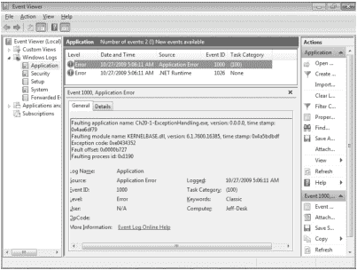

**图 20-1** Windows 事件日志显示了一个因未处理异常而终止的应用程序。

但是，你可以使用 Windows 操作中心小程序获取有关该问题的更有趣的详细信息。要启动操作中心，请单击系统托盘中的旗标图标，选择“打开操作中心”，展开“维护”框，然后选择“查看可靠性历史记录”链接。在这里，你可以在底部窗格中看到因未处理异常而终止的应用程序，如图 20-2 所示。

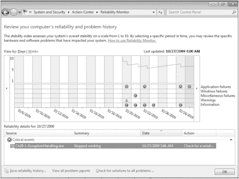

**图 20-2** 可靠性监视器显示了一个因未处理异常而终止的应用程序。

要查看有关已终止应用程序的更多详细信息，请在可靠性监视器中双击某个已终止的应用程序。详细信息将类似于图 20-3，问题签名的含义在表 20-2 中描述。托管应用程序产生的所有未处理异常都放在 CLR20r3 桶中。

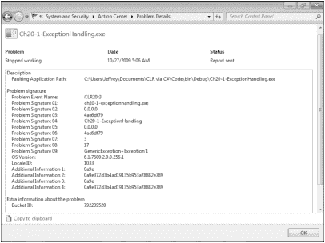

**图 20-3** 可靠性监视器显示了有关失败应用程序的更多详细信息。

**表 20-2 问题签名**

| 问题签名 | 描述* |
|---|---|
| 01 | EXE 文件名（32 字符限制） |
| 02 | EXE 文件的程序集版本号 |
| 03 | EXE 文件的时间戳 |
| 04 | EXE 文件的完整程序集名称（64 字符限制） |
| 05 | 出错程序集的版本 |
| 06 | 出错程序集的时间戳 |
| 07 | 出错程序集的类型和方法。此值是 MethodDef 元数据标记（去掉 0x06 高字节后），用于标识引发异常的方法。根据此值，你可以使用 ILDasm.exe 确定有问题的类型和方法。 |
| 08 | 出错方法的 IL 指令。此值是引发异常的 IL 指令在出错方法内的偏移量。根据此值，你可以使用 ILDasm.exe 确定有问题的指令。 |
| 09 | 引发的异常类型（32 字符限制） |

\* 如果字符串超出允许限制，则会执行一些智能截断，例如从异常类型中删除“Exception”，或从文件名中删除“.dll”。如果结果字符串仍然太长，则 CLR 会通过对字符串进行哈希或 base-64 编码来创建一个值。

记录有关失败应用程序的信息后，Windows 会显示一个消息框，允许最终用户将有关失败应用程序的信息发送到 Microsoft 服务器。¹⁷ 这称为 *Windows 错误报告*，有关它的更多信息可在 Windows 质量网站（*http://WinQual.Microsoft.com*）上找到。

公司可以选择向 Microsoft 注册，以查看有关其自己的应用程序和组件的信息。注册是免费的，但要求你的程序集使用 VeriSign ID（也称为用于 Authenticode 的软件发行者数字 ID）进行签名。

当然，你也可以开发自己的系统来将未处理异常信息返回给你，以便修复代码中的 bug。当应用程序初始化时，你可以告知 CLR：你有一个方法，希望在应用程序中的任何线程遇到未处理异常时调用它。

不幸的是，Microsoft 生成的每种应用程序模型都有自己接入未处理异常的方式。你需要在 FCL 文档中查找的成员包括：

- 对于任何应用程序，请查看 `System.AppDomain’s UnhandledException` 事件。Silverlight 应用程序执行时的安全级别不足以注册此事件。
- 对于 Windows Forms 应用程序，请查看 System.Windows.Forms.NativeWindow 的 OnThreadException 虚方法、System.Windows.Forms.Application 的 OnThreadException 虚方法，以及 System.Windows.Forms.Application 的 ThreadException 事件。
- 对于 Windows Presentation Foundation (WPF) 应用程序，请查看 System.Windows.Application 的 DispatcherUnhandledException 事件，以及 System.Threading.Dispatcher 的 UnhandledException 和 UnhandledExceptionFilter 事件。
- 对于 Silverlight，请查看 System.Windows.Application 的 UnhandledException 事件。
- 对于 ASP.NET Web Form 应用程序，请查看 System.Web.UI.TemplateControl 的 Error 事件。TemplateControl 是 System.Web.UI.Page 和 System.Web.UI.UserControl 类的基类。此外，你还应查看 System.Web.HttpApplication 的 Error 事件。
- 对于 Windows Communication Foundation 应用程序，请查看 System.ServiceModel.Dispatcher.ChannelDispatcher 的 ErrorHandlers 属性。

¹⁷ 实际上，你可以通过使用 P/Invoke 调用 Win32 的 `SetErrorMode` 函数并传入 `SEM_NOGPFAULTERRORBOX` 来禁用此消息框。

在结束本节之前，我想谈谈可能在分布式应用程序（如网站或 Web 服务）中发生的未处理异常。在理想情况下，遇到未处理异常的服务器应用程序应记录该异常，向客户端发送某种通知，表明请求的操作无法完成，然后服务器应终止。不幸的是，我们并非生活在理想世界中，因此可能无法向客户端发送失败通知。对于某些无状态服务器（如 Microsoft SQL Server），终止服务器并启动一个全新实例可能并不实际。

对于服务器应用程序，不应将有关未处理异常的信息返回给客户端，因为客户端对此几乎无能为力，尤其是在客户端由其他公司实现时。此外，服务器应尽可能少地向客户端泄露有关自身的信息，以降低服务器被黑客攻击的可能性。

**注意** CLR 将本机代码引发的一些异常视为损坏状态异常（CSE），因为它们通常是 CLR 本身或某些本机代码中的 bug 导致的结果，而托管开发人员无法控制这些本机代码。默认情况下，CLR 不允许托管代码捕获这些异常，并且 finally 块不会执行。以下是被视为 CSE 的本机 Win32 异常列表：

```
EXCEPTION_ACCESS_VIOLATION          EXCEPTION_STACK_OVERFLOW
EXCEPTION_ILLEGAL_INSTRUCTION       EXCEPTION_IN_PAGE_ERROR
EXCEPTION_INVALID_DISPOSITION       EXCEPTION_NONCONTINUABLE_EXCEPTION
EXCEPTION_PRIV_INSTRUCTION          STATUS_UNWIND_CONSOLIDATE
```

单个托管方法可以通过将 System.Runtime.ExceptionServices.HandleProcessCorruptedStateExceptionsAttribute 应用于该方法，来重写默认行为并捕获这些异常。此外，该方法还必须应用 System.Security.SecurityCriticalAttribute。你还可以通过将应用程序的可扩展标记语言 (XML) 配置文件中的 `legacyCorruptedStateExceptionPolicy` 元素设置为 true，来重写整个进程的默认行为。CLR 会将其中大多数异常转换为 `System.Runtime.InteropServices.SEHException` 对象，但 `EXCEPTION_ACCESS_VIOLATION` 会转换为 `System.AccessViolationException` 对象，而 `EXCEPTION_STACK_OVERFLOW` 会转换为 `System.StackOverflowException` 对象。

**注意** 在调用方法之前，你可以通过调用 `RuntimeHelpers.EnsureSufficientExecutionStack` 方法来检查是否有充足的堆栈空间。此方法检查调用线程是否有足够的可用堆栈空间来执行普通方法（该术语并未明确定义）。如果堆栈空间不足，此方法会抛出 `InsufficientExecutionStackException`，你可以捕获它。`EnsureSufficientExecutionStack` 方法不接受参数并返回 void。此方法通常由递归方法使用。

#### 调试异常

Visual Studio 调试器为异常提供特殊支持。打开解决方案后，从“调试”菜单中选择“异常”，你将看到如图 20-4 所示的对话框。

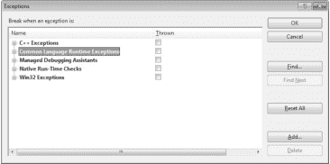

**图 20-4** “异常”对话框，显示了不同类型的异常。

此对话框显示了 Visual Studio 已知的不同类型的异常。对于公共语言运行时异常，在对话框中展开相应分支（如图 20-5 所示），会显示 Visual Studio 调试器已知的命名空间集。


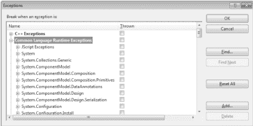

**图 20-5** 异常对话框，按命名空间显示 CLR 异常。

如果展开某个命名空间，就会看到该命名空间中定义的所有派生自 System.Exception 的类型。例如，图 20-6 显示了打开 System 命名空间后会看到的内容。

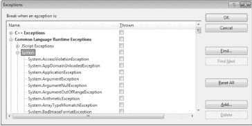

**图 20-6** 异常对话框，显示 System 命名空间中定义的 CLR 异常。

对于任何异常类型，如果选中了其“引发”复选框，那么只要引发该异常，调试器就会中断。此时，CLR 尚未尝试查找任何匹配的 catch 块。如果你想调试捕获并处理异常的代码，这会很有用。当你怀疑某个组件或库可能在吞掉或重新引发异常，而不确定究竟该在哪里设置断点来当场捕获它时，这也很有用。

如果未选中某个异常类型的“引发”复选框，调试器也会在引发异常的位置中断，但仅当该异常类型未被处理时才会如此。开发人员通常会让“引发”复选框保持清除状态，因为已处理的异常表明应用程序预见到了这种情况并已处理；应用程序会继续正常运行。

如果定义自己的异常类型，可以单击“添加”将其添加到此对话框。这会显示图 20-7 中的对话框。


**图 20-7** 让 Visual Studio 识别你自己的异常类型：新建异常对话框。

在此对话框中，首先将异常类型选择为“公共语言运行时异常”，然后可以输入自己异常类型的完全限定名。请注意，输入的类型不必是派生自 System.Exception 的类型；完全支持不符合 CLS 的类型。如果有两个或更多同名但位于不同程序集中的类型，则无法区分这些类型。幸运的是，这种情况很少发生。

如果程序集定义了多个异常类型，必须一次添加一个。将来，我希望这个对话框允许我浏览程序集，并将所有派生自 Exception 的类型自动导入 Visual Studio 的调试器。这样每个类型还可以按程序集来标识，从而解决不同程序集中有两个同名类型的问题。

### 异常处理的性能注意事项

开发人员社区一直在积极争论异常处理的性能。有些人声称异常处理的性能太差，以至于他们甚至拒绝使用异常处理。然而，我认为在面向对象的平台上，异常处理不是可选项，而是必需的。此外，如果你不使用它，你会用什么来代替？你会让方法返回 true/false 来表示成功/失败，或者返回某种错误代码枚举类型吗？如果你这样做，就会两头都糟糕：CLR 和类库代码会引发异常，而你的代码会返回错误代码。现在你必须在自己代码中同时处理这两种情况。

很难比较异常处理与更传统的异常报告方式（如 HRESULT、特殊返回码等）之间的性能。如果你编写代码来检查每次方法调用的返回值，并将返回值逐层过滤给自己的调用方，应用程序的性能将受到严重影响。但撇开性能不谈，当你编写代码检查每个方法的返回值时，需要额外编写的代码量以及出错的可能性都会高得惊人。异常处理是一个好得多的替代方案。

然而，异常处理是有代价的：非托管 C++ 编译器必须生成代码来跟踪哪些对象已成功构造。编译器还必须生成代码，以便在捕获异常时调用每个已成功构造对象的析构函数。编译器承担这一负担固然很好，但它会在应用程序中生成大量簿记代码，对代码大小和执行时间产生不利影响。

另一方面，托管编译器要轻松得多，因为托管对象分配在由垃圾回收器监控的托管堆中。如果对象已成功构造并且引发了异常，垃圾回收器最终会释放该对象的内存。编译器不需要发出任何簿记代码来跟踪哪些对象成功构造，也不需要确保已调用析构函数。与非托管 C++ 相比，这意味着编译器生成的代码更少，运行时必须执行的代码也更少，从而带来更好的应用程序性能。

多年来，我在不同的编程语言、不同的操作系统和不同的 CPU 架构中使用过异常处理。每种情况下，异常处理的实现方式都不同，每种实现在性能方面都有各自的优缺点。一些实现将异常处理构造直接编译到方法中，而另一些实现则将与异常处理相关的信息存储在与该方法关联的数据表中——仅当引发异常时才访问该表。有些编译器无法内联包含异常处理程序的方法，有些编译器在方法包含异常处理程序时不会将变量放入寄存器。

关键在于，你无法确定使用异常处理会给应用程序增加多少额外开销。在托管世界中，这就更难判断了，因为程序集的代码可以在任何支持 .NET Framework 的平台上运行。因此，当程序集在 x86 机器上运行时，JIT 编译器为管理异常处理而生成的代码，将与代码在 x64 或 IA64 处理器上运行时 JIT 编译器生成的代码大不相同。此外，与其他 CLR 实现（如 Microsoft 的 .NET Compact Framework 或开源 Mono 项目）关联的 JIT 编译器很可能生成不同的代码。

实际上，我曾用 Microsoft 内部的几个不同 JIT 编译器测试过自己的一些代码，观察到的性能差异相当显著且令人惊讶。关键在于，你必须在你预期用户会运行的各种平台上测试代码，并相应地做出修改。再次强调，我不会担心使用异常处理的性能，因为其好处通常远远超过任何负面性能影响。

如果你有兴趣了解异常处理如何影响代码性能，可以使用 Windows 自带的性能监视器工具。图 20-8 的屏幕显示了随 .NET Framework 一起安装的与异常相关的计数器。

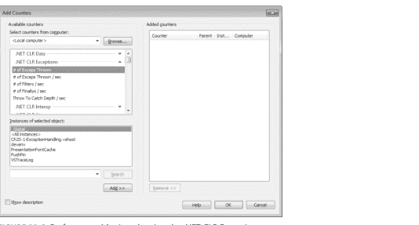

**图 20-8** 性能监视器显示 .NET CLR 异常计数器。

有时，你会遇到一个频繁调用且失败率很高的方法。在这种情况下，引发异常所带来的性能损失可能无法忍受。例如，Microsoft 收到几位客户的反馈，他们调用 Int32 的 Parse 方法时，经常传入最终用户输入且无法解析的数据。由于 Parse 被频繁调用，引发和捕获异常带来的性能损失严重拖累了应用程序的整体性能。

为了解决客户的担忧并满足本章所述的所有准则，Microsoft 向 Int32 类添加了一个新方法。这个新方法称为 TryParse，它有两个重载，如下所示：

```csharp
public static Boolean TryParse(String s, out Int32 result);
public static Boolean TryParse(String s, NumberStyles style,
  IFormatProvider provider, out Int32 result);
```

你会注意到，这些方法返回一个 Boolean，指示传入的 String 是否包含可解析为 Int32 的字符。这些方法还返回一个名为 result 的输出参数。如果方法返回 true，result 将包含将该字符串解析为 32 位整数的结果。如果方法返回 false，result 将包含 0，但无论如何你确实不应执行任何查看它的代码。

我想绝对明确一点：TryXxx 方法的 Boolean 返回值返回 false，只表示一种失败类型，而且仅表示这一种。对于任何其他类型的失败，该方法仍应引发异常。例如，如果 style 参数无效，Int32 的 TryParse 会引发 ArgumentException；而且调用 TryParse 时仍然完全可能引发 OutOfMemoryException。

我还想明确一点：面向对象编程允许程序员成为

富有成效。实现这一点的一种方式是，不在类型的成员中暴露错误代码。换句话说，构造函数、方法、属性等都按照“调用它们不会失败”的理念来定义。而且，如果定义正确，对于成员的大多数使用情况，它都不会失败，并且不会因为抛出异常而产生性能损失。

在定义类型及其成员时，你应定义成员，使其在你预期类型会被使用的常见场景中不太可能失败。如果你后来从用户那里听说他们因抛出异常而对性能不满意，那么只有到那时，你才应考虑添加 TryXxx 方法。换句话说，你应先产生最佳对象模型，然后，如果用户反对，再向你的类型添加一些 TryXxx 方法，以便遇到性能问题的用户能够受益。未遇到性能问题的用户应继续使用方法的非 TryXxx 版本，因为这是更好的对象模型。

#### 受约束执行区域 (CERs)

许多应用程序不需要具有稳健性并从所有类型的失败中恢复。许多客户端应用程序就是如此，例如 Notepad.exe 和 Calc.exe。当然，我们中的许多人都见过 Microsoft Office 应用程序（如 WinWord.exe、Excel.exe 和 Outlook.exe）因未处理异常而终止。此外，许多服务器端应用程序（如 Web 服务器）是无状态的，并且如果因未处理异常而失败，会自动重新启动。当然，一些服务器（如 SQL Server）完全关乎状态管理，因未处理异常而丢失数据可能更具灾难性。

在 CLR 中，我们有 AppDomain（第 22 章讨论），它包含状态。当卸载 AppDomain 时，其所有状态都会被卸载。因此，如果 AppDomain 中的线程遇到未处理异常，可以卸载该 AppDomain（这会销毁其所有状态）而不终止整个进程。<sup>18</sup>

根据定义，CER 是一段必须能够承受失败的代码。由于 AppDomain 可以被卸载并销毁其状态，CER 通常用于操作由多个 AppDomain 或进程共享的任何状态。在意外抛出异常时尝试维护状态时，CER 很有用。有时我们将这类异常称为 *异步异常*。例如，调用方法时，CLR 必须加载程序集、在 AppDomain 的加载器堆中创建类型对象、调用类型的静态构造函数、将 IL JIT 编译为本机代码，等等。这些操作中的任何一个都可能失败，CLR 通过抛出异常来报告失败。

如果这些操作中的任何一个在 `catch` 或 `finally` 块内失败，那么你的错误恢复或清理代码将不会完整执行。下面是一个展示潜在问题的代码示例：

```
private static void Demo1() {
    try {
        Console.WriteLine("In try");
    }
    finally {
        // Type1's static constructor is implicitly called in here
        Type1.M();
    }
}
```

```
private sealed class Type1 {
    static Type1() {
        // if this throws an exception, M won't get called
        Console.WriteLine("Type1's static ctor called");
    }

    public static void M() { }
}
```

当我运行上面的代码时，得到以下输出：

```
In try
Type1's static ctor called
```

我们想要的是，除非我们知道关联的 catch 和 finally 块中的代码保证（或尽可能接近保证）会执行，否则甚至不要开始执行上面 try 块中的代码。我们可以通过如下修改代码来实现：

```
private static void Demo2() {
    // Force the code in the finally to be eagerly prepared
    RuntimeHelpers.PrepareConstrainedRegions(); // System.Runtime.CompilerServices namespace
    try {
        Console.WriteLine("In try");
    }
    finally {
        // Type2's static constructor is implicitly called in here
        Type2.M();
    }
}
```

```
public class Type2 {
    static Type2() {
        Console.WriteLine("Type2's static ctor called");
    }

    // Use this attribute defined in the System.Runtime.ConstrainedExecution namespace
    [ReliabilityContract(Consistency.WillNotCorruptState, Cer.Success)]
    public static void M() { }
}
```

现在，当我运行这个版本的代码时，得到以下输出：

```
Type2's static ctor called
In try
```

以便他们知道可以预期什么。CLR 和 JIT 编译器不使用此信息。

当你想要编写可靠的方法时，请使其小巧并约束其行为。确保它不分配任何对象（例如，不装箱），不调用任何虚方法或接口方法，不使用任何委托，也不使用反射，因为 JIT 编译器无法确定实际将调用哪个方法。不过，你可以通过调用 RuntimeHelpers 类定义的以下方法之一来手动准备这些方法：

```csharp
public static void PrepareMethod(RuntimeMethodHandle method)
public static void PrepareMethod(RuntimeMethodHandle method,
    RuntimeTypeHandle[] instantiation)
public static void PrepareDelegate(Delegate d);
public static void PrepareContractedDelegate(Delegate d);
```

请注意，编译器和 CLR 不会做任何事来验证你编写的方法是否真正符合你通过 ReliabilityContractAttribute 记录的保证。如果你做错了什么，则可能发生状态损坏。

**注意** 即使所有方法都已预先准备，方法调用仍可能导致 StackOverflowException。当 CLR 未被承载时，StackOverflowException 会导致进程立即终止，因为 CLR 会在内部调用 Environment.FailFast。当被承载时，PrepareConstrainedRegions 方法会检查栈，以查看是否剩余大约 48KB 的栈空间。如果栈空间有限，则 StackOverflowException 会在进入 try 块之前发生。

你还应查看 RuntimeHelpers.ExecuteCodeWithGuaranteedCleanup 方法，这是另一种执行带保证清理的代码的方式：

```csharp
public static void ExecuteCodeWithGuaranteedCleanup(TryCode code, CleanupCode backoutCode,
    Object userData);
```

调用此方法时，你将 try 和 finally 块的主体作为回调方法传入，这些回调方法的原型分别匹配以下两个委托：

```csharp
public delegate void TryCode(Object userData);
public delegate void CleanupCode(Object userData, Boolean exceptionThrown);
```

最后，获得有保证的代码执行的另一种方法是使用 CriticalFinalizerObject 类，第 21 章对此进行了详细说明。

#### 代码契约

代码契约提供了一种方式，让你可以在代码本身中以声明方式记录你已做出的关于代码的设计决策。契约采用以下形式：

- **前置条件** 通常用于验证参数。
- **后置条件** 用于在方法因正常返回或抛出异常而终止时验证状态。
- **对象不变量** 用于确保对象的字段在对象的整个生命周期内保持良好状态。

代码契约有助于代码的使用、理解、演化、测试、²⁰ 文档编制和早期错误检测。你可以将前置条件、后置条件和对象不变量视为方法签名的一部分。因此，你可以用新版本的代码放宽契约，但不能在不破坏向后兼容性的情况下用新版本使契约更严格。

代码契约的核心是静态 `System.Diagnostics.Contracts.Contract` 类：

```csharp
public static class Contract {
    // Precondition methods: [Conditional("CONTRACTS_FULL")]
    public static void Requires(Boolean condition);
    public static void EndContractBlock();

    // Preconditions: Always
    public static void Requires<TException>(Boolean condition) where TException : Exception;

    // Postcondition methods: [Conditional("CONTRACTS_FULL")]
    public static void Ensures(Boolean condition);
    public static void EnsuresOnThrow<TException>(Boolean condition)
        where TException : Exception;

    // Special Postcondition methods: Always
    public static T Result<T>();
    public static T OldValue<T>(T value);
    public static T ValueAtReturn<T>(out T value);

    // Object Invariant methods: [Conditional("CONTRACTS_FULL")]
    public static void Invariant(Boolean condition);

    // Quantifier methods: Always
    public static Boolean Exists<T>(IEnumerable<T> collection, Predicate<T> predicate);
    public static Boolean Exists(Int32 fromInclusive, Int32 toExclusive,
        Predicate<Int32> predicate);
    public static Boolean ForAll<T>(IEnumerable<T> collection, Predicate<T> predicate);
    public static Boolean ForAll(Int32 fromInclusive, Int32 toExclusive,
        Predicate<Int32> predicate);
    // Helper methods: [Conditional("CONTRACTS_FULL")] or [Conditional("DEBUG")]
    public static void Assert(Boolean condition);
    public static void Assume(Boolean condition);

    // Infrastructure event: usually your code will not use this event
    public static event EventHandler<ContractFailedEventArgs> ContractFailed;
}
```

18 如果线程整个生命周期都位于单个 AppDomain 内（如 ASP.NET 和托管 SQL Server 存储过程场景），这绝对成立。但如果线程在其生命周期内跨越 AppDomain 边界，则可能必须终止整个进程。

²⁰ 为帮助进行自动化测试，请参阅微软研究院创建的 Pex 工具：*http://research.microsoft.com/en-us/projects/pex/*。


如上所述，这些静态方法中有许多都应用了 `[Conditional("CONTRACTS_FULL")]` 特性。一些辅助方法还应用了 `[Conditional("DEBUG")]` 特性。这意味着，除非在编译代码时定义了相应的符号，否则编译器将忽略你编写的调用这些方法的任何代码。任何标记为 `"Always"` 的方法都表示编译器始终会发出调用该方法的代码。此外，`Requires`、`Requires<TException>`、`Ensures`、`EnsuresOnThrow`、`Invariant`、`Assert` 和 `Assume` 方法都有一个额外的重载（未显示），该重载接受一个 String 消息参数，因此你可以显式指定在违反契约时应显示的字符串消息。

默认情况下，契约仅作为文档使用，因为你在构建项目时不会定义 CONTRACTS_FULL 符号。为了从使用契约中获得更多价值，你必须从 *http://msdn.microsoft.com/en-us/devlabs/dd491992.aspx* 下载额外的工具和 Visual Studio 属性面板。之所以没有将所有代码契约工具都包含在 Visual Studio 中，是因为这项技术相对较新，并且正在快速改进。Microsoft 的 DevLabs 网站可以比 Visual Studio 本身更快地提供新版本和改进。下载并安装额外工具后，你会看到项目有了一个新的属性面板，如图 20-9 所示。

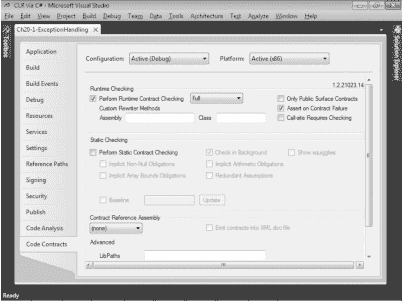

**图 20-9** Visual Studio 项目的“代码契约”面板。

若要启用代码契约功能，请选中“执行运行时契约检查”复选框，并从旁边的组合框中选择“Full”。这会在构建项目时定义 CONTRACTS_FULL 符号，并在构建项目后调用相应的工具（稍后介绍）。现在，在运行时，当违反契约时，会引发 Contract 的 ContractFailed 事件。通常，开发人员不会向此事件注册任何方法，但如果注册了，你注册的任何方法都会收到一个 ContractFailedEventArgs 对象，如下所示：

```csharp
public sealed class ContractFailedEventArgs : EventArgs {
    public ContractFailedEventArgs(ContractFailureKind failureKind,
        String message, String condition, Exception originalException);

    public ContractFailureKind FailureKind     { get; }
    public String               Message        { get; }
    public String               Condition      { get; }
    public Exception            OriginalException { get; }

    public Boolean Handled { get; }    // true if any handler called SetHandled
    public void SetHandled();          // Call to ignore the violation; sets Handled to true

    public Boolean Unwind { get; }     // true if any handler called SetUnwind or threw
    public void SetUnwind();            // Call to force ContractException; set Unwind to true
}
```

可以在此事件上注册多个事件处理方法。每个方法都可以任意方式处理契约违规。例如，处理程序可以记录违规、忽略违规（通过调用 SetHandled()）或终止进程。如果任何方法调用 SetHandled，则该违规将被视为已处理，在所有处理程序方法返回后，允许应用程序代码继续运行，除非任何处理程序调用 SetUnwind。如果处理程序调用 SetUnwind，则在所有处理程序方法完成运行后，将抛出 `System.Diagnostics.Contracts.ContractException`。请注意，此类型是 MSCorLib.dll 内部的类型，因此你无法编写 catch 块来显式捕获它。另请注意，如果任何处理程序方法抛出未处理的异常，则会调用其余处理程序方法，然后抛出 ContractException。

如果没有事件处理程序，或者它们都没有调用 SetHandled、SetUnwind 或抛出未处理的异常，那么接下来将执行契约违规的默认处理。如果 CLR 正在被宿主，则会通知宿主发生契约失败。如果 CLR 正在非交互式窗口站上运行应用程序（对于 Windows 服务应用程序来说就是这种情况），则会调用 `Environment.FailFast` 来立即终止进程。如果你在编译时选中了“断言失败时中断（Assert On Contract Failure）”选项，则会出现一个断言对话框，允许你将调试器连接到应用程序。如果未选中此选项，则会抛出 ContractException。

让我们看一个使用代码契约的示例类：

```csharp
public sealed class Item { /* ... */ }

public sealed class ShoppingCart {
    private List<Item> m_cart     = new List<Item>();
    private Decimal    m_totalCost = 0;

    public ShoppingCart() {
    }

    public void AddItem(Item item) {
        AddItemHelper(m_cart, item, ref m_totalCost);
    }

    private static void AddItemHelper(List<Item> m_cart, Item newItem,
        ref Decimal totalCost) {

        // Preconditions:
        Contract.Requires(newItem != null);
        Contract.Requires(Contract.ForAll(m_cart, s => s != newItem));

        // Postconditions:
        Contract.Ensures(Contract.Exists(m_cart, s => s == newItem));
        Contract.Ensures(totalCost >= Contract.OldValue(totalCost));
        Contract.EnsuresOnThrow<IOException>(totalCost == Contract.OldValue(totalCost));

        // Do some stuff (which could throw an IOException)...
        m_cart.Add(newItem);
        totalCost += 1.00M;
    }

    // Object invariant
    [ContractInvariantMethod]
    private void ObjectInvariant() {
        Contract.Invariant(m_totalCost >= 0);
    }
}
```

AddItemHelper 方法定义了一组代码契约。前置条件表明 `newItem` 不能为 `null`，并且要添加到购物车中的商品尚未在购物车中。后置条件表明新商品必须在购物车中，并且总成本必须至少与将商品添加到购物车之前一样高。后置条件还表明，如果 AddItemHelper 因某种原因抛出 IOException，那么 `totalCost` 与该方法开始执行时相比保持不变。`ObjectInvariant` 方法只是一个私有方法，调用时会确保对象的 `m_totalCost` 字段永远不会包含负值。

**重要** 在前置条件、后置条件或不变量测试中引用的所有成员都必须是无副作用的。这是必需的，因为测试条件不应改变对象本身的状态。此外，在前置条件测试中引用的所有成员的可见性必须至少不低于定义该前置条件的方法。这是必需的，因为方法的调用者应该能够在调用方法之前验证他们是否满足所有前置条件。另一方面，只要代码能够编译，后置条件或不变量测试中引用的成员可以具有任何可见性。此处可见性并不重要的原因是，后置条件和不变量测试不会影响调用者正确调用方法的能力。

**重要** 关于继承，派生类型不能重写并更改基类型中定义的虚成员的前置条件。同样，实现接口成员的类型不能更改该接口成员定义的前置条件。如果成员没有为其定义显式契约，则该成员具有一个隐式契约，逻辑上如下所示：`Contract.Requires(true);` 并且由于契约不能通过新版本变得更严格（在不破坏兼容性的情况下），因此在引入新的虚成员、抽象成员或接口成员时，你应仔细考虑前置条件。对于后置条件和对象不变量，契约可以随意添加和删除，因为虚/抽象/接口成员中表达的条件与重写成员中表达的条件只是在逻辑上进行 AND 运算。

所以现在你知道了如何声明契约。接下来让我们谈谈它们在运行时如何运作。你可以在方法的开头声明所有前置条件和后置条件契约，这样它们很容易找到。当然，前置条件契约会在方法被调用时验证其测试条件。然而，我们不希望后置条件契约在方法返回之前验证其测试条件。为了获得所需的行为，C# 编译器生成的程序集必须由代码契约重写工具（CCRewrite.exe，位于 C:\Program Files (x86)\Microsoft\Contracts\Bin）处理，该工具会生成程序集的修改版本。在你的项目中选中“执行运行时契约检查”复选框后，Visual Studio 会在你每次构建项目时自动调用此工具。该工具分析所有方法中的 IL，并重写 IL，以便在每个方法的末尾执行任何后置条件契约。如果你的方法内部有多个返回点，则 CCRewrite.exe 工具会修改该方法的 IL 代码，以便所有返回点在方法返回之前执行后置条件代码。

CCRewrite.exe 工具会在类型中查找带有 `[ContractInvariantMethod]` 特性的任何方法。该方法可以采用任何名称，但按照惯例，人们通常将方法命名为 ObjectInvariant，并将方法标记为 private（正如我上面所做的那样）。该方法必须不接受任何参数，并且返回类型为 void。当 CCRewrite.exe 工具看到带有此特性的方法时，它会在每个公共实例方法的末尾插入 IL 代码以调用 ObjectInvariant 方法。这样，在每个方法返回时都会检查对象的状态，以确保没有任何方法违反契约。请注意，CCRewrite.exe 工具不会修改 Finalize 方法或 IDisposable 的 Dispose 方法来调用 ObjectInvariant 方法，因为如果对象被视为已销毁或已释放，其状态被更改是可以的。另请注意，单个类型可以定义多个带有 `[ContractInvariantMethod]` 特性的方法；这在处理分部类型时非常有用。CCRewrite.exe 工具将修改 IL，在每个公共方法的末尾调用所有这些方法（顺序不确定）。

Assert 和 Assume 方法与其他方法不同。首先，你不应将它们视为方法签名的一部分，也不必将它们放在方法的开头。在运行时，这两个方法的行为完全相同：它们只是验证传递给它们的条件是否为真，如果不是则抛出异常。然而，还有另一个工具，即代码契约检查器（CCCheck.exe），它分析 C# 编译器生成的 IL，以尝试静态验证方法中的代码是否违反契约。该工具将尝试证明传递给 Assert 的任何条件为真，但只会假定传递给 Assume 的任何条件为真，并将该表达式添加到其已知为真的事实集合中。通常，你会使用 Assert，然后如果 CCCheck.exe 工具无法静态证明表达式为真，则将 Assert 改为 Assume。


将 System.Diagnostics.Contracts.ContractReferenceAssemblyAttribute 应用于程序集的程序集定义元数据表。CCRewrite.exe 工具和 CCCheck.exe 工具在执行插桩和分析时，可以将契约引用程序集用作输入。

最后一个工具是代码契约文档生成器工具 (CCDocGen.exe)，当你使用编译器的 /doc:File 开关时，它会将契约信息添加到 C# 编译器已生成的 XML 文档文件中。这个 XML 文件经 CCDocGen.exe 工具增强后，可由 Microsoft 的 Sandcastle 工具处理，以生成现在将包含契约信息的 MSDN 风格文档。

## 第 21 章：托管堆和垃圾回收

- 本章内容：
  - 托管堆基础 ........ 502
  - 代：提升性能 ........ 510
  - 使用需要特殊清理的类型 ........ 522
  - 手动监视和控制对象的生存期 ........ 542

在本章中，我将讨论托管应用程序如何构造新对象、托管堆如何控制这些对象的生存期，以及这些对象的内存如何被回收。简而言之，我将解释公共语言运行时 (CLR) 中的垃圾回收器如何工作，并解释与之相关的各种性能问题。我还会讨论如何设计应用程序，以便最有效地使用内存。

### 托管堆基础

每个程序都会使用某种资源，无论是文件、内存缓冲区、屏幕空间、网络连接、数据库资源，等等。事实上，在面向对象环境中，每个类型都标识了可供程序使用的某种资源。要使用这些资源中的任何一种，都需要分配内存来表示该类型。访问资源需要执行以下步骤：

1. 为表示该资源的类型分配内存（通常通过使用 C# 的 new 运算符完成）。
2. 初始化内存，以设置资源的初始状态并使资源可用。类型的实例构造函数负责设置初始状态。
3. 通过访问类型的成员来使用资源（按需重复）。
4. 拆除资源的状态以进行清理。
5. 释放内存。垃圾回收器完全负责此步骤。

这种看似简单的范式一直是必须手动管理内存的程序员（例如原生 C++ 开发者）的主要问题来源之一。负责管理自己内存的程序员经常忘记释放内存，从而导致内存泄漏。此外，这些程序员经常在释放内存后继续使用它，导致其程序遭遇内存损坏，进而产生 bug 和安全漏洞。而且，这两个 bug 比大多数其他 bug 更糟糕，因为你无法预测它们的后果或发生时机。对于其他 bug，当你看到应用程序行为异常时，只需修复不起作用的那行代码即可。

只要你编写的是可验证类型安全的代码（避免使用 C# 的 unsafe 关键字），那么你的应用程序就不可能遭遇内存损坏。你的应用程序仍然可能泄漏内存，但这不是默认行为。内存泄漏通常发生的原因是，应用程序将对象存储在集合中，并且在不再需要这些对象时从不移除它们。

为了进一步简化事情，开发者经常使用的大多数类型不需要执行第 4 步（拆除资源的状态以进行清理）。因此，托管堆除了消除我提到的那些 bug 之外，还为开发者提供了一个简单的编程模型：分配并初始化资源，然后按需使用它。对于大多数类型，无需清理资源，垃圾回收器会释放内存。

当使用需要特殊清理的类型的实例时，编程模型仍如我刚才所述那样简单。然而，有时你希望尽快清理资源，而不是等待 GC 启动。在这些类中，你可以调用一个额外的方法（名为 `Dispose`），以便按你的计划清理资源。另一方面，实现一个需要特殊清理的类型则相当复杂。我会在本章后面的“使用需要特殊清理的类型”一节中详细描述所有这些内容。通常，需要特殊清理的类型是那些包装文件、套接字或数据库连接等原生资源的类型。

#### 从托管堆分配资源

CLR 要求所有对象都从托管堆分配。进程初始化时，CLR 会为托管堆分配一块地址空间区域。CLR 还维护一个指针，我将其称为 `NextObjPtr`。该指针指示堆中下一个对象将要分配的位置。最初，`NextObjPtr` 被设置为该地址空间区域的基址。

当区域被非垃圾对象填满时，CLR 会分配更多区域，并持续这样做，直到整个进程的地址空间被填满。因此，应用程序的内存受进程虚拟地址空间的限制。在 32 位进程中，可以分配接近 1.5 GB 的内存；在 64 位进程中，可以分配接近 8 TB 的内存。

C# 的 new 运算符会使 CLR 执行以下步骤：

1. 计算该类型的字段（以及它从基类型继承的所有字段）所需的字节数。
2. 加上对象开销所需的字节数。每个对象有两个开销字段：类型对象指针和同步块索引。对于 32 位应用程序，这两个字段各需要 32 位，因此每个对象增加 8 字节。对于 64 位应用程序，每个字段为 64 位，因此每个对象增加 16 字节。
3. 然后，CLR 检查该区域中是否有足够的字节可用于分配对象。如果托管堆中有足够的可用空间，对象将放入其中，从 `NextObjPtr` 指向的地址开始，并且这些字节会被清零。接着调用类型的构造函数（将 `NextObjPtr` 作为 `this` 参数传入），并且 new 运算符返回对该对象的引用。就在返回引用之前，`NextObjPtr` 会向前移动越过该对象，现在指向下一个对象将在堆中放置的地址。

图 21-1 显示了一个由三个对象组成的托管堆：A、B 和 C。如果要再分配一个对象，它将被放置在 `NextObjPtr` 指向的位置（紧跟在对象 C 之后）。


**图 21-1** 新初始化的托管堆，其中构造了三个对象。

对于托管堆而言，分配对象仅仅意味着向指针添加一个值——这快得惊人。在许多应用程序中，大约同时分配的对象往往彼此关系密切，并且经常在相近的时间被访问。例如，很常见的情况是，在创建 `BinaryWriter` 对象之前立即分配一个 `FileStream` 对象。然后，应用程序会使用 `BinaryWriter` 对象，而该对象在内部使用 `FileStream` 对象。由于托管堆在内存中将这两个对象相邻分配，因此由于引用局部性，访问这些对象时可以获得极佳的性能。具体来说，这意味着进程的工作集很小，从而意味着应用程序以更少的内存快速运行。你的代码及其访问的所有数据很可能都驻留在 CPU 缓存中。结果是，应用程序访问这些对象的速度将非常快，因为 CPU 能够执行其大部分操作，而不会出现迫使更慢访问 RAM 的缓存未命中。

到目前为止，听起来托管堆提供了出色的性能特征。然而，我刚才描述的内容假设内存是无限的，并且 CLR 始终可以在末尾分配新对象。但是，内存并不是无限的，因此 CLR 采用一种称为垃圾回收 (GC) 的技术来“删除”堆中应用程序不再需要访问的对象。


### 垃圾回收算法

当应用程序调用 `new` 运算符创建对象时，区域中可能没有足够的地址空间来分配该对象。如果没有足够的空间，CLR 就会执行一次 GC。

**重要提示** 我刚才所说的是过于简化了。实际上，GC 发生在第 0 代满时。本章稍后会解释“代”的概念。在此之前，你可以最简单地把垃圾回收理解为发生在堆满时。

为了管理对象的生命周期，有些系统使用引用计数算法。事实上，微软自己的组件对象模型（COM）就使用了引用计数。在引用计数系统中，堆上的每个对象都维护一个内部字段，指示程序中当前有多少“部分”正在使用该对象。当每个“部分”在代码中不再需要访问某个对象时，它就会递减该对象的计数字段。当计数字段达到 0 时，该对象就会从内存中删除自己。许多引用计数系统的一个大问题是它们不能很好地处理循环引用。例如，在一个 GUI 应用程序中，一个窗口会持有对子 UI 元素的引用。而子 UI 元素会持有对其父窗口的引用。这些引用阻止了两个对象的计数器达到 0，因此即使应用程序本身不再需要该窗口，这两个对象也永远不会被删除。

由于引用计数垃圾回收算法存在这个问题，CLR 改用引用跟踪算法。引用跟踪算法只关心引用类型变量，因为只有这些变量才能引用堆上的对象；值类型变量直接包含值类型实例。引用类型变量可以在许多场景中使用：类中的静态字段和实例字段，或方法的参数和局部变量。我们将所有引用类型变量统称为*根*。

当 CLR 启动一次 GC 时，CLR 首先挂起进程中的所有线程。这可以防止线程在 CLR 检查对象时访问对象并更改其状态。然后，CLR 执行 GC 的所谓*标记*阶段。首先，它遍历堆中的所有对象，将一个位（包含在同步块索引字段中）设置为 0。这表示所有对象都应被删除。然后，CLR 检查所有活动根，看它们引用了哪些对象。这正是 CLR 的 GC 成为引用跟踪 GC 的原因。如果某个根包含 null，CLR 会忽略该根并继续检查下一个根。

任何引用堆上对象的根都会导致 CLR 标记该对象。标记对象意味着 CLR 将对象同步块索引中的位设置为 1。当一个对象被标记后，CLR 会检查该对象内部的根，并标记它们所引用的对象。如果 CLR 将要标记一个已经标记过的对象，它就不会再次检查该对象的字段。这可以防止在存在循环引用的情况下发生无限循环。

图 21-2 展示了一个包含多个对象的堆。在此示例中，应用程序根直接引用对象 A、C、D 和 F。所有这些对象都被标记。当标记对象 D 时，垃圾回收器注意到该对象包含一个引用对象 H 的字段，因此对象 H 也被标记。标记阶段会持续到所有应用程序根都被检查完毕。

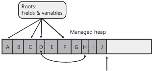

一旦完成，堆中会包含一些已标记和未标记的对象。已标记的对象必须存活过本次回收，因为至少有一个根引用了该对象；我们说该对象是可到达的，因为应用程序代码可以通过仍然引用它的变量来到达（或访问）该对象。未标记的对象是不可到达的，因为应用程序中不存在任何根允许再次访问该对象。

现在 CLR 知道了哪些对象必须存活、哪些对象可以被删除，于是开始 GC 的压缩阶段。在压缩阶段，CLR 将已标记对象占用的内存在堆中向下移动，将所有存活对象紧凑地排列在一起，使它们在内存中连续。这有很多好处。首先，所有存活对象在内存中彼此相邻；这恢复了引用的局部性，减小了应用程序的工作集大小，从而提高了将来访问这些对象的性能。其次，空闲空间也是连续的，因此这块地址空间可以被释放，供其他用途使用。最后，压缩意味着托管堆不会出现原生堆那样的地址空间碎片问题。<sup>21</sup>

<sup>21</sup> 大对象堆（本章稍后会讨论）中的对象不会被压缩，因此大对象堆可能会出现地址空间碎片。

在压缩内存时，CLR 会在内存中移动对象。这会产生一个问题：任何原本引用存活对象的根，现在指向的是该对象在内存中的旧位置，而不是对象被重定位后的新位置。当应用程序的线程最终恢复执行时，它们将访问旧的内存位置，从而破坏内存。显然，这是不允许的。因此，作为压缩阶段的一部分，CLR 会从每个根中减去其引用的对象在内存中向下移动的字节数。这确保了每个根仍然引用它之前引用的同一个对象；只是该对象现在位于内存中的不同位置。

堆内存压缩后，托管堆的 NextObjPtr 指针会被设置为指向最后一个存活对象之后的位置。下一个分配的对象将放在这个内存位置。图 21-3 展示了压缩阶段后的托管堆。压缩阶段完成后，CLR 恢复应用程序的所有线程，它们继续访问对象，就好像 GC 从未发生过一样。


**图 21-3** 回收后的托管堆。

如果 CLR 在一次 GC 后无法回收任何内存，并且进程中也没有剩余地址空间来分配新的 GC 段，那么这个进程就没有更多可用内存了。在这种情况下，尝试分配更多内存的运算符调用最终会抛出 `OutOfMemoryException`。你的应用程序可以捕获该异常并从中恢复，但大多数应用程序并不会尝试这样做；相反，该异常会成为未处理异常，Windows 会终止进程，然后 Windows 回收该进程使用的所有内存。

作为程序员，请注意本章开头描述的两个 bug 已经不复存在。首先，不可能泄漏对象，因为任何无法从应用程序根访问的对象都会在某个时刻被回收。其次，不可能通过访问已释放对象来破坏内存，因为引用只能引用存活的对象，而这正是使对象保持存活的原因。

**重要提示** 静态字段会永远保持它引用的对象，直到包含这些类型的 AppDomain 被卸载。一种常见的内存泄漏方式是让静态字段引用一个集合对象，然后不断向该集合对象添加元素。静态字段使集合对象保持存活，而集合对象又使其所有元素保持存活。因此，最好尽可能避免使用静态字段。

#### 垃圾回收与调试

一旦根超出作用域，它所引用的对象就会变得不可到达，并且其内存可能会被 GC 回收；对象并不保证在整个方法的生命周期内都存活。这会对你的应用程序产生有趣的影响。例如，请看下面的代码：

```csharp
using System;
using System.Threading;

public static class Program {
    public static void Main() {
```


```csharp
// Create a Timer object that knows to call our TimerCallback
// method once every 2000 milliseconds.
Timer t = new Timer(TimerCallback, null, 0, 2000);

// Wait for the user to hit <Enter>
Console.ReadLine();
}

private static void TimerCallback(Object t)
{
    // Display the date/time when this method got called.
    Console.WriteLine("In TimerCallback: " + DateTime.Now);

    // Force a garbage collection to occur for this demo.
    GC.Collect();
}
}
```

从命令提示符编译这段代码，不要使用任何特殊的编译器开关。当你运行生成的可执行文件时，你会发现 TimerCallback 方法只被调用了一次！

从上面的代码来看，你可能认为 TimerCallback 方法每 2,000 毫秒就会被调用一次。毕竟，创建了一个 Timer 对象，变量 t 引用了这个对象。只要 timer 对象存在，timer 就应该持续触发。但你会在 TimerCallback 方法中注意到，我通过调用 GC.Collect() 强制进行了一次垃圾回收。

当回收开始时，它首先假定堆中的所有对象都是不可达的（垃圾）；这包括 Timer 对象。然后，收集器检查应用程序的根，发现 Main 在初次赋值后就不再使用 t 变量。因此，应用程序没有变量引用 Timer 对象，垃圾回收就会回收它的内存；这会停止 timer，也解释了为什么 TimerCallback 方法只被调用一次。

假设你正在使用调试器逐句执行 Main，而恰好在 t 被赋予新 Timer 对象的地址之后发生了一次垃圾回收。然后，假设你尝试使用调试器的“快速监视”窗口查看 t 所引用的对象。你认为会发生什么？调试器无法显示该对象，因为它刚刚被垃圾回收了。大多数开发人员会认为这种行为非常出乎意料且不可取，因此 Microsoft 想出了一个解决方案。

当你使用 C# 编译器的 /debug 开关编译程序集时，编译器会将一个 System.Diagnostics.DebuggableAttribute（其 DebuggingModes 的 DisableOptimizations 标志被设置）应用到结果程序集中。在运行时，JIT 编译器编译方法时看到这个标志被设置，就会人为地将所有根的生命周期延长到方法末尾。以我的示例为例，JIT 编译器会欺骗自己，认为 Main 中的 t 变量必须存活到方法结束。因此，如果发生垃圾回收，垃圾回收器现在会认为 t 仍然是一个根，而 t 所引用的 Timer 对象将继续保持可达。Timer 对象将在回收中幸存下来，TimerCallback 方法将不断被调用，直到 Console.ReadLine 返回且 Main 退出。

要看到这一点，只需在命令提示符下重新编译程序，但这次指定 C# 编译器的 /debug 开关。当你运行生成的可执行文件时，你会看到 TimerCallback 方法被重复调用了！注意，C# 编译器的 /optimize+ 编译器开关会重新启用优化，因此进行此实验时不应指定该编译器开关。

JIT 编译器这样做是为了帮助你进行 JIT 调试。你现在可以正常启动应用程序（不附带调试器），如果该方法被调用，JIT 编译器会人为地将变量的生命周期延长到方法末尾。之后，如果你决定将调试器附加到进程，可以在先前编译的方法中设置断点并检查根变量。

所以现在你知道如何构建一个在调试构建中工作但在发布构建中不正确的程序了！既然没有开发者希望程序只有在调试时才能工作，我们肯定可以对程序采取一些措施，使它在任何构建类型下都能一直正常工作。

你可以尝试将 Main 方法修改为这样：

```csharp
public static void Main() {
    // Create a Timer object that knows to call our TimerCallback
    // method once every 2000 milliseconds.
    Timer t = new Timer(TimerCallback, null, 0, 2000);

    // Wait for the user to hit <Enter>
    Console.ReadLine();

    // Refer to t after ReadLine (this gets optimized away)
    t = null;
}
```

然而，如果你编译这段代码（不使用 /debug+ 开关）并运行生成的可执行文件，你会看到 TimerCallback 方法仍然只被调用一次。这里的问题在于 JIT 编译器是一个优化编译器，将局部变量或参数变量设置为 null 与根本不引用该变量是一样的。换句话说，JIT 编译器将 t = null; 这一行完全优化掉了，因此程序仍然无法按我们期望的方式工作。修改 Main 方法的正确方法如下：

```csharp
public static void Main() {
    // Create a Timer object that knows to call our TimerCallback
    // method once every 2000 milliseconds.
    Timer t = new Timer(TimerCallback, null, 0, 2000);

    // Wait for the user to hit <Enter>
    Console.ReadLine();

    // Refer to t after ReadLine (t will survive GCs until Dispose returns)
    t.Dispose();
}
```

现在，如果你编译这段代码（不使用 /debug+ 开关）并运行生成的可执行文件，

与对象 B 相邻。在垃圾回收中幸存下来的对象（对象 A、B 和 D）被认为是第 1 代。第 1 代中的对象已经被垃圾回收器检查过一次。堆现在的样子如图 21-5 所示。


**图 21-5** 在一次回收之后，第 0 代的幸存者被提升到第 1 代；第 0 代已为空。

一次垃圾回收之后，第 0 代不包含任何对象。与往常一样，新对象将被分配到第 0 代。图 21-6 显示了应用程序正在运行并分配对象 F 到 K。此外，在应用程序运行期间，对象 B、H 和 J 变得不可达，应在某个时候回收它们的内存。


**图 21-6** 新对象被分配到第 0 代；第 1 代存在一些垃圾。

现在假设尝试分配对象 L 会使第 0 代超出其预算。由于第 0 代已达到预算，必须启动一次垃圾回收。启动垃圾回收时，垃圾回收器必须决定要检查哪些代。之前我提到，当 CLR 初始化时，它会为第 0 代选择预算。同样，它也会为第 1 代选择预算。

启动垃圾回收时，垃圾回收器还会查看第 1 代占用了多少内存。在这种情况下，第 1 代占用的内存远低于其预算，因此垃圾回收器只检查第 0 代中的对象。请再次考虑分代式垃圾回收器所做的假设。第一个假设是，新创建的对象具有较短的生存期。因此，第 0 代中很可能有大量垃圾，回收第 0 代将会回收大量内存。垃圾回收器会直接忽略第 1 代中的对象，这可以加快垃圾回收过程。

显然，忽略第 1 代中的对象提高了垃圾回收器的性能。然而，垃圾回收器提升性能的更大原因在于它不需要遍历托管堆中的每个对象。如果某个根或对象引用了旧代中的对象，垃圾回收器可以忽略这些较旧对象的任何内部引用，从而减少构建可达对象图所需的时间。当然，旧对象的某个字段也可能引用新对象。为了确保这些旧对象已更新的字段被检查，垃圾回收器使用了 JIT 编译器内部的一种机制：当对象的引用字段发生变化时，会设置一个位。这种支持让垃圾回收器知道自上次回收以来哪些旧对象（如果有）被写入过。只有那些字段发生过变化的旧对象需要被检查，以确定它们是否引用


指向第 0 代中的任何新对象。<sup>22</sup>

**注意** Microsoft 的性能测试表明，执行一次第 0 代垃圾回收所需时间不到 1 毫秒。Microsoft 的目标是让垃圾回收花费的时间不超过一次普通页错误。

分代垃圾回收器还假设，已经存活很长时间的对象会继续存活。因此，第 1 代中的对象很可能仍可从应用程序访问。所以，如果垃圾回收器检查第 1 代中的对象，它可能不会发现很多垃圾。结果就是，它无法回收太多内存。因此，回收第 1 代很可能是在浪费时间。如果第 1 代中恰好有垃圾，它也只会留在那里。此时堆如图 21-7 所示。


**图 21-7** 两次回收后，第 0 代幸存对象被提升到第 1 代（使第 1 代变大）；第 0 代为空。

如你所见，所有在回收后存活的第 0 代对象现在都属于第 1 代。由于垃圾回收器没有检查第 1 代，对象 B 的内存没有被回收，尽管在上次垃圾回收时它已不可达。同样，在一次回收之后，第 0 代不包含任何对象，并且是放置新对象的地方。事实上，假设应用程序继续运行并分配对象 L 到 O。在运行过程中，应用程序停止使用对象 G、L 和 M，使它们都变为不可达。此时堆如图 21-8 所示。


**图 21-8** 新对象被分配到第 0 代；第 1 代有更多垃圾。

假设分配对象 P 导致第 0 代超出其预算，从而引发垃圾回收。由于第 1 代中所有对象占用的内存小于其预算，垃圾回收器再次决定只回收第 0 代，忽略第 1 代中的不可达对象（对象 B 和 G）。回收之后，堆如图 21-9 所示。


**图 21-9** 三次回收后，第 0 代幸存对象被提升到第 1 代（使第 1 代再次变大）；第 0 代为空。

在图 21-9 中，可以看到第 1 代在缓慢增长。事实上，假设第 1 代现在已经增长到其中所有对象占满其全部预算的程度。此时，应用程序继续运行（因为垃圾回收刚刚完成），并开始分配对象 P 到 S，这些对象将第 0 代填充到其预算上限。此时堆如图 21-10 所示。


**图 21-10** 新对象被分配到第 0 代；第 1 代有更多垃圾。

当应用程序尝试分配对象 T 时，第 0 代已满，必须开始垃圾回收。然而，这一次垃圾回收器发现，第 1 代中的对象占用了太多内存，已经达到第 1 代的预算。经过多次第 0 代回收，第 1 代中很可能已有许多对象变为不可达（如我们的示例所示）。所以这一次，垃圾回收器决定检查第 1 代和第 0 代中的所有对象。两代都完成垃圾回收后，堆如图 21-11 所示。


**图 21-11** 四次回收后：第 1 代幸存对象被提升到第 2 代，第 0 代幸存对象被提升到第 1 代，并且第 0 代为空。

和之前一样，第 0 代中在垃圾回收后存活的任何对象现在都位于第 1 代；第 1 代中在回收后存活的任何对象现在都位于第 2 代。一如既往，垃圾回收之后第 0 代立即为空，并且是分配新对象的地方。第 2 代中的对象是垃圾回收器已经检查过两次或更多次的对象。可能已经发生过多次回收，但第 1 代中的对象只有在第 1 代达到其预算时才会被检查，而这通常需要对第 0 代进行多次垃圾回收。

托管堆只支持三代：第 0 代、第 1 代和第 2 代；没有第 3 代。<sup>23</sup> CLR 初始化时，会为所有三代选择预算。然而，CLR 的垃圾回收器是一种自调节回收器。这意味着垃圾回收器在每次执行垃圾回收时都会了解应用程序的行为。例如，如果你的应用程序构造了大量对象，并且只使用它们很短的时间，那么回收第 0 代可能会回收大量内存。事实上，第 0 代中所有对象的内存都有可能被回收。

如果垃圾回收器在回收第 0 代后发现存活对象非常少，它可能会决定减少第 0 代的预算。分配空间的这种减少意味着垃圾回收会更频繁地发生，但垃圾回收器需要做的工作会更少，因此进程的工作集会很小。事实上，如果第 0 代中的所有对象都是垃圾，垃圾回收不必压缩任何内存；它只需将 `NextObjPtr` 设置回第 0 代的起始位置，然后垃圾回收就完成了。哇，这是一种回收内存的快速方法！

**注意** 对于大多数时间线程都空闲在栈顶的应用程序，垃圾回收器工作得非常好。然后，当线程有事情要做时，它会唤醒、创建一批短生命周期对象、返回，然后回去休眠。许多应用程序遵循这种架构。例如，GUI 应用程序的 GUI 线程通常大部分时间都坐在消息循环中。偶尔，用户产生一些输入（如触摸、鼠标或键盘事件），线程唤醒、处理输入并返回消息泵。为处理输入而创建的大多数对象现在可能都是垃圾。

类似地，服务器应用程序通常让线程池线程坐在池中等待客户端请求到来。当客户端请求到来时，会创建新对象来代表客户端请求执行工作。当结果被发送回客户端后，线程返回线程池，它创建的所有对象现在都是垃圾。

另一方面，如果垃圾回收器回收第 0 代并发现有很多存活对象，那么这次垃圾回收没有回收太多内存。在这种情况下，垃圾回收器会增大第 0 代的预算。现在，回收次数会减少，但当回收发生时，应该会回收更多内存。顺便说一句，如果一次回收后回收的内存不足，垃圾回收器会在抛出 `OutOfMemoryException` 之前执行一次完整回收。

在整个讨论中，我一直在讲垃圾回收器如何在每次回收后动态修改第 0 代的预算。但垃圾回收器也会使用类似的启发式方法修改第 1 代和第 2 代的预算。当这些代被垃圾回收时，垃圾回收器会再次查看回收了多少内存以及有多少对象存活。根据垃圾回收器的发现，它可能会增大或缩小这些代的阈值

<sup>22</sup> 出于好奇，这里提供更多细节。当 JIT 编译器生成修改对象内部引用字段的本机代码时，该本机代码会包含对写屏障方法的调用。这个写屏障方法会检查正在修改其字段的对象是否位于第 1 代或第 2 代；如果是，写屏障代码会在所谓的卡表中设置一位。卡表中堆内每 128 字节的数据范围对应 1 位。下一次 GC 开始时，它会扫描卡表，以了解第 1 代和第 2 代中哪些对象的字段自上次 GC 以来发生了更改。如果这些被修改的对象中有任何一个引用第 0 代中的对象，那么第 0 代对象将在本次回收后存活。GC 之后，卡表被重置为全零。写屏障代码在写入对象的引用字段时（相对于局部变量或静态字段）会造成轻微的性能损失；如果该对象位于第 1 代或第 2 代，这种性能损失会略严重。

<sup>23</sup> `System.GC` 类的静态 `MaxGeneration` 方法返回 2。


代也一样，以提升应用程序的整体性能。最终结果是，垃圾回收器会根据应用程序所需的内存负载自动进行微调——这非常酷！

下面所示的 GCNotification 类会在发生第 0 代或第 2 代回收时引发事件。借助这些事件，你可以让计算机在每次回收发生时发出蜂鸣声，或者计算两次回收之间经过了多少时间、两次回收之间分配了多少内存，等等。使用这个类，你可以轻松地对应用程序进行检测，从而更好地了解应用程序如何使用内存。

```csharp
public static class GCNotification {
    private static Action<Int32> s_gcDone = null;   // The event's field

    public static event Action<Int32> GCDone {
        add {
            // If there were no registered delegates before, start reporting notifications now
            if (s_gcDone == null) { new GenObject(0); new GenObject(2); }
            s_gcDone += value;
        }
        remove { s_gcDone -= value; }
    }

    private sealed class GenObject {
        private Int32 m_generation;
        public GenObject(Int32 generation) { m_generation = generation; }
        ~GenObject() { // This is the Finalize method
            // If this object is in the generation we want (or higher),
            // notify the delegates that a GC just completed
            if (GC.GetGeneration(this) >= m_generation) {
                Action<Int32> temp = Volatile.Read(ref s_gcDone);
                if (temp != null) temp(m_generation);
            }

            // Keep reporting notifications if there is at least one delegate registered,
            // the AppDomain isn't unloading, and the process isn't shutting down
            if ((s_gcDone != null)
                && !AppDomain.CurrentDomain.IsFinalizingForUnload()
                && !Environment.HasShutdownStarted) {
                // For Gen 0, create a new object; for Gen 2, resurrect the object
                // & let the GC call Finalize again the next time Gen 2 is GC'd
                if (m_generation == 0) new GenObject(0);
                else GC.ReRegisterForFinalize(this);
            } else { /* Let the objects go away */ }
        }
    }
}
```

### GC 触发器

如你所知，当 CLR 检测到第 0 代已用满其预算时，就会触发 GC。这是 GC 最常见的触发方式；不过，还有其他 GC 触发方式，如下所列：

```csharp
public static class Program {
    public static void Main() {
        Console.WriteLine("Application is running with server GC=" + GCSettings.IsServerGC);
    }
}
```

除了这两种模式外，GC 还可以在两种子模式下运行：并发（默认）或非并发。在并发模式下，GC 有一个额外的后台线程，在应用程序运行时并发标记对象。当某个线程分配对象导致第 0 代超出其预算时，GC 会先挂起所有线程，然后确定要回收哪些代。如果垃圾回收器需要回收第 0 代或第 1 代，它会照常进行。但是，如果需要回收第 2 代，则第 0 代的大小将被增加到超出其预算，以便分配新对象，然后恢复应用程序的线程。

当应用程序的线程运行时，垃圾回收器有一个正常优先级的后台线程，用于查找不可达对象。一旦找到，垃圾回收器会再次挂起所有线程，并决定是否压缩内存。如果垃圾回收器决定压缩内存，则内存会被压缩，根引用会被修正，然后恢复应用程序的线程。这次垃圾回收比通常耗时更少，因为不可达对象的集合已经构建好了。但是，垃圾回收器可能决定不压缩内存；事实上，垃圾回收器更倾向于这种做法。如果你有大量空闲内存，垃圾回收器不会压缩堆；这会提升性能，但会增大应用程序的工作集。使用并发垃圾回收器时，你通常会发现问题：与使用非并发垃圾回收器相比，应用程序消耗的内存更多。

你可以通过为应用程序创建一个包含 gcConcurrent 元素的配置文件，来告诉 CLR 不要使用并发回收器。下面是一个配置文件示例：

```xml
<configuration>
    <runtime>
        <gcConcurrent enabled="false"/>
    </runtime>
</configuration>
```

GC 模式是针对进程配置的，并且在进程运行期间不能更改。但是，你的应用程序可以通过使用 GCSettings 类的 GCLatencyMode 属性，对垃圾回收施加一些控制。这个读/写属性可以设置为 GCLatencyMode 枚举类型中的任何值，如表 21-1 所示。

表 21-1 GCLatencyMode 枚举类型定义的符号

| 符号名称 | 描述 |
|---|---|
| Batch（Server GC 模式的默认值） | 关闭并发 GC。 |
| Interactive（Workstation GC 模式的默认值） | 开启并发 GC。 |
| LowLatency | 在对时间敏感的短期操作（例如绘制动画）期间使用此延迟模式，因为第 2 代回收可能会造成干扰。 |
| SustainedLowLatency | 在应用程序的大部分执行过程中，使用此延迟模式来避免长时间的 GC 暂停。只要内存可用，此设置就会阻止所有阻塞式第 2 代回收发生。事实上，这类应用程序的用户更愿意在机器中安装更多 RAM，以避免 GC 暂停。必须立即响应价格变化的股票市场应用程序就是这类应用程序的一个示例。 |

LowLatency 模式需要额外解释一下。通常，你会设置此模式，执行对时间敏感的短期操作，然后将模式设置回 Batch 或 Interactive。当模式设置为 LowLatency 时，GC 会真正避免执行任何第 2 代回收，因为这些回收可能耗时很长。当然，如果你调用 GC.Collect()，那么第 2 代仍然会被回收。另外，如果 Windows 告诉 CLR 系统内存不足，GC 也会执行第 2 代回收（参见本章前面的“GC 触发器”一节）。

在 LowLatency 模式下，你的应用程序更有可能抛出 OutOfMemoryException。因此，应尽可能缩短处于此模式的时间，避免分配大量对象，避免分配大型对象，并使用受约束执行区域 (CER) 将模式设置回 Batch 或 Interactive，如第 20 章“异常与状态管理”所述。另外，请记住，延迟模式是进程范围的设置，线程可能会并发运行。这些其他线程甚至可能在另一个线程使用此设置时更改它，因此，当有多个线程操作此设置时，你可能需要更新某种计数器（通过 Interlocked 方法操作）。下面是一些演示如何使用 LowLatency 模式的代码：

```csharp
    private static void LowLatencyDemo() {
        GCLatencyMode oldMode = GCSettings.LatencyMode;
        System.Runtime.CompilerServices.RuntimeHelpers.PrepareConstrainedRegions();
        try {
            GCSettings.LatencyMode = GCLatencyMode.LowLatency;
            // Run your code here...
        }
        finally {
            GCSettings.LatencyMode = oldMode;
        }
    }
```

### 强制垃圾回收

System.GC 类型允许应用程序对垃圾回收器进行一些直接控制。首先，你可以通过读取 GC.MaxGeneration 属性来查询托管堆支持的最大代；此属性始终返回 2。

你还可以通过调用 GC 类的 Collect 方法，强制垃圾回收器执行回收，并可选择传入要回收到的代、一个 GCCollectionMode，以及一个布尔值，指示你希望执行阻塞（非并发）回收还是后台（并发）回收。下面是最复杂的 Collect 方法重载的签名：

```csharp
void Collect(Int32 generation, GCCollectionMode mode, Boolean blocking);
```

GCCollectionMode 类型是一个枚举，其值如表 21-2 所述。

表 21-2 GCCollectionMode 枚举类型定义的符号

| 符号名称 | 描述 |
|---|---|
| Default | 与不带标志调用 `GC.Collect` 相同。目前，这与传递 Forced 相同，但在 CLR 的未来版本中可能会改变。 |
| Forced | 强制立即对直到并包括指定代在内的所有代执行回收。 |
| Optimized | 仅当回收有成效（即释放大量内存或减少碎片）时，垃圾回收器才会执行回收。如果垃圾回收不会产生成效，则该调用没有效果。 |

**在大多数情况下，应避免调用任何 Collect 方法；** 最好让垃圾回收器自行运行，并根据实际应用程序行为微调其代预算。但是，如果你正在编写控制台用户界面 (CUI) 或图形用户界面 (GUI) 应用程序，那么你的应用程序代码拥有该进程以及该进程中的 CLR。对于这些应用程序类型，你 *可能* 希望使用 Optimized 的 GCCollectionMode 来建议在某些时刻进行垃圾回收。通常，Default 和 Forced 模式用于调试、测试和查找内存泄漏。

例如，如果某个非周期性事件刚刚发生，并且很可能导致大量旧对象死亡，那么你可能会考虑调用 Collect 方法。在这种情况下调用 Collect 可能并没有那么糟糕，原因是 GC 基于过去对未来的预测对于非周期性事件来说不太可能准确。例如，应用程序在初始化之后或用户保存数据文件之后，强制对所有代执行完整 GC 可能是合理的。由于调用 Collect 会导致代预算调整，因此不要为了试图改善应用程序的响应时间而调用 Collect；调用它是为了减少进程的工作集。

对于某些应用程序（尤其是倾向于在内存中保留大量对象的服务器应用程序），GC 执行包含第 2 代的完整回收所需的时间可能过长。事实上，如果回收需要很长时间才能完成，那么客户端请求可能会超时。为了帮助这类应用程序，GC 类提供了一个 RegisterForFullGCNotification 方法。使用此方法以及一些附加的辅助方法（WaitForFullGCApproach、WaitForFullGCComplete，

以及 CancelFullGCNotification），当垃圾回收器即将执行完整回收时，应用程序现在可以收到通知。随后，应用程序可以调用 GC.Collect 在更合适的时机强制进行回收，或者应用程序可以与其他服务器通信，以便更好地对客户端请求进行负载均衡。有关更多信息，请查看这些方法以及 .NET Framework SDK 文档中的“垃圾回收通知”主题。请注意，应始终成对调用 WaitForFullGCApproach 和 WaitForFullGCComplete 方法，因为 CLR 在内部将它们作为一对来处理。

### 监视应用程序的内存使用情况

在进程内，可以调用几种方法来监视垃圾回收器。具体而言，GC 类提供了以下静态方法，你也可以用它们查看特定代发生了多少次回收，或者托管堆中的对象当前正在使用多少内存：

```csharp
Int32 CollectionCount(Int32 generation);
Int64 GetTotalMemory(Boolean forceFullCollection);
```

为了分析特定代码块的性能，我经常编写代码，在代码块前后调用这些方法，然后计算差值。这能很好地说明我的代码块对进程工作集的影响，并指出执行该代码块期间发生了多少次垃圾回收。如果这些数字很高，我就知道要花更多时间调整代码块中的算法。

你还可以查看各个 AppDomain（而不是整个进程）正在使用多少内存。有关更多信息，请参见第 22 章中的“AppDomain 监视”一节。

安装 .NET Framework 时，它会安装一组性能计数器，这些计数器提供大量关于 CLR 操作的实时统计信息。可以通过 PerfMon.exe 工具或 Windows 自带的系统监视器 ActiveX 控件查看这些统计信息。访问系统监视器控件的最简单方法是运行 PerfMon.exe，然后单击工具栏上的 + 按钮，此时会出现图 21-12 所示的“添加计数器”对话框。


**图 21-12** 显示 .NET CLR Memory 计数器的 PerfMon.exe。

要监视 CLR 的垃圾回收器，请选择 .NET CLR Memory 性能对象。然后从实例列表框中选择特定的应用程序。最后，选择你感兴趣监视的一组计数器，单击“添加”，再单击“确定”。此时，系统监视器将绘制所选实时统计信息的图表。要了解特定计数器的说明，请选择所需计数器，然后选中“显示描述”复选框。

另一个用于分析应用程序内存和性能的优秀工具是 PerfView。此工具可以收集 Windows 事件跟踪 (ETW) 日志并处理它们。获取此工具的最佳方式是在网络上搜索 PerfView。最后，你应当研究使用 SOS 调试扩展 (SOS.dll)，它在调试内存问题和其他 CLR 问题时通常能提供很大帮助。对于与内存相关的操作，SOS 调试扩展允许你查看进程中分配给托管堆的内存量、显示终结队列中所有已注册进行终结的对象、显示每个 AppDomain 或整个进程的 GCHandle 表中的条目、显示使对象在堆中保持存活的根，以及更多信息。

### 使用需要特殊清理的类型

至此，你应当对垃圾回收和托管堆有了基本了解，包括垃圾回收器如何回收对象的内存。幸运的是，大多数类型只需要内存就能运行。然而，有些类型除了内存之外还需要更多资源才能发挥作用；有些类型除了内存之外还需要使用本机资源。

例如，System.IO.FileStream 类型需要打开文件（一种本机资源）并存储文件句柄。然后该类型的 Read 和 Write 方法使用此句柄来操作文件。类似地，System.Threading.Mutex 类型会打开一个 Windows 互斥体内核对象（一种本机资源

```csharp
protected void SetHandle(IntPtr handle) {
    this.handle = handle;
}

// You can explicitly release the resource by calling Dispose
// This is the IDisposable interface’s Dispose method
public void Dispose() { Dispose(true); }

// The default Dispose implementation (shown here) is exactly what you want.
// Overriding this method is strongly discouraged.
protected virtual void Dispose(Boolean disposing) {
    // The default implementation ignores the disposing argument.
    // If resource already released, return
    // If ownsHandle is false, return
    // Set flag indicating that this resource has been released
    // Call virtual ReleaseHandle method
    // Call GC.SuppressFinalize(this) to prevent Finalize from being called
    // If ReleaseHandle returned true, return
    // If we get here, fire ReleaseHandleFailed Managed Debugging Assistant (MDA)
}

// The default Finalize implementation (shown here) is exactly what you want.
// Overriding this method is very strongly discouraged.
~SafeHandle() { Dispose(false); }

// A derived class overrides this method to implement the code that releases the resource
protected abstract Boolean ReleaseHandle();

public void SetHandleAsInvalid() {
    // Set flag indicating that this resource has been released
    // Call GC.SuppressFinalize(this) to prevent Finalize from being called
}

public Boolean IsClosed {
    get {
        // Returns flag indicating whether resource was released
    }
}

public abstract Boolean IsInvalid {
    // A derived class overrides this property.
    // The implementation should return true if the handle's value doesn't
    // represent a resource (this usually means that the handle is 0 or -1)
    get;
}

// These three methods have to do with security and reference counting;
// I’ll talk about them at the end of this section
public void    DangerousAddRef(ref Boolean success) {...}
public IntPtr DangerousGetHandle() {...}
public void    DangerousRelease() {...}
}
```

```csharp
using System;
using System.Runtime.InteropServices;
using Microsoft.Win32.SafeHandles;

internal static class SomeType {
    [DllImport("Kernel32", CharSet=CharSet.Unicode, EntryPoint="CreateEvent")]
    // This prototype is not robust
    private static extern IntPtr CreateEventBad(
        IntPtr pSecurityAttributes, Boolean manualReset, Boolean initialState, String name);

    // This prototype is robust
    [DllImport("Kernel32", CharSet=CharSet.Unicode, EntryPoint="CreateEvent")]
    private static extern SafeWaitHandle CreateEventGood(
        IntPtr pSecurityAttributes, Boolean manualReset, Boolean initialState, String name);

    public static void SomeMethod() {
        IntPtr handle = CreateEventBad(IntPtr.Zero, false, false, null);
        SafeWaitHandle swh = CreateEventGood(IntPtr.Zero, false, false, null);
    }
}
```

你会注意到，CreateEventBad 方法的原型返回 IntPtr，这会将句柄返回给托管代码；然而，以这种方式与本机代码互操作并不稳健。你看，在调用 CreateEventBad（它会创建本机事件资源）之后，有可能在句柄被赋给 handle 变量之前抛出 ThreadAbortException。在这种罕见情况下，托管代码会泄漏本机资源。关闭该事件的唯一方法是终止整个进程。

SafeHandle 类修复了这种潜在的资源泄漏。请注意，CreateEventGood 方法的原型返回 SafeWaitHandle（而不是 IntPtr）。当调用 CreateEventGood 时，CLR 会调用 Win32 CreateEvent 函数。当 CreateEvent 函数返回托管代码时，CLR 知道 SafeWaitHandle 派生自 SafeHandle，因此 CLR 会自动在托管堆上构造 SafeWaitHandle 类的实例，并传入从 CreateEvent 返回的句柄值。现在，SafeWaitHandle 对象的构造和句柄的赋值都在本机代码中发生，因此不会被 ThreadAbortException 中断。这样，托管代码就不可能泄漏此本机资源。最终，SafeWaitHandle 对象将被垃圾回收，并调用其 Finalize 方法，从而确保资源被释放。

SafeHandle 派生类的最后一个特性是，它们可以防止有人试图利用潜在的安全漏洞。问题在于，一个线程可能正在尝试使用本机资源，而另一个线程却试图释放该资源。这可能表现为句柄回收漏洞利用。SafeHandle 类通过使用引用计数来防止这种安全漏洞。在内部，SafeHandle 类定义了一个私有字段来维护计数。当 SafeHandle 派生对象被设置为有效句柄时，计数被设置为 1。每当 SafeHandle 派生对象作为参数传递给本机方法时，CLR 知道自动递增计数器。同样，当本机方法返回托管代码时，CLR 知道递减计数器。例如，你会将 Win32 SetEvent 函数原型定义为如下所示：

```csharp
[DllImport("Kernel32", ExactSpelling=true)]
private static extern Boolean SetEvent(SafeWaitHandle swh);
```

现在，当你调用这个方法并传入一个 `SafeWaitHandle` 对象的引用时，CLR 会在调用之前递增计数器，并在调用之后递减计数器。当然，对计数器的操作是以线程安全的方式进行的。这如何提高安全性呢？好吧，如果另一个线程试图释放 `SafeHandle` 对象包装的非托管资源，CLR 知道它实际上不能释放该资源，因为该资源正在被非托管函数使用。当非托管函数返回时，计数器递减为 0，资源就会被释放。

如果你正在编写或调用代码以 `IntPtr` 形式操作句柄，你可以从 `SafeHandle` 对象中获取它，但你应该显式地操作引用计数。你可以通过 `SafeHandle` 的 `DangerousAddRef` 和 `DangerousRelease` 方法实现这一点。你可以通过 `DangerousGetHandle` 方法获取原始句柄的访问权。

如果我不提 `System.Runtime.InteropServices` 命名空间还定义了一个 `CriticalHandle` 类，那我就失职了。这个类在所有方面都与 `SafeHandle` 类完全相同，只是它不提供引用计数功能。`CriticalHandle` 类及其派生类在使用时会牺牲安全性以换取更好的性能（因为计数器不会被操作）。与 `SafeHandle` 一样，`CriticalHandle` 类也有两种派生类型：`CriticalHandleMinusOneIsInvalid` 和 `CriticalHandleZeroOrMinusOneIsInvalid`。由于微软更倾向于更安全的系统而不是更快的系统，类库不包含这两个类中任何一个的派生类型。对于你自己的项目，我建议只有在性能成为问题时才使用 `CriticalHandle` 派生类型。如果你能证明降低安全性是合理的，就可以切换到 `CriticalHandle` 派生类型。

### 使用包装非托管资源的类型

现在你已经知道如何定义包装非托管资源的 `SafeHandle` 派生类，让我们看看开发人员如何使用它。我们先来讨论常见的 `System.IO.FileStream` 类。`FileStream` 类提供打开文件、从文件读取字节、向文件写入字节以及关闭文件的能力。当构造 `FileStream` 对象时，会调用 Win32 `CreateFile` 函数，返回的句柄保存在 `SafeFileHandle` 对象中，并且该对象的引用通过 `FileStream` 对象中的私有字段来维护。`FileStream` 类还提供了一些额外的属性（如 `Length`、`Position`、`CanRead`）和方法（如 `Read`、`Write`、`Flush`）。

假设你想编写一些代码来创建一个临时文件，向该文件写入一些字节，然后删除该文件。你可能会像这样开始编写代码：

```csharp
using System;
using System.IO;

public static class Program {
    public static void Main() {
        // Create the bytes to write to the temporary file.
        Byte[] bytesToWrite = new Byte[] { 1, 2, 3, 4, 5 };

        // Create the temporary file.
        FileStream fs = new FileStream("Temp.dat", FileMode.Create);

        // Write the bytes to the temporary file.
        fs.Write(bytesToWrite, 0, bytesToWrite.Length);

        // Delete the temporary file.
        File.Delete("Temp.dat");   // Throws an IOException
    }
}
```

不幸的是，如果你编译并运行这段代码，它可能会工作，但很可能不会。问题在于，调用 `File` 的静态 `Delete` 方法时，要求 Windows 删除一个仍处于打开状态的文件。因此，`Delete` 会抛出 `System.IO.IOException` 异常，并显示以下字符串消息：进程无法访问文件“Temp.dat”，因为它正被另一个进程使用。

请注意，在某些情况下，文件实际上可能会被删除！如果另一个线程在调用 `Write` 之后、调用 `Delete` 之前以某种方式触发了垃圾回收，`FileStream` 的 `SafeFileHandle` 字段就会调用其 `Finalize` 方法，该方法会关闭文件，从而使 `Delete` 能够正常工作。然而，这种情况发生的可能性极小，因此前面的代码有超过 99% 的几率会失败。

允许使用者控制其所包装的非托管资源生命周期的类，实现了 `IDisposable` 接口，如下所示：

```csharp
public interface IDisposable {
    void Dispose();
}
```

**重要提示** 如果某个类定义了一个字段，且该字段的类型实现了 dispose 模式，那么这个类本身也应该实现 dispose 模式。`Dispose` 方法应释放该字段所引用的对象。这样，使用该类的用户就可以对其调用 `Dispose`，从而释放该对象自身使用的资源。

幸运的是，`FileStream` 类实现了 `IDisposable` 接口，其实现内部会在 `FileStream` 对象的私有 `SafeFileHandle` 字段上调用 `Dispose`。现在，我们可以修改代码，在需要时显式关闭文件，而不是等待将来某个时候进行垃圾回收。以下是更正后的源代码：

```csharp
using System;
using System.IO;

public static class Program {
    public static void Main() {
        // Create the bytes to write to the temporary file.
        Byte[] bytesToWrite = new Byte[] { 1, 2, 3, 4, 5 };
    }
}
```

请注意，这里不会发生内存损坏，因为 `FileStream` 对象的内存仍然存在于托管堆中；只是该对象在被显式释放后无法成功执行其方法。

**重要提示** 在定义实现 `IDisposable` 接口的自定义类型时，请确保在所有方法和属性中编写代码，在对象已被显式清理时抛出 `System.ObjectDisposedException`。`Dispose` 方法永远不应抛出异常；如果多次调用，它应该直接返回。

**重要提示** 总的来说，我非常不鼓励在代码中显式调用 `Dispose`。原因是 CLR 的垃圾回收器写得很好，你应该让它完成自己的工作。垃圾回收器知道对象何时不再被应用程序代码访问，只有在此时它才会回收该对象。<sup>26</sup> 当应用程序代码调用 `Dispose` 时，实际上是在表示它知道应用程序何时不再需要该对象。对于许多应用程序来说，不可能确切知道对象何时不再需要。

例如，如果你的代码构造了一个新对象，然后你将此对象的引用传递给另一个方法，那么该方法可能会在某个内部字段变量（根）中保存对该对象的引用。调用方法无法知道发生了这种情况。当然，调用方法可以调用 `Dispose`，但之后，某些其他代码可能会尝试访问该对象，从而导致抛出 `ObjectDisposedException`。我建议你只在代码中确定必须清理资源的地方调用 `Dispose`（例如在尝试删除打开的文件时）。

同样，多个线程可以同时对同一个对象调用 `Dispose`。然而，设计准则规定 `Dispose` 不必是线程安全的。原因是，代码只有在确切知道没有其他线程正在使用该对象时才应该调用 `Dispose`。

前面的代码示例展示了如何显式调用类型的 `Dispose` 方法。如果你决定显式调用 `Dispose`，我强烈建议你将调用放在异常处理的 `finally` 块中。这样，清理代码就能保证执行。因此，最好将前面的代码示例写成如下形式：

> <sup>26</sup> 关于垃圾回收系统有许多优点：没有内存泄漏，没有内存损坏，没有地址空间碎片，以及更小的工作集。现在，还有一个新的优点：同步。没错，你可以将 GC 用作线程同步机制。问题：如何知道所有线程都已完成对某个对象的使用？答案：GC 会终结该对象。在设计软件时，充分利用所有 GC 特性并没有错。


```csharp
using System;
using System.IO;

public static class Program {
    public static void Main() {
        // 创建要写入临时文件的字节。
        Byte[] bytesToWrite = new Byte[] { 1, 2, 3, 4, 5 };

        // 创建临时文件。
        FileStream fs = new FileStream("Temp.dat", FileMode.Create);
        try {
            // 将字节写入临时文件。
            fs.Write(bytesToWrite, 0, bytesToWrite.Length);
        }
        finally {
            // 写入完成后显式关闭文件。
            if (fs != null) fs.Dispose();
        }

        // 删除临时文件。
        File.Delete("Temp.dat");
    }
}
```

添加异常处理代码是正确的做法，而且你必须具备这样做的勤奋态度。幸运的是，C# 语言提供了 `using` 语句，它提供了一种简化语法，生成的代码与刚才展示的代码完全相同。以下是使用 C# 的 `using` 语句重写上述代码的方式：

```csharp
using System;
using System.IO;

public static class Program {
    public static void Main() {
        // 创建要写入临时文件的字节。
        Byte[] bytesToWrite = new Byte[] { 1, 2, 3, 4, 5 };

        // 创建临时文件。
        using (FileStream fs = new FileStream("Temp.dat", FileMode.Create)) {
            // 将字节写入临时文件。
            fs.Write(bytesToWrite, 0, bytesToWrite.Length);
        }

        // 删除临时文件。
        File.Delete("Temp.dat");
    }
}
```

在 `using` 语句中，你初始化一个对象并将其引用保存在变量中。然后，通过 `using` 花括号内的代码访问该变量。编译此代码时，编译器会自动生成 `try` 和 `finally` 块。在 `finally` 块中，编译器生成代码将对象强制转换为 `IDisposable` 并调用 `Dispose` 方法。显然，编译器只允许 `using` 语句用于实现 `IDisposable` 接口的类型。

**注意** C# 的 `using` 语句支持初始化多个变量的功能，只要这些变量都是相同类型。它还支持仅使用已初始化的变量。有关此主题的更多信息，请参阅 C# 程序员参考中的“Using 语句”主题。

### 一个有趣的依赖性问题

`System.IO.FileStream` 类型允许用户打开文件进行读取和写入。为了提高性能，该类型的实现使用了内存缓冲区。只有当缓冲区填满时，该类型才会将缓冲区内容刷新到文件。`FileStream` 仅支持写入字节。如果你想写入字符和字符串，可以使用 `System.IO.StreamWriter`，如下代码所示：

```csharp
FileStream fs = new FileStream("DataFile.dat", FileMode.Create);
StreamWriter sw = new StreamWriter(fs);
sw.Write("Hi there");

// 以下对 Dispose 的调用是应该做的。
sw.Dispose();
// 注意：StreamWriter.Dispose 会关闭 FileStream；
// FileStream 不需要显式关闭。
```

请注意，`StreamWriter` 的构造函数接受一个 `Stream` 对象的引用作为参数，允许将 `FileStream` 对象的引用作为参数传递。在内部，`StreamWriter` 对象保存 `Stream` 的引用。当你向 `StreamWriter` 对象写入时，它会在自己的内存缓冲区中内部缓冲数据。当缓冲区满时，`StreamWriter` 对象将数据写入 `Stream`。

当你通过 `StreamWriter` 对象完成数据写入后，应调用 `Dispose`。（因为 `StreamWriter` 类型实现了 `IDisposable` 接口，你也可以将其与 C# 的 `using` 语句一起使用。）这会导致 `StreamWriter` 对象将其数据刷新到 `Stream` 对象并关闭 `Stream` 对象。27

**注意** 你不必显式调用 `FileStream` 对象的 `Dispose`，因为 `StreamWriter` 会为你调用它。但是，如果你确实显式调用 `Dispose`，`FileStream` 会看到对象已被清理——该方法不执行任何操作，只是返回。

你认为如果没有代码显式调用 `Dispose` 会发生什么？好吧，在某个时刻，垃圾回收器会正确检测到对象是垃圾并终结它们。但垃圾回收器不保证对象终结的顺序。因此，如果 `FileStream` 对象先被终结，它会关闭文件。然后当 `StreamWriter` 对象被终结时，它会尝试将数据写入已关闭的文件，从而抛出异常。另一方面，如果 `StreamWriter` 对象先被终结，数据会被安全地写入文件。

27 你可以通过调用接受布尔 `leaveOpen` 参数的 `StreamWriter` 构造函数来覆盖此行为。

微软如何解决这个问题？让垃圾回收器按特定顺序终结对象是不可能的，因为对象可能包含对彼此的引用，垃圾回收器无法正确猜测终结这些对象的顺序。以下是微软的解决方案：`StreamWriter` 类型不支持终结，因此它永远不会将缓冲区中的数据刷新到底层 `FileStream` 对象。这意味着如果你忘记显式调用 `StreamWriter` 对象的 `Dispose`，数据必定会丢失。微软期望开发人员看到这种一致的数据丢失，并通过插入显式调用 `Dispose` 来修复代码。

**注意** .NET Framework 提供了一个称为托管调试助手（MDAs）的功能。当启用 MDA 时，.NET Framework 会查找某些常见的程序员错误并触发相应的 MDA。在调试器中，它看起来像抛出了异常。有一个 MDA 可用于检测 `StreamWriter` 对象在未显式释放的情况下被垃圾回收的情况。要在 Microsoft Visual Studio 中启用此 MDA，请打开项目并选择“调试”、“异常”菜单项。在“异常”对话框中，展开“托管调试助手”节点并滚动到底部。在那里你会看到 `StreamWriterBufferredDataLost` MDA。选中“抛出”复选框，以便在 `StreamWriter` 对象的数据丢失时，Visual Studio 调试器停止。

### 用于本机资源的其他 GC 功能

有时，本机资源会消耗大量内存，但包装该资源的托管对象占用的内存却很少。典型的例子是位图。位图可能占用几兆字节的本机内存，但托管对象很小，因为它只包含一个 HBITMAP（一个 4 或 8 字节的值）。从 CLR 的角度来看，进程可以在执行回收之前分配数百个位图（使用少量托管内存）。但如果进程操作许多位图，进程的内存消耗将以惊人的速度增长。为了解决这种情况，GC 类提供了以下两个静态方法：

```csharp
public static void AddMemoryPressure(Int64 bytesAllocated);
public static void RemoveMemoryPressure(Int64 bytesAllocated);
```

包装潜在大型本机资源的类应使用这些方法，向垃圾回收器提示实际消耗的内存量。在内部，垃圾回收器监视此压力，当压力变高时，会强制进行垃圾回收。

有些本机资源数量是固定的。例如，Windows 以前限制只能创建五个设备上下文。应用程序可以打开的文件数量也有限制。同样，从 CLR 的角度来看，进程可以在执行回收之前分配数百个对象（使用少量内存）。但如果这些本机资源的数量有限，尝试使用超过可用数量的资源通常会导致抛出异常。为了解决这种情况，`System.Runtime.InteropServices` 命名空间提供了 `HandleCollector` 类。

```csharp
public sealed class HandleCollector {
    public HandleCollector(String name, Int32 initialThreshold);
    public HandleCollector(String name, Int32 initialThreshold, Int32 maximumThreshold);
    public void Add();
    public void Remove();

    public Int32 Count { get; }
    public Int32 InitialThreshold { get; }
    public Int32 MaximumThreshold { get; }
    public String Name { get; }
}
```

包装数量有限的本机资源的类应使用此类的实例，向垃圾回收器提示实际消耗的资源实例数量。在内部，此类对象监视计数，当计数变高时，会强制进行垃圾回收。

> **注意** 在内部，`GC.AddMemoryPressure` 和 `HandleCollector.Add` 方法调用 `GC.Collect`，强制垃圾回收在第 0 代达到其预算之前开始。通常，强烈不建议强制启动垃圾回收，因为它通常会对应用程序的性能产生不利影响。然而，调用这些方法的类这样做是为了保持有限的本机资源可供应用程序使用。如果本机资源耗尽，应用程序将失败。对于大多数应用程序，以降低性能为代价比完全无法工作要好。

以下是一些演示内存压力方法和 `HandleCollector` 类的使用和效果的代码：

```csharp
using System;
using System.Runtime.InteropServices;

public static class Program {
    public static void Main() {
        MemoryPressureDemo(0);                 // 0 导致不频繁的 GC
        MemoryPressureDemo(10 * 1024 * 1024);  // 10MB 导致频繁的 GC

        HandleCollectorDemo();
    }

    private static void MemoryPressureDemo(Int32 size) {
        Console.WriteLine();
        Console.WriteLine("MemoryPressureDemo, size={0}", size);
        // 创建一批对象，指定其逻辑大小
        for (Int32 count = 0; count < 15; count++) {
            new BigNativeResource(size);
        }
    }
}
```


```csharp
}

// 出于演示目的，强制清理所有内容
GC.Collect();
}

private sealed class BigNativeResource {
    private readonly Int32 m_size;

    public BigNativeResource(Int32 size) {
        m_size = size;
        // 让 GC 认为该对象在物理上更大
        if (m_size > 0)  GC.AddMemoryPressure(m_size);
        Console.WriteLine("BigNativeResource create.");
    }

    ~BigNativeResource() {
        // 让 GC 认为该对象释放了更多内存
        if (m_size > 0)  GC.RemoveMemoryPressure(m_size);
        Console.WriteLine("BigNativeResource destroy.");
    }
}


private static void HandleCollectorDemo() {
    Console.WriteLine();
    Console.WriteLine("HandleCollectorDemo");
    for (Int32 count = 0; count < 10; count++)  new LimitedResource();

    // 出于演示目的，强制清理所有内容
    GC.Collect();
}

private sealed class LimitedResource {
    // 创建一个 HandleCollector，告诉它当堆中存在两个或更多此类对象时应进行回收
    private static readonly HandleCollector s_hc = new HandleCollector("LimitedResource", 2);

    public LimitedResource() {
        // 告诉 HandleCollector 堆中已添加了一个 LimitedResource
        s_hc.Add();
        Console.WriteLine("LimitedResource create. Count={0}", s_hc.Count);
    }

    ~LimitedResource() {
        // 告诉 HandleCollector 堆中已移除了一个 LimitedResource
        s_hc.Remove();
        Console.WriteLine("LimitedResource destroy. Count={0}", s_hc.Count);
    }
}
}
```

如果编译并运行上面的代码，输出将类似于下面这样：

```text
MemoryPressureDemo, size=0
BigNativeResource create.
BigNativeResource create.
BigNativeResource create.
BigNativeResource create.
BigNativeResource create.
BigNativeResource create.
BigNativeResource create.
BigNativeResource create.
BigNativeResource create.
BigNativeResource create.
BigNativeResource create.
BigNativeResource create.
BigNativeResource create.
BigNativeResource create.
BigNativeResource create.
BigNativeResource destroy.
BigNativeResource destroy.
BigNativeResource destroy.
BigNativeResource destroy.
BigNativeResource destroy.
BigNativeResource destroy.
BigNativeResource destroy.
BigNativeResource destroy.
BigNativeResource destroy.
BigNativeResource destroy.
BigNativeResource destroy.
BigNativeResource destroy.
BigNativeResource destroy.
BigNativeResource destroy.
BigNativeResource destroy.

MemoryPressureDemo, size=10485760
BigNativeResource create.
BigNativeResource create.
BigNativeResource create.
BigNativeResource create.
BigNativeResource create.
BigNativeResource create.
BigNativeResource create.
BigNativeResource create.
BigNativeResource create.
BigNativeResource create.
BigNativeResource destroy.
BigNativeResource destroy.
BigNativeResource destroy.
BigNativeResource destroy.
BigNativeResource destroy.
BigNativeResource destroy.
BigNativeResource create.
BigNativeResource create.
BigNativeResource create.
BigNativeResource destroy.
```


**图 21-13** 托管堆，显示其终结列表中的指针。

> **注意** 即使 `System.Object` 定义了一个 `Finalize` 方法，CLR 也知道忽略它；也就是说，在构造一个类型的实例时，如果该类型的 `Finalize` 方法是从 `System.Object` 继承的，则该对象不被视为可终结的。某个派生类型必须重写 `Object` 的 `Finalize` 方法。

当发生垃圾回收时，对象 B、E、G、H、I 和 J 被确定为垃圾。垃圾回收器扫描终结列表，查找对这些对象的引用。当找到引用时，该引用会从终结列表中移除，并追加到 *freachable 队列*中。freachable 队列（发音为“F-reachable”）是垃圾回收器的另一个内部数据结构。freachable 队列中的每个引用都标识一个准备好调用其 `Finalize` 方法的对象。回收后，托管堆看起来如图 21-14 所示。


**图 21-14** 托管堆，显示从终结列表移动到 freachable 队列的指针。

在该图中，您可以看到对象 B、G 和 H 占用的内存已被回收，因为这些对象没有 `Finalize` 方法。但是，对象 E、I 和 J 占用的内存无法回收，因为它们的 `Finalize` 方法尚未被调用。

一个专用的高优先级 CLR 线程专门用于调用 `Finalize` 方法。使用专用线程是为了避免如果改用应用程序的普通优先级线程可能导致的线程同步问题。当 freachable 队列为空（通常情况）时，此线程休眠。但是当条目出现时，此线程唤醒，从队列中移除每个条目，然后调用每个对象的 `Finalize` 方法。由于该线程的工作方式，您不应该在 `Finalize` 方法中执行任何假设执行代码的线程身份的代码。例如，避免在 `Finalize` 方法中访问线程本地存储。

将来，CLR 可能会使用多个终结器线程。因此，您应该避免编写任何假设 `Finalize` 方法将被串行调用的代码。如果只有一个终结器线程，在多 CPU 分配可终结对象但只有一个线程执行 `Finalize` 方法的情况下，可能会出现性能和可伸缩性问题——单个线程可能无法跟上分配的速度。

终结列表和 freachable 队列之间的交互非常引人入胜。首先，我将告诉您 freachable 队列名称的由来。嗯，“*f*”很明显，代表 *finalization*（终结）；freachable 队列中的每个条目都是对托管堆中应调用其 `Finalize` 方法的对象的引用。但名称中的 *reachable* 部分意味着这些对象是可到达的。换句话说，freachable 队列被视为一个根，就像静态字段是根一样。因此，freachable 队列中的引用使其引用的对象保持可到达状态，并且*不是*垃圾。

简而言之，当一个对象不可到达时，垃圾回收器会将该对象视为垃圾。然后，当垃圾回收器将对象的引用从终结列表移动到 freachable 队列时，该对象不再被视为垃圾，其内存也不能被回收。当一个对象先是垃圾，然后*不是*垃圾时，我们说该对象已被*复活*。

当 freachable 对象被标记时，由其引用类型字段引用的对象也会被递归标记；所有这些对象都必须被复活才能在回收中幸存。此时，垃圾回收器已完成识别垃圾。一些被识别为垃圾的对象已被复活。垃圾回收器压缩可回收的内存，这会将复活的对象提升到较老的代（这不是理想的）。现在，特殊的终结线程清空 freachable 队列，执行每个对象的 `Finalize` 方法。

下次垃圾回收器在较老的代上被调用时，它将看到已终结的对象是真正的垃圾，因为应用程序的根既不指向它，freachable 队列也不再指向它。该对象的内存将被直接回收。从这一切中要理解的关键点是，回收需要终结的对象所使用的内存需要两次垃圾回收。实际上，可能需要多于两次的回收，因为这些对象会被提升到另一代。图 21-15 显示了第二次垃圾回收后托管堆的样子。


**图 21-15** 第二次垃圾回收后托管堆的状态。

### 手动监控和控制对象的生存期

CLR 为每个 AppDomain 提供一个 GC 句柄表。该表允许应用程序监控对象的生存期或手动控制对象的生存期。创建 AppDomain 时，该表为空。表中的每个条目由托管堆上对象的引用和一个标志组成，该标志指示你是想监控还是控制该对象。应用程序通过下面显示的 System.Runtime.InteropServices.GCHandle 类型在表中添加和移除条目。

```csharp
// This type is defined in the System.Runtime.InteropServices namespace
public struct GCHandle {
   // Static methods that create an entry in the table
   public static GCHandle Alloc(object value);
   public static GCHandle Alloc(object value, GCHandleType type);

   // Static methods that convert a GCHandle to an IntPtr
   public static explicit operator IntPtr(GCHandle value);
   public static IntPtr ToIntPtr(GCHandle value);

   // Static methods that convert an IntPtr to a GCHandle
   public static explicit operator GCHandle(IntPtr value);
   public static GCHandle FromIntPtr(IntPtr value);

   // Static methods that compare two GCHandles
   public static Boolean operator ==(GCHandle a, GCHandle b);
   public static Boolean operator !=(GCHandle a, GCHandle b);

   // Instance method to free the entry in the table (index is set to 0)
   public void Free();

   // Instance property to get/set the entry's object reference
   public object Target { get; set; }

   // Instance property that returns true if index is not 0
   public Boolean IsAllocated { get; }

   // For a pinned entry, this returns the address of the object
   public IntPtr AddrOfPinnedObject();

   public override Int32 GetHashCode();
   public override Boolean Equals(object o);
}
```

基本上，要控制或监控对象的生存期，你需要调用 GCHandle 的静态 Alloc 方法，传入要监控/控制对象的引用，以及 GCHandleType。GCHandleType 是一个标志，指示你想如何监控/控制对象。GCHandleType 类型是一个枚举类型，定义如下：

```csharp
public enum GCHandleType {
    Weak = 0,                    // Used for monitoring an object’s existence
    WeakTrackResurrection = 1,   // Used for monitoring an object’s death
    Normal = 2,                   // Used for controlling an object’s lifetime
    Pinned = 3                    // Used for controlling an object’s lifetime
}
```

现在，下面解释每个标志的含义：

- **Weak（弱）** 此标志允许你*监控*对象的生存期。具体来说，你可以检测垃圾回收器何时确定该对象已无法从应用程序代码中到达。请注意，对象的 `Finalize` 方法可能尚未执行或已经执行，因此该对象可能仍在内存中。
- **WeakTrackResurrection（弱跟踪复活）** 此标志允许你*监控*对象的生存期。具体来说，你可以检测垃圾回收器何时确定该对象已无法从应用程序代码中到达。请注意，对象的 `Finalize` 方法（如果存在）肯定已经执行，并且该对象的内存已被回收。
- **Normal（普通）** 此标志允许你*控制*对象的生存期。具体来说，你是在告诉垃圾回收器，即使应用程序中可能没有引用该对象的根，该对象也必须保留在内存中。当垃圾回收运行时，该对象的内存可以被压缩（移动）。不带 `GCHandleType` 标志的 Alloc 方法假定指定了 `GCHandleType.Normal`。
- **Pinned（固定）** 此标志允许你*控制*对象的生存期。具体来说，你是在告诉垃圾回收器，即使应用程序中可能没有引用该对象的根，该对象也必须保留在内存中。当垃圾回收运行时，该对象的内存不能被压缩。当你希望将内存地址交给本机代码时，这通常很有用。本机代码可以写入托管堆中的这块内存，因为它知道垃圾回收不会移动该对象。

当你调用 GCHandle 的静态 Alloc 方法时，它会扫描 AppDomain 的 GC 句柄表，查找一个可用条目，该条目中存储了你传给 Alloc 的对象引用，并且标志被设置为你传给 GCHandleType 参数的值。然后，Alloc 返回一个 GCHandle 实例给你。GCHandle 是一个轻量级值类型，包含一个实例字段 IntPtr，它指向表中条目的索引。当你想释放 GC 句柄表中的这个条目时，你获取 GCHandle 实例并调用 Free 方法（该方法还会通过将其 IntPtr 字段设置为零来使 GCHandle 实例失效）。

下面介绍垃圾回收器如何使用 GC 句柄表。当垃圾回收发生时：

1. 垃圾回收器标记所有可达对象（如本章开头所述）。然后，垃圾回收器扫描 GC 句柄表；所有 Normal 或 Pinned 对象都被视为根，这些对象也会被标记（包括这些对象通过其字段引用的任何对象）。
2. 垃圾回收器扫描 GC 句柄表，查找所有 Weak 条目。如果 Weak 条目引用了一个未标记的对象，则该引用标识的是一个不可达对象（垃圾），该条目的引用值会被更改为 null。
3. 垃圾回收器扫描终结列表。如果列表中的某个引用指向一个未标记的对象，则该引用标识的是一个不可达对象，该引用会从终结列表移到 freachable 队列。此时，该对象被标记，因为该对象现在被视为可达。
4. 垃圾回收器扫描 GC 句柄表，查找所有 WeakTrackResurrection 条目。如果 WeakTrackResurrection 条目引用了一个未标记的对象（现在该对象是由 freachable 队列中的条目引用的对象），则该引用标识的是一个不可达对象（垃圾），该条目的引用值会被更改为 null。
5. 垃圾回收器压缩内存，挤出不可达对象留下的空洞。Pinned 对象不会被压缩（移动）；垃圾回收器会移动它们周围的其他对象。

现在你已经理解了该机制，让我们看看何时使用它们。最容易理解的标志是 Normal 和 Pinned，所以我们先讨论这两个。这两个标志通常在与本机代码互操作时使用。

Normal 标志用于当你需要将指向托管对象的指针交给本机代码时，因为在将来的某个时刻，本机代码会回调托管代码，并将该指针传递回去。你实际上不能将指向托管对象的指针传递给本机代码，因为如果发生垃圾回收，对象可能会在内存中移动，从而使指针失效。为了解决这个问题，你可以调用 GCHandle 的 Alloc 方法，传入对象的引用和 Normal 标志。然后，你将返回的 GCHandle 实例转换为 IntPtr，并将 IntPtr 传给本机代码。当本机代码回调托管代码时，托管代码会将传入的 IntPtr 转换回 GCHandle，然后查询 Target 属性以获取托管对象的引用（或当前地址）。当本机代码不再需要该引用时，你调用 GCHandle 的 Free 方法，该方法允许将来的垃圾回收释放该对象（假设

```csharp
public Boolean TryGetTarget(out T target);
}
```

这个类实际上只是 `GCHandle` 实例的一个面向对象包装器：从逻辑上讲，其构造函数调用 `GCHandle` 的 `Alloc`，其 `TryGetTarget` 方法查询 `GCHandle` 的 `Target` 属性，其 `SetTarget` 方法设置 `GCHandle` 的 `Target` 属性，其 `Finalize` 方法（上面未显示，因为它是受保护的）调用 `GCHandle` 的 `Free` 方法。此外，代码使用 `WeakReference<T>` 类不需要特殊权限，因为该类只支持弱引用；它不支持以 `Normal` 或 `Pinned` 的 `GCHandleType` 分配的 `GCHandle` 实例所提供的行为。`WeakReference<T>` 类的缺点是必须在堆上分配它的实例。因此，`WeakReference<T>` 类比 `GCHandle` 实例更重量级。

**重要** 当开发人员开始学习弱引用时，他们立刻会想到弱引用在缓存场景中很有用。例如，他们认为可以构造一批包含大量数据的对象，然后为这些对象创建弱引用。当程序需要数据时，程序检查弱引用，看包含该数据的对象是否仍然存在；如果存在，程序就直接使用它，从而获得高性能。但是，如果发生了一次垃圾回收，包含数据的对象就会被销毁，当程序不得不重新创建数据时，程序体验到的性能就会降低。

这种技术的问题如下：垃圾回收并不仅仅在内存已满或接近满时发生。相反，只要第 0 代满了，垃圾回收就会发生。因此，对象被移出内存的频率远高于预期，应用程序的性能会大受影响。

弱引用在缓存场景中可以非常有效地使用，但构建一个好的缓存算法以在内存消耗和速度之间找到合适平衡是非常复杂的。基本上，你希望缓存对所有对象保持强引用，然后当你发现内存变得紧张时，开始将强引用转换为弱引用。目前，CLR 没有提供任何机制来通知应用程序内存变得紧张。但有些人通过定期调用 Win32 `GlobalMemoryStatusEx` 函数并检查返回的 `MEMORYSTATUSEX` 结构体的 `dwMemoryLoad` 成员取得了很大成功。如果该成员报告的值高于 80，内存就会变得紧张，你可以根据你想要最近最少使用算法、最常使用算法、基于时间的算法或其他算法，开始将强引用转换为弱引用。

开发人员经常希望将一段数据与另一个实体关联起来。例如，你可以将数据与线程或 `AppDomain` 关联。也可以使用 `System.Runtime.CompilerServices.ConditionalWeakTable<TKey, TValue>` 类将数据与单个对象关联，该类如下所示：

```csharp
public sealed class ConditionalWeakTable<TKey, TValue>
    where TKey : class where TValue : class {
    public ConditionalWeakTable();
    public void Add(TKey key, TValue value);
    public TValue GetValue(TKey key, CreateValueCallback<TKey, TValue> createValueCallback);
}
```


```csharp
public override string ToString() { return m_value.ToString(); }
~NotifyWhenGcd() { Console.WriteLine("GC'd: " + m_value); }
}

public static T GCWatch<T>(this T @object, String tag) where T : class {
    s_cwt.Add(@object, new NotifyWhenGcd<String>(tag));
    return @object;
}
```

## 第22章：CLR 宿主与 AppDomain

本章内容：

- CLR 宿主 592
- AppDomain 594
- AppDomain 卸载 609
- AppDomain 监视 610
- AppDomain 首次异常通知 612
- 宿主如何使用 AppDomain 612
- 高级宿主控制 615

在本章中，我将讨论两个主要主题，它们真正展示了 Microsoft .NET Framework 所提供的巨大价值：*宿主* 和 *AppDomain*。宿主允许任何应用程序利用公共语言运行时 (CLR) 的功能。特别是，这允许现有应用程序至少部分使用托管代码编写。此外，宿主还使应用程序能够通过编程提供自定义和可扩展性。

允许可扩展性意味着第三方代码将在你的进程内运行。在 Microsoft Windows 中，将第三方的 DLL 加载到进程中一直充满风险。DLL 中很容易含有可能危及应用程序数据结构和代码的代码。DLL 还可能试图利用应用程序的安全上下文来访问它本不应有权访问的资源。CLR 的 AppDomain 功能解决了所有这些问题。AppDomain 允许第三方不受信任的代码在现有进程中运行，并且 CLR 保证数据结构、代码和安全上下文不会被利用或破坏。

程序员通常将宿主和 AppDomain 与程序集加载和反射一起使用。将这四项技术结合使用，使 CLR 成为一个极其丰富且强大的平台。在本章中，我将重点讨论宿主和 AppDomain。在下一章中，我将重点讨论程序集加载和反射。当你学习并理解所有这些技术后，你将看到今天对 .NET Framework 的投资必将在未来获得回报。

### CLR 宿主

.NET Framework 运行在 Microsoft Windows 之上。这意味着 .NET Framework 必须使用 Windows 能够与之交互的技术来构建。首先，所有托管模块和程序集文件都必须使用 Windows 可移植可执行 (PE) 文件格式，并且是 Windows 可执行 (EXE) 文件或 DLL。

在开发 CLR 时，Microsoft 将其实现为包含在 DLL 中的 COM 服务器；也就是说，Microsoft 为 CLR 定义了一个标准 COM 接口，并为该接口和 COM 服务器分配了 GUID。安装 .NET Framework 时，代表 CLR 的 COM 服务器会像任何其他 COM 服务器一样注册到 Windows 注册表中。如果你想了解有关此主题的更多信息，请参阅 .NET Framework SDK 附带的 MetaHost.h C++ 头文件。该头文件定义了 GUID 和非托管 ICLRMetaHost 接口定义。

任何 Windows 应用程序都可以承载 CLR。但是，你不应通过调用 CoCreateInstance 来创建 CLR COM 服务器的实例；相反，你的非托管宿主应调用 MetaHost.h 中声明的 CLRCreateInstance 函数。CLRCreateInstance 函数在 MSCorEE.dll 文件中实现，该文件通常位于 C:\Windows\System32 目录中。这个 DLL 被亲切地称为垫片（shim），其职责是确定要创建哪个版本的 CLR；垫片 DLL 本身并不包含 CLR COM 服务器。

一台机器上可能安装了多个版本的 CLR，但只会有一个版本的 MSCorEE.dll 文件（垫片）。<sup>28</sup> 机器上安装的 MSCorEE.dll 版本是随机器上安装的最新版 CLR 一起提供的版本。因此，这个版本的 MSCorEE.dll 知道如何查找可能已安装的任何早期版本的 CLR。

<sup>28</sup> 如果你使用的是 64 位版本的 Windows，实际上会安装两个版本的 MSCorEE.dll 文件。一个版本是 32 位 x86 版本，位于 C:\Windows\SysWOW64 目录中。另一个版本是 64 位 x64 或 IA64 版本（取决于你计算机的 CPU 架构），位于 C:\Windows\System32 目录中。

实际的 CLR 代码包含在一个文件中，该文件的名称随着 CLR 版本的不同而变化。对于 1.0、1.1 和 2.0 版本，CLR 代码位于名为 MSCorWks.dll 的文件中；对于 4.0 版本，CLR 代码位于名为 Clr.dll 的文件中。由于一台机器上可以安装多个版本的 CLR，这些文件会安装到不同的目录中，如下所示：<sup>29</sup>

- 版本 1.0 位于 C:\Windows\Microsoft.NET\Framework\v1.0.3705
- 版本 1.1 位于 C:\Windows\Microsoft.NET\Framework\v1.1.4322
- 版本 2.0 位于 C:\Windows\Microsoft.NET\Framework\v2.0.50727
- 版本 4.0 位于 C:\Windows\Microsoft.NET\Framework\v4.0.21006

<sup>29</sup> 请注意，.NET Framework 的 3.0 和 3.5 版本随 CLR 的 2.0 版本一起提供；我没有列出 .NET Framework 3.0 和 3.5 版本的目录，因为 CLR DLL 从 v2.0.50727 目录加载。

CLRCreateInstance 函数可以返回 ICLRMetaHost 接口。宿主应用程序可以调用该接口的 GetRuntime 函数，指定宿主希望创建的 CLR 版本。随后，垫片将所需版本的 CLR 加载到宿主的进程中。

默认情况下，当托管可执行文件启动时，垫片会检查该可执行文件，并提取指示应用程序构建和测试时所使用 CLR 版本的信息。但是，应用程序可以通过在其 XML 配置文件中放置 requiredRuntime 和 supportedRuntime 条目来覆盖此默认行为（第2章“生成、打包、部署和管理应用程序与类型”和第3章“共享程序集与强命名程序集”对此进行了描述）。

GetRuntime 函数返回一个指向非托管 ICLRRuntimeInfo 接口的指针，通过 GetInterface 方法可从该接口获得 ICLRRuntimeHost 接口。宿主应用程序可以调用此接口定义的方法来：

- 设置宿主管理器。告知 CLR，宿主希望参与与内存分配、线程调度/同步、程序集加载等相关的决策。宿主还可以声明它希望获得垃圾回收启动和停止以及某些操作超时的通知。
- 获取 CLR 管理器。告知 CLR 阻止使用某些类/成员。此外，宿主可以指定哪些代码可以调试、哪些不能调试，以及在发生特殊事件（例如 AppDomain 卸载、CLR 停止或堆栈溢出异常）时应调用宿主中的哪些方法。
- 初始化并启动 CLR。
- 加载程序集并在其中执行代码。
- 停止 CLR，从而阻止任何更多托管代码在 Windows 进程中运行。

承载 CLR 有很多用处。承载允许任何应用程序提供 CLR 功能和可编程性方案，并且至少部分使用托管代码编写。任何承载运行时的应用程序都为试图扩展该应用程序的开发人员提供了许多好处。以下是一些好处：

- 可以使用任何编程语言进行编程。
- 代码经过实时 (JIT) 编译以提高速度（相对于解释执行）。
- 代码使用垃圾回收来避免内存泄漏和损坏。
- 代码在安全沙箱中运行。
- 宿主无需担心提供丰富的开发环境。宿主利用现有技术：语言、编译器、编辑器、调试器、分析器等。

如果你有兴趣将 CLR 用于宿主场景，我强烈推荐你阅读 Steven Pratschner 的出色著作 *自定义 Microsoft .NET Framework 公共语言运行时*（Microsoft Press 2005），尽管它主要关注 4.0 之前的 CLR 版本。

**注意** 当然，Windows 进程根本不需要加载 CLR。只有当你希望在进程中执行托管代码时，才需要加载它。在 .NET Framework 4.0 之前，CLR 只允许自身的一个实例驻留在 Windows 进程中。也就是说，一个进程可以包含无 CLR、CLR v1.0、CLR v1.1 或 CLR v2.0。每个进程只允许一个 CLR 版本是一个巨大的限制。例如，Microsoft Office Outlook 无法加载两个针对不同 .NET Framework 版本构建和测试的加载项。

然而，在 .NET Framework 4.0 中，Microsoft 现在支持在单个 Windows 进程中加载 v2.0 和 v4.0，从而允许为 .NET Framework 2.0 和 4.0 版本编写的组件并行运行，而不会遇到任何兼容性问题。这是一个极好的新功能，因为它使 .NET Framework 组件能够比以往在更多场景中可靠使用。你可以使用 ClrVer.exe 工具查看任何给定进程中加载了哪些 CLR 版本。

一旦 CLR 加载到 Windows 进程中，就永远无法卸载；对 ICLRRuntimeHost 接口调用 AddRef 和 Release 方法没有任何效果。从进程中卸载 CLR 的唯一方式是终止该进程，从而使 Windows 清理该进程使用的所有资源。

### AppDomain

当 CLR COM 服务器初始化时，它会创建一个 *AppDomain*。AppDomain 是一组程序集的逻辑容器。CLR 初始化时创建的第一个 AppDomain 称为 *默认 AppDomain*；此 AppDomain 仅在 Windows 进程终止时才会销毁。

除了默认 AppDomain 之外，使用非托管 COM 接口方法或托管类型方法的宿主可以指示 CLR 创建额外的 AppDomain。AppDomain 的全部目的就是提供隔离。以下是 AppDomain 提供的具体功能：


图 22-1 一个承载 CLR 和两个 AppDomain 的单一 Windows 进程。

此外，每个 AppDomain 中都加载了一些程序集。AppDomain #1（默认 AppDomain）加载了三个程序集：MyApp.exe、TypeLib.dll 和 System.dll。AppDomain #2 中加载了两个程序集：Winellect.dll 和 System.dll。

你会注意到，System.dll 程序集已被加载到两个 AppDomain 中。如果两个 AppDomain 都使用 System.dll 中的同一个类型，那么两个 AppDomain 都会在每个加载器堆中为同一类型分配一个类型对象；该类型对象的内存不会由所有 AppDomain 共享。此外，当某个 AppDomain 中的代码调用某个类型定义的方法时，该方法的中间语言（IL）代码会经过 JIT 编译，生成的本机代码会与每个 AppDomain 关联；该方法代码不会由所有调用它的 AppDomain 共享。

不共享类型对象或本机代码的内存会造成浪费。然而，AppDomain 的全部目的就是提供隔离；CLR 需要能够卸载某个 AppDomain 并释放其所有资源，而不会对其他任何 AppDomain 造成不利影响。复制 CLR 数据结构可确保这一点成为可能。它还确保被多个 AppDomain 使用的类型为每个 AppDomain 都有一组静态字段。

有些程序集预计会被多个 AppDomain 使用。最好的例子是 MSCorLib.dll。

```csharp
Console.WriteLine("Type={0}", mbrt.GetType());  // The CLR lies about the type

// Prove that we got a reference to a proxy object
Console.WriteLine("Is proxy={0}", RemotingServices.IsTransparentProxy(mbrt));

// This looks like we’re calling a method on MarshalByRefType but, we’re not.
// We’re calling a method on the proxy type. The proxy transitions the thread
// to the AppDomain owning the object and calls this method on the real object.
mbrt.SomeMethod();

// Unload the new AppDomain
AppDomain.Unload(ad2);
// mbrt refers to a valid proxy object; the proxy object refers to an invalid AppDomain

try {
    // We’re calling a method on the proxy type. The AD is invalid, exception is thrown
    mbrt.SomeMethod();
    Console.WriteLine("Successful call.");
}
catch (AppDomainUnloadedException) {
    Console.WriteLine("Failed call.");
}

// *** DEMO 2: Cross-AppDomain Communication using Marshal-by-Value ***
Console.WriteLine("{0} #2", Environment.NewLine);

// Create new AppDomain (security and configuration match current AppDomain)
ad2 = AppDomain.CreateDomain("AD #2", null, null);

// Load our assembly into the new AppDomain, construct an object, marshal
// it back to our AD (we really get a reference to a proxy)
mbrt = (MarshalByRefType)
    ad2.CreateInstanceAndUnwrap(eAssembly, "MarshalByRefType");

// The object’s method returns a COPY of the returned object;
// the object is marshaled by value (not by reference).
MarshalByValType mbvt = mbrt.MethodWithReturn();

// Prove that we did NOT get a reference to a proxy object
Console.WriteLine("Is proxy={0}", RemotingServices.IsTransparentProxy(mbvt));

// This looks like we’re calling a method on MarshalByValType and we are.
Console.WriteLine("Returned object created " + mbvt.ToString());

// Unload the new AppDomain
AppDomain.Unload(ad2);
// mbvt refers to valid object; unloading the AppDomain has no impact.

try {
    // We’re calling a method on an object; no exception is thrown
    Console.WriteLine("Returned object created " + mbvt.ToString());
    Console.WriteLine("Successful call.");
}
```

```csharp
public MarshalByValType() {
    Console.WriteLine("{0} ctor running in {1}, Created on {2:D}",
        this.GetType().ToString(),
        Thread.GetDomain().FriendlyName,
        m_creationTime);
}

public override String ToString() {
    return m_creationTime.ToLongDateString();
}

// Instances cannot be marshaled across AppDomain boundaries
// [Serializable]
public sealed class NonMarshalableType : Object {
    public NonMarshalableType() {
        Console.WriteLine("Executing in " + Thread.GetDomain().FriendlyName);
    }
}
```

如果生成并运行 Ch22-1-AppDomains 应用程序，你会得到以下输出：

```text
Default AppDomain's friendly name: Ch22-1-AppDomains.exe
Main assembly: Ch22-1-AppDomains, Version=0.0.0.0, Culture=neutral, PublicKeyToken=null

Demo #1
MarshalByRefType ctor running in AD #2
Type=MarshalByRefType
Is proxy=True
Executing in AD #2
Failed call.

Demo #2
MarshalByRefType ctor running in AD #2
Executing in AD #2
MarshalByValType ctor running in AD #2, Created on Friday, August 07, 2009
Is proxy=False
Returned object created Saturday, June 23, 2012
Returned object created Saturday, June 23, 2012
Successful call.

Demo #3
MarshalByRefType ctor running in AD #2
Calling from 'Ch22-1-AppDomains.exe' to 'AD #2'.
Executing in AD #2

Unhandled Exception: System.Runtime.Serialization.SerializationException:
Type 'NonMarshalableType' in assembly 'Ch22-1-AppDomains, Version=0.0.0.0,
Culture=neutral, PublicKeyToken=null' is not marked as serializable.
   at MarshalByRefType.MethodArgAndReturn(String callingDomainName)
   at Program.Marshalling()
   at Program.Main()
```

现在，我将讨论这段代码和 CLR 在做什么。

在 `Marshalling` 方法内部，我首先获取一个 `AppDomain` 对象的引用，该对象标识调用线程当前正在其中执行的 `AppDomain`。在 Windows 中，线程总是在一个进程的上下文中创建，并且该线程在其整个生存期内都存在于该进程中。但是，线程与 `AppDomains` 之间并不存在一一对应关系。`AppDomains` 是 CLR 的一项功能；Windows 对 `AppDomains` 一无所知。由于单个 Windows 进程中可以有多个 `AppDomains`，所以一个线程可以先在一个 `AppDomain` 中执行代码，然后在另一个 `AppDomain` 中执行代码。从 CLR 的角度来看，一个线程一次只在一个 `AppDomain` 中执行代码。线程可以通过调用 `System.Threading.Thread` 的静态 `GetDomain` 方法来询问 CLR 它当前正在哪个 `AppDomain` 中执行。线程也可以查询 `System.AppDomain` 的静态只读 `CurrentDomain` 属性来获取相同的信息。

创建 `AppDomain` 时，可以为它分配一个友好名称。友好名称只是一个 `String`，你可以用它来标识 `AppDomain`。这在调试场景中通常很有用。由于 CLR 在你的任何代码运行之前就会创建默认 `AppDomain`，所以 CLR 使用可执行文件的文件名作为默认 `AppDomain` 的友好名称。我的 `Marshalling` 方法通过使用 `System.AppDomain` 的只读 `FriendlyName` 属性来查询默认 `AppDomain` 的友好名称。

接下来，我的 `Marshalling` 方法查询程序集的强名称标识（该程序集已加载到默认 `AppDomain` 中），该程序集定义了调用 `Marshalling` 的入口点方法 `Main`。该程序集定义了几个类型：`Program`、`MarshalByRefType`、`MarshalByValType` 和 `NonMarshalableType`。至此，我们准备查看这三个彼此非常相似的类型。

### 演示 #1：使用按引用封送的跨 AppDomain 通信

在演示 #1 中，调用了 `System.AppDomain` 的静态 `CreateDomain` 方法，指示 CLR 在同一个 Windows 进程中创建一个新的 `AppDomain`。`AppDomain` 类型实际上提供了 `CreateDomain` 方法的多个重载；我鼓励你研究这些重载，并在编写创建新 `AppDomain` 的代码时选择最合适的版本。我调用的 `CreateDomain` 版本接受三个参数：

- **一个 String，用于标识我希望分配给新 AppDomain 的友好名称** —— 我在这里传入 "AD #2"。
- **一个 System.Security.Policy.Evidence，用于标识 CLR 在计算 AppDomain 的权限集时应使用的证据** —— 我在这里传入 `null`，以便新 `AppDomain` 继承创建它的 `AppDomain` 的相同权限集。通常，如果你想围绕 `AppDomain` 中的代码创建安全边界，你会构造一个 `System.Security.PermissionSet` 对象，将所需的权限对象（实现 `IPermission` 接口的类型的实例）添加到其中，然后传入得到的

- 指向接受 PermissionSet 的 CreateDomain 方法重载版本的 PermissionSet 对象引用。
- **一个 System.AppDomainSetup，用于标识 CLR 应为新 AppDomain 使用的配置设置。** 同样，我在此处传入 null，以便新 AppDomain 继承创建它的 AppDomain 的相同配置设置。如果希望该 AppDomain 具有特殊配置，请构造一个 AppDomainSetup 对象，将其各个属性设置为你期望的值（例如配置文件的名称），然后将得到的 AppDomainSetup 对象引用传给 CreateDomain 方法。

在内部，CreateDomain 方法会在进程中创建一个新的 AppDomain。这个 AppDomain 将被分配指定的友好名称、安全性和配置设置。新 AppDomain 将拥有自己的加载器堆，该堆将为空，因为当前没有程序集加载到新 AppDomain 中。创建 AppDomain 时，CLR 不会在这个 AppDomain 中创建任何线程；除非你显式让某个线程调用该 AppDomain 中的代码，否则不会有代码在该 AppDomain 中运行。

现在，要在新 AppDomain 中创建对象的实例，我们必须先将一个程序集加载到新 AppDomain 中，然后构造该程序集中定义的某个类型的实例。这正是调用 AppDomain 的公共实例方法 CreateInstanceAndUnwrap 所做的事情。调用 CreateInstanceAndUnwrap 时，我传入两个参数：一个 String 标识我要加载到新 AppDomain 中的程序集（由 ad2 变量引用），另一个 String 标识我要构造其实例的类型的名称。在内部，CreateInstanceAndUnwrap 会使调用线程从当前 AppDomain 转换到新 AppDomain。此时，线程（位于 CreateInstanceAndUnwrap 调用内部）将指定的程序集加载到新 AppDomain 中，然后扫描该程序集的类型定义元数据表，查找指定的类型（"MarshalByRefType"）。找到该类型后，线程调用 MarshalByRefType 的无参数构造函数。然后，线程转换回默认 AppDomain，以便 CreateInstanceAndUnwrap 可以返回对新 MarshalByRefType 对象的引用。

**注意** 存在 CreateInstanceAndUnwrap 的重载版本，允许你在调用类型的构造函数时传入参数。

虽然这听起来很好，但有一个问题：CLR 不能允许位于一个 AppDomain 中的变量（根）引用在另一个 AppDomain 中创建的对象。如果 CreateInstanceAndUnwrap 只是返回该对象的引用，隔离就会被破坏，而隔离正是 AppDomain 的全部目的！因此，就在 CreateInstanceAndUnwrap 返回对象引用之前，它会执行一些额外的逻辑。

你会注意到，MarshalByRefType 类型派生自一个非常特殊的基类：System.MarshalByRefObject。当 CreateInstanceAndUnwrap 发现它正在封送一个类型派生自 MarshalByRefObject 的对象时，CLR 将按引用跨 AppDomain 边界封送该对象。下面说明按引用将一个对象从一个 AppDomain（源 AppDomain，即对象实际创建所在的 AppDomain）封送到另一个 AppDomain（目标 AppDomain，即调用 CreateInstanceAndUnwrap 所在的 AppDomain）意味着什么。

当源 AppDomain 想要向目标 AppDomain 发送或返回某个对象的引用时，CLR 会在目标 AppDomain 的加载器堆中定义一个代理类型。这个代理类型使用原始类型的元数据定义，因此它看起来与原始类型完全相同；它具有所有相同的实例成员（属性、事件和方法）。实例字段不属于该类型的一部分，但稍后我会更详细地讨论这一点。这个新类型确实在其内部定义了一些实例字段，但这些字段与原始数据类型的字段并不相同。相反，这些字段指示哪个 AppDomain “拥有”真实对象，以及如何在拥有该对象的 AppDomain 中找到真实对象。（在内部，代理对象使用一个引用真实对象的 GCHandle 实例。GCHandle 类型将在第 21 章“自动内存管理（垃圾回收）”中讨论。）

一旦在目标 AppDomain 中定义了这个类型，CreateInstanceAndUnwrap 就会创建该代理类型的一个实例，初始化其字段以标识源 AppDomain 和真实对象，并将该代理对象的引用返回给目标 AppDomain。在我的 Ch22-1-AppDomains 应用程序中，mbrt 变量将被设置为引用这个代理。注意，从 CreateInstanceAndUnwrap 返回的对象实际上并不是 MarshalByRefType 类型的实例。CLR 通常不允许你将一个类型的对象强制转换为不兼容的类型。然而，在这种情况下，CLR 确实允许这种强制转换，因为这个新类型具有与原始类型所定义的相同的实例成员。事实上，如果你使用代理对象调用 GetType，它实际上会对你撒谎，说它是一个 MarshalByRefType 对象。

不过，可以证明从 CreateInstanceAndUnwrap 返回的对象实际上是对代理对象的引用。为此，我的 Ch22-1-AppDomains 应用程序调用 System.Runtime.Remoting.RemotingServices 的公共静态方法 IsTransparentProxy，并传入从 CreateInstanceAndUnwrap 返回的引用。从输出中可以看到，IsTransparentProxy 返回 true，表明该对象是一个代理。

现在，我的 Ch22-1-AppDomains 应用程序使用该代理调用 SomeMethod 方法。由于 mbrt 变量引用的是代理对象，因此会调用该代理对此方法的实现。代理的实现使用代理对象内部的信息字段，将调用线程从默认 AppDomain 转换到新 AppDomain。此线程现在执行的任何操作都在新 AppDomain 的安全性和配置设置下运行。然后，线程使用代理对象的 GCHandle 字段在新 AppDomain 中找到真实对象，再使用真实对象调用真正的 SomeMethod。

有两种方法可以证明调用线程已从默认 AppDomain 转换到新 AppDomain。首先，在 SomeMethod 方法内部，我调用 Thread.GetDomain().FriendlyName。由于线程现在运行在使用 AppDomain.CreateDomain 创建、并以 “AD #2” 作为友好名称参数的新 AppDomain 中，因此这将返回 “AD #2”（如输出所示）。其次，如果你在调试器中单步执行代码并显示“调用堆栈”窗口，[AppDomain Transition] 行会标记线程跨越 AppDomain 边界的位置。请参见图 22-2 底部的“调用堆栈”窗口。


**图 22-2** 调试器的“调用堆栈”窗口显示 AppDomain 转换。

当真正的 SomeMethod 方法返回时，它会返回到代理的 SomeMethod 方法，后者将线程转换回默认 AppDomain，然后线程继续在默认 AppDomain 中执行代码。

**注意** 当一个 AppDomain 中的线程调用另一个 AppDomain 中的方法时，该线程会在两个 AppDomain 之间转换。这意味着跨 AppDomain 边界的方法调用是同步执行的。然而，在任何给定时间，一个线程都被认为只处于一个 AppDomain 中，并使用该 AppDomain 的安全性和配置设置执行代码。如果你希望同时在多个 AppDomain 中执行代码，则应创建额外的线程，并让它们在所需的任何 AppDomain 中执行所需的任何代码。

我的 Ch22-1-AppDomains 应用程序接下来要做的是调用 AppDomain 的公共静态方法 Unload，以强制 CLR 卸载指定的 AppDomain，包括已加载到其中的所有程序集。系统会强制进行垃圾回收，以释放由正在卸载的 AppDomain 中的代码创建的任何对象。此时，默认 AppDomain 的 mbrt 变量仍然引用一个有效的代理对象；然而，该代理对象不再引用有效的 AppDomain（因为它已被卸载）。

当默认 AppDomain 尝试使用该代理对象调用 SomeMethod 方法时，会调用代理对此方法的实现。代理的实现确定包含真实对象的 AppDomain 已被卸载，于是代理的 SomeMethod 方法抛出 AppDomainUnloadedException，以告知调用方该操作无法完成。

哇！Microsoft 的 CLR 团队为确保 AppDomain 隔离做了大量工作，但这是重要的工作，因为这些特性被大量使用，并且正被越来越多的

开发人员每天都会……显然，通过使用按引用封送语义跨 AppDomain 边界访问对象会带来一些性能成本，因此通常希望将这一特性的使用降到最低。

我答应过你会再多谈一些实例字段。派生自 MarshalByRefObject 的类型可以定义实例字段。然而，这些实例字段并不被定义为代理类型的一部分，也不包含在代理对象内部。当你编写读取或写入派生自 MarshalByRefObject 的类型的实例字段的代码时，JIT 编译器会分别通过调用 System.Object 的 FieldGetter 或 FieldSetter 方法来生成使用代理对象（以找到真正的 AppDomain/对象）的代码。这些方法是私有的且未记录；它们基本上就是使用反射来获取和设置字段值的方法。因此，尽管你可以访问派生自 MarshalByRefObject 的类型的字段，但性能特别差，因为 CLR 实际上最终会调用方法来执行字段访问。事实上，即使你访问的对象位于你自己的 AppDomain 中，性能也很差。<sup>30</sup>

30 如果 CLR 要求所有字段都是私有的（这是良好数据封装所推荐的做法），那么 FieldGetter 和 FieldSetter 方法就不必存在，从方法中访问字段也始终可以直接进行，从而避免任何性能损失。

### 访问实例字段的性能

为了演示这种性能损失的严重程度，我编写了以下代码：

```csharp
private sealed class NonMBRO : Object            { public Int32 x; }
private sealed class MBRO     : MarshalByRefObject { public Int32 x; }

private static void FieldTiming()
{
    const Int32 count = 100000000;
    NonMBRO nonmbro = new NonMBRO();
    MBRO mbro = new MBRO();

    Stopwatch sw = Stopwatch.StartNew();
    for (Int32 c = 0; c < count; c++) nonmbro.x++;
    Console.WriteLine("{0}", sw.Elapsed);       // 00:00:00.4073560

    sw = Stopwatch.StartNew();
    for (Int32 c = 0; c < count; c++) mbro.x++;
    Console.WriteLine("{0}", sw.Elapsed);       // 00:00:02.5388665
}
```

当我运行这段代码时，访问派生自 Object 的 NonMBRO 类的实例字段耗时约 0.4 秒，而访问派生自 MarshalByRefObject 的 MBRO 类的实例字段耗时 2.54 秒。因此，访问派生自 MarshalByRefObject 的类的实例字段所需时间超过约 6 倍！

新的 AppDomain。如果对象的类型派生自 MarshalByRefObject，CLR 会为它创建一个代理，并按引用封送它。如果对象的类型标记为 [Serializable]，CLR 会将该对象（及其子对象）序列化为字节数组，将字节数组封送到新的 AppDomain 中，然后将字节数组反序列化为对象图，并将对象图的根传入 MethodArgAndReturn 方法。

在这个特定演示中，我跨 AppDomain 边界传递一个 System.String 对象。System.String 类型不是派生自 MarshalByRefObject，因此 CLR 无法创建代理。幸运的是，System.String 标记为 [Serializable]，因此 CLR 可以按值封送它，这使代码能够工作。请注意，对于 String 对象，CLR 会执行一项特殊优化。跨 AppDomain 边界封送 String 对象时，CLR 只是将对该 String 对象的引用传递过边界；它不会复制该 String 对象。CLR 能够提供这项优化，是因为 String 对象是不可变的；因此，一个 AppDomain 中的代码不可能破坏 String 对象的字符。有关 String 不可变性的更多信息，请参见第 14 章“字符、字符串与文本处理”。

在 MethodArgAndReturn 内部，我显示传入其中的字符串，以表明该字符串跨过了 AppDomain 边界，然后我创建 NonMarshalableType 类型的实例，并将对该对象的引用返回给默认 AppDomain。由于 NonMarshalableType 不是派生自 System.MarshalByRefObject，也没有标记 [Serializable] 自定义特性，因此不允许 MethodArgAndReturn 按引用或按值封送该对象——该对象根本无法跨 AppDomain 边界封送！为了报告这一点，MethodArgAndReturn 在默认 AppDomain 中抛出 SerializationException。由于我的程序没有捕获这个异常，程序就直接终止了。

### AppDomain 卸载

AppDomain 的一大特性是你可以卸载它们。卸载 AppDomain 会使 CLR 卸载该 AppDomain 中的所有程序集，并且 CLR 还会释放该 AppDomain 的加载器堆。要卸载 AppDomain，可调用 AppDomain 的 Unload 静态方法（如 Ch22-1-AppDomains 应用程序所做的那样）。此调用会使 CLR 执行大量操作来正常卸载指定的 AppDomain：

1. CLR 挂起进程中所有曾经执行过托管代码的线程。

2. CLR 检查所有线程的堆栈，以确定哪些线程当前正在被卸载的 AppDomain 中执行代码，或者哪些线程可能稍后返回到正在被卸载的 AppDomain 中的代码。CLR 强制任何堆栈上包含正在卸载的 AppDomain 的线程抛出 `ThreadAbortException`（恢复该线程的执行）。这会导致这些线程展开，并在退出时执行任何 `finally` 块，以便清理代码得以执行。如果没有代码捕获 `ThreadAbortException`，它最终会变成 CLR 会吞掉的未处理异常；线程死亡，但允许进程继续运行。这很不寻常，因为对于所有其他未处理异常，CLR 都会终止进程。

   **重要** CLR 不会立即中止当前正在 `finally` 块、catch 块、类构造函数、关键执行区域或非托管代码中执行代码的线程。如果 CLR 允许这样做，那么清理代码、错误恢复代码、类型初始化代码、关键代码或 CLR 一无所知的任意代码将无法完成，导致应用程序行为不可预测，并可能带来安全漏洞。正在中止的线程可以完成执行这些代码块，然后在该代码块结束时，CLR 强制该线程抛出 `ThreadAbortException`。

3. 在步骤 #2 中发现的所有线程都已离开该 AppDomain 后，CLR 随后遍历堆，并在每个代理对象中设置一个标志，这些代理对象曾引用由被卸载的 AppDomain 创建的对象。这些代理对象现在知道它们所引用的真实对象已经不存在了。如果现在有任何代码在无效的代理对象上调用方法，该方法将抛出 `AppDomainUnloadedException`。

4. CLR 强制进行垃圾回收，回收由现已卸载的 AppDomain 创建的任何对象所使用的内存。这些对象的 `Finalize` 方法会被调用，使这些对象有机会正确地清理自身。

5. CLR 恢复所有剩余的线程。调用 `AppDomain.Unload` 的线程现在将继续运行；对 `AppDomain.Unload` 的调用是同步发生的。

我的 Ch22-1-AppDomains 应用程序只使用一个线程完成所有工作。每当我的代码调用 `AppDomain.Unload` 时，被卸载的 AppDomain 中都没有线程，因此 CLR 不必抛出任何 `ThreadAbortException` 异常。本章后面我会更详细地讨论 `ThreadAbortException`。

顺便说一下，当线程调用 `AppDomain.Unload` 时，CLR 会等待 10 秒，让正在卸载的 AppDomain 中的线程离开它。如果 10 秒后，调用 `AppDomain.Unload` 的线程仍未返回，它将抛出 `CannotUnloadAppDomainException`，并且该 AppDomain 将来可能会也可能不会被卸载。

**注意** 如果调用 `AppDomain.Unload` 的线程位于正在卸载的 AppDomain 中，CLR 会创建另一个线程来尝试卸载该 AppDomain。第一个线程将强制抛出 `ThreadAbortException` 并展开。新线程将等待该 AppDomain 卸载，然后新线程终止。如果 AppDomain 卸载失败，新线程将处理 `CannotUnloadAppDomainException`，但既然你没有编写这个新线程

执行时，你无法捕获此异常。

### AppDomain 监视

宿主应用程序可以监视 AppDomain 消耗的资源。一些宿主会使用此信息来决定：当某个 AppDomain 的内存或 CPU 消耗超过宿主认为合理的水平时，何时强制卸载该 AppDomain。监视还可用于比较不同算法的资源消耗，以确定哪种算法使用的资源更少。由于 AppDomain 监视会带来额外开销，宿主必须通过将 AppDomain 的静态 MonitoringIsEnabled 属性设置为 true 来显式开启监视。这会为所有 AppDomain 开启监视。一旦开启监视，就无法关闭；尝试将 MonitoringIsEnabled 属性设置为 false 会导致抛出 ArgumentException。

开启监视后，你的代码可以查询 AppDomain 类提供的以下四个只读属性：

- **MonitoringSurvivedProcessMemorySize** — 这个静态 Int64 属性返回当前 CLR 实例控制的所有 AppDomain 当前正在使用的字节数。该数字的准确度截至上一次垃圾回收。
- **MonitoringTotalAllocatedMemorySize** — 这个实例 Int64 属性返回特定 AppDomain 已分配的字节数。该数字的准确度截至上一次垃圾回收。
- **MonitoringSurvivedMemorySize** — 这个实例 Int64 属性返回特定 AppDomain 当前正在使用的字节数。该数字的准确度截至上一次垃圾回收。
- **MonitoringTotalProcessorTime** — 这个实例 TimeSpan 属性返回特定 AppDomain 产生的 CPU 使用量。

下面的类演示如何使用其中三个属性来查看一个 AppDomain 在两个时间点之间发生了什么变化：

```csharp
private sealed class AppDomainMonitorDelta : IDisposable {
    private AppDomain m_appDomain;
    private TimeSpan m_thisADCPU;
    private Int64 m_thisADMemoryInUse;
    private Int64 m_thisADMemoryAllocated;

    static AppDomainMonitorDelta() {
        // Make sure that AppDomain monitoring is turned on
        AppDomain.MonitoringIsEnabled = true;
    }

    public AppDomainMonitorDelta(AppDomain ad) {
        m_appDomain = ad ?? AppDomain.CurrentDomain;
        m_thisADCPU = m_appDomain.MonitoringTotalProcessorTime;
        m_thisADMemoryInUse = m_appDomain.MonitoringSurvivedMemorySize;
        m_thisADMemoryAllocated = m_appDomain.MonitoringTotalAllocatedMemorySize;
    }

    public void Dispose() {
        GC.Collect();
        Console.WriteLine("FriendlyName={0}, CPU={1}ms", m_appDomain.FriendlyName,
            (m_appDomain.MonitoringTotalProcessorTime - m_thisADCPU).TotalMilliseconds);
        Console.WriteLine(" Allocated {0:N0} bytes of which {1:N0} survived GCs",
            m_appDomain.MonitoringTotalAllocatedMemorySize - m_thisADMemoryAllocated,
            m_appDomain.MonitoringSurvivedMemorySize - m_thisADMemoryInUse);
    }
}
```

下面的代码演示如何使用 AppDomainMonitorDelta 类：

```csharp
private static void AppDomainResourceMonitoring() {
    using (new AppDomainMonitorDelta(null)) {
        // Allocate about 10 million bytes that will survive collections
        var list = new List<Object>();
        for (Int32 x = 0; x < 1000; x++) list.Add(new Byte[10000]);

        // Allocate about 20 million bytes that will NOT survive collections
        for (Int32 x = 0; x < 2000; x++) new Byte[10000].GetType();

        // Spin the CPU for about 5 seconds
        Int64 stop = Environment.TickCount + 5000;
        while (Environment.TickCount < stop) ;
    }
}
```

执行这段代码时，我得到以下输出：

```
FriendlyName=03-Ch22-1-AppDomains.exe, CPU=5031.25ms
 Allocated 30,159,496 bytes of which 10,085,080 survived GCs
```

### AppDomain 首次机会异常通知

每个 AppDomain 都可以关联一系列回调方法，当 CLR 开始在某个 AppDomain 内查找 catch 块时，这些方法会被调用。这些方法可以执行日志记录，或者宿主可以使用此机制来监视 AppDomain 内抛出的异常。回调不能处理异常，也不能以任何方式吞掉异常；它们只是接收异常已发生的通知。要注册回调方法，只需向 AppDomain 的实例 FirstChanceException 事件添加一个委托。

下面是 CLR 处理异常的方式：当异常首次抛出时，CLR 会调用与抛出该异常的 AppDomain 注册的所有 FirstChanceException 回调方法。然后，CLR 会在栈上查找同一 AppDomain 内的任何 catch 块。如果某个 catch 块处理了该异常，则异常处理完成，执行会照常继续。如果该 AppDomain 没有可处理该异常的 catch 块，则 CLR 会沿栈向上走到调用方 AppDomain，并在（序列化和反序列化之后）再次抛出同一个异常对象。此时，就好像正在抛出一个全新的异常，CLR 会调用与当前 AppDomain 注册的所有 FirstChanceException 回调方法。这一过程会持续到到达线程栈的顶部。此时，如果没有任何代码处理该异常，CLR 会终止整个进程。

### 宿主如何使用 AppDomain

到目前为止，我讨论了宿主以及它们如何加载 CLR。我还讨论了宿主如何告诉 CLR 创建和卸载 AppDomain。为了使讨论更具体，我将描述一些常见的宿主和 AppDomain 场景。特别是，我将解释不同类型的应用程序如何承载 CLR，以及它们如何管理 AppDomain。

#### 可执行应用程序

控制台 UI 应用程序、NT 服务应用程序、Windows Forms 应用程序和 Windows Presentation Foundation (WPF) 应用程序都是具有托管 EXE 文件的自承载应用程序的示例。当 Windows 使用托管 EXE 文件初始化进程时，Windows 会加载 shim，而 shim 会检查应用程序程序集（即 EXE 文件）中包含的 CLR 头信息。该头信息指示用于构建和测试该应用程序的 CLR 版本。shim 使用此信息来确定要将哪个版本的 CLR 加载到进程中。CLR 加载并初始化后，会再次检查程序集的 CLR 头，以确定哪个方法是应用程序的入口点（Main）。CLR 调用此方法，应用程序此时便启动并运行起来。

代码运行时，会访问其他类型。当引用另一个程序集中包含的类型时，CLR 会定位必要的程序集并将其加载到同一个 AppDomain 中。任何额外引用的程序集也会加载到同一个 AppDomain 中。当应用程序的 Main 方法返回时，Windows 进程会终止（销毁默认 AppDomain 和所有其他 AppDomain）。

**注意** 顺便说一句，如果你想关闭 Windows 进程及其所有 AppDomain，可以调用 System.Environment 的静态 Exit 方法。Exit 是终止进程最优雅的方式，因为它首先调用托管堆上所有对象的 Finalize 方法，然后释放 CLR 持有的所有非托管 COM 对象。最后，Exit 调用 Win32 ExitProcess 函数。

应用程序可以告诉 CLR 在该进程的地址空间中创建额外的 AppDomain。事实上，我的 Ch22-1-AppDomains 应用程序就是这么做的。

#### Microsoft Silverlight 富 Internet 应用程序

Microsoft 的 Silverlight 运行时技术使用一种特殊的 CLR，它不同于 .NET Framework 的普通桌面版本。安装 Silverlight 运行时后，导航到使用 Silverlight 的网站会使 Silverlight CLR（CoreClr.dll）加载到你的浏览器中（该浏览器可能是也可能不是 Windows Internet Explorer——你甚至可能使用的不是 Windows 计算机）。页面上的每个 Silverlight 控件都在其自己的 AppDomain 中运行。当用户关闭选项卡或导航到另一个网站时，任何不再使用的 Silverlight 控件的 AppDomain 都会被卸载。在 AppDomain 中运行的 Silverlight 代码运行在有限安全性的沙箱中，因此它无法以任何方式伤害用户或计算机。

#### Microsoft ASP.NET 和 XML Web 服务应用程序

ASP.NET 实现为一个 ISAPI DLL（在 ASPNet_ISAPI.dll 中实现）。当客户端首次请求由 ASP.NET ISAPI DLL 处理的 URL 时，ASP.NET 会加载 CLR。当客户端向 Web 应用程序发出请求时，ASP.NET 会确定这是否是首次发出请求。如果是，ASP.NET 会告诉 CLR 为此 Web 应用程序创建一个新的 AppDomain；每个 Web 应用程序由其虚拟根目录标识。然后，ASP.NET 告诉 CLR 将包含该 Web 应用程序所公开类型的程序集加载到这个新 AppDomain 中，创建此类型的实例，并开始调用其中的方法来满足客户端的 Web 请求。如果代码引用了更多类型，CLR 会将所需的程序集加载到该 Web 应用程序的 AppDomain 中。

当后续客户端向已在运行的 Web 应用程序发出请求时，ASP.NET 不会创建新的 AppDomain；相反，它会使用现有 AppDomain，创建该 Web 应用程序类型的新实例，并开始调用方法。这些方法已经被 JIT 编译为原生代码，因此处理所有后续客户端请求的性能非常出色。

如果客户端向不同的 Web 应用程序发出请求，ASP.NET 会告诉 CLR 创建一个新的 AppDomain。这个新 AppDomain 通常与其他 AppDomain 创建在同一个工作进程内。这意味着许多 Web 应用程序在单个 Windows 进程中运行，从而提高了系统的整体效率。同样，每个 Web 应用程序所需的程序集都会加载到一个 AppDomain 中，该 AppDomain 创建的唯一目的就是将那个 Web 应用程序的代码和对象与其他 Web 应用程序隔离。

ASP.NET 的一个极好特性是，可以在不关闭 Web 服务器的情况下动态更改网站代码。当网站的文件在硬盘上发生更改时，ASP.NET 会检测到这一点，卸载包含旧版本文件的 AppDomain（在最后一个当前正在运行的请求完成后），然后创建一个新的 AppDomain，并将新版本的文件加载到其中。为了实现这一点，ASP.NET 使用了 AppDomain 的一个称为*卷影复制*的特性。

#### Microsoft SQL Server

Microsoft SQL Server 是一个非托管应用程序，因为它的大部分代码仍用非托管 C++ 编写。SQL Server 允许开发者使用托管代码创建存储过程。


第一次有请求进入数据库以运行用托管代码编写的存储过程时，SQL Server 会加载 CLR。存储过程在它们各自受保护的 AppDomain 中运行，从而禁止这些存储过程对数据库服务器造成不利影响。

这项功能简直不可思议！它意味着开发者将能够用自己选择的编程语言编写存储过程。存储过程可以在其代码中使用强类型数据对象。代码在执行时还会被即时编译为本机代码，而不是被解释执行。并且开发者可以利用框架类库（FCL）或任何其他程序集中定义的任何类型。结果是我们的工作变得容易得多，应用程序的性能也好得多。开发者还能奢求什么？！

### 你自己的想象力

文字处理软件和电子表格等生产力应用程序也允许用户用他们选择的任何编程语言编写宏。这些宏将能够访问所有可与 CLR 一起工作的程序集和类型。它们将被编译，因此执行速度很快，而且最重要的是，这些宏将在安全的 AppDomain 中运行，这样用户就不会遭遇任何意外问题。你自己的应用程序也可以以任何你想要的方式使用这一能力。

### 高级宿主控制

在本节中，我将提到一些与承载 CLR 相关的更高级主题。我的目的是让你初步了解可能实现的功能，这将帮助你更多地理解 CLR 的能力。如果你觉得这些信息特别有趣，我鼓励你查阅其他资料。

### 使用托管代码管理 CLR

System.AppDomainManager 类允许宿主使用托管代码而非非托管代码来重写 CLR 的默认行为。当然，使用托管代码使实现宿主更容易。你只需定义自己的类，并让它派生自 System.AppDomainManager 类，重写你想要接管控制的任何虚方法。然后，你的类应构建到它自己的程序集中，并安装到全局程序集缓存（GAC）中，因为该程序集需要被授予完全信任，而 GAC 中的所有程序集始终被授予完全信任。

然后，你需要告诉 CLR 使用你派生自 AppDomainManager 的类。在代码中，最好的做法是创建一个 AppDomainSetup 对象，初始化其 AppDomainManagerAssembly 和 AppDomainManagerType 属性，这两个属性均为 String 类型。将 AppDomainManagerAssembly 属性设置为一个字符串，该字符串标识定义你派生自 AppDomainManager 的类的程序集的强名称标识，然后将 AppDomainManagerType 属性设置为你的 AppDomainManager 派生类的完全限定名称。或者，可以在应用程序的 XML 配置文件中使用 appDomainManagerAssembly 和 appDomainManagerType 元素来设置 AppDomainManager。此外，本机宿主可以查询 ICLRControl 接口，并调用该接口的 SetAppDomainManagerType 函数，传入安装在 GAC 中的程序集的标识以及 AppDomainManager 派生类的名称。[32]

[32] 也可以使用环境变量和注册表设置来配置 AppDomainManager，但这些机制比文中提到的方法更繁琐，除某些测试场景外应避免使用。

现在，我们来谈谈派生自 AppDomainManager 的类可以做什么。派生自 AppDomainManager 的类的目的是让宿主即使在加载项尝试创建自己的 AppDomain 时也能保持控制。当进程中的代码尝试创建新的 AppDomain 时，该 AppDomain 中派生自 AppDomainManager 的对象可以修改安全和配置设置。它还可以决定让 AppDomain 创建失败，或者决定改为返回对现有 AppDomain 的引用。创建新的 AppDomain 时，CLR 会在该 AppDomain 中创建一个新的派生自 AppDomainManager 的对象。此对象还可以修改配置设置、执行上下文如何在线程之间流动，以及授予程序集的权限。

### 编写健壮的宿主应用程序

宿主可以告诉 CLR 在托管代码中发生故障时采取什么操作。以下是一些示例（按严重程度从低到高列出）：

- CLR 可以中止某个线程，如果该线程执行并返回响应的时间过长。（我将在下一节更详细地讨论这一点。）
- CLR 可以卸载 AppDomain。这会中止该 AppDomain 中的所有线程，并使有问题的代码被卸载。
- CLR 可以被禁用。这会阻止进程中的任何更多托管代码执行，但仍允许非托管代码运行。
- CLR 可以退出 Windows 进程。这会先中止所有线程并卸载所有 AppDomain，以便执行清理操作，然后进程终止。

CLR 可以优雅或粗暴地中止线程或 AppDomain。优雅中止意味着清理代码会执行。换句话说，finally 块中的代码会运行，对象的 Finalize 方法会被执行。粗暴中止意味着清理代码不会执行。换句话说，finally 块中的代码可能不会运行，对象的 Finalize 方法可能不会被执行。优雅中止无法中止处于 catch 或 finally 块中的线程。但是，粗暴中止会中止处于 catch 或 finally 块中的线程。不幸的是，处于非托管代码中或处于受约束执行区域（CER）中的线程根本无法被中止。

宿主可以设置所谓的升级策略，该策略告诉 CLR 如何处理托管代码故障。例如，SQL Server 告诉 CLR，如果在 CLR 执行托管代码时抛出了未处理异常，应该怎么做。当某个线程遇到未处理异常时，CLR 首先尝试将该异常升级为优雅的线程中止。如果该线程未在指定时间段内中止，CLR 会尝试将优雅的线程中止升级为粗暴的线程中止。

我刚才描述的是通常会发生的情况。但是，如果遇到未处理异常的线程处于 *关键区域* 中，策略就会不同。处于关键区域中的线程是指已进入必须由同一线程释放的线程同步锁的线程，例如，已调用 Monitor.Enter、Mutex 的 WaitOne，或 ReaderWriterLock 的 AcquireReaderLock 或 AcquireWriterLock 方法之一的线程。[33] 成功等待 AutoResetEvent、ManualResetEvent 或 Semaphore 不会使线程处于关键区域，因为另一个线程可以通知这些同步对象。当线程处于关键区域时，CLR 认为该线程正在访问由同一 AppDomain 中多个线程共享的数据。毕竟，这很可能就是该线程获取锁的原因。如果该线程正在访问共享数据，仅仅终止该线程还不够，因为其他线程随后可能会尝试访问现在已损坏的共享数据，导致 AppDomain 以不可预测的方式运行，或出现可能的安全漏洞。

[33] 所有这些锁在内部都会调用 Thread 的 BeginCriticalRegion 和 EndCriticalRegion 方法，以指示它们何时进入和离开关键区域。如果需要，你的代码也可以调用这些方法。通常，仅当你与非托管代码互操作时才需要这样做。

因此，当关键区域中的线程遇到未处理异常时，CLR 首先尝试将该异常升级为优雅的 AppDomain 卸载，以清除当前正在使用的所有线程和数据对象。如果 AppDomain 未在指定时间内卸载，CLR 会将优雅的 AppDomain 卸载升级为粗暴的 AppDomain 卸载。

### 宿主如何收回其线程

通常，宿主应用程序希望保持对其线程的控制。让我们以数据库服务器为例。当请求进入数据库服务器时，一个线程会接收该请求，然后将请求分派给另一个要执行实际工作的线程。这另一个线程可能需要执行并非由生产该数据库服务器的团队创建和测试的代码。例如，假设有一个请求进入数据库服务器，要执行由运行该服务器的公司用托管代码编写的存储过程。数据库服务器能够在其自己的 AppDomain 中运行存储过程代码，而这个 AppDomain 已通过安全机制锁定，这非常好。这可以防止存储过程访问其自身 AppDomain 之外的任何对象，也可以防止代码访问它不被允许访问的资源，例如磁盘文件或剪贴板。

但是，如果存储过程中的代码进入无限循环，会怎么样？在这种情况下，数据库服务器已将其一个线程分派到存储过程代码中，而这个线程永远不会返回。这使服务器处于危险的境地；服务器的未来行为未知。例如，


**图 22-3** 宿主应用程序如何收回其线程。

现在让我澄清关于此体系结构的几个遗留问题。首先，Thread 的 Abort 方法是异步的。调用 Abort 时，它会设置目标的 AbortRequested 标志并立即返回。当运行时检测到某个线程将被中止时，运行时会尝试让该线程到达安全位置。当运行时认为可以停止线程正在做的事情而不会造成灾难性影响时，该线程就处于安全位置。如果线程正在执行托管阻塞操作（例如睡眠或等待），则它处于安全位置。可以使用劫持（第21章所述）将线程引导至安全位置。如果线程正在执行类型的类构造函数、catch 或 finally 块中的代码、CER 中的代码或非托管代码，则它不处于安全位置。

一旦线程到达安全位置，运行时将检测到该线程的 AbortRequested 标志已设置。这会使线程抛出 ThreadAbortException。如果未捕获此异常，该异常将处于未处理状态，所有挂起的 finally 块将执行，线程将优雅地终止自身。与所有其他异常不同，未处理的 ThreadAbortException 不会导致应用程序终止。运行时会静默地吞掉此异常，线程死亡，但应用程序及其所有剩余线程仍继续正常运行。

在我的示例中，宿主捕获 ThreadAbortException，使宿主能够重新获得对线程的控制并将其返回到池中。但有一个问题：如何阻止不受信任的代码自行捕获 ThreadAbortException 以保持对线程的控制？答案是 CLR 以一种非常特殊的方式处理 ThreadAbortException。即使代码捕获了 ThreadAbortException，CLR 也不允许吞掉该异常。换句话说，在 catch 块末尾，CLR 会自动重新抛出 ThreadAbortException。

此 CLR 功能引出了另一个问题：如果 CLR 在 catch 块末尾重新抛出 ThreadAbortException，宿主如何捕获它以重新获得对线程的控制？在宿主的 catch 块内部，会调用 Thread 的 ResetAbort 方法。调用此方法会告诉 CLR 停止在每个 catch 块末尾重新抛出 ThreadAbortException。

这又引出了另一个问题：如何阻止不受信任的代码捕获 ThreadAbortException 并自行调用 Thread 的 ResetAbort 方法来保持对线程的控制？答案是 Thread 的 ResetAbort 方法要求调用方具有设置了 ControlThread 标志为 true 的 SecurityPermission。当宿主为不受信任的代码创建 AppDomain 时，宿主不会授予此权限，因此，不受信任的代码无法保持对宿主线程的控制。

我应该指出，这个叙述中仍存在一个潜在漏洞：当线程从其 ThreadAbortException 展开时，不受信任的代码可以执行 catch 和 finally 块。在这些块内部，不受信任的代码可能进入无限循环，从而阻止宿主重新获得对其线程的控制。宿主应用程序通过设置升级策略（前面讨论过）来解决此问题。如果正在中止的线程未在合理时间内完成，CLR 可以将线程中止升级为粗暴线程中止、粗暴卸载 AppDomain、禁用 CLR 或终止进程。我还应指出，不受信任的代码可以捕获 ThreadAbortException，并在 catch 块内抛出其他某种异常。如果这个其他异常被捕获，在 catch 末尾，CLR 会自动重新抛出 ThreadAbortException。

不过应当注意，大多数不受信任的代码实际上并非有意恶意；它只是以某种方式编写，以致按照宿主的标准耗时过长。通常，catch 和 finally 块包含很少的代码，而且这些代码通常执行得很快，没有任何无限循环或长时间运行的任务。因此，宿主为了重新获得对其线程的控制而必须启用升级策略的可能性非常小。

顺便说一下，Thread 类实际上提供两个 Abort 方法：一个不接受参数，另一个接受 Object 参数，允许传递任何内容。当代码捕获 ThreadAbortException 时，它可以查询其只读的 ExceptionState 属性。此属性返回传递给 Abort 的对象。这允许调用 Abort 的线程指定一些附加信息，供捕获 ThreadAbortException 的代码检查。宿主可以利用这一点让自己的处理代码知道为什么要中止线程。

## 第23章：程序集加载与反射

本章内容：

-   程序集加载 — 621
-   使用反射构建动态可扩展应用程序 — 626
-   反射性能 — 627
-   设计支持加载项的应用程序 — 634
-   使用反射发现类型的成员 — 637

本章全部内容是关于在编译时对类型一无所知的情况下，发现类型的信息、创建它们的实例以及访问它们的成员。本章的信息通常用于创建动态可扩展的应用程序。这类应用程序由一家公司构建宿主应用程序，而其他公司创建加载项来扩展该宿主应用程序。宿主无法针对加载项进行构建或测试，因为加载项由不同公司创建，并且很可能在宿主应用程序已经发布之后才创建。这就是宿主需要在运行时发现加载项的原因。

动态可扩展应用程序可以利用公共语言运行时（CLR）宿主和 AppDomain，如第22章“CLR 宿主与 AppDomain”所述。宿主可以在具有自己的安全和配置设置的 AppDomain 中运行加载项代码。宿主还可以通过卸载 AppDomain 来卸载加载项代码。在本章末尾，我将简要讨论如何将所有这些内容——CLR 宿主、AppDomain、程序集加载、类型发现、类型实例构造和反射——组合在一起，以构建一个健壮、安全且动态可扩展的应用程序。

**重要** 对于 .NET Framework 4.5 版，Microsoft 引入了新的反射 API。旧 API 有许多缺点。例如，它不能很好地支持 LINQ，其中嵌入了对某些语言不正确的策略，有时会不必要地强制加载程序集，而且它是一个过于复杂的 API，为很少遇到的问题提供解决方案。新 API 修复了所有这些问题。但是，截至 .NET 4.5，新反射 API 不如旧 API 完整。使用新 API 和一些扩展方法（位于 System.Reflection.RuntimeReflectionExtensions 类中），可以完成所需的一切。预计未来版本的 .NET Framework 会向新 API 添加更多方法。

当然，对于桌面应用程序，旧 API 仍然存在，以便在重新编译现有代码时不会破坏它们。然而，新 API 是今后推荐的 API，这就是我在本章中专门解释新 API 的原因。对于 Windows 应用商店应用（向后兼容性不是问题），使用新 API 是强制性的。

### 程序集加载

如你所知，当实时（JIT）编译器编译方法的中间语言（IL）时，它会看到 IL 代码中引用了哪些类型。然后在运行时，JIT 编译器使用程序集的 TypeRef 和 AssemblyRef 元数据表来确定哪个程序集定义了被引用的类型。AssemblyRef 元数据表项包含构成程序集强名称的所有部分。JIT 编译器抓取所有这些部分——名称（不带扩展名或路径）、版本、区域性和公钥标记——将它们连接成一个字符串，然后尝试将与这个标识匹配的程序集加载到 AppDomain 中（假设它尚未加载）。如果要加载的程序集是弱命名，则标识就是程序集的名称（没有版本、区域性、公钥标记信息）。

在内部，CLR 尝试通过使用 System.Reflection.Assembly 类的静态 Load 方法来加载此程序集。此方法是公开记录的，你可以调用它将程序集显式加载到 AppDomain 中。此方法是 CLR 中等同于 Win32 的 LoadLibrary 函数的方法。实际上，Assembly 的 Load 方法有多个重载版本。以下是较常用重载的原型：

```csharp
public class Assembly {
    public static Assembly Load(AssemblyName assemblyRef);
    public static Assembly Load(String assemblyString);
    // Less commonly used overloads of Load are not shown
}
```

在内部，Load 使 CLR 对程序集应用版本绑定重定向策略，并首先在全局程序集缓存（GAC）中查找该程序集，然后查找应用程序的基目录、私有路径子目录和代码库位置。如果调用 Load 时传入弱命名程序集，Load 不会对程序集应用版本绑定重定向策略，并且 CLR 不会在 GAC 中查找该程序集。如果 Load 找到指定程序集，则返回对表示已加载程序集的 Assembly 对象的引用。如果 Load 未能找到指定程序集，则抛出 System.IO.FileNotFoundException。

**注意** 在一些极其罕见的情况下，你可能希望加载为特定 CPU 体系结构生成的程序集。在这种情况下，在指定程序集的标识时，还可以包含进程体系结构部分。例如，如果我的 GAC 恰好有一个 IL 中性版本和一个 x86 特定版本的程序集，CLR 将偏向于 CPU 特定版本的程序集（如第21章所述）。


第 3 章“共享程序集和强命名程序集”。不过，我可以通过向 Assembly 的 Load 方法传递以下字符串，强制 CLR 加载与 IL 无关的版本：

```text
"SomeAssembly, Version=2.0.0.0, Culture=neutral,
PublicKeyToken=01234567890abcde, ProcessorArchitecture=MSIL"
```

如今，CLR 支持 ProcessorArchitecture 的五个可能值：MSIL（Microsoft IL）、x86、IA64、AMD64 和 ARM。

**重要** 一些开发者注意到 System.AppDomain 提供了一个 Load 方法。与 Assembly 的静态 Load 方法不同，AppDomain 的 Load 方法是一个实例方法，允许你将程序集加载到指定的 AppDomain 中。此方法设计为由非托管代码调用，它允许宿主将程序集注入特定 AppDomain。托管代码开发者通常不应调用此方法，因为调用 AppDomain 的 Load 方法时，你向它传递一个标识程序集的字符串。然后该方法应用策略，并在常规位置搜索该程序集。回想一下，AppDomain 具有与之关联的设置，这些设置告诉 CLR 如何查找程序集。为加载此程序集，CLR 将使用与指定 AppDomain 关联的设置，而不是调用方 AppDomain 的设置。

然而，AppDomain 的 Load 方法返回对程序集的引用。由于 System.Reflection.Assembly 类不是从 System.MarshalByRefObject 派生的，因此该程序集对象必须按值封送回调用方 AppDomain。但 CLR 现在将使用调用方 AppDomain 的设置来定位并加载该程序集。如果使用调用方 AppDomain 的策略和搜索位置找不到该程序集，则会抛出 FileNotFoundException。此行为通常不可取，这也是应避免使用 AppDomain 的 Load 方法的原因。

在大多数动态可扩展应用程序中，Assembly 的 Load 方法是将程序集加载到 AppDomain 的首选方式。但是，它确实要求你拥有构成程序集标识的所有组成部分。开发者经常编写工具或实用程序（如 ILDasm.exe、PEVerify.exe、CorFlags.exe、GACUtil.exe、SGen.exe、SN.exe、XSD.exe）来对程序集执行某种处理。所有这些工具都接受一个命令行参数，该参数引用程序集文件的路径名（包括文件扩展名）。要加载指定路径名的程序集，请调用 Assembly 的 LoadFrom 方法：

```csharp
public class Assembly {
    public static Assembly LoadFrom(String path);
    // Less commonly used overloads of LoadFrom are not shown
}
```

在内部，LoadFrom 首先调用 System.Reflection.AssemblyName 的静态 GetAssemblyName 方法，该方法打开指定文件，找到 AssemblyDef 元数据表中的条目，提取程序集标识信息，并将其返回到 System.Reflection.AssemblyName 对象中（同时该文件也会被关闭）。然后，LoadFrom 在内部调用 Assembly 的 Load 方法，并将 AssemblyName 对象传递给它。此时，CLR 应用版本绑定重定向策略，并搜索各个位置以查找匹配的程序集。如果 Load 找到该程序集，就会加载它，并返回一个表示已加载程序集的 Assembly 对象；LoadFrom 返回此值。如果 Load 未能找到程序集，LoadFrom 将加载 LoadFrom 参数中指定路径名处的程序集。当然，如果具有相同标识的程序集已加载，LoadFrom 只会返回表示已加载程序集的 Assembly 对象。

顺便说一下，LoadFrom 方法允许你将 URL 作为参数传递。下面是一个示例：

```csharp
Assembly a = Assembly.LoadFrom(@"http://www.wintellect.com/SomeAssembly.dll");
```

当你传入 Internet 位置时，CLR 会下载该文件，将其安装到用户的下载缓存中，并从那里加载该文件。请注意，你必须处于联机状态，否则将抛出异常。然而，如果该文件之前已下载，并且 Windows Internet Explorer 已设置为脱机工作（参见 Internet Explorer“文件”菜单中的“脱机工作”菜单项），则将使用之前下载的文件，并且不会抛出异常。你也可以调用 UnsafeLoadFrom，它可以加载从 Web 下载的程序集，同时绕过一些安全检查。

**重要** 单台计算机上可能存在多个具有相同标识的不同程序集。由于 LoadFrom 在内部调用 Load，CLR 可能不会加载指定的文件，而是加载另一个文件，从而导致意外行为。强烈建议程序集的每次生成都更改版本号；这可确保每个版本都有其自己的标识，因此 LoadFrom 现在会按预期工作。

Microsoft Visual Studio 的 UI 设计器和其他工具通常使用 Assembly 的 LoadFile 方法。此方法可以从任意路径加载程序集，并且可用于将具有相同标识的程序集多次加载到单个 AppDomain 中。当在设计器/工具中对应用程序的 UI 进行更改并且用户重新生成程序集时，就可能发生这种情况。通过 LoadFile 加载程序集时，CLR 不会自动解析任何依赖项；你的代码必须注册到 AppDomain 的 AssemblyResolve 事件，并让你的事件回调方法显式加载任何依赖程序集。

如果你正在构建一个仅通过反射分析程序集元数据的工具（如本章后面所述），并且希望确保程序集内部包含的任何代码都不执行，那么加载程序集的最佳方式是使用 Assembly 的 ReflectionOnlyLoadFrom 方法，或在少数情况下使用 Assembly 的 ReflectionOnlyLoad 方法。下面是这两个方法的原型：

```csharp
public class Assembly {
   public static Assembly ReflectionOnlyLoadFrom(String assemblyFile);
   public static Assembly ReflectionOnlyLoad(String assemblyString);
   // Less commonly used overload of ReflectionOnlyLoad is not shown
}
```

ReflectionOnlyLoadFrom 方法将加载由路径指定的文件；不会获取该文件的强名称标识，也不会在 GAC 或其他位置搜索该文件。ReflectionOnlyLoad 方法将搜索指定的程序集，搜索位置包括 GAC、应用程序基目录、私有路径和代码基。但是，与 Load 方法不同，ReflectionOnlyLoad 方法不应用版本策略，因此你将获得你指定的确切版本。如果你想自己对程序集标识应用版本策略，可以将字符串传入 AppDomain 的 ApplyPolicy 方法。

当使用 ReflectionOnlyLoadFrom 或 ReflectionOnlyLoad 加载程序集时，CLR 禁止执行该程序集中的任何代码；任何尝试执行使用这两种方法之一加载的程序集中的代码的操作，都会导致 CLR 抛出 InvalidOperationException。这些方法允许工具加载以下程序集：被延迟签名的程序集、通常需要安全权限（否则其加载会被阻止）的程序集，或为不同 CPU 架构创建的程序集。

在使用反射分析通过这两种方法之一加载的程序集时，代码经常必须向 AppDomain 的 ReflectionOnlyAssemblyResolve 事件注册一个回调方法，以手动加载任何被引用的程序集（如果需要，可调用 AppDomain 的 ApplyPolicy 方法）；CLR 不会为你自动执行此操作。调用回调方法时，它必须调用 Assembly 的 ReflectionOnlyLoadFrom 或 ReflectionOnlyLoad 方法，以显式加载被引用的程序集，并返回对此程序集的引用。

**注意** 人们经常询问程序集卸载的问题。遗憾的是，CLR 不支持卸载单个程序集的能力。如果 CLR 允许这样做，那么当线程从某个方法返回到已卸载程序集中的代码时，你的应用程序就会崩溃。CLR 追求的是可靠性、安全性，而允许应用程序以这种方式崩溃将与其目标背道而驰。如果要卸载程序集，必须卸载包含它的整个 AppDomain。第 22 章对此进行了详细讨论。

看起来，使用 ReflectionOnlyLoadFrom 或 ReflectionOnlyLoad 方法加载的程序集似乎可以被卸载。毕竟，这些程序集中的代码不允许执行。但是，CLR 也不允许卸载通过这两种方法之一加载的程序集。原因是，一旦以这种方式加载了程序集，你仍然可以使用反射来创建引用这些程序集内部定义的元数据的对象。卸载该程序集将要求以某种方式使这些对象失效。跟踪这一点在实现和执行速度方面的成本太高。

许多应用程序由一个 EXE 文件和它所依赖的许多 DLL 文件组成。部署此应用程序时，必须部署所有文件。但是，有一种技术可用于仅部署单个 EXE 文件。首先，找出你的 EXE 文件所依赖的、且并非作为 Microsoft .NET Framework 本身的一部分提供的所有 DLL 文件。然后将这些 DLL 添加到你的 Visual Studio 项目中。对于添加的每个 DLL 文件，显示其属性，并将其“生成操作”更改为“嵌入的资源”。这会使 C# 编译器将 DLL 文件嵌入到你的 EXE 文件中，然后你就可以部署这一个 EXE 文件。

在运行时，CLR 将无法找到依赖的 DLL 程序集，这会成为一个问题。为解决此问题，在应用程序初始化时，向 AppDomain 的 AssemblyResolve 事件注册一个回调方法。回调方法的代码应类似如下：

```csharp
private static Assembly ResolveEventHandler(Object sender, ResolveEventArgs args) {
    String dllName = new AssemblyName(args.Name).Name + ".dll";

    var assem = Assembly.GetExecutingAssembly();
    String resourceName = assem.GetManifestResourceNames().FirstOrDefault(rn => rn.EndsWith(dllName));
```


```csharp
if (resourceName == null) return null; // Not found, maybe another handler will find it
using (var stream = assem.GetManifestResourceStream(resourceName)) {
    Byte[] assemblyData = new Byte[stream.Length];
    stream.Read(assemblyData, 0, assemblyData.Length);
    return Assembly.Load(assemblyData);
}
```

现在，当某个线程第一次调用一个方法，而该方法引用了某个依赖 DLL 文件中的类型时，将引发 AssemblyResolve 事件，上面显示的回调代码会找到所需的嵌入 DLL 资源，并通过调用 Assembly 的 Load 方法（该方法接受一个 Byte[] 作为参数）的某个重载来加载它。虽然我很喜欢将依赖 DLL 嵌入另一个程序集中的技术，但你应该知道，这确实会增加应用程序在运行时使用的内存。

### 使用反射构建可动态扩展的应用程序

如你所知，元数据存储在一组表中。当你生成程序集或模块时，所使用的编译器会创建类型定义表、字段定义表、方法定义表等。`System.Reflection` 命名空间包含若干类型，它们允许你编写代码来反射（或解析）这些元数据表。实际上，此命名空间中的类型为程序集或模块中包含的元数据提供了一个对象模型。

使用这些对象模型类型，你可以轻松枚举类型定义元数据表中的所有类型。然后，对于每个类型，你可以获取其基类型、它实现的接口以及与该类型关联的标志。`System.Reflection` 命名空间中的其他类型允许你通过解析相应的元数据表来查询类型的字段、方法、属性和事件。你还可以发现已应用于任何元数据实体的任何自定义特性（第18章“自定义特性”中已介绍）。甚至还有一些类，可以让你确定引用的程序集，以及确定那些返回某个方法的 IL 字节流的方法。有了所有这些信息，你可以轻松构建一个与 Microsoft 的 `ILDasm.exe` 非常相似的工具。

**注意** 你应该知道，某些反射类型以及这些类型定义的某些成员是专门为 CLR 编译器开发者使用而设计的。应用程序开发者通常不会使用这些类型和成员。框架类库（FCL）文档没有明确指出哪些类型和成员是供编译器开发者而不是应用程序开发者使用的，但如果你意识到并非所有反射类型及其成员都面向所有人，那么文档就不会那么令人困惑。

实际上，很少有应用程序需要使用反射类型。反射通常由类库使用，这些类库需要理解某个类型的定义，以便提供一些丰富的功能。例如，FCL 的序列化机制（第24章“运行时序列化”中讨论）使用反射来确定某个类型定义了哪些字段。然后，序列化格式化器可以获取这些字段的值，并将它们写入一个字节流，该字节流用于通过 Internet 发送、保存到文件或复制到剪贴板。类似地，Visual Studio 的设计器使用反射来确定在设计时于 Web Forms 或 Windows Forms 上布局控件时，应向开发者显示哪些属性。

当应用程序需要在运行时从特定程序集加载特定类型以完成某项任务时，也会使用反射。例如，应用程序可能要求用户提供程序集的名称和类型名称。然后，应用程序可以显式加载该程序集，构造该类型的实例，并调用该类型中定义的方法。这种用法在概念上类似于调用 Win32 的 LoadLibrary 和 GetProcAddress 函数。以这种方式绑定到类型并调用方法，通常称为*后期绑定*。（*早期绑定*是指应用程序使用的类型和方法在编译时确定。）

#### 反射性能

反射是一种极其强大的机制，因为它允许你在运行时发现并使用编译时不知道的类型和成员。这种能力确实有两个主要缺点：

- 反射会妨碍编译时的类型安全。由于反射大量使用字符串，你在编译时会失去类型安全。例如，如果你调用 `Type.GetType("int")` 要求反射查找一个名为“int”的类型，代码可以编译，但在运行时会返回 null，因为 CLR 将“int”类型识别为“System.Int32”。
- 反射很慢。使用反射时，类型及其成员的名称在编译时并不已知；你在运行时通过使用字符串名称标识每个类型和成员来发现它们。这意味着，当 `System.Reflection` 命名空间中的类型扫描程序集的元数据时，反射会不断执行字符串搜索。通常，这些字符串搜索是不区分大小写的比较，这会进一步拖慢速度。

使用反射调用成员也会损害性能。当使用反射调用方法时，必须先将参数打包到数组中；在内部，反射必须将这些参数解包到线程栈上。此外，CLR 必须在调用方法之前检查参数的数据类型是否正确。最后，CLR 确保调用方具有访问所调用成员所需的适当安全权限。

出于所有这些原因，最好避免使用反射来访问字段或调用方法/属性。如果你正在编写一个将动态发现并构造类型实例的应用程序，则应采用以下方法之一：

- 让这些类型派生自编译时已知的基类型。在运行时，构造派生类型的实例，将引用放入基类型变量中（通过强制转换），并调用基类型定义的虚方法。
- 让该类型实现编译时已知的接口。在运行时，构造该类型的实例，将引用放入接口类型的变量中（通过强制转换），并调用该接口定义的方法。

我倾向于使用接口技术而不是基类型技术，因为基类型技术不允许开发者选择在特定情况下最合适的基类型。尽管基类型技术在版本管理场景中效果更好，因为你始终可以向基类型添加成员，而派生类型只需继承它；但你无法向接口添加成员而不强制所有实现该接口的类型修改其代码并重新编译。

当你使用这两种技术中的任一种时，我强烈建议将接口或基类型定义在其自己的程序集中。这将减少版本管理问题。有关如何执行此操作的更多信息，请参阅本章中标题为“设计支持加载项的应用程序”的一节。

#### 发现程序集中定义的类型

反射经常用于确定程序集定义了哪些类型。FCL 提供了许多 API 来获取此信息。迄今为止，最常用的 API 是 Assembly 的 ExportedTypes 属性。下面是一个示例代码，它加载一个程序集并显示其中定义的所有公开导出类型的名称：

```csharp
using System;
using System.Reflection;

public static class Program {
    public static void Main() {
        String dataAssembly = "System.Data, Version=4.0.0.0, " +
            "Culture=neutral, PublicKeyToken=b77a5c561934e089";
        LoadAssemAndShowPublicTypes(dataAssembly);
    }

    private static void LoadAssemAndShowPublicTypes(String assemId) {
        // Explicitly load an assembly into this AppDomain
        Assembly a = Assembly.Load(assemId);

        // Execute this loop once for each Type
        // publicly-exported from the loaded assembly
        foreach (Type t in a.ExportedTypes) {
            // Display the full name of the type
            Console.WriteLine(t.FullName);
        }
    }
}
```

#### 类型对象究竟是什么？

请注意，前面的代码遍历一系列 System.Type 对象。System.Type 类型是进行类型和对象操作的起点。System.Type 对象表示一个类型引用（而不是类型定义）。


回想一下，System.Object 定义了一个名为 GetType 的公共非虚实例方法。当调用此方法时，CLR 会确定指定对象的类型，并返回对其 Type 对象的引用。由于在 AppDomain 中每种类型只有一个 Type 对象，因此可以使用相等和不相等运算符来判断两个对象是否为同一类型。

```csharp
private static Boolean AreObjectsTheSameType(object o1, object o2) {
    return o1.GetType() == o2.GetType();
}
```

除了调用 Object 的 GetType 方法外，FCL 还提供了几种获取 Type 对象的方法：

- System.Type 类型提供了静态 GetType 方法的几个重载版本。此方法的所有版本都接受一个 String。该字符串必须指定类型的完整名称（包括其命名空间）。请注意，编译器支持的基元类型名称（例如 C# 的 int、string、bool 等）是不允许的，因为这些名称对 CLR 没有任何意义。如果字符串仅仅是类型的名称，则该方法会检查调用程序集，以查看它是否定义了指定名称的类型。如果定义了，则返回对相应 Type 对象的引用。

    如果调用程序集未定义指定的类型，则会检查 MSCorLib.dll 定义的类型。如果仍然找不到名称匹配的类型，则返回 null 或引发 System.TypeLoadException，具体取决于你调用了 GetType 方法的哪个重载以及传递了什么参数。FCL 文档对此方法有完整说明。

    你可以将程序集限定类型字符串（例如 "System.Int32, mscorlib, Version=4.0.0.0, Culture=neutral, PublicKeyToken=b77a5c561934e089"）传递给 GetType。在这种情况下，GetType 将在指定的程序集中查找该类型（如有必要，会加载该程序集）。

- System.Type 类型提供了静态的 ReflectionOnlyGetType 方法。此方法的行为与上一项中提到的 GetType 方法类似，不同之处在于加载的类型可以反射，但不能执行。

- System.TypeInfo 类型提供以下实例成员：DeclaredNestedTypes 和 GetDeclaredNestedType。

- System.Reflection.Assembly 类型提供以下实例成员：GetType、DefinedTypes 和 ExportedTypes。

**注意** Microsoft 为类型名称和程序集限定类型名称定义了一种巴科斯-诺尔范式语法，用于构造将传递给反射方法的字符串。当你使用反射时，了解该语法会非常方便，特别是在处理嵌套类型、泛型类型、泛型方法、引用参数或数组时。有关完整语法，请参阅 FCL 文档，或进行网络搜索“Backus-Naur Form Grammar for Type”

TypeInfo 公开的属性。

### 构建异常派生类型的层次结构

下面显示的代码使用了本章已经讨论过的许多概念，将一堆程序集加载到 AppDomain 中，并显示所有最终派生自 System.Exception 的类。顺便说一句，这是我编写的程序，用于构建第 20 章“异常和状态管理”中“FCL 定义的异常类”一节所显示的异常层次结构。

```csharp
public static void Go() {
    // Examine and load the assemblies that we want to reflect over
    LoadAssemblies();

    // Filter & sort all the types
    var allTypes =
        (from a in AppDomain.CurrentDomain.GetAssemblies()
         from t in a.ExportedTypes
         where typeof(Exception).GetTypeInfo().IsAssignableFrom(t.GetTypeInfo())
         orderby t.Name
         select t).ToArray();

    // Build the inheritance hierarchy tree and show it
    Console.WriteLine(WalkInheritanceHierarchy(new StringBuilder(), 0, typeof(Exception), allTypes));
}
```

```csharp
private static StringBuilder WalkInheritanceHierarchy(
    StringBuilder sb, Int32 indent, Type baseType, IEnumerable<Type> allTypes) {
    String spaces = new String(' ', indent * 3);
    sb.AppendLine(spaces + baseType.FullName);
    foreach (var t in allTypes) {
        if (t.GetTypeInfo().BaseType != baseType) continue;
        WalkInheritanceHierarchy(sb, indent + 1, t, allTypes);
    }
    return sb;
}
```

```csharp
private static void LoadAssemblies() {
    String[] assemblies = {
        "System,                 PublicKeyToken={0}",
        "System.Core,             PublicKeyToken={0}",
        "System.Data,             PublicKeyToken={0}",
        "System.Design,           PublicKeyToken={1}",
        "System.DirectoryServices, PublicKeyToken={1}",
        "System.Drawing,          PublicKeyToken={1}",
        "System.Drawing.Design,   PublicKeyToken={1}",
        "System.Management,       PublicKeyToken={1}",
        "System.Messaging,        PublicKeyToken={1}",
        "System.Runtime.Remoting, PublicKeyToken={0}",
        "System.Security,         PublicKeyToken={1}",
        "System.ServiceProcess,   PublicKeyToken={1}",
        "System.Web,              PublicKeyToken={1}",
        "System.Web.RegularExpressions, PublicKeyToken={1}",
        "System.Web.Services,        PublicKeyToken={1}",
        "System.Xml,                PublicKeyToken={0}",
    };

    String EcmaPublicKeyToken = "b77a5c561934e089";
    String MSPublicKeyToken = "b03f5f7f11d50a3a";

    // Get the version of the assembly containing System.Object
    // We'll assume the same version for all the other assemblies
    Version version = typeof(System.Object).Assembly.GetName().Version;

    // Explicitly load the assemblies that we want to reflect over
    foreach (String a in assemblies)
    {
        String AssemblyIdentity =
            String.Format(a, EcmaPublicKeyToken, MSPublicKeyToken) +
                ", Culture=neutral, Version=" + version;
        Assembly.Load(AssemblyIdentity);
    }
}
```

### 构造类型的实例

一旦你拥有了对 Type 派生对象的引用，你可能想要构造该类型的实例。FCL 提供了几种机制来实现这一点：

- **System.Activator 的 CreateInstance 方法** Activator 类提供了其静态 CreateInstance 方法的几个重载。调用此方法时，你可以传递对 Type 对象的引用，或传递标识要创建对象类型的 String。接受类型参数的版本更简单。你可以为该类型的构造函数传递一组参数，该方法返回对新对象的引用。

    此方法中使用字符串指定所需类型的版本要稍微复杂一些。首先，你还必须指定一个标识定义该类型的程序集的字符串。其次，如果你正确配置了远程处理选项，这些方法允许你构造远程对象。第三，这些版本不返回对新对象的引用。相反，它们返回一个 System.Runtime.Remoting.ObjectHandle（派生自 System.MarshalByRefObject）。

    ObjectHandle 是一种类型，它允许在一个 AppDomain 中创建的对象传递到其他 AppDomain，而不强制该对象具体化。当你准备好具体化该对象时，可以调用 ObjectHandle 的 Unwrap 方法。此方法会在调用 Unwrap 的 AppDomain 中加载定义正在具体化的类型的程序集。如果对象按引用封送，则会创建代理类型和对象。如果对象按值封送，则会反序列化副本。

- **System.Activator 的 CreateInstanceFrom 方法** Activator 类还提供了一组静态 CreateInstanceFrom 方法。这些方法的行为与 CreateInstance 方法相同，只是你必须始终通过字符串参数指定类型及其程序集。

    使用 Assembly 的 LoadFrom 方法（而不是 Load）将程序集加载到调用 AppDomain 中。由于这些方法都不接受 Type 参数，因此所有 CreateInstanceFrom 方法都返回对 ObjectHandle 的引用，必须对其进行解包。

- **System.AppDomain 的方法** AppDomain 类型提供了四个实例方法（每个都有几个重载）来构造类型的实例：CreateInstance、CreateInstanceAndUnwrap、CreateInstanceFrom 和 CreateInstanceFromAndUnwrap。这些方法的工作方式与 Activator 的方法相同，只是这些方法是实例方法，允许你指定应在哪个 AppDomain 中构造对象。以 Unwrap 结尾的方法是为了方便而存在，这样你就不必进行额外的方法调用。

- **System.Reflection.ConstructorInfo 的 Invoke 实例方法** 使用对 TypeInfo 对象的引用，你可以绑定到特定构造函数，并获取对该构造函数的 ConstructorInfo 对象的引用。然后，你可以使用对 ConstructorInfo 对象的引用来调用其 Invoke 方法。类型始终在调用 AppDomain 中创建，并返回对新对象的引用。我将在本章后面更详细地讨论此方法。

**注意** CLR 不要求值类型定义任何构造函数。然而，这会带来一个问题，因为前面列表中的所有机制都通过调用其构造函数来构造对象。不过，Activator 的 CreateInstance 方法允许你在不调用构造函数的情况下创建值类型的实例。如果你希望在不调用构造函数的情况下创建值类型的实例，则必须调用接受单个 Type 参数的 CreateInstance 方法版本，或接受 Type 和 Boolean 参数的版本。

刚才列出的机制允许你为除数组（派生自 System.Array）和委托（派生自 System.MulticastDelegate 的类型）之外的所有类型创建对象。要创建数组，应调用 Array 的静态 CreateInstance 方法（存在几个重载版本）。所有版本的 CreateInstance 的第一个参数都是对数组中所需元素类型的引用。CreateInstance 的其他参数允许你指定维度和界限的各种组合。要创建委托，应调用 MethodInfo 的 CreateDelegate 方法。所有版本的 CreateDelegate 的第一个参数都是对要创建的委托类型的引用。CreateDelegate 的其他参数允许你指定在调用实例方法时应将哪个对象作为 this 参数传递。

要构造泛型类型的实例，首先获取对开放类型的引用，然后调用 Type 的 MakeGenericType 方法，传入你想用作类型实参的类型数组。然后，获取返回的 Type 对象，并将其传入上面列出的各种方法之一。下面是一个示例：

```csharp
using System;
using System.Reflection;
```


```csharp
internal sealed class Dictionary<TKey, TValue> { }

public static class Program {
    public static void Main() {
        // Get a reference to the generic type's type object
        Type openType = typeof(Dictionary<,>);

        // Close the generic type by using TKey=String, TValue=Int32
        Type closedType = openType.MakeGenericType(typeof(string), typeof(Int32));

        // Construct an instance of the closed type
        Object o = Activator.CreateInstance(closedType);

        // Prove it worked
        Console.WriteLine(o.GetType());
    }
}
```

如果编译并运行上面显示的代码，将得到以下输出：

```
Dictionary`2[System.String,System.Int32]
```

### 设计支持加载项的应用程序

构建可扩展应用程序时，接口应成为核心。你可以使用基类而不是接口，但通常首选接口，因为它允许加载项开发者选择自己的基类。例如，假设你正在编写一个应用程序，并希望其他人能够创建你的应用程序可以无缝加载和使用的类型。以下是设计此应用程序的方法：

- 创建一个宿主 SDK 程序集，其中定义一个接口，该接口的方法用作宿主应用程序与加载项组件之间的通信机制。在定义接口方法的参数和返回类型时，尽量使用 MSCorLib.dll 中定义的其他接口或类型。如果你想传递和返回自己的数据类型，也应在该宿主 SDK 程序集中定义它们。一旦确定接口定义，就给此程序集赋予强名称（第3章讨论），然后打包并部署给合作伙伴和用户。一旦发布，你真的应避免对此程序集中的类型做任何破坏性更改。例如，不要以任何方式更改接口。但是，如果定义了任何数据类型，添加新成员是可以的。如果对程序集做任何修改，你可能希望使用发布者策略文件（也在第3章讨论）部署它。

> **注意**  你可以使用 MSCorLib.dll 中定义的类型，因为 CLR 总是加载与 CLR 自身版本匹配的 MSCorLib.dll 版本。此外，CLR 实例中只会加载一个版本的 MSCorLib.dll。换句话说，不同版本的 MSCorLib.dll 永远不会并排加载（如第3章所述）。因此，不会出现任何类型版本不匹配，并且应用程序需要的内存更少。

第三，下面是一个简单 Host.exe 程序集（控制台应用程序）的代码。要构建此程序集，必须引用 HostSDK.dll 程序集。为了发现可用的加载项类型，此宿主代码假定这些类型定义在以 .dll 文件扩展名结尾的程序集中，并且这些程序集部署到与宿主 EXE 文件相同的目录中。Microsoft 的 Managed Extensibility Framework (MEF) 建立在我这里展示的各种机制之上，并且它还提供加载项注册和发现机制。如果你正在构建动态可扩展应用程序，我强烈建议你了解 MEF，因为它可以简化本章的一些内容。

```csharp
using System;
using System.IO;
using System.Reflection;
using System.Collections.Generic;
using WinIntel.HostSDK;

public static class Program {
    public static void Main() {
        // Find the directory that contains the Host exe
        string AddInDir = Path.GetDirectoryName(Assembly.GetEntryAssembly().Location);

        // Assume AddIn assemblies are in same directory as host’s EXE file
        var AddInAssemblies = Directory.EnumerateFiles(AddInDir, "*.dll");

        // Create a collection of Add-In Types usable by the host
        var AddInTypes =
            from file in AddInAssemblies
            let assembly = Assembly.Load(file)
            from t in assembly.ExportedTypes // Publicly-exported types
            // Type is usable if it is a class that implements IAddIn
            where t.IsClass && typeof(IAddIn).GetTypeInfo().IsAssignableFrom(t.GetTypeInfo())
            select t;
        // Initialization complete: the host has discovered the usable Add-Ins

        // Here’s how the host can construct Add-In objects and use them
        foreach (Type t in AddInTypes) {
            IAddIn ai = (IAddIn) Activator.CreateInstance(t);
            Console.WriteLine(ai.DoSomething(5));
        }
    }
}
```

刚才展示的简单宿主/加载项方案不使用 AppDomain。然而，在实际场景中，你很可能将每个加载项创建在它自己的 AppDomain 中，并具有自己的安全和配置设置。当然，如果希望从内存中移除加载项，可以卸载每个 AppDomain。要跨 AppDomain 边界通信，你可以让加载项开发者从 MarshalByRefObject 派生其加载项类型，或者更可能的是，让宿主应用程序定义自己的内部类型，该类型派生自 MarshalByRefObject。每创建一个 AppDomain，宿主都会在新 AppDomain 中创建自己的 MarshalByRefObject 派生类型的实例。宿主的代码（在默认 AppDomain 中）将与其自己的类型（在其他 AppDomain 中）通信，让它加载加载项程序集并创建和使用加载项类型的实例。

### 使用反射发现类型的成员

到目前为止，本章重点介绍了构建动态可扩展应用程序所需的反射部分——程序集加载、类型发现和对象构造。为了获得良好性能和编译时类型安全，应尽可能避免使用反射。在动态可扩展应用程序场景中，一旦构造了对象，宿主代码通常会将对象强制转换为编译时已知的接口类型或基类；这允许以高性能和编译时类型安全的方式访问对象的成员。

在本章剩余部分，我将重点介绍反射的其他一些方面，你可以用它们来发现并随后调用类型的成员。发现和调用类型成员的能力通常用于创建开发者工具和实用程序，这些工具通过查找某些编程模式或某些成员的用法来分析程序集。执行此操作的工具/实用程序示例包括 ILDasm.exe、FxCopCmd.exe 以及 Visual Studio 的 Windows Forms、Windows Presentation Foundation 和 Web Forms 设计器。此外，一些类库使用发现和调用类型成员的能力，以便为开发者提供丰富的功能。这样做的类库示例包括序列化/反序列化和简单数据绑定。

#### 发现类型的成员

字段、构造函数、方法、属性、事件和嵌套类型都可以定义为类型内的成员。FCL 包含一个名为 System.Reflection.MemberInfo 的类型。此类是一个抽象基类，封装了所有类型成员共有的一组属性。从 MemberInfo 派生出许多类；每个类封装了与特定类型成员相关的更多属性。图 23-1 显示了这些类型的层次结构。


**图 23-1** 封装类型成员信息的反射类型的层次结构。

以下程序演示如何查询类型的成员并显示有关它们的一些信息。此代码处理调用 AppDomain 中加载的所有程序集中定义的所有公共类型。对于每个类型，调用 DeclaredMembers 属性并返回 MemberInfo 派生对象的集合；每个对象引用该类型内定义的单个成员。然后，对于每个成员，显示其种类（字段、构造函数、方法、属性等）及其字符串值（通过调用 ToString 获得）。

```csharp
using System;
using System.Reflection;

public static class Program {
    public static void Main() {
        // Loop through all assemblies loaded in this AppDomain
        Assembly[] assemblies = AppDomain.CurrentDomain.GetAssemblies();
        foreach (Assembly a in assemblies) {
            Show(a, "Assembly: {0}", a);

            // Find Types in the assembly
            foreach (Type t in a.ExportedTypes) {
                Show(1, "Type: {0}", t);

                // Discover the type’s members
```


```
foreach (MemberInfo mi in t.GetTypeInfo().DeclaredMembers) {
    String typeName = String.Empty;
    if (mi is Type) typeName = "(Nested) Type";
    if (mi is FieldInfo) typeName = "FieldInfo";
    if (mi is MethodInfo) typeName = "MethodInfo";
    if (mi is ConstructorInfo) typeName = "ConstructorInfo";
    if (mi is PropertyInfo) typeName = "PropertyInfo";
    if (mi is EventInfo) typeName = "EventInfo";
    Show(2, "{0}: {1}", typeName, mi);
}
}
private static void Show(Int32 indent, String format, params Object[] args) {
    Console.WriteLine(new String(' ', 3 * indent) + format, args);
}
```

编译并运行这段代码时，会产生大量输出。下面展示其中一小部分示例：

```
Assembly: mscorlib, Version=4.0.0.0, Culture=neutral, PublicKeyToken=b77a5c561934e089
Type: System.Object
    MethodInfo: System.String ToString()
    MethodInfo: Boolean Equals(System.Object)
    MethodInfo: Boolean Equals(System.Object, System.Object)
    MethodInfo: Boolean ReferenceEquals(System.Object, System.Object)
    MethodInfo: Int32 GetHashCode()
    MethodInfo: System.Type GetType()
    MethodInfo: Void Finalize()
    MethodInfo: System.Object MemberwiseClone()
    MethodInfo: Void FieldSetter(System.String, System.String, System.Object)
    MethodInfo: Void FieldGetter(System.String, System.String, System.Object ByRef)
    MethodInfo: System.Reflection.FieldInfo GetFieldInfo(System.String, System.String)
    ConstructorInfo: Void .ctor()
Type: System.Collections.Generic.IComparer`1[T]
    MethodInfo: Int32 Compare(T, T)
Type: System.Collections.IEnumerator
    MethodInfo: Boolean MoveNext()
    MethodInfo: System.Object get_Current()
    MethodInfo: Void Reset()
    PropertyInfo: System.Object Current
Type: System.IDisposable
    MethodInfo: Void Dispose()
Type: System.Collections.Generic.IEnumerator`1[T]
    MethodInfo: T get_Current()
    PropertyInfo: T Current
Type: System.ArraySegment`1[T]
    MethodInfo: T[] get_Array()
    MethodInfo: Int32 get_Offset()
    MethodInfo: Int32 get_Count()
    MethodInfo: Int32 GetHashCode()
    MethodInfo: Boolean Equals(System.Object)
    MethodInfo: Boolean Equals(System.ArraySegment`1[T])
    MethodInfo: Boolean op_Equality(System.ArraySegment`1[T], System.ArraySegment`1[T])
    MethodInfo: Boolean op_Inequality(System.ArraySegment`1[T], System.ArraySegment`1[T])
    ConstructorInfo: Void .ctor(T[])
    ConstructorInfo: Void .ctor(T[], Int32, Int32)
    PropertyInfo: T[] Array
    PropertyInfo: Int32 Offset
    PropertyInfo: Int32 Count
    FieldInfo: T[] _array
    FieldInfo: Int32 _offset
```

由于 MemberInfo 是成员层次结构的根，因此我们有必要再稍微讨论一下它。表 23-1 列出了 MemberInfo 类提供的几个只读属性和方法。这些属性和方法对于类型的所有成员都是通用的。别忘了 System.TypeInfo 派生自 MemberInfo，因此 TypeInfo 也提供表 23-1 中所示的所有属性。

**表 23-1** 所有 MemberInfo 派生类型共有的属性和方法

| 成员名称 | 成员类型 | 描述 |
| --- | --- | --- |
| Name | String 属性 | 返回成员的名称。 |
| DeclaringType | Type 属性 | 返回声明该成员的 `Type`。 |
| Module | Module 属性 | 返回声明该成员的 `Module`。 |
| CustomAttributes | 返回 IEnumerable<CustomAttributeData> 的属性 | 返回一个集合，其中每个元素标识一个应用于该成员的自定义属性实例。自定义属性可应用于任何成员。尽管 `Assembly` 并不派生自 `MemberInfo`，但它提供了可用于程序集的相同属性。 |

查询 DeclaredMembers 所返回集合的每个元素都是对层次结构中某个具体类型的引用。尽管 TypeInfo 的 DeclaredMembers 属性返回该类型的所有成员，但 TypeInfo 也提供了一些方法，用于返回指定字符串名称所对应的特定成员类型。例如，TypeInfo 提供 GetDeclaredNestedType、GetDeclaredField、GetDeclaredMethod、GetDeclaredProperty 和 GetDeclaredEvent。这些方法分别返回对 TypeInfo 对象、FieldInfo 对象、MethodInfo 对象、PropertyInfo 对象或 EventInfo 对象的引用。此外还有 GetDeclaredMethods 方法，它返回一组 MethodInfo 对象，描述与指定字符串名称匹配的方法。

图 23-2 总结了应用程序用来遍历反射对象模型所使用的类型。从 AppDomain 可以找到加载到其中的程序集。从程序集可以找到构成它的模块。从程序集或模块可以找到它定义的类型。从类型可以找到它的嵌套类型、字段、构造函数、方法、属性和事件。命名空间不属于此层次结构，因为它们只是类型在语法上的集合。如果要列出程序集中定义的所有命名空间，需要枚举该程序集中的所有类型，并查看它们的 Namespace 属性。

从类型还可以找到它实现的接口。并且，从构造函数、方法、属性访问器方法或事件添加/移除方法中，可以调用 GetParameters 方法获取 ParameterInfo 对象数组，该数组会告诉你成员参数的类型。还可以查询只读的 ReturnParameter 属性，以获取一个 ParameterInfo 对象，从而了解成员返回类型的详细信息。对于泛型类型或方法，可以调用 GetGenericArguments 方法获取类型参数集合。最后，对于上述任何项，都可以查询 CustomAttributes 属性，以获取应用于它们的自定义属性集合。


**图 23-2** 应用程序用来遍历反射对象模型的类型。

### 调用类型的成员

现在你已知道如何发现类型定义的成员，可能还想调用其中一个成员。调用的含义取决于被调用成员的种类。表 23-4 列出了要调用每种成员时应调用的方法。

**表 23-4** 如何调用成员

| 成员类型 | 调用成员的方法 |
| --- | --- |
| FieldInfo | 调用 `GetValue` 获取字段的值。<br>调用 `SetValue` 设置字段的值。 |
| ConstructorInfo | 调用 `Invoke` 构造该类型的实例并调用构造函数。 |
| MethodInfo | 调用 `Invoke` 调用该类型的方法。 |
| PropertyInfo | 调用 `GetValue` 调用属性的 get 访问器方法。<br>调用 `SetValue` 调用属性的 set 访问器方法。 |
| EventInfo | 调用 `AddEventHandler` 调用事件的 add 访问器方法。<br>调用 `RemoveEventHandler` 调用事件的 remove 访问器方法。 |

PropertyInfo 类型表示属性的元数据信息（如第 10 章“属性”所述）；也就是说，PropertyInfo 提供 CanRead、CanWrite 和 PropertyType 只读属性。这些属性指示属性是否可读或可写，以及属性是什么数据类型。PropertyInfo 还具有只读的 GetMethod 和 SetMethod 属性，它们返回表示获取和设置属性值的方法的 MethodInfo 对象。PropertyInfo 的 GetValue 和 SetValue 方法是为了方便而存在的；在内部，它们会调用相应的 MethodInfo 对象。为了支持带参数的属性（C# 索引器），GetValue 和 SetValue 方法提供了一个 Object[] 类型的索引参数。

EventInfo 类型表示事件的元数据信息（如第 11 章“事件”所述）。EventInfo 类型提供只读的 EventHandlerType 属性，返回事件基础委托的 Type。EventInfo 类型还具有只读的 AddMethod 和 RemoveMethod 属性，它们返回与向事件添加委托或从事件移除委托的方法相对应的 MethodInfo 对象。要添加或移除委托，可以调用这些 MethodInfo 对象，也可以调用 EventInfo 更方便的 AddEventHandler 和 RemoveEventHandler 方法。

下面的示例应用程序演示了使用反射访问类型成员的各种方式。SomeType 类表示一个具有各种成员的类型：一个私有字段（m_someField）、一个公共构造函数（SomeType），它接受通过引用传递的 Int32 参数、一个公共方法（ToString）、一个公共属性（SomeProp）和一个公共事件（SomeEvent）。定义了 SomeType 类型后，我提供了三个不同的方法，它们使用反射访问 SomeType 的成员。每个方法都以不同方式使用反射来完成同一件事：

- `BindToMemberThenInvokeTheMember` 方法演示如何绑定到成员并在稍后调用它。
- `BindToMemberCreateDelegateToMemberThenInvokeTheMember` 方法演示如何绑定到对象或成员，然后创建一个引用该对象或成员的委托。通过委托进行调用非常快，而且这种技术能带来更快的

如果你打算多次对同一对象调用同一成员，则性能……

-   `UseDynamicToBindAndInvokeTheMember` 方法演示了如何使用 C# dynamic 基元类型（在第 5 章“基元类型、引用类型和值类型”末尾讨论）来简化访问成员的语法。此外，如果你打算对类型相同的不同对象调用同一成员，这项技术可以提供相当不错的性能，因为绑定对每种类型只发生一次并被缓存，从而可以快速多次调用。你还可以使用这项技术在不同类型的对象上调用成员。

```csharp
using System;
using System.Reflection;
using Microsoft.CSharp.RuntimeBinder;
using System.Linq;


// This class is used to demonstrate reflection
// It has a field, constructor, method, property, and an event
internal sealed class SomeType {
    private Int32 m_someField;
    public SomeType(ref Int32 x) { x *= 2; }
    public override String ToString() { return m_someField.ToString(); }
    public Int32 SomeProp {
        get { return m_someField; }
        set {
            if (value < 1)
                throw new ArgumentOutOfRangeException("value");
            m_someField = value;
        }
    }
    public event EventHandler SomeEvent;
    private void NoCompilerWarnings() { SomeEvent.ToString(); }
}

public static class Program {
    public static void Main() {
        Type t = typeof(SomeType);
        BindToMemberThenInvokeTheMember(t);
        Console.WriteLine();

        BindToMemberCreateDelegateToMemberThenInvokeTheMember(t);
        Console.WriteLine();

        UseDynamicToBindAndInvokeTheMember(t);
        Console.WriteLine();
    }

    private static void BindToMemberThenInvokeTheMember(Type t) {
        Console.WriteLine("BindToMemberThenInvokeTheMember");

        // Construct an instance
        Type ctorArgument = Type.GetType("System.Int32&"); // or typeof(Int32).MakeByRefType();
        ConstructorInfo ctor = t.GetTypeInfo().DeclaredConstructors.First(
c => c.GetParameters()[0].ParameterType == ctorArgument);
Object[] args = new Object[] { 12 }; // Constructor arguments
object obj = ctor.Invoke(args);
Console.WriteLine("Type: " + obj.GetType());
Console.WriteLine("x after constructor returns: " + args[0]);

// Read and write to a field
FieldInfo fi = obj.GetType().GetTypeInfo().GetDeclaredField("m_someField");
fi.SetValue(obj, 33);
Console.WriteLine("someField: " + fi.GetValue(obj));

// Call a method
MethodInfo mi = obj.GetType().GetTypeInfo().GetDeclaredMethod("ToString");
string s = (String)mi.Invoke(obj, null);
Console.WriteLine("ToString: " + s);

// Read and write to a property
PropertyInfo pi = obj.GetType().GetTypeInfo().GetDeclaredProperty("SomeProp");
try {
    pi.SetValue(obj, 0, null);
}
catch (TargetInvocationException e) {
    if (e.InnerException.GetType() != typeof(ArgumentOutOfRangeException)) throw;
    Console.WriteLine("Property set catch.");
}
pi.SetValue(obj, 2, null);
Console.WriteLine("SomeProp: " + pi.GetValue(obj, null));

// Add and remove a delegate from the event
EventInfo ei = obj.GetType().GetTypeInfo().GetDeclaredEvent("SomeEvent");
EventHandler eh = new EventHandler(EventCallback); // See ei.EventHandlerType
ei.AddEventHandler(obj, eh);
ei.RemoveEventHandler(obj, eh);
}

// Callback method added to the event
private static void EventCallback(object sender, EventArgs e) { }

private static void BindToMemberCreateDelegateToMemberThenInvokeTheMember(Type t) {
    Console.WriteLine("BindToMemberCreateDelegateToMemberThenInvokeTheMember");

    // Construct an instance (You can't create a delegate to a constructor)
    object[] args = new object[] { 12 }; // Constructor arguments
    Console.WriteLine("x before constructor called: " + args[0]);
    object obj = Activator.CreateInstance(t, args);
    Console.WriteLine("Type: " + obj.GetType().ToString());
    Console.WriteLine("x after constructor returns: " + args[0]);

    // NOTE: You can't create a delegate to a field

    // Call a method
    MethodInfo mi = obj.GetType().GetTypeInfo().GetDeclaredMethod("ToString");
    
var toString = mi.CreateDelegate<Func<String>>(obj);
String s = toString();
Console.WriteLine("ToString: " + s);

// Read and write a property
PropertyInfo pi = obj.GetType().GetTypeInfo().GetDeclaredProperty("SomeProp");
var setSomeProp = pi.SetMethod.CreateDelegate<Action<Int32>>(obj);
try {
    setSomeProp(0);
}
catch (ArgumentOutOfRangeException) {
    Console.WriteLine("Property set catch.");
}
setSomeProp(2);
var getSomeProp = pi.GetMethod.CreateDelegate<Func<Int32>>(obj);
Console.WriteLine("SomeProp: " + getSomeProp());

// Add and remove a delegate from the event
EventInfo ei = obj.GetType().GetTypeInfo().GetDeclaredEvent("SomeEvent");
var addSomeEvent = ei.AddMethod.CreateDelegate<EventHandler>(obj);
addSomeEvent(EventCallback);
var removeSomeEvent = ei.RemoveMethod.CreateDelegate<Action<EventHandler>>(obj);
removeSomeEvent(EventCallback);
}

private static void UseDynamicToBindAndInvokeTheMember(Type t) {
    Console.WriteLine("UseDynamicToBindAndInvokeTheMember");

    // Construct an instance (You can't use dynamic to call a constructor)
    Object[] args = new Object[] { 12 }; // Constructor arguments
    Console.WriteLine("x before constructor called: " + args[0]);
    dynamic obj = Activator.CreateInstance(t, args);
    Console.WriteLine("Type: " + obj.GetType().ToString());
    Console.WriteLine("x after constructor returns: " + args[0]);

    // Read and write to a field
    try {
        obj.m_someField = 5;
        Int32 v = (Int32)obj.m_someField;
        Console.WriteLine("someField: " + v);
    }
    catch (RuntimeBinderException e) {
        // We get here because the field is private
        Console.WriteLine("Failed to access field: " + e.Message);
    }

    // Call a method
    String s = (String)obj.ToString();
    Console.WriteLine("ToString: " + s);

    // Read and write a property
    try {
        obj.SomeProp = 0;
    }
}
```

字符串中的 & 符号使我能够标识通过引用传递的参数。该 & 符号是类型名称的巴科斯范式语法的一部分，你可以在 FCL 文档中查阅。代码还展示了如何使用 Type 的 MakeByRefType 方法完成同样的事情。

#### 使用绑定句柄降低进程的内存消耗

许多应用程序会绑定到大量类型（Type 对象）或类型成员（派生自 MemberInfo 的对象），并将这些对象保存在某种集合中。之后，应用程序会在集合中搜索特定对象，然后调用该对象。这是一种不错的方式，但有一个小问题：Type 和派生自 MemberInfo 的对象需要大量内存。因此，如果应用程序保留过多这些对象并偶尔调用它们，应用程序的内存消耗会急剧增加，对应用程序的性能产生不利影响。

在内部，CLR 有一种更紧凑的方式来表示此信息。CLR 为我们的应用程序创建这些对象，只是为了方便开发人员。CLR 本身运行时并不需要这些大对象。保存/缓存大量 Type 和派生自 MemberInfo 的对象的开发人员可以通过使用运行时句柄而不是对象来减少工作集。FCL 定义了三种运行时句柄类型（均定义在 System 命名空间中）：RuntimeTypeHandle、RuntimeFieldHandle 和 RuntimeMethodHandle。所有这些类型都是值类型，只包含一个字段 IntPtr；这使得这些类型的实例在内存方面开销很低。IntPtr 字段是一个句柄，指向 AppDomain 加载器堆中的类型、字段或方法。因此，你现在需要的是一种简单而高效的方式，将重量级 Type/MemberInfo 对象转换为轻量级运行时句柄实例，反之亦然。幸运的是，使用以下转换方法和属性即可轻松完成：

-   要将 Type 对象转换为 RuntimeTypeHandle，请调用 Type 的静态 GetTypeHandle 方法，并传入对该 Type 对象的引用。
-   要将 RuntimeTypeHandle 转换为 Type 对象，请调用 Type 的静态 GetTypeFromHandle 方法，并传入 RuntimeTypeHandle。
-   要将 FieldInfo 对象转换为 RuntimeFieldHandle，请查询 FieldInfo 的实例只读 FieldHandle 属性。
-   要将 RuntimeFieldHandle 转换为 FieldInfo 对象，请调用 FieldInfo 的静态 GetFieldFromHandle 方法。
-   要将 MethodInfo 对象转换为 RuntimeMethodHandle，请查询 MethodInfo 的实例只读 MethodHandle 属性。
-   要将 RuntimeMethodHandle 转换为 MethodInfo 对象，请调用 MethodInfo 的静态 GetMethodFromHandle 方法。


```text
Heap size=      85,000 - Before doing anything
# 
Heap size=    7,065,632 - After building cache of MethodInfo objects
Heap size=    7,453,496 - Holding MethodInfo and RuntimeMethodHandle cache
Heap size=    6,732,704 - After freeing MethodInfo objects
Heap size=    7,372,704 - Size of heap after re-creating MethodInfo objects
Heap size=      192,232 - After freeing MethodInfos and RuntimeMethodHandles
```

## 第24章：运行时序列化

本章内容：

- 序列化/反序列化快速入门 662
- 使类型可序列化 667
- 控制序列化和反序列化 668
- 格式化器如何序列化类型实例 672
- 控制已序列化/反序列化的数据 673
- 流上下文 680
- 将类型序列化为另一种类型并将对象反序列化为另一种对象 682
- 序列化代理 684
- 反序列化对象时重写程序集和/或类型 689

序列化是将一个对象或一组相互连接的对象图转换为字节流的过程。反序列化则是将字节流转换回其相互连接的对象图的过程。将对象与字节流相互转换的能力是一种极其有用的机制。以下是一些示例：

- 应用程序的状态（对象图）可以轻松保存到磁盘文件或数据库中，然后在下次运行应用程序时恢复。ASP.NET 通过序列化和反序列化来保存和恢复会话状态。
- 一组对象可以轻松复制到系统剪贴板，然后粘贴到同一应用程序或其他应用程序中。事实上，Windows Forms 和 Windows Presentation Foundation（WPF）就使用了这一机制。
- 当用户操作“主”对象集时，可以克隆一组对象并将其作为“备份”放在一边。
- 一组对象可以轻松通过网络发送到另一台计算机上运行的进程。Microsoft .NET Framework 的远程处理架构会对按值封送的对象进行序列化和反序列化。它还用于跨 AppDomain 边界发送对象，如第22章“CLR 宿主与 AppDomain”中所述。

除上述用途外，一旦你在内存中将对象序列化为字节流，就可以相当容易地以更有用的方式处理数据，例如加密和压缩数据。

序列化如此有用，难怪许多程序员花费无数小时编写代码来执行这类操作。从历史上看，这种代码难以编写，而且极其繁琐且容易出错。开发人员需要应对的一些难题包括通信协议、客户端/服务器数据类型不匹配（例如小端/大端问题）、错误处理、对象引用其他对象、输入和输出参数、结构数组等，不一而足。

好吧，你会很高兴地知道，.NET Framework 已内置对序列化和反序列化的极佳支持。这意味着上述所有难题现在都由 .NET Framework 完全透明地处理。作为开发人员，你可以在序列化之前和反序列化之后操作对象，而让 .NET Framework 处理中间环节。

在本章中，我将解释 .NET Framework 如何公开其序列化和反序列化服务。对于几乎所有数据类型，这些服务的默认行为都足够用，这意味着你几乎不需要做什么工作就能让自己的类型可序列化。然而，对于少数类型，序列化服务的默认行为并不够用。幸运的是，序列化服务具有很高的可扩展性，我也将解释如何利用这些可扩展性机制，让你在序列化或反序列化对象时能够执行一些非常强大的操作。例如，我将演示如何将对象的版本1序列化到磁盘文件，然后在一年后将其反序列化为版本2的对象。

**注意** 本章重点介绍公共语言运行时（CLR）中的运行时序列化技术，该技术深入理解 CLR 数据类型，并且可以将对象的全部公共、受保护、内部甚至私有字段序列化为压缩二进制流，以实现高性能。如果希望将 CLR 数据类型序列化为 XML 流，请参见 `System.Runtime.Serialization.NetDataContractSerializer` 类。.NET Framework 还提供其他序列化技术，这些技术更侧重于在 CLR 数据类型与非 CLR 数据类型之间进行互操作。这些其他序列化技术使用 `System.Xml.Serialization.XmlSerializer` 类和 `System.Runtime.Serialization.DataContractSerializer` 类。

### 序列化/反序列化快速入门

我们先来看一些代码：

```csharp
using System;
using System.Collections.Generic;
using System.IO;
using System.Runtime.Serialization.Formatters.Binary;

internal static class QuickStart {
    public static void Main() {
        // Create a graph of objects to serialize them to the stream
        var objectGraph = new List<String> { "Jeff", "Kristin", "Aidan", "Grant" };
        Stream stream = SerializeToMemory(objectGraph);

        // Reset everything for this demo
        stream.Position = 0;
        objectGraph = null;

        // Deserialize the objects and prove it worked
        objectGraph = (List<String>) DeserializeFromMemory(stream);
        foreach (var s in objectGraph) Console.WriteLine(s);
    }

    private static MemoryStream SerializeToMemory(object objectGraph) {
        // Construct a stream that is to hold the serialized objects
        MemoryStream stream = new MemoryStream();

        // Construct a serialization formatter that does all the hard work
        BinaryFormatter formatter = new BinaryFormatter();

        // Tell the formatter to serialize the objects into the stream
        formatter.Serialize(stream, objectGraph);

        // Return the stream of serialized objects back to the caller
        return stream;
    }

    private static object DeserializeFromMemory(Stream stream) {
        // Construct a serialization formatter that does all the hard work
        BinaryFormatter formatter = new BinaryFormatter();

        // Tell the formatter to deserialize the objects from the stream
        return formatter.Deserialize(stream);
    }
}
```

哇，看看这有多简单！`SerializeToMemory` 方法构造一个 `System.IO.MemoryStream` 对象。该对象标识序列化后的字节块应放置的位置。然后，该方法构造一个 `BinaryFormatter` 对象（可在 `System.Runtime.Serialization.Formatters.Binary` 命名空间中找到）。格式化器是一种类型（实现 `System.Runtime.Serialization.IFormatter` 接口），它知道如何序列化和反序列化对象图。框架类库（FCL）附带两个格式化器：`BinaryFormatter`（本代码示例中使用）和 `SoapFormatter`（可在 `System.Runtime.Serialization.Formatters.Soap` 命名空间中找到，并在 `System.Runtime.Serialization.Formatters.Soap.dll` 程序集中实现）。

**注意** 从 .NET Framework 3.5 版开始，`SoapFormatter` 类已过时，不应在生产代码中使用。不过，它对于调试序列化代码仍然有用，因为它会生成可阅读的 XML 文本。若要在生产代码中使用 XML 序列化和反序列化，请使用 `XmlSerializer` 和 `DataContractSerializer` 类。

要序列化对象图，只需调用格式化器的 `Serialize` 方法，并向它传递两项内容：对流对象的引用，以及对希望序列化的对象图的引用。流对象标识序列化后的字节应放置的位置，并且可以是派生自 `System.IO.Stream` 抽象基类的任何类型的对象。这意味着你可以将对象图序列化到 `MemoryStream`、`FileStream`、`NetworkStream` 等。

`Serialize` 的第二个参数是对对象的引用。此对象可以是任何内容：`Int32`、`String`、`DateTime`、`Exception`、`List<String>`、`Dictionary<Int32, DateTime>` 等。`objectGraph` 参数所引用的对象可以引用其他对象。例如，`objectGraph` 可以引用一个集合，而该集合又引用一组对象。这些对象也可能引用其他对象。当调用格式化器的 `Serialize` 方法时，图中的所有对象都会被序列化到流中。

格式化器通过引用描述每个对象类型的元数据，知道如何序列化完整的对象图。`Serialize` 方法在序列化每个对象时，使用反射查看该对象类型中有哪些实例字段。如果这些字段中有任何字段引用其他对象，那么格式化器的 `Serialize` 方法也知道要序列化这些对象。

格式化器具有非常智能的算法。它们知道将图中的每个对象最多序列化到流中一次。也就是说，如果图中的两个对象相互引用，格式化器会检测到这一点，只将每个对象序列化一次，并避免进入无限循环。

在我的 `SerializeToMemory` 方法中，当格式化器的 `Serialize` 方法返回时，`MemoryStream` 会被直接返回给调用方。应用程序可以按任何希望的方式使用这个平坦字节数组的内容。例如，它可以将其保存到文件中、复制到剪贴板、通过网络发送，或做任何其他事情。

`DeserializeFromMemory` 方法将流反序列化回对象图。此方法甚至比序列化对象图更简单。在这段代码中，一个 `BinaryFormatter` 是


我们现在可以用如下所示的方法将应用程序的状态序列化到单个流中：

```csharp
private static void SaveApplicationState(Stream stream) {
    // Construct a serialization formatter that does all the hard work
    BinaryFormatter formatter = new BinaryFormatter();

    // Serialize our application's entire state
    formatter.Serialize(stream, s_customers);
    formatter.Serialize(stream, s_pendingOrders);
    formatter.Serialize(stream, s_processedOrders);
}
```

要重建应用程序的状态，我们会用如下所示的方法反序列化状态：

```csharp
private static void RestoreApplicationState(Stream stream) {
    // Construct a serialization formatter that does all the hard work
    BinaryFormatter formatter = new BinaryFormatter();

    // Deserialize our application's entire state (same order as serialized)
    s_customers       = (List<Customer>) formatter.Deserialize(stream);
    s_pendingOrders   = (List<Order>)    formatter.Deserialize(stream);
    s_processedOrders = (List<Order>)    formatter.Deserialize(stream);
}
```

我想指出的第三点也是最后一点与程序集有关。序列化对象时，类型的全名和定义该类型的程序集名称会被写入流中。默认情况下，BinaryFormatter 会输出程序集的完整标识，其中包括程序集的文件名（不带扩展名）、版本号、区域性和公钥信息。反序列化对象时，格式化器首先获取程序集标识，并调用 System.Reflection.Assembly 的 Load 方法确保该程序集被加载到正在执行的 AppDomain 中（在第 23 章“程序集加载与反射”中讨论）。

加载程序集后，格式化器会在该程序集中查找与被反序列化对象匹配的类型。如果程序集不包含匹配的类型，则会抛出异常，并且无法再反序列化更多对象。如果找到匹配的类型，则创建该类型的实例，并根据流中包含的值初始化其字段。如果该类型的字段与从流中读取的字段名称不完全匹配，则会抛出 SerializationException 异常，并且无法再反序列化更多对象。在本章后面，我将讨论一些允许你重写其中某些行为的复杂机制。

**重要** 一些可扩展应用程序使用 Assembly.LoadFrom 加载程序集，然后从已加载程序集中定义的类型构造对象。这些对象可以毫无问题地序列化到流中。然而，在反序列化此流时，格式化器会尝试通过调用 Assembly 的 Load 方法而不是 LoadFrom 方法来加载程序集。大多数情况下，CLR 将无法定位程序集文件，从而导致抛出 SerializationException 异常。这令许多开发人员措手不及——既然对象已正确序列化，他们期望这些对象也能正确反序列化。

如果你的应用程序序列化其类型定义在某个程序集中的对象，而该应用程序

**注意** 在序列化对象图时，某些对象的类型可能是可序列化的，而另一些对象可能不可序列化。出于性能原因，格式化器在序列化对象图之前不会验证对象图中的所有对象是否都可序列化。因此，在序列化对象图时，完全有可能在抛出 `SerializationException` 之前，一些对象已经被序列化到流中。如果发生这种情况，流中会包含损坏的数据。如果你认为你正在序列化的对象图中可能有些对象不可序列化，那么你的应用程序代码应该能够从容地从这种情况中恢复。一种选择是先将对象序列化到 `MemoryStream` 中。然后，如果所有对象都成功序列化，你可以将 `MemoryStream` 中的字节复制到你真正希望写入字节的任何流（例如文件、网络）中。

`SerializableAttribute` 自定义特性只能应用于引用类型（`class`）、值类型（`struct`）、枚举类型（`enum`）和委托类型（`delegate`）。（注意，枚举类型和委托类型始终可序列化，因此无需显式地将 `SerializableAttribute` 特性应用于这些类型。）此外，`SerializableAttribute` 特性不会被派生类型继承。因此，给定以下两个类型定义，`Person` 对象可以序列化，但 `Employee` 对象不能：

```csharp
[Serializable]
internal class Person { ... }

internal class Employee : Person { ... }
```

要解决此问题，只需同样将 `SerializableAttribute` 特性应用于 `Employee` 类型：

```csharp
[Serializable]
internal class Person { ... }

[Serializable]
internal class Employee : Person { ... }
```

注意这个问题很容易修复。然而，反过来——定义一个派生自未应用 `SerializableAttribute` 特性的基类型的类型——则不容易修复。但这是有意设计的；如果基类型不允许其实例被序列化，那么其字段也无法序列化，因为基对象实际上是派生对象的一部分。这就是为什么 `System.Object` 应用了 `SerializableAttribute` 特性。

**注意** 通常，建议你定义的大多数类型都可序列化。毕竟，这为你的类型的使用者提供了很大的灵活性。但是，你必须意识到，序列化会读取对象的所有字段，无论这些字段声明为 `public`、`protected`、`internal` 还是 `private`。如果类型包含敏感或安全数据（如密码），或者数据在传输后没有意义或价值，你可能不希望将该类型设为可序列化。

如果你发现自己使用了并非为序列化设计的类型，并且没有该类型的源代码来添加序列化支持，也并非无计可施。在本章后面的“反序列化对象时重写程序集和/或类型”一节中，我将解释如何使任何不可序列化的类型变为可序列化。

### 控制序列化和反序列化

当你将 `SerializableAttribute` 自定义特性应用于某个类型时，所有实例字段（public、private、protected 等）都会被序列化。³⁴ 但是，类型可能会定义一些不应被序列化的实例字段。通常，你可能不希望某个类型的一些实例字段被序列化，原因有两个：

- 该字段包含在反序列化时无效的信息。例如，一个包含 Windows 内核对象句柄（如文件、进程、线程、互斥体、事件、信号量等）的对象，在反序列化到另一个进程或计算机时将没有意义，因为 Windows 的内核句柄是相对于进程的值。
- 该字段包含易于计算的信息。在这种情况下，你可以选择哪些字段不需要序列化，从而通过减少传输的数据量来提高应用程序的性能。

下面的代码使用 `System.NonSerializedAttribute` 自定义特性来指示该类型的哪些字段不应被序列化。（注意，此特性也定义在 `System` 命名空间中，而不是 `System.Runtime.Serialization` 命名空间中。）

```csharp
[Serializable]
internal class Circle {
    private Double m_radius;

    [NonSerialized]
    private Double m_area;

    public Circle(Double radius) {
        m_radius = radius;
        m_area = Math.PI * m_radius * m_radius;
    }
}

...
```

在上面的代码中，`Circle` 的对象可以被序列化。但是，格式化器将只序列化对象的 `m_radius` 字段中的值。`m_area` 字段中的值将不会被序列化，因为它应用了 `NonSerializedAttribute`。此特性只能应用于类型的字段，并且当该字段被另一个类型继承时，它仍会继续应用于该字段。当然，你可以将 `NonSerializedAttribute` 特性应用于一个类型中的多个字段。

那么，假设我们的代码按如下方式构造一个 `Circle` 对象：

³⁴ 不要使用 C# 的自动实现属性功能在标记有 `[Serializable]` 特性的类型内部定义属性，因为编译器会生成字段的名称，而每次重新编译代码时生成的名称可能不同，导致类型的实例无法反序列化。


```csharp
Circle c = new Circle(10);
```

在内部，m_area 字段会被设置为大约等于 314.159 的值。当此对象被序列化时，只有 m_radius 字段的值（10）会被写入流。这正是我们想要的，但现在当流被反序列化回 Circle 对象时，我们遇到了一个问题。反序列化时，Circle 对象的 m_radius 字段会被设置为 10，但其 m_area 字段会被初始化为 0——而不是 314.159！

下面显示的代码演示如何修改 Circle 类型以解决此问题：

```csharp
[Serializable]
internal class Circle {
    private Double m_radius;

    [NonSerialized]
    private Double m_area;

    public Circle(Double radius) {
        m_radius = radius;
        m_area = Math.PI * m_radius * m_radius;
    }

    [OnDeserialized]
    private void OnDeserialized(StreamingContext context) {
        m_area = Math.PI * m_radius * m_radius;
    }
}
```

我修改了 Circle，使其现在包含一个用 System.Runtime.Serialization.OnDeserializedAttribute 自定义特性标记的方法。[^35] 每当某个类型的实例被反序列化时，格式化器会检查该类型是否定义了带有此特性的方法，然后格式化器会调用此方法。调用此方法时，所有可序列化字段都已正确设置，并且可以访问这些字段来执行完全反序列化该对象所需的任何附加工作。

在上面的 Circle 修改版本中，我让 OnDeserialized 方法仅使用 m_radius 字段计算圆的面积，并将结果放入 m_area 字段。现在，m_area 将具有所需的值 314.159。

除了 OnDeserializedAttribute 自定义特性之外，System.Runtime.Serialization 命名空间还定义了 OnSerializingAttribute、OnSerializedAttribute 和 OnDeserializingAttribute 自定义特性，你可以将它们应用于类型的方法，以便对序列化和反序列化进行更多控制。下面是一个

> [^35]: 使用 System.Runtime.Serialization.OnDeserialized 自定义特性是在对象被反序列化时调用方法的首选方式，而不是让类型实现 System.Runtime.Serialization.IDeserializationCallback 接口的 OnDeserialization 方法。

此方法返回一个 Object 数组，其中每个元素标识被序列化对象中某个字段的值。这个 Object 数组与 MemberInfo 数组是并行的。也就是说，Object 数组中的元素 0 是由 MemberInfo 数组中元素 0 所标识的成员的值。

- 3. 格式化器将程序集的标识和类型的完整名称写入流。
- 4. 格式化器随后枚举这两个数组中的元素，将每个成员的名称和值写入流。

以下步骤描述格式化器如何自动反序列化一个其类型应用了 SerializableAttribute 特性的对象：

- 5. 格式化器从流中读取程序集的标识和完整类型名称。如果程序集当前未加载到 AppDomain 中，则会加载它（如前所述）。如果无法加载程序集，则会引发 SerializationException 异常，并且无法反序列化该对象。如果程序集已加载，格式化器会将程序集标识信息和类型的完整名称传递给 FormatterServices 的静态 GetTypeFromAssembly 方法：
  
    ```csharp
public static Type GetTypeFromAssembly(Assembly assem, String name);
    ```
  
  此方法返回一个 System.Type 对象，指示正在被反序列化的对象的类型。
- 6. 格式化器调用 FormatterServices 的静态 GetUninitializedObject 方法：
  
    ```csharp
public static Object GetUninitializedObject(Type type);
    ```
  
  此方法为新对象分配内存，但不调用该对象的构造函数。但是，对象的所有字节都会初始化为 null 或 0。
- 7. 格式化器现在像之前一样，通过调用 FormatterServices 的 GetSerializableMembers 方法来构造并初始化一个 MemberInfo 数组。此方法返回已序列化且需要反序列化的字段集合。
- 8. 格式化器根据流中包含的数据创建并初始化一个 Object 数组。
- 9. 对新分配对象的引用、MemberInfo 数组以及并行的字段值 Object 数组会被传递给 FormatterServices 的静态 PopulateObjectMembers 方法：
  
    ```csharp
public static Object PopulateObjectMembers(
    object obj, MemberInfo[] members, Object[] data);
    ```
  
  此方法枚举这些数组，将每个字段初始化为其对应的值。此时，对象已完全反序列化。

### 控制序列化/反序列化的数据

正如本章前面所讨论的，控制序列化和反序列化过程的最佳方式是使用 OnSerializing、OnSerialized、OnDeserializing、OnDeserialized、NonSerialized 和 OptionalField 特性。然而，在一些非常罕见的场景中，这些特性并不能提供你所需的全部控制。此外，格式化器在内部使用反射，而反射很慢，这会增加序列化和反序列化对象所需的时间。要完全控制哪些数据被序列化/反序列化，或消除反射的使用，你的类型可以实现 System.Runtime.Serialization.ISerializable 接口，其定义如下：

```csharp
public interface ISerializable {
    void GetObjectData(SerializationInfo info, StreamingContext context);
}
```

此接口中只有一个方法 GetObjectData。但大多数实现此接口的类型还会实现一个特殊构造函数，我将在稍后描述。

**重要** ISerializable 接口的大问题在于，一旦某个类型实现了它，所有派生类型也必须实现它，并且派生类型必须确保调用基类的 GetObjectData 方法和特殊构造函数。此外，一旦某个类型实现了此接口，就永远不能移除它，因为这会失去与派生类型的兼容性。密封类型实现 ISerializable 接口总是可以的。使用本章前面描述的自定义特性可以避免与 ISerializable 接口相关的所有潜在问题。

**重要** ISerializable 接口和特殊构造函数旨在供格式化器使用。然而，其他代码可能会调用 GetObjectData，从而可能返回潜在敏感信息，或者其他代码可能会构造一个传入损坏数据的对象。因此，建议将以下特性应用于 GetObjectData 方法和特殊构造函数：

```csharp
[SecurityPermissionAttribute(SecurityAction.Demand, SerializationFormatter = true)]
```

当格式化器序列化对象图时，它会查看每个对象。如果其类型实现了 ISerializable 接口，那么格式化器会忽略所有自定义特性，转而构造一个新的 System.Runtime.Serialization.SerializationInfo 对象。此对象包含应为此对象序列化的实际值集合。

构造 SerializationInfo 时，格式化器传递两个参数：Type 和 System.Runtime.Serialization.IFormatterConverter。Type 参数标识正在被序列化的对象。唯一标识一个类型需要两条信息：类型的字符串名称及其程序集标识（包括程序集名称、版本、区域性和公钥）。构造 SerializationInfo 对象时，它会获取类型的完整名称（通过在内部查询 Type 的 FullName 属性），并将此字符串存储在私有字段中。你可以通过查询 SerializationInfo 的 FullTypeName 属性来获取类型的完整名称。同样，构造函数会获取类型的定义程序集（通过在内部查询 Type 的 Module 属性，然后查询 Module 的 Assembly 属性，再查询 Assembly 的 FullName 属性），并将此字符串存储在私有字段中。你可以通过查询 SerializationInfo 的 AssemblyName 属性来获取程序集的标识。

> **注意** 虽然可以设置 SerializationInfo 的 FullTypeName 和 AssemblyName 属性，但不建议这样做。如果要更改正在被序列化的类型，建议调用 SerializationInfo 的 SetType 方法，并传入所需 Type 对象的引用。调用 SetType 可确保类型的完整名称和定义程序集被正确设置。本章后面的“将类型序列化为不同类型并将对象反序列化为不同对象”一节中给出了调用 SetType 的示例。

一旦 SerializationInfo 对象构造并初始化完成，格式化器就会调用该类型的 GetObjectData 方法，并向其传递对 SerializationInfo 对象的引用。GetObjectData 方法负责确定序列化该对象所需的信息，并将这些信息添加到 SerializationInfo 对象中。GetObjectData 通过调用 SerializationInfo 类型提供的众多重载 AddValue 方法之一来指示要序列化哪些信息。对于希望添加的每项数据，都会调用一次 AddValue。

下面的代码大致展示了 Dictionary<TKey, TValue> 类型如何实现 ISerializable 和 IDeserializationCallback 接口，以控制其对象的序列化和反序列化。

```csharp
[Serializable]
public class Dictionary<TKey, TValue> : ISerializable, IDeserializationCallback {
    // Private fields go here (not shown)

    private SerializationInfo m_siInfo;  // Only used for deserialization

    // Special constructor (required by ISerializable) to control deserialization
    [SecurityPermissionAttribute(SecurityAction.Demand, SerializationFormatter = true)]
    protected Dictionary(SerializationInfo info, StreamingContext context) {
        // During deserialization, save the SerializationInfo for OnDeserialization
        m_siInfo = info;
    }

    // Method to control serialization
    [SecurityCritical]
    public virtual void GetObjectData(SerializationInfo info, StreamingContext context) {

        info.AddValue("Version", m_version);
        info.AddValue("Comparer", m_comparer, typeof(IEqualityComparer<TKey>));
        info.AddValue("HashSize", (m_buckets == null) ? 0 : m_buckets.Length);
        if (m_buckets != null) {
            KeyValuePair<TKey, TValue>[] array = new KeyValuePair<TKey, TValue>[Count];
            CopyTo(array, 0);
            info.AddValue("KeyValuePairs", array, typeof(KeyValuePair<TKey, TValue>[]));
        }
    }
}
```


```csharp
        }
    }

    // Method called after all key/value objects have been deserialized
    public virtual void IDeserializationCallback.OnDeserialization(Object sender) {
        if (m_sInfo == null) return; // Never set, return

        Int32 num = m_sInfo.GetInt32("Version");
        Int32 num2 = m_sInfo.GetInt32("HashSize");
        m_comparer = (IEqualityComparer<TKey>)
            m_sInfo.GetValue("Comparer", typeof(IEqualityComparer<TKey>));
        if (num2 != 0) {
            m_buckets = new Int32[num2];
            for (Int32 i = 0; i < m_buckets.Length; i++) m_buckets[i] = -1;
            m_entries = new Entry<TKey, TValue>[num2];
            m_freeList = -1;

            KeyValuePair<TKey, TValue>[] pairArray = (KeyValuePair<TKey, TValue>[])
                m_sInfo.GetValue("KeyValuePairs", typeof(KeyValuePair<TKey, TValue>[]));
            if (pairArray == null)
                ThrowHelper.ThrowSerializationException(
                    ExceptionResource.Serialization_MissingKeys);

            for (Int32 j = 0; j < pairArray.Length; j++) {
                if (pairArray[j].Key == null)
                    ThrowHelper.ThrowSerializationException(
                        ExceptionResource.Serialization_NullKey);

                Insert(pairArray[j].Key, pairArray[j].Value, true);
            }
        } else { m_buckets = null; }
        m_version = num;
        m_sInfo = null;
    }
```

每个 `AddValue` 方法都接受一个字符串名称和一些数据。通常，数据是简单值类型，如 `Boolean`、`Char`、`Byte`、`SByte`、`Int16`、`UInt16`、`Int32`、`UInt32`、`Int64`、`UInt64`、`Single`、`Double`、`Decimal` 或 `DateTime`。不过，你也可以调用 `AddValue`，向其传递一个对象的引用，例如 `String`。当 `GetObjectData` 添加完所有必要的序列化信息后，它就会返回到格式化器。

**注意** 你应当始终调用某个重载的 `AddValue` 方法来为你的类型添加序列化信息。如果某个字段的类型实现了 `ISerializable` 接口，不要对该字段调用 `GetObjectData`。相反，应调用 `AddValue` 来添加该字段；格式化器会看到该字段的类型实现了 `ISerializable`，并由格式化器为你调用 `GetObjectData`。如果你对字段对象调用了 `GetObjectData`，格式化器在反序列化流时就不知道要创建新对象。

现在，格式化器会取出添加到 `SerializationInfo` 对象中的所有值，并将它们逐一序列化到流中。你会注意到 `GetObjectData` 方法还有另一个参数：一个指向 `System.Runtime.Serialization.StreamingContext` 对象的引用。大多数类型的 `GetObjectData` 方法都会完全忽略这个参数，因此我在此不做讨论。我会在本章后面的“流上下文”一节中讨论它。

现在你知道了如何设置用于序列化的所有信息。接下来，让我们关注反序列化。当格式化器从流中提取对象时，它会为这个新对象分配内存（通过调用 `System.Runtime.Serialization.FormatterServices` 类型的静态方法 `GetUninitializedObject`）。最初，该对象的所有字段都被设置为 0 或 null。然后，格式化器检查该类型是否实现了 `ISerializable` 接口。如果存在该接口，格式化器会尝试调用一个特殊构造函数，其参数与 `GetObjectData` 方法的参数完全相同。

如果你的类是密封的，强烈建议将这个特殊构造函数声明为私有。这样可以防止任何代码意外调用它，提高安全性。如果不是密封的，则应将这个特殊构造函数声明为受保护的，以便只有派生类可以调用它。请注意，无论这个特殊构造函数如何声明，格式化器都能够调用它。

这个构造函数接收一个指向 `SerializationInfo` 对象的引用，该对象包含对象序列化时添加的所有值。特殊构造函数可以调用 `GetBoolean`、`GetChar`、`GetByte`、`GetSByte`、`GetInt16`、`GetUInt16`、`GetInt32`、`GetUInt32`、`GetInt64`、`GetUInt64`、`GetSingle`、`GetDouble`、`GetDecimal`、`GetDateTime`、`GetString` 和 `GetValue` 中的任何方法，并传入一个与序列化值时使用的名称相对应的字符串。从这些方法返回的值随后用于初始化新对象的字段。

在反序列化对象的字段时，你应当调用与对象序列化时传递给 `AddValue` 方法的值的类型相匹配的 `Get` 方法。换句话说，如果 `GetObjectData` 方法调用了 `AddValue` 并传入一个 `Int32` 值，那么在反序列化对象时应对同一个值调用 `GetInt32` 方法。如果流中的值类型与你试图获取的类型不匹配，格式化器将尝试使用 `IFormatterConverter` 对象将流中的值“强制转换”为所需类型。

如前所述，当构造 `SerializationInfo` 对象时，会向其传递一个类型实现了 `IFormatterConverter` 接口的对象。由于格式化器负责构造 `SerializationInfo` 对象，因此它会选择它想要的任何 `IFormatterConverter` 类型。微软的 `BinaryFormatter` 和 `SoapFormatter` 类型总是构造一个 `System.Runtime.Serialization.FormatterConverter` 类型的实例。微软的格式化器不提供任何方式让你选择不同的 `IFormatterConverter` 类型。

`FormatterConverter` 类型调用 `System.Convert` 类的静态方法在核心类型之间转换值，例如将 `Int32` 转换为 `Int64`。然而，要在其他任意类型之间转换值，`FormatterConverter` 会调用 `Convert` 的 `ChangeType` 方法，将序列化（或原始）类型强制转换为 `IConvertible` 接口，然后调用相应的接口方法。因此，为了允许可序列化类型的对象被反序列化为不同的类型，你或许应当考虑让你的类型实现 `IConvertible` 接口。请注意，`FormatterConverter` 对象仅在反序列化对象时使用，并且是在你调用的 `Get` 方法类型与流中值的类型不匹配时使用。

除了调用上面列出的各种 `Get` 方法，特殊构造函数也可以调用 `GetEnumerator`，它返回一个 `System.Runtime.Serialization.SerializationInfoEnumerator` 对象，可用于遍历 `SerializationInfo` 对象中包含的所有值。枚举出的每个值都是一个 `System.Runtime.Serialization.SerializationEntry` 对象。

当然，你也可以定义自己的类型，让其从某个实现了 `ISerializable` 的 `GetObjectData` 和特殊构造函数的类型派生。如果你的类型也实现了 `ISerializable`，那么你的 `GetObjectData` 实现和特殊构造函数实现必须调用基类中的相同函数，才能正确序列化和反序列化对象。不要忘记这样做，否则对象将无法正确序列化或反序列化。下一节将说明如何正确定义一个基类型未实现 `ISerializable` 接口的 `ISerializable` 类型。

如果你的派生类型中没有额外的字段，因此没有特殊的序列化/反序列化需求，那么你根本不需要实现 `ISerializable`。与所有接口成员一样，`GetObjectData` 是虚方法，会被调用以正确序列化对象。此外，格式化器将特殊构造函数视为“虚拟化”的。也就是说，在反序列化期间，格式化器会检查它试图实例化的类型。如果该类型没有提供特殊构造函数，那么格式化器会扫描基类，直到找到实现特殊构造函数的那个基类。

**重要** 特殊构造函数中的代码通常从其接收的 `SerializationInfo` 对象中提取字段。当字段被提取出来时，并不能保证对象已被完全反序列化，因此特殊构造函数中的代码不应尝试操作它提取出的对象。

如果你的类型必须访问提取出的对象的成员（例如调用方法），那么建议你的类型也提供一个应用了 `OnDeserialized` 特性的方法，或者让你的类型实现 `IDeserializationCallback` 接口的 `OnDeserialization` 方法（如 `Dictionary` 示例所示）。当调用此方法时，所有对象的字段都已设置。但是，无法保证多个对象的 `OnDeserialized` 或 `OnDeserialization` 方法的调用顺序。因此，尽管字段可能已初始化，但如果一个被引用的对象也提供了 `OnDeserialized` 方法或实现了 `IDeserializationCallback` 接口，你仍然不知道该被引用对象是否已完全反序列化。

### 如何定义一个实现 `ISerializable` 的类型，而基类型未实现该接口

如前所述，`ISerializable` 接口非常强大，因为它允许类型完全控制其实例的序列化和反序列化方式。然而，这种强大是有代价的：该类型现在还要负责序列化其基类型的所有字段。如果基类型也实现了 `ISerializable` 接口，序列化基类型的字段很容易；你只需


调用基类型的 GetObjectData 方法。

然而，有一天你可能会发现，自己定义的类型需要控制其序列化，但它的基类型并未实现 ISerializable 接口。在这种情况下，派生类必须手动序列化基类型的字段：获取这些字段的值并将它们添加到 SerializationInfo 集合中。然后，在特殊构造函数中，你还必须从集合中取出这些值，并以某种方式设置基类的字段。如果基类的字段是 public 或 protected，完成所有这些工作很容易（尽管繁琐）；但如果基类字段是 private，则可能非常困难甚至无法做到。

以下代码展示了如何正确实现 ISerializable 的 GetObjectData 方法及其隐含的构造函数，以便序列化基类型的字段：

```csharp
[Serializable]
internal class Base {
   protected String m_name = "Jeff";
   public Base() { /* Make the type instantiable */ }
}

[Serializable]
internal sealed class Derived : Base, ISerializable {
   private DateTime m_date = DateTime.Now;
   public Derived() { /* Make the type instantiable*/ }

   // If this constructor didn't exist, we'd get a SerializationException
   // This constructor should be protected if this class were not sealed
   [SecurityPermissionAttribute(SecurityAction.Demand, SerializationFormatter = true)]
   private Derived(SerializationInfo info, StreamingContext context) {
      // Get the set of serializable members for our class and base classes
      Type baseType = this.GetType().BaseType;
      MemberInfo[] mi = FormatterServices.GetSerializableMembers(baseType, context);

      // Deserialize the base class's fields from the info object
      for (Int32 i = 0; i < mi.Length; i++) {
         // Get the field and set it to the deserialized value
         FieldInfo fi = (FieldInfo)mi[i];
         fi.SetValue(this, info.GetValue(baseType.FullName + "+" + fi.Name, fi.FieldType));
      }

      // Deserialize the values that were serialized for this class
      m_date = info.GetDateTime("Date");
   }

   [SecurityPermissionAttribute(SecurityAction.Demand, SerializationFormatter = true)]
   public void GetObjectData(SerializationInfo info, StreamingContext context) {
      // Serialize the desired values for this class
      info.AddValue("Date", m_date);

      // Get the set of serializable members for our class and base classes
      Type baseType = this.GetType().BaseType;
      MemberInfo[] mi = FormatterServices.GetSerializableMembers(baseType, context);
}
```

| 成员名称 | 成员类型 | 描述 |
|---|---|---|
| Context | Object | 对包含任何用户所需上下文信息的对象的引用 |

接收 StreamingContext 结构的方法可以检查 State 属性的位标志，以确定正在被序列化/反序列化的对象的源或目标。表 24-2 展示了可能的位标志值。

#### 表 24-2 StreamingContextStates 的标志

| 标志名称 | 标志值 | 描述 |
|---|---|---|
| CrossProcess | 0x0001 | 源或目标是同一台机器上的不同进程。 |
| CrossMachine | 0x0002 | 源或目标位于不同的机器上。 |
| File | 0x0004 | 源或目标是文件。不要假设同一进程会反序列化它。 |
| Persistence | 0x0008 | 源或目标是数据库或文件等存储。不要假设同一进程会反序列化这些数据。 |
| Remoting | 0x0010 | 源或目标正在远程连接到未知位置。该位置可能在同一台机器上，也可能在另一台机器上。 |
| Other | 0x0020 | 源或目标未知。 |
| Clone | 0x0040 | 正在克隆对象图。序列化代码可以假设同一进程将反序列化这些数据，因此访问句柄或其他非托管资源是安全的。 |
| CrossAppDomain | 0x0080 | 源或目标是不同的 AppDomain。 |
| All | 0x00FF | 源或目标可以是上述任何上下文。这是默认上下文。 |

现在你知道了如何获取这些信息，下面讨论如何设置这些信息。IFormatter 接口（由 BinaryFormatter 和 SoapFormatter 类型实现）定义了一个名为 Context 的可读写 StreamingContext 属性。构造格式化程序时，格式化程序会初始化其 Context 属性，使 StreamingContextStates 设置为 All，并将附加状态对象的引用设置为 null。

构造格式化程序后，可以使用任意 StreamingContextStates 位标志构造 StreamingContext 结构，并且可以选择传入一个对象的引用，该对象包含你需要的任何附加上下文信息。现在，你只需在调用格式化程序的 Serialize 或 Deserialize 方法之前，用这个新的 StreamingContext 对象设置格式化程序的 Context 属性。下面的代码演示了如何告诉格式化程序：你序列化/反序列化对象图的唯一目的是克隆图中的所有对象，代码如下：

引用了 `Singleton` 对象。这两个元素通过调用 `Singleton` 的静态 `GetSingleton` 方法进行初始化。该方法返回对唯一的 `Singleton` 对象的引用。第一次调用 `Console.WriteLine` 方法会显示“True”，验证两个数组元素都引用同一个确切对象。

现在，`SingletonSerializationTest` 调用格式化程序的 `Serialize` 方法来序列化该数组及其元素。序列化第一个 `Singleton` 时，格式化程序检测到 `Singleton` 类型实现了 `ISerializable` 接口，并调用 `GetObjectData` 方法。该方法调用 `SetType`，传入 `SingletonSerializationHelper` 类型，从而告诉格式化程序改为将 `Singleton` 对象序列化为 `SingletonSerializationHelper` 对象。由于未调用 `AddValue`，因此不会向流中写入任何附加字段信息。由于格式化程序自动检测到两个数组元素都引用同一个对象，因此格式化程序只序列化一个对象。

序列化数组后，`SingletonSerializationTest` 调用格式化程序的 `Deserialize` 方法。反序列化流时，格式化程序会尝试反序列化 `SingletonSerializationHelper` 对象，因为格式化程序正是被“欺骗”去序列化这个对象。（事实上，这就是 `Singleton` 类不提供实现 `ISerializable` 接口时通常所需的特殊构造函数的原因。）构造 `SingletonSerializationHelper` 对象后，格式化程序发现该类型实现了 `System.Runtime.Serialization.IObjectReference` 接口。该接口在 FCL 中定义如下：

```csharp
public interface IObjectReference {
    Object GetRealObject(StreamingContext context);
}
```

当某个类型实现此接口时，格式化程序会调用 `GetRealObject` 方法。在对象的反序列化完成后，该方法返回一个引用，指向你真正希望引用的对象。在我的示例中，`SingletonSerializationHelper` 类型让 `GetRealObject` 返回对 `AppDomain` 中已存在的 `Singleton` 对象的引用。因此，当格式化程序的 `Deserialize` 方法返回时，`a2` 数组包含两个元素，二者都引用该 `AppDomain` 的 `Singleton` 对象。用于帮助反序列化的 `SingletonSerializationHelper` 对象会立即变得不可达，并将在以后被垃圾回收。

第二次调用 `WriteLine` 会显示“True”，验证 `a2` 的两个数组元素都引用同一个确切对象。第三次也是最后一次调用 `WriteLine` 同样显示“True”，证明两个数组中的元素都引用同一个确切对象。

### 序列化代理

到目前为止，我一直在讨论如何修改类型的实现，以控制该类型如何序列化和反序列化其自身的实例。然而，格式化程序还允许不属于类型实现的代码来提供类型如何序列化和反序列化其对象的方式。主要有两种

附加参数：对要序列化的“真实”对象的引用。在上面的 GetObjectData 方法中，此对象被强制转换为 DateTime，其值从本地时间转换为通用时间，并将一个字符串（使用通用完整日期/时间模式格式化）添加到 SerializationInfo 集合中。

调用 SetObjectData 方法是为了反序列化一个 DateTime 对象。调用此方法时，会向它传递一个对 SerializationInfo 对象的引用。SetObjectData 从该集合中取出日期字符串，将其解析为通用完整日期/时间格式的字符串，然后将得到的 DateTime 对象从通用时间转换为计算机的本地时间。

传递给 SetObjectData 第一个参数的 Object 有点奇怪。就在调用 SetObjectData 之前，格式化器会（通过 FormatterServices 的静态 GetUninitializedObject 方法）分配一个实例，其类型正是该代理项所代理的类型。该实例的字段全为 0/null，并且没有对该对象调用任何构造函数。SetObjectData 内部的代码可以简单地使用传入的 SerializationInfo 对象中的值来初始化此实例的字段，然后让 SetObjectData 返回 null。或者，SetObjectData 可以创建一个完全不同的对象，甚至不同类型的对象，并返回对这个新对象的引用；在这种情况下，格式化器将忽略它传入 SetObjectData 的对象可能发生或未发生的任何更改。

在我的示例中，我的 UniversalToLocalTimeSerializationSurrogate 类充当 DateTime 类型（该类型是值类型）的代理项。因此，obj 参数引用一个 DateTime 的装箱实例。大多数值类型中的字段无法更改（因为按设计它们应当是不可变的），所以我的 SetObjectData 方法忽略 obj 参数，并返回一个包含所需值的新 DateTime 对象。

至此，我确信你们都在想：当格式化器尝试序列化/反序列化一个 DateTime 对象时，它如何知道要使用这个 ISerializationSurrogate 类型？以下代码演示如何测试 UniversalToLocalTimeSerializationSurrogate 类：

```csharp
private static void SerializationSurrogateDemo() {
    using (var stream = new MemoryStream()) {
        // 1. Construct the desired formatter
        IFormatter formatter = new SoapFormatter();

        // 2. Construct a SurrogateSelector object
        SurrogateSelector ss = new SurrogateSelector();

        // 3. Tell the surrogate selector to use our surrogate for DateTime objects
        ss.AddSurrogate(typeof(DateTime), formatter.Context,
            new UniversalToLocalTimeSerializationSurrogate());

        // NOTE: AddSurrogate can be called multiple times to register multiple surrogates

        // 4. Tell the formatter to use our surrogate selector
        formatter.SurrogateSelector = ss;

        // Create a DateTime that represents the local time on the machine & serialize it
        DateTime localTimeBeforeSerialize = DateTime.Now;
        formatter.Serialize(stream, localTimeBeforeSerialize);

        // The stream displays the Universal time as a string to prove it worked
        stream.Position = 0;
        Console.WriteLine(new StreamReader(stream).ReadToEnd());

        // Deserialize the Universal time string & convert it to a local DateTime
        stream.Position = 0;
        DateTime localTimeAfterDeserialize = (DateTime)formatter.Deserialize(stream);

        // Prove it worked correctly:
        Console.WriteLine("LocalTimeBeforeSerialize ={0}", localTimeBeforeSerialize);
        Console.WriteLine("LocalTimeAfterDeserialize={0}", localTimeAfterDeserialize);
    }
}
```

执行完步骤 1 到 4 后，格式化器就准备好使用已注册的代理项类型。当调用格式化器的 `Serialize` 方法时，会在 `SurrogateSelector` 维护的集合中查找每个对象的类型。如果找到匹配项，则调用 `ISerializationSurrogate` 对象的 `GetObjectData` 方法，以获取应写入流的信息。

当调用格式化器的 `Deserialize` 方法时，会在格式化器的 `SurrogateSelector` 中查找即将被反序列化的对象的类型；如果找到匹配项，则调用 `ISerializationSurrogate` 对象的 `SetObjectData` 方法，以设置正在被反序列化的对象中的字段。

在内部，`SurrogateSelector` 对象维护一个私有哈希表。调用 `AddSurrogate` 时，Type 和 StreamingContext 组成键，而 `ISerializationSurrogate` 对象是该键的值。如果已存在具有相同 Type/StreamingContext 的键，则 `AddSurrogate` 抛出 `ArgumentException`。通过将 `StreamingContext` 包含在键中，你可以注册一个知道如何将 `DateTime` 对象序列化/反序列化到文件的代理项类型对象，并注册另一个知道如何将 `DateTime` 对象序列化/反序列化到不同进程的代理项对象。

**注意** `BinaryFormatter` 类有一个 bug，会阻止代理项序列化相互引用的对象。要解决此问题，需要将你的 `ISerializationSurrogate` 对象的引用传递给 `FormatterServices` 的静态 `GetSurrogateForCyclicalReference` 方法。此方法返回一个 `ISerializationSurrogate` 对象，然后你可以将其传递给 `SurrogateSelector` 的 `AddSurrogate` 方法。但是，当你使用 `GetSurrogateForCyclicalReference` 方法时，你的代理项的 `SetObjectData` 方法必须修改 `SetObjectData` 的 `obj` 参数所引用的对象内部的值，并最终向调用方法返回 `null` 或 `obj`。本书附带的可下载代码展示了如何修改 `UniversalToLocalTimeSerializationSurrogate` 类和 `SerializationSurrogateDemo` 方法以支持循环引用。

### 代理项选择器链

多个 SurrogateSelector 对象可以链接在一起。例如，你可以有一个 SurrogateSelector，它维护一组序列化代理项，用于将类型序列化为通过网络或跨应用程序域进行远程传输的代理对象。你也可以有一个单独的 SurrogateSelector 对象，其中包含一组序列化代理项，用于将版本 1 类型转换为版本 2 类型。

如果你有多个希望格式化器使用的 SurrogateSelector 对象，则必须将它们链接成一个链表。SurrogateSelector 类型实现 ISurrogateSelector 接口，该接口定义了三个方法。这三个方法都与链接有关。ISurrogateSelector 接口的定义如下：

```csharp
public interface ISurrogateSelector {
    void ChainSelector(ISurrogateSelector selector);
    ISurrogateSelector GetNextSelector();
    ISerializationSurrogate GetSurrogate(Type type, StreamingContext context,
        out ISurrogateSelector selector);
}
```

ChainSelector 方法将一个 ISurrogateSelector 对象插入到正在操作的 ISurrogateSelector 对象（即“this”对象）之后。GetNextSelector 方法返回对链中下一个 ISurrogateSelector 对象的引用；如果正在操作的对象是链的末尾，则返回 null。

GetSurrogate 方法在由 this 标识的 ISurrogateSelector 对象中查找 Type/StreamingContext 对。如果找不到该对，则访问链中的下一个 ISurrogateSelector 对象，依此类推。如果找到匹配项，则 GetSurrogate 返回处理所查找类型的序列化/反序列化的 ISerializationSurrogate 对象。此外，GetSurrogate 还返回包含匹配项的 ISurrogateSelector 对象；这通常不需要，并且会被忽略。如果链中没有任何 ISurrogateSelector 对象与 Type/StreamingContext 对匹配，则 GetSurrogate 返回 null。

**注意** FCL 定义了一个 ISurrogateSelector 接口，还定义了一个实现该接口的 SurrogateSelector 类型。然而，任何人需要定义自己的、实现 ISurrogateSelector 接口的类型，都是极其罕见的。定义自己的实现此接口的类型的唯一理由是，你需要对一种类型到另一种类型的映射有更大的灵活性。例如，你可能想以特殊方式序列化所有继承自特定基类的类型。System.Runtime.Remoting.Messaging.RemotingSurrogateSelector 类就是一个完美的例子。当为远程处理目的序列化对象时，CLR 使用 RemotingSurrogateSelector 格式化这些对象。这个代理项选择器以特殊方式序列化所有派生自 System.MarshalByRefObject 的对象，以便反序列化时会在客户端创建代理对象。


#### 反序列化对象时重写程序集和/或类型

序列化对象时，格式化器输出类型的全名以及定义该类型的程序集的全名。反序列化对象时，格式化器使用这些信息来确切知道要构造和初始化什么类型的对象。前面关于 `ISerializationSurrogate` 接口的讨论展示了一种机制，允许你接管特定类型的序列化和反序列化职责。实现 `ISerializationSurrogate` 接口的类型与特定程序集中的特定类型绑定。

然而，有时 `ISerializationSurrogate` 机制不能提供足够的灵活性。以下是一些场景，在这些场景中，将对象反序列化为与其序列化时不同的类型可能很有用：

- 开发者可能决定将某个类型的实现从一个程序集移到另一个程序集。例如，程序集的版本号发生变化，使新程序集不同于原始程序集。
- 服务器上的对象被序列化到流中，并发送到客户端。当客户端处理该流时，它可以将对象反序列化为完全不同的类型，该类型的代码知道如何远程调用服务器对象上的方法。
- 开发者创建某个类型的新版本。我们希望将任何已经序列化的对象反序列化为该类型的新版本。

`System.Runtime.Serialization.SerializationBinder` 类使将对象反序列化为不同变得非常容易。为此，首先定义自己的类型，该类型派生自抽象 `SerializationBinder` 类型。在下面的代码中，假设程序集的 1.0.0.0 版本定义了一个名为 `Ver1` 的类，并假设程序集的新版本定义了 `Ver1ToVer2SerializationBinder` 类，还定义了一个名为 `Ver2` 的类。

```csharp
internal sealed class Ver1ToVer2SerializationBinder : SerializationBinder {
    public override Type BindToType(String assemblyName, String typeName) {
        // Deserialize any Ver1 object from version 1.0.0.0 into a Ver2 object

        // Calculate the assembly name that defined the Ver1 type
        AssemblyName asmVer1 = Assembly.GetExecutingAssembly().GetName();
        asmVer1.Version = new Version(1, 0, 0, 0);

        // If deserializing the Ver1 object from v1.0.0.0, turn it into a Ver2 object
        if (assemblyName == asmVer1.ToString() && typeName == "Ver1")
            return typeof(Ver2);

        // Else, just return the same type being requested
        return Type.GetType(String.Format("{0}, {1}", typeName, assemblyName));
    }
}
```

现在，在构造格式化器之后，构造 `Ver1ToVer2SerializationBinder` 的实例，并将格式化器的 `Binder` 读写属性设置为引用该绑定器对象。设置 `Binder` 属性后，现在可以调用格式化器的 `Deserialize` 方法。在反序列化期间，格式化器会看到已设置绑定器。当每个对象即将被反序列化时，格式化器会调用绑定器的 `BindToType` 方法，并将格式化器想要反序列化的程序集名称和类型传递给它。此时，`BindToType` 决定实际应构造什么类型，并返回该类型。

**注意** `SerializationBinder` 类还使得可以在序列化对象时通过重写其 `BindToName` 方法来更改程序集/类型信息，该方法如下所示：

```csharp
public virtual void BindToName(Type serializedType,
    out string assemblyName, out string typeName)
```

在序列化期间，格式化器调用此方法，并将它想要序列化的类型传递给你。然后，你可以（通过两个 out 参数）返回你希望改为序列化的程序集和类型。如果返回 null 和 null（默认实现就是这样），则不执行任何更改。

## 第25章：与 WinRT 组件互操作

**本章内容：**

- **CLR 投影与 WinRT 组件类型系统规则** 640
- **WinRT 类型系统核心概念** 641
- **框架投影** 644
- **从 .NET 代码调用异步 WinRT API** 645
- **WinRT 流与 .NET 流之间的互操作** 649
- **在 CLR 与 WinRT 之间传递数据块** 651
- **在 C# 中定义 WinRT 组件** 654

Windows 8 附带一个新的类库，允许应用程序访问操作系统功能。这个类库的正式名称是 *Windows 运行时 (WinRT)*，其组件可使用 WinRT 类型系统访问。WinRT 的许多目标与公共语言运行时 (CLR) 首次引入时的目标相同，例如简化应用程序开发，并允许用不同编程语言实现的代码轻松地相互操作。具体而言，Microsoft 支持从原生 C/C++、JavaScript（使用 Microsoft 的“Chakra”JavaScript 虚拟机时）以及 C# 使用 WinRT 组件。它们不再使用类型库来描述 COM 组件的 API，而是现在使用元数据。没错，WinRT 组件使用与 ECMA 委员会标准化的相同 .NET 元数据格式 (ECMA-335) 来描述其 API。这与我整本书中一直在讨论的元数据格式相同。

元数据比类型库丰富得多，而且 CLR 已经对元数据有完整的理解。此外，CLR 从一开始就支持通过运行时可调用包装器 (RCW) 和 COM 可调用包装器 (CCW) 与 COM 组件互操作。在大多数情况下，这允许运行在 CLR 之上的语言（如 C#）与 WinRT 类型和组件无缝互操作。

在 C# 中，当你拥有对 WinRT 对象的引用时，你实际上拥有对 RCW 的引用，而该 RCW 在内部引用该 WinRT 对象。类似地，如果将 CLR 对象传递给 WinRT API，你实际上传递的是对 CCW 的引用给 WinRT API，而该 CCW 持有对你的 CLR 对象的引用。

WinRT 组件的元数据嵌入在扩展名为 .winmd 的文件中。随 Windows 提供的 WinRT 组件，其元数据位于各种 Windows.*.winmd 文件中，这些文件可以在 %WinDir%\System32\WinMetadata 目录中找到。构建应用时，你会引用 Windows SDK 安装在此处的那个 Windows.winmd 文件：

```
%ProgramFiles(x86)%\Windows Kits\8.0\References\CommonConfiguration\Neutral\Windows.winmd
```

Windows 运行时类型系统的一个主要设计目标是使开发者能够使用他们已经熟悉且熟知的技术、工具、实践和约定成功编写应用。为了实现这一点，一些 WinRT 功能被投影到各自的开发技术中。对于 .NET Framework 开发者，有两种投影：

- **CLR 投影** CLR 投影是 CLR 隐式执行的映射，通常与重新解释元数据有关。下一节重点介绍 WinRT 组件类型系统规则，以及 CLR 如何将这些规则投影给 .NET Framework 开发者。
- **框架投影** 框架投影是通过利用 Framework 类库中引入的新 API，在你的代码中显式执行的映射。当 WinRT 类型系统与 CLR 的类型系统之间的阻抗失配过大，以致 CLR 无法隐式完成时，就需要框架投影。本章稍后将讨论框架投影。

### CLR 投影与 WinRT 组件类型系统规则

WinRT 组件遵循一种类型系统，类似于 CLR 强制执行类型系统的方式。当 CLR 看到 WinRT 类型时，它通常允许通过 CLR 的常规 COM 互操作技术使用该类型。但在某些情况下，CLR 会隐藏该 WinRT 类型（通过动态将其设置为私有），然后 CLR 通过不同的类型公开该类型。在内部，CLR 会查找某些类型（通过元数据），然后将这些类型映射到 Framework 类库中的类型。有关 CLR 隐式投影到 Framework 类库类型的 WinRT 类型的完整列表，请参见

将某些操作系统 WinRT 结构投影为某些原生 CLR 类型，这些类型确实提供了构造函数和辅助方法。这些投影类型对 CLR 开发者来说更加自然。示例包括定义在 Windows.Foundation 命名空间中的 Point、Rect、Size 和 TimeSpan 结构。

- **可空结构** WinRT API 可以公开可空的结构（值类型）。CLR 将 WinRT 的 `Windows.Foundation.IReference<T>` 接口投影为 CLR 的 `System.Nullable<T>` 类型。

- **枚举** 枚举值只是作为有符号或无符号的 32 位整数传递。如果你在 C# 中定义枚举类型，其基础类型必须是 `int` 或 `uint`。此外，有符号 32 位整数枚举被视为离散值，而无符号 32 位枚举被视为可以相互进行按位或运算的标志。

- **接口** WinRT 接口的成员必须仅为参数和返回类型指定 WinRT 兼容的类型。

- **方法** WinRT 对方法重载的支持有限。具体来说，由于 JavaScript 具有动态类型，它无法区分仅因参数类型不同的方法。例如，JavaScript 会乐于将一个数字传递给期望字符串的方法。然而，JavaScript 可以区分接受一个参数的方法和接受两个参数的方法。此外，WinRT 不支持运算符重载方法和默认参数值。而且，参数只能按 in 或 out 方向封送；绝不能同时是 in 和 out。这意味着你不能对方法参数应用 `ref`，但 `out` 是可以的。有关更多信息，请参见“数组”。

- **属性** WinRT 属性必须仅为其数据类型指定 WinRT 兼容的类型。WinRT 不支持带参数的属性或只写属性。

- **委托** WinRT 委托类型必须仅为参数类型和返回类型指定 WinRT 组件。将委托传递给 WinRT 组件时，委托对象会用 CCW 包装起来，并且在使用的 WinRT 组件释放 CCW 之前不会被垃圾回收。WinRT 委托没有 `BeginInvoke` 和 `EndInvoke` 方法。

- **事件** WinRT 组件可以使用 WinRT 委托类型公开事件。由于大多数 WinRT 组件是密封的（无继承），WinRT 定义了一个 `TypedEventHandler` 委托，其中 sender 参数是泛型类型（相对于 `System.Object`）：

  ```csharp
  public delegate void TypedEventHandler<TSender, TResult>(TSender sender, TResult args);
  ```

  还有 `Windows.Foundation.EventHandler<T>` WinRT 委托类型，CLR 将其投影为 .NET Framework 中熟悉的 `System.EventHandler<T>` 委托类型。

- **异常** 在底层，WinRT 组件像 COM 组件一样，通过 HRESULT 值（具有特殊语义的 32 位整数）指示其状态。CLR 将 `Windows.Foundation.HResult` 类型的 WinRT 值投影为异常对象。当 WinRT API 返回一个众所周知的失败 HRESULT 值时，CLR 会抛出相应的 Exception 派生类的实例。例如，HRESULT 0x8007000e (E_OUTOFMEMORY) 映射到 System.OutOfMemoryException。其他 HRESULT 值导致 CLR 抛出 System.Exception 对象，其 HResult 属性包含 HRESULT 值。用 C# 实现的 WinRT 组件可以直接抛出所需类型的异常，CLR 会将其转换为适当的 HRESULT 值。要完全控制 HRESULT 值，请构造一个异常对象，在对象的 HResult 属性中指定特定的 HRESULT 值，然后抛出该对象。

- **字符串** 当然，你可以在 WinRT 和 CLR 类型系统之间传递不可变字符串。然而，WinRT 类型系统不允许字符串具有 null 值。如果你向 WinRT API 的字符串参数传递 null，CLR 会检测到这一点并抛出 ArgumentException；请使用 String.Empty 向 WinRT API 传递空字符串。字符串通过引用传递给 WinRT API；它们在传入时被固定，返回时被解除固定。当字符串从 WinRT API 返回给 CLR 时，总是会被复制。当向 WinRT API 传递或从 WinRT API 接收 CLR 字符串数组（String[]）时，会复制该数组及其所有字符串元素，并将副本传递或返回给另一端。

- **日期和时间** WinRT 的 Windows.Foundation.DateTime 结构表示 UTC 日期/时间。CLR 将 WinRT 的 DateTime 结构投影为 .NET Framework 的 System.DateTimeOffset 结构，因为 DateTimeOffset 比 .NET Framework 的 System.DateTime 结构更受青睐。CLR 将从 WinRT 返回的 UTC 日期/时间转换为生成的 DateTimeOffset 实例中的本地时间。CLR 将 DateTimeOffset 作为 UTC 时间传递给 WinRT API。

- **URI** CLR 将 WinRT 的 Windows.Foundation.Uri 类型投影为 .NET Framework 的 System.Uri 类型。当向 WinRT API 传递 .NET Framework Uri 时，如果该 Uri 是相对 URI，CLR 会抛出 ArgumentException；WinRT 仅支持绝对 URI。URI 总是跨互操作边界复制。

- **IClosable/IDisposable** CLR 将 WinRT 的 Windows.Foundation.IClosable 接口（只有 Close 方法）投影为 .NET Framework 的 System.IDisposable 接口（带有 Dispose 方法）。这里要特别注意的一点是，所有执行 I/O 操作的 WinRT API 都是异步实现的。由于 IClosable 接口的方法名为 Close 而不是 CloseAsync，因此 Close 方法不得执行任何 I/O 操作。这在语义上不同于 Dispose 在 .NET Framework 中的通常工作方式。对于 .NET Framework 实现的类型，调用 Dispose 可以执行 I/O，而且实际上，它经常在实际关闭设备之前导致缓冲数据被写入。然而，当 C# 代码对 WinRT 类型调用 Dispose 时，不会执行 I/O（如写入缓冲数据），因此可能丢失数据。你必须意识到这一点，对于包装输出流的 WinRT 组件，你必须显式调用方法来防止数据丢失。例如，使用 DataWriter 时，应该始终调用其 StoreAsync 方法。

- **数组** WinRT API 支持一维、从零开始的数组。WinRT 可以将数组元素封送为方法的 in 或 out 方向；绝不能同时是 in 和 out。因此，你不能将数组传入 WinRT API、让 API 修改数组元素，然后在 API 返回后访问已修改的元素。<sup>39</sup> 我刚才描述的是应该遵守的契约。然而，这个契约并未被强制执行，因此某些投影可能会将数组内容同时按 in 和 out 方向封送。这通常是由于性能提高而自然发生的。例如，如果数组包含结构，CLR 将简单地固定数组，将其传递给 WinRT API，然后在返回时解除固定。实际上，数组内容被传入，WinRT API 可以修改内容，并且实际上，修改后的内容被返回。然而，在这个例子中，WinRT API 违反了契约，这种行为不能保证有效。实际上，如果 API 是在进程外运行的 WinRT 组件上调用，它将无法工作。

- **集合** 当向 WinRT API 传递集合时，CLR 将集合对象包装在 CCW 中，并将对 CCW 的引用传递给 WinRT API。当 WinRT 代码调用 CCW 上的成员时，调用线程会跨越互操作边界，从而产生性能损失。与数组不同，这意味着将集合传递给 WinRT API 允许 API 原地操作集合，并且不会创建集合元素的副本。下表显示了 WinRT 集合接口以及 CLR 如何将其投影到 .NET 应用程序代码：

  **表 25-1** WinRT 集合接口和投影的 CLR 集合类型。

  | WinRT 集合类型<br>（Windows.Foundation.Collections<br>命名空间） | 投影的 CLR 集合类型<br>（System.Collections.Generic<br>命名空间） |
  |---|---|
  | IIterable&lt;T&gt; | IEnumerable&lt;T&gt; |
  | IVector&lt;T&gt; | IList&lt;T&gt; |
  | IVectorView&lt;T&gt; | IReadOnlyList&lt;T&gt; |
  | IMap&lt;K, V&gt; | IDictionary&lt;TKey, TValue&gt; |
  | IMapView&lt;K, V&gt; | IReadOnlyDictionary&lt;TKey, TValue&gt; |
  | IKeyValuePair&lt;K, V&gt; | KeyValuePair&lt;TKey, TValue&gt; |

  正如你从前面的列表中看到的，CLR 团队做了大量工作，使 WinRT 类型系统和 CLR 的类型系统之间的互操作尽可能无缝，以便托管代码开发者可以轻松地在他们的代码中利用 WinRT 组件。<sup>40</sup>

### 框架投影

当 CLR 无法隐式地将 WinRT 类型投影给 .NET Framework 开发者时，开发者

<sup>39</sup> 这意味着你不能拥有像 System.Array 的 Sort 方法这样的 API。有趣的是，所有语言（C、C++、C#、Visual Basic 和 JavaScript）都支持按 in 和 out 方向传递数组元素，但 WinRT 类型系统不允许这样做。

<sup>40</sup> 要了解更多信息，请访问 http://msdn.microsoft.com/en-us/library/windows/apps/hh995050.aspx，然后下载 CLR and the Windows Runtime.docx 文档。


要做到这一点，你必须实现一个回调方法（在我的示例中为 `OnCompleted`），为其创建一个委托，并将该委托分配给 asyncOp 的 Completed 属性。现在，当操作完成时，回调方法会通过某个线程（不一定是 GUI 线程）被调用。如果操作在将委托分配给 OnCompleted 属性之前已经完成，那么系统会尽快调用回调。换句话说，这里存在竞态条件，但实现 IAsyncXxx 接口的对象会为你解决这个竞态，确保你的代码正确工作。

正如 WinRTAsyncIntro 方法末尾所述，如果你想取消挂起的操作，可以选择调用所有 IAsyncXxx 接口都提供的 Cancel 方法。所有异步操作完成的原因只可能是以下三种之一：操作成功运行至完成、操作被显式取消，或操作导致失败。当操作因上述任一原因完成时，系统会调用回调方法，向它传递原始 XxxAsync 方法返回的同一对象的引用，以及一个 AsyncStatus。在我的 OnCompleted 方法中，我检查 status 参数，并根据成功完成处理结果、处理显式取消或处理失败。⁴¹ 另外请注意，在处理完操作完成之后，应通过调用其 Close 方法清理 IAsyncXxx 接口对象。

图 25-2 展示了各种 WinRT IAsyncXxx 接口。四个主接口都派生自 IAsyncInfo 接口。两个 IAsyncAction 接口为你提供了一种得知操作何时完成的方式，但它们的操作完成时没有返回值（它们的 GetResults 方法返回类型为 void）。两个 IAsyncOperation 接口同样为你提供了一种得知操作何时完成的方式，并允许你获取其返回值（它们的 GetResults 方法具有泛型 TResult 返回类型）。

两个 IAsyncXxxWithProgress 接口允许你的代码在异步操作执行工作期间接收周期性进度更新。大多数异步操作不提供进度更新，但有些操作（如后台下载和上传）会提供。要接收周期性进度更新，你需要在代码中定义另一个回调方法，创建一个引用它的委托，并将该委托分配给 IAsyncXxxWithProgress 对象的 Progress 属性。当你的回调方法被调用时，会向它传递一个类型与泛型 TProgress 类型匹配的参数。

⁴¹ IAsyncInfo 接口提供 Status 属性，其中包含传入回调方法 status 参数的值。由于该参数按值传递，因此与查询 IAsyncInfo 的 Status 属性相比，访问该参数可获得更好的应用程序性能，因为查询该属性会通过 RCW 调用 WinRT API。


在 .NET Framework 中，我们使用 System.Threading.Tasks 命名空间中的类型来简化执行异步操作。我将在第 27 章“计算密集型异步操作”中解释这些类型以及如何使用它们执行计算操作，并在第 28 章“I/O 密集型异步操作”中解释如何使用它们执行 I/O 操作。此外，C# 提供 async 和 await 关键字，允许你使用顺序编程模型执行异步操作，从而大幅简化代码。

下面的代码是前面提到的 WinRTAsyncIntro 方法的重写版本。不过，这个版本利用了 .NET Framework 提供的一些扩展方法，这些方法将 WinRT 异步编程模型转变为更方便的 C# 编程模型。

```csharp
using System;        // Required for extension methods in WindowsRuntimeSystemExtensions
.
.
.
public async void WinRTAsyncIntro() {
    try {
        StorageFile file = await KnownFolders.MusicLibrary.GetFileAsync("Song.mp3");
        /* Completed... */
    }
    catch (OperationCanceledException) { /* Canceled... */ }
    catch (SomeOtherException ex) { /* Error... */ }
}
```

这里发生的事情是，使用 C# 的 await 运算符会使编译器在 GetFileAsync 方法返回的 `IAsyncOperation<StorageFile>` 接口上查找 GetAwaiter 方法。该接口不提供 GetAwaiter 方法，因此编译器会查找扩展方法。幸运的是，.NET Framework 团队在 System.Runtime.WindowsRuntime.dll 中提供了一组扩展方法，当你拥有 WinRT 的某个 IAsyncXxx 接口时便可调用它们：

```csharp
namespace System {
    public static class WindowsRuntimeSystemExtensions {
        public static TaskAwaiter GetAwaiter(this IAsyncAction source);
        public static TaskAwaiter GetAwaiter<TProgress>(this IAsyncActionWithProgress<TProgress> source);
        public static TaskAwaiter<TResult> GetAwaiter<TResult>(this IAsyncOperation<TResult> source);
        public static TaskAwaiter<TResult> GetAwaiter<TResult, TProgress>(
            this IAsyncOperationWithProgress<TResult, TProgress> source);
    }
}
```

在内部，所有这些方法都会构造一个 TaskCompletionSource，并告诉 IAsyncXxx 对象在异步操作完成时调用一个回调，以设置 TaskCompletionSource 的最终状态。这些扩展方法返回的 TaskAwaiter 对象最终正是 C# await 的对象。当异步操作完成时，TaskAwaiter 对象确保代码通过与原始线程关联的 SynchronizationContext（在第 28 章讨论）继续执行。然后，该线程执行 C# 编译器生成的代码，这些代码查询 TaskCompletionSource 的 Task 的 Result 属性，该属性会返回结果（在我的示例中是一个 StorageFile）；如果发生取消，则抛出 OperationCanceledException；如果发生失败，则抛出其他某个异常。有关这些方法在内部如何工作的示例，请参见本节末尾的代码。

我刚才展示的是调用异步 WinRT API 并发现其结果的常见场景。但是，在前面的代码中，我展示了如何判断是否发生取消，却没有展示如何实际取消操作。此外，我也没有展示如何处理进度更新。要正确处理取消和进度更新，不要让编译器自动调用前面展示的某个 GetAwaiter 扩展方法，而应显式调用 WindowsRuntimeSystemExtensions 类同样定义的某个 AsTask 扩展方法：

```csharp
namespace System {
    public static class WindowsRuntimeSystemExtensions {
        public static Task AsTask<TResult>(this IAsyncActionWithProgress<TProgress> source,
            CancellationToken cancellationToken, IProgress<TProgress> progress);

        public static Task<TResult> AsTask<TResult, TProgress>(
            this IAsyncOperationWithProgress<TResult, TProgress> source,
            CancellationToken cancellationToken, IProgress<TProgress> progress);

        // Simpler overloads not shown here
    }
}
```

那么现在，让我向你展示完整图景。下面说明如何调用异步 WinRT API，并在需要这些增强功能时充分利用取消和进度：

```csharp
using System;                // For WindowsRuntimeSystemExtensions's AsTask
using System.Threading;      // For CancellationTokenSource

internal sealed class MyClass {
    private CancellationTokenSource m_cts = new CancellationTokenSource();

    // NOTE: If invoked by GUI thread, all code executes via GUI thread:
    private async void MappingWinRTAsyncToDotNet(WinRTType someWinRTObj) {
        try {
            // Assume XXXAsync returns IAsyncOperationWithProgress<IBuffer, UInt32>
            IBuffer result = await someWinRTObj.xxxAsync(...)
                .AsTask(m_cts.Token, new Progress<UInt32>(ProgressReport));
            /* Completed... */
        }
        catch (OperationCanceledException) { /* Canceled... */ }
        catch (SomeOtherException) { /* Error... */ }
    }

    private void ProgressReport(UInt32 progress) { /* Update progress... */ }

    public void Cancel() { m_cts.Cancel(); } // Called sometime later
}
```

我知道有些读者想了解这些 AsTask 方法如何在内部将 WinRT IAsync... 转换为最终可等待的 .NET Framework Task。下面的代码展示了最复杂的 AsTask 方法在内部实际上是如何实现的。当然，较简单的重载比这更简单。

```csharp
public static Task<TResult> AsTask<TResult, TProgress>(
    this IAsyncOperationWithProgress<TResult, TProgress> asyncOp,
    CancellationToken ct = default(CancellationToken),
    IProgress<TProgress> progress = null) {

    // When CancellationTokenSource is canceled, cancel the async operation
    ct.Register(() => asyncOp.Cancel());

    // When the async operation reports progress, report it to the progress callback
    asyncOp.Progress = (asyncInfo, p) => progress.Report(p);

    // This TaskCompletionSource monitors the async operation's completion
    var tcs = new TaskCompletionSource<TResult>();

    // When the async operation completes, notify the TaskCompletionSource
    // Code awaiting the TaskCompletionSource gains control when this happens
    asyncOp.Completed = (asyncOp2, asyncStatus) => {
        switch (asyncStatus) {
            case AsyncStatus.Completed: tcs.SetResult(asyncOp2.GetResults()); break;
            case AsyncStatus.Canceled: tcs.SetCanceled(); break;
            case AsyncStatus.Error: tcs.SetException(asyncOp2.ErrorCode); break;
        }
    };

    // When calling code awaits this returned Task, it calls GetAwaiter which
    // wraps a SynchronizationContext around the Task ensuring that completion
    // occurs on the SynchronizationContext object's context
    return tcs.Task;
}
```


```csharp
    return XElement.Load(netStream);
}
```

请注意，.NET Framework 提供的“强制转换”扩展方法在底层所做的并不只是强制转换。具体而言，这些将 WinRT 流适配为 .NET Framework 流的方法会隐式在托管堆中为 WinRT 流创建一个缓冲区。因此，大多数操作会写入此缓冲区，而无需跨越互操作边界，从而提高性能。在涉及大量小型 I/O 操作的场景（例如解析 XML 文档）中，这一点尤为重要。

使用 .NET Framework 的流投影的好处之一是，如果你在同一个 WinRT 流实例上多次使用 AsStreamXxx 方法，不必担心会创建彼此不同且互不连通的缓冲区，也不必担心写入一个缓冲区的数据在另一个缓冲区中不可见。.NET Framework API 确保每个流对象都有唯一的适配器实例，并且所有使用者共享同一个缓冲区。

虽然在大多数情况下，默认缓冲在性能和内存使用之间提供了良好的折中，但在某些情况下，你可能希望调整缓冲区大小，使其不同于默认的 16KB。AsStreamXxx 方法为此提供了重载。例如，如果你知道将在很长一段时间内处理一个非常大的文件，并且同时不会使用许多其他缓冲流，那么可以通过为流请求一个非常大的缓冲区来获得一些额外性能。相反，在一些要求低延迟的网络场景中，你可能希望确保从网络读取的字节数不会超过应用程序显式请求的字节数。在这种情况下，你可以完全禁用缓冲。如果向 AsStreamXxx 方法指定零字节的缓冲区大小，则不会创建任何缓冲区对象。

### 在 CLR 和 WinRT 之间传递数据块

在可能的情况下，你应使用上一节讨论的流框架投影，因为它们具有相当好的性能特征。然而，有时你可能需要在 CLR 和 WinRT 组件之间传递原始数据块。例如，WinRT 的文件和套接字流组件要求你写入和读取原始数据块。此外，WinRT 的加密组件会对数据块进行加密和解密，位图像素也保存在原始数据块中。

在 .NET Framework 中，获取数据块的常用方式是使用字节数组（Byte[]）或流（例如使用 MemoryStream 类时）。当然，字节数组和 MemoryStream 对象不能直接传递给 WinRT 组件。因此，WinRT 定义了 IBuffer 接口，实现此接口的对象表示可传递给 WinRT API 的原始数据块。WinRT 的 IBuffer 接口定义如下：

```csharp
namespace Windows.Storage.Streams {
    public interface IBuffer {
        UInt32 Capacity { get; }       // Maximum size of the buffer (in bytes)
        UInt32 Length   { get; set; }  // Number of bytes currently in use by the buffer
    }
}
```

如你所见，IBuffer 对象具有最大大小和长度；奇怪的是，此接口没有提供任何实际读取或写入缓冲区中数据的方法。主要原因在于 WinRT 类型无法在其元数据中表示指针，因为指针无法很好地映射到某些语言（如 JavaScript 或安全 C# 代码）。因此，IBuffer 对象实际上只是一种在 CLR 和 WinRT API 之间传递内存地址的方式。要访问该内存地址处的字节，需要使用名为 IBufferByteAccess 的内部 COM 接口。请注意，此接口是 COM 接口（因为它返回指针），而不是 WinRT 接口。.NET Framework 团队为此 COM 接口定义了一个内部 RCW，如下所示：

```csharp
namespace System.Runtime.InteropServices.WindowsRuntime {
    [Guid("905a0fef-bc53-11df-8c49-001e4fc686da")]
    [InterfaceType(ComInterfaceType.InterfaceIsIUnknown)]
    [ComImport]
    internal interface IBufferByteAccess {
        unsafe Byte* Buffer { get; }
    }
}
```

在内部，CLR 可以接收一个 IBuffer 对象，查询其 IBufferByteAccess 接口，然后查询 Buffer 属性，以获取指向缓冲区中所包含字节的非安全指针。借助该指针，可以直接访问这些字节。

为了避免开发人员编写操作指针的非安全代码，框架类库包含一个 WindowsRuntimeBufferExtensions 类，该类定义了一组扩展方法，.NET Framework 开发人员可以显式调用这些方法，以帮助在 CLR 字节数组和流与 WinRT IBuffer 对象之间传递数据块。若要调用这些扩展方法，请确保在源代码中添加 using System.Runtime.InteropServices.WindowsRuntime; 指令。

```csharp
namespace System.Runtime.InteropServices.WindowsRuntime {
    public static class WindowsRuntimeBufferExtensions {
        public static IBuffer AsBuffer(this Byte[] source);
        public static IBuffer AsBuffer(this Byte[] source, Int32 offset, Int32 length);
        public static IBuffer AsBuffer(this Byte[] source, Int32 offset, Int32 length, Int32 capacity);

        public static IBuffer GetWindowsRuntimeBuffer(this MemoryStream stream);
        public static IBuffer GetWindowsRuntimeBuffer(this MemoryStream stream, Int32 position, Int32 length);
    }
}
```

因此，如果你有一个 Byte[]，并希望将其传递给需要 IBuffer 的 WinRT API，只需对该 Byte[] 数组调用 AsBuffer 即可。这实际上会将指向 Byte[] 的引用包装在一个实现 IBuffer 接口的对象中；不会复制 Byte[] 数组的内容，因此非常高效。类似地，如果你有一个 MemoryStream 对象，其中包装着公开可见的 Byte[] 数组缓冲区，只需对其调用 GetWindowsRuntimeBuffer，即可将指向 MemoryStream 缓冲区的引用包装在一个实现 IBuffer 接口的对象中。同样，缓冲区的内容不会被复制，因此非常高效。以下方法演示了这两种场景：

```csharp
private async Task ByteArrayAndStreamToIBuffer(IRandomAccessStream winRTStream, Int32 count) {
    Byte[] bytes = new Byte[count];
    await winRTStream.ReadAsync(bytes.AsBuffer(), (UInt32)bytes.Length, InputStreamOptions.None);
    Int32 sum = bytes.Sum(b => b);  // Access the bytes read via the Byte[]

    using (var ms = new MemoryStream())
    using (var sw = new StreamWriter(ms)) {
        sw.Write("This string represents data in a stream");
        sw.Flush();
        UInt32 bytesWritten = await winRTStream.WriteAsync(ms.GetWindowsRuntimeBuffer());
    }
}
```

WinRT 的 IRandomAccessStream 接口实现了 WinRT 的 IOutputStream 接口，其定义如下：

```csharp
namespace Windows.Storage.Streams {
    public interface IOutputStream : IDisposable {
        IAsyncOperationWithProgress<UInt32, UInt32> WriteAsync(IBuffer buffer);
    }
}
```

当你在代码中调用 AsBuffer 或 GetWindowsRuntimeBuffer 扩展方法时，这些方法会将源对象包装在一个其类实现 IBuffer 接口的对象中。然后，CLR 会为此对象创建一个 CCW，并将其传递给 WinRT API。当 WinRT API 查询 IBufferByteAccess 接口的 Buffer 属性以获取指向基础字节数组的指针时，该字节数组会被固定，地址会返回给 WinRT API，以便其访问数据。当 WinRT API 在内部对 IBufferByteAccess 接口调用 COM 的 Release 方法时，基础字节数组会被取消固定。

如果你调用某个 WinRT API，而该 API 向你返回一个 IBuffer，那么数据本身很可能位于本机内存中，你需要一种从托管代码访问此数据的方式。为此，我们将使用 WindowsRuntimeBufferExtensions 类定义的其他一些扩展方法：

```csharp
namespace System.Runtime.InteropServices.WindowsRuntime {
    public static class WindowsRuntimeBufferExtensions {
        public static Stream AsStream(this IBuffer source);
        public static Byte[] ToArray(this IBuffer source);
        public static Byte[] ToArray(this IBuffer source, UInt32 sourceIndex, Int32 count);

        // Not shown: CopyTo method with overloads to transfer bytes between an IBuffer and a Byte[]
        // Not shown: GetByte, IsSameData methods
    }
}
```

AsStream 方法会创建一个派生自 Stream 的对象，用于包装源 IBuffer。借助此 Stream 对象，你可以通过调用 Stream 的 Read、Write 及类似方法来访问 IBuffer 中的数据。ToArray 方法会在内部分配一个 Byte[]，然后将源 IBuffer 中的所有字节复制到该 Byte[] 中；请注意，此扩展方法在内存消耗和 CPU 时间方面可能开销较大。


WindowsRuntimeBufferExtensions 类还提供了若干 CopyTo 方法的重载，用于在 IBuffer 和 byte[] 之间复制字节。它还提供了一个 GetByte 方法，用于从 IBuffer 中一次检索一个字节，以及一个 IsSameData 方法，用于比较两个 IBuffer 对象的内容，以判断其内容是否相同。对于大多数应用程序而言，不太可能需要调用这些方法中的任何一个。

另外，我想指出，.NET Framework 定义了一个 System.Runtime.InteropServices.WindowsRuntime.WindowsRuntimeBuffer 类，允许你创建一个字节位于托管堆中的 IBuffer 对象。同样，还有一个名为 Windows.Storage.Streams.Buffer 的 WinRT 组件，允许你创建一个字节位于本机堆中的 IBuffer 对象。对于大多数 .NET Framework 开发者来说，在代码中应该不需要显式地使用这两个类中的任何一个。

### 在 C# 中定义 WinRT 组件

到目前为止，在本章中，我一直专注于如何从 C# 使用 WinRT 组件。然而，你也可以用 C# 定义 WinRT 组件，然后这些组件可以被原生 C/C++、C#/Visual Basic、JavaScript 以及其他可能的语言使用。虽然这是可行的，但我们需要思考这些场景中哪些才真正有意义。例如，如果一个 WinRT 组件的唯一使用者是运行在 CLR 之上的其他托管语言，那么在 C# 中定义这个 WinRT 组件就毫无意义。这是因为 WinRT 类型系统的功能要少得多，比 CLR 的类型系统更具限制性。

我也不认为用 C# 实现一个可供原生 C/C++ 代码使用的 WinRT 组件有多大意义。使用原生 C/C++ 实现应用程序的开发者之所以这样做，很可能是因为他们非常关心性能和/或内存消耗。他们不太可能希望使用托管代码实现的 WinRT 组件，因为这会迫使 CLR 加载到他们的进程中，从而由于垃圾回收和代码的即时编译而增加内存需求和性能开销。因此，大多数 WinRT 组件（比如 Windows 本身自带的那些）都是用原生代码实现的。当然，在原生 C++ 应用的某些部分，性能可能不那么敏感，此时利用 .NET Framework 的功能来提高生产效率可能是有意义的。例如，Bing Maps 使用原生 C++ 通过 DirectX 绘制其用户界面，但它也使用 C# 来实现其业务逻辑。

所以，在我看来，用 C# 实现 WinRT 组件的最佳场景是：Windows Store 应用开发者希望使用 HTML 和 CSS 构建用户界面，然后使用 JavaScript 作为粘合代码，将 UI 与在 C# WinRT 组件中实现的业务逻辑代码连接起来。另一个场景是从 HTML/JavaScript 应用利用现有的框架类库功能（如 Windows Communication Foundation）。使用 HTML 和 JavaScript 的开发者已经愿意接受浏览器引擎带来的性能和内存消耗，也可能愿意进一步接受同时使用 CLR 所带来的额外性能和内存消耗。

要用 C# 构建 WinRT 组件，必须首先创建一个 Visual Studio“Windows Runtime Component”项目。这实际上是创建一个普通的类库项目；不过，C# 编译器会以 /t:winmdobj 命令行开关启动，以生成具有 .winmdobj 文件扩展名的文件。指定此开关后，编译器会以与平时不同的方式发出一些 IL 代码。例如，WinRT 组件添加和移除事件委托的方式与 CLR 不同，因此当指定此编译器开关时，编译器会为事件的 add 和 remove 方法发出不同的代码。我将在本节后面展示如何显式实现事件的 add 和 remove 方法。

一旦编译器生成 .winmdobj 文件，就会启动 WinMD 导出实用工具（WinMDExp.exe），并将编译器生成的 .winmdobj、.pdb 和 .xml（文档）文件传递给它。WinMDExp.exe 实用工具会检查文件的元数据，确保你的类型符合本章开头讨论的各种 WinRT 类型系统规则。该实用工具还会修改 .winmdobj 文件中包含的元数据；它完全不会更改 IL 代码。具体来说，该实用工具会将任何 CLR 类型映射为等效的 WinRT 类型。例如，对 .NET Framework 的 IList<String> 类型的引用会改为 WinRT 的 IVector<String> 类型。WinMDExp.exe 实用工具的输出是一个其他编程语言可以使用的 .winmd 文件。

你可以使用 .NET Framework 的中间语言反汇编器实用工具（ILDasm.exe）来检查 .winmd 文件的内容。默认情况下，ILDasm.exe 显示文件的原始内容。但是，ILDasm.exe 支持 /project 命令行开关，该开关会显示 CLR 将 WinRT 类型投影为其 .NET Framework 等效类型后元数据的外观。

下面的代码演示了如何用 C# 实现各种 WinRT 组件。这些组件利用了本章讨论的许多功能，代码中有大量注释来解释正在发生的事情。如果你需要用 C# 实现 WinRT 组件，我建议使用这里展示的代码作为模型。

**重要** 当托管代码使用同样以托管代码编写的 WinRT 组件时，CLR 会将该 WinRT 组件视为常规托管组件。也就是说，CLR 不会创建 CCW 和 RCW，因此不会通过这些包装器调用 WinRT API。这极大地提高了性能。然而，在测试该组件时，API 的调用方式与从其他语言（如原生 C/C++ 或 JavaScript）调用时不同。因此，除了性能和内存开销不真实之外，托管代码可以将 null 传递给需要 String 的 WinRT API，而不会抛出 ArgumentNullException。此外，托管代码实现的 WinRT API 可以操作传入的数组，调用者在 API 返回时会看到数组内容已更改；通常，WinRT 类型系统禁止修改传入 API 的数组。这些只是你能观察到的一些差异，务必注意。

```csharp
/******************************************************
Module:   WinRTComponents.cs
Notices: Copyright (c) 2012 by Jeffrey Richter
***************************************************************/
using System;
using System.Collections.Generic;
using System.Linq;
using System.Runtime.InteropServices.WindowsRuntime;
using System.Threading;
using System.Threading.Tasks;
using Windows.Foundation;
using Windows.Foundation.Metadata;

// The namespace MUST match the assembly name and cannot be "Windows"
namespace WinRTComponent
{
    // Flags attribute must not be present if enum is int; required if enum is uint
    public enum WinRTEnum : int {    // Enums must be backed by int or uint
        None,
        NotNone
    }

    // Structures can only contain core data types, String, & other structures; no ctors or methods
    public struct WinRTStruct {
        public Int32 ANumber;
        public String AString;
        public WinRTEnum AEnum;    // Really just a 32-bit integer
    }

    // Delegates must have WinRT-compatible types in the signature (no BeginInvoke/EndInvoke)
    public delegate String WinRTDelegate(Int32 x);

    // Interfaces can have methods, properties, & events but cannot be generic.
    public interface IWinRTInterface {
        // Nullable<> marshals as IReference<>
        Int32? InterfaceProperty { get; set; }
    }

    // Members without a [Version(#)] attribute default to the class's
    // version (1) and are part of the same underlying COM interface
    // produced by WinMDExp.exe.
    [Version(1)]
    // Class must be derived from Object, sealed, not generic,
    // implement only WinRT interfaces, & public members must be WinRT types
    public sealed class WinRTClass : IWinRTInterface {
        // Public fields are not allowed

        #region Class can expose static methods, properties, and events
        public static String StaticMethod(String s) { return "Returning " + s; }
        public static WinRTStruct StaticProperty { get; set; }
        #endregion

        // In JavaScript 'out' parameters are returned as objects with each
        // parameter becoming a property along with the return value
        public static String OutParameters(out WinRTStruct x, out Int32 year) {
```


```csharp
        x = new WinRTStruct { AEnum = WinRTEnum.None, ANumber = 333, AString = "Jeff" };
        year = DateTimeOffset.Now.Year;
        return "Grant";
    }
#endregion

    // Constructor can take arguments but not out/ref arguments
    public WinRTClass(Int32? number) { InterfaceProperty = number; }

    public Int32? InterfaceProperty { get; set; }

    // Only ToString is allowed to be overridden
    public override String ToString() {
        return String.Format("InterfaceProperty:{0}",
            InterfaceProperty.HasValue ? InterfaceProperty.Value.ToString() : "(not set)");
    }

    public void ThrowingMethod() {
        throw new InvalidOperationException("My exception message");

        // To throw a specific HRESULT, use COMException instead
        //const Int32 COR_E_INVALIDOPERATION = unchecked((Int32)0x80131509);
        //throw new COMException("Invalid Operation", COR_E_INVALIDOPERATION);
    }

    #region Arrays are passed, returned OR filled; never a combination
    public Int32 PassArray([ReadOnlyArray] /* [In] implied */ Int32[] data) {
        // NOTE: Modified array contents MAY not be marshaled out; do not modify the array
        return data.Sum();
    }

    public Int32 FillArray([WriteOnlyArray] /* [Out] implied */ Int32[] data) {
        // NOTE: Original array contents MAY not be marshaled in;
        // write to the array before reading from it
        for (Int32 n = 0; n < data.Length; n++) data[n] = n;
        return data.Length;
    }

    public Int32[] ReturnArray() {
        // Array is marshaled out upon return
        return new Int32[] { 1, 2, 3 };
    }
    #endregion

    // Collections are passed by reference
    public void PassAndModifyCollection(Dictionary<String, Object> collection) {
        collection["Key2"] = "Value2"; // Modifies collection in place via interop
    }

    #region Method overloading
    // Overloads with same # of parameters are considered identical to JavaScript
    public void SomeMethod(Int32 x) { }

    [Windows.Foundation.Metadata.DefaultOverload] // Makes this method the default overload
    public void SomeMethod(String s) { }
    #endregion

    #region Automatically implemented event
    public event WinRTDelegate AutoEvent;

    public String RaiseAutoEvent(Int32 number) {
        WinRTDelegate d = AutoEvent;
        return (d == null) ? "No callbacks registered" : d(number);
    }
    #endregion

    #region Manually implemented event
    // Private field that keeps track of the event's registered delegates
    private EventRegistrationTokenTable<WinRTDelegate> m_manualEvent = null;

    // Manual implementation of the event's add and remove methods
    public event WinRTDelegate ManualEvent {
        add {
            // Gets the existing table, or lazily creates a new one if the table is not yet initialized
            return EventRegistrationTokenTable<WinRTDelegate>
                .GetOrCreateEventRegistrationTokenTable(ref m_manualEvent)
                .AddEventHandler(value);
        }
        remove {
            EventRegistrationTokenTable<WinRTDelegate>
                .GetOrCreateEventRegistrationTokenTable(ref m_manualEvent)
                .RemoveEventHandler(value);
        }
    }

    public String RaiseManualEvent(Int32 number) {
        WinRTDelegate d = EventRegistrationTokenTable<WinRTDelegate>
            .GetOrCreateEventRegistrationTokenTable(ref m_manualEvent).InvocationList;
        return (d == null) ? "No callbacks registered" : d(number);
    }
    #endregion

    #region Asynchronous methods
    // Asynchronous methods MUST return IAsyncAction[Operation]WithProgress
    // NOTE: Other languages see the DateTimeOffset as Windows.Foundation.DateTime
    public IAsyncOperationWithProgress<DateTimeOffset, Int32> DoSomethingAsync() {
        // Use the System.Runtime.InteropServices.WindowsRuntime.AsyncInfo's Run methods to
        // invoke a private method written entirely in managed code
        return AsyncInfo.Run<DateTimeOffset, Int32>(DoSomethingAsyncInternal);
    }

    // Implement the async operation via a private method using normal managed code technologies
    private async Task<DateTimeOffset> DoSomethingAsyncInternal(
        CancellationToken ct, IProgress<Int32> progress) {

        for (Int32 x = 0; x < 10; x++) {
            // This code supports cancellation and progress reporting
            ct.ThrowIfCancellationRequested();
            if (progress != null) progress.Report(x * 10);
            await Task.Delay(1000); // Simulate doing something asynchronously
        }
        return DateTimeOffset.Now; // Ultimate return value
    }

    public IAsyncOperation<DateTimeOffset> DoSomethingAsync2() {
        // If you don't need cancellation & progress, use System.WindowsRuntimeSystemExtensions'
        // AsAsyncAction/Operation Task extension methods (these call AsyncInfo.Run internally)
        return DoSomethingAsyncInternal(default(CancellationToken), null).AsAsyncOperation();
    }
    #endregion

    // After you ship a version, mark new members with a [Version(#)] attribute
    // so that WinMDExp.exe puts the new members in a different underlying COM
    // interface. This is required since COM interfaces are supposed to be immutable.
    [Version(2)]
    public void NewMethodAddedInV2() {
    }
```

以下 JavaScript 代码演示如何访问前面所有 WinRT 组件和功能：

```javascript
function () {
    // Make accessing the namespace more convenient in the code
    var WinRTComps = WinTellect.WinRTComponents;

    // NOTE: The JavaScript VM projects WinRT APIs via camel casing

    // Access WinRT type's static method & property
    var s = WinRTComps.WinRTClass.staticMethod(null); // NOTE: JavaScript pass "null" here!
    var struct = { aNumber: 123, aString: "Jeff", aEnum: WinRTComps.WinRTEnum.none };
    WinRTComps.WinRTClass.staticProperty = struct;
    s = WinRTComps.WinRTClass.staticProperty; // Read it back

    // If the method has out parameters, they and the return value are returned as an object's properties
    var s = WinRTComps.WinRTClass.outParameters();
    var name = s.value; // Return value
    var struct = s.x; // an 'out' parameter
    var year = s.year; // another 'out' parameter

    // Construct an instance of the WinRT component
    var winRTClass = new WinRTComps.WinRTClass(null);
    s = winRTClass.toString(); // Call ToString()

    // Demonstrate throw and catch
    try { winRTClass.throwingMethod(); }
    catch (err) { }

    // Array passing
    var a = [1, 2, 3, 4, 5];
    var sum = winRTClass.passArray(a);
}

// Array filling
var arrayOut = [7, 7, 7];    // NOTE: fillArray sees all zeros!
var length = winRTClass.fillArray(arrayOut); // On return, arrayOut = [0, 1, 2]

// Array returning
a = winRTClass.returnArray();    // a = [1, 2, 3]

// Pass a collection and have its elements modified
var localSettings = Windows.Storage.ApplicationData.current.localSettings;
localSettings.values["Key1"] = "Value1";
winRTClass.passAndModifyCollection(localSettings.values);
// On return, localSettings.values has 2 key/value pairs in it

// Call overloaded method
winRTClass.someMethod(5);       // Actually calls SomeMethod(String) passing "5"

// Consume the automatically implemented event
f = function (v) { console.log(v.target); };
winRTClass.addEventListener("autoEvent", f, false);
s = winRTClass.raiseAutoEvent(7);

// Consume the manually implemented event
winRTClass.addEventListener("manualEvent", f, false);
s = winRTClass.raiseManualEvent(8);

// Invoke asynchronous method supporting progress, cancelation, & error handling
var promise = winRTClass.doSomethingAsync();
promise.then(
    function (result) { console.log("Async op complete: " + result); },
    function (error) { console.log("Async op error: " + error); },
    function (progress) {
        console.log("Async op progress: " + progress);
        //if (progress == 30) promise.cancel();    // To test cancelation
    }
);
```

## 第26章：线程基础

## 

在本章中：

-   为什么 Windows 支持线程？ 691
-   线程开销 692
-   停止这种混乱 696
-   CPU 趋势 699
-   CLR 线程与 Windows 线程 703
-   使用专用线程执行异步计算密集型操作 704
-   使用线程的理由 706
-   线程调度和优先级 708
-   前台线程与后台线程 713
-   现在做什么？

在本章中，我将介绍有关线程的基本概念，并提供一种让开发者对这些概念及其用途进行概念化的方法。我将解释 Microsoft Windows 为何引入线程概念、CPU 趋势、公共语言运行时（CLR）线程与 Windows

对它们进行操作。此外，内核调用自身内部的方法，并使用内核模式堆栈来传递自己的参数、存储函数的局部变量以及存储返回地址。在32位Windows系统上运行时，内核模式堆栈为12 KB；在64位Windows系统上运行时为24 KB。

- **DLL线程附加和线程分离通知** Windows 有一个策略：无论何时在一个进程中创建线程，该进程中加载的所有非托管DLL都会调用其`DllMain`方法，并传入`DLL_THREAD_ATTACH`标志。同样，无论何时线程终止，进程中的所有DLL都会调用其`DllMain`方法，并传入`DLL_THREAD_DETACH`标志。某些DLL需要这些通知来对进程中创建/销毁的每个线程执行一些特殊的初始化或清理。例如，C运行时库DLL会分配一些线程本地存储状态，如果线程使用C运行时库中包含的函数，就需要这些状态。

在Windows早期，许多进程可能加载了5或6个DLL，但如今，一些进程加载了数百个DLL。现在，在我的机器上，Visual Studio 在其进程地址空间中加载了大约470个DLL！这意味着，每当在 Visual Studio 中创建一个新线程时，必须调用470个DLL函数，然后线程才能开始执行它被创建要执行的工作。并且在 Visual Studio 中每当线程终止时，这470个函数又必须再次被调用。哇——这会严重影响进程中创建和销毁线程的性能。<sup>42</sup>

42 C# 和大多数其他托管编程语言生成的DLL根本没有`DllMain`，因此托管DLL不会收到`DLL_THREAD_ATTACH`和`DLL_THREAD_DETACH`通知，从而提高了性能。此外，非托管DLL可以通过调用Win32函数`DisableThreadLibraryCalls`来选择不接收这些通知。不幸的是，许多非托管开发人员并不知道这个函数，所以他们没有调用它。

现在，你已经看到了与创建线程、让其在系统中存留以及销毁它相关的所有空间和时间开销。但情况甚至更糟——现在我们要开始讨论上下文切换了。一台只有一个CPU的计算机一次只能做一件事。因此，Windows必须让实际CPU硬件在系统中存留的所有线程（逻辑CPU）之间共享。

在任何给定的时刻，Windows都会将一个线程分配给一个CPU。该线程被允许运行一个时间片（有时称为量子）。当时间片到期时，Windows上下文切换到另一个线程。每次上下文切换都需要Windows执行以下操作：

- 1. 将CPU寄存器中的值保存到当前运行线程的内核对象内部的线程上下文结构中。
- 2. 从现有线程集合中选择一个线程作为下一个调度线程。如果该线程属于另一个进程，那么Windows还必须切换CPU所看到的虚拟地址空间，然后才能开始执行任何代码或访问任何数据。
- 3. 将所选线程的上下文结构中的值加载到CPU的寄存器中。

上下文切换完成后，CPU执行所选线程，直到其时间片到期，然后再次发生另一次上下文切换。Windows大约每30毫秒执行一次上下文切换。上下文切换是纯开销；也就是说，上下文切换不会带来任何内存或性能上的好处。Windows执行上下文切换是为了向最终用户提供一个健壮且响应迅速的操作系统。

现在，如果应用程序的一个线程进入无限循环，Windows将周期性地抢占该线程，将另一个线程分配给实际CPU，并让这个其他线程运行一段时间。这个其他线程可能是任务管理器的线程，现在，最终用户可以使用任务管理器杀死包含处于无限循环中的线程的进程。这样做时，该进程会死亡，它正在处理的所有数据也会被销毁，但系统中的所有其他进程继续正常运行，不会丢失数据。当然，用户不必重置机器并重新启动，因此上下文切换是必要的，以牺牲性能为代价提供更好的整体用户体验。

实际上，性能损失比你想象的要严重得多。是的，当Windows上下文切换到另一个线程时会发生性能损失。但是CPU正在执行另一个线程，并且先前正在运行的线程的代码和数据驻留在CPU的缓存中，这样CPU就不必太多地访问RAM内存，而RAM内存有显著的延迟。当Windows上下文切换到一个新线程时，这个新线程很可能在执行不同的代码和访问不同的数据，这些代码和数据不在CPU的缓存中。CPU必须访问RAM内存来填充其缓存，以便恢复到良好的执行速度。但随后，大约30毫秒后，另一次上下文切换又发生了。

执行上下文切换所需的时间因CPU架构和速度的不同而不同。而且，建立CPU缓存所需的时间取决于系统中正在运行哪些应用程序、CPU缓存的大小以及其他各种因素。因此，我不可能给你一个绝对的数值，甚至是对每次上下文切换所产生的时间开销的估计。只需说，如果你对构建高性能应用程序和组件感兴趣，那么你需要尽可能避免使用上下文切换。

**重要** 在时间片结束时，如果Windows决定再次调度同一个线程（而不是切换到另一个线程），那么Windows不会执行上下文切换。相反，允许该线程继续运行。这显著提高了性能，在设计代码时，你应该尽可能经常地避免上下文切换。

**重要** 线程可以自愿提前结束其时间片，这种情况非常频繁。线程通常会等待I/O操作（键盘、鼠标、文件、网络等）完成。例如，记事本的线程通常空闲无事可做；该线程正在等待输入。如果用户按下键盘上的I键，Windows会唤醒记事本的线程来处理I键击。记事本线程可能只需要5毫秒来处理该键，然后它调用一个Win32函数，告诉Windows它已准备好处理下一个输入事件。如果没有更多的输入事件，Windows就会将记事本的线程置于等待状态（放弃其时间片的剩余部分），这样该线程就不会被调度到任何CPU上，直到下一个输入刺激出现。这提高了整个系统的性能，因为等待I/O操作完成的线程不会被调度在CPU上，也不会浪费CPU时间；其他线程可以被调度在CPU上。

此外，在执行垃圾回收时，CLR必须挂起所有线程，遍历它们的堆栈以找到根来标记堆中的对象，然后再次遍历它们的堆栈（更新根，使其指向压缩期间移动的对象），然后恢复所有线程。因此，避免线程也会大大提高垃圾回收器的性能。而且，每当你使用调试器时，每次命中断点，Windows都会挂起正在调试的应用程序中的所有线程，当你单步执行或运行应用程序时，它会恢复所有线程。所以，你的线程越多，调试体验就会变得越慢。

从以上讨论中，你应该得出结论：必须尽可能避免使用线程，因为它们会消耗大量内存，并且需要时间来创建、销毁和管理。当Windows在线程之间进行上下文切换以及发生垃圾回收时，时间也会被浪费。然而，这次讨论还应该帮助你认识到，有时必须使用线程，因为它们允许Windows保持健壮和响应迅速。

我还应该指出，一台拥有多个CPU的计算机实际上可以同时运行多个线程，从而提高可伸缩性（在更短的时间内完成更多工作的能力）。Windows会将一个线程分配给每个CPU核心，而每个核心将执行自己的上下文切换到其他线程。Windows确保一个线程不会同时被调度到多个核心上，因为这会造成严重破坏。如今，包含多个CPU、超线程CPU或多核CPU的计算机已经很常见。但在Windows最初设计时，单CPU计算机还很常见，Windows添加线程是为了提高系统的响应能力和可靠性。今天，线程也用于提高可伸缩性，而这只有在拥有多个核心的计算机上才能实现。

本书的其余章节将讨论各种现有的Windows和CLR机制，以便你能够有效地应对这样一种张力：尽可能创建少量线程，同时保持代码响应，并允许代码在具有多个核心的机器上扩展。

### 停止疯狂

如果我们只关心原始性能，那么任何机器上的最佳线程数量都等于该机器上的CPU数量。所以，一台有一个CPU的机器只应该有一个线程，一台有两个CPU的机器应该有两个线程，依此类推。原因很明显：如果线程数多于CPU数，就会引入上下文切换，性能就会下降。如果每个CPU只有一个线程，那么不存在上下文切换，线程就会以全速运行。

然而，微软设计Windows时更偏爱可靠性和响应性，而不是偏爱原始速度和性能。我赞赏这一决定：我认为我们中没有人会

如今使用 Windows 或 .NET Framework，如果应用程序仍能停止操作系统和其他应用程序。因此，Windows 为每个进程提供自己的线程，以提高系统可靠性和响应能力。例如，在我的机器上，当我运行任务管理器并选择“性能”选项卡时，我看到图26-1所示的图像。


**图26-1** 显示系统性能的任务管理器。

它显示我的机器当前有 55 个进程在运行，因此我们预期我的机器上至少有 55 个线程，因为每个进程至少获得 1 个线程。但任务管理器还显示，我的机器当前有 864 个线程！所有这些线程最终在我的机器上分配了大量 MB 的内存，而我的机器只有 4 GB 的 RAM。这也意味着平均每个进程大约有 15.7 个线程，而在我的双核机器上，理想情况下每个进程应该只有 2 个线程！

更糟的是，当我查看 CPU 使用率时，它显示我的 CPU 只有 5% 的时间处于忙碌状态。这意味着在 95% 的时间里，这 864 个线程实际上无事可做——它们只是在占用内存，而这些内存在线程不运行时肯定没有被使用。你不得不问自己：这些应用程序真的需要所有这些线程在 95% 的时间里什么都不做吗？这个问题的答案只能是“不”。现在，如果你想看看哪些进程最浪费，请单击任务管理器的“详细信息”选项卡，添加“线程”列，⁴³ 并按降序排列该列，如图26-2所示。

⁴³ 你可以右键单击现有列，然后选择“选择列”菜单项来添加该列。


**图26-2** 显示详细信息的任务管理器。

如你所见，System 已创建 105 个线程，并占用 1% 的 CPU。Explorer 已创建 47 个线程，占用 0% 的 CPU；Microsoft Visual Studio (Devenv.exe) 已创建 36 个线程，占用 0% 的 CPU；Outlook 已创建 24 个线程，占用 0% 的 CPU；如此等等。这里到底发生了什么？

当开发者学习 Windows 时，他们了解到 Windows 中的进程是非常昂贵的。创建进程通常需要几秒钟，必须分配大量内存，这些内存必须初始化，EXE 和 DLL 文件必须从磁盘加载，等等。相比之下，在 Windows 中创建线程非常廉价，因此开发者决定不再创建进程，而是开始创建线程。所以现在我们有了大量线程。但是，尽管线程比进程便宜，但与大多数其他系统资源相比，它们仍然非常昂贵，因此应该节省并恰当地使用它们。

毫无疑问，我们可以肯定地说，我们刚刚讨论的所有应用程序都在低效地使用线程。系统中根本不需要存在所有这些线程。在应用程序内部分配资源是一回事；分配了资源却不使用它们则完全是另一回事。这纯粹是浪费，而且为线程栈分配所有这些内存意味着用于更重要数据（例如用户文档）的内存更少。⁴⁴

⁴⁴ 我忍不住要再给你演示一下这种情况有多糟糕。试试这个：打开 Notepad.exe，并使用任务管理器查看其中有多少个线程（你应该会看到 1 个）。然后选择记事本的“文件打开”菜单项，以显示通用的“文件打开”对话框。对话框出现后，查看任务管理器，看看刚刚创建了多少个新线程。在我的机器上，仅仅显示这个对话框就创建了 31 个额外线程！事实上，每个使用通用“文件打开”或“文件保存”对话框的应用程序，都会在其内部创建许多额外的线程

### 使用专用线程执行异步的计算密集型操作

在本节中，我将向你展示如何创建线程并让它执行异步的计算密集型操作。虽然我会带你完成这一过程，但我强烈建议你避免使用我在这里展示的技术。而且事实上，如果你要构建 Windows 应用商店应用，这种技术甚至是不可能的，因为 Thread 类不可用。相反，只要有可能，你就应该使用线程池来执行异步的计算密集型操作。我将在第27章“计算密集型异步操作”中详细介绍如何做到这一点。

然而，在一些非常特殊的情况下，你可能希望显式创建一个专用于执行特定计算密集型操作的线程。通常，如果你要执行的代码要求线程处于线程池线程不常见的特定状态，你就会希望创建专用线程。例如，如果以下任一情况为真，就显式创建你自己的线程：

- 你需要线程以非正常的线程优先级运行。所有线程池线程都以正常优先级运行。虽然你可以更改这一点，但不建议这样做，而且优先级更改不会在线程池操作之间保持。
- 你需要线程作为前台线程运行，从而在线程完成其任务之前防止应用程序终止。有关详细信息，请参阅本章后面的“前台线程与后台线程”一节。线程池线程始终是后台线程，如果 CLR 想要终止进程，它们可能无法完成任务。
- 计算密集型任务运行时间极长；这样，我就不会给线程池的逻辑增加负担，因为它试图判断是否需要创建额外的线程。
- 你想启动一个线程，并可能通过调用 Thread 的 Abort 方法来提前中止它（在第22章“CLR 宿主和 AppDomain”中讨论）。

要创建专用线程，你需要构造 System.Threading.Thread 类的实例，并将方法名称传入其构造函数。下面是 Thread 构造函数原型：

```
public sealed class Thread : CriticalFinalizerObject, ... {
   public Thread(ParameterizedThreadStart start);
   // Less commonly used constructors are not shown here
}
```

start 参数标识专用线程将执行的方法，该方法必须匹配 ParameterizedThreadStart 委托的签名。⁴⁵

```
delegate void ParameterizedThreadStart(Object obj);
```

构造 Thread 对象是相对轻量的操作，因为它实际上并不会创建物理操作系统线程。要真正创建操作系统线程并让它开始执行回调方法，你必须调用 Thread 的 Start 方法，并将你希望作为回调方法参数传入的对象（状态）传递给它。以下代码演示如何创建专用线程并让它异步调用方法：

```
using System;
using System.Threading;

public static class Program {
    public static void Main() {
        Console.WriteLine("Main thread: starting a dedicated thread " +
            "to do an asynchronous operation");
        Thread dedicatedThread = new Thread(ComputeBoundOp);
        dedicatedThread.Start(5);

        Console.WriteLine("Main thread: Doing other work here...");
        Thread.Sleep(10000);    // Simulating other work (10 seconds)

        dedicatedThread.Join(); // Wait for thread to terminate
        Console.WriteLine("Hit <Enter> to end this program...");
        Console.ReadLine();
    }

    // This method's signature must match the ParameterizedThreadStart delegate
    private static void ComputeBoundOp(Object state) {
        // This method is executed by a dedicated thread

        Console.WriteLine("In ComputeBoundOp: state={0}", state);
        Thread.Sleep(1000);  // Simulates other work (1 second)

        // When this method returns, the dedicated thread dies
    }
}
```

当我编译并运行这段代码时，得到以下输出：

```
Main thread: starting a dedicated thread to do an asynchronous operation
Main thread: Doing other work here...
In ComputeBoundOp: state=5
```

有时当我运行这段代码时，会得到以下输出，因为我无法控制 Windows

⁴⁵ 顺便说明，Thread 还提供了一个构造函数，它接受一个不接受参数并返回 void 的 ThreadStart 委托。就个人而言，我建议你避免使用这个构造函数和委托，因为它们限制更多。如果你的线程方法接受一个 Object 并返回 void，那么你可以使用专用线程调用方法，也可以使用线程池调用它（如第27章所示）。


调度这两个线程：

```
Main thread: starting a dedicated thread to do an asynchronous operation
In ComputeBoundOp: state=5
Main thread: Doing other work here...
```

请注意，Main 方法调用了 Join。Join 方法会使调用线程停止执行任何代码，直到 dedicatedThread 所标识的线程销毁自身或被终止。

### 使用线程的原因

使用线程实际上有两个原因。

- **响应性（通常针对客户端 GUI 应用程序）** Windows 为每个进程提供自己的线程，这样即使某个应用程序进入无限循环，也不会妨碍用户使用其他应用程序。同样，在客户端 GUI 应用程序中，你可以把一些工作分派到线程上，从而让 GUI 线程保持对用户输入事件的响应。在这个例子中，你创建的线程数量可能超过机器上可用的核心数，因此会浪费系统资源并损害性能。但是，用户获得了响应迅速的用户界面，因而对你的应用程序有更好的整体体验。

- **性能（针对客户端和服务器端应用程序）** 由于 Windows 可以为每个 CPU 调度 1 个线程，并且这些 CPU 可以并发执行这些线程，你的应用程序可以通过让多个操作同时并行执行来提高性能。当然，只有当你的应用程序运行在多 CPU 机器上时，你才能获得性能提升。如今，多 CPU 机器已经相当普遍，因此将应用程序设计为利用多核是合理的，这也是第27章和第28章“I/O 密集型异步操作”的重点。

现在，我想和你分享我的一个理论。每台计算机内部都有一种极其强大的资源：CPU 本身。如果某个人花钱买了一台计算机，那么这台计算机就应该一直工作。换句话说，我认为计算机中的所有 CPU 都应该一直以 100% 的利用率运行。我要用两个注意事项来限定这个说法。第一，如果计算机使用电池供电，你可能不希望 CPU 以 100% 的利用率运行，因为那可能会过快耗尽电池。第二，一些数据中心更愿意让 10 台机器以 50% 的 CPU 利用率运行，而不是让 5 台机器以 100% 的 CPU 利用率运行，因为 CPU 满负荷运行容易产生热量，而这需要冷却系统，并且为 HVAC 冷却系统供电可能比为更多降容量运行的计算机供电更昂贵。尽管数据中心发现维护多台机器的成本越来越高，因为每台机器都必须定期进行硬件和软件升级以及监控，但这必须与运行冷却系统的费用进行权衡。

现在，如果你同意我的理论，那么下一步就是弄清楚 CPU 应该做什么。在给出我的想法之前，让我先说点别的。过去，开发人员和最终用户总觉得计算机不够强大。因此，我们开发人员绝不会随意执行代码，除非最终用户允许我们这样做，并通过菜单项、按钮和复选框等 UI 元素表示应用程序可以消耗 CPU 资源。

但现在时代变了。计算机出厂时自带惊人的计算能力。在本章前面，我向你展示了任务管理器如何报告我的 CPU 只有 5% 的时间处于忙碌状态。如果我的计算机装的是四核 CPU，而不是现在的双核 CPU，那么任务管理器会更经常地报告 2%。当 80 核处理器出现时，这台机器几乎在所有时间看起来都像什么都没做。对计算机购买者来说，这看起来就像是他们花了更多钱购买更多 CPU，而计算机做的工作却更少！

这就是硬件制造商很难向用户销售多核计算机的原因：软件没有利用硬件，用户购买带有更多 CPU 的机器也得不到好处。我想说的是，我们现在拥有充足的计算能力，而且还有更多计算能力即将到来，因此开发人员可以积极消耗它。没错——过去，我们绝不会梦想让应用程序执行某些计算，除非我们知道最终用户想要该计算的结果。但既然我们现在有了额外的计算能力，我们就可以这样梦想。

这里有一个例子：当你在 Visual Studio 编辑器中停止输入时，Visual Studio 会自动启动编译器并编译你的代码。这会让开发人员效率极高，因为他们可以在输入时看到源代码中的警告和错误，并立即修复问题。事实上，开发人员今天所认为的“编辑-生成-调试”循环将变成“编辑-调试”循环，因为生成（编译）代码将一直进行。作为最终用户，你不会注意到这一点，因为可用 CPU 能力很多，而且你正在做的其他事情几乎不会受到编译器频繁运行的影响。事实上，我预计在 Visual Studio 的某个未来版本中，“生成”菜单项将完全消失，因为生成将变为自动进行。应用程序的 UI 不仅变得更简单，而且应用程序还向最终用户提供“答案”，使他们更高效。

当我们移除菜单项之类的 UI 组件时，计算机会对最终用户变得更简单。他们的选项更少，需要阅读和理解的概念也更少。正是多核革命让我们能够移除这些 UI 元素，从而使软件对最终用户来说简单得多，以至于我的祖母有朝一日也可能觉得使用计算机很自在。对开发人员来说，移除 UI 元素通常意味着更少的测试，而向最终用户提供更少的选项会简化代码库。如果你目前会对 UI 元素和文档中的文本进行本地化（就像 Microsoft 所做的那样），那么移除 UI 元素意味着你要编写的文档更少，而且不再需要对这些文档进行本地化。所有这些都能为你的组织节省大量时间和金钱。

以下是一些积极消耗 CPU 的更多例子：对文档进行拼写检查和语法检查、重新计算电子表格、为磁盘上的文件建立索引以便快速搜索，以及对硬盘进行碎片整理以提高 I/O 性能。

我想生活在一个这样的世界里：UI 被精简和简化，我有更多的屏幕空间来可视化我实际正在处理的数据，应用程序主动向我提供信息，帮助我快速高效地完成工作，而不是由我告诉应用程序去为我获取信息。我认为过去几年硬件已经可供软件开发人员使用。现在是软件开始创造性地利用硬件的时候了。

#### 线程调度和优先级

抢占式操作系统必须使用某种算法来确定应何时调度哪些线程以及调度多长时间。在本节中，我们将了解 Windows 使用的算法。在本章前面，我提到每个线程的内核对象都包含一个上下文结构。上下文结构反映了线程上次执行时其 CPU 寄存器的状态。在一个时间片之后，Windows 会查看当前存在的所有线程内核对象。在这些对象中，只有那些没有在等待某事的线程才被视为可调度。Windows 会选择其中一个可调度的线程内核对象，并将上下文切换到它。Windows 实际上会记录每个线程被切换上下文的次数。使用 Microsoft Spy++ 之类的工具时，你可以看到这一点。图 26-3 显示了一个线程的属性。请注意，这个线程已被调度 31,768 次。<sup>46</sup>


**图 26-3** Spy++ 显示线程的属性。

此时，该线程正在执行代码并操作其进程地址空间中的数据。经过另一个时间片后，Windows 执行另一次上下文切换。Windows 执行上下文

46 顺便提一下，你还可以看到，该线程在系统中已存在超过 25 小时，但它实际使用的 CPU 时间不到 1 秒，这浪费了大量资源。


从系统启动那一刻起进行切换，并一直持续到系统关闭。

Windows 被称为抢占式多线程操作系统，因为一个线程可以在任何时候被停止，而另一个线程可以被调度。正如你将看到的，你对这一过程有一些控制权，但并不多。只需记住，你无法保证自己的线程始终在运行，也无法保证不允许其他线程运行。

**注意** 开发人员经常问我，他们如何能保证自己的线程在某个事件发生后的某个时间段内开始运行——例如，如何确保某个特定线程在从网络收到数据后的 1 毫秒内开始运行？我有一个简单的答案：你做不到。

实时操作系统可以做出这些承诺，但 Windows 不是实时操作系统。实时操作系统需要深入了解其运行所在的硬件，以便知道与其硬盘控制器、键盘和其他组件相关的延迟。Microsoft 对 Windows 的目标是让它能在各种各样的硬件上工作：不同的 CPU、不同的驱动器、不同的网络，等等。简而言之，Windows 并非设计为实时操作系统。我还要补充一点：CLR 会让托管代码的实时性更差。原因有很多，包括 DLL 的实时（JIT）加载、代码的 JIT 编译，以及垃圾回收器在不可预测的时间介入。

每个线程都会被分配一个优先级级别，范围从 0（最低）到 31（最高）。当系统决定将哪个线程分配给 CPU 时，它会先检查优先级为 31 的线程，并以轮转方式调度它们。如果某个优先级为 31 的线程可调度，就将其分配给一个 CPU。在该线程的时间片结束时，系统会检查是否有另一个优先级为 31 的线程可以运行；如果有，就允许将该线程分配给一个 CPU。

只要优先级为 31 的线程可调度，系统就绝不会将优先级为 0 到 30 的任何线程分配给 CPU。这种情况称为*饥饿*，当较高优先级的线程占用过多 CPU 时间，以至于阻止较低优先级的线程执行时，就会发生这种情况。在多处理器机器上，饥饿发生的可能性要小得多，因为在这类机器上，优先级为 31 的线程和优先级为 30 的线程可以同时运行。系统总是试图让 CPU 保持忙碌，只有在没有线程可调度时 CPU 才会空闲。

较高优先级的线程总是抢占较低优先级的线程，无论较低优先级的线程正在执行什么。例如，如果一个优先级为 5 的线程正在运行，而系统确定有一个更高优先级的线程已准备好运行，系统会立即挂起该较低优先级的线程（即使它正处于其时间片中间），并将 CPU 分配给该更高优先级的线程，后者会获得一个完整的时间片。

顺便说一下，系统启动时会创建一个称为*零页线程*的特殊线程。该线程被分配优先级 0，并且是整个系统中唯一以优先级 0 运行的线程。当没有其他线程需要执行工作时，零页线程负责将系统中任何空闲的 RAM 页清零。

Microsoft 意识到，为线程分配优先级级别会让开发人员难以理解。这个线程应该是优先级级别 10 吗？另一个线程应该是优先级级别 23 吗？为了解决这个问题，Windows 在优先级级别系统之上提供了一个抽象层。

设计应用程序时，你应决定你的应用程序需要比机器上可能运行的其他应用程序响应性更高还是更低。然后选择一个进程优先级类来体现你的决定。Windows 支持六个进程优先级类：空闲、低于正常、正常、高于正常、高和实时。当然，正常是默认值，因此是迄今为止最常见的优先级类。

空闲优先级类非常适合在系统几乎无事可做时运行的应用程序（如屏幕保护程序）。一台未以交互方式使用的计算机可能仍然很忙（例如充当文件服务器），不应与屏幕保护程序争夺 CPU 时间。定期更新系统某些状态的统计跟踪应用程序通常不应干扰更关键的任务。

只有在绝对必要时才应使用高优先级类。如果可能，应避免使用实时优先级类。实时优先级极高，可能会干扰操作系统任务，例如阻止所需的磁盘 I/O 和网络通信发生。此外，实时进程的线程可能会阻止键盘和鼠标输入被及时处理，导致用户认为系统完全冻结。基本上，使用实时优先级应该有充分的理由，例如需要以较短延迟响应硬件事件，或执行某些短生命周期任务。

**注意** 为保持整个系统平稳运行，除非用户拥有“提高调度优先级”特权，否则进程不能以实时优先级类运行。任何被指定为管理员或高级用户的用户默认拥有此特权。

一旦选择了优先级类，就应停止考虑你的应用程序与其他应用程序的关系，而只专注于应用程序内的线程。Windows 支持七个相对线程优先级：空闲、最低、低于正常、正常、高于正常、最高和时间关键。这些优先级相对于进程的优先级类。同样，正常相对线程优先级是默认值，因此是最常见的。

总而言之，你的进程是某个优先级类的成员，而在该进程内，你分配的线程优先级是彼此相对的。你会注意到，我还没有谈到优先级级别 0 到 31。应用程序直接开发和运用其优先级级别。相反，系统会将进程的优先级类和线程的相对优先级映射到优先级级别。表 26-1 显示了进程的优先级类和线程的相对优先级如何映射到优先级级别。

**表 26-1** 进程优先级类和相对线程优先级如何映射到优先级级别

| 相对线程优先级 | 空闲 | 低于正常 | 正常 | 高于正常 | 高 | 实时 |
|---|---|---|---|---|---|---|
| 时间关键 | 15 | 15 | 15 | 15 | 15 | 31 |
| 最高 | 6 | 8 | 10 | 12 | 15 | 26 |
| 高于正常 | 5 | 7 | 9 | 11 | 14 | 25 |
| 正常 | 4 | 6 | 8 | 10 | 13 | 24 |
| 低于正常 | 3 | 5 | 7 | 9 | 12 | 23 |
| 最低 | 2 | 4 | 6 | 8 | 11 | 22 |
| 空闲 | 1 | 1 | 1 | 1 | 1 | 16 |

例如，正常进程中的正常线程被分配优先级级别 8。由于大多数进程属于正常优先级类，大多数线程属于正常线程优先级，因此系统中的大多数线程的优先级级别为 8。

如果在一个高优先级进程中有一个正常线程，该线程的优先级级别将为 13。如果将进程的优先级类改为空闲，该线程的优先级级别将变为 4。请记住，线程优先级是相对于进程的优先级类的。如果更改进程的优先级类，线程的相对优先级不会改变，但其优先级编号会改变。

请注意，表中没有显示线程可以获得优先级级别 0 的任何方式。这是因为优先级 0 保留给零页线程，系统不允许任何其他线程具有优先级 0。此外，以下优先级级别无法获得：17、18、19、20、21、27、28、29 或 30。如果你正在编写在内核模式下运行的设备驱动程序，则可以获得这些级别；用户模式应用程序则不能。另请注意，实时优先级类中的线程不能低于优先级级别 16。同样，实时之外的优先级类中的线程不能高于 15。

**注意** 进程优先级类的概念会让一些人感到困惑。他们认为这以某种方式意味着 Windows 调度进程。然而，Windows 从不调度进程；Windows 只调度线程。进程优先级类是 Microsoft 创建的一个抽象概念，用于帮助你理解你的应用程序与其他正在运行的应用程序相比如何；它没有其他用途。

**重要** 最好降低一个线程的优先级，而不是提高另一个线程的优先级。如果某个线程要执行长时间运行的计算密集型任务，例如编译代码、拼写检查、电子表格重新计算等，通常应降低该线程的优先级。如果线程需要非常快速地响应某件事，然后运行很短一段时间并回到等待状态，则应提高该线程的优先级。高优先级线程在其生命周期的大部分时间里应等待某件事，这样它们才不会影响整个系统的响应性。响应用户按下键盘上的 Windows 键的 Explorer 线程就是高优先级线程的一个例子。当用户按下此键时，Explorer 会立即抢占其他较低优先级的线程并显示其菜单。当用户浏览菜单时，Explorer 的线程会快速响应每次按键、更新菜单，然后停止运行，直到用户继续浏览菜单。

通常，进程会根据启动它运行的那个进程来分配优先级类。而大多数

进程由 Explorer 启动，Explorer 在正常优先级类中生成其所有子进程。托管应用程序不应表现得好像它们拥有自己的进程；它们应该表现得好像运行在 AppDomain 中，因此托管应用程序不应更改其进程的优先级类，因为这会影响到进程中运行的所有代码。例如，许多 ASP.NET 应用程序在单个进程中运行，每个应用程序都在自己的 AppDomain 中。Silverlight 应用程序（在浏览器进程中运行）和托管存储过程（在 Microsoft SQL Server 进程中运行）也是如此。

此外，Windows Store 应用无法创建额外的 AppDomain，不能更改其进程的优先级类，也不能更改其任何线程的优先级。而且，当 Windows Store 应用不在前台时，Windows 会自动挂起它的所有线程。这有两个目的。第一，防止后台应用“窃取”用户当前正在交互的应用的 CPU 时间。这确保了滑动等触摸事件快速流畅。第二，通过降低 CPU 使用率，节省电池电量，使 PC 在单次充电后能运行更长时间。

另一方面，你的应用程序可以通过设置 Thread 的 Priority 属性来更改其线程的相对线程优先级，传递 ThreadPriority 枚举类型中定义的五个值之一（Lowest、BelowNormal、Normal、AboveNormal 或 Highest）。然而，正如 Windows 为自身保留了优先级 0 和实时范围一样，CLR 也为自身保留了 Idle 和 Time-Critical 优先级级别。目前，CLR 没有运行在 Idle 优先级级别的线程，但这种情况将来可能会改变。然而，CLR 的终结器线程（将在第 21 章“自动内存管理（垃圾回收）”中讨论）以 Time-Critical 优先级级别运行。因此，作为托管开发人员，你实际上只能使用表 26-1 中列出的五个突出显示相对线程优先级。

**重要提示** 如今，大多数应用程序并没有利用线程优先级。然而，在我预想的世界中，CPU 100% 的时间都在忙于处理某种有用的工作，使用线程优先级变得至关重要，这样系统响应性才不会受到影响。不幸的是，最终用户已经被训练成将高 CPU 使用率理解为应用程序失控。在我的新世界里，需要重新训练最终用户，让他们明白高 CPU 使用率是好事——实际上这意味着计算机正在积极地为用户处理有用的信息。真正的问题会出现在所有 CPU 都忙于运行优先级为 8 及以上的线程时，因为这意味着应用程序在响应用户输入方面遇到了麻烦。也许未来版本的任务管理器会在报告 CPU 使用率时考虑线程优先级级别；这对于诊断有问题的系统会更有帮助。

对于桌面应用（非 Windows Store 应用），我应该指出，System.Diagnostics 命名空间包含一个 Process 类和一个 ProcessThread 类。这两个类分别提供了进程和线程的 Windows 视图。这些类是为那些想用托管代码编写实用程序，或者试图检测代码以帮助调试的开发人员提供的。事实上，这正是这些类位于 System.Diagnostics 命名空间中的原因。应用程序需要以特殊安全权限运行才能使用这两个类。例如，你无法从 Silverlight 应用程序或 ASP.NET 应用程序中使用这些类。

另一方面，应用程序可以使用 AppDomain 和 Thread 类，这些类暴露了 CLR 对 AppDomain 和线程的视图。大多数情况下，使用这些类不需要特殊的安全权限，但某些操作仍然被视为特权操作。

### 前台线程与后台线程

CLR 将每个线程视为前台线程或后台线程。当进程中所有前台线程停止运行时，CLR 会强制结束仍在运行的任何后台线程。这些后台线程会立即被终止；不会抛出任何异常。

因此，你应该使用前台线程来执行你真正希望完成的任务，比如将数据从内存缓冲区刷新到磁盘。而应该使用后台线程来执行非关键性任务，比如重新计算电子表格单元格或索引记录，因为当应用程序重新启动时，这些工作可以继续进行，而且如果用户想要终止应用程序，也没有必要强制应用程序保持活动状态。

CLR 需要提供前台和后台线程的概念，以更好地支持 AppDomain。你看，每个 AppDomain 可能运行一个单独的应用程序，每个应用程序都有自己的前台线程。如果一个应用程序退出，导致其前台线程终止，那么 CLR 仍然需要保持运行，以便其他应用程序继续运行。当所有应用程序退出且其所有前台线程都终止后，整个进程才可以被销毁。

下面的代码演示了前台线程和后台线程之间的区别：

```csharp
using System;
using System.Threading;

public static class Program {
    public static void Main() {
        // Create a new thread (defaults to foreground)
        Thread t = new Thread(Worker);

        // Make the thread a background thread
        t.IsBackground = true;

        t.Start(); // Start the thread
        // If t is a foreground thread, the application won't die for about 10 seconds
        // If t is a background thread, the application dies immediately
        Console.WriteLine("Returning from Main");
    }

    private static void Worker() {
        Thread.Sleep(10000); // Simulate doing 10 seconds of work

        // The line below only gets displayed if this code is executed by a foreground thread
        Console.WriteLine("Returning from worker");
    }
}
```

在线程的生命周期内，可以随时将其从前台更改为后台，反之亦然。应用程序的主线程以及通过构造 Thread 对象显式创建的任何线程，默认都是前台线程。另一方面，线程池线程默认是后台线程。此外，由本机代码创建并进入托管执行环境的任何线程都会被标记为后台线程。

**重要提示** 尽可能避免使用前台线程。有一次我参与一个咨询项目，应用程序就是无法终止。我花了几个小时研究问题后，发现一个 UI 组件显式地创建了一个前台线程（默认行为），这就是进程无法终止的原因。我们将该组件改为使用线程池来修复问题，效率也得到了提高。

### 下一步做什么？

在本章中，我解释了关于线程的基础知识，并且我希望已经向您阐明，线程是非常昂贵的资源，应该谨慎使用。实现这一点的最佳方式是使用线程池。线程池会自动为您管理线程的创建和销毁。线程池创建一组线程，这些线程会被重新用于各种任务，因此您的应用程序只需少量线程即可完成其所有工作。

在第 27 章中，我将重点介绍如何使用线程池执行计算密集型操作。然后，在第 28 章中，我将讨论如何使用线程池执行 I/O 密集型操作。在许多场景中，你可以以完全不需要线程同步的方式执行异步计算密集型和 I/O 密集型操作。然而，在某些场景中仍然需要线程同步，关于线程同步构造的工作方式以及这些不同构造之间的区别，将在第 29 章“基元线程同步构造”和第 30 章“混合线程同步构造”中讨论。

在结束本次讨论之前，我想指出，从 1992 年左右 Windows NT 3.1 的第一个 beta 版本可用时起，我就一直在广泛地使用线程。当 .NET 处于 beta 阶段时，我开始创建了一个类库，用于简化异步编程和线程同步。这个库名为 *Wintellect Power Threading Library*，可以免费下载和使用。该库有面向桌面 CLR、Silverlight CLR 和 Compact Framework 的版本。库、文档和示例代码可以从 http://Wintellect.com/PowerThreading.aspx 下载。该网站还包含指向支持论坛的链接，以及演示如何使用库各个部分的视频。


## 第 27 章：计算密集型异步操作

本章内容：

- 介绍 CLR 的线程池 — 718
- 执行简单的计算密集型操作 — 719
- 执行上下文 — 721
- 协作式取消 — 722
- 任务 — 726
- Parallel 的静态 For、ForEach 和 Invoke 方法 — 739
- 并行语言集成查询 — 743
- 执行周期性的计算密集型操作 — 747
- 线程池如何管理其线程 — 750
- 缓存行与伪共享 — 752

在本章中，我将讨论异步执行操作的各种方式。执行异步计算密集型操作时，你会使用其他线程来执行它。以下是计算密集型操作的一些示例：编译代码、拼写检查、语法检查、电子表格重新计算、音频或视频数据转码，以及生成图像缩略图。当然，计算密集型操作在金融和工程应用中很常见。

我想说，大多数应用并不会把大部分时间花在处理内存中的数据或执行计算上。你可以打开任务管理器并选择“性能”选项卡来验证这一点。如果你的 CPU 使用率低于 100%（大多数时候往往如此），那么你正在运行的进程并没有使用机器 CPU 核心所提供的全部处理能力。当 CPU 使用率低于 100% 时，我们进程中的一些（如果不是全部）线程根本没有运行。相反，这些线程正在等待某个输入或输出操作发生。例如，这些线程正在等待计时器到期，等待从数据库、Web 服务、文件、网络或其他硬件设备读取数据或向其中写入数据，或者等待击键、鼠标移动或鼠标按钮点击。执行 I/O 密集型操作时，Microsoft Windows 设备驱动程序会让硬件设备替你完成工作，而 CPU 本身不会执行系统中恰好存在的任何线程。由于线程没有在 CPU 上运行，任务管理器会显示 CPU 使用率很低。

然而，即使在高度 I/O 密集型的应用中，这些应用也会对已接收的数据执行一些计算，而并行化这些计算可以极大地提高应用的吞吐量。本章介绍公共语言运行时（CLR）的线程池，以及有关其工作原理和使用方式的一些基本概念。这些信息非常有用，因为线程池是使你能够设计和实现响应迅速且可伸缩的应用和组件的核心技术。然后，本章将展示可用于通过线程池执行计算密集型操作的各种机制。

### 介绍 CLR 的线程池

正如上一章所述，就时间而言，创建和销毁线程是一项昂贵的操作。此外，拥有大量线程会浪费内存资源，并且由于操作系统必须在可运行线程之间进行调度和上下文切换，这也会损害性能。为了改善这种情况，CLR 包含用于管理其自身线程池的代码。你可以将线程池视为一组可供你的应用自身使用的线程。每个 CLR 都有一个线程池；该线程池由该 CLR 控制的所有 AppDomain 共享。如果单个进程中加载了多个 CLR，那么每个 CLR 都有自己的线程池。

当 CLR 初始化时，线程池中没有任何线程。在内部，线程池维护一个操作请求队列。当你的应用想要执行异步操作时，你会调用某个方法，将一项条目追加到线程池的队列中。线程池的代码会从该队列中提取条目，并将该条目分派给一个线程池线程。如果线程池中没有线程，则会创建一个新线程。创建线程会带来与之相关的性能损耗（如前所述）。然而，当线程池线程完成其任务后，该线程不会被销毁；相反，该线程会返回到线程池中，在那里空闲等待响应另一个请求。由于线程不会销毁自身，因此不会增加性能损耗。

如果你的应用向线程池发出许多请求，线程池会尝试仅使用一个线程来服务所有请求。然而，如果你的应用排队请求的速度快于线程池线程处理它们的速度，则会创建更多线程。你的应用最终会达到这样一种状态：其所有请求都可以由少量线程处理，因此线程池应该无需创建大量线程。

如果你的应用停止向线程池发出请求，池中可能有许多线程无事可做。这会浪费内存资源。因此，当线程池线程空闲且无事可做一段时间后（不同版本的 CLR 可能有所变化），该线程会自行唤醒并终止自身以释放资源。在线程终止自身时，会带来性能损耗。不过，这很可能无关紧要，因为线程终止自身是因为它一直空闲，这意味着你的应用没有执行大量工作。

线程池的妙处在于，它管理着一种张力：既要拥有少量线程以避免浪费资源，又要拥有更多线程以利用多处理器、超线程处理器和多核处理器。而且线程池是启发式的。如果你的应用需要执行许多任务并且有可用的 CPU，线程池会创建更多线程。如果你的应用工作负载减少，线程池线程会终止自身。

### 执行简单的计算密集型操作

要将异步计算密集型操作排队到线程池，你通常会调用 ThreadPool 类定义的以下方法之一：

```csharp
static Boolean QueueUserWorkItem(WaitCallback callBack);
static Boolean QueueUserWorkItem(WaitCallback callBack, Object state);
```

这些方法会将一个“工作项”和可选的状态数据排队到线程池的队列中，然后所有这些方法都会立即返回。工作项就是由 callBack 参数标识的一个方法，将由线程池线程调用。可以向该方法传递一个通过 state（状态数据）参数指定的单一参数。不带 state 参数的 QueueUserWorkItem 版本会将 null 传递给回调方法。最终，池中的某个线程会处理该工作项，从而导致你的方法被调用。你编写的回调方法必须与 System.Threading.WaitCallback 委托类型匹配，该类型定义如下：

```csharp
delegate void WaitCallback(object state);
```

> **注意** WaitCallback 委托、TimerCallback 委托（在本章“执行周期性的计算密集型操作”一节中讨论）以及 ParameterizedThreadStart 委托（在第 26 章“线程基础”中讨论）的签名完全相同。如果定义一个匹配此签名的方法，则可以通过使用 ThreadPool.QueueUserWorkItem、使用 System.Threading.Timer 对象或使用 System.Threading.Thread 对象来调用该方法。

以下代码演示如何让线程池线程异步调用方法：

```csharp
using System;
using System.Threading;

public static class Program {
    public static void Main() {
        Console.WriteLine("Main thread: queuing an asynchronous operation");
        ThreadPool.QueueUserWorkItem(ComputeBoundOp, 5);
        Console.WriteLine("Main thread: Doing other work here...");
        Thread.Sleep(10000);   // Simulating other work (10 seconds)
        Console.WriteLine("Hit <Enter> to end this program...");
        Console.ReadLine();
    }

    // This method's signature must match the WaitCallback delegate
    private static void ComputeBoundOp(object state) {
        // This method is executed by a thread pool thread

        Console.WriteLine("In ComputeBoundOp: state={0}", state);
        Thread.Sleep(1000);   // Simulates other work (1 second)

        // When this method returns, the thread goes back
        // to the pool and waits for another task
    }
}
```

当我编译并运行这段代码时，得到以下输出：

```
Main thread: queuing an asynchronous operation
Main thread: Doing other work here...
In ComputeBoundOp: state=5
```

而且，有时当我运行这段代码时，会得到以下输出：

```
Main thread: queuing an asynchronous operation
In ComputeBoundOp: state=5
Main thread: Doing other work here...
```

输出中各行的顺序差异归因于这两个方法彼此异步运行。Windows 调度器决定先调度哪个线程，或者如果应用在多 CPU 机器上运行，它可能会同时调度两者。

> **注意** 如果回调方法抛出了未处理的异常，CLR 会终止进程（除非宿主设置了自己的策略）。未处理的异常在第 20 章“异常与状态管理”中讨论。

> **注意** 对于 Windows 商店应用，System.Threading.ThreadPool 类未公开暴露。


不过，当你使用 System.Threading.Tasks 命名空间中的类型时，会间接用到它（参见本章后面的“任务”一节）。

### 执行上下文

每个线程都有一个与之关联的执行上下文数据结构。执行上下文包括安全设置（压缩堆栈、Thread 的 Principal 属性和 Windows 标识）、宿主设置（参见 System.Threading.HostExecutionContextManager）以及逻辑调用上下文数据（参见 System.Runtime.Remoting.Messaging.CallContext 的 LogicalSetData 和 LogicalGetData 方法）。当线程执行代码时，某些操作会受到该线程执行上下文设置值的影响。安全设置当然如此。理想情况下，每当一个线程使用另一个（辅助）线程来执行任务时，发起线程的执行上下文应流动（复制）到辅助线程。这确保辅助线程执行任何操作时使用相同的安全设置和宿主设置。它还确保辅助线程可以访问存储在发起线程逻辑调用上下文中的任何数据。

默认情况下，CLR 会自动使发起线程的执行上下文流动到任何辅助线程。这会将上下文信息传输到辅助线程，但会带来性能成本，因为执行上下文中包含大量信息，累积所有这些信息再为辅助线程复制需要相当多的时间。如果辅助线程随后又使用额外的辅助线程，那么还必须创建并初始化更多执行上下文数据结构。

在 System.Threading 命名空间中，有一个 ExecutionContext 类，允许你控制线程的执行上下文如何从一个线程流动到另一个线程。该类如下所示：

```csharp
public sealed class ExecutionContext : IDisposable, ISerializable {
    [SecurityCritical] public static AsyncFlowControl SuppressFlow();
    public static void RestoreFlow();
    public static Boolean IsFlowSuppressed();

    // Less commonly used methods are not shown
}
```

你可以使用此类抑制执行上下文的流动，从而提高应用程序的性能。对服务器应用程序而言，性能提升可能相当可观。对客户端应用程序而言，性能收益不大，而且 SuppressFlow 方法标记有 [SecurityCritical] 属性，导致在某些客户端应用程序（如 Silverlight）中无法调用。当然，只有在辅助线程不需要访问上下文信息时，才应抑制执行上下文的流动。如果发起线程的执行上下文未流动到辅助线程，辅助线程将使用其上次关联的执行上下文。因此，辅助线程确实不应执行任何依赖执行上下文状态的代码（例如用户的 Windows 标识）。

下面示例展示在将工作项排队到 CLR 线程池⁴⁷时，抑制执行上下文流动如何影响线程逻辑调用上下文中的数据：

```csharp
public static void Main() {
    // Put some data into the Main thread's logical call context
    CallContext.LogicalSetData("Name", "Jeffrey");

    // Initiate some work to be done by a thread pool thread
    // The thread pool thread can access the logical call context data
    ThreadPool.QueueUserWorkItem(
        state => Console.WriteLine("Name={0}", CallContext.LogicalGetData("Name")));

    // Now, suppress the flowing of the Main thread's execution context
    ExecutionContext.SuppressFlow();

    // Initiate some work to be done by a thread pool thread
    // The thread pool thread can NOT access the logical call context data
    ThreadPool.QueueUserWorkItem(
        state => Console.WriteLine("Name={0}", CallContext.LogicalGetData("Name")));

    // Restore the flowing of the Main thread's execution context in case
    // it employs more thread pool threads in the future
    ExecutionContext.RestoreFlow();
    ...
    Console.ReadLine();
}
```

编译并运行上述代码时，我得到以下输出：

```
Name=Jeffrey
Name=
```

虽然这里的讨论重点是在调用 ThreadPool.QueueUserWorkItem 时抑制执行上下文的流动，但在使用 Task 对象（本章“任务”一节中讨论）以及发起异步 I/O 操作（第28章“I/O 绑定的异步操作”中讨论）时，这一技术也很有用。

### 协作式取消与超时

Microsoft .NET Framework 提供了取消操作的标准模式。该模式是协作式的，这意味着你希望取消的操作必须显式支持被取消。换句话说，执行你希望取消的操作的代码和尝试取消该操作的代码都必须使用本节提到的类型。长时间运行的计算密集型操作提供取消功能是很好的，因此你应考虑为自己的计算密集型操作添加取消功能。在本节中，我将解释如何实现这一点。但首先，让我解释框架类库（FCL）中提供的、属于标准协作式取消模式的两个主要类型。

⁴⁷ 添加到逻辑调用上下文中的项必须可序列化，如第24章“运行时序列化”所述。流动包含逻辑调用上下文数据项的执行上下文可能会严重损害性能，因为捕获执行上下文需要序列化和反序列化所有数据项。

要取消操作，必须先创建一个 System.Threading.CancellationTokenSource 对象。该类如下所示：

```csharp
public sealed class CancellationTokenSource : IDisposable { // A reference type
    public CancellationTokenSource();

    public Boolean IsCancellationRequested { get; }
    public CancellationToken Token { get; }

    public void Cancel(); // Internally, calls Cancel passing false
    public void Cancel(Boolean throwOnFirstException);
}
...
```

该对象包含与管理取消有关的所有状态。构造 CancellationTokenSource（引用类型）后，可以通过查询其 Token 属性获取一个或多个 CancellationToken（值类型）实例，并将其传递给允许自身被取消的操作。以下是 CancellationToken 值类型最有用的成员：

```csharp
public struct CancellationToken { // A value type
    public static CancellationToken None { get; } // Very convenient

    public Boolean IsCancellationRequested { get; } // Called by non-Task invoked operations
    public void ThrowIfCancellationRequested(); // Called by Task-invoked operations

    // WaitHandle is signaled when the CancellationTokenSource is canceled
    public WaitHandle WaitHandle { get; }
    // GetHashCode, Equals, operator== and operator!= members are not shown

    public Boolean CanBeCanceled { get; } // Rarely used

    public CancellationTokenRegistration Register(Action<Object> callback, Object state,
        Boolean useSynchronizationContext); // Simpler overloads not shown
}
```

CancellationToken 实例是一种轻量值类型，因为它只包含一个私有字段：对其 CancellationTokenSource 对象的引用。计算密集型操作的循环可以定期调用 CancellationToken 的 IsCancellationRequested 属性，以了解循环是否应提前终止，从而结束该计算密集型操作。当然，这样做的好处是，不再将 CPU 时间浪费在你知道自己不感兴趣其结果的操作上。现在，让我用一些示例代码把所有这些整合起来：

```csharp
internal static class CancellationDemo {
    public static void Main() {
```


**注意** 如果在 `CancellationTokenSource` 已经被取消之后，向该 `CancellationTokenSource` 注册回调方法，那么调用 `Register` 的线程会调用该回调（如果为 `useSynchronizationContext` 参数传递了 true，则可能通过调用线程的 `SynchronizationContext` 来调用）。

如果多次调用 `Register`，则会调用多个回调方法。这些回调方法可能引发未处理异常。如果调用 `CancellationTokenSource` 的 `Cancel` 并向其传递 true，那么第一个引发未处理异常的回调方法会阻止其他回调方法执行，并且所引发的异常也会从 `Cancel` 中抛出。如果调用 `Cancel` 并传递 false，则所有注册的回调方法都会被调用。发生的任何未处理异常都会添加到集合中。在所有回调方法执行完毕之后，如果其中任何一个引发了未处理异常，则 `Cancel` 会抛出 `AggregateException`，其 `InnerExceptions` 属性被设置为所抛出的异常对象的集合。如果没有任何注册的回调方法引发未处理异常，则 `Cancel` 只是返回，完全不抛出任何异常。

**重要** 无法将 `AggregateException` 的 `InnerExceptions` 集合中的异常对象与特定操作关联起来；你基本上只是被告知某个操作失败了，而异常类型会告诉你失败是什么。要追踪失败的具体位置，需要检查异常对象的 `StackTrace` 属性并手动扫描源代码。

`CancellationToken` 的 `Register` 方法返回一个 `CancellationTokenRegistration`，其形式如下：

```csharp
public struct CancellationTokenRegistration :
    IEquatable<CancellationTokenRegistration>, IDisposable {
    public void Dispose();
    // GetHashCode, Equals, operator== and operator!= members are not shown
}
```

可以调用 `Dispose`，从与其关联的 `CancellationTokenSource` 中移除已注册的回调，从而在调用 `Cancel` 时不会调用该回调。以下代码演示向单个 `CancellationTokenSource` 注册两个回调：

```csharp
var cts = new CancellationTokenSource();
cts.Token.Register(() => Console.WriteLine("Canceled 1"));
cts.Token.Register(() => Console.WriteLine("Canceled 2"));

// To test, let's just cancel it now and have the 2 callbacks execute
cts.Cancel();
```

运行此代码时，一旦调用 `Cancel` 方法，我就会得到以下输出：

```text
Canceled 2
Canceled 1
```

### 任务

调用 ThreadPool 的 QueueUserWorkItem 方法来启动异步计算密集型操作非常简单。然而，这种技术有许多限制。最大的问题是，没有内置方式让你知道操作何时完成，也无法在操作完成时获取返回值。为了解决这些限制及其他问题，微软引入了任务（task）的概念，你可以通过 System.Threading.Tasks 命名空间中的类型来使用它们。

因此，你可以通过任务来完成同样的事情，而不是调用 ThreadPool 的 QueueUserWorkItem 方法：

```csharp
ThreadPool.QueueUserWorkItem(ComputeBoundOp, 5); // Calling QueueUserWorkItem
new Task(ComputeBoundOp, 5).Start();             // Equivalent of above using Task
Task.Run(() => ComputeBoundOp(5));              // Another equivalent
```

在上面的第二行代码中，我创建 Task 对象，然后立即调用 Start 来安排任务运行。自然，你可以创建 Task 对象，稍后再对其调用 Start。可以想象这样的代码：创建一个 Task 对象，然后将其传递给某个其他方法，由该方法决定何时调用 Start 来安排任务。由于创建 Task 对象后立即对其调用 Start 很常见，因此可以调用 Task 便捷的静态 Run 方法，如上面最后一行代码所示。

创建 Task 时，需要调用构造函数，并向其传递一个 `Action` 或 `Action<Object>` 委托，以指示你希望执行的操作。如果传递的方法期望一个 Object，那么还必须向 Task 的构造函数传递你最终希望传给该操作的参数。调用 Run 时，可以传递一个 `Action` 或 `Func<TResult>` 委托，以指示你希望执行的操作。调用构造函数或调用 Run 时，可以选择传递一个 CancellationToken，这允许 Task 在被安排之前被取消（参见本章后面的“取消任务”一节）。

还可以选择向构造函数传递一些 TaskCreationOptions 标志，这些标志控制 Task 如何执行。TaskCreationOptions 是一个枚举类型，定义了一组可以用按位 OR 组合的标志。其定义如下：

```csharp
[Flags, Serializable]
public enum TaskCreationOptions {
    None            = 0x0000, // The default

    // Hints to the TaskScheduler that you want this task to run sooner than later.
    PreferFairness  = 0x0001,

    // Hints to the TaskScheduler that it should more aggressively create thread pool threads.
    LongRunning     = 0x0002,

    // Always honored: Associates a Task with its parent Task (discussed shortly)
    AttachedToParent= 0x0004,

    // If a task attempts to attach to this parent task, it is a normal task, not a child task.
    DenyChildAttach   = 0x0008,

    // Forces child tasks to use the default scheduler as opposed to the parent's scheduler.
    HideScheduler     = 0x0010
}
```

其中一些标志是提示，用于安排 Task 的 TaskScheduler 可能遵守也可能不遵守；AttachedToParent、DenyChildAttach 和 HideScheduler 标志始终会被遵守，因为它们与 TaskScheduler 本身无关。TaskScheduler 对象将在后面的“任务计划程序”一节中讨论。

#### 等待任务完成并获取其结果

使用任务，还可以等待任务完成，然后获取其结果。假设我们有一个 Sum 方法，当 n 值很大时计算量很大：

```csharp
private static Int32 Sum(Int32 n) {
    Int32 sum = 0;
    for (; n > 0; n--)
        checked { sum += n; } // if n is large, this will throw System.OverflowException
    return sum;
}
```

现在可以构造一个 `Task<TResult>` 对象（它派生自 Task），并将计算密集型操作的返回类型作为泛型 TResult 参数传入。现在，在启动任务之后，我们可以使用以下代码等待任务完成并获取其结果：

```csharp
// Create a Task (it does not start running now)
Task<Int32> t = new Task<Int32>(n => Sum((Int32)n), 1000000000);

// You can start the task sometime later
t.Start();

// Optionally, you can explicitly wait for the task to complete
t.Wait(); // FYI: Overloads exist accepting timeout/CancellationToken

// You can get the result (the Result property internally calls Wait)
Console.WriteLine("The Sum is: " + t.Result);   // An Int32 value
```

**重要** 当线程调用 Wait 方法时，系统会检查该线程等待的 Task 是否已开始执行。如果已开始执行，则调用 Wait 的线程会阻塞，直到 Task 完成运行。但如果 Task 尚未开始执行，则系统可能（取决于 TaskScheduler）使用调用 Wait 的线程来执行 Task。如果发生这种情况，则调用 Wait 的线程不会阻塞；它会执行 Task 并立即返回。这样做的好处是没有线程被阻塞，从而减少资源使用（不创建线程来替代被阻塞的线程），同时提高性能（不花费时间创建线程，也没有上下文切换）。但也可能带来坏处，例如，如果线程在调用 Wait 之前获取了线程同步锁，然后 Task 尝试获取同一个锁，就会导致线程死锁！


如果计算密集型任务抛出了未处理的异常，该异常会被吞掉，存储在一个集合中，并允许线程池线程返回到线程池。当调用 Wait 方法或 Result 属性时，这些成员将抛出一个 System.AggregateException 对象。

AggregateException 类型用于封装异常对象的集合（当父任务生成多个抛出了异常的子任务时可能发生）。它包含一个 InnerExceptions 属性，该属性返回一个 ReadOnlyCollection<T> 对象。不要将 InnerExceptions 属性与 InnerException 属性混淆，后者是 AggregateException 类从 System.Exception 基类继承而来的。对于上面的例子，AggregateException 的 InnerExceptions 属性的元素 0 将引用由计算密集型方法（Sum）抛出的实际 System.OverflowException 对象。

为方便起见，AggregateException 重写了 Exception 的 GetBaseException 方法。AggregateException 的实现返回最内层的 AggregateException，它是问题的根本原因（假设集合中只有一个最内层的异常）。AggregateException 还提供了一个 Flatten 方法，该方法创建一个新的 AggregateException，其 InnerExceptions 属性包含通过遍历原始 AggregateException 的内部异常层次结构而生成的异常列表。最后，AggregateException 还提供了一个 Handle 方法，该方法为 AggregateException 中包含的每个异常调用一个回调方法。然后，回调可以对每个异常决定如何处理该异常；回调返回 true 表示该异常已处理，返回 false 表示未处理。如果在调用 Handle 之后，至少有一个异常未被处理，则会创建一个仅包含未处理异常的新 AggregateException 对象，并抛出该新 AggregateException 对象。在本章稍后的部分，我会展示使用 Flatten 和 Handle 方法的示例。

**重要说明** 如果你从未调用 Wait 或 Result，也未查询 Task 的 Exception 属性，那么你的代码永远不会观察到该异常已发生。这并不理想，因为你的程序经历了你未意识到的意外问题。为了帮助你检测未观察到的异常，你可以向 TaskScheduler 的静态 UnobservedTaskException 事件注册一个回调方法。每当带有未观察到的异常的 Task 被垃圾回收时，CLR 的终结器线程就会引发此事件。当该事件被引发时，你的事件处理方法将收到一个包含未观察到的 AggregateException 的 UnobservedTaskExceptionEventArgs 对象。

除了等待单个任务之外，Task 类还提供了两个静态方法，允许线程等待 Task 对象数组。Task 的静态 WaitAny 方法会阻塞调用线程，直到数组中的任意一个 Task 对象完成。该方法返回数组中的一个 Int32 索引，指示哪个 Task 对象已完成，从而使线程唤醒并继续运行。如果发生超时，该方法返回 -1；如果 WaitAny 通过 CancellationToken 被取消，则抛出 OperationCanceledException。

类似地，Task 类有一个静态 WaitAll 方法，该方法会阻塞调用线程，直到数组中的所有 Task 对象都已完成。如果所有 Task 对象都完成，WaitAll 方法返回 true；如果发生超时，则返回 false；如果 WaitAll 通过 `CancellationToken` 被取消，则会抛出 OperationCanceledException。

### 取消 Task

当然，你可以使用 `CancellationTokenSource` 来取消 Task。首先，我们必须修改 Sum 方法，使其接受一个 `CancellationToken`：

```csharp
private static Int32 Sum(CancellationToken ct, Int32 n) {
    Int32 sum = 0;
    for (; n > 0; n--) {

        // The following line throws OperationCanceledException when Cancel
        // is called on the CancellationTokenSource referred to by the token
        ct.ThrowIfCancellationRequested();

        checked { sum += n; }   // if n is large, this will throw System.OverflowException
    }
    return sum;
}
```

在这段代码中，计算密集型操作的循环会定期调用 `CancellationToken` 的 `ThrowIfCancellationRequested` 方法来检查操作是否已被取消。此方法类似于前面“协作式取消”一节中所示的 `CancellationToken` 的 `IsCancellationRequested` 属性。但是，如果 `CancellationTokenSource` 已被取消，`ThrowIfCancellationRequested` 会抛出 `OperationCanceledException`。抛出异常的原因是：与通过 ThreadPool 的 QueueUserWorkItem 方法启动的工作项不同，任务具有“已完成”的概念，而且任务甚至可以返回值。因此，需要有一种方式来区分已完成的任务和已取消的任务，而让任务抛出异常可以让你知道任务没有一路运行到完成。

现在，我们将创建 `CancellationTokenSource` 和 Task 对象，如下所示：

```csharp
CancellationTokenSource cts = new CancellationTokenSource();
Task<Int32> t = Task.Run(() => Sum(cts.Token, 100000000), cts.Token);

// Sometime later, cancel the CancellationTokenSource to cancel the Task
cts.Cancel(); // This is an asynchronous request, the Task may have completed already

try {
    // If the task got canceled, Result will throw an AggregateException
    Console.WriteLine("The sum is: " + t.Result);   // An Int32 value
}
catch (AggregateException x) {
    // Consider any OperationCanceledException objects as handled.
    // Any other exceptions cause a new AggregateException containing
    // only the unhandled exceptions to be thrown
    x.Handle(e => e is OperationCanceledException);

    // If all the exceptions were handled, the following executes
    Console.WriteLine("Sum was canceled");
}
```

创建 Task 时，你可以通过将 CancellationToken 传递给 Task 的构造函数（如上所示）来将其与 Task 关联。如果在 Task 被调度之前 CancellationToken 被取消，Task 会被取消，并且根本不会执行⁴⁸。但如果 Task 已经被调度（通过调用 Start 方法），那么 Task 的代码必须显式支持取消，才能允许其操作在执行过程中被取消。不幸的是，虽然 Task 对象关联了一个 CancellationToken，但无法访问它，因此你必须以某种方式将用于创建 Task 对象的同一个 CancellationToken 传入 Task 的代码本身。编写此代码最简单的方法是使用 lambda 表达式，并将 CancellationToken 作为闭包变量“传递”（就像我在前面的代码示例中所做的那样）。

⁴⁸ 顺便说一下，如果你试图在任务尚未启动之前就取消任务，会抛出 InvalidOperationException。


ContinueWith，你可以指定按位 OR 组合的 TaskContinuationOptions 集合。前六个标志——None、PreferFairness、LongRunning、AttachedToParent、DenyChildAttach 和 HideScheduler——与前面所示的 TaskCreationOptions 枚举类型提供的标志完全相同。TaskContinuationOptions 类型如下所示：

```csharp
[Flags, Serializable]
public enum TaskContinuationOptions {
    None = 0x0000, // The default

    // Hints to the TaskScheduler that you want this task to run sooner than later.
    PreferFairness = 0x0001,

    // Hints to the TaskScheduler that it should more aggressively create thread pool threads.
    LongRunning = 0x0002,

    // Always honored: Associates a Task with its parent Task (discussed shortly)
    AttachedToParent = 0x0004,

    // If a task attempts to attach to this parent task, an InvalidOperationException is thrown.
    DenyChildAttach = 0x0008,

    // Forces child tasks to use the default scheduler as opposed to the parent's scheduler.
    HideScheduler = 0x0010,

    // Prevents completion of the continuation until the antecedent has completed.
    LazyCancellation = 0x0020,

    // This flag indicates that you want the thread that executed the first task to also
    // execute the ContinueWith task. If the first task has already completed, then the
    // thread calling ContinueWith will execute the ContinueWith task.
    ExecuteSynchronously = 0x80000,

    // These flags indicate under what circumstances to run the ContinueWith task
    NotOnRanToCompletion = 0x10000,
    NotOnFaulted = 0x20000,
    NotOnCanceled = 0x40000,

    // These flags are convenient combinations of the above three flags
    OnlyOnCanceled = NotOnRanToCompletion | NotOnFaulted,
    OnlyOnFaulted = NotOnRanToCompletion | NotOnCanceled,
    OnlyOnRanToCompletion = NotOnFaulted | NotOnCanceled,
}
```

调用 ContinueWith 时，可以通过指定 TaskContinuationOptions.OnlyOnCanceled 标志来表明你希望仅当第一个任务被取消时才执行新任务。类似地，可以使用 TaskContinuationOptions.OnlyOnFaulted 标志让新任务仅当第一个任务抛出未处理异常时才执行。当然，你也可以使用 TaskContinuationOptions.OnlyOnRanToCompletion 标志，让新任务仅当第一个任务一路运行到完成、既未被取消也未抛出未处理异常时才执行。默认情况下，如果你不指定这些标志中的任何一个，那么无论第一个任务如何完成，新任务都会运行。当一个任务完成时，其所有不会运行的 continue-with 任务都会自动取消。下面是一个将所有这些组合在一起的示例：

```csharp
// Create and start a Task, continue with multiple other tasks
Task<Int32> t = Task.Run(() => Sum(100000));
// Each ContinueWith returns a Task but you usually don't care
t.ContinueWith(task => Console.WriteLine("The sum is: " + task.Result),
    TaskContinuationOptions.OnlyOnRanToCompletion);

t.ContinueWith(task => Console.WriteLine("Sum threw: " + task.Exception.InnerException),
    TaskContinuationOptions.OnlyOnFaulted);

t.ContinueWith(task => Console.WriteLine("Sum was canceled"),
    TaskContinuationOptions.OnlyOnCanceled);
```

### 任务可以启动子任务

最后，任务支持父子关系，如下代码所示：

```csharp
Task<Int32[]> parent = new Task<Int32[]>(() => {
    var results = new Int32[3];    // Create an array for the results

    // This task creates and starts 3 child tasks
    new Task(() => results[0] = Sum(10000), TaskCreationOptions.AttachedToParent).Start();
    new Task(() => results[1] = Sum(20000), TaskCreationOptions.AttachedToParent).Start();
    new Task(() => results[2] = Sum(30000), TaskCreationOptions.AttachedToParent).Start();

    // Returns a reference to the array (even though the elements may not be initialized yet)
    return results;
});

// When the parent and its children have run to completion, display the results
var cwt = parent.ContinueWith(
    parentTask => Array.ForEach(parentTask.Result, Console.WriteLine));

// Start the parent Task so it can start its children
parent.Start();
```

这里，父任务创建并启动三个 Task 对象。默认情况下，由另一个任务创建的 Task 对象是顶级任务，与创建它们的任务没有关系。然而，TaskCreationOptions.AttachedToParent 标志会将一个 Task 与创建它的 Task 关联起来，这样创建任务只有在它的所有子任务（以及孙任务）都运行完毕后才会被视为完成。当通过调用 ContinueWith 方法创建 Task 时，可以通过指定 TaskContinuationOptions.AttachedToParent 标志使 continue-with 任务成为子任务。

### 任务内部

每个 Task 对象都有一组构成任务状态的字段。其中包括一个 Int32 ID（参见 Task 的只读 ID 属性）、一个表示 Task 执行状态的 Int32、一个对父任务的引用、一个对创建 Task 时指定的 TaskScheduler 的引用、一个对回调方法的引用、一个对要传递给回调方法的对象的引用（可通过 Task 的只读 AsyncState 属性查询）、一个对 ExecutionContext 的引用，以及一个对 ManualResetEventSlim 对象的引用。此外，每个 Task 对象还引用一些按需创建的补充状态。补充状态包括 CancellationToken、ContinueWithTask 对象的集合、包含已抛出未处理异常的子任务的 Task 对象集合等。我的意思是，虽然任务为你提供了许多功能，但任务也有一定成本，因为必须为所有这些状态分配内存。如果你不需要任务提供的附加功能，那么使用 ThreadPool.QueueUserWorkItem 会让程序更高效地使用资源。

Task 和 Task<TResult> 类实现了 IDisposable 接口，允许你在用完 Task 对象后调用 Dispose。目前，Dispose 方法所做的全部事情就是关闭 ManualResetEventSlim 对象。然而，可以定义派生自 Task 和 Task<TResult> 的类，这些类可以分配自己的资源，并在其重写的 Dispose 方法中释放这些资源。我建议开发人员不要在代码中显式调用 Task 对象的 Dispose；相反，只需让垃圾回收器在确定这些资源不再使用时清理它们即可。

你会注意到，每个 Task 对象都包含一个表示 Task 唯一 ID 的 Int32 字段。创建 Task 对象时，该字段被初始化为零。然后，第一次查询 Task 的只读 Id 属性时，该属性会为此字段分配一个唯一的 Int32 值，并从该属性返回该值。Task ID 从 1 开始，每分配一个 ID 就递增 1。仅在 Microsoft Visual Studio 调试器中查看一个 Task 对象，就会导致调试器显示该 Task 的 ID，从而强制为该 Task 分配一个 ID。

ID 背后的想法是每个 Task 都可以通过唯一值来标识。事实上，Visual Studio 会在其“并行任务”和“并行堆栈”窗口中显示这些任务 ID。但由于你不是在代码中自己分配 ID，因此实际上不可能将 ID 编号与代码正在做的事情关联起来。在运行任务的代码时，可以查询 Task 的静态 CurrentId 属性，该属性返回可空的 Int32（Int32?）。调试时，你也可以从 Visual Studio 的“监视”窗口或“即时”窗口调用它，以获取你当前正在单步执行的代码的 ID。然后你可以在“并行任务/堆栈”窗口中找到你的任务。如果在任务未执行时查询 CurrentId 属性，它会返回 null。

在 Task 对象存在期间，你可以通过查询 Task 的只读 Status 属性来了解它在其生命周期中的位置。该属性返回如下定义的 TaskStatus 值：

```csharp
public enum TaskStatus
{
    // These flags indicate the state of a Task during its lifetime:
    Created,                 // Task created explicitly; you can manually Start() this task
    WaitingForActivation,    // Task created implicitly; it starts automatically

    WaitingToRun,             // The task was scheduled but isn’t running yet
    Running,                  // The task is actually running

    // The task is waiting for children to complete before it considers itself complete


```
WaitingForChildrenToComplete,

// A task's final state is one of these:
RanToCompletion,
Canceled,
Faulted
}
```

当你首次构造一个 Task 对象时，它的状态是 Created。之后，当任务启动时，其状态变为 WaitingToRun。当 Task 真正在线程上运行时，其状态变为 Running。当任务停止运行并等待任何子任务时，状态变为 WaitingForChildrenToComplete。当任务完全完成时，它会进入三个最终状态之一：RanToCompletion、Canceled 或 Faulted。当 Task<TResult> 运行完成时，你可以通过 Task<TResult> 的 Result 属性查询任务的结果。当 Task 或 Task<TResult> 出错时，你可以通过查询 Task 的 Exception 属性来获取任务抛出的未处理异常，该属性总是返回一个 AggregateException 对象，其集合中包含一组未处理的异常。

为方便起见，Task 提供了几个只读的 Boolean 属性：IsCanceled、IsFaulted 和 IsCompleted。请注意，当 Task 处于 RanToCompletion、Canceled 或 Faulted 状态时，IsCompleted 返回 true。判断 Task 是否成功完成的最简单方法是使用如下代码：

```
if (task.Status == TaskStatus.RanToCompletion) ...
```

如果 Task 对象是通过调用以下函数之一创建的：ContinueWith、ContinueWhenAll、ContinueWhenAny 或 FromAsync，则该 Task 对象处于 WaitingForActivation 状态。通过构造 TaskCompletionSource<TResult> 对象创建的 Task 也处于 WaitingForActivation 状态。此状态意味着该 Task 的调度由任务基础结构控制。例如，你不能显式启动通过调用 ContinueWith 创建的 Task 对象。当它的前置任务执行完毕时，该 Task 将自动启动。

### 任务工厂

有时，你可能想创建一组共享相同配置的 Task 对象。为了避免反复向每个 Task 的构造函数传递相同的参数，你可以创建一个封装了公共配置的任务工厂。System.Threading.Tasks 命名空间定义了 TaskFactory 类型和 TaskFactory<TResult> 类型。这两种类型都派生自 System.Object；也就是说，它们是同级类型。

如果要创建一组返回 void 的任务，那么你将构造一个 TaskFactory。如果要创建一组具有特定返回类型的任务，那么你将构造一个 TaskFactory<TResult>，并为泛型参数 TResult 传递所需的返回类型。当你创建这些任务工厂类之一时，你会向它的构造函数传递你希望任务工厂创建的默认值。具体来说，你传递给任务工厂的

由 TaskFactory 创建的任务会同步执行，并且此 TaskFactory 创建的所有 Task 对象都使用默认的 TaskScheduler。

然后，我创建一个由三个子 Task 对象组成的数组，这些子任务都是通过调用 TaskFactory 的 StartNew 方法创建的。此方法可以方便地创建并启动每个子任务。在一个循环中，我让每个抛出未处理异常的子任务取消所有仍在运行的其他子任务。最后，使用 TaskFactory，我调用 ContinueWhenAll，它会创建一个在所有子任务都运行完成后才运行的任务。由于这个任务是使用 TaskFactory 创建的，它也会被安排为父任务的子任务，并且会使用默认的 TaskScheduler 同步执行。不过，我希望即使其他子任务被取消，这个任务也能运行，所以我通过传入 CancellationToken.None 来覆盖 TaskFactory 的 CancellationToken，这使该任务完全不能被取消。最后，当处理所有结果的任务完成时，我又创建了另一个任务，用来显示所有子任务返回的最大值。

**注意** 在调用 TaskFactory 或 TaskFactory<TResult> 的 ContinueWhenAll 和 ContinueWhenAny 方法时，以下 TaskContinuationOptions 标志是非法的：NotOnRanToCompletion、NotOnFaulted 和 NotOnCanceled。当然，便捷标志（OnlyOnCanceled、OnlyOnFaulted 和 OnlyOnRanToCompletion）也是非法的。也就是说，无论前置任务如何完成，ContinueWhenAll 和 ContinueWhenAny 都会执行继续任务。

### 任务调度器

任务基础结构非常灵活，TaskScheduler 对象是这种灵活性的重要组成部分。TaskScheduler 对象负责执行已计划的任务，并向 Visual Studio 调试器公开任务信息。FCL 提供了两种派生自 TaskScheduler 的类型：线程池任务调度器和同步上下文任务调度器。默认情况下，所有应用程序都使用线程池任务调度器。该任务调度器将任务调度到线程池的工作线程上，本章的“线程池如何管理其线程”一节将对此进行更详细的讨论。你可以通过查询 TaskScheduler 的静态 Default 属性来获取默认任务调度器的引用。

同步上下文任务调度器通常用于带图形用户界面的应用程序，如 Windows Forms、Windows Presentation Foundation（WPF）、Silverlight 和 Windows Store 应用程序。此任务调度器将所有任务调度到应用程序的 GUI 线程上，以便所有任务代码都能成功地更新 UI 组件（如按钮、菜单项等）。同步上下文任务调度器完全不使用线程池。你可以通过查询 TaskScheduler 的静态 FromCurrentSynchronizationContext 方法来获取同步上下文任务调度器的引用。

下面是一个简单的 Windows Forms 应用程序，演示了同步上下文任务调度器的使用：

```
internal sealed class MyForm : Form {
    private readonly TaskScheduler m_syncContextTaskScheduler;
    public MyForm() {
```

```csharp
// The thread pool's threads process the work in parallel
Parallel.ForEach(collection, item => DoWork(item));
```

如果在代码中既可以使用 For 也可以使用 ForEach，那么建议使用 For，因为它执行得更快。

最后，如果你有几个需要执行的方法，你可以按顺序依次执行它们，如下所示：

```csharp
// One thread executes all the methods sequentially
Method1();
Method2();
Method3();
```

或者你也可以并行执行它们，如下所示：

```csharp
// The thread pool's threads execute the methods in parallel
Parallel.Invoke(
   () => Method1(),
   () => Method2(),
   () => Method3());
```

Parallel 的所有方法都会让调用线程参与工作的处理，这在资源使用方面是有好处的，因为我们不希望调用线程在等待线程池线程完成所有工作时只是挂起自己。然而，如果调用线程在线程池线程完成它们的工作之前完成了自己的工作，那么调用线程将挂起自身，直到所有工作完成，这同样有好处，因为这样你获得的语义与使用 for 或 foreach 循环时相同：线程会一直等到所有工作完成才继续运行。还要注意，如果任何操作抛出未处理的异常，你调用的 Parallel 方法最终会抛出 AggregateException。

当然，你不应该遍历所有源代码，将 for 循环替换为对 Parallel.For 的调用，将 foreach 循环替换为对 Parallel.ForEach 的调用。在调用 Parallel 方法时，有一个假设是工作项可以并发执行。因此，如果工作必须按顺序处理，就不要使用 Parallel 方法。此外，还要避免修改任何共享数据的工作项，因为如果多个线程同时操作这些数据，数据可能会被破坏。通常，你会通过在线程访问数据时添加同步锁来解决这个问题，但如果你这样做，那么一次只能有一个线程访问数据，你就会失去并行处理多个项的好处。

此外，Parallel 方法还伴随着开销；必须分配委托对象，并且这些委托会为每个工作项调用一次。如果你有很多可以由多个线程处理的工作项，那么你可能会获得性能提升。同样，如果每个项都有很多工作要做，那么通过委托调用的性能损失就微不足道了。如果你只是为少数几个工作项或处理得非常快的工作项使用 Parallel 方法，实际上会损害性能。

我应该提一下，Parallel 的 For、ForEach 和 Invoke 方法都有一些重载，这些重载


接受一个 ParallelOptions 对象，其形式如下：

```csharp
public class ParallelOptions {
    public ParallelOptions();

    // Allows cancellation of the operation
    public CancellationToken CancellationToken { get; set; }   // Default=CancellationToken.None

    // Allow you to specify the maximum number of work items
    // that can be operated on concurrently
    public Int32 MaxDegreeOfParallelism { get; set; }    // Default=-1 (# of available CPUs)

    // Allows you to specify which TaskScheduler to use
    public TaskScheduler TaskScheduler { get; set; }    // Default=TaskScheduler.Default
}
```

此外，For 和 ForEach 方法还有重载，允许你传入三个委托：

- 任务局部初始化委托（localInit）会为参与工作的每个任务调用一次。此委托在要求该任务处理某个工作项之前调用。
- 主体委托（body）会为参与工作的各个线程正在处理的每个项调用一次。
- 任务局部最终委托（localFinally）会为参与工作的每个任务调用一次。此委托在任务处理完将分派给它的所有工作项之后调用。即使主体委托代码发生未处理异常，也会调用它。

以下示例代码通过累加某个目录中所有文件的字节数，演示了这三个委托的用法：

```csharp
private static Int64 DirectoryBytes(String path, String searchPattern,
                                    SearchOption searchOption) {
    var files = Directory.EnumerateFiles(path, searchPattern, searchOption);
    Int64 masterTotal = 0;

    ParallelLoopResult result = Parallel.ForEach<String, Int64>(
        files,

        () => { // localInit: Invoked once per task at start
            // Initialize that this task has seen 0 bytes
            return 0;   // Set taskLocalTotal initial value to 0
        },

        (file, loopState, index, taskLocalTotal) => { // body: Invoked once per work item
            // Get this file's size and add it to this task's running total
            Int64 fileLength = 0;
            FileStream fs = null;
            try {
                fs = File.OpenRead(file);
                fileLength = fs.Length;
            }
```

ParallelOptions 的 CancellationToken 属性）被取消，或者处理某个项导致未处理异常。

Parallel 的 For 和 ForEach 方法都返回一个 ParallelLoopResult 实例，其形式如下：

```csharp
public struct ParallelLoopResult {
    // Returns false if the operation was ended prematurely
    public Boolean IsCompleted { get; }
    public Int64? LowestBreakIteration { get; }
}
```

可以检查这些属性来确定循环的结果。如果 IsCompleted 返回 true，则循环运行到完成，所有项都已处理。如果 IsCompleted 为 false 且 LowestBreakIteration 为 null，则参与工作的某个线程调用了 Stop 方法。如果 IsCompleted 为 false 且 LowestBreakIteration 不为 null，则参与工作的某个线程调用了 Break 方法，并且 LowestBreakIteration 返回的 Int64 值表示保证已处理的最低项的索引。如果抛出异常，则应捕获 AggregateException 以便妥善恢复。

### 并行语言集成查询

Microsoft 的语言集成查询（LINQ）功能提供了一种便捷语法，用于对数据集合执行查询。使用 LINQ，你可以轻松筛选项、排序项、返回投影的项集等。使用 LINQ to Objects 时，只有一个线程按顺序处理数据集合中的所有项；我们称之为顺序查询。你可以通过使用并行 LINQ 来潜在地提高此处理的性能，它可以将你的顺序查询转换为并行查询，并在内部使用任务（排队到默认 TaskScheduler）将集合项的处理分散到多个 CPU 上，从而并发处理多个项。与 Parallel 的方法一样，如果你有许多项要处理，或者每个项的处理是耗时的计算密集型操作，那么从并行 LINQ 中获益最大。

静态的 System.Linq.ParallelEnumerable 类（定义在 System.Core.dll 中）实现了所有并行 LINQ 功能，因此必须通过 C# 的 using 指令将 System.Linq 命名空间导入源代码。特别是，该类公开了所有标准 LINQ 运算符的并行版本，例如 Where、Select、SelectMany、GroupBy、Join、OrderBy、Skip、Take 等。所有这些方法都是扩展方法，用于扩展 `System.Linq.ParallelQuery<T>` 类型。要让 LINQ to Objects 查询调用这些方法的并行版本，必须使用 ParallelEnumerable 的 AsParallel 扩展方法，将顺序查询（基于 `IEnumerable` 或 `IEnumerable<T>`）转换为并行查询（基于 `ParallelQuery` 或 `ParallelQuery<T>`），其形式如下⁴⁰：

```csharp
public static ParallelQuery<TSource> AsParallel<TSource>(this IEnumerable<TSource> source)
public static ParallelQuery AsParallel(this IEnumerable source)
```

以下是一个已转换为并行查询的顺序查询示例。此查询返回程序集中定义的所有过时方法：

```csharp
private static void ObsoleteMethods(Assembly assembly) {
    var query =
        from type in assembly.GetExportedTypes().AsParallel()

        from method in type.GetMethods(BindingFlags.Public |
            BindingFlags.Instance | BindingFlags.Static)

        let obsoleteAttrType = typeof(ObsoleteAttribute)

        where Attribute.IsDefined(method, obsoleteAttrType)

        orderby type.FullName

        let obsoleteAttrObj = (ObsoleteAttribute)
            Attribute.GetCustomAttribute(method, obsoleteAttrType)

        select String.Format("Type={0}\nMethod={1}\nMessage={2}\n",
            type.FullName, method.ToString(), obsoleteAttrObj.Message);

    // Display the results
    foreach (var result in query) Console.WriteLine(result);
}
```

虽然不常见，但在查询中可以通过调用 `ParallelEnumerable` 的 `AsSequential` 方法，从执行并行操作切换回执行顺序操作：

```csharp
public static IEnumerable<TSource> AsSequential<TSource>(this ParallelQuery<TSource> source)
```

此方法基本上将 `ParallelQuery<T>` 转换回 `IEnumerable<T>`，以便在调用 `AsSequential` 之后执行的操作仅由一个线程执行。

通常，LINQ 查询生成的结果数据是通过某个线程执行 `foreach` 语句来计算的（如前所示）。这意味着只有一个线程遍历查询的所有结果。如果希望并行处理查询结果，则应使用 `ParallelEnumerable` 的 `ForAll` 方法处理结果查询：

```csharp
static void ForAll<TSource>(this ParallelQuery<TSource> source, Action<TSource> action)
```

此方法允许多个线程同时处理结果。我可以修改前面的代码以使用此方法，如下所示：

```csharp
// Display the results
query.ForAll(Console.WriteLine);
```

然而，让多个线程同时调用 Console.WriteLine 实际上会损害性能，因为 Console 类在内部同步线程，确保一次只有一个线程能访问控制台窗口。这可以防止多个线程的文本交错，否则输出将难以理解。当你打算对每个结果执行计算时，请使用 ForAll 方法。

由于并行 LINQ 使用多个线程处理项，因此项是并发处理的，结果以无序方式返回。如果需要让并行 LINQ 在项处理时保持其顺序，可以调用 ParallelEnumerable 的 AsOrdered 方法。调用此方法时，线程将分组处理项，然后将各组合并回去并保持顺序；这会损害性能。以下运算符会产生无序操作：Distinct、Except、Intersect、Union、Join、GroupBy、GroupJoin 和 ToLookup。如果希望在这些运算符之一之后再次强制排序，只需调用 AsOrdered 方法。

以下运算符会产生有序操作：OrderBy、OrderByDescending、ThenBy 和 ThenByDescending。如果希望在这些运算符之一之后恢复无序处理以提高性能，只需调用 AsUnordered 方法。

并行 LINQ 还提供了一些额外的 ParallelEnumerable 方法，你可以调用它们来控制查询的处理方式：

```csharp
public static ParallelQuery<TSource> WithCancellation<TSource>(
    this ParallelQuery<TSource> source, CancellationToken cancellationToken)

public static ParallelQuery<TSource> WithDegreeOfParallelism<TSource>(
    this ParallelQuery<TSource> source, Int32 degreeOfParallelism)

public static ParallelQuery<TSource> WithExecutionMode<TSource>(
    this ParallelQuery<TSource> source, ParallelExecutionMode executionMode)

public static ParallelQuery<TSource> WithMergeOptions<TSource>(
    this ParallelQuery<TSource> source, ParallelMergeOptions mergeOptions)
```

显然，WithCancellation 方法允许你传入 CancellationToken，以便可以提前停止查询处理。WithDegreeOfParallelism 方法指定允许处理查询的最大线程数；如果并非所有线程都必要，它不会强制创建线程。通常你不会调用此方法，默认情况下查询将使用每个核心一个线程执行。但是，如果你想保留一些核心用于其他工作，可以调用 WithDegreeOfParallelism 并传入一个小于可用核心数的数字。如果查询执行同步 I/O 操作，你也可以传入一个大于核心数的数字，因为线程在这些操作期间会阻塞。这会浪费更多线程，但可以在更短时间内产生最终结果。你可能会考虑在客户端应用程序中这样做，但我强烈建议不要在服务器应用程序中执行同步 I/O 操作。

并行 LINQ 会分析查询，然后决定如何最好地处理它。有时按顺序处理查询会获得更好的性能。在使用以下任何操作时通常如此：


你希望由线程池线程回调的方法。当然，你编写的回调方法必须与 `System.Threading.TimerCallback` 委托类型匹配，其定义如下：

```csharp
delegate void TimerCallback(Object state);
```

构造函数的 state 参数允许你在每次调用回调方法时向其传递状态数据；如果没有状态数据要传递，可以传递 null。你使用 dueTime 参数告诉 CLR 在首次调用回调方法之前等待多少毫秒。你可以使用有符号或无符号 32 位值、有符号 64 位值或 TimeSpan 值来指定毫秒数。如果你希望立即调用回调方法，请为 dueTime 参数指定 0。最后一个参数 period 允许你指定在每次连续调用回调方法之前等待多长时间（以毫秒为单位）。如果你为此参数指定 Timeout.Infinite (-1)，线程池线程将只调用回调方法一次。

在内部，线程池只有一个线程用于所有 Timer 对象。该线程知道下一个 Timer 对象何时到期。当下一个 Timer 对象到期时，该线程唤醒，并在内部调用 ThreadPool 的 QueueUserWorkItem 将一项工作项加入线程池队列，从而导致你的回调方法被调用。如果你的回调方法执行时间很长，计时器可能再次触发。这可能导致多个线程池线程同时执行你的回调方法。为规避此问题，我建议如下：构造 Timer 时，为 period 参数指定 Timeout.Infinite。现在，计时器只会触发一次。然后，在回调方法中调用 Change 方法，指定新的到期时间，并再次为 period 参数指定 Timeout.Infinite。Change 方法的重载如下所示：

```csharp
public sealed class Timer : MarshalByRefObject, IDisposable {
    public Boolean Change(Int32 dueTime, Int32 period);
    public Boolean Change(UInt32 dueTime, UInt32 period);
    public Boolean Change(Int64 dueTime, Int64 period);
    public Boolean Change(TimeSpan dueTime, TimeSpan period);
}
```

Timer 类还提供了 Dispose 方法，它允许你完全取消计时器，并可选择在计时器的所有待处理回调完成后，向 notifyObject 参数标识的内核对象发出信号。Dispose 方法的重载如下所示：

```csharp
public sealed class Timer : MarshalByRefObject, IDisposable {
    public Boolean Dispose();
    public Boolean Dispose(WaitHandle notifyObject);
}
```

**重要** 当 Timer 对象被垃圾回收时，其终结代码会告知线程池取消该计时器，使其不再触发。因此，使用 Timer 对象时，请确保有变量使该 Timer 对象保持存活，否则回调方法将不再被调用。第 21 章“自动内存管理垃圾回收”中的“垃圾回收与调试”一节对此进行了讨论和演示。

以下代码演示如何让线程池线程立即开始调用一个方法，然后此后每 2 秒调用一次：

```csharp
internal static class TimerDemo {
    private static Timer s_timer;

    public static void Main() {
        Console.WriteLine("Checking status every 2 seconds");

        // Create the timer ensuring that it never fires. This ensures that
        // s_timer refers to it BEFORE Status is invoked by a thread pool thread
        s_timer = new Timer(Status, null, Timeout.Infinite, Timeout.Infinite);

        // Now that s_timer is assigned to, we can let the timer fire knowing
        // that calling Change in Status will not throw a NullReferenceException
        s_timer.Change(0, Timeout.Infinite);

        Console.ReadLine();   // Prevent the process from terminating
    }

    // This method's signature must match the TimerCallback delegate
    private static void Status(Object state) {
        // This method is executed by a thread pool thread
        Console.WriteLine("In Status at {0}", DateTime.Now);
        Thread.Sleep(1000);   // Simulates other work (1 second)

        // Just before returning, have the Timer fire again in 2 seconds
        s_timer.Change(2000, Timeout.Infinite);

        // When this method returns, the thread goes back
        // to the pool and waits for another work item
    }
}
```

如果你有一项希望定期执行的操作，还有另一种组织代码的方式：利用 Task 的静态 Delay 方法以及 C# 的 async 和 await 关键字（第 28 章有大量讨论）。以下是对上述代码的重写，以演示这种方式：

```csharp
internal static class DelayDemo {
    public static void Main() {
        Console.WriteLine("Checking status every 2 seconds");
        Status();
        Console.ReadLine();   // Prevent the process from terminating
    }

    // This method can take whatever parameters you desire
    private static async void Status() {
        while (true) {
            Console.WriteLine("Checking status at {0}", DateTime.Now);
            // Put code to check status here...

            // At end of loop, delay 2 seconds without blocking a thread
            await Task.Delay(2000); // await allows thread to return
            // After 2 seconds, some thread will continue after await to loop around
        }
    }
}
```

线程池是一种用途广泛的线程调度技术，旨在适用于大量各类应用程序；对某些应用程序的效果会优于其他应用程序。它如今工作得很好，我强烈建议你信任它，因为你要做出一个比 CLR 中附带的线程池更好的线程池会非常困难。而且，随着时间的推移，随着线程池代码在内部改变其管理线程的方式，大多数应用程序都应该会有所改善。

### 设置线程池限制

CLR 允许开发人员设置线程池将创建的最大线程数。然而，事实证明，线程池绝不应设置池中线程数的上限，因为可能发生线程饥饿或死锁。想象一下，排队 1,000 个工作项，它们都阻塞在一个由第 1,001 个工作项发出信号的事件上。如果你已将最大线程数设为 1,000，那么第 1,001 个工作项将不会被执行，所有 1,000 个线程将永远阻塞，迫使用户终止应用程序并丢失所有工作。此外，开发人员人为限制其应用程序可用资源的情况非常少见。例如，你是否会启动应用程序并告诉系统你想限制该应用程序可使用的内存量，或限制该应用程序可使用的网络带宽？然而，出于某种原因，开发人员总觉得必须限制线程池可拥有的线程数。

由于客户遇到过线程饥饿和死锁问题，CLR 团队稳步提高了线程池可拥有的默认最大线程数。现在默认最大值约为 1,000 个线程，这实际上是无限的，因为 32 位进程内最多有 2 GB 可用地址空间。在一批 Win32 DLL 加载、CLR DLL 加载、本机堆和托管堆分配之后，大约还剩 1.5 GB 地址空间。由于每个线程的用户模式栈和线程环境块 (TEB) 需要超过 1 MB 的内存，32 位进程中最多可容纳约 1,360 个线程。尝试创建比这更多的线程将导致引发 OutOfMemoryException。当然，64 位进程提供 8 TB 地址空间，因此理论上可以创建数十万个线程。但分配接近此数量的线程实际上只是浪费资源，尤其是理想的线程数应等于机器中的 CPU 数量。CLR 团队应该做的是完全移除限制，但他们现在不能这样做，因为这样做可能会破坏一些期望线程池限制存在的应用程序。

System.Threading.ThreadPool 类提供了几个静态方法，你可以调用它们来操纵线程池中的线程数：GetMaxThreads、SetMaxThreads、GetMinThreads、SetMinThreads 和 GetAvailableThreads。我强烈建议你不要调用这些方法中的任何一个。摆弄线程池限制通常会导致应用程序性能变差，而不是变好。如果你认为应用程序需要数百或数千个线程，那么应用程序的体系结构及其使用线程的方式存在严重问题。本章和第 28 章演示了使用线程的正确方式。


### 工作线程是如何管理的

图27-1展示了构成线程池中工作线程部分的各种数据结构。`ThreadPool.QueueUserWorkItem`方法和`Timer`类总是将工作项排入全局队列。工作线程使用先进先出（FIFO）算法从该队列中拉取项目并处理它们。由于多个工作线程可以同时从全局队列中移除项目，所有工作线程都会争用线程同步锁，以确保两个或多个线程不会拿走同一个工作项。这个线程同步锁在某些应用程序中可能成为瓶颈，从而在一定程度上限制了可扩展性和性能。


**图27-1** CLR的线程池。

现在让我们讨论使用默认`TaskScheduler`（通过查询`TaskScheduler`的静态`Default`属性获得）调度的`Task`对象<sup>50</sup>。当非工作线程调度Task时，Task被添加到全局队列。但是，每个工作线程都有自己的本地队列，当工作线程调度Task时，Task被添加到调用线程的本地队列。

当工作线程准备处理一个项目时，它总是首先检查其本地队列中是否有Task。如果存在Task，工作线程会从本地队列中移除该Task并处理该项目。请注意，工作线程使用后进先出（LIFO）算法从其本地队列中拉取任务。由于工作线程是唯一允许访问其自身本地队列头部的线程，因此不需要线程同步锁，并且从队列中添加和移除Task非常快。这种行为的一个副作用是，Task的执行顺序与其入队顺序相反。

**重要提示** 线程池从未保证排队项目被处理的顺序，尤其是因为多个线程可能同时处理项目。然而，这种副作用加剧了问题。你必须确保你的应用程序不对排队的工作项或Task的执行顺序抱有期望。

<sup>50</sup> 其他`TaskScheduler`派生对象可能表现出与这里描述不同的行为。

## 第28章：I/O密集型异步操作

## 

在本章中：

- Windows如何执行I/O操作
- ...
- C#的异步函数
- ...
- 编译器如何将异步函数转换为状态机
- 769 — 异步函数的扩展性
- 770 — 异步函数和事件处理程序
- 773 — 框架类库中的异步函数
- 774 — 异步函数和异常处理
- 776 — 其他异步函数特性
- 780 — 应用程序及其线程模型
- 异步实现服务器
- 取消I/O操作
- 某些I/O操作必须同步完成

在你的程序中，你通过构造一个`FileStream`对象来打开一个磁盘文件。然后调用Read方法从文件中读取数据。当你调用`FileStream`的Read方法时，你的线程从托管代码转换到本机/用户模式代码，Read内部调用Win32的`ReadFile`函数（#1）。`ReadFile`随后分配一个称为I/O请求包（IRP）的小型数据结构（#2）。IRP结构被初始化为包含文件句柄、文件中开始读取字节的偏移量、一个应该被读取的字节填充的`Byte[]`的地址、要传输的字节数，以及其他一些不太重要的内容。

然后，ReadFile通过让你的线程从本机/用户模式代码转换到本机/内核模式代码，将IRP数据结构传递给内核（#3）。Windows内核根据IRP中的设备句柄知道I/O操作的目标硬件设备，然后Windows将IRP传递到相应设备驱动程序的IRP队列（#4）。每个设备驱动程序维护自己的IRP队列，其中包含机器上运行的所有进程的I/O请求。当IRP数据包出现时，设备驱动程序将IRP信息传递给与实际硬件设备关联的电路板。硬件设备现在执行请求的I/O操作（#5）。

但这里是最重要的部分：当硬件设备正在执行I/O操作时，发出I/O请求的你的线程无事可做，因此Windows会让你的线程休眠，这样它就不会浪费CPU时间（#6）。这很好，但是当你的线程不浪费时间时，它却在浪费空间（内存），因为它的用户模式栈、内核模式栈、线程环境块（TEB）和其他数据结构都在内存中，但根本没有被访问。此外，对于GUI应用程序，当线程被阻塞时，UI无法响应用户输入。所有这些都是不好的。

最终，硬件设备将完成I/O操作，然后Windows会唤醒你的线程，将其调度到CPU，并让它从内核模式返回用户模式，然后再返回托管代码（#7、#8和#9）。`FileStream`的Read方法现在返回一个`Int32`，表示从文件中实际读取的字节数，这样你就知道可以在传递给Read的`Byte[]`中检查多少字节。

假设你在实现一个Web应用程序，每当一个客户端请求到达你的服务器时，你需要发出一个数据库请求。当一个客户端请求到达时，一个线程池线程将调用你的代码。如果你现在同步地发出数据库请求，线程将无限期阻塞，等待数据库返回结果。如果在此期间另一个客户端请求到达，线程池将不得不创建另一个线程，而这个线程在发出另一个数据库请求时也会阻塞。随着越来越多的客户端请求到达，越来越多的线程被创建，所有这些线程都阻塞等待数据库响应。结果是，你的Web服务器分配了大量几乎没有被使用的系统资源（线程及其内存）！

更糟糕的是，当数据库确实回复各种结果时，线程解除阻塞并开始执行。但由于你可能运行了大量线程，而CPU核心相对较少，Windows不得不频繁执行上下文切换，这进一步损害了性能。这不是实现可扩展应用的方式。

现在，让我们讨论Windows如何执行异步I/O操作。在图28-2中，我从图中移除了除硬盘之外的所有硬件设备，引入了公共语言运行时（CLR）的线程池，并对代码进行了轻微修改。我仍然通过构造`FileStream`对象打开磁盘文件，但现在我传入了`FileOptions.Asynchronous`标志。这个标志告诉Windows，我希望对文件执行的读写操作以异步方式执行。


**图28-2** Windows如何执行异步I/O操作。

为了从文件中读取数据，我现在调用ReadAsync而不是Read。ReadAsync内部分配一个`Task<Int32>`对象来表示读取操作的待完成状态。然后，ReadAsync调用Win32的`ReadFile`函数（#1）。`ReadFile`分配它的IRP，像在同步场景中那样初始化它（#2），然后将其传递给Windows内核（#3）。Windows将IRP添加到硬盘驱动器的IRP队列（#4），但现在，你的线程不被阻塞，而是被允许返回到你的代码；你的线程立即从ReadAsync调用中返回（#5、#6和#7）。当然，此时IRP不一定已经被处理，所以你不能在ReadAsync之后编写尝试访问传入的`Byte[]`中字节的代码。

现在你可能会问，你何时以及如何处理最终将读到的数据？好吧，当你调用ReadAsync时，它会返回一个`Task<Int32>`对象。使用这个对象，你可以调用ContinueWith来注册一个回调方法，该回调方法在任务完成时执行，然后在此回调方法中处理数据。或者，你也可以使用C#的异步函数特性来简化代码，允许你顺序编写代码（就像你原本会做的那样。


执行同步 I/O。

当硬件设备完成处理 IRP（a）后，它会将已完成的 IRP 排入 CLR 的线程池（b）。将来某个时候，一个线程池线程将提取已完成的 IRP，并执行通过设置异常（如果发生错误）或结果（在本例中，是一个 Int32，指示成功读取的字节数）来完成任务（c）的代码。⁵¹ 所以现在 Task 对象知道操作何时完成，这反过来又让你的代码得以运行，从而可以安全地访问 Byte[] 中的数据。

现在你已了解基础知识，让我们全面审视一下。假设一个客户端请求进来，我们的服务器发出一个异步数据库请求。因此，我们的线程不会阻塞，它将被允许返回线程池，以便处理更多传入的客户端请求。所以现在只有一个线程处理所有传入的客户端请求。当数据库服务器响应时，其响应也会被排入线程池，因此我们的线程池线程会在某个时刻处理它，并最终将必要的数据发送回客户端。此时，只有一个线程处理所有客户端请求和所有数据库响应。我们的服务器使用非常少的系统资源，并且仍尽可能快地运行，尤其是因为没有上下文切换！

如果线程池中出现工作项的速度快于我们这一个线程处理所有工作项的速度，那么线程池可能会创建额外线程。线程池会很快为机器上的每个 CPU 创建一个线程。因此，在四处理器机器上，四个客户端请求/数据库响应（任意组合）在四个线程上运行，且没有任何上下文切换。⁵²

然而，如果这些线程中的任何一个自愿阻塞（通过调用同步 I/O 操作、调用 `Thread.Sleep` 或等待获取线程同步锁），那么 Windows 会通知线程池，它的一个线程已停止运行。线程池现在意识到 CPU 未饱和，并创建一个新线程来替换被阻塞的线程。当然，这并不理想，因为创建新线程在时间和内存方面都非常昂贵。

更糟的是，被阻塞的线程可能醒来，此时 CPU 又过饱和，必须发生上下文切换，从而降低性能。不过，线程池在这方面很智能。当线程完成处理并返回池中时，线程池不会让池处理新的工作项，直到 CPU 再次恰好饱和，从而减少上下文切换并提高性能。如果线程池后来确定它拥有的线程数多于

⁵¹ 已完成的 IRP 使用先进先出（FIFO）算法从线程池中提取。

⁵² 这假设计算机上没有其他线程在运行，大多数时候确实如此，因为大多数计算机的 CPU 使用率远低于 100%。而且，即使由于优先级低于 8 的线程导致 CPU 使用率达到 100%，你的应用程序的响应性和性能也不会受到影响，因为你的应用程序的线程会直接抢占较低优先级的线程。如果有其他正在运行的线程，其优先级干扰你线程的优先级，那么确实会发生上下文切换。从性能角度看这很糟糕，但从整体应用程序响应性角度看这是好事。请记住，Windows 为每个进程至少提供一个线程，并执行上下文切换，以确保某个线程处于无限循环的应用程序不会阻止其他应用程序的线程运行。

### C# 的异步函数

执行异步操作是构建可缩放且响应迅速的应用程序的关键，这类应用程序允许你使用很少的线程执行大量操作。而且，与线程池结合使用时，异步操作使你能够利用机器中的所有 CPU。微软意识到这里的巨大潜力，设计了一种编程模型，使开发者可以轻松利用这一能力。⁵³ 该模式利用 Task（如第 27 章“计算密集型异步操作”所述）和一种称为异步函数（简称 async 函数）的 C# 语言特性。下面是一个使用 async 函数发出两个异步 I/O 操作的代码示例：

```csharp
private static async Task<String> IssueClientRequestAsync(String serverName, String message) {
    using (var pipe = new NamedPipeClientStream(serverName, "PipeName", PipeDirection.InOut,
            PipeOptions.Asynchronous | PipeOptions.WriteThrough)) {

        pipe.Connect(); // Must Connect before setting ReadMode
        pipe.ReadMode = PipeTransmissionMode.Message;

        // Asynchronously send data to the server
        Byte[] request = Encoding.UTF8.GetBytes(message);
        await pipe.WriteAsync(request, 0, request.Length);

        // Asynchronously read the server’s response
        Byte[] response = new Byte[1000];
        Int32 bytesRead = await pipe.ReadAsync(response, 0, response.Length);
        return Encoding.UTF8.GetString(response, 0, bytesRead);
    } // Close the pipe
}
```

在上面的代码中，你可以看出 IssueClientRequestAsync 是一个 async 函数，因为我在第一行 static 之后指定了 async。当你将方法标记为 async 时，编译器基本上会将你的方法代码转换为状态机（其细节将在下一节讨论）。这允许一个线程执行状态机中的一些代码，然后返回，而不必让该方法一直执行到完成。因此，当线程调用 IssueClientRequestAsync 时，该线程构造一个 NamedPipeClientStream，调用 Connect，设置其 ReadMode 属性，将传入的消息转换为 Byte[]，然后调用 WriteAsync。WriteAsync 在内部分配一个 Task 对象，并将其返回给 IssueClientRequestAsync。此时，C# 的 await 运算符实际上会在 Task 对象上调用 ContinueWith，传入用于恢复状态机的方法，然后线程从 IssueClientRequestAsync 返回。

将来某个时候，网络设备驱动程序将完成将数据写入管道，然后，一个线程池线程会通知 Task 对象，该对象随后将激活 ContinueWith 回调方法，从而使一个线程恢复状态机。更具体地说，一个线程将重新进入 IssueClientRequestAsync 方法，但位于 await 运算符的位置。我们的方法现在执行编译器生成的代码，该代码查询 Task 对象的状态。如果操作失败，则抛出表示失败的异常。如果操作成功完成，await 运算符返回结果。在这种情况下，WriteAsync 返回一个 Task 而不是 `Task<TResult>`，因此没有返回值。

现在，我们的方法继续执行，分配一个 Byte[]，然后调用 NamedPipeClientStream 的异步 ReadAsync 方法。在内部，ReadAsync 创建一个 `Task<Int32>` 对象并返回它。同样，await 运算符实际上会在 `Task<Int32>` 对象上调用 ContinueWith，传入用于恢复状态机的方法。然后，线程再次从 IssueClientRequestAsync 返回。

将来某个时候，服务器会将响应发送回客户端机器，网络设备驱动程序获得该响应，一个线程池线程通知 `Task<Int32>` 对象，该对象随后将恢复状态机。await 运算符使编译器生成代码，该代码查询 Task 对象的 Result 属性（一个 Int32），并将结果赋给 bytesRead 局部变量；如果操作失败，则抛出异常。然后，IssueClientRequestAsync 中其余的代码执行，返回结果字符串并关闭管道。此时，状态机已运行至完成，垃圾回收器将回收它所需的任何内存。

由于 async 函数在其状态机一直执行到完成之前就返回，调用 IssueClientRequestAsync 的方法将在 IssueClientRequestAsync 执行其第一个 await 运算符后立即继续执行。但是，调用方如何知道 IssueClientRequestAsync 何时完整执行完其状态机？嗯，当你将方法标记为 async 时，编译器会自动生成代码，在状态机开始执行时创建一个 Task 对象；当状态机运行至完成时，这个 Task 对象随后会自动完成。你会注意到 IssueClientRequestAsync 方法的返回类型是 `Task<String>`；它实际上将编译器生成的代码创建的 `Task<String>` 对象返回给调用方，而在本例中，Task 的 Result 属性类型为 String。在 IssueClientRequestAsync 的底部附近，我返回一个字符串。这会使编译器生成的代码完成它创建的 `Task<String>` 对象，并将其 Result 属性设置为返回的字符串。

你应该注意与 async 函数相关的一些限制。我将它们列在下面：

- 不能将应用程序的 Main 方法变为 async 函数。此外，构造函数、属性访问器方法和事件访问器方法也不能变为 async 函数。

⁵³ 对于使用 .NET Framework 4.5 之前版本的开发者，我的 AsyncEnumerator 类（它是我 Power Threading 库的一部分，可从 http://Wintellect.com/ 获取）允许你使用一种与现在作为 .NET Framework 4.5 一部分提供的编程模型非常相似的编程模型。事实上，我的 AsyncEnumerator 类的成功使我能够协助微软设计我在本章中解释的编程模型。由于相似性，将使用我的 AsyncEnumerator 类的代码迁移到新的编程模型是轻而易举的。


```csharp
Type2 result2 = await Method2Async();
}
}
catch (Exception) {
    Console.WriteLine("Catch");
}
finally {
    Console.WriteLine("Finally");
}
return "Done";
}
```

虽然 MyMethodAsync 看起来相当刻意，但它演示了一些关键点。首先，它本身是一个异步函数，返回 Task<String>，但代码主体最终返回 String。其次，它调用了其他以异步方式执行操作的函数，一个独立调用，另一个从 for 循环内部调用。最后，它还包含异常处理代码。编译 MyMethodAsync 时，编译器会将该方法中的代码转换为一种能够挂起和恢复的状态机结构。

我获取了上面的代码，编译它，然后反向工程 IL 代码，将其还原为 C# 源代码。然后我简化了代码，并为其添加了大量注释，以便你理解编译器为了让异步函数工作而做了什么。下面是编译器转换所创建代码的精髓。我展示了转换后的 MyMethodAsync 方法以及它现在依赖的状态机结构：

```csharp
// AsyncStateMachine attribute indicates an async method (good for tools using reflection);
// The type indicates which struct implements the state machine
[DebuggerStepThrough, AsyncStateMachine(typeof(StateMachine))]
private static Task<String> MyMethodAsync(Int32 argument) {
    // Create state machine instance & initialize it
    StateMachine stateMachine = new StateMachine() {
        // Create builder returning Task<String> from this stub method
        // State machine accesses builder to set Task completion/exception
        m_builder = AsyncTaskMethodBuilder<String>.Create(),

        m_state = -1,              // Initialize state
        m_argument = argument     // Copy arguments to state machine fields
    };

    // Start executing the state machine
    stateMachine.m_builder.Start(ref stateMachine);
    return stateMachine.m_builder.Task; // Return the state machine’s Task
}

// This is the state machine structure
[CompilerGenerated, StructLayout(LayoutKind.Auto)]
private struct StateMachine : IAsyncStateMachine {
    // Fields for the state machine’s builder (Task) & its location
    public AsyncTaskMethodBuilder<String> m_builder;
    public Int32 m_state;

    // Argument and local variables are fields now:
```

将等待的对象附加到状态机；我认为解释一下这段“粘合”代码如何工作会很有帮助。每当你在代码中使用 await 运算符时，编译器会获取指定的操作数，并尝试对其调用 GetAwaiter 方法。该方法可以是实例方法或扩展方法。调用 GetAwaiter 方法返回的对象称为等待器（awaiter）。等待器就是我所说的粘合代码。

状态机获得等待器后，会查询其 IsCompleted 属性。如果操作同步完成，则返回 true，并且作为一种优化，状态机只需继续执行。此时，它调用等待器的 GetResult 方法：如果操作失败，则抛出异常；如果操作成功，则返回结果。状态机从这里继续运行以处理结果。

如果操作异步完成，IsCompleted 返回 false。在这种情况下，状态机调用等待器的 OnCompleted 方法，并向其传递一个指向状态机 MoveNext 方法的委托。现在，状态机允许其线程返回到原来的位置，以便执行其他代码。将来，包装底层 Task 的等待器知道何时完成，并调用该委托，从而使 MoveNext 执行。状态机中的字段用于确定如何到达代码中的正确位置，从而营造出方法从上次中断处继续执行的假象。此时，代码调用等待器的 GetResult 方法，执行从这里继续运行以处理结果。

这就是异步函数的工作方式，其全部目的就是简化编写非阻塞代码时通常涉及的编码工作。

### 异步函数的可扩展性

至于可扩展性，如果你能将一个 Task 对象包装到将来完成的操作上，就可以使用 await 运算符来等待该操作。使用单一类型（Task）来表示所有类型的异步操作非常有用，因为它允许你实现组合器（如 Task 的 WhenAll 和 WhenAny 方法）以及其他有用的操作。在本章后面，我会演示如何通过将 CancellationToken 包装到 Task 中来实现这一点，这样我就能在等待异步操作的同时提供超时和取消功能。

我还想与你分享另一个示例。下面是我的 TaskLogger 类，你可以用它来显示尚未完成的异步操作。这在调试场景中非常有用，尤其是当应用程序因错误请求或无响应服务器而似乎挂起时。

```csharp
public static class TaskLogger {
    public enum TaskLogLevel { None, Pending }
    public static TaskLogLevel LogLevel { get; set; }

    public sealed class TaskLogEntry {
        public Task Task { get; internal set; }
        public String Tag { get; internal set; }
        public DateTime LogTime { get; internal set; }
        public String CallerMemberName { get; internal set; }
        public String CallerFilePath { get; internal set; }
        public Int32 CallerLineNumber { get; internal set; }
        public override string ToString() {
            return String.Format("LogTime={0}, Tag={1}, Member={2}, File={3}({4})",
                LogTime, Tag ?? "(none)", CallerMemberName, CallerFilePath, CallerLineNumber);
        }
    }

    private static readonly ConcurrentDictionary<Task, TaskLogEntry> s_log =
        new ConcurrentDictionary<Task, TaskLogEntry>();
    public static IEnumerable<TaskLogEntry> GetLogEntries() { return s_log.Values; }

    public static Task<TResult> Log<TResult>(this Task<TResult> task, String tag = null,
        [CallerMemberName] String callerMemberName = null,
        [CallerFilePath] String callerFilePath = null,
        [CallerLineNumber] Int32 callerLineNumber = -1) {
        return (Task<TResult>)Log((Task)task, tag, callerMemberName, callerFilePath, callerLineNumber);
    }
    public static Task Log(this Task task, String tag = null,
        [CallerMemberName] String callerMemberName = null,
        [CallerFilePath] String callerFilePath = null,
        [CallerLineNumber] Int32 callerLineNumber = -1) {
        if (LogLevel == TaskLogger.TaskLogLevel.None) return task;
        var logEntry = new TaskLogEntry {
            Task = task,
            LogTime = DateTime.Now,
            Tag = tag,
            CallerMemberName = callerMemberName,
            CallerFilePath = callerFilePath,
            CallerLineNumber = callerLineNumber
        };
        s_log[task] = logEntry;
        task.ContinueWith(t => { TaskLogEntry entry; s_log.TryRemove(t, out entry); },
            TaskContinuationOptions.ExecuteSynchronously);
        return task;
    }
}
```

下面是一些演示该类用法的代码：

```csharp
public static async Task Go() {
#if DEBUG
    // Using TaskLogger incurs a memory and performance hit; so turn it on in debug builds
    TaskLogger.LogLevel = TaskLogger.TaskLogLevel.Pending;
#endif

    // Initiate 3 task; for testing the TaskLogger, we control their duration explicitly
    var tasks = new List<Task> {
        Task.Delay(2000).Log("2s op"),
        Task.Delay(5000).Log("5s op"),
        Task.Delay(6000).Log("6s op")
    };

    try {
        // Wait for all tasks but cancel after 3 seconds; only 1 task above should complete in time
        // Note: WithCancellation is my extension method described later in this chapter
        await Task.WhenAll(tasks).
            WithCancellation(new CancellationTokenSource(3000).Token);
    }
    catch (OperationCanceledException) { }

    // Ask the logger which tasks have not yet completed and sort
    // them in order from the one that's been waiting the longest
    foreach (var op in TaskLogger.GetLogEntries().OrderBy(tie => tie.LogTime))
        Console.WriteLine(op);
}
```

当我构建并运行这段代码时，得到以下输出：

```text
LogTime=7/16/2012 6:44:31 AM, Tag=6s op, Member=Go, File=C:\LR via C#\Code\Ch28-1-100qs.cs(332)
LogTime=7/16/2012 6:44:31 AM, Tag=5s op, Member=Go, File=C:\LR via C#\Code\Ch28-1-100qs.cs(331)
```

除了使用 Task 带来的所有灵活性之外，异步函数还有另一个可扩展点：编译器会对与 await 一起使用的任何操作数调用 GetAwaiter。因此，操作数完全不必是 Task 对象；它可以是任何类型，只要有一个可调用的 GetAwaiter 方法即可。下面是我自己的等待器示例，它充当异步方法的状态机与所引发事件之间的粘合代码：

```csharp
public sealed class EventAwaiter<TEventArgs> : INotifyCompletion {
    private ConcurrentQueue<TEventArgs> m_events = new ConcurrentQueue<TEventArgs>();
    private Action m_continuation;

    #region Members invoked by the state machine
    // The state machine will call this first to get our awaiter; we return ourself
    public EventAwaiter<TEventArgs> GetAwaiter() { return this; }

    // Tell state machine if any events have happened yet
    public Boolean IsCompleted { get { return m_events.Count > 0; } }

    // The state machine tells us what method to invoke later; we save it
    public void OnCompleted(Action continuation) {
        Volatile.Write(ref m_continuation, continuation);
    }

    // The state machine queries the result; this is the await operator's result
    public TEventArgs GetResult() {
        TEventArgs e;
        m_events.TryDequeue(out e);
        return e;
    }
    #endregion

    // Potentially invoked by multiple threads simultaneously when each raises the event
    public void EventRaised(Object sender, TEventArgs eventArgs) {
        m_events.Enqueue(eventArgs);   // Save EventArgs to return it from GetResult/await
```


```
// If there is a pending continuation, this thread takes it
Action continuation = Interlocked.Exchange(ref m_continuation, null);
if (continuation != null) continuation();   // Resume the state machine
}
}
```

而下面这个方法使用我的 EventAwaiter 类，每当事件被引发时从 await 运算符返回。在这个例子中，只要 AppDomain 中的任何线程抛出异常，状态机就会继续执行：

```
private static async void ShowExceptions() {
    var eventAwaiter = new EventAwaiter<FirstChanceExceptionEventArgs>();
    AppDomain.CurrentDomain.FirstChanceException += eventAwaiter.EventRaised;

    while (true) {
        Console.WriteLine("AppDomain exception: {0}",
            (await eventAwaiter).Exception.GetType());
    }
}
```

最后，下面是一些演示这一切正常工作的代码：

```
public static void Go() {
    ShowExceptions();

    for (Int32 x = 0; x < 3; x++) {
        try {
            switch (x) {
                case 0: throw new InvalidOperationException();
                case 1: throw new ObjectDisposedException("");
                case 2: throw new ArgumentOutOfRangeException();
            }
        }
        catch { }
    }
}
```

### 异步函数与事件处理程序

异步函数通常具有 Task 或 Task<TResult> 返回类型，以表示函数状态机的完成。不过，也可以定义返回类型为 void 的异步函数。这是 C# 编译器允许的一种特殊情况，用于简化你希望实现异步事件处理程序这一非常常见的场景。

几乎所有事件处理程序方法都遵循类似下面这样的方法签名：

```
void EventHandlerCallback(Object sender, EventArgs e);
```

但是，通常希望在事件处理程序内部执行 I/O 操作，例如当用户单击 UI 元素以打开文件并从中读取内容时。为了保持 UI 响应，这种 I/O 应异步执行。允许你在返回类型为 void 的事件处理程序方法中编写这段代码，要求 C# 编译器允许异步函数具有 void 返回类型，这样你就可以使用 await 运算符执行非阻塞 I/O 操作。当异步函数具有 void 返回类型时，编译器仍会生成代码来创建状态机，但不会创建 Task 对象，因为没有任何方式可以使用它。因此，无法知道返回 void 的异步函数的状态机何时运行完成。55

### 框架类库中的异步函数

就个人而言，我喜欢异步函数，因为它们相对容易学习、使用简单，并且 FCL 中的许多类型都支持它们。很容易识别异步函数，因为按照约定，方法名会加上 Async 后缀。在框架类库（FCL）中，许多提供 I/O 操作的类型都提供 XxxAsync 方法56。以下是一些示例。

- 所有派生自 System.IO.Stream 的类都提供 ReadAsync、WriteAsync、FlushAsync 和 CopyToAsync 方法。
- 所有派生自 System.IO.TextReader 的类都提供 ReadAsync、ReadLineAsync、ReadToEndAsync 和 ReadBlockAsync 方法。而派生自 System.IO.TextWriter 的类提供 WriteAsync、WriteLineAsync 和 FlushAsync 方法。
- System.Net.Http.HttpClient 类提供 GetAsync、GetStreamAsync、GetByteArrayAsync、PostAsync、PutAsync、DeleteAsync 以及更多方法。
- 所有派生自 System.Net.WebRequest 的类（包括 FileWebRequest、FtpWebRequest 和 HttpWebRequest）都提供 GetRequestStreamAsync 和 GetResponseAsync 方法。
- System.Data.SqlClient.SqlCommand 类提供 ExecuteDbDataReaderAsync、ExecuteNonQueryAsync、ExecuteReaderAsync、ExecuteScalarAsync 和 ExecuteXmlReaderAsync 方法。
- 生成 Web 服务代理类型的工具（例如 SvcUtil.exe）也会生成 XxxAsync 方法。

对于使用过早期版本 .NET Framework 的人来说，你可能熟悉它提供的其他一些异步编程模型。有一种编程模型使用 BeginXxx 和 EndXxx 方法以及 IAsyncResult 接口。还有基于事件的编程模型，它也有 XxxAsync 方法（不返回 Task 对象），并在异步操作完成时调用事件处理程序方法。现在，这两种异步编程模型都被视为已过时，而使用 Task 对象的新模型是首选模型。

在浏览 FCL 时，你可能会注意到有些类缺少 XxxAsync 方法，而只提供 BeginXxx 和 EndXxx 方法。这主要是因为 Microsoft 没有时间用新方法更新这些类。将来，Microsoft 应该会增强这些类，使其完全支持新模型。不过，在做到这一点之前，有一个辅助方法可用于将旧的 BeginXxx 和 EndXxx 模型适配到新的基于 Task 的模型。

之前我展示了一个通过命名管道发出请求的客户端应用程序的代码。现在让我展示这段代码的服务器端：

```
private static async void StartServer() {
    while (true) {
        var pipe = new NamedPipeServerStream(c_pipeName, PipeDirection.InOut, -1,
            PipeTransmissionMode.Message, PipeOptions.Asynchronous | PipeOptions.WriteThrough);

        // Asynchronously accept a client connection
        // NOTE: NamedPipeServerStream uses the old Asynchronous Programming Model (APM)
        // I convert the old APM to the new Task model via TaskFactory's FromAsync method
        await Task.Factory.FromAsync(pipe.BeginWaitForConnection, pipe.EndWaitForConnection, null);

        // Start servicing the client which returns immediately since it is asynchronous
        ServiceClientRequestsAsync(pipe);
    }
}
```

NamedPipeServerStream 类定义了 BeginWaitForConnection 和 EndWaitForConnection 方法，但尚未定义 WaitForConnectionAsync 方法。希望这个方法会在未来版本的 FCL 中添加。不过，并没有全盘皆输，因为正如你在上面的代码中所见，我调用 TaskFactory 的 FromAsync 方法，并向它传入 BeginXxx 和 EndXxx 方法的名称，然后 FromAsync 会在内部创建一个包装这些方法的 Task 对象。现在我可以将这个 Task 对象与 await 运算符一起使用。57

57 TaskFactory 的 FromAsync 方法既有接受 IAsyncResult 的重载，也有接受 BeginXxx 和 EndXxx 方法委托的重载。当

对于旧的基于事件的编程模型，FCL 不包含任何可将此模型适配到新的基于 Task 的模型的辅助方法。因此，你必须手动编写代码。下面的代码演示如何用 TaskCompletionSource 包装 WebClient（它使用基于事件的编程模型），以便在异步函数中等待它：

```
private static async Task<String> AwaitWebClient(Uri uri) {
   // The System.Net.WebClient class supports the Event-based Asynchronous Pattern
   var wc = new System.Net.WebClient();

   // Create the TaskCompletionSource and its underlying Task object
   var tcs = new TaskCompletionSource<String>();

   // When a string completes downloading, the WebClient object raises the
   // DownloadStringCompleted event which completes the TaskCompletionSource
   wc.DownloadStringCompleted += (s, e) => {
      if (e.Cancelled) tcs.SetCanceled();
      else if (e.Error != null) tcs.SetException(e.Error);
      else tcs.SetResult(e.Result);
   };

   // Start the asynchronous operation
   wc.DownloadStringAsync(uri);

   // Now, we can await the TaskCompletionSource's Task and process the result as usual
   String result = await tcs.Task;
   // Process the resulting string (if desired)...

   return result;
}
```

### 异步函数与异常处理

当 Windows 设备驱动程序处理异步 I/O 请求时，可能会出现问题，而 Windows 需要将此情况通知你的应用程序。例如，在通过网络发送字节或等待字节到达时，超时可能到期。如果数据没有及时到达，设备驱动程序会想告诉你异步操作因错误而完成。为此，设备驱动程序会将已完成的 IRP 投递到 CLR 的线程池，线程池线程会用异常完成 Task 对象。当你的状态机方法恢复时，await 运算符会看到操作失败并抛出此异常。

在第 27 章中，我讨论了 Task 对象通常如何抛出 AggregateException，然后你会查询该异常的 InnerExceptions 属性，以查看实际发生的异常。然而，当对 Task 使用 await 时，会改为抛出第一个内部异常，而不是 AggregateException。58 这样做是为了给你所期望的编程体验。另外，如果可能，请避免接受 IAsyncResult 的重载，因为它们效率较低。

58 出于好奇，是 TaskAwaiter 的 GetResult 方法抛出第一个内部

如果没有这一点，你就必须在整个代码中捕获 `AggregateException`，检查内部异常，然后要么处理该异常，要么重新引发它。这会非常繁琐。

如果你的状态机方法遇到未处理的异常，那么表示异步函数的 `Task` 对象会因该未处理异常而完成。任何等待这个 `Task` 对象完成的代码都会看到该异常。然而，异步函数也可能具有 void 返回类型。在这种情况下，调用方无法发现未处理的异常。因此，当返回 void 的异步函数抛出未处理异常时，编译器生成的代码会捕获它，并使用调用方的同步上下文（稍后讨论）使其重新抛出。如果调用方通过 GUI 线程执行，GUI 线程最终会重新抛出该异常。如果调用方通过非 GUI 线程执行，某个线程池线程最终会重新抛出该异常。通常，重新抛出这些异常会导致整个进程终止。

#### 其他异步函数特性

在本节中，我想与你分享一些与异步函数相关的其他特性。Visual Studio 对调试异步函数提供了很好的支持。当调试器停在 await 运算符上时，单步跳过（F10）实际上会在操作完成后到达下一条语句时中断进入调试器。这段代码甚至可能在不同于发起该操作的线程上执行！这非常有用，并大大简化了调试。

另外，如果你不小心单步进入（F11）了一个异步函数，你可以单步跳出（Shift-F11）该函数以返回调用方；你必须在异步函数的左大括号上执行此操作。一旦越过左大括号，单步跳出（Shift-F11）就不会中断，直到异步函数一直运行到完成。如果你需要在状态机运行到完成之前调试调用方法，请在调用方法中放置断点，然后直接运行（F5）到该断点。

有些异步操作执行得很快，因此几乎瞬间完成。发生这种情况时，先挂起状态机，然后让另一个线程立即恢复状态机是低效的；让状态机直接继续执行要高效得多。幸运的是，await 运算符的编译器生成代码确实会检查这种情况。如果异步操作在线程将要返回之前完成，该线程不会返回，而是直接执行下一行代码。

这一切都很好，但偶尔你可能有一个异步函数，它在发起异步操作之前执行大量处理。如果你通过应用的 GUI 线程调用该函数，你的用户界面将变得对用户无响应。而且，如果异步操作同步完成，那么你的用户界面无响应的时间甚至会更长。因此，如果你想从调用它的线程以外的线程发起异步函数，可以使用 Task 的静态 Run 方法，如下所示：

异常，而不是引发 AggregateException。

然后我可以这样使用它：

```csharp
static async Task OuterAsyncFunction() {
    InnerAsyncFunction().OnWarning();    // I intend not to put the await operator on this line.

    // Code here continues to execute while InnerAsyncFunction also continues to execute...
}
```

执行异步 I/O 操作真正伟大的特性之一是，你可以并发发起许多此类操作，使它们全部并行执行。这可以给你的应用程序带来惊人的性能提升。我从未向你展示启动我的命名管道服务器并向其发出一堆客户端请求的代码。现在让我展示那段代码：

```csharp
public static async Task Go() {
    // Start the server which returns immediately since
    // it asynchronously waits for client requests
    StartServer(); // This returns void, so compiler warning to deal with

    // Make lots of async client requests; save each client's Task<String>
    List<Task<String>> requests = new List<Task<String>>(10000);
    for (Int32 n = 0; n < requests.Capacity; n++)
        requests.Add(IssueClientRequestAsync("localhost", "Request #" + n));

    // Asynchronously wait until all client requests have completed
    // NOTE: If 1+ tasks throws, WhenAll rethrows the last-thrown exception
    String[] responses = await Task.WhenAll(requests);

    // Process all the responses
    for (Int32 n = 0; n < responses.Length; n++)
        Console.WriteLine(responses[n]);
}
```

这段代码启动命名管道服务器，使其监听客户端请求，然后在一个 for 循环中尽可能快地发起 10,000 个客户端请求。每次调用 `IssueClientRequestAsync` 时，它返回一个 `Task<String>` 对象，然后我将它添加到一个集合中。现在，命名管道服务器正使用线程池线程尽可能快地处理这些客户端请求，这些线程会尽量让机器上的所有 CPU 保持忙碌。⁶⁰ 当服务器完成处理每个请求时，每个请求的 `Task<String>` 对象会以服务器返回的字符串响应完成。

在上面的代码中，我想等到所有客户端请求都得到响应后再处理它们的结果。我通过调用 Task 的静态 WhenAll 方法来实现这一点。在内部，该方法创建一个 `Task<String[]>` 对象，该对象在所有 List 的 Task 对象完成后完成。然后我等待（await）这个 `Task<String[]>` 对象，以便状态机在所有任务完成后继续执行。一旦所有任务完成，我一次性遍历所有响应并处理它们（调用 `Console.WriteLine`）。

⁶⁰ 有趣的观察：当我在我的机器上测试这段代码时，当然，我的 8 处理器机器上的 CPU 使用率一路升到 100%。由于所有 CPU 都忙碌，机器变得更热，风扇声音大了很多！处理完成后，CPU 使用率下降，风扇也变得更安静。风扇音量是一种验证一切是否正常工作的新方式。

也许你更愿意在每个响应发生时处理它，而不是等待所有响应完成。通过 Task 的静态 WhenAny 方法，实现这一点几乎同样简单。修改后的代码如下所示：

```csharp
public static async Task Go() {
    // Start the server which returns immediately since
    // it asynchronously waits for client requests
    StartServer();

    // Make lots of async client requests; save each client's Task<String>
    List<Task<String>> requests = new List<Task<String>>(10000);
    for (Int32 n = 0; n < requests.Capacity; n++)
        requests.Add(IssueClientRequestAsync("localhost", "Request #" + n));

    // Continue AS EACH task completes
    while (requests.Count > 0) {
        // Process each completed response sequentially
        Task<String> response = await Task.WhenAny(requests);
        requests.Remove(response); // Remove the completed task from the collection

        // Process a single client's response
        Console.WriteLine(response.Result);
    }
}
```

在这里，我创建一个 while 循环，每个客户端请求迭代一次。在循环内部，我等待（await）Task 的 WhenAny 方法，该方法每次返回一个 `Task<String>` 对象，表示服务器已响应某个客户端请求。一旦我得到这个 `Task<String>` 对象，我就从集合中移除它，然后查询它的结果以便处理它（将它传递给 `Console.WriteLine`）。

#### 应用程序及其线程模型

.NET Framework 支持几种不同类型的应用程序模型，每种应用程序模型都可以施加自己的线程模型。控制台应用程序和 Windows 服务（它们实际上是控制台应用程序；你只是看不到控制台）不施加任何类型的线程模型；也就是说，任何线程都可以在它想的时候做它想做的事。

然而，GUI 应用程序，包括 Windows Forms、Windows Presentation Foundation（WPF）、Silverlight 和 Windows 应用商店应用，施加了一种线程模型，其中创建 UI 元素的线程是唯一允许更新该 UI 元素的线程。GUI 线程通常会发起异步操作，以便 GUI 线程不会阻塞并停止响应诸如鼠标、击键、笔和触摸事件等用户输入。然而，当异步操作

完成后，线程池线程会完成 Task 对象，并恢复状态机。

对于某些应用程序模型，这没有问题，甚至因为高效而正是期望的行为。但对于另一些应用程序模型（例如 GUI 应用程序），这就是个问题，因为如果你的代码试图通过线程池线程更新 UI 元素，就会抛出异常。线程池线程必须以某种方式让 GUI 线程更新 UI 元素。

ASP.NET 应用程序允许任何线程执行任意操作。当线程池线程开始处理客户端请求时，它可以采用客户端的区域性设置（System.Globalization.CultureInfo），从而使 Web 服务器能够返回特定于区域性设置的数字、日期和时间格式。<sup>61</sup> 此外，Web 服务器可以采用客户端的标识（System.Security.Principal.IPrincipal），这样服务器就只能访问客户端有权访问的资源。当线程池线程启动一个异步操作时，该操作可能由另一个线程池线程完成，而后者将处理该异步操作的结果。在代表原始客户端请求执行这项工作时，区域性设置和标识需要“流动”到新的线程池线程，以便代表客户端执行的任何额外工作都使用客户端的区域性设置和标识信息。

幸运的是，FCL 定义了一个名为 System.Threading.SynchronizationContext 的基类，它解决了所有这些问题。简而言之，派生自 SynchronizationContext 的对象将应用程序模型与其线程模型连接起来。FCL 定义了若干派生自 SynchronizationContext 的类，但通常你不会直接与这些类打交道；事实上，其中许多类并未公开或未提供文档。

在大多数情况下，应用程序开发者不需要了解 SynchronizationContext 类的任何内容。当你 await 一个 Task 时，会获取调用线程的 SynchronizationContext 对象。当线程池线程完成该 Task 时，会使用 SynchronizationContext 对象，从而确保为你的应用程序模型采用正确的线程模型。因此，当 GUI 线程 await 一个 Task 时，await 运算符后面的代码也保证会在 GUI 线程上执行，从而允许该代码更新 UI 元素。<sup>62</sup> 对于 ASP.NET 应用程序，await 运算符后面的代码保证会在一个关联了客户端区域性设置和主体信息的线程池线程上执行。

大多数时候，让状态机使用应用程序模型的线程模型恢复执行极其有用且方便。但是，在某些情况下，这可能会给你带来麻烦。下面是一个导致 WPF 应用程序死锁的示例：

61 有关详细信息，请参阅 http://msdn.microsoft.com/en-us/library/bz9tc508.aspx。

62 在内部，各种派生自 SynchronizationContext 的类通过 System.Windows.Forms.Control.BeginInvoke、System.Windows.Threading.Dispatcher.BeginInvoke 和 Windows.UI.Core.CoreDispatcher.RunAsync 等方法让 GUI 线程恢复状态机。

```csharp
private sealed class MyWpfWindow : Window {
    public MyWpfWindow() { Title = "WPF Window"; }

    protected override void OnActivated(EventArgs e) {
        // Querying the Result property prevents the GUI thread from returning;
        // The thread blocks waiting for the result
        string http = GetHttp().Result;  // Get the string synchronously!

        base.OnActivated(e);
    }

    private async Task<string> GetHttp() {
        // Issue the HTTP request and let the thread return from GetHttp
        HttpResponseMessage msg = await new HttpClient().GetAsync("http://Wintellect.com/");
        // We never get here: The GUI thread is waiting for this method to finish but this method
        // can't finish because the GUI thread is waiting for it to finish --> DEADLOCK!

        return await msg.Content.ReadAsStringAsync();
    }
}
```

创建类库的开发者无疑需要了解 SynchronizationContext 类，以便编写能与所有应用程序模型配合工作的高性能代码。由于许多类库代码与应用程序模型无关，我们希望避免使用 SynchronizationContext 对象所带来的额外开销。此外，类库开发者应尽一切努力帮助应用程序开发者避免死锁情况。为了解决这两个问题，`Task` 和 `Task<TResult>` 类都提供了一个名为 `ConfigureAwait` 的方法，其签名如下所示：

```csharp
// Task defines this method:
public ConfiguredTaskAwaitable             ConfigureAwait(Boolean continueOnCapturedContext);

// Task<TResult> defines this method:
public ConfiguredTaskAwaitable<TResult> ConfigureAwait(Boolean continueOnCapturedContext);
```

向此方法传递 true 可获得与完全不调用该方法相同的行为。但是，如果传递 false，await 运算符就不会查询调用线程的 SynchronizationContext 对象；当线程池线程完成该 Task 时，它只是完成该 Task，而 await 运算符后面的代码将通过该线程池线程执行。

尽管我的 GetHttp 方法不是类库代码，但如果我添加对 ConfigureAwait 的调用，死锁问题就会消失。以下是我的 GetHttp 方法的修改版本：

```csharp
private async Task<string> GetHttp() {
    // Issue the HTTP request and let the thread return from GetHttp
    HttpResponseMessage msg = await new HttpClient().GetAsync("http://Wintellect.com/")
        .ConfigureAwait(false);
    // We DO get here now because a thread pool can execute this code
    // as opposed to forcing the GUI thread to execute it.
    return await msg.Content.ReadAsStringAsync().ConfigureAwait(false);
}
```

如上所示，必须对你 await 的每个 Task 对象应用 ConfigureAwait(false)。这是因为异步操作可能会同步完成；发生这种情况时，调用线程只会继续执行，而不会返回其调用方；你永远无法知道哪个操作需要忽略 SynchronizationContext 对象，因此必须告诉所有这些操作忽略它。这也意味着你的类库代码应当与应用程序模型无关。

或者，我可以按如下方式重写 GetHttp 方法，使整个操作通过线程池线程执行：

```csharp
private Task<String> GetHttp() {
    return Task.Run(async () => {
        // We run on a thread pool thread now which has no SynchronizationContext on it
        HttpResponseMessage msg = await new HttpClient().GetAsync("http://wintellect.com/");
        // We DO get here because some thread pool can execute this code

        return await msg.Content.ReadAsStringAsync();
    });
}
```

#### 以异步方式实现服务器

多年来，我与许多开发者交谈后发现，很少有人知道 .NET Framework 具有内置支持，可让你构建可伸缩性极佳的异步服务器。在本书中，我无法解释如何为每一种服务器实现这一点，但我可以列出你应该在 MSDN 文档中查找的内容。

- 要构建异步 ASP.NET Web Forms：在 .aspx 文件中，将 "Async=true" 添加到页指令中，并查找 System.Web.UI.Page 的 RegisterAsyncTask 方法。
- 要构建异步 ASP.NET MVC 控制器：让控制器类派生自 System.Web.Mvc.AsyncController，并只需让操作方法返回 `Task<ActionResult>`。
- 要构建异步 ASP.NET 处理程序：让类派生自 System.Web.HttpTaskAsyncHandler，然后重写其抽象 ProcessRequestAsync 方法。
- 要构建异步 WCF 服务：将服务实现为异步函数，并使其返回 `Task` 或 `Task<TResult>`。


### 取消 I/O 操作

一般来说，Windows 并不提供取消未完成 I/O 操作的方法。这是许多开发者都希望拥有的功能，但实际上很难实现。毕竟，如果你向服务器发出请求，然后决定不再需要响应，也没有办法告诉服务器放弃你原来的请求。处理方式只能是让字节返回客户端计算机，然后将它们丢弃。此外，这里还存在竞态条件——你取消请求的请求可能正好在服务器发送响应时到达。那么应用程序应该怎么做？你需要在代码中处理这种可能发生的竞态条件，并决定是丢弃数据还是对其采取操作。

为帮助处理这种情况，我建议实现一个 `WithCancellation` 扩展方法，用于扩展 `Task<TResult>`（还需要一个类似的重载来扩展 `Task`），如下所示：

```csharp
private struct Void { } // Because there isn’t a non-generic TaskCompletionSource class.

private static async Task<TResult> WithCancellation<TResult>(this Task<TResult> originalTask,
    CancellationToken ct) {

    // Create a Task that completes when the CancellationToken is canceled
    var cancelTask = new TaskCompletionSource<Void>();

    // When the CancellationToken is canceled, complete the Task
    using (ct.Register(t => ((TaskCompletionSource<Void>)t).TrySetResult(new Void()), cancelTask)) {

        // Create a Task that completes when either the original or CancellationToken Task completes
        Task task = await Task.WhenAny(originalTask, cancelTask.Task);

        // If any Task completes due to CancellationToken, throw OperationCanceledException
        if (task == cancelTask.Task) ct.ThrowIfCancellationRequested();
    }

    // await original task (synchronously); if it failed, awaiting it
    // throws 1st inner exception instead of AggregateException
    return await originalTask;
}
```

现在，可以按如下方式调用此扩展方法：

```csharp
public static async Task Go() {
    // Create a CancellationTokenSource that cancels itself after # milliseconds
    var cts = new CancellationTokenSource(5000); // To cancel sooner, call cts.Cancel()
    var ct = cts.Token;

    try {
        // I used Task.Delay for testing; replace this with another method that returns a Task
        await Task.Delay(10000).WithCancellation(ct);
        Console.WriteLine("Task completed");
    }
    catch (OperationCanceledException) {
        Console.WriteLine("Task cancelled");
    }
}
}
}
```

### 某些 I/O 操作必须同步完成

Win32 API 提供了许多执行 I/O 操作的函数。不幸的是，其中一些方法不允许异步执行 I/O。例如，Win32 CreateFile 方法（由 FileStream 的构造函数调用）总是同步执行。如果你尝试在网络服务器上创建或打开文件，CreateFile 返回之前可能需要几秒钟——在此期间调用线程一直空闲。为获得最佳响应性和可伸缩性而设计的应用程序，理想情况下应调用允许异步创建或打开文件的 Win32 函数，这样线程就不会一直坐着等待服务器回复。不幸的是，Win32 没有类似 CreateFile 的函数来让你这样做，因此 FCL 无法提供高效的异步打开文件方式。Windows 也没有提供异步访问注册表、访问事件日志、获取目录的文件/子目录，或更改文件/目录属性的函数，这里仅举几例。

下面是一个确实存在此问题的示例。假设编写一个简单的 UI 控件，允许用户输入文件路径并提供自动补全（类似于常见的“文件打开”对话框）。该控件必须使用单独的线程来枚举目录以查找文件，因为 Windows 没有提供任何异步枚举文件的函数。随着用户在 UI 控件中继续输入，你必须使用更多线程，并忽略之前启动的任何线程的结果。在 Windows Vista 中，Microsoft 引入了一个名为 CancelSynchronousIO 的新 Win32 函数。此函数允许一个线程取消另一个线程正在执行的同步 I/O 操作。FCL 未公开此函数，但如果你想在由托管代码实现的桌面应用中利用它，也可以通过 P/Invoke 调用它。我将在本章末尾附近展示 P/Invoke 签名。

不过，我想让你记住的一点是：许多人认为同步 API 更易于使用，而且在许多情况下确实如此。但在某些情况下，同步 API 会让事情变得困难得多。

由于同步执行 I/O 操作存在上述所有问题，Microsoft Windows 团队在设计 Windows 运行时（Windows Runtime）时决定将所有执行 I/O 的方法都公开为异步。因此，现在有了异步打开文件的 Windows 运行时 API；参见 Windows.Storage.StorageFile 的 OpenAsync 方法。事实上，Windows 运行时没有提供任何允许同步执行 I/O 操作的 API。幸运的是，在调用这些 API 时，你可以使用 C# 的 async 函数功能来简化编码。

### FileStream 特有的问题

创建 FileStream 对象时，可以通过 FileOptions.Asynchronous 标志指定希望使用同步还是异步操作进行通信（该标志等效于调用 Win32 CreateFile 函数并向其传递 `FILE_FLAG_OVERLAPPED` 标志）。如果不指定此标志，Windows 会对该文件同步执行所有操作。当然，你仍然可以调用 `FileStream` 的 `ReadAsync` 方法，从应用程序的角度看，操作似乎是以异步方式执行的，但在内部，`FileStream` 类会使用另一个线程来模拟异步行为；使用这个线程既浪费资源又损害性能。

另一方面，你可以通过指定 `FileOptions.Asynchronous` 标志来创建 `FileStream` 对象。然后可以调用 `FileStream` 的 `Read` 方法执行同步操作。在内部，`FileStream` 类会将这种行为当作先启动一个异步操作，然后立即让调用线程休眠，直到操作完成。这同样效率不高，但不如使用未指定 `FileOptions.Asynchronous` 标志构造的 `FileStream` 调用 `ReadAsync` 那样低效。

因此，总结一下：使用 `FileStream` 时，必须预先决定打算对该文件执行同步还是异步 I/O，并通过指定（或不指定）`FileOptions.Asynchronous` 标志来表明选择。如果指定了此标志，就始终调用 `ReadAsync`。如果未指定此标志，就始终调用 `Read`。这样能获得最佳性能。如果打算对 `FileStream` 执行一些同步操作和一些异步操作，使用 `FileOptions.Asynchronous` 标志构造它会更高效。或者，你可以针对同一个文件创建两个 `FileStream` 对象；打开一个 `FileStream` 用于异步 I/O，打开另一个 `FileStream` 用于同步 I/O。请注意，`System.IO.File` 类提供辅助方法（`Create`、`Open` 和 `OpenWrite`）来创建并返回 `FileStream` 对象。在内部，这些方法都没有指定 `FileOptions.Asynchronous` 标志，因此如果要创建响应迅速或可伸缩的应用程序，应避免使用这些方法。

还应注意，无论你如何打开文件，NTFS 文件系统设备驱动程序都会同步执行某些操作。有关更多信息，请参见 http://support.microsoft.com/default.aspx?scid=kb%3Ben-us%3B156932。

### I/O 请求优先级

在第 26 章“线程基础”中，我展示了设置线程优先级如何影响线程的调度。然而，线程还会执行 I/O 请求，从各种硬件设备读取和写入数据。如果低优先级线程获得 CPU 时间，它很容易在极短时间内排队数百或数千个 I/O 请求。由于 I/O 请求通常需要时间处理，低优先级线程可能通过挂起高优先级线程来显著影响系统响应性，使高优先级线程无法完成工作。因此，在执行长时间运行的低优先级服务（如磁盘碎片整理程序、病毒扫描程序、内容索引器等）时，你会看到机器响应变慢。⁶³

⁶³ Windows 的 **SuperFetch** 功能利用了低优先级 I/O 请求。


Windows 允许线程在发出 I/O 请求时指定优先级。有关 I/O 优先级的更多详细信息，请参阅 http://www.microsoft.com/whdc/driver/priorityio.mspx 上的白皮书。遗憾的是，FCL 尚未包含此功能；希望它会在未来版本中加入。不过，你仍然可以通过 P/Invoke 调用本机 Win32 函数来利用此功能。以下是 P/Invoke 代码：

```csharp
internal static class ThreadIO {
    public static BackgroundProcessingDisposer BeginBackgroundProcessing(
        Boolean process = false) {

        ChangeBackgroundProcessing(process, true);
        return new BackgroundProcessingDisposer(process);
    }

    public static void EndBackgroundProcessing(Boolean process = false) {
        ChangeBackgroundProcessing(process, false);
    }

    private static void ChangeBackgroundProcessing(Boolean process, Boolean start) {
        Boolean ok = process
            ? SetPriorityClass(GetCurrentWin32ProcessHandle(),
                  start ? ProcessBackgroundMode.Start : ProcessBackgroundMode.End)
            : SetThreadPriority(GetCurrentWin32ThreadHandle(),
                  start ? ThreadBackgroundMode.Start : ThreadBackgroundMode.End);
        if (!ok) throw new Win32Exception();
    }

    // This struct lets C#'s using statement end the background processing mode
    public struct BackgroundProcessingDisposer : IDisposable {
        private readonly Boolean m_process;
        public BackgroundProcessingDisposer(Boolean process) { m_process = process; }
        public void Dispose() { EndBackgroundProcessing(m_process); }
    }


    // See Win32’s THREAD_MODE_BACKGROUND_BEGIN and THREAD_MODE_BACKGROUND_END
    private enum ThreadBackgroundMode { Start = 0x10000, End = 0x20000 }

    // See Win32’s PROCESS_MODE_BACKGROUND_BEGIN and PROCESS_MODE_BACKGROUND_END
    private enum ProcessBackgroundMode { Start = 0x100000, End = 0x200000 }

    [DllImport("Kernel32", EntryPoint = "GetCurrentProcess", ExactSpelling = true)]
    private static extern SafeWaitHandle GetCurrentWin32ProcessHandle();

    [DllImport("Kernel32", ExactSpelling = true, SetLastError = true)]
    [return: MarshalAs(UnmanagedType.Bool)]
    private static extern Boolean SetPriorityClass(
        SafeWaitHandle hprocess, ProcessBackgroundMode mode);

    [DllImport("Kernel32", EntryPoint = "GetCurrentThread", ExactSpelling = true)]
    private static extern SafeWaitHandle GetCurrentWin32ThreadHandle();

    [DllImport("Kernel32", ExactSpelling = true, SetLastError = true)]
    [return: MarshalAs(UnmanagedType.Bool)]
    private static extern Boolean SetThreadPriority(
        SafeWaitHandle hThread, ThreadBackgroundMode mode);

    // http://msdn.microsoft.com/en-us/library/aa480216.aspx
    [DllImport("Kernel32", SetLastError = true, EntryPoint = "CancelSynchronousIo")]
    [return: MarshalAs(UnmanagedType.Bool)]
    private static extern Boolean CancelSynchronousIo(SafeWaitHandle hThread);
}
```

以下代码展示了如何使用它：

```csharp
public static void Main() {
    using (ThreadIO.BeginBackgroundProcessing()) {
        // Issue low-priority I/O requests in here (eg: calls to ReadAsync/WriteAsync)
    }
}
```

通过调用 ThreadIO 的 BeginBackgroundProcessing 方法，你告诉 Windows 你希望线程发出低优先级 I/O 请求。注意，这还会降低该线程的 CPU 调度优先级。你可以通过调用 EndBackgroundProcessing，或对 BeginBackgroundProcessing 返回的值调用 Dispose（如上文通过 C# 的 using 语句所示），让该线程恢复发出普通优先级 I/O 请求（并恢复普通 CPU 调度优先级）。线程只能影响自己的后台处理模式；Windows 不允许一个线程更改另一个线程的后台处理模式。

如果你希望进程中的所有线程都发出低优先级 I/O 请求并具有低 CPU 调度优先级，可以调用 BeginBackgroundProcessing，并为 process 参数传入 true。进程只能影响自己的后台处理模式；Windows 不允许一个线程更改另一个进程的后台处理模式。

**重要** 作为开发者，你有责任使用这些新的后台优先级来让前台应用程序响应更灵敏，同时注意避免优先级反转。在存在大量普通优先级 I/O 的情况下，以后台优先级运行的线程可能会延迟数秒才能获得其 I/O 请求的结果。如果低优先级线程已获取了普通优先级线程正在等待的线程同步锁，那么普通优先级线程可能最终要等待后台优先级线程，直到低优先级 I/O 请求完成。甚至你的后台优先级线程不必提交 I/O，这个问题也可能发生。因此，应尽量减少（或在可能时消除）普通优先级线程与后台优先级线程之间共享同步对象的使用，以避免这些优先级反转——即普通优先级线程被后台优先级线程拥有的锁阻塞。

## 第29章：基元线程同步构造

## 

本章内容：

- 类库与线程安全 — 793
- 基元用户模式和内核模式构造 — 794
- 用户模式构造 — 796
- 内核模式构造 — 813

当线程池中的线程阻塞时，线程池会创建额外的线程，而创建、销毁和调度线程所需的时间和内存资源非常昂贵。当许多开发者看到程序中有线程没有做任何有用的事情时，他们往往会创建更多线程，希望新线程能做有用的事情。构建可伸缩且响应灵敏的应用程序的关键，是不阻塞你已有的线程，以便它们可以被使用和重用来执行其他任务。第27章“计算密集型异步操作”重点介绍如何使用现有线程执行计算密集型操作，第28章“I/O 密集型异步操作”重点介绍在执行 I/O 密集型操作时如何使用线程。

在本章中，我重点讨论线程同步。线程同步用于在多个线程同时访问共享数据时防止数据损坏。我强调“同时”，因为线程同步完全关乎时机。如果你有一些数据会被两个线程访问，而这两个线程不可能同时接触这些数据，那么根本不需要线程同步。在第28章中，我讨论了异步函数的不同部分如何由不同线程执行。在这里，我们可能会有两个不同的线程访问相同的变量和数据。但异步函数的实现方式使得两个线程不可能同时访问这些相同的数据。因此，当代码访问异步函数内部包含的数据时，不需要线程同步。

这是理想的，因为线程同步有许多与之相关的问题。首先，它很繁琐且极易出错。在你的代码中，你必须识别出所有可能被多个线程同时接触的数据。然后，你必须用获取和释放线程同步锁的额外代码包围这些代码。锁确保一次只有一个线程可以访问资源。如果你忘记只用锁包围一个代码块，那么数据就会损坏。而且，没有办法证明你已经正确添加了所有锁定代码。你只能运行应用程序，对它进行大量压力测试，并希望不出问题。事实上，你应该在拥有尽可能多 CPU 的机器上测试应用程序，因为 CPU 越多，两个或多个线程尝试同时访问资源的可能性就越大，从而使你更可能检测到问题。

锁的第二个问题是它们会损害性能。获取和释放锁需要时间，因为会有额外的方法调用，而且 CPU 必须相互协调以确定哪个线程先获取锁。让机器中的 CPU 以这种方式相互通信会损害性能。例如，假设你有将节点添加到链表头部的代码：

```csharp
// This class is used by the LinkedList class
public class Node {
    internal Node m_next;
    // Other members not shown
}
```

```csharp
public sealed class LinkedList {
    private Node m_head;

    public void Add(Node newNode) {
        // The two lines below perform very fast reference assignments
        newNode.m_next = m_head;
        m_head = newNode;
    }
}
```

这个 Add 方法只是执行两个引用赋值，这两个赋值可以极快地执行。现在，如果我们想让 Add 成为线程安全的，以便多个线程可以同时调用它而不会损坏链表，那么我们需要让 Add 方法获取并释放锁：

```csharp
public sealed class LinkedList {
    private SomeKindOfLock m_lock = new SomeKindOfLock();
    private Node m_head;

    public void Add(Node newNode) {
        m_lock.Enter();
        // The two lines below perform very fast reference assignments
        newNode.m_next = m_head;
        m_head = newNode;
        m_lock.Leave();
    }
}
```

虽然 Add 现在是线程安全的，但它也变得慢了很多。慢多少取决于所选择的锁的种类；我将在本章以及第……章中比较各种锁的性能

第30章“混合线程同步构造”。但即使是最快的锁，也可能使 Add 方法比完全没有锁代码的版本慢好几倍。当然，如果代码在循环中调用 Add 向链表插入多个节点，性能会显著变差。

线程同步锁的第三个问题是它们只允许一个线程一次访问资源。这是锁存在的全部理由，但这也是一个问题，因为阻塞一个线程会导致创建更多线程。例如，如果线程池线程试图获取它无法获得的锁，线程池很可能会创建一个新线程，以保持 CPU 饱和工作。正如第26章“线程基础”所讨论的，创建线程在内存和性能方面都非常昂贵。更糟的是，当被阻塞的线程再次运行时，它将与这个新的线程池线程一起运行；Windows 现在调度的线程数多于 CPU 数，这增加了上下文切换，也会损害性能。

所有这些的总结是线程同步是不好的，所以你应该尽量设计应用程序以避免尽可能多的同步。为此，应避免共享数据，如静态字段。当线程使用 new 运算符构造对象时，new 运算符返回对新对象的引用。此时，只有构造该对象的线程拥有对它的引用；没有其他线程可以访问该对象。如果你避免将此引用传递给另一个可能在与创建线程同时使用该对象的线程，那么就不需要同步对该对象的访问。

尽量使用值类型，因为它们总是被复制，所以每个线程操作自己的副本。最后，如果访问是只读的，多个线程同时访问共享数据是可以的。例如，许多应用程序在初始化期间创建一些数据结构。一旦初始化，应用程序可以创建任意数量的线程；如果所有这些线程只是查询数据，那么所有线程都可以同时这样做，而无需获取或释放任何锁。String 类型就是一个例子：一旦创建了 String 对象，它就是不可变的；因此许多线程可以同时访问单个 String 对象，而不会有 String 对象被破坏的可能。

### 类库与线程安全

现在，我想简要谈谈类库和线程同步。微软的框架类库 (FCL) 保证所有静态方法都是线程安全的。这意味着如果两个线程同时调用静态方法，不会有数据损坏。FCL 必须在内部这样做，因为多家公司生产不同的程序集，无法协调使用单个锁来仲裁对资源的访问。Console 类包含一个静态字段，它的许多方法获取并释放该字段，以确保一次只有一个线程访问控制台。

郑重说明，使方法线程安全并不意味着它在内部获取线程同步锁。线程安全的方法意味着如果两个线程试图同时访问数据，数据不会损坏。System.Math 类有一个静态 Max 方法，实现如下：

```csharp
public static Int32 Max(Int32 val1, Int32 val2) {
    return (val1 < val2) ? val2 : val1;
}
```

此方法是线程安全的，即使它不获取任何锁。由于 Int32 是值类型，传递给 Max 的两个 Int32 值被复制到其中，因此多个线程可以同时调用 Max，但每个线程都在自己的数据上工作，与其他任何线程隔离。

另一方面，FCL 不保证实例方法是线程安全的，因为添加所有锁定代码会严重损害性能。事实上，如果每个实例方法都获取和释放锁，那么最终你的应用程序在任何给定时间都只有一个线程在运行，这会更加损害性能。如前所述，当线程构造对象时，只有此线程拥有对该对象的引用，没有其他线程可以访问该对象，调用实例方法时不需要线程同步。然而，如果线程随后将引用暴露给对象——通过将其放入静态字段、将其作为状态参数传递给 ThreadPool.QueueUserWorkItem 或 Task 等——那么如果线程可能尝试同时进行非只读访问，就需要线程同步。

建议你自己的类库遵循此模式；也就是说，使所有静态方法线程安全，使所有实例方法非线程安全。此模式有一个注意事项：如果实例方法的目的是协调线程，那么该实例方法应该是线程安全的。例如，一个线程可以通过调用 CancellationTokenSource 的 Cancel 方法来取消操作，另一个线程通过查询相应 CancellationToken 的 IsCancellationRequested 属性来检测它应该停止正在做的事情。这两个实例成员内部有一些特殊的线程同步代码，以确保两个线程的协调按预期进行。<sup>64</sup>

### 基元用户模式和内核模式构造

在本章中，我解释基元线程同步构造。所谓基元，我指的是代码中可用的最简单构造。有两种基元构造：用户模式和内核模式。只要可能，你应该使用基元用户模式构造，因为它们比内核模式构造快得多，因为它们使用特殊 CPU 指令来协调线程。这意味着协调发生在硬件中（这就是它快的原因）。但这也意味着 Microsoft Windows 操作系统永远不会检测到线程在基元用户模式构造上被阻塞。由于在用户模式基元构造上被阻塞的线程池线程永远不会被视为阻塞，线程池不会创建新线程来替换暂时被阻塞的线程。此外，这些 CPU 指令阻塞线程的时间极短。

哇！所有这些听起来很棒，不是吗？确实很棒，这就是为什么我建议尽可能使用这些构造。然而，有一个缺点——只有 Windows 操作系统内核才能停止线程运行，使其不浪费 CPU 时间。在用户模式下运行的线程可以被系统抢占，但线程会尽快再次被调度。因此，一个想获取某些资源但无法获取的线程会在用户模式下自旋。这可能浪费大量 CPU 时间，而这些时间最好用于执行其他工作，甚至只是让 CPU 空闲以节省电源。

这就把我们带到了基元内核模式构造。内核模式构造由 Windows 操作系统本身提供。因此，它们要求应用程序的线程调用操作系统内核中实现的函数。线程从用户模式转换到内核模式再转换回来会产生很大的性能损失，这就是为什么应避免内核模式构造。<sup>65</sup> 然而，它们确实有一个积极特性——当线程使用内核模式构造获取另一个线程拥有的资源时，Windows 会阻塞该线程，使其不再浪费 CPU 时间。然后，当资源可用时，Windows 恢复该线程，允许它访问资源。

等待某个构造的线程如果当前持有该构造的线程从不释放它，可能会永远阻塞。如果该构造是用户模式构造，线程会永远在 CPU 上运行，我们称之为活锁。如果该构造是内核模式构造，线程会永远阻塞，我们称之为死锁。两者都不好，但在这两者中，死锁总是比活锁更可取，因为活锁浪费 CPU 时间和内存（线程的栈等），而死锁只浪费内存。<sup>66</sup>

在理想世界中，我们希望拥有兼具两者优点的构造。也就是说，我们希望有一种构造，在没有争用时速度快且非阻塞（像用户模式构造）。但当对该构造有争用时，我们希望它被操作系统内核阻塞。确实存在这样工作的构造；我称它们为混合构造，并将在第30章讨论它们。应用程序使用混合构造非常常见，因为在大多数应用程序中，两个或多个线程同时尝试访问相同数据的情况很少见。混合构造使你的应用程序在大多数时间运行得很快，偶尔运行得慢以阻塞线程。此时慢速通常无关紧要，因为你的线程将要

64. 具体来说，两个成员访问的字段被标记为 `volatile`，这个概念将在本章后面讨论。

65. 我将在本章后面展示一个测量性能的程序。

66. 我说分配给线程的内存被浪费，是因为如果线程没有向前推进，内存就没有以有效的方式使用。


无论如何都会被阻止。

CLR 的许多线程同步构造实际上只是围绕 Win32 线程同步构造的面向对象类包装器。毕竟，CLR 线程就是 Windows 线程，这意味着 Windows 负责调度和控制线程的同步。Windows 线程同步构造自 1992 年就已存在，关于它们已有大量资料。67 因此，本章只对它们作粗略讨论。

### 用户模式构造

CLR 保证对以下数据类型的变量进行读写是原子的：**Boolean、Char、(S)Byte、(U)Int16、(U)Int32、(U)IntPtr、Single** 和 **引用类型**。这意味着该变量中的所有字节会一次性读出或写入。例如，如果你有以下类：

```csharp
internal static class SomeType {
    public static Int32 x = 0;
}
```

那么，如果某个线程执行下面这行代码：

```csharp
SomeType.x = 0x01234567;
```

x 变量会一次性（原子地）从 0x00000000 变为 0x01234567。另一个线程不可能看到中间状态的值。例如，其他读取不可能查询 SomeType.x 并得到 0x01230000 这样的值。假设上面 SomeType 类中的 x 字段是 Int64。如果某个线程执行下面这行代码：

```csharp
SomeType.x = 0x0123456789abcdef;
```

另一个线程查询 x 时可能得到 0x0123456700000000 或 0x0000000089abcdef，因为读写操作不是原子的。这称为撕裂读。

虽然对变量的原子访问保证读或写一次性发生，但由于编译器和 CPU 优化，它并不保证读或写何时发生。本节讨论的基元用户模式构造用于强制这些原子读写操作的时机。此外，这些构造还可以强制对额外数据类型的变量进行原子且定时的访问：**(U)Int64** 和 **Double**。

基元用户模式线程同步构造有两种：

- 易失构造，它在特定时间对包含简单数据类型的变量执行原子读或写操作
- 互锁构造，它在特定时间对包含简单数据类型的变量执行原子读写操作

所有易失和互锁构造都要求你传入对包含简单数据类型的变量的引用（内存地址）。

#### 易失构造

在计算的早期，软件是用汇编语言编写的。汇编语言非常繁琐，因为程序员必须明确说明一切——用这个 CPU 寄存器做这个、分支到那里、通过另一个东西进行间接调用，等等。为了简化编程，人们引入了高级语言。这些高级语言引入了常用且有用的构造，例如 if/else、switch/case、各种循环、局部变量、参数、虚方法调用、运算符重载，等等。最终，这些语言编译器必须将高级构造转换为低级构造，以便计算机能够真正执行你希望它做的事情。

换句话说，C# 编译器将你的 C# 构造翻译成中间语言（IL），然后由即时（JIT）编译器转换为本机 CPU 指令，这些指令随后必须由 CPU 本身处理。此外，C# 编译器、JIT 编译器，甚至 CPU 本身都可以优化你的代码。例如，下面这个荒谬的方法最终可以被编译成空：

```csharp
private static void OptimizedAway() {
    // Constant expression is computed at compile time resulting in zero
    Int32 value = (1 * 100) - (50 * 2);

    // If value is 0, the loop never executes
    for (Int32 x = 0; x < value; x++)
    {
        // There is no need to compile the code in the loop since it can never execute
        Console.WriteLine("Jeff");
    }
}
```

在这段代码中，编译器可以看出 value 将始终为 0；因此循环永远不会执行，也就无需编译循环内的代码。这个方法可以被编译成空。事实上，当对调用 OptimizedAway 的方法进行 JIT 编译时，JIT 编译器会尝试内联 OptimizedAway 方法的代码。由于没有代码，JIT 编译器甚至会移除尝试调用 OptimizedAway 的代码。我们喜欢编译器的这个特性。作为开发者，我们可以用对自己最有意义的方式编写代码。代码应当易于编写、阅读和维护。然后编译器将我们的意图转换成机器可理解的代码。我们希望编译器尽可能为我们做到最好。

当 C# 编译器、JIT 编译器和 CPU 优化我们的代码时，它们向我们保证代码的意图得以保留。也就是说，从单线程角度看，该方法做了我们希望它做的事，尽管它可能不会完全按照我们在源代码中描述的方式来做。然而，从多线程角度看，意图可能无法保留。下面是一个优化导致程序未按预期工作的示例：

```csharp
internal static class StrangeBehavior {
  // As you'll see later, mark this field as volatile to fix the problem
  private static Boolean s_stopWorker = false;

  public static void Main() {
    Console.WriteLine("Main: letting worker run for 5 seconds");
    Thread t = new Thread(Worker);
    t.Start();
    Thread.Sleep(5000);
    s_stopWorker = true;
    Console.WriteLine("Main: waiting for worker to stop");
    t.Join();
  }

  private static void Worker(Object o) {
    Int32 x = 0;
    while (!s_stopWorker) x++;
    Console.WriteLine("Worker: stopped when x={0}", x);
  }
}
```

在这段代码中，Main 方法创建一个新线程来执行 Worker 方法。这个 Worker 方法在被要求停止之前会尽可能向上计数。Main 方法让 Worker 线程运行 5 秒，然后通过将静态 Boolean 字段设置为 true 来要求它停止。此时，Worker 线程应当显示它计数到了多少，然后该线程将终止。Main 线程通过调用 Join 等待 Worker 线程终止，然后 Main 线程返回，从而导致整个进程终止。

看起来够简单，对吧？嗯，由于可能对它进行的所有优化，这个程序存在一个潜在问题。你看，当编译 Worker 方法时，编译器看到 s_stopWorker 要么是 true 要么是 false，并且它还看到这个值在 Worker 方法内部本身从不改变。因此编译器可能生成先检查 s_stopWorker 的代码。如果 s_stopWorker 为 true，那么将显示“Worker: stopped when x=0”。如果 s_stopWorker 为 false，那么编译器生成的代码会进入无限循环，永远递增 x。你看，优化使循环运行得非常快，因为对 s_stopWorker 的检查只在循环之前发生一次；循环的每次迭代都不会检查它。

如果你确实想看到实际效果，请把这段代码放入 .cs 文件，并使用 C# 的 /platform:x86 和 /optimize+ 开关编译代码。然后运行生成的 EXE 文件，你会看到程序永远运行。注意，必须针对 x86 编译，以确保运行时使用 x86 JIT 编译器。x86 JIT 编译器比 x64 JIT 编译器更成熟，因此会执行更激进的优化。x64 JIT 编译器不会执行这个特定的优化，因此程序会运行至完成。这凸显了这一切的另一个有趣之处。你的程序是否按预期运行取决于许多因素，例如使用的是哪个编译器

67 事实上，我自己的书 *Windows via C/C++* 第5版（Microsoft Press，2007）中有好几章专门讨论这个主题。


使用了哪个版本和编译器开关、使用了哪个 JIT 编译器，以及你的代码运行在哪个 CPU 上。此外，要看到上面的程序一直运行下去，你不能在调试器下运行该程序，因为调试器会导致 JIT 编译器生成未优化的代码，以便更轻松地单步调试。

我们来看另一个例子，其中有两个线程都在访问两个字段：

```csharp
internal sealed class ThreadsSharingData {
    private Int32 m_flag = 0;
    private Int32 m_value = 0;

    // This method is executed by one thread
    public void Thread1() {
        // Note: These could execute in reverse order
        m_value = 5;
        m_flag = 1;
    }

    // This method is executed by another thread
    public void Thread2() {
        // Note: m_value could be read before m_flag
        if (m_flag == 1)
            Console.WriteLine(m_value);
    }
}
```

这段代码的问题在于，编译器/CPU 可能会以颠倒 `Thread1` 方法中两行代码的方式转换代码。毕竟，颠倒这两行代码并不会改变该方法的意图。该方法需要让 m_value 为 5、m_flag 为 1。从单线程应用程序的角度看，执行这段代码的顺序并不重要。如果这两行确实以相反顺序执行，那么执行 `Thread2` 方法的另一个线程可能会看到 m_flag 为 1，然后显示 0。

让我们换一种方式来看这段代码。假设 `Thread1` 方法中的代码按程序顺序（即编写时的顺序）执行。在编译 `Thread2` 方法中的代码时，编译器必须生成代码，将 m_flag 和 m_value 从 RAM 读入 CPU 寄存器。RAM 可能先返回 m_value 的值，而该值包含 0。然后 `Thread1` 方法可能执行，将 m_value 改为 5、m_flag 改为 1。但 `Thread2` 的 CPU 寄存器看不到 m_value 已被另一个线程改为 5，随后 m_flag 中的值可能从 RAM 读入 CPU 寄存器，m_flag 的值此时变为 1，导致 `Thread2` 再次显示 0。

这些都是非常可怕的事情，并且相比于程序的调试版本，更可能在程序的发布版本中引发问题，这使得检测这些问题并修正代码变得尤其棘手。现在，我们来谈谈如何修正代码。

静态 `System.Threading.Volatile` 类提供了两个静态方法，如下所示：<sup>68</sup>

```csharp
public static class Volatile {
   public static void Write(ref Int32 location, Int32 value);
   public static Int32 Read(ref Int32 location);
}
```

这些方法很特殊。实际上，这些方法会禁用通常由 C# 编译器、JIT 编译器和 CPU 本身执行的一些优化。这些方法的工作方式如下：

- `Volatile.Write` 方法强制在调用点将值写入 location。此外，任何更早的、按程序顺序进行的加载和存储都必须发生在调用 `Volatile.Write` 之前。
- `Volatile.Read` 方法强制在调用点从 location 读取值。此外，任何更晚的、按程序顺序进行的加载和存储都必须发生在调用 `Volatile.Read` 之后。

**重要：** 我知道这可能非常令人困惑，所以让我把它总结成一条简单规则。当线程通过共享内存相互通信时，通过调用 `Volatile.Write` 写入最后一个值，并通过调用 `Volatile.Read` 读取第一个值。

现在，我们可以使用这些方法修复 `ThreadsSharingData` 类：

```csharp
internal sealed class ThreadsSharingData {
   private Int32 m_flag = 0;
   private Int32 m_value = 0;

   // This method is executed by one thread
   public void Thread1() {
      // Note: 5 must be written to m_value before 1 is written to m_flag
      m_value = 5;
      Volatile.Write(ref m_flag, 1);
   }

   // This method is executed by another thread
   public void Thread2() {
      // Note: m_value must be read after m_flag is read
      if (Volatile.Read(ref m_flag) == 1)
         Console.WriteLine(m_value);
   }
}
```

首先，注意我们遵循了这条规则。`Thread1` 方法将两个值写入多个线程共享的字段。我们希望最后写入的值（将 m_flag 设为 1）通过调用 Volatile.Write 来完成。`Thread2` 方法从多个线程共享的字段读取两个值，而第一个被读取的值（m_flag）通过调用 Volatile.Read 来完成。

<sup>68</sup> `Read` 和 `Write` 还有可操作以下类型的重载：`Boolean`、`(S)Byte`、`(U)Int16`、`UInt32`、`(U)Int64`、`(U)IntPtr`、`Single`、`Double`，以及 `T`，其中 `T` 是受 `'class'` 约束的泛型类型（引用类型）。

但这里实际发生了什么？对于 `Thread1` 方法，Volatile.Write 调用确保它之前的所有写入都在将 1 写入 m_flag 之前完成。由于 m_value = 5 位于调用 Volatile.Write 之前，所以它必须先完成。事实上，如果在调用 Volatile.Write 之前有许多变量被修改，它们都必须在将 1 写入 m_flag 之前完成。请注意，调用 Volatile.Write 之前的写入可以优化为以任意顺序执行；只是所有写入都必须在调用 Volatile.Write 之前完成。

对于 `Thread2` 方法，Volatile.Read 调用确保它之后的所有变量读取都要在读取 m_flag 中的值之后才开始。由于读取 m_value 位于调用 Volatile.Read 之后，所以必须在读取 m_flag 中的值之后读取该值。如果在调用 Volatile.Read 之后有许多读取，它们都必须在读取 m_flag 中的值之后才开始。请注意，调用 Volatile.Read 之后的读取可以优化为以任意顺序执行；只是这些读取要到调用 Volatile.Read 之后才能开始发生。

### C# 对 Volatile 字段的支持

确保程序员正确调用 Volatile.Read 和 Volatile.Write 方法是一项很高的要求。程序员很难把所有这些都记在脑子里，并开始想象其他线程可能在后台对共享数据做什么。为了简化这一点，C# 编译器提供了 volatile 关键字，它可以应用于以下任意类型的静态字段或实例字段：Boolean、(S)Byte、(U)Int16、(U)Int32、(U)IntPtr、Single 或 Char。只要枚举类型的底层类型是 (S)Byte、(U)Int16 或 (U)Int32，你也可以将 volatile 关键字应用于引用类型和任何枚举字段。JIT 编译器确保对 volatile 字段的所有访问都作为 volatile 读写来执行，因此不必显式调用 Volatile 的静态 Read 或 Write 方法。此外，volatile 关键字告诉 C# 和 JIT 编译器不要将该字段缓存在 CPU 寄存器中，从而确保对该字段的所有读取实际上都会从内存中读取值。

使用 volatile 关键字，我们可以按如下方式重写 ThreadsSharingData 类：

```csharp
internal sealed class ThreadsSharingData {
  private volatile Int32 m_flag = 0;
  private          Int32 m_value = 0;

  // This method is executed by one thread
  public void Thread1() {
    // Note: 5 must be written to m_value before 1 is written to m_flag
    m_value = 5;
    m_flag = 1;
  }

  // This method is executed by another thread
  public void Thread2() {
    // Note: m_value must be read after m_flag is read
    if (m_flag == 1)
        Console.WriteLine(m_value);
  }
}
```

有些开发者（我也是其中之一）不喜欢 C# 的 `volatile` 关键字，他们认为该语言不应该提供它。⁶⁹ 我们的想法是，大多数算法只需要很少的 volatile 读或写访问，而对该字段的大多数其他访问可以正常进行，从而提高性能；很少要求对字段的所有访问都是 volatile。例如，很难解释如何将 volatile 读操作应用于像下面这样的算法：

```csharp
m_amount = m_amount + m_amount; // Assume m_amount is a volatile field defined in a class
```

通常，整数可以通过将所有位左移 1 位来加倍，许多编译器可以检查上面的代码并执行这种优化。然而，如果 `m_amount` 是 `volatile` 字段，则不允许这种优化。编译器必须生成代码，将 `m_amount` 读入一个寄存器，然后再读入另一个寄存器，将两个寄存器相加，然后将结果写回 `m_amount` 字段。未优化的代码当然更大、更慢；如果它包含在循环中，那就很不幸了。

此外，C# 不支持通过引用将 `volatile` 字段传递给方法。例如，如果 `m_amount` 定义为 `volatile Int32`，尝试调用 `Int32` 的 `TryParse` 方法会导致编译器生成警告，如下所示：

```csharp
Boolean success = Int32.TryParse("123", out m_amount);
// The above line causes the C# compiler to generate a warning:
// CS0420: a reference to a volatile field will not be treated as volatile
```

最后，volatile 字段不符合公共语言规范（CLS），因为许多语言（包括 Visual Basic）不支持它们。

### Interlocked 构造

Volatile 的 Read 方法执行原子读操作，其 Write 方法执行原子写操作。也就是说，每个方法执行的是原子读操作或原子写操作。在本节中，我们来看静态 System.Threading.Interlocked 类的方法。Interlocked 类中的每个方法都执行原子读写操作。此外，所有 Interlocked 方法都是完整的内存栅栏。也就是说，在调用 Interlocked 方法之前的任何变量写入都在该 Interlocked 方法之前执行，而调用之后的任何变量读取都在该调用之后执行。

用于操作 Int32 变量的静态方法是最常用的方法。我在这里展示它们：

<sup>69</sup> 顺便说一句，很高兴看到 Visual Basic 并未在其语言中内置 volatile 语义。


```csharp
public static class Interlocked {
    // return (++location)
    public static Int32 Increment(ref Int32 location);

    // return (--location)
    public static Int32 Decrement(ref Int32 location);

    // return (location += value)
    // Note: value can be a negative number allowing subtraction
    public static Int32 Add(ref Int32 location, Int32 value);

    // Int32 old = location; location = value; return old;
    public static Int32 Exchange(ref Int32 location, Int32 value);

    // Int32 old = location;
    // if (location == comparand) location = value;
    // return old;
    public static Int32 CompareExchange(ref Int32 location, Int32 value, Int32 comparand);
    ...
}
```

上述方法还有针对 Int64 值的重载版本。此外，Interlocked 类还提供接受 Object、IntPtr、Single 和 Double 的 Exchange 和 CompareExchange 方法，并且还有一个泛型版本，其中泛型类型被约束为 class（任意引用类型）。

就我个人而言，我很喜欢 Interlocked 方法，因为它们相对较快，而且你可以用它们做很多事情。让我展示一些代码，这些代码使用 Interlocked 方法异步查询多个 Web 服务器，并并发处理返回的数据。这段代码相当短，从不阻塞任何线程，并使用线程池线程自动伸缩；如果其工作负载能从中受益，最多会使用与可用 CPU 数量相当的线程。此外，这段代码按原样支持访问最多 2,147,483,647（Int32.MaxValue）个 Web 服务器。换句话说，这段代码是你自己进行查询时值得遵循的优秀模型。

```csharp
internal sealed class MultiWebRequests {
    // This helper class coordinates all the asynchronous operations
    private AsyncCoordinator m_ac = new AsyncCoordinator();

    // Set of Web servers we want to query & their responses (Exception or Int32)
    // NOTE: Even though multiple threads could access this dictionary simultaneously,
    // there is no need to synchronize access to it since the keys are
    // read-only after construction
    private Dictionary<String, Object> m_servers = new Dictionary<String, Object> {
        { "http://Wintellect.com/", null },
        { "http://Microsoft.com/", null },
        { "http://1.1.1.1/", null }
    };

    public MultiWebRequests(Int32 timeout = Timeout.Infinite) {
        // Asynchronously initiate all the requests all at once
        var httpClient = new HttpClient();
        foreach (var server in m_servers.Keys) {
            m_ac.AboutToBegin(1);
            httpClient.GetByteArrayAsync(server)
                .ContinueWith(task => ComputeResult(server, task));
        }

        // Tell AsyncCoordinator that all operations have been initiated and to call
        // AllDone when all operations complete, Cancel is called, or the timeout occurs
        m_ac.AllBegun(AllDone, timeout);
    }

    private void ComputeResult(String server, Task<Byte[]> task) {
        Object result;
        if (task.Exception != null) {
            result = task.Exception.InnerException;
        } else {
            // Process I/O completion here on thread pool thread(s)
            // Put your own compute-intensive algorithm here...
            result = task.Result.Length;    // This example just returns the length
        }

        // Save result (exception/sum) and indicate that 1 operation completed
        m_servers[server] = result;
        m_ac.JustEnded();
    }

    // Calling this method indicates that the results don't matter anymore
    public void Cancel() { m_ac.Cancel(); }

    // This method is called after all Web servers respond,
    // Cancel is called, or the timeout occurs
    private void AllDone(CoordinationStatus status) {
        switch (status) {
            case CoordinationStatus.Cancel:
                Console.WriteLine("Operation canceled.");
                break;

            case CoordinationStatus.Timeout:
                Console.WriteLine("Operation timed-out.");
                break;

            case CoordinationStatus.AllDone:
                Console.WriteLine("Operation completed; results below:");
                foreach (var server in m_servers) {
                    Console.WriteLine("{0} ", server.Key);
                    Object result = server.Value;
                    if (result is Exception) {
                        Console.WriteLine("failed due to {0}.", result.GetType().Name);
                    } else {
                        Console.WriteLine("returned {0:N0} bytes.", result);
                    }
                }
                break;
        }
    }
}
```

好，上面的代码实际上并没有直接使用任何 Interlocked 方法，因为我把所有协调代码封装在一个名为 AsyncCoordinator 的可复用类中，稍后我会解释它。让我先解释这个类在做什么。当构造 MultiWebRequest 类时，它会初始化一个 AsyncCoordinator 和一个包含服务器 URI 集合（及其未来结果）的字典。然后它一个接一个地异步发出所有 Web 请求。它首先调用 AsyncCoordinator 的 AboutToBegin 方法，并向其传递即将发出的请求数量。<sup>70</sup> 然后它通过调用 HttpClient 的 GetByteArrayAsync 来发起请求。这会返回一个 Task，接着我对此 Task 调用 ContinueWith，这样当服务器返回字节时，它们就可以由我的 ComputeResult 方法通过许多线程池线程并发处理。在所有 Web 服务器的请求都已发出之后，会调用 AsyncCoordinator 的 AllBegun 方法，并向其传递在所有操作完成时应执行的方法名（AllDone）以及一个超时值。当每个 Web 服务器响应时，各种线程池线程将调用 MultiWebRequests 的 ComputeResult 方法。此方法处理服务器返回的字节（或可能发生的任何错误），并将结果保存在字典集合中。在存储每个结果之后，会调用 AsyncCoordinator 的 JustEnded 方法，让 AsyncCoordinator 对象知道一个操作已完成。

> <sup>70</sup> 如果重写代码，在 `for` 循环之前只调用一次 `m_ac.AboutToBegin(m_requests.Count)`，而不是在循环内部调用 AboutToBegin，那么代码仍然可以正确工作。

如果所有操作都已完成，那么 AsyncCoordinator 将调用 AllDone 方法来处理来自所有 Web 服务器的结果。执行 AllDone 方法的代码将是恰好获得最后一个 Web 服务器响应的线程池线程。如果发生超时或取消，那么 AllDone 将通过通知 AsyncCoordinator 超时的任意线程池线程来调用，或使用恰好调用 Cancel 方法的任意线程来调用。还有一种可能：如果最后一个请求在调用 AllBegun 之前完成，那么发出 Web 服务器请求的线程可能会自己调用 AllDone。

请注意，这里存在竞态，因为有可能所有 Web 服务器请求完成、AllBegun 被调用、超时发生以及 Cancel 被调用都发生在完全相同的时间。如果发生这种情况，那么 AsyncCoordinator 将选出一个胜者和三个败者，确保 AllDone 方法永远不会被调用超过一次。胜者由传入 AllDone 的 status 参数标识，该参数可以是 CoordinationStatus 类型定义的符号之一：

```csharp
internal enum CoordinationStatus { AllDone, Timeout, Cancel };
```

现在你对其发生的过程有了一定了解，让我们看看它是如何工作的。AsyncCoordinator 类将所有线程协调逻辑封装在其中。它处处使用 Interlocked 方法，以确保代码运行得极快，并且任何线程都不会阻塞。以下是该类的代码：

```csharp
internal sealed class AsyncCoordinator {
    private Int32 m_opCount = 1;        // Decremented when AllBegun calls JustEnded
    private Int32 m_statusReported = 0; // 0=false, 1=true
    private Action<CoordinationStatus> m_callback;
    private Timer m_timer;

    // This method MUST be called BEFORE initiating an operation
    public void AboutToBegin(Int32 opsToAdd = 1) {
        Interlocked.Add(ref m_opCount, opsToAdd);
    }

    // This method MUST be called AFTER an operation's result has been processed
    public void JustEnded() {
        if (Interlocked.Decrement(ref m_opCount) == 0)
            ReportStatus(CoordinationStatus.AllDone);
    }

    // This method MUST be called AFTER initiating ALL operations
    public void AllBegun(Action<CoordinationStatus> callback,
        Int32 timeout = Timeout.Infinite) {

        m_callback = callback;
        if (timeout != Timeout.Infinite)
            m_timer = new Timer(TimeExpired, null, timeout, Timeout.Infinite);
        JustEnded();
    }

    private void TimeExpired(Object o) { ReportStatus(CoordinationStatus.Timeout); }
    public void Cancel()               { ReportStatus(CoordinationStatus.Cancel); }

    private void ReportStatus(CoordinationStatus status) {
        // If status has never been reported, report it; else ignore it
        if (Interlocked.Exchange(ref m_statusReported, 1) == 0)
            m_callback(status);
    }
}
```

```csharp
}
}
```

这个类中最重要的字段是 m_opCount 字段。该字段跟踪仍处于未完成状态的异步操作数量。在每个异步操作开始之前，都会调用 AboutToBegin。该方法调用 Interlocked.Add，以原子方式将传入的数值加到 m_opCount 字段中。对 m_opCount 的加法必须以原子方式执行，因为在更多操作正在启动的同时，Web 服务器可能正在线程池线程上处理响应。当 Web 服务器响应被处理时，会调用 JustEnded。该方法调用 Interlocked.Decrement 自动从 m_opCount 中减去 1。无论哪个线程碰巧将 m_opCount 设为 0，都会调用 ReportStatus。

**注意** m_opCount 字段被初始化为 1（而不是 0）；这一点至关重要，因为它确保在执行构造函数方法的线程仍在发出 Web 服务器请求时不会调用 AllDone。在构造函数调用 AllBegun 之前，m_opCount 绝不可能达到 0。当构造函数调用 AllBegun 时，AllBegun 会在内部调用 JustEnded，这会递减 m_opCount，并有效抵消将其初始化为 1 的影响。现在，m_opCount 可以达到 0，但只有在我们知道所有 Web 服务器请求都已发起之后才行。

ReportStatus 方法负责仲裁可能发生的竞争：所有操作完成、超时发生以及 Cancel 被调用。ReportStatus 必须确保这些条件中只有一个被视为胜出者，以便 m_callBack 方法只被调用一次。仲裁胜出者通过调用 Interlocked.Exchange 完成，并向其传递 m_statusReported 字段的引用。该字段实际上被当作布尔变量对待；然而，它实际上不能是布尔变量，因为没有接受布尔变量的 Interlocked 方法。因此我改用 Int32 变量，其中 0 表示 false，1 表示 true。

在 ReportStatus 内部，Interlocked.Exchange 调用会把 m_statusReported 改为 1。但只有第一个执行此操作的线程会看到 Interlocked.Exchange 返回 0，并且只有这个线程会调用回调方法。任何其他调用 Interlocked.Exchange 的线程都会得到返回值 1，这实际上是在通知这些线程：回调方法已经被调用过，因此不应再次调用。

### 实现一个简单的自旋锁

Interlocked 方法很棒，但它们大多操作 Int32 值。如果你需要以原子方式操作类对象中的一堆字段，该怎么办？在这种情况下，我们需要一种方法来阻止除一个线程之外的所有线程进入操作这些字段的代码区域。使用 Interlocked 方法，我们可以构建一个线程同步锁：

```csharp
internal struct SimpleSpinLock {
    private Int32 m_ResourceInUse; // 0=false (default), 1=true

    public void Enter() {
        while (true) {
            // Always set resource to in-use
            // when this thread changes it from not in-use, return
            if (Interlocked.Exchange(ref m_ResourceInUse, 1) == 0) return;
            // Black magic goes here...
        }
    }

    public void Leave() {
        // Set resource to not in-use
        Volatile.Write(ref m_ResourceInUse, 0);
    }
}
```

下面是一个类，演示如何使用 SimpleSpinLock：

```csharp
public sealed class SomeResource {
    private SimpleSpinLock m_sl = new SimpleSpinLock();

    public void AccessResource() {
        m_sl.Enter();
        // Only one thread at a time can get in here to access the resource...
        m_sl.Leave();
    }
}
```

SimpleSpinLock 的实现非常简单。如果两个线程同时调用 Enter，Interlocked.Exchange 会确保一个线程将 m_ResourceInUse 从 0 改为 1，并看到 m_ResourceInUse 原来是 0。这个线程随后从 Enter 返回，以便继续执行 AccessResource 方法中的代码。另一个线程会将 m_ResourceInUse 从 1 改为 1。这个线程会看到自己并没有将 m_ResourceInUse 从 0 改变，于是它现在开始自旋，不断调用 Exchange，直到第一个线程调用 Leave。

当第一个线程完成对 SomeResource 对象字段的操作后，它会调用 Leave；Leave 在内部调用 Volatile.Write，并将 m_ResourceInUse 改回 0。这会使自旋线程将 m_ResourceInUse 从 0 改为 1，于是这个线程现在可以从 Enter 返回，从而访问 SomeResource 对象的字段。

就是这样。这是一个线程同步锁的简单实现。这个锁最大的潜在问题是，当锁存在争用时，它会导致线程自旋。自旋会浪费宝贵的 CPU 时间，使 CPU 无法做其他更有用的工作。因此，自旋锁只应被用于保护执行速度非常快的代码区域。

通常不应在单 CPU 机器上使用自旋锁，因为如果想要获取锁的线程正在自旋，持有锁的线程就无法快速释放它。如果持有锁的线程的优先级低于想要获取锁的线程，情况会糟糕得多，因为此时持有锁的线程可能完全得不到运行机会，从而导致活锁情况。Windows 有时会在短时间内动态提升线程的优先级。因此，对于使用自旋锁的线程，应禁用优先级提升；请参见 System.Diagnostics.Process 和 System.Diagnostics.ProcessThread 的 PriorityBoostEnabled 属性。在超线程机器上使用自旋锁也存在一些问题。为了规避这类问题，许多自旋锁都加入了一些额外逻辑；我把这些额外逻辑称为“黑魔法”。我不愿深入介绍“黑魔法”的细节，因为随着越来越多的人研究锁及其性能，它会不断变化。不过，我要说的是：FCL 附带了一个结构 System.Threading.SpinWait，它封装了围绕这种“黑魔法”的最先进思路。

#### 在线程处理中引入延迟

“黑魔法”的核心是让想要获取资源的线程暂时暂停执行，以便当前持有资源的线程可以执行其代码并让出资源。为此，SpinWait 结构会在内部调用 Thread 的静态 Sleep、Yield 和 SpinWait 方法。我将在本侧边栏中简要描述这些方法。

线程可以告诉系统，自己在某段时间内不希望被调度。这通过调用 Thread 的静态 Sleep 方法来完成：

```csharp
public static void Sleep(Int32 millisecondsTimeout);
public static void Sleep(TimeSpan timeout);
```

此方法会使线程挂起自身，直到经过指定的时间。调用 Sleep 允许线程自愿放弃其剩余的时间片。系统会让该线程在大约指定的时间内不可调度。没错——如果你告诉系统希望线程睡眠 100 毫秒，线程将大约睡眠那么长时间，但也可能多出几秒甚至几分钟。请记住，Windows 不是实时操作系统。你的线程很可能会在正确的时间醒来，但是否如此取决于系统中还在发生什么其他事情。

你可以调用 Sleep，并为 millisecondsTimeout 参数传入 System.Threading.Timeout.Infinite（定义为 -1）的值。这会告诉系统永远不要调度该线程，而这样做并没有什么用。更好的做法是让线程退出，然后回收其栈和内核对象。你可以向 Sleep 传入 0。这会告诉系统：调用线程放弃其当前时间片的剩余部分，并强制系统调度另一个线程。但是，系统可以重新调度刚刚调用 Sleep 的线程。如果同一优先级或更高优先级上已经没有可调度的线程，就会发生这种情况。

线程可以通过调用 Thread 的 Yield 方法，请求 Windows 在当前 CPU 上调度另一个线程：

```csharp
public static Boolean Yield();
```

如果 Windows 在当前处理器上有另一个已准备好运行的线程，那么 Yield 返回 true，调用 Yield 的线程提前结束其时间片，被选中的线程运行一个时间片，然后调用 Yield 的线程会再次被调度，并以全新的时间片开始运行。如果 Windows 在当前处理器上没有另一个可运行的线程，那么 Yield 返回 false，该线程继续使用其时间片。

Yield 方法的存在是为了给一个正在饥饿的、优先级相同或更低的线程

让 CPU 时间有机会运行。如果某个线程想要一个当前由另一个线程拥有的资源，它就会调用此方法。希望 Windows 会调度当前拥有该资源的线程，并且该线程会释放该资源。然后，当调用 Yield 的线程再次运行时，这个线程就能获得该资源。

Yield 是调用 Thread.Sleep(0) 和 Thread.Sleep(1) 的折中方案。Thread.Sleep(0) 不会让较低优先级的线程运行，而 Thread.Sleep(1) 总是会强制进行上下文切换，并且由于内部系统计时器的分辨率，Windows 会强制该线程休眠超过 1 毫秒。

超线程 CPU 实际上一次只让一个线程运行。因此，在这些 CPU 上执行自旋循环时，你需要强制当前线程暂停，以便 CPU 切换到另一个线程并允许它运行。线程可以通过调用 Thread 的 SpinWait 方法强制自己暂停，从而让超线程 CPU 切换到它的另一个线程：

```csharp
public static void SpinWait(Int32 iterations);
```

调用此方法实际上会执行一条特殊的 CPU 指令；它不会告诉 Windows 做任何事情（因为 Windows 已经认为它在该 CPU 上调度了两个线程）。在非超线程 CPU 上，这条特殊 CPU 指令会被直接忽略。

**注意** 有关这些方法的更多信息，请参阅它们在 Win32 中的对应项：Sleep、SwitchToThread 和 YieldProcessor。你还可以通过查找 Win32 的 timeBeginPeriod 和 timeEndPeriod 函数，了解更多关于调整系统计时器分辨率的信息。

FCL 还包含一个 System.Threading.SpinLock 结构，它类似于前面展示的 SimpleSpinLock 类，不同之处在于它使用 SpinWait 结构来提高性能。SpinLock 结构还提供超时支持。顺便提一下，有趣的是，我的 SimpleSpinLock 和 FCL 的 SpinLock 都是值类型。这意味着它们是轻量、内存友好的对象。例如，如果你需要将锁与集合中的每一项关联，SpinLock 是一个不错的选择。但是，你必须确保不要传递 SpinLock 实例，因为它们会被复制，你将失去任何及所有同步。另外，虽然你可以定义实例 SpinLock 字段，但不要将该字段标记为 readonly，因为随着锁被操作，其内部状态必须改变。

### Interlocked 任意操作模式

许多人查看 Interlocked 方法时会想，为什么 Microsoft 不创建一组更丰富的互锁方法，以便能在更广泛的场景中使用。例如，如果 Interlocked 类提供 Multiply、Divide、Minimum、Maximum、And、Or、Xor 以及许多其他方法，那就好了。虽然 Interlocked 类不提供这些方法，但有一个众所周知的模式，允许你通过使用 Interlocked.CompareExchange 以原子方式对 Int32 执行任何操作。事实上，由于 Interlocked.CompareExchange 会在 currentVal 中提供额外的值。如果这些值相同，那么没有线程在我们线程背后更改 target，target 现在包含 desiredVal 中的值，while 循环不再继续，方法返回。如果 startVal 不等于 currentVal，那么确实有线程在我们线程背后更改了 target 中的值，target 没有被改成 desiredVal 中的值，while 循环将再次循环并重试该操作，这一次使用反映另一个线程更改的 currentVal 中的值。

就个人而言，我在自己的许多代码中使用过这个模式，事实上，我还编写了一个泛型方法 Morph 来封装这个模式。<sup>71</sup>

```csharp
delegate Int32 Morpher<TResult, TArgument>(Int32 startValue, TArgument argument,
    out TResult morphResult);

static TResult Morph<TResult, TArgument>(ref Int32 target, TArgument argument,
    Morpher<TResult, TArgument> morpher) {

    TResult morphResult;
    Int32 currentVal = target, startVal, desiredVal;
    do {
        startVal = currentVal;
        desiredVal = morpher(startVal, argument, out morphResult);
        currentVal = Interlocked.CompareExchange(ref target, desiredVal, startVal);
    } while (startVal != currentVal);
    return morphResult;
}
```

#### 内核模式构造

Windows 提供了几种用于同步线程的内核模式构造。内核模式构造比用户模式构造慢得多。这是因为它们需要 Windows 操作系统本身进行协调。此外，对内核对象的每次方法调用都会导致调用线程从托管代码转换到本机用户模式代码，再转换到本机内核模式代码，然后一路返回。这些转换需要大量 CPU 时间，如果频繁执行，可能会对你的应用程序的整体性能产生不利影响。

然而，与基本的用户模式构造相比，内核模式构造提供了一些好处，例如：

- 当内核模式构造检测到对资源的争用时，Windows 会阻塞竞争失败的线程，使其不会在 CPU 上自旋，从而浪费处理器资源。
- 内核模式构造可以使本机线程和托管线程彼此同步。
- 内核模式构造可以同步同一台机器上不同进程中运行的线程。
- 可以对内核模式构造应用安全设置，以防止未经授权的帐户访问它们。
- 线程可以阻塞，直到一组中的所有内核模式构造都可用，或直到该组中任意一个内核模式构造变为可用。
- 线程可以在指定超时值的情况下阻塞在内核模式构造上；如果该线程在指定时间内无法访问其所需的资源，那么该线程会被解除阻塞，并可以执行其他任务。

<sup>71</sup> 显然，由于要调用 morpher 回调方法，Morph 方法会带来性能损失。为了获得最佳性能，请像 Maximum 示例那样内联执行该操作。

两种基本的内核模式线程同步构造是事件和信号量。其他内核模式构造（例如互斥体）构建在这两种基本构造之上。有关 Windows 内核模式构造的更多信息，请参阅我的书 *Windows via C/C++（第 5 版）*（Microsoft Press，2007）。

System.Threading 命名空间提供了一个名为 WaitHandle 的抽象基类。WaitHandle 类是一个简单的类，其唯一目的是包装 Windows 内核对象句柄。FCL 提供了几个派生自 WaitHandle 的类。所有类都定义在 System.Threading 命名空间中。类层次结构如下：

```
WaitHandle
    EventWaitHandle
        AutoResetEvent
        ManualResetEvent
    Semaphore
    Mutex
```

在内部，WaitHandle 基类有一个 SafeWaitHandle 字段，用于保存 Win32 内核对象句柄。当构造具体的 WaitHandle 派生类时，该字段会被初始化。此外，WaitHandle 类公开提供了一些由所有派生类继承的方法。对内核模式构造调用的每个方法都代表一个完整的内存栅栏。WaitHandle 一些有意思的公共方法如下所示（某些方法的某些重载未显示）：

```csharp
public abstract class WaitHandle : MarshalByRefObject, IDisposable {
    // WaitOne internally calls the Win32 WaitForSingleObjectEx function.
    public virtual Boolean WaitOne();
    public virtual Boolean WaitOne(Int32 millisecondsTimeout);
    public virtual Boolean WaitOne(TimeSpan timeout);

    // WaitAll internally calls the Win32 WaitForMultipleObjectsEx function
    public static Boolean WaitAll(WaitHandle[] waitHandles);
    public static Boolean WaitAll(WaitHandle[] waitHandles, Int32 millisecondsTimeout);
    public static Boolean WaitAll(WaitHandle[] waitHandles, TimeSpan timeout);

    // WaitAny internally calls the Win32 WaitForMultipleObjectsEx function
    public static Int32 WaitAny(WaitHandle[] waitHandles);
    public static Int32 WaitAny(WaitHandle[] waitHandles, Int32 millisecondsTimeout);
    public static Int32
```


EventWaitHandle 或 Mutex，因为我实际上并没有使用该对象提供的线程同步行为。不过，我利用了内核在创建任意类型内核对象时提供的一些线程同步行为。让我解释一下上面的代码是如何工作的。假设该进程的两个实例恰好在同一时间启动。每个进程都有自己的线程，两个线程都会尝试创建一个具有相同字符串名称的 Semaphore（在我的示例中是 "SomeUniqueStringIdentifyingMyApp"）。Windows 内核确保只有一个线程真正创建具有指定名称的内核对象；创建该对象的线程会将其 createdNew 变量设置为 true。

对于第二个线程，Windows 会看到具有指定名称的内核对象已经存在；第二个线程不会创建另一个具有相同名称的内核对象，不过如果该线程继续运行，它可以访问与第一个进程的线程相同的内核对象。不同进程中的线程就是这样通过单个内核对象相互通信的。然而，在这个示例中，第二个进程的线程看到它的 createdNew 变量被设置为 false。这个线程现在知道该进程的另一个实例正在运行，于是该进程的第二个实例立即退出。

#### 事件构造

事件就是由内核维护的布尔变量。等待事件的线程在事件为 false 时阻塞，在事件为 true 时解除阻塞。事件有两种。当自动重置事件为 true 时，它只唤醒一个被阻塞的线程，因为内核在解除第一个线程的阻塞后会自动将该事件重置回 false。当手动重置事件为 true 时，它会解除所有等待该事件的线程的阻塞，因为内核不会自动将该事件重置回 false；你的代码必须手动将该事件重置回 false。与事件相关的类如下所示：

```csharp
public class EventWaitHandle : WaitHandle {
    public Boolean Set();       // Sets Boolean to true; always returns true
    public Boolean Reset();     // Sets Boolean to false; always returns true
}

public sealed class AutoResetEvent : EventWaitHandle {
    public AutoResetEvent(Boolean initialState);
}

public sealed class ManualResetEvent : EventWaitHandle {
    public ManualResetEvent(Boolean initialState);
}
```

使用自动重置事件，我们可以轻松创建一个线程同步锁，其行为与我之前展示的 SimpleSpinLock 类相似：

```csharp
internal sealed class SimpleWaitLock : IDisposable {
    private readonly AutoResetEvent m_available;

    public SimpleWaitLock() {
        m_available = new AutoResetEvent(true); // Initially free
    }

    public void Enter() {
        // Block in kernel until resource available
        m_available.WaitOne();
    }

    public void Leave() {
        // Let another thread access the resource
        m_available.Set();
    }

    public void Dispose() { m_available.Dispose(); }
}
```

你使用这个 SimpleWaitLock 的方式与使用 SimpleSpinLock 完全相同。事实上，外部行为完全一样；但是，这两个锁的性能却有天壤之别。当锁上没有争用时，SimpleWaitLock 比 SimpleSpinLock 慢得多，因为每次调用 SimpleWaitLock 的 Enter 和 Leave 方法都会迫使调用线程从托管代码转换到内核再转换回来——这很糟糕。但是当存在争用时，竞争失败的线程会被内核阻塞，不会自旋并浪费 CPU 周期——这很好。另请注意，构造 AutoResetEvent 对象并对其调用 Dispose 也会导致托管代码到内核的转换，从而对性能产生负面影响。这些调用通常很少发生，因此不必过于担心。

为了让你更好地感受性能差异，我编写了以下代码：

```csharp
public static void Main() {
    Int32 x = 0;
    const Int32 iterations = 10000000;  // 10 million

    // How long does it take to increment x 10 million times?
    Stopwatch sw = Stopwatch.StartNew();
    for (Int32 i = 0; i < iterations; i++) {
        x++;
    }
    Console.WriteLine("Incrementing x: {0:N0}", sw.ElapsedMilliseconds);

    // How long does it take to increment x 10 million times
    // adding the overhead of calling a method that does nothing?
    sw.Restart();
    for (Int32 i = 0; i < iterations; i++) {
        M(); x++; M();
    }
    Console.WriteLine("Incrementing x in M: {0:N0}", sw.ElapsedMilliseconds);

    // How long does it take to increment x 10 million times
    // adding the overhead of calling an uncontended SimpleSpinLock?
    SpinLock sl = new SpinLock(false);
    sw.Restart();
    for (Int32 i = 0; i < iterations; i++) {
        Boolean taken = false; sl.Enter(ref taken); x++; sl.Exit();
    }
    Console.WriteLine("Incrementing x in SpinLock: {0:N0}", sw.ElapsedMilliseconds);

    // How long does it take to increment x 10 million times?
    // adding the overhead of calling an uncontended SimpleWaitLock?
    using (SimpleWaitLock swl = new SimpleWaitLock()) {
        sw.Restart();
        for (Int32 i = 0; i < iterations; i++) {
            swl.Enter(); x++; swl.Leave();
        }
        Console.WriteLine("Incrementing x in SimpleWaitLock: {0:N0}", sw.ElapsedMilliseconds);
    }
}
```

```csharp
[MethodImpl(MethodImplOptions.NoInlining)]
private static void M() { /* This method does nothing but return */ }
```

当我运行上面的代码时，得到以下输出：

```text
Incrementing x: 8                         Fastest
Incrementing x in M: 69                   ~9x slower
Incrementing x in SpinLock: 164           ~21x slower
Incrementing x in SimpleWaitLock: 8,854   ~1,107x slower
```

如你所见，仅仅递增 x 只用了 8 毫秒。在递增 x 前后调用空方法使该操作耗时变为 9 倍！然后，在一个使用用户模式构造的方法中执行代码，导致代码运行速度慢了 21（164 / 8）倍。但现在看看使用内核模式构造时程序慢了多少：慢了 1,107（8,854 / 8）倍！所以，如果能够避免线程同步，就应该避免。如果需要线程同步，那么就尽量使用用户模式构造。始终尽量避免使用内核模式构造。

#### 信号量构造

信号量就是由内核维护的 Int32 变量。等待信号量的线程在信号量为 0 时阻塞，在信号量大于 0 时解除阻塞。当等待信号量的线程解除阻塞时，内核会自动从信号量的计数中减去 1。信号量还关联一个最大 Int32 值，当前计数绝不允许超过最大计数。Semaphore 类如下所示：

```csharp
public sealed class Semaphore : WaitHandle {
    public Semaphore(Int32 initialCount, Int32 maximumCount);
    public Int32 Release();  // Calls Release(1); returns previous count
    public Int32 Release(Int32 releaseCount);  // Returns previous count
}
```

那么现在让我总结一下这三种内核模式基元的行为：

- 当多个线程等待一个自动重置事件时，设置该事件只会使一个线程解除阻塞。
- 当多个线程等待一个手动重置事件时，设置该事件会使所有线程

## 第30章：混合线程同步构造

## 

本章内容：

- 一个简单的混合锁 — 826
- 自旋、线程所有权与递归 — 827
- 框架类库中的混合构造 — 829
- 著名的双重检查锁定技术 — 844
- 条件变量模式 — 848
- 异步同步 — 851
- 并发集合类 — 856

在第29章“原始线程同步构造”中，我讨论了原始的用户模式和内核模式线程同步构造。从这些原始构造可以构建所有其他线程同步构造。通常，其他线程同步构造是通过组合用户模式和内核模式构造来构建的，我称这些为混合线程同步构造。当没有线程争用时，混合构造提供原始用户模式构造的性能优势。混合构造还使用原始内核模式构造，以在多个线程同时争用该构造时提供不自旋（不浪费 CPU 时间）的好处。由于在大多数应用程序中，线程很少同时争用某个构造，因此这些性能改进可以极大地帮助你的应用程序。

在本章中，我将首先展示如何从各种原始构造构建混合构造。


然后，我将向你介绍随框架类库 (FCL) 提供的许多混合构造，描述它们的行为，并深入说明如何正确使用这些构造。我还会提到一些我创建的构造，并将它们免费提供在 Wintellect 的 Power Threading 库中，该库可从 http://Wintellect.com/PowerThreading.aspx 下载。

在本章接近结尾处，我将展示如何通过使用 FCL 的并发集合类而不是某些混合构造来最小化资源使用并提高性能。最后，我将讨论异步同步构造，它们允许你同步对资源的访问而不阻塞任何线程，从而在提高可扩展性的同时降低资源消耗。

### 一个简单的混合锁

那么，闲话少说，让我先向你展示一个混合线程同步锁的示例：

```csharp
internal sealed class SimpleHybridLock : IDisposable {
   // The Int32 is used by the primitive user-mode constructs (Interlocked methods)
   private Int32 m_waiters = 0;

   // The AutoResetEvent is the primitive kernel-mode construct
   private readonly AutoResetEvent m_waiterLock = new AutoResetEvent(false);

   public void Enter() {
      // Indicate that this thread wants the lock
      if (Interlocked.Increment(ref m_waiters) == 1)
         return; // Lock was free, no contention, just return

      // Another thread has the lock (contention), make this thread wait
      m_waiterLock.WaitOne(); // Bad performance hit here
      // When WaitOne returns, this thread now has the lock
   }

   public void Leave() {
      // This thread is releasing the lock
      if (Interlocked.Decrement(ref m_waiters) == 0)
         return; // No other threads are waiting, just return

      // Other threads are waiting, wake 1 of them
      m_waiterLock.Set(); // Bad performance hit here
   }

   public void Dispose() { m_waiterLock.Dispose(); }
}
```

SimpleHybridLock 包含两个字段：一个 Int32，它将通过基元用户模式构造进行操作；以及一个 AutoResetEvent，它是一个基元内核模式构造。为了获得极佳的性能，该锁尽量使用 Int32，并尽可能避免使用 AutoResetEvent。仅仅构造一个 SimpleHybridLock 对象就会导致创建 AutoResetEvent，与 Int32 字段相关的开销相比，这是一次巨大的性能损失。在本章后面，我们将看到另一个混合构造 (AutoResetEventSlim)，它会把创建 AutoResetEvent 的性能损失推迟到首次检测到多个线程同时访问该锁而发生争用之时。Dispose 方法会关闭 AutoResetEvent，这同样会造成很大的性能损失。

虽然改善 SimpleHybridLock 对象的构造和释放性能固然很好，但更好的做法是关注其 Enter 和 Leave 方法的性能，因为在对象的生命周期内，这些方法往往会被调用非常非常多次。现在让我们关注这些方法。

第一个调用 Enter 的线程会使 Interlocked.Increment 将 m_waiters 字段加一，使其值为 1。该线程看到没有线程在等待此锁，因此该线程可以从 Enter 调用中返回。这里值得体会的是，该线程非常快地获取了锁。现在，如果另一个线程出现并调用 Enter，第二个线程会将 m_waiters 递增到 2，并看到另一个线程持有该锁，因此该线程通过使用 AutoResetEvent 调用 WaitOne 来阻塞。调用 WaitOne 会使线程转换到 Windows 内核中，这是一次很大的性能损失。不过，线程无论如何都必须停止运行，因此让线程花一些时间完全停止还不算太糟。好消息是，该线程现在被阻塞了，因此它不会通过在 CPU 上自旋来浪费 CPU 时间，而第 29 章介绍的 SimpleSpinLock 的 Enter 方法正是这样做的。

现在让我们看看 Leave 方法。当线程调用 Leave 时，会调用 Interlocked.Decrement 从 m_waiters 字段中减去 1。如果 m_waiters 现在为 0，那么没有其他线程阻塞在 Enter 调用中，调用 Leave 的线程可以直接返回。再次想想这有多快：释放锁意味着线程从一个 Int32 中减去 1，执行一次快速的 if 测试，然后返回！另一方面，如果调用 Leave 的线程看到 m_waiters 不为 1，那么该线程就知道存在争用，并且至少有一个其他线程阻塞在内核中。该线程必须唤醒一个（且仅一个）被阻塞的线程。它通过调用 AutoResetEvent 的 Set 来完成此操作。这是一次性能损失，因为线程必须转换到内核并返回，但这种转换仅在存在争用时才会发生。当然，AutoResetEvent 确保只有一个被阻塞的线程被唤醒；任何其他阻塞在 AutoResetEvent 上的线程将继续阻塞，直到新解除阻塞的线程最终调用 Leave。

**注意** 实际上，任何线程都可以在任何时候调用 Leave，因为 Enter 方法并不记录哪个线程成功获取了锁。添加字段和代码来维护此信息很容易做到，但这会增加锁对象本身所需的内存，并损害 Enter 和 Leave 方法的性能，因为它们将不得不操作此字段。我宁愿拥有一个性能快速的锁，并确保我的代码以正确的方式使用它。你会注意到，事件和信号量不维护这类信息；只有互斥体才维护。

#### 自旋、线程所有权和递归

由于转换到内核会造成如此大的性能损失，而线程往往只在非常短的时间内持有锁，因此让线程在转换到内核模式之前在用户模式下自旋一小段时间，可以提高应用程序的整体性能。如果线程等待的锁在自旋期间变得可用，那么就避免了转换到内核模式。

此外，某些锁施加了一个限制：获取锁的线程必须是释放锁的线程。还有一些锁允许当前拥有锁的线程递归地拥有该锁。Mutex 锁就是具有这些特征的一种锁。⁷² 使用一些巧妙的逻辑，可以构建一个提供自旋、线程所有权和递归的混合锁。代码如下所示：

```csharp
internal sealed class AnotherHybridLock : IDisposable {
   // The Int32 is used by the primitive user-mode constructs (Interlocked methods)
   private Int32 m_waiters = 0;

   // The AutoResetEvent is the primitive kernel-mode construct
   private AutoResetEvent m_waiterLock = new AutoResetEvent(false);

   // This field controls spinning in an effort to improve performance
   private Int32 m_spinCount = 4000;     // Arbitrarily chosen count

   // These fields indicate which thread owns the lock and how many times it owns it
   private Int32 m_owningThreadId = 0, m_recursion = 0;

   public void Enter() {
      // If calling thread already owns the lock, increment recursion count and return
      Int32 threadId = Thread.CurrentThread.ManagedThreadId;
      if (threadId == m_owningThreadId) { m_recursion++; return; }

      // The calling thread doesn't own the lock, try to get it
      SpinWait spinWait = new SpinWait();
      for (Int32 spinCount = 0; spinCount < m_spinCount; spinCount++) {
         // If the lock was free, this thread got it; set some state and return
         if (Interlocked.CompareExchange(ref m_waiters, 1, 0) == 0) goto GotLock;

         // Black magic: give other threads a chance to run
         // in hopes that the lock will be released
         spinWait.SpinOnce();
      }

      // Spinning is over and the lock was still not obtained, try one more time
      if (Interlocked.Increment(ref m_waiters) > 1) {
         // Still contention, this thread must wait
```

⁷² 线程在等待 Mutex 对象时不会自旋，因为 Mutex 的代码位于内核中。这意味着线程必须已经转换到内核中才能检查 Mutex 的状态。


### 框架类库中的混合构造

FCL 附带了许多混合构造，它们使用巧妙的逻辑让线程保持在用户模式，从而提高应用程序的性能。其中一些混合构造还会避免创建内核模式构造，直到线程第一次在该构造上发生争用。如果线程从未在该构造上发生争用，那么应用程序就能避免创建对象带来的性能损失，也避免为该对象分配内存。许多构造还支持使用 `CancellationToken`（在第 27 章“计算密集型异步操作”中讨论），以便一个线程可以强制解除其他可能正在该构造上等待的线程的阻塞。在本节中，我将向你介绍这些混合构造。

#### ManualResetEventSlim 和 SemaphoreSlim 类

前两个混合构造是 `System.Threading.ManualResetEventSlim` 和 `System.Threading.SemaphoreSlim`。[^73] 这些构造的工作方式与它们的内核模式对应物完全相同，只不过两者都在用户模式下采用自旋，并且都推迟到第一次发生争用时才创建内核模式构造。它们的 `Wait` 方法允许传入超时和 `CancellationToken`。这些类如下所示（未显示某些方法重载）：

```csharp
public class ManualResetEventSlim : IDisposable {
    public ManualResetEventSlim(Boolean initialState, Int32 spinCount);
    public void Dispose();
    public void Reset();
    public void Set();
    public Boolean Wait(Int32 millisecondsTimeout, CancellationToken cancellationToken);

    public Boolean IsSet { get; }
    public Int32 SpinCount { get; }
    public WaitHandle WaitHandle { get; }
}
public class SemaphoreSlim : IDisposable {
    public SemaphoreSlim(Int32 initialCount, Int32 maxCount);
    public void Dispose();
    public Int32 Release(Int32 releaseCount);
    public Boolean Wait(Int32 millisecondsTimeout, CancellationToken cancellationToken);

    // Special method for use with async and await (see Chapter 28)
    public Task<Boolean> WaitAsync(Int32 millisecondsTimeout, CancellationToken cancellationToken);

    public Int32 CurrentCount { get; }
    public WaitHandle AvailableWaitHandle { get; }
}
```

[^73]: 虽然没有 `AutoResetEventSlim` 类，但在许多情况下，你可以构造一个 `maxCount` 为 1 的 `SemaphoreSlim` 对象。

#### Monitor 类和同步块

最常用的混合线程同步构造大概是 Monitor 类，它提供支持自旋、线程所有权和递归的互斥锁。它是最常用的构造，因为它存在的时间最长，C# 有内置关键字支持它，即时（JIT）编译器内置了对它的了解，而且公共语言运行时（CLR）本身会代表你的应用程序使用它。然而，正如你将看到的，这个构造存在许多问题，很容易产生有缺陷的代码。我将先解释这个构造，然后展示这些问题以及一些规避这些问题的方法。

堆上的每个对象都可以关联一个称为同步块的数据结构。同步块包含的字段类似于本章前面出现的 `AnotherHybridLock` 类的字段。具体来说，它有用于内核对象、拥有线程 ID、递归计数和等待线程计数的字段。`Monitor` 类是一个静态类，其方法接受对任意堆对象的引用，这些方法会操作指定对象的同步块中的字段。Monitor 类最常用方法如下所示：

```csharp
public static class Monitor {
   public static void Enter(Object obj);
   public static void Exit(Object obj);

   // You can also specify a timeout when entering the lock (not commonly used):
   public static Boolean TryEnter(Object obj, Int32 millisecondsTimeout);

   // I'll discuss the lockTaken argument later
   public static void Enter(Object obj, ref Boolean lockTaken);
   public static void TryEnter(Object obj, Int32 millisecondsTimeout, ref Boolean lockTaken);
}
```

显然，为堆中的每个对象关联一个同步块数据结构相当浪费，尤其是大多数对象的同步块从未被使用。为了减少内存使用，CLR 团队使用一种更高效的方式来提供刚才描述的功能。其工作方式如下：当 CLR 初始化时，它会在本机堆中分配一个同步块数组。正如本书其他地方所讨论的，每当在堆中创建对象时，该对象都会获得两个与之关联的额外开销字段。第一个开销字段是类型对象指针，它包含该类型的类型对象的内存地址。第二个开销字段是同步块索引，它包含指向同步块数组的整数索引。

构造对象时，该对象的同步块索引被初始化为 -1，表示它不引用任何同步块。然后，当调用 `Monitor.Enter` 时，CLR 会在数组中找到空闲的同步块，并将该对象的同步块索引设置为引用所找到的同步块。换句话说，同步块是在运行时动态关联到对象上的。当调用 `Exit` 时，它会检查是否还有更多线程在等待使用该对象的同步块。如果没有线程等待它，该同步块就是空闲的，`Exit` 会将对象的同步块索引重新设置为 -1，以后这个空闲同步块可以关联到另一个对象。

图 30-1 展示了堆中的对象、它们的同步块索引以及 CLR 同步块数组中的元素之间的关系。Object-A、Object-B 和 Object-C 都有各自的类型对象

```csharp
return temp;
}
}
}
```

如果 `Transaction` 的成员是静态的，那么只需将 `m_lock` 字段也设为静态的，现在这些静态成员就是线程安全的。

从这次讨论中应该可以清楚地看出，`Monitor` 本不应被实现为静态类；它应该像所有其他锁一样实现：一个由你实例化并在其上调用实例方法的类。事实上，`Monitor` 还有许多其他相关问题，而这些问题都源于它是一个静态类。以下是其他问题的列表：

- 如果变量所引用的对象类型派生自 `System.MarshalByRefObject` 类（在第 22 章“CLR 宿主和 AppDomain”中讨论），则该变量可以引用代理对象。当你调用 `Monitor` 的方法并传入对代理对象的引用时，你锁定的是代理对象，而不是该代理所引用的实际对象。

- 如果线程调用 `Monitor.Enter` 并传入对已按域中立方式加载的类型对象的引用（在第 22 章中讨论），则该线程会跨进程中的所有 AppDomain 对该类型加锁。这是 CLR 中的一个已知 bug，它违反了 AppDomain 本应提供的隔离性。这个 bug 很难以高性能的方式修复，因此一直未修复。建议永远不要将类型对象的引用传入 `Monitor` 的方法。

- 因为字符串可以被暂留（如第 14 章“字符、字符串和文本处理”中所讨论），所以两段完全独立的代码可能会在不知情的情况下获得对内存中同一个 `String` 对象的引用。如果它们将该 `String` 对象的引用传入 `Monitor` 的方法，那么这两段独立的代码现在就在不知情地相互同步执行。

- 当跨 AppDomain 边界传递字符串时，CLR 不会复制该字符串；相反，它只是将字符串的引用传入另一个 AppDomain。这提高了性能，而且理论上应该没问题，因为 `String` 对象是不可变的。然而，像所有对象一样，`String` 对象也关联有一个可变的同步块索引，这允许不同 AppDomain 中的线程在不知情的情况下相互同步。这是 CLR 的 AppDomain 隔离机制中的另一个 bug。建议永远不要将 `String` 引用传入 `Monitor` 的方法。

- 由于 `Monitor` 的方法接受 `Object`，传入值类型会导致该值类型被装箱，从而导致线程对装箱后的对象加锁。每次调用 `Monitor.Enter` 时，都会对一个完全不同的对象加锁，因此根本得不到线程同步。

- 将 `[MethodImpl(MethodImplOptions.Synchronized)]` 特性应用于方法，会使 JIT 编译器用对 `Monitor.Enter` 和

```csharp
public Boolean TryEnterReadLock(Int32 millisecondsTimeout);
public void ExitReadLock();

public void EnterWriteLock();
public Boolean TryEnterWriteLock(Int32 millisecondsTimeout);
public void ExitWriteLock();

// Most applications will never query any of these properties
public Boolean IsReadLockHeld            { get; }
public Boolean IsWriteLockHeld           { get; }
public Int32   CurrentReadCount          { get; }
public Int32   RecursiveReadCount        { get; }
public Int32   RecursiveWriteCount       { get; }
public Int32   WaitingReadCount          { get; }
public Int32   WaitingWriteCount         { get; }
public LockRecursionPolicy RecursionPolicy { get; }
// Members related to upgrading from a reader to a writer not shown
}
```

下面是一些演示此构造用法的代码：

```csharp
internal sealed class Transaction : IDisposable {
    private readonly ReaderWriterLockSlim m_lock =
        new ReaderWriterLockSlim(LockRecursionPolicy.NoRecursion);
    private DateTime m_timeOfLastTrans;

    public void PerformTransaction() {
        m_lock.EnterWriteLock();
        // This code has exclusive access to the data...
        m_timeOfLastTrans = DateTime.Now;
        m_lock.ExitWriteLock();
    }

    public DateTime LastTransaction {
        get {
            m_lock.EnterReadLock();
            // This code has shared access to the data...
            DateTime temp = m_timeOfLastTrans;
            m_lock.ExitReadLock();
            return temp;
        }
    }

    public void Dispose() { m_lock.Dispose(); }
}
```

有几个与此构造相关的概念值得特别提及。首先，ReaderWriterLockSlim 的构造函数允许传入一个 LockRecursionPolicy 标志，其定义如下：

```csharp
public enum LockRecursionPolicy { NoRecursion, SupportsRecursion }
```

如果传入 SupportsRecursion 标志，那么锁会为锁添加线程所有权和递归行为。正如本章前面所讨论的，这些行为会对锁的性能产生负面影响，所以我建议你始终向构造函数传入 LockRecursionPolicy.NoRecursion（就像我所做的那样）。对于读写锁而言，支持线程所有权和递归的代价极其高昂，因为锁必须跟踪它已允许进入锁的所有读线程，并为每个读线程维护单独的递归计数。事实上，为了以线程安全的方式维护所有这些信息，ReaderWriterLockSlim 在内部使用了一个互斥自旋锁！不，我不是在开玩笑。

ReaderWriterLockSlim 类提供了额外的方法（前面未展示），允许读线程将自身升级为写线程。之后，该线程可以将自身降级为读线程。这里的想法是，一个线程可以开始读取数据，并根据数据的内容，可能想要修改数据。为此，该线程会将自己从读线程升级为写线程。让锁支持这种行为会降低锁的性能，而且我认为这根本不是一个有用的功能。原因如下：线程不能仅仅将自己从读线程变成写线程。其他线程可能也在读取，而这些线程必须完全退出锁之后，尝试升级的线程才被允许成为写线程。这与让读线程退出锁，然后立即以写方式获取锁是一样的。

**注意** FCL 还提供了一个 ReaderWriterLock 构造，它是在 Microsoft .NET Framework 1.0 版中引入的。这个构造存在太多问题，以至于 Microsoft 在 .NET Framework 3.5 版中引入了 ReaderWriterLockSlim 构造。团队没有改进 ReaderWriterLock 构造，是担心会失去与正在使用它的应用程序的兼容性。以下是 ReaderWriterLock 的问题。即使没有线程争用，它也非常慢。没有办法选择退出线程所有权和递归行为，这使锁更慢。它偏向读线程而不是写线程，因此写线程可能被排队而很少得到服务，从而导致拒绝服务问题。

### OneManyLock 类

我创建了自己的读写构造，它比 FCL 的 ReaderWriterLockSlim 类更快。<sup>75</sup> 我的类名为 OneManyLock，因为它允许一个写线程或多个读线程访问。该类大致如下：

```csharp
public sealed class OneManyLock : IDisposable {
   public OneManyLock();
   public void Dispose();

   public void Enter(Boolean exclusive);
   public void Leave();
}
```

现在我想让你了解它是如何工作的。在内部，该类有一个表示锁状态的 Int64 字段、一个读线程在其上阻塞的 Semaphore 对象，以及一个写线程在其上阻塞的 AutoResetEvent 对象。Int64 状态字段分为四个子字段，如下所示：

- 四位表示锁本身的状态。可能值为 0=Free、1=OwnedByWriter、2=OwnedByReaders、3=OwnedByReadersAndWriterPending 和 4=ReservedForWriter。其他值未使用。
- 二十位（一个从 0 到 1,048,575 的数字）表示锁当前允许进入的读线程数（RR）。
- 二十位表示等待进入锁的读线程数（RW）。这些线程在自动重置事件对象上阻塞。
- 二十位表示等待进入锁的写线程数（WW）。这些线程在另一个信号量对象上阻塞。

现在，由于有关锁的所有信息都容纳在单个 Int64 字段中，我可以使用 Interlocked 类的方法来操作该字段，因此锁的速度极快，并且只有在存在争用时才会导致线程阻塞。

当线程以共享访问方式进入锁时，会发生以下情况：

- 如果锁为 Free：将状态设置为 OwnedByReaders，RR=1，返回
- 如果锁为 OwnedByReaders：RR++，返回
- 否则：RW++，阻塞读线程。当线程醒来时，循环并重试。

当具有共享访问权限的线程离开锁时，会发生以下情况：

- RR--
- 如果 RR > 0：返回
- 如果 WW > 0：将状态设置为 ReservedForWriter，WW--，释放 1 个被阻塞的写线程，返回
- 如果 RW == 0 && WW == 0：将状态设置为 Free，返回

当线程以独占访问方式进入锁时，会发生以下情况：

- 如果锁为 Free：将状态设置为 OwnedByWriter，返回
- 如果锁为 ReservedForWriter：将状态设置为 OwnedByWriter，返回
- 如果锁为 OwnedByWriter：WW++，阻塞写线程。当线程醒来时，循环并重试。
- 否则：将状态设置为 OwnedByReadersAndWriterPending，WW++，阻塞写线程。当线程醒来时，循环并重试。

当具有独占访问权限的线程离开锁时，会发生以下情况：

当你想要同步运行在不同 AppDomain 或进程中的线程时。要通过一组操作原子地操作状态，请将 `Monitor` 类与私有字段一起使用。^76 或者，你可以使用读写锁代替 `Monitor`。读写锁通常比 `Monitor` 慢，但它们允许多个读线程并发执行，从而提高整体性能并尽量减少阻塞读线程的可能性。

此外，避免使用递归锁（尤其是递归读写锁），因为它们会损害性能。然而，`Monitor` 是递归的，而且其性能非常好。^77 另外，避免在 `finally` 块中释放锁，因为进入和离开异常处理块会带来性能损失；而且如果在修改状态时抛出异常，那么状态就会被破坏，其他操作它的线程将经历不可预测的行为和安全漏洞。

当然，如果你确实编写了持有锁的代码，你的代码不应长时间持有锁，因为这会增加线程阻塞的可能性。在“异步同步”一节中，我将展示一种使用集合类来避免长时间持有锁的技术。

最后，对于计算密集型工作，你可以使用任务（在第 27 章讨论）来避免大量线程同步构造。特别是，我喜欢每个任务都可以关联一个或多个 continue-with 任务，当某个操作完成时，这些任务会通过某个线程池线程执行。这比让线程阻塞等待某个操作完成要好得多。对于 I/O 密集型工作，请调用各种 XxxAsync 方法，这些方法会使你的代码在 I/O 操作完成后继续运行；这类似于任务的 continue-with 任务。

### 著名的双重检查锁定技术

有一种著名的技术叫作双重检查锁定，开发者用它来将单例对象的构造推迟到应用程序请求它时（有时称为延迟初始化）。如果应用程序从不请求该对象，它就永远不会被构造，从而节省时间和内存。当多个线程同时请求该单例对象时，就会出现一个潜在问题。在这种情况下，必须使用某种形式的线程同步来确保单例对象只被构造一次。

这种技术之所以著名，并不是因为它特别有趣或有用，而是因为关于它的文章很多。这种技术曾在 Java 中被大量使用，后来人们发现 Java 无法保证它在所有地方都能正常工作。描述该问题的著名文档可以在以下网页中找到：www.cs.umd.edu/~pugh/java/memoryModel/DoubleCheckedLocking.html。

^75 代码位于 Ch30-1-HybridThreadSync.cs 文件中，该文件是本书配套代码的一部分。你可以从 http://Wintellect.com/Books 下载此代码。

^76 你可以使用 `SpinLock` 代替 `Monitor`，因为 `SpinLock` 稍快。但 `SpinLock` 可能很危险，因为至少有一个核心必须浪费 CPU 时间；而且在我看来，它并不比 `Monitor` 快多少，不足以证明使用它是合理的。

^77 部分原因是 `Monitor` 实际上是用本机代码实现的，而不是托管代码。


```csharp
public class Lazy<T> {
    public Lazy(Func<T> valueFactory, LazyThreadSafetyMode mode);
    public Boolean IsValueCreated { get; }
    public T Value { get; }
}
```

以下代码演示了它的工作方式：

```csharp
public static void Main() {
    // Create a lazy-initialization wrapper around getting the DateTime
    Lazy<String> s = new Lazy<String>(() => DateTime.Now.ToLongTimeString(), true);

    Console.WriteLine(s.IsValueCreated);    // Returns false since Value not queried yet
    Console.WriteLine(s.Value);             // The delegate is invoked now
    Console.WriteLine(s.IsValueCreated);    // Returns true since Value was queried
    Thread.Sleep(10000);                    // Wait 10 seconds and display the time again
    Console.WriteLine(s.Value);             // The delegate is NOT invoked now; same result
}
```

运行这段代码时，我得到以下输出：

```text
False
2:40:42 PM
True
2:40:42 PM    Notice that the time did not change 10 seconds later
```

上面的代码构造了一个 Lazy 类的实例，并向其中传入了 LazyThreadSafetyMode 标志之一。这些标志的样子及其含义如下：

```csharp
public enum LazyThreadSafetyMode {
    None,                       // No thread-safety support at all (good for GUI apps)
    ExecutionAndPublication,    // Uses the double-check locking technique
    PublicationOnly,            // Uses the Interlocked.CompareExchange technique
}
```

在某些内存受限的场景中，你可能甚至不想创建 Lazy 类的实例。相反，可以调用 System.Threading.LazyInitializer 类的静态方法。该类如下所示：

```csharp
public static class LazyInitializer {
    // These two methods use Interlocked.CompareExchange internally:
    public static T EnsureInitialized<T>(ref T target) where T: class;
    public static T EnsureInitialized<T>(ref T target, Func<T> valueFactory) where T: class;

    // These two methods pass the syncLock to Monitor's Enter and Exit methods internally
    public static T EnsureInitialized<T>(ref T target, ref Boolean initialized,
        ref Object syncLock);
    public static T EnsureInitialized<T>(ref T target, ref Boolean initialized,
        ref Object syncLock, Func<T> valueFactory);
}
```

此外，能够向 EnsureInitialized 方法的 syncLock 参数显式指定一个同步对象，可以让多个初始化函数和字段由同一个锁保护。

下面是使用该类中某个方法的示例：

```csharp
public static void Main() {
   String name = null;
   // Since name is null, the delegate runs and initializes name
   LazyInitializer.EnsureInitialized(ref name, () => "Jeffrey");
   Console.WriteLine(name);   // Displays "Jeffrey"

   // Since name is not null, the delegate does not run; name doesn’t change
   LazyInitializer.EnsureInitialized(ref name, () => "Richter");
   Console.WriteLine(name);   // Also displays "Jeffrey"
}
```

### 条件变量模式

假设某个线程希望在某个复杂条件为真时执行一些代码。一种选择是让该线程不断自旋，反复测试该条件。但这会浪费 CPU 时间，而且也无法自动测试构成该复杂条件的多个变量。幸运的是，有一种模式可以让线程基于复杂条件高效地同步其操作。这种模式称为条件变量模式，我们通过 Monitor 类中定义的以下方法来使用它：

```csharp
public static class Monitor {
   public static Boolean Wait(Object obj);
   public static Boolean Wait(Object obj, Int32 millisecondsTimeout);

   public static void Pulse(Object obj);
   public static void PulseAll(Object obj);
}
```

该模式如下所示：

```csharp
internal sealed class ConditionVariablePattern {
   private readonly Object m_lock = new Object();
   private Boolean m_condition = false;

   public void Thread1() {
      Monitor.Enter(m_lock);        // Acquire a mutual-exclusive lock

      // While under the lock, test the complex condition "atomically"
      while (!m_condition) {
         // If condition is not met, wait for another thread to change the condition
         Monitor.Wait(m_lock);       // Temporarily release lock so other threads can get it
      }

      // The condition was met, process the data...

      Monitor.Exit(m_lock);          // Permanently release lock
   }

   public void Thread2() {
      Monitor.Enter(m_lock);          // Acquire a mutual-exclusive lock

      // Process data and modify the condition...
      m_condition = true;

      // Monitor.Pulse(m_lock);        // Wakes one waiter AFTER lock is released
      Monitor.PulseAll(m_lock);       // Wakes all waiters AFTER lock is released

      Monitor.Exit(m_lock);           // Release lock
   }
}
```

在这段代码中，执行 Thread1 方法的线程进入一个互斥锁，然后测试一个条件。这里我只是检查一个布尔字段，但这个条件可以任意复杂。例如，你可以检查当前是否是三月的星期二，以及某个集合对象中是否有 10 个元素。如果条件为假，那么你可能希望线程在该条件上自旋，但自旋会浪费 CPU 时间，因此线程改为调用 Wait。Wait 会释放锁，以便另一个线程可以获取它，并阻塞调用线程。

Thread2 方法展示了第二个线程执行的代码。它调用 Enter 取得锁的所有权，处理一些数据，这会导致条件状态发生变化，然后调用 Pulse 或 PulseAll，从而解除某个线程在 Wait 调用上的阻塞。Pulse 解除等待最久的线程（如果有）的阻塞，而 PulseAll 解除所有等待线程（如果有）的阻塞。但是，任何被解除阻塞的线程此时都还没有醒来。执行 Thread2 的线程必须调用 Monitor.Exit，让锁可以被另一个线程拥有。另外，如果调用了 PulseAll，其他线程并不会同时解除阻塞。当调用 Wait 的线程被解除阻塞时，它成为锁的所有者，而由于这是互斥锁，一次只能有一个线程拥有它。其他线程可以在拥有锁的线程调用 Wait 或 Exit 之后获取它。

当执行 Thread1 的线程醒来时，它会循环回去并再次测试条件。如果条件仍然为假，那么它会再次调用 Wait。如果条件为真，那么它按自己的需要处理数据，并最终调用 Exit，离开锁以便其他线程可以获取它。这种模式的优点在于，可以使用简单的同步逻辑（仅一个锁）来测试构成复杂条件的多个变量，并且多个等待线程都可以解除阻塞而不会导致任何逻辑失败，尽管解除阻塞的线程可能会浪费一些 CPU 时间。

下面是一个线程安全队列的示例，多个线程可以向其中入队和出队项。注意，尝试出队项的线程会阻塞，直到有项可供它们处理。

```csharp
internal sealed class SynchronizedQueue<T> {
    private readonly Object m_lock = new Object();
    private readonly Queue<T> m_queue = new Queue<T>();

    public void Enqueue(T item) {
        Monitor.Enter(m_lock);

        // After enqueuing an item, wake up any/all waiters
        m_queue.Enqueue(item);
        Monitor.PulseAll(m_lock);

        Monitor.Exit(m_lock);
    }

    public T Dequeue() {
        Monitor.Enter(m_lock);

        // Loop while the queue is empty (the condition)
        while (m_queue.Count == 0)
            Monitor.Wait(m_lock);

        // Dequeue an item from the queue and return it for processing
        T item = m_queue.Dequeue();
        Monitor.Exit(m_lock);
        return item;
    }
}
```

### 异步同步

我不太喜欢任何使用内核模式原语的线程同步构造，因为所有这些原语的存在都是为了阻止线程运行，而线程的创建成本太高，不能让它们不运行。下面这个示例希望能说明这个问题。

想象一个网站，客户端向其发出请求。当客户端请求到达时，线程池中的线程开始处理该客户端的请求。假设这个客户端想以线程安全的方式修改服务器中的一些数据，因此它获取一个读写锁用于写入。再假设这个锁被持有很长时间。由于锁被持有，另一个客户端请求到来，于是线程池为该客户端请求创建一个新线程，然后该线程在尝试获取读写锁以进行读取时阻塞。事实上，随着越来越多的客户端请求到来，线程池会创建越来越多的线程。因此，所有这些线程都只是在锁上阻塞自己。服务器把所有时间都花在创建线程上，只是为了它们能停止运行！这种服务器的伸缩性非常差。

更糟的是，当写入线程释放锁时，所有读取线程同时解除阻塞并开始运行，但现在可能有大量线程试图在相对较少的 CPU 上运行，因此 Windows 会不断在线程之间进行上下文切换。结果是，由于上下文切换带来的全部开销，工作负载无法尽可能快地得到处理。

如果你回顾本章展示的所有构造，这些构造试图解决的许多问题都可以用第 27 章讨论的 Task 类更好地完成。以 Barrier 类为例：你可以生成几个 Task 对象来处理一个阶段，然后当所有这些任务完成时，你可以继续使用一个或多个其他 Task 对象。与本章展示的许多构造相比，任务有许多优点：

- 与线程相比，任务占用的内存少得多，创建和销毁所需的时间也少得多。


- 线程池会自动将任务分布到可用 CPU 上。
- 当每个任务完成一个阶段后，运行该任务的线程会返回线程池，在那里它可以执行其他工作（如果有可执行的工作）。
- 线程池对任务具有进程全局视图，因此它可以更好地调度这些任务，减少进程中的线程数，并减少上下文切换。

锁很常用，但如果长时间持有，会带来严重的可伸缩性问题。真正有用的做法是：拥有异步同步构造，让代码表明它想要获取锁。如果线程无法获得锁，它可以立即返回并执行其他工作，而不是无限期阻塞。然后，当锁变得可用时，你的代码会以某种方式恢复执行，从而可以访问该锁保护的资源。我是在尝试为客户解决一个重大可伸缩性问题时想到这个想法的，后来我把专利权卖给了 Microsoft。2009 年，专利局授予了该专利（专利 #7,603,502）。

SemaphoreSlim 类通过其 WaitAsync 方法实现了这一想法。以下是最复杂重载的签名：

```csharp
public Task<Boolean> WaitAsync(Int32 millisecondsTimeout, CancellationToken cancellationToken);
```

借助它，你可以异步同步对资源的访问（不阻塞任何线程）：

```csharp
private static async Task AccessResourceViaAsyncSynchronization(SemaphoreSlim asyncLock) {
    // TODO: Execute whatever code you want here...

    await asyncLock.WaitAsync();    // Request exclusive access to a resource via its lock
    // When we get here, we know that no other thread has access to the resource
    // TODO: Access the resource (exclusively)...

    // When done accessing resource, relinquish lock so other code can access the resource
    asyncLock.Release();

    // TODO: Execute whatever code you want here...
}
```

SemaphoreSlim 的 WaitAsync 方法非常有用，但当然，它提供的是信号量语义。通常，你会创建最大计数为 1 的 SemaphoreSlim，这会让你对 SemaphoreSlim 所保护的资源拥有互斥访问权。因此，这类似于使用 Monitor 时得到的行为，不同之处在于 SemaphoreSlim 不提供线程所有权和递归语义（这很好）。

但是，读写器语义呢？嗯，.NET Framework 有一个名为 ConcurrentExclusiveSchedulerPair 的类，如下所示：

```csharp
public class ConcurrentExclusiveSchedulerPair {
    public ConcurrentExclusiveSchedulerPair();

    public TaskScheduler ExclusiveScheduler { get; }
    public TaskScheduler ConcurrentScheduler { get; }

    // Other methods not shown...
}
```

此类的实例附带两个 TaskScheduler 对象，它们在调度任务时协同工作，以提供读写器语义。只要没有使用 ConcurrentScheduler 调度的任务正在运行，使用 ExclusiveScheduler 调度的任何任务都将一次执行一个。并且，只要没有使用 ExclusiveScheduler 调度的任务正在运行，使用 ConcurrentScheduler 调度的所有任务都可以同时运行。以下代码演示了此类的用法：

```csharp
private static void ConcurrentExclusiveSchedulerDemo() {
    var cesp = new ConcurrentExclusiveSchedulerPair();
    var tfExclusive = new TaskFactory(cesp.ExclusiveScheduler);
    var tfConcurrent = new TaskFactory(cesp.ConcurrentScheduler);

    for (Int32 operation = 0; operation < 5; operation++) {
        var exclusive = operation < 2; // For demo, I make 2 exclusive & 3 concurrent

        (exclusive ? tfExclusive : tfConcurrent).StartNew(() => {
            Console.WriteLine("{0} access", exclusive ? "exclusive" : "concurrent");
            // TODO: Do exclusive write or concurrent read computation here...
        });
    }
}
```

遗憾的是，.NET Framework 并未附带提供读写器语义的异步锁。不过，我已经构建了这样一个类，我称之为 AsyncOneManyLock。使用它的方式与使用 SemaphoreSlim 相同。示例如下：

```csharp
private static async Task AccessResourceViaAsyncSynchronization(AsyncOneManyLock asyncLock) {
    // TODO: Execute whatever code you want here...

    // Pass OneManyMode.Exclusive or OneManyMode.Shared depending on the concurrent access you need
    await asyncLock.AcquireAsync(OneManyMode.Shared); // Request shared access
    // When we get here, no threads are writing to the resource; other threads may be reading
    // TODO: Read from the resource...

    // When done accessing resource, relinquish lock so other code can access the resource
    asyncLock.Release();

    // TODO: Execute whatever code you want here...
}
```

我的 AsyncOneManyLock 的代码如下所示：

```csharp
public enum OneManyMode { Exclusive, Shared }

public sealed class AsyncOneManyLock {
    #region Lock code
    private SpinLock m_lock = new SpinLock(true);   // Don't use readonly with a SpinLock
    private void Lock() { Boolean taken = false; m_lock.Enter(ref taken); }
    private void Unlock() { m_lock.Exit(); }
    #endregion
}
```

```csharp
    }
        Unlock();

        return accessGranter;
    }

    public void Release() {
        TaskCompletionSource<Object> accessGranter = null;   // Assume no code is released

        Lock();
        if (!sOwnedByWriter) MakeFree(); // The writer left
        else SubtractReader();           // A reader left

        if (!sFree) {
            // If free, wake 1 waiting writer or all waiting readers
            if (m_waitingWriters.Count > 0) {
                MakeWriter();
                accessGranter = m_waitingWriters.Dequeue();
            } else if (m_numWaitingReaders > 0) {
                AddReaders(m_numWaitingReaders);
                m_numWaitingReaders = 0;
                accessGranter = m_waitingReadersSignal;

                // Create a new TCS for future readers that need to wait
                m_waitingReadersSignal = new TaskCompletionSource<Object>();
            }
        }
        Unlock();

        // Wake the writer/reader outside the lock to reduce
        // chance of contention improving performance
        if (accessGranter != null) accessGranter.SetResult(null);
    }
```

正如我所说，这段代码从不会阻塞线程。原因在于它内部不使用任何内核构造。现在，它确实使用了 SpinLock，而 SpinLock 内部使用用户模式构造。但是，如果你还记得第 29 章中关于 SpinLock 的讨论，那么 SpinLock 只能在持有它经过的代码段保证在短暂且有限的时间内执行完毕时使用。如果你查看我的 WaitAsync 方法，你会注意到我在持有锁期间所做的全部工作就是一些整数计算和比较，或许还会构造一个 TaskCompletionSource 并将其加入队列。这根本不会花费很长时间，因此可以保证锁只被持有很短的时间。

同样，如果你查看我的 Release 方法，你会注意到我所做的全部工作就是一些整数计算、一次比较，或许还会将一个 TaskCompletionSource 出队，或者可能构造一个 TaskCompletionSource。同样，这也不会花费很长时间。最终结果是，我非常放心使用 SpinLock 来保护对 Queue 的访问。因此，使用此锁时线程永远不会阻塞，这让我能够构建响应迅速且可伸缩的软件。

### 并发集合类

FCL 附带四个线程安全集合类，它们都位于 System.Collections.Concurrent 命名空间中：ConcurrentQueue、ConcurrentStack、ConcurrentDictionary 和 ConcurrentBag。它们的一些最常用成员如下所示：

```csharp
// Process items in a first-in, first-out order (FIFO)
public class ConcurrentQueue<T> : IProducerConsumerCollection<T>,
    IEnumerable<T>, ICollection, IEnumerable {

    public ConcurrentQueue();
    public void Enqueue(T item);
    public Boolean TryDequeue(out T result);
    public Int32 Count { get; }
    public IEnumerator<T> GetEnumerator();
}

// Process items in a last-in, first-out order (LIFO)
public class ConcurrentStack<T> : IProducerConsumerCollection<T>,
    IEnumerable<T>, ICollection, IEnumerable {

    public ConcurrentStack();
    public void Push(T item);
    public Boolean TryPop(out T result);
    public Int32 Count { get; }
    public IEnumerator<T> GetEnumerator();
}

// An unordered set of items where duplicates are allowed
public class ConcurrentBag<T> : IProducerConsumerCollection<T>,
    IEnumerable<T>, ICollection, IEnumerable {

    public ConcurrentBag();
    public void Add(T item);
    public Boolean TryTake(out T result);
    public Int32 Count { get; }
    public IEnumerator<T> GetEnumerator();
}

// An unordered set of key/value pairs
public class ConcurrentDictionary<TKey, TValue> : IDictionary<TKey, TValue>,
    ICollection<KeyValuePair<TKey, TValue>>, IEnumerable<KeyValuePair<TKey, TValue>>,
    IDictionary, ICollection, IEnumerable {

    public ConcurrentDictionary();
    public Boolean TryAdd(TKey key, TValue value);
    public Boolean TryGetValue(TKey key, out TValue value);
    public TValue this[TKey key] { get; set; }
    public Boolean TryUpdate(TKey key, TValue newValue, TValue comparisonValue);
    public Boolean TryRemove(TKey key, out TValue value);
    public TValue AddOrUpdate(TKey key, TValue addValue,
```


```csharp
    Func<TKey, TValue> updateValueFactory);
    public TValue GetOrAdd(TKey key, TValue value);
    public Int32 Count { get; }
    public IEnumerator<KeyValuePair<TKey, TValue>> GetEnumerator();
}
```

所有这些集合类都是非阻塞的。也就是说，如果某个线程试图在没有此类元素存在时提取元素，该线程会立即返回；线程不会阻塞等待元素出现。这就是为什么像 TryDequeue、TryPop、TryTake 和 TryGetValue 这样的方法在获取到项时都返回 true，否则返回 false。

这些非阻塞集合不一定无锁。ConcurrentDictionary 类在内部使用 Monitor，但在操作集合中的项时，锁的持有时间非常短。ConcurrentQueue 和 ConcurrentStack 是无锁的；二者都在内部使用 Interlocked 方法来操作集合。单个 ConcurrentBag 对象在内部由每个线程一个迷你集合对象组成。当线程向包中添加项时，会使用 Interlocked 方法将该添加项到调用线程的迷你集合中。当线程尝试从包中提取元素时，包会检查调用线程的迷你集合中是否有该项。如果该项存在，则使用 Interlocked 方法提取该项。如果该线程的迷你集合中没有该项，则在内部获取 Monitor，以从另一个线程的迷你集合中提取一个项。我们说该线程正在从另一个线程窃取该项。

你会注意到，所有并发类都提供一个 GetEnumerator 方法，它通常与 C# 的 foreach 语句一起使用，但也可以与语言集成查询（LINQ）一起使用。对于 ConcurrentStack、ConcurrentQueue 和 ConcurrentBag，GetEnumerator 方法会获取集合内容的快照，并从此快照返回元素；在对快照进行枚举时，实际集合的内容可能会发生变化。ConcurrentDictionary 的 GetEnumerator 方法不会获取其内容的快照，因此在对字典进行枚举时，字典的内容可能会发生变化；请注意这一点。另请注意，Count 属性返回查询那一刻集合中的元素数。如果其他线程同时向集合中添加或移除元素，该计数可能立即变得不准确。

并发集合类中有三个——ConcurrentStack、ConcurrentQueue 和 ConcurrentBag——实现了 IProducerConsumerCollection 接口，其定义如下：

```csharp
public interface IProducerConsumerCollection<T> : IEnumerable<T>, ICollection, IEnumerable {
    Boolean TryAdd(T item);
    Boolean TryTake(out T item);
    T[] ToArray();
    void CopyTo(T[] array, Int32 index);
}
```

任何实现此接口的类都可以转换为阻塞集合：如果集合已满，生产（添加）项的线程将阻塞；如果集合为空，消费（移除）项的线程将阻塞。当然，我会尽量避免使用阻塞集合，因为它们的用途在于

```csharp
// Add 5 items to the collection
for (Int32 item = 0; item < 5; item++) {
    Console.WriteLine("Producing: " + item);
    b1.Add(item);
}

// Tell the consuming thread(s) that no more items will be added to the collection
b1.CompleteAdding();

Console.ReadLine();  // For testing purposes
}

private static void ConsumeItems(Object o) {
    var b1 = (BlockingCollection<Int32>) o;

    // Block until an item shows up, then process it
    foreach (var item in b1.GetConsumingEnumerable()) {
        Console.WriteLine("Consuming: " + item);
    }

    // The collection is empty and no more items are going into it
    Console.WriteLine("All items have been consumed");
}
```

当我执行上述代码时，得到以下输出：

```
Producing: 0
Producing: 1
Producing: 2
Producing: 3
Producing: 4
Consuming: 0
Consuming: 1
Consuming: 2
Consuming: 3
Consuming: 4
All items have been consumed
```

如果你自己运行这段代码，Producing 和 Consuming 行可能会交错出现，但 All items have been consumed 行将始终位于最后。

BlockingCollection 类还提供静态的 AddToAny、TryAddToAny、TakeFromAny 和 TryTakeFromAny 方法。所有这些方法都接受一个 BlockingCollection<T>[]，以及一个项、一个超时和一个 CancellationToken。（Try）AddToAny 方法会遍历数组中的所有集合，直到找到一个因低于容量而可以接受该项的集合。（Try）TakeFromAny 方法会遍历数组中的所有集合，直到找到一个可从中移除项的集合。

