# C# CLR


**您对这本书有何看法？我们希望听到您的意见！**

微软希望听到您的反馈，以便我们持续改进为您编写的书籍和学习资源。要参与一项简短的在线调查，请访问：[www.microsoft.com/learning/booksurvey/](http://www.microsoft.com/learning/booksurvey/)

## 前言

起初，当杰夫让我为他的书写前言时，我真是受宠若惊！我想，他一定真的很尊重我。女士们，这是一种常见的思维过程错误——相信我，他并不尊重你。事实证明，我在他潜在的前言作者名单上大约排第14位，他只好将就选择了我。显然，其他候选人（比尔·盖茨、史蒂夫·鲍尔默、凯瑟琳·泽塔-琼斯……）都没那么喜欢他。至少他请我吃了顿饭。

但没有人能比我更了解这本书。我的意思是，凯瑟琳可以给你来个手机大变身，但我对反射、异常和 C# 语言更新之类的东西了如指掌，因为他多年来一直在没完没了地谈论这些。这在我们家是标准的晚餐话题！别人谈天气或在饮水机旁听来的事，而我们谈 .NET。甚至我们六岁的艾丹也会问关于杰夫这本书的问题。主要是问他什么时候能写完，这样他们就能玩点“酷”的东西。格兰特（2岁）还不会说话，但他的第一个词很可能是“Sequential”。

事实上，如果你想知道这一切是如何开始的，大概是这样。大约10年前，杰夫去参加了微软的一个“秘密峰会”。他们招来了一群行业专家（说真的，你是怎么得到这个头衔的？相信我，这可不是杰夫的大学学位），并揭晓了新的 COM。那天深夜在床上（在我们家，这就是我们在床上讨论的话题），他谈到 COM 已经死了。他着了迷。实际上是坠入爱河。几天之内，他就在微软雷德蒙德园区42号楼的大厅里晃悠，希望更多地了解这个美妙的 .NET。这段恋情从未结束，而这本书就是他的成果。

多年来，杰夫一直跟我讲线程。他真的很喜欢这个话题。有一次，在新奥尔良，我们两个人手牵手散步了两个小时，他全程都在讲他有多少内容可以写一本关于线程的书：线程的艺术。Windows 中的线程被误解得多么严重。外面那些线程让他心碎。它们都去哪儿了？如果没有人给它们做过规划，为什么还要创建它们？对杰夫来说，这些都是宇宙级的问题，是生命中更深层的意义。终于，在这本书里，他把这些写了下来。全都在这里了。相信我，伙计们，如果你想了解线程，没有人比他思考得更多、实践得更多。他生命中那些浪费掉的时间（他再也拿不回来了）现在都任你取用。请读一读。然后给他发一封电子邮件，说说这些信息如何改变了你的人生。否则，他就只是又一个悲惨的文学人物，生命终结时毫无意义或成就感。他会靠无糖汽水把自己喝死。

本书的这一版甚至新增了一章，讲运行时序列化器。结果发现，这不是给孩子吃的新式早餐食品。当我弄明白这又是计算机话题，而不是要写进购物清单的东西时，我就没再听了。所以我不知道它讲了什么，但它就在这本书里，你应该读一读（配一杯牛奶）。

我希望现在他已经说完了理论上的垃圾回收，可以继续去真正回收我们家的垃圾并把它放到路边了。说真的，各位，这有多难呢？

各位，关键在这里——这是杰弗里·里克特的代表作。就是这本。不会再有书了。当然，每次他写完一本我们都这么说，但这次我们是认真的。所以，在大约13本书之后，这是最好的一本，也是最后一本。赶快买，因为数量有限，一旦卖完——噗。就没了。就像 QVC 之类的东西。我们则回到现实生活，讨论重要的事情，比如孩子们今天打碎了什么，以及轮到谁换尿布。

*克里斯汀·特雷斯（杰弗里的妻子）*

*2009年11月24日*


里克特家典型的一顿家庭早餐

Web Forms 等等，本书介绍的技术适用于所有这些应用程序类型。

本书面向 Microsoft Visual Studio 2010、.NET Framework 4.0 版以及 C# 编程语言 4.0 版。由于微软在发布这些技术的新版本时试图保持很大程度的向后兼容性，所以本书讨论的许多内容也适用于更早的版本。所有代码示例都使用 C# 编程语言来演示各种功能的行为。但是，由于 CLR 可供许多编程语言使用，本书内容对非 C# 程序员仍然相当适用。

**注意** 你可以从 Wintellect 的网站（http://Wintellect.com）下载书中展示的代码。在本书的某些部分，我描述了我自己的 Power Threading Library 中的类。这个库免费提供，也可以从 Wintellect 的网站下载。

如今，Microsoft 提供多个版本的 CLR。有桌面/服务器版本，它运行在 32 位 x86 版 Microsoft Windows 以及 64 位 x64 和 IA64 版 Windows 上。还有 Silverlight 版本，它由与 .NET Framework 的 CLR 桌面/服务器版本相同的源代码库生成。因此，本书中的所有内容都适用于构建 Silverlight 应用程序，只是 Silverlight 加载程序集的方式有一些差异。此外，还有一个 .NET Framework 的“精简”版本，称为 .NET Compact Framework，可用于 Windows Mobile 手机和其他运行 Windows CE 操作系统的设备。本书介绍的许多信息适用于为 .NET Compact Framework 开发应用程序，但该平台不是本书的主要焦点。

2001年12月13日，ECMA International（http://www.ecma-international.org/）将 C# 编程语言、CLR 的部分内容以及 FCL 的部分内容接受为标准。由此产生的标准文档使其他组织能够为其他 CPU 架构以及其他操作系统构建符合 ECMA 的这些技术版本。事实上，Novell 推出了 Moonlight（http://www.mono-project.com/Moonlight），这是 Silverlight（http://Silverlight.net）的一个开源实现，主要面向 Linux 和其他基于 UNIX/X11 的操作系统。Moonlight 基于 ECMA 规范。本书的大部分内容都与这些标准有关；因此，许多人会发现本书对于使用任何遵循 ECMA 标准的运行时/库实现都很有用。

**注意** 我和我的编辑们一直在努力为你提供最准确、最新、最深入、最易读、最易懂、没有错误的信息。然而，即使组建了这样一支了不起的团队，也难免会有疏漏。如果你在本书中发现任何错误（尤其是 bug），或者有一些建设性的反馈，我将非常感激你通过 JeffreyR@Wintellect.com 联系我。

## 献词

致克里斯汀   言语无法表达我对我们共同生活的感受。我珍惜我们的家庭和我们所有的冒险。每一天，我都满怀对你的爱。

致艾丹（6岁）和格兰特（2岁）   你们俩一直激励着我，也教会我玩耍和享受乐趣。看着你们俩长大，对我来说让我感到非常有收获、非常愉快。我很幸运能够参与你们的生活。我比你们所能知道的更爱你们、更感激你们。

## 致谢

如果没有许多人的帮助和技术支持，我无法写出这本书。特别要感谢我的家人。写一本书投入的时间和精力很难衡量。我只知道，如果没有妻子克里斯汀和两个儿子艾丹、格兰特的支持，我无法完成这本书。有很多次我们想共度时光，却因为写书的责任而无法做到。现在书稿项目已经完成，我真的很期待我们将一起分享的冒险。

对于这次修订，我确实得到了一些非常出色的人的帮助。克里斯托夫·纳萨尔曾与我合作过几个图书项目，他在核实我的工作、确保我把每件事都以尽可能最好的方式表达出来方面做得非常出色。他确实对本书的质量产生了重大影响。一如既往，与 Microsoft Press 编辑团队合作是一件愉快的事。我要特别感谢 Ben Ryan、Valerie Woolley 和 Devon Musgrave。还要感谢 Jean Findley 和 Sue McClung 在编辑和制作方面提供的支持。

## 本书支持

我们已尽一切努力确保本书的准确性。收集到的更正或更改将添加到 Microsoft 知识库文章中，可通过 Microsoft 帮助和支持站点访问。Microsoft Press 在以下网站上提供图书支持，包括查找知识库文章的说明：

*http://www.microsoft.com/learning/support/books/*


# 第1章 CLR的执行模型

本章内容：

- 将源代码编译为托管模块 ......... 1
- 将托管模块合并为程序集 ......... 5
- 加载公共语言运行时 ......... 6
- 执行程序集的代码 ......... 9
- 本机代码生成器工具：NGen.exe ......... 18
- 框架类库 ......... 20
- 公共类型系统 ......... 22
- 公共语言规范 ......... 25
- 与非托管代码的互操作性 ......... 29

Microsoft .NET Framework引入许多新概念、新技术和新术语。本章的目标是让你概览.NET Framework的设计，向你介绍框架中包含的一些新技术，并定义许多当你开始使用它时会遇到的术语。我还会带你经历将源代码构建为应用程序或一组可再分发组件（文件）的过程，这些组件包含类型（类、结构等），然后解释你的应用程序将如何执行。

## 将源代码编译为托管模块

好的，你已决定使用.NET Framework作为开发平台。太棒了！第一步是确定你打算构建哪种类型的应用程序或组件。我们假设你已经完成了这个小细节；一切都已设计好，规范已编写完成，你已准备开始开发。

现在你必须决定使用哪种编程语言。这项任务通常很困难，因为不同的语言提供不同的能力。例如，在非托管的C/C++中，你可以对系统进行相当低层的控制。你可以完全按照自己的方式管理内存，如果需要，可以轻松创建线程等等。另一方面，Microsoft Visual Basic 6允许你非常快速地构建UI应用程序，并让你轻松控制COM对象和数据库。

公共语言运行时（CLR）正如其名：一个可供多种不同编程语言使用的运行时。CLR的核心功能（如内存管理、程序集加载、安全性、异常处理和线程同步）对所有面向它的编程语言都可用——就是这样。例如，运行时使用异常来报告错误，因此所有面向该运行时的语言也会通过异常来报告错误。另一个例子是，运行时还允许你创建线程，所以任何面向该运行时的语言都可以创建线程。

事实上，在运行时，CLR并不知道开发人员使用哪种编程语言编写源代码。这意味着你应该选择任何最容易表达你意图的编程语言。只要你用来编译代码的编译器面向CLR，你就可以使用任何你想要的编程语言来开发代码。

那么，如果我说的是真的，使用一种编程语言比另一种有什么优势呢？嗯，我认为编译器是语法检查器和“正确代码”分析器。它们检查你的源代码，确保你编写的内容有意义，然后输出描述你意图的代码。不同的编程语言允许你使用不同的语法进行开发。不要低估这种选择的价值。例如，对于数学或金融应用程序，与使用Perl语法表达相同意图相比，使用API语法表达意图可以节省许多天的开发时间。

Microsoft已创建了几种面向该运行时的语言编译器：C++/CLI、C#（读作“C sharp”）、Visual Basic、F#（读作“F sharp”）、IronPython、IronRuby，以及一个中间语言（IL）汇编器。除了Microsoft之外，还有几家其他公司、学院和大学创建了生成面向CLR代码的编译器。据我所知，有Ada、APL、Caml、COBOL、Eiffel、Forth、Fortran、Haskell、Lexico、LISP、LOGO、Lua、Mercury、ML、Mondrian、Oberon、Pascal、Perl、PHP、Prolog、RPG、Scheme、Smalltalk和Tcl/Tk的编译器。

图1-1显示了编译源代码文件的过程。如图所示，你可以用任何支持CLR的编程语言创建源代码文件。然后使用相应的编译器来检查语法和分析源代码。无论你使用哪个编译器，结果都是一个托管模块。托管模块是标准的32位Microsoft Windows可移植可执行（PE32）文件或标准的64位Windows可移植可执行（PE32+）文件，需要CLR才能执行。顺便说一句，托管程序集始终利用Windows中的数据执行保护（DEP）和地址空间布局随机化（ASLR）；这两个功能提高了整个系统的安全性。

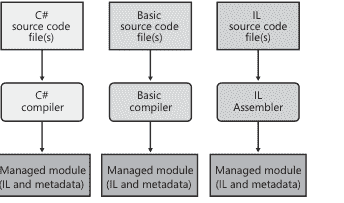

**图1-1** 将源代码编译为托管模块

表1-1描述了托管模块的各个部分。

### 

| 部分 | 说明 |
|---|---|
| PE32 或 PE32+ 头 | 标准的Windows PE文件头，类似于通用对象文件格式（COFF）头。如果该头使用PE32格式，则文件可以在32位或64位版本的Windows上运行。如果该头使用PE32+格式，则文件需要64位版本的Windows才能运行。此头还指示文件类型：GUI、CUI或DLL，并包含一个指示文件生成时间的时间戳。对于仅包含IL代码的模块，PE32(+)头中的大部分信息会被忽略。对于包含本机CPU代码的模块，此头包含有关本机CPU代码的信息。 |
| CLR 头 | 包含使该模块成为托管模块的信息（由CLR和实用程序解释）。该头包括所需的CLR版本、一些标志、托管模块入口点方法（**Main**方法）的**MethodDef**元数据令牌，以及模块元数据、资源、强名称、一些标志和其他不重要的内容的位置/大小。 |
| 元数据 | 每个托管模块都包含元数据表。主要有两种类型的表：描述源代码中定义的类型和成员的表，以及描述源代码所引用的类型和成员的表。 |
| IL 代码 | 编译器在编译源代码时生成的代码。在运行时，CLR将IL编译成本机CPU指令。 |

本机代码编译器生成针对特定CPU架构（如x86、x64或IA64）的代码。所有符合CLR的编译器都生成IL代码。（我将在本章后面更详细地介绍IL代码。）IL代码有时被称为*托管代码*，因为CLR管理其执行。

除了生成IL之外，每个面向CLR的编译器都必须向每个托管模块生成完整的元数据。简而言之，元数据是一组描述模块中定义内容（如类型及其成员）的数据表。此外，元数据还有指示托管模块引用了什么的表，例如导入的类型及其成员。元数据是较早技术（如COM的类型库和接口定义语言（IDL）文件）的超集。需要注意的重要一点是，CLR元数据要完整得多。而且，与类型库和IDL不同，元数据始终与包含IL代码的文件相关联。实际上，元数据始终嵌入在代码所在的同一个EXE/DLL中，因此无法将两者分开。由于编译器同时生成元数据和代码，并将它们绑定到生成的托管模块中，因此元数据和它描述的IL代码永远不会彼此不同步。

元数据有许多用途。以下是其中一些：

-   编译时，元数据消除了对本机C/C++头文件和库文件的需求，因为关于引用的类型/成员的所有信息都包含在实现该类型/成员并具有IL代码的文件中。编译器可以直接从托管模块读取元数据。
-   Microsoft Visual Studio使用元数据来帮助你编写代码。它的IntelliSense功能解析元数据，告诉你类型提供了哪些方法、属性、事件和字段，对于方法，还会告诉该方法期望哪些参数。
-   CLR的代码验证过程使用元数据来确保你的代码只执行“类型安全”的操作。（我稍后将讨论验证。）
-   元数据允许将对象的字段序列化到内存块中，发送到另一台机器，然后反序列化，在远程机器上重新创建对象的状态。
-   元数据允许垃圾回收器跟踪对象的生命周期。对于任何对象，垃圾回收器都可以确定对象的类型，并从元数据了解该对象中哪些字段引用了其他对象。

在第2章“构建、打包、部署和管理应用程序与类型”中，我将更详细地描述元数据。

Microsoft的C#、Visual Basic、F#和IL汇编器生成的模块始终包含托管代码（IL）和托管数据（垃圾回收数据类型）。最终用户必须在其机器上安装CLR（目前随.NET Framework一起发布）才能执行任何包含托管代码和/或托管数据的模块，就像他们必须安装Microsoft Foundation Class（MFC）库或Visual Basic DLL才能运行MFC或Visual Basic 6应用程序一样。

默认情况下，Microsoft的C++编译器生成的EXE/DLL模块包含非托管（本机）代码，并在运行时操作非托管数据（本机内存）。这些模块不需要CLR即可执行。但是，通过指定/CLR命令行开关，C++编译器会生成包含托管代码的模块，当然，CLR必须


默认情况下，编译器实际上会完成将所生成的托管模块转换为程序集的工作；也就是说，C# 编译器会生成一个包含清单的托管模块。清单指示该程序集仅由这一个文件组成。因此，对于只有一个托管模块且没有资源（或数据）文件的项目，程序集就是该托管模块，你在构建过程中无需执行任何附加步骤。如果要将一组文件组合成一个程序集，则必须了解更多工具（例如程序集链接器 AL.exe）及其命令行选项。我将在第 2 章中解释这些工具和选项。

程序集允许你将可复用、可保护、可版本控制组件的逻辑概念和物理概念解耦。如何将代码和资源划分到不同文件完全由你决定。例如，你可以将很少使用的类型或资源放入属于某个程序集的单独文件中。这些单独文件可以在运行时需要时按需从 Web 下载。如果这些文件永远不需要，就永远不会被下载，从而节省磁盘空间并缩短安装时间。程序集允许你拆分文件的部署，同时仍将所有文件视为一个单一集合。

程序集的模块还包含有关被引用程序集的信息（包括其版本号）。此信息使程序集具有*自描述*能力。换言之，CLR 可以确定程序集的直接依赖项，以便执行程序集中的代码。注册表或 Active Directory 域服务 (AD DS) 中不需要任何附加信息。由于不需要附加信息，部署程序集比部署非托管组件容易得多。

## 加载公共语言运行时

你构建的每个程序集都可以是可执行应用程序，也可以是包含一组供可执行应用程序使用的类型的 DLL。当然，CLR 负责管理这些程序集内包含的代码的执行。这意味着主机上必须安装 .NET Framework。Microsoft 创建了一个可再发行包，你可以自由分发它，以便在客户的计算机上安装 .NET Framework。某些版本的 Windows 已预装 .NET Framework。

你可以通过查找 %SystemRoot%\System32 目录中的 MSCorEE.dll 文件来判断是否已安装 .NET Framework。该文件存在就说明已安装 .NET Framework。但是，一台机器上可以同时安装多个版本的 .NET Framework。如果要确切确定安装了哪些版本的 .NET Framework，请检查以下注册表项下的子项：

```
HKEY_LOCAL_MACHINE\SOFTWARE\Microsoft\NET Framework Setup\NDP
```

.NET Framework SDK 包含一个名为 CLRVer.exe 的命令行实用工具，可显示机器上安装的所有 CLR 版本。该实用工具还可以显示 CLR 的哪个版本是

> **注意** 使用 Microsoft C# 编译器 1.0 或 1.1 版构建的程序集包含 PE32 头，并且与 CPU 架构无关。但是，在加载时，CLR 会将这些程序集视为仅 x86。对于可执行文件，这提高了应用程序在 64 位系统上实际工作的可能性，因为该可执行文件将在 WoW64 中加载，从而为该进程提供与在 32 位 x86 版 Windows 上非常相似的环境。

如果非托管应用程序调用 **LoadLibrary** 来加载托管程序集，**Windows 知道**要加载并初始化 CLR（如果尚未加载）**以便处理程序集中包含的代码**。当然，在此场景中，进程已经启动并正在运行，这可能会限制该程序集的可用性。例如，使用 **/platform:x86** 开关编译的托管程序集根本无法加载到 64 位进程中，而使用同一开关编译的可执行文件在运行 64 位版 Windows 的计算机上会在 WoW64 中加载。

## 执行程序集的代码

如前所述，托管程序集同时包含元数据和 IL。IL 是 Microsoft 在与多家外部商业和学术语言/编译器编写者协商后创建的一种与 CPU 无关的机器语言。IL 是比大多数 CPU 机器语言高级得多的语言。IL 可以访问和操作对象类型，并具有创建和初始化对象、调用对象上的虚方法以及直接操作数组元素的指令。它甚至具有用于错误处理的抛出和捕获异常的指令。你可以将 IL 视为一种面向对象的机器语言。

通常，开发人员会使用高级语言（如 C#、C++/CLI 或 Visual Basic）进行编程。这些高级语言的编译器会生成 IL。然而，与任何其他机器语言一样，IL 可以用汇编语言编写，Microsoft 确实提供了一个 IL 汇编器 ILAsm.exe。Microsoft 还提供了一个 IL 反汇编器 ILDasm.exe。

请记住，任何高级语言很可能只公开 CLR 所提供的功能的一个子集。但是，IL 汇编语言允许开发人员访问 CLR 的所有功能。因此，如果你选择的编程语言隐藏了 CLR 提供而你确实想利用的某项功能，你可以选择用 IL 汇编语言，或者用另一种公开你所寻求的 CLR 功能的编程语言来编写那部分代码。

要了解 CLR 提供了哪些功能，唯一的方法是阅读专门针对 CLR 本身的文档。在本书中，我尽量专注于 CLR 功能以及 C# 语言如何公开或不公开这些功能。我怀疑大多数其他书籍和文章会从语言角度介绍 CLR，并且大多数开发人员会逐渐相信 CLR 只提供其选定语言所公开的内容。只要你的语言允许你完成你想要完成的任务，这种模糊的视角并不是坏事。

就在 **Main** 方法执行之前，CLR 会检测 **Main** 的代码所引用的所有类型。这会使 CLR 分配一个内部数据结构，用于管理对被引用类型的访问。在图 1-4 中，**Main** 方法引用了一个类型 **Console**，这会使 CLR 分配一个内部结构。此内部数据结构为 **Console** 类型定义的每个方法包含一个条目。每个条目保存可找到该方法实现的地址。初始化此结构时，CLR 将每个条目设置为 CLR 自身内部包含的一个未记录的函数。我将此函数称为 **JITCompiler**。

当 **Main** 第一次调用 **WriteLine** 时，会调用 **JITCompiler** 函数。**JITCompiler** 函数负责将方法的 IL 代码编译为本机 CPU 指令。由于 IL 是“即时”编译的，CLR 的这个组件通常称为 *JITer* 或 *JIT 编译器*。


> **注意** 如果应用程序运行在 x86 版 Windows 上或 WoW64 中，JIT 编译器会生成 x86 指令。如果你的应用程序在 x64 或 Itanium 版 Windows 上作为 64 位应用程序运行，则 JIT 编译器会分别生成 x64 或 IA64 指令。

被调用时，**JITCompiler** 函数知道正在调用哪个方法以及哪个类型定义了此方法。然后，**JITCompiler** 函数在定义程序集的元数据中搜索被调用方法的 IL。接着，**JITCompiler** 验证 IL 代码并将其编译为本机 CPU 指令。本机 CPU 指令保存在动态分配的内存块中。然后，**JITCompiler** 回到 CLR 创建的类型内部数据结构中该被调用方法的条目，并用包含它刚刚编译的本机 CPU 指令的内存块地址，替换最初调用它的引用。最后，**JITCompiler** 函数跳转到该内存块中的代码。此代码是 **WriteLine** 方法的实现（接受 **String** 参数的那个版本）。当此代码返回时，它会返回到 **Main** 中的代码，后者继续正常执行。

现在，**Main** 第二次调用 **WriteLine**。这一次，**WriteLine** 的代码已经过验证并编译。因此，调用会直接转到该内存块，完全跳过 **JITCompiler** 函数。**WriteLine** 方法执行后，会返回 **Main**。图 1-5 显示了第二次调用 **WriteLine** 时该过程的样子。


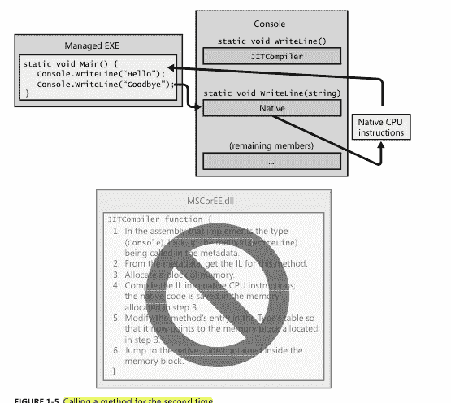

**图 1-5** 第二次调用方法

只有第一次调用方法时才会产生性能开销。之后对该方法的所有调用都会以本机代码的全速执行，因为无需再次执行验证和编译为本机代码。

JIT 编译器将本机 CPU 指令存储在动态内存中。这意味着编译后的代码会在应用程序终止时被丢弃。因此，如果你以后再次运行该应用程序，或者同时运行该应用程序的两个实例（在两个不同的操作系统进程中），JIT 编译器就必须再次将 IL 编译为本机指令。

对大多数应用程序而言，JIT 编译产生的性能开销并不显著。大多数应用程序往往会反复调用相同的方法。在应用程序执行期间，这些方法只会承受一次性能损失。而且，在方法内部花费的时间很可能比调用方法本身更多。

你还应知道，CLR 的 JIT 编译器会像非托管 C++ 编译器的后端一样优化本机代码。同样，生成优化代码可能需要更多时间，但代码执行时的性能会比未优化时好得多。

有两个 C# 编译器开关会影响代码优化：/optimize 和 /debug。下表显示了这些开关对 C# 编译器生成的 IL 代码质量以及 JIT 编译器生成的本机代码质量的影响：

| 编译器开关设置 | C# IL 代码质量 | JIT 本机代码质量 |
|---|---|---|
| /optimize- /debug-<br>（这是默认值） | 未优化 | 已优化 |
| /optimize- /debug(+/full/pdbonly) | 未优化 | 未优化 |
| /optimize+ /debug(-/+/full/pdbonly) | 已优化 | 已优化 |

使用 /optimize- 时，C# 编译器生成的未优化 IL 代码包含许多无操作 (NOP) 指令，以及跳转到下一行代码的分支。发出这些指令是为了在调试时启用 Visual Studio 的“编辑并继续”功能，而且这些额外指令还允许在控制流指令（如 for、while、do、if、else、try、catch 和 finally 语句块）上设置断点，从而使代码更易于调试。在生成优化的 IL 代码时，C# 编译器会移除这些多余的 NOP 和分支指令，这会使代码在调试器中更难以单步执行，因为控制流会被优化。此外，在调试器内部执行某些函数求值时可能无法工作。不过，IL 代码更小，从而使生成的 EXE/DLL 文件更小；而且对于像我们这样喜欢检查 IL 来理解编译器生成内容的开发者来说，IL 往往更易读。

此外，只有指定 /debug(+/full/pdbonly) 开关时，编译器才会生成程序数据库 (PDB) 文件。PDB 文件帮助调试器查找局部变量，并将 IL 指令映射到源代码。/debug:full 开关告知 JIT 编译器你打算调试程序集，JIT 编译器将跟踪每个 IL 指令生成了哪些本机代码。这使你可以使用 Visual Studio 的实时调试器功能，将调试器附加到已在运行的进程，并轻松调试代码。如果没有 /debug:full 开关，默认情况下 JIT 编译器不会跟踪 IL 到本机代码的信息，这会使 JIT 编译器运行得稍快一些，并且占用稍少的内存。如果使用 Visual Studio 调试器启动进程，它会强制 JIT 编译器跟踪 IL 到本机代码的信息（无论 /debug 开关如何），除非你在 Visual Studio 中关闭“在模块加载时抑制 JIT 优化（仅限托管）”选项。

在 Visual Studio 中新建 C# 项目时，项目的“调试”配置指定了 /optimize- 和 /debug:full 开关，“发布”配置指定了 /optimize+ 和 /debug:pdbonly 开关。

对于来自非托管 C 或 C++ 背景的开发者，你可能会思考这一切对性能的影响。毕竟，非托管代码是针对特定 CPU 平台编译的，调用时可以直接执行。在这种托管环境中，编译代码分两个阶段完成。首先，编译器遍历源代码，尽可能多地在生成 IL 方面完成工作。但是要执行代码，IL 本身必须在运行时编译成本机 CPU 指令，这需要分配更多内存，并需要额外的 CPU 时间来完成这项工作。

相信我，由于我自己也是从 C/C++ 背景接触 CLR 的，我当初对这种额外开销相当怀疑和担忧。事实是，运行时发生的第二个编译阶段确实会损害性能，也确实会分配动态内存。不过，Microsoft 已做了大量性能工作，将这种额外开销保持在最低限度。

如果你也持怀疑态度，你当然应该构建一些应用程序并亲自测试性能。此外，你应该运行 Microsoft 或其他公司生成的一些非平凡的托管应用程序，并衡量其性能。我想你会对实际性能之好感到惊讶。

你可能会觉得这难以置信，但许多人（包括我）认为托管应用程序的实际性能可能超过非托管应用程序。相信这一点的理由有很多。例如，当 JIT 编译器在运行时将 IL 代码编译为本机代码时，编译器对执行环境的了解比非托管编译器更多。以下是托管代码的性能可能超过非托管代码的一些方式：

- **JIT 编译器可以确定应用程序是否运行在 Intel Pentium 4 CPU 上，并生成本机代码以利用 Pentium 4 提供的任何特殊指令。** 通常，非托管应用程序针对最低通用 CPU 编译，并避免使用能给应用程序带来性能提升的特殊指令。

- **JIT 编译器可以确定某个测试在其运行的机器上何时始终为假。** 例如，考虑一个包含以下代码的方法：

    ```
    if (numberOfCPUs > 1) {
        ...
    }
    ```

    如果主机只有一个 CPU，这段代码可能使 JIT 编译器不生成任何 CPU 指令。在这种情况下，本机代码将针对主机进行微调；生成的代码更小，执行更快。

- **CLR 可以分析代码的执行情况，并在应用程序运行时将 IL 重新编译为本机代码。** 重新编译后的代码可以根据观察到的执行模式重新组织，以减少错误的分支预测。当前版本的 CLR 不执行此操作，但未来版本可能会。

由于 Windows 进程需要大量操作系统资源，拥有许多进程会损害性能并限制可用资源。通过在单个 OS 进程中运行多个应用程序来减少进程数量，可以提高性能、需要更少的资源，并且与每个应用程序拥有自己的进程时一样稳健。这是托管代码相对于非托管代码的另一个优势。

**事实上，CLR 确实提供了在单个 OS 进程中执行多个托管应用程序的能力。** 每个托管应用程序都在一个 AppDomain 中执行。默认情况下，每个托管 EXE 文件都将在其自己独立的地址空间中运行，该地址空间只有一个 AppDomain。但是，承载 CLR 的进程（例如 Internet Information Services [IIS] 或 Microsoft SQL Server）可以决定在单个 OS 进程中运行 AppDomain。我将在第 22 章“CLR 宿主与 AppDomain”中用一部分篇幅讨论 AppDomain。

## 不安全代码

**默认情况下，Microsoft 的 C# 编译器生成安全代码。安全代码是可验证安全的代码。** 但是，Microsoft 的 C# 编译器允许开发者编写不安全代码。不安全代码被允许直接处理内存地址，并可以操作这些地址处的字节。这是一个非常强大的功能，通常在与非托管代码互操作或想要提高时间关键算法的性能时很有用。

但是，使用不安全代码会带来重大风险：不安全代码可能破坏数据结构，并利用甚至开启安全漏洞。因此，C# 编译器要求**所有包含不安全代码的方法都必须用 unsafe 关键字标记**。此外，C# 编译器要求你使用 **/unsafe** 编译器开关编译源代码。

当 JIT 编译器尝试编译不安全方法时，它会检查包含该方法的程序集是否已被授予**具有 System.Security.Permissions.SecurityPermissionFlag 的 SkipVerification 标志设置的 System.Security.Permissions.SecurityPermission**。如果设置了此标志，JIT 编译器将编译不安全代码并允许其执行。CLR 信任此代码，并希望直接地址和字节操作不会造成任何损害。如果未设置该标志，JIT 编译器将引发 **System.InvalidProgramException 或 System.Security.VerificationException**，从而阻止该方法执行。事实上，此时整个应用程序可能会终止，但至少不会造成任何损害。

> **注意** 默认情况下，从本地计算机或通过网络共享加载的程序集被授予完全信任，这意味着它们可以执行任何操作，包括执行不安全代码。但是，默认情况下，通过 Internet 执行的程序集不会被授予执行不安全代码的权限。如果它们包含不安全代码，就会引发上述异常之一。管理员/最终用户可以更改这些默认设置；不过，管理员要对代码的行为承担全部责任。


Microsoft 提供了一个名为 PEVerify.exe 的实用工具，它会检查程序集中的所有方法，并通知你任何包含不安全代码的方法。你可能需要考虑对正在引用的程序集运行 PEVerify.exe；这将让你知道通过内部网或 Internet 运行应用程序是否可能存在问题。

你应该知道，验证需要访问任何依赖程序集中包含的元数据。因此，当你使用 PEVerify 检查程序集时，它必须能够定位并加载所有被引用的程序集。因为 PEVerify 使用 CLR 来定位依赖程序集，所以会使用执行程序集时通常采用的相同绑定和探测规则来定位这些程序集。我将在第 2 章和第 3 章“共享程序集与强命名程序集”中讨论这些绑定和探测规则。

### IL 与保护你的知识产权

有些人担心 IL 无法为他们的算法提供足够的知识产权保护。换句话说，他们认为你可以构建一个托管模块，而其他人可以使用 IL 反汇编器之类的工具，轻松逆向工程出应用程序代码的确切功能。

是的，IL 代码确实比大多数其他汇编语言更高级，而且一般来说，逆向工程 IL 代码相对简单。然而，在实现服务器端代码（例如 Web 服务、Web 窗体或存储过程）时，你的程序集驻留在你的服务器上。因为公司外部的人员无法访问该程序集，所以公司外部的人员也无法使用任何工具查看 IL——你的知识产权完全安全。

如果你担心确实要分发的任何程序集，可以从第三方供应商处获取混淆器实用工具。这些工具会打乱程序集元数据中所有私有符号的名称。其他人将很难还原这些名称并理解每个方法的用途。请注意，这些混淆器只能提供少量保护，因为 IL 必须在某个时刻可供 CLR 进行 JIT 编译。

如果你觉得混淆器无法提供你期望的那种知识产权保护，可以考虑在某个非托管模块中实现更敏感的算法，该模块将包含本机 CPU 指令，而不是 IL 和元数据。然后，你可以使用 CLR 的互操作功能（假设你有足够的权限）在应用程序的托管部分和非托管部分之间进行通信。当然，这假设你不担心别人逆向工程你非托管代码中的本机 CPU 指令。

### 本机代码生成器工具：NGen.exe

.NET Framework 附带的 NGen.exe 工具可用于在应用程序安装到用户机器上时将 IL 代码编译为本机代码。由于代码在安装时编译，CLR 的 JIT 编译器不必在运行时编译 IL 代码，这可以提高应用程序的性能。NGen.exe 工具在两种场景下很有用：

- **改善应用程序的启动时间** 运行 NGen.exe 可以改善启动时间，因为代码已经编译成本机代码，因此不必在运行时进行编译。
- **减少应用程序的工作集** 如果你认为某个程序集将被同时加载到多个进程中，对该程序集运行 NGen.exe 可以减少应用程序的工作集。原因是 NGen.exe 工具将 IL 编译为本机代码，并将输出保存到单独的文件中。该文件可以同时被内存映射到多个进程地址空间，从而允许共享代码；并非每个进程都需要自己的代码副本。

当安装程序对某个应用程序或单个程序集调用 NGen.exe 时，该应用程序的所有程序集或指定的那一个程序集都会将其 IL 代码编译为本机代码。NGen.exe 会创建一个新的程序集文件，其中只包含此本机代码，而不包含 IL 代码。这个新文件被放置在类似 `C:\\Windows\\Assembly\\NativeImages_v4.0.####_64` 名称的目录下的一个文件夹中。目录名包括 CLR 的版本以及表示本机代码是为 x86（32 位版本的 Windows）、x64 还是 Itanium（后两者用于 64 位版本的 Windows）编译的信息。

现在，每当 CLR 加载程序集文件时，CLR 都会查看是否存在对应的 NGen 生成的本机文件。如果找不到本机文件，CLR 会像往常一样 JIT 编译 IL 代码。然而，如果对应的本机文件确实存在，CLR 将使用该本机文件中包含的已编译代码，并且该文件的方法不必在运行时编译。

从表面上看，这听起来很棒！听起来好像你获得了托管代码的所有好处（垃圾回收、验证、类型安全等），却没有托管代码的所有性能问题（JIT 编译）。然而，实际情况并不像乍看起来那么美好。对于 NGen 生成的文件，存在几个潜在问题：

- **没有知识产权保护** 许多人认为，可能可以在不附带包含原始 IL 代码的文件的情况下分发 NGen 生成的文件，从而将其知识产权保密。不幸的是，这是不可能的。在运行时，CLR 需要访问程序集的元数据（用于反射和序列化等功能）；这就要求附带包含 IL 和元数据的程序集。此外，如果 CLR 由于某种原因（如下所述）无法使用 NGen 生成的文件，CLR 会优雅地回退到 JIT 编译程序集的 IL 代码，而该 IL 代码必须可用。

- **Windows 控制台应用程序** 对于 UI 需求非常简单的应用程序，控制台应用程序提供了一种快速简便的应用程序构建方式。编译器、实用工具和工具通常实现为控制台应用程序。
- **Windows 服务** 是的，可以使用 .NET Framework 构建可通过 Windows 服务控制管理器 (SCM) 控制的服务应用程序。
- **数据库存储过程** Microsoft 的 SQL Server、IBM 的 DB2 和 Oracle 的数据库服务器允许开发人员使用 .NET Framework 编写存储过程。
- **组件库** .NET Framework 允许你构建独立的程序集（组件），其中包含的类型可以轻松并入前面提到的任何应用程序类型。

由于 FCL 包含成千上万个类型，因此相关类型集合会在单个命名空间中呈现给开发人员。例如，**System** 命名空间（你应该最熟悉它）包含 **Object** 基类型，所有其他类型最终都派生自该类型。此外，**System** 命名空间包含用于整数、字符、字符串、异常处理和控制台 I/O 的类型，还包含一组实用工具类型，这些类型可在数据类型之间安全转换、格式化数据类型、生成随机数以及执行各种数学函数。所有应用程序都会使用 **System** 命名空间中的类型。

要访问框架的任何功能，你需要知道哪个命名空间包含公开你所需功能的类型。许多类型允许你自定义其行为；你只需从所需的 FCL 类型派生自己的类型即可。该平台的面向对象特性正是 .NET Framework 向软件开发人员呈现一致编程范式的方式。此外，开发人员可以轻松创建包含自己类型的命名空间。这些命名空间和类型无缝融入该编程范式。与 Win32 编程范式相比，这种新方法极大地简化了软件开发。

FCL 中的大多数命名空间提供的类型可用于任何类型的应用程序。表 1-3 列出了一些更通用的命名空间，并简要描述了该命名空间中类型的用途。这只是可用命名空间中非常小的一部分示例。请参阅各种 Microsoft SDK 随附的文档，以熟悉 Microsoft 不断推出的不断增长的命名空间集合。

**表 1-3** 一些通用 FCL 命名空间

| 命名空间 | 内容描述 |
| --- | --- |
| **System** | 每个应用程序使用的所有基本类型 |
| **System.Data** | 用于与数据库通信和处理数据的类型 |
| **System.IO** | 用于执行流 I/O 以及遍历目录和文件的类型 |


| 命名空间 | 内容说明 |
|---|---|
| **System.Net** | 包含用于低层网络通信以及使用一些常见 Internet 协议的类型。 |
| **System.Runtime.InteropServices** | 包含允许托管代码访问非托管操作系统平台设施（如 COM 组件以及 Win32 或自定义 DLL 中的函数）的类型 |
| **System.Security** | 用于保护数据和资源的类型 |
| **System.Text** | 用于处理不同编码（如 ASCII 和 Unicode）文本的类型 |
| **System.Threading** | 用于异步操作和同步访问资源的类型 |
| **System.Xml** | 用于处理可扩展标记语言 (XML) 架构和数据的类型 |

本书讨论 CLR 以及与 CLR 紧密交互的通用类型。因此，本书内容适用于所有编写面向 CLR 的应用程序或组件的程序员。许多其他优秀书籍涵盖了特定应用程序类型，如 Web Services、Web Forms、Windows Forms 等。这些书会在帮助你构建应用程序方面提供极好的起点。我倾向于把这些特定于应用程序的书视为帮助你自上而下地学习，因为它们关注的是应用程序类型而非开发平台。在本书中，我将提供帮助你自下而上学习的信息。阅读本书和一本特定于应用程序的书之后，你应该能够轻松而熟练地构建任何你想要的应用程序。

## 公共类型系统

到目前为止，你应该已经清楚，CLR 的核心就是类型。类型向你的应用程序和其他类型公开功能。类型是一种机制，通过它，用一种编程语言编写的代码可以与用另一种编程语言编写的代码通信。由于类型是 CLR 的根本，Microsoft 创建了一个正式规范——公共类型系统 (CTS)——来描述类型如何定义以及如何行为。

> **注意** 事实上，Microsoft 一直在将 CTS 以及 .NET Framework 的其他部分（包括文件格式、元数据、IL 以及对底层平台的访问 (P/Invoke)）提交给 ECMA 以进行标准化。该标准称为公共语言基础结构 (CLI)，即 ECMA-335 规范。此外，Microsoft 还提交了 FCL 的部分内容、C# 编程语言 (ECMA-334) 和 C++/CLI 编程语言。有关这些行业标准的信息，请访问 ECMA 网站中与第 39 技术委员会相关的页面：www.ecma-international.org/。你也可以参考 Microsoft 自己的网站：http://msdn.microsoft.com/en-us/netframework/aa569283.aspx。此外，Microsoft 已将其 Community Promise 应用于 ECMA-334 和 ECMA-335 规范。有关此内容的更多信息，请参见 http://www.microsoft.com/interop/cp/default.mspx。

## 公共语言规范

COM 允许用不同语言创建的对象相互通信。另一方面，CLR 现在集成了所有语言，并允许用一种语言创建的对象被用完全不同语言编写的代码平等对待。这种集成之所以可能，是因为 CLR 拥有标准类型集、元数据（自描述类型信息）和公共执行环境。

虽然这种语言集成是一个奇妙的目标，但事实是编程语言彼此之间差异很大。例如，有些语言不区分大小写地对待符号，有些则不提供无符号整数、运算符重载或支持可变数量参数的方法。

如果你打算创建可从其他编程语言轻松访问的类型，则只能使用你的编程语言中保证在所有其他语言中都可用的功能。为帮助你做到这一点，Microsoft 定义了公共语言规范 (CLS)，它向编译器供应商详细说明了：如果这些编译器要生成与 CLR 上由其他符合 CLS 的语言编写的其他组件兼容的类型，则其编译器必须支持的最小功能集。

CLR/CTS 支持的功能远多于 CLS 定义的子集，因此，如果你不关心语言间的互操作性，就可以开发仅受语言功能集限制的非常丰富的类型。具体而言，CLS 定义了外部可见的类型和方法必须遵守的规则，才能从任何符合 CLS 的编程语言访问。请注意，CLS 规则不适用于仅在定义程序集内部可访问的代码。图 1-6 总结了本段所表达的思想。

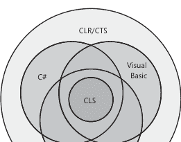

**图 1-6** 语言提供 CLR/CTS 的子集和 CLS 的超集（但不一定是同一个超集）

.NET Framework SDK 文档中的“语言互操作性”一节 (http://msdn.microsoft.com/en-us/library/7301fwy3.aspx)。

让我把 CLS 规则提炼成非常简单的内容。在 CLR 中，类型的每个成员要么是字段（数据），要么是方法（行为）。这意味着每种编程语言都必须能够访问字段并调用方法。某些字段和某些方法以特殊且常见的方式使用。为了简化编程，语言通常提供额外的抽象，使编写这些常见编程模式更容易。例如，语言公开枚举、数组、属性、索引器、委托、事件、构造函数、终结器、运算符重载、转换运算符等概念。当编译器在源代码中遇到任何这些内容时，它必须将这些构造转换为字段和方法，以便 CLR 和任何其他编程语言能够访问该构造。

考虑以下类型定义，其中包含构造函数、终结器、一些重载运算符、一个属性、一个索引器和一个事件。请注意，所示代码只是为了使其能够编译；它并未展示实现类型的正确方式。

```csharp
using System;

internal sealed class Test {
    // Constructor
    public Test() {}

    // Finalizer
    ~Test() {}

    // Operator overload
    public static Boolean operator == (Test t1, Test t2) {
        return true;
    }
    public static Boolean operator != (Test t1, Test t2) {
        return false;
    }

    // An operator overload
    public static Test operator + (Test t1, Test t2) { return null; }

    // A property
    public String AProperty {
        get { return null; }
        set { }
    }

    // An indexer
    public String this[Int32 x] {
        get { return null; }
        set { }
    }

    // An event
    public event EventHandler AnEvent;
}
```

当编译器编译这段代码时，结果是一个定义了若干字段和方法的类型。你可以使用 .NET Framework SDK 提供的 IL 反汇编程序工具 (ILdasm.exe) 检查生成的可托管模块，从而轻松看到这一点，如图 1-7 所示。

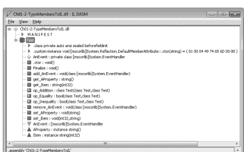

**图 1-7** ILDasm 显示 *Test* 类型的字段和方法（从元数据获得）

表 1-4 显示了编程语言构造如何映射到等效的 CLR 字段和方法：

### 

| **类型成员** | **成员类型** | **等效的编程语言构造** |
| --- | --- | --- |
| `AnEvent` | 字段 | 事件；字段名为 `AnEvent`，其类型为 `System.EventHandler`。 |
| `.ctor` | 方法 | 构造函数。 |
| `Finalize` | 方法 | 终结器。 |
| `add_AnEvent` | 方法 | 事件添加访问器方法。 |
| `get_AProperty` | 方法 | 属性获取访问器方法。 |
| `get_Item` | 方法 | 索引器获取访问器方法。 |
| `op_Addition` | 方法 | + 运算符。 |
| `op_Equality` | 方法 | == 运算符。 |
| `op_Inequality` | 方法 | != 运算符。 |
| `remove_AnEvent` | 方法 | 事件移除访问器方法。 |
| `set_AProperty` | 方法 | 属性设置访问器方法。 |
| `set_Item` | 方法 | 索引器设置访问器方法。 |

*Test* 类型下未在表 1-4 中提及的其他节点——`.class`、`.custom`、`AnEvent`、`AProperty` 和 `Item`——标识了有关该类型的附加元数据。这些节点不映射到字段或方法；它们只是提供一些附加信息。


# 第2章 生成、打包、部署和管理应用程序及类型

本章内容：

- .NET Framework 部署目标 ........................................ 32
- 将类型生成到模块中 ........................................... 33
- 元数据简介 ................................................ 36
- 合并模块以形成程序集 ................................. 43
- 程序集版本资源信息 .................................. 53
- 区域性 ................................................................... 58
- 简单应用程序部署（私有部署的程序集） .......... 59
- 简单管理控制（配置） .......................... 61

在进入讲解如何为 Microsoft .NET Framework 开发程序的章节之前，让我们讨论生成、打包和部署应用程序及其类型所需的步骤。在本章中，我将重点介绍如何生成仅供应用程序自身使用的程序集的基础知识。在第3章“共享程序集和强命名程序集”中，我将介绍你需要理解的更高级概念，包括如何生成和使用包含将由多个应用程序共享的类型的程序集。在这两章中，我还将讨论管理员影响应用程序及其类型执行方式的各种方法。

如今，应用程序由若干类型组成，这些类型通常由你和 Microsoft 创建。此外，许多组件供应商也在创建和销售类型，其他公司可以使用这些类型来缩短软件项目的开发时间。如果这些类型是使用任何面向公共语言运行时（CLR）的语言开发的，它们就可以无缝地协同工作；用一种语言编写的类型可以将另一种类型用作其基类，而无需关心基类型是用什么语言开发的。

在本章中，我还将解释这些类型如何生成并打包到文件中以供部署。在此过程中，我会简要回顾一些 .NET Framework 正在解决问题的历史。

.NET Framework 在很大程度上解决了 DLL 地狱问题，你在阅读本章和第3章时会看到这一点。它也在很大程度上帮助解决了应用程序状态分散在用户硬盘各处的问题。例如，与 COM 不同，类型不再需要注册表中的设置。不幸的是，应用程序仍然需要快捷方式链接。在安全方面，.NET Framework 包含一个称为*代码访问安全性*的安全模型。Windows 安全基于用户身份，而代码访问安全性基于加载组件的宿主应用程序可以控制的权限。像 Microsoft Silverlight 这样的宿主应用程序可以只向下载的代码授予少量权限，而本地安装（自托管）的应用程序可以以完全信任（所有权限）运行。如你所见，.NET Framework 使用户能够控制安装什么、运行什么，并且总体上比 Windows 以往更能控制自己的机器。

## 将类型生成到模块中

在本节中，我将展示如何将包含各种类型的源文件转换为可部署的文件。让我们从检查以下简单应用程序开始：

```csharp
public sealed class Program {
    public static void Main() {
        System.Console.WriteLine("Hi");
    }
}
```

此应用程序定义了一个名为 **Program** 的类型。该类型有一个名为 **Main** 的公共静态方法。在 **Main** 内部引用了另一个名为 **System.Console** 的类型。**System.Console** 是由 Microsoft 实现的类型，实现该类型方法的中间语言（IL）代码位于 MSCorLib.dll 文件中。因此，我们的应用程序定义了一个类型，同时也使用了另一家公司的类型。

要生成此示例应用程序，请将前面的代码放入源代码文件（例如 Program.cs），然后执行以下命令行：

```
csc.exe /out:Program.exe /t:exe /r:MSCorLib.dll Program.cs
```

此命令行告诉 C# 编译器生成名为 `Program.exe` 的可执行文件（`/out:Program.exe`）。生成的文件类型是 Win32 控制台应用程序（`/t[arget]:exe`）。

当 C# 编译器处理源文件时，它会看到代码引用了 **System.Console** 类型的 **WriteLine** 方法。此时，编译器希望确保该类型存在于某处，具有 **WriteLine** 方法，并且传递给该方法的实参与方法期望的参数匹配。由于该类型未在 C# 源代码中定义，为了让 C# 编译器满意，必须向它提供一组程序集，用于解析对外部类型的引用。在上面的命令行中，要让 CSC.exe 使用这些设置，可以按如下方式调用：

```
csc.exe @MyProject.rsp CodeFile1.cs CodeFile2.cs
```

这告诉 C# 编译器如何命名输出文件以及创建何种目标类型。如你所见，响应文件非常方便，因为每次编译项目时都不必手动表达所需的命令行参数。

C# 编译器支持多个响应文件。除了在命令行上显式指定的文件外，编译器还会自动查找名为 CSC.rsp 的文件。运行 CSC.exe 时，它会在当前目录中查找本地 CSC.rsp 文件——应将任何项目特定的设置放在此文件中。编译器还会在包含 CSC.exe 文件的目录中查找全局 CSC.rsp 文件。希望应用于所有项目的设置应放在此文件中。编译器会汇总并使用所有这些响应文件中的设置。如果本地和全局响应文件中有冲突设置，本地文件中的设置将覆盖全局文件中的设置。同样，命令行上显式传递的任何设置都会覆盖从本地响应文件获取的设置。

安装 .NET Framework 时，它会在 %SystemRoot%\Microsoft.NET\Framework\vX.X.X 目录（其中 vX.X.X 是已安装的 .NET Framework 版本）中安装默认的全局 CSC.rsp 文件。此文件的 4.0 版本包含以下开关：

```
# 
# 
# 
# 

# 
/r:Accessibility.dll
/r:Microsoft.CSharp.dll
/r:System.Configuration.dll
/r:System.Configuration.Install.dll
/r:System.Core.dll
/r:System.Data.dll
/r:System.Data.DataSetExtensions.dll
/r:System.Data.Linq.dll
/r:System.Deployment.dll
/r:System.Device.dll
/r:System.DirectoryServices.dll
/r:System.dll
/r:System.Drawing.dll
/r:System.EnterpriseServices.dll
/r:System.Management.dll
/r:System.Messaging.dll
/r:System.Numerics.dll
/r:System.Runtime.Remoting.dll
/r:System.Runtime.Serialization.dll
/r:System.Runtime.Serialization.Formatters.Soap.dll
/r:System.Security.dll
```

数字签名（在第3章讨论）。最后，头包含模块内某些元数据表的大小和偏移量。通过检查 CorHdr.h 头文件中定义的 IMAGE_COR20_HEADER，可以看到 CLR 头的确切格式。

元数据是由若干表组成的二进制数据块。表分为三类：定义表、引用表和清单表。表 2-1 描述了模块元数据块中存在的一些较常见的定义表。

### 

| 元数据定义表名称 | 描述 |
| --- | --- |
| ModuleDef | 始终包含一个标识模块的条目。该条目包括模块的文件名和扩展名（不含路径）以及模块版本 ID（编译器创建的 GUID 形式）。这允许在保留原始名称记录的同时重命名文件。但是，强烈不建议重命名文件，这可能会阻止 CLR 在运行时定位程序集，因此不要这样做。 |
| TypeDef | 为模块中定义的每个类型包含一个条目。每个条目包括类型名称、基类型和标志（**public**、**private** 等），并包含指向 MethodDef 表中它拥有的方法、FieldDef 表中它拥有的字段、PropertyDef 表中它拥有的属性以及 EventDef 表中它拥有的事件的索引。 |
| MethodDef | 为模块中定义的每个方法包含一个条目。每个条目包括方法名称、标志（**private**、**public**、**virtual**、**abstract**、**static**、**final** 等）、签名，以及模块内可找到其 IL 代码的偏移量。每个条目还可以引用 ParamDef 表条目，其中可找到有关方法参数的更多信息。 |
| FieldDef | 为模块中定义的每个字段包含一个条目。每个条目包括标志（**private**、**public** 等）、类型和名称。 |
| ParamDef | 为模块中定义的每个参数包含一个条目。每个条目包括标志（**in**、**out**、**retval** 等）、类型和名称。 |
| PropertyDef | 为模块中定义的每个属性包含一个条目。每个条目包括标志、类型和名称。 |
| EventDef | 为模块中定义的每个事件包含一个条目。每个条目包括标志和名称。 |

当编译器编译源代码时，代码定义的所有内容都会导致在表 2-1 所述的表之一中创建一个条目。当编译器检测到源代码引用的类型、字段、方法、属性和事件时，也会创建元数据表条目。创建的元数据包括一组引用表，用于记录被引用的项。表 2-2 显示了一些较常见的引用元数据表。


## 

| 元数据引用表名称 | 描述 |
| --- | --- |
| AssemblyRef | 为模块引用的每个程序集包含一个项。每个项包含绑定到该程序集所需的信息：程序集名称（不含路径和扩展名）、版本号、区域性和公钥标记（通常是由发布者公钥生成的小哈希值，用于标识被引用程序集的发布者）。每个项还包含一些标志和一个哈希值。该哈希值原本旨在作为被引用程序集位的校验和。CLR 完全忽略此哈希值，并且将来可能仍会如此。 |
| ModuleRef | 为每个实现此模块所引用类型的 PE 模块包含一个项。每个项包含模块的文件名和扩展名（不含路径）。此表用于绑定到在调用程序集模块的不同模块中实现的类型。 |
| TypeRef | 为模块引用的每个类型包含一个项。每个项包含类型名称以及一个指向可找到该类型位置的引用。如果该类型在另一个类型内实现，该引用将指示一个 TypeRef 项。如果该类型在同一模块中实现，该引用将指示一个 ModuleDef 项。如果该类型在调用程序集内的另一个模块中实现，该引用将指示一个 ModuleRef 项。如果该类型在不同程序集中实现，该引用将指示一个 AssemblyRef 项。 |
| MemberRef | 为模块引用的每个成员（字段和方法，以及属性和事件方法）包含一个项。每个项包含成员名称和签名，并指向定义该成员的类型的 TypeRef 项。 |

表 2-1 和表 2-2 中列出的表远不止这些，但我只是想让你了解编译器为生成元数据信息而发出的信息种类。前面我提到还有一组清单元数据表；本章稍后我会再讨论这些内容。

各种工具允许你检查托管 PE 文件中的元数据。我个人最喜欢的是 IL 反汇编器 ILDasm.exe。要查看元数据表，请执行以下命令行：

```
ILDasm Program.exe
```

这将导致 ILDasm.exe 运行，并加载 Program.exe 程序集。要以美观、人类可读的形式查看元数据，请选择 View/MetaInfo/Show! 菜单项（或按 CTRL+M）。这将显示以下信息：

```
================================================
ScopeName : Program.exe
MVID      : {CA73FFE8-0D42-4610-A8D3-9276195C35AA}
================================================
Global functions
------------------------------------------------

Global fields
------------------------------------------------

Global MemberRefs
------------------------------------------------

TypeDef #1 (02000002)
------------------------------------------------
  TypeDefName: Program (02000002)
  Flags      : [Public] [AutoLayout] [Class] [Sealed] [AnsiClass]
               [BeforeFieldInit] (00100101)
  Extends    : 01000001 [TypeRef] System.Object
  Method #1 (06000001) [ENTRYPOINT]
  -------------------------------------------------
    MethodName: Main (06000001)
    Flags      : [Public] [Static] [HideBySig] [ReuseSlot]  (00000096)
    RVA        : 0x00002050
    ImplFlags  : [IL] [Managed]  (00000000)
    CallCnvntn: [DEFAULT]
    ReturnType: Void
    No arguments.

  Method #2 (06000002)
  -------------------------------------------------
    MethodName: .ctor (06000002)
    Flags      : [Public] [HideBySig] [ReuseSlot] [SpecialName]
                 [RTSpecialName] [.ctor]  (00001886)
    RVA        : 0x0000205c
    ImplFlags  : [IL] [Managed]  (00000000)
    CallCnvntn: [DEFAULT]
    hasThis
    ReturnType: Void
    No arguments.

  TypeRef #1 (01000001)
  -------------------------------------------------
    Token:             0x01000001
    ResolutionScope:   0x23000001
    TypeRefName:       System.Object
      MemberRef #1 (0a000004)
      -------------------------------------------------
        Member: (0a000004) .ctor:
        CallCnvntn: [DEFAULT]
        hasThis
        ReturnType: Void
        No arguments.

  TypeRef #2 (01000002)
Token:                      0x01000002
ResolutionScope:            0x23000001
TypeRefName:                System.Runtime.CompilerServices.CompilationRelaxationsAttribute
  MemberRef #1 (0a000001)
  ------------------------------------------------------------
    Member: (0a000001) .ctor:
    CallCnvntn: [DEFAULT]
    hasThis
    ReturnType: Void
    1 Arguments
      Argument #1:  I4

TypeRef #3 (01000003)
------------------------------------------------------------
Token:                      0x01000003
ResolutionScope:            0x23000001
TypeRefName:                System.Runtime.CompilerServices.RuntimeCompatibilityAttribute
  MemberRef #1 (0a000002)
  ------------------------------------------------------------
    Member: (0a000002) .ctor:
    CallCnvntn: [DEFAULT]
    hasThis
    ReturnType: Void
    No arguments.
TypeRef #4 (01000004)
------------------------------------------------------------
Token:                      0x01000004
ResolutionScope:            0x23000001
TypeRefName:                System.Console
  MemberRef #1 (0a000003)
  ------------------------------------------------------------
    Member: (0a000003) WriteLine:
    CallCnvntn: [DEFAULT]
    ReturnType: Void
    1 Arguments
      Argument #1:  String

Assembly
------------------------------------------------------------
  Token: 0x20000001
  Name : Program
  Public Key     :
  Hash Algorithm : 0x00008004
  Version: 0.0.0.0
  Major Version: 0x00000000
  Minor Version: 0x00000000
  Build Number: 0x00000000
  Revision Number: 0x00000000
  Locale: <null>
  Flags : [none] (00000000)
  CustomAttribute #1 (0c000001)
  ------------------------------------------------------------
    CustomAttribute Type: 0a000001
    CustomAttributeName:
```

构造函数（其名称为 .ctor）是公共的，其代码也是 IL。该构造函数具有 **void** 返回类型，没有参数，并具有一个 **this** 指针，该指针指向调用该方法时要构造的对象的内存。

我强烈鼓励你尝试使用 ILDasm。它可以向你展示丰富的信息，而且你对所看到的内容理解得越多，就越能理解 CLR 及其能力。如你将看到的，我将在本书中更频繁地使用 ILDasm。

仅为了好玩，让我们看一下有关 Program.exe 程序集的一些统计信息。当你选择 ILDasm 的 View/Statistics 菜单项时，将显示以下信息：

```
File size        : 3584
PE header size   : 512 (496 used)    (14.29%)
PE additional info : 1415             (39.48%)
Num. of PE sections : 3
CLR header size  : 72                ( 2.01%)
CLR meta-data size : 612             (17.08%)
CLR additional info : 0              ( 0.00%)
CLR method headers : 2               ( 0.06%)
Managed code     : 18                ( 0.50%)
Data             : 2048              (57.14%)
Unaccounted      : -1095             (-30.55%)

Num. of PE sections : 3
  .text    - 1024
  .rsrc    - 1536
  .reloc   - 512

CLR meta-data size : 612
  Module        -    1 (10 bytes)
  TypeDef       -    2 (28 bytes)      0 interfaces, 0 explicit layout
  TypeRef       -    4 (24 bytes)
  MethodDef     -    2 (28 bytes)      0 abstract, 0 native, 2 bodies
  MemberRef     -    4 (24 bytes)
  ParamDef      -    2 (12 bytes)
  CustomAttribute -  2 (12 bytes)
  Assembly      -    1 (22 bytes)
  AssemblyRef   -    1 (20 bytes)
  Strings       -  184 bytes
  Blobs         -   68 bytes
  UserStrings   -    8 bytes
  Guids         -   16 bytes
  Uncategorized -  168 bytes

CLR method headers : 2
  Num. of method bodies  - 2
  Num. of fat headers    - 0
  Num. of tiny headers   - 2

Managed code : 18
  Ave method size - 9
```


在这里，你可以看到文件的大小（以字节为单位），以及构成文件的各个部分的大小（以字节和百分比为单位）。对于这个非常小的 Program.cs 应用程序，PE 头和元数据占据了文件大小的绝大部分。事实上，IL 代码仅占 18 个字节。当然，随着应用程序的增长，它将重用其大部分类型以及对其他类型和程序集的引用，导致元数据和头信息相对于文件的整体大小显著缩小。

> **注意** 顺便提一下，ILDasm.exe 确实有一个 bug，会影响所显示的文件大小信息。特别是，你不能信任 **未说明** 的信息。

## 将模块组合成程序集

上一节讨论的 Program.exe 文件不仅仅是一个带有元数据的 PE 文件；它还是一个 *程序集*。*程序集* 是包含类型定义和资源文件的一个或多个文件的集合。程序集的文件中有一个被选定来持有 *清单*。清单是另一组元数据表，基本上包含属于程序集的文件名称。它们还描述程序集的版本、区域性、发布者、公开导出的类型以及构成程序集的所有文件。

CLR 对程序集进行操作；也就是说，CLR 总是先加载包含清单元数据表的文件，然后使用清单获取程序集中其他文件的名称。下面是一些你应该记住的程序集特征：

- 程序集定义了可重用的类型。
- 程序集带有版本号。
- 程序集可以关联安全信息。

程序集的单个文件不具有这些属性——除了包含清单元数据表的文件。

要打包、版本化、保护和使用类型，你必须将它们放在属于程序集的模块中。在大多数情况下，程序集由单个文件组成，就像前面的 Program.exe 示例那样。然而，程序集也可以由多个文件组成：一些带有元数据的 PE 文件和一些资源文件，如 .gif 或 .jpg 文件。把程序集看作一个逻辑上的 EXE 或 DLL 可能有助于你理解。

我相信你们中许多读到这里的读者会想知道为什么 Microsoft 引入了这个新的程序集概念。原因是程序集允许你将可重用类型的逻辑和物理概念解耦。例如，一个程序集可以包含多个类型。你可以将常用类型放在一个文件中，将不常用类型放在另一个文件中。如果你的程序集通过互联网下载来部署，那么如果客户端从不访问不常用类型，包含不常用类型的文件可能永远不必下载到客户端。例如，一个专门从事 UI 控件的独立软件供应商（ISV）可能会选择在一个单独的模块中实现 Active Accessibility 类型（以满足 Microsoft 的 Logo 要求）。只有需要额外辅助功能的用户才需要下载这个模块。

你通过指定应用程序配置文件中的 `codeBase` 元素（将在第3章讨论）来配置应用程序下载程序集文件。`codeBase` 元素标识一个 URL，指向可以找到程序集所有文件的位置。当尝试加载程序集的文件时，CLR 获取 `codeBase` 元素的 URL，并检查机器的下载缓存以确认文件是否存在。如果存在，则加载该文件。如果文件不在缓存中，CLR 从 URL 指向的位置将文件下载到缓存中。如果找不到文件，CLR 会在运行时抛出 `FileNotFoundException` 异常。

我已经确定了使用多文件程序集的三个原因：

-   你可以将类型划分到不同的文件中，从而允许按互联网下载场景中所描述的增量方式下载文件。将类型划分到不同文件也允许对你购买和安装的应用程序进行部分或零散的打包和部署。

-   你可以向程序集添加资源或数据文件。例如，你可能会有一个计算某些保险信息的类型。该类型可能需要访问一些精算表来进行计算。与其将精算表嵌入源代码中，你可以使用一个工具（例如后面讨论的程序集链接器 AL.exe），使数据文件被视为程序集的一部分。顺便提一下，该数据文件可以是任何格式——文本文件、Microsoft Office Excel 电子表格、Microsoft Office Word 表格，或任何你喜欢的格式——只要你的应用程序知道如何解析文件内容即可。

-   你可以创建由不同编程语言实现的类型组成的程序集。例如，你可以用 C# 实现一些类型，用 Microsoft Visual Basic 实现一些类型，用其他语言实现其他类型。当你编译用 C# 源代码编写的类型时，编译器会生成一个模块。当你编译用 Visual Basic 源代码编写的其他类型时，编译器会生成一个单独的模块。然后你可以使用一个工具将所有这些模块组合成单个程序集。对于使用该程序集的开发人员来说，程序集看起来只包含一堆类型；开发人员甚至不会知道使用了不同的编程语言。顺便提一下，如果你愿意，你可以对每个模块运行 ILDasm.exe 来获得 IL 源代码文件。然后你可以运行 ILAsm.exe 并将所有 IL 源代码文件传递给它。ILAsm.exe 将生成一个包含所有类型的文件。此技术要求你的源代码编译器生成纯 IL 代码。


> **重要** 总之，程序集是重用、版本化和安全性的单元。它允许你将类型和资源划分到不同的文件中，从而使你和你的程序集的使用者能够决定将哪些文件打包在一起并部署。一旦 CLR 加载了包含清单的文件，它就能确定程序集的哪些其他文件包含应用程序引用的类型和资源。任何使用程序集的人只需知道包含清单的文件名称；文件划分随后对使用者来说被抽象掉了，并且将来可以更改而不会破坏应用程序的行为。
>
> 如果你有多个类型可以共享同一个版本号和安全设置，建议你将所有类型放在一个文件中，而不是将类型分散到多个文件中，更不用说分散到多个程序集中了。原因是性能。加载文件/程序集会花费 CLR 和 Windows 的时间来查找程序集、加载它并初始化它。加载的文件/程序集越少越好，因为加载更少的程序集有助于减少工作集，并减少进程地址空间的碎片。最后，NGen.exe 在处理较大的文件时可以执行更好的优化。

要构建程序集，你必须选择一个 PE 文件作为清单的持有者。或者，你可以创建一个单独的 PE 文件，只包含清单。表 2-3 显示了将托管模块转换为程序集的清单元数据表。

### 

| 清单元数据表名称 | 描述 |
|---|---|
| AssemblyDef | 如果此模块标识一个程序集，则包含单个条目。该条目包括程序集的名称（不含路径和扩展名）、版本（主要版本、次要版本、内部版本和修订号）、区域性、标志、哈希算法以及发布者的公钥（可以为 null）。 |
| FileDef | 针对属于程序集的每个 PE 和资源文件包含一个条目（不包含包含清单的文件，因为它作为 AssemblyDef 表中的单个条目出现）。该条目包括文件的名称和扩展名（不含路径）、哈希值和标志。如果此程序集仅由自身文件组成，则 FileDef 表没有条目。 |
| ManifestResourceDef | 针对属于程序集的每个资源包含一个条目。该条目包括资源的名称、标志（如果在程序集外部可见则为 **公共**，否则为 **私有**），以及 FileDef 表中的一个索引，指示包含资源文件或流的文件。如果资源不是独立文件（如 .jpg 或 .gif），则资源是 PE 文件内包含的流。对于嵌入的资源，该条目还包括一个偏移量，指示 PE 文件内资源流的起始位置。 |
| ExportedTypesDef | 针对从程序集所有 PE 模块导出的每个公共类型包含一个条目。该条目包括类型名称、FileDef 表中的一个索引（指示此程序集哪个文件实现了该类型）以及 TypeDef 表中的一个索引。**注意：** 为了节省空间，从包含清单的文件导出的类型不在此表中重复，因为可以使用元数据的 TypeDef 表获得类型信息。 |


清单的存在在程序集的使用者与程序集的分区细节之间提供了一定程度的间接性，并使程序集能够自我描述。另外请注意，包含清单的文件具有元数据信息，用于指示哪些文件属于该程序集，但各个文件本身并没有指定其属于该程序集的元数据信息。

> **注意** 包含清单的程序集文件中也包含一个 AssemblyRef 表。此表包含该程序集的所有文件所引用的所有程序集的条目。这使得工具可以打开程序集的清单并查看其引用的程序集集合，而无需打开该程序集的其他文件。同样，AssemblyRef 表中的条目存在是为了使程序集能够自我描述。

当指定以下任意命令行开关时，C# 编译器会生成一个程序集：`/t[arget]:exe`、`/t[arget]:winexe` 或 `/t[arget]:library`。所有这些开关都会使编译器生成一个包含清单元数据表的单个 PE 文件。生成的文件分别是一个 CUI 可执行文件、一个 GUI 可执行文件或一个 DLL。

除了这些开关之外，C# 编译器还支持 `/t[arget]:module` 开关。此开关告诉编译器生成一个不包含清单元数据表的 PE 文件。生成的 PE 文件始终是一个 DLL PE 文件，并且必须先将此文件添加到程序集中，CLR 才能访问其中的任何类型。使用 `/t:module` 开关时，C# 编译器默认将输出文件命名为扩展名为 `.netmodule` 的文件。

> **重要** 遗憾的是，Microsoft Visual Studio 集成开发环境 (IDE) 本身并不支持创建多文件程序集。如果要创建多文件程序集，必须改用命令行工具。

有多种方法可以将模块添加到程序集。如果使用 C# 编译器生成包含清单的 PE 文件，可以使用 `/addmodule` 开关。为了理解如何生成多文件程序集，假设我们有两个源代码文件：

- RUT.cs，包含很少使用的类型
- FUT.cs，包含频繁使用的类型

让我们将很少使用的类型编译到它们自己的模块中，这样如果程序集的使用者从不访问这些很少使用的类型，就无需部署此模块：

```
csc /t:module RUT.cs
```

此行会使 C# 编译器创建一个 `RUT.netmodule` 文件。此文件是标准的 DLL PE 文件，但 CLR 本身无法加载它。

> **注意** 实际上，清单元数据表并不包含从包含清单的 PE 文件中导出的类型。此优化的目的是减少 PE 文件中清单信息所需的字节数。因此，像“清单元数据表还包含从 JeffTypes.dll 和 RUT.netmodule 导出的所有公共类型”这样的说法并非100%准确。不过，这种说法确实准确反映了清单在逻辑上公开的内容。

一旦构建好 JeffTypes.dll 程序集，就可以使用 ILDasm.exe 检查元数据的清单表，以验证程序集文件确实引用了 RUT.netmodule 文件的类型。FileDef 和 ExportedTypesDef 元数据表如下所示：

```text
File #1 (26000001)
------------------
   Token: 0x26000001
   Name : RUT.netmodule
   HashValue Blob : e6 e6 df 62 2c a1 2c 59  97 65 0f 21 44 10 15 96  f2 7e db c2
   Flags : [ContainsMetaData]  (00000000)

ExportedType #1 (27000001)
--------------------------
   Token: 0x27000001
   Name: ARarelyUsedType
   Implementation token: 0x26000001
   TypeDef token: 0x02000002
   Flags     : [Public] [AutoLayout] [Class] [Sealed] [AnsiClass]
               [BeforeFieldInit] (00100101)
```

由此可以看出，RUT.netmodule 是一个被视为属于该程序集的文件，其标记为 0x26000001。从 ExportedTypesDef 表中可以看到，有一个公开导出的类型 **ARarelyUsedType**。此类型的实现标记为 0x26000001，这表明该类型的 IL 代码包含在 RUT.netmodule 文件中。

> **注意** 出于好奇，元数据标记是 4 字节值。高字节表示标记的类型（0x01=TypeRef，0x02=TypeDef，0x23=AssemblyRef，0x26=FileRef，0x27=ExportedType）。完整列表请参见 .NET Framework SDK 附带的 CorHdr.h 文件中的 **CorTokenType** 枚举类型。标记的三个低字节仅标识对应元数据表中的行。例如，实现标记 0x26000001 引用 FileRef 表的第一行。对于大多数表，行从 1 开始编号，而不是从 0 开始。对于 TypeDef 表，行实际上从 2 开始。

任何使用 JeffTypes.dll 程序集类型的客户端代码都必须使用 **/r[reference]:JeffTypes.dll** 编译器开关来生成。此开关告诉编译器在搜索外部类型时加载 JeffTypes.dll 程序集及其 FileDef 表中列出的所有文件。编译器要求程序集的所有文件均已安装且可访问。如果

要让项目引用程序集，请从列表中选择所需的程序集。如果所需程序集不在列表中，请单击“浏览”选项卡，导航到所需的程序集（包含清单的文件）以添加程序集引用。“添加引用”对话框上的“COM”选项卡允许通过 Visual Studio 自动生成的托管代理类，从托管源代码中访问非托管 COM 服务器。“项目”选项卡允许当前项目引用同一解决方案中另一个项目创建的程序集。“最近”选项卡允许选择最近添加到另一个项目中的程序集。

要使自己的程序集出现在“.NET”选项卡的列表中，请将以下子键添加到注册表：

`HKEY_LOCAL_MACHINE\SOFTWARE\Microsoft\.NETFramework\AssemblyFolders\MyLibName`

*MyLibName* 是您创建的唯一名称——Visual Studio 不会显示此名称。创建子键后，更改其默认字符串值，使其指向包含程序集文件的目录路径（例如 `C:\Program Files\MyLibPath`）。使用 HKEY_LOCAL_MACHINE 会为计算机上的所有用户添加程序集；若要为特定用户添加程序集，请改用 HKEY_CURRENT_USER。

## 使用程序集链接器

除了使用 C# 编译器之外，您可能还想使用程序集链接器实用工具 AL.exe 创建程序集。如果您想创建由不同编译器生成的模块组成的程序集（如果您的编译器不支持等效于 C# 的 /addmodule 开关），或者您只是在生成时不知道程序集的打包要求，那么程序集链接器会很有用。还可以使用 AL.exe 生成仅包含资源的程序集，称为*附属*程序集，这些程序集通常用于本地化目的。我将在本章后面讨论附属程序集。

AL.exe 实用工具可以生成一个 EXE 或 DLL PE 文件，其中仅包含描述其他模块中类型的清单。为了理解 AL.exe 的工作方式，让我们改变 JeffTypes.dll 程序集的生成方式：

```
csc /t:module RUT.cs
csc /t:module FUT.cs
al /out:JeffTypes.dll /t:library FUT.netmodule RUT.netmodule
```

图 2-3 显示了执行这些语句后生成的文件。

这里，第一行将 `Program.cs` 文件编译为 `Program.netmodule` 文件。第二行生成一个包含清单元数据表的小型 `Program.exe` PE 文件。此外，由于 `/main:Program.Main` 命令行开关，AL.exe 还会发出一个名为 `__EntryPoint` 的小型全局函数。此函数 `__EntryPoint` 包含以下 IL 代码：

```
.method privatescope static void __EntryPoint$PST06000001() cil managed
{
  .entrypoint
  // Code size       8 (0x8)
  .maxstack  8
  IL_0000:  tail.
  IL_0002:  call       void [.module 'Program.netmodule']Program::Main()
  IL_0007:  ret
} // end of method 'Global Functions'::__EntryPoint
```

如您所见，此代码只是调用 `Program.netmodule` 文件中定义的 `Program` 类型所包含的 `Main` 方法。AL.exe 中的 `/main` 开关并不太有用，因为您不太可能为某个应用程序创建程序集，而该应用程序的入口点却不在包含清单元数据表的 PE 文件中。我在这里提到该开关只是为了让您知道它的存在。

本书附带的代码中，我创建了一个 Ch02-3-BuildMultiFileLibrary.bat 文件，它封装了生成多文件程序集所需的所有步骤。Visual Studio 中的 Ch02-4-AppUsingMultiFileLibrary 项目将此批处理文件作为预生成命令行步骤调用。您可以检查此项目，了解如何在 Visual Studio 中集成生成和引用多文件程序集。

## 向程序集添加资源文件

使用 AL.exe 创建程序集时，可以通过使用 `/embed[resource]` 开关将某个文件作为资源添加到程序集。此开关接受一个文件（任意文件），并将该文件的内容嵌入生成的 PE 文件中。清单的 `ManifestResourceDef` 表会更新以反映这些资源的存在。

AL.exe 还支持 `/link[resource]` 开关，该开关也接受一个包含资源的文件。但是，`/link[resource]` 开关会更新清单的 `ManifestResourceDef` 和 `FileDef` 表，指示资源存在，并标识程序集的哪个文件包含该资源。资源文件不会嵌入到程序集 PE 文件中；它保持独立，并且必须与其他程序集文件一起打包和部署。

与 AL.exe 类似，CSC.exe 也允许将资源合并到由 C# 编译器生成的程序集中。C# 编译器的 `/resource` 开关会将指定的资源文件嵌入生成的程序集 PE 文件中，并更新 `ManifestResourceDef` 表。编译器的 `/linkresource` 开关会向 `ManifestResourceDef` 和 `FileDef` 清单表添加一个条目，以引用独立的资源文件。


关于资源的最后一点说明：可以将标准 Win32 资源嵌入到程序集中。使用 AL.exe 或 CSC.exe 时，通过 `/win32res` 开关指定 .res 文件的路径名，即可轻松完成此操作。此外，使用 AL.exe 或 CSC.exe 时，通过 `/win32icon` 开关指定 .ico 文件的路径名，即可快速轻松地将标准 Win32 图标资源嵌入到程序集文件中。在 Visual Studio 中，你可以通过显示项目属性，然后单击“应用程序”选项卡，将资源文件添加到程序集。嵌入图标的典型原因是，使 Windows 资源管理器能够为托管可执行文件显示图标。


> **注意** 托管程序集文件中也包含 Win32 清单资源信息。默认情况下，C# 编译器会自动生成此清单信息，但你可以通过使用 `/nowin32manifest` 开关告诉它不要生成。C# 编译器生成的默认清单如下所示：

```xml
<?xml version="1.0" encoding="UTF-8" standalone="yes"?>
<assembly xmlns="urn:schemas-microsoft-com:asm.v1" manifestVersion="1.0">
    <assemblyIdentity version="1.0.0.0" name="MyApplication.app" />
    <trustInfo xmlns="urn:schemas-microsoft-com:asm.v2">
        <security>
            <requestedPrivileges xmlns="urn:schemas-microsoft-com:asm.v3">
                <requestedExecutionLevel level="asInvoker" uiAccess="false"/>
            </requestedPrivileges>
        </security>
    </trustInfo>
</assembly>
```

## 程序集版本资源信息

当 AL.exe 或 CSC.exe 生成 PE 文件程序集时，它还会将标准 Win32 版本资源嵌入到该 PE 文件中。用户可以通过查看文件属性来检查此资源。应用程序代码还可以在运行时通过调用 `System.Diagnostics.FileVersionInfo` 的静态 `GetVersionInfo` 方法获取并检查此信息。图 2-4 显示了 JeffTypes.dll 属性对话框的“详细信息”选项卡。

```csharp
    // FILEVERSION/FileVersion version information:
    [assembly: AssemblyFileVersion("1.0.0.0")]

    // PRODUCTVERSION/ProductVersion version information:
    [assembly: AssemblyInformationalVersion("2.0.0.0")]

    // Set the Language field (discussed later in the "Culture" section)
    [assembly: AssemblyCulture("")]
```

> **重要** 遗憾的是，Windows 资源管理器“属性”对话框缺少某些特性的条目。特别是，如果能显示 **AssemblyVersion** 特性的值就好了，因为 CLR 在加载程序集时会使用此值，我们将在第 3 章讨论这一点。

表 2-4 显示了版本资源字段及其对应的自定义特性。如果你使用 AL.exe 生成程序集，可以使用命令行开关设置此信息，而不是使用自定义特性。表 2-4 的第二列显示了与每个版本资源字段对应的 AL.exe 命令行开关。请注意，C# 编译器不提供这些命令行开关；通常，使用自定义特性是设置此信息的首选方式。

**表 2-4** 版本资源字段及其对应的 AL.exe 开关和自定义特性

| 版本资源 | AL.exe 开关 | 自定义特性/注释 |
| --- | --- | --- |
| FILEVERSION | /fileversion | System.Reflection.<br>AssemblyFileVersionAttribute. |
| PRODUCTVERSION | /productversion | System.Reflection.<br>AssemblyInformationalVersionAttribute. |
| FILEFLAGSMASK | (none) | 始终设置为 VS_FF_FILEFLAGSMASK（在 WinVer.h 中定义为 0x0000003F）。 |
| FILEFLAGS | (none) | 始终为 0。 |
| FILEOS | (none) | 当前始终为 VOS__WINDOWS32。 |
| FILETYPE | /target | 如果指定 /target:exe 或 /target:winexe，则设置为 VFT_APP；如果指定 /target:library，则设置为 VFT_DLL。 |
| FILESUBTYPE | (none) | 始终设置为 VFT2_UNKNOWN。（此字段对 VFT_APP 和 VFT_DLL 没有意义。） |
| AssemblyVersion | /version | System.Reflection.<br>AssemblyVersionAttribute. |
| Comments | /description | System.Reflection.<br>AssemblyDescriptionAttribute. |
| CompanyName | /company | System.Reflection.<br>AssemblyCompanyAttribute. |
| FileDescription | /title | System.Reflection.<br>AssemblyTitleAttribute. |
| FileVersion | /version | System.Reflection.AssemblyFileVersionAttribute. |
| InternalName | /out | 设置为指定的输出文件的名称（不带扩展名）。 |
| LegalCopyright | /copyright | System.Reflection.AssemblyCopyrightAttribute. |
| LegalTrademarks | /trademark | System.Reflection.AssemblyTrademarkAttribute. |
| OriginalFilename | /out | 设置为输出文件的名称（不带路径）。 |
| PrivateBuild | (none) | 始终为空。 |
| ProductName | /product | System.Reflection.AssemblyProductAttribute. |
| ProductVersion | /productversion | System.Reflection.AssemblyInformationalVersionAttribute. |
| SpecialBuild | (none) | 始终为空。 |

> **重要** 在 Visual Studio 中创建新的 C# 项目时，会自动为你创建一个 AssemblyInfo.cs 文件。此文件包含本节所述的所有程序集版本特性，以及一些额外特性，我将在第 3 章介绍这些额外特性。你只需打开 AssemblyInfo.cs 文件并修改程序集特定的信息。Visual Studio 还提供了一个对话框，可用于编辑此文件中的程序集版本信息。要查看此对话框，请在解决方案资源管理器中双击项目的“属性”条目，然后在“应用程序”选项卡上单击“程序集信息”；你将看到如图 2-5 所示的对话框。

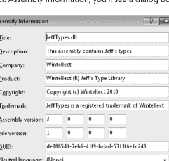

### 版本号

在上一节中，你看到可以将多个版本号应用于一个程序集。所有这些版本号都具有相同的格式：每个版本号由四个以句点分隔的部分组成，如表 2-5 所示。

**表 2-5** 版本号格式

| | 主版本号 | 次版本号 | 生成号 | 修订号 |
|---|---|---|---|---|
| 示例： | 2 | 5 | 719 | 2 |

表 2-5 显示了一个版本号示例：2.5.719.2。前两个数字构成公众对版本的认知。公众会将此示例视为程序集的版本 2.5。第三个数字 719 表示程序集的生成号。如果你的公司每天都生成程序集，那么你也应该每天递增生成号。最后一个数字 2 表示生成的修订号。如果由于某种原因，你的公司必须在一天内生成程序集两次，也许是为了解决一个阻碍其他工作的紧急 bug，则应递增修订号。

Microsoft 使用这种版本编号方案，强烈建议你也使用此方案。CLR 的未来版本将更好地支持加载程序集的新版本，以及在新版本确实破坏现有应用程序时回滚到程序集的先前版本。为了实现这种版本控制支持，CLR 将期望修复一个或多个 bug 的程序集版本具有相同的主版本号/次版本号，而生成号/修订号将表示包含更新的服务版本。加载程序集时，CLR 会自动查找与所请求程序集的主版本号/次版本号匹配的最新已安装服务版本。

你会注意到，一个程序集关联了三个版本号。这非常不幸，并会导致很多混淆。让我解释每个版本号的用途以及预期如何使用它们：

- **AssemblyFileVersion** 此版本号存储在 Win32 版本资源中。此编号仅供参考；CLR 不会以任何方式检查此版本号。通常，你将主版本号和次版本号部分设置为希望公众看到的版本。然后，每次执行生成时递增生成号和修订号部分。理想情况下，Microsoft 的工具（如 CSC.exe 或 AL.exe）会自动为你更新生成号和修订号（基于执行生成时的日期和时间），但遗憾的是，它们不会。使用 Windows 资源管理器时可以看到此版本号，它通常用于在对客户系统进行故障排除时标识程序集的特定版本。
- **AssemblyInformationalVersion** 此版本号也存储在 Win32 版本资源中；同样，此编号仅供参考；CLR


不以任何方式检查或关心它。此版本号的存在是为了指示包含该程序集的产品版本。例如，产品的 2.0 版可能包含多个程序集；其中一个程序集被标记为 1.0 版，因为它是新程序集，未随同一产品的 1.0 版一起发布。通常，你将此版本号的主版本号和次版本号部分设置为表示产品的公开版本。然后，每次打包包含其所有程序集的完整产品时，递增生成号和修订号部分。

- **AssemblyVersion** 此版本号存储在 AssemblyDef 清单元数据表中。CLR 在绑定到强命名程序集（在第 3 章中讨论）时使用此版本号。此编号极其重要，用于唯一标识程序集。开始开发程序集时，应设置主版本号、次版本号、生成号和修订号，并且在准备开始处理程序集的下一个可部署版本之前不应更改它们。生成程序集时，所引用程序集的此版本号会嵌入到 AssemblyRef 表的条目中。这意味着程序集紧密绑定到所引用程序集的特定版本。

### 区域性

与版本号一样，程序集也将区域性作为其标识的一部分。例如，我可以有一个专用于德语的程序集、另一个用于瑞士德语的程序集、另一个用于美国英语的程序集，等等。区域性通过包含主标记和辅助标记的字符串来标识（如 RFC 1766 所述）。表 2-6 显示了一些示例。

**表 2-6** 程序集区域性标记示例

| 主标记 | 辅助标记 | 区域性 |
|---|---|---|
| de | （无） | 德语 |
| de | AT | 奥地利德语 |
| de | CH | 瑞士德语 |
| en | （无） | 英语 |
| en | GB | 英国英语 |
| en | US | 美国英语 |

一般来说，如果创建包含代码的程序集，不要为其分配区域性。这是因为代码通常不包含任何区域性特定的假设。未分配区域性的程序集称为*区域性中立*程序集。

如果你正在设计一个包含某些区域性特定资源的应用程序，Microsoft 强烈建议你创建一个程序集，其中包含你的代码和应用程序的默认（或回退）资源。生成此程序集时，不要指定区域性。其他程序集在创建和操作它公开的类型时，将引用此程序集。

现在，你可以创建一个或多个单独的程序集，这些程序集仅包含区域性特定资源——完全没有代码。标记了区域性的程序集称为附属程序集。对于这些附属程序集，分配一个能准确反映放入该程序集中的资源所属区域性的区域性。应为打算支持的每个区域性创建一个附属程序集。

通常使用 AL.exe 工具生成附属程序集。你不会使用编译器，因为附属程序集内不应包含任何代码。使用 AL.exe 时，通过 /culture:text 开关指定所需的区域性，其中 text 是诸如 "en-US" 之类的字符串，表示美国英语。部署附属程序集时，应将其放在名称与区域性文本匹配的子目录中。例如，如果应用程序的基目录为 C:\MyApp，则美国英语附属程序集应放在 C:\MyApp\en-US 子目录中。运行时，使用 System.Resources.ResourceManager 类访问附属程序集的资源。

> **注意** 可以创建包含代码的附属程序集，但不鼓励这种做法。如果愿意，可以使用 **System.Reflection.AssemblyCultureAttribute** 自定义特性而不是 AL.exe 的 /culture 开关来指定区域性，例如如下所示：

```
    // Set assembly's culture to Swiss German
    [assembly:AssemblyCulture("de-CH")]
```

通常，不应生成引用附属程序集的程序集。换句话说，程序集的 AssemblyRef 条目应全部引用区域性中立程序集。如果要访问附属程序集中包含的类型或成员，应使用第 23 章“程序集加载和反射”中讨论的反射技术。

## 简单应用程序部署（私有部署的程序集）

在本章中，我解释了如何生成模块以及如何将这些模块合并到一个程序集中。现在，我准备解释如何打包和部署所有程序集，以便用户可以运行应用程序。

程序集并不规定或要求任何特殊的打包方式。打包一组程序集的最简单方法就是直接复制所有文件。例如，你可以将所有程序集文件放在 CD-ROM 上，并随附一个批处理文件安装程序发送给用户，该程序只将文件从 CD 复制到用户硬盘上的某个目录。由于程序集包含所有依赖的程序集引用和类型，用户只需运行应用程序，运行库就会在应用程序目录中查找引用的程序集。应用程序运行不需要修改注册表。要卸载应用程序，只需删除所有文件——就是这样！

当然，你也可以使用其他机制来打包和安装程序集文件，例如 .cab 文件（通常用于 Internet 下载场景，以压缩文件并减少下载时间）。还可以将程序集文件打包到 MSI 文件中，供 Windows Installer 服务（MSIExec.exe）使用。使用 MSI 文件可以允许在 CLR 首次尝试加载程序集时按需安装程序集。此功能对 MSI 来说并不新鲜；它也可以为非托管 EXE 和 DLL 文件执行相同的按需加载功能。

> **注意** 使用批处理文件或其他简单的“安装软件”可以将应用程序安装到用户计算机上；但是，你还需要更复杂的安装软件来在用户桌面和“开始”菜单上创建快捷方式链接。此外，你可以轻松备份和还原应用程序，或将其从一台计算机移动到另一台计算机，但各种快捷方式链接将需要特殊处理。

当然，Visual Studio 有一个内置机制，你可以通过显示项目的属性页并单击“发布”选项卡来发布应用程序。你可以使用“发布”选项卡上可用的选项，使 Visual Studio 生成 MSI 文件，并将生成的 MSI 文件复制到网站、FTP 服务器或文件路径。MSI 文件还可以安装任何必备组件，例如 .NET Framework 或 Microsoft SQL Server 2008 Express Edition。最后，应用程序可以利用 ClickOnce 技术自动检查更新并将其安装到用户计算机上。

部署到与应用程序相同目录的程序集称为*私有部署的程序集*，因为程序集文件不与任何其他应用程序共享（除非其他应用程序也部署到同一目录）。私有部署的程序集对开发人员、最终用户和管理员来说是一大优势，因为它们可以简单地复制到应用程序的基目录，CLR 将加载它们并执行其中的代码。此外，只需删除其目录中的程序集即可卸载应用程序。这也可以实现简单的备份和还原。

这种简单的安装/移动/卸载方案之所以可行，是因为每个程序集都有元数据，指示应加载哪个被引用的程序集；不需要注册表设置。此外，引用程序集限定了每个类型的作用域。这意味着应用程序始终绑定到其生成和测试时所用的相同类型；CLR 无法加载另一个恰好提供同名类型的不同程序集。这与 COM 不同，在 COM 中，类型记录在注册表中，使其可供计算机上运行的任何应用程序使用。

在第 3 章中，我将讨论如何部署可供多个应用程序访问的共享程序集。


每当CLR尝试定位程序集文件时，它总是首先在应用程序的目录中查找，如果在那里找不到文件，它就会在AuxFiles子目录中查找。你可以为probing元素的`privatePath`属性指定多个以分号分隔的路径。每个路径都被视为相对于应用程序基目录的路径。你不能指定标识应用程序基目录之外的目录的绝对路径或相对路径。其理念是，应用程序可以控制其目录及其子目录，但无法控制其他目录。

## 探测程序集文件

当CLR需要定位程序集时，它会扫描几个子目录。以下是针对非特定区域性的程序集进行目录探测的顺序（其中`firstPrivatePath`和`secondPrivatePath`是通过配置文件的`privatePath`属性指定的）：

```
AppDir\AsmName.dll
AppDir\AsmName\AsmName.dll
AppDir\FirstPrivatePath\AsmName.dll
AppDir\FirstPrivatePath\AsmName\AsmName.dll
AppDir\secondPrivatePath\AsmName.dll
AppDir\secondPrivatePath\AsmName\AsmName.dll
...
```

在此示例中，如果JeffTypes程序集文件被部署到名为JeffTypes的子目录中，则不需要任何配置文件，因为CLR会自动扫描名称与正在搜索的程序集名称相匹配的子目录。

如果在上述任何子目录中都找不到该程序集，CLR会从头再来，使用.exe扩展名代替.dll扩展名。如果仍然找不到该程序集，则会抛出`FileNotFoundException`。

对于附属程序集，遵循类似的规则，不同之处在于该程序集预计位于应用程序基目录下名称与区域性匹配的子目录中。例如，如果AsmName.dll具有“en-US”区域性，则会探测以下目录：

```
C:\AppDir\en-US\AsmName.dll
C:\AppDir\en-US\AsmName\AsmName.dll
C:\AppDir\FirstPrivatePath\en-US\AsmName.dll
C:\AppDir\FirstPrivatePath\en-US\AsmName\AsmName.dll
C:\AppDir\secondPrivatePath\en-US\AsmName.dll
C:\AppDir\secondPrivatePath\en-US\AsmName\AsmName.dll

C:\AppDir\en-US\AsmName.exe
C:\AppDir\en-US\AsmName\AsmName.exe
C:\AppDir\FirstPrivatePath\en-US\AsmName.exe
C:\AppDir\FirstPrivatePath\en-US\AsmName\AsmName.exe
C:\AppDir\secondPrivatePath\en-US\AsmName.exe
C:\AppDir\secondPrivatePath\en-US\AsmName\AsmName.exe
```

Machine.config文件中的设置表示影响计算机上运行的所有应用程序的默认设置。管理员可以通过修改单个Machine.config文件来创建计算机范围的策略。但是，管理员和用户应避免修改此文件，因为它包含许多与各种内容相关的设置，使得浏览起来更加困难。此外，你可能希望应用程序的设置能够备份和还原，而将应用程序的设置保存在特定于应用程序的配置文件中可以实现这一点。

# 第3章 共享程序集和强命名程序集

# 

- **本章内容：**
  - 两种程序集，两种部署方式 ..... 66
  - 为程序集赋予强名称 ..... 67
  - 全局程序集缓存 ..... 73
  - 生成引用强命名程序集的程序集 ..... 75
  - 强命名程序集具有防篡改能力 ..... 76
  - 延迟签名 ..... 77
  - 私有部署强命名程序集 ..... 80
  - 运行时如何解析类型引用 ..... 81
  - 高级管理控制（配置） ..... 84

在第2章“生成、打包、部署和管理应用程序与类型”中，我讨论了生成、打包和部署程序集所需的步骤。我重点关注了所谓的*私有部署*，即将程序集放置在应用程序的基目录（或其子目录）中供应用程序单独使用。私有部署程序集使公司能够对程序集的命名、版本和行为进行高度控制。

在本章中，我将重点讨论创建可供多个应用程序访问的程序集。Microsoft .NET Framework附带的程序集就是全局部署程序集的一个极佳示例，因为所有托管应用程序都使用Microsoft在.NET Framework类库（FCL）中定义的类型。

正如我在第2章中提到的，Microsoft Windows以不稳定而闻名。这种声誉的主要原因是应用程序是使用其他人实现的代码来构建和测试的。毕竟，当你为Windows编写应用程序时，你的应用程序正在调用由Microsoft开发人员编写的代码。此外，大量公司会制作控件，供应用程序开发人员将其整合到自己的应用程序中。实际上，.NET Framework鼓励这种做法，而且随着时间的推移，出现了许多控件供应商。

随着时间推移，Microsoft开发人员和控件开发人员会修改他们的代码：修复错误、修补安全漏洞、添加功能等等。最终，新代码会进入用户的计算机。用户先前安装并运行良好的应用程序不再使用与构建和测试应用程序时相同的代码。结果，应用程序的行为不再可预测，这导致了Windows的不稳定性。

文件版本管理是一个非常难以解决的问题。事实上，我断言，如果你采用一个被其他代码文件使用的文件，并且只改变文件中的一个位——将0改为1或将1改为0——绝对无法保证在更改前使用该文件的代码在使用新版本文件时仍能正常工作。这个说法成立的原因之一是，许多应用程序会有意或无意地利用bug。如果文件的后继版本修复了某个bug，应用程序就无法再按预期运行。

所以问题来了：如何在修复bug和向文件添加新功能的同时，保证不会破坏某些应用程序？我对这个问题进行了很多思考，并得出一个结论：这是不可能的。但显然，这个答案并不令人满意。文件会带有bug发布，公司也总是希望提供新功能。必须有一种方式分发新文件，并希望应用程序能够正常运行。如果应用程序不能正常运行，还必须有一种简单的方法将应用程序恢复到其上次已知的良好状态。

在本章中，我将解释.NET Framework为处理版本问题而提供的基础设施。让我提醒你：我接下来要描述的内容相当复杂。我将讨论内置在公共语言运行时（CLR）中的许多算法、规则和策略。我还会提到应用程序开发人员必须使用的许多工具和实用程序。这些东西很复杂，因为正如我提到的，版本问题难以应对和解决。

## 两种程序集，两种部署方式

CLR支持两种程序集：*弱命名程序集*和*强命名程序集*。

> **重要提示** 顺便说一下，你在任何.NET Framework文档中都找不到*弱命名程序集*这个术语。为什么？因为这是我杜撰的。事实上，文档中没有术语来标识弱命名程序集。我决定创造这个术语，以便在讨论程序集时不会对我所指的程序集类型产生任何歧义。

弱命名程序集和强命名程序集在结构上是相同的——也就是说，它们使用我们在第1章“CLR的执行模型”和第2章中考察过的相同的可移植可执行（PE）文件格式、PE32(+)头、CLR头、元数据、清单表以及中间语言（IL）。并且你使用相同的工具，例如C#编译器和AL.exe，来构建这两种程序集。弱命名与强命名程序集之间的真正区别在于


强命名程序集（的一个特点）是：强命名程序集使用发布者的公钥/私钥对进行签名，该密钥对唯一标识该程序集的发布者。此密钥对允许唯一标识、保护和版本控制该程序集，并且允许将程序集部署到用户计算机上的任何位置，甚至 Internet 上。这种唯一标识程序集的能力使 CLR 能够在应用程序尝试绑定到强命名程序集时强制执行某些已知安全的策略。本章专门解释什么是强命名程序集，以及 CLR 对它们应用哪些策略。

程序集可以通过两种方式部署：私有部署或全局部署。私有部署的程序集是部署在应用程序基目录或其某个子目录中的程序集。弱命名程序集只能私有部署。我在第2章讨论了私有部署的程序集。全局部署的程序集是部署到某个已知位置的程序集，CLR 在搜索该程序集时会查看该位置。强命名程序集可以私有部署或全局部署。我将在本章中解释如何创建和部署强命名程序集。表3-1总结了程序集的种类及其部署方式。

**表 3-1** 弱命名和强命名程序集可以如何部署

| 程序集种类 | 可以私有部署 | 可以全局部署 |
| --- | --- | --- |
| 弱命名 | 是 | 否 |
| 强命名 | 是 | 是 |

> **注意** 强烈建议您对所有程序集进行强命名。事实上，未来的 CLR 版本很可能要求所有程序集都强命名，并且创建弱命名程序集的能力将被弃用。弱命名程序集存在问题，因为可能出现多个不同的程序集全都具有相同的弱名称。另一方面，为程序集赋予强名称可以唯一标识该程序集。如果 CLR 能唯一标识程序集，就可以对其应用与版本控制或向后兼容性相关的更多策略。Microsoft 计划赋予未来版本的 CLR 这些策略，以简化版本控制。事实上，仅仅消除创建弱命名程序集的能力，就能让理解 CLR 的版本控制策略变得更简单。

## 为程序集赋予强名称

如果多个应用程序要访问同一个程序集，则该程序集必须放在已知目录中，并且当检测到对该程序集的引用时，CLR 必须知道自动查看该目录。然而，我们有一个问题：两家（或更多）公司可能生成具有相同文件名的程序集。然后，如果这两个程序集都被复制到同一个已知目录中，最后安装的那个会胜出，而所有使用旧程序集的应用程序将不再按预期工作。（这正是当今 Windows 中 DLL 地狱存在的原因，其中共享 DLL 都只是被复制到 System32 目录中。）

显然，仅通过文件名来区分程序集还不够好。CLR 需要支持某种允许唯一标识程序集的机制。这就是术语*强命名程序集*所指的内容。强命名程序集由四个属性组成，这些属性唯一标识该程序集：文件名（不带扩展名）、版本号、区域性标识和公钥。由于公钥是非常大的数字，我们经常使用从公钥派生的小哈希值。这个哈希值称为*公钥标记*。以下程序集标识字符串（有时称为*程序集显示名称*）标识四个完全不同的程序集文件：

```
"MyTypes, Version=1.0.8123.0, Culture=neutral, PublicKeyToken=b77a5c561934e089"
"MyTypes, Version=1.0.8123.0, Culture=en-US, PublicKeyToken=b77a5c561934e089"
"MyTypes, Version=2.0.1234.0, Culture=neutral, PublicKeyToken=b77a5c561934e089"
"MyTypes, Version=1.0.8123.0, Culture=neutral, PublicKeyToken=b03f5f7f11d50a3a"
```

第一个字符串标识一个名为 MyTypes.exe 或 MyTypes.dll 的程序集文件（实际上无法从程序集标识字符串确定文件扩展名）。生成该程序集的公司正在创建该程序集的 1.0.8123.0 版本，并且程序集中没有任何内容对任何特定区域性敏感，因为 *区域性* 设置为 **中性**。当然，任何公司都可以生成一个 MyTypes.dll（或 MyTypes.exe）程序集文件，并将其标记为版本号 1.0.8123.0 和中性区域性。

必须有一种方法将这家公司的程序集与另一家恰好具有相同属性的公司的程序集区分开。出于若干原因，Microsoft 选择使用标准的公钥/私钥加密技术，而不是 GUID、URL 或 URN 等任何其他唯一标识技术。具体来说，加密技术提供了一种方法，可以在程序集的位安装到计算机上时检查其完整性，并且还允许按发布者授予权限。我将在本章后面讨论这些技术。因此，想要唯一标记其程序集的公司必须创建公钥/私钥对。然后可以将公钥与该程序集关联。没有两家公司应该拥有相同的公钥/私钥对，正是这种区分使两家公司能够创建具有相同名称、版本和区域性的程序集而不会引起任何冲突。

> **注意** `System.Reflection.AssemblyName` 类是一个辅助类，可让您轻松构建程序集名称并获取程序集名称的各个部分。该类提供若干公共实例属性，例如 `CultureInfo`、`FullName`、`KeyPair`、`Name` 和 `Version`。该类还提供若干公共实例方法，例如 `GetPublicKey`、`GetPublicKeyToken`、`SetPublicKey` 和 `SetPublicKeyToken`。

在第2章中，我向您展示了如何命名程序集文件，以及如何应用程序集版本号和区域性。弱命名程序集可以在清单元数据中嵌入程序集版本和区域性特性；然而，当 CLR 探测子目录以查找附属程序集时，它总是忽略版本号，只使用区域性信息。因为弱命名程序集总是私有部署，所以当在应用程序的基目录中，或在可扩展标记语言 (XML) 配置文件的探测元素的 `privatePath` XML 属性中指定的任何应用程序子目录中搜索程序集文件时，CLR 只是使用程序集的名称（附加 .dll 或 .exe 扩展名）。

强命名程序集具有文件名、程序集版本和区域性。此外，强命名程序集使用发布者的私钥进行签名。

创建强命名程序集的第一步是使用强名称实用工具 SN.exe 获取密钥，该工具随 .NET Framework SDK 和 Microsoft Visual Studio 一起提供。该实用工具根据您指定的命令行开关提供大量功能。请注意，SN.exe 的所有命令行开关都区分大小写。要生成公钥/私钥对，请按如下方式运行 SN.exe：

```
SN -k MyCompany.snk
```

这一行告诉 SN.exe 创建一个名为 MyCompany.snk 的文件。该文件将包含以二进制格式保存的公钥和私钥数字。

公钥数字非常大。如果您愿意，在创建包含公钥和私钥的文件后，可以再次使用 SN.exe 实用工具查看实际的公钥。为此，必须执行 SN.exe 实用工具两次。首先，使用 `-p` 开关调用 SN.exe，创建一个仅包含公钥的文件 (MyCompany.PublicKey)：

```
SN -p MyCompany.snk MyCompany.PublicKey
```

然后，调用 SN.exe，并向其传递 `-tp` 开关和仅包含公钥的文件：

```
SN -tp MyCompany.PublicKey
```

当我执行这一行时，得到以下输出：

```
Microsoft (R) .NET Framework Strong Name Utility Version 4.0.20928.1
Copyright (c) Microsoft Corporation.  All rights reserved.

Public key is
00240000048000009400000006020000002400000525341310004000001000103f9d621b702111
850be453b92bd6a58c020eb7b804f75d67ab302047fc786ffa3797b669215afb4d814a6f294010
b233bac0b8c8098ba908955da256d964c0d07f16463d918d651a4846a62317328cac893626a550
69f21a125bc03193261176dd629eace6c90d36858de3fcb781bfc8b817936a567cad608ae672b6
1fb80eb0

Public key token is 3db32f38c8b42c9a
```

SN.exe 实用工具不提供任何显示私钥的方法。


公钥的大小使其难以使用。为了让开发人员（以及最终用户）更方便，创建了 *公钥标记*。公钥标记是公钥的 64 位哈希。`SN.exe` 的 `-tp` 开关会在其输出末尾显示与完整公钥对应的公钥标记。

既然你已经知道如何创建公钥/私钥对，创建强命名程序集就很简单了。编译程序集时，使用 `/keyfile:<file>` 编译器开关：

```text
csc /keyfile:MyCompany.snk Program.cs
```

当 C# 编译器看到此开关时，编译器会打开指定的文件（MyCompany.snk），用私钥对程序集签名，并将公钥嵌入清单中。请注意，你只对包含清单的程序集文件进行签名；程序集的其他文件无法显式签名。

如果你使用的是 Visual Studio，可以通过显示项目属性、单击“签名”选项卡、选中“对程序集签名”复选框，然后从“选择强名称密钥文件”组合框中选择 `<New...>` 选项来创建新的公钥/私钥文件。

下面解释对文件进行签名的含义：当你生成强命名程序集时，程序集的 FileDef 清单元数据表会包含组成该程序集的所有文件的列表。当每个文件的名称被添加到清单中时，会计算文件内容的哈希值，并且该哈希值会与文件名一起存储在 FileDef 表中。你可以使用 `AL.exe` 的 `/algid` 开关覆盖默认使用的哈希算法，或者在程序集的某个源代码文件中应用程序集级的 `System.Reflection.AssemblyAlgorithmIdAttribute` 自定义特性。默认情况下，使用 SHA-1 算法，这对于几乎所有应用程序来说都应该足够了。

在生成包含清单的 PE 文件之后，会对该 PE 文件的全部内容（除了任何 Authenticode 签名、程序集的强名称数据以及 PE 头校验和）进行哈希计算，如图 3-1 所示。这里使用的哈希算法始终是 SHA-1，且无法覆盖。此哈希值会用发布者的私钥签名，生成的 RSA 数字签名会存储在 PE 文件内的一个保留节中（不包含在哈希中）。PE 文件的 CLR 头会被更新，以反映数字签名嵌入在文件中的位置。

```text
AssemblyRef #1 (23000001)
---------------------------------------
Token: 0x23000001
Public Key or Token: b7 7a 5c 56 19 34 e0 89
Name: mscorlib
Version: 4.0.0.0
Major Version: 0x00000004
Minor Version: 0x00000000
Build Number: 0x00000000
Revision Number: 0x00000000
Locale: <null>
HashValue Blob:
Flags: [none] (00000000)
```

由此可以看出，JeffTypes.dll 引用了一个类型，该类型包含在匹配以下属性的程序集中：

> "MSCorLib, Version=4.0.0.0, Culture=neutral, PublicKeyToken=b77a5c561934e089"

不幸的是，ILDasm.exe 使用了 *区域设置* 这一术语，而实际上它应该使用 *区域性*。

如果你查看 JeffTypes.dll 的 AssemblyDef 元数据表，会看到以下内容：

```text
Assembly
---------------------------------------
Token: 0x20000001
Name : JeffTypes
PublicKey :
Hash Algorithm : 0x00008004
Version: 3.0.0.0
Major Version: 0x00000003
Minor Version: 0x00000000
Build Number: 0x00000000
Revision Number: 0x00000000
Locale: <null>
Flags : [none] (00000000)
```

这等价于以下内容：

> "JeffTypes, Version=3.0.0.0, Culture=neutral, PublicKeyToken=null"

在这一行中，没有指定公钥标记，因为第 2 章中的 JeffTypes.dll 程序集并未使用公钥/私钥对签名，因此它是一个弱命名程序集。如果我曾使用 SN.exe 创建密钥文件，并使用 **/keyfile** 编译器开关进行编译，那么生成的程序集就会被签名。如果我随后使用 ILDasm.exe 查看新程序集的元数据，AssemblyDef 条目中 PublicKey 字段之后会出现字节，并且该程序集将是强命名程序集。顺便说一句，AssemblyDef 条目始终存储完整的公钥，而不是公钥标记。完整的公钥是确保文件未被篡改所必需的。本章后面我会解释强命名程序集的防篡改能力。

```text
    /?
        Displays a detailed help screen

    Options:
    /r <reference_scheme> <reference_id> <description>
        Specifies a traced reference to install (/i, /il) or uninstall (/u, /ul).

    /f
        Forces reinstall of an assembly.

    /nologo
        Suppresses display of the logo banner

    /silent
        Suppresses display of all output
```

如你所见，你可以调用 GACUtil.exe，指定 /i 开关将程序集安装到 GAC 中，也可以使用 GACUtil.exe 的 /u 开关从 GAC 中卸载程序集。请注意，永远不能将弱命名程序集放入 GAC。如果将弱命名程序集的文件名传递给 GACUtil.exe，它会显示以下错误消息：“将程序集添加到缓存失败：尝试安装没有强名称的程序集。”

> **注意** 默认情况下，只有属于 Windows 管理员组的用户才能操作 GAC。如果调用该实用工具的用户不是此组的成员，GACUtil.exe 将无法安装或卸载程序集。

使用 GACUtil.exe 的 /i 开关对开发人员测试非常方便。然而，如果你在生产环境中使用 GACUtil.exe 部署程序集，建议除了指定 /i 或 /u 开关来安装或卸载程序集之外，还使用 GACUtil.exe 的 /r 开关。/r 开关会将程序集与 Windows 安装和卸载引擎集成。基本上，它会告诉系统哪个应用程序需要该程序集，然后将应用程序和程序集绑定在一起。

> **注意** 如果强命名程序集打包在 cabinet（.cab）文件中或以某种方式压缩，则必须先将该程序集文件解压缩到临时文件，然后才能使用 GACUtil.exe 将程序集文件安装到 GAC 中。一旦程序集文件安装完成，就可以删除临时文件。

GACUtil.exe 工具不会随最终用户 .NET Framework 可再发行包一起提供。如果你的应用程序包含一些想要部署到 GAC 中的程序集，则应使用 Windows Installer (MSI)，因为 MSI 是唯一保证存在于最终用户计算机上并且能够将程序集安装到 GAC 中的工具。

> **重要** 将程序集文件全局部署到 GAC 是对程序集进行注册的一种形式，尽管实际的 Windows 注册表不会受到任何影响。将程序集安装到 GAC 会破坏简单应用程序安装、备份、还原、移动和卸载的目标。因此，建议避免全局部署，并尽可能使用私有部署。

在 GAC 中“注册”程序集的目的是什么？假设有两家公司各自生成一个 OurLibrary 程序集，该程序集由一个文件组成：OurLibrary.dll。显然，这两个文件不能放在同一目录中，因为后安装的文件会覆盖先安装的文件，这肯定会导致某个应用程序无法正常工作。当你将程序集安装到 GAC 中时，会在 C:\Windows\Assembly 目录下创建专用子目录，并将程序集文件复制到其中一个子目录中。

通常没有人会检查 GAC 的子目录，因此 GAC 的结构对你来说并不重要。只要工具和 CLR 知道该结构，一切就都没问题。

## 生成引用强命名程序集的程序集

每当你生成一个程序集时，该程序集都会引用其他强命名程序集。这是真的，因为 System.Object 定义在 MSCorLib.dll 中，而该文件是强命名的。然而，程序集很可能会引用由 Microsoft、第三方或你自己的组织发布的其他强命名程序集中的类型。在第 2 章中，我展示了如何使用 CSC.exe 的 /reference 编译器开关来指定要引用的程序集文件名。如果文件名是完整路径，CSC.exe 会加载指定的文件，并使用其元数据信息来生成程序集。如第 2 章所述，如果指定的文件名不带路径，CSC.exe 会尝试按以下目录顺序（按此处列出的顺序）查找程序集：

- 1. 工作目录。
- 2. 包含 CSC.exe 文件本身的目录。此目录还包含 CLR DLL。
- 3. 使用 /lib 编译器开关指定的任何目录。
- 4. 使用 LIB 环境变量指定的任何目录。

因此，如果你要生成一个引用 Microsoft 的 System.Drawing.dll 的程序集，可以在调用 CSC.exe 时指定 /reference:System.Drawing.dll 开关。编译器将检查前面列出的目录，并在包含 CSC.exe 文件本身的目录中找到 System.Drawing.dll 文件；该目录与包含编译器所绑定 CLR 版本的 DLL 的目录相同。尽管这是编译时找到程序集的目录，但它并不是运行时加载程序集所在的目录。


当应用程序需要绑定到某个程序集时，CLR 会使用被引用程序集的属性（名称、版本、区域性和公钥）在 GAC 中定位该程序集。如果找到了被引用的程序集，则返回包含该程序集的子目录，并加载包含清单的文件。以这种方式查找程序集可向调用方保证：运行时加载的程序集与编译代码时所针对的程序集由同一发布者构建。之所以能提供这种保证，是因为引用程序集的 AssemblyRef 表中的公钥标记与被引用程序集的 AssemblyDef 表中的公钥相对应。如果被引用程序集不在 GAC 中，CLR 会先在应用程序的基目录中查找，然后在应用程序配置文件中标识的任何私有路径中查找；接着，如果应用程序是使用 MSI 安装的，CLR 会要求 MSI 定位该程序集。如果在这些位置中的任何一处都找不到该程序集，则绑定失败，并引发 **System.IO.FileNotFoundException**。

当强命名程序集文件从 GAC 以外的位置（通过应用程序的基目录或通过配置文件中的 **codeBase** 元素）加载时，CLR 会在加载程序集时比较哈希值。换句话说，每次应用程序执行并加载该程序集时，都会对该文件执行哈希计算。这种性能损失是为了确保程序集文件的内容未被篡改而做出的权衡。当 CLR 在运行时检测到哈希值不匹配时，会引发 **System.IO.FileLoadException**。


> **注意** 当强命名程序集安装到 GAC 中时，系统会确保包含清单的文件未被篡改。此检查只在安装时进行一次。此外，为了提高性能，如果强命名程序集完全受信任并且正被加载到完全受信任的 AppDomain 中，CLR 不会检查该程序集是否已被篡改。另一方面，当强命名程序集从 GAC 以外的目录加载时，CLR 会验证程序集的清单文件，以确保文件内容未被篡改，这会导致每次加载该文件时产生额外的性能损失。

## 延迟签名

本章前面，我讨论了 SN.exe 工具如何生成公钥/私钥对。该工具通过调用 Windows 提供的 Crypto API 来生成密钥。这些密钥可存储在文件或其他存储设备中。例如，大型组织（如 Microsoft）会将返回的私钥保存在锁于保险库中的硬件设备里；公司中只有少数人可以访问该私钥。这一预防措施可防止私钥泄露，并确保密钥的完整性。公钥嘛，是公开的，可自由分发。

当你准备打包强命名程序集时，必须使用安全的私钥对其进行签名。然而，在开发和测试程序集期间，获得对

当你完成程序集的开发和测试后，需要正式对其进行签名，以便可以打包和部署它。要签名程序集，请再次使用 SN.exe 实用工具，这次使用 **–R** 开关以及包含实际私钥的文件的名称。**–R** 开关会使 SN.exe 对文件内容进行哈希计算，用私钥对其签名，并将 RSA 数字签名嵌入文件中之前为其预留空间的位置。完成此步骤后，你可以部署完全签名的程序集。在开发和测试机器上，别忘了使用 SN.exe 的 **–Vu** 或 **–Vx** 命令行开关重新开启对此程序集的验证。下列列表总结了本节讨论的步骤，说明如何使用延迟签名技术开发程序集：

- 1. 在开发程序集期间，获取一个仅包含公司公钥的文件，并使用 **/keyfile** 和 **/delaysign** 编译器开关编译程序集：

  ```
  csc /keyfile:MyCompany.PublicKey /delaysign MyAssembly.cs
  ```

- 2. 生成程序集后，执行以下命令行，使 CLR 在不执行哈希和比较的情况下信任该程序集的字节。这样你就可以将程序集安装到 GAC（如果需要）。现在，你可以生成引用该程序集的其他程序集，并可以测试该程序集。请注意，每台机器只需执行以下命令行一次；不必每次生成程序集时都执行此步骤。

  ```
  SN.exe –Vr MyAssembly.dll
  ```

- 3. 当准备打包和部署程序集时，获取公司的私钥，然后执行下面一行命令。如果需要，你可以将此新版本安装到 GAC，但在执行步骤 4 之前不要尝试将其安装到 GAC。

  ```
  SN.exe –R MyAssembly.dll MyCompany.PrivateKey
  ```

- 4. 要在真实条件下测试，请执行以下命令行以重新开启验证：

  ```
  SN.exe –Vu MyAssembly.dll
  ```

在本节开头，我提到组织如何将密钥对保存在智能卡等硬件设备中。为确保这些密钥安全，必须确保密钥值永远不会持久化到磁盘文件中。加密服务提供程序 (CSP) 提供了可抽象这些密钥位置的容器。例如，Microsoft 使用一种 CSP，该 CSP 有一个容器，当访问该容器时，会从硬件设备获取私钥。

如果你的公钥/私钥对位于 CSP 容器中，则必须为 CSC.exe、AL.exe 和 SN.exe 程序指定不同的开关：编译时 (CSC.exe)，指定 **/keycontainer** 开关而不是 **/keyfile** 开关；链接时 (AL.exe)，指定其 **/keyname** 开关而不是其 **/keyfile** 开关；使用强名称程序 (SN.exe) 向延迟签名的程序集添加私钥时，指定 **–Rc** 开关而不是 **–R** 开关。SN.exe 提供了额外的开关，允许你使用 CSP 执行操作。

**重要** 当你想在打包程序集之前对其执行某些其他操作时，延迟签名也很有用。例如，你可能想对程序集运行混淆器。程序集完全签名后就不能再对其进行混淆，因为哈希值将不正确。因此，如果你想混淆程序集文件或执行任何其他类型的生成后操作，应使用延迟签名，执行生成后操作，然后使用 –R 或 –Rc 开关运行 SN.exe，以完成程序集的签名过程及其所有哈希处理。

## 私有部署强命名程序集

将程序集安装到 GAC 可带来多项好处。GAC 使许多应用程序能够共享程序集，从而总体上减少物理内存使用量。此外，很容易将程序集的新版本部署到 GAC，并让所有应用程序通过发布者策略（本章后面介绍）使用新版本。GAC 还为程序集的不同版本提供并行管理。但是，GAC 通常是受保护的，因此只有管理员才能将程序集安装到其中。而且，安装到 GAC 会破坏简单的复制部署方案。

尽管强命名程序集可以安装到 GAC 中，但它们当然不必如此。事实上，建议仅当程序集打算由许多应用程序共享时，才将其部署到 GAC。如果程序集不打算共享，则应私有部署。私有部署可保留简单的复制安装部署方案，并更好地隔离应用程序及其程序集。此外，GAC 也不应成为公共文件的新 C:\Windows\System32 堆放地。原因是程序集的新版本不会相互覆盖；它们会并行安装，占用磁盘空间。

除了将强命名程序集部署到 GAC 或进行私有部署之外，还可以将强命名程序集部署到一小部分应用程序知道的某个任意目录中。例如，你可能要生成三个应用程序，它们都想共享一个强命名程序集。安装时，你可以创建三个目录：每个应用程序一个目录，另外再为要共享的程序集创建一个目录。将每个应用程序安装到其目录中时，还要安装一个 XML 配置文件，并让共享程序集的 `codeBase` 元素指示共享程序集的路径。这样在运行时，CLR 就会知道到该强命名程序集的目录中查找共享程序集。需要说明的是，这种技术很少使用，并且有点不鼓励使用，因为没有任何单个应用程序控制程序集文件应在何时卸载。


> **注意** 配置文件的 `codeBase` 元素实际上标识的是一个 URL。此 URL 可以指向用户计算机上的任意目录，也可以指向 Web 地址。对于 Web 地址，CLR 会自动下载该文件，并将其存储在用户的下载缓存中（即 `C:\\Users\\UserName\\Local Settings\\Application Data\\Assembly` 下的一个子目录，其中 `UserName` 是当前登录的 Windows 用户账户名）。将来引用该文件时，CLR 会将已下载文件的时间戳与指定 URL 处文件的时间戳进行比较。如果 URL 处文件的时间戳更新，CLR 将下载该文件的新版本并加载它。如果先前下载的文件更新，CLR 将加载此文件，而不会再次下载该文件（从而提高性能）。本章后面会展示一个包含 `codeBase` 元素的配置文件示例。

## 运行时如何解析类型引用

在第 2 章开头，我们看到了以下源代码：

```csharp
public sealed class Program {
    public static void Main() {
        System.Console.WriteLine("Hi");
    }
}
```

此代码编译并构建到一个程序集中，例如 `Program.exe`。运行此应用程序时，CLR 会加载并初始化。然后 CLR 读取该程序集的 CLR 头，查找标识应用程序入口点方法（`Main`）的 `MethodDefToken`。从 `MethodDef` 元数据表中，定位该方法 IL 代码在文件中的偏移量，并 JIT 编译为本机代码，其中包括对代码进行类型安全验证。随后本机代码开始执行。下面是 `Main` 方法的 IL 代码。为获得此输出，我运行了 `ILDasm.exe`，选择“视图”菜单中的“显示字节”菜单项，然后在树视图中双击 `Main` 方法。

```cil
.method public hidebysig static void Main() cil managed
// SIG: 00 00 01
{
    .entrypoint
    // Method begins at RVA 0x2050
    // Code size       11 (0xb)
    .maxstack  8
    IL_0000:  /* 72   | (70)000001       */
              ldstr      "Hi"
    IL_0005:  /* 28   | (0A)000003       */
              call       void [mscorlib]System.Console::WriteLine(string)
    IL_000a:  /* 2A   |                  */
              ret
} // end of method Program::Main
```

在 JIT 编译此代码时，CLR 会检测对类型和成员的所有引用，并加载定义它们的程序集（如果尚未加载）。如你所见，上面的 IL 代码引用了 `System.Console.WriteLine`。具体来说，IL `call` 指令引用了元数据标记 0A000003。此标记标识 MemberRef 元数据表（表 0A）中的第 3 项。CLR 查找此 MemberRef 项，并发现其字段之一指向 TypeRef 表（**System.Console** 类型）中的某一项。根据 TypeRef 项，CLR 被定向到一个 AssemblyRef 项：“mscorlib, Version=4.0.0.0, Culture=neutral, PublicKeyToken=b77a5c561934e089”。此时，CLR 知道它需要哪个程序集。现在，CLR 必须定位该程序集以便加载它。

解析引用的类型时，CLR 可以在以下三个位置之一找到该类型：

- **同一文件** 对同一文件中类型的访问在编译时确定（有时称为*早期绑定*）。该类型直接从文件中加载，然后继续执行。
- **不同文件，同一程序集** 运行时确保所引用的文件确实位于当前程序集清单的 FileRef 表中。然后，运行时会在加载程序集清单文件所在的目录中查找。该文件被加载，检查其哈希值以确保文件完整性，找到该类型的成员，然后继续执行。
- **不同文件，不同程序集** 当引用的类型位于不同程序集的文件中时，运行时会加载包含被引用程序集清单的文件。如果此文件不包含该类型，则加载相应的文件。找到该类型的成员，然后继续执行。

> **注意** ModuleDef、ModuleRef 和 FileDef 元数据表使用文件名及其扩展名来引用文件。然而，AssemblyRef 元数据表使用不带扩展名的文件名来引用程序集。绑定到程序集时，系统会在尝试通过探测目录来定位文件的过程中自动追加 .dll 和 .exe 文件扩展名，如第 2 章“简单管理控制（配置）”一节所述。

如果在解析类型引用时发生任何错误——找不到文件、无法加载文件、哈希不匹配等——则会引发相应的异常。

> **注意** 如果需要，你的代码可以向 **System.AppDomain 的** **AssemblyResolve、ReflectionOnlyAssemblyResolve 和 TypeResolve** 事件注册回调方法。在回调方法中，你可以执行解决绑定问题的代码，使应用程序能够继续运行而不引发异常。

在前面的示例中，CLR 确定 **System.Console** 是在与调用方不同的程序集中实现的。CLR 必须搜索该程序集，并加载包含该程序集清单的 PE 文件。然后扫描该清单以确定实现该类型的 PE 文件。如果清单文件包含被引用的类型，则一切正常。如果该类型位于该程序集的另一个文件中，CLR 会加载另一个文件并扫描其元数据以定位该类型。然后，CLR 创建其内部数据结构来表示该类型，JIT 编译器完成 `Main` 方法的编译。最后，`Main` 方法可以开始执行。

图 3-2 展示了类型绑定是如何发生的。

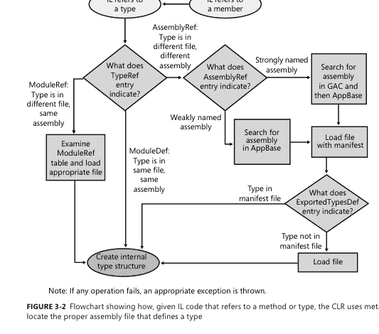

> **重要** 严格来说，刚才描述的示例并非 100% 正确。对于引用未随 .NET Framework 一起提供的程序集中定义的方法和类型，上述讨论是正确的。然而，.NET Framework 程序集（包括 MSCorLib.dll）与正在运行的 CLR 版本紧密关联。任何引用 .NET Framework 程序集的程序集始终绑定到与 CLR 版本匹配的版本。这称为统一化；Microsoft 这样做是因为他们使用特定版本的 CLR 测试所有 .NET Framework 程序集；因此，统一代码栈有助于确保应用程序正常工作。
>
> 因此，在前面的示例中，对 System.Console.WriteLine 方法的引用会绑定到与 CLR 版本匹配的任意版本的 MSCorLib.dll，而不管程序集的 AssemblyRef 元数据表中引用的是哪个版本的 MSCorLib.dll。

这个故事还有一个转折：对 CLR 而言，所有程序集都通过名称、版本、区域性和公钥来标识。然而，GAC 使用名称、版本、区域性、公钥和 CPU 体系结构来标识程序集。在 GAC 中搜索程序集时，CLR 会确定应用程序当前运行在哪种类型的进程中：32 位 x86（可能使用 WoW64 技术）、64 位 x64 或 64 位 IA64。然后，在 GAC 中搜索程序集时，CLR 首先搜索特定于 CPU 体系结构的程序集版本。如果找不到匹配的程序集，则搜索与 CPU 无关的程序集版本。

在本节中，你看到了 CLR 在使用默认策略时如何定位程序集。然而，管理员或程序集发布者可以重写默认策略。在接下来的两节中，我将描述如何更改 CLR 的默认绑定策略。

> **注意** CLR 支持将类型（类、结构、枚举、接口或委托）从一个程序集移动到另一个程序集。例如，在 .NET 3.5 中，**System.TimeZoneInfo** 类定义在 System.Core.dll 程序集中。但在 .NET 4.0 中，Microsoft 将该类移到了 Mscorlib.dll 程序集。通常，将类型从一个程序集移到另一个程序集会破坏应用程序。然而，CLR 提供了 **System.Runtime.CompilerServices.TypeForwardedToAttribute** 特性，可将其应用于原始程序集（例如 System.Core.dll）。传递给此特性构造函数的参数类型为 **System.Type**，它指示应用程序现在应使用的新类型（该类型现在定义在 Mscorlib.dll 中）。CLR 的绑定器使用此信息。由于 **TypeForwardedToAttribute** 的构造函数接受 **Type**，因此包含此特性的程序集将依赖于定义该类型的新程序集。
>
> 如果利用此功能，则还应将 **System.Runtime.CompilerServices.TypeForwardedFromAttribute** 特性应用于新程序集中的该类型，并向此特性的构造函数传递一个 **String**，其中包含过去定义该类型的程序集的完整名称。此特性通常用于工具、实用程序和序列化。由于 **TypeForwardedFromAttribute** 的构造函数接受 **String**，因此包含此特性的程序集不依赖于过去定义该类型的程序集。

## 高级管理控制（配置）

在第 2 章的“简单管理控制（配置）”一节中，我简要介绍了管理员如何影响 CLR 搜索和绑定程序集的方式。在该节中，我演示了如何将被引用程序集的文件移动到应用程序基目录的子目录中，以及 CLR 如何使用应用程序的 XML 配置文件来定位已移动的文件。

第 2 章只讨论了探测元素的 **privatePath** 特性，本节我将讨论其他 XML 配置文件元素。以下是一个 XML 配置文件：

```xml
<?xml version="1.0"?>
<configuration>
  <runtime>
    <assemblyBinding xmlns="urn:schemas-microsoft-com:asm.v1">
      <probing privatePath="AuxFiles;bin\subdir" />

      <dependentAssembly>

        <assemblyIdentity name="JeffTypes"
          publicKeyToken="32ab4ba45e0a69a1" culture="neutral"/>

        <bindingRedirect
          oldVersion="1.0.0.0" newVersion="2.0.0.0" />

        <codeBase version="2.0.0.0"
          href="http://www.Wintellect.com/JeffTypes.dll" />

      </dependentAssembly>

      <dependentAssembly>

        <assemblyIdentity name="TypeLib"
          publicKeyToken="1f2e74e897abbcfe" culture="neutral"/>

        <bindingRedirect
          oldVersion="3.0.0.0-3.5.0.0" newVersion="4.0.0.0" />

        <publisherPolicy apply="no" />

      </dependentAssembly>

    </assemblyBinding>
  </runtime>
</configuration>
```

这个 XML 文件向 CLR 提供了大量信息。具体内容如下：

- **probing 元素**  在尝试查找弱命名程序集时，请查看应用程序基目录下的 AuxFiles 和 bin\subdir 子目录。对于强命名程序集，CLR 会在 GAC 中或 **codeBase** 元素指定的 URL 中查找。只有在未指定 **codeBase** 元素时，CLR 才会在应用程序的私有路径中查找强命名程序集。
- **第一个 dependentAssembly、assemblyIdentity 和 bindingRedirect 元素**  当尝试定位由控制 32ab4ba45e0a69a1 公钥标记的组织发布的、区域性中立的 JeffTypes 程序集的 1.0.0.0 版本时，改为定位同一程序集的 2.0.0.0 版本。
- **codeBase 元素**  当尝试定位由控制 32ab4ba45e0a69a1 公钥标记的组织发布的、区域性中立的 JeffTypes 程序集的 2.0.0.0 版本时，请尝试在以下 URL 中查找：*www.Wintellect.com/JeffTypes.dll*。尽管我在第 2 章没有提到这一点，但 **codeBase** 元素也可以用于弱命名程序集。在这种情况下，程序集的版本号会被忽略，并且应从 XML 的 `codeBase` 元素中省略。此外，`codeBase` URL 必须指向应用程序基目录下的某个目录。
- 第二个 `dependentAssembly`、`assemblyIdentity` 和 `bindingRedirect` 元素  当尝试定位由控制 `1f2e74e897abbcfe` 公钥标记的组织发布的、区域性中立的 TypeLib 程序集的 3.0.0.0 版本到 3.5.0.0 版本（含）时，改为定位同一程序集的 4.0.0.0 版本。
- `publisherPolicy` 元素  如果生成 TypeLib 程序集的组织已部署发布者策略文件（将在下一节中描述），则 CLR 应忽略此文件。

编译方法时，CLR 会确定被引用的类型和成员。运行时利用这些信息，通过查看引用程序集的 `AssemblyRef` 表，确定在生成调用程序集时最初引用的程序集。然后，CLR 在应用程序的配置文件中查找该程序集/版本，并应用所有版本号重定向；现在 CLR 查找的就是这个程序集/版本。

如果 `publisherPolicy` 元素的 `apply` 属性设置为 `yes`——或者省略了该元素——CLR 会检查 GAC 中是否存在新的程序集/版本，并应用程序集发布者认为必要的任何版本号重定向；现在 CLR 查找的就是这个程序集/版本。我将在下一节更详细地讨论发布者策略。最后，CLR 在计算机的 `Machine.config` 文件中查找新的程序集/版本，并在那里应用任何版本号重定向。

此时，CLR 知道它应加载的程序集版本，并尝试从 GAC 加载该程序集。如果该程序集不在 GAC 中，并且没有 `codeBase` 元素，则 CLR 会按我在第 2 章中所述探测该程序集。如果执行最后一次重定向的配置文件还包含 `codeBase` 元素，则 CLR 会尝试从 `codeBase` 元素指定的 URL 加载该程序集。

使用这些配置文件，管理员可以真正控制 CLR 决定加载哪个程序集。如果应用程序遇到 bug，管理员可以联系出错程序集的发布者。发布者可以向管理员发送一个新的程序集，管理员可以安装它。默认情况下，CLR 不会加载这个新程序集，因为已经生成的程序集不引用新版本。但是，管理员可以修改应用程序的 XML 配置文件，指示 CLR 加载新程序集。

如果管理员希望计算机上的所有应用程序都采用新程序集，则可以改为修改计算机的 `Machine.config` 文件，这样只要应用程序引用旧程序集，CLR 就会加载新程序集。

如果新程序集没有修复原始 bug，管理员可以从配置文件中删除绑定重定向行，应用程序将恢复到之前的行为。需要注意的是，系统允许使用与元数据中记录的程序集版本不完全匹配的程序集。这种额外的灵活性非常方便。

## 发布者策略控制

在上一节描述的场景中，程序集的发布者只是将程序集的新版本发送给管理员，管理员安装该程序集并手动编辑应用程序或计算机的 XML 配置文件。一般来说，当发布者修复程序集中的 bug 时，发布者希望有一种简单的方法来打包新程序集并将其分发给所有用户。但发布者还需要一种方法来告诉每个用户的 CLR 使用新的程序集版本而不是旧版本。当然，每个用户都可以修改自己的应用程序或计算机的 XML 配置文件，但这非常不方便且容易出错。发布者需要的是一种创建策略信息的方法，该信息在安装新程序集时安装到用户计算机上。在本节中，我将展示程序集的发布者如何创建这种策略信息。

假设你是某个程序集的发布者，并且刚刚创建了修复了一些 bug 的程序集新版本。当你打包新程序集以发送给所有用户时，还应创建一个 XML 配置文件。这个配置文件看起来与我们一直在讨论的配置文件完全一样。下面是 JeffTypes.dll 程序集的一个示例文件（名为 JeffTypes.config）：

```xml
<configuration>
   <runtime>
      <assemblyBinding xmlns="urn:schemas-microsoft-com:asm.v1">
         <dependentAssembly>

            <assemblyIdentity name="JeffTypes"
               publicKeyToken="32ab4ba45e0a69a1" culture="neutral"/>

            <bindingRedirect
               oldVersion="1.0.0.0" newVersion="2.0.0.0" />

            <codeBase version="2.0.0.0"
               href="http://www.Wintellect.com/JeffTypes.dll"/>

         </dependentAssembly>
      </assemblyBinding>
   </runtime>
</configuration>
```

当然，发布者只能为它们自己创建的程序集设置策略。此外，这里显示的元素只是可在发布者策略配置文件中指定的元素；例如，你不能指定 probing 或 publisherPolicy 元素。

这个配置文件告诉 CLR，只要引用了 JeffTypes 程序集的 1.0.0.0 版本，就加载该程序集的 2.0.0.0 版本。现在，作为发布者，你可以创建一个包含此发布者策略配置文件的程序集。通过如下运行 AL.exe 来创建发布者策略程序集：

```text
AL.exe /out:Policy.1.0.JeffTypes.dll
      /version:1.0.0.0
      /keyfile:MyCompany.snk
      /linkresource:JeffTypes.config
```

让我解释一下 AL.exe 命令行开关的含义：

- **/out**  此开关告诉 AL.exe 创建一个新的 PE 文件，名为 Policy.1.0.JeffTypes.dll，该文件仅包含一个清单。此程序集的名称非常重要。名称的第一部分 Policy 告诉 CLR，此程序集包含发布者策略信息。名称的第二和第三部分 1.0 告诉 CLR，此发布者策略程序集适用于主版本号和次版本号为 1.0 的任何 JeffTypes 程序集版本。发布者策略仅适用于程序集的主版本号和次版本号；你不能创建特定于程序集的单个生成或修订的发布者策略。名称的第四部分 JeffTypes 表示此发布者策略对应的程序集名称。名称的第五部分也是最后一部分 dll，只是赋予生成的程序集文件的扩展名。
- **/version**  此开关标识发布者策略程序集的版本；此版本号与 JeffTypes 程序集本身无关。你看，发布者策略程序集也可以有版本。今天，发布者可能创建一个发布者策略，将 JeffTypes 的 1.0.0.0 版本重定向到 2.0.0.0 版本。将来，发布者可能希望将 JeffTypes 的 1.0.0.0 版本定向到 2.5.0.0 版本。CLR 使用此版本号，以便知道要选取发布者策略程序集的最新版本。
- **/keyfile**  此开关使 AL.exe 使用发布者的公钥/私钥对为发布者策略程序集签名。此密钥对还必须与用于 JeffTypes 程序集所有版本的密钥对匹配。毕竟，CLR 正是通过这种方式知道 JeffTypes 程序集和此发布者策略文件是由同一发布者创建的。
- **/linkresource**  此开关告诉 AL.exe，XML 配置文件应被视为程序集的一个单独文件。生成的程序集由两个文件组成，这两个文件都必须与新版本的 JeffTypes 程序集一起打包并部署给用户。顺便说一下，你不能使用 AL.exe 的 **/embedresource** 开关将 XML 配置文件嵌入程序集文件中，从而形成单文件程序集，因为 CLR 要求 XML 文件包含在其自己的单独文件中。

一旦构建好此发布者策略程序集，就可以将其与新 JeffTypes.dll 程序集文件一起打包并部署给用户。发布者策略程序集必须安装到 GAC 中。尽管 JeffTypes 程序集也可以安装到 GAC 中，但它

未必如此。它可以部署到应用程序的基目录中，或者由某个 **codeBase** URL 指定的其他目录中。

> **重要提示** 发布者只应在部署程序集的更新版本或服务包版本时创建发布者策略程序集。在全新安装应用程序时，不应安装任何发布者策略程序集。

关于发布者策略，我还想最后再说明一点。假设发布者分发了一个发布者策略程序集，但由于某种原因，新程序集引入的 bug 比它修复的还多。如果发生这种情况，管理员会希望告诉 CLR 忽略该发布者策略程序集。要让运行时这样做，管理员可以编辑应用程序的配置文件，并添加以下 **publisherPolicy** 元素：

```xml
<publisherPolicy apply="no"/>
```

该元素可以作为 **`<assemblyBinding>`** 元素的子元素放置在应用程序的配置文件中，以便应用于所有程序集；也可以作为 **`<dependentAssembly>`** 元素的子元素放置在应用程序的配置文件中，以便应用于特定程序集。当 CLR 处理应用程序的配置文件时，它会发现不应在 GAC 中查找发布者策略程序集。因此，CLR 将继续使用程序集的旧版本。但请注意，CLR 仍会检查并应用 Machine.config 文件中指定的任何策略。

> **重要提示** 发布者策略程序集是发布者就程序集不同版本之间的兼容性做出声明的一种方式。如果新版本的程序集不打算与早期版本兼容，则发布者不应创建发布者策略程序集。通常，当您构建修复 bug 的新版本程序集时，应使用发布者策略程序集。您应该测试新版本程序集的向后兼容性。另一方面，如果您要向程序集添加新功能，则应将该程序集视为与先前版本无关，并且不应发布发布者策略程序集。此外，也无需对此类程序集进行任何向后兼容性测试。

# 第4章 类型基础

**本章内容：**
- 所有类型都派生自 System.Object ........................................ 91
- 类型之间的转换 .......................................................... 93
- 命名空间和程序集 ...................................................... 97
- 运行时各事物的关系 .................................................. 102

在本章中，我将介绍与类型和公共语言运行时（CLR）相关的基础信息。特别地，我将讨论每种类型都应具备的最小行为集合。我还将描述类型安全、命名空间、程序集，以及将对象从一种类型转换为另一种类型的各种方式。最后，我将在本章结尾解释类型、对象、线程栈和托管堆在运行时是如何相互关联的。

## 所有类型都派生自 System.Object

运行时要求每个类型最终都必须派生自 **System.Object** 类型。这意味着以下两种类型定义是相同的：

```csharp
// 隐式派生自 Object
class Employee {
    ...
}

// 显式派生自 Object
class Employee : System.Object {
    ...
}
```

因为所有类型最终都派生自 **System.Object**，所以可以保证每种类型的每个对象都拥有一组最少的方法。具体来说，**System.Object** 类提供了表 4-1 中列出的公共实例方法。

以下是 **new** 运算符所做的事情：

- 1. 它计算类型中定义的所有实例字段及其所有基类型（一直到并包括 **System.Object**，它自身不定义任何实例字段）所需的字节数。堆上的每个对象都需要一些额外的成员——称为类型对象指针和同步块索引——供 CLR 用来管理对象。这些额外成员的字节会被添加到对象的大小中。
- 2. 它从托管堆中分配指定类型所需的字节数来为对象分配内存；所有这些字节随后都被设置为零（0）。
- 3. 它初始化对象的类型对象指针和同步块索引成员。
- 4. 调用类型的实例构造函数，传入在调用 **new** 时指定的任何参数（在前面的示例中为字符串“**ConstructorParam1**”）。大多数编译器会在构造函数调用中自动发出调用基类构造函数的代码。每个构造函数负责初始化正在调用其构造函数的类型所定义的实例字段。最终，**System.Object** 的构造函数被调用，而该构造函数方法只是返回，不做其他任何事情。您可以通过使用 ILDasm.exe 加载 MSCorLib.dll 并检查 **System.Object** 的构造函数方法来验证这一点。

在 **new** 完成所有这些操作后，它会返回对新创建对象的引用（或指针）。在前面的代码示例中，该引用保存在变量 `e` 中，其类型为 **Employee**。

顺便提一下，new 运算符没有对应的 **delete** 运算符；也就是说，没有方法可以显式释放为对象分配的内存。CLR 使用垃圾回收环境（在第 21 章中描述）来自动检测对象何时不再被使用或访问，并自动释放对象的内存。

## 类型之间的转换

CLR 最重要的特性之一是类型安全。在运行时，CLR 始终知道对象是什么类型。您始终可以通过调用 **GetType** 方法来发现对象的确切类型。由于此方法是非虚拟的，因此某个类型不可能伪装成另一个类型。例如，**Employee** 类型不能重写 **GetType** 方法并让它返回 **SuperHero** 类型。

开发人员经常需要将对象转换为各种类型。CLR 允许您将对象转换为其类型或其任何基类型。您选择的编程语言决定了如何向开发人员提供转换操作。例如，C# 不需要任何特殊语法来将对象转换为其任何基类型，因为向基类型的转换被认为是安全的隐式转换。但是，C# 确实要求开发人员显式地将对象转换为其任何派生类型，因为此类转换在运行时可能会失败。以下代码演示了向基类型和派生类型的转换：

```csharp
// 此类型隐式派生自 System.Object。
internal class Employee {
    ...
}

public sealed class Program {
    public static void Main() {
        // 无需转换，因为 new 返回的是 Employee 对象，
        // 而 Object 是 Employee 的基类型。
        Object o = new Employee();

        // 需要转换，因为 Employee 派生自 Object。
        // 其他语言（如 Visual Basic）可能不需要
        // 此转换即可编译。
        Employee e = (Employee) o;
    }
}
```

此示例展示了编译器编译代码所需的内容。现在我将解释运行时发生的情况。在运行时，CLR 会检查转换操作，以确保转换始终针对对象的实际类型或其任何基类型进行。例如，以下代码可以编译，但在运行时将抛出 `InvalidCastException`：

```csharp
internal class Employee {
    ...
}
internal class Manager : Employee {
    ...
}

public sealed class Program {
    public static void Main() {
        // 构造一个 Manager 对象并将其传递给 PromoteEmployee。
        // Manager 是一个 Object：PromoteEmployee 正常运行。
        Manager m = new Manager();
        PromoteEmployee(m);

        // 构造一个 DateTime 对象并将其传递给 PromoteEmployee。
        // DateTime 不是从 Employee 派生的。PromoteEmployee
        // 会抛出 System.InvalidCastException 异常。
        DateTime newYears = new DateTime(2010, 1, 1);
        PromoteEmployee(newYears);
    }
}

public static void PromoteEmployee(Object o) {
    // 此时，编译器并不确切知道 o 引用的是什么
    // 类型的对象。因此编译器允许
    // 代码编译。然而在运行时，CLR 确实知道
    // o 引用的是什么类型（每次执行转换时）
    // 并检查对象的类型是否为 Employee 或任何
    // 派生自 Employee 的类型。
}
```


```csharp
        Employee e = (Employee) o;
        ...
    }
}
```

在 **Main** 方法中，会构造一个 **Manager** 对象并将其传递给 **PromoteEmployee**。这段代码可以编译并执行，因为 **Manager** 最终派生自 **Object**，而 **PromoteEmployee** 期望的正是 **Object**。进入 **PromoteEmployee** 后，CLR 会确认 `o` 引用的对象要么是 **Employee**，要么是派生自 **Employee** 的类型。由于 **Manager** 派生自 **Employee**，所以 CLR 执行强制转换，并允许 **PromoteEmployee** 继续执行。

在 **PromoteEmployee** 返回后，**Main** 会构造一个 **DateTime** 对象并将其传递给 **PromoteEmployee**。同样，**DateTime** 派生自 **Object**，编译器可以毫无问题地编译调用 **PromoteEmployee** 的代码。然而，在 **PromoteEmployee** 内部，CLR 会检查强制转换，并检测到 `o` 引用的是 **DateTime** 对象，因此它不是 **Employee**，也不是派生自 **Employee** 的任何类型。此时，CLR 不允许该强制转换，并抛出 `System.InvalidCastException`。

如果 CLR 允许该强制转换，就不会有类型安全，结果也将不可预测，包括可能因类型能够轻易伪装成其他类型而导致应用程序崩溃和安全漏洞。类型伪装是许多安全漏洞的根源，并会损害应用程序的稳定性和健壮性。因此，类型安全是 CLR 极其重要的一部分。

顺便说一句，声明 **PromoteEmployee** 方法的正确方式是指定 **Employee** 类型而不是 **Object** 类型作为其参数，这样编译器就会产生编译时错误，使开发人员不必等到运行时异常发生才发现问题。我使用 **Object** 是为了演示 C# 编译器和 CLR 如何处理强制转换和类型安全。

## 使用 C# 的 **is** 和 **as** 运算符进行强制转换

在 C# 语言中，另一种强制转换的方法是使用 **is** 运算符。**is** 运算符检查对象是否与给定类型兼容，其求值结果是 **Boolean**：**true** 或 **false**。**is** 运算符永远不会抛出异常。以下代码演示了这一点：

```csharp
Object o = new Object();
Boolean b1 = (o is Object);    // b1 is true.
Boolean b2 = (o is Employee);  // b2 is false.
```

如果对象引用为 `null`，**is** 运算符始终返回 **false**，因为没有可用于检查其类型的对象。

**is** 运算符通常按如下方式使用：

```csharp
if (o is Employee) {
    Employee e = (Employee) o;
    // Use e within the remainder of the 'if' statement.
}
```

在这段代码中，CLR 实际上会检查对象的类型两次：**is** 运算符首先检查 **o** 是否与 **Employee** 类型兼容。如果兼容，则在 **if** 语句内部，CLR 在执行强制转换时再次验证 **o** 引用的是 **Employee**。CLR 的类型检查提高了安全性，但确实会带来性能开销，因为 CLR 必须确定变量（**o**）所引用对象的实际类型，然后 CLR 必须遍历继承层次结构，将每个基类型与指定类型（**Employee**）进行对比检查。由于这种编程范式非常常见，C# 提供了一种简化此代码并提高其性能的方法，即提供 **as** 运算符：

```csharp
Employee e = o as Employee;
if (e != null) {
    // Use e within the 'if' statement.
}
```

在这段代码中，CLR 会检查 **o** 是否与 **Employee** 类型兼容；如果兼容，**as** 会返回对同一对象的非 **null** 引用。如果 **o** 与 **Employee** 类型不兼容，**as** 运算符返回 **null**。请注意，**as** 运算符会使 CLR 仅验证一次对象的类型。**if** 语句只是检查 **e** 是否为 **null**；这种检查比验证对象类型执行得更快。

**as** 运算符的工作方式与强制转换相同，不同之处在于 **as** 运算符永远不会抛出异常。相反，如果对象无法强制转换，结果就是 **null**。你需要检查结果引用是否为 **null**，否则尝试使用结果引用将导致抛出 **System.NullReferenceException**。以下代码演示了这一点：

```csharp
Object o = new Object();    // Creates a new Object object
Employee e = o as Employee; // Casts o to an Employee
// The cast above fails: no exception is thrown, but e is set to null.

e.ToString();  // Accessing e throws a NullReferenceException.
```

为了确保你理解了刚刚介绍的所有内容，请做下面的小测验。假设存在以下两个类定义：

```csharp
internal class B {   // Base class
}

internal class D : B { // Derived class
}
```

现在检查表 4-3 中的 C# 代码行。对于每一行，判断该行是能够成功编译并执行（下表中标记为 OK）、导致编译时错误（CTE），还是导致运行时错误（RTE）。

表 4-3 **类型安全测验**

| 语句 | OK | CTE | RTE |
| :--- | :---: | :---: | :---: |
| Object o1 = new Object(); | ✓ | | |
| Object o2 = new B(); | ✓ | | |
| Object o3 = new D(); | ✓ | | |
| Object o4 = o3; | ✓ | | |
| B b1 = new B(); | ✓ | | |
| B b2 = new D(); | ✓ | | |
| D d1 = new D(); | ✓ | | |
| B b3 = new Object(); | | ✓ | |
| D d2 = new Object(); | | ✓ | |
| B b4 = d1; | ✓ | | |
| D d3 = b2; | | ✓ | |
| D d4 = (D) d1; | ✓ | | |
| D d5 = (D) b2; | ✓ | | |
| D d6 = (D) b1; | | | ✓ |
| B b5 = (B) o1; | | | ✓ |
| B b6 = (D) b2; | ✓ | | |

> **注意** C# 允许类型定义转换运算符方法，如第 9 章“参数”中的“转换运算符方法”一节所述。这些方法仅在使用强制转换表达式时调用；使用 C# 的 **as** 或 **is** 运算符时永远不会调用它们。

## 命名空间和程序集

命名空间允许对相关类型进行逻辑分组，开发人员通常使用它们来更容易地定位特定类型。例如，**System.Text** 命名空间定义了一组用于执行字符串操作的类型，**System.IO** 命名空间定义了一组用于执行 I/O 操作的类型。以下代码构造了一个 **System.IO.FileStream** 对象和一个 **System.Text.StringBuilder** 对象：

```csharp
public sealed class Program {
    public static void Main() {
        System.IO.FileStream fs = new System.IO.FileStream(...);
        System.Text.StringBuilder sb = new System.Text.StringBuilder();
    }
}
```

如你所见，这段代码相当冗长；如果有一些简写方式来引用 **FileStream** 和 **StringBuilder** 类型以减少键入，那就好了。幸运的是，许多编译器确实提供了减少程序员键入的机制。C# 编译器通过 **using** 指令提供此机制。以下代码与前面的示例相同：

```csharp
using System.IO;    // Try prepending "System.IO."
using System.Text;  // Try prepending "System.Text."

public sealed class Program {
    public static void Main() {
        FileStream fs = new FileStream(...);
        StringBuilder sb = new StringBuilder();
    }
}
```

对编译器而言，命名空间只是一种简单方式，通过在类型名称前加上由点分隔的一些符号，使类型名称更长、更可能唯一。因此，编译器会将此示例中对 **FileStream** 的引用解释为 **System.IO.FileStream**。同样，编译器会将 **StringBuilder** 的引用解释为 **System.Text.StringBuilder**。

使用 C# 的 **using** 指令完全是可选的；如果你愿意，随时可以键入类型的完全限定名。C# 的 **using** 指令会指示编译器尝试在类型名称前添加不同的前缀，直到找到匹配项。

> **重要** CLR 对命名空间一无所知。当你访问某个类型时，CLR 需要知道该类型的完整名称（可能是一个包含句点的很长名称）以及哪个程序集包含该类型的定义，以便运行时能够加载正确的程序集、找到该类型并对其进行操作。

在前面的代码示例中，编译器需要确保引用的每个类型都存在，并且我的代码以正确方式使用该类型：调用存在的方法、向这些方法传递正确数量的参数、确保参数类型正确、正确使用方法返回值等。如果编译器在源文件或任何引用的程序集中找不到具有指定名称的类型，它会将 **System.IO.** 添加到类型名称前，并检查生成的名称是否与现有类型匹配。如果编译器仍然找不到匹配项，它会将 **System.Text.** 添加到类型名称前。前面显示的两个 **using** 指令让我可以直接在代码中键入 **FileStream** 和 **StringBuilder**——编译器会自动将引用扩展为 **System.IO.FileStream** 和 **System.Text.StringBuilder**。我相信你可以很容易地想象这节省了多少键入，以及代码读起来整洁了多少。

在检查类型定义时，必须通过使用 **/reference** 编译器开关告诉编译器要检查哪些程序集，如第 2 章“生成、打包、部署和管理应用程序及类型”和第 3 章“共享程序集”中所述


以及强命名程序集。” 编译器将扫描所有引用的程序集，查找该类型的定义。一旦编译器找到合适的程序集，程序集信息和类型信息就会被发出到所得的托管模块的元数据中。要获取程序集信息，必须将定义任何被引用类型的程序集传递给编译器。默认情况下，即使你没有明确告诉 C# 编译器，它也会自动在 MSCorLib.dll 程序集中查找。MSCorLib.dll 程序集包含所有核心框架类库（FCL）类型的定义，例如 **Object**、**Int32**、**String** 等。

可以想象，编译器处理命名空间的方式存在一些潜在问题：不同命名空间中可能存在两个（或更多）同名类型。Microsoft 强烈建议你为类型定义唯一的名称。然而，在某些情况下，这根本不可能。运行时会鼓励组件重用。你的应用程序可能利用 Microsoft 创建的某个组件以及 Wintellect 创建的另一个组件。这两家公司可能都提供一个名为 Widget 的类型——Microsoft 的 Widget 做一件事，而 Wintellect 的 Widget 做完全不同的事。在这种情况下，你无法控制类型的命名，因此可以在引用它们时使用完全限定名来区分这两个 Widget。要引用 Microsoft 的 Widget，应使用 Microsoft.Widget；要引用 Wintellect 的 Widget，应使用 Wintellect.Widget。在以下代码中，对 Widget 的引用有歧义，因此 C# 编译器生成以下消息：`"error CS0104: 'Widget' is an ambiguous reference"`。

```csharp
using Microsoft;   // Try prepending "Microsoft."
using Wintellect;  // Try prepending "Wintellect."

public sealed class Program {
    public static void Main() {
        Widget w = new Widget(); // An ambiguous reference
    }
}
```

要消除歧义，必须明确告诉编译器你想创建哪个 **Widget**：

```csharp
using Microsoft;   // Try prepending "Microsoft."
using Wintellect;  // Try prepending "Wintellect."

public sealed class Program {
    public static void Main() {
        Wintellect.Widget w = new Wintellect.Widget(); // Not ambiguous
    }
}
```

C# 的 **using** 指令还有另一种形式，允许你为单个类型或命名空间创建别名。如果你只使用某个命名空间中的少数类型，并且不希望该命名空间的所有类型污染全局命名空间，这会很方便。以下代码演示了解决前面代码中所示歧义问题的另一种方法：

```csharp
using Microsoft;  // Try prepending "Microsoft."
using Wintellect; // Try prepending "Wintellect."

// Define WintellectWidget symbol as an alias to Wintellect.Widget
using WintellectWidget = Wintellect.Widget;

public sealed class Program {
    public static void Main() {
        WintellectWidget w = new WintellectWidget(); // No error now
    }
}
```

这些消除类型歧义的方法很有用，但在某些场景中，你需要更进一步。想象一下，澳大利亚回旋镖公司（ABC）和阿拉斯加船业公司（ABC）各自创建一个名为 **BuyProduct** 的类型，并打算分别在各自程序集中发布。很可能两家公司都会创建一个名为 **ABC** 的命名空间，其中包含一个名为 **BuyProduct** 的类型。任何试图开发既需要购买回旋镖又需要购买船只的应用程序的人都会遇到麻烦，除非编程语言提供一种以编程方式区分程序集（而不仅仅是区分命名空间）的方法。幸运的是，C# 编译器提供了一项名为 *外部别名* 的功能，可让你绕过这个很少发生的问题。外部别名还提供了一种从同一程序集的两个（或更多）不同版本中访问单个类型的方法。有关外部别名的更多信息，请参阅 C# 语言规范。

在你的库中，当你设计希望第三方使用的类型时，应将这些类型定义在命名空间中，以便编译器可以轻松消除它们的歧义。事实上，为了降低冲突的可能性，你应使用完整的公司名称（而不是首字母缩略词或缩写）作为顶级命名空间名称。参考 Microsoft .NET Framework SDK 文档，你可以看到 Microsoft 使用“Microsoft”命名空间来存放 Microsoft 特定的类型。（请参阅 **Microsoft.CSharp**、**Microsoft.VisualBasic** 和 **Microsoft.Win32** 命名空间作为示例。）

创建命名空间只需在代码中编写命名空间声明，如下所示（在 C# 中）：

```csharp
namespace CompanyName {
    public sealed class A {        // TypeDef: CompanyName.A
    }

    namespace X {
        public sealed class B { ... }  // TypeDef: CompanyName.X.B
    }
}
```

上面类定义右侧的注释指出了编译器将要发出到类型定义元数据表中的类型的真实名称；从 CLR 的角度来看，这就是该类型的真实名称。

有些编译器根本不支持命名空间，而其他编译器可以自由定义“namespace”对特定语言的含义。在 C# 中，**namespace** 指令只是告诉编译器为源代码中出现的每个类型名添加命名空间名称作为前缀，这样程序员就可以少打一些字。

### 命名空间和程序集如何关联

请注意，命名空间和程序集（实现类型的文件）不一定相关。特别是，属于单个命名空间的各种类型可能实现在多个程序集中。例如，`System.IO.FileStream` 类型实现在 `MSCorLib.dll` 程序集中，而 `System.IO.FileSystemWatcher` 类型实现在 `System.dll` 程序集中。事实上，.NET Framework 甚至不附带 `System.IO.dll` 程序集。

单个程序集可以包含不同命名空间中的类型。例如，`System.Int32` 和 `System.Text.StringBuilder` 类型都位于 `MSCorLib.dll` 程序集中。

当你在 .NET Framework SDK 文档中查找某个类型时，文档会清楚地指出该类型所属的命名空间以及该类型实现在哪个程序集中。在图 4-1 中，你可以清楚地看到（就在“语法”部分上方），`ResXFileRef` 类型属于 `System.Resources` 命名空间，并且该类型实现在 `System.Windows.Forms.dll` 程序集中。要编译引用 `ResXFileRef` 类型的代码，你需要在源代码中添加 `using System.Resources;` 指令，并使用 `/r:System.Windows.Forms.dll` 编译器开关。

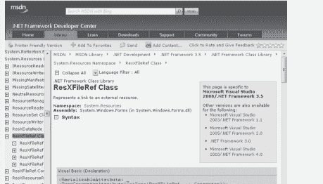

**图 4-1** 展示某类型的命名空间和程序集信息的 SDK 文档

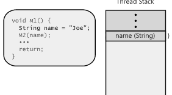

**图 4-3** 在线程栈上分配 M1 的局部变量

然后，M1 调用 M2 方法，并将 **name** 局部变量作为实参传入。这会将 **name** 局部变量中的地址压入栈（见图 4-4）。在 M2 方法内部，将使用名为 **s** 的参数变量来标识该栈位置。（请注意，一些体系结构通过寄存器传递参数以提高性能，但这种区别对本次讨论并不重要。）此外，当调用方法时，指示被调用方法应返回到调用方法中何处的地址也会被压入栈（同样见图 4-4）。

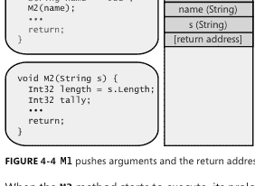

**图 4-4** 当 M1 调用 M2 时，M1 将实参和返回地址压入线程栈。

当 M2 方法开始执行时，其序言代码会从线程栈中为局部变量 **length** 和 **tally** 分配内存（见图 4-5）。然后执行 M2 方法内部的代码。最终，M2 执行到其返回语句，这会使 CPU 的指令指针被设置为栈中的返回地址，并且 M2 的栈帧会被展开，使其看起来像图 4-3 中的样子。此时，M1 继续执行紧跟在调用 M2 之后的代码，并且其栈帧准确反映了 M1 所需的状态。


最终，M1 会通过将 CPU 的指令指针设置为返回地址来返回到其调用方（图中未显示该地址，但它位于栈上 name 参数的正上方），并且 M1 的栈帧会被展开，使其看起来与图 4-2 中一样。此时，调用 M1 的方法会继续执行紧跟在调用 M1 之后的代码，并且其栈帧准确反映了该方法所需的状态。

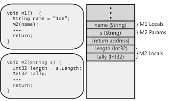

**图 4-5** 在线程的栈上分配 M2 的局部变量

现在，让我们开始将讨论转向 CLR。假设我们有以下两个类定义：

```csharp
internal class Employee {
    public          Int32          GetYearsEmployed()    { ... }
    public virtual  String         GetProgressReport()   { ... }
    public static   Employee       Lookup(String name)    { ... }
}

internal sealed class Manager : Employee {
    public override String         GetProgressReport()   { ... }
}
```

我们的 Windows 进程已经启动，CLR 已加载到其中，托管堆已初始化，并且已创建一个线程（连同其 1 MB 的栈空间）。该线程已经执行了一些代码，而这些代码决定调用 M3 方法。所有这些都如图 4-6 所示。M3 方法包含演示 CLR 工作原理的代码；这不是你通常会编写的代码，因为它实际上没有做任何有用的事情。

线程栈

堆

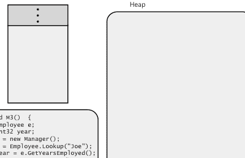

```csharp
void M3() {
    Employee e;
    Int32 year;
    e = new Manager();
    e = Employee.Lookup("Joe");
    year = e.GetYearsEmployed();
    e.GetProgressReport();
}
```

**图 4-6** CLR 已加载到进程中，其堆已初始化，并且线程的栈上即将调用 **M3** 方法

当实时（JIT）编译器将 **M3** 的中间语言（IL）代码转换为本机 CPU 指令时，它会注意到 **M3** 内部引用的所有类型：**Employee**、**Int32**、**Manager** 和 **String**（因为 "Joe"）。此时，CLR 确保定义这些类型的程序集已加载。然后，CLR 使用程序集的元数据提取有关这些类型的信息，并创建一些数据结构来表示这些类型本身。**Employee** 和 **Manager** 类型对象的数据结构如图 4-7 所示。由于此线程在调用 M3 之前已经执行了一些代码，我们假设 **Int32** 和 **String** 类型对象已经创建（这很可能，因为它们是常用类型），因此我不会在图中显示它们。

**M3** 中的下一行代码调用 **Employee** 的虚实例方法 **GetProgressReport**。调用虚实例方法时，JIT 编译器会在该方法中生成一些附加代码，这些代码将在每次调用该方法时执行。这段代码首先会查看用于发起调用的变量，然后沿着地址找到调用对象。在本例中，变量 **e** 指向表示 "Joe" 的 **Manager** 对象。然后，代码会检查对象内部的类型对象指针成员；该成员引用对象的实际类型。接着，代码会在类型对象的方法表中定位引用被调用方法的条目，对该方法进行 JIT 编译（如有必要），并调用 JIT 编译后的代码。就我们的讨论而言，由于 **e** 引用的是 **Manager** 对象，因此调用的是 **Manager** 的 **GetProgressReport** 实现。此操作的结果如图 4-12 所示。

请注意，如果 **Employee** 的 **Lookup** 方法发现 Joe 只是一个 **Employee** 而不是 **Manager**，那么 **Lookup** 会在内部构造一个 **Employee** 对象，其类型对象指针成员将引用 **Employee** 类型对象，从而导致执行 **Employee** 的 **GetProgressReport** 实现，而不是 **Manager** 的实现。

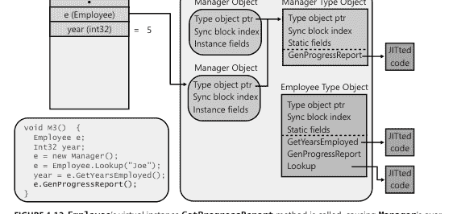

**图 4-12** 调用 Employee 的虚实例方法 **GetProgressReport**，从而导致执行 **Manager** 对该方法的重写

至此，我们已经讨论了源代码、IL 和 JIT 编译代码之间的关系。我们还讨论了线程的栈、参数、局部变量，以及这些参数和变量如何引用托管堆上的对象。你还看到了对象如何包含指向其类型对象的指针（该类型对象包含静态字段和方法表）。我们还讨论了 JIT 编译器如何确定如何调用静态方法、非虚实例方法和虚实例方法。所有这些都应让你深入了解 CLR 的工作方式，而这种洞察力应有助于你设计和实现自己的类型、组件和应用程序。在结束本章之前，我想再稍微深入介绍一下 CLR 内部发生的事情。

你会注意到，**Employee** 和 **Manager** 类型对象都包含类型对象指针成员。这是因为类型对象实际上也是对象。当 CLR 创建类型对象时，CLR 必须初始化这些成员。你可能会问：“初始化成什么？”嗯，当 CLR 开始在进程中运行时，它会立即为 **System.Type** 类型（定义在 MSCorLib.dll 中）创建一个特殊类型对象。**Employee** 和 **Manager** 类型对象是该类型的*“实例”*，因此，它们的类型对象指针成员被初始化为引用 **System.Type** 类型对象，如图 4-13 所示。

当然，**System.Type** 类型对象本身也是一个对象，因此其中也有一个类型对象指针成员，那么很自然要问这个成员引用什么。它引用自身，因为 **System.Type** 类型对象本身也是类型对象的*“实例”*。现在你应该理解 CLR 完整的类型系统及其工作方式了。顺便说一下，**System.Object** 的 **GetType** 方法只是返回存储在指定对象的类型对象指针成员中的地址。换句话说，**GetType** 方法返回指向对象类型对象的指针，这就是你确定系统中任何对象（包括类型对象）真实类型的方式。

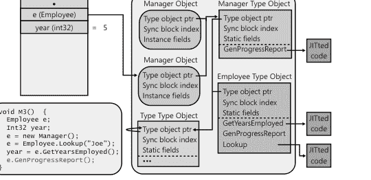

```csharp
void M3() {
    Employee e;
    Int32 year;
    e = new Manager();
    e = Employee.Lookup("Joe");
    year = e.GetYearsEmployed();
    e.GetProgressReport();
}
```

**图 4-13** **Employee** 和 **Manager** 类型对象是 **System.Type** 类型的实例。

# 第5章 基元类型、引用类型和值类型

本章内容：

- 编程语言基元类型 ........................................... 113
- 引用类型和值类型..................................................... 121
- 装箱和拆箱值类型................................................... 127
- 对象哈希码 .......................................................................... 146
- dynamic 基元类型........................................................... 148

在本章中，我将讨论作为 Microsoft .NET Framework 开发人员会遇到的不同类型。所有开发人员都必须熟悉这些类型所表现出的不同行为。当我最初学习 .NET Framework 时，我并没有完全理解基元类型、引用类型和值类型之间的区别。这种不清晰导致我在不知不觉中把微妙的 bug 和性能问题引入代码。通过在这里解释这些类型之间的差异，我希望能让你避免一些我在熟悉过程中经历过的头痛。

## 编程语言基元类型

某些数据类型非常常用，以至于许多编译器允许代码使用简化的语法来操作它们。例如，你可以使用以下语法分配一个整数：

```
System.Int32 a = new System.Int32();
```

但我相信你会同意，使用这种语法声明并初始化一个整数相当繁琐。幸运的是，许多编译器（包括 C#）允许你改用类似下面的语法：

```
int a = 0;
```

这种语法当然使代码更具可读性，并且生成与使用 **System.Int32** 时生成的完全相同的中间语言（IL）。编译器直接支持的任何数据类型都称为基元类型。基元类型直接映射到框架类库（FCL）中存在的类型。例如，在 C# 中，**int** 直接映射到


System.Int32 类型。正因如此，下面四行代码都能正确编译，并生成完全相同的 IL：

```csharp
int              a = 0;                       // Most convenient syntax
System.Int32     a = 0;                       // Convenient syntax
int              a = new int();               // Inconvenient syntax
System.Int32     a = new System.Int32();      // Most inconvenient syntax
```

表 5-1 显示了在 C# 中具有对应基元类型的 FCL 类型。对于符合通用语言规范（CLS）的类型，其他语言也会提供类似的基元类型。不过，语言并不要求为不符合 CLS 的类型提供任何支持。

**表 5-1** 具有对应 FCL 类型的 C# 基元类型

| 基元类型 | FCL 类型 | 符合 CLS | 描述 |
|---|---|---|---|
| sbyte | System.SByte | 否 | 有符号 8 位值 |
| byte | System.Byte | 是 | 无符号 8 位值 |
| short | System.Int16 | 是 | 有符号 16 位值 |
| ushort | System.UInt16 | 否 | 无符号 16 位值 |
| int | System.Int32 | 是 | 有符号 32 位值 |
| uint | System.UInt32 | 否 | 无符号 32 位值 |
| long | System.Int64 | 是 | 有符号 64 位值 |
| ulong | System.UInt64 | 否 | 无符号 64 位值 |
| char | System.Char | 是 | 16 位 Unicode 字符（`char` 永远不会表示 8 位值，而在非托管 C++ 中可能会表示 8 位值） |
| float | System.Single | 是 | IEEE 32 位浮点值 |
| double | System.Double | 是 | IEEE 64 位浮点值 |
| bool | System.Boolean | 是 | `true`/`false` 值 |
| decimal | System.Decimal | 是 | 一种 128 位高精度浮点值，通常用于不能容忍舍入误差的财务计算。在这 128 位中，1 位表示值的符号，96 位表示值本身，8 位表示要用来除以 96 位值的 10 的幂（范围可以是 0 到 28）。其余位未使用。 |
| string | System.String | 是 | 字符数组 |
| object | System.Object | 是 | 所有类型的基类型 |
| **dynamic** | **System.Object** | 是 | 对于公共语言运行时（CLR）而言，**dynamic** 与 **object** 完全相同。不过，C# 编译器允许 **dynamic** 变量使用简化语法参与动态调度。有关更多信息，请参阅本章末尾的“**dynamic** 基元类型”部分。 |

换一种方式来说，C# 编译器会自动假定你在所有源代码文件中都使用了以下 **using** 指令（如第 4 章“类型基础”中所述）：

```csharp
using sbyte  = System.SByte;
using byte   = System.Byte;
using short  = System.Int16;
using ushort = System.UInt16;
using int    = System.Int32;
using uint   = System.UInt32;
...
```

C# 语言规范指出：“作为一种编码风格，相比使用完整的系统类型名称，更推荐使用关键字。”我不同意语言规范的这一观点；我更喜欢使用 FCL 类型名称，并完全避免使用基元类型名称。事实上，我希望编译器甚至不要提供基元类型名称，而是强制开发人员使用 FCL 类型名称。理由如下：

- 我见过许多开发人员感到困惑，不知道应在代码中使用 **string** 还是 **String**。因为在 C# 中，**string**（关键字）与 **System.String**（FCL 类型）完全对应，所以二者没有区别，可以使用其中任意一个。同样，我听过一些开发人员说，当应用程序运行在 32 位操作系统上时，**int** 表示 32 位整数；而当应用程序运行在 64 位操作系统上时，它表示 64 位整数。这种说法完全错误：在 C# 中，**int** 始终对应 **System.Int32**，因此无论代码运行在哪种操作系统上，它都表示 32 位整数。如果程序员在代码中使用 **Int32**，也可以消除这种潜在的困惑。

- 在 C# 中，**long** 对应 **System.Int64**，但在另一种编程语言中，**long** 可能对应 **Int16** 或 **Int32**。实际上，C++/CLI 会将 **long** 视为 **Int32**。如果某人习惯使用另一种编程语言，那么他或她在阅读使用某种语言编写的源代码时，很容易误解代码的意图。事实上，大多数语言甚至不会将 **Long** 视为关键字，也不会编译使用它的代码。

- FCL 中有许多方法会将类型名称作为其方法名称的一部分。例如，**BinaryReader** 类型提供了 **ReadBoolean**、**ReadInt32**、**ReadSingle** 等方法，而 **System.Convert** 类型提供了 **ToBoolean**、**ToInt32**、**ToSingle** 等方法。虽然编写下面的代码是合法的，但对我来说，包含 **float** 的那一行感觉非常不自然，而且不容易看出这一行是正确的：

```csharp
BinaryReader br = new BinaryReader(...);
float val = br.ReadSingle();  // OK, but feels unnatural
Single val = br.ReadSingle();  // OK and feels good
```

- 许多只使用 C# 的程序员往往会忘记，还可以使用其他编程语言来针对 CLR 进行开发。因此，C# 特有的习惯会渗入类库代码中。例如，Microsoft 的 FCL 几乎完全使用 C# 编写，FCL 团队的开发人员现在已经在类库中引入了诸如 **Array's GetLongLength** 这样的方法。该方法返回一个 **Int64** 值，在 C# 中它是 **long**，但在其他语言（如 C++/CLI）中却不是。另一个例子是 **System.Linq.Enumerable's LongCount** 方法。

基于以上所有原因，本书将始终使用 FCL 类型名称。

在许多编程语言中，你可能会认为下面的代码可以正确编译和执行：

```csharp
Int32  i = 5;   // A 32-bit value
Int64  l = i;   // Implicit cast to a 64-bit value
```

不过，根据第 4 章中介绍的类型转换讨论，你可能不会认为这段代码能够编译。毕竟，**System.Int32** 和 **System.Int64** 是不同的类型，并且二者都不是从另一个类型派生而来。好消息是，C# 编译器确实能够正确编译这段代码，而且代码也会按预期运行。为什么呢？原因在于，C# 编译器深入了解基元类型，并在编译代码时应用了自己的特殊规则。换句话说，编译器能够识别常见的编程模式，并生成必要的 IL，使编写的代码按预期工作。具体来说，C# 编译器支持与类型转换、字面量和运算符相关的模式，如下面的示例所示。

首先，编译器能够执行基元类型之间的隐式或显式类型转换，例如：

```csharp
Int32  i = 5;        // Implicit cast from Int32 to Int32
Int64  l = i;        // Implicit cast from Int32 to Int64
Single s = i;        // Implicit cast from Int32 to Single
Byte   b = (Byte) i; // Explicit cast from Int32 to Byte
Int16  v = (Int16) s; // Explicit cast from Single to Int16
```

如果转换是“安全的”，C# 就允许隐式类型转换，也就是说，转换不会造成数据丢失，例如将 **Int32** 转换为 **Int64**。但是，如果转换存在潜在风险，C# 就要求使用显式类型转换。对于数值类型而言，“不安全”意味着转换结果可能会损失精度或数值范围。例如，从 Int32 转换为 Byte 需要显式类型转换，因为较大的 Int32 数字可能会损失精度；从 Single 转换为 Int16 也需要类型转换，因为 Single 能表示的数值范围可能大于 Int16。

请注意，不同的编译器可能会生成不同的代码来处理这些类型转换操作。例如，将值为 6.8 的 Single 转换为 Int32 时，有些编译器可能生成将 6 放入 Int32 的代码，而另一些编译器可能通过向上舍入将结果转换为 7。顺便说一下，C# 始终会截断结果。有关 C# 对基元类型执行类型转换时所遵循的确切规则，请参阅 C# 语言规范中的“转换”部分。

除了类型转换之外，基元类型还可以表示为字面量。字面量被视为其自身类型的实例，因此可以像下面这样使用该实例调用实例方法：

```csharp
Console.WriteLine(123.ToString() + 456.ToString());   // "123456"
```

此外，如果表达式由字面量组成，编译器能够在编译时计算该表达式，从而提高应用程序的性能。

```csharp
Boolean found = false;       // Generated code sets found to 0
Int32 x = 100 + 20 + 3;      // Generated code sets x to 123
String s = "a" + "bc";       // Generated code sets s to "a bc"
```

最后，编译器会自动了解如何解释代码中使用的运算符，以及解释这些运算符的顺序（例如 `+`、`-`、`*`、`/`、`%`、`&`、`|`、`^`、`!`、`~`、`==`、`!=`、`>`、`<`、`>=`、`<=`、`<<`、`>>`、`++`、`--` 等）：

```csharp
Int32 x = 100;                  // Assignment operator
Int32 y = x + 23;               // Addition and assignment operators
Boolean lessThanFifty = (y < 50); // Less-than and assignment operators
```

## 经过检查和未经检查的基元类型操作

程序员都清楚，许多针对基元类型的算术运算都可能导致溢出：

```csharp
Byte b = 100;
b = (Byte) (b + 200);            // b now contains 44 (or 2C in Hex).
```

> **重要提示** 执行上述算术运算时，第一步要求将所有操作数值扩展为 32 位值（如果任何操作数需要超过 32 位，则扩展为 64 位值）。因此，b 和 200（都只需要少于 32 位的值）会先转换为 32 位值，然后再相加。结果是一个 32 位值（十进制为 300，十六进制为 12C），必须将其转换为 Byte，才能将结果存回变量 b。C# 不会隐式地为你执行此类型转换，这就是前面代码第二行中必须使用 Byte 类型转换的原因。


在大多数编程场景中，这种静默溢出是不可取的，如果未被检测到，会导致应用程序以奇怪和异常的方式运行。然而，在一些罕见的编程场景中（例如计算哈希值或校验和），这种溢出不仅可以接受，而且是期望的。

不同语言以不同方式处理溢出。C 和 C++ 不认为溢出是错误，并允许值回绕；应用程序继续运行。另一方面，Microsoft Visual Basic 始终认为溢出是错误，并在检测到溢出时抛出异常。

CLR 提供 IL 指令，允许编译器选择所需的行为。CLR 有一条名为 **add** 的指令，用于将两个值相加。**add** 指令不执行溢出检查。CLR 还有一条名为 **add.ovf** 的指令，也用于将两个值相加。然而，如果发生溢出，**add.ovf** 会抛出 **System.OverflowException**。除了用于加法操作的这两条 IL 指令之外，CLR 还为减法（**sub/sub.ovf**）、乘法（**mul/mul.ovf**）和数据转换（**conv/conv.ovf**）提供了类似的 IL 指令。

C# 允许程序员决定应如何处理溢出。默认情况下，溢出检查是关闭的。这意味着编译器通过使用不包含溢出检查的加法、减法、乘法和转换指令版本来生成 IL 代码。因此，代码运行得更快——但开发者必须确保不会发生溢出，或者其代码的设计能够预见到这些溢出。

让 C# 编译器控制溢出的一种方法是使用 **/checked+** 编译器开关。此开关告诉编译器生成包含溢出检查版本的加法、减法、乘法和转换 IL 指令的代码。代码执行速度会稍慢，因为 CLR 正在检查这些操作以确定是否发生了溢出。如果发生溢出，CLR 会抛出 **OverflowException**。

除了在全局范围内打开或关闭溢出检查之外，程序员还可以控制代码特定区域中的溢出检查。C# 通过提供 **checked** 和 **unchecked** 运算符来实现这种灵活性。以下是使用 **unchecked** 运算符的示例：

```csharp
UInt32 invalid = unchecked((UInt32) (-1));   // OK
```

以下是使用 **checked** 运算符的示例：

```csharp
Byte b = 100;
b = checked((Byte) (b + 200));      // OverflowException is thrown
```

在此示例中，**b** 和 **200** 首先转换为 32 位值，然后相加；结果为 300。然后，由于显式强制转换，300 被转换为 **Byte**；这会生成 **OverflowException**。如果 **Byte** 的强制转换在 **checked** 运算符之外进行，则不会发生异常：

```csharp
b = (Byte) checked(b + 200);    // b contains 44; no OverflowException
```

除了 **checked** 和 **unchecked** 运算符之外，C# 还提供 **checked** 和 **unchecked** 语句。这些语句会使块内的所有表达式都受检查或不受检查：

```csharp
checked {                         // Start of checked block
    Byte b = 100;
    b = (Byte) (b + 200);         // This expression is checked for overflow.
}                                 // End of checked block
```

事实上，如果使用 **checked** 语句块，现在就可以对 **Byte** 使用 += 运算符，这会使代码稍微简化。

```csharp
checked {                // Start of checked block
    Byte b = 100;
    b += 200;            // This expression is checked for overflow.
}                        // End of checked block
```


> **重要** 由于 **checked** 运算符和语句的唯一作用是确定生成加法、减法、乘法和数据转换 IL 指令的哪个版本，因此在 **checked** 运算符或语句中调用方法对该方法没有影响，如下代码所示：

```csharp
checked {
    // Assume SomeMethod tries to load 400 into a Byte.
    SomeMethod(400);
    // SomeMethod might or might not throw an OverflowException.
    // It would if SomeMethod were compiled with checked instructions.
}
```

根据我的经验，我见过很多计算产生令人惊讶的结果。通常，这是由于无效的用户输入，但也可能是由于系统某些部分返回了程序员意想不到的值。因此，我建议程序员执行以下操作：

- 尽可能使用有符号数据类型（如 **Int32** 和 **Int64**），而不是无符号数值类型（如 **UInt32** 和 **UInt64**）。这使编译器能够检测到更多的溢出/下溢错误。此外，类库的各个部分（如 **Array** 和 **String** 的 Length 属性）被硬编码为返回有符号值，并且在代码中移动这些值时需要的强制转换更少。更少的强制转换使源代码更清晰、更易于维护。此外，无符号数值类型不符合 CLS。

- 在编写代码时，在可能因无效输入数据而发生意外溢出的块周围显式使用 **checked**，例如处理包含最终用户或客户端计算机提供的数据的请求。你可能还想捕获 **OverflowException**，以便应用程序能够从这些故障中优雅地恢复。

- 在编写代码时，在允许溢出的块周围显式使用 **unchecked**，例如计算校验和。

- 对于任何不使用 **checked** 或 **unchecked** 的代码，假定你*确实*希望在发生溢出时出现异常，例如，计算输入已知且溢出是缺陷的某些内容（如质数）。

现在，在开发应用程序时，为调试版本打开编译器的 **/checked+** 开关。应用程序运行会变慢，因为系统会对你未显式标记为 **checked** 或 **unchecked** 的任何代码检查溢出。如果发生异常，你将很容易检测到它，并能够修复代码中的缺陷。对于应用程序的发布版本，请使用编译器的 **/checked-** 开关，以便代码运行更快且不会生成溢出异常。要在 Microsoft Visual Studio 中更改“Checked”设置，请显示项目的属性，选择“生成”选项卡，单击“高级”，然后选择“检查算术溢出/下溢”选项，如图 5-1 所示。

如果你的应用程序能够容忍始终执行受检查操作带来的轻微性能损失，那么我建议即使对于发布版本也使用 **/checked** 命令行选项进行编译，因为这可以防止应用程序继续使用损坏的数据和可能的安全漏洞运行。例如，你可能执行乘法来计算数组的索引；与因数学运算回绕而访问错误的数组元素相比，获得 **OverflowException** 要好得多。

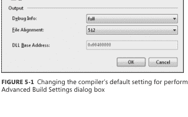

图 5-1 使用 Visual Studio 的“高级生成设置”对话框更改编译器执行受检查算术的默认设置

实例不受垃圾回收器的控制，因此使用它们可以减轻托管堆的压力，并减少应用程序在其生存期内所需的垃圾回收次数。

.NET Framework SDK 文档清楚地指明了哪些类型是引用类型，哪些类型是值类型。在文档中查找类型时，任何称为*类*的类型都是引用类型。例如，**System.Exception** 类、**System.IO.FileStream** 类和 **System.Random** 类都是引用类型。另一方面，文档将每个值类型称为*结构*或*枚举*。例如，**System.Int32** 结构、**System.Boolean** 结构、**System.Decimal** 结构、**System.TimeSpan** 结构、**System.DayOfWeek** 枚举、**System.IO.FileAttributes** 枚举和 **System.Drawing.FontStyle** 枚举都是值类型。

如果更仔细地查看文档，你会注意到所有结构都直接派生自 **System.ValueType** 抽象类型。**System.ValueType** 本身直接派生自 **System.Object** 类型。根据定义，所有值类型都必须派生自 **System.ValueType**。所有枚举都派生自 **System.Enum** 抽象类型，而该类型本身派生自 **System.ValueType**。CLR 和所有编程语言都对枚举给予特殊处理。有关枚举类型的更多信息，请参阅第 15 章“枚举类型和位标志”。

尽管在定义自己的值类型时不能选择基类型，但如果愿意，值类型可以实现一个或多个接口。此外，所有值类型都是密封的，这阻止值类型用作任何其他引用类型或值类型的基类型。因此，例如，不可能使用 **Boolean**、**Char**、**Int32**、**UInt64**、**Single**、**Double**、**Decimal** 等作为基类型来定义任何新类型。

> **重要** 对于许多开发者（例如非托管 C/C++ 开发者）来说，引用类型和值类型起初会显得很奇怪。在非托管 C/C++ 中，你声明一个类型，然后使用该类型的代码决定该类型的实例应分配在线程的栈上还是应用程序的堆中。在托管代码中，定义类型的开发者指明该类型的实例分配在哪里；使用该类型的开发者对此没有控制权。

以下代码和图 5-2 演示了引用类型和值类型有何不同：

```csharp
// Reference type (because of 'class')
class SomeRef { public Int32 x; }

// Value type (because of 'struct')
struct SomeVal { public Int32 x; }

static void ValueTypeDemo() {
    SomeRef r1 = new SomeRef();   // Allocated in heap
    SomeVal v1 = new SomeVal();   // Allocated on stack
```


```
r1.x = 5;                         // Pointer dereference
v1.x = 5;                         // Changed on stack
Console.WriteLine(r1.x);          // Displays "5"
Console.WriteLine(v1.x);          // Also displays "5"
// The left side of Figure 5-2 reflects the situation
// after the lines above have executed.

SomeRef r2 = r1;                  // Copies reference (pointer) only
SomeVal v2 = v1;                  // Allocate on stack & copies members
r1.x = 8;                         // Changes r1.x and r2.x
v1.x = 9;                         // Changes v1.x, not v2.x
Console.WriteLine(r1.x);          // Displays "8"
Console.WriteLine(r2.x);          // Displays "8"
Console.WriteLine(v1.x);          // Displays "9"
Console.WriteLine(v2.x);          // Displays "5"
// The right side of Figure 5-2 reflects the situation
// after ALL of the lines above have executed.
}
```

在此代码中，**SomeVal** 类型是使用 **struct** 而不是更常见的 **class** 声明的。在 C# 中，使用 **struct** 声明的类型是值类型，使用 **class** 声明的类型是引用类型。如你所见，引用类型和值类型的行为差异相当大。在代码中使用类型时，你必须清楚该类型是引用类型还是值类型，因为它会极大影响你在代码中表达意图的方式。

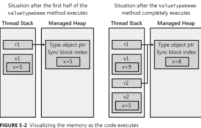

**图 5-2** 代码执行过程中内存的可视化

在前面的代码中，你看到了这一行：

```
SomeVal v1 = new SomeVal();    // Allocated on stack
```

这一行的写法看起来好像会在托管堆上分配一个 **SomeVal** 实例。然而，C# 编译器知道 **SomeVal** 是值类型，并生成在线程栈上分配该 **SomeVal** 实例的代码。C# 还确保值类型实例中的所有字段都被清零。

-   值类型对象有两种表示形式：*未装箱*形式和*装箱*形式（将在下一节讨论）。引用类型始终处于装箱形式。
-   值类型派生自 **System.ValueType**。此类型提供与 **System.Object** 所定义的相同方法。但是，**System.ValueType** 重写了 **Equals** 方法，使得当两个对象的字段值匹配时返回 **true**。此外，**System.ValueType** 重写了 **GetHashCode** 方法，通过使用考虑对象实例字段值的算法来生成哈希代码值。由于此默认实现存在性能问题，在定义自己的值类型时，应重写并为 **Equals** 和 **GetHashCode** 方法提供显式实现。我将在本章末尾介绍 **Equals** 和 **GetHashCode** 方法。
-   由于不能使用值类型作为基类来定义新的值类型或新的引用类型，因此不应向值类型中引入任何新的虚方法。不能有抽象方法，所有方法都隐式密封（不能被重写）。
-   引用类型变量包含堆中对象的内存地址。默认情况下，创建引用类型变量时，它被初始化为 **null**，表示该引用类型变量当前不指向有效对象。尝试使用 **null** 引用类型变量会导致抛出 **NullReferenceException**。相比之下，值类型变量始终包含基础类型的值，并且值类型的所有成员都初始化为 0。由于值类型变量不是指针，因此在访问值类型时不可能生成 **NullReferenceException**。CLR 确实提供了一种特殊功能，为值类型增加了可空性概念。此功能称为*可空类型*，将在第 19 章“可空值类型”中讨论。
-   当把一个值类型变量赋给另一个值类型变量时，会进行逐字段复制。当把一个引用类型变量赋给另一个引用类型变量时，只复制内存地址。
-   由于上一点，两个或更多引用类型变量可以引用堆中的单个对象，从而允许对一个变量的操作影响另一个变量所引用的对象。另一方面，值类型变量是不同对象，对一个值类型变量的操作不可能影响另一个。
-   由于未装箱的值类型不在堆上分配，因此一旦定义该类型实例的方法不再活动，为其分配的存储就会被释放。这意味着值类型实例在其内存被回收时不会收到通知（通过 **Finalize** 方法）。

> **注意** 事实上，为值类型定义 **Finalize** 方法会非常奇怪，因为该方法只会在装箱实例上调用。因此，许多编译器（包括 C#、C++/CLI 和 Visual Basic）不允许在值类型上定义 **Finalize** 方法。尽管 CLR 允许值类型定义 **Finalize** 方法，但当值类型的装箱实例被垃圾回收时，CLR 不会调用此方法。

## CLR 如何控制类型字段的布局

为了提高性能，CLR 能够以它选择的任何方式安排类型的字段。例如，CLR 可能会在内存中重新排序字段，以便对象引用分组在一起，数据字段正确对齐和打包。但是，当你定义类型时，你可以告诉 CLR 是必须按照开发人员指定的顺序保留类型字段，还是可以按它认为合适的方式重新排序。

你通过在正在定义的类或结构上应用 System.Runtime.InteropServices.StructLayoutAttribute 特性来告诉 CLR 该怎么做。可以向此特性的构造函数传递 LayoutKind.Auto，让 CLR 安排字段；传递 LayoutKind.Sequential，让 CLR 保留你的字段布局；或传递 LayoutKind.Explicit，使用偏移量显式安排内存中的字段。如果你没有在正在定义的类型上显式指定 StructLayoutAttribute，编译器会选择它认为最佳的布局。

你应该知道，Microsoft 的 C# 编译器为引用类型（类）选择 LayoutKind.Auto，为值类型（结构）选择 LayoutKind.Sequential。显然，C# 编译器团队认为结构通常在与非托管代码互操作时使用，而要使其正常工作，字段必须保持程序员定义的顺序。但是，如果你创建的值类型与非托管代码互操作无关，你可能希望重写 C# 编译器的默认设置。下面是一个示例：

```csharp
using System;
using System.Runtime.InteropServices;

// Let the CLR arrange the fields to improve
// performance for this value type.
[StructLayout(LayoutKind.Auto)]
internal struct SomeValType {
    private readonly Byte m_b;
    private readonly Int16 m_x;
    ...
}
```

StructLayoutAttribute 还允许你通过向其构造函数传递 LayoutKind.Explicit 来显式指示每个字段的偏移量。然后，对每个字段应用 System.Runtime.InteropServices.FieldOffsetAttribute 特性的实例，并向此特性的构造函数传递一个 Int32，指示该字段第一个字节从实例开头算起的偏移量（以字节为单位）。显式布局通常用于模拟非托管 C/C++ 中的联合体，因为你可以让多个字段从内存中的同一偏移量开始。下面是一个示例：

完全不同的东西？要得到答案，你必须查找 **ArrayList 的 Add** 方法，并查看其参数被定义为什么类型。在本例中，**Add** 方法的原型如下：

```csharp
public virtual Int32 Add(Object value);
```

由此你可以清楚地看到，**Add** 接受一个 **Object** 作为参数，表示 **Add** 需要一个指向托管堆中对象的引用（或指针）作为参数。但在前面的代码中，我传递的是 **p**，一个 **Point**，它是值类型。要使此代码工作，必须将 **Point** 值类型转换为真正的堆管理对象，并且必须获得对此对象的引用。

可以使用一种称为*装箱*的机制将值类型转换为引用类型。在内部，当值类型的实例被装箱时，会发生以下情况：

1.  从托管堆分配内存。分配的内存量是值类型字段所需的大小，加上托管堆上所有对象都需要的两个额外开销成员（类型对象指针和同步块索引）。
2.  值类型的字段被复制到新分配的堆内存中。
3.  返回对象的地址。此地址现在是对对象的引用；该值类型现在是引用类型。

C# 编译器会自动生成装箱值类型实例所需的 IL 代码，但你仍然需要了解内部发生了什么，以便意识到代码大小和性能问题。

在前面的代码中，C# 编译器检测到我正在将一个值类型传递给需要引用类型的方法，并自动发出代码来装箱该对象。因此，在运行时，当前驻留在 **Point** 值类型实例 **p** 中的字段被复制到新分配的 **Point** 对象中。装箱后的 **Point** 对象（现在是引用类型）的地址被返回，然后传递给 **Add** 方法。**Point** 对象将保留在堆中，直到被垃圾回收。**Point** 值类型变量（**p**）可以重用，因为 **ArrayList** 从不知道它的任何信息。注意，装箱值类型的生存期超出了未装箱值类型的生存期。


> **注意** 需要指出的是，FCL 现在包含一组新的泛型集合类，这使非泛型集合类过时。例如，应使用 **System.Collections.Generic.List\<T\>** 类而不是 **System.Collections.ArrayList** 类。泛型集合类相比非泛型对应类提供了许多改进。例如，API 已得到清理和改进，集合类的性能也大幅提升。但最大的改进之一是，泛型集合类允许你处理值类型的集合，而无需对集合中的项进行装箱/拆箱。这本身就极大提高了性能，因为托管堆上创建的对象将少得多，从而减少应用程序所需的垃圾回收次数。此外，你还将获得编译时类型安全，并且由于强制转换更少，源代码将更整洁。所有这些将在第 12 章“泛型”中进一步详细解释。

既然你知道了装箱如何工作，我们来谈谈拆箱。假设你想使用以下代码从 **ArrayList** 中取出第一个元素：

```csharp
Point p = (Point) a[0];
```

这里你取出 **ArrayList** 元素 0 中包含的引用（或指针），并尝试将其放入 **Point** 值类型实例 **p** 中。为此，装箱的 **Point** 对象中包含的所有字段都必须复制到线程栈上的值类型变量 **p** 中。CLR 分两步完成此复制。首先，获取装箱的 **Point** 对象中 **Point** 字段的地址。此过程称为*拆箱*。然后，将这些字段的值从堆复制到基于栈的值类型实例。

拆箱并不完全是装箱的逆操作。拆箱操作的成本远低于装箱。拆箱实际上只是获取指向对象内原始值类型（数据字段）的指针的操作。实际上，该指针指向装箱实例中未装箱的部分。因此，与装箱不同，拆箱不涉及内存中任何字节的复制。在做出这一重要澄清后，需要注意的是，拆箱操作之后通常紧接着复制字段。

显然，装箱和拆箱/复制操作在速度和内存方面都会损害应用程序的性能，因此你应该了解编译器何时生成代码自动执行这些操作，并尽量编写使此类代码生成最小化的代码。

在内部，装箱的值类型实例被拆箱时具体发生以下情况：

- 1. 如果包含对装箱值类型实例的引用的变量为 `null`，则抛出 `NullReferenceException`。
- 2. 如果该引用不指向所需值类型的装箱实例对象，则抛出 `InvalidCastException`。^1

上述第二项意味着以下代码不会按你预期的方式工作：

```csharp
public static void Main() {
    Int32 x = 5;
    Object o = x;          // Box x; o refers to the boxed object
    Int16 y = (Int16) o;   // Throws an InvalidCastException
}
```

从逻辑上讲，取出 o 引用的装箱 Int32 并将其强制转换为 Int16 是合理的。但是，拆箱对象时，强制转换必须转换为精确的未装箱值类型——在本例中为 Int32。以下是编写此代码的正确方式：

```csharp
public static void Main() {
    Int32 x = 5;
    Object o = x;          // Box x; o refers to the boxed object
    Int16 y = (Int16)(Int32) o; // Unbox to the correct type and cast
}
```

我之前提到，拆箱操作之后经常立即进行字段复制。让我们看一些 C# 代码，演示拆箱和复制操作如何协同工作：

```csharp
public static void Main() {
    Point p;
    p.x = p.y = 1;
    Object o = p;   // Boxes p; o refers to the boxed instance

    p = (Point) o;  // Unboxes o AND copies fields from boxed
                    // instance to stack variable
}
```

在最后一行，C# 编译器发出一个 IL 指令来拆箱 o（获取装箱实例中字段的地址），并发出另一个 IL 指令将字段从堆复制到基于栈的变量 p。

现在看这段代码：

```csharp
public static void Main() {
    Point p;
    p.x = p.y = 1;
}
```

^1 CLR 还允许将值类型拆箱为其同一值类型的可空版本。第 19 章将讨论这一点。

```il
IL_0001: stloc.0

// Box v and store the reference pointer in o.
IL_0002: ldloc.0
IL_0003: box [mscorlib]System.Int32
IL_0008: stloc.1

// Load 123 into v.
IL_0009: ldc.i4.s 123
IL_000b: stloc.0

// Box v and leave the pointer on the stack for Concat.
IL_000c: ldloc.0
IL_000d: box [mscorlib]System.Int32

// Load the string on the stack for Concat.
IL_0012: ldstr ", "

// Load the address of the boxed Int32 on the stack for Concat.
IL_0017: ldloc.1

// Call Concat.
IL_0018: call string [mscorlib]System.String::Concat(object,
                                                    object,
                                                    object)

// The string returned from Concat is passed to WriteLine.
IL_001d: call void [mscorlib]System.Console::WriteLine(String)

// Return from Main terminating this application.
IL_0022: ret
} // end of method App::Main
```

对这两个版本的 Main 方法的 IL 进行快速比较可以看出，不带 (Int32) 强制转换的版本比带强制转换的版本小 10 个字节。第一个版本中额外的拆箱/装箱步骤显然生成了更多代码。然而，更令人担忧的是，额外的装箱步骤会从托管堆中分配一个额外的对象，而该对象将来必须被垃圾回收。当然，两个版本给出相同的结果，速度差异也不明显，但循环中发生的额外、不必要的装箱操作会严重降低应用程序的性能和内存使用。

你可以通过像这样调用 WriteLine 来进一步改进前面的代码：

```csharp
Console.WriteLine(v.ToString() + ", " + o);    // Displays "123, 5"
```

现在，对未装箱的值类型实例 v 调用 ToString，并返回一个 String。String 对象已经是引用类型，可以简单地传递给 Concat 方法而无需任何装箱。

让我们再看另一个演示装箱和拆箱的示例：

```csharp
public static void Main() {
    Int32 v = 5;               // Create an unboxed value type variable.
    Object o = v;              // o refers to the boxed version of v.

    v = 123;                   // Changes the unboxed value type to 123
    Console.WriteLine(v);      // Displays "123"

    v = (Int32) o;             // Unboxes and copies o into v
    Console.WriteLine(v);      // Displays "5"
}
```

这段代码中你数出多少次装箱操作？答案是一次。只有一次装箱操作的原因是 **System.Console** 类定义了一个接受 **Int32** 作为参数的 **WriteLine** 方法：

```csharp
public static void WriteLine(Int32 value);
```

在上面对 **WriteLine** 的两次调用中，变量 **v**（一个 **Int32** 未装箱值类型实例）按值传递。现在，**WriteLine** 可能会在内部对这个 **Int32** 进行装箱，但你无法控制这一点。重要的是，你已经尽了最大努力，并从自己的代码中消除了装箱。

如果仔细观察 FCL，你会注意到许多根据其值类型参数不同而不同的重载方法。例如，**System.Console** 类型提供了 **WriteLine** 方法的多个重载版本：

```csharp
public static void WriteLine(Boolean);
public static void WriteLine(Char);
public static void WriteLine(Char[]);
public static void WriteLine(Int32);
public static void WriteLine(UInt32);
public static void WriteLine(Int64);
public static void WriteLine(UInt64);
public static void WriteLine(Single);
public static void WriteLine(Double);
public static void WriteLine(Decimal);
public static void WriteLine(Object);
public static void WriteLine(String);
```

你还会发现 **System.Console** 的 **Write** 方法、**System.IO.BinaryWriter** 的 **Write** 方法、**System.IO.TextWriter** 的 **Write** 和 **WriteLine** 方法、**System.Runtime.Serialization.SerializationInfo** 的 **AddValue** 方法、**System.Text.StringBuilder** 的 **Append** 和 **Insert** 方法等也有类似的一组重载方法。这些方法中的大多数提供重载版本，唯一目的就是减少常见值类型的装箱操作次数。

如果你定义自己的值类型，这些 FCL 类将不会有接受你的值类型的这些方法的重载。此外，FCL 中已经定义了许多值类型，而这些方法的重载并不存在。如果你调用一个方法，而该方法没有针对你传递给它的特定值类型提供重载，那么你最终总是会


-   它们没有堆上每个对象都有的额外开销成员：类型对象指针和同步块索引。

因为未装箱的值类型没有同步块索引，所以不能通过使用 `System.Threading.Monitor` 类型的方法（或使用 C# 的 `lock` 语句）让多个线程同步对该实例的访问。

尽管未装箱的值类型没有类型对象指针，你仍然可以调用该类型继承或重写的虚方法（例如 `Equals`、`GetHashCode` 或 `ToString`）。如果你的值类型重写了这些虚方法之一，那么 CLR 可以非虚方式调用该方法，因为值类型是隐式密封的，不能有任何从它们派生的类型。此外，用于调用该虚方法的值类型实例不会被装箱。但是，如果你对虚方法的重写调用了该方法的基类型实现，那么在调用基类型实现时，值类型实例确实会被装箱，以便将对堆对象的引用作为 `this` 指针传入基方法。

然而，调用继承的非虚方法（例如 `GetType` 或 `MemberwiseClone`）总是要求值类型装箱，因为这些方法由 `System.Object` 定义，所以这些方法期望 `this` 参数是指向堆上对象的指针。

此外，将值类型的未装箱实例强制转换为其某个接口时，要求该实例装箱，因为接口变量必须始终包含对堆上对象的引用。（我将在第 13 章“接口”中讨论接口。）以下代码演示了这一点：

```csharp
using System;

internal struct Point : IComparable {
    private readonly Int32 m_x, m_y;

    // Constructor to easily initialize the fields
    public Point(Int32 x, Int32 y) {
        m_x = x;
        m_y = y;
    }

    // Override ToString method inherited from System.ValueType
    public override String ToString() {
        // Return the point as a string
        return String.Format("({0}, {1})", m_x, m_y);
    }

    // Implementation of type-safe CompareTo method
    public Int32 CompareTo(Point other) {
        // Use the Pythagorean Theorem to calculate
        // which point is farther from the origin (0, 0)
        return Math.Sign(Math.Sqrt(m_x * m_x + m_y * m_y)
            - Math.Sqrt(other.m_x * other.m_x + other.m_y * other.m_y));
    }

    // Implementation of IComparable's CompareTo method
    public Int32 CompareTo(Object o) {
        if (GetType() != o.GetType()) {
            throw new ArgumentException("o is not a Point");
        }
        // Call type-safe CompareTo method
        return CompareTo((Point) o);
    }
}

public static class Program {
    public static void Main() {
        // Create two Point instances on the stack.
        Point p1 = new Point(10, 10);
        Point p2 = new Point(20, 20);

        // p1 does NOT get boxed to call ToString (a virtual method).
        Console.WriteLine(p1.ToString());// "(10, 10)"

        // p1 DOES get boxed to call GetType (a non-virtual method).
        Console.WriteLine(p1.GetType());// "Point"

        // p1 does NOT get boxed to call CompareTo.
        // p2 does NOT get boxed because CompareTo(Point) is called.
        Console.WriteLine(p1.CompareTo(p2));// "-1"

        // p1 DOES get boxed, and the reference is placed in c.
        IComparable c = p1;
        Console.WriteLine(c.GetType());// "Point"

        // p1 does NOT get boxed to call CompareTo.
        // Since CompareTo is not being passed a Point variable,
        // CompareTo(Object) is called which requires a reference to
        // a boxed Point.
        // c does NOT get boxed because it already refers to a boxed Point.
        Console.WriteLine(p1.CompareTo(c));// "0"

        // c does NOT get boxed because it already refers to a boxed Point.
        // p2 does get boxed because CompareTo(Object) is called.
        Console.WriteLine(c.CompareTo(p2));// "-1"

        // c is unboxed, and fields are copied into p2.
        p2 = (Point) c;

        // Proves that the fields got copied into p2.
        Console.WriteLine(p2.ToString());// "(10, 10)"
    }
}
```

这段代码演示了与装箱和拆箱相关的几种情形：

-   **调用 ToString** 在调用 **ToString** 时，**p1** 不必装箱。起初，你会认为 **p1** 必须装箱，因为 **ToString** 是从基类型 **System.ValueType** 继承的虚方法。通常，要调用虚方法，CLR 需要确定对象的类型，以便定位该类型的方法表。由于 **p1** 是未装箱的值类型，因此没有类型对象指针。然而，即时 (JIT) 编译器看到 **Point** 重写了 **ToString** 方法，于是它生成直接（非虚）调用 **ToString** 的代码，而无需进行任何装箱。编译器知道这里不会发生多态，因为 **Point** 是值类型，并且没有类型能从它派生以提供此虚方法的另一种实现。注意，如果 **Point 的 ToString** 方法在内部调用 **base.ToString()**，那么在调用 **System.ValueType** 的 **ToString** 方法时，该值类型实例就会被装箱。
-   **调用 GetType** 在调用非虚 **GetType** 方法时，**p1** 确实必须装箱。原因是 **Point** 类型从 **System.Object** 继承了 **GetType**。因此，要调用 **GetType**，CLR 必须使用指向类型对象的指针，而该指针只能通过装箱 **p1** 获得。
-   **调用 CompareTo（第一次）** 在第一次调用 **CompareTo** 时，**p1** 不必装箱，因为 **Point** 实现了 **CompareTo** 方法，编译器可以直接调用它。注意，传递给 **CompareTo** 的是一个 **Point** 变量（**p2**），因此编译器调用接受 **Point** 参数的 **CompareTo** 重载。这意味着 **p2** 将按值传递给 **CompareTo**，不需要装箱。
-   **强制转换为 IComparable** 将 **p1** 强制转换为接口类型的变量（**c**）时，**p1** 必须装箱，因为根据定义接口是引用类型。因此，**p1** 被装箱，指向这个装箱对象的指针存储在变量 **c** 中。下面调用 **GetType** 证明 **c** 确实引用堆上的已装箱 **Point**。
-   **调用 CompareTo（第二次）** 在第二次调用 **CompareTo** 时，**p1** 不必装箱，因为 **Point** 实现了 **CompareTo** 方法，编译器可以直接调用它。注意，传递给 **CompareTo** 的是一个 **IComparable** 变量（**c**），因此编译器调用接受 **Object** 参数的 **CompareTo** 重载。这意味着传入的参数必须是指向堆上对象的指针。幸运的是，**c** 确实引用已装箱的 **Point**，因此 **c** 中的该内存地址可以传递给 **CompareTo**，不需要额外装箱。
-   **调用 CompareTo（第三次）** 在第三次调用 **CompareTo** 时，**c** 已经引用堆上的已装箱 **Point** 对象。由于 **c** 是 **IComparable** 接口类型，只能调用该接口中要求 **Object** 参数的 **CompareTo** 方法。这意味着传入的参数必须是指向堆上对象的指针。因此，**p2** 被装箱，指向这个装箱对象的指针被传递给 **CompareTo**。
-   **强制转换为 Point** 将 **c** 强制转换为 **Point** 时，**c** 所引用的堆上对象被拆箱，其字段从堆复制到 **p2**，即驻留在栈上的 **Point** 类型实例。

我意识到，所有这些关于引用类型、值类型和装箱的信息起初可能会让人不知所措。然而，扎实理解这些概念对任何 .NET Framework 开发者的长期成功都至关重要。相信我：牢固掌握这些概念将使你能够更快、更轻松地构建高效应用程序。

## 通过接口更改已装箱值类型中的字段（以及为什么你不应这样做）

让我们来玩一下，看看你对值类型、装箱和拆箱的理解有多好。检查以下代码，看看你能否弄清楚它在控制台上显示什么：

```csharp
using System;

// Point is a value type.
internal struct Point {
    private Int32 m_x, m_y;

    public Point(Int32 x, Int32 y) {
        m_x = x;
        m_y = y;
    }

    public void Change(Int32 x, Int32 y) {
        m_x = x; m_y = y;
    }

    public override String ToString() {
        return String.Format("({0}, {1})", m_x, m_y);
    }
}

public sealed class Program {
    public static void Main() {
        Point p = new Point(1, 1);

        Console.WriteLine(p);

        p.Change(2, 2);
        Console.WriteLine(p);

        Object o = p;
        Console.WriteLine(o);

        ((Point) o).Change(3, 3);
        Console.WriteLine(o);
    }
}
```


```csharp
p.Change(2, 2);
Console.WriteLine(p);

Object o = p;
Console.WriteLine(o);

((Point) o).Change(3, 3);
Console.WriteLine(o);

// Boxes p, changes the boxed object and discards it
((IChangeBoxedPoint) p).Change(4, 4);
Console.WriteLine(p);

// Changes the boxed object and shows it
((IChangeBoxedPoint) o).Change(5, 5);
Console.WriteLine(o);
}
```

这段代码与上一版本几乎相同。主要区别在于，**Change** 方法由 **IChangeBoxedPoint** 接口定义，而 **Point** 类型现在实现了该接口。在 **Main** 内部，前四次对 **WriteLine** 的调用与之前相同，并产生与之前相同的结果（符合预期）。不过，我在 **Main** 末尾又添加了两个示例。

在第一个示例中，未装箱的 **Point** **p** 被强制转换为 **IChangeBoxedPoint**。此转换会导致 **p** 中的值被装箱。**Change** 会在装箱后的值上调用，这确实会将其 **m_x** 和 **m_y** 字段更改为 4 和 4，但在 **Change** 返回后，装箱对象会立即变为可被垃圾回收。因此，第五次调用 **WriteLine** 显示 **(2, 2)**。许多开发者不会预料到这个结果。

在最后一个示例中，**o** 所引用的装箱 **Point** 被强制转换为 **IChangeBoxedPoint**。这里不需要装箱，因为 **o** 已经是装箱的 **Point**。然后调用 **Change**，它*确实*会更改装箱 **Point** 的 **m_x** 和 **m_y** 字段。接口方法 **Change** 使我能够更改装箱 **Point** 对象中的字段！现在，当调用 **WriteLine** 时，它会如预期显示 **(5, 5)**。整个示例的目的是演示接口方法如何能够修改装箱值类型的字段。在 C# 中，如果不使用接口方法，这是不可能的。

> **重要** 在本章前面，我提到值类型应该是不可变的：也就是说，它们不应定义任何会修改该类型实例字段的成员。事实上，我建议将值类型的字段标记为 **readonly**，这样如果你不小心编写了试图修改字段的方法，编译器就会发出错误。前面的示例应该让你非常清楚为什么值类型应该是不可变的。前面示例中展示的意外行为，都发生在试图调用修改值类型实例字段的方法时。如果在构造值类型之后，你不调用任何修改其状态的方法，那么当所有装箱、拆箱/字段复制发生时，你就不会感到困惑。如果值类型是不可变的，你最终只是到处复制相同的状态，也就不会对看到的任何行为感到惊讶。

许多开发者审阅了本书的章节。在阅读了我的一些代码示例（例如前一个示例）之后，这些审阅者会告诉我，他们已经发誓不再使用值类型。我必须说，这些小小的值类型细微之处曾让我花费数天的调试时间，这也是我花时间在本书中指出它们的原因。我希望你能记住其中一些细微之处，并在它们影响你和你的代码时做好准备。当然，你不应该害怕值类型。它们很有用，也有自己的用武之地。毕竟，程序时不时需要一点 **Int32** 的关爱。只需记住，值类型和引用类型的行为会因使用方式不同而大相径庭。事实上，你应该拿前面的代码，将 **Point** 声明为 **class** 而不是 **struct**，以体会由此产生的不同行为。最后，你会很高兴地知道，**FCL——Byte、Int32、UInt32、Int64、UInt64、Single、Double、Decimal、BigInteger、Complex** 中附带的核心值类型、所有**枚举**等等——都是不可变的，因此使用这些类型中的任何一种时，你都不应遇到令人意外的行为。

## 对象相等性与同一性

开发者经常编写代码来比较对象。当把对象放入集合，并且你编写代码对集合中的项进行排序、搜索或比较时，尤其如此。在本节中，我将讨论对象相等性和同一性，还会讨论如何定义正确实现对象相等性的类型。

**System.Object** 类型提供了一个名为 **Equals** 的虚方法，其用途是在两个对象包含相同值时返回 **true**。**Object** 的 **Equals** 方法的实现如下所示：

```csharp
public class Object {
    public virtual Boolean Equals(Object obj) {

        // If both references point to the same object,
        // they must have the same value.
        if (this == obj) return true;

        // Assume that the objects do not have the same value.
        return false;
    }
}
```

起初，这似乎是 **Equals** 的一个合理的默认实现：如果 **this** 和 **obj** 参数引用同一个确切对象，它就返回 **true**。这似乎合理，因为 **Equals** 知道一个对象必须与自身具有相同的值。然而，如果参数引用不同的对象，**Equals** 无法确定这些对象是否包含相同的值，因此返回 **false**。换句话说，**Object** 的 **Equals** 方法的默认实现实际上实现的是同一性，而不是值相等性。

不幸的是，事实证明，**Object** 的 **Equals** 方法并不是一个合理的默认实现，而且它根本不应该以这种方式实现。当你开始考虑类继承层次结构以及如何正确重写 **Equals** 时，就会立刻看到问题。下面是在内部正确实现 **Equals** 方法的方式：

- 1. 如果 **obj** 参数为 **null**，则返回 **false**，因为在调用非静态 **Equals** 方法时，由 **this** 标识的当前对象显然不是 **null**。
- 2. 如果 **this** 和 **obj** 参数引用同一个对象，则返回 **true**。在比较具有许多字段的对象时，此步骤可以提高性能。
- 3. 如果 **this** 和 **obj** 参数引用不同类型的对象，则返回 **false**。显然，检查一个 **String** 对象是否等于一个 **FileStream** 对象，结果应为 **false**。
- 4. 对于该类型定义的每个实例字段，将 **this** 对象中的值与 **obj** 对象中的值进行比较。如果任何字段不相等，则返回 **false**。
- 5. 调用基类的 **Equals** 方法，以便它可以比较由其定义的任何字段。如果基类的 **Equals** 方法返回 **false**，则返回 **false**；否则返回 **true**。

因此，Microsoft 本应像这样实现 *Object 的* **Equals**：

```csharp
public class Object {
   public virtual Boolean Equals(Object obj) {
      // The given object to compare to can't be null
      if (obj == null) return false;

      // If objects are different types, they can't be equal.
      if (this.GetType() != obj.GetType()) return false;

      // If objects are same type, return true if all of their fields match
      // Since System.Object defines no fields, the fields match
      return true;
   }
}
```

但是，由于 Microsoft 没有以这种方式实现 **Equals**，如何实现 **Equals** 的规则会比你想象的复杂得多。当类型重写 **Equals** 时，重写方法应调用其基类的 **Equals** 实现，除非它将调用的是 *Object 的*实现。这也意味着，由于类型可以重写 *Object 的* **Equals** 方法，因此不能再调用这个 **Equals** 方法来测试同一性。为解决此问题，**Object** 提供了一个静态 **ReferenceEquals** 方法，其实现如下所示：

```csharp
public class Object {
   public static Boolean ReferenceEquals(Object objA, Object objB) {
      return (objA == objB);
   }
}
```

如果你想检查同一性（即两个引用是否指向同一个对象），应始终调用 **ReferenceEquals**。你不应使用 C# 的 `==` 运算符（除非你将两个


（首先将操作数转换为**Object**），因为其中一个操作数的类型可能重载 `==` 运算符，从而赋予它身份比较之外的语义。

如你所见，.NET Framework 在对象相等性和同一性方面的故事非常令人困惑。顺便说一句，**System.ValueType**（所有值类型的基类）确实重写了**Object 的 Equals**方法，并正确实现了值相等性检查（而非身份检查）。在内部，**ValueType 的 Equals**是这样实现的：

- 1. 如果**obj**参数为**null**，则返回**false**。
- 2. 如果**this**和**obj**参数引用的对象类型不同，则返回**false**。
- 3. 对于该类型定义的每个实例字段，通过调用该字段的**Equals**方法，将**this**对象中的值与**obj**对象中的值进行比较。如果任何字段不相等，则返回**false**。
- 4. 返回**true**。**Object 的 Equals**方法不会被**ValueType 的 Equals**方法调用。

在内部，**ValueType 的 Equals**方法使用反射（在第23章“程序集加载和反射”中介绍）来完成上述第3步。由于 CLR 的反射机制速度较慢，因此在定义自己的值类型时，应重写**Equals**并提供自己的实现，以提高使用你的类型实例进行值相等性比较的性能。当然，在你自己的实现中，不要调用**base.Equals**。

在定义自己的类型时，如果决定重写**Equals**，必须确保它符合相等性的四个属性：

- **Equals**必须是自反的；也就是说，**x.Equals(x)**必须返回**true**。
- **Equals**必须是对称的；也就是说，**x.Equals(y)**必须返回与**y.Equals(x)**相同的值。
- **Equals**必须是传递的；也就是说，如果**x.Equals(y)**返回**true**且**y.Equals(z)**返回**true**，那么**x.Equals(z)**也必须返回**true**。
- **Equals**必须保持一致。如果被比较的两个值没有变化，**Equals**应始终如一地返回**true**或**false**。

如果你的**Equals**实现未能遵守所有这些规则，应用程序将以奇怪且不可预测的方式运行。

在重写**Equals**方法时，你可能还想做以下几件事：

- 让类型实现**System.IEquatable&lt;T&gt;**接口的**Equals**方法。这个泛型接口允许你定义类型安全的**Equals**方法。通常，你会实现一个接受**Object**参数的**Equals**方法，在内部调用类型安全的**Equals**方法。
- **重载 `==` 和 `!=` 运算符方法。** 通常，你会实现这些运算符方法，在内部调用类型安全的**Equals**方法。

此外，如果你认为你的类型实例将为了排序目的而被比较，你会希望你的类型也实现**System.IComparable**的**CompareTo**方法和**System.IComparable&lt;T&gt;**的类型安全**CompareTo**方法。如果实现了这些方法，你还需要重载各种比较运算符方法（&lt;、&lt;=、&gt;、&gt;=），并在内部实现这些方法以调用类型安全的**CompareTo**方法。

## 对象哈希码

FCL 的设计者认为，如果任何对象的任何实例都能被放入哈希表集合中，那将非常有用。为此，**System.Object**提供了一个虚**GetHashCode**方法，以便可以为所有对象获取**Int32**哈希码。

如果你定义一个类型并重写**Equals**方法，那么也应该重写**GetHashCode**方法。实际上，如果你定义了一个重写**Equals**但没有同时重写**GetHashCode**的类型，Microsoft 的 C# 编译器会发出警告。例如，编译以下类型会产生此警告：“warning CS0659: 'Program' overrides Object.Equals(Object o) but does not override Object.GetHashCode()”。

```csharp
public sealed class Program {
   public override Boolean Equals(Object obj) { ... }
}
```

定义了**Equals**的类型还必须定义**GetHashCode**，原因是**System.Collections.Hashtable**类型、**System.Collections.Generic.Dictionary**类型以及其他一些集合的实现要求：任何两个相等的对象必须具有相同的哈希码值。因此，如果你重写了**Equals**，就应该重写**GetHashCode**，以确保你用于计算相等性的算法与用于计算对象哈希码的算法一致。

基本上，当你向集合添加键/值对时，首先会获取键对象的哈希码。此哈希码指示该键/值对应存储在哪个“桶”中。当集合需要查找某个键时，它会获取指定键对象的哈希码。该代码标识现在被顺序搜索的“桶”，以查找与指定键对象相等的已存储键对象。使用这种存储和查找键的算法意味着，如果你更改集合中的键对象，集合将无法再找到该对象。如果你打算更改哈希表中的键对象，应移除原始对象/值对，修改键对象，然后将新的键对象/值对重新添加回哈希表。

定义**GetHashCode**方法可能既简单又直接。但取决于你的数据类型和数据分布，要设计出一个能返回良好分布值范围的哈希算法可能很棘手。下面是一个简单的示例，对于**Point**对象可能就很好用：

```csharp
internal sealed class Point {
    private readonly Int32 m_x, m_y;
    public override Int32 GetHashCode() {
        return m_x ^ m_y;  // m_x XOR'd with m_y
    }
    ...
}
```

在为你的类型实例选择计算哈希码的算法时，请尽量遵循以下准则：

- 使用能提供良好随机分布的算法，以获得哈希表的最佳性能。
- 你的算法也可以调用基类型的**GetHashCode**方法，包括使用其返回值。但是，通常你不应调用**Object**或**ValueType**的**GetHashCode**方法，因为这两种方法的实现都不适合高性能哈希算法。
- 你的算法应至少使用一个实例字段。
- 理想情况下，算法中使用的字段应是不可变的；也就是说，这些字段应在对象构造时初始化，并且在对象生命周期内不再更改。
- 你的算法应尽可能快地执行。
- 具有相同值的对象应返回相同的代码。例如，两个具有相同文本的**String**对象应返回相同的哈希码值。

**System.Object**的**GetHashCode**方法实现对其派生类型以及该类型中的任何字段一无所知。因此，**Object**的**GetHashCode**方法返回一个保证在 AppDomain 内唯一标识该对象的数字；并且保证该数字在对象生存期内不会改变。然而，在对象被垃圾回收后，其唯一数字可以被重新用作新对象的哈希码。

> **注意** 如果某个类型重写了**Object**的**GetHashCode**方法，你便不能再调用它来获取该对象的唯一 ID。如果你想为对象获取（AppDomain 内的）唯一 ID，FCL 提供了一个你可以调用的方法。在**System.Runtime.CompilerServices**命名空间中，请参见**RuntimeHelpers**类的公共静态**GetHashCode**方法，该方法接受一个**Object**引用作为参数。即使对象的类型重写了**Object**的**GetHashCode**方法，**RuntimeHelpers**的**GetHashCode**方法也会返回对象的唯一 ID。这个方法因历史原因而得此名，但如果 Microsoft 将其命名为**GetUniqueObjectID**之类的名称会更好。


System.ValueType 对 **GetHashCode** 的实现使用了反射（速度较慢），并将该类型的一些实例字段进行异或运算。这是一种简单的实现，对某些值类型来说可能足够好，但我仍建议你自己实现 **GetHashCode**，因为你会确切知道它的行为，而且你的实现会比 **ValueType 的**实现更快。

> **重要** 如果你出于某种原因要实现自己的哈希表集合，或者你正在实现任何会调用 **GetHashCode** 的代码，那么你*绝对不要*持久化哈希代码值。原因是哈希代码值可能会发生变化。例如，类型的未来版本可能会使用不同的算法来计算对象的哈希代码。

有一家公司没有注意这个重要警告。在他们的网站上，用户可以通过选择用户名和密码来创建新账户。然后网站会取密码 **String**，调用 **GetHashCode**，并将哈希代码值持久化到数据库中。当用户重新登录网站时，他们输入密码。网站会再次调用 **GetHashCode**，并将哈希代码值与数据库中存储的值进行比较。如果哈希代码匹配，用户就会被授予访问权限。不幸的是，当该公司升级到新版本的 CLR 时，**String** 的 **GetHashCode** 方法已经改变，现在返回不同的哈希代码值。最终结果是，任何用户都无法再登录该网站了！

## 动态基元类型

C# 是一种类型安全的编程语言。这意味着所有表达式都会解析为某个类型的实例，并且编译器只会生成试图执行对该类型有效的操作的代码。与非类型安全的编程语言相比，类型安全的编程语言的优点在于，许多编程错误会在编译时被检测出来，有助于确保代码在你尝试执行之前就是正确的。此外，编译时语言通常能生成更小、更快的代码，因为它们在编译时做出更多假设，并将这些假设固化到生成的 IL 和元数据中。

然而，也有很多场合，程序必须处理直到运行时才知道的信息。虽然你可以使用类型安全的编程语言（如 C#）与这些信息交互，但语法往往很笨拙，尤其是你经常需要大量处理字符串，而且性能也会受到影响。如果你编写的是纯 C# 应用程序，那么你处理运行时确定的信息的唯一场合就是使用反射（在第 23 章讨论）。然而，许多开发人员也使用 C# 与并非用 C# 实现的组件通信。其中一些组件可能是 .NET 动态语言（如 Python 或 Ruby），或者支持 **IDispatch** 接口的 COM 对象（可能用原生 C 或 C++ 实现），或者 HTML 文档对象模型（DOM）对象（使用各种语言和技术实现）。在构建 Microsoft Silverlight 应用程序时，与 HTML DOM 对象通信特别有用。

为了让使用反射或与其他组件通信的开发人员更轻松，C# 编译器提供了一种将表达式类型标记为 dynamic 的方法。你也可以将表达式的结果放入变量，并将变量类型标记为 dynamic。然后，这个动态表达式/变量可用于调用成员，例如字段、属性/索引器、方法、委托以及一元/二元/转换运算符。当你的代码使用动态表达式/变量调用成员时，编译器会生成描述所需操作的特殊 IL 代码。这种特殊代码称为 payload。在运行时，payload 代码会根据动态表达式/变量当前引用的对象的实际类型，确定要执行的确切操作。

下面是一些演示我所讲内容的代码：

```csharp
private static class DynamicDemo {
    public static void Main() {
        for (Int32 demo = 0; demo < 2; demo++) {
            dynamic arg = (demo == 0) ? (dynamic) 5 : (dynamic) "A";
            dynamic result = Plus(arg);
            M(result);
        }
    }

    private static dynamic Plus(dynamic arg) { return arg + arg; }

    private static void M(Int32 n) { Console.WriteLine("M(Int32): " + n); }
    private static void M(String s) { Console.WriteLine("M(String): " + s); }
}
```

当我执行 Main 时，得到以下输出：

```
M(Int32): 10
M(String): AA
```

为了理解发生了什么，我们先来看 Plus 方法。该方法已将其参数类型声明为 dynamic，并且在方法内部，该参数被用作二元 + 运算符的两个操作数。由于 arg 是 dynamic，C# 编译器会生成 payload 代码，该代码会在运行时检查 arg 的实际类型，并确定 + 运算符实际应该执行什么操作。

第一次调用 Plus 时，传入的是 5（一个 Int32），因此 Plus 会将值 10（也是 Int32）返回给调用方。这样就将结果放入 result 变量（声明为 dynamic 类型）。然后，调用 M 方法，并将 result 传递给它。对于 M 的调用，编译器会生成 payload 代码，该代码会在运行时检查传递给 M 的值的实际类型，并确定要调用 M 方法的哪个重载。当 result 包含 Int32 时，会调用接受 Int32 参数的 M 重载。

第二次调用 **Plus** 时，传入的是 **“A”**（一个 **String**），因此 **Plus** 会将 **“AA”**（将 **“A”** 与自身拼接的结果）返回给调用方，调用方将该结果放入 **result** 变量。然后，再次调用 **M** 方法，并将 **result** 传递给它。这一次，payload 代码确定传递给 **M** 的实际类型是 **String**，并调用接受 **String** 参数的 **M** 重载。

当字段、方法参数、方法返回类型或局部变量的类型指定为 **dynamic** 时，编译器会将该类型转换为 **System.Object** 类型，并在元数据中向字段、参数或返回类型应用 **System.Runtime.CompilerServices.DynamicAttribute** 的实例。如果局部变量指定为 **dynamic**，那么该变量的类型也将是 **Object** 类型，但 **DynamicAttribute** 不会应用于该局部变量，因为它的使用仅限于方法内部。由于 **dynamic** 实际上与 **Object** 相同，你不能编写仅通过 **dynamic** 和 **Object** 区分签名的方法。

在向泛型类（引用类型）、结构（值类型）、接口、委托或方法指定泛型类型实参时，也可以使用 **dynamic**。这样做时，编译器会将 **dynamic** 转换为 **Object**，并在有意义的各个元数据部分应用 **DynamicAttribute**。请注意，你使用的泛型代码已经编译过，并会将该类型视为 **Object**；不会执行动态调度，因为编译器没有在泛型代码中生成任何 payload 代码。

任何表达式都可以隐式转换为 **dynamic**，因为所有表达式得到的类型都派生自 **Object**。<sup>2</sup> 通常，编译器不允许你编写将表达式从 **Object** 隐式转换为另一种类型的代码；必须使用显式转换语法。但是，编译器确实允许你使用隐式转换语法将表达式从 **dynamic** 转换为另一种类型：

```csharp
Object o = 123;         // OK: Implicit cast from Int32 to Object (boxing)
Int32 n1 = o;           // Error: No implicit cast from Object to Int32
Int32 n2 = (Int32) o;   // OK: Explicit cast from Object to Int32 (unboxing)

dynamic d = 123;        // OK: Implicit cast from Int32 to dynamic (boxing)
Int32 n3 = d;           // OK: Implicit cast from dynamic to Int32 (unboxing)
```

虽然编译器允许你在从 **dynamic** 转换为其他类型时省略显式转换，但 CLR 会在运行时验证该转换，以确保维持类型安全。如果对象的类型与转换不兼容，CLR 将抛出 **InvalidCastException** 异常。

请注意，对 **dynamic** 表达式求值的结果是一个动态表达式。看看下面这段代码：

```csharp
dynamic d = 123;
var result = M(d);      // Note: 'var result' is the same as 'dynamic result'
```

这里，编译器允许代码编译，因为它在编译时不知道将调用哪个 M 方法。因此，它也不知道 M 将返回什么类型的结果。于是，编译器假定 result 变量的类型就是 **dynamic** 本身。你可以通过将鼠标悬停在 Visual Studio 编辑器中的 **var** 上来验证这一点；IntelliSense 窗口将显示 **'dynamic：表示一个其操作将在运行时解析的对象。'** 如果运行时调用的 M 方法的返回类型为 **void**，则不会抛出异常；相反，result 将被赋值为 **null**。


> **重要提示** 不要混淆 **dynamic** 和 **var**。使用 **var** 声明局部变量只是一种语法快捷方式，它让编译器根据表达式推断具体的数据类型。**var** 关键字只能用于声明方法内部的局部变量，而 **dynamic** 关键字可用于局部变量、字段和参数。不能将表达式强制转换为 **var**，但可以将表达式强制转换为 **dynamic**。必须显式初始化使用 **var** 声明的变量，而使用 **dynamic** 声明的变量不必初始化。有关 C# 的 **var** 的更多信息，请参见第 9 章“参数”中的“隐式类型的局部变量”一节。

不过，当从 **dynamic** 转换为另一种静态类型时，结果的类型当然是该静态类型。类似地，当通过向构造函数传递一个或多个 **dynamic** 参数来构造类型时，结果就是你正在构造的对象的类型：

```csharp
dynamic d = 123;
var x = (Int32) d;        // Conversion: 'var x' is the same as 'Int32 x'
var dt = new DateTime(d); // Construction: 'var dt' is the same as 'DateTime dt'
```

如果将 **dynamic** 表达式指定为 **foreach** 语句中的集合，或指定为 **using** 语句中的资源，编译器将生成代码，尝试将该表达式分别强制转换为非泛型 **System.IEnumerable** 接口或 **System.IDisposable** 接口。如果转换成功，则使用该表达式，代码运行正常。如果转换失败，则会抛出 **Microsoft.CSharp.RuntimeBinder.RuntimeBinderException** 异常。


> **重要提示** **dynamic** 表达式实际上与 **System.Object** 是同一类型。编译器假定你对表达式尝试的任何操作都是合法的，因此编译器不会生成任何警告或错误。但是，如果你尝试执行无效操作，则会在运行时抛出异常。此外，Visual Studio 无法提供任何 IntelliSense 支持来帮助你针对 **dynamic** 表达式编写代码。你不能定义扩展 **dynamic** 的扩展方法（第 8 章“方法”中讨论），尽管可以定义扩展 **Object** 的扩展方法。而且，不能将 lambda 表达式或匿名方法（两者均在第 17 章“委托”中讨论）作为参数传递给 **dynamic** 方法调用，因为编译器无法推断所使用的类型。

下面是一个 C# 代码示例，它使用 COM **IDispatch** 创建 Microsoft Office Excel 工作簿，并将一个字符串放入单元格 A1：

```csharp
using Microsoft.Office.Interop.Excel;
...
public static void Main() {
    Application excel = new Application();
    excel.Visible = true;
    excel.Workbooks.Add(Type.Missing);
    ((Range)excel.Cells[1, 1]).Value = "Text in cell A1"; // Put this string in cell A1
}
```

如果没有 **dynamic** 类型，则从 **excel.Cells[1, 1]** 返回的值类型为 **Object**，在访问其 **Value** 属性之前，必须将其强制转换为 **Range** 类型。然而，在为 COM 对象生成运行时可调用包装程序集时，COM 方法中任何对 **VARIANT** 的使用实际上都会转换为 **dynamic**；这称为 *动态化*。因此，由于 **excel.Cells[1, 1]** 的类型为 **dynamic**，在访问其 **Value** 属性之前不必将其显式强制转换为 **Range** 类型。动态化可以极大地简化与 COM 对象互操作的代码。下面是更简单的代码：

```csharp
using Microsoft.Office.Interop.Excel;
...
public static void Main() {
    Application excel = new Application();
    excel.Visible = true;
    excel.Workbooks.Add(Type.Missing);
    excel.Cells[1, 1].Value = "Text in cell A1"; // Put this string in cell A1
}
```

下面的代码展示了如何使用反射在 **String** 目标（“Jeffrey Richter”）上调用方法（“Contains”），向它传递一个 **String** 参数（“ff”），并将 **Int32** 结果存储在局部变量（**result**）中。

```csharp
Object target = "Jeffrey Richter";
Object arg = "ff";

// Find a method on the target that matches the desired argument types
Type[] argTypes = new Type[] { arg.GetType() };
MethodInfo method = target.GetType().GetMethod("Contains", argTypes);

// Invoke the method on the target passing the desired arguments
Object[] arguments = new Object[] { arg };
Boolean result = (Boolean)method.Invoke(target, arguments);
```

使用 C# 的 **dynamic** 类型，可以用大大改进的语法重写这段代码：

```csharp
dynamic target = "Jeffrey Richter";
dynamic arg = "ff";
Boolean result = target.Contains(arg);
```

前面我提到过，C# 编译器会发出有效负载代码，这些代码在运行时根据对象的实际类型确定要执行什么操作。这种有效负载代码使用一个称为 *运行时绑定器* 的类。不同的编程语言定义各自的运行时绑定器，以封装该语言的规则。C# 运行时绑定器的代码位于 Microsoft.CSharp.dll 程序集中，在生成使用 **dynamic** 关键字的项目时必须引用此程序集。编译器默认响应文件 CSC.rsp 中引用了此程序集。正是此程序集中的代码知道（在运行时）生成代码：当 + 运算符应用于两个 **Int32** 对象时执行加法，应用于两个 **String** 对象时执行串联。

在运行时，Microsoft.CSharp.dll 程序集必须加载到 AppDomain 中，这会损害应用程序的性能并增加内存消耗。Microsoft.CSharp.dll 还会加载 System.dll 和 System.Core.dll。如果你使用 **dynamic** 来帮助与 COM 组件互操作，那么还会加载 **System.Dynamic.dll**。而且，当有效负载代码执行时，它会在运行时生成动态代码；此代码将位于一个名为“Anonymously Hosted DynamicMethods Assembly”的内存中程序集里。此代码的目的是在特定调用点使用具有相同运行时类型的 **dynamic** 参数进行大量调用的场景中，提高动态分派的性能。

由于 C# 内置的 **dynamic** 求值功能会带来所有这些开销，你应该有意识地判断：从 **dynamic** 功能中获得的语法简化是否足够多，以值得承受加载所有这些程序集所带来的额外性能损失以及它们消耗的额外内存。如果你的程序中只有少数几处需要 **dynamic** 行为，那么采用老式做法可能更高效：对于托管对象，调用反射方法；对于 COM 对象，进行手动强制转换。

在运行时，C# 运行时绑定器根据对象的运行时类型解析动态操作。绑定器首先检查该类型是否实现 **IDynamicMetaObjectProvider** 接口。如果对象确实实现了此接口，则调用该接口的 **GetMetaObject** 方法，该方法返回一个派生自 **DynamicMetaObject** 的类型。此类型可以处理该对象的所有成员、方法和运算符绑定。**IDynamicMetaObjectProvider** 接口和 **DynamicMetaObject** 基类都定义在 **System.Dynamic** 命名空间中，并且都位于 **System.Core.dll** 程序集中。

动态语言（例如 Python 和 Ruby）为其类型赋予派生自 **DynamicMetaObject** 的类型，以便当从其他编程语言（如 C#）操作这些类型时，能够以适合它们的方式访问。类似地，当访问 COM 组件时，C# 运行时绑定器将使用一个知道如何与 COM 组件通信的、派生自 **DynamicMetaObject** 的类型。COM 的派生自 **DynamicMetaObject** 的类型定义在 **System.Dynamic.dll** 程序集中。

如果动态表达式中使用的对象类型未实现 **IDynamicMetaObjectProvider** 接口，则 C# 编译器会将该对象视为普通 C# 定义类型的实例，并使用反射对该对象执行操作。


# 第6章 类型和成员基础

本章内容：

| 小节 | 页码 |
|---|---|
| 类型成员的不同种类 | 155 |
| 类型可见性 | 158 |
| 成员可访问性 | 160 |
| 静态类 | 162 |
| 分部类、结构和接口 | 164 |
| 组件、多态和版本控制 | 165 |

在第4章和第5章中，我重点介绍了类型以及保证在任何类型的全部实例上都存在哪些操作。我还解释了所有类型如何归入两个类别之一：引用类型和值类型。在本章以及本部分的后续章节中，我将展示如何通过使用可在类型内定义的不同种类的成员来设计类型。在第7章到第11章中，我将详细讨论各种成员。

## 类型成员的不同种类

一个类型可以定义以下零个或多个种类的成员：

- **常量** 常量是一个标识永不更改的数据值的符号。这些符号通常用于使代码更易读、更易维护。常量总是与类型关联，而不是与类型的实例关联。从逻辑上讲，常量总是静态成员。在第7章“常量和字段”中讨论。
- **字段** 字段表示一个只读或读/写的数据值。字段可以是静态的，在这种情况下，该字段被视为类型状态的一部分。字段也可以是实例（非静态）的，在这种情况下，它被视为对象状态的一部分。我强烈建议你将字段设为私有，这样类型或对象的状态就不会被定义类型之外的代码破坏。在第7章讨论。
- **实例构造器** 实例构造器是一种特殊方法，用于将新对象的实例字段初始化为良好的初始状态。在第8章“方法”中讨论。
- **类型构造器** 类型构造器是一种特殊方法，用于将类型的静态字段初始化为良好的初始状态。在第8章讨论。

元数据是整个 Microsoft .NET Framework 开发平台的关键；它实现了语言、类型和对象的无缝集成。

以下 C# 代码展示了一个类型定义，其中包含所有可能成员的示例。这里显示的代码可以编译（带有警告），但它并不代表你通常会创建的类型；大多数方法没有做任何真正有价值的事情。现在，我只想向你展示编译器如何将此类型及其成员转换为元数据。同样，我将在接下来几章中讨论各个成员。

```csharp
using System;

public sealed class SomeType {                                // 1

    // Nested class
    private class SomeNestedType { }                          // 2

    // Constant, read-only, and static read/write field
    private const Int32 c_SomeConstant = 1;                   // 3
    private readonly String m_SomeReadOnlyField = "2";        // 4
    private static Int32 s_SomeReadWriteField = 3;            // 5

    // Type constructor
    static SomeType() { }                                     // 6

    // Instance constructors
    public SomeType(Int32 x) { }                              // 7
    public SomeType() { }                                     // 8

    // Instance and static methods
    private String InstanceMethod() { return null; }          // 9
    public static void Main() {}                              // 10

    // Instance property
    public Int32 SomeProp {                                  // 11
        get { return 0; }                                     // 12
        set { }                                               // 13
    }

    // Instance parameterful property (indexer)
    public Int32 this[String s] {                             // 14
        get { return 0; }                                     // 15
        set { }                                               // 16
    }

    // Instance event
    public event EventHandler SomeEvent;                      // 17
}
```

如果你编译刚刚定义的类型并检查 ILDasm.exe 中的元数据，你将看到如图6-1所示的输出。

## 友元程序集

设想以下场景：一家公司有一个团队 TeamA，它在一个程序集中定义了一组实用类型，并期望这些类型由另一个团队 TeamB 中的成员使用。由于时间安排、地理位置，或者可能是不同的成本中心或报告结构等各种原因，这两个团队无法将所有类型都构建到单个程序集中；相反，每个团队生成自己的程序集文件。

为了让 TeamB 的程序集使用 TeamA 的类型，TeamA 必须将其所有实用类型定义为公共类型。然而，这意味着他们的类型对任何程序集都是公开可见的；另一家公司的开发者可以编写使用这些公共实用类型的代码，而这是不可取的。也许这些实用类型做出了某些假设，而 TeamB 在编写使用 TeamA 类型的代码时会确保这些假设成立。我们想要的是让 TeamA 能够将其类型定义为内部类型，同时仍然允许 TeamB 访问这些类型。CLR 和 C# 通过友元程序集支持这一点。当你希望一个程序集包含对另一个程序集中的内部类型执行单元测试的代码时，这个友元程序集功能也很有用。

当程序集生成时，它可以通过使用 System.Runtime.CompilerServices 命名空间中定义的 InternalsVisibleTo 特性来指示它认为的“友元”程序集。该特性有一个字符串参数，用于标识友元程序集的名称和公钥（传递给该特性的字符串不得包含版本、区域性或处理器架构）。请注意，友元程序集可以访问程序集的所有内部类型以及这些类型的内部成员。以下示例展示了程序集如何将另外两个名为“Wintellect”和“Microsoft”的强命名程序集指定为其友元程序集：

```csharp
using System;
using System.Runtime.CompilerServices;   // For InternalsVisibleTo attribute

// This assembly's internal types can be accessed by any code written
// in the following two assemblies (regardless of version or culture):
[assembly:InternalsVisibleTo("Wintellect, PublicKey=12345678...90abcdef")]
[assembly:InternalsVisibleTo("Microsoft, PublicKey=b77a5c56...1934e089")]

internal sealed class SomeInternalType { ... }
internal sealed class AnotherInternalType { ... }
```

从友元程序集访问上述程序集的内部类型很简单。例如，下面展示了公钥为“12345678...90abcdef”的名为“Wintellect”的友元程序集如何访问上述程序集中的内部类型 SomeInternalType：

```csharp
using System;

internal sealed class Foo {
    private static Object SomeMethod() {
        // This "Wintellect" assembly accesses the other assembly's
        // internal type as if it were a public type
        SomeInternalType sit = new SomeInternalType();
        return sit;
    }
}
```

由于程序集中类型的 **internal** 成员会变为对友元程序集可访问，因此你应仔细考虑为类型成员指定什么可访问性，以及将哪些程序集声明为友元。请注意，在编译友元程序集（不包含 **InternalsVisibleTo** 特性的程序集）时，C# 编译器要求你使用 **/out:\<file\>** 编译器开关。需要该开关，因为编译器需要知道正在编译的程序集的名称，以确定生成的程序集是否应被视为友元程序集。你可能会认为 C# 编译器可以自行确定这一点，因为它通常自行确定输出文件名；然而，编译器直到完成代码编译后才决定输出文件名。因此，要求使用 **/out:\<file\>** 编译器开关可以显著提高编译性能。

另外，如果你使用 C# 的 **/t:module** 开关编译一个模块（而不是程序集），并且此模块将成为友元程序集的一部分，那么你还需要使用 C# 编译器的 **/moduleassemblyname:\<string\>** 开关来编译该模块。这会告诉编译器该模块将成为哪个程序集的一部分，以便编译器可以允许模块中的代码访问另一个程序集的内部类型。

> **重要** 友元程序集功能只应由按同一计划发布（甚至可能一起发布）的程序集使用。原因在于友元程序集之间的相互依赖程度很高，以至于按不同计划发布友元程序集很可能会导致兼容性问题。如果你预计这些程序集按不同计划发布，你应尝试设计可由任何程序集使用的 **public** 类，并通过请求 **StrongNameIdentityPermission** 的 LinkDemand 来限制可访问性。

## 成员可访问性

在定义类型成员（包括嵌套类型）时，可以指定该成员的可访问性。成员的可访问性指示哪些成员可以从引用代码中被合法访问。CLR 定义了可能的可访问性修饰符集合，但每种编程语言会选择其希望开发人员在将可访问性应用于成员时使用的语法和术语。例如，CLR 使用术语 Assembly 来表示成员可由同一程序集中的任何代码访问，而 C# 对此的术语是 **internal**。

表6-1显示了可应用于成员的六种可访问性修饰符。表格的行按从限制性最强（Private）到限制性最弱（Public）的顺序排列。


> **更多信息** 关于哪些可访问性可应用于类型和成员，以及C#根据声明上下文选择的默认可访问性的完整C#规则，请参阅C#语言规范中的“声明的可访问性”一节。

此外，你会注意到CLR提供了一种称为*Family and Assembly*的可访问性。然而，C#在语言中没有公开这种可访问性。C#团队认为这种可访问性在很大程度上没有用处，因此决定不将其纳入C#语言。

当派生类型重写其基类型中定义的成员时，C#编译器要求原始成员和重写成员具有相同的可访问性。也就是说，如果基类中的成员是**protected**，那么派生类中的重写成员也必须是**protected**。然而，这是C#的限制，而不是CLR的限制。从基类派生时，CLR允许成员的可访问性变得限制更少，但不能变得更严格。例如，一个类可以重写其基类中定义的**protected**方法，并使重写后的方法为**public**（更可访问）。但是，一个类不能重写其基类中定义的**protected**方法，并使重写后的方法为**private**（更不可访问）。类不能使基类方法更受限制的原因是，派生类的用户总是可以转换为基类型并访问基类的方法。如果CLR允许派生类型的方法更不可访问，那么它将做出一个无法强制执行的声明。

## 静态类

有些类永远不会被实例化，例如**Console**、**Math**、**Environment**和**ThreadPool**。这些类只有**static**成员，实际上，这些类的存在仅仅是为了将一组相关的成员组织在一起。例如，**Math**类定义了许多执行数学相关操作的方法。C#允许你使用C#的**static**关键字来定义不可实例化的类。此关键字只能应用于类，不能应用于结构（值类型），因为CLR始终允许实例化值类型，并且无法阻止或防止这种情况。

编译器对**static**类实施许多限制：

-   该类必须直接派生自**System.Object**，因为从任何其他基类派生都没有意义，因为继承仅适用于对象，而你不能创建**static**类的实例。
-   该类不能实现任何接口，因为接口方法只能在类的实例上调用。
-   该类只能定义**static**成员（字段、方法、属性和事件）。任何实例成员都会导致编译器生成错误。
-   该类不能用作字段、方法参数或局部变量，因为所有这些都表示引用实例的变量，这是不允许的。如果编译器检测到这些用法，编译器会发出错误。

这是一个**static**类的示例，它定义了一些**static**成员；此代码可以编译（带有一个警告），但这个类并没有做任何有趣的事情：

```csharp
using System;

public static class AStaticClass {
    public static void AStaticMethod() { }

    public static String AStaticProperty {
        get { return s_AStaticField; }
        set { s_AStaticField = value; }
    }

    private static String s_AStaticField;

    public static event EventHandler AStaticEvent;
}
```

如果将上述代码编译到库（DLL）程序集中，并使用ILDasm.exe查看结果，你将看到图6-2所示的内容。如图6-2所示，使用**static**关键字定义类会使C#编译器将类同时设为**abstract**和**sealed**。此外，编译器不会在该类型中发出实例构造函数方法。请注意，图6-2中没有显示实例构造函数（.ctor）方法。

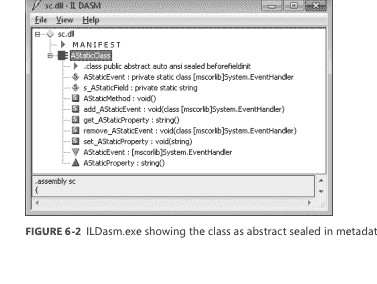

## 分部类、结构和接口

在本节中，我将讨论分部类、结构和接口。需要注意的是，此功能完全由C#编译器提供（其他一些编译器也提供此功能）；CLR对分部类、结构和接口一无所知。

**partial**关键字告诉C#编译器，单个类、结构或接口定义的源代码可能跨越一个或多个源代码文件。你可能希望将类型的源代码拆分到多个文件中，主要原因有三个：

-   **源代码管理** 假设一个类型的定义包含大量源代码，并且一个程序员从源代码管理中签出以进行修改。其他程序员将无法同时修改该类型，除非以后进行合并。使用**partial**关键字可以将类型的代码拆分到多个源代码文件中，每个文件都可以单独签出，以便多个程序员可以同时编辑该类型。
-   **在单个文件内将类或结构划分为不同的逻辑单元** 有时我会创建一个提供多种功能的单个类型，以便该类型可以提供完整的解决方案。为了简化实现，有时我会在单个源代码文件中重复声明相同的分部类型。然后，在分部类型的每个部分中，我实现一个功能及其所有字段、方法、属性、事件等。这使我能够轻松地看到提供单个功能的所有成员组合在一起，从而简化了我的编码。此外，我可以轻松地注释掉分部类型的一部分，以从类中移除整个功能，并用另一实现替换它（通过分部类型的新部分）。
-   **代码拆分器** 在Microsoft Visual Studio中，当你创建新的Windows窗体或Web窗体项目时，会作为项目的一部分自动创建一些源代码文件。这些源代码文件包含模板，让你在构建此类项目时有一个良好的开端。当你使用Visual Studio设计器并将控件拖放到Windows窗体或Web窗体上时，Visual Studio会自动为你编写源代码，并将此代码拆分到源代码文件中。这确实提高了你的生产力。从历史上看，生成的代码被输出到你在处理的同一个源代码文件中。问题是，你可能会意外编辑生成的代码，导致设计器停止正常运行。从Visual Studio 2005开始，当你创建新的Windows窗体、Web窗体、用户控件等时，Visual Studio会创建两个源代码文件：一个用于你的代码，另一个用于设计器生成的代码。由于设计器代码在单独的文件中，你意外编辑它的可能性就小得多。

**partial**关键字应用于所有文件中的类型。当这些文件一起编译时，编译器将代码组合起来生成一个类型，该类型位于生成的.exe或.dll程序集文件（或.netmodule模块文件）中。正如我在本节开头所述，分部类型功能完全由C#编译器实现；CLR对分部类型一无所知。这就是为什么该类型的所有源代码文件必须使用同一种编程语言，并且必须作为一个编译单元一起编译。

## 组件、多态性和版本控制

面向对象编程（OOP）已经存在了很多很多年。当它在20世纪70年代末/80年代初首次被使用时，应用程序的规模要小得多，并且使应用程序运行的所有代码都是由一家公司编写的。当然，那时有操作系统，应用程序确实利用了操作系统中可用的功能，但与今天的操作系统相比，当时的操作系统提供的功能非常少。

如今，软件复杂得多，用户要求应用程序提供丰富的功能，如GUI、菜单项、鼠标输入、平板输入、打印机输出、网络等。因此，近年来我们的操作系统和开发平台大幅增长。此外，对于应用程序开发人员来说，编写应用程序按用户期望方式运行所需的所有代码已不再可行，甚至不再具有成本效益。如今，应用程序由许多不同公司生产的代码组成。这些代码使用面向对象的范式拼接在一起。

组件软件编程（CSP）是将OOP提升到这个水平。以下是组件的一些属性：

-   组件（.NET中的程序集）具有“已发布”的感觉。
-   组件具有标识（名称、版本、区域性和公钥）。
-   组件永远保持其标识（程序集中的代码永远不会静态链接到另一个程序集中；.NET始终使用动态链接）。
-   组件清楚地指示其依赖的组件（引用元数据表）。
-   组件应记录其类和成员。C#通过在源代码中允许可扩展标记语言（XML）文档以及编译器的/doc命令行开关来提供此功能。
-   组件必须指定其所需的安全权限。CLR的代码访问安全性（CAS）设施实现了这一点。
-   组件发布一个接口（对象模型），该接口不会因任何*服务版本*而改变。*服务版本*是组件的一个新版本，其意图是与组件的原始版本向后兼容。通常，服务版本包含错误修复、安全补丁，可能还有一些小的功能增强。但服务版本不能要求任何新的依赖或额外的安全权限。


正如最后一个项目符号所示，CSP 的很大一部分与版本控制有关。组件会随时间变化，并且组件会按不同的时间表发布。版本控制为 CSP 引入了一个全新的复杂层次，这在 OOP 中并不存在；在 OOP 中，所有代码都由单一公司作为单一单元编写、测试和发布。在本节中，我将重点讨论组件版本控制。

在 .NET 中，版本号由四个部分组成：主版本号部分、次版本号部分、生成号部分和修订号部分。例如，版本号为 1.2.3.4 的程序集，其主版本号部分为 1，次版本号部分为 2，生成号部分为 3，修订号部分为 4。主版本号/次版本号部分通常用于表示程序集一致且稳定的功能集，而生成号/修订号部分通常用于表示对该程序集功能集的服务更新。

假设某公司发布了一个版本为 2.7.0.0 的程序集。如果该公司后来想要修复此组件中的某个 bug，他们会生成一个新的程序集，其中只更改版本的生成号/修订号部分，例如版本 2.7.1.34。这表明该程序集是一次服务更新，其意图是与原始组件（版本 2.7.0.0）向后兼容。

另一方面，如果公司想要制作该程序集的新版本，而该版本包含重大更改，因此不打算与原始程序集向后兼容，那么公司实际上是在创建一个新组件，并且应该为新程序集分配一个主版本号/次版本号部分与现有组件不同的版本号（例如版本 3.0.0.0）。

> **注意** 我刚刚描述了应当如何看待版本号。不幸的是，CLR 并不这样处理版本号。如今，CLR 将版本号视为一个不透明值；如果一个程序集依赖于另一个程序集的版本 1.2.3.4，那么 CLR 只会尝试加载版本 1.2.3.4（除非存在绑定重定向）。

既然我们已经了解了如何使用版本号更新组件的标识以反映新版本，接下来让我们看看 CLR 和编程语言（例如 C#）提供的一些功能，这些功能允许开发者编写能够适应其所使用组件中可能发生的变化的代码。

当在一个组件（程序集）中定义的类型被用作另一个组件（程序集）中类型的基类时，版本控制问题就会出现。显然，如果基类在派生类之下发生版本变化（改变），派生类的行为也会随之改变，而且很可能以导致该类行为不正确的方式改变。在多态场景中尤其如此，其中派生类型重写了基类型定义的虚方法。

C# 提供了五个关键字，你可以将它们应用于类型和/或类型成员，从而影响组件版本控制。这些关键字直接映射到 CLR 中为支持组件版本控制而提供的功能。表 6-2 列出了与组件版本控制相关的 C# 关键字，并说明每个关键字如何影响类型或类型成员的定义。

**表 6-2 C# 关键字及其对组件版本控制的影响**

| C# 关键字 | 类型 | 方法/属性/事件 | 常量/字段 |
|---|---|---|---|
| **abstract** | 表示不能构造该类型的实例 | 表示派生类型必须先重写并实现该成员，然后才能构造派生类型的实例 | （不允许） |
| **virtual** | （不允许） | 表示该成员可由派生类型重写 | （不允许） |
| **override** | （不允许） | 表示派生类型正在重写基类型的成员 | （不允许） |
| **sealed** | 表示该类型不能用作基类型 | 表示该成员不能由派生类型重写。此关键字只能应用于重写虚方法的方法。 | （不允许） |
| **new** |  | 当应用于嵌套类型、方法、属性、事件、常量或字段时，表示该成员与基类中可能存在的类似成员没有关系 |  |

我将在接下来题为“在类型版本控制时处理虚方法”的一节中演示所有这些关键字的价值和用法。但在进入版本控制场景之前，让我们先关注 CLR 实际如何调用虚方法。

## CLR 如何调用虚方法、属性和事件

在本节中，我将重点讨论方法，但这里的讨论也同样适用于虚属性和虚事件。属性和事件实际上是以方法实现的；这将在它们相应的章节中展示。

方法表示对类型（静态方法）或类型实例（非静态方法）执行某种操作的代码。所有方法都有一个名称、一个签名和一个返回值（该返回值可能为 **void**）。CLR 允许一个类型定义多个同名方法，只要每个方法具有不同的参数集或不同的返回值。因此，只要方法具有不同的返回类型，就可以定义两个名称相同且参数相同的方法。然而，除了 IL 汇编语言之外，我不知道还有哪种语言会利用这个“特性”；大多数语言（包括 C#）要求方法通过参数来区分，并且在确定唯一性时忽略方法的返回类型。（C# 在定义转换运算符方法时实际上放宽了这一限制；详见第 8 章。）

下面所示的 **Employee** 类定义了三种不同类型的方法：

```
    internal class Employee {
        // A nonvirtual instance method
        public      Int32    GetYearsEmployed() { ... }

        // A virtual method (virtual implies instance)
        public virtual String GetProgressReport() { ... }

        // A static method
        public static  Employee Lookup(String name) { ... }
    }
```

当编译器编译这段代码时，编译器会在生成的程序集的方法定义表中生成三个条目。每个条目都设置了标志，以指示该方法是实例方法、虚方法还是静态方法。

当编写代码调用这些方法中的任何一个时，发出调用代码的编译器会检查方法定义的标志，以确定如何发出正确的 IL 代码，从而正确进行调用。CLR 提供两条用于调用方法的 IL 指令：

- `call` IL 指令可用于调用静态方法、实例方法和虚方法。当使用 `call` 指令调用静态方法时，必须指定定义 CLR 应调用的方法的类型。当使用 `call` 指令调用实例方法或虚方法时，必须指定一个引用对象的变量。`call` 指令假定该变量不为 `null`。换句话说，变量本身的类型指示了哪个类型定义了 CLR 应调用的方法。如果变量的类型没有定义该方法，则会检查基类型以查找匹配的方法。`call` 指令经常用于以非虚方式调用虚方法。

- `callvirt` IL 指令可用于调用实例方法和虚方法，不能调用静态方法。当使用 `callvirt` 指令调用实例方法或虚方法时，必须指定一个引用对象的变量。当使用 `callvirt` IL 指令调用非虚实例方法时，变量的类型指示了哪个类型定义了 CLR 应调用的方法。当使用 `callvirt` 指令调用虚实例方法时，CLR 会发现用于进行调用的对象的实际类型，然后以多态方式调用该方法。为了确定类型，用于进行调用的变量不能为 `null`。换句话说，在编译此调用时，JIT 编译器会生成代码来验证该变量的值不为 `null`。如果它为 `null`，`callvirt` 指令会导致 CLR 抛出 `NullReferenceException`。这一额外检查意味着 `callvirt` IL 指令的执行速度略慢于 `call` 指令。请注意，即使使用 `callvirt` 指令调用非虚实例方法，也会执行此 `null` 检查。


那么现在，让我们把这些内容放在一起，看看 C# 如何使用这些不同的 IL 指令：

```csharp
using System;

public sealed class Program {
    public static void Main() {
        Console.WriteLine(); // Call a static method

        Object o = new Object();
        o.GetHashCode();     // Call a virtual instance method
        o.GetType();         // Call a nonvirtual instance method
    }
}
```

如果编译上面的代码并查看生成的 IL，你会看到以下内容：

```il
.method public hidebysig static void Main() cil managed {
    .entrypoint
    // Code size 26 (0x1a)
    .maxstack 1
    .locals init (object V_0)
    IL_0000: call void System.Console::WriteLine()
    IL_0005: newobj instance void System.Object::.ctor()
    IL_000a: stloc.0
    IL_000b: ldloc.0
    IL_000c: callvirt instance int32 System.Object::GetHashCode()
    IL_0011: pop
    IL_0012: ldloc.0
    IL_0013: callvirt instance class System.Type System.Object::GetType()
    IL_0018: pop
    IL_0019: ret
} // end of method Program::Main
```

注意，C# 编译器使用 `call` IL 指令来调用 `Console` 的 `WriteLine` 方法。这是符合预期的，因为 `WriteLine` 是静态方法。接下来，注意 `callvirt` IL 指令被用于调用 `GetHashCode`。这同样符合预期，因为 `GetHashCode` 是虚方法。最后，注意 C# 编译器还使用 `callvirt` IL 指令来调用 `GetType` 方法。这令人意外，因为 `GetType` 不是虚方法。不过，这样能正常工作，是因为在 JIT 编译这段代码时，CLR 会知道 `GetType` 不是虚方法，因此 JIT 编译后的代码只会以非虚方式调用 `GetType`。

当然，问题在于，C# 编译器为什么不直接生成 `call` 指令呢？答案是因为 C# 团队决定让 JIT 编译器生成代码来验证用于发起调用的对象不是 `null`。这意味着对非虚实例方法的调用会比原本可能的速度稍慢一些。这也意味着下面所示的 C# 代码会导致抛出 `NullReferenceException`。在某些其他编程语言中，下面代码所表达的意图可以正常运行：

```csharp
using System;

public sealed class Program {
    public Int32 GetFive() { return 5; }
    public static void Main() {
        Program p = null;
        Int32 x = p.GetFive(); // In C#, NullReferenceException is thrown
    }
}
```

从理论上讲，上面的代码没有问题。当然，变量 **p** 是 **null**，但在调用非虚方法（**GetFive**）时，CLR 只需要知道 **p** 的数据类型，也就是 **Program**。如果 **GetFive** 确实被调用了，**this** 参数的值会是 **null**。由于 **GetFive** 方法内部没有使用该参数，因此不会抛出 **NullReferenceException**。然而，因为 C# 编译器生成的是 **callvirt** 指令而不是 **call** 指令，上面的代码最终会抛出 **NullReferenceException**。

> **重要** 如果将方法定义为非虚方法，就永远不应在将来把该方法改为虚方法。原因在于，某些编译器会使用 **call** 指令而不是 **callvirt** 指令来调用非虚方法。如果方法从非虚变为虚，而引用代码没有重新编译，那么该虚方法将以非虚方式被调用，导致应用程序产生不可预测的行为。如果引用代码是用 C# 编写的，这不成问题，因为 C# 使用 **callvirt** 调用所有实例方法。但如果引用代码是使用其他编程语言编写的，这就可能成为问题。

有时，编译器会使用 **call** 指令来调用虚方法，而不是使用 **callvirt** 指令。乍一看，这可能令人意外，但下面的代码演示了为什么有时必须这样做：

```csharp
internal class SomeClass {
    // ToString is a virtual method defined in the base class: Object.
    public override String ToString() {
        // Compiler uses the 'call' IL instruction to call
        // Object's ToString method nonvirtually.

        // If the compiler were to use 'callvirt' instead of 'call', this
        // method would call itself recursively until the stack overflowed.
        return base.ToString();
    }
}
```

当调用 **base.ToString**（一个虚方法）时，C# 编译器会生成 **call** 指令，以确保以非虚方式调用基类型中的 **ToString** 方法。这是必需的，因为如果以虚方式调用 **ToString**，该调用将递归执行，直到线程的栈溢出，这显然不是我们想要的结果。

编译器在调用由值类型定义的方法时倾向于使用 **call** 指令，因为值类型是密封的。这意味着即使对于值类型的虚方法，也不存在多态性，从而使调用性能更快。此外，值类型实例的特性保证它永远不可能为 **null**，因此永远不会抛出 **NullReferenceException**。最后，如果以虚方式调用值类型的虚方法，CLR 就需要持有对值类型对象的引用，以便引用其中的方法表。这要求对值类型进行装箱。装箱会给堆带来更大压力，迫使垃圾回收更频繁地发生，并损害性能。

无论使用 **call** 还是 **callvirt** 来调用实例方法或虚方法，这些方法始终会收到一个隐藏的 **this** 参数，作为该方法的第一个参数。**this** 参数指的是正在被操作的对象。

在设计类型时，应尽量减少所定义的虚方法数量。第一，调用虚方法比调用非虚方法慢。第二，虚方法无法由 JIT 编译器内联，这会进一步损害性能。第三，虚方法会使组件的版本控制更加脆弱，下一节将对此进行描述。第四，在定义基类型时，通常会提供一组便利的重载方法。如果希望这些方法具有多态性，最好的做法是将最复杂的方法设为虚方法，而让所有便利重载方法保持非虚。顺便说一句，遵循这一准则还能提高组件的版本控制能力，而不会对派生类型造成不利影响。下面是一个示例：

```csharp
public class Set {
    private Int32 m_length = 0;

    // This convenience overload is not virtual
    public Int32 Find(Object value) {
        return Find(value, 0, m_length);
    }

    // This convenience overload is not virtual
    public Int32 Find(Object value, Int32 startIndex) {
        return Find(value, startIndex, m_length - startIndex);
    }

    // The most feature-rich method is virtual and can be overridden
    public virtual Int32 Find(Object value, Int32 startIndex, Int32 endIndex) {
        // Actual implementation that can be overridden goes here...
    }

    // Other methods go here
}
```

## 明智地使用类型可见性和成员可访问性

在 .NET Framework 中，应用程序由多个程序集中定义的类型组成，而这些程序集由不同的公司生成。这意味着开发者几乎无法控制自己正在使用的组件以及这些组件中定义的类型。开发者通常无法访问源代码（甚至可能不知道创建组件时使用的是哪种编程语言），而且组件的版本发布节奏往往各不相同。此外，由于多态性和受保护成员的存在，基类开发者必须信任派生类开发者编写的代码。当然，派生类开发者也必须信任自己从基类继承的代码。这些只是设计组件和类型时真正需要思考的部分问题。

在本节中，我想简要谈谈如何在这些问题的基础上设计类型。具体来说，我将重点介绍设置类型可见性和成员可访问性的正确方式，以便尽可能成功地做到这一点。

首先，在定义新类型时，编译器应默认将类设为密封，使该类不能用作基类。然而，包括 C# 在内的许多编译器默认采用非密封类，并允许程序员使用 sealed 关键字显式将类标记为密封。显然，现在为时已晚，但我认为当今的编译器选择了错误的默认设置，如果未来的编译器能改变这一点就好了。密封类优于非密封类的原因有三个：

- **版本控制** 当一个类最初是密封的时，它将来可以改为非密封，而不会破坏兼容性。然而，一旦类变为非密封，将来就永远不能将其改为密封，因为这会破坏所有派生类。此外，如果非密封类定义了任何非密封的虚方法，则在新版本中必须保持虚方法调用的顺序，否则将来有可能破坏派生类型。
- **性能** 如上一节所述，调用虚方法的性能不如调用非虚方法，因为 CLR 必须在运行时查找对象的类型，以确定哪个类型定义了要调用的方法。然而，如果 JIT 编译器看到通过密封类型调用虚方法，它就可以通过以非虚方式调用该方法来生成更高效的代码。它能这样做，是因为它知道如果类是密封的，就不可能有派生类。例如，在下面的代码中，JIT 编译器可以以非虚方式调用虚方法 ToString：

```csharp
using System;
public sealed class Point {
    private Int32 m_x, m_y;

    public Point(Int32 x, Int32 y) { m_x = x; m_y = y; }
}
```


```csharp
public override String ToString() {
    return String.Format("{0}, {1}", m_x, m_y);
}

public static void Main() {
    Point p = new Point(3, 4);

    // The C# compiler emits the callvirt instruction here but the
    // JIT compiler will optimize this call and produce code that
    // calls ToString nonvirtually because p's type is Point,
    // which is a sealed class
    Console.WriteLine(p.ToString());
}
```

- **安全性和可预测性** 类必须保护自身状态，绝不允许自身遭到破坏。当类未密封时，如果基类的任何数据字段或内部操作字段的方法可访问且不是私有的，派生类就可以访问和操作基类的状态。此外，虚方法可被派生类重写，派生类可以决定是否调用基类的实现。通过将方法、属性或事件设为虚成员，基类就放弃了对自身行为与状态的部分控制。除非经过仔细考虑，否则这可能导致对象行为不可预测，并留下潜在的安全漏洞。

密封类的问题在于，它可能给该类型的使用者带来很大不便。有时，开发人员希望从现有类型派生一个类，以便为自己的应用程序附加一些额外字段或状态信息。事实上，他们甚至可能希望在派生类型上定义一些辅助方法或便利方法，以操作这些额外字段。由于密封类限制了这种能力，我向 CLR 团队提出了一项建议：引入一种名为 **封闭** 的新类修饰符。

封闭类可用作基类，但其行为是封闭的，不受派生类干扰。基本上，封闭基类会禁止派生类访问基类的任何非公共成员。这样，基类就可以在知道自己不会影响派生类的前提下进行更改。理想情况下，编译器会把类型的默认访问修饰符改为 **封闭**，因为在不至于限制过严的前提下，这是最安全的选择。现在判断这个想法是否会进入 CLR 和编程语言还为时过早。不过，我非常希望有一天它能实现。

顺便说一下，你几乎可以在今天实现 **封闭** 旨在达成的效果；只是这样做非常不方便。基本上，在实现类时，要确保密封所有继承来的虚方法（包括 **System.Object** 定义的方法）。另外，不要定义任何未来可能成为版本管理负担的方法，例如受保护方法或虚方法。下面是一个示例：

```csharp
public class SimulatedClosedClass : Object {
    public sealed override Boolean Equals(Object obj) {
        return base.Equals(obj);
    }
    public sealed override Int32 GetHashCode() {
        return base.GetHashCode();
    }
    public sealed override String ToString() {
        return base.ToString();
    }
    // Unfortunately, C# won't let you seal the Finalize method

    // Define additional public or private members here...
    // Do not define any protected or virtual members
}
```

遗憾的是，编译器和 CLR 目前都不支持封闭类型。以下是我在定义自己的类时遵循的指导原则：

- 定义类时，我总是显式地将其设为 **密封**，除非我确实打算让该类成为允许派生类进行特化的基类。如前所述，这与 C# 和许多其他编译器如今的默认做法相反。除非我希望类在程序集外部公开暴露，否则我也默认将类设为 **内部**。幸运的是，如果你没有显式指示类型的可见性，C# 编译器会默认设为 internal。如果我真的觉得定义一个可供他人派生、但又不希望允许特化的类很重要，我就会使用上述技术，密封我的类所继承的虚方法，从而模拟创建一个封闭类。

- 在类内部，我总是将数据字段定义为 **私有**，并且在这一点上从不妥协。幸运的是，C# 默认会将字段设为 **私有**。实际上，我更希望 C# 强制要求所有字段都设为 private，并且不允许把字段设为 **受保护**、**内部**、**公共** 等。暴露状态是最容易引发问题、导致对象行为不可预测并留下潜在安全漏洞的方式。即使你只是把某些字段声明为 **内部**，也是如此。即使在单个程序集内，要跟踪所有引用某个字段的代码也太困难了，尤其是在多个开发人员编写的代码被编译到同一个程序集时。

- 在类内部，我总是将方法、属性和事件定义为 **私有** 且非虚。幸运的是，C# 也默认如此。当然，我会将某个方法、属性或事件设为 **公共**，以便从类型中公开某些功能。我尽量避免将这些成员中的任何一个设为 **受保护** 或 **内部**，因为这会暴露我的类型，使其面临潜在漏洞。不过，我宁愿将成员设为 **受保护** 或 **内部**，也不愿将其设为 **虚**，因为虚成员会放弃大量控制权，并且确实依赖于派生类的正确行为。

- 有一句古老的面向对象编程格言是这样说的：当事情变得过于复杂时，就创建更多类型。当某个算法的实现开始变得复杂时，我会定义辅助类型来封装离散的功能片段。如果我要为单个超级类型定义这些辅助类型，我会将辅助类型嵌套定义在该超级类型内部。这样既能限定作用域，也能让嵌套辅助类型中的代码引用超级类型中定义的私有成员。不过，有一条设计指导规则，由 Visual Studio 中的代码分析工具（FxCopCmd.exe）强制执行，它指出公开暴露的嵌套类型应在文件或程序集作用域中定义，而不应在另一个类型内部定义。这条规则之所以存在，是因为一些开发人员认为引用嵌套类型的语法很繁琐。我认可这条规则，并且从不定义公共嵌套类型。

## 对类型进行版本管理时处理虚方法

如前所述，在组件软件编程环境中，版本管理是一个非常重要的问题。我在第 3 章“共享程序集与强命名程序集”中解释强命名程序集时，讨论了其中一些版本管理问题，并讨论了管理员如何确保应用程序绑定到它构建和测试时所使用的程序集。然而，其他版本管理问题会导致源代码兼容性问题。例如，如果某个类型被用作基类型，那么在添加或修改该类型的成员时，你必须非常小心。让我们看一些示例。

CompanyA 设计了以下类型 Phone：

```csharp
namespace CompanyA {
    public class Phone {
        public void Dial() {
            Console.WriteLine("Phone.Dial");
            // Do work to dial the phone here.
        }
    }
}
```

现在假设 CompanyB 定义了另一个类型 BetterPhone，它使用 CompanyA 的 Phone 类型作为基类：

```csharp
namespace CompanyB {
    public class BetterPhone : CompanyA.Phone {
        public void Dial() {
            Console.WriteLine("BetterPhone.Dial");
            EstablishConnection();
            base.Dial();
        }

        protected virtual void EstablishConnection() {
            Console.WriteLine("BetterPhone.EstablishConnection");
            // Do work to establish the connection.
        }
    }
}
```

当 CompanyB 尝试编译其代码时，C# 编译器会发出以下消息：“warning CS0108: 'CompanyB.BetterPhone.Dial()' 隐藏了继承成员 'CompanyA.Phone.Dial()'。如果是有意隐藏，请使用 new 关键字。” 这条警告通知开发人员：CompanyB 正在定义一个 Dial 方法，它将隐藏 Phone 中定义的 Dial 方法。这个新方法可能会改变 Dial 的语义含义（即 CompanyA 最初创建 Dial 方法时定义的语义）。

编译器能警告你这种潜在的语义不匹配，这是一个非常好的特性。编译器还会告诉你如何消除该警告：在 BetterPhone 类的 Dial 定义前添加 new 关键字。修复后的 BetterPhone 类如下：

```csharp
namespace CompanyB {
    public class BetterPhone : CompanyA.Phone {
        // This Dial method has nothing to do with Phone's Dial method.
        public new void Dial() {
            Console.WriteLine("BetterPhone.Dial");
            EstablishConnection();
            base.Dial();
        }

        protected virtual void EstablishConnection() {
            Console.WriteLine("BetterPhone.EstablishConnection");
            // Do work to establish the connection.
        }
    }
}
```

此时，CompanyB 可以在其应用程序中使用 BetterPhone.Dial。以下是 CompanyB 可能编写的一些示例代码：

```csharp
public sealed class Program {
    public static void Main() {
        CompanyB.BetterPhone phone = new CompanyB.BetterPhone();
        phone.Dial();
    }
}
```

当这段代码运行时，会显示以下输出：

```
BetterPhone.Dial
BetterPhone.EstablishConnection
Phone.Dial
```

这个输出表明 CompanyB 得到了它想要的行为。对 Dial 的调用会调用 BetterPhone 定义的新 Dial 方法，该方法会调用虚方法 EstablishConnection，然后调用 Phone 基类型的 Dial 方法。

现在假设有几家公司决定使用 CompanyA 的 Phone 类型。再进一步假设，这些其他公司认为在 Dial 方法中建立连接的能力确实是一个非常有用的特性。这个反馈被传达给 CompanyA，CompanyA 现在修订了它的 Phone 类：


```csharp
namespace CompanyA {
    public class Phone {
        public void Dial() {
            Console.WriteLine("Phone.Dial");
            EstablishConnection();
            // Do work to dial the phone here.
        }

        protected virtual void EstablishConnection() {
            Console.WriteLine("Phone.EstablishConnection");
            // Do work to establish the connection.
        }
    }
}
```

现在，当 CompanyB 编译其 **BetterPhone** 类型（派生自 CompanyA 的 **Phone** 的这个新版本）时，编译器会发出以下消息：“warning CS0114: 'CompanyB.BetterPhone.EstablishConnection()' 隐藏了继承的成员 'CompanyA.Phone.EstablishConnection()'。若要使当前成员重写该实现，请添加 override 关键字。否则，请添加 new 关键字。”

编译器在提醒你：**Phone** 和 **BetterPhone** 都提供了一个 **EstablishConnection** 方法，而且两者的语义可能并不完全相同；仅仅重新编译 **BetterPhone** 已无法再提供与使用 **Phone** 类型第一个版本时相同的行为。

如果 CompanyB 认定两种类型中的 **EstablishConnection** 方法在语义上并不相同，那么 CompanyB 可以告诉编译器：**BetterPhone** 中定义的 **Dial** 和 **EstablishConnection** 方法才是要使用的正确方法，并且它与 **Phone** 基类型中定义的 **EstablishConnection** 方法没有任何关系。CompanyB 通过给 **EstablishConnection** 方法添加 **new** 关键字来告知编译器这一点：

```csharp
namespace CompanyB {
    public class BetterPhone : CompanyA.Phone {

        // Keep 'new' to mark this method as having no
        // relationship to the base type's Dial method.
        public new void Dial() {
            Console.WriteLine("BetterPhone.Dial");
            EstablishConnection();
            base.Dial();
        }

        // Add 'new' to mark this method as having no
        // relationship to the base type's EstablishConnection method.
        protected new virtual void EstablishConnection() {
            Console.WriteLine("BetterPhone.EstablishConnection");
            // Do work to establish the connection.
        }
    }
}
```

在这段代码中，**new** 关键字告诉编译器发出元数据，向 CLR 明确表明：**BetterPhone** 的 **EstablishConnection** 方法应被视为由 **BetterPhone** 类型引入的新函数。CLR 将知道 **Phone** 的方法与 **BetterPhone** 的方法之间没有任何关系。

当同一应用程序代码（在 **Main** 方法中）执行时，输出如下：

```
BetterPhone.Dial
BetterPhone.EstablishConnection
Phone.Dial
Phone.EstablishConnection
```

此输出表明，**Main** 对 **Dial** 的调用调用了 **BetterPhone.Dial** 定义的新 **Dial** 方法，而该方法又调用了同样由 **BetterPhone** 定义的虚 **EstablishConnection** 方法。当 **BetterPhone** 的 **EstablishConnection** 方法返回后，会调用 **Phone** 的 **Dial** 方法。**Phone** 的 **Dial** 方法调用 **EstablishConnection**，但由于 **BetterPhone** 的 **EstablishConnection** 用 **new** 标记，**BetterPhone** 的 **EstablishConnection** 方法不会被视为对 **Phone** 的虚 **EstablishConnection** 方法的重写。因此，**Phone** 的 **Dial** 方法调用的是 **Phone** 的 **EstablishConnection** 方法——这是预期行为。

> **注意** 如果编译器默认将方法视为重写（就像原生 C++ 编译器那样），那么 **BetterPhone** 的开发者就不能使用方法名 **Dial** 和 **EstablishConnection**。这很可能会在整个源代码库中引发连锁变更，破坏源代码和二进制兼容性。这种大范围变更并不可取，尤其是在任何中大型项目中。不过，如果更改方法名只会对源代码造成适度更新，那么你应更改这些方法的名称，以免 **Dial** 和 **EstablishConnection** 的两种不同含义让其他开发者感到困惑。

另一种做法是，CompanyB 可能已经获取了 CompanyA 的 **Phone** 类型的新版本，并认定 **Phone** 对 **Dial** 和 **EstablishConnection** 的语义正是它一直想要的。在这种情况下，CompanyB 会通过完全移除其 **Dial** 方法来修改自己的 **BetterPhone** 类型。此外，由于 CompanyB 现在想告诉编译器：**BetterPhone** 的 **EstablishConnection** 方法与 **Phone** 的 **EstablishConnection** 方法相关，因此必须移除 **new** 关键字。不过，仅移除 **new** 关键字还不够，因为现在编译器无法准确判断 **BetterPhone** 的 **EstablishConnection** 方法的意图。为了准确表达其意图，CompanyB 的开发者还必须将 **BetterPhone** 的 **EstablishConnection** 方法从 **virtual** 改为 **override**。以下代码展示了 **BetterPhone** 的新版本：

```csharp
namespace CompanyB {
    public class BetterPhone : CompanyA.Phone {

        // Delete the Dial method (inherit Dial from base).

        // Remove 'new' and change 'virtual' to 'override' to
        // mark this method as having a relationship to the base
        // type's EstablishConnection method.
        protected override void EstablishConnection() {
            Console.WriteLine("BetterPhone.EstablishConnection");
            // Do work to establish the connection.
        }
    }
}
```

现在，当同一应用程序代码（在 **Main** 方法中）执行时，输出如下：

```
Phone.Dial
BetterPhone.EstablishConnection
```

此输出表明，**Main** 对 **Dial** 的调用调用了由 **Phone** 定义并由 **BetterPhone** 继承的 **Dial** 方法。然后，当 **Phone** 的 **Dial** 方法调用虚 **EstablishConnection** 方法时，会调用 **BetterPhone** 的 **EstablishConnection** 方法，因为它重写了 **Phone** 定义的虚 **EstablishConnection** 方法。

# 第7章 常量和字段

| 本章内容： |  |
| --- | --- |
| 常量 | 181 |
| 字段 | 183 |

本章将向你展示如何向类型添加数据成员。具体来说，我们将讨论常量和字段。

## 常量

*常量*是一个值永不改变的符号。定义常量符号时，其值必须在编译时可确定。然后，编译器会将常量的值保存到程序集的元数据中。这意味着你只能为编译器视为基元类型的类型定义常量。在 C# 中，以下类型是基元类型，可用于定义常量：**Boolean**、**Char**、**Byte**、**SByte**、**Int16**、**UInt16**、**Int32**、**UInt32**、**Int64**、**UInt64**、**Single**、**Double**、**Decimal** 和 **String**。不过，如果将该值设置为 `null`，C# 还允许你定义非基元类型的常量变量：

```csharp
using System;

public sealed class SomeType {
    // SomeType is not a primitive type but C# does allow
    // a constant variable of this type to be set to 'null'.
    public const SomeType Empty = null;
}
```

由于常量值永不改变，常量始终被视为定义类型的一部分。换句话说，常量始终被视为静态成员，而不是实例成员。定义常量会创建元数据。

当代码引用常量符号时，编译器会在定义该常量的程序集的元数据中查找该符号，提取常量的值，并将该值嵌入到生成的中间语言（IL）代码中。由于常量的值直接嵌入代码中，因此常量在运行时不需要为其分配任何内存。此外，你无法获取常量的地址，也无法通过引用传递常量。这些常量还意味着常量没有良好的跨程序集版本管理方案，因此，只有当你确定某个符号的值永远不会改变时，才应使用常量。


（将 **MaxInt16** 定义为 32767 就是一个很好的例子。）让我确切地演示我的意思。首先，取以下代码并将其编译为 DLL 程序集：

```csharp
    using System;

    public sealed class SomeLibraryType {
        // NOTE: C# doesn't allow you to specify static for constants
        // because constants are always implicitly static.
        public const Int32 MaxEntriesInList = 50;
    }
```

然后使用以下代码生成一个应用程序集：

```csharp
    using System;

    public sealed class Program {
        public static void Main() {
            Console.WriteLine("Max entries supported in list: "
                + SomeLibraryType.MaxEntriesInList);
        }
    }
```

你会注意到，这段应用程序代码引用了 **SomeLibraryType** 类中定义的 **MaxEntriesInList** 常量。当编译器生成应用程序代码时，它看到 **MaxEntriesInList** 是一个值为 50 的常量字面量，并将 **Int32** 值 50 直接嵌入应用程序的 IL 代码中，如下面的 IL 代码所示。事实上，在生成应用程序集之后，DLL 程序集在运行时甚至不会被加载，并且可以从磁盘中删除。

```
    .method public hidebysig static void Main() cil managed
    {
        .entrypoint
        // Code size       25 (0x19)
        .maxstack  8
        IL_0000:  nop
        IL_0001:  ldstr      "Max entries supported in list: "
        IL_0006:  ldc.i4.s   50
        IL_0008:  box        [mscorlib]System.Int32
        IL_000d:  call       string [mscorlib]System.String::Concat(object, object)
        IL_0012:  call       void [mscorlib]System.Console::WriteLine(string)
        IL_0017:  nop
        IL_0018:  ret
    } // end of method Program::Main
```

这个示例应该让你清楚地看到版本控制问题。如果开发者将 **MaxEntriesInList** 常量改为 1000，并且只重新生成 DLL 程序集，那么应用程序集不会受到影响。要让应用程序获取新值，它也必须重新编译。如果你需要让一个程序集中的值在运行时（而不是编译时）被另一个程序集获取，就不能使用常量。相反，你可以使用 **readonly** 字段，我接下来会讨论。

## 字段

*字段*是一种数据成员，它保存值类型的实例或对引用类型的引用。表 7-1 显示了可应用于字段的修饰符。

**表 7-1 字段修饰符**

| CLR 术语 | C# 术语 | 描述 |
|---|---|---|
| 静态 | **static** | 该字段是类型状态的一部分，而不是对象状态的一部分。 |
| 实例 | （默认） | 该字段与类型的实例关联，而不是与类型本身关联。 |
| 仅初始化 | **readonly** | 该字段只能由构造函数方法中包含的代码写入。 |
| 易失 | **volatile** | 访问该字段的代码不受编译器、CLR 或硬件可能执行的一些线程不安全优化的影响。只有以下类型可以标记为 **volatile**：所有引用类型、**Single, Boolean, Byte, SByte, Int16, UInt16, Int32, UInt32, Char**，以及底层类型为 **Byte, SByte, Int16, UInt16, Int32, or UInt32** 的所有枚举类型。易失字段将在第 28 章“基元线程同步构造”中讨论。 |

如表 7-1 所示，公共语言运行时（CLR）既支持静态字段，也支持实例（非静态）字段。对于类型字段，保存字段数据所需的动态内存分配在类型对象内部，该类型对象在类型加载到 AppDomain 时创建（参见第 22 章“CLR 宿主与 AppDomain”），这通常发生在任何引用该类型的方法第一次进行即时（JIT）编译时。对于实例字段，保存字段的动态内存会在构造该类型的实例时分配。

由于字段存储在动态内存中，因此只能在运行时获取它们的值。字段还解决了常量中存在的版本控制问题。此外，字段可以是任何数据类型，因此你不必像使用常量那样局限于编译器内置的基元类型。

CLR 支持 **readonly** 字段和 **read/write** 字段。大多数字段都是 **read/write** 字段，这意味着字段的值可能会随着代码执行而多次更改。但是，**readonly** 字段只能在构造函数方法内写入（构造函数方法仅在对象首次创建时调用一次）。编译器和验证机制确保除构造函数外，任何方法都不会写入 **readonly** 字段。注意，可以使用反射修改 **readonly** 字段。

让我们采用“常量”一节中的示例，并使用静态 **readonly** 字段修复版本控制问题。以下是 DLL 程序集代码的新版本：

```csharp
using System;

public sealed class SomeLibraryType {
    // The static is required to associate the field with the type.
    public static readonly Int32 MaxEntriesInList = 50;
}
```

这是你唯一需要做的更改；应用程序代码完全不必更改，尽管你必须重新生成它才能看到新行为。现在，当应用程序的 **Main** 方法运行时，CLR 将加载 DLL 程序集（因此该程序集现在在运行时是必需的），并从为 **MaxEntriesInList** 字段分配的动态内存中获取该字段的值。当然，该值将是 **50**。

假设 DLL 程序集的开发者将 **50** 改为 **1000** 并重新生成该程序集。当应用程序代码重新执行时，它会自动获取新值：**1000**。在这种情况下，应用程序代码不必重新生成——它就能正常工作（尽管其性能会受到不利影响）。一个注意事项：此场景假设新版本的 DLL 程序集没有强名称，并且应用程序的版本控制策略使得 CLR 加载这个新版本。

以下示例展示了如何定义与类型本身关联的 **readonly** 静态字段，以及 **read/write** 静态字段和 **readonly** 与 **read/write** 实例字段，如下所示：

```csharp
public sealed class SomeType {
    // This is a static read-only field; its value is calculated and
    // stored in memory when this class is initialized at run time.
    public static readonly Random s_random = new Random();

    // This is a static read/write field.
    private static Int32 s_numberOfWrites = 0;

    // This is an instance read-only field.
    public readonly String Pathname = "Untitled";

    // This is an instance read/write field.
    private System.IO.FileStream m_fs;

    public SomeType(String pathname) {
        // This line changes a read-only field.
        // This is OK because the code is in a constructor.
        this.Pathname = pathname;
    }

    public String DoSomething() {
        // This line reads and writes to the static read/write field.
        s_numberOfWrites = s_numberOfWrites + 1;

        // This line reads the read-only instance field.
        return Pathname;
    }
}
```

在这段代码中，许多字段都是以内联方式初始化的。C# 允许你使用这种方便的内联初始化语法来初始化类的常量以及 **read/write** 和 **readonly** 字段。正如你将在第 8 章“方法”中看到的，C# 将内联初始化字段视为在构造函数中初始化该字段的简写语法。此外，在 C# 中，使用内联语法与在构造函数中使用赋值语法初始化字段时，有一些性能问题需要考虑。这些性能问题也将在第 8 章中讨论。


> **重要** 当字段是引用类型且该字段标记为 **readonly** 时，不可变的是引用，而不是该字段所引用的对象。以下代码演示了这一点：

```csharp
public sealed class AType {
    // InvalidChars must always refer to the same array object
    public static readonly Char[] InvalidChars = new Char[] { 'A', 'B', 'C' };
}

public sealed class AnotherType {
    public static void M() {
        // The lines below are legal, compile, and successfully
        // change the characters in the InvalidChars array
        AType.InvalidChars[0] = 'X';
        AType.InvalidChars[1] = 'Y';
        AType.InvalidChars[2] = 'Z';

        // The line below is illegal and will not compile because
        // what InvalidChars refers to cannot be changed
        AType.InvalidChars = new Char[] { 'X', 'Y', 'Z' };
    }
}
```


# 第8章 方法

本章内容：

-   实例构造函数与类（引用类型） ... 187
-   实例构造函数与结构（值类型） ... 191
-   类型构造函数 ... 194
-   运算符重载方法 ... 200
-   转换运算符方法 ... 204
-   扩展方法 ... 207
-   分部方法 ... 213

本章重点介绍你将遇到的各种方法，包括实例构造函数和类型构造函数，以及如何定义用于重载运算符和类型转换（用于隐式和显式强制转换）的方法。我们还将讨论扩展方法，它允许你从逻辑上向现有类型添加自己的实例方法，以及分部方法，它允许将类型的实现分散到多个部分。

## 实例构造函数与类（引用类型）

构造函数是特殊方法，允许将类型实例初始化为良好状态。构造函数方法在方法定义元数据表中始终称为 `.ctor`（表示构造函数）。创建引用类型实例时，会为该实例的数据字段分配内存，初始化对象的开销字段（类型对象指针和同步块索引），然后调用该类型的实例构造函数来设置对象的初始状态。

构造引用类型对象时，在调用该类型的实例构造函数之前，为对象分配的内存始终会被清零。构造函数未显式覆盖的任何字段都保证具有 `0` 或 `null` 值。

与其他方法不同，实例构造函数永远不会被继承。也就是说，一个类只拥有该类自身定义的实例构造函数。由于实例构造函数永远不会被继承，因此不能对实例构造函数应用以下修饰符：`virtual`、`new`、`override`、`sealed` 或 `abstract`。如果定义的类未显式定义任何构造函数，则 C# 编译器会为你定义一个默认（无参数）构造函数，其实现只是调用基类的无参数构造函数。

例如，如果定义以下类：

```csharp
public class SomeType {
}
```

这就像你编写了如下代码：

```csharp
public class SomeType {
    public SomeType() : base() { }
}
```

如果类是 **抽象** 的，编译器生成的默认构造函数具有 **protected** 可访问性；否则，该构造函数具有 **public** 可访问性。如果基类不提供无参数构造函数，则派生类必须显式调用基类构造函数，否则编译器将发出错误。如果类是 **静态（sealed 和 abstract）**，编译器根本不会在类定义中生成默认构造函数。

一个类型可以定义多个实例构造函数。每个构造函数必须具有不同的签名，并且每个构造函数可以具有不同的可访问性。对于可验证代码，类的实例构造函数在访问基类的任何继承字段之前，必须调用其基类的构造函数。如果派生类的构造函数未显式调用基类的某个构造函数，C# 编译器会自动生成对默认基类构造函数的调用。最终，会调用 **System.Object 的** public 无参数构造函数。此构造函数不执行任何操作——它只是返回。这是因为 **System.Object** 不定义任何实例数据字段，因此其构造函数没有任何事情可做。

在少数情况下，可以在不调用实例构造函数的情况下创建类型实例。具体而言，调用 **Object 的 MemberwiseClone** 方法会分配内存，初始化对象的开销字段，然后将源对象的字节复制到新对象。此外，使用运行时序列化程序反序列化对象时通常不会调用构造函数。反序列化代码使用 **System.Runtime.Serialization.FormatterServices** 类型的 **GetUninitializedObject** 或 **GetSafeUninitializedObject** 方法（如第 24 章“运行时序列化”所述）为对象分配内存，而不调用构造函数。

> **重要** 不应在构造函数中调用任何可能影响正在构造的对象的虚方法。原因是，如果在正在实例化的类型中重写了该虚方法，则将执行派生类型对重写方法的实现，但层次结构中的所有字段尚未完全初始化。因此，调用虚方法会导致不可预测的行为。

C# 提供一种简单语法，允许在构造引用类型实例时初始化该类型中定义的字段：

```csharp
internal sealed class SomeType {
    private Int32 m_x = 5;
}
```

构造 SomeType 对象时，其 m_x 字段将初始化为 5。这是如何发生的？如果检查 SomeType 构造函数方法（也称为 .ctor）的中间语言 (IL)，你将看到如下所示的代码：

```csharp
.method public hidebysig specialname rtspecialname
        instance void .ctor() cil managed
{
    // Code size       14 (0xe)
    .maxstack  8
    IL_0000:  ldarg.0
    IL_0001:  ldc.i4.5
    IL_0002:  stfld      int32 SomeType::m_x
    IL_0007:  ldarg.0
    IL_0008:  call       instance void [mscorlib]System.Object::.ctor()
    IL_000d:  ret
} // end of method SomeType::.ctor
```

在此代码中，可以看到 SomeType 的构造函数包含将 5 存储到 m_x 的代码，然后调用基类的构造函数。换句话说，C# 编译器允许使用便捷语法内联初始化实例字段，并将此转换为构造函数方法中的代码来执行初始化。这意味着应注意代码膨胀，如下类定义所示：

```csharp
internal sealed class SomeType {
    private Int32 m_x = 5;
    private String m_s = "Hi there";
    private Double m_d = 3.14159;
    private Byte m_b;

    // Here are some constructors.
    public SomeType()       { ... }
    public SomeType(Int32 x) { ... }
    public SomeType(String s) { ...; m_d = 10; }
}
```

当编译器为三个构造函数方法生成代码时，每个方法的开头都包含初始化 m_x、m_s 和 m_d 的代码。在此初始化代码之后，编译器插入对基类构造函数的调用，然后编译器将构造函数方法中出现的代码追加到该方法。例如，为接受 String 参数的构造函数生成的代码包括初始化 m_x、m_s 和 m_d、调用基类（Object）的构造函数，然后用值 10 覆盖 m_d 的代码。注意，即使没有显式初始化 m_b 的代码，也保证 m_b 初始化为 0。

## 实例构造函数与结构（值类型）

值类型（**结构**）构造函数的工作方式与引用类型（**类**）构造函数大不相同。公共语言运行时 (CLR) 始终允许创建值类型实例，并且无法阻止值类型被实例化。因此，值类型实际上甚至不需要在其中定义构造函数，并且 C# 编译器不会为值类型生成默认无参数构造函数。请检查以下代码：

```csharp
internal struct Point {
    public Int32 m_x, m_y;
}
internal sealed class Rectangle {
    public Point m_topLeft, m_bottomRight;
}
```

要构造 **Rectangle**，必须使用 **new** 运算符，并且必须指定构造函数。在这种情况下，会调用 C# 编译器自动生成的默认构造函数。为 **Rectangle** 分配内存时，该内存包括 **Point** 值类型的两个实例。出于性能原因，CLR 不会尝试为引用类型中包含的每个值类型字段调用构造函数。但正如我之前提到的，值类型的字段会初始化为 0/null。

CLR 确实允许在值类型上定义构造函数。这些构造函数执行的唯一方式是你编写代码显式调用其中一个，如 **Rectangle 的**构造函数所示：

```csharp
internal struct Point {
    public Int32 m_x, m_y;

    public Point(Int32 x, Int32 y) {
        m_x = x;
        m_y = y;
    }
}

internal sealed class Rectangle {
    public Point m_topLeft, m_bottomRight;

    public Rectangle() {
        // In C#, new on a value type calls the constructor to
        // initialize the value type's fields.
        m_topLeft     = new Point(1, 2);
        m_bottomRight = new Point(100, 200);
    }
}
```

值类型的实例构造函数仅在显式调用时执行。因此，如果 **Rectangle 的**构造函数没有通过使用 **new** 运算符调用 **Point 的**构造函数来初始化其 **m_topLeft** 和 **m_bottomRight** 字段，则两个 **Point** 字段中的 **m_x** 和 **m_y** 字段都将为 0。


在之前定义的 **Point** 值类型中，没有定义默认的无参构造函数。不过，让我们将那段代码改写如下：

```csharp
internal struct Point {
    public Int32 m_x, m_y;

    public Point() {
        m_x = m_y = 5;
    }
}

internal sealed class Rectangle {
    public Point m_topLeft, m_bottomRight;

    public Rectangle() {
    }
}
```

现在，当构造一个新的 **Rectangle** 时，你认为两个 **Point** 字段 **m_topLeft** 和 **m_bottomRight** 中的 **m_x** 和 **m_y** 字段会被初始化成什么：0 还是 5？（提示：这是一个陷阱问题。）

许多开发者（尤其是具有 C++ 背景的开发者）会期望 C# 编译器在 **Rectangle** 的构造函数中生成代码，为 **Rectangle** 的两个字段自动调用 **Point** 的默认无参构造函数。然而，为了提高应用程序的运行时性能，C# 编译器不会自动生成这段代码。事实上，许多编译器永远不会自动生成调用值类型默认构造函数的代码，即使该值类型提供了无参构造函数。若要让值类型的无参构造函数执行，开发者必须添加显式代码来调用值类型的构造函数。

根据上一段中的信息，你应该会预期，在之前展示的代码中，**Rectangle** 的两个 **Point** 字段中的 **m_x** 和 **m_y** 字段会被初始化为 0，因为代码中任何地方都没有显式调用 **Point** 的构造函数。

不过，我确实说过我最初的问题是一个陷阱问题。陷阱之处在于，C# 不允许值类型定义无参构造函数。因此，前面的代码实际上无法编译。尝试编译那段代码时，C# 编译器会生成以下消息：`error CS0568: Structs cannot contain explicit parameterless constructors.`

C# 有意禁止值类型定义无参构造函数，以消除开发者可能对该构造函数何时被调用产生的任何困惑。如果构造函数无法定义，编译器就永远无法自动生成调用它的代码。没有无参构造函数时，值类型的字段始终会被初始化为 **0/null**。

> **注意** 严格来说，当值类型作为引用类型中嵌套的字段时，值类型字段保证为 **0/null**。然而，基于栈的值类型字段并不保证为 **0/null**。为了可验证性，任何基于栈的值类型字段都必须在读取之前被写入。如果代码可以在写入值类型字段之前读取该字段，就可能出现安全漏洞。C# 和其他生成可验证代码的编译器会确保所有基于栈的值类型的字段在读取之前被清零或至少被写入，从而避免在运行时抛出验证异常。在大多数情况下，这意味着你可以假定值类型的字段已初始化为 **0**，并且可以完全忽略本注意中的所有内容。

请记住，尽管 C# 不允许值类型具有无参构造函数，但 CLR 允许。因此，如果前面描述的不明显行为不会困扰你，你可以使用另一种编程语言（例如 IL 汇编语言）来定义具有无参构造函数的值类型。

因为 C# 不允许值类型具有无参构造函数，编译以下类型会生成以下消息：“**error CS0573: 'SomeValType.m_x': cannot have instance field initializers in structs.**”

```csharp
internal struct SomeValType {
   // You cannot do inline instance field initialization in a value type
   private Int32 m_x = 5;
}
```

此外，因为可验证代码要求值类型的每个字段在任何字段被读取之前都已被写入，所以值类型中你拥有的任何构造函数都必须初始化该类型的所有字段。以下类型为值类型定义了一个构造函数，但未能初始化所有字段：

```csharp
internal struct SomeValType {
   private Int32 m_x, m_y;

   // C# allows value types to have constructors that take parameters.
   public SomeValType(Int32 x) {
      m_x = x;
      // Notice that m_y is not initialized here.
   }
}
```

编译此类型时，C# 编译器会生成以下消息：“**error CS0171: Field 'SomeValType.m_y' must be fully assigned before control leaves the constructor.**” 要解决此问题，请在构造函数中为 **m_y** 分配一个值（通常是 **0**）。

任何开发者编写的代码来调用它们；CLR 始终能够调用类型构造器。


> **重要** 虽然你可以在值类型中定义类型构造器，但永远不应实际这样做，因为有时 CLR 不会调用值类型的静态类型构造器。下面是一个示例：

```csharp
internal struct SomeValType {
    static SomeValType() {
        Console.WriteLine("This never gets displayed");
    }
    public Int32 m_x;
}

public sealed class Program {
    public static void Main() {
        SomeValType[] a = new SomeValType[10];
        a[0].m_x = 123;
        Console.WriteLine(a[0].m_x);    // Displays 123
    }
}
```

调用类型构造器是一件棘手的事情。当即时（JIT）编译器编译某个方法时，它会查看代码中引用了哪些类型。如果其中任何类型定义了类型构造器，JIT 编译器会检查该类型的类型构造器是否已在此 AppDomain 中执行过。如果该构造函数从未执行过，JIT 编译器会在其生成的本地代码中生成对该类型构造器的调用。如果该类型的类型构造器已经执行过，JIT 编译器就不会生成调用，因为它知道该类型已经初始化。（有关示例，请参阅本章后面的“类型构造器性能”一节。）

现在，在方法经过 JIT 编译后，线程开始执行它，并最终会到达调用类型构造器的代码。事实上，多个线程可能同时执行同一个方法。CLR 希望确保一个类型的构造函数在每个 AppDomain 中只执行一次。为了保证这一点，当调用类型构造器时，调用线程会获取一个互斥的线程同步锁。因此，如果多个线程试图同时调用某个类型的静态构造函数，只有一个线程会获取该锁，其他线程将阻塞。第一个线程将执行静态构造函数中的代码。在第一个线程离开构造函数后，等待的线程将醒来，并看到构造函数的代码已经执行过。这些线程不会再次执行该代码；它们只会从构造函数方法返回。此外，如果这些方法中的任何一个再次被调用，CLR 知道类型构造器已经执行过，并会确保不再调用该构造函数。

> **注意** 由于 CLR 保证类型构造器在每个 AppDomain 中只执行一次并且是线程安全的，因此类型构造器是初始化该类型所需任何单例对象的绝佳位置。

在单个线程内，如果两个类型构造器包含相互引用的代码，则可能出现潜在问题。例如，ClassA 有一个类型构造器，其中包含引用 ClassB 的代码；ClassB 有一个类型构造器，其中包含引用 ClassA 的代码。在这种情况下，CLR 仍然保证每个类型构造器的代码只执行一次，但是，它无法保证 ClassA 的类型构造器代码在执行 ClassB 的类型构造器之前已经运行完成。你当然应该尽量避免编写造成这种场景的代码。事实上，由于 CLR 负责调用类型构造器，你应始终避免编写任何要求类型构造器按特定顺序调用的代码。

最后，如果类型构造器抛出未处理的异常，CLR 会认为该类型不可用。尝试访问该类型的任何字段或方法都将导致抛出 **System.TypeInitializationException**。

类型构造器中的代码只能访问类型的静态字段，其通常用途是初始化这些字段。与处理实例字段一样，C# 提供了一种简单语法，允许你初始化类型的静态字段：

```csharp
internal sealed class SomeType {
    private static Int32 s_x = 5;
}
```

> **注意** 虽然 C# 不允许值类型对实例字段使用内联字段初始化语法，但它允许你对静态字段使用该语法。换句话说，如果你将上面的 **SomeType** 类型从 **class** 改为 **struct**，代码将按预期编译并工作。

构建此代码时，编译器会自动为 **SomeType** 生成一个类型构造器。就好像源代码最初编写如下：

```csharp
internal sealed class SomeType {
    private static Int32 s_x;
    static SomeType() { s_x = 5; }
}
```

使用 ILDasm.exe，通过检查类型构造器的 IL，很容易验证编译器实际生成了什么。在方法定义元数据表中，类型构造器方法始终称为 **.cctor**（代表 *类构造函数*）。

在下面的代码中，你会看到 **.cctor** 方法是 **private** 且 **static** 的。此外，请注意该方法中的代码确实将 5 加载到静态字段 **s_x** 中。


```csharp
.method private hidebysig specialname rtspecialname static
        void  .cctor() cil managed
{
  // Code size       7 (0x7)
  .maxstack  8
  IL_0000:  ldc.i4.5
  IL_0001:  stsfld     int32 SomeType::s_x
  IL_0006:  ret
} // end of method SomeType::.cctor
```

类型构造函数不应调用基类型的类型构造函数。这种调用没有必要，因为类型的静态字段都不会与基类型共享，也不会从基类型继承。

> **注意** 某些语言（如 Java）期望访问某个类型时，会调用该类型的类型构造函数及其所有基类型的类型构造函数。此外，该类型实现的接口也必须调用其类型构造函数。CLR 不提供这种行为。不过，CLR 通过 System.Runtime.CompilerServices.RuntimeHelpers 类型提供的 RunClassConstructor 方法，使编译器和开发者能够实现这种行为。任何需要这种行为的语言，都会让其编译器在类型的类型构造函数中生成代码，为所有基类型调用此方法。使用 RunClassConstructor 方法调用类型构造函数时，CLR 知道该类型构造函数之前是否已执行；如果已执行，CLR 就不会再次调用它。

最后，假设你有以下代码：

```csharp
internal sealed class SomeType {
    private static Int32 s_x = 5;

    static SomeType() {
        s_x = 10;
    }
}
```

在这种情况下，C# 编译器会生成单个类型构造函数方法。这个构造函数首先将 s_x 初始化为 5，然后将 s_x 初始化为 10。换句话说，当 C# 编译器为类型构造函数生成 IL 代码时，它首先生成初始化静态字段所需的代码，然后生成类型构造函数方法中包含的显式代码。

> **重要** 开发者偶尔会问我，是否有办法在类型卸载时执行某些代码。你首先应该知道，类型只有在 AppDomain 卸载时才会卸载。当 AppDomain 卸载时，标识该类型的对象变得不可达，垃圾回收器会回收该类型对象的内存。这种行为使许多开发者认为，他们可以向类型添加静态 Finalize 方法，该方法会在类型卸载时自动调用。不幸的是，CLR 不支持静态 Finalize 方法。不过，并非无计可施。如果希望在 AppDomain 卸载时执行某些代码，可以向 System.AppDomain 类型的 DomainUnload 事件注册回调方法。

## 类型构造函数性能

在上一节中，我提到调用类型构造函数是一件棘手的事情。并且我解释了其中一些棘手之处：JIT 编译器必须决定是否生成调用它的代码，而 CLR 确保对它的调用是线程安全的。事实证明，这只是棘手问题的开始。关于这一点，还有更多与性能相关的内容。

如前所述，在编译方法时，JIT 编译器会确定是否必须在方法中生成执行类型构造函数的调用。如果 JIT 编译器决定生成该调用，它必须决定应在何处生成该调用。这里有两种可能：

- JIT 编译器可以在创建该类型第一个实例的代码之前，或访问该类的非继承字段或成员的代码之前立即生成该调用。这称为*精确语义*，因为 CLR 会在恰好的时机调用类型构造函数。
- JIT 编译器可以在代码首次访问静态字段、静态方法或实例方法，或调用实例构造函数之前的某个时间生成该调用。这称为*字段初始化前*语义，因为 CLR 只保证静态构造函数会在访问该成员之前的某个时间运行；它可能运行得早得多。

字段初始化前语义更受青睐，因为它让 CLR 在何时调用类型构造函数方面拥有很大自由度，而 CLR 会尽可能利用这一点来生成执行更快的代码。例如，CLR 可能会根据类型是加载到 AppDomain 中还是以域中性方式加载，或者代码是正在被 JIT 编译还是 NGen 编译，来选择不同的时间调用类型构造函数。

默认情况下，语言编译器会选择这些语义中对你所定义类型最有意义的一种，并通过在类型定义元数据表中的行里设置 **beforefieldinit** 标志，将此选择告知 CLR。在本节中，我将重点介绍 C# 编译器的行为及其对性能的影响。我们先从检查以下代码开始：

```csharp
using System;
using System.Diagnostics;

////////////////////////////////////////////////////////////

// Since this class doesn't explicitly define a type constructor,
// C# marks the type definition with BeforeFieldInit in the metadata.
internal sealed class BeforeFieldInit {
    public static Int32 s_x = 123;
}

// Since this class does explicitly define a type constructor,
// C# doesn't mark the type definition with BeforeFieldInit in the metadata.
internal sealed class Precise {
    public static Int32 s_x;

    static Precise() { s_x = 123; }
}

///////////////////////////////////////////////////////////////////////////////

public sealed class Program {
    public static void Main() {
        const Int32 iterations = 1000 * 1000 * 1000;
        PerfTest1(iterations);
        PerfTest2(iterations);
    }


    // When this method is JIT compiled, the type constructors for
    // the BeforeFieldInit and Precise classes HAVE NOT executed yet
    // and therefore, calls to these constructors are embedded in
    // this method's code, making it run slower
    private static void PerfTest1(Int32 iterations) {
        Stopwatch sw = Stopwatch.StartNew();
        for (Int32 x = 0; x < iterations; x++) {
            // The JIT compiler hoists the code to call BeforeFieldInit's
            // type constructor so that it executes before the loop starts
            BeforeFieldInit.s_x = 1;
        }
        Console.WriteLine("PerfTest1: {0} BeforeFieldInit", sw.Elapsed);

        sw = Stopwatch.StartNew();
        for (Int32 x = 0; x < iterations; x++) {
            // The JIT compiler emits the code to call Precise's
            // type constructor here so that it checks whether it
            // has to call the constructor with each loop iteration
            Precise.s_x = 1;
        }
        Console.WriteLine("PerfTest1: {0} Precise", sw.Elapsed);
    }

    // When this method is JIT compiled, the type constructors for
    // the BeforeFieldInit and Precise classes HAVE executed
    // and therefore, calls to these constructors are NOT embedded
    // in this method's code, making it run faster
    private static void PerfTest2(Int32 iterations) {
        Stopwatch sw = Stopwatch.StartNew();
        for (Int32 x = 0; x < iterations; x++) {
            BeforeFieldInit.s_x = 1;
        }
        Console.WriteLine("PerfTest2: {0} BeforeFieldInit", sw.Elapsed);

        sw = Stopwatch.StartNew();
        for (Int32 x = 0; x < iterations; x++) {
            Precise.s_x = 1;
        }
        Console.WriteLine("PerfTest2: {0} Precise", sw.Elapsed);
    }
}

////////////////////////////// End of File //////////////////////////////
```

## 运算符与编程语言互操作性

运算符重载可以是非常有用的工具，让开发者用简洁的代码表达想法。然而，并非所有编程语言都支持运算符重载。使用不支持运算符重载的语言时，该语言将不知道如何解释 `+` 运算符（除非该类型是该语言中的基元类型），编译器会发出错误。使用不支持运算符重载的语言时，该语言应允许你直接调用所需的 `op_*` 方法（例如 `op_Addition`）。

如果你使用的语言不支持在类型中定义 `+` 运算符重载，显然，该类型仍然可以提供 `op_Addition` 方法。从 C# 来看，你可能会期望能通过 `+` 运算符调用这个 `op_Addition` 方法，但你不能。当 C# 编译器检测到 `+` 运算符时，它会查找关联了 `specialname` 元数据标志的 `op_Addition` 方法，以便编译器确定该 `op_Addition` 方法旨在作为运算符重载方法。由于 `op_Addition` 方法是由不支持运算符重载的语言生成的，因此该方法不会关联 `specialname` 标志，C# 编译器将产生编译错误。当然，任何语言中的代码都可以显式调用恰好名为 `op_Addition` 的方法，但编译器不会将 `+` 符号的使用转换为调用此方法。

### Jeff 对微软运算符方法命名规则的看法

我相信，所有这些关于何时可以、何时不能调用运算符重载方法的规则，看起来都非常令人困惑且过于复杂。如果支持运算符重载的编译器干脆不生成 `specialname` 元数据标志，这些规则会简单得多，程序员使用提供运算符重载方法的类型时也会更轻松。支持运算符重载的语言将支持运算符符号语法，而所有语言都将支持显式调用各种 `op_` 方法。我想不出微软为什么要把这件事弄得这么困难，我希望他们会在未来版本的编译器中放宽这些规则。

对于定义运算符重载方法的类型，微软建议该类型还应定义更友好的公共静态方法，在内部调用这些运算符重载方法。例如，重载 `op_Addition` 方法的类型应定义一个名为 Add 的公共友好命名方法。表 8-1 和表 8-2 的第三列列出了每个运算符建议的友好名称。因此，前面展示的 Complex 类型应按以下方式定义：

```csharp
public sealed class Complex {
    public static Complex operator+(Complex c1, Complex c2) { ... }
    public static Complex Add(Complex c1, Complex c2) { return(c1 + c2); }
}
```


```csharp
// Convert a Rational to an Int32
public Int32 ToInt32() { ... }

// Convert a Rational to a Single
public Single ToSingle() { ... }
}
```

通过调用这些构造函数和方法，使用任何编程语言的开发人员都可以将**Int32**或**Single**对象转换为**Rational**对象，并将**Rational**对象转换为**Int32**或**Single**对象。能够进行这些转换非常方便，因此在设计类型时，你应该认真考虑哪些转换构造函数和方法对你的类型有意义。

在上一节中，我讨论了某些编程语言如何提供运算符重载。而且，某些编程语言（如C#）也提供转换运算符重载。*转换运算符*是将对象从一种类型转换为另一种类型的方法。你可以使用特殊语法定义转换运算符方法。CLR规范要求转换重载方法必须是**public**和**static**方法。此外，C#（以及许多其他语言）要求参数或返回类型必须与转换方法所定义的类型相同。这一限制的原因在于，它使C#编译器能够在合理的时间内搜索到可能绑定到的运算符方法。以下代码向**Rational**类型添加了四个转换运算符方法：

```csharp
public sealed class Rational {
    // Constructs a Rational from an Int32
    public Rational(Int32 num) { ... }

    // Constructs a Rational from a Single
    public Rational(Single num) { ... }

    // Convert a Rational to an Int32
    public Int32 ToInt32() { ... }

    // Convert a Rational to a Single
    public Single ToSingle() { ... }

    // Implicitly constructs and returns a Rational from an Int32
    public static implicit operator Rational(Int32 num) {
        return new Rational(num);
    }

    // Implicitly constructs and returns a Rational from a Single
    public static implicit operator Rational(Single num) {
        return new Rational(num);
    }

    // Explicitly returns an Int32 from a Rational
    public static explicit operator Int32(Rational r) {
        return r.ToInt32();
    }

    // Explicitly returns a Single from a Rational
    public static explicit operator Single(Rational r) {
        return r.ToSingle();
    }
}
```

对于转换运算符方法，你必须指示编译器是可以隐式发出调用转换运算符方法的代码，还是源代码必须显式指示编译器何时发出调用转换运算符方法的代码。在C#中，你使用**implicit**关键字告诉编译器，不需要在源代码中出现隐式转换即可发出调用该方法的代码。而**explicit**关键字则允许编译器仅当源代码中存在显式转换时才调用该方法。

在**implicit**或**explicit**关键字之后，你通过指定**operator**关键字告诉编译器该方法是转换运算符。在**operator**关键字之后，你指定对象要转换到的类型；在括号中，你指定对象要从之转换的类型。

在前面的**Rational**类型中定义转换运算符，使你能够编写如下代码（使用C#）：

```csharp
public sealed class Program {
    public static void Main() {
        Rational r1 = 5;        // Implicit cast from Int32 to Rational
        Rational r2 = 2.5F;     // Implicit cast from Single to Rational

        Int32  x = (Int32) r1;  // Explicit cast from Rational to Int32
        Single s = (Single) r2; // Explicit cast from Rational to Single
    }
}
```

在底层，C#编译器会检测代码中的强制转换（类型转换），并在内部生成IL代码，调用由**Rational**类型定义的转换运算符方法。但这些方法叫什么名字呢？好吧，编译**Rational**类型并检查其元数据，可以看到编译器为每个定义的转换运算符生成一个方法。对于**Rational**类型，四个转换运算符方法的元数据如下所示：

```csharp
public static Rational op_Implicit(Int32 num)
public static Rational op_Implicit(Single num)
public static Int32    op_Explicit(Rational r)
public static Single   op_Explicit(Rational r)
```

如你所见，将对象从一种类型转换为另一种类型的方法总是命名为**op_Implicit**或**op_Explicit**。只有当转换过程中不会丢失精度或数量级时（例如将**Int32**转换为**Rational**），才应定义隐式转换运算符。但是，如果转换过程中会丢失精度或数量级，则应该定义显式转换运算符，例如将**Rational**对象转换为**Int32**时。如果一个

现在，我可以解释C#的扩展方法特性的作用了。它允许你定义一个可以使用实例方法语法调用的静态方法。或者换句话说，我们现在可以定义自己的**IndexOf**方法，而上面提到的三个问题就都消失了。要将**IndexOf**方法变成扩展方法，我们只需在第一个参数前加上**this**关键字：

```csharp
public static class StringBuilderExtensions {
   public static Int32 IndexOf(this StringBuilder sb, Char value) {
      for (Int32 index = 0; index < sb.Length; index++)
         if (sb[index] == value) return index;
      return -1;
   }
}
```

现在，当编译器看到如下代码时：

```csharp
Int32 index = sb.IndexOf('X');
```

编译器首先检查**StringBuilder**类或其任何基类是否提供了一个名为**IndexOf**的实例方法，该方法接受单个**Char**参数。如果存在现有的实例方法，则编译器生成IL代码来调用它。如果没有匹配的实例方法，编译器会查找那些定义了名为**IndexOf**的静态方法的静态类，这些静态方法的第一个参数类型必须与用于调用该方法的表达式的类型匹配。这个类型还必须用**this**关键字标记。在本例中，表达式是**sb**，它的类型是**StringBuilder**。在这种情况下，编译器专门查找一个接受两个参数的**IndexOf**方法：一个**StringBuilder**（用**this**关键字标记）和一个**Char**。编译器将找到我们的**IndexOf**方法，并生成调用我们静态方法的IL代码。

好的——这现在解释了编译器如何改进我之前提到的与代码可理解性相关的最后两个问题。但是，我还没有解决第一个问题：程序员如何知道存在一个可以对**StringBuilder**对象进行操作的**IndexOf**方法？这个问题的答案可以在Microsoft Visual Studio的IntelliSense功能中找到。在编辑器中，当你键入一个句点时，Visual Studio的IntelliSense窗口会打开，显示可用的实例方法列表。而且，该IntelliSense窗口还会显示存在于句点左侧表达式类型的任何扩展方法。图8-1显示了Visual Studio的IntelliSense窗口；扩展方法的图标旁边有一个向下箭头，方法旁边的工具提示指示该方法实际上是一个扩展方法。这真的很棒，因为现在很容易定义自己的方法来操作各种类型的对象，并让其他程序员在使用这些类型的对象时自然地发现你的方法。

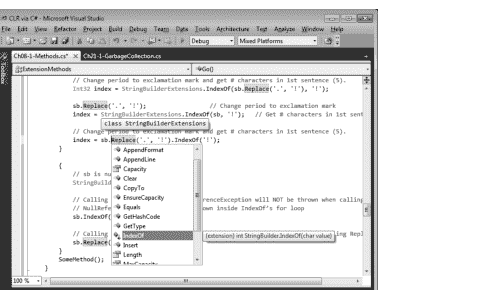

## 规则与指南

- C# 仅支持扩展方法；它不提供扩展属性、扩展事件、扩展运算符等。
- 扩展方法（第一个参数前带有**this**的方法）必须声明在非泛型静态类中。但是，对类的名称没有限制；你可以随意命名。当然，扩展方法必须至少有一个参数，并且只有第一个参数可以用**this**关键字标记。
- C#编译器只查找在文件作用域中定义的静态类中定义的扩展方法。换句话说，如果你将静态类嵌套在另一个类中，C#编译器将发出以下消息：`error CS1109: Extension method must be defined in a top-level static class; StringBuilderExtensions is a nested class.`
- 由于静态类可以具有任意名称，C#编译器需要花费时间查找扩展方法，因为它必须查看所有文件作用域的静态类并扫描其静态方法以寻找匹配。为了提高性能并避免考虑你可能不需要的扩展方法，C#编译器要求你`import`扩展方法。例如，如果有人在**Wintellect**命名空间中定义了**StringBuilderExtensions**类，那么希望访问该类的扩展方法的程序员必须在其源代码文件顶部放置一条**using Wintellect;**指令。


现在可以使用任何表达式来调用上面的扩展方法，只要该表达式的结果类型实现了 IEnumerable<T> 接口：

```csharp
public static void Main() {
    // Shows each Char on a separate line in the console
    "Grant".ShowItems();

    // Shows each String on a separate line in the console
    new[] { "Jeff", "Kristin" }.ShowItems();

    // Shows each Int32 value on a separate line in the console
    new List<Int32>() { 1, 2, 3 }.ShowItems();
}
```

> **重要** 扩展方法是 Microsoft 语言集成查询（LINQ）技术的基石。要查看提供大量扩展方法的类的绝佳示例，请参阅 Microsoft .NET Framework SDK 文档中的静态 **System.Linq.Enumerable** 类及其所有静态扩展方法。此类中的每个扩展方法都扩展了 **IEnumerable** 或 **IEnumerable<T>** 接口。

你也可以为委托类型定义扩展方法。有关示例，请翻到第 11 章“事件”的第 278 页。你还可以向枚举类型添加扩展方法。我在第 15 章“枚举类型和位标志”的“向枚举类型添加方法”一节中展示了相关示例。

最后但同样重要的是，我想指出 C# 编译器允许你创建一个委托（更多信息请参见第 17 章“委托”），该委托引用针对某个对象的扩展方法：

```csharp
public static void Main () {
    // Create an Action delegate that refers to the static ShowItems extension method
    // and has the first argument initialized to reference the “Jeff” string.
    Action a = "Jeff".ShowItems;
    .
    .
    .
    // Invoke the delegate which calls ShowItems passing it a reference to the “Jeff” string.
    a();
}
```

在上面的代码中，C# 编译器生成 IL 代码来构造一个 **Action** 委托。创建委托时，构造函数会接收应调用的方法，还会接收一个对象引用，该引用应传递给方法隐藏的 **this** 参数。通常，当你创建引用静态方法的委托时，对象引用为 **null**，因为静态方法没有 **this** 参数。然而，在此示例中，C# 编译器生成了一些特殊代码，创建一个引用静态方法（**ShowItems**）的委托，并且该静态方法的目标对象是对“Jeff”字符串的引用。稍后，当调用委托时，CLR 将调用该静态方法，并向其传递对“Jeff”字符串的引用。这有点取巧，但效果很好，而且只要你不去想内部发生了什么，就会感觉很自然。

## 扩展特性

如果扩展方法的这一概念不是 C# 特有的，那将是最好的。具体来说，我们希望程序员能在某种编程语言中定义一组扩展方法，并让使用其他编程语言的人也能利用它们。为此，所选的编译器必须支持在静态类型和方法中搜索可能匹配的扩展方法。而且编译器需要快速完成这项工作，以便将编译时间保持在最低限度。

在 C# 中，当你用 **this** 关键字标记静态方法的第一个参数时，编译器会在内部对该方法应用一个自定义特性，并且该特性会持久化到生成文件的元数据中。该特性定义在 System.Core.dll 程序集中，如下所示：

```csharp
// Defined in the System.Runtime.CompilerServices namespace
[AttributeUsage(AttributeTargets.Method | AttributeTargets.Class | AttributeTargets.Assembly)]
public sealed class ExtensionAttribute : Attribute {
}
```

此外，该特性还会应用于任何包含至少一个扩展方法的静态类的元数据。并且，该特性还会应用于任何包含至少一个含有扩展方法的静态类的程序集的元数据。因此现在，在编译调用不存在的实例方法的代码时，编译器可以快速扫描所有被引用的程序集，以了解哪些程序集包含扩展方法。然后，它只需扫描这些程序集中的静态类来查找包含扩展方法的类，并且只需扫描扩展方法来寻找潜在匹配项，从而尽可能快地编译代码。


> **注意** **ExtensionAttribute** 类定义在 System.Core.dll 程序集中。这意味着，即使我在编译代码时不使用 System.Core.dll 中的任何类型，甚至不引用 System.Core.dll，编译器生成的结果程序集也会在其中嵌入对 System.Core.dll 的引用。不过，这并不是太大的问题，因为 **ExtensionAttribute** 仅在编译时使用；在运行时，除非应用程序使用该程序集中的其他内容，否则不必加载 System.Core.dll。

## 分部方法

设想你使用一个工具生成包含类型定义的 C# 源代码文件。该工具知道，在它生成的代码中可能存在你希望自定义类型行为的位置。通常，自定义会通过让工具生成的代码调用虚方法来完成。工具生成的代码还必须包含这些虚方法的定义，而这些方法的实现方式是不做任何事，只是返回。现在，如果你想自定义类的行为，你会定义自己的类，从基类派生它，然后重写实现该行为的任何虚方法，使其具有你想要的行为。下面是一个示例：

```csharp
// Tool-produced code in some source code file:
internal class Base {
    private String m_name;

    // Called before changing the m_name field
    protected virtual void OnNameChanging(String value) {
    }

    public String Name {
        get { return m_name; }
        set {
            OnNameChanging(value.ToUpper());  // Inform class of potential change
            m_name = value;                   // Change the field
        }
    }
}
```

```csharp
// Developer-produced code in some other source code file:
internal class Derived : Base {
    protected override void OnNameChanging(String value) {
        if (String.IsNullOrEmpty(value))
            throw new ArgumentNullException("value");
    }
}
```

不幸的是，上面的代码存在两个问题：

- 该类型必须是非密封类。你不能对密封类或值类型使用此技术（因为值类型是隐式密封的）。此外，你不能对静态方法使用此技术，因为静态方法不能被重写。
- 这里存在效率问题。仅仅为了重写一个方法而定义类型，这会浪费少量系统资源。而且，即使你不想重写 **OnNameChanging** 的行为，基类代码仍然会调用一个虚方法，而该方法除了返回之外什么也不做。另外，无论 **OnNameChanging** 是否访问传递给它的参数，都会调用 **ToUpper**。

C# 的分部方法功能允许你在修复上述问题的同时选择重写类型的行为。下面的代码使用分部方法来实现与前面代码相同的语义：

分部方法不能有 **out** 参数，因为该方法必须初始化该参数，而该方法可能不存在。分部方法可以有 **ref** 参数，可以是泛型的，可以是实例方法或静态方法，并且可以标记为 **unsafe**。

- 当然，定义分部方法的声明和实现分部方法的声明必须具有相同的签名。如果两者都应用了自定义特性，则编译器会将两个方法的特性合并在一起。应用于参数的任何特性也会合并。
- 如果没有实现分部方法的声明，那么你不能有任何试图创建引用该分部方法的委托的代码。原因同样是该方法在运行时不存在。编译器会产生以下消息：**"error CS0762: Cannot create delegate from method 'Base.OnNameChanging(string)' because it is a partial method without an implementing declaration"**。
- 分部方法始终被视为私有方法。但是，C# 编译器禁止你在分部方法声明前放置 **private** 关键字。


# 第9章 参数

- 本章内容：
  - 可选参数和命名参数 ........................................ 219
  - 隐式类型局部变量 .............................................. 223
  - 按引用向方法传递参数 .......................................... 225
  - 向方法传递可变数量的参数 ................................... 231
  - 参数和返回类型指南 ............................................ 233
  - 常量性 ........................................................... 235

本章重点介绍向方法传递参数的各种方式，包括如何可选地指定参数、按名称指定参数、按引用传递参数，以及如何定义接受可变数量参数的方法。

## 可选参数和命名参数

设计方法的参数时，可以为部分或全部参数分配默认值。这样，调用这些方法的代码可以选择不指定某些实参，从而接受默认值。此外，调用方法时，还可以使用参数的名称来指定实参。下面这段代码演示了同时使用可选参数和命名参数：

```csharp
public static class Program {
    private static Int32 s_n = 0;

    private static void M(Int32 x = 9, String s = "A",
        DateTime dt = default(DateTime), Guid guid = new Guid()) {

        Console.WriteLine("x={0}, s={1}, dt={2}, guid={3}", x, s, dt, guid);
    }

    public static void Main() {
        // 1. Same as: M(9, "A", default(DateTime), new Guid());
        M();

        // 2. Same as: M(8, "X", default(DateTime), new Guid());
        M(8, "X");

        // 3. Same as: M(5, "A", DateTime.Now, Guid.NewGuid());
        M(5, guid: Guid.NewGuid(), dt: DateTime.Now);

        // 4. Same as: M(0, "1", default(DateTime), new Guid());
        M(s_n++, s_n++.ToString());

        // 5. Same as: String t1 = "2"; Int32 t2 = 3;
        //    M(t2, t1, default(DateTime), new Guid());
        M(s: (s_n++).ToString(), x: s_n++);
    }
}
```

运行此程序时，我得到以下输出：

```
x=9,  s=A, dt=1/1/0001 12:00:00 AM, guid=00000000-0000-0000-0000-000000000000
x=8,  s=X, dt=1/1/0001 12:00:00 AM, guid=00000000-0000-0000-0000-000000000000
x=5,  s=A, dt=7/2/2009 10:14:25 PM, guid=d24a594d-6009-4aae-9295-83915811309
x=0,  s=1, dt=1/1/0001 12:00:00 AM, guid=00000000-0000-0000-0000-000000000000
x=3,  s=2, dt=1/1/0001 12:00:00 AM, guid=00000000-0000-0000-0000-000000000000
```

如你所见，只要在调用位置省略了实参，C# 编译器就会嵌入参数的默认值。对 `M` 的第三次和第五次调用使用了 C# 的命名参数特性。在这两次调用中，我显式地为 `x` 传递了值，并表明我想为名为 **guid** 和 **dt** 的参数传递实参。

向方法传递实参时，编译器从左到右求值实参。在对 `M` 的第四次调用中，`s_n` 中的值（0）被传递给 `x`，然后 `s_n` 递增，`s_n`（1）作为字符串传递给 `s`，随后 `s_n` 再次递增为 2。使用命名参数传递实参时，编译器仍然从左到右求值实参。在对 `M` 的第五次调用中，`s_n` 中的值（2）被转换为字符串，并保存在编译器创建的临时变量（`t1`）中。接着，`s_n` 递增为 3，这个值保存在编译器创建的另一个临时变量（`t2`）中，然后 `s_n` 再次递增为 4。最终，调用 `M`，并向它传递 `t2`、`t1`、一个默认的 `DateTime` 和一个新的 `Guid`。

## 规则和指南

定义方法并为其中某些参数指定默认值时，还应了解一些额外的规则和指南：

- 可以为方法、构造函数方法和带参数的属性（C# 索引器）的参数指定默认值。也可以为委托定义中的参数指定默认值。这样，调用此委托类型的变量时，就可以省略实参并接受默认值。
- 具有默认值的参数必须位于任何没有默认值的参数之后。也就是说，一旦将某个参数定义为具有默认值，那么它右侧的所有参数也必须具有默认值。例如，在我的 `M` 方法定义中，如果移除 `s` 的默认值（"A"），就会收到编译器错误。此规则有一个例外：**params** 数组参数（本章后面将讨论）。

## 

深度学习是机器学习的一个分支，它基于人工神经网络，通过多层非线性变换来学习数据的层次化表示。近年来，深度学习在图像识别领域取得了显著的成果，广泛应用于人脸识别、自动驾驶、医疗影像分析等场景。

卷积神经网络（CNN）是深度学习中用于图像识别的主要模型架构。它通过卷积层、池化层和全连接层的组合，能够自动提取图像中的局部特征，并逐步抽象为高层语义信息。

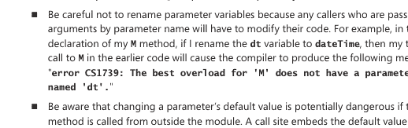

研究表明，深度神经网络的性能在很大程度上取决于训练数据的规模和多样性。大规模数据集如 ImageNet 的训练，使得模型能够学习到更加鲁棒的特征表示。

- 数据增强技术：随机裁剪、翻转、颜色抖动等。
- 迁移学习：利用预训练模型进行微调。
- 注意力机制：提升模型对关键区域的关注度。

| 模型名称 | 准确率 | 参数量 (M) |
|----------|--------|------------|
| ResNet-50 | 76.1% | 25.6 |
| VGG-16 | 71.5% | 138.4 |
| EfficientNet | 78.8% | 5.3 |

> “深度学习的本质是学习数据的分布式表示，而图像识别只是其应用的一个缩影。”

- 可以按名称向没有默认值的参数传递实参，但必须传递所有必需实参（按位置或按名称），编译器才能编译代码。
- C# 不允许像 `M(1, ,DateTime.Now)` 这样在逗号之间省略实参，因为这可能导致难以阅读的“数逗号”代码。如果想为具有默认值的参数省略某些实参，请通过参数名传递实参。
- 若要按参数名传递需要 `ref/out` 的实参，请使用如下语法：

```csharp
// Method declaration:
private static void M(ref Int32 x) { ... }

// Method invocation:
Int32 a = 5;
M(x: ref a);
```

> **注意** 在编写与 Microsoft Office 中的 COM 对象模型互操作的 C# 代码时，C# 的可选参数和命名参数特性确实非常方便。而且，在调用 COM 组件时，C# 还允许在按引用传递实参时省略 **ref/out**，从而进一步简化编码。不调用 COM 组件时，C# 要求对实参应用 **out/ref** 关键字。

## DefaultParameterValue 和 Optional 特性

如果默认参数和可选参数这一概念并非 C# 专有，那是最好的。具体来说，我们希望程序员在某种编程语言中定义方法时，能够指明哪些参数是可选的以及它们的默认值应该是什么，然后让使用其他编程语言的程序员能够调用它们。为此，所选编译器必须允许调用方省略某些实参，并且必须有一种方式来确定这些实参的默认值应该是什么。

在 C# 中，为参数指定默认值时，编译器会在内部将 `System.Runtime.InteropServices.OptionalAttribute` 自定义特性应用于该参数，并将此特性持久化到生成文件的元数据中。此外，编译器还会将 `System.Runtime.InteropServices.DefaultParameterValueAttribute` 应用于该参数，并将此特性持久化到生成文件的元数据中。然后，将你在源代码中指定的常量值传递给 `DefaultParameterValueAttribute` 的构造函数。

现在，当编译器看到你的代码调用了缺少某些实参的方法时，编译器可以确保你省略的是可选参数，从元数据中获取它们的默认值，并自动将这些值嵌入到调用中。

## 隐式类型局部变量

C# 支持根据用于初始化方法局部变量的表达式类型来推断该变量的类型。下面是一些演示此特性的示例代码：

```csharp
private static void ImplicitlyTypedLocalVariables() {
    var name = "Jeff";
    ShowVariableType(name);        // Displays: System.String

    // var n = null;               // Error
    var x = (Exception)null;       // OK, but not much value
    ShowVariableType(x);           // Displays: System.Exception

    var numbers = new Int32[] { 1, 2, 3, 4 };
    ShowVariableType(numbers);     // Displays: System.Int32[]

    // Less typing for complex types
    var collection = new Dictionary<String, Single>() { { ".NET", 4.0f } };

    // Displays: System.Collections.Generic.Dictionary`2[System.String,System.Single]
    ShowVariableType(collection);

    foreach (var item in collection) {
        // Displays: System.Collections.Generic.KeyValuePair`2[System.String,System.Single]
        ShowVariableType(item);
    }
}

private static void ShowVariableType<T>(T t) {
    Console.WriteLine(typeof(T));
}
```

**ImplicitlyTypedLocalVariables** 方法中的第一行代码使用 C# 的 **var** 标记引入一个新的局部变量。为了确定 **name** 变量的类型，编译器会查看赋值运算符（=）右侧表达式的类型。由于 "Jeff" 是字符串，编译器推断 **name** 的类型必须是 **String**。为了证明编译器正确推断了类型，我编写了 **ShowVariableType** 方法。这个泛型方法会推断其参数的类型，然后在控制台上显示它推断出的类型。为了便于阅读，我将 **ShowVariableType** 显示的内容作为注释添加到 **ImplicitlyTypedLocalVariables** 方法中。

**ImplicitlyTypedLocalVariables** 方法中的第二个赋值（已注释掉）会产生编译器错误（**错误 CS0815: 无法将 <null> 赋值给隐式类型的局部变量**），因为 **null** 可隐式转换为任何引用类型或可空值类型；因此，编译器无法为其推断出确定的类型。不过，在第三个赋值中，我展示了如果显式指定类型（在我的示例中为 **Exception**），就可以用 **null** 初始化隐式类型的局部变量。虽然这是可行的，但并没有太大用处，因为你也可以编写 **Exception x = null;** 来获得相同的结果。


在第四次作业中，你会发现使用 C# 的隐式类型局部变量特性的一些实际价值。如果没有这个特性，你必须在赋值运算符两边都指定 `Dictionary<String, Single>`。这不仅输入量大，而且如果你决定更改集合类型或任何泛型参数类型，那么你也不得不修改赋值运算符两边的代码。

在 `foreach` 循环中，我也使用 `var` 让编译器自动推断集合中元素的类型。这证明了在 `foreach`、`using` 和 `for` 语句中使用 `var` 是可行的，而且非常有用。在试验代码时它也很有用。例如，你用某个方法的返回类型初始化一个隐式类型局部变量，随着开发方法的进行，你可能会决定改变其返回类型。如果这样做，编译器会自动发现返回类型已改变，并自动更改变量的类型！这很妙，但当然，如果方法中的其他代码使用该变量并假定它是旧类型来访问成员，那么这些代码可能无法再编译。

在 Microsoft Visual Studio 中，你可以将鼠标光标悬停在源代码中的 `var` 上，编辑器会显示一个工具提示，告诉你编译器从表达式推断出的类型。在方法内使用匿名类型时，必须使用 C# 的隐式类型局部变量特性；更多细节请参见第 10 章“属性”。

你不能使用 `var` 声明方法的参数类型。原因你应该很清楚：编译器必须从调用点的参数推断参数的类型，而可能没有调用点，也可能有很多调用点。此外，你不能使用 `var` 声明类型的字段。C# 有此限制的原因有很多。原因之一是字段可以被多个方法访问，C# 团队认为这个契约（变量的类型）应该明确声明。另一个原因是，如果允许这样做，将使匿名类型（在第 10 章讨论）泄漏到单个方法之外。

> **重要提示** 不要混淆 **dynamic** 和 **var**。使用 **var** 声明局部变量只是一种语法快捷方式，让编译器从表达式推断出具体数据类型。**var** 关键字只能用于在方法内声明局部变量，而 **dynamic** 关键字可用于局部变量、字段和参数。你不能将表达式强制转换为 **var**，但可以将表达式强制转换为 **dynamic**。使用 **var** 声明的变量必须显式初始化，而使用 **dynamic** 声明的变量则不必初始化。有关 C# 的 **dynamic** 类型的更多信息，请参见第 5 章“dynamic 原始类型”一节。

**v** 所指向的 **Int32** 被更改为 **10**。当 **GetVal1** 返回时，**Main** 的 **x** 的值为 **10**，控制台上显示 10。对大型值类型使用 **out** 是高效的，因为这样可以防止在方法调用时复制值类型字段的实例。

现在让我们来看一个使用 **ref** 而不是 **out** 的示例：

```csharp
public sealed class Program {
    public static void Main() {
        Int32 x = 5;        // x is initialized
        AddVal(ref x);      // x must be initialized.
        Console.WriteLine(x); // Displays "15"
    }

    private static void AddVal(ref Int32 v) {
        v += 10; // This method can use the initialized value in v.
    }
}
```

在这段代码中，**x** 也在 **Main** 的栈帧中声明，并被初始化为 **5**。然后 **x** 的地址被传给 **AddVal**。**AddVal** 的 **v** 是指向 **Main** 栈帧中 **Int32** 值的指针。在 **AddVal** 内部，**v** 指向的 **Int32** 必须已有一个值。因此，**AddVal** 可以在它想要的任何表达式中使用初始值。**AddVal** 也可以更改该值，新值将被“返回”给调用者。在此示例中，**AddVal** 将 **10** 加到初始值上。当 **AddVal** 返回时，**Main** 的 **x** 将包含 **15**，这就是控制台上显示的内容。

总而言之，从 IL 或 CLR 的角度来看，**out** 和 **ref** 做的事情完全一样：它们都导致传递指向实例的指针。区别在于编译器会帮助确保你的代码正确。下面这段试图将未初始化的值传给期望 **ref** 参数的方法的代码，会产生以下消息："error CS0165: Use of unassigned local variable 'x'."

```csharp
public sealed class Program {
    public static void Main() {
        Int32 x;            // x is not initialized.

        // The following line fails to compile, producing
        // error CS0165: Use of unassigned local variable 'x'.
        AddVal(ref x);

        Console.WriteLine(x);
    }

    private static void AddVal(ref Int32 v) {
        v += 10; // This method can use the initialized value in v.
    }
}
```


**重要提示** 经常有人问我，为什么 C# 要求调用方法时必须指定 **out** 或 **ref**。毕竟，编译器知道被调用的方法是否需要 **out** 或 **ref**，应该能够正确编译代码。事实证明，编译器确实可以自动做出正确的处理。然而，C# 语言的设计者认为调用者应该明确表达其意图。这样在调用点，被调用的方法预期会改变所传递变量的值，这一点就显而易见了。

此外，CLR 允许你根据 **out** 和 **ref** 参数的使用方式重载方法。例如，在 C# 中，以下代码是合法的，并且可以正常编译：

```csharp
public sealed class Point {
    static void Add(Point p) { ... }
    static void Add(ref Point p) { ... }
}
```

仅因 **out** 和 **ref** 不同而重载方法是不合法的，因为这些方法的签名在元数据表示中是相同的。因此，我不能在前面的 **Point** 类型中再定义以下方法：

```csharp
static void Add(out Point p) { ... }
```

如果你试图将最后一个 **Add** 方法包含在 **Point** 类型中，C# 编译器会发出以下消息：**error CS0663: 'Add' cannot define overloaded methods that differ only on ref and out.**

将 **out** 和 **ref** 与值类型一起使用，会得到与按值传递引用类型时相同的行为。对于值类型，**out** 和 **ref** 允许方法操作单个值类型实例。调用者必须为实例分配内存，被调用者操作该内存。对于引用类型，调用者为指向引用对象的指针分配内存，被调用者操作该指针。由于这种行为，将 **out** 和 **ref** 与引用类型一起使用，仅当方法要“返回”一个它所知道的对象的引用时才有用。以下代码演示：

```csharp
using System;
using System.IO;

public sealed class Program {
    public static void Main() {
        FileStream fs;   // fs is uninitialized

        // Open the first file to be processed.
        StartProcessingFiles(out fs);

        // Continue while there are more files to process.
        for (; fs != null; ContinueProcessingFiles(ref fs)) {

            // Process a file.
            fs.Read(...);
        }
    }
}
```

## 向方法传递可变数量的参数

有时，开发者定义一个可以接受可变数量参数的方法会很方便。例如，**System.String** 类型提供了一些方法，允许将任意数量的字符串连接在一起，还提供了一些方法，允许调用者指定一组要一起格式化的字符串。

要声明一个接受可变数量参数的方法，你可以按如下方式声明该方法：

```csharp
static Int32 Add(params Int32[] values) {
    // NOTE: it is possible to pass the 'values'
    // array to other methods if you want to.

    Int32 sum = 0;
    if (values != null) {
        for (Int32 x = 0; x < values.Length; x++)
            sum += values[x];
    }
    return sum;
}
```

除了应用于方法签名最后一个参数的 **params** 关键字之外，这个方法中的一切对你来说应该都非常熟悉。暂时忽略 **params** 关键字，很明显，这个方法接受一个 **Int32** 值数组，并遍历该数组，将所有值加起来。得到的 **sum** 返回给调用者。

显然，代码可以像下面这样调用这个方法：

```csharp
public static void Main() {
    // Displays "15"
    Console.WriteLine(Add(new Int32[] { 1, 2, 3, 4, 5 }));
}
```

很明显，数组可以很容易地用任意数量的元素初始化，然后传给 **Add** 进行处理。尽管前面的代码能够编译并正确运行，但有点难看。作为开发者，我们当然更愿意按如下方式编写对 **Add** 的调用：

```csharp
public static void Main() {
    // Displays "15"
    Console.WriteLine(Add(1, 2, 3, 4, 5));
}
```

你会很高兴地知道，因为有了 **params** 关键字，我们可以做到这一点。**params** 关键字告诉编译器将 **System.ParamArrayAttribute** 自定义特性的一个实例应用到该参数上。


当 C# 编译器检测到对某个方法的调用时，编译器会检查所有具有指定名称且没有任何参数应用了 **ParamArray** 特性的方法。如果存在一个可以接受该调用的方法，编译器将生成调用该方法所需的代码。然而，如果编译器找不到匹配项，它会查找具有 **ParamArray** 特性的方法，以确定该调用是否可以得到满足。如果编译器找到匹配项，它会先发出构造数组并填充其元素的代码，然后再发出调用所选方法的代码。

在前面的示例中，没有定义接受五个与 **Int32** 兼容的参数的 **Add** 方法；然而，编译器看到源代码中有一个对 **Add** 的调用，并向其传递了一组 **Int32** 值，同时还存在一个 **Add** 方法，其 **Int32** 数组参数标记了 **ParamArray** 特性。因此，编译器认为这是一个匹配项，并生成代码将参数强制转换为 **Int32** 数组，然后调用 **Add** 方法。最终结果是，你可以编写代码，轻松地将一组参数传递给 **Add**，但编译器生成的代码就好像你编写了第一个显式构造并初始化数组的版本一样。

只有方法的最后一个参数才能用 **params** 关键字（**ParamArrayAttribute**）标记。该参数还必须标识任意类型的一维数组。可以将 **null** 或对 **0** 个元素数组的引用作为方法的最后一个参数传递，这是合法的。以下对 **Add** 的调用可以正常编译、正常运行，并产生 **0** 的结果总和（正如预期）：

```csharp
public static void Main() {
    // Both of these lines display "0"
    Console.WriteLine(Add());    // passes new Int32[0] to Add
    Console.WriteLine(Add(null)); // passes null to Add: more efficient (no array allocated)
}
```

到目前为止，所有示例都展示了如何编写一个接受任意数量 **Int32** 参数的方法。你会如何编写一个接受任意数量参数、且这些参数可以是任意类型的方法？答案非常简单：只需修改方法的原型，使其接受 **Object[]** 而不是 **Int32[]**。下面是一个显示传递给它的每个对象的 **Type** 的方法：

```csharp
public sealed class Program {
    public static void Main() {
        DisplayTypes(new Object(), new Random(), "Jeff", 5);
    }

    private static void DisplayTypes(params Object[] objects) {
        if (objects != null)
            foreach (Object o in objects)
                Console.WriteLine(o.GetType());
    }
}
```

运行这段代码会产生以下输出：

```
System.Object
System.Random
System.String
System.Int32
```

> **重要** 请注意，调用接受可变数量参数的方法会带来额外的性能开销，除非你显式传递 **null**。毕竟，必须在堆上分配数组对象、初始化数组的元素，并且数组的内存最终必须被垃圾回收。为了帮助减少与此相关的性能开销，你可能需要考虑定义几个不使用 **params** 关键字的重载方法。关于一些示例，请查看 **System.String** 类的 **Concat** 方法，它具有以下重载：
>
> ```csharp
> public sealed class String : Object, ... {
>     public static string Concat(object arg0);
>     public static string Concat(object arg0, object arg1);
>     public static string Concat(object arg0, object arg1, object arg2);
>     public static string Concat(params object[] args);
>
>     public static string Concat(string str0, string str1);
>     public static string Concat(string str0, string str1, string str2);
>     public static string Concat(string str0, string str1, string str2, string str3);
>     public static string Concat(params string[] values);
> }
> ```
>
> 如你所见，**Concat** 方法定义了几个不使用 **params** 关键字的重载。这些 **Concat** 方法版本是最常被调用的重载，这些重载的存在是为了提高最常见场景下的性能。使用 **params** 关键字的重载用于不太常见的场景；这些场景会遭受性能损失，但幸运的是，它们很少见。

## 参数和返回类型指南

在声明方法的参数类型时，应指定尽可能最弱的类型，优先使用接口而不是基类。例如，如果你正在编写一个操作项集合的方法，最好使用诸如 `IEnumerable<T>` 之类的接口来声明该方法的参数，而不是使用诸如 `List<T>` 之类的强数据类型，甚至更强的接口类型，如 `ICollection<T>` 或 `IList<T>`。

```csharp
// Desired: This method uses a weak parameter type
public void ManipulateItems<T>(IEnumerable<T> collection) { ... }

// Undesired: This method uses a strong parameter type
public void ManipulateItems<T>(List<T> collection) { ... }
```

当然，原因是有人可以调用第一个方法，传入数组对象、**List<T>** 对象、**String** 对象等——任何类型实现了 **IEnumerable<T>** 的对象。第二个方法只允许传入 **List<T>** 对象；它不会接受数组或 **String** 对象。显然，第一个方法更好，因为它灵活得多，并且可以在更广泛的场景中使用。

当然，如果你正在编写一个需要列表（而不只是任何可枚举对象）的方法，那么应将参数类型声明为 **IList<T>**。你仍应避免将参数类型声明为 **List<T>**。使用 **IList<T>** 允许调用方传递数组以及类型实现 **IList<T>** 的任何其他对象。

请注意，我的示例讨论的是使用接口架构设计的集合。如果我们讨论的是使用基类架构设计的类，这一概念仍然适用。因此，例如，如果我要实现一个处理来自流的字节的方法，我们会这样写：

```csharp
// Desired: This method uses a weak parameter type
public void ProcessBytes(Stream someStream) { ... }

// Undesired: This method uses a strong parameter type
public void ProcessBytes(FileStream fileStream) { ... }
```

第一个方法可以处理来自任何类型的流的字节：**FileStream**、**NetworkStream**、**MemoryStream** 等。第二个方法只能对 **FileStream** 进行操作，使其受限得多。

另一方面，通常最好使用尽可能最强的类型来声明方法的返回类型（尽量不要让自己受限于特定类型）。例如，声明一个返回 **FileStream** 对象的方法比返回 **Stream** 对象更好：

```csharp
// Desired: This method uses a strong return type
public FileStream OpenFile() { ... }

// Undesired: This method uses a weak return type
public Stream OpenFile() { ... }
```

这里首选第一个方法，因为它允许方法的调用方选择将返回的对象视为 **FileStream** 对象或 **Stream** 对象。同时，第二个方法要求调用方将返回的对象视为 **Stream** 对象。基本上，最好让调用方在调用方法时拥有尽可能多的灵活性，使该方法能够在最广泛的场景中使用。

有时你希望保留在不影响调用方的情况下更改方法内部实现的能力。在刚才所示的示例中，**OpenFile** 方法不太可能更改其内部实现来返回 **FileStream** 对象（或类型派生自 **FileStream** 的对象）以外的任何内容。然而，如果你有一个返回 **List<String>** 对象的方法，你很可能希望在将来更改该方法的内部实现，使其改为返回 **String[]**。在这些情况下

在这种情况下，你希望给自己留一些灵活性，以便更改方法返回的内容，那么应选择较弱的返回类型。例如：

```csharp
// Flexible: This method uses a weaker return type
public IList<String> GetStringCollection() { ... }

// Inflexible: This method uses a stronger return type
public List<String> GetStringCollection() { ... }
```

在这个示例中，尽管 **GetStringCollection** 方法在内部使用 **List<String>** 对象并将其返回，但最好将该方法的原型设计为返回 **IList<String>**。未来，**GetStringCollection** 方法可以将其内部集合改为使用 **String[]**，而该方法的调用方无需更改任何源代码。事实上，他们甚至不必重新编译代码。请注意，在这个示例中，我使用的是最弱类型中最强的类型。例如，我没有使用 **IEnumerable<String>**，甚至没有使用 **ICollection<String>**。

## 常量性

在某些语言（如非托管 C++）中，可以将方法或参数声明为常量，从而禁止实例方法中的代码更改对象的任何字段，或阻止代码修改传入方法的任何对象。CLR 不提供此功能，许多程序员一直对这一缺失的功能感到遗憾。由于 CLR 不提供此功能，因此任何语言（包括 C#）都无法提供此功能。

首先，你应注意，在非托管 C++ 中，将实例方法或参数标记为 **const** 只能确保程序员无法编写会修改对象或参数的普通代码。在方法内部，始终可以编写代码，通过强制转换去掉 **const-ness** 或获取对象/参数的地址并写入该地址来改变对象/参数。从某种意义上说，非托管 C++ 对程序员撒了谎，让他们相信自己的常量对象/参数不能被写入，尽管实际上可以。

设计类型的实现时，开发者只需避免编写操作对象/参数的代码。例如，字符串是不可变的，因为 **String** 类不提供任何可以更改字符串对象的方法。

此外，Microsoft 要让 CLR 具备验证常量对象/参数未被修改的能力将非常困难。CLR 必须在每次写入时验证该写入不是针对常量对象进行的，这会显著损害性能。当然，一旦检测到违规，CLR 将引发异常。此外，常量支持会给开发者增加大量复杂性。例如，如果某个类型是 **不可变**，则所有派生类型都必须遵守这一点。另外，**不可变** 类型可能必须由同样属于 **不可变** 类型的字段组成。

这些只是 CLR 不支持常量对象/参数的部分原因。

# 第10章 属性

**本章内容：**

- 无参属性 .......... 237
- 有参属性 .......... 252
- 调用属性访问器方法的性能 .......... 257
- 属性访问器的可访问性 .......... 258
- 泛型属性访问器方法 .......... 258

在本章中，我将讨论属性。属性允许源代码通过简化的语法调用方法。公共语言运行时（CLR）提供两种属性：无参属性（简称为*属性*）和有参属性（不同编程语言对其称呼不同）。例如，C# 将有参属性称为*索引器*，而 Microsoft Visual Basic 将其称为*默认属性*。我还会讨论使用对象初始化器和集合初始化器来初始化属性，以及使用 C# 的匿名类型和 `System.Tuple` 类型将一组属性打包在一起的方法。

## 无参属性

许多类型定义了可以检索或更改的状态信息。通常，此状态信息实现为类型的字段成员。例如，下面是一个包含两个字段的类型定义：

```csharp
public sealed class Employee {
    public String Name;   // The employee's name
    public Int32  Age;    // The employee's age
}
```

如果要创建此类型的实例，可以使用与以下类似的代码轻松获取或设置任何状态信息：

```csharp
Employee e = new Employee();
e.Name = "Jeffrey Richter";   // Set the employee's Name.
e.Age  = 45;                  // Set the employee's Age.

Console.WriteLine(e.Name);    // Displays "Jeffrey Richter"
```

像我刚才演示的那样查询和设置对象的状态信息非常常见。但是，我认为前面的代码绝不应像前面所示那样实现。

如前面所示将数据封装起来有两个缺点。首先，你现在必须实现额外的方法，因此不得不编写更多代码。其次，该类型的用户现在必须调用方法，而不是简单地引用单个字段名。

```csharp
e.SetName("Jeffrey Richter");    // updates the employee's name
String EmployeeName = e.GetName(); // retrieves the employee's name
e.SetAge(41);                    // updates the employee's age
e.SetAge(-5);                    // Throws ArgumentOutOfRangeException
Int32 EmployeeAge = e.GetAge();  // retrieves the employee's age
```

就个人而言，我认为这些缺点相当小。尽管如此，编程语言和 CLR 提供了一种称为属性的机制，它稍微缓解了第一个缺点，并完全消除了第二个缺点。

下面所示的类使用属性，并且在功能上与前面所示的类完全相同：

```csharp
public sealed class Employee {
    private String m_Name;
    private Int32 m_Age;

    public String Name {
        get { return(m_Name); }
        set { m_Name = value; } // The 'value' keyword always identifies the new value.
    }

    public Int32 Age {
        get { return(m_Age); }
        set {
            if (value < 0)   // The 'value' keyword always identifies the new value.
                throw new ArgumentOutOfRangeException("value", value.ToString(),
                    "The value must be greater than or equal to 0");
            m_Age = value;
        }
    }
}
```

如你所见，属性使类型的定义稍微复杂了一些，但它们允许你按如下方式编写代码，这足以补偿额外的工作：

```csharp
e.Name = "Jeffrey Richter";    // "sets" the employee name
String EmployeeName = e.Name;  // "gets" the employee's name
e.Age = 41;                    // "sets" the employee's age
e.Age = -5;                    // Throws ArgumentOutOfRangeException
Int32 EmployeeAge = e.Age;     // "gets" the employee's age
```

你可以将属性视为*智能字段*：在其背后带有附加逻辑的字段。CLR 支持静态、实例、抽象和虚属性。此外，属性可以用任何可访问性修饰符标记（在第6章“类型和成员基础”中讨论），并可在接口中定义（在第13章“接口”中讨论）。

每个属性都有一个名称和一个类型（类型不能为 void）。不能重载属性（也就是说，如果两个属性的类型不同，也不能具有相同的名称）。

定义属性时，通常同时指定 **get** 和 **set** 方法。不过，你可以省略 **set** 方法来定义只读属性，或省略 **get** 方法来定义只写属性。

属性的 **get**/**set** 方法操作类型中定义的私有字段也很常见。此字段通常称为*支持字段*。不过，**get** 和 **set** 方法不必访问支持字段。例如，**System.Threading.Thread** 类型提供了一个 **Priority** 属性，该属性直接与操作系统通信；**Thread** 对象并不为线程优先级维护字段。没有支持字段的属性的另一个例子是在运行时计算的只读属性——例如，以零结尾的数组的长度，或者已知高度和宽度时矩形的面积。

定义属性时，根据其定义，编译器会将以下项中的两项或三项生成到最终生成的托管程序集中：

- 一个表示属性 **get** 访问器方法的方法。仅当为属性定义 **get** 访问器方法时才生成此方法。
- 一个表示属性 **set** 访问器方法的方法。仅当为属性定义 **set** 访问器方法时才生成此方法。
- 托管程序集元数据中的属性定义。此项始终生成。

回顾前面所示的 **Employee** 类型。编译器编译此类型时，会遇到 **Name** 和 **Age** 属性。由于这两个属性都有 **get** 和 **set** 访问器方法，编译器会在 **Employee** 类型中生成四个方法定义。这就好像原始源代码是按如下方式编写的一样：

```csharp
public sealed class Employee {
    private String m_Name;
    private Int32  m_Age;

    public String get_Name() {
        return m_Name;
    }
    public void set_Name(String value) {
        m_Name = value;   // The argument 'value' always identifies the new value.
    }

    public Int32 get_Age() {
        return m_Age;
    }

    public void set_Age(Int32 value) {
        if (value < 0)     // The 'value' always identifies the new value.
            throw new ArgumentOutOfRangeException("value", value.ToString(),
                "The value must be greater than or equal to 0");
        m_Age = value;
    }
}
```


你可能想知道这样做有什么价值，而不是仅仅声明一个名为 **Name** 的 **public String** 字段。嗯，二者有很大区别。使用 AIP 语法意味着你创建了一个属性。任何访问该属性的代码实际上都是在调用 **get** 和 **set** 方法。如果你后来决定自己实现 **get** 和/或 **set** 方法，而不是接受编译器的默认实现，那么任何访问该属性的代码都不必重新编译。然而，如果你将 **Name** 声明为字段，之后又将其改为属性，那么所有访问该字段的代码都必须重新编译，以便现在访问属性方法。

- 就个人而言，我不喜欢编译器的 AIP 特性，因此通常避免使用它，原因如下：字段声明的语法可以包含初始化，这样你就能在一行代码中声明并初始化字段。然而，没有方便的语法可将 AIP 设置为初始值。因此，你必须在每个构造方法中显式初始化每个 AIP。
- 运行时序列化引擎会将字段名持久化到序列化流中。AIP 的支持字段名称由编译器决定，而且每次重新编译代码时，它实际上可能会更改该支持字段的名称，从而使包含 AIP 的任何类型的实例无法反序列化。不要对你打算序列化或反序列化的任何类型使用 AIP 特性。
- 调试时，你无法在 AIP 的 **get** 或 **set** 方法上设置断点，因此无法轻松检测应用程序何时获取或设置该属性。你可以对手动实现的属性设置断点，这在排查 bug 时非常方便。

你还应该知道，使用 AIP 时，属性必须可读且可写；也就是说，编译器必须生成 **get** 和 **set** 方法。这是合理的，因为只写字段如果无法读取其值就没有用；同样，只读字段将始终具有其默认值。此外，由于你不知道编译器生成的支持字段的名称，你的代码必须始终使用属性名来访问该属性。而且，如果你决定显式实现其中一个访问器方法，那么你必须显式实现两个访问器方法，并且你不再使用 AIP 特性。对于单个属性，AIP 特性是全有或全无的。

## 智能地定义属性

就个人而言，我不喜欢属性，我希望 Microsoft .NET Framework 及其编程语言不支持属性。原因是属性看起来像字段，但它们是方法。众所周知，这会造成大量困惑。当程序员看到看似访问字段的代码时，程序员会做出许多假设，而这些假设对于属性可能并不成立。例如，

- 属性可能是只读或只写的；字段访问始终可读且可写。如果定义属性，最好同时提供 **get** 和 **set** 访问器方法。
- 属性方法可能抛出异常；字段访问从不抛出异常。
- 属性不能作为 **out** 或 **ref** 参数传递给方法；字段可以。例如，以下代码将无法编译：

```csharp
using System;

public sealed class SomeType {
   private static String Name {
      get { return null; }
      set { }
   }

   static void MethodWithOutParam(out String n) { n = null; }

   public static void Main() {
      // For the line of code below, the C# compiler emits the following:
      // error CS0206: A property or indexer may not
      // be passed as an out or ref parameter
      MethodWithOutParam(out Name);
   }
}
```

- 属性方法可能需要很长时间执行；字段访问始终立即完成。使用属性的常见原因是执行线程同步，而线程同步可能会永久停止线程，因此，如果需要线程同步，就不应使用属性。在这种情况下，首选方法。另外，如果你的类可以被远程访问（例如，你的类派生自 **System.MarshalByRefObject**），调用属性方法会非常慢，因此，首选方法而不是属性。在我看来，派生自 **MarshalByRefObject** 的类永远不应使用属性。
- 如果连续多次调用，属性方法可能每次返回不同的值；字段每次返回相同的值。**System.DateTime** 类有一个只读的 **Now** 属性，返回当前日期和时间。每次查询此属性时，它都会返回不同的值。这是一个错误，Microsoft 希望他们能通过将 **Now** 设为方法而不是属性来修复该类。**Environment 的 TickCount** 属性是此错误的另一个例子。
- 属性方法可能导致可观察的副作用；字段访问从不导致。换句话说，类型的用户应该能够以任意顺序设置类型定义的各种属性，而不会注意到类型有任何不同的行为。
- 属性方法可能需要额外的内存，或返回对实际上不属于对象状态的内容的引用，因此修改返回的对象对原始对象没有影响；查询字段始终返回对保证属于原始对象状态的对象的引用。使用返回副本的属性可能会让开发人员非常困惑，而且这一特性通常没有文档记录。

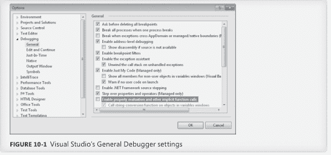

## 对象与集合初始化器

先构造一个对象，然后设置该对象的一些公共属性（或字段），这是非常常见的。为了简化这种常见编程模式，C# 语言支持一种特殊的对象初始化语法。下面是一个示例：

```csharp
Employee e = new Employee() { Name = "Jeff", Age = 45 };
```

通过这一条语句，我构造了一个 **Employee** 对象，调用其无参构造方法，然后将其公共 **Name** 属性设置为 **"Jeff"**，将其公共 **Age** 属性设置为 **45**。事实上，上面的代码与下面这段完全相同，你可以通过检查这两个代码片段的中间语言（IL）来验证：

```csharp
Employee e = new Employee();
e.Name = "Jeff";
e.Age = 45;
```

对象初始化器语法的真正好处在于，它允许你在表达式上下文中编写代码（而不是语句上下文），从而允许函数组合，进而提高代码可读性。例如，我现在可以这样写：

```csharp
String s = new Employee() { Name = "Jeff", Age = 45 }.ToString().ToUpper();
```

所以现在，在一条语句中，我构造了一个 **Employee** 对象，调用了它的构造方法，初始化了两个公共属性，然后使用结果表达式，对其调用 **ToString**，接着调用 **ToUpper**。关于函数组合的更多内容，请参见第 8 章“方法”中的“扩展方法”一节。

作为一个小旁注，如果你想调用无参构造方法，C# 还允许你省略左大括号前的圆括号。下面这行生成的 IL 与上面那行相同：

```csharp
String s = new Employee { Name = "Jeff", Age = 45 }.ToString().ToUpper();
```

如果属性的类型实现了 **IEnumerable** 或 **IEnumerable<T>** 接口，则该属性被视为集合，并且初始化集合是添加操作，而不是替换操作。例如，假设我有以下类定义：

```csharp
public sealed class Classroom {
    private List<String> m_students = new List<String>();
    public List<String> Students { get { return m_students; } }

    public Classroom() {}
}
```

现在，我可以有代码构造一个 **Classroom** 对象，并按如下方式初始化 **Students** 集合：

```csharp
public static void M() {
    Classroom classroom = new Classroom {
        Students = { "Jeff", "Kristin", "Aidan", "Grant" }
    };

    // Show the 4 students in the classroom
    foreach (var student in classroom.Students)
        Console.WriteLine(student);
}
```

编译此代码时，编译器看到 **Students** 属性的类型为 **List<String>**，并且该类型实现了 **IEnumerable<String>** 接口。现在，编译器假定 **List<String>** 类型提供了一个名为 **Add** 的方法（因为大多数集合类实际上都提供 **Add** 方法，用于向集合添加项）。然后，编译器生成代码来调用集合的 **Add** 方法。因此，上面所示的代码被编译器转换为：

```csharp
public static void M() {
    Classroom classroom = new Classroom();
    classroom.Students.Add("Jeff");
    classroom.Students.Add("Kristin");
    classroom.Students.Add("Aidan");
    classroom.Students.Add("Grant");

    // Show the 4 students in the classroom
    foreach (var student in classroom.Students)
        Console.WriteLine(student);
}
```

如果属性的类型实现了 **IEnumerable** 或 **IEnumerable<T>**，但该类型不提供 **Add** 方法，那么编译器不允许你使用集合初始化器语法向集合添加项；相反，编译器会发出类似下面的内容


在第9章“参数”中，让编译器从赋值运算符（=）右侧的表达式推断类型。

现在，让我们关注编译器实际在做的事情。当你编写如下代码行时：

```csharp
var o = new { property1 = expression1, ... propertyN = expressionN };
```

编译器会推断每个表达式的类型，创建这些推断类型的私有字段，为每个字段创建公共只读属性，并创建一个接受所有这些表达式的构造函数。构造函数的代码使用传入的表达式结果初始化私有只读字段。此外，编译器还会重写 Object 的 **Equals**、**GetHashCode** 和 **ToString** 方法，并在所有这些方法内部生成代码。实际上，编译器生成的类看起来像这样：

```csharp
[CompilerGenerated]
internal sealed class <>f__AnonymousType0<...> : Object {
    private readonly t1 f1;
    public t1 p1 { get { return f1; } }

    ...

    private readonly tn fn;
    public tn pn { get { return fn; } }

    public <>f__AnonymousType0<...>(t1 a1, ..., tn an) {
        f1 = a1; ...; fn = an; // Set all fields
    }

    public override Boolean Equals(Object value) {
        // Return false if any fields don't match; else true
    }

    public override Int32 GetHashCode() {
        // Returns a hash code generated from each field's hash code
    }

    public override String ToString() {
        // Return comma-separated set of property name = value pairs
    }
}
```

编译器生成 **Equals** 和 **GetHashCode** 方法，以便匿名类型的实例可以放入哈希表集合中。这些属性是只读的，而不是读写属性，这样有助于防止对象的哈希码改变。对于用作哈希表键的对象，更改其哈希码可能会导致无法找到该对象。编译器生成 **ToString** 方法以帮助调试。在 Visual Studio 调试器中，你可以将鼠标光标悬停在引用匿名类型实例的变量上，Visual Studio 会调用 **ToString** 方法并在数据提示窗口中显示结果字符串。顺便说一句，当你在编辑器中编写代码时，Visual Studio 的 **IntelliSense** 会提示属性名称——这是一个非常不错的功能。

编译器还支持两种额外的语法，用于在匿名类型中声明属性，它可以根据变量推断属性名称和类型：

```csharp
String Name = "Grant";
DateTime dt = DateTime.Now;

// Anonymous type with two properties
// 1. String Name property set to Grant
// 2. Int32 Year property set to the year inside the dt
var o2 = new { Name, dt.Year };
```

在此示例中，编译器确定第一个属性应称为 **Name**。由于 **Name** 是局部变量的名称，编译器将该属性的类型设置为与局部变量相同的类型：**String**。对于第二个属性，编译器使用字段/属性的名称：**Year**。**Year** 是 **DateTime** 类的 **Int32** 属性，因此匿名类型中的 **Year** 属性也将是 **Int32**。现在，当编译器构造此匿名类型的实例时，它会将实例的 **Name** 属性设置为与 **Name** 局部变量中的值相同的值，因此 **Name** 属性将引用同一个 "Grant" 字符串。编译器会将实例的 **Year** 属性设置为从 **dt** 的 **Year** 属性返回的值。

编译器在定义匿名类型时非常智能。如果编译器看到你在源代码中定义了多个结构相同的匿名类型，它只会为这个匿名类型创建一个定义，并创建该类型的多个实例。所谓“结构相同”，是指这些匿名类型的每个属性具有相同的类型和名称，并且这些属性按照相同的顺序指定。在上面的代码示例中，变量 **o1** 的类型和变量 **o2** 的类型将是相同的，因为这两行代码定义了一个包含 **Name/String** 属性和 **Year/Int32** 属性的匿名类型，并且 **Name** 在 **Year** 之前。

由于这两个变量类型相同，我们可以做一些很酷的事情，例如检查两个对象是否包含相等的值，以及将一个对象的引用赋给另一个变量，如下所示：

```csharp
// One type allows equality and assignment operations.
Console.WriteLine("Objects are equal: " + o1.Equals(o2));
o1 = o2; // Assignment
```

此外，由于这种类型同一性，我们可以创建匿名类型的隐式类型数组（在第16章“数组”的“初始化数组元素”一节中讨论）：

```csharp
// This works because all of the objects are of the same anonymous type
var people = new[] {
    o1,  // From earlier in this section
    new { Name = "Kristin", Year = 1970 },
    new { Name = "Aidan", Year = 2003 },
    new { Name = "Grant", Year = 2008 }
};
```

```csharp
// This shows how to walk through the array of anonymous types (var is required)
foreach (var person in people)
    Console.WriteLine("Person={0}, Year={1}", person.Name, person.Year);
```

匿名类型最常用于语言集成查询（LINQ）技术中，你执行一个查询，得到一组对象，这些对象都是相同的匿名类型。然后，你处理结果集合中的对象。所有这些都发生在同一个方法中。下面是一个示例，它返回我的文档目录中在过去七天内被修改的所有文件：

```csharp
String myDocuments = Environment.GetFolderPath(Environment.SpecialFolder.MyDocuments);
var query =
    from pathname in Directory.GetFiles(myDocuments)
    let LastWriteTime = File.GetLastWriteTime(pathname)
    where LastWriteTime > (DateTime.Now - TimeSpan.FromDays(7))
    orderby LastWriteTime
    select new { Path = pathname, LastWriteTime }; // Set of anonymous type objects

foreach (var file in query)
    Console.WriteLine("LastWriteTime={0}, Path={1}", file.LastWriteTime, file.Path);
```

匿名类型的实例不应泄漏到方法之外。方法不能在原型中声明接受匿名类型的参数，因为无法指定该匿名类型。同样，方法也不能表明它返回对匿名类型的引用。虽然可以将匿名类型的实例视为 **Object**（因为所有匿名类型都派生自 **Object**），但无法将 **Object** 类型的变量强制转换回匿名类型，因为你在编译时不知道匿名类型的名称。如果你想传递元组，那么你应该考虑使用下一节讨论的 **System.Tuple** 类型。

## System.Tuple 类型

在 **System** 命名空间中，Microsoft 定义了多个泛型 **Tuple** 类型（都派生自 **Object**），这些类型根据元数（泛型参数的数量）而有所不同。下面是最简单和最复杂的类型的基本样子：

```csharp
// This is the simplest:
[Serializable]
public class Tuple<T1> {
    private T1 m_Item1;
    public Tuple(T1 item1) { m_Item1 = item1; }
    public T1 Item1 { get { return m_Item1; } }
}
```

```csharp
// This is the most complex:
[Serializable]
public class Tuple<T1, T2, T3, T4, T5, T6, T7, TRest> {
    private T1 m_Item1; private T2 m_Item2; private T3 m_Item3; private T4 m_Item4;
    private T5 m_Item5; private T6 m_Item6; private T7 m_Item7; private TRest m_Rest;
}
```

在 C# 中，带参数属性（索引器）使用类似数组的语法来公开。换句话说，你可以将索引器视为 C# 开发人员重载 [] 运算符的一种方式。下面是一个 BitArray 类的示例，该类允许使用类似数组的语法来索引由类实例维护的位集合：

```csharp
using System;

public sealed class BitArray {
    // Private array of bytes that hold the bits
    private Byte[] m_byteArray;
    private Int32 m_numBits;

    // Constructor that allocates the byte array and sets all bits to 0
    public BitArray(Int32 numBits) {
        // Validate arguments first.
        if (numBits <= 0)
            throw new ArgumentOutOfRangeException("numBits", "numBits must be > 0");

        // Save the number of bits.
        m_numBits = numBits;

        // Allocate the bytes for the bit array.
        m_byteArray = new Byte[(numBits + 7) / 8];
    }

    // This is the indexer (parameterful property).
    public Boolean this[Int32 bitPos] {

        // This is the indexer's get accessor method.
        get {
            // Validate arguments first
            if ((bitPos < 0) || (bitPos >= m_numBits))
                throw new ArgumentOutOfRangeException("bitPos");

            // Return the state of the indexed bit.
            return (m_byteArray[bitPos / 8] & (1 << (bitPos % 8))) != 0;
        }

        // This is the indexer's set accessor method.
        set {
            if ((bitPos < 0) || (bitPos >= m_numBits))
                throw new ArgumentOutOfRangeException("bitPos", bitPos.ToString());

            if (value) {
                // Turn the indexed bit on.
                m_byteArray[bitPos / 8] = (Byte)
                    (m_byteArray[bitPos / 8] | (1 << (bitPos % 8)));
            } else {
                // Turn the indexed bit off.
                m_byteArray[bitPos / 8] = (Byte)
                    (m_byteArray[bitPos / 8] & ~(1 << (bitPos % 8)));
            }
        }
    }
}
```

使用**BitArray**类的索引器极其简单：

```csharp
// Allocate a BitArray that can hold 14 bits.
BitArray ba = new BitArray(14);

// Turn all the even-numbered bits on by calling the set accessor.
for (Int32 x = 0; x < 14; x++) {
    ba[x] = (x % 2 == 0);
}

// Show the state of all the bits by calling the get accessor.
for (Int32 x = 0; x < 14; x++) {
    Console.WriteLine("Bit " + x + " is " + (ba[x] ? "On" : "Off"));
}
```

在**BitArray**示例中，索引器接受一个**Int32**参数**bitPos**。所有索引器必须至少有一个参数，但也可以有更多参数。这些参数（以及返回类型）可以是任何数据类型（除了**void**）。多于一个参数的索引器示例可以在**System.Drawing.Imaging.ColorMatrix**类中找到，该类位于System.Drawing.dll程序集中。

创建索引器来查询关联数组中的值是很常见的。实际上，**System.Collections.Generic.Dictionary**类型提供了一个接受键并返回与该键关联的值的索引器。与无参数属性不同，一个类型可以提供多个重载索引器，只要它们的签名不同即可。

与无参数属性的**set**访问器方法一样，索引器的**set**访问器方法也包含一个隐藏参数，在C#中称为**value**。该参数表示“索引元素”所需的新值。

CLR不区分无参数属性和带参数属性；对CLR而言，每个属性都只是类型中定义的一对方法和一段元数据。如前所述，不同的编程语言需要不同的语法来创建和使用带参数属性。C#要求使用**this[...]**作为表达索引器的语法，这纯粹是C#团队的选择。这一选择意味着C#允许只在对象实例上定义索引器。C#没有提供允许开发人员定义静态索引器属性的语法，尽管CLR确实支持静态带参数属性。

由于CLR对待带参数属性与对待无参数属性的方式相同，编译器将在生成的管理程序集中发出以下两项或三项内容：

- 一个表示带参数属性的**get**访问器方法。仅当为属性定义了**get**访问器方法时才发出。
- 一个表示带参数属性的**set**访问器方法。仅当为属性定义了**set**访问器方法时才发出。
- 管理程序集元数据中的属性定义，始终会发出。

没有特殊的带参数属性元数据定义表，因为对CLR而言，带参数属性就是属性。

对于前面展示的**BitArray**类，编译器编译索引器时，就好像原始源代码是如下编写的：

```csharp
public sealed class BitArray {

    // This is the indexer's get accessor method.
    public Boolean get_Item(Int32 bitPos) { /* ... */ }

    // This is the indexer's set accessor method.
    public void   set_Item(Int32 bitPos, Boolean value) { /* ... */ }
}
```

编译器通过将**get_**和**set_**附加到*索引器名称*前面来自动生成这些方法的名称。由于C#的索引器语法不允许开发人员指定*索引器名称*，C#编译器团队不得不为访问器方法选择一个默认名称；他们选择了**Item**。因此，编译器生成的方法名是**get_Item**和**set_Item**。

在查看.NET Framework参考文档时，可以通过查找名为**Item**的属性来判断一个类型是否提供索引器。例如，**System.Collections.Generic.List**类型提供了一个名为**Item**的公共实例属性；该属性就是**List**的索引器。

当你用C#编程时，你永远不会看到**Item**这个名称，所以通常你不会关心编译器为你选择的名称。然而，如果你正在为一个类型设计索引器，而该类型会被用其他编程语言编写的代码访问，你可能想要更改赋予索引器的**get**和**set**访问器方法的默认名称**Item**。C#允许你通过将**System.Runtime.CompilerServices.IndexerNameAttribute**自定义特性应用到索引器来重命名这些方法。下面的代码演示了如何操作：

```csharp
using System;
using System.Runtime.CompilerServices;

public sealed class BitArray {

    [IndexerName("Bit")]
    public Boolean this[Int32 bitPos] {
        // At least one accessor method is defined here
    }
}
```

现在编译器将生成名为**get_Bit**和**set_Bit**的方法，而不是**get_Item**和**set_Item**。编译时，C#编译器会看到**IndexerName**特性，这告诉编译器如何命名方法和属性元数据；特性本身不会生成到程序集的元数据中。^2

^2 因此，**IndexerNameAttribute**类不属于CLI和C#语言的ECMA标准化的一部分。

下面是一些Visual Basic代码，演示如何访问这个C#索引器：

```vb
' Construct an instance of the BitArray type.
Dim ba As New BitArray(10)

' Visual Basic uses () instead of [] to specify array elements.
Console.WriteLine(ba(2))       ' Displays True or False

' Visual Basic also allows you to access the indexer by its name.
Console.WriteLine(ba.Bit(2))   ' Displays same as previous line
```

在C#中，单个类型可以定义多个索引器，只要这些索引器都采用不同的参数集。在其他编程语言中，IndexerName特性允许你定义具有相同签名的多个索引器，因为每个索引器可以有不同的名称。C#不允许这样做，是因为其语法不通过名称来引用索引器；编译器无法知道你在引用哪个索引器。尝试编译以下C#源代码会导致编译器生成以下消息：

`'error CS0111: Type 'SomeType' already defines a member called 'this' with the same parameter types.'`

```csharp
using System;
using System.Runtime.CompilerServices;

public sealed class SomeType {

   // Define a get_Item accessor method.
   public Int32 this[Boolean b] {
      get { return 0; }
   }

   // Define a get_Jeff accessor method.
   [IndexerName("Jeff")]
   public String this[Boolean b] {
      get { return null; }
   }
}
```

你可以清楚地看到，C#将索引器视为重载[]运算符的一种方式，而该运算符无法用于区分具有不同方法名和相同参数集的带参数属性。

顺便提一下，**System.String**类型是一个更改了索引器名称的类型示例。**String**的索引器名称是**Chars**而不是**Item**。这个只读属性允许你获取字符串中的单个字符。对于不使用[]运算符语法访问该属性的编程语言，**Chars**被认为是一个更有意义的名称。

## 选择主要的带参数属性

C#在索引器方面的限制引出了以下两个问题：

- 如果类型是用一种允许开发人员定义多个带参数属性的编程语言定义的，会怎样？
- 如何从C#中使用这种类型？

这两个问题的答案是，类型必须通过将**System.Reflection.DefaultMemberAttribute**的实例应用到类本身，来选择其中一个带参数属性名称作为默认属性。需要说明的是，**DefaultMemberAttribute**可以应用于类、结构或接口。在C#中，当你编译定义带参数属性的类型时，编译器会自动将一个**DefaultMember**特性的实例应用到定义类型，并在你使用**IndexerName**特性时将其考虑在内。该特性的构造函数指定了要用于类型默认带参数属性的名称。

因此，在C#中，如果你定义了一个具有带参数属性的类型，且没有指定**IndexerName**特性，定义类型将有一个指示**Item**的**DefaultMember**特性。如果你将**IndexerName**特性应用到一个带参数属性，定义类型将有一个指示**IndexerName**特性中指定字符串名称的**DefaultMember**特性。请记住，如果代码包含不同名称的带参数属性，C#将无法编译该代码。

对于支持多个带参数属性的语言，必须选择其中一个属性方法名称，并由类型的**DefaultMember**特性标识。这是C#能够访问的唯一带参数属性。

当C#编译器看到尝试获取或设置索引器的代码时，编译器实际上会生成对其中一个方法的调用。某些编程语言可能不支持带参数属性。要从这些语言之一访问带参数属性，你必须显式调用所需的访问器方法。对CLR而言，无参数属性和带参数属性之间没有区别，因此你使用相同的**System.Reflection.PropertyInfo**类来查找带参数属性与其访问器方法之间的关联。

## 调用属性访问器方法的性能

对于简单的**get**和**set**访问器方法，即时（JIT）编译器会*内联*代码，因此使用属性而非字段不会带来运行时性能损失。内联是指方法（在此时是访问器方法）的代码直接在发出调用的方法中编译。这消除了与进行调用相关的开销。


在运行时调用，代价是使编译后的方法代码变大。因为属性访问器方法通常包含很少的代码，内联它们可以使本机代码更小，并且可以使其执行更快。

请注意，JIT编译器在调试代码时不会内联属性方法，因为内联代码更难调试。这意味着访问属性的性能在发布版本中可能很快，而在调试版本中可能很慢。字段访问在调试版本和发布版本中都很快。

## 属性访问器的可访问性

有时，在设计类型时，希望**get**访问器方法具有一种可访问性，而**set**访问器方法具有另一种可访问性。最常见的场景是拥有**public** **get**访问器和**protected** **set**访问器：

```csharp
public class SomeType {
    private String m_name;
    public String Name {
        get { return m_name; }
        protected set { m_name = value; }
    }
}
```

从上面的代码可以看出，**Name**属性本身被声明为**public**属性，这意味着**get**访问器方法将是public的，因此可以被所有代码调用。但是，请注意，**set**访问器被声明为**protected**，只能从**SomeType**中定义的代码或从派生自**SomeType**的类中的代码调用。

当定义具有不同可访问性的访问器方法的属性时，C#语法要求属性本身必须使用限制最少的可访问性声明，并且更严格的可访问性仅应用于其中一个访问器方法。在上面的示例中，属性是**public**，而**set**访问器是**protected**（比**public**更严格）。

## 泛型属性访问器方法

由于属性实际上只是方法，并且C#和CLR允许方法泛型化，有时人们希望定义引入自己的泛型类型参数的属性（而不是使用封闭类型的泛型类型参数）。但是，C#不允许这样做。属性不能引入自己的泛型类型参数的主要原因是它们在概念上不合理。属性应该表示对象的一个可查询或设置的特征。引入泛型类型参数意味着查询/设置的行为可以被改变，但概念上，属性不应该有行为。如果你希望对象公开某些行为——无论是否泛型——请定义方法，而不是属性。

# 第11章 事件

*本章内容：*

- 设计公开事件的类型 ........ 260
- 编译器如何实现事件 ........ 266
- 设计侦听事件的类型 ........ 269
- 显式实现事件 ........ 271

在本章中，我将讨论类型可以定义的最后一种成员：事件。定义了事件成员的类型允许该类型（或该类型的实例）通知其他对象发生了某些特殊事情。例如，**Button**类提供了一个名为**Click**的事件。当**Button**对象被单击时，应用程序中的一个或多个对象可能希望接收有关此事件的通知，以便执行某些操作。事件是允许这种交互的类型成员。具体而言，定义事件成员意味着类型提供以下能力：

- 方法可以注册其对事件的关注。
- 方法可以注销其对事件的关注。
- 当事件发生时，已注册的方法将收到通知。

类型在定义事件时可以提供此功能，因为它们维护已注册方法的列表。当事件发生时，类型会通知集合中所有已注册的方法。

公共语言运行时（CLR）的事件模型基于*委托*。委托是一种类型安全的方式来调用回调方法。回调方法是对象接收其订阅的通知的方式。在本章中，我将使用委托，但直到第17章“委托”才会完整解释其所有细节。

为了帮助你完全理解事件在CLR中的工作方式，我将从一个事件有用的场景开始。假设你想设计一个电子邮件应用程序。当电子邮件到达时，用户可能希望将邮件转发到传真机或寻呼机。在设计此应用程序时，假设你首先设计一个名为**MailManager**的类型，用于接收传入的电子邮件。**MailManager**将公开一个名为**NewMail**的事件。其他类型（如**Fax**和**Pager**）可以注册对此事件的关注。当**MailManager**收到新的电子邮件时，它将引发事件，导致邮件被分发到每个已注册的对象。每个对象可以以任何方式处理邮件。

当应用程序初始化时，假设我们只实例化一个`MailManager`实例——然后应用程序可以实例化任意数量的`Fax`和`Pager`类型。图11-1显示了应用程序如何初始化以及当新的电子邮件到达时会发生什么。

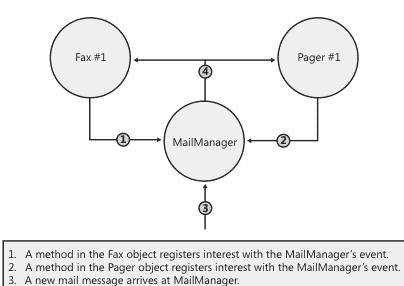

**图11-1** 设计使用事件的应用程序

图11-1中所示的应用程序的工作方式如下：应用程序通过构造`MailManager`的实例进行初始化。`MailManager`提供一个`NewMail`事件。当构造`Fax`和`Pager`对象时，它们向`MailManager`的`NewMail`事件注册一个实例方法，以便`MailManager`知道在新电子邮件到达时通知`Fax`和`Pager`对象。现在，当`MailManager`收到新的电子邮件时（在将来的某个时候），它将引发`NewMail`事件，给所有已注册的方法一个机会以它们想要的任何方式处理新邮件。

## 设计公开事件的类型

开发者必须采取许多步骤才能定义公开一个或多个事件成员的类型。在本节中，我将逐步介绍每个必要的步骤。`MailManager`示例应用程序（可从[http://wintellect.com](http://wintellect.com)下载）显示了`MailManager`类型、`Fax`类型和`Pager`类型的全部源代码。你会注意到，`Pager`类型实际上与`Fax`类型相同。

### 步骤1：定义一个类型，用于保存应发送给事件通知接收者的任何附加信息

当引发事件时，引发事件的对象可能希望将一些附加信息传递给接收事件通知的对象。这些附加信息需要封装到自己的类中，该类通常包含一组私有字段以及一些只读的公共属性来公开这些字段。按照约定，保存要传递给事件处理程序的事件信息的类应派生自**System.EventArgs**，并且类名应以**EventArgs**为后缀。在此示例中，**NewMailEventArgs**类具有标识谁发送了消息（**m_from**）、谁正在接收消息（**m_to**）以及消息主题（**m_subject**）的字段。

```csharp
// Step #1: Define a type that will hold any additional information that
// should be sent to receivers of the event notification
internal class NewMailEventArgs : EventArgs {

    private readonly String m_from, m_to, m_subject;

    public NewMailEventArgs(String from, String to, String subject) {
        m_from = from; m_to = to; m_subject = subject;
    }

    public String From    { get { return m_from; } }
    public String To      { get { return m_to; } }
    public String Subject { get { return m_subject; } }
}
```

> **注意** **EventArgs**类定义在Microsoft .NET Framework类库（FCL）中，其实现如下：

```csharp
[ComVisible(true), Serializable]
public class EventArgs {
    public static readonly EventArgs Empty = new EventArgs();
    public EventArgs() { }
}
```

如你所见，这个类型没什么值得大书特书的。它仅仅充当一个基类型，其他类型可以从它派生。许多事件没有任何附加信息要传递。例如，当**Button**通知其已注册的接收者它已被单击时，仅调用回调方法就足够了。当你定义的事件没有任何附加数据要传递时，只需使用**EventArgs.Empty**，而不是构造新的**EventArgs**对象。


### 步骤 #2：定义事件成员

事件成员使用 C# 关键字 **event** 定义。每个事件成员都具有可访问性（几乎总是 **public**，以便其他代码可以访问该事件成员）、一个委托类型（用于指示将被调用的方法原型）以及一个名称（可以是任何有效标识符）。我们的 **MailManager** 类中的事件成员如下所示：

```csharp
internal class MailManager {

    // Step #2: Define the event member
    public event EventHandler<NewMailEventArgs> NewMail;
    ...
}
```

**NewMail** 是此事件的名称。该事件成员的类型是 **EventHandler<NewMailEventArgs>**，这意味着事件通知的所有接收者都必须提供一个回调方法，其原型与 **EventHandler<NewMailEventArgs>** 委托类型的原型匹配。由于泛型 **System.EventHandler** 委托的定义如下：

```csharp
public delegate void EventHandler<TEventArgs>(Object sender, TEventArgs e)
    where TEventArgs : EventArgs;
```

因此，方法原型必须如下所示：

```csharp
void MethodName(Object sender, NewMailEventArgs e);
```


> **注意** 很多人想知道为什么事件模式要求 **sender** 参数始终为 **Object** 类型。毕竟，由于 **MailManager** 将是唯一使用 **NewMailEventArgs** 对象引发事件的类型，因此将回调方法的原型定义为下面这样会更合理：
>
> ```csharp
> void MethodName(MailManager sender, NewMailEventArgs e);
> ```
>
> 该模式要求 **sender** 参数为 **Object** 类型，主要是出于继承的考虑。如果 **MailManager** 被用作 **SmtpMailManager** 的基类，那会怎样？在这种情况下，回调方法的 **sender** 参数应原型为 **SmtpMailManager**，而不是 **MailManager**，但这无法做到，因为 **SmtpMailManager** 只是继承了 **NewMail** 事件。因此，原本期望 **SmtpMailManager** 引发事件的代码仍然必须将 **sender** 参数强制转换为 **SmtpMailManager**。换句话说，仍然需要强制转换，所以 **sender** 参数不妨就定为 **Object** 类型。
>
> 将 **sender** 参数定为 **Object** 类型的另一个原因只是为了灵活性。它允许委托被多个类型使用，这些类型提供的事件会传递 **NewMailEventArgs** 对象。例如，即使 **PopMailManager** 类不是从 **MailManager** 派生的，它也可以使用该委托。
>
> 事件模式还要求委托定义和回调方法将 **EventArgs** 派生参数命名为 *e*。这样做的唯一原因是为该模式增加额外的一致性，使开发者更容易学习和实现该模式。生成源代码的工具（如 Microsoft Visual Studio）也知道将该参数称为 *e*。
>
> 最后，事件模式要求所有事件处理程序都具有 **void** 返回类型。这是必要的，因为引发事件可能会调用多个回调方法，而无法从所有回调方法获取返回值。返回类型为 **void** 就不允许回调返回值。遗憾的是，FCL 中有一些事件处理程序（例如 **ResolveEventHandler**）没有遵循 Microsoft 自己规定的模式，因为它返回一个 **Assembly** 类型的对象。

### 步骤 #3：定义一个负责引发事件的方法，以通知已注册对象事件已发生

按照约定，类应定义一个受保护的虚方法，当要引发事件时，由类及其派生类内部的代码调用该方法。此方法接受一个参数，即 **NewMailEventArgs** 对象，其中包含传递给接收通知的对象的信息。此方法的默认实现只是检查是否有任何对象已注册对该事件感兴趣，如果有，则引发事件，从而通知已注册的方法事件已发生。我们的 **MailManager** 类中的方法如下所示：

```csharp
internal class MailManager {
    ...
    // Step #3: Define a method responsible for raising the event
    // to notify registered objects that the event has occurred
    // If this class is sealed, make this method private and nonvirtual
    protected virtual void OnNewMail(NewMailEventArgs e) {
        // Copy a reference to the delegate field now into a temporary field for thread safety
        EventHandler<NewMailEventArgs> temp =
            Interlocked.CompareExchange(ref NewMail, null, null);

        // If any methods registered interest with our event, notify them
        if (temp != null) temp(this, e);
    }
    ...
}
```

## 以线程安全的方式引发事件

当 .NET Framework 首次发布时，开发者引发事件的推荐方式是使用类似以下代码的代码：

```csharp
// Version 1
protected virtual void OnNewMail(NewMailEventArgs e) {
    if (NewMail != null) NewMail(this, e);
}
```

OnNewMail 方法的问题在于，线程可能会看到 NewMail 不为 null，然后就在调用 NewMail 之前，另一个线程可能从委托链中移除一个委托，使 NewMail 变为 null，从而导致引发 NullReferenceException。为了解决此竞态条件，许多开发者将 OnNewMail 方法编写如下：

```csharp
// Version 2
protected void OnNewMail(NewMailEventArgs e) {
    EventHandler<NewMailEventArgs> temp = NewMail;
    if (temp != null) temp(this, e);
}
```

这里的思路是，将对 NewMail 的引用复制到临时变量 temp 中，该变量在赋值执行的那一刻指向委托链。现在，此方法比较 temp 和 null，并调用 temp，因此另一个线程在赋值给 temp 后更改 NewMail 也没有关系。请记住，委托是不可变的，这就是该技术在理论上有效的原因。然而，许多开发者没有意识到，此代码可能会被编译器优化，从而完全移除局部 temp 变量。如果发生这种情况，此版本的代码与第一个版本完全相同，因此仍可能发生 NullReferenceException。

要真正修复此代码，应将 OnNewMail 重写如下：

```csharp
// Version 3
protected void OnNewMail(NewMailEventArgs e) {
    EventHandler<NewMailEventArgs> temp = Thread.VolatileRead(ref NewMail);
    if (temp != null) temp(this, e);
}
```

对 VolatileRead 的调用会强制在调用点读取 NewMail，并且现在确实必须将该引用复制到 temp 变量。然后，仅当 temp 不为 null 时才会调用 temp。遗憾的是，无法按所示代码编写，因为 VolatileRead 方法没有泛型重载。但是，Interlocked.CompareExchange 有一个泛型重载，你可以使用：

```csharp
// Version 4
protected void OnNewMail(NewMailEventArgs e) {
    EventHandler<NewMailEventArgs> temp =
        Interlocked.CompareExchange(ref NewMail, null, null);
    if (temp != null) temp(this, e);
}
```

> 在这里，如果 **NewMail** 为 **null**，**CompareExchange** 会将 **NewMail** 引用更改为 **null**；如果 **NewMail** 不为 **null**，则不会更改 **NewMail**。换句话说，**CompareExchange** 根本不会更改 **NewMail** 中的值，但它会以原子、线程安全的方式返回 **NewMail** 内部的值。有关 **Thread.VolatileRead** 和 **Interlocked.CompareExchange** 方法的更多信息，请参见第 28 章“基元线程同步构造”。
>
> 虽然此代码的第四个版本是技术上正确的最佳版本，但实际上你可以使用第二个版本，因为即时 (JIT) 编译器知道此模式，并且知道不要优化掉局部 **temp** 变量。具体来说，Microsoft 的所有 JIT 编译器都遵循不引入对堆内存的新读取这一不变式，因此，将引用缓存在局部变量中可以确保堆引用只被访问一次。这一点没有文档记录，理论上可能会改变，这就是为什么你应该使用第四个版本。但实际上，Microsoft 的 JIT 编译器永远不会接受会破坏此模式的更改，因为太多应用程序会因此出问题。^1 此外，事件大多用于单线程场景（Windows Forms、Windows Presentation Foundation 和 Microsoft Silverlight），因此线程安全无论如何都不是问题。
>
> 非常重要的一点是，由于这种线程竞态条件，方法也可能在已从事件的委托链中移除之后被调用。

为方便起见，你可以定义一个扩展方法（如第 8 章“方法”所述）来封装此线程安全逻辑。按如下方式定义该扩展方法：

```csharp
public static class EventArgExtensions {
    public static void Raise<TEventArgs>(this TEventArgs e,
        Object sender, ref EventHandler<TEventArgs> eventDelegate)
        where TEventArgs : EventArgs {

        // Copy a reference to the delegate field now into a temporary field for thread safety
        EventHandler<TEventArgs> temp =
            Interlocked.CompareExchange(ref eventDelegate, null, null);

        // If any methods registered interest with our event, notify them
        if (temp != null) temp(sender, e);
    }
}
```

现在，我们可以将 **OnNewMail** 方法重写如下：

```csharp
protected virtual void OnNewMail(NewMailEventArgs e) {
    e.Raise(this, ref m_NewMail);
}
```

1 这实际上是 Microsoft 的 JIT 编译器团队的一名成员告诉我的。


以 `MailManager` 为基类型的类可以自由重写 `OnNewMail` 方法。此能力使派生类可以控制事件的引发。派生类可以以它认为合适的任何方式处理新电子邮件。通常，派生类型会调用基类型的 `OnNewMail` 方法，以便已注册的方法收到通知。但是，派生类可能决定不允许转发该事件。

### 步骤 #4：定义一个将输入转换为所需事件的方法

你的类必须有某种方法，它接收一些输入并将其转换为事件的引发。在我的 `MailManager` 示例中，调用 `SimulateNewMail` 方法来表示一个新电子邮件消息已到达 `MailManager`：

```csharp
internal class MailManager {

    // Step #4: Define a method that translates the
    // input into the desired event
    public void SimulateNewMail(String from, String to, String subject) {

        // Construct an object to hold the information we wish
        // to pass to the receivers of our notification
        NewMailEventArgs e = new NewMailEventArgs(from, to, subject);

        // Call our virtual method notifying our object that the event
        // occurred. If no type overrides this method, our object will
        // notify all the objects that registered interest in the event
        OnNewMail(e);
    }
}
```

`SimulateNewMail` 接收关于消息的信息，并构造一个 `NewMailEventArgs` 对象，将消息信息传递给其构造函数。然后调用 `MailManager` 自己的虚 `OnNewMail` 方法，以正式通知 `MailManager` 对象有新电子邮件。通常，这会导致事件被引发，通知所有已注册的方法。（如前所述，使用 `MailManager` 作为基类的类可以覆盖此行为。）

## 编译器如何实现事件

现在你已经知道如何定义提供事件成员的类，让我们更仔细地看看事件究竟是什么，以及它是如何工作的。在 `MailManager` 类中，我们有一行代码定义了事件成员本身：

```csharp
public event EventHandler<NewMailEventArgs> NewMail;
```

当 C# 编译器编译上面这行代码时，它会把这一行源代码转换为下面三个构造：

```csharp
// 1. A PRIVATE delegate field that is initialized to null
private EventHandler<NewMailEventArgs> NewMail = null;

// 2. A PUBLIC add_Xxx method (where Xxx is the Event name)
// Allows methods to register interest in the event.
public void add_NewMail(EventHandler<NewMailEventArgs> value) {
    // The loop and the call to CompareExchange is all just a fancy way
    // of adding a delegate to the event in a thread-safe way
    EventHandler<NewMailEventArgs> prevHandler;
    EventHandler<NewMailEventArgs> newMail = this.NewMail;
    do {
        prevHandler = newMail;
        EventHandler<NewMailEventArgs> newHandler =
            (EventHandler<NewMailEventArgs>) Delegate.Combine(prevHandler, value);
        newMail = Interlocked.CompareExchange<EventHandler<NewMailEventArgs>>(
            ref this.NewMail, newHandler, prevHandler);
    } while (newMail != prevHandler);
}

// 3. A PUBLIC remove_Xxx method (where Xxx is the Event name)
// Allows methods to unregister interest in the event.
public void remove_NewMail(EventHandler<NewMailEventArgs> value) {
    // The loop and the call to CompareExchange is all just a fancy way
    // of removing a delegate from the event in a thread-safe way
    EventHandler<NewMailEventArgs> prevHandler;
    EventHandler<NewMailEventArgs> newMail = this.NewMail;
    do {
        prevHandler = newMail;
        EventHandler<NewMailEventArgs> newHandler =
            (EventHandler<NewMailEventArgs>) Delegate.Remove(prevHandler, value);
        newMail = Interlocked.CompareExchange<EventHandler<NewMailEventArgs>>(
            ref this.NewMail, newHandler, prevHandler);
    } while (newMail != prevHandler);
}
```

第一个构造只是一个适当委托类型的字段。这个字段是对委托链表头的引用，当此事件发生时，这些委托将收到通知。该字段被初始化为 null，意味着没有任何监听器注册对该事件的关注。当某个方法注册对事件的关注时，该字段引用一个 `EventHandler<NewMailEventArgs>` 委托实例，这个实例可能引用更多的 `EventHandler<NewMailEventArgs>` 委托。当监听器注册对某个事件的关注时，监听器只是将委托类型的一个实例添加到链表中。显然，取消注册意味着从链表中移除该委托。

你会注意到，委托字段（本例中的 `NewMail`）始终是 private，即使原始源代码行将事件定义为 public。将委托字段设为 private 的原因是为了防止定义类之外的代码不当操作它。如果该字段是 `public`，任何代码都可能更改字段中的值，并可能清除所有已注册关注该事件的委托。

C# 编译器生成的第二个构造是一个方法，它允许其他对象注册对事件的关注。C# 编译器通过在事件名称（`NewMail`）前加上 `add_` 来自动命名此函数。C# 编译器自动生成此方法内部的代码。该代码总是调用 `System.Delegate` 的静态 `Combine` 方法，该方法将委托实例添加到委托列表中，并返回列表的新头，然后将其保存回字段中。

C# 编译器生成的第三个构造是一个方法，它允许对象取消对事件的关注。同样，C# 编译器通过在事件名称（`NewMail`）前加上 `remove_` 来自动命名此函数。此方法内部的代码总是调用 `Delegate` 的静态 `Remove` 方法，该方法从委托列表中移除委托实例，并返回列表的新头，然后将其保存回字段中。

> **警告** 如果你试图移除一个从未添加过的方法，那么 `Delegate` 的 `Remove` 方法内部什么也不做。也就是说，你不会收到任何类型的异常或警告；事件的方法集合保持不变。

> **注意** `add` 和 `remove` 方法使用一种众所周知的模式以线程安全的方式更新值。这一模式在第 28 章的“Interlocked Anything 模式”一节中讨论。

在这个例子中，`add` 和 `remove` 方法是 `public`。它们是 `public` 的原因是最初那行源代码将事件声明为 `public`。如果事件被声明为 `protected`，编译器生成的 `add` 和 `remove` 方法也会被声明为 `protected`。因此，当你在类型中定义事件时，事件的可访问性决定了哪些代码可以注册和取消注册对事件的关注，但只有类型本身才能直接访问委托字段。事件成员也可以被声明为 `static` 或 `virtual`，在这种情况下，编译器生成的 `add` 和 `remove` 方法将分别是 `static` 或 `virtual`。

除了发出上述三个构造之外，编译器还会向托管程序集的元数据中发出一个事件定义条目。该条目包含一些标志和底层委托类型，并引用 `add` 和 `remove` 访问器方法。这些信息的存在只是为了在“事件”这一抽象概念和其访问器方法之间建立关联。编译器和其他工具可以使用此元数据，并且还可以通过使用 `System.Reflection.EventInfo` 类获取此信息。然而，CLR 本身并不使用这些元数据信息，在运行时只需要访问器方法。

## 设计一个监听事件的类型

到这一步，最困难的工作肯定已经过去了。在本节中，我将向你展示如何定义一个使用其他类型提供的事件的类型。我们先来看看 `Fax` 类型的代码：

```csharp
internal sealed class Fax {
    // Pass the MailManager object to the constructor
    public Fax(MailManager mm) {

        // Construct an instance of the EventHandler<NewMailEventArgs>
        // delegate that refers to our FaxMsg callback method.
        // Register our callback with MailManager's NewMail event
        mm.NewMail += FaxMsg;
    }

    // This is the method the MailManager will call
    // when a new e-mail message arrives
    private void FaxMsg(Object sender, NewMailEventArgs e) {

        // 'sender' identifies the MailManager object in case
        // we want to communicate back to it.

        // 'e' identifies the additional event information
        // the MailManager wants to give us.

        // Normally, the code here would fax the e-mail message.
        // This test implementation displays the info in the console
        Console.WriteLine("Faxing mail message:");
        Console.WriteLine("   From={0}, To={1}, Subject={2}",
            e.From, e.To, e.Subject);
    }

    // This method could be executed to have the Fax object unregister
    // itself with the NewMail event so that it no longer receives
    // notifications
    public void Unregister(MailManager mm) {

        // Unregister with MailManager's NewMail event
        mm.NewMail -= FaxMsg;
    }
}
```

当电子邮件应用程序初始化时，它首先会构造一个 `MailManager` 对象，并将对该对象的引用保存在一个变量中。然后，应用程序会构造一个 `Fax` 对象，并将 `MailManager` 对象的引用作为参数传递给它。在 `Fax` 构造函数中，`Fax` 对象使用 C# 的 `+=` 运算符注册它对 `MailManager` 的 `NewMail` 事件的关注：

```csharp
mm.NewMail += FaxMsg;
```


由于 C# 编译器对事件提供内置支持，编译器会把对 `+=` 运算符的使用转换成下面这行代码，以便添加对象对该事件的关注：

```csharp
mm.add_NewMail(new EventHandler<NewMailEventArgs>(this.FaxMsg));
```

如你所见，C# 编译器生成的代码会构造一个 `EventHandler<NewMailEventArgs>` 委托对象，该对象包装 `Fax` 类的 `FaxMsg` 方法。然后，C# 编译器调用 `MailManager` 的 `add_NewMail` 方法，并把新委托传递给它。当然，你可以通过编译代码并使用 `ILDasm.exe` 之类的工具查看 IL 来验证所有这些。

即使你使用的编程语言不直接支持事件，你仍然可以通过显式调用 `add` 访问器方法，用事件注册委托。效果完全相同；只是源代码看起来不那么漂亮。正是 `add` 方法通过将委托添加到事件的委托列表中，从而向事件注册该委托。

当 `MailManager` 对象触发事件时，`Fax` 对象的 `FaxMsg` 方法会被调用。该方法的第一个参数 `sender` 接收对 `MailManager` 对象的引用。大多数情况下会忽略此参数，但如果 `Fax` 对象希望响应事件通知来访问 `MailManager` 对象的成员，则可以使用它。第二个参数是对 `NewMailEventArgs` 对象的引用。该对象包含 `MailManager` 和 `NewMailEventArgs` 的设计者认为对事件接收者有用的任何附加信息。

通过 `NewMailEventArgs` 对象，`FaxMsg` 方法可以轻松访问邮件的发送者、接收者和主题。在真实的 `Fax` 对象中，这些信息会被传真到某个地方。在此示例中，信息只是显示在控制台窗口中。

当对象不再希望接收事件通知时，它应注销其关注。例如，如果用户不再希望将其电子邮件转发到传真，`Fax` 对象会注销对 `NewMail` 事件的关注。只要对象已将其某个方法注册到事件，该对象就无法被垃圾回收。如果你的类型实现了 `IDisposable` 的 `Dispose` 方法，则实现应使类型注销对所有事件的关注。（有关 `IDisposable` 的更多信息，请参见第 21 章“自动内存管理（垃圾回收）”。）

`Fax` 的 `Unregister` 方法中展示了如何注销事件的代码。此方法与 `Fax` 构造函数中展示的代码几乎相同。唯一区别是此代码使用 `-=` 而不是 `+=`。当 C# 编译器看到使用 `-=` 运算符从事件注销委托的代码时，编译器会发出对事件的 `remove` 方法的调用：

```csharp
mm.remove_NewMail(new EventHandler<NewMailEventArgs>(FaxMsg));
```

下面是一个如何实现此模式的示例。首先，我实现了一个 EventSet 类，它表示事件的集合以及每个事件的委托列表，如下所示：

```csharp
using System;
using System.Collections.Generic;

// This class exists to provide a bit more type safety and
// code maintainability when using EventSet
public sealed class EventKey : Object { }

public sealed class EventSet {
    // The private dictionary used to maintain EventKey -> Delegate mappings
    private readonly Dictionary<EventKey, Delegate> m_events =
        new Dictionary<EventKey, Delegate>();

    // Adds an EventKey -> Delegate mapping if it doesn't exist or
    // combines a delegate to an existing EventKey
    public void Add(EventKey eventKey, Delegate handler) {
        Monitor.Enter(m_events);
        Delegate d;
        m_events.TryGetValue(eventKey, out d);
        m_events[eventKey] = Delegate.Combine(d, handler);
        Monitor.Exit(m_events);
    }

    // Removes a delegate from an EventKey (if it exists) and
    // removes the EventKey -> Delegate mapping if the last delegate is removed
    public void Remove(EventKey eventKey, Delegate handler) {
        Monitor.Enter(m_events);
        // Call TryGetValue to ensure that an exception is not thrown if
        // attempting to remove a delegate from an EventKey not in the set
        Delegate d;
        if (m_events.TryGetValue(eventKey, out d)) {
            d = Delegate.Remove(d, handler);

            // If a delegate remains, set the new head else remove the EventKey
            if (d != null) m_events[eventKey] = d;
            else m_events.Remove(eventKey);
        }
        Monitor.Exit(m_events);
    }

    // Raises the event for the indicated EventKey
    public void Raise(EventKey eventKey, Object sender, EventArgs e) {
        // Don't throw an exception if the EventKey is not in the set
        Delegate d;
        Monitor.Enter(m_events);
        m_events.TryGetValue(eventKey, out d);
        Monitor.Exit(m_events);

        if (d != null) {
            // Because the dictionary can contain several different delegate types,
            // it is impossible to construct a type-safe call to the delegate at
            // compile time. So, I call the System.Delegate type's DynamicInvoke
            // method, passing it the callback method's parameters as an array of
```

# 第12章 泛型

**本章内容：**

- 框架类库中的泛型 ... 280
- Wintellect 的 Power Collections 库 ... 281
- 泛型基础结构 ... 282
- 泛型接口 ... 289
- 泛型委托 ... 290
- 委托和接口的逆变与协变泛型类型实参 ... 291
- 泛型方法 ... 293
- 泛型和其他成员 ... 296
- 可验证性和约束 ... 296

熟悉面向对象编程的开发人员都知道它带来的好处。其中一个让开发人员极具生产力的大好处是代码重用，即能够派生一个类，继承基类的所有能力。派生类可以简单地重写虚方法，或添加一些新方法来定制基类的行为，以满足开发人员的需要。*泛型*是公共语言运行时（CLR）和编程语言提供的另一种机制，它提供了另一种形式的代码重用：算法重用。

基本上，一个开发人员定义一个算法，例如排序、搜索、交换、比较或转换。但是，定义算法的开发人员并不指定该算法操作的数据类型；该算法可以通用地应用于不同类型的对象。然后，另一个开发人员可以使用这个现有算法，只要他或她指明该算法应操作的具体数据类型，例如，一个对 **Int32**、**String** 等操作的排序算法，或一个对 **DateTime**、**Version** 等操作的比较算法。

大多数算法都封装在类型中，CLR 允许创建泛型引用类型以及泛型值类型，但不允许创建泛型枚举类型。此外，CLR 允许创建泛型接口和泛型委托。有时，单个方法可以封装有用的算法，因此，CLR 允许创建在引用类型、值类型或接口中定义的泛型方法。

让我们看一个简单的例子。框架类库（FCL）定义了一个泛型列表算法，它知道如何管理一组对象；这些对象的数据类型不由该泛型算法指定。想要使用泛型列表算法的人可以稍后指定要与其一起使用的确切数据类型。

封装泛型列表算法的 FCL 类称为 **List<T>**（读作 *T 的 List*），该类定义在 **System.Collections.Generic** 命名空间中。下面是该类定义的样子（代码已大幅简化）：

```csharp
[Serializable]
public class List<T> : IList<T>, ICollection<T>, IEnumerable<T>,
    IList, ICollection, IEnumerable {

    public List();
    public void Add(T item);
    public Int32 BinarySearch(T item);
    public void Clear();
    public Boolean Contains(T item);
    public Int32 IndexOf(T item);
    public Boolean Remove(T item);
    public void Sort();
    public void Sort(IComparer<T> comparer);
    public void Sort(Comparison<T> comparison);
    public T[] ToArray();

    public Int32 Count { get; }
    public T this[Int32 index] { get; set; }
}
```

定义泛型 **List** 类的程序员通过在类名后紧接 **<T>** 来表明它适用于未指定的数据类型。在定义泛型类型或方法时，它为类型指定的任何变量（例如 T）称为*类型参数*。**T** 是一个变量名，可在源代码中任何可使用数据类型的地方使用。例如，在 **List** 类定义中，你会看到 **T** 用于方法参数（**Add** 方法接受类型为 T 的参数）和返回值（**ToArray** 方法返回类型为 T 的一维数组）。另一个示例是索引器方法（在 C# 中称为 **this**）。索引器有一个 **get** 访问器方法，返回类型为 T 的值，还有一个 **set** 访问器方法，接受类型为 T 的参数。由于 T 变量可在任何可指定数据类型的地方使用，因此也可以在方法内部定义局部变量时或定义类型内部字段时使用 T。

> **注意** Microsoft 的设计指南指出，泛型参数变量应命名为 **T**，或至少以大写 **T** 开头（如 **TKey** 和 **TValue**）。大写 **T** 代表*类型*，就像大写 **I** 代表*接口*（如 **IComparable**）一样。


既然已经定义了泛型 `List<T>` 类型，其他开发者就可以通过指定希望该算法操作的确切数据类型来使用这个泛型算法。使用泛型类型或方法时，指定的数据类型称为*类型实参*。例如，开发者可能希望通过指定 `DateTime` 类型实参来使用 `List` 算法。下面是一些演示这一点的代码：

```csharp
private static void SomeMethod() {
    // Construct a List that operates on DateTime objects
    List<DateTime> dtList = new List<DateTime>();

    // Add a DateTime object to the list
    dtList.Add(DateTime.Now);        // No boxing

    // Add another DateTime object to the list
    dtList.Add(DateTime.MinValue);   // No boxing

    // Attempt to add a String object to the list
    dtList.Add("1/1/2004");          // Compile-time error

    // Extract a DateTime object out of the list
    DateTime dt = dtList[0];         // No cast required
}
```

如刚才所示代码所展示的那样，泛型为开发者提供了以下重大优势：

- **源代码保护** 使用泛型算法的开发者不需要访问该算法的源代码。然而，使用 C++ 模板或 Java 泛型时，使用该算法的开发者必须能够获得该算法的源代码。

- **类型安全** 当泛型算法与特定类型一起使用时，编译器和 CLR 会理解这一点，并确保只有与指定数据类型兼容的对象才能与该算法一起使用。尝试使用不兼容类型的对象将导致编译器错误或引发运行时异常。在示例中，尝试将 **String** 对象传递给 **Add** 方法会导致编译器发出错误。

- **更整洁的代码** 由于编译器会强制实施类型安全，因此源代码中需要的强制转换更少，这意味着代码更易于编写和维护。在 **SomeMethod** 的最后一行中，开发者不需要使用 **(DateTime)** 强制转换就能将索引器（查询索引 0 处的元素）的结果放入 **dt** 变量中。

- **更好的性能** 在泛型出现之前，定义通用算法的方式是将其所有成员都定义为使用 **Object** 数据类型。如果希望将该算法用于值类型实例，则 CLR 必须在调用该算法的成员之前对值类型实例进行装箱。正如第 5 章“基元类型、引用类型和值类型”所讨论的那样，装箱会导致在托管堆上分配内存，从而引发更频繁的垃圾回收，进而损害应用程序的性能。

由于现在可以创建针对特定值类型工作的泛型算法，因此值类型的实例可以按值传递，CLR 不再需要进行任何装箱。此外，由于不再需要强制转换（参见上一项），CLR 也不必检查所尝试的强制转换的类型安全性，这也会使代码运行得更快。

为了充分说明泛型的性能优势，我编写了一个程序，将泛型 `List` 算法的性能与 FCL 的非泛型 `ArrayList` 算法进行对比测试。事实上，我分别使用值类型对象和引用类型对象测试了这两种算法的性能。程序本身如下：

```csharp
using System;
using System.Collections;
using System.Collections.Generic;
using System.Diagnostics;

public static class Program {
    public static void Main() {
        ValueTypePerfTest();
        ReferenceTypePerfTest();
    }

    private static void ValueTypePerfTest() {
        const Int32 count = 10000000;

        using (new OperationTimer("List<Int32>")) {
            List<Int32> l = new List<Int32>(count);
            for (Int32 n = 0; n < count; n++) {
                l.Add(n);
                Int32 x = l[n];
            }
            l = null;   // Make sure this gets GC'd
        }

        using (new OperationTimer("ArrayList of Int32")) {
            ArrayList a = new ArrayList();
            for (Int32 n = 0; n < count; n++) {
                a.Add(n);
                Int32 x = (Int32) a[n];
            }
            a = null;   // Make sure this gets GC'd
        }
    }

    private static void ReferenceTypePerfTest() {
        const Int32 count = 10000000;

        using (new OperationTimer("List<String>")) {
            List<String> l = new List<String>();
            for (Int32 n = 0; n < count; n++) {
                l.Add("X");
                String x = l[n];
            }
        }
    }
}
```

这里的输出表明，将泛型 `List` 算法与 `Int32` 类型一起使用，比将非泛型 `ArrayList` 算法与 `Int32` 一起使用要快得多。事实上，差异非常惊人：0.1 秒对 3 秒。也就是说快了 30 倍！此外，将值类型（`Int32`）与 `ArrayList` 一起使用会导致大量装箱操作发生，从而引发 45 次垃圾回收。与此同时，`List` 算法只需要 0 次垃圾回收。

使用引用类型进行测试的结果就没有那么重大了。在这里我们看到，耗时和垃圾回收次数大致相同。因此，泛型 `List` 算法在这里似乎没有任何优势。但是，请记住，使用泛型算法时，你还能获得更整洁的代码和编译时类型安全。因此，虽然性能提升并不巨大，但使用泛型算法时获得的其他优势通常也算是一种改进。


> **注意** 你确实需要意识到，CLR 会在某个方法首次针对特定数据类型被调用时为该方法生成本机代码。这会增加应用程序的工作集大小，从而损害性能。我将在本章的“泛型基础结构”一节中进一步讨论这一点。

## 框架类库中的泛型

当然，泛型最明显的用途是集合类，而 FCL 定义了几个可供使用的泛型集合类。这些类中的大多数可以在 `System.Collections.Generic` 命名空间和 `System.Collections.ObjectModel` 命名空间中找到。`System.Collections.Concurrent` 命名空间中还提供了线程安全的泛型集合类。Microsoft 建议程序员使用泛型集合类，并且现在不鼓励使用非泛型集合类，原因有几个。首先，非泛型集合类不是泛型的，因此你无法获得使用泛型集合类时所能获得的类型安全、更整洁的代码和更好的性能。其次，泛型类比非泛型类具有更好的对象模型。例如，虚方法更少，从而带来更好的性能，并且泛型集合中新增了成员以提供新功能。

集合类实现了许多接口，而放入集合中的对象可以实现集合类用于排序和搜索等操作的接口。FCL 附带了许多泛型接口定义，因此在使用接口时也能获得泛型的好处。常用的接口包含在 `System.Collections.Generic` 命名空间中。

新的泛型接口并不是旧的非泛型接口的替代品；在许多场景中，你将不得不两者兼用。原因是向后兼容性。例如，如果 `List<T>` 类只实现 `IList<T>` 接口，那么任何代码都无法将 `List<DateTime>` 对象视为 `IList`。

我还应该指出，所有数组类型的基类 **System.Array** 类提供了许多静态泛型方法，例如 **AsReadOnly**、**BinarySearch**、**ConvertAll**、**Exists**、**Find**、**FindAll**、**FindIndex**、**FindLast**、**FindLastIndex**、**ForEach**、**IndexOf**、**LastIndexOf**、**Resize**、**Sort** 和 **TrueForAll**。下面是一些示例，展示了其中一些方法的样子：

```csharp
public abstract class Array : ICloneable, IList, ICollection, IEnumerable,
    IStructuralComparable, IStructuralEquatable {

    public static void Sort<T>(T[] array);
    public static void Sort<T>(T[] array, IComparer<T> comparer);

    public static Int32 BinarySearch<T>(T[] array, T value);
    public static Int32 BinarySearch<T>(T[] array, T value,
        IComparer<T> comparer);
}
...
```

下面的代码演示了如何使用其中一些方法：

```csharp
public static void Main() {
    // Create & initialize a byte array
    Byte[] byteArray = new Byte[] { 5, 1, 4, 2, 3 };

    // Call Byte[] sort algorithm
    Array.Sort<Byte>(byteArray);

    // Call Byte[] binary search algorithm
    Int32 i = Array.BinarySearch<Byte>(byteArray, 1);
    Console.WriteLine(i);   // Displays "0"
}
```

## Wintellect 的 Power Collections 库

应 Microsoft 的请求，Wintellect 制作了 Power Collections 库，以便将 C++ 标准模板库中的一些集合类带给 CLR 程序员。该库是一组任何人都可以免费下载和使用的集合类。详情请参见 *http://Wintellect.com*。这些集合类本身就是泛型的，并且大量使用了泛型。表 12-1 列出了你会在 Power Collections 库中找到的一些集合类。


## 

| 集合类 | 描述 |
|---|---|
| **BigList<T>** | 有序 T 对象的集合。处理超过 100 个项时非常高效。 |
| **Bag<T>** | 无序 T 对象的集合。该集合经过哈希处理，允许重复项。 |
| **OrderedBag<T>** | 有序 T 对象的集合。允许重复项。 |
| **Set<T>** | 无序 T 项的集合。不允许重复项。 |
| **OrderedSet<T>** | 有序 T 项的集合。不允许重复项。 |
| **Deque<T>** | 双端队列。类似于列表，但在开头添加/移除项时比列表更高效。 |
| **OrderedDictionary<TKey,TValue>** | 一种字典，其中的键是有序的，每个键可以有一个值。 |
| **MultiDictionary<TKey,TValue>** | 一种字典，其中的一个键可以有多个值。键经过哈希处理，允许重复项，项无序。 |
| **OrderedMultiDictionary<TKey,TValue>** | 一种字典，其中的键是有序的，每个键可以有多个值（也保持排序顺序）。允许重复键。 |

## 泛型基础结构

泛型是添加到 CLR 2.0 版本中的，这是一项重大任务，需要许多人花费相当长的时间。具体来说，为了让泛型正常工作，微软必须完成以下工作：

- 创建能够识别类型实参的新中间语言（IL）指令。
- 修改现有元数据表的格式，以便能够表达带有泛型参数的类型名和方法。
- 修改各种编程语言（C#、Microsoft Visual Basic .NET 等）以支持新语法，允许开发人员定义和引用泛型类型和方法。
- 修改编译器，以生成新的 IL 指令和修改后的元数据格式。
- 修改即时（JIT）编译器，以处理能识别类型实参的新 IL 指令，从而生成正确的本机代码。

```csharp
      // Try to create an instance of this type (fails)
      o = CreateInstance(t);
      Console.WriteLine();

      // DictionaryStringKey<> is an open type having 1 type parameter
      t = typeof(DictionaryStringKey<>);

      // Try to create an instance of this type (fails)
      o = CreateInstance(t);
      Console.WriteLine();

      // DictionaryStringKey<Guid> is a closed type
      t = typeof(DictionaryStringKey<Guid>);

      // Try to create an instance of this type (succeeds)
      o = CreateInstance(t);

      // Prove it actually worked
      Console.WriteLine("Object type=" + o.GetType());
   }

   private static Object CreateInstance(Type t) {
      Object o = null;
      try {
         o = Activator.CreateInstance(t);
         Console.WriteLine("Created instance of {0}", t.ToString());
      }
      catch (ArgumentException e) {
         Console.WriteLine(e.Message);
      }
      return o;
   }
}
```

当我编译并运行上述代码时，得到以下输出：

```text
Cannot create an instance of System.Collections.Generic.
Dictionary`2[TKey,TValue] because Type.ContainsGenericParameters is true.

Cannot create an instance of DictionaryStringKey`1[TValue] because
Type.ContainsGenericParameters is true.

Created instance of DictionaryStringKey`1[System.Guid]
Object type=DictionaryStringKey`1[System.Guid]
```

如你所见，**Activator 的 CreateInstance** 方法在要求它构造开放类型的实例时会抛出 **ArgumentException**。事实上，异常的字符串消息表明该类型仍然包含一些泛型参数。

在输出中，你会注意到类型名以反引号（`` ` ``）后跟一个数字结尾。该数字表示类型的*元数*，即该类型所需的类型参数数量。例如，**Dictionary** 类的元数为 2，因为它需要为 **TKey** 和 **TValue** 指定类型。**DictionaryStringKey** 类的元数为 1，因为它只需为 **TValue** 指定一个类型。

我还想指出的是，CLR 将类型的静态字段分配在类型对象内部（如第 4 章“类型基础”所述）。因此，每个封闭类型都有自己的静态字段。换句话说，如果 **List<T>** 定义了任何静态字段，这些字段不会在 **List<DateTime>** 和 **List<String>** 之间共享；每个封闭类型对象都有自己的静态字段。此外，如果泛型类型定义了静态构造函数（如第 8 章“方法”所述），该构造函数将针对每个封闭类型执行一次。有时人们会在泛型类型上定义静态构造函数，以确保类型实参满足某些条件。例如，如果你想定义一个只能用于枚举类型的泛型类型，可以这样做：

```csharp
    internal sealed class GenericTypeThatRequiresAnEnum<T> {
        static GenericTypeThatRequiresAnEnum() {
            if (!typeof(T).IsEnum) {
                throw new ArgumentException("T must be an enumerated type");
            }
        }
    }
```

CLR 有一个称为*约束*的功能，它提供了一种更好的方式来定义泛型类型，指明哪些类型实参对它有效。我将在本章后面讨论约束。不幸的是，约束不支持将类型实参仅限制为枚举类型的能力，这就是为什么前面的示例需要静态构造函数来确保该类型是枚举类型。

## 泛型类型与继承

泛型类型是一种类型，因此它可以派生自任何其他类型。当你使用泛型类型并指定类型实参时，你就在 CLR 中定义了一个新的类型对象，而该新类型对象派生自泛型类型所派生自的任何类型。换句话说，由于 **List<T>** 派生自 **Object**，因此 **List<String>** 和 **List<Guid>** 也派生自 **Object**。类似地，由于 **DictionaryStringKey<TValue>** 派生自 **Dictionary<String, TValue>**，因此 **DictionaryStringKey<Guid>** 也派生自 **Dictionary<String, Guid>**。理解指定类型实参与继承层次结构无关，将帮助你认识到能进行哪些类型的强制转换，以及不能进行哪些。

例如，如果链表节点类定义如下：

```csharp
    internal sealed class Node<T> {
        public T m_data;
        public Node<T> m_next;

        public Node(T data) : this(data, null) {
        }

        public Node(T data, Node<T> next) {
            m_data = data; m_next = next;
        }
        public override String ToString() {
            return m_data.ToString() +
                ((m_next != null) ? m_next.ToString() : String.Empty);
        }
    }
```

那么我可以编写一些代码来构建一个链表，代码看起来类似于：

```csharp
private static void SameDataLinkedList() {
    Node<Char> head = new Node<Char>('C');
    head = new Node<Char>('B', head);
    head = new Node<Char>('A', head);
    Console.WriteLine(head.ToString());
}
```

在刚刚展示的 `Node` 类中，`m_next` 字段必须引用另一个节点，该节点的 `m_data` 字段具有相同种类的数据类型。这意味着链表必须包含这样的节点，其中所有数据项都是相同类型（或派生类型）。例如，我不能使用 `Node` 类创建这样一个链表：其中一个元素包含 `Char`，另一个元素包含 `DateTime`，还有一个元素包含 `String`。不过，如果我到处使用 `Node<Object>`，也是可以的，但那样会失去编译时的类型安全性，并且值类型会被装箱。

因此，更好的做法是定义一个非泛型的 `Node` 基类，然后定义一个泛型的 `TypedNode` 类（以 `Node` 类作为基类）。现在，我可以拥有一个链表，其中每个节点都可以是特定的数据类型（而不是 `Object`），从而获得编译时的类型安全性，并避免值类型的装箱。以下是新的类定义：

```csharp
internal class Node {
    protected Node m_next;

    public Node(Node next) {
        m_next = next;
    }
}

internal sealed class TypedNode<T> : Node {
    public T m_data;

    public TypedNode(T data) : this(data, null) {
    }

    public TypedNode(T data, Node next) : base(next) {
        m_data = data;
    }

    public override String ToString() {
        return m_data.ToString() +
            ((m_next != null) ? m_next.ToString() : String.Empty);
    }
}
```


现在我可以编写代码来创建一个链表，其中每个节点都是不同的数据类型。代码可能类似如下：

```csharp
private static void DifferentDataLinkedList() {
    Node head = new TypedNode<Char>('.');
    head = new TypedNode<DateTime>(DateTime.Now, head);
    head = new TypedNode<String>("Today is ", head);
    Console.WriteLine(head.ToString());
}
```

## 泛型类型标识

有时泛型语法会让开发者感到困惑。毕竟，源代码中可能散布着大量小于号（<）和大于号（>），这会影响可读性。为了改进语法，一些开发者会定义一个新的非泛型类类型，它派生自某个泛型类型，并指定所有类型实参。例如，为了简化这样的代码：

```csharp
List<DateTime> dtl = new List<DateTime>();
```

一些开发者可能会先定义这样一个类：

```csharp
internal sealed class DateTimeList : List<DateTime> {
    // No need to put any code in here!
}
```

现在，创建列表的代码可以更简单地重写（不使用小于号和大于号），如下所示：

```csharp
DateTimeList dtl = new DateTimeList();
```

虽然这看起来很方便，尤其是当你将新类型用于参数、局部变量和字段时，但绝不应仅仅为了让源代码更易读而显式定义一个新类。原因在于你会失去类型标识和等价性，正如你在以下代码中看到的那样：

```csharp
Boolean sameType = (typeof(List<DateTime>) == typeof(DateTimeList));
```

当上面的代码运行时，**sameType** 将被初始化为 **false**，因为你比较的是两个不同的类型对象。这也意味着，原型为接受 **DateTimeList** 的方法将 *不能* 接受传入的 **`List<DateTime>`**。但是，原型为接受 **`List<DateTime>`** 的方法可以接受传入的 **DateTimeList**，因为 **DateTimeList** 派生自 **`List<DateTime>`**。程序员可能会很容易被这一切搞糊涂。

幸运的是，C# 确实提供了一种使用简化语法来引用泛型封闭类型的方法，同时完全不影响类型等价性；你可以在源代码文件顶部使用熟悉的 **using** 指令。下面是一个示例：

```csharp
using DateTimeList = System.Collections.Generic.List<System.DateTime>;
```

这里，**using** 指令实际上只是定义了一个名为 **DateTimeList** 的符号。代码编译时，编译器会将所有出现的 **DateTimeList** 替换为 **`System.Collections.Generic.List<System.DateTime>`**。这只是让开发者能够使用简化语法，而不影响代码的实际含义，因此类型标识和等价性得以保持。所以现在，当下面这行执行时，**sameType** 将被初始化为 **true**。

```csharp
Boolean sameType = (typeof(List<DateTime>) == typeof(DateTimeList));
```

作为另一种便利，你可以使用 C# 的隐式类型局部变量特性，编译器会根据你赋值给方法局部变量的表达式类型来推断该局部变量的类型：

```csharp
using System;
using System.Collections.Generic;

internal sealed class SomeType {
    private static void SomeMethod() {

        // Compiler infers that DateTimeList is of type
        // System.Collections.Generic.List<System.DateTime>
        var dt1 = new List<DateTime>();

    }
}
```

## 代码爆炸

当使用泛型类型参数的方法被即时编译（JIT）时，CLR 会获取该方法的 IL，替换指定的类型实参，然后生成本机代码，该代码专门用于该方法在指定数据类型上的操作。这正是你想要的，也是泛型的主要特性之一。然而，这有一个缺点：CLR 会为每一种方法/类型组合不断生成本机代码。这被称为 *代码爆炸*。这最终可能大幅增加应用程序的工作集，从而损害性能。

幸运的是，CLR 内置了一些优化来减少代码爆炸。首先，如果一个方法因某个特定类型实参而被调用，之后又使用相同的类型实参再次调用该方法，CLR 只会为这个方法/类型组合编译一次代码。因此，如果一个程序集使用 **`List<DateTime>`**，而一个完全不同的程序集

现在我们来看一个示例：某个类型实现了相同的泛型接口，但类型实参未指定：

```csharp
internal sealed class ArrayEnumerator<T> : IEnumerator<T> {
    private T[] m_array;

    // IEnumerator<T>'s Current property is of type T
    public T Current { get { ... } }

    ...
}
```

注意，**ArrayEnumerator** 对象可以枚举一组 T 对象（其中 T 未指定，允许使用泛型 **ArrayEnumerator** 类型的代码稍后为 T 指定类型）。还要注意，**Current** 属性现在具有未指定的数据类型 T。关于泛型接口的更多信息见第 13 章“接口”。

## 泛型委托

CLR 支持泛型委托，以确保任何类型的对象都能以类型安全的方式传递给回调方法。此外，泛型委托允许将值类型实例传递给回调方法而无需任何装箱。正如第 17 章“委托”所讨论的，委托实际上只是一个包含四个方法的类定义：一个构造函数、一个 **Invoke** 方法、一个 **BeginInvoke** 方法和一个 **EndInvoke** 方法。当你定义指定类型参数的委托类型时，编译器会定义该委托类的方法，并且类型参数会应用于任何具有指定类型参数的参数/返回值的方法。

例如，如果你定义一个这样的泛型委托：

```csharp
public delegate TReturn CallMe<TReturn, TKey, TValue>(TKey key, TValue value);
```

编译器会将其转换为一个逻辑上如下所示的类：

```csharp
public sealed class CallMe<TReturn, TKey, TValue> : MulticastDelegate {
    public CallMe(Object object, IntPtr method);
    public virtual TReturn Invoke(TKey key, TValue value);
    public virtual IAsyncResult BeginInvoke(TKey key, TValue value,
        AsyncCallback callback, Object object);
    public virtual TReturn EndInvoke(IAsyncResult result);
}
```

> **注意** 建议尽可能使用框架类库（FCL）中预定义的泛型 **Action** 和 **Func** 委托。我在第 17 章“委托”的“委托定义已经够多了（泛型委托）”一节中描述了这些委托类型。

## 委托和接口的逆变与协变泛型类型实参

委托的每个泛型类型参数都可以标记为协变或逆变。此特性允许你将泛型委托类型的变量强制转换为泛型参数类型不同的同一委托类型。泛型类型参数可以是以下任意一种：

- **不变** 表示泛型类型参数不能更改。本章到目前为止，我只展示了不变的泛型类型参数。
- **逆变** 表示泛型类型参数可以从一个类变为派生自它的类。在 C# 中，使用 **in** 关键字表示逆变泛型类型参数。逆变泛型类型参数只能出现在输入位置，例如方法的参数。
- **协变** 表示泛型类型实参可以从一个类变为它的基类之一。在 C# 中，使用 **out** 关键字表示协变泛型类型参数。协变泛型类型参数只能出现在输出位置，例如方法的返回类型。

例如，假设存在以下委托类型定义（顺便说一句，它确实存在）：

```csharp
public delegate TResult Func<in T, out TResult>(T arg);
```

这里，泛型类型参数 **T** 用 **in** 关键字标记，使其成为逆变；泛型类型参数 **TResult** 用 **out** 关键字标记，使其成为协变。

那么现在，如果我有一个如下声明的变量：

```csharp
Func<Object, ArgumentException> fn1 = null;
```

我可以将它强制转换为另一个 **Func** 类型，其中泛型类型参数不同：

```csharp
Func<String, Exception> fn2 = fn1; // No explicit cast is required here
Exception e = fn2("");
```

这段话的意思是，**fn1** 引用一个接受 **Object** 并返回 **ArgumentException** 的函数。**fn2** 变量想要引用一个接受 **String** 并返回 **Exception** 的方法。由于你可以将 **String** 传递给接受 **Object** 的方法（因为 **String** 派生自 **Object**），并且由于你可以获取返回 **ArgumentException** 的方法的结果并将其视为 **Exception**（因为 **Exception** 是 **ArgumentException** 的基类），所以上面的代码可以编译，并且在编译时已知会保持类型安全。


> **注意** 仅当编译器能够验证类型之间存在引用转换时，变体才适用。换句话说，值类型不可能支持变体，因为这将需要装箱。在我看来，正是这一限制使得这些变体特性没那么有用。例如，如果我有以下方法：
>
>     void ProcessCollection(IEnumerable<Object> collection) { ... }
>
> 我不能在传入对 `List<DateTime>` 对象的引用时调用它，因为尽管 `DateTime` 派生自 `Object`，但 `DateTime` 值类型与 `Object` 之间不存在引用转换。通过按如下方式声明 `ProcessCollection`，可以解决此问题：
>
>     void ProcessCollection<T>(IEnumerable<T> collection) { ... }
>
> 此外，`ProcessCollection(IEnumerable<Object> collection)` 的一大好处是 JIT 编译后的代码只有一个版本。然而，对于 `ProcessCollection<T>(IEnumerable<T> collection)`，所有引用类型的 T 也共享 JIT 编译代码的同一个版本。对于值类型的 T，你确实会得到其他版本的 JIT 编译代码，但至少现在可以传入值类型的集合来调用该方法。
>
> 另外，如果使用 `out` 或 `ref` 关键字将某种类型的参数传递给方法，则不允许在该泛型类型参数上使用变体。例如，下面的代码行会导致编译器生成以下错误消息：“Invalid variance: The type parameter 'T' must be invariantly valid on 'SomeDelegate<T>.Invoke(ref T)'. 'T' is contravariant.”
>
>     delegate void SomeDelegate<T>(ref T t);

使用接受泛型参数并返回值的委托时，建议尽可能始终为逆变和协变指定 `in` 和 `out` 关键字，因为这样做没有不良影响，并且能使委托在更多场景中使用。

与委托类似，带有泛型类型参数的接口也可以让其类型参数为逆变或协变。下面是一个带有协变泛型类型参数的接口示例：

```csharp
public interface IEnumerator<out T> : IEnumerator {
    Boolean MoveNext();
    T Current { get; }
}
```

由于 `T` 是协变的，因此可以让以下代码成功编译并运行：

```csharp
// This method accepts an IEnumerable of any reference type
Int32 Count(IEnumerable<Object> collection) { ... }

...

// The call below passes an IEnumerable<String> to Count
Int32 c = Count(new[] { "Grant" });
```

一个相当不错的泛型方法示例是 **Swap** 方法：

```csharp
private static void Swap<T>(ref T o1, ref T o2) {
    T temp = o1;
    o1 = o2;
    o2 = temp;
}
```

现在代码可以像这样调用 **Swap**：

```csharp
private static void CallingSwap() {
    Int32 n1 = 1, n2 = 2;
    Console.WriteLine("n1={0}, n2={1}", n1, n2);
    Swap<Int32>(ref n1, ref n2);
    Console.WriteLine("n1={0}, n2={1}", n1, n2);

    String s1 = "Aidan", s2 = "Grant";
    Console.WriteLine("s1={0}, s2={1}", s1, s2);
    Swap<String>(ref s1, ref s2);
    Console.WriteLine("s1={0}, s2={1}", s1, s2);
}
```

将泛型类型与接受 **out** 和 **ref** 参数的方法一起使用可能特别有趣，因为你作为 **out/ref** 参数传递的变量必须与方法参数的类型相同，以避免潜在的类型安全漏洞。与 **out/ref** 参数相关的这个问题在“第 9 章：参数”的“按引用向方法传递参数”一节的末尾附近进行了讨论。事实上，**Interlocked** 类的 **Exchange** 和 **CompareExchange** 方法正是出于这个原因提供了泛型重载：

```csharp
public static class Interlocked {
    public static T Exchange<T>(ref T location1, T value) where T: class;
    public static T CompareExchange<T>(
        ref T location1, T value, T comparand) where T: class;
}
```

## 泛型方法与类型推断

对许多开发者来说，C# 泛型语法中大量的尖括号可能会令人困惑。为了帮助改进代码创建、可读性和可维护性，C# 编译器在调用泛型方法时提供*类型推断*。类型推断是指编译器在调用泛型方法时尝试自动确定（或推断）要使用的类型。下面是一些演示类型推断的代码：

```csharp
private static void CallingSwapUsingInference() {
    Int32 n1 = 1, n2 = 2;
    Swap(ref n1, ref n2); // Calls Swap<Int32>

    String s1 = "Aidan";
    Object s2 = "Grant";
    Swap(ref s1, ref s2); // Error, type can't be inferred
}
```

在这段代码中，请注意对 Swap 的调用没有在尖括号中指定类型实参。在对 Swap 的第一次调用中，C# 编译器能够推断出 n1 和 n2 是 Int32，因此应使用 Int32 类型实参调用 Swap。

执行类型推断时，C# 使用变量的数据类型，而不是变量所引用对象的实际类型。因此，在对 Swap 的第二次调用中，C# 看到 s1 是 String，而 s2 是 Object（即使它恰好引用一个 String）。由于 s1 和 s2 是不同数据类型的变量，编译器无法准确推断出用于 Swap 类型实参的类型，并发出以下消息：“error CS0411: The type arguments for method 'Program.Swap<T>(ref T, ref T)' cannot be inferred from the usage. Try specifying the type arguments explicitly.”

一个类型可以定义多个方法，其中一个方法接受特定数据类型，另一个方法接受泛型类型参数，如下例所示：

```csharp
private static void Display(String s) {
    Console.WriteLine(s);
}

private static void Display<T>(T o) {
    Display(o.ToString());   // Calls Display(String)
}
```

以下是一些调用 Display 方法的方式：

```csharp
Display("Jeff");            // Calls Display(String)
Display(123);               // Calls Display<T>(T)
Display<String>("Aidan");   // Calls Display<T>(T)
```

在第一次调用中，编译器实际上既可以调用接受 String 的 Display 方法，也可以调用泛型 Display 方法（将 T 替换为 String）。然而，C# 编译器总是优先选择更显式的匹配，而不是泛型匹配，因此它会生成对接受 String 的非泛型 Display 方法的调用。对于第二次调用，编译器不能调用接受 String 的非泛型 Display 方法，所以必须调用泛型 Display 方法。顺便说一句，幸运的是编译器总是优先选择更显式的匹配；如果编译器优先选择泛型方法，那么由于泛型 Display 方法会再次调用 Display（但传入的是 ToString 返回的 String），就会导致无限递归。

对 Display 的第三次调用指定了泛型类型实参 String。这告诉编译器不要尝试推断类型实参，而是使用我显式指定的类型实参。在这种情况下，编译器还假定我确实想调用泛型 Display 方法，因此将调用泛型 Display。在内部，泛型 Display 方法会对传入的字符串调用 ToString，从而得到一个字符串，然后该字符串会被传递给非泛型 Display 方法。

## 泛型与其他成员

在 C# 中，属性、索引器、事件、运算符方法、构造函数和终结器本身不能带有类型参数。不过，它们可以定义在泛型类型中，并且这些成员中的代码可以使用该类型的类型参数。

C# 不允许这些成员指定自己的泛型类型参数，因为 Microsoft 的 C# 团队认为开发者很少需要将这些成员作为泛型使用。此外，从为语言设计足够语法这方面来看，为这些成员添加泛型支持的成本会相当高。例如，当你在代码中使用 + 运算符时，编译器可能会调用运算符重载方法。你无法在代码中随 + 运算符一起指示任何类型实参。

## 可验证性与约束

编译泛型代码时，C# 编译器会分析代码，并确保该代码适用于当前存在的任何类型或将来可能定义的任何类型。让我们看看以下方法：

```csharp
private static Boolean MethodTakingAnyType<T>(T o) {
    T temp = o;
    Console.WriteLine(o.ToString());
    Boolean b = temp.Equals(o);
    return b;
}
```

此方法声明一个类型为 T 的临时变量（**temp**），然后执行几次变量赋值和若干方法调用。此方法适用于任何类型。如果 T 是引用类型，它可以工作。如果 T 是值类型或枚举类型，它可以工作。如果 T 是接口或委托类型，它可以工作。此方法适用于当前存在的所有类型或将来会定义的所有类型，因为每个类型都支持赋值，并支持调用由 **Object** 定义的方法（例如 **ToString** 和 **Equals**）。

现在看看以下方法：

```csharp
private static T Min<T>(T o1, T o2) {
    if (o1.CompareTo(o2) < 0) return o1;
    return o2;
}
```

**Min** 方法尝试使用 **o1** 变量调用 **CompareTo** 方法。但是有很多类型并不提供 **CompareTo** 方法，因此 C# 编译器无法编译此代码并保证此方法适用于所有类型。如果你尝试编译上面的代码，编译器会发出以下消息：**'error CS0117: 'T' does not contain a definition for 'CompareTo'.'**


如此看来，在使用泛型时，你可以声明泛型类型的变量、执行一些变量赋值、调用由 **Object** 定义的方法，差不多就这些了！这使得泛型实际上毫无用处。幸运的是，编译器和 CLR 支持一种称为*约束*的机制，你可以利用它让泛型重新变得有用。

约束是一种限制可为泛型实参指定的类型数量的方式。限制类型数量使你能够对这些类型做更多事情。下面是 **Min** 方法的一个新版本，它指定了一个约束（以粗体显示）：

```csharp
public static T Min<T>(T o1, T o2) where T : IComparable<T> {
    if (o1.CompareTo(o2) < 0) return o1;
    return o2;
}
```

C# 的 **where** 标记告诉编译器，为 T 指定的任何类型都必须实现同一类型 (T) 的泛型 **IComparable** 接口。由于这个约束，编译器现在允许该方法调用 **CompareTo** 方法，因为该方法由 **IComparable<T>** 接口定义。

现在，当代码引用泛型类型或方法时，编译器负责确保指定了满足约束的类型实参。例如，以下代码会导致编译器发出如下消息：'error CS0311: The type 'object' cannot be used as type parameter 'T' in the generic type or method 'SomeType.Min<T>(T, T)'. There is no implicit reference conversion from 'object' to 'System.IComparable<object>'.'

```csharp
private static void CallMin() {
    Object o1 = "Jeff", o2 = "Richter";
    Object oMin = Min<Object>(o1, o2);   // Error CS0311
}
```

编译器发出该错误是因为 **System.Object** 未实现 **IComparable<Object>** 接口。事实上，**System.Object** 根本没有实现任何接口。

既然你已经对约束是什么以及它们如何工作有了大致了解，我们将开始更深入地研究它们。约束可以应用于泛型类型的类型参数，也可以应用于泛型方法的类型参数（如 **Min** 方法所示）。CLR 不允许基于类型参数名称或约束进行重载；只能基于元数（arity）重载类型或方法。以下示例说明了我的意思：

```csharp
// It is OK to define the following types:
internal sealed class AType {}
internal sealed class AType<T> {}
internal sealed class AType<T1, T2> {}

// Error: conflicts with AType<T> that has no constraints
internal sealed class AType<T> where T : IComparable<T> {}
```

### 主要约束

类型参数可以指定零个主约束或一个主约束。主约束可以是标识非密封类的引用类型。不能指定以下特殊引用类型之一：**System.Object**、**System.Array**、**System.Delegate**、**System.MulticastDelegate**、**System.ValueType**、**System.Enum** 或 **System.Void**。

当指定引用类型约束时，你是在向编译器承诺：指定的类型实参将是同一类型，或派生自该约束类型的类型。例如，请看以下泛型类：

```
    internal sealed class PrimaryConstraintOfStream<T> where T : Stream {
        public void M(T stream) {
            stream.Close(); // OK
        }
    }
```

在此类定义中，类型参数 T 具有 **Stream** 的主约束（定义于 **System.IO** 命名空间）。这告诉编译器，使用 **PrimaryConstraintOfStream** 的代码必须指定 **Stream** 或派生自 **Stream** 的类型实参（例如 **FileStream**）。如果类型参数未指定主约束，则假定为 **System.Object**。然而，如果在源代码中显式指定 **System.Object**，C# 编译器会发出错误消息 **"error CS0702: Constraint cannot be special class 'object'"**。

有两个特殊的主约束：**class** 和 **struct**。**class** 约束向编译器承诺：指定的类型实参将是引用类型。任何类类型、接口类型、委托类型或数组类型都满足此约束。例如，请看以下泛型类：

```
    internal sealed class PrimaryConstraintOfClass<T> where T : class {
        public void M() {
            T temp = null; // Allowed because T must be a reference type
        }
    }
```

在此示例中，将 **temp** 设置为 **null** 是合法的，因为已知 T 是引用类型，并且所有引用类型变量都可以设置为 **null**。如果 T 未受约束，上面的代码将无法编译，因为 T 可能是值类型，而值类型变量不能设置为 **null**。

**struct** 约束向编译器承诺：指定的类型实参将是值类型。任何值类型（包括枚举）都满足此约束。然而，编译器和 CLR 将任何 **System.Nullable<T>** 值类型视为特殊类型，并且可空类型不满足此约束。原因在于 **Nullable<T>** 类型将其类型参数约束为 **struct**，而 CLR 希望禁止像 Nullable<Nullable<T>> 这样的递归类型。可空类型将在第 19 章“可空值类型”中讨论。

下面是一个使用 **struct** 约束来约束其类型参数的示例类：

```csharp
internal sealed class PrimaryConstraintOfStruct<T> where T : struct {
    public static T Factory() {
        // Allowed because all value types implicitly
        // have a public, parameterless constructor
        return new T();
    }
}
```

在此示例中，实例化一个 `T` 是合法的，因为已知 `T` 是值类型，并且所有值类型都隐式具有公共无参构造函数。如果 `T` 未受约束、受约束为引用类型，或受约束为 **class**，则上面的代码将无法编译，因为某些引用类型没有公共无参构造函数。

### 次要约束

类型参数可以指定零个或多个次要约束，其中次要约束表示接口类型。当指定接口类型约束时，你是在向编译器承诺：指定的类型实参将是实现该接口的类型。而且，由于可以指定多个接口约束，类型实参必须指定一个实现所有接口约束（以及所有主约束，如果指定了的话）的类型。第 13 章将详细讨论接口约束。

还有另一种次要约束，称为*类型参数约束*（有时称为*裸类型约束*）。这种约束的使用频率远低于接口约束。它允许泛型类型或方法表明指定类型实参之间必须存在关系。类型参数可以应用零个或多个类型约束。下面是一个演示类型参数约束用法的泛型方法：

```csharp
private static List<TBase> ConvertIList<T, TBase>(IList<T> list)
    where T : TBase {
    List<TBase> baseList = new List<TBase>(list.Count);
    for (Int32 index = 0; index < list.Count; index++) {
        baseList.Add(list[index]);
    }
    return baseList;
}
```

**ConvertIList** 方法指定了两个类型参数，其中 `T` 参数受 `TBase` 类型参数约束。这意味着无论为 `T` 指定什么类型实参，该类型实参都必须与为 `TBase` 指定的任何类型实参兼容。下面是一个展示对 **ConvertIList** 的一些合法和非法调用的方法：

```csharp
internal sealed class ConstructorConstraint<T> where T : new() {
    public static T Factory() {
        // Allowed because all value types implicitly
        // have a public, parameterless constructor and because
        // the constraint requires that any specified reference
        // type also have a public, parameterless constructor
        return new T();
    }
}
```

在此示例中，**实例化一个 T** 是合法的，因为已知 T 是具有公共无参构造函数的类型。所有值类型确实如此，并且构造函数约束要求作为类型实参指定的任何引用类型也必须如此。

有时，开发者希望使用构造函数约束来声明类型参数，而该构造函数本身接受各种参数。到目前为止，CLR（因此也包括 C# 编译器）仅支持无参构造函数。Microsoft 认为这对于几乎所有场景来说都足够好，我也同意。

### 其他可验证性问题

在本节的剩余部分，我想指出另外几种代码构造，由于可验证性问题，它们在与泛型一起使用时会出现意外行为，以及如何使用约束使代码再次可验证。

## 转换泛型类型变量

除非转换为与约束兼容的类型，否则将泛型类型变量转换为另一种类型是非法的。

```csharp
private static void CastingAGenericTypeVariable1<T>(T obj) {
    Int32 x = (Int32) obj;  // Error
    String s = (String) obj; // Error
}
```

编译器对上面两行都发出错误，因为 T 可能是任何类型，并且无法保证转换会成功。你可以通过先转换为 **Object** 来修改此代码，使其编译通过：

```csharp
private static void CastingAGenericTypeVariable2<T>(T obj) {
    Int32 x = (Int32) (Object) obj;  // No error
    String s = (String) (Object) obj; // No error
}
```

虽然这段代码现在可以编译，但 CLR 仍可能在运行时抛出 **InvalidCastException**。


如果你尝试转换为引用类型，还可以使用 C# 的 **as** 运算符。下面是将代码修改为对 **String** 使用 **as** 运算符的示例（因为 Int32 是值类型）：

```csharp
private static void CastingAGenericTypeVariable3<T>(T obj) {
    String s = obj as String;  // No error
}
```

## 将泛型类型变量设置为默认值

除非泛型类型受约束为引用类型，否则将泛型类型变量设置为 **null** 是非法的。

```csharp
private static void SettingAGenericTypeVariableToNull<T>() {
    T temp = null;      // CS0403 - Cannot convert null to type parameter 'T' because it could
                        // be a non-nullable value type. Consider using 'default(T)' instead
}
```

由于 T 未受约束，它可能是值类型，因此不可能将 **T** 类型的变量设置为 **null**。如果 **T** 受约束为引用类型，那么将 **temp** 设置为 **null** 就能正常编译和运行。

微软的 C# 团队认为，让开发者能够将变量设置为默认值会很有用。因此，C# 编译器允许你使用 **default** 关键字来实现这一点：

```csharp
private static void SettingAGenericTypeVariableToDefaultValue<T>() {
    T temp = default(T);  // OK
}
```

上面使用 **default** 关键字会告诉 C# 编译器和 CLR 的 JIT 编译器：如果 T 是引用类型，就生成将 **temp** 设置为 **null** 的代码；如果 **T** 是值类型，就生成将 **temp** 设置为全零位的代码。

## 将泛型类型变量与 null 比较

无论泛型类型是否受约束，使用 == 或 != 运算符将泛型类型变量与 **null** 比较都是合法的：

```csharp
private static void ComparingAGenericTypeVariableWithNull<T>(T obj) {
    if (obj == null) { /* Never executes for a value type */ }
}
```

由于 T 未受约束，它可能是引用类型或值类型。如果 T 是值类型，**obj** 就永远不可能为 **null**。通常，你会期望 C# 编译器因此报错。然而，C# 编译器并不会报错；相反，它能正常编译这段代码。当使用值类型作为类型实参调用此方法时，JIT 编译器会看到 **if** 语句永远不可能为真，并且 JIT 编译器不会为 **if** 测试或大括号中的代码生成本机代码。如果我使用了 != 运算符，JIT 编译器就不会为 `if` 测试生成代码（因为它始终为真），但会生成 `if` 大括号内的代码。

顺便说一下，如果 `T` 受约束为 `struct`，C# 编译器就会报错，因为你不应编写将值类型变量与 `null` 比较的代码，因为结果始终相同。

## 将两个泛型类型变量相互比较

如果泛型类型参数未知为引用类型，则比较两个相同泛型类型的变量是非法的：

```csharp
private static void ComparingTwoGenericTypeVariables<T>(T o1, T o2) {
    if (o1 == o2) { }   // Error
}
```

在此示例中，`T` 未受约束；虽然比较两个引用类型变量是合法的，但除非值类型重载了 `==` 运算符，否则比较两个值类型变量是非法的。如果 `T` 受约束为 `class`，这段代码就能编译；如果变量引用同一对象（检查是否完全同一），`==` 运算符将返回 `true`。请注意，如果 `T` 受约束为某个重载了 `==` 运算符方法的引用类型，那么编译器在遇到 `==` 运算符时会生成对该方法的调用。显然，整个讨论同样适用于 `!=` 运算符的使用。

当你编写代码比较基元值类型——**Byte**、**Int32**、**Single**、**Decimal** 等——时，C# 编译器知道如何生成正确的代码。然而，对于非基元值类型，C# 编译器不知道如何生成用于比较的代码。因此，如果 `ComparingTwoGenericTypeVariables` 方法的 `T` 受约束为 `struct`，编译器就会报错。而且不允许将类型参数约束为特定值类型，因为该值类型是隐式密封的，所以不存在从该值类型派生的类型。允许这样做会使泛型方法受约束于特定类型，而 C# 编译器不允许这样做，因为直接创建非泛型方法更高效。

## 将泛型类型变量用作操作数

最后，应当注意，将运算符用于泛型类型操作数存在许多问题。在第 5 章中，我讨论了 C# 以及它如何处理其基元类型：**Byte**、**Int16**、**Int32**、**Int64**、**Decimal** 等。特别地，我提到，当运算符（例如 `+`、`-`、`*` 和 `/`）应用于基元类型时，C# 知道如何解释它们。但这些运算符不能应用于泛型类型的变量，因为编译器在编译时不知道具体类型。这意味着你不能将任何这些运算符用于泛型类型的变量。因此，不可能编写一种适用于任意数值数据类型的数学算法。下面是我想要编写的一个泛型方法示例：

```csharp
private static T Sum<T>(T num) where T : struct {
    T sum = default(T);
    for (T n = default(T); n < num; n++)
        sum += n;
    return sum;
}
```

我已尽一切可能让此方法编译通过。我将 T 约束为 **struct**，并使用 **default(T)** 将 **sum** 和 **n** 初始化为 0。但编译这段代码时，我得到以下三个错误：

- error CS0019: 运算符 '<' 无法应用于类型为 'T' 和 'T' 的操作数
- error CS0023: 运算符 '++' 无法应用于类型为 'T' 的操作数
- error CS0019: 运算符 '+=' 无法应用于类型为 'T' 和 'T' 的操作数

这是 CLR 泛型支持方面的一个严重限制，许多开发者（尤其是在科学、金融和数学领域）对此限制非常失望。许多人尝试通过使用反射（见第 23 章“程序集加载与反射”）、运算符重载等方法来绕过这一限制。但所有这些都会造成严重的性能损失，或大幅损害代码的可读性。希望微软能在未来版本的 CLR 和编译器中解决这一问题。

# 第13章 接口

本章内容：

- 类和接口继承 ... 308
- 定义接口 ... 308
- 继承接口 ... 310
- 关于调用接口方法的更多内容 ... 312
- 隐式和显式接口方法实现（幕后发生了什么） ... 314
- 泛型接口 ... 315
- 泛型和接口约束 ... 318
- 实现多个具有相同方法名和签名的接口 ... 319
- 通过显式接口方法实现提高编译时类型安全性 ... 320
- 小心使用显式接口方法实现 ... 322
- 设计：基类还是接口？ ... 325

许多程序员熟悉多重继承的概念：能够定义一个从两个或多个基类派生的类。例如，想象一个名为 **TransmitData** 的类，其功能是传输数据，以及另一个名为 **ReceiveData** 的类，其功能是接收数据。现在想象你想创建一个名为 **SocketPort** 的类，其功能是传输和接收数据。为了实现这一点，你会希望让 **SocketPort** 同时从 **TransmitData** 和 **ReceiveData** 派生。

一些编程语言允许多重继承，使得 **SocketPort** 类可以从 **TransmitData** 和 **ReceiveData** 这两个基类派生。然而，公共语言运行时（CLR）——因此也包括所有托管编程语言——不支持多重继承。CLR 并非完全不提供任何形式的多重继承，而是通过*接口*提供一种简化版的多重继承。本章将讨论如何定义和使用接口，并提供一些指导原则，帮助你确定何时使用接口而不是基类。


## 类和接口继承

在 Microsoft .NET Framework 中，有一个名为 **System.Object** 的类，它定义了四个公共实例方法：**ToString**、**Equals**、**GetHashCode** 和 **GetType**。这个类是所有其他类的根类或最终基类——所有类都会继承 **Object** 的四个实例方法。这也意味着，为操作 **Object** 类的实例而编写的代码，实际上可以对任何类的实例执行操作。

由于 Microsoft 的某个人已经实现了 **Object** 的方法，任何从 **Object** 派生的类实际上都继承了以下内容：

- **方法签名** 这使代码可以认为自己操作的是 **Object** 类的实例，而实际上它可能操作的是某个其他类的实例。
- **这些方法的实现** 这使定义从 **Object** 派生的类的开发者无需手动实现 **Object** 的方法。

在 CLR 中，一个类总是派生自一个且仅一个类（该最终必须派生自 **Object**）。这个基类提供了一组方法签名以及这些方法的实现。定义新类的一个很棒的地方在于，它可以成为将来由其他开发者定义的另一个类的基类——所有方法签名及其实现都会被新的派生类继承。

CLR 还允许开发者定义*接口*，这实际上只是一种为一组方法签名命名的方式。这些方法完全不附带任何实现。类通过指定接口名称来继承接口，并且在该类显式提供接口方法的实现之后，CLR 才会认为该类型定义有效。当然，实现接口方法可能很繁琐，这就是为什么我把接口继承称为实现多重继承的一种简化机制。C# 编译器和 CLR 实际上允许一个类继承多个接口，当然，该类必须为所有继承的接口方法提供实现。

类继承的一大特性是，它允许派生类型的实例在所有期望基类型实例的上下文中被替换使用。类似地，接口继承允许实现了接口的类型的实例在所有期望该命名接口类型实例的上下文中被替换使用。现在我们将看看如何定义接口，以便让讨论更加具体。

## 定义接口

如上一节所述，接口是一组有名称的方法签名。请注意，接口还可以定义事件、无参数属性和带参数的属性（C# 中的索引器），因为如前几章所示，所有这些都只是映射到方法的语法简写。然而，接口不能定义任何构造函数方法。此外，接口不允许定义任何实例字段。

尽管 CLR 确实允许接口定义静态方法、静态字段、常量和静态构造函数，但符合公共语言基础结构（CLI）的接口不得包含任何这些静态成员，因为有些编程语言无法定义或访问它们。事实上，C# 会阻止接口定义任何这些静态成员。

在 C# 中，你使用 **interface** 关键字来定义接口，为其指定名称及其一组实例方法签名。以下是框架类库（FCL）中定义的几个接口的定义：

```csharp
public interface IDisposable {
    void Dispose();
}

public interface IEnumerable {
    IEnumerator GetEnumerator();
}

public interface IEnumerable<out T> : IEnumerable {
    new IEnumerator<T> GetEnumerator();
}

public interface ICollection<T> : IEnumerable<T>, IEnumerable {
    void Add(T item);
    void Clear();
    Boolean Contains(T item);
    void CopyTo(T[] array, Int32 arrayIndex);
    Boolean Remove(T item);
    Int32 Count { get; } // Read-only property
    Boolean IsReadOnly { get; } // Read-only property
}
```

对 CLR 来说，接口定义就像类型定义一样。也就是说，CLR 会为接口类型对象定义内部数据结构，并且可以使用反射来查询接口类型的特性。与类型一样，接口可以在文件范围内定义，也可以嵌套在另一个类型中定义。定义接口类型时，你可以指定所需的任何可见性/可访问性（public、protected、internal 等）。

按照约定，接口类型名称以大写字母 I 为前缀，这样可以很容易地在源代码中发现接口类型。CLR 确实支持泛型接口（从前面的某些示例可以看出），也支持接口中的泛型方法。本章后面以及第 12 章“泛型”中，我将讨论泛型接口提供的众多特性中的一些；在该章中我会更广泛地介绍泛型。

接口定义可以“继承”其他接口。然而，我在这里使用“继承”一词比较宽松，因为接口继承的工作方式与类继承并不完全相同。我更愿意把接口继承看作包含其他接口的契约。

例如，`ICollection<T>` 接口定义包含 `IEnumerable<T>` 和 `IEnumerable` 接口的契约。这意味着：

- 任何继承 `ICollection<T>` 接口的类都必须实现由 `ICollection<T>`、`IEnumerable<T>` 和 `IEnumerable` 接口定义的所有方法。
- 任何期望对象类型实现 `ICollection<T>` 接口的代码，都可以假定该对象的类型也实现了 `IEnumerable<T>` 和 `IEnumerable` 接口的方法。

## 继承接口

在本节中，我将展示如何定义实现接口的类型，然后展示如何创建该类型的实例并使用该对象调用接口的方法。C# 实际上使这件事相当简单，但幕后发生的事情要稍微复杂一些。我将在本章后面解释幕后发生的事情。

`System.IComparable<T>` 接口（在 MSCorLib.dll 中）定义如下：

```csharp
public interface IComparable<in T> {
    Int32 CompareTo(T other);
}
```

以下代码展示了如何定义实现此接口的类型，还展示了比较两个 **Point** 对象的代码：

```csharp
using System;

// Point is derived from System.Object and implements IComparable<T> for Point.
public sealed class Point : IComparable<Point> {
    private Int32 m_x, m_y;

    public Point(Int32 x, Int32 y) {
        m_x = x;
        m_y = y;
    }

    // This method implements IComparable<T>.CompareTo() for Point
    public Int32 CompareTo(Point other) {
        return Math.Sign(Math.Sqrt(m_x * m_x + m_y * m_y)
            - Math.Sqrt(other.m_x * other.m_x + other.m_y * other.m_y));
    }

    public override String ToString() {
        return String.Format("({0}, {1})", m_x, m_y);
    }
}
```

```csharp
((IDisposable)d).Dispose();

/*********************** Third Example ***********************/
b = new Derived();

// Calls Dispose by using b's type: "Base's Dispose"
b.Dispose();

// Calls Dispose by using b's object's type: "Derived's Dispose"
((IDisposable)b).Dispose();
}

// This class is derived from Object and it implements IDisposable
internal class Base : IDisposable {
    // This method is implicitly sealed and cannot be overridden
    public void Dispose() {
        Console.WriteLine("Base's Dispose");
    }
}

// This class is derived from Base and it re-implements IDisposable
internal class Derived : Base, IDisposable {
    // This method cannot override Base's Dispose. 'new' is used to indicate
    // that this method re-implements IDisposable's Dispose method
    new public void Dispose() {
        Console.WriteLine("Derived's Dispose");

        // NOTE: The next line shows how to call a base class's implementation (if desired)
        // base.Dispose();
    }
}
```

## 关于调用接口方法的更多内容

FCL 的 **System.String** 类型继承 **System.Object** 的方法签名及其实现。此外，**String** 类型还实现了几个接口：IComparable、ICloneable、IConvertible、IEnumerable、IComparable<String>、IEnumerable<Char> 和 IEquatable<String>。这意味着 **String** 类型不需要实现（或重写）其 **Object** 基类型提供的方法。然而，**String** 类型必须实现所有接口中声明的方法。

CLR 允许定义接口类型的字段、参数或局部变量。使用接口类型的变量可以调用该接口定义的方法。此外，CLR 还允许调用 **Object** 定义的方法，因为所有类都继承 **Object** 的方法。以下代码演示了这一点：


```csharp
// The s variable refers to a String object.
String s = "Jeffrey";
// Using s, I can call any method defined in
// String, Object, IComparable, ICloneable, IConvertible, IEnumerable, etc.

// The cloneable variable refers to the same String object
ICloneable cloneable = s;
// Using cloneable, I can call any method declared by the
// ICloneable interface (or any method defined by Object) only.

// The comparable variable refers to the same String object
IComparable comparable = s;
// Using comparable, I can call any method declared by the
// IComparable interface (or any method defined by Object) only.

// The enumerable variable refers to the same String object
// At run time, you can cast a variable from one interface to another as
// long as the object's type implements both interfaces.
IEnumerable enumerable = (IEnumerable) comparable;
// Using enumerable, I can call any method declared by the
// IEnumerable interface (or any method defined by Object) only.
```

在这段代码中，所有变量都引用托管堆中同一个 "Jeffrey" String 对象，因此，无论使用这些变量中的哪一个调用方法，都会影响这同一个 "Jeffrey" String 对象。不过，变量的类型决定了我们可以对该对象执行哪些操作。变量 s 的类型是 String，因此我可以使用 s 调用 String 类型定义的任何成员（例如 Length 属性）。我还可以使用变量 s 调用从 Object 继承的任何方法（例如 GetType）。

变量 cloneable 的类型是 ICloneable 接口类型，因此，使用 cloneable 变量，我可以调用该接口定义的 Clone 方法。此外，我还可以调用 Object 定义的任何方法（例如 GetType），因为 CLR 知道所有类型都派生自 Object。不过，使用 cloneable 变量，我不能调用 String 自身定义的公共方法，也不能调用 String 实现的任何其他接口所定义的任何方法。同样，使用 comparable 变量，我可以调用 CompareTo 或 Object 定义的任何方法，但使用该变量不能调用其他任何方法。

> **重要** 与引用类型一样，值类型可以实现零个或多个接口。不过，当你将值类型的实例强制转换为接口类型时，该值类型实例必须装箱。这是因为接口变量是一个引用，必须指向堆上的对象，以便 CLR 可以检查对象的类型对象指针来确定对象的准确类型。然后，当使用装箱后的值类型调用接口方法时，CLR 将沿着对象的类型对象指针找到类型对象的方法表，以便调用正确的方法。

## 隐式和显式接口方法实现（幕后发生了什么）

当某个类型被加载到 CLR 中时，会为该类型创建并初始化一个方法表（如第 1 章“CLR 的执行模型”所述）。该方法表为类型引入的每个新方法包含一个条目，同时也为类型继承的任何虚方法包含条目。继承的虚方法包括继承层次结构中的基类型定义的方法，以及接口类型定义的任何方法。因此，如果你定义了一个像下面这样的简单类型：

```csharp
internal sealed class SimpleType : IDisposable {
    public void Dispose() { Console.WriteLine("Dispose"); }
}
```

该类型的方法表包含以下条目：

- Object（隐式继承的基类）定义的所有虚实例方法。
- IDisposable（继承的接口）定义的所有接口方法。在此示例中，只有一个方法 Dispose，因为 IDisposable 接口只定义了一个方法。
- SimpleType 引入的新方法 Dispose。

为了让程序员省事，C# 编译器假定 SimpleType 引入的 Dispose 方法是 IDisposable 的 Dispose 方法的实现。C# 编译器做出这一假定，是因为该方法是公共的，并且接口方法与新引入方法的签名完全相同。也就是说，这两个方法具有相同的参数类型和返回类型。顺便说一下，如果新的 Dispose 方法被标记为 virtual，C# 编译器仍然会认为该方法与接口方法匹配。

当 C# 编译器将一个新方法与某个接口方法匹配时，它会生成元数据，指明 SimpleType 方法表中的两个条目都应引用同一个实现。为了更清楚地说明这一点，下面给出一些代码，演示如何调用该类的公共 Dispose 方法，以及如何调用该类对 IDisposable 的 Dispose 方法的实现：

```csharp
public sealed class Program {
    public static void Main() {
        SimpleType st = new SimpleType();

        // This calls the public Dispose method implementation
        st.Dispose();

        // This calls IDisposable's Dispose method implementation
        IDisposable d = st;
        d.Dispose();
    }
}
```

在对 **Dispose** 的第一次调用中，调用的是 **SimpleType** 定义的 **Dispose** 方法。然后，我定义了一个变量 **d**，它的类型是 **IDisposable** 接口类型。我初始化 **d** 变量，使其引用 **SimpleType** 对象。现在，当我调用 **d.Dispose()** 时，我调用的是 **IDisposable** 接口的 **Dispose** 方法。由于 C# 要求公共 **Dispose** 方法同时也要作为 **IDisposable** 的 **Dispose** 方法的实现，因此会执行相同的代码；在此示例中，你看不到任何可观察到的差异。输出如下：

```
Dispose
Dispose
```

现在，让我重写上面的 **SimpleType**，以便你能看到可观察到的差异：

```csharp
internal sealed class SimpleType : IDisposable {
    public void Dispose() { Console.WriteLine("public Dispose"); }
    void IDisposable.Dispose() { Console.WriteLine("IDisposable Dispose"); }
}
```

不修改前面所示的 **Main** 方法，如果我们只是重新编译并重新运行程序，输出将会如下：

```
public Dispose
IDisposable Dispose
```

在 C# 中，当你用定义方法的接口名称作为方法名称的前缀（如本例中的 **IDisposable.Dispose**）时，你创建的是一个*显式接口方法实现*（EIMI）。请注意，在 C# 中定义显式接口方法时，不允许指定任何可访问性（例如 **public** 或 **private**）。不过，当编译器为该方法生成元数据时，其可访问性会被设置为 private，从而防止任何使用该类实例的代码直接调用该接口方法。调用该接口方法的唯一方式是通过接口类型的变量。

另请注意，EIMI 方法不能标记为 **virtual**，因此不能被重写。这是因为 EIMI 方法实际上并不是类型对象模型的一部分；它是一种将接口（一组行为或方法）附加到类型上的方式，同时不会使这些行为/方法变得显而易见。如果这一切对你来说似乎有点笨拙，那你*确实*理解对了——这一切确实都有点笨拙。在本章后面，我将展示使用 EIMI 的一些正当理由。

## 泛型接口

C# 和 CLR 对泛型接口的支持为开发者提供了许多出色的特性。在本节中，我想讨论使用泛型接口时带来的好处。

首先，泛型接口提供了出色的编译时类型安全。有些接口（例如非泛型 **IComparable** 接口）定义的方法具有 **Object** 参数或返回类型。当代码调用这些接口方法时，可以传入对任意类型实例的引用。但这通常不是我们想要的。下面的代码演示了这一点：

```csharp
private void SomeMethod1() {
    Int32 x = 1, y = 2;
    IComparable c = x;

    // CompareTo expects an Object; passing y (an Int32) is OK
    c.CompareTo(y);     // y is boxed here

    // CompareTo expects an Object; passing "2" (a String) compiles
    // but an ArgumentException is thrown at runtime
    c.CompareTo("2");
}
```

显然，接口方法最好是强类型的，这就是 FCL 包含泛型 **IComparable<in T>** 接口的原因。下面是使用泛型接口改写后的新版本代码：

```csharp
private void SomeMethod2() {
    Int32 x = 1, y = 2;
    IComparable<Int32> c = x;

    // CompareTo expects an Int32; passing y (an Int32) is OK
    c.CompareTo(y);     // y is not boxed here

    // CompareTo expects an Int32; passing "2" (a String) results
    // in a compiler error indicating that String cannot be cast to an Int32
    c.CompareTo("2");   // Error
}
```

泛型接口的第二个好处是，在处理值类型时发生的装箱会少得多。请注意，在 **SomeMethod1** 中，非泛型 **IComparable** 接口的 **CompareTo** 方法期望一个 **Object**；传入 **y**（一个 **Int32** 值类型）会导致 **y** 中的值被装箱。然而，在 **SomeMethod2** 中，泛型 **IComparable<in T>** 接口的 **CompareTo** 方法期望一个 **Int32**；传入 **y** 会按值传递，不需要装箱。

> **注意** FCL 定义了 **IComparable**、**ICollection**、**IList** 和 **IDictionary** 接口的非泛型版本和泛型版本，以及其他一些接口。如果你正在定义一个类型，并且希望实现这些接口中的任何一个，通常应实现这些接口的泛型版本。非泛型版本存在于 FCL 中，是为了向后兼容，以便与 .NET Framework 支持泛型之前编写的代码一起工作。非泛型版本还为用户提供了一种以更通用、类型安全性更低的方式操作数据的方法。
>
> 有些泛型接口继承非泛型版本，因此你的类将必须同时实现接口的泛型版本和非泛型版本。例如，泛型 **IEnumerable<out T>** 接口继承非泛型 **IEnumerable** 接口。因此，如果你的类实现 **IEnumerable<out T>**，你的类还必须实现 **IEnumerable**。


有时在与其他代码集成时，你可能必须实现一个非泛型接口，因为该接口的泛型版本根本不存在。在这种情况下，如果接口的任何方法接受或返回 **Object**，你将失去编译时类型安全，并且对值类型会发生装箱。你可以通过使用我在本章末尾附近的“使用显式接口方法实现改进编译时类型安全”一节中描述的技术，在一定程度上缓解这种情况。

泛型接口的第三个好处是，一个类可以多次实现同一个接口，只要使用不同的类型参数。下面的代码展示了一个示例，说明这可能多么有用：

```csharp
using System;

// This class implements the generic IComparable<T> interface twice
public sealed class Number: IComparable<Int32>, IComparable<String> {
    private Int32 m_val = 5;

    // This method implements IComparable<Int32>'s CompareTo
    public Int32 CompareTo(Int32 n) {
        return m_val.CompareTo(n);
    }

    // This method implements IComparable<String>'s CompareTo
    public Int32 CompareTo(String s) {
        return m_val.CompareTo(Int32.Parse(s));
    }
}

public static class Program {
    public static void Main() {
        Number n = new Number();

        // Here, I compare the value in n with an Int32 (5)
        IComparable<Int32> cInt32 = n;
        Int32 result = cInt32.CompareTo(5);

        // Here, I compare the value in n with a String ("5")
        IComparable<String> cString = n;
        result = cString.CompareTo("5");
    }
}
```

接口的泛型类型参数还可以标记为逆变和协变，这为使用泛型接口提供了更大的灵活性。关于逆变和协变的更多信息，请参见第12章中的“委托和接口的逆变与协变泛型类型参数”一节。

```csharp
private static Int32 M(IComparable t) {
   ...
}
```

然后，为了将 `x` 传递给 `M`，`x` 必须被装箱。

对于接口约束，C# 编译器会发出某些中间语言 (IL) 指令，这些指令导致直接在值类型上调用接口方法而不对其进行装箱。除了使用接口约束之外，没有其他方法可以让 C# 编译器发出这些 IL 指令，因此，在值类型上调用接口方法总是会导致装箱。

## 实现多个具有相同方法名称和签名的接口

有时，你可能会发现自己定义了一个类型，它实现了多个接口，而这些接口定义了具有相同名称和签名的方法。例如，假设定义了两个接口如下：

```csharp
public interface IWindow {
   Object GetMenu();
}

public interface IRestaurant {
   Object GetMenu();
}
```

假设你想定义一个实现这两个接口的类型。你必须通过使用显式接口方法实现来定义该类型的成员，如下所示：

```csharp
// This type is derived from System.Object and
// implements the IWindow and IRestaurant interfaces.
public sealed class MarioPizzeria : IWindow, IRestaurant {

   // This is the implementation for IWindow's GetMenu method.
   Object IWindow.GetMenu() { ... }

   // This is the implementation for IRestaurant's GetMenu method.
   Object IRestaurant.GetMenu() { ... }

   // This (optional method) is a GetMenu method that has nothing
   // to do with an interface.
   public Object GetMenu() { ... }
}
```

因为这个类型必须实现多个独立的 **GetMenu** 方法，所以你需要告诉 C# 编译器哪个 **GetMenu** 方法包含针对特定接口的实现。

使用 **MarioPizzeria** 对象的代码必须强制转换为特定的接口才能调用所需的方法。以下代码演示了这一点：

```csharp
MarioPizzeria mp = new MarioPizzeria();

// This line calls MarioPizzeria's public GetMenu method
mp.GetMenu();

// These lines call MarioPizzeria's IWindow.GetMenu method
IWindow window = mp;
window.GetMenu();

// These lines call MarioPizzeria's IRestaurant.GetMenu method
IRestaurant restaurant = mp;
restaurant.GetMenu();
```

## 使用显式接口方法实现改进编译时类型安全

接口很棒，因为它们定义了类型之间相互通信的标准方式。前面我谈到了泛型接口，以及它们如何改进编译时类型安全并减少装箱。不幸的是，有时你可能需要实现一个非泛型接口，因为泛型版本不存在。如果接口的任何方法接受 **System.Object** 类型的参数或返回 **System.Object** 类型的值，你将失去编译时类型安全，并且会发生装箱。在本节中，我将向你展示如何使用 EIMI 在一定程度上改善这种情况。

看看非常常见的 **IComparable** 接口：

```csharp
public interface IComparable {
    Int32 CompareTo(Object other);
}
```

这个接口定义了一个方法，它接受 **System.Object** 类型的参数。如果我定义自己的类型来实现这个接口，类型定义可能如下所示：

```csharp
internal struct SomeValueType : IComparable {
    private Int32 m_x;
    public SomeValueType(Int32 x) { m_x = x; }
    public Int32 CompareTo(Object other) {
        return(m_x - ((SomeValueType) other).m_x);
    }
}
```

使用 **SomeValueType**，我现在可以编写以下代码：

```csharp
public static void Main() {
    SomeValueType v = new SomeValueType(0);
    Object o = new Object();
    Int32 n = v.CompareTo(v); // Undesired boxing
    n = v.CompareTo(o);      // InvalidCastException
}
```

这段代码有两个不理想的特性：

- **不希望的装箱** 当 `v` 作为参数传递给 `CompareTo` 方法时，必须对它进行装箱，因为 `CompareTo` 期望一个 `Object`。
- **缺乏类型安全** 这段代码可以编译，但当 `CompareTo` 方法尝试将 `o` 强制转换为 `SomeValueType` 时，会在方法内部抛出 `InvalidCastException`。

这两个问题都可以通过使用 EIMI 来修复。下面是 `SomeValueType` 的一个修改版本，其中添加了一个 EIMI：

```csharp
internal struct SomeValueType : IComparable {
    private Int32 m_x;
    public SomeValueType(Int32 x) { m_x = x; }

    public Int32 CompareTo(SomeValueType other) {
        return(m_x - other.m_x);
    }

    // NOTE: No public/private used on the next line
    Int32 IComparable.CompareTo(Object other) {
        return CompareTo((SomeValueType) other);
    }
}
```

注意这个新版本中的几处变化。首先，它现在有两个 `CompareTo` 方法。第一个 `CompareTo` 方法不再接受 `Object` 作为参数；它现在改为接受 `SomeValueType`。因为这个参数已经改变，所以将 `other` 强制转换为 `SomeValueType` 的代码不再必要，并且已被移除。其次，将第一个 `CompareTo` 方法改为类型安全意味着 `SomeValueType` 不再遵守通过实现 `IComparable` 接口而施加给它的契约。因此，`SomeValueType` 必须实现一个满足 `IComparable` 契约的 `CompareTo` 方法。这就是第二个 `IComparable.CompareTo` 方法的工作，它是一个 EIMI。

做出这两处更改意味着我们现在获得了编译时类型安全，并且没有装箱：

```csharp
public static void Main() {
    SomeValueType v = new SomeValueType(0);
    Object o = new Object();
    Int32 n = v.CompareTo(v); // No boxing
    n = v.CompareTo(o);      // compile-time error
}
```

然而，如果我们定义一个接口类型的变量，我们将再次失去编译时类型安全，并经历不希望的装箱：

```csharp
public static void Main() {
    SomeValueType v = new SomeValueType();
    IComparable c = v;             // Boxing

    Object o = new Object();
    Int32 n = c.CompareTo(v);       // Undesired boxing
    n = c.CompareTo(o);             // InvalidCastException
}
```

事实上，正如本章前面提到的，当将值类型实例强制转换为接口类型时，CLR 必须对该值类型实例进行装箱。由于这个事实，前面的 Main 方法中会发生两次装箱。

在实现 **IConvertible**、**ICollection**、**IList** 和 **IDictionary** 等接口时，经常会使用 EIMI。它们让你能够创建这些接口方法的类型安全版本，并且使你能够减少值类型的装箱操作。

## 小心使用显式接口方法实现

对你来说，理解使用 EIMI 时存在的一些后果至关重要。而且由于这些后果，你应该尽可能避免使用 EIMI。幸运的是，泛型接口在相当大程度上帮助你避免 EIMI。但有时你仍然需要使用它们（例如实现两个具有相同名称和签名的接口方法）。以下是 EIMI 的主要问题：

- 没有文档说明某个类型如何具体实现 EIMI 方法，也没有 Microsoft Visual Studio IntelliSense 支持。
- 值类型实例在强制转换为接口时会被装箱。
- 派生类型无法调用 EIMI。

让我们更仔细地看看这些问题。

在查看 .NET Framework 参考文档中某个类型的方法时，会列出显式接口方法实现，但不存在特定于类型的帮助；你只能阅读有关接口方法的一般帮助。例如，**Int32** 类型的文档显示它实现了 **IConvertible** 接口的所有方法。这很好，因为开发者知道这些方法存在；然而，这对开发者来说非常令人困惑，因为你不能直接在 **Int32** 上调用 **IConvertible** 方法。例如，以下方法将无法编译：

```csharp
public static void Main() {
    Int32 x = 5;
    Single s = x.ToSingle(null); // Trying to call an IConvertible method
}
```

编译此方法时，C# 编译器会生成以下消息：
`error CS0117: 'Int32' does not contain a definition for 'ToSingle'.` 这条错误消息会让开发者感到困惑，因为它明确表示 `Int32` 类型没有定义 `ToSingle` 方法，而事实上它定义了。

要在 `Int32` 上调用 `ToSingle`，必须先将 `Int32` 强制转换为 `IConvertible`，如下面的方法所示：

```csharp
public static void Main() {
    Int32 x = 5;
    Single s = ((IConvertible) x).ToSingle(null);
}
```

要求这种强制转换这一点并不明显，许多开发者不会自己弄明白。但还存在一个更麻烦的问题：将 `Int32` 值类型强制转换为 `IConvertible` 还会对该值类型进行装箱，浪费内存并损害性能。这就是我在本节开头提到的大问题中的第二个。

EIMI 的第三个、或许也是最大的问题是，派生类无法调用它们。示例如下：

```csharp
internal class Base : IComparable {

    // Explicit Interface Method Implementation
    Int32 IComparable.CompareTo(Object o) {
        Console.WriteLine("Base's CompareTo");
        return 0;
    }
}

internal sealed class Derived : Base, IComparable {

    // A public method that is also the interface implementation
    public Int32 CompareTo(Object o) {
        Console.WriteLine("Derived's CompareTo");

        // This attempt to call the base class's EIMI causes a compiler error:
        // error CS0117: 'Base' does not contain a definition for 'CompareTo'
        base.CompareTo(o);
        return 0;
    }
}
```

在 *Derived 的* `CompareTo` 方法中，我尝试调用 `base.CompareTo`，但这会导致 C# 编译器报错。问题在于，`Base` 类没有提供可调用的公共或受保护的 `CompareTo` 方法；它提供的 `CompareTo` 方法只能通过一个 **IComparable** 类型的变量来调用。我可以修改 **Derived** 的 **CompareTo** 方法，使其如下所示：

```csharp
// A public method that is also the interface implementation
public Int32 CompareTo(Object o) {
    Console.WriteLine("Derived's CompareTo");

    // This attempt to call the base class's EIM causes infinite recursion
    IComparable c = this;
    c.CompareTo(o);

    return 0;
}
```

在这个版本中，我将 `this` 强制转换为 `IComparable` 变量 `c`。然后，我用 `c` 调用 `CompareTo`。然而，**Derived** 的公共 `CompareTo` 方法充当 **Derived** 的 `IComparable.CompareTo` 方法的实现，因此会发生无限递归。可以通过在声明 **Derived** 类时不包含 **IComparable** 接口来修复，如下所示：

```csharp
internal sealed class Derived : Base /*, IComparable */ { ... }
```

现在，前面的 `CompareTo` 方法将调用 `Base` 中的 `CompareTo` 方法。但有时你不能简单地从类型中移除接口，因为你希望派生类型实现某个接口方法。修复此问题的最佳方式是，基类除了提供它选择显式实现的接口方法之外，还提供一个虚方法。然后，**Derived** 类可以重写该虚方法。下面是定义 **Base** 和 **Derived** 类的正确方式：

```csharp
internal class Base : IComparable {

    // Explicit Interface Method Implementation
    Int32 IComparable.CompareTo(Object o) {
        Console.WriteLine("Base's IComparable CompareTo");
        return CompareTo(o);    // This now calls the virtual method
    }

    // Virtual method for derived classes (this method could have any name)
    public virtual Int32 CompareTo(Object o) {
        Console.WriteLine("Base's virtual CompareTo");
        return 0;
    }
}

internal sealed class Derived : Base, IComparable {

    // A public method that is also the interface implementation
    public override Int32 CompareTo(Object o) {
        Console.WriteLine("Derived's CompareTo");

        // Now, we can call Base's virtual method
        return base.CompareTo(o);
    }
}
```

请注意，我在上面将该虚方法定义为公共方法，但在某些情况下，你会更愿意将其改为受保护方法。将该方法设为受保护而不是公共是完全可以的，但这需要做一些其他小改动。这一讨论清楚地表明，使用 EIMI 时应格外小心。许多开发者刚了解 EIMI 时，觉得它们很酷，于是开始尽可能使用它们。不要这样做！EIMI 在某些情况下很有用，但你应尽可能避免使用它们，因为它们会使类型的使用变得困难得多。

## 设计：基类还是接口？

我经常听到这样的问题：“我应该设计基类型还是接口？”答案并不总是明确的。以下是一些可能对你有帮助的指导原则：

- **IS-A 与 CAN-DO 关系** 一个类型只能继承一个实现。如果派生类型不能声称与基类型存在 IS-A 关系，就不要使用基类型；而应使用接口。接口意味着 CAN-DO 关系。如果 CAN-DO 功能似乎属于多种对象类型，就使用接口。例如，一个类型可以将其自身实例转换为另一种类型（`IConvertible`），一个类型可以序列化其自身实例（`ISerializable`）等。请注意，值类型必须派生自 `System.ValueType`，因此它们不能派生自任意基类。在这种情况下，你必须使用 CAN-DO 关系并定义接口。

- **易用性** 对作为开发者的你来说，定义派生自基类型的新类型通常比实现接口的所有方法更容易。基类型可以提供大量功能，因此派生类型可能只需要对其行为做相对较小的修改。如果你提供接口，新类型就必须实现所有成员。

- **实现一致性** 无论接口契约的文档记录得多么好，每个人都不太可能 100% 正确地实现该契约。事实上，COM 就深受这个问题困扰，这也是为什么某些 COM 对象只能在 Microsoft Office Word 或 Windows Internet Explorer 中正常工作。通过提供具有良好默认实现的基类型，你一开始使用的就是经过充分测试且可正常工作的类型；然后你可以修改需要修改的部分。

- **版本控制** 如果向基类型添加一个方法，派生类型会继承这个新方法，而用户的源代码甚至不必重新编译。向接口添加新成员则会迫使接口的继承者更改其源代码并重新编译。

在 FCL 中，与流数据相关的类采用实现继承设计。`System.IO.Stream` 类是抽象基类。它提供了一组方法，例如 `Read` 和 `Write`。其他类——`System.IO.FileStream`、`System.IO.MemoryStream` 和 `System.Net.Sockets.NetworkStream`——派生自 `Stream`。Microsoft 选择让这三个类分别与 **Stream** 类之间建立 IS-A 关系，因为这使具体类的实现更容易。例如，派生类只需实现同步 I/O 操作；它们从 **Stream** 基类继承执行异步 I/O 操作的能力。

诚然，为流类选择使用继承并非完全明确；**Stream** 基类实际上只提供了很少的实现。然而，如果你考虑 Microsoft Windows Forms 控件类，其中 **Button**、**CheckBox**、**ListBox** 以及所有其他控件都派生自 **System.Windows.Forms.Control**，就很容易想象 **Control** 实现了多少代码，而各个控件类只需继承这些代码就能正常工作。

相比之下，Microsoft 将 FCL 集合设计为基于接口。**System.Collections.Generic** 命名空间定义了若干与集合相关的接口：**IEnumerable<T>**、**ICollection<T>**、**IList<T>** 和 **IDictionary<TKey, TValue>**。然后，Microsoft 提供了许多类，例如 **List<T>**、**Dictionary<TKey, TValue>**、**Queue<T>**、**Stack<T>** 等，它们实现这些接口的组合。在这里，设计者选择在类与接口之间建立 CAN-DO 关系，因为这些不同集合类的实现彼此截然不同。换句话说，**List<T>**、**Dictionary<TKey, TValue>** 和 **Queue<T>** 之间没有太多可共享的代码。

尽管如此，这些集合类提供的操作却相当一致。例如，它们都维护一组可枚举的元素，并且都允许添加和移除元素。如果你有一个引用，其对象类型实现了 **IList<T>** 接口，你就可以编写代码来插入元素、移除元素和搜索元素，而无需确切知道正在处理的是哪种集合类型。这是一个非常强大的机制。

最后，应当指出，你实际上可以两者兼顾：定义一个接口，并提供一个实现该接口的基类。例如，FCL 定义了 **IComparer<in T>** 接口，任何类型都可以选择实现该接口。此外，FCL 还提供了一个抽象基类 **Comparer<T>**，它实现该接口，并为非泛型 **IComparer** 的 **Compare** 方法提供默认实现。同时拥有接口定义和基类可提供极大的灵活性，因为开发者现在可以选择自己更偏好的方式。


# 第14章 字符、字符串和文本处理

**本章内容：**

- 字符 .......................................................... 327
- System.String 类型 ............................................. 330
- 高效构造字符串 .................................. 346
- 获取对象的字符串表示形式：ToString ........... 350
- 解析字符串以获取对象：Parse ........................ 359
- 编码：在字符和字节之间转换 .................. 361
- 安全字符串 ...................................................... 369

在本章中，我将解释在 Microsoft .NET Framework 中处理单个字符和字符串的机制。我将首先讨论 **System.Char** 结构以及操作字符的各种方式。然后，我将介绍更有用的 **System.String** 类，它允许你处理不可变字符串。（字符串一旦创建，就不能以任何方式修改。）在考察字符串之后，我将展示如何高效地执行各种操作，通过 **System.Text.StringBuilder** 类动态构造字符串。掌握了字符串基础知识之后，我将描述如何将对象格式化为字符串，以及如何通过使用各种编码高效地持久化或传输字符串。最后，我将讨论 **System.Security.SecureString** 类，它可用于保护敏感字符串数据，例如密码和信用卡信息。

## 字符

在 .NET Framework 中，字符始终以 16 位 Unicode 码值表示，这便于开发全球应用程序。字符由 **System.Char** 结构（一种值类型）的实例表示。**System.Char** 类型非常简单。它提供两个公共只读常量字段：**MinValue**（定义为 '\0'）和 **MaxValue**（定义为 '\uffff'）。

给定一个 **Char** 实例，你可以调用静态 **GetUnicodeCategory** 方法，该方法返回 **System.Globalization.UnicodeCategory** 枚举类型的值。此值指示该字符是控制字符、货币符号、小写字母、大写字母、标点字符、数学符号还是其他字符（如 Unicode 标准所定义）。

为便于开发，**Char** 类型还提供若干静态方法，例如 **IsDigit**、**IsLetter**、**IsWhiteSpace**、**IsUpper**、**IsLower**、**IsPunctuation**、**IsLetterOrDigit**、**IsControl**、**IsNumber**、**IsSeparator**、**IsSurrogate**、**IsLowSurrogate**、**IsHighSurrogate** 和 **IsSymbol**。这些方法大多在内部调用 **GetUnicodeCategory**，并相应地直接返回 **true** 或 **false**。请注意，所有这些方法都接受单个字符作为参数，或者接受一个 **String** 以及该 **String** 中某个字符的索引作为参数。

此外，你可以通过调用静态 **ToLowerInvariant** 或 **ToUpperInvariant** 方法，以与区域性无关的方式将单个字符转换为其小写或大写等效形式。或者，**ToLower** 和 **ToUpper** 方法使用与调用线程关联的区域性信息转换字符（这些方法在内部通过查询 **System.Threading.Thread** 类的静态 **CurrentCulture** 属性来获取该信息）。你还可以通过向这些方法传递 **CultureInfo** 类的实例来指定特定区域性。**ToLower** 和 **ToUpper** 需要区域性信息，因为字母大小写是与区域性相关的操作。例如，土耳其语将 U+0069（LATIN LOWERCASE LETTER I）的大写视为 U+0130（LATIN UPPERCASE LETTER I WITH DOT ABOVE），而其他区域性则认为结果是 U+0049（LATIN CAPITAL LETTER I）。

除了这些静态方法，**Char** 类型还提供一些自己的实例方法。如果两个 **Char** 实例表示相同的 16 位 Unicode 码位，则 **Equals** 方法返回 **true**。**CompareTo** 方法（由 **IComparable**/**IComparable<Char>** 接口定义）返回两个 **Char** 实例的比较结果；此比较不区分区域性。**ConvertFromUtf32** 方法根据单个 UTF-32 字符生成一个由两个 UTF-16 字符组成的字符串。**ConvertToUtf32** 方法根据低/高代理项对或根据字符串生成一个 UTF-32 字符。**ToString** 方法返回一个由单个字符组成的 **String**。与 **ToString** 相反的是 **Parse/TryParse**，它接受一个单字符 **String** 并返回其 UTF-16 码位。

最后一个方法 **GetNumericValue** 返回字符的数值等效项。我在以下代码中演示此方法：

```csharp
using System;

public static class Program {
    public static void Main() {
        Double d;
        d = Char.GetNumericValue('\u0033');   // '\u0033' is the "digit 3"
        Console.WriteLine(d.ToString());      // '3' would work too
                                              // Displays "3"

        // '\u00bc' is the "vulgar fraction one quarter ('¼')"
        d = Char.GetNumericValue('\u00bc');
        Console.WriteLine(d.ToString());      // Displays "0.25"

        // 'A' is the "Latin capital letter A"
        d = Char.GetNumericValue('A');
        Console.WriteLine(d.ToString());      // Displays "-1"
    }
}
```

最后，有三种技术允许你在各种数值类型与 **Char** 实例之间进行转换，反之亦然。下面按优先顺序列出这些技术：

- **强制转换** 将 **Char** 转换为 **Int32** 等数值的最简单方法就是强制转换。在这三种技术中，这是最高效的，因为编译器会发出中间语言 (IL) 指令来执行转换，并且不必调用任何方法。此外，某些语言（如 C#）允许你指示应使用 checked 还是 unchecked 代码执行转换（在第 5 章“基元类型、引用类型和值类型”中讨论）。
- **使用 Convert 类型** **System.Convert** 类型提供若干静态方法，能够将 **Char** 转换为数值类型，反之亦然。所有这些方法都将转换作为 checked 操作执行，如果转换导致数据丢失，就会引发 **OverflowException**。
- **使用 IConvertible 接口** **Char** 类型以及 .NET Framework 类库 (FCL) 中的所有数值类型都实现 **IConvertible** 接口。此接口定义 **ToUInt16** 和 **ToChar** 等方法。此技术是三种技术中效率最低的，因为在值类型上调用接口方法需要装箱实例——**Char** 和所有数值类型都是值类型。如果类型无法转换（例如将 **Char** 转换为 **Boolean**），或者转换导致数据丢失，**IConvertible** 的方法会引发 **System.InvalidCastException**。请注意，许多类型（包括 FCL 的 **Char** 和数值类型）都将 **IConvertible** 的方法实现为显式接口成员实现（在第 13 章“接口”中描述）。这意味着在调用该接口的任何方法之前，必须将实例显式转换为 **IConvertible**。除 **GetTypeCode** 外，**IConvertible** 的所有方法都接受对实现 **IFormatProvider** 接口的对象的引用。如果由于某种原因转换需要考虑区域性信息，则此参数很有用。对于大多数转换，可以为此参数传递 **null**，因为无论如何它都会被忽略。

以下代码演示如何使用这三种技术：

```csharp
using System;

public static class Program {
    public static void Main() {
        Char c;
        Int32 n;

        // Convert number <-> character using C# casting
        c = (Char) 65;
        Console.WriteLine(c);             // Displays "A"

        n = (Int32) c;
        Console.WriteLine(n);             // Displays "65"
```


## 

### 

- 文档管理
- 协作办公
- 安全加密
- 智能搜索

C# 提供了一些特殊语法，帮助你向源代码中输入字面字符串。对于换行、回车和退格等特殊字符，C# 使用 C/C++ 开发者熟悉的转义机制。

```csharp
// String containing carriage-return and newline characters
String s = "Hi\r\nhere.";
```


> **重要** 尽管前面的示例将回车符和换行符硬编码到字符串中，但我不推荐这种做法。相反，`System.Environment` 类型定义了一个只读的 **NewLine** 属性，当你的应用程序在 Microsoft Windows 上运行时，该属性会返回由这些字符组成的字符串。然而，**NewLine** 属性对平台敏感，它会返回底层平台获得换行所需的适当字符串。因此，例如，如果公共语言基础结构（CLI）被移植到 UNIX 系统，**NewLine** 属性将返回仅由单个字符 \n 组成的字符串。下面是定义前面字符串的正确方式，使其在任何平台上都能正确工作：
>
> ```csharp
> String s = "Hi" + Environment.NewLine + "there.";
> ```

你可以使用 C# 的 + 运算符将多个字符串连接成一个字符串，如下所示：

```csharp
// Three literal strings concatenated to form a single literal string
String s = "Hi" + " " + "there.";
```

在这段代码中，因为所有字符串都是字面字符串，所以 C# 编译器会在编译时将它们连接起来，最终只在模块的元数据中放入一个字符串——“Hi there.”。对非字面字符串使用 + 运算符会导致连接在运行时执行。要在运行时将多个字符串连接在一起，应避免使用 + 运算符，因为它会在垃圾回收堆上创建多个字符串对象。相反，应使用 `System.Text.StringBuilder` 类型（本章后面我会解释）。

最后，C# 还提供了一种特殊方式来声明字符串，其中引号之间的所有字符都被视为字符串的一部分。这些特殊声明称为逐字字符串，通常用于指定文件或目录的路径，或在使用正则表达式时使用。下面是一些代码，展示了如何在使用和不使用逐字字符串字符（@）的情况下声明同一个字符串。

```csharp
// Specifying the pathname of an application
String file = "C:\\Windows\\System32\\Notepad.exe";

// Specifying the pathname of an application by using a verbatim string
String file = @"C:\Windows\System32\Notepad.exe";
```

```csharp
[Flags]
public enum CompareOptions {
    None = 0,
    IgnoreCase = 1,
    IgnoreNonSpace = 2,
    IgnoreSymbols = 4,
    IgnoreKanaType = 8,
    IgnoreWidth = 0x00000010,
    Ordinal = 0x40000000,
    OrdinalIgnoreCase = 0x10000000,
    StringSort = 0x20000000
}
```

接受 **CompareOptions** 参数的方法还会强制你显式传入区域性。传入 **Ordinal** 或 **OrdinalIgnoreCase** 标志时，这些 **Compare** 方法会忽略指定的区域性。

许多程序将字符串用于内部编程目的，例如路径名、文件名、URL、注册表项和值、环境变量、反射、可扩展标记语言（XML）标记、XML 属性等。通常，这些字符串不会向用户显示，只在程序内部使用。比较编程字符串时，应始终使用 **StringComparison.Ordinal** 或 **StringComparison.OrdinalIgnoreCase**。这是执行不受任何语言方式影响的比较的最快方法，因为执行比较时不会考虑区域性信息。

另一方面，当你希望以语言正确的方式比较字符串时（通常用于向最终用户显示），应使用 **StringComparison.CurrentCulture** 或 **StringComparison.CurrentCultureIgnoreCase**。

> **重要** 大多数情况下，不应使用 **StringComparison.InvariantCulture** 和 **StringComparison.InvariantCultureIgnoreCase**。尽管这些值会使比较在语言上正确，但使用它们比较编程字符串比执行序数比较耗时更长。此外，固定区域性不区分区域性，这使得在要显示给最终用户的字符串时，它是一个错误的选择。

> **重要** 如果要在执行序数比较之前更改字符串字符的大小写，应使用 **String 的 ToUpperInvariant** 或 **ToLowerInvariant** 方法。规范化字符串时，强烈建议使用 **ToUpperInvariant** 而不是 **ToLowerInvariant**，因为 Microsoft 已优化了执行大写比较的代码。事实上，FCL 在执行不区分大小写的比较之前，会在内部将字符串规范化为大写。我们使用 **ToUpperInvariant** 和 **ToLowerInvariant** 方法，因为 **String** 类不提供 **ToUpperOrdinal** 和 **ToLowerOrdinal** 方法。我们不使用 **ToUpper** 和 **ToLower** 方法，因为这些方法对区域性敏感。

有时，当你以语言正确的方式比较字符串时，你希望指定特定的区域性，而不是使用与调用线程关联的区域性。在这种情况下，可以使用前面所示的 **StartsWith**、**EndsWith** 和 **Compare** 方法的重载，它们都接受 **Boolean** 和 **CultureInfo** 参数。

> **重要** **String** 类型除了前面所示的版本外，还定义了 **Equals**、**StartsWith**、**EndsWith** 和 **Compare** 方法的几个重载。Microsoft 建议避免使用这些其他版本（本书未展示）。此外，**String** 的其他比较方法——**CompareTo**（**IComparable** 接口要求的）、**CompareOrdinal**，以及 **==** 和 **!=** 运算符——也应避免。避免这些方法和运算符的原因是，调用方没有明确指示应如何执行字符串比较，而且你无法从方法名称确定默认比较是什么。例如，默认情况下，**CompareTo** 执行区分区域性的比较，而 **Equals** 执行序数比较。如果你始终明确指示希望如何执行字符串比较，你的代码将更易于阅读和维护。

现在，让我们讨论如何执行语言正确的比较。.NET Framework 使用 **System.Globalization.CultureInfo** 类型来表示语言/国家（地区）对（如 RFC 1766 标准所述）。例如，“en-US”标识在美国书写的英语，“en-AU”标识在澳大利亚书写的英语，“de-DE”标识在德国书写的德语。在 CLR 中，每个线程都有两个与其关联的属性。这两个属性都引用一个 **CultureInfo** 对象。这两个属性是：

- **CurrentUICulture** 此属性用于获取向最终用户显示的资源。它对 GUI 或 Web Forms 应用程序最有用，因为它指示显示 UI 元素（如标签和按钮）时应使用的语言。默认情况下，创建线程时，此线程属性会被设置为一个 **CultureInfo** 对象，该对象使用 Win32 **GetUserDefaultUILanguage** 函数标识应用程序所运行 Windows 版本的语言。如果你运行的是 Windows 的多语言用户界面（MUI）版本，可以通过“区域和语言选项”控制面板设置对话框进行设置。在非 MUI 版本的 Windows 上，语言由所安装操作系统的本地化版本（或已安装的语言包）决定，且语言不可更改。
- **CurrentCulture** 此属性用于 **CurrentUICulture** 未用于的所有方面，包括数字和日期格式、字符串大小写和字符串比较。格式化时，会使用 **CultureInfo** 对象的语言和国家（地区）部分。默认情况下，创建线程时，此线程属性会被设置为一个 **CultureInfo** 对象，其值通过调用 Win32 **GetUserDefaultLCID** 方法确定，而该方法的值在“区域和语言”控制面板小程序中设置。


在许多计算机上，线程的**CurrentUICulture**和**CurrentCulture**属性会被设置为同一个**CultureInfo**对象，这意味着它们都使用相同的语言/国家信息。不过，也可以将它们设置为不同的值。例如：在美国运行的应用程序可以对其所有菜单项和其他 GUI 元素使用西班牙语，同时正确显示针对美国的所有货币和日期格式。为此，线程的**CurrentUICulture**属性应设置为使用语言“es”（西班牙语）初始化的**CultureInfo**对象，而线程的**CurrentCulture**属性应设置为使用语言/国家对“en-US”初始化的**CultureInfo**对象。

在内部，**CultureInfo**对象有一个字段引用**System.Globalization.CompareInfo**对象，该对象封装了由 Unicode 标准定义的区域性字符排序表信息。以下代码演示了执行序数比较与文化感知字符串比较之间的区别：

```csharp
using System;
using System.Globalization;

public static class Program {
    public static void Main() {
        String s1 = "Strasse";
        String s2 = "Straße";
        Boolean eq;

        // CompareOrdinal returns nonzero.
        eq = String.Compare(s1, s2, StringComparison.Ordinal) == 0;
        Console.WriteLine("Ordinal comparison: '{0}' {2} '{1}'", s1, s2,
            eq ? "==" : "!=");

        // Compare Strings appropriately for people
        // who speak German (de) in Germany (DE)
        CultureInfo ci = new CultureInfo("de-DE");

        // Compare returns zero.
        eq = String.Compare(s1, s2, true, ci) == 0;
        Console.WriteLine("Cultural comparison: '{0}' {2} '{1}'", s1, s2,
            eq ? "==" : "!=");
    }
}
```

生成并运行此代码将产生以下输出：

```
Ordinal comparison: 'Strasse' != 'Straße'
Cultural comparison: 'Strasse' == 'Straße'
```

> **注意** 当**Compare**方法执行的不是序数比较时，它会执行*字符扩展*。字符扩展是指无论区域性如何，都将一个字符扩展为多个字符。在上述情况下，德语 Eszett 字符“ß”始终扩展为“ss”。类似地，连字字符“Æ”始终扩展为“AE”。因此，在代码示例中，无论我实际传入哪种区域性，第二次调用 Compare 都将始终返回 0。

在一些罕见情况下，在比较字符串是否相等或进行排序时，你可能需要拥有更大的控制权。当比较由日文字符组成的字符串时，这可能是必要的。可以通过**CultureInfo**对象的**CompareInfo**属性获得这种额外的控制。如前所述，**CompareInfo**对象封装了区域性的字符比较表，并且每种区域性只有一个**CompareInfo**对象。

调用**String 的 Compare**方法时，如果调用方指定了区域性，则使用指定的区域性；如果未指定区域性，则使用调用线程的**CurrentCulture**属性中的值。在内部，**Compare**方法获取适用于相应区域性的**CompareInfo**对象引用，并调用该**CompareInfo**对象的**Compare**方法，同时传递适当的选项（例如不区分大小写）。当然，如果需要额外的控制，你也可以自行调用特定**CompareInfo**对象的**Compare**方法。

**CompareInfo**类型的**Compare**方法接受**CompareOptions**枚举类型中的一个值作为参数（如前所示）。你可以将这些位标志进行 OR 运算，以便在执行字符串比较时获得大得多的控制权。有关这些符号的完整说明，请参阅 .NET Framework 文档。

以下代码演示了区域性对字符串排序的重要性，并展示了执行字符串比较的各种方式：

```csharp
using System;
using System.Text;
using System.Windows.Forms;
using System.Globalization;
using System.Threading;

public sealed class Program {
    public static void Main() {
        String output = String.Empty;
        String[] symbol = new String[] { "≤", "=", "≥" };
        Int32 x;
        CultureInfo ci;

        // The code below demonstrates how strings compare
        // differently for different cultures.
        String s1 = "côte";
        String s2 = "coté";

        // Sorting strings for French in France.
        ci = new CultureInfo("fr-FR");
        x = Math.Sign(ci.CompareInfo.Compare(s1, s2));
        output += String.Format("{0} Compare: {1} {3} {2}",
            ci.Name, s1, s2, symbol[x + 1]);
        output += Environment.NewLine;

        // Sorting strings for Japanese in Japan.
        ci = new CultureInfo("ja-JP");
        x = Math.Sign(ci.CompareInfo.Compare(s1, s2));
        output += String.Format("{0} Compare: {1} {3} {2}",
            ci.Name, s1, s2, symbol[x + 1]);
        output += Environment.NewLine;

        // Sorting strings for the thread's culture
        ci = Thread.CurrentThread.CurrentCulture;
        x = Math.Sign(ci.CompareInfo.Compare(s1, s2));
        output += String.Format("{0} Compare: {1} {3} {2}",
            ci.Name, s1, s2, symbol[x + 1]);
        output += Environment.NewLine + Environment.NewLine;

        // The code below demonstrates how to use CompareInfo.Compare's
        // advanced options with 2 Japanese strings. One string represents
        // the word "shinkansen" (the name for the Japanese high-speed
        // train) in hiragana (one subtype of Japanese writing), and the
        // other represents the same word in katakana (another subtype of
        // Japanese writing).
        s1 = "しんかんせん";  // ("\u3057\u3093\u304b\u3093\u305b\u3093")
        s2 = "シンカンセン";  // ("\u30b7\u30f3\u30ab\u30f3\u30bb\u30f3")

        // Here is the result of a default comparison
        ci = new CultureInfo("ja-JP");
        x = Math.Sign(String.Compare(s1, s2, true, ci));
        output += String.Format("Simple ({0}) Compare: {1} {3} {2}",
            ci.Name, s1, s2, symbol[x + 1]);
        output += Environment.NewLine;

        // Here is the result of a comparison that ignores
        // kana type (a type of Japanese writing)
        CompareInfo compareInfo = CompareInfo.GetCompareInfo("ja-JP");
        x = Math.Sign(compareInfo.Compare(s1, s2, CompareOptions.IgnoreKanaType));
        output += String.Format("Advanced ({0}) Compare: {1} {3} {2}",
            ci.Name, s1, s2, symbol[x + 1]);

        MessageBox.Show(output, "Comparing Strings For Sorting");
    }
}
```

> **注意** 此源代码文件不能以 ANSI 保存，否则日文字符将丢失。要在 Microsoft Visual Studio 中保存此文件，请转到“文件另存为”对话框，单击“保存”按钮上的下箭头，然后选择“编码保存”。我选择了“Unicode (UTF-8 带签名) – 代码页 65001”。Microsoft 的 C# 编译器可以使用此代码页成功分析源代码文件。

生成并运行此代码将产生如图 14-1 所示的输出。

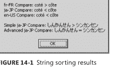

图 14-1 字符串排序结果

除了`Compare`之外，`CompareInfo`类还提供`IndexOf`、`LastIndexOf`、`IsPrefix`和`IsSuffix`方法。由于所有这些方法都提供接受`CompareOptions`枚举值作为参数的重载，因此它们比`String`类定义的`Compare`、`IndexOf`、`LastIndexOf`、`StartsWith`和`EndsWith`方法提供更多控制。此外，你应当知道，FCL 包含一个`System.StringComparer`类，也可以使用它来执行字符串比较。当你需要对许多不同的字符串重复执行同一种比较时，该类很有用。

## 字符串驻留

正如我在上一节所说，检查字符串是否相等是许多应用程序的常见操作——这项任务可能会显著影响性能。执行序数相等检查时，CLR 会快速测试两个字符串是否具有相同的字符数。如果不同，则这两个字符串肯定不相等；如果相同，则字符串可能相等，此时 CLR 必须比较每个单独的字符才能确定。执行文化感知比较时，CLR 必须始终比较所有单个字符，因为不同长度的字符串可能被视为相等。

此外，如果内存中有多个相同字符串的实例重复存在，你就在浪费内存，因为字符串是不可变的。如果内存中只有一个字符串实例，而所有需要引用该字符串的变量都只需指向这个单一的字符串对象，那么内存使用效率会高得多。

如果你的应用程序经常使用区分大小写的序数比较来比较字符串是否相等，或者你预计会有许多具有相同值的字符串对象，那么利用 CLR 中的*字符串驻留*机制可以大幅提升性能。当 CLR 初始化时，它会创建一个内部哈希表，其中的键是字符串，值是指向托管堆中`String`对象的引用。最初，该表当然是空的。`String`类提供两个方法，允许你访问这个内部哈希表：

```csharp
public static String Intern(String str);
public static String IsInterned(String str);
```

第一个方法`Intern`接受一个`String`，获取其哈希代码，并在内部哈希表中检查是否有匹配项。如果已经存在相同的字符串，则返回对现有`String`对象的引用。如果不存在相同的字符串，则创建该字符串的副本，将该副本添加到内部哈希表，并返回对该副本的引用。如果应用程序不再持有对原始`String`对象的引用，垃圾回收器就能释放该字符串的内存。请注意，垃圾回收器无法释放内部哈希表所引用的字符串，因为哈希表持有对那些`String`对象的引用。内部哈希表所引用的`String`对象在 AppDomain 卸载或进程终止之前都无法释放。


应谨慎小心地使用。事实上，这就是 C# 编译器表明它不希望启用字符串驻留的原因。

## 字符串池化

编译源代码时，编译器必须处理每个字面字符串，并将该字符串发出到托管模块的元数据中。如果相同的字面字符串在源代码中出现多次，那么将所有这些字符串都发出到元数据中会使生成的文件大小膨胀。

为了消除这种膨胀，许多编译器（包括 C# 编译器）只将字面字符串写入模块的元数据一次。所有引用该字符串的代码都将被修改为引用元数据中的那一个字符串。编译器将单个字符串的多次出现合并为单个实例的能力可以大幅减小模块的大小。这个过程并不新鲜——C/C++ 编译器多年来一直在这样做。（Microsoft 的 C/C++ 编译器称之为*字符串池化*。）即便如此，字符串池化仍是提高字符串性能的另一种方式，也是你应当掌握的另一项知识。

## 检查字符串的字符和文本元素

尽管比较字符串对于排序或检测相等性很有用，但有时你只需要检查字符串中的字符。**String** 类型提供了几个属性和方法来帮助你完成此操作，包括 **Length**、**Chars**（C# 中的索引器）、**GetEnumerator**、**ToCharArray**、**Contains**、**IndexOf**、**LastIndexOf**、**IndexOfAny** 和 **LastIndexOfAny**。

实际上，**System.Char** 表示单个 16 位 Unicode 码值，它不一定等同于一个抽象 Unicode 字符。例如，某些抽象 Unicode 字符是两个码值的组合。组合在一起时，U+0625（阿拉伯字母 *下方带 Hamza 的 Alef*）和 U+0650（阿拉伯语 *Kasra*）字符形成一个抽象字符或*文本元素*。

此外，一些 Unicode 文本元素需要超过 16 位的值来表示。这些文本元素使用两个 16 位码值表示。第一个码值称为高代理项，第二个码值称为低代理项。高代理项的值介于 U+D800 和 U+DBFF 之间，低代理项的值介于 U+DC00 和 U+DFFF 之间。代理项的使用使 Unicode 能够表达超过一百万个不同字符。

代理项在美国和欧洲很少使用，但在东亚更常用。要正确处理文本元素，应使用 **System.Globalization.StringInfo** 类型。使用此类型最简单的方法是构造它的一个实例，并向其构造函数传递一个字符串。然后，你可以通过查询 **StringInfo** 的 **LengthInTextElements** 属性来查看字符串中有多少个文本元素。之后，你可以调用 **StringInfo** 的 **SubstringByTextElements** 方法来提取所需的文本元素或连续文本元素的数量。

此外，**StringInfo** 类提供了一个静态 **GetTextElementEnumerator** 方法，该方法获取一个 **System.Globalization.TextElementEnumerator** 对象，使你能够枚举字符串中包含的所有抽象 Unicode 字符。最后，你可以调用 **StringInfo** 的静态 **ParseCombiningCharacters** 方法，以获得一个 **Int32** 值数组。数组的长度指示字符串中包含多少个文本元素。数组的每个元素标识字符串中的一个索引，在该索引处可以找到新文本元素的第一个码值。

以下代码演示了使用 **StringInfo** 类操作字符串文本元素的各种方式：

```csharp
using System;
using System.Text;
using System.Globalization;
using System.Windows.Forms;

public sealed class Program {
    public static void Main() {
        // The string below contains combining characters
        String s = "a\u0304\u0308bc\u0327";
        SubstringByTextElements(s);
        EnumTextElements(s);
        EnumTextElementIndexes(s);
    }

    private static void SubstringByTextElements(String s) {
        String output = String.Empty;

        StringInfo si = new StringInfo(s);
        for (Int32 element = 0; element < si.LengthInTextElements; element++) {
            output += String.Format(
                "Text element {0} is '{1}'{2}",
                element, si.SubstringByTextElements(element, 1),
                Environment.NewLine);
        }
        MessageBox.Show(output, "Result of SubstringByTextElements");
    }

    private static void EnumTextElements(String s) {
        String output = String.Empty;

        TextElementEnumerator charEnum =
            StringInfo.GetTextElementEnumerator(s);
        while (charEnum.MoveNext()) {
            output += String.Format(
                "Character at index {0} is '{1}'{2}",
                charEnum.ElementIndex, charEnum.GetTextElement(),
                Environment.NewLine);
        }
        MessageBox.Show(output, "Result of GetTextElementEnumerator");
    }

    private static void EnumTextElementIndexes(String s) {
        String output = String.Empty;

        Int32[] textElemIndex = StringInfo.ParseCombiningCharacters(s);
        for (Int32 i = 0; i < textElemIndex.Length; i++) {
            output += String.Format(
                "Character {0} starts at index {1}{2}",
                i, textElemIndex[i], Environment.NewLine);
        }
        MessageBox.Show(output, "Result of ParseCombiningCharacters");
    }
}
```

生成并运行此代码将产生如图 14-2、14-3 和 14-4 所示的消息框。

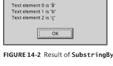

**图 14-2** SubstringByTextElements 的结果

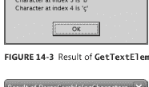

**图 14-3** GetTextElementEnumerator 的结果

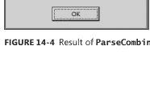

**图 14-4** ParseCombiningCharacters 的结果

## 其他字符串操作

**String** 类型还提供了允许你复制字符串或其部分的方法。表 14-1 总结了这些方法。

**表 14-1 复制字符串的方法**

| **成员** | **方法类型** | **描述** |
| --- | --- | --- |
| **Clone** | 实例 | 返回对同一对象（**this**）的引用。这没问题，因为 **String** 对象是不可变的。此方法实现 **String 的 ICloneable** 接口。 |
| **Copy** | 静态 | 返回指定字符串的一个新副本字符串。此方法很少使用，存在是为了帮助将字符串视为标记的应用程序。通常，具有相同字符集的字符串会被驻留为单个字符串。此方法会创建一个新的字符串对象，因此即使字符串包含相同的字符，引用（指针）也不同。 |
| **CopyTo** | 实例 | 将字符串的一部分字符复制到字符数组。 |
| **Substring** | 实例 | 返回一个新字符串，它表示原始字符串的一部分。 |
| **ToString** | 实例 | 返回对同一对象（**this**）的引用。 |

除了这些方法之外，**String** 还提供了许多操作字符串的静态和实例方法，例如 **Insert**、**Remove**、**PadLeft**、**Replace**、**Split**、**Join**、**ToLower**、**ToUpper**、**Trim**、**Concat**、**Format** 等。同样，关于所有这些方法要记住的重要一点是，它们返回新的字符串对象；因为字符串是不可变的，所以一旦创建，就无法修改（使用安全代码）。

## 高效构造字符串

因为 **String** 类型表示不可变字符串，所以 FCL 提供了另一种类型 **System.Text.StringBuilder**，它允许你高效地对字符串和字符执行动态操作以创建 **String**。可以将 **StringBuilder** 视为一个精巧的构造函数，用于创建可与框架其余部分一起使用的 **String**。一般来说，你应设计采用 **String** 参数而不是 **StringBuilder** 参数的方法。

从逻辑上讲，**StringBuilder** 对象包含一个字段，该字段引用 **Char** 结构的数组。**StringBuilder** 的成员允许你操作此字符数组，从而有效地缩短字符串或更改字符串中的字符。如果将字符串增长到超出已分配的字符数组，**StringBuilder** 会自动分配一个更大的新数组，复制字符，并开始使用新数组。先前的数组会被垃圾回收。

使用 **StringBuilder** 对象构造完字符串后，将 **StringBuilder** 的字符数组“转换”为 **String**，只需调用 **StringBuilder** 的

**ToString** 方法。这会在堆中创建一个新的 **String** 对象，其中包含你调用 **ToString** 时 **StringBuilder** 中的字符串。此时，你可以继续操作 **StringBuilder** 内部的字符串，稍后可以再次调用 **ToString** 将其转换为另一个 **String** 对象。

### 构造 StringBuilder 对象

与 **String** 类不同，CLR 没有关于 **StringBuilder** 类的特殊信息。此外，大多数语言（包括 C#）不认为 **StringBuilder** 类是基元类型。你可以像构造任何其他非基元类型一样构造 **StringBuilder** 对象：

```csharp
StringBuilder sb = new StringBuilder();
```

**StringBuilder** 类型提供许多构造函数。每个构造函数的职责是分配并初始化每个 **StringBuilder** 对象所维护的状态：

- **最大容量** 一个 **Int32** 值，指定可放入字符串中的最大字符数。默认值为 **Int32.MaxValue**（约 20 亿）。通常不会更改此值。不过，你可以指定较小的最大容量，以确保永远不会创建超过特定长度的字符串。一旦构造完成，**StringBuilder** 的最大容量值就不能更改。

- **容量** 一个 **Int32** 值，指示 **StringBuilder** 所维护的字符数组的大小。默认值为 16。如果你大致知道将要在 **StringBuilder** 中放置多少个字符，那么在构造 **StringBuilder** 对象时应使用该数字来设置容量。

  当向字符数组追加字符时，**StringBuilder** 会检测数组是否试图增长到超出数组的容量。如果是，**StringBuilder** 会自动将容量字段加倍，分配一个新数组（大小为新容量），并将字符从原数组复制到新数组。原数组将来会被垃圾回收。动态增长数组会损害性能；通过设置良好的初始容量来避免这种情况。

- **字符数组** 一个 **Char** 结构数组，维护“字符串”中的字符集。字符数始终小于或等于容量值和最大容量值。可以使用 **StringBuilder** 的 **Length** 属性获取数组中使用的字符数。**Length** 始终小于或等于 **StringBuilder** 的容量值。构造 **StringBuilder** 时，可以传递一个 **String** 来初始化字符数组。如果不指定字符串，则数组最初不包含任何字符——也就是说，**Length** 属性返回 0。

| 成员 | 成员类型 | 描述 |
|---|---|---|
| **AppendFormat** | 方法 | 将指定对象追加到字符数组末尾，必要时增长数组。这些对象通过使用调用方提供的格式化和区域性信息转换为字符串。**AppendFormat** 是与 **StringBuilder** 对象一起使用的最常见方法之一。 |
| **AppendLine** | 方法 | 将空行或带空行的字符串追加到字符数组末尾，必要时增加数组的容量。 |
| **Replace** | 方法 | 在字符数组内将一个字符替换为另一个字符，或将一个字符串替换为另一个字符串。 |
| **Remove** | 方法 | 从字符数组中移除一个字符范围。 |
| **Equals** | 方法 | 仅当两个 **StringBuilder** 对象具有相同的最大容量、容量和数组中的字符时，才返回 **true**。 |
| **CopyTo** | 方法 | 将 **StringBuilder** 的部分字符复制到 **Char** 数组。 |

关于 **StringBuilder** 的方法，需要注意的一点是，其中大多数方法都返回对同一 **StringBuilder** 对象的引用。这允许使用方便的语法将多个操作链接在一起：

```csharp
StringBuilder sb = new StringBuilder();
String s = sb.AppendFormat("{0} {1}", "Jeffrey", "Richter").
   Replace(' ', '-').Remove(4, 3).ToString();
Console.WriteLine(s);  // "Jeff-Richter"
```

你会注意到，**String** 和 **StringBuilder** 类没有完全的方法对等性；也就是说，**String** 具有 **ToLower**、**ToUpper**、**EndsWith**、**PadLeft**、**PadRight**、**Trim** 等方法，而 **StringBuilder** 类不提供这些方法中的任何一个。另一方面，**StringBuilder** 类提供了一个更丰富的 **Replace** 方法，允许替换字符串中某一部分（而不是整个字符串）的字符或字符串。不幸的是，这两个类之间没有完全的对等性，因为现在你必须在这两者之间转换才能完成某些任务。例如，要构建一个字符串、将所有字符转换为大写，然后插入一个字符串，需要如下代码：

```csharp
// Construct a StringBuilder to perform string manipulations.
StringBuilder sb = new StringBuilder();

// Perform some string manipulations by using the StringBuilder.
sb.AppendFormat("{0} {1}", "Jeffrey", "Richter").Replace(" ", "-");

// Convert the StringBuilder to a String in
// order to uppercase all the characters.
String s = sb.ToString().ToUpper();

// Clear the StringBuilder (allocates a new Char array).
sb.Length = 0;

// Load the uppercase String into the StringBuilder,
// and perform more manipulations.
sb.Append(s).Insert(8, "Marc-");

// Convert the StringBuilder back to a String.
s = sb.ToString();

// Display the String to the user.
Console.WriteLine(s);   // "JEFFREY-MARC-RICHTER"
```

仅仅因为 **StringBuilder** 没有提供 **String** 所做的全部操作，就必须编写这段代码，既不方便也不高效。我希望将来 Microsoft 会向 **StringBuilder** 添加更多字符串操作方法，使其成为更完整的类。

## 获取对象的字符串表示形式：ToString

你经常需要获取对象的字符串表示形式。通常，当你想要向用户显示数值类型（如 **Byte**、**Int32** 和 **Single**）或 **DateTime** 对象时，这是必要的。由于 .NET Framework 是一个面向对象的平台，每种类型都负责提供将实例的值转换为等效字符串的代码。在设计类型应如何完成此操作时，FCL 的设计者设计了一种将在整个框架中一致使用的模式。在本节中，我将描述这种模式。

你可以通过调用 **ToString** 方法获取任何对象的字符串表示形式。**System.Object** 定义了一个公共的、虚拟的、无参数的 **ToString** 方法，因此可以使用任何类型的实例调用它。从语义上讲，**ToString** 返回表示对象当前值的字符串，并且该字符串应针对调用线程的当前区域性进行格式化；也就是说，数字的字符串表示形式应使用与分配给调用线程的区域性相关联的正确小数分隔符、数字分组符号和其他元素。

**System.Object** 对 **ToString** 的实现仅返回对象类型的完整名称。这个值并不是特别有用，但对于许多无法提供合理字符串的类型来说，它是一个合理的默认值。例如，**FileStream** 或 **Hashtable** 对象的字符串表示形式应该是什么样子？

所有希望提供合理方式来获取表示对象当前值的字符串的类型，都应重写 **ToString** 方法。FCL 中内置的所有基类型（**Byte**、**Int32**、**UInt64**、**Double** 等）都重写了它们的 **ToString** 方法，并返回区域性感知的字符串。在 Visual Studio 调试器中，当鼠标放在特定变量上时会显示数据提示。数据提示中显示的文本是通过调用对象的 **ToString** 方法获取的。因此，当你定义类时，应始终重写 **ToString** 方法，以便获得良好的调试支持。


## 特定格式和文化

无参数的 **ToString** 方法有两个问题。第一，调用方无法控制字符串的格式。例如，应用程序可能希望将数字格式化为货币字符串、十进制字符串、百分比字符串或十六进制字符串。第二，调用方无法轻松选择使用特定区域性来格式化字符串。对于服务器端应用程序代码而言，第二个问题比客户端代码更麻烦。在极少数情况下，应用程序需要使用与调用线程关联的区域性不同的区域性来格式化字符串。为了更好地控制字符串格式，你需要一个 **ToString** 方法版本，它允许你指定精确的格式和区域性信息。

为调用方提供格式和区域性选择的类型实现 **System.IFormattable** 接口：

```csharp
public interface IFormattable {
    String ToString(String format, IFormatProvider formatProvider);
}
```

在 FCL 中，所有基类型（**Byte**、**SByte**、**Int16/UInt16**、**Int32/UInt32**、**Int64/UInt64**、**Single**、**Double**、**Decimal** 和 **DateTime**）都实现此接口。此外，一些其他类型（如 **Guid**）也实现它。最后，每个枚举类型定义都会自动实现 **IFormattable** 接口，以便可以从枚举类型的实例获取有意义的字符串符号。

**IFormattable** 的 **ToString** 方法接受两个参数。第一个参数 **format** 是一个字符串，告诉方法应如何格式化对象。**ToString** 的第二个参数 **formatProvider** 是实现 **System.IFormatProvider** 接口的类型的实例。此类型向 **ToString** 方法提供特定的区域性信息。我很快就会讨论如何提供。

实现 **IFormattable** 接口的 **ToString** 方法的类型决定它将识别哪些格式字符串。如果传入该类型无法识别的格式字符串，该类型应抛出 **System.FormatException**。

Microsoft 在 FCL 中定义的许多类型都识别若干格式。例如，**DateTime** 类型支持“d”表示短日期，“D”表示长日期，“g”表示常规，“M”表示月/日，“s”表示可排序，“T”表示长时间，“u”表示 ISO 8601 格式的通用时间，“U”表示完整日期格式的通用时间，“Y”表示年/月，等等。所有枚举类型都支持“G”表示常规，“F”表示标志，“D”表示十进制，“X”表示十六进制。我将在第 15 章“枚举类型和位标志”中更详细地介绍枚举类型的格式化。

此外，所有内置数值类型都支持“C”表示货币，“D”表示十进制，“E”表示指数（科学）记数法，“F”表示定点，“G”表示常规，“N”表示数字，“P”表示百分比，“R”表示往返，“X”表示十六进制。事实上，数值类型还支持图片格式字符串，以防简单格式字符串无法完全满足你的需求。图片格式字符串包含特殊字符，这些字符告诉类型的 **ToString** 方法确切显示多少位数字、确切在何处放置小数分隔符、确切在小数分隔符后放置多少位数字，等等。有关格式字符串的完整信息，请参阅 .NET Framework SDK 中的“格式化类型”。

对于大多数类型，调用 **ToString** 并为格式字符串传递 **null** 与调用 **ToString** 并为格式字符串传递“G”完全相同。换句话说，对象默认使用“常规格式”格式化自身。实现类型时，请选择你认为最常用的格式；此格式就是“常规格式”。顺便说一句，不接受参数的 **ToString** 方法假定调用方想要“常规格式”。

现在格式字符串已经讲完，让我们转向区域性信息。默认情况下，字符串使用与调用线程关联的区域性信息进行格式化。无参数的 **ToString** 方法当然会这样做，如果你为 **formatProvider** 参数传递 **null**，**IFormattable 的 ToString** 也会这样做。

区域性敏感信息适用于格式化数字（包括货币、整数、浮点数、百分比、日期和时间）时。**Guid** 类型有一个 **ToString** 方法，它只返回表示其值的字符串。生成 **Guid 的**字符串时无需考虑区域性，因为 GUID 仅用于编程目的。

格式化数字时，**ToString** 方法会查看你为 **formatProvider** 参数传递的内容。如果传递了 **null**，**ToString** 会通过读取 **System.Threading.Thread.CurrentThread.CurrentCulture** 属性来确定与调用线程关联的区域性。此属性返回 **System.Globalization.CultureInfo** 类型的实例。

使用此对象，**ToString** 会读取其 **NumberFormat** 或 **DateTimeFormat** 属性，具体取决于正在格式化的是数字还是日期/时间。这些属性分别返回 **System.Globalization.NumberFormatInfo** 或 **System.Globalization.DateTimeFormatInfo** 的实例。**NumberFormatInfo** 类型定义了一组属性，例如 **CurrencyDecimalSeparator**、**CurrencySymbol**、**NegativeSign**、**NumberGroupSeparator** 和 **PercentSymbol**。同样，**DateTimeFormatInfo** 类型定义了各种属性，例如 **Calendar**、**DateSeparator**、**DayNames**、**LongDatePattern**、**ShortTimePattern** 和 **TimeSeparator**。**ToString** 在构造和格式化字符串时会读取这些属性。

调用 **IFormattable 的 ToString** 方法时，你可以传递一个类型实现 **IFormatProvider** 接口的对象的引用，而不是传递 **null**：

```csharp
public interface IFormatProvider {
    Object GetFormat(Type formatType);
}
```

下面是 **`IFormatProvider`** 接口背后的基本思想：当某个类型实现此接口时，它表示该类型的实例能够提供区域性特定的格式信息，并且应忽略与调用线程关联的区域性信息。

**`System.Globalization.CultureInfo`** 类型是 FCL 中定义的极少数实现 **`IFormatProvider`** 接口的类型之一。例如，如果你想为越南格式化字符串，你会构造一个 **`CultureInfo`** 对象，并将该对象作为 **`ToString`** 的 **`formatProvider`** 参数传入。以下代码获取一个 **`Decimal`** 数值的字符串表示形式，并将其格式化为适合越南的货币：

```csharp
Decimal price = 123.54M;
String s = price.ToString("C", new CultureInfo("vi-VN"));
MessageBox.Show(s);
```

如果生成并运行此代码，将出现图 14-5 所示的消息框。

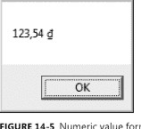

**图 14-5** 数字值已正确格式化以表示越南货币

在内部，**`Decimal`** 的 **`ToString`** 方法会看到 **`formatProvider`** 参数不是 **`null`**，并按如下方式调用该对象的 **`GetFormat`** 方法：

```csharp
NumberFormatInfo nfi = (NumberFormatInfo)
    formatProvider.GetFormat(typeof(NumberFormatInfo));
```

这就是 **`ToString`** 从（**`CultureInfo`**）对象请求适当数字格式信息的方式。数字类型（如 **`Decimal`**）只请求数字格式信息。但其他类型（如 **`DateTime`**）可以像这样调用 **`GetFormat`**：

```csharp
DateTimeFormatInfo dtfi = (DateTimeFormatInfo)
    formatProvider.GetFormat(typeof(DateTimeFormatInfo));
```

实际上，由于 **`GetFormat`** 的参数可以标识任何类型，该方法足够灵活，允许请求任何类型的格式信息。**`.NET Framework`** 中的类型调用 **`GetFormat`** 时只请求数字或日期/时间信息；将来可能会请求其他类型的格式信息。


顺便提一下，如果你希望为某个对象获取一个不针对任何特定区域性格式化的字符串，应调用 `System.Globalization.CultureInfo` 的静态 `InvariantCulture` 属性，并将返回的对象作为 `ToString` 的 `formatProvider` 参数传入：

```csharp
Decimal price = 123.54M;
String s = price.ToString("C", CultureInfo.InvariantCulture);
MessageBox.Show(s);
```

如果生成并运行这段代码，会出现如图 14-6 所示的消息框。注意结果字符串中的第一个字符：¤。这是国际货币符号（U+00A4）。

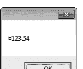

**图 14-6** 格式化为表示区域性无关货币的数值

通常，你不会向用户显示使用固定区域性格式化的字符串。通常，你只会将此字符串保存到数据文件中，以便之后可以解析。

在 FCL 中，只有三种类型实现了 **IFormatProvider** 接口。第一种是 **CultureInfo**，我已经解释过了。另外两种是 **NumberFormatInfo** 和 **DateTimeFormatInfo**。当对 **NumberFormatInfo** 对象调用 **GetFormat** 时，该方法会检查所请求的类型是否为 **NumberFormatInfo**。如果是，则返回 **this**；如果不是，则返回 **null**。类似地，对 **DateTimeFormatInfo** 对象调用 **GetFormat**，如果请求的是 **DateTimeFormatInfo** 则返回 **this**，否则返回 **null**。这两个类型实现此接口只是为了编程上的便利。当试图获取对象的字符串表示时，调用方通常指定格式并使用调用线程关联的区域性。因此，你经常调用 **ToString**，为 format 参数传递字符串，为 **formatProvider** 参数传递 **null**。为让你更轻松地调用 **ToString**，许多类型都提供了 **ToString** 方法的多个重载。例如，**Decimal** 类型提供了四种不同的 **ToString** 方法：

```csharp
// This version calls ToString(null, null).
// Meaning: General numeric format, thread's culture information
public override String ToString();

// This version is where the actual implementation of ToString goes.
// This version implements IFormattable's ToString method.
// Meaning: Caller-specified format and culture information
public String ToString(String format, IFormatProvider formatProvider);

// This version simply calls ToString(format, null).
// Meaning: Caller-specified format, thread's culture information
public String ToString(String format);

// This version simply calls ToString(null, formatProvider).
// This version implements IConvertible's ToString method.
// Meaning: General format, caller-specified culture information
public String ToString(IFormatProvider formatProvider);
```

## 将多个对象格式化为单个字符串

到目前为止，我已经解释了单个类型如何格式化其自身对象。然而，有时你需要构造由多个格式化对象组成的字符串。例如，下面的字符串包含一个日期、一个人名和一个年龄：

```csharp
String s = String.Format("On {0}, {1} is {2} years old.",
    new DateTime(2010, 4, 22, 14, 35, 5), "Aidan", 7);
Console.WriteLine(s);
```

如果生成并运行这段代码，且线程的当前区域性为 "en-US"，你将看到以下输出行：

On 4/22/2010 2:35:05 PM, Aidan is 7 years old.

**String 的静态 Format 方法**接受一个格式字符串，该字符串使用大括号中的数字来标识可替换参数。此示例中使用的格式字符串告诉 Format 方法将 {0} 替换为格式字符串后的第一个参数（日期/时间），将 {1} 替换为格式字符串后的第二个参数（"Aidan"），并将 {2} 替换为格式字符串后的第三个参数（7）。

在内部，Format 方法会调用每个对象的 ToString 方法以获取该对象的字符串表示形式。然后，将所有返回的字符串追加起来，并返回完整的最终字符串。这一切都很好，但这也意味着所有对象都使用其常规格式和调用线程的区域性信息进行格式化。

如果在花括号内指定格式信息，则在格式化对象时可以进行更多控制。例如，下面的代码与前一个示例相同，只是我向可替换参数 0 和 2 添加了格式信息：

```csharp
String s = String.Format("On {0:D}, {1} is {2:E} years old.",
    new DateTime(2010, 4, 22, 14, 35, 5), "Aidan", 7);
Console.WriteLine(s);
```

如果生成并运行这段代码，且线程的当前区域性为 "en-US"，你将看到以下输出行：

On Thursday, April 22, 2010, Aidan is 7.000000E+000 years old.

当 **Format** 方法解析格式字符串时，它会看到可替换参数 0 应调用其 **IFormattable** 接口的 **ToString** 方法，并为其两个参数传递 "D" 和 **null**。同样，**Format** 会调用可替换参数 2 的 **IFormattable.ToString** 方法，传递 "E" 和 **null**。如果类型未实现 **IFormattable** 接口，**Format** 会调用其从 **Object** 继承（可能已重写）的无参 **ToString** 方法，并将默认格式追加到结果字符串中。

**String** 类提供了静态 **Format** 方法的多个重载。其中一个版本接受一个实现 **IFormatProvider** 接口的对象，以便你可以使用调用方指定的区域性信息来格式化所有可替换参数。显然，**Format** 会调用每个对象的 **IFormattable.ToString** 方法，并将传递给 **Format** 的任何 **IFormatProvider** 对象传递给它。

如果你使用的是 **StringBuilder** 而不是 **String** 来构造字符串，可以调用 **StringBuilder 的 AppendFormat** 方法。该方法的工作方式与 **String 的 Format** 方法完全相同，不同之处在于它格式化字符串并追加到 **StringBuilder** 的字符数组中。与 **String 的 Format** 一样，**AppendFormat** 也接受格式字符串，并且有一个版本接受 **IFormatProvider**。

**System.Console** 提供了 **Write** 和 **WriteLine** 方法，它们也接受格式字符串和可替换参数。但是，**Console 的 Write** 和 **WriteLine** 方法没有允许你传递 **IFormatProvider** 的重载。如果你想为特定区域性格式化字符串，则必须调用 **String 的 Format** 方法，首先传递所需的 **IFormatProvider** 对象，然后将结果字符串传递给 **Console 的 Write** 或 **WriteLine** 方法。这应该不是什么大问题，因为如前所述，客户端代码很少使用与调用线程关联的区域性之外的其他区域性来格式化字符串。

## 提供自定义格式化器

到现在为止，应该很清楚 .NET Framework 中的格式化能力旨在为你提供极大的灵活性和控制力。不过，我们还没有结束。你可以定义一个方法，当任何对象被格式化到字符串中时，**StringBuilder 的 AppendFormat** 方法都会调用该方法。换句话说，**AppendFormat** 可以不调用每个对象的 **ToString**，而是调用你定义的函数，从而允许你以任何方式格式化任意或所有对象。我接下来要描述的内容同样适用于 **String 的 Format** 方法。

让我通过一个例子来解释这种机制。假设你正在格式化用户将在 Internet 浏览器中查看的 HTML 文本。你希望所有 **Int32** 值都以粗体显示。要实现这一点，每次将 **Int32** 值格式化为 **String** 时，你都希望用 HTML 粗体标签：**<B>** 和 **</B>** 将该字符串包围起来。下面的代码演示了实现这一点是多么容易：


```csharp
public StringBuilder AppendFormat(IFormatProvider formatProvider,
   String format, params Object[] args) {

   // If an IFormatProvider was passed, find out
   // whether it offers an ICustomFormatter object.
   ICustomFormatter cf = null;

   if (formatProvider != null)
      cf = (ICustomFormatter)
         formatProvider.GetFormat(typeof(ICustomFormatter));

   // Keep appending literal characters (not shown in this pseudocode)
   // and replaceable parameters to the StringBuilder's character array.
   Boolean MoreReplaceableArgumentsToAppend = true;
   while (MoreReplaceableArgumentsToAppend) {
      // argFormat refers to the replaceable format string obtained
      // from the format parameter
      String argFormat = /* ... */;

      // argObj refers to the corresponding element
      // from the args array parameter
      Object argObj = /* ... */;

      // argStr will refer to the formatted string to be appended
      // to the final, resulting string
      String argStr = null;

      // If a custom formatter is available, let it format the argument.
      if (cf != null)
         argStr = cf.Format(argFormat, argObj, formatProvider);

      // If there is no custom formatter or if it didn't format
      // the argument, try something else.
      if (argStr == null) {
         // Does the argument's type support rich formatting?
         IFormattable formattable = argObj as IFormattable;
         if (formattable != null) {
            // Yes; pass the format string and provider to
            // the type's IFormattable ToString method.
            argStr = formattable.ToString(argFormat, formatProvider);
         } else {
            // No; get the default format by using
            // the thread's culture information.
            if (argObj != null) argStr = argObj.ToString();
            else argStr = String.Empty;
         }
      }

      // Append argStr's characters to the character array field member.
      /* ... */

      // Check if any remaining parameters to format
      MoreReplaceableArgumentsToAppend = /* ... */;
   }
   return this;
}
```

当 `Main` 调用 `AppendFormat` 时，`AppendFormat` 会调用我的格式提供程序的 `GetFormat` 方法，并向它传递 `ICustomFormatter` 类型。在我的 `BoldInt32s` 类型中定义的 `GetFormat` 方法看到请求的是 `ICustomFormatter`，就返回对自身的引用，因为它实现了该接口。如果我的 `GetFormat` 方法被调用并传入了任何其他类型，我会调用与调用线程关联的 `CultureInfo` 对象的 `GetFormat` 方法。

每当 `AppendFormat` 需要格式化一个可替换参数时，它都会调用 `ICustomFormatter` 的 `Format` 方法。在我的示例中，`AppendFormat` 调用的是由我的 `BoldInt32s` 类型定义的 `Format` 方法。在我的 `Format` 方法中，我会检查被格式化的对象是否通过 `IFormattable` 接口支持丰富格式化。如果该对象不支持，我就调用简单的、无参数的 `ToString` 方法（继承自 `Object`）来格式化该对象。如果该对象确实支持 `IFormattable`，我就调用丰富的 `ToString` 方法，并向它传递格式字符串和格式提供程序。

现在我已经有了格式化后的字符串，我会检查对应的对象是否为 `Int32` 类型；如果是，我就用 `<B>` 和 `</B>` HTML 标记包装该格式化字符串，并返回新字符串。如果该对象不是 `Int32`，我就直接返回该格式化字符串，不做任何进一步处理。

## 将字符串解析为对象：Parse

在上一节中，我解释了如何获取一个对象并得到该对象的字符串表示形式。在本节中，我将讨论相反的过程：如何获取一个字符串并得到它的对象表示形式。从字符串获取对象并不是一种非常常见的操作，但偶尔确实会派上用场。Microsoft 认为有必要正式确立一种将字符串解析为对象的机制。

任何能够解析字符串的类型都提供一个名为 `Parse` 的公共静态方法。该方法接收一个 `String`，并返回该类型的实例；在某种程度上，`Parse` 起到了工厂的作用。在 FCL 中，所有数值类型以及 `DateTime`、`TimeSpan` 和其他少数类型（例如 SQL 数据类型）都存在 `Parse` 方法。

让我们看看如何将字符串解析为数值类型。几乎所有数值类型（`Byte`、`SByte`、`Int16`/`UInt16`、`Int32`/`UInt32`、`Int64`/`UInt64`、`Single`、`Double`、`Decimal` 和 `BigInteger`）都提供至少一个 `Parse` 方法。这里我只展示由 `Int32` 类型定义的 `Parse` 方法。（其他数值类型的 `Parse` 方法的工作方式与 `Int32` 的 `Parse` 方法类似。）

```csharp
public static Int32 Parse(String s, NumberStyles style,
    IFormatProvider provider);
```

仅从原型来看，你应该就能猜出这个方法具体如何工作。`String` 参数 `s` 标识你希望解析为 **Int32** 对象的数字的字符串表示形式。**System.Globalization.NumberStyles** 参数 **style** 是一组位标志，用于标识 **Parse** 应预期在字符串中找到的字符。而 **IFormatProvider** 参数 **provider** 标识一个对象，**Parse** 方法可以使用该对象获取区域性特定信息，正如本章前面所讨论的那样。

例如，以下代码会导致 **Parse** 抛出 **System.FormatException**，因为被解析的字符串包含前导空格：

```csharp
Int32 x = Int32.Parse(" 123", NumberStyles.None, null);
```

要允许 **Parse** 跳过前导空格，请按如下方式更改 **style** 参数：

```csharp
Int32 x = Int32.Parse(" 123", NumberStyles.AllowLeadingWhite, null);
```

有关 **NumberStyles** 枚举类型定义的位符号和常见组合的完整说明，请参阅 .NET Framework SDK 文档。

下面是一个演示如何解析十六进制数的代码片段：

```csharp
Int32 x = Int32.Parse("1A", NumberStyles.HexNumber, null);
Console.WriteLine(x);  // Displays "26"
```

这个 **Parse** 方法接受三个参数。为方便起见，许多类型提供 **Parse** 的附加重载，这样你就不必传入那么多参数。例如，**Int32** 提供 **Parse** 方法的四个重载：

```csharp
// Passes NumberStyles.Integer for style
// and thread's culture's provider information.
public static Int32 Parse(String s);

// Passes thread's culture's provider information.
public static Int32 Parse(String s, NumberStyles style);

// Passes NumberStyles.Integer for the style parameter.
public static Int32 Parse(String s, IFormatProvider provider);

// This is the method I've been talking about in this section.
public static Int32 Parse(String s, NumberStyles style,
    IFormatProvider provider);
```

**DateTime** 类型也提供一个 **Parse** 方法：

```csharp
public static DateTime Parse(String s,
    IFormatProvider provider, DateTimeStyles styles);
```

这个方法的工作方式与数值类型上定义的 **Parse** 方法相同，只是 **DateTime** 的 **Parse** 方法接受一组由 **System.Globalization.DateTimeStyles** 枚举类型定义的位标志，而不是 **NumberStyles** 枚举类型。有关 **DateTimeStyles** 类型定义的位符号和常见组合的完整说明，请参阅 .NET Framework SDK 文档。

为方便起见，**DateTime** 类型提供 **Parse** 方法的三个重载：

```csharp
// Passes thread's culture's provider information
// and DateTimeStyles.None for the style
public static DateTime Parse(String s);

// Passes DateTimeStyles.None for the style
public static DateTime Parse(String s, IFormatProvider provider);

// This is the method I've been talking about in this section.
public static DateTime Parse(String s,
    IFormatProvider provider, DateTimeStyles styles);
```

解析日期和时间很复杂。许多开发者发现 **DateTime** 类型的 **Parse** 方法过于宽容，因为它有时会解析不包含日期或时间的字符串。因此，**DateTime** 类型还提供一个 **ParseExact** 方法，该方法接受一个图片格式字符串，用于准确指示日期/时间字符串应如何格式化以及应如何解析。有关图片格式字符串的更多信息，请参阅 .NET Framework SDK 中的 **DateTimeFormatInfo** 类。

**注意** 一些开发者向 Microsoft 报告了以下情况：当他们的应用程序频繁调用 **Parse**，并且 **Parse** 反复抛出异常（由于无效的用户输入）时，应用程序的性能会受到影响。对于这些对性能敏感的 **Parse** 用法，Microsoft 为所有数值数据类型、**DateTime**、**DateTimeOffset**、**TimeSpan**，甚至 **IPAddress** 添加了 **TryParse** 方法。下面是 **Int32** 的两个 **TryParse** 方法重载之一的样子：

```csharp
public static Boolean TryParse(String s, NumberStyles style,
    IFormatProvider provider, out Int32 result);
```

如你所见，该方法返回 **true** 或 **false**，指示指定的字符串能否被解析为 **Int32**。如果该方法返回 **true**，则通过引用传递给 result 参数的变量将包含解析后的数值。**TryXxx** 模式将在第 20 章“异常与状态管理”中讨论。

## 编码：在字符和字节之间转换

在 Win32 中，程序员常常不得不编写代码，将 Unicode 字符和字符串转换为多字节字符集（MBCS）字符和字符串。我本人当然也编写过不少这类代码，写起来非常繁琐，用起来也容易出错。在 CLR 中，所有字符都表示为 16 位 Unicode 代码值，所有字符串都由 16 位 Unicode 代码值组成。这使得在运行时处理字符和字符串变得容易。

然而，有时你希望将字符串保存到文件或通过网络传输。如果字符串主要由英语使用者可读的字符组成，那么保存或传输一组 16 位值的效率并不高，因为写入的字节中有一半会包含零。相反，更高效的做法是将这些 16 位值*编码*为压缩的字节数组，然后将该字节数组*解码*回 16 位值数组。


编码还允许托管应用程序与非 Unicode 系统创建的字符串进行交互。例如，如果你希望生成一个可由在日文版 Microsoft Windows 95 上运行的应用程序读取的文件，就必须使用 Shift-JIS（代码页 932）编码保存 Unicode 文本。同样，你会使用 Shift-JIS 编码将日文 Windows 95 系统生成的文本文件读入 CLR。

当你想要通过 **System.IO.BinaryWriter** 或 **System.IO.StreamWriter** 类型将字符串发送到文件或网络流时，通常需要进行编码。当你想要通过 **System.IO.BinaryReader** 或 **System.IO.StreamReader** 类型从文件或网络流读取字符串时，通常需要进行解码。如果你没有显式选择编码，所有这些类型都默认使用 UTF-8。（UTF 代表 Unicode Transformation Format，即 Unicode 转换格式。）然而，有时你可能希望显式编码或解码字符串。即使你不想显式执行此操作，本节也会让你更深入地了解如何从流中读取字符串以及将字符串写入流。

幸运的是，FCL 提供了一些类型，使字符编码和解码变得容易。最常用的两种编码是 UTF-16 和 UTF-8。

- UTF-16 将每个 16 位字符编码为 2 个字节。它完全不会影响字符，也不会发生压缩——其性能非常出色。UTF-16 编码也称为 Unicode 编码。另请注意，UTF-16 可用于从小端转换为大端，反之亦然。

- UTF-8 将某些字符编码为 1 个字节，某些字符编码为 2 个字节，某些字符编码为 3 个字节，某些字符编码为 4 个字节。值低于 0x0080 的字符被压缩为 1 个字节，这对于美国使用的字符非常有效。介于 0x0080 和 0x07FF 之间的字符被转换为 2 个字节，这对于欧洲和中东语言很有效。0x0800 及以上的字符被转换为 3 个字节，这对于东亚语言很有效。最后，代理项对被写出为 4 个字节。UTF-8 是一种极其流行的编码，但如果你编码许多值在 0x0800 或以上的字符，它的效率不如 UTF-16。

尽管 UTF-16 和 UTF-8 编码是迄今为止最常见的，但 FCL 也支持一些不太常用的编码：

- UTF-32 将所有字符编码为 4 个字节。当你想要编写一个简单的算法来遍历字符，并且不想处理字符占用可变字节数的问题时，这种编码很有用。例如，使用 UTF-32 时，你不需要考虑代理项，因为每个字符都是 4 个字节。显然，就内存使用而言，UTF-32 不是一种高效的编码，因此很少用于将字符串保存到文件或通过网络传输。这种编码通常在程序内部使用。另请注意，UTF-32 可用于从小端转换为大端，反之亦然。

- UTF-7 编码通常用于较旧的系统，这些系统处理的字符可以用 7 位值表示。你应避免使用这种编码，因为它通常最终会扩展数据而不是压缩数据。Unicode 联盟已弃用此编码。

- ASCII 将 16 位字符编码为 ASCII 字符；也就是说，任何值小于 0x0080 的 16 位字符都被转换为单个字节。任何值大于 0x007F 的字符都无法转换，因此该字符的值会丢失。对于由 ASCII 范围（0x00 到 0x7F）内字符组成的字符串，此编码会将数据压缩一半，并且速度非常快（因为高字节被直接截断）。如果你有 ASCII 范围之外的字符，则此编码不合适，因为字符的值会丢失。

最后，FCL 还允许你将 16 位字符编码为任意代码页。与 ASCII 编码一样，编码为代码页是有风险的，因为任何无法在指定代码页中表示其值的字符都会丢失。你应始终使用 UTF-16 或 UTF-8 编码，除非你必须处理已经使用其他编码之一的某些旧版文件或应用程序。

当你需要编码或解码一组字符时，应获取一个派生自 `System.Text.Encoding` 的类的实例。`Encoding` 是一个抽象基类，它提供了几个静态 **readonly** 属性，每个属性都返回一个派生自 **Encoding** 的类的实例。

下面是一个使用 UTF-8 编码和解码字符的示例：

```csharp
using System;
using System.Text;

public static class Program {
    public static void Main() {
        // This is the string we're going to encode.
        String s = "Hi there.";

        // Obtain an Encoding-derived object that knows how
        // to encode/decode using UTF8
        Encoding encodingUTF8 = Encoding.UTF8;

        // Encode a string into an array of bytes.
        Byte[] encodedBytes = encodingUTF8.GetBytes(s);

        // Show the encoded byte values.
        Console.WriteLine("Encoded bytes: " +
            BitConverter.ToString(encodedBytes));

        // Decode the byte array back to a string.
        String decodedString = encodingUTF8.GetString(encodedBytes);

        // Show the decoded string.
        Console.WriteLine("Decoded string: " + decodedString);
    }
}
```

一旦你拥有一个派生自 **Encoding** 的对象，就可以通过调用 **GetBytes** 方法将字符串或字符数组转换为字节数组。（此方法存在多个重载。）要将字节数组转换为字符数组，请调用 **GetChars** 方法或更有用的 **GetString** 方法。（这两个方法都存在多个重载。）前面的代码演示了对 **GetBytes** 和 **GetString** 方法的调用。

所有派生自 **Encoding** 的类型都提供一个 **GetByteCount** 方法，该方法可获取编码一组字符所需的字节数，而无需实际执行编码。尽管 **GetByteCount** 并不是特别有用，但你可以使用此方法分配一个字节数组。还有一个 **GetCharCount** 方法，它返回将要解码的字符数，而无需实际解码它们。如果你试图节省内存并重用数组，这些方法很有用。

**GetByteCount**/**GetCharCount** 方法并不是很快，因为它们必须分析字符/字节数组才能返回准确的结果。如果你更看重速度而不是精确结果，可以改为调用 **GetMaxByteCount** 或 **GetMaxCharCount** 方法。这两个方法都接受一个指定字符数或字节数的整数，并返回最坏情况下的值。

每个派生自 **Encoding** 的对象都提供一组公共只读属性，你可以查询这些属性以获取有关该编码的详细信息。有关这些属性的说明，请参阅 .NET Framework SDK 文档。

为了说明大多数属性及其含义，我编写了以下程序，用于显示几种不同编码的属性值：

```csharp
using System;
using System.Text;

public static class Program {
    public static void Main() {
        foreach (EncodingInfo ei in Encoding.GetEncodings()) {
            Encoding e = ei.GetEncoding();
            Console.WriteLine("{1}{0}" +
                "\tCodePage={2}, WindowsCodePage={3}{0}" +
                "\tWebName={4}, HeaderName={5}, BodyName={6}{0}" +
                "\tIsBrowserDisplay={7}, IsBrowserSave={8}{0}" +
                "\tIsMailNewsDisplay={9}, IsMailNewsSave={10}{0}",
                Environment.NewLine,
                e.EncodingName, e.CodePage, e.WindowsCodePage,
                e.WebName, e.HeaderName, e.BodyName,
                e.IsBrowserDisplay, e.IsBrowserSave,
                e.IsMailNewsDisplay, e.IsMailNewsSave);
        }
    }
}
```


```text
IBM EBCDIC (US-Canada)
    CodePage=37, WindowsCodePage=1252
    WebName=IBM037, HeaderName=IBM037, BodyName=IBM037
    IsBrowserDisplay=False, IsBrowserSave=False
    IsMailNewsDisplay=False, IsMailNewsSave=False

OEM United States
    CodePage=437, WindowsCodePage=1252
    WebName=IBM437, HeaderName=IBM437, BodyName=IBM437
    IsBrowserDisplay=False, IsBrowserSave=False
    IsMailNewsDisplay=False, IsMailNewsSave=False

IBM EBCDIC (International)
    CodePage=500, WindowsCodePage=1252
    WebName=IBM500, HeaderName=IBM500, BodyName=IBM500
    IsBrowserDisplay=False, IsBrowserSave=False
    IsMailNewsDisplay=False, IsMailNewsSave=False

Arabic (ASMO 708)
    CodePage=708, WindowsCodePage=1256
    WebName=ASMO-708, HeaderName=ASMO-708, BodyName=ASMO-708
    IsBrowserDisplay=True, IsBrowserSave=True
    IsMailNewsDisplay=False, IsMailNewsSave=False

Unicode
    CodePage=1200, WindowsCodePage=1200
    WebName=utf-16, HeaderName=utf-16, BodyName=utf-16
    IsBrowserDisplay=False, IsBrowserSave=True
    IsMailNewsDisplay=False, IsMailNewsSave=False

Unicode (Big-Endian)
    CodePage=1201, WindowsCodePage=1200
    WebName=unicodeFFFE, HeaderName=unicodeFFFE, BodyName=unicodeFFFE
    IsBrowserDisplay=False, IsBrowserSave=False
    IsMailNewsDisplay=False, IsMailNewsSave=False

Western European (DOS)
    CodePage=850, WindowsCodePage=1252
    WebName=ibm850, HeaderName=ibm850, BodyName=ibm850
    IsBrowserDisplay=False, IsBrowserSave=False
    IsMailNewsDisplay=False, IsMailNewsSave=False

Unicode (UTF-8)
    CodePage=65001, WindowsCodePage=1200
    WebName=utf-8, HeaderName=utf-8, BodyName=utf-8
    IsBrowserDisplay=True, IsBrowserSave=True
    IsMailNewsDisplay=True, IsMailNewsSave=True
```

表 14-3 涵盖了所有 **Encoding** 派生类提供的最常用方法。

**表 14-3** **Encoding** 派生类的方法

| 方法 | 描述 |
| --- | --- |
| **GetPreamble** | 返回一个字节数组，指示在写入任何已编码字节之前应写入流的内容。通常，这些字节称为 BOM 字节。当你开始从流中读取时，BOM 字节会自动帮助检测写入流时使用的编码，以便可以使用正确的解码器。对于某些 **Encoding** 派生类，此方法返回一个 0 字节的数组——即没有前导码字节。可以显式构造一个 **UTF8Encoding** 对象，使此方法返回由 0xEF、0xBB、0xBF 组成的 3 字节数组。可以显式构造一个 **UnicodeEncoding** 对象，使此方法对于大端编码返回由 0xFE、0xFF 组成的 2 字节数组，或对于小端编码返回由 0xFF、0xFE 组成的 2 字节数组。默认是小端。 |
| **Convert** | 将源编码指定的字节数组转换为目标编码指定的字节数组。在内部，这个静态方法调用源编码对象的 **GetChars** 方法，并将结果传递给目标编码对象的 **GetBytes** 方法。得到的字节数组返回给调用方。 |
| **Equals** | 如果两个 **Encoding** 派生对象表示相同的代码页和前导码设置，则返回 **true**。 |
| **GetHashCode** | 返回编码对象的代码页。 |

## 字符和字节流的编码与解码

想象你通过 **System.Net.Sockets.NetworkStream** 对象读取一个 UTF-16 编码字符串。字节很可能会以数据块的形式流入。换句话说，你可能先从流中读取 5 个字节，接着读取 7 个字节。在 UTF-16 中，每个字符由 2 个字节组成。因此，调用 **Encoding** 的 **GetString** 方法并传入前 5 个字节的数组，将返回一个仅由两个字符组成的字符串。如果你稍后调用 **GetString**，传入从流中接下来的 7 个字节，**GetString** 将返回一个由三个字符组成的字符串，而所有码点的值都会是错误的！

这种数据损坏问题的发生，是因为 **Encoding** 派生类在其方法的调用之间都不维护任何状态。如果你要以块为单位编码或解码字符/字节，必须做一些额外工作来在调用之间维护状态，防止任何数据丢失。

要解码字节块，你应该获取对 **Encoding** 派生对象的引用（如上一节所述），并调用其 **GetDecoder** 方法。此方法返回对新构造对象的引用，该对象的类型派生自 **System.Text.Decoder** 类。与 **Encoding** 类一样，**Decoder** 类是一个抽象基类。如果查看 .NET Framework SDK 文档，你不会找到任何表示 **Decoder** 类具体实现的类。然而，FCL 确实定义了一组 **Decoder** 派生类。这些类都是 FCL 内部的，但 **GetDecoder** 方法可以构造这些类的实例并将它们返回给你的应用程序代码。

所有 **Decoder** 派生类都提供两个重要方法：**GetChars** 和 **GetCharCount**。显然，这些方法用于解码字节数组，其工作方式与前面讨论的 **Encoding** 的 **GetChars** 和 **GetCharCount** 方法类似。调用其中一个方法时，它会尽可能多地解码字节数组。如果字节数组不包含足够字节来完成一个字符，剩余字节会保存在解码器对象内部。下次调用其中一个方法时，解码器对象会使用剩余字节加上传给它的新字节数组——这确保数据块被正确解码。从流中读取字节时，**Decoder** 对象非常有用。

**Encoding** 派生类型可用于无状态编码和解码。然而，**Decoder** 派生类型只能用于解码。如果你想以块为单位编码字符串，请调用 **GetEncoder**，而不是调用 **Encoding** 对象的 **GetDecoder** 方法。**GetEncoder** 返回一个新构造对象，其类型派生自抽象基类 **System.Text.Encoder**。同样，.NET Framework SDK 文档不包含任何表示 **Encoder** 类具体实现的类。然而，FCL 确实定义了一些 **Encoder** 派生类。与 **Decoder** 派生类一样，这些类都是 FCL 内部的，但 **GetEncoder** 方法可以构造这些类的实例并返回给你的应用程序代码。

所有 **Encoder** 派生类都提供两个重要方法：**GetBytes** 和 **GetByteCount**。每次调用时，**Encoder** 派生对象都会维护任何剩余状态信息，以便你可以按块编码数据。

## Base-64 字符串编码和解码

截至本文撰写时，UTF-16 和 UTF-8 编码正变得非常流行。将字节序列编码为 base-64 字符串也很流行。FCL 确实提供执行 base-64 编码和解码的方法，你可能期望这会通过 **Encoding** 派生类型完成。然而，出于某种原因，base-64 编码和解码使用 **System.Convert** 类型提供的一些静态方法完成。

要将 base-64 字符串编码为字节数组，调用 **Convert** 的静态 **FromBase64String** 或 **FromBase64CharArray** 方法。同样，要将字节数组解码为 base-64 字符串，调用 **Convert** 的静态 **ToBase64String** 或 **ToBase64CharArray** 方法。以下代码演示如何使用其中一些方法：

```csharp
using System;

public static class Program {
    public static void Main() {
        // Get a set of 10 randomly generated bytes
        Byte[] bytes = new Byte[10];
        new Random().NextBytes(bytes);

        // Display the bytes
        Console.WriteLine(BitConverter.ToString(bytes));

        // Decode the bytes into a base-64 string and show the string
        String s = Convert.ToBase64String(bytes);
        Console.WriteLine(s);

        // Encode the base-64 string back to bytes and show the bytes
        bytes = Convert.FromBase64String(s);
        Console.WriteLine(BitConverter.ToString(bytes));
    }
}
```

编译此代码并运行可执行文件会产生以下输出（由于随机生成的字节，你的输出可能与我不同）：

```text
3B-B9-27-40-59-35-86-54-5F-F1
07kn0FK1h1rF8O==
3B-B9-27-40-59-35-86-54-5F-F1
```

## 安全字符串

**String** 对象常用于包含敏感数据，如用户密码或信用卡信息。不幸的是，**String** 对象在内存中包含字符数组，如果允许某些不安全或非托管代码执行，不安全/非托管代码可能窥探进程地址空间，定位包含敏感信息的字符串，并以未经授权的方式使用这些数据。即使 **String** 对象只使用很短时间然后被垃圾回收，CLR 也可能不会立即重用 **String** 对象的内存（特别是如果 **String** 对象位于较老一代中），从而将 **String** 的字符留在进程内存中，信息可能被泄露。此外，由于字符串不可变，当你操作它们时，旧副本会留在内存中，最终导致字符串的不同版本散布在内存各处。

一些政府部门有严格的安全要求，需要非常具体的安全保证。为满足这些要求，Microsoft 在 FCL 中添加了一个更安全的字符串类：**System.Security.SecureString**。构造 **SecureString** 对象时，它会在内部分配一块包含字符数组的非托管内存。使用非托管内存是为了让垃圾回收器不知道它。

这些字符串的字符是加密的，保护敏感信息免受任何恶意的非安全/非托管代码侵害。你可以使用以下任何方法在安全字符串中追加、插入、删除或设置字符：**AppendChar**、**InsertAt**、**RemoveAt** 和 **SetAt**。每当你调用这些方法中的任何一个时，在内部，该方法会解密字符，就地执行操作，然后重新加密字符。这意味着字符在非常短的时间内处于未加密状态。这也意味着

这些操作每次的性能都不太理想，因此应尽可能少执行这些操作。

**SecureString** 类实现 **IDisposable** 接口，以提供一种简单的方式来确定性地销毁字符串中受保护的内容。当应用程序不再需要敏感字符串信息时，只需调用 **SecureString 的 Dispose** 方法。在内部，**Dispose** 会将内存缓冲区的内容清零，以确保敏感信息不会被恶意代码访问，然后释放该缓冲区。在内部，**SecureString** 对象有一个指向派生自 **SafeBuffer** 的对象的字段，该对象维护实际字符串。由于 **SafeBuffer** 类最终派生自 **CriticalFinalizerObject**（第 21 章“自动内存管理（垃圾回收）”中讨论过），因此可以保证在它被垃圾回收时，字符串中的字符会被清零，其缓冲区也会被释放。与 **String** 对象不同，当 **SecureString** 对象被回收时，加密字符串的字符将不再存在于内存中。

既然已经知道如何创建和修改 **SecureString** 对象，接下来讨论如何使用它。遗憾的是，最新版 FCL 对 **SecureString** 类的支持有限。换句话说，只有少数方法接受 **SecureString** 参数。在 .NET Framework 第 4 版中，可以在以下情况下将 **SecureString** 作为密码传递：

- 使用加密服务提供程序 (CSP) 时。请参阅 **System.Security.Cryptography.CspParameters** 类。
- 创建、导入或导出 X.509 证书时。请参阅 **System.Security.Cryptography.X509Certificates.X509Certificate** 和 **System.Security.Cryptography.X509Certificates.X509Certificate2** 类。
- 在特定用户账户下启动新进程时。请参阅 **System.Diagnostics.Process** 和 **System.Diagnostics.ProcessStartInfo** 类。
- 构造事件日志会话时。请参阅 **System.Diagnostics.Eventing.Reader.EventLogSession** 类。
- 使用 **System.Windows.Controls.PasswordBox** 控件时。请参阅该类的 **SecurePassword** 属性。

最后，可以创建自己的方法来接受 **SecureString** 对象参数。在方法内部，必须先让 **SecureString** 对象创建一个包含解密后字符的非托管内存缓冲区，然后方法才能使用该缓冲区。为了尽可能缩小恶意代码访问敏感数据的时机窗口，代码应尽可能缩短需要访问解密字符串的时间。使用完字符串后，代码应尽快将缓冲区清零并释放。另外，绝不要将 **SecureString** 的内容放入 **String**；如果这样做，**String** 会以未加密形式存在于堆中，并且直到垃圾回收后内存被重用之前，其字符都不会被清零。**SecureString** 类特意不重写 **ToString** 方法，以避免暴露敏感数据（将其转换为 **String** 就会暴露）。

下面的示例代码演示如何初始化并使用 **SecureString**（编译此代码时，需要为 C# 编译器指定 **/unsafe** 开关）：

```csharp
using System;
using System.Security;
using System.Runtime.InteropServices;

public static class Program {
    public static void Main() {
        using (SecureString ss = new SecureString()) {
            Console.Write("Please enter password: ");
            while (true) {
                ConsoleKeyInfo cki = Console.ReadKey(true);
                if (cki.Key == ConsoleKey.Enter) break;

                // Append password characters into the SecureString
                ss.AppendChar(cki.KeyChar);
                Console.Write("*");
            }
            Console.WriteLine();

            // Password entered, display it for demonstration purposes
            DisplaySecureString(ss);
        }
        // After 'using', the SecureString is Disposed; no sensitive data in memory
    }

    // This method is unsafe because it accesses unmanaged memory
    private unsafe static void DisplaySecureString(SecureString ss) {
        char* pc = null;
        try {
            // Decrypt the SecureString into an unmanaged memory buffer
            pc = (char*) Marshal.SecureStringToCoTaskMemUnicode(ss);

            // Access the unmanaged memory buffer that
            // contains the decrypted SecureString
            for (Int32 index = 0; pc[index] != 0; index++)
                Console.Write(pc[index]);
        }
        finally {
            // Make sure we zero and free the unmanaged memory buffer that contains
            // the decrypted SecureString characters
            if (pc != null)
                Marshal.ZeroFreeCoTaskMemUnicode((IntPtr) pc);
        }
    }
}
```

**System.Runtime.InteropServices.Marshal** 类提供五个方法，可以调用这些方法将 **SecureString** 的字符解密到非托管内存缓冲区中。这些方法都是静态方法，都接受 **SecureString** 参数，并且都返回 **IntPtr**。其中每个

# 第15章 枚举类型和位标志

## 

**本章内容：**

- 枚举类型 .......... 373
- 位标志 .......... 379
- 向枚举类型添加方法 .......... 383

在本章中，我将讨论枚举类型和位标志。由于 Microsoft Windows 和许多编程语言多年来一直在使用这些构造，我相信很多人已经熟悉如何使用枚举类型和位标志。然而，公共语言运行时 (CLR) 和框架类库 (FCL) 协同工作，使枚举类型和位标志成为真正的面向对象类型，并提供了一些很酷的新功能，我猜大多数开发人员并不熟悉这些功能。令我惊叹的是，这些新功能（本章的重点）让应用程序代码的开发变得如此轻松。

## 枚举类型

一个*枚举类型*是一种定义一组符号名称和值对的类型。例如，下面所示的 `Color` 类型定义了一组符号，每个符号标识一种颜色：

```csharp
internal enum Color {
    White,      // Assigned a value of 0
    Red,        // Assigned a value of 1
    Green,      // Assigned a value of 2
    Blue,       // Assigned a value of 3
    Orange      // Assigned a value of 4
}
```

当然，程序员始终可以编写程序，用 0 表示白色、1 表示红色，依此类推。然而，程序员不应将数字硬编码到代码中，而应改用枚举类型，原因至少有两个：

- 枚举类型使程序更易于编写、阅读和维护。使用枚举类型时，符号名称会在整个代码中使用，程序员不必在头脑中映射每个硬编码值的含义（例如，白色是 0，或者反过来）。此外，如果某个符号的数值发生变化，只需重新编译代码，而无需修改源代码。此外，文档工具和其他实用工具（如调试器）可以向程序员显示有意义的符号名称。
- 枚举类型是强类型的。例如，如果我试图将 **Color.Orange** 作为值传递给一个需要 **Fruit** 枚举类型作为参数的方法，编译器将报告错误。

在 Microsoft .NET Framework 中，枚举类型不仅仅是编译器关心的符号。枚举类型在类型系统中被视为一等公民，因此可以实现非常强大的操作，而这些操作在其他环境（例如非托管 C++）中的枚举类型上根本无法完成。

每个枚举类型都直接派生自 **System.Enum**，**System.Enum** 派生自 **System.ValueType**，而 **System.ValueType** 又派生自 **System.Object**。因此，枚举类型是值类型（在第 5 章“基元类型、引用类型和值类型”中介绍），可以用未装箱和装箱形式表示。然而，与其他值类型不同，枚举类型不能定义任何方法、属性或事件。不过，可以使用 C# 的*扩展方法*功能来模拟向枚举类型添加方法。有关示例，请参阅本章末尾的“向枚举类型添加方法”一节。

编译枚举类型时，C# 编译器会将每个符号转换为该类型的常量字段。例如，编译器会将前面所示的 **Color** 枚举视为你编写了类似以下代码：

```csharp
internal struct Color : System.Enum {
    // Below are public constants defining Color's symbols and values
    public const Color White = (Color) 0;
    public const Color Red   = (Color) 1;
    public const Color Green = (Color) 2;
    public const Color Blue  = (Color) 3;
    public const Color Orange = (Color) 4;

    // Below is a public instance field containing a Color variable's value
    // You cannot write code that references this instance field directly
    public Int32 value__;
}
```

C# 编译器实际上不会编译这段代码，因为它禁止定义派生自特殊 **System.Enum** 类型的类型。不过，这个伪类型定义展示了内部发生的情况。基本上，枚举类型只是一个结构，其中定义了一组常量字段和一个实例字段。这些常量字段会输出到程序集的元数据中，并可通过反射访问。这意味着可以在运行时获取与枚举类型关联的所有符号及其值。这也意味着可以将字符串符号转换为其等效的数值。**System.Enum** 基类型提供了这些操作，它提供了若干可对枚举类型实例执行的静态方法和实例方法，从而省去了使用反射的麻烦。接下来我将讨论其中的一些操作。


给定一个枚举类型的实例，可以通过调用从 System.Enum 继承的 ToString 方法，将该值映射为几种字符串表示之一：

```csharp
Color c = Color.Blue;
Console.WriteLine(c);          // "Blue" (General format)
Console.WriteLine(c.ToString()); // "Blue" (General format)
Console.WriteLine(c.ToString("G")); // "Blue" (General format)
Console.WriteLine(c.ToString("D")); // "3" (Decimal format)
Console.WriteLine(c.ToString("X")); // "03" (Hex format)
```

> **注意** 使用十六进制格式时，ToString 始终输出大写字母。此外，输出的位数取决于枚举的基础类型：byte/sbyte 为 2 位，short/ushort 为 4 位，int/uint 为 8 位，long/ulong 为 16 位。如有必要，将输出前导零。

除了 ToString 方法之外，System.Enum 类型还提供了一个静态的 Format 方法，你可以调用它来格式化枚举类型的值：

```csharp
public static string Format(Type enumType, Object value, String format);
```

通常，我更倾向于调用 ToString 方法，因为它需要的代码更少，也更容易调用。但与 ToString 相比，使用 Format 有一个优势：Format 允许你为 value 参数传递数值；你不必拥有枚举类型的实例。例如，下面的代码将显示“Blue”：

```csharp
// The following line displays "Blue".
Console.WriteLine(Enum.Format(typeof(Color), 3, "G"));
```

> **注意** 可以声明一个枚举类型，其中包含多个符号，且所有符号都具有相同的数值。当使用常规格式将数值转换为符号时，Enum 的方法会返回其中一个符号。但是，不保证返回哪个符号名称。此外，如果要查找的数值没有定义符号，则返回包含该数值的字符串。

还可以调用 System.Enum 的静态 GetValues 方法或 System.Type 的实例 GetEnumValues 方法，来获取一个数组，该数组包含枚举类型中每个符号名称对应的一个元素；每个元素包含该符号名称的数值：

```csharp
public static Array GetValues(Type enumType);           // Defined in System.Enum
public           Array GetEnumValues();                 // Defined in System.Type
```

结合使用此方法与 ToString 方法，可以显示枚举类型的所有符号和数值，如下所示：

```csharp
Color[] colors = (Color[]) Enum.GetValues(typeof(Color));
Console.WriteLine("Number of symbols defined: " + colors.Length);
Console.WriteLine("Value\tSymbol\n-----\t------");
foreach (Color c in colors) {
    // Display each symbol in Decimal and General format.
    Console.WriteLine("{0,5:D}\t{0:G}", c);
}
```

上面的代码产生以下输出：

Number of symbols defined: 5

| 值 | 符号 |
|------:|:-------|
| 0 | White |
| 1 | Red |
| 2 | Green |
| 3 | Blue |
| 4 | Orange |

本次讨论展示了可以在枚举类型上执行的一些很酷的操作。我猜想，**ToString** 方法与常规格式结合使用，会相当频繁地用于在程序的用户界面元素（列表框、组合框等）中显示符号名称，只要这些字符串不需要本地化（因为枚举类型不支持本地化）。除了 **GetValues** 方法之外，**System.Enum** 类型和 **System.Type** 类型还提供了以下返回枚举类型符号的方法：

```csharp
// Returns a String representation for the numeric value
public static String GetName(Type enumType, Object value);    // Defined in System.Enum
public        String GetEnumName(Object value);               // Defined in System.Type
```

```csharp
// Returns an array of Strings: one per symbol defined in the enum
public static String[] GetNames(Type enumType);              // Defined in System.Enum
public        String[] GetEnumNames();                       // Defined in System.Type
```

我已经讨论了许多可以用来查找枚举类型符号的方法。但是，你还需要一种方法来查找符号对应的值，例如，该操作可用于转换用户在文本框中输入的符号。使用 **Enum** 的静态 **Parse** 和 **TryParse** 方法之一，可以轻松地将符号转换为枚举类型的实例：

```csharp
public static Object Parse(Type enumType, String value);
public static Object Parse(Type enumType, String value, Boolean ignoreCase);
public static Boolean TryParse<TEnum>(String value, out TEnum result) where TEnum : struct;
public static Boolean TryParse<TEnum>(String value, Boolean ignoreCase, out TEnum result)
    where TEnum : struct;
```

下面是一些演示如何使用此方法的代码：

```csharp
// Because Orange is defined as 4, 'c' is initialized to 4.
Color c = (Color) Enum.Parse(typeof(Color), "orange", true);

// Because Brown isn't defined, an ArgumentException is thrown.
c = (Color) Enum.Parse(typeof(Color), "Brown", false);

// Creates an instance of the Color enum with a value of 1
Enum.TryParse<Color>("1", false, out c);

// Creates an instance of the Color enum with a value of 23
Enum.TryParse<Color>("23", false, out c);
```

最后，使用 **Enum** 的静态 **IsDefined** 方法和 **Type** 的 **IsEnumDefined** 方法，

```csharp
public static Boolean IsDefined(Type enumType, Object value);     // Defined in System.Enum
public          Boolean IsEnumDefined(Object value);              // Defined in System.Type
```

你可以确定一个数值对于枚举类型是否合法：

```csharp
// Displays "True" because Color defines Red as 1
Console.WriteLine(Enum.IsDefined(typeof(Color), 1));

// Displays "True" because Color defines White as 0
Console.WriteLine(Enum.IsDefined(typeof(Color), "White"));

// Displays "False" because a case-sensitive check is performed
Console.WriteLine(Enum.IsDefined(typeof(Color), "white"));

// Displays "False" because Color doesn't have a symbol of value 10
Console.WriteLine(Enum.IsDefined(typeof(Color), 10));
```

**IsDefined** 方法经常用于参数验证。下面是一个示例：

```csharp
public void SetColor(Color c) {
    if (!Enum.IsDefined(typeof(Color), c)) {
        throw(new ArgumentOutOfRangeException("c", c, "Invalid Color value."));
    }
    // Set color to White, Red, Green, Blue, or Orange
}
...
```

参数验证非常有用，因为有人可能会像这样调用 **SetColor**：

```csharp
SetColor((Color) 547);
```

由于没有符号具有对应的值 547，**SetColor** 方法将抛出 **ArgumentOutOfRangeException** 异常，指明哪个参数无效以及原因。

若要确定文件是否隐藏，可以执行如下代码：

```csharp
String file = Assembly.GetEntryAssembly().Location;
FileAttributes attributes = File.GetAttributes(file);
Console.WriteLine("Is {0} hidden? {1}", file, (attributes & FileAttributes.Hidden) != 0);
```

> **注意** `Enum` 类定义了一个 `HasFlag` 方法，定义如下：
>
> ```csharp
> public Boolean HasFlag(Enum flag);
> ```
>
> 使用此方法，你可以将 `Console.WriteLine` 的调用重写为：
>
> ```csharp
> Console.WriteLine("Is {0} hidden? {1}", file,
>     attributes.HasFlag(FileAttributes.Hidden));
> ```
>
> 但是，我建议你避免使用 `HasFlag` 方法，原因如下：由于它接受 `Enum` 类型的参数，你传递给它的任何值都必须装箱，这需要一次内存分配。

下面是一个演示如何将文件属性更改为只读和隐藏的代码：

```csharp
File.SetAttributes(file, FileAttributes.ReadOnly | FileAttributes.Hidden);
```

正如 **FileAttributes** 类型所示，通常使用枚举类型来表示可以组合的位标志集合。然而，尽管枚举类型和位标志相似，但它们的语义并不完全相同。例如，枚举类型表示单个数值，而位标志表示一组位，其中一些位为开，另一些位为关。

当定义用于标识位标志的枚举类型时，你当然应该为每个符号显式分配一个数值。通常，每个符号都会有一个单独的位被置为 1。也很常见的是定义一个名为 **None** 的符号，其值为 0，并且你还可以定义表示常用组合的符号（请参阅下面的 **ReadWrite** 符号）。还强烈建议你为枚举类型应用 **System.FlagsAttribute** 自定义特性类型，如下所示：

```csharp
[Flags]    // The C# compiler allows either "Flags" or "FlagsAttribute".
internal enum Actions {
    None       = 0,
    Read       = 0x0001,
    Write      = 0x0002,
    ReadWrite  = Actions.Read | Actions.Write,
    Delete     = 0x0004,
    Query      = 0x0008,
    Sync       = 0x0010
}
```


因为 **Actions** 是一种枚举类型，所以在处理位标志枚举类型时，你可以使用上一节中描述的所有方法。不过，如果其中一些函数的行为稍有不同，那会更好。例如，假设你有以下代码：

```csharp
Actions actions = Actions.Read | Actions.Delete;  // 0x0005
Console.WriteLine(actions.ToString());              // "Read, Delete"
```

调用 **ToString** 时，它会尝试将数值转换为对应的符号表示。该数值为 0x0005，没有对应的符号表示。然而，**ToString** 方法会检测 **Actions** 类型上是否存在 **[Flags]** 特性，现在 **ToString** 不再将该数值视为单个值，而是视为一组位标志。由于 0x0001 和 0x0004 位已设置，**ToString** 会生成以下字符串："Read, Delete."。如果从 **Actions** 类型中移除 **[Flags]** 特性，**ToString** 将返回 "5."。

我在上一节讨论了 **ToString** 方法，并展示了它提供三种格式化输出的方式："G"（常规）、"D"（十进制）和 "X"（十六进制）。当你使用常规格式格式化枚举类型的实例时，首先会检查该类型是否应用了 **[Flags]** 特性。如果没有应用该特性，则会查找并返回与数值匹配的符号。如果应用了 **[Flags]** 特性，**ToString** 的工作方式如下：

- 1. 获取枚举类型定义的一组数值，并按降序对这些数字排序。
- 2. 将每个数值与枚举实例中的值进行按位与运算；如果结果等于该数值，则将该数值关联的字符串追加到输出字符串，并认为这些位已计入并关闭。重复此步骤，直到检查完所有数值，或直到枚举实例的所有位都已关闭。
- 3. 如果检查完所有数值后，枚举实例仍不为 0，则说明枚举实例中开启了一些不对应任何已定义符号的位。在这种情况下，**ToString** 会将枚举实例中的原始数字作为字符串返回。
- 4. 如果枚举实例的原始值不为 0，则返回包含逗号分隔符号集的字符串。
- 5. 如果枚举实例的原始值为 0，并且枚举类型定义了对应值为 0 的符号，则返回该符号。
- 6. 如果执行到这一步，则返回 "0"。

如果你愿意，也可以定义不带 **[Flags]** 特性的 **Actions** 类型，并通过使用 "F" 格式仍然获得正确的字符串：

```csharp
// [Flags]    // Commented out now
internal enum Actions {
    None    = 0,
    Read    = 0x0001,
    Write   = 0x0002,
    ReadWrite = Actions.Read | Actions.Write,
    Delete  = 0x0004,
    Query   = 0x0008,
    Sync    = 0x0010
}
```

```csharp
Actions actions = Actions.Read | Actions.Delete; // 0x0005
Console.WriteLine(actions.ToString("F"));       // "Read, Delete"
```

如果数值中有某一位无法映射到符号，则返回的字符串将只包含一个十进制数，表示原始数值；字符串中不会出现任何符号。

请注意，你在枚举类型中定义的符号不必是纯 2 的幂。例如，**Actions** 类型可以定义一个名为 **All** 的符号，其值为 0x001F。如果 **Actions** 类型的实例的值为 0x001F，则格式化该实例将生成包含 "All" 的字符串。其他符号字符串不会出现。

到目前为止，我已经讨论了如何将数值转换为标志字符串。也可以通过调用 **Enum** 的静态 **Parse** 和 **TryParse** 方法，将逗号分隔的符号字符串转换为数值。以下代码演示了如何使用这些方法：

```csharp
// Because Query is defined as 8, 'a' is initialized to 8.
Actions a = (Actions) Enum.Parse(typeof(Actions), "Query", true);
Console.WriteLine(a.ToString());  // "Query"

// Because Query and Read are defined, 'a' is initialized to 9.
Enum.TryParse<Actions>("Query, Read", false, out a);
Console.WriteLine(a.ToString());  // "Read, Query"

// Creates an instance of the Actions enum with a value of 28
a = (Actions) Enum.Parse(typeof(Actions), "28", false);
Console.WriteLine(a.ToString());  // "Delete, Query, Sync"
```

调用 **Parse** 和 **TryParse** 时，内部会执行以下操作：

- 1. 它会移除字符串开头和结尾的所有空白字符。
- 2. 如果字符串的第一个字符是数字、加号 (+) 或减号 (-)，则假定该字符串是一个数字，并返回一个枚举实例，其数值等于将该字符串转换后的数值。

```csharp
public static FileAttributes Set(this FileAttributes flags, FileAttributes setFlags) {
    return flags | setFlags;
}

public static FileAttributes Clear(this FileAttributes flags,
    FileAttributes clearFlags) {
    return flags & ~clearFlags;
}

public static void ForEach(this FileAttributes flags,
    Action<FileAttributes> processFlag) {
    if (processFlag == null) throw new ArgumentNullException("processFlag");
    for (UInt32 bit = 1; bit != 0; bit <<= 1) {
        UInt32 temp = ((UInt32)flags) & bit;
        if (temp != 0) processFlag((FileAttributes)temp);
    }
}
```

以下代码演示了如何调用其中一些方法。如你所见，代码看起来就像是在枚举类型上调用方法：

```csharp
FileAttributes fa = FileAttributes.System;
fa = fa.Set(FileAttributes.ReadOnly);
fa = fa.Clear(FileAttributes.System);
fa.ForEach(f => Console.WriteLine(f));
```

# 第16章 数组

## 

**本章内容：**

- 初始化数组元素 ... 388
- 数组转型 ... 390
- 所有数组都隐式派生自 System.Array ... 392
- 所有数组都隐式实现 IEnumerable、ICollection 和 IList ... 393
- 传递和返回数组 ... 394
- 创建非零下限数组 ... 395
- 数组访问性能 ... 396
- 不安全数组访问和固定大小数组 ... 401

数组是一种机制，允许你将多个项视为单个集合。Microsoft .NET 公共语言运行时 (CLR) 支持一维数组、多维数组和交错数组（即数组的数组）。所有数组类型都隐式派生自 **System.Array** 抽象类，而该类本身派生自 **System.Object**。这意味着数组始终是引用类型，分配在托管堆上，并且应用程序的变量或字段包含的是对数组的引用，而不是数组元素本身。以下代码展示了如何做到这一点：

```csharp
Int32[] myIntegers;                       // Declares a reference to an array
myIntegers = new Int32[100];              // Creates an array of 100 Int32s
```

在第一行中，**myIntegers** 是一个能够指向 **Int32** 一维数组的变量。最初，**myIntegers** 将被设置为 **null**，因为我还没有分配数组。第二行代码分配了一个包含 100 个 **Int32** 值的数组；所有 **Int32** 都初始化为 0。由于数组是引用类型，保存这 100 个未装箱的 **Int32** 所需的内存块分配在托管堆上。实际上，除了数组元素之外，数组对象占用的内存块还包含类型对象指针、同步块索引以及一些额外的开销成员。该数组内存块的地址会被返回并保存在变量 **myIntegers** 中。

你也可以创建引用类型的数组：

```csharp
Control[] myControls;                     // Declares a reference to an array
myControls = new Control[50];             // Creates an array of 50 Control references
```

在第一行中，**myControls** 是一个能够指向由 **Control** 引用组成的一维数组的变量。最初，**myControls** 将被设置为 **null**，因为我还没有分配

一个数组。第二行分配一个包含 50 个 **Control** 引用的数组；所有这些引用都初始化为 null。因为 **Control** 是引用类型，创建该数组只会创建一组引用；此时并不会创建实际对象。这个内存块的地址会被返回并保存在变量 **myControls** 中。

图 16-1 展示了值类型数组和引用类型数组在托管堆中的样子。

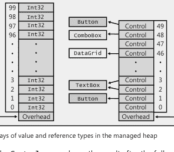

**图 16-1** 托管堆中的值类型数组和引用类型数组

图中，**Controls** 数组显示了执行以下代码行后的结果：

```csharp
myControls[1] = new Button();
myControls[2] = new TextBox();
myControls[3] = myControls[2]; // Two elements refer to the same object.
myControls[46] = new DataGrid();
myControls[48] = new ComboBox();
myControls[49] = new Button();
```

公共语言规范 (CLS) 符合性要求所有数组都从零开始。这允许用 C# 编写的方法创建数组，并将该数组的引用传递给用另一种语言（例如 Microsoft Visual Basic .NET）编写的代码。此外，由于从零开始的数组是迄今为止最常见的数组，Microsoft 花了很多时间优化其性能。不过，CLR 确实支持非零基数组，尽管不鼓励使用它们。对于那些不在意轻微性能损失或跨语言可移植性的人，我将在本章后面演示如何创建和使用非零基数组。

请注意，在图 16-1 中，每个数组都关联了一些额外开销信息。这些信息包含数组的秩（维数）、数组每个维度的下界（几乎总是 0）以及每个维度的长度。

## 初始化数组元素

上一节中，我展示了如何创建数组对象，然后展示了如何初始化数组的元素。C# 提供了允许在一条语句中完成这两个操作的语法。例如：

```csharp
String[] names = new String[] { "Aidan", "Grant" };
```

大括号内以逗号分隔的标记集称为*数组初始值设定项*。每个标记可以是任意复杂的表达式，或者对于多维数组，可以是嵌套的数组初始值设定项。在上面的示例中，我只用了两个简单的 **String** 表达式。

如果你在方法中声明一个局部变量来引用已初始化的数组，那么可以使用 C# 的隐式类型化局部变量 (var) 功能来稍微简化代码：

```csharp
// Using C#'s implicitly typed local variable feature:
var names = new String[] { "Aidan", "Grant" };
```

这里，编译器推断 **names** 局部变量应为 **String[]** 类型，因为这是赋值运算符 (=) 右侧表达式的类型。

你可以使用 C# 的隐式类型化数组功能，让编译器推断数组元素的类型。请注意，下面这一行在 **new** 和 **[]** 之间没有指定类型：

```csharp
// Using C#'s implicitly typed local variable and implicitly typed array features:
var names = new[] { "Aidan", "Grant", null };
```

在上面的代码行中，编译器检查数组中用于初始化数组元素的表达式类型，并选择所有元素共有的最接近基类来确定数组的类型。在此示例中，编译器看到两个 **Strings** 和 **null**。由于 **null** 可隐式转换为任何引用类型（包括 **String**），编译器推断它应创建并初始化一个 **String** 引用数组。

如果你有下面这段代码，

```csharp
// Using C#'s implicitly typed local variable & implicitly typed array features: (error)
var names = new[] { "Aidan", "Grant", 123 };
```

编译器将发出消息“**错误 CS0826: 未找到隐式类型化数组的最佳类型。**”。这是因为两个 **Strings** 和 **Int32** 的公共基类型是 **Object**，这意味着编译器将不得不创建一个 **Object** 引用数组，然后对 **123** 进行装箱，并让最后一个数组元素引用一个值为 123 的已装箱 **Int32**。C# 编译器团队认为，对数组元素进行装箱对编译器来说过于沉重，不适合隐式替你完成，这就是编译器发出该错误的原因。

作为初始化数组时额外的语法便利，你可以编写以下代码：

```csharp
String[] names = { "Aidan", "Grant" };
```

请注意，在赋值运算符 (=) 的右侧，只给出了数组初始值设定项表达式，没有 new、没有类型，也没有 []。这种语法很好，但不幸的是，C# 编译器不允许将隐式类型化局部变量与这种语法一起使用：

```csharp
// This is a local variable now (error)
var names = { "Aidan", "Grant" };
```

如果你尝试编译上面这行代码，编译器会发出两条消息：“错误 CS0820: 无法使用数组初始值设定项初始化隐式类型化局部变量”和“错误 CS0622: 仅使用数组初始值设定项表达式赋值给数组类型。请尝试改用 new 表达式。”虽然编译器可以让这种写法工作，但 C# 团队认为编译器在这里为你做得太多了。它将推断数组的类型、新建数组、初始化数组，还要推断局部变量的类型。

我想向你展示的最后一件事是如何将隐式类型化数组与匿名类型和隐式类型化局部变量一起使用。第 10 章“属性”讨论了匿名类型以及类型标识如何应用于它们。请查看以下代码：

```csharp
// Using C#'s implicitly typed local, implicitly typed array, and anonymous type features:
var kids = new[] { new { Name="Aidan" }, new { Name="Grant" } };

// Sample usage (with another implicitly typed local variable):
foreach (var kid in kids)
    Console.WriteLine(kid.Name);
```

在此示例中，我使用一个数组初始值设定项，其中有两个用于数组元素的表达式。每个表达式都表示一个匿名类型（因为在 new 运算符之后没有指定类型名）。由于这两个匿名类型具有相同的结构（一个名为 Name 的 String 类型字段），编译器知道这两个对象属于完全相同的类型。现在，我使用 C# 的隐式类型化数组功能（在 new 和 [] 之间不指定类型），以便编译器推断数组本身的类型、构造这个数组对象，并将其引用初始化为指向同一个匿名类型的两个实例。最后，对这个数组对象的引用被赋给 kids 局部变量，由于 C# 的隐式类型化局部变量功能，其类型由编译器推断。

我展示了 foreach 循环，作为如何使用这个刚创建并用两个匿名类型对象初始化的数组的示例。循环也必须使用隐式类型化局部变量 (kid)。运行此代码时，我得到以下输出：

```
Aidan
Grant
```

- 将引用类型元素拆箱为值类型元素，例如将 **Object[]** 复制到 **Int32[]**。
- 扩大 CLR 基元值类型，例如将元素从 **Int32[]** 复制到 **Double[]**。
- 在无法根据数组类型证明兼容的数组类型之间复制时向下转换元素，例如从 **Object[]** 强制转换为 **IFormattable[]**。如果 **Object[]** 中的每个对象都实现 **IFormattable[]**，则 **Copy** 将成功。

下面是另一个展示 **Copy** 有用性的示例：

```csharp
// Define a value type that implements an interface.
internal struct MyValueType : IComparable {
    public Int32 CompareTo(Object obj) {
        ...
    }
}

public static class Program {
    public static void Main() {
        // Create an array of 100 value types.
        MyValueType[] src = new MyValueType[100];

        // Create an array of IComparable references.
        IComparable[] dest = new IComparable[src.Length];

        // Initialize an array of IComparable elements to refer to boxed
        // versions of elements in the source array.
        Array.Copy(src, dest, src.Length);
    }
}
```

正如你可能想象的那样，框架类库 (FCL) 相当频繁地利用 **Array 的 Copy** 方法。

在某些情况下，将数组从一种类型强制转换为另一种类型很有用。这种功能称为*数组协变*。当你利用数组协变时，应注意相关的性能损失。假设你有以下代码：

```csharp
String[] sa = new String[100];
Object[] oa = sa;            // oa refers to an array of String elements
oa[5] = "Jeff";              // Perf hit: CLR checks oa's element type for String: OK
oa[3] = 5;                   // Perf hit: CLR checks oa's element type for Int32; throws
                             // ArrayTypeMismatchException
```

在上面的代码中，**oa** 变量的类型为 **Object[]**；然而，它实际引用的是 **String[]**。编译器将允许你编写尝试将 5 放入数组元素的代码，因为 5 是 **Int32**，而 **Int32** 派生自 **Object**。当然，CLR 必须

确保类型安全，并且在给数组元素赋值时，CLR 必须确保该赋值是合法的。因此，CLR 必须在运行时检查数组是否包含 `Int32` 元素。在这个例子中，数组不包含 `Int32` 元素，因此不能允许该赋值；CLR 将抛出 `ArrayTypeMismatchException`。

> **注意**
>
> 如果你只需要将某些数组元素复制到另一个数组，`System.Buffer` 的 **BlockCopy** 方法比 `Array` 的 **Copy** 方法执行得更快。但是，**Buffer** 的 **BlockCopy** 仅支持基元类型；它不提供 **Array** 的 **Copy** 方法那样的类型转换能力。**Int32** 参数表示为数组内的字节偏移量，而不是元素索引。**BlockCopy** 实际上是为将按位兼容的数据从一种数组类型复制到另一种按位兼容的数组类型而设计的，例如将包含 Unicode 字符的 `Byte[]`（按正确字节顺序）复制到 `Char[]`。此方法使程序员能够部分弥补无法将数组视为任意类型内存块的不足。
>
> 如果你需要可靠地将一组数组元素从一个数组复制到另一个数组，则应使用 `System.Array` 的 **ConstrainedCopy** 方法。此方法保证复制操作要么完成，要么抛出异常，而不会破坏目标数组中的任何数据。这使得 **ConstrainedCopy** 可用于受约束执行区域（CER）。为了提供此保证，**ConstrainedCopy** 要求源数组的元素类型与目标数组的元素类型相同或是其派生类型。此外，它不会执行任何装箱、拆箱或向下转换。

## 所有数组都隐式派生自 System.Array

当你像这样声明一个数组变量时，

```csharp
FileStream[] fsArray;
```

CLR 会自动为 AppDomain 创建一个 `FileStream[]` 类型。此类型将隐式派生自 `System.Array` 类型，因此，在 `System.Array` 类型上定义的所有实例方法和属性都将由 `FileStream[]` 类型继承，从而允许使用 `fsArray` 变量调用这些方法和属性。这使得数组的使用极其方便，因为 `System.Array` 定义了许多有用的实例方法和属性，例如 `Clone`、`CopyTo`、`GetLength`、`GetLongLength`、`GetLowerBound`、`GetUpperBound`、`Length`、`Rank` 等。

`System.Array` 类型还公开了大量极其有用的、用于操作数组的静态方法。这些方法都以数组的引用作为参数。一些有用的静态方法包括 `AsReadOnly`、`BinarySearch`、`Clear`、`ConstrainedCopy`、`ConvertAll`、`Copy`、`Exists`、`Find`、`FindAll`、`FindIndex`、`FindLast`、`FindLastIndex`、`ForEach`、`IndexOf`、`LastIndexOf`、`Resize`、`Reverse`、`Sort` 和 `TrueForAll`。这些方法中的每一个都有许多重载。事实上，许多方法都提供了泛型重载，以实现编译时类型安全以及良好的性能。我鼓励你查阅 SDK 文档，以了解这些方法有多么有用和强大。

## 所有数组都隐式实现 IEnumerable、ICollection 和 IList

有许多方法可操作各种集合对象，因为这些方法声明的参数类型为 `IEnumerable`、`ICollection` 和 `IList`。可以将数组传递给这些方法，因为 `System.Array` 也实现了这三个接口。`System.Array` 实现这些非泛型接口，是因为它们将所有元素都视为 `System.Object`。然而，如果 `System.Array` 能实现这些接口的泛型等效接口，从而提供更好的编译时类型安全和更好的性能，那将很不错。

不过，CLR 团队不希望 `System.Array` 实现 `IEnumerable<T>`、`ICollection<T>` 和 `IList<T>`，因为存在与多维数组和非零基数组相关的问题。在 `System.Array` 上定义这些接口会使所有数组类型都启用这些接口。相反，CLR 采用了一个小技巧：当创建单维、零下限的数组类型时，CLR 会自动使该数组类型实现 `IEnumerable<T>`、`ICollection<T>` 和 `IList<T>`（其中 T 是该数组的元素类型），并且只要数组类型的所有基类型是引用类型，就也会为这些基类型实现这三个接口。下面的层次结构图有助于说明这一点：

```text
Object
    Array (non-generic IEnumerable, ICollection, IList)
        Object[]        (IEnumerable, ICollection, IList of Object)
            String[]    (IEnumerable, ICollection, IList of String)
                Stream[]    (IEnumerable, ICollection, IList of Stream)
                    FileStream[] (IEnumerable, ICollection, IList of FileStream)
        .
        .
        .        (other arrays of reference types)
        .
```

因此，例如，如果你有以下代码行，

```csharp
FileStream[] fsArray;
```

那么当 CLR 创建 `FileStream[]` 类型时，它将使该类型自动实现 `IEnumerable<FileStream>`、`ICollection<FileStream>` 和 `IList<FileStream>` 接口。此外，`FileStream[]` 类型还将为其基类型实现这些接口：`IEnumerable<Stream>`、`IEnumerable<Object>`、`ICollection<Stream>`、`ICollection<Object>`、`IList<Stream>` 和 `IList<Object>`。由于所有这些接口都由 CLR 自动实现，因此凡是需要这些接口的地方都可以使用 `fsArray` 变量。例如，可以将 `fsArray` 变量传递给具有以下任一原型的方法：

```csharp
void M1(IList<FileStream> fsList) { ... }
void M2(ICollection<Stream> sCollection) { ... }
void M3(IEnumerable<Object> oEnumerable) { ... }
```

请注意，如果数组包含值类型元素，则该数组类型不会为元素的基类型实现这些接口。例如，如果你有以下代码行，

```
DateTime[] dtArr; // An array of value types
```

那么 `DateTime[]` 类型将仅实现 `IEnumerable<DateTime>`、`ICollection<DateTime>` 和 `IList<DateTime>`；它不会实现针对 `System.ValueType` 或 `System.Object` 泛型化的这些接口版本。这意味着不能将 `dtArr` 变量作为参数传递给前面展示的 `M3` 方法。原因在于值类型数组在内存中的布局与引用类型数组不同。本章前面已讨论过数组的内存布局。

## 传递和返回数组

当将数组作为参数传递给方法时，你实际上传递的是对该数组的引用。因此，被调用的方法能够修改数组中的元素。如果你不想允许这样做，就必须创建该数组的副本，并将副本传入方法。请注意，`Array.Copy` 方法执行的是浅复制，因此，如果数组的元素是引用类型，则新数组引用的是已经存在的对象。

类似地，有些方法会返回对数组的引用。如果该方法构造并初始化了数组，那么返回对该数组的引用没有问题。但是，如果该方法想要返回对由字段维护的内部数组的引用，则必须决定是否希望方法的调用者可以直接访问此数组及其元素。如果希望如此，只需返回该数组的引用。但大多数情况下，你不会希望方法的调用者拥有这种访问权限，因此该方法应构造一个新数组并调用 `Array.Copy`，返回对新数组的引用。再次提醒，`Array.Copy` 对原始数组进行的是浅复制。

如果你定义的方法返回对数组的引用，并且该数组中没有元素，那么你的方法可以返回 `null`，也可以返回对包含零个元素的数组的引用。在实现这类方法时，Microsoft 强烈建议让方法返回零长度数组，因为这样做可以简化调用该方法的开发者必须编写的代码。例如，即使没有要遍历的预约，下面这段易于理解的代码也能正确运行：

```
// This code is easier to write and understand.
Appointment[] appointments = GetAppointmentsForToday();
for (Int32 a = 0; a < appointments.Length; a++) {
    ...
}
```

如果没有要遍历的预约，下面的代码也能正确运行。但是，这段代码编写和理解起来稍微困难一些：

```csharp
// This code is harder to write and understand.
Appointment[] appointments = GetAppointmentsForToday();
if (appointments != null) {
    for (Int32 a = 0; a < appointments.Length; a++) {
        // Do something with appointments[a]
    }
}
```

如果你设计方法返回包含零个元素的数组而不是 `null`，那么方法的调用方在使用这些数组时会更加轻松。顺便提一下，对字段也应这样做。如果你的类型有一个引用数组的字段，那么即使该数组没有任何元素，你也应考虑让该字段引用一个数组。

## 创建非零下限数组

前面我提到过，可以创建并操作具有非零下限的数组。你可以通过调用 `Array` 的静态 `CreateInstance` 方法来动态创建自己的数组。此方法有多个重载，允许你指定数组中元素的类型、数组的维数、每一维的下限以及每一维中的元素数量。`CreateInstance` 为数组分配内存，将参数信息保存在数组内存块的开销部分，并返回对该数组的引用。如果数组有两个或更多维，你可以将从 `CreateInstance` 返回的引用强制转换为 `ElementType[]` 变量（其中 `ElementType` 是某个类型名），从而更轻松地访问数组中的元素。如果数组只有一维，那么在 C# 中，你必须使用 `Array` 的 `GetValue` 和 `SetValue` 方法来访问数组的元素。

下面的代码演示如何动态创建 `System.Decimal` 值的二维数组。第一维表示 2005 年至 2009 年（含）的日历年份，第二维表示第 1 至第 4 季度（含）。代码会遍历动态数组中的所有元素。我本可以将数组的边界硬编码到代码中，这样性能会更好，但我决定使用 `System.Array` 的 `GetLowerBound` 和 `GetUpperBound` 方法来演示它们的用法：

```csharp
using System;

public static class DynamicArrays {
    public static void Main() {
        // I want a two-dimensional array [2005..2009][1..4].
        Int32[] lowerBounds = { 2005, 1 };
        Int32[] lengths     = {    5, 4 };
        Decimal[,] quarterlyRevenue = (Decimal[,])
            Array.CreateInstance(typeof(Decimal), lengths, lowerBounds);

        Console.WriteLine("{0,4} {1,9} {2,9} {3,9} {4,9}",
            "Year", "Q1", "Q2", "Q3", "Q4");
        Int32 firstYear     = quarterlyRevenue.GetLowerBound(0);
        Int32 lastYear      = quarterlyRevenue.GetUpperBound(0);
        Int32 firstQuarter  = quarterlyRevenue.GetLowerBound(1);
        Int32 lastQuarter   = quarterlyRevenue.GetUpperBound(1);

        for (Int32 year = firstYear; year <= lastYear; year++) {
            Console.Write(year + " ");
            for (Int32 quarter = firstQuarter; quarter <= lastQuarter; quarter++) {
                Console.Write("{0,9:C} ", quarterlyRevenue[year, quarter]);
            }
            Console.WriteLine();
        }
    }
}
```

如果编译并运行此代码，你会得到以下输出：

| 年份 | 第1季度 | 第2季度 | 第3季度 | 第4季度 |
|---|---|---|---|---|
| 2005 | $0.00 | $0.00 | $0.00 | $0.00 |
| 2006 | $0.00 | $0.00 | $0.00 | $0.00 |
| 2007 | $0.00 | $0.00 | $0.00 | $0.00 |
| 2008 | $0.00 | $0.00 | $0.00 | $0.00 |
| 2009 | $0.00 | $0.00 | $0.00 | $0.00 |

## 数组访问性能

在内部，CLR 实际上支持两种不同类型的数组：

-   下限为 0 的单维数组。这类数组有时称为 SZ（单维零基）数组或向量。
-   下限未知的单维数组和多维数组。

实际上，通过执行以下代码，你可以看到这些不同类型的数组（输出显示在代码的注释中）：

```csharp
using System;

public sealed class Program {
    public static void Main() {
        Array a;

        // Create a 1-dim, 0-based array, with no elements in it
        a = new String[0];
        Console.WriteLine(a.GetType());   // "System.String[]"

        // Create a 1-dim, 0-based array, with no elements in it
        a = Array.CreateInstance(typeof(String),
            new Int32[] { 0 }, new Int32[] { 0 });
        Console.WriteLine(a.GetType());   // "System.String[]"

        // Create a 1-dim, 1-based array, with no elements in it
        a = Array.CreateInstance(typeof(String),
            new Int32[] { 0 }, new Int32[] { 1 });
        Console.WriteLine(a.GetType());  // "System.String[*]"  <-- INTERESTING!

        Console.WriteLine();

        // Create a 2-dim, 0-based array, with no elements in it
        a = new String[0, 0];
        Console.WriteLine(a.GetType());  // "System.String[,]"

        // Create a 2-dim, 0-based array, with no elements in it
        a = Array.CreateInstance(typeof(String),
            new Int32[] { 0, 0 }, new Int32[] { 0, 0 });
        Console.WriteLine(a.GetType());  // "System.String[,]"

        // Create a 2-dim, 1-based array, with no elements in it
        a = Array.CreateInstance(typeof(String),
            new Int32[] { 0, 0 }, new Int32[] { 1, 1 });
        Console.WriteLine(a.GetType());  // "System.String[,]"
    }
}
```

每个 `Console.WriteLine` 旁边都有一个指示输出的注释。对于单维数组，零基数组显示的类型名为 `System.String[]`，而 1 基数组显示的类型名为 `System.String[*]`。`*` 表示 CLR 知道此数组不是零基数组。请注意，C# 不允许你声明 `String[*]` 类型的变量，因此无法使用 C# 语法访问单维非零基数组。尽管你可以调用 `Array` 的 `GetValue` 和 `SetValue` 方法来访问数组的元素，但由于方法调用的开销，这种访问会很慢。

对于多维数组，零基数组和 1 基数组都显示相同的类型名：`System.String[,]`。CLR 在运行时将所有多维数组都视为非零基数组。这可能会让你认为类型名应显示为 `System.String[*,*]`；然而，CLR 不会在多维数组中使用星号，因为它们将始终存在，而这些星号只会让大多数开发者感到困惑。

访问单维零基数组的元素比访问非零基单维数组或多维数组的元素稍快。原因有几点。首先，有一些特定的 IL 指令（例如 `newarr`、`ldelem`、`ldelema`、`ldlen` 和 `stelem`）用于操作单维零基数组，而这些特殊 IL 指令会使 JIT 编译器生成优化后的代码。例如，JIT 编译器会生成假定数组为零基的代码，这意味着访问元素时不必从指定索引中减去偏移量。其次，在常见情况下，JIT 编译器能够将索引范围检查代码提升到循环外，使其只执行一次。例如，看看下面这段常见写法的代码：

```csharp
using System;

public static class Program {
    public static void Main() {
        Int32[] a = new Int32[5];
        for (Int32 index = 0; index < a.Length; index++) {
            // Do something with a[index]
        }
    }
}
```

关于这段代码，首先要注意的是 for 循环测试表达式中对数组的 Length 属性的调用。由于 Length 是属性，查询长度实际上代表一次方法调用。然而，JIT 编译器知道 Length 是 Array 类上的属性，并且 JIT 编译器实际上会生成代码，只调用该属性一次，并将结果存储在临时变量中，在循环的每次迭代中检查该变量。结果是 JIT 编译后的代码很快。事实上，一些开发者低估了 JIT 编译器的能力，并试图编写“取巧代码”来帮助 JIT 编译器。然而，你提出的任何取巧尝试几乎肯定会对性能产生负面影响，并使代码更难阅读，从而降低其可维护性。最好在上面的代码中保留对数组的 Length 属性的调用，而不是自己尝试将其缓存到局部变量中。

关于上面的代码，第二点要注意的是，JIT 编译器知道 for 循环正在访问数组元素 0 到 Length - 1。因此，JIT 编译器生成的代码会在运行时检查所有数组访问是否都在数组的有效范围内。具体来说，JIT 编译器生成代码来检查 if (0 >= a.GetLowerBound(0)) && ((Length - 1) <= a.GetUpperBound(0))。此检查就在循环之前进行。如果检查通过，JIT 编译器不会在循环内生成代码来验证每次数组访问是否都在有效范围内。这使得循环内的数组访问非常快。

不幸的是，正如本章前面所暗示的，访问非零基单维数组或多维数组的元素比访问单维零基数组慢得多。对于这些数组类型，JIT 编译器不会将索引检查提升到循环外，因此每次数组访问都会验证指定的索引。此外，JIT 编译器会添加代码，从指定索引中减去数组的下限，这也会降低代码速度，即使你使用的是碰巧为零基的多维数组。

因此，如果性能是你关注的问题，你可能应考虑使用数组的数组（交错数组）而不是矩形数组。C# 和 CLR 还允许你使用不安全（不可验证）代码访问数组，这实际上是一种在访问数组时关闭索引边界检查的技术。请注意，这种不安全的数组操作技术可用于元素类型为 SByte、Byte、Int16、UInt16、Int32、UInt32、Int64、UInt64、Char、Single、Double、Decimal、Boolean、枚举类型，或字段为上述任一类型的值类型结构的数组。


这是一个非常强大的特性，使用时必须格外谨慎，因为它允许你直接访问内存。如果这些内存访问超出了数组的边界，不会抛出异常；相反，你会破坏内存、违反类型安全，甚至可能打开安全漏洞！因此，包含不安全代码的程序集必须被授予完全信任，或者至少启用“跳过验证”的安全权限。

下面的 C# 代码演示了访问二维数组的三种技术（安全、交错和不安全）：

```csharp
using System;
using System.Diagnostics;

public static class Program {
    private const Int32 c_numElements = 10000;

    public static void Main() {
        const Int32 testCount = 10;
        Stopwatch sw;

        // Declare a two-dimensional array
        Int32[,] a2Dim = new Int32[c_numElements, c_numElements];

        // Declare a two-dimensional array as a jagged array (a vector of vectors)
        Int32[][] aJagged = new Int32[c_numElements][];
        for (Int32 x = 0; x < c_numElements; x++)
            aJagged[x] = new Int32[c_numElements];

        // 1: Access all elements of the array using the usual, safe technique
        sw = Stopwatch.StartNew();
        for (Int32 test = 0; test < testCount; test++)
            Safe2DimArrayAccess(a2Dim);
        Console.WriteLine("{0}: Safe2DimArrayAccess", sw.Elapsed);

        // 2: Access all elements of the array using the jagged array technique
        sw = Stopwatch.StartNew();
        for (Int32 test = 0; test < testCount; test++)
            SafeJaggedArrayAccess(aJagged);
        Console.WriteLine("{0}: SafeJaggedArrayAccess", sw.Elapsed);

        // 3: Access all elements of the array using the unsafe technique
        sw = Stopwatch.StartNew();
        for (Int32 test = 0; test < testCount; test++)
            Unsafe2DimArrayAccess(a2Dim);
        Console.WriteLine("{0}: Unsafe2DimArrayAccess", sw.Elapsed);
        Console.ReadLine();
    }

    private static Int32 Safe2DimArrayAccess(Int32[,] a) {
        Int32 sum = 0;
        for (Int32 x = 0; x < c_numElements; x++) {
            for (Int32 y = 0; y < c_numElements; y++) {
                sum += a[x, y];
            }
        }
        return sum;
    }

    private static Int32 SafeJaggedArrayAccess(Int32[][] a) {
        Int32 sum = 0;
        for (Int32 x = 0; x < c_numElements; x++) {
            for (Int32 y = 0; y < c_numElements; y++) {
                sum += a[x][y];
            }
        }
        return sum;
    }

    private static unsafe Int32 Unsafe2DimArrayAccess(Int32[,] a) {
        Int32 sum = 0;
        fixed (Int32* pi = a) {
            for (Int32 x = 0; x < c_numElements; x++) {
                Int32 baseOfDim = x * c_numElements;
                for (Int32 y = 0; y < c_numElements; y++) {
                    sum += pi[baseOfDim + y];
                }
            }
        }
        return sum;
    }
}
```

**Unsafe2DimArrayAccess** 方法使用 **unsafe** 修饰符标记，这是使用 C# 的 **fixed** 语句所必需的。要编译这段代码，你必须在调用 C# 编译器时指定 **/unsafe** 开关，或者在 Microsoft Visual Studio 的“项目属性”窗格的“生成”选项卡中勾选“**允许不安全代码**”复选框。

当我在我的机器上运行此程序时，我得到以下输出：

```
00:00:02.0017692: Safe2DimArrayAccess
00:00:01.5197844: SafeJaggedArrayAccess
00:00:01.7343436: Unsafe2DimArrayAccess
```

如你所见，安全访问二维数组的技术是最慢的。安全访问交错数组的技术完成时间比安全访问二维数组的技术稍短一些。不过，你应该注意，创建交错数组比创建多维数组更耗时，因为创建交错数组需要为每个维度在堆上分配一个对象，这会导致垃圾回收器定期介入。因此，这里需要权衡。如果你需要创建大量“多维数组”，并且打算不频繁地访问元素，那么创建多维数组会更快。如果你只需要创建一次“多维数组”，并频繁访问其元素，那么交错数组会带来更好的性能。当然，在大多数应用程序中，后一种场景更为常见。

```csharp
using System;

public static class Program {
    public static void Main() {
        StackallocDemo();
        InlineArrayDemo();
    }

    private static void StackallocDemo() {
        unsafe {
            const Int32 width = 20;
            Char* pc = stackalloc Char[width]; // Allocates array on stack

            String s = "Jeffrey Richter";    // 15 characters

            for (Int32 index = 0; index < width; index++) {
                pc[width - index - 1] =
                    (index < s.Length) ? s[index] : '.';
            }

            // The line below displays "....................rethciR yerffeJ"
            Console.WriteLine(new String(pc, 0, width));
        }
    }

    private static void InlineArrayDemo() {
        unsafe {
            CharArray ca;                           // Allocates array on stack
            Int32 widthInBytes = sizeof(CharArray);
            Int32 width = widthInBytes / 2;

            String s = "Jeffrey Richter"; // 15 characters

            for (Int32 index = 0; index < width; index++) {
                ca.Characters[width - index - 1] =
                    (index < s.Length) ? s[index] : '.';
            }

            // The line below displays "....................rethciR yerffeJ"
            Console.WriteLine(new String(ca.Characters, 0, width));
        }
    }
}

internal unsafe struct CharArray {
    // This array is embedded inline inside the structure
    public fixed Char Characters[20];
}
```

通常，由于数组是引用类型，结构中定义的数组字段实际上只是一个指向数组的指针或引用；数组本身位于结构的内存之外。然而，可以像前面代码中的 CharArray 结构那样，将数组直接嵌入到结构内部。要将数组直接嵌入到结构内部，有几个要求：

- 类型必须是结构（值类型）；不能将数组嵌入到类（引用类型）中。
- 字段或其定义结构必须使用 **unsafe** 关键字标记。
- 数组字段必须使用 **fixed** 关键字标记。
- 数组必须是一维且从零开始。
- 数组的元素类型必须是以下类型之一：**Boolean、Char、SByte、Byte、Int32、UInt32、Int64、UInt64、Single** 或 **Double**。

内联数组通常用于与非托管代码互操作的场景，其中非托管数据结构也含有内联数组。不过，内联数组也可以用于其他场景。前面代码中的 **InlineArrayDemo** 方法提供了一个使用内联数组的示例。**InlineArrayDemo** 方法执行与 **StackallocDemo** 方法相同的功能；只是实现方式不同。

# 第17章 委托

**本章内容：**

- 初识委托 ................................................ 405
- 使用委托回调静态方法 ............................... 408
- 使用委托回调实例方法 ............................ 409
- 揭开委托的神秘面纱 ................................................... 410
- 使用委托回调多个方法（链式） ..................... 415
- 委托定义已经够多了（泛型委托） ........ 422
- C# 针对委托的语法糖 .................................... 423
- 委托与反射 ................................................. 431

本章讨论回调函数。回调函数是一种极其有用的编程机制，已经存在多年。Microsoft .NET Framework 通过委托公开了回调函数机制。与其他平台使用的回调机制（例如非托管 C++）不同，委托提供了更多的功能。例如，委托确保回调方法是类型安全的，这与公共语言运行时（CLR）最重要的目标之一保持一致。委托还整合了顺序调用多个方法的能力，并支持调用静态方法和实例方法。

## 初识委托

C 运行时的 qsort 函数接受一个指向回调函数的指针，用于对数组中的元素进行排序。在 Microsoft Windows 中，窗口过程、挂钩过程、异步过程调用等都需要回调函数。在 .NET Framework 中，回调方法用于各种各样的事情。例如，您可以注册回调方法以获取各种通知，例如未处理的异常、窗口状态更改、菜单项选择、文件系统更改、窗体控件事件和异步操作完成。

在非托管 C/C++ 中，非成员函数的地址只是一个内存地址。这个地址不携带任何附加信息，例如函数期望的参数数量、这些参数的类型、函数的返回值类型以及函数的调用约定。简而言之，非托管的 C/C++ 回调函数不是类型安全的（尽管它们是一种非常轻量级的机制）。


在 .NET Framework 中，回调函数与在非托管 Windows 编程中一样有用且普遍。不过，.NET Framework 提供了一种称为委托（delegate）的类型安全机制。我将通过展示如何使用委托来开始对委托的讨论。下面的代码演示如何声明、创建和使用委托。

```csharp
using System;
using System.Windows.Forms;
using System.IO;

// Declare a delegate type; instances refer to a method that
// takes an Int32 parameter and returns void.
internal delegate void Feedback(Int32 value);

public sealed class Program {
    public static void Main() {
        StaticDelegateDemo();
        InstanceDelegateDemo();
        ChainDelegateDemo1(new Program());
        ChainDelegateDemo2(new Program());
    }

    private static void StaticDelegateDemo() {
        Console.WriteLine("----- Static Delegate Demo -----");
        Counter(1, 3, null);
        Counter(1, 3, new Feedback(Program.FeedbackToConsole));
        Counter(1, 3, new Feedback(FeedbackToMsgBox)); // "Program." is optional
        Console.WriteLine();
    }

    private static void InstanceDelegateDemo() {
        Console.WriteLine("----- Instance Delegate Demo -----");
        Program p = new Program();
        Counter(1, 3, new Feedback(p.FeedbackToFile));

        Console.WriteLine();
    }

    private static void ChainDelegateDemo1(Program p) {
        Console.WriteLine("----- Chain Delegate Demo 1 -----");
        Feedback fb1 = new Feedback(FeedbackToConsole);
        Feedback fb2 = new Feedback(FeedbackToMsgBox);
        Feedback fb3 = new Feedback(p.FeedbackToFile);

        Feedback fbChain = null;
        fbChain = (Feedback) Delegate.Combine(fbChain, fb1);
        fbChain = (Feedback) Delegate.Combine(fbChain, fb2);
        fbChain = (Feedback) Delegate.Combine(fbChain, fb3);
        Counter(1, 2, fbChain);

        Console.WriteLine();
        fbChain = (Feedback)
            Delegate.Remove(fbChain, new Feedback(FeedbackToMsgBox));
        Counter(1, 2, fbChain);
    }

    private static void ChainDelegateDemo2(Program p) {
        Console.WriteLine("---- Chain Delegate Demo 2 ----");
        Feedback fb1 = new Feedback(FeedbackToConsole);
        Feedback fb2 = new Feedback(FeedbackToMsgBox);
        Feedback fb3 = new Feedback(p.FeedbackToFile);

        Feedback fbChain = null;
        fbChain += fb1;
        fbChain += fb2;
        fbChain += fb3;
        Counter(1, 2, fbChain);

        Console.WriteLine();
        fbChain -= new Feedback(FeedbackToMsgBox);
        Counter(1, 2, fbChain);
    }

    private static void Counter(Int32 from, Int32 to, Feedback fb) {
        for (Int32 val = from; val <= to; val++) {
            // If any callbacks are specified, call them
            if (fb != null)
                fb(val);
        }
    }

    private static void FeedbackToConsole(Int32 value) {
        Console.WriteLine("Item=" + value);
    }

    private static void FeedbackToMsgBox(Int32 value) {
        MessageBox.Show("Item=" + value);
    }

    private void FeedbackToFile(Int32 value) {
        StreamWriter sw = new StreamWriter("Status", true);
        sw.WriteLine("Item=" + value);
        sw.Close();
    }
}
```

现在我来描述这段代码在做什么。在顶部，注意内部委托 **Feedback** 的声明。委托指示回调方法的签名。在此示例中，**Feedback** 委托标识一个接受一个参数（**Int32**）并返回 **void** 的方法。在某种程度上，委托非常像非托管 C/C++ 中表示函数地址的 **typedef**。

**Program** 类定义了一个名为 **Counter** 的私有静态方法。此方法从 *from* 参数计数到 *to* 参数。**Counter** 方法还接受一个 *fb*，它是对 **Feedback** 委托对象的引用。**Counter** 遍历所有整数，并且对于每个整数，如果 *fb* 变量不为 null，则调用（由 *fb* 变量指定的）回调方法。这个回调方法会接收正在处理的项的值，即项号。回调方法可以设计和实现为以任何认为合适的方式处理每一项。

## 使用委托回调静态方法

既然你已理解 **Counter** 方法是如何设计的以及它如何工作，让我们看看如何使用委托回调静态方法。上一代码示例中出现的 **StaticDelegateDemo** 方法是本节的重点。

**StaticDelegateDemo** 方法调用 **Counter** 方法，在第三个参数中传递 **null**，该参数对应 **Counter** 的 **fb** 参数。因为 **Counter** 的 **fb** 参数接收到 **null**，所以每一项都在不调用任何回调方法的情况下处理。

接下来，**StaticDelegateDemo** 方法第二次调用 **Counter**，在方法调用的第三个参数中传递一个新构造的 **Feedback** 委托对象。这个委托对象是方法的包装器，允许通过该包装器间接调用方法。在此示例中，静态方法名 **Program.FeedbackToConsole** 被传递给 **Feedback** 类型的构造函数，指示它是要被包装的方法。从 **new** 运算符返回的引用作为第三个参数传递给 **Counter**。现在当 **Counter** 执行时，它会为序列中的每一项调用 **Program** 类型的静态 **FeedbackToConsole** 方法。**FeedbackToConsole** 只是向控制台写入一个字符串，指示正在处理的项。

> **注意** **FeedbackToConsole** 方法在 **Program** 类型内部定义为 **private**，但 **Counter** 方法能够调用 **Program** 的私有方法。在这种情况下，你可能不会预期有问题，因为 **Counter** 和 **FeedbackToConsole** 都定义在同一个类型中。不过，即使 **Counter** 方法定义在另一个类型中，这段代码也会正常工作。简而言之，只要委托对象是由具有足够安全/可访问性的代码创建的，一个类型拥有通过委托调用另一个类型私有成员的代码并不构成安全性或可访问性违规。

**StaticDelegateDemo** 方法中对 **Counter** 的第三次调用几乎与第二次调用相同。唯一的区别是 **Feedback** 委托对象包装了静态 **Program.FeedbackToMsgBox** 方法。**FeedbackToMsgBox** 生成一个指示正在处理的项的字符串。然后这个字符串显示在消息框中。

此示例中的所有内容都是类型安全的。例如，在构造 **Feedback** 委托对象时，编译器确保 **Program** 的 **FeedbackToConsole** 和 **FeedbackToMsgBox** 方法的签名与 **Feedback** 委托定义的签名兼容。具体来说，两个方法都必须接受一个参数（**Int32**），并且两个方法都必须具有相同的返回类型（**void**）。如果 **FeedbackToConsole** 被定义成这样：

```csharp
private static Boolean FeedbackToConsole(String value) {
    ...
}
```

C# 编译器将不会编译该代码，并会发出以下错误："**错误 CS0123: 没有与委托“Feedback”匹配的“FeedbackToConsole”重载。**"

当将方法绑定到委托时，C# 和 CLR 都允许引用类型的协变和逆变。协变意味着方法可以返回一个派生自委托返回类型的类型。逆变意味着方法可以接受一个作为委托参数类型的基类的参数。例如，给定一个这样定义的委托：

```csharp
delegate Object MyCallback(FileStream s);
```

就可以构造该委托类型的一个实例，将其绑定到具有如下原型的方法：

```csharp
String SomeMethod(Stream s);
```

这里，`SomeMethod` 的返回类型（`String`）是派生自委托返回类型（`Object`）的类型；这种协变是允许的。`SomeMethod` 的参数类型（`Stream`）是委托参数类型（`FileStream`）的基类类型；这种逆变是允许的。

请注意，协变和逆变仅支持引用类型，不支持值类型或 `void`。因此，例如，我不能将以下方法绑定到 `MyCallback` 委托：

```csharp
Int32 SomeOtherMethod(Stream s);
```

即使 `SomeOtherMethod` 的返回类型（`Int32`）派生自 `MyCallback` 的返回类型（`Object`），这种形式的协变也不允许，因为 `Int32` 是值类型。显然，值类型和 `void` 不能用于协变和逆变的原因是这些东西的内存结构会变化，而引用类型的内存结构始终是指针。幸运的是，如果你尝试做不受支持的事情，C# 编译器将产生错误。

## 使用委托回调实例方法

我刚刚解释了委托如何用于调用静态方法，但它们也可以用于调用特定对象的实例方法。要理解回调实例方法如何工作，请看本章开头所示代码中出现的 `InstanceDelegateDemo` 方法。

注意，在 `InstanceDelegateDemo` 方法中构造了一个名为 `p` 的 `Program` 对象。这个 `Program` 对象没有关联任何实例字段或属性；我创建它仅仅是为了演示目的。当在调用 `Counter` 方法时构造新的 `Feedback` 委托对象时，其构造函数会接收 `p.FeedbackToFile`。这使委托包装对 `FeedbackToFile` 方法的引用，而该方法是一个实例方法（不是静态方法）。当 `Counter` 调用由其 `fb` 参数标识的回调方法时，会调用 `FeedbackToFile` 实例方法，以及……的地址

最近构造的对象 `p` 将作为隐式 `this` 参数传递给实例方法。

`FeedbackToFile` 方法的工作方式与 `FeedbackToConsole` 和 `FeedbackToMsgBox` 方法相同，只不过它会打开一个文件，并将字符串追加到文件末尾。（该方法创建的 `Status` 文件可以在应用程序的 AppBase 目录中找到。）

本示例的目的同样是演示委托既可以包装对实例方法的调用，也可以包装对静态方法的调用。对于实例方法，委托需要知道该方法将要操作的对象实例。包装实例方法很有用，因为对象内部的代码可以访问该对象的实例成员。这意味着对象可以拥有一些状态，供回调方法执行处理时使用。

## 揭秘委托

从表面上看，委托似乎很容易使用：使用 C# 的 `delegate` 关键字定义委托，使用熟悉的 `new` 运算符构造委托实例，并使用熟悉的方法调用语法调用回调（只不过不是使用方法名，而是使用引用委托对象的变量）。

然而，实际发生的情况比前面示例所展示的要复杂得多。编译器和 CLR 会进行大量幕后处理来隐藏这种复杂性。在本节中，我将重点介绍编译器和 CLR 如何协同工作来实现委托。掌握这些知识将加深你对委托的理解，并教会你如何高效且有效地使用它们。我还会简要介绍委托提供的一些附加功能。

让我们从重新审视下面这行代码开始：

```csharp
internal delegate void Feedback(Int32 value);
```

当编译器看到这行代码时，实际上会定义一个完整的类，大致如下：

```csharp
internal class Feedback : System.MulticastDelegate {
    // Constructor
    public Feedback(Object object, IntPtr method);

    // Method with same prototype as specified by the source code
    public virtual void Invoke(Int32 value);

    // Methods allowing the callback to be called asynchronously
    public virtual IAsyncResult BeginInvoke(Int32 value,
        AsyncCallback callback, Object object);
    public virtual void EndInvoke(IAsyncResult result);
}
```

编译器定义的类有四个方法：构造函数、`Invoke`、`BeginInvoke` 和 `EndInvoke`。在本章中，我将重点介绍构造函数和 `Invoke` 方法。我将在第 27 章“I/O 密集型异步操作”的“APM 与计算密集型操作”一节中讨论 `BeginInvoke` 和 `EndInvoke` 方法。

事实上，你可以使用 `ILDasm.exe` 检查生成的程序集，从而验证编译器确实自动生成了这个类，如图 17-1 所示。

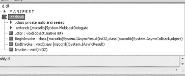

*图 17-1 ILDasm.exe 显示编译器为委托生成的元数据*

在此示例中，编译器定义了一个名为 `Feedback` 的类，它派生自框架类库（FCL）中定义的 `System.MulticastDelegate` 类型。（所有委托类型都派生自 `MulticastDelegate`。）

> **重要** `System.MulticastDelegate` 类派生自 `System.Delegate`，而 `System.Delegate` 本身又派生自 `System.Object`。存在两个委托类的原因既是历史遗留问题，也令人遗憾；FCL 中本应只有一个委托类。遗憾的是，你需要同时了解这两个类，因为尽管你创建的所有委托类型都以 `MulticastDelegate` 为基类，但你偶尔会使用 `Delegate` 类（而不是 `MulticastDelegate` 类）定义的方法来操作委托类型。例如，`Delegate` 类有名为 `Combine` 和 `Remove` 的静态方法。（稍后我会解释这些方法的作用。）这两个方法的签名都表明它们接受 `Delegate` 参数。由于你的委托类型派生自 `MulticastDelegate`，而 `MulticastDelegate` 又派生自 `Delegate`，因此你的委托类型的实例可以传递给这些方法。

该类具有私有可见性，因为委托在源代码中声明为 `internal`。如果源代码指示为 `public` 可见性，那么编译器生成的 `Feedback` 类也会是公共的。你应该知道，委托类型可以定义在某个类型内部（嵌套在另一个类型中），也可以定义在全局作用域中。基本上，由于委托是类，因此凡是可以定义类的地方，都可以定义委托。

由于所有委托类型都派生自 `MulticastDelegate`，因此它们继承 `MulticastDelegate` 的字段、属性和方法。在所有这些成员中，三个非公共字段可能最为重要。表 17-1 描述了这些重要字段。

### 

| 字段 | 类型 | 描述 |
|---|---|---|
| `_target` | `System.Object` | 当委托对象包装静态方法时，此字段为 `null`。当委托对象包装实例方法时，此字段引用调用回调方法时应操作的对象。换句话说，此字段指示应为实例方法的隐式 `this` 参数传递的值。 |
| `_methodPtr` | `System.IntPtr` | CLR 用来标识要回调的方法的内部整数。 |
| `_invocationList` | `System.Object` | 此字段通常为 `null`。在构建委托链（本章稍后讨论）时，它可以引用委托数组。 |

请注意，所有委托都有一个构造函数，它接受两个参数：一个对象引用和一个引用回调方法的整数。然而，如果你查看源代码，会发现我传入的是 `Program.FeedbackToConsole` 或 `p.FeedbackToFile` 之类的值。你学过的所有编程知识都会告诉你，这段代码本不应通过编译！

但是，C# 编译器知道正在构造委托，并会解析源代码以确定引用的是哪个对象和方法。对于构造函数的 `object` 参数，会传入对象的引用；对于 `method` 参数，会传入一个特殊的 `IntPtr` 值（该值从 `MethodDef` 或 `MemberRef` 元数据标记获得），用于标识方法。对于静态方法，`object` 参数传入 `null`。在构造函数内部，这两个参数分别保存到私有字段 `_target` 和 `_methodPtr` 中。此外，构造函数将 `_invocationList` 字段设置为 `null`。我将把关于 `_invocationList` 字段的讨论推迟到下一节“使用委托回调多个方法（链式调用）”。

因此，每个委托对象实际上都是对方法和调用该方法时要操作的对象的一层包装。因此，如果我有下面两行代码：

```csharp
Feedback fbStatic = new Feedback(Program.FeedbackToConsole);
Feedback fbInstance = new Feedback(new Program().FeedbackToFile);
```

那么 `fbStatic` 和 `fbInstance` 变量分别引用两个已初始化的独立 `Feedback` 委托对象，如图 17-2 所示。

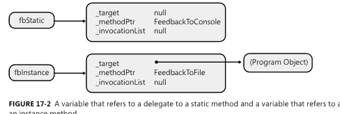

`Delegate` 类定义了两个只读公共实例属性：`Target` 和 `Method`。给定委托对象的引用，你可以查询这些属性。`Target` 属性返回一个对象引用，如果回调该方法，将对该对象进行操作。基本上，`Target` 属性返回私有字段 `_target` 中存储的值。如果委托对象包装的是静态方法，则 `Target` 返回 `null`。`Method` 属性返回一个 `System.Reflection.MethodInfo` 对象的引用，该对象标识回调方法。基本上，`Method` 属性有一种内部机制，可将私有字段 `_methodPtr` 中的值转换为 `MethodInfo` 对象并返回。

你可以通过多种方式使用这些信息。例如，可以检查委托对象是否引用特定类型的实例方法：

```csharp
Boolean DelegateRefersToInstanceMethodOfType(MulticastDelegate d, Type type) {
    return((d.Target != null) && d.Target.GetType() == type);
}
```

你也可以编写代码来检查回调方法是否具有特定名称（例如 `FeedbackToMsgBox`）：

```csharp
Boolean DelegateRefersToMethodOfName(MulticastDelegate d, String methodName) {
    return(d.Method.Name == methodName);
}
```

这些属性还有许多其他潜在用途。

既然你已经了解委托对象是如何构造的，以及它们的内部结构是什么样，那么我们来谈谈回调方法是如何被调用的。为方便起见，我在这里重复 `Counter` 方法的代码：

```csharp
private static void Counter(Int32 from, Int32 to, Feedback fb) {
    for (Int32 val = from; val <= to; val++) {
        // If any callbacks are specified, call them
        if (fb != null)
            fb(val);
    }
}
```


看注释正下方的那行代码。if 语句首先检查 fb 是否为非 null。如果 fb 不为 null，在下一行你会看到调用回调方法的代码。之所以需要这个 null 检查，是因为 fb 实际上只是一个可以引用 Feedback 委托对象的变量；它也可能为 null。看起来好像我在调用一个名为 fb 的函数并向它传递一个参数（val）。然而，并不存在名为 fb 的函数。同样，因为编译器知道 fb 是一个引用委托对象的变量，所以它会生成调用该委托对象 Invoke 方法的代码。换句话说，编译器看到的是：

```csharp
fb(val);
```

但编译器生成的代码就像源代码写的是：

```csharp
fb.Invoke(val);
```

你可以使用 ILDasm.exe 检查为 Counter 方法生成的中间语言（IL）代码，以验证编译器确实生成了调用委托类型 Invoke 方法的代码。下面是 Counter 方法的 IL。图中 IL_0009 处的指令表示对 Feedback 的 Invoke 方法的调用。

```il
.method private hidebysig static void  Counter(int32 from,
                                               int32 'to',
                                               class Feedback fb) cil managed
{
  // Code size       23 (0x17)
  .maxstack  2
  .locals init (int32 V_0)
  IL_0000:  ldarg.0
  IL_0001:  stloc.0
  IL_0002:  br.s       IL_0012
  IL_0004:  ldarg.2
  IL_0005:  brfalse.s  IL_000e
  IL_0007:  ldarg.2
  IL_0008:  ldloc.0
  IL_0009:  callvirt   instance void Feedback::Invoke(int32)
  IL_000e:  ldloc.0
  IL_000f:  ldc.i4.1
  IL_0010:  add
  IL_0011:  stloc.0
  IL_0012:  ldloc.0
  IL_0013:  ldarg.1
  IL_0014:  ble.s      IL_0004
  IL_0016:  ret
} // end of method Program::Counter
```

事实上，你可以修改 Counter 方法，让它显式调用 Invoke，如下所示：

```csharp
private static void Counter(Int32 from, Int32 to, Feedback fb) {
    for (Int32 val = from; val <= to; val++) {
        // If any callbacks are specified, call them
        if (fb != null)
            fb.Invoke(val);
    }
}
```

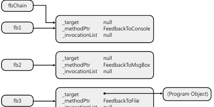

图 17-4 将第一个委托插入链后委托对象的状态

要向链中再添加一个委托，需要再次调用 **Combine** 方法：

```csharp
fbChain = (Feedback) Delegate.Combine(fbChain, fb2);
```

在内部，**Combine** 方法发现 `fbChain` 已经引用了一个委托对象，因此 **Combine** 会构造一个新的委托对象。这个新委托对象会将其私有字段 `_target` 和 `_methodPtr` 初始化为对本次讨论并不重要的值。然而，重要的是，`_invocationList` 字段会被初始化为引用一个委托对象数组。该数组的第一个元素（索引 0）将被初始化为引用包装 `FeedbackToConsole` 方法的委托（也就是 `fbChain` 当前引用的委托）。数组的第二个元素（索引 1）将被初始化为引用包装 `FeedbackToMsgBox` 方法的委托（也就是 `fb2` 引用的委托）。最后，`fbChain` 将被设置为引用新创建的委托对象，如图 17-5 所示。

要向链中添加第三个委托，需要再次调用 **Combine** 方法：

```csharp
fbChain = (Feedback) Delegate.Combine(fbChain, fb3);
```

同样，**Combine** 发现 `fbChain` 已经引用了一个委托对象，这会导致构造一个新的委托对象，如图 17-6 所示。和之前一样，这个新委托对象会将私有字段 `_target` 和 `_methodPtr` 初始化为对本次讨论不重要的值，并且 `_invocationList` 字段会被初始化为引用一个委托对象数组。该数组的第一个和第二个元素（索引 0 和 1）将被初始化为引用前一个委托对象在其数组中引用的相同委托。数组的第三个元素（索引 2）将被初始化为引用包装 `FeedbackToFile` 方法的委托（也就是 `fb3` 引用的委托）。最后，`fbChain` 将被设置为引用这个新创建的委托对象。注意，先前创建的委托及其 `_invocationList` 字段所引用的数组现在已成为垃圾回收的候选对象。

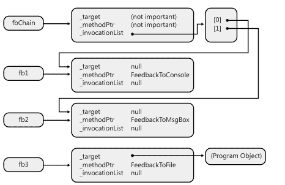

**图 17-5** 将第二个委托插入链后委托对象的状态

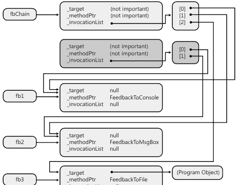

**图 17-6** 链完成时委托对象的最终状态

在设置链的所有代码执行完毕后，**fbChain** 变量随后被传递给 **Counter** 方法：

```csharp
Counter(1, 2, fbChain);
```

**Counter** 方法内部就是我在前面详细说明过的、隐式调用 **Feedback** 委托对象上 **Invoke** 方法的代码。当对 **fbChain** 引用的委托调用 **Invoke** 时，该委托会发现私有字段 **_invocationList** 不为 **null**，于是执行一个循环，遍历数组中的所有元素，并调用每个委托所包装的方法。在这个例子中，**FeedbackToConsole** 将最先被调用，然后是 **FeedbackToMsgBox**，接着是 **FeedbackToFile**。

**Feedback** 的 **Invoke** 方法本质上类似于下面这样实现（伪代码）：

```csharp
public void Invoke(Int32 value) {
    Delegate[] delegateSet = _invocationList as Delegate[];
    if (delegateSet != null) {
        // This delegate's array indicates the delegates that should be called
        foreach (Feedback d in delegateSet)
            d(value);   // Call each delegate
    } else {
        // This delegate identifies a single method to be called back
        // Call the callback method on the specified target object.
        _methodPtr.Invoke(_target, value);
        // The line above is an approximation of the actual code.
        // What really happens cannot be expressed in C#.
    }
}
```

注意，也可以通过调用 **Delegate** 的公共静态 **Remove** 方法从链中移除一个委托。**ChainDelegateDemo1** 方法接近末尾处演示了这一点：

```csharp
fbChain = (Feedback) Delegate.Remove(fbChain, new Feedback(FeedbackToMsgBox));
```

当调用 **Remove** 时，它会扫描第一个参数（在我的示例中是 **fbChain**）所引用委托对象内部维护的委托数组（从末尾向索引 0 方向扫描）。**Remove** 会查找一个委托条目，其 **_target** 和 **_methodPtr** 字段与第二个参数（在我的示例中是新的 **Feedback** 委托）中的相应字段匹配。如果找到匹配项，并且数组中只剩一个项，则返回该数组项。如果找到匹配项，并且数组中还剩多个项，则会构造一个新的委托对象——当然，会创建并初始化 **_invocationList** 数组，使其引用原数组中除被移除项之外的所有项——并返回对这个新委托对象的引用。如果要移除的是链中唯一的元素，**Remove** 会返回 **null**。注意，每次调用 **Remove** 只从链中移除一个委托；它不会移除所有 **_target** 和 **_methodPtr** 字段匹配的委托。

到目前为止，我展示的示例中，我的委托类型 **Feedback** 都定义为具有 **void** 返回值。不过，我也可以按如下方式定义我的 **Feedback** 委托：

```csharp
public delegate Int32 Feedback(Int32 value);
```

```csharp
public Int32 Invoke(Int32 value) {
    Int32 result;
    Delegate[] delegateSet = _invocationList as Delegate[];
    if (delegateSet != null) {
        // This delegate's array indicates the delegates that should be called
        foreach (Delegate d in delegateSet)
            result = d(value);  // Call each delegate
    } else {
        // This delegate identifies a single method to be called back
        // Call the callback method on the specified target object.
        result = _methodPtr.Invoke(_target, value);
        // The line above is an approximation of the actual code.
        // What really happens cannot be expressed in C#.
    }
    return result;
}
```

当数组中的每个委托被调用时，其返回值会保存到 result 变量中。循环完成后，`result` 变量将只包含最后调用的那个委托的结果（之前的返回值会被丢弃）；这个值会返回给调用 `Invoke` 的代码。

## C# 对委托链的支持

为了让 C# 开发人员更轻松，C# 编译器会自动为委托类型的实例提供 `+=` 和 `-=` 运算符的重载。这些运算符分别调用 `Delegate.Combine` 和 `Delegate.Remove`。使用这些运算符可以简化委托链的构建。本章开头所示源代码中的 `ChainDelegateDemo1` 和 `ChainDelegateDemo2` 方法会生成完全相同的 IL 代码。这两个方法的唯一区别在于，`ChainDelegateDemo2` 方法利用 C# 的 `+=` 和 `-=` 运算符简化了源代码。

如果你需要证明这两个方法生成的 IL 代码完全相同，可以构建代码，并使用 ILDasm.exe 查看这两个方法的 IL。这将确认 C# 编译器确实将所有 `+=` 和 `-=` 运算符分别替换为对 `Delegate` 类型的公共静态 `Combine` 和 `Remove` 方法的调用。

## 更好地控制委托链的调用

至此，你已经了解如何构建委托对象链，以及如何调用该链中的所有对象。链中的所有项都会被调用，因为委托类型的 `Invoke` 方法包含遍历数组中所有项并调用每一项的代码。这显然是一个非常简单的算法。尽管这个简单算法对许多场景来说已经足够，但它有许多限制。例如，除了最后一个回调方法的返回值之外，所有回调方法的返回值都会被丢弃。使用这个简单算法，

无法获取所有被调用的回调方法的返回值。但这并不是唯一的限制。如果被调用的某个委托抛出异常或长时间阻塞，会发生什么？由于该算法串行调用链中的每个委托，某个委托对象出现“问题”就会阻止链中所有后续委托被调用。显然，这个算法不够健壮。

对于该算法不够充分的场景，**MulticastDelegate**类提供了一个实例方法**GetInvocationList**，你可以使用它，按照任何满足需要的算法显式调用链中的每个委托：

```csharp
public abstract class MulticastDelegate : Delegate {
    // Creates a delegate array where each element refers
    // to a delegate in the chain.
    public sealed override Delegate[] GetInvocationList();
}
```

**GetInvocationList**方法作用于**MulticastDelegate**派生对象，并返回**Delegate**引用的数组，其中每个引用指向链中的一个委托对象。在内部，**GetInvocationList**构造一个数组，并初始化它，使每个元素都引用链中的一个委托；然后返回对该数组的引用。如果**_invocationList**字段为**null**，则返回的数组包含一个元素，该元素引用链中唯一的委托：委托实例本身。

你可以轻松编写一个算法，显式调用数组中的每个对象。以下代码演示了这一点：

```csharp
using System;
using System.Text;

// Define a Light component.
internal sealed class Light {
    // This method returns the light's status.
    public String SwitchPosition() {
        return "The light is off";
    }
}

// Define a Fan component.
internal sealed class Fan {
    // This method returns the fan's status.
    public String Speed() {
        throw new InvalidOperationException("The fan broke due to overheating");
    }
}

// Define a Speaker component.
internal sealed class Speaker {
    // This method returns the speaker's status.
    public String Volume() {
        return "The volume is loud";
    }
}
```

编译并运行此代码时，会出现以下输出：

```
The light is off

Failed to get status from Fan.Speed
   Error: The fan broke due to overheating

The volume is loud
```

## 委托定义已经够多了（泛型委托）

许多年前，当.NET Framework刚刚开始开发时，Microsoft引入了委托的概念。程序员向FCL添加类时，只要引入回调方法，就会定义新的委托类型。随着时间推移，定义了非常非常多的委托。事实上，仅MSCorLib.dll中就定义了接近50种委托类型。我们来看看其中几个：

```
public delegate void TryCode(Object userData);
public delegate void WaitCallback(Object state);
public delegate void TimerCallback(Object state);
public delegate void ContextCallback(Object state);
public delegate void SendOrPostCallback(Object state);
public delegate void ParameterizedThreadStart(Object obj);
```

你注意到我挑选的这几个委托定义有什么相似之处吗？它们其实完全相同：这些委托类型中的任意一个变量都必须引用一个接收Object并返回void的方法。实在没有理由定义所有这些委托类型；实际上只需要一个。

事实上，既然.NET Framework支持泛型，我们实际上只需要几个泛型委托（定义在**System**命名空间中），它们表示最多接受16个参数的方法：

```
public delegate void Action();   // OK, this one is not generic
public delegate void Action<T>(T obj);
public delegate void Action<T1, T2>(T1 arg1, T2 arg2);
public delegate void Action<T1, T2, T3>(T1 arg1, T2 arg2, T3 arg3);
...
public delegate void Action<T1, ..., T16>(T1 arg1, ..., T16 arg16);
```

因此，.NET Framework现在附带17个**Action**委托，从无参数到有16个参数不等。如果你确实需要调用一个参数超过16个的方法，你将不得不定义自己的委托类型，但这非常罕见。

除了**Action**委托之外，.NET Framework还附带17个**Func**委托，它们允许回调方法返回值：

```csharp
public delegate TResult Func<TResult>();
public delegate TResult Func<T, TResult>(T arg);
public delegate TResult Func<T1, T2, TResult>(T1 arg1, T2 arg2);
public delegate TResult Func<T1, T2, T3, TResult>(T1 arg1, T2 arg2, T3 arg3);
...
public delegate TResult Func<T1,..., T16, TResult>(T1 arg1, ..., T16 arg16);
```

现在建议尽可能使用这些委托类型，而不是让开发人员在代码中定义更多委托类型。这减少了系统中的类型数量，也简化了编码。但是，如果你需要使用**ref**或**out**关键字按引用传递参数，就可能必须定义自己的委托：

```csharp
delegate void Bar(ref Int32 z);
```

如果你希望委托通过C#的**params**关键字接受可变数量的参数，如果你想为委托的任意参数指定默认值，或者如果你需要约束委托的泛型类型参数，也可能需要这样做，如下代码所示：

```csharp
delegate void EventHandler<TEventArgs>(Object sender, TEventArgs e)
    where TEventArgs : EventArgs;
```

> **注意** 接受0到8个参数的**Action**和**Func**委托类型定义在MSCorLib.dll中，因为接受这么多参数的方法相当常见。但是，接受9到16个参数的**Action**和**Func**委托类型定义在System.Core.dll中，因为接受这么多参数的方法很少见。而且事实上，这些委托定义大多由动态编程语言在内部使用，通常不直接由开发人员使用。

当使用接受泛型参数并返回值的委托时，逆变性和协变性就会发挥作用，建议你始终利用这些特性，因为它们没有不良影响，并且能让委托在更多场景中使用。有关更多信息，请参见第12章“泛型”中的“委托和接口的逆变与协变泛型类型实参”一节。

## C#为委托提供的语法糖

大多数程序员觉得使用委托很麻烦，因为语法太奇怪了。例如，看看下面这行代码：

```csharp
button1.Click += new EventHandler(button1_Click);
```

其中**button1_Click**是一个类似下面这样的方法：

```csharp
void button1_Click(Object sender, EventArgs e) {
    // Do something, the button was clicked...
}
```

以内联方式使用方法，这样就不必把它写在单独的方法中。例如，上面的代码可以重写如下：

```csharp
internal sealed class AClass {
    public static void CallbackWithoutNewingADelegateObject() {
        ThreadPool.QueueUserWorkItem( obj => Console.WriteLine(obj), 5);
    }
}
```

注意，**QueueUserWorkItem**方法的第一个“参数”是代码（我用斜体表示了）！更正式地说，斜体代码称为C# lambda表达式，由于使用了C#的lambda表达式运算符=>，所以很容易识别。你可以在编译器通常期望看到委托的地方，在代码中使用lambda表达式。而且，当编译器看到使用这个lambda表达式时，编译器会自动在类中定义一个新的私有方法（在此示例中为*AClass*）。这个新方法称为*匿名函数*，因为编译器会自动为你创建该方法名称，而通常你不会知道它的名称。但是，你可以使用ILDasm.exe之类的工具来检查编译器生成的代码。在我编写上面的代码并编译它之后，通过使用ILDasm.exe，我能够看到C#编译器决定将此方法命名为`<CallbackWithoutNewingADelegateObject>b__0`，并确保此方法接受单个**Object**参数并返回**void**。

编译器选择让方法名以<符号开头，因为在C#中，标识符不能包含<符号；这确保你不会意外定义一个与编译器为你选择的名称相同的方法。顺便说一句，虽然C#禁止标识符包含<符号，但CLR允许，这就是为什么这能行得通。另外，请注意，虽然你可以通过将方法名作为字符串传递来通过反射访问该方法，但C#语言规范指出，不保证编译器如何生成该名称。例如，每次编译代码时，编译器都可能为该方法生成不同的名称。

使用ILDasm.exe，你可能还会注意到C#编译器将**System.Runtime.CompilerServices.CompilerGeneratedAttribute**特性应用到此方法，以向各种工具和实用程序表明此方法是由编译器而不是程序员生成的。然后，=>运算符右侧的代码被放入这个编译器生成的方法中。

**注意** 编写lambda表达式时，无法将你自己的自定义特性应用到编译器生成的方法。此外，你不能向该方法应用任何方法修饰符（例如*unsafe*）。但这通常不是问题，因为编译器生成的匿名方法最终总是私有的，而且该方法要么是静态的，要么是非静态的，取决于该方法是否访问任何实例成员。因此，不需要向该方法应用诸如**public、protected、internal、virtual、sealed、override或abstract**之类的修饰符。


最后，如果你编写上面所示的代码并编译它，就仿佛 C# 编译器把你的代码重写成下面这样（注释由我插入）：

```csharp
internal sealed class AClass {
    // This private field is created to cache the delegate object.
    // Pro: CallbackWithoutNewingADelegateObject will not create
    //      a new object each time it is called.
    // Con: The cached object never gets garbage collected
    [CompilerGenerated]
    private static WaitCallback <>9__CachedAnonymousMethodDelegate1;

    public static void CallbackWithoutNewingADelegateObject() {
        if (<>9__CachedAnonymousMethodDelegate1 == null) {
            // First time called, create the delegate object and cache it.
            <>9__CachedAnonymousMethodDelegate1 =
                new WaitCallback(<CallbackWithoutNewingADelegateObject>b__0);
        }
        ThreadPool.QueueUserWorkItem(<>9__CachedAnonymousMethodDelegate1, 5);
    }

    [CompilerGenerated]
    private static void <CallbackWithoutNewingADelegateObject>b__0(Object obj) {
        Console.WriteLine(obj);
    }
}
```

lambda 表达式必须与 WaitCallback 委托的签名匹配：它返回 void 并接受一个 Object 参数。不过，我通过简单地把 obj 放在 => 运算符左侧来指定参数名。在 => 运算符右侧，Console.WriteLine 恰好返回 void。然而，如果我放入一个不返回 void 的表达式，编译器生成的代码就会直接忽略返回值，因为编译器生成的方法必须具有 void 返回类型才能满足 WaitCallback 委托。

还值得注意的是，该匿名函数被标记为 private；这禁止任何未在该类型内定义的代码访问该方法（尽管反射会揭示该方法确实存在）。另外，注意该匿名方法被标记为 static；这是因为代码没有访问任何实例成员（它也无法访问，因为 CallbackWithoutNewingADelegateObject 本身就是一个静态方法）。不过，代码可以引用该类中定义的任何静态字段或静态方法。下面是一个示例：

```csharp
internal sealed class AClass {
    private static String s_name;   // A static field

    public static void CallbackWithoutNewingADelegateObject() {
        ThreadPool.QueueUserWorkItem(
            // The callback code can reference static members.
            obj => Console.WriteLine(s_name + ": " + obj),
            5);
    }
}
```

```csharp
// If last task, let main thread continue running
if (Interlocked.Decrement(ref numToDo) == 0)
    done.Set();
},
n);

// Wait for all the other threads to finish
done.WaitOne();

// Show the results
for (Int32 n = 0; n < squares.Length; n++)
    Console.WriteLine("Index {0}, Square={1}", n, squares[n]);
}
```

这个示例充分展示了 C# 让实现过去相当复杂的任务变得多么容易。上面的方法定义了一个参数 **numToDo**，以及两个局部变量 **squares** 和 **done**。而 lambda 表达式的主体引用了这些变量。

现在想象一下，lambda 表达式主体中的代码被放在一个单独的方法中（这是 CLR 所要求的）。这些变量的值将如何传递给这个单独的方法？唯一的方法是定义一个新的辅助类，并为每个希望传递给回调代码的值定义一个字段。此外，回调代码必须定义为该辅助类中的实例方法。然后，**UsingLocalVariablesInTheCallBackCode** 方法必须构造该辅助类的实例，用其局部变量中的值初始化这些字段，然后构造绑定到该辅助对象/实例方法的委托对象。

> **注意**   当 lambda 表达式导致编译器生成一个将参数/局部变量转换为字段的类时，这些变量所引用的对象的生存期会被延长。通常，参数/局部变量在方法中最后一次使用该变量时超出作用域。然而，将变量转换为字段会导致该字段在其所属对象的整个生存期内都保持它所引用的对象存活。在大多数应用程序中这不是什么大问题，但你应该意识到这一点。

这是一项非常繁琐且容易出错的工作，当然，C# 编译器会自动为你完成所有这些工作。当你编写上面所示的代码时，就仿佛 C# 编译器重写了你的代码，使其看起来像下面这样（注释由我插入）：

```csharp
internal sealed class AClass {
    public static void UsingLocalVariablesInTheCallBackCode(Int32 numToDo) {

        // Some local variables
        WaitCallback callback1 = null;

        // Construct an instance of the helper class
        <>c__DisplayClass2 class1 = new <>c__DisplayClass2();

        // Initialize the helper class's fields
        class1.numToDo = numToDo;
        class1.squares = new Int32[class1.numToDo];
        class1.done = new AutoResetEvent(false);

        // Do a bunch of tasks on other threads
        for (Int32 n = 0; n < class1.squares.Length; n++) {
            if (callback1 == null) {
                // Now delegate object bound to the helper object and
                // its anonymous instance method
                callback1 = new WaitCallback(
                    class1.<UsingLocalVariablesInTheCallBackCode>b__0);
            }

            ThreadPool.QueueUserWorkItem(callback1, n);
        }

        // Wait for all the other threads to finish
        class1.done.WaitOne();

        // Show the results
        for (Int32 n = 0; n < class1.squares.Length; n++)
            Console.WriteLine("Index {0}, Square={1}", n, class1.squares[n]);
    }

    // The helper class is given a strange name to avoid potential
    // conflicts and is private to forbid access from outside AClass
    [CompilerGenerated]
    private sealed class <>c__DisplayClass2 : Object {

        // One public field per local variable used in the callback code
        public Int32[] squares;
        public Int32 numToDo;
        public AutoResetEvent done;

        // public parameterless constructor
        public <>c__DisplayClass2() { }

        // Public instance method containing the callback code
        public void <UsingLocalVariablesInTheCallBackCode>b__0(Object obj) {
            Int32 num = (Int32) obj;
            squares[num] = num * num;
            if (Interlocked.Decrement(ref numToDo) == 0)
                done.Set();
        }
    }
}
```

> **重要** 毫无疑问，程序员不需要多久就会开始滥用 C# 的 lambda 表达式特性。当我刚开始使用 lambda 表达式时，确实花了一些时间才习惯它们。毕竟，你在方法中编写的代码实际上并不在该方法内部，这也会使调试和单步执行代码变得更具挑战性。事实上，Microsoft Visual Studio 调试器在处理单步执行我源代码中的 lambda 表达式时表现得如此出色，令我惊叹。
>
> 我给自己定了一条规则：如果我的回调方法需要包含超过三行代码，我就不使用 lambda 表达式；相反，我会手动编写该方法，并给它起一个我自己创建的名字。但是，如果使用得当，lambda 表达式可以极大地提高程序员的生产力以及代码的可维护性。下面是一些使用 lambda 表达式感觉非常自然的代码。如果没有它们，这段代码将难以编写、更难阅读且更难维护。

```csharp
// Create and initialize a String array
String[] names = { "Jeff", "Kristin", "Aidan", "Grant" };

// Get just the names that have a lowercase 'a' in them.
Char charToFind = 'a';
names = Array.FindAll(names, name => name.IndexOf(charToFind) >= 0);

// Convert each string's characters to uppercase
names = Array.ConvertAll(names, name => name.ToUpper());

// Display the results
Array.ForEach(names, Console.WriteLine);
```

## 委托与反射

在本章到目前为止，使用委托要求开发者预先知道将要回调的方法的原型。例如，如果 `fb` 是一个引用 `Feedback` 委托的变量（参见本章的第一个程序清单），那么要调用该委托，代码将如下所示：

```csharp
fb(item);    // item is defined as Int32
```

如你所见，开发者在编码时必须知道回调方法需要多少个参数以及这些参数的类型。幸运的是，开发者几乎总是拥有这些信息，因此编写像前面那样的代码并不是问题。

然而，在某些罕见情况下，开发者在编译时并没有这些信息。我在第 11 章“事件”中讨论 `EventSet` 类型时展示了这样一个例子。在这个例子中，一个字典维护了一组不同的委托类型。在运行时，为了引发事件，会从字典中查找其中一个委托并调用它。在编译时，无法确切知道将调用哪个委托，以及需要将哪些参数传递给该委托的回调方法。

幸运的是，`System.Delegate` 提供了一些方法，使你可以在编译时尚未掌握关于委托的全部必要信息的情况下创建并调用委托。以下是 `Delegate` 定义的相应方法：

```csharp
public abstract class Delegate {
    // Construct a 'type' delegate wrapping the specified static method.
    public static Delegate CreateDelegate(Type type, MethodInfo method);
    public static Delegate CreateDelegate(Type type, MethodInfo method,
        Boolean throwOnBindFailure);
}
```


```csharp
// Construct a 'type' delegate wrapping the specified instance method.
public static Delegate CreateDelegate(Type type,
    Object firstArgument, MethodInfo method); // firstArgument means 'this'
public static Delegate CreateDelegate(Type type,
    Object firstArgument, MethodInfo method, Boolean throwOnBindFailure);

// Invoke a delegate passing it parameters
public Object DynamicInvoke(params Object[] args);
}
```

这里所有的 **CreateDelegate** 方法都会构造一个由第一个参数 **type** 标识的 **Delegate** 派生类型的新对象。**MethodInfo** 参数指示应回调的方法；你会使用反射 API（在第 23 章“程序集加载与反射”中讨论）来获取该值。如果你希望委托包装实例方法，还需要向 **CreateDelegate** 传递一个 **firstArgument** 参数，指示应作为 **this** 参数（第一个参数）传递给实例方法的对象。最后，如果委托无法绑定到 **method** 参数指定的方法，**CreateDelegate** 通常会引发 **ArgumentException**。如果 **method** 标识的方法的签名与 **type** 参数标识的委托所需的签名不匹配，就可能发生这种情况。但是，如果为 **throwOnBindFailure** 参数传递 **false**，则不会引发 **ArgumentException**；而是返回 **null**。

> **重要** **System.Delegate** 类还有更多 **CreateDelegate** 方法的重载，我在这里没有展示。你永远不应调用这些其他方法中的任何一个。事实上，Microsoft 甚至后悔最初定义了它们。原因是这些其他方法使用 **String** 而不是 **MethodInfo** 来标识要绑定到的方法。这意味着可能发生有歧义的绑定，导致应用程序行为不可预测。

**System.Delegate 的 DynamicInvoke** 方法允许你调用委托对象的回调方法，并传递一组在运行时确定的参数。当你调用 **DynamicInvoke** 时，它会在内部确保你传递的参数与回调方法期望的参数兼容。如果兼容，则调用回调方法。如果不兼容，则引发 **ArgumentException**。**DynamicInvoke** 返回回调方法返回的对象。

以下代码演示如何使用 **CreateDelegate** 和 **DynamicInvoke** 方法：

```csharp
using System;
using System.Reflection;
using System.IO;


// Here are some different delegate definitions
internal delegate Object TwoInt32s(Int32 n1, Int32 n2);
internal delegate Object OneString(String s1);

public static class Program {
    public static void Main(String[] args) {
        if (args.Length < 2) {
            String fileName = Path.GetFileNameWithoutExtension(
                Assembly.GetEntryAssembly().Location);
            String usage =
                @"Usage:" +
                "{0}{1} delType methodName [Arg1] [Arg2]" +
                "{0}   where delType must be TwoInt32s or OneString" +
                "{0}   if delType is TwoInt32s, methodName must be Add or Subtract" +
                "{0}   if delType is OneString, methodName must be NumChars or Reverse" +
                "{0}" +
                "{0}Examples:" +
                "{0}   {1} TwoInt32s Add 123 321" +
                "{0}   {1} TwoInt32s Subtract 123 321" +
                "{0}   {1} OneString NumChars \"Hello there\"" +
                "{0}   {1} OneString Reverse \"Hello there\"";
            Console.WriteLine(usage, Environment.NewLine, fileName);
            return;
        }

        // Convert the delType argument to a delegate type
        Type delType = Type.GetType(args[0]);
        if (delType == null) {
            Console.WriteLine("Invalid delType argument: " + args[0]);
            return;
        }

        Delegate d;
        try {
            // Convert the Arg1 argument to a method
            MethodInfo mi = typeof(Program).GetMethod(args[1],
                BindingFlags.NonPublic | BindingFlags.Static);

            // Create a delegate object that wraps the static method
            d = Delegate.CreateDelegate(delType, mi);
        }
        catch (ArgumentException) {
            Console.WriteLine("Invalid methodName argument: " + args[1]);
            return;
        }

        // Create an array that will contain just the arguments
        // to pass to the method via the delegate object
        Object[] callbackArgs = new Object[args.Length - 2];

        if (d.GetType() == typeof(TwoInt32s)) {
            try {
                // Convert the String arguments to Int32 arguments
                for (Int32 a = 2; a < args.Length; a++)
                    callbackArgs[a - 2] = Int32.Parse(args[a]);
            }
            catch (FormatException) {
                Console.WriteLine("Parameters must be integers.");
                return;
            }
        }
```

# 第18章 自定义特性

## 

**本章内容：**

- 使用自定义特性 ... 435
- 定义自己的特性类 ... 439
- 特性构造函数与字段/属性数据类型 ... 443
- 检测自定义特性的使用 ... 444
- 将两个特性实例相互匹配 ... 448
- 在不创建特性派生对象的情况下检测自定义特性的使用 ... 451
- 条件特性类 ... 454

本章将讨论 Microsoft .NET Framework 提供的最具创新性的功能之一：*自定义特性*。自定义特性允许你以声明方式注释代码构造，从而启用特殊功能。自定义特性允许定义信息并将其应用于几乎任何元数据表项。这种可扩展的元数据信息可以在运行时查询，以动态改变代码执行方式。当你使用各种 .NET Framework 技术（Windows Forms、Web Forms、XML Web 服务等）时，你会看到它们都利用了自定义特性，使开发者能够非常容易地在代码中表达意图。对于任何 .NET Framework 开发者来说，扎实理解自定义特性都是必要的。

## 使用自定义特性

特性（例如 **public**、**private**、**static** 等）可以应用于类型和成员。我想我们都认同应用特性的有用性，但如果我们能定义自己的特性，岂不是更有用？例如，如果我能定义一个类型并以某种方式指示该类型可以通过序列化进行远程处理，那会怎样？或者，也许我可以将特性应用于方法，以指示在该方法执行之前必须授予某些安全权限。

当然，创建用户定义的特性并将其应用于类型和方法会非常棒且方便，但这需要编译器识别这些特性，以便将特性信息发出到生成的元数据中。由于编译器供应商通常不愿发布其编译器的源代码，Microsoft 提出了另一种允许用户定义特性的方式。这种机制称为*自定义特性*，是一种极其强大的机制，在应用程序设计时和运行时都很有用。任何人都可以定义和使用自定义特性，而所有面向公共语言运行时 (CLR) 的编译器都必须设计为识别自定义特性并将它们发出到生成的元数据中。

关于自定义特性，你首先应该认识到的是，它们只是一种将附加信息与目标关联起来的方式。编译器会将此附加信息发出到托管模块的元数据中。大多数特性对编译器没有意义；编译器只是检测源代码中的特性，并发出相应的元数据。

.NET Framework 类库 (FCL) 定义了数百个自定义特性，可应用于你自己源代码中的项。以下是一些示例：

- 将 **DllImport** 特性应用于方法，会告知 CLR 该方法的实现实际上位于指定 DLL 中包含的非托管代码中。
- 将 **Serializable** 特性应用于类型，会告知序列化格式化程序，实例的字段可以被序列化和反序列化。
- 将 **AssemblyVersion** 特性应用于程序集，会设置程序集的版本号。
- 将 **Flags** 特性应用于枚举类型，会使该枚举类型充当一组位标志。

下面是一些应用了许多特性的 C# 代码。在 C# 中，将自定义特性应用于目标的方法是：将特性放在紧邻目标之前的方括号中。理解这段代码的作用并不重要。我只是想让你看看特性长什么样。

```csharp
using System;
using System.Runtime.InteropServices;

[StructLayout(LayoutKind.Sequential, CharSet = CharSet.Auto)]
internal sealed class OSVERSIONINFO {
    public OSVERSIONINFO() {
        OSVersionInfoSize = (UInt32) Marshal.SizeOf(this);
    }

    public UInt32 OSVersionInfoSize = 0;
    public UInt32 MajorVersion      = 0;
    public UInt32 MinorVersion      = 0;
    public UInt32 BuildNumber       = 0;
    public UInt32 PlatformId        = 0;

    [MarshalAs(UnmanagedType.ByValTStr, SizeConst = 128)]
    public String CSDVersion        = null;
}
```


```csharp
internal sealed class MyClass {
   [DllImport("Kernel32", CharSet = CharSet.Auto, SetLastError = true)]
   public static extern Boolean GetVersionEx([In, Out] OSVERSIONINFO ver);
}
```

在这种情况下，**StructLayout** 特性应用于 **OSVERSIONINFO** 类，**MarshalAs** 特性应用于 **CSDVersion** 字段，**DllImport** 特性应用于 **GetVersionEx** 方法，而 **In** 和 **Out** 特性应用于 **GetVersionEx** 的 **ver** 参数。每种编程语言都定义了开发人员必须使用的语法，以便将自定义特性应用于目标。例如，Microsoft Visual Basic .NET 要求使用尖括号（<, >）而不是方括号。

CLR 允许将特性应用于几乎任何可以在文件元数据中表示的内容。最常见的是，特性应用于以下定义表中的项：**TypeDef**（类、结构、枚举、接口和委托）、**MethodDef**（包括构造函数）、**ParamDef**、**FieldDef**、**PropertyDef**、**EventDef**、**AssemblyDef** 和 **ModuleDef**。具体而言，C# 只允许将特性应用于定义以下任何目标的源代码：程序集、模块、类型（类、结构、枚举、接口、委托）、字段、方法（包括构造函数）、方法参数、方法返回值、属性、事件和泛型类型参数。

应用特性时，C# 允许你指定一个前缀，专门指示该特性所应用的目标。下面的代码展示了所有可能的前缀。在许多情况下，如果省略前缀，编译器仍能确定特性所应用的目标，如前面的示例所示。在某些情况下，必须指定前缀，以便让编译器明确你的意图。下面以斜体显示的前缀是必需的。

```csharp
using System;

[assembly: SomeAttr]            // Applied to assembly
[module: SomeAttr]              // Applied to module

[type:   SomeAttr]              // Applied to type
internal sealed class SomeType<[typevar: SomeAttr] T> {   // Applied to generic type variable

   [field: SomeAttr]            // Applied to field
   public Int32 SomeField = 0;

   [return: SomeAttr]           // Applied to return value
   [method: SomeAttr]           // Applied to method
   public Int32 SomeMethod(
      [param: SomeAttr]         // Applied to parameter
      Int32 SomeParam) { return SomeParam; }

   [property: SomeAttr]         // Applied to property
   public String SomeProp {
      [method: SomeAttr]        // Applied to get accessor method
      get { return null; }
   }

   [event: SomeAttr]            // Applied to event
   [field: SomeAttr]            // Applied to compiler-generated field
   [method: SomeAttr]           // Applied to compiler-generated add & remove methods
   public event EventHandler SomeEvent;
}
```

既然你已经知道如何应用自定义特性，接下来让我们弄清楚特性到底是什么。自定义特性实际上就是一个类型的实例。为了符合公共语言规范（CLS），自定义特性类必须直接或间接派生自公共抽象类 **System.Attribute**。C# 只允许符合 CLS 的特性。通过查看 .NET Framework SDK 文档，你会看到（前面的示例中）定义了以下类：**StructLayoutAttribute**、**MarshalAsAttribute**、**DllImportAttribute**、**InAttribute** 和 **OutAttribute**。所有这些类恰好都定义在 **System.Runtime.InteropServices** 命名空间中，但特性类可以定义在任何命名空间中。进一步查看后，你会注意到所有这些类都派生自 **System.Attribute**，因为所有符合 CLS 的特性类都必须如此。


> **注意** 在源代码中向目标应用特性时，C# 编译器允许省略 **Attribute** 后缀，以减少编程输入并提高源代码的可读性。本章中的代码示例利用了 C# 的这一约定。例如，我的源代码包含 `[DllImport(...)]`，而不是 `[DllImportAttribute(...)]`。

正如我前面提到的，特性是类的实例。该类必须具有公共构造函数，以便可以创建它的实例。因此，当你将特性应用于目标时，语法类似于调用该类的某个实例构造函数。此外，语言可能允许某些特殊语法，以便你设置与该特性类关联的任何公共字段或属性。让我们看一个示例。回想一下前面将 **DllImport** 特性应用于 **GetVersionEx** 方法的情况：

```csharp
[DllImport("Kernel32", CharSet = CharSet.Auto, SetLastError = true)]
```

这个语法对你来说应该显得很奇怪，因为在调用构造函数时，你绝不可能使用这样的语法。如果你在文档中查看 **DllImportAttribute** 类，就会看到它的构造函数需要一个 **String** 参数。在此示例中，**"Kernel32"** 被传递给该参数。构造函数的参数称为*位置参数*，并且是必需的；应用特性时必须指定该参数。

另外两个“参数”是什么？这种特殊语法允许你在构造 **DllImportAttribute** 对象之后，设置该对象的任何公共字段或属性。在此示例中，当构造 **DllImportAttribute** 对象并将 **"Kernel32"** 传递给构造函数时，该对象的公共实例字段 **CharSet** 和 **SetLastError** 分别被设置为 **CharSet.Auto** 和 **true**。用于设置字段或属性的“参数”称为*命名参数*，并且是可选的，因为当你应用特性的实例时，不必指定这些参数。稍后，我将解释是什么导致 **DllImportAttribute** 类的实例真正被构造出来。

另请注意，可以将多个特性应用于单个目标。例如，在本章的第一个程序清单中，**GetVersionEx** 方法的 **ver** 参数同时应用了 **In** 和 **Out** 特性。将多个特性应用于单个目标时，请注意特性的顺序没有意义。另外，在 C# 中，每个特性可以括在方括号中，也可以在一对方括号中用逗号分隔多个特性。如果特性类的构造函数不接受参数，则括号是可选的。最后，如前所述，**Attribute** 后缀也是可选的。以下各行行为完全相同，并演示了应用多个特性的所有可能方式：

```
[Serializable][Flags]
[Serializable, Flags]
[FlagsAttribute, SerializableAttribute]
[FlagsAttribute()][Serializable()]
```

## 定义自己的特性类

你知道特性是派生自 **System.Attribute** 的类的实例，并且你也知道如何应用特性。现在让我们看看如何定义自己的自定义特性类。假设你是负责为枚举类型添加位标志支持的 Microsoft 员工。为此，你要做的第一件事是定义一个 **FlagsAttribute** 类：

```csharp
namespace System {
    public class FlagsAttribute : System.Attribute {
        public FlagsAttribute() {
        }
    }
}
```

注意，**FlagsAttribute** 类继承自 **Attribute**；这正是使 **FlagsAttribute** 类成为符合 CLS 的自定义特性的原因。此外，该类的名称带有 **Attribute** 后缀；这遵循标准约定，但并非强制要求。最后，所有非抽象特性都必须包含至少一个公共构造函数。简单的 **FlagsAttribute** 构造函数不接受参数，并且完全不执行任何操作。


> **重要** 你应当把特性视为一个逻辑状态容器。也就是说，虽然特性类型是一个类，但这个类应当保持简单。该类应当只提供一个公共构造函数，用于接受特性的必需（或位置）状态信息；该类还可以提供公共字段/属性，用于接受特性的可选（或命名）状态信息。该类不应提供任何公共方法、事件或其他成员。
> 
> 一般来说，我总是反对使用公共字段，对特性也是如此。使用属性要好得多，因为如果你以后决定更改特性类的实现方式，这会提供更大的灵活性。

到目前为止，**FlagsAttribute** 类的实例可以应用于任何目标，但这个特性实际上应当只应用于枚举类型。把该特性应用于属性或方法毫无意义。为了告诉编译器这个特性可以合法地应用于哪些位置，你要把 **System.AttributeUsageAttribute** 类的实例应用于该特性类。下面是新的代码：

```csharp
namespace System {
    [AttributeUsage(AttributeTargets.Enum, Inherited = false)]
    public class FlagsAttribute : System.Attribute {
        public FlagsAttribute() {
        }
    }
}
```

在这个新版本中，我把 **AttributeUsageAttribute** 的实例应用到了该特性上。毕竟，特性类型只是一个类，而类是可以应用特性的。**AttributeUsage** 特性是一个简单的类，它允许你向编译器指定自定义特性可以合法地应用于哪些位置。所有编译器都内置支持该特性，并且当用户定义的自定义特性被应用于无效目标时，编译器会生成错误。在这个示例中，**AttributeUsage** 特性指定 **Flags** 特性的实例只能应用于枚举类型目标。

因为所有特性都只是类型，所以你可以很容易地理解 **AttributeUsageAttribute** 类。该类的 FCL 源代码如下所示：

```csharp
[Serializable]
[AttributeUsage(AttributeTargets.Class, Inherited=true)]
public sealed class AttributeUsageAttribute : Attribute {
    internal static AttributeUsageAttribute Default =
        new AttributeUsageAttribute(AttributeTargets.All);

    internal Boolean m_allowMultiple = false;
    internal AttributeTargets m_attributeTarget = AttributeTargets.All;
    internal Boolean m_inherited = true;

    // This is the one public constructor
    public AttributeUsageAttribute(AttributeTargets validOn) {
        m_attributeTarget = validOn;
    }
}
```

对大多数特性而言，将其多次应用于同一个目标没有意义。例如，把 **Flags** 或 **Serializable** 特性多次应用于同一个目标不会带来任何好处。事实上，如果你尝试编译下面的代码，编译器会报告以下消息：**“error CS0579: Duplicate 'Flags' attribute.”**

```csharp
[Flags][Flags]
internal enum Color {
}
```

不过，对于少数特性来说，将同一特性多次应用于同一个目标确实有意义。在 FCL 中，**ConditionalAttribute** 特性类允许将自身的多个实例应用于同一个目标。如果你没有显式地将 **AllowMultiple** 设置为 **true**，那么你的特性最多只能应用于一个选定目标一次。

**AttributeUsageAttribute** 的另一个属性 **Inherited** 指示：当特性应用于基类时，是否应同时应用于派生类和重写方法。以下代码演示了特性被继承意味着什么：

```csharp
[AttributeUsage(AttributeTargets.Class | AttributeTargets.Method, Inherited=true)]
internal class TastyAttribute : Attribute {
}

[Tasty][Serializable]
internal class BaseType {
    [Tasty] protected virtual void DoSomething() { }
}

internal class DerivedType : BaseType {
    protected override void DoSomething() { }
}
```

在这段代码中，**DerivedType** 及其 **DoSomething** 方法都被视为 **Tasty**，因为 **TastyAttribute** 类被标记为可继承。不过，**DerivedType** 不是可序列化的，因为 FCL 的 **SerializableAttribute** 类被标记为不可继承特性。

请注意，.NET Framework 只把类、方法、属性、事件、字段、方法返回值和参数这些目标视为可继承的。因此，在定义特性类型时，只有当你的目标包含上述任一目标时，才应将 **Inherited** 设置为 **true**。注意，可继承特性不会导致为派生类型向托管模块中发出额外的元数据。稍后我会在“检测自定义特性的使用”一节中进一步说明。


> **注意** 如果你定义了自己的特性类，却忘记将 **AttributeUsage** 特性应用于你的类，那么编译器和 CLR 会假定你的特性可以应用于所有目标、只能应用于单个目标一次，并且是可继承的。这些假设模拟了 **AttributeUsageAttribute** 类中的默认字段值。

## 特性构造函数和字段/属性数据类型

在定义自己的自定义特性类时，你可以定义其构造函数来接收参数，这些参数必须由开发人员在你特性类型的实例应用时指定。此外，你还可以在类型中定义非静态公共字段和属性，用于标识开发人员可以为你的特性类实例可选选择的设置。

在定义特性类的实例构造函数、字段和属性时，你必须将数据类型限制在一个很小的子集内。具体来说，合法数据类型仅限于以下这些：**Boolean**、**Char**、**Byte**、**SByte**、**Int16**、**UInt16**、**Int32**、**UInt32**、**Int64**、**UInt64**、**Single**、**Double**、**String**、**Type**、**Object**，或者枚举类型。此外，你还可以使用上述任意类型的一维、从零开始的数组。不过，你应避免使用数组，因为构造函数接收数组的自定义特性类不符合 CLS。

应用特性时，你必须传递一个编译时常量表达式，且其类型与特性类定义的类型匹配。只要特性类定义了 **Type** 参数、**Type** 字段或 **Type** 属性，你就必须使用 C# 的 `typeof` 运算符，如下面的代码所示。只要特性类定义了 **Object** 参数、**Object** 字段或 **Object** 属性，你就可以传递 **Int32**、**String** 或任何其他常量表达式（包括 `null`）。如果该常量表达式表示值类型，那么在构造特性实例时，该值类型将在运行时装箱。

下面是一个特性及其用法的示例：

```csharp
using System;

internal enum Color { Red }

[AttributeUsage(AttributeTargets.All)]
internal sealed class SomeAttribute : Attribute {
    public SomeAttribute(String name, Object o, Type[] types) {
        // 'name' refers to a String
        // 'o' refers to one of the legal types (boxing if necessary)
        // 'types' refers to a 1-dimension, 0-based array of Types
    }
}

[Some("Jeff", Color.Red, new Type[] { typeof(Math), typeof(Console) })]
internal sealed class SomeType {
}
```

从逻辑上说，当编译器检测到应用于某个目标的自定义特性时，编译器会通过调用该特性类的构造函数来构造其实例，并传入任何指定的参数。然后，编译器使用通过增强构造函数语法指定的值来初始化任何公共字段和属性。现在自定义特性对象已初始化，编译器会将该特性对象的状态序列化到目标的元数据表项中。


> **重要** 我发现，让开发者这样理解自定义特性是最好的方式：自定义特性就是类的实例，这些类已被序列化为驻留在元数据中的字节流。稍后在运行时，可以通过反序列化元数据中包含的字节来构造该类的实例。实际上，真正发生的是，编译器将创建特性类实例所需的信息生成到元数据中。每个构造函数参数都写为一个 1 字节类型 ID，后跟该值。在“序列化”构造函数参数之后，编译器会写出每个指定的字段值和属性值，方式是写出字段/属性名，后跟 1 字节类型 ID，再跟该值。对于数组，首先保存元素数量，然后保存每个单独的元素。

## 检测自定义特性的使用

定义特性类本身没有用。当然，你可以随心所欲地定义特性类并应用它们的实例，但这只会导致额外元数据写入程序集——应用程序代码的行为不会改变。

在第 15 章“枚举类型和位标志”中，你看到将 **Flags** 特性应用于枚举类型会改变 **System.Enum** 的 **ToString** 和 **Format** 方法的行为。这些方法行为不同的原因是，它们在运行时检查其所操作的枚举类型是否关联了 **Flags** 特性元数据。代码可以通过一种称为*反射*的技术来查找特性是否存在。这里我会简要演示一下反射，但会在第 23 章“程序集加载和反射”中完整讨论。

如果你是负责实现 **Enum** 的 **Format** 方法的 Microsoft 员工，你会这样实现它：

```csharp
public static String Format(Type enumType, Object value, String format) {

    // Does the enumerated type have an instance of
    // the FlagsAttribute type applied to it?
    if (enumType.IsDefined(typeof(FlagsAttribute), false)) {
        // Yes; execute code treating value as a bit flag enumerated type.
        ...
    } else {
        // No; execute code treating value as a normal enumerated type.
        ...
    }
    ...
}
```

这段代码调用 **Type** 的 **IsDefined** 方法，实际上是要求系统查找该枚举类型的元数据，并查看是否关联了 **FlagsAttribute** 类的实例。如果 **IsDefined** 返回 **true**，则说明该枚举类型关联了 **FlagsAttribute** 的实例，**Format** 方法知道如何将该值当作包含一组位标志来处理。如果 **IsDefined** 返回 **false**，**Format** 会将该值当作普通枚举类型处理。

因此，如果你定义自己的特性类，还必须实现一些代码，检查（某个目标上）是否存在你的特性类的实例，然后执行某个备用代码路径。这正是自定义特性如此有用的原因！

FCL 提供了许多检查特性是否存在的方法。如果你通过 `System.Type` 对象检查特性是否存在，可以使用前面所示的 **IsDefined** 方法。然而，有时你想检查类型以外的目标上的特性，例如程序集、模块或方法。在本文讨论中，我们集中讨论 `System.Attribute` 类定义的方法。你应记得，所有符合 CLS 的特性都派生自 `System.Attribute`。该类定义了三个静态方法，用于检索与目标关联的特性：**IsDefined**、**GetCustomAttributes** 和 **GetCustomAttribute**。这些方法各自都有几个重载版本。例如，每个方法都有一个版本可用于类型成员（类、结构、枚举、接口、委托、构造函数、方法、属性、字段、事件和返回类型）、参数、模块和程序集。还有一些版本允许你告诉系统沿派生层次向上查找，以便在结果中包含继承的特性。表 18-1 简要说明了每个方法的作用。

**表 18-1 System.Attribute 中用于反射元数据以查找符合 CLS 的自定义特性实例的方法**

| 方法 | 描述 |
| --- | --- |
| **IsDefined** | 如果目标至少关联一个指定的 **Attribute** 派生类的实例，则返回 **true**。此方法效率高，因为它不会构造（反序列化）特性类的任何实例。 |
| **GetCustomAttributes** | 返回一个数组，其中每个元素都是应用于目标的指定特性类的实例。如果未向方法提供特性类，则数组包含所有已应用特性的实例，无论它们属于哪个类。每个实例都使用编译时指定的参数、字段和属性来构造（反序列化）。如果目标没有指定特性类的实例，则返回空数组。此方法通常用于 **AllowMultiple** 设为 **true** 的特性，或用于列出所有已应用的特性。 |
| **GetCustomAttribute** | 返回应用于目标的指定特性类的实例。该实例使用编译时指定的参数、字段和属性来构造（反序列化）。如果目标没有指定特性类的实例，则返回 **null**。如果目标应用了指定特性的多个实例，则抛出 **System.Reflection.AmbiguousMatchException** 异常。此方法通常用于 **AllowMultiple** 设为 **false** 的特性。 |

如果你只是想查看某个特性是否已应用于目标，应调用 `IsDefined`，因为它比其他两个方法更高效。然而，你知道，当特性应用于目标时，可以为特性的构造函数指定参数，并可选地设置字段和属性。使用 `IsDefined` 不会构造特性对象、调用其构造函数，也不会设置其字段和属性。

如果要构造特性对象，必须调用 `GetCustomAttributes` 或 `GetCustomAttribute`。每次调用这些方法之一时，它都会构造指定特性类型的新实例，并根据源代码中指定的值设置该实例的各个字段和属性。这些方法返回对已应用特性类的完全构造实例的引用。

调用这些方法中的任何一个时，它们在内部必须扫描托管模块的元数据，执行字符串比较以定位指定的自定义特性类。显然，这些操作需要时间。如果你关注性能，应考虑缓存调用这些方法的结果，而不是反复调用它们来请求相同的信息。

`System.Reflection` 命名空间定义了若干类，允许你检查模块元数据的内容：`Assembly`、`Module`、`ParameterInfo`、`MemberInfo`、`Type`、`MethodInfo`、`ConstructorInfo`、`FieldInfo`、`EventInfo`、`PropertyInfo` 以及它们各自的 `*Builder` 类。所有这些类也都提供 `IsDefined` 和 `GetCustomAttributes` 方法。只有 `System.Attribute` 提供非常方便的 `GetCustomAttribute` 方法。

反射类定义的 `GetCustomAttributes` 版本返回 `Object` 实例的数组（`Object[]`），而不是 `Attribute` 实例的数组（`Attribute[]`）。这是因为反射类能够返回不符合 CLS 的特性类的对象。你不必担心这种不一致，因为不符合 CLS 的特性极其罕见。事实上，在我使用 .NET Framework 的全部时间里，我甚至从未见过一个。

> **注意** 请注意，只有 `Attribute`、`Type` 和 `MethodInfo` 类实现了遵循布尔 `inherit` 参数的反射方法。所有其他查找特性的反射方法都会忽略 `inherit` 参数，并且不检查继承层次结构。如果你需要检查事件、属性、字段、构造函数或参数是否存在继承的特性，必须调用 `Attribute` 的某个方法。

还有一点你应注意：当你向 `IsDefined`、`GetCustomAttribute` 或 `GetCustomAttributes` 传递一个类时，这些方法会搜索你指定的特性类或从指定类派生的任何特性类的应用。如果你的代码要查找特定的特性类，应对返回值执行额外检查，以确保这些方法返回的正是你正在查找的

for. 你可能还想考虑将特性类定义为 **sealed**，以减少潜在混淆并消除这项额外检查。

下面是一些示例代码，它列出某个类型中定义的所有方法，并显示应用于每个方法的特性。这些代码仅用于演示目的；通常，你不会像我在示例中这样，将这些特定的自定义特性应用于这些目标。

```csharp
using System;
using System.Diagnostics;
using System.Reflection;

[assembly: CLSCompliant(true)]

[Serializable]
[DefaultMemberAttribute("Main")]
[DebuggerDisplayAttribute("Richter", Name = "Jeff", Target = typeof(Program))]
public sealed class Program {
    [Conditional("Debug")]
    [Conditional("Release")]
    public void DoSomething() { }

    public Program() {
    }

    [CLSCompliant(true)]
    [STAThread]
    public static void Main() {
        // Show the set of attributes applied to this type
        ShowAttributes(typeof(Program));

        // Get the set of methods associated with the type
        MemberInfo[] members = typeof(Program).FindMembers(
            MemberTypes.Constructor | MemberTypes.Method,
            BindingFlags.DeclaredOnly | BindingFlags.Instance |
            BindingFlags.Public | BindingFlags.Static,
            Type.FilterName, "*");

        foreach (MemberInfo member in members) {
            // Show the set of attributes applied to this member
            ShowAttributes(member);
        }
    }

    private static void ShowAttributes(MemberInfo attributeTarget) {
        Attribute[] attributes = Attribute.GetCustomAttributes(attributeTarget);

        Console.WriteLine("Attributes applied to {0}: {1}",
            attributeTarget.Name, (attributes.Length == 0 ? "None" : String.Empty));

        foreach (Attribute attribute in attributes) {
            // Display the type of each applied attribute
            Console.WriteLine("  {0}", attribute.GetType().ToString());

            if (attribute is DefaultMemberAttribute)
                Console.WriteLine("  MemberName={0}",
                    ((DefaultMemberAttribute) attribute).MemberName);

            if (attribute is ConditionalAttribute)
                Console.WriteLine("  ConditionString={0}",
                    ((ConditionalAttribute) attribute).ConditionString);

            if (attribute is CLSCompliantAttribute)
                Console.WriteLine("  IsCompliant={0}",
                    ((CLSCompliantAttribute) attribute).IsCompliant);

            DebuggerDisplayAttribute dda = attribute as DebuggerDisplayAttribute;
            if (dda != null) {
                Console.WriteLine("  Value={0}, Name={1}, Target={2}",
                    dda.Value, dda.Name, dda.Target);
            }
        }
        Console.WriteLine();
    }
}
```

生成并运行此应用程序将产生以下输出：

```text
Attributes applied to Program:
  System.SerializableAttribute
  System.Diagnostics.DebuggerDisplayAttribute
    Value=Richter, Name=Jeff, Target=Program
  System.Reflection.DefaultMemberAttribute
    MemberName=Main

Attributes applied to DoSomething:
  System.Diagnostics.ConditionalAttribute
    ConditionString=Release
  System.Diagnostics.ConditionalAttribute
    ConditionString=Debug

Attributes applied to Main:
  System.CLSCompliantAttribute
    IsCompliant=True
  System.STAThreadAttribute

Attributes applied to .ctor: None
```

## 匹配两个特性实例

既然你的代码已经知道如何检查某个特性实例是否应用于某个目标，它可能还想检查该特性的字段，以查看这些字段具有什么值。一种方法是编写代码，显式检查特性类字段的值。不过，**System.Attribute** 重写了 **Object 的 Equals** 方法，并且在内部，该方法会比较两个对象的类型。如果它们不相同，**Equals** 将返回 **false**。如果类型相同，那么 Equals 会使用反射来比较两个特性对象的字段值（对每个字段调用 Equals）。如果所有字段都匹配，则返回 true；否则返回 false。你可以在自己的特性类中重写 Equals，以消除反射的使用，从而提高性能。

System.Attribute 还公开了一个虚拟的 Match 方法，你可以重写它以提供更丰富的语义。Match 的默认实现只是调用 Equals 并返回其结果。以下代码演示如何重写 Equals 和 Match（如果某个特性表示另一个特性的子集，则返回 true），然后展示如何使用 Match：

```csharp
using System;

[Flags]
internal enum Accounts {
    Savings  = 0x0001,
    Checking = 0x0002,
    Brokerage = 0x0004
}

[AttributeUsage(AttributeTargets.Class)]
internal sealed class AccountsAttribute : Attribute {
    private Accounts m_accounts;

    public AccountsAttribute(Accounts accounts) {
        m_accounts = accounts;
    }

    public override Boolean Match(Object obj) {
        // If the base class implements Match and the base class
        // is not Attribute, then uncomment the line below.
        // if (!base.Match(obj)) return false;

        // Since 'this' isn't null, if obj is null,
        // then the objects can't match
        // NOTE: This line may be deleted if you trust
        // that the base type implemented Match correctly.
        if (obj == null) return false;

        // If the objects are of different types, they can't match
        // NOTE: This line may be deleted if you trust
        // that the base type implemented Match correctly.
        if (this.GetType() != obj.GetType()) return false;

        // Cast obj to our type to access fields. NOTE: This cast
        // can't fail since we know objects are of the same type
        AccountsAttribute other = (AccountsAttribute) obj;

        // Compare the fields as you see fit
        // This example checks if 'this' accounts is a subset
        // of others' accounts
```

```text
Named arguments set after construction: None

System.Diagnostics.DebuggerDisplayAttribute
  Constructor called=Void .ctor(System.String)
  Positional arguments passed to constructor:
    Type=System.String, Value=Richter
  Named arguments set after construction:
    Name=Name, Type=System.String, Value=Jeff
    Name=Target, Type=System.Type, Value=Program

System.Reflection.DefaultMemberAttribute
  Constructor called=Void .ctor(System.String)
  Positional arguments passed to constructor:
    Type=System.String, Value=Main
  Named arguments set after construction: None


Attributes applied to DoSomething:
  System.Diagnostics.ConditionalAttribute
    Constructor called=Void .ctor(System.String)
    Positional arguments passed to constructor:
      Type=System.String, Value=Release
    Named arguments set after construction: None

  System.Diagnostics.ConditionalAttribute
    Constructor called=Void .ctor(System.String)
    Positional arguments passed to constructor:
      Type=System.String, Value=Debug
    Named arguments set after construction: None


Attributes applied to Main:
  System.CLSCompliantAttribute
    Constructor called=Void .ctor(Boolean)
    Positional arguments passed to constructor:
      Type=System.Boolean, Value=True
    Named arguments set after construction: None

  System.STAThreadAttribute
    Constructor called=Void .ctor()
    Positional arguments passed to constructor: None
    Named arguments set after construction: None


Attributes applied to .ctor: None
```

## 条件特性类

随着时间的推移，定义、应用和反射特性的便捷性使开发者越来越多地使用它们。使用特性也是一种非常简单的方式，可以在标注代码的同时实现丰富的功能。最近，开发者一直使用特性来辅助设计时和调试。例如，Microsoft Visual Studio 代码分析工具（FxCopCmd.exe）提供了一个 **System.Diagnostics.CodeAnalysis.SuppressMessageAttribute**，你可以将其应用于类型和成员，以抑制报告特定的静态分析工具规则冲突。此特性仅由代码分析实用工具查找；程序正常运行时绝不会查找该特性。当不使用代码分析时，让 **SuppressMessage** 特性留在元数据中只会使元数据膨胀，这会使文件更大、增加进程的工作集，并损害应用程序的性能。如果有一种简单方法能让编译器仅在你打算使用代码分析工具时才发出 **SuppressMessage** 特性，那就太好了。幸运的是，通过使用条件特性类，可以做到这一点。

应用了 **System.Diagnostics.ConditionalAttribute** 的特性类称为*条件特性类*。下面是一个示例：

```csharp
//#define TEST
#define VERIFY

using System;
using System.Diagnostics;


[Conditional("TEST")][Conditional("VERIFY")]
public sealed class CondAttribute : Attribute {
}

[Cond]
public sealed class Program {
    public static void Main() {
        Console.WriteLine("CondAttribute is {0}applied to Program type.",
            Attribute.IsDefined(typeof(Program),
                typeof(CondAttribute)) ? "" : "not ");
    }
}
```

当编译器看到 **CondAttribute** 的实例应用于某个目标时，只有当包含该目标的代码被编译时定义了 **TEST** 或 **VERIFY** 符号，编译器才会将该特性信息发出到元数据中。不过，特性类定义的元数据和实现仍存在于程序集中。


# 第19章 可空值类型

**本章内容：**

- C# 对可空值类型的支持 … 459
- C# 的 null 合并运算符 … 462
- CLR 对可空值类型的特殊支持 … 463

如你所知，值类型的变量永远不会是 `null`；它始终包含该值类型自身的值。事实上，这就是为什么这些类型被称为*值类型*。不幸的是，在某些场景中这会成为问题。例如，在设计数据库时，可以将某列的数据类型定义为 32 位整数，该类型会映射到框架类库 (FCL) 的 `Int32` 数据类型。但数据库中的列可以指示该值可为空。也就是说，该行的列中没有值是可以的。使用 Microsoft .NET Framework 处理数据库数据可能相当困难，因为在公共语言运行时 (CLR) 中，无法将 `Int32` 值表示为 `null`。

> **注意** Microsoft ADO.NET 的表适配器确实支持可空类型。但不幸的是，`System.Data.SqlTypes` 命名空间中的类型并没有被可空类型取代，部分原因是类型之间不存在一一对应关系。例如，`SqlDecimal` 类型最多有 38 位数字，而常规 `Decimal` 类型只能达到 29 位。此外，`SqlString` 类型支持其自己的区域设置和比较选项，而普通 `String` 类型不支持这些。

另一个例子：在 Java 中，`java.util.Date` 类是引用类型，因此，这种类型的变量可以设置为 `null`。然而，在 CLR 中，`System.DateTime` 是值类型，`DateTime` 变量永远不能为 `null`。如果使用 Java 编写的应用程序想要将日期/时间传递给运行在 CLR 上的 Web 服务，那么当 Java 应用程序发送 `null` 时就会有问题，因为 CLR 无法表示它并对其进行操作。

为了改善这种情况，Microsoft 将可空值类型的概念添加到了 CLR 中。要理解它们如何工作，我们首先需要查看 FCL 中定义的 `System.Nullable<T>` 类。以下是 `System.Nullable<T>` 类型定义方式的逻辑表示：

```csharp
[Serializable, StructLayout(LayoutKind.Sequential)]
public struct Nullable<T> where T : struct {

    // These 2 fields represent the state
    private Boolean hasValue = false; // Assume null
    internal T value = default(T);    // Assume all bits zero

    public Nullable(T value) {
        this.value = value;
        this.hasValue = true;
    }

    public Boolean HasValue { get { return hasValue; } }

    public T Value {
        get {
            if (!hasValue) {
                throw new InvalidOperationException(
                    "Nullable object must have a value.");
            }
            return value;
        }
    }

    public T GetValueOrDefault() { return value; }

    public T GetValueOrDefault(T defaultValue) {
        if (!hasValue) return defaultValue;
        return value;
    }

    public override Boolean Equals(Object other) {
        if (!hasValue) return (other == null);
        if (other == null) return false;
        return value.Equals(other);
    }

    public override int GetHashCode() {
        if (!hasValue) return 0;
        return value.GetHashCode();
    }

    public override string ToString() {
        if (!hasValue) return "";
        return value.ToString();
    }

    public static implicit operator Nullable<T>(T value) {
        return new Nullable<T>(value);
    }

    public static explicit operator T(Nullable<T> value) {
        return value.Value;
    }
}
```

如你所见，这个类封装了值类型也可以为 **null** 的概念。由于 **Nullable<T>** 本身是值类型，它的实例仍然相当轻量。也就是说，实例仍然可以位于堆栈上，并且实例的大小等于原始值类型的大小加上 **Boolean** 字段的大小。注意，**Nullable** 的类型参数 T 被约束为 **struct**。这样做是因为引用类型变量已经可以为 **null**。

所以现在，如果你想在代码中使用可空的 **Int32**，可以编写类似下面这样的代码：

```csharp
Nullable<Int32> x = 5;
Nullable<Int32> y = null;
Console.WriteLine("x: HasValue={0}, Value={1}", x.HasValue, x.Value);
Console.WriteLine("y: HasValue={0}, Value={1}", y.HasValue, y.GetValueOrDefault());
```

当我编译并运行这段代码时，得到以下输出：

```text
x: HasValue=True, Value=5
y: HasValue=False, Value=0
```

## C# 对可空值类型的支持

注意，在代码中 C# 允许你使用相当简单的语法初始化两个 `Nullable<Int32>` 变量 x 和 y。事实上，C# 团队希望将可空值类型集成到 C# 语言中，使它们成为一等公民。为此，C# 提供了一种（可以说）更简洁的语法来处理可空值类型。C# 允许使用问号表示法编写声明和初始化 x 和 y 变量的代码：

```csharp
Int32? x = 5;
Int32? y = null;
```

在 C# 中，**Int32?** 是 **Nullable<Int32>** 的同义表示法。但 C# 进一步扩展了这一点。C# 允许对可空实例执行转换和强制转换。并且 C# 还支持对可空实例应用运算符。以下代码展示了这些示例：

```csharp
private static void ConversionsAndCasting() {
    // Implicit conversion from non-nullable Int32 to Nullable<Int32>
    Int32? a = 5;

    // Implicit conversion from 'null' to Nullable<Int32>
    Int32? b = null;

    // Explicit conversion from Nullable<Int32> to non-nullable Int32
    Int32 c = (Int32) a;

    // Casting between nullable primitive types
    Double? d = 5;   // Int32->Double? (d is 5.0 as a double)
    Double? e = b;   // Int32?->Double? (e is null)
}
```

C# 还允许对可空实例应用运算符。以下代码展示了相关示例：

```csharp
private static void Operators() {
    Int32? a = 5;
    Int32? b = null;

    // Unary operators (+  ++  -  --  !  ~)
    a++;    // a = 6
    b = -b; // b = null

    // Binary operators (+  -  *  /  %  &  |  ^  <<  >>)
    a = a + 3; // a = 9
    b = b * 3; // b = null;

    // Equality operators (==  !=)
    if (a == null) { /* no */ } else { /* yes */ }
    if (b == null) { /* yes */ } else { /* no */ }
    if (a != b)    { /* yes */ } else { /* no */ }

    // Comparison operators (<  <=  >  >=)
    if (a < b)   { /* no */ } else { /* yes */ }
}
```

下面是 C# 解释这些运算符的方式：

- **一元运算符（++、--、!、~）** 如果操作数为 null，则结果为 null。

- **二元运算符（+、-、*、/、%、&、|、^、<<、>>）** 如果任一操作数为 null，则结果为 null。但是，当 & 和 | 运算符作用于 Boolean 操作数时会有例外，以使这两个运算符的行为与 SQL 的三值逻辑所展示的行为相同。对于这两个运算符，如果两个操作数都不为 null，则运算符按预期执行；如果两个操作数都为 null，则结果为 null。特殊行为出现在只有一个操作数为 null 的时候。下表列出了这两个运算符在 true、false 和 null 的所有组合下产生的结果：

| **操作数1 →**<br>**操作数2 ↓** | **true** | **false** | **null** |
|---|---|---|---|
| **true** | & = true<br>&#124; = true | & = false<br>&#124; = true | & = null<br>&#124; = true |
| **false** | & = false<br>&#124; = true | & = false<br>&#124; = false | & = false<br>&#124; = null |
| **null** | & = null<br>&#124; = true | & = false<br>&#124; = null | & = null<br>&#124; = null |

- **相等运算符（==、!=）** 如果两个操作数都为 null，则它们相等。如果一个操作数为 null，则它们不相等。如果两个操作数都不为 null，则比较这些值以确定它们是否相等。

- **关系运算符（<、>、<=、>=）** 如果任一操作数为 null，则结果为 false。如果两个操作数都不为 null，则比较这些值。

你应该意识到，操作可空实例确实会生成大量代码。例如，请看以下方法：

```csharp
private static Int32? NullableCodeSize(Int32? a, Int32? b) {
    return a + b;
}
```


当我编译这个方法时，会生成相当多的中间语言 (IL) 代码，这也使得对可空类型执行操作比对非可空类型执行相同操作更慢。下面是编译器生成的 IL 代码对应的 C# 等效代码：

```csharp
private static Nullable<Int32> NullableCodeSize(Nullable<Int32> a, Nullable<Int32> b) {
    Nullable<Int32> nullable1 = a;
    Nullable<Int32> nullable2 = b;
    if (!(nullable1.HasValue & nullable2.HasValue)) {
        return new Nullable<Int32>();
    }
    return new Nullable<Int32>(nullable1.GetValueOrDefault() + nullable2.GetValueOrDefault());
}
```

最后，我要指出，你可以定义自己的值类型，并重载上面提到的各种运算符。我在第 8 章“方法”的“运算符重载方法”一节中讨论了如何做到这一点。如果你随后使用自己值类型的可空实例，编译器会做正确的事，并调用你重载的运算符。例如，假设你有一个 **Point** 值类型，它按如下方式为 == 和 != 运算符定义重载：

```csharp
using System;

internal struct Point {
    private Int32 m_x, m_y;
    public Point(Int32 x, Int32 y) { m_x = x; m_y = y; }

    public static Boolean operator==(Point p1, Point p2) {
        return (p1.m_x == p2.m_x) && (p1.m_y == p2.m_y);
    }

    public static Boolean operator!=(Point p1, Point p2) {
        return !(p1 == p2);
    }
}
```

此时，你可以使用 **Point** 类型的可空实例，编译器将调用你重载的运算符：

```csharp
internal static class Program {
    public static void Main() {
        Point? p1 = new Point(1, 1);
        Point? p2 = new Point(2, 2);

        Console.WriteLine("Are points equal? " + (p1 == p2).ToString());
        Console.WriteLine("Are points not equal? " + (p1 != p2).ToString());
    }
}
```

当我生成并运行上面的代码时，得到以下输出：

```
Are points equal? False
Are points not equal? True
```

## CLR 对可空值类型提供特殊支持

CLR 对可空值类型提供内置支持。这种特殊支持是为装箱、拆箱、调用 GetType 和调用接口方法提供的，并且它被赋予可空类型，以使它们更无缝地融入 CLR。这也使它们的行为更自然，并符合大多数开发者的预期。让我们更仔细地看看 CLR 对可空类型的特殊支持。

### 装箱可空值类型

想象一个逻辑上被设置为 null 的 Nullable<Int32> 变量。如果将此变量传递给一个原型期望 Object 的方法，则该变量必须被装箱，并且指向装箱后的 Nullable<Int32> 的引用会被传递给该方法。这并不理想，因为尽管 Nullable<Int32> 变量逻辑上包含 null 值，但方法现在收到的却是一个非 null 值。为了解决这个问题，CLR 在装箱可空变量时会执行一些特殊代码，以维持可空类型是环境中的一等公民这一假象。

具体来说，当 CLR 装箱一个 Nullable<T> 实例时，它会检查该实例是否为 null；如果是，CLR 实际上不会装箱任何东西，而是返回 null。如果可空实例不是 null，CLR 会从可空实例中取出值并装箱。换句话说，值为 5 的 Nullable<Int32> 会被装箱为值为 5 的装箱 Int32。下面是一些演示此行为的代码：

```csharp
// Boxing Nullable<T> is null or boxed T
Int32? n = null;
Object o = n; // o is null
Console.WriteLine("o is null={0}", o == null); // "True"

n = 5;
o = n; // o refers to a boxed Int32
Console.WriteLine("o's type={0}", o.GetType()); // "System.Int32"
```

### 拆箱可空值类型

CLR 允许将装箱的值类型 T 拆箱为 T 或 Nullable<T>。如果指向装箱值类型的引用为 null，而你正将其拆箱为 Nullable<T>，则 CLR 会将 Nullable<T> 的值设置为 null。下面是一些演示此行为的代码：

```csharp
// Create a boxed Int32
Object o = 5;

// Unbox it into a Nullable<Int32> and into an Int32
Int32? a = (Int32?) o; // a = 5
Int32 b = (Int32) o; // b = 5

// Create a reference initialized to null
o = null;

// "Unbox" it into a Nullable<Int32> and into an Int32
a = (Int32?) o;      // a = null
b = (Int32) o;       // NullReferenceException
```

### 通过可空值类型调用 GetType

当对 **Nullable<T>** 对象调用 **GetType** 时，CLR 实际上会撒谎，返回类型 **T** 而不是类型 **Nullable<T>**。下面是一些演示此行为的代码：

```csharp
Int32? x = 5;

// The line below displays "System.Int32"; not "System.Nullable<Int32>"
Console.WriteLine(x.GetType());
```

### 通过可空值类型调用接口方法

在下面的代码中，我将 **n**（一个 **Nullable<Int32>**）强制转换为 **IComparable<Int32>**，这是一个接口类型。然而，**Nullable<T>** 类型并不像 **Int32** 那样实现 **IComparable<Int32>** 接口。C# 编译器仍然允许这段代码编译，而 CLR 的验证器认为此代码可验证，以便为你提供更方便的语法。

```csharp
Int32? n = 5;
Int32 result = ((IComparable) n).CompareTo(5);   // Compiles & runs OK
Console.WriteLine(result);                       // 0
```

如果 CLR 不提供这种特殊支持，那么编写代码在可空值类型上调用接口方法会更加繁琐。你必须先将拆箱后的值类型强制转换，然后再强制转换为接口才能进行调用：

```csharp
Int32 result = ((IComparable) (Int32) n).CompareTo(5);   // Cumbersome
```

# 第20章 异常与状态管理

本章内容：

| 小节 | 页码 |
| --- | --- |
| 定义“异常” | 466 |
| 异常处理机制 | 467 |
| System.Exception 类 | 474 |
| FCL 定义的异常类 | 478 |
| 抛出异常 | 480 |
| 定义自己的异常类 | 481 |
| 用可靠性换取生产力 | 484 |
| 指南与最佳实践 | 492 |
| 未处理异常 | 500 |
| 调试异常 | 504 |
| 异常处理的性能考虑 | 506 |
| 受约束执行区域 (CER) | 509 |
| 代码契约 | 512 |

本章完全关于错误处理。但不仅仅如此。错误处理包含几个部分。首先，我们将定义错误实际上是什么。然后，我们将讨论如何发现代码何时遇到错误，以及如何从此错误中恢复。此时，状态就成了一个问题，因为错误往往在不合时宜的时候出现。你的代码很可能在遇到错误时正处于修改某些状态的过程中，并且代码很可能必须将某些状态恢复到尝试修改它之前的样子。当然，我们还会讨论代码如何通知其调用方它已检测到错误。

在我看来，异常处理是公共语言运行时 (CLR) 中最薄弱的领域，因此给编写托管代码的开发者带来了许多问题。多年来，Microsoft 已经做出了一些重大改进来帮助开发者处理错误，但我认为，在我们真正拥有一个良好、可靠的系统之前，还有更多工作必须完成。我将大量讨论在处理未处理异常、受约束执行区域、代码契约、运行时包装异常、不可捕获异常等方面已经做出的各种增强。

## 定义“异常”

设计类型时，你首先会设想该类型将被使用的各种情况。类型名通常是名词，例如 **FileStream** 或 **StringBuilder**。然后你为该类型定义属性、方法、事件等。你定义这些成员的方式（属性数据类型、方法参数、返回值等）成为该类型的编程接口。这些成员表示可以由类型本身或类型实例执行的操作。这些操作成员通常是动词，例如 **Read**、**Write**、**Flush**、**Append**、**Insert**、**Remove** 等。当操作成员无法完成其任务时，该成员应抛出异常。

> **重要** 异常是指成员未能完成其名称所指示的应执行的任务。

看看下面的类定义：

```csharp
internal sealed class Account {
    public static void Transfer(Account from, Account to, Decimal amount) {
        from -= amount;
        to += amount;
    }
}
```

**Transfer** 方法接受两个 **Account** 对象和一个 **Decimal** 值，该值标识要在账户之间转移的金额。显然，**Transfer** 方法的目标是从一个账户中减去钱，并向另一个账户中加钱。**Transfer** 方法可能因许多原因失败：**from** 或 **to** 参数可能为 **null**；**from** 或 **to** 参数可能不引用已打开的账户；**from** 账户可能资金不足；**to** 账户中可能有很多钱，以至于再加钱会导致溢出；或者 amount 参数可能为 **0**、负数，或小数点后超过两位。

调用 **Transfer** 方法时，其代码必须检查所有这些可能性；如果检测到其中任何一种，它就不能转移资金，并应通过抛出异常来通知调用方它失败了。事实上，请注意 **Transfer** 方法的返回类型是 **void**。这是因为 **Transfer** 方法没有有意义的值可返回；如果它返回了，就说明它成功了。如果它失败，它会抛出一个有意义的异常。

面向对象编程使开发者能够非常高效，因为你可以编写这样的代码：

```csharp
Boolean f = "Jeff".Substring(1, 1).ToUpper().EndsWith("E"); // true
```


在这里，我通过将多个操作链接在一起来表达我的意图。¹ 这段代码对我来说很容易编写，对其他人来说也很容易阅读和维护，因为意图很明显：取一个字符串，从中截取一部分，将该部分转换为大写，然后看看它是否以“E”结尾。这很好，但这里有一个很大的假设：没有操作会失败。然而，错误总是可能发生，因此我们需要一种处理这些错误的方法。事实上，许多面向对象的构造——构造函数、获取/设置属性、添加/移除事件、调用运算符重载、调用转换运算符——无法返回错误代码，但这些构造仍然必须能够报告错误。Microsoft .NET Framework 以及所有支持它的编程语言提供的机制称为异常处理。


> **重要** 许多开发者错误地认为，异常与某件事发生的*频率*有关。例如，一位设计文件 **Read** 方法的开发者很可能会这样说：“从文件读取时，最终会到达其数据的末尾。既然到达末尾总会发生，我会把我的 **Read** 方法设计成通过返回一个特殊值来报告结束；我不会让它抛出异常。”这种说法的问题在于，它是由设计 **Read** 方法的开发者说的，而不是由调用 **Read** 方法的开发者说的。
>
> 在设计 **Read** 方法时，开发者不可能知道该方法被调用的所有可能情况。因此，开发者不可能知道 **Read** 方法的调用方会多频繁地尝试读取超过文件末尾。事实上，由于大多数文件包含结构化数据，尝试读取超过文件末尾是*很少*发生的事。

## 异常处理机制

在本节中，我将介绍使用异常处理所需的机制和 C# 构造，但我并不打算非常详细地解释它们。本章的目的是提供有关何时以及如何在代码中使用异常处理的有用指南。如果你想要有关使用异常处理的机制和语言构造的更多信息，请参阅 .NET Framework 文档和 C# 语言规范。此外，.NET Framework 异常处理机制是使用 Microsoft Windows 提供的结构化异常处理（SEH）机制构建的。许多资源都讨论过 SEH，包括我自己的书 *Windows via C/C++* 第 5 版（Microsoft Press，2007），该书用了三章专门讨论 SEH。

以下 C# 代码展示了异常处理机制的标准用法。这段代码让你了解异常处理块是什么样子以及它们的用途。在代码后面的小节中，我将正式描述 **try**、**catch** 和 **finally** 块及其用途，并就它们的使用提供一些说明。

¹ 事实上，C# 的扩展方法特性之所以存在于该语言中，是为了让你能够将更多原本无法链式调用的方法链接在一起。

```csharp
private void SomeMethod() {

    try {
        // Put code requiring graceful recovery and/or cleanup operations here...
    }
    catch (InvalidOperationException) {
        // Put code that recovers from an InvalidOperationException here...
    }
    catch (IOException) {
        // Put code that recovers from an IOException here...
    }
    catch {
        // Put code that recovers from any kind of exception other than those above here...

        // When catching any exception, you usually re-throw the exception.
        // I explain re-throwing later in this chapter.
        throw;
    }
    finally {
        // Put code that cleans up any operations started within the try block here...
        // The code in here ALWAYS executes, regardless of whether an exception is thrown.
        // Code below the finally block executes if no exception is thrown within the try block
        // or if a catch block catches the exception and doesn't throw or re-throw an exception.
    }
}
```

这段代码演示了使用异常处理块的一种可能方式。不要让代码吓到你——大多数方法只是将一个 `try` 块与单个 `finally` 块匹配，或将一个 `try` 块与单个 `catch` 块匹配。像这个示例中那样有这么多 `catch` 块是不寻常的。我把它们放在那里是为了说明。

### try 块

`try` 块包含需要公共清理操作、异常恢复操作或两者兼有的代码。清理代码应放在单个 `finally` 块中。`try` 块还可以包含可能抛出异常的代码。异常恢复代码应放在一个或多个 `catch` 块中。你为应用程序可以安全恢复的每种异常创建一个 `catch` 块。一个 `try` 块必须与至少一个 `catch` 或 `finally` 块关联；让一个 `try` 块独立存在毫无意义，C# 会阻止你这样做。

> **重要** 有时开发者会问，他们应该在单个 `try` 块中放入多少代码。答案取决于状态管理。如果在 `try` 块中执行多个操作，而这些操作都可能抛出相同的异常类型，并且你恢复该异常类型的方式因操作而异，那么你应该将每个操作放在各自的 `try` 块中，以便正确恢复状态。

### catch 块

一个 **catch 块** 包含为响应异常而执行的代码。一个 **try** 块可以关联零个或多个 **catch** 块。如果 **try** 块中的代码没有导致抛出异常，CLR 将永远不会执行其任何 **catch** 块中包含的代码。线程将直接跳过所有 **catch** 块，并执行 **finally** 块中的代码（如果存在）。在 **finally** 块中的代码执行后，执行将继续进行 **finally** 块之后的语句。

出现在 **catch** 关键字后的括号表达式称为 *catch 类型*。在 C# 中，必须指定 **System.Exception** 或派生自 **System.Exception** 的 catch 类型。例如，前面的代码包含用于处理 **InvalidOperationException**（或派生自它的任何异常）和 **IOException**（或派生自它的任何异常）的 **catch** 块。最后一个 **catch** 块（未指定 catch 类型）处理除前面 **catch** 块指定的异常类型之外的任何异常；这等效于有一个指定 catch 类型为 **System.Exception** 的 **catch** 块，只不过你无法通过 **catch** 块大括号内的代码访问异常信息。

> **注意** 使用 Microsoft Visual Studio 调试经过 **catch** 块时，可以通过将特殊变量名 **$exception** 添加到监视窗口来查看当前抛出的异常对象。

CLR 从上到下搜索匹配的 **catch** 类型，因此应将更具体的异常类型放在顶部。最派生的异常类型应最先出现，然后是其基类型（如果有），一直到 **System.Exception**（或未指定 catch 类型的异常块）。事实上，如果更具体的 **catch** 块出现在更靠近底部的位置，C# 编译器会生成错误，因为该 **catch** 块将不可达。

如果 **try** 块内执行的代码（或从 **try** 块内调用的任何方法）抛出异常，CLR 会开始搜索 catch 类型与所抛出异常的类型相同或是其基类型的 **catch** 块。如果没有任何 catch 类型与该异常匹配，CLR 会继续沿调用栈向上搜索与该异常匹配的 catch 类型。如果到达调用栈顶部后仍未找到具有匹配 catch 类型的 **catch** 块，则会发生未处理异常。我将在本章后面更详细地讨论未处理异常。

一旦 CLR 找到具有匹配 catch 类型的 **catch** 块，它就会执行所有内部 **finally** 块中的代码，从代码抛出异常的 **try** 块内开始，到与异常匹配的 **catch** 块为止。注意，与匹配异常的 **catch** 块关联的任何 **finally** 块尚未执行。此 **finally** 块中的代码要等到处理异常的 **catch** 块中的代码执行后才会执行。


在内部 **finally** 块中的所有代码执行完毕后，处理 **catch** 块中的代码开始执行。这段代码通常执行一些操作来处理该异常。在 **catch** 块末尾，你有三种选择：

- 重新抛出同一个异常，将异常通知给调用堆栈中更高层的代码。
- 抛出一个不同的异常，向调用堆栈中更高层的代码提供更丰富的异常信息。
- 让线程从 **catch** 块的底部退出。

本章后面，我将给出一些指导原则，说明何时应使用这些技术中的每一种。如果你选择前两种技术中的任意一种，你就是在抛出异常，CLR 的行为与之前相同：它会沿调用堆栈向上查找，寻找类型与所抛出异常的类型匹配的 **catch** 块。

如果你选择最后一种技术，那么当线程从 **catch** 块的底部退出时，它会立即开始执行 **finally** 块中包含的代码（如果存在 **finally** 块）。在 **finally** 块中的所有代码执行完毕后，线程会离开 **finally** 块，并开始执行紧跟在 **finally** 块之后的语句。如果不存在 **finally** 块，线程会继续执行最后一个 **catch** 块之后的语句。

在 C# 中，你可以在 **catch** 类型之后指定一个变量名。捕获异常时，该变量引用所抛出的、派生自 **System.Exception** 的对象。**catch** 块的代码可以引用该变量，以访问特定于该异常的信息（例如导致该异常的堆栈跟踪）。虽然可以修改这个对象，但不应该这样做；应将该对象视为只读。本章后面我将解释 **Exception** 类型以及可以用它做什么。

> **注意** 你的代码可以向 **AppDomain 的 FirstChanceException** 事件注册，以便在 AppDomain 内发生异常时立即收到通知。此通知发生在 CLR 搜索任何 **catch** 块之前。有关此事件的更多信息，请参见第 22 章“CLR 宿主与 AppDomain”。

### finally 块

**finally** 块包含保证会执行的代码。² 通常，**finally** 块中的代码执行 **try** 块中所采取操作所需的清理操作。

² 中止线程或卸载 AppDomain 会导致 CLR 抛出 **ThreadAbortException**，这允许 **finally** 块执行。如果只是通过 Win32 **TerminateThread** 函数终止线程，或者通过 Win32 **TerminateProcess** 函数或 **System.Environment** 的 **FailFast** 方法终止进程，那么 **finally** 块将不会执行。当然，进程终止时，Windows 会清理进程正在使用的所有资源。

例如，如果你在 **try** 块中打开一个文件，你会将关闭该文件的代码放在 **finally** 块中：

```csharp
private void ReadData(String pathname) {

    FileStream fs = null;
    try {
        fs = new FileStream(pathname, FileMode.Open);
        // Process the data in the file...
    }
    catch (IOException) {
        // Put code that recovers from an IOException here...
    }
    finally {
        // Make sure that the file gets closed.
        if (fs != null) fs.Close();
    }
}
```

如果 **try** 块中的代码执行时没有抛出异常，则可以保证文件会被关闭。如果 **try** 块中的代码确实抛出了异常，**finally** 块中的代码仍会执行，并且无论异常是否被捕获，都可以保证文件会被关闭。将关闭文件的语句放在 **finally** 块之后是不恰当的；如果抛出异常且未被捕获，该语句就不会执行，这会导致文件保持打开状态（直到下一次垃圾回收）。

**try** 块不要求必须关联一个 **finally** 块；有时 **try** 块中的代码根本不需要任何清理代码。但是，如果你确实有 **finally** 块，它必须出现在所有 **catch** 块之后。一个 **try** 块最多只能关联一个 **finally** 块。

当线程到达 **finally** 块中包含的代码末尾时，线程会直接开始执行紧跟在 **finally** 块之后的语句。请记住，**finally** 块中的代码是清理代码。这段代码只应执行清理 **try** 块中所启动操作所必需的内容。**catch** 和 **finally** 块内的代码应该非常短，并且应该很有可能成功执行而自身不抛出异常。通常，这些块中的代码只有一两行。

异常恢复代码或清理代码始终有可能失败并抛出异常。虽然有可能，但不太可能；如果真的发生，通常意味着某处出了非常严重的问题。最可能的情况是某个状态在某个地方已损坏。如果在 **catch** 或 **finally** 块中无意间抛出了异常，世界并不会终结——CLR 的异常机制会像该异常是在 **finally** 块之后抛出一样执行。但是，CLR 不会跟踪相应 **try** 块中（如果有）抛出的第一个异常，你将丢失关于第一个异常的所有可用信息（例如堆栈跟踪）。很可能（也希望如此），这个新异常不会被你的代码处理，而会变成未处理异常。随后 CLR 会终止你的进程，这是好事，因为所有损坏的状态现在都会被销毁。这比让你的应用程序继续运行并产生不可预测的结果和可能的安全漏洞要好得多。

我个人认为，C# 团队本应为异常处理机制选择不同的语言关键字。程序员想要做的是尝试执行某段代码。然后，如果某处失败，要么从失败中恢复并继续，要么进行补偿以撤销某些状态更改，并继续将失败报告给调用方。程序员还希望无论发生什么都能保证清理。左侧的代码是你为了让 C# 编译器满意而不得不编写的代码，而右侧的代码则是我更愿意用来思考该问题的方式：

```csharp
void Method() {
    try {
        ...
    }
    catch (XxxException) {
        ...
    }
    catch (YyyException) {
        ...
    }
    catch {
        ...; throw;
    }
    finally {
        ...
    }
}
```

```csharp
void Method() {
    try {
        ...
    }
    handle (XxxException) {
        ...
    }
    handle (YyyException) {
        ...
    }
    compensate {
        ...
    }
    cleanup {
        ...
    }
}
```

### CLS 异常和非 CLS 异常

所有面向 CLR 的编程语言都必须支持抛出派生自 **Exception** 的对象，因为公共语言规范（CLS）强制要求这样做。然而，CLR 实际上允许抛出任何类型的实例，并且某些编程语言允许代码抛出不符合 CLS 的异常对象，例如 **String**、**Int32** 或 **DateTime**。C# 编译器只允许代码抛出派生自 **Exception** 的对象，而用某些其他语言编写的代码则允许代码抛出派生自 **Exception** 的对象以及不派生自 **Exception** 的对象。

许多程序员并不知道 CLR 允许抛出任何对象来报告异常。大多数开发者认为只能抛出派生自 **Exception** 的对象。在 CLR 2.0 版之前，当程序员编写 **catch** 块来捕获异常时，他们只能捕获符合 CLS 的异常。如果一个 C# 方法调用了用另一种语言编写的方法，而该方法抛出了不符合 CLS 的异常，那么 C# 代码根本不会捕获这个异常，从而导致一些安全漏洞。

在 CLR 2.0 版中，Microsoft 引入了一个新的 **RuntimeWrappedException** 类（定义在 **System.Runtime.CompilerServices** 命名空间中）。该类派生自 **Exception**，因此它是一种符合 CLS 的异常类型。**RuntimeWrappedException** 类包含一个 **Object** 类型的私有字段（可以通过 **RuntimeWrappedException** 的 **WrappedException** 只读属性访问该字段）。在 CLR 2.0 版中，当抛出不符合 CLS 的异常时，CLR 会自动构造 **RuntimeWrappedException** 类的实例，并初始化其私有字段以引用实际抛出的对象。实际上，CLR 现在将所有不符合 CLS 的异常都转换为符合 CLS 的异常。现在任何捕获 **Exception** 类型的代码都会捕获不符合 CLS 的异常，这修复了潜在的安全漏洞问题。

尽管 C# 编译器只允许开发者抛出派生自 **Exception** 的对象，但在 C# 2.0 版之前，C# 编译器确实允许开发者使用如下代码捕获不符合 CLS 的异常：

```csharp
private void SomeMethod() {
    try {
        // Put code requiring graceful recovery and/or cleanup operations here...
    }
    catch (Exception e) {
        // Before C# 2.0, this block catches CLS-compliant exceptions only
        // Now, this block catches CLS- & non-CLS-compliant exceptions
        throw;  // Re-throws whatever got caught
    }
    catch {
        // In all versions of C#, this block catches CLS- & non-CLS-compliant exceptions
        throw;  // Re-throws whatever got caught
    }
}
```

现在，一些开发者知道 CLR 同时支持符合 CLS 和不符合 CLS 的异常，这些开发者可能编写了（如上所示的）两个 **catch** 块，以便捕获这两种异常。如果上面的代码针对 CLR 2.0 或更高版本重新编译，第二个 **catch** 块将永远不会执行，C# 编译器将通过发出以下警告来指出这一点：“**CS1058: 前面的 catch 子句已捕获所有异常。所有抛出的非异常都将包装在 System.Runtime.CompilerServices.RuntimeWrappedException 中。**”

开发者有两种方法可以将代码从 2.0 版之前的 .NET Framework 版本迁移过来。第一种方法是将两个 **catch** 块中的代码合并到一个 **catch** 块中，并删除其中一个 **catch** 块。这是推荐的方法。或者，你可以告诉 CLR，你的程序集中的代码

希望按旧规则行事。也就是说，告诉 CLR 你的 **catch (Exception)** 块不应捕获新的 **RuntimeWrappedException** 类的实例。相反，CLR 应解包不符合 CLS 的对象，并且仅当你有一个完全不指定任何类型的 **catch** 块时才调用你的代码。通过将 **RuntimeCompatibilityAttribute** 的实例应用到程序集，可以告诉 CLR 你希望采用旧行为，如下所示：

```csharp
using System.Runtime.CompilerServices;
[assembly:RuntimeCompatibility(WrapNonExceptionThrows = false)]
```


> **注意** 此特性具有程序集范围的影响。无法在同一程序集中混合包装和未包装的异常风格。将新代码（期望 CLR 包装异常）添加到包含旧代码（其中 CLR 未包装异常）的程序集时，请务必小心。

## System.Exception 类

CLR 允许为异常引发任意类型的实例——从 **Int32** 到 **String** 乃至更多。然而，微软决定不强迫所有编程语言引发和捕获任意类型的异常，因此他们定义了 **System.Exception** 类型，并规定所有符合 CLS 的编程语言必须能够引发和捕获派生自该类型的异常。派生自 **System.Exception** 的异常类型被称为符合 CLS 的。C# 和许多其他语言编译器只允许你的代码引发符合 CLS 的异常。

**System.Exception** 类型是一个非常简单的类型，包含表 20-1 中描述的属性。通常，你不会编写任何代码以任何方式查询或访问这些属性。相反，当你的应用程序因未处理异常而终止时，你会在调试器中或生成的报告中查看这些属性，这些报告会被写入 Windows 应用程序事件日志或崩溃转储。

**表 20-1 System.Exception 类型的公共属性**

| 属性 | 访问 | 类型 | 描述 |
|---|---|---|---|
| **Message** | 只读 | **String** | 包含说明异常引发原因的有用文本。当引发的异常未处理时，消息通常写入日志。由于最终用户看不到此消息，消息应尽可能技术化，以便查看日志的开发人员在生成新版本时利用消息中的信息修复代码。 |

从 StackTrace 属性返回的字符串不包含调用栈中位于 catch 块接受异常对象的位置之上的任何方法。如果你想要从线程开始到异常处理程序的完整堆栈跟踪，可以使用 System.Diagnostics.StackTrace 类型。此类型定义了一些属性和方法，允许开发人员以编程方式操作堆栈跟踪以及构成堆栈跟踪的帧。

你可以使用多个不同的构造函数构造 StackTrace 对象。一些构造函数从线程开始到构造 StackTrace 对象的位置构建帧。其他构造函数通过使用作为参数传入的派生自 Exception 的对象来初始化 StackTrace 对象的帧。

如果 CLR 能为你的程序集找到调试符号（位于 .pdb 文件中），则 System.Exception 的 StackTrace 属性或 System.Diagnostics.StackTrace 的 ToString 方法返回的字符串将包含源代码文件路径和行号。此信息对调试非常有用。

每当你获取堆栈跟踪时，可能会发现实际调用栈中的某些方法不会出现在堆栈跟踪字符串中。这有两个原因。第一，堆栈实际上是线程应返回位置的记录，而不是线程来自何处的记录。第二，即时（JIT）编译器可以内联方法，以避免调用单独方法并从中返回的开销。许多编译器（包括 C# 编译器）提供 /debug 命令行开关。使用此开关时，这些编译器会将信息嵌入生成的程序集，告诉 JIT 编译器不要内联该程序集的任何方法，从而使堆栈跟踪更完整，对调试代码的开发人员更有意义。


> **注意** JIT 编译器会检查应用到程序集的 **System.Diagnostics.DebuggableAttribute** 自定义特性。C# 编译器会自动应用此特性。如果此特性指定了 **DisableOptimizations** 标志，JIT 编译器将不会内联该程序集的方法。使用 C# 编译器的 **/debug** 开关会设置此标志。通过将 **System.Runtime.CompilerServices.MethodImplAttribute** 自定义特性应用到一个方法，可以禁止 JIT 编译器在调试版本和发布版本中内联该方法。下面的方法定义展示了如何禁止内联该方法：

```csharp
using System;
using System.Runtime.CompilerServices;

internal sealed class SomeType {

    [MethodImpl(MethodImplOptions.NoInlining)]
    public void SomeMethod() {
        ...
    }
}
```

## FCL 定义的异常类

框架类库（FCL）定义了许多异常类型（最终都派生自 **System.Exception**）。下面的层次结构显示了 MSCorLib.dll 程序集中定义的异常类型；其他程序集定义了更多异常类型。（用于获取此层次结构的应用程序见第 23 章“程序集加载和反射”。）

- System.Exception
  - System.AggregateException
  - System.ApplicationException
    - System.Reflection.InvalidFilterCriteriaException
    - System.Reflection.TargetException
    - System.Reflection.TargetInvocationException
    - System.Reflection.TargetParameterCountException
    - System.Threading.WaitHandleCannotBeOpenedException
    - System.InvalidTimeZoneException
    - System.IO.IsolatedStorage.IsolatedStorageException
    - System.Runtime.CompilerServices.RuntimeWrappedException
  - System.SystemException
    - System.AccessViolationException
    - System.AppDomainUnloadedException
    - System.ArgumentException
      - System.ArgumentNullException
      - System.ArgumentOutOfRangeException
      - System.DuplicateWaitObjectException
      - System.Globalization.CultureNotFoundException
      - System.Text.DecoderFallbackException
      - System.Text.EncoderFallbackException
    - System.ArithmeticException
      - System.DivideByZeroException
      - System.NotFiniteNumberException
      - System.OverflowException
    - System.ArrayTypeMismatchException
    - System.BadImageFormatException
    - System.CannotUnloadAppDomainException
    - System.Collections.Generic.KeyNotFoundException
    - System.ContextMarshalException
    - System.DataMisalignedException
    - System.ExecutionEngineException
    - System.FormatException
      - System.Reflection.CustomAttributeFormatException
    - System.IndexOutOfRangeException
    - System.InsufficientExecutionStackException
    - System.InvalidCastException
    - System.InvalidOperationException
      - System.ObjectDisposedException
    - System.InvalidProgramException
    - System.IO.IOException
      - System.IO.DirectoryNotFoundException
      - System.IO.DriveNotFoundException
      - System.IO.EndOfStreamException
      - System.IO.FileLoadException
      - System.IO.FileNotFoundException
      - System.IO.PathTooLongException
    - System.MemberAccessException
      - System.FieldAccessException
      - System.MethodAccessException
      - System.MissingMemberException
        - System.MissingFieldException
        - System.MissingMethodException
    - System.MulticastNotSupportedException
    - System.NotImplementedException
    - System.NotSupportedException
      - System.PlatformNotSupportedException
    - System.NullReferenceException
    - System.OperationCanceledException
      - System.Threading.Tasks.TaskCanceledException
    - System.OutOfMemoryException
      - System.InsufficientMemoryException
    - System.RankException
    - System.Reflection.AmbiguousMatchException
    - System.Reflection.ReflectionTypeLoadException
    - System.Resources.MissingManifestResourceException
    - System.Resources.MissingSatelliteAssemblyException
    - System.Runtime.InteropServices.ExternalException
      - System.Runtime.InteropServices.COMException
      - System.Runtime.InteropServices.SEHException
      - System.Runtime.InteropServices.InvalidComObjectException
      - System.Runtime.InteropServices.InvalidOleVariantTypeException
      - System.Runtime.InteropServices.MarshalDirectiveException
      - System.Runtime.InteropServices.SafeArrayRankMismatchException
      - System.Runtime.InteropServices.SafeArrayTypeMismatchException
    - System.Runtime.Remoting.RemotingException
      - System.Runtime.Remoting.RemotingTimeoutException
      - System.Runtime.Remoting.ServerException
    - System.Runtime.Serialization.SerializationException
    - System.Security.Cryptography.CryptographicException
      - System.Security.Cryptography.CryptographicUnexpectedOperationException
    - System.Security.HostProtectionException
    - System.Security.Policy.PolicyException
    - System.Security.Principal.IdentityNotMappedException
    - System.Security.SecurityException
    - System.Security.VerificationException
    - System.Security.XmlSyntaxException
    - System.StackOverflowException
    - System.Threading.AbandonedMutexException
    - System.Threading.SemaphoreFullException
    - System.Threading.SynchronizationLockException
    - System.Threading.ThreadAbortException
    - System.Threading.ThreadInterruptedException
    - System.Threading.ThreadStartException
    - System.Threading.ThreadStateException
    - System.TimeoutException
    - System.TypeInitializationException
    - System.TypeLoadException
      - System.DllNotFoundException
      - System.EntryPointNotFoundException
    - System.TypeUnloadedException
    - System.UnauthorizedAccessException
      - System.Security.AccessControl.PrivilegeNotHeldException
    - System.Threading.LockRecursionException
    - System.Threading.Tasks.TaskSchedulerException
    - System.TimeZoneNotFoundException


微软最初的想法是，**System.Exception** 将成为所有异常的基类型，而另外两个类型 **System.SystemException** 和 **System.ApplicationException** 将成为仅有的两个直接派生自 **Exception** 的类型。此外，CLR 抛出的异常将派生自 **SystemException**，所有应用程序抛出的异常将派生自 **ApplicationException**。这样，开发者可以编写一个 **catch** 块，用于捕获所有 CLR 抛出的异常或所有应用程序抛出的异常。

然而，如你所见，这条规则并没有被很好地遵循；有些异常类型直接派生自 **Exception**（**IsolatedStorageException**），有些 CLR 抛出的异常派生自 **ApplicationException**（**TargetInvocationException**），还有些应用程序抛出的异常派生自 **SystemException**（**FormatException**）。所以这完全是一团乱麻，结果是 **SystemException** 和 **ApplicationException** 类型根本没有任何特殊含义。此时，微软希望将它们从异常类层次结构中移除，但他们不能这样做，因为这会破坏任何已经引用这两个类型的代码。

## 抛出异常

在实现自己的方法时，如果方法无法完成其名称所指示的任务，就应该抛出异常。当你想要抛出异常时，有两个问题确实需要思考和考虑。

第一个问题涉及决定要抛出什么派生自 **Exception** 的类型。你确实希望在这里选择一个有意义的类型。考虑调用栈上更高层的代码，以及该代码可能希望如何判断某个方法失败了，以便执行一些优雅的恢复代码。你可以使用 FCL 中已经定义的类型，但 FCL 中可能没有与你的确切语义匹配的类型。因此，你可能需要定义自己的类型，最终派生自 **System.Exception**。

如果你想定义异常类型层次结构，强烈建议该层次结构浅而宽，以便创建尽可能少的基类。原因是基类充当一种将许多错误视为一个错误的方式，而这通常是危险的。按照这个思路，你永远不应该抛出 **System.Exception** 对象，[^3] 并且如果你抛出任何其他基类异常类型，就应该极其谨慎。

[^3]: 事实上，**System.Exception** 类本应被标记为 **abstract**，这将使试图抛出它的代码甚至无法编译。

> **重要** 这里也有版本控制方面的影响。如果你定义一个派生自现有异常类型的新异常类型，那么所有捕获现有基类型的代码现在也会捕获你的新类型。在某些场景中，这可能是期望的；而在某些场景中，这可能不是期望的。问题在于，这实际上取决于捕获基类的代码如何响应异常类型及其派生类型。从未预料到新异常的代码现在可能表现出不可预测的行为，并打开安全漏洞。定义新异常类型的人无法知道所有捕获基异常的位置以及如何处理它。因此，在实践中，这里不可能做出良好的明智决定。

第二个问题涉及决定要传递给异常类型构造函数的字符串消息。当你抛出异常时，应该包含一条字符串消息，其中包含详细信息，说明为什么方法无法完成其任务。如果异常被捕获并处理，这条字符串消息不会被看到。然而，如果异常变成未处理异常，这条消息通常会被记录到日志中。未处理异常表明应用程序中存在真正的 bug，必须让开发者参与修复该 bug。最终用户不会有源代码，也没有能力修复代码并重新编译它。事实上，这条字符串消息不应该展示给最终用户。因此，这些字符串消息可以非常技术化、详细，并且可以像极客那样，只要有助于开发者修复代码即可。

此外，由于所有开发者都必须会说英语（至少在一定程度上，因为编程语言以及 FCL 的类和方法都是英文的），通常不需要本地化异常字符串消息。然而，如果你正在构建一个将由说不同语言的开发者使用的类库，你可能希望本地化这些字符串。微软会本地化 FCL 抛出的异常消息，因为全世界的开发者都会使用这个类库。

### 定义自己的异常类

不幸的是，设计自己的异常既繁琐又容易出错。主要原因在于，所有派生自 **Exception** 的类型都应该是可序列化的，以便它们可以跨越 AppDomain 边界，或被写入日志或数据库。有许多与序列化相关的问题，第 24 章“运行时序列化”对此进行了讨论。因此，为了简化事情，我编写了自己的泛型 `Exception<TExceptionArgs>` 类，其定义如下：

```csharp
[Serializable]
public sealed class Exception<TExceptionArgs> : Exception, ISerializable
   where TExceptionArgs : ExceptionArgs {

   private const String c_args = "Args";   // For (de)serialization
   private readonly TExceptionArgs m_args;

   public TExceptionArgs Args { get { return m_args; } }

   public Exception(String message = null, Exception innerException = null)
       : this(null, message, innerException) { }

   public Exception(TExceptionArgs args, String message = null,
       Exception innerException = null) : base(message, innerException) { m_args = args; }

   // The constructor is for deserialization; since the class is sealed, the constructor is
   // private. If this class were not sealed, this constructor should be protected
   [SecurityPermission(SecurityAction.LinkDemand,
       Flags=SecurityPermissionFlag.SerializationFormatter)]
   private Exception(SerializationInfo info, StreamingContext context)
       : base(info, context) {
       m_args = (TExceptionArgs)info.GetValue(c_args, typeof(TExceptionArgs));
   }

   // The method for serialization; it's public because of the ISerializable interface
   [SecurityPermission(SecurityAction.LinkDemand,
       Flags=SecurityPermissionFlag.SerializationFormatter)]
   public override void GetObjectData(SerializationInfo info, StreamingContext context) {
       info.AddValue(c_args, m_args);
       base.GetObjectData(info, context);
   }

   public override String Message {
       get {
           String baseMsg = base.Message;
           return (m_args == null) ? baseMsg : baseMsg + " (" + m_args.Message + ")";
       }
   }

   public override Boolean Equals(Object obj) {
       Exception<TExceptionArgs> other = obj as Exception<TExceptionArgs>;
       if (other == null) return false;
       return Object.Equals(m_args, other.m_args) && base.Equals(obj);
   }
   public override int GetHashCode() { return base.GetHashCode(); }
}
```

而 **TExceptionArgs** 所约束的 **ExceptionArgs** 基类非常简单，如下所示：

```csharp
[Serializable]
public abstract class ExceptionArgs {
    public virtual String Message { get { return String.Empty; } }
}
```

现在，定义了这两个类之后，我可以在需要时轻松地定义更多异常类。要定义一个表示磁盘已满的异常类型，我只需这样做：

```csharp
[Serializable]
public sealed class DiskFullExceptionArgs : ExceptionArgs {
    private readonly String m_diskpath; // private field set at construction time

    public DiskFullExceptionArgs(String diskpath) { m_diskpath = diskpath; }

    // Public read-only property that returns the field
    public String DiskPath { get { return m_diskpath; } }

    // Override the Message property to include our field (if set)
    public override String Message {
        get {
            return (m_diskpath == null) ? base.Message : "DiskPath=" + m_diskpath;
        }
    }
}
```

而且，如果我没有想要放入类中的额外数据，它就会变得如此简单：

```csharp
[Serializable]
public sealed class DiskFullExceptionArgs : ExceptionArgs { }
```

现在我可以编写这样的代码，它抛出并捕获其中一个：

```csharp
public static void TestException() {
    try {
        throw new Exception<DiskFullExceptionArgs>(
            new DiskFullExceptionArgs(@"C:\"), "The disk is full");
    }
    catch (Exception<DiskFullExceptionArgs> e) {
        Console.WriteLine(e.Message);
    }
}
```

> **注意** 关于我的 `Exception<TExceptionArgs>` 类，有两点需要注意。第一个问题是，用它定义的任何异常类型始终派生自 System.Exception。在大多数场景中，这完全不是问题，事实上，首选的是浅而宽的异常类型层次结构。第二个问题是，Visual Studio 的未处理异常对话框不显示 `Exception<T>` 类型的泛型类型参数，如下所示：


## 以可靠性换取生产力

我从 1975 年开始编写软件。我编写了相当多的 BASIC 程序，随着我对硬件越来越感兴趣，我转向了汇编语言。随着时间的推移，我又转向了 C 编程语言，因为它让我能以高得多的抽象层次访问硬件，从而使我的编程更容易。我的背景是编写操作系统代码和平台/库代码，因此我总是努力让代码尽可能小、尽可能快，因为应用程序的优劣只能取决于它们所依赖的操作系统和库。

除了编写小而快的代码，我还始终关注错误恢复。在分配内存时（通过使用 C++ 的 `new` 运算符或调用 `malloc`、`HeapAlloc`、`VirtualAlloc` 等），我总会检查返回值，以确保我请求的内存确实分配给了我。而且，如果内存请求失败，我总是有一条备用代码路径，确保程序其余状态不受影响，并让我的任何调用方知道我已失败，以便调用代码也能采取纠正措施。

出于某种我也说不清的原因，在为 .NET Framework 编写代码时，人们并没有做到这种对细节的关注。内存不足的情况总是可能发生，但我几乎从未见过任何代码包含 `catch` 块来从 `OutOfMemoryException` 中恢复。事实上，甚至有一些开发者告诉我，CLR 不允许程序捕获 `OutOfMemoryException`。需要说明的是，这绝对不是真的；你可以捕获这个异常。事实上，执行托管代码时可能发生许多错误，而我几乎从未见过开发者编写代码来尝试从这些潜在故障中恢复。在本节中，我想指出一些潜在故障，以及为什么忽略它们已成为一种文化上可接受的做法。我还想指出忽略这些故障时可能发生的一些重大问题，并提出一些有助于缓解这些问题的方法。

面向对象编程使开发者能够非常高效地工作。其中很大一部分原因在于可组合性，它使代码易于编写、阅读和维护。以下面这行代码为例：

```csharp
Boolean f = "Jeff".Substring(1, 1).ToUpper().EndsWith("E");
```

上面的代码做了一个很大的假设：不会发生错误。但是，当然，错误总是可能发生，因此我们需要一种处理这些错误的方法。这正是异常处理构造和机制的意义所在，也是为什么我们需要它们，而不是像 Win32 和 COM 函数那样让方法返回 `true/false` 来表示成功/失败。

除了代码可组合性之外，我们之所以高效，还因为编译器提供了各种出色的功能。例如，编译器会隐式地：

- 在调用方法时插入可选参数
- 对值类型实例进行装箱
- 构造/初始化参数数组
- 绑定到 **dynamic** 变量和表达式的成员
- 绑定到扩展方法
- 绑定/调用重载运算符
- 构造委托对象
- 在调用泛型方法、声明局部变量和使用 lambda 表达式时推断类型
- 为 lambda 表达式和迭代器定义/构造闭包类
- 定义/构造/初始化匿名类型及其实例
- 重写代码以支持语言集成查询（LINQ；查询表达式和表达式树）

而且，CLR 本身也为开发者做了各种很棒的事情，让我们的生活更加轻松。例如，CLR 会隐式地：

- 调用虚方法和接口方法
- 加载程序集并 JIT 编译方法，这可能抛出 **FileLoadException**、**BadImageFormatException**、**InvalidProgramException**、**FieldAccessException**、**MethodAccessException**、**MissingFieldException**、**MissingMethodException** 和 **VerificationException**
- 在访问派生自 **MarshalByRefObject** 的类型的对象时跨 AppDomain 边界转换，这可能抛出 **AppDomainUnloadedException**
- 跨 AppDomain 边界时序列化和反序列化对象
- 在调用 **Thread.Abort** 或 **AppDomain.Unload** 时，导致线程抛出 **ThreadAbortException**
- 在垃圾回收之后、对象内存被回收之前调用 **Finalize** 方法
- 使用泛型类型时在加载器堆中创建类型对象
- 调用类型的静态构造函数，可能抛出 **TypeInitializationException**
- 抛出各种异常，包括 **OutOfMemoryException**、**DivideByZeroException**、**NullReferenceException**、**RuntimeException**、**TargetInvocationException**、**OverflowException**、**NotFiniteNumberException**、**ArrayTypeMismatchException**、**DataMisalignedException**、**IndexOutOfRangeException**、**InvalidCastException**、**RankException**、**SecurityException** 以及更多异常

当然，.NET Framework 还附带一个庞大的类库，其中包含数以万计的类型，每个类型都封装了常见、可复用的功能。其中有用于构建 Web 窗体应用程序、Web 服务、丰富的 GUI 应用程序、处理安全性、图像处理、语音识别的类型，这样的例子不胜枚举。任何此类代码都可能抛出异常，表示失败。而且，未来版本可能引入派生自现有异常类型的新异常类型，于是你的 `catch` 块现在会捕获以前从未存在过的异常类型。

所有这些——面向对象编程、编译器功能、CLR 功能以及庞大的类库——正是使 .NET Framework 成为如此有吸引力的软件开发平台的原因。⁴ 我的观点是，所有这些都会在你的代码中引入你几乎无法控制的故障点。只要一切运行良好，就万事大吉：我们编写代码很容易，代码也易于阅读和维护。但是，一旦出问题，几乎不可能完全理解出了什么问题以及为什么会出问题。下面这个例子应该能很好地说明我的观点：

```csharp
private static Object OneStatement(Stream stream, Char charToFind) {
    return (charToFind + ": " + stream.GetType() + String.Empty + (stream.Position + 512M))
        .Where(c=>c == charToFind).ToArray();
}
```

这个略显刻意的方法中只有一条 C# 语句，但这条语句做了大量工作。事实上，下面是 C# 编译器为此方法生成的中间语言（IL）。（我用粗斜体标出了一些行，这些行由于发生的隐式操作而可能成为故障点。）

```cil
.method private hidebysig static object OneStatement(
        class [mscorlib]System.IO.Stream stream, char charToFind) cil managed {
  .maxstack 5
  .locals init (
      [0] class Program/<>c__DisplayClass1 CS$<>8__locals2,
      [1] object[] CS$0500000)
  L_0000: newobj instance void Program/<>c__DisplayClass1::.ctor()
  L_0005: stloc.0
  L_0006: ldloc.0
  L_0007: ldarg.1
  L_0008: stfld char Program/<>c__DisplayClass1::charToFind
  L_000d: ldc.i4.5
  L_000e: newarr object
  L_0013: stloc.1
  L_0014: ldloc.1
  L_0015: ldc.i4.0
  L_0016: ldloc.0
  L_0017: ldfld char Program/<>c__DisplayClass1::charToFind
  L_001c: box char
  L_0021: stelem.ref
  L_0022: ldloc.1
  L_0023: ldc.i4.1
  L_0024: ldstr ""
  L_0029: stelem.ref
  L_002a: ldloc.1
  L_002b: ldc.i4.2
  L_002c: ldarg.0
  L_002d: callvirt instance class [mscorlib]System.Type [mscorlib]System.Object::GetType()
  L_0032: stelem.ref
  L_0033: ldloc.1
  L_0034: ldc.i4.3
  L_0035: ldsfld string [mscorlib]System.String::Empty
  L_003a: stelem.ref
  L_003b: ldloc.1
  L_003c: ldc.i4.4
  L_003d: ldc.i4 0x200
  L_0042: newobj instance void [mscorlib]System.Decimal::.ctor(int32)
  L_0047: ldarg.0
  L_0048: callvirt instance int64 [mscorlib]System.IO.Stream::get_Position()
  L_004d: call valuetype [mscorlib]System.Decimal [mscorlib]System.Decimal::op_Implicit(int64)
  L_0052: call valuetype [mscorlib]System.Decimal [mscorlib]System.Decimal::op_Addition(valuetype [mscorlib]System.Decimal, valuetype [mscorlib]System.Decimal)
  L_0057: box [mscorlib]System.Decimal
  L_005c: stelem.ref
  L_005d: ldloc.1
  L_005e: call string [mscorlib]System.String::Concat(object[])
  L_0063: ldloc.0
  L_0064: ldftn instance bool Program/<>c__DisplayClass1::<M>b__0(char)
  L_006a: newobj instance void [mscorlib]System.Func`2<char, bool>::.ctor(object, native int)
  L_006f: call class [mscorlib]System.Collections.Generic.IEnumerable`1<!!0> [System.Core]System.Linq.Enumerable::Where<char>(class [mscorlib]System.Collections.Generic.IEnumerable`1<!!0>, class [mscorlib]System.Func`2<!!0, bool>)
  L_0074: call !!0[] [System.Core]System.Linq.Enumerable::ToArray<char>(class [mscorlib]System.Collections.Generic.IEnumerable`1<!!0>)
  L_0079: ret
}
```

如你所见，在构造 <>c__DisplayClass1 类（编译器生成的类型）、Object[] 数组、Func 委托，以及对 char 和 Decimal 进行装箱时，都可能发生 OutOfMemoryException。调用 Concat、Where 和 ToArray 时也会在内部分配内存。构造 Decimal 实例可能导致其类型构造函数被调用，从而引发 TypeInitializationException。⁵ 此外，还有对 Decimal 的 op_Implicit 运算符及其 op_Addition 运算符方法的隐式调用，这些调用可能做任何事情，包括抛出 OverflowException。

⁴ 我还应该补充一点，Visual Studio 的编辑器、IntelliSense 支持、代码片段支持、模板、扩展性系统、调试系统以及各种其他工具，也都使该平台对开发者具有吸引力。不过，我将其排除在主要讨论之外，因为它对代码在运行时的行为没有影响。

⁵ 顺便说一下，System.Char、System.String、System.Type 和 System.IO.Stream 都定义了类构造函数，它们都可能在此应用程序的某个时刻导致抛出 TypeInitializationException。


查询 **Stream 的 Position** 属性很有意思。首先，它是一个虚属性，因此我的 **OneStatement** 方法根本不知道实际会执行什么代码，而这段代码可能抛出任何异常。其次，**Stream** 派生自 **MarshalByRefObject**，所以 stream 参数实际上可能引用一个代理对象，而该代理对象又引用另一个 AppDomain 中的对象。另一个 AppDomain 可能已被卸载，因此这里也可能抛出 **AppDomainUnloadedException**。

当然，正在调用的所有方法都是我个人无法控制的方法，因为它们由 Microsoft 生成。而且，Microsoft 完全可能在未来改变这些方法的实现方式，因此它们可能抛出我在编写 **OneStatement** 方法那天根本不可能知道的新异常类型。我怎么可能把自己的 **OneStatement** 方法写得能完全抵御所有可能的失败呢？顺便说一句，相反的情况也是个问题：**catch** 块可能捕获一个派生自指定异常类型的异常类型，而这时我正在为另一种失败执行恢复代码。

所以，既然你已经了解了所有可能的失败，你大概就能明白为什么不编写真正健壮且可靠的代码在文化上已被接受：这根本不切实际。此外，有人可能会说这实际上是不可能的。错误并不频繁发生这一事实，也是它为何在文化上被接受的另一个原因。由于错误（比如 **OutOfMemoryException**）很少发生，社区决定牺牲真正可靠的代码来换取程序员的生产力。

异常的好处之一是，未处理的异常会导致应用程序终止。这很好，因为在测试期间，你会快速发现问题，而且未处理异常提供的信息（错误消息和堆栈跟踪）通常足以让你修复代码。当然，许多公司不希望自己的应用程序在测试和部署之后就随便终止，因此很多开发者会插入代码来捕获 **System.Exception**，即所有异常类型的基类。然而，捕获 **System.Exception** 并允许应用程序继续运行的问题在于，状态可能会被破坏。

在本章前面，我展示了一个 **Account** 类，它定义了一个 **Transfer** 方法，其职责是从一个账户向另一个账户转账。如果调用这个 **Transfer** 方法时，它成功地从 **from** 账户中减去钱，然后在向 **to** 账户加钱之前抛出异常，会怎么样？如果调用代码捕获 **System.Exception** 并继续运行，那么应用程序的状态就被破坏了：**from** 和 **to** 两个账户里的钱都比应有的少。既然这里谈论的是钱，这种状态破坏就不只会被视为一个简单 bug，它肯定会被视为安全漏洞。如果应用程序继续运行，它会尝试在不同账户之间执行更多转账，于是状态破坏就会在应用程序中肆意蔓延。

有人可能会说，**Transfer** 方法本身应该捕获 **System.Exception**，并把钱恢复到 **from** 账户中。如果 **Transfer** 方法足够简单，这实际上可能没问题。但如果 **Transfer** 方法会为取出的钱生成审计记录，或者如果其他线程同时操作同一个账户，那么尝试撤销该操作也可能失败，从而又抛出一个异常。而现在，状态破坏变得更糟，而不是更好。


> **注意** 有人可能会说，知道出了问题的*哪里*，比知道发生了*什么*错误更有用。例如，知道从账户转出钱失败，可能比知道 **Transfer** 因 **SecurityException** 或 **OutOfMemoryException** 等而失败更有用。事实上，Win32 错误模型就是这样工作的：方法返回 **true**/**false** 来表示成功/失败，因此你知道哪个方法失败了。然后，如果你的程序关心它*为什么*失败，就调用 Win32 **GetLastError** 方法。**System.Exception** 确实有一个 **Source** 属性，告诉你失败的方法。但这个属性是一个 **String**，你必须解析它；而且如果两个方法内部调用同一个方法，仅从 **Source** 属性你无法判断你的代码调用的是哪个方法失败。相反，你必须解析 **Exception 的 StackTrace** 属性返回的 **String** 才能获得这个信息。由于这太难了，我从未见过有人真正编写代码来做这件事。

你可以做几件事来*帮助*缓解状态破坏：

- CLR 不允许在线程执行 **catch** 或 **finally** 块中的代码时中止该线程。因此，我们可以简单地通过这样做来让 **Transfer** 方法更健壮：

    ```csharp
    public static void Transfer(Account from, Account to, Decimal amount) {
        try { /* do nothing in here */ }
        finally {
            from -= amount;
            // Now, a thread abort (due to Thread.Abort/AppDomain.Unload) can't happen here
            to += amount;
        }
    }
    ```

    然而，绝对不建议你把所有代码都写在 **finally** 块中！你应该只对修改极其敏感的状态使用这种技术。

- 你可以使用 **System.Diagnostics.Contracts.Contract** 类来对方法应用代码契约。代码契约提供了一种方式，让你在尝试使用这些参数/变量修改状态之前验证参数和其他变量。如果参数/变量满足契约，那么状态被破坏的机会就会最小化（并未完全消除）。如果契约失败，则在修改任何状态之前抛出异常。我将在本章后面讨论代码契约。

- 你可以使用受约束执行区域（CER），它提供了一种从图景中消除一些 CLR 不确定性的方法。例如，在进入 **try** 块之前，你可以让 CLR 加载任何关联的 **catch** 和 **finally** 块中的代码所需的程序集。此外，CLR 将编译 **catch** 和 **finally** 块中的所有代码，包括从这些块内部调用的所有方法。这将消除在尝试执行错误恢复代码（在 **catch** 块中）或清理代码（在 **finally** 块中）时发生的一批潜在异常（包括 **FileLoadException**、**BadImageFormatException**、**InvalidProgramException**、**FieldAccessException**、**MethodAccessException**、**MissingFieldException** 和 **MissingMethodException**）。它还会降低 **OutOfMemoryException** 及其他一些异常发生的可能性。我将在本章后面讨论 CER。

- 根据状态所在的位置，你可以使用事务，事务确保所有状态都被修改，或者没有任何状态被修改。例如，如果数据在数据库中，事务工作得很好。Windows 现在也支持事务性注册表操作和文件操作（仅在 NTFS 卷上），因此你也许能够使用这一功能；然而，今天的 .NET Framework 并不直接公开此功能。你将不得不通过 P/Invoke 调用本机代码来利用它。有关更多细节，请参见 **System.Transactions.TransactionScope** 类。

- 你可以把方法设计得更明确。例如，**Monitor** 类通常按如下方式用于获取/释放线程同步锁：

    ```csharp
    public static class SomeType {
        private static Object s_myLockObject = new Object();

        public static void SomeMethod () {
            Monitor.Enter(s_myLockObject);  // If this throws, did the lock get taken or
                                           // not? If it did, then it won't get released!
            try {
                // Do thread-safe operation here...
            }
            finally {
                Monitor.Exit(s_myLockObject);
            }
        }
        // ...
    }
    ```

    由于上面展示的问题，上面使用的 **Monitor 的 Enter** 方法重载现在不被鼓励使用，建议你按如下方式重写上面的代码。

    ```csharp
    public static class SomeType {
        private static Object s_myLockObject = new Object();

        public static void SomeMethod () {
            Boolean lockTaken = false;  // Assume the lock was not taken
            try {
                // This works whether an exception is thrown or not!
                Monitor.Enter(s_myLockObject, ref lockTaken);

                // Do thread-safe operation here...
            }
        }
    }
    ```


```csharp
finally {
   // If the lock was taken, release it
   if (lockTaken) Monitor.Exit(s.myLockObject);
}
// ...
}
```

虽然这段代码中的明确性是一种改进，但对于线程同步锁而言，现在的建议是根本不要将它们与异常处理一起使用。更多细节请参见第29章“混合线程同步构造”。

如果在你的代码中，你确定状态已经损坏到无法修复的程度，那么你应该销毁任何损坏的状态，使其不再造成额外的危害。然后重新启动应用程序，使状态初始化到良好状态，并希望状态损坏不会再次发生。由于托管状态不能泄漏到 AppDomain 之外，你可以通过调用 AppDomain 的 **Unload** 方法来卸载整个 AppDomain，从而销毁 AppDomain 内的任何损坏状态（详见第22章）。

并且，如果你觉得状态已经糟糕到应该终止整个进程，那么你可以调用 Environment 的静态 **FailFast** 方法：

```csharp
public static void FailFast(String message);
public static void FailFast(String message, Exception exception);
```

此方法会终止进程，而不会运行任何活动的 **try/finally** 块或 **Finalize** 方法。这样做很好，因为在状态损坏的情况下执行更多代码很容易让情况变得更糟。然而，**FailFast** 会给任何从 **CriticalFinalizerObject** 派生的对象（在第21章“自动内存管理（垃圾回收）”中讨论过）一个清理的机会。这通常是可以接受的，因为它们往往只是关闭本机资源；即使 CLR 的状态或应用程序的状态已损坏，Windows 的状态也可能是正常的。**FailFast** 方法会将消息字符串和可选异常（通常是 **catch** 块中捕获的异常）写入 Windows 应用程序事件日志，生成 Windows 错误报告，为应用程序创建内存转储，然后终止当前进程。

> **重要** Microsoft 的 FCL 代码中的大多数都不能确保在出现意外异常时状态仍然良好。如果你的代码捕获了一个经由 FCL 代码传递的异常，然后继续使用 FCL 对象，那么这些对象有可能出现不可预测的行为。遗憾的是，没有更多的 FCL 对象能够在面临意外异常时更好地维护自身状态，或者在其状态无法恢复时调用 **FailFast**。

本讨论的目的是让你意识到与使用 CLR 异常处理机制相关的潜在问题。大多数应用程序无法容忍在状态损坏的情况下运行，因为这会导致不正确的数据和可能的安全漏洞。如果你正在编写一个不能容忍终止的应用程序（如操作系统或数据库引擎），那么托管代码不是一个好的技术选择。尽管 Microsoft Exchange Server 在很大程度上是用托管代码编写的，但它使用本机数据库来存储电子邮件消息。该本机数据库称为 Extensible Storage Engine（可扩展存储引擎），它随 Windows 一起发布，通常可以在 C:\Windows\System32\EseNT.dll 找到。如果你愿意，你的应用程序也可以使用该引擎；请在 Microsoft 的 MSDN 网站上搜索“Extensible Storage Engine”。

对于在可能发生状态损坏时能够容忍应用程序终止的应用程序来说，托管代码是一个很好的选择。许多应用程序都属于这一类。此外，编写健壮的本机类库或应用程序需要更多的资源和技能；对于许多应用程序来说，托管代码是更好的选择，因为它极大地提高了程序员的生产效率。

## 指南与最佳实践

理解异常机制当然很重要。同样重要的是理解如何明智地使用异常。我经常看到类库开发人员捕获各种异常，导致应用程序开发人员无法得知发生了问题。在本节中，我提供一些开发人员在使用异常时需要注意的指导原则。


> **重要** 如果你是一名类库开发人员，正在开发供其他开发人员使用的类型，请非常认真地对待这些指导原则。你肩负着巨大的责任。你正在努力设计类库中的类型，使其对各种各样的应用程序都有意义。请记住，你并不深入了解所回调的代码（通过委托、虚方法或接口方法）。而且你不知道谁在调用你的代码。要预见你的类型会被使用的每一种情况是不可能的，所以不要做出任何策略性决策。你的代码绝不能决定什么条件构成错误；让调用者来做这个决定。
>
> 此外，请密切关注状态，尽量不要破坏它。使用代码协定（本章稍后讨论）验证传递给方法的参数。尽量不要修改任何状态。如果你确实修改了状态，那么要做好失败准备，然后尝试恢复状态。如果你遵循本章中的指导原则，应用程序开发人员在使用类库中的类型时就不会遇到困难。
>
> 如果你是一名应用程序开发人员，请定义你认为合适的任何策略。遵循本章中的设计指导原则将帮助你在代码发布之前发现代码中的问题，从而使你能够修复这些问题，让应用程序更加健壮。但是，在仔细考虑之后，请随意偏离这些指导原则。你可以制定策略。例如，应用程序代码在捕获异常方面可以比类库代码更积极。

### 尽情使用 `finally` 块

我认为 `finally` 块非常棒！它们允许你指定一个代码块，无论抛出什么异常，该代码块都保证会执行。你应该使用 `finally` 块来清理在返回调用者之前成功启动的任何操作。

```csharp
// Display 100 divided by the first byte in the file.
Console.WriteLine(100 / fs.ReadByte());
        }
    }
```

有关 **using** 语句的更多信息，请参见第21章；有关 **lock** 语句的更多信息，请参见第29章“混合线程同步构造”。

### 不要捕获所有异常

那些没有接受过正确异常使用培训的开发人员普遍会犯的一个错误是，过于频繁且不恰当地使用 **catch** 块。当你捕获一个异常时，你是在表明你预料到了这个异常，你理解它发生的原因，并且你知道如何处理它。换句话说，你正在为应用程序定义一个策略。这一切都回到本章前面的“用可靠性换取生产力”一节。

```csharp
try {
    // try to execute code that the programmer knows might fail...
}
catch (Exception) {
    ...
}
```

这段代码表明它预料到了*任何*和*所有*异常，并且知道如何从*任何*和*所有*情况中恢复。这怎么可能呢？作为类库一部分的类型应该*在任何情况下都绝不*捕获并吞没所有异常，因为该类型无法确切知道应用程序打算如何响应异常。此外，该类型经常通过委托、虚方法或接口方法调用应用程序代码。如果应用程序代码抛出异常，应用程序的另一部分可能正期望捕获此异常。应该允许异常沿调用堆栈向上筛选，让应用程序代码以它认为合适的方式处理异常。

如果异常未被处理，CLR 将终止进程。我将在本章后面讨论未处理的异常。大多数未处理的异常会在代码测试期间被发现。要修复这些未处理的异常，你可以修改代码以查找特定异常，或者重写代码以消除导致抛出异常的条件。最终将在生产环境中运行的代码应该很少出现未处理的异常，并且会非常健壮。

> **注意** 在某些情况下，无法完成其任务的方法会检测到某个对象的状态已被破坏且无法恢复。允许应用程序继续运行可能会导致不可预测的行为或安全漏洞。当检测到这种情况时，该方法不应抛出异常；相反，它应该调用 **System.Environment 的 FailFast** 方法来强制进程立即终止。


顺便说一句，捕获`System.Exception`并在`catch`块的花括号内执行一些代码是可以的，只要你在该代码的末尾重新抛出异常。捕获`System.Exception`并吞掉异常（不重新抛出）绝不应该做，因为这会隐藏故障，使应用程序在不可预测的结果和潜在的安全漏洞下运行。Visual Studio的代码分析工具（FxCopCmd.exe）会对任何包含`catch (Exception)`块的代码发出警告，除非在该块的代码中包含`throw`语句。本章稍后即将出现的“当发生不可恢复的异常时，退出部分完成的操作——维护状态”一节将讨论这种模式。

最后，捕获一个线程中发生的异常并在另一个线程中重新抛出该异常也是可以的。异步编程模型（在第27章“I/O密集型异步操作”中讨论）支持这一点。例如，如果线程池中的一个线程执行了抛出异常的代码，CLR会捕获并吞掉该异常，并允许该线程返回线程池。之后，某个线程应调用`EndXxx`方法来确认异步操作的结果。`EndXxx`方法将抛出与执行实际工作的线程池线程所抛出的相同的异常对象。在这种场景中，异常被第一个线程吞掉；然而，异常由调用`EndXxx`方法的线程重新抛出，因此它并没有对应用程序隐藏。

## 从异常中优雅恢复

有时你调用一个方法，并预先知道该方法可能抛出的某些异常。因为你预料到这些异常，你可能希望有一些代码让应用程序能够从这种情况中优雅恢复并继续运行。下面是一个伪代码示例：

```
public String CalculateSpreadsheetCell(Int32 row, Int32 column) {
    String result;
    try {
        result = /* Code to calculate value of a spreadsheet’s cell */ ;
    }
    catch (DivideByZeroException) {
        result = "Can't show value: Divide by zero";
    }
    catch (OverflowException) {
        result = "Can't show value: Too big";
    }
    return result;
}
```

这段伪代码计算电子表格中一个单元格的内容，并返回一个表示该值的字符串给调用者，以便调用者可以在应用程序窗口中显示该字符串。然而，单元格的内容可能是将一个单元格除以另一个单元格的结果。如果包含分母的单元格包含0，CLR将抛出一个`DivideByZeroException`对象。在这种情况下，该方法捕获这个特定异常并返回一个将显示给用户的特殊字符串。类似地，单元格的内容可能是将一个单元格乘以另一个单元格的结果。如果乘积超出允许的位数，CLR将抛出一个**OverflowException**对象，同样，一个特殊字符串将显示给用户。

当你捕获特定异常时，要完全理解导致异常被抛出的情况，并知道你所捕获的异常类型派生了哪些异常类型。不要捕获并处理**System.Exception**（而不重新抛出），因为你不可能知道try块内可能抛出的所有可能的异常（尤其考虑一下**OutOfMemoryException**或**StackOverflowException**，仅举两例）。

## 当发生不可恢复的异常时，退出部分完成的操作——维护状态

通常，方法会调用其他几个方法来执行单个抽象操作。其中一些单独的方法可能成功完成，而另一些可能不会。例如，假设你正在将一组对象序列化到磁盘文件中。序列化10个对象后，抛出了一个异常。（也许磁盘已满，或者下一个要序列化的对象未标记**Serializable**自定义特性。）此时，异常应该向上传递给调用者，但磁盘文件的状态如何呢？该文件现在已损坏，因为它包含一个部分序列化的对象图。如果应用程序能够退出这个部分完成的操作，使文件恢复到任何对象序列化到其中之前的状态，那就太好了。以下代码演示了实现这一点的正确方法：

```csharp
public void SerializeObjectGraph(FileStream fs, IFormatter formatter, Object rootObj) {

    // Save the current position of the file.
    Int64 beforeSerialization = fs.Position;

    try {
        // Attempt to serialize the object graph to the file.
        formatter.Serialize(fs, rootObj);
    }
    catch {  // Catch any and all exceptions.
        // If ANYTHING goes wrong, reset the file back to a good state.
        fs.Position = beforeSerialization;

        // Truncate the file.
        fs.SetLength(fs.Position);

        // NOTE: The preceding code isn't in a finally block because
        // the stream should be reset only when serialization fails.

        // Let the caller(s) know what happened by re-throwing the SAME exception.
        throw;
    }
}
```

为了正确退出部分完成的操作，编写捕获所有异常的代码。是的，在这里捕获所有异常，因为你不关心发生了什么类型的错误；

电话簿数据是从文件（而不是网络连接或数据库）中获取的。然而，**PhoneBook**类型的用户并不知道这一点，因为这是一个将来可能改变的实现细节。所以，如果文件未找到或因任何原因无法读取，调用者将看到`FileNotFoundException`或`IOException`，这是无法预料的。换句话说，文件的存在和可读性不是该方法隐含约定的一部分。调用者根本无法猜到这一点。因此，**GetPhoneNumber**方法捕获这两种异常类型，并抛出一个新的**NameNotFoundException**。

使用这种技术时，你应该捕获那些你完全理解导致异常被抛出的情况的特定异常。并且，你还应该知道你正在捕获的异常类型派生了哪些异常类型。

抛出异常仍然让调用者知道该方法无法完成其任务，而**NameNotFoundException**类型让调用者对原因有一个抽象的了解。将内部异常设置为`FileNotFoundException`或`IOException`很重要，这样异常的真实原因就不会丢失。此外，知道异常的原因可能对**PhoneBook**类型的开发者以及使用**PhoneBook**类型的开发者有用。

> **重要** 当你使用这种技术时，你在两件事上对调用者撒了谎。首先，你撒谎说实际出了什么问题。在我的示例中，文件未找到，但我报告的名称未找到。其次，你撒谎说失败发生在哪里。如果允许`FileNotFoundException`在调用堆栈中向上传播，它的**StackTrace**属性将反映错误发生在`FileStream`的构造函数内。但是，当我吞掉此异常并抛出一个新的`NameNotFoundException`时，堆栈跟踪将指示错误发生在`catch`块内，距离真正异常被抛出的地方有几行之远。这会使调试变得非常困难，因此应非常谨慎地使用这种技术。

现在假设**PhoneBook**类型的实现略有不同。假设该类型提供了一个公共的**PhoneBookPathname**属性，允许用户设置或获取用于查找电话号码的文件的路径名。因为用户知道电话簿数据来自文件这个事实，我会修改**GetPhoneNumber**方法，使其不捕获任何异常；相反，我让任何抛出的异常都从方法中传播出去。注意，我没有更改**GetPhoneNumber**方法的任何参数，但我正在改变它对**PhoneBook**类型用户的抽象方式。用户现在期望路径是**PhoneBook**约定的一部分。

有时开发者捕获一个异常并抛出一个新异常，以便向异常添加额外的数据或上下文。然而，如果这就是你想做的全部，你应该只捕获你想要的异常类型，将数据添加到异常对象的**Data**属性集合中，然后重新抛出同一个异常对象：

## 未处理的异常

当异常被抛出时，CLR 会沿着调用栈向上查找与所抛出的异常对象类型匹配的 catch 块。如果没有 catch 块与抛出的异常类型匹配，就会发生未处理的异常。当 CLR 检测到进程中的任何线程发生了未处理的异常时，CLR 会终止该进程。未处理的异常表明应用程序未预料到的情况，并被视为应用程序中的真正 bug。此时，应将该 bug 报告给发布该应用程序的公司。希望发布者会修复该 bug 并分发应用程序的新版本。

类库开发人员甚至不应考虑未处理的异常。只有应用程序开发人员需要关注未处理的异常，并且应用程序应制定处理未处理异常的策略。Microsoft 实际上建议应用程序开发人员直接接受 CLR 的默认策略。也就是说，当应用程序发生未处理的异常时，Windows 会向系统事件日志写入一条记录。你可以打开事件查看器应用程序，然后在树中的“Windows 日志 > 应用程序”节点下查看此条目，如图 20-1 所示。

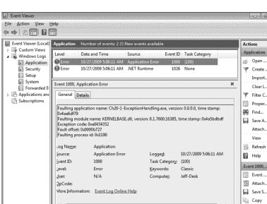

**图 20-1** Windows 事件日志显示一个因未处理异常而终止的应用程序

但是，你可以使用 Windows 操作中心小程序获取有关该问题的更有趣的详细信息。要启动操作中心，请单击系统托盘中的旗标图标，选择“打开操作中心”，展开“维护”框，然后选择“查看可靠性历史记录”链接。在此处，你可以在底部窗格中看到因未处理异常而终止的应用程序，如图 20-2 所示。

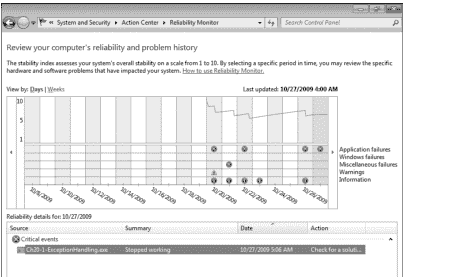

**图 20-2** 可靠性监视器显示一个因未处理异常而终止的应用程序

要查看有关已终止应用程序的更多详细信息，请在可靠性监视器中双击已终止的应用程序。详细信息将大致如图 20-3 所示，问题签名的含义在表 20-2 中描述。托管应用程序产生的所有未处理异常都会放入 CLR20r3 桶中。

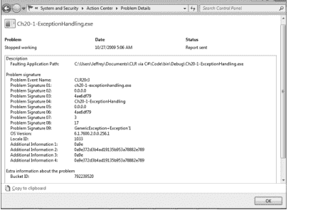

**图 20-3** 可靠性监视器显示有关失败应用程序的更多详细信息

- 对于 Windows Presentation Foundation (WPF) 应用程序，请查看 **System.Windows.Application 的 DispatcherUnhandledException** 事件，以及 **System.Windows.Threading.Dispatcher 的 UnhandledException** 和 **UnhandledExceptionFilter** 事件。
- 对于 Silverlight，请查看 **System.Windows.Application 的 UnhandledException** 事件。
- 对于 ASP.NET Web Form 应用程序，请查看 **System.Web.UI.TemplateControl 的 Error** 事件。**TemplateControl** 是 **System.Web.UI.Page** 和 **System.Web.UI.UserControl** 类的基类。此外，还应查看 **System.Web.HttpApplication 的 Error** 事件。
- 对于 Windows Communication Foundation 应用程序，请查看 **System.ServiceModel.Dispatcher.ChannelDispatcher 的 ErrorHandlers** 属性。

在结束本节之前，我想简要谈谈分布式应用程序（如网站或 Web 服务）中可能发生的未处理异常。在理想情况下，遇到未处理异常的服务器应用程序应记录该异常，向客户端发送某种通知，说明请求的操作无法完成，然后服务器应终止。不幸的是，我们并不生活在一个理想世界中，因此可能无法向客户端发送失败通知。对于某些 *有状态服务器*（例如 Microsoft SQL Server），终止服务器并启动一个全新的实例可能并不实际。

对于服务器应用程序，不应将有关未处理异常的信息返回给客户端，因为客户端对此*能做的很少*，尤其是当客户端由另一家公司实现时。此外，服务器应尽可能少地向客户端泄露有关自身的信息，以降低服务器被入侵的可能性。

> **注意** CLR 将本机代码抛出的一些异常视为损坏状态异常 (CSE)，因为它们通常是 CLR 本身或某些本机代码中的 bug 导致的结果，而托管开发人员无法控制这些代码。默认情况下，CLR 不允许托管代码捕获这些异常，并且 **finally** 块不会执行。下面是被视为 CSE 的本机 Win32 异常列表：
>
> | | |
> |---|---|
> | EXCEPTION_ACCESS_VIOLATION | EXCEPTION_STACK_OVERFLOW |
> | EXCEPTION_ILLEGAL_INSTRUCTION | EXCEPTION_IN_PAGE_ERROR |
> | EXCEPTION_INVALID_DISPOSITION | EXCEPTION_NONCONTINUABLE_EXCEPTION |
> | EXCEPTION_PRIV_INSTRUCTION | STATUS_UNWIND_CONSOLIDATE |
>
> 单个托管方法可以通过将 **System.Runtime.ExceptionServices.HandleProcessCorruptedStateExceptionsAttribute** 应用于该方法，来覆盖默认设置并捕获这些异常。此外，该方法还必须应用 **System.Security.SecurityCriticalAttribute**。你还可以通过将应用程序的可扩展标记语言 (XML) 配置文件中的 **legacyCorruptedStateExceptionPolicy** 元素设置为 **true**，来为整个进程覆盖默认设置。CLR 会将其中大多数异常转换为 **System.Runtime.InteropServices.SEHException** 对象，但 **EXCEPTION_ACCESS_VIOLATION** 会转换为 **System.AccessViolationException** 对象，**EXCEPTION_STACK_OVERFLOW** 会转换为 **System.StackOverflowException** 对象。

> **注意** 在调用方法之前，你可以通过调用 **RuntimeHelper** 类的 **EnsureSufficientExecutionStack** 方法来检查是否有充足的堆栈空间。此方法会检查调用线程是否有足够的可用堆栈空间来执行普通方法（普通方法的定义并不明确）。如果堆栈空间不足，该方法会抛出 **InsufficientExecutionStackException**，你可以捕获该异常。**EnsureSufficientExecutionStack** 方法不接受任何参数，并返回 **void**。此方法通常由递归方法使用。

## 调试异常

Visual Studio 调试器对异常提供特殊支持。打开解决方案后，从 *调试* 菜单中选择 *异常*，你将看到如图 20-4 所示的对话框。

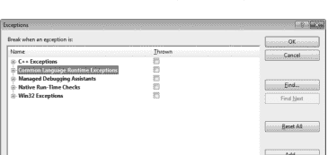

**图 20-4** 异常对话框，显示不同种类的异常

此对话框显示 Visual Studio 可识别的不同种类的异常。对于公共语言运行时异常，展开对话框中的相应分支（如图 20-5 所示），会显示 Visual Studio 调试器可识别的命名空间集合。

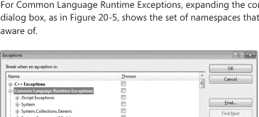

**图 20-5** 异常对话框，按命名空间显示 CLR 异常

如果展开某个命名空间，你将看到该命名空间中定义的所有 **System.Exception** 派生类型。例如，图 20-6 显示了打开 **System** 命名空间时你将看到的内容。

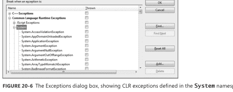

对于任何异常类型，如果选中其 Thrown 复选框，调试器将在该异常一被抛出时中断。此时，CLR 尚未尝试查找任何匹配的 **catch** 块。如果你想调试捕获并处理异常的代码，这很有用。当你怀疑某个组件或库可能吞掉或重新抛出异常，并且不确定究竟在哪里设置断点才能当场捕获它时，这也很有用。

如果未选中异常类型的 Thrown 复选框，调试器也会在抛出异常的位置中断，但仅当该异常类型未被处理时才会如此。开发人员通常会让 Thrown 复选框保持未选中，因为已处理的异常表明应用程序预料到了该情况并进行了处理；应用程序会继续正常运行。

如果定义自己的异常类型，可以通过单击“添加”将其添加到此对话框。此时将出现图 20-7 所示的对话框。

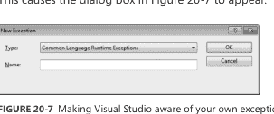

在此对话框中，首先将异常类型选择为“公共语言运行时异常”，然后可以输入自己的异常类型的完全限定名。请注意，输入的类型不必是派生自 **System.Exception** 的类型；完全支持不符合 CLS 的类型。如果有两个或多个同名但位于不同程序集中的类型，则无法区分这些类型。幸运的是，这种情况很少发生。


如果你的程序集定义了多个异常类型，你必须逐个添加它们。将来，我希望这个对话框允许我浏览某个程序集，并自动将所有派生自 Exception 的类型导入 Visual Studio 的调试器。届时，每个类型还可以按程序集加以标识，从而解决不同程序集中存在两个同名类型的问题。

### 异常处理的性能考量

开发者社区一直在积极争论异常处理的性能。有些人声称异常处理的性能太差，以至于他们甚至拒绝使用异常处理。然而，我认为在面向对象平台中，异常处理不是一个可选项，而是强制性的。此外，如果你不使用它，那你会用什么来代替？你会让方法返回 `true/false` 来表示成功/失败，或者返回某种错误码 `enum` 类型吗？好吧，如果你这样做，那么你会落得两头都糟的局面：CLR 和类库代码会抛出异常，而你的代码会返回错误码。你现在不得不在代码中同时处理这两种情况。

很难比较异常处理与更传统的异常报告方式（例如 `HRESULTs`、特殊返回码等）之间的性能。如果你编写代码来检查每个方法调用的返回值，并将返回值逐层过滤给自己的调用方，那么应用程序的性能将受到严重影响。但先不谈性能，当你编写代码来检查每个方法的返回值时，你必须完成的额外编码量以及出错的可能性都会高得惊人。异常处理是一种好得多的替代方案。

然而，异常处理是有代价的：非托管 C++ 编译器必须生成代码来跟踪哪些对象已成功构造。编译器还必须生成这样的代码：当捕获到异常时，调用每个已成功构造对象的析构函数。编译器承担这一负担固然很好，但它会在你的应用程序中生成大量簿记代码，对代码大小和执行时间产生不利影响。

另一方面，托管编译器要轻松得多，因为托管对象分配在托管堆中，而托管堆由垃圾回收器监视。如果一个对象已成功构造，随后抛出了异常，垃圾回收器最终会释放该对象的内存。编译器不需要发出任何簿记代码来跟踪哪些对象已成功构造，也不需要确保已调用析构函数。与非托管 C++ 相比，这意味着编译器生成的代码更少，运行时必须执行的代码也更少，从而为你的应用程序带来更好的性能。

多年来，我在不同的编程语言、不同的操作系统和不同的 CPU 架构中使用过异常处理。在每种情况下，异常处理的实现方式都不同，每种实现在性能方面都有其优缺点。有些实现将异常处理构造直接编译到方法中，而另一些实现则将与异常处理相关的信息存储在与该方法关联的数据表中——只有当抛出异常时才会访问该表。有些编译器无法内联包含异常处理程序的方法，有些编译器则不会在方法包含异常处理程序时把变量放入寄存器。

关键在于，你无法确定使用异常处理会给应用程序增加多少额外开销。在托管世界中，这就更难判断了，因为你的程序集代码可以在任何支持 .NET Framework 的平台上运行。因此，当你的程序集运行在 x86 机器上时，JIT 编译器为管理异常处理而生成的代码，将与你的代码运行在 x64 或 IA64 处理器上时 JIT 编译器生成的代码截然不同。此外，与其他 CLR 实现（例如 Microsoft 的 .NET Compact Framework 或开源 Mono 项目）关联的 JIT 编译器很可能生成不同的代码。

实际上，我曾用 Microsoft 内部的一些不同 JIT 编译器测试过我自己的一些代码，我观察到的性能差异相当显著，令人惊讶。关键在于，你必须在你期望用户运行的各种平台上测试代码，并相应地做出更改。再次强调，我不会担心使用异常处理的性能，因为其好处通常远远超过任何负面的性能影响。

如果你有兴趣了解异常处理如何影响代码的性能，可以使用 Windows 自带的性能监视器工具。图 20-8 中的屏幕显示了随 .NET Framework 一起安装的与异常相关的计数器。

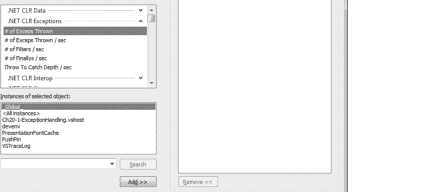

**图 20-8** 显示 .NET CLR 异常计数器的性能监视器

### 约束执行区域（CERs）

许多应用程序不需要具备健壮性，也不需要从任何种类的失败中恢复。许多客户端应用程序都是如此，例如 Notepad.exe 和 Calc.exe。当然，我们中的许多人都见过 Microsoft Office 应用程序（如 WinWord.exe、Excel.exe 和 Outlook.exe）因未处理异常而终止。此外，许多服务器端应用程序（如 Web 服务器）是无状态的，如果因未处理异常而失败，它们会自动重新启动。当然，有些服务器（如 SQL Server）完全围绕状态管理，因未处理异常而丢失数据的潜在后果要灾难性得多。

在 CLR 中，我们有应用程序域（AppDomains，在第 22 章讨论），它们包含状态。当卸载一个应用程序域时，它的所有状态都会被卸载。因此，如果应用程序域中的某个线程遇到未处理异常，那么卸载该应用程序域（这会销毁其所有状态）而不终止整个进程是可以的。^8

按照定义，CER 是一段必须能够抵御失败的代码块。由于应用程序域可以被卸载，从而销毁其状态，因此 CER 通常用于操作由多个应用程序域或进程共享的任何状态。当试图在意外抛出异常的情况下维护状态时，CER 很有用。有时我们将这类异常称为*异步异常*。例如，在调用方法时，CLR 必须加载程序集、在应用程序域的加载器堆中创建类型对象、调用该类型的静态构造函数、将 IL JIT 编译为本机代码，等等。这些操作中的任何一个都可能失败，而 CLR 会通过抛出异常来报告失败。

如果这些操作中的任何一个在 **catch** 或 **finally** 块内失败，那么你的错误恢复或清理代码将不会完整执行。下面是一个展示该潜在问题的代码示例：

```csharp
private static void Demo1() {
    try {
        Console.WriteLine("In try");
    }
    finally {
        // Type1's static constructor is implicitly called in here
        Type1.M();
    }
}

private sealed class Type1 {
    static Type1() {
        // if this throws an exception, M won't get called
        Console.WriteLine("Type1's static ctor called");
    }

    public static void M() { }
}
```

运行上面的代码时，我得到以下输出：

```
In try
Type1's static ctor called
```

我们想要的是，除非我们知道关联的 **catch** 和 **finally** 块中的代码保证（或尽可能接近保证）会执行，否则甚至不要开始执行上面 **try** 块中的代码。我们可以通过如下修改代码来实现这一点：

```csharp
private static void Demo2() {
    // Force the code in the finally to be eagerly prepared
    RuntimeHelpers.PrepareConstrainedRegions(); // System.Runtime.CompilerServices namespace
    try {
        Console.WriteLine("In try");
    }
    finally {
        // Type2's static constructor is implicitly called in here
        Type2.M();
    }
}

public class Type2 {
    static Type2() {
        Console.WriteLine("Type2's static ctor called");
    }

    // Use this attribute defined in the System.Runtime.ConstrainedExecution namespace
    [ReliabilityContract(Consistency.WillNotCorruptState, Cer.Success)]
    public static void M() { }
}
```

现在，当我运行这个版本的代码时，我得到以下输出：

```
Type2's static ctor called
In try
```

**PrepareConstrainedRegions** 方法是一个非常特殊的方法。当 JIT 编译器看到在 **try** 块之前立即调用此方法时，它会急切地编译 **try** 的 **catch** 和 **finally** 块中的代码。JIT 编译器将加载任何程序集、创建任何类型对象、调用任何静态构造函数，并对任何方法进行 JIT 编译。如果这些操作中的任何一个导致异常，那么异常会在该线程进入 **try** 块之前发生。

当 JIT 编译器急切地准备方法时，它还会遍历整个调用图，急切地准备被调用的方法。然而，JIT 编译器只准备那些应用了 **ReliabilityContractAttribute** 且其参数为 **Consistency.WillNotCorruptState** 或 **Consistency.MayCorruptInstance** 的方法，因为 CLR 无法对可能损坏应用程序域或进程状态的方法做出任何保证。在你通过调用 **PrepareConstrainedRegions** 来保护的 **catch** 或 **finally** 块内部，你要确保只调用那些按照我刚才描述的方式设置了 **ReliabilityContractAttribute** 的方法。

^8 如果线程的整个生命周期都位于单个应用程序域内（例如在 ASP.NET 和托管 SQL Server 存储过程场景中），这绝对是正确的。但是，如果线程在其生命周期内跨越应用程序域边界，你可能不得不终止整个进程。


**ReliabilityContractAttribute** 如下所示：

```csharp
public sealed class ReliabilityContractAttribute : Attribute {
    public ReliabilityContractAttribute(Consistency consistencyGuarantee, Cer cer);
    public Cer Cer { get; }
    public Consistency ConsistencyGuarantee { get; }
}
```

此特性让开发人员能够向特定方法⁹的潜在调用方记录该方法的可靠性契约。**Cer** 和 **Consistency** 类型都是枚举类型，定义如下：

```csharp
enum Consistency {
    MayCorruptProcess, MayCorruptAppDomain, MayCorruptInstance, WillNotCorruptState
}
```

```csharp
enum Cer { None, MayFail, Success }
```

如果你编写的方法承诺不破坏任何状态，请使用 **Consistency.WillNotCorruptState**。否则，请使用其他三个可能值之一来记录你的方法的行为，这些值应与你方法可能破坏的状态相匹配。如果你编写的方法承诺不会失败，请使用 **Cer.Success**。否则，请使用 **Cer.MayFail**。任何未应用 **ReliabilityContractAttribute** 的方法都等同于被标记为如下形式：

```csharp
[ReliabilityContract(Consistency.MayCorruptProcess, Cer.None)]
```

**Cer.None** 值表示该方法不做任何 CER 保证。换句话说，它不是以 CER 为考量编写的；因此，它可能失败，并且可能报告也可能不报告失败。请记住，这些设置大多是为方法提供一种方式，以记录它向潜在调用方提供的内容，以便调用方知道可以预期什么。CLR 和 JIT 编译器不使用此信息。

当你想编写可靠的方法时，应使其小巧并约束其行为。确保它不分配任何对象（例如，不装箱），不调用任何虚方法或接口方法，不使用任何委托，也不使用反射，因为 JIT 编译器无法判断实际将调用哪个方法。但是，你可以通过调用 **RuntimeHelpers** 类定义的以下方法之一来手动准备这些方法：

```csharp
public static void PrepareMethod(RuntimeMethodHandle method);
public static void PrepareMethod(RuntimeMethodHandle method,
    RuntimeTypeHandle[] instantiation);
public static void PrepareDelegate(Delegate d);
public static void PrepareContractedDelegate(Delegate d);
```

> **注意** 即使所有方法都已预先准备，方法调用仍可能导致 **StackOverflowException**。当 CLR 未被承载时，**StackOverflowException** 会因 CLR 在内部调用 **Environment.FailFast** 而使进程立即终止。当被承载时，**PrepareConstrainedRegions** 方法会检查堆栈，看是否还剩余大约 48KB 的堆栈空间。如果堆栈空间有限，则 **StackOverflowException** 会在进入 **try** 块之前发生。

你还应查看 **RuntimeHelpers' ExecuteCodeWithGuaranteedCleanup** 方法，这是另一种执行具有保证清理的代码的方式：

```csharp
public static void ExecuteCodeWithGuaranteedCleanup(TryCode code, CleanupCode backoutCode,
    Object userData);
```

调用此方法时，你将 **try** 和 **finally** 块的主体作为回调方法传入，这些回调方法的原型分别与以下两个委托匹配：

```csharp
public delegate void TryCode(Object userData);
public delegate void CleanupCode(Object userData, Boolean exceptionThrown);
```

最后，获得保证代码执行的另一种方式是使用 **CriticalFinalizerObject** 类，第 21 章对此进行了非常详细的解释。

## 代码契约

代码契约提供了一种方式，让你可以在代码本身中以声明方式记录你对代码所做的设计决策。契约采用以下形式：

- **前置条件** 通常用于验证参数。
- **后置条件** 用于在方法因正常返回或抛出异常而终止时验证状态。
- **对象不变式** 用于确保对象的字段在对象的整个生命周期内保持良好状态。

代码契约有助于代码的使用、理解、演进、测试^{10}、文档化以及早期错误检测。你可以将前置条件、后置条件和对象不变式视为方法签名的一部分。因此，你可以通过代码的新版本放宽契约，但不能在不破坏向后兼容性的情况下通过新版本使契约更严格。

代码契约的核心是静态 **System.Diagnostics.Contracts.Contract** 类：

```csharp
public static class Contract {
    // Precondition methods: [Conditional("CONTRACTS_FULL")]
    public static void Requires(Boolean condition);
    public static void EndContractBlock();

    // Preconditions: Always
    public static void Requires<TException>(Boolean condition) where TException : Exception;

    // Postcondition methods: [Conditional("CONTRACTS_FULL")]
    public static void Ensures(Boolean condition);
    public static void EnsuresOnThrow<TException>(Boolean condition)
        where TException : Exception;

    // Special Postcondition methods: Always
    public static T Result<T>();
    public static T OldValue<T>(T value);
    public static T ValueAtReturn<T>(out T value);

    // Object Invariant methods: [Conditional("CONTRACTS_FULL")]
    public static void Invariant(Boolean condition);

    // Quantifier methods: Always
    public static Boolean Exists<T>(IEnumerable<T> collection, Predicate<T> predicate);
    public static Boolean Exists(Int32 fromInclusive, Int32 toExclusive,
        Predicate<Int32> predicate);
    public static Boolean ForAll<T>(IEnumerable<T> collection, Predicate<T> predicate);
    public static Boolean ForAll(Int32 fromInclusive, Int32 toExclusive,
        Predicate<Int32> predicate);

    // Helper methods: [Conditional("CONTRACTS_FULL")] or [Conditional("DEBUG")]
    public static void Assert(Boolean condition);
    public static void Assume(Boolean condition);

    // Infrastructure event: usually your code will not use this event
    public static event EventHandler<ContractFailedEventArgs> ContractFailed;
}
```

如上所述，其中许多静态方法都应用了 **[Conditional("CONTRACTS_FULL")]** 特性。一些辅助方法也应用了 **[Conditional("DEBUG")]** 特性。这意味着，除非在编译代码时定义了相应的符号，否则编译器会忽略你编写的任何调用这些方法的代码。任何标记为“Always”的方法都表示编译器始终会生成调用该方法的代码。此外，**Requires**、**`Requires<TException>`**、**Ensures**、**EnsuresOnThrow**、**Invariant**、**Assert** 和 **Assume** 方法还有一个附加重载（未显示），它接受一个 **String** 消息参数，以便你可以显式指定契约被违反时应显示的字符串消息。

默认情况下，契约仅作为文档使用，因为你在生成项目时不会定义 **CONTRACTS_FULL** 符号。为了从使用契约中获得一些额外价值，你必须从 http://msdn.microsoft.com/en-us/devlabs/dd491992.aspx 下载附加工具和 Visual Studio 属性窗格。所有代码契约工具未随 Visual Studio 一起提供的原因是，这项技术相对较新并且正在快速改进。Microsoft 的 DevLabs 网站可以比 Visual Studio 本身更快地提供新版本和改进。下载并安装附加工具后，你会看到你的项目有一个新的可用属性窗格，如图 20-9 所示。

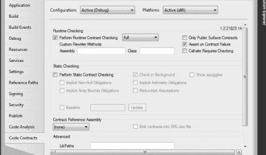

**图 20-9** Visual Studio 项目的代码契约窗格

要启用代码契约功能，请选中“执行运行时契约检查”复选框，并在其旁边的组合框中选择“完全”。这会在你生成项目时定义 **CONTRACTS_FULL** 符号，并在生成项目后调用相应的工具（稍后介绍）。现在，在运行时，当契约被违反时，会引发 **Contract 的 ContractFailed** 事件。通常，开发人员不会向此事件注册任何方法，但如果你注册了，那么你注册的任何方法都将收到一个如下所示的 **ContractFailedEventArgs** 对象：

```csharp
public sealed class ContractFailedEventArgs : EventArgs {
    public ContractFailedEventArgs(ContractFailureKind failureKind,
        String message, String condition, Exception originalException);

    public ContractFailureKind FailureKind     { get; }
    public String               Message        { get; }
    public String               Condition      { get; }
    public Exception            OriginalException { get; }

    public Boolean Handled { get; }     // true if any handler called SetHandled
    public void SetHandled();           // Call to ignore the violation; sets Handled to true

    public Boolean Unwind { get; }      // true if any handler called SetUnwind or threw
    public void SetUnwind();            // Call to force ContractException; set Unwind to true
}
```


可以将多个事件处理程序方法注册到此事件。每个方法都可以按自己选择的方式处理契约违反。例如，处理程序可以记录该违反、忽略该违反（通过调用 **SetHandled**），或终止进程。如果任何方法调用 **SetHandled**，则该违反将被视为已处理，并且在所有处理程序方法返回后，除非任何处理程序调用 **SetUnwind**，否则允许应用程序代码继续运行。如果处理程序调用 **SetUnwind**，则在所有处理程序方法完成运行后，会抛出 **System.Diagnostics.Contracts.ContractException**。请注意，此类型是 MSCorLib.dll 内部的，因此你无法编写 **catch** 块来显式捕获它。另请注意，如果任何处理程序方法抛出未处理的异常，则会调用其余处理程序方法，然后抛出 **ContractException**。

如果没有事件处理程序，或者它们都没有调用 **SetHandled**、**SetUnwind**，也没有抛出未处理的异常，那么接下来会进行契约违反的默认处理。如果 CLR 被承载，则会通知宿主某个契约失败。如果 CLR 在非交互式窗口站上运行应用程序（Windows 服务应用程序就属于这种情况），则会调用 **Environment.FailFast** 立即终止进程。如果编译时选中了“契约失败时断言”选项，则会出现一个断言对话框，允许你将调试器连接到应用程序。如果未选中此选项，则会抛出 **ContractException**。

让我们看一个使用代码契约的示例类：

```csharp
public sealed class Item { /* ... */ }

public sealed class ShoppingCart {
    private List<Item> m_cart = new List<Item>();
    private Decimal m_totalCost = 0;

    public ShoppingCart() {
    }

    public void AddItem(Item item) {
        AddItemHelper(m_cart, item, ref m_totalCost);
    }

    private static void AddItemHelper(List<Item> m_cart, Item newItem,
        ref Decimal totalCost) {

        // Preconditions:
        Contract.Requires(newItem != null);
        Contract.Requires(Contract.ForAll(m_cart, s => s != newItem));

        // Postconditions:
        Contract.Ensures(Contract.Exists(m_cart, s => s == newItem));
        Contract.Ensures(totalCost >= Contract.OldValue(totalCost));
        Contract.EnsuresOnThrow<IOException>(totalCost == Contract.OldValue(totalCost));

        // Do some stuff (which could throw an IOException)...
        m_cart.Add(newItem);
        totalCost += 1.00M;
    }

    // Object invariant
    [ContractInvariantMethod]
    private void ObjectInvariant() {
        Contract.Invariant(m_totalCost >= 0);
    }
}
```

`AddItemHelper` 方法定义了一组代码契约。前置条件表明 `newItem` 不能为 `null`，并且要添加到购物车中的项尚未在购物车中。后置条件表明新项必须在购物车中，并且总成本必须至少与该项添加到购物车之前一样多。后置条件还表明，如果 `AddItemHelper` 因某种原因抛出 `IOException`，那么 `totalCost` 与方法开始执行时相比保持不变。`ObjectInvariant` 方法只是一个私有方法，调用它会确保对象的 `m_totalCost` 字段永远不会包含负值。

> > **重要** 前置条件、后置条件或不变量测试中引用的所有成员都必须无副作用。这是必需的，因为测试条件不应改变对象本身的状态。此外，前置条件测试中引用的所有成员的可访问性必须至少与定义该前置条件的方法相同。这是必需的，因为方法的调用方应能够在调用方法之前验证他们已满足所有前置条件。另一方面，只要代码能够编译，后置条件或不变量测试中引用的成员可以具有任意可访问性。这里可访问性不重要，是因为后置条件和不变量测试不会影响调用方正确调用方法的能力。

> > **重要** 关于继承，派生类型不能重写并更改基类型中定义的虚成员的前置条件。类似地，实现接口成员的类型不能更改该接口成员定义的前置条件。如果某个成员没有为其定义显式契约，则该成员具有一个隐式契约，从逻辑上看如下所示：
> >
> >     Contract.Requires(true);
> >
> > 而且，由于契约不能在新版本中变得更严格（而不破坏兼容性），因此在引入新的虚成员、抽象成员或接口成员时，应仔细考虑前置条件。对于后置条件和对象不变量，可以随意添加和移除契约，因为虚/抽象/接口成员中表达的条件与重写成员中表达的条件只是在逻辑上进行了 AND 运算。

所以现在你看到了如何声明契约。接下来我们讨论它们在运行时如何工作。你可以在方法的顶部声明所有前置条件和后置条件契约，这些位置很容易找到。当然，前置条件契约会在调用方法时验证其测试。然而，我们希望后置条件契约直到方法返回时才验证其测试。为了获得所需的行为，C# 编译器生成的程序集必须由代码契约重写器工具（CCRewrite.exe，位于 C:\Program Files (x86)\Microsoft\Contracts\Bin）处理，该工具会生成程序集的修改版本。在为项目选中 **执行运行时契约检查** 复选框后，每当生成项目时，Visual Studio 都会自动为你调用此工具。此工具会分析所有方法中的 IL，并重写 IL，以便在每个方法末尾执行任何后置条件契约。如果你的方法内部有多个返回点，则 CCRewrite.exe 工具会修改方法的 IL 代码，使所有返回点在方法返回之前执行后置条件代码。

CCRewrite.exe 工具会在类型中查找任何标记有 **[ContractInvariantMethod]** 特性的方法。该方法可以有任何名称，但按照约定，人们通常将该方法命名为 **ObjectInvariant**，并将该方法标记为 **private**（如我上面所做的那样）。该方法必须不接受任何参数，并且返回类型为 **void**。当 CCRewrite.exe 工具看到标记有此特性的方法时，它会在每个 **public** 实例方法的末尾插入 IL 代码，以调用 **ObjectInvariant** 方法。这样，在每个方法返回时都会检查对象的状态，以确保没有方法违反契约。请注意，CCRewrite.exe 工具不会修改 **Finalize** 方法或 **IDisposable 的 Dispose** 方法来调用 **ObjectInvariant** 方法，因为如果对象被视为已销毁或已释放，则其状态被更改是可以的。另请注意，单个类型可以定义多个标记有 **[ContractInvariantMethod]** 特性的方法；这在处理分部类型时很有用。CCRewrite.exe 工具将修改 IL，以便在每个公共方法的末尾调用所有这些方法（以未定义的顺序）。

**Assert** 和 **Assume** 方法与其他方法不同。首先，你不应将它们视为方法签名的一部分，也不必把它们放在方法的开头。在运行时，这两个方法的行为完全相同。它们只是验证传递给它们的条件为 true，如果不是，则抛出异常。然而，还有另一个工具——代码契约检查器（`CCCheck.exe`），它会分析 C# 编译器生成的 IL，以尝试静态验证方法中没有任何代码违反契约。此工具将尝试证明传递给 **Assert** 的任何条件都为 **true**，但它只会假定传递给 **Assume** 的任何条件都为 **true**，并将该表达式添加到其已知为真的事实集合中。通常，你会使用 **Assert**，然后如果 `CCCheck.exe` 工具无法静态证明该表达式为 true，则将 **Assert** 改为 **Assume**。

让我们通过一个示例来演示。假设我有以下类型定义：

```
    internal sealed class SomeType {
        private static String s_name = "Jeffrey";

        public static void ShowFirstLetter() {
            Console.WriteLine(s_name[0]);   // warning: requires unproven: index < this.Length
        }
    }
```

当我开启 **执行静态契约检查** 功能构建此代码时，`CCCheck.exe` 工具会生成上面注释中显示的警告。此警告通知我，查询 `s_name` 的第一个字母可能会失败并抛出异常，因为尚未证明 `s_name` *始终* 引用一个至少包含一个字符的字符串。


因此，我们想做的是向 **ShowFirstLetter** 方法添加一个断言：

```csharp
public static void ShowFirstLetter() {
    Contract.Assert(s_name.Length >= 1);   // warning: assert unproven
    Console.WriteLine(s_name[0]);
}
```

遗憾的是，当 CCCheck.exe 工具分析这段代码时，它仍然无法验证 **s_name** *始终* 引用一个至少包含一个字母的字符串，因此该工具会产生类似的警告。有时，由于工具本身的限制，该工具无法验证断言；该工具的未来版本将能够执行更完整的分析。

为了克服工具中的缺陷，或者声称某件工具永远无法证明的事情为真，我们可以将 **Assert** 改为 **Assume**。如果我们确知没有其他代码会修改 **s_name**，那么我们可以将 **ShowFirstLetter** 改为：

```csharp
public static void ShowFirstLetter() {
    Contract.Assume(s_name.Length >= 1);   // No warning at all now!
    Console.WriteLine(s_name[0]);
}
```

使用这个版本的代码，CCCheck.exe 工具就只是采信我们的说法，并断定 **s_name** *始终* 引用一个至少包含一个字母的字符串。这个版本的 **ShowFirstLetter** 方法完全没有任何警告地通过了代码契约静态检查器。

现在，让我们谈谈代码契约引用程序集生成器工具（CCRefGen.exe）。运行 CCRewrite.exe 工具以启用契约检查有助于你更快地发现 bug，但契约检查期间发出的所有代码都会使你的程序集变大，并损害其运行时性能。为了改善这种情况，你可以使用 CCRefGen.exe 工具创建一个单独的 *契约引用程序集*。如果将“契约引用程序集”组合框设置为 Build，Visual Studio 会自动为你调用此工具。契约程序集通常命名为 *AssemName*Contracts.dll（例如 MSCorLib.Contracts.dll），这些程序集仅包含元数据和描述契约的 IL——别无其他。你可以通过以下特征识别契约引用程序集：它会将 **System.Diagnostics.Contracts.ContractReferenceAssemblyAttribute** 应用于该程序集的程序集定义元数据表。当 CCRewrite.exe 工具和 CCCheck.exe 工具执行插桩和分析时，它们可以将契约引用程序集用作输入。

最后一个工具是代码契约文档生成器工具（CCDocGen.exe），当你使用编译器的 **/doc:file** 开关时，它会将契约信息添加到 C# 编译器已经生成的 XML 文档文件中。这个经过 CCDocGen.exe 工具增强的 XML 文件可以由 Microsoft 的 Sandcastle 工具处理，以生成 MSDN 风格的文档，这些文档现在将包含契约信息。

## 理解在垃圾回收平台中工作的基础知识

每个程序都会使用某种资源，例如文件、内存缓冲区、屏幕空间、网络连接、数据库资源等。事实上，在面向对象环境中，每种类型都标识了可供程序使用的某种资源。要使用这些资源中的任何一种，都需要分配内存来表示该类型。访问资源需要以下步骤：

- 1. 通过调用中间语言（IL）的 **newobj** 指令，为表示该资源的类型分配内存；当你在 C# 中使用 **new** 运算符时，就会发出该指令。
- 2. 初始化内存，以设置资源的初始状态并使该资源可用。该类型的实例构造函数负责设置此初始状态。
- 3. 通过访问该类型的成员来使用资源（根据需要重复）。
- 4. 拆除资源的状态以进行清理。我将在本章后面的“Dispose 模式：强制对象清理”一节中讨论此主题。
- 5. 释放内存。垃圾回收器全权负责此步骤。

这个看似简单的范式一直是编程错误的主要来源之一。程序员有多少次忘记在不再需要内存时释放它？程序员有多少次在内存已经被释放之后还试图使用它？

在本机编程世界中，这两个应用程序 bug 比大多数其他 bug 更严重，因为你通常无法预测它们的后果或发生时机。对于其他 bug，当你看到应用程序行为异常时，只需修复问题即可。但这两个 bug 会导致资源泄漏（内存消耗）和对象损坏（不稳定化），使应用程序的行为不可预测。事实上，有许多工具（例如 Microsoft 的 Windows 任务管理器、Process Explorer 和 Performance Monitor，以及 Rational 的 Purify）专门设计用于帮助开发者定位这类 bug。

正确的资源管理非常困难且相当繁琐。它使开发者无法专注于他们试图解决的实际问题。如果存在某种机制能够简化开发者令人麻木的内存管理任务，那就太好了。幸运的是，确实存在这样的机制：垃圾回收。

垃圾回收使开发者完全不必跟踪内存使用情况，也不必知道何时释放内存。然而，垃圾回收器对内存中类型所表示的资源一无所知，这意味着垃圾回收器无法知道如何执行前面列表中的第 4 步：拆除资源的状态以进行清理。要让资源得到正确清理，开发者必须编写知道如何正确清理资源的代码。开发者将这些代码写在 **Finalize**、**Dispose** 和 **Close** 方法中，本章后面会对此进行描述。不过，正如你将看到的，垃圾回收器在这里也能提供一些帮助，使开发者在许多情况下可以跳过第 4 步。

此外，大多数类型（包括值类型（包括所有枚举类型）、集合类型、**String**、**Attribute**、**Delegate** 和 **Exception**）表示的资源不需要任何特殊清理。例如，只需销毁对象内存中维护的字符数组，就可以完全清理 **String** 资源。

另一方面，表示（或包装）非托管或本机资源的类型，例如文件、数据库连接、套接字、互斥体、位图、图标等，在对象即将被回收内存时，总是需要执行一些清理代码。在本章中，我将解释如何正确定义需要显式清理的类型，并展示如何正确使用提供这种显式清理的类型。现在，让我们考察内存是如何分配的，以及资源是如何初始化的。

### 从托管堆分配资源

CLR 要求所有资源都从称为 *托管堆* 的堆中分配。这个堆类似于 C 运行时堆，区别在于你永远不会从托管堆中删除对象——当应用程序不再需要对象时，对象会被自动删除。当然，这就引出了一个问题：“托管堆如何知道应用程序何时不再使用某个对象？”我很快就会回答这个问题。

如今有多种垃圾回收算法在使用。每种算法都针对特定环境进行了微调，以提供最佳性能。在本章中，我将重点介绍 Microsoft .NET Framework 的 CLR 所使用的垃圾回收算法。让我们从基本概念开始。

当进程初始化时，CLR 会保留一块连续的地址空间区域，该区域最初不包含任何后备存储。这块地址空间区域就是托管堆。堆还维护一个指针，我将其称为 **NextObjPtr**。该指针指示堆中下一个对象将要分配的位置。最初，**NextObjPtr** 被设置为所保留地址空间区域的基地址。¹


`newobj` IL 指令创建一个对象。许多语言（包括 C#、C++/CLI 和 Microsoft Visual Basic）提供 `new` 运算符，它会使编译器将 `newobj` 指令生成到方法的 IL 代码中。`newobj` 指令会使 CLR 执行以下步骤：

- 1. 计算该类型（及其所有基类型）的字段所需的字节数。
- 2. 加上对象开销所需的字节数。每个对象都有两个开销字段：类型对象指针和同步块索引。对于 32 位应用程序，这些字段各需要 32 位，因此每个对象要增加 8 字节。对于 64 位应用程序，每个字段为 64 位，因此每个对象要增加 16 字节。
- 3. 然后，CLR 检查保留区域中是否有分配该对象所需的字节可用（必要时提交存储）。如果托管堆中有足够的空闲空间，该对象将能放入，并从 `NextObjPtr` 指向的地址开始，这些字节会被清零。随后调用该类型的构造函数（将 `NextObjPtr` 作为 `this` 参数传入），而 `newobj` IL 指令（或 C# 的 `new` 运算符）返回该对象的地址。就在返回地址之前，`NextObjPtr` 会越过该对象向前移动，现在指向堆中下一个对象将被放置的地址。

图 21-1 展示了一个由三个对象组成的托管堆：A、B 和 C。如果要分配一个新对象，它将被放在 `NextObjPtr` 所指向的位置（紧跟在对象 C 之后）。


**图 21-1** 新初始化且其中构造了三个对象的托管堆

相比之下，我们来看看 C 运行时堆如何分配内存。在 C 运行时堆中，为对象分配内存需要遍历一个由数据结构组成的链表。一旦找到足够大的块，就会拆分该块，并修改链表节点中的指针以保持结构完整。对于托管堆，分配对象只是向指针加一个值——相比之下这快得惊人。事实上，从托管堆分配对象几乎与从线程栈分配内存一样快！此外，大多数堆（例如 C 运行时堆）会在找到空闲空间的地方分配对象。因此，如果我连续创建多个对象，这些对象很可能被数 MB 的地址空间分隔开。然而，在托管堆中，连续分配多个对象可确保这些对象在内存中连续。

在许多应用程序中，大约同时分配的对象往往彼此关系密切，并且经常在相近的时间被访问。例如，在创建 `BinaryWriter` 对象之前立即分配一个 `FileStream` 对象是非常常见的。然后，应用程序将使用 `BinaryWriter` 对象，而该对象在内部使用 `FileStream` 对象。在垃圾回收环境中，新对象在内存中连续分配，从而因引用局部性带来性能提升。具体来说，这意味着你的进程工作集将小于在非托管环境中运行的类似应用程序。你的代码正在使用的对象也很可能都能驻留在 CPU 缓存中。你的应用程序将以惊人的速度访问这些对象，因为 CPU 能够执行其大部分操作而不会发生缓存未命中，从而避免因访问 RAM 变慢。

到目前为止，听起来托管堆似乎因其实现简单和速度快而远优于 C 运行时堆。但在过于兴奋之前，你应该知道一个小细节。托管堆获得这些优势是因为它做了一个非常大的假设：地址空间和存储是无限的。显然，这个假设很荒谬，托管堆必须采用一种机制来支持它做出这个假设。这种机制就是垃圾回收器。它的工作方式如下：

当应用程序调用 `new` 运算符创建对象时，该区域中可能没有足够的剩余地址空间来分配给该对象。堆通过将对象所需的字节数加到 `NextObjPtr` 中的地址来检测空间不足。如果结果值超出地址空间区域的末尾，则堆已满，必须执行垃圾回收。

> **重要** 我刚才所说的过于简化了。实际上，垃圾回收在第 0 代已满时发生。有些垃圾回收器使用分代，这种机制的唯一目的就是提高性能。其思路是，新创建的对象属于年轻代，而在应用程序生命周期早期创建的对象属于老年代。第 0 代中的对象是最近分配且从未被垃圾回收算法检查过的对象。在一次回收中幸存下来的对象会被提升到另一代（例如第 1 代）。将对象分代后，垃圾回收器可以只回收特定代，而不是回收托管堆中的所有对象。我将在本章后面更详细地解释分代。在此之前，你最容易的理解是：堆满时就会发生垃圾回收。

## 垃圾回收算法

垃圾回收器会检查堆中是否有任何对象不再被应用程序使用。如果存在这样的对象，就可以回收这些对象占用的内存。（如果垃圾回收后堆中不再有可用内存，`new` 会抛出 `OutOfMemoryException`。）垃圾回收器如何知道应用程序是否正在使用某个对象？可以想象，这不是一个简单的问题。

每个应用程序都有一组 `roots`。单个根是一个存储位置，其中包含指向引用类型对象的内存指针。这个指针要么引用托管堆中的对象，要么被设置为 `null`。例如，静态字段（在某个类型中定义）被视为根。此外，任何方法参数或局部变量都被视为根。只有引用类型的变量才被视为根；值类型变量绝不会被视为根。现在，让我们从一个具体示例开始，先看下面的类定义：

```csharp
internal sealed class SomeType {
    private TextWriter m_textWriter;

    public SomeType(TextWriter tw) {
        m_textWriter = tw;
    }

    public void WriteBytes(Byte[] bytes) {
        for (Int32 x = 0; x < bytes.Length; x++) {
            m_textWriter.Write(bytes[x]);
        }
    }
}
```

第一次调用 WriteBytes 方法时，即时（JIT）编译器会将该方法的 IL 代码转换为本机 CPU 指令。假设 CLR 正在 x86 CPU 上运行，并且 JIT 编译器将 WriteBytes 方法编译为图 21-2 所示的 CPU 指令。（我在右侧添加了注释，以帮助你理解本机代码如何映射回原始源代码。）

```asm
00000000 push    edi                          // Prolog
00000001 push    esi
00000002 push    ebx

EBX ─────── 00000003 mov     ebx, ecx                    // ebx = this  (argument)
            00000005 mov     esi, edx                    // esi = bytes array (argument)
ESI ─────── 00000007 xor     edi, edi                    // edi = x
            00000009 cmp     dword ptr [esi+4],0         // compare bytes.Length with 0
            0000000d jle     0000002A                    // if bytes.Length <=0, go to 2a

ECX ─────── 0000000f mov     ecx,dword ptr [ebx+4]       // ecx = m_textWriter (field)
            00000012 cmp     edi,dword ptr [esi+4]       // compare x with bytes.Length
            00000015 jae     0000002E                    // if x >= bytes.Length, go to 2e

            00000017 movzx   edx,byte ptr [esi+edi+8]   // edx = bytes[x]
            0000001c mov     eax,dword ptr [ecx]         // eax = m_textWriter's type object
            0000001e call    dword ptr [eax+000000BCh]   // call m_textWriter's Write method

            00000024 inc     edi                         // x++
            00000025 cmp     edi,dword ptr [esi+4]       // compare bytes.Length with x
            00000028 jg      0000000F                    // if bytes.Length > x, go to f

            0000002a pop     ebx                         // Epilog
            0000002b pop     esi
            0000002c pop     edi
            0000002e ret                                 // return to caller

            0000002e call    7686E337                    // Throw IndexOutOfRangeException
            00000033 int     3                           // Break in debugger
```

**图 21-2** JIT 编译器生成的本机代码，并显示了根的范围


JIT 编译器在生成原生代码的同时，还会创建一张内部表。从逻辑上讲，表中的每个条目都指示方法的原生 CPU 指令中一段字节偏移范围，并且对于每个范围，还指示一组包含根的内存地址和 CPU 寄存器。

对于 **WriteBytes** 方法，这张表反映出：EBX 寄存器从偏移量 0x00000003 开始成为根，ESI 寄存器从偏移量 0x00000005 开始成为根，ECX 寄存器从偏移量 0x00000000 开始成为根。这三个寄存器都会在循环结束处（偏移量 0x00000028）不再作为根。另请注意，EAX 寄存器从 0x0000001c 到 0x0000001e 是根。EDI 寄存器用于保存原始源代码中变量 x 所表示的 **Int32** 值。由于 **Int32** 是值类型，JIT 编译器不会将 EDI 寄存器视为根。

**WriteBytes** 方法是一个相当简单的方法，它使用的所有变量都可以放入寄存器。更复杂的方法可能会用尽所有可用的 CPU 寄存器，并且某些根会位于相对于该方法栈帧的内存位置中。另请注意，在 x86 架构上，CLR 通过 ECX 和 EDX 寄存器将前两个参数传递给方法。对于实例方法，第一个参数是 **this** 指针，它始终通过 ECX 寄存器传递。对于 **WriteBytes** 方法，正因如此，我才知道 **this** 指针通过 ECX 寄存器传递，并在方法序言之后紧接着存储到 EBX 寄存器中。也正因如此，我才知道 **bytes** 参数通过 EDX 寄存器传递，并在序言之后存储到 ESI 寄存器中。

如果在 **WriteBytes** 方法中代码执行到偏移量 0x00000017 时开始垃圾回收，那么垃圾回收器会知道：EBX（**this** 参数）、ESI（**bytes** 参数）和 ECX（**m_textWriter** 字段）寄存器所引用的对象都是根，并且它们引用的是堆中不应被视为垃圾的对象。此外，垃圾回收器还可以沿着线程的调用栈向上遍历，并通过检查每个方法的内部表来确定所有调用方法的根。垃圾回收器会遍历所有类型对象，以获取存储在静态字段中的根集合。

垃圾回收开始时，它会假定堆中的所有对象都是垃圾。换句话说，它假定线程栈中不包含任何引用堆中对象的变量，没有任何 CPU 寄存器引用堆中对象，也没有任何静态字段引用堆中对象。垃圾回收器开始执行所谓的回收**标记**阶段。此时，回收器会沿着线程栈向上遍历，检查所有根。如果发现某个根引用了某个对象，就会在该对象的同步块索引字段中打开一个位——这就是该对象被**标记**的方式。例如，垃圾回收器可能找到一个指向堆中对象的局部变量。图 21-3 展示了一个包含若干已分配对象的堆，应用程序的根直接引用对象 A、C、D 和 F。所有这些对象都会被标记。在标记对象 D 时，垃圾回收器注意到该对象包含一个引用对象 H 的字段，因此对象 H 也会被标记。垃圾回收器会继续递归遍历所有可达对象。

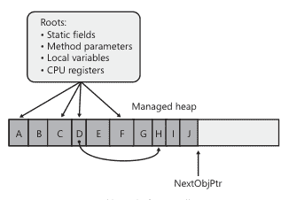

**图 21-3** 回收前的托管堆

在标记完一个根及其字段所引用的对象之后，垃圾回收器会检查下一个根并继续标记对象。如果垃圾回收器要标记一个它之前已经标记过的对象，它就可以停止沿着该路径继续向下遍历。这种行为有两个目的。第一，性能会显著提高，因为垃圾回收器不会多次遍历同一组对象。第二，如果你有任何循环链接的对象列表，还可以防止出现无限循环。

一旦检查完所有根，堆中就包含一组已标记对象和未标记对象。已标记对象可通过应用程序代码访问，未标记对象则不可访问。不可访问的对象被视为垃圾，它们占用的内存可以被回收。现在，垃圾回收器开始执行所谓的回收*压缩阶段*。此时，回收器会线性遍历堆，查找未标记（垃圾）对象的连续块。

如果找到的是小块，垃圾回收器会不处理这些块。但是，如果找到大的连续空闲块，垃圾回收器就会在内存中向下移动非垃圾对象，以压缩堆。

当然，在内存中移动对象会使所有包含对象指针的变量和 CPU 寄存器失效。因此，垃圾回收器必须重新访问应用程序的所有根并修改它们，使每个根的值都指向对象新的内存位置。此外，如果任何对象包含引用另一个已移动对象的字段，垃圾回收器也负责修正这些字段。堆内存压缩完成后，托管堆的 **NextObjPtr** 指针会被设置为指向最后一个非垃圾对象之后的位置。图 21-4 展示了回收后的托管堆。

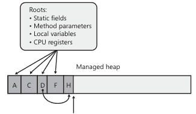

如你所见，垃圾回收会造成相当大的性能损失，这是使用托管堆的主要缺点。但请记住，只有在第 0 代已满时才会发生垃圾回收；在此之前，托管堆比 C 运行时堆快得多。最后，CLR 的垃圾回收器提供了一些优化，可极大提高垃圾回收的性能。我将在本章后面的“代”和“用于本机资源的其他垃圾回收功能”两节中讨论这些优化。

作为程序员，你应当从这段讨论中记住几个要点。首先，你不再需要编写任何代码来管理应用程序所用对象的生存期。并且请注意，本章开头描述的两个 bug 不再存在。第一，不可能泄漏对象，因为任何无法从应用程序的根访问到的对象都可能在某个时刻被回收。第二，不可能访问已释放的对象，因为对象只要可达就不会被释放，而如果它不可达，你的应用程序也就无法访问它。另外，由于回收会导致内存压缩，托管对象不可能使进程的虚拟地址空间产生碎片。使用非托管堆时，这有时会是一个严重问题，但使用托管堆时就不再是问题。使用大对象（本章后面会讨论）是例外，大对象堆可能出现碎片化。

> **重要** 类型的静态字段会一直根引用它所指向的任何对象，直到加载这些类型的 AppDomain 被卸载为止。造成内存泄漏的一种常见方式是让静态字段引用一个集合对象，然后不断向该集合对象中添加项。静态字段使集合对象保持存活，而集合对象又使其所有项保持存活。因此，最好尽可能避免使用静态字段。

## 垃圾回收与调试

在图 21-2 中，请注意，方法的 `bytes` 参数（存储在 ESI 寄存器中）在偏移量 `0x00000028` 处的 CPU 指令之后就不再被引用了。这意味着，`bytes` 参数所引用的 `Byte` 数组对象可以在偏移量 `0x00000028` 处的指令执行之后的任意时刻被回收（假设应用程序中没有其他根也引用这个数组对象）。换句话说，对象一旦变得不可达，就会成为回收候选对象——并不保证对象会在方法的整个生存期内一直存活。这可能会对你的应用程序产生有趣的影响。例如，检查以下代码：


```csharp
using System;
using System.Threading;

public static class Program {
    public static void Main() {
        // Create a Timer object that knows to call our TimerCallback
        // method once every 2000 milliseconds.
        Timer t = new Timer(TimerCallback, null, 0, 2000);

        // Wait for the user to hit <Enter>
        Console.ReadLine();
    }

    private static void TimerCallback(Object o) {
        // Display the date/time when this method got called.
        Console.WriteLine("In TimerCallback: " + DateTime.Now);

        // Force a garbage collection to occur for this demo.
        GC.Collect();
    }
}
```

在命令提示符下编译此代码，不要使用任何特殊的编译器开关。运行生成的可执行文件时，你会看到 `TimerCallback` 方法只被调用一次！

通过查看上面的代码，你会认为 `TimerCallback` 方法每 2,000 毫秒会被调用一次。毕竟，创建了一个 `Timer` 对象，而变量 `t` 引用了该对象。只要计时器对象存在，计时器就应该持续触发。但你会注意到，在 `TimerCallback` 方法中，我通过调用 `GC.Collect()` 强制发生了一次垃圾回收。

垃圾回收开始时，它首先假定堆中的所有对象都不可达（垃圾）；这包括 `Timer` 对象。然后，回收器检查应用程序的根，发现 `Main` 在最初给 `t` 变量赋值后就不再使用该变量。因此，应用程序中没有变量引用该 `Timer` 对象，垃圾回收便回收了它的内存；这会停止计时器，并解释了为什么 `TimerCallback` 方法只被调用一次。

假设你正使用调试器单步执行 `Main`，而垃圾回收恰好在 `t` 被赋予新 `Timer` 对象的地址之后发生。然后，假设你尝试通过调试器的“快速监视”窗口查看 `t` 引用的对象。你认为会发生什么？调试器无法向你显示该对象，因为它刚刚被垃圾回收了。大多数开发者会认为这种行为非常出人意料且不可取，因此 Microsoft 提出了一种解决方案。

当 JIT 编译器将方法的 IL 编译为本机代码时，它会检查定义该方法的程序集是否在未启用优化的情况下编译，以及进程当前是否正在调试器下执行。如果这两个条件都成立，JIT 编译器会生成该方法的内部根表，以人为方式将所有变量的生存期延长到方法结束。换言之，JIT 编译器会欺骗自己，使其相信 `Main` 中的 `t` 变量必须存活到方法结束。因此，如果发生垃圾回收，垃圾回收器现在会认为 `t` 仍是根，并且 `t` 引用的 `Timer` 对象将继续可达。`Timer` 对象将在回收后存活，`TimerCallback` 方法将被反复调用，直到 `Console.ReadLine` 返回且 `Main` 退出。这很容易看到。只需在调试器下运行同一个可执行文件，你就会看到 `TimerCallback` 方法被反复调用！

现在，在命令提示符下重新编译该程序，但这次指定 C# 编译器的 `/debug+` 命令行开关。运行生成的可执行文件时，你现在会看到 `TimerCallback` 方法被反复调用——即使你没有在调试器下运行该程序！这是怎么回事？

嗯，当 JIT 编译器编译某个方法时，JIT 编译器会检查定义该方法的程序集是否包含 `System.Diagnostics.DebuggableAttribute` 特性，且其 `DebuggingModes` 的 `DisableOptimizations` 标志已设置。如果 JIT 编译器看到此标志已设置，它也会在编译该方法时人为地将所有变量的生存期延长到方法结束。当你指定 `/debug+` 编译器开关时，C# 编译器会为你将此特性和标志生成到生成的程序集中。注意，C# 编译器的 `/optimize+` 编译器开关可以重新开启优化，因此进行此实验时不应指定该编译器开关。

JIT 编译器这样做是为了帮助你进行 JIT 调试。你现在可以正常启动应用程序（不使用调试器），而当该方法被调用时，JIT 编译器会人为地将变量的生存期延长到方法结束。之后，如果你决定将调试器附加到该进程，你可以在之前已编译的方法中设置断点并检查变量。

所以现在你知道如何构建一个在调试版本中正常工作、但在发布版本中无法正常工作的程序了！既然没有开发者希望程序只在调试时才能正常工作，我们就应该能对程序做些处理，使其无论何种版本都能始终正常工作。

你可以尝试将 `Main` 方法修改为：

```csharp
public static void Main() {
    // Create a Timer object that knows to call our TimerCallback
    // method once every 2000 milliseconds.
    Timer t = new Timer(TimerCallback, null, 0, 2000);

    // Wait for the user to hit <Enter>
    Console.ReadLine();

    // Refer to t after ReadLine (this gets optimized away)
    t = null;
}
```

但是，如果你编译这段代码（不指定 `/debug+` 开关）并运行生成的可执行文件（不在调试器下），你会看到 `TimerCallback` 方法仍然只被调用一次。这里的问题在于，JIT 编译器是优化编译器，而将局部变量或参数变量设置为 `null` 与完全不引用该变量相同。换言之，JIT 编译器会完全将 `t = null;` 这一行从代码中优化掉，因此程序仍然无法按我们希望的方式工作。修改 `Main` 方法的正确方式如下：

```csharp
public static void Main() {
    // Create a Timer object that knows to call our TimerCallback
    // method once every 2000 milliseconds.
    Timer t = new Timer(TimerCallback, null, 0, 2000);

    // Wait for the user to hit <Enter>
    Console.ReadLine();

    // Refer to t after ReadLine (t will survive GCs until Dispose returns)
    t.Dispose();
}
```

现在，如果你编译这段代码（不指定 `/debug+` 开关）并运行生成的可执行文件（不在调试器下），你会看到 `TimerCallback` 方法被多次调用，程序问题得到修复。这里发生的情况是，必须让 `t` 引用的对象保持存活，以便能对其调用 `Dispose` 实例方法（需要将 `t` 中的值作为 `this` 参数传递给 `Dispose`）。

> **注意** 请不要读完整个讨论后，就担心你自己的对象会被过早垃圾回收。我在本讨论中使用 `Timer` 类，是因为它具有其他任何类都不具备的特殊行为。`Timer` 的“问题/特性”在于，堆中存在一个 `Timer` 对象会导致其他事情发生：线程池线程会定期调用某个方法。没有其他类型表现出这种行为。例如，内存中存在一个 `String` 对象不会导致其他任何事情发生；该字符串只是待在那里。因此，我使用 `Timer` 来演示根的工作原理，以及与调试器相关的对象生存期如何工作，但本讨论实际上并不是关于如何让对象保持存活。所有非 `Timer` 对象都会根据应用程序的需要自动存活。

## 使用终结释放本机资源

至此，你应当对垃圾回收和托管堆有了基本理解，包括垃圾回收器如何回收对象的内存。对我们来说幸运的是，大多数类型只需要内存即可运行。然而，有些类型除了内存之外还需要更多资源才能发挥作用；有些类型除了内存之外还需要使用本机资源。

例如，`System.IO.FileStream` 类型需要打开一个文件（本机资源）并存储该文件的句柄。然后，该类型的 `Read` 和 `Write` 方法使用此句柄来操作文件。类似地，`System.Threading.Mutex` 类型会打开一个 Windows 互斥内核对象（本机资源）并存储其句柄，在调用 `Mutex` 的方法时使用该句柄。


*终结*是 CLR 提供的一种机制，它允许对象在垃圾回收器回收该对象的内存之前执行一些优雅的清理工作。任何包装本机资源的类型，例如文件、网络连接、套接字、互斥体或其他类型，都必须支持终结。基本上，该类型实现一个名为 **Finalize** 的方法。当垃圾回收器确定某个对象是垃圾时，它会调用该对象的 **Finalize** 方法（如果存在）。我是这样理解的：任何实现了 **Finalize** 方法的类型实际上都在声明，它的所有对象在被杀死之前都想要最后一餐。

Microsoft 的 C# 团队认为，**Finalize** 方法是一种特殊的方法，需要在编程语言中使用特殊语法（类似于 C# 定义构造函数需要特殊语法）。因此，在 C# 中，必须通过在类名前面放置一个波浪号（~）来定义 **Finalize** 方法，如下面的代码示例所示：

```
internal sealed class SomeType {
    // This is the Finalize method
    ~SomeType() {
        // The code here is inside the Finalize method
    }
}
```

如果编译这段代码并使用 ILDasm.exe 检查生成的程序集，你会看到 C# 编译器确实向模块的元数据中发出了一个名为 **Finalize** 的 **protected override** 方法。如果检查 **Finalize** 方法的 IL 代码，你还会看到方法体内的代码被发出到一个 **try** 块中，而对 **base.Finalize** 的调用被发出到一个 **finally** 块中。

> **重要** 如果你熟悉 C++，你会注意到 C# 定义 **Finalize** 方法所需的特殊语法看起来就像定义 C++ 析构函数所用的语法。事实上，《C# 编程语言规范》将此方法称为*析构函数*。然而，**Finalize** 方法的工作方式与未托管的 C++ 析构函数完全不同，这给从一个语言迁移到另一个语言的开发者带来了大量困惑。
>
> 问题在于，开发者错误地认为使用 C# 析构函数语法意味着该类型的对象将被确定性地析构，就像在 C++ 中那样。然而，CLR 不支持确定性销毁，因此 C# 无法提供这种机制。

**Finalize** 方法通常实现为调用 Win32 **CloseHandle** 函数，并传入本机资源的句柄。**FileStream** 类型定义了一个文件句柄字段，用于标识本机资源。**FileStream** 类型还定义了一个 **Finalize** 方法，它在内部调用 **CloseHandle**，并将文件句柄字段传递给它；这确保当托管 **FileStream** 对象被确定为垃圾时，本机文件句柄会被关闭。如果包装本机资源的类型未能定义 **Finalize** 方法，则本机资源不会被关闭，并会导致资源泄漏，该泄漏将一直存在，直到进程终止，届时操作系统将回收本机资源。

## 使用 CriticalFinalizerObject 类型保证终结

为了让开发人员的工作更简单，`System.Runtime.ConstrainedExecution` 命名空间定义了一个 `CriticalFinalizerObject` 类，如下所示：

```
    public abstract class CriticalFinalizerObject {
        protected CriticalFinalizerObject() { /* there is no code in here */ }

        // This is the Finalize method
        ~CriticalFinalizerObject() { /* there is no code in here */ }
    }
```

我知道你在想这个类看起来并不怎么令人兴奋，但 CLR 会以一种非常特殊的方式对待这个类以及从它派生的类。具体来说，CLR 赋予这个类三个很酷的特性：

- 第一次构造任何 `CriticalFinalizerObject` 派生类型的对象时，CLR 会立即 JIT 编译继承层次结构中的所有 `Finalize` 方法。在对象构造时编译这些方法可以保证当对象被确定为垃圾时本机资源会被释放。如果没有这种对 `Finalize` 方法的急切编译，就可能出现分配并使用本机资源，却无法摆脱它的情况。在内存不足的情况下，CLR 可能找不到足够的内存来编译 `Finalize` 方法，这将阻止其执行，导致本机资源泄漏。或者，如果 `Finalize` 方法包含引用另一个程序集中的类型的代码，而 CLR 无法定位这个另一个程序集，则资源可能不会被释放。
- CLR 在调用非 `CriticalFinalizerObject` 派生类型的 `Finalize` 方法之后，才会调用 `CriticalFinalizerObject` 派生类型的 `Finalize` 方法。这确保具有 `Finalize` 方法的托管资源类可以在其 `Finalize` 方法中成功访问 `CriticalFinalizerObject` 派生对象。例如，`FileStream` 类的 `Finalize` 方法可以放心地将数据从内存缓冲区刷新到底层磁盘，确信磁盘文件尚未关闭。
- 如果 `AppDomain` 被宿主应用程序（例如 Microsoft SQL Server 或 Microsoft ASP.NET）粗暴中止，CLR 会调用 `CriticalFinalizerObject` 派生类型的 `Finalize` 方法。这也是确保即使宿主应用程序不再信任在其内部运行的托管代码时，本机资源也能被释放的一部分。

## SafeHandle 及其派生类型

现在，Microsoft 意识到最常用的本机资源是由 Windows 提供的资源。Microsoft 还意识到大多数 Windows 资源都是通过句柄来操作的（32 位系统上是 32 位值，64 位系统上是 64 位值）。同样，为了让开发人员的生活更轻松、更安全，**System.Runtime.InteropServices** 命名空间包含一个名为 **SafeHandle** 的类，如下所示（我在方法中添加了注释以说明它们的作用）：

```csharp
public abstract class SafeHandle : CriticalFinalizerObject, IDisposable {
   // This is the handle to the native resource
   protected IntPtr handle;

   protected SafeHandle(IntPtr invalidHandleValue, Boolean ownsHandle) {
      this.handle = invalidHandleValue;
      // If ownsHandle is true, then the native resource is closed when
      // this SafeHandle-derived object is collected
   }

   protected void SetHandle(IntPtr handle) {
      this.handle = handle;
   }

   // You can explicitly release the resource by calling Dispose or Close
   public void Dispose() { Dispose(true); }
   public void Close() { Dispose(true); }

   // The default Dispose implementation (shown here) is exactly what you want.
   // Overriding this method is strongly discouraged.
   protected virtual void Dispose(Boolean disposing) {
      // The default implementation ignores the disposing argument.
      // If resource was already released, just return
      // If ownsHandle is false, return
      // Set flag indicating that this resource has been released
      // Call the virtual ReleaseHandle method
      // Call GC.SuppressFinalize(this) to prevent Finalize from being called
      // If ReleaseHandle returned true, return
      // Fire the ReleaseHandleFailed Managed Debugging Assistant (MDA)
   }

   // The default Finalize implementation (shown here) is exactly what you want.
   // Overriding this method is very strongly discouraged.
   ~SafeHandle() { Dispose(false); }

   // A derived class overrides this method to implement the code that releases the resource
   protected abstract Boolean ReleaseHandle();

   public void SetHandleAsInvalid() {
      // Set flag indicating that this resource has been released
      // Call GC.SuppressFinalize(this) to prevent Finalize from being called
   }

   public Boolean IsClosed {
      get {
         // Returns flag indicating whether resource was released
      }
   }
}
```


```csharp
public abstract Boolean IsInvalid {
    get {
        // A derived class overrides this property.
        // The implementation should return true if the handle's value doesn't
        // represent a resource (this usually means that the handle is 0 or -1).
    }
}

// These three methods have to do with security and reference counting;
// I'll talk about them at the end of this section
public void DangerousAddRef(ref Boolean success) {...}
public IntPtr DangerousGetHandle() {...}
public void DangerousRelease() {...}
}
```

关于 **SafeHandle** 类，首先要注意的是它派生自 **CriticalFinalizerObject**；这确保它能获得 CLR 的特殊处理。其次要注意的是，该类是抽象的；预期会从 **SafeHandle** 派生出另一个类，并由该类重写受保护构造函数、抽象方法 **ReleaseHandle** 以及抽象 **IsInvalid** 属性的 **get** 访问器方法。

在 Windows 中，大多数句柄如果值为 0 或 -1 就是无效的。**Microsoft.Win32.SafeHandles** 命名空间包含另一个名为 **SafeHandleZeroOrMinusOneIsInvalid** 的辅助类，如下所示：

```csharp
public abstract class SafeHandleZeroOrMinusOneIsInvalid : SafeHandle {
    protected SafeHandleZeroOrMinusOneIsInvalid(Boolean ownsHandle)
        : base(IntPtr.Zero, ownsHandle) {
    }

    public override Boolean IsInvalid {
        get {
            if (base.handle == IntPtr.Zero) return true;
            if (base.handle == (IntPtr) (-1)) return true;
            return false;
        }
    }
}
```

同样，你会注意到 **SafeHandleZeroOrMinusOneIsInvalid** 类是抽象的，因此必须从该类派生另一个类，以重写受保护构造函数和抽象方法 **ReleaseHandle**。.NET Framework 只提供了少数派生自 **SafeHandleZeroOrMinusOneIsInvalid** 的公共类，包括 **SafeFileHandle**、**SafeRegistryHandle**、**SafeWaitHandle** 和 **SafeBuffer**。**SafeFileHandle** 类如下所示：

```csharp
public sealed class SafeFileHandle : SafeHandleZeroOrMinusOneIsInvalid {
    public SafeFileHandle(IntPtr preexistingHandle, Boolean ownsHandle)
        : base(ownsHandle) {
        base.SetHandle(preexistingHandle);
    }

    protected override Boolean ReleaseHandle() {
        // Tell Windows that we want the native resource closed.
        return Win32Native.CloseHandle(base.handle);
    }
}
```

`SafeWaitHandle` 类的实现与上面显示的 `SafeFileHandle` 类类似。存在实现相似的不同类的唯一原因是为了实现类型安全；编译器不会允许你把文件句柄用作期望等待句柄的方法的参数，反之亦然。`SafeRegistryHandle` 类的 `ReleaseHandle` 方法调用 Win32 `RegCloseKey` 函数。

如果 .NET Framework 包含包装各种本机资源的其他类，那就好了。例如，可以设想诸如 `SafeProcessHandle`、`SafeThreadHandle`、`SafeTokenHandle`、`SafeFileMappingHandle`、`SafeViewOfFileHandle`（其 `ReleaseHandle` 方法将调用 Win32 `UnmapViewOfFile` 函数）、`SafeLibraryHandle`（其 `ReleaseHandle` 方法将调用 Win32 `FreeLibrary` 函数）、`SafeLocalAllocHandle`（其 `ReleaseHandle` 方法将调用 Win32 `LocalFree` 函数）等类。

刚刚列出的所有类（以及更多类）实际上都随 Framework Class Library (FCL) 一起提供。然而，这些类并未公开暴露；它们都是 MSCorLib.dll 或 System.dll 的内部类。Microsoft 不公开暴露这些类，是因为他们不想对它们进行全面测试，也不想花时间为它们编写文档。不过，如果你在自己的工作中需要其中任何类，我建议你使用 ILDasm.exe 之类的工具或某种 IL 反编译器工具，提取这些类的代码，并将该代码集成到你自己的项目源代码中。所有这些类实现起来都很简单，从头编写它们也相当容易。

### 使用 SafeHandle 类型与非托管代码互操作

如前所述，`SafeHandle` 派生类非常有用，因为它们确保在发生垃圾回收时释放本机资源。除了我们已经讨论的内容之外，`SafeHandle` 还提供另外两项能力。首先，当在与非托管代码互操作的场景中使用 `SafeHandle` 派生类型时，CLR 会给予它们特殊处理。例如，让我们检查以下代码：

```csharp
using System;
using System.Runtime.InteropServices;
using Microsoft.Win32.SafeHandles;

internal static class SomeType {
    [DllImport("Kernel32", CharSet=CharSet.Unicode, EntryPoint="CreateEvent")]
    // This prototype is not robust
    private static extern IntPtr CreateEventBad(
        IntPtr pSecurityAttributes, Boolean manualReset, Boolean initialState, String name);

    // This prototype is robust
    [DllImport("Kernel32", CharSet=CharSet.Unicode, EntryPoint="CreateEvent")]
    private static extern SafeWaitHandle CreateEventGood(
        IntPtr pSecurityAttributes, Boolean manualReset, Boolean initialState, String name);

    public static void SomeMethod() {
        IntPtr handle = CreateEventBad(IntPtr.Zero, false, false, null);
        SafeWaitHandle swh = CreateEventGood(IntPtr.Zero, false, false, null);
    }
}
```

你会注意到，**CreateEventBad** 方法的原型被声明为返回 **IntPtr**。在 .NET Framework 2.0 版之前，**SafeHandle** 类并不存在，你必须使用 **IntPtr** 类型来表示句柄。Microsoft 的 CLR 团队发现，这段代码并不健壮。你看，在调用 **CreateEventBad**（它会创建本机事件资源）之后，有可能在句柄被赋给句柄变量之前抛出 **ThreadAbortException**。在发生这种情况的罕见情形下，托管代码会泄漏本机资源。关闭该事件的唯一方式将是终止进程。

现在，借助 .NET Framework 2.0 及更高版本，我们可以使用 **SafeHandle** 类修复这一潜在资源泄漏。请注意，**CreateEventGood** 方法的原型被声明为返回 **SafeWaitHandle**（而不是 **IntPtr**）。当调用 **CreateEventGood** 时，CLR 会调用 Win32 **CreateEvent** 函数。当 **CreateEvent** 函数返回到托管代码时，CLR 知道 **SafeWaitHandle** 派生自 **SafeHandle**，从而使 CLR 自动构造 **SafeWaitHandle** 类的实例，并传入 **CreateEvent** 返回的句柄值。**SafeWaitHandle** 对象的创建和句柄的赋值发生在非托管代码中，而该过程不能被 **ThreadAbortException** 中断。现在，托管代码不可能泄漏此本机资源。最终，**SafeWaitHandle** 对象会被垃圾回收，并调用其 **Finalize** 方法，从而确保资源被释放。

**SafeHandle** 派生类的最后一个特性是，它们可防止有人试图利用潜在安全漏洞。问题在于，一个线程可能试图使用本机资源，而另一个线程试图释放该资源。这可能表现为句柄回收漏洞利用。**SafeHandle** 类通过使用引用计数来防止此安全漏洞。在内部，**SafeHandle** 类定义了一个维护计数的私有字段。当 **SafeHandle** 派生对象被设置为有效句柄时，计数被设置为 1。每当 **SafeHandle** 派生对象作为参数传递给非托管方法时，CLR 知道要自动递增计数器。同样，当非托管方法返回到托管代码时，CLR 知道要递减计数器。例如，你会按如下方式为 Win32 **SetEvent** 函数编写原型：

```csharp
[DllImport("Kernel32", ExactSpelling=true)]
private static extern Boolean SetEvent(SafeWaitHandle swh);
```


现在，当你调用此方法并向其传入一个 `SafeWaitHandle` 对象的引用时，CLR 会在调用前递增计数器，并在调用后递减计数器。当然，计数器的操作是以线程安全的方式执行的。这如何提高安全性呢？好吧，如果另一个线程试图释放由 `SafeHandle` 对象包装的本机资源，CLR 知道它实际上不能释放该资源，因为该资源正被非托管函数使用。当非托管函数返回时，计数器递减为 0，资源将被释放。

如果你正在编写或调用将句柄作为 `IntPtr` 操作的代码，你可以从 `SafeHandle` 对象中获取它，但你应该显式地操作引用计数。你可以通过 `SafeHandle` 的 `DangerousAddRef` 和 `DangerousRelease` 方法来实现这一点。你可以通过 `DangerousGetHandle` 方法访问原始句柄。

如果我不提一下 `System.Runtime.InteropServices` 命名空间还定义了一个 `CriticalHandle` 类，那我就失职了。这个类在所有方面都与 `SafeHandle` 类完全相同，只是它不提供引用计数功能。`CriticalHandle` 类及其派生类在使用时会牺牲安全性来换取更好的性能（因为计数器不会被操作）。和 `SafeHandle` 一样，`CriticalHandle` 类也有两个派生类型：`CriticalHandleMinusOneIsInvalid` 和 `CriticalHandleZeroOrMinusOneIsInvalid`。由于 Microsoft 更倾向于安全的系统而非更快的系统，因此类库中不包含从这两个类派生的任何类型。对于你自己的工作，我建议只有在性能成为问题时才使用 `CriticalHandle` 派生类型。如果你能证明降低安全性是合理的，你就可以改用 `CriticalHandle` 派生类型。

### 对托管资源使用终结

> **重要提示** 有些人认为绝不应该对托管资源使用终结。在很大程度上，我同意这些人的看法。因此，你可能想完全跳过本节。对托管资源使用终结是一种超级高级的编码方式，只应在极少数情况下使用。你必须对在 `Finalize` 方法内部调用的代码有完全而深入的了解。此外，你必须知道你调用的代码的行为不会随着未来版本而改变。具体来说，你必须知道你在 `Finalize` 方法中调用的任何代码都不会使用任何可能已经被终结的其他对象。

虽然终结几乎专门用于释放本机资源，但偶尔对托管资源也可能有用。下面是一个类，它会在垃圾回收器每次执行回收时使计算机发出蜂鸣声：

```csharp
internal sealed class GCBeep {
    ~GCBeep() { // This is the Finalize method
        Console.Beep();

        // If the AppDomain isn't unloading and if the process isn't shutting down,
        // create a new object that will get finalized at the next collection.
        if (!AppDomain.CurrentDomain.IsFinalizingForUnload() && !Environment.HasShutdownStarted)
            new GCBeep();
    }
}
```

要使用这个类，你只需构造一个该类的实例。然后每当发生垃圾回收时，对象的 **Finalize** 方法就会被调用，该方法调用 **Beep** 并构造一个新的 **GCBeep** 对象。当下一次垃圾回收发生时，这个新的 **GCBeep** 对象的 **Finalize** 方法将被调用。下面是一个演示 **GCBeep** 类的示例程序：

```csharp
public static class Program {
    public static void Main() {
        // Constructing a single GCBeep object causes a beep to occur every time a GC starts.
        new GCBeep();

        // Construct a lot of 100-byte objects.
        for (Int32 x = 0; x < 10000; x++) {
            Console.WriteLine(x);
            Byte[] b = new Byte[100];
        }
    }
}
```

> **注意** 尽管 **GCBeep** 类很有用，但我会提供一个更有用的 **GCNotification** 类，它允许你检测应用程序，从而让你更深入地了解应用程序的内存使用情况。你会在本章后面的“代”一节的末尾看到这个类。

还要注意，即使类型的实例构造函数抛出异常，类型的 **Finalize** 方法也会被调用。因此，你的 **Finalize** 方法不应假设对象处于良好、一致的状态。下面的代码演示了这一点：

```csharp
internal sealed class TempFile {
    private String m_filename = null;
    private FileStream m_fs;

    public TempFile(String filename) {
        // The following line might throw an exception.
        m_fs = new FileStream(filename, FileMode.Create);

        // Save the name of this file.
        m_filename = filename;
    }
}
```

对于第五种事件，每个 **Finalize** 方法大约有 2 秒的时间返回。如果某个 **Finalize** 方法未能在 2 秒内返回，CLR 就会直接终止进程——不再调用任何 **Finalize** 方法。此外，如果调用所有对象的 **Finalize** 方法耗时超过 40 秒，CLR 同样会直接终止进程。

> **注意** 这些超时值在我撰写本文时是正确的，但 Microsoft 将来可能会更改它们。**Finalize** 方法中的代码可以构造新对象。如果这发生在 CLR 关闭期间，CLR 会继续收集对象并调用其 **Finalize** 方法，直到不再有对象存在或 40 秒时间耗尽。

回顾本章前面介绍的 **GCBeep** 类型。如果 **GCBeep** 对象由于第一种、第二种或第三种垃圾回收原因而被终结，则会构造一个新的 **GCBeep** 对象。这是没问题的，因为应用程序会继续运行，并且假定将来还会发生更多的回收。然而，如果 **GCBeep** 对象由于第四种或第五种垃圾回收原因而被终结，就不应该构造新的 **GCBeep** 对象，因为该对象将在 AppDomain 卸载或 CLR 关闭时被创建。如果创建了这些新对象，CLR 将有一大堆无用的事情要做，因为它会继续调用 **Finalize** 方法。

为了防止构造新的 **GCBeep** 对象，**GCBeep** 的 **Finalize** 方法会调用 **AppDomain** 的 **IsFinalizingForUnload** 方法，并查询 **System.Environment** 的 **HasShutdownStarted** 属性。如果对象的 **Finalize** 方法是因为 AppDomain 正在卸载而被调用，**IsFinalizingForUnload** 方法返回 **true**。如果对象的 **Finalize** 方法是因为进程正在终止而被调用，**HasShutdownStarted** 属性返回 **true**。

### 终结的内部机制

从表面上看，终结似乎非常简单：你创建一个对象，当它被回收时，其 **Finalize** 方法就会被调用。但一旦深入探究，终结要比这复杂得多。

当应用程序创建一个新对象时，**new** 运算符会从堆中分配内存。如果对象的类型定义了 **Finalize** 方法，那么在类型实例构造函数被调用之前，一个指向该对象的指针会被放入 *终结列表*。终结列表是由垃圾回收器控制的一种内部数据结构。列表中的每一项都指向一个对象，该对象的 **Finalize** 方法应在该对象的内存可被回收之前调用。

图 21-5 显示了一个包含多个对象的堆。其中一些对象可以从应用程序的根访问，而另一些则不能。当对象 C、E、F、I 和 J 被创建时，系统检测到这些对象的类型定义了 **Finalize** 方法，因此将这些对象的指针添加到了终结列表中。


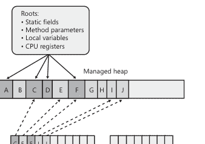

**图 21-5** 托管堆，显示其终结列表中的指针

> **注意** 即使 **System.Object** 定义了 **Finalize** 方法，CLR 也知道要忽略它；也就是说，在构造某个类型的实例时，如果该类型的 **Finalize** 方法是从 **System.Object** 继承来的那个方法，则该对象不会被视为可终结的。某个派生类型必须重写 **Object 的 Finalize** 方法。

发生垃圾回收时，对象 B、E、G、H、I 和 J 被判定为垃圾。垃圾回收器会扫描终结列表，查找指向这些对象的指针。找到指针后，该指针会从终结列表中移除，并追加到 *freachable 队列*。freachable 队列（发音为“F-reachable”）是垃圾回收器的另一个内部数据结构。freachable 队列中的每个指针都标识一个已准备好调用其 **Finalize** 方法的对象。回收之后，托管堆看起来如图 21-6 所示。

在此图中，可以看到对象 B、G 和 H 占用的内存已被回收，因为这些对象没有 **Finalize** 方法。然而，对象 E、I 和 J 占用的内存无法回收，因为它们的 **Finalize** 方法尚未被调用。

一个特殊的高优先级 CLR 线程专门负责调用 **Finalize** 方法。使用专用线程是为了避免在改用应用程序的普通优先级线程时可能出现的潜在线程同步情况。当 freachable 队列为空时（通常情况），该线程会休眠。但当出现条目时，该线程会唤醒，从队列中移除每个条目，然后调用每个对象的 **Finalize** 方法。由于该线程的工作方式，不应在 **Finalize** 方法中执行任何对执行代码的线程做出假设的代码。例如，避免在 **Finalize** 方法中访问线程本地存储。

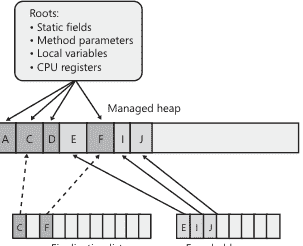

图 21-6 托管堆，显示已从终结列表移动到 freachable 队列的指针

将来，CLR 可能会使用多个终结器线程。因此，应避免编写任何假设 `Finalize` 方法将串行调用的代码。换言之，如果 `Finalize` 方法中的代码会访问共享状态，则需要使用线程同步锁。仅有一个终结器线程时，如果你有多个 CPU 分配可终结对象，但只有一个线程执行 `Finalize` 方法，则可能出现性能和可伸缩性问题——这一个线程可能无法跟上分配速度。

终结列表与 freachable 队列之间的交互非常有趣。首先，我来说明 freachable 队列如何得名。其中“f”很明显，代表 finalization（终结）；freachable 队列中的每个条目都是对托管堆中某个对象的引用，该对象的 `Finalize` 方法应被调用。但名称中的 reachable 部分意味着这些对象是可达的。换言之，freachable 队列被视为一个根，就像静态字段是根一样。因此，如果一个对象位于 freachable 队列中，该对象就是可达的，不是垃圾。

简而言之，当对象不可达时，垃圾回收器会将该对象视为垃圾。然后，当垃圾回收器将对象的引用从终结列表移动到 freachable 队列时，该对象不再被视为垃圾，其内存也无法回收。在标记 freachable 对象时，通过其引用类型字段引用的对象也会被递归标记；所有这些对象都必须在回收后存活。此时，垃圾回收器已完成垃圾识别。一些被识别为垃圾的对象已被重新分类为非垃圾——某种意义上，该对象已经复活。垃圾回收器会压缩可回收内存，而特殊的 CLR 线程会清空 freachable 队列，执行每个对象的 `Finalize` 方法。

下一次调用垃圾回收器时，它会看到已终结的对象是真正的垃圾，因为应用程序的根不指向它，freachable 队列也不再指向它。该对象的内存会被直接回收。从所有这些内容中要得到的重要一点是：要回收需要终结的对象所使用的内存，需要两次垃圾回收。实际上，需要超过两次回收，因为这些对象会被提升到另一代（我稍后会解释）。图 21-7 显示了第二次垃圾回收之后托管堆的样子。

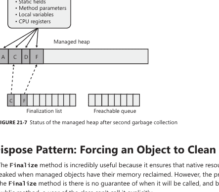

## Dispose 模式：强制对象清理

**Finalize** 方法非常有用，因为它确保托管对象的内存被回收时不会泄漏本机资源。然而，**Finalize** 方法的问题在于无法保证何时调用它，而且由于它不是公共方法，类的使用者无法显式调用它。

当你使用包装文件、数据库连接和位图等本机资源的托管类型时，确定性地释放或关闭对象的能力常常很有用。例如，你可能想打开数据库连接、查询一些记录，然后关闭数据库连接——你不会希望数据库连接一直保持打开直到下一次垃圾回收发生，尤其是下一次垃圾回收可能在你检索数据库记录数小时甚至数天后才发生。

提供确定性释放或关闭能力的类型会实现所谓的 *Dispose 模式*。Dispose 模式定义了一些约定，开发人员在定义希望向类型使用者提供显式清理的类型时应遵循这些约定。此外，如果类型实现了 Dispose 模式，使用该类型的开发人员就能确切知道在不再需要对象时如何显式释放该对象。

> **重要** 你需要了解这里的一些版本控制问题。如果在版本 1 中，基类型未实现 **IDisposable** 接口，那么它在后续版本中也永远不能实现该接口。如果基类型将来添加 **IDisposable** 接口，所有派生类型都不会知道要调用基类型的方法，基类型也就没有机会正确清理自身。另一方面，如果在版本 1 中基类型实现了 **IDisposable** 接口，那么它在后续版本中也永远不能移除该接口，因为派生类型会尝试调用基类型中已不存在的方法。

这段代码另一个值得注意的地方是，在接收 `Boolean` 的 `Dispose` 方法内部调用了 `GC` 的静态 `SuppressFinalize` 方法。要知道，如果使用 `SafeHandle` 对象的代码显式调用了 `Dispose` 或 `Close`，则无需执行该对象的 `Finalize` 方法，因为如果 `Finalize` 确实执行了，就会不必要地尝试第二次释放资源。对 `GC` 的 `SuppressFinalize` 的调用会打开一个位标志，该标志与其单个 `this` 参数所引用的对象相关联。当此标志打开时，CLR 知道不要将此对象的指针从终结列表移动到 freachable 队列，从而防止调用该对象的 `Finalize` 方法，并确保该对象不会一直存活到下一次垃圾回收。请注意，即使对象正在被终结，`SafeHandle` 类也会调用 `SuppressFinalize`。这不会产生不良影响，因为该对象已经处于终结过程中。

## 使用实现 Dispose 模式的类型

现在你已经知道类型如何实现 Dispose 模式，我们来看看开发者如何使用提供 Dispose 模式的类型。这里不讨论 `SafeHandle` 类，而讨论更常见的 `System.IO.FileStream` 类。`FileStream` 类提供打开文件、从文件读取字节、向文件写入字节以及关闭文件的能力。构造 `FileStream` 对象时，会调用 Win32 `CreateFile` 函数，返回的句柄保存在 `SafeFileHandle` 对象中，并通过 `FileStream` 对象中的私有字段维护对该对象的引用。`FileStream` 类还提供若干附加属性（如 `Length`、`Position`、`CanRead`）和方法（如 `Read`、`Write`、`Flush`）。

假设你想编写一些代码：创建一个临时文件，向该文件写入一些字节，然后删除该文件。你可能会这样开始写代码：

```csharp
using System;
using System.IO;

public static class Program {
    public static void Main() {
        // Create the bytes to write to the temporary file.
        Byte[] bytesToWrite = new Byte[] { 1, 2, 3, 4, 5 };

        // Create the temporary file.
        FileStream fs = new FileStream("Temp.dat", FileMode.Create);
    }
}
```


```csharp
// Write the bytes to the temporary file.
fs.Write(bytesToWrite, 0, bytesToWrite.Length);

// Delete the temporary file.
File.Delete("Temp.dat");  // Throws an IOException
}
```

遗憾的是，如果你编译并运行这段代码，它也许能正常工作，但更有可能无法正常工作。问题在于，对 `File` 的静态 `Delete` 方法的调用要求 Windows 删除一个仍处于打开状态的文件。因此，`Delete` 会抛出一个 `System.IO.IOException` 异常，并附带以下字符串消息：**进程无法访问文件“Temp.dat”，因为该文件正被另一个进程使用。**

请注意，在某些情况下，文件实际上可能被删除！如果另一个线程在调用 `Write` 之后、调用 `Delete` 之前以某种方式触发了垃圾回收，那么 `FileStream` 的 `SafeFileHandle` 字段的 `Finalize` 方法就会被调用，该方法会关闭文件，从而使 `Delete` 得以成功执行。然而，这种情况发生的概率极低，因此前面的代码在超过 99% 的情况下都会失败。

幸运的是，`FileStream` 类实现了 dispose 模式，使你能够修改源代码以显式关闭文件。下面是修正后的源代码：

```csharp
using System;
using System.IO;

public static class Program {
    public static void Main() {
        // Create the bytes to write to the temporary file.
        Byte[] bytesToWrite = new Byte[] { 1, 2, 3, 4, 5 };

        // Create the temporary file.
        FileStream fs = new FileStream("Temp.dat", FileMode.Create);

        // Write the bytes to the temporary file.
        fs.Write(bytesToWrite, 0, bytesToWrite.Length);

        // Explicitly close the file when finished writing to it.
        fs.Dispose();

        // Delete the temporary file.
        File.Delete("Temp.dat");  // This always works now.
    }
}
```

这里唯一的区别是，我添加了对 `FileStream` 的 `Dispose` 方法的调用。`Dispose` 方法调用接受一个 `Boolean` 参数的 `Dispose` 方法，该方法会对 `SafeFileHandle` 对象调用 `Dispose`，而后者最终会调用 Win32 的 `CloseHandle` 函数，从而使 Windows 关闭该文件。现在，当调用 `File` 的 `Delete` 方法时，Windows 会发现文件没有被打开，从而成功将其删除。

由于 `FileStream` 类还提供了一个公共的 `Close` 方法，前面的代码也可以写成如下形式，效果完全相同：

```csharp
using System;
using System.IO;

public static class Program {
    public static void Main() {
        // Create the bytes to write to the temporary file.
        Byte[] bytesToWrite = new Byte[] { 1, 2, 3, 4, 5 };

        // Create the temporary file.
        FileStream fs = new FileStream("Temp.dat", FileMode.Create);

        // Write the bytes to the temporary file.
        fs.Write(bytesToWrite, 0, bytesToWrite.Length);

        // Explicitly close the file when finished writing to it.
        fs.Close();

        // Delete the temporary file.
        File.Delete("Temp.dat");  // This always works now.
    }
}
```

> **注意** 再次提醒，**Close** 方法并不是 dispose 模式的正式组成部分；有些类型会提供该方法，有些则不会。

请记住，调用 `Dispose` 或 `Close` 只是为程序员提供一种方式，以便在确定的时间强制对象执行清理工作；这些方法无法控制对象在托管堆中所占内存的生存期。这意味着，即使对象已被清理，你仍然可以调用该对象的方法。下面的代码在文件关闭后调用 `Write` 方法，试图向文件写入更多字节。显然，这些字节无法被写入，当代码执行时，对 `Write` 方法的第二次调用会抛出一个 `System.ObjectDisposedException` 异常，并附带以下字符串消息：`"无法访问已关闭的文件。"`

```csharp
using System;
using System.IO;

public static class Program {
    public static void Main() {
        // Create the bytes to write to the temporary file.
        Byte[] bytesToWrite = new Byte[] { 1, 2, 3, 4, 5 };

        // Create the temporary file.
        FileStream fs = new FileStream("Temp.dat", FileMode.Create);

        // Write the bytes to the temporary file.
        fs.Write(bytesToWrite, 0, bytesToWrite.Length);

        // Explicitly close the file when finished writing to it.
        fs.Close();

        // Try to write to the file after closing it.
        // The following line throws an ObjectDisposedException.
        fs.Write(bytesToWrite, 0, bytesToWrite.Length);

        // Delete the temporary file.
        File.Delete("Temp.dat");
    }
}
```

这里没有发生内存损坏，因为 **FileStream** 对象的内存仍然存在；只是该对象在被显式释放后无法成功执行其方法。

**重要提示** 在定义自己的实现了 dispose 模式的类型时，请务必在所有方法和属性中编写代码，以便在对象已被显式清理时抛出 **System.ObjectDisposedException** 异常。不过，如果 **Dispose** 和 **Close** 方法被多次调用，它们绝不应抛出 **ObjectDisposedException**；这些方法只需直接返回即可。

**重要提示** 总的来说，我强烈不建议调用 **Dispose** 或 **Close** 方法。原因是 CLR 的垃圾回收器写得很好，你应该让它做好自己的工作。垃圾回收器知道对象何时无法再从应用程序代码中访问，只有到那时它才会回收该对象。当应用程序代码调用 **Dispose** 或 **Close** 时，实际上是在说它知道应用程序何时不再需要这个对象。对于许多应用程序来说，要确切知道何时不再需要某个对象是不可能的。

例如，如果你的代码构造了一个新对象，然后将这个对象的引用传递给另一个方法，那个方法可能会在某个内部字段变量（一个根）中保存对该对象的引用。调用方法无法知道这种情况已经发生。当然，调用方法可以调用 **Dispose** 或 **Close**，但之后其他代码可能会尝试访问该对象，从而导致抛出 **ObjectDisposedException**。

我建议你只在代码中明确知道必须清理资源的地方（例如尝试删除一个打开的文件时），或者在你确定安全地调用这些方法之一并且希望通过将对象从终结列表中移除（从而防止对象提升）来提高性能的地方，调用 **Dispose** 或 **Close**。

## C# 的 using 语句

前面的代码示例展示了如何显式调用类型的 **Dispose** 或 **Close** 方法。如果你决定显式调用这两种方法中的任何一种，我强烈建议你将调用放在异常处理的 **finally** 块中。这样，清理代码就一定能执行。因此，将前面的代码示例改写如下会更好：

```csharp
using System;
using System.IO;

public static class Program {
    public static void Main() {
        // Create the bytes to write to the temporary file.
        Byte[] bytesToWrite = new Byte[] { 1, 2, 3, 4, 5 };

        // Create the temporary file.
        FileStream fs = new FileStream("Temp.dat", FileMode.Create);
        try {
            // Write the bytes to the temporary file.
            fs.Write(bytesToWrite, 0, bytesToWrite.Length);
        }
        finally {
            // Explicitly close the file when finished writing to it.
            if (fs != null) fs.Dispose();
        }

        // Delete the temporary file.
        File.Delete("Temp.dat");
    }
}
```

添加异常处理代码是正确的做法，而且你必须具备这样做的责任心。幸运的是，C# 语言提供了 **using** 语句，它提供了一种简化的语法，生成的代码与刚才展示的代码完全相同。下面的代码展示了如何使用 C# 的 **using** 语句重写前面的代码：

```csharp
using System;
using System.IO;

public static class Program {
    public static void Main() {
        // Create the bytes to write to the temporary file.
        Byte[] bytesToWrite = new Byte[] { 1, 2, 3, 4, 5 };

        // Create the temporary file.
        using (FileStream fs = new FileStream("Temp.dat", FileMode.Create)) {
            // Write the bytes to the temporary file.
            fs.Write(bytesToWrite, 0, bytesToWrite.Length);
        }

        // Delete the temporary file.
        File.Delete("Temp.dat");
    }
}
```

在 **using** 语句中，你初始化一个对象并将其引用保存到一个变量中。然后，通过 **using** 大括号内的代码访问该变量。编译这段代码时，编译器会自动生成 **try** 和 **finally** 块。在 **finally** 块内部，编译器会生成代码，将对象强制转换为 **IDisposable** 并调用 **Dispose** 方法。显然，编译器只允许 **using** 语句用于实现了 **IDisposable** 接口的类型。


> **注意** C# 的 `using` 语句支持初始化多个变量，只要这些变量都属于同一类型。它还支持仅使用一个已初始化的变量。有关此主题的更多信息，请参阅《C# 程序员参考》中的“Using Statements”主题。

**using** 语句也适用于实现 **IDisposable** 接口的值类型。这使你能够创建一种极其高效且有用的机制，用来封装开始和结束某项操作所需的代码。例如，假设你想通过使用 **Mutex** 对象来锁定一段代码。**Mutex** 类确实实现了 **IDisposable** 接口，但对它调用 **Dispose** 会释放本机资源；这与锁定本身无关。为了获得锁定和解锁 **Mutex** 的简化语法，你可以定义一个封装 **Mutex** 对象锁定和解锁的值类型。下面的 **MutexLock** 结构就是这样一个示例，紧随其后的 **Main** 方法演示了如何有效地使用 **MutexLock**：

```csharp
using System;
using System.Threading;

// This value type encapsulates mutex locking and unlocking
internal struct MutexLock : IDisposable {
    private readonly Mutex m_mutex;

    // This constructor acquires a lock on the mutex
    public MutexLock(Mutex m) {
        m_mutex = m;
        m_mutex.WaitOne();
    }

    // This Dispose method releases the lock on the mutex
    public void Dispose() {
        m_mutex.ReleaseMutex();
    }
}

public static class Program {
    // This method demonstrates how to use the MutexLock effectively
    public static void Main() {
        // Construct a mutex object
        Mutex m = new Mutex();

        // Lock the mutex, do something, and unlock the mutex
        using (new MutexLock(m)) {
            // Perform some thread-safe operation in here...
        }
    }
}
```

以终结这些对象。以下是 Microsoft 的解决方案：**StreamWriter** 类型没有实现 **Finalize** 方法，从而错失了将其缓冲区中的数据刷新到底层 **FileStream** 对象的机会。这意味着，如果你忘记显式关闭 **StreamWriter** 对象，数据就必然会丢失。Microsoft 期望开发者能够看到这种持续发生的数据丢失，并通过插入对 **Close/Dispose** 的显式调用来修复代码。

> **注意** .NET Framework 提供了一项名为托管调试助手（Managed Debugging Assistants，MDA）的功能。启用 MDA 后，.NET Framework 会查找某些常见的程序员错误，并触发相应的 MDA。在调试器中，这看起来像是抛出了异常。有一项 MDA 可用于检测 **StreamWriter** 对象在尚未显式关闭的情况下被垃圾回收的情况。要在 Microsoft Visual Studio 中启用此 MDA，请打开项目并选择 Debug.Exceptions 菜单项。在 Exceptions 对话框中，展开 Managed Debugging Assistants 节点并滚动到底部。在那里你会看到 StreamWriterBufferedDataLost MDA。选中 Throw 复选框，以便每当 **StreamWriter** 对象的数据丢失时，Visual Studio 调试器就会停止。

## 手动监视和控制对象的生存期

CLR 为每个 AppDomain 提供一个 GC 句柄表。此表允许应用程序监视对象的生存期，或手动控制对象的生存期。创建 AppDomain 时，该表为空。表中的每个条目都由一个指向托管堆上对象的指针和一个标志组成，该标志指示你希望如何监视或控制该对象。应用程序通过下面所示的 **System.Runtime.InteropServices.GCHandle** 类型在表中添加和移除条目。由于 GC 句柄表主要用于与非托管代码互操作的场景，因此 GCHandle 的大多数成员都应用了 **[SecurityCritical]** 特性。

```csharp
// This type is defined in the System.Runtime.InteropServices namespace
public struct GCHandle {
    // Static methods that create an entry in the table
    public static GCHandle Alloc(object value);
    public static GCHandle Alloc(object value, GCHandleType type);

    // Static methods that convert a GCHandle to an IntPtr
    public static explicit operator IntPtr(GCHandle value);
    public static IntPtr ToIntPtr(GCHandle value);

    // Static methods that convert an IntPtr to a GCHandle
    public static explicit operator GCHandle(IntPtr value);
    public static GCHandle FromIntPtr(IntPtr value);

    // Static methods that compare two GCHandles
    public static Boolean operator ==(GCHandle a, GCHandle b);
    public static Boolean operator !=(GCHandle a, GCHandle b);

    // Instance method to free the entry in the table (index is set to 0)
    public void Free();

    // Instance property to get/set the entry's object reference
    public object Target { get; set; }

    // Instance property that returns true if index is not 0
    public Boolean IsAllocated { get; }

    // For a pinned entry, this returns the address of the object
    public IntPtr AddrOfPinnedObject();

    public override Int32 GetHashCode();
    public override Boolean Equals(object o);
}
```

基本上，要控制或监视对象的生存期，你可以调用 `GCHandle` 的静态 `Alloc` 方法，传入对要监视/控制的对象的引用，以及一个 `GCHandleType`，它是一个标志，指示你希望如何监视/控制该对象。`GCHandleType` 类型是一个枚举类型，定义如下：

```csharp
public enum GCHandleType {
    Weak = 0,                       // Used for monitoring an object's existence
    WeakTrackResurrection = 1,      // Used for monitoring an object's existence
    Normal = 2,                     // Used for controlling an object's lifetime
    Pinned = 3                      // Used for controlling an object's lifetime
}
```

现在，以下是每个标志的含义：

- **Weak** 此标志允许你*监视*对象的生存期。具体来说，你可以检测垃圾回收器何时已确定该对象无法从应用程序代码访问。请注意，该对象的 **Finalize** 方法可能尚未执行，也可能已经执行，因此该对象可能仍在内存中。
- **WeakTrackResurrection** 此标志允许你*监视*对象的生存期。具体来说，你可以检测垃圾回收器何时已确定该对象无法从应用程序代码访问。请注意，该对象的 **Finalize** 方法（如果存在）肯定已经执行，并且该对象的内存已被回收。
- **Normal** 此标志允许你*控制*对象的生存期。具体来说，你是在告诉垃圾回收器，即使应用程序中可能没有变量（根）引用该对象，该对象也必须保留在内存中。当垃圾回收运行时，该对象的内存可以被压缩（移动）。不接受 `GCHandleType` 标志的 `Alloc` 方法假定指定了 `GCHandleType.Normal`。
- **Pinned** 此标志允许你*控制*对象的生存期。具体来说，你是在告诉垃圾回收器，即使应用程序中可能没有变量（根）引用该对象，该对象也必须保留在内存中。当垃圾回收运行时，该对象的内存不能被压缩（移动）。当你希望将内存地址交给非托管代码时，这通常很有用。非托管代码可以写入托管堆中的这块内存，因为它知道托管对象的位置不会因垃圾回收而移动。

当你调用 **GCHandle** 的静态 **Alloc** 方法时，它会扫描 AppDomain 的 GC 句柄表，寻找一个可用条目，在其中存储你传给 **Alloc** 的对象的地址，并将标志设置为你为 **GCHandleType** 参数传入的值。然后，**Alloc** 向你返回一个 **GCHandle** 实例。**GCHandle** 是一个轻量值类型，包含一个实例字段 **IntPtr**，它引用表中条目的索引。当你想释放 GC 句柄表中的这个条目时，你可以取出该 **GCHandle** 实例并调用 **Free** 方法（该方法还会通过将 **IntPtr** 字段设置为零来使该实例失效）。

以下是垃圾回收器如何使用 GC 句柄表。发生垃圾回收时：

1. 垃圾回收器标记所有可达对象（如本章开头所述）。然后，垃圾回收器扫描 GC 句柄表；所有 **Normal** 或 **Pinned** 对象都被视为根，这些对象也会被标记（包括这些对象通过其字段引用的任何对象）。
2. 垃圾回收器扫描 GC 句柄表，查找所有 **Weak** 条目。如果某个 **Weak** 条目引用的对象未被标记，则该指针标识一个不可达对象（垃圾），并且该条目的指针值会改为 **null**。
3. 垃圾回收器扫描终结列表。如果列表中的某个指针引用未标记的对象，则该指针标识一个不可达对象，并且该指针会从终结列表移到可达队列。此时，该对象会被标记，因为现在认为该对象可达。
4. 垃圾回收器扫描 GC 句柄表，查找所有 **WeakTrackResurrection** 条目。如果某个 **WeakTrackResurrection** 条目引用的对象未被标记（该对象现在是由可达队列中的某个条目指向的对象），则该指针标识一个不可达对象（垃圾），并且该条目的指针值会改为 **null**。
5. 垃圾回收器压缩内存，挤掉不可达对象留下的空洞。请注意，如果垃圾回收器判定碎片量不值得花费时间进行压缩，它有时会决定不压缩内存。**Pinned** 对象不会被压缩（移动）；垃圾回收器会在它们周围移动其他对象。

现在你已经了解了该机制，让我们看看何时会使用它们。最容易理解的标志是 **Normal** 和 **Pinned** 标志，因此我们从这两个开始。这两个标志通常都在与非托管代码互操作时使用。


`Normal` 标志用于需要将托管对象的引用交给非托管代码的场景，因为在将来某个时刻，非托管代码会回调到托管代码，并把该引用传回。实际上，你不能把指向托管对象的指针传给非托管代码，因为如果发生垃圾回收，对象可能会在内存中移动，从而使该指针失效。因此，为解决这个问题，你会调用 `GCHandle` 的 `Alloc` 方法，传入对该对象的引用和 `Normal` 标志。然后，把返回的 `GCHandle` 实例强制转换为 `IntPtr`，并将该 `IntPtr` 传入非托管代码。当非托管代码回调到托管代码时，托管代码会把传入的 `IntPtr` 强制转换回 `GCHandle`，然后查询 `Target` 属性，以获取该托管对象的引用（或当前地址）。当非托管代码不再需要该引用时，你会调用 `GCHandle` 的 `Free` 方法，这将允许将来的垃圾回收释放该对象（假设没有其他根引用该对象）。

请注意，在这种场景下，非托管代码实际上并未使用托管对象本身；非托管代码只是想要一种引用该对象的方式。在某些场景中，非托管代码需要实际使用托管对象。在这些场景中，必须固定托管对象。固定可防止垃圾回收器移动/压缩该对象。一个常见示例是，当你想要把托管 `String` 对象传递给 Win32 函数时。在这种情况下，必须固定 `String` 对象，因为你不能把托管对象的引用传给非托管代码，然后让垃圾回收器在内存中移动该对象。如果 `String` 对象被移动，非托管代码就会读取或写入不再包含 `String` 对象字符的内存——这必然会导致应用程序以不可预测的方式运行。

当你使用 CLR 的 `P/Invoke` 机制调用方法时，CLR 会自动为你固定参数，并在非托管方法返回时取消固定。因此，在大多数情况下，你永远不必使用 `GCHandle` 类型自己显式固定任何托管对象。但当你需要把托管对象的地址传给非托管代码，随后非托管函数返回，而非托管代码之后可能仍需要使用该对象时，你就必须显式使用 `GCHandle` 类型。最常见的示例是执行异步 I/O 操作时。

假设你分配了一个字节数组，当数据从套接字到达时，该数组应被填充。然后，你会调用 `GCHandle` 的 `Alloc` 方法，传入对该数组对象的引用和 `Pinned` 标志。接着，使用返回的 `GCHandle` 实例，调用 `AddrOfPinnedObject` 方法。这会返回一个 `IntPtr`，它是被固定对象在托管堆中的实际地址；然后你会把这个地址传入非托管函数，该函数会立即返回托管代码。当数据从套接字到达时，这个字节数组缓冲区不应在内存中移动；使用 `Pinned` 标志即可防止该缓冲区移动。当异步 I/O 操作完成后，你会调用 `GCHandle` 的 `Free` 方法，这将允许将来的垃圾回收移动该缓冲区。你的托管代码仍应保留对该缓冲区的引用，以便访问数据，而这个引用会阻止垃圾回收完全从内存中释放该缓冲区。

此时，如果没有其他根使 **对象-B** 保持存活，它就可以被垃圾回收。当 **对象-A** 想要调用 **对象-B** 的方法时，它会查询 **GCHandle** 的只读 **Target** 属性。如果该属性返回非 **null** 值，那么 **对象-B** 仍然存活。随后，**对象-A** 的代码会把返回的引用强制转换为 **对象-B** 的类型，并调用该方法。如果 **Target** 属性返回 **null**，则说明 **对象-B** 已被回收，**对象-A** 不会尝试调用该方法。此时，**对象-A** 的代码很可能还会调用 **GCHandle** 的 **Free** 方法来放弃该 **GCHandle** 实例。

由于使用 **GCHandle** 类型可能有点繁琐，而且要在内存中保持或固定对象需要提升的安全权限，所以 **System** 命名空间包含一个 **WeakReference** 类来帮助你。这个类实际上只是围绕 **GCHandle** 实例的面向对象包装器；从逻辑上说，它的构造函数调用 **GCHandle** 的 **Alloc**，它的 **Target** 属性调用 **GCHandle** 的 **Target** 属性，它的 **Finalize** 方法调用 **GCHandle** 的 **Free** 方法。此外，代码使用 **WeakReference** 类不需要特殊权限，因为该类只支持弱引用；它不支持使用 **Normal** 或 **Pinned** 类型的 **GCHandle** 实例所提供的行为。

**WeakReference** 类的缺点是它的对象必须分配在堆上。因此，**WeakReference** 类比 **GCHandle** 实例更重。另外，**WeakReference** 类没有实现释放模式（这是一个 bug），所以你无法显式释放 **GCHandle** 表项；你必须等待垃圾回收启动，以便调用它的 **Finalize** 方法。**WeakReference** 类是在 .NET Framework 1.0 版中引入的；因此，它不是泛型的（泛型是在 2.0 版中引入的）。所以，我创建了一个小巧的轻量级结构，有时用它为 **WeakReference** 类提供一个编译时类型安全的包装器：

```csharp
internal struct WeakReference<T> : IDisposable where T : class {
    private WeakReference m_weakReference;

    public WeakReference(T target) { m_weakReference = new WeakReference(target); }
    public T Target { get { return (T)m_weakReference.Target; } }
    public void Dispose() { m_weakReference = null; }
}
```

有时，开发者会问我，是否有办法创建弱委托：让一个对象向另一个对象的事件注册回调委托，但开发者不希望注册事件这一行为强制该对象保持存活。例如，假设我们有一个名为 **DoNotLiveJustForTheEvent** 的类。我们想创建这个类的实例，并让它向一个 **Button** 对象的 **Click** 事件注册回调方法。然而，我们不希望 **Button** 对象的事件使 **DoNotLiveJustForTheEvent** 对象保持存活。如果 **DoNotLiveJustForTheEvent** 对象没有其他存活理由，那么我们希望它被垃圾回收，并且下次 **Button** 对象引发其 **Click** 事件时，它不会收到通知。下面我来展示如何实现这一点：

首先，下面是 **DoNotLiveJustForTheEvent** 类的定义：

```csharp
internal sealed class DoNotLiveJustForTheEvent {
    public void Clicked(Object sender, EventArgs e) {
        MessageBox.Show("Test got notified of button click.");
    }
}
```

现在，下面是创建 **Form** 和两个 **Button** 控件的代码。第一个 **Button** 控件填充 **Form** 客户区的左半部分，第二个 **Button** 控件填充 **Form** 客户区的右半部分。然后，在第一个 **Button** 控件上，我构造 **DoNotLiveJustForTheEvent** 类的实例，并把该对象的 **Clicked** 方法注册为此 **Button** 控件 **Click** 事件的事件处理程序。不过，我是通过使用我的 **WeakEventHandler** 类来完成这件事的，该类会把 **EventHandler** 委托转换为它自身的弱版本。我稍后会展示这个类是如何实现的。在第二个 **Button** 控件的 **Click** 事件上，我注册一个会强制触发垃圾回收的回调；我单击这个按钮来测试一切是否正常。最后，我把这些控件添加到窗体的控件集合中，调整窗体客户区的大小，然后显示窗体：

```csharp
public static void Go() {
    var form = new Form() {
        Text = "Weak Delegate Test",
        FormBorderStyle = FormBorderStyle.FixedSingle
    };

    var btnTest = new Button() {
        Text = "Click me",
        Width = form.Width / 2
    };

    var btnGC = new Button() {
        Text = "Force GC",
        Left = btnTest.Width,
        Width = btnTest.Width
    };

    // WeakEventHandler turns an EventHandler delegate into a weak version of itself
    btnTest.Click += new WeakEventHandler(new DoNotLiveJustForTheEvent().Clicked)
        { RemoveDelegateCode = eh => btnTest.Click -= eh };

    btnGC.Click += (sender, e) => { GC.Collect(); MessageBox.Show("GC complete."); };

    form.Controls.Add(btnTest);
    form.Controls.Add(btnGC);
    form.ClientSize = new Size(btnTest.Width * 2, btnTest.Height);
    form.ShowDialog();
}
```

由于我没有把对 **DoNotLiveJustForTheEvent** 对象的引用存储在根变量中，所以下一次垃圾回收运行时，该对象将被视为垃圾。但在那之前，我可以多次单击左侧按钮，并看到 **DoNotLiveJustForTheEvent** 对象的 **Clicked** 方法正被调用。然而，一旦我单击窗体中的右侧按钮，**DoNotLiveJustForTheEvent** 对象就会被垃圾回收。现在，当我单击左侧按钮时，

```csharp
return @delegate.GetDelegate();
        }
    }
```

现在，我们可以看看我的 `WeakEventHandler` 类：

```csharp
// This class provides support for the non-generic EventHandler delegate
public sealed class WeakEventHandler : WeakDelegate<EventHandler> {
    public WeakEventHandler(EventHandler @delegate) : base(@delegate) { }

    /// <summary>Returns a reference to the non-generic EventHandler delegate</summary>
    public override EventHandler GetDelegate() { return Callback; }

    // This private method must match the desired delegate's signature
    private void Callback(Object sender, EventArgs e) {
        // If the target hasn't been GC'd invoke it
        var eh = base.GetRealDelegate();
        if (eh != null) eh(sender, e);
    }
}
```

解决这个弱委托问题比我最初预想的要困难得多。CLR 和 C# 有许多限制，我不得不绕开它们；这使得代码比我期望的更大、更复杂。以下是一些问题：

- 我希望我的 `WeakDelegate` 类将其 `TDelegate` 泛型参数约束为只接受派生自 `System.MulticastDelegate` 的委托对象。然而，C# 不允许你将泛型参数约束为 `MulticastDelegate`，甚至不允许约束为 `System.Delegate`（`MulticastDelegate` 的基类）。因此，我能做的最好的就是将对 `TDelegate` 的约束设为 `class`（即任意引用类型）。

- 我希望 `WeakDelegate` 对象在发现其目标委托已被垃圾回收时，能自动从它所属的委托链中移除自身。然而，委托无法知道它属于哪个链。

- 我还考虑过将事件（例如 `Button` 的 `Click` 事件）传递给 `WeakDelegate` 的构造函数。这样我就可以在 `WeakDelegate` 类内部编写代码，自动从事件中移除 `WeakDelegate` 对象，但无法创建引用事件的变量。因此，`WeakDelegate` 类的用户可以可选地将 `RemoveDelegateCode` 属性设置为某个委托，该委托引用知道如何从委托链或事件中移除委托的代码；至少我可以把要移除的 `WeakDelegate` 对象的委托传入这段代码。

- CLR 将每种委托类型视为不同的类型，因此即使委托类型具有相同签名，也不能将一个委托类型的引用强制转换为另一个委托类型。例如，我想将对 `EventHandler` 委托的引用强制转换为 `EventHandler<EventArgs>` 委托，因为这些委托签名实际上完全相同。但 CLR 将它们视为不同类型，不允许这种强制转换。

Microsoft 的 CLR 团队知道这一委托限制，并正在考虑在 CLR 的未来版本中让具有相同签名的委托等价的方法。由于这一限制，必须为每种委托类型定义一个不同的类。

我已经向你展示了与 `EventHandler` 委托对应的 `WeakEventHandler` 类型。我还有一个与 `EventHandler<TEventArgs>` 委托类型对应的 `WeakEventHandler<TEventArgs>` 类型：

```csharp
// This WeakDelegate partial class provides support for the
// generic EventHandler<TEventArgs> delegate
public sealed class WeakEventHandler<TEventArgs> :
    WeakDelegate<EventHandler<TEventArgs>> where TEventArgs : EventArgs {

    public WeakEventHandler(EventHandler<TEventArgs> @delegate) : base(@delegate) { }

    /// <summary>
    /// Returns a reference to the generic
    /// EventHandler<TEventArgs> delegate
    /// </summary>
    public override EventHandler<TEventArgs> GetDelegate() { return Callback; }

    private void Callback(Object sender, TEventArgs e) {
        // If the target hasn't been GC'd invoke it
        var eh = base.GetRealDelegate();
        if (eh != null) eh(sender, e);
    }
}
```

如果 CLR 将具有相同签名的委托类型视为等价，我就可以将我的 `WeakEventHandler<TEventArgs>` 类型用于非泛型 `EventHandler` 事件，并且可以完全删除我的 `WeakEventHandler` 类。

如果 .NET Framework 包含弱引用委托机制，那实际上会相当酷，但如今并不存在这样的东西。不过，Microsoft 的 CLR 团队已经讨论过它，类似的东西很可能成为未来版本的一部分。如果 CLR 对它提供一等支持，那么他们就可以轻松绕开我不得不处理的所有限制，这将使实现更易于使用且更高效。

> **重要** 当开发者开始学习弱引用时，他们立即会认为弱引用在缓存场景中很有用。例如，他们认为构造一批包含大量数据的对象，然后创建对这些对象的弱引用会很酷。当程序需要这些数据时，程序会检查弱引用，看看包含数据的对象是否仍然存在；如果存在，程序就直接使用它；程序会获得高性能。然而，如果发生垃圾回收，包含数据的对象将被销毁，而当程序必须重新创建数据时，程序会经历较低的性能。

> 这种技术的问题如下：垃圾回收不会在内存已满或接近满时发生。相反，垃圾回收会在第 0 代满时发生，这大约是在每分配 256 KB 内存之后。因此，对象被逐出内存的频率远高于期望，应用程序的性能会受到很大影响。

弱引用可以在缓存场景中相当有效地使用，但构建一个能在内存消耗和速度之间找到恰当平衡的良好缓存算法非常复杂。基本上，你希望缓存对所有对象保持强引用，然后，当你发现内存变得紧张时，开始将强引用转换为弱引用。目前，CLR 没有提供机制来通知应用程序内存变得紧张。但有些人通过定期调用 Win32 `GlobalMemoryStatusEx` 函数并检查返回的 `MEMORYSTATUSEX` 结构的 `dwMemoryLoad` 成员，取得了很大成功。如果该成员报告的值高于 80，则内存变得紧张，你可以根据自己想要的是最近最少使用算法、最常使用算法、基于时间的算法还是其他算法，开始将强引用转换为弱引用。

开发者经常想将一段数据与另一个实体关联。例如，你可以将数据与线程或 `AppDomain` 关联。还可以使用 `System.Runtime.CompilerServices.ConditionalWeakTable<TKey,TValue>` 类将数据与单个对象关联，该类如下所示：

```csharp
public sealed class ConditionalWeakTable<TKey, TValue>
    where TKey : class where TValue : class {
    public ConditionalWeakTable();
    public void    Add(TKey key, TValue value);
    public TValue  GetValue(TKey key, CreateValueCallback<TKey, TValue> createValueCallback);
    public Boolean TryGetValue(TKey key, out TValue value);
    public TValue  GetOrCreateValue(TKey key);
    public Boolean Remove(TKey key);

    public delegate TValue CreateValueCallback(TKey key);   // Nested delegate definition
}
```

如果你想将某些任意数据与一个或多个对象关联，首先应创建此类的实例。然后，调用 `Add` 方法，为 `key` 参数传入对某个对象的引用，并在 `value` 参数中传入你想与该对象关联的数据。如果你尝试多次添加对同一对象的引用，`Add` 方法会抛出 `ArgumentException`；要更改与某个对象关联的值，必须先移除该键，然后用新值重新添加它。请注意，此类是线程安全的，因此多个线程可以并发使用它，不过这意味着该类的性能并不出色；你应该测试此类的性能，看看它在你的场景中表现如何。另外，没有充分理由说明为什么 `TValue` 被约束为 class（即仅引用类型）。将来，CLR 团队可能会移除对 `TValue` 的约束，以便你可以将值类型实例与对象关联，而不必装箱值类型。

当然，表对象内部会存储一个 `WeakReference`，它指向作为键传入的对象；这确保表不会强制使该对象保持存活。但 `ConditionalWeakTable` 类如此特别的原因在于，它保证只要由键标识的对象仍在内存中，值就保留在内存中。因此，这不仅仅是一个普通的 `WeakReference`，因为如果只是普通弱引用，那么即使键对象继续存活，值也可能被垃圾回收。`ConditionalWeakTable` 类可用于实现 Silverlight 和 Windows Presentation Foundation 的依赖属性机制。

（WPF）。动态语言也可以在内部使用它，将数据动态关联到对象。

下面这段代码演示了 **ConditionalWeakTable** 类的用法。它允许你对任意对象调用 **GCWatch** 扩展方法，并传入某个 **String** 标签。随后，只要该特定对象被垃圾回收，它就会通过控制台窗口通知你：

```csharp
internal static class ConditionalWeakTableDemo {
    public static void Main() {
        Object o = new Object().GCWatch("My Object created at " + DateTime.Now);
        GC.Collect();      // We will not see the GC notification here
        GC.KeepAlive(o);   // Make sure the object o refers to lives up to here
        o = null;          // The object that o refers to can die now

        GC.Collect();      // We'll see the GC notification here
    }
}

internal static class GCWatcher {
    // NOTE: Be careful with Strings due to interning and MarshalByRefObject proxy objects
    private readonly static ConditionalWeakTable<Object, NotifyWhenGCd<String>> s_cwt =
        new ConditionalWeakTable<Object, NotifyWhenGCd<String>>();

    private sealed class NotifyWhenGCd<T> {
        private readonly T m_value;

        internal NotifyWhenGCd(T value) { m_value = value; }
        public override string ToString() { return m_value.ToString(); }
        ~NotifyWhenGCd() { Console.WriteLine("GC'd: " + m_value); }
    }

    public static T GCWatch<T>(this T @object, String tag) where T : class {
        s_cwt.Add(@object, new NotifyWhenGCd<String>(tag));
        return @object;
    }
}
```

## 复活

当我们讨论终结时，你会记得：当需要终结的对象被视为已死亡时，垃圾回收器会强制该对象复活，以便可以调用它的 **Finalize** 方法。然后，在它的 **Finalize** 方法被调用之后，该对象就永久死亡了。概括来说：需要终结的对象会死亡、复活，然后再次死亡。让已死亡的对象重新活过来称为*复活*。

准备调用对象的 **Finalize** 方法这一行为本身就是一种复活。当垃圾回收器将对对象的引用放入 freachable 队列时，该对象现在可从某个根到达，并且已经复活。这是必需的，以便 **Finalize** 方法中的代码能够访问该对象的字段。最终，对象的 **Finalize** 方法返回，由于该对象已从 freachable 队列中移除，没有任何根指向它，此后该对象就永久死亡了。

但是，如果对象的 **Finalize** 方法执行了这样的代码：将一个指向该对象的指针放入静态字段，如下面代码所示，那会怎样？

```
internal sealed class SomeType {
    ~SomeType() {
        Program.s_ObjHolder = this;
    }
}

public static class Program {
    public static Object s_ObjHolder;      // Defaults to null
    ...
}
```

在这种情况下，当 **SomeType** 对象的 **Finalize** 方法被调用时，一个指向该对象的引用会被放入某个根，并且该对象可从应用程序代码到达。该对象现在已复活，垃圾回收器不会将该对象视为垃圾。应用程序可以自由使用该对象——但你必须记住，该对象已经终结，因此使用它可能导致不可预测的结果。还要记住，如果 **SomeType** 包含引用其他对象（直接或间接）的字段，那么所有对象都会被复活，因为它们都可从应用程序的根到达。但是，请注意，其中一些其他对象可能也已经调用过它们的 **Finalize** 方法。

一般来说，复活不被认为是一件好事，你应该避免编写利用 CLR 这一“特性”的代码。复活可能有用的少数场景是：应用程序的体系结构要求反复使用同一个对象。当该对象使用完毕后，会发生垃圾回收。在对象的 **Finalize** 方法中，它将其 **this** 指针赋给另一个根，防止该对象死亡。但你会希望告诉垃圾回收器在下次使用之后再次调用该对象的 **Finalize** 方法。为了实现这一点，GC 类型提供了一个名为 **ReRegisterForFinalize** 的静态方法。此方法接受一个参数：对对象的引用。下面的代码演示如何修复 **SomeType** 的 **Finalize** 方法，使 **Finalize** 方法在每次使用该对象之后都被调用：

```
internal sealed class SomeType {
    ~SomeType() {
        Program.s_ObjHolder = this;
        GC.ReRegisterForFinalize(this);
    }
}
```

当 **Finalize** 方法被调用时，它通过让某个根引用该对象来复活该对象。然后，**Finalize** 方法调用 **ReRegisterForFinalize**，后者将指定对象（**this**）的地址追加到终结列表的末尾。当垃圾回收器确定该对象不可达时（将来某个时候，静态字段被设置为 **null** 时），它会将该对象的指针从终结列表移到 freachable 队列，并且 **Finalize** 方法将再次被调用。再次提醒，复活一个对象会复活它所引用的所有对象；你可能需要为所有这些对象调用 **ReRegisterForFinalize**，而在许多情况下，这是不可能的，因为你无法访问其他对象的私有字段！

这个示例展示了如何创建一个不断复活自身且永不死亡的对象——但通常你并不希望对象这样做。更常见的做法是在 **Finalize** 方法内部有条件地设置一个根来引用该对象。

> **注意** 确保每次复活时调用 **ReRegisterForFinalize** 不超过一次，否则该对象的 **Finalize** 方法会被多次调用。原因是每次调用 **ReRegisterForFinalize** 都会向终结列表末尾追加一个新条目。当某个对象被确定为垃圾时，所有这些条目都会从终结列表移到 freachable 队列，从而使该对象的 **Finalize** 方法被多次调用。

在本章“代”一节的末尾，我将介绍一个 **GCNotification** 类，它以有用且有意义的方式使用了复活。

## 代

正如我在本章开头附近提到的，代是 CLR 垃圾回收器内部的一种机制，其存在的唯一目的就是提高应用程序的性能。*分代垃圾回收器*（也称为*短暂垃圾回收器*，尽管我在本书中不使用后一个术语）作出以下假设：

- 对象越新，其生存期越短。
- 对象越老，其生存期越长。
- 回收堆的一部分比回收整个堆更快。

大量研究已经证明，这些假设对大量现有应用程序是成立的，而这些假设也影响了垃圾回收器的实现方式。在本节中，我将描述代是如何工作的。

初始化时，托管堆中不包含任何对象。添加到堆中的对象被称为位于第 0 代。简单来说，第 0 代中的对象是垃圾回收器从未检查过的新构造对象。图 21-8 展示了一个新启动的应用程序，其中分配了五个对象（A 到 E）。过了一段时间后，对象 C 和 E 变得不可达。


**图 21-8** 一个刚初始化的堆，包含一些对象，全部位于第 0 代。尚未发生任何回收。

当 CLR 初始化时，它会为第 0 代选择一个预算大小，比如 256 KB。（确切大小可能会变化。）因此，如果分配新对象导致第 0 代超过其预算，就必须开始垃圾回收。假设对象 A 到 E 占用 256 KB。当分配对象 F 时，就必须开始垃圾回收。垃圾回收器将确定对象 C 和 E 是垃圾，并压缩对象 D，使其与对象 B 相邻。顺便说一句，选择第 0 代 256 KB 的预算，是因为这些对象很可能全部能放入 CPU 的 L2 缓存，从而使内存压缩发生得非常快。在垃圾回收中幸存下来的对象（对象 A、B 和 D）被称为位于第 1 代。第 1 代中的对象已被垃圾回收器检查过一次。现在堆看起来如图 21-9 所示。


垃圾回收之后，第 0 代不包含任何对象。一如既往，新对象将在第 0 代中分配。图 21-10 展示了应用程序正在运行并分配对象 F 到 K。此外，在应用程序运行期间，对象 B、H 和 J 变得不可达，它们的内存应该在某个时候被回收。

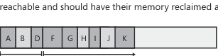

现在假设尝试分配对象 L 会使第 0 代超过其 256 KB 的预算。由于第 0 代已达到其预算，就必须开始垃圾回收。在开始垃圾回收时，垃圾回收器必须决定检查哪些代。前面我说过，当 CLR 初始化时，它会为第 0 代选择一个预算。其实，它也会为第 1 代选择一个预算。假设为第 1 代选择的预算是 2 MB。

在开始垃圾回收时，垃圾回收器还会查看第 1 代占用了多少内存。在这种情况下，第 1 代占用的内存远少于 2 MB，因此垃圾回收器只检查第 0 代中的对象。再看一下分代垃圾回收器所作的假设。第一个假设是新创建的对象生存期短。因此，第 0 代中很可能有大量垃圾，回收第 0 代因此将回收大量内存。垃圾回收器将直接忽略第 1 代中的对象，这将加快垃圾回收过程。


显然，忽略第 1 代中的对象可以提升垃圾回收器的性能。然而，垃圾回收器性能提升更多是因为它不会遍历托管堆中的每个对象。如果某个根或某个对象引用了老一代中的对象，垃圾回收器就可以忽略较老对象的任何内部引用，从而减少构建可达对象图所需的时间。当然，老对象的字段有可能引用新对象。为了确保检查这些老对象中已更新的字段，垃圾回收器使用 JIT 编译器内部的一种机制，在对象的引用字段发生变化时设置一个位。这种支持让垃圾回收器知道自上次回收以来哪些老对象（如果有）被写入过。只需检查字段发生更改的老对象，看它们是否引用第 0 代中的任何新对象。<sup>2</sup>

> **注意** Microsoft 的性能测试表明，对第 0 代执行一次垃圾回收所需时间不到 1 毫秒。Microsoft 的目标是让垃圾回收耗时不超过一次普通的页错误。

分代垃圾回收器还假设，已经存活很长时间的对象将继续存活。因此，第 1 代中的对象很可能仍可从应用程序访问。所以，如果垃圾回收器去检查第 1 代中的对象，它可能不会发现很多垃圾。结果，它就无法回收多少内存。因此，回收第 1 代很可能是浪费时间。如果第 1 代中恰好有一些垃圾，它们就留在那里。此时堆如图 21-11 所示。


**图 21-11** 经过两次回收后，**第 0 代的存活对象**被提升到第 1 代（使第 1 代的大小增加）；**第 0 代**为空

如你所见，回收后存活下来的所有第 0 代对象现在都属于第 1 代。由于垃圾回收器没有检查第 1 代，对象 **B** 的内存没有被回收，尽管它在最后一次垃圾回收时不可达。同样，一次回收之后，第 0 代不包含任何对象，并且是放置新对象的地方。事实上，假设应用程序继续运行并分配对象 L 到 O。在运行过程中，应用程序停止使用对象 G、L 和 M，使它们都变得不可达。此时堆如图 21-12 所示。


图 21-12 新对象在第 0 代中分配；第 1 代中有更多垃圾

假设分配对象 P 导致第 0 代超出其预算，从而引发垃圾回收。由于第 1 代中所有对象占用的内存小于 2 MB，垃圾回收器再次决定只回收第 0 代，忽略第 1 代中的不可达对象（对象 B 和 G）。回收之后，堆如图 21-13 所示。


图 21-13 经过三次回收后，第 0 代的存活对象被提升到第 1 代（使第 1 代的大小再次增加）；第 0 代为空

在图 21-13 中，可以看到第 1 代在缓慢增长。事实上，假设第 1 代现在已增长到其中所有对象占用 2 MB 内存的程度。此时，应用程序继续运行（因为垃圾回收刚刚结束），并开始分配对象 P 到 S，这些对象将第 0 代填满至其预算。此时堆如图 21-14 所示。


图 21-14 新对象在第 0 代中分配；第 1 代中有更多垃圾

当应用程序尝试分配对象 T 时，第 0 代已满，必须开始垃圾回收。然而这一次，垃圾回收器看到第 1 代中的对象占用内存过多，已经达到第 1 代的 2 MB 预算。在多次第 0 代回收过程中，第 1 代中很可能已有许多对象变得不可达（如我们的示例所示）。所以这一次，垃圾回收器决定检查第 1 代和第 0 代中的所有对象。在对这两代都执行垃圾回收之后，堆如图 21-15 所示。

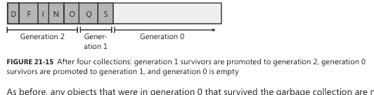

和之前一样，第 0 代中在垃圾回收后存活下来的任何对象现在都在第 1 代中；第 1 代中在回收后存活下来的任何对象现在都在第 2 代中。一如既往，垃圾回收之后第 0 代立即为空，并且是分配新对象的地方。第 2 代中的对象是垃圾回收器已经检查过两次或更多次的对象。可能已经发生过多次回收，但只有在第 1 代达到其预算时才会检查第 1 代中的对象，而这通常需要对第 0 代进行多次垃圾回收。

托管堆只支持三代：第 0 代、第 1 代和第 2 代；没有第 3 代。<sup>3</sup> 当 CLR 初始化时，它会为所有三代选择预算。如前所述，第 0 代的预算约为 256 KB，第 1 代的预算约为 2 MB。第 2 代的预算约为 10 MB。同样，选择这些预算大小是为了提升性能。预算越大，垃圾回收发生的频率就越低。而且，性能提升同样源于最初的假设：新对象的生命周期短，而较老的对象可能存活更久。

CLR 的垃圾回收器是一种自我调节的回收器。这意味着垃圾回收器每次执行垃圾回收时都会了解应用程序的行为。例如，如果你的应用程序构造大量对象并且只使用很短时间，那么回收第 0 代就有可能回收大量内存。事实上，第 0 代中所有对象的内存都有可能被回收。

如果垃圾回收器发现回收第 0 代后存活对象非常少，它可能会决定将第 0 代的预算从 256 KB 降低到 128 KB。这种分配空间的减少将意味着垃圾回收发生得更频繁，但垃圾回收器需要做的工作更少，因此进程的工作集会很小。事实上，如果第 0 代中的所有对象都是垃圾，垃圾回收就不必压缩任何内存；它只需将 `NextObjPtr` 设置回第 0 代的起始位置，然后垃圾回收就完成了。哇，这是一种快速回收内存的方式！

> **注意** 对于其线程大多数时间都空闲在栈顶的应用程序，垃圾回收器工作得极其出色。然后，当线程有事情要做时，它会唤醒、创建一堆短生命周期对象、返回，然后再次休眠。许多应用程序都遵循这种架构，包括 Windows Forms、WPF、ASP.NET Web Forms 和 XML Web 服务应用程序。

<sup>2</sup> 给好奇的读者：这里还有一些细节。当 JIT 编译器生成用于修改对象内部引用字段的本机代码时，该本机代码会包含对写屏障方法的调用。这个写屏障方法会检查其字段正在被修改的对象是否位于第 1 代或第 2 代；如果是，写屏障代码会在所谓的卡表中设置一个位。卡表为堆中每 128 字节范围的数据保留 1 位。当下一次 GC 开始时，它会扫描卡表，以了解第 1 代和第 2 代中哪些对象的字段自上次 GC 以来发生了变化。如果这些被修改的对象中有任何对象引用了第 0 代中的对象，那么第 0 代对象就会在回收后存活。GC 之后，卡表会重置为全零。写屏障代码在写入对象的引用字段时（相对于局部变量或静态字段）会造成轻微的性能损失；如果该对象位于第 1 代或第 2 代，这种性能损失会略严重一些。


对于 ASP.NET 应用程序，客户端请求到达时，会构造大量新对象，这些对象代表客户端执行工作，然后将结果发送回客户端。此时，所有用于满足客户端请求的对象都成为垃圾。换句话说，每个 ASP.NET 应用程序请求都会导致创建大量垃圾。由于这些对象在创建后几乎立即变得不可达，因此每次垃圾回收都会回收大量内存。这使进程的工作集保持得非常低，并且垃圾回收器的性能非常出色。

事实上，应用程序的大多数根都位于线程栈上的参数或局部变量中。如果线程的栈很短，垃圾回收器检查根并标记可达对象所需的时间就很少。换句话说，如果避免深度嵌套的栈，垃圾回收会快得多。避免深栈的一种方法是避免使用递归方法。

另一方面，如果垃圾回收器回收第 0 代并发现有很多存活对象，则说明垃圾回收中回收的内存不多。在这种情况下，垃圾回收器会将第 0 代的预算增大到可能 512 KB。现在，发生的回收次数会减少，但当回收发生时，应回收更多内存。顺便提一下，如果一次回收后回收的内存不足，垃圾回收器会在抛出 **OutOfMemoryException** 之前执行一次完整回收。

在整个讨论中，我一直在讲垃圾回收器如何在每次回收后动态修改第 0 代的预算。但垃圾回收器也会使用类似的启发式方法修改第 1 代和第 2 代的预算。当这些代被垃圾回收时，垃圾回收器会再次查看回收了多少内存以及有多少对象存活。根据垃圾回收器的发现，它也可能增大或缩小这些代的阈值，以提高应用程序的整体性能。最终结果是，垃圾回收器会根据应用程序所需的内存负载自动进行微调——这非常酷！

下面所示的 **GCNotification** 类类似于本章前面“对托管资源使用终结化”一节中讨论的 **GCBeep** 程序。不过，**GCNotification** 类会在发生第 0 代或第 2 代回收时引发事件。利用这些事件，你可以让计算机在每次回收时发出蜂鸣声，或者计算两次回收之间经过了多少时间、两次回收之间分配了多少内存等等。借助这个类，你可以轻松地对应用程序进行检测，从而更好地了解应用程序如何使用内存。

```csharp
public static class GCNotification {
    private static Action<Int32> s_gcDone = null;  // The event's field

    public static event Action<Int32> GCDone {
        add {
            // If there were no registered delegates before, start reporting notifications now
            if (s_gcDone == null) { new GenObject(0); new GenObject(2); }
            s_gcDone += value;
        }
        remove { s_gcDone -= value; }
    }

    private sealed class GenObject {
        private Int32 m_generation;
        public GenObject(Int32 generation) { m_generation = generation; }
        ~GenObject() { // This is the Finalize method
            // If this object is in the generation we want (or higher),
            // notify the delegates that a GC just completed
            if (GC.GetGeneration(this) >= m_generation) {
                Action<Int32> temp = Interlocked.CompareExchange(ref s_gcDone, null, null);
                if (temp != null) temp(m_generation);
            }

            // Keep reporting notifications if there is at least one delegate registered,
            // the AppDomain isn't unloading, and the process isn't shutting down
            if ((s_gcDone != null)
                && !AppDomain.CurrentDomain.IsFinalizingForUnload()
                && !Environment.HasShutdownStarted) {
                // For Gen 0, create a new object; for Gen 2, resurrect the object & let
                // the GC call Finalize again the next time Gen 2 is GC'd
                if (m_generation == 0) new GenObject(0);
                else GC.ReRegisterForFinalize(this);
            } else { /* Let the objects go away */ }
        }
    }
}
```

## 用于本机资源的其他垃圾回收功能

有时，本机资源会占用大量内存，但包装该资源的托管对象占用的内存很少。最典型的例子是位图。位图可能占用数兆字节的本机内存，但托管对象很小，因为它只包含一个 HBITMAP（4 字节或 8 字节的值）。从 CLR 的角度来看，进程可以在执行回收之前分配数百个位图（使用很少的托管内存）。但是，如果进程正在操作许多位图，进程的内存消耗将以惊人的速度增长。为了解决这种情况，GC 类提供了以下两个静态方法：

```csharp
public static void AddMemoryPressure(Int64 bytesAllocated);
public static void RemoveMemoryPressure(Int64 bytesAllocated);
```

包装可能很大的本机资源的类应使用这些方法向垃圾回收器提示实际消耗了多少内存。在内部，垃圾回收器会监视这种压力，当压力变高时，会强制进行垃圾回收。

有些本机资源的数量是固定的。例如，Windows 以前有限制，只能创建五个设备上下文。对应用程序可以打开的文件数量也曾有限制。同样，从 CLR 的角度来看，进程可以在执行回收之前分配数百个对象（这些对象使用很少的内存）。但是，如果这些本机资源的数量有限，尝试使用超过可用数量的资源通常会导致抛出异常。为了解决这种情况，**System.Runtime.InteropServices** 命名空间提供了 **HandleCollector** 类：

```csharp
public sealed class HandleCollector {
    public HandleCollector(String name, Int32 initialThreshold);
    public HandleCollector(String name, Int32 initialThreshold, Int32 maximumThreshold);
    public void Add();
    public void Remove();

    public Int32 Count { get; }
    public Int32 InitialThreshold { get; }
    public Int32 MaximumThreshold { get; }
    public String Name { get; }
}
```

包装可用数量有限的本机资源的类应使用此类的实例，向垃圾回收器提示实际消耗了多少个该资源的实例。在内部，此类对象会监视计数，当计数变高时，会强制进行垃圾回收。

**注意** 在内部，**GC.AddMemoryPressure** 和 **HandleCollector.Add** 方法会调用 **GC.Collect**，强制垃圾回收在第 0 代达到其预算之前开始。通常，强烈不建议强制启动垃圾回收，因为它通常会对应用程序的性能产生不利影响。但是，调用这些方法的类这样做是为了让有限的本机资源可供应用程序使用。如果本机资源耗尽，应用程序将失败。对于大多数应用程序来说，性能降低总比完全无法运行要好。

以下代码演示了内存压力方法和 **HandleCollector** 类的使用及其效果：

```csharp
using System;
using System.Runtime.InteropServices;

public static class Program {
    public static void Main() {
        MemoryPressureDemo();                 // 0   causes infrequent GCs
        MemoryPressureDemo(10 * 1024 * 1024); // 10MB causes frequent GCs

        HandleCollectorDemo();
    }

    private static void MemoryPressureDemo(Int32 size) {
        Console.WriteLine();
        Console.WriteLine("MemoryPressureDemo, size={0}", size);
        // Create a bunch of objects specifying their logical size
        for (Int32 count = 0; count < 15; count++) {
            new BigNativeResource(size);
        }

        // For demo purposes, force everything to be cleaned-up
        GC.Collect();
    }
}
```


如果编译并运行上面的代码，你的输出将与以下输出类似：

```
MemoryPressureDemo, size=0
BigNativeResource create.
BigNativeResource create.
BigNativeResource create.
BigNativeResource create.
BigNativeResource create.
BigNativeResource create.
BigNativeResource create.
BigNativeResource create.
BigNativeResource create.
BigNativeResource create.
BigNativeResource create.
BigNativeResource create.
BigNativeResource create.
BigNativeResource create.
BigNativeResource create.
BigNativeResource destroy.
BigNativeResource destroy.
BigNativeResource destroy.
BigNativeResource destroy.
BigNativeResource destroy.
BigNativeResource destroy.
BigNativeResource destroy.
BigNativeResource destroy.
BigNativeResource destroy.
BigNativeResource destroy.
BigNativeResource destroy.
BigNativeResource destroy.
BigNativeResource destroy.
BigNativeResource destroy.
BigNativeResource destroy.

MemoryPressureDemo, size=10485760
BigNativeResource create.
BigNativeResource create.
BigNativeResource create.
BigNativeResource create.
BigNativeResource create.
BigNativeResource create.
BigNativeResource create.
BigNativeResource create.
BigNativeResource create.
BigNativeResource destroy.
BigNativeResource destroy.
BigNativeResource destroy.
BigNativeResource create.
BigNativeResource create.
BigNativeResource destroy.
BigNativeResource destroy.
BigNativeResource destroy.
BigNativeResource create.
BigNativeResource create.
BigNativeResource create.
BigNativeResource create.
BigNativeResource create.
BigNativeResource create.
BigNativeResource destroy.
BigNativeResource destroy.
BigNativeResource create.
BigNativeResource create.
BigNativeResource destroy.
BigNativeResource destroy.
BigNativeResource destroy.
BigNativeResource destroy.
```

```
HandleCollectorDemo
LimitedResource create. Count=1
LimitedResource create. Count=2
LimitedResource create. Count=3
LimitedResource destroy. Count=3
LimitedResource destroy. Count=2
LimitedResource destroy. Count=1
LimitedResource create. Count=1
LimitedResource create. Count=2
LimitedResource destroy. Count=2
LimitedResource create. Count=2
LimitedResource create. Count=3
LimitedResource destroy. Count=3
LimitedResource destroy. Count=2
LimitedResource destroy. Count=1
LimitedResource create. Count=1
LimitedResource create. Count=2
LimitedResource destroy. Count=2
LimitedResource create. Count=2
LimitedResource destroy. Count=1
LimitedResource destroy. Count=0
```

## 预测需要大量内存的操作能否成功

有时你会发现自己正在实现一个算法，并且你知道该算法将需要许多对象，这些对象合在一起会占用相当多的内存。你可以开始执行该算法，而如果内存耗尽，CLR 将抛出 `OutOfMemoryException`。在这种情况下，你已经完成了大量工作，而现在这些工作必须被丢弃。此外，你需要捕获此异常，并让程序能够优雅地恢复。

在 `System.Runtime` 命名空间中，有一个 `MemoryFailPoint` 类，它使你能够在开始需要大量内存的算法之前检查内存是否充足。该类如下所示：

```csharp
public sealed class MemoryFailPoint : CriticalFinalizerObject, IDisposable {
    public MemoryFailPoint(Int32 sizeInMegabytes);
    ~MemoryFailPoint();
    public void Dispose();
}
```

使用这个类的方式非常简单。首先，通过传入你认为算法将需要的兆字节数（如果你不完全确定，则向上取整）来构造它的一个实例。在内部，构造函数会执行以下检查并触发相应操作：

- 1. 系统的页面文件中是否有足够的可用空间，以及进程中是否有足够的连续虚拟地址空间来满足请求？请注意，构造函数会减去另一次对 **MemoryFailPoint** 构造函数的调用所逻辑预留的任何内存量。
- 2. 如果没有足够空间，则强制进行垃圾回收，以尝试释放一些空间。
- 3. 如果页面文件空间仍然不足，则尝试扩展页面文件。如果页面文件无法增长到足够大，则抛出 **InsufficientMemoryException**。
- 4. 如果仍然没有足够的连续虚拟地址空间，则抛出 **InsufficientMemoryException**。
- 5. 如果找到了足够的页面文件空间和虚拟地址空间，则通过将兆字节数加到 **MemoryFailPoint** 类中定义的私有静态字段，来预留所请求的兆字节数。该加法以线程安全的方式完成，以便多个线程可以同时构造此类的实例，并保证只要构造函数中未抛出异常，它们就已逻辑预留了它们请求的内存。

如果 **MemoryFailPoint** 的构造函数抛出 **InsufficientMemoryException**，你的应用程序可以释放它当前正在使用的一些资源，或者可以降低其性能（减少数据缓存）以降低 CLR 将来抛出 **OutOfMemoryException** 的可能性。顺便提一下，**InsufficientMemoryException** 派生自 **OutOfMemoryException**。

> **重要** 如果 **MemoryFailPoint** 的构造函数没有抛出异常，那么你已经逻辑预留了所请求的内存，可以执行需要大量内存的算法。但是，请注意，你尚未物理分配此内存。这意味着你的算法只是*更可能*成功运行并获得它所需的内存。即使构造函数没有抛出异常，**MemoryFailPoint** 类也不能保证你的算法会获得所需的内存。此类的存在是为了*帮助*你构建更健壮的应用程序。

执行完算法后，应调用所构造的 **MemoryFailPoint** 对象上的 **Dispose**。在内部，**Dispose** 只是（以线程安全的方式）从 **MemoryFailPoint** 的静态字段中减去你预留的兆字节数。以下代码演示了 **MemoryFailPoint** 类的使用：

```csharp
using System;
using System.Runtime;

public static class Program {
    public static void Main() {
        try {
            // Logically reserve 1.5 GB of memory
            using (MemoryFailPoint mfp = new MemoryFailPoint(1500)) {
                // Perform memory-hungry algorithm in here

            } // Dispose will logically free the 1.5 GB of memory
        }
        catch (InsufficientMemoryException e) {
            // The memory could not be reserved
            Console.WriteLine(e);
        }
    }
}
```

## 以编程方式控制垃圾回收器

**System.GC** 类型允许你的应用程序对垃圾回收器进行一些直接控制。首先，你可以通过读取 **GC.MaxGeneration** 属性来查询托管堆支持的最大代数；此属性始终返回 2。

还可以通过调用以下两个静态方法之一来强制垃圾回收器执行回收：

```csharp
void GC.Collect(Int32 generation)
void GC.Collect()
void GC.Collect(Int32 generation, GCCollectionMode mode)
```

第一个方法允许你指定要回收的代。你可以传入从 0 到 **GC.MaxGeneration**（含）的任何整数。传入 0 会导致回收第 0 代，传入 1 会导致回收第 1 代和第 0 代，传入 2 会导致回收第 2 代、第 1 代和第 0 代。不带参数的 **Collect** 方法版本会强制对所有代执行完整回收，等效于调用：

```csharp
GC.Collect(GC.MaxGeneration);
```

**Collect** 的第三个重载允许你传入一个代和一个 **GCCollectionMode**。表 21-1 描述了各种 GC 回收模式符号。


**表 21-1** GCCollectionMode 枚举类型定义的符号

| 符号名称 | 描述 |
|---|---|
| **Default** | 与不传标志调用 `GC.Collect` 相同。目前，这与传递 `Forced` 相同，但在 CLR 的未来版本中可能会改变。 |
| **Forced** | 强制立即对直到并包括指定代在内的所有代执行回收。 |
| **Optimized** | 垃圾回收器仅在回收有成效时（即释放大量内存或减少碎片）才执行回收。如果垃圾回收不会产生成效，则该调用没有任何效果。 |

在大多数情况下，应避免调用任何 **Collect** 方法；最好让垃圾回收器自行运行，并根据实际应用程序行为微调其代预算。然而，如果你编写的是控制台用户界面 (CUI) 或图形用户界面 (GUI) 应用程序，那么应用程序代码拥有该进程以及该进程中的 CLR。对于这些应用程序类型，你*可能希望*在某些时刻使用 **Optimized** 的 **GCCollectionMode** 来建议执行垃圾回收。通常，**Default** 和 **Forced** 模式用于调试和测试。

例如，如果刚刚发生了某个非周期性事件，而该事件很可能导致大量旧对象死亡，那么你可以考虑调用 **Collect** 方法。在这种情况下调用 **Collect** 可能并不算太糟，原因是垃圾回收器基于过去对未来的预测对于非周期性事件不太可能准确。

例如，应用程序在初始化之后或用户保存数据文件之后，强制对所有代执行一次完整垃圾回收可能是合理的。当 Windows Form 控件承载在网页上时，每次卸载页面都会执行一次完整回收。不要显式调用 **Collect** 来试图改善应用程序的响应时间；调用它是为了减少进程的工作集。

**GC** 类型还提供了一个 **WaitForPendingFinalizers** 方法。此方法只是挂起调用线程，直到处理 freachable 队列的线程清空该队列，并调用每个对象的 **Finalize** 方法。在大多数应用程序中，你不太可能需要调用此方法。不过，我偶尔见过这样的代码：

```csharp
GC.Collect();
GC.WaitForPendingFinalizers();
GC.Collect();
```

这段代码强制进行垃圾回收。回收完成后，不需要终结的对象的内存会被回收。但确实需要终结的对象，其内存还不能被回收。第一次调用 **Collect** 返回后，专门的终结线程正在异步调用 **Finalize** 方法。对 **WaitForPendingFinalizers** 的调用会让应用程序的线程休眠，直到所有 **Finalize** 方法都被调用。当 **WaitForPendingFinalizers** 返回时，所有已终结的对象现在才真正成为垃圾。此时，第二次调用 Collect 会强制进行另一次垃圾回收，从而回收这些现已终结的对象所占用的全部内存。

对于某些应用程序（尤其是倾向于在内存中保留大量对象的服务器应用程序），垃圾回收器执行包含第 2 代的完整回收所需的时间可能过长。事实上，如果回收需要很长时间才能完成，那么客户端请求可能会超时。为了帮助这类应用程序，GC 类提供了一个 RegisterForFullGCNotification 方法。使用此方法以及一些额外的辅助方法（WaitForFullGCApproach、WaitForFullGCComplete 和 CancelFullGCNotification），应用程序现在可以在垃圾回收器即将执行完整回收时收到通知。然后，应用程序可以调用 GC.Collect 以在更合适的时机强制回收，或者应用程序可以与另一台服务器通信，以便更好地对客户端请求进行负载均衡。有关更多信息，请查阅 .NET Framework SDK 文档中的这些方法。注意，你应始终成对调用 WaitForFullGCApproach 和 WaitForFullGCComplete 方法，因为 CLR 在内部将它们作为成对方法处理。

最后，GC 类提供了两个静态方法，让你可以确定对象当前所在的代：

```csharp
Int32 GetGeneration(Object obj)
Int32 GetGeneration(WeakReference wr)
```

GetGeneration 的第一个版本接受对象引用作为参数，第二个版本接受 WeakReference 引用作为参数。返回的值将介于 0 和 GC.MaxGeneration 之间（含这两者）。

下面的代码将帮助你理解代的工作原理。该代码还演示了刚刚讨论的 GC 方法的用法。

```csharp
using System;

internal sealed class GenObj {
    ~GenObj() {
        Console.WriteLine("In Finalize method");
    }
}

public static class Program {
    public static void Main() {
        Console.WriteLine("Maximum generations: " + GC.MaxGeneration);

        // Create a new GenObj in the heap.
        Object o = new GenObj();

        // Because this object is newly created, it is in generation 0.
        Console.WriteLine("Gen " + GC.GetGeneration(o)); // 0

        // Performing a garbage collection promotes the object's generation.
        GC.Collect();
        Console.WriteLine("Gen " + GC.GetGeneration(o)); // 1

        GC.Collect();
        Console.WriteLine("Gen " + GC.GetGeneration(o)); // 2

        GC.Collect();
        Console.WriteLine("Gen " + GC.GetGeneration(o)); // 2 (max)

        o = null; // Destroy the strong reference to this object.

        Console.WriteLine("Collecting Gen 0");
        GC.Collect(0);                  // Collect generation 0.
        GC.WaitForPendingFinalizers();  // Finalize is NOT called.

        Console.WriteLine("Collecting Gens 0, and 1");
        GC.Collect(1);                  // Collect generations 0 & 1.
        GC.WaitForPendingFinalizers();  // Finalize is NOT called.

        Console.WriteLine("Collecting Gens 0, 1, and 2");
        GC.Collect(2);                  // Same as Collect()
        GC.WaitForPendingFinalizers();  // Finalize IS called.
    }
}
```

生成并运行此代码会得到以下输出：

```
Maximum generations: 2
Gen 0
Gen 1
Gen 2
Gen 2
Collecting Gen 0
Collecting Gens 0, and 1
Collecting Gens 0, 1, and 2
In Finalize method
```

### 线程劫持

在本章前面，我解释了垃圾回收算法。然而，在那次讨论中我做了一个很大的假设：只有一个线程在运行。在现实世界中，很可能有多个线程访问托管堆，或者至少操作在托管堆内分配的对象。当一个线程触发垃圾回收时，其他线程不得访问任何对象（包括其自身堆栈上的对象引用），因为垃圾回收器很可能会移动这些对象，从而改变它们的内存位置。

因此，当垃圾回收器想要开始垃圾回收时，所有正在执行托管代码的线程都必须被挂起。CLR 使用几种不同的机制来安全地挂起线程，以便执行垃圾回收。之所以有多种机制，是为了让线程尽可能长时间地运行，并尽可能减少开销。我不想在这里深入所有细节，但可以说，Microsoft 已经做了大量工作来减少垃圾回收涉及的开销。Microsoft 将继续随着时间的推移修改这些机制，以确保未来实现高效的垃圾回收。

当 CLR 想要开始垃圾回收时，它会立即挂起所有正在执行托管代码的线程。然后，CLR 检查每个线程的指令指针，以确定该线程正在何处执行。接着，将指令指针地址与 JIT 编译器生成的表进行比较，以确定该线程正在执行什么代码。

如果线程的指令指针位于某个表所标识的偏移处，则称该线程已到达 *安全点*。*安全点* 是指可以安全地让线程保持挂起状态直到垃圾回收完成的位置。如果线程的指令指针不在内部方法表所标识的偏移处，则该线程不在安全点，CLR 无法执行垃圾回收。在这种情况下，CLR *劫持* 该线程：CLR 修改线程的堆栈，使返回地址指向 CLR 内部实现的一个特殊函数。然后恢复该线程。当当前执行的方法返回时，该特殊函数将执行，从而挂起该线程。

然而，该线程可能在相当长一段时间内都不会从其方法返回。因此，在线程恢复执行后，CLR 会等待大约 250 毫秒，让该线程 *被劫持*。在此时间之后，CLR 再次挂起该线程并检查其指令指针。如果该线程已到达安全点，则垃圾回收可以开始。如果该线程仍未到达安全点，CLR 会检查是否调用了另一个方法；如果调用了，CLR 会再次修改堆栈，以便该线程从最近执行的方法返回时 *被劫持*。然后，CLR 恢复该线程，并再等待几毫秒后重试。

当所有线程都已到达安全点或已 *被劫持* 时，垃圾回收就可以开始。垃圾回收完成后，所有线程都会恢复，应用程序继续运行。*被劫持* 的线程会返回到最初调用它们的方法。

这个算法有一个小转折。当 CLR 想要开始垃圾回收时，它会挂起所有正在执行托管代码的线程，但不会挂起正在执行非托管代码的线程。一旦所有正在执行托管代码的线程都到达安全点或 *被劫持*，就允许开始垃圾回收。正在执行非托管代码的线程可以继续运行，因为它们正在使用的任何对象都应已被固定。如果当前正在执行非托管代码的线程返回到托管代码，该线程会立即被挂起，直到垃圾回收完成。

事实证明，CLR 大多数时候使用 *劫持*，而不是使用 JIT 编译器生成的表来确定线程是否处于安全点。原因是 JIT 编译器——

JIT 编译器生成的表需要大量内存并增加工作集，这反过来会显著损害性能。因此，JIT 编译器生成的表仅包含那些包含循环且不调用其他方法的代码段信息。如果方法中的循环调用了其他方法，或者根本没有循环，那么 JIT 编译器生成的表中包含的信息很少，此时会使用劫持（hijacking）来挂起线程。

## 垃圾回收模式

CLR 启动时，会选择一种 GC 模式，该模式在进程的整个生命周期内不能更改。有两种基本的 GC 模式：

-   **工作站（Workstation）** 此模式针对客户端应用程序对垃圾回收器进行微调。垃圾回收器假定机器上还有其他应用程序在运行，因此不会独占 CPU 资源。工作站模式有两种子模式：带并发回收器的工作站模式和不带并发回收器的工作站模式。稍后我会介绍并发回收器功能。
-   **服务器（Server）** 此模式针对服务器端应用程序对垃圾回收器进行微调。垃圾回收器假定机器上没有其他应用程序（客户端或服务器）在运行，并假定机器上的所有 CPU 都可用于执行垃圾回收。这种 GC 模式会将托管堆分成多个段，每个 CPU 一个段。当启动垃圾回收时，垃圾回收器为每个 CPU 提供一个线程；每个线程与其他线程并行回收各自的段。并行回收非常适合工作线程往往表现出均匀行为的服务器应用程序。此功能要求应用程序运行在多 CPU 的计算机上，以便线程能够真正同时工作以获得性能提升。

默认情况下，应用程序以工作站 GC 模式运行，并且并发回收器处于开启状态。不过，承载 CLR 的服务器应用程序（如 ASP.NET 或 SQL Server）可以请求 CLR 加载服务器 GC。但是，如果服务器应用程序运行在单处理器机器上，则 CLR 会加载带并发回收器的工作站 GC 模式。

自行承载 CLR 的应用程序可以通过创建包含 **gcServer** 元素的配置文件（如第 2 章“构建、打包、部署和管理应用程序与类型”和第 3 章“共享程序集和强命名程序集”所述）来告知 CLR 使用服务器回收器。下面是一个配置文件的示例：

```xml
<configuration>
    <runtime>
        <gcServer enabled="true"/>
    </runtime>
</configuration>
```

应用程序运行时，可以通过查询 `GCSettings` 类的 `IsServerGC` 只读布尔属性来询问 CLR 是否以服务器 GC 模式运行：

```csharp
using System;
using System.Runtime; // GCSettings 位于此命名空间中

public static class Program {
    public static void Main() {
        Console.WriteLine("Application is running with server GC=" + GCSettings.IsServerGC);
    }
}
```

工作站 GC 模式可以在并发或非并发模式下运行。在并发模式下，垃圾回收器有一个额外的后台线程，在应用程序运行的同时并发回收对象。当一个线程分配的对象使第 0 代超出其预算时，垃圾回收器首先挂起所有线程，然后确定要回收哪些代。如果垃圾回收器需要回收第 0 代或第 1 代，则照常进行。然而，如果需要回收第 2 代，则第 0 代的大小会增加到超出其预算，以便分配新对象，然后恢复应用程序的线程。

在应用程序线程运行期间，垃圾回收器有一个正常优先级的后台线程来标记不可达对象。该线程与应用程序线程竞争 CPU 时间，导致应用程序的任务执行变慢。一旦对象被标记，垃圾回收器再次挂起所有线程，并决定是否压缩内存。如果垃圾回收器决定压缩内存，则进行内存压缩，修复根引用，然后恢复应用程序线程。这种垃圾回收所花的时间比平时少，因为不可达对象集合已经构建完成。然而，垃圾回收器也可能决定不压缩内存；事实上，垃圾回收器倾向于这样做。如果你有大量可用内存，垃圾回收器不会压缩堆；这提高了性能，但会增加应用程序的工作集。使用并发垃圾回收器时，你通常会发现自己应用程序消耗的内存比使用非并发垃圾回收器时更多。

总结一下：并发回收为用户带来了更好的交互体验，因此最适合交互式 CUI 或 GUI 应用程序。然而，对于某些应用程序，并发回收实际上会损害性能，并导致使用更多内存。在测试应用程序时，你应该分别试验使用和不使用并发回收的情况，看看哪种方式能为你的应用程序带来最佳的性能和内存使用。

你可以通过为应用程序创建包含 `gcConcurrent` 元素的配置文件（如第 2 章和第 3 章所述）来告知 CLR 不要使用并发回收器。下面是一个配置文件的示例：

操作此设置。以下是一些展示如何正确使用 **LowLatency** 模式的代码：

```csharp
private static void LowLatencyDemo() {
    GCLatencyMode oldMode = GCSettings.LatencyMode;
    System.Runtime.CompilerServices.RuntimeHelpers.PrepareConstrainedRegions();
    try {
        GCSettings.LatencyMode = GCLatencyMode.LowLatency;
        // 在此处运行你的代码...
    }
    finally {
        GCSettings.LatencyMode = oldMode;
    }
}
```

## 大对象

你可能还需要了解另一项性能改进。任何大小为 85,000 字节或更大的对象都被视为*大对象*。大对象从特殊的大对象堆中分配。该堆中的对象会像我一直讨论的小对象一样被终结和释放。然而，大对象永远不会被压缩，因为将 85,000 字节的内存块在堆中下移会浪费太多 CPU 时间。但是，你绝不应该编写假设大对象不会在内存中移动的代码，因为未来大对象的大小可能会从 85,000 字节改为其他值。为了确保对象在内存中不移动，可以像本章前面的“手动监控和控制对象生存期”一节中讨论的那样将其固定。

大对象始终被视为第 2 代的一部分，因此你应该只为需要长期保持存活状态的资源创建大对象。分配短命的大对象会导致第 2 代被更频繁地回收，从而损害性能。以下程序证明大对象总是在第 2 代中分配：

```csharp
using System;

public static class Program {
    public static void Main() {
        Object o = new Byte[85000];
        Console.WriteLine(GC.GetGeneration(o));   // 显示 2；而不是 0
    }
}
```

所有这些机制对应用程序代码都是透明的。对你（开发人员）来说，似乎只有一个托管堆；这些机制的存在只是为了改善应用程序性能。

## 监视垃圾回收

在一个进程内，你可以调用几个方法来监视垃圾回收器。具体来说，`GC` 类提供了以下静态方法，你可以调用它们来查看某个特定代发生了多少次回收，或者托管堆中的对象当前使用了多少内存。

```
Int64 GetTotalMemory(Boolean forceFullCollection);
Int32 CollectionCount(Int32 generation);
```

为了分析特定的代码块，我经常编写代码在代码块前后调用这些方法，然后计算差值。这能很好地指示我的代码块对进程工作集的影响，并显示执行代码块期间发生了多少次垃圾回收。如果数字很高，我就知道需要花更多时间来调整代码块中的算法。

你还可以查看单个 AppDomain 而不是整个进程使用了多少内存。更多信息请参阅第 22 章的“AppDomain 监视”一节。

当你安装 .NET Framework 时，它会安装一组性能计数器，这些计数器提供了关于 CLR 操作的许多实时统计信息。这些统计信息可以通过 PerfMon.exe 工具或 Windows 自带的 System Monitor ActiveX 控件查看。访问 System Monitor 控件最简单的方法是运行 PerfMon.exe 并单击 + 工具栏按钮，这会出现如图 21-16 所示的“添加计数器”对话框。

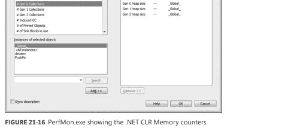

**图 21-16** 显示 .NET CLR 内存计数器的 PerfMon.exe


若要监视 CLR 的垃圾回收器，请选择“.NET CLR Memory”性能对象。然后从实例列表框中选择特定应用程序。最后，选择你感兴趣监视的计数器集合，单击“添加”，再单击“确定”。此时，系统监视器将绘制所选实时统计信息的图表。要了解某个特定计数器的说明，请选择所需计数器，然后选中“显示描述”复选框。

另一个监视应用程序对象分配的好工具是 CLR Profiler。该工具提供调用分析、堆快照和内存使用时间线。它甚至还有一个 API，可用于从测试代码中启动和停止分析，并将注释注入日志中。此外，该工具的源代码是可用的，因此你可以根据自己的需要修改该工具。获取此工具的最佳方式是在网络上搜索 *CLR Profiler*。这个工具非常宝贵，我强烈推荐它。

最后，你应了解如何使用 SOS 调试扩展（SOS.dll）。当调试内存问题和其他 CLR 问题时，它通常能提供很大帮助。对于与内存相关的操作，SOS 调试扩展允许你查看进程内为托管堆分配了多少内存，显示终结队列中所有已注册终结的对象，显示每个 AppDomain 或整个进程的 GCHandle 表中的条目，显示堆中使对象保持活跃的根，等等。

# CLR 宿主

.NET Framework 运行在 Microsoft Windows 之上。这意味着必须使用 Windows 可以交互的技术来构建 .NET Framework。首先，所有托管模块和程序集文件必须使用 Windows 可移植可执行（PE）文件格式，并且必须是 Windows 可执行（EXE）文件或 DLL。

在开发 CLR 时，Microsoft 将其实现为包含在 DLL 中的 COM 服务器；也就是说，Microsoft 为 CLR 定义了标准 COM 接口，并为该接口和 COM 服务器分配了 GUID。安装 .NET Framework 时，表示 CLR 的 COM 服务器会像任何其他 COM 服务器一样在 Windows 注册表中注册。如果你希望了解有关此主题的更多信息，请参阅 .NET Framework SDK 自带的 MetaHost.h C++ 头文件。此头文件定义了 GUID 和非托管 ICLRMetaHost 接口定义。

任何 Windows 应用程序都可以宿主 CLR。但是，你不应通过调用 CoCreateInstance 来创建 CLR COM 服务器的实例；相反，非托管宿主应调用在 MetaHost.h 中声明的 CLRCreateInstance 函数。CLRCreateInstance 函数在 MSCorEE.dll 文件中实现，该文件通常位于 C:\Windows\System32 目录中。这个 DLL 被亲切地称为 shim（填充层），其工作是确定要创建的 CLR 版本；shim DLL 本身不包含 CLR COM 服务器。

一台机器可以安装多个版本的 CLR，但只有一个版本的 MSCorEE.dll 文件（即 shim）。¹ 机器上安装的 MSCorEE.dll 版本是与机器上安装的最新版 CLR 一同发布的版本。因此，该版本的 MSCorEE.dll 知道如何找到可能已安装的任何旧版 CLR。

实际的 CLR 代码包含在一个文件中，该文件的名称随 CLR 版本的不同而改变。对于 1.0、1.1 和 2.0 版本，CLR 代码位于名为 MSCorWks.dll 的文件中；对于 4.0 版本，CLR 代码位于名为 Clr.dll 的文件中。由于一台机器上可以安装多个版本的 CLR，因此这些文件按如下方式安装到不同的目录。²

- 版本 1.0 位于 C:\Windows\Microsoft.NET\Framework\v1.0.3705
- 版本 1.1 位于 C:\Windows\Microsoft.NET\Framework\v1.1.4322
- 版本 2.0 位于 C:\Windows\Microsoft.NET\Framework\v2.0.50727
- 版本 4.0 位于 C:\Windows\Microsoft.NET\Framework\v4.0.21006

¹ 如果你使用的是 64 位 Windows 版本，实际上会安装两个版本的 MSCorEE.dll 文件。一个是 32 位 x86 版本，位于 C:\Windows\SysWOW64 目录中。另一个是 64 位 x64 或 IA64 版本（取决于计算机的 CPU 架构），位于 C:\Windows\System32 目录中。

² 请注意，.NET Framework 3.0 和 3.5 版本随附了 CLR 2.0 版本。我没有显示 .NET Framework 3.0 和 3.5 版本的目录，因为 CLR DLL 是从 v2.0.50727 目录加载的。

`CLRCreateInstance` 函数可以返回 `ICLRMetaHost` 接口。宿主应用程序可以调用此接口的 `GetRuntime` 函数，指定宿主希望创建的 CLR 版本。然后，shim 会将所需版本的 CLR 加载到宿主进程中。

默认情况下，当托管可执行文件启动时，shim 会检查可执行文件并提取指示应用程序生成和测试所用 CLR 版本的信息。但是，应用程序可以通过在其 XML 配置文件（将在第 2 章“构建、打包、部署和管理应用程序与类型”和第 3 章“共享程序集和强命名程序集”中介绍）中放置 `requiredRuntime` 和 `supportedRuntime` 条目来覆盖此默认行为。

`GetRuntime` 函数返回指向非托管 `ICLRRuntimeInfo` 接口的指针，通过 `GetInterface` 方法可以获取 `ICLRRuntimeHost` 接口。宿主应用程序可以调用此接口定义的方法来：

- 设置宿主管理器。告诉 CLR 宿主希望参与与内存分配、线程调度/同步、程序集加载等相关的决策。宿主还可以声明希望接收垃圾回收开始和停止的通知，以及某些操作超时的通知。
- 获取 CLR 管理器。告诉 CLR 阻止使用某些类/成员。此外，宿主可以指定哪些代码可以或不可以被调试，以及在发生特殊事件（如 AppDomain 卸载、CLR 停止或堆栈溢出异常）时应调用宿主中的哪些方法。
- 初始化并启动 CLR。
- 加载程序集并执行其中的代码。
- 停止 CLR，从而防止任何更多托管代码在 Windows 进程中运行。

宿主 CLR 有用的原因有很多。宿主允许任何应用程序提供 CLR 功能和可编程性支持，并且至少部分用托管代码编写。任何宿主运行时的应用程序都会为试图扩展该应用程序的开发人员带来许多好处。以下是其中的一些好处：

- 可以使用任何编程语言进行编程。
- 代码通过实时（JIT）编译来提高速度（而不是解释执行）。
- 代码使用垃圾回收来避免内存泄漏和损坏。
- 代码在安全沙箱中运行。
- 宿主无需担心提供丰富的开发环境。宿主可以利用现有技术：语言、编译器、编辑器、调试器、探查器等。

如果你对在宿主方案中使用 CLR 感兴趣，我强烈推荐你阅读 Steven Pressman 的佳作 *自定义 Microsoft .NET Framework 公共语言运行时*（Microsoft Press，2005），尽管该书重点是 CLR 4.0 之前的版本。

> **注意** 当然，Windows 进程根本不需要加载 CLR。仅当你想在进程中执行托管代码时，才需要加载它。在 .NET Framework 4.0 之前，CLR 只允许自身的一个实例驻留在 Windows 进程中。也就是说，一个进程可以包含无 CLR、CLR v1.0、CLR v1.1 或 CLR v2.0。每个进程只允许一个 CLR 版本是一个巨大的限制。例如，Microsoft Office Outlook 无法加载两个针对不同版本的 .NET Framework 生成和测试的加载项。
>
> 然而，借助 .NET Framework 4.0，Microsoft 现在支持在单个 Windows 进程中加载 v2.0 和 v4.0，允许为 .NET Framework 2.0 和 4.0 版本编写的组件并行运行，而不会出现任何兼容性问题。这是一个很棒的新功能，它使 .NET Framework 组件能够比以往在更多方案中可靠地使用。你可以使用 ClrVer.exe 工具查看任何给定进程中加载了哪些 CLR 版本。
>
> 一旦 CLR 被加载到 Windows 进程中，就永远无法卸载；在 **ICLRRuntimeInfo** 接口上调用 **AddRef** 和 **Release** 方法没有效果。从进程中卸载 CLR 的唯一方法是终止进程，从而使 Windows 清理进程所使用的所有资源。

## AppDomain（应用程序域）

当 CLR COM 服务器初始化时，它会创建一个 *AppDomain*。AppDomain 是一组程序集的逻辑容器。CLR 初始化时创建的第一个 AppDomain 被称为 *默认 AppDomain*；该 AppDomain 只有在 Windows 进程终止时才会被销毁。

除了默认 AppDomain 之外，使用非托管 COM 接口方法或托管类型方法的宿主可以指示 CLR 创建额外的 AppDomain。AppDomain 的全部目的是提供隔离。以下是 AppDomain 提供的具体功能：

- **一个 AppDomain 中的代码创建的对象不能直接被另一个 AppDomain 中的代码访问** 当 AppDomain 中的代码创建对象时，该对象由该 AppDomain“拥有”。换句话说，不允许对象活过构造它的 AppDomain 的生存期。其他 AppDomain 中的代码只能使用按引用封送或按值封送语义来访问另一个 AppDomain 的对象。这强制执行了清晰的分离和边界，因为一个 AppDomain 中的代码不能直接引用不同 AppDomain 中的代码创建的对象。这种隔离允许 AppDomain 很容易地从进程中卸载，而不会影响在其他 AppDomain 中运行的代码。


- **AppDomain 可以卸载** CLR 不支持从 AppDomain 中卸载单个程序集的能力。不过，你可以让 CLR 卸载某个 AppDomain，这也会导致该 AppDomain 中当前包含的所有程序集一并被卸载。
- **AppDomain 可以单独实施安全控制** 创建时，可以为 AppDomain 应用一个权限集，该权限集决定授予在该 AppDomain 中运行的程序集的最大权限。这允许宿主加载某些代码，并确保这些代码无法破坏或读取宿主自身使用的重要数据结构。
- **AppDomain 可以单独配置** 创建时，可以为 AppDomain 关联一组配置设置。这些设置主要影响 CLR 如何将程序集加载到 AppDomain 中。配置设置涉及搜索路径、版本绑定重定向、卷影复制和加载器优化。

> **重要** Windows 的一个出色特性是，它在自己的进程地址空间中运行每个应用程序。这确保一个应用程序中的代码无法访问另一个应用程序正在使用的代码或数据。进程隔离可防止安全漏洞、数据损坏和其他不可预测行为的发生，从而使 Windows 及其上运行的应用程序保持稳健。遗憾的是，在 Windows 中创建进程的代价非常高。Win32 **CreateProcess** 函数非常慢，而且 Windows 需要大量内存来虚拟化进程的地址空间。
>
> 不过，如果一个应用程序完全由可验证安全且不调用非托管代码的托管代码组成，那么在单个 Windows 进程中运行多个托管应用程序就不会有问题。而 AppDomain 提供了对这些应用程序进行安全控制、配置和终止所需的隔离。

图 22-1 展示了一个单独的 Windows 进程，其中运行着一个 CLR COM 服务器。此 CLR 当前管理两个 AppDomain（尽管单个 Windows 进程中可运行的 AppDomain 数量并没有硬编码限制）。每个 AppDomain 都有自己的加载器堆，每个加载器堆都维护着自该 AppDomain 创建以来已访问过哪些类型的记录。这些类型对象已在第 4 章“类型基础”中讨论过；加载器堆中的每个类型对象都有一个方法表，如果某个方法至少被执行过一次，则方法表中的每个条目都指向 JIT 编译的本机代码。

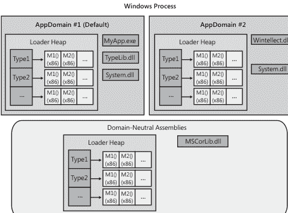

**图 22-1** 承载 CLR 和两个 AppDomain 的单个 Windows 进程

此外，每个 AppDomain 中都加载了一些程序集。AppDomain #1（默认 AppDomain）有三个程序集：MyApp.exe、TypeLib.dll 和 System.dll。AppDomain #2 中加载了两个程序集：Wintellect.dll 和 System.dll。

你会注意到，System.dll 程序集已加载到两个 AppDomain 中。如果两个 AppDomain 都使用 System.dll 中的同一个类型，那么两个 AppDomain 都会在每个加载器堆中为同一类型分配一个类型对象；类型对象的内存并不会由所有 AppDomain 共享。此外，当某个 AppDomain 中的代码调用某个类型定义的方法时，该方法的中间语言 (IL) 代码会被 JIT 编译，生成的本机代码会与每个 AppDomain 关联；该方法代码不会由调用它的所有 AppDomain 共享。

不共享类型对象或本机代码的内存是浪费的。不过，AppDomain 的全部目的就是提供隔离；CLR 需要能够卸载某个 AppDomain 并释放其所有资源，同时不会对其他任何 AppDomain 造成不利影响。复制 CLR 数据结构可确保这一点可以实现。它还可确保由多个 AppDomain 使用的类型为每个 AppDomain 都有一组静态字段。

有些程序集预期会被多个 AppDomain 使用。最好的例子是 MSCorLib.dll。此程序集包含 System.Object、System.Int32 以及对 .NET Framework 如此不可或缺的所有其他类型。此程序集在 CLR 初始化时会自动加载，并且所有 AppDomain 都共享此程序集中的类型。为减少资源使用量，MSCorLib.dll 以域中性方式加载；也就是说，CLR 为以域中性方式加载的程序集维护一个特殊的加载器堆。此加载器堆中的所有类型对象以及这些类型方法的所有本机代码都由该进程中的所有 AppDomain 共享。遗憾的是，共享这些资源带来的好处是有代价的：以域中性方式加载的程序集永远无法卸载。回收它们所用资源的唯一方法是终止 Windows 进程，让 Windows 回收这些资源。

### 跨 AppDomain 边界访问对象

一个 AppDomain 中的代码可以与另一个 AppDomain 中包含的类型和对象通信。不过，只有通过定义良好的机制才允许访问这些类型和对象。下面的 Ch22-1-AppDomains 示例应用程序演示了如何创建新的 AppDomain、将程序集加载到其中，并构造该程序集中定义的一个类型的实例。代码展示了在构造按引用封送的类型、按值封送的类型以及完全无法封送的类型时的不同行为。代码还展示了当创建这些对象的 AppDomain 被卸载时，这些以不同方式封送的对象的行为。Ch22-1-AppDomains 示例应用程序中的代码非常少，但我添加了很多注释。在代码清单之后，我会逐步讲解代码，解释 CLR 在做什么。

```csharp
private static void Marshalling() {
    // Get a reference to the AppDomain that calling thread is executing in
    AppDomain adCallingThreadDomain = Thread.GetDomain();

    // Every AppDomain is assigned a friendly string name (helpful for debugging)
    // Get this AppDomain's friendly string name and display it
    String callingDomainName = adCallingThreadDomain.FriendlyName;
    Console.WriteLine("Default AppDomain's friendly name={0}", callingDomainName);

    // Get & display the assembly in our AppDomain that contains the 'Main' method
    String exeAssembly = Assembly.GetEntryAssembly().FullName;
    Console.WriteLine("Main assembly={0}", exeAssembly);

    // Define a local variable that can refer to an AppDomain
    AppDomain ad2 = null;

    // *** DEMO 1: Cross-AppDomain Communication using Marshal-by-Reference ***
    Console.WriteLine("{0}Demo #1", Environment.NewLine);

    // Create new AppDomain (security & configuration match current AppDomain)
    ad2 = AppDomain.CreateDomain("AD #2", null, null);
    MarshalByRefType mbrt = null;

    // Load our assembly into the new AppDomain, construct an object, marshal
    // it back to our AD (we really get a reference to a proxy)
    mbrt = (MarshalByRefType)
        ad2.CreateInstanceAndUnwrap(exeAssembly, "MarshalByRefType");

    Console.WriteLine("Type={0}", mbrt.GetType());  // The CLR lies about the type

    // Prove that we got a reference to a proxy object
    Console.WriteLine("Is proxy={0}", RemotingServices.IsTransparentProxy(mbrt));

    // This looks like we're calling a method on MarshalByRefType but, we're not.
    // We're calling a method on the proxy type. The proxy transitions the thread
    // to the AppDomain owning the object and calls this method on the real object.
    mbrt.SomeMethod();

    // Unload the new AppDomain
    AppDomain.Unload(ad2);
    // mbrt refers to a valid proxy object; the proxy object refers to an invalid AppDomain

    try {
        // We're calling a method on the proxy type. The AD is invalid, exception is thrown
        mbrt.SomeMethod();
        Console.WriteLine("Successful call.");
    }
    catch (AppDomainUnloadedException) {
        Console.WriteLine("Failed call.");
    }


    // *** DEMO 2: Cross-AppDomain Communication using Marshal-by-Value ***
    Console.WriteLine("{0}Demo #2", Environment.NewLine);

    // Create new AppDomain (security & configuration match current AppDomain)
    ad2 = AppDomain.CreateDomain("AD #2", null, null);

    // Load our assembly into the new AppDomain, construct an object, marshal
    // it back to our AD (we really get a reference to a proxy)
    mbrt = (MarshalByRefType)
        ad2.CreateInstanceAndUnwrap(exeAssembly, "MarshalByRefType");

    // The object's method returns a COPY of the returned object;
    // the object is marshaled by value (not by reference).
    MarshalByValType mbvt = mbrt.MethodWithReturn();

    // Prove that we did NOT get a reference to a proxy object
    Console.WriteLine("Is proxy={0}", RemotingServices.IsTransparentProxy(mbvt));

    // This looks like we're calling a method on MarshalByValType and we are.
    Console.WriteLine("Returned object created " + mbvt.ToString());

    // Unload the new AppDomain
    AppDomain.Unload(ad2);
    // mbvt refers to a valid object; unloading the AppDomain has no impact.

    try {
```


```csharp
// We're calling a method on an object; no exception is thrown
Console.WriteLine("Returned object created " + mbt.ToString());
Console.WriteLine("Successful call.");
}
catch (AppDomainUnloadedException) {
    Console.WriteLine("Failed call.");
}


// DEMO 3: Cross-AppDomain Communication using non-marshallable type ***
Console.WriteLine("{0}Demo #3", Environment.NewLine);

// Create new AppDomain (security & configuration match current AppDomain)
ad2 = AppDomain.CreateDomain("AD #2", null, null);

// Load our assembly into the new AppDomain, construct an object, marshal
// it back to our AD (we really get a reference to a proxy)
mbrt = (MarshalByRefType)
    ad2.CreateInstanceAndUnwrap(exAssembly, "MarshalByRefType");

// The object's method returns a non-marshallable object; exception
NonMarshalableType nmt = mbrt.MethodArgAndReturn(callingDomainName);
// We won't get here...
}


// Instances can be marshaled-by-reference across AppDomain boundaries
public sealed class MarshalByRefType : MarshalByRefObject {
    public MarshalByRefType() {
        Console.WriteLine("{0} ctor running in {1}",
            this.GetType().ToString(), Thread.GetDomain().FriendlyName);
    }

    public void SomeMethod() {
        Console.WriteLine("Executing in " + Thread.GetDomain().FriendlyName);
    }

    public MarshalByValType MethodWithReturn() {
        Console.WriteLine("Executing in " + Thread.GetDomain().FriendlyName);
        MarshalByValType t = new MarshalByValType();
        return t;
    }

    public NonMarshalableType MethodArgAndReturn(String callingDomainName) {
        // NOTE: callingDomainName is [Serializable]
        Console.WriteLine("Calling from {0} to {1}.",
            callingDomainName, Thread.GetDomain().FriendlyName);
        NonMarshalableType t = new NonMarshalableType();
        return t;
    }
}


// Instances can be marshaled-by-value across AppDomain boundaries
[Serializable]
public sealed class MarshalByValType : Object {
    private DateTime m_CreationTime = DateTime.Now; // NOTE: DateTime is [Serializable]

    public MarshalByValType() {
        Console.WriteLine("{0} ctor running in {1}, Created on {2:D}",
            this.GetType().ToString(),
            Thread.GetDomain().FriendlyName,
            m_CreationTime);
    }

    public override String ToString() {
        return m_CreationTime.ToLongDateString();
    }
}

// Instances cannot be marshaled across AppDomain boundaries
// [Serializable]
public sealed class NonMarshalableType : Object {
    public NonMarshalableType() {
        Console.WriteLine("Executing in " + Thread.GetDomain().FriendlyName);
    }
}
```

如果生成并运行 Ch22-1-AppDomains 应用程序，你将得到以下输出：

```
Default AppDomain's friendly name= Ch22-1-AppDomains.exe
Main assembly=Ch22-1-AppDomains, Version=0.0.0.0, Culture=neutral, PublicKeyToken=null

Demo #1
MarshalByRefType ctor running in AD #2
Type=MarshalByRefType
Is proxy=True
Executing in AD #2
Failed call.

Demo #2
MarshalByRefType ctor running in AD #2
Executing in AD #2
MarshalByValType ctor running in AD #2, Created on Friday, August 07, 2009
Is proxy=False
Returned object created Friday, August 07, 2009
Returned object created Friday, August 07, 2009
Successful call.

Demo #3
MarshalByRefType ctor running in AD #2
Calling from 'Ch22-1-AppDomains.exe' to 'AD #2'.
Executing in AD #2

Unhandled Exception: System.Runtime.Serialization.SerializationException:
Type 'NonMarshalableType' in assembly 'Ch22-1-AppDomains, Version=0.0.0.0,
Culture=neutral, PublicKeyToken=null' is not marked as serializable.
at MarshalByRefType.MethodArgAndReturn(String callingDomainName)
at Program.Marshalling()
at Program.Main()
```

现在，我将讨论这段代码以及 CLR 在做什么。

在 **Marshalling** 方法内部，我首先获取一个 **AppDomain** 对象的引用，该对象标识调用线程当前正在其中执行的 AppDomain。在 Windows 中，线程总是在某个进程的上下文中创建，并且线程的整个生存期都在该进程中。然而，线程与 AppDomain 之间并不存在一一对应关系。AppDomain 是 CLR 的一项功能；Windows 对 AppDomain 一无所知。由于一个 Windows 进程中可以包含多个 AppDomain，因此一个线程可以先在一个 AppDomain 中执行代码，然后再在另一个 AppDomain 中执行代码。从 CLR 的角度来看，一个线程一次只在一个 AppDomain 中执行代码。线程可以通过调用 **System.Threading.Thread** 的静态 **GetDomain** 方法，询问 CLR 它当前正在哪个 AppDomain 中执行。线程也可以查询 **System.AppDomain** 的静态只读 **CurrentDomain** 属性来获取相同的信息。

创建 AppDomain 时，可以为它分配一个*友好名称*。友好名称只是一个 **String**，你可以用它来标识 AppDomain。这通常在调试场景中很有用。由于 CLR 在我们的任何代码运行之前就会创建默认 AppDomain，因此 CLR 使用可执行文件的文件名作为默认 AppDomain 的友好名称。我的 **Marshalling** 方法使用 **System.AppDomain** 的只读 **FriendlyName** 属性查询默认 AppDomain 的友好名称。

接下来，我的 **Marshalling** 方法查询程序集的强名称标识；该程序集已加载到默认 AppDomain 中，并定义了调用 **Marshalling** 的入口点方法 **Main**。该程序集定义了几个类型：**Program**、**MarshalByRefType**、**MarshalByValType** 和 **NonMarshalableType**。至此，我们可以开始查看这三个彼此非常相似的演示了。

## 演示 #1：使用按引用封送的跨 AppDomain 通信

在演示 #1 中，调用了 **System.AppDomain** 的静态 **CreateDomain** 方法，指示 CLR 在同一个 Windows 进程中创建新的 AppDomain。**AppDomain** 类型实际上提供了 **CreateDomain** 方法的多个重载；我建议你研究这些重载，并在编写创建新 AppDomain 的代码时选择最合适的版本。我调用的 **CreateDomain** 版本接受三个参数：

- 一个 **String**，用于标识我希望分配给新 AppDomain 的友好名称——我在这里传入 "AD #2"。
- 一个 **System.Security.Policy.Evidence**，用于标识 CLR 在计算该 AppDomain 的权限集时应使用的证据——我在这里传入 **null**，以便新 AppDomain 继承与创建它的 AppDomain 相同的权限集。

通常，如果你想围绕 AppDomain 中的代码创建安全边界，你会构造一个 **System.Security.PermissionSet** 对象，将所需的权限对象（实现 **IPermission** 接口的类型的实例）添加到其中，然后将得到的 **PermissionSet** 对象引用传递给接受 **PermissionSet** 的 **CreateDomain** 方法重载版本。

- 一个 **System.AppDomainSetup**，用于标识 CLR 应为新 **AppDomain** 使用的配置设置。同样，我在这里传入 **null**，以便新 AppDomain 继承与创建它的 AppDomain 相同的配置设置。如果你希望该 AppDomain 具有特殊配置，可以构造一个 **AppDomainSetup** 对象，将其各种属性设置为你想要的任何值（例如配置文件的名称），然后将得到的 **AppDomainSetup** 对象引用传递给 **CreateDomain** 方法。

在内部，**CreateDomain** 方法会在进程中创建新的 AppDomain。这个 AppDomain 将被分配指定的友好名称、安全设置和配置设置。新 AppDomain 将拥有自己的加载器堆，该堆将为空，因为当前没有程序集加载到新 AppDomain 中。创建 AppDomain 时，CLR 不会在该 AppDomain 中创建任何线程；除非你显式让某个线程调用该 AppDomain 中的代码，否则不会有代码在该 AppDomain 中运行。

现在，要在新 AppDomain 中创建对象的实例，我们必须先将程序集加载到新 AppDomain 中，然后构造该程序集中定义的类型的实例。这正是调用 **AppDomain** 的公共实例方法 **CreateInstanceAndUnwrap** 所做的事情。调用 **CreateInstanceAndUnwrap** 时，我传入两个参数：一个 **String**，用于标识我希望加载到新 AppDomain 中的程序集（由 **ad2** 变量引用）；另一个 **String**，用于标识我想要构造实例的类型的名称。在内部，**CreateInstanceAndUnwrap** 会使调用线程从当前 AppDomain 转换到新 AppDomain。现在，该线程（位于 **CreateInstanceAndUnwrap** 调用内部）将指定的程序集加载到新 AppDomain 中，然后扫描该程序集的类型定义元数据表，查找指定的类型（“MarshalByRefType”）。找到该类型后，线程调用 **MarshalByRefType** 的无参数构造函数。现在，线程转换回默认 AppDomain，以便 **CreateInstanceAndUnwrap** 可以返回对新 **MarshalByRefType** 对象的引用。

> **注意** **CreateInstanceAndUnwrap** 有重载版本，允许你在调用类型构造函数时传入参数。

虽然这听起来完全没问题，但存在一个问题：CLR 不允许位于一个 AppDomain 中的变量（根）引用在另一个 AppDomain 中创建的对象。如果 **CreateInstanceAndUnwrap** 只是返回对该对象的引用，那么隔离就会被破坏，而隔离正是 AppDomain 的全部目的！因此，就在 **CreateInstanceAndUnwrap** 返回对象引用之前，它会执行一些额外的逻辑。


你会注意到，`MarshalByRefType` 类型派生自一个非常特殊的基类：`System.MarshalByRefObject`。当 `CreateInstanceAndUnwrap` 发现它正在封送一个类型派生自 `MarshalByRefObject` 的对象时，CLR 会跨 AppDomain 边界按引用封送该对象。下面说明从源 AppDomain（对象真正创建所在的 AppDomain）向目标 AppDomain（调用 `CreateInstanceAndUnwrap` 所在的 AppDomain）按引用封送对象意味着什么。

当源 AppDomain 想要向目标 AppDomain 发送或返回对象引用时，CLR 会在目标 AppDomain 的加载器堆中定义一个代理类型。此代理类型使用原始类型的元数据定义，因此它看起来与原始类型完全相同；它具有所有相同的实例成员（属性、事件和方法）。实例字段不属于该类型的一部分，不过稍后我会进一步说明。这个新类型内部确实定义了一些实例字段，但这些字段与原始数据类型的字段并不相同。相反，这些字段指示哪个 AppDomain“拥有”真实对象，以及如何在拥有该对象的 AppDomain 中找到真实对象。（在内部，代理对象使用一个引用真实对象的 `GCHandle` 实例。`GCHandle` 类型将在第 21 章《自动内存管理（垃圾回收）》中讨论。）

一旦此类型在目标 AppDomain 中定义，`CreateInstanceAndUnwrap` 就会创建此代理类型的实例，初始化其字段以标识源 AppDomain 和真实对象，并将此代理对象的引用返回给目标 AppDomain。在我的 Ch22-1-AppDomains 应用程序中，`mbrt` 变量将被设置为引用此代理。请注意，`CreateInstanceAndUnwrap` 返回的对象实际上并不是 `MarshalByRefType` 类型的实例。CLR 通常不允许将一个类型的对象强制转换为不兼容的类型。然而，在这种情况下，CLR 确实允许这种强制转换，因为这个新类型具有与原始类型上定义的相同的实例成员。事实上，如果你使用代理对象调用 `GetType`，它实际上会对你撒谎，说它是一个 `MarshalByRefType` 对象。

但是，可以证明 `CreateInstanceAndUnwrap` 返回的对象实际上是对代理对象的引用。为此，我的 Ch22-1-AppDomains 应用程序调用 `System.Runtime.Remoting.RemotingServices` 的公共静态方法 `IsTransparentProxy`，并传入 `CreateInstanceAndUnwrap` 返回的引用。从输出中可以看到，`IsTransparentProxy` 返回 `true`，表明该对象是一个代理。

现在，我的 Ch22-1-AppDomains 应用程序使用该代理调用 `SomeMethod` 方法。由于 `mbrt` 变量引用的是代理对象，因此会调用该代理对此方法的实现。代理的实现使用代理对象内部的信息字段，将调用线程从默认 AppDomain 切换到新 AppDomain。此线程现在执行的所有操作都在新 AppDomain 的安全性和配置设置下运行。然后，线程使用代理对象的 `GCHandle` 字段在新 AppDomain 中找到真实对象，再使用真实对象调用真实的 `SomeMethod` 方法。

当默认 AppDomain 尝试使用代理对象调用 **SomeMethod** 方法时，会调用该代理对此方法的实现。代理的实现确定包含真实对象的 AppDomain 已被卸载，于是代理的 **SomeMethod** 方法抛出 **AppDomainUnloadedException**，让调用方知道该操作无法完成。

哇！Microsoft 的 CLR 团队必须做大量工作来确保 AppDomain 隔离，但这是重要的工作，因为这些功能被大量使用，而且开发者每天越来越多地使用它们。显然，使用按引用封送语义跨 AppDomain 边界访问对象会带来一些性能开销，因此通常应尽量减少使用此功能。

我答应过你，会再多谈一点实例字段。从 **MarshalByRefObject** 派生的类型可以定义实例字段。然而，这些实例字段并未定义为代理类型的一部分，也不包含在代理对象内部。当你编写代码读取或写入从 **MarshalByRefObject** 派生的类型的实例字段时，JIT 编译器会生成代码，这些代码通过分别调用 **System.Object 的 FieldGetter** 或 **FieldSetter** 方法来使用代理对象（以找到真实的 AppDomain 对象）。这些方法是私有且未文档化的；它们基本上就是使用反射获取和设置字段值的方法。因此，尽管你可以访问从 **MarshalByRefObject** 派生的类型的字段，但性能特别差，因为 CLR 实际上最终会调用方法来执行字段访问。事实上，即使你访问的对象就在自己的 AppDomain 中，性能也很差。<sup>3</sup>

### 访问实例字段的性能

为了演示这种性能损失的严重性，我编写了以下代码：

```csharp
private sealed class NonMBRO : Object                { public Int32 x; }
private sealed class MBRO    : MarshalByRefObject    { public Int32 x; }

private static void FieldAccessTiming() {
    const Int32 count = 10000000;
    NonMBRO nonMbro = new NonMBRO();
    MBRO    mbro    = new MBRO();

    Int64 time = Stopwatch.GetTimestamp();
    for (Int32 c = 0; c < count; c++) nonMbro.x++;
    Console.WriteLine("{0:N0}", Stopwatch.GetTimestamp() - time);   // 134,174

    time = Stopwatch.GetTimestamp();
    for (Int32 c = 0; c < count; c++) mbro.x++;
    Console.WriteLine("{0:N0}", Stopwatch.GetTimestamp() - time);   // 1,533,886
}
```

<sup>3</sup> 如果 CLR 要求所有字段都是私有的（为了实现良好的数据封装，建议这样做），那么**FieldGetter**和**FieldSetter**方法就不必存在，从方法中访问字段本来可以始终是直接访问，从而避免任何性能损失。

运行这段代码时，访问从 **Object** 派生的 **NonMBRO** 类的实例字段用了 134,174 个计时周期，而访问从 **MarshalByRefObject** 派生的 **MBRO** 类的实例字段用了 1,533,886 个计时周期。因此，访问从 **MarshalByRefObject** 派生的类的实例字段所需时间要长 11 倍以上！

从可用性角度来看，从 **MarshalByRefObject** 派生的类型确实应避免定义任何静态成员。原因是静态成员始终在调用方 AppDomain 的上下文中访问。由于代理对象包含标识要切换到哪个 AppDomain 的信息，因此不会发生 AppDomain 切换；但在调用静态成员时并没有代理对象。让一个类型的静态成员在一个 AppDomain 中执行，而实例成员在另一个 AppDomain 中执行，会形成非常别扭的编程模型。

由于第二个 AppDomain 中没有根，代理所引用的原始对象可能被垃圾回收。当然，这并不理想。另一方面，如果原始对象被无限期地保留在内存中，那么代理可能消失而原始对象仍然存活；这同样不理想。CLR 通过使用*租约管理器*来解决这个问题。为对象创建代理时，CLR 会让该对象保持存活 5 分钟。如果 5 分钟后没有通过代理进行任何调用，则该对象会被*停用*，其内存将在下一次垃圾回收时释放。每次调用该对象后，租约管理器都会续订该对象的租约，以保证它在被停用前再保留在内存中 2 分钟。如果应用程序在对象的租约已过期后尝试通过代理调用该对象，CLR 会抛出 **System.Runtime.Remoting.RemotingException**。

可以通过重写 **MarshalByRefObject** 的虚方法 **InitializeLifetimeService** 来覆盖默认的 5 分钟和 2 分钟租约时间。有关更多信息，请参见 .NET Framework SDK 文档中题为“生存期租约”的一节。

## 演示 #2：使用按值封送的跨 AppDomain 通信

演示 #2 与演示 #1 非常相似。同样，完全按照演示 #1 的方式创建另一个 AppDomain。然后，调用 **CreateInstanceAndUnwrap** 将同一程序集加载到新 AppDomain，并在该新 AppDomain 中创建 `MarshalByRefType` 对象的实例。接下来，CLR 为该对象创建代理，并且（默认 AppDomain 中的）`mbrt` 变量被初始化为引用该代理。现在，我使用该代理调用 **MethodWithReturn**。该方法不接受任何参数，将在新 AppDomain 中执行，以创建 **MarshalByValType** 类型的实例，然后将该对象的引用返回给默认 AppDomain。


**MarshalByValType** 不派生自 **System.MarshalByRefObject**，因此 CLR 无法定义可用于创建实例的代理类型；该对象不能跨 AppDomain 边界按引用封送。

不过，由于 **MarshalByValType** 标记了 **[Serializable]** 自定义特性，因此允许 **MethodWithReturn** 按值封送该对象。下一段将说明将一个对象按值从一个 AppDomain（源 AppDomain）封送到另一个 AppDomain（目标 AppDomain）意味着什么。有关 CLR 的序列化和反序列化机制的更多信息，请参见第 24 章“运行时序列化”。

当源 AppDomain 想要向目标 AppDomain 发送或返回对对象的引用时，CLR 会将对象的实例字段序列化为字节数组。此字节数组从源 AppDomain 复制到目标 AppDomain。然后，CLR 在目标 AppDomain 中反序列化该字节数组。这会强制 CLR 将定义正在反序列化的类型的程序集加载到目标 AppDomain（如果尚未加载）。然后，CLR 创建该类型的实例，并使用字节数组中的值初始化对象字段，使其值与原始对象中的值完全相同。换句话说，CLR 在目标 AppDomain 中创建源对象的精确副本。随后，**MethodWithReturn** 返回对此副本的引用；该对象已跨 AppDomain 边界按值封送。

> **重要** 加载程序集时，CLR 使用目标 AppDomain 的策略和配置设置（例如，AppDomain 可以具有不同的 AppBase 目录或不同的版本绑定重定向）。这些策略差异可能会阻止 CLR 定位程序集。如果无法加载程序集，将引发异常，目标将不会收到对该对象的引用。

此时，源 AppDomain 中的对象和目标 AppDomain 中的对象具有各自独立的生存期，它们的状态可以彼此独立地更改。如果源 AppDomain 中没有根使原始对象保持存活（如我的 Ch22-1-AppDomains 应用程序中那样），其内存将在下一次垃圾回收时被回收。

为了证明从 **MethodWithReturn** 返回的对象不是对代理对象的引用，我的 Ch22-1-AppDomains 应用程序调用 **System.Runtime.Remoting.RemotingServices** 的公共静态 **IsTransparentProxy** 方法，并传入从 **MethodWithReturn** 返回的引用。从输出中可以看到，**IsTransparentProxy** 返回 **false**，表明该对象是真实对象，而不是代理。

现在，我的程序使用真实对象调用 **ToString** 方法。由于 **mbvt** 变量引用真实对象，因此会调用该方法的真实实现，并且不会发生 AppDomain 转换。可以通过检查调试器的“调用堆栈”窗口来证明这一点，该窗口不会显示 [AppDomain Transition] 行。

为了进一步证明不涉及代理，我的 Ch22-1-AppDomains 应用程序卸载新的 AppDomain，然后再次尝试调用 **ToString** 方法。与演示 #1 不同，这次调用成功，因为卸载新的 AppDomain 对默认 AppDomain “拥有”的对象没有影响，其中包括按值封送的对象。

## 演示 #3：使用不可封送类型的跨 AppDomain 通信

演示 #3 的开头与演示 #1 和 #2 非常相似。正如在演示 #1 和 #2 中一样，会创建一个 AppDomain。然后，调用 **CreateInstanceAndUnwrap** 将同一程序集加载到新的 AppDomain 中，在这个新的 AppDomain 中创建 **MarshalByValType** 对象，并让 **mbrt** 变量引用指向该对象的代理。

然后，使用此代理，我调用 **MethodArgAndReturn**，它接受一个参数。同样，CLR 必须维护 AppDomain 隔离，因此它不能简单地将对该参数的引用传入新的 AppDomain。如果对象的类型派生自 **MarshalByRefObject**，CLR 将为其创建代理并按引用封送它。如果对象的类型标记为 **[Serializable]**，CLR 将把该对象（及其子对象）序列化为字节数组，将字节数组封送到新的 AppDomain，然后将字节数组反序列化为对象图，并将对象图的根传入 **MethodArgAndReturn** 方法。

在这个特定演示中，我跨 AppDomain 边界传递一个 **System.String** 对象。**System.String** 类型不是派生自 **MarshalByRefObject**，因此 CLR 无法创建代理。幸运的是，**System.String** 被标记为 **[Serializable]**，因此 CLR 可以按值封送它，从而使代码能够正常工作。请注意，对于 **String** 对象，CLR 会执行一项特殊优化。跨 AppDomain 边界封送 **String** 对象时，CLR 只是将对该 **String** 对象的引用传递过边界；它不会复制 **String** 对象。CLR 可以提供此优化，因为 **String** 对象是不可变的；因此，一个 AppDomain 中的代码不可能破坏 **String** 对象的字符。有关 **String** 不可变性的更多信息，请参见第 14 章“字符、字符串与文本处理”。⁴

在 **MethodArgAndReturn** 内部，我显示传入其中的字符串，以表明该字符串跨过了 AppDomain 边界，然后创建 **NonMarshalableType** 类型的实例，并将对该对象的引用返回给默认 AppDomain。由于 **NonMarshalableType** 不是派生自 **System.MarshalByRefObject**，也没有标记 **[Serializable]** 自定义特性，因此不允许 **MethodArgAndReturn** 按引用或按值封送该对象——该对象无法被封送

4 顺便说一下，这就是 **System.String** 类被密封的原因。如果该类未被密封，那么你可以定义自己的派生自 **String** 的类并添加自己的字段。如果这样做，CLR 就无法确保你的“字符串”类是不可变的。

我的 Ch22-1-AppDomains 应用程序只使用一个线程来完成所有工作。每当我的代码调用 **AppDomain.Unload** 时，正在卸载的 AppDomain 中都没有线程，因此 CLR 不必引发任何 **ThreadAbortException** 异常。我将在本章后面进一步讨论 **ThreadAbortException**。

顺便说一下，当线程调用 **AppDomain.Unload** 时，CLR 会等待 10 秒，让正在卸载的 AppDomain 中的线程离开该 AppDomain。如果 10 秒后调用 **AppDomain.Unload** 的线程仍未返回，它将引发 **CannotUnloadAppDomainException**，并且该 AppDomain 将来可能会也可能不会被卸载。

> **注意** 如果调用 **AppDomain.Unload** 的线程位于正在卸载的 AppDomain 中，CLR 会创建另一个线程来尝试卸载该 AppDomain。第一个线程将强制引发 **ThreadAbortException** 并展开。新线程将等待该 AppDomain 卸载，然后新线程终止。如果 AppDomain 卸载失败，新线程将处理 **CannotUnloadAppDomainException**，但由于你并未编写这个新线程所执行的代码，因此你无法捕获此异常。

## AppDomain 监视

宿主应用程序可以监视 AppDomain 消耗的资源。一些宿主会使用此信息来决定当 AppDomain 的内存或 CPU 消耗超过宿主认为合理的水平时，何时强制卸载该 AppDomain。监视还可用于比较不同算法的资源消耗，以确定哪种算法使用的资源更少。由于 AppDomain 监视会产生额外开销，宿主必须通过将 **AppDomain** 的静态 **MonitoringEnabled** 属性设置为 **true** 来显式开启监视。这会为所有 AppDomain 开启监视。一旦监视开启，就无法关闭；尝试将 **MonitoringEnabled** 属性设置为 **false** 会导致引发 **ArgumentException**。

一旦开启监视，你的代码就可以查询 AppDomain 类提供的以下四个只读属性：

- **MonitoringSurvivedProcessMemorySize**：此静态 **Int64** 属性返回当前 CLR 实例控制的所有 AppDomain 当前正在使用的字节数。该数字在最近一次垃圾回收时是准确的。
- **MonitoringTotalAllocatedMemorySize**：此实例 **Int64** 属性返回特定 AppDomain 已分配的字节数。该数字在最近一次垃圾回收时是准确的。
- **MonitoringSurvivedMemorySize**：此实例 **Int64** 属性返回特定 AppDomain 当前正在使用的字节数。该数字在最近一次垃圾回收时是准确的。


+   - **MonitoringTotalProcessorTime** 此实例的 `TimeSpan` 属性返回特定 AppDomain 所产生的 CPU 使用量。

下面的类演示如何使用其中三个属性来查看 AppDomain 在两个时间点之间发生了哪些变化：

```csharp
private sealed class AppDomainMonitorDelta : IDisposable {
   private AppDomain m_appDomain;
   private TimeSpan m_thisADCpu;
   private Int64 m_thisADMemoryInUse;
   private Int64 m_thisADMemoryAllocated;

   static AppDomainMonitorDelta() {
      // Make sure that AppDomain monitoring is turned on
      AppDomain.MonitoringIsEnabled = true;
   }

   public AppDomainMonitorDelta(AppDomain ad) {
      m_appDomain = ad ?? AppDomain.CurrentDomain;
      m_thisADCpu = m_appDomain.MonitoringTotalProcessorTime;
      m_thisADMemoryInUse = m_appDomain.MonitoringSurvivedMemorySize;
      m_thisADMemoryAllocated = m_appDomain.MonitoringTotalAllocatedMemorySize;
   }

   public void Dispose() {
      GC.Collect();
      Console.WriteLine("FriendlyName={0}, CPU={1}ms", m_appDomain.FriendlyName,
         (m_appDomain.MonitoringTotalProcessorTime - m_thisADCpu).TotalMilliseconds);
      Console.WriteLine("   Allocated {0:N0} bytes of which {1:N0} survived GCs",
         m_appDomain.MonitoringTotalAllocatedMemorySize - m_thisADMemoryAllocated,
         m_appDomain.MonitoringSurvivedMemorySize - m_thisADMemoryInUse);
   }
}
```

下面的代码演示如何使用 AppDomainMonitorDelta 类：

```csharp
private static void AppDomainResourceMonitoring() {
   using (new AppDomainMonitorDelta(null)) {
      // Allocate about 10 million bytes that will survive collections
      var list = new List<Object>();
      for (Int32 x = 0; x < 1000; x++) list.Add(new Byte[10000]);

      // Allocate about 20 million bytes that will NOT survive collections
      for (Int32 x = 0; x < 2000; x++) new Byte[10000].GetType();

      // Spin the CPU for about 5 seconds
      Int64 stop = Environment.TickCount + 5000;
      while (Environment.TickCount < stop) ;
   }
}
```

执行这段代码时，我得到以下输出：

```text
FriendlyName=03-Ch22-1-AppDomains.exe, CPU=5031.25ms
   Allocated 30,159,496 bytes of which 10,085,080 survived GCs
```

## AppDomain 首次机会异常通知

每个 AppDomain 都可以关联一系列回调方法，当 CLR 开始在一个 AppDomain 内查找 **catch** 块时，这些方法会被调用。这些方法可以执行日志记录，宿主也可以利用此机制监视 AppDomain 内抛出的异常。这些回调不能处理异常，也不能以任何方式吞掉异常；它们只是收到异常已发生的通知。要注册回调方法，只需向 AppDomain 实例的 **FirstChanceException** 事件添加一个委托。

下面是 CLR 处理异常的方式：当异常首次被抛出时，CLR 会调用注册到抛出该异常的 AppDomain 上的任何 **FirstChanceException** 回调方法。然后，CLR 会在同一 AppDomain 内的堆栈上查找任何 **catch** 块。如果某个 **catch** 块处理了该异常，则异常处理完成，执行照常继续。如果该 AppDomain 没有可处理该异常的 **catch** 块，则 CLR 沿堆栈向上转到调用方 AppDomain，并再次抛出同一个异常对象（先对其序列化和反序列化之后）。此时，就好像正在抛出一个全新的异常，CLR 会调用注册到当前 AppDomain 的任何 **FirstChanceException** 回调方法。这一过程会持续到到达线程堆栈顶部为止。此时，如果没有任何代码处理该异常，CLR 将终止整个进程。

## 宿主如何使用 AppDomain

到目前为止，我已经讨论了宿主以及它们如何加载 CLR。我也讨论了宿主如何告诉 CLR 创建和卸载 AppDomain。为了使讨论更具体，我将描述一些常见的宿主和 AppDomain 场景。特别是，我将解释不同类型的应用程序如何承载 CLR 以及如何管理 AppDomain。

### 可执行应用程序

控制台 UI 应用程序、NT 服务应用程序、Windows Forms 应用程序和 Windows Presentation Foundation (WPF) 应用程序都是具有托管 EXE 文件的自承载应用程序的示例。当 Windows 使用托管 EXE 文件初始化进程时，Windows 会加载 shim，shim 会检查应用程序程序集（EXE 文件）中包含的 CLR 头信息。头信息指示用于构建和测试该应用程序的 CLR 版本。shim 使用此信息来确定要将哪个版本的 CLR 加载到进程中。CLR 加载并初始化后，会再次检查程序集的 CLR 头，以确定哪个方法是应用程序的入口点（**Main**）。CLR 调用此方法，应用程序随即启动并运行。

代码运行时，会访问其他类型。当引用另一个程序集中包含的类型时，CLR 会定位必要的程序集并将其加载到同一个 AppDomain 中。任何额外引用的程序集也会加载到同一个 AppDomain 中。当应用程序的 `Main` 方法返回时，Windows 进程终止（销毁默认 AppDomain 和所有其他 AppDomain）。

> **注意** 顺便说一句，如果你想关闭 Windows 进程（包括其所有 AppDomain），可以调用 `System.Environment` 的静态 `Exit` 方法。`Exit` 是终止进程最优雅的方式，因为它首先调用托管堆上所有对象的 `Finalize` 方法，然后释放 CLR 持有的所有非托管 COM 对象。最后，`Exit` 调用 `Win32 ExitProcess` 函数。

应用程序可以让 CLR 在进程的地址空间中创建额外的 AppDomain。事实上，我的 Ch22-1-AppDomains 应用程序就是这么做的。

## Microsoft Silverlight 富 Internet 应用程序

Microsoft 的 Silverlight 运行时技术使用一种特殊的 CLR，它不同于 .NET Framework 的普通桌面版本。安装 Silverlight 运行时后，导航到使用 Silverlight 的网站会使 Silverlight CLR（`CoreClr.dll`）加载到你的浏览器中（该浏览器可能是也可能不是 Windows Internet Explorer——你甚至可能没有在使用 Windows 机器）。页面上的每个 Silverlight 控件都在其自己的 AppDomain 中运行。当用户关闭选项卡或导航到另一个网站时，不再使用的任何 Silverlight 控件的 AppDomain 将被卸载。在 AppDomain 中运行的 Silverlight 代码运行在有限安全沙盒中，因此它不会以任何方式伤害用户或机器。

## Microsoft ASP.NET Web Forms 和 XML Web Services 应用程序

ASP.NET 实现为 ISAPI DLL（在 `ASPNET_ISAPI.dll` 中实现）。客户端第一次请求由 ASP.NET ISAPI DLL 处理的 URL 时，ASP.NET 会加载 CLR。当客户端向 Web 应用程序发出请求时，ASP.NET 会判断这是否是第一次发出请求。如果是，ASP.NET 会告诉 CLR 为此 Web 应用程序创建新的 AppDomain；每个 Web 应用程序由其虚拟根目录标识。然后，ASP.NET 告诉 CLR 将包含该 Web 应用程序所公开类型的程序集加载到这个新 AppDomain 中，创建该类型的实例，并开始调用其中的方法以满足客户端的 Web 请求。如果代码引用了更多类型，CLR 会将所需程序集加载到该 Web 应用程序的 AppDomain 中。

当后续客户端向已在运行的 Web 应用程序发出请求时，ASP.NET 不会创建新的 AppDomain；相反，它使用现有 AppDomain，创建 Web 应用程序类型的新实例，并开始调用方法。这些方法已经 JIT 编译为本机代码，因此处理所有后续客户端请求的性能非常出色。

如果客户端向另一个 Web 应用程序发出请求，ASP.NET 会告诉 CLR 创建新的 AppDomain。这个新 AppDomain 通常与其他 AppDomain 创建在同一个工作进程中。这意味着许多 Web 应用程序在单个 Windows 进程中运行，从而整体上提高了系统效率。同样，每个 Web 应用程序所需的程序集都会加载到一个 AppDomain 中，而创建该 AppDomain 的唯一目的就是将那个 Web 应用程序的代码和对象与其他 Web 应用程序隔离开来。

ASP.NET 的一项绝佳功能是，网站的代码可以动态更改，而无需关闭 Web 服务器。当硬盘上的网站文件发生更改时，ASP.NET 会检测到这一点，卸载包含旧版本文件的 AppDomain（在最后一个当前正在运行的请求完成后），然后创建新的 AppDomain，并将新版本的文件加载到其中。为实现这一点，ASP.NET 使用了一项称为*影子复制*的 AppDomain 功能。

## Microsoft SQL Server

Microsoft SQL Server 是非托管应用程序，因为它的大部分代码仍用非托管 C++ 编写。SQL Server 允许开发者使用托管代码创建存储过程。第一次有请求到达数据库以运行用托管代码编写的存储过程时，SQL Server 会加载 CLR。存储过程在其自己受保护的 AppDomain 中运行，从而防止存储过程对数据库服务器产生不利影响。

这项功能简直不可思议！这意味着开发者将能够用自己选择的编程语言编写存储过程。存储过程可以在其代码中使用强类型数据对象。代码在执行时还会被 JIT 编译为本机代码，而不是被解释执行。而且开发者可以利用框架类库（FCL）或任何其他程序集中定义的任何类型。结果是我们的工作变得容易得多，应用程序的性能也更好。开发者还能要求什么呢？！

## 你自己的想象力

文字处理器和电子表格等生产力应用程序也允许用户用他们选择的任何编程语言编写宏。这些宏将可以访问与 CLR 配合使用的所有程序集和类型。它们会被编译，因此执行速度很快；最重要的是，这些宏将在安全的 AppDomain 中运行，这样用户就不会遭遇任何不想要的意外。你自己的应用程序也可以以你想要的任何方式使用这种能力。


## 高级宿主控制

在本节中，我将介绍一些与承载 CLR 相关的更高级主题。我的目的是让你初步了解有哪些可能性，并帮助你更深入地理解 CLR 的能力。如果你觉得这些信息特别有趣，我鼓励你去查阅其他资料。

### 使用托管代码管理 CLR

System.AppDomainManager 类允许宿主使用托管代码而非非托管代码来重写 CLR 的默认行为。当然，使用托管代码可以让宿主的实现更容易。你只需要定义自己的类，并让它派生自 System.AppDomainManager 类，重写你希望接管控制的任何虚方法。然后，你的类应构建到其自己的程序集中，并安装到全局程序集缓存 (GAC) 中，因为该程序集需要被授予完全信任，而 GAC 中的所有程序集始终被授予完全信任。

然后，你需要告诉 CLR 使用你的派生自 AppDomainManager 的类。在代码中，最好的方法是创建一个 AppDomainSetup 对象，初始化其 AppDomainManagerAssembly 和 AppDomainManagerType 属性，这两个属性均为 String 类型。将 AppDomainManagerAssembly 属性设置为一个字符串，该字符串标识定义你的派生自 AppDomainManager 的类的程序集的强名称标识，然后将 AppDomainManagerType 属性设置为你的派生自 AppDomainManager 的类的完整名称。或者，可以使用 appDomainManagerAssembly 和 appDomainManagerType 元素在应用程序的 XML 配置文件中设置 AppDomainManager。此外，本机宿主可以查询 ICLRControl 接口，并调用该接口的 SetAppDomainManagerType 函数，传入安装在 GAC 中的程序集的标识以及派生自 AppDomainManager 的类的名称。^5

现在，让我们谈谈派生自 AppDomainManager 的类可以做什么。派生自 AppDomainManager 的类的目的是，即使加载项尝试创建自己的 AppDomain，也允许宿主保持控制。当进程中的代码尝试创建新的 AppDomain 时，该 AppDomain 中派生自 AppDomainManager 的对象可以修改安全性和配置设置。它还可以决定使 AppDomain 创建失败，或者决定改为返回对现有 AppDomain 的引用。创建新的 AppDomain 时，CLR 会在该 AppDomain 中创建一个新的派生自 AppDomainManager 的对象。此对象还可以修改配置设置、执行上下文在线程之间的流动方式，以及授予程序集的权限。

### 编写健壮的宿主应用程序

宿主可以告诉 CLR，当托管代码中发生失败时应采取哪些操作。以下是一些示例（从最轻到最严重列出）：

- 如果线程执行并返回响应耗时过长，CLR 可以中止该线程。（我将在下一节中进一步讨论这一点。）
- CLR 可以卸载 AppDomain。这会中止该 AppDomain 中的所有线程，并导致有问题的代码被卸载。
- 可以禁用 CLR。这会阻止进程中再执行任何托管代码，但仍允许非托管代码运行。
- CLR 可以退出 Windows 进程。这会先中止所有线程并卸载所有 AppDomain，以便执行清理操作，然后终止进程。

CLR 可以优雅地或粗暴地中止线程或 AppDomain。优雅中止意味着清理代码会执行。换句话说，`finally` 块中的代码会运行，对象的 `Finalize` 方法会执行。粗暴中止意味着清理代码不会执行。换句话说，`finally` 块中的代码可能不会运行，对象的 `Finalize` 方法可能不会执行。优雅中止无法中止处于 `catch` 或 `finally` 块中的线程。但是，粗暴中止会中止处于 `catch` 或 `finally` 块中的线程。遗憾的是，处于非托管代码中或受约束执行区域 (CER) 中的线程根本无法被中止。

宿主可以设置所谓的*升级策略*，告诉 CLR 如何处理托管代码失败。例如，SQL Server 会告诉 CLR，如果在 CLR 执行托管代码时抛出未处理异常，应该怎么做。当线程经历未处理异常时，CLR 首先尝试将该异常升级为优雅线程中止。如果线程未在指定时间段内中止，CLR 会将优雅线程中止升级为粗暴线程中止。

我刚才描述的是通常发生的情况。但是，如果经历未处理异常的线程处于*关键区域*，则策略不同。处于关键区域的线程是已进入线程同步锁的线程，该锁必须由同一线程释放，例如，已调用 `Monitor.Enter`、`Mutex` 的 `WaitOne`，或 `ReaderWriterLock` 的 `AcquireReaderLock` 或 `AcquireWriterLock` 方法之一的线程。^6 成功等待 `AutoResetEvent`、`ManualResetEvent` 或 `Semaphore` 不会使线程处于关键区域，因为另一个线程可以向这些同步对象发出信号。当线程处于关键区域时，CLR 认为该线程正在访问同一 AppDomain 中多个线程共享的数据。毕竟，这很可能就是该线程获取锁的原因。如果线程正在访问共享数据，仅仅终止线程还不够，因为其他线程随后可能会尝试访问现已损坏的共享数据，导致 AppDomain 不可预测地运行，或可能出现安全漏洞。

因此，当关键区域中的线程经历未处理异常时，CLR 首先尝试将该异常升级为优雅 AppDomain 卸载，以清除当前正在使用的所有线程和数据对象。如果 AppDomain 未在指定时间内卸载，CLR 会将优雅 AppDomain 卸载升级为粗暴 AppDomain 卸载。

6. 所有这些锁在内部都会调用 `Thread.BeginCriticalRegion` 和 `EndCriticalRegion` 方法，以指示它们何时进入和离开关键区域。如有需要，你的代码也可以调用这些方法。通常，只有在你与非托管代码互操作时，这才有必要。

### 宿主如何收回其线程

通常，宿主应用程序希望保持对其线程的控制。让我们以数据库服务器为例。当请求到达数据库服务器时，一个线程会接收该请求，然后将请求分派给另一个要执行实际工作的线程。这另一个线程可能需要执行并非由生产该数据库服务器的团队创建和测试的代码。例如，假设有一个请求到达数据库服务器，要执行由运行该服务器的公司用托管代码编写的存储过程。数据库服务器能够在其自己的 AppDomain 中运行存储过程代码，并且该 AppDomain 已通过安全机制锁定，这很好。这可以防止存储过程访问其自身 AppDomain 之外的任何对象，还可以防止该代码访问不允许它访问的资源，例如磁盘文件或剪贴板。

但是，如果存储过程中的代码进入无限循环，会怎样？在这种情况下，数据库服务器已将其一个线程分派到存储过程代码中，而该线程永远不会返回。这使服务器处于危险的境地；服务器未来的行为未知。例如，由于一个线程处于无限循环中，现在的性能可能非常糟糕。服务器应该创建更多线程吗？这样做会使用更多资源（例如堆栈空间），而且这些线程本身也可能进入无限循环。

为了解决这些问题，宿主可以利用线程中止。图 22-3 展示了尝试解决失控线程问题的宿主应用程序的典型体系结构。其工作方式如下（编号对应图中的圈号）：

1. 客户端向服务器发送请求。
2. 服务器线程接收此请求，并将其分派给线程池线程以执行实际工作。
3. 线程池线程接收客户端请求，并执行由构建和测试该宿主应用程序的公司编写的受信任代码。


# 第23章 程序集加载与反射

**本章内容：**

-   程序集加载 .................................................... 621
-   使用反射构建可动态扩展的应用程序 ........ 626
-   反射性能 .............................................. 627
-   设计支持加载项的应用程序 ....................... 634
-   使用反射发现类型的成员 ........................ 637

本章主要介绍在编译时对类型一无所知的情况下，如何发现类型的信息、创建类型的实例并访问其成员。本章的信息通常用于创建可动态扩展的应用程序。这类应用程序由一家公司构建宿主应用程序，其他公司创建加载项来扩展该宿主应用程序。宿主应用程序无法针对加载项进行构建或测试，因为加载项由不同公司创建，并且很可能在宿主应用程序已经发布之后才创建。这就是宿主需要在运行时发现加载项的原因。

可动态扩展的应用程序可以利用公共语言运行时（CLR）宿主和 AppDomain，如第22章“CLR 宿主与 AppDomain”所述。宿主可以在具有自己的安全性和配置设置的 AppDomain 中运行加载项代码。宿主还可以通过卸载 AppDomain 来卸载加载项代码。在本章末尾，我将简要介绍如何将所有这些内容——CLR 宿主、AppDomain、程序集加载、类型发现、类型实例构造和反射——组合起来，以构建一个健壮、安全、可动态扩展的应用程序。

## 程序集加载

如你所知，当即时（JIT）编译器编译某个方法的中间语言（IL）时，它会看到 IL 代码中引用了哪些类型。然后在运行时，JIT 编译器使用程序集的 TypeRef 和 AssemblyRef 元数据表来确定哪个程序集定义了所引用的类型。AssemblyRef 元数据表项包含构成程序集强名称的所有部分。JIT 编译器获取所有这些部分——名称（不含扩展名或路径）、版本、区域性和公钥标记——将它们串联成一个字符串，然后尝试将与此标识匹配的程序集加载到 AppDomain 中（假设它尚未加载）。如果要加载的程序集是弱命名程序集，则标识仅为程序集的名称（没有版本、区域性、公钥标记信息）。

在内部，CLR 尝试使用 **System.Reflection.Assembly** 类的静态 **Load** 方法来加载此程序集。此方法已公开记录，你可以调用它来显式将程序集加载到你的 AppDomain 中。此方法相当于 CLR 中的 Win32 **LoadLibrary** 函数。实际上，**Assembly** 的 **Load** 方法有多个重载版本。以下是较常用重载的原型：

```csharp
public class Assembly {
    public static Assembly Load(AssemblyName assemblyRef);
    public static Assembly Load(string assemblyString);
    // Less commonly used overloads of Load are not shown
}
```

在内部，**Load** 会使 CLR 对程序集应用版本绑定重定向策略，并依次在全局程序集缓存（GAC）、应用程序的基目录、私有路径子目录和 codebase 位置中查找该程序集。如果调用 **Load** 时传入弱命名程序集，**Load** 不会对该程序集应用版本绑定重定向策略，并且 CLR 不会在 GAC 中查找该程序集。如果 **Load** 找到指定的程序集，它会返回对表示已加载程序集的 **Assembly** 对象的引用。如果 **Load** 未能找到指定的程序集，它会引发 **System.IO.FileNotFoundException**。


> **注意**  在某些极其罕见的情况下，你可能想加载为特定 CPU 架构构建的程序集。在这种情况下，指定程序集标识时，还可以包含进程架构部分。例如，如果我的 GAC 中恰好有某个程序集的 IL 中性版本和 x86 专用版本，CLR 会优先选择该程序集的 CPU 专用版本（如第3章“共享程序集与强命名程序集”所述）。不过，我可以通过将以下字符串传递给 **Assembly** 的 **Load** 方法来强制 CLR 加载 IL 中性版本：
>
> ```text
> "SomeAssembly, Version=2.0.0.0, Culture=neutral,
>     PublicKeyToken=01234567890abcdef, ProcessorArchitecture=MSIL"
> ```
>
> 目前，CLR 支持 ProcessorArchitecture 的四个可能值：MSIL（Microsoft IL）、x86、IA64 和 AMD64。


> **重要**  有些开发人员注意到 **System.AppDomain** 提供了一个 **Load** 方法。与 **Assembly** 的静态 **Load** 方法不同，AppDomain 的 **Load** 方法是实例方法，允许将程序集加载到指定的 AppDomain 中。此方法设计为由非托管代码调用，它允许宿主将程序集注入特定 AppDomain。托管代码开发人员通常不应调用此方法，因为调用 AppDomain 的 **Load** 方法时，需要传入一个标识程序集的字符串。然后该方法应用策略并在常规位置搜索该程序集。回想一下，AppDomain 有关联的设置，这些设置告诉 CLR 如何查找程序集。为了加载此程序集，CLR 将使用与指定 AppDomain 关联的设置，而不是调用方 AppDomain 的设置。
>
> 但是，AppDomain 的 **Load** 方法返回对程序集的引用。因为 **System.Reflection.Assembly** 类不是从 **System.MarshalByRefObject** 派生的，所以程序集对象必须按值封送回调用方 AppDomain。但此时 CLR 将使用调用方 AppDomain 的设置来定位并加载该程序集。如果使用调用方 AppDomain 的策略和搜索位置找不到该程序集，则会引发 **FileNotFoundException**。这种行为通常不可取，这也是应避免使用 AppDomain 的 **Load** 方法的原因。

在大多数可动态扩展的应用程序中，**Assembly 的 Load** 方法是将程序集加载到 AppDomain 的首选方式。但是，它确实要求你拥有构成程序集标识的所有部分。开发人员经常编写工具或实用程序（如 ILDasm.exe、PEVerify.exe、CorFlags.exe、GACUtil.exe、SGen.exe、SN.exe、XSD.exe）来对程序集执行某种处理。所有这些工具都接受一个命令行参数，该参数引用程序集文件的路径名（包括文件扩展名）。要加载指定路径名的程序集，可以调用 **Assembly** 的 **LoadFrom** 方法：

```csharp
public class Assembly {
    public static Assembly LoadFrom(String path);
    // Less commonly used overloads of LoadFrom are not shown
}
```

在内部，**LoadFrom** 首先调用 **System.Reflection.AssemblyName** 的静态 **GetAssemblyName** 方法，该方法打开指定文件，找到 AssemblyDef 元数据表项，提取程序集标识信息，并将其放在 **System.Reflection.AssemblyName** 对象中返回（文件也会被关闭）。然后，**LoadFrom** 在内部调用 **Assembly** 的 **Load** 方法，并将 **AssemblyName** 对象传递给它。此时，CLR 应用版本绑定重定向策略，并搜索各个位置以查找匹配的程序集。如果 **Load** 找到该程序集，它将加载它，并返回表示已加载程序集的 **Assembly** 对象；**LoadFrom** 会返回此值。如果 **Load** 未能找到程序集，**LoadFrom** 会加载 **LoadFrom** 参数中指定的路径名处的程序集。当然，如果具有相同标识的程序集已经加载，**LoadFrom** 会直接返回表示已加载程序集的 **Assembly** 对象。

顺便说一下，**LoadFrom** 方法允许传入 URL 作为参数。下面是一个示例：

```csharp
Assembly a = Assembly.LoadFrom(@"http://Wintellect.com/SomeAssembly.dll");
```

传入 Internet 位置时，CLR 会下载该文件，将其安装到用户的下载缓存中，并从那里加载该文件。请注意，你必须在线，否则将引发异常。不过，如果该文件之前已下载，并且 Windows Internet Explorer 已设置为脱机工作（参见 Internet Explorer“文件”菜单中的“脱机工作”菜单项），则将使用之前下载的文件，并且不会引发异常。还可以调用 **UnsafeLoadFrom**，它可以加载从 Web 下载的程序集，并绕过某些安全检查。


> **重要** 同一台机器上可能存在多个具有相同标识的不同程序集。由于 **LoadFrom** 在内部调用 **Load**，CLR 可能不会加载指定的文件，而是加载另一个文件，从而给你带来意外行为。强烈建议你的程序集的每次生成都更改版本号；这可以确保每个版本都有自己的标识，因此 **LoadFrom** 现在将按预期工作。

Microsoft Visual Studio 的 UI 设计器和其他工具通常使用 **Assembly 的 LoadFile** 方法。此方法可以从任意路径加载程序集，并且可用于将具有相同标识的程序集多次加载到单个 AppDomain 中。当在设计器/工具中对应用程序的 UI 进行更改并且用户重新生成程序集时，就可能发生这种情况。当通过 **LoadFile** 加载程序集时，CLR 不会自动解析任何依赖项；你的代码必须向 **AppDomain 的 AssemblyResolve** 事件注册，并让事件回调方法显式加载任何依赖程序集。

如果你正在构建一个仅通过反射分析程序集元数据的工具（如本章后文所述），并且希望确保程序集内部的任何代码都不执行，那么加载程序集的最佳方式是使用 **Assembly 的 ReflectionOnlyLoadFrom** 方法，或在某些较少见的情况下使用 **Assembly 的 ReflectionOnlyLoad** 方法。以下是这两个方法的原型：

```csharp
public class Assembly {
    public static Assembly ReflectionOnlyLoadFrom(String assemblyFile);
    public static Assembly ReflectionOnlyLoad(String assemblyString);
    // Less commonly used overload of ReflectionOnlyLoad is not shown
}
```

**ReflectionOnlyLoadFrom** 方法将加载由路径指定的文件；不会获取该文件的强名称标识，也不会在 GAC 或其他位置搜索该文件。**ReflectionOnlyLoad** 方法将在 GAC、应用程序基目录、私有路径和代码库中搜索指定的程序集。但是，与 **Load** 方法不同，**ReflectionOnlyLoad** 方法不应用版本控制策略，因此你将得到你指定的确切版本。如果你想自己将版本控制策略应用于某个程序集标识，可以将该字符串传入 **AppDomain 的 ApplyPolicy** 方法。

当使用 **ReflectionOnlyLoadFrom** 或 **ReflectionOnlyLoad** 加载程序集时，CLR 禁止程序集中的任何代码执行；任何尝试执行通过这两种方法之一加载的程序集中的代码都会导致 CLR 抛出 **InvalidOperationException**。这些方法允许工具加载经过延迟签名的程序集、通常需要安全权限（否则会被阻止加载）的程序集，或为不同 CPU 架构创建的程序集。

经常地，当使用反射分析通过这两种方法之一加载的程序集时，代码必须向 **AppDomain 的 ReflectionOnlyAssemblyResolve** 事件注册回调方法，以手动加载任何被引用的程序集（如有需要，调用 `AppDomain's ApplyPolicy` 方法）；CLR 不会自动为你执行此操作。当调用回调方法时，它必须调用 `Assembly's ReflectionOnlyLoadFrom` 或 `ReflectionOnlyLoad` 方法，以显式加载被引用的程序集，并返回对该程序集的引用。

> **注意** 人们经常询问程序集卸载的问题。不幸的是，CLR 不支持卸载单个程序集的能力。如果 CLR 允许这样做，那么当某个线程从某个方法返回到已卸载程序集中的代码时，你的应用程序就会崩溃。CLR 的核心目标就是可靠性和安全性，而允许应用程序以这种方式崩溃会与其目标背道而驰。如果你想卸载某个程序集，必须卸载包含它的整个 AppDomain。第 22 章对此进行了详细讨论。
>
> 看起来，通过 `ReflectionOnlyLoadFrom` 或 `ReflectionOnlyLoad` 方法加载的程序集可以卸载。毕竟，这些程序集中的代码不允许执行。然而，CLR 同样不允许卸载通过这两种方法之一加载的程序集。原因是，一旦以这种方式加载程序集，你仍然可以使用反射来创建引用这些程序集中定义的元数据的对象。卸载程序集将需要以某种方式使这些对象失效。跟踪这一点在实现和运行速度方面成本太高。

许多应用程序由一个 EXE 文件组成，而该 EXE 文件依赖于许多 DLL 文件。部署此应用程序时，必须部署所有文件。但是，有一种技术可以让你只部署单个 EXE 文件。首先，找出你的 EXE 文件所依赖的、且不作为 Microsoft .NET Framework 本身的一部分提供的所有 DLL 文件。然后将这些 DLL 添加到你的 Visual Studio 项目中。对于你添加的每个 DLL 文件，显示其属性，并将其“生成操作”更改为“嵌入的资源”。这会使 C# 编译器将 DLL 文件嵌入到你的 EXE 文件中，然后你就可以部署这一个 EXE 文件。

在运行时，CLR 将无法找到依赖的 DLL 程序集，这是一个问题。要解决此问题，请在应用程序初始化时，向 `AppDomain's AssemblyResolve` 事件注册回调方法。代码应类似于以下内容：

```csharp
AppDomain.CurrentDomain.AssemblyResolve += (sender, args) => {
    String resourceName = "AssemblyLoadingAndReflection." +
        new AssemblyName(args.Name).Name + ".dll";

    using (var stream =
        Assembly.GetExecutingAssembly().GetManifestResourceStream(resourceName)) {
        Byte[] assemblyData = new Byte[stream.Length];
        stream.Read(assemblyData, 0, assemblyData.Length);
        return Assembly.Load(assemblyData);
    }
};
```

现在，当某个线程第一次调用引用了某个依赖 DLL 文件中类型的方法时，将引发 `AssemblyResolve` 事件，上面显示的回调代码将找到所需的嵌入 DLL 资源，并通过调用接受 `Byte[]` 作为参数的 `Assembly's Load` 方法的重载来加载它。

## 使用反射构建可动态扩展的应用程序

如你所知，元数据存储在一系列表中。当你生成程序集或模块时，所使用的编译器会创建类型定义表、字段定义表、方法定义表等。**System.Reflection** 命名空间包含若干类型，它们允许你编写代码来反射（或解析）这些元数据表。实际上，此命名空间中的类型为程序集或模块中包含的元数据提供了一个对象模型。

使用这些对象模型类型，你可以轻松枚举类型定义元数据表中的所有类型。然后，对于每个类型，你可以获取其基类型、它实现的接口以及与该类型关联的标志。**System.Reflection** 命名空间中的其他类型允许你通过解析相应的元数据表来查询类型的字段、方法、属性和事件。你还可以发现已应用于任何元数据实体的任何自定义特性（第 18 章“自定义特性”中已介绍）。甚至还有类可让你确定被引用的程序集，以及确定返回某方法 IL 字节流的方法。借助所有这些信息，你可以轻松构建一个与 Microsoft 的 ILDasm.exe 非常相似的工具。

> **注意** 你应当知道，某些反射类型以及这些类型定义的某些成员是专门为面向 CLR 开发编译器的开发者设计的。应用程序开发者通常不会使用这些类型和成员。框架类库 (FCL) 文档并未明确指出这些类型和成员中哪些是供编译器开发者而非应用程序开发者使用的，但如果你意识到并非所有反射类型及其成员都是面向所有人的，文档就可能不那么令人困惑。

实际上，极少数应用程序需要用到反射类型。反射通常由需要理解类型定义以提供某些丰富功能的类库使用。例如，FCL 的序列化机制（第 24 章“运行时序列化”中已讨论）使用反射来确定类型定义了哪些字段。然后，序列化格式化器可以获取这些字段的值，并将它们写入一个字节流，该字节流用于通过 Internet 发送、保存到文件或复制到剪贴板。类似地，Visual Studio 的设计器使用反射来确定在设计时于 Web Forms 或 Windows Forms 上布置控件时，应向开发者显示哪些属性。

当应用程序需要在运行时从特定程序集加载特定类型以完成某些任务时，也会使用反射。例如，应用程序可能要求用户提供程序集名称和类型名称。然后，应用程序可以显式加载该程序集，构造该类型的实例，并调用该类型中定义的方法。这种用法在概念上类似于调用 Win32 的 **LoadLibrary** 和 **GetProcAddress** 函数。


以这种方式绑定类型和调用方法通常称为*后期绑定*。（*早期绑定*是指应用程序使用的类型和方法在编译时确定。）

## 反射性能

反射是一种极其强大的机制，因为它允许你在运行时发现并使用编译时未知的类型和成员。但这种能力确实有两个主要缺点：

- 反射会妨碍编译时类型安全。由于反射大量使用字符串，你会失去编译时类型安全。例如，如果你调用 `Type.GetType("Jef");` 要求反射在包含名为 "Jeff" 的类型的程序集中查找名为 "Jef" 的类型，代码可以编译，但运行时会产生错误，因为你意外拼错了作为实参传入的类型名称。
- 反射很慢。使用反射时，类型及其成员的名字在编译时未知；你在运行时通过使用字符串名称标识每个类型和成员来发现它们。这意味着，当 `System.Reflection` 命名空间中的类型扫描程序集的元数据时，反射会不断执行字符串搜索。通常，这些字符串搜索是不区分大小写的比较，这会进一步拖慢速度。

通过反射调用成员也会损害性能。使用反射调用方法时，必须先将实参打包到数组中；在内部，反射必须将这些实参解包到线程栈上。此外，CLR 必须在调用方法前检查实参的数据类型是否正确。最后，CLR 确保调用方具有访问所调用成员的适当安全权限。

出于所有这些原因，最好避免使用反射访问字段或调用方法/属性。如果你正在编写将动态发现并构造类型实例的应用程序，应采用以下方法之一：

- 让这些类型派生自编译时已知的基类型。运行时，构造派生类型的实例，将引用放入基类型的变量中（通过强制转换），并调用基类型定义的虚方法。
- 让该类型实现编译时已知的接口。运行时，构造该类型的实例，将引用放入接口类型的变量中（通过强制转换），并调用接口定义的方法。

我倾向于使用接口技术而非基类型技术，因为基类型技术不允许开发者选择在特定情况下最合适的基类型。尽管基类型技术在版本控制场景中效果更好，因为你始终可以向基类型添加成员，而派生类型只需继承它；但你不能向接口添加成员而不迫使所有实现该接口的类型修改其代码并重新编译。

使用这两种技术中的任一种时，我强烈建议将接口或基类型定义在其自己的程序集中。这将减少版本控制问题。有关如何执行此操作的更多信息，请参阅本章中题为“设计支持外接程序的应用程序”的一节。

### 发现程序集中定义的类型

反射常用于确定程序集定义了哪些类型。FCL 提供了许多方法来获取此信息。到目前为止，最常用的方法是 Assembly 的 GetExportedTypes。下面是一个示例代码，它加载一个程序集并显示其中定义的所有公开导出的类型的名称：

```csharp
using System;
using System.Reflection;

public static class Program {
    public static void Main() {
        String dataAssembly = "System.Data, Version=4.0.0.0, " +
            "Culture=neutral, PublicKeyToken=b77a5c561934e089";
        LoadAssemAndShowPublicTypes(dataAssembly);
    }

    private static void LoadAssemAndShowPublicTypes(String assemId) {
        // Explicitly load an assembly into this AppDomain
        Assembly a = Assembly.Load(assemId);

        // Execute this loop once for each Type
        // publicly-exported from the loaded assembly
        foreach (Type t in a.GetExportedTypes()) {
            // Display the full name of the type
            Console.WriteLine(t.FullName);
        }
    }
}
```

### 类型对象究竟是什么？

请注意，前面的代码遍历 System.Type 对象的数组。System.Type 类型是进行类型和对象操作的起点。System.Type 是一个抽象基类型，派生自 System.Reflection.MemberInfo（因为 Type 可以是另一个类型的成员）。FCL 提供了几个派生自 System.Type 的类型：System.RuntimeType、System.ReflectionOnlyType、System.Reflection.TypeDelegator，以及 System.Reflection.Emit 命名空间中定义的一些类型（EnumBuilder、GenericTypeParameterBuilder 和 TypeBuilder）。

> **注意** TypeDelegator 类允许代码通过封装 Type 来动态地子类化 Type，使你能够重写部分功能，同时让原始 Type 处理大部分工作。这种强大的机制允许你重写反射的工作方式。

在所有这些类型中，System.RuntimeType 无疑是最有趣的。RuntimeType 是 FCL 内部的类型，这意味着你不会在 FCL 文档中找到它的相关文档。在 AppDomain 中首次访问某个类型时，CLR 会构造一个 RuntimeType 实例，并初始化该对象的字段，以反映（此处双关）有关该类型的信息。

回想一下，System.Object 定义了一个名为 GetType 的公共非虚实例方法。调用此方法时，CLR 会确定指定对象的类型，并返回对其 RuntimeType 对象的引用。由于在 AppDomain 中每个类型只有一个 RuntimeType 对象，因此可以使用相等和不相等运算符来查看两个对象是否为同一类型：

```csharp
private static Boolean AreObjectsTheSameType(Object o1, Object o2) {
    return o1.GetType() == o2.GetType();
}
```

除了调用 Object 的 GetType 方法外，FCL 还提供了几种获取 Type 对象的方法：

- System.Type 类型提供了静态 GetType 方法的几个重载版本。此方法的所有版本都接受一个 String。该字符串必须指定类型的完整名称（包括其命名空间）。请注意，编译器支持的基元类型名称（例如 C# 的 int、string、bool 等）是不允许的，因为这些名称对 CLR 没有意义。如果字符串只是一个类型名称，该方法会检查调用程序集是否定义了指定名称的类型。如果定义了，则返回对相应 RuntimeType 对象的引用。

  如果调用程序集未定义指定类型，则检查 MSCorLib.dll 定义的类型。如果仍找不到名称匹配的类型，则返回 null 或引发 System.TypeLoadException，具体取决于你调用了 GetType 方法的哪个重载以及传递了什么参数。FCL 文档完整解释了此方法。

  你可以向 GetType 传递程序集限定类型字符串，例如 "System.Int32, mscorlib, Version=4.0.0.0, Culture=neutral, PublicKeyToken=b77a5c561934e089"。在这种情况下，GetType 将在指定程序集中查找该类型（如有必要，会加载该程序集）。
- System.Type 类型提供了一个静态 ReflectionOnlyGetType 方法。此方法的行为与上一项中提到的 GetType 方法类似，区别在于加载该类型后可以对其进行反射，但不能执行。
- **System.Type** 类型提供以下实例方法：**GetNestedType** 和 **GetNestedTypes**。
- **System.Reflection.Assembly** 类型提供以下实例方法：**GetType**、**GetTypes** 和 **GetExportedTypes**。
- **System.Reflection.Module** 类型提供以下实例方法：**GetType**、**GetTypes** 和 **FindTypes**。

> **注意** Microsoft 为类型名称和程序集限定类型名称定义了巴科斯-诺尔范式语法，用于构造将传递给反射方法的字符串。在使用反射时，了解该语法会非常有用，尤其是在处理嵌套类型、泛型类型、泛型方法、引用参数或数组时。有关完整语法，请参阅 FCL 文档，或进行 Web 搜索“Backus-Naur Form grammar for Type names”。你还可以查看 **Type** 的 **MakeArrayType**、**MakeByRefType**、**MakeGenericType** 和 **MakePointerType** 方法。

许多编程语言还提供一种运算符，允许你从编译时已知的类型名称获取 **Type** 对象。在可能的情况下，应使用此运算符获取对 **Type** 的引用，而不是使用前面列表中的任何方法，因为该运算符通常生成更快的代码。在 C# 中，该运算符称为 **typeof**，你通常使用此运算符将后期绑定的类型信息与早期绑定（编译时已知）的类型信息进行比较。以下代码演示了其用法示例：

```csharp
private static void SomeMethod(Object o) {
    // GetType returns the type of the object at runtime (late-bound)
    // typeof returns the type of the specified class (early-bound)
    if (o.GetType() == typeof(FileInfo)) { ... }
    if (o.GetType() == typeof(DirectoryInfo)) { ... }
}
```

> **注意** 代码中的第一个 **if** 语句检查变量 **o** 是否引用 **FileInfo** 类型的对象；它不检查 **o** 是否引用派生自 **FileInfo** 类型的对象。换句话说，上面的代码测试的是精确匹配，而不是兼容匹配；如果使用强制转换或 C# 的 **is** 或 **as** 运算符，就会得到兼容匹配。

一旦拥有对 **Type** 对象的引用，就可以查询该类型的许多属性来进一步了解它。大多数属性，例如 **IsPublic**、**IsSealed**、**IsAbstract**、**IsClass**、**IsValueType** 等，表示与该类型关联的标志。其他属性，例如 **Assembly**、**AssemblyQualifiedName**、**FullName**、**Module** 等，返回该类型定义所在程序集或模块的名称以及该类型的完整名称。你还可以查询 **BaseType** 属性来获取该类型的基类型，而大量方法会提供有关该类型的更多信息。


FCL 文档描述了 Type 公开的所有方法和属性。请注意，它们非常多。事实上，Type 提供约 60 个公共实例属性。这甚至还不包括 Type 同样定义的方法和字段。我将在下一节介绍其中一些方法。

## 构建异常派生类型的层次结构

下面显示的代码使用了本章已经讨论过的许多概念，将一批程序集加载到 AppDomain 中，并显示所有最终派生自 System.Exception 的类。顺便说一下，这就是我编写的程序，用来构建第 20 章“异常与状态管理”中“FCL 定义的异常类”一节所显示的异常层次结构。

```csharp
public static void Go() {
   // Explicitly load the assemblies that we want to reflect over
   LoadAssemblies();

   // Recursively build the class hierarchy as a hyphen-separated string
   Func<Type, String> ClassNameAndBase = null;
   ClassNameAndBase = t => "-" + t.FullName +
       ((t.BaseType != typeof(Object)) ? ClassNameAndBase(t.BaseType) : String.Empty);

   // Define query to find all public Exception-derived types in this AppDomain's assemblies
   var exceptionTree =
       (from a in AppDomain.CurrentDomain.GetAssemblies()
        from t in a.GetExportedTypes()
        where t.IsClass && t.IsPublic && typeof(Exception).IsAssignableFrom(t)
        let typeHierarchyTemp = ClassNameAndBase(t).Split('-').Reverse().ToArray()
        let typeHierarchy =
            String.Join("-", typeHierarchyTemp, 0, typeHierarchyTemp.Length - 1)
        orderby typeHierarchy
        select typeHierarchy).ToArray();

   // Display the Exception tree
   Console.WriteLine("{0} Exception types found.", exceptionTree.Length);
   foreach (String s in exceptionTree) {
      // For this Exception type, split its base types apart
      String[] x = s.Split('-');

      // Indent based on # of base types and show the most-derived type
      Console.WriteLine(new String(' ', 3 * (x.Length - 1)) + x[x.Length - 1]);
   }
}

private static void LoadAssemblies() {
   String[] assemblies = {
      "System,                        PublicKeyToken={0}",
      "System.Core,                   PublicKeyToken={0}",
      "System.Data,                   PublicKeyToken={0}",
      "System.Design,                 PublicKeyToken={1}",
```

刚刚列出的机制允许你为除数组（派生自 System.Array 的类型）和委托（派生自 System.MulticastDelegate 的类型）之外的所有类型创建对象。要创建数组，应调用 Array 的静态 CreateInstance 方法（存在多个重载版本）。CreateInstance 所有版本的第一个参数都是对数组中所需元素类型的 Type 的引用。CreateInstance 的其他参数允许你指定维度和边界的各种组合。要创建委托，应调用 Delegate 的静态 CreateDelegate 方法（存在多个重载）。CreateDelegate 所有版本的第一个参数都是对要创建的委托类型的 Type 的引用。CreateDelegate 的其他参数允许你指定委托应包装对象的哪个实例方法或类型的哪个静态方法。

要为泛型类型构造实例，首先获取对开放类型的引用，然后调用 Type 的公共实例方法 MakeGenericType，并传入一个要用作类型实参的类型数组。接着，获取返回的 Type 对象，并将其传入上面列出的各种方法之一。下面是一个示例：

```csharp
using System;
using System.Reflection;

internal sealed class Dictionary<TKey, TValue> { }

public static class Program {
    public static void Main() {
        // Get a reference to the generic type's type object
        Type openType = typeof(Dictionary<,>);

        // Close the generic type by using TKey=String, TValue=Int32
        Type closedType = openType.MakeGenericType(typeof(String), typeof(Int32));

        // Construct an instance of the closed type
        Object o = Activator.CreateInstance(closedType);

        // Prove it worked
        Console.WriteLine(o.GetType());
    }
}
```

如果编译并运行上面显示的代码，将得到以下输出：

```text
Dictionary`2[System.String,System.Int32]
```

## 设计支持加载项（Add-Ins）的应用程序

在构建可扩展应用程序时，接口应当处于核心位置。你可以使用基类代替接口，但通常更推荐接口，因为它允许加载项开发者选择自己的基类。例如，假设你正在编写一个应用程序，并希望其他人能够创建你的应用程序可以无缝加载和使用的类型。下面是设计此应用程序的方法：

- 创建一个 Host SDK 程序集，其中定义一个接口，该接口的方法用作宿主应用程序与加载项组件之间的通信机制。在定义接口方法的参数和返回值时，尽量使用 MSCorLib.dll 中定义的其他接口或类型。如果希望传递和返回自己的数据类型，也请在此 Host SDK 程序集中定义它们。一旦确定接口定义，为此程序集赋予强名称（在第 3 章讨论），然后打包并部署给合作伙伴和用户。一旦发布，你真的应避免对此程序集中的类型做出任何形式的破坏性更改。例如，不要以任何方式更改接口。但是，如果你定义了任何数据类型，则可以添加新成员。如果对此程序集做了任何修改，你可能希望随发布者策略文件一起部署它（第 3 章也讨论过）。

  > **注意** 你可以使用 MSCorLib.dll 中定义的类型，因为 CLR 始终加载与 CLR 自身版本匹配的 MSCorLib.dll 版本。此外，一个 CLR 实例中只会加载一个版本的 MSCorLib.dll。换句话说，不同版本的 MSCorLib.dll 绝不会并排加载（如第 3 章所述）。因此，你不会遇到任何类型版本不匹配的问题，并且应用程序需要的内存更少。

- 当然，加载项开发者会在自己的加载项程序集中定义自己的类型。他们的加载项程序集将引用你的 Host SDK 程序集中的类型。加载项开发者可以按自己希望的频率发布其程序集的新版本，而宿主应用程序将能够毫无问题地使用这些加载项类型。

- 创建一个单独的 Host Application 程序集，其中包含你的应用程序的类型。此程序集显然会引用 Host SDK 程序集并使用其中定义的类型。你可以随心所欲地修改 Host Application 程序集中的代码。由于加载项开发者不引用 Host Application 程序集，如果你愿意，可以每小时发布一个新版本，而不会影响任何加载项开发者。

本节包含一些非常重要的信息。跨程序集使用类型时，你需要关注程序集版本控制问题。请花时间做好清晰的架构设计，将用于跨程序集边界通信的类型隔离到它们自己的程序集中。避免变更或更改这些类型定义。但是，如果你确实需要修改类型定义，请确保更改程序集的版本号，并为新版本创建发布者策略文件。

现在，我将演练一个非常简单的场景，把所有这些内容整合起来。首先，下面是 HostSDK.dll 程序集的代码：

```csharp
using System;

namespace Wintellect.HostSDK {
  public interface IAddIn {
    String DoSomething(Int32 x);
  }
}
```

其次，下面是 AddInTypes.dll 程序集的代码，它定义了两个实现 HostSDK 接口的公共类型。要生成此程序集，必须引用 HostSDK.dll 程序集：

```csharp
using System;
using Wintellect.HostSDK;

public sealed class AddIn_A : IAddIn {
  public AddIn_A() {
  }
  public String DoSomething(Int32 x) {
    return "AddIn_A: " + x.ToString();
  }
}

public sealed class AddIn_B : IAddIn {
  public AddIn_B() {
  }
  public String DoSomething(Int32 x) {
    return "AddIn_B: " + (x * 2).ToString();
  }
}
```

第三，下面是一个简单 Host.exe 程序集（控制台应用程序）的代码。要生成此程序集，必须引用 HostSDK.dll 程序集。为了发现可用的加载项类型，此宿主代码假定这些类型定义在以 .dll 文件扩展名结尾的程序集中，并且这些程序集部署到与宿主 EXE 文件相同的目录中。Microsoft 的 Managed Extensibility Framework (MEF) 构建在我这里展示的各种机制之上，并且它还提供加载项注册和发现机制。如果你正在构建动态可扩展应用程序，我强烈建议你查看 MEF，因为它可以简化本章中的一些内容。

```csharp
using System;
using System.IO;
using System.Reflection;
using System.Collections.Generic;
using Wintellect.HostSDK;

public static class Program {
  public static void Main() {
    // Find the directory that contains the Host exe
    String AddInDir = Path.GetDirectoryName(Assembly.GetEntryAssembly().Location);
```


```csharp
// Assume AddIn assemblies are in same directory as host's EXE file
String[] AddInAssemblies = Directory.GetFiles(AddInDir, "*.dll");

// Create a collection of usable add-in Types
List<Type> AddInTypes = new List<Type>();

// Load add-in assemblies; discover which types are usable by the host
foreach (String file in AddInAssemblies) {
    Assembly AddInAssembly = Assembly.LoadFrom(file);

    // Examine each publicly exported type
    foreach (Type t in AddInAssembly.GetExportedTypes()) {
        // If the type is a class that implements the IAddIn
        // interface, then the type is usable by the host
        if (t.IsClass && typeof(IAddIn).IsAssignableFrom(t)) {
            AddInTypes.Add(t);
        }
    }
}

// Initialization complete: the host has discovered the usable add-ins

// Here's how the host can construct add-in objects and use them
foreach (Type t in AddInTypes) {
    IAddIn ai = (IAddIn) Activator.CreateInstance(t);
    Console.WriteLine(ai.DoSomething(5));
}
```

刚才展示的简单宿主/加载项场景未使用 AppDomain。然而，在实际场景中，你很可能会在各自具有安全性和配置设置的独立 AppDomain 中创建每个加载项。当然，如果你想从内存中移除某个加载项，可以卸载每个 AppDomain。要跨 AppDomain 边界通信，你可以让加载项开发者从其加载项类型派生自 **MarshalByRefObject**，或者更可能的是，让宿主应用程序定义自己的内部类型，该类型派生自 **MarshalByRefObject**。随着每个 AppDomain 的创建，宿主会在新的 AppDomain 中创建自己的、派生自 **MarshalByRefObject** 的类型的实例。宿主的代码（位于默认 AppDomain 中）将与其自己的类型（位于其他 AppDomain 中）通信，让该类型加载加载项程序集，并创建和使用加载项类型的实例。

## 使用反射发现类型的成员

到目前为止，本章重点介绍了构建动态可扩展应用程序所必需的反射部分——程序集加载、类型发现和对象构造。为了获得良好的性能和编译时类型安全，你应尽可能避免使用反射。在动态可扩展应用程序场景中，一旦对象构造完成，宿主代码通常会将对象强制转换为编译时已知的接口类型或基类；这样就能以高性能且编译时类型安全的方式访问该对象的成员。

在本章余下部分，我将重点介绍反射的其他一些方面，你可以用它们来发现并随后调用类型的成员。发现和调用类型成员的能力通常用于创建开发者工具和实用程序，这些工具通过查找某些编程模式或某些成员的使用情况来分析程序集。执行此操作的工具/实用程序示例包括 ILDasm.exe、FxCopCmd.exe 以及 Visual Studio 的 Windows 窗体和 Web 窗体设计器。此外，一些类库利用发现和调用类型成员的能力，为开发者提供丰富的功能以带来便利。这样做的类库示例包括序列化/反序列化和简单数据绑定。

### 发现类型的成员

字段、构造函数、方法、属性、事件和嵌套类型都可以定义为类型内的成员。FCL 包含一个名为 **System.Reflection.MemberInfo** 的类型。这个类是一个抽象基类，封装了所有类型成员共有的一组属性。从 **MemberInfo** 派生出了许多类；每个类封装了与特定类型成员相关的更多属性。图 23-1 展示了这些类型的层次结构。


**图 23-1** 封装类型成员信息的反射类型的层次结构

以下程序演示如何查询类型的成员并显示有关它们的一些信息。此代码处理调用 AppDomain 中加载的所有程序集中定义的所有公共类型。对于每个类型，都会调用 **GetMembers** 方法，并且

```
MethodInfo: Int32 GetHashCode()
MethodInfo: System.Type GetType()
MethodInfo: Void Finalize()
MethodInfo: System.Object MemberwiseClone()
MethodInfo: Void FieldSetter(System.String, System.String, System.Object)
MethodInfo: Void FieldGetter(System.String, System.String, System.Object ByRef)
MethodInfo: System.Reflection.FieldInfo GetFieldInfo(System.String)
    ConstructorInfo: Void .ctor()
Type: System.Collections.Generic.IComparer`1[T]
    MethodInfo: Int32 Compare(T, T)
Type: System.Collections.IEnumerator
    MethodInfo: Boolean MoveNext()
    MethodInfo: System.Object get_Current()
    MethodInfo: Void Reset()
    PropertyInfo: System.Object Current
Type: System.IDisposable
    MethodInfo: Void Dispose()
Type: System.Collections.Generic.IEnumerator`1[T]
    MethodInfo: T get_Current()
    PropertyInfo: T Current
Type: System.ArraySegment`1[T]
    MethodInfo: T[] get_Array()
    MethodInfo: Int32 get_Offset()
    MethodInfo: Int32 get_Count()
    MethodInfo: Int32 GetHashCode()
    MethodInfo: Boolean Equals(System.Object)
    MethodInfo: Boolean Equals(System.ArraySegment`1[T])
    MethodInfo: Boolean op_Equality(System.ArraySegment`1[T], System.ArraySegment`1[T])
    MethodInfo: Boolean op_Inequality(System.ArraySegment`1[T], System.ArraySegment`1[T])
    ConstructorInfo: Void .ctor(T[])
    ConstructorInfo: Void .ctor(T[], Int32, Int32)
    PropertyInfo: T[] Array
    PropertyInfo: Int32 Offset
    PropertyInfo: Int32 Count
    FieldInfo: T[] _array
    FieldInfo: Int32 _offset
```

由于 **MemberInfo** 是成员层次结构的根，因此我们有必要再讨论一下它。表 23-1 展示了 **MemberInfo** 类提供的若干只读属性和方法。这些属性和方法对于类型的所有成员都是通用的。不要忘记 **System.Type** 派生自 **MemberInfo**，因此 **Type** 也提供表 23-1 中所示的所有属性。

**表 23-1 所有 MemberInfo 派生类型共有的属性和方法**

| 成员名称 | 成员类型 | 描述 |
|---|---|---|
| Name | **String** 属性 | 返回成员的名称。对于嵌套类型，**Name** 返回包含类型的名称后跟 '+'，再跟嵌套类型名称的拼接结果。 |
| **MemberType** | **MemberTypes**（枚举）属性 | 返回成员的种类（字段、构造函数、方法、属性、事件、类型（非嵌套类型或嵌套类型））。 |
| **DeclaringType** | **Type** 属性 | 返回声明该成员的 **Type**。 |
| **ReflectedType** | **Type** 属性 | 返回用于获取此成员的 **Type**。 |
| **Module** | **Module** 属性 | 返回声明该成员的 **Module**。 |
| **MetadataToken** | **Int32** 属性 | 返回标识该成员的元数据标记（在模块内）。 |
| **GetCustomAttributes** | 返回 **Object[]** 的方法 | 返回一个数组，其中每个元素标识应用于此成员的自定义特性的实例。自定义特性可应用于任何成员。请对尚未在“仅反射”上下文中加载的程序集使用此方法。 |
| **GetCustomAttributesData** | 返回 **IList<CustomAttributeData>** 的方法 | 返回一个集合，其中每个元素标识应用于此成员的自定义特性的实例。自定义特性可应用于任何成员。尽管 **Assembly** 不派生自 **MemberInfo**，但它提供了可用于程序集的相同方法。 |
| **IsDefined** | 返回 **Boolean** 的方法 | 如果至少有一个指定自定义特性的实例应用于该成员，则返回 **true**。 |

表 23-1 中提到的大多数属性都不言自明。然而，开发者经常混淆 `DeclaringType` 和 `ReflectedType` 属性。为了完全理解这些属性，让我们定义以下类型：

```csharp
public sealed class MyType {
    public override String ToString() { return null; }
}
```

如果执行下面这行代码，会发生什么？

```csharp
MemberInfo[] members = typeof(MyType).GetMembers();
```


**members** 变量是对一个数组的引用，数组中的每个元素标识由 **MyType** 及其任何基类型（如 **System.Object**）定义的公共成员。如果你查询标识 **ToString** 方法的 **MemberInfo** 元素的 **DeclaringType** 属性，你会看到返回的是 **MyType**，因为 **MyType** 声明了一个 **ToString** 方法。另一方面，如果你查询标识 **Equals** 方法的 **MemberInfo** 元素的 **DeclaringType** 属性，你会看到返回的是 **System.Object**，因为 **Equals** 是由 **System.Object** 声明的，而不是由 **MyType** 声明的。**ReflectedType** 属性总是返回 **MyType**，因为这是在调用 **GetMembers** 执行反射时指定的类型。

调用 **GetMembers** 返回的数组中的每个元素都是层次结构中某个具体类型的一个引用（除非指定了 **BindingFlags.DeclaredOnly** 标志）。虽然 **Type.GetMembers** 方法返回类型的所有成员，但 **Type** 也提供了返回特定成员类型的方法。例如，**Type** 提供了 **GetNestedTypes**、**GetFields**、**GetConstructors**、**GetMethods**、**GetProperties** 和 **GetEvents**。这些方法都返回数组，其中每个元素分别是 **Type** 对象、**FieldInfo** 对象、**ConstructorInfo** 对象、**MethodInfo** 对象、**PropertyInfo** 对象或 **EventInfo** 对象的引用。

图 23-2 总结了应用程序用来遍历反射对象模型的类型。通过 AppDomain，你可以发现加载到其中的程序集。通过程序集，你可以发现构成它的模块。通过程序集或模块，你可以发现它定义的类型。通过类型，你可以发现其嵌套类型、字段、构造函数、方法、属性和事件。命名空间不属于此层次结构，因为它们只是类型的语法集合。如果你想列出程序集中定义的所有命名空间，你需要枚举该程序集中的所有类型并查看它们的 **Namespace** 属性。

通过类型，还可以发现它实现的接口（稍后我将展示如何做到这一点）。通过构造函数、方法、属性访问器方法或事件的添加/移除方法，你可以调用 **GetParameters** 方法获取 **ParameterInfo** 对象的数组，该数组告诉你成员参数的类型。你还可以查询只读的 **ReturnParameter** 属性来获取一个 **ParameterInfo** 对象，以获得有关成员返回值的详细信息。对于泛型类型或方法，你可以调用 **GetGenericArguments** 方法获取类型参数的集合。最后，对于这些项目中的任何一个，你都可以调用 **GetCustomAttributes** 方法获取应用于它们的自定义属性集合。

**InterfaceMethods** 和 **TargetMethods** 数组并行对应；也就是说，**InterfaceMethods[0]** 标识接口的 **MethodInfo**，而 **TargetMethods[0]** 标识由实现此接口方法的类型所定义的方法。下面是一些代码，展示如何发现类型定义的接口和接口方法：

```csharp
using System;
using System.Reflection;

// Define two interfaces for testing
internal interface IBookRetailer : IDisposable {
    void Purchase();
    void ApplyDiscount();
}

internal interface IMusicRetailer {
    void Purchase();
}

// This class implements 2 interfaces defined by this assembly
// and 1 interface defined by another assembly
internal sealed class MyRetailer : IBookRetailer, IMusicRetailer, IDisposable {
    // IBookRetailer methods
    void IBookRetailer.Purchase() { }
    public void ApplyDiscount() { }

    // IMusicRetailer method
    void IMusicRetailer.Purchase() { }

    // IDisposable method
    public void Dispose() { }

    // MyRetailer method (not an interface method)
    public void Purchase() { }
}

public static class Program {
    public static void Main() {
        // Find interfaces implemented by MyRetailer where the interface is
        // defined in our own assembly. This is accomplished using a delegate
        // to a filter method that we pass to FindInterfaces.
        Type t = typeof(MyRetailer);
        Type[] interfaces = t.FindInterfaces(TypeFilter, typeof(Program).Assembly);
        Console.WriteLine(
            "MyRetailer implements the following interfaces (defined in this assembly):");

        // Show information about each interface
        foreach (Type i in interfaces) {
            Console.WriteLine("\nInterface: " + i);

            // Get the type methods that map to the interface's methods
            InterfaceMapping map = t.GetInterfaceMap(i);
            for (Int32 m = 0; m < map.InterfaceMethods.Length; m++) {
                // Display the interface method name and which
                // type method implements the interface method.
                Console.WriteLine("  {0} is implemented by {1}",
                    map.InterfaceMethods[m], map.TargetMethods[m]);
            }
        }
    }

    // Returns true if type matches filter criteria
    private static Boolean TypeFilter(Type t, Object filterCriteria) {
        // Return true if the interface is defined in assembly identified by filterCriteria
        return t.Assembly == filterCriteria;
    }
}
```

当你编译并运行上述代码时，你会得到以下输出：

```
MyRetailer implements the following interfaces (defined in this assembly):

Interface: IBookRetailer
    Void Purchase() is implemented by Void IBookRetailer.Purchase()
    Void ApplyDiscount() is implemented by Void ApplyDiscount()

Interface: IMusicRetailer
    Void Purchase() is implemented by Void IMusicRetailer.Purchase()
```

请注意，`IDisposable` 接口没有出现在输出中，因为这个接口不是在 EXE 文件的程序集中声明的。

### 调用类型的成员

既然你已经知道如何发现类型定义的成员，你可能想要调用其中一个成员。*调用*（invoke）的含义取决于被调用的成员类型。调用 `FieldInfo` 可以让你获取或设置字段的值，调用 `ConstructorInfo` 可以让你创建类型的实例并向构造函数传递参数，调用 `MethodInfo` 可以让你调用方法、传递参数并获取其返回值，调用 `PropertyInfo` 可以让你调用属性的 get 或 set 访问器方法，调用 `EventInfo` 可以让你添加或移除事件处理程序。

让我们先讨论如何调用方法，因为这是你可以调用的最复杂的成员。然后我们将讨论如何调用其他成员。`Type` 类提供了一个 `InvokeMember` 方法，可以让你调用成员。`InvokeMember` 有多个重载版本。我将讨论其中一个较常见的重载；其他重载的工作方式类似。

```csharp
public abstract class Type : MemberInfo, ... {
    public Object InvokeMember(
        String name,             // Name of member
        BindingFlags invokeAttr, // How to look up members
        Binder binder,           // How to match members and arguments
        Object target,           // Object to invoke member on
        Object[] args,           // Arguments to pass to method
        CultureInfo culture);    // Culture used by some binders
}
```

当你调用 **InvokeMember** 时，它会在类型的成员中搜索匹配项。如果没有找到匹配项，会抛出 **System.MissingMethodException**、**System.MissingFieldException** 或 **System.MissingMemberException** 异常。如果找到匹配项，**InvokeMember** 会调用该成员。如果成员有返回值，**InvokeMember** 会将其返回给你。如果成员没有返回值，**InvokeMember** 会返回 null。如果你调用的成员抛出了异常，**InvokeMember** 会捕获该异常并抛出一个新的 **System.Reflection.TargetInvocationException**。**TargetInvocationException** 对象的 **InnerException** 属性将包含被调用方法实际抛出的异常。就我个人而言，我不喜欢这种行为。我更希望 **InvokeMember** 不包装异常，而是让它直接传递出来。

在内部，**InvokeMember** 执行两个操作。首先，它必须选择要调用的适当成员——这称为*绑定*（binding）。其次，它必须实际调用成员——这称为*调用*（invoking）。当你调用 **InvokeMember** 时，你传递一个字符串作为 *name* 参数，指示你想要 **InvokeMember** 绑定的成员名称。但是，类型可能提供多个同名成员。毕竟，一个方法可能有多个重载版本，或者一个方法和一个字段可能同名。当然，**InvokeMember** 必须先绑定到单个成员，然后才能调用它。传递给 **InvokeMember** 的所有参数（*target* 参数除外）都用于帮助 **InvokeMember** 决定绑定到哪个成员。让我们仔细看看这些参数。

**binder** 参数标识一个对象，其类型派生自抽象 **System.Reflection.Binder** 类型。派生自 **Binder** 的类型封装了 **InvokeMember** 应如何选择单个成员的规则。**Binder** 基类型定义了抽象虚方法，如 **BindToField**、**BindToMethod**、**ChangeType**、**ReorderArgumentArray**、**SelectMethod** 和 **SelectProperty**。在内部，**InvokeMember** 通过 **InvokeMember** 的 **binder** 参数传入的 **Binder** 对象调用这些方法。

Microsoft 定义了一个内部的（未记录的）具体类型，称为 **System.DefaultBinder**，它派生自 **Binder**。这个 **DefaultBinder** 类型随 FCL 一起发布，Microsoft 期望几乎所有人都使用这个绑定器。一些编译器供应商会定义自己的 **Binder** 派生类型，并将其发布在由其编译器生成的代码所使用的运行时库中。^1 当你向 **InvokeMember** 的 **binder** 参数传递 **null** 时，它将使用一个

^1 本书附带的代码包含一个 **SimpleBinder** 类的源代码，演示如何定义自己的 **Binder** 派生类型。


**DefaultBinder** 对象。**Type** 提供一个公共、静态、只读属性 **DefaultBinder**，如果需要，可以查询该属性以获取对 **DefaultBinder** 对象的引用。

当调用绑定器对象的方法时，会向这些方法传递参数，以帮助绑定器做出决定。当然，会向绑定器传递正在查找的成员名称。此外，还会向绑定器的方法传递指定的 **BindingFlags**，以及需要传递给所调用成员的所有参数的类型。

在本章前面，表 23-2 描述了以下 **BindingFlags**：**Default**、**IgnoreCase**、**DeclaredOnly**、**Instance**、**Static**、**Public**、**NonPublic** 和 **FlattenHierarchy**。这些标志的存在告诉绑定器要在搜索中包括哪些成员。

除这些标志外，绑定器还会检查通过 **InvokeMember** 的 **args** 参数传递的参数个数。参数个数会进一步限制可能匹配的集合。然后，绑定器检查参数的类型，以进一步缩小该集合。不过，在处理参数类型时，绑定器会应用一些自动类型转换，使过程更灵活一些。例如，某个类型可以定义一个接受单个 **Int64** 参数的方法。如果调用 **InvokeMember**，并在 **args** 参数中传递对包含 **Int32** 值的数组的引用，则 **DefaultBinder** 会认为这是匹配。调用该方法时，**Int32** 值将转换为 **Int64** 值。**DefaultBinder** 支持表 23-4 中列出的转换。

**表 23-4** DefaultBinder 支持的转换

| 源类型 | 目标类型 |
| --- | --- |
| 任意类型 | 其基类型 |
| 任意类型 | 它实现的接口 |
| Char | UInt16, UInt32, Int32, UInt64, Int64, Single, Double |
| Byte | Char, UInt16, Int16, UInt32, Int32, UInt64, Int64, Single, Double |
| SByte | Int16, Int32, Int64, Single, Double |
| UInt16 | UInt32, Int32, Int64, Single, Double |
| Int16 | Int32, Int64, Single, Double |
| UInt32 | UInt64, Int64, Single, Double |
| Int32 | Int64, Single, Double |
| UInt64 | Single, Double |
| Int64 | Single, Double |
| Single | Double |
| 值类型实例 | 该值类型实例的装箱版本 |

**表 23-6** 与 InvokeMember 一起使用的 BindingFlags

| 符号 | 值 | 描述 |
| --- | --- | --- |
| **InvokeMethod** | 0x0100 | 告诉 **InvokeMember** 调用一个方法 |
| **CreateInstance** | 0x0200 | 告诉 **InvokeMember** 创建新对象并调用其构造函数 |
| **GetField** | 0x0400 | 告诉 **InvokeMember** 获取字段的值 |
| **SetField** | 0x0800 | 告诉 **InvokeMember** 设置字段的值 |
| **GetProperty** | 0x1000 | 告诉 **InvokeMember** 调用属性的 get 访问器方法 |
| **SetProperty** | 0x2000 | 告诉 **InvokeMember** 调用属性的 set 访问器方法 |


> **重要**  就我目前告诉你的内容来看，反射似乎使绑定到非公共成员并调用该成员变得容易，从而让应用程序代码能够访问编译器通常禁止代码访问的私有成员。但是，反射使用代码访问安全性（CAS）来确保其能力不被滥用或利用。
>
> 当你调用某个方法来绑定到某个成员时，CLR 首先检查你尝试绑定到的成员在编译时对你是否可见。如果可见，则绑定成功。如果该成员通常对你不可访问，则该方法会要求 **System.Security.Permissions.ReflectionPermission** 权限，并检查 **System.Security.Permissions.ReflectionPermissionFlag** 的 **TypeInformation** 位是否已设置。如果设置了此标志，则该方法将绑定到该成员。如果该要求失败，则抛出 **System.Security.SecurityException**。
>
> 当你调用某个方法来调用某个成员时，该方法会执行与绑定到成员时相同类型的检查。但这一次，它会检查 **ReflectionPermission** 是否设置了 **ReflectionPermissionFlag** 的 **MemberAccess** 位。如果设置了该位，则调用该成员；否则，抛出 **SecurityException**。
>
> 当然，如果你的程序集具有完全信任，则会假定安全检查成功，从而使绑定和调用正常工作。但是，你绝不应该使用反射来访问类型的任何未记录成员，因为程序集的未来版本可能很容易破坏你的代码。

## 一次绑定，多次调用

Type 的 **InvokeMember** 方法使你能够访问某个类型的所有成员。但是，你应该知道，每次调用 **InvokeMember** 时，它都必须绑定到特定成员，然后调用该成员。每次想要调用成员时都让绑定器选择正确的成员很耗时，如果频繁这样做，应用程序的性能会受到影响。因此，如果你计划频繁访问某个成员，最好先绑定到所需成员一次，然后按需任意多次访问该成员。

在本章中，我们已经讨论了如何通过调用 **Type** 的方法之一来绑定到成员：**GetFields**、**GetConstructors**、**GetMethods**、**GetProperties**、**GetEvents** 或任何类似方法。所有这些方法都返回对对象的引用，而这些对象的类型提供了直接访问特定成员的方法。表 23-7 显示了对于每种成员，应调用哪个方法来调用该成员。

**表 23-7** 绑定到成员后如何调用该成员

| 成员类型 | 调用成员的方法 |
| --- | --- |
| **FieldInfo** | 调用 `GetValue` 获取字段的值。<br>调用 `SetValue` 设置字段的值。 |
| **ConstructorInfo** | 调用 `Invoke` 以构造该类型的实例并调用构造函数。 |
| **MethodInfo** | 调用 `Invoke` 以调用该类型的方法。 |
| **PropertyInfo** | 调用 `GetValue` 以调用属性的 get 访问器方法。<br>调用 `SetValue` 以调用属性的 set 访问器方法。 |
| **EventInfo** | 调用 `AddEventHandler` 以调用事件的 add 访问器方法。<br>调用 `RemoveEventHandler` 以调用事件的 remove 访问器方法。 |

`PropertyInfo` 类型表示属性的元数据信息（如第 10 章“属性”所述）；也就是说，`PropertyInfo` 提供 `CanRead`、`CanWrite` 和 `PropertyType` 只读属性。这些属性指示属性是否可读或可写，以及属性的数据类型是什么。`PropertyInfo` 有一个 `GetAccessors` 方法，它返回由 `MethodInfo` 元素组成的数组：一个用于 get 访问器方法（如果存在），一个用于 set 访问器方法（如果存在）。更有价值的是 `PropertyInfo` 的 `GetMethod` 和 `SetMethod` 方法，它们各自只返回一个 `MethodInfo` 对象。`PropertyInfo` 的 `GetValue` 和 `SetValue` 方法是为了方便而存在的；在内部，它们会获取适当的 `MethodInfo` 并调用它。为了支持带参数的属性（C# 索引器），`GetValue` 和 `SetValue` 方法提供了一个 `Object[]` 类型的索引参数。

`EventInfo` 类型表示事件的元数据信息（如第 11 章“事件”所述）。`EventInfo` 类型提供一个 `EventHandlerType` 只读属性，该属性返回事件底层委托的 `Type`。`EventInfo` 类型还有 `GetAddMethod` 和 `GetRemoveMethod` 方法，它们返回与向事件添加委托或从事件移除委托的方法相对应的 `MethodInfo`。要添加或移除委托，可以调用这些 `MethodInfo` 对象，也可以调用 `EventInfo` 更方便的 `AddEventHandler` 和 `RemoveEventHandler` 方法。

当你调用表 23-7 右列中列出的方法之一时，你并不是在绑定到成员；你只是在调用该成员。你可以多次调用这些方法中的任何一个，而且由于不需要绑定，性能会相当好。

你可能会注意到，`ConstructorInfo` 的 `Invoke`、`MethodInfo` 的 `Invoke` 以及 `PropertyInfo` 的 `GetValue` 和 `SetValue` 方法提供了重载版本，这些版本接受对 `Binder` 派生对象的引用以及一些 `BindingFlags`。这可能会让你认为这些方法会绑定到成员。然而，它们并不会。


在调用这些方法中的任何一个时，会使用**Binder**派生对象对提供的方法参数执行类型转换，例如将**Int32**参数转换为**Int64**，以便能够调用已选定的方法。至于**BindingFlags**参数，这里唯一可以传入的标志是**BindingFlags.SuppressChangeType**。不过，binder完全可以忽略此标志。幸运的是，**DefaultBinder**类会遵循此标志。当**DefaultBinder**看到此标志时，它不会转换任何参数。如果你使用了此标志，但传入的参数与方法期望的参数不匹配，则会抛出**ArgumentException**。

通常，当你使用**BindingFlags.ExactBinding**标志绑定到成员时，你会指定**BindingFlags.SuppressChangeType**标志来调用该成员。如果不将这两个标志搭配使用，那么除非你传入的参数恰好是方法所期望的，否则调用该成员不太可能成功。顺便说一句，如果你调用**MemberInfo的InvokeMethod**来绑定并调用成员，你很可能希望同时指定这两个绑定标志，或者都不指定。

下面的示例应用程序演示了使用反射访问类型成员的各种方式。**SomeType**类代表一个拥有各种成员的类型：一个私有字段（**m_someField**）、一个接受按引用传递的**Int32**参数的公共构造函数（**SomeType**）、一个公共方法（**ToString**）、一个公共属性（**SomeProp**）和一个公共事件（**SomeEvent**）。定义了**SomeType**类型之后，我提供了三种不同的方法来使用反射访问**SomeType**的成员。每种方法都以不同的方式使用反射来完成相同的事情：

- **UseInvokeMemberToBindAndInvokeTheMember**方法演示了如何使用**Type的InvokeMember**来同时绑定和调用成员。

- **BindToMemberThenInvokeTheMember**方法演示了如何绑定到成员并在之后调用它。如果你打算在不同对象上多次调用同一个成员，这种技术会产生性能更高的代码。

- **BindToMemberCreateDelegateToMemberThenInvokeTheMember**方法演示了如何绑定到对象或成员，然后创建一个引用该对象或成员的委托。通过委托调用非常快，如果你打算在同一对象上多次调用同一个成员，这种技术会产生更快的性能。

- **UseDynamicToBindAndInvokeTheMember**方法演示了如何使用C# **dynamic**基元类型（在第5章“基元类型、引用类型和值类型”末尾讨论）来简化访问成员的语法。此外，如果你打算在类型相同的不同对象上调用同一个成员，这种技术可以提供相当不错的性能，因为绑定会针对每种类型只发生一次并被缓存，从而可以快速多次调用。你也可以使用这种技术在不同类型的对象上调用成员。

```csharp
using System;
using System.Reflection;
using Microsoft.CSharp.RuntimeBinder;

// This class is used to demonstrate reflection
// It has a field, constructor, method, property, and an event
internal sealed class SomeType {
    private Int32 m_someField;
    public SomeType(ref Int32 x) { x *= 2; }
    public override String ToString() { return m_someField.ToString(); }
    public Int32 SomeProp {
        get { return m_someField; }
        set {
            if (value < 1)
                throw new ArgumentOutOfRangeException("value");
            m_someField = value;
        }
    }
    public event EventHandler SomeEvent;
    private void NoCompilerWarnings() { SomeEvent.ToString(); }
}

public static class Program {
    private const BindingFlags c_bf = BindingFlags.DeclaredOnly | BindingFlags.Public |
        BindingFlags.NonPublic | BindingFlags.Instance;

    public static void Main() {
        Type t = typeof(SomeType);
        UseInvokeMemberToBindAndInvokeTheMember(t);
        Console.WriteLine();

        BindToMemberThenInvokeTheMember(t);
        Console.WriteLine();

        BindToMemberCreateDelegateToMemberThenInvokeTheMember(t);
        Console.WriteLine();

        UseDynamicToBindAndInvokeTheMember(t);
        Console.WriteLine();
    }

    private static void UseInvokeMemberToBindAndInvokeTheMember(Type t) {
        Console.WriteLine("UseInvokeMemberToBindAndInvokeTheMember");

        // Construct an instance of the Type
        Object[] args = new Object[] { 12 };  // Constructor arguments
        Console.WriteLine("x before constructor called: " + args[0]);
        Object obj = t.InvokeMember(null, c_bf | BindingFlags.CreateInstance,
            null, null, args);
        Console.WriteLine("Type: " + obj.GetType().ToString());
        Console.WriteLine("x after constructor returns: " + args[0]);

// Read and write to a field
t.InvokeMember("m_someField", c_bf | BindingFlags.SetField,
   null, obj, new Object[] { 5 });
Int32 v = (Int32)t.InvokeMember("m_someField", c_bf | BindingFlags.GetField,
   null, obj, null);
Console.WriteLine("SomeField: " + v);

// Call a method
String s = (String)
   t.InvokeMember("ToString", c_bf | BindingFlags.InvokeMethod, null, obj, null);
Console.WriteLine("ToString: " + s);

// Read and write a property
try {
   t.InvokeMember("SomeProp", c_bf | BindingFlags.SetProperty,
      null, obj, new Object[] { 0 });
}
catch (TargetInvocationException e) {
   if (e.InnerException.GetType() != typeof(ArgumentOutOfRangeException)) throw;
   Console.WriteLine("Property set catch.");
}
t.InvokeMember("SomeProp", c_bf | BindingFlags.SetProperty,
   null, obj, new Object[] { 2 });
v = (Int32)t.InvokeMember("SomeProp", c_bf | BindingFlags.GetProperty,
   null, obj, null);
Console.WriteLine("SomeProp: " + v);

// Add and remove a delegate from the event by invoking the event's add/remove methods
EventHandler eh = new EventHandler(EventCallback);
t.InvokeMember("add_SomeEvent", c_bf | BindingFlags.InvokeMethod,
   null, obj, new Object[] { eh });
t.InvokeMember("remove_SomeEvent", c_bf | BindingFlags.InvokeMethod,
   null, obj, new Object[] { eh });
}


private static void BindToMemberThenInvokeTheMember(Type t) {
   Console.WriteLine("BindToMemberThenInvokeTheMember");

   // Construct an instance
   // ConstructorInfo ctor =
   //    t.GetConstructor(new Type[] { typeof(System.Int32) });
   ConstructorInfo ctor = t.GetConstructor(new Type[] { typeof(Int32).MakeByRefType() });
   Object[] args = new Object[] { 12 };  // Constructor arguments
   Console.WriteLine("Before constructor call: " + args[0]);
   Object obj = ctor.Invoke(args);
   Console.WriteLine("Type: " + obj.GetType().ToString());
   Console.WriteLine("After constructor returns: " + args[0]);

   // Read and write to a field
   FieldInfo fi = obj.GetType().GetField("m_someField", c_bf);
   fi.SetValue(obj, 33);
   Console.WriteLine("someField: " + fi.GetValue(obj));

    // Call a method
    MethodInfo mi = obj.GetType().GetMethod("ToString", c_bf);
    String s = (String)mi.Invoke(obj, null);
    Console.WriteLine("ToString: " + s);

    // Read and write a property
    PropertyInfo pi = obj.GetType().GetProperty("SomeProp", typeof(Int32));
    try {
       pi.SetValue(obj, 0, null);
    }
    catch (TargetInvocationException e) {
       if (e.InnerException.GetType() != typeof(ArgumentOutOfRangeException)) throw;
       Console.WriteLine("Property set catch.");
    }
    pi.SetValue(obj, 2, null);
    Console.WriteLine("SomeProp: " + pi.GetValue(obj, null));

    // Add and remove a delegate from the event
    EventInfo ei = obj.GetType().GetEvent("SomeEvent", c_bf);
    EventHandler ts = new EventHandler(EventCallback); // See ei.EventHandlerType
    ei.AddEventHandler(obj, ts);
    ei.RemoveEventHandler(obj, ts);
}

// Callback method added to the event
private static void EventCallback(Object sender, EventArgs e) { }

private static void BindToMemberCreateDelegateToMemberThenInvokeTheMember(Type t) {
    Console.WriteLine("BindToMemberCreateDelegateToMemberThenInvokeTheMember");

    // Construct an instance (You can't create a delegate to a constructor)
    Object[] args = new Object[] { 12 };  // Constructor arguments
    Console.WriteLine("x before constructor called: " + args[0]);
    Object obj = Activator.CreateInstance(t, args);
    Console.WriteLine("Type: " + obj.GetType().ToString());
    Console.WriteLine("x after constructor returns: " + args[0]);

    // NOTE: You can't create a delegate to a field

    // Call a method
    MethodInfo mi = obj.GetType().GetMethod("ToString", c_bf);
    var toString = (Func<String>) Delegate.CreateDelegate(typeof(Func<String>), obj, mi);
    String s = toString();
    Console.WriteLine("ToString: " + s);

    // Read and write a property
    PropertyInfo pi = obj.GetType().GetProperty("SomeProp", typeof(Int32));
    var setSomeProp = (Action<Int32>)
       Delegate.CreateDelegate(typeof(Action<Int32>), obj, pi.GetSetMethod());
    try {
       setSomeProp(0);
    }
```


```csharp
// Add and remove a delegate from the event
obj.SomeEvent += new EventHandler(EventCallback);
obj.SomeEvent -= new EventHandler(EventCallback);
}
```

如果你生成并运行这段代码，你将看到以下输出：

```text
UseInvokeMemberToBindAndInvokeTheMember
x before constructor called: 12
Type: SomeType
x after constructor returns: 24
someField: 5
ToString: 5
Property set catch.
SomeProp: 2

BindToMemberThenInvokeTheMember
x before constructor called: 12
Type: SomeType
x after constructor returns: 24
someField: 33
ToString: 33
Property set catch.
SomeProp: 2

BindToMemberCreateDelegateToMemberThenInvokeTheMember
x before constructor called: 12
Type: SomeType
x after constructor returns: 24
ToString: 0
Property set catch.
SomeProp: 2

UseDynamicToBindAndInvokeTheMember
x before constructor called: 12
Type: SomeType
x after constructor returns: 24
Failed to access field: 'SomeType.m_someField' is inaccessible due to its protection level
ToString: 0
Property set catch.
SomeProp: 2
```

请注意，**SomeType** 的构造函数接受一个按引用传递的 **Int32** 作为其唯一参数。前面的代码展示了如何调用此构造函数，以及如何在构造函数返回后检查修改过的 **Int32** 值。此外，在 **BindToMemberThenInvokeTheMember** 方法靠近顶部的位置，有一处对 **Type** 的 **GetType** 方法的调用，传入字符串 "**System.Int32**"。字符串中的与号 (&) 使我能够标识按引用传递的参数。这个与号是类型名称的巴科斯-诺尔范式语法的一部分，你可以在 FCL 文档中查阅。那行代码也可以写成这样：

```csharp
ConstructorInfo ctor = t.GetConstructor(new Type[] { typeof(Int32).MakeByRefType() });
```

## 使用绑定句柄减少进程的内存消耗

许多应用程序会绑定到大量类型（**Type** 对象）或类型成员（**MemberInfo** 派生对象），并将这些对象保存在某种集合中。之后，应用程序会在集合中搜索特定对象，然后调用该对象。这是一种很好的做法，只是有一个小问题：**Type** 和 **MemberInfo** 派生对象需要大量内存。因此，如果应用程序持有太多此类对象并偶尔调用它们，应用程序的内存消耗会急剧增加，从而对应用程序的性能产生不利影响。

在内部，CLR 有一种更紧凑的方式来表示此信息。CLR 仅为我们的应用程序创建这些对象，只是为了让开发人员更轻松。CLR 本身运行并不需要这些大对象。保存/缓存大量 **Type** 和 **MemberInfo** 派生对象的开发人员可以通过使用运行时句柄而不是对象来减少其工作集。CLR 定义了三种运行时句柄类型（均定义在 System 命名空间中）：**RuntimeTypeHandle**、**RuntimeFieldHandle** 和 **RuntimeMethodHandle**。所有这些类型都是值类型，仅包含一个字段，即 **IntPtr**；这使得这些类型的实例在内存方面极其廉价。**IntPtr** 字段是一个句柄，它引用 AppDomain 加载器堆中的类型、字段或方法。因此，你现在需要一种简单而高效的方式，将重量级的 **Type**/**MemberInfo** 对象转换为轻量级的运行时句柄实例，反之亦然。幸运的是，使用以下转换方法和属性可以轻松做到这一点：

- 要将 **Type** 对象转换为 **RuntimeTypeHandle**，请调用 **Type** 的静态 **GetTypeHandle** 方法，并传入对该 **Type** 对象的引用。
- 要将 **RuntimeTypeHandle** 转换为 **Type** 对象，请调用 **Type** 的静态 **GetTypeFromHandle** 方法，并传入该 **RuntimeTypeHandle**。
- 要将 **FieldInfo** 对象转换为 **RuntimeFieldHandle**，请查询 **FieldInfo** 的实例只读 **FieldHandle** 属性。
- 要将 **RuntimeFieldHandle** 转换为 **FieldInfo** 对象，请调用 **FieldInfo** 的静态 **GetFieldFromHandle** 方法。
- 要将 **MethodInfo** 对象转换为 **RuntimeMethodHandle**，请查询 **MethodInfo** 的实例只读 **MethodHandle** 属性。
- 要将 **RuntimeMethodHandle** 转换为 **MethodInfo** 对象，请调用 **MethodInfo** 的静态 **GetMethodFromHandle** 方法。

下面的程序示例获取大量 **MethodInfo** 对象，将它们转换为 **RuntimeMethodHandle** 实例，并展示工作集的差异：

```csharp
using System;
using System.Reflection;
using System.Collections.Generic;

public sealed class Program {
    private const BindingFlags c_bf = BindingFlags.FlattenHierarchy | BindingFlags.Instance |
        BindingFlags.Static | BindingFlags.Public | BindingFlags.NonPublic;

    public static void Main() {
        // Show size of heap before doing any reflection stuff
        Show("Before doing anything");

        // Build cache of MethodInfo objects for all methods in MSCorlib.dll
        List<MethodBase> methodInfos = new List<MethodBase>();
        foreach (Type t in typeof(Object).Assembly.GetExportedTypes()) {
            // Skip over any generic types
            if (t.IsGenericTypeDefinition) continue;

            MethodBase[] mb = t.GetMethods(c_bf);
            methodInfos.AddRange(mb);
        }

        // Show number of methods and size of heap after binding to all methods
        Console.WriteLine("# of methods={0:N0}", methodInfos.Count);
        Show("After building cache of MethodInfo objects");

        // Build cache of RuntimeMethodHandles for all MethodInfo objects
        List<RuntimeMethodHandle> methodHandles =
            methodInfos.ConvertAll<RuntimeMethodHandle>(mb => mb.MethodHandle);

        Show("Holding MethodInfo and RuntimeMethodHandle cache");
        GC.KeepAlive(methodInfos); // Prevent cache from being GC'd early

        methodInfos = null;        // Allow cache to be GC'd now
        Show("After freeing MethodInfo objects");

        methodInfos = methodHandles.ConvertAll<MethodBase>(
            rmh => MethodBase.GetMethodFromHandle(rmh));
        Show("Size of heap after re-creating MethodInfo objects");
        GC.KeepAlive(methodHandles); // Prevent cache from being GC'd early
        GC.KeepAlive(methodInfos);   // Prevent cache from being GC'd early

        methodHandles = null;       // Allow cache to be GC'd now
        methodInfos = null;         // Allow cache to be GC'd now
        Show("After freeing MethodInfos and RuntimeMethodHandles");
    }
}
```

当我编译并执行此程序时，得到以下输出：

```text
Heap size=      85,000 - Before doing anything
# 
Heap size=   7,065,632 - After building cache of MethodInfo objects
Heap size=   7,453,496 - Holding MethodInfo and RuntimeMethodHandle cache
Heap size=   6,732,704 - After freeing MethodInfo objects
Heap size=   3,772,704 - Size of heap after re-creating MethodInfo objects
Heap size=     192,232 - After freeing MethodInfos and RuntimeMethodHandles
```

# 第24章 运行时序列化

### 

本章内容：

- 序列化/反序列化快速入门 ... 662
- 使类型可序列化 ... 667
- 控制序列化和反序列化 ... 668
- 格式化程序如何序列化类型实例 ... 672
- 控制序列化/反序列化数据 ... 673
- 流上下文 ... 680
- 将类型序列化为另一种类型，并将对象反序列化为另一种对象 ... 682
- 序列化代理 ... 684
- 反序列化对象时重写程序集和/或类型 ... 689

*序列化*是将对象或相互连接的对象图转换为字节流的过程。*反序列化*是将字节流转换回其相互连接的对象图的过程。将对象与字节流相互转换的能力是一种极其有用的机制。以下是一些示例：

- 应用程序的状态（对象图）可以轻松保存到磁盘文件或数据库中，并在下次运行应用程序时恢复。ASP.NET 通过序列化和反序列化来保存和恢复会话状态。
- 一组对象可以轻松复制到系统剪贴板，然后粘贴到同一应用程序或另一个应用程序中。实际上，Windows Forms 和 Windows Presentation Foundation (WPF) 就使用了这一机制。
- 当用户操作“主”对象集时，可以克隆一组对象并将其作为“备份”放在一边。
- 一组对象可以轻松通过网络发送到另一台机器上运行的进程。Microsoft .NET Framework 的远程处理架构会序列化和反序列化按值封送的对象。它还用于跨 AppDomain 边界发送对象，如第 22 章“CLR 宿主和 AppDomain”中所述。

除上述内容外，一旦你在内存中以字节流的形式序列化了对象，就可以相当容易地以更有用的方式处理数据，例如加密和压缩数据。


```csharp
        // Reset everything for this demo
        stream.Position = 0;
        objectGraph = null;

        // Deserialize the objects and prove it worked
        objectGraph = (List<String>) DeserializeFromMemory(stream);
        foreach (var s in objectGraph) Console.WriteLine(s);
    }

    private static MemoryStream SerializeToMemory(Object objectGraph) {
        // Construct a stream that is to hold the serialized objects
        MemoryStream stream = new MemoryStream();

        // Construct a serialization formatter that does all the hard work
        BinaryFormatter formatter = new BinaryFormatter();

        // Tell the formatter to serialize the objects into the stream
        formatter.Serialize(stream, objectGraph);

        // Return the stream of serialized objects back to the caller
        return stream;
    }

    private static Object DeserializeFromMemory(Stream stream) {
        // Construct a serialization formatter that does all the hard work
        BinaryFormatter formatter = new BinaryFormatter();

        // Tell the formatter to deserialize the objects from the stream
        return formatter.Deserialize(stream);
    }
}
```

哇，看看这有多简单！**SerializeToMemory** 方法构造了一个 **System.IO.MemoryStream** 对象。该对象标识序列化字节块应放置的位置。然后，该方法构造一个 **BinaryFormatter** 对象（可在 **System.Runtime.Serialization.Formatters.Binary** 命名空间中找到）。格式化器是一种类型（实现 **System.Runtime.Serialization.IFormatter** 接口），它知道如何序列化和反序列化对象图。框架类库（FCL）附带两个格式化器：**BinaryFormatter**（本代码示例中使用）和 **SoapFormatter**（可在 **System.Runtime.Serialization.Formatters.Soap** 命名空间中找到，并在 System.Runtime.Serialization.Formatters.Soap.dll 程序集中实现）。

> **注意** 从 .NET Framework 3.5 版开始，**SoapFormatter** 类已过时，不应在生产代码中使用。不过，它对于调试序列化代码仍然有用，因为它会生成可读的 XML 文本。若要在生产代码中使用 XML 序列化和反序列化，请参见 **XmlSerializer** 和 **DataContractSerializer** 类。

要序列化对象图，只需调用格式化器的 **Serialize** 方法，并向其传递两项内容：对流对象的引用，以及对你希望序列化的对象图的引用。流对象标识序列化字节应放置的位置，并且可以是派生自 **System.IO.Stream** 抽象基类的任何类型的对象。这意味着你可以将对象图序列化到 **MemoryStream**、**FileStream**、**NetworkStream** 等。

**Serialize** 的第二个参数是对对象的引用。该对象可以是任何东西：**Int32**、**String**、**DateTime**、**Exception**、**List<String>**、**Dictionary<Int32, DateTime>** 等等。**objectGraph** 参数所引用的对象可以引用其他对象。例如，**objectGraph** 可以引用一个集合，而该集合又引用一组对象。这些对象还可以引用其他对象。当调用格式化器的 **Serialize** 方法时，图中的所有对象都会被序列化到流中。

格式化器通过引用描述每个对象类型的元数据，知道如何序列化完整的对象图。**Serialize** 方法在序列化每个对象时，使用反射查看该对象类型中的实例字段。如果这些字段中的任何一个引用了其他对象，那么格式化器的 **Serialize** 方法知道也要序列化这些对象。

格式化器具有非常智能的算法。它们知道将图中的每个对象最多一次地序列化到流中。也就是说，如果图中的两个对象相互引用，那么格式化器会检测到这一点，只将每个对象序列化一次，并避免进入无限循环。

在我的 **SerializeToMemory** 方法中，当格式化器的 **Serialize** 方法返回时，**MemoryStream** 被直接返回给调用方。应用程序可以按任意方式使用这个扁平字节数组的内容。例如，它可以将其保存到文件中、复制到剪贴板、通过网络发送，等等。

**DeserializeFromMemory** 方法将流反序列化回对象图。这个方法比序列化对象图还要简单。在这段代码中，构造一个 **BinaryFormatter**，然后调用其 **Deserialize** 方法。该方法将流作为参数，并返回对反序列化对象图中根对象的引用。

在内部，格式化器的 **Deserialize** 方法检查流的内容，构造流中所有对象的实例，并初始化所有这些对象中的字段，使它们具有与对象图序列化时相同的值。通常，你会将 **Deserialize** 方法返回的对象引用强制转换为应用程序所期望的类型。

> **注意** 下面是一个有趣且有用的方法，它使用序列化来制作对象的深拷贝（或克隆）：

```csharp
private static Object DeepClone(Object original) {
    // Construct a temporary memory stream
    using (MemoryStream stream = new MemoryStream()) {
        // Construct a serialization formatter that does all the hard work
        BinaryFormatter formatter = new BinaryFormatter();

        // This line is explained in this chapter's "Streaming Contexts" section
        formatter.Context = new StreamingContext(StreamingContextStates.Clone);

        // Serialize the object graph into the memory stream
        formatter.Serialize(stream, original);

        // Seek back to the start of the memory stream before deserializing
        stream.Position = 0;

        // Deserialize the graph into a new set of objects and
        // return the root of the graph (deep copy) to the caller
        return formatter.Deserialize(stream);
    }
}
```


至此，我想在讨论中补充几点说明。首先，你需要确保代码在序列化和反序列化时使用相同的格式化器。例如，不要编写这样的代码：使用 **SoapFormatter** 序列化对象图，然后使用 **BinaryFormatter** 反序列化该图。如果 **Deserialize** 无法解读流的内容，则会引发 **System.Runtime.Serialization.SerializationException** 异常。

我想指出的第二点是，将多个对象图序列化到单个流中是可行的，而且也非常有用。例如，假设我们有以下两个类定义：

```csharp
[Serializable] internal sealed class Customer { /* ... */ }
[Serializable] internal sealed class Order { /* ... */ }
```

然后，在应用程序的主类中，我们定义以下静态字段：

```csharp
private static List<Customer> s_customers       = new List<Customer>();
private static List<Order>    s_pendingOrders   = new List<Order>();
private static List<Order>    s_processedOrders = new List<Order>();
```

现在，我们可以使用如下所示的方法将应用程序的状态序列化到单个流中：

```csharp
private static void SaveApplicationState(Stream stream) {
    // Construct a serialization formatter that does all the hard work
    BinaryFormatter formatter = new BinaryFormatter();

    // Serialize our application's entire state
    formatter.Serialize(stream, s_customers);
    formatter.Serialize(stream, s_pendingOrders);
    formatter.Serialize(stream, s_processedOrders);
}
```

要重建应用程序的状态，我们将使用如下所示的方法反序列化该状态：

```csharp
private static void RestoreApplicationState(Stream stream) {
    // Construct a serialization formatter that does all the hard work
    BinaryFormatter formatter = new BinaryFormatter();

    // Deserialize our application's entire state (same order as serialized)
    s_customers      = (List<Customer>) formatter.Deserialize(stream);
    s_pendingOrders  = (List<Order>)    formatter.Deserialize(stream);
    s_processedOrders = (List<Order>)   formatter.Deserialize(stream);
}
```

我想指出的第三点也是最后一点，与程序集有关。序列化对象时，类型的完整名称和该类型所在程序集的名称会被写入流中。默认情况下，**BinaryFormatter** 输出程序集的完整标识，其中包括程序集文件名（不带扩展名）、版本号、区域性和公钥信息。反序列化对象时，格式化器首先获取程序集标识，并通过调用 **System.Reflection.Assembly's Load** 方法（在第 23 章“程序集加载与反射”中讨论）确保程序集已加载到正在执行的 AppDomain 中。

程序集加载后，格式化器会在该程序集中查找与正在反序列化的对象匹配的类型。如果程序集不包含匹配的类型，则会引发异常，并且无法再反序列化更多对象。如果找到匹配的类型，则创建该类型的实例，并根据流中包含的值初始化其字段。如果该类型的字段与从流中读取的字段名称不完全匹配，则会引发 **SerializationException** 异常，并且无法再反序列化更多对象。在本章后面，我将讨论一些复杂的机制，它们允许你重写其中某些行为。


> **重要** 一些可扩展应用程序使用 **Assembly.LoadFrom** 加载程序集，然后从已加载程序集中定义的类型构造对象。这些对象可以顺利序列化到流中。但是，在反序列化此流时，格式化器会尝试通过调用 **Assembly's Load** 方法（而不是调用 **LoadFrom** 方法）来加载程序集。在大多数情况下，CLR 将无法定位程序集文件，从而导致引发 **SerializationException** 异常。这令许多开发人员感到意外：既然对象已正确序列化，他们期望它们也能正确反序列化。
>
> 如果你的应用程序序列化的对象，其类型定义在应用程序使用 **Assembly.LoadFrom** 加载的程序集中，那么我建议你实现一个签名与 **System.ResolveEventHandler** 委托匹配的方法，并在调用格式化器的 **Deserialize** 方法之前，将此方法注册到 **System.AppDomain's AssemblyResolve** 事件。（在 **Deserialize** 返回后，从该事件中注销此方法。）这样，每当格式化器无法加载程序集时，CLR 就会调用你的 **ResolveEventHandler** 方法。该方法会接收加载失败的程序集的标识。该方法可以从程序集标识中提取程序集文件名，并使用此名称构造应用程序已知可找到程序集文件的路径。然后，该方法可以调用 **Assembly.LoadFrom** 加载程序集，并从 **ResolveEventHandler** 方法返回得到的 **Assembly** 引用。


本节介绍了如何序列化和反序列化对象图的基础知识。在其余各节中，我们将了解为了定义自己的可序列化类型必须做些什么，并且还会了解各种机制，这些机制让你能够更好地控制序列化和反序列化。

## 使类型可序列化

设计类型时，开发者必须有意识地决定是否允许该类型的实例可序列化。默认情况下，类型不可序列化。例如，以下代码不会按预期执行：

```csharp
internal struct Point { public Int32 x, y; }

private static void OptInSerialization() {
    Point pt = new Point { x = 1, y = 2 };
    using (var stream = new MemoryStream()) {
        new BinaryFormatter().Serialize(stream, pt); // throws SerializationException
    }
}
```

如果你在程序中生成并运行这段代码，就会看到格式化器的 **Serialize** 方法抛出 **System.Runtime.Serialization.SerializationException** 异常。问题在于，**Point** 类型的开发者没有明确指示 **Point** 对象可以被序列化。为解决此问题，开发者必须对该类型应用 **System.SerializableAttribute** 自定义特性，如下所示。（注意，该特性定义在 **System** 命名空间中，而不是 **System.Runtime.Serialization** 命名空间中。）

```csharp
[Serializable]
internal struct Point { public Int32 x, y; }
```

现在，如果我们重新生成应用程序并运行它，它确实会按预期执行，并且 **Point** 对象会被序列化到流中。序列化对象图时，格式化器会检查每个对象的类型是否可序列化。如果图中的任何对象不可序列化，格式化器的 **Serialize** 方法就会抛出 **SerializationException** 异常。

> **注意** 序列化对象图时，对象的一些类型可能可序列化，而另一些对象可能不可序列化。出于性能原因，格式化器在序列化图之前不会验证图中的所有对象是否可序列化。因此，序列化对象图时，完全有可能在抛出 **SerializationException** 之前，一些对象已经被序列化到流中。如果发生这种情况，流中会包含损坏的数据。如果你认为自己可能要序列化的对象图中有些对象可能不可序列化，那么应用程序代码应能够从这种情况中优雅地恢复。一种选择是先将对象序列化到 **MemoryStream** 中。然后，如果所有对象都成功序列化，你就可以将 **MemoryStream** 中的字节复制到你真正希望写入字节的任意流（即文件、网络）中。

**SerializableAttribute** 自定义特性只能应用于引用类型（`class`）、值类型（`struct`）、枚举类型（`enum`）和委托类型（`delegate`）。（注意，枚举类型和委托类型始终可序列化，因此无需对这些类型显式应用 **SerializableAttribute** 特性。）此外，**SerializableAttribute** 特性不会被派生类型继承。因此，给定以下两个类型定义，**Person** 对象可以序列化，但 **Employee** 对象不能序列化：

```csharp
[Serializable]
internal class Person { ... }

internal class Employee : Person { ... }
```

要解决此问题，只需同样对 **Employee** 类型应用 **SerializableAttribute** 特性：

```csharp
[Serializable]
internal class Person { ... }

[Serializable]
internal class Employee : Person { ... }
```

注意，这个问题很容易解决。然而，反过来——定义一个派生自未应用 **SerializableAttribute** 特性的基类型的类型——则不容易解决。但这是有意设计的；如果基类型不允许其类型的实例被序列化，那么它的字段就不能被序列化，因为基对象实际上是派生对象的一部分。这就是为什么 **System.Object** 应用了 **SerializableAttribute** 特性。

> **注意** 一般来说，建议你定义的大多数类型都可序列化。毕竟，这为你的类型的使用者提供了很大的灵活性。但是，你必须意识到，序列化会读取对象的所有字段，无论这些字段被声明为 `public`、`protected`、`internal` 还是 `private`。如果类型包含敏感或安全数据（如密码），或者这些数据在传输后没有意义或价值，你可能不希望使该类型可序列化。
>
> 如果你发现自己使用了一个并非为序列化而设计的类型，并且没有该类型的源代码来添加序列化支持，也并非无计可施。在本章后面的“反序列化对象时重写程序集和/或类型”一节中，我将解释如何使任何不可序列化的类型变为可序列化。

## 控制序列化和反序列化

当你对某个类型应用 **SerializableAttribute** 自定义特性时，所有实例字段（`public`、`private`、`protected` 等）都会被序列化。¹ 但是，类型可能定义了一些不应被序列化的实例字段。一般来说，有两个原因会让你不希望类型的某些实例字段被序列化：

¹ 不要在标记有 **[Serializable]** 特性的类型内部使用 C# 的自动实现属性功能来定义属性，因为编译器会生成字段名称，而每次重新编译代码时生成的名称可能不同，从而导致你的类型的实例无法反序列化。

- 该字段包含的信息在反序列化时可能无效。例如，一个包含 Windows 内核对象句柄（如文件、进程、线程、互斥体、事件、信号量等）的对象，在反序列化到另一个进程或机器时将没有意义，因为 Windows 内核句柄是相对于进程的值。

- 该字段包含的信息很容易计算。在这种情况下，你可以选择哪些字段不需要序列化，从而通过减少传输的数据量来提高应用程序的性能。

下面的代码使用 **System.NonSerializedAttribute** 自定义特性来指示该类型的哪些字段不应被序列化。（注意，该特性也定义在 **System** 命名空间中，而不是 **System.Runtime.Serialization** 命名空间中。）

```csharp
[Serializable]
internal class Circle {
    private Double m_radius;

    [NonSerialized]
    private Double m_area;

    public Circle(Double radius) {
        m_radius = radius;
        m_area = Math.PI * m_radius * m_radius;
    }
    ...
}
```

在上面的代码中，**Circle** 的对象可以被序列化。但是，格式化器只会序列化对象 **m_radius** 字段中的值。**m_area** 字段中的值不会被序列化，因为它应用了 **NonSerializedAttribute** 特性。该特性只能应用于类型的字段，并且当该类型被另一个类型继承时，它继续应用于该字段。当然，你可以对类型中的多个字段应用 **NonSerializedAttribute** 特性。

那么，假设我们的代码按如下方式构造一个 **Circle** 对象：

```csharp
Circle c = new Circle(10);
```

在内部，**m_area** 字段被设置为近似于 314.159 的值。当此对象被序列化时，只有 **m_radius** 字段的值（10）会被写入流中。这正是我们想要的，但现在当流被反序列化回 **Circle** 对象时，我们遇到了问题。反序列化时，**Circle** 对象的 **m_radius** 字段会被设置为 10，但其 **m_area** 字段将被初始化为 0——而不是 314.159！

下面所示的代码演示了如何修改 **Circle** 类型来解决此问题：

```csharp
[Serializable]
internal class Circle {
    private Double m_radius;

    [NonSerialized]
    private Double m_area;

    public Circle(Double radius) {
        m_radius = radius;
        m_area = Math.PI * m_radius * m_radius;
    }

    [OnDeserialized]
    private void OnDeserialized(StreamingContext context) {
        m_area = Math.PI * m_radius * m_radius;
    }
}
```

我修改了 **Circle**，使其现在包含一个用 **System.Runtime.Serialization.OnDeserializedAttribute** 自定义特性标记的方法。² 每当类型的实例被反序列化时，格式化器都会检查该类型是否定义了带有此特性的方法，然后格式化器会调用此方法。调用此方法时，所有可序列化字段都已正确设置，并且可以访问这些字段以执行完全反序列化对象所需的任何额外工作。

在上面的 **Circle** 修改版本中，我让 **OnDeserialized** 方法仅使用 **m_radius** 字段计算圆的面积，并将结果放入 **m_area** 字段。现在，**m_area** 将具有所需的值 314.159。

除了 **OnDeserializedAttribute** 自定义特性之外，**System.Runtime.Serialization** 命名空间还定义了 **OnSerializingAttribute**、**OnSerializedAttribute** 和 **OnDeserializingAttribute** 自定义特性，你可以将它们应用于类型的方法，从而更好地控制序列化和反序列化。下面是一个示例类，它将其中每个特性应用于一个方法：

```csharp
[Serializable]
public class MyType {
    Int32 x, y; [NonSerialized] Int32 sum;

    public MyType(Int32 x, Int32 y) {
        this.x = x; this.y = y; sum = x + y;
    }

    [OnDeserializing]
    private void OnDeserializing(StreamingContext context) {
```

² 当对象被反序列化时，使用 **System.Runtime.Serialization.OnDeserialized** 自定义特性是调用方法的首选方式，而不是让类型实现 **System.Runtime.Serialization.IDeserializationCallback** 接口的 **OnDeserialization** 方法。


```csharp
// Example: Set default values for fields in a new version of this type
}

[OnDeserialized]
private void OnDeserialized(StreamingContext context) {
    // Example: Initialize transient state from fields
    sum = x + y;
}

[OnSerializing]
private void OnSerializing(StreamingContext context) {
    // Example: Modify any state before serializing
}

[OnSerialized]
private void OnSerialized(StreamingContext context) {
    // Example: Restore any state after serializing
}
```

每当你使用这四个特性中的任意一个时，你定义的方法必须接受一个 **StreamingContext** 参数（本章后面的“流上下文”一节将讨论），并返回 **void**。方法名称可以是你想要的任何名称。另外，你应将方法声明为 **private**，以防止它被普通代码调用；格式化器运行时具有足够的安全权限，因此可以调用私有方法。

> **注意** 当你序列化一组对象时，格式化器首先调用所有标记有 **OnSerializing** 特性的对象方法。接下来，它序列化所有对象的字段，最后调用所有标记有 **OnSerialized** 特性的对象方法。类似地，当你反序列化一组对象时，格式化器调用所有标记有 **OnDeserializing** 特性的对象方法，然后反序列化所有对象的字段，接着调用所有标记有 **OnDeserialized** 特性的对象方法。
> 
> 另请注意，在反序列化期间，当格式化器看到某个类型提供标记有 **OnDeserialized** 特性的方法时，格式化器会将此对象的引用添加到内部列表中。在所有对象都完成反序列化后，格式化器按相反顺序遍历此列表，并调用每个对象的 **OnDeserialized** 方法。调用此方法时，所有可序列化字段都将被正确设置，并且可以访问这些字段来执行完全反序列化对象所需的任何额外工作。按相反顺序调用这些方法很重要，因为它允许内部对象在包含它们的外部对象完成反序列化之前完成其反序列化。
> 
> 例如，想象一个集合对象（如 **HashTable** 或 **Dictionary**），它在内部使用哈希表来维护其项集合。该集合对象类型将实现一个标记有 **OnDeserialized** 特性的方法。即使该集合对象最先开始反序列化（在其项之前），它的 **OnDeserialized** 方法也会最后被调用（在其任何项的 **OnDeserialized** 方法之后）。这允许各项完成反序列化，以便正确初始化其所有字段，从而可以计算出良好的哈希代码值。然后，集合对象创建其内部桶，并使用各项的哈希代码将各项放入桶中。在本章后面的“控制序列化/反序列化数据”一节中，我将展示 **Dictionary** 类如何使用此机制的示例。

如果你序列化某个类型的实例，向该类型添加一个新字段，然后尝试反序列化不包含该新字段的对象，格式化器会抛出 `SerializationException`，并附带一条消息，指出正在反序列化的流中的数据成员数量错误。这在版本管理场景中非常成问题，因为在新版本中向类型添加新字段很常见。幸运的是，你可以使用 `System.Runtime.Serialization.OptionalFieldAttribute` 特性来帮助你。

你将 `OptionalFieldAttribute` 特性应用于向类型添加的每个新字段。现在，当格式化器看到此特性应用于某个字段时，如果流中的数据不包含该字段，格式化器将不会抛出 `SerializationException`。

## 格式化器如何序列化类型实例

在本节中，我将更深入地介绍格式化器如何序列化对象的字段。这些知识可以帮助你理解本章其余部分介绍的更高级的序列化和反序列化技术。

为了让格式化器的工作更轻松，FCL 在 `System.Runtime.Serialization` 命名空间中提供了一个 `FormatterServices` 类型。此类型仅包含静态方法，不能实例化该类型的任何实例。以下步骤描述格式化器如何自动序列化其类型应用了 `SerializableAttribute` 特性的对象：

- 1. 格式化器调用 **FormatterServices** 的 `GetSerializableMembers` 方法：

    ```csharp
    public static MemberInfo[] GetSerializableMembers(Type type, StreamingContext context);
    ```

    此方法使用反射获取该类型的公共和私有实例字段（不包括任何标记有 `NonSerializedAttribute` 特性的字段）。该方法返回一个 `MemberInfo` 对象数组，每个可序列化实例字段对应一个对象。
- 2. 然后，正在被序列化的对象和 `System.Reflection.MemberInfo` 对象数组将传递给 **FormatterServices** 的静态 `GetObjectData` 方法：

    ```csharp
    public static Object[] GetObjectData(Object obj, MemberInfo[] members);
    ```

    此方法返回一个 `Objects` 数组，其中每个元素标识正在被序列化的对象中某个字段的值。这个 `Object` 数组和 `MemberInfo` 数组是平行的。也就是说，`Object` 数组中的元素 0 是由 `MemberInfo` 数组中的元素 0 标识的成员的值。
- 3. 格式化器将程序集的标识和类型的完整名称写入流。
- 4. 然后，格式化器枚举这两个数组中的元素，将每个成员的名称和值写入流。

以下步骤描述格式化器如何自动反序列化其类型应用了 `SerializableAttribute` 特性的对象：

- 1. 格式化器从流中读取程序集的标识和完整类型名称。如果该程序集当前未加载到 AppDomain 中，则会加载它（如前所述）。如果无法加载该程序集，则会抛出 `SerializationException` 异常，并且无法反序列化该对象。如果已加载该程序集，格式化器会将程序集标识信息和类型的完整名称传递给 **FormatterServices** 的静态 **GetTypeFromAssembly** 方法：

    ```csharp
    public static Type GetTypeFromAssembly(Assembly assem, String name);
    ```

    此方法返回一个 **System.Type** 对象，指示正在被反序列化的对象类型。
- 2. 格式化器调用 **FormatterServices** 的静态 **GetUninitializedObject** 方法：

    ```csharp
    public static Object GetUninitializedObject(Type type);
    ```

    此方法为新对象分配内存，但不会调用该对象的构造函数。不过，该对象的所有字节都初始化为 **null** 或 0。
- 3. 格式化器现在像之前一样，通过调用 **FormatterServices** 的 **GetSerializableMembers** 方法构造并初始化一个 **MemberInfo** 数组。此方法返回已序列化且需要反序列化的字段集。
- 4. 格式化器根据流中包含的数据创建并初始化一个 **Object** 数组。
- 5. 对新分配对象的引用、**MemberInfo** 数组以及并行的字段值 **Object** 数组将传递给 **FormatterServices** 的静态 **PopulateObjectMembers** 方法：

    ```csharp
    public static Object PopulateObjectMembers(
        Object obj, MemberInfo[] members, Object[] data);
    ```

    此方法枚举这些数组，将每个字段初始化为其对应的值。此时，对象已完全反序列化。

## 控制序列化/反序列化数据

如本章前面所述，控制序列化和反序列化过程的最佳方式是使用 **OnSerializing**、**OnSerialized**、**OnDeserializing**、**OnDeserialized**、**NonSerialized** 和 **OptionalField** 特性。但是，在极少数情况下，这些特性无法提供你所需的全部控制。此外，格式化器在内部使用反射，而反射速度较慢，这会增加序列化和反序列化对象所需的时间。要完全控制哪些数据被序列化/反序列化，或消除反射的使用，你的类型可以实现 **System.Runtime.Serialization.ISerializable** 接口，其定义如下：

```csharp
public interface ISerializable {
    void GetObjectData(SerializationInfo info, StreamingContext context);
}
```


这个接口中只有一个方法，即 **GetObjectData**。但大多数实现此接口的类型还会实现一个特殊构造函数，我稍后将对此进行描述。

> **重要提示** **ISerializable** 接口的一大问题是：一旦某个类型实现了它，所有派生类型也必须实现它，并且派生类型必须确保调用基类的 **GetObjectData** 方法和特殊构造函数。此外，一旦某个类型实现了此接口，就永远不能移除它，因为这会失去与派生类型的兼容性。**密封**类型实现 **ISerializable** 接口总是可以的。使用本章前面描述的自定义特性可以避免与 **ISerializable** 接口相关的所有潜在问题。

> **重要提示** **ISerializable** 接口和特殊构造函数旨在供格式化器使用。但是，其他代码可能会调用 **GetObjectData**，此时它可能返回潜在的敏感信息，或者其他代码可能构造一个传入损坏数据的对象。因此，建议对 **GetObjectData** 方法和特殊构造函数应用以下特性：
>
> `[SecurityPermissionAttribute(SecurityAction.Demand, SerializationFormatter = true)]`

当格式化器序列化对象图时，它会查看每个对象。如果对象的类型实现了 **ISerializable** 接口，那么格式化器会忽略所有自定义特性，转而构造一个新的 **System.Runtime.Serialization.SerializationInfo** 对象。此对象包含应为该对象序列化的实际值集。

构造 **SerializationInfo** 时，格式化器传递两个参数：**Type** 和 **System.Runtime.Serialization.IFormatterConverter**。**Type** 参数标识正在被序列化的对象。唯一标识一个类型需要两项信息：类型的字符串名称及其程序集标识（包括程序集名称、版本、区域性和公钥）。构造 **SerializationInfo** 对象时，它会获取类型的全名（通过在内部查询 **Type 的 FullName** 属性），并将此字符串存储在私有字段中。你可以通过查询 **SerializationInfo 的 FullTypeName** 属性来获取类型的全名。同样，构造函数会获取类型的定义程序集（通过在内部查询 **Type 的 Module** 属性，然后查询 **Module 的 Assembly** 属性，再查询 **Assembly 的 FullName** 属性），并将此字符串存储在私有字段中。你可以通过查询 **SerializationInfo 的 AssemblyName** 属性来获取程序集标识。

> **注意** 虽然可以设置 **SerializationInfo 的 FullTypeName** 和 **AssemblyName** 属性，但不建议这样做。如果要更改正在被序列化的类型，建议调用 **SerializationInfo 的 SetType** 方法，并传入对 **Type** 对象的引用。调用 **SetType** 可确保类型的全名和定义程序集被正确设置。调用 **SetType** 的示例将在本章后面的“将类型序列化为不同类型并将对象反序列化为不同对象”一节中展示。

一旦 **SerializationInfo** 对象构造并初始化完成，格式化器就会调用该类型的 **GetObjectData** 方法，并向其传递对 **SerializationInfo** 对象的引用。**GetObjectData** 方法负责确定序列化对象所需的信息，并将这些信息添加到 **SerializationInfo** 对象中。**GetObjectData** 通过调用 **SerializationInfo** 类型提供的众多重载 **AddValue** 方法之一，来指明要序列化的信息。对于要添加的每项数据，**AddValue** 都会被调用一次。

下面的代码展示了 **Dictionary<TKey, TValue>** 类型如何实现 **ISerializable** 和 **IDeserializationCallback** 接口，以控制其对象的序列化和反序列化。

```csharp
[Serializable]
public class Dictionary<TKey, TValue> : ISerializable, IDeserializationCallback {
    // Private fields go here (not shown)

    private SerializationInfo m_siInfo; // Only used for deserialization

    // Special constructor (required by ISerializable) to control deserialization
    [SecurityPermissionAttribute(SecurityAction.Demand, SerializationFormatter = true)]
    protected Dictionary(SerializationInfo info, StreamingContext context) {
        // During deserialization, save the SerializationInfo for OnDeserialization
        m_siInfo = info;
    }

    // Method to control serialization
    [SecurityCritical]
    public virtual void GetObjectData(SerializationInfo info, StreamingContext context) {

        info.AddValue("Version", m_version);
        info.AddValue("Comparer", m_comparer, typeof(IEqualityComparer<TKey>));
        info.AddValue("HashSize", (m_buckets == null) ? 0 : m_buckets.Length);
        if (m_buckets != null) {
            KeyValuePair<TKey, TValue>[] array = new KeyValuePair<TKey, TValue>[Count];
            CopyTo(array, 0);
            info.AddValue("KeyValuePairs", array, typeof(KeyValuePair<TKey, TValue>[]));
        }
    }

    // Method called after all key/value objects have been deserialized
    public virtual void OnDeserialization(Object sender) {
        if (m_siInfo == null) return; // Never set, return

        Int32 num = m_siInfo.GetInt32("Version");
        Int32 num2 = m_siInfo.GetInt32("HashSize");
        m_comparer = (IEqualityComparer<TKey>)
            m_siInfo.GetValue("Comparer", typeof(IEqualityComparer<TKey>));
        if (num2 != 0) {
            m_buckets = new Int32[num2];
            for (Int32 i = 0; i < m_buckets.Length; i++) m_buckets[i] = -1;
            m_entries = new Entry<TKey, TValue>[num2];
            m_freeList = -1;
            KeyValuePair<TKey, TValue>[] pairArray = (KeyValuePair<TKey, TValue>[])
                m_siInfo.GetValue("KeyValuePairs", typeof(KeyValuePair<TKey, TValue>[]));
            if (pairArray == null) {
                ThrowHelper.ThrowSerializationException(
                    ExceptionResource.Serialization_MissingKeys);
            }

            for (Int32 j = 0; j < pairArray.Length; j++) {
                if (pairArray[j].Key == null) {
                    ThrowHelper.ThrowSerializationException(
                        ExceptionResource.Serialization_NullKey);
                }

                Insert(pairArray[j].Key, pairArray[j].Value, true);
            }
        }
        else {
            m_buckets = null;
        }
        m_version = num;
        m_siInfo = null;
    }
}
```

每个 **AddValue** 方法都接受一个 **String** 名称和一些数据。通常，数据是简单值类型，例如 **Boolean**、**Char**、**Byte**、**SByte**、**Int16**、**UInt16**、**Int32**、**UInt32**、**Int64**、**UInt64**、**Single**、**Double**、**Decimal** 或 **DateTime**。但是，你也可以调用 **AddValue**，向它传递对 **Object**（例如 **String**）的引用。在 **GetObjectData** 添加完所有必要的序列化信息后，它会返回格式化器。

> **注意** 你应始终调用某个重载的 **AddValue** 方法来为你的类型添加序列化信息。如果字段的类型实现了 **ISerializable** 接口，不要对该字段调用 **GetObjectData**。而应调用 **AddValue** 来添加该字段；格式化器会看到该字段的类型实现了 **ISerializable**，并会为你调用 **GetObjectData**。如果你对字段对象调用 **GetObjectData**，格式化器在反序列化流时将不知道要创建新对象。

格式化器现在会取出添加到 **SerializationInfo** 对象中的所有值，并将它们逐个序列化到流中。你会注意到，**GetObjectData** 方法还传入了另一个参数：对 **System.Runtime.Serialization.StreamingContext** 对象的引用。大多数类型的 **GetObjectData** 方法会完全忽略此参数，因此我现在不讨论它。我将在本章后面的“流上下文”一节中讨论它。

所以现在你知道了如何设置用于序列化的所有信息。此时，让我们将注意力转向反序列化。当格式化器从流中提取对象时，它会为新对象分配内存（通过调用 **System.Runtime.Serialization.FormatterServices** 类型的静态 **GetUninitializedObject** 方法）。最初，该对象的所有字段都设置为 0 或 null。然后，格式化器检查该类型是否实现 **ISerializable** 接口。如果存在此接口，格式化器会尝试调用一个特殊构造函数，其参数与 **GetObjectData** 方法的参数相同。


如果你的类是**密封**的，那么强烈建议你将这个特殊构造函数声明为**私有**。这将防止任何代码意外调用它，从而提高安全性。如果不是密封的，则应将这个特殊构造函数声明为**受保护**，以便只有派生类才能调用它。请注意，无论该特殊构造函数如何声明，格式化器都能够调用它。

这个构造函数接收一个对 **SerializationInfo** 对象的引用，该对象包含对象序列化时添加给它的所有值。特殊构造函数可以调用 **GetBoolean**、**GetChar**、**GetByte**、**GetSByte**、**GetInt16**、**GetUInt16**、**GetInt32**、**GetUInt32**、**GetInt64**、**GetUInt64**、**GetSingle**、**GetDouble**、**GetDecimal**、**GetDateTime**、**GetString** 和 **GetValue** 方法中的任意一个，并传入一个字符串，该字符串对应于序列化某个值时使用的名称。然后，每个方法返回的值用于初始化新对象的字段。

反序列化对象的字段时，应调用与对象序列化时传递给 **AddValue** 方法的值类型相匹配的 **Get** 方法。换句话说，如果 **GetObjectData** 方法调用了 **AddValue** 并传入了一个 **Int32** 值，那么在反序列化该对象时，应对同一个值调用 **GetInt32** 方法。如果流中值的类型与你尝试获取的类型不匹配，则格式化器会尝试使用 **IFormatterConverter** 对象将流中的值“强制转换”为所需类型。

如前所述，构造 **SerializationInfo** 对象时，会向它传递一个其类型实现 **IFormatterConverter** 接口的对象。由于格式化器负责构造 **SerializationInfo** 对象，因此它会选择自己想要的任何 **IFormatterConverter** 类型。Microsoft 的 **BinaryFormatter** 和 **SoapFormatter** 类型始终构造 **System.Runtime.Serialization.FormatterConverter** 类型的实例。Microsoft 的格式化器不提供任何让你选择其他 **IFormatterConverter** 类型的方法。

**FormatterConverter** 类型调用 **System.Convert** 类的静态方法在核心类型之间转换值，例如将 **Int32** 转换为 **Int64**。然而，要在其他任意类型之间转换值，**FormatterConverter** 会调用 **Convert** 的 **ChangeType** 方法，将序列化（或原始）类型强制转换为 **IConvertible** 接口，然后调用相应的接口方法。因此，若要允许可序列化类型的对象被反序列化为另一种类型，你可能需要考虑让你的类型实现 **IConvertible** 接口。请注意，只有在反序列化对象以及调用类型与流中值类型不匹配的 **Get** 方法时，才会使用 **FormatterConverter** 对象。

特殊构造函数可以不调用上面列出的各种 **Get** 方法，而是调用 **GetEnumerator**，它返回一个 **System.Runtime.Serialization.SerializationInfoEnumerator** 对象，可用于遍历 **SerializationInfo** 对象中包含的所有值。枚举的每个值都是一个 **System.Runtime.Serialization.SerializationEntry** 对象。

当然，欢迎你定义自己的类型，该类型派生自实现了 `ISerializable` 的 `GetObjectData` 和特殊构造函数的类型。如果你的类型也实现 `ISerializable`，那么你对 `GetObjectData` 的实现和对特殊构造函数的实现必须调用基类中的相同函数，以便对象能够正确序列化和反序列化。不要忘记这样做，否则对象将无法正确序列化或反序列化。下一节将说明如何正确定义基类型未实现此接口的 `ISerializable` 类型。

如果你的派生类型中没有任何额外字段，因此没有特殊的序列化/反序列化需求，那么你完全不必实现 `ISerializable`。与所有接口成员一样，`GetObjectData` 是虚方法，将被调用以正确序列化对象。此外，格式化器将特殊构造函数视为“虚拟化的”。也就是说，在反序列化期间，格式化器会检查它尝试实例化的类型。如果该类型未提供特殊构造函数，则格式化器会扫描基类，直到找到实现了特殊构造函数的基类。

> **重要** 特殊构造函数中的代码通常从传递给它的 `SerializationInfo` 对象中提取字段。在提取字段时，不能保证这些对象已完全反序列化，因此特殊构造函数中的代码不应尝试操作它提取出的对象。
>
> 如果你的类型必须访问提取出的对象上的成员（例如调用方法），则建议你的类型还提供一个应用了 `OnDeserialized` 特性的方法，或者让你的类型实现 `IDeserializationCallback` 接口的 `OnDeserialization` 方法（如 `Dictionary` 示例所示）。调用此方法时，所有对象的字段都已设置。但是，无法保证多个对象的 `OnDeserialized` 或 `OnDeserialization` 方法被调用的顺序。因此，虽然字段可能已初始化，但如果被引用的对象也提供了 `OnDeserialized` 方法或实现了 `IDeserializationCallback` 接口，你仍然不知道该被引用对象是否已完全反序列化。

## 如何在基类型未实现此接口时定义实现 `ISerializable` 的类型

如前所述，`ISerializable` 接口极其强大，因为它允许类型完全控制该类型的实例如何序列化和反序列化。然而，这种能力是有代价的。现在该类型还负责序列化其基类型的所有字段。如果基类型也实现 `ISerializable` 接口，那么序列化基类型的字段很容易；只需调用基类型的 `GetObjectData` 方法。

然而，有一天你可能会发现自己定义了一个需要控制其序列化的类型，但该类型的基类型未实现 `ISerializable` 接口。在这种情况下，派生类必须手动序列化基类型的字段：获取这些字段的值并将它们添加到 `SerializationInfo` 集合中。然后，在特殊构造函数中，你还必须从集合中取出这些值，并以某种方式设置基类的字段。如果基类的字段是公共或受保护的，那么完成所有这些工作很容易（尽管繁琐）；但如果基类的字段是私有的，则可能非常困难或根本无法做到。

以下代码展示了如何正确实现 ISerializable 的 GetObjectData 方法及其隐含的构造函数，以便序列化基类型的字段：

```csharp
[Serializable]
internal class Base {
    protected String m_name = "Jeff";
    public Base() { /* Make the type instantiable */ }
}

[Serializable]
internal class Derived : Base, ISerializable {
    private DateTime m_date = DateTime.Now;
    public Derived() { /* Make the type instantiable */ }

    // If this constructor didn't exist, we'd get a SerializationException
    // This constructor should be protected if this class were not sealed
    [SecurityPermissionAttribute(SecurityAction.Demand, SerializationFormatter = true)]
    private Derived(SerializationInfo info, StreamingContext context) {
        // Get the set of serializable members for our class and base classes
        Type baseType = this.GetType().BaseType;
        MemberInfo[] mi = FormatterServices.GetSerializableMembers(baseType, context);

        // Deserialize the base class's fields from the info object
        for (Int32 i = 0; i < mi.Length; i++) {
            // Get the field and set it to the deserialized value
            FieldInfo fi = (FieldInfo)mi[i];
            fi.SetValue(this, info.GetValue(baseType.FullName + "+" + fi.Name, fi.FieldType));
        }

        // Deserialize the values that were serialized for this class
        m_date = info.GetDateTime("Date");
    }

    [SecurityPermissionAttribute(SecurityAction.Demand, SerializationFormatter = true)]
    public virtual void GetObjectData(SerializationInfo info, StreamingContext context) {
        // Serialize the desired values for this class
        info.AddValue("Date", m_date);

        // Get the set of serializable members for our class and base classes
        Type baseType = this.GetType().BaseType;
        MemberInfo[] mi = FormatterServices.GetSerializableMembers(baseType, context);

        // Serialize the base class's fields to the info object
        for (Int32 i = 0; i < mi.Length; i++) {
            // Prefix the field name with the fullname of the base type
            info.AddValue(baseType.FullName + "+" + mi[i].Name,
                ((FieldInfo)mi[i]).GetValue(this));
        }
    }
    public override String ToString() {
        return String.Format("Name={0}, Date={1}", m_name, m_date);
    }
}
```


**表 24-2 StreamingContextStates 的标志**

| 标志名称 | 标志值 | 描述 |
|---|---|---|
| **CrossProcess** | 0x0001 | 源或目标是同一台机器上的不同进程。 |
| **CrossMachines** | 0x0002 | 源或目标位于不同的机器上。 |
| **File** | 0x0004 | 源或目标是文件。不要假定同一进程会反序列化数据。 |
| **Persistence** | 0x0008 | 源或目标是存储（如数据库或文件）。不要假定同一进程会反序列化数据。 |
| **Remoting** | 0x0010 | 源或目标正在远程连接到未知位置。该位置可能在同一台机器上，但也可能在另一台机器上。 |
| **Other** | 0x0020 | 源或目标未知。 |
| **Clone** | 0x0040 | 正在克隆对象图。序列化代码可以假定同一进程将反序列化数据，因此访问句柄或其他非托管资源是安全的。 |
| **CrossAppDomain** | 0x0080 | 源或目标是不同的 AppDomain。 |
| **All** | 0x00FF | 源或目标可以是上述任何上下文。这是默认上下文。 |

现在你知道了如何获取此信息，让我们讨论如何设置此信息。**IFormatter** 接口（由 **BinaryFormatter** 和 **SoapFormatter** 类型都实现）定义了一个名为 **Context** 的读/写 **StreamingContext** 属性。构造格式化程序时，格式化程序会初始化其 **Context** 属性，使 **StreamingContextStates** 设置为 **All**，并将对额外状态对象的引用设置为 **null**。

构造格式化程序后，可以使用任何 **StreamingContextStates** 标志构造 **StreamingContext** 结构，并且可以选择传递对包含所需任何额外上下文信息的对象的引用。现在，你只需在调用格式化程序的 **Serialize** 或 **Deserialize** 方法之前，用这个新的 **StreamingContext** 对象设置格式化程序的 **Context** 属性。演示如何告诉格式化程序你序列化/反序列化对象图的目的仅仅是克隆图中的所有对象的代码，已在本章前面介绍的 **DeepClone** 方法中给出。

## 将类型序列化为不同类型，并将对象反序列化为不同对象

.NET Framework 的序列化基础结构相当丰富，在本节中，我们将讨论开发者如何设计一个类型，使其能够将自身序列化或反序列化为不同的类型或对象。以下是一些说明其用途的示例：

- 有些类型（如 **System.DBNull** 和 **System.Reflection.Missing**）被设计为每个 AppDomain 只有一个实例。这些类型通常称为*单例*。如果你有一个对 DBNull 对象的引用，序列化和反序列化它不应导致在 AppDomain 中创建新的 DBNull 对象。反序列化后，返回的引用应指向 AppDomain 中已存在的 DBNull 对象。

- 有些类型（如 **System.Type**、**System.Reflection.Assembly** 以及其他反射类型，如 **MemberInfo**）每个类型、程序集、成员等都有一个实例。想象你有一个数组，其中每个元素都引用一个 MemberInfo 对象。可能有五个数组元素引用同一个 MemberInfo 对象。序列化和反序列化此数组后，引用同一个 MemberInfo 对象的五个元素应都引用同一个 MemberInfo 对象。更重要的是，这些元素应引用 AppDomain 中特定成员存在的那个 MemberInfo 对象。你还可以想象这对池化数据库连接对象或任何其他类型的对象有何用处。

- 对于远程控制对象，CLR 会序列化有关服务器对象的信息，当在客户端反序列化时，这些信息会使 CLR 创建代理对象。此代理对象的类型与服务器对象不同，但这对客户端代码是透明的。当客户端调用代理对象的实例方法时，代理代码会在内部将调用远程到实际执行请求的服务器。

让我们看一些代码，展示如何正确序列化和反序列化单例类型：

```csharp
// There should be only one instance of this type per AppDomain
[Serializable]
public sealed class Singleton : ISerializable {
   // This is the one instance of this type
   private static readonly Singleton s_theOneObject = new Singleton();

   // Here are the instance fields
   public String Name = "Jeff";
   public DateTime Date = DateTime.Now;

   // Private constructor allowing this type to construct the singleton
   private Singleton() { }

   // Method returning a reference to the singleton
   public static Singleton GetSingleton() { return s_theOneObject; }

   // Method called when serializing a Singleton
   // I recommend using an Explicit Interface Method Impl. Here
   [SecurityPermissionAttribute(SecurityAction.Demand, SerializationFormatter = true)]
   void ISerializable.GetObjectData(SerializationInfo info, StreamingContext context) {
       info.SetType(typeof(SingletonSerializationHelper));
       // No other values need to be added
   }
}
```

```csharp
[Serializable]
private sealed class SingletonSerializationHelper : IObjectReference {
    // Method called after this object (which has no fields) is deserialized
    public Object GetRealObject(StreamingContext context) {
        return Singleton.GetSingleton();
    }
}
// NOTE: The special constructor is NOT necessary because it's never called
```

**Singleton** 类表示一种类型，它只允许每个 AppDomain 中存在一个自身实例。以下代码测试 **Singleton** 的序列化和反序列化代码，以确保 AppDomain 中始终只存在一个 **Singleton** 类型的实例：

```csharp
private static void SingletonSerializationTest() {
    // Create an array with multiple elements referring to the one Singleton object
    Singleton[] a1 = { Singleton.GetSingleton(), Singleton.GetSingleton() };
    Console.WriteLine("Do both elements refer to the same object? "
        + (a1[0] == a1[1])); // "True"

    using (var stream = new MemoryStream()) {
        BinaryFormatter formatter = new BinaryFormatter();

        // Serialize and then deserialize the array elements
        formatter.Serialize(stream, a1);
        stream.Position = 0;
        Singleton[] a2 = (Singleton[])formatter.Deserialize(stream);

        // Prove that it worked as expected:
        Console.WriteLine("Do both elements refer to the same object? "
            + (a2[0] == a2[1])); // "True"
        Console.WriteLine("Do all elements refer to the same object? "
            + (a1[0] == a2[0])); // "True"
    }
}
```

现在，让我们逐步分析代码，理解发生了什么。当 **Singleton** 类型加载到 AppDomain 中时，CLR 调用其静态构造函数，该构造函数构造一个 **Singleton** 对象，并将其引用保存在静态字段 **s_theOneObject** 中。**Singleton** 类不提供任何公共构造函数，这阻止任何其他代码构造此类的其他实例。

在 **SingletonSerializationTest** 中，创建了一个包含两个元素的数组；每个元素都引用 **Singleton** 对象。这两个元素通过调用 **Singleton** 的静态 **GetSingleton** 方法进行初始化。此方法返回对那个 **Singleton** 对象的引用。第一次调用 **Console** 的 **WriteLine** 方法显示 "True"，验证两个数组元素引用同一个确切对象。

现在，`SingletonSerializationTest` 调用格式化程序的 `Serialize` 方法序列化数组及其元素。序列化第一个 `Singleton` 时，格式化程序检测到 `Singleton` 类型实现了 `ISerializable` 接口，并调用 `GetObjectData` 方法。此方法调用 `SetType`，传入 `SingletonSerializationHelper` 类型，这告诉格式化程序将 `Singleton` 对象改为序列化为 `SingletonSerializationHelper` 对象。由于没有调用 `AddValue`，因此不会向流中写入额外的字段信息。由于格式化程序自动检测到两个数组元素都引用单个对象，因此格式化程序只序列化一个对象。

在序列化数组后，`SingletonSerializationTest` 调用格式化程序的 `Deserialize` 方法。反序列化流时，格式化程序尝试反序列化一个 `SingletonSerializationHelper` 对象，因为这是格式化程序被“欺骗”去序列化的对象。（事实上，这就是 `Singleton` 类不提供在实现 `ISerializable` 接口时通常需要的特殊构造函数的原因。）在构造 `SingletonSerializationHelper` 对象后，格式化程序发现此类型实现了 `System.Runtime.Serialization.IObjectReference` 接口。此接口在 FCL 中定义如下：

```csharp
public interface IObjectReference {
    Object GetRealObject(StreamingContext context);
}
```

当类型实现此接口时，格式化程序调用 `GetRealObject` 方法。此方法返回对对象的引用，该对象是对象反序列化完成后你真正想要引用的对象。在我的示例中，`SingletonSerializationHelper` 类型的 `GetRealObject` 返回对 `AppDomain` 中已存在的 `Singleton` 对象的引用。因此，当格式化程序的 `Deserialize` 方法返回时，`a2` 数组包含两个元素，二者都引用 `AppDomain` 的 `Singleton` 对象。用于帮助反序列化的 `SingletonSerializationHelper` 对象会立即变得不可达，并将在以后被垃圾回收。

第二次调用 `WriteLine` 显示“True”，验证 `a2` 的两个数组元素都引用完全相同的对象。第三次也是最后一次调用 `WriteLine` 也显示“True”，证明两个数组中的元素都引用完全相同的对象。

### 序列化代理

到目前为止，我一直在讨论如何修改类型的实现，以控制类型如何序列化和反序列化自身实例。然而，格式化程序还允许不属于类型实现的代码重写类型序列化和反序列化其对象的方式。应用程序代码可能想要重写类型行为主要有两个原因：


-   它使开发人员能够序列化最初并非为序列化设计的类型。
-   它使开发人员能够提供一种将类型的一个版本映射到该类型的另一个版本的方法。

基本上，要使此机制生效，首先定义一个“代理项类型”，由它接管序列化和反序列化现有类型所需的操作。然后，向格式化器注册代理项类型的实例，告诉格式化器你的代理项类型负责作用于哪个现有类型。当格式化器检测到它正试图序列化或反序列化现有类型的实例时，它将调用代理项对象定义的方法。让我们构建一个示例来演示这一切如何工作。

序列化代理项类型必须实现 **System.Runtime.Serialization.ISerializationSurrogate** 接口，该接口在 FCL 中定义如下：

```csharp
public interface ISerializationSurrogate {
    void GetObjectData(Object obj, SerializationInfo info, StreamingContext context);

    Object SetObjectData(Object obj, SerializationInfo info, StreamingContext context,
        ISurrogateSelector selector);
}
```

现在，让我们通过一个使用此接口的示例来逐步说明。假设你的程序包含一些 **DateTime** 对象，这些对象包含用户计算机本地时间的值。如果你希望将 **DateTime** 对象序列化到流中，但希望值以协调世界时序列化，该怎么办？这样你就可以通过网络流将数据发送到世界另一端的另一台计算机，并让 **DateTime** 值保持正确。虽然无法修改 FCL 附带的 **DateTime** 类型，但可以定义自己的序列化代理项类，控制 **DateTime** 对象的序列化和反序列化方式。以下是定义代理项类的方法：

```csharp
internal sealed class UniversalToLocalTimeSerializationSurrogate : ISerializationSurrogate {
    public void GetObjectData(Object obj, SerializationInfo info, StreamingContext context) {
        // Convert the DateTime from local to UTC
        info.AddValue("Date", ((DateTime)obj).ToUniversalTime().ToString("u"));
    }

    public Object SetObjectData(Object obj, SerializationInfo info, StreamingContext context,
        ISurrogateSelector selector) {
        // Convert the DateTime from UTC to local
        return DateTime.ParseExact(info.GetString("Date"), "u", null).ToLocalTime();
    }
}
```

这里的 **GetObjectData** 方法的工作方式与 **ISerializable** 接口的 **GetObjectData** 方法完全相同。唯一区别是 **ISerializationSurrogate** 的 **GetObjectData** 方法多接受一个参数：对将要序列化的“真实”对象的引用。在上面的 **GetObjectData** 方法中，此对象被强制转换为 **DateTime**，值从本地时间转换为协调世界时，并将一个字符串（使用通用完整日期/时间模式格式化）添加到 **SerializationInfo** 集合中。

调用 **SetObjectData** 方法是为了反序列化 **DateTime** 对象。调用此方法时，会向它传递对 **SerializationInfo** 对象的引用。**SetObjectData** 从此集合中取出字符串日期，将其解析为通用完整日期/时间格式的字符串，然后将得到的 **DateTime** 对象从协调世界时转换为计算机的本地时间。

传递给 **SetObjectData** 第一个参数的 **Object** 有点奇怪。就在调用 **SetObjectData** 之前，格式化器（通过 **FormatterServices** 的静态 **GetUninitializedObject** 方法）分配一个类型实例，该类型是实例的代理项。该实例的字段全部为 **0/null**，并且尚未对该对象调用构造函数。**SetObjectData** 内部的代码可以简单地使用传入的 **SerializationInfo** 对象中的值初始化此实例的字段，然后让 **SetObjectData** 返回 **null**。或者，**SetObjectData** 可以创建一个完全不同的对象，甚至不同类型对象，并返回对此新对象的引用；在这种情况下，格式化器将忽略传入 **SetObjectData** 的对象可能发生或未发生的任何更改。

在我的示例中，**UniversalToLocalTimeSerializationSurrogate** 类充当 **DateTime** 类型的代理项，而 **DateTime** 是值类型。因此，**obj** 参数引用一个装箱的 **DateTime** 实例。大多数值类型中的字段无法更改（因为它们应是不可变的），因此我的 **SetObjectData** 方法忽略 **obj** 参数，并返回一个包含所需值的新 **DateTime** 对象。

此时，我确信你们都在想，格式化器在尝试序列化/反序列化 **DateTime** 对象时，如何知道要使用这个 **ISerializationSurrogate** 类型。以下代码演示如何测试 **UniversalToLocalTimeSerializationSurrogate** 类：

```csharp
private static void SerializationSurrogateDemo() {
    using (var stream = new MemoryStream()) {
        // 1. Construct the desired formatter
        IFormatter formatter = new SoapFormatter();

        // 2. Construct a SurrogateSelector object
        SurrogateSelector ss = new SurrogateSelector();

        // 3. Tell the surrogate selector to use our surrogate for DateTime objects
        ss.AddSurrogate(typeof(DateTime), formatter.Context,
            new UniversalToLocalTimeSerializationSurrogate());

        // NOTE: AddSurrogate can be called multiple times to register multiple surrogates

        // 4. Tell the formatter to use our surrogate selector
        formatter.SurrogateSelector = ss;

        // Create a DateTime that represents the local time on the machine & serialize it
        DateTime localTimeBeforeSerialize = DateTime.Now;
        formatter.Serialize(stream, localTimeBeforeSerialize);

        // The stream displays the Universal time as a string to prove it worked
        stream.Position = 0;
        Console.WriteLine(new StreamReader(stream).ReadToEnd());

        // Deserialize the Universal time string & convert it to a local DateTime
        stream.Position = 0;
        DateTime localTimeAfterDeserialize = (DateTime)formatter.Deserialize(stream);

        // Prove it worked correctly:
        Console.WriteLine("LocalTimeBeforeSerialize ={0}", localTimeBeforeSerialize);
        Console.WriteLine("LocalTimeAfterDeserialize={0}", localTimeAfterDeserialize);
    }
}
```

执行完步骤 1 到 4 后，格式化器就准备好使用已注册的代理项类型。调用格式化器的 **Serialize** 方法时，会在 **SurrogateSelector** 维护的集合中查找每个对象的类型。如果找到匹配项，则调用 **ISerializationSurrogate** 对象的 **GetObjectData** 方法，以获取应写入流的信息。

调用格式化器的 **Deserialize** 方法时，会在格式化器的 **SurrogateSelector** 中查找即将反序列化的对象类型；如果找到匹配项，则调用 **ISerializationSurrogate** 对象的 **SetObjectData** 方法，以设置正在反序列化的对象中的字段。

在内部，**SurrogateSelector** 对象维护一个私有哈希表。调用 **AddSurrogate** 时，**Type** 和 **StreamingContext** 组成键，而 **ISerializationSurrogate** 对象是该键的值。如果已存在具有相同 **Type**/**StreamingContext** 的键，则 **AddSurrogate** 抛出 **ArgumentException**。通过在键中包含 **StreamingContext**，你可以注册一个代理项类型对象，它知道如何将 **DateTime** 对象序列化/反序列化到文件，并注册另一个代理项对象，它知道如何将 **DateTime** 对象序列化/反序列化到另一个进程。

> **注意** **BinaryFormatter** 类有一个 bug，会阻止代理项序列化相互引用的对象。要解决此问题，需要将 **ISerializationSurrogate** 对象的引用传递给 **FormatterServices** 的静态 **GetSurrogateForCyclicalReference** 方法。此方法返回一个 **ISerializationSurrogate** 对象，然后你可以将其传递给 **SurrogateSelector** 的 **AddSurrogate** 方法。不过，当你使用 **GetSurrogateForCyclicalReference** 方法时，代理项的 **SetObjectData** 方法必须修改 **SetObjectData** 的 **obj** 参数所引用对象内部的值，并最终向调用方法返回 **null** 或 **obj**。本书随附的可下载代码展示了如何修改 **UniversalToLocalTimeSerializationSurrogate** 类和 **SerializationSurrogateDemo** 方法以支持循环引用。

## 代理项选择器链

多个 **SurrogateSelector** 对象可以链接在一起。例如，可以有一个 **SurrogateSelector**，它维护一组序列化代理项，用于将类型序列化为可通过网络或跨 AppDomain 远程处理的代理对象。还可以有一个单独的 **SurrogateSelector** 对象，它包含一组序列化代理项，用于将版本 1 类型转换为版本 2 类型。

如果有多个希望格式化器使用的 **SurrogateSelector** 对象，必须将它们链接成一个链表。**SurrogateSelector** 类型实现 **ISurrogateSelector** 接口，该接口定义了三个方法。这三个方法都与链接有关。以下是 **ISurrogateSelector** 接口的定义：

```csharp
public interface ISurrogateSelector {
    void ChainSelector(ISurrogateSelector selector);
    ISurrogateSelector GetNextSelector();
    ISerializationSurrogate GetSurrogate(Type type, StreamingContext context,
        out ISurrogateSelector selector);
}
```

**ChainSelector** 方法将一个 **ISurrogateSelector** 对象紧接在正在操作（当前）的 **ISurrogateSelector** 对象之后插入。**GetNextSelector** 方法返回对链中下一个 **ISurrogateSelector** 对象的引用；如果正在操作的对象是链的末端，则返回 **null**。

**GetSurrogate** 方法在由 **this** 标识的 **ISurrogateSelector** 对象中查找 **Type/StreamingContext** 对。如果找不到该对，则访问链中的下一个 **ISurrogateSelector** 对象，依此类推。如果找到匹配项，则 **GetSurrogate** 返回处理所查找类型序列化/反序列化的 **ISerializationSurrogate** 对象。此外，**GetSurrogate** 还返回包含匹配项的 **ISurrogateSelector** 对象；这通常不需要，会被忽略。如果链中没有任何 **ISurrogateSelector** 对象具有匹配 **Type/StreamingContext** 对，则 **GetSurrogate** 返回 **null**。


> **注意** FCL 定义了 **ISurrogateSelector** 接口，还定义了实现该接口的 **SurrogateSelector** 类型。然而，任何人几乎都不需要定义自己实现 **ISurrogateSelector** 接口的类型。定义自己实现该接口的类型的唯一原因是，你需要对将一个类型映射到另一个类型拥有更大的灵活性。例如，你可能想以特殊方式序列化所有继承自特定基类的类型。**System.Runtime.Remoting.Messaging.RemotingSurrogateSelector** 类就是一个完美的例子。当为了远程处理目的而序列化对象时，CLR 使用 **RemotingSurrogateSelector** 格式化这些对象。这个代理序列化器以特殊方式序列化所有派生自 **System.MarshalByRefObject** 的对象，以便反序列化时会在客户端创建代理对象。

### 反序列化对象时重写程序集和/或类型

序列化对象时，格式化器会输出类型的完整名称以及定义该类型的程序集的完整名称。反序列化对象时，格式化器使用这些信息来准确了解要构造和初始化什么类型的对象。前面关于 **ISerializationSurrogate** 接口的讨论展示了一种机制，允许你接管特定类型的序列化和反序列化职责。实现 **ISerializationSurrogate** 接口的类型与特定程序集中的特定类型绑定。

然而，有时 **ISerializationSurrogate** 机制无法提供足够的灵活性。以下是一些场景，在这些场景中，将对象反序列化为与其序列化时不同的类型可能很有用：

- 开发人员可能决定将某个类型的实现从一个程序集移到另一个程序集。例如，程序集的版本号发生变化，使新程序集与原始程序集不同。
- 服务器上的对象被序列化到流中，而该流被发送到客户端。当客户端处理该流时，它可以将对象反序列化为一个完全不同的类型，该类型的代码知道如何将方法调用远程调用到服务器上的对象。
- 开发人员制作某个类型的新版本。我们希望将任何已经序列化的对象反序列化为该类型的新版本。

**System.Runtime.Serialization.SerializationBinder** 类使将对象反序列化为不同非常容易。为此，你首先要定义自己派生自抽象 **SerializationBinder** 类型的类型。在下面的代码中，假设程序集的 1.0.0 版本定义了一个名为 **Ver1** 的类，并假设程序集的新版本定义了 **Ver1ToVer2SerializationBinder** 类，还定义了一个名为 **Ver2** 的类：

```csharp
internal sealed class Ver1ToVer2SerializationBinder : SerializationBinder {
    public override Type BindToType(String assemblyName, String typeName) {
        // Deserialize any Ver1 object from version 1.0.0.0 into a Ver2 object

        // Calculate the assembly name that defined the Ver1 type
        AssemblyName assemVer1 = Assembly.GetExecutingAssembly().GetName();
        assemVer1.Version = new Version(1, 0, 0, 0);

        // If deserializing the Ver1 object from v1.0.0.0, turn it into a Ver2 object
        if (assemblyName == assemVer1.ToString() && typeName == "Ver1")
            return typeof(Ver2);

        // Else, just return the same type being requested
        return Type.GetType(String.Format("{0}, {1}", typeName, assemblyName));
    }
}
```

现在，在构造格式化器之后，构造 **Ver1ToVer2SerializationBinder** 的实例，并将格式化器的 **Binder** 读写属性设置为引用该绑定器对象。设置 **Binder** 属性后，你现在可以调用格式化器的 **Deserialize** 方法。反序列化期间，格式化器看到已设置绑定器。当每个对象即将被反序列化时，格式化器会调用绑定器的 **BindToType** 方法，将格式化器想要反序列化的程序集名称和类型传递给它。此时，**BindToType** 决定实际应构造什么类型，并返回该类型。

> **注意** SerializationBinder 类还使得可以在序列化对象时更改程序集/类型信息，方法是重写其 **BindToName** 方法，该方法如下所示：
>
>     public virtual void BindToName(Type serializedType,
>         out string assemblyName, out string typeName)
>
> 序列化期间，格式化器会调用此方法，并向你传递它想要序列化的类型。然后你可以（通过两个 out 参数）返回你希望改为序列化的程序集和类型。如果你返回 **null** 和 **null**（默认实现就是这样做的），则不执行任何更改。

# 第25章 线程基础

## 

本章内容：

- Windows 为什么支持线程？ . . . . . . . . . . . . . . . . . . . . . . . . . . . . . . . . . 691
- 线程开销. . . . . . . . . . . . . . . . . . . . . . . . . . . . . . . . . . . . . . . . . . . . . . . . . . . . 692
- 停止疯狂 . . . . . . . . . . . . . . . . . . . . . . . . . . . . . . . . . . . . . . . . . . . . . . . . . . . 696
- CPU 趋势 . . . . . . . . . . . . . . . . . . . . . . . . . . . . . . . . . . . . . . . . . . . . . . . . . . . . . . 699
- NUMA 架构计算机 . . . . . . . . . . . . . . . . . . . . . . . . . . . . . . . . . . . . . . . . . . . . 700
- CLR 线程与 Windows 线程. . . . . . . . . . . . . . . . . . . . . . . . . . . . . . . . . . . . . . . . 703
- 使用专用线程执行异步计算密集型操作 . . . . . . . . . . . . . . . . . . . . . . . . . . . . . . . . . . . . . . . . 704
- 使用线程的理由 . . . . . . . . . . . . . . . . . . . . . . . . . . . . . . . . . . . . . . . . . . . . . . . . 706
- 线程调度与优先级 . . . . . . . . . . . . . . . . . . . . . . . . . . . . . . . . . . . . . . . . . . . . . . . 708
- 前台线程与后台线程. . . . . . . . . . . . . . . . . . . . . . . . . . . . . . . . . . . . . . . . . . . . . . . 713
- 接下来做什么？ . . . . . . . . . . . . . . . . . . . . . . . . . . . . . . . . . . . . . . . . . . . . . . . . . . . . . . . . . 715

在本章中，我将介绍有关线程的基本概念，并为开发人员提供一种从概念上理解线程及其用法的方式。我将解释 Microsoft Windows 为什么引入线程概念、CPU 趋势、公共语言运行时 (CLR) 线程与 Windows 线程之间的关系、使用线程相关的开销、Windows 如何调度线程、公开线程属性的 Microsoft .NET Framework 类，以及更多内容。

本书第五部分“线程”的各章将解释 Windows 和 CLR 如何协同工作以提供线程体系结构。我希望在阅读这些章节后，你能掌握基础知识，从而能够有效地使用线程来设计和构建响应迅速、可靠且可缩放的应用和组件。

## Windows 为什么支持线程？

在计算机的早期，操作系统没有提供线程概念。实际上，整个系统中只有一个执行线程，其中既包括操作系统代码，也包括应用程序代码。只有一个执行线程的问题是，长时间运行的任务会阻止其他任务执行。例如，在 16 位 Windows 时代，正在打印文档的应用程序导致整台机器停顿、进而使操作系统和所有其他应用程序停止响应，是非常常见的。而且，有时应用程序会有 bug，导致无限循环，这也会使整台机器停止运行。

此时，最终用户别无选择，只能通过按重置按钮或电源开关来重新启动计算机。当然，最终用户讨厌这样做（事实上，他们现在仍然讨厌），因为所有正在运行的应用程序都会终止；更重要的是，这些应用程序正在处理的任何数据都会被抛出内存并丢失。Microsoft 知道，随着计算机行业的发展，16 位 Windows 无法成为足以让 Microsoft 保持相关性的操作系统，因此他们着手构建一个新的操作系统，以满足公司和个人的需求。这个新操作系统必须健壮、可靠、可缩放且安全，并且必须改进 16 位 Windows 的许多缺陷。这个操作系统内核最初随 Microsoft Windows NT 一起发布。多年来，这个内核经过了许多调整并添加了许多功能。该内核的最新版本随最新版本的 Microsoft 客户端和服务器 Windows 操作系统一起发布。

Microsoft 在设计这个操作系统内核时，决定在称为进程的容器中运行应用程序的每个实例。进程只是应用程序的单个实例所使用的资源集合。每个进程都有一个虚拟地址空间，确保一个进程使用的代码和数据不能被另一个进程访问。这使应用程序实例变得健壮，因为一个进程无法破坏另一个进程正在使用的代码或数据。此外，操作系统的内核代码和数据不能由进程访问；因此，应用程序代码不可能破坏操作系统代码或数据。所以现在，应用程序代码无法破坏其他应用程序或操作系统本身，整个计算体验对最终用户来说要好得多。此外，系统也更安全，因为应用程序代码无法访问用户名、密码、信用卡信息或其他应用程序或操作系统本身正在使用的敏感信息。

这一切都很好，但 CPU 本身呢？如果应用程序进入无限循环怎么办？好吧，如果机器中只有一个 CPU，那么它会执行无限循环，无法执行其他任何内容，因此虽然数据不会被破坏并且更安全，但系统仍可能停止响应最终用户。Microsoft 也需要解决这个问题，而线程就是答案。线程是一个 Windows 概念，其工作是虚拟化 CPU。Windows 给每个进程它自己的线程（其功能类似于 CPU），如果应用程序代码进入无限循环，与该代码关联的进程会冻结，但其他进程（拥有自己的线程）不会冻结；它们会继续运行！

## 线程开销

线程很棒，因为它们使 Windows 即使在应用程序执行长时间运行的任务时也能保持响应。此外，线程允许用户使用一个应用程序（如任务管理器）强制终止一个看似冻结的应用程序，因为它正在执行长时间运行的任务。但就像每一种虚拟化机制一样，线程具有空间（内存


内存（消耗）以及与之相关的时间（运行时执行性能）开销。现在，让我们更详细地探讨这种开销。每个线程都有以下各项：

- **线程内核对象** 操作系统为系统中创建的每个线程分配并初始化一个这样的数据结构。该数据结构包含大量描述线程的属性（本章稍后讨论）。此数据结构还包含所谓线程的上下文。上下文是一块内存，其中包含一组CPU寄存器。当Windows运行在x86 CPU的机器上时，线程上下文占用约700字节内存。对于x64和IA64 CPU，上下文分别约为1,240和2,500字节内存。

- **线程环境块（TEB）** TEB是在用户模式（应用程序代码可以快速访问的地址空间）中分配和初始化的内存块。TEB占用1页内存（x86和x64 CPU上为4 KB，IA64 CPU上为8 KB）。TEB包含线程异常处理链的头。线程进入的每个try块都会在此链的头部插入一个节点；当线程退出try块时，该节点会从链中移除。此外，TEB还包含线程的线程本地存储数据，以及供图形设备接口（GDI）和OpenGL图形使用的一些数据结构。

- **用户模式栈** 用户模式栈用于存储局部变量和传递给方法的参数。它还包含一个地址，指示当前方法返回后线程接下来应执行什么。默认情况下，Windows为每个线程的用户模式栈分配1 MB内存。¹

- **内核模式栈** 当应用程序代码向操作系统中的内核模式函数传递参数时，也会使用内核模式栈。出于安全原因，Windows会将从用户模式代码传递给内核的任何参数从线程的用户模式栈复制到线程的内核模式栈。复制后，内核可以验证参数值，而且由于应用程序代码无法访问内核模式栈，因此在参数值通过验证并且操作系统内核代码开始处理它们之后，应用程序无法修改这些参数值。此外，内核在自身内部调用方法时，也使用内核模式栈来传递自己的参数、存储函数的局部变量以及存储返回地址。在32位Windows系统上，内核模式栈为12 KB；在64位Windows系统上为24 KB。

¹ 对于原生应用程序，Windows会保留1 MB的地址空间，并在线程实际需要时随着栈的增长向其中稀疏提交物理存储。然而，当托管应用程序创建线程时，CLR会强制Windows立即保留并完全提交栈，因此在每个线程创建时都会完整分配1 MB物理存储。CLR团队这样做是为了让托管代码在系统内存不足的情况下表现得更加可靠。例如，CLR和托管应用程序在尝试增长线程栈时，永远不必担心从内存不足中恢复。这对于Microsoft SQL Server执行以托管代码实现的存储过程非常重要。

此外，在执行垃圾回收时，CLR必须挂起所有线程，遍历它们的栈以找到根来标记堆中的对象，再次遍历它们的栈（更新根以指向压缩期间移动的对象），然后恢复所有线程。因此，避免使用线程也会大大提升垃圾回收器的性能。而且，无论何时使用调试器，每当命中断点时，Windows都会挂起被调试应用程序中的所有线程，而在单步执行或运行应用程序时又会恢复所有线程。所以线程越多，调试体验就越慢。

从上述讨论中，你应该得出结论：必须尽可能避免使用线程，因为它们会消耗大量内存，并且需要时间来创建、销毁和管理。当Windows在线程之间进行上下文切换以及发生垃圾回收时，也会浪费时间。然而，这些讨论也应该帮助你认识到，有时必须使用线程，因为它们使Windows变得健壮且响应迅速。

我还应该指出，一台拥有多个CPU的计算机实际上可以同时运行多个线程，从而提高*可伸缩性*（在更短时间内完成更多工作的能力）。Windows会将一个线程分配给每个CPU核心，每个核心会执行自己的上下文切换以切换到其他线程。Windows确保单个线程不会同时被调度到多个核心上，因为那会造成严重破坏。如今，包含多个CPU、超线程CPU或多核CPU的计算机非常普遍。但在Windows最初设计时，单CPU计算机很常见，Windows增加线程是为了提高系统的响应性和可靠性。如今，线程也被用于提高可伸缩性，而这只有在拥有多个核心的计算机上才能实现。

本书其余章节将讨论现有的各种Windows和CLR机制，借助这些机制，你可以在尽量少创建线程的同时，仍保持代码的响应性，并让代码在多核机器上运行时能够扩展。

## 停止疯狂

如果我们只关心原始性能，那么任何机器上最佳的线程数等于该机器上的CPU数。因此，一台有一个CPU的机器只有一个线程，一台有两个CPU的机器有两个线程，以此类推。原因显而易见：如果线程数多于CPU数，就会引入上下文切换，性能随之下降。如果每个CPU只对应一个线程，就不存在上下文切换，线程可以全速运行。

然而，微软设计Windows时，倾向于可靠性和响应性，而不是原始速度和性能。我赞赏这一决定：如果应用程序仍然可以停止操作系统和其他应用程序，我认为我们今天没有人会使用Windows或.NET Framework。因此，Windows为每个进程提供自己的线程，以提高系统的可靠性和响应性。例如，在我的机器上，当我运行任务管理器并选择“性能”选项卡时，会看到如图25-1所示的图像。


**图 25-1** 任务管理器显示系统性能

它显示我的机器当前运行着60个进程，因此我们预计我的机器上至少会有60个线程，因为每个进程至少有一个线程。但任务管理器还显示我的机器当前有829个线程！这意味着仅线程栈就分配了大约829 MB内存，而我的机器只有2 GB RAM。这也意味着每个进程平均约有13.8个线程。

现在，查看“CPU使用率”读数：它显示我的CPU有0%的时间处于忙碌状态。这意味着这些829个线程在100%的时间里实际上无事可做——它们只是在吞噬内存，而这些内存在线程不运行时肯定不被使用。你必须问自己：这些应用程序需要所有这些线程100%地无所事事吗？这个问题的答案必然是“不需要”。现在，如果你想查看哪些进程最浪费，请单击“进程”选项卡，添加“线程”列，³ 并按此列降序排序，如图25-2所示。

³ 通过选择“视图”菜单的“选择列”菜单项来添加该列。


**图 25-2** 任务管理器显示进程

正如你在这里看到的，Outlook创建了38个线程，但使用了0%的CPU；Microsoft Visual Studio（Devenv.exe）创建了34个线程，也使用了0%的CPU；Windows Live Messenger（Msnmsgr.exe）创建了34个线程，同样使用了0%的CPU；等等。这是怎么回事？

当开发者学习Windows时，他们了解到Windows中的进程非常非常昂贵。创建一个进程通常需要几秒钟，必须分配大量内存，这些内存必须初始化，还必须从磁盘加载EXE和DLL文件，等等。相比之下，在Windows中创建线程非常便宜，因此开发者决定不再创建进程，而是改为创建线程。所以现在我们有了大量线程。但是，尽管线程比进程便宜，与大多数其他系统资源相比，它们仍然非常昂贵，因此应该谨慎且恰当地使用。

毫无疑问，我们可以肯定地说，我们刚刚讨论的这些应用程序都没有高效地使用线程。系统中根本没有必要存在所有这些线程。在应用程序内分配资源是一回事；分配了资源却不去使用则是另一回事。这完全是一种浪费，而且为线程栈分配所有这些内存意味着留给更重要数据（如用户的文档）的内存就更少了。⁴

⁴ 我实在忍不住要再给你展示一个例子，来说明这种情况有多糟糕。试试这个：打开Notepad.exe，用任务管理器查看它有多少线程。然后选择记事本的“文件→打开”菜单项，显示通用的“文件打开”对话框。一旦对话框出现，查看任务管理器看看刚刚创建了多少新线程。在我的机器上，仅显示这个对话框就额外创建了22个线程！事实上，每个使用通用“文件打开”或“文件保存”对话框的应用程序都会在其内部创建许多额外线程，这些线程大部分时间都处于空闲状态。其中很多线程甚至在对话框关闭后也不会被销毁。


更糟的是，如果这些进程是在单个用户的远程桌面服务会话中运行的——而且如果这台机器上实际上有 100 个用户呢？那么就会有 100 个 Outlook 实例，每个都创建 38 个线程，却只是闲置不用。那就是 3800 个线程，每个线程都有自己的内核对象、TEB、用户模式栈、内核模式栈等。这会浪费大量资源。这种疯狂必须停止，尤其是如果微软希望用户在上网本电脑上运行 Windows 时获得良好体验，而其中许多上网本只有 1 GB RAM。同样，本书这一部分的章节将描述如何正确设计应用程序，以高效的方式使用极少的线程。

现在，我承认，如今系统中的大多数线程是由本机代码创建的。因此，线程的用户模式栈实际上只是保留地址空间，而且很可能栈并未完全提交使用存储。然而，随着越来越多应用程序变为托管，或内部运行托管组件（Outlook 支持这一点），越来越多的栈完全提交，并分配整整 1 MB 物理存储。无论如何，所有线程仍然有分配给它们的内核对象、内核模式栈和其他资源。这种因为线程廉价就随意创建线程的趋势必须停止；线程并不廉价——相反，它们很昂贵，所以要明智地使用它们。

## CPU 趋势

过去，CPU 速度会随时间提升，因此在一台机器上运行缓慢的应用程序通常会在更新的机器上运行得更快。然而，CPU 制造商无法继续让 CPU 变得更快。当以高速运行 CPU 时，它们会产生大量必须散发的热量。几年前，我从一家知名制造商处买了一台新发布的笔记本电脑。这台电脑的固件有一个缺陷，导致风扇不能充分开启；结果，运行一段时间后，CPU 和主板烧毁了。硬件制造商更换了机器，然后通过让风扇更频繁运转来“改进”固件。不幸的是，这导致电池更快耗尽，因为风扇耗电很多。

这些就是硬件厂商今天面临的问题。由于 CPU 制造商不能持续生产更高速度的 CPU，他们转而关注让晶体管变得更小，以便单个芯片能容纳更多晶体管。如今，我们可以让单个硅芯片包含两个或更多 CPU 核心。结果是，只有编写软件利用多核，我们的软件才会变快。如何做到？我们以智能的方式使用线程。

如今计算机使用三种多 CPU 技术：

- **多个 CPU** 有些计算机内部有多个 CPU。也就是说，主板上有多个插槽，每个插槽包含一个 CPU。由于主板必须更大，机箱也更大，而且有时这些机器因额外功耗而配备多个电源。这类计算机已经存在几十年，但由于尺寸和成本增加，如今不那么流行。
- **超线程芯片** 这项技术（由 Intel 拥有）允许单个芯片看起来像两个芯片。芯片包含两套体系结构状态，例如 CPU 寄存器，但芯片只有一套执行资源。对 Windows 而言，这看起来像机器中有两个 CPU，因此 Windows 并发调度两个线程。然而，芯片一次只执行其中一个线程。当一个线程因缓存未命中、分支预测错误或数据依赖而暂停时，芯片切换到另一个线程。这一切都在硬件中发生，Windows 并不知道。Windows 认为两个线程在并发运行。Windows 确实知道超线程 CPU；如果单台机器中有多个超线程 CPU，Windows 会首先在每个 CPU 上调度一个线程，使这些线程真正并发运行，然后在已经忙碌的 CPU 上调度其他线程。Intel 声称超线程 CPU 可以将性能提高 10% 到 30%。
- **多核芯片** 几年前，包含多个 CPU 核心的单芯片出现了。在我写这段话时，双核、三核和四核芯片已经很容易获得。甚至我的笔记本电脑也有两个核心；我相信不久之后我们的手机也会包含多个核心。Intel 甚至一直在研发单芯片集成 80 个核心！哇，这计算能力真强！而且 Intel 甚至已有超线程多核芯片。

## NUMA 体系结构计算机

虽然多核 CPU 表面上很棒，但它们带来了一个新问题。现在多个核心同时访问其他系统资源，因此这些其他系统资源成为系统整体性能的瓶颈。例如，如果两个核心需要同时访问 RAM，内存带宽会限制整体性能，因此与单核系统相比，双核系统只能带来 30% 到 70% 的性能提升。为帮助缓解这一问题，计算机现在采用所谓的缓存一致性非统一内存访问架构，简称 NUMA。

图 25-3 展示了基于 NUMA 的计算机系统架构。该系统有四个节点。每个节点包含四个 CPU、一个北桥、一个南桥和本地内存（RAM）。有些节点还连接了本地设备。所有内存都可被任何节点访问；但是，访问内存所需的时间是非统一的。例如，节点 1 上的任何 CPU 都可以非常快地访问节点 1 的本地内存。节点 1 上的 CPU 也可以访问节点 2 和节点 4 的内存，但会造成显著的性能损失。节点 1 中的 CPU 也可以访问节点 3 的内存，但由此产生的性能损失更严重，因为节点 1 和节点 3 之间没有直接通信线路。尽管 16 个 CPU 分布在四个不同节点上，硬件仍确保所有 CPU 的缓存保持一致并彼此同步。

Win32 API 向非托管开发者提供了许多函数，允许他们的应用程序专门在特定 NUMA 节点上分配内存，并强制线程在特定 NUMA 节点上运行。CLR 没有做任何特殊处理来适应 NUMA 系统。将来，我设想 CLR 会包含诸如每个 NUMA 节点一个垃圾回收堆之类的功能，或许还允许应用程序指明对象应分配到哪个节点。又或者，CLR 会根据哪个 CPU 似乎最常访问某个对象，将该对象从一个节点迁移到另一个节点。


**图 25-3** NUMA 计算机的体系结构

回到 20 世纪 90 年代初，很难想象有一天计算机会拥有 32 个 CPU。因此，当 32 位 Windows 最初被创建时，它被设计为处理最多 32 个 CPU 的机器。然后，当微软开发 64 位 Windows 时，它将该系统设计为处理单台机器中最多 64 个 CPU。当时，64 个 CPU 似乎很多，但如今看来，在不远的将来，机器中还会拥有更多 CPU。

从 Windows Server 2008 R2 开始，微软设计 Windows 以支持最多包含 256 个逻辑处理器的机器。图 25-4 展示了 Windows 如何支持所有这些逻辑处理器。该图的解释如下：

- 单台机器有一个或多个处理器组，其中每个组包含 1 到 64 个逻辑处理器。
- 一个处理器组有一个或多个 NUMA 节点。每个节点包含一些逻辑处理器、缓存内存和本地内存（彼此邻近）。
- 每个 NUMA 节点上有一个或多个用于硅芯片的插槽。
- 每个插槽的芯片包含一个或多个 CPU 核心。
- 每个核心包含一个或多个逻辑处理器。如果芯片采用超线程，则可以有不止一个逻辑处理器。


**图 25-4** Windows 使用处理器组支持最多包含 256 个逻辑处理器的机器


如今，CLR 并未利用处理器组，因此它创建的所有线程都在处理器组 0（默认组）中运行，并且在 64 位 Windows 上运行时最多只能使用 64 个核心。由于 32 位版本的 Windows 只支持处理器组 0，并且 32 位版本的 Windows 只支持 32 个 CPU，因此托管应用程序在 32 位版本的 Windows 上运行时最多可以使用 32 个核心。

## CLR 线程与 Windows 线程

如今，CLR 使用 Windows 的线程处理能力，因此本书第 V 部分实际上重点讨论 Windows 的线程处理能力如何暴露给使用 CLR 编写代码的开发人员。我将解释 Windows 中的线程如何工作，以及 CLR 如何改变其行为（如果确实会改变的话）。不过，如果你希望获得关于线程的更多信息，我建议阅读我早先关于该主题的一些著作，例如我的书 *Windows via C/C++，第 5 版*（Microsoft Press，2007）。

尽管如今 CLR 线程直接映射到 Windows 线程，但 Microsoft CLR 团队保留在未来与 Windows 线程脱钩的权利。将来某一天，CLR 可能会引入自己的逻辑线程概念，使 CLR 逻辑线程不一定映射到物理 Windows 线程。例如，曾有人讨论创建比物理线程占用资源少得多的逻辑线程，然后你可以让许多逻辑线程运行在极少数物理线程之上。例如，CLR 可以判定你的某个线程处于等待状态，并重新分配该线程去执行不同的任务。这样做的好处包括简化编码、减少资源占用以及可能提升性能。遗憾的是，实现这种解决方案对 CLR 团队来说将是巨大的工作量，因此我认为这样的功能不会很快进入 CLR。

对你而言，这一切意味着你的代码在操作线程时应尽可能少做假设。例如，你应避免 P/Invoke 到本机 Windows 函数，因为这些函数不了解 CLR 线程。^5 通过尽可能避免本机 Windows 函数并坚持使用框架类库（FCL）类型，你可以确保自己的代码在将来这些性能增强功能可用时能够轻松利用它们。

5 如果你需要 P/Invoke 到本机代码，并且代码使用当前物理操作系统线程执行很重要，那么应调用 `System.Threading.Thread` 的静态 `BeginThreadAffinity` 方法。当线程不再需要由物理操作系统线程运行时，它可以调用 `Thread` 的静态 `EndThreadAffinity` 方法通知 CLR。

## 使用专用线程执行异步计算密集型操作

在本节中，我将向你展示如何创建一个线程，并让它执行异步计算密集型操作。尽管我将带你逐步完成这一过程，但我强烈建议你避免使用我在这里展示的技术。相反，你应尽可能使用 CLR 的线程池来执行异步计算密集型操作，我会在第 26 章“计算密集型异步操作”中详细说明如何做到这一点。

然而，有些场合你也许希望显式创建一个专用于执行特定计算密集型操作的线程。通常，如果你要执行的代码要求线程处于线程池线程不常见的特定状态，你就会希望创建一个专用线程。例如，如果以下任一情况成立，就显式创建你自己的线程：

- 你需要线程以非正常线程优先级运行。所有线程池线程都以正常优先级运行。虽然你可以更改此设置，但不建议这样做，而且优先级更改不会在线程池操作之间保持。
- 你需要线程表现为前台线程，从而防止应用程序在线程完成任务之前退出。有关更多信息，请参阅本章后面的“前台线程与后台线程”一节。线程池线程始终是后台线程，如果 CLR 想要终止进程，它们可能无法完成任务。
- 计算密集型任务运行时间极长；这样，我就不会在它试图判断是否要创建额外线程时给线程池的逻辑增加负担。
- 我希望启动一个线程，并可能通过调用 **Thread 的 Abort** 方法（在第 22 章“CLR 宿主与 AppDomain”中讨论）提前中止它。

要创建专用线程，你需要构造 **System.Threading.Thread** 类的实例，并向其构造函数传入方法名。下面是 **Thread 的** 构造函数原型。

```csharp
public sealed class Thread : CriticalFinalizerObject, ... {
    public Thread(ParameterizedThreadStart start);
    // Less commonly used constructors are not shown here
}
```

**start** 参数标识专用线程将执行的方法，并且该方法必须与 **ParameterizedThreadStart** 委托的签名匹配。⁶

```csharp
delegate void ParameterizedThreadStart(Object obj);
```

6 顺便提一下，**Thread** 还提供了一个构造函数，它接受一个不接收参数并返回 **void** 的 **ThreadStart** 委托。就个人而言，我建议你避免使用这个构造函数和委托，因为它们限制更多。如果你的线程方法接受 **Object** 并返回 **void**，那么你可以使用专用线程调用方法，也可以使用线程池调用方法（如第 26 章所示）。

构造 **Thread** 对象是相对轻量级的操作，因为它实际上不会创建物理操作系统线程。要真正创建操作系统线程并让它开始执行回调方法，必须调用 **Thread 的 Start** 方法，并向其传入你希望作为回调方法参数传递的对象（状态）。以下代码演示如何创建专用线程并让它异步调用方法：

```csharp
using System;
using System.Threading;

public static class Program {
    public static void Main() {
        Console.WriteLine("Main thread: starting a dedicated thread " +
            "to do an asynchronous operation");
        Thread dedicatedThread = new Thread(ComputeBoundOp);
        dedicatedThread.Start(5);

        Console.WriteLine("Main thread: Doing other work here...");
        Thread.Sleep(10000);      // Simulating other work (10 seconds)

        dedicatedThread.Join();   // Wait for thread to terminate
        Console.WriteLine("Hit <Enter> to end this program...");
        Console.ReadLine();
    }

    // This method's signature must match the ParameterizedThreadStart delegate
    private static void ComputeBoundOp(Object state) {
        // This method is executed by a dedicated thread

        Console.WriteLine("In ComputeBoundOp: state={0}", state);
        Thread.Sleep(1000); // Simulates other work (1 second)

        // When this method returns, the dedicated thread dies
    }
}
```

当我编译并运行这段代码时，得到以下输出：

```text
Main thread: starting a dedicated thread to do an asynchronous operation
Main thread: Doing other work here...
In ComputeBoundOp: state=5
```

有时运行这段代码时，由于我无法控制 Windows 如何调度这两个线程，我会得到以下输出：

```text
Main thread: starting a dedicated thread to do an asynchronous operation
In ComputeBoundOp: state=5
Main thread: Doing other work here...
```

请注意，**Main** 方法调用了 **Join**。**Join** 方法会使调用线程停止执行任何代码，直到由 **dedicatedThread** 标识的线程已销毁自身或被终止。

5 机器以 100% CPU 利用率运行，因为让 CPU 全功率运行往往会产生热量，这就需要冷却系统，而为一套 HVAC 冷却系统供电可能比让更多计算机以降低的容量运行更昂贵。尽管数据中心发现维护多台机器的成本越来越高，因为每台机器都必须定期进行硬件和软件升级与监控，但这必须与运行冷却系统的费用权衡。

现在，如果你同意我的理论，下一步就是弄清楚 CPU 应该做什么。在给出我在这里的想法之前，让我先说点别的。过去，开发人员和最终用户总觉得计算机不够强大。因此，我们开发人员绝不会随意执行代码，除非最终用户允许我们这样做，并通过菜单项、按钮和复选框等 UI 元素表明应用程序可以消耗 CPU 资源。

但现在时代变了。计算机出厂时便具备惊人的计算能力，而且在不久的将来还会承诺提供更强大的计算能力。在本章前面，我展示了任务管理器如何报告我的 CPU 仅有 0% 的时间处于忙碌状态。如果我的计算机配备的是四核 CPU，而不是现在的双核 CPU，那么任务管理器会更频繁地报告 0%。当 80 核处理器问世时，机器几乎在所有时间看起来都像什么都没做。对计算机购买者来说，看起来他们花了更多钱购买更强大的 CPU，而计算机却做更少的工作！

这就是硬件制造商难以向用户销售多核计算机的原因：软件没有利用硬件，用户购买带有更多 CPU 的机器也得不到好处。我想说的是，我们现在拥有充足的计算能力，而且还有更多即将到来，因此开发人员可以积极消耗它。没错——过去，除非我们知道最终用户想要某个计算结果，否则我们绝不会梦想让应用程序执行某些计算。但现在我们有了额外的计算能力，我们可以这样梦想。

这里有一个例子：当你在 Visual Studio 编辑器中停止输入时，Visual Studio 会自动启动编译器并编译你的代码。这使开发人员的生产力极高，因为他们可以在输入时看到源代码中的警告和错误，并立即修复。事实上，开发人员今天所认为的“编辑-生成-调试”循环将变成只是“编辑-调试”循环，因为生成（编译）代码将一直自动发生。作为最终用户，你不会注意到这一点，因为有大量 CPU 能力可用，而且你正在做的其他事情几乎不会受到编译器频繁运行的影响。事实上，我预计在 Visual Studio 的某个未来版本中，“生成”菜单项将完全消失，因为生成将变成自动的。应用程序的 UI 不仅变得更简单，而且应用程序还会向最终用户提供“答案”，使他们更有生产力。


当我们移除菜单项之类的UI组件时，计算机对最终用户来说变得更简单。他们可选的选项更少，需要阅读和理解的概念也更少。正是多核革命让我们能够移除这些UI元素，从而使软件对最终用户来说简单得多，以至于我的祖母有朝一日也可能觉得使用计算机很自在。对开发者而言，移除UI元素通常意味着更少的测试，而向最终用户提供更少的选项会简化代码库。如果你目前要对UI元素和文档中的文本进行本地化（就像Microsoft所做的那样），那么移除UI元素意味着你编写的文档更少，而且不必再本地化这些文档。所有这些都能为你的组织节省大量时间和金钱。

以下是更多积极消耗CPU的例子：文档的拼写检查和语法检查、电子表格的重新计算、为磁盘上的文件建立索引以便快速搜索，以及对硬盘进行碎片整理以提高I/O性能。

我想生活在一个UI被精简和简化的世界里。我有更多的屏幕空间来可视化我实际正在处理的数据，应用程序会向我提供有助于我快速高效完成工作的信息，而不是由我告诉应用程序去为我获取信息。我认为过去几年硬件已经可供软件开发者使用。现在是软件开始创造性地利用硬件的时候了。

## 线程调度与优先级

抢占式操作系统必须使用某种算法来确定哪些线程应在何时被调度以及调度多长时间。在本节中，我们将了解Windows使用的算法。本章前面提到过，每个线程的内核对象都包含一个上下文结构。该上下文结构反映了线程上次执行时其CPU寄存器的状态。在一个时间片之后，Windows会查看当前存在的所有线程内核对象。在这些对象中，只有那些没有在等待某事的线程才被视为可调度。Windows会选择其中一个可调度的线程内核对象，并切换到它的上下文。Windows实际上会记录每个线程被切换上下文的次数。使用Microsoft Spy++之类的工具时，你可以看到这一点。图25-5显示了某个线程的属性。注意，该线程已被调度31,768次。[^7]

[^7]: 顺便说一句，你还可以看到，该线程在系统中已存在超过25小时，但实际上只使用了不到1秒的CPU时间，这浪费了大量资源。


> **注意** 为了保持整个系统平稳运行，除非用户拥有“提高调度优先级”特权，否则进程不能在实时优先级类中运行。任何被指定为管理员或高级用户的用户默认拥有此特权。

一旦选择了优先级类，你就不应再考虑你的应用程序与其他应用程序的关系，而应只关注应用程序内的线程。Windows支持七种相对线程优先级：空闲、最低、低于正常、正常、高于正常、最高和时间关键。这些优先级相对于进程的优先级类。同样，正常相对线程优先级是默认值，因此也是最常见的。

因此，总结来说，你的进程是某个优先级类的成员，而在该进程内，你分配的线程优先级是彼此相对的。你会注意到，我没有提到优先级级别0到31。应用程序开发者从不直接使用优先级级别。相反，系统会将进程的优先级类和线程的相对优先级映射到一个优先级级别。表25-1显示了进程的优先级类和线程的相对优先级如何映射到优先级级别。

### 

| 相对线程优先级 | 空闲 | 低于正常 | 正常 | 高于正常 | 高 | 实时 |
|---|---|---|---|---|---|---|
| 时间关键 | 15 | 15 | 15 | 15 | 15 | 31 |
| 最高 | 6 | 8 | 10 | 12 | 15 | 26 |
| 高于正常 | 5 | 7 | 9 | 11 | 14 | 25 |
| 正常 | 4 | 6 | 8 | 10 | 13 | 24 |
| 低于正常 | 3 | 5 | 7 | 9 | 12 | 23 |
| 最低 | 2 | 4 | 6 | 8 | 11 | 22 |
| 空闲 | 1 | 1 | 1 | 1 | 1 | 16 |

例如，正常进程中的正常线程被分配优先级级别8。由于大多数进程属于正常优先级类，且大多数线程属于正常线程优先级，因此系统中的大多数线程的优先级级别为8。

如果你在一个高优先级进程中有一个正常线程，该线程的优先级级别将为13。如果你将进程的优先级类改为空闲，该线程的优先级级别将变为4。请记住，线程优先级是相对于进程的优先级类的。如果你更改进程的优先级类，线程的相对优先级不会改变，但它的优先级编号会改变。

CLR的终结器线程（在第21章“自动内存管理（垃圾回收）”中讨论）以时间关键优先级级别运行。因此，作为托管开发者，你实际上只能使用表25-1中列出的五个高亮的相对线程优先级。


> **重要** 如今，大多数应用程序并未利用线程优先级。然而，在我设想的世界里，CPU百分之百的时间都在忙于执行某种有用的工作，此时使用线程优先级就变得至关重要，这样系统响应性才不会受到影响。不幸的是，最终用户已经被训练成把高CPU使用率数值理解为应用程序失控。在我的世界里，最终用户需要被重新训练，以理解高CPU使用率是好事——它实际上意味着计算机正在积极地为用户处理有用的信息。真正的问题会是，如果所有CPU都忙于运行优先级级别为8及以上的线程，因为这意味着应用程序难以响应最终用户的输入。也许未来版本的任务管理器在报告CPU使用率时会考虑线程优先级级别；这在诊断有问题的系统时会更有帮助。

我应该指出，**System.Diagnostics**命名空间包含**Process**类和**ProcessThread**类。这些类分别提供Windows对进程和线程的视图。这些类是为想要用托管代码编写实用工具应用程序的开发者，或为试图对自己的代码进行检测以帮助调试的开发者提供的。事实上，这就是这些类位于**System.Diagnostics**命名空间的原因。应用程序需要使用特殊安全权限运行才能使用这两个类。例如，你无法从Silverlight应用程序或ASP.NET应用程序中使用这些类。

另一方面，应用程序可以使用**AppDomain**和**Thread**类，它们公开CLR对AppDomain和线程的视图。大多数情况下，使用这些类不需要特殊安全权限，尽管某些操作仍被视为特权操作。

## 前台线程与后台线程

CLR将每个线程视为前台线程或后台线程。当进程中的所有前台线程停止运行时，CLR会强制结束任何仍在运行的后台线程。这些后台线程会被立即结束；不会引发异常。

因此，你应使用前台线程执行你确实希望完成的任务，例如将数据从内存缓冲区刷新到磁盘。而你应使用后台线程执行非关键任务，例如重新计算电子表格单元格或为记录建立索引，因为应用程序重新启动后这项工作可以继续进行，而且如果用户想要终止应用程序，也无需强制它保持活动状态。


CLR 需要提供前台线程和后台线程这一概念，以便更好地支持 AppDomain。你看，每个 AppDomain 都可能运行一个独立的应用程序，而其中每个应用程序都会有自己的前台线程。如果一个应用程序退出，导致其前台线程终止，那么 CLR 仍然需要保持运行，以便其他应用程序继续运行。在所有应用程序退出并且它们的所有前台线程都终止后，整个进程才可以被销毁。

以下代码演示了前台线程和后台线程之间的区别：

```csharp
using System;
using System.Threading;

public static class Program {
    public static void Main() {
        // Create a new thread (defaults to foreground)
        Thread t = new Thread(Worker);

        // Make the thread a background thread
        t.IsBackground = true;

        t.Start(); // Start the thread
        // If t is a foreground thread, the application won't die for about 10 seconds
        // If t is a background thread, the application dies immediately
        Console.WriteLine("Returning from Main");
    }

    private static void Worker() {
        Thread.Sleep(10000); // Simulate doing 10 seconds of work

        // The line below only gets displayed if this code is executed by a foreground thread
        Console.WriteLine("Returning from Worker");
    }
}
```

在线程生命周期的任意时刻，都可以将线程从前台改为后台，反之亦然。应用程序的主线程以及通过构造 Thread 对象显式创建的任何线程默认都是前台线程。另一方面，线程池线程默认是后台线程。此外，由本机代码创建并进入托管执行环境的任何线程都被标记为后台线程。

> **重要** 尽可能避免使用前台线程。有一次我被派去处理一个咨询项目，其中某个应用程序就是无法终止。我花了几个小时研究这个问题后，发现是一个 UI 组件显式创建了一个前台线程（默认设置），这就是该进程无法终止的原因。我们将该组件改为使用线程池来修复问题，效率也得到了提升。

## 接下来做什么？

在本章中，我解释了有关线程的基础知识，希望我已经向你说明清楚：线程是非常昂贵的资源，应当尽量少用。做到这一点的最佳方式是使用 CLR 的线程池。线程池会为你自动管理线程的创建和销毁。线程池会创建一组线程，这些线程可被复用于各种任务，因此你的应用程序只需要少量线程即可完成所有工作。

在第26章中，我将重点介绍如何使用 CLR 的线程池执行计算密集型操作。然后，在第27章中，我将讨论如何结合 CLR 的异步编程模型使用线程池来执行 I/O 密集型操作。在许多场景中，你可以以完全不需要线程同步的方式执行异步计算密集型和 I/O 密集型操作。然而，在某些场景中确实需要线程同步；线程同步构造的工作方式以及这些不同构造之间的区别，将在第28章《基元线程同步构造》和第29章《混合线程同步构造》中讨论。

在结束本讨论之前，我想指出，自 1992 年左右 Windows NT 3.1 的第一个测试版发布以来，我就一直在广泛地使用线程。在 .NET 处于测试阶段时，我开始编写一个类库，用于简化异步编程和线程同步。这个库名为 *Wintellect Power Threading Library*，可以免费下载和使用。该库有针对桌面 CLR、Silverlight CLR 和 Compact Framework 的版本。该库、文档和示例代码可从 *http://Wintellect.com/PowerThreading.aspx* 下载。该网站还包含指向支持论坛的链接，以及展示如何使用该库各个部分的视频。

# 第26章 计算密集型异步操作
## 

**本章内容：**
- 介绍 CLR 的线程池 ........................................ 718
- 执行简单的计算密集型操作 ............................ 719
- 执行上下文 ...................................................... 721
- 协作式取消 ................................................ 722
- 任务 ................................................................ 726
- Parallel 的静态 For、ForEach 和 Invoke 方法 ........................ 739
- 并行语言集成查询 ....................................... 743
- 执行周期性的计算密集型操作 ........................... 747
- 线程池如何管理其线程 .................................. 750
- 缓存行与伪共享 ............................................. 752

在本章中，我将讨论异步执行操作的各种方式。当执行异步计算密集型操作时，你使用其他线程来执行它。以下是一些计算密集型操作的示例：编译代码、拼写检查、语法检查、电子表格重新计算、音频或视频数据转码，以及生成图像缩略图。当然，计算密集型操作在金融和工程应用程序中很常见。

我想说，大多数应用程序并不会把大部分时间花在处理内存中的数据或执行计算上。你可以通过打开任务管理器并选择“性能”选项卡来验证这一点。如果你的 CPU 使用率低于 100%（大多数时候往往如此），那么你正在运行的进程并没有使用机器 CPU 核心提供的全部处理能力。当 CPU 使用率低于 100% 时，这些进程中的部分（甚至全部）线程根本没有运行。相反，这些线程正在等待某种输入或输出操作发生。例如，这些线程正在等待计时器到期，等待从数据库、Web 服务、文件、网络或其他硬件设备读取数据或向其写入数据，或者等待击键、鼠标移动或鼠标按钮点击。当执行 I/O 密集型操作时，Microsoft Windows 设备驱动程序会让硬件设备替你完成工作，而 CPU 本身不会执行系统中恰好存在的任何线程。由于线程没有在 CPU 上运行，任务管理器会显示 CPU 使用率很低。然而，即使是在高度 I/O 密集型的应用程序中，这些应用程序也会对已接收的数据执行一些计算，而并行化这种计算可以极大地提高应用程序的吞吐量。

本章介绍公共语言运行时（CLR）的线程池，以及有关其工作原理和使用方式的一些基本概念。这些信息至关重要且非常有用，因为线程池是使你能够设计和实现可伸缩、响应迅速且可靠的应用程序和组件的核心技术。然后，本章将介绍可用于通过线程池执行计算密集型操作的各种机制。你可能希望异步执行计算密集型操作有两个原因：在 GUI 应用程序中保持 UI 响应迅速，或者将耗时的计算扩展到多个 CPU 上。

## 介绍 CLR 的线程池

如上一章所述，创建和销毁线程在时间上是一项昂贵的操作。此外，拥有大量线程会浪费内存资源，并且由于操作系统必须在可运行线程之间进行调度和上下文切换，还会损害性能。为了改善这种情况，CLR 包含用于管理其自身线程池的代码。你可以将线程池视为一组可供你的应用程序自身使用的线程。每个 CLR 都有一个线程池；该线程池由该 CLR 控制的所有 AppDomain 共享。如果单个进程中加载了多个 CLR，那么每个 CLR 都有其自己的线程池。

当 CLR 初始化时，线程池中没有任何线程。在内部，线程池维护一个操作请求队列。当你的应用程序想要执行异步操作时，你会调用某个方法，将一项条目追加到线程池的队列中。线程池的代码会从该队列中提取条目，并将该条目分派给一个线程池线程。如果线程池中没有线程，则会创建一个新线程。创建线程会带来相关的性能损失（如前所述）。然而，当线程池线程完成任务后，该线程不会被销毁；相反，该线程会返回线程池，并在那里空闲等待响应另一个请求。由于线程不会销毁自身，因此不会增加性能损失。

如果你的应用程序向线程池发出许多请求，线程池会尝试仅使用这一个线程来服务所有请求。但是，如果你的应用程序排队请求的速度快于线程池线程处理它们的速度，则会创建额外的线程。你的应用程序最终会达到一个所有请求都能由少量线程处理的状态，因此线程池应该不需要创建大量线程。

如果你的应用程序停止向线程池发出请求，线程池中可能会有大量线程无事可做。这会浪费内存资源。因此，当线程池线程空闲无事可做一段时间后（具体时间可能因 CLR 版本而异），该线程会自行唤醒并终止自身以释放资源。


由于线程正在自我终止，因此会有性能损失。然而，这可能无关紧要，因为线程之所以自我终止，是因为它一直处于空闲状态，这意味着你的应用程序并没有执行大量工作。

线程池的妙处在于它平衡了两种需求：使用少量线程以节省资源，以及使用更多线程以充分利用多处理器、超线程处理器和多核处理器。而且线程池是启发式的。如果你的应用程序需要执行许多任务且 CPU 可用，线程池就会创建更多线程。如果你的应用程序工作负载减少，线程池中的线程就会自我终止。

在内部，线程池将其线程分为两类：*工作线程*或*I/O线程*。当你的应用程序要求线程池执行异步计算密集型操作（可能包括发起 I/O 密集型操作）时，会使用工作线程。当异步 I/O 密集型操作完成时，I/O 线程用于通知你的代码。具体来说，这意味着你正在使用异步编程模型（APM）发出 I/O 请求，例如访问文件、网络服务器、数据库、Web 服务或其他硬件设备。

## 执行简单的计算密集型操作

要将异步计算密集型操作排入线程池，你通常可以调用 **ThreadPool** 类定义的以下方法之一：

```
static Boolean QueueUserWorkItem(WaitCallback callBack);
static Boolean QueueUserWorkItem(WaitCallback callBack, Object state);
```

这些方法将一个“工作项”和可选的状态数据排入线程池的队列，然后所有这些方法都会立即返回。工作项实际上是由 **callBack** 参数标识的方法，该方法将由线程池中的某个线程调用。可以向该方法传递一个由 **state**（状态数据）参数指定的参数。不带 **state** 参数的 **QueueUserWorkItem** 版本会向回调方法传递 **null**。最终，线程池中的某个线程将处理该工作项，从而调用你的方法。你编写的回调方法必须匹配 **System.Threading.WaitCallback** 委托类型，该类型定义如下：

```
delegate void WaitCallback(Object state);
```

> **注意** **WaitCallback** 委托、**TimerCallback** 委托（将在本章“执行定期的计算密集型操作”一节中讨论）和 **ParameterizedThreadStart** 委托（将在第25章“线程基础”中讨论）的签名完全一致。如果你定义的方法与此签名匹配，则可以通过 **ThreadPool.QueueUserWorkItem**、**System.Threading.Timer** 对象或 **System.Threading.Thread** 对象调用该方法。

以下代码演示了如何让线程池线程异步调用方法：

```csharp
using System;
using System.Threading;

public static class Program {
    public static void Main() {
        Console.WriteLine("Main thread: queuing an asynchronous operation");
        ThreadPool.QueueUserWorkItem(ComputeBoundOp, 5);
        Console.WriteLine("Main thread: Doing other work here...");
        Thread.Sleep(10000);   // Simulating other work (10 seconds)
        Console.WriteLine("Hit <Enter> to end this program...");
        Console.ReadLine();
    }

    // This method's signature must match the WaitCallback delegate
    private static void ComputeBoundOp(Object state) {
        // This method is executed by a thread pool thread

        Console.WriteLine("In ComputeBoundOp: state={0}", state);
        Thread.Sleep(1000);   // Simulates other work (1 second)

        // When this method returns, the thread goes back
        // to the pool and waits for another task
    }
}
```

当我编译并运行这段代码时，得到以下输出：

```
Main thread: queuing an asynchronous operation
Main thread: Doing other work here...
In ComputeBoundOp: state=5
```

而且，有时运行这段代码时，我会得到如下输出：

```
Main thread: queuing an asynchronous operation
In ComputeBoundOp: state=5
Main thread: Doing other work here...
```

输出中各行的顺序之所以不同，是因为这两个方法在彼此异步地运行。Windows 调度程序决定先调度哪个线程，如果应用程序运行在多 CPU 机器上，也可能同时调度二者。

> **注意** 如果回调方法抛出未处理的异常，CLR 将终止进程（除非宿主实施自己的策略）。未处理异常将在第20章“异常与状态管理”中讨论。

下面这个示例展示了在向 CLR 的线程池¹排队工作项时，抑制执行上下文的流动如何影响线程逻辑调用上下文中的数据：

```csharp
public static void Main() {
   // Put some data into the Main thread's logical call context
   CallContext.LogicalSetData("Name", "Jeffrey");

   // Initiate some work to be done by a thread pool thread
   // The thread pool thread can access the logical call context data
   ThreadPool.QueueUserWorkItem(
      state => Console.WriteLine("Name={0}", CallContext.LogicalGetData("Name")));

   // Now, suppress the flowing of the Main thread's execution context
   ExecutionContext.SuppressFlow();

   // Initiate some work to be done by a thread pool thread
   // The thread pool thread can NOT access the logical call context data
   ThreadPool.QueueUserWorkItem(
      state => Console.WriteLine("Name={0}", CallContext.LogicalGetData("Name")));

   // Restore the flowing of the Main thread's execution context in case
   // it employs more thread pool threads in the future
   ExecutionContext.RestoreFlow();
   ...
}
```

当我编译并运行上述代码时，得到以下输出：

```
Name=Jeffrey
Name=
```

尽管这里的讨论侧重于在调用 **ThreadPool.QueueUserWorkItem** 时抑制执行上下文的流动，但该技术在使用 **Task** 对象（将在本章“任务”一节中讨论）时也很有用，并且在发起异步 I/O 操作（将在第27章“I/O密集型异步操作”中讨论）时同样有用。

## 协作式取消

Microsoft .NET Framework 提供了一种用于取消操作的标准模式。这种模式是协作式的，也就是说，你希望取消的操作必须显式支持被取消。换言之，执行你想取消的操作的代码与尝试取消该操作的代码都必须使用本节提到的类型。长时间运行的计算密集型操作支持取消是很棒的，因此你应该考虑为自己的计算密集型操作添加取消功能。

¹ 如第24章“运行时序列化”所述，添加到逻辑调用上下文中的项必须是可序列化的。流动包含逻辑调用上下文数据项的 ExecutionContext 会显著损害性能，因为捕获执行上下文需要序列化和反序列化所有数据项。

在本节中，我将解释如何实现这一点。但首先，让我解释 Framework Class Library (FCL) 中作为标准协作式取消模式一部分的两种主要类型。

要取消一个操作，你必须首先创建一个 **System.Threading.CancellationTokenSource** 对象。该类如下所示：

```csharp
public sealed class CancellationTokenSource : IDisposable {  // A reference type
    public CancellationTokenSource();
    public void Dispose();  // Frees resources (like the WaitHandle)

    public Boolean IsCancellationRequested { get; }
    public CancellationToken Token { get; }

    public void Cancel(); // Internally, calls Cancel passing false
    public void Cancel(Boolean throwOnFirstException);
    ...
}
```

该对象包含与取消管理相关的所有状态。构造 **CancellationTokenSource**（引用类型）后，可以从其 **Token** 属性获取一个或多个 **CancellationToken**（值类型）实例，并将其传递给允许被取消的操作。以下是 **CancellationToken** 值类型最有用的成员：

```csharp
public struct CancellationToken {  // A value type
    // IsCancellationRequested is called by non-Task invoked operations
    public Boolean IsCancellationRequested { get; }

    public void ThrowIfCancellationRequested(); // Called by Task-invoked operations

    // WaitHandle is signaled when the CancellationTokenSource is canceled
    public WaitHandle WaitHandle { get; }
    // GetHashCode, Equals, operator== and operator!= members are not shown

    public static CancellationToken None { get; }
    public Boolean CanBeCanceled { get; }   // Rarely used

    public CancellationTokenRegistration Register(Action<Object> callback, Object state,
        bool useSynchronizationContext);   // Simpler overloads not shown
}
```

**CancellationToken** 实例是一种轻量级值类型，因为它只包含一个私有字段：指向其 **CancellationTokenSource** 对象的引用。计算密集型操作的循环可以定期调用 **CancellationToken 的 IsCancellationRequested** 属性，以确定是否应提前终止循环，从而结束该计算密集型操作。当然，这样做的好处是，不再将 CPU 时间浪费在一个你已确定对结果不感兴趣的操作上。现在，让我用一些示例代码把所有这些串起来：


```csharp
internal static class CancellationDemo {
    public static void Go() {
        CancellationTokenSource cts = new CancellationTokenSource();

        // Pass the CancellationToken and the number-to-count-to into the operation
        ThreadPool.QueueUserWorkItem(o => Count(cts.Token, 1000));

        Console.WriteLine("Press <Enter> to cancel the operation.");
        Console.ReadLine();
        cts.Cancel(); // If Count returned already, Cancel has no effect on it
        // Cancel returns immediately, and the method continues running here...
    }

    private static void Count(CancellationToken token, Int32 countTo) {
        for (Int32 count = 0; count < countTo; count++) {
            if (token.IsCancellationRequested) {
                Console.WriteLine("Count is cancelled");
                break; // Exit the loop to stop the operation
            }

            Console.WriteLine(count);
            Thread.Sleep(200); // For demo, waste some time
        }
        Console.WriteLine("Count is done");
    }
}
```

> **注意** 如果你希望执行一个操作并阻止其被取消，你可以将调用 `CancellationToken` 的静态 `None` 属性所返回的 `CancellationToken` 传递给该操作。此属性返回一个特殊的 `CancellationToken` 实例，它不与任何 `CancellationTokenSource` 对象关联（其私有字段为 `null`）。由于没有 `CancellationTokenSource`，所以没有代码能调用 `Cancel`，而查询这个特殊 `CancellationToken` 的 `IsCancellationRequested` 属性的操作将始终得到 `false`。如果你使用这些特殊 `CancellationToken` 实例之一查询 `CancellationToken` 的 `CanBeCanceled` 属性，该属性将返回 `false`。对于通过查询 `CancellationTokenSource` 对象的 `Token` 属性而获得的所有其他 `CancellationToken` 实例，该属性返回 `true`。

如果你愿意，可以注册一个或多个在 `CancellationTokenSource` 被取消时调用的方法。不过，你使用 `CancellationToken` 的 `Register` 方法来注册每个回调方法。向此方法传递一个 `Action<Object>` 委托、一个将通过该委托传给回调的状态值，以及一个 `Boolean`，用于指示是否使用调用线程的 `SynchronizationContext` 来调用该委托。如果为 `useSynchronizationContext` 参数传递 `false`，那么调用 `Cancel` 的线程将按顺序调用所有已注册的方法。如果为 `useSynchronizationContext` 参数传递 `true`，那么回调会被发送（而不是张贴）到捕获的 `SynchronizationContext` 对象，由该对象决定哪个线程调用回调。`SynchronizationContext` 类将在第 27 章的“应用程序及其线程模型”一节中进一步讨论。

最后，你可以通过链接一组其他 `CancellationTokenSource` 对象来创建一个新的 `CancellationTokenSource` 对象。当任意一个被链接的 `CancellationTokenSource` 对象被取消时，这个新的 `CancellationTokenSource` 对象也会被取消。以下代码演示了这一点：

```csharp
// Create a CancellationTokenSource
var cts1 = new CancellationTokenSource();
cts1.Token.Register(() => Console.WriteLine("cts1 canceled"));

// Create another CancellationTokenSource
var cts2 = new CancellationTokenSource();
cts2.Token.Register(() => Console.WriteLine("cts2 canceled"));

// Create a new CancellationTokenSource that is canceled when cts1 or cts2 is canceled
var linkedCts = CancellationTokenSource.CreateLinkedTokenSource(cts1.Token, cts2.Token);
linkedCts.Token.Register(() => Console.WriteLine("linkedCts canceled"));

// Cancel one of the CancellationTokenSource objects (I chose cts2)
cts2.Cancel();

// Display which CancellationTokenSource objects are canceled
Console.WriteLine("cts1 canceled={0}, cts2 canceled={1}, linkedCts={2}",
    cts1.IsCancellationRequested, cts2.IsCancellationRequested,
    linkedCts.IsCancellationRequested);
```

当我运行上述代码时，得到以下输出：

```
linkedCts canceled
cts2 canceled
cts1 canceled=False, cts2 canceled=True, linkedCts=True
```

## 任务

调用 `ThreadPool` 的 `QueueUserWorkItem` 方法来启动异步的计算密集型操作非常简单。然而，这种技术有许多限制。最大的问题是，没有内置方式让你知道操作何时完成，也没有办法在操作完成时取回返回值。为了解决这些限制及其他问题，Microsoft 引入了**任务**的概念，你可以通过 `System.Threading.Tasks` 命名空间中的类型来使用它们。

因此，你可以通过任务完成同样的事情，而不是调用 `ThreadPool` 的 `QueueUserWorkItem` 方法：

```csharp
ThreadPool.QueueUserWorkItem(ComputeBoundOp, 5); // Calling QueueUserWorkItem
new Task(ComputeBoundOp, 5).Start();             // Equivalent of above using Task
```

在上面的代码中，我创建 `Task` 对象，然后立即调用 `Start` 将任务安排为运行。当然，你也可以创建 `Task` 对象，稍后再对其调用 `Start`。你可以想象这样的代码：创建一个 `Task` 对象，然后将其传递给另一个方法，由该方法决定何时调用 `Start` 来安排任务。

创建 `Task` 时，你总是调用构造函数，向它传递一个 `Action` 或 `Action<Object>` 委托，以指示你希望执行的操作。如果你传递的方法期望一个 `Object`，那么你还必须向 `Task` 的构造函数传递最终希望传给该操作的参数。你还可以选择向 `Task` 的构造函数传递一个 `CancellationToken`，这允许 `Task` 在被安排之前取消（参见本章后面的“取消任务”一节）。

你还可以选择向构造函数传递一些 `TaskCreationOptions` 标志，以控制 `Task` 的执行方式。`TaskCreationOptions` 是一个枚举类型，定义了一组可以通过按位 OR 组合的标志。它的定义如下：

```csharp
[Flags, Serializable]
public enum TaskCreationOptions {
    None            = 0x0000, // The default

    // Causes the default TaskScheduler to put the task in the thread pool's
    // global queue instead of a worker thread's local queue.
    PreferFairness  = 0x0001,

    // This flag is a hint to the TaskScheduler and it determines how to interpret this hint.
    // Today, the default TaskScheduler creates a thread for the task instead of queuing the
    // task to a thread pool thread. This behavior could change in the future.
    LongRunning     = 0x0002,

    // Always honored: Associates a Task with its parent Task (discussed shortly)
    AttachedToParent = 0x0004,
}
```

这些标志大多是提示，可能被用于调度 `Task` 的 `TaskScheduler` 采纳，也可能不被采纳；`AttachedToParent` 标志始终会被采纳，因为它与 `TaskScheduler` 本身无关。`TaskScheduler` 对象将在后面的“任务调度器”一节中讨论。

### 等待任务完成并获取其结果

使用任务，还可以等待它们完成，然后获取其结果。假设我们有一个 `Sum` 方法，当 `n` 是一个很大的值时，该方法是计算密集型的：

```csharp
private static Int32 Sum(Int32 n) {
    Int32 sum = 0;
    for (; n > 0; n--)
        checked { sum += n; }  // if n is large, this will throw System.OverflowException
    return sum;
}
```

现在我们可以构造一个 `Task<TResult>` 对象（它派生自 `Task`），并为泛型 `TResult` 参数传入计算密集型操作的返回类型。现在，在启动任务之后，我们可以使用以下代码等待它完成并获取其结果：

```csharp
// Create a Task (it does not start running now)
Task<Int32> t = new Task<Int32>(n => Sum((Int32)n), 1000000000);

// You can start the task sometime later
t.Start();

// Optionally, you can explicitly wait for the task to complete
t.Wait(); // FYI: Overloads exist accepting timeout/CancellationToken

// You can get the result (the Result property internally calls Wait)
Console.WriteLine("The Sum is: " + t.Result); // An Int32 value
```

> **重要** 当线程调用 `Wait` 方法时，系统会检查该线程正在等待的 `Task` 是否已开始执行。如果已开始，那么调用 `Wait` 的线程将阻塞，直到 `Task` 运行完成。但如果 `Task` 尚未开始执行，那么系统*可能*（取决于 *TaskScheduler*）使用调用 `Wait` 的线程来执行 `Task`。如果发生这种情况，调用 `Wait` 的线程不会阻塞；它会执行 `Task` 并立即返回。这样做的好处是没有线程被阻塞，从而减少资源使用（不必创建线程来替换被阻塞的线程），同时提升性能（不花费时间创建线程，也没有上下文切换）。但这也可能带来坏处，例如，如果线程在调用 `Wait` 之前获取了线程同步锁，然后 `Task` 又尝试获取同一把锁，就会导致线程死锁！

如果计算密集型任务抛出一个未处理的异常，该异常会被吞掉，存储在一个集合中，并允许线程池线程返回线程池。当调用 `Wait` 方法或 `Result` 属性时，这些成员将抛出 `System.AggregateException` 对象。

`AggregateException` 类型用于封装异常对象的集合（如果父任务生成多个抛出异常的子任务，就可能发生这种情况）。它包含一个 `InnerExceptions` 属性，该属性返回一个 `ReadOnlyCollection<Exception>` 对象。不要将 `InnerExceptions` 属性与 `InnerException` 属性混淆，后者是 `AggregateException` 类从 `System.Exception` 基类继承的。对于上面的示例，`AggregateException` 的 `InnerExceptions` 属性的元素 0 将引用由计算密集型方法（`Sum`）抛出的实际 `System.OverflowException` 对象。

为方便起见，`AggregateException` 重写了 `Exception` 的 `GetBaseException` 方法。`AggregateException` 的实现返回作为问题根本原因的最内层异常（假设集合中只有一个最内层异常）。`AggregateException` 还提供一个 `Flatten` 方法，该方法创建一个新的 `AggregateException`，其 `InnerExceptions` 属性包含通过遍历原始 `AggregateException` 的内部异常层次结构而生成的异常列表。最后，`AggregateException` 还提供一个 `Handle` 方法，该方法为 `AggregateException` 中包含的每个异常调用一个回调方法。然后回调可以针对每个异常决定如何处理该异常；回调返回 `true` 以认为该


```csharp
// The following line throws OperationCanceledException when Cancel
// is called on the CancellationTokenSource referred to by the token
ct.ThrowIfCancellationRequested();

checked { sum += n; }   // if n is large, this will throw System.OverflowException
}
return sum;
}
```

在此代码中，计算密集型操作的循环通过调用 **CancellationToken 的 ThrowIfCancellationRequested** 方法定期检查该操作是否已被取消。此方法类似于前面“协作取消”一节中展示的 **CancellationToken 的 IsCancellationRequested** 属性。然而，如果 **CancellationTokenSource** 已被取消，**ThrowIfCancellationRequested** 会抛出 **OperationCanceledException**。抛出异常的原因是，与使用 **ThreadPool 的 QueueUserWorkItem** 方法启动的工作项不同，任务具有“已完成”的概念，任务甚至可以返回值。因此，需要一种方法来区分已完成的任务和出错的任务，而让任务抛出异常可以让你知道该任务并未一直运行到完成。

现在，我们将按如下方式创建 **CancellationTokenSource** 和 **Task** 对象：

```csharp
CancellationTokenSource cts = new CancellationTokenSource();
Task<Int32> t = new Task<Int32>(() => Sum(cts.Token, 10000), cts.Token);

t.Start();

// Sometime later, cancel the CancellationTokenSource to cancel the Task
cts.Cancel(); // This is an asynchronous request, the Task may have completed already

try {
   // If the task got canceled, Result will throw an AggregateException
   Console.WriteLine("The sum is: " + t.Result);   // An Int32 value
}
catch (AggregateException x) {
   // Consider any OperationCanceledException objects as handled.
   // Any other exceptions cause a new AggregateException containing
   // only the unhandled exceptions to be thrown
   x.Handle(e => e is OperationCanceledException);

   // If all the exceptions were handled, the following executes
   Console.WriteLine("Sum was canceled");
}
```

创建 **Task** 时，可以通过将其传递给 **Task** 的构造函数来关联一个 **CancellationToken**（如上所示）。如果 **CancellationToken** 在 **Task** 被调度之前被取消，那么 **Task** 会被取消，并且根本不会执行。² 但如果 **Task** 已经被调度（通过调用 **Start** 方法），那么如果 **Task** 允许其操作在执行期间被取消，则 **Task** 的代码必须显式支持取消。遗憾的是，虽然 `Task` 对象关联了一个 `CancellationToken`，但没有办法访问它，因此你必须设法将创建 `Task` 对象时所用的同一个 `CancellationToken` 传入 `Task` 的代码本身。编写这段代码最简单的方法是使用 lambda 表达式，并将 `CancellationToken` 作为闭包变量“传递”（正如我在上一个代码示例中所做的那样）。

### 在另一个任务完成时自动启动新任务

为了编写可伸缩的软件，绝不能让你的线程阻塞。这意味着，在任务尚未完成运行时调用 `Wait` 或查询任务的 `Result` 属性，很可能会导致线程池创建新线程，这会增加资源使用量并损害可伸缩性。幸运的是，有一种更好的方法可以得知任务何时已完成运行。当一个任务完成时，它可以启动另一个任务。下面是对前面代码的重写，它不会阻塞任何线程：

```csharp
// Create Task, defer starting it, continue with another task
Task<Int32> t = new Task<Int32>(n => Sum((Int32)n), 1000000000);

// You can start the task sometime later
t.Start();

// ContinueWith returns a Task but you usually don't care
Task cwt = t.ContinueWith(task => Console.WriteLine("The sum is: " + task.Result));
```

现在，当执行 `Sum` 的任务完成时，该任务将启动另一个任务（同样在线程池的某个线程上）来显示结果。执行上述代码的线程不会阻塞等待这两个任务中的任何一个完成；该线程可以执行其他代码，或者，如果它本身是线程池线程，它可以返回池中执行其他操作。请注意，执行 `Sum` 的任务可能在调用 `ContinueWith` 之前就已完成。这不会有问题，因为 `ContinueWith` 方法会看到 `Sum` 任务已完成，并立即启动显示结果的任务。

另外，请注意，`ContinueWith` 返回对新 `Task` 对象的引用（我的代码将其放在 `cwt` 变量中）。当然，你可以使用这个 `Task` 对象调用各种成员（如 `Wait`、`Result`，甚至 `ContinueWith`），但通常你会忽略这个 `Task` 对象，不会将它的引用保存到变量中。

我还应该提到，`Task` 对象内部包含一个 `ContinueWith` 任务集合。因此，你实际上可以使用单个 `Task` 对象多次调用 `ContinueWith`。当该任务完成时，所有 `ContinueWith` 任务都会被排队到线程池。此外，在调用 `ContinueWith` 时，可以指定按位 OR 组合的 `TaskContinuationOptions`。前四个标志——None、PreferFairness、LongRunning 和 **AttachedToParent**——与前面展示的 **TaskCreationOptions** 枚举类型提供的标志相同。**TaskContinuationOptions** 类型如下所示：

```csharp
[Flags, Serializable]
public enum TaskContinuationOptions
{
    None = 0x0000, // The default

    // Causes the default TaskScheduler to put the task in the thread pool's
    // global queue instead of a worker thread's local queue.
    PreferFairness = 0x0001,

    // Causes the default TaskScheduler to create a thread for the task instead
    // of queuing the task to a thread pool thread
    LongRunning = 0x0002,

    // Always honored: Associates a Task with its parent Task (discussed shortly)
    AttachedToParent = 0x0004,

    // This flag indicates that you want the thread that executed the first task to also
    // execute the ContinueWith task. If the first task has already completed, then the
    // thread calling ContinueWith will execute the ContinueWith task.
    ExecuteSynchronously = 0x80000,

    // These flags indicate under what circumstances to run the ContinueWith task
    NotOnRanToCompletion = 0x10000,
    NotOnFaulted = 0x20000,
    NotOnCanceled = 0x40000,

    // These flags are convenient combinations of the above three flags
    OnlyOnCanceled = NotOnRanToCompletion | NotOnFaulted,
    OnlyOnFaulted = NotOnRanToCompletion | NotOnCanceled,
    OnlyOnRanToCompletion = NotOnFaulted | NotOnCanceled,
}
```

调用 **ContinueWith** 时，可以通过指定 **TaskContinuationOptions.OnlyOnCanceled** 标志来表明你希望仅当第一个任务被取消时才执行新任务。同样，可以使用 **TaskContinuationOptions.OnlyOnFaulted** 标志让新任务仅当第一个任务抛出未处理异常时才执行。当然，你可以使用 **TaskContinuationOptions.OnlyOnRanToCompletion** 标志，使新任务仅当第一个任务一直运行到完成、既未被取消也未抛出未处理异常时才执行。默认情况下，如果你不指定这些标志中的任何一个，那么无论第一个任务如何完成，新任务都会运行。当一个 **Task** 完成时，其所有不运行的继续任务都会自动取消。下面是一个将所有内容结合起来的示例：

```csharp
Task<Int32> t = new Task<Int32>(n => Sum((Int32)n), 10000);

// You can start the task sometime later
t.Start();

// Each ContinueWith returns a Task but you usually don't care
t.ContinueWith(task => Console.WriteLine("The sum is: " + task.Result),
    TaskContinuationOptions.OnlyOnRanToCompletion);

t.ContinueWith(task => Console.WriteLine("Sum threw: " + task.Exception),
    TaskContinuationOptions.OnlyOnFaulted);

t.ContinueWith(task => Console.WriteLine("Sum was canceled"),
    TaskContinuationOptions.OnlyOnCanceled);
```

### 任务可以启动子任务

最后，任务支持父/子关系，如以下代码所示：

```csharp
Task<Int32[]> parent = new Task<Int32[]>(() => {
    var results = new Int32[3];   // Create an array for the results

    // This task creates and starts 3 child tasks
    new Task(() => results[0] = Sum(10000), TaskCreationOptions.AttachedToParent).Start();
    new Task(() => results[1] = Sum(20000), TaskCreationOptions.AttachedToParent).Start();
    new Task(() => results[2] = Sum(30000), TaskCreationOptions.AttachedToParent).Start();

    // Returns a reference to the array (even though the elements may not be initialized yet)
    return results;
});

// When the parent and its children have run to completion, display the results
var cwt = parent.ContinueWith(
    parentTask => Array.ForEach(parentTask.Result, Console.WriteLine));

// Start the parent Task so it can start its children
parent.Start();
```

这里，父任务创建并启动三个 **Task** 对象。默认情况下，由另一个任务创建的 **Task** 对象是顶级任务，与创建它们的任务没有任何关系。然而，**TaskCreationOptions.AttachedToParent** 标志会将一个 **Task** 与创建它的 **Task** 关联起来，这样，直到它的所有子任务（以及孙任务）都完成运行后，创建任务才被视为完成。当通过调用 **ContinueWith** 方法创建 **Task** 时，可以通过指定 **TaskContinuationOptions.AttachedToParent** 标志使继续任务成为子任务。

### 任务内部

每个 **Task** 对象都有一组构成任务状态的字段。有一个 **Int32** 类型的 ID（参见 **Task** 的只读 **Id** 属性）、一个表示 **Task** 执行状态的 **Int32**、对父任务的引用、对创建 **Task** 时指定的 **TaskScheduler** 的引用、对回调方法的引用、对要传递给回调方法的对象的引用（可通过 **Task** 的只读 **AsyncState** 属性查询）、对 **ExecutionContext** 的引用，以及对 **ManualResetEventSlim** 对象的引用。此外，每个 **Task** 对象还包含对某些按需创建的补充状态的引用。

补充状态包括一个 **CancellationToken**、一组 **ContinueWithTask** 对象、一组用于已抛出未处理异常的子任务的 **Task** 对象，等等。我的观点是，虽然任务提供了许多功能，但任务也有一些成本，因为必须为所有这些状态分配内存。如果你不需要任务提供的附加功能，那么使用 **ThreadPool.QueueUserWorkItem** 会使程序更高效地利用资源。

**Task** 和 **Task<TResult>** 类实现 **IDisposable** 接口，允许你在用完 Task 对象后调用 **Dispose**。目前，**Dispose** 方法所做的只是关闭 **ManualResetEventSlim** 对象。然而，可以定义派生自 **Task** 和 **Task<TResult>** 的类，这些类可以分配自己的资源，并在重写 **Dispose** 方法时释放这些资源。当然，大多数开发者不会在代码中显式地对 **Task** 对象调用 **Dispose**；相反，他们只会让垃圾回收器在确定这些资源不再使用时清理它们。

你会注意到，每个 **Task** 对象都包含一个 **Int32** 字段，表示 **Task** 的唯一 ID。创建 **Task** 对象时，该字段初始化为零。然后，第一次查询 **Task** 的只读 **Id** 属性时，该属性会为此字段分配一个唯一的 **Int32** 值，并从该属性返回。任务 ID 从 1 开始，每分配一个 ID 就递增 1。仅在 Microsoft Visual Studio 调试器中查看 **Task** 对象，就会导致调试器显示 **Task** 的 ID，从而强制为该 **Task** 分配一个 ID。

ID 背后的思想是，每个 **Task** 都可以通过唯一值来标识。事实上，Visual Studio 会在其“并行任务”和“并行堆栈”窗口中显示这些任务 ID。但是，由于你不在代码中自行分配 ID，因此实际上不可能将 ID 号与代码正在执行的操作关联起来。在运行任务的代码时，你可以查询 **Task** 的静态 **CurrentId** 属性，它返回一个可为空的 **Int32 (Int32?)**。调试时，你也可以从 Visual Studio 的“监视”窗口或“即时”窗口调用它，以获取当前正在单步执行的代码的 ID。然后，你可以在“并行任务/堆栈”窗口中找到你的任务。如果任务未在执行时查询 **CurrentId** 属性，则返回 **null**。

在 **Task** 对象存在期间，你可以通过查询 **Task** 的只读 **Status** 属性来了解它处于生命周期的哪个阶段。该属性返回一个 **TaskStatus** 值，定义如下：

```csharp
public enum TaskStatus {
    // These flags indicate the state of a Task during its lifetime:
    Created,             // Task created explicitly; you can manually Start() this task
    WaitingForActivation, // Task created implicitly; it starts automatically

    WaitingToRun,         // The task was scheduled but isn’t running yet
    Running,              // The task is actually running

    // The task is waiting for children to complete before it considers itself complete
    WaitingForChildrenToComplete,

    // A task's final state is one of these:
    RanToCompletion,
    Canceled,
    Faulted
}
```

首次构造 **Task** 对象时，其状态为 **Created**。之后，当任务启动时，其状态变为 **WaitingToRun**。当 **Task** 实际在线程上运行时，其状态变为 **Running**。当任务停止运行并等待任何子任务时，状态变为 **WaitingForChildrenToComplete**。当任务完全结束时，它会进入三种最终状态之一：**RanToCompletion**、**Canceled** 或 **Faulted**。当 **Task<TResult>** 运行至完成时，可以通过 **Task<TResult>** 的 **Result** 属性查询任务的结果。当 **Task** 或 **Task<TResult>** 出错时，可以通过查询 **Task<TResult>** 的 **Exception** 属性获取任务抛出的未处理异常，该属性始终返回一个 **AggregateException** 对象，其集合包含未处理异常集。

为方便起见，**Task** 提供了几个只读的 **Boolean** 属性：**IsCanceled**、**IsFaulted** 和 **IsCompleted**。请注意，当 **Task** 处于 **RanToCompletion**、**Canceled** 或 **Faulted** 状态时，**IsCompleted** 返回 true。确定 Task 是否成功完成的最简单方法是使用如下代码：

```csharp
if (task.Status == TaskStatus.RanToCompletion) ...
```

如果 **Task** 是通过调用以下函数之一创建的，则该 **Task** 对象处于 **WaitingForActivation** 状态：**ContinueWith**、**ContinueWhenAll**、**ContinueWhenAny** 或 **FromAsync**。通过构造 **TaskCompletionSource<TResult>** 对象创建的 **Task** 也会在 **WaitingForActivation** 状态下创建。此状态意味着 **Task** 的调度由任务基础设施控制。例如，你不能显式启动通过调用 **ContinueWith** 创建的 **Task** 对象。该 **Task** 将在其先行任务执行完成后自动启动。

## 任务工厂

有时，你可能想创建一组共享相同状态的 **Task** 对象。为了避免一遍又一遍地将相同参数传递给每个 **Task** 的构造函数，你可以创建一个封装公共状态的任务工厂。**System.Threading.Tasks** 命名空间定义了 **TaskFactory** 类型以及 **TaskFactory<TResult>** 类型。这两个类型都派生自 **System.Object**；也就是说，它们是彼此的同级。

如果要创建一组没有返回值的任务，则应构造 **TaskFactory**。如果要创建一组具有特定返回值的任务，则应构造 **TaskFactory<TResult>**，并为泛型 **TResult** 参数传入任务所需的返回类型。创建这些任务工厂类之一时，需要向其构造函数传递你希望任务工厂创建的任务具有的默认值。具体来说，需要向任务工厂传递你希望工厂创建的任务具有的 **CancellationToken**、**TaskScheduler**、**TaskCreationOptions** 和 **TaskContinuationOptions** 设置。

以下示例代码演示了 **TaskFactory** 的用法：

```csharp
Task parent = new Task(() => {
    var cts = new CancellationTokenSource();
    var tf = new TaskFactory<Int32>(cts.Token,
    TaskCreationOptions.AttachedToParent,
    TaskContinuationOptions.ExecuteSynchronously,
    TaskScheduler.Default);

    // This task creates and starts 3 child tasks
    var childTasks = new[] {
    tf.StartNew(() => Sum(cts.Token, 100000)),
    tf.StartNew(() => Sum(cts.Token, 200000)),
    tf.StartNew(() => Sum(cts.Token, Int32.MaxValue)) // Too big, throws OverflowException
    };

    // If any of the child tasks throw, cancel the rest of them
    for (Int32 task = 0; task < childTasks.Length; task++)
        childTasks[task].ContinueWith(
            t => cts.Cancel(), TaskContinuationOptions.OnlyOnFaulted);

    // When all children are done, get the maximum value returned from the
    // non-faulting/canceled tasks. Then pass the maximum value to another
    // task which displays the maximum result
    tf.ContinueWhenAll(
        childTasks,
        completedTasks => completedTasks.Where(
            t => !t.IsFaulted && !t.IsCanceled).Max(t => t.Result),
        CancellationToken.None)
        .ContinueWith(t => Console.WriteLine("The maximum is: " + t.Result),
            TaskContinuationOptions.ExecuteSynchronously);
});

// When the children are done, show any unhandled exceptions too
parent.ContinueWith(p => {
    // I put all this text in a StringBuilder and call Console.WriteLine just once
    // because this task could execute concurrently with the task above & I don't
    // want the tasks' output interspersed
    StringBuilder sb = new StringBuilder(
        "The following exception(s) occurred:" + Environment.NewLine);

    foreach (var e in p.Exception.Flatten().InnerExceptions)
        sb.AppendLine("    " + e.GetType().ToString());
    Console.WriteLine(sb.ToString());
}, TaskContinuationOptions.OnlyOnFaulted);

// Start the parent Task so it can start its children
parent.Start();
```


通过查询 **TaskScheduler** 的静态 **FromCurrentSynchronizationContext** 方法来获取任务调度器。

下面是一个简单的 Windows Forms 应用程序，演示了同步上下文任务调度器的使用：

```csharp
internal sealed class MyForm : Form {
   public MyForm() {
      Text = "Synchronization Context Task Scheduler Demo";
      Visible = true; Width = 400; Height = 100;
   }

   // Get a reference to a synchronization context task scheduler
   private readonly TaskScheduler m_syncContextTaskScheduler =
      TaskScheduler.FromCurrentSynchronizationContext();

   private CancellationTokenSource m_cts;

   protected override void OnMouseClick(MouseEventArgs e) {
      if (m_cts != null) { // An operation is in flight, cancel it
         m_cts.Cancel();
         m_cts = null;
      } else { // An operation is not in flight, start it
         Text = "Operation running";
         m_cts = new CancellationTokenSource();

         // This task uses the default task scheduler and executes on a thread pool thread
         var t = new Task<Int32>(() => Sum(m_cts.Token, 20000), m_cts.Token);
         t.Start();

         // These tasks use the sync context task scheduler and execute on the GUI thread
         t.ContinueWith(task => Text = "Result: " + task.Result,
            CancellationToken.None, TaskContinuationOptions.OnlyOnRanToCompletion,
            m_syncContextTaskScheduler);

         t.ContinueWith(task => Text = "Operation canceled",
            CancellationToken.None, TaskContinuationOptions.OnlyOnCanceled,
            m_syncContextTaskScheduler);

         t.ContinueWith(task => Text = "Operation faulted",
            CancellationToken.None, TaskContinuationOptions.OnlyOnFaulted,
            m_syncContextTaskScheduler);
      }
      base.OnMouseClick(e);
   }
}
```

当你单击此窗体的客户区时，一个计算密集型任务将开始在线程池线程上执行。这很好，因为在此期间 GUI 线程不会被阻塞，因此可以响应其他 UI 操作。但是，线程池线程执行的代码不应尝试更新 UI 组件，否则将抛出 **InvalidOperationException**。

当计算密集型任务完成时，三个延续任务中的一个将执行。这些任务都是针对与 GUI 线程对应的同步上下文任务调度器发出的，而该任务调度器会将这些任务排队到 GUI 线程，使这些任务执行的代码能够成功更新 UI 组件。所有这些任务都通过继承的 **Text** 属性更新窗体的标题。

由于计算密集型工作（**Sum**）运行在线程池线程上，用户可以与 UI 交互以取消该操作。在我的简单代码示例中，我允许用户在操作运行时通过单击窗体的客户区来取消操作。

当然，如果你有特殊的任务调度需求，可以定义自己的派生自 **TaskScheduler** 的类。Microsoft 提供了大量任务示例代码，并在 Parallel Extensions Extras 包中包含了大量任务调度器的源代码，可从以下地址下载：http://code.msdn.microsoft.com/ParExtSamples。以下是此包中包含的一些任务调度器：

- **IOTaskScheduler** 此任务调度器将任务排队到线程池的 I/O 线程，而不是其工作线程。
- **LimitedConcurrencyLevelTaskScheduler** 此任务调度器允许同时执行不超过 n 个任务（n 是构造函数参数）。
- **OrderedTaskScheduler** 此任务调度器一次只允许执行一个任务。此类派生自 **LimitedConcurrencyLevelTaskScheduler**，并且只为 n 传递 1。
- **PrioritizingTaskScheduler** 此任务调度器将任务排队到 CLR 的线程池。完成此操作后，可以调用 **Prioritize** 来指示某个 **Task** 应优先于所有正常任务处理（如果它尚未被处理）。可以调用 **Deprioritize** 使某个 **Task** 在所有正常任务之后处理。
- **ThreadPerTaskScheduler** 此任务调度器为每个任务创建并启动一个单独的线程；它完全不使用线程池。

## Parallel 的静态 For、ForEach 和 Invoke 方法

有一些常见的编程场景可能受益于任务带来的性能提升。为了简化编程，静态 **System.Threading.Tasks.Parallel** 类封装了这些常见场景，同时在内部使用 **Task** 对象。例如，与其像下面这样处理集合中的所有项：

```csharp
// One thread performs all this work sequentially
for (Int32 i = 0; i < 1000; i++) DoWork(i);
```

不如使用 **Parallel** 类的 **For** 方法让多个线程池线程协助执行此工作：

```csharp
// The thread pool's threads process the work in parallel
Parallel.For(0, 1000, i => DoWork(i));
```

类似地，如果你有一个集合，与其这样做：

```csharp
// One thread performs all this work sequentially
foreach (var item in collection) DoWork(item);
```

可以这样做：

```csharp
// The thread pool's threads process the work in parallel
Parallel.ForEach(collection, item => DoWork(item));
```

如果代码中既可以使用 **For** 也可以使用 **ForEach**，则建议使用 **For**，因为它执行得更快。

最后，如果你有几个需要执行的方法，可以像下面这样按顺序执行它们：

```csharp
// One thread executes all the methods sequentially
Method1();
Method2();
Method3();
```

也可以像下面这样并行执行它们：

```csharp
// The thread pool's threads execute the methods in parallel
Parallel.Invoke(
  () => Method1(),
  () => Method2(),
  () => Method3());
```

**Parallel** 的所有方法都会让调用线程参与工作处理，这在资源使用方面很好，因为我们不希望调用线程只是挂起自己，等待线程池线程完成所有工作。但是，如果调用线程在线程池线程完成其那部分工作之前完成了自己的工作，那么调用线程将挂起自身，直到所有工作完成；这同样很好，因为这为你提供了与使用 **for** 或 **foreach** 循环时相同的语义：线程直到所有工作完成后才会继续运行。另请注意，如果任何操作抛出未处理异常，你调用的 **Parallel** 方法最终将抛出 **AggregateException**。

当然，你不应遍历所有源代码，把 **for** 循环替换为对 **Parallel.For** 的调用，把 **foreach** 循环替换为对 **Parallel.ForEach** 的调用。调用 **Parallel** 方法时，有一个假设：工作项可以并发执行。因此，如果工作必须按顺序处理，请不要使用 **Parallel** 方法。另外，避免工作项修改任何类型的共享数据，因为如果多个线程同时操作数据，数据可能会损坏。通常，你会通过在数据访问周围添加线程同步锁来解决此问题，但如果这样做，则一次只能有一个线程访问数据，你就会失去并行处理多个项的好处。

此外，**Parallel** 方法还涉及开销；必须分配委托对象，并且这些委托会为每个工作项调用一次。如果你有大量可由多个线程处理的工作项，那么可能会获得性能提升。另外，如果每个项都有大量工作要做，那么通过委托调用的性能损失可以忽略不计。如果仅对少量工作项或处理非常快的工作项使用 **Parallel** 方法，实际上会损害性能。

我应该提到，**Parallel 的** **For**、**ForEach** 和 **Invoke** 方法都有接受 **ParallelOptions** 对象的重载，该对象如下所示：

```csharp
public class ParallelOptions{
   public ParallelOptions();

   // Allows cancellation of the operation
   public CancellationToken CancellationToken { get; set; } // Default=CancellationToken.None

   // Allows you to specify the maximum number of work items
   // that can be operated on concurrently
   public Int32 MaxDegreeOfParallelism { get; set; }    // Default=-1 (# of available CPUs)

   // Allows you to specify which TaskScheduler to use
   public TaskScheduler TaskScheduler { get; set; }    // Default=TaskScheduler.Default
}
```

此外，**For** 和 **ForEach** 方法还有允许传递三个委托的重载：

- 任务局部初始化委托（**localInit**）会为参与工作的每个任务调用一次。此委托在要求任务处理工作项之前调用。
- 主体委托（**body**）会为参与工作的各个线程正在处理的每个项调用一次。
- 任务局部 finally 委托（**localFinally**）会为参与工作的每个任务调用一次。此委托在任务处理完将分派给它的所有工作项之后调用。即使主体委托代码遇到未处理异常，它也会被调用。

下面是一些示例代码，通过累加目录中所有文件的字节数来演示这三个委托的用法：

```csharp
private static Int64 DirectoryBytes(String path, String searchPattern,
    SearchOption searchOption) {
    var files = Directory.EnumerateFiles(path, searchPattern, searchOption);
    Int64 masterTotal = 0;

    ParallelLoopResult result = Parallel.ForEach<String, Int64>(
        files,

        () => { // localInit: Invoked once per task at start
            // Initialize that this task has seen 0 bytes
            return 0;  // Set taskLocalTotal initial value to 0
        },

        (file, loopState, index, taskLocalTotal) => { // body: Invoked once per work item
            // Get this file's size and add it to this task's running total
            Int64 fileLength = 0;
            FileStream fs = null;
            try {
                fs = File.OpenRead(file);
                fileLength = fs.Length;
            }
            catch (IOException) { /* Ignore any files we can't access */ }
            finally { if (fs != null) fs.Dispose(); }
            return taskLocalTotal + fileLength;
        },

        taskLocalTotal => { // localFinally: Invoked once per task at end
            // Atomically add this task's total to the "master" total
            Interlocked.Add(ref masterTotal, taskLocalTotal);
        });
    return masterTotal;
}
```

每个任务都为自己被分配的文件维护一个运行总计（在**taskLocalTotal**变量中）。当每个任务完成其工作时，通过调用**Interlocked.Add**方法（在第28章“基元线程同步构造”中讨论）以线程安全的方式更新主总计。由于每个任务都有自己的运行总计，因此处理项目期间不需要线程同步。由于线程同步会损害性能，因此不需要线程同步是件好事。只有在每个任务返回后，**masterTotal**才需要以线程安全的方式更新，因此调用**Interlocked.Add**的性能影响只发生一次，每个任务一次，而不是每个工作项一次。

你会注意到，主体委托被传递了一个**ParallelLoopState**对象，如下所示：

```csharp
public class ParallelLoopState {
    public void Stop();
    public Boolean IsStopped { get; }

    public void Break();
    public Int64? LowestBreakIteration { get; }

    public Boolean IsExceptional { get; }
    public Boolean ShouldExitCurrentIteration { get; }
}
```

每个参与工作的任务都有自己的**ParallelLoopState**对象，并且可以使用该对象与参与工作的其他任务交互。**Stop**方法告诉循环停止处理更多工作，之后查询**IsStopped**属性将返回**true**。**Break**方法告诉循环停止处理当前项目之后的任何项目。例如，假设**ForEach**被要求处理100个项目，而在处理第五个项目时调用了**Break**，那么循环将确保在**ForEach**返回之前处理前五个项目。但请注意，可能已经处理了额外的项目。**LowestBreakIteration**属性返回调用**Break**方法的最低项目编号。如果从未调用过**Break**，**LowestBreakIteration**属性返回**null**。

**IsExceptional**属性在处理任何项目导致未处理异常时返回**true**。如果某个项目的处理需要很长时间，你的代码可以查询**ShouldExitCurrentIteration**属性以查看是否应提前退出。如果调用了**Stop**，调用了**Break**，或**CancellationTokenSource**（由**ParallelOptions的CancellationToken**属性引用）被取消，或某个项目的处理导致未处理异常，则此属性返回**true**。

**Parallel的For**和**ForEach**方法都返回一个**ParallelLoopResult**实例，如下所示：

```csharp
public struct ParallelLoopResult {
    // Returns false if the operation was ended prematurely
    public Boolean IsCompleted { get; }
    public Int64? LowestBreakIteration { get; }
}
```

你可以检查这些属性来确定循环的结果。如果**IsCompleted**返回**true**，则循环运行完成且所有项目都已处理。如果**IsCompleted**为**false**且**LowestBreakIteration**为**null**，则参与工作的某个线程调用了**Stop**方法。如果**IsCompleted**为**false**且**LowestBreakIteration**不为**null**，则参与工作的某个线程调用了**Break**方法，**LowestBreakIteration**返回的**Int64**值指示保证已处理的最低项目的索引。

## 并行语言集成查询

微软的语言集成查询（LINQ）功能提供了一种方便的语法来对数据集合执行查询。使用LINQ，你可以轻松地筛选项目、排序项目、返回投影项目集等。当你使用LINQ to Objects时，只有一个线程按顺序处理数据集合中的所有项目；我们称之为*顺序*

```csharp
public static ParallelQuery<TSource> WithCancellation<TSource>(
    this ParallelQuery<TSource> source, CancellationToken cancellationToken)

public static ParallelQuery<TSource> WithDegreeOfParallelism<TSource>(
    this ParallelQuery<TSource> source, Int32 degreeOfParallelism)

public static ParallelQuery<TSource> WithExecutionMode<TSource>(
    this ParallelQuery<TSource> source, ParallelExecutionMode executionMode)

public static ParallelQuery<TSource> WithMergeOptions<TSource>(
    this ParallelQuery<TSource> source, ParallelMergeOptions mergeOptions)
```

显然，`WithCancellation`方法允许你传递一个`CancellationToken`，以便可以提前停止查询处理。`WithDegreeOfParallelism`方法指定允许处理查询的最大线程数；如果并非所有线程都是必需的，它不会强制创建线程。通常你不会调用此方法，默认情况下，查询将使用每个核心一个线程执行。但是，如果你想保留一些核心用于做其他工作，可以调用`WithDegreeOfParallelism`，传递一个小于可用核心数的数字。你还可以传递一个大于核心数的数字，如果查询执行同步I/O操作，因为线程在这些操作期间会阻塞。这会浪费更多线程，但可以在更短的时间内产生最终结果。你可能会考虑在客户端应用程序中这样做，但我强烈建议不要在服务器应用程序中执行同步I/O操作。

并行LINQ会分析查询，然后决定如何最好地处理它。有时顺序处理查询会带来更好的性能。这通常在使用以下任何操作时如此：`Concat`、`ElementAt(OrDefault)`、`First(OrDefault)`、`Last(OrDefault)`、`Skip(While)`、`Take(While)`或`Zip`。在使用将位置索引传递给`selector`或`predicate`委托的`Select(Many)`或`Where`重载时也是如此。但是，你可以通过调用`WithExecutionMode`并传递一个`ParallelExecutionMode`标志来强制并行处理查询：

```csharp
public enum ParallelExecutionMode {
    Default = 0,              // Let Parallel LINQ decide to best process the query
    ForceParallelism = 1      // Force the query to be processed in parallel
}
```

如前所述，并行LINQ让多个线程处理项目，然后必须将结果合并在一起。你可以通过调用`WithMergeOptions`并传递一个`ParallelMergeOptions`标志来控制项目的缓冲和合并方式：

```csharp
public enum ParallelMergeOptions {
    Default        = 0,       // Same as AutoBuffered today (could change in the future)
    NotBuffered    = 1,       // Results are processed as ready
    AutoBuffered   = 2,       // Each thread buffers some results before processed
    FullyBuffered  = 3        // Each thread buffers all results before processed
}
```


这些选项基本上让你对速度与内存消耗之间的权衡有一定控制。**NotBuffered** 节省内存，但处理项目较慢。**FullyBuffered** 消耗更多内存，但运行最快。**AutoBuffered** 是 **NotBuffered** 和 **FullyBuffered** 之间的折中方案。实际上，对于任何给定查询，要知道该选其中哪一个，最好的方法就是全部尝试并比较它们的性能结果，或者直接接受默认值，默认值对许多查询往往都工作得相当好。有关并行 LINQ 分区如何跨 CPU 核心工作的更多信息，请参阅以下博客文章：

- http://blogs.msdn.com/pfxteam/archive/2009/05/28/9648672.aspx
- http://blogs.msdn.com/pfxteam/archive/2009/06/13/9741072.aspx

## 执行周期性的计算密集型操作

**System.Threading** 命名空间定义 **Timer** 类，你可以使用它让线程池线程定期调用方法。构造 **Timer** 类的实例时，你是在告诉线程池，你希望自己的某个方法在你指定的未来时间被回调。**Timer** 类提供几个构造函数，它们彼此非常相似：

```csharp
public sealed class Timer : MarshalByRefObject, IDisposable {
    public Timer(TimerCallback callback, Object state, Int32 dueTime, Int32 period);
    public Timer(TimerCallback callback, Object state, UInt32 dueTime, UInt32 period);
    public Timer(TimerCallback callback, Object state, Int64 dueTime, Int64 period);
    public Timer(TimerCallback callback, Object state, TimeSpan dueTime, TimeSpan period);
}
```

四个构造函数都以相同方式构造 **Timer** 对象。**callback** 参数标识你希望由线程池线程回调的方法。当然，你编写的回调方法必须匹配 **System.Threading.TimerCallback** 委托类型，其定义如下：

```csharp
delegate void TimerCallback(Object state);
```

构造函数的 **state** 参数允许你在每次调用回调方法时向其传递状态数据；如果没有状态数据要传递，可以传递 **null**。使用 **dueTime** 参数告诉 CLR 在首次调用回调方法之前等待多少毫秒。可以使用有符号或无符号 32 位值、有符号 64 位值或 **TimeSpan** 值指定毫秒数。如果希望立即调用回调方法，请为 **dueTime** 参数指定 0。最后一个参数 **period** 允许你指定在每次连续调用回调方法之前等待多长时间（以毫秒为单位）。如果为此参数传递 **Timeout.Infinite** (-1)，则线程池线程只会调用回调方法一次。

在内部，线程池只有一个线程用于所有 **Timer** 对象。此线程知道下一个 **Timer** 对象何时到期。当下一个 **Timer** 对象到期时，该线程会唤醒，并在内部调用 **ThreadPool 的 QueueUserWorkItem** 将一项排入线程池队列，从而导致你的回调方法被调用。如果回调方法执行时间较长，计时器可能会再次触发。这可能导致多个线程池线程同时执行你的回调方法。为规避此问题，我建议如下：构造 **Timer** 时，为 **period** 参数指定 **Timeout.Infinite**。这样，计时器只会触发一次。然后，在回调方法中调用 **Change** 方法，指定新的到期时间，并再次为 **period** 参数指定 **Timeout.Infinite**。**Change** 方法重载如下所示：

```csharp
public sealed class Timer : MarshalByRefObject, IDisposable {
    public Boolean Change(Int32 dueTime, Int32 period);
    public Boolean Change(UInt32 dueTime, UInt32 period);
    public Boolean Change(Int64 dueTime, Int64 period);
    public Boolean Change(TimeSpan dueTime, TimeSpan period);
}
```

**Timer** 类还提供 **Dispose** 方法，允许你完全取消计时器，并可选地在计时器的所有待处理回调完成后向 **notifyObject** 参数标识的内核对象发出信号。**Dispose** 方法重载如下所示：

```csharp
public sealed class Timer : MarshalByRefObject, IDisposable {
    public Boolean Dispose();
    public Boolean Dispose(WaitHandle notifyObject);
}
```

> **重要** 当 **Timer** 对象被垃圾回收时，其终结代码会告诉线程池取消该计时器，使其不再触发。因此，使用 **Timer** 对象时，请确保有变量使 **Timer** 对象保持存活，否则回调方法将停止被调用。第 21 章“自动内存管理（垃圾回收）”中的“垃圾回收与调试”一节对此进行了讨论和演示。

以下代码演示如何让线程池线程立即开始调用一个方法，然后此后每 2 秒调用一次：

```csharp
internal static class TimerDemo {
    private static Timer s_timer;

    public static void Go() {
        Console.WriteLine("Main thread: starting a timer");
        using (s_timer = new Timer(ComputeBoundOp, 5, 0, Timeout.Infinite)) {
            Console.WriteLine("Main thread: Doing other work here...");
            Thread.Sleep(10000);  // Simulating other work (10 seconds)
        } // Calls Dispose to cancel the timer now
    }

    // This method's signature must match the TimerCallback delegate
    private static void ComputeBoundOp(Object state) {
        // This method is executed by a thread pool thread
        Console.WriteLine("In ComputeBoundOp: state={0}", state);
        Thread.Sleep(1000);  // Simulates other work (1 second)

        // Have the Timer call this method again in 2 seconds
        s_timer.Change(2000, Timeout.Infinite);

        // When this method returns, the thread goes back
        // to the pool and waits for another work item
    }
}
```

### 计时器如此之多，时间如此之少

不幸的是，FCL 实际上附带了好几种计时器，而且大多数程序员并不清楚每种计时器的独特之处。让我试着解释一下：

- **System.Threading 的 Timer 类**  这是上一节讨论的计时器，当你希望在线程池线程上执行周期性后台任务时，它是最佳选择。
- **System.Windows.Forms 的 Timer 类**  构造此类的实例会告诉 Windows 将一个计时器与调用线程关联（参见 Win32 SetTimer 函数）。当此计时器触发时，Windows 会将计时器消息（WM_TIMER）注入线程的消息队列。该线程必须执行一个消息泵，提取这些消息并将它们分派到所需的回调方法。注意，所有工作都只由一个线程完成——设置计时器的线程保证就是执行回调方法的线程。这也意味着你的计时器方法不会由多个线程并发执行。
- **System.Windows.Threading 的 DispatcherTimer 类**  对于 Silverlight 和 WPF 应用程序，此类相当于 System.Windows.Forms 的 Timer 类。
- **System.Timers 的 Timer 类**  这个计时器基本上是对 System.Threading 的 Timer 类的包装，它使 CLR 在计时器到期时将事件排入线程池。System.Timers.Timer 类派生自 System.ComponentModel 的 Component 类，这允许这些计时器对象放置在 Visual Studio 的设计图面上。此外，它公开属性和事件，使其更易于从 Visual Studio 设计器中使用。多年前，当 Microsoft 仍在梳理线程和计时器相关机制时，此类就被加入 FCL。此类可能本应被移除，以便大家都改用 System.Threading.Timer 类。事实上，我从不使用 System.Timers.Timer 类，我也建议你不要使用它，除非你确实想要在设计图面上使用计时器。


## 线程池如何管理其线程

现在我想谈谈线程池代码如何管理工作线程和 I/O 线程。不过，我不想深入太多细节，因为多年来随着 CLR 每个版本的更迭，其内部实现已经发生了很大变化，而且未来版本还会继续变化。最好把线程池看作一个黑盒。这个黑盒对任何单个应用程序来说都不是完美的，因为它是通用的线程调度技术，旨在适用于大量各式各样的应用程序；它对某些应用程序的效果会好于其他应用程序。它目前工作得很好，我强烈建议你信任它，因为你要做出一个比 CLR 随附的线程池更好的线程池会非常困难。而且，随着线程池代码在内部改变其管理线程的方式，大多数应用程序应该会随着时间推移而得到改善。

### 设置线程池限制

CLR 允许开发者设置线程池将创建的最大线程数。然而事实证明，线程池绝不应该对池中线程数设置上限，因为可能会发生线程饥饿或死锁。想象一下，排队 1,000 个工作项，它们全都阻塞在一个事件上，而该事件由第 1,001 个工作项发出信号。如果你设置了最多 1,000 个线程，那么第 1,001 个工作项将不会被执行，并且所有 1,000 个线程将永远阻塞，迫使最终用户终止应用程序并丢失所有工作。此外，开发者人为限制其应用程序可用的资源是非常不寻常的。例如，你是否会启动应用程序并告诉系统你想限制应用程序可用的内存量，或限制应用程序可用的网络带宽量？然而，出于某种原因，开发者总觉得必须限制线程池可以拥有的线程数。

由于客户遇到过线程饥饿和死锁问题，CLR 团队一直在稳步提高线程池可拥有的默认最大线程数。现在的默认最大值约为 1,000 个线程，这实际上是无限的，因为 32 位进程内最多只有 2 GB 的可用地址空间。在一批 Win32 DLL 加载、CLR DLL 加载、本机堆和托管堆分配之后，大约还剩下 1.5 GB 地址空间。由于每个线程的用户模式栈和线程环境块（TEB）需要超过 1 MB 的内存，因此在 32 位进程中最多只能获得约 1,360 个线程。尝试创建超过此数量的线程将导致抛出 **OutOfMemoryException**。当然，64 位进程提供 8 TB 的地址空间，因此理论上你可以创建数十万个线程。但分配接近此数量的线程实际上只是浪费资源，尤其是理想的线程数应等于机器中的 CPU 数时。CLR 团队应该做的是完全移除限制，但他们现在不能这样做，因为这样做可能会破坏一些期望线程池限制存在的应用程序。

**System.Threading.ThreadPool** 类提供了几个静态方法，你可以调用它们来操纵线程池中的线程数：**GetMaxThreads**、**SetMaxThreads**、**GetMinThreads**、**SetMinThreads** 和 **GetAvailableThreads**。我强烈建议你不要调用这些方法中的任何一个。摆弄线程池限制通常会导致应用程序性能变差，而不是变好。如果你认为应用程序需要数百或数千个线程，那么应用程序的架构及其使用线程的方式存在严重问题。本章和第 27 章将演示使用线程的正确方式。

## 工作线程如何被管理

图 26-1 展示了构成线程池中工作线程部分的各种数据结构。**ThreadPool.QueueUserWorkItem** 方法和 **Timer** 类始终将工作项排入全局队列。工作线程使用先进先出（FIFO）算法从该队列中取出工作项并处理它们。由于多个工作线程可以同时从全局队列中移除工作项，所有工作线程都要争用同一个线程同步锁，以确保两个或更多线程不会取走同一个工作项。这个线程同步锁在某些应用程序中可能成为瓶颈，从而在一定程度上限制可伸缩性和性能。


现在让我们谈谈使用默认 **TaskScheduler**（通过查询 **TaskScheduler** 的静态 **Default** 属性获得）调度的 **Task** 对象。⁴ 当非工作线程调度一个 **Task** 时，该 **Task** 会被添加到全局队列。但是，每个工作线程都有自己的本地队列；当工作线程调度一个 **Task** 时，该 **Task** 会被添加到调用线程的本地队列。

当工作线程准备好处理某个工作项时，它总是先检查自己的本地队列中是否有 **Task**。如果存在 **Task**，工作线程会从自己的本地队列中移除该 **Task** 并处理该工作项。注意，工作线程使用后进先出（LIFO）算法从本地队列中取出任务。由于工作线程是唯一允许访问自己本地队列头部的线程，因此不需要线程同步锁，并且向队列添加和从队列移除 **Task** 都非常快。此行为的一个副作用是，**Task** 的执行顺序与它们入队的顺序相反。

> **重要** 线程池从未保证所排队项的处理顺序，尤其是因为多个线程可能同时处理项。然而，这种副作用会加剧该问题。你必须确保应用程序不对排队工作项或 **Task** 的执行顺序作任何假设。

如果工作线程发现自己的本地队列为空，那么该工作线程将尝试从另一个工作线程的本地队列中窃取一个 **Task**。**Task** 是从本地队列的尾部窃取的，并且需要获取线程同步锁，这会稍微影响性能。当然，我们希望窃取很少发生，因此很少获取此锁。如果所有本地队列都为空，那么工作线程将使用 FIFO 算法从全局队列中提取一个工作项（并获取其锁）。如果全局队列为空，那么工作线程会让自己休眠，等待有内容出现。如果它休眠了很长时间，那么它会唤醒自己并销毁自己，从而让系统回收该线程曾使用的资源（内核对象、栈、TEB）。

线程池会快速创建工作线程，使工作线程数等于传递给 **ThreadPool's SetMinThreads** 方法的值。如果你从未调用此方法（建议你永远不要调用此方法），那么默认值等于你的进程的关联掩码所确定的、允许进程使用的 CPU 数。通常你的进程被允许使用机器上的所有 CPU，⁵ 因此线程池会快速创建工作线程，直到达到机器上的 CPU 数。创建这么多线程之后，线程池会监视工作项的完成速率；如果工作项需要很长时间才能完成（其含义未记录在文档中），它就会创建更多工作线程。如果工作项开始快速完成，那么工作线程将被销毁。

## 缓存行与伪共享

为了提高重复访问内存的性能，当今的 CPU 具有片上缓存内存。访问这种内存的速度极快，尤其是与 CPU 访问主板内存的速度相比。线程第一次读取内存中的某个值时，CPU 会从主板内存中获取所需的值，并

⁵ 不过，从 CLR 版本 4 开始，在 64 位进程中运行时最多使用 64 个 CPU，在 32 位进程中运行时最多使用 32 个 CPU。


将其存储在 CPU 的片上缓存中。实际上，为了进一步提升性能，CPU 在逻辑上将所有内存划分为所谓的高速缓存行（*cache line*）。以我计算机中的 CPU 为例，一条高速缓存行由 64 字节组成，因此 CPU 会从 RAM 中按 64 字节的块进行读取和存储。<sup>6</sup> 因此，如果你的应用程序需要读取一个 Int32 值，包含该 Int32 的 64 个字节都会被取出。一次性取出多于所需的数据通常能提升性能，因为大多数应用程序倾向于访问与其正在访问的数据相邻的数据。这些相邻数据现在会驻留在 CPU 的高速缓存中，从而避免访问 RAM。

然而，如果两个或更多核心访问同一条*高速缓存行*中的字节，那么这些核心必须相互通信，并在核心之间有效地传递这条*高速缓存行*，以确保多个核心不会同时操作相邻的字节。这可能对你计算密集型操作的性能产生严重影响。让我用一段代码来演示这一点：

```csharp
internal static class FalseSharing {
    private class Data {
        // 这两个字段是相邻的，并且（很可能）位于同一条高速缓存行中
        public Int32 field1;
        public Int32 field2;
    }

    private const Int32 iterations = 100000000; // 1 亿
    private static Int32 s_operations = 2;
    private static Int64 s_startTime;

    public static void Main() {
        // 分配一个对象并记录开始时间
        Data data = new Data();
        s_startTime = Stopwatch.GetTimestamp();

        // 让两个线程访问结构体中各自的字段
        ThreadPool.QueueUserWorkItem(o => AccessData(data, 0));
        ThreadPool.QueueUserWorkItem(o => AccessData(data, 1));

        // 为了测试，阻塞主线程
        Console.ReadLine();
    }

    private static void AccessData(Data data, Int32 field) {
        // 这里的两个线程各自访问 Data 对象中属于自己的字段
        for (Int32 x = 0; x < iterations; x++)
            if (field == 0) data.field1++; else data.field2++;

        // 无论哪个线程最后完成，都会显示所花费的时间
        if (Interlocked.Decrement(ref s_operations) == 0)
            Console.WriteLine("Access time: {0:N0}", Stopwatch.GetTimestamp() - s_startTime);
    }
}
```

6 你可以通过调用 Win32 的 **GetProcessorInformation** 函数来确定 CPU 高速缓存行的字节数。我的 Power Threading 库包含一个对该函数的托管包装，使从托管代码调用变得很容易。

在这段代码中，构造了一个包含两个字段的 **Data** 对象。很可能，这两个字段会驻留在同一条高速缓存行中。然后，两个线程池线程执行 **AccessData** 方法。一个线程会对 **Data 的 field1** 字段加 1，执行 100,000,000 次，另一个线程则对 **field2** 字段做同样的操作。当每个线程完成时，它会递减 `s_operations` 字段中的值；无论哪个线程将该字段递减为 0，它都是最后一个完成的线程，该线程会显示两个线程完成各自工作所需的时间。当我在我的机器上运行这段代码时，得到的结果是 15,856,074 毫秒。

现在，让我们修改 **Data** 类，使其看起来像这样：

```csharp
[StructLayout(LayoutKind.Explicit)]
private class Data {
    // 现在这两个字段被分隔开，不再位于同一条高速缓存行中
    [FieldOffset(0)]  public Int32 field1;
    [FieldOffset(64)] public Int32 field2;
}
```

这里我所做的是通过一条高速缓存行（64 字节）将两个字段分隔开。现在，当我运行该程序时，得到的结果是 3,415,703 毫秒。第一个版本慢了四倍，因为这两个字段属于同一条高速缓存行，CPU 不得不反复来回传递这些字节！从程序的角度来看，两个线程操作的是不同的数据；但从 CPU 高速缓存行的角度来看，CPU 操作的是相同的数据。这被称为*伪共享*。如果 CPU 位于不同的非均匀内存访问（NUMA）节点上，那么性能影响可能会严重得多。在第二个版本中，字段位于不同的高速缓存行上，因此每个 CPU 都可以独立工作；没有任何共享。

我提出这一讨论是为了向你展示，当多个线程同时访问相邻数据时，高速缓存行和伪共享可能对应用程序的性能产生巨大影响。这是你在对性能敏感的场景中应该注意的问题，如果你检测到这种情况，通常可以设计出一种避免它的方法（就像我使用 **FieldOffset** 特性那样）。

请注意，数组会在其内存的起始位置维护其长度，而该位置正好紧挨着数组的前几个元素。当你访问任何数组元素时，CLR 都会验证你使用的索引是否在数组长度范围内。这意味着访问数组元素总是也会涉及访问数组长度。因此，为了避免额外的伪共享，你应该避免让一个线程写入数组的前几个元素，而其他线程同时访问数组的其他元素。

# 第27章 I/O 密集型异步操作

本章内容：

- Windows 如何执行 I/O 操作 ...... 755
- CLR 的异步编程模型（APM） ...... 761
- AsyncEnumerator 类 ...... 765
- APM 与异常 ...... 769
- 应用程序及其线程模型 ...... 770
- 异步实现服务器 ...... 773
- APM 与计算密集型操作 ...... 774
- APM 注意事项 ...... 776
- I/O 请求优先级 ...... 780
- 将 IAsyncResult APM 转换为 Task ...... 783
- 基于事件的异步模式 ...... 784
- 编程模型大杂烩 ...... 788

前一章着重讨论了以异步方式执行计算密集型操作的方法，让线程池将任务调度到多个核心上，以便多个线程能够并发工作，从而在高效利用系统资源的同时提高吞吐量。在本章中，我们将着重讨论以异步方式执行 I/O 密集型操作，让硬件设备来处理任务，从而完全不使用线程和 CPU。这自然非常高效地利用了系统资源，因为根本不需要系统资源。不过，线程池仍然发挥着重要作用，因为你会看到，线程池线程将处理各种 I/O 操作的结果。

## Windows 如何执行 I/O 操作

让我们从讨论 Microsoft Windows 如何执行同步 I/O 操作开始。图 27-1 展示了一个连接着若干硬件设备的计算机系统。这些硬件设备中的每一个都有自己的一块电路板，每块电路板都包含一个小型专用计算机，它知道如何控制其硬件设备。例如，硬盘驱动器有一块电路板，它知道如何让磁盘旋转，将磁头移到正确的磁道上，从磁盘读取或向磁盘写入数据，并在计算机内存与磁盘之间传输数据。


**图 27-1** Windows 如何执行同步 I/O 操作

在你的程序中，你通过构造一个 **FileStream** 对象来打开一个磁盘文件。然后你调用 **Read** 方法从文件中读取数据。当你调用 **FileStream** 的 **Read** 方法时，你的线程从托管代码转换到本机/用户模式代码，并且 **Read** 在内部调用 Win32 **ReadFile** 函数（**#1**）。然后，**ReadFile** 会分配一个称为 I/O 请求包（IRP）的小型数据结构（**#2**）。IRP 结构被初始化后，其中包含文件句柄、文件中开始读取字节的偏移量、一个应被读取的字节填充的 **Byte[]** 的地址、要传输的字节数，以及其他一些不太重要的信息。

接下来，**ReadFile** 会让你的线程从本机/用户模式代码转换到本机/内核模式代码，从而进入 Windows 内核，并将 IRP 数据结构传递给内核（**#3**）。根据 IRP 中的设备句柄，Windows 内核知道该 I/O 操作的目标硬件设备，然后 Windows 将 IRP 传递给相应设备驱动程序的 IRP 队列（**#4**）。每个设备驱动程序都维护着自己的 IRP 队列，其中包含机器上所有进程发出的 I/O 请求。当 IRP 包出现时，设备驱动程序会将 IRP 信息传递给与实际硬件设备关联的电路板。硬件设备现在执行所请求的 I/O 操作（**#5**）。


但重要的是：当硬件设备执行 I/O 操作时，发出 I/O 请求的线程无事可做，因此 Windows 会让你的线程休眠，这样它就不会浪费 CPU 时间 (#6)。这很好，但当你的线程没有浪费时间时，它却在浪费空间（内存），因为它的用户模式栈、内核模式栈、线程环境块 (TEB) 和其他数据结构都驻留在内存中，却完全未被访问。这很糟糕。

最终，硬件设备将完成 I/O 操作，然后 Windows 会唤醒你的线程，将其调度到某个 CPU 上，并让它从内核模式返回用户模式，然后再回到托管代码 (#7、#8 和 #9)。现在，**FileStream 的 Read** 方法返回一个 **Int32**，表示从文件中实际读取的字节数，这样你就知道在传给 **Read** 的 **Byte[]** 中可以检查多少个字节。

让我们设想你正在实现一个 Web 应用，每当有客户端请求到达你的服务器时，你都需要发起一个数据库请求。当客户端请求到达时，线程池中的某个线程会调用你的代码。如果你此时同步发起数据库请求，该线程将阻塞不确定的时间，等待数据库返回结果。如果在此期间另一个客户端请求到达，线程池将不得不创建另一个线程，而这个线程在发起另一个数据库请求时又会阻塞。随着越来越多的客户端请求到达，会创建越来越多的线程，而所有这些线程都会阻塞等待数据库响应。结果是，你的 Web 服务器分配了大量系统资源（线程及其内存），而这些资源几乎未被使用！

更糟的是，当数据库确实返回各种结果时，线程会解除阻塞并全部开始执行。但由于你可能有很多线程在运行，而 CPU 核心相对较少，Windows 不得不频繁执行上下文切换，这会进一步损害性能。这绝不是实现可伸缩应用的方式。

现在，我们来讨论 Windows 如何执行异步 I/O 操作。在图 27-2 中，我从图中移除了除硬盘之外的所有硬件设备，引入了公共语言运行时（CLR）的线程池，并对代码做了轻微修改。我仍然通过构造 **FileStream** 对象来打开磁盘文件，但现在传入 **FileOptions.Asynchronous** 标志。该标志告诉 Windows，我们可能要以异步方式对该文件执行读写操作。


**图 27-2** Windows 如何执行异步 I/O 操作

为了从文件中读取数据，我现在调用 **BeginRead**，而不是 **Read**。与 **Read** 一样，**BeginRead** 会调用 Win32 的 **ReadFile** 函数 (#1)。**ReadFile** 分配其 IRP，像同步场景中那样初始化它 (#2)，然后将其向下传递给 Windows 内核 (#3)。Windows 将该 IRP 添加到硬盘驱动程序的 IRP 队列 (#4)，但现在不会阻塞你的线程，而是允许你的线程返回到你的代码；你的线程立即从对 **BeginRead** 的调用中返回 (#5、#6 和 #7)。当然，此时 IRP 不一定已经处理完毕，因此你不能在 **BeginRead** 之后编写试图访问传入的 **Byte[]** 中字节的代码。

现在你可能会问，最终读取到的数据将在何时、以何种方式处理？嗯，当你调用 **BeginRead** 时，需要将一个回调方法的名称作为参数传入（在我的示例中是 **CallBackMethod**）。引用你的回调方法的委托实际上会被传入 IRP 中，并一路向下传递到设备驱动程序。当硬件设备完成对 IRP 的处理后 (a)，它会将该 IRP 的委托排队到 CLR 的线程池中 (b)。在将来的某个时刻，线程池中的某个线程将提取已完成的 IRP，并调用你的回调方法 (c)。¹ 所以现在你知道操作何时完成，并且在这个方法内部，你可以安全地访问 **Byte[]** 中的数据。

1 已完成的 IRP 使用先进先出 (FIFO) 算法从线程池中提取。

## CLR 的异步编程模型 (APM)

执行异步操作是构建高性能、可伸缩应用的关键，这类应用允许你使用非常少的线程来执行大量操作。而当与线程池结合使用时，异步操作允许你利用机器中的所有 CPU。意识到这里的巨大潜力，微软的 CLR 团队设计了一种模式，使开发者可以轻松利用这一能力。这种模式称为异步编程模型 (APM)。

就个人而言，我喜欢 APM，因为它相对容易学习、使用简单，并且 FCL 中的许多类型都支持它。以下是一些示例：

- 所有与硬件设备通信的 System.IO.Stream 派生类（包括 FileStream 和 NetworkStream）都提供 BeginRead 和 BeginWrite 方法。请注意，不与硬件设备通信的 Stream 派生类（包括 BufferedStream、MemoryStream 和 CryptoStream）也提供 BeginRead 和 BeginWrite 方法，以适配 APM。然而，这些方法中的代码执行的是计算密集型操作，而不是 I/O 密集型操作，因此需要线程来执行这些操作。
- System.Net.Dns 类提供 BeginGetHostAddresses、BeginGetHostByName、BeginGetHostEntry 和 BeginResolve 方法。
- System.Net.Sockets.Socket 类提供 BeginAccept、BeginConnect、BeginDisconnect、BeginReceive、BeginReceiveFrom、BeginReceiveMessageFrom、BeginSend、BeginSendFile 和 BeginSendTo 方法。
- 所有 System.Net.WebRequest 派生类（包括 FileWebRequest、FtpWebRequest 和 HttpWebRequest）都提供 BeginGetRequestStream 和 BeginGetResponse 方法。
- System.IO.Ports.SerialPort 类有一个只读的 BaseStream 属性，它返回一个 Stream；如你所知，该 Stream 提供 BeginRead 和 BeginWrite 方法。
- System.Data.SqlClient.SqlCommand 类提供 BeginExecuteNonQuery、BeginExecuteReader 和 BeginExecuteXmlReader 方法。

此外，所有委托类型都定义一个 BeginInvoke 方法，以供 APM 使用。最后，生成 Web 服务代理类型的工具（例如 WSDL.exe 和 SvcUtil.exe）也会生成 BeginXxx 方法，以供 APM 使用。顺便说一下，每一个 BeginXxx 方法都有一个对应的 EndXxx 方法。如你所见，对 APM 的支持遍布整个 FCL。

要从 FileStream 同步读取字节，你会调用它的 Read 方法，其原型如下：

```
public Int32 Read(Byte[] array, Int32 offset, Int32 count)
```

调用内部执行同步 I/O 的函数会使你的应用处于不可预测的状态，因为你不知道该方法何时（甚至是否）会返回。如果你打开的文件位于网络服务器上，而在调用 `Read` 之前服务器断电了，会怎样？那么 `Read` 何时才会返回？

因此，如果你希望编写响应迅速、健壮且可伸缩的软件，就不应调用执行同步 I/O 的方法；而应调用执行异步 I/O 的方法。要异步执行 I/O 操作，你会调用 `BeginXxx` 方法，例如 `FileStream` 的 `BeginRead` 方法：

```
IAsyncResult BeginRead(Byte[] array, Int32 offset, Int32 numBytes,
    AsyncCallback userCallback, Object stateObject)
```

注意，`BeginRead` 的前三个参数与 `Read` 的相同。事实上，每个 `BeginXxx` 方法都具有与其同步对应方法相同的参数。但是，每个 `BeginXxx` 方法都有两个额外参数：`userCallback` 和 `stateObject`。`userCallback` 参数的类型是 `AsyncCallback` 委托类型：

```
public delegate void AsyncCallback(IAsyncResult ar);
```

对于此参数，你传入一个方法（或 lambda 表达式）的名称，表示你希望在异步 I/O 操作完成时由线程池线程执行的代码。`BeginXxx` 方法的最后一个参数 `stateObject` 是对你希望转发给回调方法的任意对象的引用。在回调方法内部，你可以通过查询 `IAsyncResult` 接口的只读 `AsyncState` 属性来访问你的 `objectState`。

所有 `BeginXxx` 方法都返回一个实现 `System.IAsyncResult` 接口的对象。当你调用 `BeginXxx` 方法时，它会构造一个唯一标识你的 I/O 请求的对象，将该请求排队到 Windows 设备驱动程序，并向你返回对 `IAsyncResult` 对象的引用。你可以把这个对象看作你的收据。实际上，你可以忽略从 `BeginXxx` 返回的对象引用，因为 CLR 内部也持有对 `IAsyncResult` 对象的引用。当操作完成时，线程池中的某个线程将调用你的回调方法，并向它传递对内部持有的 `IAsyncResult` 对象的引用。

在你的方法内部，你将调用对应的 `EndXxx` 方法，并向它传递 `IAsyncResult` 对象。`EndXxx` 方法返回的结果与你调用同步方法会得到的结果相同。例如，`FileStream` 的 `Read` 方法返回一个 `Int32`，表示从流中实际读取的字节数。`FileStream` 的 `EndRead` 方法的返回值含义相同：

```
Int32 EndRead(IAsyncResult result);  // Returns number of bytes read from the stream
```

下面是一个命名管道服务器类 `PipeServer` 的代码，它是使用 APM 实现的：


```csharp
internal sealed class PipeServer {
   // Each server object performs asynchronous operations on this pipe
   private readonly NamedPipeServerStream m_pipe = new NamedPipeServerStream(
      "Echo", PipeDirection.InOut, -1, PipeTransmissionMode.Message,
      PipeOptions.Asynchronous | PipeOptions.WriteThrough);

   public PipeServer() {
      // Asynchronously accept a client connection
      m_pipe.BeginWaitForConnection(ClientConnected, null);
   }

   private void ClientConnected(IAsyncResult result) {
      // A client connected, let's accept another client
      new PipeServer();  // Accept another client

      // Accept the client connection
      m_pipe.EndWaitForConnection(result);

      // Asynchronously read a request from the client
      Byte[] data = new Byte[1000];
      m_pipe.BeginRead(data, 0, data.Length, GotRequest, data);
   }

   private void GotRequest(IAsyncResult result) {
      // The client sent us a request, process it.
      Int32 bytesRead = m_pipe.EndRead(result);
      Byte[] data = (Byte[])result.AsyncState;

      // My sample server just changes all the characters to uppercase
      // But, you can replace this code with any compute-bound operation
      data = Encoding.UTF8.GetBytes(
         Encoding.UTF8.GetString(data, 0, bytesRead).ToUpper().ToCharArray());

      // Asynchronously send the response back to the client
      m_pipe.BeginWrite(data, 0, data.Length, WriteDone, null);
   }

   private void WriteDone(IAsyncResult result) {
      // The response was sent to the client, close our side of the connection
      m_pipe.EndWrite(result);
      m_pipe.Close();
   }
}
```

必须在客户端连接到服务器*之前*创建此类的实例，因为正是构造函数对 `BeginWaitForConnection` 的调用才允许客户端连接。一旦客户端连接，线程池线程将调用 `ClientConnected` 方法，并创建 `PipeServer` 类的新实例，以便更多客户端可以连接。与此同时，`ClientConnected` 方法将调用 `BeginRead`，告诉网络设备驱动程序侦听来自此客户端的传入数据，并将该数据放入指定的 `Byte[]` 中。

当客户端发送数据时，某个线程池线程将调用 `GotRequest` 方法。此方法将（通过查询 `AsyncState` 属性）获得对 `Byte[]` 的访问权限，然后处理数据。在我的示例中，我使用 UTF-8 编码器将 `Byte[]` 转换为 `String`，

```csharp
// Asynchronously read the server's response
Byte[] data = new Byte[1000];
m_pipe.BeginRead(data, 0, data.Length, GotResponse, data);
}

private void GotResponse(IAsyncResult result) {
    // The server responded, display the response and close out connection
    Int32 bytesRead = m_pipe.EndRead(result);

    Byte[] data = (Byte[])result.AsyncState;
    Console.WriteLine("Server response: " + Encoding.UTF8.GetString(data, 0, bytesRead));
    m_pipe.Close();
}
```

并且，我的客户端控制台应用程序使用以下代码向服务器发起一百次调用：

```csharp
public static void Main() {
    // Now make 100 client requests against the server
    for (Int32 n = 0; n < 100; n++)
        new PipeClient("localhost", "Request #" + n);

    // Since all the requests are issued asynchronously, the constructors are likely
    // to return before all the requests are complete. The call below stops the
    // application from terminating until we see all the responses displayed.
    Console.ReadLine();
}
```

通常，开发者实现服务器时每个客户端请求使用一个线程。但是，32 位进程在耗尽虚拟地址空间之前最多只能创建约 1,360 个线程。这意味着使用每客户端一线程模型的服务器无法同时处理超过 1,360 个客户端。但是，我修改了程序以构造大量 PipeServer 对象，并且在 32 位进程中，我能够在耗尽内存之前创建超过 400 万个这样的对象。因此，异步模型允许更多并发客户端，使用更少资源，处理客户端更快（由于减少了上下文切换），改善垃圾回收时间，并且也改善调试性能！你还能要求什么呢？

## AsyncEnumerator 类

嗯，你可能会要求的一件事是更简单的异步编程方式。APM 的编程模型很笨重，这是许多开发者不使用它的主要原因。以下是它的一些问题：

- 你必须将代码拆分成许多回调方法。
- 你必须避免使用参数和局部变量，因为这些变量分配在线程的堆栈上，不能被另一个线程或另一个方法访问。
- 如果你想在一个方法中开始构造并在另一个方法中结束它，那么许多 C# 语言构造（如 `try/catch/finally`、`using`、`for`、`do`、`while` 和 `foreach`）都无法使用。例如，在我的 `Server` 类中，我想使用 C# 的 `using` 语句打开管道，然后让它在 `finally` 块中自动关闭。但是，我不能使用 `using`，因为我在 `Server` 的构造函数中打开管道，却在另一个方法 `WriteDone` 中关闭它。
- 很难实现许多开发者通常需要的其他功能，例如协调多个并发操作、支持取消和超时，以及将工作封送到 GUI 线程以更新控件。

这些是许多开发者避免使用 APM 的主要原因。但是，我创建了一个类 **AsyncEnumerator**，它简化了所有这些，并修复了上述所有问题。简而言之，我的 **AsyncEnumerator** 类允许你利用 C# 的迭代器语言功能，使用同步编程模型执行异步操作。该类是我 Power Threading 库的一部分，并且完全免费使用。该库有适用于桌面 CLR、Silverlight 和 Microsoft .NET Compact Framework 的版本。你可以从 `http://Wintellect.com/PowerThreading.aspx` 下载该库的最新版本和示例代码。此网页包含指向我在 *MSDN 杂志* 中的 *并发事务* 专栏的链接，我在该专栏中解释了 **AsyncEnumerator** 类的工作原理。还有一些链接指向我制作的展示如何使用它的视频，以及一个指向我提供免费技术支持的新闻组的链接。

现在，让我只分享 **AsyncEnumerator** 类提供的一些功能：

- 它自己实现 APM，因此可以轻松与所有 Microsoft .NET Framework 技术（如 ASP.NET 和 Windows Communication Foundation (WCF)）集成。这也允许组合异步子例程，因为一个 `AsyncEnumerator` 可以调用另一个。
- 它协调多个并发异步操作。也就是说，你可以发起许多异步操作，而 `AsyncEnumerator` 可以在所有这些操作完成后通知你，或者在每个操作完成时通知你。
- 它支持丢弃组，这允许你发起一组异步操作，并让 `AsyncEnumerator` 对象在结果完成时自动丢弃它们。例如，你可以在单个丢弃组中向三个不同的 Web 服务器请求伦敦的温度。响应最快的服务器会向你的应用程序提供继续处理所需的信息。然后你可以取消属于该丢弃组的剩余操作。
- 如果你不关心结果，它允许你通过为你调用每个操作的 `EndXxx` 方法（并吞掉异常）来自动取消一组异步操作。这对 GUI 应用程序特别好，因为如果用户厌倦了等待结果，它允许用户取消操作。此外，你可以让取消在你指定的超时间隔后自动发生。这对希望在特定时间段内用服务器拥有的任何信息响应客户端的服务器应用程序特别好。


- 它让你不必担心应用程序的线程模型（如本章后面“应用程序及其线程模型”一节所述）。例如，在 GUI 应用程序中，**AsyncEnumerator** 默认在 GUI 线程上调用你的代码，因此你可以更新 UI 控件。对于 ASP.NET Web Form 或 XML Web Service 应用程序，**AsyncEnumerator** 会自动确保你的代码在客户端的区域性和标识下运行。

- 它具有丰富的错误处理支持。如果你的迭代器返回，而某个异步操作随后完成，**AsyncEnumerator** 类会抛出异常，通知你无法调用 **EndXxx** 方法，因此你的应用程序正在泄漏资源。

- 它具有丰富的调试支持。通常，一个应用程序会在内存中有许多 **AsyncEnumerator** 对象。服务器应用程序尤其如此。在调试器中，你可以查询 **AsyncEnumerator** 的静态 **GetInProgressList** 方法，它返回当前存在的所有 **AsyncEnumerator** 对象的列表。该列表经过排序，等待操作完成时间最长的对象位于顶部。如果你的应用程序看起来已挂起，查看列表顶部的项通常会将你直接带到代码中正在等待操作完成的那一行。此外，当你在调试器中查看单个 **AsyncEnumerator** 对象时，它会显示一个用户可定义的标记，用于标识该操作、它执行的上一次异步操作的时间戳、哪些操作已完成以及哪些操作尚未完成。它还会向你显示源代码文件以及该文件中启动异步操作的行。

下面是为与我的 **AsyncEnumerator** 类配合使用而实现时，管道服务器代码的样子：

```csharp
private static IEnumerator<Int32> PipeServerAsyncEnumerator(AsyncEnumerator ae) {
    // Each server object performs asynchronous operations on this pipe
    using (var pipe = new NamedPipeServerStream(
        "Echo", PipeDirection.InOut, -1, PipeTransmissionMode.Message,
        PipeOptions.Asynchronous | PipeOptions.WriteThrough)) {

        // Asynchronously accept a client connection
        pipe.BeginWaitForConnection(ae.End(), null);
        yield return 1;

        // A client connected, let's accept another client
        var aeNewClient = new AsyncEnumerator();
        aeNewClient.BeginExecute(PipeServerAsyncEnumerator(aeNewClient),
            aeNewClient.EndExecute);

        // Accept the client connection
        pipe.EndWaitForConnection(ae.DequeueAsyncResult());

        // Asynchronously read a request from the client
        Byte[] data = new Byte[1000];
```

⁴ 本书的示例代码包含重新实现为使用 AsyncEnumerator 的管道客户端代码。此版本的代码遵循此处展示的相同结构。

幸运的是，FCL 定义了一个名为 **System.Threading.SynchronizationContext** 的基类，它解决了所有这些问题。简而言之，一个派生自 **SynchronizationContext** 的对象将应用程序模型连接到其线程模型。FCL 定义了几个派生自 **SynchronizationContext** 的类，但通常你不会直接与这些类打交道；事实上，其中许多类并未公开暴露或记录在文档中。下面是 **SynchronizationContext** 类的样子（我只展示与本次讨论相关的成员）：

```csharp
public class SynchronizationContext {
    public static SynchronizationContext Current { get; }
    public virtual void Post(SendOrPostCallback d, object state); // Call asynchronously
    public virtual void Send(SendOrPostCallback d, object state); // Call synchronously
}

// SendOrPostCallback is a delegate defined like this:
public delegate void SendOrPostCallback(Object state);
```

对于 Windows Forms 应用程序、WPF 应用程序和 Silverlight 应用程序，GUI 线程会有一个与之关联的派生自 **SynchronizationContext** 的类。你可以让 GUI 线程查询 **SynchronizationContext** 的静态 **Current** 属性，从而获得对该对象的引用。然后，你会将对 this object 的引用保存到某个共享变量中（比如你自己类中的 **static** 字段）。然后，每当线程池线程需要让 GUI 线程更新 UI 时，你会让该线程池线程引用已保存的派生自 **SynchronizationContext** 的对象，并调用其 **Post** 方法，传入应由 GUI 线程调用的方法（匹配 **SendOrPostCallback** 委托的签名）以及应传递给该方法的参数。

我建议调用 **Post** 方法，因为它会将回调排队到 GUI 线程，并允许线程池线程立即返回。另一方面，**Send** 会将回调排队到 GUI 线程，然后阻塞线程池线程，直到 GUI 线程完成对回调的调用。阻塞线程池线程很可能导致线程池创建新线程，从而增加资源消耗并降低性能。这就是为什么我总是避免调用 **Send** 方法。

> **注意** 给好奇的读者：下面是各种派生自 **SynchronizationContext** 的类如何让 GUI 线程调用 **SendOrPostCallback** 方法。对于 Windows Forms，**System.Windows.Forms.WindowsFormsSynchronizationContext** 类的 **Post** 方法在内部调用 **System.Windows.Forms.Control** 的 **BeginInvoke** 方法，而其 **Send** 方法在内部调用 **Control** 的 **Invoke** 方法。对于 WPF 和 Silverlight，**System.Windows.Threading.DispatcherSynchronizationContext** 类的 **Post** 方法在内部调用 **System.Windows.Threading.Dispatcher** 的 **BeginInvoke** 方法，而其 **Send** 方法在内部调用 **Dispatcher** 的 **Invoke** 方法。

### 调用 Endxxx 方法时始终使用同一个对象

无论调用 **Beginxxx** 时使用什么对象，都应是调用 **Endxxx** 时使用的同一个对象。例如，不要构造一个委托并调用其 **BeginInvoke** 方法，然后构造另一个委托（类型相同、引用同一对象/方法）并用它调用其 **EndInvoke** 方法。虽然这看起来似乎可行（因为两个委托对象在各方面都完全相同），但它并不可行，因为 **IAsyncResult** 对象在内部保留了对调用 **BeginInvoke** 时所使用的原始对象的引用；如果二者不匹配，**EndInvoke** 会抛出 **InvalidOperationException**，其字符串消息为 **“提供的 IAsyncResult 对象与此委托不匹配。”** 同样，使用一个对象调用 **BeginInvoke**、另一个对象调用 **EndInvoke**，对某些对象类型可能可行，具体取决于它们的实现方式。

### 将 ref、out 和 params 参数与 Beginxxx 和 Endxxx 方法一起使用

如果方法的非异步版本使用任何 **out/ref** 参数，或者带有标记为 **params** 关键字的参数，那么 **Beginxxx** 和 **Endxxx** 方法的参数会与我在本章中描述的模式略有偏差。由于这种情况非常罕见，我不会展示示例，但你应该注意这一点。当你需要时，很容易弄清楚如何正确调用这些方法。

### 无法取消异步 I/O 绑定操作

目前没有办法取消未完成的异步 I/O 绑定操作。这是许多开发者想要的功能，但实际上很难实现。毕竟，如果你向服务器请求 1,000 字节，然后决定不再需要这些字节，实际上没有办法告诉服务器忘记你的请求。处理方式就是让这些字节返回给你，然后丢弃它们。此外，这里存在竞态条件：你发出的取消请求可能恰好在读取最后一个字节时到来。那么你的应用程序应该怎么做？你需要在代码中处理这种可能发生的竞态条件，并决定是丢弃数据还是对其采取操作。某些 **Beginxxx** 方法可能返回一个实现 **IAsyncResult** 接口的对象，并且还提供某种取消方法。在这种情况下，你可以取消该操作。你必须查看 **Beginxxx** 方法或其返回类的文档，以确认是否支持取消。

### 内存消耗

每当你调用 **Beginxxx** 方法时，它都会构造一个实现 **IAsyncResult** 接口的类型的实例。这意味着你希望执行的每个异步操作都会创建一个对象。这会增加更多开销，并在……

堆，这会导致发生更多垃圾回收。结果：应用程序性能更差。因此，如果你确知你的 I/O 操作会执行得极快，那么同步执行它们可能更合理。许多开发者（包括我自己）希望 APM 返回的是值类型，或者有其他某种轻量级方式来标识已排队的异步操作；也许微软有朝一日会通过支持这一点来改进 CLR。

## 有些 I/O 操作必须同步执行

Win32 API 提供了许多执行 I/O 操作的函数。不幸的是，其中一些方法不允许你异步执行 I/O。例如，Win32 `CreateFile` 方法（由 `FileStream` 的构造函数调用）始终同步执行。如果你尝试在网络服务器上创建或打开文件，`CreateFile` 返回前可能会花费数秒——在此期间调用线程一直空闲。为获得最佳性能和可伸缩性而设计的应用程序，理想情况下应调用一个允许异步创建或打开文件的 Win32 函数，这样你的线程就不会一直坐着等待服务器回复。不幸的是，Win32 没有类似 `CreateFile` 的函数让你做到这一点，因此 FCL 无法提供高效异步打开文件的方式。

下面是一个确实会出问题的例子。想象编写一个简单的 UI 控件，允许用户输入文件路径并提供自动补全（类似于常见的“文件打开”对话框）。该控件必须使用单独的线程来枚举目录以查找文件，因为 Windows 不提供任何异步枚举文件的函数。当用户继续在 UI 控件中输入时，你必须使用更多线程，并忽略任何先前创建的线程的结果。在 Windows Vista 中，微软引入了一个名为 `CancelSynchronousIo` 的新 Win32 函数。此函数允许一个线程取消另一个线程正在执行的同步 I/O 操作。FCL 未公开此函数，但如果你想从托管代码中利用它，也可以通过 P/Invoke 调用它。我将在本章下一节展示它的 P/Invoke 签名。

不过，我想让你记住的一点是，许多人认为同步 API 更易于使用，而在许多情况下确实如此。但在某些情况下，同步 API 会让事情变得困难得多。微软的 Windows 团队正在审视仅支持同步的 API，并决定在未来的 Windows 版本中哪些函数需要以异步 API 的形式公开。一旦他们完成这项工作，FCL 也会公开此功能。

你始终可以通过委托的 `BeginInvoke` 方法异步调用任何方法，但这样做时，你是在使用一个线程，因此会损失一些效率。而且实际上，你不能使用委托来调用构造函数。因此，异步构造 `FileStream` 对象的唯一方式是异步调用另一个方法，并让这另一个方法构造 `FileStream` 对象。Windows 不提供异步访问注册表、访问事件日志、获取目录的文件/子目录或更改文件/目录属性的函数，这里仅举几例。

从 Windows Vista 开始，线程现在可以在发出 I/O 请求时指定优先级。有关 I/O 优先级的更多详细信息，请参阅白皮书 http://www.microsoft.com/whdc/driver/priorityio.mspx。不幸的是，FCL 尚未包含此功能；希望它会在未来版本中添加。不过，你仍然可以通过 P/Invoke 调用本机 Win32 函数来利用此功能。以下是 P/Invoke 代码：

```csharp
internal static class ThreadIO {
    public static BackgroundProcessingDisposer BeginBackgroundProcessing(
        Boolean process = false) {

        ChangeBackgroundProcessing(process, true);
        return new BackgroundProcessingDisposer(process);
    }

    public static void EndBackgroundProcessing(Boolean process = false) {
        ChangeBackgroundProcessing(process, false);
    }

    private static void ChangeBackgroundProcessing(Boolean process, Boolean start) {
        Boolean ok = process
            ? SetPriorityClass(GetCurrentWin32ProcessHandle(),
                start ? ProcessBackgroundMode.Start : ProcessBackgroundMode.End)
            : SetThreadPriority(GetCurrentWin32ThreadHandle(),
                start ? ThreadBackgroundMode.Start : ThreadBackgroundMode.End);
        if (!ok) throw new Win32Exception();
    }

    // This struct lets C#'s using statement end the background processing mode
    public struct BackgroundProcessingDisposer : IDisposable {
        private readonly Boolean m_process;
        public BackgroundProcessingDisposer(Boolean process) { m_process = process; }
        public void Dispose() { EndBackgroundProcessing(m_process); }
    }

    // See Win32's THREAD_MODE_BACKGROUND_BEGIN and THREAD_MODE_BACKGROUND_END
    private enum ThreadBackgroundMode { Start = 0x10000, End = 0x20000 }

    // See Win32's PROCESS_MODE_BACKGROUND_BEGIN and PROCESS_MODE_BACKGROUND_END
    private enum ProcessBackgroundMode { Start = 0x100000, End = 0x200000 }

    [DllImport("Kernel32", EntryPoint = "GetCurrentProcess", ExactSpelling = true)]
    private static extern SafeWaitHandle GetCurrentWin32ProcessHandle();

    [DllImport("Kernel32", ExactSpelling = true, SetLastError = true)]
    [return: MarshalAs(UnmanagedType.Bool)]
    private static extern Boolean SetPriorityClass(
        SafeWaitHandle hprocess, ProcessBackgroundMode mode);

    [DllImport("Kernel32", EntryPoint = "GetCurrentThread", ExactSpelling = true)]
    private static extern SafeWaitHandle GetCurrentWin32ThreadHandle();

    [DllImport("Kernel32", ExactSpelling = true, SetLastError = true)]
    [return: MarshalAs(UnmanagedType.Bool)]
    private static extern Boolean SetThreadPriority(
        SafeWaitHandle hThread, ThreadBackgroundMode mode);

    // http://msdn.microsoft.com/en-us/library/aa480216.aspx
    [DllImport("Kernel32", SetLastError = true, EntryPoint = "CancelSynchronousIo")]
    [return: MarshalAs(UnmanagedType.Bool)]
    private static extern Boolean CancelSynchronousIo(SafeWaitHandle hThread);
}
```

以下代码展示如何使用它：

```csharp
public static void Main () {
    using (ThreadIO.BeginBackgroundProcessing()) {
        // Issue low-priority I/O requests in here (eg: calls to BeginRead/BeginWrite)
    }
}
```

你通过调用 **ThreadIO 的 BeginBackgroundProcessing** 方法来告诉 Windows，你希望你的线程发出低优先级 I/O 请求。请注意，这还会降低线程的 CPU 调度优先级。你可以通过调用 **EndBackgroundProcessing**，或对 **BeginBackgroundProcessing** 返回的值调用 **Dispose**（如上文通过 C# 的 **using** 语句所示），使线程恢复发出正常优先级 I/O 请求（以及正常 CPU 调度优先级）。线程只能影响自身的后台处理模式；Windows 不允许一个线程更改另一个线程的后台处理模式。

如果你希望进程中的所有线程都发出低优先级 I/O 请求并具有低 CPU 调度优先级，可以调用 **BeginBackgroundProcessing**，并将 **process** 参数传入 **true**。进程只能影响自身的后台处理模式；Windows 不允许一个线程更改另一个进程的后台处理模式。

> **重要** 作为开发者，你有责任使用这些新的后台优先级来让前台应用程序响应更灵敏，同时注意避免*优先级反转*。在存在大量正常优先级 I/O 的情况下，以后台优先级运行的线程可能会被延迟*数秒*才能获得其 I/O 请求的结果。如果一个低优先级线程获取了正常优先级线程正在等待的线程同步锁，那么正常优先级线程可能最终要等待后台优先级线程，直到低优先级 I/O 请求完成。你的后台优先级线程甚至不必提交 I/O 就可能发生此问题。因此，应尽量减少（如果可能则消除）正常优先级线程与后台优先级线程之间共享同步对象的使用，以避免这些正常优先级线程被后台优先级线程持有的锁阻塞的优先级反转。


### 将 IAsyncResult APM 转换为 Task

在本章前面的“APM 和计算密集型操作”一节中，我展示了如何使用 APM 来执行计算密集型操作。在本节中，我将展示相反的做法：使用 Task 来执行 I/O 密集型操作。

在 **System.Threading.Tasks** 命名空间中，有一个名为 **TaskFactory** 的类。这个类在第 26 章中已经讨论过。然而，这个类提供了一个 **FromAsync** 方法，我并没有在第 26 章中讨论它。该方法接受四个参数，并返回对一个 **Task** 对象的引用。这四个参数是 **BeginXxx** 方法、**EndXxx** 方法、**Object** 状态和可选的 **TaskCreationOptions**^10^ 值。因此，与其像这样发起异步操作：

```csharp
WebRequest webRequest = WebRequest.Create("http://Wintellect.com/");
webRequest.BeginGetResponse(Result => {
    WebResponse webResponse = null;
    try {
        webResponse = webRequest.EndGetResponse(result);
        Console.WriteLine("Content length: " + webResponse.ContentLength);
    }
    catch (WebException we) {
        Console.WriteLine("Failed: " + we.GetBaseException().Message);
    }
    finally { if (webResponse != null) webResponse.Close(); }
}, null);
```

你可以将它转换为一个 **Task**，然后将其与其余的 **Task** 基础设施一起使用，如下所示：

```csharp
WebRequest webRequest = WebRequest.Create("http://Wintellect.com/");
Task.Factory.FromAsync<WebResponse>(
    webRequest.BeginGetResponse, webRequest.EndGetResponse, null, TaskCreationOptions.None)
.ContinueWith(task => {
    WebResponse webResponse = null;
    try {
        webResponse = task.Result;
        Console.WriteLine("Content length: " + webResponse.ContentLength);
    }
    catch (AggregateException ae) {
        if (ae.GetBaseException() is WebException)
            Console.WriteLine("Failed: " + ae.GetBaseException().Message);
        else throw;
    }
    finally { if (webResponse != null) webResponse.Close(); }
});
```

由于 EAP 是为 Windows Forms 开发者创建的，让我展示一些使用该模式的 Windows Forms 代码：

```csharp
internal static class Eap {
    public static void Main() {
        // Create the form and show it
        Application.Run(new MyForm());
    }

    private sealed class MyForm : Form {
        protected override void OnClick(EventArgs e) {
            // The System.Net.WebClient class supports the Event-based Asynchronous Pattern
            WebClient wc = new WebClient();

            // When a string completes downloading, the WebClient object raises the
            // DownloadStringCompleted event which will invoke our ProcessString method
            wc.DownloadStringCompleted += ProcessString;

            // Start the asynchronous operation (this is like calling a BeginXxx method)
            wc.DownloadStringAsync(new Uri("http://Wintellect.com"));
            base.OnClick(e);
        }

        // This method is guaranteed to be called via the GUI thread
        private void ProcessString(Object sender, DownloadStringCompletedEventArgs e) {
            // If an error occurred, display it; else display the downloaded string
            MessageBox.Show((e.Error != null) ? e.Error.Message : e.Result);
        }
    }
}
```

在这个示例中，我手动编写了所有代码，但我也本可以使用 Visual Studio 将一个 **WebClient** 控件拖到窗体上。然后 Visual Studio 会生成一个空的 **ProcessString** 方法，并生成将该方法注册到 **WebClient** 的 **DownloadStringCompleted** 事件的代码。EAP 还保证事件在应用程序的 GUI 线程上引发，从而允许事件处理方法中的代码更新 UI 控件。除了 Visual Studio 设计器支持之外，这是 EAP 的另一个重要特性。也就是说，支持 EAP 的类会自动将应用程序模型映射到其线程模型；EAP 类在内部使用 **SynchronizationContext** 类。此外，一些 EAP 类还提供取消和进度报告功能。

在整个 FCL 中，只有 17 种类型实现了 EAP 模式。其中一些类派生自 **System.ComponentModel.Component**，这使得它们可以被拖放到 Visual Studio 设计图面上，但大多数类直接派生自 **System.Object**。下面是支持 EAP 的类列表：

- 派生自 System.ComponentModel.Component 的类型
  - System.ComponentModel.BackgroundWorker
  - System.Media.SoundPlayer
  - System.Net.WebClient
  - System.Net.NetworkInformation.Ping
  - System.Windows.Forms.PictureBox（派生自 Control）
- 派生自 System.Object 的类型
  - System.Net.Mail.SmtpClient
  - System.Deployment.Application.ApplicationDeployment
  - System.Deployment.Application.InPlaceHostingManager
  - System.Activities.WorkflowInvoker
  - System.ServiceModel.Activities.WorkflowControlClient
  - System.Net.PeerToPeer.PeerNameResolver
  - System.Net.PeerToPeer.Collaboration.ContactManager
  - System.Net.PeerToPeer.Collaboration.Peer
  - System.Net.PeerToPeer.Collaboration.PeerContact
  - System.Net.PeerToPeer.Collaboration.PeerNearMe
  - System.ServiceModel.Discovery.AnnouncementClient
  - System.ServiceModel.Discovery.DiscoveryClient

FCL 提供了 60 个实现 `IAsyncResult` 模式的类，包括以下没有可用 EAP 等价类的类：各种 `Stream` 派生类（`FileStream`、`IsolatedStorageFileStream`、`DeflateStream`、`GZipStream` 和 `PipeStream`）、`SqlCommand` 等等。

我还应该指出，生成 Web 服务代理类的工具，如 `WSDL.exe` 和 `SvcUtil.exe`，可以生成同时支持 APM 和 EAP 的代理类。

如果你查看上面列出的 17 个类，除了一个之外，它们都与执行 I/O 密集型工作有关：`BackgroundWorker`。`BackgroundWorker` 类是为执行异步计算密集型工作而设计的，但不幸的是，许多开发人员使用 `BackgroundWorker` 来执行同步 I/O 密集型工作，这会阻塞线程。I/O 密集型工作应该使用其他 16 个 EAP 类或任何支持 APM 的类来执行。`BackgroundWorker` 类提供以下三个事件：

- **DoWork**：你注册到此事件的方法应包含计算密集型代码。此事件由线程池线程引发。
- **ProgressChanged**：你注册到此事件的方法应包含使用进度信息更新 UI 的代码。此事件始终在 GUI 线程上引发。`DoWork` 事件处理方法必须定期调用 `BackgroundWorker` 的 `ReportProgress` 方法来引发 `ProgressChanged` 事件。
- **RunWorkerCompleted**：你注册到此事件的方法应包含使用计算密集型操作的结果更新 UI 的代码。此事件始终在 GUI 线程上引发。`DoWork` 事件处理方法会收到一个 `DoWorkEventArgs` 对象的引用。此对象的 `Result` 属性必须设置为计算密集型操作希望返回的值。

### 将 EAP 转换为 Task

在本章前面的“将 `IAsyncResult` APM 转换为 `Task`”一节中，我展示了如何使用 `IAsyncResult` APM 将异步操作转换为 `Task`，以便它可以与其余的 `Task` 基础设施一起使用。那么，也可以将使用 EAP 的异步操作转换为 `Task`。`System.Threading.Tasks` 命名空间定义了一个 `TaskCompletionSource` 类，如下所示：

### 比较 APM 和 EAP

在本节中，我将 APM 与 EAP 进行比较。EAP 相对于 APM 的最大好处是，它可以与 Visual Studio 一起使用，借助 Visual Studio 提供的设计时方法来调用异步操作。此外，EAP 是在 FCL 中与 **SynchronizationContext** 类同时引入的，因此它内置了理解应用程序线程模型的能力，以确保对于 GUI 应用程序，事件处理方法在 GUI 线程上被调用。

然而，APM 更接近底层，而 EAP 类通常在内部使用 APM 实现。这意味着 EAP 类往往比对应的 APM 类使用更多内存，性能也更慢。事实上，EAP 必须为所有引发的进度报告和完成事件分配 `EventArgs` 派生对象。一些 EAP 类还包含一个用于标识单独操作的 `UserState` 对象集合，以及一个 `AsyncOperation` 对象。在典型的 GUI 应用程序中，这些额外的内存分配（会导致额外的垃圾回收）可能微不足道。然而，对于构建高性能服务器应用程序来说，EAP 是一个不合适的选择。

对于简单的场景，EAP 易于使用，是一个不错的选择。然而，在某些场景下，EAP 实际上会更复杂。如果你在注册事件处理方法之前调用 `XxxAsync` 方法，则异步操作有可能在注册事件处理方法之前完成，那么事件处理方法将不会被调用。此外，事件是累积的，因此如果你希望下一个异步操作调用不同的方法，则必须从事件中注销一个方法，并向事件注册一个新方法。此外，静态方法和单例类无法提供 EAP，原因相同：应用程序的不同部分可能同时注册事件，当操作完成时，所有事件处理程序都会被调用，而不管应用程序的哪一部分发起了异步操作。

EAP 的错误处理与系统其他部分不一致。首先，异常不会被抛出；在你的事件处理程序中，你必须查询 `AsyncCompletedEventArgs` 的 `Exception` 属性，以判断它是否为 `null`。如果它不是 `null`，那么你必须使用 `if` 语句来确定 `Exception` 派生对象的类型，而不是使用 `catch` 块。而且，如果你的代码忽略了错误，那么不会发生未处理的异常，错误将无法被检测到，你的应用程序会继续运行，结果不可预测。

### 编程模型大杂烩

多年来，.NET Framework 积累了许多异步编程模型，每种模型都有其优缺点，而且我相信未来还会出现新的编程模型。为了帮助你，我制作了表 27-1，其中总结了当前存在的各种模型。对于每种模型，我展示了其预期的主要用途（计算密集型或 I/O 密集型操作），以及它如何模拟另一种类型的操作，


如果模型支持父/子关系，如果模型原生支持进度报告、取消、阻塞线程直到操作完成（这是你应该避免的功能）、在超时到期时通知你，以及如果能在操作完成时获得操作的结果（或异常）。以下是关于表 27-1 的一些补充说明：

-   如果要发出许多任务，由于工作窃取队列，任务相比 **ThreadPool.QueueUserWorkItem** 或委托的 **BeginInvoke** 提供更好的性能。
-   可以使用 **PreferFairness** 标志来获得与 **ThreadPool.QueueUserWorkItem** 或委托的 **BeginInvoke** 相同的线程池行为。
-   可以使用自定义的 **TaskScheduler**，从而无需更改代码或编程模型即可更改调度算法。
-   **Task** 对象比仅调用 **ThreadPool.QueueUserWorkItem** 或委托的 **BeginInvoke** 消耗更多内存。调用委托的 **BeginInvoke** 方法存在已知的性能问题，而尽管 **Task** 对象需要更多内存，任务运行得更快，并且可能比调用委托的 **BeginInvoke** 方法更好的选择。
-   **IAsyncResult** APM 提供了四种会合技术，这使模型变得复杂；然而，如果你在思想上将自己限制为回调方法技术（就像我做的那样），那么模型就简化了。
-   **IAsyncResult** APM 通常比 EAP 更快，并且使用的资源更少。
-   支持 EAP 的类中有些支持取消。
-   **IAsyncResult** APM 完全不支持取消；不过，你始终可以通过设置标志并在操作确实完成时丢弃结果来获得取消行为。将 **IAsyncResult** 模式包装在 **Task** 中并设置适当的 **ContinueWith** 回调可以在这一点上帮助你。
-   EAP 是基于事件的，因此你可以轻松地从 Visual Studio 的 Windows Forms、WPF 和 Silverlight 窗体设计器中使用它，并且通知方法会在正确的 UI 线程中调用。

### 

| 模型 | 主要用途 | 次要用途通过什么模拟？ | 父/子 | 进度报告 | 取消 | 等待 | 超时 | 返回/异常 |
|---|---|---|---|---|---|---|---|---|
| ThreadPool.QueueUserWorkItem | 计算 | 同步 I/O | 否 | 否 | 否 | 否 | 否 | 否 |
| Timer | 计算 | 同步 I/O | 否 | 否 | 通过 Dispose | 是！ | 是 | 否 |
| RegisterWaitForSingleObject | 计算 | 同步 I/O | 否 | 否 | 通过 Unregister | 否 | 否 | 否 |
| Tasks | 计算 | 同步 I/O 或 TaskCompletionSource 和 TaskScheduler.FromAsync | 是 | 否 | 完成：在 Task 启动前，或如果 Task 支持 I/O；丢弃结果 | 是 | 是 | 是 |
| IAsyncResult APM | I/O | 委托的 BeginInvoke | 否 | 否 | 否 | 是 | 否 | 是 |
| Event-based APM | I/O | BackgroundWorker | 否 | 部分 | 某些类型会丢弃结果。 | 否 | 否 | 是 |
| AsyncEnumerator | I/O | 委托的 BeginInvoke | 否 | 否 | 是 | 否 | 否 | 是 |

一段带锁的代码，那么数据就会损坏。此外，没有办法证明你已经正确添加了所有锁定代码。你只能运行应用程序，对它进行大量压力测试，并希望不出问题。事实上，你应该在拥有尽可能多 CPU 的机器上测试应用程序，因为 CPU 越多，两个或多个线程同时尝试访问资源的可能性就越大，从而更有可能检测到问题。

锁的第二个问题是它们会损害性能。获取和释放锁需要时间，因为会有额外的方法调用，而且 CPU 必须相互协调以确定哪个线程先获取锁。让机器中的 CPU 以这种方式相互通信会损害性能。例如，假设你有这样一段代码，它向链表的头部添加一个节点：

```csharp
// This class is used by the LinkedList class
public class Node {
    internal Node m_next;
    // Other members not shown
}

public sealed class LinkedList {
    private Node m_head;

    public void Add(Node newNode) {
        // The two lines below perform very fast reference assignments
        newNode.m_next = m_head;
        m_head = newNode;
    }
}
```

这个 **Add** 方法只是执行两个可以极快执行的引用赋值。现在，如果我们想让 **Add** 线程安全，以便多个线程可以同时调用它而不会损坏链表，那么我们需要让 **Add** 方法获取和释放锁：

```csharp
public sealed class LinkedList {
    private SomeKindOfLock m_lock = new SomeKindOfLock();
    private Node m_head;

    public void Add(Node newNode) {
        m_lock.Acquire();
        // The two lines below perform very fast reference assignments
        newNode.m_next = m_head;
        m_head = newNode;
        m_lock.Release();
    }
}
```

虽然 **Add** 现在是线程安全的，但它也变得慢了很多。慢多少取决于所选的锁类型；我将在本章以及第 29 章“混合线程同步构造”中比较各种锁的性能。但即使是最快的锁，也可能使 **Add** 方法比完全没有锁代码的版本慢好几倍。当然，如果代码在循环中调用 **Add** 来向链表中插入多个节点，性能会显著变差。

线程同步锁的第三个问题是它们只允许一次一个线程访问资源。这正是锁存在的全部理由，但这也是一个问题，因为阻塞线程会导致创建更多线程。因此，例如，如果某个线程池线程尝试获取一个它无法获取的锁，那么线程池很可能会创建一个新线程，让 CPU 保持满负荷工作。正如第 25 章“线程基础”中所讨论的，创建线程在内存和性能方面都非常昂贵。更糟的是，当被阻塞的线程再次运行时，它会与这个新的线程池线程一起运行；Windows 现在调度的线程数多于 CPU 数，这会增加上下文切换，也会损害性能。

所有这些的总结是：线程同步是不好的，因此你应该尝试设计应用程序来尽可能避免它。为此，你应该避免共享数据，例如 **static** 字段。当线程使用 **new** 运算符构造对象时，**new** 运算符返回对新对象的引用。此时，只有构造该对象的线程拥有对它的引用；其他线程无法访问该对象。如果你避免将这个引用传递给另一个可能在与创建线程同时使用该对象的线程，那么就不需要同步对该对象的访问。

尽量使用值类型，因为它们总是被复制，所以每个线程操作自己的副本。最后，如果访问是只读的，那么多个线程同时访问共享数据是可以的。例如，许多应用程序在初始化期间创建一些数据结构。一旦初始化完成，应用程序可以创建任意数量的线程；如果所有这些线程只是查询数据，那么所有线程都可以同时这样做，而无需获取或释放任何锁。**String** 类型就是一个例子。一旦创建了 **String** 对象，它就是不可变的，因此许多线程可以同时访问单个 **String** 对象，而不会发生 **String** 对象被损坏的可能。

### 类库与线程安全

现在，我想简单谈谈类库和线程同步。Microsoft 的 Framework 类库（FCL）保证所有静态方法都是线程安全的。这意味着如果两个线程同时调用一个静态方法，数据不会损坏。FCL 必须在内部这样做，因为生产不同程序集的多家公司无法通过单个锁来协调对资源的访问仲裁。**Console** 类包含一个 **static** 字段，它的许多方法会在内部获取和释放该字段，以确保一次只有一个线程访问控制台。

需要说明的是，使方法线程安全并不意味着它在内部获取线程同步锁。线程安全的方法意味着数据不会损坏，如果两个

Windows 操作系统永远不会检测到线程被阻塞在原始用户模式构造上。由于阻塞在用户模式原始构造上的线程池线程永远不会被视为已阻塞，所以线程池不会创建新线程来替换这个暂时阻塞的线程。此外，这些 CPU 指令阻塞线程的时间极其短暂。

哇！这一切听起来很棒，不是吗？确实很棒，这也是为什么我建议尽可能多地使用这些构造。然而，有一个缺点：只有 Windows 操作系统内核才能阻止线程运行，从而不浪费 CPU 时间。运行在用户模式的线程可以被系统抢占，但该线程会尽快被再次调度。因此，想要获取某个资源但无法获取的线程会在用户模式下自旋。这可能会浪费大量 CPU 时间，而这些时间本可以更好地用于执行其他工作，甚至只是让 CPU 空闲以节省功耗。

这就引出了原始内核模式构造。内核模式构造由 Windows 操作系统本身提供。因此，它们要求应用程序的线程调用操作系统内核中实现的函数。线程从用户模式转换到内核模式再转换回来会产生很大的性能开销，这就是应该避免使用内核模式构造的原因。² 然而，它们确实有一个优点：当一个线程使用内核模式构造去获取另一个线程已拥有的资源时，Windows 会阻塞该线程，使其不再浪费 CPU 时间。然后，当资源变得可用时，Windows 会恢复该线程，允许它访问资源。

等待某个构造的线程可能会永远阻塞，如果当前持有该构造的线程从不释放它。如果该构造是用户模式构造，该线程会永远在 CPU 上运行，我们称之为活锁。如果该构造是内核模式构造，该线程会永远阻塞，我们称之为死锁。这两种情况都很糟糕，但在这两者中，死锁总是比活锁更可取，因为活锁既浪费 CPU 时间又浪费内存（线程的栈等），而死锁只浪费内存。³

在理想世界中，我们希望拥有集两者之长的构造。也就是说，我们希望有一种构造，在没有争用时速度快且非阻塞（像用户模式构造那样）。但当该构造存在争用时，我们希望它被操作系统内核阻塞。确实存在这样工作的构造；我称它们为混合构造，并将在第 29 章讨论它们。应用程序使用混合构造非常常见，因为在大多数应用程序中，两个或多个线程同时尝试访问相同数据的情况很少见。混合构造使你的应用程序在大多数时间运行得很快，偶尔会运行得较慢以阻塞线程。此时这种慢通常无关紧要，因为你的线程无论如何都会被阻塞。

² 我将在本章后面展示一个测量性能的程序。
³ 我说分配给该线程的内存被浪费，是因为如果线程没有取得进展，该内存就没有以有成效的方式被使用。

CLR 的许多线程同步构造实际上只是围绕 Win32 线程同步构造的面向对象类包装器。毕竟，CLR 线程就是 Windows 线程，这意味着 Windows 负责调度和控制线程的同步。Windows 线程同步构造自 1992 年就已存在，关于它们已有大量资料。⁴ 因此，我在本章只对它们做粗略介绍。

## 用户模式构造

原始用户模式线程同步构造有两种：

- 易失（Volatile）构造，它对包含简单数据类型的变量执行原子读*或*写操作
- 互锁（Interlocked）构造，它对包含简单数据类型的变量执行原子读*和*写操作

所有易失和互锁构造都要求你传入对包含简单数据类型的变量的引用（内存地址）。某些 CPU 架构要求该内存地址正确对齐，否则这些构造将抛出 `DataMisalignedException`。

这意味着，包含 1 字节、2 字节和 4 字节值的变量必须分别位于 1、2 或 4 的倍数的内存地址上，而包含 8 字节值的变量则位于允许底层硬件以原子方式操作该值的内存地址上（4 或 8 的倍数）。具体来说，这意味着 **(S)Byte** 变量位于 1 字节边界上，**(U)Int16** 变量位于 2 字节边界上，**(U)Int32** 和 **Single** 变量位于 4 字节边界上，**(U)Int64** 和 **Double** 变量位于 4 字节或 8 字节边界上。所有引用变量和 **(U)IntPtr** 变量在 32 位进程中为 4 字节宽，在 64 位进程中为 8 字节宽，因此这些变量始终对齐到 4 字节或 8 字节边界，具体取决于进程类型。

幸运的是，CLR 会自动确保字段正确对齐，除非封闭类型应用了 `[StructLayout(LayoutKind.Explicit)]` 特性，并且对各个字段应用了 `[FieldOffset(..)]` 特性，强制字段不对齐。如果避免使用这些特性，那么在使用这些用户模式构造时应该不会有问题。

访问上述类型中任何正确对齐的变量始终是原子的。这意味着该变量内的所有字节会一次性读取或写入。因此，例如，如果你有以下类：

```csharp
private static void OptimizedAway() {
    // Constant expression is computed at compile time resulting in zero
    Int32 value = (1 * 100) - (50 * 2);

    // If value is 0, the loop never executes
    for (Int32 x = 0; x < value; x++) {
        // There is no need to compile the code in the loop since it can never execute
        Console.WriteLine("Jeff");
    }
}
```

在这段代码中，编译器可以看出 **value** 将始终为 0，因此循环永远不会执行， consequently，没有必要编译循环内的代码。这个方法可能被编译成空。事实上，当 JIT 编译一个调用 **OptimizedAway** 的方法时，JIT 编译器会尝试内联 **OptimizedAway** 方法的代码。由于没有代码，JIT 编译器甚至会移除尝试调用 **OptimizedAway** 的代码。我们喜欢编译器的这个特性。作为开发者，我们可以用对我们最有意义的方式编写代码。代码应该易于编写、阅读和维护。然后编译器将我们的意图转换为机器可理解的代码。我们希望编译器为我们尽可能做好工作。

当 C# 编译器、JIT 编译器和 CPU 优化我们的代码时，它们向我们保证代码的意图得以保留。也就是说，从单线程角度来看，该方法做了我们想让它做的事，尽管它可能不完全按照我们在源代码中描述的方式来做。然而，从多线程角度来看，意图可能无法保留。下面是一个优化使程序无法按预期工作的示例：

```csharp
internal static class StrangeBehavior {
    // As you'll see later, mark this field as volatile to fix the problem
    private static Boolean s_stopWorker = false;

    public static void Main() {
        Console.WriteLine("Main: letting worker run for 5 seconds");
        Thread t = new Thread(Worker);
        t.Start();
        Thread.Sleep(5000);
        s_stopWorker = true;
        Console.WriteLine("Main: waiting for worker to stop");
        t.Join();
    }

    private static void Worker(Object o) {
        Int32 x = 0;
        while (!s_stopWorker) x++;
        Console.WriteLine("Worker: stopped when x={0}", x);
    }
}
```

在这段代码中，**Main** 方法创建一个新线程来执行 **Worker** 方法。这个 **Worker** 方法在被要求停止之前会尽可能高地计数。**Main** 方法允许 **Worker** 线程运行 5 秒，然后通过将 **static** 设置为

**将布尔字段设为 true。** 此时，**Worker** 线程应显示它计数到的值，然后该线程将终止。**Main** 线程通过调用 **Join** 等待 **Worker** 线程终止，随后 **Main** 线程返回，导致整个进程终止。

看起来很简单，对吧？嗯，由于可能对它进行的所有优化，这个程序存在一个潜在问题。你看，当编译 **Worker** 方法时，编译器看到 **s_stopWorker** 要么是 **true** 要么是 **false**，并且它还看到该值在 **Worker** 方法内部自身永远不会改变。因此，编译器可能生成先检查 **s_stopWorker** 的代码。如果 **s_stopWorker** 为 **true**，则会显示 **"Worker: stopped when x=0"**。如果 **s_stopWorker** 为 **false**，则编译器生成的代码会进入一个无限循环，永远递增 **x**。你看，优化使循环运行得非常快，因为检查 **s_stopWorker** 只在循环之前发生一次；它不会在循环的每次迭代中都进行检查。

如果你确实想看到实际效果，请将此代码放入一个 .cs 文件，并使用 C# 的 **/platform:x86** 和 **/optimize+** 开关编译该代码。然后运行生成的 EXE 文件，你会看到程序永远运行下去。请注意，必须针对 x86 进行编译，以确保运行时使用 x86 JIT 编译器。x86 JIT 编译器比 x64 或 IA64 JIT 编译器更成熟，因此它会执行更积极的优化。其他 JIT 编译器不会执行这种特定的优化，因此使用这些其他 JIT 编译器时，程序会运行到完成。这凸显了关于这一切的另一个有趣之处。你的程序是否按预期运行取决于许多因素，例如使用哪个编译器版本和编译器开关、使用哪个 JIT 编译器，以及你的代码运行在哪个 CPU 上。此外，要看到上面的程序永远运行，你绝不能在调试器下运行该程序，因为调试器会导致 JIT 编译器生成未优化的代码，这种代码更容易单步执行。

我们来看另一个示例，其中有两个线程都在访问两个字段：

```csharp
internal sealed class ThreadsSharingData {
    private Int32 m_flag = 0;
    private Int32 m_value = 0;

    // This method is executed by one thread
    public void Thread1() {
        // Note: These could execute in reverse order
        m_value = 5;
        m_flag = 1;
    }

    // This method is executed by another thread
    public void Thread2() {
        // Note: m_value could be read before m_flag
        if (m_flag == 1)
            Console.WriteLine(m_value);
    }
}
```

这段代码的问题在于，编译器/CPU 可能以某种方式转换代码，从而颠倒 **Thread1** 方法中这两行代码的顺序。毕竟，颠倒这两行代码并不会改变该方法的意图。该方法需要让 **m_value** 中为 **5**，并让 **m_flag** 中为 **1**。从单线程应用程序的角度来看，执行这段代码的顺序并不重要。如果这两行确实以相反顺序执行，那么另一个执行 **Thread2** 方法的线程可能会看到 **m_flag** 为 **1**，然后显示 **0**。

我们换一种方式来看这段代码。假设 **Thread1** 方法中的代码按*程序顺序*执行（即它被编写时的顺序）。在编译 **Thread2** 方法中的代码时，编译器必须生成代码，将 **m_flag** 和 **m_value** 从 RAM 读入 CPU 寄存器。RAM 有可能先提供 **m_value** 的值，而该值会包含 **0**。然后 **Thread1** 方法可能执行，将 **m_value** 改为 **5**，将 **m_flag** 改为 **1**。但 **Thread2** 的 CPU 寄存器看不到 **m_value** 已被另一个线程改为 **5**，随后 **m_flag** 中的值可能从 RAM 读入 CPU 寄存器，并且 **m_flag** 的值现在变为 **1**，导致 **Thread2** 再次显示 **0**。

这一切非常令人兴奋，并且在你程序的发布版本中比在调试版本中更容易引发问题，这使得检测这些问题并修正代码变得特别棘手。现在，我们来谈谈如何修正你的代码。

**System.Threading.Thread** 类提供了三个静态方法，如下所示⁵：

```csharp
public sealed class Thread {
    public static void VolatileWrite(ref Int32 address, Int32 value);
    public static Int32 VolatileRead(ref Int32 address);
    public static void MemoryBarrier();
}
```

这些方法很特殊。实际上，这些方法会禁用通常由 C# 编译器、JIT 编译器和 CPU 本身执行的一些优化。这些方法的工作方式如下：

- **VolatileWrite** 方法强制在调用点写入 **address** 中的值。此外，任何*更早*的程序顺序加载和存储都必须在调用 **VolatileWrite** *之前*发生。
- **VolatileRead** 方法强制在调用点读取 **address** 中的值。此外，任何*更晚*的程序顺序加载和存储都必须在调用 **VolatileRead** *之后*发生。
- **MemoryBarrier** 方法不访问内存，但它强制任何*更早*的程序顺序加载和存储必须在调用 **MemoryBarrier** *之前*完成。并且它还强制任何*更晚*的程序顺序加载和存储必须在调用 **MemoryBarrier** *之后*完成。**MemoryBarrier** 远不如另外两个方法有用。

⁵ **VolatileRead** 和 **VolatileWrite** 还有重载版本，可操作以下类型：**(S)Byte**、**(U)Int16**、**UInt32**、**(U)Int64**、**(U)IntPtr**、**Single**、**Double** 和 **Object**。

> **重要** 我知道这可能非常令人困惑，所以让我把它总结为一条简单规则：
> 当线程通过共享内存相互通信时，通过调用 **VolatileWrite** 写入最后一个值，并通过调用 **VolatileRead** 读取第一个值。

所以现在我们可以使用这些方法来修正 **ThreadsSharingData** 类：

```csharp
internal sealed class ThreadsSharingData {
    private Int32 m_flag = 0;
    private Int32 m_value = 0;

    // This method is executed by one thread
    public void Thread1() {
        // Note: 5 must be written to m_value before 1 is written to m_flag
        m_value = 5;
        Thread.VolatileWrite(ref m_flag, 1);
    }

    // This method is executed by another thread
    public void Thread2() {
        // Note: m_value must be read after m_flag is read
        if (Thread.VolatileRead(ref m_flag) == 1)
            Console.WriteLine(m_value);
    }
}
```

首先，请注意我们遵循了该规则。**Thread1** 方法将两个值写入由多个线程共享的字段。我们希望写入的最后一个值（将 **m_flag** 设为 **1**）通过调用 **VolatileWrite** 来执行。**Thread2** 方法从由多个线程共享的字段中读取两个值，而第一个被读取的值（**m_flag**）通过调用 **VolatileRead** 来执行。

但这里实际发生了什么？嗯，对于 **Thread1** 方法，**VolatileWrite** 调用确保在将 **1** 写入 **m_flag** 之前，它上面的所有写入都已完成。由于 **m_value = 5** 在调用 **VolatileWrite** 之前，所以它必须先完成。事实上，如果在调用 **VolatileWrite** 之前修改了许多变量，它们都必须在将 **1** 写入 **m_flag** 之前完成。请注意，调用 **VolatileWrite** 之前的写入可以按任意顺序优化执行；只是所有写入都必须在调用 **VolatileWrite** 之前完成。

对于 **Thread2** 方法，**VolatileRead** 调用确保其后的所有变量读取都在 **m_flag** 中的值被读取之后才开始。由于读取 **m_value** 是在调用 **VolatileRead** 之后，所以必须在读取 **m_flag** 中的值之后读取该值。如果在调用 **VolatileRead** 之后有许多读取，它们都必须在 **m_flag** 中的值被读取之后才开始。请注意，调用 **VolatileRead** 之后的读取可以按任意顺序优化执行；只是这些读取要等到调用 **VolatileRead** 之后才能开始发生。


## C# 对 volatile 字段的支持

确保程序员正确调用 **VolatileRead** 和 **VolatileWrite** 方法是一项很高的要求。程序员很难把这一切都记在脑子里，并开始想象其他线程可能在后台对共享数据做什么。为了简化这一点，C# 编译器提供了 **volatile** 关键字，它可以应用于以下任意类型的静态或实例字段：**Byte, SByte, Int16, UInt16, Int32, UInt32, Char, Single,** 或 **Boolean**。你也可以将 **volatile** 关键字应用于引用类型和任何枚举字段，只要该枚举类型的底层类型为 **Byte, SByte, Int16, UInt16, Int32, UInt32, Single,** 或 **Boolean**。JIT 编译器确保对 volatile 字段的所有访问都作为 volatile 读取和写入执行，因此不必显式调用 **Thread** 的静态 **VolatileRead** 或 **VolatileWrite** 方法。此外，**volatile** 关键字告诉 C# 和 JIT 编译器不要将该字段缓存在 CPU 寄存器中，从而确保对该字段的所有读取和写入实际上都会从内存中读取该值。

使用 **volatile** 关键字，我们可以按如下方式重写 **ThreadsSharingData** 类：

```csharp
internal sealed class ThreadsSharingData {
    private volatile Int32 m_flag = 0;
    private          Int32 m_value = 0;

    // This method is executed by one thread
    public void Thread1() {
        // Note: 5 must be written to m_value before 1 is written to m_flag
        m_value = 5;
        m_flag = 1;
    }

    // This method is executed by another thread
    public void Thread2() {
        // Note: m_value must be read after m_flag is read
        if (m_flag == 1)
            Console.WriteLine(m_value);
    }
}
```

有些开发者（我也是其中之一）不喜欢 C# 的 **volatile** 关键字，他们认为该语言不应提供它。我们的数组：每个请求一个响应
    private WebResponse[] m_results = new WebResponse[2];

    public MultiWebRequests(Int32 timeout = Timeout.Infinite) {
        // Asynchronously initiate all the requests all at once
        for (Int32 n = 0; n < m_requests.Length; n++) {
            m_ac.AboutToBegin(1);
            m_requests[n].BeginGetResponse(EndGetResponse, n);
        }

        // Tell the helper class that all operations have been initiated
        // and to call AllDone when all operations complete, Cancel is
        // called, or the timeout occurs
        m_ac.AllBegun(AllDone, timeout);
    }

    // Calling this method indicates that the results don't matter anymore
    public void Cancel() { m_ac.Cancel(); }

    // As each Web server responds, this method is called
    private void EndGetResponse(IAsyncResult result) {
        // Get the index corresponding to the request
        Int32 n = (Int32)result.AsyncState;

        // Store the response in the same index as the request
        m_results[n] = m_requests[n].EndGetResponse(result);

        // Tell the helper class that a Web server responded
        m_ac.JustEnded();
    }
}
```

```csharp
// This method is called after all Web servers respond,
// Cancel is called, or the timeout occurs
private void AllDone(CoordinationStatus status) {
    switch (status) {
        case CoordinationStatus.Cancel:
            Console.WriteLine("The operation was canceled"); break;

        case CoordinationStatus.Timeout:
            Console.WriteLine("The operation timed-out"); break;

        case CoordinationStatus.AllDone:
            Console.WriteLine("Here are the results from all the Web servers");
            for (Int32 n = 0; n < m_requests.Length; n++) {
                Console.WriteLine("{0} returned {1} bytes.",
                    m_results[n].ResponseUri, m_results[n].ContentLength);
            }
            break;
    }
}
```

好的，上面的代码实际上并没有直接使用任何 **Interlocked** 方法，因为我把所有协调代码封装在一个名为 **AsyncCoordinator** 的可复用类中，我很快就会解释它。让我先解释这个类在做什么。当构造 **MultiWebRequests** 类时，它会初始化一个 **AsyncCoordinator**、**WebRequest** 对象数组和 **WebResponse** 对象数组。然后，它通过调用 **BeginGetResponse** 异步发出所有 Web 请求。就在发出每个请求之前，它会调用 **AsyncCoordinator** 的 **AboutToBegin** 方法，并向其传递即将发出的请求数。⁶

在所有 Web 服务器的请求都已发出之后，会调用 **AsyncCoordinator** 的 **AllBegun** 方法，并向其传递所有操作完成时应执行的方法名称（**AllDone**）以及超时值。当每个 Web 服务器响应时，各种线程池线程将调用 **MultiWebRequests** 类的 **EndGetResponse** 方法。此方法确定它正在处理哪个请求（通过检查 **IAsyncResult** 的 **AsyncState** 属性），然后将 **WebResponse** 对象保存在 **m_results** 数组中。存储每个结果后，会调用 **AsyncCoordinator** 的 **JustEnded** 方法，以让 **AsyncCoordinator** 对象知道某个操作已完成。

如果所有操作都已完成，那么 **AsyncCoordinator** 将调用 **AllDone** 方法来处理来自所有 Web 服务器的结果。执行 **AllDone** 方法的代码将是恰好获得最后一个 Web 服务器响应的线程池线程。如果发生超时或取消，那么 **AllDone** 将通过通知 **AsyncCoordinator** 超时的任意线程池线程，或使用恰好调用 **Cancel** 方法的任意线程来调用。还有一种可能：如果最后一个请求在调用 **AllBegun** 之前完成，那么发出 Web 服务器请求的线程也可能自行调用 **AllDone**。


注意，这里存在竞态，因为所有 Web 服务器请求完成、调用 AllBegun、发生超时以及调用 Cancel 都可能恰好在同一时刻发生。如果发生这种情况，那么 AsyncCoordinator 将选出一个赢家和三个输家，确保 AllDone 方法绝不会被调用超过一次。赢家由传入 AllDone 的 status 参数标识，该参数可以是 CoordinationStatus 类型定义的符号之一：

```csharp
internal enum CoordinationStatus { AllDone, Timeout, Cancel };
```

现在你已经对发生的情况有了大致了解，让我们看看它是如何工作的。AsyncCoordinator 类封装了其中所有线程协调逻辑。它处处使用 Interlocked 方法，以确保代码运行得极快，并且任何线程都不会阻塞。以下是该类的代码：

```csharp
internal sealed class AsyncCoordinator {
    private Int32 m_opCount = 1;        // Decremented by AllBegun
    private Int32 m_statusReported = 0; // 0=false, 1=true
    private Action<CoordinationStatus> m_callback;
    private Timer m_timer;

    // This method MUST be called BEFORE calling a BeginXxx method
    public void AboutToBegin(Int32 opsToAdd = 1) {
        Interlocked.Add(ref m_opCount, opsToAdd);
    }

    // This method MUST be called AFTER calling an EndXxx method
    public void JustEnded() {
        if (Interlocked.Decrement(ref m_opCount) == 0)
            ReportStatus(CoordinationStatus.AllDone);
    }

    // This method MUST be called AFTER calling ALL BeginXxx methods
    public void AllBegun(Action<CoordinationStatus> callback,
        Int32 timeout = Timeout.Infinite) {

        m_callback = callback;
        if (timeout != Timeout.Infinite)
            m_timer = new Timer(TimeExpired, null, timeout, Timeout.Infinite);
        JustEnded();
    }

    private void TimeExpired(Object o) { ReportStatus(CoordinationStatus.Timeout); }
    public void Cancel()              { ReportStatus(CoordinationStatus.Cancel); }

    private void ReportStatus(CoordinationStatus status) {
        // If status has never been reported, report it; else ignore it
        if (Interlocked.Exchange(ref m_statusReported, 1) == 0)
            m_callback(status);
    }
}
```

如果持有锁的线程的优先级低于想要获取锁的线程，情况会变得更糟，因为此时持有锁的线程可能完全得不到运行机会，从而导致活锁情形。Windows 有时会在短时间内动态提升线程的优先级。因此，对于使用自旋锁的线程，应禁用优先级提升；请参阅 **System.Diagnostics.Process** 和 **System.Diagnostics.ProcessThread** 的 **PriorityBoostEnabled** 属性。在超线程机器上使用自旋锁也存在一些问题。为了规避这类问题，许多自旋锁中都加入了一些额外逻辑；我把这些额外逻辑称为 *黑魔法*。我不太愿意深入讨论黑魔法的细节，因为随着越来越多的人研究锁及其性能，它会随时间变化。不过，我要说的是：FCL 附带了一个结构 **System.Threading.SpinWait**，它封装了围绕这种黑魔法的最先进思考。

## 在线程处理中引入延迟

黑魔法的核心在于：让想要获取资源的线程暂时暂停执行，以便当前拥有该资源的线程能够执行其代码并释放资源。为此，**SpinWait** 结构内部会调用 **Thread** 的静态 **Sleep**、**Yield** 和 **SpinWait** 方法。我将在这个边栏中简要描述这些方法。

线程可以告诉系统，它在一段时间内不希望被调度。这可以通过调用 **Thread** 的静态 **Sleep** 方法来实现：

```csharp
public static void Sleep(Int32 millisecondsTimeout);
public static void Sleep(TimeSpan timeout);
```

此方法会使线程挂起自身，直到经过指定的时间。调用 **Sleep** 允许线程自愿放弃其剩余时间片。系统会让线程在*大约*指定的时间内不可调度。没错——如果你告诉系统你想睡眠 100 毫秒，你将睡眠大约那么久，但也可能多出几秒甚至几分钟。请记住，Windows 不是实时操作系统。你的线程很可能会在正确的时间醒来，但是否如此取决于系统中还有什么其他事情在发生。

你可以调用 **Sleep**，并为 **millisecondsTimeout** 参数传入 **System.Threading.Timeout.Infinite**（定义为 -1）值。这会告诉系统永远不要调度该线程，而这样做并没有什么用处。让线程退出，然后回收其栈和内核对象，要好得多。你可以向 **Sleep** 传入 0。这会告诉系统，调用线程放弃其当前时间片的剩余部分，并强制系统调度另一个线程。但是，系统可以重新调度刚刚调用 **Sleep** 的线程。如果不存在同一优先级或更高优先级的其他可调度线程，就会发生这种情况。

线程可以通过调用 **Thread** 的 `Yield` 方法来请求 Windows 在当前 CPU 上调度另一个线程：

```csharp
public static Boolean Yield();
```

如果 Windows 有另一个线程准备好在当前处理器上运行，那么 `Yield` 返回 `true`，调用 `Yield` 的线程提前结束其时间片，被选中的线程运行一个时间片，然后调用 `Yield` 的线程再次被调度，并以全新的时间片开始运行。如果 Windows 没有另一个线程在当前处理器上运行，那么 `Yield` 返回 `false`，该线程继续其时间片。

`Yield` 方法的存在，是为了给同等或更低优先级、且急需 CPU 时间的线程一个运行机会。如果线程想要一个当前由另一个线程拥有的资源，它就会调用此方法。*希望*在于 Windows 会调度当前拥有该资源的线程，并且该线程会释放该资源。然后，当调用 `Yield` 的线程再次运行时，这个线程就能获得该资源。

`Yield` 介于调用 `Thread.Sleep(0)` 和 `Thread.Sleep(1)` 之间。`Thread.Sleep(0)` 不会让更低优先级的线程运行，而 `Thread.Sleep(1)` 总是会强制进行上下文切换，并且由于内部系统计时器的分辨率，Windows 会强制该线程睡眠超过 1 毫秒。

超线程 CPU 实际上一次只允许一个线程运行。因此，在这些 CPU 上执行自旋循环时，你需要强制当前线程暂停，以便 CPU 切换到另一个线程，使其得以运行。线程可以通过调用 **Thread** 的 `SpinWait` 方法强制自己暂停，从而让超线程 CPU 切换到它的另一个线程：

```csharp
public static void SpinWait(Int32 iterations);
```

调用此方法实际上会执行一条特殊的 CPU 指令；它不会告诉 Windows 做任何事情（因为 Windows 已经认为它在该 CPU 上调度了两个线程）。在非超线程 CPU 上，这条特殊 CPU 指令会被直接忽略。

> **注意** 有关这些方法的更多信息，请参阅它们的 Win32 对应函数：`Sleep`、`SwitchToThread` 和 `YieldProcessor`。你还可以通过查找 Win32 的 `timeBeginPeriod` 和 `timeEndPeriod` 函数，了解有关调整系统计时器分辨率的更多信息。

现在让我准确解释这里发生了什么。进入方法时，**currentVal** 被初始化为方法开始执行那一刻 **target** 中的值。然后，在循环内部，**startVal** 被初始化为同一个值。使用 **startVal**，你可以执行任何你想要的操作。这个操作可能极其复杂，包含数千行代码。但是，最终你必须得到一个放入 **desiredVal** 的结果。在我的示例中，我只是判断 **startVal** 还是 **value** 包含更大的值。

现在，在这个操作运行期间，另一个线程可能会更改 **target** 中的值。这种情况不太可能发生，但确实有可能。如果确实发生了，那么 **desiredVal** 中的值是基于 **startVal** 中的旧值，而不是 **target** 中的当前值，因此，我们不应该更改 **target** 中的值。为了确保在没有线程在我们线程背后更改 **target** 的情况下，将 **target** 中的值更改为 **desiredVal**，我们使用 **Interlocked.CompareExchange**。此方法检查 **target** 中的值是否与 **startVal** 中的值匹配（该值标识了我们在开始执行操作之前认为 **target** 中的值）。如果 **target** 中的值没有改变，那么 **CompareExchange** 会将其更改为 **desiredVal** 中的新值。如果 **target** 中的值确实改变了，那么 **CompareExchange** 根本不会更改 **target** 中的值。

**CompareExchange** 返回调用 **CompareExchange** 时 **target** 中的值，然后我将其放入 **currentVal**。接着，将 **startVal** 与 **currentVal** 中的新值进行比较检查。如果这些值相同，那么没有线程在我们线程背后更改 **target**，**target** 现在包含 **desiredVal** 中的值，**while** 循环不会再次循环，方法返回。如果 **startVal** 不等于 **currentVal**，那么确实有线程在我们线程背后更改了 **target** 中的值，**target** 没有更改为我们在 **desiredVal** 中的值，**while** 循环将再次循环并重试该操作，这次使用反映另一个线程更改的 **currentVal** 中的新值。

就个人而言，我在自己的很多代码中都使用过这种模式，事实上，我还编写了一个泛型方法 **Morph**，它封装了这种模式⁷：

```csharp
delegate Int32 Morpher<TResult, TArgument>(Int32 startValue, TArgument argument,
    out TResult morphResult);

static TResult Morph<TResult, TArgument>(ref Int32 target, TArgument argument,
    Morpher<TResult, TArgument> morpher) {

    TResult morphResult;
    Int32 currentVal = target, startVal, desiredVal;
    do {
        startVal = currentVal;
        desiredVal = morpher(startVal, argument, out morphResult);
        currentVal = Interlocked.CompareExchange(ref target, desiredVal, startVal);
    } while (startVal != currentVal);
    return morphResult;
}
```

⁷ 显然，由于要调用 **morpher** 回调方法，**Morph** 方法会带来性能损失。为了获得最佳性能，请像 **Maximum** 示例中那样内联执行该操作。


在内部，`WaitHandle` 基类有一个 `SafeWaitHandle` 字段，持有 Win32 内核对象句柄。该字段在构造具体的 `WaitHandle` 派生类时初始化。此外，`WaitHandle` 类公开暴露了一些方法，所有派生类都会继承这些方法。对内核模式构造调用的每个方法都代表了一道完整的内存屏障。`WaitHandle` 的有用公共方法如下所示（某些方法的部分重载未列出）：

```csharp
public abstract class WaitHandle : MarshalByRefObject, IDisposable {
    // Close & Dispose internally call the Win32 CloseHandle function.
    public virtual void Close();
    public void Dispose();

    // WaitOne internally calls the Win32 WaitForSingleObjectEx function.
    public virtual Boolean WaitOne();
    public virtual Boolean WaitOne(Int32 millisecondsTimeout);

    // WaitAny internally calls the Win32 WaitForMultipleObjectsEx function
    public static Int32 WaitAny(WaitHandle[] waitHandles);
    public static Int32 WaitAny(WaitHandle[] waitHandles, Int32 millisecondsTimeout);

    // WaitAll internally calls the Win32 WaitForMultipleObjectsEx function
    public static Boolean WaitAll(WaitHandle[] waitHandles);
    public static Boolean WaitAll(WaitHandle[] waitHandles, Int32 millisecondsTimeout);

    // SignalAndWait internally calls the Win32 SignalObjectAndWait function
    public static Boolean SignalAndWait(WaitHandle toSignal, WaitHandle toWaitOn,
        Int32 millisecondsTimeout, Boolean exitContext);

    // Use this to get access to the raw Win32 handle
    public SafeWaitHandle SafeWaitHandle { get; set; }

    // Returned from WaitAny if a timeout occurs
    public const Int32 WaitTimeout = 0x102;
}
```

关于这些方法，有几点需要注意：

- 调用 `WaitHandle` 的 `Close`（或 `IDisposable` 的无参 `Dispose` 方法）来关闭底层内核对象句柄。在内部，这些方法会调用 Win32 `CloseHandle` 函数。
- 调用 `WaitHandle` 的 `WaitOne` 方法，使调用线程等待底层内核对象变为已发出信号（signaled）状态。在内部，此方法调用 Win32 `WaitForSingleObjectEx` 函数。如果对象变为已发出信号状态，返回的 `Boolean` 为 `true`；如果发生超时，则为 `false`。
- 调用 `WaitHandle` 的静态 `WaitAny` 方法，使调用线程等待 `waitHandles[]` 中指定的任一内核对象变为已发出信号状态。返回的 `Int32` 是对应于变为已发出信号状态的内核对象的数组元素索引；如果等待期间没有对象变为已发出信号状态，则为 `WaitHandle.WaitTimeout`。在内部，此方法调用 Win32 `WaitForMultipleObjectsEx` 函数，并为 `bWaitAll` 参数传递 `FALSE`。
- 调用 `WaitHandle` 的静态 `WaitAll` 方法，使调用线程等待 `WaitHandle[]` 中指定的所有内核对象变为已发出信号状态。如果所有对象都变为已发出信号状态，返回的 `Boolean` 为 `true`；如果发生超时，则为 `false`。在内部，此方法调用 Win32 `WaitForMultipleObjectsEx` 函数，并为 `bWaitAll` 参数传递 `TRUE`。
- 传递给 `WaitAny` 和 `WaitAll` 方法的数组不得包含超过 64 个元素，否则这些方法会抛出 `System.NotSupportedException`。
- 调用 `WaitHandle` 的静态 `SignalAndWait` 方法，可以原子地发出一个内核对象的信号，并等待另一个内核对象变为已发出信号状态。如果对象变为已发出信号状态，返回的 `Boolean` 为 `true`；如果发生超时，则为 `false`。在内部，此方法调用 Win32 `SignalObjectAndWait` 函数。

> **注意** 在某些情况下，当 COM 单线程单元线程阻塞时，该线程可能会在内部唤醒以泵送消息。例如，阻塞的线程会唤醒以处理来自另一个线程的 Windows 消息。这是为了支持 COM 互操作性。对于大多数应用程序来说，这不是问题——事实上，这是一件好事。但是，如果你的代码在处理消息期间获取另一个线程同步锁，则可能发生死锁。正如你将在第 29 章看到的，所有混合锁在内部都会调用这些方法，因此使用混合锁时也存在同样的潜在好处或问题。

那些不接受超时参数的 `WaitOne`、`WaitAll` 和 `SignalAndWait` 版本，其原型应为 `void` 返回类型，而不是 `Boolean`。原因是这些方法只会返回 `true`，因为隐含的超时时间是无限的（`System.Threading.Timeout.Infinite`）。当你调用这些方法中的任何一个时，无需检查其返回值。

如前所述，`AutoResetEvent`、`ManualResetEvent`、`Semaphore` 和 `Mutex` 类都派生自 `WaitHandle`，因此它们继承了 `WaitHandle` 的方法及其行为。不过，这些类还引入了各自的其他方法，我现在就来讨论这些方法。

首先，所有这些类的构造函数在内部都会调用 Win32 `CreateEvent`（为 `bManualReset` 参数传递 `FALSE`）或 `CreateEvent`（为 `bManualReset` 参数传递 `TRUE`）、`CreateSemaphore` 或 `CreateMutex` 函数。这些调用返回的句柄值保存在 `WaitHandle` 基类内部定义的私有 `SafeWaitHandle` 字段中。

其次，`EventWaitHandle`、`Semaphore` 和 `Mutex` 类都提供了静态 `OpenExisting` 方法，这些方法在内部调用 Win32 `OpenEvent`、`OpenSemaphore` 或 `OpenMutex` 函数，并传递一个 `String` 参数来标识现有的命名内核对象。所有这些函数返回的句柄值保存在一个新构造的对象中，该对象由 **OpenExisting** 方法返回。如果不存在具有指定名称的内核对象，则会抛出 **WaitHandleCannotBeOpenedException**。

内核模式构造的一个常见用途是创建那种在任意时刻只允许自身一个实例执行的应用程序。单实例应用程序的示例包括 Microsoft Office Outlook、Windows Live Messenger、Windows Media Player 和 Windows Media Center。下面演示如何实现单实例应用程序：

```csharp
using System;
using System.Threading;

public static class Program {
    public static void Main() {
        Boolean createdNew;

        // Try to create a kernel object with the specified name
        using (new Semaphore(0, 1, "SomeUniqueStringIdentifyingMyApp", out createdNew)) {
            if (createdNew) {
                // This thread created the kernel object so no other instance of this
                // application must be running. Run the rest of the application here...
            } else {
                // This thread opened an existing kernel object with the same string name;
                // another instance of this application must be running now.
                // There is nothing to do in here, let's just return from Main to terminate
                // this second instance of the application.
            }
        }
    }
}
```

在这段代码中，我使用的是 **Semaphore**，但即使我使用 **EventWaitHandle** 或 **Mutex**，效果也一样，因为我实际上并没有使用该对象提供的线程同步行为。不过，我利用了内核在创建任何内核对象时提供的一些线程同步行为。下面解释上面的代码是如何工作的。假设此进程的两个实例同时启动。每个进程都有自己的线程，两个线程都会尝试使用相同的字符串名称（在我的示例中是 "SomeUniqueStringIdentifyingMyApp"）创建 **Semaphore**。Windows 内核确保只有一个线程真正创建具有指定名称的内核对象；创建该对象的线程的 **createdNew** 变量会被设置为 **true**。

对于第二个线程，Windows 会发现指定名称的内核对象已经存在；第二个线程不能创建另一个同名的内核对象，但如果该线程继续运行，它可以访问与第一个进程的线程相同的内核对象。这就是不同进程中的线程如何通过单个内核对象进行通信的方式。然而，在本例中，第二个进程的线程会看到其 **createdNew** 变量被设置为 **false**。该线程现在知道此进程的另一个实例正在运行，于是该进程的第二个实例会立即退出。


## 事件构造

事件只是由内核维护的布尔变量。等待事件的线程在事件为 **false** 时阻塞，在事件为 **true** 时解除阻塞。事件有两种类型。当自动重置事件为 **true** 时，它只会唤醒一个被阻塞的线程，因为内核在解除第一个线程的阻塞后会自动将事件重置回 **false**。当手动重置事件为 **true** 时，它会解除所有等待该事件的线程的阻塞，因为内核不会自动将事件重置回 **false**；你的代码必须*手动*将事件重置回 **false**。与事件相关的类如下所示：

```csharp
public class EventWaitHandle : WaitHandle {
  public Boolean Set();    // Sets Boolean to true; always returns true
  public Boolean Reset();  // Sets Boolean to false; always returns true
}

public sealed class AutoResetEvent : EventWaitHandle {
  public AutoResetEvent(Boolean initialState);
}

public sealed class ManualResetEvent : EventWaitHandle {
  public ManualResetEvent(Boolean initialState);
}
```

使用自动重置事件，我们可以轻松创建一个线程同步锁，其行为类似于我之前展示的 **SimpleSpinLock** 类：

```csharp
internal sealed class SimpleWaitLock : IDisposable {
  private AutoResetEvent m_ResourceFree = new AutoResetEvent(true); // Initially free

  public void Enter() {
    // Block efficiently in the kernel for the resource to be free, then return
    m_ResourceFree.WaitOne();
  }

  public void Leave() {
    m_ResourceFree.Set(); // Mark the resource as Free
  }

  public void Dispose() { m_ResourceFree.Dispose(); }
}
```

你将完全以使用 **SimpleSpinLock** 的相同方式使用这个 **SimpleWaitLock**。事实上，外部行为完全相同；然而，这两种锁的性能截然不同。当锁上没有争用时，**SimpleWaitLock** 比 **SimpleSpinLock** 慢得多，因为每次调用 **SimpleWaitLock 的 Enter** 和 **Leave** 方法都会强制调用线程从托管代码转换到内核再转换回来——这很糟糕。但是当存在争用时，竞争失败的线程会被内核阻塞，不会自旋并浪费 CPU 周期——这很好。另请注意，构造 **AutoResetEvent** 对象并对其调用 **Dispose** 也会导致托管代码到内核的转换，从而对性能产生负面影响。这些调用通常很少发生，因此通常不必过于担心。

为了让你更好地感受性能差异，我编写了以下代码：

```csharp
public static void Main() {
   Int32 x = 0;
   const Int32 iterations = 10000000;  // 10 million

   // How long does it take to increment x 10 million times?
   Stopwatch sw = Stopwatch.StartNew();
   for (Int32 i = 0; i < iterations; i++) {
      x++;
   }
   Console.WriteLine("Incrementing x: {0:N0}", sw.ElapsedMilliseconds);

   // How long does it take to increment x 10 million times
   // adding the overhead of calling a method that does nothing?
   sw.Restart();
   for (Int32 i = 0; i < iterations; i++) {
      M(); x++; M();
   }
   Console.WriteLine("Incrementing x in M: {0:N0}", sw.ElapsedMilliseconds);

   // How long does it take to increment x 10 million times
   // adding the overhead of calling an uncontended SimpleSpinLock?
   SimpleSpinLock ssl = new SimpleSpinLock();
   sw.Restart();
   for (Int32 i = 0; i < iterations; i++) {
      ssl.Enter(); x++; ssl.Leave();
   }
   Console.WriteLine("Incrementing x in SimpleSpinLock: {0:N0}", sw.ElapsedMilliseconds);

   // How long does it take to increment x 10 million times
   // adding the overhead of calling an uncontended SimpleWaitLock?
   using (SimpleWaitLock swl = new SimpleWaitLock()) {
      sw.Restart();
      for (Int32 i = 0; i < iterations; i++) {
         swl.Enter(); x++; swl.Leave();
      }
      Console.WriteLine("Incrementing x in SimpleWaitLock: {0:N0}", sw.ElapsedMilliseconds);
   }
}
```

```csharp
[MethodImpl(MethodImplOptions.NoInlining)]
private static void M() { /* This method does nothing but return */ }
```

当我运行上面的代码时，得到以下输出：

```
Incrementing x: 8
Incrementing x in M: 50
Incrementing x in SimpleSpinLock: 219
Incrementing x in SimpleWaitLock: 17,615
```

如你所见，仅递增 `x` 只用了 8 毫秒。在递增 `x` 前后调用一个方法又增加了 42 毫秒。然后，在使用用户模式构造的方法中执行代码，导致代码运行速度慢了 27（219 / 8）倍。但现在看看使用内核模式构造时程序运行得慢了多少：慢了 2,201（17,615 / 8）倍！因此，如果能够避免线程同步，就应该避免。如果需要线程同步，那么请尝试使用用户模式构造。始终尽量避免内核模式构造，因为这段代码运行速度慢了 80（17,615 / 219）倍。

## 信号量构造

信号量只是由内核维护的 `Int32` 变量。等待信号量的线程在信号量为 0 时阻塞，在信号量大于 0 时解除阻塞。当等待信号量的线程解除阻塞时，内核会自动将信号量的计数减 1。信号量还关联有一个最大 `Int32` 值，当前计数绝不允许超过最大计数。`Semaphore` 类如下所示：

```csharp
public sealed class Semaphore : WaitHandle {
    public Semaphore(Int32 initialCount, Int32 maximumCount);
    public Int32 Release();  // Calls Release(1); returns previous count
    public Int32 Release(Int32 releaseCount);  // Returns previous count
}
```

那么现在让我总结一下这三种内核模式原语的行为：

- 当多个线程等待一个自动重置事件时，设置该事件只会使*只有一个*线程解除阻塞。
- 当多个线程等待一个手动重置事件时，设置该事件会使*所有*线程解除阻塞。
- 当多个线程等待一个信号量时，释放信号量会使 `releaseCount` 个线程解除阻塞（其中 `releaseCount` 是传递给 `Semaphore` 的 `Release` 方法的参数）。

因此，自动重置事件的行为非常类似于最大计数为 1 的信号量。两者之间的区别在于，可以在自动重置事件上连续多次调用 `Set`，而仍然只有一个线程会解除阻塞；而在信号量上连续多次调用 `Release` 会不断增加其内部计数，这可能会解除许多线程的阻塞。顺便说一下，如果对信号量调用 `Release` 次数过多，导致其计数超过最大计数，那么 `Release` 将抛出 `SemaphoreFullException`。

使用信号量，我们可以按如下方式重新实现 `SimpleWaitLock`，以便让多个线程并发访问一个资源（除非所有线程都以只读方式访问该资源，否则这未必是安全的做法）：

```csharp
public sealed class SimpleWaitLock : IDisposable {
    private Semaphore m_AvailableResources;

    public SimpleWaitLock(Int32 maximumConcurrentThreads) {
        m_AvailableResources =
            new Semaphore(maximumConcurrentThreads, maximumConcurrentThreads);
    }

    public void Enter() {
        // Wait efficiently in the kernel for resource access, then return
        m_AvailableResources.WaitOne();
    }

    public void Leave() {
        // This thread doesn't need access anymore; another thread can have it
        m_AvailableResources.Release();
    }

    public void Dispose() { m_AvailableResources.Close(); }
}
```

## 互斥体构造

互斥体表示一种互斥锁。它的工作方式类似于 **AutoResetEvent**（或计数为 1 的 **Semaphore**），因为这三种构造一次都只释放一个等待线程。**Mutex** 类如下所示：

```csharp
public sealed class Mutex : WaitHandle {
    public Mutex();
    public void ReleaseMutex();
}
```

**互斥体**包含一些额外的逻辑，使其比其他构造更复杂。首先，**Mutex** 对象通过查询调用线程的 **Int32 ID** 来记录是哪个线程获得了它。当线程调用 **ReleaseMutex** 时，**Mutex** 会确保调用线程就是获得该 **Mutex** 的线程。如果调用线程不是获得该 **Mutex** 的线程，那么 **Mutex** 对象的状态不会改变，并且 **ReleaseMutex** 会抛出 **System.ApplicationException**。另外，如果拥有 **Mutex** 的线程因任何原因终止，那么某个等待该 **Mutex** 的线程将因抛出 **System.Threading.AbandonedMutexException** 而被唤醒。通常，这个异常将得不到处理，从而终止整个进程。这是好事，因为某个线程获得了 **Mutex**，而该线程很可能在完成更新 **Mutex** 所保护的数据之前就终止了。如果线程捕获了 **AbandonedMutexException**，那么它可能会尝试访问损坏的数据，从而导致不可预测的结果和安全问题。

其次，**Mutex** 对象维护一个递归计数，指示拥有线程拥有该 **Mutex** 的次数。如果某个线程当前拥有一个 **Mutex**，然后该线程再次等待该 **Mutex**，则递归计数会递增，并允许该线程继续运行。当该线程调用 **ReleaseMutex** 时，递归计数会递减。只有当递归计数变为 0 时，另一个线程才能成为该 **Mutex** 的所有者。


大多数人不喜欢这种附加逻辑。问题在于这些“特性”会带来相关成本。`Mutex` 对象需要更多内存来保存额外的线程 ID 和递归计数信息。而且更重要的是，`Mutex` 代码必须维护这些信息，这会使锁变慢。如果应用程序需要或想要这些附加特性，那么应用程序代码本可以自行实现；这些代码不必内置到 `Mutex` 对象中。因此，许多人避免使用 `Mutex` 对象。

通常，当一个方法获取锁后又调用另一个同样需要该锁的方法时，就需要递归锁，如下面的代码所示：

```csharp
internal class SomeClass : IDisposable {
    private readonly Mutex m_lock = new Mutex();

    public void Method1() {
        m_lock.WaitOne();
        // Do whatever...
        Method2(); // Method2 recursively acquires the lock
        m_lock.ReleaseMutex();
    }

    public void Method2() {
        m_lock.WaitOne();
        // Do whatever...
        m_lock.ReleaseMutex();
    }

    public void Dispose() { m_lock.Dispose(); }
}
```

在上面的代码中，使用 `SomeClass` 对象的代码可以调用 `Method1`，该方法获取 `Mutex`，执行某些线程安全操作，然后调用 `Method2`，而 `Method2` 也执行某些线程安全操作。由于 `Mutex` 对象支持递归，线程将获取锁两次，然后在另一个线程能够拥有该 `Mutex` 之前释放锁两次。如果 `SomeClass` 使用的是 `AutoResetEvent` 而不是 `Mutex`，那么该线程在调用 `Method2` 的 `WaitOne` 方法时将会阻塞。

如果你需要递归锁，那么可以使用 `AutoResetEvent` 轻松创建一个：

```csharp
internal sealed class RecursiveAutoResetEvent : IDisposable {
    private AutoResetEvent m_lock = new AutoResetEvent(true);
    private Int32 m_owningThreadId = 0;
    private Int32 m_recursionCount = 0;

    public void Enter() {
        // Obtain the calling thread's unique Int32 ID
        Int32 currentThreadId = Thread.CurrentThread.ManagedThreadId;

        // If the calling thread owns the lock, increment the recursion count
        if (m_owningThreadId == currentThreadId) {
            m_recursionCount++;
            return;
        }

        // The calling thread doesn't own the lock, wait for it
        m_lock.WaitOne();

        // The calling thread now owns the lock, initialize the owning thread ID & recursion count
        m_owningThreadId = currentThreadId;
        m_recursionCount = 1;
    }

    public void Leave() {
        // If the calling thread doesn't own the lock, we have an error
        if (m_owningThreadId != Thread.CurrentThread.ManagedThreadId)
            throw new InvalidOperationException();

        // Subtract 1 from the recursion count
        if (--m_recursionCount == 0) {
            // If the recursion count is 0, then no thread owns the lock
            m_owningThreadId = 0;
            m_lock.Set();    // Wake up 1 waiting thread (if any)
        }
    }

    public void Dispose() { m_lock.Dispose(); }
}
```

虽然 **RecursiveAutoResetEvent** 类的行为与 **Mutex** 类相同，但当线程尝试递归获取锁时，**RecursiveAutoResetEvent** 对象的性能会优越得多，因为跟踪线程所有权和递归所需的所有代码现在都位于托管代码中。只有当线程首次获取 **AutoResetEvent** 或最终将其让给另一个线程时，线程才必须转换到 Windows 内核。

## 当单个内核构造变为可用时调用方法

让线程无限期阻塞以等待内核对象变为可用，会浪费线程的内存资源。因此，线程池提供了一种方式：当内核对象变为可用时，通过使用 **System.Threading.ThreadPool** 类的静态 **RegisterWaitForSingleObject** 方法调用你的方法。该方法有多个重载，但它们都非常相似。以下是其中一个较常用重载的原型：

```csharp
public static RegisteredWaitHandle RegisterWaitForSingleObject(
    WaitHandle waitObject, WaitOrTimerCallback callback, Object state,
    Int32 millisecondsTimeoutInterval, Boolean executeOnlyOnce);
```

调用此方法时，**waitObject** 参数标识你希望线程池等待的内核对象。由于此参数的类型是抽象基类 **WaitHandle**，因此可以指定派生自该基类的任何类。具体来说，可以传递对 **Semaphore**、**Mutex**、**AutoResetEvent** 或 **ManualResetEvent** 对象的引用。第二个参数 **callback** 标识你希望线程池线程调用的方法。你编写的回调方法必须与 **System.Threading.WaitOrTimerCallback** 委托匹配，该委托定义如下：

```csharp
public delegate void WaitOrTimerCallback(Object state, Boolean timedOut);
```

**RegisterWaitForSingleObject** 的第三个参数 **state** 允许你指定一些状态数据，当线程池线程调用回调方法时，这些数据应传递给该回调方法；如果没有特殊状态数据要传递，请传递 **null**。第四个参数 **millisecondsTimeoutInterval** 允许你告诉线程池它应等待内核对象变为已发出信号状态多长时间。这里通常传递 **Timeout.Infinite**（-1）来表示无限超时。如果最后一个参数 **executeOnlyOnce** 为 **true**，则线程池线程将只执行回调方法一次。但如果 **executeOnlyOnce** 为 **false**，则每当内核对象变为已发出信号状态时，线程池线程都会执行回调方法。这在等待 **AutoResetEvent** 对象时最为有用。

当调用回调方法时，会向它传递状态数据和一个 **Boolean** 值 **timedOut**。如果 **timedOut** 为 **false**，该方法就知道它被调用是因为内核对象变为已发出信号状态。如果 **timedOut** 为 **true**，该方法就知道它被调用是因为内核对象在指定时间内未变为已发出信号状态。回调方法可以根据它在 **timedOut** 参数中接收到的值执行任何所需操作。

你会注意到，**RegisterWaitForSingleObject** 方法返回对 **RegisteredWaitHandle** 对象的引用。此对象标识线程池正在等待的内核对象。如果由于某种原因，你的应用程序想要告诉线程池停止监视已注册的等待句柄，你的应用程序可以调用 **RegisteredWaitHandle** 的 **Unregister** 方法：

```csharp
public Boolean Unregister(WaitHandle waitObject);
```

**waitObject** 参数指示当已注册等待的所有排队工作项都已执行时，你希望以何种方式收到通知。如果你不希望收到通知，则应为此参数传递 **null**。如果传递对派生自 **WaitHandle** 的对象的有效引用，则当已注册等待句柄的所有待处理工作项都已执行时，线程池将向该对象发出信号。

下面的代码演示了每当 **AutoResetEvent** 对象变为已发出信号状态时，如何让线程池线程调用一个方法：

```csharp
internal static class RegisteredWaitHandleDemo {
   public static void Main() {
      // Construct an AutoResetEvent (initially false)
      AutoResetEvent are = new AutoResetEvent(false);

      // Tell the thread pool to wait on the AutoResetEvent
      RegisteredWaitHandle rwh = ThreadPool.RegisterWaitForSingleObject(
         are,             // Wait on this AutoResetEvent
         EventOperation,  // When available, call the EventOperation method
         null,            // Pass null to EventOperation
         5000,            // Wait 5 seconds for the event to become true
         false);          // Call EventOperation every time the event is true

      // Start our loop
      Char operation = (Char) 0;
      while (operation != 'Q') {
         Console.WriteLine("S=Signal, Q=Quit?");
         operation = Char.ToUpper(Console.ReadKey(true).KeyChar);
         if (operation == 'S') are.Set(); // User wants to set the event
      }

      // Tell the thread pool to stop waiting on the event
      rwh.Unregister(null);
   }

   // This method is called whenever the event is true or
   // when 5 seconds have elapsed since the last callback/timeout
   private static void EventOperation(Object state, Boolean timedOut) {
      Console.WriteLine(timedOut ? "Timeout" : "Event became true");
   }
}
```


# 第29章 混合线程同步构造
## 

本章内容：

- 简单的混合锁 ........................................................ 826
- 自旋、线程所有权和递归 ................................. 827
- 混合构造大杂烩 ............................................ 829
- 著名的双重检查锁定技术 ................................. 844
- 条件变量模式 .............................................. 848
- 使用集合避免长时间持有锁 .................. 851
- 并发集合类 ........................................... 856

在第28章“原始线程同步构造”中，我讨论了原始的用户模式和内核模式线程同步构造。基于这些原始构造，可以构建所有其他线程同步构造。通常，其他线程同步构造通过组合用户模式和内核模式构造来构建，我将这些称为混合线程同步构造。混合构造在无线程争用时提供原始用户模式构造的性能优势。混合构造还使用原始内核模式构造，以在多个线程同时争用该构造时提供不自旋（不浪费 CPU 时间）的好处。由于在大多数应用程序中，线程很少同时争用某个构造，因此性能改进可以极大地帮助你的应用程序。

在本章中，我将首先展示如何从各种原始构造构建混合构造。然后，我将向你介绍框架类库(FCL)附带的许多混合构造，描述它们的行为，并就如何正确使用这些构造提供一些见解。我还会提到一些我创建的构造，并在 Wintellect 的 Power Threading 库中免费提供，该库可以从 http://Wintellect.com/ 下载。

在本章末尾，我将展示如何通过使用 FCL 的并发集合类而不是某些混合构造来最小化资源使用并提高性能。最后，我将讨论 Power Threading 库的 ReaderWriterGate 和 SyncGate 类，它们提供读写器语义而不阻塞任何线程，从而也减少资源消耗并提高性能。

## 简单的混合锁

那么，闲话少说，让我先向你展示一个混合线程同步锁的示例：

```csharp
internal sealed class SimpleHybridLock : IDisposable {
    // The Int32 is used by the primitive user-mode constructs (Interlocked methods)
    private Int32 m_waiters = 0;

    // The AutoResetEvent is the primitive kernel-mode construct
    private AutoResetEvent m_waiterLock = new AutoResetEvent(false);

    public void Enter() {
        // Indicate that this thread wants the lock
        if (Interlocked.Increment(ref m_waiters) == 1)
            return; // Lock was free, no contention, just return

        // Another thread is waiting. There is contention, block this thread
        m_waiterLock.WaitOne(); // Bad performance hit here
        // When WaitOne returns, this thread now has the lock
    }

    public void Leave() {
        // This thread is releasing the lock
        if (Interlocked.Decrement(ref m_waiters) == 0)
            return; // No other threads are blocked, just return

        // Other threads are blocked, wake 1 of them
        m_waiterLock.Set(); // Bad performance hit here
    }

    public void Dispose() { m_waiterLock.Dispose(); }
}
```

**SimpleHybridLock** 包含两个字段：一个 **Int32**，将通过原始用户模式构造进行操作；以及一个 **AutoResetEvent**，它是一个原始内核模式构造。为了获得出色的性能，该锁尝试使用 **Int32**，并尽可能避免使用 **AutoResetEvent**。仅仅构造一个 **SimpleHybridLock** 对象就会导致创建 **AutoResetEvent**，与 **Int32** 字段相关的开销相比，这是一个巨大的性能损失。在本章后面，我们将看到另一个混合构造（**AutoResetEventSlim**），它避免了创建 **AutoResetEvent** 的性能损失，直到首次检测到多个线程同时访问该锁而发生争用。**Dispose** 方法关闭 **AutoResetEvent**，与销毁 **Int32** 字段的开销相比，这也是一个很大的性能损失。

虽然改善构造和销毁 **SimpleHybridLock** 对象的性能固然很好，但更好的做法是关注其 **Enter** 和 **Leave** 方法的性能，因为这些方法在对象的生命周期内往往会被调用许多许多次。现在让我们关注这些方法。

第一个调用 `Enter` 的线程会使 `Interlocked.Increment` 将 `m_waiters` 字段加一，使其值为 1。该线程看到之前没有线程在等待此锁，因此该线程从对 `Enter` 的调用返回。这里值得欣赏的是，该线程非常快地获取了锁。现在，如果另一个线程出现并调用 `Enter`，这第二个线程将 `m_waiters` 增加到 2，并看到另一个线程持有锁，因此该线程通过使用 `AutoResetEvent` 调用 `WaitOne` 来阻塞。调用 `WaitOne` 会导致线程转换到 Windows 内核，这是一个很大的性能损失。然而，线程无论如何都必须停止运行，因此让线程花费一些时间完全停止并不太糟糕。好消息是，该线程现在被阻塞了，因此它不会通过在 CPU 上自旋来浪费 CPU 时间，而第28章介绍的 `SimpleSpinLock` 的 `Enter` 方法正是这样做的。

现在让我们看看 `Leave` 方法。当线程调用 `Leave` 时，会调用 `Interlocked.Decrement` 从 `m_waiters` 字段中减去 1。如果 `m_waiters` 现在为 0，则没有其他线程阻塞在对 `Enter` 的调用中，调用 `Leave` 的线程可以直接返回。再次思考这有多快：离开锁意味着线程从 `Int32` 中减去 1，执行一个快速的 `if` 测试，然后返回！另一方面，如果调用 `Leave` 的线程看到 `m_waiters` 不为 0，则该线程知道存在争用，并且至少有一个其他线程在内核中阻塞。该线程必须唤醒被阻塞线程中的一个（且仅一个）。它通过在 `AutoResetEvent` 上调用 `Set` 来做到这一点。这是一个性能损失，因为线程必须转换到内核并返回，但这种转换仅在存在争用的情况下发生。当然，`AutoResetEvent` 确保只有一个被阻塞的线程被唤醒；任何其他在 `AutoResetEvent` 上阻塞的线程将继续阻塞，直到新解除阻塞的线程最终调用 `Leave`。

> **注意** 实际上，任何线程都可以随时调用 `Leave`，因为 `Enter` 方法不记录哪个线程成功获取了锁。添加字段和代码来维护此信息很容易做到，但这会增加锁对象本身所需的内存，并损害 `Enter` 和 `Leave` 方法的性能，因为它们将不得不操作此字段。我宁愿拥有一个性能快速的锁，并确保我的代码以正确的方式使用它。你会注意到，事件和信号量不维护这类信息；只有互斥体才维护。

## 自旋、线程所有权和递归

由于进入内核会导致如此大的性能损失，并且线程倾向于在非常短的时间内持有锁，因此通过让线程在用户模式下自旋一小段时间后再让线程转换到内核模式，可以提高应用程序的整体性能。如果线程等待的锁在自旋期间变为可用，则避免了到内核模式的转换。


此外，有些锁会施加一种限制：获取锁的线程必须是释放该锁的线程。而有些锁允许当前拥有该锁的线程递归地拥有该锁。`Mutex` 锁就是具有这些特征的一种锁的示例。¹ 使用一些巧妙的逻辑，可以构建一个混合锁，它提供自旋、线程所有权和递归。代码如下所示：

```csharp
internal sealed class AnotherHybridLock : IDisposable {
   // The Int32 is used by the primitive user-mode constructs (Interlocked methods)
   private Int32 m_waiters = 0;

   // The AutoResetEvent is the primitive kernel-mode construct
   private AutoResetEvent m_waiterLock = new AutoResetEvent(false);

   // This field controls spinning in an effort to improve performance
   private Int32 m_spincount = 4000;   // Arbitrarily chosen count

   // These fields indicate which thread owns the lock and how many times it owns it
   private Int32 m_owningThreadId = 0, m_recursion = 0;

   public void Enter() {
      // If calling thread already owns the lock, increment recursion count and return
      Int32 threadId = Thread.CurrentThread.ManagedThreadId;
      if (threadId == m_owningThreadId) { m_recursion++; return; }

      // The calling thread doesn't own the lock, try to get it
      SpinWait spinwait = new SpinWait();
      for (Int32 spinCount = 0; spinCount < m_spincount; spinCount++) {
         // If the lock was free, this thread got it; set some state and return
         if (Interlocked.CompareExchange(ref m_waiters, 1, 0) == 0) goto GotLock;

         // Black magic: give other threads a chance to run
         // in hopes that the lock will be released
         spinwait.SpinOnce();
      }

      // Spinning is over and the lock was still not obtained, try one more time
      if (Interlocked.Increment(ref m_waiters) > 1) {
         // Other threads are blocked and this thread must block too
         m_waiterLock.WaitOne(); // Wait for the lock; performance hit
         // When this thread wakes, it owns the lock; set some state and return
      }

   GotLock:
      // When a thread gets the lock, we record its ID and
      // indicate that the thread owns the lock once
      m_owningThreadId = threadId; m_recursion = 1;
   }

   public void Leave() {
      // If the calling thread doesn't own the lock, there is a bug
      Int32 threadId = Thread.CurrentThread.ManagedThreadId;
      if (threadId != m_owningThreadId)
         throw new SynchronizationLockException("Lock not owned by calling thread");

      // Decrement the recursion count. If this thread still owns the lock, just return
      if (--m_recursion > 0) return;

      m_owningThreadId = 0;   // No thread owns the lock now

      // If no other threads are blocked, just return
      if (Interlocked.Decrement(ref m_waiters) == 0)
         return;

      // Other threads are blocked, wake 1 of them
      m_waiterLock.Set();     // Bad performance hit here
   }

   public void Dispose() { m_waiterLock.Dispose(); }
}
```

> ¹ 线程在等待 `Mutex` 对象时不会自旋，因为 `Mutex` 的代码位于内核中。这意味着线程必须已经转换到内核中才能检查 `Mutex` 的状态。

如你所见，为锁添加额外行为会增加其字段数量，从而增加其内存消耗。代码也更复杂，而且这些代码必须执行，这会降低锁的性能。在第 28 章“事件构造”一节中，我比较了在没有任何锁、使用基元用户模式构造以及使用内核模式构造的情况下递增 **Int32** 的性能。我在这里重复那些性能测试的结果，并加入使用 **SimpleHybridLock** 和 **AnotherHybridLock** 的结果。结果按从最快到最慢的顺序排列：

- 递增 x：8 最快
- 在 M 中递增 x：50 慢 6 倍
- 在 SimpleSpinLock 中递增 x：210 慢 26 倍
- 在 SimpleHybridLock 中递增 x：211 慢 26 倍（与 SimpleSpinLock 类似）
- 在 AnotherHybridLock 中递增 x：415 慢 52 倍（由于所有权/递归）
- 在 SimpleWaitLock 中递增 x：17,615 慢 2,201 倍

值得注意的是，**AnotherHybridLock** 花费的时间是 **SimpleHybridLock** 的两倍。这是因为管理线程所有权和递归行为需要额外的逻辑和错误检查。如你所见，添加到锁中的每一种行为都会影响其性能。

## 混合构造大杂烩

FCL 附带了许多混合构造，它们使用巧妙的逻辑让你的线程保持在用户模式，从而提高应用程序的性能。其中一些混合构造还会避免在第一次出现线程争用该构造之前创建内核模式构造。如果线程从不在该构造上争用，那么你的应用程序就可以避免创建该对象的性能开销，也避免为该对象分配内存。许多构造还支持使用 **CancellationToken**（在第 26 章“计算密集型异步操作”中讨论），以便线程可以强制解除其他可能正在等待该构造的线程的阻塞。在本节中，我将向你介绍这些混合构造。

### ManualResetEventSlim 和 SemaphoreSlim 类

前两个混合构造是 **System.Threading.ManualResetEventSlim** 和 **System.Threading.SemaphoreSlim**。<sup>2</sup> 这些构造的工作方式与其内核模式对应物完全相同，只是二者都在用户模式下采用自旋，并且都会推迟创建内核模式构造，直到第一次发生争用。它们的 **Wait** 方法允许你传入超时和 **CancellationToken**。这些类如下所示（未显示某些方法重载）：

```csharp
public class ManualResetEventSlim : IDisposable {
    public ManualResetEventSlim(Boolean initialState, Int32 spinCount);
    public void Dispose();
    public void Reset();
    public void Set();
    public Boolean Wait(Int32 millisecondsTimeout, CancellationToken cancellationToken);

    public Boolean IsSet { get; }
    public Int32 SpinCount { get; }
    public WaitHandle WaitHandle { get; }
}
public class SemaphoreSlim : IDisposable {
    public SemaphoreSlim(Int32 initialCount, Int32 maxCount);
    public void Dispose();
    public Int32 Release(Int32 releaseCount);
    public Boolean Wait(Int32 millisecondsTimeout, CancellationToken cancellationToken);

    public Int32 CurrentCount { get; }
    public WaitHandle AvailableWaitHandle { get; }
}
```

### Monitor 类和同步块

可能最常用的混合线程同步构造是 **Monitor** 类，它提供支持自旋、线程所有权和递归的互斥锁。它是最常用的构造，因为它存在的时间最长，C# 有内置关键字支持它，即时（JIT）编译器内置了对它的了解，并且公共语言运行时（CLR）本身也会代表你的应用程序使用它。然而，正如你将看到的，这个构造存在许多问题，很容易产生有缺陷的代码。我将先解释这个构造，然后展示这些问题以及一些规避这些问题的方法。

> <sup>2</sup> 虽然没有 **AutoResetEventSlim** 类，但在许多情况下，你可以构造一个 **maxCount** 为 1 的 **SemaphoreSlim** 对象。

堆上的每个对象都可以有一个与之关联的数据结构，称为*同步块*。同步块包含的字段类似于本章前面出现的 **AnotherHybridLock** 类。具体来说，它有用于内核对象、拥有线程的 ID、递归计数和等待线程计数的字段。**Monitor** 类是一个 **static** 类，其方法接受对任意堆对象的引用，这些方法操作指定对象的同步块中的字段。**Monitor** 类最常用的方法如下所示：

```csharp
public static class Monitor {
    public static void Enter(Object obj);
    public static void Exit(Object obj);

    // You can also specify a timeout when entering the lock (not commonly used):
    public static Boolean TryEnter(Object obj, Int32 millisecondsTimeout);

    // I'll discuss the lockTaken argument later
    public static void Enter(Object obj, ref Boolean lockTaken);
    public static void TryEnter(Object obj, Int32 millisecondsTimeout,
        ref Boolean lockTaken);
}
```

现在显然，为堆中的每个对象关联一个同步块数据结构是相当浪费的，尤其是大多数对象的同步块从未被使用。为了减少内存使用，CLR 团队使用一种更高效的方式来提供刚才描述的功能。其工作方式如下：当 CLR 初始化时，它会分配一个同步块数组。正如本书其他地方所讨论的，每当在堆中创建对象时，该对象都会获得两个与之关联的额外开销字段。第一个开销字段是类型对象指针，它包含该类型的类型对象的内存地址。第二个开销字段是同步块索引，它包含一个指向同步块数组的整数索引。

构造对象时，对象的同步块索引初始化为 -1，表示它不引用任何同步块。然后，当调用 **Monitor.Enter** 时，CLR 会在数组中找到空闲的同步块，并将对象的同步块索引设置为引用找到的同步块。换句话说，同步块是按需与对象关联的。调用 **Exit** 时，它会检查是否还有线程在等待使用该对象的同步块。如果没有线程在等待它，该同步块就是空闲的，**Exit** 会将对象的同步块索引设置回 -1，而这个空闲同步块将来可以关联到另一个对象。

图 29-1 展示了堆中的对象、它们的同步块索引以及 CLR 同步块数组中的元素之间的关系。Object-A、Object-B 和 Object-C 的类型对象指针成员都设置为引用 Type-T（一个类型对象）。这意味着这三个对象都属于同一类型。正如第 4 章“类型基础”中所讨论的，类型对象也是堆中的一个对象，并且像所有其他对象一样，类型对象有两个开销成员：同步块索引和类型对象指针。这意味着同步块可以与类型对象关联，并且对类型对象的引用可以传递给 **Monitor** 的方法。顺便说一下，同步块数组能够在必要时创建更多同步块，因此你不应该


如果许多对象同时被同步，就要担心系统耗尽同步块。


图 29-1 堆中的对象（包括类型对象）的同步块索引可以指向 CLR 同步块数组中的某个条目

下面这段代码演示了 Monitor 类最初打算如何使用：

```csharp
internal sealed class Transaction {
    private DateTime m_timeOfLastTrans;

    public void PerformTransaction() {
        Monitor.Enter(this);
        // This code has exclusive access to the data...
        m_timeOfLastTrans = DateTime.Now;
        Monitor.Exit(this);
    }

    public DateTime LastTransaction {
        get {
            Monitor.Enter(this);
            // This code has shared access to the data...
            DateTime temp = m_timeOfLastTrans;
            Monitor.Exit(this);
            return temp;
        }
    }
}
```

这是一段示例文本。

如果 Transaction 的成员是静态的，那么只需也把 m_lock 字段设为静态，这样静态成员就是线程安全的。

从上述讨论中应该可以清楚地看出，Monitor 本不应该被实现为静态类；它应该像所有其他构造一样实现：一个由你实例化并在其上调用实例方法的类。事实上，Monitor 还有许多其他与其相关的问题，而这些问题都源于它是一个静态类。下面列出了另外一些问题：

- 如果变量所引用对象的类型派生自 `System.MarshalByRefObject` 类（在第 22 章“CLR 宿主和 AppDomain”中讨论），则该变量可以引用一个代理对象。当你调用 Monitor 的方法并传入一个代理对象的引用时，你锁定的是代理对象，而不是该代理所引用的实际对象。
- 如果某线程调用 `Monitor.Enter`，并向其传入一个已按域中性方式加载的类型对象的引用（在第 22 章中讨论），则该线程是在对该类型加锁，且锁会跨越进程中的所有 AppDomain。这是 CLR 中的一个已知 bug，它破坏了 AppDomain 本应提供的隔离性。这个 bug 很难以一种高性能的方式修复，因此一直未修复。建议永远不要将类型对象的引用传给 Monitor 的方法。
- 由于字符串可以被驻留（如第 14 章“字符、字符串和文本处理”中所述），两段完全独立的代码可能会在不知情的情况下获得对内存中同一个 `String` 对象的引用。如果它们将该 `String` 对象的引用传入 Monitor 的方法，那么这两段独立的代码现在就在不知不觉中相互同步其执行。
- 当跨 AppDomain 边界传递字符串时，CLR 不会复制该字符串；相反，它只是把该字符串的引用传入另一个 AppDomain。这提高了性能，而且理论上应该没问题，因为 `String` 对象是不可变的。然而，像所有对象一样，`String` 对象也关联有一个同步块索引，而该索引是可变的，这使得不同 AppDomain 中的线程能够在不知不觉中相互同步。这是 CLR 的 AppDomain 隔离机制中的另一个 bug。建议永远不要将 `String` 引用传给 Monitor 的方法。
- 由于 Monitor 的方法接受一个 `Object`，传入值类型会导致该值类型被装箱，从而使该线程对装箱后的对象加锁。每次调用 `Monitor.Enter` 时，锁都是加在一个完全不同的对象上，因此你根本得不到任何线程同步。
- 将 `[MethodImpl(MethodImplOptions.Synchronized)]` 特性应用于方法，会使 JIT 编译器用对 `Monitor.Enter` 和 `Monitor.Exit` 的调用包围该方法的本机代码。如果该方法是实例方法，则会把 this 传给这些方法，从而锁定隐式公开的锁。如果该方法是静态方法，则会把该类型的类型对象引用传给这些方法，这可能会锁定一个域中性类型。建议永远不要使用此特性。
- 当调用某个类型的类型构造器时（在第 8 章“方法”中讨论），CLR 会对该类型的类型对象加锁，以确保只有一个线程初始化该类型对象及其静态字段。同样，这个类型可能以域中性方式加载，从而引发问题。例如，如果类型构造器的代码进入无限循环，那么该进程中的所有 AppDomain 都无法使用该类型。这里的建议是尽可能避免使用类型构造器，或者至少让它们保持简短。

不幸的是，情况还会更糟。由于开发者在单个方法内加锁、执行一些工作、然后释放锁是如此常见，C# 语言通过其 **lock** 关键字提供了简化语法。假设你编写了如下方法：

```csharp
private void SomeMethod() {
    lock (this) {
        // This code has exclusive access to the data...
    }
}
```

它等价于按如下方式编写该方法：

```csharp
private void SomeMethod() {
    Boolean lockTaken = false;
    try {
        //
        Monitor.Enter(this, ref lockTaken);
        // This code has exclusive access to the data...
    }
    finally {
        if (lockTaken) Monitor.Exit(this);
    }
}
```

这里的第一个问题是，C# 团队觉得在 **finally** 块中调用 **Monitor.Exit** 是在帮你一个忙。他们的想法是，无论 **try** 块内发生什么，这都能确保锁始终被释放。然而，这并不是一件好事。如果在 **try** 块内更改状态时发生异常，那么此时状态已被破坏。当在 **finally** 块中退出锁时，另一个线程现在就会开始操作已被破坏的状态。让你的应用程序挂起，比让它带着已损坏的状态和潜在安全漏洞继续运行要好。第二个问题是，进入和离开 **try** 块会降低方法的性能。而且一些 JIT 编译器不会内联包含 **try** 块的方法，从而进一步降低性能。所以现在我们有了更慢的代码，还让线程能够访问已损坏的状态。³ 建议不要使用 C# 的 **lock** 语句。

³ 顺便说一句，虽然仍会有性能损失，但如果 **try** 块中的代码只是读取状态而不尝试修改它，那么在 **finally** 块中释放锁是安全的。

现在我们来看 **Boolean lockTaken** 变量。这个变量试图解决的问题如下。假设一个线程进入了 **try** 块，并且在调用 **Monitor.Enter** 之前，该线程被中止（如第 22 章所述）。现在 `finally` 块被调用，但它的代码不应退出锁。`lockTaken` 变量解决了这个问题。它被初始化为 `false`，这假定尚未进入锁。然后，如果调用 `Monitor.Enter` 并成功获取锁，它会把 `lockTaken` 设置为 `true`。`finally` 块检查 `lockTaken`，以了解是否应调用 `Monitor.Exit`。⁴ 顺便说一句，`SpinLock` 结构也支持这种 `lockTaken` 模式。

## ReaderWriterLockSlim 类

线程只是读取某些数据的内容是很常见的。如果这些数据由互斥锁保护（例如 `SimpleSpinLock`、`SimpleWaitLock`、`SimpleHybridLock`、`AnotherHybridLock`、`Mutex` 或 `Monitor`），那么当多个线程并发尝试访问时，只有一个线程能运行，其他所有线程都会被阻塞，这会大幅降低应用程序的可伸缩性和吞吐量。然而，如果所有线程都想以只读方式访问数据，那么根本不需要阻塞它们；它们都应该能够并发访问数据。另一方面，如果某个线程想要修改数据，那么这个线程需要对数据拥有独占访问权。`ReaderWriterLockSlim` 构造封装了解决此问题的逻辑。具体来说，该构造按如下方式控制线程：

- 当一个线程正在写入数据时，所有其他请求访问的线程都会被阻塞。
- 当一个线程正在读取数据时，其他请求读访问的线程被允许继续执行，但请求写访问的线程会被阻塞。
- 当一个写入数据的线程完成后，要么解除一个写入线程的阻塞，使其能够访问数据，要么解除所有读取线程的阻塞，使它们都能并发访问数据。如果没有线程被阻塞，则该锁是空闲的，可供下一个想要它的读取或写入线程使用。
- 当所有读取数据的线程都完成后，会解除一个写入线程的阻塞，使其能够访问数据。如果没有线程被阻塞，则该锁是空闲的，可供下一个想要它的读取或写入线程使用。

这个类看起来如下所示（未显示某些方法重载）：

```csharp
public class ReaderWriterLockSlim : IDisposable {
    public ReaderWriterLockSlim(LockRecursionPolicy recursionPolicy);
    public void Dispose();

    public void   EnterReadLock();
    public Boolean TryEnterReadLock(Int32 millisecondsTimeout);
    public void   ExitReadLock();
}
```


```csharp
    public void EnterWriteLock();
    public Boolean TryEnterWriteLock(Int32 millisecondsTimeout);
    public void ExitWriteLock();

    // Most applications will never query any of these properties
    public Boolean IsReadLockHeld          { get; }
    public Boolean IsWriteLockHeld         { get; }
    public Int32 CurrentReadCount          { get; }
    public Int32 RecursiveReadCount        { get; }
    public Int32 RecursiveWriteCount       { get; }
    public Int32 WaitingReadCount          { get; }
    public Int32 WaitingWriteCount         { get; }
    public LockRecursionPolicy RecursionPolicy { get; }
    // Members related to upgrading from a reader to a writer not shown
}
```

下面是一些代码，演示了这种构造的用法：

```csharp
internal sealed class Transaction : IDisposable {
    private readonly ReaderWriterLockSlim m_lock =
        new ReaderWriterLockSlim(LockRecursionPolicy.NoRecursion);
    private DateTime m_timeOfLastTrans;

    public void PerformTransaction() {
        m_lock.EnterWriteLock();
        // This code has exclusive access to the data...
        m_timeOfLastTrans = DateTime.Now;
        m_lock.ExitWriteLock();
    }

    public DateTime LastTransaction {
        get {
            m_lock.EnterReadLock();
            // This code has shared access to the data...
            DateTime temp = m_timeOfLastTrans;
            m_lock.ExitReadLock();
            return temp;
        }
    }

    public void Dispose() { m_lock.Dispose(); }
}
```

与这种构造相关的几个概念值得特别提一下。首先，**ReaderWriterLockSlim 的**构造函数允许你传入一个**LockRecursionPolicy**标志，其定义如下：

```csharp
public enum LockRecursionPolicy { NoRecursion, SupportsRecursion }
```

如果你传入**SupportsRecursion**标志，那么锁就会增加线程所有权和递归行为。正如本章前面所讨论的，这些行为会对锁的性能产生负面影响，所以我建议你始终向构造函数传入**LockRecursionPolicy.NoRecursion**（就像我这样）。对于读写锁来说，支持线程所有权和递归的代价极其高昂，因为锁必须跟踪所有已允许进入锁的读线程，并为每个读线程分别维护一个递归计数。事实上，为了以线程安全的方式维护所有这些信息，`ReaderWriterLockSlim` 内部使用了一个互斥的自旋锁！不，我没开玩笑。

`ReaderWriterLockSlim` 类还提供了另外一些方法（前面未显示），允许读线程将自己升级为写线程。之后，该线程还可以再降级回读线程。这样设计的思路是：一个线程可能一开始在读取数据，然后根据数据内容，该线程或许想要修改这些数据。为此，该线程就需要从读者升级为写者。让锁支持这一行为会降低锁的性能，而且我完全不认为这是一个有用的功能。原因如下：一个线程不能简单地从读者变成写者。因为可能还有其他线程也在读取，这些线程必须完全退出锁之后，试图升级的线程才会被允许成为写者。这等同于让读线程退出锁，然后立即以写入方式获取它。


> **注意** FCL 还提供了一种 `ReaderWriterLock` 构造，它是在 Microsoft .NET Framework 1.0 中引入的。这个构造问题太多，因此微软在 .NET Framework 2.0 中引入了 `ReaderWriterLockSlim` 构造。团队没有改进 `ReaderWriterLock` 构造，是担心与正在使用它的应用程序失去兼容性。下面是 `ReaderWriterLock` 的问题。即使没有线程争用，它也非常慢。它无法选择退出线程所有权和递归行为，使得锁更慢。它偏向读线程而非写线程，因此写线程可能会排队，并且很少得到服务，导致拒绝服务问题。

### OneManyLock 类

我创建了自己的读写锁构造，它比 FCL 的 `ReaderWriterLockSlim` 类更快。⁵ 我的类叫作 `OneManyLock`，因为它要么允许一个写线程访问，要么允许多个读线程访问。这个类的基本形式如下：

```csharp
    public sealed class OneManyLock : IDisposable {
       public OneManyLock();
       public void Dispose();

       public void Enter(Boolean exclusive);
       public void Leave();
    }
```

现在，我想让你了解一下它的工作原理。在内部，这个类有一个用于表示锁状态的 **`Int32`** 字段、一个供读线程阻塞的 **`Semaphore`** 对象，以及一个供写线程阻塞的 **`AutoResetEvent`** 对象。**Int32** 状态字段被划分为如下五个子字段：

- 三个位（一个从 0 到 7 的数字）表示锁本身的状态。可能的值是 0=Free，1=OwnedByWriter，2=OwnedByReaders，3=OwnedByReadersAndWriterPending，4=ReservedForWriter。值 5、6、7 未使用。
- 九个位（一个从 0 到 511 的数字）表示锁当前允许进入的正在读取的读线程数（RR）。
- 九个位（一个从 0 到 511 的数字）表示等待进入锁的读线程数（RW）。这些线程阻塞在自动重置事件对象上。
- 九个位（一个从 0 到 511 的数字）表示等待进入锁的写线程数（WW）。这些线程阻塞在另一个信号量对象上。
- 其余两个位未使用，并且始终为 0。

现在，由于关于锁的所有信息都放在一个 **Int32** 字段中，我可以使用 **Interlocked** 类的方法来操作这个字段，因此这个锁异常快，并且只有在发生争用时才会导致线程阻塞。

下面是一个线程为共享访问进入锁时的情况：

- 如果锁是 Free：将状态设为 OwnedByReaders，RR=1，返回
- 如果锁是 OwnedByReaders：RR++，返回
- 否则：RW++，阻塞读线程。线程被唤醒后，循环并重试。

下面是一个持有共享访问的线程离开锁时的情况：

- RR--
- 如果 RR > 0：返回
- 如果 WW > 0：将状态设为 ReservedForWriter，WW--，释放 1 个被阻塞的写线程，返回
- 如果 RW==0 && WW==0：将状态设为 Free，返回

下面是一个线程为独占访问进入锁时的情况：

- 如果锁是 Free：将状态设为 OwnedByWriter，返回
- 如果锁是 ReservedForWriter：将状态设为 OwnedByWriter，返回
- 如果锁是 OwnedByWriter：WW++，阻塞写线程。线程唤醒后，循环并重试
- 否则：将状态设为 OwnedByReadersAndWriterPending，WW++，阻塞写线程。线程唤醒后，循环并重试

下面是一个持有独占访问的线程离开锁时的情况：

- 如果 WW==0 && RW==0：将状态设为 Free，返回
- 如果 WW > 0：将状态设为 ReservedForWriter，WW--，释放 1 个被阻塞的写线程，返回
- 如果 WW==0 && RW>0：将状态设为 Free，RW=0，唤醒所有被阻塞的读线程，返回

假设当前有一个线程正在锁中读取数据，而另一个线程想要进入该锁进行写入。写线程首先会检查锁是否处于 Free 状态，由于不是，该线程会继续执行下一个检查。然而，就在此时，读线程可能会离开锁，并看到 RR 和 WW 都为 0，进而将锁的状态设为 Free。这是一个问题，因为写线程已经执行了这个测试并继续向前了。基本上，发生的情况是读线程在写线程背后改变了写线程正在访问的状态。我需要解决这个问题，以便锁能正确工作。

为了解决这个问题，所有这些位操作都是使用我在第 28 章的“Interlocked 任意模式”一节中展示的技术来执行的。如果你还记得，这种模式可以把任何操作变成线程安全的原子操作。这使得这个锁可以如此之快，并且比其他读写锁拥有更少的状态。当我运行性能测试，将我的 OneManyLock 与 FCL 的 ReaderWriterLockSlim 和 ReaderWriterLock 类进行比较时，得到以下结果：

| | | |
|---|---|---|
| 在 OneManyLock 中递增 x： | 406 | 最快 |
| 在 ReaderWriterLockSlim 中递增 x： | 999 | 慢 2.5 倍 |
| 在 ReaderWriterLock 中递增 x： | 2,051 | 慢 5.0 倍 |

当然，由于所有读写锁执行的逻辑都比互斥锁多，所以它们的性能可能会稍差一些。但是，你必须权衡这样一个事实：读写锁允许多个读者同时进入锁。

在结束本节之前，我还要提一下，我的 Power Threading 库（可从 http://Wintellect.com/ 免费下载）提供了这个锁的一个略有不同的版本，名为 OneManyResourceLock。这个锁以及库中的其他锁提供了许多额外功能，例如死锁检测、开启锁所有权和递归的能力（虽然会带来性能开销）、所有锁的统一编程模型，以及观察锁的运行时行为的能力。在观察行为时，你可以看到线程等待获取锁的最大时间，还可以看到锁被持有的最短和最长的时间。


```csharp
public class Barrier : IDisposable {
    public Barrier(Int32 participantCount, Action<Barrier> postPhaseAction);
    public void Dispose();
    public Int64 AddParticipant(Int32 participantCount);   // Adds participants
    public void RemoveParticipant(Int32 participantCount);  // Subtracts participants
    public Boolean SignalAndWait(Int32 millisecondsTimeout, CancellationToken
        cancellationToken);

    public Int64 CurrentPhaseNumber   { get; } // Indicates phase in process (starts at 0)
    public Int32 ParticipantCount     { get; } // Number of participants
    public Int32 ParticipantsRemaining { get; } // # of threads needing to call
        SignalAndWait
}
```

构造 **Barrier** 时，需要告诉它有多少线程参与工作，还可以传入一个 **Action<Barrier>** 委托，引用当所有参与者完成一个工作阶段时将调用的代码。可以通过调用 **AddParticipant** 和 **RemoveParticipant** 方法从 **Barrier** 中动态添加和移除参与线程，但实际上很少这样做。每个线程完成其工作阶段后，应调用 **SignalAndWait**，这会告诉 **Barrier** 该线程已完成，并且 **Barrier** 会阻塞该线程（使用 **ManualResetEventSlim**）。所有参与者都调用 **SignalAndWait** 后，**Barrier** 会调用该委托（使用最后一个调用 **SignalAndWait** 的线程），然后解除所有等待线程的阻塞，使它们可以开始下一阶段。

## 线程同步构造摘要

我的建议始终是避免编写会阻塞任何线程的代码。执行异步计算或 I/O 操作时，以某种方式在线程之间移交数据，以避免多个线程同时访问数据的可能性。我在第 27 章“I/O 绑定的异步操作”中展示的管道服务器和客户端代码演示了这一点。如果无法完全做到这一点，请尝试使用 **VolatileRead**、**VolatileWrite** 和 **Interlocked** 方法，因为它们速度快，而且从不阻塞线程。遗憾的是，这些方法只能操作简单类型，但可以按“Interlocked Anything 模式”一节所述对这些类型执行丰富的操作。

考虑阻塞线程主要有两个原因：

- **编程模型得到简化。** 通过阻塞线程，你会牺牲一些资源和性能，以便可以按顺序编写应用程序代码，而不使用回调方法。
- **线程有专门用途。** 有些线程必须用于特定任务。最好的例子是应用程序的主线程。如果应用程序的主线程不阻塞，那么它最终会返回，整个进程就会终止。另一个例子是应用程序的 GUI 线程。Windows 要求窗口或控件始终由创建它的线程操作，因此我们有时编写的代码会阻塞 GUI 线程，直到其他某个操作完成，然后 GUI 线程再根据需要更新任何窗口和控件。当然，阻塞 GUI 线程会挂起应用程序，并带来糟糕的最终用户体验。

为避免阻塞线程，不要在思想上给线程贴上标签。例如，不要创建拼写检查线程、语法检查线程、处理这个特定客户端请求的线程等。给线程贴上标签的那一刻，你也等于告诉自己该线程不能做其他任何事情。但线程是一种过于昂贵的资源，不能专门用于某个特定目的。相反，应使用线程池在短时间内租用线程。因此，一个线程池线程开始时进行拼写检查，然后改为语法检查，再改为代表客户端请求执行工作，依此类推。

尽管有上述讨论，如果你仍决定阻塞线程，那么若要同步运行在不同 AppDomain 或进程中的线程，请使用内核对象构造。要通过一组操作以原子方式操作状态，请使用带有 **private** 字段的 **Monitor** 类。⁶ 或者，也可以使用读写锁代替 **Monitor**。读写锁通常比 **Monitor** 慢，但它们允许多个读取线程并发执行，从而提高整体性能并最大限度地减少阻塞线程的可能性。

此外，避免使用递归锁（尤其是递归读写锁），因为它们会损害性能。不过，**Monitor** 是递归的，而且性能非常好。⁷ 另外，避免在 **finally** 块中释放锁，因为进入和离开异常处理块会带来性能损失，而且如果在修改状态时抛出异常，那么状态会被破坏，其他操作它的线程将遇到不可预测的行为和安全漏洞。

当然，如果你确实编写了持有锁的代码，代码不应长时间持有锁，因为这会增加线程阻塞的可能性。在“使用集合避免长时间持有锁”一节中，我将展示一种使用集合类来避免长时间持有锁的技术。

最后，对于计算绑定工作，可以使用任务（在第 26 章讨论）来避免大量线程同步构造。特别是我很喜欢每个任务都可以关联一个或多个 continue-with 任务，这些任务在某个操作完成时通过某个线程池线程执行。这比让线程阻塞等待某个操作完成要好得多。对于 I/O 绑定工作，异步编程模型 (APM) 在 I/O 操作完成时调用回调方法；这类似于任务的 continue-with 任务。

⁶ 可以使用 **SpinLock** 代替 **Monitor**，因为 **SpinLocks** 稍快一些。但 **SpinLock** 有潜在危险，因为它可能浪费 CPU 时间，而且在我看来，它并没有比 **Monitor** 快足够多，不足以证明使用它是合理的。

⁷ 部分原因是 **Monitor** 实际上是在本机代码中实现的，而不是托管代码。

## 著名的双重检查锁定技术

有一种著名的技术称为*双重检查锁定*，希望将单例对象的构造推迟到应用程序请求它时（有时称为*延迟初始化*）的开发人员会使用这种技术。如果应用程序从不请求该对象，它就永远不会被构造，从而节省时间和内存。当多个线程同时请求该单例对象时，会出现潜在问题。在这种情况下，必须使用某种形式的线程同步来确保该单例对象只被构造一次。

这种技术之所以著名，并不是因为它特别有趣或有用，而是因为关于它的文章很多。这种技术在 Java 中被大量使用，后来人们发现 Java 无法保证它在所有地方都能工作。描述该问题的著名文档可以在以下网页找到：*www.cs.umd.edu/~pugh/java/memoryModel/DoubleCheckedLocking.html*。

无论如何，你会很高兴地知道，CLR 完全支持双重检查锁定技术，因为它的内存模型和 volatile 字段访问（在第 28 章描述）。以下代码演示如何在 C# 中实现双重检查锁定技术：

```csharp
internal sealed class Singleton {
    // s_lock is required for thread safety and having this object assumes that creating
    // the singleton object is more expensive than creating a System.Object object and that
    // creating the singleton object may not be necessary at all. Otherwise, it is more
    // efficient and easier to just create the singleton object in a class constructor
    private static readonly Object s_lock = new Object();

    // This field will refer to the one Singleton object
    private static Singleton s_value = null;

    // Private constructor prevents any code outside this class from creating an instance
    private Singleton() {
        // Code to initialize the one Singleton object goes here...
    }

    // Public, static method that returns the Singleton object (creating it if necessary)
    public static Singleton GetSingleton() {
        // If the Singleton was already created, just return it (this is fast)
        if (s_value != null) return s_value;

        Monitor.Enter(s_lock);   // Not created, let 1 thread create it
        if (s_value == null) {
            // Still not created, create it
            Singleton temp = new Singleton();

            // Save the reference in s_value (see discussion for details)
            Interlocked.Exchange(ref s_value, temp);
        }
        Monitor.Exit(s_lock);

        // Return a reference to the one Singleton object
        return s_value;
    }
}
```


在本节开头，我提到双重检查锁定技术并没有那么有趣。在我看来，开发者觉得它很酷，并且使用它的频率远远超过了应有的程度。在大多数场景中，这项技术实际上会损害效率。下面是一个简单得多的 Singleton 类版本，其行为与前一版本相同。这个版本不使用双重检查锁定技术：

```csharp
internal sealed class Singleton {
    private static Singleton s_value = new Singleton();

    // Private constructor prevents any code outside this class from creating an instance
    private Singleton() {
        // Code to initialize the one Singleton object goes here...
    }

    // Public, static method that returns the Singleton object (creating it if necessary)
    public static Singleton GetSingleton() { return s_value; }
}
```

由于 CLR 在代码首次尝试访问某个类型的成员时会自动调用该类型的类构造器，因此当线程第一次查询 Singleton 的 GetSingleton 方法时，CLR 将自动调用类构造器，从而创建该对象的实例。此外，CLR 已经确保对类构造器的调用是线程安全的。我在第 8 章解释了所有这些内容。这种方法的一个缺点是，当类的任何成员首次被访问时，类型构造器就会被调用。如果 Singleton 类型定义了其他一些静态成员，那么当访问其中任何一个成员时，就会创建 Singleton 对象。有些人通过定义嵌套类来规避这个问题。

让我展示第三种生成单个 Singleton 对象的方法：

```csharp
internal sealed class Singleton {
    private static Singleton s_value = null;

    // Private constructor prevents any code outside this class from creating an instance
    private Singleton() {
        // Code to initialize the one Singleton object goes here...
    }

    // Public, static method that returns the Singleton object (creating it if necessary)
    public static Singleton GetSingleton() {
        if (s_value != null) return s_value;

        // Create a new Singleton and root it if another thread didn’t do it first
        Singleton temp = new Singleton();
        Interlocked.CompareExchange(ref s_value, temp, null);

        // If this thread lost, then the second Singleton object gets GC’d

        return s_value; // Return reference to the single object
    }
}
```

如果多个线程同时调用 **GetSingleton**，那么这个版本可能会创建两个（或更多）**Singleton** 对象。不过，对 **Interlocked.CompareExchange** 的调用确保只有一个引用会被发布到 **s_value** 字段中。任何未被该字段作为根引用的对象都将在稍后被垃圾回收。由于在大多数应用中，多个线程不太可能同时调用 **GetSingleton**，因此不太可能创建不止一个 **Singleton** 对象。

现在，可能会创建多个 **Singleton** 对象这一点也许会让你不安，但这段代码有很多好处。首先，它非常快。其次，它从不阻塞线程；如果线程池中的线程因 **Monitor** 或任何其他内核模式线程同步构造而阻塞，那么线程池会创建另一个线程，使 CPU 保持满负荷工作。因此，现在会分配并初始化另一兆字节或更多内存，并且所有 DLL 都会收到线程附加通知。使用 **CompareExchange** 时，这永远不会发生。当然，只有当构造函数没有副作用时，才能使用这项技术。

FCL 提供了两个类型来封装本节描述的模式。泛型 **System.Lazy** 类如下所示（未显示某些方法）：

```csharp
public class Lazy<T> {
    public Lazy(Func<T> valueFactory, LazyThreadSafetyMode mode);
    public Boolean IsValueCreated { get; }
    public T Value { get; }
}
```

以下代码演示了它的工作方式：

```csharp
public static void Main() {
    // Create a lazy-initialization wrapper around getting the DateTime
    Lazy<String> s = new Lazy<String>(
        () => DateTime.Now.ToLongTimeString(),
        LazyThreadSafetyMode.PublicationOnly);

    Console.WriteLine(s.IsValueCreated);      // Returns false since Value not queried yet
    Console.WriteLine(s.Value);               // The delegate is invoked now
    Console.WriteLine(s.IsValueCreated);      // Returns true since Value was queried
    Thread.Sleep(10000);                      // Wait 10 seconds and display the time again
    Console.WriteLine(s.Value);               // The delegate is NOT invoked now; same result
}
```

当我运行这段代码时，得到以下输出：

```text
False
2:40:42 PM
True
2:40:42 PM    ← Notice that the time did not change 10 seconds later
```

上面的代码构造了一个 **Lazy** 类的实例，并向其中传入了某个 **LazyThreadSafetyMode** 标志。这些标志如下所示，其含义如下：

```csharp
public enum LazyThreadSafetyMode {
    None,                          // No thread-safety support at all (good for GUI apps)
    ExecutionAndPublication,       // Uses the double-check locking technique
    PublicationOnly,               // Uses the Interlocked.CompareExchange technique
}
```

在某些内存受限的场景中，你甚至可能不希望创建 **Lazy** 类的实例。相反，你可以调用 **System.Threading.LazyInitializer** 类的静态方法。该类如下所示：

```csharp
public static class LazyInitializer {
    // These two methods use Interlocked.CompareExchange internally:
    public static T EnsureInitialized<T>(ref T target) where T : class;
    public static T EnsureInitialized<T>(ref T target, Func<T> valueFactory) where T : class;

    // These two methods pass the syncLock to Monitor's Enter and Exit methods internally
    public static T EnsureInitialized<T>(ref T target, ref Boolean initialized,
        ref Object syncLock);
    public static T EnsureInitialized<T>(ref T target, ref Boolean initialized,
        ref Object syncLock, Func<T> valueFactory);
}
```

此外，能够显式指定一个同步对象给 **EnsureInitialized** 方法的 **syncLock** 参数，可以使多个初始化函数和字段受同一个锁保护。

以下示例使用该类中的一个方法：

```csharp
public static void Main() {
    String name = null;
    // Since name is null, the delegate runs and initializes name
    LazyInitializer.EnsureInitialized(ref name, () => "Jeffrey");
    Console.WriteLine(name);   // Displays "Jeffrey"

    // Since name is not null, the delegate does not run; name doesn't change
    LazyInitializer.EnsureInitialized(ref name, () => "Richter");
    Console.WriteLine(name);   // Also displays "Jeffrey"
}
```

## 条件变量模式

假设一个线程希望在某个复杂条件为真时执行一些代码。一种选择是让线程持续自旋，反复测试该条件。但这会浪费 CPU 时间，而且也无法以原子方式测试构成该复杂条件的多个变量。幸运的是，有一种模式可以让线程基于复杂条件高效地同步其操作。这种模式称为**条件变量模式**，我们通过 **Monitor** 类中定义的以下方法来使用它：

```csharp
public static class Monitor {
    public static Boolean Wait(Object obj);
    public static Boolean Wait(Object obj, Int32 millisecondsTimeout);

    public static void Pulse(Object obj);
    public static void PulseAll(Object obj);
}
```

该模式如下所示：

```csharp
internal sealed class ConditionVariablePattern {
    private readonly Object m_lock = new Object();
    private Boolean m_condition = false;

    public void Thread1() {
        Monitor.Enter(m_lock);        // Acquire a mutual-exclusive lock

        // While under the lock, test the complex condition "atomically"
        while (!m_condition) {
            // If condition is not met, wait for another thread to change the condition
            Monitor.Wait(m_lock);      // Temporarily release lock so other threads can get it
        }

        // The condition was met, process the data...
        Monitor.Exit(m_lock);          // Permanently release lock
    }

    public void Thread2() {
        Monitor.Enter(m_lock);        // Acquire a mutual-exclusive lock

        // Process data and modify the condition...
        m_condition = true;

        // Monitor.Pulse(m_lock);        // Wakes one waiter AFTER lock is released
        Monitor.PulseAll(m_lock);      // Wakes all waiters AFTER lock is released

        Monitor.Exit(m_lock);          // Release lock
    }
}
```

在这段代码中，执行 `Thread1` 方法的线程会进入互斥锁，然后测试一个条件。这里，我只是检查一个 `Boolean` 字段，但这个条件可以任意复杂。例如，你可以检查当前是否是三月的某个星期二，以及某个集合对象中是否有 10 个元素。如果条件为假，那么你可能希望线程围绕该条件自旋，但自旋会浪费 CPU 时间，因此线程改为调用 `Wait`。`Wait` 会释放锁，以便另一个线程可以获取它，并阻塞调用线程。

`Thread2` 方法展示了第二个线程执行的代码。它调用 `Enter` 来获取锁的所有权，处理一些数据，从而导致条件状态发生变化，然后调用 `PulseAll`，这会将某个线程从其 `Wait` 调用中解除阻塞。`Pulse` 解除等待时间最长的线程（如果有）的阻塞，而 `PulseAll` 解除所有等待线程的阻塞。


(如果有的话)。然而，任何被解除阻塞的线程也还不会唤醒。执行 **Thread2** 的线程必须调用 **Monitor.Exit**，才能让锁被另一个线程拥有。此外，如果调用了 **PulseAll**，其他线程也不会同时解除阻塞。当调用 **Wait** 的线程被解除阻塞时，它成为锁的拥有者；由于这是一个互斥锁，同一时刻只能有一个线程拥有它。其他线程只能在一个拥有线程调用 **Wait** 或 **Exit** 之后才能获得它。

当执行 **Thread1** 的线程唤醒时，它会循环并再次测试条件。如果条件仍为 false，它会再次调用 **Wait**。如果条件为 true，则按需处理数据，最终调用 **Exit**，释放锁以便其他线程可以获得它。这种模式的妙处在于，可以使用简单的同步逻辑（仅一个锁）来测试构成复杂条件的多个变量，并且多个等待线程都能解除阻塞而不会导致任何逻辑错误，尽管这些解除阻塞的线程可能会浪费一些 CPU 时间。

下面是一个线程安全队列的示例，允许多个线程向其中入队和出队项目。请注意，尝试出队项目的线程会阻塞，直到有项目可供它们处理。

```csharp
internal sealed class SynchronizedQueue<T> {
    private readonly Object m_lock = new Object();
    private readonly Queue<T> m_queue = new Queue<T>();

    public void Enqueue(T item) {
        Monitor.Enter(m_lock);

        // After enqueuing an item, wake up any/all waiters
        m_queue.Enqueue(item);
        Monitor.PulseAll(m_lock);

        Monitor.Exit(m_lock);
    }

    public T Dequeue() {
        Monitor.Enter(m_lock);

        // Loop while the queue is empty (the condition)
        while (m_queue.Count == 0)
            Monitor.Wait(m_lock);

        // Dequeue an item from the queue and return it for processing
        T item = m_queue.Dequeue();
        Monitor.Exit(m_lock);
        return item;
    }
}
```

读写锁非常流行且有用。[^8] 尝试用 **Task** 对象构建这样一个锁将相当具有挑战性。不过，我的 Power Threading 库中包含了一个非阻塞的读写类，我称之为 **ReaderWriterGate**。它看起来像这样（部分方法未显示）：

```csharp
public sealed class ReaderWriterGate : IDisposable {
   public ReaderWriterGate();
   public void Dispose();

   public IAsyncResult BeginRead(ReaderWriterGateCallback callback, Object state,
      AsyncCallback asyncCallback, Object asyncState);
   public Object EndRead(IAsyncResult result);

   public IAsyncResult BeginWrite(ReaderWriterGateCallback callback, Object state,
      AsyncCallback asyncCallback, Object asyncState);
   public Object EndWrite(IAsyncResult result);
}
```

**ReaderWriterGateCallback** 是一个委托，如下所示：

```csharp
public delegate Object ReaderWriterGateCallback(ReaderWriterGateReleaser releaser);
```

**ReaderWriterGateReleaser** 类如下所示（部分方法未显示）：

```csharp
public sealed class ReaderWriterGateReleaser : IDisposable {
   public Object State { get; }  // Returns the 'state' passed to BeginRead/BeginWrite
   public void Dispose();
}
```

**ReaderWriterGate** 使锁看起来就像异步 I/O 操作。事实上，我的类甚至提供了 **BeginRead** 和 **BeginWrite** 方法，它们接受 **AsyncCallback** 委托并返回 **IAsyncResult**，以及接受 **IAsyncResult** 的 **EndRead** 和 **EndWrite** 方法。我设计这个类时，使其工作方式与第 27 章讨论的 APM 完全一致。

它的工作方式如下。将需要读取资源的代码放在独立的方法中，然后调用 **BeginRead**，并将该方法作为 **ReaderWriterGateCallback** 委托参数传递。当可以安全读取资源时，**ReaderWriterGate** 对象会让一个线程池线程调用你的方法。请注意，可能有多个线程池线程同时执行读取资源的方法。将需要写入资源的代码放在独立的方法中，然后调用 **BeginWrite**，并将该方法作为 **ReaderWriterGateCallback** 委托参数传递。当可以安全写入资源时，**ReaderWriterGate** 对象会让一个线程池线程调用你的方法。注意，**ReaderWriterGate** 对象确保在任意特定时刻，只有一个线程池线程在执行写入资源的方法。

当你的方法处理完资源并返回时，**ReaderWriterGate** 对象将调用你传递给 **BeginRead** 或 **BeginWrite** 的 **asyncCallback** 参数的方法；通过这种方式你可以知道操作何时完成。

现在，让我们回到 Web 服务器的讨论。一个客户端请求写入资源，因此一个线程池线程调用 **ReaderWriterGate** 的 **BeginWrite** 方法。当该线程正在处理回调方法时，另一个客户端发出请求。线程池创建一个新线程，这个线程调用 **BeginRead**。**ReaderWriterGate** 对象发现此时不允许读取，于是将 **callback** 委托添加到内部队列。该队列是一个集合类，需要以线程安全的方式操作，因此在对集合进行操作时会加锁。然而，锁仅在向队列添加和移除项时持有，这只需要非常短的时间。这意味着其他使用 **ReaderWriterGate** 的线程也不会阻塞很长时间（如果会阻塞的话）！

在 **callback** 委托被添加到队列后，线程池线程返回到池中。随着更多客户端请求的到来，*同一个*线程池线程不断唤醒并调用 **BeginRead**，向内部队列添加越来越多的委托。因此，现在服务器中只有两个线程在做所有工作。

当第一个线程完成对资源的写入后，它从回调方法返回到 **ReaderWriterGate** 对象。**ReaderWriterGate** 发现其内部队列中有一批委托，于是将这些委托全部发布到 CLR 的线程池。同样，在操作队列时必须加锁，但锁只需持有足够长的时间，将其 **callback** 委托排入线程池即可。然后线程池将这些工作分配到各个核心上，使用的线程数不会超过核心数，因此不会发生上下文切换。[^9] 至此，我们拥有了一个可扩展的服务器，它占用非常少的资源，并且以极高的性能运行。

**ReaderWriterGate** 对象还有另一个内部队列，用于存放希望写入资源的委托。当写请求出现时，任何到来的读委托都会被排队，以便当前的读方法能够完成并从门中清空。当线程池线程处理完先前排队的读方法后，会将单个写委托排入线程池。通过这种方式，我确保在任何给定时间只有一个其他线程在调用写方法。

关于 **ReaderWriterGate** 的更多细节可以在这里找到：*http://msdn.microsoft.com/en-us/magazine/cc163532.aspx*。在我提出这个想法之后，我将专利权出售给了

[^8]: 当然，如果你只需要对资源的互斥访问，你可以始终使用读写锁并仅请求对它所保护的资源的写访问。

[^9]: 这是假设计算机上没有其他线程在运行，而在大多数情况下确实如此，因为大多数计算机的 CPU 使用率远低于 100%。即使 CPU 使用率达到 100%，只要运行中的线程具有较低的优先级，上述机制仍然有效。如果有其他线程在运行，则会发生上下文切换。这对性能不利，但对可靠性有利。请记住，Windows 为每个进程至少提供一个线程，并执行上下文切换以确保挂起的应用程序不会阻止其他应用程序运行。


微软，并在2009年，专利局授予了该专利（专利号 #7,603,502）。然而，即使微软公司拥有这个想法的专利，FCL 也没有提供任何实现这个想法的类。不过，我在我的 Power Threading 库中提供了一个实现。当我将版权卖给微软时，我获得了一个许可证，允许 Wintellect 客户使用这个“发明”，前提是它只能在微软平台上使用。¹⁰ 通过从 Wintellect 网站下载该库，你就是 Wintellect 的客户，并且可以在限制条件中的警告声明下使用该库。

¹⁰ Silverlight 被视为微软平台，即使你的 Silverlight 应用程序运行在非微软操作系统上。而且，我的 Power Threading 库确实有一个适用于 Silverlight 以及 Microsoft .NET Compact Framework 的该类版本。

在第27章中，我简要介绍了我的 **AsyncEnumerator** 类，它也是我的 Power Threading 库的一部分。这个类使你可以将异步编程模型与支持 CLR 的 APM 的类一起使用，并且由于我的 **ReaderWriterGate** 支持 APM，所以你可以将它与 **AsyncEnumerator** 一起使用。然而，当我第一次尝试这个时，我发现我可以进一步简化编程模型。因此，如果你想使用我的 **AsyncEnumerator**，并希望多个迭代器以线程安全的方式访问共享数据，请使用我的 **SyncGate** 类而不是 **ReaderWriterGate**。**SyncGate** 类也在我的 Power Threading 库中，它看起来像这样：

```csharp
public sealed class SyncGate {
    public SyncGate();
    public void BeginRegion(SyncGateMode mode,
        AsyncCallback asyncCallback, Object asyncState);
    public void EndRegion(IAsyncResult result);
}
```

你应该查看我的 Power Threading 库中的示例，了解如何一起使用这些类，但我这里将展示一个简短的示例。我采用了第27章中所示的 **PipeServerAsyncEnumerator** 方法，并对其进行了修改，以在可由所有线程访问的静态字段中记录最近客户端请求的时间戳。由于多个客户端请求可能同时使用不同的线程运行，因此必须以线程安全的方式更新静态字段。为此，我创建了一个持有 **SyncGate** 对象引用的静态字段，并调用其 **BeginRegion** 和 **EndRegion** 方法分别获取和释放独占访问。这是新版本的代码，添加的行已突出显示：

```csharp
// This field records the timestamp of the most recent client's request
private static DateTime s_lastClientRequestTimestamp = DateTime.MinValue;

// The SyncGate enforces thread-safe access to the s_lastClientRequestTimestamp field
private static readonly SyncGate s_gate = new SyncGate();

private static IEnumerator<Int32> PipeServerAsyncEnumerator(AsyncEnumerator ae) {
    // Each server object performs asynchronous operations on this pipe
    using (var pipe = new NamedPipeServerStream(
        "Echo", PipeDirection.InOut, -1, PipeTransmissionMode.Message,
        PipeOptions.Asynchronous | PipeOptions.WriteThrough)) {

        // Asynchronously accept a client connection
        pipe.BeginWaitForConnection(ae.End(), null);
        yield return 1;

        // A client connected, let's accept another client
        var aeNewClient = new AsyncEnumerator();
        aeNewClient.BeginExecute(
            PipeServerAsyncEnumerator(aeNewClient), aeNewClient.EndExecute);

        // Accept the client connection
        pipe.EndWaitForConnection(ae.DequeueAsyncResult());

        // Asynchronously read a request from the client
        Byte[] data = new Byte[1000];
        pipe.BeginRead(data, 0, data.Length, ae.End(), null);
        yield return 1;

        // The client sent us a request, process it.
        Int32 bytesRead = pipe.EndRead(ae.DequeueAsyncResult());

        // Get the timestamp of this client's request
        DateTime now = DateTime.Now;

        // We want to save the timestamp of the most recent client request. Since multiple
        // clients are running concurrently, this has to be done in a thread-safe way
        s_gate.BeginRegion(SyncGateMode.Exclusive, ae.End()); // Request exclusive access
        yield return 1;   // The iterator resumes when exclusive access is granted

        if (s_lastClientRequestTimestamp < now)
            s_lastClientRequestTimestamp = now;

        s_gate.EndRegion(ae.DequeueAsyncResult());   // Relinquish exclusive access

        // My sample server just changes all the characters to uppercase
        // But, you can replace this code with any compute-bound operation
        data = Encoding.UTF8.GetBytes(
            Encoding.UTF8.GetString(data, 0, bytesRead).ToUpper().ToCharArray());

        // Asynchronously send the response back to the client
        pipe.BeginWrite(data, 0, data.Length, ae.End(), null);
        yield return 1;
        // The response was sent to the client, close our side of the connection
        pipe.EndWrite(ae.DequeueAsyncResult());

    } // Close the pipe
}
```

## 并发集合类

FCL 提供了四个线程安全的集合类，它们都在 **System.Collections.Concurrent** 命名空间中。**ConcurrentQueue**、**ConcurrentStack** 和 **ConcurrentDictionary** 位于 MSCorLib.dll 中，而 **ConcurrentBag** 位于 System.dll 中。下面是它们一些最常用成员的样子：

```csharp
// Process items in a first-in, first-out order (FIFO)
public class ConcurrentQueue<T> : IProducerConsumerCollection<T>,
    IEnumerable<T>, ICollection, IEnumerable {

    public ConcurrentQueue();
    public void Enqueue(T item);
    public Boolean TryDequeue(out T result);
    public Int32 Count { get; }
    public IEnumerator<T> GetEnumerator();
}

// Process items in a last-in, first-out order (LIFO)
public class ConcurrentStack<T> : IProducerConsumerCollection<T>,
    IEnumerable<T>, ICollection, IEnumerable {

    public ConcurrentStack();
    public void Push(T item);
    public Boolean TryPop(out T result);
    public Int32 Count { get; }
    public IEnumerator<T> GetEnumerator();
}

// An unordered set of items where duplicates are allowed
public class ConcurrentBag<T> : IProducerConsumerCollection<T>,
    IEnumerable<T>, ICollection, IEnumerable {

    public ConcurrentBag();
    public void Add(T item);
    public Boolean TryTake(out T result);
    public Int32 Count { get; }
    public IEnumerator<T> GetEnumerator();
}

// An unordered set of key/value pairs
public class ConcurrentDictionary<TKey, TValue> : IDictionary<TKey, TValue>,
    ICollection<KeyValuePair<TKey, TValue>>, IEnumerable<KeyValuePair<TKey, TValue>>,
    IDictionary, ICollection, IEnumerable {

    public ConcurrentDictionary();
    public Boolean TryAdd(TKey key, TValue value);
    public Boolean TryGetValue(TKey key, out TValue value);
    public TValue this[TKey key] { get; set; }
    public Boolean TryUpdate(TKey key, TValue newValue, TValue comparisonValue);
    public Boolean TryRemove(TKey key, out TValue value);
    public TValue AddOrUpdate(TKey key, TValue addValue,
        Func<TKey, TValue, TValue> updateValueFactory);
    public TValue GetOrAdd(TKey key, TValue value);
    public Int32 Count { get; }
    public IEnumerator<KeyValuePair<TKey, TValue>> GetEnumerator();
}
```

所有这些集合类都是非阻塞的。也就是说，如果线程在不存在此类元素时尝试提取元素，线程会立即返回；线程不会阻塞等待元素出现。这就是为什么像 `TryDequeue`、`TryPop`、`TryTake` 和 `TryGetValue` 这样的方法在获得项目时返回 `true`，否则返回 `false`。

这些非阻塞集合不一定无锁。`ConcurrentDictionary` 类在内部使用 `Monitor`，但在操作集合中的项目时，锁只持有很短的时间。`ConcurrentQueue` 和 `ConcurrentStack` 是无锁的；两者都在内部使用 `Interlocked` 方法来操作集合。一个 `ConcurrentBag` 对象在内部由每个线程一个迷你集合对象组成。当线程向包中添加项目时，使用 `Interlocked` 方法将项目添加到调用线程的迷你集合中。当线程尝试从包中提取元素时，包会检查调用线程的迷你集合中是否有该项目。如果项目在那里，则使用 `Interlocked` 方法提取该项目。如果线程的迷你集合没有该项目，则会在内部获取 `Monitor` 以从另一个线程的迷你集合中提取项目。我们说该线程正在从另一个线程窃取项目。

你会注意到，所有并发类都提供了 `GetEnumerator` 方法，该方法通常与 C# 的 `foreach` 语句一起使用，但也可以与语言集成查询 (LINQ) 一起使用。对于 `ConcurrentStack`、`ConcurrentQueue` 和 `ConcurrentBag`，`GetEnumerator` 方法会获取集合内容的快照，并从该快照返回元素；在枚举快照时，实际集合的内容可能会发生变化。`ConcurrentDictionary` 的 `GetEnumerator` 方法不会获取其内容的快照，因此在枚举字典时，字典的内容可能会发生变化；请注意这一点。另请注意，`Count` 属性返回的是你查询时集合中的元素数量。如果其他线程同时在集合中添加或删除元素，计数可能会立即变得不正确。

三个并发集合类，`ConcurrentStack`、`ConcurrentQueue` 和 `ConcurrentBag`，实现了 `IProducerConsumerCollection` 接口，其定义如下：

```csharp
public interface IProducerConsumerCollection<T> : IEnumerable<T>, ICollection, IEnumerable {
   Boolean TryAdd(T item);
   Boolean TryTake(out T item);
   T[] ToArray();
   void CopyTo(T[] array, Int32 index);
}
```

任何实现此接口的类都可以变成阻塞集合，如果集合已满，生产者（添加）线程将阻塞；如果集合为空，消费者（移除）线程将阻塞。当然，我会尽量避免使用阻塞集合，因为它们的存在意义就是阻塞线程。要将非阻塞集合变成阻塞集合，你可以构造一个 `System.Collections.Concurrent.`


**BlockingCollection** 类，向其构造函数传入一个对非阻塞集合的引用。**BlockingCollection** 类（定义在 System.dll 程序集中）如下所示（未显示某些方法）：

```csharp
public class BlockingCollection<T> : IEnumerable<T>, ICollection, IEnumerable, IDisposable {
    public BlockingCollection(IProducerConsumerCollection<T> collection,
        Int32 boundedCapacity);

    public void Add(T item);
    public Boolean TryAdd(T item, Int32 msTimeout, CancellationToken cancellationToken);
    public void CompleteAdding();

    public T Take();
    public Boolean TryTake(out T item, Int32 msTimeout, CancellationToken cancellationToken);

    public Int32 BoundedCapacity { get; }
    public Int32 Count { get; }
    public Boolean IsAddingCompleted { get; } // true if CompleteAdding is called
    public Boolean IsCompleted { get; } // true if IsAddingCompleted and Count==0

    public IEnumerable<T> GetConsumingEnumerable(CancellationToken cancellationToken);

    public void CopyTo(T[] array, int index);
    public T[] ToArray();
    public void Dispose();
}
```

构造 **BlockingCollection** 时，**boundedCapacity** 参数表示你希望集合中容纳的最大项数。如果底层集合已达到容量，而某个线程调用 **Add**，则生产线程将阻塞。如果愿意，生产线程可以调用 **TryAdd**，并传入超时时间（以毫秒为单位）和/或 **CancellationToken**，以便该线程阻塞，直到项被添加、超时到期或 **CancellationToken** 被取消（有关 **CancellationToken** 类的更多信息，参见第 26 章）。

**BlockingCollection** 类实现 **IDisposable** 接口。调用 **Dispose** 时，它会调用底层集合的 **Dispose**，还会释放该类内部用于阻塞生产者和消费者的两个 **SemaphoreSlim** 对象。

当生产者不再向集合中添加任何项时，生产者应调用 **CompleteAdding** 方法。这会向消费者发出信号，表示不会再有项被生产。具体来说，这会使使用 **GetConsumingEnumerable** 的 **foreach** 循环终止。下面的示例代码演示如何设置生产者/消费者场景并发出完成信号：

```csharp
public static void Main() {
    var bl = new BlockingCollection<Int32>(new ConcurrentQueue<Int32>());

    // A thread pool thread will do the consuming
    ThreadPool.QueueUserWorkItem(ConsumeItems, bl);

    // Add 5 items to the collection
    for (Int32 item = 0; item < 5; item++) {
        Console.WriteLine("Producing: " + item);
        bl.Add(item);
    }

    // Tell the consuming thread(s) that no more items will be added to the collection
    bl.CompleteAdding();

    Console.ReadLine();  // For testing purposes
}

private static void ConsumeItems(Object o) {
    var bl = (BlockingCollection<Int32>) o;

    // Block until an item shows up, then process it
    foreach (var item in bl.GetConsumingEnumerable()) {
        Console.WriteLine("Consuming: " + item);
    }

    // The collection is empty and no more items are going into it
    Console.WriteLine("All items have been consumed");
}
```

执行上述代码时，我得到以下输出：

```text
Producing: 0
Producing: 1
Producing: 2
Producing: 3
Producing: 4
Consuming: 0
Consuming: 1
Consuming: 2
Consuming: 3
Consuming: 4
All items have been consumed
```

如果你自己运行这段代码，**Producing** 和 **Consuming** 行可能会交错出现，但 **All items have been consumed** 行始终会在最后。

**BlockingCollection** 类还具有静态 **AddToAny**、**TryAddToAny**、**TakeFromAny** 和 **TryTakeFromAny** 方法。所有这些方法都接受一个 **BlockingCollection<T>[]**，以及一个项、一个超时时间和一个 **CancellationToken**。（**Try**）AddToAny 方法会遍历数组中的所有集合，直到找到一个因低于容量而可以接受该项的集合。（**Try**）TakeFromAny 方法会遍历数组中的所有集合，直到找到一个可以从中移除项的集合。

# 索引

## 符号与数字

- NET Framework。参见 Microsoft .NET Framework

## A

- abstract 关键字，167, 187
- 访问器方法
  - 可访问性，258
- AIP 支持，241-242
  - 定义，238
  - 泛型，258
  - 无参数属性以及，239-241
  - 性能注意事项，257
- Action 委托类型，422-423
- 地址空间布局随机化 (ASLR)，2
- 管理控制
  - 高级，84-89
  - 简单，61-64
- AIP（自动实现的属性），241-242
- AL.exe。参见程序集链接器实用工具
- 匿名类型，247-250
- APM（异步编程模型）
  - AsyncEnumerator 类以及，765-768
  - BeginXxx 方法，761-762, 769, 774, 776, 778
  - 与 EAP 比较，788
  - 计算密集型操作，774-776
  - 将 IAsyncResult 转换为任务，783-784
  - 缺点，765-766, 776-780
  - EndXxx 方法，761-762, 769, 774, 777-778
  - 异常以及，769-770
  - 异步实现服务器，773-774
  - 概述，761-765
- AppDomain 类，622
- AppDomainManager 类，615
- AppDomain
  - 跨边界访问对象，597-608
  - 高级宿主控制，615-620
  - 首次异常通知，612
  - GC 句柄表，555-557
  - 宿主支持，612-614
  - 监视，610-611
  - 概述，591, 594-597
  - 进程性能，16
  - 未处理异常，609
  - 卸载，609-610
- 参数。参见类型参数
- 算术运算，基元类型，117-120
- 元数，定义，284
- Array 类，281, 385, 392
- 数组
  - 访问性能，396-401
  - 强制转换，390-391
  - 定义，385
  - 派生自 Array 类，392
  - 固定大小，401-403
  - 实现接口，393-394
  - 初始化元素，388-389
  - 交错，387
  - 多维，387, 396
  - 非零下限，395-396
  - 概述，385-387
  - 传递/返回，394-395
  - SZ，387, 396
  - 不安全访问，401-403
- as 运算符，使用其进行强制转换，95-97
- ASLR（地址空间布局随机化），2
- ASP.NET Web Form，613-614, 770
- 程序集链接器 (AL.exe) 实用工具
  - 添加资源文件，52-53
  - 生成附属程序集，59
  - 命令行开关，88
  - 创建程序集，50-52
  - 延迟签名，78
  - 版本资源信息，53-56
- 程序集。另请参见强命名程序集
  - 添加模块，46
  - 添加资源文件，52-53
  - 添加到项目，49-50
  - 应用程序开发示例，20-21
  - 绑定，77
  - 生成，43, 45
  - 特征，43
  - 类支持，68
  - 合并托管代码，5-6
  - 合并模块，43-53
  - 控制成员访问，23-24
  - 使用程序集链接器创建，50-52
  - 区域性标记，58-59
  - 定义，5, 43, 101
  - 延迟签名，77-79
  - 执行代码，9-17
  - 友元，159-160
  - 种类，66-67
  - 命名空间以及，97-101
  - 重写，689-690
  - 打包，59-60
- Assembly 类
  - 私有部署，59–60
  - 探测，62–64
  - 反射支持，628
  - 注册，75
  - 附属，59
  - 自描述，6
  - 版本资源信息，53–58
- Assembly 类，622
- 程序集显示名称，68
- 程序集加载，621–625
- AssemblyDef 元数据表，45
- assemblyIdentity 元素，85–86
- AssemblyName 类，68
- AssemblyRef 元数据表，38, 621
- 赋值运算符，223
- AsyncEnumerator 类，765–768
- 异步异常，509
- 异步操作。另请参见 APM（异步编程模型）
  - 应用程序与线程模型，770–773
  - AsyncEnumerator 类以及，765–768
  - 缓存行，752–754
  - 取消，778
  - 协作式取消，722–726
  - 专用线程以及，704–705
  - 基于事件的模式，784–788
  - 执行上下文，721–722
  - 伪共享，752–754
  - I/O 操作，755–760
  - I/O 请求优先级，780–782
  - 实现服务器，773–774
  - 管理线程，750–752
  - 内存消耗，778
  - Parallel 类，739–743
  - 并行 LINQ，743–747
  - 定期，747–749
  - 简单，719–720
  - 支持的任务，726–739
  - 线程池以及，718–719
- 异步编程模型。参见 APM（异步编程模型）
- Attribute 类
  - 派生类，438
  - 匹配实例，448–451
  - 支持的方法，445–446
- 特性。参见自定义特性
- AttributeUsageAttribute 类，440–442
- 自动内存管理。参见垃圾回收
- 自动实现的属性 (AIP)，241–242

## B

- 后台线程，713–714
- Barrier 类，841–842
- 基类
  - 加载项支持，634–637
  - 设计注意事项，325–326
- before-field-init 语义，198
- 二元运算符，202
- 绑定
  - 程序集，77
  - 内存管理以及，658–659
  - 类型成员，650–659
  - 类型，83
- BindingFlags 枚举类型，643–644
- bindingRedirect 元素，85–86
- 位标志，379–383
- Boolean 类型，114, 181
- 装箱值类型
  - 更改字段，140–142
  - 可空，463
  - 对象相等性/同一性，143–146
  - 概述，127–140
- Byte 类型，114, 181
- 字节，编码/解码，361–369

## C

- 缓存行，752–754
- call (IL) 指令，168–170
- 回调函数，405–406
- 回调方法
  - 委托链，415–419
  - FirstChanceException，612
  - 调用，259, 408–410
- callvirt (IL) 指令，168–170
- CancellationTokenSource 类，723–726
- 取消
  - 异步操作，778
  - 操作，722–726
  - 任务，729–730
- CAS（代码访问安全），165
- 强制转换
  - 数组，390–391
  - 类型之间，93–95
  - 泛型类型变量，302
  - 使用 as 运算符，95–97
  - 使用 is 运算符，95–97
- catch 块，469–470, 494–495
- CER（受约束的执行区域），509–512
- Char 类型，114, 181, 327–329
- 字符
  - 编码/解码，361–369
  - 检查，343–345
- 子任务，733
- 类库，793–794
- 类。另请参见特定类型的类
  - 程序集支持，68


- 特性（attribute），438
  - 定义，174
  - 泛型，280
  - 继承与，308
  - 实例构造函数与，187–190
  - 非泛型，287
  - 分部，164
  - 静态，162–163
- CLI（公共语言基础结构），22
  - closed 关键字，173
  - 封闭类型，283–285
- CLR（公共语言运行时）
  - 编译器支持，2
  - 定义，1
  - 确定已安装的版本，6
  - 加载，6–9
  - 编程语言支持，10
- CLR 宿主
  - 高级控制，615–620
  - ASP.NET Web 窗体，613–614
  - 控制线程，617–620
  - 定义，591
  - 可执行应用程序，612–613
  - 通过托管代码管理，615
  - Microsoft SQL Server，614
  - 概述，592–594
  - Silverlight 支持，613
  - 使用 AppDomain，612–614
  - 编写健壮的宿主应用程序，616–617
  - XML Web 服务，613–614
- CLR Profiler 工具，590
- CLRCreateInstance 函数，593
- CLRVer.exe 实用工具，6
- CLS（公共语言规范）
  - 二元运算符支持，202
  - 自定义特性类，438
  - 异常注意事项，472–473
  - 运算符重载，156
  - 概述，25–28
  - 一元运算符支持，201
- 代码访问安全性（CAS），165
- 代码分析工具（FxCopCmd.exe），174
- 代码膨胀，288–289
- codeBase 元素，44、80、85
- 集合类
  - 并发，856–859
  - 持有锁的注意事项，851–854
  - 泛型，280
  - 初始化，245–247
  - Power Collections 库，281–282
- 公共语言基础结构（CLI），22
- 公共语言运行时。参见 CLR（公共语言运行时）
- 公共语言规范。参见 CLS（公共语言规范）
- 通用类型系统（CTS），22–24
- 编译器
  - 检查类型定义，98
  - CLR 支持，2
  - 编译源代码，1–4
  - 执行方法，10–12
  - 泛型基础结构，282
  - 实现事件，266–268
  - 命名空间注意事项，101
  - 开关设置，8、13、34–36
- 组件软件编程（CSP），165–167
- 组件。另请参见程序集
  - 的特性，165
  - 定义，5
  - 版本控制注意事项，166–167
- 条件变量模式，848–850
- 条件特性类，454–455
- 常量
  - 将方法声明为，235
  - 将参数声明为，235
  - 定义，155、181
- 受约束执行区域（CERs），509–512
- 约束
  - 构造函数，301–302
  - 定义，285
  - 泛型与，318–319
  - 接口，318–319
  - 主，299–300
  - 次，300–301
  - 可验证性与，296–305
- 构造函数约束，301–302
- 构造函数。另请参见特定类型的构造函数
  - 定义，187
  - 为自定义特性定义，443
  - 引用类型与，187
  - 值类型与，191
- Contract 类，513
- 契约引用程序集，518
- 逆变类型实参，291–292
- 转换运算符方法
  - 定义，156、205
  - 概述，204–207
- CorFlags.exe 实用工具，7
- 损坏状态异常（CSEs），503
- CountdownEvent 类，841
- 协变类型实参，291–292
- CPU 速度
  - NUMA 注意事项，700–703
  - 趋势，699–700
- CreateProcess 函数，595
- CriticalFinalizerObject 类，532
- Crypto API，77
- CSC.exe 工具，34、53、75
- CSEs（损坏状态异常），503
- CSP（组件软件编程），165–167
- CTS（通用类型系统），22–24
- 区域性
  - 程序集区域性标记，58–59
  - 字符串注意事项，351–354
- 自定义特性
  - 应用，435–439
  - 条件类，454–455
  - 定义，435
  - 定义类，439–442
  - 定义构造函数，443
  - 检测，444–448、451–453
  - 匹配实例，448–451
  - SerializableAttribute，668
- CustomAttributeData 类，451–453

## D

- 数据执行保护（DEP），2
- 死锁，定义，795
- 调试
  - 异常，504–506
  - 垃圾回收与，527–529
  - 泛型基础结构与，283
  - 内存问题，590
  - PDB 文件支持，13
- Decimal 类型，114、181、207
- 解码字符/字节，361–369
- default 关键字，221
- DefaultMember 特性，257
- DefaultParameterValue 特性，222
- 延迟信号通知，77–79
- 委托链
  - 控制调用，419–422
  - 概述，415–419
  - 编程语言支持，419
- Delegate 类，431
- delegate 关键字，410
- 委托
  - 回调函数与，405
  - 回调方法与，408–409
  - 定义，259、406
  - 泛型，290、422–423
  - 概述，405–407、410–415
  - 反射与，431–432
  - 语法概述，423–429
  - 类型参数，291–292
- DEP（数据执行保护），2
- dependentAssembly 元素，85–86
- 部署
  - .NET Framework 目标，32–33
  - 将类型构建到模块中，33–34
  - 种类，66–67
  - 私有部署的程序集，59–60、80
- 反序列化
  - 控制，668–672
  - 控制数据，673–678
  - 定义，661
  - 将对象作为不同对象，682–684
  - 重写程序集/类型，689–690
  - 概述，661–667
  - 流式处理内容，680–681
- 释放模式
  - 定义，544
  - 强制清理，544–548
  - 实现该模式的类型，548–551
- Dns 类，761
- Double 类型，114、181
- 双重检查锁定，844–848
- DumpBin.exe 实用工具，7
- 动态表达式，151
- dynamic 关键字，151、224
- 动态基元类型，115、148–153
- 动态化，152

## E

- EAP（基于事件的异步模式），784–788
- ECMA-334 规范，22
- ECMA-335 规范，22、202
- EIMI（显式接口方法实现）
  - 定义，315
  - 提高编译时类型安全性，320–322
  - 使用它的影响，320–322
- Enum 类型，374–379
- Enumerable 类，212
- 枚举类型
  - 添加方法，383–384
  - 概述，373–379
- BindingFlags，643–644
- 短暂垃圾回收器，568–573
- 尾声代码，102
- 相等运算符，200
- 升级策略，616
- EventArgs 类，261
- 基于事件的异步模式（EAP），784–788
- EventDef 元数据表，37
- 事件
  - 异步模式，784–788
  - 定义，23、156
  - 定义成员，262
  - 公开，260–266
  - 实现，266–268
  - 显式实现，271–274
  - 侦听，269–271
  - 概述，259–260
  - 以线程安全方式引发，264–265
  - 线程同步与，819
  - 转换输入，266
  - 虚拟，167–171
- Exception 类，474–477、631

## G

- GACUtil.exe 工具，73–75
- 垃圾回收。另请参见终止化
  - 算法概述，523–527
  - 分配资源，520–521
  - 控制对象生存期，555–566
  - 调试与，527–529
  - 依赖问题，554
  - 释放模式，544–551
  - 分代，568–573
  - 与非托管代码的互操作性，537–540
  - 大对象，583–585
  - 支持的模式，585–587
  - 监视，589–590
  - 本机资源支持，574–577
  - 预测成功操作，578–579
  - 编程控制，580–583
  - 复活与，566–568
  - 访问资源的步骤，520–521
  - 挂起线程与，596
  - 线程劫持，583–585
  - using 语句，551–553
- GC 句柄表，555–557
- GC 类型，540、580
- GCNotification 类，538、573
- 分代垃圾回收器，568–573
- 泛型类型
  - 转换变量，302
  - 代码膨胀，288–289
  - 比较变量，303–304
  - 继承与，285–287
  - 开放/封闭，283–285
  - 设置变量默认值，303
  - 语法注意事项，287–288
  - 将变量用作操作数，304
- 泛型
  - 委托支持，290、422–423
  - FCL 支持，280–281
  - 基础结构，282–289
  - 接口支持，289–290、315–319
  - 其他成员与，296
  - 概述，275–280
  - Power Collections 库，281–282
  - 类型实参，291–292
  - 可验证性/约束，296–305
- GetRuntime 函数，593
- 全局程序集缓存，73–75
- 全局部署的程序集，67
- GlobalMemoryStatusEx 函数，565

## H

- 哈希代码，146–148

## I

- IAsyncResult 接口，769、783–788
- ICLRMetaHost 接口，592
- ICLRRuntimeHost 接口，593
- ICLRRuntimeInfo 接口，593
- ICollection 接口，393–394
- IConvertible 接口，677
- IDL（接口定义语言），4
- IEnumerable 接口，393–394
- IFormatterConverter 接口，677
- IL（中间语言）
  - 代码指令，168–170
  - callvirt 指令，168–170
  - 定义，9
  - 泛型基础结构，282
  - newobj 指令，520
  - newobj 指令，522
  - 保护知识产权，17
  - 向量注意事项，387
  - 验证支持，15–16
- IL 汇编程序，9
- IL 反汇编程序工具（ILDasm.exe），28、38–41、43
- IList 接口，393–394
- implicit 关键字，206
- IndexerName 特性，257
- 不等运算符，200
- 继承
  - 类，208
  - 复合类型与，285–287
  - 实例构造函数，187
  - 接口，308、310–311
  - 初始化
    - 数组元素，388–389
    - 集合类，245–247
    - 字段，196
    - 对象，245–247
  - 实例构造函数
    - 类与，187–190
    - 定义，155
    - 结构与，191–194
  - 实例方法，102、409
- int 基元类型，114
- Int16 类型，114、181
- Int32 类型，114、181
- Int64 类型，114、181
- 知识产权，17–18
- 接口定义语言（IDL），4
- 接口方法
  - 调用，312–313
  - 通过可空值类型调用，464
  - 实现，314–315
- 接口
  - 外接程序支持，634–637
  - 应用类型构造函数，194
  - 实现接口的数组，393–394


- 编译时类型安全，320–322
  - 定义，308–310
  - 设计注意事项，325–326
  - 类型发现，644–646
  - 泛型，289–290、315–319
  - 相同方法名/签名，319–320
  - 继承，308、310–311
  - 分部，164
  - Tuple 类型与，251
  - 类型参数，291–292
- 内部可访问性，161
- 不变类型参数，291
- Invoke 方法（Parallel），739–743
- is 运算符，强制转换，95–97
- ISerializable 接口，673–680
- ISerializationSurrogate 接口，685–687、689
- ISurrogateSelector 接口，688

## J

- 交错数组，387
- JIT（实时）编译器
  - 执行方法，10–12
  - 泛型基础结构，282
  - 优化本机代码，13
  - 性能注意事项，14–15
  - 类型构造函数性能，198
- JITCompiler 函数，11

## K

- 关键字，组件版本控制与，166

## L

- 大型对象，588
- 延迟初始化，844
- LINQ（语言集成查询），743
- 侦听事件，269–271
- 活锁，定义，795
- 局部变量，隐式类型化，223–224
- long 基元类型，114

## M

- Machine.config 文件，63
- 托管代码/模块
  - 合并到程序集中，5–6
  - 编译开关设置，8
  - 编译源代码，1–4
  - 定义，2
  - 通过其管理 CLR，615
  - 组成部分，3
- 托管堆
  - 分配资源，520–521
  - 初始化，568
  - 运行时关系，102–111
- 清单，43、45–47
- ManifestResourceDef 元数据表，45
- ManualResetEventSlim 类，830
- MarshallByRefType 类型，601–605
- MarshallByValType 类型，606–608
- MBCS（多字节字符集），361
- MemberInfo 类，638–642
- MemberRef 元数据表，38
- 内存管理
  - 与异步操作，778
  - 与绑定，658–659
  - 与调试，590
- MemoryFailPoint 类，578–579
- 元数据
  - 定义，4、37、156
  - 功能，4
  - 清单支持，43
  - 验证过程与，17
  - 查看，38
- 元数据表
  - 公共定义，37
  - 公共引用，37–38
  - 泛型基础结构，282
- MethodDef 元数据表，37
- 方法。另请参见特定类型的方法
  - 添加到枚举类型，383–384
  - 首次调用，49
  - 声明为常量，235
  - 定义，23、156
  - 定义为泛型，135
  - 定义以引发事件，263
  - 执行，10–12
  - 泛型，293–295
  - 接口，312–315
  - 映射构造，28
  - 传递/返回数组，394–395
  - 属性作为方法，242
  - 运行时关系，102
  - 线程同步与，822–823
  - 线程安全，793
- Microsoft .NET Framework
  - 合并托管模块，5–6
  - 编译源代码，1–4
  - 框架类库，20–22
  - 安装多个版本，6
  - 与非托管代码互操作，29
  - 加载公共语言运行时，6–9
  - NGen.exe 工具，18–19
- Microsoft Authenticode 技术，76
- Microsoft Spy++，708
- Microsoft SQL Server，614
- Microsoft.CSharp.dll 程序集，152
- ModuleDef 元数据表，37

**ModuleRef 元数据表**

- ModuleRef 元数据表，38
- 模块。另请参见托管代码/模块
  - 将类型构建到模块中，33–34、43
  - 合并以形成程序集，43–53
- Monitor 类，830–835
- 监视
  - AppDomain，610–611
  - 垃圾回收，589–590
- MSCorEE.dll 文件，6、592
- MSCorLib.dll 文件，34、98
- MSI（Windows Installer）工具，74
- 多字节字符集（MBCS），361
- 多维数组，387、396
- Mutex 类，820–822

## N

- 裸类型约束，300
- 命名空间
  - 程序集与，97–101
  - 创建，21、100
  - 定义，97–98
  - FCL，21–22
- 本机代码生成器（NGen.exe）工具
  - 知识产权，18
  - 概述，18
  - 安全性，19
  - 同步，19
- new 关键字，167、187、221
- new 运算符，92–93、410
- newobj（IL）指令，520、522
- NonSerializedAttribute 自定义特性，669
- NOP（无操作）指令，13
- 可空值类型，457–464
- 空合并运算符，462
- NUMA 体系结构计算机，700–703、754

## O

- 对象生存期，555–566
- Object 类型
  - 类继承，308
  - 编译器限制，162
  - 定义，114
  - 从其中派生类型，91–93
  - 实例构造函数与，188
  - 对象相等性/同一性，143–146
  - 对象哈希代码，146–148
  - 受保护方法，92
  - 公共方法，91–92
  - ToString 方法，350–359
- 面向对象编程（OOP），165、174、275
- 对象
  - 跨边界访问，597–608
  - 转换类型，204–207
  - 反序列化，682–684
  - 发现类型，93
  - 强制清理，544–548
  - 格式化为字符串，355–356
  - 哈希代码，146–148
  - 初始化，245–247
  - 大型，588
  - 解析字符串，359–361
  - 运行时关系，102–111
  - 字符串表示形式，350–359
- OneManyLock 类，838–840
- OOP（面向对象编程），165、174、275
- 开放类型，283–285
- operator 关键字，206
- 运算符重载方法
  - 装箱/拆箱，133
  - 定义，156、200
  - 语言互操作性，203
  - 名称规则，203–204
  - 概述，200–202
  - 基元类型与，202
- 运算符。另请参见特定运算符
  - 赋值，223
  - 二元，202
  - 相等/不等，200
  - 空合并，462
  - 关系，460
  - 一元，201
- Optional 特性，222
- out 关键字，221、225–228
- override 关键字，167、187

## P

- 打包程序集，59–60
- Parallel 类，739–743
- 并行 LINQ，743
- 并行查询，743
- ParallelEnumerable 类，743–745
- ParamDef 元数据表，37
- ParameterizedThreadStart 委托，704、719
- 参数
  - 声明为常量，235
  - DefaultParameterValue 特性，222
  - 隐式类型化局部变量，223–224
  - 命名，219–220
  - 可选，219–220
  - Optional 特性，222
  - 按引用传递，225–230
  - 传递可变数量，231–233
  - 返回类型准则，233–235
  - 规则和准则，220–222、233–235
  - 类型，276
- params 关键字，231–233
- Parse 方法，359–361
- 解析字符串，359–361
- partial 关键字，164
- 分部方法
  - 概述，213–216
  - 规则和准则，216–217
- 部分签名，77–79
- 有效负载代码，149
- PDB（程序数据库）文件，13
- PerfMon.exe 工具，589
- 性能注意事项
  - 访问实例字段，605–606
  - 数组，396–401
  - 装箱/拆箱，129
  - 异常处理，506–508
  - 执行多个应用程序，16
  - 泛型，277
  - JIT 编译，14–15
  - 属性访问器方法，257
  - 反射，627–634
  - 密封类，172
  - 线程，696–699
  - 类型构造函数，198–200
- PEVerify.exe 实用工具，17
- 策略控制，发布者，87–89
- 多态性，165–167
- Power Collections 库，281–282
- Pratschner, Steven，594
- 精确语义，198
- 主要约束，299–300
- 基元类型
  - checked/unchecked 操作，117–120
  - 定义，113
  - 定义常量，181
  - dynamic，148–153
  - 映射，113–115
  - 运算符重载方法与，202
  - 概述，113–117
- 私有可访问性，161、194、238
- 私有部署程序集
  - 定义，67
  - 概述，59–60、80
- 探测元素，85
- 进程，定义，692
- 编程语言
  - APM 注意事项，788–790
  - 定义运行时绑定器，152
  - 委托链支持，419
  - 泛型基础结构，282
  - 映射基元类型，113–117
  - 可空值类型，459–461
  - 运算符互操作性，203
  - 类型安全，148
- 项目
  - 添加程序集，49–50
- 发布程序集，60
- 序言代码，102
- 属性
  - 访问器可访问性，258
  - 匿名类型，247–250
  - 作为方法，242–243
  - 自动实现，241–242
  - 定义，23、156
  - 定义特性构造函数，443
  - 合理定义，242–244
  - 对象/集合初始值设定项，245–247
  - 有参数，252–257
  - 无参数，237–241
  - Tuple 类型，250–252
  - 虚属性，167–171
    - Visual Studio 调试器与，244
- PropertyDef 元数据表，37
- 受保护可访问性，161
- 受保护内部可访问性，161
- 公共可访问性，161
- 公钥标记
  - 定义，68
  - 安全注意事项，71
  - 查看，69
- 发布者策略控制，87–89
- publisherPolicy 元素，86

## Q

- qsort 函数，405
- 时间片，定义，694

## R

- ReaderWriterLockSlim 类，836–838
- readonly 关键字，183
- 递归，827–829
- ref 关键字，221、225–228
- 引用类型
  - 实例构造函数与类，187–190
  - 概述，121–125
  - 解析，81–84
- 反射
  - 定义，444
  - 委托与，431–432
  - 发现类型成员，637–659
  - 动态可扩展应用程序，626
  - 泛型基础结构，283
  - 性能注意事项，627–634
- 注册表项
  - 添加程序集，50
  - 确定 .NET Framework 安装，6
- 关系运算符，460
- 资源文件，添加到程序集，52–53
- 响应文件，34–36


- 复活，566–568
- 返回类型准则，233–235
- RFC 1766，58
- 运行时绑定器，152
- RuntimeType 类型，629

## S

- 安全代码，16
- 安全点，584
- SafeHandle 类
  - 派生类型，532–535
  - 与 Dispose 模式，545–548
  - 与非托管代码互操作，535–537
- 附属程序集，59
- SByte 类型，114，181
- 调度
  - 任务，737–739
  - 线程，708–713
- sealed 关键字，167，172，187
- 次要约束，300–301
- SecureString 类，369–372
- 安全性
  - 程序集注意事项，45
  - 部署注意事项，32
  - NGen.exe 注意事项，19
  - 公钥令牌，71
  - 密封类，173
  - 字符串注意事项，369–372
- Semaphore 类，819
- SemaphoreSlim 类，830
- 顺序查询，743
- SerializableAttribute 自定义特性，668
- 序列化
  - 控制，668–672
  - 控制数据，673–678
  - 定义，661
  - 针对类型，667–668
  - 概述，661–667
  - 流上下文，680–681
  - 代理，684–687
  - 类型实例，672–673
  - 将类型作为不同类型，682–684
- SerializationBinder 类，689
- SerialPort 类，761
- 服务器，异步实现，773–774
- 服务，165
- short 基元类型，114
- Silverlight，613，770
- Single 类型，114，181
- Singleton 类，683，846–847
- SN.exe（强名称）实用工具，70，77
- Socket 类，761
- SOS 调试扩展（SOS.dll），590
- 源代码
  - .NET Framework 互操作性，29
  - 代码协定，512–518
  - 代码膨胀，288–289
  - 编译，1–4
  - 结尾代码，102
  - 泛型，277
  - partial 关键字，164
  - 有效负载，149
  - 序言代码，102
  - 安全，16
  - 不安全，16–17
- SqlCommand 类，761
- 状态管理
  - 约束执行区域，509–512
  - 损坏状态异常，503
  - 维护状态，496–497
- 静态类，162–163，188
- static 关键字，102，183，205
- 静态方法，回调，408–409
- StreamingContext 结构，680–681
- StreamWriter 类型，362
- String 类型
  - 比较字符串，334–340
  - 常量支持，181
  - 构造字符串，330–333，346–350
  - 描述，114，330
  - 检查字符，343–345
  - 不可变性，333
  - 复制字符串的方法，346
  - Parse 方法，359–361
  - 安全注意事项，369–372
  - 字符串驻留，340–342
  - 字符串池，343
- StringBuilder 类，207–209，346–350
- 字符串
  - 比较，334–340
  - 构造，330–333，346–350
  - 自定义格式化，356–359
  - 编码/解码，361–369
  - 格式化多个对象，355–356
  - 复制方法，346
  - 对象表示，350
  - 解析，359–361
  - 安全注意事项，369–372
- 强名称（SN.exe）实用工具，70，77
- 强命名程序集
  - 防篡改，76–77
  - 创建，69–70
  - 定义，68
  - 概述，67–72
  - 私有部署，80
  - 建议，67
  - 引用，75–76
- 结构
  - 泛型，293
  - 实例构造函数和结构，191–194
  - partial，164
- SurrogateSelector 类，688
- 符号名称，383–384
- 同步块，830–835
- 同步。参见线程同步
- SynchronizationContext 类，771–772
- 同步操作，755–760，779
- 系统监视器控件，589
- SZ 数组，387，396

## T

- 任务工厂，735–737
- 任务管理器（Windows），697–698
- 任务
  - 取消，729–730
  - 转换 EAP，786
  - 转换 IAsyncResult，783–784
  - 定义，726
  - 内部组件，733–735
  - 概述，726–727
  - 调度，737–739
  - 自动启动，731–732
  - 启动子任务，733
  - 等待完成，727–729
- TaskScheduler 类型，737，743
- TEB（线程环境块），693
- this 关键字，210，213
- Thread 类，800
- 线程环境块（TEB），693
- 线程所有权，827–829
- 线程池
  - APM 注意事项，776–777
  - 异步调用方法，720
  - 管理线程，750–752
  - 概述，718–719
  - 设置限制，750–751
- 线程同步
  - 阻塞线程，842–843
  - 调用方法，822–823
  - 类库，793–794
  - 并发集合类，856–859
  - 条件变量模式，848–850
  - 持有锁的注意事项，851–854
  - 双重检查锁定，844–848
  - 事件构造，817–819
  - 混合构造，829–843
  - 混合锁，826–829
  - 实现自旋锁，807–811
  - 互锁构造，803–807，811–812
  - 内核模式构造，813–816
  - 互斥体构造，820–822
  - 概述，791–793
  - 基元构造，794–796
  - 递归，827–829
  - 信号量构造，819
  - 用户模式构造，796–797
  - volatile 构造，797–803
- ThreadPool 类，719–720，726
- 线程
  - 应用程序模型，770–773
  - 异步操作，704–705
  - 阻塞，842–843
  - CLR 注意事项，703
  - 控制，617–620
  - CPU 趋势，699–700
  - 延迟处理，809–811
  - 执行上下文，721–722
  - 前台线程与后台线程，713–714
  - 垃圾回收，696
  - 劫持，583–584
  - 管理，750–752
  - NUMA 注意事项，700–703
  - 开销注意事项，692–696
  - 性能注意事项，696–699
  - 优先级注意事项，708–713
  - 支持的理由，691–692
  - 使用原因，706–708
  - 运行时关系，102–111
  - 调度，708–713
  - 工作线程，751–752
- ThreadsSharingData 类，801
- 抛出异常，480–481
- Timer 类，747–749
- TimerCallback 委托类型，719，747
- ToString 方法，350–359，381
- try 块，468
- Tuple 类型，247，250–252
- 类型实参
  - 代码膨胀，288–289
  - 逆变/协变，291–292
  - 定义，277
- 类型构造函数
  - 调用，195
  - 定义，155，194
  - 概述，194–197
  - 性能注意事项，198–200
- 类型推断，294–295
- 类型成员
  - 可访问性，160–162，172–174
  - 绑定，650–659
  - 发现，637–659
  - 筛选，643–644
  - 调用，646–650
  - 支持的种类，155–158
  - partial 关键字，164
  - 静态类，162–163
- 类型对象，283，628–631
- 类型参数约束，300

- **类型参数**
  - 元数，284
  - 逆变/协变，291–292
  - 定义，276
  - 类型安全
    - 类型之间转换，93–95
    - 泛型，277
    - 提高编译时类型安全，320–322
    - 编程语言，148
    - 测验，96–97

- **Type 类型**，628

- **TypeDef 元数据表**，37

- **TypeRef 元数据表**，38，621

- **类型**。另请参阅特定类型
  - 元数，284
  - 绑定，83
  - 生成到模块中，33–34，43
  - 之间的转换，93–95
  - 使用 is/as 运算符转换，95–97
  - 构造实例，632–634
  - 控制字段布局，126–127
  - 控制成员访问，23–24
  - CTS 示例，24
  - 定义，156
  - 从 System.Object 派生，91–93
  - 设计注意事项，172–174
  - 发现接口，644–646
  - 异常派生，631
  - 公开事件，260–266
  - 扩展，211–212
  - 功能，22
  - 监听事件，269–271
  - 使可序列化，667–668
  - 重载，689–690
  - 运行时关系，102–111
  - 序列化，682–684
  - 序列化实例，672–673
  - 版本控制，175–179
  - 可见性注意事项，158，172–174

## U

- uint 基元类型，114
- UInt16 类型，114，181
- UInt32 类型，114，181
- UInt64 类型，114，181
- ulong 基元类型，114
- 一元运算符，201
- 未装箱的值类型
  - 可为空，463
  - 对象相等性/标识，143–146
  - 概述，127–140
- 未处理的异常，500–503，509
- Unicode 字符，361
- 联合，显式布局，126
- 卸载 AppDomain，609–610

- **非托管代码**
  - .NET Framework 互操作性，29
  - SafeHandle 类互操作性，535–537

- **不安全代码**，16–17

- **ushort 基元类型**，114

- **using 指令**，98–99，115

- **using 语句**，551–553

## V

- **值类型**
  - 装箱/拆箱，127–140
  - 更改字段，140–142
  - 枚举类型，383–384
  - 实例构造函数和结构，191–194
  - 可为空，457–464
  - 对象相等性/标识，143–146
  - 概述，121–125

- **var 关键字**，151，224

- **变量**
  - 泛型类型，302–305
  - 局部，223–224
  - 类型参数，276
  - 向量，387，396

- **可验证性和约束**，296–305

- **验证过程（IL）**，15–16

- **版本号**
  - 程序集资源信息，53–58
  - 格式，57–58
  - 类型注意事项，45

- **版本控制**
  - 挑战，66
  - 组件注意事项，166–167，172
  - 设计注意事项，325
  - 服务组件，165–166
  - 类型，175–179

- **虚拟事件**，167–171

- **virtual 关键字**，167，187

- **虚拟方法**
  - 调用，102，167–171，188
  - 类型版本控制，175–179

- **虚拟属性**，167–171

- **可见性，类型**，158

- **Visual Studio**
  - 将程序集添加到项目，49–50
  - 代码分析工具，174
  - 代码协定，513
  - 代码片段，164
  - 调试器属性，244
  - 调试异常，504–506
  - 泛型基础结构，283
  - 发布程序集，60
  - volatile 关键字，183


## W
- WaitCallback 委托，719
- Windows Installer（MSI），74
- Windows Presentation Foundation（WPF），612，770
- Windows 任务管理器，697-698
- Wintellect Power Collections 库，281-282
- Wintellect Power Threading 库，715
- 工作线程，751-752
- WoW64 技术，8
- WPF（Windows Presentation Foundation），612，770
- 编写健壮的宿主应用程序，616-617

## X
- XML（可扩展标记语言），61
- XML Web 服务，613-614，770

# 如果你喜欢这本书，你也会喜欢这些培训课程

## 杰弗里·里希特（Jeffrey Richter）的 WINTELLECT 培训课程

## C# 高效线程处理：掌握响应迅速、可靠且可扩展的应用程序

时长与形式：2 天现场/虚拟

**课程大纲**

- **第 1 天**
    - 简介、CPU 行业趋势
    - 线程创建/销毁、开销、调度和优先级
    - 用于监视和调试线程的工具
    - 使用线程的理由及原因
    - 使用 CLR 的线程池、Timers 和 Tasks（.NET 4.0 新增）执行异步计算密集型操作
    - 使用 CLR 的异步编程模型执行异步 I/O 密集型操作
    - 使用特殊语言功能（匿名方法、lambda 表达式和迭代器）使异步编程更轻松。
- **第 2 天**
    - 使用基于事件的异步编程模型执行异步 I/O 密集型操作
    - 基元（用户模式和内核模式）线程同步构造，包括 volatile 字段、interlocked 方法和 SpinLocks
    - 混合线程同步构造，包括互斥锁、读写锁和新的 .NET 4.0 锁
    - 比较锁的行为和性能
    - 锁的内部工作原理以及如何修改锁的行为
    - ReaderWriterGate：一种不会阻塞任何线程的锁。


## 精通 .NET Framework

时长与形式：5 天现场/3 天现场/虚拟

**课程大纲**

- **第 1 天**
    - .NET Framework 简介、使用动机及其核心技术
    - .NET Framework 开发平台的体系结构
    - 生成、部署、版本控制以及管理应用程序和组件
- **第 2 天**
    - 类型基础（类型安全、值类型和引用类型、装箱）
    - 类型成员
    - 基本类型
- **第 3 天**
    - 处理文本（字符、字符串、编码、区域性、格式化和解析）
    - 泛型（类型、方法、接口、可验证性与约束、集合）
    - 异常处理与状态管理
- **第 4 天**
    - 自动内存管理
    - 语言增强功能（迭代器、LINQ、Dynamic）
- **第 5 天**
    - 流与序列化（流可组合性、二进制、SOAP 和 XML 序列化）
    - 生成动态可扩展应用程序（AppDomain、程序集、反射）
    - 与非托管代码互操作（COM 和 P/Invoke）

如需了解更多 Wintellect 培训课程，请访问 www.wintellect.com。

