# 生物信息学与药物发现中的聚类（Chapman & Hall／CRC 计算生物学系列）

## 前言

药物发现是一个复杂的过程，需要来自多个领域的技能和知识：生物学、化学、数学、统计学、计算机科学和物理学。几乎无一例外，即使是最简单的体内药物相互作用也涉及极其复杂的过程。众多子领域的专业人员（细胞生物学家、药物化学家、合成化学家、统计学家等）组成团队，这些团队依次并并行地构成一个研究与流程网络，该网络有望导向新药，并增进对人类健康与疾病、以及更一般地构成生命的生物过程的理解。20世纪下半叶计算机技术的出现，使得对这些工作所产生的大量数据和信息进行收集、管理和操作成为可能。化学信息学和生物信息学领域正是计算资源与科学数据相结合的产物。现代药物发现日益将这两个领域联系起来，并借助化学和生物学来更深入地理解药物–疾病相互作用。

聚类分析是一种探索性数据分析工具，天然跨越许多领域，而与药物发现相关的生物信息学和化学信息学也不例外。探索性数据分析常用于科学探究的开始阶段：设计实验、执行实验并收集数据。收集观测数据的实验可能完全是探索性的，因为它们并不符合实验设计方法学中更严格的统计约束——在后者中，假设会被直接检验。实验可以仅仅被设计用来收集观测数据，以便从中挖掘可能的结构和信息。也就是说，科学过程往往并不像对科学方法的复述所暗示的那样直截了当或简单：假设未必会随着少量观测而完整地出现。即使在理解可以对一组观测提出哪些问题方面，也有许多反复与起步。关于观测的直觉可能会出现，也可能不会出现，尤其是在面对巨大的复杂性和海量观测时。在一组观测中寻找结构，可能有助于基于已知事实提供直觉，从而引出可在后续检验中结出果实的假设——这正是科学方法发挥作用之处。聚类分析是一组计算方法，用于量化数据集中的结构或类别：数据中是否存在分组？这项工作反过来又充满了可能的误解

通过这些方法发现的任何结构必定不是随机产物。这些观察可能说明不了什么！本书探讨聚类分析在生物信息学和化学信息学这两个与药物发现相关的交叉领域中的应用，并试图帮助该领域的从业者正确使用和避免误用这些方法——使他们最终能够结合手头数据理解聚类方法的相对优缺点，并能够评估和检查结果，从而有望据此提出有用的假设进行检验。

## 如何使用本书

前三章为后续内容奠定基础。第 4、5、6 章可为学生提供足够的细节，使其对生物信息学和药物发现中的聚类分析有基本理解。这样的选章可作为一学期入门课程的一部分，用 2 至 3 周时间作为聚类分析导论。对更多高级方法以及特定数据类型相关细节感兴趣的学生或从业者，最好涵盖第 7 至 11 章的剩余章节。这将构成一门更高级的、为期一学期的聚类分析课程或研讨会。

关于补充材料，网上可以获得大量内容，包括方法描述、数据以及免费和开源软件。然而，若要更全面地处理一般聚类分析，过去 40 年出版了许多质量参差不齐的教材，其中最杰出的一部——尽管从计算角度看有些过时——是 Jain 和 Dubes 的 *《聚类数据算法》*。不过，该书已绝版且难以找到。更易获得的一部教材是 Kaufman 和 Rousseeuw 的 *《在数据中寻找分组》*。后一教材中的算法可在 R 和 S-Plus 中找到。对 R 或 S-Plus 有粗略了解，对于直接探索聚类算法极为方便。学生和从业者学习这些几乎相同的语言之一的基础知识，将大有裨益。接触过 Python 等解释型语言，或 Mathematica、Maple、MATLAB 等软件包中语言的读者，应能轻松掌握 R 或 S 的语法和构造。注意：文中所有图均为灰度图，但许多较复杂的图有彩色版本，可在随书附赠的 DVD 中找到。

## 致谢

聚类分析需要工程化良好的软件。在很大程度上，我们要感谢 Mitch Chapman，感谢他为我们自己编写的软件完成了大量软件工程工作，包括重构、测试、维护、版本控制、构建流程等，尤其是改进和性能提升。我们要感谢 Bernard Moret 建议以 Jain 和 Dubes 的杰出教材 *《聚类数据算法》* 作为聚类分析的入门起点。John Bradshaw 在其众多专长领域中对药物发现，尤其是聚类分析的浓厚兴趣，多年来通过与他的讨论和合作激励了我们。他在不对称性方面的工作促使我们探索和实验这一有趣主题。关于离散度量的讨论推动了我们对离散度量的研究，并最终推动了对聚类模糊性更一般的探索。感谢 Peter Willett 在化学信息学聚类方面的一生工作，它继续激励并吸引着我们。同样，Yvonne Martin 提醒我们文献中的各个部分，这些文献对探索面向大规模聚类的专用 leader/排除区域算法的开发很有帮助。John Blinley 帮助识别了我们 leader 算法开发中的问题。Elizabeth Johnson 帮助我们在计算复杂度方面保持正确方向。Michael Hawryczek 以其对生物信息学应用和数学的广博知识帮助我们。William Bruno 贡献了他对系统发育聚类的见解。感谢新墨西哥大学的 BioComputing 组推动我们聚类软件的极限。此外，我们感谢 Jeremy Yang 持续提供有用的补充。我们感谢 Dave Weininger 和 Christine Hummel 支持化合物多样性聚类分析的初步工作，并感谢 Anthony Nichols 支持将这些技术扩展到构象空间。

我们感谢家人和朋友，他们以耐心和支持忍受了我们的闭门工作。最重要的是，我们要感谢我们的孩子 Megan 和 Isaiah，忍受父母都是科学家，并允许我们写他们戏称为“不过是一本数学书”的东西。

John D. MacCuish  
Norah E. MacCuish  
新墨西哥州圣菲

## 关于作者

John D. MacCuish 于 1993 年在印第安纳大学获得计算机科学硕士学位，其研究兴趣为图论、算法动画和科学可视化。从印第安纳大学毕业后，他在洛斯阿拉莫斯国家实验室担任了 3 年研究生研究助理，同时在新墨西哥大学攻读计算机科学博士学位。在洛斯阿拉莫斯，他参与了许多项目，如欺诈检测、组合数学软件工作台以及图像处理聚类算法的并行实现。1996 年，John 离开实验室和新墨西哥大学博士项目，进入软件与咨询领域，作为一名科学家从事跨行业数据挖掘项目。他为数据挖掘和统计建模应用开发软件和算法，例如用于药物发现的异常检测和自动推理系统。1999 年，他成立了 Mesa Analytics & Computing, Inc.。John 发表了许多关于图论、算法动画、科学可视化、图像处理、化学信息学和数据挖掘的文章和技术报告。他还共同撰写了多项软件专利。

Norah E. MacCuish 于 1993 年在康奈尔大学获得理论物理化学博士学位。她的教育训练包括超快激光光谱学、流体光谱模拟、合成有机化学和生物化学领域的实验与理论工作。Norah 在制药行业从事博士后工作，领域包括化合物收购中的化合物多样性评估以及高通量筛选所得先导化合物的结构多样性分析。她继续在制药行业担任科学家，参与治疗项目团队，涉及组合库设计和数据集成项目。为了进一步发展化学信息学职业，她于 1997 年加入科学软件供应商 Daylight Chemical Information Systems，担任化学信息系统专家。在 Daylight 工作数年后，Norah 帮助创立 Mesa Analytics & Computing, Inc.，担任首席科学官，既担任药物设计和化合物收购领域的顾问，又担任公司商业化学信息软件产品的开发者。Norah 在流体模拟、化学多样性分析、对象关系数据库系统、化学聚类分析和化学教育领域发表了许多论文。她曾担任 Mesa 的美国国家科学基金会 SBIR 资助的首席研究员。

## 符号列表

- **数**
  - $\mathbb{N}$ — 自然数
  - $\mathbb{Z}$ — 整数
  - $\mathbb{Q}$ — 有理数
  - $\mathbb{R}$ — 实数
  - $\mathbb{C}$ — 复数
- **代数**
  - $\pi$ — 圆周率
  - $e$ — 自然常数
  - $a,b,c$ — 标量常量
  - $x,y,z$ — 标量变量
  - $\sum_{i=1}^{N}$ — 求和
  - $\prod_{i=1}^{N}$ — 乘积
- **对数**
  - $\lg$ — 以 2 为底的对数
  - $\ln$ — 自然对数
  - $\log_i$ — 以 $i$ 为底的对数
- **数论**
  - $li(x)$ — 对数积分
  - $F_n$ — $n$ 阶素数序列
- **统计**
  - $\sigma$ — 标准差
  - $\sigma^2$ — 方差
  - $\Sigma$ — 协方差矩阵
  - $\epsilon$ — 误差
- **概率**
  - $P()$ — 概率
  - $p()$ — 概率密度函数
  - $\mathbb{E}[x]$ — 期望
  - $\operatorname{Var}[x]$ — 方差
- **线性代数**
  - $x$ — 粗体向量
  - $A$ — 粗体矩阵
  - $A^{-1}$ — 矩阵逆
  - $A^\mathsf{T}$ — 矩阵转置
  - $A \odot A$ — 哈达玛积：两个方阵的逐元素乘积
  - $\operatorname{tr}[A]$ — 矩阵 $A$ 的对角元素之和，称为 $A$ 的迹
- **集合论**
  - $\mathcal{A}$ — 集合
  - $\mathcal{C}$ — 簇
  - $C_i$ — 第 $i$ 个簇
- **渐近**
  - $\simeq$ — 约等于
  - $O$ — 最坏情况上界
  - $o$ — 极限界
  - $\Theta$ — 紧界
  - $\Omega$ — 下界


## 前言

聚类基本上就是把彼此相似的物体聚集在一起，并把它们与其他组相似的物体分开，而这些组彼此不同；也就是说，分组与判别。我们在日常生活中一直凭直觉这样做。没有这种能力，我们遇到的每个物体都会是全新的。通过识别那些使新物体看起来像我们以前见过的东西的*关键特征*，我们就能从先前的经历中获益，并迅速处理新的经验。同样，我们非常高效。例如，即使一群朋友和亲属身处一大群人之中，我们也能通过选取将他们与一般人群区分开来的*特征子集*来认出他们。

例如，化学家甚至还在化学从炼金术脱胎而出的时代，就已经把物质分门别类，如“金属”类。这个“金属”类包含铁、铜、银和金之类的东西，也包含汞；尽管汞是液体，但它仍与其他成员有足够多的共同性质，因而被纳入其中。换句话说，科学家们把相关或相似但不一定相同的东西归在一起，并把它们与“非金属”区分开来。正如哈蒂根[Hartigan] [65]所指出的，今天的生物学家会相当满意亚里士多德对动物和植物的分类方式，并且很可能只会使用稍加修改的林奈式层级：界、门、纲、目、科、属、种。

那么，如果我们在日常生活中如此擅长聚类以及相关的分类和判别过程，为什么还需要一本书来告诉我们如何在化学和生物学中做这件事呢？毕竟，化学和生物学从根本上说是分类科学。这个问题的答案有两方面。

首先，我们处理的数据集非常大且维度很高，因此我们不容易在数据中发现模式。例如，考虑化学中最著名的数据集之一：元素周期表。它“名副其实”。门捷列夫（或孟德列夫）按原子量排列了当时已知的60或70种元素，当把它们排成表格时，就按性质对元素进行了分组。因此，在他的原始版本中，碱金属都排在一行，卤素排在另一行，依此类推。他对自己的模型有足够的信心，为尚未发现的元素留出空位，并修正了不符合模型的元素的原子量。他没有做的是尝试对元素的性质进行聚类。即使对于这样一个小数据集，也会出现这样的问题：如何把密度值（实数）与化合价（整数）结合起来。我们今天考虑的数据集很少，甚至可以说几乎从未，具有如此占主导地位的性质。

其次，随着计算机算力和算法开发的发展，分析可以是数据驱动的，其中数据的各种不同性质都可以被考虑在内。过去，我们进行许多分析，是因为我们可以用单一类型掩盖这些差异，而不是因为我们应该这样做。数据必须被视为分布在笛卡尔空间中的实数，这样我们才能利用当时可用的计算工具。这并不是在批评过去所做的工作：结果往往很有用，并让科学得以进步。一个例子来自索卡尔和斯尼思的工作，他们是数值分类学之父[27]。他们苦苦思索一个他们认为棘手的问题：应当如何对生物体的不同属性进行加权？他们认识到并假定属性应当具有相同权重，因为它们的表面重要性源于彼此的相关性。斯尼思发表了一幅来自色杆菌属（Chromobacterium）的数据示例，这是最早在分类学中使用计算机的论文之一[125]。

在本卷中，作者提供了足够多的选项，以便用户能够为自己的数据选择合适的方法。同样，由于硬件和软件的进步，可以使用不止一种方法来找出哪种是“最佳”的。这极其有价值，因为数学上的“最佳”往往并不是能让其他进展得以实现的那一个。因此，用户仍需明确分析的目的：是对历史数据的事后合理化，还是试图利用过去的数据来提出实验建议，从而推动科学前进？在后一种情况下——在药物研究中更为常见——可能可以接受更高风险和较低统计严谨性。选择了适合我们数据的聚类方法之后，我们仍然面临一个棘手问题：使用什么相似性度量。这在一定程度上由数据和方法决定。我们对相似性的评估会因我们问的是“A和B有多像？”还是“B有多像A？”而有所不同。在第一种形式中，关系是对称的。在第二种形式中，关系是不对称的，即给予A的权重比B更多。作者在第8章讨论了这一点。也许只能通过试错来选择，即哪种度量效果最好。

然后还有数据值本身，它们描述我们试图聚类的对象。我们几乎总是只选择对象可能描述符的一个子集：这可能是偏差的来源。如果描述符是实数值，几乎肯定需要对其进行缩放。它们也可能需要加权。

只有考虑了所有这些事情之后，我们才能开始分析；因此很明显，聚类并不是（分子）电子表格上一个按钮下的技术。制药行业的从业者需要一本专家指南，而本书作者提供了这样的指南，以便从数据中提取最多信息。我们这些从奥尔德伯格（Alderberg）[1]、索卡尔和斯尼思[126]以及威利特（Willett）[149]那里学习聚类的人，现在有了一份适合21世纪的有价值的额外资源。

约翰·布拉德肖  
赫特福德郡巴利

## 第1章

### 引言

简而言之，聚类分析是定量研究数据分组方法的一门学问。早期使用的另一个术语很好地抓住了这一过程的本质：执行*数值分类*。这符合人类对事物进行分组的自然倾向，即创建类别，无论这些类别是否有多少意义。例如，当我们仰望夜空时，我们会观察到星群，其中许多最显眼的群体——*星座*——在古代就被各种文化赋予了名称。这些星群在天球上看起来是成组的，天球就是我们头顶上的天空穹顶。但我们现在知道，这只是深空投影到所谓球面上的结果，而一个星群中的恒星在各自与地球的距离方面可能差异巨大。我们看到的这些分组是我们对该投影感知的产物：*北斗七星*只是夜空中恒星的几何集合，构成一组几何点，碰巧让我们（或我们的祖先）看起来像一把大勺、平底锅或一只熊。我们现在的知识来自收集和解释恒星数据的强大新技术手段。我们现在通过各类望远镜观测到更遥远距离上的光点，从而区分恒星和星系。因此，我们可以据此把恒星归入星系或球状星团，或者确实可以把星系归入一个分类体系，根据视觉、定量或导出的物理性质分成椭圆星系、旋涡星系等类别。对非常大的集合——宇宙中的星系——的空间分组也可以定量确定。这种对大数据集的分组通过聚类分析来完成，而这种分析的性质被用于宇宙学中理解宇宙的形成。

显然，定量工具提高了我们分组远大于夜空中几十颗明亮恒星的数据集的能力，而夜空中那些恒星是我们用固有视觉感知看到的。随着整个社会科学和物理科学领域收集的数据越来越多，聚类方法——在各个领域中多少有些独立地——发展起来，并被发现越来越有用和重要。对于非常小的数据集，聚类方法可以通过*手工*计算完成，而且常常确实如此，但较大的数据集显然需要计算机，现在这些方法已体现在算法和计算机程序中。因此，我们现在能够对大型


包含蛋白质或 DNA 序列数据、基因表达数据以及药物发现领域内的小分子类药化合物的数据集。

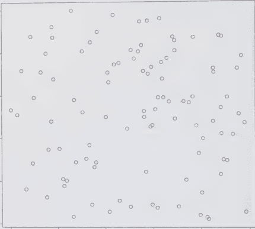

**图 1.1：** 单位正方形上的 100 个伪随机点。

然而，一个挥之不去的疑问仍然存在：我们找到的群体在定量上是有意义或有用的吗？一个数据集可能具有微弱的结构，而这种结构可能仅仅表明一个纯随机过程，这是贯穿聚类分析研究的一个重要问题，即有效性问题。是否有充分理由相信数据显示出有意义的结构？以及在什么尺度上（例如，局部星系还是整个宇宙）？我们能否对研究领域中可能的类别做出推测并形成假设？还是说，我们只是在将随机产生的结构分组？以雨滴首次落在露天石板或方形混凝土板上的散布为例：如果我们假设其发展中的图案是随机的，我们仍然会看到某些区域雨滴密度略高，而其他区域总体密度略低。我们无法从石头或路面上的这些轻微雨滴分组推断出任何东西：在任何时间点，它们的图案都只是均匀随机过程样本的产物。它们的均匀性处于极限状态：打个比方，当石板完全湿透时。类似地，计算机上统计上稳健的伪随机数生成器会模拟从均匀随机分布中抽样，如果将这些数作为 x、y 对绘制在单位正方形上，它们的行为会非常像雨滴：会出现如图 1.1 所示的非常轻微的密度点。定量聚类方法会将这些点分组，很像我们对雨滴的感知，即使我们在某种程度上改变分组点的尺度。然而，可以使用所谓的准随机序列 [84] 生成密度累积非常小的点。

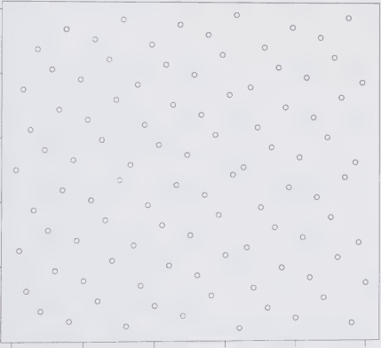

图 1.2 显示了一组由 Hammersley 序列 [60] 这类准随机序列生成的准随机点。图 1.2 中的图像是人们可能天真地期望一百个雨滴组成的均匀雨点集看起来的样子，但这种图案在自然界中远比图 1.1 所示的类似情况罕见。大多数聚类算法确实会继续对这两类数据集进行聚类，尽管两种结果在很大程度上并不一定是我们可能考虑的独立属性，并从中抽取更大的子集来执行结构和性质分析。

存在密集的群体，但也有一些离群点和单点。再者，这些分组在什么尺度上可能具有任何意义，取决于数据。现在想象同样的例子具有更多维度。图 1.4 展示了这个扩展后的数据集，包括那些具有可旋转键的化合物，并在成对图中展示了十种性质。这些变量被选择为与溶解度有一定关系，但除此之外，它们属于预测建模 QSAR 研究中常用的数百种此类化学性质。有些性质本质上是连续的，例如分子量（“molwt”），而另一些是离散的，例如可旋转键（“rot”）。鉴于这些数据是我们能够轻松可视化的，很难——如果可能的话——想象数据会如何分组。

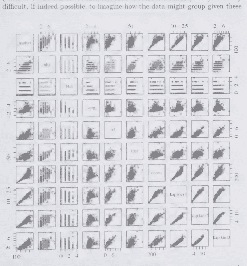

**图 1.4：** 405 种苯二氮䓬类化合物的混合数据类型性质的成对图。

如此分组且由分布已知的过程生成的数据，通常可以使用混合模型等参数方法进行聚类。这类模型会返回一组参数，例如不同组的均值和方差估计——如果事先知道可能存在四个组，这有望意味着我们一开始就了解生成数据的过程的一些情况。图 1.6 具有与图 1.5 相同的类别，但现在方差增大，以至于类别重叠。在缺乏其他数据特征的情况下，对这些数据进行分组自然会使类别被错误分类。鉴于类别的生成及其分布很简单，混合模型很可能是对这些数据进行分组的最佳方式，但人们很容易看出，如果类别分布未知，随着噪声增加以及其他特征的加入，其他非参数分组方法也可能同样有效，或在某些情况下更好。

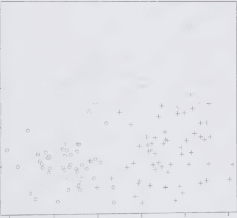

**图 1.6：** 一个人为构造的数据集，包含四个类别，方差增大，随机正态点具有四个中心，并且围绕 *x* 和 *y* 的标准差各不相同。

尺度与随机过程相对类别结构问题的一个著名例子出现在 20 世纪 60 年代和 70 年代，通常被称为 *癌症聚集* [101]。在医疗保健人口统计中，人们发现偶尔某个地区癌症患者的密度会略高于该人群的平均密度。（关于工作场所中癌症聚集的例子，见 [118]。）问题变成了：这些确实是某种非随机密度波动过程形成的群体吗？水中、空气中、工作场所等中是否有某种东西导致某个地区某种癌症或多种癌症的发病率更高，还是这些群体是随机出现的？类似地，数据是像图 1.2 那样？还是更像图 1.5？这些分析可能会被所收集数据样本中的其他随机因素或数据收集方式所混杂。无论是聚类星系、癌症发病率、基因或蛋白质表达、序列分析数据，还是类药化合物，显然重要的是要考虑到纯随机过程和抽样形式可能在群体形成方式中发挥强大作用。

### 1.1 历史

早期希腊哲学家有一种迷人的习惯，即把他们周围的世界解释为一组属性，其基数通常是 3 或 4；或者 12；例如，有四种基本元素：土、水、火和空气。他们没有提出任何特定的算法或分析来量化他们是如何得出这些分组或类别的。这并不是要贬低从前苏格拉底哲学家开始的伟大智者：他们毕竟使用的是手头可用的东西，而这些在很大程度上是对周围环境的定性观察。这种定性方法从亚里士多德到康德基本上有增无减，以至于许多基于定性观察的类似分组被作为哲学和科学中的重要类别提出。事后看来，它们在今天显得有些任意，也没有多少基础可言，尽管如此，它们经过了良好的推理和分析，尽管在任何地方都没有从定量或统计意义上证明其有效性。在整个文明史中，直到第二个千年，收集数据并对其应用数学是相对罕见的。因此，即使希腊人已经发展出他们那个时代非凡的数学，此后数学的发展及其应用仍然断断续续。

但是，随着科学发展成为一门更定量的学科，人们努力将注意力集中在更狭窄的观察集上，而不是试图用少数类别和过程来解释诸如宇宙学或物理学的全部内容。从（现已弃用的术语）*自然哲学*到作为更定量驱动的事业的科学的转变，更加依赖于定量数学的严谨性，而计算机器和计算能力的飞速发展只是加速了这一转变；如今一些方法变得如此复杂且特定于某种数据类型和应用，以至于许多方法超出了本书的范围 [46, 61, 72, 143]。

新的聚类算法继续出现在许多领域的文献中，通常只是为了适应特定应用而对已有知名算法进行修改。人们可以设计新的聚类算法，但通常明智的做法是彻底查阅文献，而且不仅仅是在广泛的应用领域内——一种新算法或与之几乎相同的算法很可能已经发表。

作为探索性数据分析工具的聚类分析，依赖于直观显示结果并从而帮助解释结果的能力。因此，近年来随着高端计算机图形学的进步，聚类结果的可视化得到了推动，但要有效可视化大型数据集或高维数据集的聚类结果，仍有大量工作要做。多变量分析贡献了与聚类分析相一致的重要方法，例如主成分分析（PCA）[80] 和各种形式的多维标度（MDS）技术，这些方法对探索性数据分析以及数据和聚类可视化都很有用 [16, 31]。PCA 也已被用于开发基因表达数据的聚类算法 [154]。更近一些，类似的方法如非负矩阵分解 [34] 已被开发出来，既用于探索性分析，也经过修改用于聚类分析。然而，这些工具也有其缺点，通常会将多种可视化技术结合起来帮助可视化结果。以 *树状图* 形式表示的层次结构现在可以用多种不同方式表示，并且经常与 *热图* 一起显示，有助于揭示数据中的结构关系。

生物信息学中的聚类分析有三个常见应用：基因表达数据、序列分析和系统发育树构建。基因表达筛选流程的发展促使了用于解释这些数据的聚类分析的发展。20 世纪 90 年代开发了两种流程形式，可在微阵列（cDNA 或寡核苷酸阵列）上同时检测数千个基因的表达。无论使用的阵列形式或实验类型如何，数据的一般形式是一个矩阵，其中行代表基因，列代表实验。在某些情况下，实验代表时间序列数据。

**实验**

**基因**

| 基因 | 实验 1 | 实验 2 | ... | 实验 m |
| --- | --- | --- | --- | --- |
| 1 | x_{1,1} | x_{1,2} | ... | x_{1,m} |
| 2 | x_{2,1} | x_{2,2} | ... | x_{2,m} |
| ... | ... | ... | ... | ... |
| n | x_{n,1} | x_{n,2} | ... | x_{n,m} |

表达数据通常有数千个，实验有数十个，很少超过一百个。因此，在上述矩阵中，n ≫ m。现在更大的表达数据集可能达到数万个，并且可能很快达到数十万到接近一百万。第一批

这类表达筛选结果由 Eisen 等人[37]采用一种稍作修改的层次聚类算法进行聚类，该算法后来成为标准。随着表达-实验矩阵规模的变化，一些现有方法可能仅因规模问题就需要调整。更广泛地说，*数值生态学*[92] 综述了针对各种形式生物数据的聚类方法。

宽泛地说，这些数据的聚类分析可分为三类：跨实验对基因表达数据进行聚类（实验有时称为样本；例如，对多种癌症形式的表达响应）、基于表达数据对实验进行聚类；以及所谓的双聚类，即在表达-实验矩阵内按某个定量阈值寻找感兴趣的不同或重叠子矩阵。对表达数据进行聚类有许多理由：生成关于共调控基因群以及可能识别功能类别的基因群的假设；找出在共同时间类别中表达的基因；并可能确定微阵列中的过程伪影和误差。对实验列进行聚类常用于生成关于细胞类型或癌症类别的假设。双聚类的动机考虑到一部分基因和一部分实验（例如细胞过程）是感兴趣的。寻找可能重叠的块矩阵是一个难题，因为这取决于对矩阵的行和列进行置换，以使感兴趣的子块对齐。因此，人们采用了许多启发式方法来寻找有望接近最优的解。图 1.7 展示了一个双聚类组的虚构示例，用颜色和阴影线表示重叠的簇。

序列分析数据常被聚类，以发现蛋白质序列之间的关系或类别。这些结果中的许多随后又被用于构建系统发育树。然而，系统发育树的构建可以纳入其他特征和数据类型，但存在一个共同的总体联系，即理解亲缘关系。

早期关于聚类分析在药物设计中应用的论文，主要关注小分子类药分子之间的构效关系[20]，或确定一组多样的小分子类药分子[102, 120]。此后已发表了数百篇论文，涉及某种形式的聚类分析或用于其中的相似性度量。本书所述几乎所有这些方法都已被用于药物发现过程的计算工具中。生物信息学和化学信息学这两个具体学科各自有一套流行的聚类分析方法，这大体上与数据类型和先例有关：新数据最初使用什么算法，常常决定后续研究偏好使用该算法。随后，研究人员需要一些时间尝试其他方法，但文献最终会收录这些努力，并且在少数情况下会开创一种可能持续也可能不持续的新潮流，有时与明显的效力无关！事实上，无论某一特定方法（自组织映射就是一个很好的例子）在当时任一学科中是否流行

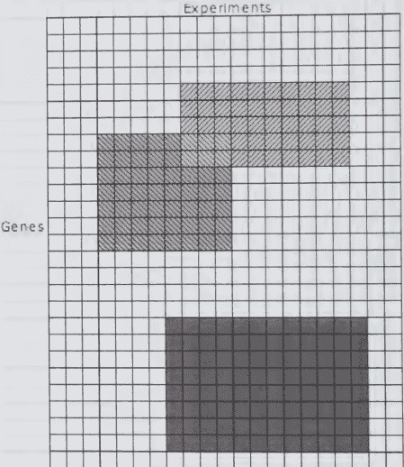

实验

基因

**图 1.7：** 基因和实验的子组以这样的方式对齐，使得簇出现在块矩阵中；此处用颜色和阴影线表示重叠的簇。

### 1.2 生物信息学与药物发现

药物发现的一个很大组成部分涉及寻找并随后修饰或设计小分子；即与蛋白质靶标结合的配体。小分子配体最常通过*高通量筛选*（HTS）、计算化学中的虚拟研究，或包含给定靶标既往配体活性数据的数据库来鉴定。寻找药物，即*先导化合物发现*，以及修饰和设计药物，传统上是药物化学家和计算化学家的领域。对此类数据的分析和存储已被称为化学信息学。靶标通常由生物学家、遗传学家和生物信息学家鉴定，且往往通过系统生物学完成。然而，在药物发现中，药物设计研究包含对配体-靶标相互作用的研究。因此，在药物发现领域内，生物信息学、化学信息学，甚至药物信息学之间存在某些交叉领域。图 1.8 展示了这些学科及其交叉的重要方面，例如遗传变异、药物设计和类药化合物关系。在图 1.9a 中，这种相互作用在“药物发现流程”这一共同标题下得到更详细的展示。药物发现的起始阶段需要识别所关注特定疾病的靶标。靶标的识别和验证需要生物学家和生物信息学家。一旦靶标被识别并验证，寻找与其结合的配体就需要药物化学家、生物筛选专家和计算化学家。一旦鉴定出一个先导系列或多个先导系列，先导化合物就需要一个迭代优化过程。同样，一些相同的化学家、生物化学家、生物学家、药理学家、晶体学家和毒理学家都参与优化先导化合物的效力，同时不引入毒性或其他不良效应。成功的先导化合物会被转化为新药实体，随后开展动物和人体研究。最终，如果该过程成功，所得药物获批向目标市场销售。在药物发现过程的后期阶段，即药物被给予患者受试者时，会用到医学和医学信息学。

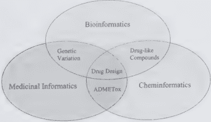

**图 1.8：** 药物发现中化学信息学、生物信息学和药物信息学交叉的总体概览。

孤立地看，化学信息学中的药物发现主题往往缺乏医学或更大的生物学背景。配体如何与蛋白质靶标结合的研究，即三维药物设计，与蛋白质及蛋白质结构研究密切相关，因而也与药物发现生物学和生物信息学密切相关。蛋白质和基因表达，甚至在一定程度上系统发育研究^85，在药物发现中已变得更加重要，因为有一个称为*个性化医疗*^6 的研究领域，即根据特定人群的遗传相似性为其设计药物，而不是为普通人群设计药物。生物信息学和药物信息学有助于精准定位遗传变异，从而可以识别出表现出某种遗传相关疾病的遗传亚群，并将其作为特定药物的靶向对象。有时，为普通人群开发的药物会对一个小的遗传相关亚群产生不良影响。有能力识别此类人群，并让他们服用其他药物，或专门为他们设计一种新药或一组药物，这是*个性化医疗*的另一种形式，其借鉴了*图 1.9a*所示的三个信息学领域。

药物发现总体上是一项商业活动，因此并不总是由利他考量驱动。学术和政府研究人员有机会研究更广泛的靶标，这些靶标不一定偏向市场规模，但资助来源会影响所开展研究的类型。如果相关主张并非只是适度保守，那么重要的是要牢记这些机构产出的任何聚类文献结果背后的动机。对于任何一类数据，没有哪种方法必然是最好的。当前和未来的从业者应始终牢记这一点。

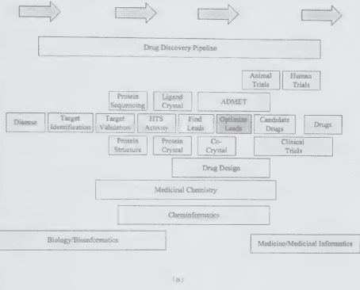

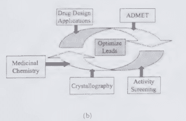

图 1.9：图 1.9a 展示了药物发现流程的示意图。图 1.9b 提取了先导化合物优化的迭代过程，并将必要组成部分绘制为输入。


### 1.3 统计学习理论与探索性数据分析

认识论是研究人类如何获取知识的哲学学科。统计学是我们用来获取知识的一种工具：它是对数据的定量研究，因此，我们可以把它看作一扇窗口，透过它进入周围世界中我们原本可能无法理解的领域。它是一种通过推断获取知识的学习形式。我们希望这些知识在某种意义上是有用或有益的，并且未来能够可靠地据此采取行动。统计学家对推断有两种突出的思考方式。它们被称为*贝叶斯*和*频率学派*方法。贝叶斯概率概念涉及度量知识的状态。这种看似主观的观念通过如下方法形式化：处理事件的先验知识，并用关于事件的新知识更新概率。另一方面，频率学派将概率视为一个具有确定事件总体的系统中事件发生的频率。尽管特定总体可能相当模糊甚至在很大程度上未知，这仍是一种看似更客观的观点。尽管贝叶斯学派或频率学派在统计推断问题上的哲学基础可能不同，但两者都引出了旨在从数据中学习的方法和算法的实际应用。

统计学习理论是统计学的一部分，可分为两个基本子类：*无监督学习*和*有监督学习*。前者涉及定量地学习组或类——主要是聚类分析；后者涉及使用已知类别（分类）或已知连续响应（回归）来预测未来案例（预测类别或连续响应）。将定量预测方法应用于数据集通常称为*预测建模*。有时，聚类分析与预测建模结合使用，但除此之外，这两种学习理论形式截然不同，其验证方法也不同。在将聚类用于预测目的的情况下，通常用它对数据进行分割以形成类别，然后依次为这些类别开发预测模型。然而，应相当谨慎地看待这些模型，因为所谓类别具有假设性质，而聚类过程中固有的噪声和模糊性会被带入预测建模。这未必是个坏主意——它可能是一种最后手段，或是一种将预测建模作为探索性数据分析形式的方案。

一开始就应指出，为帮助消除混淆，*分类*一词含义过载，在统计学习理论中有多种含义。在有监督学习理论中，*分类*指构建涉及已知类别的预测模型。然而，在无监督学习中，*分类*指分配类别的基本任务；即：对项目进行分组或聚类。例如，*美国分类学会*主要致力于聚类分析的理论和数学研究，而一般不致力于预测分类建模的要素。

### 1.4 聚类算法

算法是一个逐步的过程，通常接收某些输入并得出结果。可以把它看作计算机器的指令，无论多么复杂和曲折。这些步骤可以是顺序的，也可以是并行的。聚类算法以数据为输入，返回数据的某种*划分*，即划分为若干组，或返回表示数据之间部分或全部关系的层次结构，并有望通过在一个有意义的层次上切割该层次结构来从中导出数据划分。

算法可以不同于这两种一般模型，因此划分以及层次结构的划分未必互不相交——这些算法输出的是重叠聚类。重叠聚类不是严格划分，用集合论术语来说，是一种*覆盖*。模糊聚类算法 [9, 157, 155] 作用于在聚类中具有隶属概率或隶属系数的数据项，具有重叠聚类的特点，但确实与这些算法不同。模糊聚类既有划分式形式，也有层次式形式。并非所有数据都允许对称的相似关系。这些数据具有不对称的相似性度量，针对它们有划分式和层次式两种形式的非对称聚类算法。包含来自若干不同聚类算法形式的元素的混合算法通常被设计成会在某种程度上打乱上文概述的简单聚类算法分类体系。

幸运的是，一般而言，聚类算法及其相关数据结构并不特别复杂，但正如将要看到的那样，同一主题通常会有许多变体。然而，在某些情况下，由于聚类算法内部的某个决策或所用相似性度量的离散性质，组归属可能存在模糊性。修改算法以解决或报告聚类模糊性，可能会使算法的实现和聚类有效性分析变得复杂。

有效性往往取决于数据，即对特定问题应用何种形式的算法。计算密集型算法对非常大的数据集并不特别有用；为非常大的数据集生成层次结构，即使正是所期望的，或者如果可行的话被证明是最能揭示结构的，也可能在手头的计算资源下根本不切实际。而小数据集的结构则可以通过层次算法在其拓扑全貌中得以揭示，即使该算法计算开销很大。数据的维度几乎肯定也会在决定尝试哪些算法时发挥作用。如果具有大量变量的数据项的相似性计算成本很高，那么尝试某些算法可能不切实际，因为这些算法的额外复杂度会加重计算资源的负担。

### 1.5 计算复杂度

计算需要时间。幸运的是，计算机现在非常快，而且在可预见的未来可能会越来越快。同样，无论是磁盘上还是计算机内存中的数据存储容量，也随着计算机处理器速度的提高而增加。这使用户能够更快地计算算法，并在越来越大的问题上进行计算，同时更高效、更有效地存储结果。尽管如此，仍然有必要理解问题的计算复杂度，并拥有能够对问题排序的度量指标，至少隐式地对这些问题算法解决方案实现的性能进行排序。总体算法性能也应在一定程度上独立于相应问题的任何具体实例。

有些问题不可计算。有些问题可计算但不切实际（更技术性地说，这些问题称为*难解问题*），即使在今天或明天的机器上也是如此；有些问题可计算，但为计算它们而设计的算法可能不是最高效的，或者在手头资源的合理范围内不是高效的。有些问题虽然难解，但仍存在实际解决方案，即近似算法或*启发式方法*，它们能得出解——这些解有望接近最优，但可能并非最优。对于某些难解问题，存在近似算法，使得由此得到的解可以任意接近最优解，从而近似最优解。它们不同于*启发式方法*，后者不保证接近最优解。使用*启发式方法*时，解可能远离最优。聚类算法实际上是一组*启发式方法*，它们生成被期望接近最优的解；也就是说，在相应特征空间中寻找一组对象的最优划分是一个*难解问题*，其中*启发式方法*很常见，而高效的近似算法更难设计。

为了理解不同算法在总体上以及在问题规模方面的时间和空间需求，我们需要全面假设简单的基本算术或比较操作大致花费相同时间，当然也知道实践中并非如此；并假设无限空间可以或多或少以常数时间随机访问，同样也知道实践中并非如此。这些假设所构成的公平比较基础，形成了所谓随机存取模型（*RAM*）的基础，该模型用于理解算法的计算复杂度。在这个模型中，常数被消去，相对算法性能可-

接下来是对问题规模的纯粹比较。这在时间和空间需求上都是如此。

例如，将一小串乱序数字按排名线性顺序排序可以手工完成，但如果列表中有数百万个数字，并且我们想设计一个计算机程序来对许多这样大大小小的列表进行排序，我们就需要设计一种可以编入计算机的、尽可能高效的算法。事实证明，对数字列表进行排序存在无数种低效的方法，但高效的方法只有少数有限的一般性方式。事实上，已经证明，对于包含 $N$ 个数字的一般列表，在最坏情况下存在一个最佳效率；在算法最耗代价的操作（即比较两个数字）中，不可能设计出比某个特定下界更高效的排序算法。对于按最坏情况顺序打乱的 $N$ 个数字的一般列表，该下界是 $N \lg N$ 次比较。常见的排序算法（*快速排序*、*归并排序*、*插入排序*、*冒泡排序*等）的性能通常在 $N \lg N$ 和 $N^2$ 之间变化，而空间需求通常与 $N$ 成线性关系。

我们可以用常见的渐近界来正式地对算法的相对复杂度进行排序。这里的重点是当 $N$ 变大时的情况。如果 $N$ 很小，由于实现细节和其他因素累积的常数可能会推翻相对排名，但在大多数情况下，只要硬件和软件在各种实现中保持一致，$N$ 不必非常大就能使相对排名符合渐近界。而且，如果我们在不同实现之间更换新的硬件或软件，这些排名将保持不变。

在本书中，我们将考虑三个基本界。请记住，在下面的内容中，等号 = 实际上是动词“等价于”，而不是算术关系，例如 2 = 2。

- 1. 根据最坏情况来界定时间效率性能，即所谓的渐近上界，记为：

  $$f(N)=O(g(N)), \tag{1.1}$$

  其中 $N$ 是自然数，并且存在某个正实数常数 $C$，使得

  $$f(N)\le Cg(N), \tag{1.2}$$

  当 $N \to \infty$ 时成立。这可以重新表述为：可能存在一个非平凡的最小正整数 $N_0$，使得：

  $$|f(N)| \le C|g(N)|, \tag{1.3}$$

  当 $N \to \infty$ 且 $N > N_0$ 时成立。

- 2. 更严格地界定性能记为：

  $$f(N)=\Theta(g(N)), \tag{1.4}$$

  其中存在两个正实数常数 $C_1 < C_2$，使得

  $$C_1g(N) \leq f(N) \leq C_2g(N). \tag{1.5}$$

- 3. 根据所谓的下界来界定性能，记为：

  $$f(N) = \Omega(g(N)). \tag{1.6}$$

  在这种情况下，

  $$|f(N)| \geq C|g(N)|. \tag{1.7}$$

$\Omega$ 界表明，在给定某个常数 $C$ 乘数的情况下，性能总是高于函数 $g(N)$。显然，对一般数字列表进行排序是 $\Omega(N)$。

这些界提供了一种根据数据规模来理解聚类算法性能的机制。有点非正式地说，阶符号的求和遵循如下规则：

$$O(g(N)) + O(g(N)) = O(g(N) + g(N)) = O(g(N)). \tag{1.8}$$

因此，举例来说，如果一个聚类算法首先以 $O(N^2)$ 的时间计算成对相似度，然后该算法利用这些成对相似度再执行一个 $O(N^2)$ 的操作，该算法仍然会以 $O(N^2)$ 的时间执行其所有部分。只有常数 $C$ 发生了变化。实际上，新的 $C$ 是算法中每个单独的 $O(N^2)$ 部分的常数之和。

在大多数情况下，对于聚类问题，可以找到简单的多项式时间算法（关于 $N$ 的多项式），这些算法能够找到启发式解——但要理解，该解很可能不是最优划分或通向最优划分的层次结构。也就是说，要将 $N$ 个对象分组，大多数聚类算法会考虑所有成对相似度，在对称情况下有 $\frac{N(N-1)}{2} = O(N^2)$ 个这样的成对相似度，在非对称情况下有 $N^2 - N = O(N^2)$ 个。如果数据的维数很重要，我们应该将这一代价包括在内，在这种情况下，计算成对相似度的代价是 $O(dN^2)$，其中 $d$ 是维数。至少，大多数聚类算法会首先花时间计算所有这些相似度。（绕过计算所有 $O(dN^2)$ 个相似度的聚类抽样算法将在第5章讨论。）时间是 $N$ 的函数，在这种情况下是 $N$ 的多项式。对于多项式时间算法，可能有更高的指数或更多的项，或者多项式的每一项都有常数，但它仍然是 $N$ 的多项式。例如，有一种有时用于聚类的算法，称为最小生成树。该算法的一种常见多项式时间实现是 $O(N^2 \lg N)$，已知的快速算法是 $O(N^2 + N\lg N)$。

图1.10展示了 $N$ 的简单函数的增长率。无论我们乘以每个函数的常数集合如何，在 $N$ 足够大的某个时刻，这些函数当前显示出的相对大小关系都将保持不变。

指数、阶乘及更高级别的函数比任何多项式算法效率都低，无论多项式的次数是多少。这些都是难以处理的问题。将具有 $d$ 个特征的 $N$ 个对象集合进行划分就是这样一个问题。有一类问题，虽然问题本身高于多项式，但其解可以在多项式时间内验证。在非确定性解可以在多项式时间内验证问题的假设下，这些问题被称为 *NP* 问题 [30, 111, 109]。*NP* 代表非确定性多项式。这个术语源于形式自动机和形式语言理论。如果问题可以被证明至少与 *NP* 中的问题一样难，则被称为 *NP难*。如果 *NP* 中的每个问题都可以归约（称为*归约*）到问题 p，则 p 被称为 *NP完全* 问题，因为它既是 *NP难* 的，又属于 *NP*。其结果是，如果 *NP完全* 问题可以在多项式时间内求解，那么 *NP* 中的所有问题都可以在多项式时间内求解。即 *P = NP*。许多形式的聚类问题已知是 *NP完全* 或 *NP难* 的，因此需要立即开发和使用启发式方法以及偶尔的近似算法来寻找可能的非最优解。

渐近分析观察到算法性能的一个有趣性质，即性能在算法所操作的问题实例集合上的分布。考虑一个排序算法，其中一个问题实例是近乎有序的列表。某些排序算法可能在远少于随机打乱数字列表的时间内生成解。两个算法可能有不同的最坏情况渐近界，但对于某些实例，计算代价较高的算法可能比效率较高的算法在这些实例上的表现更高效。不同的 MST 算法——Prim 和 Kruskal 的 MST 算法——确实就是这种情况。此外，最坏情况性能的实例可能很少，而许多实例的性能接近下界，因此平均情况界的宽泛度量无法全面理解整个问题实例集合上的性能分布。在给定实例集合的情况下研究算法性能分布，被称为算法的经验分析。事实上，MST 可以用于数据聚类，因此了解应用程序实例的类型和分布可能具有一定的意义，并有助于确定使用哪种 MST 算法。

#### 1.5.1 数据结构

到目前为止的讨论忽略了一个事实：要得到高效的算法，需要将数据高效地存储以供访问，而且通常需要特定的存储机制（即数据结构）才能达到最佳性能界。这些不仅仅是具体的实现细节，而且往往与性能的阶数密切相关。例如，在排序一个列表时，如果我们将数据存储在某种数据结构中，以至于需要花费 $N$ 的线性搜索来

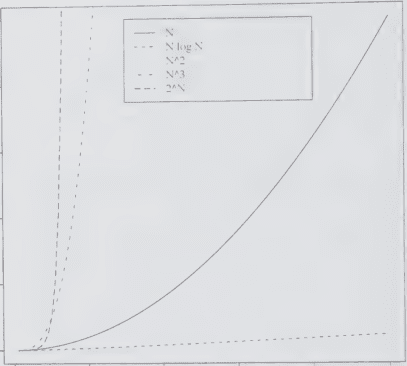

**图 1.10：** 函数相对增长率与 N 和时间的关系。这里显示了关于 N 的线性、对数因子 N log N、多项式 N² 和 N³，以及指数 2^N。

与常量时间访问相比，寻找下一个要考虑的数字将给我们的排序算法增加一个 N 因子。另一个与聚类分析更相关的常见例子是（不）相似性矩阵的存储方式。假设聚类算法将整个矩阵视为一个图，对于某些图算法，使用矩阵存储比使用邻接表集合存储会使算法性能增加一个 N 因子。从实现的角度来看，在这种情况下，邻接矩阵的实际存储量将比整个矩阵存储量少一个常数因子。因此，确保数据结构为所讨论的算法问题提供最佳访问方式，对于时间和空间来说都是非常重要的考虑因素。

#### 1.5.2 并行算法

到目前为止，我们都在单处理器和一组顺序进程的背景下讨论算法。有些问题本质上是顺序的，但许多问题可以并行化。最简单的例子是相异矩阵的生成。矩阵的生成和存储可以分解为多个块，并在这些块完成后进行组装。因此，如果我们有大量处理器（或处理器核心），可以将这些块的生成任务分发出去，然后在内存或磁盘上组装，那么原则上，我们可以将生成矩阵所需的时间减少为我们用于生成块的处理器数量那么多倍，再减去分发数据和组装结果的时间——这是一种延迟形式。这类问题被称为*令人尴尬的并行*，意味着除了数据分发以及结果的收集和组装之外，处理器之间不需要真正的通信。然而，有些问题虽然仍可并行化，但需要处理器之间相互通信结果或数据。这种通信成本构成了另一种更严重的延迟形式，但尽管如此，在时间成本方面，执行算法的并行实现仍然优于顺序实现。并行算法的渐近记号包含处理器数量的阶。例如，一个排序算法在数据规模 N 上可能有 O(N) 的时间，并且有 O(lg P)，其中 P 是处理器数量。应当指出，尽管问题可能可并行化，但通常问题越复杂，将最有效的顺序解直接转化为可并行解的可能性就越小。我们可以将此视为一种*解决方案延迟*，它超出了*令人尴尬的并行*算法的预处理或后处理延迟，或通信延迟。

越来越多的计算机拥有多处理器和多核心，使得台式机甚至笔记本电脑能够执行重要的并行算法。计算机集群现在可以并行处理海量数据集。在实际中，延迟可能很大。例如，假设你有 32 个核心，在这个系统上运行聚类算法需要一天时间。然而，你在单个核心上运行该算法的顺序版本只需要 5 天。这远没有达到 32 倍的加速，但如果你有资源，可能最好在一天内完成工作，而不是等待 5 天。但现在假设你只有 4 个核心。由于延迟，同样的工作现在很可能比在单个核心上运行顺序版本花费*更长*的时间。在某些情况下，对于某些算法，延迟使得通过并行化获得的加速无论如何投入多少处理器，都无法有效地显著超过某个特定点。因此，尽管开发可并行化的聚类算法是一大福音，并且通常与延迟的性质无关，但计算资源的数量可能是关键的，在开发和使用算法的并行版本时需要仔细考虑。

### 1.6 术语表

- **算法：** 以顺序或并行方式计算某个结果的一组步骤。
- **渐近阶记号：** 表示算法计算复杂度阶数的记号。
- **生物信息学：** 生物信息与分析。
- **化学信息学：** 化学信息系统与分析。
- **监督学习：** 类别已知。
- **无监督学习：** 类别未知。

### 1.7 练习

1. 从日常经验中列举几个事物群体或类别的例子。对于每个例子，探讨这些类别如何被量化（用哪些变量）或它们在定性上有何不同。这些类别是虚构的吗？它们定义明确吗？它们在某种程度上有用吗？它们作为不同的群体是否容易或难以直观区分？现在，从你的科学经验和熟悉的数据中，选择一些例子并按上述方式加以探讨。具体例子中哪些属性可以用来区分这些群体？这些属性本质上是定性的还是定量的？你能说明你将如何量化群体的选择，以及这如何改变实际的群体划分吗？某些分组是否似是而非？某些群体是否危险，因为它们可能导致错误信息或预测谬误？

2. 机械聚类。直到 20 世纪 80 年代，确定特定木材样品的分类还需要使用一大叠方形卡片，称为二叉检索表（dichotomous key）。所有卡片沿卡片边缘都有一组带标签的孔。这些标签表示木材的特定属性：宏观属性、微观属性等。每张卡片代表一个特定物种，并且对于有标签的属性孔，如果该物种不具备该属性，则孔洞通向边缘；如果具备该属性，则孔洞封闭。一根能穿过这些孔的长针或棒被用来确定所考虑的新物种的每个属性。将针穿过某一属性的所有孔洞，然后用针将卡片抽出。对连续越来越小的卡片子集，每个属性重复此过程。这叠卡片是一个物理数据库，针和属性孔是对类别数据库的单个查询。该系统具有隐式的类别层次结构。现在假设，对于一个木材样品，可以确定 100 个属性中的 60 个。连续使用针将会抽出最终的卡片子集，从而将木材样品归入某一物种或属的类别。尽管每张卡片的物种类别是已知的，但卡片子集在一起是否必然构成一个已知的群体或分类？能否确定一副卡片中不存在的新物种？如果能，需要什么条件？对于你在第一个练习中探索的一些例子，探讨二叉检索表系统的概念。针在孔中使用顺序是否重要？二叉检索表如何在计算机中编码？

3. 对自组织映射（Self-Organizing Maps）在生物信息学或药物发现中的应用进行文献检索。你找到的文章数量在历史上是如何分布的？阅读从该方法出现至今的摘要样本。你注意到各自的说法有什么差异吗？作者所属机构在学术界、工业界或其他机构中的分布大致如何？

4. 下面是可以用来生成 Halton 准随机点、伪随机点、聚类算法和绘图例程的示例源代码。这些代码可以直接输入，也可以从网站加载到 R 提示符中。探索使用缩放和绘图观察聚类在随机生成器生成的数据集上的行为。按照下面源代码中的示例操作，并更改每个生成器生成的点的数量。你观察到了什么？注意，有许多关于随机数生成器的统计检验，聚类确实可能显现出随机数生成器的特殊性。你观察到的伪影可能揭示这些随机数性质。

**练习 4 的 R 代码示例**

```r
#You will need to install the randtoolbox R package at
http://cran.r-project.org/web/packages/randtoolbox/

library(rngWELL)
library(randtoolbox)
RNGkind(normal.kind="Box")
#You may need the following line if you are running from the
#command line
require(graphics)
#Clustering routines are in the R library "clust"
library(cluster)

numpoints <- 40
par(mfrow=c(1,1))
halton.points <- halton(n = numpoints, dim =2)
```


```r
plot(halton.points, xlab="First Dimension",
     ylab="Second Dimension", type = "n")
text(halton.points,as.character(1:numpoints))

#Repeat several times to see changes.
pseudo.points <- cbind(runif(numpoints), runif(numpoints))
plot(pseudo.points, xlab="First Dimension",
     ylab="Second Dimension", type = "n")
text(pseudo.points,as.character(1:numpoints))
#Cluster with Group Average Hierarchical Clustering
#(the default)

haltonGAClustering <- agnes(dist(halton.points))
plot(haltonGAClustering, which.plots = 2,
     ylab="Group Average Euclidean Distance")

pseudoGAClustering <- agnes(dist(pseudo.points))
plot(pseudoGAClustering, which.plots = 2,
     ylab="Group Average Euclidean Distance")
```

- 5. 计算相似矩阵的计算复杂度非常简单，为 \(O(N^2)\)。然而，给定维度 \(d\)，哪些实现细节会影响 \(O()\) 记号所隐含的常数？

- 6. 图的最小生成树是一个非常简单概念，但计算图的最小生成树的高效算法可能相当复杂，需要特殊的数据结构。查阅图算法书籍或网上关于计算最小生成树的各种版本，并比较这些算法的计算复杂度。在给定通常所处理问题规模的情况下——是许多小 N 问题，还是少量极大 N 问题——每种算法的常数会如何影响人们选择实现哪种算法？你能想到如何利用最小生成树来形成簇吗？

## 第2章

### 数据

生物信息学和药物发现中的数据多种多样。这些数据通常通过经验收集，并手动或自动输入计算机；或者数据可由已知属性推导而来，从而在计算机上生成。随后，这些数据通常被放入数据库或平面文件中以供分析。当然，在任何给定数据集中，都可能存在误差、缺失数据、错误元素、混合类型，或经验元素与推导元素的混合。因此，要开展有意义的探索性数据分析，数据质量分析以及关于数据的专家知识几乎总是必要的。全面理解数据、其生成方式、其尺度、其范围、其异常和离群点，对于确定要应用的聚类算法类型以及如何评估和验证结果大有帮助。数据在计算机内部如何表示也很重要：表示数据所用的精度、内存占用和磁盘空间会影响所执行聚类分析的选择和效果。

为了将数据输入聚类算法，通常需要进行额外处理。数据可能需要缩放、归一化或以其他方式变换。随后需要选择一种数据元素之间的邻近性度量。根据聚类方法的不同，随后可将数据矩阵（有时称为*模式矩阵*）或某种形式的邻近矩阵用作输入。反过来，考虑邻近矩阵有多种不同方式：既可以通过矩阵代数进行矩阵操作，也可以将其视为组合图对象。每种方式也会影响人们如何可视化和解释聚类结果，或如何设计、直观理解聚类算法。

### 2.1 类型

有四种基本数据类型：二值型、有序型（计数数据）、连续型（比例数据）和分类型数据。这些类型并非固定不变，因为它们可以从一种转换为另一种；对于任何特定数据集，可能有几种不同类型共同构成数据的维度。因此，例如，一组小型药物和类药分子可能具有二值数据，表示每个分子的化学图结构性质；还可能有一组计算性质，如分子的分子量、可旋转键数、亲脂性度量等。二值数据通常是固定长度的 1 和 0 字符串，而可旋转键数属于整数集合（其有效范围在 0 到比如 30 之间）。分子量和亲脂性度量是连续值数据，但这些值的精度使它们实际上可转换为一个尽管很大但有限的整数集合。无论这些数字具有连续值性质，某种形式的计算机（或机器）精度，或程序员设定的任意精度，都会在有限尺度上定义这些值。只要尺度足够大，计算机表示的离散性质就会非常像连续值。这组分子还可能具有分类型数据，例如，每个化合物都有由公司或化学品供应商分配的唯一标识符。这类数据在某些应用中可能很重要，但它与数值数据截然不同，因为它没有顺序，除非借助其他属性，否则也没有任何相似性度量。

对于某个应用而言，可能只有一种或少数几种类型与当前的聚类应用相关。例如，人们可能希望仅根据化合物的化学图结构性质，或仅根据其计算性质等，对化合物进行分组。如果所有数据都属于同一类型，通常会很方便。这有助于将相似性度量的选择缩小到该类型常用的那些度量。在这种情况下，转换为最常见的类型通常是典型做法，尽管未必是最佳解决方案。同样，这在很大程度上取决于数据和应用。

#### 2.1.1 二值数据

二值数据在药物发现中很常见，在生物信息学中则稍少一些。药物化学家如何将已知化合物输入计算机，是一个编码问题。一旦一组化合物被编码为机器可读形式，搜索该集合并对其操作的方法就属于化学信息系统的范畴。

20 世纪 50 年代中期，Wiswesser 线型表示法（WLN）被引入，并作为常见的化学编码得到广泛使用[152]。20 世纪 80 年代，至今仍在使用的最常见编码之一是所谓的 SMILES[145]，它是一种 ASCII 字符串，包含扩展字母表以及作用于该字母表以定义化学图编码的语法。苯的 SMILES 编码就是 `c1ccccc1`。咖啡因的 SMILES 字符串是 `c1c2nc(n(c(nc(=O)C)=O)C)nc2C`。这些字符串不一定唯一，但给定一组规则，SMILES 字符串可以被规范化，从而使其唯一[146]。OpenBabel 规范化程序为咖啡因输出以下 SMILES 字符串：`Cn1cnc2c1c(=O)n(C)c(=O)n2C`。原子顺序已经改变，但化学图相同[3]。最近采用的一种编码是所谓的国际化学标识符（InChI™）字符串。创建 InChI 字符串是为了提供一种开放标准，用于在化学信息系统中标识化学品。希望在在线数据库系统中使用 InChI 字符串[134]的愿望，推动将 InChI 字符串简化为 InChI 键[69, 86]；最新版本提供了所需的字符串和键编码标准，分别称为标准 InChI 字符串和标准 InChI 键。在图 2.1 中，给出了咖啡因的标准 InChI 字符串和键。图 2.1 中咖啡因分子的表示——标准 InChI 字符串和标准 InChI 键——为：

- `Cn1cnc2c1c(=O)n(C)c(=O)n2C`
- `1S/C8H10N4O2/c1-10-4-9-6-5(10)7(13)12(3)8(14)11(6)2/h4H,1-3H3`
- `RYYVLZVUIVJGVH-UHFFFAOYSA-N`

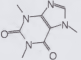

图2.1：咖啡因分子的二维描绘

无论是在化学数据库系统中使用 InChI 字符串还是规范化 SMILES 进行精确结构查找，使用字符串相似性度量（例如编辑距离或 n-gram 分析[57]）在数据库中搜索子结构匹配或相似化合物，都多少有些低效。因此，对于数据库存储和检索，可以通过各种形式的子图匹配进一步抽象出一种编码，该编码将由 SMILES 字符串定义的化学图的子图性质转换为固定长度的位串，通常长达数十万位。子图可以由另一种称为 SMARTS 的语言定义[73]。在图 2.2 中，展示了一个化合物的由 1 和 0 组成的基于关键码的指纹，并高亮了特定的子图关键码位，与高亮的分子结构（一个含非碳原子的环）相匹配。图顶部的第一个字符串是 SMARTS 字符串，表示[六元环中的非碳原子]。图中的图像来自一个交互式动态 Web 应用，用户可以在其中上传化合物的 SMILES 字符串，生成指纹并高亮关键码位；如果高亮位为“1”，还可以查看相应的 SMARTS 关键码字符串以及化合物中匹配的子图。图 2.2 的基于关键码的指纹依赖于一个预先存在的化学关键码定义字典。

通常编码为 SMARTS 字符串（尽管不一定非要如此），这些字符串构成指纹。二进制表示可以通过对基于路径的分子图进行哈希生成（本质上是对诱导子图进行哈希，其中存在长度不超过特定阈值路径长度的唯一路径），也可以由结构字典生成的键或基于与药物发现相关性的预定义键生成 [91]。最初设计用于数据库搜索，更常被称为相似性搜索，随后指纹被用于化合物聚类 [20, 149]。一组指纹中共有的位构成一个众数指纹或模态指纹 [121]。模态指纹可用于确定该指纹集所表示的所有结构中的共同子结构。可以对模态进行参数化，使得并非所有位都必须共有，但通常需要相当高比例的位共有。然后，模态指纹可用于通过另一个指纹数据库进行搜索，作为子结构搜索过程，或作为可视化一组化合物中共同子结构的方法。

相似性搜索、聚类应用和化合物选择受到所谓相似性质原理的推动 [79]：即相似的药物或类药化合物具有相似的生物活性。尽管有大量证据表明这是正确的，但它受到分子形状、构象能量和静电等因素的混杂影响。这些因素可以纳入更广泛的结构定义中，但很难将所有因素封装或编码为单一、高效的数据类型。因此，人们在设计结构性的二维二进制指纹和二进制相似性度量方面投入了大量精力，试图找到将结构与生物活性关联起来的最佳组合。这些方法反过来又带有额外偏差，其中分子大小会起作用，导致研究人员需要权衡选择最适合其数据的指纹和度量 [35, 46, 72, 147]。

此后，人们设计了许多不同形式的二进制指纹，且长度各异，不过长度通常是 32 位或 64 位字的倍数，使其在存储和计算相似性方面更高效。指纹方法既可以是通用的，也可以是特定于数据集的。软件供应商 MDL、Daylight 和 BCI 开发的早期指纹方法至今仍在使用 [73, 25, 129]。较新的方法仍在继续开发，尤其是那些具有数据特定性质的方法。其他常见的分子格式包括蛋白质数据库（PDB）文件、MOL2 文件和结构数据文件（SDF）。指纹通常独立于图编码，因此可以从任意数量的此类图编码中导出，而不仅限于 SMILES 字符串。

SMARTS 子图可以非常具体（例如，一个苯环），也可以像图 2.2 中的示例那样非常通用。定长位串的相似性度量计算速度非常快。尽管会损失信息，但通过这些二进制字符串编码搜索数据库要快得多，而且这些字符串的存储量通常也更少，因为它们可以逐位存储。有许多高效的相似性度量可用于比较两个定长位串。然而，有些度量对特定应用比其他度量更有效。

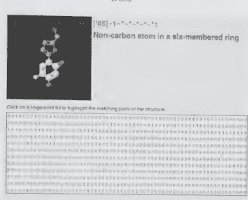

图 2.2 基于键的化合物指纹示例显示在分子描绘下方。一个 1 或 0 位与分子描绘中的匹配特征一起高亮显示。相应的 SMARTS 键及描述显示在结构 Jmol 图像旁边 [78]。

#### 2.1.2 计数数据

计数数据在大多数学科中都很常见，生物信息学和化学信息学也不例外。可旋转键的数量是化合物数据的一维计数变量，但也可能存在多维计数数据。考虑化学结构的二进制表示：一个分子中可能存在不止一个不同的子图键。在二进制表示中，如果子图键存在于分子中，则该位被置为开启。然而，该子图键可能存在不止一个实例。例如，子图键是苯环，而化合物中有三个不同的苯环；计数表示会将那个键记为数字 3，而不是仅仅将该位键置为开启。在化学信息学的命名法中，这被称为计数指纹。此类计数通常跨一个小范围，并会导致与二进制数据比较相似性方面的问题。

从一种类型变为另一种类型会改变用于比较它们的度量的性质。Tanimoto 或 Jaccard 度量在二进制数据下是一种度量，而在计数数据下则不然。这会对各自所用聚类算法的选择产生重要影响。计数数据常被当作连续数据来处理，并使用欧几里得距离来度量不相似性。这同样可能导致聚类算法结果中出现奇怪的模糊效应，因此在评估结果时必须谨慎。

#### 2.1.3 连续数据

连续数据在计算机中表示时其实根本不是连续的。然而，只要有足够的范围、精度和规模（大量数值），此类数据在数据分析目的下可以表现得像连续值。尽管如此，明智的做法是了解这些值如何表示、具有什么精度和范围、在变换下会如何表现，以及其可能记录误差的任何性质。任何数值分析的基础教材都会讨论舍入误差和计算机算术 [21]。

#### 2.1.4 分类数据

分类数据是一种标签形式；例如，“黄色”“红色”“蓝色”，它们之间没有度量或距离的意义。它们本身就是类别。这并不是说我们不能将此数据与其他不同类型的数据结合使用，并设计一种考虑所有类型的度量。如果数据是响应变量，比如活性类别（无活性或活性）或表达类别（下调、上调），这些数据可能更适合用于监督学习，即用于构建预测分类器。如果只有两个类别，可以将它们转换为“1”和“0”，从而将分类数据置于数值基础上。

#### 2.1.5 混合类型数据

混合数据在变换的选择、为二进制或计数数据引入精度，以及随后使用的度量选择方面存在显著问题。二进制数据可以转换为计数数据，其中计数就是 1 和 0；或者计数数据可以转换为二进制数据等，从而使所有数据都属于同一种类型。然后，可以使用该类型的适当度量来比较数据项。此外，鉴于类型不同，应当谨慎思考是否需要对变换后的变量进行加权或缩放。

### 2.2 归一化与缩放

数据的不同维度可能具有不同的范围：它们可能处于完全不同的尺度上。如果我们要根据身高和体重对一教室的学生进行聚类，显然这两个维度处于不同尺度上，而且这些值几乎肯定会有不同的范围。然而，很难确定将数据保留在各自尺度上是否明智，还是应将它们置于同一尺度上；如果选择后者，又该使用何种缩放。再次强调，这要回到关于所讨论数据的专家知识。某些缩放可能会对聚类过程产生不利影响。数据的最佳聚类分离可能是原始数据，也可能是某些特征经过缩放而其他特征未经过缩放的某种组合。图 2.3 显示了模拟数据，其中显然有两个分离良好的簇，而当在一个维度（特征）上进行缩放时，这种分离消失了。对于只有少量特征的小数据集，可以通过简单检查来完成这一性质判断，但对于任何规模和维度都较大的数据集，这就会成为困难得多的任务。

### 2.3 变换

如果数据处于线性尺度上，数据的建模和解释往往要容易得多，而且在许多情况下，非线性数据可以变换到线性尺度上。图 2.4 的左侧面板显示了对原始特征数据的指数变换。右侧面板中数据的指数变换暴露出一些异方差性（随着数值增大，方差发生变化），这在左侧原始形式的数据中远没有那么明显。在缺乏专家知识的情况下，可能很难确定是否要对任意数量的特征进行变换，而且可能只能依靠检查和试错来指导。

记录值可能处于这样的尺度上，以至于对数据取对数

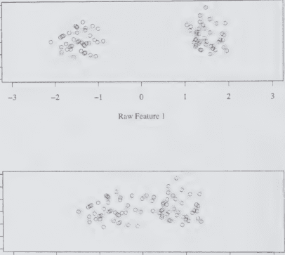

**图2.3：** 聚类中缩放或归一化问题的人工示例。原始数据中两个组明显分离，但一旦沿特征1（x轴）进行缩放或归一化后，就不再明显分离。

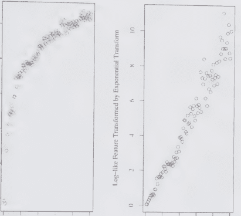

**图2.4：** 第一幅图中的原始特征数据已排序，呈现类似对数的外观。第二幅图中该特征经指数变换，变换后看起来呈线性，但原始数据中几乎注意不到的异方差性被该变换揭示并放大。

将尺度变换为线性尺度。*IC50*，即半数最大抑制浓度，就是这样一组经验推导值。*IC50* 值关系到抑制特定化学或生物过程所需的化合物浓度。通常，在药物发现中希望只需极小的浓度，即小剂量的药物化合物就能影响抑制。因此，这些值可能非常小——处于皮摩尔或纳摩尔浓度，并可按数量级向上延伸。对此类值取负对数，可将 *IC50* 值变换为正的线性尺度，其中最大的正值最具抑制性。

### 2.4 格式

数据是聚类的前提。鉴于存在许多可用格式，大量预处理和关注点可以放在待聚类的数据上。从数据库中提取的数据通常采用或可以容易地转换为标准可用格式。无论是专有还是公共，生物信息学和药物发现中的数据库一般而言因此可能成为分析师的朋友或敌人。平面文件数据在行业中仍很常见。

有许多公开可用的基因和蛋白质序列数据库。*GenBank、GenPept、欧洲分子生物学实验室（EMBL）、蛋白质序列数据库（PIR-PSD）、RCSB蛋白质数据库（PDB）、NCBI基因表达综合数据库（GEO）* 代表了一些主要存储库 [38, 47, 113, 112, 4]。BioCyc 包含代谢通路/基因组数据库 [81]。较大的化学结构数据库集合可直接通过化学品供应商、其网络服务提供商（例如 *eMolecules*）[39] 或学术机构（*ZINC*）[74]、期刊或政府机构（例如 *PubChem*）[48] 获取。小分子配体结合的测定数据最近已更多地向公众开放（*PubChem*）[48]。制药和生物技术公司已认定此类数据为专有数据，所以拥有药物发现市场的公司内部有大量这类数据。化学格式列表相当庞大。一些常见格式有 InChI、SMILES、SDF、Mol2 等 [91]。通常，每家药物设计软件供应商都有自己的专有格式，但会输入和导出许多更常用的格式以促进互操作性。数据库和格式会变化，也可能时兴时衰，但如今许多已相当稳定，并持续使用多年——也就是说，它们经受住了时间的考验。

### 2.5 数据矩阵

撇开格式和数据库不谈，抽象地说，数据将以矩阵形式表示，其中行代表数据项，列代表数据的维度。将有 *N* 行和 *p* 个维度。非正式地说，用于聚类的数据矩阵的极端情况可归入以下类别：*长而高数据* 是 *N* >> *p* 且 *N* 很大的情况；*短而宽数据* 是 *N* < *p* 且 *N* 很小的情况。就聚类分析而言，如何处理这些极端情况通常分别与前一种情况中 *N* 的计算复杂度和后一种情况中 *p* 的计算复杂度有关。例如，*短而宽* 数据很可能在变量高度相关的意义上超定。在缩放和变换之后，第一步很可能需要对 *p* 进行降维。聚类算法的选择又可能受到计算资源的限制，这些资源由 N 的大小或维度 p（即变量数相对于 N）的大小所决定。

在某些化学信息学应用中，N 可以非常大，达到数百万甚至更多，p 也可能达到数百，或者在二进制或计数指纹的情况下达到数千。表达数据的维度通常较小，但绝不是无足轻重的。

### 2.6 相似性度量

相似性及其镜像——不相似性——定量地度量两个事物或一组事物彼此之间的接近程度。这发生在由数据类型和度量所定义的空间内。给定数据类型，有许多方法可以量化相似性。简单几何中两点之间的欧几里得距离就是这样一种不相似性度量。在维度为 P 的欧几里得空间中，两点 x 和 y 之间的度量或距离 d 为

d = √(Σ_{i=1}^{P} (x_i − y_i)^2). (2.1)

欧几里得几何直观地映射到日常经验，我们在其中具有远近感，因此它是一种简单易懂的度量。但相似性和不相似性度量适用于数据类型：并非所有数据都能方便地变换为平面几何，甚至不能变换为多维几何的推广形式。因此，对于二进制数据，有大量度量，有些简单常见，有些复杂晦涩；计数数据和连续数据同样如此。

人们很关注一个度量是否为度量（metric）：也就是说，是否所有数据都满足三角不等式。使用欧几里得距离时我们最清楚地看到这一点，但需要更多数学来证明其他度量是或不是度量 [31, 54]。简而言之，对于所考虑的任何数据项 x、y 和 z，d(x, y) 通常具有以下性质：

- d(x, y) ≥ 0（非负性）
- d(x, y) = 0 当且仅当 x = y（自反性）
- d(x, y) = d(y, x)（对称性）
- d(x, y) + d(y, z) ≥ d(x, z)（三角不等式）

度量性质通常很重要，因为它决定了哪些聚类算法可用于各种类型的数据。因此，度量可以按类型以及是否为度量来分类。然后，聚类算法可以按哪些数据类型和度量可被有效使用来分类。通过舍弃三角不等式，我们可以定义所谓的 *半度量* 性质。再次，一些聚类方法同时作用于度量和半度量。层次过程可以在一个不是度量的更一般的不相似性度量上诱导出一个度量。度量和在层次过程下诱导出的度量构成所谓的 *超度量*，因此我们可以添加一个具有额外约束的更多性质：

- $d(\mathbf{x}, \mathbf{z}) \leq \max(d(\mathbf{x}, \mathbf{y}), d(\mathbf{y}, \mathbf{z}))$

后一个性质可以反映在矩阵中，使得 $\mathbf{x}$、$\mathbf{y}$ 和 $\mathbf{z}$ 各自的矩阵索引 $i$、$j$ 和 $k$ 形成以下关系：

$$d(i, k) \leq \max(d(i, j), d(j, k)) \quad (2.2)$$

其中 $d(\;)$ 在这里表示针对行、列对定义的元素值，适用于所有 $i$、$j$ 和 $k$。该矩阵具有超度量性，这将在下文的 *邻近矩阵* 部分讨论。

本节中的所有度量都是对称的：任意两个数据元素 $A$ 和 $B$ 之间的相似性与 $B$ 和 $A$ 之间的相似性相同。然而，有些相似性度量不一定对称。这些度量更常见于社会科学。例如，一位社会科学家希望在彼此都认识的一大群人中找到志同道合的朋友子群。这位科学家设计了一种 1 到 10 的度量，衡量每个人喜欢另一个人的程度，并调查他们对群体中其他成员的偏好。例如，个体 $A$ 可能给个体 $B$ 打 8 分，而个体 $B$ 可能给个体 $A$ 打 7 分。基于这些偏好的一个 $N$ × $N$ 邻近矩阵很可能是不对称的。然后，这位科学家将面临在整个群体中寻找志同道合群体（即聚类，非正式地称为 *小团体*）的问题。有许多聚类方法可用于执行非对称聚类，或对邻近矩阵进行变换，将非对称矩阵变换为对称矩阵，以便使用对称聚类算法。关于非对称性的这些度量和方法将在第 8 章中进一步详细讨论。

#### 2.6.1 二进制数据度量

二进制数据的相似性度量并不特别直观：无论采用哪种度量，其空间都与简单欧几里得几何非常不同。与其思考二进制数据的空间，一个常见的概念是数据中任意两个二进制位串共有的位数。这提示了一种相似性度量及其补度量，

一种相异性或距离。大多数二值度量都以这一思想为基础——对置0位的数量在定量上关注较少。如果度量同时使用置0位数和置1位数，位串的长度就变得更加重要。有些度量显式包含位串长度。底层数据对于选用哪种或哪些度量有很大影响。二值度量通常有两种形式：二值串之间的关联，以及类似于连续值数据相关度量的相关性，例如常见的皮尔逊相关系数。当使用相关性更适合数据，且数据规模不至于过大时，可以使用这些度量。

##### 2.6.1.1 Tanimoto 或 Jaccard 度量

二值数据最常用的相似度度量在药物发现文献中称为 Tanimoto。在其他领域，它更常被称为 Jaccard 系数：这一名称比 Tanimoto 早出现数十年 75, 130。它的补，即 1 − Tanimoto，称为 Soergel 相异性。在化学信息学聚类文献中，作者常把他们使用的度量称为 Tanimoto，不过通常可以推断，在其聚类算法处理数据时使用的是 Soergel。它是一种简单度量，通过统计共同位来比较两个位串中最相似的部分。它有两种表达形式。第一种（也相对更容易理解）先统计两个串 A 和 B 之间的共同位。令共同位数为 c。令 a 为在 A 中置1但不在 B 中置1的位数；令 b 为在 B 中置1但不在 A 中置1的位数。那么，A 与 B 之间的 Tanimoto 相似度 s 为

$$ s = \frac{c}{a+b+c} \qquad (2.3) $$

s 的范围当然是 [0, 1]，并且可以通过 d = 1.0 − s 将其转换为相异性，或非正式地称为距离。在另一个公式中，令 c 为 A 和 B 中都置1的所有位数，并令 a 和 b 分别定义为：a 等于 A 中所有置1的位数，b 等于 B 中所有置1的位数。那么 Tanimoto 的另一种公式为

$$ s = \frac{c}{(a+b)-c} \qquad (2.4) $$

文献中有时会出现集合记号下的等价表达：

$$ s = \frac{|A \cap B|}{|A| + |B| - |A \cap B|} \qquad (2.5) $$

通常通过实现式2.4来生成 Tanimoto 度量更高效，但为了更好地快速理解该度量，最好同时查看上述三个公式。给定式2.3，更容易直接看出该度量的离散性质。注意，如果 N 是定长位串的长度，Tanimoto 可以生成所有简单分数（在 [0, 1] 范围内），其中分子小于等于分母，且分母小于等于 N。这样的分数只有有限多个；当所有分数都化为最简分数时（也称为法里序列 \(F_N\)），平均情况下只有 \(O(1/2 N^2)\) 个这样的分数。这意味着可能的度量值并没有那么多，尤其是在 N 较小时。某些数据类型和度量的离散性质值得牢记，尤其是它们的分布可能偏斜且完全不平滑。表2.1列出了在给定所讨论二值串长度时 Tanimoto 系数的可能取值。由于实际使用的二值串长度很多，甚至包括相当短的长度 [153]，而 Tanimoto 度量又如此普遍，因此最好牢记可能出现的取值数量，以及在比较次数非常大时可用于存储这些值的数据类型表示。例如在 C 和 C++ 中常见的典型数据类型，如 unsigned short int（无符号16位字）、float（32位浮点精度）和 double（64位双精度），针对每组取值都进行了标识。这显示了在每个二值串长度下保持各取值互不相同所需的精度。该主题将在第8章中更详细地讨论。

**表2.1：** 给定所讨论二值串长度时 Tanimoto 系数的可能取值（最简真分数数量），并标识每组取值对应的典型数据类型及其常见位存储

| 二值串长度 | 法里数 | 数据类型存储 | 数据类型位长 |
|---:|---:|---|---|
| 64 | 1261 | short int | 16位字 |
| 128 | 5023 | short int | 16位字 |
| 256 | 19949 | short int | 16位字 |
| 320 | 31233 | short int | 16位字 |
| 512 | 79853 | float | 32位字 |
| 640 | 124539 | float | 32位字 |
| 768 | 179409 | float | 32位字 |
| 1024 | 318965 | float | 32位字 |
| 2048 | 1275587 | double | 64位字 |
| 4096 | 5100021 | double | 64位字 |

在给定上文对 a 和 b 的较早定义下，Tanimoto（以及 Soergel）在如下变换 [31] 下确实是二值数据的一个度量：

$$ d = \sqrt{1 - \frac{c}{a+b+c}} \qquad (2.6) $$

这一事实意味着，它可以用于更多依赖所用度量的度量性质的聚类算法。

##### 2.6.1.2 Baroni-Urbani/Buser 系数

Tanimoto 度量存在轻微偏差：它倾向于把两个都含有较高比例置1位的位串判定为比两个各自只有少量置1位的位串更相似。这种偏差可能影响聚类结果，并可能相对于聚类中的其他成员，使 *centrotype* 的大小（在可能更宽松且也许不准确地称为聚类 *centroid* 的对象中置1的位数）产生偏差。

Baroni-Urbani/Buser（BUB）度量是为了在 Jaccard 度量背景下研究各种二值系数的概率而提出的。与 Dice 系数（见“其他二值度量”）一样，它的形式与 Tanimoto 类似：

$$ s = \frac{\sqrt{cd} - c}{\sqrt{cd} + a + b + c}, \qquad (2.7) $$

其中 *d* 是两个二值指纹中共有的0位数。同样，对于下文而言，*a* 和 *b* 仍采用前文定义，即分别在 A 和 B 中置1但不共同置1的位数。在药物或类药化合物的相似性搜索和聚类中，就结构指纹而言，BUB 已被证明与 Tanimoto 大致相当，甚至可能略优。平方根项有助于消除 Tanimoto 和欧几里得等其他度量中常见的长度偏差。*d* 项有助于将指纹长度纳入考虑，并在较小程度上改变该度量相对于 Tanimoto 的分布性质。图2.5给出了在全部长度为5的二值串上 Tanimoto 与 Baroni-Urbani/Buser 系数的比较。两者都是离散的，并具有分形标尺模式，其中 Baroni-Urbani/Buser 往往取值更大。图2.6使用长度为6的二值串。对于长度为5的二值串，Baroni-Urbani/Buser 系数的可能取值比 Tanimoto 少。对于长度为6的二值串，这两个系数的情况相反。可能取值数量的这种变化与二值串长度的除数个数有关。当串长度为素数时，Baroni-Urbani/Buser 系数的可能取值数量往往更少。6位串的 Tanimoto 系数分布见图2.7，长度为6的位串的 Baroni-Urbani/Buser 系数分布见图2.8。这些分布将在第9章中结合聚类模糊性进行更详细的讨论。

Tanimoto 和 Baroni-Urbani/Buser 等度量的分形性质，可以通过将所有不同的定长二值串对的相似度矩阵绘制为取值热图来揭示。图2.9和图2.10分别是 Tanimoto 和 Baroni-Urbani/Buser 度量在6位分布上的热图。每个热图都呈现出类似分形的外观，类似于一种称为*谢尔宾斯基地毯*的著名分形图案。这些度量在实际中的分布表现得很像概率……

tic 分形。对这类分布进行建模存在一些微妙的问题，这些问题在常见数据分析的语境中略显不寻常。

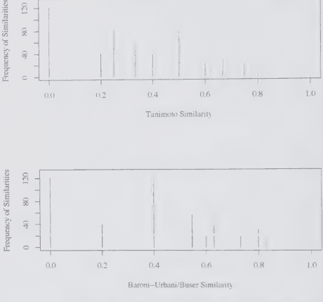

**图 2.5：** 给定所有长度为 5 的二进制字符串，比较 Tanimoto（上）与 Baroni-Urbani/Buser（下）系数分布。Baroni 分布的右侧略大且更接近 1，但它仍然非常离散，并且可能取值更少（9 个，而 Tanimoto 为 10 个）。

在精心编程的情况下，Baroni-Urbani/Buser 度量比 Tanimoto 度量的快速实现大约慢 40% 到 50%。这使其在大规模化合物筛选及相关相似性搜索和聚类应用中可与 Tanimoto 相竞争，因此近年来得到更广泛使用，因为它的分布特性略优于 Tanimoto。

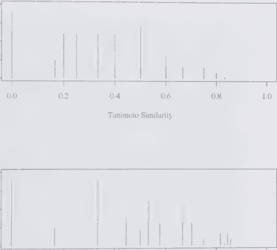

**图 2.6：** 给定所有长度为 6 的二进制字符串，比较 Tanimoto（上）与 Baroni-Urbani/Buser（下）系数分布。现在 Baroni 的可能取值比 Tanimoto 更多。这一特征会随二进制字符串长度是否为素数而变化。两者都具有分形性质。

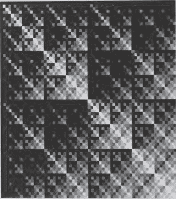

**图 2.7：** 比较 Tanimoto 系数分布。每个字符串 6 位，黑色对应无色或 0，白色对应最大颜色或 1。

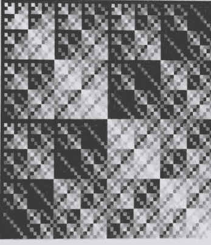

**图 2.8：** 比较 Baroni-Urbani/Buser 系数分布，每个字符串 6 位。黑色对应无色或 0，白色对应最大颜色或 1。

##### 2.6.1.3 简单匹配系数

简单匹配系数顾名思义：只需统计 A 与 B 之间共同为开启状态的位（即 Tanimoto 度量中定义的 c），并令 d 表示两位均为 0 的次数。然后将两个位字符串匹配情况的总和除以 N，得到取值范围为 [0,1] 的相似性度量。

$$s = \frac{c+d}{N}.$$ (2.8)

然而，它只可能有 N+1 个取值。与 Tanimoto 相似性（O(N) 对 O(N^2)）相比，这构成一种非常粗粒度的离散相似性度量。它可用于有限场景，即 A 与 B 中不共同开启的位可以忽略时。

##### 2.6.1.4 二进制欧几里得度量

通过下式，可将式 2.1 中的欧几里得距离转化为一种方便的相异性度量：

$$d = \sqrt{\frac{\sum_{i=1}^{N}(A_i-B_i)^2}{N}},$$ (2.9)

其中 A 和 B 是分别替代向量 x 和 y 的二进制位字符串，i 指第 i 位，N 是所讨论位字符串的长度。这当然等价于

$$d = \sqrt{\frac{\sum_{i=1}^{N}|(A_i-B_i)|}{N}} = \sqrt{\frac{\sum_{i=1}^{N}XOR(A_i,B_i)}{N}}.$$ (2.10)

其中 XOR 对真和假分别返回 1 和 0。实现时，后一个表达式可能是最高效的。其相似性表达式称为闵可夫斯基度量；用描述 Tanimoto 度量的符号表示，它简单地就是

$$s = \sqrt{\frac{a+b}{c+d}},$$ (2.11)

其中 c+d 当然等于 N。

与简单匹配系数（它的相似性补度量）一样，它也只有 N+1 个可能取值。欧几里得度量是一种取值范围为 [0,1] 的相异性度量。它具有与 Tanimoto 相反的偏置，使得开启位较少的位字符串看起来比开启位较多的对应字符串更相似。研究人员指出，将 Soergel 与欧几里得相异性平方相乘 [35] 可能有助于减轻两者的偏置。然而，在实践中，该乘积并不会使可能取值的数量比 Soergel（Tanimoto）多出多少。

##### 2.6.1.5 二进制余弦或 Ochiai 度量

余弦度量是一种度量，并且与欧几里得度量一样，也是一种相异性度量。其补相似性度量称为 Ochiai 相似性度量。余弦本质上两个二进制向量的归一化点积。

$$d=\frac{c}{\sqrt{(c+a)(c+b)}}$$

余弦度量是一种度量，能够比 Soergel 生成多得多的可能相异性取值，但它仍然是离散的。其可能取值数量作为 N 的函数尚不清楚。经验上可以表明，它增长得比 Tanimoto 度量的 O(N^2) 上界更快。这一事实使该度量在采用离散度量的聚类问题中具有稳健性，前提是 N 的规模相对较大，即 N \geq 2^{10}。在这样的 N 规模下，可能取值的数量会接近或超过 [0,1] 范围内六位浮点精度下的可能取值数量（即一百万或更多个值）。

##### 2.6.1.6 Hamann 度量

Hamann 相似性同样关注共同开启的位，但也关注共同关闭的位。在此情形下，令 a 表示 A 和 B 中均为关闭状态的共同位数。Hamann 相似性度量则定义为

$$s=\frac{c}{(c-a)}$$

同样，Hamann 度量是一种度量，并且很容易看出其可能取值的数量为 F_N，即法里序列 N。然而，这些取值的分布有所不同。

##### 2.6.1.7 其他二进制度量

在化学信息学中，使用结构指纹进行相似性搜索是药物发现中的常见活动。此类搜索成功与否的衡量通常基于化合物的某些响应性质（活性、抑制性等）。因此，人们探索了更复杂、更精细的二进制度量。在不失一般性的前提下，这些度量也可用于聚类。它们通常比上文所示的简单度量效率更低，不过其离散性质往往更细粒度，因此在用于聚类时存在权衡 [61, 71, 72, 116, 143, 150]。下面列出尚未提及的更多常见关联系数，大致按计算复杂度排序。

- **Russell-Rao**

  $$s=\frac{c}{n}$$

- **平均曼哈顿**

  $$s=\frac{(a+b)}{n}$$

- **Dice**

  $$s=\sqrt{\frac{2c}{a+b+2c}} \qquad (2.16)$$

- **Rand**

  $$s=\sqrt{\frac{c+d}{a+b+c+d}} \qquad (2.17)$$

- **Forbes**

  $$s=\frac{c}{(c+b)(c+a)} \qquad (2.18)$$

- **Fowlkes/Mallows**

  $$s=\frac{c}{\sqrt{(c+a)(c+b)}} \qquad (2.19)$$

- **Fossum**

  $$s=\frac{n(c-1/2)^2}{(c+b)(c+a)} \qquad (2.20)$$

- **Simpson**

  $$s=\frac{c}{\min((c+b),(c+a))} \qquad (2.21)$$

- **Kulczynski-2**

  $$s=\frac{c}{n}\frac{2c+b+a}{(c+b)(c+a)} \qquad (2.22)$$

常见的相关性度量同样大致按计算复杂度排序如下：

- **Yule**

  $$r=\frac{cd-ba}{cd+ba} \qquad (2.23)$$

- **Dennis**

  $$r=\frac{cd-ba}{\sqrt{n(c+b)(c+a)}} \qquad (2.24)$$

- **Pearson**

  $$r=\frac{cd-ba}{\sqrt{(c+b)(c+a)(b+d)(a+d)}} \qquad (2.25)$$

- **Stiles**

  $$r=\log\left[\frac{n\left(|cd-ba|-\frac{n}{2}\right)^2}{(c+b)(c+a)(b+d)(a+d)}\right] \qquad (2.26)$$

一般而言，与上文提到的任何其他关联或相关性度量相比，Russell-Rao 和简单匹配系数在比较二进制字符串相似性时通常表现较差。当然，可能存在特定数据和应用情形，需要使用一种或多种关联/相关性度量而非其他度量。例如，在相似性搜索应用中，数据规模使得某些较复杂相关性度量的计算可以承受，它们可能表现略好，但同样存在数据和应用方面的限制。由于相似性搜索和聚类在很大程度上都基于结构-生物活性的相同前提，二进制度量通常可以迁移使用。一些度量还用于聚类有效性研究，例如 Rand、Fowlkes/Mallows、Tanimoto（在聚类验证中更常称为 Jaccard）以及欧几里得度量。

#### 2.6.2 计数数据度量

计数度量可以从二进制度量和连续度量推导而来。因此，例如，存在用于计数数据（计数指纹）的类似 Tanimoto 度量；并且通过将计数数据转换为实数值（例如，将计数值 4 赋为 4.0），欧几里得距离可用于计数数据类型。取值的离散性质与可能计数范围无关。在上文关于单个指纹子图键的子图匹配计数的讨论中已经指出，典型的子图键在单个化合物内很少会有超过少数几个匹配。因此，假设一个包含数百万化合物的数据库，如果没有任何键的匹配数超过某个小数目（例如，<< 100），那么对于所讨论的度量，其可能相似性取值的数量相比二进制情形不会大幅增加。实际上，人们注意到，由于这一原因及其他原因，计数数据在聚类和相似性搜索方面得到的结果，往往与使用等价二进制数据得到的结果仅有边际差异。

##### 2.6.2.1 Tanimoto 计数度量

计数 Tanimoto 相似性定义如下，其中 N 为维数：

$$ s = \sum_{i=1}^{N} \frac{a_i}{b_i}. \tag{2.27} $$

其中 a_i 是现在定义为计数向量 A 和 B 的两者中第 i 个计数的较小者，b_i 是较大者。如果 b_i 为 0，则求和中的该项为 0。这种相似性无法转换为满足三角不等式的相异性度量。该表达式的取值也不一定在 [0,1] 范围内。将这些值归一化到 [0,1] 也不一定简单直接，因为这可能会极大地扭曲分布。这


可以通过一种归一化方法来理解，该方法将所有向量的最大计数值 $K$ 作为分母，这似乎是最自然的归一化方式。

##### 2.6.2.2 余弦计数度量

这里余弦度量是实际角度，该角度由两个计数向量的归一化点积的反余弦（arccos）定义。这是连续度量的一种离散形式，因为如果这两个向量确实是连续的，那么该连续度量将被定义为生成这两个向量之间的角度。

#### 2.6.3 连续数据度量

最自然的连续数据度量是欧几里得距离，即 $L_2$ 范数。$L_2$ 范数的术语来源于一般度量类，即闵可夫斯基度量，定义为：

$$
L_n(x,y)=\sqrt[n]{\sum_{i=1}^{N}\left(\lvert x_i-y_i\rvert\right)^n}.\tag{2.28}
$$

其中 $N$ 是维度，且 $n \ge 1$。除了精度问题之外，离散类型所带来的问题不再是问题。还可以使用其他范数，例如 $L_1$（城市街区距离或曼哈顿距离）和 $L_{\infty}$，尽管闵可夫斯基度量最常见的用途是欧几里得形式。然而，在某些特殊情况下，特定的数据应用可能有必要使用其他闵可夫斯基度量。欧几里得距离的修改涉及变量如何被加权或归一化。针对噪声和变量相关性问题的加权也推动了其他方法的使用，以确定连续值之间的度量，例如使用马氏度量、使用主成分分析，或使用皮尔逊相关系数来导出用于聚类的数据元素之间的有用相异度度量。这三种方法，尤其是后两种，更符合数据变换的思路。

##### 2.6.3.1 欧几里得距离的连续形式和加权形式

$$
d=\sqrt{\sum_{i=1}^{N}(x_i-y_i)^2}.\tag{2.29}
$$

其中 $x$ 和 $y$ 现在是连续值向量，$i$ 指相应向量中的第 $i$ 个元素。如果存在关于每个变量相对贡献的专家知识，则可以通过权重向量 $a$ 对欧几里得距离进行加权。

$$
d=\sqrt{\sum_{i=1}^{N}a_i(x_i-y_i)^2}.\tag{2.30}
$$

如果每个变量的绝对变化差异很大，则可以通过以下方式将欧几里得距离针对该变化进行归一化：

$$
d = \sqrt{\sum_{i=1}^{N} \frac{(A_i - B_i)^2}{\sigma_i^2}},
\tag{2.31}
$$

其中 $\sigma_i^2$ 是第 $i$ 个变量的方差。

##### 2.6.3.2 曼哈顿距离

曼哈顿距离，有时也称为城市街区距离或出租车度量，在给定网格的情况下定义最短距离，因此得名。更正式地，它定义为：

$$
d = \sum_{i=1}^{N} |x_i - y_i|.
\tag{2.32}
$$

这种度量有时用于大数据集上的更快计算，或用于特殊特征变量。

##### 2.6.3.3 $L_\infty$ 或上确界范数

$L_\infty$ 或上确界范数是一种奇特的度量，它简单地将距离定义为向量 $x$ 和 $y$ 的相应特征之间的最大差值；其定义为：

$$
d = \max \left(|x_i - y_i|\right),
\tag{2.33}
$$

对于 $i = 1, 2, \ldots, N$，其中 $N$ 是向量的维度。曼哈顿距离和上确界范数等度量计算速度快，因此如果数据和应用场景允许，在由于数据规模非常大而无法计算更复杂的度量或测度时，这些度量有时会很有用。

##### 2.6.3.4 余弦

余弦相似度是一种常见度量，可以用其通常的向量点积形式定义：

$$
s = \frac{\mathbf{x} \cdot \mathbf{y}}{\|\mathbf{x}\| \, \|\mathbf{y}\|}
\tag{2.34}
$$

它定义了向量 $\mathbf{x}$ 和 $\mathbf{y}$ 之间夹角的余弦。这种度量在许多不同的场景中都非常有用，推而广之，简单的点积也是如此。

##### 2.6.3.5 皮尔逊相关系数

相关系数常用于聚类中，最普遍的是皮尔逊样本相关系数：

$$
r = \frac{\sum_{i=1}^N (x_i - \bar{x})(y_i - \bar{y})}{\sqrt{\sum_{i=1}^N (x_i - \bar{x})^2}\sqrt{\sum_{i=1}^N (y_i - \bar{y})^2}} \tag{2.35}
$$

其范围是 [−1, 1]，即从负相关到正相关，并且它对线性变换和缩放具有不变性。问题在于，两个呈负相关的数据对象，它们之间的距离是否比不相关时更远或更近。使用相关系数的绝对值假定负相关和正相关是相同的。对于某些数据来说，这当然是合理的。例如，假设数据是一组时间序列。那么人们可能会问，在每个时间步上都彼此相反的时间序列（可以想象为反相位的锯齿波函数）是密切相关，还是处于相关的极限。这当然取决于具体的应用。

##### 2.6.3.6 马氏距离

马氏距离同样具有尺度不变性，但它实际上是单个数据点与一组已知均值和协方差矩阵的数据点之间的距离。点集的主成分表示 N 维空间中超椭球的范围。单个数据点与点集之间的距离就是根据点集的这个范围来确定的。虽然点集的分布可能根本不是椭球形的，但距离计算假设它是椭球形的。当数据集具有高斯分布或类高斯分布时，该距离更为准确。假设点集 S 的均值和协方差矩阵已知，分别为 μ̄_x 和 Σ。那么到点 x 的马氏距离为：

$$
r = ((\mathbf{x} - \bar{\mu}_x)^{\top}\Sigma^{-1}(\mathbf{x} - \bar{\mu}_x))^{1/2} \tag{2.36}
$$

其中 r 是由 Σ 的特征向量和特征值定义的椭球（如果维度大于 3，则为超椭球）的有效半径，x 位于该椭球上。位于该椭球等值线上的任何 x 都具有马氏距离 r。

如果这些点位于同一分布中，并且我们希望创建两个数据点之间的相异度度量，我们可以再次使用整个数据集的协方差矩阵 Σ，并得到以下公式：

$$
d = ((\mathbf{x} - \mathbf{y})^{\top}\Sigma^{-1}(\mathbf{x} - \mathbf{y}))^{1/2} \tag{2.37}
$$

然而，数据点不必是分布必然为高斯分布的点云，但分布偏离高斯分布越多，距离的值就可能变得越有问题。尽管如此，这种相异度有时也用于聚类数据。马氏距离的一个特点是它对平移和缩放具有不变性。这在某些聚类场景中可能很有用。

#### 2.6.4 混合类型数据

很少有算法能够直接处理混合类型数据。在大多数情况下，对混合类型数据进行聚类需要转换为单一数据类型，这需要考虑到所涉及的各种类型的问题、聚类分析的目标以及数据的专家知识。分裂单调聚类是一种递归划分方法，已被证明可以处理混合数据类型，用于对数据变量进行聚类，而不是对数据项进行聚类 [26, 24]。

### 2.7 邻近矩阵

邻近矩阵具有可能影响分析形式的性质。例如，邻近矩阵可能是对称的或不对称的，具体取决于生成它所使用的度量。如果是对称的，根据生成它所使用的度量和数据，它可能具有全部为正的特征值，也可能没有。在这些例子中，矩阵的性质很可能决定用于可视化分组的变换类型（如主成分分析（PCA）、等距或经典多维缩放（MDS））或可能应用于该数据的聚类算法。此外，由多个邻近矩阵组成的邻近矩阵的性质将决定对这些矩阵可以应用哪些操作，不可以应用哪些操作，无论是用于聚类还是可视化。

### 2.8 对称矩阵

公式 2.38 定义了一个对称矩阵 S：

$$
S = \frac{A_{i,j} + A_{j,i}}{2}. \tag{2.38}
$$

其中 $i$ 和 $j$ 是被比较的一对项目，$A_{i,j}$ 是项目 $i$ 和项目 $j$ 之间的相似度度量。$A_{j,i}$ 是反向度量


比较。对于对称矩阵

$$(A_{i,j}) = (A_{j,i}) \tag{2.39}$$

图 2.9 展示了一组 Cox-2 配体的对称邻近矩阵，这些配体被编码为 768 位的二进制指纹，并与 Tanimoto 测度的不相似性补进行比较。抑制 Cox-2 酶可减轻疼痛和炎症，这是一组已被充分研究的化合物。该邻近矩阵利用 Tanimoto 相似性测度展示了整个数据集中成对的相似性。每个方格表示一次成对比较。灰度的强度反映 0 到 1 的 Tanimoto 标度。值 1 对应黑色，值 0 对应白色。沿对角线，当结构指纹与自身比较时，人们会预期看到黑色；随着偏离对角线，灰度反映与数据集中其他化合物的相似性。这些数据部分

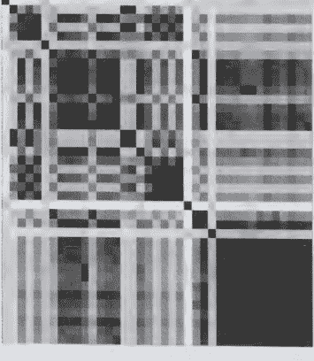

**图 2.9：** 一组结构的对称邻近矩阵示例，这些结构对 Cox-2（一种与疼痛和炎症有关的酶）表现出活性。

图展示了一组配体的非对称漂移。非对称漂移由箭头表示。绿点表示对称邻近矩阵在 MDS 中的放置，红圈表示一个经过缩放的变量属性。

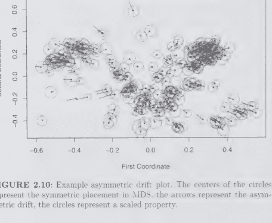

图 2.10：非对称漂移图示例。圆中心表示 MDS 中的对称放置，箭头表示非对称漂移，圆圈表示一个经过缩放的属性。

#### 2.8.2 两个矩阵的哈达玛积

除了探索非对称矩阵性质之外，哈达玛积矩阵在聚类中还有其他用途。对称矩阵可用于组合其他对称矩阵。例如，矩阵 A 和 B 可以是在同一数据上由不同相异性测度生成的矩阵。在一个这样的例子中，分子形状 Tanimoto 矩阵和静电 Tanimoto 矩阵可以通过哈达玛积进行组合，并且一旦经过适当归一化，结果就可用作聚类用的邻近矩阵。这两种测度的组合可以通过哈达玛积实现，但两个矩阵及其哈达玛积的性质可能决定还能执行哪些进一步的聚类算法或统计分析，例如 PCA 或 MDS。比方说，如果这两个矩阵是半正定的，那么这两个矩阵的哈达玛积却不一定如此。

#### 2.8.3 超度量性

超度量矩阵的定义是：在 i、j 和 k 的三对中，有两对的值相等，并且处于这三对中的最大值。该性质可用于评估层次算法的树结构，并且与聚类单调性直接相关；第 6 章在讨论层次结构时对此进行了讨论。在生成保持超度量性质的层次聚类结构时，由合并值构成的矩阵称为共表型矩阵。共表型矩阵可与原始邻近矩阵进行比较，以通过 Mantel 统计量形成相关性度量，即矩阵的逐元素相关。这称为共表型相关，其中接近 1 的值表明层次结构与根据该邻近矩阵所形成的分组一致。

#### 2.8.4 半正定矩阵

在 MDS 和 PCA 等多种情形中，矩阵是否具有半正定性质会产生重要影响。对于实值矩阵，若

$$\mathbf{x}^T \mathbf{A} \mathbf{x} \ge 0. \qquad (2.45)$$

则称矩阵 A 是半正定的。

### 2.9 维度、成分、判别式

数据集的特征空间可能复杂且庞大。某些特征可能对数据项的分组非常重要，而另一些特征则不太重要甚至完全不重要，并且实际上可能主要是噪声或具有其他混杂作用。现有高效的线性分析方法可将特征集合缩减为更小的特征集合，或缩减为特征的较小线性组合。这些方法可用于将数据作为一组投影来探索，甚至可将较小或变换后的特征集合用于聚类。后一种做法有一个注意事项：此类线性选择或变换对于数据的自然分组可能并非最优。

最常见的特征选择与变换方法是 PCA。它广泛用于探索性分析、回归、分类，偶尔也用于聚类分析。在简单情形下，假设数据集特征是连续值，并且可以在欧几里得空间中处理它们。于是，我们可以找到特征的一个线性组合，使其形成一条穿过数据点集合的轴，且数据点在该轴上具有最大方差。也就是说，如果沿该轴投影数据点，这些点将处于其方差最大的构型中。这就是数据的线性第一成分，或称主成分。第二主成分是表示数据中次大方差的成分，并且与第一主成分正交。其余正交主成分以类似方式确定。生成主成分有两种方式：直接对数据矩阵使用奇异值分解，以及通过数据的协方差矩阵。注意，第二主成分与第一主成分正交，但不一定是数据中（除主成分外）的次大方差。确实可能存在一组非正交的轴基，用以表示依次最大的方差。有些方法放宽正交性约束以找到这样的基。多维标度试图将数据项之间的相似性或相异性投影到比数据特征总数更少的一组维度中。这些方法通常用于在二维或三维中可视化数据，并试图近似保留来自更高维度的相似性或相异性。有许多进行此类投影的函数，每个函数都具有倾向于突出数据某些方面的性质。有些 MDS 方法是线性的，例如经典 MDS，它使用相异性矩阵的特征值分解，与 PCA 非常类似。

从某种意义上说，聚类准则函数在类别未知时力求实现判别。判别方法不一定属于聚类分析范畴，但从事后分析的角度来看，它们是重要的概念。如果我们事先知道数据的类别，例如在分类建模中，我们可能希望在特征空间中找到类别的最优线性分离。由于这是无监督聚类，情况并非如此；但同样地，假设我们已经对数据集进行了聚类，并希望对接聚类方法找到的组执行同样的操作。我们可以使用费希尔线性判别方法来做到这一点。例如，我们可能希望通过判别面（无论线性还是非线性）来可视化通过聚类找到的组，以描绘这些组。然而，这些方法仅在类别数很少时最为有效，因此它们在聚类分析中的实用性有些有限。但更重要的是，理解判别函数是有益的，因为它们在描绘组方面与聚类准则函数密切相关。

#### 2.9.1 主成分分析（PCA）

PCA 是用正交方式对数据特征空间中最大方差所作的线性解释。特征空间中的方差包含在待考虑数据的协方差矩阵中。

##### 2.9.1.1 协方差矩阵

协方差矩阵由式 2.46 定义。


$$\Sigma = \frac{(X-\bar{x})\cdot(X-\bar{x})^T}{n}$$

分子是数据减去其均值后的外积，再除以数据元素个数 $n$。

$$A^T\Sigma A = D$$

$D$ 是特征值的对角矩阵。$A$ 的列是其对应的特征向量。按特征值大小排序后对应的特征向量即为主成分。

##### 2.9.1.2 奇异值分解

主成分也可以通过奇异值分解来计算。

$$X = UDV^T$$

$X$ 是数据矩阵。$U$ 是左奇异向量。$D$ 是对角奇异值矩阵。$V^T$ 包含右奇异向量或标准正交特征向量。使用 SVD 的 PCA 被用于基因表达数据分析 [142]。

#### 2.9.2 非负矩阵分解

$$X = WH + R$$

$WH + R$ 是数据矩阵 $X$ 的*非负分解*。它与 PCA 相关，因为它构成了一组向量基，并且与 $K$-均值聚类非常相似，其中 $W$ 包含簇质心，$H$ 包含簇成员向量。$W$ 和 $H$ 是非负的，但 $R$ 是残差矩阵，可能包含负值 [34, 156]。

#### 2.9.3 多维尺度变换

多维尺度变换有多种形式 [16, 31]，常用于可视化，但有时也用于降维。*经典多维尺度变换*就是像上面那样对数据使用 PCA，即只使用少数前几个主成分将数据关系投影到低维空间中。可以利用式 2.48 或式 2.46 的协方差特征值/特征向量方法。或者，可以使用相异度矩阵或距离矩阵，通过多种技术以非线性方式得到向低维空间的投影。MDS 的许多形式都基于某种力导向方法，很像图布局中的弹簧嵌入，本质上是迭代的，通常能找到局部最优解。这些方法在处理大型数据集时可能较慢，但对于中等规模的数据集，它们在揭示数据结构方面表现相当不错。

#### 2.9.4 判别式

线性、二次及其他非线性判别式是用于监督学习的技术，但这类技术在理解聚类方法和验证方面也有概念上的用处。判别式会生成一组区分类别的决策面。理想情况下，聚类产生的分组应能符合某种决策面，以最小的误分类率将各组分开。线性最优判别式称为 Fisher 判别式。

##### 2.9.4.1 Fisher 线性判别

Fisher 线性判别是一种分类方法，通过最小化每个类内的方差并最大化两个类均值之间的距离，将多维数据投影到通常的两个类中（尽管可以推广）。Fisher 判别旨在创建类间的线性决策面。式 2.50 是 Fisher 线性判别的一种形式。

$$
\max F(\mathbf{p}) = \frac{|\bar{\mu}_1-\bar{\mu}_2|^2}{\sigma_1^2+\sigma_2^2}
$$
(2.50)

其中 $\sigma_1^2$ 和 $\sigma_2^2$ 是给定决策面 $\mathbf{p}$ 下两个类别各自的方差。$\bar{\mu}_1$ 和 $\bar{\mu}_2$ 是每个类别的均值。这个线性表面以最小的误分类率形成两个类别之间的最优分隔。（关于类似的线性分隔，请参阅第 4 章的图 4.1。）

### 2.10 图论

图是组合对象，有着或多或少无限的算法和实际应用。它们被用于对生物信息学和药物发现中的许多应用进行建模，并且在聚类分析研究中很常见。这里仅提供一个非常简短的介绍，但读者不妨去查找并深入研究图论和图算法 [15, 151]。

简单图具有顶点（或节点）和边，很像由城市和道路组成的交通网络。权重或标签可以应用于节点和边：以城市和道路为例，人口和距离分别是节点和边的示例权重。化学图是简单图的一种略微复杂的形式——只需将城市和道路替换为原子和键。原子可以有多种标签和属性——氮原子具有标签 N，并具有是否带电等属性。键有单键、双键和三键标签。图的一部分——顶点的一个真子集及其关联边——称为子图。在化学图中，可能存在重要的子图（通常称为子结构），它们带有诸如苯环或磷酸基团等标签。图 2.11 展示了图 2.1 中咖啡因分子的简单无向图的两种视图。图 2.11a 中的图描述显示了咖啡因分子，没有原子标签，但保留了化学键信息和环对称布局。图 2.11b 显示了底层图，除了单边外没有化学键信息。它在页面上的布局也完全不同，不太考虑环对称性。两个图的基本图属性是相同的，对两个图执行的算法程序的结果也是相同的，尽管标签信息不同。

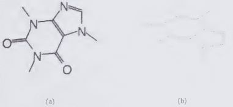

**图 2.11：** 咖啡因分子的简单图：a) 仅包含键信息；b) 不包含任何化学信息的简单图。

事实证明，几乎所有小分子都可以表示为*平面*图。也就是说，它们可以布置在二维表面上而不会出现边交叉。这种布局称为*图嵌入*。还可以证明，平面图甚至可以在二维空间中具有直线嵌入 [33, 44, 117]。咖啡因图的两个图示都以平面嵌入的形式绘制在页面上。请注意，平面意味着任何二维表面，因此平面嵌入可以位于球面、环面等上面。图的平面性通常在图算法的计算复杂度中很重要，因此，如果知道一个图是平面图，那么可能存在一种作用于平面图的算法，比非平面图更高效，即多项式时间算法与 NP 算法之间的差异。

从化学图论的简单角度来看，图在化学信息学中发挥着重要作用，但图和图算法在聚类分析算法中也很重要，因为许多聚类算法是基本图算法，或者算法的一部分可以建模为图问题。例如，邻近矩阵通常可以被视为加权图。此外，层次算法的结果显示为图，即一个无环的简单连通图。这种图称为树。树有普通有根树和有根二叉树，以及无根树或自由树。层次结构是有根树，在许多情况下这些树是二叉树，但并非必须如此。简单的树概念在生成层次结构的聚类算法以及对层次结构的分析和探索中很重要。聚类层次的树状图描述几乎总是二叉树。图 2.12 展示了几种典型的树图表示和布局。有根树按层次布局，看起来更像树的根系，而不是一棵直立的树本身。有时它们可以侧放，如图 2.12b 所示。树不必有根，也不必是二叉树，它们在页面上的布局可以有多种表示。由于层次结构可以用树来表示，人们在树上的操作（搜索、分解、重排等）可以直接转化为对层次结构的操作。一组有根树称为森林。因此，例如，给定一棵有根树，树中一组不同的子树就代表一片森林。

图属性表示图的某种整体特征。例如，树是一种具有特定结构的图类型；例如，树图中没有环。图具有一般属性，如图的半径、直径、周长、离心率、双连通性、$k$-连通性等。这些在化学信息学中通常被称为拓扑属性，而且数量众多——可以随意定义新属性。图的属性也可能影响在该图上运行的图算法的计算复杂性。最坏情况复杂度可能取决于图的非常特殊且可能相当罕见的属性，而平均情况性能——以及实践中通常遇到的情况——可能差异很大。

简单图也称为二元图或无向图。图 2.13 展示了一个带标签的无向加权图。边权重可以表示邻近度或容量等。还有二元有向图，其中每条边是一条具有特定方向的弧，从一个节点指向另一个节点。有向图将在不对称度量的讨论中占据重要地位。多重图是节点之间有多条边的图，并且可能有自环——一条返回同一顶点的边。化学图可以被视为多重图，其中键为多重边，但没有自环。然而，通常化学图被视为简单图，其中单键、双键和三键被视为边标签。


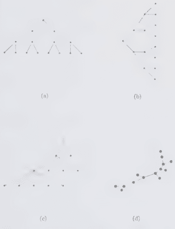

**图 2.12：** 简单有根树图与无根树（自由树）：a) 有根二叉树；b) 旋转后的树；c) 一般有根树；d) 无根树（自由树）。

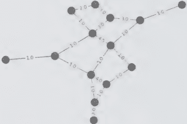

**图 2.13：** 这是一个无向带标签加权图的图示。

超图包含可以连接超过两个节点的边。多重图和超图同样可以是有向或无向的。对于超图而言，方向体现为节点的序列形式，而无向超图中的边则是节点的集合。像多重图和超图这类更复杂的图在聚类分析的讨论中较为少见，尽管超图是可视化重叠聚类的一种方式。例如，维恩图是可视化超图的一种方法，也可以视作一系列重叠聚类的集合。然而，当聚类数量众多且重叠程度很高时，这种可视化通常会变得难以管理。不过，对于简单的超图，可以使用维恩图和其他方法来可视化重叠聚类，这一点将在第 10 章中讨论。

设计高效图算法的一个重要方面是如何存储图。有几种常见的方法可以存储图，以便对其进行高效操作。最常用的是邻接表（分子的连接表就是一种邻接表形式），它是一个节点列表，每个节点都对应一个与之有边相连的节点列表。这是最高效的存储方式，通常也是在算法中使用起来最高效的方式。然而，有些算法需要所谓的邻接矩阵。邻接矩阵是一种矩阵，其中每条边由矩阵中的一对节点 (i, j) 表示。如果节点 i 和节点 j 之间没有边，则在矩阵中放置 0，否则放置 1 或权重或标签。还有其他不太常见的数据结构，如有序对或边邻接表。一个相似性矩阵，无论是对称的还是非对称的，都可以分别看作是简单二元图或简单有向图的邻接矩阵。然后可以使用各种图算法对这些矩阵进行操作，既可以直接用于聚类目的，也可以用于聚类结果的可视化。

图算法可以是非常强大的工具，通常如果一个问题可以转化为图问题，可能会为该问题设计出更高效的算法。一个例子可以在网络流算法中找到，这些算法最初是通过 20 世纪 50 年代和 60 年代的线性规划方法解决的，其计算复杂度在最坏情况下非常高。将其转化为图问题，并利用图算法，在 20 世纪 80 年代和 90 年代，无论是在理论上还是在实践中，都设计出了高效得多的算法。这是一个值得记住的重要概念：如果有一种聚类方法是迭代的、类似梯度搜索的算法，逼近最优解，那么可能存在一种更高效的图算法，本质上更具组合性，在实践中可能优于这种方法。物理学家、工程师和化学家通常从模拟过程的角度来处理问题，并用类似模拟的算法对其进行建模。用于人工智能的机器学习算法——通常基于神经过程——也具有这种特点。本书中一些源自这些领域的聚类算法自然也具有相同的特点，它们可能对当前的数据运行良好且适用，但采用更具图论性和组合性的方法可能效果同样好，甚至更好。毕竟，用于生成聚类结果的计算机并非模拟机器。认识到这一事实，对于理解聚类模糊性和聚类算法的实际效率通常很重要。

### 2.11 术语表

- **邻接表（adjacency list）：** 边-顶点关系列表的列表。
- **邻接矩阵（adjacency matrix）：** 完整的边-顶点关系矩阵。
- **弧（arc）：** 有向边。
- **质心（centroid）：** 一个组的几何中心。
- **中心型（centrotype）：** 一个组的中心或代表，严格来说可能不是质心。
- **有向超图（directed hypergraph）：** 边是顶点（节点）的有序序列。
- **有向多重图（directed multigraph）：** 带有弧的多重图。
- **边（edge）：** 两个顶点之间的等价关系。
- **典型代表（exemplar）：** 中心型。
- **超图（hypergraph）：** 边是顶点（节点）的集合。
- **度量度量（metric measure）：** 遵循三角不等式。
- **多重图（multigraph）：** 节点之间可能包含多条边，或者一个节点可能有一条指向自身的边。
- **节点（node）：** 顶点。
- **相似性矩阵（proximity matrix）：** 相异度（可能是距离）或相似度关系的矩阵。
- **简单二元图（simple binary graph）：** 顶点和无向边。
- **简单有向图（simple directed graph）：** 顶点和有向边（弧）。
- **子图（subgraph）：** 图的一部分（一个真子集）。

### 2.12 练习

- 1. 创建一组长度为 10 的不同的随机位串。使用归一化欧氏距离、Tanimoto 系数和 1−cosine 计算所有字符串对之间的相似性度量。绘制相似性分布图。比较结果。
- 2. 创建一组长度为 10 的不同的计数指纹，其中计数范围从 0 到 8。使用计数 Tanimoto 系数、1−cosine 和归一化欧氏相似性度量计算所有字符串对之间的相似性度量。将相似性值的分布与练习 2.1 中计算的分布进行比较。
- 3. 证明计数 Tanimoto 系数不是一个度量，可以通过存在性证明或解析方法证明。
- 4. 取一个非常小的数据集（大于 5 个且小于 10 个成员），生成一个对称的相似性矩阵，绘制分布图。从分布中选择三个阈值。绘制每个阈值下的加权图。是否存在一个阈值使得图保持平面性？
- 5. 取任何可以使用度量相似性进行比较的数据集，生成主成分并绘制排序后的特征值。在前两个主成分中绘制数据点。绘制前五个主成分的几种组合图并讨论结果 [133]。

## 第 3 章：聚类形式

聚类算法有两种基本形式：划分式和层次式。在最简单的形式中，划分式算法以包含 N 个成员的数据集和一个数 k（k 远小于 N，且很可能 k > 2）作为输入，并返回数据集的一个划分，将其分成 k 个不相交的子集，这些子集代表数据集的聚类。然而，对于大的 N 和非平凡的 k，可能存在数量庞大的划分。即使 N = 50 且 k = 5，也有 50 选 5 种可能的划分：超过 200 万种。为了感受可能划分数量爆炸式增长的程度，假设我们有 60 个项目，并认为有 15 个聚类：那么有超过 53 万亿种可能的截然不同的划分需要穷举搜索才能找到最优的一个。

几乎可以肯定，我们不会确切地知道聚类数应该是多少，并且我们希望在某个 k 值范围内进行测试。我们可以考虑一个包含 N 个成员的集合在所有 k 值下的可能划分总数，以此作为我们可能需要探索的划分数量的一个宽松上界。这由贝尔数 [41, 55, 115] 给出，即第二类斯特林数 S(N,k) 对所有 k 求和，其中 k = 0,1,...,N。

$$B_N = \sum_{k=0}^{N} S(N,k) \qquad (3.1)$$

贝尔数随 N 呈指数增长，因此数据集可能划分的数量作为其规模 N 的函数增长非常迅速。当 N = 10 时，对于所有 k 值，已经存在 115,975 种可能的划分。对于大多数应用，k 可能在一个较小的范围内，但这仍然表示相对于 N 的指数级数量的划分。重要的是要认识到，尽管划分式算法并非设计用于搜索所有可能的 S(N,k) 以找到某个准则下的最优划分，但划分空间非常大，对于非平凡的 k 值，此类算法可能只能返回一个次优解。

层次式算法构建一棵树，要么自顶向下，将数据集分割成越来越小的组——称为分裂式聚类；要么自底向上，将单个数据元素合并成组，然后不断合并越来越大的组——称为凝聚式聚类。在大多数情况下，这些树是有根二叉树，在叶节点处标记有待聚类的 N 个数据元素。这棵树粗略地表示了数据元素之间以及这些元素组成的越来越大的组之间的拓扑关系。


在图3.1中，30个数据元素以树状图的叶子编号表示，通过一种凝聚式聚类算法自下而上进行聚类——首先合并成对的数据元素，然后将单个元素或已有的对合并，再逐步合并成越来越大的组。_y_轴上的_高度_指的是叶子或组被合并（或在分裂算法的情况下，被分割）所依据的度量。该度量确实可以是数据元素之间的两两不相似度，如图所示，也可以是基于原始度量、代表定量合并准则的其他值。图3.1中的树状图是由一种凝聚式层次算法（通常称为_全连接_或_完全链接_）的结果生成的，但其他凝聚算法同样可以轻松生成此类树状图。

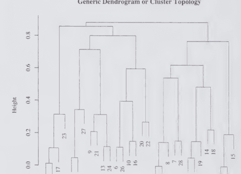

**图3.1：** 一个通用的树状图，展示包含30个成员的聚类数据，成员以叶子编号表示，其中不相似度范围为[0, 1]，且_高度_与用于连接叶子和组的度量直接相关。

### 3.2 层次聚类

存在许多凝聚式层次算法，其基本思想是合并最近的一对，并将合并后的对视为单个数据元素来更新数据。例如，在图3.1中，第一对合并的是(4, 30)。这一对现在被视为一个单独的数据项，然后合并下一个可能的对，依此类推。合并组所依据的准则区分了不同的凝聚算法。在算法3.2的通用凝聚式层次算法中，`MergeGroup()`函数包含作用于邻近矩阵A的特定合并准则。A会被更新以反映合并后的组以及组间的邻近性，而不仅仅是(i, j)数据元素对。根据合并对及其合并准则值的输出，可以构建数据元素叶子的排列和树状图层次结构。

```text
**算法3.2** *AgglomerativeHierarchy(Data, A)*

1: `N ← Size(Data)`
2: `𝒢 ← Groups(Data)`  // 𝒢中每组包含一个数据元素
3: `repeat`
4: `    (𝒢′, A′) ← MergeGroup(𝒢, A)`  // 合并最近的组
5: `输出: 合并的组对及合并准则值`
6: `(𝒢, A) ← (𝒢′, A′)`  // 更新矩阵和组
7: `until 𝒢 = ∅`
```

最简单的合并准则（其价值相当有限）生成的是所谓的*单连接*聚类。它基于候选组之间的最小不相似度来合并两个簇，即所有当前组中的最小最近邻对。其效果是将依次增大的子图所对应的最小生成树子图合并起来。全连接聚类算法的合并准则是最远邻准则。从图论意义上看，该准则可以表述为在每一步合并时，寻找最小团，其中组内的所有两两不相似度（边）都需要被连接起来。而在单连接中，图论类比则表现为只需考虑一条边。沃德聚类通过最小化候选组之间的平方误差来合并组，因此它考虑的是最小方差作为合并准则，而不是直接使用邻近值。

#### 3.2.1 树状图与热图

在图3.2中，展示了一个通用树状图及两种类型的水准选择。在0.7水平上切割会将数据划分为五个簇，而由虚线表示的任意切割则会将数据划分为十个簇。任意切割只是为了说明一个事实：人们可以进行任何切割来创建一个代表聚类的划分；然而，0.7处的水平直线切割是与合并准则一致的划分，该准则通常会将各组在特征空间中的相似程度限定在一定范围内。

#### 通用树状图或聚类拓扑

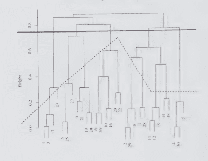

**图3.2：** 横贯树状图的实心水平条表示树中的一次切割或一个水平，在高度0.75处将数据划分为5个簇。虚线表示树中的任意切割，会创建10个簇。

y轴表示合并准则的值。这可能与度量直接相关，如全连接和单连接聚类中的情况；也可能是一个与初始度量完全不同、派生的数值，如沃德聚类中的情况。从叶子开始合并的各组，其从左到右的位置并不是固定的。实际上，排列顺序是数据项的一种非唯一排列，使得树状图的布局不会出现交叉线，而且分支可以很容易地像风铃一样旋转。例如，在图3.2的树中，如果排列稍有不同，数据项22可能与它的配对项20一起旋转到靠近数据项对13和24的位置（前提是项20和22在0.6水平上的合并是旋转可以发生的轴）。这使得树状图有时会产生误导，因为有时它会让一个组看起来比实际更接近另一个组。它的水平关联不一定代表数据的真实结构。

本章中的前两个树状图（图3.1和图3.2）使用的是人为构造的数据，用以展示这类聚类算法的树状图典型外观。

**39个Cox-2活性化合物：二维指纹数据**

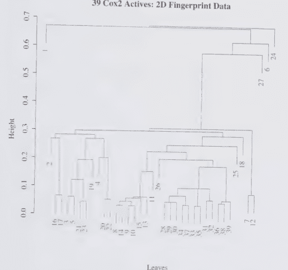

**图3.3：** 39个Cox-2活性化合物的单连接层次结构。

在图3.3和图3.4中，我们展示了使用Cox-2化合物配体的结构（二维）指纹数据对Cox-2活性化合物进行聚类的结果。两者使用的不相似度度量均为1−Tanimoto。单连接聚类的最近邻特性与全连接聚类的最远邻特性之间的差异，可以从组合并时的高度看出：全连接组之间的合并通常发生在更高的数值上。仅通过简单观察即可发现树拓扑结构存在显著差异。在这两个树状图中，高度就是用于确定不相似度的直接度量。

**39个Cox-2活性化合物：二维指纹数据**

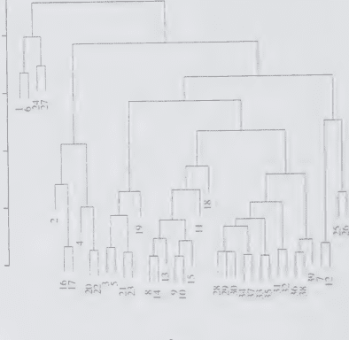

**图3.4：** 39个Cox-2活性化合物的全连接层次结构。注意，与使用单连接聚类层次结构相比，树的拓扑结构发生了怎样的变化。

使用相同的数据和度量，图3.5展示了称为沃德聚类的平方误差合并准则。此时高度不再以底层度量表示，而是以合并准则值表示。图3.5中的同一数据集也可以用横幅图（见图3.6）来绘制。

横幅图提供了层次聚类结果的可视化（例如，沃德聚类）。图3.6中的横幅图绘制了层次结构，合并高度位于x轴上。白色条延伸至相应数据项与其所属组合并时的高度。可以通过较长的白色条来区分不同的组。例如，项39与项2不在同一组中。它们的合并高度位于层次的顶端，二者之间的白色条延伸至最大高度。对于小规模数据集，有时以热图形式查看不相似度矩阵是值得的，并按一个或两个聚类算法的行列进行置换。在图3.7中，矩阵的行和列按全连接树状图进行了置换。因此，矩阵在这种置换下是对称的。而图3.8则使用了沃德聚类来进行矩阵的置换。

```text
2: G ← SingleGroup(Data) // |G| = 1，G中只有1个组
3: repeat
4:   G ← DivideGroups(G) //分割G中的组
5:   输出: 合并的组对及合并准则值
6: until |G| == N
```

分裂算法的递归性质使得它们在整体构建完整层次结构时通常不如凝聚算法高效。然而，如果只按某个非平凡的停止准则创建层次结构的一部分，分裂方法可以很快。同样，凝聚方法也可以在某一步停止，而不必创建完整的层次结构，并且可以做到同样快甚至更快。但两种方法都需要某种停止准则，如果该准则是定量的，可能会拖慢过程，使优势变得微不足道。然而，关于数据的专家知识可能支持使用分裂方法而非凝聚方法，无论是在效率还是效果方面。同样，分裂准则是否真的比合并准则更好，仍是一个悬而未决的问题。

### 3.3 混合模型

混合模型通常预设对数据生成过程已有很多了解，预设数据遵循某种概率分布，并且预设分组数量大致已知。我们仅简要提及这类聚类算法，以备实践者遇到此类数据，同时也因为有几个重要的统计概念与聚类密切相关——一个簇遵循某种概率分布。第1章的图1.4将是一个非常适合用混合模型聚类的数据集，前提是我们假设这些簇服从高斯分布，并且我们可以大致估计这四个簇的均值和方差。一种这样的方法被称为期望最大化（EM）算法，我们恰好可以用它来做这件事：向算法提供四个初始均值和方差，经过若干次迭代后，算法会收敛并逼近四个簇的真实均值和方差。如果我们提供过少或过多的均值-方差对，或者提供的均值和方差与簇的真实均值和方差相差甚远，结果很可能是毫无意义的。


### 3.4 采样

超大数据集会给计算资源带来沉重负担。因此，人们开发了一些方法：这些方法并不必检查所有数据的成对关系，而是对成对关系进行采样，并基于采样结果形成整个数据集的划分。这种聚类形式类似于蒙特卡洛积分，其中会涉及伪随机采样和准随机采样的概念。它还基于一个简单事实：如果数据项 A 与数据项 B 非常不相似，而数据项 C 与数据项 B 非常接近，那么可以推断数据项 A 与数据项 C 也非常不相似。如果已经计算了 A 与 B、B 与 C 之间的不相似性关系，那么可能无需计算 A 与 C 之间的不相似性。随机选择一个数据项，确定其余所有数据项相对于它的不相似度值。将处于某个近邻阈值以内的那些项纳入，令其成为一个簇，然后将它们从后续考虑中排除。对剩余数据项重复此过程，以类似方式形成所有后续簇。由于我们排除了第一个簇中的项，而没有确定它们与任何其他项的不相似性，但只对随机选中的那一项进行了确定，因此有 $k \times (N - k - 1)$ 个不相似度无需计算，其中 $k$ 是排除区域中的项数减去随机选中的那一项。在每次迭代中，簇成员的数量很可能会变化，但原则上计算的不相似度数量仅为 $O(G \times N)$，其中 $G$ 是簇的数量，而不是生成所有成对不相似度所需的 $O(N^2)$ 计算。

```text
Algorithm 3.4 SimpleLeader(Data, Threshold)
1: DataElement ← SampleRandom(Data) //Arbitrarily choose a data element from the data
2: Data ← Data \ DataElement //Remove DataElement from Data
3: Append(DataElement, C) //Append the DataElement to first cluster, C
4: repeat
5:    C ← Append(FindNN(Data, Threshold, DataElement), C) //Append NNs to cluster, C
6:    Append(C, G) //Append cluster C to set of clusters G
7:    Data ← Data \ C //Remove cluster elements from data
8:    DataElement ← SampleRandom(Data) //Arbitrarily choose a data element from the data
9: until |Data| == 0
10: Output : G
```

在另一种簇采样形式中，会计算所有成对不相似度，但只存储其中一小部分值，并由另一种聚类采样算法对这些值进行操作。也就是说，如果存在一个不相似度阈值，并且我们知道不关心该不相似度阈值之外的分组，那么我们可以选择不存储这些值，也不在聚类过程中对它们进行操作。尽管所有成对不相似度都已计算，但由于需要处理的不相似度值集合小得多，聚类采样算法很可能会快得多。排除区域算法的一个特点是，它们往往会产生大量单例（即每个簇只有一个成员的簇）。在该算法下，单例分为两类：一类是在给定阈值下不靠近任何其他数据元素的单例；另一类是处于某个或多个邻居的阈值之内，却被排除在任何排除区域之外的单例。这些*伪单例*可以被收集起来，并分配到某个排除区域簇中，只要它们在该簇的阈值内存在最近邻。

```text
Algorithm 3.5 ExclusionRegion(SparseMatrix)
1: repeat
2:   C ← FindLargestSetNN(SparseMatrix) // Assign largest row in matrix to cluster, C
3:   SparseMatrix ← SparseMatrix \ C // Remove row and its elements from the matrix
4:   Append(C, G) // Append cluster C to set of clusters G
5: until SparseMatrix == NULL
6: Output : G
```

### 3.5 重叠

在许多情况下，由于数据所表示的度量或空间，组或类会相互混杂并发生重叠。考虑图 3.9。假设该散点图中的数据表示按点标记显示的四个真实类别。这些类别发生重叠，边界用围绕每个类别的凸包表示，然而我们的互斥算法会将其划分为四个组，忽略类别的重叠。如果允许在一定程度上放松互斥约束，我们或许能够得到重叠簇，从而依据以这种重叠方式描述数据的数据特征和度量，更好地定义这些类别。

在某些情况下，相关领域的专家可能更偏好重叠簇而不是互斥簇，因为某些数据项的归属存在歧义，或者某些数据项可能很容易具有多个类别归属。例如，考虑在分类学中有时无法确定一个生物体属于哪个类群。与其强行作出类别判定，不如表示该生物体属于多个类群的不确定性，这可能更有用。有些聚类算法返回的结果正是如此。在许多情况下，返回互斥簇的算法可以被修改为返回重叠簇。

在假设伪单例可能在多个排除区域中都有最近邻的前提下，可以将通用的排除区域算法 3.5 修改为产生重叠簇。有人可能会认为，最好将伪单例分配到其最近邻所在的排除区域。这样确实会产生互斥区域。然而，对于离散度量，最近邻值可能存在并列。这种歧义可用于产生重叠簇。图 3.10 显示了参与重叠的数据集比例与所应用 Tanimoto 阈值的关系。对三种不同的指纹进行了比较，其中最短的基于键的指纹显示，数据集中参与重叠组的比例最大。

```text
Algorithm 3.6 ExclusionRegionOverlapping(SparseMatrix)
1: repeat
2:     TiedRows ← FindLargestSetsNN(SparseMatrix) //Find largest row(s)
3:     i = 1
4:     repeat
5:         C ← AssignClusters(TiedRows[i]) //Assign rows to cluster non-disjoint clusters
6:         Append(C, G) //Append cluster C to set of clusters G
7:         i = i + 1
8:     until i == |TiedRows| //Repeat until largest tied rows processed
9:     SparseMatrix ← SparseMatrix \ TiedRows //Remove row and its elements from the matrix
10: until SparseMatrix == NULL
11: F ← FindFalseSingletons(SingletonClusters(G))
12: G' ← DistributeFalseSingletons(F, G) //Distribute false singletons to any cluster with a NN
13: Output : G'
```

由于重叠簇是一种覆盖而不是划分，任何显著重叠都可能在组合上呈爆炸式增长。如果各组在阈值尺度上分离良好，那么歧义会非常小；在实践中，这种情况下大多数重叠只涉及少量伪单例，或许还涉及少量大小相同的重叠组。

### 3.6 模糊

模糊聚类与重叠簇原理相关，但与上一节所述的简单重叠聚类不同，数据元素在其可能所属的那些簇中具有隶属度。有时将隶属度视为概率是有用的，但并不一定需要按这种意义来考虑。模糊聚类有点类似于 K-means，它尝试在某些准则下，迭代地细化对那些最相似组的隶属度或隶属概率。因此，例如在迭代次数结束时，许多数据元素对大多数簇的隶属度非常小或为零，只有少数几个簇的各自隶属度显著，甚至仅对单个簇具有排他性。可以根据数据项各自最高的最终隶属系数将其分配到互斥簇，也可以利用这些系数将其归属于多个簇，从而形成覆盖而不是划分。

```text
Algorithm 3.7 Fuzzy(Data,K,Threshold)
1: U ← FEmptyLists(K)
2: M' ← AssignMembership(Data,K) //Assign memberships
3: repeat
4:   M ← M'
5:   U ← FindCenters(Data,M,K) //Find the cluster centroids
6:   M' ← ComputeMembership(Data,U) //Compute memberships to current cluster
7: until MembershipDifference(M,M') < Threshold
8: G ← AssignGroups(M) //From final membership, M, assign groups to G
9: Output: G, M
```

模糊聚类通常有一个学习参数，该参数在一定范围内多少有些任意，甚至可以在迭代过程中更新和改变。这类调优参数也出现在下一节关于自组织聚类方法的内容中。它们给这些方法带来一种近乎难以名状、颇具艺术感的感觉，因为需要确定输入哪些初始值和后续值才能得到有用的聚类结果。这些方法可以相当快速地收敛，并高效地得到合理的解，但它们通常不够快，无法用于非常大规模的聚类。

### 3.7 自组织

自组织聚类算法要么使用预设数量的簇或节点，要么生成簇（不一定是预定义的），其中簇由数据自适应得到。自组织（SO）算法的主要区别在于：它们针对各个数据项调整许多（可能是全部）簇节点或它们的邻域，而不是像 K-means [158] 那样仅仅根据近邻计算质心作为响应。

在生物信息学中大量使用、并在一定程度上也用于药物设计的最流行的自组织算法是 SOM（自组织映射）。


以及SOTA（自组织树算法）。SOM和SOTA的具体算法将分别在第4章和第7章讨论。

### 3.8 混合方法

算法设计[124]不仅关注各种形式的效率，还关注*有效性*。聚类算法尤其如此，研究人员常常面对新的、不同的数据集，这些数据集会对他们手头常用的聚类算法软件构成挑战。几乎在每个领域，人们都尝试设计新的聚类算法，通常是从现有算法中选取某些部分——设计者对其性能有信心、有过成功经验、了解其特性，或者仅仅因为它能与另一种聚类算法的某个其他方面相契合。这些尝试并不总是成功，但这并不妨碍它们仍被发表到文献中。

### 3.9 术语表

- **凝聚式**：从单个数据项开始分组（自底向上）
- **聚类层次结构**：在给定相似性度量和合并准则的情况下，反映对象特征空间的子集关系排序。有时被称为表示这些关系的*拓扑结构*。
- **不相交划分**：一个集合的不相交子集（没有共同成员），这些子集的并集为该集合。
- **分裂式**：递归地分裂成组
- **伪单例**：被识别为离群点的成员，但其与某个簇成员的距离在阈值距离之内
- **模糊**：部分隶属关系的分配
- **随机采样**：对某种分布（均匀、正态、未知等）进行随机采样，无论是通过计算机上的某种序列（如伪随机或准随机序列生成）产生，还是通过某种自然过程产生。

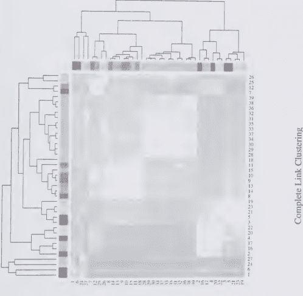

**图 3.8：** Ward法和完全连接聚类热图。

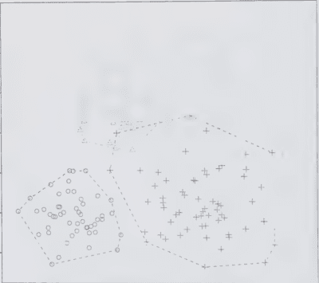

**图 3.9：** 一个包含四个重叠簇的人造数据集，由具有四个中心和不同标准差的随机正态点生成，类似于图1.5。

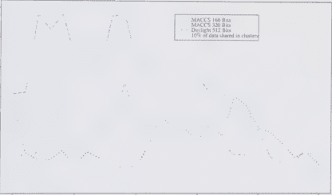

**图 3.10：** 给定380种HIV活性化合物和三种不同指纹类型时，Taylor重叠聚类中的聚类模糊性。

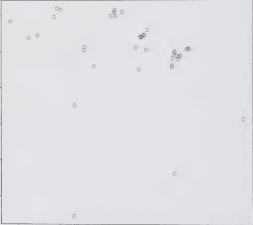

**图 3.11：** Cox-2相异度数据的MDS图。

## 第4章

### 划分算法

划分聚类算法在生物信息学和药物发现中都非常流行。K均值（K-means）的各种变体不断在文献中涌现，主要是为了高效处理越来越大的数据集。Jarvis-Patrick在化学信息学早期是聚类大规模二元指纹数据集的一种流行方法，但已在很大程度上被类K均值算法和采样算法取代。谱聚类在成像领域很流行，在化学信息学中也有一些人将其用于中等规模数据集的聚类。各种形式的自组织映射虽然最初来自工程学文献，但已在生物信息学中流行起来。它们带有模拟计算的特点，具有众多在聚类过程中不断变化的参数，但可以证明它们在整体行为上与K均值非常相似。它们受欢迎的部分原因在于，它们提供了一种便捷方式，可以将结果可视化作为过程和输出的一部分。

### 4.1 K均值

第3章所示的K均值算法基本形式（算法3.1）似乎可以随意修改（例如，各种示例见[97, 49, 100, 66, 82, 128, 95]）。有些修改源于数据类型，另一些则出于性能原因，或出于通过仔细选择起始质心来获得更接近最优划分的想法。这里介绍少数几种理由，并结合有效性和数据类型进行考察。此外，尽管在线聚类算法在网络安全和超大规模流数据集欺诈检测等领域很重要，而在生物信息学和药物发现应用中很少需要，但它们可能有助于对非常大的数据集进行聚类。该算法首先在数据的特征空间内生成任意中心。这些点既可以是随机生成的，也可以是从数据中随机选取的实际数据点，可以是伪随机选择或准随机选择（例如，将Van der Corput序列[52]按数据索引进行缩放）。

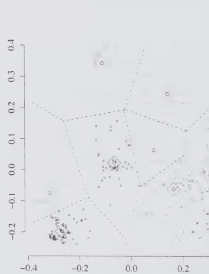

**图 4.1：** 使用由405个苯二氮卓类配体数据集的MDS导出的二维数据集进行简单K均值聚类。每个簇的质心用方块标记。注意，质心不一定与数据点重合。每个簇由其各自的Voronoi区域界定。

**算法 4.1：Kmeans(Data, K, Iterations)**

```
1: 𝒢 ← KEmptyLists()
2: M ← ArbCenters(Data, K) // Find K arbitrary centers
3: Axis ← PrincipalAxis(M) // Find principal axis of centroids
4: 𝒢 ← FindNN(Data, M, Axis) // Find the Nearest Neighbors to M
5: M ← FindCenters(Data, M) // Find the centers of the groups in 𝒢
6: i ← 1
7: repeat
8:     𝒢′ ← 𝒢
9:     Axis ← PrincipalAxis(M) // Find principal axis of centroids
10:    𝒢 ← FindNN(Data, M, Axis) // Find the Nearest Neighbors to M
11:    M ← FindCenters(Data, M) // Find the centers of the groups in 𝒢
12:    i ← i + 1
13: until i = Iterations OR 𝒢 = 𝒢′
14: Output: 𝒢, M
```

#### 4.1.1 K-Medoid

K-Medoid算法与K均值非常相似，但K均值寻找的质心可能不是实际数据项，而K-Medoid始终使用实际数据项作为组的中心。术语medoid具有类似于中位数而非均值的集中趋势度量的意味，而medoid或中心本身常被称为质心或代表点。从统计学角度看，这种方法也非常像选择分布的中位数而不是均值作为集中趋势度量，因为它受离群点和噪声的影响较小。在实践中，这通常比K均值结果有适度改进，当数据确实存在离群点和噪声时尤其有用。

正如在K均值中一样，可以随机选择任意一组K个质心，也可以选择更有考量的初始数据质心[82]。K-Medoid不是寻找质心，而是将每个数据点与每个质心交换，并计算某种度量（通常是距离的平均值或总和），以确定新配置在某种代价函数下是否更好；如果更好，则决定是否将质心交换为该新数据点。这一过程反复进行，直到没有质心被交换。然而，对于离散数据，可能必须做出任意选择，而这些选择可能连锁引发其他交换。

**算法 4.2：Kmedoid(Data, K, Iterations)**

```
1: 𝒢 ← KEmptyLists()
2: M ← ArbCenters(Data, K) // Find K arbitrary centroids within Data
3: 𝒢 ← FindNN(Data, M) // Find the Nearest Neighbors to M
4: M ← FindCenters(Data, M) // Find the centers of the groups in 𝒢
5: i ← 1
6: repeat
7:     M′ ← Swap(Data, M) // Perform swaps to determine M
8:     𝒢 ← FindNN(Data, M′) // Find the centers of the groups in 𝒢
9:     i ← i + 1
10: until i == Iterations OR M == M′
11: Output: 𝒢, M
```

#### 4.1.2 K-Modes

K-Modes算法与K-Medoid几乎相同，不同之处在于它处理分类数据及相应的（不）相似性度量。二元字符串数据可以视为分类数据，从而会用到各种二元数据度量。中心类型会结合由分类度量确定的代价函数再次进行换入和换出。在二元字符串的语境下，可以使用模态指纹（见第2章模态指纹定义）作为中心，而不是均值或medoid中心。模态指纹的参数化会显著改变结果，并且由于指纹或分类数据的离散性质，K-Modes甚至更可能出现类似K-Medoid的奇特交换效应。

**算法 4.3：Kmodes(Data, K, Iterations)**

```
1: 𝒢 ← KEmptyLists()
2: M ← ArbCenters(Data, K) // Find K arbitrary centrotypes within Data
3: 𝒢 ← FindNN(Data, M) // Find the Nearest Neighbors to M
4: M ← FindModal(Data, M) // Find the centers of the groups in 𝒢
5: i ← 1
6: repeat
7:     M′ ← Swap(Data, M) // Perform swaps to determine M
8:     𝒢 ← FindNN(Data, M′) // Find the centers of the groups in 𝒢
9:     i ← i + 1
10: until i == Iterations OR M == M′
11: Output: 𝒢, M
```

#### 4.1.3 在线K均值

在线K均值执行K均值算法时有两处小改动。当数据逐个流入时，会更新与输入数据项最接近的质心。质心的更新不再是最近邻的均值，而是通过某个小比例λ进行。因此，如果数据项为x_j，其最接近的质心为m_i，则质心立即通过下式更新：

m_i′ = m_i + λx_j.    (4.1)

这种算法形式非常像自组织映射（见4.4.1节）。事实上，它与SOM的在线版本差别很小。很容易看出，无论数据类型如何，这都会影响结果相对于输入顺序的稳定性。


```
Algorithm 4.4 OnlineKmeans(DataStream, K, λ)
1: 𝒢 ← KEmptyLists()
2: M ← ArbCenters(Data, K) //Find K arbitrary centers
3: repeat
4:   j ← FindNN(DataStream_i, M) //Find NN in M of newest data item
5:   M ← UpdateCenter(M_j, DataStream_i, λ) //Update M_j with Equation 4.1 and store in M
6:   𝒢 ← UpdateGroup(j, DataStream_i) //Update 𝒢 with corresponding new data item
7: until DataStream == ∅
8: Output: 𝒢, M
```

### 4.2 Jarvis-Patrick

Jarvis-Patrick算法有两种基本形式，它们基于对生成最近邻表以形成划分时所施加的约束。最基本的约束是要考虑的最近邻表的总体长度K。也就是说，在聚类组装过程中，只考虑最多K个最近邻。下一个约束是K_min，其中K_min ≤ K，且K_min ≥ 1。任意两个各自的K长度近邻列表之间，至少要有K_min个近邻匹配，才能属于同一个簇。这两个约束都会带来邻近性平局的问题，导致聚类模糊性，这将在第9章中讨论。

下面的算法4.4概述了简单的Jarvis-Patrick(K, K_min)版本。必须在FindNN(Data, K)中找到所有行的K个近邻，这需要对每一行进行排序，整体复杂度为O(N^2 log N)——或者调用K次min()。当然，如果K > log N，这也没有帮助。在最坏情况下，朴素算法必须额外搜索O(KN^2)对。在实践中，K_min和K_max与数据的相互作用使得最坏情况不太可能发生。创建和排序近邻列表占了执行时间的大部分。该算法具有一种类似于最小生成树的近邻链式形式。因此，一方面，该算法不受某些算法产生的超球形（排斥区域算法）或超矩形（递归划分区域）区域的限制，但由于链式过程在一定程度上是局部化的，它通常会产生许多单点簇。该算法在化学信息学中常被用于相当大规模的聚类[120]。FindNN(Data,K)是高度并行的，但Jarvis-Patrick的核心部分不是。因此，通过并行化来扩展算法以适应非常大的数据集的努力是有限的。然而，数万级别的中等规模近邻表用Jarvis-Patrick处理是相当可行的。因此，对于这种规模的数据集，它是一个方便的工具箱算法，即使仅仅是为了与其他算法结果进行比较。

为了了解该算法如何处理非常小的真实数据样本，将一组苯二氮卓类化合物中12种化合物的SMILES字符串转换为每个768位的基于键的指纹，然后用Tanimoto相似性度量进行比较。相似性度量值见表4.1。第一列到第十二列的每一行都可以看作是一个未排序的近邻表。近邻列表行中的粗体单元格表示K=5的最近邻；具有相同相似性得分的单元格是位于K=5约束处的平局；带下划线的单元格编号是位于K=5约束内的邻近性平局。比较值的精度被截断以方便地放入表中，但这些邻近值实际上是精确的有理数，粗体和带下划线的值确实是邻近性平局。

表中的最后一列包含K=5的最近邻索引列表。Jarvis–Patrick在K=5和K_min=3时生成的聚类为(1, 10, 11)、(2, 3, 4, 5, 6, 7, 8, 9)和单点簇(12)。读者可以检查表的最后一列，并识别产生这三个簇的K_min=3约束。注意，索引12不在任何K=5列表中。将K_min改为K_min=2会产生以下聚类：(1, 3, 4, 5, 10, 11)、(2, 6, 7, 8, 9)和单点簇(12)。这一变化将数据元素3、4和5移入第一个簇。约束被放宽了，因为现在只需两个近邻匹配即可认为两行在同一簇中。同样，通过检查K=5列表，读者也可以自己组装出这些簇。

#### 算法 4.4 Jarvis–Patrick(Data, K, K_min)

```
1: NNK ← FindNN(Data, K) //Create nearest neighbor table with K-length constraint
2: p ← 1
3: repeat
4:   i ← 1
5:   j ← i + 1
6:   C_p ← i //Add i to cluster C_p
7:   repeat
8:     if K_min criterion is met between (i,j) rows for all j in NNK then
9:       C_p ← j //Add j to cluster C_p
10:      RemoveRow(NNK, j) //Remove the jth row from NNK
11:    else
12:      j ← j + 1
13:    end if
14:  until j > RowLength(NNK)
15:  RemoveRow(NNK, i) //Remove the ith (first) row from NNK
16:  p ← p + 1
17: until NNK = NULL
18: Output: C //Return set of clusters C
```

第二种常见的Jarvis-Patrick变体去掉了最近邻列表的长度K，并用百分比P_min取代K_min约束，P_min是两个最近邻之间需要匹配的最少最近邻百分比，才能被认为属于同一个簇。

#### 算法 4.5 Jarvis–Patrick(Data, P_min, Threshold)

```
1: NNK ← FindNN(Data, Threshold) //Create nearest neighbor table at a (dis)similarity threshold
2: p ← 1
3: repeat
4: i ← 1
5: j ← i + 1
6: C_p ← i //Add i to cluster C_p
7: K_min ← min(length(NNK(i)), length(NNK(j))) //K_min constraint min of row lengths of i and j
8: repeat
9:   if P_min criterion is met between (i,j) rows for all j in NNK then
10:     C_p ← j //Add j to cluster C_p
11:     RemoveRow(NNK, j) //Remove the jth row from NNK
12:   else
13:     j ← j + 1
14:   end if
15: until j > RowLength(NNK)
16: RemoveRow(NNK, i) //Remove the ith (first) row from NNK
17: p ← p + 1
18: until NNK = NULL
19: Output: C //Return set of clusters C
```

### 4.3 谱聚类

谱聚类于1990年代末伴随图像处理被引入。例如，像素聚类是图像分割的重要部分，其中像素可以是RGB颜色向量，或卫星图像中常见的七个光谱带。这类问题可能相对较大，尽管维度通常很小，像素数量可达数十万或数百万，因此谱聚类通常用于小图像或较大图像的子集。幸运的是，计算相当大矩阵的特征值和特征向量是可能的，这使得谱聚类能够处理数千个数据项、维度较高的中等规模数据集，变得更加合理。因此，谱聚类已开始在化学信息学应用中使用，一些小组正在探索其在早期药物发现过程中对各种数据类型的有效性[18, 58]。

通常有两种方法，一种[103]与PCA或MDS非常相似，通过从相似度矩阵$A$计算拉普拉斯矩阵的k个特征向量来降低数据维度：

$$L = I - D^{-\frac{1}{2}} A D^{-\frac{1}{2}}, \tag{4.2}$$

其中对角矩阵$D$的第$i$个条目为$\sum_{j=1}^{N} A_{ij}$。维度的选择只需某个$k \in \mathbb{N}$，其中$k$个特征向量作为数据特征的列。这些非常类似于载荷或线性因子。变换后的数据再由任何聚类算法进行聚类，但最常用的是$K$-means。

另一种更有趣的方法[122]同样计算拉普拉斯矩阵，但基于第一和第二特征值递归划分数据，自下而上构建层次结构。

### 4.4 自组织映射

自组织映射是一种将$N$维空间非线性投影到特殊形式的二维表面的方法。该算法可以被看作是$K$-means与二维弹性或力导向MDS方法的结合。然而，该表面有一个特殊性质：它是一个环面——构成SOM的网格的边缘是环绕的。因此，沿边缘形成的簇与对侧边缘的簇密切相关。SOM有时被称为*拓扑有序映射*，因为它们试图将问题原始空间中的邻近关系保留到更简单的空间或拓扑中，而不一定是因为结果呈现为诸如环面之类的奇特拓扑对象。数据在环面投影上的网格中心被拉伸（符合弹性与拓扑隐喻）朝向单个数据点，但与$K$-means类似，只是靠近该点的网格中心。这个过程是迭代进行的，所有点都经过这个过程，直到达到指定迭代次数。因此，该算法的参数包括：每个点移动网格中心的程度；邻域大小定义接近程度；迭代次数。这里的“网格”是广义的，指简单的均匀平铺。例如，网格不必是正方形的，也可以是六边形的。SOM也像$K$-means一样对原始空间采样，并且擅长创建密集簇并将它们适当地放置在网格区域中。

SOM对输入参数特别敏感，在某些条件下可能在地图中产生不理想的扭结，此时学习是局部化的。此外，SOM对输入顺序敏感——输入顺序的改变可能导致累积的学习变化，从而导致不同的，

```text
12: until i > K
13:     j ← j + 1
14: until j > n
15: Iter ← Iter + 1
16: until Iter > Stop
17: Output: SOM
```

### 4.5 术语表

- **全局最优：** 整个搜索空间内的最大或最小最优点或区域
- **迭代梯度优化：** 沿梯度进行最小化或最大化搜索，以找到最优解（局部或全局）。
- **局部最优：** 在一个搜索空间内，可能存在并非在整个搜索空间中都最优的局部最优区域
- **最近邻：** 在一组比较对象中距离最近的邻居。
- **单轴边界：** 将特征空间投影到第一主成分上以界定搜索空间，通常用于最近邻搜索。

### 4.6 习题

- 1. 创建一组样本数据集，用以展示 *K*（对于 Jarvis-Patrick 情形还包括 *Kmin*）的输入参数对本章讨论的每种算法的聚类结果的影响。讨论重点放在不同 *K* 限值下（*例如*，对于 Jarvis-Patrick，*Kmin* ≪ *K* 和 *Kmin* = *K*）簇成员关系的变化。
- 2. 对本章中的算法进行排序，列出你预期最高效（或具备处理最大数据集能力）的算法。在讨论中说明你预见的聚类有效性问题（对于这里描述的每种算法，结果是否合理）。
- 3. 进行文献检索，找到一篇近期论文，该论文在药物设计或生物信息学应用中使用 SOM 进行聚类。讨论 SOM 方法在所描述特定应用中的优缺点。为分析提出另一种算法，并讨论其在该特定参考文献中应用的优缺点。
- 4. 从时间和空间角度比较 *K*-means 与谱聚类在大数据集上的性能。特别关注它们在实际中会表现如何。

## 第 5 章 聚类采样算法

使用纯划分算法形成划分的准则，是在考虑所有数据项的情况下，对可行或临时划分进行迭代调整。在 *K*-means 中，通常随机选择一组 *K* 个质心来开始迭代。另一类相似的算法通过随机选择一个起始质心，并收集所有处于预定义相似度阈值内的其他数据项来形成一个簇，从而逼近划分的形成。剩余的数据项——即被排除在该簇之外的数据项——随后也以类似方式处理，重复该过程，直到所有数据项都归入某个簇。簇更像是直接从数据中采样得到的，并且不像例如 *K*-means 中那样存在预先选定的簇数。主要优势是效率：对于领导者算法而言，不必存储邻近矩阵，也不必计算所有（不）相似度，而只需计算 *O(K²)* 个（不）相似度，其中 *K* = |*C*| 是最终的簇数；或者，对于排除区域算法而言，只需存储相似度的稀疏矩阵，其中聚类步骤相当于对某个 *K* 数量的簇进行 *O(KN)* 查找。就有效性而言，其假设是这些算法对特征空间中数据的密度进行采样，从而充分识别出各组。领导者算法适合作为处理超大数据集或海量在线数据流的最后手段。排除区域算法往往更有效，因为它们从特征空间中明显密集的区域选择簇，这取决于它们在特定阈值下选择近邻表中最大的近邻项，并且不太受随机选择问题的影响，但这些算法要付出生成所有成对相似度的代价。

### 5.1 领导者算法

在 *K*-means 中，算法通常用特征空间中 *K* 个随机选择的点或随机选定的数据项来初始化。这种随机选择可以用伪随机或准随机生成的序列来执行，二者都旨在使 *K* 个起始质心的选择在包含数据的特征空间中大致均匀分布。这样，通过迭代过程，调整后的质心更可能找到密度区域，从而使这些区域定义良好且彼此分离。将此概念与领导者算法进行比较：领导者算法的初始化从单个随机选择的数据项和一个用于生成簇的排除阈值开始。如果数据有聚集趋势，那么特征空间中存在密集区域，初始随机点更可能位于这些密集区域之一。但是，仍然存在虽小但可能显著的概率使其并非如此。例如，它可能是一个离群点。在高维空间中尤其如此，因为经常会有一些数据项位于特征空间的边缘。同样，虽然概率很小，但随机选定的数据项位于簇之间，并可能被拉入第一个簇，而该数据项原本可能属于其他几个簇的某些成员，这种概率也显著存在。一旦第一个簇被定义并排除，问题就出现了：如何最好地继续对剩余点进行随机选择，以避免首次随机选择带来的一些问题。

与 K-means 一样，人们希望确保从剩余尚未聚类的数据中进行的每个新随机样本再次大致均匀地分布在整个特征空间中。领导者算法的变体正是关注这一点：在剩余未聚类数据中选择下一个随机样本点的策略。一个简单的初步方法是利用迄今已计算的信息。在每次迭代中，刚刚计算了一个 1 × (Nᵢ − Cᵢ) 的不相似度集合，其中 Cᵢ 是截至第 i 次迭代的簇集合，|Cᵢ| 是迄今已聚类的数据项数。那些位于阈值范围之外的不相似度对应于所有尚未聚类的剩余数据项，下一个随机数据项将从中选择。选择哪一个？一种方法是选择距离最近一次随机数据项最远的数据项，这需要少量计算开销来找到列表中的最大值。该过程可能倾向于在特征空间边缘附近挑选离群点。另一种方法是任意选择排除区域之外的任何数据项，该数据项靠近排除区域的概率很小，至少在算法开始时只有少数几个簇时如此。还有一种方法是，如果可能，选择一个与任何先前排除区域的距离为 2 倍半径的点。后一种方法最类似于 K-means 的均匀随机采样，因为它连续选择分布在整个数据中的点，并且具有准随机采样的特点，这种方法被称为用于蒙特卡罗积分的泊松盘采样，在计算机图形学中仍是一个活跃的研究领域 [29, 123, 51]。然而，这种方法需要存储和处理所有先前的不相似度，因此既较慢又使用明显更多的内存，但它可能更有效，因为它将用类似蒙特卡罗积分的过程对数据的特征空间密度进行采样。空间的类型由度量或测度定义，因此其排除区域可能与我们通常的欧几里得空间和距离概念相当不同。这在离散数据和测度中尤其明显，此时空间和区域实际上位于一个格点上。最后，还有其他方法会存储和处理更多的不相似度 [12, 88]，虽然比上述简单方法效率低，但与需要计算所有 O(N^2) 个不相似度的排除区域算法以及其他划分算法相比，仍然有效。

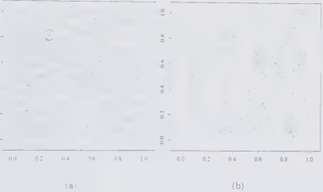

**图 5.1：** 图 a) 对单位正方形进行半径为 0.04 的泊松盘采样。图 b) 对单位正方形进行均匀伪随机采样，显示半径为 0.04 的圆盘。

为了直观理解领导者和排除区域算法中的采样。图 5.1a 展示了由泊松盘采样创建的 100 个点的准随机点集——任意两点之间的距离不能小于 2r，其中 r 是圆盘半径。该点集更均匀地覆盖空间，尽管这些点本身是由伪随机生成器生成的，但排除了落在任何先前采样点半径内的点。图 5.1b 生成了一百个伪随机点，并使用了与 5.1a 中生成泊松采样相同半径的圆。很容易看出，即使这些点是从 R 统计计算语言 [133] 中的均匀伪随机数生成器（“runif”）抽取的，采样也远非均匀。这个例子只是在二维欧几里得空间中，但可以推广到更多维度和其他的不相似度度量。采样如何依次选择要排除的区域也会影响最终选择的组，因此也会影响例如选择下一个位于 2r 之外的样本点的顺序，其中 r 是领导者算法中任何先前簇的排除区域阈值半径。以帮助像准蒙特卡罗积分方法那样对密度进行采样。


在下面的领导者算法 5.1 中，除了 *简单领导者* 算法 3.4 中已有的采样考虑之外，额外的采样考虑通过一个通用函数调用 *采样方法(Data)* 表示，它是对上述选择下一个样本质心的任何变体的统称。

#### 算法 5.1 Leader(DataSet, Threshold)

```
1: DataElement ← SampleRandom(Data) // Arbitrarily choose a data element from the data
2: Data ← DataSet \ DataElement // Remove DataElement from Data
3: Append(DataElement.C) // Append the DataElement to first cluster
4: repeat
5:   G ← Append(FindNN(Data, Threshold).C) // Append NN to cluster
6:   Append(C,G) // Append C to set of clusters G
7:   Data ← Data \ C // Remove cluster elements from data
8:   DataElement ← SamplingMethod(Data) // Choose new centroid
9: until |Data| == 0
10: Output : G
```

该算法的在线版本也可用于超大规模数据集：在迭代过程中仅使用数据的一个子集，随后再将额外数据添加到现有簇中，或创建新簇。由于并非一次性考虑所有数据，这提供了额外的加速；但缺少在拥有全部数据时进行的额外相异性比较，会减少可用于采样过程的有用信息量。在线版本更加依赖于这样一种观念：可以相当有效地对数据的特征空间密度进行常规采样。这在一定程度上取决于数据，但几乎可以肯定，由于更有可能获得较差的采样，其效果还会进一步下降。

该算法的一个稍复杂的变体称为 *领导者-跟随者*。在该算法中，数据项与随机样本数据项相关联，但初始质心会通过以一个小因子 λ 朝向该数据项纳入该数据点而进行调整，使得后续数据项仿佛是相对于这个很可能根本不是数据项的新质心聚集的。当一个数据项不适合任何已有质心的区域时，就从数据项中随机选择新的质心。该算法与在线 *K* 均值密切相关。领导者算法和领导者-跟随者算法也天然适用于在线聚类（也称为竞争学习，例如在线 SOM 和其他神经网络方法）。

### 5.2 Taylor-Butina 算法

排除区域算法与领导者算法相似，但要求已计算所有两两相异性，以便在指定阈值下生成近邻表。Taylor 和 Butina 分别独立得到了相似的算法 [132, 22]。他们的方法表面上极其简单。阈值下的近邻表是一个具有 N 行的稀疏矩阵。条目行是没有任何更近邻居的数据项，因此是单例簇。这些行可以首先被移除。随后，具有最多邻居的行被视为一个簇并将其移除；如果其所有成员出现在矩阵的任何其他行中，也一并移除。对新形成的稀疏矩阵重复此过程。每次新的迭代中，每个新簇都更小。当矩阵包含的全是空近邻表时，迭代停止。然而，这会遗漏所谓的假单例：那些位于某些其他簇成员的阈值范围内、但自身并非簇成员的数据项。假单例可以被分配到具有最近邻簇成员的簇中。

#### 算法 5.2 TaylorButina(SparseMatrix, Threshold)

```
1: CollectSingletons(SparseMatrix) // Remove singletons.
2: repeat
3:   C ← FindLargestSetNN(SparseMatrix) // Assign largest row in matrix to cluster
4:   SparseMatrix ← SparseMatrix \ C // Remove row and its elements from the matrix
5: Append(C, G) // Append cluster C to set of clusters G
6: until SparseMatrix == NULL
7: G ← AssignFalseSingletons(G) // Assign false singletons to clusters with nearest neighbors
8: Output G
```

图 5.2 给出了在阈值 0.05 下运行的 Taylor-Butina 算法的二维可视化。质心用实心圆表示，阈值由大圆定义，菱形表示单例，x 表示假单例。图 5.3 和图 5.4 给出了在两个不同阈值下运行的 Taylor-Butina 算法的二维可视化。在这些图中，簇的排名顺序由每个簇的数字标签描述。阈值 0.1 和 0.2 是相异性阈值。因此，图 5.4 中的簇分组比图 5.3 中描绘的组更大。类似地，每个组通常也更分散。较大的排除区域还显示出更多重叠（第 9 章讨论了这种行为）。注意，中心型（本例中的实际质心）的间距更符合准随机采样。排除区域圆之所以重叠，是因为排除区域质心的半径至少为 r，而不是像泊松圆盘采样中那样采样半径为 2r。

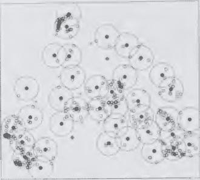

**图 5.2：** 阈值 0.05 下 Taylor-Butina 的二维可视化。质心用实心圆表示，簇成员为小黑圆，菱形为单例。x 表示假单例，排除区域由大圆定义。

这只是采样中的一个常数因子，对点的差异度没有影响。

Jarvis-Patrick 和 Taylor-Butina 算法的一个所谓缺点是，它们往往会产生大量单例。一般而言，排除区域算法几乎没有或完全没有其他类型聚类中会出现的那种“链式”现象，最典型的是极端情况下的单链接聚类或最小生成树。因此，离群点仍会作为此类簇保留下来。结果，就增加了一种类似链式的额外特征，并移除了大量原本会被归入“真”单例集合的内容。

该算法有时会出现若干打破平局决策问题，第 9 章将更详细讨论，这里简要提及。最大的近邻行可能有不止一个候选。近邻数量上的这种平局可以任意打破，也可以对每个平局行应用某种密度度量，以确定哪一行最密集。此类示例为：选择所有簇成员到代表（质心或中心型）的距离之和最小的行。这简单且快速，因为它就是该行条目的和。即使采用各种打破平局方案，该算法通常也不具备输入顺序不变性。并非所有平局都能通过解析方法解决——例如甚至可能出现距离和最小值的平局。当簇成员数量变小时，这个问题尤其明显。然而，如果平局簇不重叠，从而不会改变其余簇，则最终簇将相同，只是输出顺序不同。如果下一簇有一组平局候选行，并且至少有一对重叠，那么选择哪一行作为簇，可能会显著改变此后产生的一些簇。

该算法的一个优点是在完成时，每个簇的代表已知，并可作为该簇的第一个成员输出。此外，稀疏矩阵虽然通常只占总规模 $O(N^2)$ 的一个常数比例，但在实践中常常可以小到完整矩阵的百分之一。一旦创建了稀疏矩阵，对于大型数据集而言，这就构成了一个非常快速的算法。对于非常大的数据集，生成非常大的稀疏矩阵是该算法的缺点。甚至稀疏矩阵也可能变得非常大，尤其是当数据集巨大时。

### 5.3 术语表

- **簇代表：** 中心型
- **簇采样：** 聚类包含某种形式的采样以得到簇
- **泊松圆盘采样：** 一种用于图形学的准随机采样形式，由伪随机点和排除区域拒绝形成
- **相似度阈值：** 设定的水平，高于该水平时被比较的两个对象被视为相似
- **稀疏矩阵：** 阈值化矩阵
- **真单例：** 在按阈值相异性判断时位于任何排除区域或簇成员之外


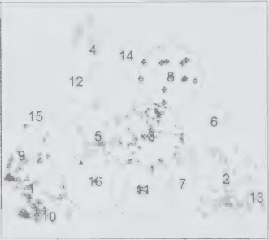

**图5.3：** 阈值0.1下Taylor-Butina的二维可视化。聚类选择顺序用数字标注。每个数字代表不同的聚类。

### 5.4 练习

- 1. 回顾图5.3和图5.4，它们为Taylor-Butina算法提供了两种不同的阈值可视化。如果将阈值增加到0.3，你预计可视化中会出现什么情况？请描述聚类成员关系、单例和伪单例等概念在这些可视化中的应用。
- 2. 假设你有一个数据集，其中的化合物通过某种通用相似性度量表现出高度相似性。请描述对于这类数据集，类似于图5.3或图5.4的可视化可能是什么样子。如果初始数据集中包含高度独特的成员，又会怎样？
- 3. 在线搜索报告了单例的聚类数据集。讨论使用了哪些算法，以及对聚类前数据可以作出什么评估（如果有的话）。
- 4. 为什么图5.2、图5.3和图5.4中的质心实际上更像图5.1a中的采样，而不是图5.1b中的采样？

```
    2: G ← Groups(Data) //One data element per group in G
    3 repeat
    4     G' ← MergeGroup(G) // Merge closest group
    5     Output: Merged Group Pair and Merge Criterion Value
    6     G ← G' //Update Groups
    7 until |G| == 1
```

#### 6.1.1 互最近邻类算法

##### 6.1.1.1 完全连接

公式6.1中的完全连接合并准则寻找新形成的簇与已有簇之间的最大不相似度。

$$G(w,(u,v)) = 0.5\big((G[w,u]+G[w,v])-|G[w,u]-G[w,v]|\big) \tag{6.1}$$

u、v表示新形成的簇，w表示已有簇[32, 105]。这种合并准则通过关注最大不相似度，避免了单链接算法中关注簇间最小不相似度所导致的链化问题。然而，关注最大不相似度可能会对给定数据集中的离群点赋予过大的权重。如果数据集中的自然分组包含真正的离群点，完全连接算法会过于强烈地试图将离群点强行纳入某个聚类簇，而它们实际上本应保持为离群点。

##### 6.1.1.2 组平均

公式6.2中的组平均合并准则名副其实，它包含不相似度的算术平均值，并考虑簇的大小。

$$G(w,(u,v)) = \frac{|u|}{|u|+|w|}(G[w,u]) + \frac{|v|}{|v|+|w|}(G[w,v]) \tag{6.2}$$

u、v表示新形成的簇，w表示已有簇，其中|u|、|v|和|w|分别是u、v和w的基数。^90 在图6.1a中，树状图展示了使用组平均聚类对一组已知JNK3活性化合物进行结构聚类、层级选择为0.34时的结果。在图6.1b中，描绘了从左到右读取树状图得到的前五个聚类的质心。每个聚类的成员数量以文本字段显示在质心上方。每个质心的二维结构以图形形式显示。请注意，在该聚类层级上，这些活性化合物的二维化学多样性显而易见。

如果在图6.2所示的Ward树状图上向下钻取到0.4水平，聚类数会从五个簇（最大簇有45个成员）和三个单例增加到七个簇（最大簇有29个成员）和五个单例。

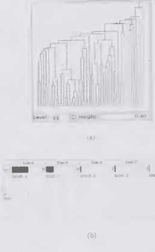

**图6.2：** 与图6.1中相同的一组JNK3活性配体经组平均聚类后得到的一些结构聚类，但阈值水平为0.4。显示了层次结构中前五个节点的聚类质心，并在每个质心上方列出了聚类成员数量。

在层次结构中，聚类数增加到五个，质心显示在图6.4b中。三个簇保持不变，一个簇被拆分为两个，最终由图6.4a中的树状图显示出五个簇。

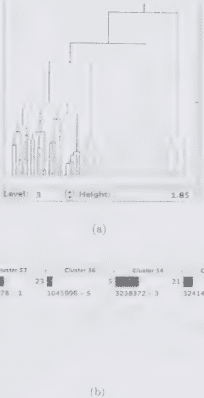

**图6.3：** 一组JNK3活性配体[38, 4, 104]经Ward法聚类后得到的一些结构聚类。显示了所选层级得到的四个簇的聚类质心，并在每个质心上方列出了聚类成员数量。

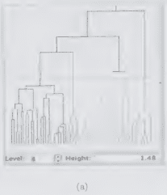


**图6.4：** 一组JNK3活性配体{38, 4, 104}经Ward法聚类后得到的一些结构聚类。数据集与图6.3相同。质心代表层次结构中比图6.3低一个层级的截断水平所对应的聚类节点。显示了层次结构中前五个节点的聚类质心，并在每个质心上方列出了聚类成员数量。

#### 6.1.2 其他方法

还有许多其他形式的凝聚式层次聚类算法。最常见的是单链接聚类，它具有非常显著的链化效应，因此在许多应用中很少有用。其他算法具有某些性质，使得它们无法通过RNN变得更高效，因此对于药物发现中常分析的数据集规模而言效用极低。还有一些层次聚类算法的合并准则使其只能与度量测度一起使用。使用加权合并准则或质心合并准则的其他形式可能会不满足单调性。单调性是层次结构的一项性质，与超度量性一致。

$$d[(u, v)] \leq d[w, (u, v)] \tag{6.4}$$

u和v可以是组或成员。d是合并准则，w是另一个组或成员。如果公式6.4不成立，则聚类不是单调的，层次结构中可能会出现交叉。

### 6.2 分裂式

本章到目前为止只考虑了凝聚式算法，但也存在层次分裂式方法。分裂式算法从所有数据集成员位于一个簇开始，然后自顶向下递归地将数据划分为更小的组。与凝聚式方法相比，这些算法的优势在于对数据进行更全局的考虑。分裂式算法的缺点是，如果需要创建整个层次结构，计算成本可能更高。如果不需要构建整个层次结构，分裂式算法可用于药物发现或生物信息学应用。要求在树状图的高层级进行层级选择，可提高这些算法的效率，使其与数据集规模呈线性关系，但挑战在于设计出类似层级选择的有意义停止准则，从而使得到的组具有有效性[5]。

### 6.3 术语表

- **链化：** 单个聚类在特征空间中呈分散延展状，而不是球形或近球形聚类
- **交叉：** 在层次结构中，子组的合并准则值大于其父组的条件
- **合并准则：** 算法中用于连接或合并组或簇的定量表达式
- **单调性：** 整个层次结构无交叉、符合公式6.4的性质
- **互最近邻链：** 一系列连续最近邻，其中链中最后一个最近邻与链的第一个成员相匹配
- **分裂准则：** 算法中用于划分组或簇的方法
- **拓扑：** 在形变或变换下保持不变的性质

### 6.4 练习

- 1. 下载一个基因表达数据集[48]。使用本章提到的每一种层次聚类方法，通过R统计软件包[133]对数据进行聚类。评论得到的层次结构。先对基因聚类，再对实验聚类。评论你的发现。
- 2. 下载一组配体的结构和活性数据，这些配体在针对特定受体（例如黏着斑激酶（FAK）[4]）的高通量筛选实验和二次筛选实验中均显示出活性。使用FOSS（自由及开源软件），例如CDK [23]，为数据集生成属性或结构指纹。像练习6.1那样对数据进行层次聚类。评论得到的树状图。修改输入数据集的输入顺序，重新运行分析。本章讨论的层次聚类算法中是否有任何算法表现出输入顺序依赖性？如果观察到输入顺序依赖性，请提出你对其可能原因的任何想法。
- 3. 为凝聚式算法绘制一个树状图，并包含一个交叉的示例。


## 第7章：混合算法

在借鉴其他方法的基本组件来创建新的聚类方法方面，实际上并无限制。此类方法可能有诸多动机，例如时间或空间上的效率，或者开发者有充分理由相信新方法对特定类型的数据非常有效。双聚类方法就是一个很好的例子，其中有一个非常具体的、由数据驱动的聚类问题。在本章中，我们将考察几种较新的方法，它们同时借鉴划分方法和层次方法来创建用于生物信息学或药物发现领域的聚类方法。当然，这里展示的方法并非详尽无遗，而是以深思熟虑且引人入胜的方式涵盖了层次方法与划分方法相结合的一般概念。

### 7.1 自组织树算法

自组织树算法（通常简称为SOTA）[70]具有一个相当独特的性质：它以有机的方式构建层次结构，这与传统的层次聚类方法有些不同。凝聚层次算法在特定阈值下生成有根树或树森林，对这些树的水平切割产生作为聚类的划分。分裂层次通常从单一根开始生成一棵树，其叶子可能止于一个非平凡的划分，不过同样是使用水平选择来创建聚类划分。SOTA是一种自顶向下生长树的分裂方法，但叶子就是最终的划分，且分裂准则基于SOM方法。作为该准则的一部分，会为树中第 \(i\) 个节点生成一个度量值，即资源 \(R_i\)，将生成树上所有 \(R_i\) 求和，可以方便地用于验证最终聚类。一旦达到预设阈值，资源总和实际上就是停止准则。

$$
R_i = \sum_{j \in J_i} \frac{(x_j - \bar{x}_i)^2}{|N_i|} \tag{7.1}
$$

其中 \(|N_i|\) 是树中第 \(i\) 个节点的基数（与该节点关联的数据项数量），而 \((x_j - x_i)\) 是第 \(j\) 个数据项与 \(N_i\) 节点之间的距离，如第4章关于SOM的讨论所述。随着每轮迭代（每次给定一个数据项并调整所有节点）节点数量的增加，称为一个Epoch（轮次），此时会将到目前为止所有 \(R_p\) 的总和与阈值进行比较，以判断树是否需要继续生长。

在图7.1中，SOTA生成的叶节点可以散布在树的各个层级，图中以实心圆端点表示树内部的叶子节点。

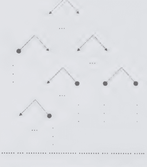

**图7.1：** SOTA生成的树示例。树的根通常选择数据的均值或某种中心趋势度量。SOTA通常生成非平衡树，代表聚类的叶子（实心圆）可能出现在树的不同层级。最终划分由叶子形成的分组构成。

更新节点内部位置以及确定哪些数据项与哪些节点关联的表达式，与SOM中的非常相似，但现在学习率函数 \(\lambda\) 被固定为少量几个值，因为邻域函数只包含少数几个可能的邻居：最近的外部节点、如果兄弟节点是外部节点则为兄弟节点、以及父节点。\(\lambda\) 对最近节点取最大值，因此最近节点会因 \(\mathbf{x}_i\) 而移动最多。

$$
N_i(Iter + 1) = N_i(Iter) + \lambda(Iter)H(Iter)(\mathbf{x}_j - N_i(Iter)) \tag{7.2}
$$

该算法首先将数据的均值赋予根节点和两个外部兄弟节点，然后开始第一个Epoch（即对数据的一次遍历）。

```text
Algorithm 7.1 SOTA(Data, λ(), H(), Threshold)
1:   NodeInitialization(Data) //Find the mean of the data and assign it to the three nodes
2:   ParameterInitialization() //Threshold, λ(), H()
3:   n ← SizeData()
4:   Iter ← 1
5:   repeat
6:     j ← 1
7:     repeat
8:       i ← 1
9:       Rsum ← 0
10:      repeat
11:        Node_i ← UpdateNodes(Node_i, x_j) //Update a node positions given x_j
12:        Rsum ← Rsum + R_i
13:        i ← i + 1
14:      until i > |Nodes|
15:      if Rsum < Threshold then
16:        BreakToOutput
17:      end if
18:      AddNodes()
19:      j ← j + 1
20:    until j > n
21:    Iter ← Iter + 1
22:  until Iter > Stop
23:  Output: SOTA
```

### 7.2 分裂层次*K*-均值

分裂层次*K*-均值是一种相对简单的混合算法，它结合了*K*-均值与分裂聚类。与通常的分裂准则不同，这里使用*K*-均值作为分裂准则（称为“二分*K*-均值”[128]）。这使其成为一种快速算法，因为*K*-均值步骤通常很快，每个待分裂组只需使用两个质心（2-means）。（原则上，该算法可以通过使用 \(K > 2\) 推广为生成一般树，而非严格二叉层次。不过，在每一层确定最佳 \(K\) 会很麻烦。）该算法最初是为大型文档搜索而设计，但此后已在药物发现中得到更广泛的应用。两个初始质心的选择可以各不相同，但最简单的是随机选择；即便*K*-均值在离群点方面存在有问题的效应，也仍然如此。

```text
Algorithm 7.2 DivideHierarchical-K-means(Data)
1: N ← Size(Data)
2: G ← SingleGroup(Data) //|G| = 1, there is just 1 group in G
3: repeat
4:   G ← DivideGroupsK-means(G) //Divide groups, G, at each level with K-means
5:   Output: Merged Group Pair and Merge Criterion Value
6: until |G| == N
```

### 7.3 排斥区域层次结构

排斥区域聚类算法在某个排斥阈值下生成一个划分。连续使用多个阈值可以构建一般意义上的有根树，但更常见的是生成一个树森林，其各棵树的根从特定的起始阈值开始[140]。代表点或中心型以凝聚方式构成树的连续节点。这种层次形式可以产生重叠的聚类，从而形成一般的金字塔式聚类层次[2, 7, 8]。

第3章中简单的排斥区域算法3.5可以修改为对一系列连续阈值进行迭代，其中阈值逐渐增大——向树的根部方向增长，并允许在每个层级合并。该算法需要大量的子程序支持，其细节在此略过。图7.2是一个排斥区域生成层次结构的一般树示例。这些树可以是有根的，也可以是树森林。叶子表示最后一个层级上数据的划分。该算法以停止阈值下的稀疏矩阵作为输入，并在越来越大相异度阈值下连续聚类，直到达到一个小于或等于生成该稀疏矩阵时的阈值为止。

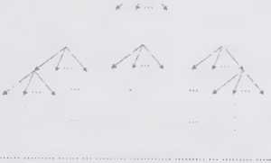

**图7.2：** 排斥区域生成层次结构的一般树示例。这些树可以是有根的（顶部层级）或树森林（第二行层级）。叶子表示最后一个层级上数据的划分（底行的点表示划分后的数据）。

```text
Algorithm 7.4 ExclusionRegion(SparseMatrix, StartThreshold, StopThreshold, Increment)
1: Step ← Increment
2: Threshold ← StartThreshold
3: Stop ← StopThreshold
4: repeat
5:   repeat
6:   SparseMatrix ← SparseMatrix // Save copy of current SparseMatrix
7:   C ← FindLargestSetNN(SparseMatrix) // Assign largest row index
8:   SparseMatrix ← SparseMatrix \\ C // Remove row and its elements from the matrix
9:   Append(G, C) // Append cluster C to set of clusters G
10: Append(M, Centrotype) // Append the centrotype of C to the list of centrotypes, M
11: until SparseMatrix == NULL
12: SparseMatrix ← ResetMatrix(SparseMatrix', M) // Collect all Mᵢⱼ values from SparseMatrix
13: Output: M, G
14: Threshold ← Threshold + Increment // Increment threshold for next layer
15: until Threshold = Stop
16: AssembleHierarchy // Successive output of M and G form forest of hierarchy
```


### 7.4 双聚类

双聚类，有时称为子空间聚类、共聚类或块选择，可以看作试图在两个维度上进行特征选择：哪些特征重要，以及哪些数据项重要。该问题的解决方法最早由 Hartigan 提出 [64]。近三十年后，这些方法首次应用于基因表达数据 [27]。要找到该问题的最优全局解，需要数据项和特征的 $2^{N+P}$ 种组合。此类问题是 NP 难的，显然需要启发式方法。如图 1.7 所示，目标是设计一种优化准则，对两个维度（例如基因和实验）进行重排，使它们对齐成子集块。

一种朴素方法是直接对两个维度都进行聚类，如图 3.7 或 3.8 所示。从这些示例中可以明显看出，存在可能值得关注的块。然而，通过任一维度中树状图的形成而对数据进行的特定重排并不是唯一的。可能存在比这些重排所揭示的更好、更显著的块特征。应用场景也可能决定如何优化一个块。有四种基本的优化目标类型：

- 1. 沿行方向为恒定值
- 2. 沿列方向为恒定值
- 3. 整个块内为恒定值
- 4. 块内取值具有一致性

使用图 1.7，对两个维度都进行层次聚类的朴素方法揭示了行和列都接近恒定值的块。（当然，该示例中的原始矩阵是对称的，因此出现恒定值块的机会更大。）现在已经有很多算法围绕这些不同目标而设计，每种算法都有其特点和不足。关于常用于基因表达数据的方法综述，见 [77]。更广泛、更近期的综述见 [87]。

### 7.5 术语表

- **混合算法：** 一种由可独立应用的算法组合而成的算法
- **金字塔聚类：** 重叠的层次聚类
- **SOTA 轮次：** 对所有数据的一次遍历
- **子矩阵：** 连续行和连续列的子集

### 7.6 练习

- 1. 讨论应用 SOTA 算法相对于使用 SOM 的优势。讨论任何缺点。
- 2. 从效率和效果方面比较层次聚类算法与 SOTA。
- 3. 为排除区域层次结构设计一种层级选择技术。
- 4. 设计一种混合算法。
- 5. 树状图叶节点布局的排列并不唯一。有几种方法可以重排叶节点，使得左右排列规定最紧密合并的簇位于一侧或另一侧。在 R [133] 中有两个层次聚类例程：`hclust()` 和 `agnes`（来自 `cluster` 库）。它们各自都有相关的绘图方法，分别为 `plclust()` 和 `plot.agnes()`。两者都生成相同的层次聚类算法，如 Ward 法、全链接等。在一个小型基因表达数据集上使用这两个例程及其绘图例程，并结合 `heatmap()` 函数，生成不同的树状图和热图。使用相同的聚类算法（例如 Ward 法）创建两个热图，一个使用 `hclust()` 和 `plclust()`，另一个使用 `agnes()` 和 `plot.agnes`。检查结果，对照所有四种双聚类优化目标。`plclust()` 的左右排列是否比 `plot.agnes()` 能揭示更多类型的块？使用几种不同的算法并检查结果。为每个维度使用不同的算法。

## 第8章：不对称性

当比较节点数量、字符串长度、大小或形状不同的对象时，对称距离或相似度度量（如欧几里得距离或谷本相似度）的含义或效用可能会失效。社会科学中一个非常简单的例子涉及将一大群个体聚类成若干社交小圈子。个体对彼此的感受或看法进行排序，例如采用 1 到 10 的尺度。很容易看出，这类值的邻近矩阵是不对称的，因为个体之间的成对值可能不同——Ida 喜欢 Joey（(Ida, Joey) 条目），但 Joey 只是容忍 Ida（(Joey, Ida) 条目）。随后可以对此类数据进行聚类，以找出志同道合的个体群体（社交小圈子）。另一个简单例子涉及形状。两个形状相同的对象，例如两个三角形，在观察者看来可能相当“相似”，但如果两个三角形大小差异很大，对称度量会把它们度量得相当不相似。因此，任何不对称度量都是这样一种度量：比较两个对象的顺序可能导致该度量取不同的值。在图 8.1 中，(a) 和 (b) 中有两个对象正在被比较。如果相似性比较中纳入它们的大小差异，相似度度量会认为这些对象相当“不同”。然而，图 8.1b 中的三角形能够“嵌入”图 8.1a 中的三角形这一事实，可能是将这些对象归为一组的一种有趣方式。对于图 8.1b 与图 8.1a 相比较的情况，不对称度量会给出高值；而对于图 8.1a 中的对象“嵌入”图 8.1b 所示三角形的情况，则会给出低值。

二维或三维化学结构的比较是普遍存在的操作。对这些化合物描述进行相似性搜索和聚类，是许多早期药物发现应用中的常用方法。一种标准技术是将化学结构编码为二进制字符串或指纹形式，并通过使用谷本相似系数比较不同化合物各自的指纹来比较它们。类似地，单一化合物或众多化合物的构象形状，可以通过使用由各种方法定义形状描述符的谷本相似系数进行比较，这些方法包括高斯混合 [56] 和基于拟蒙特卡洛积分的形状指纹 [99] 等。相似系数存在固有偏差，原因很简单：小分子结构之间仍可能有相当大的尺寸差异。可以设计或组合系数来帮助减轻这种偏差 [35, 46]，其中一种方法是使用不对称度量来纳入这种偏差。在多种领域（社会科学、生物学等 [138]）中使用的一种常见不对称度量是 Tversky 相似系数。Tversky 系数类似于谷本系数的参数化版本。随后可以使用不对称度量来偏置两个化学结构之间的比较。从二维结构化学图的角度来看，如果较大分子的子结构非常像某个较小分子，那么该较小分子“嵌入”较大分子，因此具有较大的相似度；而较大分子在任何强意义上都不会“嵌入”较小分子，因此其相对相似度较小。

展示了 Taylor-Butina 不对称聚类结果，针对一组 JNK3 活性配体的构象异构体，并与结合态 JNK3 配体的 X 射线结构 (2EXC) 一起聚类。最大簇的簇代表显示在图 8.2b 中。图 8.2c 显示了最大簇的前几个簇成员（注意 2EXC 是该簇的第二个成员，并且作为第一个图示显示的簇质心具有高 Tversky 分数）。

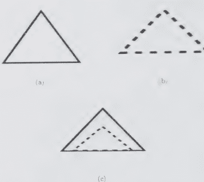

图 8.1：图 8.1a 描绘了一个大三角形。图 8.1b 描绘了一个小三角形。图 8.1c 表明图 8.1b 中的三角形可以嵌入图 8.1a 中的三角形，但如果反过来尝试，图 8.1a 只有一部分能嵌入图 8.1b 的三角形中。

在图 8.2a 中，三维分子构象的 Taylor-Butina 不对称聚类结果以带状布局显示（类似于


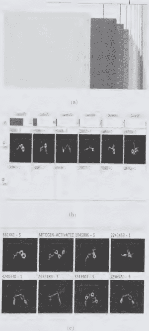

**图 8.2：** 展示了 Taylor-Butina 非对称聚类结果，该结果针对一组对 JNK3 有活性的配体构象，这些构象与结合型 JNK3 配体的 X 射线结构（2EXC）一起聚类。最大聚类的聚类代表显示于图 8.2b。图 8.2c 显示了最大聚类的前几个聚类成员；请注意，2EXC 是该聚类的第二个成员，并且作为第一个图示显示的该聚类质心具有较高的 Tversky 得分。

结果（以层次结构）显示，并按聚类大小从左到右排序。对 JNK3 有活性的配体的构象与结合型 JNK3 配体的 X 射线结构（2EXC）一起聚类。在图 8.2b 中，显示了最大聚类的聚类构象代表。图 8.2c 显示了最大聚类的前几个聚类成员，其中晶体结构 2EXC 是该聚类的第二个成员。该聚类的质心（如第一个图示所示）与 2EXC 具有较高的 Tversky 得分。

同样，在 3D 中，如果一个大型化学结构具有与较小分子结构的整体形状非常相似的子形状，那么这两个形状将具有两种非常相似的非对称度量中的一种。这些度量随后可用于相似性或聚类研究，其中聚类使用非对称聚类算法执行。

序列比对是生物信息学中的一个研究领域，在该领域中，对称度量并不总是最有效的比较工具。对不同长度和字符组成的序列进行比对，与上述化学结构的尺寸/形状讨论具有类似问题。一个序列的子集可能与大序列的一个子段完全匹配；对于基因或蛋白质序列，这种“相似性”的知识应反映在分析中的相似性得分中。编辑距离是序列比较中常用的一种度量，将在下文讨论。编辑距离是另一种非对称度量。

### 8.1 度量

上述社会科学示例是一种经验性非对称数据，但如果数据支持此类比较，则有许多方法可用于将对称度量转换为非对称度量。下面我们讨论生物信息学和药物发现中使用的两种常见非对称度量。

#### 8.1.1 Tversky

Tversky 度量非常类似于 Tanimoto 度量。使用第 2 章的约定，Tversky 可表示如下：

$$s = \frac{c}{\alpha a + \beta b + c}, \tag{8.1}$$

其中 α 和 β 是连续值参数。为了获得 [0, 1] 的取值范围，并将 Tversky 直接与 Tanimoto 关联，可以约束 α 和 β，使 α = 2 − β。这样，当 α = β = 1 时，Tversky 变为 Tanimoto。非对称性源于在生成 (i, j) 与 (j, i) 之间的相似度时交换 α 和 β。当其中一个参数接近零时，所得相似度具有强非对称性；当两个参数都接近 1 时，所得相似度的非对称性很小。

#### 8.1.2 编辑距离

编辑距离是序列比对中常用的一种度量 [11, 94]。给定两个序列，编辑距离是代价最小的变换，即将一个序列转换为另一个序列所需的最少删除、插入或替换次数之和。例如，将字符串 *EDIT* 转换为 *TEXT* 的编辑距离大于将字符串 *NEXT* 转换为 *TEXT* 所需的编辑距离，因为后者仅需一次字母交换，而前者的变换需要不止一步（例如，一次字母交换、一次删除和一次插入）。可能存在许多可能的变换；编辑距离是所需步数代价最小的变换。

$$D_{ab} = \min \sum_{j=1}^{N} c_i(j) + c_s(j) + c_d(j), \tag{8.2}$$

其中 $D_{ab}$ 是两个序列 $a$ 和 $b$ 之间的编辑距离，$c_i(j)$ 是变换中插入步骤的代价，$c_s(j)$ 是交换步骤的代价，$c_d(j)$ 是对于 $N$ 个所有可能变换集合中的给定变换 $j$ 的删除步骤的代价。

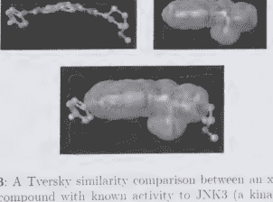

**图 8.3：** 对一种对 JNK3（一种与神经元凋亡相关的激酶）具有已知活性的化合物的 X 射线结构（2EXC）与在筛选试验中发现对 JNK3 有活性的配体构象进行 Tversky 相似性比较 [78, 4, 139]。两种结构在 3D 中的叠合显示，这两个 JNK3 活性配体在 Tversky 空间中存在包含匹配。

### 8.2 算法

#### 8.2.1 强连通分量凝聚层次算法

强连通分量（SCC）是一种有向图算法，用于在图中寻找可视为环的分量。更正式地说，图中的强连通分量是一个顶点集，其中对于该顶点集中的所有 u 和 v，都存在从顶点 u 到顶点 v 的有向路径。如果图是加权的，SCC 算法可以递归使用，首先找到具有最小加权边之和的最小强连通分量，并依次合并具有最小权重之和的分量，直到只剩一个代表图中所有顶点的强连通分量。该过程从单个数据项开始，通过不断增大的分量构建凝聚层次结构。这很像可以从图模型角度考虑的全链接和单链接（分别寻找最大团和寻找最小生成树子图）。SCC 凝聚层次算法是一种有向图方法，其行为介于全链接聚类的最远邻行为和单链接方法的链式行为之间。它在无向图中最接近的类比是双连通分量（在无向图的顶点集中，u 与 v 之间至少存在两条路径）。（注意，还有其他形式的连通性：三连通、k-连通，它们也已被用于聚类 [67, 119]。）

使用 SCC 创建凝聚层次结构的一种高效算法由 Tarjan 提出 [131]。然而，为了说明该方法如何工作，我们在此以简单凝聚层次算法的形式展示它，其中合并准则基于合并具有最小边权的强连通分量。

**算法 8.1 SCC AgglomerativeHierarchy(Data)**
```
1: N ← Size(Data)
2: G ← Groups(Data) //One data element per group in G
3: repeat
4:   G ← MergeWeightedSCC(G) //Merge closest group based on SCC edge weights
5:   Output: Merged Group Pair and Merge Criterion Value //Value is the weight of the last edge added to create the SCC
6: until |G| == 1
```

#### 8.2.2 改进的 Taylor-Butina 算法

Taylor-Butina 最简单的非对称版本可以用简单排除区域算法表示，其中输入矩阵是稀疏非对称矩阵。在这里，每次迭代时矩阵中剩余的最大最近邻表（无论在行空间还是列空间）被视为下一个聚类。建立非对称稀疏矩阵数据结构比该算法对称形式中的简单最近邻表稍复杂，并且操作该矩阵以移除排除区域中的所有成员也需要在矩阵的行空间和列空间中进行搜索。因此，该算法大约比对称版本慢一倍，前提是使用两倍的空间来存储行空间和列空间。可以安排更小的内存占用，但代价是搜索时间。

**算法 8.2 AsymmetricExclusionRegion(AsymSparseMatrix)**
```
1: repeat
2:   C ← FindLargestSetNN(AsymSparseMatrix) //Assign largest row (or column) in matrix to cluster
3:   SparseMatrix ← SparseMatrix \ C //Remove row (or column) and its elements from the matrix
4:   Append(C,G) //Append cluster C to set of clusters G
5: until SparseMatrix == NULL
6: Output : G
```

颇具讽刺意味的是，上述非对称聚类算法结合 SAM（使用隐马尔可夫模型的序列比对与建模系统）——类似于生成非对称关联时的编辑距离——被用于银行客户留存分群聚类 [110]。显然，基因序列数据关系中固有的非对称性也可以利用同样的技术。

### 8.3 术语表

- **非对称矩阵：** 一个方阵，其中 (i,j) 元素不一定等于 (j,i)
- **同源模型：** 对与已知蛋白质结构具有序列同源性的新蛋白质序列的 3D 蛋白质结构预测
- **相似性搜索：** 一个 m×n 的相似性矩阵，其中 m ≪ n
- **斜对称：** 非对称矩阵中第 (i,j) 个元素与第 (j,i) 个元素之间的平均差异


### 8.4 练习

- 1. 对一个对JNK3（一种与神经元凋亡相关的激酶）具有已知活性的化合物的X射线结构（2EXC），与在筛选试验中发现对JNK3具有活性的配体的一种构象异构体，进行Tversky相似性比较 [78, 184]。两种结构的三维叠合显示，这两个JNK3活性配体在Tversky空间中存在子形状匹配。比较图8.3中显示的三维构象异构体的形状。如果最大化α并最小化β，那么将图8.3a中的三维构象异构体与图8.3b比较时，Tversky值会更接近0还是1？将图8.3b与图8.3a比较时呢？讨论如果最大化β并最小化α并执行相同比较，你的预期是什么？

- 2. 对于α和β大小相等的情况，讨论与练习8.1相同的比较。最后一组Tversky比较与Tanimoto值之间是否存在关系？请从数学和视觉两个角度讨论你的答案。

- 3. 编辑距离也称为*Levenshtein距离*。编写一个计算两个等长字符串之间编辑距离的算法。讨论如果字符串不等长，需要对算法进行的修改。假设算法处理的字符串长度趋近于λ，其中λ是一个非常大的数。设计一种对初始算法的修改，使其对非常长的序列更高效。

- 4. 考虑对公式8.2中代价函数的修改。讨论由此产生的不同度量，以及代价函数各贡献项对所得度量效用的影响。

- 5. 从在线存储库下载一条遗传序列，运行**BLAST**序列相似性搜索，并对结果进行评论。被比较的两个序列有多相似？作为一个思想实验，评论序列相似性算法在比对蛋白质序列而非遗传序列时所具有的相似之处以及所需的额外复杂性。当你知道能够根据已知蛋白质序列为未知蛋白质结构构建同源模型时，你认为多大的序列同源性百分比会让你感到有把握？

- 6. 在非对称聚类背景下探索互惠邻居和强连通分量。

然而应当注意，聚类歧义并不局限于药物发现和生物信息学，而是普遍存在；最常见的情形是，应用使用针对这些数据类型的各种常见相似系数，对固定长度二进制位串或离散数据（例如由有限计数构成的变量）进行聚类。经验数据或派生数据精度不足，以及像Taylor算法这类特殊聚类算法可能具有的决策特殊性，是聚类歧义可能出现在其他应用领域的另外原因。

### 9.1 离散值数据类型

一个常见误解是，聚类歧义——更具体地说是邻近度并列——源于重复数据。例如，在任何规模较大的二进制位串数据中，出现重复指纹都相当常见，尤其是当二进制字符串的长度相对较小时。在化学指纹中，同一指纹可能表示不止一个化合物。这是Daylight指纹和MDL MACCS键指纹等化学指纹中常见的事实——无论采用何种编码形式，甚至对结构的直接编码（例如SMILES字符串）进行*n-gram*分析时，二进制编码也并不能捕获所有结构细微差别和差异 57。根据指纹长度和化合物数据集的不同，指纹重复率通常为5%到15%，即使指纹长度为1024位也是如此 14。此类重复自然会引发邻近度并列，但删除不必要的重复即可解决。下文关注的是其他形式的邻近度并列和决策歧义。

### 9.2 精度

另一个问题涉及数据（不）相似性系数值的精度。如前所述，使用较低精度可能导致邻近度并列。然而，通常在现代大多数计算机上使用常见浮点类型会消除因精度导致并列的可能性。例如可以证明，在指纹大小为1024时使用Tanimoto度量不会因精度而产生邻近度并列（例如，给定C编程语言中的32位浮点数据类型）。提供足够精度可消除其作为邻近度并列和聚类歧义原因的作用。这同样不是重要问题，并且在大多数情况下可以忽略，因为此类并列非常罕见。

然而，对于离散特征——例如化学指纹或生物信息学中使用的任何二进制字符串——它们实际上可能相当常见 [98]。

多年来，归一化欧几里得度量和Tanimoto度量作为（不）相似性度量在药物发现领域相当常见，部分原因是它们简单直观且计算快速。两者都可以推广到计数数据，并且确实在计数数据中邻近度并列更少。然而，如果最大计数值很小，且许多计数在每个特征上仅为1或少数几个，这些度量的表现方式大致相同，总体上仅比其二进制对应形式略少一些邻近度并列。

### 9.4 度量、概率与分布

作用于离散数据类型的度量分布会影响聚类结果。第2章展示了作用于长度为5和长度为6的所有可能二进制字符串对的度量分布（图2.5和图2.6）。这些在整个二进制字符串空间上的分布有些误导，因为对于给定应用数据集，二进制字符串数量只是可能字符串数量的一小部分，并且作为样本分布可能与整个集合相当不同。在过去的文献中，研究人员使用直方图或密度图来可视化这些分布，这常常掩盖了分布真实的离散且往往分形的性质 [17]。此类描绘在当时可能并未损害手头研究，但促成了这些分布表现得很像连续值分布的整体观念。

#### 9.4.1 度量中的数论

动机和理论基础：分子结构常以二进制指纹形式编码，原因有多种：快速数据库搜索和检索；相似性搜索、聚类和预测建模。它们可以使用二进制相似系数进行比较，例如Tanimoto相似性等众多系数。所有作用于固定长度二进制指纹的常见相似系数都具有这样一个性质：可能的系数值数量是有限的。可能值的数量取决于系数和二进制字符串的长度。一个简单例子是生成长度为5的位串（共有32个），并计算这些字符串所有对之间的Tanimoto系数。该系数在任意字符串对之间只能生成10个可能值。按各自大小顺序，这些值为：0、1/5、1/4、1/3、2/5、1/2、3/5、2/3、3/4和1。这个有限序列由所有约简自然数分数组成，其中分母小于或等于5，且分子从不大于分母。这样的分数序列称为Farey序列N，其中N是最大分母——在本例中为数字5。然而有32个字符串，因此有32选2，即496个可能的唯一字符串对。图2.5绘制了这些值的分布。

这是一个离散且非常粗粒化的分布，各值的相对频率一点也不均匀。随着字符串长度变大，情况会有所改善。事实上，给定Tanimoto系数，我们可以根据字符串长度计算可能系数值的近似数量。这实际上是Farey序列N的和，其中N在此情况下是位串中的位数，其渐近期望值为

$$\frac{3N^2}{\pi^2}+O(N\log N). \tag{9.1}$$

对于长度为1,024位的二进制字符串，N = 1024时Farey数的精确数量为318,954个可能的Tanimoto值（由公式9.1得到的Farey期望值约为329,000个可能值）。有些系数从未出现过。欧几里得距离作用于一对长度为N的位串时，只能生成N − 1个可能值。余弦系数是离散的，在给定N时比欧几里得或Tanimoto系数具有更多可能值，但尚无已知方法计算或近似随着N增加的值数量。在图9.2中，我们展示了给定所有长度为5的位串时Ochiai（1-余弦）的可能值。共有14个这样的值。根据经验得出的粗略估计表明，如果N = 1,024，则可能有数百万个值。

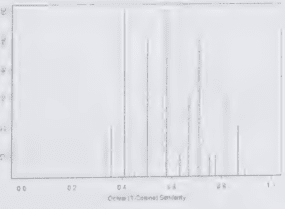

**图 9.2：** 长度为5的位串所有配对的Ochiai（1-余弦）系数值的分布。


像 Tversky 这样的非对称度量，实际上是参数化的 Tanimoto 度量，可以产生超过两倍数量的唯一相似度值（确切数量取决于参数值的选择）。相对于 Tanimoto 度量，这种增加对聚类歧义影响不大，因为非对称聚类算法通常作用于完整的（不）相似性矩阵。此外，只有特定范围的参数才具有合理的相似度值分布，而这些分布在非对称聚类中特别有用。在上面的例子中，某一长度的所有位串都被用来生成可能值的总数。在位串长得多的应用中，比如长度达到数百或数千时，显然，对于任何数据集，只使用了长度为 N 的所有可能位串中极小的一部分（例如，当 N = 1,024 时，2^N 个可能位串与任何合理规模的数据集相比都是天文数字）。此外，这些位串通常来自长度为 N 的位串总体中一个狭窄且特定的分布。因此，一般来说，尽管对于长度为 1,024 的位串，大约有 32.9 万个可能的 Tanimoto 系数值，但特定数据集只生成其中的一小部分。例如，给定一个包含 10 万个指纹的数据集，唯一 Tanimoto 值的总数很可能只是所有可能值的 10%。而且这些值不会均匀分布：因此，某些邻近度值会比其他值常见得多。在图 9.3–9.5 中，展示了包含 405 个苯二氮卓类化合物的数据集（使用长度为 768 的 Mesa 指纹编码）的所有配对系数离散分布，分别对应 Tanimoto、Ochiai 和 Baroni-Urbani/Buser 系数。

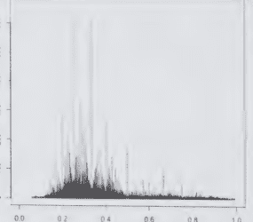

**图 9.3：** 使用 Mesa 768 位指纹时，405 个苯二氮卓类化合物的所有配对 Tanimoto 系数值。给定 405 个二进制串，在 81,810 个成对相似度值中，只有 3,678 个不同值。

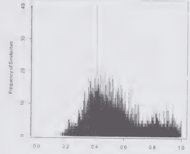

**图 9.4：** 使用 Mesa 768 位指纹时，405 个苯二氮卓类化合物的所有配对 Ochiai（1-余弦）系数值。给定 405 个二进制串，在 81,810 个成对相似度值中，有 20,332 个不同值。

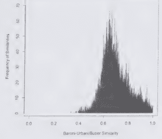

**图 9.5：** 使用 Mesa 768 位指纹时，405 个苯二氮卓类化合物的所有配对 Baroni-Urbani/Buser 系数值。显然，该数据集的不同值比 Tanimoto 值更多，但比 Ochiai 值略少（最高频率几乎是 Ochiai 值的两倍）。

请注意图 9.3 中包含 Tanimoto 值，在 1/3、2/5、1/2、3/5 和 3/4 等简单分数处存在大的频率尖峰。图 9.4 的 Ochiai 值显示出相对更均匀的分布，并且频率尖峰的相对幅度要小得多。图 9.5 的 Baroni-Urbani/Buser 值在特征上更接近 Ochiai 分布，而不是图 9.3 中的 Tanimoto 分布。

这里的启示是：给定任何合理长度的指纹（N），不太可能使用所有可能值，而且所使用的值往往倾向于集中在简单分数附近。因此，邻近度值的这种离散性是常见二进制串系数的常态，每个系数都有各自依赖于 N 的离散大小和分布特性。绘制这些离散系数分布的研究人员会发现，分布的基本性质几乎不随数据规模、指纹长度或数据集的化合物多样性水平而改变 [98, 153]。这类分布经常在文献中以直方图或平滑概率密度估计的形式出现，掩盖了此类分布离散且往往具有分形的性质，并且不幸地给人造成分布是连续的印象。

邻近度中的并列值可以很自然地传播到分组或组合并准则所使用的度量中。例如，聚类算法 Ward 法使用平方误差合并准则，但鉴于用于形成平方误差的值来自有限来源，平方误差度量值的可能数量也是有限的，尽管可能组合爆炸。这可能导致合并组时出现并列。因此，对于二值指纹聚类中的邻近度并列，一个更全局的视角是：常见相似度系数通常位于一个刚性晶格空间中，无论该晶格多么精细或复杂。该空间不是一个连续统。图 9.6 以一个二维邻近度示例的形式展示了一个非常简单的示意图。

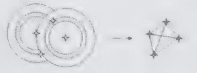

**图 9.6：** 离散相似度的晶格。

在右侧，围绕两个星状点的同心圆可以看作可能的度量值。这些值在邻近度或概率上不一定均匀。其他点只能位于这些邻近度圆上。这些点反过来也具有相同的同心邻近度（未显示）。在左侧，所有配对邻近度被绘制为线段。所有配对邻近度是聚类算法所操作的数据，并且除了邻近度并列所引起的歧义之外，算法独立于该空间的刚性晶格性质。

### 9.5 算法决策歧义

必须注意，聚类歧义问题与上文提到的另外两个聚类问题不同。

在凝聚层次算法的情况下，与处理邻近度中歧义并列相关的任意决策会导致生成这样的树状图：歧义存在于做出任意决策的那些树状图层级上；这些决策会改变树状图所表示的底层拓扑，并且在许多情况下会改变可从树状图导出的可能集合划分。因此，对于每一个任意决策，都可以生成一个可设想为不同的树状图，从而生成不同的拓扑。对于每个任意决策，都有一个单独且唯一的树状图，仅仅重新排列输入就可以生成不同的树状图。考虑可能树状图的集合，由任何特定层级定义的划分在各树状图之间可能相同，也可能不同。这自然会改变任何层级选择技术在树状图集合上的结果。图 9.7 示意性地展示了一个可能由连续数据生成的单一唯一树状图（用三角形符号表示），与可能由离散数据通过歧义决策生成的多个树状图形成对比。在任意层级 k 处的切割（由横切所有树状图的水平线表示）可能产生不同的划分。

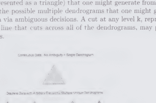

**图 9.7：** 由连续数据生成的树状图（此处用三角形表示）与由离散数据通过歧义决策生成的多个树状图的对比。

这种简单的歧义决策并不局限于凝聚层次算法。其他常见聚类算法同样容易受到歧义决策的影响。一个聚类算法决策的例子可能采取以下形式：取具有最小 X 值的一个元素或组，并执行操作 Y。然而，可能存在不止一个这样的最小值，每个最小值对操作 Y 的影响不同。在这种情况下，任意决策的可能性使这些算法通常对输入顺序不稳定，这是使用这些算法的研究人员抱怨和困惑的一个常见来源。由于这些算法在用于连续数据时通常是稳定的，因此在给定相同数据集和特征的情况下，可以进行比较，以区分不同算法聚类结果之间的相对歧义。由此产生几个问题：第一，结果内部的歧义是否非平凡？第二，如果它是非平凡的，我们是否仍能在当前应用背景下使用该结果？这些问题有些主观，但可以假设：如果由于结果中的歧义只导致极少数微小变化，那么该歧义就是平凡的。然而，在许多情况下，对于任何规模显著的数据集（例如 100 个元素），情况并非如此 [98]。此外，可能存在大量歧义，但不一定体现在当前应用中对聚类的使用上。一个简单的化学多样性应用可以作为例子：在这里，聚类用于从组中选择代表或中心类型，因此很大程度上独立于聚类歧义在涉及每个组的所有成员和规模时的混杂性质。

显然，上述所有算法都可能产生有歧义的聚类结果，但更大的问题在于：歧义程度能否被量化？并且从药物发现应用的角度来看，这种歧义是否显著？

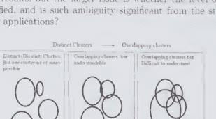

**图 9.8：** 三个图表示不同程度决策并列及其对聚类结果歧义影响的示意图。


在图 9.8 中，三个图表示三种情况：图 1 中簇互不相交，图 2 中仅有少量重叠，图 3 中存在大量重叠和歧义，并且难以区分各组。考虑到邻近度并列以及一般意义上的决策并列，像图 1 这样的结果不太可能出现，而图 2 的情形优于图 3。需要区分图 2 和图 3 所描述的结果。更一般地说，可以设计一种定量度量，用以判断歧义在相对意义还是绝对意义上是否显著。

聚类算法运行中的决策并列会导致数据集划分或由层次结构表示的拓扑构建出现任意变化。可能的不相交聚类数目实际上是贝尔数，并且它关于待聚类集合的元素数 N 呈指数增长。一种可能的歧义度量是，将决策并列数（因而也是划分数）的对数除以 N 的贝尔数的对数。然而，决策并列未必与划分变化一一对应。也就是说，算法内连续的决策并列实际上可能得到相同的划分，如同来自不同的决策并列集合。这一点在层次算法中最容易看出：其中决策并列的微小变化在层次结构的更高层可能没有影响。如果通过层级选择对层次结构进行划分，则每个层次结构只有 N − 1 种可能的划分。此外，由层次结构定义的可能拓扑数恰好是带有 N 个标签的可能有根且叶标记二叉树的总数；即，

$$(2N - 3)!!. \qquad (9.2)$$

对于任何相当大的 N，该数的增长速度都超过贝尔数（在 N = 4 时，两个序列均为 15；但在 N = 5 时，贝尔数为 52，而树的数量为 105，等等）。因此，树的数量远多于可能的划分，所以这些树必定会重复划分。然而，对于任何一棵树，通过层级选择可获得的划分数量相对于划分总数而言非常少。对于常见数据集规模，计算贝尔数并将其与可能导致划分变化的决策并列数进行比较是不切实际的。另一种可能的歧义度量是简单地将决策并列数按 N 归一化后求和，但需理解该度量相对于可能划分总数而言存在重复计数。自然，我们可以计算一种度量，将做出任意决策所得到的互不相交聚类与使用基于决策并列的聚类算法重叠版本所找到的重叠簇中涉及的数据元素数进行比较。

邻近度并列可以很自然地传播到分组所用的度量或分组准则中。例如，聚类算法 Ward 法使用平方误差合并准则，但鉴于构成平方误差的值来自有限来源，平方误差度量值的可能数目也是有限的，尽管在组合上会急剧膨胀。这可能导致合并组时出现并列。

因此，关于二值指纹聚类的邻近度并列，一个更全局的视角是：常用相似系数通常在一个刚性格空间中使用，无论该空间多么精细或复杂。该空间不是连续统。

聚类算法基于一系列形成组的决策。鉴于二值指纹数据及其系数的离散性质，决策可能面临任意选择。对数据集进行聚类时所做的任意选择数量与聚类结果的总体歧义在组合上相关。这一事实涉及算法的数据输入顺序稳定性：也就是说，在稳定算法中，输出结果应当对数据的输入顺序不变。例如，Ward 聚类对于连续度量和互异数据是稳定的。但在给定二值指纹及相关相似系数时，它并不稳定。

### 9.6 基于歧义的重叠聚类算法

#### 9.6.1 改进的 Taylor-Butina 算法

我们详细讨论的第一个算法是 Taylor-Butina 领袖算法 [132, 22]，它常用于整群抽样或对大型数据集进行聚类，例如化合物库设计中的化合物多样性研究中所见的数据集。下面我们列出该算法的各个步骤，并指出那些可能包含任意决策的步骤。

- 1. 创建阈值化最近邻表。
- 2. 找出真单例：所有最近邻列表为空的数据项。
- 3. 找出具有最大最近邻列表的数据项（从而成为中心代表）。可能存在不止一个这样的数据项，也就是说，存在不止一个这样的数据项，其各自最近邻列表中的项数相同。我们将这种决策并列称为排除区域并列。
- 4. 从第 3 步选出的数据项及其最近邻列表中的数据项形成一个簇，并且全部在下一步中排除——中心代表以及相应最近邻列表中的数据项从所有剩余的最近邻列表中移除。
- 5. 重复第 3 步，直到不存在具有非空最近邻列表的数据项。

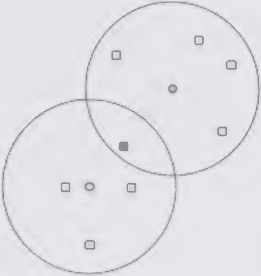

**图 9.9：** 邻近度中的排除区域并列。


**图 9.10：** 邻近度中的假单例并列。

如果排除区域重叠，排除区域并列可能在聚类结果中造成大量歧义。图 9.9 以二维示意图展示了重叠的排除区域并列。任意选择任一区域作为要从数据集中移除的簇，几乎必然会影响数据的后续划分。如果这种选择基于数据项的输入顺序，则输入顺序稳定性就会丧失。由于该决策基于邻居数目的最大整数值，即使邻近度度量是连续的，在相似性具有连续性质的数据项之间仍很有可能偶尔出现排除区域并列。该算法的缺点之一是，在完成时可能仍有最近邻表为空的数据项。我们称这些为假单例，因为它们确实在阈值内拥有邻居，但这些邻居已被其他簇归并。这个问题可以通过以下选项来处理：

- 6. 将剩余的假单例分配给包含其阈值范围内最近邻的簇。

然而，这种修改也为假单例在不同排除区域中的最近邻引入并列的可能性。在图 9.10 中，二维示意图描绘了两个排除区域之间假单例并列的情况，其中质心由较大排除区域圆中心的小圆表示，其余数据项用星号表示。该假单例显然位于来自每个排除区域成员的阈值邻近范围内，并且在此情况下邻近度等距。图中还显示了一个明显的真单例，它位于任何可能的阈值区域之外。还可以对该算法做其他简单修改，从而在某种程度上改变歧义的性质：

- 1. 使用另一种准则来打破排除区域并列。此类准则本身又可能出现并列。
- 2. 使用非对称度量，这可能改变并列的数量。
- 3. 利用上述所有步骤中的各种决策并列来创建重叠簇，而不是通过对数据进行互不相交划分所形成的簇。

一种用于打破排除并列的简单快速准则是，对排除区域内质心与其他数据项之间的最小邻近度求和。将该和与其他并列排除区域所得到的和进行比较。尽管对于包含相当数量数据项的排除区域而言很少见，但该度量也可能出现并列，因此必须做出任意决策来选择排除区域。

#### 9.6.2 Jarvis-Patrick

Jarvis-Patrick [cite JarPat] 聚类有两种常见版本：Kmin 和 Pmin。在 Kmin 中，算法依据固定长度 k 的最近邻列表以及小于 k 的参数 j 进行。然而，一个任意决策

如果第 k 个邻居由于邻近并列而不唯一，则必须做出决定。这个决定影响算法的聚类步骤：如果两个化合物 NN 列表有 j 个共同邻居，则这些化合物在同一簇中。如果并列的第 k 个邻居中只有一个保留在 NN 列表中，则有可能忽略一些可能的共同邻居，从而影响哪些数据项被聚类。在算法的 Pmin 形式中，有两个参数：k 与 Kmin 中相同；p 表示邻居百分比，使得如果共同邻居的百分比大于或等于 p，则这些邻居在同一簇中。Pmin 的歧义来源相同，在于第 k 个邻居可能不唯一，但参数 p 可能改变歧义的程度。使用 kNN 中并列的两种 Jarvis-Patrick 形式都可以转化为产生重叠簇的算法。

#### 9.6.3 *K-Means*

*K-means* 聚类 [43, 100] 是一种常见的聚类算法，在许多领域用于聚类相对较大的数据集。它更常用于连续数据，但有时也采用二进制字符串数据。要将 K-means 用于指纹，需将 0、1 位分别转换为连续值 0.0 和 1.0，并作为单独变量处理。算法步骤如下：

- 从数据集中选择 k 个种子质心（例如，通过 van der Corput 序列准随机选择）
- 找到每个质心的最近邻，形成最近邻组
- 根据旧质心的最近邻列表重新计算新质心。
- 重复步骤 2，直到没有邻居改变组或达到某个迭代阈值。

在步骤 2 中，由于邻近并列，质心可能会竞争共同的最近邻。鉴于该算法常使用欧几里得距离，邻近并列的数量可能非常高。在该算法的 K-Modal 版本中，使用模态指纹来定义质心，而不是度量空间意义上的质心。

- 从数据集中选择 k 个种子模态
- 找到这些模态的最近邻
- 重新计算新模态
- 与连续 *K-means* 中的步骤 4 相同

步骤三中的模态可以通过简单匹配系数 [121] 确定。同样，由于邻近并列，模态可能会竞争共同的最近邻。

#### 9.6.4 层次或金字塔算法

化学信息学及其他领域常用的一种层次算法是 Ward 算法。该算法的一种快速实现使用 RXN。RXN 也可以类似地用于另外两种常见的层次算法：全连接和组平均。导致聚类歧义的决策并列直接存在于 RXN 中。RXN 的核心操作是形成最近邻（NN）链，直到找到一个 RXN（互为对方的 NN）。其实现中会出现两个问题：如果有不止一个 NN 怎么办？以及如果反过来有不止一个 RXN 怎么办？NN 链假设每个 NN 都是唯一的。然而，由于邻近并列，对于任何给定数据项，可能存在不止一个 NN。如果链因并列而被任意改变，这种情况就会引出第二个问题，即所得的 RXN 也可能不同。RXN 可以表示数据项，也可以表示这类层次算法实现中通过合并准则在凝聚过程中形成的合并组。如树状图所示，任意决策嵌入在树中它们出现的任何位置。歧义的程度与相似系数和合并准则有关。在全连接中，RXN 始终是系数值，并且由此导出的任何树状图中固有的歧义与系数值的邻近并列直接相关。然而，组平均和 Ward 算法包含导出的合并准则，这些准则不太可能包含歧义，这在很大程度上取决于合并准则的复杂性。一般而言，层次算法可以利用这些形式的决策并列转化为金字塔聚类 [2, 7, 8, 107]。

### 9.7 术语表

- 决策并列：导致算法内任意决策的数值或分类并列
- 离散：分类、二进制或计数数据
- 邻近并列：相同的距离或相似度得分

### 9.8 练习

1. 生成 Tversky 相似度度量的四个示例分布，给定与图 2.5 中展示 Tanimoto 度量相似度值所用的相同五位指纹，以及……的相似度值
2. 使用一系列 α 和 β 值，获得图 9.2 中的 (1-Cosine)。描述这些分布中哪些（如果有的话）在特征上与图 2.5 相似？与图 9.2 相似？
3. 评述在歧义方面使用 Tversky 度量的优点或缺点。
4. 使用离散数据，探索在 SOML 或 SOTA 中进行任意决策的可能性。
5. 在参考文献 [8] 中，作者描述了一种创建“集合系统，使得每个集合至多与一个其他集合恰当相交”的方法。设计一个具有该约束的排除区域分类算法。

## 第 10 章

### 验证

聚类有效性是一个难题，尤其是对于任何规模较大的数据集，因为有效性技术通常计算成本很高。在文献中，研究人员通常会加入某种形式的聚类有效性来帮助证明其结果的合理性，即使这种有效性只是某种相对度量。然而，大型数据集阻碍了验证的使用，因此研究人员不得不依赖应用领域内针对较小数据集的先前工作，或者如果他们的聚类方法在其应用领域中是新的，则自己进行这些研究。

当给定一个特定划分作为聚类方法的结果时，从定量角度来看，*内部*验证某个划分是一组显著的组，这一验证基于两个可以用数学形式化的基本思想。第一，每个单独簇的一般*同质性*或*紧凑性*是什么？也就是说，宽泛地讲，该簇在成员彼此有多相似方面有多自洽；簇成员应当非常相似。自然有几种常见的簇同质性检验，它们遵循基于均值、方差和标准误确定数据同质性的统计方法。第二，簇彼此之间有多不同？即簇的*分离度*是什么。当然，目标是聚类结果——划分成组——将产生分离良好的簇，并且每个簇的同质性使得所有簇成员都非常相似。

然后，可以将同质性度量和分离度度量的组合（通常以比值形式）用于在相对意义上*外部*比较聚类结果——对数据的聚类 *A* 比对数据的聚类 *B* 具有更好的*同质性/分离度*比值。只要这些聚类不重叠，该比值就与结果是否来自两种非常不同的聚类方法无关，或者与同一方法输入参数的微小变化无关；或者，在层次结构的情况下，与层次结构的两个不同划分无关。当然，对于重叠或模糊聚类结果，验证检验需要修改，因为在这些结果中同质性和分离度的量化是混杂的。

至少在互不相同的划分情形下，上述验证概念似乎足够简单，但它必须始终与聚类之前对数据已知的信息（如果有的话）相权衡。例如，可能已知组数大概在某个范围内，而我们在聚类期间创建的划分远远超出这个范围。尽管如此，同质-


同质性和分离性在那个聚类尺度上可能表现很好，或许在给定领域知识的适当数据范围内，甚至优于任何此类度量，但该聚类对应用没有用处。如果可以由领域应用专家根据一个小集合创建参考分类，则可以用一种聚类方法或多种方法对该集合进行聚类，并将该聚类或多个聚类与参考分类进行比较，以确定在给定与数据相关联的数据类型的情况下，该数据类型是否可能具有聚类倾向。此类程序通常用于向研究人员确认，既然数据相对于参考分类似乎具有某种聚类倾向，他们便可以继续对更大的数据集进行聚类。然而，在缺乏此类信息时，验证必须依赖其他定量度量。验证方法可以度量某种同质性度量与某种分离性度量之间的比率或关系——同时不考虑每个数据对象形成一个簇（每个簇一个单例）或所有数据仅形成一个簇时，在任一极值处或非常接近极值处的平凡值。

了解所发现的组与某些随机划分所发现的组显著不同，当然也是有价值的。由于对于任何规模显著的数据集而言，可能划分的数量通常都非常大，因此只能对此类划分进行抽样，并将这些划分与由聚类形成的划分进行比较。当然，重要的是以系统的方式创建这样的样本，即从几乎必然是任意的所有可能划分的分布中进行抽取，例如依据它们的同质性与分离性之比。由此可以通过假设检验获得一定的统计置信度。假设绝大多数划分确实就是随机的，并且聚类的验证度量与那些抽样得到的度量相当不同，那么人们或许能够在某个区间上至少获得粗略的置信度，以决定是拒绝还是不能拒绝“聚类在很大程度上只是偶然形成”这一零假设。

### 10.1 验证度量

验证方法分为两类。第一类是聚类在内部表现出同质性和分离性特征的程度，而与其他数据划分无关。第二类是外部验证，它考虑数据的其他划分以进行比较。

#### 10.1.1 内部聚类度量

对于给定的第 $k$ 个簇 $C_k$，一种同质性度量 $I_{C_k}$ 就是 $C_k$ 的成员与 $C_k$ 的质心或质型 $\bar{m}$ 的相似性或不相似性的平均值。如果在式 10.1 中，$d(i, \bar{m})$ 是归一化度量（[0,1]），那么所得的 $I_{C_k}$ 也是归一化的。

$$I_{C_k} = \frac{1}{n_k} \sum_{i \in C_k} d(i, \bar{m}), \tag{10.1}$$

其中 $i$ 是 $C_k$ 中的簇成员。请注意，簇成员 $i$ 和 $j$ 虽然是 $C_k$ 中不同的簇成员，但在特征空间中可能完全相同（例如，请记住两个不同的化合物可能具有相同的指纹）。只要它们是簇中不同的成员，它们各自的（不）相似性就会计入求和。另一种度量对簇 $C_k$ 的成员之间的所有成对（不）相似性求平均，其中 $n_k$ 是 $C_k$ 中簇成员的总数。

$$I_{C_k} = \binom{n_k}{2}^{-1} \sum_{i \neq j \in C_k} d(i,j). \tag{10.2}$$

这两种度量都会受到用于生成簇的聚类算法是偏向链式效应（例如单链接聚类），还是处于尺度的另一端、偏向紧凑性（例如排除区域算法）的影响。使用哪种同质性度量可能既取决于聚类算法的类型，当然也取决于应用数据和聚类目标。式 10.1 中的度量计算复杂度仅为 $O(n)$，而式 10.2 为 $O(n^2)$，但后者也并非特别不可行。还可以计算其他更复杂的度量，例如对 $d(\cdot)$ 求平方并对所得的 $I_C$ 取平方根，以便更精细地理解聚类中异常值的影响——尽管这会增加计算资源需求。然后，可以将聚类的整体同质性计算为上述所需公式之一的求和与平均。给定式 10.1，整体同质性为：

$$I_C = \frac{1}{N} \sum_k n_k I_{C_k}. \tag{10.3}$$

#### 10.1.2 外部聚类度量

分离度量与同质性度量类似。式 10.4 中的分离度量就是各簇质心对之间的（不）相似性度量。

$$E_{C_p,C_q} = d(\bar{m}_{C_p}, \bar{m}_{C_q}). \tag{10.4}$$

或者，如式 10.2 那样，对各簇成员之间的成对（不）相似性求和：

$$E_{C_p,C_q} = (n_p n_q)^{-1} \sum_{i \in C_p, j \in C_q} d(i,j). \tag{10.5}$$

反过来，我们可以在式 10.3 中对这些项求和并取平均，以创建聚类划分的总体分离性度量。

$$E_C = \frac{1}{\sum_{p \neq q} n_p n_q} \sum_{p \neq q} n_p n_q E_{C_p,C_q}. \tag{10.6}$$

尽管最好将这些度量分别看待，但我们可以将整体同质性和分离性组合成一个简单度量：

$$R_C = \frac{I_C}{E_C}, \tag{10.7}$$

其中，只要两种情况下的 $d(\cdot)$ 都是不相似性度量，并且簇具有很强的同质性和很强的分离性，那么 $I_C$ 趋于零，而 $E_C$ 增大。

给定 $k$ 个聚类，对每个聚类的 $R_C$ 值进行排序，至少可以为我们提供一个定量排序，以确定最佳聚类。如果数据集很大，并且 $k$ 也很大，那么上述公式（即使像 10.1 和 10.4 这样简单）的计算负担也会变得不可行。

另一种可用于层次聚类并可在全局使用的内部度量是所谓的共表型相关系数。给定凝聚层次聚类，$(i,j)$ 数据项对首次合并时的合并准则值构成 $N(N-1)/2$ 个值。这些值构成一个矩阵，按惯例，矩阵的上三角部分填入这些 $(i,j)$ 值，矩阵其余元素为零。该矩阵隐式地表示层次结构。该矩阵与实际邻近矩阵的相关程度，是层次结构对数据全局拟合程度的一种度量。共表型相关可以简单地计算为每个矩阵的 $N(N-1)/2$ 个值的逐元素 Pearson 相关形式（即长度为 $N(N-1)/2$ 的向量之间的相关）。这也称为完整矩阵上的 Mantel 统计量 [10]，其中相关作用于整个矩阵。如果共表型相关接近 1，则层次结构很好地表示了数据的结构。这并不是说已知或容易通过检验（Monte Carlo 抽样）确定相关需要多接近 1 才能保证这一点。对于大型数据集，该相关往往较大，某些层次算法可能会使相关产生一定偏差；但一般来说，如果共表型相关高于 0.8，特别是对于小型数据集，它可以作为单个聚类内部有效性的良好初步近似。

#### 10.1.3 外部聚类度量的用途

外部聚类有效性有三个基本用途：数据的聚类倾向、检验不同的聚类，以及将聚类与同一数据的随机生成聚类进行检验。

##### 10.1.3.1 聚类倾向

已有一些工作试图研究是否可能更快地确定数据是否至少具有某种显著的聚类倾向：比如，不只是我们在第 1 章中关于均匀采样点所观察到的那种聚类事实。早期工作涉及随机图论的使用 [13]，但实际上只能用于小型数据集。然而，这种方法仍然值得理解，因为它涉及阈值处邻近矩阵的概率。随机图生成有几种不同的模型，但最简单的一种 [40] 以及适用于阈值处邻近矩阵的模型是 $G(n,p)$，其中 $G$ 是顶点集为 $V$、基数为 $n$ 的图，$p$ 是 $G$ 中每条可能边出现的独立概率。当 $p$ 设得很低时，很明显 $G$ 不太可能连通，因而会是一组连通分量。这些连通分量表示集合 $V$ 的一个划分。对于较小的 $n$，可以针对给定的 $p$ 计算一张关于连通分量大小和分布的表。该模型中随机图的一个奇特性质是：随着 $p$ 增大，不连通分量出现的可能性降低，但就分量大小而言，这种变化并不是特别均匀。事实上，最常见的特征是这些图具有一个单一的大分量（技术术语中称为“巨分量”），以及许多小得多的分量分布。当对大型数据集进行聚类，而所得簇的大小呈现出这种奇特的随机图分布时，这会令人迟疑。并不一定意味着数据除了随机图模型可能形成的划分之外没有聚类倾向，但怀疑很可能被引起。

然而，如果一个聚类不具有由随机图形成的常见划分分布，那么该聚类偶然发生的概率就很低，并且有充分理由假定该聚类确实表明数据具有聚类倾向。对于随机图分布概率已知的小型数据集，可以选择一个概率阈值，并以相应置信度确定聚类划分是否显著不同。

##### 10.1.3.2 应用依赖性与领域知识

在给定的应用领域中，可能存在足够的专家知识，以确定一个测试集或初步类别集，用于比较一种聚类方法（或一组方法）的表现如何。例如，给定一组化合物，一组药物化学家可以就该化合物集划分为他们都认同的一组类别达成共识。然后，可以用一组度量将聚类方法独立得到的划分与专家导出的类别集进行比较。聚类方法的相对性能随后可以告知专家，哪种方法可能最适合用于其他类似数据集 [59, 148]。

该过程相当简单。大小为 $N$ 的测试数据的一个划分由聚类方法以 $C = \{C_1, C_2, \ldots, C_k\}$ 的形式返回。该


由专家生成的划分是 $\mathcal{E} = \{E_1, E_2, \ldots, E_k\}$。请注意，$C$ 中的簇数可能与专家划分中的类别数不同。由 $C$ 形成一个 $N \times N$ 矩阵 $A_C$。其中，第 $(i,j)$ 个矩阵元素表示第 $i$ 和第 $j$ 个数据成员是否在同一簇中：存在为 1，不存在为 0。类似地，使用专家划分 $\mathcal{E}$ 生成一个二值矩阵 $A_E$。然后可以像第 2 章中的二值字符串那样比较这些二值矩阵。由于每个二值矩阵都是对称的，因此只需要矩阵的 $(N)(N-1)/2$ 个三角部分。可以使用各种二值度量中的任意一种，但通常最常用的是 Tanimoto 系数（由于历史原因，在此应用中更常被称为 Jaccard 系数），以刻画聚类结果与专家划分之间的相似性。接下来的问题是，达到什么值才足以断言该聚类方法效果良好。如果聚类方法本质上是层次化的，则可以在层次结构的不同层级与专家划分之间进行比较。

这方面还使用了其他度量，其中最著名的是 Hubert 的 $\Gamma$ 统计量，

$\Gamma = \sum_{i=1}^{N-1}\sum_{j=i+1}^{N} A_C(i,j)A_E(i,j), \qquad (10.8)$

及其归一化形式，

$\hat{\Gamma} = \frac{\sum_{i=1}^{N-1}\sum_{j=i+1}^{N}(A_C(i,j)-\mu_{A_C})(A_E(i,j)-\mu_{A_E})}{\sigma_{A_C}\sigma_{A_E}\left(N(N-1)/2\right)}, \qquad (10.9)$

其中 $\mu$ 和 $\sigma$ 分别是相应矩阵 $A_C$ 和 $A_E$ 的 $\binom{N}{2}$ 个 $(i,j)$ 元素的均值和标准差。Hubert 方法在计算上较慢，但对于中等规模的数据集仍然有用。由于矩阵相对于数据规模呈二次方性质，当数据规模变大时，这些方法仍会变得难以处理。然而，专家能够生成的参考分类规模也有限。不过，这种外部有效性可用于以相对方式检验同一数据的聚类结果，因此其计算复杂度在此背景下将成为一个问题。

##### 10.1.3.3 蒙特卡洛分析

蒙特卡洛积分是许多领域的常用工具，并且在需要检验非随机结构时，在聚类验证中具有特殊用途。试图量化由任意给定技术找到的一组簇是否具有某种统计显著性，并非易事。蒙特卡洛方法虽然应用起来较为笨重，但很适合构建高维空间曲面，并提供基准比较，将特定的空间划分与所有可能被选中的聚类选择进行比较。

在科学中，要相信内心的怀疑者。不要轻视负面结果。本文全篇许多与聚类结果相关的图，其目标是探索数据，并尽可能理解聚类结果的验证情况，无论结果是正面还是负面。关于数据的专家知识、有助于揭示数据结构的可视化，以及如上文各节所述通过定量手段进行的验证，在获得对数据更有意义的理解方面相辅相成。

### 10.3 示例

一名研究人员正在分析针对公司化合物库的八次筛选实验的高通量筛选（HTS）结果。该研究人员希望获得某种保证，即每个靶标的活性具有某种意义。一些化合物在多个靶标上显示出高活性评分，并且研究人员具有*先验*知识，知道靶标之间存在关系。研究人员能否从两两重复化合物的数量推断这些活性是有意义的？（聚类歧义虽然可能存在，但由于数据量很小，因此几乎不必担心。）研究人员创建了一个矩阵，其中每个靶标的重复化合物数量为矩阵元素，对角线 Nᵢ 为每个靶标的活性化合物总数，如表 10.1 所示。所有 Nᵢ 仅相差很小的量，但重复化合物矩阵经过归一化，使重复数量具有可比性，然后该矩阵被转换为相异度矩阵。研究人员使用三种层次聚类算法对数据进行聚类：全链接、组平均和 Ward 法。随后，研究人员将三种层次结构可视化，并用其中两种层次结构生成一个简单的热图。图 10.1 显示了以 Ward 聚类为纵轴、全链接为横轴的热图。组平均聚类的树状图如图 10.2 所示。

对于 Ward 法、全链接和组平均这三种聚类，各自的共表型矩阵与邻近度矩阵之间的共表型相关系数分别为 0.87、0.87 和 0.91。这表明这些层次结构在表示数据结构方面做得相当好。然而，研究人员对靶标及其预期相关性拥有相当多的专家知识；尽管这些关系在所有层次结构中均成立，但仍存在一个需要进一步检查的异常。例如，靶标 6 与靶标 1 和 3 接近，这与*先验*知识不符。

研究人员能够直接创建聚类、可视化结果，并在几种方法之间进行相对验证，还能通过共表型相关系数确认这些层次结构密切反映了数据结构——并获得了有价值的结果，生成了关于筛选-化合物过程的新信息，因此这些异常结果值得进一步检查。对预期结果的确认在某种意义上仍是推测性的，但它在一定程度上让研究人员确信其方法正按预期运行。


**图 10.1：** 全链接与 Ward 聚类及其重复化合物邻近度热图。各分组与研究者的大部分预期相符。


**图 10.2：** 重复化合物邻近度的组平均聚类树状图。该聚类与全链接和组平均结果一致，并且具有最佳的共表型相关性。

### 10.4 术语表

- **聚类倾向：** 数据集在指定尺度上是否具有内部结构
- **外部聚类有效性：** 将聚类与已知分类进行比较
- **内部聚类有效性：** 确定聚类的同质性和分离度
- **蒙特卡洛积分：** 用随机抽样近似积分
- **随机图：** 在不同概率模型下生成的图

### 10.5 习题

- **1.** 实现 Kelley 的水平选择方法 [83]，并将其应用于使用若干层次聚类算法进行层次聚类的小型数据集 [133]。比较并讨论结果。
- **2.** 概述蒙特卡洛积分，并说明它可能应用于聚类验证的哪些场景。检索文献中蒙特卡洛在聚类验证中的近期应用，并讨论使用蒙特卡洛相对于其他验证技术的优点。
- **3.** Hartigan 提出了以下经验法则 [63]，用于确定 $K$ 均值中的合适 $K$：

  如果满足下式，则 $K+1$ 个组比 $K$ 个组的聚类效果更好：

  $$\Delta = \frac{\sum_{i=1}^{K} S_i^K}{\left(\sum_{i=1}^{K+1} S_i^{K+1}\right)/(N-K-1)} > 10 \qquad (10.10)$$

  其中 $N$ 是数据项总数，$S_i^K$ 和 $S_i^{K+1}$ 分别是第 $K$ 次和第 $(K + 1)$ 次聚类中每个簇的平方和。在习题 10.1 所用数据集上运行 $K$ 均值，并对每个数据集在 $K$ 的一个显著范围内绘制 $\Delta$ 的值。与习题 10.1 中的水平选择结果进行比较并评论。$\Delta > 10$ 看起来是一条好的经验法则吗？


## 第11章：大规模与并行算法

大规模数据集在药物发现和生物信息学中正变得越来越普遍。基因表达、基因组学、代谢通路、化合物库以及分子构象数据集，都是可能需要大规模聚类应用的数据类型示例 [50, 93]。通过实验技术的创建和自动化来获取数据，导致了更大的微阵列和高通量筛选试验的产生，这些试验无论是作为前置条件还是后处理，都创造了更多需要评估的数据。此外，虚拟组合化合物库以及大型化合物库的构象扩展，其规模可达数亿甚至数十亿。有效分组这些数据集是一个重要问题。当然，我们可能会问：对给定数据集进行聚类是否有充分的科学理由？通常，成本效益和效率在决定使用计算工具为大规模数据集的决策过程增添科学依据时发挥着作用。例如，化合物获取的成本（无论是实际货币还是时间）为聚类大型数据集并在决策过程中纳入更多知识提供了充分理由。化合物多样性是聚类技术应用发挥作用的另一个领域，尽管通常可以使用非聚类方法来识别大型集合中的多样性，但通过聚类创建多样化集合也常常有合理的理由。因为聚类成员关系有助于对多样化化合物集合进行QSAR研究。可以肯定的是，当基因表达筛选数据集的规模大幅增加时，继续对此类数据进行聚类以用于探索性数据分析和预测建模，仍将有充分的理由。对非常大的分子构象集合进行聚类目前还更具推测性，但它们可能有助于研究人员组织形状数据以进行搜索和快速查找。

排除区域算法可以并行化，但需要一定的处理器间通信成本，*K*-均值算法也是如此。需要注意的是，排除区域算法需要预先计算所有成对相似度，即使最终只存储稀疏矩阵。幸运的是，这属于令人尴尬的并行问题，可以在大型处理器和核心集群上高效完成。然而，即便只是存储最终得到的稀疏矩阵，并以负载均衡的方式将其分布到各处理器内存中，也是一个不容小觑的问题。如果所有处理器和核心之间共享内存，那么内存可能相应地需要非常大。*K*-均值算法和领袖算法则几乎不存在如此大的内存限制，因为数据实际上以行带形式存储（或者，如果处理器有多个核心，则内存需要足以容纳与核心数量相同的行带）。该算法在某种程度上类似于并行排序：先处理数据子集，然后合并并重新处理。原则上，并行Taylor–Butina算法在处理器或核心数量上具有线性加速比。然而，该算法采用主从处理器关系，并且存在一定的通信开销，包括从处理器向主处理器汇总子结果，以及主处理器向从处理器传递消息。

**算法11.2 并行Taylor–Butina（SparseMatrix.Threshold）**

```
1: CollectSingletons(SparseMatrix.Threshold) // 预处理：移除单例。
2: if Master then
3:     DistributeRowBands(SparseMatrix.Threshold) // 从处理器获取行带
4: end if
5: repeat
6:     if Master then
7:         Receive(AllSlaveResults)
8:         C ← FindLargestSetNN(AllSlaveResults) // 找到最大的最近邻集合
9:         C ← Append(C, C) // 将簇附加到簇列表中
10:        Send(C) // 发送结果，让从处理器告知其行带中C的情况
11:    end if
12:    if Slave then
13:        Receive(C) // 接收结果，让从处理器统计其行带中C的数量
14:        C′ ← FindLargestSetNN(RowBand) // 在行带中找到最大集合
15:        Send(C′) // 将行带结果发送给主处理器
16:    end if
17: until SparseMatrix == NULL
18: if Master then
19:     G ← AssignFalseSingletons(G) // 将伪单例分配给具有最近邻的簇
20:     Output: G
21: end if
```

### 11.3 K-Means及其变体

第4.1节中描述的K-Means算法（算法3.1）相对容易并行化。该算法的核心是找到K个质心的近邻。这项工作可以在主从关系中分配给各处理器，由主处理器将数据项和当前的K个质心M分发给每个从处理器。从处理器使用其数据子集来找到近邻——即哪些数据项被分配到哪个质心。然后需要重新计算质心。同样，原则上该算法在处理器数量上应具有线性加速比。当然，每次迭代都会有一个等待期间，因为每个处理器需要完成其任务。一旦所有分配完成，主处理器就计算新的质心，但在此之前，它必须先汇总每个从处理器中每个当前质心的所有近邻。

**算法11.3 ParallelK-Means(Data, K, X, M)**

```
1:  G ← K EmptyLists()
2:  M ← ArcCenters(Data, K) // 在Data中找出K个任意中心
3:  if Master then
4:      DataRows ← PartitionData(Data) // 将数据划分为N/n行
5:      Send(M, DataRows) // 将质心和数据行发送到相应的处理器
6:      i ← 1
7:  end if
8:  if Slave then
9:      Receive(DataRow) // 接收数据行
10: end if
11: repeat
12:     if Master then
13:         G′ ← G
14:         Receive(C) // 接收从处理器发送的数据近邻分配
15:         G ← AssembleNN() // 从所有C组装近邻组以计算新质心
16:         M ← FindCentroids(G) // 计算新质心
17:         Send(M) // 将新质心发送给从处理器
18:         i ← i + 1
19:     end if
20:     if Slave then
21:         Receive(M) // 接收新质心
22:         C ← FindNN(DataRow, M) // 找到M的最近邻
23:         Send(C) // 将数据近邻分配发送给主处理器
24:     end if
25: until i == Iterations OR G == G′
26: Output: G, M
```

#### 11.3.1 分裂K-Means

分裂K-Means的并行化几乎同样简单，前提是要么有共享内存，要么每个核心有足够的内存以便完整存储数据。与那些需要完整或稀疏邻近矩阵的聚类方法不同，这里只需存储数据本身，因此空间是线性的而非二次的，即使只有少量可用RAM的核心也能存储数百万个数据项。单个的K-means任务可以按分裂序列发送给核心，核心在接受由主处理器形成的队列中的任务后，将结果报告给主处理器。简单的停止标准自然是让过程不断划分组，直到层次结构的叶节点都是单个数据项。这在某种程度上是弄巧成拙的，因为可能会进行大量计算却收效甚微。可以对每个组应用局部标准，也可以在每一步应用更全局的层次结构度量。

**算法11.4 DivisiveHierarchical-K-means(Data)**

```
1:  N ← Size(Data)
2:  DistributeData(Data) // 如果不是共享内存，则将数据分发给所有处理器
3:  QueueGroup(Data, Q) // 将数据作为第一个组排队。
4:  repeat
5:    if Master then
6:      Send(G, M, Q) // 发送质心M和待划分的组G（来自Q）
7:      Receive(G₁, G₂) // 接收来自从处理器的一组对
8:      QueueGroup(G₁, Q) // 将新组排队
9:      QueueGroup(G₂, Q) // 将新组排队
10:     Stop ← ComputeStop() // 计算停止标准
11:   end if
12:   if Slave then
13:     Receive(G) // 接收来自主处理器的组G
14:     (G₁, G₂) ← ComputeK-means(G)
15:     Send(G₁, G₂) // 将一组对发送给主处理器
16:   end if
17: until Stop == True
```

### 11.4 示例

#### 11.4.1 化合物多样性

随着20世纪90年代末组合化学的应用，制药公司发现自己需要弄清楚，大型组合库的合成为其专有化合物集合增加了多少结构多样性 [102]。即便是今天，评估和评价化合物集合固有多样性（无论是在结构空间还是性质空间）的想法仍在持续 [53]。组合库设计本身就是一项化合物多样性方面的实践，因为通过强调结构多样性、限制重复或接近重复，通常可以最大化以一个支架与一组取代基进行枚举合成的成本效益。


**图 11.1：** 图 11.1a 和图 11.1b 是两个组合库的示意图，这两个组合库具有相同的取代基（星形、圆形和菱形），但骨架不同（圆角蓝色矩形和椭圆）。

相似性，并以最少数量的库成员最大化化学空间覆盖。

在图 11.1a 和图 11.1b 中，展示了两个不同组合库中单个成员的图示。二者的“骨架”不同。在图 11.1a 中，骨架由圆角矩形表示；在图 11.1b 中，骨架由带阴影的椭圆表示。这些“核心”定义了一个组合库系列。通过将多种取代基作为附加基团添加到骨架的特定位置，可以对库进行枚举。在图 11.1 中，这两个库成员都有三个取代基：星形、方形和圆形。在典型的库设计中，取代基的位置和特征一旦被枚举，就会形成可能很大的组合库。例如，如果图 11.1a 中的三个位置各自被五十个独特的附加基团替换，那么图 11.1a 中的库成员将来自一个规模为 250,000 的枚举库。

即使取代基相同，这两个库仍会为更大的集合创造多样性，因为骨架是独特的，而取代基连接到独特骨架上会在两个组合库之间产生可能更大的结构多样性。基于化学系列的多样性会促使人们希望纳入不同系列的骨架，这些骨架既能提供化学差异，从而反映不同的药物靶点相互作用可能性——既体现在结构特征方面，也体现在构象空间中的姿态或多样性方面。

乍看之下，人们很容易看出如何增加组合库本身的多样性：纳入多种取代基、增加取代基数量以及增加与骨架本身的连接数量。机器人技术已经承担了组合库合成制备的大部分工作[62]。如果创建该库的化学反应已知，那么合成规模非常大的库便是常规操作。成本通常会影响对此类大型库合成的决定。仅仅因为可以制备大量化合物，拥有大量具有相同骨架的化合物是否有益？通常，答案取决于筛选这样的库将对药物发现过程作出什么贡献。如果组合库正被筛选用于先导化合物发现，那么通常许多具有多样骨架的较小库能够在寻找一个优先与靶点结合的系列时实现更大的化学空间覆盖。如果组合库被用于药物发现过程中的先导化合物优化部分，那么枚举大量化合物——这些化合物具有一个骨架，该骨架带有能与靶点结合的取代基排列——然后围绕该骨架用非常相似的结构进行多样化，可为 SAR（构效关系）和药物效力优化提供有价值的信息。

#### 11.4.2 化合物获取

专有化合物数据库是制药公司药物发现过程的命脉。对于所有针对专有生物受体筛选化合物的公司而言，扩充、补充和扩展公司的专有化合物集合是一个持续进行的过程。

目前，可供药物发现公司购买或筛选的可用化学品数量约为数百万。对大规模可获得的供应商数据库进行聚类，并与内部数据库进行相似性比较，以确定购买某一供应商数据库相对于另一供应商数据库的化学优势，这是大规模数据集聚类的一个应用领域；即从数据库中找到多样化的化合物样本，这些样本与内部数据库足够不同，从而构成一个可购买的子集，并由此扩充专有化合物集合。

然而，在数据库筛选方面有经验的公司通常会在希望购买何种类型化合物以扩充其数据库方面遵循某些标准。通常，在化合物评估中，公司更清楚他们不想要的结构类型，而不一定了解他们确实想要的化合物。这在很大程度上是因为已经进行了大量研究，以确定哪些结构特征容易导致共价蛋白相互作用、混杂性以及筛选化合物带来的其他不良问题。因此，公司会首先根据行业标准实践过滤任何正在考虑的可能化合物，或者创建自己的专有过滤器，并首先将其应用于他们可能购买的任何供应商数据库。

用于筛选化合物的标准工业过滤器取决于所筛选化合物的种类：有标准化合物数据库（可能含有也可能不含前体）、分子量往往较小的片段数据库、组合库等，并且可能对每一类适用略有不同的过滤标准。对于第一轮先导化合物发现，常见过滤器包括里宾斯基五规则中的部分或全部标准：即筛选过程得到的先导化合物不应过大，因为先导化合物优化往往会增加分子量；它们不应过于亲脂或不溶；并且它们不应具有与蛋白质共价结合的潜力。里宾斯基五规则指的是每条规则都是五的倍数[96]：

- 分子量小于 500
- cLogP 小于 5
- 氢键供体为 5 个或更少
- 氢键受体为 10 个或更少

总体而言，人们发现这些规则限制过严，因此常常会对其进行大幅修改，以适合公司的数据库和应用。典型的过滤器包括去除在受体腔结合、混杂性或 ADMET 中常见的特征[108, 114]。此外，初始数据处理中也可能包括对合成可行性或先导化合物优化的考虑。

一旦一套公司可接受的过滤器就位，所有正在考虑的供应商数据库都会被过滤，然后可以通过结构聚类或化学结构相似性比较进行分析。公司正在寻找以某种方式不同于其已有化合物的化合物，试图使其内部专有数据库多样化，以增加其筛选中覆盖的结构空间。希望这种多样性增强不仅能带来可行的先导化合物，而且这些先导化合物还将针对效力和可专利性进行优化[89]。

供应商数据库的规模不等，从数万种到数百万种可用化合物。对考虑购买的潜在数据库中的化合物进行 2D 结构指纹的大规模聚类，可以实现结构评估。甚至 3D 形状多样性也可以通过聚类一些较小数据集中的多个低能构象来理解。大型计算资源使这在较大的数据集上更加可行。

经过滤的供应商数据库可在线获取（例如 ZINC [74]）。结构聚类可发现代表化合物，这些化合物涵盖给定供应商提供的化合物范围。

代表化合物是给定聚类阈值下的聚类中心和单例。在泰勒算法的情况下，阈值截断会根据一组结构与其他结构基于该阈值的相似性生成聚类。阈值选择取决于数据和指纹。用于化合物/化合物比较的表示类型决定了有意义的阈值。（参见上文聚类中阈值截断为 0.75 的示例。）已有大量工作描述了针对不同指纹表示的所谓良好截断值。给定公司可能拥有自己的指纹，或对什么阈值会生成在化学家评估中“看起来”相似或结构相似的化合物组有自己的看法。


发现给定供应商数据库所表示的结构空间，是判断一个数据库对药物研发公司可能具有多大价值的第一步。下一步是确定这些代表化合物与药物研发公司化合物集合之间的距离。可以执行相似性搜索，以评估代表化合物与内部数据库之间的相似性。同样，需要一个阈值截断来确定某个给定可购买化合物与集合中已有任何化合物有多接近。相似性评估将确定哪些代表化合物能为内部化合物集合增加最大的多样性，因为它们与当前拥有的任何化合物至少相差一个阈值。

化合物选择的另一个方面是先导化合物优化考虑。从筛选中发现的“先导化合物”的 SAR（构效关系）邻近化合物，对于确定某个给定命中化合物的可行性以及先导化合物优化的合成设计都很重要。因此，一些公司会加入额外的选择标准，即只选择同时具有一定数量 SAR 邻近化合物的化合物进行购买 [20]。非常接近的邻近化合物（通常为 5 到 10 个）从代表化合物各自的簇中选择。

如上所述的大规模二维聚类，能够为内部数据库或为将筛选外包的公司的筛选数据库实现结构多样性增强。随着三维描述符的出现和大规模计算资源的可用，公司还可以根据购买化合物将如何增加化合物集合的三维多样性，来决定这些化合物的多样性增强。

形状就是这样一种描述符，已在计算机辅助药物设计中以多种方式使用。理解化合物如何潜在地与给定受体结合，正是三维结构和相互作用对结合以及先导化合物优化至关重要的地方。

可以采用二值形式的三维描述符，可以像二维化学结构指纹一样直接地进行大规模聚类。一个例子是基于形状指纹对形状进行聚类。在三维中，就计算复杂度而言，一个主要的混淆问题是构象问题。任何给定结构都可以由许多构象来表示。决定多少个构象足以充分表示给定的二维结构超出了本讨论的范围。但是，如果一家公司拥有一种三维表示，并且在他们看来该表示充分概括了二维结构在三维结构空间中的情况，那么就可以对这些结构进行聚类，以寻找三维中的相似化合物。可以执行与上文所述相同的多样性评估。首先，在三维中分析供应商数据库，例如生成三维形状指纹，进行聚类以发现形状相似的分组，然后选取代表化合物并搜索，以查看是否有任何组在某个或多个形状标准下与内部数据库中已发现的组不同。就形状而言，公司可能决定保留相似的化合物，或只保留不同的化合物。

- 3. 分裂K均值据称在大规模聚类中返回的簇比其他算法规模更均匀。对于本章提到的应用，这种结果会有什么价值？鉴于任何应用，这种结果可能有什么问题？

## 第12章

### 附录

以下附录在很大程度上旨在回顾一些数学主题；读者至少应对这些主题有初步了解，而不必具有深厚基础。这些附录也偏向于这些主题在聚类分析中的用法。一些最基本的元素被假定为已知。

### 12.1 矩阵代数入门

统计学的大量数学内容以线性代数的形式出现，其中矩阵和向量的操作很常见。统计学习理论，特别是回归理论，包含许多以向量和矩阵形式出现的公式和推导。聚类分析通常关注模式矩阵和（不）相似性矩阵、它们的性质、关系和变换。另一个重要关注点是向量和矩阵数据在计算机中如何表示，以及在有限精度下，机器对这些数据的操作如何影响结果。后一个关注点属于数值分析领域，该领域充满用于操作向量和矩阵并得到给定精度和误差结果的数值算法。

按照惯例，一个 $n$ 维向量垂直显示：

$$\mathbf{x}=\begin{pmatrix}x_1\\x_2\\\vdots\\x_n\end{pmatrix}$$

其转置水平排列：

$$\mathbf{x}^{T}=(x_1,x_2,\ldots,x_n) \qquad (12.1)$$

这一约定遵循向量-向量和向量-矩阵运算的约定。两个等长向量的内积或点积，即每个向量对应逐项乘积之和，因此等于一个标量值。

$$x^T y = \sum_{i=1}^{n} x_i y_i = a. \qquad (12.2)$$

向量 x 的长度为

$$\lVert x \rVert = \sqrt{x^T x}. \qquad (12.3)$$

如果我们将向量 x 视为欧几里得空间中的点 x，它等同于到原点的欧几里得距离，因此称为向量的范数或欧几里得范数。

两个向量的外积生成一个维度为这些向量维度的矩阵（通常它们长度相同，但不必相同）：

$$xy^T = \begin{pmatrix} x_1y_1 & x_1y_2 & \cdots & x_1y_n \\ x_2y_1 & x_2y_2 & \cdots & x_2y_n \\ \vdots & \vdots & \ddots & \vdots \\ x_my_1 & x_my_2 & \cdots & x_my_n \end{pmatrix}$$

对同维矩阵进行矩阵加法，只需逐元素相加矩阵。

$$A + B = C. \qquad (12.4)$$

使得，

$$A_{i,j} + B_{i,j} = C_{i,j}. \qquad (12.5)$$

简单矩阵乘法通过左侧矩阵的行（水平向量）与右侧矩阵的列（垂直向量）的内积来完成。因此这些矩阵的维度为：

$$A_{m,n}B_{n,m} = C_{m,m}. \qquad (12.6)$$

未标明维度的矩阵假定为方阵。

$$AB = C. \qquad (12.7)$$

矩阵的逐元素乘积是 Hadamard 乘积，A ⊙ B，它自然不同于矩阵乘法 AB。对角线全为 1、其他元素为零的方阵称为单位矩阵。

$$I = \begin{pmatrix} 1 & 0 & \cdots & 0 \\ 0 & 1 & \cdots & 0 \\ \vdots & \vdots & \ddots & \vdots \\ 0 & 0 & \cdots & 1 \end{pmatrix}$$

很自然，

$$AI = A. \qquad (12.8)$$

矩阵 $A^T$ 的转置交换第 $(i,j)$ 个元素与第 $(j,i)$ 个元素。矩阵的行列式记作 $|A|$，它表示一个返回标量值的运算。如果矩阵的所有向量线性无关（它们两两内积为零），则行列式非零。矩阵的逆类似于实数的倒数，记作 $A^{-1}$，前提是矩阵可逆；也就是说，矩阵的行列式不为零——这类似于在简单算术中零没有倒数。

特征值和特征向量的概念非常重要，并且常常是大量统计学习理论的基础。它用于奇异值分解、主成分分析、谱聚类和多维缩放等应用。因此，最好对这个主题进行更详细的介绍，从而提供对该主题的直观感受，而不仅仅是一组定义、方程和恒等式。

从数学开始，对于 $n \times n$ 矩阵 $A$，线性方程

$$A\mathbf{x}=\lambda\mathbf{x}, \tag{12.9}$$

可以有 $n$ 种解法。也就是说，$\mathbf{x}$ 可以取 $n$ 个可能的向量，并对应 $n$ 个 $\lambda$（它们不一定唯一）。即，

$$A\mathbf{x}_i=\lambda_i\mathbf{x}_i, \tag{12.10}$$

其中 $i=1,2,\ldots,n$。

为求解 $\mathbf{x}_i$ 和 $\lambda_i$，方程 12.9 可变换为

$$(A-\lambda I)\mathbf{x}=0, \tag{12.11}$$

其中 $0$ 是包含 $n$ 个零的向量。现在，如果我们取表达式 $A-\lambda I$ 的行列式，其中 $A$ 是 $n \times n$ 方阵，则得到特征方程，

$$|A-\lambda I|=\lambda^n+a_1\lambda^{n-1}+\cdots+a_{n-1}\lambda+a_n=0. \tag{12.12}$$

该方程可求解出 $n$ 个不一定唯一的根 $\lambda$。对于每个 $\lambda_i$，我们可以求解将其代入 12.11 后得到的线性方程组，并推导出相应的特征向量 $\mathbf{x}_i$。

为了获得对数学的直观理解，我们可以使用寻找三维数据集主轴的应用，并理解该应用可以推广到 $N$ 维。图 12.1 包含一个点云。这些点通过立方体内的三维 Marshev 序列生成，并通过剔除椭球外的所有点，选出了这些点中位于中心椭球的子集。这里我们已将数据以原点为中心进行均值中心化，然后生成特征向量和特征值（或通过对均值中心化数据做奇异值分解，或通过使用均值中心化数据的协方差矩阵做主成分分析），并将点旋转到其正交特征向量方向。


**图 12.2：** 一个小分子的三维描绘，比例尺以埃为单位。

在原子球内部。这个点子集显然相当不同。我们同样可以计算该子集的特征向量和特征值。如果我们现在像图 12.3 那样，在椭球内部的原点处绘制这些特征向量，我们又能看到它们彼此正交，且大小有所不同；这是因为定义该分子的点集相当不同，但定义这些点方差的其范围却适配于其中，仿佛是一个具有不同半径的、不同的更小椭球。注意有些轴指向不同方向，这是因为特征向量的符号是任意的。图 12.4 展示了三维构象四种可能取向之一位于椭球采样区域内。

该方法确实被用于通过准蒙特卡洛积分 [15, 106] 计算复杂形状的体积；其中，形状内子集点数与总点数之比，乘以包含所有点的总已知体积，即为该形状体积的近似值。它也可用于形状对齐（前提是消除特征向量的符号歧义 [19]），这在成像文献中很常见；还可用于比较形状的相似性，从而得到分子形状的相似性度量，进而用于分子形状的聚类分析。


**图 12.3：** 一个球体内由准随机生成的点组成的三维点云，同时展示一个小分子的三维描绘，并显示该球体内点云的主轴，其长度由特征值确定。比例尺以埃为单位。


**图 12.4：** 一个小分子及不等边椭球采样区域内准随机生成点的三维描绘。

从数值分析的角度高效且准确地计算特征值和特征向量，是一个重要的考量。例如，在 MDS 中，我们可能只需计算邻近矩阵的前两个特征值和特征向量，而不是使用奇异值分解时会计算的全部 $n$ 对。事实上，有一种称为*幂法*的方法，可用于生成前几个（$m \ll n$）特征值和特征向量，其效率比 SVD 高得多。

### 12.2 概率论入门

概率论关注随机事件的定量分析以及随机事件的概率分布。随机变量有两个基本且平行的概念，即*离散*和*连续*。在离散情形中，有 $n$ 个可能事件，每个事件发生的概率 $p_i$ 非负，使得，

$$\sum_{i=1}^{n} p_i = 1. \tag{12.13}$$

*概率质量函数*由离散随机变量 $x$ 取任一事件值来表达。在有限事件集 $X$ 中，使得

$$\sum_{x \in X} P(x) = 1. \tag{12.14}$$

如果 $x$ 取连续值，则概率只能在某个区间上确定。这转化为所谓的*概率密度函数*

$$\int_{-\infty}^{\infty} p(x)\,dx = 1. \tag{12.15}$$

这里假设 $x$ 在区间 $(-\infty, \infty)$ 上取值，且概率非负。

随机变量分布的*期望*定义为

$$\mathbb{E}[x] = \sum_{x \in X} xP(x) \tag{12.16}$$

这通常称为*均值*或*平均值*，常记为 $\mu$；但我们把期望视为具有特定性质的算子，并且期望不仅可以作用于来自样本的一组值，还可以作用于函数。

类似地，分布的方差定义为

$$\operatorname{Var}[\mathbf{x}] = \mathbb{E}[(\mathbf{x}-\mu)^2], \tag{12.17}$$

并记为 $\sigma^2$。方差给出分布离散程度的一种度量。标准差就是方差的平方根。借助标准差，我们可以按与均值的距离来度量分布，即距均值多少个标准差。

随机变量和概率的概念可以推广到两个或多个随机变量的联合概率。以向量形式表示的两个随机变量 x 和 y 的协方差给出协方差矩阵，

$$\Sigma = \mathbb{E}[(\mathbf{x}-\mu)(\mathbf{x}-\mu)^\mathsf{T}]. \tag{12.18}$$

后一个表达式在许多数据应用中极其有用。

### 12.3 数论入门

直到 20 世纪中叶，数论一直被视为纯数学的一个领域，未受派生应用的沾染。如今，它广泛应用于密码学、计算机科学和统计建模等领域。引人注目的是，一门从自然数和简单算术开始的数学，如何发展到极其高深的数学，连接起组合数学、拓扑学和分析学等数学领域；它还包含当今数学中一些最困难、最著名且尚未解决的问题，例如极其深奥的黎曼猜想，以及表述简单得令人难以置信的哥德巴赫猜想（任何大于 3 的偶数正整数都是两个素数之和）。本入门主要介绍初等数论和解析数论，足以为其在聚类分析范围内的使用提供基础；这些应用很少，而且相当具体。其中一个简单概念——法里序列——与黎曼猜想有关，而这与其在聚类分析中的应用无关。在本节末尾，将展示这一联系，以供读者玩味。

自然数和简单算术有一些普遍公认的事实：有奇数和偶数，有些数可整除，有些不可整除；有素数、完全数、无平方因子数、孪生素数（3 和 5、5 和 7、11 和 13、17 和 19……）等。数论从这些简单事实出发，进而研究关于这些事实及相关事实的定理，以及各种算术公理和数与算术概念的扩展。一些简单问题会出现（例如，是否存在无限多对孪生素数？），它们要么有着极其深刻的数学解答，要么仍然悬而未决——从而引出大量额外数学和更多问题，简单与否皆有。

在许多这些事实、定理和问题（以肯定形式陈述的猜想，例如存在无限多对孪生素数）中，一个突出特征是素数及其在自然数中的分布。若干定理和定义包括：

- **定理**：素数有无穷多个。
- **定理**：任何自然数都可以分解为唯一的一组素数。
- **定理**：素数在自然数中的分布是有界的。
- **定义**：如果任意两个不同自然数的素因子分解中没有共同的素数，则这两个自然数被视为*互素*或*互质*。也就是说，这两个数之间没有公约数，因此它们彼此互素。
- **定义**：一个完全约分的普通分数（0 到 1 之间的分数）的分子和分母彼此互素。这样的数对序列称为法里序列。

上述定义和定理涉及素数和互素数的频率与计数。随着自然数数量增加到某个很大的 N，素数的出现频率显得奇怪且看似随机。数学家开始追问这种频率的本质是什么，以及能否以某种方式量化或有界化。对素数频率的首次真正探索归功于高斯。他意识到，用自然对数可以表示一种粗略关系，称为积分对数 li(x)：

$$\operatorname{li}(x) = \int_0^x \frac{dt}{\ln t} \tag{12.19}$$

其中 x 是正实数且 x ≠ 1。他证明，小于或等于大数 N 的素数个数大致为 N / ln N。由此还可推出，1 到 N 之间任一正整数为素数的概率大致等于 $1/\ln N$。这被称为*素数定理*，它是解析数论的一个实例。

小学学到的一个简单概念是如何将真分数（0 到 1 之间的有理数）化为不能再约分的形式。如上所述，这样的数对彼此互素。19 世纪的一位法国数学家描述了一种生成所有真分数 $p/q$ 的方法，其中 $p < q$、$q \le n$，且 $p$ 和 $q$ 互素。


对于正整数 p、q 和 n。这是一个有理数序列，称为 n 阶法里序列。对于大的 n，Fₙ 的期望值为

$\frac{3n^2}{\pi^2}+O(n\log n)$.  (12.20)

这一非凡结果将 π 与既约真分数联系起来。事实上，由此结果可以容易地证明，任意两个整数互素的概率为

$\frac{6}{\pi^2}\approx 0.608\approx\frac{3}{5}$.  (12.21)

因此，对于大的 n，在满足 $p<q$，$q\le n$ 的真分数 $p/q$ 中，大约五分之三是完全既约分数，其余则约化为这些完全既约分数之一。（任意三个整数互素的概率由阿培里常数给出（约 0.832）。）鉴于有理数相似性度量，牢记这一事实非常重要，因为它可能影响相似性值分布的形式，其中低阶分数（例如 1/9、1/2、1/3、1/4 等）在分布中比我们自然预期的更为突出。

这些分布具有分形性质（尺子模式图），其他素数分布（乌拉姆方形）也是如此。与 $\frac{6}{\pi^2}$ 相关的其他有趣关系如下：

$\frac{6}{\pi^2}=\sum_{n=1}^{\infty}\mu(n)n^{-2}$  (12.22)

$=P((m,n)\text{ are coprime}\mid m,n\in\mathbb{N})$  (12.23)

$=P(n\text{ is square free}\mid n\in\mathbb{N})$  (12.24)

$=\left(\prod_{p=2}^{\infty}(1-p^{-2})\right)^{-1}$  (12.25)

$=\sum_{n=1}^{\infty}\mu(n)n^{-2}$  (12.26)

式 12.22 是黎曼 zeta 函数 ζ(2)。无平方因子数在其质因数分解中没有任何一个幂大于 1（例如 2 × 3 × 5 = 30 是无平方因子数；2 × 3² = 18 则不是）。在式 12.25 中，∏ 指对素数求积。在式 12.26 中，μ(n) 是莫比乌斯函数：如果 n 有平方因子，则 μ(n) = 0；否则，如果 n 有偶数个质因数，则 μ(n) = 1；否则为 −1。

尽管法里序列表述简单，但它可以用来表述黎曼假设。设 n 阶法里序列中的分数总数为 K（事实上，K 可以精确确定，但平均而言，它近似与式 12.23 相关）。对于序列中的每个法里数（它们按秩排列），固定该法里数，取它和 \(\frac{1}{k}\) 之间的绝对差。令第 \(i\) 个绝对差为 \(\delta_i\)。于是，我们可以将黎曼假设表述为：

$$\sum_{n=1}^{\infty} \delta_i = o(n^{1/2+\epsilon}), \tag{12.27}$$

其中 ε 是某个无穷小量。该表达式及其推论的证明将在后文给出。

## 参考文献

- [1] M.R. Anderberg. *面向应用的聚类分析*. Academic Press, 第一版. 1973.
- [2] J.C. Aude, Y. Díaz-Lazcoz, J.J. Codani, and J.L. Risler. 金字塔聚类方法在生物对象上的应用. *Comput. Chem.*, 23(3-4):303-315, 1999年6月.
- [3] Open Babel. Open Babel：开源化学工具箱 http://openbabel.org/wiki/Main_Page, 2010年1月.
- [4] RCSB 蛋白质数据库. RCSB 蛋白质数据库 http://www.rcsb.org/pdb/home/home.do, 2010年1月.
- [5] J.M. Barnard and G.M. Downs. 化学片段生成与聚类软件. *J. Chem. Inf. Model*, 37(1):141–142, 1997.
- [6] S. Bates. 个性化医疗的进展. *Drug Discovery Today*, 2009年11月.
- [7] P. Bertrand. *金字塔聚类的结构性质*, 第19卷. American Mathematical Society, 2008.
- [8] P. Bertrand. 每个集合至多与另一个集合真相交的集合系——在聚类分析中的应用. *Discrete Applied Mathematics*, 156:1220–1236, 2008.
- [9] J.C. Bezdek. *基于模糊目标函数算法的模式识别*. Plenum Press, 1981.
- [10] BKChem. BKChem http://bkchem.zirael.org, 2010年1月.
- [11] BLAST. BLAST：基本局部比对搜索工具 http://blast.ncbi.nlm.nih.gov/Blast.cgi, 2010年1月.
- [12] C. Böhm, B. Braunmüller, F. Krebs, and H. Kriegel. ε 网格序：一种用于大规模高维数据相似连接的算法. *SIGMOD Rec*, 30(2):379–388, 2001.
- [13] B. Bollobas. *随机图*. Cambridge University Press, 第二版, 2001.
- [14] C. Bologa, T.K. Allu, M. Olah, M.A. Kappler, and T.I. Oprea. 描述符冲突与混淆：面向掩蔽化学结构的描述符设计. *J. Comp. Aid. Mol. Design*, 19:625–635, 2005.
- [15] A. Bondy and U.S.R. Murty. *图论*. Springer, 第一版, 2008.
- [16] I. Borg and P. Groenen. *现代多维尺度分析*. Springer, 第二版, 2009.
- [17] J. Bradshaw and R. Sayle. 关于显著相似性与充分多样性的一些思考 http://www.daylight.com/meetings/emug97/Bradshaw/Significant_Similarity/Significant_Similarity.html, 1997年3月.
- [18] M.L. Brewer. 用于分子数据集分析的谱聚类模型开发. *J. Chem. Inf. Model.*, 47(5):1727–33, 2007.
- [19] R. Bro, E. Acar, and T. Kolda. 解决奇异值分解中的符号歧义. *J. Chemometrics*, 2008.
- [20] R.D. Brown and Y.C. Martin. 利用结构-活性数据比较用于化合物选择的基于结构的聚类方法和描述符. *J. Chem. Inf. Comput. Sci.*, 36(3):572–584, 1996.
- [21] R.L. Burden and J.D. Faires. *数值分析*. Brooks Cole, 第八版, 2004.
- [22] D. Butina. 基于 Daylight 指纹和 Tanimoto 相似性的无监督数据库聚类：一种对小型和大型数据集进行快速自动聚类的方法. *J. Chem. Inf. Comput. Sci.*, 39(4):747–750, 1999.
- [23] CDK. 化学开发工具包 http://sourceforge.net/projects/cdk, 2010年1月.
- [24] M. Chavent, Y. Lechevallier, and O. Briant. DIVCLUS-T：一种单调型分裂层次聚类方法. *Computational Statistics & Data Analysis*, 第687–701页, 2007.
- [25] Digital Chemistry. Digital Chemistry - 产品 http://www.digitalchemistry.co.uk/prod_toolkit.html, 2010年1月.
- [26] X. Chen, A. Rusinko III, and S.S. Young. 使用三维描述符对大型结构-活性数据集进行递归划分分析. *J. Chem. Inf. Comput. Sci.*, 第1054–1062页, 1998.
- [27] Y. Cheng and G.M. Church. 表达数据的双聚类. 载于 *第八届分子生物学智能系统国际会议论文集*, 第93–103页, 2000.
- [44] I. Fáry. 关于平面图的直线表示. *Acta. Sci. Math. Szeged*, 11:229–233, 1948.
- [45] G.S. Fishman. *蒙特卡洛概念、算法与应用*. Springer, 第一版, 1996.
- [46] M.A. Fligner, J.S. Verducci, and P.E. Blower. 针对使用二进制字符串进行多样化化合物选择的 Jaccard-Tanimoto 相似性指数的一种修正. *Technometrics*, 44(2):110–119, 2002.
- [47] 国家生物技术信息中心. 国家生物技术信息中心 http://www.ncbi.nlm.nih.gov, 2010年1月.
- [48] 国家生物技术信息中心. PubChem http://pubchem.ncbi.nlm.nih.gov, 2010年1月.
- [49] E.W. Forgy. 多元数据的聚类分析：分类的效率与可解释性. *Biometrics*, 21:768–769, 1965.
- [50] D.J. Galas and S.J. McCormack, 编. *基因组技术的现在与未来*. Caister Academic Press, 2002.
- [51] M.N. Gamito and S.C. Maddock. 精确的多维泊松圆盘采样. *ACM Transactions on Graphics*, 29(8), 2009.
- [52] J.E. Gentle. *随机数生成与蒙特卡洛方法*. Springer, 第二版, 2004.
- [53] A.C. Gibbs and D.K. Agrafiotis. 化学多样性：定义与量化. 载于 P. Bartlett 和 M. Entzeroth, 编, *利用化学多样性进行药物发现*, 第139–160页. The Royal Society of Chemistry, 2006.
- [54] J.C. Gower and P. Legendre. 相异系数的度量与欧几里得性质. *J. Class.*, 3(3):5–48, 1986.
- [55] R.L. Graham, D.E. Knuth, and O. Patashnik. *具体数学*. Addison-Wesley Professional, 第二版, 1994.
- [56] J.A. Grant, M.A. Gallardo, and B.T. Pickup. 一种快速分子形状比较方法：高斯分子形状描述的简单应用. *J. Comb. Chem.*, 17(14):1653–1666, 1996.
- [57] J.A. Grant, J.A. Haigh, B.T. Pickup, A. Nichols, and R.A. Sayle. Lingos、有限状态机与快速相似性搜索. *J. Chem. Inf. Model*, 46(5):1912–1918, 2006.
- [58] R. Guha, D. Dutta, D. Wild, and T. Chen. 使用 R-NN 曲线计数聚类. *J. Chem. Inf. Model.*, 47(4):1308–1318, 2007.


## 参考文献

- [74] M. Irwin 和 B. Shoichet。ZINC——一个用于虚拟筛选的市售化合物免费数据库。*J. Chem. Inf. Model.*，45(1):177–82，2005。
- [75] P. Jaccard。德朗斯河流域及邻近若干地区的阿尔卑斯植物区系分布。*Bulletin de la Société Vaudoise des Sciences Naturelles*，40(37):241–272，1901。
- [76] A.K. Jain 和 R.C. Dubes。*数据聚类算法*。Prentice Hall，1988。
- [77] D. Jiang、C. Tang 和 A. Zhang。基因表达数据的聚类分析：综述（2004）http://www.cse.buffalo.edu/DBGROUP/bioinformatics/papers/survey.pdf，2004年1月。
- [78] Jmol。Jmol：一个用于三维化学结构的开源 Java 查看器 http://www.jmol.org，2010年1月。
- [79] M. A. Johnson 和 G.M. Maggiora 编。*分子相似性的概念与应用*。Wiley，1990。
- [80] I.T. Jolliffe。*主成分分析*。Springer-Verlag，第二版，2002。
- [81] P.D. Karp。BioCyc 主页 http://www.biocyc.org，2010年1月。
- [82] L. Kaufman 和 P.J. Rousseeuw。*数据中的分组发现*。Wiley，1990。
- [83] L.A. Kelly、S.P. Gardner 和 M.J. Sutcliffe。一种将一组 NMR 衍生蛋白质结构聚类为构象相关亚家族的自动化方法。*Prot. Eng.*，9:1063–1065，1996。
- [84] L. Kocis 和 W. Whitten。低差异序列的计算研究。*ACM Trans. Math. Softw.*，23(2):266–294，1997。
- [85] A. Kong 等。与复杂疾病相关的序列变异的亲本来源。*Nature*，第 868–874 页，2009年12月。
- [86] B. Kosata。InChI 和 InChIKey 在 XML 金皮书中的使用。*Chem. Internat.*，31(1)，2009。
- [87] H.-P. Kriegel、P. Kröger 和 A. Zimek。高维数据聚类：子空间聚类、基于模式的聚类与相关聚类综述。*ACM Transactions on Knowledge Discovery from Data*，3(1)，2009。
- [88] M. Kull 和 J. Vilo。使用相似性启发式的快速近似层次聚类。*BioData Mining*，1(9)，2008。
- [89] M.S. Lajiness 和 V. Shanmugasundaram。信息性化合物集的识别与生成策略。载于 J. Bajorath 编，*化学信息学：药物发现的概念、方法与工具*。Springer，2004。
- [90] G. N. Lance 和 W.T. Williams。分类排序策略的一般理论：II. 聚类系统。*Comput. J.*，10:271–277，1967。
- [91] A.R. Leach 和 V.J. Gillet。*化学信息学导论*。Kluwer Academic Publishers，第一版，2003。
- [92] P. Legendre 和 L. Legendre。*数值生态学*。Elsevier，1998。
- [93] Z. Lepp、C. Huang 和 T. Okada。通过分析由结构相似性组装成的分子网络来发现化合物库中的关键成员。*J. Chem. Inf. Model.*，49(11):2429–2443，2009。
- [94] V.I. Levenshtein。能够纠正删除、插入和反转的二进制码。*Soviet Physics Doklady*，10:707–710，1966。
- [95] Y. Li 和 S.M. Chung。带预测聚类算法的并行二分 k-means。*J. Supercomp.*，39(1):19–37，2007。
- [96] C.A. Lipinski、F. Lombardo、B.W. Dominy 和 P.J. Feeney。药物发现与开发环境中估计溶解性和渗透性的实验与计算方法。*Adv. Drug Del. Rev.*，23(23):3–25，1997。
- [97] S.P. Lloyd。PCM 中的最小二乘量化。*Bell Laboratories, Technical Report*，1957。
- [98] J. MacCuish、C. Nicolaou 和 N.E. MacCuish。邻近性中的并列与化合物聚类。*J. Chem. Inf. Comput. Sci.*，41(1):134–146，2001。
- [99] J.D. MacCuish、N.E. MacCuish、M. Hawrylycz 和 M. Chapman。用于生成分子形状指纹的拟蒙特卡罗积分。手稿。
- [100] J. MacQueen。多变量观测分类与分析的一些方法。载于 *第五届伯克利数学统计与概率研讨会论文集*，第 281–297 页。University of California Press，1967。
- [101] N. Mantel。疾病聚类的检测与广义回归方法。*Cancer Res.*，27:209–220，1967。
- [102] E.J. Martin、J.M. Blaney、M.A. Siani、D.C. Spellmeyer、A.K. Wong 和 W.H. Moos。测量多样性：用于药物发现的组合库实验设计。*J. Med. Chem.*，38(9):1431–1436，1995。
- [103] M. Meila 和 J. Shi。谱分割的随机游走视角。载于 *第八届人工智能与统计国际研讨会*。Society for Artificial Intelligence and Statistics，2001。
- [104] Mesa Analytics & Computing, Inc. SAESAR http://www.mesaac.com，2010年1月。
- [105] G.W. Milligan。超度量层次聚类算法。*Psychometrika*，44:343–346，1979。
- [106] W.J. Morokoff 和 R.E. Caflisch。拟蒙特卡罗积分。*J. Comput. Phys.*，122(2):218–230，1995。
- [107] C.A. Nicolaou、J.D. MacCuish 和 S.Y. Tamura。一种利用邻近性并列关系的先导化合物发现多域聚类新算法。载于 *第13届欧洲定量构效关系研讨会*，第 486–495 页。Prous Science，2000。
- [108] M.M. Olah、C.C. Bologna 和 T.I. Oprea。化合物选择策略。*Curr. Drug Disc. Tech.*，1:211–220，2004。
- [109] C.M. Papadimitriou。*计算复杂性*。Addison-Wesley，1992。
- [110] A. Prinzie 和 D. Van Den Poel。通过使用元素位置敏感 SAM 将序列信息纳入传统分类模型。*Decision Support Systems*，42(2):508–526，2006。
- [111] G.J.E. Rawlins。*与什么相比*。Computer Science Press，1992。
- [112] ReNaBi。ReNaBi 法国生物信息学平台网络 http://www.renabi.fr，2010年1月。
- [113] PIR 蛋白质信息资源。PIR-PSD 数据库 http://pir.georgetown.edu/pirwww/dbinfo/pir_psd.shtml，2010年1月。
- [114] G.M. Ritson。类先导性背景下的分子多样性：使有效生化筛选成为可能的化合物性质。*Curr. Opin. in Chem. Bio.*，40:340–351，2008。
- [115] G.-C. Rota。集合的划分数。*Amer. Math. Monthly*，71:498–504，1964。
- [116] N. Salmi、J.D. Holliday 和 P. Willett。使用数据融合组合基于指纹的相似性系数。*J. Chem. Inf. Comput. Sci.*，43(2):435–442，2003。
- [117] W. Schnyder。将平面图嵌入网格。载于 *第一届 ACM-SIAM 离散算法年度研讨会论文集*，第 138–148 页，1990。
- [118] P.A. Schulte、R.L. Ehrenberg 和 M. Singal。职业性癌症聚集性调查。*Am. J. Public Health*，第 52–56 页，1987。
- [119] R. Shamir 和 R. Sharan。CLICK：一种用于基因表达分析的聚类算法。载于 *第八届分子生物学智能系统国际会议论文集*，2000。
- [120] N.E. Shemetulskis、J.B. Dunbar、B.W. Dunbar、D.W. Moreland 和 C. Humblet。利用化学数据库聚类与分析增强企业数据库的多样性。*J. Comput. Aided Mol. Des.*，第 407–416 页，1995。
- [121] N.E. Shemetulskis、D. Weininger、C.J. Blankley、J.J. Yang 和 C. Humblet。Stigmata：一种确定不同数据集中结构共性的算法。*J. Chem. Inf. Comput. Sci.*，36(4):862–871，1996。
- [122] J. Shi 和 J. Malik。归一化割与图像分割。*IEEE Trans. on Patt. Anal. and Mach. Intell.*，22(8):888–905，2000年8月。
- [123] P. Shirley。差异度作为样本分布的质量度量。载于 *Eurographics 论文集*，第 183–194 页。Association for Computing Machinery，1991。
- [124] S.S. Skiena。*算法设计手册*。Springer，第二版，2008。
- [125] P.H.A. Sneath。计算机在分类学中的应用。*J. Gen. Microbiol.*，第 201–226 页，1957。
- [126] P.H.A. Sneath 和 R.R. Sokal。*数值分类学*。Freeman，第一版，1973。
- [127] R.R. Sokal 和 P.H.A. Sneath。*数值分类学原理*。Freeman，第一版，1963。
- [128] M. Steinbach、G. Karypis 和 V. Kumar。文档聚类技术比较。载于 *世界文本挖掘会议论文集*。KDD-2000，2000。
- [129] Symyx。Symyx 产品化学信息学 http://www.symyx.com/products/software/cheminformatics/index.jsp，2010年1月。
- [130] T.T. Tanimoto。内部报告。IBM 内部报告，1957年11月17日。
- [131] R. E. Tarjan。一种使用强连通分量的层次聚类算法。*Information Processing Letters*，14:26–29，1982。
- [132] R.J. Taylor。筛选随机化合物作为潜在新药和农用化学品的实验设计策略的模拟分析。*J. Chem. Inf. Comput. Sci.*，35(1):59–67，1995。


## 索引

### A

- 邻接表，64–65
- 邻接矩阵，64–65
- ADMET，177
- 凝聚式，85
- 凝聚层次聚类
  - 算法，69，73–79，113–119
- 类似物式，65
- 近似，18
- 歧义，145–146
- 强连通分量（SCC），134
- 树，121
- 算法
  - 任意决策，145–148
  - 非对称，134–135
  - 定义，17，24
- *《聚类数据算法》*，9
- 全对邻近度，140–145
- 歧义，32，137–138
  - 凝聚层次算法，145–146
  - 分布，140–145
  - 度量优越性，140–145
  - 度量，147–148
  - 非平凡，146
  - 重叠聚类算法，148–152
  - 精度，138–139
  - 邻近度并列，137，138–140
  - 平凡，146
- 类似物式算法，65
- 阿佩里常数，191
- 应用依赖性，159–160
- 近似算法，18
- 任意决策，算法，145–148
- 弧，65
- 关联系数，47–48
- 关联，二元字符串，39
- 非对称聚类，38，130–132，134–135
- 非对称漂移，55–56
- 非对称矩阵，135
- 非对称邻近度矩阵，55–56，129
- 非对称相似性，38
- 不对称性度量，129，130，132–133
  - 特沃斯基，130，132–133
- 渐近界，19–21
- 渐近阶记号，24
- 平均值，188

### B

- 横幅图，76
- 巴罗尼-乌尔巴尼/布塞尔（BUB）系数，41–42，142–145
- 贝叶斯概率，16
- 贝尔数，69，147
- 苯，SMILES编码，28
- 苯二氮䓬，46
- 偏心性/连通性图，4
- 亲脂性，4
- 成对图，5–6
- 偏差，相似系数，129–130
- 双聚类，11，126
- 二元余弦，46–47
- 二元数据，28–31
  - 欧几里得度量，46
  - 度量，37，38–49
  - 邻近度，140
  - Tanimoto度量，39–41
- 二元指纹，30，138
- 二元图，62
- 二值矩阵，160
- 二元字符串
  - 关联，39
  - 重复数据，138
  - 相似系数，129
- Tanimoto系数，142
- BioCys，36
- 生物信息学，13–15，24
- 生物数据，聚类方法，11
- 二分K均值，123
- 块选择，126
- 界，19–21

### C

- 咖啡因
  - InChI字符串，29
  - 简单图，61
  - SMILES编码，28，29
- 癌症聚类，8
- 分类数据，28，32
- 集中趋势
  - 均值，72
  - 中位数，93
- 质心，41，65，91，156–158
- 中心型，41，65，93，107
- 链式效应，119
  - 近邻，95
  - 单链接聚类，116
- 化学编码，28–31
- 化学指纹，30，138
- 化学图，61
- 化学结构
  - 数据库，36
  - 相似性搜索，129
- 化学信息学，13，24
- 城市街区，50
- 分类
  - 定义，16
  - 监督学习，16
  - 无监督学习，16–17
- 聚类分析
  - 应用，10–13
  - 生物数据，11
  - 定义，1
  - 在药物设计中，11
  - 作为探索性数据工具，10
  - 基因表达数据，10–11
  - 历史，8–13
  - 在线，106
  - 与预测建模，16
  - 蛋白质序列，10，11
  - 有效性，2
- 聚类同质性。参见同质性
- 聚类代表，109
- 整群抽样，109
- 聚类有效性。参见验证
- 聚类，在线，106
- 聚类算法，17–18
  - 形式，69
  - 度量，147–148
- 聚类歧义。参见歧义
- 聚类层次，85
- 聚类趋势，159，166
- 聚类
  - 不相交，147
  - 重叠，17
  - 分离，155
- 协同聚类，126
- 组合化学，174–176
- 组合库，先导化合物发现，176
- 竞争学习，106
- 全链接聚类，70，73–79，114，152
- 化合物获取，169，176–179
- 化合物多样性，组合库，174–176
- 化合物筛选，过滤器，176–179
- 计算复杂度，18–23
  - 数据结构，21–22
  - 并行算法，23
- 构象异构体，178
- 连通性，形式，134
- 连续数据，28，32
  - 歧义，139–140


## 索引

- 树状图, 145
  - 度量, 50
  - 相似性, 50–53
- 连续随机变量, 188
- 连续值度量, 137
- 共表型相关, 57, 158, 162
- 共表型矩阵, 57, 162
- 互质数, 190
- 相关系数, 48
  - 共表型, 57, 158, 162
  - 皮尔逊, 39, 48, 50, 52
- 相关性, 39
- 1-余弦, 所有对的分布, 141
- 余弦度量
  - 二值数据, 46–47
  - 计数数据, 50, 51
- 余弦相似度, 51
  - 计数数据, 31–32
  - 余弦度量, 50, 51
  - 欧氏距离, 49
  - 相似性度量, 49–53
  - Tanimoto 度量, 49–50
  - 邻近度并列, 140
- 计数指纹, 31
- 协方差, 189
- 协方差矩阵, 58–59
- 交叉, 119

### D

- 数据。另见二值数据；计数数据
  - 分量, 53, 57, 58–59
  - 维数, 57–60
  - 判别量, 60
  - 重复, 138
  - 格式, 36
  - 图论, 60–65
  - 大规模, 169
  - 长高型, 36
  - 相似性度量, 37–53
  - 度量性质, 37–38
  - 归一化, 33
  - 离群值, 33
  - 划分, 17
  - 精度, 138–139
  - 邻近矩阵, 53–57
  - 缩放, 33
  - 短宽型, 36
  - 存储, 18, 21–22
  - 变换, 33–35
  - 类型, 27–32
- 数据矩阵, 27, 36–37
- 数据质量分析, 27
- 数据库, 27
  - 基因序列, 36
  - 蛋白质序列, 36
- Daylight 指纹, 30, 138
- 决策并列, 137, 138, 147–148, 152
- 树状图, 10, 73–80
  - 连续数据, 145
  - 通用, 70–71, 72–73
  - 解释, 161
- Dennis 相关系数, 48
- Dice 关联系数, 41, 48
- 有向图, 62, 65
- 有向超图, 65
- 有向多重图, 65
- 离散, 152
- 离散随机变量, 188
- 离散值数据类型, 138
- 判别量, 数据, 60
- 不相交簇, 82–83, 147
- 不相交划分, 85
- 相异性
  - 质心, 156–158
  - 余弦度量, 46–47
  - 数据采样, 81
  - 欧氏度量, 46, 140
  - 矩阵, 22, 23
  - 度量, 37–53
  - Tanimoto 度量, 140
  - 阈值, 81–82, 107
- 相异性系数, 精度, 138–139
- 分布, 歧义, 140–145
- 分裂式, 定义, 85
- 分裂式层次聚类算法, 69, 79–80, 119
  - K-means, 123–124
  - 并行化, 173–174
  - 树, 121
- 领域知识, 159–160
- 点积, 向量, 181–183
- 药物设计, 11, 14
- 药物发现, 与生物信息学, 13–15
- 药物发现流程, 13
- 重复数据, 138

### E

- 边, 65
- 边邻接表, 65
- 编辑距离, 133
- 有效性, 17
- 效率, 18–21
- 特征值, 98–99, 183–188
- 特征向量, 98–99, 183–188
- 易并行, 23
- 认识论, 16
- *Epoch*, 122
- 1-欧氏, 139
- 欧氏距离, 32, 37
  - 二值数据, 46
  - 连续形式, 50–51
  - 计数数据, 49
  - 相异性度量, 46, 140
  - 相似性, 37
  - 加权形式, 50–51
- 欧氏范数, 向量, 182
- 欧氏空间, 37
- 排除区域算法, 82, 83, 103, 104–106, 107–109, 124–125
  - 并行化, 169
  - 邻近度并列, 150
- 代表点, 65, 93
- 期望, 188
- 期望最大化（EM）算法, 80
- 探索性数据分析, 9, 10, 16–17
- 外部簇度量, 157–161
- 外部聚类有效性, 166

### F

- 假单例, 82, 83, 85, 107, 150
- Farey 序列, 40, 47, 141, 189, 191
- Farey 序列阶, 191
- 最远邻性质, 全链接聚类, 75
- 特征空间, 9
- 过滤器, 筛选, 176–179
- 指纹集, 30
- 指纹
  - 重复, 138
  - K-means 聚类算法, 151
  - 相似系数, 129
- Fisher 线性判别, 58, 60
- 平面文件, 27
- Fowlkes–Mallows 关联系数, 48
- Forbes 关联系数, 48
- 森林, 62
- Fossum 关联系数, 48
- 自由树图, 62
- 频率学派概率, 16
- 模糊, 85
- 模糊聚类, 83–84
  - 层次形式, 17
  - 划分式, 17

### G

- 基因表达数据
  - 聚类分析, 10–11
  - 大规模, 169
- 微阵列, 10–11
- 主成分分析, 10
- 基因序列数据库, 36
- 全局最优, 101
- 哥德巴赫猜想, 189
- 图嵌入, 61
- 图
  - 二值, 62
  - 化学, 61
  - 有向, 62, 65
  - 超图, 64, 65
  - 平面, 61
  - 多重图, 62, 65
  - 随机, 159, 166
  - 简单, 60–61
  - 存储方法, 61–65
  - 强连通分量（SCC）, 134
  - 树, 62
  - 无向, 62
- 组平均算法, 152
- 组平均合并准则, 114

### H

- Hadamard 积, 56, 182
- Hamann 度量, 47
- Hammersley 序列, 3, 183
- 热图, 10, 73–80
- 高度, 70
- 异方差性, 33
- 启发式方法, 18
- 层次聚类算法, 9, 69, 73–80
  - 凝聚式, 69, 73–79, 113–119, 121, 134, 145–146
  - 全链接, 70, 73–79, 75, 114, 152
  - 分裂式, 69, 79–80, 119, 121
  - 模糊, 17
  - 组平均, 152
  - Ward 法, 46, 73, 74, 76–79, 115, 144, 147, 152
- 层次结构
  - 划分, 17
  - 树, 62
- 高通量筛选（HTS）, 13
- 直方图, 144
- 同质性, 155
  - 度量, 155, 156–158
  - 检验, 155
- 同质性/分离度比, 155
- 同源模型, 135
- Hubert T 统计量, 160
- 混合算法
  - 双聚类, 126
  - 定义, 126
  - 分裂式层次 *K*-means, 123–124
- 排除区域聚类, 124
- 自组织树算法（SOTA）, 121–123
- 超图, 64, 65
- 假设检验, 156

### I

- *IC*₅₀, 35
- 单位矩阵, 182
- 内部化合物库, 179
- InChI, 28–29, 36
- 推断, 16
- 内积, 向量, 181–183
- 积分对数, 190
- 内部聚类
  - 度量, 155, 156–157
  - 有效性, 166
- 国际化学标识符（InChI）, 28–29, 36
- 难解问题, 18
- 迭代梯度优化, 100

### J

- Jaccard 度量, 31–32, 39
- Jarvis-Patrick 算法, 95–98
  - Kmin, 150–151
  - Pmin, 150–151
  - 单例, 108
- *K*-质心, 103
  - 近邻, 172–173
- *K*-means 聚类, 9, 59, 71–72, 91–93, 151
  - 分裂式, 123–124, 173–174
  - 大规模数据集, 169–170
  - 在线, 94–95
  - 并行化, 172–174
  - 分裂准则, 123
- *K*-中心点算法, 93–94
- *K*-模态算法, 151
- *K*-众数, 94
- k 个种子质心, 151
- 关键定义, 29–30
- 关键指纹, 138
- Kmin 算法, 150–151
- Kruskal 的 MST 算法, 21
- Kulczynski-2 关联系数, 48

### L

- *L*∞, 51
- *L*2 范数, 50
- 大规模聚类, 17, 169
  - 化合物获取, 176–179
  - 化合物多样性, 174–176
  - 领导者-跟随者算法, 170–171
  - 二维结构指纹, 177–178
  - 三维结构指纹, 178–179
- 延迟, 23
- 先导发现, 13, 176
- 先导优化, 176, 178
- 领导者算法, 103–106
  - 大规模数据集, 169–171
  - 并行化, 169
- 领导者-跟随者算法, 106, 170–171
- 学习率函数, 自组织映射（SOM）, 99–100, 122
- 学习理论, 16–17, 181
- 化合物库, 组合库, 174–176
- 配体-靶标相互作用, 13–15
- 线性缩放, 变换非线性数据, 33–35
- Lipinski 五规则, 176–177, 179
- 局部最优, 101
- 长高型数据, 36
- 下界, 20

### M

- 机器学习算法, 65
- 马氏距离, 50, 52–53
- 曼哈顿距离, 50, 51
- Mantel 统计量, 57, 158
- 主/从关系, 170, 172
- 矩阵, 181–188
  - 加法, 182
  - 邻接, 64–65
  - 二值, 160
  - 共表型, 57, 162
  - 数据, 27, 36–37
  - Hadamard 积, 56
  - 乘法, 182
  - 存储, 22
  - 转置, 183
  - 超度量性, 38, 57, 119
- 矩阵代数, 181–188
- 矩阵存储, 22
- MDL MACCS 关键指纹, 138
- 均值, 72, 188
- 平均曼哈顿关联系数, 47
- 度量概率, 歧义, 140–145
- 度量, 作为度量标准, 37–38, 65
- 中位数, 集中趋势, 93
- 药物信息学, 13–14
- 中心点, 93
- 内存, 共享, 169
- 合并准则
  - 质心, 119
  - 全链接, 114
  - 定义, 119
  - 组平均, 114
  - 平方误差, 144, 147
  - 邻近度并列, 147–148
  - Ward 法, 115–116
  - 加权, 119
- 合并组, 并列, 144
- 度量指标, 37–38, 65
- 微阵列, 10–11, 169
- 最小生成树, 20, 95
- Minkowski 度量, 46
- Minkowski 度量, 50
- 混合类型数据, 32, 53
- 混合模型, 7, 80
- 模态指纹, 30, 94
- MOL2 文件格式, 30, 36
- 单调性, 119
- 蒙特卡洛积分, 81, 104, 160–161, 166


- 动机与理论基础；分子结构，140
- MST 算法，21
- 多维标度（MDS），10、53、58、59-60
- 特征向量，188
- 多重图，62、65
- 多变量分析，10

### N

- *n* 维向量，181-183
- *n*-gram 分析，138
- 自然数，190
- 近邻，K-质心，172-173
- 最近邻（NN），75、101
- 最近邻（NN）链，152
- 最近邻（NN）列表，151
- 最近邻表
  - Jarvis-Patrick 算法，95-98
  - Taylor-Butina 领导者算法，148-150
- 节点，65、100
- 非确定性多项式（NP），21
- 非负矩阵分解，10、59
- 数据归一化，33
- NP 完全，21
- NP 难，21
- 数论，140-145、189-192
- 数值分类学，1

### O

- Ochiai 相似系数，46-47
  - 所有配对的分布，141-145
- OpenBabel 规范化程序，28
- 有序对，65
- 数据离群点，33
- 重叠，82-83、148-152

### P

- 成对（不）相似性，20、81-82
- 并行算法
  - 计算复杂度，23
  - K-means，172-174
  - 领导者算法，169-171
  - 领导者-跟随者算法，170-171
  - Taylor-Butina，171-172
- 并行排序，172
- 划分聚类算法，69、71-72
  - 准则，103
  - Jarvis-Patrick，95-99
  - K-means，91-95
  - 自组织映射（SOM），84-85、99-100
  - 谱聚类，98-99
- 划分模糊聚类，17
- 划分
  - 数据，17
  - 层次，17
  - 验证，155-156
- 模式矩阵，9、27
- 皮尔逊相关系数，39、48、50、52
- 性能，18-21
- 个性化医疗，14
- 系统发育树构建，10、11
- 像素聚类，98
- 平面图，61
- Pmin 算法，150-151
- 泊松圆盘采样，104、105、109
- 多项式时间算法，20-21
- 幂法，188
- 预测建模，5、9、16
- 素数定理，190
- Prim 最小生成树算法，21
- 主成分分析（PCA），10、53、57、58-59、183
- 概率密度函数，188
- 概率质量函数，188
- 概率论，9、188-189
  - 贝叶斯，16
  - 频率学派，16
- 专有化合物数据库，176-179
- 蛋白质数据库（PDB）文件，30
- 蛋白质序列
  - 聚类分析，10、11
  - 数据库，36
- 邻近圆，144
- 邻近矩阵，27、53-57、65
  - 作为加权图，62
  - 非对称，55-56、129
  - 对称，53-57
- 伪随机数生成器，3
- 伪随机采样，81
- 金字塔聚类算法，126、152

### Q

- QSAR（定量构效关系），5、179
- 准随机采样，81、104、105

### R

- 随机存取模型（RAM），18-21
- 随机关联系数，48
- 随机事件，188
- 随机图，159、166
- 随机采样，85
  - K-means，103-104
  - 领导者算法，104-106
- 随机变量，188
- 互为最近邻（RNN），114-116、120、152
- 重新中心化查询，181
- 资源（Ri），121
- 黎曼假设，189、191-192
- 黎曼 zeta 函数，191
- 有根树图，62
- 舍入误差，32
- Russell-Rao 关联系数，47

### S

- SAM，135
- 采样，81-82
- SAR（结构-活性关系）
  - 近邻，178、179
- 骨架，175、179
- 数据缩放，33
- 筛选，过滤器，176-179
- SDF，30、36
- 自组织聚类算法，84-85、99-100
- 自组织映射（SOM），84-85、99-100
  - 学习率函数，99-100、122
  - 在线，94
- 自组织树算法（SOTA），85、121-123
- 半度量性质，38
- 分离
  - 簇的，155
  - 度量，155、157-158
- 序列比对，132、133
- 序列比对与建模（SAM），135
- 序列分析，10、11
- 形状，179
  - 计算体积，183-188
  - 大规模聚类，177-179
- 形状 Tanimoto 度量，137
- 短宽数据，36
- 谢尔宾斯基地毯，41
- 相似性质原理，30
- 相似性，9-10、37-53
  - 非对称，17、38
  - 二值数据，38-49
  - 质心，156-158
  - 连续数据，50-53
  - 计数数据，49-53
  - 欧几里得度量，37、140
  - 混合数据类型，53
  - Ochiai 度量，46-47
  - 对称，17、38
  - Tanimoto 度量，140
- 相似系数
  - 偏差，129-130
  - 二进制串，129
- 相似矩阵存储，22
- 相似性搜索，30、135
  - 化学结构，129
- 聚类模糊性，137、138-139、139-140
- 计数数据，140
- 排除区域，150
- 假单例，150
- 合并准则，147-148
- 精度，137、138-139
- 拓扑有序映射，99
- 拓扑，120
- 环面，99
- 树，62；另见树状图
  - 凝聚层次算法，121
  - 分裂层次算法，121
- 三角不等式，37、38
- 真单例，108、109
- Tversky 相似性度量，130、132-133

### U

- Ulam 方阵，191
- 超度量性，38、57、119
- 无向图，62
- 无监督学习，16-17、24
- 上界，19-20

### V

- 验证，9
  - 应用依赖性，159-160
  - 聚类，2、9
  - 聚类趋势，159
  - 示例，162-166
  - 外部度量，155、157-158
  - 内部度量，155、156-157
  - 蒙特卡洛分析，160-161
- 方差，188
- 向量
  - 欧几里得范数，182
  - 内积，181-183
  - *n* 维，181-183
- 供应商，179
- 供应商数据库筛选，176-179
- 维恩图，64
- 可视化，161-162
- Voronoi
  - 图，86
  - 集合，72
  - 镶嵌，86

### W

- Ward 层次聚类，73、74、76-79、152
  - 合并准则，115-116
  - 平方误差合并准则，144、147
- Wiswesser 线性表示法（WLN），28

### Y

- Yule 相关系数，48

### Z

- z 值缩放，33

## Chapman & Hall/CRC

### 数学与计算生物学系列

随书附有彩色图片 DVD，**《生物信息学与药物发现中的聚类》** 提供了一份专家指南，介绍如何从制药与生物医学数据中提取最相关的信息。它简明概述了生物信息学和药物发现中常用及近期的聚类方法。

本书前三章为后续内容奠定基础，介绍统计学习理论、探索性数据分析、聚类算法、不同类型的数据、图论以及各种聚类形式。在随后关于划分、聚类采样和层次算法的章节中，本书为读者提供了足够的细节，以便基本理解用于生物信息学和药物发现的聚类分析。其余章节涵盖更高级的方法，例如混合算法和并行算法，以及与特定数据类型相关的细节，包括非对称性、模糊性、验证度量和可视化。

## 特点

- 涵盖小型和大型数据集的聚类、聚类算法的并行化、验证与可视化、非对称聚类以及聚类模糊性
- 以伪代码形式呈现 20 多种算法
- 提供来自工业环境的真实示例，如组合库设计和化合物数据库
- 为初涉聚类数学的读者提供矩阵代数、概率论和数论入门

本书探讨聚类分析在生物信息学和化学信息学领域中与药物发现相关的应用。本书阐明聚类方法的正确使用与误用，帮助读者理解这些方法的相对优势并评估结果，从而提出并检验有用的假设。

