# CMS 安全手册：WordPress®、Joomla!®、Drupal 和 Plone® 全面指南


*本书献给我的妻子卡罗尔·安。感谢你的支持和爱。我对你的感激之情难以言表。*

*同时，我将本书献给你，亲爱的读者，希望你能在当今艰难的网络安全时代从中获得支持。*

# 致谢

- **执行编辑**<br>卡罗尔·朗（Carol Long）
- **项目编辑**<br>凯文·谢弗（Kevin Shafer）
- **技术编辑**<br>大卫·A·查帕（David A. Chapa）
- **制作编辑**<br>凯瑟琳·怀瑟（Kathleen Wisor）
- **文字编辑**<br>保拉·洛厄尔（Paula Lowell）
- **编辑总监**<br>罗宾·B·西斯基（Robyn B. Siesky）
- **编辑经理**<br>玛丽·贝丝·韦克菲尔德（Mary Beth Wakefield）
- **自由编辑经理**<br>罗斯玛丽·格雷厄姆（Rosemarie Graham）
- **市场经理**<br>阿什利·祖彻（Ashley Zurcher）
- **制作经理**<br>蒂姆·泰特（Tim Tate）
- **副总裁兼执行集团出版人**<br>理查德·斯沃德利（Richard Swadley）
- **副总裁兼执行出版人**<br>巴里·普鲁特（Barry Pruett）
- **副出版人**<br>吉姆·米纳特尔（Jim Minatel）
- **封面项目协调员**<br>凯蒂·克罗克（Katie Crocker）
- **校对员**<br>詹·拉森（Jen Larsen），Word One New York
- **索引编制员**<br>罗伯特·斯旺森（Robert Swanson）
- **封面设计师**<br>瑞安·斯尼德（Ryan Sneed）
- **封面图片**<br>© Fuse / GettyImages

# 关于作者

汤姆·卡纳文在科技领域拥有超过24年极为成功的职业生涯，曾就职于戴尔计算机和德州仪器等公司。他在职业生涯中担任过IT总监、首席信息官以及许多其他备受重视和追捧的职位。从现场技术人员到高级管理层，他在各个层级都有丰富的工作经验，将企业层面的精炼知识和智慧带到了中小型企业领域。卡纳文拥有机器人技术和计算机数控学位。他的背景包括多年计算机硬件行业经验，以及在数据中心运营和信息安全领域的丰富经验。卡纳文撰写过多本书籍，并经常就IT/信息安全主题发表公开演讲。他是 Salusvalerting.com 的联合创始人。

# 关于技术编辑

大卫·A·查帕是企业战略集团（一家研究和战略咨询公司）的高级分析师。他在计算机行业投入了超过25年的时间，专注于数据保护、数据灾难恢复和业务恢复实践。他曾担任多家公司的高级技术职位，如 Cheyenne Software、OpenVision、ADIC、Quantum 和 NetApp。他曾在各种行业活动中担任特邀演讲人，涵盖与灾难恢复、合规性以及使用磁盘、磁带和云进行恢复和备份策略相关的各种主题。他在备份和恢复领域被全球公认为权威。查帕还是 SNIA 数据保护和容量优化（DPCO）委员会的成员，该委员会的使命是促进存储市场在数据保护和容量优化技术领域的增长和成功。

# 致谢

对于那些从未写过书的人来说，你们永远不会看到作者背后的一大群工作人员。虽然写作属于作者，但写作质量往往由作者身后的团队提升，他们让作者看起来更出色。就我而言，我认为自己是一个不错的作家，但在 Wiley 的编辑团队帮助下，我看起来像一位伟大的作家。这种“伟大”来自于我有幸与之共事的编辑们的辛勤工作和技能。

我要感谢我的项目编辑凯文·谢弗及其团队，感谢他们帮助我创作出我希望能真正伟大的作品。我要感谢我的执行编辑卡罗尔·朗，感谢她容忍多次延期，并给予我将经验付诸笔端并呈现给读者的机会。我特别要感谢技术编辑大卫·查帕，感谢他对本作品进行了极其出色且富有挑战性的技术同行评审。

感谢 perishablespress.com 的 Jeff Star 在 .htaccess 技术方面提供的帮助，以及 dougvann.com 的 Doug Vann 在 Drupal 相关问题上的宝贵协助。

特别感谢我的好朋友、华特迪士尼公司的马克·特纳，他在不久之前启发了本作品的原始创意。

我感谢我美丽的妻子卡罗尔·安，她忍受了我又写了一本书，并在这段时间容忍我们家中未完成的翻修。

在我20多年的科技行业生涯中，我遇到了很多人，也从他们身上学到了很多，多得我无法一一记起。请知道你们没有被遗忘。我感激你们的智慧和指导。

我还想感谢并赞美我的主和救主耶稣基督，他赐予我本书中的智慧以及写作的能力。没有他，我永远不会开始这项努力。

最后，我要感谢亲爱的读者购买并阅读本书。我真诚地希望你能找到关于安全问题的答案，让你保持安全并正常运转。


# 引言

作为企业主，你每周可能都要面对数百项必须做出的决策。贸然投入技术工作可能令人望而生畏。而投身安全与运营工作，则很可能是你不知道该如何着手的事情。

这正是本书的用武之地。本书帮助你补上业务中常被忽视的运营与安全方面的空白——这些空白会导致安全漏洞、停机、过高的财务成本，以及更多在暗处不期而至的糟糕事情。

本书行文非常直白，面向中小型企业主。你无需计算机科学学位也能读懂。相反，本书是为在企业中使用技术的普通人而写。

在技术和安全事务上，企业主常常因知识匮乏而被误导。这是一本提炼知识的手册。它并不旨在把你培养成技术专家。相反，本书面向企业主，帮助缓解这种知识匮乏。

在本书中，你将学到许多有价值的经验：

- 为你的企业选择合适的托管服务
- 为你的企业选择*合适*的 CMS
- 在黑客攻击你的网站后进行恢复
- 阅读日志文件以发现并预防问题
- 编写简单（但有效）的灾难计划
- 学习如何、为何以及何时为网站打补丁
- 加固 Web 服务器以抵御攻击
- 编写有效的信息安全策略
- 了解如何在问题发生前*预防*问题

本手册旨在帮助中小型企业主运营更高效的 IT 团队。它聚焦于当今使用的较受欢迎的内容管理系统（CMS）。这些 CMS 都是*开源*的，意味着它们可以免费下载、修改和使用。开源应用的阴暗面在于，客户常常因其实施成本低而选择它们，却往往没有意识到“免费”意味着可以自由更改、修改和使用代码。“免费”并不意味着没有漏洞、没有黑客，也不意味着没有支持方面的财务成本。

就服务器和 CMS 的实操层面而言，你会发现本书汇集了许多通常只有受过专门训练的技术人员才具备的智慧。

本书可以帮助你的网络化业务平稳、安全地运行——免遭网络恶棍或可能摧毁你网站的随机灾难的影响。

## 本书与技术概览

如今，网络犯罪已从典型的性格内向的青少年刻板印象，演变成价值数十亿美元的犯罪产业。哪里有那么多钱，有组织犯罪就会涉足哪里。

如今，普通网站不断遭受攻击，其中许多攻击让黑客大获成功。同样，漏洞数量持续增长，而实施良好补丁管理的网站所有者却未能跟上步伐。

本书聚焦于提供许多开发者免费附加组件的开源 CMS。附加组件、核心 CMS，甚至 Web 服务器经常会变得易受攻击或配置错误。这可能导致中小型企业被黑客攻击，因声誉受损而流失客户，甚至造成更多损失。本书满足非技术型企业主的全部需求，帮助你理解*为什么*必须加固 CMS 或 Web 服务器防御，以及如何制定信息安全策略。

本书涵盖以下技术：

- Joomla!、Drupal、WordPress 和 Plone CMS
- Linux 安全
- 无线安全
- Nessus、Nmap 和 Wireshark 等安全工具


以下是本书涵盖的运维主题：

- 根据你的需求选择合适的托管公司
- 从适合业务需求的 CMS 开始
- 为你的网站建立基线
- 制定密码策略
- 学会阅读和使用你的 Web 服务器日志
- 制定灾难恢复计划
- 应用补丁以保持系统最新
- 保护你的无线网络
- 制定信息安全策略
- 培养信息安全意识

本质上，本书为你提供工具，帮助你以类似大型企业 IT 部门的方式开展运营。

## 本书的组织结构

本书的写作方式将流程与技术概念交织在一起。每一章都会构建一组特定知识，帮助你过渡到下一个讨论主题。

以下简要概述本书的组织结构：

- *第1章“CMS 安全与运维简介”* — 为网站和业务规划并执行良好的运营计划，将使各项工作顺利进行。本章首先介绍许多商务人士不了解且经不起误解的概念。
- *第2章“选择合适的托管公司”* — 由于可选的托管公司很多，选择合适的托管公司很重要。本章教你如何识别各种托管类型、预估成本以及每种托管类型的关键问题。此外，你将学习如何与托管商讨论适当的安全措施，以判断该托管商是否适合你的需求。你还将了解通过网站接受付款以及涉及的技术。
- *第3章“防患于未然”* — 许多企业主在构建网站时，没有充分考虑其 CMS 或设计选择将如何影响安全。本章带你梳理必须做出的若干决策，首先帮助你为特定需求选择合适的 CMS。你将回顾与选择合适 CMS 相关的四项关键原则。本章其余部分将指导你完成成本和支持决策，以及安装后任务。
- *第4章“为现有网站建立基线”* — 如果你已有网站，确定当前状况对安全至关重要。本章你将学习如何编制基线报告，它不仅提供网站安全状况的快照，还提供路线图，指导你更新和修补网站。如果你现在才构建网站，那么捕获该基线将有助于为新网站建立适当文档，并实施强有力的网络安全措施。
- *第5章“加固服务器以抵御攻击”* — 这一关键章节详细探讨如何保护服务器免受攻击。任何服务器上都有许多可以轻松加固的方面。这些包括保护你的 FTP 服务器、机器上的端口、操作系统设置等。你将学习如何消除常见问题，以及如何为 Web 服务器添加强大的防御层。
- *第6章“制定可行的灾难恢复计划”* — 网站或服务器运营最终可能（也一定会）出问题。某些东西会故障，那时你需要恢复计划。本章你将学习组建团队、部署适当的备份软件、制定书面灾难计划，当然还要进行适当测试。到本章结束时，你将拥有一个框架，用于构建和记录你自己的计划。
- *第7章“补丁流程”* — 从本质上讲，软件始终在不断变化。新功能不断推出，新漏洞也经常被发现。无论运营规模大小，你都需要制定补丁计划。本章教你如何实施补丁流程，以及如何编写与补丁相关的适当文档。你还将进一步理解为什么要给软件打补丁以及何时打补丁。
- *第8章“日志审查”* — 日志文件提供网站活动的历史记录。网站的流量、活动和状态都会被忠实记录在各种日志文件中。学会阅读这些日志文件有助于保障安全。本章让你熟悉 Apache 和 FTP 日志文件，教你如何解读它们，以及如何应对问题。这是本书中较重要的章节之一，因为日志文件常常被忽视、从未被捕获或被删除——却从未被看过一眼。在攻击期间或攻击之后，日志文件可能是你最好的信息来源。花时间吸收本章提供的全部内容。
- *第9章“黑客攻击恢复”* — 网站每天都在被黑客攻击。更糟的是，此类事件可能让你损失时间、金钱，并在客户中损失声誉。本章你将学习一种非常实用的从攻击中恢复的方法。你将了解在网站遭受毁灭性黑客攻击后，恢复网站运行所需的适当工具和流程。
- *第10章“无线网络”* — 随着越来越多的设备支持无线功能，越来越多的攻击将通过无线网络进入你的系统。因此，无线网络中的漏洞正被用作攻击 CMS 网站的手段。本章对在办公楼或办公室中管理无线访问安全的概念进行高层次考察。你将了解一些有助于追踪未经授权系统（rogue systems）的工具，以及有关保护环境中无线网络的一些信息。本章还简要涉及蓝牙设备与安全。
- *第11章“信息安全策略与意识”* — 本章你将学习为你的企业制定良好的信息安全策略。这对保护你、你的客户以及你的员工至关重要。除了策略讨论之外，还涵盖安全意识主题。如果被操纵的人更有意识，许多社会工程攻击就会失败。
- *附录A“安全工具、端口漏洞与 Apache 技巧”* — 可以免费或极低成本获得的安全工具多达数百种。本附录介绍几个关键工具，每个运营网站或网络的人都应熟悉它们。
- *附录B“缩写词与术语”* — 计算机与技术行业靠缩写词运转。缩写词为技术人员提供了一种引用特定技术或彼此简短交流的方式。不在技术领域每天工作的普通人可能无法理解正常的“极客行话”。本附录为许多常用缩写词和常见术语提供参考。

## 本书适合谁阅读

本书的目标读者是中小型企业所有者。读者可能具备一些技术经验，也可能完全没有。本书并非面向具有深厚技术背景的人。

如果你是公司管理者，但不一定是技术人员，那么阅读前面的章节，并与你的技术人员合作以确保他们审阅并阅读全书，可能会让你受益。

总的来说，如果你是小企业主，你很可能也会想通读全书。

## 你将需要的工具

以下是一些你在阅读本书时可能会觉得有用的工具：

- *PuTTY* — 这是一个用于连接服务器的 SSH 客户端。
- *FileZilla* — 这是一个用于连接网站和服务器的 FTP 客户端。
- *Wireshark* — 这是一个用于故障排除的数据包嗅探器。
- *Nmap* — 这是一个用于故障排除和侦察（以及其他用途）的网络映射工具。
- *Nessus* — 这是一个漏洞扫描器。
- *Notepad++* — 这是一个基于 Windows 的文本编辑器，具有优于默认文本编辑器的功能。

这些工具都可以轻松地从互联网免费下载。其中一些（例如 Nessus）提供专业支持包。

## 总结

在阅读本书时，请记住，就学习而言，技术与你所选择的职业并无不同。非技术人员有时会表现得好像熟悉技术涉及魔法。事实并非如此；在你的工作领域中，你大概也会以自己的知识基础给人留下同样深刻的印象。

不要让技术成为令你恐惧的东西。相反，要认识到它就像锤子或螺丝刀一样，只是一种工具。如果在阅读本书时感到困惑，花几分钟上网搜索并阅读让你困惑的主题。

读完本书后，你应具备 CMS 安全的基础知识，并熟悉让网站和运营平稳、不间断运行所需的工具。


# CMS 安全与运维简介

作为企业主，您可能会为信息技术（IT）人员所要求的开支而感到纠结。毕竟，您将一个想法发展成了如今的企业。为什么需要为增加销售而投入更多资金呢？您为什么需要一份书面政策，或者花费时间和金钱来撰写并演练灾难应对方案？

如果您是处于这种情况的IT人员，您可能不了解高级管理层面临的压力，或者您可能没有充分阐明您的理由。您可能面临有限的预算，以及来自市场营销的无限项目。

您可能实际上身兼两职，既要平衡业务运营、销售目标，又要核对账目。思考网站安全问题在您的清单上很可能排在后面。

无论如何，您必须清楚地了解您的业务目标。具体来说，如果您运行的是开源内容管理系统（CMS）之一，例如Joomla!、Drupal、WordPress或Plone，您可能会觉得这些系统的低成本意味着您无需花费额外的时间和成本来满足IT人员的请求。

本书可以协助您准备好您的业务和技术运营。对于管理者而言，确保您的安全措施严密且免受黑客攻击非常重要。您可以通过修补、使用备份站点以及执行日志审查等流程来实现这一点。技术人员将基于本书所呈现的信息获得知识，从而建立一套可适用于大多数业务模型的流程框架。

本章通过帮助您评估组织中可能出现的安全需求，为全书的讨论奠定基础。您将了解各种类型的安全威胁、坏人如何试图渗透您的计算机系统、如何让您的员工做好良好安全实践的准备，以及如何开始正式制定灾难恢复计划。在本章稍后部分，您将发现一些对于理解全书信息至关重要的关键术语和概念。

## 目标已锁定

如今的网站不仅仅是互联网上的一个普通站点。它是黑客的目标。您的服务器和网站可能被用作攻击其他网站的跳板。被入侵的网站可能被用来托管*网络钓鱼*诈骗，这些诈骗网站提供与银行网站几乎相同的镜像副本。它们可能被用来托管*偷渡式恶意软件*，或者托管IRC（互联网中继聊天）通信渠道，这是一种即时消息形式。

在本章撰写之时，有媒体最新报道称*ZeuS*团伙的一部分成员已被抓获。这个臭名昭著的犯罪组织已成功集结了数十万台机器。这些“*僵尸*”（如此称呼）完全处于ZeuS犯罪分子的控制之下。他们的目标之一就是窃取钱财。而且他们在这一目标上非常成功。

另一个最近登上新闻头条的大名是名为*Stuxnet*的蠕虫。这种高度复杂的蠕虫已成功侵入许多国家的发电系统。据一些报道称，它已在伊朗、中国和美国被发现。Stuxnet是一种非常高级的蠕虫（或病毒），并且已被证明非常难以对付。

挑战在于，互联网上的许多系统都存在弱点和漏洞。这些弱点通常是由于默认密码或弱密码守护着通往网站的入口而造成的。

除了银行和公用事业公司，中小型企业主也面临巨大风险。作为这样的企业主之一，您可能忙于发展和管理您的业务。您甚至可能让别人为您搭建了网站。毕竟，为什么不呢？您可能不从事技术业务，跟上安全步伐可能超出了您的掌控。

保护您的网站和数据不仅仅重要。在防止数据丢失方面，您负有道德责任，必须尽一切所能。数据丢失可能因糟糕的运营而发生，例如未为硬盘崩溃做好准备，也可能通过网络攻击发生。

本书可能无法让您为所有紧急情况做好准备，但它可以帮助您建立一个框架，以应对从CMS偶尔宕机到全面灾难的各种灾难。

## 运维注意事项

网站的运营方式将根据其使用模型和您所用CMS的类型而有很大差异。如果您运行的是一个流量很小、崩溃也无所谓的WordPress小站点，那么在运维上，您无需担心。但是，如果您运行的是一个支持活跃且盈利客户群的大型Joomla!或Drupal站点，您很可能会定期调整并精心维护它。

您的网站运营将包括许多项目，具体如下：

- **灾难恢复和业务连续性计划** — 这代表了当您的网站或运营遭遇各种类型问题时，您将如何应对的程序和计划。该灾难与业务连续性计划应包含成功恢复和复原您的网络业务与在线系统所需的所有要素。
- **数据备份和异地存储** — 进行备份显然很重要。完成备份后，下一步是实际将其复制到本地驱动器或介质，如CD-ROM、DVD或USB驱动器。其他类型的运营可能还需要备份磁带。在所有情况下，将数据从服务器离线复制到本地机器或存储系统都是至关重要的。
- **修补** — 这是技术领域中用于将更新应用于软件的术语。在小型组织中，修补通常定期进行，并且取决于您的设置。中型企业将需要更频繁地管理修补过程，因为需要跟进的内容只会更多。
- **建立测试和开发平台** — 您几乎总是需要为您的网站建立一个测试和开发平台。“测试与开发”环境用于测试补丁、尝试新代码，并设计可在紧急情况下用作镜像副本的新网站。
- **日志审查** — 通常，您网站和服务器上的所有流量和活动都记录在一个称为*日志文件*的特殊文件中。您正常的行政活动应包括对各种日志文件的审查。这项任务并不有趣，而且由于其单调乏味而经常被忽略。然而，持续且详细的审查将发现与即将到来的攻击相关的任何警告信号。带宽消耗、磁盘空间不足等站点问题以及其他任何需要您注意的事件都可以得到快速处理。
- **对日志数据采取行动** — 在日志文件中发现可疑条目，足以让您采取进一步行动来审查您的运营。这并不意味着世界上某个咖啡馆里的某个脚本小子试图闯入就需要拉响警报。但确实意味着，如果其成为一种滋扰，就有必要简单地屏蔽该IP地址。另一个例子是，如果您（通过日志）发现对FTP站点的未经授权访问，这表明您的系统已被入侵。日志中的操作将决定并证明所需采取的正确行动。

## 教育您的员工和最终用户

如果您的企业是一个非常小的单人操作，安全意识培训将不会像大型企业那样困难。只需实践良好的网络安全，您就应该没问题。如果您的企业是“较大的”小企业乃至中型企业，那么您需要实施一个计划来培训您的员工，并使他们意识到网络安全问题。

为了获得最大效果，请确保您的安全意识包含以下要素：

- *信息安全政策* — 一个好的起点是制定一份完善的IT安全政策，该政策应反映您的业务需求，并对照您的业务所面临的已知风险进行衡量。例如，假设您的业务使用*即时通讯*（IM）程序与客户沟通。如果此IM应用程序可以接收或发送文件，那么风险在于可能允许某些东西进入，或允许诸如机密文件之类的东西泄露出去。权衡该IM应用程序的益处与接收或发送文件的需求，将决定您的IM政策。
- *让IT安全成为每个人关心的事* — 确保您的员工明白个人IT安全是他们的责任。确保员工理解（而不仅仅是签字同意）这些政策和程序，应该是管理层的职责。通常情况下，诸如道德培训或IT安全之类的事情会遭到员工的被动轻蔑和翻白眼。然而，IT安全意识是雇主必须认真对待的事情，并确保员工也同样认真对待。对不合规行为执行纪律处分是确保合规的一种方法。
- *监控* — 建立监控和审查信息安全政策的流程。任何人都不能免于安全意识培训。这意味着它应该成为公司文化的一部分，并从高层开始。任何组织的管理层都会定下基调。因此，从最高老板往下的管理者都应展示正确的IT安全行为。

## 提高安全意识

根据www.dictionary.com的定义，*有意识*是指拥有知识、有知觉或认知。它也可以意味着消息灵通、警觉和知识渊博。对潜在安全风险的认识对于成功至关重要。


任何面向网络的业务。这意味着，计划应被设计为让员工和业务伙伴认识到网络攻击的威胁和危险。

教育活动在性质上比仅仅提升员工意识的宣传活动更具体。意识针对潜在威胁，而教育应包括让员工有能力支持你安全工作的要素。以下各节探讨一些经过验证的方法，用于就运营安全对员工进行教育。

## 信息安全政策培训

对员工进行信息安全政策培训，可以让他们了解实际的具体要求和禁止事项。例如，如果你禁止浏览成人相关内容网站，那么就在政策中明确说明。

这次培训是你坦诚讨论在线安全及其与政策关系的机会。讨论违反政策的相关处罚。

## 提供威胁报告的标准规程

在当今时代，恐怖主义可以以多种形式出现。网络恐怖主义可能尚处初期，但不会长期如此。由于互联网的“民族国家”特性，攻击或威胁的源头可能并非你所认为的地方。

你的员工应知道何时报告事件，例如在其桌面上发现病毒。他们必须知道有文档记录的流程是什么。对于丢失或被盗的计算机，应有一套有文档记录的流程，包括更改密码、识别被盗数据以及公司可能面临的风险暴露。例如，许多大公司都有处理与天气、火灾、洪水相关灾难的程序，甚至有报告炸弹威胁的程序。

考虑为网络威胁建立类似的报告流程。

## 确保电子邮件安全

电子邮件无疑是向你的基础设施引入威胁的最主要途径之一。事实上，如今在互联网上传输的电子邮件中，超过80%是垃圾邮件。其中许多垃圾邮件具有潜在危害。

截至撰写本文时，流传着一种垃圾邮件，通知收件人政府已拒绝其电子纳税付款。该垃圾邮件看起来非常正式且重要。它引导收件人点击一个链接，然后收集其所有信息以完成支付流程。当然，这是黑客用来窃取个人信息的骗局。令人惊讶的是，许多人仍然中招这种高级诈骗形式。教育你的员工如何识别电子邮件中的链接（例如，右键单击它，复制 URL 地址，然后粘贴到记事本等文本编辑器中）。大多数情况下，恶意电子邮件说一套，却将浏览器完全导向另一个网站。

## 应用补丁和更新

如果你的员工负责执行任何形式的更新，确保他们只遵循你提供的指示。或者，确保他们能够识别更新来自何处。为员工提供一个可信的内网或验证程序，使他们能够应用可信补丁。

本质上，你的教育计划应强化每个人小时候学到的教训：“不要和陌生人说话，也不要上陌生人的车”，“不要接受陌生人的糖果”，等等。

## 保持警觉并确保安全

随着你的计划逐渐成熟，务必建立更新计划，以教育员工并应对现代威胁。威胁频繁变化，今天存在的威胁明天可能就不存在了。威胁的复杂性和力量水平往往与当前技术水平同步发展。

员工应非常定期地接受安全培训（这意味着在其职业生涯中不止一次）。

> **注意** 关于建立培训的良好蓝图，请参阅 Mark Wilson 和 Joan Hash 撰写、美国国家标准与技术研究院发布的“构建信息技术安全意识和培训计划”。你可以在 http://csrc.nist.gov/publications/nistpubs/800-50/NIST-SP800-50.pdf 找到它。

## 以黑客的视角审视你的网站

在 *《孙子兵法》*（纽约：牛津大学出版社，1971年）一书中，孙子论述了军事打击的谋划：

> “赢得战斗的将领在战斗开始前会在庙堂中做许多计算。输掉战斗的将领事先很少计算。因此，多计算带来胜利，少计算导致失败。正是通过关注这一点，我能够预见谁可能获胜或失败。”

本质上，他是在说，军事规划者对潜在局势了解得越多，并在战斗前为其做好规划，获胜的机会就越大。

入侵网站或非法访问计算机系统需要同样的规划努力。目标越坚固，需要的规划越多；目标越薄弱，所需努力越少。

如果你有一个极不安全的网站，那么脚本小子会获得并保留对你网站的访问权限，直到你把他们清除。然而，安全性良好的网站对普通黑客是很大的威慑。

如果他们想进入，优秀的黑客会煞费苦心地了解你以及存在哪些弱点。遵循 *《孙子兵法》*，黑客在尝试闯入之前了解得越多，成功的机会就越大。反过来，你对自己的安全和网站了解得越多，抵御坏人的机会就越大。

非常优秀的黑客是那种你从不知道他们存在的人。他们是数字世界中的雾。他们可以进入、获取所需之物，并且从不留下痕迹。闯入安全网站意味着你必须首先收集其运作情报。了解已部署的防御、存在的弱点、跟踪系统的位置以及谁可能被攻破，都是规划的一部分。

情报收集的开始通常是一种被动活动——不易被察觉，并且在对你网络进行任何主动探测之前完成。被动步骤可以泄露大量进入所需的信息。

摸清你的网络、防火墙、CMS 和应用程序的组成部分，是攻击前阶段的一部分。黑客在前一阶段发现弱点后，就可以穿透你的防御，并通过添加后门和清除痕迹来确保其访问权限。

在互联网的地下世界中，坏人被称为 *黑帽*。他们的工具强大而危险，他们的技能几乎无与伦比。

一个有趣、编写精良且危险的程序是 *C99 Shell*。这个用 PHP 编写的“黑帽”工具让黑客对你的服务器环境拥有极大的控制权。它被植入服务器后，坏人可以控制文件、更改权限、打开端口、窃听、发送电子邮件、上传数据、添加 IRC 应用程序，或者干脆关闭并清空你的网站。图 1-1 显示了 C99.php 控制程序的部分图像。这个非常强大的应用程序可以轻易用于对网站实施任意数量的恶意攻击。

最好的防御手段是以敌人的视角审视你的网站。你看到什么，他们就会看到什么，而你首先看到是最好的。

> **警告** 在阅读本讨论时，请记住你必须完全在法律范围内行事。不要采取任何非法行动。此外，不要在你无权接触的计算机系统或网站上使用这些技术中的任何一种。换句话说，这是为了你的教育，而不是为了把你武装成坏人。如果你确实将此处提供的任何材料用于非法目的，你需自行承担风险。

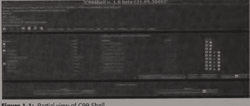

图 1-1：C99 Shell 的部分视图

### 获取网站访问权限的步骤

现在来看看黑客为获得攻击你的网站所需知识可能遵循的基本步骤。

> **警告**
>
> *需要说明的是，此处提供的信息旨在向你展示如何保护自己。你不应将此处概述的任何内容用于非法访问任何计算机系统。*

### 研究

攻击者首先想了解你的网站——它位于哪台服务器上、操作系统、运行哪些应用程序、具体版本等。了解防御系统和入侵检测也有助于坏人避免被抓。掌握这些之后，他们就可以开始研究漏洞。

例如，如果你运行的是存在漏洞的软件，他们就会针对它来进入。

称为 SQL 注入的攻击可以使用精心构造的 SQL 语句泄露管理员用户名和密码，从而使攻击者获得对你网站的管理访问权限。

作为研究的一个例子，假设你有一个网站，托管在优秀的网络托管公司，并且你在 Linux 服务器上运行某种 CMS 站点。

如果你是攻击者，你会首先确定该站点运行什么软件。你可以通过多种方式被动或主动地做到这一点，包括以下方式：

- 使用浏览器查看网站页面源代码。这有助于你了解它运行的是什么。是 Joomla!、WordPress、Drupal、Plone（或任何其他许多 Web 系统）吗？


-   在网站上运行扫描工具 Blind Elephant 以确定类型和版本。（稍后您将进一步了解 Blind Elephant。）
-   尝试获取对 CMS 管理员部分的访问权限。
-   从网页邮箱账户写一封便条，称赞开发者。询问该网站是用什么编写的，因为您也想拥有一个如此漂亮的网站！这是社会工程学的一个例子。
-   使用类似 "allinurl: Powered by Joomla!" 的谷歌搜索，看看会出现什么。
-   许多 CMS 会显示带有其徽标的 Favicon（网站图标）。这使得识别非常简单。

您可以看到，有多种方法可用于了解运行您网站的 CMS。

接下来，攻击者会想了解您的公司、公司业务以及企业所在地，从而基本构建出关于您的画像。为此，攻击者可能会考虑以下工具：

-   **Google** — 该工具可以让攻击者了解不少关于您公司的信息，因为谷歌搜索可能会搜出新闻稿、新闻条目和其他信息。
-   **域名系统（DNS）** — 攻击者可以查看 DNS 记录，以了解您的技术联系人是谁、电话号码（在某些情况下）、实际地址以及您的网段。攻击者还可以使用 NSLOOKUP 之类的工具（稍后您将进一步了解）来了解您网站的 DNS 信息。
-   **物理位置** — 如果您有实体建筑，攻击者可能会翻垃圾桶寻找被丢弃的情报。这可能包括客户名单、内部备忘录、“媒体”（如 CD）等。如果攻击者想获取对您运营活动的访问权限，他或她可能会通过电话冒充内部人员。

掌握所有这些信息以及其他零碎信息（如员工姓名、您制造或销售的产品等），可能使攻击者得以欺骗某人。

## 用谷歌搜索

谷歌是日常查找所需信息的绝佳工具。它同样适合构建潜在目标的画像。让我们试一试，看看能发现什么。

假设黑客已决定入侵您的网站。首先，攻击者需要收集一些关于目标的信息。谷歌能告诉坏人什么呢？

-   **您的办公楼地址** — 这是对员工、周边环境、警卫等进行一些低层级侦察的好方法。执着的攻击者可能利用这个机会进行一些*战争驾驶*，即黑客在外部建筑周围嗅探无线接入点。
-   *公司高管或经理* — 这些员工是社会工程师最喜欢的目标。通过这些员工，攻击者可以了解高层管理的一切。反过来，黑客可以利用这些信息欺骗其他毫无戒心的员工来协助他们。
-   *您可能正在招聘的职位* — 通过招聘启事，潜在攻击者可以了解大量关于现有基础设施的信息：使用的语言、硬件、系统和服务器。最佳做法是，除了吸引合适人才所需的信息外，在招聘广告中尽可能少透露信息。确保谨慎处理电话面试，以免泄露办公室和 IT 运营的内部运作情况。
-   *可能在支持论坛上发布密码* — 尽管这一点似乎显而易见，但密码以这种方式泄露的频率令人惊讶。更令人震惊的是，如果您知道如何使用谷歌，有时可以找到正在使用的密码列表。当然，最好的补救措施是不发布或泄露密码和用户 ID。次优防御措施是制定一项政策，要求定期且频繁地更改密码。这样可以确保如果密码泄露到外部，也会很快被更改。

您公司的招聘广告是一个特别脆弱的领域。例如，假设黑客想进一步了解一家名为*全知识中心*的虚构公司。在招聘网站上进行搜索，可能会得到类似以下内容：

```text
The Center for All Knowledge, a nonprofit publisher, is seeking a Drupal
Developer to work at its headquarters in Chicago, Ill.

The Web Developer will help lead development and redevelopment of
websites on the Drupal platform. Maintenance of existing websites
on other platforms, such as Oracle, will also be required. This
position reports to the CIO of the company.

Required Qualifications:
* Minimum 2 years experience developing in Drupal.
* Strong PHP knowledge.
* XML, CSS and Web Standards experience and knowledge
* Demonstrated ability to produce code
```

攻击者可以向该公司提交一份虚假简历，并通过电话与雇主讨论工作机会。攻击者甚至可能亲自面试该职位。或者，攻击者可能只是将其加入数据堆，从这份招聘启事中得知该公司运行 Drupal，并且有某种使用 Oracle 的系统在运行。

这些信息将使攻击者能够轻松开始寻找 Drupal 站点中可能存在的弱点。到目前为止，所做的任何事情都不违法。这仅仅是收集情报的行为。

## 使用谷歌黑客工具（Dorks）

几年前，安全研究员约翰尼·朗（Johnny Long）建立了一个可复制粘贴的谷歌搜索在线数据库，用于揭示此前未知的信息。根据他的网站“黑客慈善组织”（www.hackersforcharity.org/ghdb/），这些搜索被称为“googledorks”，简称“dorks”——意思是“谷歌所揭示的无能或愚蠢之人”。

这些搜索中有许多可以泄露密码之类的东西。其中一个名为 people.lst 的 dork 会遗憾地找到许多不同的“人员名单”。尽管其意图可能不是出售这类在开放互联网上流传的名单，但令人不安的事实是，它们确实存在。朗网站上的 dorks 已经非常过时，但令人惊讶的是，许多仍然能产生结果。现在其他网站和 dorks 也已涌现。

> **警告** 对这类搜索要谨慎。您可能会发现令人不快或冒犯性的内容。

花些时间运行各种 dorks，看看您的网站是否会出现，以确保您没有泄露敏感信息。

## 足迹分析

在黑客收集了大量细节并构建出您网站的画像之后，他或她将进入足迹分析阶段。这是攻击者尝试绘制您的站点、服务器和网络地图的阶段。

如前所述，虚构公司全知识中心正在运行一个或多个 Drupal 网站。绘制该公司的 Drupal 模块和版本是足迹分析的第一步。

识别您的 CMS 相当容易，如今有一些工具可以帮助攻击者确定您网站的 CMS。

Qualys 的 Blind Elephant（前面提到过）使这类工作变得非常容易。这个基于 Python 的工具被称为 Web 应用程序指纹识别工具。Blind Elephant 会尝试发现（已知）Web 应用程序（如 CMS）的版本。通过比较存在于已知位置的静态文件，它可以检查您正在运行什么应用程序。

该工具可以发现以下应用程序的版本：

-   Drupal
-   Joomla!
-   Liferay
-   Mediawiki
-   Moodle
-   MovableType
-   osCommerce
-   phpBB
-   phpMyAdmin
-   phpNuke
-   SPIP
-   WordPress

此外，它还会揭示 Drupal 的十多个插件和 WordPress 的二十多个插件。其明显含义是，您的 CMS 很容易被识别。

接下来，黑客需要 Web 服务器版本。鉴于 Apache 基本上是当前最流行的 Web 服务器，该站点很可能运行在 Apache 下。但攻击者必须确认情况是否如此，并识别版本。

一种快速方法是向 Web 服务器发送对伪造页面的请求。攻击者可以在站点中输入一个不存在的网页，看看会产生什么错误。例如，假设攻击者在浏览器中为某个政治类网站输入以下内容：

```text
http://www.domain.com/candidates.html
```

然后，黑客会从服务器收到图 1-2 所示的错误消息。

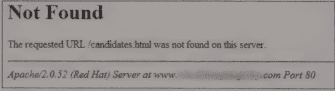

**图 1-2：** 显示 Web 服务器版本的错误

从 Web 服务器的角度来看，所发出的请求不是什么大问题，而且它当然是一个有效请求。浏览器请求 candidates.html 页面，由于该页面不存在，服务器无法生成该页面。它给出了默认的 Not Found（未找到）错误及其他信息。

请注意，黑客没有被引导到一个提供其他信息的“404 页面”——例如，另一个可能包含站点链接等有用信息的页面。Web 服务器甚至没有把攻击者发送到一个解释所请求信息不存在的页面。


这条消息之所以麻烦，是因为它显示了网站的 Apache 版本。在本例中，该站点运行的是 Apache/2.0.52 (Red Hat)。

搜索 Apache 2.0 分支（目前最高到 2.0.63）的变更日志，攻击者现在就能看出，该站点运行的版本与当前版本之间存在 19 个安全补丁。这是黑客可能用来尝试攻击的 19 种方法，包括以下内容：

-   四个跨站脚本（XSS）漏洞
-   两个缓冲区相关问题（潜在缓冲区溢出）
-   两个安全套接层（SSL）漏洞
-   三个特定的内存相关错误
-   各种其他安全修复

如你所见，只需快速搜索变更日志，就能发现这些信息。

攻击者还可以随意使用操作系统的诊断工具。这类工具存在多种，以下是一些较为通用的工具：

-   *AngryIP* —— 这是一个简单的 IP 扫描工具。你可以在 `www.angryip.org` 了解更多信息。
-   *DIG (Linux)* —— 这个工具可帮助你查询 DNS 记录。你可以在 `www.linux.com/archive/feature/113992` 了解更多信息。
-   *hPING* —— hPING 是一个面向命令行的 TCP/IP 数据包组装/分析器。你可以在 `www.hping.org` 了解更多信息。
-   *NMAP* —— 这是一个网络映射工具。你可以在 `www.insecure.org` 了解更多信息。
-   *NSLOOKUP (Windows, Linux)* —— 这是另一个与 DNS 相关的工具。你可以在 `www.kloth.net/services/nslookup.php` 了解更多信息。
-   *TraceRoute（或 Tracert）* —— 这个工具使你能够跟踪到目的地的跳数。使用这个工具可以绘制网络地图。该工具内置于当今的操作系统中。Windows 用户可以通过“开始 > 运行 > CMD”选项使用它。

还有一些漏洞扫描工具可用，例如 Tenable 的 Nessus（`www.nessus.org/nessus/`）。

> **注意** 这些工具都不是为了非法利益或犯罪活动而编写或受支持的。它们每天都在非常合法的操作中使用。但这并不能阻止犯罪分子利用它们来了解你。你自己了解这些工具，可以让你获得一种视角，有助于你保护自己的业务。

## 将 Nmap 用于恶意目的

看看 NMAP 工具的使用。假设对某个示例网站进行扫描，产生了如图 1-3 所示的结果。

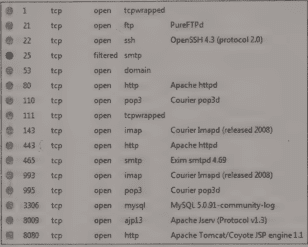

**图 1-3：** 使用 NMAP 在 Web 服务器上发现的端口

这些信息对攻击者很有价值。当然，价值大小取决于黑客发现了什么以及计划中的攻击可能是什么。至少，攻击者通过这次服务器扫描可以知道以下内容：

-   Apache Web 服务器
-   MySQL（版本 5.0.91）
-   Apache TomCat 和 Jserv
-   FTP 和 SSH
-   各种邮件服务器
-   开放的 53 端口；如果该 DNS 允许区域*传送*（你将在本章后面了解到），这可能是个问题。

如图 1-4 所示，NMAP 已识别出该服务器有 95% 的可能是 Linux 2.6.24，Gentoo 发行版。如图 1-5 所示，该工具发现了几个“可能的”命名设备。


**图 1-4：** 使用 NMAP 进行操作系统识别

攻击者可能采取的路径是使用这些工具之一扫描网络，其中许多工具可免费获得。这种主动扫描的目的是收集有关系统的信息，查看系统如何响应探测，并收集扫描产生的信息。使用 AngryIP、NMAP 等工具（它们都是为正当和善良的目的而创建的），攻击者可以有效地绘制出你的网络地图。

不过，请记住，使用 NMAP 之类的工具进行一次扫描，就可能触发服务器及其防御网络的各种警报。如果你打算测试自己的服务器，请记住这一点。

## 查找子域名

坏人可能尝试访问你网站的另一种方式，是搜寻诸如 `http://subdomain.example.com` 这样的子域名。收集子域名数据可以帮助攻击者更好地描绘你的网络。攻击者通常可以使用工具搜索站点的 DNS 来收集这些信息。例如，`www.magic-net.info/dns-and-ip-tools.dnslookup` 之类的站点可以提供你子域名的详细映射。

如果你发现自己的子域名出现在这些站点上，并且你不想暴露，那么可以使用 `.htaccess` 等方法来阻止访问。还有其他方法，但探讨这些内容超出了本书的范围。

## 枚举

下一步，*枚举*，本质上就是把收集到的所有数据放入某种映射中。枚举（或命名已发现的资源）的过程就在攻击之前进行。

通过枚举进行映射，可以显示攻击者所能发现的网络情况（或多或少），包括防火墙 IP、入侵检测系统（IDS）、操作系统、其他 IP 地址以及攻击者可能发现的任何其他内容。

## 攻击并掌控站点

如果攻击者找到了可利用的弱点，并且成功了，那么他们就会执行自己的计划。他们可能还会留下一个*后门*。这意味着他们可以随时利用后门非常容易地重新进入。这种应用程序通常是埋在系统上的一个小程序（例如本章前面描述的 C99 Shell）。他们甚至可能替换服务器上的关键应用程序以逃避检测。

站点攻击的目的并不总是获取信息。攻击者可能利用攻击来*拒绝服务*（DoS 攻击）、删除数据或篡改系统。

### 抹除痕迹

攻击者找到进入站点的方法后，最后一项典型活动就是清除活动日志。通过这样做，他们可以抹除表明他们到过那里的任何路径。

> **注意** 第 8 章会更深入地探讨日志文件，但就目前而言，值得指出的是，定期审查日志文件是抓住坏人的好方法。如果发现日志中缺失了一段不规则的时间，那是一个坏迹象。

## 威胁示例

当你想到互联网威胁时，病毒以及可能的诈骗会浮现在脑海中。当然，这些确实是其中一部分，但还有更多。威胁正变得越来越复杂。这些威胁包括古老骗局的各种变体，例如兜售万灵药式的骗子或间谍。

让我们来看看其中一些更常见的威胁。

### 社会工程

*社会工程*技术用于通过社交接触从某人那里获取未经授权的信息或访问权限。这种常见伎俩可能相当有效；毕竟，员工本应乐于帮助客户和顾客。当然，你完全不需要改变客户服务政策以降低帮助性，但你应该审视自己可能在哪些地方暴露。

社会工程是黑客用来进入你站点的最常见、最有效的手段之一。它通常表现为请求帮助，而通过该请求，攻击者可以获取必要信息、将病毒带入系统或打开一扇门。可能性几乎无穷无尽。

#### 打电话到你的办公室

一个容易想象的情景是，攻击者打电话到 CEO 的办公室。攻击者可能已经掌握了关于这位 CEO 的大量信息，包括该高管的背景和其他重要数据。当行政助理接听电话时，攻击者只需假装自己被转接到了错误的分机，并请助理好心地将电话转给技术支持（或攻击者可能获取所需信息的任何地方）。

在内部，分机很有可能会显示该电话是从 CEO 办公室转来的。或者攻击者可以说自己是由 CEO 的助理派来的——毕竟，谁会打电话到楼上询问呢？


其余部分很容易想象。攻击者会索取登录名、密码和其他机密信息。这种方法并不总能奏效，但成功的可能性很大。

就最新的社会工程学策略对员工进行培训，并确保他们有权要求对来电者进行明确身份验证。

## 派入可信的朋友

派一个朋友假扮成不请自来的销售人员进入办公室，如果操作失误，可能是一步险棋。这可能引发员工信任问题，或带来法律后果。

然而，如果这一计谋由真正的攻击者精心策划，就能让他/她获得大量关于员工如何遵循流程的信息。

在合法测试中，这类渗透测试会在“黑盒”安全测试期间进行，以查看“测试者”能否获得访问权限。

开展此类行动的最佳方式是聘请专业的渗透测试公司。

## 使用USB密钥

2010年，新闻中充斥着各种与滥用USB密钥有关的恶作剧和愚蠢行为。这些小型设备相对便宜，能够存储数GB的信息。例如，一个4GB的USB密钥可以轻松存储一个完整的操作系统，用来启动服务器，并迅速在设备上植入特洛伊木马。

例如，设想这样一个场景：一名员工来上班，发现有人在停车场里显然掉落了一个USB密钥。多么幸运的一天！有人丢了一个新的USB密钥！再设想一下，如果那个密钥上印有你的标识，它会更加诱人。不过，在这个场景中，假设这个“丢失”的密钥包含一个强大的特洛伊木马程序，旨在从防火墙后方潜入，而那里距离进入你的系统并不遥远。

尽管这个场景听起来像是幻想事件，但它确实发生过：有人在大楼停车场散落了许多USB密钥。而且，没错，它们被感染了。

另一种场景可能是，员工为了图方便或处理一些工作，从家里带来一个密钥。他/她的家用台式机没有良好的防护，病毒被传到了密钥上。于是，病毒或特洛伊木马再次绕过你的防御。

这样说的目的并不是阻止使用这项出色的技术。相反，这些场景应让你意识到危险。以下是一些保障基础设施安全的建议：

-   *教育*——让员工对威胁的认识达到应有水平。确保他们了解在办公环境中使用密钥的基本规则。如果员工在停车场发现一个密钥，它可能没问题——也可能充满了恶意。
-   **病毒控制**——确保你的台式机和服务器（如果你管理它们）自动扫描USB密钥，并且不给用户拒绝扫描的机会。
-   **锁定USB端口**——禁用USB端口会降低感染进入网络或数据外泄的机会。然而，由于USB键盘和鼠标需要使用该端口，这正变得越来越不可能。

## 无差别浏览或即时通讯

无差别浏览和即时通讯是两种可能危险暴露内部系统的漏洞。尽管你的IT政策应规定员工在业务网络上能做什么、不能做什么，但员工并不总是照做。

在无差别浏览的情况下，员工可能有意或无意地浏览大量网站。这些网站可能包含有害的恶意软件或内容，从而使你的站点和网络面临风险。

即时通讯至少在2010年发生的一起知名网络攻击案例中，曾将有害代码传递给毫无防备的员工。

> **注意** 有关此攻击的更多信息，请参见 http://www.information-age.com/channels/security-and-continuity/news/1278213/worst-ever-pentagon-cyber-attack-came-from-usb-drive.shtml。

你需要培养的意识，与国土安全部最新的网络安全宣传活动——*停、思、点*——相呼应。人们通常会被诱入虚假的安全感，并点击那些旨在利用这种心理的链接。让员工对网络、网站和公司信息所面临的危险达到一定的认识水平或意识。

## 外部介质

外部介质可以包括USB密钥、CD-ROM、DVD，甚至移动智能手机。所有这些都可能对你的系统构成威胁。

使用像Knoppix Linux内核这样简单的东西，就可以从USB密钥启动计算机系统，从而可能绕过安全防护。鉴于该内核小、快且易于获取，再加上可用的高密度USB密钥，你就拥有了完美的间谍工具。

其他介质可能足够无害，但也可能携带病毒。你的政策应该是：除非通过病毒扫描对其进行可靠防御，否则不允许任何外部介质进入。

## 供应商或外部客户/顾客作为威胁

当一位倒霉的销售人员进入公司办公室时，他/她可能需要连接互联网。请记住，供应商或销售人员不一定会有意传播病毒，但你不知道那台“外来”机器上安装了什么级别的防护。

确保你提供一种与你的网络通过防火墙隔离的专用互联网连接，或者不允许这类互联网连接。这种意识是让员工在将计算机接入你的网络时遵循你的政策。

## 审查你的边界

无论你只有一个网站，还是拥有完整的实体运营机构，审查并保护你的数字和物理边界都将保障你的安全。了解你在哪里存在漏洞（以及容易受到什么攻击）是加固防御的第一步。

你可以使用一些常见的防御措施，例如强密码、频繁更改密码、病毒防护、防火墙和其他设备。实体企业可能在无线领域面临更大的挑战。作为边界审查的一部分，检查并禁用未经授权的无线接入点，可以减少这些设备上发生未授权活动的机会。

以下各节提供了一个很好的入门指南，帮助你开始边界审查之路。

### 使用病毒防护

你当前的病毒扫描程序是什么？它是否设置为自动扫描和更新？你是否已续订许可证？它能否在没有密码的情况下被禁用？这些只是病毒扫描程序相关的几个常见问题。

根据机器的配置，扫描可能需要一些时间。这可能导致员工因为*忙碌*而直接*暂时*禁用它。锁定病毒扫描程序，使其在特定时间运行，并取消轻易禁用它这一功能，将让你的数字围栏保持竖立。

定期检查这些机器，确保隔离区中没有任何东西。如果你出现大量感染，那么可能存在某些东西通过USB密钥或其他介质潜入。

### 禁止在桌面上留下密码

信不信由你，一些办公环境中已知的做法是将密码贴在显示器上、键盘下，或塞在办公桌抽屉里。考虑实施随机检查，以确保你的安全不会因诸如写有密码的便利贴这样简单的事情而受到损害。

人们倾向于写下密码，因为密码很难记住。当然，拥有纸质副本会使设置复杂密码的目的落空。你应该制定一项政策，禁止写下密码。如果你身处办公环境，请定期随机环顾四周，查看是否有密码被贴在黄色便利贴上。

### 强制执行密码复杂度和更改策略

密码应该足够复杂，混合使用数字、字母和符号。密码应由大小写字母混合组成，且字母不重复。无论如何，绝不要使用词典中的单词。

如果密码是词典中出现的单词，就容易受到一种称为*字典攻击*的特定攻击。字典攻击只是使用词典中的单词一遍又一遍地尝试密码。互联网上提供了许多免费且强大的工具，使攻击者能够采取这种方式。

所有系统中的密码应至少每30天轮换一次，并且绝不应在一年内重复使用（如果可能的话，永远不要重复使用）。如果你被黑客入侵，应立即轮换所有密码。如果你有其他系统连接到网络（例如VoIP电话），那么也要考虑VoIP服务器的密码。

> **注意**
>
> *归根结底，攻击者可能通过恶意或配置错误的无线路由器进入你的系统或获取密码。2006年5月至12月期间，一家大型百货商店遭入侵，就是这种攻击方式所致。攻击的结果是数十万消费者的身份信息被盗，并因攻击者获取敏感数据而损失数百万美元。*

### 管控开放无线网络

在办公环境中，员工有时会觉得自己比IT部门更懂。有时员工觉得自己需要一个“易于访问”的无线接入点。通常，在已有政策和程序要求通过IT部门提交请求的情况下，他们仍然会设置这样的接入点。发展壮大的小公司可能会实施集中控制技术方面的政策，而这些公司往往会遇到这类情况。


快速去当地电子商店购买一个廉价的无线路由器和网线，就能让恶意员工装备齐全。回到办公室，将其插入你的局域网（LAN），这个员工就获得了梦寐以求的“便捷访问”无线接入点。信不信由你，这种情况并不少见，应该迅速而坚决地处理。

作为你工作的一部分，预先定义无线策略有助于防止这种情况发生。起草一份 IT 政策，明确规定员工哪些可以做、哪些不能做。第 11 章将进一步讨论 IT 政策。

就像密码被写下来的情况一样，花些时间检查是否存在不应出现的无线接入点。

## 无线检测工具

一台带有无线网卡的低成本笔记本电脑就可以作为简单的无线检测工具，用来检查流氓无线系统。安装诸如 NetStumbler 之类的工具，可以让你记录和识别这些流氓系统，并将其关闭。

如果你拥有 iPhone 或 iPad，一家名为 dynamicallyloaded.com 的公司为这些设备提供了一款非常有趣的工具，叫做 WiFiFoFum。这款强大的工具是一款 Wi-Fi 扫描和定位工具，它会扫描 802.11 无线（WiFi）网络，并显示检测到的每个网络的信息。扫描结果包括以下内容：

-   服务集标识符（SSID）
-   媒体访问控制（MAC）地址
-   接收信号强度指示（RSSI）
-   接入点的安全模式
-   可用的传输速率

图 1-6 显示了 WiFiFoFum 如何展示一家本地咖啡店及其周边区域所有可用的网络、信道 ID、SSID 和 RSSI。如你所见，它发现了 12 个可用网络。

图 1-7 显示了 WiFiFoFum 的雷达视图，它以图形方式呈现附近的 WiFi 接入点。该屏幕显示信号强度最高的接入点位于中心附近。信号强度较低的已识别接入点位于外围，从而提供了一种简便的方法来大致确定接入点的位置。

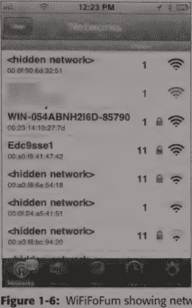

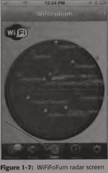

如图 1-8 所示，WiFiFoFum 可以在发现接入点时创建其位置的日志。然后，你可以直接在 iPhone 的地图应用中查看这些日志，或通过电子邮件发送它们，以便在台式机或笔记本电脑上查看。要查看通过电子邮件发送的日志，只需将邮件中的链接粘贴到 Google Maps 网站即可。

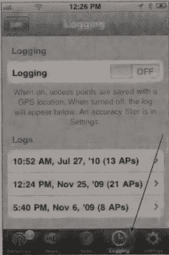

图 1-8：WiFiFoFum 日志模式

> **警告** 此工具可能并非对所有用途都合法。根据您所在的位置，它的使用也可能有特定限制。如果您有任何疑虑，请咨询律师，了解使用此工具的合法性。

另一种检查您场所的方法是查看您的站点是否已在 www.wigle.net 上列出。该网站提供了一个地图，显示人们向该网站报告的无线接入点。您可以在地图上逐级查看到街道级别，还可以按各种数据点浏览和搜索，如图 1-9 所示。

使用 wigle.net 网站，您可以验证您的接入点是否被列出。如果您确实发现您的无线系统被列出，您可以请求从该网站的数据库中删除它们。

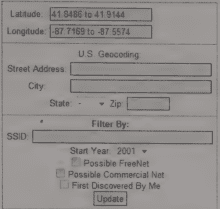

**图 1-9：** 在 Wigle.net 上定位物理地址

## 您将如何应对事件？

根据《InformationWeek》杂志2010年8月的一项调查，17% 的受访者没有灾难恢复计划。企业通常以各种理由声称他们没有计划，例如*资源匮乏*，或者觉得太难。这些企业给出的其他理由包括“不知道从哪里开始”、“我们太小了”或“我们有备份”。无论您的企业规模如何，都应该制定灾难恢复计划。如果您是一家非常小的公司，那么制定灾难恢复计划显然应该很容易。

当然，潜在灾难的类型因企业而异。例如，您可能觉得自己的数据中心安全地远离您，因此对自然灾害免疫。您可能需要重新考虑这种观点。例如，您可能认为地震只发生在西海岸，但您可能会惊讶地发现，根据美国小企业管理局的数据，密西西比州、密苏里州、阿肯色州、伊利诺伊州、田纳西州和南卡罗来纳州也发生过地震。如果您的数据中心遭受地震，请考虑对您的影响。

第 6 章将详细说明如何制定完整的灾难恢复计划。然而，在评估安全风险的讨论背景下，让我们先来看一些您应该回答的重要初步问题。

### 您的计划存在吗？

“您的计划存在吗？”是一个简单的“是”或“否”的问题。您的计划可以简单到写在黄色便签纸上的一系列步骤，也可以复杂到专为中小型企业设计的全面方案。

如果您的计划不存在，或者说您根本没有计划，那么制定一个计划需要花费一些时间。该计划应当全面，但又足够易于遵循。

要求易于使用的原因有两个：

-   在灾难期间，压力和其他因素会降低人类的理性思考能力。信息传达最好采用较低的阅读难度，便于在心理上理解。
-   如果未受过训练的人必须接手并执行整个计划，那么计划应当清晰明了。

### 计划是最新的吗？

假设您有一些计划，甚至是全面的计划。检查日期，看看它上次更新是什么时候。一份好的恢复计划应每六个月更新一次，并且两次更新之间的间隔不应超过一年。原因是新威胁层出不穷。您的业务、系统和人员的变化始终处于变动之中。每季度或每半年记录这些变化，可以避免在您需要计划时出现意外。

您需要查找的项目（也称为增量）是指那些可能在您不知情的情况下发生变化或被添加、从而悄悄影响您的东西。这些包括以下内容：

-   *应用程序套件的新版本* — 您是否需要或拥有用于恢复的许可证密钥？
-   *桌面和服务器上的操作系统更新* — 也许您有一段时间没有更改操作系统，而一旦更改，就会改变流程。请将这些更改记录在灾难恢复文档中。
-   *重要软件支持政策的变化* — 也许负责开发的人员或公司已经倒闭。开源代码的一大优点在于，您可以请开发人员来更改和更新您的应用程序栈。但同样，当这些更改完成时，请更新文档。

要注意下游效应。一个例子是 Joomla! 1.5 与 Joomla! 1.6。这两个版本共享许多相似的功能，但请记住，界面是不同的。操作流程也大不相同。

## 总结

为您的网站和业务规划并执行良好的运营计划，将确保您的业务持续运转。在本章中，您了解了构成中小型企业网站运营的各种组件。从黑客的角度审视自己的重要性，可以让您了解自己的薄弱环节。

所讨论的各种工具（如 NMAP 和 traceroute）只是可用来保护自己的众多优秀工具中的一部分。

即使您的网站可能托管在信誉极佳的主机上，灾难或宕机也可能发生。提前为这些事件做好规划，将使您在需要的那一天做好准备。

第 2 章将指导您如何选择合适的托管服务提供商。


# 选择合适的托管公司

为你的网站或业务选择合适的托管，类似于选择居住地。你可能想找城镇中娱乐丰富或特定服务齐全的区域，也可能希望在乡间一块好地皮上拥有安静住宅。如果你有学龄子女，你很可能会希望靠近该地区最好的学校。

这些选择都像你本人一样因人而异，但它们共享一个跨越所有这些界限的关键属性。你希望居住的地方安全可靠。住所安全是我们所有人都想要的。

本章提供大量信息，使你能够针对自己特定的托管需求做出正确选择。为你的网站选择正确的托管至关重要。你的网站或 Web 应用可能是客户与你唯一的互动。留下良好的第一印象，是获得第二次、第三次乃至更多互动的关键。将就选择劣质托管公司，可能导致停机、服务器被黑或服务不稳定，进而导致客户满意度下降。

本章旨在以内部人士视角向你介绍托管——好的方面和不太好的方面。让你成为更明智的客户，将确保你做出正确的托管选择。

## 可用的托管类型

继续用居住安排作类比，对于想住在哪里，你有很多不同选择。你可以租公寓、单元房或联排别墅，也可以购买产权公寓或独栋住宅。

让我们将不同类型的住房选择与网站托管进行比较。表 2-1 为你提供了住宅与网站托管之间的隐喻式比较。例如，共享主机就像租公寓——除了自己的住所外，你无需承担太多责任。而专用服务器就像拥有自己的房子——你必须照料一切。

**表 2-1：住宅与托管等效项的简单比较**

| 住宅 | 网站托管等效项 |
| --- | --- |
| 公寓（多户住宅） | 共享主机 |
| 产权公寓/联排住宅 | 虚拟专用服务器（VPS） |
| 拥有自己的住宅 | 专用服务器 |
| 豪华分时度假 | 云托管（例如 Amazon） |

本节先概述基本概念，然后深入探讨销售网页不会告诉你的托管公司的一些方面。可选择多种托管类型，包括以下：

- 共享主机
- 虚拟专用服务器（VPS）
- 专用服务器
- 云托管

### 共享主机

今天普通服务器硬件的性能远超大多数用户的消耗。*共享主机*将成本和用户负载分摊到许多客户身上，使其价格可负担。托管公司可以把更多人放在单台机器上，从而降低成本。

使用共享主机时，你的网站与许多其他 Web 客户端一样，由同一台服务器提供服务。尽管许多网站共享硬件，但它们各自生活在自己的*分区*中——很像一套公寓单元。

在配置得当的 Web 服务器上，一个客户端无法看到系统上的任何其他客户端。托管商会维护机器、核心操作系统和 Web 服务器组件。网站所有者只需操心经营自己的业务和维护自己的网站。

机器的容量将用于衡量你被允许消耗的资源。换句话说，如果你超过机器上的特定负载限制，托管商会要求你购买更多资源，或迁移到其他方案。

### 虚拟专用服务器（VPS）

当你转向 VPS 时，可以预期每月成本远高于共享主机。与共享主机相比，你需要更多技术技能来操作和维护它。月费通常从每月 12.00 美元起，甚至更高。

以下是使用 VPS 时需要牢记的一些考虑因素：

- 月度或年度成本会更高。
- 管理员需要比共享主机更多的技术技能。
- 物理机器崩溃或丢失很可能导致你的网站宕机。（不过，也有一些例外情况。）
- VPS 通常比普通共享主机更安全。
- 你可以按任意方式配置“虚拟”机器。
- 有多种控制面板可供选择。
- 物理机器将由许多客户共享。因此，资源将分配在大量站点池上。不过，与共享主机相比，每台机器通常容纳的客户少得多。
- 你有更多可用内存、CPU 和磁盘空间。
- 服务器和站点数据的备份将由你负责。

### 专用服务器

专用服务器最基本的形式是你租用或购买一台服务器，并将其放入托管机房。你也可以从托管公司租用专用机器。专用服务器成本最高、维护要求最高。然而，这一选项也最灵活。

专用服务器意味着你是机器上唯一的用户。你不共享资源，也不必担心服务器上的另一个站点被黑而使你暴露于攻击。如果你有非常繁忙的站点，或担心安全性和正常运行时间，就应选择专用机器。

VPS 和专用服务器的安全性通常相当。在某些情况下，与 VPS 相比，你可能对专用服务器的安全有稍多控制权。

根据提供商和配置，你可能需要支付每月 70.00 美元到 500 至 600 美元不等。

以下是使用专用服务器时需要牢记的一些考虑因素：

- 你很可能需要执行管理任务。
- 使用专用服务器需要全面的灾难恢复计划。
- 通常，这是迄今为止最昂贵的选项。
- 专用服务器可以为你提供强大的计算能力。
- 如果你购买了自己的机器，请记住硬件会老化，必须随时间更换。

### 云托管

云托管是一种流行的技术模型。它获得了大量媒体关注，看起来非常诱人。其基本概念很像美国电网，许多电力公司向电网供电。作为消费者，你可以按需消耗任意少或任意多的电力。你只需为所消耗的资源付费。

对于可能经历不均衡或尖峰流量的站点，这种模型很有前景。零售站点在圣诞节期间会出现大量流量尖峰。使用云托管（例如 Amazon 或 Rackspace Cloud 销售的服务），按需增加容量很简单——从而为网站访客提供更多资源。

与所有技术一样，云托管也有阴暗面。云计算最大的担忧是安全性，紧随其后的是数据隐私。

> **注意** 如果你有兴趣使用云计算，请查阅 **云安全联盟** 在 www.cloudsecurityalliance.org/ 发布的指导文档。这份安全指南将帮助你在开始之前走上正轨。

如果你选择云托管是因为它“热门”，或者因为技术人员告诉你购买它，那么在购买前请牢记以下关于云计算的考虑因素：

- 尽管云计算未必是新概念，但在这项应用中它足够新，以至于管理员正像面对新问题一样面对“旧”问题。
- 购买前你应该了解计费模型和费率。不了解各项成本可能会导致你最终收到高得惊人的账单。
- 如果你处理或存储信用卡数据，请确保你的云提供商能够证明符合支付卡行业（PCI）要求。
- 故障不再是那么大的问题。云中的一台服务器故障不会拖垮整个网格。
- 为数据安全做好规划——这是你的企业将面临的迄今为止最大的风险。


## 云中数据的安全性

数据在未使用时必须得到保护。在云中，数据有可能被移动（或保持移动状态）。你应确定你的云供应商如何做到这一点。以下是一些考虑因素：

- 如果数据被移动，必须以安全的方式移动，并且不能与其他客户的数据混杂。
- 如果云没有得到适当的安全保护，黑客就可以在云中的站点上肆意妄为。
- 询问你的托管商，你如何访问和审计你的日志。
- 仅仅因为你位于云上，并不意味着你已经备份。数据丢失仍然是数据丢失。确保你有记录在案的数据恢复手段。
- 你应审查并理解云托管提供商的合同义务。仔细审查正常运行时间以及前述隐私问题等方面，以理解各方的义务。

> **注意** 如需详细了解云计算，请查阅约翰·里廷豪斯和詹姆斯·兰索姆所著的 *《云计算：实现、管理与安全》*（佛罗里达州博卡拉顿：CRC Press，2010）。里廷豪斯和兰索姆是安全领域备受尊敬的专家，尤其是云计算安全领域。此外，你还可以参考罗纳德·L·克鲁茨和拉塞尔·迪恩·瓦因斯所著的 *《云安全：安全云计算综合指南》*（印第安纳波利斯：Wiley，2010）。

## 选择合适的托管方案

选择托管提供商和方案可能是一段令人困惑的经历。你不想买得太少，也不想付得太多。再加上技术能力始终在变化，往往在提升潜力的同时降低成本，因此你的切入点很难决定。你可能想知道自己该往哪个方向走，甚至怀疑自己是否走在正确的道路上。技术唯一不变的就是它始终在变化。

让我们看看如何根据你的情况选择合适的托管方案。

### 预算考虑

如今做生意很可能意味着你需要一个网站。这条规则很少有例外。每年在网站上花费几美元或数亿美元，是一个商业和预算决策。作为企业主，你可以以每年低至 $75 的费用让网站上线，包括域名和网站。制定预算实际上是由你的业务需求驱动的。

你可能需要先制定的预算部分是*域名*。有多个顶级域名可用——.com、.org、.net，甚至新的 .co。还有更多顶级域名适用于不同国家和特定应用，例如 .mobi。

确定除了你的常规选择——例如 example.org 或 example.mobi——之外，你还需要多少个顶级域名。每个域名都带有年度注册承诺费用。根据你的注册商不同，你可能每年支付 $9.00 或更多。请记住，这不包括任何额外费用，例如隐私注册和其他与域名相关的服务。

当然，你会托管其中部分或全部域名，每月或每年的成本必须计算在内。你可以获得每月 $4.00 到 $5.00 起的基础型托管，也可以选择价格实惠的高级托管，例如 Rochen.com 或 LunarPages.com 等公司提供的服务，直至专用服务器，每月可能花费数百美元。确定这项成本完全基于你的需求，然后你在预算内找到满足需求的托管商。

许多软件包有年度许可证维护费用，在购买任何软件包之前应向你披露。年度软件许可证本身并没有问题，但一定要理解许可证费用的用途。

与许可证成本相伴的是支持成本。一些托管商对专用服务器上的协助收取额外费用，这不包括硬件和基础操作系统安装。这种增值服务从来不便宜。

选择实际拥有硬件不仅会产生购置机器的成本，还会产生维修成本。把购买机器的保修成本和保修外成本考虑进去。还要包括额外线缆、小件物品（例如将其安装在机架中），以及你需要的其他杂项物品。

如果你进行任何类型的电子商务交易，你需要购买 *SSL 证书*。这项成本从略低于 $30 开始，并从此上涨。续订证书有年度成本。

围绕开源 CMS（如 Joomla! 或 Drupal）制定预算，可能会让你误以为为 CMS 开发应该为零或接近零。不要将框架免费这一事实与开发图形、代码或设置这些平台的成本混为一谈。开源的诱惑在于能够低成本地获得。不要落入想要一个简单的 .com 克隆站并为其设定 $200 预算的陷阱。信不信由你，这种荒唐事在自由职业开发网站上很普遍。

开发成本包括专业知识和所需时间。这些成本确定后，你的项目完成且网站运行起来，你就会有维护内容的成本。这种维护可以由进行更改的管理员型人员完成，也可以由一个团队完成。这完全取决于你的网站。

控制这些成本的最佳方法是在功能和形式以及拟议内容方面做大量纸面演练。如果你突然发现项目在设计中途发生变更，成本往往会上升。你可以通过询问未来的更改是基于编程的，还是可以通过其他方式完成，来确定额外的财务考虑因素。通过明确你的目标，你更有可能保持在财务边界之内。

你不想遇到的另一项隐藏费用是代码维护。假设测试后看起来没问题，但在生产环境中，它有一些使其难以使用的缺陷。提前规定这些事情如何处理。不要指望开发者永远继续开发和修复缺陷。

在制定技术预算时，包括 CD-ROM 和用于存储备份数据的 CD 刻录机等项目。或者如果你想使用闪存盘，那么把这项成本加进去。把用于存放数据备份的防火保险箱或银行保管箱的成本考虑进去。

文件恢复等意外变更可能带来高昂的价格标签。向你的托管公司查询恢复备份的费用。你可能会对托管公司进行恢复的成本和周转时间感到震惊。

其他需要考虑的成本是可能混入其中的任何费用，包括托管商可能提供的各种商业服务，例如你网站的搜索引擎优化（SEO）、域名验证以及其他增值服务。

### 确定合适的服务器规模

这里描述的大多数（如果不是全部）托管方案将足以满足许多中小型应用。然而，随着应用程序能力增强，并且希望随着你的网站人气增长，你必须牢记一些规模确定规则。应用程序的规模确定很复杂，不一定与用户数量相关，而是与每个用户所需的负载相关。

让我们通过定义任何网站/托管平台共有的一些基本项目来开始这一分析。

所有计算机都使用*随机存取存储器*（RAM），而服务器往往需要更多 RAM，因为它们承担更高的负载。目前，RAM 以吉字节（GB）计量。通常，系统的 RAM 越多，性能越好。

RAM 的对应物是*硬盘*，它执行数据的长期存储。硬盘的衡量标准是*磁盘空间*，它将列为吉字节，很快你还会看到它以*太字节*（TB）列出。注意，1,000GB 等于 1TB。

CPU 是任何计算机的核心。它是传统上以速度衡量的计算机芯片。如今你会看到双核、四核或六核 CPU 的广告。这些标识表示存在多少个 CPU。注意其中给出的速度和其他技术规格。将这些规格纳入考虑很重要。例如，你可能会看到“CPU: Intel Core 2 Quad — 2.50 GHz。”


这意味着它有四个CPU在运行。这种特定系统将是一台强大的主力机器。

虽然大多数传统托管方案中并未列出冗余，但冗余对于性能和正常运行时间是一个考虑因素。许多服务器采用“双驱动器”镜像系统，这意味着它使用两个磁盘驱动器。如果一个驱动器发生故障，另一个驱动器拥有数据的副本。虽然这种设置对于安全性来说非常理想，但请记住，你只是在向单个驱动器读写数据（这里会发生大量的读写操作）。因此，如果你的网站是一个中等或高事务量的站点（例如流量很大的论坛站点，或者有许多人写入数据的电子商务站点），在等待驱动器完成磁盘写入时，你将会产生性能损失。简而言之，更多硬盘在工作中往往会使整个系统表现更好。

*带宽*是衡量服务器进出数据传输量的指标。例如，每次有人访问你的主页，你都会消耗一定量的带宽。该指标是在高峰时段使用称为*第95百分位*的度量来计算的。这意味着只要你在一个月内保持在平均“峰值”水平以下，你就可以根据需要消耗带宽。

既然已经介绍了基础知识，下面来看一些示例场景以及如何评估它们。

> **注意 3** 这些模型不涵盖云计算。

## 案例1：轻度网站流量（共享托管）

案例1涉及一个小型网站，作为企业的占位页面，总共大约十个页面。流量较轻，每月大约200到250位访客。在这个例子中，显而易见的选择是网站托管商提供的最小的共享托管方案。不需要更多配置。该服务器可以轻松离线维护，而不会影响业务。

该网站需要外部备份。对于此类网站的成本，托管商不会处理备份。但是，托管商会维护操作系统和相关组件。

作为共享托管网站的管理员，你需要对cPanel或WHM等托管应用程序以及其他控制面板系统有非常基本的了解。你必须具备一定水平的数据库设置知识。本书重点介绍的四款CMS中有三款需要数据库。

与服务器的通信通常通过称为*文件传输协议（FTP）*的协议完成。使用诸如FileZilla之类的FTP客户端将是一项常规甚至可能是日常的任务。

备份你的网站将完全由你负责，几乎没有例外。学习使用托管商提供的可用备份工具，将在需要时为你解围。

最后，你必须学会修补网站、保护网站免受利用网站弱点的黑客攻击的技能。

## 案例2：中等网站流量（VPS）

在此示例中，这个中等流量的网站托管着一个讨论当下热门政治话题的流行论坛。它包含相当多的图形和文本。网站管理员需要监控带宽以避免超额费用。每月流量为50,000到70,000位访客。安全性在这里是一个问题，因为该企业在刚起步时，其共享托管账户曾被黑客入侵。该企业还需要对服务器环境有更多控制。该网站的主要收入来源是在网站上展示的广告。对于这个客户，VPS将是合适的选择。

对于虚拟系统，更大的担忧是系统上的RAM数量，因为大多数现代服务器的CPU能力都超过其通常使用量。在VPS或任何虚拟系统中，你在物理服务器上安装的RAM越多，其性能就越好。因此，成本将比传统共享托管高得多。该系统将配备12GB到16GB的RAM。

VPS所需的管理技能可能更高，具体取决于所选的托管公司。例如，Rochen.com为其虚拟服务器产品提供了大量支持。其他托管提供商可能提供相同、更多或更少的支持。在选购时要考虑到这一点。选择完全托管的提供商将处理许多与服务器管理相关的问题。

如果你负责维护自己的VPS，那么技能组合应包含与共享托管相同的技能，以及一些额外技能。这些技能可能包括防火墙的轻度管理、为mod_security或ConfigServer及防火墙应用程序编写脚本。你需要一些Linux命令行技能（或等效的Windows技能），以及使用安全外壳（SSH）协议的知识。这是比FTP更安全的连接服务器的方式。PuTTY或WinSCP等工具是SSH的两种流行选择。

最后，你需要获得一些使用phpMyAdmin管理数据库的知识。总有一天你可能需要编辑或更改数据库中的项目。这是做到这一点的最佳方法，除非你是数据库管理员，可以使用高级命令行技能。

好消息是，对于大多数VPS产品，技术支持团队都会在那里为你提供帮助。

## 案例3：高网站流量

高网站流量场景的示例网站是一个按需分发培训视频的创收网站。这个热门网站每月服务约250,000位独立访客。他们每月消耗超过1TB到1.5TB的带宽。鉴于该网站每周7天、每天24小时运行，企业几乎没有停机余地，并且需要最佳性能。

对于该客户，最佳解决方案是一对机器，其中一个作为主服务器。另一台机器可用于开发，并将包含第一个系统的副本。如果发生中断，第二个系统将投入使用。这里的一个预算考虑因素是托管商对此系统进行最少的维护。

此解决方案需要一台专用服务器和一名训练有素的管理员。大多数托管公司会协助处理软件，但需要收费。这是基于这样一个事实：作为专用服务器客户，你应当知道如何管理服务器。高层次的服务器配置和更新任务在点击式操作的世界里听起来简单，但在Linux环境中，这意味着需要能够执行多项困难的任务，包括安装和配置PHP、Ruby、Python、Perl以及各种其他编译器和软件工具。

安装和配置你的Apache Web服务器、日志文件轮转以及各种其他功能都不是简单的任务，设置MySQL数据库服务器也是如此。在大多数情况下，这些都是在命令行提示符下使用SSH处理的。

安全性是该机器管理员会花费大量时间的领域。设置各个保护层需要对工具有深入了解，在某些情况下还需要编写脚本。由于你的专用服务器很可能运行安全套接字层（SSL）证书，管理员将需要配置和安装该证书。

拥有一台专用机器通常意味着需要一名具有适当技能和可信赖度的专人，在业务运营的最核心层面进行操作。

## 使用备份

这些通用工作模型让你了解了所需的各项技能。所有模型中的一个共同任务是需要将数据备份到异地位置。这可以简单到使用磁带或CD-ROM，也可以是商业解决方案，例如www.AkeebaBackup.com，它可以将备份执行到异地云。

在所有情况下，取决于托管商，备份期间网站的性能可能会受到影响。要了解托管商如何进行备份，并询问对网站性能的影响。请记住，在所有情况下，这都是你的数据，确保其得到备份是你的责任——无论如何。


## 网站托管安全应关注什么

选择托管公司通常不需要签订多年协议。一般来说，网站托管的费用按月收取。主机代管可能需要按年承诺，但通常合同条款中允许你解除协议。即便如此，为你的托管需求选择了错误的公司也可能代价高昂。

本节探讨一个日益重要的主题——安全性。在选择托管商时，你需要清楚地了解那些通常不被考虑的细节。本讨论分为以下几个主题：

- 物理安全
- 网络安全
- 环境支持

这些主题相互之间既有共同点，又可能相互影响。

### 物理安全

*物理安全*这个词可能会让人联想到合同保安巡逻，或者公司大厅里接待访客的保安。事实上，这些只是托管公司物理安全的一部分，而托管公司的安全远不止这些。

#### 玻璃窗

让我们从托管商所在建筑物的简单例子开始。许多地方都可能令人担忧。如果你参观网站托管商或主机代管设施，请注意观察周围环境。建筑物里是否有玻璃窗，使光线、热量和窥探的目光能够进入数据中心？

数据中心里使用玻璃需要考虑的问题包括建筑物的温度。玻璃往往会通过太阳辐射让热量进入。如果你的数据中心位于美国西南部地区，那么在漫长的夏季将面临高温。这会影响建筑物的冷却能力。高温会使冷却系统更加吃力，成本更高，并可能导致空调系统需要更多维护。数据中心因多余热源导致温度升高并不是一个好的选择。

数据保密方面还有其他许多担忧。一个真实案例中，某私有数据中心有窗户。机架正面贴着某个系统的用户名和密码，从外面就能看到。

人口稠密城市中的社会动荡也是一个担忧。动荡可能导致砖块、燃烧弹或其他燃烧装置被扔进玻璃窗，落入数据中心。

自然力量也会引发问题。美国西南部和中西部地区的人们往往需要面对龙卷风的威胁。建筑可能被设计为能抵御F5龙卷风，但飞溅的碎片仍会击碎玻璃窗，可能对数据中心内的系统造成不必要的损坏。

最后一个小问题是托管公司建筑的维护成本。窗户会漏风、变脏、被打破。所有这些都需要维护，这是一笔费用。这笔费用不会由托管公司承担，而是会转嫁到你的身上。

#### 洪水

河流或溪流往往是许多自然景观的一部分。当水位上涨时，水偶尔会进入建筑物——尤其是建在洪泛区内的建筑。有些地区被认为每500年才发一次洪水，另一些是每100年，还有一些地区只要连续下雨几天就会发生洪水。

询问托管公司其建筑是否靠近洪泛区是明智的。如果公司位于洪泛区，可以询问上次水灾是什么时候，以及水位涨到了多高。请查阅美国政府提供的洪水数据数据库，网址为 http://msc.fema.gov。

#### 标识

人们常常被营销信息淹没，建筑标识也不例外。尽管营销对你的成功可能至关重要，但用巨大的显眼标识来宣传数据中心可能不是个好主意。公平地说，一个执着的攻击者即便面对的是不起眼的混凝土建筑，也会花时间找到它。为攻击者提供大量指向性标识，使其更容易入侵，这并不是一个好主意。

#### 人员

与任何企业一样，托管设施会因为各种原因接待大量访客和来宾。你的尽职调查应包括了解用于监控来访者和嘉宾的控制手段。门口是建筑物唯一的合法出入口。控制出入口对周边安全至关重要。了解建筑物登记进出有哪些流程。访客是否有人陪同？是否需要政府签发的带照片身份证件？访问期间是否留存其带照片身份证件？尽管这些控制手段技术含量不高，但对于威慑坏人非常有效。

一种常见的进入设施的方式是所谓的*双门门禁室*。双门门禁室是一个双门房间，通常需要钥匙进入第一道门，再用另一把钥匙或获得许可进入主房间。从字面上看，它把你困在这个房间里。其理念是，如果你进入了第一道门，第二道门是锁着的。大多数数据中心都设有某种形式的双门门禁室，以帮助控制敏感区域的进出人流量。其他技术可能包括某种形式的生物特征扫描。

巡逻保安也是对犯罪的有力威慑。如果你打算选择主机代管设施，请询问该公司如何监控数据中心楼层、周边、摄像头等。一些较小的设施可能人员配备较少，只有少数保安负责看守大门、开锁柜或处理客户需求。在这种情况下，增加强身份验证和威慑系统就很有用了。

许多网络入侵事件是由内部人员利用其知识攻击服务器中的数据造成的。内部攻击通常在各类入侵事件中排名靠前或接近前列。作为客户，你有权（也有责任对你的公司）询问犯罪背景调查情况。虽然过去的错误不应阻碍一个人获得工作，但它应当成为雇佣考量中的一个因素。换句话说，如果一名员工有过危险行为史，那么无法保证该员工今后不会仍然是风险。了解他们进行了哪些背景调查。如果你对提出这个问题的法律权利有任何疑问，请咨询你的法律顾问。

#### 垃圾搜寻与社会工程学

员工（以及一般人）往往容易泄露信息。一个重要的担忧领域是硬盘、纸张和光盘上私人信息的处置。这些是很好的信息来源。如果你正在参观托管设施，注意是否能看到带锁的回收或销毁箱，用于处理纸张和光盘。粗心大意地处理客户名单和账号已导致安全漏洞、盗窃等问题。

如果你正在使用某家公司的托管服务，不妨询问该公司如何停用磁盘驱动器。如果驱动器无法修复并完全擦除，则应将其送往授权的销毁设施，在那里进行粉碎处理。

闯入公司的一个更简单的方法是在工作时间从前门进入。这并不是指紧跟在别人身后混进去（“尾随”），那当然也是个问题。然而，在这种情况下，它指的是直接索取信息。正如第1章所述，社会工程学是获取公司信息最强大的方式之一。向你的托管商了解其为防止社会工程学入侵而制定的培训流程。

#### 入侵响应

希望你不会成为数据中心或托管商遭入侵的受害者。但这种可能性存在，所以要询问托管商有哪些应对程序。在讨论中了解其清理流程，以及如何确保你的设备或网站没有发生过犯罪活动。

#### 恐怖分子

我们当今生活的世界必须应对恐怖主义。恐怖主义带来的挑战在于，它无法被迅速解决，而且往往会发展和演变。策略不断变化，恐怖分子也往往变得更加大胆和激进。各类企业可能都在制定（或修订现有）计划以应对这一新威胁。

托管公司是一个独特的目标，因为它们可能遭遇以政治目的为驱动的黑客行动主义或黑客攻击，这属于一种恐怖袭击形式。托管商也可能遭受物理攻击，比如炸弹威胁。询问托管商的应急计划是合理的，但不要期望得到全部细节。你主要想了解托管商的规划水平。

#### 设备访问权限

在大多数（如果不是全部）情况下，对机器的物理访问应受到限制。询问哪些人可以访问你的设备或你的机器所在的服务器，他们何时、为何能够访问，以及这种访问是如何授予的。在共享主机环境中，你对如何处理此事完全没有发言权。在主机代管环境中，你应当对机器访问拥有100%的控制权。

#### 漏水检测

数据中心通常采用高架地板，地板由可拆卸的地板块组成。这方便了地板下的布线、电力和其他配套基础设施的接入。有时，冷却气流会通过地板下方输送到机柜。在考察你的托管商或主机代管设施时，询问高架地板下是否有漏水检测传感器。一根水管破裂就可能毁掉你的一天。请放心，这种防护措施在大多数现代设施中相当普遍。

#### 灭火系统

如果真的发生火灾，尽快扑灭显然才是唯一正确的做法。在调研过程中，你可能会听到一些术语，如*预作用*、*干管*和*湿管*，在某些情况下，还可能听到哈龙。所有这些都是

不同类型的灭火系统，并受建筑物所在乡镇当地法律和管辖规定约束。

> **注意：** 请注意，现代托管设施中可能不再使用哈龙。

## 应急程序

在紧急情况下，最重要的是人，而不是你的业务。网站、服务器、数据和建筑都次于人身安全。在这方面，你需要对保护人员所用的程序有高层面的了解。

威胁过去之后，所有网站和服务器就应成为首要关注对象。假设紧急情况导致你的站点宕机，你需要了解服务恢复所需时间（可能是数小时或数天）。了解这一点后，你可以根据预计时间衡量业务对停机时间的容忍度。

紧急疏散的原因可能包括火灾、洪水、龙卷风、地震、炸弹威胁、飓风或其他不可预见的活动。

## 灾难恢复与业务连续性

如前所述，在共享托管模式中，你很可能要对备份承担 100% 的责任。这意味着即使服务器发生故障且托管公司更换了服务器，要恢复你的数据，你也必须拥有备份。如果你每月只支付 3.99 美元，就不要指望托管公司花时间与你讨论其灾难计划。请建立你自己的灾难恢复计划。

如果你采用主机托管或购买专用服务器，那么进一步了解托管商的灾难规划和业务连续性计划就至关重要。第 6 章将详细讨论这一主题。不过，以下几个问题可以帮助你开始与托管商进行业务沟通：

- 你的备份设施位于哪里？
- 你们多久测试一次灾难计划？
- 测试后会更新相关程序吗？
- 在灾难情况下，你将如何与托管商沟通？
- 在已宣布灾难期间，你应该联系谁？是内部人员，还是外部灾难恢复服务提供商？
- 外部公司会收取灾难宣告费吗？
- 上一次宣布灾难是什么时候？
- 如果必须疏散，你的员工从哪里办公？
- 托管公司的服务等级协议（SLA）是什么？许多托管公司在保证正常运行时间方面提供的承诺并不多。

- *访问日志* —— 这些文件常常因体积庞大而难以处理，尤其是在 Apache Web 服务器上。用于将其保持在可管理大小的过程称为*日志轮转*。访问日志记录你网站上的所有活动，并可用于重建来自特定 IP 地址的活动。你将在第 8 章进一步了解 Apache 日志。
- *防火墙日志* —— 这些日志可能有多种形式，具体取决于硬件或应用程序。例如，对于 CSF 防火墙软件，这些日志会维护近期攻击的列表。留意这些日志可以让你了解失败的入侵尝试。请记住，成功的尝试可能看起来像正常流量。
- *硬件日志* —— 如果你拥有专用机器，你可能可以访问服务器机箱的硬件日志，这会提供许多有价值的数据点——例如机器温度、CPU 信息或风扇转速。这些日志甚至可以告诉你硬盘是否接近故障。如今的硬件日志非常强大。值得一提的是，不要指望在托管模式中获得这类日志。

## 垃圾邮件、病毒扫描与预防

你希望托管商牢牢掌控的另一个安全方面是垃圾邮件过滤、病毒扫描与预防。这些任务可以通过多种方式完成，具体取决于操作系统、托管公司等。事实上，一些公司会在你的入站和出站邮件传输过程中为你过滤和清理邮件。这意味着当邮件到达你的基础设施时，其中的病毒和垃圾邮件已被清除。这种方法可能非常值得考虑。让你的托管商解释其如何防止来自电子邮件等外部来源的感染。

许多托管公司对被黑网站采取强硬立场。他们在这方面确实别无选择。一个被黑的网站可能感染许多其他网站，无论在网络内还是外部环境中。了解如果你遭到攻击，你的托管商有什么计划。

## 修补弱点

各种软件和硬件系统中每天都会出现弱点和漏洞。使用 SalvusAlerting.com 等服务，你可以及时了解新漏洞。这些漏洞公开之后，攻击就会开始。你的托管商应有一套流程和计划，按优先级应用补丁。黑客也会关注已公开的漏洞，并会尝试通过多种手段侵入你的网站。不要因为不打补丁而给他们可乘之机。

## VoIP

IP 语音（VoIP）协议允许通过互联网进行电话通话。如果配置不当，它也会对任何基础设施构成非常大的威胁。VoIP 流量可以通过数据传输所在的同一网络传输。如今已有工具可对 VoIP 发起恶意攻击。询问托管商是否使用 VoIP，以及如何将该协议与其余网络流量隔离。

## Web 服务器

对于维护 Web 应用程序，再怎么强调也不为过。如今，大量攻击发生在 Web 应用层——实际上就是网站层面。就你的托管商而言，确保其提供的易于安装的项目（如 Joomla! 或 WordPress）是最新版本。许多托管商并不保持这些可一键安装应用程序的版本更新。

询问 Web 托管商如何保护共享服务器免受你的“邻居”影响。如果你还记得，共享服务器实际上是在一台物理机上运行许多网站。如果黑客侵入相邻网站，他或她可能会影响你的网站。

## 环境支持

户外湿度在夏天有时会令人烦恼。在数据中心，将湿度保持在 45% 到 55% 左右，以维持低静电环境，这一点很重要。

## 网络冗余

在托管领域，“管道、电力和 ping”分别指带宽、电力和互联网连通性。除非你打交道的公司只出租几台服务器，或在办公室里有一个所谓的“托管”单机柜，否则这些项目都应以冗余方式设置。

网络包括数据中心的“管道”和“ping”部分。销售代表应该能够轻松向你说明已有哪些系统来提供网络冗余。你在这里应该会听到几个常见答案，例如主要互联网骨干线路有冗余电信提供商。其他冗余系统可能被称为负载均衡器，它们可在出现问题时为故障连接重新路由。再增加一层保障，路由器应能够故障转移，或在更新和维护时退出服务而不影响网络的整体服务水平。向你潜在的托管公司了解，确保网络正常运行时间的标准操作程序是什么。

只提供一条互联网连接（或骨干线路）的托管商，就是可能无法为你提供良好正常运行时间的例子。如果挖掘机挖断了通往托管商所在地的光纤，或路由发生故障，在连接恢复之前你都会处于宕机状态。

## 电力服务

电力服务无疑是你熟悉的东西。你只是期望它一直存在。对于像托管商这样的大型用电方，必须考虑几个数据点，这些数据点是托管商维持电力服务能力的基础。包括以下内容：

- 为建筑物供电的多家电力提供商
- 可长时间支持满负荷运行的现场发电机
- 支持每个机柜单路或多路供电的能力
- 现场应急电池电源

较大的数据中心通常由不止一家电力提供商供电。你所在的地区将决定提供商的数量。这一点因停电问题而很重要。你可能还记得 2003 年 8 月美国东北部大停电以及加利福尼亚州的轮流停电。没有冗余电力提供商的数据中心可能不是你的最佳选择。

如果你考虑与小型托管提供商或数据中心合作，请了解当地城市法规规定的每个机架的电力限制（安培数）。了解这些信息的目的是查看是否有足够的电力（以安培计量的功率）满足你的需求。将机架限制在较低的可用电力会使其无法充分利用，从而导致*服务器蔓延*。一般来说，这是应避免的情况。

另一个需要询问的考虑因素是应急电源。这可以有两种形式：电池供电和柴油发电机。电池电源可以是小型机架内*不间断电源*（UPS），也可以是安装在建筑物内的大型电池组。发电机通常与大型电池组配合使用，在发电机启动并为建筑物供电所需的几分钟内提供电力。

在选择托管商时，询问托管商在停电期间如何为建筑物供电。务必查看*服务等级协议*（SLA），了解托管商同意遵守的具体条款。仔细检查条款中关于你如何获得补偿，以及如果托管商未履行其正常运行时间义务时你如何提出索赔的内容。例如，保证条款是否明确说明你的服务器将获得多少电力？还是只有关键系统才有电力，并且需要你自行向服务器提供 UPS？

值得注意的是，在低成本共享托管提供商那里，这很可能不是你需要注意的问题。其他情形可能意味着托管提供商会停电期间（或作为停电的一部分）关闭你的设备电源。同样，在更现代化的设施中，这通常不是问题。


询问发电机在电力服务中断时能为设施供电多长时间（以小时计）。本质上，如果发电机有燃料，就应该能运行多久就运行多久。实际上，这意味着它应该能够运行到现场燃料储存耗尽为止。许多数据中心和托管商在现场备有大约 48 到 72 小时的燃料。当然，这因情况而异，不应作为衡量标准。向托管服务商询问加油流程。询问是否有保证的燃料交付（有时称为*燃料合同*，这意味着服务商可以在“X”小时内获得加油保障）。

了解发电机的测试计划。同样，平均而言，发电机大约应每 30 天测试一次。

大多数现代数据中心设施都有某种形式的电池供电。托管设施或主机托管公司很可能有一个电池室，即里面装有巨大电池的房间，可以为建筑物供电几分钟。如果你参观设施，可以要求去看看。

## 技术支持

在危机时刻，优质的技术支持价值连城。遗憾的是，许多技术公司在这方面偷工减料。像 **wiredtree.com** 这样在提供卓越技术支持方面表现出色的公司，正是你应该寻找的类型。话虽如此，你又怎么知道呢？

当你询问潜在的托管服务商：“你们有良好的支持吗？”答案总是“有”。通过购买来测试服务商并不总是最佳方法。幸运的是，有一些方法可以帮助你找到正确答案。

了解价格、正常运行时间、服务等情况的一个常用方法是与其他商业人士建立联系并四处打听。这比依赖印刷杂志或网站上的评论更可取。你接触的商业人士很可能与该托管公司没有任何既得利益。因此，你会得到他们基于经验的诚实意见。

当然，在线评论以读者评论的形式具有价值。在 Twitter、Facebook、虚拟主机评测以及其他非印刷媒体上的评论都有参考价值。这种方法可以提供一个动态、鲜活的模式，让你形成自己的观点。

要避免的一个错误是，认为一家公司因为规模庞大就提供出色的支持。似乎公司越大，其支持可能就越差。虽然这可能有些一概而论，但可以将其作为一个衡量标准。公司越大，内部削减成本的压力就越大。服务（有时被财务人员视为不盈利的项目）往往会被缩减，甚至外包到提供显著成本节约或其他激励措施的国家。公司最终往往导致客户体验不佳，客户群失望。然而，并非所有大公司都做不好，正如并非所有小公司都能做好一样。只需在计划中将其作为一个衡量指标即可。

能否恢复数据，决定了你的网站是继续运营还是停业。如果一台机器因相邻共享主机网站上的非法活动而被执法部门没收，或者发生简单的硬盘崩溃，无论哪种情况——你都会下线。

这就为你的托管服务商引出了一个“价值 64,000 美元的问题”：谁负责备份和恢复服务器？如果你（根据服务商）负责，那么请将其纳入你的灾难恢复计划。如果服务商负责，那么要做好服务商会搞砸这一点的准备。归根结底，这是你的数据，因此确保你有恢复计划是你的责任。该计划可以与服务商合作制定，但无论如何都要制定。

如果服务商管理你的备份，那么要了解备份运行的频率。以 Rochen.com 为例，每个套餐都包含每日两次的备份，并且能够恢复到任意时间点。这种备份和恢复流程是任何企业都应该要求的。

如果你的服务商不提供任何备份类服务，不用担心。你可以在灾难恢复计划中构建必要的流程。

备份频率应反映数据的变化速度。如果你的数据每周才变化一次，那么每周备份就足够了。如果数据变化更频繁，则应该每日备份。底线是，如果服务商突然不在了，你需要的是最新的数据副本。请深入探讨应急计划。

来自员工和外部人员的滥用因素应纳入服务商的应急流程。如果一个员工发疯并删除了整个服务器，有什么计划？如果遭受拒绝服务（DoS）攻击，服务商的行动计划是什么？

> **注意** 拒绝服务（DoS）攻击是阻止对资源的授权访问或延迟关键时间操作。（“关键时间”可能是毫秒或小时，具体取决于所提供的服务。）

最终的应急计划项目是：如果服务商必须疏散大楼，人员将去哪里？服务商是否有其他地点的工作人员可以远程监控服务器？如果没有，重新掌控网络的计划是什么？“人们将在哪里工作”这个问题经常被忽视。

尽可能多地了解服务商的应急计划流程。你需要填补服务商遗漏的空白，以保护你的业务。

## 托管服务商数据中心的位置

你可能想知道托管服务商数据中心的位置为何重要。毕竟，互联网无处不在！但你应该在意，因为该位置可能产生一些广泛的影响。

> **注意** 并非所有商户都会与 QSA 互动。如需最新的 QSA 人员和公司列表，请参阅 www.pcisecuritystandards.org/pdfs/pci_qsa_list.pdf。

所有接受信用卡支付的网站都必须使用经批准的*扫描供应商*（ASV）。这是已获得认证的第三方公司，可为商户和服务提供商执行外部漏洞扫描。ASV 将扫描你的网站和托管服务器，以确定存在哪些潜在弱点。ASV 通常按年度签约，费用基于提供的服务而定。由于 ASV 都遵循统一标准，你可以货比三家，寻找最优交易。这些供应商都必须提供相同的服务。

> **注意** 你可以在 pcisecuritystandards.org/pdfs/asv_report.html 找到最新的 ASV 列表。

术语*收单机构*指的是你作为商户与其签订合同关系的银行或其他金融实体。此外，它们也可以被称为*银行*、*商户银行*、*处理机构*或*独立销售组织（ISO）*。它们对商户的合规性负有最终责任。归根结底，你们双方都要为不合规承担责任。

你被视为*商户*。通过带密码键盘的刷卡终端接受付款的商户，范围从干洗店一直到在线电子商务商店。

## 获得 PCI 认证

获得 PCI 认证并非易事。它涉及多个步骤，而且耗时。PCI 合规是强制要求，因此非常重要。其重要性体现在经济处罚上：如果你遭受入侵，并在此前被发现不合规，将会面临经济处罚。持卡人数据被盗的代价高昂——所以请确保你始终保持合规。

> **警告** 如果你没有理由存储信用卡数据，那就不要存。一些托管服务商会将存储卡片数据作为其服务的一部分。这会将风险从你转移到他们身上。

为了帮助你轻松入门 PCI，让我们来审视作为一个基础商户，你必须在技术上到位的关键组成部分。

## 安装 SSL 证书

进行在线信用卡交易最基本的要素是购买并安装 SSL 证书。SSL 证书确保一个

访问者与服务器之间的会话是加密的。这并不意味着服务器上的信息是加密的——只有从A点到B点的信息是加密的。这可以防止窃听者在传输过程中截获信用卡或其他信息。这是消费者和企业主共同感到困惑的一个重要来源。部分困惑源于不同证书供应商的不同价格层级、加密级别以及其他功能。SSL证书需要每年续费，并且必须由你的主机提供商安装。

## 通过 ASV 的测试

ASV会扫描你的网站和服务器。要通过认证要求，你的服务器和网站必须保持最新状态且“无风险”。“无风险”意味着网站不存在特定类别的风险。

为了实现PCI合规，你需要与ASV签约来测试你的服务器。ASV会为你提供通过证书或失败报告。失败报告会详细列出被视为威胁的要素（例如开放端口、过时软件或其他项目）。将这份报告提供给主机提供商进行修复。

在主机提供商认为威胁已消除后，再次运行测试。这个过程会重复进行，直到网站通过为止。这可能会是一个令人沮丧的过程。如果你找到一家从一开始就习惯于处理PCI事务的主机提供商，这个过程就会容易得多。此外，你必须证明你所使用的机器位于安全设施中——也就是说，已经采取了适当的物理保护措施来守护机器。这排除了将电子商务网站托管在你侄子地下室自建服务器上的可能。

## 选择购物车

销售商品和服务需要购物车或其他类似系统。PCI要求使用经批准的购物车。这些被PCI委员会称为经过验证的支付应用程序。撰写本文时，PCI网站列出了377家获批供应商和732个获批支付应用程序（最后更新于2010年7月8日）。这对新企业主来说可能是一个挑战。你该选谁？

遗憾的是，如何做出选择往往是“买家自负”的问题。商户服务提供商期望你理解所有费用和术语。他们可能会向你推荐“他们的”购物车。这可能导致你为某项服务支付超出应有的费用。

多方比较，直到找到一位愿意花时间清楚解释细节的商户处理商。你还应该找到能满足你需求的购物车。由于这是一本关于Joomla!、Drupal和Plone等CMS系统的书，你可能会希望寻找既符合PCI合规又能在这些框架内运行的购物车。

让我们看看在购物车中需要留意的几个方面：

- *它是否在PCI批准的支付接收列表中？* —— 这个问题可能不是决定性的，但你仍应咨询你的银行并了解清楚。
- *购物车是否有良好的报告功能？* —— 作为商户，良好的报告功能有助于你了解业务状况。虽然严格来说这不是PCI的功能，但拥有详细的报告是个好主意。
- *购物车是否有任何额外的安全功能，可能增强你的PCI工作？* —— 这可能包括多种功能，如加密数据库、验证码（Captcha）和其他垃圾信息拦截措施。
- *它是否提供下载功能？* —— 提供数字下载意味着你的客户将与购物车交互以进行下载。确保下载功能没有漏洞，将帮助你保持在PCI合规的正确轨道上。
- *购物车是否易于与你的网站集成？* —— 你应该了解购物车安装到你的网站上的难易程度。如果很难，你可能会发现网站中潜藏着意想不到的漏洞。
- *供应商多久更新/升级一次购物车？* —— 这可能涉及功能更新，更重要的是，针对已发现漏洞的更新。如果上次更新已是几年前，那就另找其他购物车。记住，当你遇到PCI麻烦时，供应商应该能够为你提供支持。最近的一个实际例子是，一个购物网站突然未能通过PCI合规检查。技术支持确定这是误报。ASV能够忽略该失败，因为它并不构成真正的威胁。如果没有支持，这个问题将很难迅速查明。

## 安全存储数据

数据的存储应该是安全可靠的。理念是，如果你存储信用卡数据，就需要围绕存储内容、存储方式等遵循特定步骤。如果你使用备份服务，那么*该服务*也必须符合PCI合规要求。

## PCI漏洞管理计划

PCI要求你具备漏洞管理程序，这意味着你必须持续关注漏洞，而不是等到扫描时才发现。然而，ASV有时可能会标记出虚假的漏洞（如前例所示）或已经修复的漏洞。这可以通过所谓的*补偿控制*来处理，即为了弥补弱点而部署的技术或流程。例如，你未能通过扫描可能存在合理的原因。有时某些操作系统会修补漏洞，但不会更新版本号。扫描会将其检测为易受攻击的版本。你的主机提供商应该能够提供文档证明你已经“向后移植”（backported），这意味着软件包已应用了修改，但版本号未更新。然而，如果软件没有被向后移植，你必须进行修补。

## 避免常见的ASV测试陷阱

在进行ASV测试时，你可能会遇到许多问题，在开始之前加以缓解会使整个过程顺利得多。以下是几个常见问题的简要列表：

- 应关闭的端口处于开放状态是网站中常见的问题。这可能由多种原因造成，例如设置不当或是故意保持开放。无论如何，一般规则是关闭*未使用*的端口。尽管这是一个非常笼统的规则，但它经得起考验。
- 服务器上的OpenSSL过时或存在漏洞也可能是一个问题。在Linux操作系统中，它是SSL安全的一部分。更新它不需要很长时间，但常常被忽略。
- 由于SSL证书必须至少每年续期一次，过期的SSL证书将被标记为不合规。同样，*自签名*证书是你自行创建和建立的证书。虽然技术上可行，但不符合合规要求。
- 有许多方法可以阻止对网站的漏洞扫描。这并非坏习惯，因为它可以防止坏人寻找弱点。但是，如果你的扫描公司被阻止，你的网站和服务器很可能无法满足认证要求。
- 过时或配置不正确的控制面板（主机侧）也可能是问题的来源。
- 可从互联网访问的网络邮件或控制面板系统可能需要额外的SSL证书。

## 认证之后

保持PCI认证不是一次性事件。事实上，你必须每季度认证一次。这项任务很容易由ASV处理，他们不仅提供季度扫描，还提供按需扫描。你应该每30天（或更频繁地）扫描一次，一旦发现存在漏洞，可以立即解决。持续关注扫描工作并在发现问题时及时处理非常重要。

你可能需要完成针对你和员工的培训要求。这通常涉及处理信用卡数据、退款、争议和其他事项。你接受何种培训实际上取决于你的商户账户提供商。请与提供商确认你和员工的具体培训要求。

作为企业，你希望在服务客户需求的同时实现增长并获得健康利润。保持PCI认证是一项责任和义务。这一切的核心是防止安全漏洞的发生，从而避免信用卡数据的丢失。

## 处理数据泄露

处理数据泄露是一件不愉快且代价高昂的事件，你绝对不想经历。需要提醒的是，美国各州对消费者数据丢失有各自不同的法律和处罚规定。本书不提供任何法律建议。请咨询你的律师，了解在服务器被入侵、信用卡或其他消费者隐私数据被盗时你必须遵守的法规和法律。

参议员Tom Carper和Bob Bennett提出了《2010年数据安全法案》。该法案如果通过，将影响任何维护个人数据的实体，包括金融机构、零售商和联邦机构。除了这项法案，还提出了另外两项法案。作为商户，密切关注这些法案是明智之举。到本书送达你手中时，这些法案的状态应该已被广泛了解。

> **注意** PCI合规对所有行业来说通常都是好事。它为商户提供了一定的保护，也明显让消费者感到安心。许多人虽然害怕在网站上刷卡，但在加油泵或实体商户却毫无顾虑。然而，如果没有PCI，他们在任何地方都可能面临风险。虽然本书*不是*PCI指南，但呈现这些信息是为了让你略知一二并提供一些指导。完整的指导请参阅PCI官方网站：www.pcisecuritystandards.org。

## 域名系统服务器

域名系统（DNS）本质上是互联网的电话簿。DNS是浏览器用来访问网站和互联网上其他计算机的地图。通常，在DNS设置并运行之后，你无需过多担心。你最应该关注的是维护机器上的软件并保护其免受攻击。


DNS 可能是互联网上最关键的技术之一。没有它，互联网根本就不会存在，只会是一群几乎无法通信的机器。

本节将从 DNS 的基础讲起，帮助你了解其工作原理以及如何保护它。

## 了解 DNS

如今的互联网与最初的 ARPANET（高级研究计划局网络）相比，已经大不相同，更加复杂，用户也更多。

在过去，计算机是点对点连接的——也就是说，它们直接相互连接。ARPANET 让计算机（早期的服务器）能够通过网络访问网络上的任何其他计算机。研究该系统的科学家维护着一个名为“主机列表”的清单。要建立连接，系统会查看该列表，然后发现路由。随着早期互联网（即 ARPANET）的壮大，这份列表迅速变得过于庞大而难以管理。DNS 从而应运而生。

DNS 是一个分布式的托管信息数据库。简单来说，它是旧式主机列表的巨型版本。它维护着通往所有顶级域（TLD）网站的路径。实际的 DNS 服务器本身（称为根服务器）位于弗吉尼亚州。如果某个本地 DNS 服务器在为你定位网站时遇到困难，它可以向根服务器查询位置。

你的托管账户中有一台机器作为本地 DNS。它的工作是跟踪你的站点（以及主机上的其他站点）。如果攻击者能够欺骗 DNS 服务器，使其认为攻击者的站点是你的域名目的地，那么黑客就可以接管你的网站。

## DNS 面临的威胁

DNS 服务器让我们紧密相连的世界得以运转。它将服务器的 IP 地址解析为域名，让访问者可以输入 example.com，而不是 10.100.10.8——这个地址既难记又毫无趣味。由于主机中的 DNS 服务器（或名称服务器）向“万维网”世界代表网站，因此维护和保护它与保护你的企业或家庭免受犯罪侵害同样重要。

尽管你的主机中的 DNS 服务器可能面临更多威胁，但以下几个可能会对你产生影响：

- DNS（名称服务器）故障
- 维护不善且未打补丁的 DNS 服务器
- DNS 污染
- 区域传送

### DNS（名称服务器）故障

大多数情况下，主机会通过使用多台物理机器来确保 DNS（或名称服务器）不会发生故障。但是，如果 DNS 部署在单台机器上，你就需要考虑如何应对服务器故障。

使用诸如 www.dnsstuff.com 上的工具，你可以快速判断主机是否设置了冗余 DNS 服务器。使用单一服务器作为 DNS 会使你面临该服务器丢失的风险，后果就是你的网站消失。

向你的托管公司询问其针对 DNS 服务器故障的应对计划。已有案例中出现过单台机器配置 DNS 的情况。你也可以通过在线工具（如前面提到的 dnsstuff.com）进行验证。你应该看到 ns1.domainname.com 和 ns2.domainname.com 等多个名称服务器的示例。但是，请确认它们不在同一台物理机器上。这是一个非常低级的问题，除非你与一个极小型主机有关联。

### 区域传送

DNS 服务器用于维护网络的内部和外部映射，这些映射称为区域。关于 IP 地址、机器名称等的区域信息对执着攻击者来说极具价值。他们几乎可以构建出网络上的机器地图，从而在攻击中获得有效优势。如今，虽然不常见，但确实存在许多配置不当的服务器。

区域传送是一种收集基础设施信息的手段。如果黑客能够入侵，他们可以获得非常详细的信息。区域传送通常用于在一个或多个 DNS 服务器或备份文件之间复制 DNS 数据，如 IP 地址、CNAME、名称服务器等。发生区域传送时，它会以文本文件形式提供有关网络内部运行的所有信息——任何人都可以轻松读取。

防止区域传送需要正确配置防火墙、DNS 服务器和端口等。

图 2-1 显示了测试服务器上的端口列表。大量端口处于“开放”状态，而本不应如此。然而，在区域传送的情况下，这些开放端口会给攻击者提供一个切入点。该服务器上的 53 端口是“开放”的，攻击者有可能通过该端口复制区域文件。

主机应确保采取措施保护 DNS 免受未经授权的区域传送。以下几点值得你注意：

- 关闭 53 端口（取决于你的 DNS 设置）
- 如果你的主机有“外部”DNS 服务器和“内部”DNS 服务器，那么应关闭 53 端口。内部 DNS 服务器应将其请求转发到外部服务器，而外部服务器则应配置为与根服务器通信。

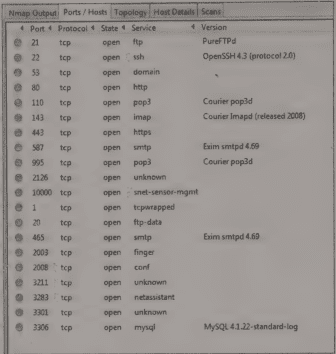

图 2-1：服务器上开放的端口

### 未修补 DNS 服务器

最流行（如果不是最流行）的 DNS 服务器软件平台之一是 *Berkeley Internet Name Domain (BIND)*。与其他所有软件系统一样，BIND 在未来的某个时候也会出现漏洞。应用更新或补丁（就像你对其余软件所做的那样）是保持安全的最佳方式。

在撰写本文时，BIND v9 的一次近期更新修复了一个名为 *DNS 污染*（稍后讨论）的危险威胁。这就是主机和你应该及时打补丁的一个例子。

### DNS 污染

攻击网站最恶劣的手段之一就是污染 DNS 服务器中的信息。具体来说，攻击者迫使 DNS 服务器接受错误信息，从而使服务器返回恶意或错误的网站地址，而不是你的地址。

2009 年 12 月 18 日，微博客服务 Twitter.com 的 DNS 服务器遭到政治活动人士入侵。黑客将针对 Twitter 的所有请求重定向到他们控制的服务器上的某个网页。实施这次攻击时，他们不需要访问 Twitter 的服务器，只需访问 DNS 服务器即可。

如果你被一个真正知识渊博且意志坚定的攻击者盯上，DNS 服务器将成为主要目标之一。DNS 服务器是收集网络内部基础设施、密码、用户名、内部 IP 地址等大量信息的最佳场所。而所有这些信息都可以从一个配置不当的 DNS 服务器中获取。可以这样想：一个罪犯在闯入办公室之前可能会先踩点，他要知道警报器、出口、摄像头等的位置。执着的攻击者也会以同样的方式看待 DNS。

> **注意** 要了解更多有关 DNS 的信息，请参阅 *《DNS 与 BIND（第五版）》*（Sebastopol, CA: O’Reilly, 2005），作者 Cricket Liu 和 Paul Albitz。它是现有最好的 DNS 参考书之一。

## 托管自己的网站服务器

偶尔，你会听说有人在家托管 Web 服务器。作为小型企业，你可能就设在家庭办公室。在家托管服务器似乎是个好主意，但实际上并非如此。你应该放弃这个想法，寻找合适的托管服务。

然而，如果你的企业拥有技术人员，那么内部托管是一个可行的选择。本小节将简要介绍处理自己的 Web 服务器的要点。

### 准备工作

首先，你必须确定需要多大规格的物理服务器。如果你的网站是一个高交易量的商店，那么你需要关注处理速度快、延迟低的驱动系统。如果你从事的是低流量但高带宽消耗的业务（例如培训视频服务器），那么预算重点应放在合适的网络带宽上。

确定你的应用技术栈，如电子邮件、Web 服务器、编程语言和网站软件（例如 Joomla!、Drupal、Plone 或 WordPress），将推动你的硬件决策。接下来是操作系统的选择。虽然有很多选择，但本书主要关注 Linux。

这些决策都会在一定程度上改变你的成本模型。例如，Linux 的成本更低，因为它是开源选择，而微软等大公司的商业授权产品价格更高。价格不应成为决定性因素。相反，为合适的工作选择合适的工具才是正确的决定。


在安全类别中，涵盖安全与备份。网络的安全将由物理硬件（如 Cisco 防火墙）或软件防火墙来处理，如前所述。

总体框架已经铺开，接下来让我们开始学习如何托管自己的 Web 服务器。

## 制定采购清单

如今市场上的大多数低端服务器硬件都能完成你所需的任务。要实现最低限度的 Web 服务器配置，你需要在机器中关注以下各项：

- 单核或双核 CPU 服务器
- 双网络接口卡（NIC）
- 支持 RAID 1，配备三块硬盘（其中一块作为热备）
- 双电源
- 备份软件
- CD-ROM 驱动器
- 4 小时 × 每周 7 天 × 全年 365 天现场服务
- 不间断电源（UPS）

> **廉价磁盘冗余阵列（RAID）**
>
> RAID 多年前被发明出来，如今已成为全球服务器的标准配置。RAID 存在不同级别，从 0 到 5。RAID 5 在企业界非常常见，并被认为是最安全的级别之一。使用 RAID 5，你实际上可以丢失一块硬盘而不丢失任何数据。RAID 1 也被称为*镜像*。采用这种配置，你可以丢失一块硬盘，而系统仍会继续运行。不过，一定要尽快更换那块硬盘。

这份清单代表的是相当基础的标准化配置，应该不会给你的预算带来太大负担。但是，千万不要设想在这套系统上运行内部关键任务应用（例如会计）。那根本就是个坏主意。让 Web 服务器只做 Web 服务器。

接下来的硬件组件是内部网络，以及由电话或有线电视提供商为你提供的互联网服务。它会连接到提供商为你的内部网络提供的路由器。

你需要选购一台小型托管或非托管 10/100/1000 交换机，并配备合适的连接以匹配接入的路由器。该交换机将办公室中的所有机器连接到服务器，并可能连接到外部世界。

请注意，这是对内部网络的一般性描述，不一定代表你应该部署的配置。你必须考虑本书范围之外的因素，才能进行适当的网络配置。

与互联网服务提供商（ISP）沟通时，要了解一些事项，例如其 SLA，其中明确了处罚、责任和法律条款。此外，还要弄清谁负责将 ISP 的设备连接到你的网络。大多数情况下，会是你。如果你没有内部网络专业知识，请向 ISP 询问连接费用。

## 选择操作系统

选择在 Web 服务器上运行的操作系统，会对你的运营和预算产生很大影响。在本例中，你的选择包括 Linux 或 Windows。

每种选择都需要不同技能组合的人员来处理。每种都有许可证选择，例如开源与商业许可应用。表 2-2 列出几点内容，帮助你决定操作系统。

**表 2-2：** 选择操作系统时的考虑因素

| 组件 | Linux | Windows |
|---|---|---|
| 操作系统 | 免费 | 收费 |
| Web 服务器 | Apache 免费 | IIS 随服务器软件提供 |
| 支持 | 收费和免费 | 收费和免费 |
| 电子邮件 | Postfix、Squirrel、Horde | Exchange |
| 备份 | 开源、商业 | 商业可用 |
| 附加项/插件 | 开源、免费 | 商业可用 |
| 安全 | 配置得当则强 | 配置得当则强 |

如你所见，两种操作系统在你可能需要的领域都具备同等功能。

在决定操作系统之后，下一步就是设置和配置机器、建立 Web 服务器，并连接到外部世界。

> **注意** 选择 CMS 与硬件选择无关，不应影响你的决策。CMS 的使用模式将是更大的因素。例如，一个高数据库事务的网站需要一台能够支持更高磁盘 I/O 来服务数据库请求的机器。

## 确保安全

你的部分安全将固有地存在于网络中，表现为防火墙和其他面向安全的硬件。保护服务器需要你添加软件来保护以下易受攻击的领域：

- 邮件服务器
- Web 服务器
- Web 应用
- 操作系统
- 病毒防护
- 垃圾邮件防护
- 机器和网络的物理保护

尽管还存在更多领域，但这些是在托管自己的机器时需要特别注意的一些领域。

## 修补

维护自己的系统和网络意味着，你必须及时跟进站点、服务器、交换机、路由器和应用程序的修补。

制定检查和更新网络的计划会更轻松，并防止你落后。在 Windows 上，许多补丁需要重启机器。在 Linux 上，虽然较少发生，但有时你的服务器在打补丁后可能需要重启。记住这一点很重要的原因是，你会希望将重启安排在非工作时段。服务器重启并恢复到运行状态可能需要几分钟。在此期间，你的站点将离线。

> **注意** 第 7 章会更详细地介绍修补。

请认真考虑将托管引入内部是否值得。尽管好处是你拥有几乎无限的自由按自己的方式做事，但你也几乎有无限的机会遗漏某些非常重要的东西，因为这可能不是你的核心业务。

## 总结

在本章中，你学习了关于选择适合你的主机的几个重要要点。核心思想显然是保持适当的安全水平、控制在预算内，并保持易用和易维护。本章介绍了 PCI 的基本概念，帮助你开始踏上电子商务之路。你还学习了如何托管自己的 Web 服务器。

基于所有这些数据，你现在已掌握所需知识，可以决定在哪里托管、寻找什么以及应选择什么方案。第 3 章探讨如何通过正确安装 CMS 和处理安装后安全问题来防患于未然。

- 在选定的 CMS 中，你了解访问控制列表（ACL）选项吗？（这对于控制对站点资源的访问很重要。）
- CMS 是否提供足够的核心工具，或者是否有合适的第三方附加组件可供你用来解决业务问题？
- 这些第三方附加组件会不会互相造成问题？

本章可以帮助指导你了解每个 CMS，以及如何在考虑适当安全性的情况下正确安装它。让我们先看看如何为你的业务应用选择合适的 CMS。

# 根据需求选择合适的 CMS

你不一定需要像开源项目及其粉丝那样，对某个特定软件（或硬件）平台怀有同样的热情，这似乎是常态。尽管认可开发者和社区为每个项目带来的热情是好的，但对你的业务的热情应超越这一点。

你应该把 CMS 看作它们本来的样子——工具。看看本书中涉及的每个 CMS，选择最能帮助你实现业务目标的那一个。列出你需要的特性和功能，以及你管理该解决方案所具备的技能，可以帮助你做出选择。本书涵盖的每个 CMS 都可以帮助你实现让业务上网的目标。就此而言，高中生通过构建一个 HTML 页面也能做到同样的事。但那是你真正想要的吗？

真正的关键是你希望平台为你做什么。它将解决什么业务目标？从这里开始，为你选择的项目软件做出正确的业务决策。

## 做出正确的业务决策

你必须做出的第一个业务决策是定义你的站点要用来做什么。它是企业*宣传册网站*吗？它是*电子商务*网站吗？你的解决方案需要实时客户服务或聊天功能吗？确定站点目的会引出许多其他问题。先问这些问题将指导你的设计选择。

其次，你必须考虑这项工作在建成前后涉及的无形因素。例如，如果你有技术员工，他们是否具备支持站点的技术编程技能？你是否有一位值得信赖的技术开发人员，在代码需要时能够处理它？服务器操作系统及相关组件呢？

本书涵盖的三个 CMS（Joomla!、Drupal 和 WordPress）都是用 PHP 编写的。Plone 是用另一种名为 Python 的语言编写的。


在大多数情况下，无论选择哪一种CMS，都需要一位具备与所选CMS相当技能的开发者。

您还应该考虑CMS所处的生态系统。Joomla!、Drupal和WordPress拥有非常庞大的第三方开发社区。这三者都足够易于使用。

Plone的市场份额小得多，因此开发者生态系统也较小。Plone在市场占有率方面的不足，由一款健壮、可靠的CMS和一个充满活力的社区来弥补。Plone比其他三者有重得多的技术要求，因此，拥有强大的社区支持是一件好事。

让我们简要了解一下本书涵盖的每个CMS的一些背景。

### Joomla!

在开源世界里，当一群开发者希望重新分发带有其更改的代码，并且很可能使用新名称时，这被称为分支。Joomla!是曾名为Mambo的开源项目中较为成功的分支之一。在过去几年里，它发展迅猛，已成为最受欢迎的CMS平台之一。Joomla!拥有非常活跃的第三方开发者生态系统，其中许多提供商业产品和支持。

总的来说，您可以将Joomla!用于从简单网站一直到协作网站的各种用途。

几乎可以找到任何类型的扩展（在Joomla!中附加组件称为扩展）来满足几乎所有需求。模板（即改变外观的皮肤）的开发社区非常深厚和广泛，提供数以千计的模板。Joomla!扩展站点（http://extensions.joomla.org）列出了成百上千个扩展，涵盖众多类别。例如，在电子商务类别中，仅购物车就有20多家第三方开发者提供。

Joomla!商业开发社区是一个非常创新的群体。有一位开发者（www.corephp.com）甚至提供了一种扩展，使您能够在Joomla!网站上运行几乎任何Drupal模块。

Joomla!文档完善，许多出版作者写过关于该平台的内容。对初学者而言，它被认为是中等难度的软件。

### Drupal

Drupal的安装基数几乎与Joomla!一样大，但存在一些关键差异。Drupal被认为在技术上比Joomla!更具挑战性。与Joomla!不同，大多数Drupal模块（Drupal附加组件的术语）是免费的，而不是出售的。这体现了Drupal与Joomla!社区之间的文化差异。

Drupal非常健壮，并被一些非常知名的网站使用（如www.whitehouse.gov）。它拥有优秀的第三方开发社区，并提供大量模块附加组件。

就复杂性和技术挑战而言，Drupal可能排在Joomla!之上。Drupal 7似乎通过在核心安装中内置许多模块，缓解了先前版本的许多挑战。Drupal 7在减轻普通用户面临的一些技术挑战方面迈出了重要一步。

### WordPress

WordPress是本书中所有CMS中最受欢迎的。它拥有所有CMS平台中最大的安装基数。WordPress最初是作为博客软件诞生的，但已进入CMS领域。

如果你需要公司博客，WordPress是正确的选择。它易于使用，界面直观，有利于写博客。社区免费提供若干主题（WordPress中皮肤的名称），还有更多主题可商业购买。

*插件*（WordPress中对附加组件的称呼）非常丰富，而且大多免费。尽管通过WordPress上的特定插件可以实现电子商务，但您可能会发现其他CMS平台使用其他第三方附加组件更适合这项任务。

WordPress非常容易安装，并且是一个相当安全的系统。您访问的许多网站可能运行在WordPress上。

### Plone

在本书讨论的四个CMS中，Plone显然在设置和管理上技术性最强，但在向其添加和管理内容方面，它却与WordPress或Drupal一样容易（或在某些方面可能更容易），而这两者都有相当健壮且用户友好的内容添加方式。本书收录这个CMS，是作者为了拓展商业社区视野所做的努力。

Plone的社区没有本书讨论的其他三个CMS那么大，但plone.org提供了大量*附加组件*（Plone中对附加组件的称呼）。您还可以访问www.contentmanagementsoftware.info/plone/获取更多附加组件。

Plone构建在Zope框架之上，可在许多操作系统平台上运行。

## 哪种CMS提供最佳安全性？

你正在读这本书，因此，你无疑思考过这个问题：“从安全角度看，哪个CMS最好？”一个有点开玩笑的答案是：所有CMS在安装并上线之前都是安全的。现实情况是，本书涵盖的所有CMS都可能并且确实会时不时地遭遇漏洞。

自2009年3月以来，salvusalerting.com跟踪了若干不同的应用程序和项目。回顾近两年的数据后发现，漏洞*最少*的CMS是Plone。其余CMS之间的漏洞数量相差约一百个。这并不意味着Plone最安全，也不意味着Drupal、Joomla!或WordPress在争夺“最可能失败的CMS”这一称号。它只是意味着Plone已公布的漏洞数量最少。

所有这些CMS的开发团队都非常重视安全性。您应重点研究的领域包括第三方扩展开发者。这正是您更可能遇到安全问题的地方。

## 从商业角度需要考虑的四个因素

总体而言，您应该使用四个关键原则来形成使用哪个CMS的决定。在进入选择阶段时，请考虑这些指导原则。

- *可支持性*——您或您的员工能支持它吗？您能回答用户问题吗？您知道如何添加内容吗？所有这些CMS都会不时需要更新、附加组件等。
- *可行性*——尽管这四个CMS因其追随者和安装基数实际上并不存在消失的风险，但仍应提出这个问题：所选的CMS会维护缺陷修复和补丁吗？如果任何商业可用或开源软件平台停止支持，您是否准备好迁移到新平台，还是继续维护并满足旧系统的技术需求？
- *功能性*——在核心平台或第三方附加组件中，您选择的CMS是否提供您所需的功能？当您在纸上制定选择标准时，创建电子表格并列出您需要它支持的功能或流程。还要列出支持该CMS的核心软件或第三方附加组件。
- *安全性*——尽管本书考察的四个CMS确实提供了很强的默认安全水平，但许多其他工具也提供增强的安全水平。因此，要问的安全问题是：该CMS及其第三方产品有什么来保护您的站点免受攻击？

## 考虑开发成本

开发成本可能很快失控，然后安全性就沦为*锦上添花*的地位。

当您准备开发站点，或让第三方开发者为您处理此事时，从整体上处理整个工作将带来更好的收益。如果您预先规划安全性，站点在遭受攻击时将具有很高的生存能力。

计算备份系统的成本——包括您或您的员工使用必要工具所需的任何实用程序和时间。如果您想包含特定的安全功能或工具，请预先定义它们，或让Web开发者为您提供准确的成本。

您可能考虑预算的另一项成本是代码审计，前提是您有第三方开发者编写的软件。这相当于雇用另一位软件开发者（除主要开发者之外）来审查代码。您可能希望审计员查看的项目可能有很多，但以下是一些关键领域：

- SQL注入漏洞
- 跨站脚本（XSS）漏洞
- 远程文件包含漏洞
- 后门
- 木马代码
- 调试代码

在大多数情况下，这些领域不应成为真正的问题。但如果项目是完全自定义编写的，那么让第二双眼睛审查代码不会有坏处。

## 考虑支持

支持常常被忽视或“规划不足”。可悲的是，这往往导致“我需要支持，而且我现在就需要！”的局面。当您选择一家公司进行软件开发时，请花时间了解其售后支持政策。以下是一些指导性问题：

- 它提供售后支持吗？
- 如果不提供，它是否有推荐的公司？
- 如果该公司修改核心CMS代码，如何记录？升级将如何进行？
- 该公司支持的相关费用是多少？
- 它对其工作提供什么保证（如果有）？

假设软件开发公司确实提供售后支持，问题和疑问如何处理？这通常通过工单系统完成，但并非总是如此。最好预先了解清楚。


以下是一些可供考虑的选择：

- 很少有商业公司*仅*提供支持，例如 OpenSourceSupportDesk.com，它提供对 WordPress 和 Joomla! 的支持。
- 你可以选择直接用 www.WordPress.com 运行你的 WordPress 站点，它会为你管理核心软件，从而减轻你的负担。
- 如果你的站点基于 Drupal 构建，你可以选择 www.drupalgardens.com，它提供更新等方面的支持。
- Plone 拥有一个健康的社区，有 300 多家公司提供某种形式的 Plone 支持。访问 www.plone.net/providers 获取更多信息。

支持是一个多层面的问题，跟上它可能成本高昂。当你处于 CMS 选择过程中时，以下是一些需要考虑的支持问题：

- 你将如何发现该 CMS 或某个附加组件是否存在漏洞？
- 该 CMS 对安全问题的响应速度有多快？
- 附加组件开发者是否提供支持？如果提供，费用是多少，开发者响应问题的速度有多快？
- 第三方是否对更新收费？
- 更新的难度级别如何？
- *核心* CMS 内置了哪些安全功能？
- 有哪些可用的第三方安全应用程序？

## 在构建之前先构建它

根据我的经验，人们往往沉迷于站点外观和感觉的细节，而不是它如何运作。尽管外观和感觉非常重要，但你应该先花时间设计站点和系统的工作流程。

首先，以下是一些关于站点功能的考虑事项：

- 最终用户是否需要或被要求注册？
- 站点会自动允许他们登录吗？
- 最终用户需要提供哪些信息？
- 他们登录后会做什么？
- 丢失密码的策略是什么？
- 登录应具备哪些功能？
- 用户将获得哪些权限或访问权？
- 站点会有多个管理员吗？
- 这些管理员角色将是什么？

如你所见，这些详细问题并不涉及站点上的实际颜色、图片或文本。它们旨在帮助你建立站点工作流程。

一种低技术（但有效）的站点规划方法是将功能写在索引卡上，然后列出可以满足这些功能的潜在第三方扩展（附加组件）。如果你选定某个附加组件，请在索引卡上记录 URL、支持信息或电话号码，以供将来参考。

此外，通过变更日志查看开发者的过往记录，以了解安全修复的记录。如果开发者有大量修复，这可能意味着该公司积极主动，你可能会对使用该公司感到放心。这也可能意味着该公司不太擅长编码。对于这种判断，并不存在可靠的衡量标准；这更多是直觉问题。

使用纸面方法演练工作流程。验证每个资源的 ACL，并检查你可能造成的任何潜在漏洞。

最后，你需要在纸面上决定将在什么环境中开发——服务器还是桌面。让我们详细看看这两种选择。

### 在服务器上开发

在服务器上开发时，你将通过内部网络或互联网访问它。保护开发站点免受窥探很重要。最简单的方法是使用 Apache 的 .htaccess 文件。你可以非常轻松地设置一种方法，仅允许授权人员进入站点。

> **注意** 附录 A 提供了更多关于使用 `.htaccess` 文件的详细信息。

该过程的概要如下：

- 1. 为你的 `.htpasswd` 文件创建密码。
- 2. 将 `.htpasswd` 文件上传保存到服务器的非公开部分。大多数情况下，那是 `public_html` 上一级目录……
- 3. 写一小段 `.htaccess` 代码，并将其放在站点根目录中，该代码会调用密码文件，并将给定密码与存储的版本进行核对。以下是 `.htaccess` 代码示例：

```
AuthName "Restricted Area"
AuthType Basic
AuthUserFile /home/mysite/public_html/.htpasswd
AuthGroupFile /dev/null
require valid-user
```

任何浏览该站点的人都将看到图 3-1 所示的屏幕。

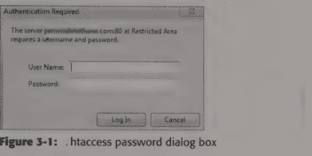

> **注意** 有一个不错的站点可以协助你完成通过 .htaccess 设置密码系统所需的一切工作。访问站点 http://tools.dynamicdrive.com/password 生成你的密码哈希并获取正确的 .htaccess 代码。你必须提供一些关于你特定设置的信息，以便它为你提供必要的代码。

### 在桌面上开发

名为 WAMP 的 GNU/GPL 工具是一个完全自包含的 Windows 桌面环境，你可以在其中运行 Apache、MySQL 和 PHP。在大多数情况下，它的行为与服务器完全相同。

该工具支持测试，提供开发位置，提供一个安全的环境以便在上线前探索补丁，等等。该工具使你无需始终连接互联网即可进行开发。

安装和配置非常简单。这是安全探索和测试扩展的好方法。如果你使用这种方法进行开发，你可以备份完成的站点，然后将其上传到生产环境。

> **注意** 你可以在 www.wampserver.com 获取该软件。

## 执行 CMS 安装

在大多数情况下，本书中考察的 CMS 都提供简单的安装，并且有完善的文档。本节讨论通用安装，特别关注安全问题。首先讨论的安装是 Joomla! 1.5，并附带一些关于 Joomla! 1.6 的说明。接下来，你将了解 Drupal 6.xx 的安装，并看到一些关于 Drupal 7 的评论。随后是 Plone 的说明，使用（截至撰写本文时）可用的最新 Plone 版本。最后，你将了解 WordPress，它的安装是所有中最简单的。

对于 Joomla!、Drupal 和 WordPress，在开始之前你需要以下条件：

- 可用的服务器（WAMP 或 Linux）
- Apache
- 已配置数据库的 MySQL
- PHP（5.xx）
- 你的用户名、数据库名和数据库密码
- 具有凭据的 FTP 或 SSH 账户

对于 Plone，你需要通过 PuTTY 或其他方式访问服务器。你可以在命令行中完成大部分（如果不是全部）安装。

### 安装 Joomla! 1.5

Joomla! 安装通常很简单，很少遇到麻烦。你可能遇到的问题很可能也会困扰这里考察的所有 CMS，包括权限、所有权问题、不正确的数据库设置等等。

下载压缩的安装文件后，你必须解压（解压缩）它，并将其上传到服务器的 Web 根目录（通常是 public_html）。

要开始该过程，请打开浏览器并访问将安装 Joomla! 的域名，例如 http://www.YourDomain.com。这会启动安装例程。

与其他 CMS 一样，Joomla! 能够支持多种语言。在第一个屏幕中，你选择站点将默认使用的语言，如图 3-2 所示。

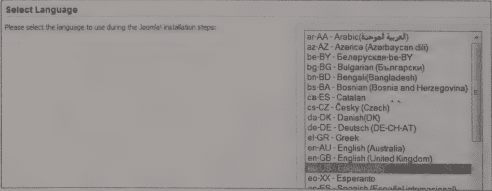

**图 3-2：** 语言选择

安装脚本将检查你尝试安装的环境。如果存在问题，你将看到问题显示在确认屏幕中，如图 3-3 所示，这是安装过程中的下一个屏幕。

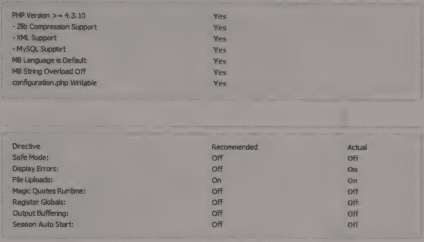

图 3-3：安装前检查

如图 3-3 所示，“显示错误”（Display Errors）设置实际上是“开启”，但建议的设置是将其关闭。你可以在 php.ini 文件中纠正这种情况。查看此页面后，记下任何需要纠正的内容（例如本例中的“显示错误”设置），以便稍后修复。

单击“下一步”，出现 Joomla! 许可证页面。查看许可证条款后，单击“下一步”继续进入图 3-4 所示的数据库配置屏幕。

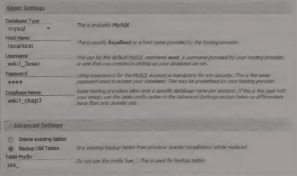

图 3-4：数据库设置页面


这里的设置分为基本设置和高级设置。在基本设置中，输入数据库连接和其他设置，可参考以下内容：

- 数据库类型 — 在本示例中，此项设置为 MySQL；对大多数人来说，这将是正确的选择。
- 主机名 — 大多数情况下是 localhost，但对于某些 Web 主机，你会有一个特定的服务器名。
- 用户名 — 这是为数据库指定的用户。
- 密码 — 数据库的密码。
- 数据库名 — 这是你在创建数据库时为其指定的名称。

在高级设置下，你会看到两个单选按钮和一个文本框。选择“删除现有表”选项将清空数据库中以前的所有条目。如果你正在重新安装且尚未备份数据库，请选择第二个选项“备份旧表”。这会创建一个数据库前缀 bak_。

数据库中的表前缀默认为 jos_。出于“通过隐匿实现安全”的考虑，你可能想更改它。更改表前缀不会让你更安全，但会降低其显眼程度。目前，请保留默认值 jos_，然后单击“下一步”继续。

内置的 FTP 层允许在你的 Joomla! 站点内执行特定的文件传输协议（FTP）功能，如下一屏幕所示，见图 3-5。尽管意见不一，但建议将其保持禁用。如果要启用它，必须提供 FTP 身份验证信息。单击“下一步”继续。

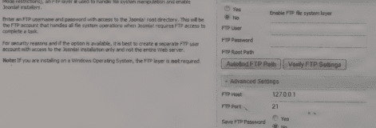

图 3-5：FTP 配置页面

你看到的下一个屏幕允许你输入站点信息，如图 3-6 所示。在此填写站点名称、有效的电子邮件地址，并选择一个强管理员密码。注意，“你的电子邮件”选项中包含 `admin` 这个词。这是 Joomla! 1.5 中出现的默认值。它不会更改你实际的超级用户管理员名称。

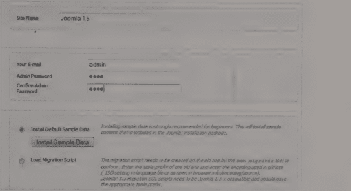

**图 3-6：** 为站点命名

在图 3-6 的下半部分，注意另外两个设置：

- *安装示例数据* — 选择此选项将用各种菜单、内容、栏目和分类填充你的站点。这是了解系统工作原理的好方法，但可能会妨碍生产站点。
- *加载迁移脚本* — 选择此选项可将旧的 Joomla! 1.x 站点迁移到 Joomla! 1.5.1。从 1.0 到 1.5 的迁移超出了本书范围。不要加载迁移脚本。

单击“下一步”继续。

最后屏幕如图 3-7 所示，指示你删除或重命名名为 `Installation` 的目录。你需要通过 FTP 或 SSH 登录服务器或网站来删除此目录。你应该直接删除该文件夹。

至此，你可以访问站点或以 `admin` 身份登录。

一个能提高安全性的细节是移除默认管理员用户。请按以下步骤操作：

1. 以管理员身份登录。
2. 创建一个新用户。
3. 将新用户的权限提升为超级管理员。
4. 保存更改并退出登录。
5. 以你刚创建的*新*超级管理员身份重新登录。
6. 将原管理员用户的权限降为注册用户。

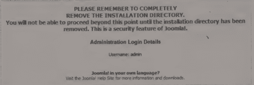

**图 3-7：** Joomla! 安装完成

你现在已经移除了*默认*管理员用户。你所做的是移除显眼的管理员账户，使其不再成为黑客的目标。例如，将其用户名改为 K39F028 会使攻击者尝试暴力破解困难得多，因为入侵者不知道用户名。

### 安装 Joomla! 1.6

Joomla! 1.6 是下一代 Joomla!。在大多数情况下，1.6 版的安装与 1.5 版相同，只是本节所述的变化除外。

如图 3-8 所示，FTP 配置屏幕现在指示 FTP 层为可选。

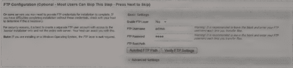

**图 3-8：** Joomla! 1.6 FTP 配置屏幕

另一个不同之处是，在这一步，1.5 安装中你会为站点命名；而在 1.6 版安装中，你会发现几个新选项。

高级设置现在位于屏幕顶部附近，如图 3-9 所示，包含元描述和元关键字选项。对于与搜索引擎相关的活动，这个位置非常有价值。

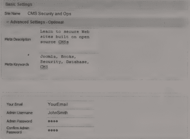

图 3-9：Joomla! v1.6 安装中更新后的屏幕

另一个变化是能够在安装时更改管理员用户名。正如你在前面关于 1.5 安装的描述中了解到的，更改默认管理员用户名是重要的安全步骤。然而，1.5 版安装并未提供在安装时执行此操作的方法。1.6 版已弥补这一点。这一重要的安全步骤已成为 1.6 版默认安装例程的一部分。务必把 admin 用户重命名为 admin 以外的名称。

你会发现其余安装步骤与 1.5 版完全相同，或足够相似，因此不应有任何真正的意外。

最后关于安全性的一点说明：1.6 版提供了新的 ACL 系统，允许你以非常细粒度的方式授予或撤销对内容和扩展的访问权限。务必花时间理解 ACL，以免无意中造成安全问题。

### 安装 Drupal

Drupal 为内容管理系统（CMS）提供了成熟而简单的安装例程。首先，解压 Drupal 安装文件，并使用 FTP 或 SSH 将其复制到服务器的 Web 根目录。浏览到你的域名，安装应会自动开始。

你看到的第一个屏幕（见图 3-10）允许你选择语言。出于本讨论的目的，请选择英语，但请注意 Drupal 能够安装其他语言。

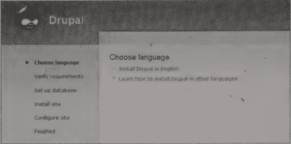

图 3-10：选择语言

接下来是图 3-11 所示的数据库配置屏幕。在此输入数据库名、用户名和密码。

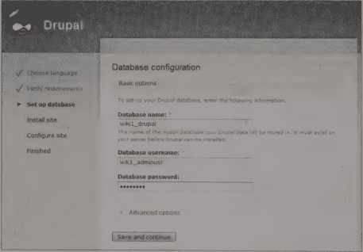

图 3-11：数据库配置屏幕

屏幕底部有一个“高级选项”链接。图 3-12 所示的高级选项在某些托管环境中是必需的。你可能需要联系主机商，以获取高级设置所需的信息。大多数用户应该不需要更改这些设置。但是，如果你确实需要更改，以下是一些指导原则：

- **数据库主机** — 这几乎总是 localhost，但对于 GoDaddy.com 之类的主机，你会收到实际的数据库服务器名。如果需要将名称从 localhost 改为其他值，请向主机商询问详细信息。
- **数据库端口** — 默认情况下，MySQL 使用端口 3306。如果你在 MySQL 配置中更改了此端口，则需要提供正确的端口号。
- **表前缀** — 如果你在同一数据库主机上安装了多个 Drupal 站点，则需要提供不同的前缀，以防止数据被覆盖。

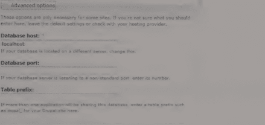

**图 3-12：** 高级选项

填写完数据库配置选项后，单击“下一步”继续。

随后会出现“配置站点”屏幕中的详细信息，如图 3-13 所示。在这里，你的 Drupal 站点将形成自身特色。填写站点名称和站点电子邮件地址。接下来，选择管理员用户名、管理员电子邮件地址和强密码。

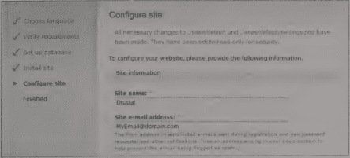

**图 3-13：** “配置站点”屏幕

注意图 3-14 中选择了一个弱密码，以演示 Drupal 将如何尝试在密码安全方面为你提供指导。请遵循 Drupal 关于密码强度的建议。

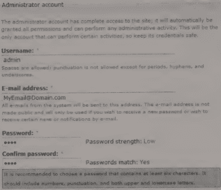

**图 3-14：** 管理员账户

现在，你可以通过单击显示“你现在可以访问新站点”的链接登录新站点。

## 安装后

有一个模块可帮助你处理安装后的安全问题。这个名为 Security Review 的模块将协助你检查站点问题，并帮助修正站点的配置概况。

图 3-15 展示了在测试服务器上运行的一个示例。在此示例中，它识别出两个问题点。单击第一个错误中的详细信息会显示大量信息以及一些可采取的操作，如图 3-16 所示。

> **注意** 目前，此模块适用于 Drupal 6.x 和 7.x，你可以从 `http://drupal.org/project/security_review` 下载。

完成安装后，考虑运行此模块，以确保你已覆盖许多容易遗漏的基础事项。除这个模块外，还有其他几个安全模块有助于提高安全性。


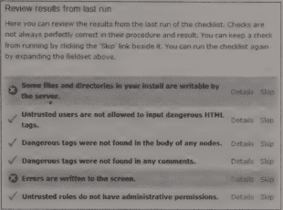

**图 3-15：** Drupal 安全审查模块

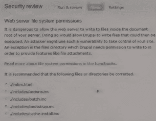

**图 3-16：** 需要的详细操作

### 权限

这里的权限与用户角色相关联。在 Drupal 6 中，创建了两个角色：匿名用户和已认证用户。Drupal 7 有第三个默认角色：管理员。

但是，你必须遵守一些规则来维护安全性。Drupal 角色并不难理解。请遵守几条基本规则：

- 授予匿名角色的任何权限都不会被已认证角色继承。
- 授予已认证角色的任何权限会自动共享给属于该组的每个用户。

例如，如果你为某个已认证用户分配了备份职责（即赋予该用户使用“Backup and Migrate”模块的权限），那么每个人都会自动获得使用该模块的权限。你可能不希望每个人都拥有该权限。更好的分配特定角色的方法是专门为备份（或其他功能）创建一个角色。让我们逐步了解如何做到这一点。

图 3-17 显示了角色的默认视图示例。

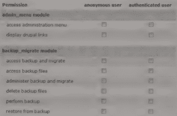

**图 3-17：** 默认的 Drupal 6 角色

假设你想添加一个角色来处理备份功能。为此，请转到 `www.YourSite/admin/user/roles` 菜单。在这里，单击“添加角色”按钮，如图 3-18 所示。

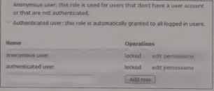

**图 3-18：** 在 Drupal 6 中添加角色

添加角色后，通过单击“编辑权限”选项并分配权限来为其分配权限，如图 3-19 所示。

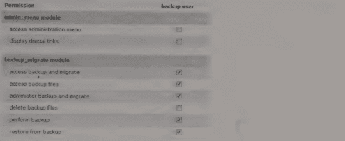

**图 3-19：** 分配备份权限

你可能已经注意到，在此示例中，备份用户角色被限制为不具有“删除备份文件”的权限。你可以为任何角色选择所需的任何粒度级别。

现在，`backup_user` 角色是唯一具有运行备份和还原功能权限的角色。如果你将“Backup and Migrate”模块的使用权限授予已认证用户角色，那么每个具有登录能力的人都可以进行备份、还原和删除旧备份文件。换句话说，这将导致混乱。

### Drupal 7

Drupal 7 中权限的处理方式非常类似，并且额外好处是已经预定义了一个管理员角色，如图 3-20 所示。正如你所看到的，在 Drupal 7 中，你现在可以自动将管理任务分配给管理员角色。

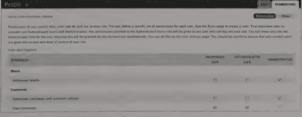

**图 3-20：** Drupal 7 中的默认角色

这将引出如图 3-21 所示的 Zope 管理界面。

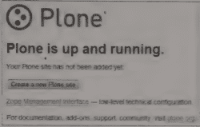

**图 3-21：** 创建一个新的 Plone 站点

> **注意** 如果 Zope 管理界面没有出现，请确保你的 Zope 实例正在运行，方法是在 shell（`$`）提示符下输入 `./bin/plonectl`。

单击“创建一个新的 Plone 站点”并按照提示快速轻松地设置你的 Plone 网站。要管理它，请输入以下内容：

```
http://localhost:8080/manage
```

要添加内容，请访问其安装所在的域名并登录。从那里，你可以添加内容和其他代码，使网站具有独特的个人风格。

### 其他资源

本书第 6 章介绍了如何备份和还原你的 Plone 站点。Plone 是一个非常详细的主题，最好的文档可以在线获得。

- 有关 Plone 安全性的更多详细信息，请参见 http://plone.org/documentation/kb/securing-plone。
- 由于 Plone 支持许多不同的平台，因此每个平台的说明超出了本书的范围。有关更多信息，请参见 http://plone.org/documentation/plone-topics/installation。

Plone 是一个功能强大且安全的 CMS。它需要很强的技术能力，因此对于没有技术资源的小型创业企业来说，这可能是一个错误的选择。

### 安装 WordPress

在本书讨论的四个 CMS 中，WordPress 是目前最容易安装的。在你的 WordPress 安装过程中，很少会出现问题。

首先，解压缩 WordPress 安装文件并将其上传到你的网站根目录。完成此操作后，浏览到你的站点以开始安装。

第一个安装步骤（使用 WordPress 3.0.3 版本）是创建配置文件，WordPress 可以为你处理这一步。如图 3-22 所示，只需单击“创建配置文件”按钮。

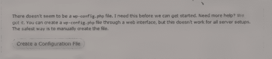

**图 3-22：** 自动创建 `wp-config.php`

配置文件包含站点运行所需的全部相关信息。

站点本身将其内容存储在数据库中。你接下来看到的屏幕为你提供了开始所需的信息。在理解了图 3-23 所示的信息后，单击“开始！”按钮。

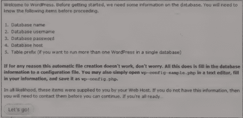

**图 3-23：** 安装前检查清单

在接下来显示的数据库连接屏幕（见图 3-24）中，你需要输入有关服务器设置的信息。请为你的设置输入适当的数据。需要特别注意的一点是，你可以将表前缀 `wp_` 设置更改为其他内容，例如 `mysite_`。这样做的好处是可以迷惑寻找 `wp_` 并试图据此发起攻击的恶意机器人。不过，你也可以直接使用默认设置进行安装。

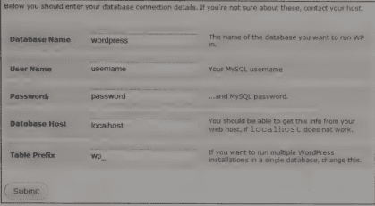

**图 3-24：** WP 数据库设置

填写完数据库详细信息后，WordPress 将运行检查以确保它可以与数据库通信。如果一切正常，它会显示如图 3-25 所示的消息。当你看到此屏幕时，表示 WordPress 安装脚本已成功连接到数据库并准备安装。

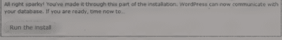

**图 3-25：** 运行实际安装

单击“运行安装”按钮继续。

现在你已经到了安装中需要为站点命名并提供所有个人信息的步骤，如图 3-26 所示。你应该将用户名改为除 admin 以外的名称。这有助于防止基于 admin 用户名进行暴力破解攻击的机器人。

> **警告** 请注意，暴力破解攻击不仅限于 *admin* 这个词，还会尝试典型的用户名。请选择一个不太容易猜到的名称，或者选择一组随机的数字和字母。

单击“安装 WordPress”以完成安装。

### WordPress 的可选安全插件

在 WordPress 插件目录（www.wordpress.org）中有一个 *安全扫描* 工具，可以对一些基本项目进行快速检查。虽然它非常基础，但它会检查一些容易被忽略的项目。请访问 http://wordpress.org/extend/plugins/wp-security-scan 获取该插件。要安装此插件，请使用常规的安装流程。

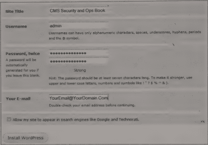

**图 3-26：** 个性化 WordPress 站点

在测试服务器示例中，该工具提供了一些提示，例如没有找到 `.htaccess` 文件。此外，它还表示默认设置仍然启用，例如用户 `admin` 仍然存在。

你应该安装此工具并查看报告，以了解你的安全性状况。

### 共享主机

如果你在共享主机服务器上运行，请考虑在配置文件上运行以下命令。这将阻止好奇的人读取你的数据库设置。你需要在服务器命令提示符下运行此命令（如果可用）。如果你无法做到这一点，请让主机提供商为你设置权限。

```
chmod 750 wp-config.php
```

> **注意** 对于你的 WordPress 站点，你可以强制使用 SSL 登录和 SSL 管理，这意味着你的所有用户名和密码都会加密发送到服务器。有关更多信息，请参见 http://codex.wordpress.org/Administration_Over_SSL


### 安装后的高级安全措施

如你所见，许多开源CMS都有若干可用的安全附加组件。请花时间审查适用于你特定CMS的所有工具，以确保安全。

在商业方面，有一个工具能很好地保护基于PHP的CMS免受大多数攻击，它就是来自 *SecureLive.net* 的 *SecureLive*。它可与 Joomla!、Drupal 和 WordPress 配合使用。它提供许多非常强大的安全功能来帮助防御黑客，并有一个站点报告卡，可帮助你找出可能导致攻击成功的其他问题。

其他值得考虑部署的良好安全措施包括 *mod_security* 以及另一个开源产品 *ConfigServer Firewall*（可从 *www.configserver.com* 获取）。

关键在于审视你所有的选择（开源和商业），以确保你不是依赖*单一*产品，而是能够分层设置防御。

### 上线前的清理与验证

作为一般规则，在上线之前，你应确保已移除所有安装文件、已更改临时访问权限等。以下是上线前要做的检查清单：

- 移除任何非管理人员的管理访问权限。
- 对**全新且纯净**的站点做一次干净备份。
- 移除安装文件（在适当情况下）。
- 确保移除任何临时文件。
- 复核文件和目录权限。
- 在向第三方开发者支付最终付款前，确认设计规格已满足。
- 将密码（在你**全部**更改之后）记录在安全的地方。
- 将数据库复制到单独位置。
- 列出所有第三方附加组件（即插件、扩展、附加组件（Plone）、主题、模板和模块）。
- 复核以确保你的CMS应用在发布前为最新版本。

## 总结

在本章中，你了解了CMS选择中一些常被忽视的业务决策，例如成本、可支持性和复杂性。你了解了两种设置开发环境的不同方法，以及如何在开始前在纸面上做规划。

你在安全背景下了解了本书涵盖的全部四个CMS的安装，包括通用设置和一些安装后提示。你了解了一些安全工具（免费和商业），以及如何在上线前清理环境。

第4章将介绍如何审查现有站点的安全性，这一过程称为基线化。

# 第 4 章

# 为现有网站建立基线

在任何业务运营中，你当然要考虑可能影响IT职能的人为和自然灾难。你应创建一个矩阵，以识别运营中存在哪些威胁、它们可能造成的影响程度以及行动计划是什么。这称为*基线*。

简言之，这是对你的业务影响说明的分析——即IT系统丢失或可用性降低会对业务造成什么影响。由此，你可以将风险管理融入规划。

基线报告的一个非常简单的示例可能涉及办公室的服务器环境。你会关注电力、备份和冷却。你还应关注不间断电源（UPS）、备份是保留在现场还是带离现场，以及如果空调失效，夏季冷却服务器的能力。表4-1展示了针对这些关注点的基线报告会是什么样子。

**表4-1：基线报告示例**

| 服务器 | 关注点 | 威胁级别和建议措施 |
|---|---|---|
| 主服务器 | 电力 | *中* — 在停电事件中，系统依靠电池供电的UPS可运行约20分钟。确保UPS切换到电池供电时关机脚本正确运行。 |
| 服务器机房 | 冷却 | *严重* — 如果在夏季需要空调时空调不可用，必须监控服务器是否过热。未来计划应包括在服务器机房安装局部冷却器。 |
| 恢复 | 备份磁带 | *低* — 磁带存放在服务器机房。新计划将是在异地保留一组轮换磁带以确保安全。 |

这个非常简单的示例展示了系统的一些运营威胁所在。

本章将向你展示如何审查服务器和CMS，以确定你的站点存在哪些威胁，以及应采用哪些缓解因素。

例如，你可能发现正在运行较旧版本的CMS，并且由于站点的CMS做了一些自定义修改（更改）而无法升级。升级会导致这些更改消失。然而，你当前使用的版本存在漏洞，必须更新。在这种情况下，你的缓解措施应是一个计划：将这些更改迁移到新版本CMS、测试、记录并部署。这可能是一个昂贵的解决方案，并且耗时。通过建立基线，你将能够看清所有必须更新的内容。

## 开始建立基线

为站点建立基线可以产生相当多有价值的信息。其中一些信息会定期对你有用。以下是一些对大多数站点通用的基线项目：

- *清单* — 你的站点和服务器上安装了哪些内容？
- *版本控制* — 已安装扩展的版本是什么？
- *补丁* — 哪些内容需要更新？
- *安全漏洞* — 你是否有任何软件或设置（例如开放端口）可能引起安全担忧？
- *工作流改进* — 在检查站点时，你是否看到任何导致性能不佳的因素，例如CMS上安装了较旧（但不不安全）的软件包？或者是否有用户拥有过多访问权限？

确定这一基线可以让你很好地掌握站点中具体要处理的内容。根据你的站点情况，你可能还想添加其他问题和回答。以下各节将更仔细地查看该列表中的几项。

### 盘点

当你审查网站时，可能很容易发现已遗忘的第三方附加组件。尽管它们可能在站点上被禁用，但仍可能成为攻击点。或者，该附加组件可能是在有效软件安装过程中安装的，但只是已过时且存在漏洞。无论哪种情况，正是在这个盘点阶段，你可以通过将所有数据记录到电子表格中来开始基线化过程。

至少应记录以下信息：

- 你当前运行的CMS版本
- 系统上安装的每个第三方附加组件
- 你网站特有的特殊配置或设置说明
- 服务器操作系统的发行版和版本
- 已安装的操作系统模块，如PHP、MySQL等
- 已安装并运行的Apache Server版本
- CMS皮肤的具体信息（主题、模板、portlet等），包括版本、获取它的URL等

图4-1展示了一个示例电子表格，表示输入此类数据的一种方式。通过这样做，你可以快速检查应更新或移除什么。当然，你会添加列或行以适合你的特定环境。

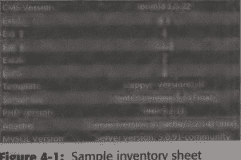

**图4-1：** 清单表示例

### 文档

文档非常有价值。拥有文档会使你的工作更轻松。

创建基线文档时，使用最适合你的工具。定义你将用于记录文档的格式或工具，并坚持使用。换句话说，不要在没有充分理由的情况下从一种工具切换到另一种又一种。

你的系统有许多方面需要记录。根据你的具体需求，你会知道是哪些。以下各节将查看基线中相当常见的四个方面。

#### CMS

如前所述，对于你的CMS，你应记录已安装的组件、扩展、模块、插件或附加组件。记录核心CMS版本信息。不要忘记，可能有许多设置一旦丢失会让你担忧。请在此报告中记录这些设置。

你的上次更新应按如下方式注明：

- 软件或脚本的名称
- 已安装版本
- 当前版本（已安装版本和当前版本应相同）
- 你更新它的日期

这些信息在你寻求技术援助、规划升级到新版本以及恢复时会有所帮助。

#### 网络

网络文档可能包括由ISP提供的简单如Wi-Fi路由器或电缆调制解调器的信息。也可能复杂到路由器和交换机。

尽管以下列表会因你的设置而异，但这些是一些典型的记录数据点：

- 设备制造商
- 固件（BIOS）版本
- 用于管理它的软件版本
- 连接到它的Telnet设置
- IP设置（内部面向和外部面向）
- 子网掩码


#### 桌面设备

需要为桌面设备、笔记本、移动设备或其他客户端机器采集的数据，与你为服务器采集的数据类似。

确保桌面设备和其他机器具有最新更新，并且已启用病毒扫描程序。

将所有文档汇总到一个系统中，并持续更新。所有这些信息都将是你在本书描述的其他流程（例如灾难恢复）中要参考的内容。尽一切努力收集这些数据。

## 知道何时运行基线

你将在两个时间点或事件中执行基线审查：

- 第一个是初始基线运行，此时你收集数据并使站点达到最低安全标准。此时执行基线可为你提供初始起始快照。
- 第二个是站点发生任何变更时。这些变化可能是通过打补丁进行的更新、第三方软件的安装（或移除），或在你遭到黑客攻击后的恢复。在变更后执行基线，使你能够将其影响与初始基线进行比较。

## 识别问题区域

网站和系统上的问题可能以多种形式出现。在基线报告的这一部分，你要识别弱点并加以纠正。这可能表现为过时的扩展或配置错误的设置。目标是捕获信息并消除问题。

需要关注的领域包括操作系统（及其附加组件）、CMS（及其附加组件）、服务器/硬件和网络。

## 检查操作系统和附加组件

总的来说，除了 CMS 之外，操作系统是你应当重点关注的领域。如果你没有管理更新，或者你的主机提供商没有管理更新，那么你的系统很可能存在某些可能影响你的漏洞。

记录操作系统上安装的各种应用程序和模块，并将信息写入基线报告。

以下命令可用于确定已安装的服务器模块 MySQL、Apache、Java、PHP、Python 和 Linux 内核的版本号：

- *MySQL* — `mysql -v`
- *Apache* — `httpd -v`
- *Java* — `java -version`
- *PHP* — `php -v`
- *Python* — `python -v`
- *Linux* — `cat /etc/*-rel*`

**注意** 请注意，所有这些命令都要求你登录到服务器上的 shell（SSH）。

Linux 命令应当能在许多发行版上运行。但是，如果它不起作用，以下命令很可能提供你所需的信息。这些命令按 Linux 发行版分类：

- *Red Hat* — `cat /etc/redhat-release` 或 `cat /etc/redhat_version`
- *Fedora* — `cat /etc/fedora-release`
- *CentOS* — `cat /etc/redhat-release`
- *Slackware* — `cat /etc/slackware-release` 或 `cat /etc/slackware-version`
- *Debian* — `cat /etc/debian_release` 或 `cat /etc/debian_version`
- *Mandrake* — `cat /etc/mandrake-release`
- *Sun JDS* — `cat /etc/sun-release`
- *Solaris/Sparc* — `cat /etc/release`
- *Gentoo* — `cat /etc/gentoo-release`
- *Ubuntu* — `cat /etc/lsb-release`
- *SUSE* — `cat /etc/SUSE-release`

再次强调，在获得所有这些版本信息后，将其记录到报告中，并安装软件的当前修订版本。相应地进行更新。

## 检查 CMS 的第三方附加组件

就更新内部组件而言，在系统正常运行之后，CMS 本身很可能最耗费你的时间。本节简要检查本书重点介绍的每个 CMS，以便你审查已安装的第三方附加组件。

你的第一个重要步骤是从 CMS 或服务器中移除任何不需要的软件。这不仅降低站点的威胁面，还会使维护变得容易得多。

以下讨论检查每个 CMS 的一些内置工具，以识别已安装的内容，并验证其是否存在漏洞或是否应更新，先从 Joomla! 开始。

### Joomla!

Joomla! 的组件、模块和插件都以相同方式工作，如图 4-2 所示。在大多数情况下，该工具会列出作者以及作者网站的名称。你可以区分核心（即原生 CMS）扩展与来自第三方的扩展。对于核心扩展，“作者”列包含“Joomla! Project”。当你更新 Joomla! 本身时，这些扩展也会更新。

| 组件 | 启用 | 版本 | 日期 | 作者 |
|---|---|---|---|---|
| Akeeba Backup | ✓ | 3.2.7 | 2009年9月 | Akeeba 项目 |
| JCE | ✓ | 1.5.2 | 2010年 | JCE 项目 |
| K2 | ✓ | 1.5.0 | 2010年11月19日 | JoomlaWorks |
| Kunena | ✓ | 1.6.5 | 2010年9月 | Kunena 项目 |
| SecureLive | ✓ | 6.2.0 | 2010年12月6日 | SecureLive LLC |
| X? | ✓ | 1.5.0 | 2008年4月 | Joomla 项目 |

**图 4-2：** Joomla 扩展版本

在基线报告中，列出所有扩展，并说明它们是什么（插件、模块、组件），以及开发者网站的位置。

**注意** 一些开发者（例如 Akeeba）提供原地升级，让你可以轻松更新。在基线报告中注明这些内容很重要。

Joomla! 的最新版本（v1.6）具有一些便于更新的功能。例如，v1.6 允许在一个包中安装多个扩展。这提供了单击一次即可更新多个扩展的能力。

### Drupal

Drupal 有一个出色的更新通知系统。当新的核心模块或贡献模块（即第三方模块）因任何原因需要更新时，Drupal 管理员报告会通知你。

在如图 4-3 所示的 Drupal 站点上，你会看到 Webform 6.x–3.4 已过时。事实上，它显示“需要安全更新！”

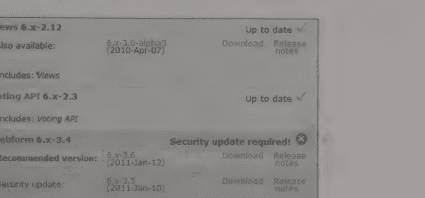

**图 4-3：** Drupal 更新报告

要开始基线，首先查看更新报告，并确保你至少已是最新版本。如果不是，请花时间更新，并将发现记录在基线报告中。

要找到此报告，请以管理员身份登录 Drupal，并访问以下 URL 的报告部分：

```
http://Example.com/admin/reports/updates
```

这会向你提供需要更新的模块及其版本级别的报告。再次记录你已安装的模块及其版本。

下一步是确定已安装模块中哪些可以移除，因为你不使用它们或不需要它们。要查看列表，请以站点管理员用户身份登录，并访问如下模块链接：

```
http://www.Example.com/admin/build/modules
```

移除任何未使用的模块。

将此信息放入基线审查电子表格。当你发现更新或安装新模块时，相应更新基线列表。

### Plone

在安全方面，Plone 非常可靠。它的缺陷或安全报告非常少。但是，对 Plone 站点的附加组件和 Plone 版本执行基线仍然很重要。

要发现你拥有的所有 Plone 附加组件，请以管理员身份登录 Plone 站点。在管理控制面板（右上角）中，选择“管理”>“站点设置”。以下是一个快捷方式示例：

```
http://Example.com:8080/plone/prefs_install_products_form
```

在出现的设置屏幕中，你可以选择“附加组件”，如图 4-4 所示。

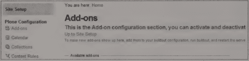

**图 4-4：** Plone 附加组件

将附加组件列表记录到电子表格中，然后访问 `http://plone.org/products`，验证你运行的是适用于你的 Plone 版本的最新版本。如果你发现附加组件已过时，请按照开发者的说明更新附加组件。

移除任何不需要的附加组件，并记录剩余包。

### WordPress

在本书检查的所有 CMS 中，WordPress 是用于识别和更新插件的最容易使用的 CMS。

以管理员身份登录 WordPress 站点，并在左侧工具栏上找到“插件”。单击“有可用升级”链接，将出现需要更新的插件列表，如图 4-5 所示。此外，你会看到一个数字（在本例中为数字 2），表示可更新的数量。然后，你可以按照说明继续更新附加组件。


**图 4-5：** WordPress 插件更新

更新插件后，在电子表格中记录站点上当前（已启用和已停用）插件的列表。你可以通过单击“插件”部分中的“全部（数量）”按钮找到该信息，如图 4-6 所示。


**图 4-6：** WordPress 全部插件

移除任何不需要的插件，并在基线报告中记录剩余的插件。


| 插件 | 描述 |
|---|---|
| **Akismet** | Akismet 拥有数百万用户，可能是在你睡觉时也能保护博客免受垃圾邮件侵扰的全球最佳方式。开始使用：1) 点击插件名称左侧的“启用”链接。2) 转到你的 Akismet 配置页面，并保存你的 API 密钥。 |
| **My beautiful tubes** | 一个允许博主在文章中嵌入 YouTube 视频的插件。 |

有可用的 Akismet 新版本。查看 2.5.2 版详情或自动升级。

有可用的 My beautiful tubes 新版本。查看 1.6 版详情或自动升级。

**图 4-5：** WordPress 插件更新

| 插件 | 描述 |
|---|---|
| **Akismet** | Akismet 拥有数百万用户，可能是在你睡觉时也能保护博客免受垃圾邮件侵扰的全球最佳方式。开始使用：1) 点击插件名称左侧的“启用”链接。2) 转到你的 Akismet 配置页面，并保存你的 API 密钥。 |
| **Amazon Showcase** | 一个用于展示 Amazon 商品的插件。只需输入你希望推广的任何商品的 ASIN/ISBN 编号。 |
| **Automatic WordPress Backup** | 自动将博客重要部分的备份上传到 Amazon S3。 |
| **Retweet** | 在你的文章/帖子中显示转发按钮。 |
| **SecurePress** | SecurePress 将 SecureLive 的防黑客能力带到你的 WordPress 网站！ |

**图 4-6：** WordPress 插件列表

## 了解硬件漏洞

硬件和软件一样存在漏洞。最大的区别在于硬件漏洞不那么频繁。最重要的漏洞通常位于硬件的固件或 BIOS 中，以及随硬件一同提供的控制系统（软件）中。

考虑到这一点，主要的硬件领域是网络设备（如路由器）、Wi-Fi 系统（以及交换机）和打印机（涵盖所有类型和所有功能）。尽管你可能无法接触其中一些设备（尤其是在托管环境中），但你的办公室中可能有打印机或网络设备。

### 网络设备

网络值得特别考虑，因为它们由硬件设备组成，通常具有某种形式的软件和固件，并且处于系统的核心位置。它们是黑客眼中的宝贵目标。

检查 Wi-Fi 路由器、交换机等网络设备是否存在默认密码和暴露的设置。将正确的设置记录到基线报告中。

> **NOTE** 请务必访问制造商网站，以确保你的驱动程序和固件是最新的。

收集所有设置以填入基线电子表格，并时常检查它们。很难为检查开发者网站提供一个具体的*频率*，因为漏洞会不断出现。两个建议是：在日历中每周安排一个时间检查所有网站，或者订阅 SalusAlerting.com。

### 打印机

如今，许多打印机制造商在实际硬件中加入了便捷选项（例如迷你 Web 服务器）。事实上，今天的许多打印机都具有*无线*连接功能。

对于无聊的黑客来说，这个功能可能是一座充满乐趣的宝库。浏览打印机、复印机和其他打印设备很简单。使用 Google，找到用于识别对互联网开放的打印机的字符串也很容易。黑客找到打印机后，连接它通常也同样容易。

问题显而易见——这种无线连接提供了进入你网络的途径。如果打印机上的软件变得存在漏洞，并且黑客找到了进入的方法，情况尤其如此。

作为测试，作者使用 Google dork（一种为查找漏洞而构建的搜索字符串）对特定型号的打印机进行了 Google 搜索。这次搜索在 Google 中列出了 25 条暴露于开放互联网的条目。一个专注的黑客可能通过这些条目获得访问权限，并在网络中肆意行动。

你的基线应确定任何网络连接打印机（包括无线系统）的以下信息：

- 它是否使用默认用户名和密码设置？
- 它能否从开放互联网中看到？（确定这一点的一种方法是尝试从外部世界浏览它，例如使用 `http://ipaddress/`。）
- 你是否联系了制造商并确定是否有可用更新？
- 打印机是否运行最新的驱动程序？
- 你是否检查了该站点上的所有设置？

确保审查所有支持网络的打印机和无线打印机。将这些打印机记录到基线电子表格中，并定期检查上述信息。

## 通过漏洞扫描发现隐藏危险

你的网站所在的服务器是一个非常动态的设备，其上的软件会逐渐老化。随着这种老化过程发生，可能会发现漏洞，可能会编写新的漏洞利用程序来攻击它，或者你可能只是发现代码中的错误。

所有这些问题可能累积成你网站中的隐藏危险。管理员（以及黑客）可以使用许多工具来帮助识别漏洞。以下是你可能想要熟悉的一些工具。

> **WARNING** 在使用任何这些工具之前，请确保已获得服务器所有者的许可。

- *Metasploit*（`http://www.metasploit.com`）是现有最受欢迎、最强大的工具之一。这个开源工具被渗透测试人员使用，他们是受雇*入侵*网站或发现弱点的安全专业人员。
- *Nikto2*（`http://cirt.net/nikto2`）是一个 Web 扫描器，用于查找弱点、过时文件、已知漏洞等。这是一个快速且“吵闹”的工具。换句话说，它并不隐蔽，但很强大。
- *Acunetix*（`http://www.acunetix.com`）是一个商业漏洞扫描器，用于检查你站点上的应用程序是否存在跨站脚本（XSS）错误。它会检查法律合规性，与 Google 黑客数据库进行比较，测试受密码保护的区域等。
- *Burp*（`http://portswigger.net`）提供 Web 扫描工具的免费版和商业版。一个强大的功能是它可以嗅探应用程序与浏览器之间的流量。这为你提供了大量关于应用程序如何工作的信息。

- LameRemote
- ProjectMayhem
- Backdoor.IRC.flood
- Backdoor.Hacarmy.E
- W32.Spybot, W32.Cissi.W
- W32.Linkbot.M
- W32.Zotob.D

通过 Nmap 扫描识别出的那些开放端口表明存在隐患。

### 安装 Nmap

Nmap 可用于 Linux 和 Windows。在 Linux 服务器上安装可以通过命令行使用以下两个命令之一来运行：

```text
#### rpm Manager : rpm -vhU http://www.nmap.org/dist/<version>
yum install nmap
```

> **NOTE** 如果你从任何非 nmap.org 直接来源安装，请务必运行更新。

有关完整安装说明，请查阅 http://nmap.org/book/inst-linux.html#inst-rpm 上的文档。

安装和运行 Nmap 的另一种方法是从 Windows 桌面进行。从 nmap.org 下载最新版本，并像安装任何其他 Windows 应用程序一样安装它。

> **WARNING** 在查看 Nmap 一些更有用的命令之前，请务必了解法律限制可能因服务器所在位置而异。换句话说，扫描特定国家或州的服务器可能是犯罪行为。因此，绝不要使用 Nmap 扫描你未明确获得许可扫描的服务器。这根本不是一个好主意，可能会让你陷入麻烦。

### 使用 Nmap

这里讨论的 Nmap 版本运行于图形用户界面（GUI）下，但命令在其他设置中也相同。启动时，Nmap 的 GUI 看起来如图 4-7 所示。

以下是此屏幕的一些主要功能：

- *目标*——这是目标服务器。它可以是域名或 IP 地址。
- *配置文件*——这些是预配置设置，用于改变 Nmap 扫描目标的方式。


- **命令**——这些是指示Nmap如何扫描的实际命令。它们（默认）遵循配置文件。你可以根据需要更改它们。
- **主机和服务**——这些按钮将显示扫描后发现的结果。
- **Nmap输出**——结果在此处详细显示。
- **端口/主机**——这是对发现的端口及其状态的摘要，以及主机列表。
- **拓扑**——这是到目标跳数的可视化表示。
- **主机详细信息**——这为你提供有关主机操作系统的大量信息。
- **扫描**——这显示你运行过的历史扫描。

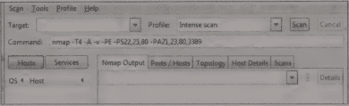

**图4-7：** Nmap图形界面

图4-8展示了一个在服务器上运行扫描的示例。这是Nmap输出的部分截图，表明该目标服务器有许多端口开放，并且正在运行Apache和CentOS。更有趣的是，它清楚地识别出（并且是正确的）已安装并正在运行Plone。你可能还会注意到，Nmap在扫描过程中发现了一些硬件设备，同样，你可以确认这些硬件的存在。

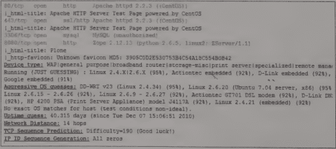

**图4-8：** 部分Nmap输出

图4-9显示了Nmap在系统上发现的端口。

| 端口 | 协议 | 状态 | 服务 | 版本 |
|---|---|---|---|---|
| 22 | tcp | 开放 | ssh | OpenSSH 4.3（协议2.0） |
| 25 | tcp | 过滤 | smtp | |
| 80 | tcp | 开放 | http | Apache httpd 2.2.3 (CentOS) |
| 443 | tcp | 开放 | http | Apache httpd 2.2.3 (CentOS) |
| 3306 | tcp | 开放 | mysql | MySQL（未授权） |
| 8080 | tcp | 开放 | http | Zope 2.9.3 (Python 2.5; linux2; ZServer/1.1) |

**图4-9：** 扫描中发现的端口

就端口而言，总的来说，这种配置非常安全。从图4-9中，你可以确认Apache、CentOS、MySQL和Zope（Plone）正在运行。然而，对于坏人来说，这可能会是一份“购物清单”。

如果你的服务器有许多开放端口，如图4-10所示，那么你将面临一个真正的大问题。尽管该图显示有相当多的端口开放，但这只是实际开放的所有端口中非常小的一个样本。现实中的情况，例如防火墙配置错误、黑客打开端口或其他潜在的错误配置，可能导致与图4-10所示类似的情况。Nmap可以帮助你非常快速地识别此类问题。

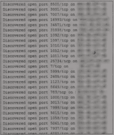

**图4-10：** 开放端口过多

如前所述，基线的目的是识别你遇到问题的地方，并让你能够处理它。使用Nmap识别网络中的漏洞将帮助你堵住它们。

你应该定期使用Nmap，仅作为对服务器的一项检查。然而，从预配置的配置文件设置运行一次缓慢而全面的扫描，将获得大量信息。

具体来说，你希望看到没有意外开放的端口，事实上，开放的端口越少越好。查看正在运行什么软件是有帮助的，但在本章后面，你将学习使用Nessus来实现该目的。尽管每种配置都会有所不同，但在配置正确的服务器上，你通常会看到以下端口开放：

- 21——FTP（文件传输协议）
- 22——SSH（可选的Secure Shell客户端）
- 25——SMTP（通常显示为“过滤”）
- 53——DOMAIN（DNS）（开放或关闭，取决于主机）
- 80——万维网（WWW）服务
- 443——用于你网站的SSL
- 3306——MySQL（因主机而异）

如果你在开始时确定自己拥有什么，那么在未来运行基线时检查它们就会更容易。将来，你将能够检查以确保端口设置全部相同。

## 使用 Nessus 工具

Nessus是最受欢迎的漏洞扫描工具之一。它是一个构建良好的产品，并借助最新的漏洞数据进行维护。

Nessus会针对多种不同的漏洞测试你的网站和服务器。它会检查服务器端软件、查找开放端口、检查后门应用程序等等。有些人认为它是同类工具中最好的工具之一。

> **注意** Nessus提供免费（家庭）版和专业版。对于免费版，你需要注册并获取密钥。请访问 http://nessus.org/download/ 了解更多信息。

### 安装和运行Nessus

为了本讨论的目的，假设Nessus已作为Windows桌面应用程序安装并运行。它有两个组件——服务器和客户端。在运行客户端之前，必须启动Nessus Server Manager。此外，你必须更新插件，这可以自动完成。这些插件是新的威胁和漏洞的定义，你需要Nessus检查它们。

要启动Nessus控制台，请在Windows机器上单击“开始”➤“Nessus Client”。

> **警告** Nessus Client使用你的默认浏览器进行显示。你的浏览器可能会将该客户端识别为不受信任的网站。这不是问题。只需在浏览器中接受该站点并使用它即可。

在某些情况下，你可能没有修复方案，而需要一个变通方法。你还可以保留过往扫描的运行记录，从而衡量主机的安全性。

花时间了解更多关于Nessus的信息，并记住在扫描服务器之前请求许可。

## 使用病毒扫描工具

毫无疑问，你应该使用高质量的病毒扫描程序检查系统文件的状态。第9章提供了更多关于使用病毒扫描程序从被黑站点中清除病毒的详细信息。

在基线中，运行扫描程序将为你提供一份健康证明。你将需要检查以下目录中的站点文件：

- Public_html（通常是Web目录的名称）
- Mail
- 服务器文件

此外，你需要确保扫描所有可能连接到该站点的台式机或笔记本电脑。这可以保证你的系统中没有隐藏病毒。

## 修复问题

整个基线化过程旨在发现并消除可能且将会影响你安全的问题。任何问题的修复都非常直接。在基线化过程的这一步中，你列出问题并确定优先级，记录拟议的修复方案，最后部署它。

### 对问题进行分类和确定优先级

当通过基线化过程识别出问题时，尝试按严重程度定义它们。这可以提供纠正问题的适当路线图。

如果你采用前面描述的由Nessus发现的问题，你可能会构建一个如图4-12所示的电子表格来跟踪和修复问题。在这里，你可以看到该电子表格按列划分，使你能够跟踪漏洞、风险因素、漏洞描述以及建议的修复方案。

你可以快速查看项目列表，将时间集中在最重要的问题上，而花较少时间在那些最不重要的问题上。如图4-12中的最后一项所示，有些问题被描述为“无需修复”。无论如何，你都希望将这些作为基线的一部分进行跟踪。尽管不太可能，但如果发现可以利用它的新漏洞，低风险因素可能会变成中风险或高风险。

日期：6月11日
基线报告：服务器 09988

| 漏洞 | 风险因素 | 描述 | 建议修复 |
|---|---|---|---|
| SSL Cookie、IIS4、IIS5、IIS6 | 高 | Cookie以明文发送 | 购买SSL证书以加密流量 |
| IIS：Unicode目录遍历漏洞 | 高 | Unicode目录遍历漏洞允许远程攻击者读取文件。 | 联系Microsoft获取补丁。 |
| SSL证书与主机名不匹配 | 中 | 此站点的SSL证书与主机名不同。 | 购买新的SSL证书，或…… |
| IIS：远程桌面连接 | 低 | 终端服务已启用。 | 无需修复 |

**图4-12：** Nessus扫描的基线报告示例

处理完所有问题后，务必记录站点的更新状态。在前面的示例中，你会记录OpenSSL的新版本、修复日期以及任何其他问题。

### 修补安全漏洞

一般来说，在你确定系统的薄弱环节之后，修补或移除可疑代码是第一步。当然，下一步是检查你的设置是否与上次审查时相比没有变化。为此，你的基线报告是一份你可能会经常查阅的文档。

这也是审查管理用户并移除任何可能不再需要访问权限的用户的绝佳时机。

### 向托管公司报告问题

向托管公司报告问题有正确的方式，当然也有错误的方式。错误的方式是对问题给出无力的解释，例如“它不工作”。

用那种方法你不会取得什么进展。就修复问题与托管公司沟通的正确方式是整理你的数据，并遵循主机的提交流程。

例如，假设你突然看到一组以前未开放的端口现在开放了。你会希望尽快向主机报告此问题。你的报告应该大致如下：

> “尊敬的<host>
>
> 我们在最近一次检查服务器时（日期）注意到，新的端口（xxxx、yyyy和zzzz）已被打开。我们上一次检查（日期）显示这些端口是关闭的。我们需要的配置应将这些端口关闭。
>
> 请审查我们的服务器并告知。”

在此示例中，你可以向主机展示带有结果的日期，证明某些内容已发生变化。这类信息有助于主机相当容易地追踪你的配置中发生的更改。

与技术支助打交道的关键是尽可能详细。这有助于技术支持人员帮助你。如果你有具体问题，请提供

为员工提供复制它的手段。如果你收到具体的错误消息，请将其包含在内。

## 总结

本章讨论了基线报告的概念。该报告帮助你识别运营中威胁所在，并应包含缓解这些威胁的计划。

基线报告的价值在于使用它。换句话说，如果你只用一次就忘了它，那么它就没有价值。

你了解了一些可帮助识别站点安全问题的工具，并学习了如何识别 CMS 的附加组件。

在第5章中，你将继续基线化流程的下一步，即加固服务器以抵御攻击。此过程涉及更深入地审视你业务中使用的系统、软件和流程。

# 第 5 章：加固服务器以抵御攻击

泛泛而言，“加固服务器”意味着“封闭服务器中的漏洞和缺口”。所有软件和硬件平台都存在弱点，而且新的弱点经常被发现。

服务器对你和恶意攻击者来说都是资产。如果恶意攻击者能够控制你的服务器，他们就可以将其用于自己的目的。如果那是非法目的，例如对某人发起攻击，那么最终可能由你来承担后果。

根据2010年*Verizon数据泄露调查报告*，与美国特勤局联合开展的研究发现了以下内容：

> “Verizon Business 的调查专家发现，正如该公司此前的数据泄露报告一样，大多数泄露事件如果遵循了基本安全措施，就被认为是可以避免的。在接受评估的泄露事件中，只有4%需要采取困难且昂贵的防护措施。”

请注意，在他们审查的所有案例中，只有4%需要困难且昂贵的措施才能侵入网站。这意味着96%的网络泄露事件本可以通过采取适当步骤避免。

报告进一步指出，“所有被泄露的数据中，有98%来自服务器。”这是银行网络钓鱼诈骗、身份盗窃和其他犯罪活动的主要来源。

> **注意** 你应该花些时间阅读 Verizon 报告，因为它非常有见地。它包含大量信息，可帮助你及时了解安全状况。你可以从 verizonbusiness.com/go/2010databreachreport 下载白皮书以了解更多。

本章提供了大量关于保护服务器流程的信息，从而帮助你归入那4%的类别，而不是96%的类别。本章讨论的许多设置或功能在共享服务器上不可用。主机商可以确认本章所述步骤是否已执行。如果你运行自己的机器，或负责一台托管机器，那么阅读本章将受益匪浅。

本章中，你还将了解默认密码以及如何识别它们、如何保护 Linux 操作系统、如何处理服务器上的权限、如何保护 Apache 和 PHP，以及如何处理安全套接层（SSL）。

要检查的第一个弱点是系统和软件上的密码。

## 确保密码安全

密码是你系统名副其实的钥匙。入侵发生的原因多种多样，但排在首位的是弱密码。

弱密码容易被猜到或破解，恶意软件和僵尸网络经常以密码为目标来获取访问权限。它们通常使用暴力破解方法，即逐一尝试密码，以找到密码字典中或常用词语中的密码。

就密码而言，你必须执行几项重要任务来加固服务器。首先，确保没有任何账户使用空密码——换句话说，没有无密码的账户。以下命令可以识别是否存在此类账户。

```sh
### awk -F: '($2 == "") {print}' /etc/shadow
```

图5-1显示了在服务器上运行该命令的结果，其中有一个账户没有密码。用户 tom 旁边应显示密码的哈希值。


**图 5-1：** 发现空密码

如果发现任何此类账户，要么为用户分配密码，要么删除该用户。

### 影子密码文件

影子密码文件存储用户的加密密码（严格来说它是编码，而不是加密）。该文件只能由 root 用户读取，从而防止字典攻击成功。

最初的实现构建于1987年，是在其作者经历了一次 SCO XENIX 操作系统上的网络入侵之后。多年来，它被移植到各种 UNIX 和 Linux 发行版。

该软件旨在存储密码，而不允许将它们存储在 passwd 文件中。密码被移入影子文件后，你通常会在密码字段中看到 x 或 *。

使用以下命令扫描系统，确保所有密码本身都位于影子文件中，而不是在 passwd 中：

```sh
#### awk -F: '($2 != "x") {print}' /etc/passwd
```

运行此命令时，它不应返回任何结果。你应采取纠正措施，手动删除出现在此文件中的密码。所有用户账户密码的哈希都应存储在 /etc/shadow 文件中，绝不能存储在 /etc/passwd 中。passwd 文件可被所有用户读取。如果你发现某个用户的密码（哈希）出现在此命令的结果中，那么最好删除并重新创建该用户。

大多数情况下，你不应以 root 身份登录。你应以普通用户身份登录，然后将权限提升到 root 或超级用户。考虑到这一做法，你要确保 root（该用户）是系统中唯一具有 root 权限的用户。为此，请执行以下命令：

```sh
#### awk -F: '($3 == "0") {print}' /etc/passwd
```

此命令应只返回一个账户，如下所示：

```sh
root:x:0:0:root:/root:/bin/bash
```

如果你在此输出中注意到其他用户，请降低他们的管理权限。

### 密码过期

就密码安全管理而言，定期更改密码是一种好做法。频率完全由你决定，但较好的频率是每30到60天一次。

在 Linux 中，你可以设置密码自动过期。这样做会强制用户更改密码。

根据你的信息安全策略，定义密码的时间限制和复杂度。定义后，按照一个简单流程更改它们。使用 WinSCP（或其他应用程序）连接到服务器，并导航到 `/etc` 目录。到达后，找到名为 `login.defs` 的文件，如图5-2所示。


**图 5-2：** 密码有效期默认设置

设置如下：

- `PASS_MAX_DAYS` —— 设置密码在必须更改之前可以存在的最长天数。
- `PASS_MIN_DAYS (-m)` —— 防止在“x”天内更改密码。这项重要措施是为了防止密码被频繁更改。
- `PASS_MIN_LEN` —— 为密码指定最小长度。
- `PASS_WARN_AGE (-w)` —— 给用户“x”天（按此设置定义）来更改其密码。换句话说，值为5会给用户五天时间来更改。此后，密码过期，用户将不被允许重新登录。

根据你特定的信息安全策略更改该文件中的设置。例如，如果你希望每60天更改一次密码，则将 `PASS_MAX_DAYS 9999` 改为 `PASS_MAX_DAYS 60`。

如果此服务器已使用了一段时间，你将需要使用以下命令更新当前用户：

```bash
#### chage -M 60 -m 7 -W 7 user
```

将数字替换为你的值，将 user 替换为实际用户名。

### 识别默认密码

默认密码基本上是在制造过程中可应用于机器或软件的密码。对于软件，这意味着你可能购买某个带有数据库默认密码的软件包。对于硬件，这意味着（通常）管理界面在出厂时就反复使用同一个密码。


**表5-1：识别系统硬件和软件**

| 网络设备和组件 | 软件系统 | 硬件系统 |
| --- | --- | --- |
| 路由器 | 操作系统 | 打印机 |
| 无线路由器 | FTP | BIOS/固件（在服务器、台式机和笔记本上） |
| 管理型网络交换机 | Telnet（应禁用） | 网络摄像头/摄像头 |
| PBX（电话系统） | 电子邮件系统 | Web监控的安全摄像头 |
| VoIP（电话系统） | 数据库服务器 | 复印机（在许多情况下会保留文档副本） |
| 语音邮件 | 面向Web的应用程序和管理接口 | RAID卡（磁盘控制器） |
|  |  | 服务器中的远程访问卡 |
|  |  | USB设备（蓝牙设备） |
|  |  | 智能手机 |
|  |  | 电缆调制解调器 |
|  |  | 调制解调器 |

此外，请花时间阅读并理解硬件和软件产品随附的文档。如果其中写着类似“*这是当前密码，*”的内容，那么你可以确定该密码是默认密码。务必检查*数据库、管理接口*以及任何其他让你能够控制CMS站点的密码。如果这些密码不难猜到，请更改它们。

本书讨论的所有网站都有一个共同点：它们运行在Linux操作系统上。下一节将更深入地探讨Linux的安全性。

## 安全配置 Linux 操作系统

如你所知，本书的主要关注点是帮助运行启用CMS的网站的中小型企业所有者提高安全性。尽管关于这一主题已有整本书的论述，但本节讨论仅涉及那些需要网站所有者关注的领域。这里的目的是为你提供一个良好的框架，同时解决一些常见问题以帮助你保护自己。

保护服务器安全不仅仅涉及技术更改，还需要考虑一些策略。

想一想你的信息的价值。这些信息与工业公司领域相关吗？还是你的公司网站专门销售绗缝用品？两者都很重要。然而，其中一个可能因服务器上所含信息的价值以及潜在的信用卡信息而成为黑客的目标，而另一个可能包含对竞争对手有价值的信息。

考虑采取一切可能措施保护公司所有有价值的信息，包括使用强加密来保护数据。黑客可能觊觎你拥有的信用卡信息，或者可能想利用你的服务器传播垃圾邮件。他们可能想潜伏在你的网站上，推销自己的商品。

请确定你的公司在这个范围中处于什么位置，并在本次讨论如何保护Linux操作系统时牢记这一点。你可以采取一些可称为“低垂的果实”的预防措施。这些措施投入精力很少，但回报很好。

让我们从登录横幅开始。

### 更改登录横幅

登录横幅是用户成功登录后看到的消息。通常，默认情况下，这条消息会透露许多关于底层系统的信息，例如操作系统版本，甚至可能更多。一个执着的攻击者可以利用这些信息绘制系统地图，用于发起攻击。

以下是一些更改默认登录横幅的方法：

- 淡化任何可能让恶意用户了解操作系统及其版本详细情况的信息。
- 将技术性消息改为警告横幅，说明本系统仅供授权用户使用。这样做是为了防止有人以“我不知道自己不能登录，因为上面没说我不能登录”这种站不住脚的理由辩解。尽管以这种方式更改登录横幅不会带来法律上的好处，但作出更改总比不更改好。
- 显示该人员被允许使用的资源，甚至当天的新闻，以帮助减少潜在的技术支持电话。

让我们看看如何将那条登录横幅消息更改为其他内容。实际上，这样做的好处是消除通过信息泄露对你造成威胁的任何可能性。

开始这项任务需要准备几样东西：

- Root访问权限
- 桌面端编辑器，例如WinSCP（可选）
- 你希望用来替换默认登录横幅消息的内容

> **注意** 对于桌面端工具，如果你熟悉Linux中vi等众多编辑工具之一，可以随意使用。不过，在本书中，示例使用的是WinSCP，因为它是一个非常有价值（且免费）的工具。你可以从WinSCP.net下载副本。

要更改登录横幅：

1. 使用WinSCP（或你选择的SFTP工具）打开你的站点，并导航到`/etc/issue`文件。右键单击该文件。将出现与图5-3类似的图像。

   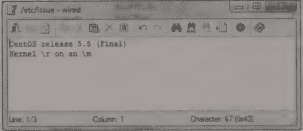

   **图5-3：** 默认issue文件

   在此示例中，你可以看到登录横幅显示的是CentOS release 5.5最终版Linux。此外，你还可以看到短语`Kernel \r on an \m`。这表示发行版（`\r`）和机器（`\m`）。

2. 确定你希望在登录时显示什么内容，并用它替换默认横幅。

3. 更改后，保存文件并将其复制回机器。

处理完这些初步任务后，你应确保运行的是最新版本的软件。可以使用名为*yum*的实用程序进行任何所需的更新。

### 使用 yum

要更新Linux服务器，你可以自行上传补丁，也可以从称为*仓库*的可信来源拉取补丁。

在Red Hat Linux及其他Red Hat发行版（如CentOS和Fedora）中，更新命令是`yum`。另一个工具称为`RPM`。`yum`会安装你选择的软件包及其可能依赖的其他软件。`RPM`只安装你选择的软件包。例如，如果你使用`yum`安装Apache，可以确定已经拉取了相应的支持文件。其他Linux版本将使用不同的命令进行更新。

首先，更详细地了解`yum`，然后介绍一些用于Debian Linux的命令。

### yum 基本命令

本讨论将让你熟悉在本节中需要用到的某些命令。请注意，#（井号或哈希符号）表示管理员提示符。使用命令时不需要包含它。

以下是一些可以使用`yum`安装、删除和更新软件包的命令：

- `# yum install package_name`
- `# yum remove package_name`
- `# yum update package_name`

如果你看到某个软件包正在运行但不确定它是什么，可以使用`yum`帮助你识别该软件包，如下所示：

```bash
#### yum provides name of package
```

使用附加到`yum`的GROUP命令（如下所示）获取要一起安装的项目列表。

```bash
#### yum grouplist
```

输入命令`yum grouplist`可查看所有已安装和可安装的组。表5-2显示了使用此命令返回的信息示例。

**表5-2：使用yum grouplist的结果**

| 已安装的组 | 可用的组 |
| --- | --- |
| DNS名称服务器 | 管理工具 |
| 开发库 | 创作与发布 |
| GNOME软件开发 | 基础 |
| 图形 | Beagle |
| 旧版网络服务器 | 集群存储 |
| 旧版软件支持 | 集群 |
| 邮件服务器 | 开发工具 |
| 网络服务器 | 拨号网络支持 |
| OpenOffice企业发行版 | 编辑器 |
| 系统工具 | Emacs |
| 基于文本的互联网 | 工程与科学 |
| Yum实用程序 | FTP服务器 |

`yum`是查找和安装软件包的快捷方式。使用表5-2中显示的返回列表，你可以通过以下命令轻松安装新的FTP服务器：

```bash
#### yum groupinstall "FTP SERVER"
```

你可以将一组安装命令集中在一行，如下所示：

```bash
#### yum install php-mysql php-devel php-gd php-mcrypt php-pgsql-memcache
php-pspell php-snmp php-xmlrpc php-xml
```

此命令可以安装多个项目，例如MySQL Server和PHP开发工具。它便于进行设置。

### 使用 yum 更新服务器

更新服务器后，你就可以开始加固过程了。你需要以超级用户身份登录。请记住，登录后会看到#提示符。看到$表示你以普通用户身份登录。以下示例使用CentOS演示`yum`的用法。

假设你想检查系统是否有潜在更新。最快的方法是使用`yum update`命令。这会检查已安装的应用程序是否是最新版本，并生成报告。图5-4显示了一个需要更新的服务器示例。

不过，如果你运行该命令且不需要更新，你会看到类似图5-5所示的内容。


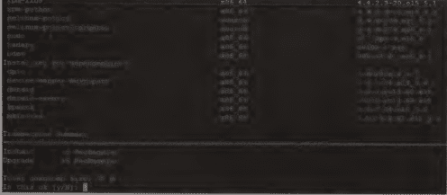

图5-4：服务器需要更新

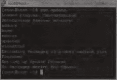

图5-5：服务器已是最新状态

## Debian 发行版

另一个流行的发行版是 Debian Linux，其更新/安装/移除工具称为 aptitude。

该命令的用法与 yum 类似。以下是一些示例：

- `# aptitude install package_name`
- `# aptitude reinstall package_name`
- `# aptitude remove package_name`
- `# aptitude remove --purge package_name`

请注意，该列表中的最后一条命令末尾带有 `--purge`。该命令会移除软件包及已安装的文件，实质上是在清理服务器。

你可以使用 `-v` 命令选项查看所有已安装软件包的版本，如下所示：

```bash
### aptitude -v install package_name
```

要更新扩展，你有几种选择。有时你可能只想下载文件，而不安装它。`aptitude` 命令也为此提供了一个开关，如下所示：

```bash
### aptitude -d install package_name
```

对服务器和 CMS 进行打补丁和更新很重要。如果你运行的是 Debian，那么你有不同的选项：

```bash
### aptitude update
### aptitude upgrade
### aptitude dist-upgrade
```

这三条命令的区别如下：

- `update` 刷新缓存（即软件包及其仓库的本地列表）。
- `upgrade` 安装应用程序的新版本。这类似于 RPM。
- `dist-upgrade` 安装最新版本的软件包，并可能安装其他软件包。这类似于 yum。

你更新和存储的文件都受*权限*控制。也就是说，它们具有特定权限，规定谁可以对它们做什么。下一个加固任务是检查*文件权限*。

### 设置文件权限

Linux 中的文件被赋予若干属性，这些属性对应特定群体，包括以下内容：

- 文件的所有者
- 组（人群）
- 公众（即任何从外部访问系统的人）

这些群体中的每一个都被允许根据其权限执行特定任务或活动。

#### 以八进制数表示的权限

配置错误的文件权限是 Web 服务器或 CMS 网站面临的最大威胁之一。事实上，在 Joomla! 世界的早期，权限曾是一个巨大的问题，但过去几年这个问题已有所收敛。

权限的数字表示法采用以 8 为基数的系统，称为*八进制*。你会看到八进制按以下形式计数：

```text
0 1 2 3 4 5 6 7 10 11 12 13 14 15 16 17 20 21 22 23 24 25 26 ...
```

这是因为在八进制系统中，只有数字 0 到 7。

权限看起来像 `644 filename.ext`。以下三个数字的含义如下：

- 第一个数字（此处为 6）代表文件的*所有者*。它说明他或她可以做什么。
- 第二个数字（4）代表*组*（用户是组的成员）以及它们可以做什么。
- 第三个数字（4）代表*公众*，也称为 world 或 global。

你也可能看到用二进制形式表示的权限。以下内容有助于交叉参考：

- 二进制 `000` — 八进制 0
- 二进制 `001` — 八进制 1
- 二进制 `010` — 八进制 2
- 二进制 `011` — 八进制 3
- 二进制 `100` — 八进制 4
- 二进制 `101` — 八进制 5
- 二进制 `110` — 八进制 6
- 二进制 `111` — 八进制 7

以下是权限实际细分方式：

- 0 — 无权限
- 1 — 执行 (x)
- 2 — 写 (w)
- 3 — 写和执行 (wx)
- 4 — 读 (r)
- 5 — 读和执行 (rx)
- 6 — 读和写 (rw)
- 7 — 读、写和执行 (rwx)

因此，如果你看到文件权限为 `400`（或用二进制表示法为 `100 000 000`），这意味着只有所有者（root）可以读取该文件，其他任何人都没有读取或执行它的权限。

> **注意** 看到文件权限为 `777` 意味着该文件（极有可能是不正确地）被授予了所有人完全的读、写和执行权限。这是非常严重的安全风险，如果你的站点从正常设置变成了该设置，那你就有问题了。

现在，来看看用于密码的关键文件。

### 关键密码文件

所涉及的文件是 passwd、shadow、group 和 gshadow。这些文件归 root 用户（超级用户）所有，并包含系统各部分的密码。

你必须确保它们设置正确。在这种情况下，使用 PuTTY 工具在命令行中操作。（你可以从 `http://www.chiark.greenend.org.uk/~sgtatham/putty/` 下载它。）

- 1. 以超级用户身份登录（你会看到 `#` 提示符），并将目录切换到 `/etc` 目录。使用以下命令：

```bash
cd /etc
```

- 2. 输入 `ls passwd -l`，你应该会看到类似图5-6的屏幕。


注意，该文件的所有者是 root，组也是 root。这正是你想要的。

- 3. 对 shadow、group 和 gshadow 文件重复这些步骤。

> **注意** 你的系统上可能没有 gshadow。

如果你发现某个文件归*其他任何人*所有，那么你很可能需要将其改回 root。为此，你使用 chown 命令。chown 指示 Linux 操作系统更改所有权（因此得名 chown）。考虑以下示例：

```bash
chown root:root passwd
```

该命令将 passwd 文件的所有权更改为 root。但请注意，除非你已被黑客入侵，否则你发现密码文件设置不正确的可能性很小。

> **注意** 值得注意的是，更好的管理做法是使用组来限制对服务器资源的访问。通过组，你可以约束用户及其操作，而不必（过多地）担心文件。同样的概念也适用于你的 Joomla!、Drupal、Plone 或 WordPress 站点。限制对人员实际需要区域的访问。

### *所有人可写*

加固服务器的下一个任务是找出所有所有人可写的文件。正如你可能已经猜到的那样，这个术语意味着任何能访问该机器的人都可以写入文件。这种访问不是好事，应该加以限制。找出所有所有人可写的文件很简单，这样做有助于你消除该特定攻击面。

以超级用户身份登录后，执行以下命令：

```shell
#### find disk-part -xdev -xtype f -perm -0002 -print
```

该命令会列出所有人可写的文件。输入该命令后，你应该看不到任何输出。如果该命令有输出，那么很有可能你有某项设置错误。花时间调查问题并采取纠正措施。

如果你发现需要纠正的文件，则使用以下命令纠正该情况：

```shell
#### chmod +t /dir
```

（其中 /dir 是目录）。

使用 chmod 命令，你可以将权限更改为你需要的值。通常，在 Linux 上运行的任何 CMS 中，将文件设置为 644（八进制）或 444（八进制）是个好主意。

> **注意** 如果你在 Windows 服务器上运行 Linux，请查阅 Microsoft 的指南，了解设置权限和其他安全需求的特定步骤，位于 http://technet.microsoft.com/en-us/library/cc524539.aspx。

### *未授权的 SUID/SGID 系统可执行文件*

如果你曾使用安全外壳（SSH）协议以超级用户（root）身份登录并上传文件，你可能已经发现，在大多数情况下这些文件无法从浏览器运行。这种情况是由文件被上传且归 root 用户所有造成的。因此，它们在系统内带有一定级别的权限。如果文件是可能对机器造成严重破坏的东西，那么以 root 身份登录可能是一项危险活动。

作为 root 或超级用户，Apache 等系统不应运行归 root 所有的文件。

与这种情况密切相关的还有 SetUID 和 SetGID 位。这些位可能在你的站点中造成一些奇怪且难以追踪的安全漏洞。本质上，当设置了这些位时，它们会以文件所有者的权限运行或执行。因此，如果一个普通用户或组中的用户执行一个归……所有的文件


root 用户，它就会像 root 用户已登录一样运行——再说一次，这不是你希望发生的场景。

检查这些位至关重要，尤其是在你不确定服务器状态的情况下。

要检查它们，请执行以下命令：

```
#### find disk-part -xdev \( -perm -4000 -o -perm -2000 \) -type f -print
```

此命令可能会列出一些需要重置的文件。如果这些文件设置了上述任一位，它们将允许任何人像文件所有者一样运行这些文件。

查找并纠正你发现的任何此类文件。如果不确定，请咨询管理员。

## 孤立文件

由于多种原因，文件有时会变成孤立文件，这意味着该文件不再由某个用户拥有。这可能构成威胁，也可能不构成威胁，但确实表明存在某种问题。孤立文件可能表明某些东西安装不当，或者可能表明攻击者曾来过。

使用以下命令定位任何孤立文件：

```
### find disk-part -xdev \( -nouser -o -nogroup \) -print
```

如果发现任何孤立文件，请采取适当措施将其分配给某个组或用户。如果不需要该孤立文件，则将其删除。

## 审查磁盘访问

在大多数情况下，磁盘访问不应成为真正的问题，尤其是当你运行在已正确配置的受管主机上时。但是，如果你设置了自己的服务器，请考虑以下提示：

- 为你的用户文件设置一个分区。这种做法可将这些文件与其他文件分开。
- 为 /tmp 目录设置一个独立的磁盘分区，该目录用于存储缓存、安装文件和其他临时数据等大文件。
- 为日志记录设置一个独立的逻辑卷（可以理解为 c:）或分区。此操作可防止用户意外写入日志或删除日志。

## 禁用不需要的服务

在默认系统中，你或许可以关闭若干服务，因为它们不太可能需要。事实上，在许多情况下，这些服务可能构成重大威胁。其中一种常见服务是 Telnet，它是一种非常古老的协议。它经历了多次修订，这些修订有助于增强其安全性。然而，它仍然对你的 CMS 和服务器构成实际威胁。查阅 www.ietf.org/rfc/rfc3986.txt 上的文档，可以让你了解与该协议相关的一系列坏处。

以下是一些你应该移除的服务：

- Telnet
- RSH Server
- TFTP

你可以使用现在熟悉的 yum 命令轻松处理这些服务，如下所示：

```bash
### yum erase telnet
### yum erase rsh-server
### yum erase rsh
### yum erase tftp-server
```

> **警告** 请记住，尽管移除这些服务很重要，但要确保你并未在使用它们。例如，移除 Telnet 可能导致你的 FTP 服务器停止工作。

## 保护 Apache 服务器

所有与你的 CMS 网站交互的人都会接触到的一个领域是你的 Web 服务器软件。Apache httpd Web 服务器是市场上最受欢迎的 Web 服务器，市场份额超过 50%。

Apache 是一个维护和发展得非常完善的系统；通常它开箱即用就是安全的。然而，这个健壮的系统提供了许多不同的配置选项，因此也留下了许多可能留下隐患的机会。

显然，保护 Apache 服务器的首要步骤之一是确保使用最新版本的 Apache。

使用 PuTTY 通过 SSH 登录到你的服务器，并执行命令 `httpd -v`。应出现类似图5-7所示的屏幕。查阅 Apache.org 网站，以确定是否需要更新 Apache 版本。


**图5-7：** Apache 版本信息

本节其余部分将探讨如何配置 Apache 以实现安全使用和运行。

### 配置 Apache 以实现安全操作

不止是脚本小子的攻击者希望收集尽可能多的信息。考虑到你很可能正在运行 Apache，黑客信息收集的这一部分已经完成。在这种情况下，攻击者想要获取的下一个信息就是关于 Apache 的版本信息，这意味着你必须限制 Apache 泄露的信息。知道你的 Apache 版本是攻击者的关键信息来源。

打开位于 `/etc/httpd/conf/httpd.conf` 的 Apache 配置文件。浏览指令，并找到图5-8所示的信息。

```text
#### These can be set in WHM under "Apache Global Configuration"
TraceEnable Off
ServerSignature Off
ServerTokens Prod
```

**图5-8：** 限制 Apache 信息泄露

在你的配置文件中，要么修改这些行以匹配图5-8所示内容，要么在它们不存在时添加它们。如你所见，此服务器运行的是 Web 主机管理器（WHM），因此你可以从图形用户界面（GUI）设置这些行。

第一行 `ServerSignature Off` 阻止 Apache 显示其版本或错误页面。第二行 `ServerTokens Prod` 使任何页面标头仅显示 Apache 一词。公平地说，这并不能直接提升安全性，但它确实隐藏了那些关键的版本详细信息。

在配置文件中搜索 `HTTP Digest Authentication` 模块。它提供加密的认证会话。你的配置文件中可能没有此项，但如果有，则应将其移除。首选使用 SSL。

查找以下行：

```text
LoadModule auth_digest_module modules/mod_auth_digest.so
```

如果在配置文件中找到它，请在其前面加上 #（井号）将其注释掉，并将文件保存回服务器。

*轻量级目录访问协议（LDAP）* 支持通过使用 Apache 的一个模块来提供。如果你正在使用 LDAP 进行认证，请跳过此步骤。否则，请在配置文件中查找以下两行并将其注释掉：

```text
LoadModule ldap_module modules/mod_ldap.so
LoadModule authnz_ldap_module modules/mod_authnz_ldap.so
```

*服务器端包含（SSI）* 是一种通过插入服务器端代码动态生成 Web 页面的方法。这是一个非常重大的安全顾虑，而且你的配置很可能不需要它。

如果服务器配置不当，一些顾虑是任意代码可能被插入并在其上运行。此外，在某些情况下，它可能容易受到跨站脚本（XSS）漏洞的攻击。

检查你的配置文件，注释掉以下行，保存到服务器，并测试你的网站：

```
LoadModule include_module modules/mod_include.so
```

如果注释掉此行导致网站无法工作或出现异常行为，则取消注释，并查阅 http://httpd.apache.org/docs/2.2/mod/mod_include.html 上有关此模块的 Apache 文档。

*MIME 类型* 是一套非 ASCII 字符的定义系统。最初，该系统用于使邮件系统能够接收非文本输入。它已扩展到浏览器以及其他系统。

当图形元素或其他非 ASCII（非 HTML）元素发送到浏览器时，浏览器会尝试识别并呈现该元素。如果该元素无法呈现，那么 Apache 的 mime_magic_module 模块就是防止打开受限文件的第二道防线。然而，已有实际案例报告称，使用 mime_magic_module 时，它在某个浏览器上无法呈现信息，但在另一个浏览器上却可以。移除它解决了此问题。

你的设置很可能不需要此功能。找到以下文件引用，将其注释掉，并保存配置文件：

```
LoadModule mime_magic_module modules/mod_mime_magic.so
```

*WebDAV* 是 HTTP 协议的扩展，提供了 Web 内容协作的能力。然而，此扩展允许过多的人编辑和更新网站上的文档。你可以将 WebDAV 视为一个支持 Internet 的文件系统，很像你的桌面有文件系统一样。

如果你的 CMS 不需要 WebDAV，那么出于安全原因应禁用它。如果服务器或 CMS 需要 WebDAV 功能，请采取必要预防措施来保护服务器。

检查配置文件并注释掉以下内容：

```
LoadModule dav_module modules/mod_dav.so
LoadModule dav_fs_module modules/mod_dav_fs.so
```

Apache 可以提供 *服务器活动状态*，但此模块引入了许多对攻击者有价值的漏洞。如果安装了此模块但不需要它，则按如下所示将其注释掉：

```
LoadModule status_module modules/mod_status.so
```


如果已加载，*Web 服务器配置显示*（`mod_info`）模块会使所有配置文件都可用，甚至精细到目录级别（想想 `.htaccess`）。这对你的站点造成的安全威胁是：该模块会向 Apache 的其他部分“泄露”有关配置指令的信息。这可能包括系统路径、用户名和密码、已安装的数据库等。强烈建议不要在面向 Internet 的服务器等生产环境中运行此模块。

如果在配置文件中发现以下行，请将其注释掉：

```
LoadModule info_module modules/mod_info.so
```

专职黑客的部分工作将是 *枚举* 你的网站。本质上，这意味着黑客会尝试找出并命名所有内容，以绘制网络和服务器的结构。如果已安装，`speling_module` 模块会尝试查找一个 *文档*（即诸如文件之类的资源），方法是将所请求目录中的每个文档名称与请求的文档名称进行比较，比较时不区分大小写，并允许最多一个拼写错误。

这种情况非常适合持续向站点发送请求进行探测，并查看会出现哪些文件。建议禁用此模块（如果已安装）。如果在配置文件中发现以下行，请将其注释掉：

```
LoadModule speling_module modules/mod_speling.so
```

利用目录转换模块的能力，攻击者可以轻易枚举 Web 服务器的用户。如果在配置文件中发现以下内容，除非绝对需要，否则请禁用：

```
LoadModule userdir_module modules/mod_userdir.so
```

如果你没有将 Apache 服务器用作通往其他服务器的 *代理服务器*（网关），那么请确保以下行（如果存在）已被注释掉：

```
LoadModule proxy_module modules/mod_proxy.so
LoadModule proxy_balancer_module modules/mod_proxy_balancer.so
LoadModule proxy_ftp_module modules/mod_proxy_ftp.so
LoadModule proxy_http_module modules/mod_proxy_http.so
LoadModule proxy_connect_module modules/mod_proxy_connect.so
```

如果你不知道代理服务器有什么用途，那你很可能不需要它。如果服务器没有完全加固，保持其启用是非常危险的。

> **注意** 有关 Apache 配置文件中指令的更多信息，请参见 http://httpd.apache.org/docs/2.2/mod/quickreference.html。

## 禁用或设置适当的服务

尽管每个 Apache 配置都大不相同，但了解启动时会启动哪些程序很重要。这些知识可以让你很好地了解应该启用或禁用哪些程序。你可能会拥有类似于图 5-9 所示的服务，该图显示了此特定服务器上启动的服务。


花些时间使用以下命令检查你的服务器：

```bash
### chkconfig --list | grep :on
```

调查这些服务，如果你确定不需要其中一个或多个，请使用以下命令禁用该服务：

```bash
### chkconfig service off
```

将该命令中的 service 一词替换为服务名称，如下所示：

```bash
### chkconfig pure-ftpd off
```

该命令会在下次重启时禁止 FTP 服务器运行。

### 那是什么服务？

有时，你可能会看到一个不确定的服务正在运行。这不必惊慌，但你可能想进一步调查。要了解该服务来自哪个 RPM 包（安装包），请运行以下命令：

```bash
$ rpm -qf /etc/init.d/servicename
```

这会显示是哪个包安装了它。它很可能只是另一个服务的依赖项。

你还可以通过输入以下命令来简要了解该 RPM 包的作用：

```bash
$ rpm -qi rpmname
```

请注意，此命令可能不适用于所有 Linux 发行版。

你应当开启的一项服务是 ModSecurity。让我们更仔细地了解这个非常重要的模块。

### ModSecurity

ModSecurity（可从 www.modsecurity.org 获取）是一个开源 Web 应用防火墙（WAF）。它的职责是保护 Web 应用层，抵御各种针对 CMS 和其他 Web 应用弱点的攻击。它通过多种防御手段来实现这一点，包括监控 HTTP（Web）流量、灵活的策略引擎以及对流量的实时分析。

ModSecurity（或 mod_security）作为反向代理工作，并提供针对攻击的虚拟补丁。强烈建议使用此 WAF 或其他类型的 WAF。

使用 yum 安装 mod_security 非常简单：

```bash
#### yum install mod_security
```

默认配置很可能就适合你，但鉴于其灵活的策略引擎，你也可以选择在其上部署高度自定义的配置。更深入的细节超出了本书的范围。以下来源可以提供更多信息：

- *ModSecurity 手册*（伦敦，Feisty Duck, Ltd.，2010），由 ModSecurity 首席开发者 Ivan Ristic 编写。更多信息请参见 www.feistyduck.com/books/modsecurity-handbook/index.html。
- 另一个参考资料是一份相当完善的指南，介绍如何在 Ubuntu 上安装 ModSecurity，位于：www.thebitsource.com/infrastructure-operations/web-application/securing-apache-web-servers-modsecurity。

它是一个工具，强制 PHP 脚本（如你的 CMS）以脚本所有者的权限执行。

suPHP 是一个很好的工具，可确保你以非常安全的方式运行 PHP。如果你使用的是托管公司提供的受管理虚拟专用服务器（VPS）或专用服务器，快速致电支持人员可以帮助你确认是否正在运行它。

下一种方法是尝试将文件夹权限设置为 777。如果你正在运行 suPHP，浏览时会收到 500 Internal Error。

### phpinfo

PHP 有一种很好的方法来检查全部设置。使用 phpinfo 函数可在你的工具包中提供一个有用的工具。

这里列出的执行 phpinfo 函数的步骤非常容易遵循，而且最终结果非常有价值：

1. 在根目录中创建一个文本文件，并将其命名为 `phpinfo.php`。在该文件中插入以下内容：

    ```
    <?php phpinfo(); ?>
    ```

2. 保存该文件，并确保权限设置为 644。

3. 在浏览器中输入以下内容：

    ```
    http://www.yourdomain.com/phpinfo.php
    ```

大量关于服务器及其环境设置的信息会出现。在屏幕顶部附近，你应该会看到一个类似于图 5-10 的条目。


**图 5-10：** 已安装 suPHP

如果你看到的是 apache 而不是 CGI/FastCGI 字样，那么你很可能没有安装 suPHP。

PHP 有许多可能难以发现的设置。幸运的是，有一个免费的开源工具可以很好地评估你的设置，如下一节所述。

### PhpSecInfo

PhpSecInfo 工具由 PHP 安全领域的国际专家团体 PHP 安全联盟（PHPSC）打造，用于评估服务器的设置并确保关闭所有 PHP 漏洞。你可以通过访问以下地址获取该工具：

```
http://phpsec.org/projects/phpsecinfo/
```

在你的服务器上运行时，此工具会测试若干可能影响安全性的问题。图 5-11 显示了其中一种警告的示例。

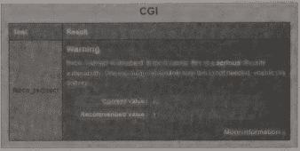

**图 5-11：** PhpSecInfo 工具生成的警告

此警告以红色显示。各种警告和错误都进行了颜色编码。这个特定的错误告诉你 `force_redirect` 指令已被禁用。注意右下角的“更多信息”链接，它提供了有关此警告的详细说明。

报告底部是测试结果摘要，如图 5-12 所示。其中显示运行了 18 项测试，并给出 10 条提示，意味着需要关注。还产生了 2 个标记为严重的问题。


**图 5-12：** 测试结果摘要

无论你的服务器投入生产多久，都应该运行此工具。你可能会发现存在许多漏洞。务必在任何升级之后，或发生任何事件之后运行它。

### php.ini

使用 suPHP 时，你可以在大多数网站的根目录中找到一个名为 `php.ini` 的文件。此文件允许你向 PHP 解释器发出命令。如前所述，你可以使用此文件代替 `/etc/php.ini` 文件。请向你的主机商确认服务器正在运行 suPHP。

使用 WinSCP 找到 `/etc/php.ini` 文件。如果该文件不存在于此目录中，它也可能存在于你的 `public_html` 网站目录中。


通读 `phpinfo.php` 文件，确定是否需要针对你的具体情况更新或更改任何设置。可能需要调整的项目包括内存大小等，因为现代 PHP 实现中的默认值是 128MB。这意味着脚本可以请求并使用那么多内存。其他设置（例如执行时间）有助于在 PHP 脚本存在缺陷且运行时间过长时防止服务器崩溃。

本质上，你可以通过这个有用的文件微调 PHP 服务器。进行以下更改：

- 对外部用户关闭 PHP 错误消息。这可以防止恶意用户利用你网站代码中可能存在的漏洞。将以下条目添加到你的 `php.ini` 文件中：

  ```
  display_errors = Off
  ```

- 通过插入以下内容，防止 PHP 脚本运行 shell 及其他危险操作：

  ```
  safe_mode = On
  ```

- 使用以下内容，仅允许访问隔离目录中的可执行文件：

  ```
  safe_mode_exec_dir = php-required-executables-path
  ```

- 通过插入以下内容，限制对 PHP 环境的外部访问：

  ```
  safe_mode_allowed_env_vars = PHP_
  ```

- PHP 可能通过信息泄露向黑客提供大量信息。限制 PHP 泄露过多信息很重要，因此插入以下内容：

  ```
  expose_php = Off
  ```

- 由于你已经抑制了错误，应使用以下条目记录所有错误：

  ```
  log_errors = On
  ```

- 从 PHP 5.3.0 起，`Register_Globals` 指令已无用。但是，如果你运行的版本低于该版本，应按如下方式设置：

  ```
  register_globals = Off
  ```

- POST 用于从表单收集输入并将其提交给应用程序。通过最小化 POST 的大小，可以降低上传恶意负载的风险。这项建议只是建议。你应该根据自己的数据集和需求进行测试。如果你发现它限制过严，请提高 POST 上传大小并重复测试。使用以下内容最小化允许的 PHP POST 大小：

  ```
  post_max_size = 2M
  ```

- 通过插入以下内容，确保 PHP 正确重定向：

  ```
  cgi.force_redirect = 0
  ```

- 如果你允许向网站上传文件，请考虑你将接受的文件最大大小。例如，如果你要允许非常大或非常小的文件，就需要调整该指令。默认值为 2MB。要更改此大小，请设置以下指令：

  ```
  upload_max_filesize = memory
  ```

  将 memory 更改为以兆字节为单位的数字，以满足你的需求。请记住，上传文件越大，可能上传的恶意负载也越大。

- 更改以下内容以阻止向网站上传：

  ```
  file_uploads = Off
  ```

- 通过以下内容阻止文件请求（例如尝试打开文件）：

  ```
  allow_url_fopen = Off
  ```

> **注意** 有关 `php.ini` 所有指令的完整列表，请参见 http://php.net/manual/en/ini.core.php。

## 检查开放端口

在计算机术语中，*端口*可以指串行端口或 USB 端口等硬件端口。它也可以指软件端口，本节讨论使用的正是软件端口这一语境。

图 5-13 展示了一个向外界开放许多端口的系统示例。此屏幕不仅指示哪些端口是开放的，还显示正在提供哪些服务，如右栏所列。

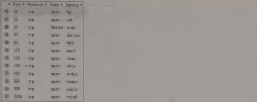

**图 5-13：向外界开放的端口**

此信息由 NMAP 网络映射工具生成。按照 NMAP 的标示，术语“Open（开放）”表示此机器上的应用程序或服务正在监听请求，术语“Filtered（过滤）”表示有某种东西（例如防火墙）正在阻止该端口。注意 SMTP 端口被标示为 Filtered，这意味着此服务器正在阻止对它的请求。注意 FTP 是 Open，意味着它已准备好接受连接。

Closed（关闭，未显示）表示该端口上没有服务运行，或者它被特意关闭。你可以根据需要随时打开已关闭的端口。

正如你在第 4 章所学，NMAP 是用于发现网站安全漏洞的好工具。这里的操作是检查是否有任何不应开放的端口被开放。端口开放可能有多种原因，并不一定意味着有黑客。然而，归根结底，如果本不应开放的端口被开放，你应该调查原因，或许还应关闭它们。

特定端口开放可能表明你已被黑客入侵。表 5-3 列出了部分端口，如果这些端口开放，可能正在运行旁边列出的某个黑客工具。

**表 5-3：开放端口与黑客工具的对应关系**

| 端口 | 黑客工具 |
|---:|---|
| 6666 | Dark Connection Inside, NetBus worm |
| 6667 | ScheduleAgent, Trinity, WinSatan |
| 6669 | Host Control, Vampire |
| 6670 | BackWeb Server, Deep Throat, Foreplay or Reduced Foreplay, WinNuke Xteame |
| 6711 | BackDoor-G, SubSeven, VP Killer |
| 6712 | Funny Trojan, SubSeven |
| 6713 | SubSeven |
| 6723 | Mstream |
| 6771 | Deep Throat, Foreplay or Reduced Foreplay |
| 6776 | Crack2000, BackDoor-G, SubSeven, VP Killer |

> **注意** 附录 A 提供了黑客工具及其关联端口的良好列表。

使用 `iptables` 或防火墙（如 ConfigServer Security Firewall，www.configserver.com），可以关闭或开放端口。作为一般规则，你应使用 `iptables` 阻止所有流量，然后逐个开放你需要的端口（例如用于互联网访问的 80 端口）。这可以确保你不会开放自己不知道的端口。

如果你发现诸如 6776 之类的端口开放，这可能是攻击者使用的众多后门应用程序之一。使用 NetStat 工具查明谁已登录以及正在运行哪些应用程序。此外，务必终止该后门的进程。之后，在关闭端口后进行清理。

## 保护 FTP 通信端口

*文件传输协议（FTP）*是一种古老的协议。它最早于 1971 年 4 月起草，远早于人们梦想出 Web 服务器的时代。事实上，FTP 是连接 Web 服务器最流行的方式之一。它易于使用且设置简单。FTP 也是安全专家最不喜欢的通信协议之一。

本书的许多读者很可能在 FTP 标准起草时尚未出生。然而，许多用户每天都依赖此协议。

FTP 的挑战在于所有内容都以*明文*传输，这意味着任何在网络上监听的人都可以轻易获得你的用户名和密码。PC 上的木马可以轻易获取此信息。

在编写本章时，一个较流行的 FTP 服务器软件包被发现存在严重缺陷。ProFTPD 的缺陷报告（http://bugs.proftpd.org/show_bug.cgi?id=3521，2010年11月7日）声明如下：

> “此漏洞允许远程攻击者在易受攻击的 ProFTPD 安装上执行任意代码。利用此漏洞不需要身份验证。”

此外，该缺陷公告还声明如下：

这为作案者提供了高度的匿名性。追踪攻击者几乎不可能。

其工作原理是，攻击者向 FTP 服务器发送一条 FTP PORT 命令，其中包含受攻击机器（及服务）的 IP 地址和端口号。该文件包含与受攻击服务（SMTP、NNTP 等）相关的命令，指示第三方连接到该服务。因此，攻击者不是直接连接到该机器，这使得追踪作案者变得困难，并且可以绕过基于网络地址的访问限制。

例如，假设客户端将包含 SMTP 命令的文件上传到 FTP 服务器。然后，使用适当的 PORT 命令，客户端指示服务器打开到第三台机器的 SMTP 端口的连接。最后，客户端指示服务器将上传的包含 SMTP 命令的文件传输到第三台机器。这可能使客户端无需直接连接即可在第三台机器上伪造邮件。

### 隐私

FTP 本质上会通过网络以未加密方式发送所有内容。如果你需要将机密文件等信息发送到服务器，则应使用加密。

虽然加密主题超出本书范围，但你可以查看 www.pgp.com 或 www.file-encryption.net，了解用于加密的工具示例。有多种不同的软件包和加密方法可用。使用前仔细审查你选择的软件包是明智的。这里列出的第一个是知名商业软件包。

### 保护用户名

确定哪些用户名有效、哪些无效的一种简单方法是部署机器人程序。标准 FTP 在尝试提供错误用户名后会返回错误代码 530。机器人程序会寻找这种拒绝。

当它收到该错误代码时，机器人程序显然就知道该用户名无效。如果用户名有效，FTP 服务器会返回响应代码 331。如果机器人程序获得有效用户名，攻击者就可以尝试暴力破解，直到找到密码。

另一种策略是在“x”次尝试后禁用登录并阻止该 IP 地址。探索 FTP 软件包含的选项，以确定封堵此漏洞的最佳方案。

### 常见 FTP 错误

现在来看使用 FTP 时遇到的一些常见错误。


## 匿名 FTP

一种可能被滥用的情形是匿名登录。这意味着，以这种方式设置的 FTP 服务器将接受任何合法 FTP 连接，且无需认证或仅需最低限度认证。

匿名用户可以上传、下载或读取其可访问的任何文件。尽管 FTP 通常不会允许你访问超过特定层级的内容，但它很可能允许你访问网站本身。

这会让黑客能够上传 shell 程序、后门应用程序或病毒。攻击者经常在服务器上设置监听程序，从而能够窃听你的活动。总而言之，绝不应在你的 FTP 服务器上允许匿名用户。

确保没有匿名用户。此外，确保每个获准使用 FTP 的人都有各自的登录凭据。这样可以启用活动审计。

## 弱密码

许多 FTP 系统不限制多次重试连接。在这种情况下，恶意用户可以不断尝试用户名和密码组合，直到找到正确的组合。

你在这里要做的就是确保密码非常难以猜测。虽然没有硬性规则，但以下是一些提示：

- 使用大写字母、小写字母以及允许的标点符号的组合。
- 如果你的密码（无论大写还是小写）出现在字典中，或者拼写可能相似，就不要使用它。
- 定期更改你的 FTP 密码。在 FTP 用户和活动很多的站点上，应每 30 天更改一次。

## 安全误区

许多人认为 FTP 是安全可靠的。一个问题是为了上传文件而共享 FTP 凭据。这与其说是技术问题，不如说是信任问题。也就是说，当你信任你给予凭据的人时，你就是在让那个人以及那个人的机器访问你的服务器。如果该机器被攻破，那个人很容易让你暴露于恶意软件之下。

曾经有一个站点遭到严重黑客攻击的案例。攻击者使用合法凭据通过 FTP 服务器进入。在审查日志并经过大量调查工作后，发现一名分包商雇用了另一名分包商来协助他。这名分包商运行的是 Mac，并（错误地）认为 Mac 不会受到感染。结果他的 Mac 确实被感染了，黑客通过后门应用程序进行监听，并轻松获取了凭据。

之后，黑客直接登录了该站点。现有安全系统不知道他是坏人，因为他拥有正当凭据。第 8 章对此有更详细的介绍。

这里的问题在于信任和缺乏教育：信任问题在于该分包商共享了登录凭据，但他本应为自己和那名分包商分别获取专用登录凭据。这名分包商对其所用操作系统相关的恶意软件和后门知识了解不足。

整个情况本可以避免。

另一个误区是认为上传文件夹是安全的。这种误区在于，即使有人加载了某些东西，入侵者也无法让它执行任何操作。

这种想法非常愚蠢，因为即使入侵者无法直接执行上传的材料，他们也可以诱使其他人执行。更令人不安的是，配置不当的文件夹（目录）可能让入侵者获得访问权限。

FTP 是一种非常古老且非常不安全的协议。绝不应在任何面向公众的机器上启用它。本质上，如果服务器接入互联网，就不应在其上运行 FTP。

> **注意** 如需非常详细的 FTP 教程，请参阅 VSFTP（非常安全的 FTP，随 Fedora 提供）指南：www.linuxhomenetworking.com/wiki/index.php/Quick_HOWTO_-_Ch15_-_Linux_FTP_Server_Setup。

## 探索 FTP 的替代版本

Red Hat 和 Fedora 是当今使用的两种较流行的 Linux 平台。Red Hat 和 Fedora 目前附带一个相当安全的 FTP 平台，称为 VSFTP。总的来说，如果你要使用 FTP 应用程序，那么 VSFTP 是较好的选择之一。另一个相当安全（且流行）的 FTP 服务器是 Pure-FTPd。

VSFTP 和 Pure-FTPd 都允许对密码和用户名使用 SSL，从而帮助保护会话。许多信誉良好的公司都使用 SSL，它被认为非常强。

> **注意** 如果你在共享服务器上，那么除了使用 FTP 别无选择。如果安全性是顾虑，就不要使用共享主机环境。

### 使用 VSFTP

幸运的是，VSFTP 是由一位安全研究人员编写的。因此，许多常见顾虑都不复存在，因为它在编码时以消除许多安全问题为理念。

要安装 VSFTP（在 Red Hat 和 Fedora 的 Linux 发行版中），请以 root 身份登录并输入以下命令：

```
#### yum install vsftpd
```

要关闭 VSFTP，请以 root 用户登录，并在确保有近期备份后，运行以下命令从服务器禁用或移除 VSFTP：

```
#### chkconfig vsftpd off
#### yum erase vsftpd
```

仍在 VSFTP 配置文件中时，更新位于 /etc/banners/vsftpd 的横幅。务必向 FTP 用户添加有关你的信息安全策略的适当警告。

图 5-14 展示了 Community Enterprise Operating System (CentOS) 指南中的一个示例，CentOS 是 Red Hat 衍生的 Linux 发行版。

```
220-Hello, %c
220-All activity on ftp.example.com is logged.
220-Inappropriate use will result in your access privileges being removed.
```

**图 5-14：VSFTP 中的示例横幅**

注意横幅中的 %c。当用户登录时，他或她将看到用户信息，包括用户名、主机、IP 地址，以及可能替换该 %c 的其他连接信息。更改横幅的目的是帮助提醒用户其操作正在被记录，从而防止潜在危害。

VSFTP 默认允许匿名访问。因此，如果你确实安装了它，就必须编辑配置文件以移除匿名访问。

> **注意** 有关在 CentOS 上保护和配置 VSFTP 的完整指南，请访问 www.centos.org/docs/5/html/Deployment_Guide-en-US/ch-server.html。

### 使用 Pure-FTPd

如果你需要提供 FTP 服务器，Pure-FTPd 是另一个不错的选择。

安装 Pure-FTPd 包含许多步骤和大量选项。访问 http://download.pureftpd.org/pub/pure-ftpd/doc/README 获取完整说明。

要卸载 Pure-FTPd，请以 root 身份登录并执行以下命令。（务必有近期备份。）

```shell
#### ./configure
#### make uninstall
```

> **警告** 请注意，仅当你使用自己的服务器时才应执行这些操作。这些说明在共享服务器上无效。如果你的服务器由主机商管理，可以请主机商移除 Pure-FTPd。

另一项安全选项是在 Pure-FTPd 中启用 SSL (TLS)。有关此主题的更多信息，请参阅 http://forums.theplanet.com/lofiversion/index.php/t-45824.html。

用来替代 FTP 的更好协议是 SFTP，如下一节所述。

## 保护 SFTP 通信端口

如你所见，FTP 通常是非常不安全且容易被攻破的应用程序。弱密码让黑客获得访问权限并造成破坏的案例实在太多了。

替代方案是 SFTP，它与 FTP 协议没有直接关系。相反，该协议依赖 Secure Shell (SSH) 协议来加密和认证连接。

SSH 是目前可用于连接服务器的最佳方法。你可能听说过几种允许你连接 SSH 的工具。以下是一些支持当前 SSH 版本 (SSH-2) 的开源工具示例：

- PuTTY
- Terminal (Mac)
- WinSCP
- FileZilla

> **注意** SSH-1 是有漏洞的应用程序，绝不应使用。尽管此说明有些过时，但务必牢记。

SSH 最常见的软件栈是 OpenSSH。该 GNU/GPL 许可的代码可在许多 Web 服务器上广泛获取。根据批准互联网标准的组织互联网工程任务组 (IETF) 的说法，“SSH 文件传输协议可在任何可靠的双向八位字节流上提供安全的文件传输功能。它是与 SSH2 协议配合使用的标准文件传输协议。” 换句话说，SSH 在你的机器（客户端）与服务器之间建立安全通信通道。


使用 SSH 登录比使用 FTP 更好，你会希望在这里添加用户。以 root 身份打开配置文件，并按如下方式添加用户名：

```
AllowUsers Username1 Username2
```

此命令告知 SSH 仅允许列表中的那些用户使用正确的凭据进行连接。

管理机器时，你应当处理完事务然后注销。让连接保持打开是个坏主意。然而，被同事或电话分心本就是生活的一部分。与其忍受连接可能长时间保持打开的风险，不如设置超时。

要限制已登录连接可以保持空闲的时间，请打开配置文件并找到以下行：

```
ClientAliveInterval interval
ClientAliveCountMax 3
```

在第一行中，ClientAliveInterval 指的是 SSH 在未收到任何数据后、断开连接前将等待的时间（以秒为单位）。根据你的情况，将 interval 一词替换为数字（以秒为单位）。第二行默认值为 3，表示在断开连接前它会尝试发送的消息或尝试次数。因此，如果你将间隔设置为 15 秒，那么 SSH 客户端（WinSCP、PuTTY 等）无响应时将在 45 秒后断开连接（15 乘以 3）。请根据你的需要将这些值设置为合适的时间。

SSH（通过 PuTTY）可以允许你直接以超级用户身份登录。然而，你不应理所当然地这样做。相反，应以普通用户（非超级用户的用户名）登录，然后在进入后提升权限。这意味着，一旦用 PuTTY 登录，你应当看到的是 $ 符号，而不是 # 符号。

按如下方式编辑配置文件，以禁用 SSH 上的 root（超级用户）登录：

```
PermitRootLogin no
```

这可确保你无法通过 SSH 以 root 身份登录。

默认情况下不允许仅使用用户名。相反，你必须同时拥有用户名和密码。请检查并确保以下行设置为 no：

```
PermitEmptyPasswords no
```

SSH（以及 SFTP）默认运行在端口 22 上。你可以将其更改为几乎任何其他端口。事实上，尽管这远非万无一失，但更改端口是个好主意。为此，请按如下方式编辑配置中的字段：

```
Port X
```

将 X 改为所选择的端口号。

## 安全日志

位于 `/var/log/secure` 的安全日志包含来自安全事件的任何错误消息。这些消息可能包括登录失败或滥用尝试。定期查看这些日志很重要，因为它们会告诉你潜在的滥用行为。

## 使用 cPanel

cPanel 是用于基本 Web 服务器托管控制的最流行程序之一。通常，大多数 Web 主机会默认关闭日志记录。要激活日志记录，你必须通过单击 cPanel 图标登录到你的 Web 托管账户，如图 5-16 所示。单击 Raw Log Manager 图标后，你将看到两个复选框，如图 5-17 所示。

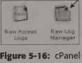

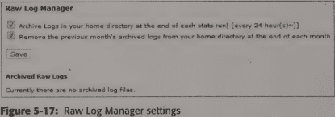

如果这两个复选框未被选中，请单击它们。第一个复选框会为你保留每日日志。如果未选中，它将清除过去 24 小时的日志信息。如果你正在排查问题，这可能是个棘手的局面。第二个复选框将删除过去 30 天的日志（以节省磁盘空间）。如果你必须保持日志完整，可以取消选中第二个复选框，或在日志文件被删除之前复制它们。

## 使用 logrotate

正如你将在第 8 章中看到的，你必须轮转日志文件，换句话说，将它们归档。这种做法有助于防止磁盘被填满。日志信息收集得非常快，文件可能会变得非常大。

幸运的是，正如你刚才所见，使用 cPanel 时，你有办法删除并归档它们。尽管 cPanel 为你提供了一种自动化方式，但不使用它的人将需要另一种方法。

负责此任务的软件是 logrotate，它应该是大多数 Linux 发行版的一部分。图 5-18 展示了一个典型 logrotate 文件的示例。


**图 5-18：logrotate 脚本**

默认情况下，此文件应已正确设置。然而，要检查它，请打开文件 /etc/logrotate.d/syslog。打开后，你将看到类似以下内容：

```
/var/log/messages /var/log/secure /var/log/maillog /var/log/spooler
/var/log/boot.log /var/log/cron {
```

（这很可能是一行连续的内容。）

该文件所表达的是轮转 messages、secure、maillog、spooler、boot 和 cron 日志。默认情况下，日志每周轮转（复制）一次。系统将存储每个日志的四个归档副本。图 5-19 展示了 syslog.conf 文件本身的示例。

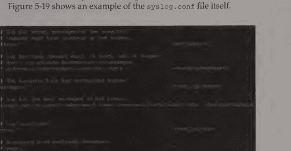

**图 5-19：syslog.conf**

你在此处的操作是检查 cPanel 设置，或查看 logrotate 配置，以确保你正确捕获了日志。

### 日志文件的安全性

日志文件都应归 root 所有，并且权限应为 644 或 600。其他任何设置都是不可接受的。

对于每个日志文件，请输入以下内容。（在每种情况下，将 `logfile` 更改为与你的日志文件名相匹配。）

- `# touch logfile` — 这会通过尝试写入文件来确保该文件确实存在。
- `# chown root:root logfile` — 这将该文件的所有权分配给 root。
- `# chmod 0600 logfile` — 这会将权限更改为 600。（同样，如果 600 不适用，也可以根据需要使用 644。）

## 使用 SSL

鉴于互联网不过是一组连接在一起的网络，你在浏览万维网时不应有合理的隐私期望。相反，你应当预料到，在途中的某个地方，有窥探的眼睛正在查看你的数据。

*安全套接层（SSL）* 在电子商务社会中至关重要。没有它，你就无法进行互联网金融交易。事实上，现行法律要求在线金融交易使用 SSL。这为文件传输提供了坚实的保护层。然而，这并不保证文件到达服务器后仍然安全。

从技术层面看，SSL 位于线路（你的网络连接）之上、应用程序（想想购物车）之下。这使它能够成为正在发送的数据的守门人。在理想情况下，应用程序会将数据托付给 SSL *信封*。这个信封会被直接送到接收者手中，而接收者是唯一能够解锁它的人。

如果你在你的 CMS 上进行任何类型的金融交易（例如接受信用卡），则必须在你的网站上安装 SSL。事实上，如果你收集任何可能通过窃听网络连接而被获取并用于对付某人的信息，那么你就需要考虑 SSL。

在本节中，你将了解 SSL 的工作原理，并看到一些用例。如何购买和安装证书（从高层面上）将为这个主题讨论画上句号。

> **注意** 有关 SSL 的更多信息，请参阅 www.nurdletech.com/https.html、http://isc.sans.edu/diary.html?storyid=2163、www.hermann-uwe.de/security/articles/securing-apache-checklist、www.linuxplanet.com/linuxplanet/tutorials/6660/1/ 和 http://articles.slicehost.com/tags/security。

### 理解 SSL 的工作原理

SSL 本质上是开放环境中的一次私人对话。整个 SSL 协议（也称为 TLS）使用所谓的 *共享密钥* 在客户端和服务器之间建立加密隧道。

当客户端请求通过端口 443（SSL 端口）建立连接时，它会向服务器发送一些关于自身及其 *公钥* 的信息。其中一部分信息是它将支持的加密方法。服务器和客户端各自拥有一个 *公钥*，并进行交换。此后，服务器向客户端发送一份其密码的副本，该副本使用服务器的 *私钥* 和客户的 *公钥* 加密。客户端解密后继续交易。这建立了与服务器的双向信任。

这并不是说坏人不能使用 SSL。黑客确实可以。它的意思是，如果证书有问题，那么在检查时就不应通过验证。而且，如果 SSL 证书不是由第三方签发的，该证书将产生错误。

### 理解何时使用 SSL

如前所述，你必须对金融交易使用 SSL。如果你是一个符合 PCI 的商户（意味着你接受信用卡或借记卡付款），那么你被要求用 *SSL 证书* 保护你的网站（以及其他要求）。

> **注意** 如果你只接受 *PayPal*，你可能不需要 SSL。请查看 *PayPal* 的要求以获取最新信息和要求。然而，如果你处理任何类型的付款，那么运行 SSL 就是个好主意。

如果你网站的用户（客户端）有敏感信息要传输，那么以明文发送是非常糟糕的主意。这时就该使用 SSL。让我们以电子邮件为例来说明这一点。

当 Alice 想给 Bob 发送电子邮件时，她编写好邮件，并通过她最喜欢的电子邮件客户端发送。当它到达 Bob 的电子邮件服务器时，Bob 便收到了它。这种交易每天发生数百万次。

*真正*发生的事情是，Alice 的电子邮件（文本）被拆分成片段，并以 *数据包* 的形式发送给 Bob。然后，Bob 的电子邮件服务器按正确顺序重新组装这些数据包，并将它们发送到他的电子邮件客户端。


为了可靠且及时地到达目的地，互联网可能会选择通过各种路由发送数据包。

现在，假设 Eve 是一个坏人，想收集关于 Alice 和 Bob 的信息。她窃听他们的连接，实际上能够读取每一个数据包，从而能够读取电子邮件。

然而，如果 Alice 和 Bob 使用 SSL，那么数据从 Alice 发送到 Bob 时，连接和数据都会被加密。因此，尽管 Eve 可能还有其他获取数据的手段，但这条特定途径会被消除。

如果你接收的是社会安全号码、医疗信息，甚至公司商业秘密等信息，同样适用这一过程。如果你在没有 SSL 的情况下连接到互联网上的服务器，那么某处的某个人就能读取它。因此，如果你确实关心安全，请开启 SSL 加密。

以下简要列出一些受益于防止窥探的领域。确实，其中一些领域确实需要 SSL。

- 电子商务交易
- 医疗记录
- 诸如社会安全号码之类的个人信息
- 公司商业秘密
- 机密通信
- 求职申请
- 住房抵押贷款申请
- 信用卡申请
- 银行交易

现在你已经很好地了解了 SSL 的工作原理以及为什么需要它，接下来我们看看如何获取 SSL 证书。

## 获取证书

证书有多种强度和类型。每种都有其自身优势，但它们都有一个共同目的——即通过加密保护数据安全。

证书可以具有 128 位或 256 位强度。它们可以是通用型（易获取），也可以是高强度的扩展验证型。

尽管两者都提供可靠的加密，但 256 位版本因比特率更高而更强（位数越多，加密越强）。还有更多底层技术细节可以使一种证书优于另一种，但总体而言，加密就是加密。

扩展验证证书会在浏览器网站的地址栏中显示绿色条。实际上，这对你的安全没有任何作用。这是一种营销手段，旨在提高消费者的视觉认知。

浏览器右下角的*挂锁图标*告诉你处于安全会话中。然而，人们并不总是会留意挂锁，而且恶意网站可以“伪造”该图标。但是，如果你在地址中看不到`HTTPS:`，那么无论如何你都不安全。

**注意** 你可以访问`http://thegreenaddressbar.com`了解更多关于扩展验证的信息。

关于扩展验证证书，要记住的关键一点是，它需要详细的背景调查，并且可能需要数天才能收到。此外，这些证书确实比基本证书更贵。

总的来说，你应该购买自己负担得起的“最强”证书。价格较高的证书通常会在发生入侵时提供某种形式的经济保障。你必须阅读所有细则，以确定哪种适合你的情况。

访问 GoDaddy、VeriSign 等众多托管公司中的任意一家，都能让你相当轻松地购买 SSL 证书。

处理完所有要求后，你会获得一张证书，然后就可以将其安装并激活到你的网站上。

## 创建自签名证书

让第三方签发证书的意义在于，他们在你的业务中没有既得利益（无论是财务上的还是其他方面的）。他们为你进行数字担保。他们验证所请求的证书（其身份）来自他们为其签发证书的服务器。其余部分在你的服务器上处理。

不支付签发费用，也可以在你的服务器上安装并拥有证书。创建自己的证书并将其安装到服务器上称为*自签名*。除非是测试环境，否则绝不推荐这种做法。

## 安装证书

大多数情况下，如果你处于托管环境，可以利用托管商的技术能力来安装证书，那么你可能希望这样做。通常，在 95% 的情况下你会依赖托管商，而且坦率地说，这样更简单。不过，如果你自己管理托管，或者想亲自完成这个过程，那也相当直接。

证书安装分为两部分。第一部分位于签发方（即你从其处购买第三方证书的一方）那边。第三方会向你签发一张证书，安装后它将成为你网站的*根证书*。图 5-20 展示了一个根证书示例。

你可以通过右键单击挂锁图标来验证网站的真实性。这里显示的信息来自证书签发方。签发方声明 URL `https://www.salvusalerting.com` 确实是一个安全站点，并且信息与签发方的记录相符。这有助于消除网络钓鱼诈骗。

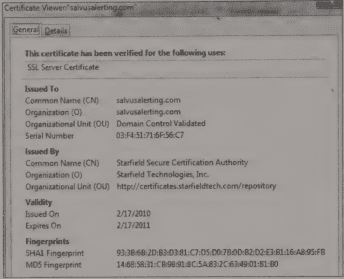

**图 5-20：** SSL 根证书

证书的第二部分是你服务器上生成的信息，它由一些软件和一些凭证信息组合而成。这两个部分合在一起构成你的 SSL 证书。

## 与托管公司合作

如果你拥有托管支持或 VPS 环境，你的托管商很可能为你处理证书设置。请检查托管商是要求你从其处购买证书，还是允许你货比三家。在许多情况下，托管商会允许第三方签发证书。这为你根据预算和需求选择最佳证书提供了许多选择。

## 自行安装 SSL 证书

如果你不使用托管商，则需要为你的服务器生成 SSL 证书。在你的服务器设置中找到允许生成证书的方法。图 5-21 展示了一个使用 WHM 的示例。

填写完成后，这个特定表单会生成三项不同的信息，如图 5-22 所示。生成的文本文件包含几个部分。你需要将其中的部分内容提供给 SSL 证书签发方。从此处开始，请按照证书提供商提供的具体说明完成设置。

## 生成 SSL 证书和签名请求

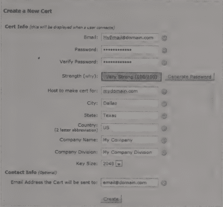

**图 5-21：** SSL 证书创建


**图 5-22：** 生成的 SSL 证书信息

如果你看到这一行下方出现数字，说明你有一个嗅探器正在运行。你可以查找以下正在运行的服务：

- TCPDUMP
- WireShark
- TShark

找到并关闭嗅探器至关重要。

> **警告** 请务必了解在任何 PCI 环境中使用 WireShark 的影响和法律后果。

## 保护 SMTP

*简单邮件传输协议（SMTP）*是你服务器上发送和接收邮件解决方案的一部分。许多服务器都有开放中继，允许坏分子通过这些服务器向数百万人发送垃圾邮件。如果你运行的是开放中继系统，你可能正在投递垃圾邮件。如果是这样，你很快就会进入黑名单并陷入麻烦。

你可以使用多种方法检查自己是否处于这种情况。来看看一种测试服务器的简单方法。

如果你使用的是 Windows 机器，请单击“开始 ➤ 运行”，然后输入 CMD。会出现一个黑框，你可以在 c:> 提示符下发出命令。输入以下内容：

```
telnet domain.com 25
```

如果 25 端口开放，你会看到邮件服务器用类似以下内容向你致意：

```
220 domain.com ESMTP Sendmail 8.x.x.x/8.x.x.x; Dec 4, 2010 15:00:00
```

如果你想通过服务器发送*伪造*（虚假）邮件，这倒是件好事。即使是一个初级脚本小子，也能从这里开始，只需输入“?”向邮件服务器请求帮助。

此时，如果你能让邮件服务器像所示那样提示你，你的处境已经很糟了。过滤 25 端口（或你的邮件所在的任何端口）。请记住，关闭端口会阻止邮件流通。

如果你绝对不需要服务器上的邮件服务（也就是说，你在别处已有该服务），那么可以使用 yum 移除该服务。有两个常用软件包可用，取决于你使用的是哪一个，命令如下：

```
#yum erase sendmail
### rpm --erase postfix
```


如果你打算将邮件保留在服务器上，Postfix 是非常适合运行的邮件服务器选择。它文档完善且维护良好。另一个建议是将邮件服务迁移到 587 端口。尽管这不是完美的解决方案，但它能减少一些自动化机器人程序尝试连接并发送邮件的情况。

### 区域传送

区域传送与 DNS 所涉及的范围足以写满整卷书。与本章相关的安全要点是，你必须确保域名服务器未设置为允许区域传送。从区域传送获得的信息非常重要，可能让有决心的攻击者得到你的网络拓扑图。

应采取的步骤是联系你的主机服务商或管理员，并确认你运行的是 BIND 9 的最新版本。另外，确保你的站点不允许区域信息（传送）外泄。

> **注意** 第 2 章提供了更多关于区域传送作为安全威胁的信息。

### 物理保护设备

如果服务器位于主机托管设施的上锁机笼中，保护其免受外部攻击就很简单。但是，如果你的服务器位于自己的办公场所，以下是硬件物理安全的一些提示：

- 如果经济上允许，将服务器放入上锁机笼并限制访问。
- 如果没有机笼，则将服务器放在上锁房间（具备适当冷却和消防安全防护）。
- 如果你的硬件提供带锁挡板（前面板），请使用它。
- 如果服务器的 BIOS（固件）提供此功能，请对控制台或启动过程使用密码保护。
- 禁用不必要的端口。这些包括未使用的串行或并行端口、任何 FireWire 端口或未使用的网卡。但是，禁用 USB 端口时要谨慎，因为鼠标和键盘通常需要它们。

大多数情况下，如果服务器位于上锁房间，并且该房间有访问控制，那就应该没问题。

## 小结

本章涵盖了大量内容。建议将本章通读几遍，以确保充分理解所呈现的信息。

你了解了为什么要加固服务器以抵御攻击以及如何加固，包括保护 Linux 操作系统和 Apache Web 服务器。其他常被忽视但可能成为麻烦来源的任务包括开放或关闭的端口、更改默认密码以及正确设置 FTP。

你了解了审查日志的重要性，以及如何建立归档日志的方法。你还了解了如何设置 SSL，以及如何审查和测试邮件服务器，确保它们不会发送垃圾邮件。

在第 6 章中，你将学习为网站出现问题时制定灾难恢复计划的概念。本章将带你经历规划、编写和测试阶段。最后，你将获得一个在制定自己的计划时可用的良好框架。

# 第 6 章：制定可行的灾难恢复计划

当你读到本章标题时，可能想过：“哦不。我不关心写出灾难恢复计划。毕竟我只是个小企业——不是预算充足、员工众多的大企业。再说，也从来没出过问题。”

如果你没有大笔预算，黑客入侵后你如何支付网站恢复费用？如果媒体打电话要求你就宕机发表声明，你会说什么？如果你经历火灾、天气灾害或地震等重大问题，没有灾难恢复计划，你如何维持业务？如果你的托管公司发生严重中断，你将如何照顾客户？

本章混合介绍了如何备份各种内容管理系统（CMS）的实用知识。还穿插了一些关于如何建立框架和文档来管理灾难的实用知识。

当你看到消防车赶往火灾现场时，你不会想到消防员投入的无数小时演练、训练和准备。如果你正在开车，你会想着给他们让路，并庆幸他们不是冲你来的。要制定成功的灾难恢复计划，你需要像消防员对待工作那样高强度地演练、训练和学习。当灾难降临时，你希望能做出响应。

作为企业主，你对员工、股东、家人和客户（可能还有你的银行）负有道德责任，要制定尽可能完善的灾难计划。

在本章中，你将学习如何组建团队、安装合适的备份软件，以及测试和改进灾难计划。你还将了解一些常被遗漏的额外零碎事项，如电子邮件系统、电话、DNS、新设备等。但是，你必须认识到，仅这一章并不打算涵盖*灾难规划*的全部范围。它旨在作为指南，帮助你建立应对事件的框架。

本章首先讨论站点与系统灾难规划。

## 理解站点与系统灾难规划

灾难期间，人们往往会失去推理和处理复杂任务的能力。在严重悲剧或事件发生时，大多数人的行为会体现出这一现象。他们通常难以理解指令。制定计划时要牢记这一原则，并调整你的指示，使其简单易懂。

危机过后，普通人的思考能力会恢复到正常水平，因此能够进行正常的脑力处理。有关此主题的更多信息，可在互联网上搜索罗伯特·钱德勒博士，并查看他在危机期间紧急通知方面的研究。他在该主题上做了大量工作，你会发现很有价值。

你的计划目的是为危机期间要做的事情做好准备。平心而论，你不能（也不应）试图为每一个可设想的事件做计划。那是浪费时间和精力。相反，这个计划应涵盖服务中断以及你将如何恢复服务。该计划应分解为可管理的类别。

你可能只是一家只有几个人的非常小的企业。因此，了解员工*实际（而非感知到的）*能力就更加重要。在运营层面，要准备好通过演练来测试你的计划。利用当今许多供应商提供的云解决方案，建立一个有助于防止生产系统发生任何中断的测试场景很容易。为你和员工进行规划、培训和测试，将有助于消除或减轻许多严重问题。

要理解并制定一个行之有效的计划，你必须了解你的业务——其中涉及的各种技术，以及它们如何相互作用。在设计和制定恢复计划时，要考虑到你或你的员工可能没有经历过重大灾难或大规模中断。员工很可能对测试或计划的想法有些担忧，这可能成为障碍。由于缺乏经验，可能存在低估恢复所需时间或资金的倾向。显然，如果事项没有提前记录，就会被遗漏。

例如，要恢复一个基本的 Joomla! 网站，至少需要以下内容：

- FTP（或 SSH、SFTP）用户名和密码
- cPanel 或控制系统的登录信息
- 超级用户管理员控制权限
- 扩展副本及正确版本
- 最新的数据库副本
- phpMyAdmin 登录信息（如配备）
- 服务器访问权限（远程访问）
- 可能还需要 htaccess 密码
- 服务器的任何设置，例如 php.ini
- 站点特定设置

这份清单仅针对一个 Joomla! 网站。想想一个小型企业运营，除了 Joomla! 网站之外还有更多事务在进行。

要求员工记住所有这些关键事项是糟糕的管理。假设灾难发生当天，具备所有必要知识的合适人员一定在场，是愚蠢的。灾难往往不会按你的时间安排发生，也不会考虑某位特定员工是否在场。

### 定义灾难

就本讨论而言，灾难将被视为任何中断企业 IT 系统的事情。这可能意味着你的网站仍在运行，但也许一台挖掘机挖断了进入服务器所在建筑物的互联网连接。实际上，你已与互联网世界隔绝。以下是一些可能困扰你的 IT 系统和运营的潜在灾难：

- 天气（如龙卷风、飓风、暴雪、洪水、极端高温）
- 黑客、病毒、木马、心怀不满的员工
- 硬件故障
- 挖掘机（如前所述）
- 导致立即中断的法律行动
- 支撑基础设施故障，如电子邮件、域名服务（DNS）、IP 语音（VoIP）或其他电话产品
- 分布式拒绝服务（DDoS）
- 尚未显现的漏洞


- 升级失败
- 火灾
- 停电
- 排污或管道问题

作为中小型企业所有者，你可能会面临上述任一情景，甚至多种情景同时发生。尽管你可能只是一人经营的小店，也无法免受这些灾难的影响。你的风险或许较低，但风险依然存在。

## 时间考量

1978年，明尼苏达大学开展了一项研究，旨在确定企业在遭遇服务中断后能存活多久。研究结果发表在管理信息系统研究中心（MISRC）的D.O. Aasgard（等人）所著的《数据处理“机房”损失与恢复策略评估》工作论文中（明尼苏达大学：明尼阿波利斯，1978年）。研究发现，平均存活期为两到六天。如果一家公司遭遇服务中断，并且一周或更长时间内无法恢复，那么它很可能在一年内倒闭。

本书作者的一些客户曾遭到黑客攻击，他们经常问：“什么时候能恢复运行？”或者“需要多长时间？”他们需要重新上线赚钱。在许多情况下，他们没有近期的备份，有些情况下甚至根本没有备份。当然，对这些不幸客户来说，坏消息是恢复所需时间会比他们希望的更长——而他们无一例外都会抱怨，说这次事件正在耗费他们的时间，让他们损失金钱。

你应当认真考虑，在多长时间之后你才会启动自己的计划。例如，如果你的网站只是短暂离线，比如5分钟，你不会启动灾难恢复计划。反过来说，如果离线达到比如一小时，你却不采取任何行动，那就很愚蠢了。在计划的这一部分，你需要一个升级计划。在计划中考虑：什么情况构成启动计划的必要，谁可以启动它，以及何时启动。

为了进一步说明这个想法，让我们以需要重启的已打补丁服务器为例。从技术上讲，这次重启就是一次服务中断或停机。不过，这种事件是可以容忍的。你可能会将其视为一次业务中断，实际上最多只是件烦人的事。

其他业务中断就没那么可以容忍了。本书作者的一位客户最近经历了一次长时间中断（约三小时）。根本原因是客户托管设施中的一个故障断路器。结果引发了一系列事件，导致该托管设施的大部分区域发生中断。由于这发生在高峰时段，对这家托管公司来说非常不幸。强调这一点的原因，是让你在头脑中形成一个预先确定的时间：在宣布灾难之前你设定的时间。这是一个固定的时间，不能挪动。在规划中，如果你已确定三小时是你开始紧急恢复前绝对最长的服务中断时间，那么这就是你的时间范围。一旦达到该时限，无论如何都必须启动你的计划。

确定该时限需要对你的基础设施、系统和运营进行认真分析。逐一审查每个部分，看看在财务和恢复时间方面会产生什么影响。

**表6-1：业务影响评估示例**

| 系统 | 影响 | 受影响领域 |
|---|---|---|
| Web服务器 | 关键 | 订单录入、在线业务存在、客户服务 |
| 互联网服务提供商（ISP） | 关键 | 在线客户服务 |
| DNS | 关键 | ISP拥有完全冗余的DNS |
| 电话系统 | 中等 | 客户服务运营 |
| 电子邮件 | 中等 | 对运营影响大，但由外部电子邮件提供商提供 |
| 打印机 | 高 | 装箱单（影响发货，需要具备备份方案） |

正如你将在本章中了解到的，你必须清楚哪些资产对你的业务很重要，以及哪些灾难会触发灾难恢复计划的实施。如果电子邮件至关重要，因为你通过它交付某种电子内容，那么它就是任务关键型。如果电子邮件仅仅是次要沟通渠道，那么触发启动应急计划的时间就会在灾难发生后晚得多。

## 成本考量

你的灾难规划过程（可能还包括计划的启动）会涉及财务因素。通常，公司管理层不会批准计划所需成本，主要是因为他们不理解服务中断会造成怎样的财务影响。

如果你是高级管理层，请花时间了解严重中断可能带来的法律和财务影响。如果你负责向高级管理层推销这项计划，那么你的第一步将是构建充分的理由来证明其合理性。

在调查人员、系统、软件和时间方面的成本时，尽可能诚实。不要为了推销而报出更低的数字。也不要在计划中加入缓冲金额，声称你已额外加入“X”美元来覆盖不可预见的成本。过往经验表明，光明正大胜过事后请求原谅。

如果你与第三方公司合作提供灾难援助，务必仔细审查所有费用。询问启动灾难计划是否收费（即所谓的停用费）。把员工可能获得的任何潜在加班费或轮班津贴计算在内。

## 制定应急计划

当你开始制定计划时，要认识到没有哪种特定风格或方法是*正确*的。真正*正确*的是对你重要的东西。

例如，如果你只经营一项小型业务，拥有一份可靠且成文的备份与恢复计划可能就足够了。如果你是一家中型企业，可能拥有多台服务器、一些交换机，或许还有专用互联网连接，那么你的计划会更大，也会有所不同。

你可能会四处寻找一些模板来启动灾难计划。不过请记住，实际上并没有哪些工具能完全契合你的具体情景。

## 确定职责

表6-2列出了可能适用也可能不适用于你情况的资源。你涉及的人员和部门完全取决于你的公司。同样，如果你是一家一两人的小型企业，这个决定很简单——你和另一个人就是团队。在较大的企业中，你可能需要让内部和外部团队的人员参与进来。

**表6-2：团队与职责**

| 团队 | 职责 |
|---|---|
| IT团队 | 首要任务是完成服务恢复工作。如果该团队有四个人，那么需要指派一个人来制定计划并领导这个团队。*不要试图通过共识来领导。* 指定一个人负责，并赋予其执行计划的责任和权力。 |
| 人力资源部门 | 如果你设有人力资源部门，其参与将至关重要。该部门可能需要参与招聘合适的人员加入。该部门可能负责提供员工电话号码、电子邮件地址等。 |
| 高级管理层 | 如果高级管理层只有你，那很好！如果不是，请务必在计划启动之初就让高级管理层团队参与进来。团队的认同将决定你的计划成败。在某种程度上，高级管理层将在恢复计划中有发言权。他们需要批准该计划的开发路线图，并确定恢复的优先级。当然，资金很可能来自高级管理层团队。 |
| 法务部门 | 咨询你的律师或公司法务部门同样至关重要。他们可能了解你的业务或行业在合规问题上的特定注意事项。法务部门将能够在这些事项上为你提供指导。你可能遇到必须聘请外部法律顾问的情况。无论哪种方式，法律考量都是初始规划过程的一部分。 |
| 外部供应商或合作伙伴 | 这可以是硬件或软件供应商。在某些情况下，也可能是食品供应商。如果你有中等规模的员工队伍，并且遭遇长时间中断，手边要备有一些24小时餐厅的名称，因为在危机期间食物很重要。其他供应商可能是你的托管合作伙伴或主机托管设施。 |
| 执法部门 | 在当今社会，你可能会面临包含炸弹威胁、网络威胁，甚至有人可能劫持你的数据中心在内的灾难情景。尽管你希望这永远不会发生，但最好为此做好准备。 |
| 当地公用事业公司 | 这可能很简单，只需记录你可能需要联系的各种公用事业公司，例如供水、燃气、电力或电话服务提供商。在适当情况下，考虑就与公司需求相关的应急程序联系他们。 |
| 你的客户或用户社区 | 因为本书完全围绕互联网站点展开，所以你无论如何都会有客户。在适当情况下让他们参与进来。但是，你不需要把灾难恢复计划交给他们。需要的是在灾难期间与他们沟通的计划。 |
| 州和地方政府应急机构 | 这对中型企业而言确实比非常小型的企业更有价值。在适当情况下，协调疏散、当地紧急情况和其他潜在灾难的应对措施。协调程度将确保你知道该找谁处理什么事。 |


## 表 6-2（续）

| 群体 | 职责 |
|---|---|
| **你的保险代理人** | 无论你的企业规模多大，你都会有一家保险公司。如果你是小企业，那么可以考虑一下本地灾难：笔记本电脑被盗，或者笔记本电脑被水泼到。你将如何更换那台设备？与你的代理人一起审查你的保单，并尽可能为你的商用机器增加保险覆盖。作为中型企业，你会有不同的保险需求。无论哪种情况，都要让你的保险代理人参与初始规划过程，以确定该代理人是否能提供帮助。务必记录你需要向保险公司提供哪些材料。 |
| **媒体和博主** | 如今，CMS 项目会获得大量媒体报道。然而，除了知道你运行的是（比如）Drupal 这一事实之外，媒体可能并不了解你 CMS 站点的具体情况。不过，他们会知道你的 Drupal 站点是否发生故障（无论原因是什么）。他们可能会根据自己所知道的情况写一篇文章。作为计划的一部分，准备某种类型的媒体回应。请记住，“媒体”也可能只是一个拥有大量受众的博主。一篇糟糕的博客会永远缓存在许多服务器上。确保你引导记者或博主。这里的行动事项是，一定要查明你所在行业中的记者和博主是谁。记录如何联系他们。提前针对几个不同主题准备媒体资料包，并制定计划，在适当的时候讨论停机问题。记住，如今可能没有什么会被视为“不公开”的。你说的话或发出的内容很可能会传播出去。在灾难发生前仔细思考。指定一个人负责与媒体讨论情况。然后确保每个人都知道要把人们引向该指定负责人。 |
| **你的房东或楼宇设施人员** | 如果你租用办公空间（你们中很多人可能如此），务必联系你的房东和/或楼宇维护人员。如果发生火灾，而你所有的办公或服务器资产都在楼内，你该怎么办？你将如何再次进入？如果某层楼因马桶漏水而淹水并进入你的数据机房，该怎么办？底线是务必与房东讨论他们对楼宇的计划。另外，务必询问正确的紧急联系方式。 |

## 梳理你的 IT 资产

作为小企业，你显然不会像大型企业那样在灾难发生时面临层出不穷的挑战。中型企业有更多变动部件和受影响部门，将面临更大的挑战。

对于这两种企业模式，你都应制定一份问卷，以发现你不知道的信息。例如，在中型企业中，IT 部门可能认为网站本身在服务恢复方面的优先级高于会计服务。你的会计部门和高级管理层可能不同意。显然，这些情况正是高级管理层参与决策过程的时候。如果灾难发生在工资发放到期同一天，那么用于恢复这些系统的时间优先级将远高于恢复网站的优先级。

首先确定所有受停机影响的相关方，包括你的人力资源部门、会计部门、软件开发人员（如果有）、你的工厂、法务人员、客户服务人员等。针对每个部门或业务职能（应付账款、客户服务、订单处理等）所使用的 IT 服务绘制一张映射图，并确定恢复这些部门服务的优先级。换句话说，如果你的 IT 完全瘫痪，哪个人或哪个群体先得到关注？

如果你是小企业，那么确定优先级是一项更简单的任务，但决策的影响会更大，因为你的网站业务很可能就是客户接触你的唯一途径。对于小企业来说，你的计划很可能更多地围绕恢复网站和商户账户服务展开。销售、为客户提供服务以及收款的需求是你的命脉。

首先也是最重要的是，在所有企业的一切情况下，你的人都不是可牺牲的资产。他们是你灾难应对中的头号优先事项。规划好你将如何让你的人员（即使只有你自己）脱离危险。确保你有一份疏散和逃生计划。

将任何用于备份的外部位置纳入你的 IT 资产。这可以是住宅、另一个办公室或银行保险箱。你的映射和问卷工作必须发现恢复运营所涉及的所有设置、密码、数据库名称等。

表 6-3 列出了在制定问卷时需要考虑的一些项目。

## 表 6-3：问卷项目

| 项目 | 说明 | 备注与示例 |
|---|---|---|
| 技术项目 | 这些包括设置、密码、软件副本、许可证等。 | DNS 设置。<br>电子邮件服务器设置和密码。<br>SSL 证书供应商、密码或其他信息。<br>数据库名称、密码、路径和版本信息。<br>CMS 版本信息，包括插件、附加组件、模块或扩展的列表。<br>软件供应商名称以及电话/Skype/电子邮件或即时通讯（IM）联系方式。<br>操作系统清单、版本以及获取来源。<br>软件许可证。<br>FTP/SSH 身份验证信息。<br>恢复信息，例如你的 Amazon S3 或其他云服务的身份验证信息。<br>任何类型的加密信息，包括 PCI（商户）、加密令牌（RSA、VeriSign 等）。 |
| 人员 | 想一想在发生灾难时你将如何联系员工。在 9·11 事件期间，电话名单对许多许多公司来说非常有价值，可用于确认哪些人可能当时在纽约市地区。 | 员工的家庭住址、电话号码和近亲信息。<br>员工技能组合的细分。<br>外部供应商或顾问名单（例如，如果你的员工中没有人能协助病毒爆发研究，或者你有能提供此类服务的供应商）。确保你事先了解并掌握费率（以免突然适用“紧急费率”）。 |
| 休假 | 确保你为关键员工的休假或请假时间制定了计划。换句话说，如果某位员工是唯一能执行“x”的人，你要确保对其他人进行交叉培训。 | 在你的调研问题中，询问替补员工处理基础设施的能力。 |
| 成本 | 确定需要纳入哪些财务项目。 | 成本包括时间和金钱。在调研过程中查明恢复网站和服务各项工作的耗时。查明是否涉及任何财务成本。 |
| 风险 | 你的业务存在哪些风险？详细说明你可能面临的风险，并在可能的情况下说明缓解风险或将风险转移给他人的方法（例如保险）。 | 如果你的收入依赖网站，那么风险会非常严重地偏向黑客等外部因素。要深入调查这种情况。这样做可以帮助你消除或缓解大量相关风险。 |
| 停机时间 | 与风险密切相关的是你能承受多少停机时间。这是时间、金钱、恢复时间、业务损失等因素的综合。驱动恢复目标的一个关键点是你恢复各项业务的顺序。 | 参考表 6-1，停机时间应结合对业务的影响来衡量。如果你只能承受电子邮件停机一小时，那就是你能接受的停机时间。如果另一个系统可以不可用（停机）比如八小时，那就是你能停机的时长。 |
| 事后 | 在事件发生后收集信息至关重要。 | 这可能是在运行测试并发现不成功之后，也可能是在黑客事件之后。无论如何，你的问卷都应包括与该事件相关的“谁、什么、何时、何地、为什么以及如何”等问题。如果测试期间出现问题，首先检查计划。不要立即把责任归咎于员工。解决问题、找出漏洞、更新计划，然后继续。 |
| 流程 | 你将在这里记录具体项目，例如登录流程和其他面向任务的流程。 | 特定技术会有特定流程。这些流程可能涉及任意数量的系统，例如 DNS、Web 服务器、电子邮件、VoIP、即时通讯、聊天或其他 IT 相关系统。务必仔细查看你的环境，因为你可能会对所看到的内容感到惊讶。确保在计划中记录这些内容。 |


## 评估风险

作为计划制定工作的一部分，花些时间审视与你特定技术相关的风险。例如，如果你没有在台式机上运行病毒防护工具（无论如何你都应该运行），那么一个风险因素就是你可能会轻易地将病毒传播到你的网站。

考虑你所有的关键系统、它们固有的风险，以及它们之间如何相互影响。考虑如果客服人员无法协助客户，会对你的业务造成什么影响。这种无形事项可能会对你的财务状况产生实质性影响。

在你尽可能多地识别风险之后，列出消除每项风险所涉及的成本。例如，如果你有六台台式机，但都没有病毒扫描，那么获取和维护病毒扫描工具的“成本”是多少？如果你有一台电子邮件服务器却没有保护它，为它增加保护的成本是多少？

如果你存在无法消除的风险，请确定你将如何降低该风险带来的影响。这可能包括使用备用设备、现场备份等。

另一个威胁是业务流程。前面提到的一个例子是关键员工休假。假设这名员工为了去澳大利亚旅行的梦想已经出国。在那段时间里，该员工无法联系，而你的网站崩溃了。你能恢复它吗？如果不能，那就是一项风险，应当通过一份妥善记录并经过测试的网站恢复计划来缓解。

在你识别了风险并消除了能够消除的风险之后，下一步就是起草计划的目标。

## 确立计划目标

你的目标将成为灾难恢复计划的基石。你的计划将界定要做什么、由谁来做，以及你希望按照什么标准执行。也就是说，如果你希望将其记录在案以用于审计或法律用途，那就提前起草好文档。在你的电子商务网站被黑客攻击之后，不要在危机之中说：“你收集日志了吗？”

预先界定在特定场景下你需要发生什么。不过要记住，“把海洋煮沸”是浪费时间。好的灾难恢复计划的真正秘诀是保持简单。

最后，你的目标应包括一种方法和时间安排（也就是计划中的计划），用来让灾难恢复指南保持最新。选择一个适合你业务的时间。

## 确定数据价值

你应当收集的最后一项信息，是确定你的数据价值是什么——不是整体价值，而是具体价值。花时间识别你的数据集中哪些部分属于关键性质，哪些只是锦上添花（例如，常见问题与客户交易）。

对数据价值进行分类会驱动你的恢复目标。在小型企业中，数据的价值很可能集中在一个单体式堆栈中，例如整个网站及其数据。在中型企业中，价值可能体现在多个方向。

收集完所有这些信息后，就该着手起草初始计划了。

### 起草初始计划

你可能已经注意到，灾难恢复计划的全部目的就是缩短从开始恢复到恢复结束之间的时间。正如本章开头所述，一家无法在一周内恢复的企业，很可能在几年内就不复存在。

回顾一下，计划应包括以下要素：

- 第一个关键决策是“不要”联系谁。换句话说，虽然这个想法是让计划在实施上保持简单，但你不会想让清洁工或邮件收发员来启动它。确保你了解能够（或可能不得不）操作该计划的人员完整名单。据此建立你的通知名单。
- 这个计划的目标是什么？它只是执行一次恢复，还是涉及让员工前往临时工作地点？你需要为异地或备用地点做计划吗？
- 你将把哪些情况宣布为灾难并开始运作？这可以是停电、硬件故障、黑客攻击等。
- 谁（或哪些人）可以宣布灾难？
- 每位员工的角色是什么，他们具备哪些技能？也就是说，如果某个特定人员负责数据库管理，那么该人员必须成为计划的一部分。
- 你会首先采取哪些行动？其次、再次以及之后会采取哪些行动？针对运营中的每项具体关键技术，你会采取哪些具体行动？这将指导你的战术行动。
- 将如何通知员工？你会使用 Skype 吗？是打电话吗？是发短信吗？在计划中定义这一点，并定义拨打电话的顺序（手机、家庭电话、工作电话等）。制作一份电话清单，并标明要使用的备用号码。在电话计划中定义如果无法联系到该人员该怎么办。电话清单的目的是通知公司中未直接参与恢复工作的成员有关该问题。不过，他们应被视为利益相关者，因此任何中断都会影响到他们。

| 供应商代码 | 供应商名称 | 供应商简称 | 联系人 | 联系电话 | 联系地址 | 备注 |
| --- | --- | --- | --- | --- | --- | --- |
| GYS001 | 上海泛微网络科技股份有限公司 | 泛微 | 张三 | 021-12345678 | 上海市闵行区联航路1188号 |  |
| GYS002 | 北京合思信息技术有限公司 | 合思 | 李四 | 010-87654321 | 北京市朝阳区望京SOHO T1 |  |
| GYS003 | 深圳市金蝶天燕云计算股份有限公司 | 金蝶天燕 | 王五 | 0755-23456789 | 深圳市南山区科技园南区 |  |
| GYS004 | 山东山大华天软件有限公司 | 华天软件 | 赵六 | 0531-34567890 | 济南市高新区新泺大街1768号 |  |
| GYS005 | 杭州新中大科技股份有限公司 | 新中大 | 孙七 | 0571-45678901 | 杭州市西湖区文三路90号 |  |
| GYS006 | 用友网络科技股份有限公司 | 用友 | 周八 | 010-56789012 | 北京市海淀区北清路68号 |  |
| GYS007 | 浪潮数字企业技术有限公司 | 浪潮 | 吴九 | 0531-67890123 | 济南市历城区浪潮路1036号 |  |

并让培训更具互动性，加入现实案例或动手实践时间。

- 定义可能让受众感到陌生的任何特定技术术语。如果可能，请使用通俗语言。
- 如果你对材料不太熟悉，找一位能够权威地讲解它的人。

记住，并非每个人都能在压力下管理得当。演练的效果会揭示其中一些情况。但在真正的灾难中，要留意你自己和他人的心理状态。你的企业可能面临的大多数灾难，很可能除了让人烦恼之外不会引发其他问题，但做好准备仍然有益。

#### 定义团队角色

角色帮助人们知道他们应该做什么。在现实生活中，我们都有角色——父亲、母亲、儿子、女儿、朋友、妻子、丈夫、老板、员工等等。这些角色帮助我们界定自己做什么，以及如何应对各种情况。它们指导我们确定在各种情况中给予何种程度的尊重和参与。

负责人可能有多个人，也可能只有一个人。提前定义这一角色，并让团队知道谁负责什么，将消除大量混乱。

以书面形式明确界定谁可以启动灾难计划。确保该人员的联系方式充分公布在团队将使用的文档中。

同样以书面形式明确界定谁担任哪些领导角色，以及谁承担具体执行角色。后一种角色可能是网站管理员、数据库专家或服务器硬件技术员。

领导层为整个事件定下基调。软弱且准备不足的领导者会导致其团队失败。有效且准备充分的领导者将通过准备和指导确保成功。

至关重要的是要记住，当灾难发生时，在灾难期间跳过指挥链或层级，会导致情况从糟糕变得更糟。跳过层级甚至可能导致你无法恢复。

团队中的每个人都应有明确的角色和权限范围。这可以防止人们相互干扰，并确保恢复更顺利、更快速。

例如，你可能希望指派一名特定团队成员在灾难期间更新博客网站，以便让客户或用户社区充分了解情况。此人应有明确的更新窗口（例如，每 15 分钟、每小时等）。此人需要拥有询问当前状态等情况的自主权。此人还可能成为公司或媒体的沟通中心。


## 测试你的计划

现在你已经写好了计划，并相信涵盖了所有需要的内容，深呼吸一下。你的计划即将被打破。它必定无法承受最初几次的完整演练。不要因此担心甚至气馁。事情就是这样。

在真正需要实施之前先测试计划显然更好。在人员方面，确保让他们在测试期间遵循书面计划，并鼓励他们记录失败之处。

本节介绍了测试周期的三个步骤：

- 1. 进行基本上是桌面或纸上演练。
- 2. 测试计划的各个部分，确保它们单独工作。
- 3. 进行真实测试，要么模拟故障，要么在备用系统上实时运行测试。

### 进行桌面测试

桌面测试本质上是一种纸上演练。你应该像真正进行演练一样进行测试。但这只是口头上的操作。逐步讨论每个步骤。提出许多问题，例如“这样对吗？”或“有没有替代方法？”

目的是确保方法有效，每个人都理解角色，并且不会错过次要（或主要）步骤。

### 采用分阶段方法

在测试的第二步中，你使用分阶段方法对系统的各个组件进行实际操作测试。例如，一个阶段可能是从异地储物柜取出备份磁带或 CD/DVD，并将其恢复到测试服务器。计划的另一部分可能实际上是启动备用邮件服务器，或激活新的 Web 服务器来替代旧的服务器。

这些阶段还应包括任何非技术性任务，例如联系呼叫列表上的每个人。此呼叫列表应作为分阶段方法或模拟演练的一部分进行测试。与其他业务流程一样，应监控其更新和变更。建立结果的集中存储库可能是人力资源部门的职能。人力资源代表可以提供关键人员的定期更新。

在这个分阶段方法中，任何与预期结果不同的发现都应记录下来，并重新测试该操作。

### 进行实时测试

最后一步是对你的计划进行端到端测试。如果你有一个非常复杂的系统，你可以选择分别测试服务的各个部分。

在此步骤中，你可以安排一次停机来测试计划的真实能力。或者，作为替代方案，在某个公共云服务上搭建一个相同的环境。你所寻求的结果是确保你已实现计划中的恢复目标，并尽可能将停机时间降到最低。

执行此步骤的演练，直到你对响应满意为止。然后考虑定期（大约 6 个月）测试计划。

再说一次，很可能会出现一些问题和故障。别担心。从中吸取教训，修改计划，然后继续前进。

如果你的基础设施有任何重大变化，你将需要重新审视和调整计划。当然，还要重新测试。

### 进行测试后审查

在活动结束时，所有团队成员应聚集在一起审查该活动。这份报告（*事后报告*）旨在趁信息新鲜时捕捉信息——哪些做对了，哪些出错了，失败的根本原因是什么，等等。

考虑事后报告中的所有信息。如果计划中存在（而且必定会有）错误和问题，你应该重新制定计划。这不应是惩罚性的事件。如果被视为惩罚，下次你的合作肯定就会减少。

以下是灾后会议的一些示例问题：

- 为什么事件会发生？务必检查一些平常的事情，例如遗漏的补丁或更新。
- 哪些风险未被缓解或消除（如果有的话）？
- 计划中哪些漏洞需要弥补？
- 领导下次可以做得更好的是什么？
- 员工下次可以做得更好的是什么？
- 哪些方面进展顺利？
- 你收到用户社区的哪些反馈？
- 你是否及时处理了所有利益相关者的关切（包括内部和外部客户）？
- 是否有任何必须处理的负面报道？

将这些内容纳入你的计划，并尽快安排一次灾难演练，以确保计划已成功更新。

测试后审查是你撰写事后报告的地方。如果你已经说服高级管理团队花钱制定灾难恢复计划，他们很可能想知道结果。如果测试不顺利，可能会给人留下浪费金钱和时间的印象。然而，只有测试后没有任何改进，才算是浪费。

作为测试的一部分，你应该让一位值得信赖且中立的人员进行监控和观察。该人员的角色是衡量反应、检查进展，基本上就是观察测试的进展。

测试完成后，在几天内安排一次仅限领导层的后续会议。请监控人员坦诚地评估领导层的表现。你可能会听到一些不想听的话，但现在发现总比在真正的紧急情况下发现要好。收集关于员工表现的反馈——好的、坏的和丑陋的。你可以利用这些信息在各个方面提高表现。

发现的技术故障应在专门收集印象、事实、想法和变更的员工会议上提出。如果你信任你的员工，那就相信他们的印象。更新你的资料并重新分发计划的变更。

你可能会发现，一些记录在案的程序实际上并不起作用。例如，在实际情况中，硬件制造商对大型不间断电源（UPS）的文档不准确。这个巨大的设备有特定的停止和启动程序。文档是错误的，测试发现了这一点。如果这个发现是在活跃灾难期间做出的，公司的恢复时间会长得多。

你应考虑在 90 到 120 天内重新测试你的计划。

## 预期意外

无论在测试中还是在任何真实灾难中，你总应该预期遇到意外。不要指望你精心打磨的计划每次都能奏效。要预期失败。预期网站和技术的阻力。由于灾难通常是混乱的时刻，预期一些混乱会影响你的流程。这种现象涉及人员、流程、技术、错过的发货等等。这些只是事件的一部分。

## 确定基本备份策略

你的备份策略是一份你将编写的指南，它规定了你备份站点和系统的方式、时间以及频率。

最后，你需要某种形式的日志记录。日志系统或软件应包括备份的日期和时间、执行人、遇到的问题（如果有）、备份了什么以及备份的位置。此日志中还可以捕获许多其他数据点，使你能做出该决定。在起草策略时，请确保不要忘记服务器上可能存在的内容，例如电子邮件。不要忘记审查你的发现性问题，以确保你没有遗漏任何内容。

实质上，你的备份策略是指导你和你的员工处理和处置数据。它应该清晰、简洁且易于遵循。

关于具体的硬件解决方案，这完全取决于你的需求和预算。

对于小型企业，每晚或每周使用本地线性磁带开放（LTO）磁带并异地存储可能就足够了。例如，你可能想查看 Backup Exec 小型企业版软件：(www.symantec.com/business/products/family.jsp?prid=backupexec)。这将为你提供所需的日志记录和恢复能力。

当你成长为中型企业时，你可能希望通过转向异地复制或数据去重解决方案来“摆脱磁带习惯”。你可以考虑使用诸如 Dell EqualLogic 存储系统 (www.equallogic.com) 之类的产品来创建本地快照，然后将其复制到异地的 EqualLogic 设备。复制的存储机器随后会在远程机器上生成快照。这为你提供了多个备份和一种恢复手段。

此外，在中等规模环境中，你可能会在该环境中部署某种形式的虚拟计算（例如 VMware）。混合使用 EqualLogic 和 Quantum 解决方案进行虚拟备份 (www.quantum.com/Solutions/Virtualization/Index.aspx) 将可以启用你所需的日志记录和保护。

> **注意** 有关规划和实施备份的更多详细信息，请参阅 David Little 和 David Chapa 所著 *《实施备份和恢复：企业就绪指南》* (Indianapolis: Wiley, 2003) 一书。

### 服务器端备份和恢复方法

cPanel 工具包含一个用于备份 Web 服务器的优秀功能。将此方法整合到你的计划中很容易，并提供网站的完整备份。此工具的缺点是它执行完整备份，文件大小会迅速增长。然而，如果这就是你所需要的，那么应该没有问题。文件可能很大，下载时需要一些时间。


另一种手动备份方法是使用命令行（通过 PuTTY）分别拉取数据库和文件的副本。这种方法的优点是速度快、体积小，但缺点是需要管理多个文件集。先来仔细看看 cPanel 方法。

## 使用 cPanel

在许多托管环境中，商业应用程序 cPanel 都在使用。这是目前最好的网站管理工具之一。它非常稳定且易于学习。

这里列出的步骤假设你的网站主机上安装了 cPanel。本讨论的目的是向你展示如何使用 cPanel 系统进行备份和恢复。

要使用 cPanel，请按照以下步骤操作：

- 1. 在 cPanel 中找到 phpMyAdmin 按钮，点击它打开 phpMyAdmin 管理员界面。

- 2. 找到要导出的数据库。在图 6-1 所示的示例中，所选数据库名为 watcher_cookbook。点击屏幕顶部的 Export 按钮开始该过程。


图 6-1：选择数据库

- 3. 在屏幕左侧，点击 Select All 以导出整个数据库。在屏幕右侧，勾选图 6-2 中显示的复选框。

“Add custom comment into header (\n splits lines)”标题下的 Comments 复选框会将日期和时间信息插入到所有表条目中，如下所示。这对于将来恢复时确认正确的数据库很有用。

```sql
-- Table structure for table 'backup_ios_sobi2_categories'

--
-- Creation: Dec 06, 2010 at 05:20 PM
--
-- Last update: Dec 06, 2010 at 05:20 PM
```

你可以用自己喜欢的文本编辑器将其从数据库转储中复制出来。然后，点击 phpMyAdmin 页面中的 SQL 按钮，粘贴数据库转储内容。点击 Go，它应能快速将该表重新插入数据库。


图 6-5：完整填充后的数据库

## 使用命令行方法

使用命令行备份数据库是一种高级方法，但这里包含它以确保覆盖全面。

> **注意** 这里描述的步骤用于执行实际备份。如果你决定使用此方法，请务必在你的特定流程中尝试它们。

在此示例中，你与 MySQL 服务器交互，并使用 Linux 内置的工具 tar 进行压缩。接下来的几节将概述你根据所执行任务而要采取的步骤。

### 备份数据库

你可以手动备份数据库，用技术术语来说就是*转储*数据库。你需要 MySQL 用户名和密码。使用 PuTTY 或其他命令行 SSH 工具登录你的服务器。

接下来，使用以下命令登录 MySQL：

```bash
[root@Chapter6-Centos ~]# mysql -u YourUserName -pYourPassword
```

登录服务器后，你可以在井号提示符（#）下使用命令来转储数据库。你需要知道数据库的名称，并且必须为备份文件选择一个名称。

在此示例中，假设你有一个用于 CMS 的数据库，名为 productiondb，并且你想将其转储到 backupdb.sql。以下命令中的 -p 参数指定一个密码。但是，由于命令中没有包含密码，系统会提示你输入密码，如下所示：

```bash
[root@Chapter6-Centos ~]# mysqldump -u root -p productiondb > backupdb.sql
Enter password:
```

如果数据库非常大，你可以使用 tar 命令进行压缩，如下所示：

```bash
[root@Chapter6-Centos ~]# tar cvzf Dec2010.tar.gz backupdb.sql
backupdb.sql
[root@Chapter6-Centos ~]# ls -l
total 208
-rw-r--r-- 1 root root 87287 Dec  8 01:01 backupdb.sql
-rw-r--r-- 1 root root 22983 Dec  8 01:14 Dec2010.tar.gz
```

在第一部分中，你可以看到使用 tar 创建了一个名为 Dec2010.tar.gz 的压缩归档文件。此外，如你所见，体积显著减小，原始文件为 87KB，而归档版本仅为 22KB。根据数据的变化频率，你可能需要每天或每周运行此命令。使用 cron，可以自动执行此任务。

> **注意** 有关设置 cron 作业的简便方法，请参阅 http://dbperf.wordpress.com/2010/06/11/automate-mysql-dumps-using-linux-cron-job/。

### 恢复数据库

当需要恢复数据库（也称为导入）时，请使用以下命令：

```bash
mysql -u root -ppassword database < backupname.sql
```

在此示例中，请注意尖括号（<）指向左侧。这表示导入。指向右侧的尖括号表示导出。以下是该命令以用户名 tom 使用的示例：

```bash
[root@Chapter6-Centos ~]# mysql -u root -ptom productiondb < backupdb.sql
```

> **警告** 此方法非常高级。如果你有任何不安，请不要使用它。你可能导致意外擦除数据。此外，请注意你要写入的文件。如果你不确定内容，可能需要重新创建数据库并导入你的 .sql 文件。

### 压缩文件

转储数据库文件后，你需要压缩存放 CMS 网站的目录。图 6-6 显示了一个基本的 Joomla! 网站。


**图 6-6：** Joomla! 网站目录列表

从 pwd（打印工作目录）命令可以看出，该站点的路径是 `/root/CMSWebSite/Joomla`。如果你想压缩整个文件夹，可以使用以下命令：

```bash
tar -cvf Dec-07-2010-backup.tar.gz /root/CMSWebSite/Joomla/*
```

以下响应显示该命令已通过创建文件归档完成了工作：

```text
Dec  8 02:32 Dec-07-2010-backup.tar.gz
```

最常见的错误之一是没有预留足够的空间。如果发生这种情况，只需将目录切换到有空间的文件夹，然后再次运行命令，如下所示：

```bash
cd /root/
tar cvf archivename.tar.gz /path/to/your/site/
```

这会使归档文件位于根文件夹中。在数据库转储和普通 CMS 文件都压缩完成后，你可以选择以下两种方式之一：

- 直接使用 FTP 或 SSH 连接将文件归档和数据库备份归档（或文件）下载下来，并保存在安全的地方。
- 将数据库 `.sql` 文件添加到文件归档中，从而将它们放在一起。

强烈建议你采用第二种方式。务必制作一份副本并离线存储。

你可以将转储的数据库 .sql 文件复制或移动（mv）到与文件备份相同的目录中。复制命令如下：

```text
cp file /path/to/new/location/
```

举个简单的例子，假设你想将 robots.txt 文件复制到 TMP 目录。你可以使用以下命令：

```text
cp robots.txt tmp
```

将数据库备份文件复制到所需位置后，使用以下命令将其添加到归档中：

```text
#### tar -rvf Dec-07-2010-backup.tar.gz backupdb.sql
```

rvf 中的 -r 表示追加。

接下来，执行 tar 命令以确保文件完好无损，并且数据库文件已添加：

```text
#### tar -tvf Dec-07-2010-backup.tar.gz | more
```

tvf 中的 -t 表示列出。末尾的 more 命令将逐屏显示结果。

这样就完成了数据库和 CMS 文件的捕获与压缩。这对于本书中讨论的所有基于 Linux 运行的 PHP 型 CMS 都适用。Plone 的备份将在本章后面介绍。

### 恢复文件

如果必须恢复，你可以使用前面“使用 cPanel”部分中概述的数据库导入说明进行完整恢复。使用 tar 从归档中恢复文件。你可能需要将它们复制或移动回原位。

以下是可在恢复过程中帮助你的一些命令。要完整解压缩所有文件，请使用以下命令：

```text
#### tar -xvzf archive.tar.gz
```

要只提取特定文件，请使用以下命令：

```text
#### tar -xvf archive.tar /path/to/file
```

要提取目录，请使用以下命令：

```text
#### tar -xvf archive.tar /path/to/dir/
```


## CMS 备份与恢复方法

正如你刚刚所见，手动备份和恢复并非易事。现在，让我们看看各自开源项目中一些同类最佳的备份和恢复方法。

第一部分涵盖 Joomla! 和 Akeeba Backup 工具。

### Joomla! 的备份与恢复

适用于 Joomla! v1.5 和 Joomla! v1.6 的 Akeeba 备份工具可从 www.akeebabackup.com 获取。该工具以前称为 JoomlaPack，提供两个版本：免费版和专业版。两者的工作方式完全相同。专业版提供了大量附加功能，例如备份到 Amazon、Rackspace 等异地存储。

Akeeba 能够使用其特殊的 .jpa 格式执行完整恢复，而无需先安装 Joomla!。这意味着，只需使用归档的 .jpa 文件和名为 Kickstart 的工具，即可恢复或移动网站。

该扩展使用标准的 Joomla! 安装程序安装，因此让我们继续配置和操作。本节首先介绍两个版本共有的功能，然后重点介绍专业版的差异。

#### 要求

以下是服务器端要求：

- Joomla! 1.5.x 或更高版本（1.5.x 或 1.6.x 系列）。撰写本文时，Joomla! 1.5 的最新版本是 1.5.22，还有 Joomla! 1.6。
- PHP 5.1.3 或更高版本；强烈建议使用 5.2.1 或更高版本。
- Akeeba Backup 不能在 PHP 4 上运行。不支持 PHP 5.2.4 和 5.2.5，因为它们包含严重错误，会导致 Akeeba Backup 无法正常运行。
- 建议使用 MySQL 5.0 或更高版本以获得最佳性能。即使 Akeeba Backup 可以在 MySQL 4.1 或更高版本上运行，在这类主机上生成的备份也可能无法恢复。因此，请升级到 MySQL 5.0 或更高版本。
- PHP 内存最低 16MB。不过，对于大型网站，建议使用 32MB 到 64MB 以获得最佳性能。
- PHP 函数 opendir 必须可用。
- 可用空间或配额限制约为网站大小的 75% 到 80%。
- 必须在服务器上安装 cURL PHP 模块，FTP 和云备份才能正常工作。

以下是受支持的浏览器：

- Internet Explorer 7 或更高版本
- Firefox 2.0 或更高版本
- Safari 3 或更高版本
- Opera 9 或更高版本（强烈建议使用 Opera 10）
- Google Chrome 3 或更高版本
- Konqueror 3.5.9 或更高版本

#### 配置

Akeeba 有相当多的选项。它是可用的文档最完善的开源软件包之一。因此，本讨论侧重于应用程序的一部分。有关更多信息，您应通读用户指南。

按照标准的 Joomla! 流程安装 Akeeba。安装后，单击“组件 ➤ AkeebaBackup”开始配置。首次使用 Akeeba 时，单击“配置向导”按钮启动向导。

向导会检查您的特定服务器设置和功能，然后如图 6-7 所示，报告最佳猜测设置。


**图 6-7：** Akeeba 配置向导

尽管猜测可能不是最佳匹配，但会非常接近。如果您的特定情况需要手动调整设置，可以使用“配置”按钮，如图 6-8 所示。


**图 6-8：** 配置控件

或者，您可以为备份设置不同的配置文件。使用“配置文件管理”按钮（如图 6-8 所示）根据您的需求设置配置文件。这对于设计各种类型备份很有帮助，例如“完整”、“增量”或任何其他符合您需求的配置。要设置配置文件，请单击“配置文件”按钮，然后单击“新建”。然后就可以调整设置。

在免费版和专业版的配置中，您都可以排除文件和目录不被备份。专业版提供了更广泛的选项，包括：

- 文件和目录排除
- 数据库表排除
- 扩展过滤器
- 正则表达式文件和目录排除
- 正则表达式数据库表排除

免费版仅限于以下排除选项：

- 文件和目录排除
- 数据库表排除

要选择任何排除项，请单击代表您要调用的排除类型的图标。

在常规使用 Akeeba 期间，您通过选择创建 .jpa 文件后要执行的操作（即后处理）来完成配置。专业版提供了多个选项可供选择。如图 6-9 所示，许多大型云存储提供商都有代表。免费版仅提供“通过电子邮件发送”和“无后处理”选项。


**图 6-9：** 专业版后处理选项

在更改“配置”文件夹中的其他设置之前，您应仔细阅读 Akeeba 文档。您需要确定哪些内容对您的情况和数据集很重要。

您应该尝试使用 Akeeba 的免费版来感受其用法，然后再购买专业版。它是一个可靠的扩展，并且支持非常好。

#### 备份

Akeeba 是一款非常“指向并点击”类型的应用程序，这意味着它非常易于使用，您可以轻松了解正在发生的事情。为了演示这种易用性，让我们逐步执行新备份的步骤。

以超级管理员身份登录您的网站，然后选择“组件 ➤ Akeeba Backup”。单击“立即备份”按钮。

备份过程的一部分（无论您选择什么过程）应该是记录备份。如图 6-10 所示，Akeeba 为每次备份提供了一个编辑器窗口。输入相关信息，如日期、时间等。其他选项包括管理信息或操作员信息。所有这些都将有助于识别要恢复的正确文件。


**图 6-10：** 开始新备份

Akeeba 将通过显示“备份进度”窗口让您充分了解备份进度。在备份完成之前，请勿关闭此浏览器或浏览离开，这一点很重要。否则，备份将失败。

备份完成后，您应该会看到成功消息。如果有任何问题，Akeeba 会显示非常明显的错误消息。请查阅 Akeeba 文档以获取解决方案。如果您找不到解决方案，请访问 Akeeba 网站 (www.akeebabackup.com) 获取帮助选项。

解决所有问题后，出于安全考虑，请将备份文件从服务器复制出来。为此，请单击“管理备份文件”按钮。将出现一个对话框，显示服务器上的所有备份。

Akeeba 提供通过浏览器（HTTP 协议）下载文件的选项。HTTP 的挑战在于它可能超时或丢失部分下载。您会收到以下警告消息：

```
Downloading backup files through your browser can result
under certain circumstances in corrupt or partial downloads
and subsequent restoration failure.

Are you sure you want to continue?
```

相反，您应该通过 SSH（或 FTP）登录并下载文件。例如，假设您已经设置了一个增量配置文件。此配置文件有一些您想要排除的目录。因此，如图 6-11 所示，您可以选择该配置文件并开始备份。通过使用此配置文件，只有您选择的特定目录才会被备份并保存。


**图 6-11：** 使用增量配置文件

#### 云存储

如前所述，Akeeba 支持当前大多数云存储提供商。例如，假设您想选择 Amazon S3 数据处理引擎。您可以通过单击 Akeeba 控制面板中的“配置”按钮找到该选项，如图 6-8 所示。


## 场景一：数据丢失

要使用 Akeeba 专业版恢复丢失的数据，请按以下步骤操作：

- 1. 登录 Joomla! 中的超级用户账户，并导航到 Akeeba 菜单。单击“恢复”图标。
- 2. 要启动站点恢复，你必须将 `.jpa` 文件（或这些文件）上传到服务器。选择要恢复的备份版本，然后单击“开始恢复”选项，如图 6-12 所示。如果你想使用 FTP 层选项，请参阅 Akeeba 文档中的具体说明。


**图 6-12：开始恢复**

恢复继续进行时，你会看到一个显示进度条的屏幕，显示归档正在被提取。*不要*关闭此窗口。

- 3. 提取完成后，单击“运行站点恢复脚本”按钮，这会启动安装程序。此时会出现图 6-13 所示的屏幕，确认一切已准备就绪。
- 4. 单击对话框右上角的“下一步”按钮。随后安装程序会打开一个对话框，你可以在其中确认所有设置是否正确。
- 5. 验证设置后，单击此屏幕右上角的“下一步”。运行完成后，你会看到“OK”。


**图 6-13：Akeeba Backup 安装程序**

- 6. 在下一个屏幕中单击继续。会出现“站点参数”对话框。在这里可以设置站点名称、电子邮件地址、站点 URL 以及其他说明。填写详细信息，然后单击“下一步”。
- 7. 删除临时添加的安装目录。单击“OK”和“下一步”。会出现以下消息：

    > 安装目录已删除。按“OK”会将你重定向到站点的首页。
    >
    > 感谢你信任 Akeeba Backup 安装程序来完成站点恢复！

- 8. 单击“OK”；恢复过程完成。

下一种恢复方法本质上非常相似，但适用于你拥有新服务器、正在迁移主机、站点完全丢失，或者你因其他原因需要在新服务器上完整安装的情况。

## 场景二：迁移或升级服务器

Akeeba 的开发者打造了一款名为 *Kickstart* 的工具。该工具会在 `.jpa` 文件加载到服务器后对其进行解档。

使用 Kickstart 的过程与之前的方法非常相似。请按以下简单步骤操作：

- 1. 将 `.jpa` 文件（或这些文件）上传到你的 `public_html`（或 Web 根目录）目录。
- 2. 将 `kickstart.php` 上传到你的 Web 根目录。
- 3. 在浏览器中按如下方式打开你的网站：

    ```
    domain.com/kickstart.php
    ```

    这会识别文件，并向你显示图 6-14 所示的屏幕。

    

- 4. 如果有多个归档文件，请选择正确的归档文件，然后单击“开始”按钮继续安装。
- 5. 你会看到应用程序从归档中提取文件。按照提示进入安装程序。（安装程序过程与第一个场景步骤 3 中描述的过程相同。）

完成这些步骤后，你的站点应已完全恢复。

### WordPress 备份与恢复

一个方便的 WordPress 备份与恢复插件是 Automatic WordPress Backup 工具，可从 www.webdesigncompany.net/automatic-wordpress-backup 下载。该工具安装和使用都很简单。

#### 要求

以下是该工具的系统要求：

- Linux
- PHP 5 版（或更高版本）
- 具有写权限的上传文件夹（wp-content）

该插件会自动测试你的服务器设置是否满足必需和可选需求。在插件确定所有必需软件均已启用或安装后，你就可以开始了。

#### 配置

该工具提供了许多可用的配置选项，包括以下内容：

- **AWS 访问密钥** — 这是你的 Amazon S3 访问密钥。
- **AWS 私有密钥** — 这是你的 Amazon S3 私有密钥。
- **S3 存储桶名称** — 这是你在 Amazon S3 上的存储文件夹。
- **备份计划** — 此处选项为无、每天、每周或每月。它会为你处理自动计划备份。
- **要备份的博客部分** — 你可以在此选中所有复选框以进行完整备份，也可以只选中部分以进行部分备份。部分备份可作为增量备份处理。
- **删除超过一个月的备份** — 你在这里有几个选项可以组合搭配。这些将根据你的需求和可用存储空间来勾选。

#### 备份

选择所有所需选项后，你可以保存更改并返回写博客，或者保存更改并立即备份。后一种选择将执行手动备份。

#### 恢复

要执行恢复，请登录 wp-admin，然后从菜单中找到该插件。向下滚动，直到看到“从备份恢复”选项卡。单击该选项卡。

你只能选择要从哪个数据库恢复，以及是否更改数据库设置。做出选择后，单击“从备份恢复”，即可完成。

到 2011 年初，该工具的下一个版本将发布。据开发者称，它将具有更新后的界面，并支持针对超大型站点的逐文件上传。

### Plone 备份与恢复

总的来说，Plone 与本书讨论的其他 CMS 是非常不同的系统。这四个 CMS 的唯一共同点是它们都能运行在 Linux 或 Windows 上。

相似之处到此为止。Plone 是一个非常稳健且强大的 CMS。与本书中的其他 CMS 相比，它在管理方面也需要更高程度的技术技能。内容管理用户端非常友好且易于使用。然而，管理端则不那么简单。

#### 要求

总的来说，如果安装后 Zope 正在运行，那么你就满足了进行基本 Plone 备份所需的全部要求。可以使用脚本来自动执行备份，这比手动操作要容易得多。你需要的主要要求是能够通过 SSH 登录服务器并使用 tar 和 mv 命令。

#### 配置

此处描述的简单备份方法不需要配置。

#### 备份

Plone 将其重要数据存储在几个文件中。思路是备份以下文件：

```text
/var/filestorage/Data.fs
/var/blobstorage
/products
```

本质上，你很可能只需备份 `/var/filestorage/Data.fs` 文件，因为它应包含所有内容。以下步骤描述了备份 Plone 的最简单方法：

- 1. 按如下方式登录管理控制台：`http://localhost:8080/manage`
- 2. 会出现登录屏幕；输入用户名和密码。
- 3. 登录后，打开图 6-15 所示的 Zope 管理控制台。这样你就可以查看数据库状态以及 Plone 站点的其他元素。
- 4. 要进入 Database，请单击 Control_Panel → Database。Database Manager 允许你查看数据库状态信息。它还允许你执行维护任务，例如数据库打包和缓存管理。例如，你可能会看到如下数据库信息：

    - **数据库位置** — `/usr/local/Plone/zeinstance/var/filestorage/Data.fs`
    - **数据库大小** — 1.2M

    你的数据库大小和文件位置可能会有所不同。


**图 6-15：Zope 管理控制台**

- 5. 从 Zope 控制台选择数据库。单击数据库以调出打包菜单。
- 6. 下一步是打包数据库。选择你希望备份从今天往前追溯的天数。若只备份今天，则保留为零。确定要回溯备份的天数后，单击打包。

    请注意，该功能完成后不会提供太多完成消息。相反，它会创建 `Data.fs.old` 文件，这就是你打包后且可安全使用的文件。如果你在站点运行时尝试备份 `Data.fs` 文件，可能会遇到问题。如果需要备份 `Data.fs` 文件，请使用以下命令关闭站点：

    ```bash
    ./bin/plonectl stop
    ```

- 7. 复制 `Data.fs.old` 文件。使用以下命令归档（压缩）数据库文件：

    ```bash
    tar -cvf Data.fs.old.tar.gz Data.fs.old
    ```

    完成此操作后，你必须捕获前面提到的两个目录：blobstorage 和 products。

- 8. 在示例服务器上要进入该目录，可使用以下命令：

    ```bash
    cd /usr/local/Plone/zeinstance/var
    ```


运行以下命令：

```
tar -cvf blobstorage.tar.gz blobstorage/.
```

这会归档 blobstorage 的内容和目录结构。

- 9. 将目录切换到 `/usr/local/Plone/zinstance`。

- 10. 使用 tar 命令，按如下方式归档 Products 目录：

```
tar -cvf products.tar.gz products/
```

假设你已经将所有 tar 文件和 `Data.fs.old` 复制到一个名为 `PloneBackup` 的目录中。接下来，用 tar 将所有这些内容打包成一个文件，并使用以下命令从服务器上复制该文件：

```
tar -cvf BackupNameDate.tar.gz PloneBackup/
```

这会创建 Plone 站点的完整备份。为安全起见，最后一步是使用 FTP 或 SSH（根据你的设置选择合适的方式）将其复制下来。将该归档文件存储在服务器之外，以备恢复之用。

#### 恢复

如果需要恢复，首先使用以下命令关闭 Plone，以停止 Plone 运行：

```
./bin/plonectl stop
```

接下来，运行 tar -xvf archive.tar file 来解压文件。用备份数据覆盖相应的文件位置。你需要将 `Data.fs.old` 重命名为 `Data.fs`，它才能在在线站点上正常工作。

以下是一些高级资源，可帮助你制定更稳健的备份和恢复流程。其中一些资源涉及增量备份、完整备份和快照备份的能力。

- http://plone.org/documentation/kb/backup-plone
- http://pypi.python.org/pypi/collective.recipe.backup#easy-zope-backup-restore-recipe-for-buildout
- http://ingewib.sourceforge.net/Products/PloneMaintenance/

### Drupal 备份与恢复

Backup and Migrate 模块是 Drupal 中备份和恢复的绝佳选择。你可以在 drupal.org/project/backup_migrate 找到它。

这个特定模块非常强大且功能丰富。它由 Gorton Studios 的 Ronan Dowling 贡献给 Drupal 社区。将此模块与 Drupal 的 Backup and Migrate Files 选项结合使用，将为你提供完整的解决方案。借助它，你可以备份和恢复整个 Drupal 站点。你可以将备份存储在远程 FTP 服务器或 Amazon S3 上，也可以通过电子邮件发送备份。

一个特别有用的功能是能够使用 AES 加密来保护你的备份文件。

#### 要求

备份和恢复的要求取决于你使用的 Drupal 版本。Files 模块要求服务器安装 PEAR 和 Archive_Tar。

此方法已在 MySQL 和 Apache 上测试过。本书不涵盖其他环境。

#### 配置

按照常规 Drupal 流程安装并启用模块。

> **注意** 如果你不熟悉 Drupal 模块安装，请参阅 `http://drupal.org/documentation/install/modules-themes`。

此模块的部分功能需要运行 cron。登录 cPanel，找到 Cron Job 按钮。单击它并选择 Standard。将打开 Standard Cron Manager 页面，如图 6-16 所示。


**图 6-16：** 标准 Cron 管理器

在“Entry 1”中，输入以下命令：

```
php -q /home/site_directory/public_html/drupal/cron.php
```

你输入的路径特定于你的设置。这允许 Backup and Migrate 模块中的调度器运行。为你的特定系统设置所需选项，然后单击 Save。

接下来，登录 Drupal 的管理员控制台。为便于本演练说明，假设已安装 Admin Menu 模块，因此你将从这里开始：

- 1. 打开 Admin Menu，选择 Content Management > Backup and Migrate。该模块将打开，如图 6-17 所示。


**图 6-17：** Backup and Migrate 模块

- 2. 单击 Profiles 来设置你的特定需求。在 List Profiles 选项中，你会看到列出的 Default Settings，这是标准配置。为便于本演练说明，已创建一个名为 files 的配置文件。在此屏幕中，单击“Create a new profile”；将出现 Create Profile 屏幕，如图 6-18 所示。

- 3. 填写 Profile Name 和“Backup file name”字段。选择任何符合你需求的附加时间戳、压缩和文件加密选项。

- 4. 向下滚动页面，查看以下选项类别：
  - **Database Options** — 这些选项允许你包含或排除数据库中的表，和/或表中的数据。
  - **File Backup Options** — 这些选项允许你从备份中排除特定文件或目录。
  - **Advanced Options** — 在这里，你可以输入备份成功或失败的电子邮件通知，以及在校份期间将站点离线。

选择你的选项，然后单击“Save profile”按钮。


**图 6-18：** Create Profile 选项

- 5. 单击 Schedules 选项卡，你可以在其中为备份设置计划。在 Operations 标题下，选择“edit”来修改计划，或选择“delete”来删除计划。你要添加新计划，因此单击“Create new schedule”。将出现如图 6-19 所示的屏幕。

- 6. 为新计划选择名称、它应备份的内容（数据库或文件）、它关联的配置文件以及备份频率。要保留的备份文件数量完全由你决定。

- 7. 请注意，所示示例中的 Destination 设置为 Scheduled Backups Directory。如果他人能够浏览你的目录，这可能存在安全风险。请选择其他目标位置，或单击“Create new destination”按钮，这将打开如图 6-20 所示的屏幕。

如果单击 List Destinations 选项卡，你将看到此站点上的所有位置。如果单击 Create Destination 选项卡，你将看到图 6-20 所示的选项。


**图 6-19：** 创建新计划


**图 6-20：** 创建目标位置

#### 备份

完成配置选项后，你也有大量备份选项可用。在 Backup and Migrate 页面中，单击 Backup 选项卡。在随后出现的屏幕中，你会看到以下两个选项卡：

- **Quick Backup** — 单击此选项卡可立即进行备份。备份完成后，将出现以下消息：
  > 默认数据库已成功备份到目标 drpitest 中的 Drupal-Files-2010-12-09T14-11-35，用时 805.26 ms。（下载、恢复、删除）

- **Advanced Backup** — 单击此选项卡，你可以选择 Load Settings、要使用的配置文件、备份源、备份文件名、时间戳格式、要使用的压缩方式以及文件加密（包括用于提高安全性的 AES）。

如果单击 Database Options，你可以排除特定的数据库表和/或这些表中的数据，如图 6-21 所示。向下滚动时你会注意到，缓存数据表默认被排除。


**图 6-21：高级备份数据库选项**

可能存在你不想备份的目录和文件。单击 File Backup Options 将其排除。

要跟踪备份成功或失败，单击 Advanced Options 并输入相应的电子邮件地址，如图 6-22 所示。你会注意到，你可以使用两个*不同*的电子邮件地址。此外，你可以在备份期间将站点离线。

最后，单击 Backup Destination 为你的备份选择一个*目标位置*。


**图 6-22：** 高级备份电子邮件选项

选择所有选项后，单击“Backup now”按钮以完成备份过程。

#### 恢复

当需要恢复时，你会发现操作非常简单。首先，在 Backup and Migrate 屏幕中单击 Restore 选项卡。

要恢复，请在“Restore to”下拉列表中选择恢复到数据库或恢复站点文件。Advanced 选项允许你在恢复期间将站点离线。使用此方法，你可以快速从大多数问题中恢复。

> **警告** 恢复操作将覆盖你的部分或全部数据。不要不加区分地执行此操作。


完成恢复后，会出现一条成功消息。在图 6-23 中，该消息表示已成功恢复到数据库的较早版本。

#### Drupal 中的快照

你可以对 Drupal 站点进行*快照*，以便回滚到较早版本。这种方法适用于开发站点或演示站点。只要复制文件，它也可以作为一种备份方法。该模块称为 Demo 模块。有关更多信息和简短的指导视频，请参见 http://cmsquickstart.com/blog/backing-your-drupal-site。


图 6-23：drupal.sql 的恢复

### 设置备用 Web 主机的注意事项

如今，托管提供商的低成本使你能够拥有一个“热”备用环境。作为灾难恢复计划的一部分，你可能希望将内容镜像到备用站点。另一种用途可能是建立一个与生产站点分离的开发平台。

尽管拥有备用主机有很多充分理由，但你也应考虑许多事项。以下是关于使用备用提供商需要思考的几项内容：

- 你的企业是否需要证明采用备用提供商所增加的额外成本是合理的？这不仅包括每月或每年的成本，还包含隐藏的“人力成本”。
- 你的灾难恢复计划是否需要这种额外或不必要的复杂性？
- 你是否熟悉不同托管公司之间的不同流程？
- 你是否仔细考虑过备用站点的 DNS 或 IP 相关事项（例如增加的时间）？
- 当使用主机提供的邮件服务时，你是否考虑过将其迁移？FTP 或 SSH 等流程应清晰记录并测试，以确保其正常工作。

这些只是你需要考虑的少数事项，还有许多其他事项。

### 其他注意事项

在结束本章之前，你必须考虑灾难恢复计划应处理的一些遗留问题。这些事项你可能不会想到，但对成功至关重要。

### 电子邮件系统

电子邮件是当今许多公司的命脉。事实上，有时它是你联系客户的唯一方式。你可以考虑使用电子邮件提供商（如 Google Apps）来支持你的电子邮件。

无论如何，务必确保你有一个良好、可靠——也就是说经过测试——的计划，以便在主机停止服务时迁移电子邮件和系统。

### 你的 DNS 位于哪里？

在撰写本章时，作者接到一位客户的电话，该客户的托管公司毫无预警地直接关门了。客服电话没了，主站点没了，客户陷入了困境。更糟的是，该客户没有多个站点的备份，而且客户的电子邮件也没了。

这位客户几乎没有选择。不过，令人欣慰的是，客户的 DNS 托管在一家非常大的托管公司。借此，她至少可以迅速让电子邮件恢复运行。客户能够将 DNS 指向新主机、设置电子邮件，并开始重建站点的过程。

这个故事的寓意是，如果她的 DNS 一直托管在那家超低价托管公司，她就会彻底陷入绝境。

你的 DNS 位于哪里？你应该将域名托管在大型且运营健康的注册商处。这一步与备份相结合，将保护你免受托管公司停摆的噩梦，并消除该客户遇到的电话线路问题。

在你的灾难恢复计划中，应包括记录 DNS 的方案，以及必要时迁移 DNS 的经过测试的计划。

### 为丢失、损坏或过时的设备做规划

设备丢失通常是任何规模的企业都会面临的问题。存有敏感数据的系统或移动设备丢失，可能构成一种灾难。例如，如果密码和其他身份验证信息位于丢失的介质上，恶意人员就可能入侵你的系统。

盗窃是另一种可能导致数据丢失的途径，也可能被用来获取你的数据。

系统服务中断可能由服务器组件故障、硬盘（或驱动器）丢失，或任何其他网络系统等原因造成。

已达到使用寿命的过时设备是一个严重问题。例如，如果在 BIOS（固件）或软件驱动程序中发现问题或漏洞，它们可能不再受支持。这意味着你将不得不购买新设备。如果预算中没有这笔钱，你可能只能继续使用存在漏洞的设备。

### 本地设备

你的计划需要考虑笔记本电脑或移动设备（如智能手机）等设备上的数据丢失。你必须同时考虑备份数据，以及通过锁定装置或磁盘加密（针对移动设备）保护设备。

务必审视：如果你的建筑遭遇*冒烟洞*综合征——即因各种可怕原因导致建筑被彻底摧毁的灾难——你会怎么做？你的员工有工作场所吗？如果有，他们有可用的设备吗？

这些棘手问题不能仅靠一句“你会购买新设备”来回答。以下是你应牢记的关于本地设备的几个要点：

- 操作系统许可证密钥
- 应用程序源（安装光盘）和许可证
- 驱动器上的数据
- 设备更换成本
- 特定行业的潜在责任

务必审视你日常使用的 IT 设备，并为其灾难恢复制定计划。

## 小结

本章信息丰富，讨论了无论企业规模大小，都需要灾难恢复计划。如果企业无法在一周内从严重中断中恢复，所有企业都面临风险。

制定计划和组建团队，并测试你的计划，这些任务将提升你的技能，并提高你从灾难或严重中断中恢复的可能性。

在本章中，你了解了每种 CMS 的备份和恢复流程及工具。你还了解了一些遗留事项，如电子邮件、本地设备和 DNS 系统。

你应花相当多的时间研究灾难恢复主题，并制定自己的计划来保护你的企业。

灾难恢复规划告一段落后，第 7 章将深入探讨为你的网站和系统制定并运行成功补丁流程的方法。

# 第 7 章

# 补丁流程

如果你使用过 Windows 桌面，那么你已经熟悉补丁的概念，Microsoft 将其称为*更新*。这些更新会定期自动下载（假设你已如此设置），然后被应用。这有助于使操作系统保持在最安全的状态。现代版本的 Windows 已内置补丁流程，这为 Microsoft 提供了一种帮助所有 Windows 用户保持安全的好方法。

同样，Linux 发行版也内置了类似流程。例如，在 CentOS 中，你使用 yum 命令，它会检查预定的*存储库*以获取更新。如果找到更新，它会询问你是否要下载并应用它们。虽然此流程可以自动化，但通常手动完成。

正如你将在本章看到的，为 CMS 打补丁的流程不一定以相同方式运作。事实上，大多数情况下（极少例外），你必须手动执行此流程。补丁流程包含一套方法，用于监控、测试、应用和记录。实际应用补丁几乎是该流程的最后一步。

## 理解补丁流程

如果你的企业不止一人，并且有幸拥有 IT 人员，那么让该团队采用本章所述的流程，可以使升级顺利进行。


这个团队应围绕流程来组织，而不是围绕个人来组织。这样做，你就可以在某人休假或可能无法到岗时迅速替代他。本章描述的流程称为*修补流程*。它遵循七个一般步骤：

- 1. 监控补丁、漏洞和更新的信息来源。
- 2. 备份你的站点和数据库。
- 3. 下载补丁。（如果补丁不存在，你必须提供一种变通方法。）
- 4. 测试补丁，以确定它有效，并且在此过程中不会破坏任何东西。
- 5. 按照针对你的操作系统、CMS 或硬件设备的说明部署补丁。
- 6. 打补丁后再次备份站点和数据库。
- 7. 记录你所做的工作，然后返回步骤 1。

如你所见，修补流程远不止是从网站抓取一个补丁、应用它，然后继续下一项任务。

修补流程中可能相关的另一个因素是成功应用补丁之后会发生什么。回到 Microsoft Windows 桌面示例，如果你下载一个补丁并将其应用到你的桌面系统，它可能需要重启，这对普通用户来说并不算大问题。然而，服务器操作系统的重启可能是个真正的问题，因为重启服务器是一个可能影响许多许多人的事件。重启后的机器可能有需要手动重启的服务，或者有可能会改变的特定设置。重启涉及许多事项。你流程的一部分应当是在重启前记录服务器设置。

## 理解修补流程的必要性

你可能在想，自己不一定需要打补丁，或者自己真的没有时间走完整个流程。这绝对是当今许多站点所有者的心态。然而，如果你忽视修补，那你就是在自担风险。这不是一句轻松的话；它是有研究支持的。

例如，2003 年，互联网上释放出一种蠕虫，它在短短几个小时内就真正席卷全球。它的目标是 Microsoft SQL Server。它攻击任何没有特定补丁的 SQL Server 实例。问题在于，该补丁已经发布了几个月。应用该补丁本可以消除这次攻击。代价无法估量，停机时间令人难堪。大大小小的公司都遭到了这次攻击，基础设施瘫痪，全球商业停滞。利用公开信息进行的众多研究表明，打补丁本可以阻止大部分攻击。2000 年发表的一项研究由马里兰大学的 Hilary K. Browne 和 William A. Arbaugh，以及软件工程研究所的 John McHugh 和 William L. Fithen 撰写，题为《漏洞利用趋势分析》。在该研究中，作者提出了一个理论：补丁发布后，不应用补丁的用户会暴露在过长的攻击机会窗口之中。具体而言，他们指出以下内容：

> “我们引用的数据证实了这一假设：绝大多数漏洞利用发生在能够阻止它们的补丁发布很久之后——这表明糟糕的管理程序是一个促成因素。”

注意其中这句话：“漏洞利用发生在能够阻止它们的补丁可用很久之后。”换句话说，大多数时候，你本可以防止自己被黑。

因此，你应当打补丁，以保护你的站点免受漏洞利用和攻击。这不会消除这些尝试，但会降低攻击面，而正是这个攻击面使脚本小子和专业黑客能够对你的站点发起成功攻击。

从财务角度来说，如果你被黑，你就会让自己承受不必要的成本负担，例如清理成本、客户好感损失，以及潜在的罚款和收费。在美国的一些州，某些类型的数据丢失可能被视为犯罪。

你的站点的尊重和可信度又如何呢？如今，与客户之间的信任可能只能通过你的网站来建立。一起被公开报道的黑客事件，在公众眼中很可能比实际更严重。换句话说，它很容易被夸大。客户尊重的损失可能很大。这不是你能简单买回来的东西。消费者不太可能与被黑过且信息被盗的网站分享个人或财务细节（例如信用卡信息）。在阅读本书剩余部分时，请记住这一点。

打补丁可以防止对你的系统和站点的攻击。它是一套良好管理实践的一部分，并且可以对你的财务底线产生积极、实质而直接的影响。

通常由站点管理员或 IT 团队负责打补丁。这一职责的组织要求很直接，但常常被忽视。以下各节将探讨组织要求以及如何实施这些要求。

## 组织要求

无论你的公司或支持人员规模如何，你都会对人员有特定要求，以确保平稳运行。本节将探讨中大型组织以及小型单人团队的要求。

### 中大型组织

在中大型组织中，修补流程的组织要求可能涉及外部方（例如公司其他部门）或客户（例如电信团队）。如果工作方式发生变化，那么你的客户群将是这些变化的下游接收者。如果发生工作流程变化或新的培训需求，所应用的变化可能需要营销人员或培训团队参与。一般来说，需要营销或培训与修补协同的情况很少见。

应赋予修补团队开展以下活动的任务和权限：

- 追踪并记录系统范围的清单，包括服务器、桌面、移动计算机、网络设备、防火墙、你的 CMS 以及其他企业信息资源。
- 在收集清单时，团队应具备识别操作系统版本和设置、已安装的驱动程序、机器固件以及任何物理配置的技能。
- 应要求该人员或团队追踪并监控可能影响你安全的更新、补丁、变通方法和其他问题。该组织的成员应能够凭直觉做出判断，从而把线索串联起来。这意味着该组织应对基础设施有非常良好的实用知识。
- 可选的是，你的团队应有一名或多名人员（可以是内部员工，也可以是第三方）与之合作，这些人员了解你 CMS 中所用的编程语言并具备编码技能。

你的组织应具备较强的技术技能、良好的沟通技能，以及可供负责修补的团队使用的良好文档。作为管理者，你应在该组织内建立明确的升级路径，以处理问题，并确保团队在遇到麻烦时有人可联系。

## 组建团队

本讨论假设你已经建立了某种形式的团队。组建团队的想法可能涉及人员配备，但在本讨论中，更多是指围绕修补方法论来组织团队。

这个团队可以是为升级和修补目的而聚集起来的临时团队，也可以是专职负责该任务的团队。除非你是大型企业，否则你的团队将属于临时团队这一范畴。团队将采用修补流程作为监控和缓解威胁与漏洞的手段。


## 制定补丁标准

该团队应该做的第一项任务是制定补丁标准。本章不提出任何标准，因为每家公司的实现方式在设计上会有所不同。但该标准至少应包含以下内容：

- 一份需要监控补丁的站点列表
- 一种测试更新的方法
- 一套记录在案的备份操作流程
- 一套制定好的修复记录标准

其思路是创建一个标准化的工作流程和操作程序，以便于更新和修复你的代码。这不一定是一项冗长而繁琐的工作。它可以简单到只是基于图 7-1 所示模板的电子表格。


**图 7-1：**补丁流程的示例文档

在这个非常简单的电子表格中，你可以看到技术人员已经记录了域名、CMS 的当前版本以及更新备注。

## 评估威胁

团队应当承担起这样的任务：根据威胁对组织的影响，为传入的威胁分配优先级。例如，如果你有一个非常重要的 WordPress 博客，并且发现了一个漏洞，一旦成功攻击就能获得管理员控制权，那么这就是一个关键优先级。

即使你只有一个网站，它通常也包含足够的软件，因此你应该为可能影响你网站的漏洞点分配威胁级别。如果你有多个漏洞，或者有多个网站，为每个漏洞分配优先级是确保你按照优先级顺序解决问题的绝佳方法。

在这种情况下，一个很好用的工具就是使用威胁矩阵。

## 使用威胁矩阵

威胁矩阵的理念是让你快速直观地了解可能在哪些地方遇到安全麻烦。你的团队应负责准备这个矩阵，并进行交叉培训，以确保所有成员都能使用它。

表 7-1 显示了一个示例，以帮助你理解这一概念。

**表 7-1：yoursite.com 的示例威胁矩阵**

| 漏洞 | 目标 | 威胁级别 | 可利用性 | 是否有可用补丁 | 行动 |
|---|---|---|---|---|---|
| 缓冲区溢出 | 操作系统 | 严重 | 高 | 是 | 尽快修补 |
| SQL 注入 | 联系表单 | 高 | 高 | 否 | 编辑代码 |
| 信息泄露 | CMS | 低 | 低 | 否 | 监控，直到有可用补丁 |

这个矩阵帮助团队发现并优先处理其环境中真正重要的问题。在这个例子中，操作系统应该是首要关注的对象。紧随其后的是“联系表单”。如你所见，“联系表单”没有补丁，只有漏洞。在这个例子中，团队可以禁用“联系表单”，或者编辑代码来修复它。正如你在本例中所看到的，代码修正需要你的团队成员具备一定的编码技能。

制定这个矩阵还可以帮助你识别在资源方面的薄弱之处。你可能会发现自己需要更好的开发人员，或者其他需要关注的领域。你可能会发现自己在补丁方面已经非常过时了。而且你会看到你可能被坏人攻击的地方，以及这种攻击可能带来的影响。

## 一人企业

作为个体经营者或小型企业，你显然还有其他问题要考虑（例如现金流、收入、营销以及其他业务需求）。你的资源可能有限，因此，你可以从补丁流程中大大获益。

挑战在于，如果你忽视网站的技术需求，一次入侵得逞就很容易扰乱你的现金流。因此，你投入在制定此流程上的时间和成本从长远来看会得到回报。如果你被攻击，从攻击中恢复的成本将远远超过预防的成本。

另一方面，作为小型企业，你很可能没有大量需要跟踪记录的设备和各种软件包。这使得你的基线报告更容易完成，你的威胁矩阵也比大型公司所用的要小。

如果你是一家小型企业，以下是能帮助你成为“一人团队”的任务和职能的快速清单：

- 确保你有一个完整（且频繁）的备份。
- 确保你从网站上移除所有不需要的软件。
- 为你的 CMS 和第三方插件应用所有可用且必要的补丁。（如果你已经有一段时间没有这样做，你可能会有一长串的项目。）
- 创建一个电子表格来跟踪你的版本和更新信息。
- 联系你的主机服务商，确保服务器已正确更新。

最后一点，如果你不知道应该问哪些正确的问题，可能会很困难。这不是对任何托管公司的指责，而是对技术人员总体情况的一种观察。通常，当被问到时，技术人员会对技术问题给出直接了当的回答。假设问题是：“我的服务器安全吗？”答案很可能是“安全”。但这并不代表事实如此，而只是对你所问问题的回答。更好的问法是：“我的 CentOS 操作系统是否已应用所有最新的补丁？”

以下是你需要与主机服务商确认的一些方面，以确保你保持最新状态：

- 如果你运行的是 Apache Web 服务器，你的服务器可能运行着许多版本中的任何一个。花点时间找出当前系统的版本。找到后，查看 http://projects.apache.org/projects/http_server.html 上提供的变更日志。
- 查明操作系统补丁是否已应用。（你可能会听到的 Linux 发行版有 Red Hat、CentOS、Gentoo、Debian、Ubuntu、Mandrake 等。）
- 主机服务商关于更新和补丁的政策是什么？
- MySQL Server 是否是最新版本并运行着最新的补丁？
- 与主机服务商核实，查明你所使用的 BIND（伯克利互联网域名服务）版本。它至少应该是 9.xx 系列并且已打补丁。
- 确保 PHP 运行的是 5.xx 版本。请注意，4.xx 版本已达到生命周期终点，应该进行更新。许多主机仍在运行 4.xx 版本。请注意，一些较旧的 PHP 应用程序可能无法在 5.xx 上运行。升级前请先进行测试。
- 确认你的 Python 版本（适用于 Plone 用户）是最新的且已打补丁。

从一家信誉良好的主机服务商开始，可以确保许多这些问题已经得到处理。GoDaddy.com、Rochen.com、WiredTree.com 和 Rackspace 等主机服务商都被认为是信誉良好的例子，尽管这个列表绝非详尽无遗。

## 安全度量

作者 W. Edwards Deming 被许多人视为现代质量之父。他倡导的是*流程*而非*配额*。

他的背景是制造业质量，但他的原则仍然适用。

他主张制定流程和恰当的度量方法，然后微调流程以获得更好的数据。他反对“大规模检验”和“配额”的想法。

在这个意义上，*配额*是指每小时生产的件数，或每小时检验的单位数量。

Deming 指出，在制造业中，你无法通过大规模检验的过程将质量注入产品。质量必须从一开始就设计好，并且这包括一个创造它的流程。为了拥有度量而包含度量，可能给高层管理人员留下深刻印象，但如果不将其应用于改进工作中，它们就毫无意义。他在制造业领域的广泛工作中，倡导在统计边界内保持一致性和改进，而不仅仅是包含数字。

你的基础设施应该依据某项度量标准来衡量，以确定你安全的质量。它应该是一个衡量你的网站抵御攻击安全程度的标尺。请注意，最后一句话并没有说“免受攻击”，因为那样的网站并不存在。相反，安全是有程度之分的，接下来要考察的度量标准应该能帮助你达到更高的安全程度。

Deming 倡导“*持续且永远*”地改进质量。牢记这一目标，来看看你可以用来改善网站安全性的安全度量。

### 确定衡量内容

你的第一个任务是决定要衡量什么。是技术人员接听电话的速度？还是你的网站距离上次被攻击已经过去多少天、多少周或多少个月？无论度量是什么，定义它并衡量它将是你的第一个任务。

企业领导者通常（正确地）认为，衡量你所做的每一件事是一件很棒的事情。他们失误之处在于，产生了将这些信息用作惩罚性措施的想法。

举个例子，考虑电话技术支持领域。一个典型的技术支持代表被要求在“x”秒内接听电话，并且只能在电话上花费特定的时间。然而，让技术支持为一个设计不佳、文档糟糕的产品背黑锅是错误的。为什么不问问为什么你会接到一定数量的电话，以及


你可以改进哪些方面来减少这种情况？通常发生的情况是，技术支持代表会达不到统计目标，因为他们忙得不可开交，或者是在试图提供帮助。

这个局面的问题在于，技术支持人员被要求对产品设计和培训教育负责。

在你的安全指标中，当你衡量员工绩效以及正常运行时间等事项时，要通过追踪各个步骤来详细审查流程。找出问题的根本原因。不要自动接受*“数字不好，所以人不好”*这一结论。

安全中有一些重要事项可以直接与流程挂钩。这些可能包括对补丁的响应时间、你的站点被黑客入侵的次数（希望永远没有）、许可证费用等成本，当然还有正常运行时间。就本次讨论而言，你希望衡量并记录围绕以下方面的指标：

- 你的系统对攻击的易感程度如何？
- 从收到有可用补丁的通知到完成修复，你的响应时间是多少？
- 每个补丁相关的成本是多少？

其背后的想法是查明你是否易受攻击、平均会易受攻击多长时间（在补丁发布之后），以及每个补丁会让你付出多少成本。以下各节将更详细地逐一探讨这些方面。

## 对攻击的易感性

所有站点都易受攻击——有些更易受攻击，有些则不那么容易。衡量你对攻击的易感性的目的，是降低你的数值。为便于讨论，假设数值越高意味着你越容易受到攻击，而采取措施降低该数值会让你更安全。

这个数值实际上可以用两种方式以数字表示。例如，你可以简单地说：“我有四个关键补丁需要应用。”或者这个数值可以表示为比率，例如：“我的站点上有30个扩展（附加组件），其中15个易受攻击。”在这种情况下，15除以30得到50%的比率。

这个示例是一种演示，用于帮助你计算或设计自己的指标。确定你的站点中有多少软件易受攻击，可以提供一个可衡量的指标。

## 响应时间

如今，指标被用于“响应时间”，例如航空业中准点到达这一愚蠢指标，或者保险公司为医生与患者相处的时间计时。这些指标的问题在于它们本质上是惩罚性的；它们并不提供质量改进的手段。

在响应时间类别中，你关心的是*缩短*从通知到修复的时间。如果你发现从通知到修复要过去很多天，那么你的流程就有问题。当然，你希望设计一个指导团队检查和应用更新的流程。

例如，假设在当地时间周一上午9:00，你的团队得知有一个关键补丁；如果不应用该补丁，而黑客之后利用了该漏洞，可能会给你造成巨大伤害。正确的行动方案自然是尽快处理这项任务。

一个现实世界的例子是2003年的Slammer爆发，它影响了全球的Windows服务器（见 http://en.wikipedia.org/wiki/SQL_Slammer 和 www.cseweb.ucsd.edu/~savage/papers/IEEESP03.pdf），也影响了世界各地的航空公司和ATM机。事实上，这种特定病毒在几小时内就在全球传播开来。针对它的补丁已经在Microsoft那里提供了相当长一段时间。在爆发前应用了该补丁的管理员所运行的系统没有受到感染。这正是你不想向老板解释的那种响应时间指标。

响应时间指标需要衡量从通知时间到打补丁或修复补救完成时间之间的时间。你希望从通知到修复之间流逝的时间尽可能短。

在响应时间中应包含一段用于紧急变通措施的时间。紧急情况会发生，但不会经常发生。最好跟踪它们，以便你可以尽可能消除紧急情况，或努力缩短时间。

## 每个补丁相关的成本

通常，与每个补丁相关的成本不会被跟踪，除非涉及许可证费用或与升级相关的其他成本。不过，你可能希望跟踪这一指标，以记录每个补丁的成本。以下是一些建议跟踪的事项：

- 查找补丁所花费的时间（以小时计）。
- 每位员工应用补丁所花费的时间。包括非工作时间成本或加班费，因为这是真实的财务数字。
- 如果补丁导致停机，记录每小时的成本。

一个例子可能是某家开发公司工作敷衍了事，然后以代码更新的名义对“修复”收费。现实世界中也存在这样的情况：开发公司为应用本应只需15到30分钟的补丁收取数小时的费用。这种做法人为地抬高了成本。即使是声誉良好的技术服务人员或公司，也曾因为系统没有文档记录而花费并收取过多时间。你应该跟踪所有这些任务所需的时间，因为它们会推高成本。

最后一个例子是托管公司不主动更新，导致你被黑客入侵。你应当从托管成本（也就是说，没有为你妥善处理）或缓解损害和弥补时间损失的成本来衡量这一点。

记录所有硬成本和软成本，并衡量你的系统为你提供的价值相对于成本如何。

## 从一开始消除已知漏洞

当你开始初始补丁工作时，请参考你在第4章创建的基线，并研究你的安装情况，以确保你的服务器和应用程序达到当前水平。如果你已经有一段时间没有打补丁，你可能会对面前的工作量感到惊讶。你甚至可能发现你的站点已经被黑客入侵。

目标是消除所有已知漏洞，并从非常安全的基础设施开始。需要重点关注的关键领域是应用程序、CMS、操作系统，当然还有你的桌面电脑。不要忘记这些桌面电脑，因为它们会在某个时候与你的网站交互并连接。

## 监控新漏洞

前面提到的由Browne、Arbaugh、McHugh和Fithen进行的研究得出结论：在补丁发布*之后*，攻击数量继续以非常可衡量的水平上升。攻击频率并不遵循一条美好、安全的钟形曲线；相反，它们呈线性上升轨迹。

原因在于，补丁（或漏洞）发布的时间越长，黑客就越了解它，针对站点的尝试就越多，黑客会利用该漏洞作为发起攻击的跳板。他们赌你没有给自己的设备打补丁，而他们通常是对的。他们的攻击非常成功，因为可用目标数量庞大。记住，如果你*应用*了补丁，你很可能已经挫败了攻击者对你发起成功攻击的企图。

由于开发者、研究人员和犯罪分子每天都会发现新漏洞，因此跟踪和监控漏洞很重要。这项看似容易的任务，随着你必须跟上的漏洞数量增加，可能很快就会变得繁重。

在这里，你的步骤是列出开发者网站和其他*经过验证的*资源清单。

## 补丁相关信息来源

实际上有数百个来源可提供补丁和漏洞信息。如前所述，保留一份对你重要的来源清单是最佳实践。以下是一个简短的清单，供你入门：

- 软件供应商
- 项目（CMS）网站
- `http://nvd.nist.gov`
- `http://www.owasp.org`
- 可商业获取的服务

你也可以自由查看这些之外的其它来源，但要确保你信任其内容及其分发的任何代码。

## 商业服务

你可能想订阅的一项服务是SalusAlerting（*www.salusalerting.com*）。该服务监控漏洞、补丁及其他安全相关事项，并向订阅者发出警报。（作者是SalusAlerting的联合创始人。）另一项可用的商业服务是Qualys（*www.qualys.com*），它提供大量漏洞和安全服务。

## 部署测试

测试是必要的，以确保你获得的补丁在你的环境中确实有效。在企业业务中，补丁通常会经过一套严格的测试，以确保它们符合公司信息政策。IT人员必须确保补丁能与公司应用程序配合工作。

测试补丁可能简单到只需确定它是否有效，也可能复杂到对其运行一系列测试。测试程度取决于补丁和环境。

尽管在本书中为你的环境制定具体流程很困难，但以下是一些你应该考虑的问题：

- *补丁是否有效？* —— 这是一个是/否问题。它是否修复了所讨论的问题？它是否会破坏你环境中的任何东西？
- *补丁的金钱成本是多少？* —— 这严格来说是指获取更新的成本。通常，不应涉及任何成本。


- *这个补丁有哪些先决条件？*——确认是否必须卸载旧代码、重启机器，或需要安装其他代码才能使其工作。
- *你内部是否具备应用该补丁的专业能力？*——有些补丁可能包含 Apache Web Server 升级、PHP 更新、MySQL 更新以及其他编译环境。这种情况下可能需要进行一些编码工作。
- *这个补丁会导致流程变更吗？*——考虑备份/恢复或其他有文档记录的流程将发生变化的场景。
- *这个补丁会导致重启吗？*——大多数情况下，这应该是“否”。但是，如果补丁需要重启服务器才能生效，那么很可能需要安排计划停机。
- *哪些下游客户端（内部或外部）可能受到影响？*——对用户群体有何影响？工作流、新的登录流程、密码或其他流程会改变吗？
- *应该涉及哪些部门或组织？*——这可以包括合规、电信、网络等辅助部门，甚至外部供应商。
- *哪些系统可能受到影响？*——例如，你的补丁会改变你的 PCI 合规状态吗？
- *这个补丁是否需要软件开发人员或系统管理员来更新？*——在 PHP 或 Apache Web 服务器更新等情况下，可能就是如此。任何时候涉及编译型应用程序，都不只是简单地应用补丁。

还可能出现其他特定于你的环境的问题。将任何其他问题加入此清单后，着手编写一套流程，在部署补丁之前测试并回答这些问题。

## 获取安全补丁

你的方法应考虑到补丁来自何处。已有一些案例记录显示，某个来源被黑客污染，导致分发了被篡改的代码。

也发生过大量下载站点被黑客入侵的案例，这可能让你觉得下载内容可能不安全。幸运的是，这种情况很少见，但一定要在下载期间或下载后使用病毒扫描程序扫描所有内容。

有些网站提供的补丁分发并非一定来自供应商或开发者的网站。这些网站称为镜像站点。它们通常非常安全，不应带来任何问题。

你应该远离的是提供商业产品免费下载的网站。这些网站被称为 *warez*（发音为“wares”）站点，并且经常带有病毒。由于多种原因应避免访问它们，包括如果它们还提供成人内容可能带来的潜在麻烦。简而言之，远离它们。

始终通过访问开发者网站来确保你下载的是正版。

有些开发者会提供消息摘要 5（MD5）哈希值，用于唯一标识该特定代码。哈希值是一串字母数字字符，看起来像 `98d8ab5a01747009387c3f54db505e94`。使用任何可用的 MD5 工具，你可以快速将自己的版本与其哈希值进行核对。如果它们不匹配，就不要使用它。重新下载一份副本（并再次核对）。

## 部署补丁或修复程序

补丁的部署但愿应该是一个简单直接的过程。尽管存在多种方式进行实际安装补丁，以下是你可能遇到的一些较常见方式：

- 自动更新（如 Windows Update）
- 更新器（如 Linux 中的 yum）
- 带安装例程的代码
- 更新脚本（如 Drupal 中的 `update.php`）
- 重新编译代码（如 Apache）
- 编辑代码（通常通过文本编辑器，可能由软件开发人员完成）

你会发现，CMS 领域中越成熟的产品越会提供安装型例程。较不成熟的产品可能提供代码“修复程序”。提前记录你偏好的安装方法应成为流程的一部分。

作为软件成熟度的一个有趣例子，WordPress（3.0.x）提供了一键更新核心 CMS 和插件的能力。这使得特定 WordPress 更新非常快速且轻松。养成在对任何代码进行自动更新前先备份的习惯。

对于编译型代码（例如 Apache），用补丁更新代码并不是一件简单的事。更新 Apache 需要下载源代码并在机器上编译代码。在这些情况下要特别注意保留所有配置文件，否则你最终将不得不通过恢复来找回它们。

## 向管理员分发补丁

许多小型、中型和大型公司拥有不止一个站点或管理员。如果你的环境中存在这种情况，你的补丁流程应考虑到这一点。

补丁应由中央团队测试并分发给远程或其他管理员。这种做法可确保一致性，当然也能确保全系统安全。

在你的流程中建立一种机制，使远程管理员能够收到补丁通知，并报告补丁的应用情况。这是一个很好的例子，说明如何使用在线数据库收集信息。

分发补丁时，附上一套关于如何实施更新的工作说明。

在这种组织情况下，你希望所有人都遵循同一套说明。允许远程管理员自行选择是否打补丁以及何时打补丁，是自找麻烦。

## 记录你的补丁

在作者职业生涯早期，个人电脑“标准之战”正全面展开，每个人都试图登上顶峰。他当时的雇主有一个庞大的工业综合体，其中多个区域布满了大型机和小型机。在工作中，他在该环境中对设备执行的任何任务都会记录在一个笔记本里。这个笔记本会随设备保留，以便后来者知道他做了什么。

同样，你应该找到一种记录补丁的方法。你应该以某种形式完整列出你所做的工作。以下是你应记录的项目：

- **日期和时间**——始终记录补丁部署的日期和时间。
- **应用了哪个补丁版本？**——这可以是一个编号、一种标记或其他识别方式。
- **这修复了什么漏洞或问题？**——这可能是 SQL 注入、XSS 脚本错误或其他与安全无关的问题。
- **谁应用了补丁？**——这是指开发人员、技术员、公司等。你希望能联系到负责实施补丁的人。
- **你给哪个软件或硬件系统打了补丁？**——这可以是你的 CMS、第三方附加组件、交换机或路由器等。
- *补丁是从哪里获得的？*——这应包括补丁或开发者的来源。
- *任何观察结果*——是否发生了任何事情，例如错误或配置变更？
- *补丁后是否进行了备份？*——这是一个是/否问题。
- *依赖项*——在这种情况下，你可能需要其他补丁或其他软件与此补丁配合使用。另一个依赖项可能是要记住是否必须撤销补丁。也就是说，如果更新过程中出现问题，你需要知道回滚的流程。
- *其他*——始终提供一个用于一般问题的空白字段。

再次强调，以最适合你的方式记录这些信息。

## 安全入侵后打补丁

第 9 章详细讨论了被黑客入侵的主题。本主题的简短讨论旨在向你介绍在被黑客入侵后需要应用补丁时可能遇到的若干问题。这里你将了解黑客入侵后一些常被忽视的问题。

如本章前面所述，如果你遵循及时打补丁的常规流程，被入侵的可能性较小，但仍然可能发生。有时，你可能一切都做得完全正确，却仍会通过未公开漏洞或零日漏洞利用被入侵。*零日漏洞利用*是一种寻找未发布漏洞的攻击。通常，黑客会发现它，并利用它为自己谋利，进行大规模攻击。黑客常常会编写漏洞利用程序，然后将其出售或部署。幸运的是，零日漏洞利用和漏洞并不多见。然而，一旦发生，它们就具有毁灭性。

很可能你会在被黑客入侵后才面临打补丁的问题，因为你没有打补丁，因而被入侵。道理很简单：*不打补丁是一种糟糕的管理做法，会使你成为攻击目标。*

### 问题与关切

被黑客入侵后，你必须检查许多事项。清单很长，但一些值得关注的方面可能包括病毒、木马、远程管理木马应用程序（RAT）、本应关闭却开放的端口、数据被复制给未经授权人员、被篡改的代码、窃听工具等。


将时间拨回到 rootkit 被放置的那一刻，除非你也能从备份中将其移除。

## 病毒

一般来说，病毒可分为多种类型。在本文讨论的背景下，这类病毒是试图通过浏览器下载到访客计算机上的那种。

这种攻击被称为“偷渡式下载”。如果发生这种情况，你可能已成为跨站脚本（XSS）攻击的受害者，或者你有一个存在远程文件注入漏洞的扩展（第三方附加组件）。

清理病毒代码并修补。然后，检查所有桌面计算机，因为它们很可能也被感染了。

## 代码篡改

黑客可能采取的一种特殊策略是篡改代码以保持对系统的控制。这种攻击与在系统上植入恶意软件略有不同。在 Linux 操作系统中，你有多种方法可以确定正在运行的进程。其思路是，如果你在排除服务器故障，可以查看正在运行的进程，并杀死任何不需要的进程，或启动你需要的进程。

代码篡改的一个例子可能是：如果黑客能够获得足够的系统访问权限，然后替换提供进程状态的工具。其思路是，黑客版本的进程监视器会隐藏黑客可能正在运行的任何恶意代码。换句话说，只运行你需要的，并减少攻击者可能寻找的区域数量。关于这个话题存在多种观点。然而，如果黑客已替换了服务器上的关键工具，那么就该重新格式化磁盘并重新安装。

## 监控未经授权的更改

如果你想监控系统是否发生未经授权的更改，可以在系统上安装类似 Tripwire 的工具（http://sourceforge.net/projects/tripwire），它会监控你的文件和目录的更改。最佳方法是从一个已知良好、干净的系统开始，以确保没有恶意软件或替换代码。Tripwire（以及其他提供相同解决方案的软件包）会提醒你更改，使你能够采取主动姿态。

接下来，让我们看看如何修补本书中讨论的各种 CMS。

## 修补 CMS

在本章的最后部分，你将了解每个 CMS 在更新方面的细节。每个 CMS 的更新方式都不同。

> **注意** 由于技术总是在变化，最好在更新 CMS 之前查阅最新的文档。在撰写本文时，这里介绍的是 CMS 项目所记录的最新方法。每个 CMS 都在积极开发中，这意味着你的 CMS 或其附加组件很可能有可用的更新。

### Joomla!

Joomla! 1.5.xx 没有提供原生的 CMS 更新方法，但这是一项非常简单的任务。CMS 开发团队提供两个版本的更新，你可以选择最适合你的一个。

### 次要版本补丁

次要版本补丁仅将版本从一个点版本更新到下一个。

> **注意** 要获取次要补丁更新，请访问 `http://joomlacode.org/gf/project/joomla/files`。

正如你从图 7-2 中看到的，Joomla! 代码下载目前处于开发版本 1.6，标记为 beta。该图还显示了 Joomla! 文件。


**图 7-2：** Joomla! 次要版本补丁下载

这些软件包以 ZIP 或 GZ 格式提供。你看到的 15 个更新中的第一个用于将你的 1.5.15 版本网站更新到 1.5.22。如果你注意下面，你可以从 1.5.4 更新到 1.5.22。每个次要版本总是有一个这样的更新到当前次要版本。

### 完整更新文件

另一种更新方法是直接复制完整安装包中的所有文件。你可以从图 7-3 中所示的 Joomla.org 主页上找到此软件包。


**图 7-3：** 下载最新的 Joomla!

> **警告** 不要将源文件中的 Installation 文件夹复制到你的站点进行修补。

### 执行更新

你可以以相同的方式上传和应用次要更新和完整更新，如下所示：

- 1. 备份你的网站和数据库。为了方便，将网站置于离线或维护模式，如图 7-4 所示。

  

  **图 7-4：** 将 Joomla! 置于维护模式

- 2. 在管理员控制台中，导航到全局配置（Global Configuration），并将 SITE OFFLINE 切换为 Yes。此步骤可关闭外部世界在你更新时的访问。
- 3. 使用 FTP 或 SSH 将你解压的所有文件（`installation` 文件夹除外）上传到 Joomla! 网站的根目录。这通常是 `public_html`。但是，你可能有一个不同的根目录。
- 4. 上传完成后，重新访问全局配置页面并将网站重新上线。
- 5. 在管理屏幕中，检查屏幕的右上角以查看你网站的版本。它应该与你刚刚上传的版本匹配。

### 更新扩展

术语 *扩展* 指的是一类附加组件，根据你的 CMS 不同，它们被称为 *插件、模块* 和 *组件*。每个都有各自的版本和方法。让我们看看确定扩展版本信息的最简单方法之一：

- 1. 登录管理界面，点击 扩展（Extensions）> 安装/卸载（Install/Uninstall），如图 7-5 所示。

  

- 2. 选择 组件（Components） 以打开并显示已安装的组件。图 7-6 显示了一个已安装系统组件的示例。在此示例中，你可以看到各种组件、它们的启用状态和版本。每个选项卡都遵循相同格式，为你提供获取版本信息的简单方法。

  

- 3. 选择 安装（Install） 选项卡，如图 7-7 所示。注意三种方法：浏览按钮和“上传文件并安装”；“从目录安装”；以及“从 URL 安装”。选择最适合你的扩展的那个（通常是浏览按钮或“上传文件并安装”）。

  

  **图 7-7：** 安装扩展和更新

你可以在插件（Plugins）选项卡下找到大多数 Joomla! 第三方开发者，查看“作者（Author）”列，如图 7-8 所示。这里你会看到一个实际的 URL，或者你可以将鼠标悬停在名称上以获取更多信息。你会注意到一些作者被列为 Joomla! Project。这是 Joomla! 核心安装的一部分，该附加组件将通过任何 CMS 补丁更新。


**图 7-8：** Joomla! 作者联系信息

一些扩展（例如 Akeeba Backup）提供了“自动回报”类功能，扩展会不时检查更新。在 Joomla! 领域，这是一个非常成熟的功能，许多第三方开发者并不这样做。Akeeba 在你打开扩展使用时显示一个按钮，让你知道有备份可用。单击该按钮即可快速下载并更新扩展。

但其他扩展允许你通过常规安装程序来更新它们。它们将覆盖旧版本。

大多数 Joomla! 扩展要求你先卸载旧版本，然后再安装更新或修补后的版本。有关每个扩展的具体说明，请咨询开发者。

### WordPress 及其插件

当前版本的 WordPress 具有非常成熟的更新 CMS 和插件（即 WordPress 的附加组件）的方法。WordPress 本身会在仪表盘中告诉你何时有更新。如果新版本可用，消息“You are using WordPress 3.0.4”会在消息右侧提示有新版本。要更新，只需单击更新按钮，几秒钟内你就会拥有最新版本的 WordPress。

插件更新和补丁的工作方式类似。你可以通过访问仪表盘并向下滚动右侧，直到看到“插件”控制面板，如图 7-9 所示。


**图 7-9：** WordPress 插件控制面板

在此图中，注意“Plugins”一词旁边阴影圆圈中的“2”，表示有两个可用的更新。单击“Plugins”以查看和更新，如图 7-10 所示。


**图 7-10：** 仪表盘显示两个更新


## 更新 Drupal 核心

Drupal 将那些使你的 Drupal 安装独一无二的相关站点部分存储在数据库和 sites 文件夹中。要更新 Drupal 核心，请按以下步骤操作：

- 1. 首先，登录并访问站点的报告部分。你可以导航到那里，也可以直接输入 URL `www.yoursite.com/admin/reports/updates`。将出现类似图 7-13 所示的界面。在此示例中，Drupal 核心版本为 6.19，并且它报告有 6.20 版本可用。

  

  **图 7-13：** 可用更新界面

- 2. 点击屏幕右下角的 Download 按钮，这将下载此发行版的最新版本，然后将下载的文件解压到你的机器上。
- 3. 导航到 `yoursite.com/admin/settings/site-maintenance`。注意此时处于在线模式。将站点切换到离线模式，如图 7-14 所示。在框中填写适当的消息，点击离线单选按钮，然后点击屏幕底部的 Save Configuration。
- 4. 导航到 `yoursite.com/admin/build/themes`，并启用一个默认主题，例如 Garland 主题。升级后你将重新分配主题。
- 5. 接下来关注 Drupal 模块列表。导航到 `yoursite.com/admin/build/modules/list`。在那里你会看到所有已安装模块以及核心安装模块的列表。列出贡献模块，即任何不属于核心的模块。


**图 7-14：** 开启站点维护

- 6. 记录已启用模块的列表后，禁用所有模块，但“Core - Required”和“Core - Optional”模块除外。完成升级时，这将是必要的信息。
- 7. 使用 FTP 或 SSH 登录，并完整复制文件以确保安全。你关注的主要文件夹是保存站点配置数据的 Sites 和 Files 文件夹。
- 8. 从站点删除所有旧文件和目录，并将新的 Drupal 文件和文件夹上传回站点。完成新 Drupal 文件复制后，复制你备份的旧 Sites 和 Files 目录。
- 9. 再次返回你的网站并运行 update.php 脚本以更新数据库，然后确保一切顺序正确。为此，请输入：

  ```
  yoursite.com/update.php
  ```

- 10. 更新会向你显示如图 7-15 所示的界面。由于你已经按照这些说明操作，只需点击 Continue。接下来会运行数据库自动发现，显示类似图 7-16 的界面。
- 11. 点击 Update 以将数据库更新到最新版本的 Drupal。如果你看到针对你的版本的任何附加说明，请遵循它们，因为它们将针对你的环境。

更新应该只需片刻，完成后会出现如图 7-17 所示的界面。


**图 7-15：** 更新脚本初始界面


**图 7-16：** 更新数据库


**图 7-17：** 数据库更新完成

你现在已经更新了核心，接下来需要重新启用你禁用的核心模块，设置之前的主题，然后将站点重新上线。为安全起见，在此之后重新运行 `update.php`，以确保所有内容都正确回到数据库中。

> **注意** 完成任何升级后，你应该再次对文件和数据库执行完整备份。

Drupal 下载包中包含一个名为 `Upgrade.txt` 的文件，其中包含此过程的说明，以防你遇到困难。

## 使用 Drupal 7 更新核心

在 Drupal 7 中，尽管从次要版本更新核心的步骤很容易执行，但在主要版本之间切换需要不同的过程。花时间查看文档并规划你的升级（这将涉及查找与 7.0 版本兼容的模块）。在开始之前，阅读最新的可用文档。

## 更新 Drupal 模块

Drupal 模块非常容易更新；只需按以下步骤操作：

- 1. 下载并解压模块。

> **注意** 花时间阅读*可能*随模块提供的说明。开发者可能有不同的更新说明。如果有，那些说明将取代此处提供的说明。

- 2. 执行完整备份，并将备份文件从服务器复制出来。通过访问 `yoursite.com/admin/settings/site-maintenance` 的管理链接，将站点切换到维护模式。
- 3. 禁用任何依赖模块。对于 Drupal 模块，请记住模块可以与其他模块共享依赖关系。因此，尝试禁用某个模块时可能会遇到问题。不要担心；禁用依赖模块只需要几个额外步骤。

图 7-18 显示了一个模块示例，在你移除对另一个模块的依赖之前，该模块无法被禁用。注意 Content 模块呈灰色。


**图 7-18：** Drupal 模块依赖关系

### 智能运维 & 可观测性

- 基于大模型技术构建日志、指标、告警等数据的智能分析与处理平台。
- 面向故障场景，通过 AI 辅助故障发现、故障定位和故障恢复，提升系统稳定性。
- 探索大模型在智能运维场景中的应用，包括日志异常检测、智能降噪、根因分析、智能变更等核心场景。


基于该特定版本。请在 Plone 下载包中查找 *CMFPlone Directory* 以获取相关说明。

研究和审查你站点的附加组件。确保它们与你正在升级到的版本兼容。例如，如果你要从 2.xx 站点迁移到 4.xx 站点，那么你的附加组件很可能无法工作。你需要升级附加组件，最好在开始实际 Plone 更新之前更新它们。

Plone 和 Zope 运行在 Python 上。因此，你必须确保新版本的 Plone 与你正在运行的 Python 版本兼容。如果它需要新版本，那么你需要将 Python 提升到正确的级别。此外，你可能需要一些新的或更新的 Python 库。

由于 Plone 构建在 Zope 之上，而 Zope 运行在 Python 上，你可能会看到一种模式。以下是它们应升级的顺序：

- Python 先于 Zope
- Zope 先于 Plone
- Plone 最后

好消息是，*通常* Plone 会使用其安装程序来更新 Zope。再次强调，在升级之前阅读所有当前材料，特别是 Plone 附带的 `readme.txt` 和其他类型的文件。

> **注意** 本书中使用的 Plone 版本是 v4.02，但升级说明对几乎所有 Plone 版本都是通用的。

## 更新核心与附加组件

关于更新核心，每个版本都提供了略有不同的更新方法。以下是 Plone 的资源列表，可根据你使用的版本为你提供指导：

- *将 2.5 更新到 3.0* — `http://plone.org/documentation/manual/upgrade-guide/version/2.5-3.0`
- *将 3.x 更新到 3.2* — `http://plone.org/documentation/manual/upgrade-guide/version/upgrading-from-3-x-to-3.2`
- *将 3.2 更新到 3.3.x* — `http://plone.org/documentation/manual/upgrade-guide/version/3.2-3.3.x`
- *将 3.x 更新到 4.0.x* — `http://plone.org/documentation/manual/upgrade-guide/version/upgrading-plone-3-x-to-4.0`

## 附加组件更新

Plone 的第三方代码和扩展称为附加组件。与核心一样，每个都有特定于版本的说明集。更多信息，请参见：

- *将 2.5 升级到 3.0* — `http://plone.org/documentation/manual/upgrade-guide/version-2.5-3.0/products`
- *将 3.x 升级到 4.x* — `http://plone.org/documentation/manual/upgrade-guide/version/upgrading-plone-3.x-to-4.0/updating-add-on-products-for-plone-4.0`

## 总结

现在你已完成本章，已经非常熟悉打补丁的过程。

本章你学到了很多，从打补丁流程的基本七个步骤开始，然后进入组织和团队建设过程。你学习了如何安全测试补丁、制定工作说明以及安全下载补丁。对于有远程管理员的读者，介绍了向他们标准化补丁部署的概念。一个优秀组织与卓越组织的标志是拥有良好的流程，而良好的流程始于文档。学习如何记录更新内容为团队讨论画上了句号。

在某个时候，你的站点可能会被黑客攻击，如果是这样，你可以使用本章中提供的泄露后打补丁指南来更好地处理它。

本章还提供了针对本书中每个 CMS 打补丁的一些基本和通用指南。

第 8 章讨论日志审查这一非常重要的主题。在该章中，你将学习如何阅读站点、服务器等的日志。你还将学习如何使用日志来响应各种问题。


# 日志审查

每天，数百万网站所有者会读报纸，或在线获取新闻。他们观看早晨的“谈话头”节目，了解世界某地发生了什么。他们消费这些信息，以让自己感觉消息灵通。遗憾的是，他们消费的新闻中有 99.999% 对他们毫无影响。

许多网站所有者很少（甚至从不）查看自己的系统日志或网站日志。如果他们这样做，就能获得更多可能影响他们日常工作的有益信息。如果他们审查日志文件，就能看到磁盘空间使用情况、带宽消耗、入侵尝试、网站错误等诸多内容。

日志文件是操作系统、应用程序、内容管理系统和博客软件等软件的事件记录。服务器等硬件系统也会记录日志。日志具有历史性，并且对网站安全至关重要。你应该关注的信息包括网站访客的详细信息、系统应用程序的信息，以及可能在系统内引发错误的事件。

关于日志保留，有大量州和联邦法规，还可能存在行业相关法律。保留日志的另一个原因是，在发生诉讼时，你可能需要提供数月的数据。在任何情况下，都要咨询你的律师，因为这不是法律建议。

本章将探讨你需要了解的关于这些日志的一切。这并不是说你会了解关于它们的所有可知内容，而只是你所需的信息。

你应该关心日志的原因是，它们可以警告你即将发生的问题、欺诈活动、未经授权的活动，或磁盘驱动器故障等硬件问题。如果你管理服务器，就会想要监控机器日志。日志提供了网站活动的视图，让你可以调整网站以实现目标。

简而言之，日志是服务器和网站的历史书。

## 理解保留日志的必要性

从法律角度看，保留日志对许多企业来说越来越重要。事实上，支付卡行业（PCI）数据安全标准（DSS）规定，企业需要“跟踪并监控对网络资源和持卡人数据的所有访问”。这意味着你必须确保跟踪访客，以及对你服务器和资源的访问。你需要确保日志不会被篡改。有关日志数据保留的具体问题，请咨询 PCI 审计员。

维护良好日志的一个好处是，能够在服务器或网站被黑客入侵后追查发生了什么。

下面是一个真实案例，来自一台 FTP 服务器在有人通过 FTP 上传漏洞利用程序后的日志。（为保护该网站的身份，攻击来源和其他一些数据已被移除。）

```text
Admin [17/Sep/2010:04:23:44] "*STOR exp_imgownowar.c"
Admin [17/Sep/2010:04:23:44] "*STOR pwnkernel.c"
Admin [17/Sep/2010:04:23:45] "*STOR exp_chedbaary.c"
Admin [17/Sep/2010:04:23:46] "*STOR exp_wunderbar.c"
Admin [17/Sep/2010:04:23:47] "*STOR exp_therebel.c"
Admin [17/Sep/2010:04:23:48] "*STOR exp_moosecock.c"
Admin [17/Sep/2010:04:23:48] "*STOR exp_vmware.c"
Admin [17/Sep/2010:04:23:49] "*STOR exp_framework.h" 226
Admin [17/Sep/2010:04:23:49] "*STOR exp_run_null_exploits.sh"
Admin [17/Sep/2010:04:23:50] "*STOR run_nonnull_exploits.sh"
Admin [17/Sep/2010:04:23:51] "*STOR exp_paokara.c"
Admin [17/Sep/2010:04:23:56] "*STOR exploit.c"
Admin [17/Sep/2010:04:23:56] "*STOR funny.jpg"
Admin [17/Sep/2010:04:23:57] "*STOR exp_powerglove.c"
Admin [17/Sep/2010:04:23:57] "CWD /YourWebSite.com"
Admin [17/Sep/2010:04:23:57] "*STOR exp_run_null_exploits.sh"
```

该日志显示，9 月 17 日，Admin 在凌晨 4:23（服务器本地时间）登录了服务器。加载的文件是旨在绕过 Linux 安全机制多个部分的漏洞利用文件。问题在于，真正的管理员并没有登录并上传这些文件。

攻击者实际上入侵了另一台机器——这台机器属于一名为该网站工作的合同开发者。通过获得他机器的访问权限，攻击者能够窃取用户名和密码、攻击该网站以及做更多事情。

如果没有保留日志，机器管理员就无法追查来源。

一个常见错误是，没有验证第三方开发者机器或环境的安全性。在这个案例中，机器是一台 Mac，而机器所有者（承包商）错误地认为，因为开发者没有使用 PC，所以机器和环境是安全的。这名开发者没有在 Mac 上运行杀毒软件。

在所有情况下，最佳做法都是设定第三方必须遵循的最低安全标准。此外，授予 Web 服务器的权限应当具体明确。也就是说，如果你必须提供密码和用户名，就要确保这些信息是该个人独有的。这种做法会让跟踪和审计更容易。最后，在标准规划中采用“最小权限”原则。如果第三方不需要访问所有内容，那就不要允许。

日志之所以重要，原因有很多，包括以下方面：

- 确保法律合规，例如电子取证（即在法律披露程序中提供电子记录）
- 遵守 PCI DSS 第 10 条
- 监控第三方的访问和活动
- 确保没有发生数据泄露
- 密切关注可疑黑客行为
- 观察流量趋势
- 了解网站、操作系统或硬件的故障

在本章剩余部分，你将学习如何规划、管理日志并根据日志中的信息采取行动。

## 规划你的日志

规划日志听起来可能和去看牙医一样有趣。而且，遗憾的是，有时日志管理确实可能很痛苦。不过，做一些规划可以减轻这种痛苦。一个很好的地方是，规划可以在任何时候进行，即使你的网站已经运行了一段时间。

你的计划应考虑以下事项：日志的保留时间、何时审查（以及由谁审查）日志、将日志存储在何处，当然还有如何响应事件。

大多数时候，你可以借助一份好的计划让日志进入自动运行状态。

### 制定保留策略

可能并没有一条好的规则规定你必须将日志保留“x”个月。日志应保留多长时间，很大程度上取决于你的业务、行业、收到的流量以及其他因素。

确定日志保留时间的最佳方式，是考虑以下指导原则：

- **业务和法律需求**——你的企业可能有法律要求或特定的日志保留需求。这可能是因为你属于电子商务类企业，或者可能是医疗相关企业。也可能是因为你想跟踪长期流量趋势，用于营销和搜索引擎优化（SEO）。你需要定义销毁和保留日志数据所用的流程，以及要保留哪些日志。在这一类别中，你的特定需求会比其他因素更重要。
- **日志大小**——即使是普通网站，也能很快产生非常大的访问日志。根据 Apache.org 的说法，网站收到 10,000 次访问就可能很快写出 1MB 的日志文件。这没问题，除非你试图审查一个很大的日志文件。如果你的日志每天增长很快，你可能需要每晚归档，或者直接在服务器上设置自定义日志轮换计划。
- **时间**——以天、周或月计算，“时间”取决于若干因你的具体情况而异因素。对此有一种看法是，日志不过是文本文件，压缩效果很好，所以存储不是问题。更重要的是，你是否需要保留超过三到六个月的日志？一段时间后，除非有法律要求或值得一读，否则日志会变成归档负担。

### 谁做什么，何时做？

你们中的许多人可能经营着小规模业务。如果你只有一家单人公司，那么谁做什么就很简单。就是你。如果你碰巧有员工，那就涉及 delegation（授权分工）。

以下指导原则主要围绕业务需求，而不是技术需求：

- **你信任谁来将日志文件离线复制？** 你信任谁登录你的服务器？确定由谁处理日志是一个信任问题，因为授予服务器访问权限百分之百基于信任。如果你存储信用卡数据，这一点尤其如此。日志保管员的角色在某种程度上应属于管理员职能。如果你有网站管理员，那么你很可能把这项任务分配给管理员。
- **保管员如何处理日志**，同样非常取决于你的业务。你可能想审查日志，然后直接删除

归档（压缩）版本。你的需求可能包括审查和归档日志文件，然后将其转移到离线存储。如果你有一项策略，例如只保留最近三个月的日志，那么你的任务就是删除第四个月的日志。正如你将在本章后面看到的，你可以通过使用日志轮换来使其中一些工作自动化。

- *多久*执行一次日志维护也取决于你的业务需求。你的 Drupal 站点可能因为 Web 流量大而需要每日归档日志。或者，由于流量低，每周归档日志（使用日志轮换）可能也没问题。关键在于日志的大小。如果它们太大，就难以管理；如果它们太小，那你就是在应付繁杂琐碎的工作。

## 确定日志存储位置

日志存储意味着两件事：在哪里以及如何存储。

你打算*在地理上*把它们存储在哪里？这个区域会是你办公室或家里的文件柜吗？你可能不需要快速、即时地访问以前的日志文件，所以存放在办公室或壁橱里的盒子里应该不成问题。只需考虑你何时需要这些日志文件，并据此规划取用。一定要考虑它们所存储的介质以及环境条件。

这个等式中的*如何*引出了一个电子方面的问题。你将使用哪种类型的介质？你的选择包括将文件留在服务器上，或者将离线副本制作到某种类型的介质上。

尽管不太可能改变，但介质可能成为问题。介质存储选择包括 CD-ROM、DVD 或 U 盘。你不应依赖纸质副本。

如果你确实有正当理由要长期保存日志文件，请考虑将它们刻录到 CD-ROM 或 DVD。可读写 DVD 刻录机的价格已降至接近 CD-ROM 的水平，因此成本不应成为因素。这两种类型的介质应该能陪伴你一生。

如果你考虑的是短期存储（三到四个月），那么一个便宜的 U 盘就完全够用。将 U 盘用于长期存储是绝对“不行”的。不使用 U 盘进行长期存储的众多原因中，首要担忧是数据可能因 U 盘丢失或故障而丢失。洗裤子时的洗涤、甩干和烘干循环（以及其他日常事件带来的危险），是现实中导致数据丢失的担忧。

## 响应事件

前面 FTP 日志示例中的几行显示了一次未经授权的文件上传，导致一个 Joomla! 站点被篡改。幸运的是，唯一真正的损害是这些黑客替换了 `index.php` 文件，而这很容易修复。

在客户来电之后，事件的处理过程是立即下载日志，然后修复损害。

通过查看日志文件并确定坏人走过的路径，事件响应得到了增强。

访问日志确实显示那些坏人在那里，但日志中并没有出现太异常的内容。然而，FTP 日志中的活动表明，除了篡改页面之外，他们还上传了大量服务器端攻击代码。篡改页面很可能只是为了分散注意力，同时坏人正着手启动服务器端代码。不过，日志指出了他们上传代码的位置，因此删除这些文件并修复损害很简单。

下一步是确定坏人如何获得用户名和密码。有三个人可以访问这些凭据。三个人中有两个很快证明自己不是来源。结果，第三个人的网站也被同一批人入侵，而且他的机器上存有被入侵网站的凭据。

你不需要成为夏洛克·福尔摩斯就能看出第三个人就是来源。他在自己的 Mac 上安装了病毒扫描器，发现自己有几个受感染的文件和三个特洛伊木马病毒。从那时起，清理损害就成了常规工作。

因此，对这次攻击的响应很简单：

- 1. 更改全系统范围内的所有密码。
- 2. 复制日志文件。
- 3. 清理损害。
- 4. 审查日志中攻击者的活动。
- 5. 仔细复查，确保一切都已清除。
- 6. 找到最初的攻击途径（在本例中是第三方承包商的台式机）并移除它。
- 7. 封禁攻击者的 IP 地址（可选）。

如果那些日志不可用，清理工作本来也可以完成，但坏人如何进入就不会被揭示。当然，这假设他们不是利用服务器上的某个漏洞闯入的。对所有相关安全系统来说，那都是一位真实用户。

在响应事件时，日志非常有价值。请注意，在这个真实案例中，审查并不只涉及单个日志，而是涉及多个日志文件。

## 使用日志响应事件

当你听到“响应事件”时，听起来像是在给聚会回复 RSVP，表示你会参加。然而，在本文讨论的语境中，“响应事件”可能意味着响应安全事件或服务中断。无论哪种情况，你都有问题。

这里概述的步骤代表一种理念，而不是一条硬性规则。不过，它们建立在处理被入侵网站的经验之上。

鉴于本章主题是加固服务器，这一节可能看起来有些不合时宜，但将其纳入是因为：如果发生入侵，重要的是要考虑你在哪里漏掉了它。

## 获取证据

首要任务是获取日志文件。这些将是手头所有的日志文件，包括归档日志。

将这些复制到 U 盘或独立系统（例如笔记本电脑）。确保启用病毒防护，以防止任何东西进入你的机器。

具体来说，复制目录 `/var/log`。其中将包含多个日志文件，包括以下内容：

- 启动日志
- Cron 日志
- 邮件日志
- dmesg（用于系统启动事件）
- 安全日志
- Xfer 日志（可能位于其他位置）

保留这些日志很重要，因为它们是事件的记录。转到你的访问日志，它们通常（但并非总是）位于 `/usr/local/apache/logs`。这里将存放以下非常重要的信息：

- 服务器（而非网站）的访问日志
- 错误日志
- SuExec 日志
- 你的归档目录

拿到这些之后，你应该审查它们，以查看站点当前有什么。

## 谁已登录

在继续清理之前，确定服务器上是否有不应登录的人。

使用 `netstat` 命令可以为你提供大量关于网络子系统的信息。你关心的是谁已连接以及谁已登录。已连接的用户很可能没问题，但记录下他们是谁是好的。

在 root 提示符下，输入 `netstat -a`。这将为你提供大量连接信息。

另一种（也更简单的）方法是在命令提示符下输入字母 `w`，如下所示：

```
### w
```

这将显示所有*已登录*用户。这里给出的两个命令的区别在于，`netstat` 会向你显示有关其他进程和服务的重要信息，而 `w` 会显示谁已登录以及从何处登录。

如果你正在响应事件，并且*不*认识那些*已登录*的用户，请使用 `kill` 命令终止该用户的会话。然后，你应该查看用户列表，并从中移除未授权用户。

如果这些用户以 *root* 身份登录，你必须立即更改密码，以防止他们重新登录。

### 正在运行哪些服务

另一项任务是确定*什么*正在运行。例如，如果你看到后门或病毒程序正在运行，你可以终止它。

要查看所有正在运行的服务，请输入以下命令：

```
#### ps -all
```

这将为你提供一个正在运行的服务的庞大列表。除非你花大量时间在 Linux 控制台上，否则你可能无法识别所有服务。

运行此命令的目的是捕获结果信息以供审查。使用以下命令将信息发送到文本文件：

```
ps -all >> filename.txt
```

这将把该信息写入你在 *filename.txt* 中指定的文件。在此命令中，请注意 `all` 区分大小写。

此命令为你提供一个快照。要持续监控这些服务，请使用以下命令：

```
#### top
```

### 历史视图

如果你认为服务器已被入侵，获取历史登录列表至关重要。

为此，在 root（#）提示符下，输入 `last`。这将为你提供一份列表，说明谁在何时从何处登录。你还能确定是否还有其他人在登录。

一种方便的方法是使用以下命令：

```
last >> filename.txt
```


这会将那个列表写入你在 *filename.txt* 中指定的文件。这样可以让你使用标准文本编辑器离线查看信息。

接下来，输入命令 `lastlog`。它会列出系统上的所有服务账户以及该服务上次登录的时间。由于所有服务都有账户，确定该服务是否登录（或何时登录）会告诉你很多信息。同样，你可以使用以下形式来方便地收集以供审查：

```
lastlog > filename.txt
```

例如，如果黑客加载了一个服务，并且它已登录并运行，那么在运行此命令后（大多数情况下）你会看到这一点。

若要快速查看包含最近几项事件（包括登录、注销、会话、cPanel 连接、FTP 事件等）的 messages 日志文件，请使用以下命令：

```
tail /var/log/messages
```

这提供了在入侵或事件发生后的短时间内有用的信息。

导航到服务器上的 /home/domain-name/access-logs 文件夹，并复制 access_logs 文件。这将帮助你确定肇事者在网站上实际做了什么。

## 历史登录尝试

作为持续的安全工作，或在发生入侵后，使用 lastb 命令如下查看失败的登录尝试：

```
### lastb
```

此命令可能生成非常大的文件，因此最好使用 >> 将其管道输出。以下是一台服务器失败登录的脱敏示例。这次入侵尝试来自委内瑞拉，从时间来看是由自动化工具执行的。

```
snmp ssh:notty 190-xx-xx-24.dy Wed Feb 20 21:54 - 21:54
gdm ssh:notty 190-xx-xx-24.dy Wed Feb 20 21:54 - 21:54
gdm ssh:notty 190-xx-xx-24.dy Wed Feb 20 21:54 - 21:54
webalizer ssh:notty 190-xx-xx-24.dy Wed Feb 20 21:54 - 21:54
webalize ssh:notty 190-xx-xx-24.dy Wed Feb 20 21:54 - 21:54
named ssh:notty 190-xx-xx-24.dy Wed Feb 20 21:54 - 21:54
tomasi ssh:notty 190-xx-xx-24.dy Wed Feb 20 21:54 - 21:54
tomasi ssh:notty 190-76-xx-24.dy Wed Feb 20 21:54 - 21:54
candido ssh:notty 190-76-xx-24.dy Wed Feb 20 21:54 - 21:54
```

如果你发现大量入侵尝试，最好的应对措施是在防火墙上封锁该 IP 地址。

## 响应

一旦你收集到关于系统的这些丰富信息，就该着手进行响应任务了。

首先，尝试确定发生了什么。例如，如果你的 Joomla! 站点被篡改，那么查看文件更改的日期和时间。掌握此信息后，打开访问日志文件并定位该日期和时间范围。作为起点，你还应查看事件发生之前的时间。

以下是适当的响应措施：

- 封锁任何持续尝试登录的 IP 地址（使用 `lastb` 命令）。
- 审查访问日志中是否有恶意条目，例如非常奇怪的 URL 或插入 URL 中的脚本。
- 审查文件的日期和时间戳，以确保它们没有在你不知情的情况下被更改。
- 如果你已遭到入侵，请对网站文件夹和文件运行病毒扫描。验证日期和时间戳。
- 在命令提示符下运行 RKHunter，使用命令 `# rkhunter -c` 检查 rootkit 病毒。
- 检查以确保权限正确。
- 替换任何已受损的代码。

如果你的服务器遭到攻击，并且在网站上层插入了 rootkit，最好考虑备份数据并重新镜像机器，而不是去寻找它。一些 rootkit 会用自己的文件替换关键文件。如果没有代码审计，这会使情况很难辨别。

其他 rootkit 可以隐藏自己不被检测到，或者会为黑客留下后门。仅此一点就是需要频繁且完整备份的众多充分理由之一。

## 使用标准日志文件

同样，日志是软件应用程序或硬件系统中历史事件的记录。它告诉你 CMS 或博客、站点发生了什么，或者某人在那里做了什么。

你可以使用许多日志，它们捕获的项目因监控内容而异。让我们回顾几种常见日志类型：

- *Apache 访问日志* — 这些是主要的记录文件。它们记录你网站的所有活动。每次你浏览诸如 `www.google.com` 之类的站点时，你都会留下大量信息，你的站点也不例外。你可以看出他们的操作系统是什么、他们想要什么资源、他们停留了多久等。
- **错误日志** — 当应用程序、CMS 或 Web 服务器其他部分发生了不应发生的情况时，就会记录一个错误。该错误记录在 `error.log` 文件中。
- **FTP 日志** — FTP 日志记录当有人连接到服务器上的 FTP 服务器时发生的所有活动。这显示了谁登录了、他上传或下载了什么以及他的成功率。根据不同的 FTP 服务器，可能还有更多信息可用。
- **应用程序特定日志** *(Drupal、Joomla!、WordPress 和 Plone)* — 其中每一种都有不同的方式来记录所发生事件的信息。
- **邮件日志** — 这是适用于你的电子邮件服务的日志的一个非常通用的术语。它们有助于故障排查，查看邮件是发出还是传入、是否发生退信以及其他邮件相关问题。如果邮件服务器遭到入侵，任何恶意活动都会被记录下来。

这些日志中的大多数对于每台 Linux、Apache、MySQL 和 PHP（称为 LAMP）服务器都是常见的。应用程序特定日志直接与其自身环境相关。

了解了这些基础知识后，让我们看一个 Apache 日志如何构建的示例。

## Apache Web 服务器日志文件剖析

Apache 是一个开源项目，致力于为 UNIX、Linux 和 Windows 系统开发 Web 服务器。2010 年 2 月，Apache 庆祝了它的十五岁生日。截至 2010 年 9 月，根据 `http://uptime.netcraft.com`，Apache 在互联网市场 Web 服务器领域占据了高达 57% 的份额。Apache 拥有丰富的功能，使其成为市场上最受欢迎的 Web 服务平台之一。

尽管 Apache 满足了许多需求，但本讨论关注的是它记录 Web 服务器活动的能力。因此，让我们了解一些关于 Apache 日志文件的知识。

当 Web 服务器上发生一次“命中”时，就会写入一条日志条目。当访问者的 Web 浏览器加载所请求的页面时，它还会请求并加载该页面上的所有内容。

如果一个页面包含图像（例如，带有文字的视频），则必须加载所有这些内容才能完成请求。如果页面上有 10 个项目，那么你会看到该请求记录了 11 次命中。在网页及其包含的 10 个项目加载完成后，日志系统会记录这 11 次命中。

请记住，繁忙站点上的日志条目可能会与其他日志条目交错。

### 理解日志格式

Apache 日志非常灵活，允许你配置其条目的顺序。它们收集的内容高度可定制，这使你能够以适合需求的方式收集日志条目数据。对于大多数普通的 Web 服务器管理员来说，默认日志设置就足够了。

以下是三种日志记录格式：

- *通用日志格式* — 这是 Apache 2.2x 的默认格式。此格式非常常见且易于阅读。你很快就会看到，它包含有关事务的基本信息，例如 IP 地址、日期、时间和请求的资源。
- *组合日志格式* — 它与通用日志格式相同，但提供了两个额外字段，用于跟踪客户端来自哪里以及代理是什么。代理可能是浏览器或机器人（例如 Googlebot）。
- *自定义* — 这需要构建自定义日志以满足你的需求。

> **注意** 自定义日志超出了本书的范围。请参阅 http://httpd.apache.org/docs/current/mod/mod_log_config.html#customlog 了解更多信息。

### 通用日志格式

通用日志格式由以下元素组成：

```
    LogFormat "%h %l %u %t \"%r\" %>s %b"
```

这些占位符中的每一个都会填入数据。以下是对每个占位符的说明：

- `%h` — 此字段表示客户端的 IP 地址。例如，它可能是访问者的 IP 地址，也可能是机器人的 IP 地址。通过在 Apache 配置中开启 `HostnameLookups`，可以尝试查找站点名称（例如 `Google.com`）并用它代替 IP 地址填入。通常，*不*建议这样做，因为你会给服务器带来不必要的负载。

> **注意** 如果你的业务需求要求这样做，请考虑改用 logresolve 指令。要了解有关 logresolve 的更多信息，请参阅 http://httpd.apache.org/docs/2.0/programs/logresolve.html。


- **%l** — 该字段通常表示客户端的 RFC 1413 身份标识，该标识由客户端机器上的 `identd` 确定。

> **注意** 由于此信息很少可靠，除非你进行了特殊配置，否则 Apache 日志很少包含它。如果该信息不可用，则该字段会用连字符填充。因此，当你在日志条目中看到连字符时，就意味着所请求的信息不可用。

- **%u** — 如果登录信息显示了请求页面的人的 `userID`，则该字段显示用户名（当然，这要求用户已登录）。然而，大多数情况下，你可能会在这个字段中看到另一个连字符。

- **%t** — 该字段表示日期和时间，如下所示：

```text
[17/Sep/2010:08:10:00 -0600]
```

格式如下：

```text
[day/month/year:hour:minute:second zone]
day = 2*digit
month = 3*letter
year = 4*digit
hour = 2*digit
minute = 2*digit
second = 2*digit
zone = ('+' | '-') 4*digit
```

- **%r** — 日志条目中的这个特定字段非常重要。它让你了解访问者正在从你的站点请求什么。以下是该字段中显示的信息示例：

```text
"GET /filename.gif HTTP/1.0"
```

双引号内的信息是客户端的请求。这表示客户端正在使用 `GET` 连接到网站，并说明客户端（浏览器或机器人）正在请求 `filename.gif` 文件。它使用的是 `HTTP/1.0` 协议。

- **%s** — 该字段显示状态码。例如，条目 200 表示一切正常。服务器会向客户端返回状态码，以指示发生了什么。你将在本章后面更详细地了解状态码的具体内容。

- **%b** — 日志条目的最后一部分 `%b` 表示返回给客户端的对象大小，不包括响应头。如前所述，如果未向客户端返回任何内容，则该值将用连字符（`-`）表示。

以下是一个 Apache 服务器日志条目的示例：

```text
192.168.1.126 - - [09/Sep/2010:12:07:38 -0500]
"GET /components/com_ezautos/ezautos/truck.jpg HTTP/1.1" 200 9643 "http://domain.com/" "Windows; U; Windows NT 5.1; en-US; rv:1.9.1.11) Gecko/20100701 Firefox/3.5.11 (.NET CLR 3.5.*)"
```

表 8-1 重点列出了常见日志条目格式中的一些关键区域，这些区域也出现在这个示例日志条目中。

**表 8-1：Apache 日志格式示例**

| 值 | 定义 |
|---|---|
| `192.168.1.126` | 这是访问者来源的 IP 地址。 |
| `-` | 这个条目或多或少已弃用。你几乎总会看到它为空白。在日志条目中它会用连字符表示。 |
| `-` | 在某些情况下，这个条目可以是*远程登录*名。大多数时候，它将为空白，并在日志条目中用连字符表示。 |
| `09/Sep/2010:12:07:38 -0500` | 这是请求的时间和日期。此服务器位于 -0500 时区，这意味着它与格林尼治标准时间（GMT）相差五小时。简单来说，就是美国东部标准时间（EST）。 |
| `GET /components/com_ezautos/ezautos/truck.jpg HTTP/1.1` | 这个条目表示访问者请求的资源（文件、程序等）。在此示例中，资源是 EZ-Autos 程序，访问者查看了一辆待售卡车。HTTP/1.1 条目表示用于连接的协议是 HTTP 1.1。 |
| `200` | 这是该条目的状态码。 |
| `9643` | 这是传输的数据量，以字节表示。 |

## 组合日志格式

如果你仔细查看原始示例日志条目，你会注意到数据比表 8-1 描述的更多。这是因为该示例条目实际上采用的是组合日志格式，由于提供了更多信息，所以这是首选格式。

使用组合日志格式，你可以获得额外信息的好处，例如包含 Referer（是的，拼写就是这样）。如下例所示，这个 HTTP 请求头给出了访问者来自的站点（也就是说，它表示来源网站）：

`http://domain.com/`

以下是前面示例中要注意的另一条信息：

```text
(Windows; U; Windows NT 5.1; en-US; rv:1.9.1.11) Gecko/20100701
Firefox/3.5.11 (.NET CLR 3.5.30729)"
```

这提供了大量来自浏览器的识别信息，例如其版本、浏览器品牌和操作系统。这些信息对于排查浏览器不兼容问题非常方便。在示例中，你可以看到用户使用的是装有 Windows XP 或更高版本系统的机器，运行 Firefox 3.5.11。

## 状态码

每当 Web 服务器处理请求时，它都会用一个代码标记该请求，以指示该特定请求发生了什么。这被称为状态码。状态码分为五大类及子类。这些主要类别都特定于某些活动类别。

### Apache 状态码

表 8-2 可以帮助你快速浏览 Apache 日志，并识别你可能遇到的任何问题。

**表 8-2：Apache Web 服务器（httpd）状态码**

| 类别/子类 | 定义 |
|---|---|
| **100 系列** | 信息性消息，告知客户端服务器已收到信息并继续处理请求 |
| 101 | 继续 |
| 102 | 切换协议 |
| **200 系列** | 成功——一切正常（意味着请求已被接受并完成） |
| 201 | 正常 |
| 202 | 已创建（资源、文件、目录等） |
| 203 | 已接受 |
| 204 | 无内容 |
| 205 | 重置内容 |
| 206 | 部分内容 |
| **300 系列** | 重定向信息，意味着客户端（浏览器和用户）必须采取额外步骤才能继续 |
| 301 | 多种选择 |
| 302 | 永久移动 |
| 303 | 参见其他 |
| 304 | 未修改 |
| 305 | 使用代理 |
| 306 | 未使用 |
| 307 | 临时重定向 |
| **400 系列** | 客户端错误，意味着请求中某些内容的格式不正确或错误（例如坏链接、尝试进行未经授权或恶意活动等） |
| 401 | 未授权/需要授权 |
| 402 | 需要付款 |
| 403 | 禁止 |
| 404 | 页面（资源）未找到 |
| 405 | 不允许的方法 |
| 406 | 不可接受 |
| 407 | 需要代理认证 |
| 408 | 请求超时 |
| 409 | 冲突 |
| 410 | 已消失 |
| 411 | 需要长度 |
| 412 | 前提条件失败 |
| 413 | 请求实体过大 |
| 414 | 请求的 URI 过长 |
| 415 | 不支持的媒体类型 |
| **500 系列** | 服务器错误 |
| 501 | 内部服务器错误 |
| 502 | 方法未实现 |
| 503 | 错误网关 |
| 504 | 服务暂时不可用 |
| 505 | 不支持的 HTTP 版本 |

> **注意** 有关状态码的完整详细列表，请参见 http://www.w3.org/Protocols/rfc2616/rfc2616-sec10.html。

## 错误日志

显然，错误日志是发现问题的最重要来源。错误日志是 Web 服务器发送所有信息（例如诊断消息和错误消息）的地方。如果你正在排查服务器问题，这里是检查问题的主要位置。错误日志通常会提供有关错误以及错误发生位置的详细信息。

如果你正在配置一台全新的服务器，那么查看错误日志将帮助你解决任何启动错误。如果站点被入侵，你可能会看到错误日志文件因 PHP 或应用程序错误而迅速填满。在大多数情况下，查看这些错误会引导你找到问题根源。

错误日志文件的名称和位置在 Apache 配置的 ErrorLog 指令中设置。运行 Linux 系统时，名称通常是 error_log。这可能因 Linux 发行版而异，但识别它应该不难。

错误日志分为以下四部分：

```text
[Date] [Severity of error] [IP Address of client] [error message]
```

以下是一个示例：

```text
[02-Sep-2010 21:27:01] PHP Warning: PHP Startup: Unable to load dynamic
library '/usr/local/lib/php/extensions/no-debug-non-zts-20090626/
pdo_sqlite.so' - /usr/local/lib/php/extensions/no-debug-non-zts-20090626
/pdo_sqlite.so: undefined symbol: sqlite3_libversion in Unknown on line 0
```

此错误表示 pdo_sqlite.so 服务存在问题。

## 访问日志

访问日志对于营销、安全以及了解站点总体情况非常有用。访问日志通常（默认）位于 /usr/local/apache/domlogs。（但是，你的位置可能有所不同。）如果你查看该目录，应该会看到类似图 8-1 所示的内容。


**图 8-1：** 日志文件目录列表

第一条记录显示的是 FTP 日志。第二条记录是 accesslog 文件，第三条是 SSL 日志。如果你打开 accesslog 文件，会看到多条记录，如图 8-2 所示。


**图 8-2：** Accesslog 记录

如果你不确定服务器上日志文件的位置，请咨询你的主机服务商。

## FTP 日志

FTP 是向网站上传和下载信息的有用工具。作为安全措施的一部分，你应该经常更换 FTP 密码。如果可能，请使用 WinSCP（`www.winscp.com`）等工具切换到*安全 FTP（SFTP）*。

FTP 服务器通常使用名为 XFERLOG 的格式。虽然并非所有情况都如此，但这是大概率情况。

一个典型的 FTP 日志如下所示：

```
Mon Sep 20 09:26:13 2010 2 192.168.1.1 3191
/home/site/public_html/login.php a _ i r admin@domain.com ftp 1 * c
```

表 8-3 显示了典型 XFERLOG 格式的分解说明。

**表 8-3：** XFERLOG 格式

| 示例 | 描述 | 参数 |
|---|---|---|
| Mon Sep 20 09:26:13 2010 | 事件发生的当前日期和时间 | |
| 2 | 传输时间，显示耗时（以整秒为单位） | |
| 192.168.1.1 | 远程主机的 IP 地址 | |
| 3191 | 文件大小（以字节为单位） | |
| /home/site/public_html/login.php | 文件名（包括目录） | |
| A | 传输类型 | A = ASCII；B = 二进制 |
| `-` | 特殊操作标志 | `C` = 已压缩；`U` = 未压缩；`T` = TAR 压缩；`-` = 未执行任何操作 |
| `I` | 传输方向 | `I` = 传入（上传）；`O` = 传出（下载）；`I` = 不完整（未成功） |
| `r` | 访问模式 | `a` = 匿名；`r` = 真实 |
| `admin@domain.com` | 登录用户的名称 | |
| `FTP` | 服务名称（通常为 FTP） | |
| `1` | 身份验证方法 | `0` = 无，`1` = RFC931 |
| `'*'` | 已认证用户 ID | |
| `c` | 完成状态 | `C` = 完成；`I` = 不完整 |

> **注意** 你应该每周检查 FTP 日志文件，以确保了解正在发生的情况。如果你在日志中发现明知不应存在的记录，那么就该采取行动了。你应该查找的记录类型很简单。如果你知道没有人登录，但某些记录与之矛盾，那么请更改密码，并检查系统中是否有被黑客攻击或非法上传的文件。

## 使用工具辅助日志分析

既然你已经对日志文件中可能看到的内容有了基本了解，接下来看看一些有助于日志文件分析的工具。

### AWStats

在许多网络主机中，你会发现一个名为 AWStats 的便捷应用程序。这个 GNU/GPL 工具是用 Perl 编写的。以下是使用 AWStats 可以查看的一些内容：

- 访客数据（例如访问次数、访问时长、上次访问、唯一访客和已认证访客）
- 一周中的各天和高峰时段对应的页面数、点击量等
- 已发生的错误
- 访客的 IP 地址
- 访客使用的浏览器

AWStats 是用于 SEO 的较好工具之一，并且支持多种文件类型。

我们来看一下 AWStats 附带的一些功能。图 8-3 显示了网站访客的直观视图。在此示例中，668 个未知（无法解析到域）和 572 个唯一访客访问了该网站。你还可以看到访客消耗的带宽及其 IP 地址。


**图 8-3：** AWStats 提供的访客信息

逐月视图对于衡量流量、估算带宽以及统计页面数/点击量非常有价值。这对你的安全很重要，因为如果你看到如图 8-4 所示的带宽突然增加，但流量并没有相应增加，那么可能有人入侵了你的服务器。


**图 8-4：** 流量的逐月视图

如图 8-5 所示，大量点击（77.7%）报告了“404（未找到文档）”错误。这可能意味着链接损坏或缺失。

| HTTP 状态码 | 描述 | 点击量 | 百分比 | 带宽 |
|---|---|---:|---:|---:|
| 404 | 未找到文档 | 6669 | 77.7% | 53.04 MB |
| 301 | 永久移动（重定向） | 1550 | 18.1% | 2.66 MB |
| 302 | 临时移动（重定向） | 393 | 4.6% | 4.08 MB |
| 403 | 禁止访问 | 115 | 1.3% | 1.45 KB |
| 400 | 错误请求 | 43 | 0.5% | 205.69 KB |
| 500 | 内部服务器错误 | 39 | 0.5% | 352.92 KB |
| 503 | 服务不可用 | 18 | 0.2% | 2.25 MB |
| — | 失败 | 6 | 0.1% | 2.36 KB |

**图 8-5：** HTTP 状态码

图 8-6 以易于查看的摘要形式显示了带宽的另一种视图。

| 摘要 | 值 |
|---|---|
| 报告周期 | 每月视图 |
| 客户端访问 | 2005 年 9 月 20 日 – 2006 年 9 月 20 日 |
| 总访问次数 | 10,481 |
| 唯一访客 | 8,574 |
| 已查看流量 | 5.72 GB |
| 未查看流量 | 59.03 MB |

**图 8-6：** 摘要视图

通常，AWStats 更多是为常规流量信息和负载而设计的。但是，你可以使用它直观地查看客户访问了哪些页面。例如，如果你运行的是 WordPress 站点，并且看到管理登录页面的点击量很高，这意味着有人一直在尝试入侵。AWStats 是一个值得学习并经常使用的好工具。

### SyHunt

SyHunt 的目的是为你提供一种快速（且有效）的方法来发现是否发生过攻击。日志分析可以发现黑客行为，而这个工具让这件事变得更简单。SyHunt 是一个可以让你检查日志文件中潜在和已确认攻击的工具。该工具在你的 Windows 桌面上运行，并且非常易于使用。

> **注意** 你可以从 www.syhunt.com/pub/downloads/sandcat-loganalyzer-1.0.zip 下载此工具。

你可以通过运行 logcheck.exe 来使用此工具。该命令会打开 SyHunt 的主控制界面，如图 8-7 所示。

注意屏幕右上角附近的“日志文件格式”（Log File Format）下拉菜单。点击该菜单会提供如图 8-8 所示的选项。


在此菜单中，你可以选择多种不同的日志类型之一，或者选择“自动检测日志格式”。这使得解析可能在 Web 服务器上设置的日志类型变得简单。

要开始使用 SyHunt，请遵循以下简单步骤：

- 1. 单击“文件 ➤ 打开”，并将“日志文件格式”保持为“自动检测日志格式”。
- 2. 导航到日志文件的副本并打开它。
- 3. 你可能会收到诸如“没有匹配搜索的项目”之类的错误。在“文件类型”下拉菜单中，默认是扩展名为 .log 的文本文件（日志文件）。请将类型更改为“所有文件”，如图 8-9 所示。

如图 8-9 所示，此示例从示例网站打开了一个名为 access.log.37.3 的日志文件。让我们检查其中的问题。

单击“日志文件格式”旁边的绿色箭头。这将启动解析过程，该过程需要一些时间。在处理过程中，你会看到类似图 8-10 所示的进度条。


SyHunt 处理完成后，它记录了 85,505 条日志条目中的 69,173 条。这是一个非常小的日志文件。此外，你会看到有 582 次“尝试攻击”。图 8-11 显示了工具运行完成后报告的一些攻击示例。


图 8-12 显示了 SyHunt 如何将显示潜在攻击的行按照右侧列出的形式隔离出来。


**图 8-12：** 常见攻击特征

进一步深入查看日志，会显示 SyHunt 识别为“常见攻击特征”的条目。这种标识意味着误报。

工具运行完成后，它会为你提供一份疑似攻击源 IP 地址列表，如图 8-13 所示。整个列表显示有 111 个 IP 地址。这些信息现在使你可以逐一检查每个地址。


**图 8-13：** 入侵尝试列表

完成运行后，你可以使用 Notepad++ 保存入侵尝试列表以进行进一步分析。

### 使用 Notepad++ 分析日志

Notepad++（可从 http://notepad-plus-plus.org 获取）是一个很棒的开源工具，可用于 Windows 桌面。它可以打开非常大的文本文件（如日志），并且包含一些使日志审查更加容易的功能。

安装 Notepad++ 后，打开原始访问日志，然后打开入侵尝试列表，如图 8-14 所示。在此示例中，你可以看到两个文件都已打开，以便轻松处理它们。第一个选项卡提供对原始访问日志的访问，第二个选项卡显示 SyHunt 发现的潜在攻击。

通过搜索列出的 IP 地址来审查每次攻击。你首先需要从入侵尝试列表中排除已知的误报，并专注于攻击。图 8-15 显示了两个误报的示例。


在 Notepad++ 中，通过点击“搜索 ➤ 查找 ➤ 当前文档”打开搜索框。当你选择“在当前文档中全部查找”选项时，Notepad++ 会在一个单独的窗口中显示结果，方便你处理，如图 8-16 所示。


在本示例中，查找 googlebot.com。Notepad++ 从访问日志中返回如图 8-17 所示的行。


搜索结果会告诉你需要从列表中移除哪些条目（如果需要的话）。在本示例中，这些条目是原始日志文件中的第 62、63 和 64 行。将其突出显示并删除。根据需要重复此过程。

现在，返回到攻击条目列表。再抓取另一个 IP 地址，这也会产生结果。图 8-18 中显示的（经过脱敏的）IP 地址解析到澳大利亚的一台主机。


下面显示了日志中的条目。攻击者试图查看他们是否能在网站上运行此处所示 URL 处的代码。这种常见技巧对攻击者来说有相当高的成功率。

```
GET %20%20//forum/userLogin.php?config[forum_installed]=http://www.footballtrainingssecrets.info/jim/includes/js/tabs/int1.txt????
```

在这种情况下，你可以使用 Notepad++ 收集所有显示此攻击的条目，并将其报告给攻击源 IP 地址所属的注册 ISP。如果攻击者造成困扰，你可以屏蔽该 IP 地址，也可以忽略它。

如你所见，Notepad++ 是分析日志文件的绝佳工具，因为它能打开非常大的文件，并且具有出色的搜索选项。

## 使用日志轮转

正如你在整章中所见，日志的收集和使用是 CMS 网站的一项重要任务。日志既可以成为未来情况的预兆，也可以成为过去事件的历史记录。

日志在短时间内是有用的。除非你（出于业务或法律要求）需要保留多年的日志，否则你应保留大约三到四个月的日志。不过，这只是基于个人经验的一个数字。你的业务需求将决定合适的时间。

*日志轮转*涉及日志文件的滚动。通俗地讲，日志轮转本质上就是压缩并关闭旧日志文件，然后启动新的日志文件。Linux 操作系统为你提供了一种极好的方式来处理这项工作。

日志轮转由 *cron* 作业（定时器）驱动，它会唤醒并读取配置文件。该文件包含一组指令，告诉 logrotate 工具如何处理每个日志。

此外，你使用的可能是支持 cPanel 或其等效功能的主机。这些应用程序也提供了设置日志轮转的功能。

### 使用 logrotate 设置日志轮转

你可以手动执行日志轮转，在某些情况下，也可以在服务器控制面板中进行设置。

来自 cPanel.com 的 WHM 虚拟专用服务器（VPS）控制面板提供了一种简便的方法来设置轮转。在 WHM 控制面板中，你可以通过选择“主菜单 > 服务配置 > Apache 配置 > 日志轮转”来访问日志轮转选项。此时会出现如图 8-19 所示的界面。

```
#### RPM packages drop log rotation information into this directory
include /etc/logrotate.d

#### no packages own wtmp and btmp -- we'll rotate them here
/var/log/wtmp {
    monthly
    create 0664 root utmp
        minsize 1M
    rotate 1
}

/var/log/btmp {
    missingok
    monthly
    create 0600 root utmp
    rotate 1
}
#### system-specific logs may also be configured here.
```

这段代码指示系统每周唤醒并轮转访问日志，并且只保留滚动四周的日志。每周，它都会使用日期作为后缀来压缩日志文件。最后，系统会创建一个新的日志。日志配置文件中的其余指令负责处理系统的内部需求。最后一行是为了允许其他配置选项而存在的：

```
#### system-specific logs may also be configured here.
```

> **注意** 配置中的 # 符号表示注释。该符号可以出现在文件中的任何位置，只要它是行首的第一个字符即可。

以下是配置文件的另一个版本（在服务器的 shell 中通过 man logrotate 找到的）：

```
#### sample logrotate configuration file

compress

/var/log/messages {
    rotate 5
    weekly
    postrotate
        /sbin/killall -HUP syslogd
    endscript
}

"/var/log/httpd/access.log" /var/log/httpd/error.log {
    rotate 5
    mail admin@domain.com
    size 100k
    sharedscripts
    postrotate
        /sbin/killall -HUP httpd
    endscript
}
```

在此示例中，第一条命令 *compress* 是全局指令，指示 logrotate 在轮转时压缩文件。接下来的指令告诉 logrotate 进行五次每周轮转。

到第六周时，它将删除最旧的一个日志。此外，在日志文件被轮转之后、压缩之前，它将运行 *postrotate* 之后列出的命令：`/sbin/killall -HUP syslogd`。

在 *endscript* 之后紧接着进行文件压缩。

下一部分指示 logrotate 在 `/access.log` 和 `error.log` 达到 100K 大小时对其进行轮转。这种特定设置会在五次轮转后，将未经压缩（100K）的日志版本通过电子邮件发送到 admin@domain.com。这样，你既可以在本地保留副本，也可以通过电子邮件进行“异地”保留。

文件最后一部分中的 *sharedscripts* 命令意味着 *postrotate* 脚本对这两个文件只运行一次，而不是每个日志运行一次。这样，它只需一次即可完成工作。

### 手动设置 *logrotate* 选项

logrotate 为你提供了大量日志选项。表 8-4 显示了帮助文档中的一些有价值选项。

> **注意** 你可以通过 shell 登录服务器并输入 **man logrotate** 来查看所有命令，这会显示所有可用的帮助选项。

**表 8-4：** logrotate 选项

| 选项 | 描述 |
|---|---|
| `compress` | 默认情况下，旧版本的日志文件使用 gzip 工具进行压缩。 |
| `compresscmd` | 指定用于压缩日志文件的压缩工具。默认为 gzip。 |
| `uncompresscmd` | 指定用于解压日志文件的命令。默认为 gunzip。 |
| `compressext` | 如果使用压缩，指定压缩日志文件所使用的扩展名。 |
| `copy` | 制作日志文件的副本，但完全不改变原始文件。例如，此选项可用于制作当前日志文件的快照，或当其他工具需要截断或解析该文件时使用。 |
| `copytruncate` | 在创建副本后将原始日志文件原地截断为零字节，而不是移动旧日志文件并选择性地创建新文件。更多信息请参阅手册页（例如，在 shell 中运行 `man logrotate`）。 |
| `create (mode, owner, group)` | 在轮转之后（运行 `postrotate` 脚本之前）立即创建日志文件（文件名与刚轮转的日志文件相同）。`mode` 以八进制指定日志文件的权限模式。`owner` 指定拥有日志文件的用户名称。`group` 指定日志文件所属的组。日志文件的任何属性都可以省略，如果省略，新文件的这些属性将使用原始日志文件对应属性的值。可以使用 `nocreate` 选项禁用此功能。 |
| `daily` | 日志文件每天轮转。 |
| `dateext` | 归档旧版本的日志文件，添加类似 `YYYYMMDD` 的每日扩展名，而不是简单地添加数字。 |
| `dateformat format_string` | 使用类似于 `strftime` 函数的表示法为 `dateext` 指定扩展名。仅允许使用 `%Y`、`%m`、`%d` 和 `%s` 选项。默认值为 `-%Y%m%d`。另请注意，分隔日志名称与扩展名的字符是 `dateformat` 字符串的一部分。 |
| `delaycompress` | 将前一个日志文件的压缩推迟到下一个轮转周期。 |
| `extension ext` | 轮转后，日志文件会被赋予最终扩展名 `.ext`。如果使用压缩，压缩扩展名（通常是 `.gz`）会出现在扩展名（`.ext`）之后。 |
| `ifempty` | 即使日志文件为空也进行轮转，这会覆盖 `notifempty` 选项（`ifempty` 是默认设置）。这意味着空日志与有内容的日志会被同样对待。 |
| `missingok` | 如果日志文件缺失，则继续处理下一个文件，不发出错误消息。另请参阅 `nomissingok`。 |
| `monthly` | 日志文件在每月第一次运行 `logrotate` 时进行轮转。（通常是在每月的第一天。） |
| `nocompress` | 不压缩旧版本的日志文件。 |
| `nocopy` | 不复制原始日志文件并将其留在原位。（这会覆盖 `copy` 选项。） |


## 表 8-4（续）

| 选项 | 描述 |
|---|---|
| `nocopytruncate` | 创建副本后，不要就地截断原始日志文件。（这会覆盖 `copytruncate` 选项。） |
| `nocreate` | 不创建新的日志文件。（这会覆盖 `create` 选项。） |
| `nodelaycompress` | 不要将上一个日志文件的压缩推迟到下一个轮转周期。（这会覆盖 `delaycompress` 选项。） |
| `nomissingok` | 如果日志文件不存在，则报错。这是默认行为。 |
| `notifempty` | 如果日志为空，则不轮转该日志。（这会覆盖 `ifempty` 选项。） |
| `nosharedscripts` | 为每个被轮转的脚本执行 prerotate 和 postrotate 脚本。 |
| `noshred` | 删除旧日志文件时不要使用 shred。另请参阅 `shred`。 |
| `rotate count` | 日志文件在被删除或通过电子邮件发送到 mail 指令指定的地址之前，会轮转 `count` 次。如果 count 为 0，则旧版本会被删除而不是轮转。 |
| `sharedscripts` | 通常，每轮转一个日志都会运行 prerotate 和 postrotate 脚本，这意味着对于匹配多个文件的日志条目（例如 `/var/log/news/*` 示例），单个脚本可能会运行多次。<br><br>如果指定了 `sharedscripts`，则无论有多少日志匹配通配符模式，这些脚本都只运行一次。但是，如果模式中没有任何日志需要轮转，则根本不会运行这些脚本。如果脚本以错误退出，则不会对任何日志执行剩余操作。（此选项会覆盖 `nosharedscripts` 选项，并隐含 `create` 选项。） |
| `shred` | 使用 `shred -u` 而不是 `unlink()` 删除日志文件。这应确保日志在预定删除后不可读。此选项默认关闭。另请参阅 `noshred`。 |
| `shredcycles count` | 要求 GNU shred 在删除前覆盖日志文件 `count` 次。如果不使用此选项，将使用 shred 的默认值。 |
| `size`<br>`size[G/M/k]` | 当日志文件增长到大于 size 字节时，就会轮转。如果 size 后跟 M，则大小以兆字节为单位。如果使用 G 后缀，则大小以吉字节为单位。如果使用 k 后缀，则大小以千字节为单位。因此，size 100、size 100k、size 100M 和 size 1G 都是有效的。 |
| `weekly` | 如果当前星期几早于上次轮转的星期几，或者距离上次轮转已超过一周，则轮转日志文件。这通常等同于在每周第一天轮转日志，但如果 logrotate 并非每晚运行，则会在第一个有效时机进行日志轮转。 |

logrotate 一旦启动并运行起来，就非常像是一种“发射后不管”式的实用工具。

下一节将介绍如何使用 cPanel；如果你使用的是共享托管账户，那么你的服务器上很可能就有它。

## 用于日志轮转的 cPanel 设置

如今，cPanel 在托管领域几乎无处不在。它是最受欢迎的 Web 服务器管理应用之一。你可以使用 cPanel 来设置归档。尽管它不像 logrotate 那样提供同样强大的功能，但它可以轻松完成任务。

登录 cPanel，找到标题为 Raw Log Manager 的按钮。它应该看起来像图 8-20 所示的图标。该按钮会将你带到图 8-21 所示的 Raw Log Manager 屏幕。


图 8-20：在 cPanel 中访问原始日志


图 8-21：cPanel 中的日志轮转设置

请注意，你应选择“在每次统计运行结束时将日志归档到你的主目录”这一选项。有时主机上的默认设置是不选择此选项。如果未选中此框，则只保存最近 24 小时的日志文件。

另请注意，图 8-21 中所示的 Raw Log Manager 示例列出了 salusAlerting.com 之前归档的日志。在这里，你可以单击这些日志并下载、查看或直接删除它们。

如果你只想保留一个月的日志，请选择“在每月结束时从你的主目录中删除上个月的归档日志”选项（见图 8-21）。此选项会为你删除旧日志。

如果你有一个小型网站，那么使用 cPanel 或其他类型的托管控制面板可能比使用 logrotate 容易得多。此外，如果你没有 SSH 访问权限，则必须依赖托管控制系统。

## 小结

日志文件是你网站的历史记录。与其他历史文档一样，它们可能具有很大价值。本章解释了保留日志的必要性。它还探讨了通用日志格式和组合日志格式。

通过查看 FTP 日志和标准 Apache 日志，你能够密切关注流量。

SysHunt 和 AWStats 等工具可帮助你理解日志文件，并发现趋势、监控潜在攻击和跟踪带宽。

日志轮转是控制庞大日志的好方法。本章探讨了三种方法：通过 WHM、手动编写 logrotate 配置，以及针对共享托管使用 cPanel。

始终关注你的日志，并制定将它们复制到离线的计划。在第 9 章中，你将了解从黑客攻击中恢复的来龙去脉。你的服务器中有 Web 服务器、电子邮件、FTP 等。一旦入侵者闯入你的站点，清理就应是你的首要任务。第 9 章将带你深入了解这一过程。

# 第 9 章：黑客攻击恢复

当服务器或网站被黑客入侵时，这种卑劣行为造成的影响在本质上类似于罪犯闯入你的大楼。它往往会给你留下一种不安的感觉：你的安全性很差，而且容易受到攻击。

虽然闯入你大楼的罪犯不太可能留下窃听器来监听你的私人谈话，但黑客可能会。黑客闯入计算机有很多原因，而留下木马或键盘记录器之类的东西来窃取密码非常常见。

处理被入侵的机器或网站是一项耗时且可能令人沮丧的工作。在信用卡信息被盗等情况下，黑客攻击也可能代价高昂。挫败感程度以及与黑客攻击相关的成本会因攻击类型而异。请考虑以下示例：

- 如果是脚本小子（kiddie-scripter）发起攻击，并在服务器上放置一些众所周知的恶意代码，那么处理该攻击可能只是清理恶意软件并修补被利用来进入的代码。
- 在你的服务器上放置 *rootkit* 程序包意味着，要清除病毒并修复损害，你还有很多工作要做。
- 随着时间的推移，你的 Joomla!、Drupal、Plone 或 WordPress 站点可能会被盯上，成为僵尸主机，这是一种日益增长的网络威胁。
- 在本章撰写之际，一种名为 *Stuxnet* 的新恶意软件已经侵入发电设施的控制系统。这种新型病毒的能力仍在研究中。它几乎不同于以往见过的任何东西。
- 另一种名为 Zeus 的恶意软件/僵尸程序正在世界各地传播。目前看来，Zeus 似乎不是对美国发动大规模攻击的前奏，而更像是有组织犯罪活动。获取像你的服务器这样强大的服务器的访问权限，并将其交由一群神秘的网络雇佣兵或国家资助的黑客支配，会使其成为一个诱人的目标。

所有这一切都 *是在此之外*；当今使用的数千种脚本同样可用于攻击你的站点。不过，本书的讨论将攻击视为可能远不止简单篡改页面的事情。你应非常严肃地对待攻击，而且显然，对安全弱点采取强硬立场将有助于提高你站点的安全性。

当你受到攻击时，应将其视为针对你服务器的敌对行为，并应采取一切必要措施阻止它，并防止将来再次发生。实际上，本书的目的就是教你如何将良好的 *信息安全实践* 融入日常业务运营中。

本章向你介绍一个应对攻击、收集证据的框架，教你如何努力堵住安全漏洞，并向你展示如何恢复运营。

## 激活灾难恢复计划

如果你受到攻击，关键感受将是某种形式的恐慌。听取一些从经验中总结出的建议：不要屈服于那种恐慌感。它会导致更多错误、更大问题，并可能使你忽略某些事情。

第 6 章介绍了制定你自己的灾难恢复计划的过程。如果你的网站或系统遭到黑客攻击，你很可能会激活你的计划。你可能还记得，实施灾难恢复计划要求你定义在确定出现问题后要采取的初始行动。

问题通常是你的网站或基础设施运营中某种形式的中断。这可能包括即将发生的灾难。在激活灾难恢复计划时，你将通知你的团队并确定中断是什么。如果中断涉及你站点的一部分或整个服务器，你的计划应考虑到这一点。

让我们回顾一下你的总体启动计划。


## 为什么要启用灾难恢复计划？

启用灾难恢复计划背后的*为什么*，意味着你创建的该计划此前所定义的某种紧急情况已经发生。其原因可能是任意数量的问题，例如停电、数据丢失，或者在本示例中，是网络攻击。

## 谁应该启用该计划？

如果你是单人运营，那么*谁*来判断存在紧急情况并宣布进入紧急状态，就是你本人。在规模更大的运营中（例如中小型公司），通常会有一套书面的指挥链。当灾难被宣布后，应遵循该流程来恢复运营。

该启用计划的另一项原则是，定义一个流程，用于将灾难通知组织内受影响的人员。此时就应当启动你的沟通计划。

## 你如何恢复运营？

实施灾难恢复计划背后的*如何*，在很大程度上取决于问题是什么。在网络攻击的情况下，你的规程应考虑从已知良好的备份执行完整恢复。

现在你已经了解了灾难恢复计划的基础知识，接下来看看围绕从黑客攻击中恢复的具体内容。

> **警告** 取决于你制作备份的时间，恢复的文件可能仍已被感染。要信任你的备份，但一定要核实它们也没有被感染。

## 成功恢复的工具

作为恢复工具包的一部分，你应当把一些东西放在手边。尽管你会用到本节所考察的大多数工具，但有些工具（例如数码相机）可能是高度可选的。

### 病毒扫描器

毫无疑问，你应当用一款优秀的*病毒扫描器*来保护你的台式机。在某些情况下，病毒扫描器还可能检查你的文件中的病毒。一款首选的病毒扫描器是 Kaspersky，可从 www.kaspersky.com 获取。

为你提供一种连接网站的安全方法。它具有出色的图形界面，可轻松上传和下载文件。

- Putty —— 该工具用于通过 shell 连接你的服务器，并为你的服务器提供命令行实用程序。可从 www.chiark.greenend.org.uk/~sgtatham/putty/download.html 获取。

### 用于工作的干净机器

有一台用于工作的干净机器，对于下载可能受感染的文件很方便。如果你确实损坏了该机器，或使其感染，你可以轻松地重新镜像硬盘并将机器恢复到干净状态。

### 手动工具

备有螺丝刀、钳子、螺母起子以及其他用于直接在服务器上操作的基本工具，会让你的工作更轻松。这仅适用于你能够物理接触到该机器的情况。

### 数码相机

该工具要求仅适用于你能够接触到服务器的情况。相机的用途包括拍摄损坏情况、记录线缆配置以及许多其他用途。

## 收集信息

你应当意识到，以下内容并不是为提交给法庭而收集证据的详细方法。如果你计划起诉犯罪者，你应当立即聘请专业取证公司来进行适当的证据收集。不要试图改变任何东西；联系专业人士。法律对数字证据的收集、存储和运输要求非常具体的步骤。

此外，你很容易漏掉专业人士不会漏掉的东西。如果你对该过程有任何法律问题，请咨询你的律师，因为本书不提供任何法律建议。

就本讨论而言，收集信息仅仅是为了确保损坏得到修复，并改变流程以预防未来的攻击。

日志会告诉你很多关于黑客做了什么或没做什么的信息。同样，日志缺失也可能表明黑客删除了它们。要做到这一点，需要比典型的 Web 应用程序入侵更高的权限级别。

**注意** 运营中的问题并非都与安全有关。有些可能与可用性有关，意味着资产（服务器）不可用，从而影响网站。

如果你拥有自己的设备，服务器（硬件）日志会让你感兴趣。当今的服务器设备可以告诉你很多关于机器运行状况的信息。知道潜在的内存故障即将出现，或者磁盘驱动器已经退化（开始故障），将使你能够主动更换可疑组件。出于入侵目的，许多制造商会将机箱是否被打开记录在 BIOS 或固件中。

复制所有日志文件。暂时将它们放在闪存盘或 CD-ROM 上。日志的目的是重现所发生事情的图景。你很快就会进一步了解该过程。

复制这些日志非常重要。由于日志很容易位于非标准位置，你很快就会进一步了解复制它们的通用方法。

在查看日志时，请记住关于日志的几条规则：

- 如果没有保存它们，那么显然你无法获取它们。
- 受入侵的服务器很容易被删除日志。如果你选择不使用日志轮转，可能会耗尽磁盘空间，从而引发其他问题。
- 每周或每月复制日志并删除旧日志应该没问题。但是，你公司的信息安全政策将取代该做法。

### 系统日志

每个 CMS 对日志记录需求都有不同的处理方式。Apache/Linux 服务器会写入常规的错误日志和访问日志位置。

每个 CMS 提供不同的日志记录能力：

- *Drupal* —— Drupal 有几个函数（取决于 Drupal 版本以及你想监视的日志）可帮助你监视日志。其中相关的三个是 watchdog、dblog 和 syslog。使用这些（同样，这些取决于版本），你可以监视日志中记录的事件。你始终可以从大多数 Web 主机手动提取日志。例如，你可以在“管理 > 日志 > 最近日志条目”（`admin/logs/watchdog`）查看 watchdog 日志。
- *Joomla 日志记录* —— 大多数用于 Joomla! 的工具旨在分析到你网站的流量，而不一定用于监视错误等。要获取详细的日志记录信息，最好直接查看 error.log 文件或 Apache 日志。
- **Plone** —— Plone 基于 Python，Plone 的日志存储在 `/var/log/instance.log`。
- **WordPress** —— WordPress 首选的日志记录插件是 WPSYSLOG2，可从 `ossec.net`（`www.ossec.net/main/wpsyslog2`）获取。该插件记录所有系统事件，包括文章、登录失败、登录和注销。它记录新用户、配置文件，并记录到系统日志。这个非常有用的工具可以在监视日志方面极大地帮助你。

### Apache 访问日志

一种经过验证的日志记录方式是通过 Apache。访问这些日志的最简单方法是登录你的 Web 主机的 cPanel 控制系统。如第 8 章所述，你应当已经启用了夜间归档功能。

找到“原始访问日志”（Raw Access Logs）图标。单击它，会出现一个或多个日志文件选项，如图 9-1 所示。这会开始将文件下载到你的本地驱动器，如图 9-2 所示。


**图 9-1：** 来自某站点的原始 Apache 访问日志


**图 9-2：** 保存或打开日志文件

在大多数情况下，下载内容将是一个扩展名为 .gz 的压缩文件。取决于你的操作系统和工具，你可能需要获取一个工具（例如 WinZip）来打开该文件。

你希望详细审查日志，以寻找与黑客攻击的任何关联。此类关联可能是对不存在的文件或应用程序的重复请求。你可能会在日志文件中看到大量 POSTS，这表明有人试图上传某些内容。起初，审查日志可能相当令人生畏。然而，随着时间的推移，你会逐渐习惯。

看几个示例，以帮助你熟悉要查找的内容。以下是一个来自 Linux 服务器的日志条目示例：

```
192.168.1.1 - - [06/Jul/2010:13:49:39 -0400]
"GET /site/index.php?format=feed&type=rss HTTP/
1.0" 200 5965 "-" "Mozilla/4.0 (compatible;"
```

这是 Apache 日志文件的经典示例。如你在第 8 章所学，这是通用日志格式。在本例中，访问者来自 192.168.1.1，并请求该站点的 RSS 源。200 表示一切正常。以下显示了一次未遂攻击：

```
xxx.xxx.xxx.xxx - - [23/Jul/2010:01:15:49 -0400]
"GET /post/com-xxxxx&Itemid=2& task=
../../../../../../../../../../proc/self/environ00
HTTP/1.1" 410 296 www.domain.com - "-" "libwww-perl/5.834" "-"
```

这个日志文件示例已经过编辑，以保护源服务器。但是，你可以从文件中的 ../../../../../../../../../../ 部分看出，攻击正试图利用一个已知漏洞。以下是另一个经过脱敏处理的示例，该服务器曾是暴力字典攻击的受害者：

```
11:22:15 ServerName: Failed password for invalid user dola from
xxx.xxx.xxx.xxx port 57725 ssh2

11:22:15 ServerName: sshd[16667]: Failed password for invalid user
consuelo from xxx.xxx.xxx.xxx port 38984 ssh2

11:22:16 ServerName: sshd[16670]: reverse mapping checking getaddrinfo
for xxx.xxx.xxx.xxx.rev.dns.SourceServer.com [xxx.xxx.xxx.xxx]
failed - POSSIBLE BREAK-IN ATTEMPT!

11:22:16 ServerName: sshd[16670]: Invalid user dolores
from xxx.xxx.xxx.xxx

11:22:16 ServerName: sshd[16670]: pam_unix(sshd:auth): check pass;user
unknown

11:22:16 ServerName: sshd[16670]: pam_unix(sshd:auth): authentication
failure; logname= uid=0 euid=0 tty=ssh ruser= rhost=xxx.xxx.xxx.xxx
```


```
11:22:16 ServerName: sshd[16671]: reverse mapping checking getaddrinfo
for xxx.xxx.xxx.xxx.rdns.SourceServer.com ([xxx.xxx.xxx.xxx])
failed - POSSIBLE BREAK-IN ATTEMPT!

11:22:15 ServerName: Failed password for invalid user dola from
xxx.xxx.xxx.xxx port 57725 ssh
11:22:15 ServerName: sshd[16667]: Failed password for invalid user
consoleo from xxx.xxx.xxx.xxx port 39894 ssh
11:22:16 ServerName: sshd[16670]: reverse mapping checking getaddrinfo
for xxx.xxx.xxx.xxx.rdns.SourceServer.com ([xxx.xxx.xxx.xxx])
failed - POSSIBLE BREAK-IN ATTEMPT!
11:22:16 ServerName: sshd[16670]: Invalid user dolores from
xxx.xxx.xxx.xxx
11:22:16 ServerName: sshd[16670]: pam_unix(sshd:auth): check pass;
user unknown
11:22:16 ServerName: sshd[16670]: pam_unix(sshd:auth): authentication
failure; logname=0 uid=0 euid=0 tty=ssh ruser= rhost=xxx.xxx.xxx.xxx
11:22:16 ServerName: sshd[16671]: reverse mapping checking getaddrinfo
for xxx.xxx.xxx.xxx.rdns.SourceServer.com ([xxx.xxx.xxx.xxx]) failed -
POSSIBLE BREAK-IN ATTEMPT!

11:22:16 ServerName: sshd[16671]: Invalid user cristian from
xxx.xxx.xxx.xxx
```

注意日志中的 **可能的闯入企图**（POSSIBLE BREAK-IN ATTEMPT）条目。

## 服务器（硬件）日志

如果你在自己的硬件上管理启用了 CMS 的网站，那么管理好硬件与管理好网站同等重要。服务器硬件的主要制造商都提供某种类型的软件监控，可以直接与其服务器通信。你可以监控和管理的项目因制造商而异，但包括温度、电源（电压）、内存状态（即记录可能导致故障的错误）、硬盘降级、机箱入侵、命令行访问等等。

如果发生闯入你所在建筑的事件，防止物理接触机器就非常重要。一个执着的攻击者在物理上坐在机器前可以做出许多事情。例如，攻击者可以将带有病毒的 USB 小闪存盘插入机器。攻击者可以打开机器并拆走磁盘驱动器等部件。攻击者还可以获取密码并在机器上登录。虽然这些行为听起来像间谍惊悚片里的情节，但它们确实是“现实世界”中存在的威胁。

如果你怀疑或有证据表明有人获得了服务器的物理访问权限，请检查机器上的硬件日志，寻找任何物理篡改的迹象。确保没有不需要的 USB 闪存盘连接到服务器上。

> **注意** 最近一次美国军事网络的入侵事件被追溯到带有恶意软件的 USB 闪存盘。如今你再小心也不为过。

如果你确信自己的系统没有遭受物理篡改，那么继续检查硬件日志是可以的。然而，作为例行公事，定期对机器进行物理检查是个好主意。

### 网络日志

你可以从网络中的多个位置获取日志。这些日志可能来自*入侵检测系统*，它会告诉你攻击尝试。*路由器*或*防火墙*日志会让你及时了解许多事项。通常，你应该复制网络中所有可能受影响的设备的日志。以下是需要关注的部分事件列表：

-   在预期平静的时间（如非工作时间）出现意外登录
-   带宽突然跳变，非常反常或出乎意料（可能表示有人正在下载或上传文件）
-   服务突然中断（这个很容易发现，因为你的电话很快就会响起来）
-   来自未授权来源的登录尝试次数增加（之前、期间或之后）
-   在黑客入侵之前的某个时间点（也许 1 到 24 小时）的登录名列表，以确保某个登录未被攻破

仔细审查日志，查找攻击或攻击尝试的迹象。

### FTP 日志

FTP 日志会显示谁登录和退出了服务器，以及使用了什么用户名。如果你发现*你的用户名*被使用过，而你知道自己没有泄露过它，那么很有可能你的桌面机已被感染。

> **注意** 参见第 8 章获取 FTP 日志示例。

有些站点的所有者“帮忙”清理了损坏，但随即又立刻遭到攻击——第二次情况更糟。由于没有准确记录什么被更改了，作者无法辨别最初的攻击点。那个特定被黑站点花了一周多的时间才清理干净。如果站点所有者记录了所做的事情，花费的时间就会短得多。

在进入这些漏洞领域的遏制程序之前，先来看看两种托管类型：*共享托管*和*专用托管*。关于专用托管的讨论也包括将虚拟专用服务器（VPS）用作专用机器。

## 共享托管的遏制

在共享托管中，服务器可能被攻破，或者仅仅是你的站点被攻破。很多时候，在共享托管中，你很可能会看到代码注入——坏人放入一些恶意代码，只要有人浏览网站，就会传播到其他机器。或者，他们可能放入一个命令与控制应用程序，如 C99 或 R57 程序（称为*远程访问木马（RAT）*或*Root Kit Shell*）。这些邪恶工具的目的是将你的机器用于各种用途，包括窃听你的一举一动。

如果你不幸身处一个被渗透的共享服务器上，那么你眼前的选项是从干净的备份中恢复，或者手动删除恶意文件。你的托管服务商可以通过提供一份可疑或包含病毒的名单来帮助你。

为了应对这种情况，你应该事先准备好一份干净且最新的备份。你的软件应该保持最新（已打补丁），并且应该每 30 天更换一次密码。当你进入遏制阶段时，通常按照以下步骤来处理前述领域：

1.  对你的访问日志做一份离线副本。
2.  尽快隔离并移除受影响的代码。
3.  更改所有密码。
4.  扫描服务器上的文件以查找病毒。

如果你的网站再次被成功攻击，那么你可能需要认真考虑更换网络主机。有时最简单的方法就是直接换一家新的托管公司。

## 专用托管的遏制

在专用托管环境中进行遏制和清理更加耗时，但你通常对机器有更多的访问权限，这使得清理和保护机器的任务对你来说更容易。

**注意** 本章概述的程序要在以操作系统的 **root** 或 **超级用户** 级别登录时使用。开始之前要格外小心并做好完整备份。即使备份已感染，你也应该保留一份副本。

如果你在专用托管环境中可以物理访问机器，断开它与网络的连接将阻止攻击者与机器之间的数据流动。如果攻击者正在利用该环境发送垃圾邮件，那么断开机器连接肯定能阻止这种行为。

**警告** 如果你打算引入执法部门，那么你不应对环境做任何更改，并尽一切可能冻结现有数据。简而言之，如果你要采取法律行动，必须先让安全专业人员收集所有所需证据，然后再继续恢复操作。这样，证据才可用于法律案件。从现在起，本章其余部分将面向不追究法律行动的情况。本书无意替代或成为你的法律建议。

因为大多数读者无法接触到物理服务器，本章讨论的程序将只针对托管设施中的服务器。对于你可以直接访问的机器，所有相同的规则同样适用。

### 操作系统破坏的遏制

对于本书涉及的 CMS 类型，服务器的操作系统很可能是某种 Linux、UNIX、Sun Solaris 或 Microsoft Windows 发行版。操作系统是最有价值的目标。通过控制操作系统，坏人就能控制整台机器。

事实上，在复杂的攻击中，服务器操作系统的整个部分都可能被篡改，从而向管理员隐藏攻击。这是通过替换操作系统中可能帮助你检测攻击的特定功能来实现的。

对操作系统攻击的通用术语是 *rooted* 或 *owned*。这两个术语都表示黑客已经控制了超级用户级别的进程。

黑客遵循的过程基本上是寻找或发现系统中的弱点，然后利用它们。以下是攻击者可以用来触达服务器的几个领域：

-   不适当或过时的防火墙配置
-   未打补丁或过时的操作系统
-   未修补的软件组件
-   内部员工中的叛徒
-   连接到服务器的台式机或笔记本电脑


- 网络上一台受感染的机器
- 恶意人员对机器的物理访问
- 可能被用于在本地或远程攻击服务器的网络连接打印机
- 配置错误或已过期的 Web、数据库或网络服务

被入侵的服务器会表现出异常行为，例如机器负载异常高、带宽占用过多、打开许多文件，或出现不应登录的超级用户。其他迹象包括安装了不应安装的软件，或发生意外重启。服务器入侵还可能表现出更多症状。本质上，如果机器在本应正常运行时表现异常，那么你就有问题了。

可以快速检查的一个方面是文件的日期和时间戳。查看是否有任何文件或文件夹最近被更改。虽然这不能保证是否发生了真正的黑客攻击，但如果你已被黑客攻击，这个方面很可能为你指出问题。

服务器或站点上已被入侵的数据经常会被攻击者修改。检查 FTP 存档、用户目录、网页等是否有更改。

在尝试遏制操作系统入侵时，请考虑以下事项：

- 在服务器上使用 Linux 命令
- 更新服务器
- 使用 RKHunter
- 检查开放端口

## 使用 Linux 命令

本书的目的不是教你如何成为 Linux 操作系统管理员。不过，在处理操作系统入侵时，掌握几个 Linux 命令会很方便。这些命令在大多数 Linux 发行版中通常都可用。

who 命令可以告诉你谁已登录到机器。最简单的形式是，输入 who 命令将显示所有已登录的用户。

处理操作系统入侵时，你首先想查明的是谁在机器上。使用 PuTTY 或其他 SSH 客户端（本章前面已讨论）登录服务器，然后将登录权限提升为超级用户。在 # 提示符下输入 who 命令，你应该会看到类似图 9-3 的内容。


**图 9-3：** 使用 who 命令的示例

如果发现未经授权的用户已登录，那么你可以采取必要步骤将其注销。图 9-3 显示了三个不同互联网协议（IP）地址以 root 身份登录的示例。如果其中任何一个是坏人，你可以通过终止其连接并封锁这些 IP 地址来立即采取行动。

你在这里看到的是 *伪终端编号（或 PTY 编号）*、他们登录所用的身份以及使用的用户名。最重要的是，你能看到此人登录时所用的 IP 地址。要定位你的 PTY，请查看你正在使用的 IP 地址，然后就会知道要终止哪一个。

要终止或 *强制结束* 一个 PTY，请使用命令 `ps -ef | grep "ssh"` 找到该 PTY 的编号，该命令将显示所有通过 SSH 登录的 PID。你会看到类似以下内容：

```text
[root@host ~]# ps -ef | grep "ssh"
root       26188     1  0 01:08 ?        00:00:00 /usr/sbin/sshd
root       29740 26188  0 14:29 ?        00:00:00 sshd: root@pts/0
```

root 后面的数字是 PID。执行命令 `kill -9 pid`，其中 pid 是该数字。

如果你的 Linux 发行版不支持 who 命令，请查阅手册页。

> **警告** 务必不要将已授权用户注销，例如你的主机用户。

如果发现有人非法登录，你会希望记录下该 IP 地址。

你还需要不时查看机器负载，以基本了解平均负载。如果你的服务器被入侵，并向地下社区提供 IRC 聊天服务，那么你会看到负载增加。top 命令能够实时动态查看处理器活动。该命令使你可以查看进程、资源、内存消耗以及发起活动的用户。

要查明负载情况，请在命令提示符下输入 `top`，如图 9-4 所示。


**图 9-4：** 显示正在运行的进程的 top 命令

在这个例子中，你可以看到 CPU 总负载为 0.3%，可用内存为 409,720 KB，机器共有 62 个任务正在运行。最后，你可以看到有一个用户已登录。

如果你的站点非常繁忙，你会看到高得多的负载。再次说明，这并不一定表明你的站点正在或没有遭到黑客攻击，但它是值得关注的一个数据点。定期监控站点性能，以了解你特定的流量模式。

## 更新服务器

更新服务器很可能是一项你的主机商已经为你处理好的任务。像 Rochen.com 这样的主机会为你处理操作系统升级。其他主机可能以不同方式处理。如果你负责更新操作系统，那么在大多数情况下更新过程很简单。

在命令提示符下输入 `yum update`（适用于 RedHat/Fedora/CentOS 发行版的 Linux）。这将获取大部分必要的补丁，以保持服务器以最佳状态安全运行。

## 使用 RKHunter

下一步是检查是否存在 *rootkit（根套件）*。RKHunter 是检查系统是否被入侵的绝佳工具。

安装 RKHunter 很简单；只需在 # 命令提示符下输入以下内容：

```text
yum install rkhunter
```

如果已经安装，那么你会收到类似图 9-5 所示的消息。


**图 9-5：** RKHunter 已安装

安装 RKHunter 后，在命令提示符下输入以下命令来启动它：

```text
rkhunter -c
```

RKHunter 会执行一系列诊断检查，查找已知的 rootkit 文件、目录、恶意软件、后门和可疑进程。它会扫描你的用户账户，并查找拥有与 root 或超级用户同等权限的账户。

> **注意** 如果你运行的是 Windows 而不是 Linux，可以从 http://technet.microsoft.com/en-us/sysinternals/bb842062.aspx 获取处理这些任务的等效工具。下载 Sysinternals 套件。

如果有非典型的目录和进程正在运行，RKHunter 会标记它们并立即通知你。如果 RKHunter 发现任何问题，它会以红色显示各项检查结果（非常醒目）。如果你确实发现了问题，你可能需要寻求托管公司的帮助来将其清除。

如果所有这些测试都干净，那么你会看到类似图 9-6 所示的消息。


**图 9-6：** RKHunter 显示“全部正常”

## 检查开放端口

你应该执行的另一项基本检查是查看哪些端口是开放的。RKHunter 确实会检查 6666 和 6667 等开放端口，除非你运行自己的 IRC（聊天）服务，否则这些端口应关闭。不过，你应该超越 RKHunter 的检查范围，审查所有开放端口。

在命令提示符下输入以下内容：

```text
netstat -az | more
```

该命令指示服务器向你显示所有开放端口。more 命令通过一次提供一部分内容，使你更容易查看长列表数据，如图 9-7 所示。


这是到你的机器的一个基本连接。这里被模糊处理的 *本地地址* 是服务器的 IP 地址。*外部地址* 是浏览所用的 IP 地址。当然，这只是一个基本查看。你不希望看到的是机器连接到 6667 或 6666 端口，这会显示在 IP 地址旁边，例如 `192.168.1.18:6667`。在这种情况下，你要采取的操作是关闭 6666 和 6667 端口（假设它们处于开放状态）。

发现开放端口的一种更简单方法是使用 NMAP 扫描你的系统（仅限获得主机或机器所有者的许可）并确定哪些端口开放。图 9-8 显示了从 NMAP 查看服务器端口的情况。在此示例中，各种端口都处于开放状态，但在这种情况下，一切正常。如果你看到系统有数百个端口开放，那么你就有更大的问题。


## Web 应用程序或网站入侵遏制

在查明是谁造成了入侵之后，攻击遏制的第二步是清除不良和恶意代码。这可能是一个繁琐的过程，具体取决于攻击程度。幸运的是，在 CMS 领域，大多数攻击都与 Web 应用程序有关，这意味着攻击针对的是 CMS 本身，或者其扩展、模块或插件。这是一个耗时但简单的修复。让我们以流行的 Joomla! CMS 为例。

下载最新版本的 Joomla!。例如，如果你运行的是 Joomla! 1.5.xx 版本，则下载 1.5.xx 的最新版本。如果你运行的是生产环境的 1.6.xx，则下载 1.6.xx 的最新版本。这可以确保通过用干净副本覆盖来修复任何被改动的文件。

如果你有一份干净的备份，那么为了遏制攻击，你只需执行恢复，因为这是最稳妥的做法。*当然，这假设你有一份近期且干净的备份。*

如果你没有备份，你应该创建一份，即使这意味着要备份受感染的文件。在某些方面，拥有一个不干净的备份也比完全没有备份好得多。

假设你没有更改 Joomla! 的核心文件（或者 Drupal、Plone 或 WordPress，如果其中之一是你选择的 CMS），那么请解压下载的文件并覆盖上传到当前文件。这样可能快速清除大量不良代码。

> **警告** 如果你对原始文件做了任何代码更改，那么覆盖这些文件将清除这些更改。

接下来，使用一台受*非常*好的病毒扫描应用程序（例如 Kaspersky Internet Security，可从 kaspersky.com 获取）保护的台式机，在你的驱动器上创建一个文件夹，最好是在易于清理的闪存盘上。

> **注意** 将文件复制到本地计算机有可能感染你的计算机。最好下载到一台你不在意的计算机上——一台你可以轻松重新格式化和重新镜像的计算机。

下载包含你网站的整个 `public_html` 或其他 `www` 文件夹。在这些文件下载时，病毒扫描程序会扫描每个文件中的恶意代码。该文件要么会被拒绝下载请求，要么会被隔离。这样做不是为了清理你的服务器，而是为了定位你需要手动清理的文件。

请记住，当你从服务器下载文件时，你很可能会把病毒一并下载下来。不过，好的病毒扫描程序会在受感染文件下载过程中将其阻止。因此，在大多数情况下，你并不会真的把病毒拉到你的机器上。相反，你会得到一份文件位置列表，从而便于手动找到它们。

下载完成后，在你的扫描程序中找到报告工具，并记录可疑文件的位置。需要提醒的是，许多攻击会将垃圾代码或恶意软件粘贴到 .html、.js 和 .txt 文件中。这些文件对你来说可能至关重要，因此删除它们是不可行的。你需要手动移除恶意代码。

使用你的 FTP 客户端登录，并删除你可以清除的病毒文件，例如 rootkit 文件、银行网络钓鱼诈骗文件和其他恶意软件。接下来，你可能需要在命令行处理受病毒感染的文件。

假设你使用的是 CentOS 机器。你通过输入以下命令打开文件：

```
nano filename
```

这将打开编辑器，如图9-9所示。


这张部分截图显示了 Joomla! 的一些代码，并显示了部分控件列表。你需要编辑删除恶意代码。如果可能，使用 WinSCP 编辑并重新加载文件。然后按 Ctrl+O 保存，按 Ctrl+X 退出。

清理后，最好再执行一次扫描，以防万一。

## FTP 或 Telnet 入侵遏制

图9-10 显示了一个通过 FTP 连接到服务器的远程计算机示例。在这里你可以看到，本地地址 xxx.xxx.xxx.94:21 连接到端口 21 上的外部（远程计算机）地址。端口 21 是 FTP 的默认端口。（请注意，此示例中的实际 FTP 地址已脱敏。）


你可以使用这个快速测试来查看入侵者是否已经获取了你的 FTP 用户名和密码。如果有人正在使用 FTP 登录，而本不该有人登录，那么坏人很可能已经掌握了你的 FTP。如果你确定已经建立了连接，请终止该连接并更改 FTP 密码。扫描系统以及所有台式机/笔记本电脑，查找病毒。

## 电子邮件服务入侵遏制

几乎所有人都熟悉*垃圾邮件*或不需要的邮件，它们承诺财富、爱情、名声和好运。事实上，根据 MX Logic 威胁中心（www.mxlogic.com/threat_center）的数据，已发送电子邮件的 80% 到 85% 以上是垃圾邮件。

在第2章中，你了解到攻击者利用开放中继作为通过你的服务器发送邮件的手段。或者，攻击者实际上可以在服务器上添加账户。

当涉及你的机器在垃圾邮件方面的行为时，你可以注意以下若干症状：

- **收到带有你名字的奇怪退回邮件** —— 知道你没有发送该邮件是一个重要迹象，表明某人或某个进程一直在从你的 Web 服务器向外发送电子邮件。
- **从邮件列表中移除** —— 你可能开始收到未知收件人的报告，要求你把他们从你的邮件列表中“移除”。这是一个重要线索，因为你可能知道自己通常会向谁发送电子邮件。某些邮件应用程序或发送服务（例如 MailChimp）会为你处理“退订”。收到大量要求将人员从你的邮件列表中移除的请求，可能表明在某些情况下邮件已从你的系统发送给不需要的收件人。
- **IP 地址被封锁** —— 有许多公司通过主动监控和封锁以垃圾邮件为业的 IP 地址，来帮助降低垃圾邮件威胁。如果你收到垃圾邮件监控公司的通知，称你的 IP 地址因垃圾邮件过多而被封锁，请先检查你的 SENT 邮件日志以寻找证据，然后顺藤摸瓜，定位垃圾邮件恶意软件。
- **退信和无法投递的邮件** —— 大量退信和无法投递报告可能意味着几种情况。其一，如果你购买了一份名单，这份名单很可能不适合使用，并且会让你作为电子邮件发件人被列入黑名单。购买名单从来都不是好主意；你应该始终建立自己的名单。如果你没有购买邮件列表，而退信是一个新症状，那就开始排查。

如果出现上述任何症状，你可能会收到主机商的通知，称你已超过每天可发送的邮件数量。一个确凿迹象是，你的 SENT 或 TEMP 文件夹中的垃圾邮件正在相当快地占满磁盘。

这些迹象表明你的邮件服务器很可能已被入侵，你应该立即处理该问题。在大多数基于 Linux 的电子邮件系统中，管理员可以访问这些文件夹。你可以检查文件夹，看看里面有什么。

遏制电子邮件入侵涉及执行若干步骤以及大量清理工作。

### 第一步：检查开放中继服务器

第一步是确保你没有运行开放中继电子邮件服务器。不少网站可以帮助你测试服务器上的开放中继。如果你有开放中继，请联系你的主机商或电子邮件管理员寻求帮助。你可以考虑查看 DNSSTUFF.COM 等网站上提供的商业工具，以协助你的电子邮件测试。

### 第二步：扫描端口

接下来，使用 NMAP（来自 insecure.org）扫描你的端口。你应确保所有应关闭的端口都已关闭。每台服务器都不同，因此除了常规的 80、443、21 和 25 之外，无法告诉你应开放或关闭哪些端口。请联系你的主机商或网络管理员协助处理。如果你发现大量端口开放，那么你可能已被严重入侵，服务器上嵌入大量恶意软件。

### 第三步：查看谁在登录

要查看谁在登录，你必须先使用 SSH 进入 shell。以 root 用户登录后，在 `#` 提示符下输入 `w` 以查看谁已登录。如果有多个 root 用户登录，如图9-11所示，你的服务器可能已被入侵。


图9-11：未经授权的登录

在图9-11所示的示例中，服务器已被入侵，并且每天发送数千封药品垃圾邮件。如图所示，快速检查显示有两个 root 用户处于登录状态。


如果你发现自己处于这种情况，必须首先终止未经授权用户的会话。

要终止未经授权的会话，你需要该用户的*进程 ID（PID）*。要获取 PID，请输入以下命令：

```
ps -ef | grep <theusername> or ps -ef | grep sshd
```

这会显示真实 root 用户和未知用户的 PID。记下这两个 PID，以免误终止真正的 root 用户。

然后按如下方式终止会话：

```
kill -9 xxxxxx
```

在此示例中，xxxxxx 即该用户的 PID。

最后，修改你的密码并阻止未经授权用户的 IP 地址。

### 第四步：确认垃圾邮件已清除

接下来，你必须确认垃圾邮件已被清除。由于每个电子邮件系统存储和处理队列的方式不同，你应当查阅所用电子邮件系统的手册。通常情况下，你会看到类似于图 9-12 所示的内容。


**图 9-12：** 典型的电子邮件子目录树

点击进入图 9-12 中的邮件队列后，你可能会发现数百封电子邮件，如图 9-13 所示。

图 9-14 显示了从该被入侵的示例电子邮件服务器目录中检索到的垃圾邮件示例。这封特定电子邮件中的 `Bcc:` 字段包含大约 250 个电子邮件地址。（当然，出于安全和隐私原因，该截图中的许多个人信息已被抹去。）

首先，如果你收到这样一封电子邮件，你肯定会意识到联合国*不是*在邀请你参加峰会。而且，除非你本身就是垃圾邮件发送者，并且这些邮件出现在你服务器的已发送文件夹中，否则找到有问题的代码或漏洞是刻不容缓的。你花费的时间越长，发出的邮件就越多，你在许多地方被列入发件人黑名单的可能性就越大。

![文件列表，显示从被入侵服务器发送的垃圾邮件，包含名称、修改日期、类型和大小等列。]

**图 9-13：** 从被入侵服务器发出的垃圾邮件

![示例邮件头，显示正在发送的垃圾邮件，包括 Received、Message-ID、Date、Subject、From、Reply-To 和 To 等字段。]

**图 9-14：** 正在发送的垃圾邮件示例

当你开始收到大量类似图 9-14 所示的退信时，你已经被入侵了。在此示例中，Reply-To 字段与 un.org 地址不同。发送这些邮件的实际目的尚不清楚。

### 第五步：控制损害

下一步是检查 SENT 目录，确认邮件是否已经发出。如果已经发出，则损害已造成。清理当前队列和待发送队列，并扫描病毒。

如果垃圾邮件已经发送了很长时间，你可能已被多个组织列入发件人黑名单。一个主要的检查地点是 SpamHaus.org。你可以在黑名单移除页面输入你的 IP 地址。他们向多个垃圾邮件过滤设备和公司提供全球数据源。如果你被列入他们的名单，你可能会开始收到大量合法邮件被屏蔽的反馈。

如果你发送的邮件量不止几封，请考虑注册*电子邮件*反馈循环。例如，如果你有一个规模可观的客户邮件列表，你希望确保邮件能够送达。你可以用 Google 搜索*电子邮件反馈循环*，找到主要 ISP 的反馈循环表单列表。填写这些表单相当简单容易。以下是一些大型 ISP 的列表，供你参考：

- *AOL* — `http://postmaster.info.aol.com/Postmaster.FeedbackLoop.html`
- *MSN/Hotmail* — `https://support.msn.com`（选择“垃圾邮件合作伙伴计划”）
- *Yahoo!* — `http://feedbackloop.yahoo.net`（需要 Yahoo! ID 才能创建或登录账户）
- *BlueTie* — `http://feedback.bluetie.com`
- *Comcast* — `http://postmaster.comcast.net/feedback-loop.aspx`
- *Cox* — `http://fbl.cox.net/index.php`
- *Hotmail* — `http://mail.live.com/mail/postmaster.aspx`
- *USA.net* — `http://fbl.usa.net/`
- *Earthlink* — 将你的请求发送至 `fblrequest@abuse.earthlink.net`（电子邮件请求）
- *RoadRunner* — `http://feedback.postmaster.rr.com`（或发送电子邮件至 `email-support@security.rr.com`）

对于 Earthlink 和 RoadRunner，请在请求中包含以下内容：

- 你希望在反馈循环中设置的 IP 地址和邮件域名
- 你希望用于该服务的公司联系信息，包括姓名、电子邮件、地址和电话号码
- 你希望接收反馈事务的电子邮件地址，以便获取收件人将你标记为垃圾邮件的报告

其他控制措施包括：如果你使用的是外部提供商，请关闭服务器上的任何邮件服务（并非总有可能）。这样，你的邮件服务器就不会被坏人入侵。需要说明的是，还有其他发送邮件的方式，而这种方法并非万无一失。

最后一点需要注意的是，从你的控制面板检查电子邮件文件夹目录和用户列表。如果你发现有不认识的用户被添加，你可能需要暂停该用户的权限。

## 面向用户社区的危机沟通

在危机期间，人们的理解能力会下降好几个等级。在传递重要信息时，用简单的措辞来沟通灾难事件尤为重要。

虽然在黑客攻击事件中你不太可能面对大量人群，但你可能会面对大量的支持电话或工单。学会以较低的理解层级与这些人沟通至关重要。这不是说他们的智力点数下降，而是说你必须明白，灾难期间人们心中会出现足够的干扰。提前准备好你的灾难计划，并加入一套沟通或消息传递协议，可以帮助你在整个中断期间与所有利益相关者进行顺畅的沟通。

### 规划你的沟通

促进恢复的一种方法是放置一条简单的“维护”消息，这样可以避免不必要的打扰。用于沟通的其他工具可能包括电话呼叫中心要遵循的脚本。如果你运营一个呼叫中心，设置*呼入语音录音（IVR）*将帮助你的客户明白出现了问题，并请他们耐心等待。你可能还有论坛或博客，可以用来向你的社区提供最新消息。

综上所述，以下三类沟通非常重要：

- 事件公告
- 事件期间的沟通
- 事件后的沟通

提前准备好你要说的内容。这并不意味着你要为可能发生的无限种情况各准备一套脚本。而是将这些脚本按大块内容来编排，比如服务器中断或页面被篡改。一种大致分类方法可以是设备故障和黑客攻击。当然，断电给客户带来的感知与服务器故障是一样的。请以这种方式思考事件。

要理解你在危机期间*将要计划*说什么。虽然你不会逐字照搬脚本，但有一个讨论框架至关重要。

在危机过后，规划好面向外部和内部客户的沟通。

以下是沟通方面需要考虑的几个领域：

- 考虑如何联络你的团队，尤其是当团队成员分散在互联网各处时
- 收集电话号码
- 为你的员工、客户和媒体规划消息
- 制定消息更新计划，包括沟通频率（例如，每小时与每天），并在初始消息中设定这一预期
- 设立单一联络点
- 规划事件后的消息

关键在于让你的员工保持冷静，让你的客户感到安全，并且如果媒体介入，你的消息要简明有力。记住，如果你对记者说了什么，它可能会出现在报纸上。还要记住，受到危机影响的人很可能不会像你希望的那样迅速领会你的消息。

## 回顾与预防

事后，如果只是简单地恢复正常操作，然后若无其事地继续前行，那无异于招致更多的麻烦。事后报告（AAR）是一份用于收集与该事件相关的所有问题和难题的报告。报告包括问题识别、解决方案建议以及实施建议修复措施的建议。这可以采用模板形式，如稍后展示的示例，也可以采用任何其他形式。关键是找到一种方法来收集你所学的信息，并将这些信息用于更新你的流程。

举个例子，假设某个备份已经连续数周未成功完成，尽管它被设置为每晚自动运行。在成功防御了黑客的攻击之后，可能会生成如表 9-1 所示的事后报告。

**表 9-1：事后报告**

| 问题/任务 | 建议 | 应采取措施 | 负责人 | 截止日期 |
|---|---|---|---|---|
| 备份连续三周未成功运行，且未发出通知。 | 更新管理员的备份流程，确保每晚运行后每日进行检查。 | 1. 恢复 cron 作业。 | John Schmitz | 4/8/2011 |

*续表*


### 表 9-1（续）

| 问题/任务 | 建议 | 应采取的行动 | 负责人 | 截止日期 |
|---|---|---|---|---|
| 根本原因是 cron 任务被移除，且不存在通知管理员的相关流程。 |  | 2. 更新所有手册。<br>3. 为管理员制定交接流程，使他们知道谁在检查备份。<br>4. 记录备份发生的时间。 |  |  |
| 发现站点上若干扩展和模块已过时。 | 审查并更新扩展，并仔细检查黑客是否能够通过这些扩展之一提前关闭 cron。 | 1. 审查这些项目是否仍然需要。如果需要，则更新。如果不需要，则移除。<br>2. 以用户身份测试站点，确保升级后所有软件正常工作。<br>3. 将 cron 日志与访问日志进行对比审查。 | 道格·亨特 | 4/11/2011 |

这个事后回顾（AAR）示例考察了阻止黑客受害者进行恢复的情况。反过来，受害者被迫手动重建站点，给公司带来了时间和金钱成本。

你的 AAR 应纳入任何已宣布发生的灾难。这将确保经验教训、发现的问题以及新系统或软件被添加到你的灾难恢复计划中。

> **注意** 关于现实生活中此类事件的一点建议是：如果你有不止一个人，你就是一个团队。三人或更多人的较大团队会在自尊心方面带来挑战。关键很简单：如果你或你的团队犯了错误（并非重大过失），那么承认、接受并改正它。许多企业错误地走上追责之路。这解决不了任何问题。

你可以使用电子表格、记事纸或大白板，通过记录所学内容以及如何应用这些知识来捕获 AAR 事项。AAR 是一种强大工具，你应尽快将其加入你的业务流程工具包。

防止进一步问题是主动作为的问题。例如，如果你的补丁流程松懈或不存在，那么你显然面临风险。将预防视为主动事项。

尽管本书以某种形式贯穿这些要点，以下是关于预防的一些关键点：

- *为你的系统打补丁* — 这意味着所有系统，而不仅仅是你的网站。如果你有任何网络设备（如无线路由器、路由器、交换机、服务器、台式机、电话等），那么也要为它们打补丁。它们都可能成为感染源或攻击者的入口点。
- *检查你的网站中未使用的插件、模块或扩展* — 你可能会惊讶地发现安装了许多并未使用的东西。尽管这些未使用项今天可能不是直接的安全问题，但如果你忘记它们，它们就会变得脆弱，从而使你暴露于不必要的危害，并可能导致企业安全受损。
- *定期审查你的日志文件* — 第8章详细介绍了日志。这些日志能告诉你很多关于正在发生什么、什么不该发生以及谁在做的信息。
- *制定并遵循信息安全政策* — 考虑制定信息安全政策（如果你有员工）以防止意外感染。第11章详细讨论此主题。
- *考虑购买 PCI（支付卡行业）安全扫描，即使你没有 PCI 要求* — 这能告诉你很多关于服务器和软件的信息。通常成本较低，ControlScan.com 等公司可以以合理价格提供。
- *获得一个异地位置，那里有防火保险箱或其他安全、干燥且你随时可以到达的存储空间* — 此位置适合存储软件许可证和备份介质等文档。它应是你全天候 24/7 可到达的地方。
- *及时掌握漏洞信息* — 考虑购买 SANSvulnerability.com（作者联合创办的公司）的订阅。这家公司可以处理你工作中“让你知情”的部分。

预防就像烟雾探测器每半年更换电池一样。你要确保它们在需要时始终正常工作。

## 向来源 ISP 报告攻击

如果你有一套完善的日志文件，那么报告攻击不仅容易，而且是个很好的主意。例如，想象你的站点正频繁遭到某个特定 IP 地址的攻击。到目前为止，攻击者尚未成功，但由于检查、验证和审查日志，这些攻击消耗了你大量资源。

现在，假设你从日志文件中看到以下内容：

```
64.xxx.xxx.xxx - - [23/Jan/2011:01:15:49 -0400]
"GET /?option=com_someExtension&Itemid=12&
task=../../../../../../../../../../../../proc/self/environ%00
HTTP/1.1" 410 296 www.yourdomain.com "-" "libwww-perl/5.834" "-"
```

这是试图通过攻击一个存在漏洞且流行的扩展来闯入 Joomla! 站点。在本例中，该站点已因已公布的漏洞升级了这个第三方扩展。然而，坏人并不知道这一点，继续摇动虚拟门把手，希望能进去。此处的行动是封锁该 IP 地址并报告。

你拥有报告此次未遂攻击所需的全部信息。步骤很简单：

- 1. 找到提供该 IP 地址的 ISP（在本例中显示为 64.xxx.xxx.xxx）。
- 2. 打包足够的日志以证明你正遭受攻击。
- 3. 写一封礼貌的电子邮件向 ISP 报告事件。

### 定位违规 IP 地址的 ISP

访问你常用的 Whois 网站来帮助查找此信息。一个常用的是名为 DNSstuff（www.dnsstuff.com）的专业工具网站。另一个免费站点是 http://tools.whois.net。这两个备选站点中的任何一个都能为你提供所需信息。就本讨论而言，两者都被用来验证它们提供相同的结果。对于前面示例中的违规 ISP，两种工具都基于 ISP 提供有关该 IP 地址来源的整页信息。你关注两部分信息：公司基本信息（如联系信息）和 ISP 的 netrange（网段范围）。

netrange 确认该 IP 地址（64.xxx.xxx.xxx）位于该特定 ISP 的范围内，因此你向正确的提供商报告。

```
NetRange:       64.xxx.xxx.xxx - 64.xxx.xxx.xxx
NameServer:     NS2.DOMAIN.COM
NameServer:     NS1.DOMAIN.COM
RegDate:        2008-04-10
Updated:        2008-12-04
RAbuseHandle:   technical contact
RAbuseName:     Tech Admin
RAbusePhone:    +1-800-555-1212
RAbuseEmail:    abuse@Domain.com
```

### 打包日志

你可能犯的一个错误是把整个日志文件发送给 ISP 或主机，而他们没有时间通读。尊重 ISP 的时间，从日志中提取具体内容。以下是应包含内容的示例：

```
64.xxx.xxx.xxx - - [23/Jan/2011:01:15:49 -0400]
"GET /?option=com_someExtension&Itemid=12&
task=../../../../../../../../../../../../proc/self/environ%00
HTTP/1.1" 410 296 www.yourdomain.com "-" "libwww-perl/5.834" "-"
```

```
64.xxx.xxx.xxx - - [23/Jan/2011:01:27:49 -0400]
"GET /?option=com_someExtension&Itemid=12&
task=../../../../../../../../../../../../proc/self/environ%00
HTTP/1.1" 410 296 www.yourdomain.com "-" "libwww-perl/5.834" "-"
```

```
64.xxx.xxx.xxx - - [23/Jan/2011:05:18:49 -0400]
"GET /?option=com_someExtension&Itemid=12&
task=../../../../../../../../../../../../proc/self/environ%00
HTTP/1.1" 410 296 www.yourdomain.com "-" "libwww-perl/5.834" "-"
```

注意前面的日志条目中有三条几乎相同的记录。时间各不相同，仿佛攻击者试图在日志中迷失。报告时要勤勉地找出日志中所有可能的攻击。这会增强你向 ISP 陈述的理由。

### 向 ISP 报告

以下是发送给 ISP 或主机的良好示例邮件：

```
To: abuse@domain.com
Sub: Abuse report originating from your netblock.
```


尊敬的先生（或女士）：

我们一直收到来自贵方网络块中某个 IP 地址对我们网站的一系列攻击。日志文件如下：

<日志文件将放在此处>

请进行审查并采取相应的缓解措施，因为我们仍在持续收到来自该 IP 的攻击。

您可以通过 [email address] 或电话 [xxx-xxx-xxxx] 联系我，联系时间为 CST 上午8点至下午5点。

此致，
管理员姓名

一封礼貌而简短的邮件能让你获得所需回复，并使 ISP 能够追踪到受感染机器。很多时候，ISP 并不知道网络中存在一台已遭入侵的机器，且正在攻击他人。

另一个提示是，大多数托管公司都提供 abuse@domain.com（其中 domain.com 替换为实际托管公司）。你可以先尝试这个地址，因为它最快捷。如果你收到退回的电子邮件，快速致电或与托管商的技术支持人员在线聊天，通常能帮你找到正确的电子邮件地址。

这种方法在阻止恶意攻击方面通常成功率很高。偶尔，你会遇到根本不在乎、或认为这些攻击与己无关的 ISP 或托管商。在这种情况下，你可能只需要在防火墙上封禁该 IP 地址。

## 总结

本章讨论了你遭到黑客攻击时会需要的几个关键事项。你应该记住的一个关键点是不要惊慌。惊慌只会导致失误和错误。

要提前为攻击的发生做好准备。不仅要频繁备份你的网站、数据库和其他文件，还要频繁备份日志文件。

你了解了 Nmap 和 Nessus 等一些工具，它们可协助你发现服务器上的问题。

最后，提前准备好一份最新的沟通计划，非常值得花时间制定。

如果遵循本章中的步骤，你就能做好准备，并成功防御攻击。

关于攻击，确保自身可防御的一个关键领域是无线通信。在第10章中，你将学习如何安全地防御、加强和支持网络中的无线通信。

# 无线网络

想象这样一个场景：你经常看到一辆车停在办公室附近。车内的人似乎一动不动，也没做什么事。然而，你每天都能在同一地点或附近看到这辆车和这个人。你注意到他的仪表台上放着一罐薯片。“真奇怪，”你心想，然后继续忙自己的事。

不久之后，你突然莫名其妙地遭到黑客攻击。你的安全措施很好，补丁和病毒扫描都是最新的。你甚至在无线设备上使用了强密钥。

你可能已经通过那罐薯片遭遇了无线黑客攻击。攻击者利用他的笔记本电脑、一些容易获取的软件，以及塞入天线的薯片罐，恶意收集了你无线路由器的信号，并成功破解了你的 Wi-Fi 密钥。

薯片罐（或该设计的某种变体）内装有一根强力天线。这种设备被称为“cantenna”（罐头天线），在 wardriver（驾车四处搜寻无线网络的人）中很流行。薯片罐本身提供了所谓的波导。它使攻击者能够拥有一台高度定向的设备。他简直可以把它对准你所在的大致位置并收集信号。这种自制天线在某些情况下可将 Wi-Fi 的覆盖范围扩大数英里。无数网站专门介绍如何设计罐头天线，甚至还有一款名为 Cantenna 的市售产品。

内部的天线被称为八木天线。这种天线的原始设计（不含薯片罐盖）由日本仙台东北帝国大学的宇田新太郎和八木秀次于1926年提出理论。他们最初的意图是利用这种天线设计传输无线能量。如今，八木天线的使用非常广泛，从电视接收到军用飞机，当然也用于嗅探远处的 Wi-Fi 信号。

由于 Wi-Fi 是一种无线电，没有什么能阻止它将你的企业机密广播到你的家庭或办公室之外。无线电波比你想象的更强，也能传输得更远。无线设备只是没有能够从很远处接收信号的天线设计。无线接入点（WAP）确实具备远距离传输的能力。这项无处不在的技术正进入许多应用和场所，主要原因是安装简便且实施成本低。无线技术已进入我们的电话、打印机、几乎所有笔记本电脑以及许多台式机。

就无线应用而言，八木天线已被证明能够从你可能意想不到的距离有效捕获 Wi-Fi 传输，从而使窃听者能够从你的物理场所之外接收你的 Wi-Fi 无线电信号。

对你的基础设施而言，其他可行威胁包括使用蓝牙设备，而这类设备容易受到一系列恶意行为的影响。你可以通过一点常识性行动来补救这些对你安全的潜在威胁。

如你所见，无线信号是试图入侵你基础设施的黑客的热门目标。本章讨论如何保护你环境中的无线通信。

在本章中，你将简要了解一个如今足以写成大量书籍的主题。在本章中，你将了解诸如*如何确定无线需求*之类的内容。很多时候，公司（和个人）会为了便利而部署无线网络。考虑是否真有此需求，会降低被黑客攻击的几率，因为这可能促使你决定不部署。如果你已经部署或将要部署无线网络，那么理解威胁及威胁对策将确保你（尽可能）消除对黑客的“门户开放政策”。

在 CMS 中使用 SSL 等一些常用工具，将有助于保障传输中数据的安全。本章向你介绍一些可用于减少 CMS 受攻击目标的资源。

最后，本章就蓝牙的威胁及威胁对策提供一些思考。

> **注意** 在本文讨论的语境中，*Wi-Fi* 通常指利用无线电波提供无线网络和互联网连接的网络技术。

如果你必须安装 Wi-Fi，请考虑采用最新标准（撰写本文时为 802.11n），并使用尽可能强的加密方式（撰写本文时为 WPA2）。如果你经营一家中型企业，可能需要考虑使用 RADIUS 来保护你的系统。你可以在 http://en.wikipedia.org/wiki/RADIUS 了解更多关于 RADIUS 的信息。此外，OpenRADIUS 项目（http://openradius.org）提供了 RADIUS 软件的开源版本。

确保你能够确定哪些设备必须连接（例如无线打印机），哪些设备使用无线连接会更好（例如智能手机）。例如，考虑一台笔记本电脑。它们通常配备 10Base-T 以太网（有线）端口，允许用户以物理方式连接到内部网络，这比无线连接更可取。

在你确定需要无线网络后，下一步任务就是制定威胁矩阵。

## 了解无线安全面临的威胁

正如你在第1章读到的，无线基础设施非常容易遭受攻击和入侵。在本节中，你将了解各种组成部分，将这些内容制成表格后，就构成了你无线网络的威胁矩阵。

威胁矩阵不过是一份可能危及你业务的威胁清单。通过列出威胁并对其可能性进行排序，你可以确定应在何处加固系统。

在表10-1所示的虚构设置中，“X”表示威胁等级，破折号表示不存在威胁。

**表10-1：Wi-Fi 威胁矩阵示例**

| 可能的威胁 | 低 | 中 | 高 |
|---|---|---|---|
| 对无线的物理访问 | X | – | – |
| 无线网络处于开放状态 | – | – | – |
| 无线网络已锁定，但密钥较短或容易被破解 | – | – | X |
| 员工可能自行安装 Wi-Fi | – | X | X |
| Wi-Fi 信号在停车场很容易被接收 | – | – | X |
| 在 WiGLE.net 上发现 Wi-Fi | – | – | X |
| Wi-Fi 路由器位于窗边 | – | – | X |
| **总体评分** | **1** | **1** | **5** |


如你所见，这个矩阵在“高”类别中得出“5”分，因此，这个虚构的设置被入侵的风险很高。

根据你的业务，你显然会设计不同的威胁矩阵。例如，如果你在美国从事医疗业务，那么《健康保险流通与责任法案》（HIPAA）的要求以及《经济与临床健康信息技术法案》（HITECH）更严格的要求会出现在你的威胁矩阵中。另一个关注领域可能是财务数据，例如信用卡或借记卡交易。过去几年中，一家知名零售商因无线系统被入侵，数百万卡号（以及美元）被盗。

结合你的具体情况设计威胁矩阵，并尽快跟进发现的问题。然而，仅仅识别威胁只是战斗的一部分。你还应了解这些威胁的一些来源。以下各节将介绍一些常见来源。

## 配置错误

配置错误是一个简单且屡屡重复的错误。它总是源于打开包装盒、打开设备、插上电源，然后就走开。

在任何新设备（尤其是无线设备）上保留默认设置，就等同于配置错误。使用默认设置完全开放运行的Wi-Fi路由器是很容易被攻击的目标，简直活该被黑。务必花时间更改默认设置。

为强调这一点，表10-2列出了一些Wi-Fi路由器和设备的默认用户名和密码。此类列表在互联网上公开维护，且很容易找到。掌握这些信息后，攻击者就可以尝试登录你的Wi-Fi路由器。如果他们成功了，这个漏洞就会让他们进入你的网络。他们可以添加自己机器的MAC地址，授权自己接入网络。他们还可以更改设置并拒绝服务，或实施任意数量的其他恶意行为。

此类信息也可以用作防御手段。你可以利用这些信息查看你的无线设备是否配置为使用默认值，然后更改这些默认值以保护你的无线基础设施。

正如第1章所讨论的，弱密码实际上是你安全链中最薄弱的一环——尤其是那些容易被猜到的弱密码。

弱密码属于配置错误，因为它们很容易被破解。由于许多无线系统不会阻止多次尝试，弱密码会很快被攻破。

你的系统必须使用强密码。如果不这样做，常见（且往往卓有成效）的暴力破解技术将使黑客轻易获得对你系统的访问权限。

### 表 10-2：无线设备的默认用户名和密码

| 制造商 | 产品名称 | 用户ID | 默认密码 | 用途 |
|---|---|---|---|---|
| D-Link | DCS-1000 | (none) | none | 互联网摄像头 |
| D-Link | DI-524 | admin | none | 无线宽带路由器 |
| D-Link | DI-614+ | user | (none) | 2.4GHz（802.11B）无线路由器 |
| Linksys | WAP54G | (none) | admin | 无线G接入点 |
| Linksys | WRT110 | admin | admin | 无线路由器 |
| Linksys | WRT54GS | admin | admin | 带速度增强器的无线G接入点 |
| SMC | None Needed | MiniAP |  | 无线路由器 |
| Netgear | WG302 | admin | password | 802.11G Wi-Fi接入点 |

这种攻击会在单词列表中查找常见单词。以下是在单词列表中发现的一些常见默认密码，攻击者可以轻易利用它们入侵你的无线网络：

- babygirl
- single
- 1234567890
- qazwsx
- pretty
- pokemon
- hottie
- iloveyou1
- teamo
- iloveyou2
- 987654321
- hahaha
- naruto
- poop
- spongebob
- blessing
- daniela
- blahblah
- princesa
- forum
- christ
- blink182
- Blessed
- 123qwe

这个示例只是现有数十万个单词列表之一中的极小样本。显然，这样的弱密码很容易破解。只需通过互联网搜索，检查你的密码（或与其相近的变体）是否可被获取即可。

## 处理流氓无线设备

在第1章中，你了解了WiFiFoRum，这是一款方便的软件工具，可以让你查看并记录其范围内所有无线设备。使用该工具的一种方法是对你的环境进行初步扫描，以确定哪些设备存在、哪些不应存在。对于不应存在的WAP（有时称为*流氓设备*），通过禁用、移除或保护它们来处理。

禁用流氓WAP完全是一项策略决定。如果你的策略规定只有技术人员才能部署Wi-Fi，那么任何连接到你的网络的无线设备都应被视为流氓设备。

另一种设备是便携式Wi-Fi探测器。市面上有几个不同品牌可供选择。

使用其中一种工具，可以快速扫描某一区域以查找无线设备。如果存在，它们就会显示出来。WiFiFoRum为你提供了一个良好的定向查找器，用于定位偶尔藏在桌下的无线设备。

通常，被偷偷接入你的网络的无线设备不会符合你的安全标准，从而成为黑客的容易攻击目标。

你检查流氓设备的频率完全取决于你的环境。如果你只有少数员工，那么偶尔检查一次即可。如果你的环境非常大，则需要考虑更频繁地扫描。

## 人员

人员显然是威胁得以发生的途径。然而，如果要把这些作恶者分类，他们可分为两组：

- *内部人员*——此类别包括员工或承包商。这些人可以轻松且经授权进入你的场所和无线网络。员工可能会愚蠢地分享Wi-Fi密钥，或安装Firesheep或其他会话劫持工具来利用网络。
- *外部人员*——此类别包括那些想要闯入的人，当然也包括随机寻找无线网络以加以利用的人。这些人可能持有一台存有无线访问密钥的失窃设备。尽管该密钥可能已加密，但仍有可能利用该设备获得对无线网络的访问权限。

最好的办法是制定强有力的策略来应对“人员”威胁。

## 映射系统

专职黑客的惯用手法之一就是映射你的环境。这项工作需要针对网络的不同部分使用不同的工具。

映射基础设施中的无线部分需要若干可免费获取的工具，包括以下这些：

- *无线地理记录引擎（WiGLE）*——`www.wigle.net` 网站提供大量定期更新的信息，例如截至本文撰写时已报告的26,969,388个WAP。顺便说一句，这来自1,154,921,792次唯一观测——没错，超过10亿次。如今，这项运动或爱好（或无论你想如何归类它）仍在持续寻找开放和封闭的WAP。
- *Seattle Wireless*——另一个提供有详细文档的指南和天线制作零件来源的链接是Seattle Wireless，位于`www.seattlewireless.net/index.cgi/AntennasHowTo`。
- *LeWi-Fi*——此工具（位于`http://code.google.com/p/lewifi/`）是一个平面图映射器，使攻击者能够映射Wi-Fi信号所在位置、其名称等。
- *通用防御*——`www.wardrive.net/general/antenna/`网站为爱好者和黑客提供了一份有详细文档的Wi-Fi防御——以及攻击——指南。

如你所见，安全使用Wi-Fi并不只是打开Wi-Fi接入点然后继续你一天的生活那么简单。它确实需要一些预先规划来确保其安全。


## 保障空中传输数据的安全

最初，Wi-Fi 技术在设计时并未考虑严格的安全性，因此必须经过相当大的发展才能达到较为安全的水平。Wi-Fi 标准受制于“最后一英里”——即从天线到你的机器这一段。

保障这最后一英里的安全是你安全的关键。处理适当的安全问题既不需要花费大量精力，也不需要高超的技术技能。本节概述几个要点，它们可以构成你安全框架的基础。

保障传输中数据的安全涉及许多因素——也就是说，当数据在空中从路由器传输到你的设备时。

你可以采取的第一项安全措施是使用安全套接层（SSL），它会加密你的数据。部署支持 WPA2 标准的无线路由器将增强你抵御针对无线密钥攻击的能力。确保对接入点进行物理保护（即将其放在高处，或锁在房间里）将防止篡改。此外，将服务集标识符（SSID）从默认值更改掉，或禁用其广播，将有助于减少无线网络的暴露。

拥有一套基本的无线安全工具，可以让你了解外部人员可能如何看待你的无线网络。当你阅读这里描述的一些工具时，想一想你自己的基础设施以及你可能如何暴露。

### 低成本的安全套接层（SSL）

过去遗留的观念之一是，SSL 是一种实施成本很高的工具——与其说是金钱成本，不如说是它对服务器造成的负载。幸运的是，这已不再正确。大多数现代服务器从排风扇浪费掉的功率比运行所消耗的功率还多。

你应该考虑为你的 Drupal、Joomla!、Plone 或 WordPress 站点提供 SSL 选项，供需要无线访问的用户使用。这有助于防范许多通过无线连接对你的内容管理系统（CMS）发起的潜在攻击。

每个 CMS 都有自己激活 SSL 的方法。平心而论，在每种情况下激活 SSL 都是可行的。以下是一些提供如何激活 SSL 说明的链接：

- *Drupal* — http://drupal.org/project/securepages 或 http://drupal.org/node/65890
- *WordPress* — http://codex.wordpress.org/Administration_Over_SSL
- *Joomla!* — http://forum.joomla.org/viewtopic.php?p=1202073
- *Plone* — http://plone.org/documentation/kb/apache-ssl

### WPA2 标准

WEP 不再是防止无线黑客攻击的可行手段。它容易受到窃听和其他噩梦般的攻击。它于 1997 年推出，但随着时间的推移，人们很快确定它是薄弱的。

如果你正在运行使用 WEP 的 WAP，请检查你的 WAP 是否支持其他加密标准。如果不支持，请考虑立即将其更换为现代 WAP。

当前的 Wi-Fi 保护访问 2（WPA2）标准强调许多安全机制（例如唯一的“密钥”和其他内置功能），使其成为迄今为止最安全的无线技术。它实现了 802.11i 协议的强制性部分。它内置了许多特性，用于向后和向前兼容、增强抗攻击能力，以及获得 Wi-Fi 行业的支持。

> **注意** 有关 WPA2 的详细说明，请参见 http://en.wikipedia.org/wiki/Wi-Fi_Protected_Access。关于该主题的另一个不错的教程可在 http://www.maxi-pedia.com/wireless+wifi+network+security+tutorial+101 找到。

### 采用适当的对策

*对策*是你可以采取的反制敌人战术的行动。因为你的业务运营很可能需要无线网络，所以能够确定如何保护无线网络免受坏人侵害很重要。如果你学会如何保护无线基础设施的物理部分和电子部分，你就能保持网络安全。

### 物理对策

环顾一下你的办公室。你的 WAP 位于哪里？它是方便地放在桌面上的吗？还是安装在天花板附近，因此需要梯子才能够到？

保护物理设备应该是你安全计划的第一步。例如，如果它放在桌面上，就很容易被篡改、被盗或被拔掉。更好的位置是附近一个上锁的壁橱。保护此设备的主要目标是防止任何类型的篡改或设置更改。

### 保护 WAP

把你的 WAP 想象成通向你的网络的门道。这意味着，如果门开着且无人看守，各种类型的人都会利用你的资源，这显然不是好情况。

保护 WAP 简单易行。以下是你要考虑的一些事项：

- *不要告诉所有人你有无线网络* — 即使你很可能并没有口头告诉别人这个事实，设备仍然会向目标设备广播自己。本质上，将 `SSID BROADCAST` 的设置改为 no 可以阻止设备让人们知道它在那里。话虽如此，非常有经验的攻击者仍然能够找到它。然而，这一对策阻止了大多数想蹭免费互联网的懒人。

- *购买现代 WAP* — 如果你的 WAP 已经用了几年，买一个支持向后兼容标准的新 WAP。寻找使用 802.11g 或 802.11n 协议的 WAP。这些提供最新（取决于制造商）的安全工具。较旧的系统使用现已失效的安全协议。

- *使用高强度加密（强烈建议 WPA2/802.11i）* — 如本章前面所述，使用强密码密钥，并大约每 30 天更换一次。如果你通过无线连接连接到网络服务器，请使用安全外壳（SSH）和传输层安全/超文本传输协议安全（TLS/HTTPS）协议。换句话说，如本章前面所述，在你的站点上启用 SSL。使用加密的虚拟专用网络（VPN）可能会减轻 Firesheep 等工具的影响。

- *使用 MAC 过滤* — 每台有网络连接的机器都有一个唯一地址，称为媒体访问控制（MAC）地址。尽管伪造此地址（称为*欺骗*的过程）是可能的，但大多数情况下，它是可靠的。如果你的机器数量有限，请设置 `MAC Filtering` 以允许你的机器进入，而其他人全部排除。

- *激活无线路由器中的任何防火墙* — “防火墙”一词常与网络地址转换（NAT）混淆。防火墙用于阻挡不良内容。NAT 将你的内部 IP 地址与分配给你的互联网 IP 地址分隔开。如果你的路由器中有可用的防火墙，请使用它。

- *为你的无线网络创建专用网段，并采取额外步骤限制对该网段的访问* — 换句话说，确保这个特定网段与网络其余部分之间设有防火墙隔离。

- *检查你的 WAP 固件和无线适配器驱动程序是否为最新版本* — 如有必要，更新驱动程序。

- *定期测试你的无线网络是否存在漏洞* — 学会使用黑客使用的工具。在测试方面，务必遵守当地法律。你应该咨询律师，了解你所在城市、州或国家/地区关于此事的法律。

- **在所有设备上启用严格日志记录** — 定期查看无线日志文件，以确保你仍然安全。

让我们回顾一下未出现在此列表中的其他几项内容。

### 保护你的网络名称

如果你使用无线路由器，请查找服务集标识符（SSID），它实际上就是你的网络名称。如果它被设置为默认值，你就容易受到攻击。表 10-3 显示了当今使用的前 1,000 个 SSID 的摘录。

**表 10-3：最常见的 SSID**

| SSID | 总计 | 百分比 |
|---|---:|---:|
| `<no ssid>` | 2,049,263 | 7.297 |
| `Linksys` | 1,968,509 | 7.010 |
| `NETGEAR` | 618,672 | 2.203 |
| `default` | 578,202 | 2.059 |
| `Belkin54g` | 262,651 | 0.935 |
| `Wireless` | 217,717 | 0.775 |
| `no_ssid` | 213,983 | 0.762 |
| `hpsetup` | 202,735 | 0.721 |
| `DLINK` | 162,035 | 0.577 |
| `WLAN` | 114,317 | 0.407 |
| `home` | 98,011 | 0.349 |
| `ACTIONTEC` | 88,473 | 0.315 |
| `<hidden ssid>` | 74,268 | 0.264 |
| `Free Public WiFi` | 73,014 | 0.260 |
| `BTopenzone` | 61,306 | 0.218 |
| `smc` | 55,177 | 0.196 |
| `MSHOME` | 43,881 | 0.156 |
| `BTFON` | 41,093 | 0.146 |
| `freephonie` | 39,878 | 0.142 |
| `Motorola` | 38,052 | 0.135 |
| `SITECOM` | 37,976 | 0.135 |


| SSID | 总计 | 百分比 |
|---|---:|---:|
| ZyXEL | 34,749 | 0.123 |
| FreeWiFi | 34,536 | 0.122 |
| (null) | 32,797 | 0.116 |
| Philips WiFi | 31,534 | 0.112 |
| honorss | 29,894 | 0.106 |
| Neuf WiFi | 29,254 | 0.104 |
| tsunami | 28,927 | 0.103 |
| tmobile | 28,766 | 0.102 |
| FRITZ!Box Fon WLAN 7170 | 28,328 | 0.100 |
| Guest | 26,960 | 0.096 |
| 101 | 26,886 | 0.095 |
| orange | 26,155 | 0.093 |
| 3Com | 25,253 | 0.089 |
| orange12 | 24,595 | 0.087 |
| attwifi | 22,066 | 0.078 |
| USR8054 | 22,009 | 0.078 |
| Linksys-g | 21,923 | 0.078 |
| SFR WiFi Public | 20,318 | 0.072 |
| Wayport Access | 20,180 | 0.071 |
| orange14 | 18,236 | 0.064 |
| eduroam | 17,602 | 0.062 |
| HomeNet | 16,299 | 0.058 |
| WLAN-AP | 15,098 | 0.053 |
| FRITZ!Box Fon WLAN 7113 | 14,532 | 0.051 |
| Customer ID | 14,457 | 0.051 |

来源：WIGLE.net (www.wigle.net/gps/gps/main/ssidstats)

从表10-3可以看出，第二受欢迎的SSID是Linksys，显示发现了惊人的1,968,509台；而Linksys-G迄今被无线网络探测者发现了21,923台，占所有发现设备的7%。

由此可以得出的结论是，更改或隐藏设备的SSID对于适当的无线安全至关重要。

## 降低 WAP 的功率输出

人们每天使用的许多设备本质上都是无线电（例如车载收音机、卫星收音机、手机、智能手机、蓝牙系统设备等）。正如本章所学，你的Wi-Fi路由器或WAP就是一台无线电。

无线电发射机以广播强度衡量（即它们可输出的功率大小）。单位是毫瓦、瓦或兆瓦（你的地面车载收音机就是这种情况）。功率（或瓦数）越高，信号传播得越远。如果你的Wi-Fi信号能通过窗户或其他出口离开你的场所，像八木天线这样的定向天线就能收集到足够的信号来使用。

许多现代路由器支持的一项功能是降低功率输出。有时这被宣传为“绿色”方案，但实际上它与环境毫无关系。较低的输出会降低无线信号的强度，因此会缩短其有效传播范围。尽管这可能属于“隐匿式安全”类别，但该功能有助于保护你的无线网络。

要确定你的无线路由器是否提供此功能，请在路由器的管理设置中查找以下项之一：

- 射频功率（RF POWER）
- 发射功率（TX POWER）
- 降低广播功率（Lower broadcast power）

制造商常用这些通用术语来表示产品具备让你降低功率输出的能力。

> **注意** 要小心制造商对某些设备的声明。有些路由器和WAP在营销时声称可以降低功率输出，但你可能会发现它们并不能。请查看制造商的网站进行核实。此外，如果制造商提供任何实时销售协助，你可以通过该方式提出问题。

如果你有一台高输出路由器，请考虑将其放置在尽可能靠近建筑物中心的位置。同时，确保传输范围保持在最小。换句话说，如果你拿着笔记本电脑走到街对面仍能连接到无线网络，那么你的无线网络发出的信号就太强了。

## 无线安全工具

为了更好地理解如何解决威胁矩阵所识别的问题，你应当了解一些可供那些怀有不良企图者使用的工具：

**表10-4（续）**

| 工具 | 描述 |
|---|---|
| airdecloak-ng | 从数据包捕获文件中移除 WEP 伪装 |
| airdriver-ng | 提供信息并允许安装无线驱动程序的脚本 |
| airdrop-ng | 基于规则的无线解除认证工具 |
| aireplay-ng | 注入并重放无线帧 |
| airgraph-ng | 绘制无线网络图 |
| airmon-ng | 启用和禁用无线接口上的监视模式 |
| airodump-ng | 捕获原始 802.11 帧 |
| airolib-ng | 在数据库中预计算 WPA/WPA2 口令短语，供 aircrack-ng 使用 |
| airserv-ng | 一个无线网卡 TCP/IP 服务器，允许多个应用程序使用同一块无线网卡 |
| airtun-ng | 创建虚拟隧道接口 |
| easside-ng | 一种自动化工具，无需知道密钥即可与 WEP 加密的接入点通信 |
| packetforge-ng | 创建可用于注入的各种类型的加密数据包 |
| tkiptun-ng | 向具有 QoS 的 WPA TKIP 网络注入少量帧 |
| wesside-ng | 一种自动化工具，结合多种技术，可在几分钟内无缝获取 WEP 密钥 |

如你所见，想要侵入你的无线网络的人有许多可供支配的工具。

## 技术对策

对于极度偏执的人，可以采取一些措施来限制信号离开你的场所，例如关闭无线设备，或在墙上钉上金属网并将其接地。然而，如果你需要Wi-Fi，又希望尽可能安全，请选择支持802.11n协议或更新协议的非常现代的设备。选择一个非常强且随机的密码，并每30天或更频繁地更换。

市面上有可阻止无线信号传输的设备，但它们的工作频率范围与手机和其他设备相同。要使用这类设备，你可能想将其安装在你的场所外部，以消除任何向外发出的信号。在这种情况下也很容易涉及法律问题。在使用任何改变传输的设备之前，你应当咨询你的律师，因为本讨论并不提供法律意见。

这些建议仅供教育目的，当然，如果你如此担忧，那么不使用无线是最好的选择。

## 蓝牙安全注意事项

蓝牙是一种技术，允许用户进行免提通话、使用无线鼠标和键盘，以及通过耳机对着空气说话来惹恼别人。蓝牙是一种紧凑的“数据”无线电。它在无需许可的频率上运行，最大传输距离为100米（109码）。图10-1展示了一个典型的蓝牙设置。


在图10-1中，你可以看到移动电话、个人数字助理（PDA）和笔记本电脑都在进行“配对”。如今许多笔记本电脑同时支持Wi-Fi和蓝牙，主要是因为它们可以封装在单个芯片中。这使制造商能够以最低成本为你提供最多的选择。

蓝牙安全自诞生以来已有所改善，而且在大多数情况下，坐在飞机上用笔记本电脑连接其他笔记本电脑的日子已经一去不复返。当然，这种行为无礼、可能违法，并且在该标准的早期曾相当常见。

然而，与大多数技术一样，人们已发现一些缺陷，这些缺陷推动了新标准的发展。鉴于蓝牙在你的网络中的特殊作用，它对网站安全构成非常大的潜在威胁。如果专职攻击者能利用蓝牙访问你的系统、台式机或网络，那么植入病毒以获取密码就是一件简单的事。然而，尽管有缺点，如果你实施适当的防护措施，蓝牙仍可以是一项有用的技术，也可以成为有效的工具。

### 蓝牙的普及性

如今，数百种设备依赖蓝牙标准。在互联网上简单搜索一下，就会发现为以下应用而构建的设备：

- 音频/视频
- 个人计算机
- 移动电话
- 汽车
- 办公设备
- 音频（如立体声音响设备）
- 医疗
- 家庭

由于这项技术在我们的文化中如此普遍，你的办公室里很可能也有它。再次说明，本书的宗旨是让你为全面保护CMS和基础设施做好准备。你要不惜一切代价保护蓝牙免受任何外部（未经授权）活动的侵害。因此，以下各节将介绍一些安全基础知识。

### 蓝牙威胁

如果你在应用中使用蓝牙时加入一点常识，问题应该会很少。事实上，使用蓝牙具有重大优势。然而，你必须识别并缓解风险。该技术和设备容易受到许多与WAP相同的无线威胁。

无线设备（包括采用Wi-Fi和蓝牙技术的设备）可能容易受到经典的“中间人”攻击或消息篡改。未经授权使用这些设备会引入更多威胁。

以下是美国国家标准与技术研究院（美国商务部）在其蓝牙安全指南中识别的特定攻击类型：

- *蓝牙窃取（Bluesnarfing）* — 蓝牙窃取使攻击者能够利用旧设备中的固件缺陷访问支持蓝牙的设备。这种攻击会强制与蓝牙设备建立连接，从而能够访问设备上存储的数据，甚至访问设备的国际移动设备识别码（IMEI）。IMEI 是每台设备的唯一标识符，攻击者可能利用它将用户设备上的所有来电转接到攻击者的设备。转接电话可能是恶作剧，也可能是恶意事件。对于电话应用，考虑升级到最新的蓝牙设备。

- *蓝牙劫持（Bluejacking）* — 蓝牙劫持是针对支持蓝牙的移动设备（如蜂窝电话、智能手机和 PDA）实施的一种攻击。蓝牙劫持由攻击者向支持蓝牙设备的用户发送未经请求的消息而发起。这些消息本身不会对用户设备造成危害，但会被用来诱使用户以某种方式回应，或将该新联系人添加到设备通讯录中。这种发送消息的攻击类似于针对电子邮件用户的垃圾邮件和网络钓鱼攻击。当用户对出于恶意目的发送的蓝牙劫持消息作出回应时，蓝牙劫持就可能造成危害。

- *蓝牙操控（Bluebugging）* — 蓝牙操控利用某些较旧蓝牙设备固件中的安全缺陷，以访问该设备及其命令。这种攻击在用户不知情的情况下使用设备命令，使攻击者能够访问数据、拨打电话、窃听电话、发送消息，并利用设备提供的其他服务或功能。

- *汽车窃语器（Car Whisperer）* — 汽车窃语器是由欧洲安全研究人员开发的一种软件工具，它利用安装在汽车中的免提蓝牙车载套件的一个关键实现问题。汽车窃语器软件允许攻击者向车载套件发送音频或从车载套件接收音频。攻击者可以将音频传输到汽车扬声器，或从车内麦克风接收音频（窃听）。

- *拒绝服务（DoS）* — 蓝牙容易受到 DoS 攻击。其影响包括使设备的蓝牙接口无法使用，以及耗尽移动设备的电池。这类攻击并不严重，因为蓝牙使用所需的邻近范围通常只需走开就能轻松避开。这对你来说威胁较低，甚至可能只被视为一种烦扰。

- *模糊测试攻击* — 蓝牙模糊测试攻击包括向设备的蓝牙无线电发送畸形或其他非标准数据，并观察设备如何反应。如果设备响应因这些攻击而变慢或停止，则表明协议栈中可能潜藏着严重漏洞。

## 安全建议

你无需为了保障基础设施安全而弃用所有蓝牙设备。相反，以下一些常识性事项可帮助你保持正轨：

- 一份完善的信息安全策略（你将在第11章进一步了解）是你的好帮手。在该策略中，定义哪些设备以及哪些类型的信息可以通过蓝牙发送。记住，有人制造了支持蓝牙的咖啡壶，并不意味着你就需要使用它。
- 考虑停止使用任何较旧的蓝牙设备。原因是较晚（2008 年及以后）的型号更安全，加密也更好。例如，最初的（Class One）蓝牙无线电输出功率为 100 毫瓦（mW）。这意味着 100 米（109 码）范围内的任何人都能接收并尝试攻击该信号。请记住，这只是一个估计值，因为还有许多其他影响因素，例如设备本身、太阳黑子活动、建筑物材料、地形等。不要指望这个数字在所有情况下都可靠。
- 确保所有使用的蓝牙设备都已更改默认设置。
- 如果可能，调低设备功率以缩短传输范围。
- 使用非常强的 PIN 或密码（取决于设备）。
- 对具有蓝牙连接的设备设置密码，以防丢失或被盗。如果发生丢失或被盗，用户应将设备与蓝牙设备解除配对。
- 将蓝牙设备设置为*不可发现*。这种做法可防止攻击者通过它们摸清你的网络，或获知设备名称。
- 你的蓝牙设备很可能支持某种形式的*链路加密*。如果存在该功能，请启用它。
- 如果笔记本电脑不需要蓝牙，请将其关闭。这有助于节省电池续航，并可能防止机器被入侵。
- 如果蓝牙设备未在使用，应将其关闭。没有理由给他人可乘之机。

尽管你可以采用许多其他策略，但这些措施对大多数组织来说应该已经足够。

## 总结

在对无线安全的这次简要之旅中，你接触了许多概念，也可能接触到一些新想法。你了解了无线安全面临的威胁，以及如何构建威胁矩阵。你接触了可用于保护或攻击 Wi-Fi 连接的各种工具，当然也了解了不更改默认密码的危险。

你了解到应对任何无线网络使用 SSL。你还了解了如何查找本书所涵盖的每个 CMS 的 SSL 启用相关信息。

本章揭示了构建安全基础设施的几个关键点，你还了解了蓝牙安全对策。

第11章将向你展示如何制定信息安全策略。

# 信息安全策略与意识

你的信息安全策略是一份描述你将如何处理特定信息安全情况的文档。它可以定义电子邮件系统的可接受使用方式，也可能规定你能否读取员工电子邮件。如今，一份良好的信息安全策略将涵盖各类信息，例如电子邮件、即时消息（IM）、备份存储，以及公司资源（即台式机、笔记本电脑、服务器、互联网连接等）的可接受使用。

制定信息策略是为了指导员工，并保护你和公司免遭无意造成的问题。员工常用的借口“我们不知道”往往能奏效，而遗憾的是，这会迫使你把所有策略都记录在案。尽管人们往往对员工策略不以为意，但信息策略文档将有助于把责任重新推回给员工或用户群体。

你的信息安全策略应涵盖每个人的责任。信息策略还应涵盖许可证信息（例如发现盗版软件时该怎么做），以及哪些设备可以或不可以接入你的网络，例如外部笔记本电脑或任何其他未经授权的设备。

意识培养也属于信息安全范畴。人们往往对周围发生的事情缺乏察觉。这对社会工程师（即利用特定社交技巧突破他人防线的人）来说是一种“完美风暴”局面。一种经典的社会工程技巧是给公司里的某个人打电话，诱骗他或她通过提供密码来帮助来电者。不幸的是，这种方法非常奏效。对员工进行适当的电话筛查培训有助于避免这一问题。

本章涵盖信息安全领域的两个方面。本章前半部分深入探讨信息安全策略本身。尽管你在这里找不到一份完整的书面计划，但相关讨论可以帮助指导你制定自己的计划。本章第二部分帮助你建立对社会工程技巧的强大防御，并探讨态势感知范式。

## 建立信息安全策略

信息安全策略可以是一份单一文档，说明关于哪些信息可以透露给谁，什么可接受、什么不可接受。它也可能是一组策略文档的集合。信息安全策略的目的是保护你和你的企业免受员工、承包商、客户及其他违反规则者的行为所造成的危害。以下是本节探讨的具体策略领域：

- 总体信息安全策略
- 互联网使用
- 远程访问
- 可接受的电子邮件使用
- 即时消息
- 社交媒体网络使用

尽管这份探讨主题清单并不详尽，但它旨在让你走上正确的道路。本节涵盖信息安全策略的基本框架。请花时间与员工讨论本章介绍的信息，并结合你的业务和技术需求。

首先，让我们从总体信息安全策略开始。

### 通用信息安全策略

你将创建的主要文档是信息安全策略。该文档通常会分发给员工，供其确认并签字。其范围涵盖公司信息资源的使用。

随着技术需求变化，该策略应不时更新。员工阅读策略文档并通过签字确认已理解其内容，这一点很重要。


这类文档通常涵盖以下方面：

-   违规行为
-   管理层的职责
-   员工的职责
-   IT（或你的技术人员）职责
-   资源的可接受使用
-   资源的不可接受使用
-   密码策略
-   软件安装策略
-   外部设备/安装策略
-   社交网络策略

整体信息安全策略文档中的各节往往涵盖这些方面，它们代表了IT中许多常见的敏感领域。然而，请记住，随着你的IT随新技术而发展，你的策略也应涵盖新技术、涵盖新问题，并应对各种尚未确定的威胁。

## 违规行为

针对发生违规行为时将会发生什么，作出清晰的定义说明。这应涵盖是否会采取纪律处分，甚至可以包含处分的程度。

示例声明可写为如下：

> “违反本信息安全策略可能根据公司政策导致纪律处分。未能遵守并维护本策略的准则，可能导致员工受到纪律处分，最高包括立即解雇。员工违规行为的严重程度将决定纪律处分的级别。这些违规行为包括（但不限于）导致公司承担责任或受到损害/损失的行为，或重复违反本策略的行为。”

当然，你应自行起草关于发生违规行为时将会发生什么的声明。

## 管理层职责

应明确管理层的角色，以说明你在此策略方面对他们的期望。例如，主管和经理应负责与其直接下属一起审阅本文档的内容。此外，经理必须建立标准和控​​制措施，以确保员工遵守本策略。

## 员工职责

你的安全策略中的员工职责部分将特定于你的环境，但应涵盖跨公司共有的几个常见方面。

IT中的许多系统不过是某种形式的通信工具。因此，员工在使用IT系统时必须始终遵守礼仪意识和职业行为规范。

本策略应声明，员工对其使用公司计算机和网络系统发送或使用的任何文件（文本、音乐/音频、视频等）负有全部责任。

在当今以电子化为导向的社会中，向员工强调什么是受版权保护的材料很重要。确保不使用公司资源非法发送或分发受版权保护的材料。共享数字资源是错误的这一观念，往往会被一些员工忽视。你的公司可能因此类行为而承担经济责任。

确保员工充分了解公司关于信息安全方面的政策，例如价格表、客户名单、路线图信息或公司认为机密的其他任何信息。

## IT/技术人员职责

确保涵盖你的IT或技术人员使命的基本范围。这包括制定技术安全标准，例如病毒扫描、垃圾邮件过滤等。你还应明确IT如何负责在技术方面向员工提供所需帮助。

## 资源的可接受使用

为你的员工定义你认为哪些属于可接受的公司资源使用。例如，出于公司目的进行网页浏览应该没问题，而你可能不希望员工将时间花在拍卖网站上用于个人用途。或者，你可能并不在意。这完全取决于你认为什么是可接受的。

你可能还想向员工说明电子邮件和其他通信工具的适当使用。你是否在意他们通过公司电子邮件系统发送私人电子邮件？如果不在意，那就明确说明。如果你在意，请确保声明电子邮件系统仅用于公司业务目的。正如你将在本章后面发现的，许多公司将发送和接收的电子邮件视为公司财产。在起草你的可接受使用策略时，务必考虑这一点。

## 资源的不可接受使用

资源的不可接受使用几乎可以是任何行为，因为不同公司对于什么可接受、什么不可接受有不同看法。然而，它与可接受使用相反。你的信息安全策略的这一部分详细说明了哪些事情明确没有商量余地。

在策略的这一部分，概述你不会接受的行为（例如种族主义、查看或发送色情材料、利用公司资源经营员工自己的业务等）。

本节应与策略中的违规行为部分相呼应。

## 密码策略

定义密码标准、密码更改之间的时间间隔、员工可以将密码告知谁以及为什么。你可以考虑为此增加一个流程或策略，指导员工在密码泄露时应遵循的程序。

## 软件安装

根据你的业务性质和规模，你可能希望将任何安装权限限制为IT管理人员。写出安装软件的策略，例如“软件可通过变更管理流程申请，并将由IT安装。”

明确软件许可方面的策略。也就是说，如果软件是商业许可的，公司在安装之前应拥有该许可证的证明。

安全策略这一部分的目标是防止员工尝试安装他人给予的、下载的或从其他来源带来的软件。安装此软件可能使你面临法律或技术责任。

## 外部设备/安装

你应制定一项通用策略，防止安装外部设备，例如无线路由器或交换机或任何其他未经授权的设备。该

## 表 11-1：电子邮件策略说明

| 策略 | 说明 |
|---|---|
| 定义员工职责 | 电子邮件可能降低生产力。员工策略应确保电子邮件不会取代传统通信，从而影响员工生产力。员工显然对其电子邮件地址发送的任何内容负责。员工绝不应未经许可传输任何受版权保护的材料。这可能包括音乐、视频或电子书。员工不应以任何理由禁用任何病毒防护系统。最后，你应在策略中定义什么是非公开信息、何时应允许发送以及发送给谁。 |
| 定义“垃圾邮件” | 策略应说明什么被视为“垃圾邮件”。策略应包含永不创建或发送垃圾邮件的声明。 |
| 定义对收到垃圾邮件的响应 | 你很可能正在运行垃圾邮件过滤器，以帮助捕获并减缓垃圾邮件的洪流。然而，垃圾邮件始终有可能通过。垃圾邮件大多出于恶意目的发送，其载荷通常是病毒、网络钓鱼诈骗以及其他可能损害你的IT系统的东西。你的策略应定义处理绕过电子邮件防御的垃圾邮件的程序。 |
| 打开垃圾邮件 | 定义员工如果不慎打开包含有害内容的电子邮件时应遵循的流程。有时，人们会打开垃圾邮件，而如果没有适当的保护措施，其内容可能会迅速在你的网络中传播危害。 |
| 连锁电子邮件 | 策略应指示员工不要转发或发送连锁电子邮件信件（或类似内容）。毫无疑问，这不仅令人厌烦，而且可能拖累你的资源。这应包括笑话、幽默或任何可能被视为不适当的照片。 |
| 发送恶意软件 | 在任何情况下都应严格禁止任何故意传输恶意软件或病毒的行为。 |
| 拒绝服务 | 策略应声明员工绝不应从事任何可能导致拒绝服务的活动。 |
| 网络钓鱼 | 你的策略应包含禁止为欺骗接收者而篡改电子邮件头的规则。这通常称为网络钓鱼。 |
| 邮件内容 | 策略需要明确声明，禁止发送任何仇恨、种族主义、涉及性内容或色情的图像。 |
| 非法邮件 | 策略必须包含声明，规定不得发送包含任何非法信息（例如侵犯版权或披露商业秘密）、骚扰信息或威胁信息的电子邮件。 |
| 加密 | 一些电子邮件系统在发送前会加密电子邮件。一些国家不允许加密。请了解此问题，并在需要时在策略中加以说明。 |


为你的员工明确公司在大选季发送政治性电子邮件的立场。总的来说，电子邮件这类公司资源只应出于公司目的使用，而传播政治信息是惹麻烦和浪费时间的做法。

最后一点是明确你的电子邮件系统以及流经该系统的电子邮件的所有权性质。作为该所有权政策的一部分，你应当确立审查通过你的电子邮件系统发送的任何及所有电子邮件的权利。（政策的这一部分可能需要与你的法律顾问一起审查。）

对于外部客户，你需要涵盖通过你的网站向他们发送的任何电子邮件的责任。这一责任将在你的隐私政策中单独涵盖。

## 即时通信政策

即时通信（IM）已成为我们社会中如此关键的一部分，以至于无数应用正在被使用。IM是与客户、同事、供应商或其他人沟通的绝佳资源。IM的挑战在于它是一条双向通道。它可能让恶意软件进入，也可能被用来传输我们的公司信息。

你应当在全公司范围内统一使用一个IM平台。选择一个符合你的需求且相当安全的平台。除了这一设计之外，你的政策还应考虑以下方面：

- **IM使用范围** — 通常，出于业务原因，你应当定义IM可接受的用途，例如客户服务、供应商沟通等。
- **禁止使用** — 定义IM的禁止用途。
- **IM礼仪** — 人们在键盘后面往往变得大胆而愚蠢。务必涵盖这样的规则：不讨论机密或敏感的公司业务或信息。此外，务必确保员工谨慎，不打开或接受任何附件。另外，IM对话绝不应被视为私密。被窃听的可能性太大。务必确保员工绝不在IM上索要信用卡号或密码之类的任何信息。
- **账户遭入侵** — 在政策中定义：如果员工认为（或你有理由认为）某个IM账户已遭入侵，应采取什么行动。
- **费用** — 确定你如何（或是否）为员工报销任何商业IM服务费用。
- **IM的维护与支持** — 定义由谁处理IM用户的问题。
- **IM监控** — 如果你需要监控IM并捕获流量，你可能需要告知你的用户和员工。

### 社交媒体网络

如今，社交网络的使用就像打电话一样普遍。大多数人要么使用过，要么听说过Facebook、Twitter以及其他社交媒体网络。

社交媒体网络也是黑客获取关于你或你公司重要信息的一种手段。定义你关于在社交网络上使用、发布和分发公司信息的政策。

社交媒体网络应被视为完全公开的（也就是说，100%的时候都是如此）。进入社交媒体网络的途径实在太多，因此，本不应发布的信息被泄露出去的可能性也太大。

下一节提供一份入门指南，帮助你提高与信息安全相关的意识。大多数人都被信息（如广告、新闻、各种打扰以及日常生活）淹没，以至于往往忽视周围环境。所谓*社会工程师*采用的众多手段使这个问题更加复杂。

### 社会工程

社会工程背后的理念是操纵人脑的运作方式，以利于攻击者。黑客可能会部署许多工具，但这些工具往往归入一些非常可观察的类别。表11-2展示了社会工程师工具箱中的一些工具。

**表11-2：社会工程工具**

| 工具 | 描述 |
|---|---|
| 框架设定 | 框架设定技术被用来*框定*某个特定想法，例如“75%纯果汁”。好吧，那另外25%是什么？框架设定的理念是让你的思维朝某个特定方向走。如果说话的是社会工程师，那个方向很可能不是你想去的方向。 |
| 激励 | 使用激励是一种经久不衰的技巧。事实上，它经常被相当正当地使用。想想你非买不可的那件商品“降价35%”。当然，激励对他们来说是少收钱，对你是多省钱！至少，它是这样呈现的。这种激励也可以是社会性的；例如，那个举着“愿意工作换食物”牌子的无家可归者。激励在于，你给他一些钱，就可以消除他可能在你心中制造的内疚感。社会工程师可以结合其期望的攻击来使用激励。攻击者需要知道什么激励对你有效。它可能是任何东西，比如金钱、社会影响/压力，或者某种利用你个人价值观或观念的东西。 |
| 互惠 | 尽管使用起来可能很棘手，但如果社会工程师运用得当，互惠可以非常有效。互惠伎俩确实需要一些时间来布置，因为目标（也就是你）必须觉得自己欠了作恶者的人情。一个例子可能是，有人打电话进来，假装向目标提供“帮助”，比如：“我是电话公司的Matt。我主动重置了你的电话密码。我能拿到你当前的密码来测试一下吗？”心怀感激的目标会想要回报作恶者，于是遵从这一请求。 |
| 稀缺或限时 | 就像“降价35%”的例子一样，销售人员一直把稀缺手法当作社会工程技巧来使用。一个简单的例子是，销售人员能帮你拿到那笔交易，但你必须在今天提供一份已签署的采购订单，因为销售人员的老板将要撤销这个报价。尽管这完全是胡说八道，但这种技巧如此有效，以至于它成了供应商/客户关系中使用的标准手段。对社会工程师而言，限时或稀缺问题会在“紧急”情况下发挥作用。作恶者给目标打电话以获取信息。作恶者解释说，她今晚必须拿到这份报告，否则可能会丢掉工作（或其他糟糕的事情会发生）。她可能会说，她无法进入服务器、网站或其他什么地方。如果你能帮她，她将非常感激。 |
| 权威扮演 | 显然，权威扮演指的是服从权威的正常行为。如果你的老板打电话来，怒气冲冲，告诉你现在就完成某件事，你很可能马上照办。这是社会工程师非常常用的一种伎俩。他们会假装是老板派来的，或者在某些情况下，他们施展骗局，让你以为他们就是老板。你内心不想惹经理麻烦的愿望可能会促使你服从。 |
| 通过承诺让人说“是” | “通过承诺让人说‘是’”是一种非常狡猾的策略，你经常可以在电视购物广告中看到它被使用。其理念是，如果作恶者能让目标对某件符合其个人理念的事情说“是”，那么目标就很可能对另一个与最初承诺相符的问题也说“是”。典型的“你喜欢每次购物都省钱吗？”就是一种让你说“是”的伎俩。<br><br>例如，社会工程师会从一件小事开始，在与目标的问答和承诺陈述中逐步建立。通常，这是一个公开的提议，并不断升级，直到攻击者让目标承诺去做他或她想要的事情。目标保全面子的愿望通常会阻止他或她撤回承诺。这是一种强大的技巧。 |


| 工具 | 描述 |
|---|---|
| **渴望被喜欢** | 在所有人内心深处都有一种被喜欢或被需要的渴望。作为回报，人们往往会喜欢他人。这种信息收集方式有两种用途。第一种是社会工程师表现得*迷人*，这可以成为获取所需信息的强力策略。它也可能被用作负面手段，即*剥夺认可*。不过，更多时候使用的是前者而非后者，尤其是在以赞美等方式进行诱惑性操作时。这会让目标流连忘返，渴望得到更多赞美。人们喜欢正面强化——也就是众所周知的“胡萝卜加大棒”策略。社会工程师会通过迎合目标的情感来奉承对方，降低其防御心，从而使其透露信息。这种卑劣手段对许多文化和年龄段的人都有效。 |
| **社会认同或群体思维** | 营销人员常用的另一种策略是*社会认同*。普遍想法是：如果大家都喜欢，那肯定不会错！一个例子是像这样的说法：“十位牙医中有九位推荐刷牙作为预防蛀牙的方法。”你可能会想：“嗯，没错。”但你很可能从未停下来思考为什么第十位牙医持相反意见。在社会工程领域，攻击者利用群体思维让你认为他希望你做决定是明智的，并且得到了许多人的支持。因此，这一定是正确的！如果攻击者能让你因为符合大众智慧而接受这个决定，那么你便会认同这个决定并照做。 |

社会工程是一种众所周知且被广泛使用的信息提取手段。请训练自己和员工质疑异常情况，并在工作场所保持警惕。

## 保持情境意识

如果你身处战斗情境，你会体验到*情境意识*，这意味着你会极度关注周围任何方向发生的事——战友们在做什么，以及可能敌人在做什么。战斗的本质要求你对周围环境保持高度警惕，但在日常平民生活中，人们往往会失去专注力，完全不保持警惕。

你和你的员工应该培养对办公室、网络和公司周边环境的意识，以保护公司免受黑客攻击。

情境意识很重要，因为人们容易泄露信息。熟练的社会工程师可以察觉到员工警惕性不足，从而获取更多信息。例如，一位好心人可能会不假思索地为陌生人开门，或者一个过度热心的人可能在电话通话中不去质疑对方声称自己是公司总裁的下属的说法。这些都是情境意识派上用场的例子。

通常，如果你留意周围环境，当事情发生时你就不会感到意外。你可能会看到事情逐渐发展成某种结果。这种发展不会让你措手不及，并让你有机会阻止损害。

如果黑客想要收集信息或渗透建筑物以入侵公司系统，那么他或她可以部署多种不同的社会工程技术。这些行动是为了特定目的：欺骗某人以从其身上获取利益。在庞氏骗局或骗子诡计等社会工程技术中（即骗子获取你的信任来欺骗你的阴谋），核心思想是突破你的自然防御以获取你的某些东西。

此外，想要进入公司大楼的黑客需要尽可能多地了解人员、穿着、驾驶的车辆、保安、安保系统、垃圾桶位置等信息。

结合从网上、电话和员工那里收集到的信息，再加上对公司物理边界的了解，攻击者可以构建一个虚假身份，利用社会工程技术获取他正从你的公司寻找的信息。

### 脆弱的安全点

以下部分涵盖本质上是普遍存在的漏洞点，但可能对你构成威胁。

#### 前门

“请帮我扶一下门，”一位衣着得体的先生说道，他一只手提着公文包，另一只手端着装有四杯热气腾腾咖啡的纸板托架。你微笑着扶住门，因为他看起来像是要迟到一个重要会议。你继续走向自己的办公桌，因为你也迟到了，并庆幸自己没引起太多注意就进来了。你没有再多想那个人。

他是谁？他有胸牌吗？你认识他吗？这种情况在渗透测试和现实黑客攻击中都多次上演。这是一种利用你同情心的技巧。如果你的公司有关于胸牌和明确识别进出人员的政策，那么你应该拦住他并索要身份证明。

培养并保持对每个进出公司场所的人的警觉。谁跟着你进了大楼？他们为什么在那里？他们要去哪里？他们的目的是什么？他们有预约吗？

提出这些问题不会让你变得多疑；它让你更警觉、更明智。人们常常不敢质疑他人，因为他们担心对方可能是重要人物，会误解他们的意图并让日子难过。然而，如果那个人是高管，而你质疑他或她的身份，那么你应得到感谢。一个警惕的员工可以力挽狂澜。

向某人索要身份证件完全没问题。如果对方无法出示，那么礼貌地将他或她护送到保安处寻求进一步协助通常就足够了。如果对方是合法人员，保安可以为他或她找到相应的接待人员。如果不是，保安则可以按照既定程序处理闯入者。

以下是关于门口进出意识的一些基本规则：

- 注意谁跟着你进了大楼，并鼓励员工也这样做。弄清楚你是否认识那个人，或他或她是否看起来眼熟。
- 注意跟随你进入大楼的人是否佩戴胸牌（如果公司有胸牌），并要求对方出示胸牌或身份证明。
- 了解将来客或没有胸牌的人护送到保安处的程序。如果对方是访客，你可以礼貌地请他或她去前台登记。
- 如果你是老板，确保制定了物理安全政策，并确保员工了解该政策。

#### 垃圾桶

在安全方面另一个值得注意的有趣区域是往外搬运垃圾到垃圾箱的时候。你是否看到有人*总是*在差不多同一时间出现并清空垃圾桶？是否有人把车停在附近？翻找垃圾是一种非常*强大的*信息收集手段。垃圾可能包含密码、客户名单、内部备忘录、电子邮件、源代码、销售数据等。

这类信息能让某人非常了解你的公司，有时甚至达到让他或她轻易冒充员工的程度。考虑制定一项政策，要么将所有纸张粉碎（像纸屑一样横切），要么利用外包服务处理纸张销毁。在电子垃圾领域，有许多第三方服务可以提供认证销毁服务。硬件设备是数据丢失的主要目标。

在将硬盘送去销毁之前，请使用来自 www.dban.org 的免费软件产品*Darik's Boot and Nuke（“DBAN”）*。该工具旨在非常彻底地清除硬盘上的数据。将此工具与硬盘的物理销毁结合使用，是确保数据无法恢复的万无一失的方法。

#### 车辆

还记得第10章中的虚构无线黑客吗？他利用靠近大楼的停车位，从大楼外部监控无线传输。他收集的信息使他能够闯入无线网络。

第10章中的那个人只是从自己的位置接收“免费”信号。从黑客的角度来看，他很安全——他没有试图物理进入大楼。

如果黑客想进入大楼，他会想靠近观察目标。那些持续停在停车场的陌生车辆，或者不断四处行驶并探查大楼的车辆，都值得警惕。

黑客想获取关于大楼、人员、安保、摄像头、电话、送货等方面的信息。如果他成功渗透你的大楼，他需要全面了解他面对的情况。

以下是“车内陌生人”可能想获取的一些信息：

- 主要入口和后门在哪里？
- 指定吸烟区在哪里？
- 门是否需要胸牌才能进入？
- 保安何时巡逻？
- 该区域是否有频繁的执法巡逻？
- 公司每天或每周接收多少次送货？
- 摄像头是否安装在大楼上，它们是固定还是移动的？
- 摄像头是无线吗？如果是，它们可能被入侵，黑客将获得与保安相同的视野。
- 装卸码头门是否打开？有人看守吗？
- 附近是否有其他企业？如果有，行凶者被抓住时是否可以假装在找那家企业？

这份清单只是触碰到攻击者可能感兴趣点的皮毛，但你可能可以想象他收集的信息如何从物理或无线层面危害你公司的安全。


## 消防出口或吸烟休息区

如今美国大多数建筑都禁烟。这意味着吸烟者必须到室外或指定的吸烟区。在许多建筑中，消防出口常常是员工吸烟的地方，因为它很容易到达。与前面提到的“请帮忙扶一下门”情形类似，吸烟区是潜入建筑的主要目标。

想象这样一个场景：一个人拿着一包香烟，朝吸烟区走来。他正以所有吸烟者都熟悉的方式*拍拍口袋*，寻找打火机。另一位吸烟者可能会很快给他借个火。坏人可能会与这位新认识的人闲聊几句，而对方出于友好会回应。毕竟，他只是在抽根烟休息一下！如果坏人做过功课，他会对公司内部运作了解不少——足以让他*冒充*公司员工。

当然，他的目的是跟着你或其他某个人进去。当你回去工作时，他可能会再快速抽一根烟。他可能会随意地再抽一根，等另一个人出来；那个人并不知道这个坏人只是刚走过来。这时，坏人只是在另一个人走出来时掐灭烟，然后走进去。任务完成。

## 员工

人显然是你的网络面临的最大威胁。这里，“人”被定义为*员工*。入侵常常通过员工发生，无论是意外还是有意。一个非常著名的员工做错事的案例，是在维基解密丑闻中提供文件的士兵的涉嫌行为。根据已提交的指控，他涉嫌访问政府网络并取走文件，交给未经授权的人。

这种情形在各个层级已经重复了数百万次。你公司内部的人很可能就是你的最大威胁。

作者曾在国防行业工作，那里的一栋建筑使用专用网络，将通信从大型机路由到终端（在个人电脑普及之前）。这个网络对物理变化非常敏感（也就是说，把本不该接入网络的东西接入网络，可能会导致它故障）。

作者收到一张故障工单，称机器人制造网络的一部分发生了故障。他追踪到一个本不该接入的终端被接入了。他发现一位经理自作主张添加了它，以避开申请安装的流程。

作者按照流程移除了该终端，并告知此人如何正确申请接入，然后继续自己的工作。仅仅几个小时后，制造部门的机器人再次失去了连接。

作者再次回到那位经理的位置，发现经理决定无视先前的告诫，又把终端接了回去。将其移除后，运行恢复正常。此后，这个反复出现的问题由组织中更高级别的经理直接处理。

在这个例子中，当经理接入该终端时，它中断了与向生产线运送零件的机器人之间的连接。这导致生产停止，从而造成产品交付给客户的延迟。因此，网络本身没有问题，但故障的原因是那个故意安装他不该安装的设备的*人*。

你的策略应明确涵盖员工决定自行其是的情况。如果有人向网络中添加设备、添加无线路由器，或将家用笔记本电脑接入你的网络，你必须决定采取什么行动。考虑每种情形，并列出适当的程序，同时说明不遵守程序的后果。

像信息窃取这样的公然违规应被视为犯罪行为，并由你的策略来处理。其他情况，例如无意中接入笔记本电脑，可能只需要就网络安全、病毒扫描标准等进行讨论。

## 流氓设备

许多在线网站出售插入 USB 端口的*硬件键盘记录器*。这些看似无害的设备旨在捕获、记录并以电子方式发送键入的内容。这些设备基本上是木马的硬件等价物。这类技术多年来以各种形式用于多种计算平台。

花时间定期检查台式机和键盘，看是否有你不认识的已插入设备。显然，如果你不知道它是什么，就应进行调查，并在不需要时将其移除。

同样，培训员工绝不要将“捡到的”USB 密钥或其他设备插入工作场所的计算机。将含有恶意代码的 USB 密钥丢在员工能找到的地方，是一种社会工程学手段；直接请员工插入它也是如此——这种手段奏效的频率可能超出你的想象。

## 电话

较为常见的社会工程学攻击之一（但远非唯一一种）是来电者打电话进来，假装是需要帮助的人，例如忘记了密码。这类黑客尝试的范围可以从友善的“请帮帮我”式对话，一直到带有敌意或可能具有威胁性的电话。

## 总结

本章涵盖了你的业务的两个关键运营领域——制定健全的信息安全策略，以及提高你的态势感知能力。

策略旨在指导员工正确使用你的信息系统（例如服务器、网站、电子邮件、浏览器、即时通信等）。策略还应涵盖机密信息的使用和滥用。你应制定策略，规定员工可以安装到你的网络中的设备类型，以及他们可以如何使用远程访问。

本章后半部分介绍了通过社会工程学技术收集信息的*阴暗面*。你必须采纳的理念是关注周围正在发生的事情。所采用的技术很容易检测和挫败。然而，如果完全没有意识到它们正在发生，你和你的员工常常会被它们算计。

# 安全工具、端口漏洞和 Apache 技巧

本附录介绍一组工具、后门木马端口列表，以及面向 Apache 用户的技巧。

## 安全工具

本节概述常见安全工具。

### Nmap

来自 `http://insecure.org` 的 GNU/GPL 工具网络映射器（Nmap）是当今可用的最佳安全工具之一。它可以在单台机器或非常大的网络上运行。它能发现正在运行哪些服务以及正在使用什么操作系统。它还能大量揭示已部署的防火墙或包过滤器的情况。本质上，它在映射你的网络方面非常有效。你应熟悉这个工具并学会使用它。

> **警告** 绝不要扫描你不拥有或没有权限扫描的网络。这可能被视为敌对行为。换句话说，仅将此工具用于你的管理目的，不要用它来入侵或攻击任何其他网络或服务器。

在 Windows 机器上安装 Nmap 后，它通过图形用户界面（GUI）运行。要开始使用 Nmap，请在目标框中输入你的主机名或 IP 地址。接下来，从配置文件下拉菜单中选择扫描类型。

使用 GUI 中的下拉框，你可以从常用的扫描组合中进行选择。这些预配置选项只是众多组合中的少数。它们代表了你将使用的许多常规命令。当你做出选择时，命令会输入到命令框中。例如，如果你选择“密集扫描”选项，则会输入以下命令：

```
nmap -sS -sU -T4 -A -v -PE -PS22,25,80 -PA21,23,80,3389 domainname.com
```

该命令分解如下：

- `-sS/-sT/-sA/-sW/-sM` — TCP SYN/Connect()/ACK/Window/Maimon 扫描
- `-sU` — UDP 扫描
- `-T4 -T<0-5>` — 设置计时模板（数字越大越快）。
- `-A` — 启用操作系统检测、版本检测、脚本扫描和路由跟踪
- `-v` — 提高详细程度（使用 `-vv` 或更多以获得更明显效果）
- `-PE/PP/PM` — ICMP 回显、时间戳和网络掩码请求发现探测
- `-PS/PA/PU/PY/portlist` — 对给定端口进行 TCP SYN/ACK、UDP 或 SCTP 发现（扫描这些端口）

以下是其他配置文件选项的说明：

- *密集扫描加 UDP* — 这会生成以下命令：

    ```
    -sS -sU -T4 -A -v -PE -PS22,25,80 -PA21,23,80,3389
    ```

- *密集扫描，所有 TCP 端口* — 这会生成以下命令：

    ```
    -p 1-65535 -T4 -A -v -PE -PS22,25,80 -PA21,23,80,3389
    ```

- *密集扫描，无 ping* — 这会生成以下命令：

    ```
    -T4 -A -v -PN
    ```

- *Ping 扫描* — 这会生成以下命令：

    ```
    -sP -PE -PA21,23,80,3389
    ```

- *快速扫描* — 这会生成以下命令：

    ```
    -T4 -F
    ```

- *快速扫描增强版* — 这会生成以下命令：

    ```
    -sV -T4 -O -F --version-light
    ```

- *快速路由跟踪* — 这会生成以下命令：

    ```
    -sP -PE -PS22,25,80 -PA21,23,80,3389 -PU -PO
    ```


- **常规扫描** — 这会执行默认的 Nmap 扫描
- **缓慢全面扫描** — 这会生成以下命令：

```
nmap -sS -sU -T4 -A -v -PE -PP -PS21,22,23,25,80,113,31339 -PA80,113,143,10042 -PO --script all
```

> **注意** 有关这些选项的更多信息，请参见 http://nmap.org/book/docs/nmap-usage.txt。

## Telnet

尽管应从服务器中移除 Telnet，但它作为测试工具非常出色，并且仍是连接特定类型网络设备的常规方式。Telnet 是一种非常古老的协议，允许你连接到一台机器并发出命令。默认情况下，Telnet 运行在端口 23 上。

要在 Windows 机器上开始使用 Telnet，请单击“开始” » “附件” » “命令提示符”。在命令提示符下，键入 telnet。将出现 TELNET> 提示符。

要 Telnet 到另一台机器，请输入以下内容：

```
machine name port
```

将 machine name 替换为 IP 或主机名，将 port 替换为端口号。Telnet 可用于在配置错误的服务器上连接并发送电子邮件。例如，以下命令将尝试将你连接到邮件服务：

```
telnet machine name 25
```

如果连接成功，你通常可以通过服务器发送未经授权的电子邮件。这也是检查邮件系统中是否存在开放中继的一种方法。

以下是 Windows 版 Telnet 常用的参数列表：

- `c` — 关闭连接。
- `d` — 显示操作参数。
- `o` — 连接到主机名（默认端口 23）。
- `q` — 退出 Telnet。
- `set` — 设置选项（更多信息请参见 `set ?`）。
- `send` — 向服务器发送字符串（命令）。
- `st` — 打印状态信息。
- `-u` — 取消设置选项。
- `-? /h` — 帮助。

## Netstat

Netstat 是一个非常宝贵的工具，可用于故障排除和观察网络状况。你可以随时使用此工具查看网络连接、路由表、接口统计信息等。

以下是 Netstat 的常用选项：

- `-a` — 显示所有活动的传输控制协议（TCP）连接，以及计算机正在侦听的 TCP 和用户数据报协议（UDP）端口。
- `-e` — 显示以太网统计信息，例如发送和接收的字节数和数据包数。此参数可与 `-s` 结合使用。
- `-i` — 显示网络接口及其统计信息。
- `-n` — 显示活动的 TCP 连接。但是，地址和端口号以数字形式表示，并且不会尝试确定名称。
- `-o` — 显示哪些进程正在使用哪些套接字。
- `-r` — 显示 IP 路由表的内容。
- `-s` — 按协议显示统计信息。默认情况下，显示 TCP、UDP、Internet 控制消息协议（ICMP）和 IP 协议的统计信息。如果安装了 Windows XP 的 IPv6 协议，则显示 TCP over IPv6、UDP over IPv6、ICMPv6 和 IPv6 协议的统计信息。可使用 `-p` 参数指定一组协议。
- `-v` — 设置详细模式。
- `-V`（大写）— 显示版本信息。
- `-h` — 显示帮助。

## Wireshark

WireShark 被称为*嗅探器*。它侦听网络连接并捕获每个数据包。根据网站 `www.wireshark.org/about.html` 的说法：“Wireshark 是世界上最重要的网络协议分析器。它允许你捕获并交互式浏览计算机网络中运行的流量。它是许多行业和教育机构中的事实标准（且往往是法定标准）。”

你应熟悉这个强大的工具。它是网络和服务器管理员用于排查问题的绝佳工具。

> **警告** 仅在获得许可的情况下才能在公司网络上使用 WireShark。切勿将此工具用于任何非法或不道德的任务（例如捕获密码）。仅将其用于适当的管理需求。

目前，WireShark 可用于以下平台：

- Windows 安装程序（32 位）
- Windows 安装程序（64 位）
- Windows U3（32 位）
- Windows PortableApps（32 位）
- OS X 10.5（Leopard）Intel 32 位 .dmg
- OS X 10.6（Snow Leopard）Intel 64 位 .dmg
- OS X 10.5（Leopard）PPC 32 位 .dmg

下载后，请按照适用于你的平台的安装说明进行操作。对于 Windows，必须安装 WinPcap（安装程序已包含），否则捕获将无法工作。

Windows 安装是一个相当简单的点击式过程。除非你有其他理由，否则应选择默认设置。

在 Windows 机器上，单击相应的图标即可启动 WireShark。从工具栏打开“捕获” > “接口选择”。这将提供机器上已安装的网络接口卡（NIC）列表。你的机器可能有一块有线网卡和一块无线网卡，两者都会列出。选择要从中收集数据包的网卡，然后单击“开始”。

收集过程开始后，你会看到收集窗口填满数据包。这些列表显示 IP 源、IP 目标、协议以及有关数据包的其他信息。使用此信息，你可以定位网络上的各种问题，例如损坏的网卡和非法流量（黑客）。

WireShark 可以捕获各种设备使用的许多协议。例如，你会看到的最常见数据包是用于正常 Internet 流量的 TCP/IP。IP 语音（VoIP）将使用不同的协议。选择或取消选择你要捕获信息的协议。

收集到足够的数据包后，你可以查看 WireShark 发现的错误、警告和其他信息。错误可能表明软件或配置问题。例如，如果你正在排查网络风暴，记录的错误可用于追踪违规设备。WireShark 还可以检测可能导致网络问题（如性能缓慢）的坏补丁线缆等问题。

一个非常强大的功能是搜索特定信息的能力。例如，你可以搜索来自或发往 `mail.google.com` 的所有流量。

## 后门入侵者

表 A-1 显示了已知（截至本文撰写时）的端口以及尝试使用这些端口的后门病毒和木马列表。其中许多可能已很古老，但考虑到病毒作者倾向于重用彼此的代码，追踪历史病毒非常重要。这份来自 www.sans.org/security-resources/idaq/oddports.php 和其他来源的汇编列表，如果你认为自己已被黑客入侵，可以用来交叉参考。

### 表 A-1：常见端口与后门入侵者

| 端口号 | 木马名称 |
|---:|---|
| 2 | Death |
| 20 | Senna Spy FTP server |
| 21 | Back Construction, Blade Runner, Doly Trojan, Invisible FTP, Juggernaut 42, Larva, Motly FTP, Net Administrator, Senna Spy FTP server, Traitor 21, WebEx, WinCrash |
| 22 | Shaft |
| 23 | Fire, Hacker, Tiny, Telnet, Server, TTS, Truva, Ati |
| 25 | Ajan, Antigen, Email, Password, Sender, EPS II, Gip, Gris, Happy99, Hpteam, mail, I love you, Kuang2, Magic, Horse, MBT |
| 31 | Agent 31, Hackers, Paradise, MasterParadise |
| 41 | Deep Throat, Foreplay or Reduced Foreplay |
| 48 | DRAT |
| 50 | DRAT |
| 59 | DMSetup |
| 79 | CDK, Firehotcker |
| 80 | AckCmd, BackEnd, CGI, Backdoor, Executor, Hooker, RingZero |
| 81 | RemoConChubo |
| 99 | Hidden Port |
| 110 | ProMail trojan |
| 113 | Identd, Invisible, Deamon, Kazimas |
| 119 | Happy99 |
| 121 | JammerKillah |
| 123 | Net, Controller |
| 133 | Farnaz |
| 142 | NetTaxi |
| 146 | Infector |
| 146 | (UDP) Infector |
| 170 | A-trojan |
| 180 | (TCP/UDP) amanda |
| 334 | Backage |
| 420 | Breach |
| 421 | TCP Wrappers, trojan |
| 456 | Hackers Paradise |
| 513 | Grlogin |
| 514 | RPC Backdoor |
| 531 | Rasmin |
| 559 | (TCP/UDP) teedtap |
| 605 | Secret Service |
| 666 | Attack FTP, Back Construction, Cain & Abel, NokNok, Satans Back Door, SBD, ServU, Shadow Phyre |
| 667 | SniperNet |
| 669 | DP trojan |
| 692 | GayOl |
| 777 | AimSpy, Undetected |
| 808 | WinHole |
| 911 | Dark Shadow |
| 999 | Deep Throat, Foreplay, Reduced Foreplay, WinSatan |
| 1000 | Der Späher / Der Spaether |
| 1001 | Der Späher, Der Spaether, Le |
| 1010 | Doly Trojan |
| 1011 | Doly Trojan |
| 1012 | Doly Trojan |


## 表 A-1（续）

| 端口号 | 木马名称 |
| --- | --- |
| 1015 | Doly Trojan |
| 1016 | Doly Trojan |
| 1020 | Vampire |
| 1024 | NetSpy |
| 1026 | nterm |
| 1042 | BLA, trojan |
| 1045 | Rasmin |
| 1049 | /sbin/initd |
| 1050 | MiniCommand |
| 1054 | AckCmd |
| 1080 | WinHole |
| 1081 | WinHole |
| 1082 | WinHole |
| 1083 | WinHole |
| 1090 | Xtreme |
| 1095 | Remote Administration Tool - RAT |
| 1097 | Remote Administration Tool - RAT |
| 1098 | Remote Administration Tool - RAT |
| 1099 | Blood Fest Evolution, Remote Administration Tool, RAT |
| 1170 | Psyber, Stream Server, PSS |
| 1200 | (UDP) NoBackO |
| 1201 | (UDP) NoBackO |
| 1207 | SoftWAR |
| 1212 | Kaos |
| 1234 | Ultors Trojan |
| 1243 | BackDoor-G, SubSeven, Apocalypse, Tiles |
| 1245 | VooDoo Doll |
| 1255 | Scarab |
| 1256 | Project nEXT |
| 1269 | Matrix |
| 1313 | NETrojan |
| 1338 | Millenium Worm |
| 1349 | Bo dll |
| 1434 | (UDP) MS-SQL |
| 1492 | FTP99CMP |
| 1524 | Trinoo |
| 1600 | Shivka-Burka |
| 1777 | Scarab |
| 1807 | SpySender |
| 1966 | Fake FTP |
| 1969 | OPC BO |
| 1981 | Bowl, Shockwave |
| 1999 | Back Door, TransScout |
| 2000 | Der Späher, Der Spa[e]her, Insane Network |
| 2001 | Der Späher, Der Spa[e]her, Trojan Cow |
| 2023 | Ripper Pro |
| 2080 | WinHole |
| 2115 | Bugs |
| 2140 | The Invasor |
| 2140 | (UDP) Deep Throat, Foreplay-Reduced Foreplay |
| 2155 | Illusion Mailer |
| 2234 | (TCP/UDP) directplay |
| 2255 | Nirvana |
| 2283 | Hvl RAT |
| 2300 | Xplorer |
| 2339 | Voice Spy, OBS!!! namen, har, bytt, plats |
| 2339 | (UDP) Voice Spy, OBS!!! namen, har, bytt, plats |
| 2345 | Doly Trojan |
| 2565 | Striker trojan |
| 2583 | WinCrash |
| 2600 | Digital RootBeer |
| 2716 | The Prayer |
| 5343 | WCrAT Remote Administration Tool |
| 5400 | Back Construction, Blade Runner |
| 5401 | Back Construction, Blade Runner |
| 5402 | Back Construction, Blade Runner |
| 5512 | Illusion Mailer |
| 5550 | Xtcp |
| 5555 | ServeMe |
| 5556 | BO Facil |
| 5557 | BO Facil |
| 5569 | Robo-Hack |
| 5637 | PC Crasher |
| 5638 | PC Crasher |
| 5742 | WinCrash |
| 5760 | Portmap Remote Root Linux Exploit |
| 5882 | (UDP) Y3K RAT |
| 5888 | Y3K RAT |
| 6000 | The Thing |
| 6006 | Bad Blood |
| 6272 | Secret Service |
| 6346 | (TCP/UDP) BearShare |
| 6400 | The Thing |
| 6666 | Dark Connection Inside, NetBus worm |
| 6667 | ScheduleAgent, Trinity, WinSatan |
| 6669 | HostControl, Vampire |
| 6670 | BackWebServer, Deep Throat, Foreplay |
| 6711 | BackDoor-G, SubSeven, VP Killer |
| 6712 | Funny trojan, SubSeven |
| 6713 | SubSeven |
| 6723 | Mstream |
| 6771 | Deep Throat, Foreplay, Reduced Foreplay |
| 6776 | 2000Cracks, BackDoor-G, SubSeven, VP Killer |
| 6838 | (UDP) Mstream |
| 6883 | Delta Source DarkStar |
| 6912 | Shit Heep |
| 6939 | Indoctrination |
| 6969 | GateCrasher, IRC 3, Net Controller, Priority |
| 6970 | GateCrasher |
| 7000 | Exploit Translation Server, Kazimas, Remote Grab, SubSeven 2.1 Gold |
| 7001 | Freak88 |
| 7215 | SubSeven, SubSeven 2.1 Gold |
| 7300 | NetMonitor |
| 7301 | NetMonitor |
| 7306 | NetMonitor |
| 7307 | NetMonitor |
| 7308 | NetMonitor |
| 7424 | Host Control |
| 7424 | (UDP) Host Control |
| 7597 | Qaz |
| 7777 | Tini |
| 7789 | BackDoor Setup, ICKiller |
| 7983 | Mstream |
| 8080 | Brown Orifice, RemoConChubo, RingZero |
| 8787 | BackOrifice 2000 |
| 8988 | BackHack |
| 8989 | Rcon, Recon, Xcon |
| 9000 | Netministrator |
| 9325 | (UDP) Mstream |
| 9400 | InCommand |
| 9872 | Portal of Doom, POD |
| 9873 | Portal of Doom, POD |
| 9874 | Portal of Doom, POD |
| 9875 | Portal of Doom, POD |
| 9876 | Cyber Attacker, Rux |
| 9878 | TransScout |
| 9989 | Ini-Killer |
| 9999 | The Prayer |
| 10067 | (UDP) Portal of Doom, POD |
| 10085 | Syphillis |
| 10086 | Syphillis |
| 10101 | BrainSpy |
| 10167 | (UDP) Portal of Doom, POD |
| 10520 | Acid Shivers |
| 10528 | Host Control |
| 10607 | Coma |
| 10666 | (UDP) Ambush |
| 11000 | Senna Spy Trojan Generator |
| 11050 | Host Control |
| 11051 | Host Control |
| 11223 | Progenic trojan, Secret Agent |
| 12076 | Giamer |
| 12223 | Hack'99 KeyLogger |
| 12345 | cron/crontab, trojan, GabanBus, icmp_pipe.c, Mypic, NetBus, NetBus Trojan, NetBus worm, Pie Bill Gates, Whack Job, X-bill |
| 12346 | GabanBus, NetBus, X-bill |
| 12349 | BioNet |
| 12361 | Whack-a-mole |
| 12362 | Whack-a-mole |
| 12623 | (UDP) DUN Control |
| 12624 | ButtMan |
| 12631 | Whack Job |
| 12754 | Mstream |
| 13000 | Senna Spy Trojan Generator |
| 13010 | Hacker Brasil HBR |
| 14500 | PC Invader |
| 15092 | Host Control |
| 15104 | Mstream |
| 15858 | CDK |
| 16484 | Mosucker |
| 16660 | Stacheldraht |
| 16772 | ICQ Revenge |
| 16969 | Priority |
| 17166 | Mosaic |
| 17300 | Kuang2 the virus |
| 17449 | Kid Terror |
| 17499 | Crazynet |
| 17777 | Nephron |
| 18753 | (UDP) Shaft |
| 19864 | ICQ Revenge |
| 20000 | Millenium |
| 20001 | Millenium, Millenium (Lm) |
| 20002 | AcidkoR |
| 20023 | VP Killer |
| 20034 | NetBus 2.0, Pro NetRex, Whack Job |
| 20203 | Chupacabra |
| 20331 | BLA trojan |
| 20432 | Shaft |
| 20433 | (UDP) Shaft |
| 21544 | Girlfriend, Kid Terror |
| 21554 | Exploiter, Kid Terror, Schwindler, Winsp00fer |
| 22222 | Donald Dick, Prosiak |
| 23005 | NetTrash |
| 23023 | Logged |
| 23032 | Amanda |
| 23432 | Asylum |
| 23456 | Evil FTP, Ugly FTP, Whack Job |
| 23476 | Donald Dick |
| 23476 | (UDP) Donald Dick |
| 23477 | Donald Dick |
| 26274 | (UDP) Delta Source |
| 26681 | Voice Spy, OBS!!! namen, har, bytt, plats |
| 27374 | Bad Blood, SubSeven, SubSeven 2.1 Gold, Subseven 2.1.4, DefCon 8 |
| 27444 | (UDP) Trinoo |
| 27573 | SubSeven |
| 27665 | Trinoo |
| 29104 | NetTrojan |
| 29891 | The Unexplained |
| 30001 | ErrOr32 |
| 30003 | Lamers Death |
| 30029 | AOL trojan |
| 30100 | NetSphere |
| 30101 | NetSphere |
| 30102 | NetSphere |
| 30103 | NetSphere |
| 30103 | (UDP) NetSphere |
| 30133 | NetSphere |
| 30303 | Sockets des Troie |
| 30947 | Intruse |
| 30999 | Kuang2 |
| 31335 | Trinoo |
| 31336 | BoWhack, Butt Funnel |
| 31337 | Back Fire, Back Orifice (Lm), Back Orifice, Russian Baron, Night, Beeneo, BO client, BO Facil, BO spy, BO2 cron/crontab, Freak88, icmp_pipe.c |
| 31337 | (UDP) Back Orifice, Deep BO |
| 31338 | Back Orifice, Butt Funnel, NetSpy, (DK) |
| 31338 | (UDP) Deep, BO |
| 31339 | NetSpy, (DK) |
| 31666 | BOWhack |
| 31785 | Hack ’a’ Tack |
| 31788 | Hack ’a’ Tack |
| 31789 | (UDP) Hack ’a’ Tack |
| 31790 | Hack ’a’ Tack |
| 31791 | (UDP) Hack ’a’ Tack |
| 31792 | Hack ’a’ Tack |
| 32001 | Donald Dick |
| 32100 | Peanut, Brittle, Project nEXT |
| 32418 | Acid Battery |
| 33270 | Trinity |
| 33333 | Blakharaz, Prosiak |
| 33577 | PsychWard |
| 33777 | PsychWard |
| 33911 | Spirit 2000, Spirit 2001 |
| 34324 | Big Gluck, TN |
| 34444 | Donald Dick |
| 34555 | (UDP) Trinoo (for Windows) |
| 35555 | (UDP) Trinoo (for Windows) |
| 37651 | Yet Another, TrojanYAT |
| 40412 | The Spy |
| 40421 | Agent 40421, Masters Paradise |
| 40422 | Masters Paradise |
| 40423 | Masters Paradise |
| 40426 | Masters Paradise |
| 41666 | Remote Boot, ToolRBT, Remote Boot, ToolRBT |
| 44444 | Prosiak |
| 47262 | (UDP) Delta Source |
| 50505 | Sockets des Troie |
| 50766 | Fore, Schwindler |
| 51966 | Cafeini |
| 52317 | Acid Battery 2000 |
| 53001 | Remote Windows, ShutdownRWS |
| 54283 | SubSeven, SubSeven 2.1 Gold |
| 54320 | Back Orifice 2000 |
| 54321 | Back Orifice 2000, School Bus |
| 57341 | NetRaider |
| 58339 | Butt Funnel |
| 60000 | Deep Throat, Foreplay or Reduced Foreplay, Sockets des Troie |
| 60068 | Xzip 6000068 |
| 60411 | Connection |
| 61348 | Bunker-Hill |
| 61466 | TeleComando |
| 61603 | Bunker-Hill |
| 63485 | Bunker-Hill |
| 64101 | Taskman, TaskManager |
| 65000 | Devil, Sockets des Troie, Stacheldraht |
| 65432 | The Traitor, (=th3tr4ilt0r) |
| 65432 | (UDP) The Traitor, (=th3tr4ilt0r) |
| 65534 | /sbin/initd |
| 65535 | RCI trojan |

## Apache 状态代码

本节提供有关 Apache 所用状态代码的信息。这些描述按代码编号分组。


### 1xx 系列

此类状态码表示临时响应，仅由状态行和可选头组成，并以空行结束。

以下是该系列中的具体代码：

- 100 继续 — `HTTP_CONTINUE`
- 101 切换协议 — `HTTP_SWITCHING_PROTOCOLS`
- 102 处理中 — `HTTP_PROCESSING`

### 2xx 系列

此类状态码表示操作已被成功接收、理解和接受。

以下是该系列中的具体代码：

- 200 正常 — `HTTP_OK`
- 201 已创建 — `HTTP_CREATED`
- 202 已接受 — `HTTP_ACCEPTED`
- 203 非授权信息 — `HTTP_NON_AUTHORITATIVE`
- 204 无内容 — `HTTP_NO_CONTENT`
- 205 重置内容 — `HTTP_RESET_CONTENT`
- 206 部分内容 — `HTTP_PARTIAL_CONTENT`
- 207 多状态 — `HTTP_MULTI_STATUS`

### 3xx 系列

此系列中的代码表示用户代理需要采取进一步操作才能完成请求。如果（且仅当）第二个请求中使用的方法是 GET 或 HEAD，则所需操作可由用户代理在不与用户交互的情况下执行。用户代理不应自动重定向请求超过五次，因为此类重定向通常表示无限循环。

以下是该系列中的具体代码：

- 300 多种选择 — `HTTP_MULTIPLE_CHOICES`
- 301 永久移动 — `HTTP_MOVED_PERMANENTLY`
- 302 已找到 — `HTTP_MOVED_TEMPORARILY`
- 303 参见其他 — `HTTP_SEE_OTHER`
- 304 未修改 — `HTTP_NOT_MODIFIED`
- 305 使用代理 — `HTTP_USE_PROXY`
- 306 未使用 — `UNUSED`
- 307 临时重定向 — `HTTP_TEMPORARY_REDIRECT`

### 4xx 系列

此系列中的代码表示请求包含错误语法或无法完成。这些代码表示客户端似乎出错的情况。除响应 HEAD 请求外，服务器应包含一个实体，其中说明错误情况，以及该情况是临时还是永久。

以下是该系列中的具体代码：

- 400 错误请求 — `HTTP_BAD_REQUEST`
- 401 需要授权 — `HTTP_UNAUTHORIZED`
- 402 需要付款 — `HTTP_PAYMENT_REQUIRED`
- 403 禁止 — `HTTP_FORBIDDEN`
- 404 未找到 — `HTTP_NOT_FOUND`
- 405 方法不允许 — `HTTP_METHOD_NOT_ALLOWED`
- 406 不可接受 — `HTTP_NOT_ACCEPTABLE`
- 407 需要代理认证 — `HTTP_PROXY_AUTHENTICATION_REQUIRED`
- 408 请求超时 — `HTTP_REQUEST_TIME_OUT`
- 409 冲突 — `HTTP_CONFLICT`
- 410 已失效 — `HTTP_GONE`
- 411 需要长度 — `HTTP_LENGTH_REQUIRED`
- 412 前提条件失败 — `HTTP_PRECONDITION_FAILED`
- 413 请求实体过大 — `HTTP_REQUEST_ENTITY_TOO_LARGE`
- 414 请求 URI 过长 — `HTTP_REQUEST_URI_TOO_LARGE`
- 415 不支持的媒体类型 — `HTTP_UNSUPPORTED_MEDIA_TYPE`
- 416 请求范围无法满足 — `HTTP_RANGE_NOT_SATISFIABLE`
- 417 期望失败 — `HTTP_EXPECTATION_FAILED`
- 418 我是茶壶 — `UNUSED`
- 419 未使用 — `UNUSED`
- 420 未使用 — `UNUSED`
- 421 未使用 — `UNUSED`

WordPress 用户应访问 http://perishablepress.com/press/tag/security/ 查看各种 .htaccess 示例。Joomla! 用户应访问 http://snipt.net/nikosdion/the-master-htaccess/ 了解使用 .htaccess 更好地保护 Joomla! 站点的具体方法。

### 阻止 IP 地址

以下示例展示如何阻止 IP 地址访问您的站点：

```apache
<Limit GET POST PUT>
  Order Allow,Deny
  Allow from all
  Deny from xxx.xxx.xxx.xxx
  Deny from xxx.xxx.xxx.xxx
  Deny from xxx.xxx.xxx.xxx
  Deny from xxx.xxx.xxx.xxx
  Deny from xxx.xxx.xxx.xxx
</Limit>
```

### 阻止恶意机器人

恶意机器人是一类攻击网站的恶意软件。这些恶意程序要么闯入系统，要么收集用于闯入的信息。阻止它们是常规且频繁的任务。幸运的是，.htaccess 提供了一种简单的方法来实现。有关在 .htaccess 中阻止恶意机器人的良好示例，请参见 http://perishablepress.com/press/2010/06/09/2010-user-agent-blacklist，并复制 2010 用户代理黑名单中的指令。

### 保护特定文件

以下示例保护特定文件免遭除您的 IP 之外的所有访问者访问：

```apache
#### Block all visitors except your IP or IPs
<Limit GET POST>
  Order Deny,Allow
  Deny from all
  Allow from first ip address
  Allow from second ip address
</Limit>
ErrorDocument 403 path/custom-message.html
<Files path/custom-message.html>
  Order Allow,Deny
  Allow from all
</Files>
```

### 在您的站点上要求 SSL

以下示例展示如何在您的站点上要求 SSL：

```apache
SSLOptions +StrictRequire
SSLRequireSSL
SSLRequire %{HTTP_HOST} eq "domain.tld"
ErrorDocument 403 https://domain.tld

#### require SSL without mod_ssl
RewriteCond %{HTTPS} !=on [NC]
RewriteRule ^.*$ https://%{SERVER_NAME}%{REQUEST_URI} [R,L]
```

### 在您的站点上部署自定义错误页面

复制以下模式以提供您自己的一组自定义错误页面。只需将 /errors/###.html 替换为正确的路径和文件名。还要更改路径前的 ###，以调用其他错误的页面。

> **注意** 您的自定义错误页面大小必须大于 512 字节，否则 Internet Explorer 将完全忽略它们。

使用以下内容提供自定义错误页面：

```apache
ErrorDocument 400 /errors/400.html
ErrorDocument 401 /errors/401.html
ErrorDocument 403 /errors/403.html
ErrorDocument 404 /errors/404.html
ErrorDocument 500 /errors/500.html
```

### 提供通用错误文档

使用以下内容提供通用错误文档：

```apache
RewriteCond %{REQUEST_FILENAME} !-f
RewriteCond %{REQUEST_FILENAME} !-d
RewriteRule ^.*$ /dir/error.php [L]
```

### 禁用服务器签名

使用以下内容禁用服务器签名：

```apache
ServerSignature Off
```

### 将服务器请求方法限制为 GET 和 PUT

使用以下内容将服务器请求方法限制为 GET 和 PUT：

```apache
Options -ExecCGI -Indexes -All
RewriteEngine on
RewriteCond %{REQUEST_METHOD} ^(TRACE|TRACK|OPTIONS|HEAD)
RewriteRule ^.* - [F]
```

# 缩略语和术语

表 B-1 提供了常见安全缩略语的列表。

| 缩略语 | 含义 |
|---|---|
| APF | 高级策略防火墙 |
| AES | 高级加密标准 |
| ACL | 访问控制列表 |
| ASP | 动态服务器页面 |
| BIOS | 基本输入/输出系统 |
| BSIG | 蓝牙技术联盟 |
| CGI | 通用网关接口 |
| CISSP | 认证信息系统安全专家 |
| CISO | 首席信息安全官 |
| CISP | 持卡人信息安全计划 |
| CLI | 命令行解释器 |
| CMS | 内容管理系统 |
| CoLo | 主机托管设施 |
| CSU/DSU | 通道服务单元/数据服务单元 |
| DCE | 数据通信设备 |
| DDoS | 分布式拒绝服务（攻击） |
| DES | 数据加密标准 |
| DHCP | 动态主机配置协议 |
| FDDI | 光纤分布式数据接口 |
| FTP | 文件传输协议（应用层） |
| GBIC | 千兆接口转换器 |
| Gbps | 千兆比特每秒 |
| HTML | 超文本标记语言 |
| IANA | 互联网号码分配机构组织 |
| ICMP | 互联网控制消息协议 |
| IMAP | 互联网消息访问协议 |
| IOS | 互联网络操作系统 |
| IP | 互联网协议（互联网层） |
| IP Address | 互联网协议地址 |
| IPS | 入侵防御系统 |
| IRC | 互联网中继聊天 |
| ISDN | 综合业务数字网络 |
| ISP | 互联网服务提供商 |
| JAXP | 用于 XML 解析的 Java API |
| JDBC | Java 数据库连接 |
| JDK | Java 开发工具包 |
| Kbps | 千比特每秒 |
| LAN | 局域网 |
| LDAP | 轻量级目录访问协议 |
| LLC | 逻辑链路控制 |
| MAC | 媒体访问控制 |
| MAN | 城域 |


## 表 B-1（续）

| 缩写 | 含义 |
|---|---|
| Mbps | 兆比特每秒 |
| MIB | 管理信息库（SNMP） |
| MTA | 邮件传输代理 |
| NIST | 美国国家标准与技术研究院 |
| NIC | 网络接口卡 |
| NOC | 网络运营中心 |
| OSF | 开放软件基金会 |
| OSF | 开放系统基金会 |
| OSI | 开放系统互连 |
| OSI | 开源促进会 |
| POP3 | 邮局协议第 3 版 |
| POTS | 普通老式电话服务 |
| QoS | 服务质量 |
| RAID | 廉价磁盘冗余阵列 |
| RAM | 随机存取存储器 |
| RBOC | 区域贝尔运营公司 |
| RIP | 路由信息协议 |
| RIP | 路由接口协议 |
| SEO | 搜索引擎优化 |
| SMTP | 简单邮件传输协议 |
| S/MIME | 安全 MIME（电子邮件） |
| SNMP | 简单网络管理协议 |
| SMTP | 简单邮件传输协议 |
| SOA | 授权起始 |
| SSI | 服务器端包含 |
| SSL | 安全套接层 |
| TCP | 传输控制协议 |
| TCP/IP | 传输控制协议/互联网协议 |
| TLS | 传输层安全 |
| UDP | 用户数据报协议 |
| URL | 统一资源定位符 |
| W3C | 万维网联盟 |
| WAE | 无线应用环境 |
| WAIS | 广域信息服务器 |
| WAN | 广域网 |
| WAP | 无线应用协议 |
| WebDAV | Web 分布式创作和版本控制 |
| WEP | 有线等效保密 |
| Wi-Fi | IEEE 802.11（Wi-Fi 联盟） |
| WTLS | 无线传输层安全 |
| WPA | Wi-Fi 保护访问安全 |
| WWW | 万维网 |

表 B-2 提供了常见安全术语列表。

## 表 B-2：安全术语

| 术语 | 解释 |
|---|---|
| 访问控制列表（ACL） | ACL 是一个数据库，用于跟踪用户（或机器）可以访问的资源。如果某个用户未出现在 ACL 中，则该用户将不会被授予访问相关系统的权限。 |
| 代理程序 | 在分布式拒绝服务（DDoS）攻击中使用的一种程序，它根据处理程序的指令向主机发送恶意流量。你可能还会看到它被称为僵尸或机器人。 |
| 审计跟踪 | 显示在给定时间段内谁访问过你的服务器的记录。 |
| 可用性 | 这意味着你要确保对信息系统的及时、可靠访问。如果站点从不宕机，你可以说它具有高可用性。 |
| 备份 | 为便于必要时恢复而制作的文件和程序副本。 |
| 基线安全 | 保护 IT 资源所需的最低安全控制。 |
| 基线化 | 监控资源以确定典型使用模式，从而可以检测重大偏差。 |
| 应急计划 | 为维持或恢复业务运营（包括计算机运营，可能是在备用地点）而编写的管理策略和程序。 |
| Cookie | 由 Web 服务器提供给浏览器（连同请求的资源）的一条信息，供浏览器临时存储，并在任何后续访问或请求时返回给服务器。 |
| 对策 | 降低信息系统脆弱性的行动、设备、程序、技术或其他措施。 |
| 跨站脚本（XSS） | 一种攻击技术，涉及将攻击者提供的代码发送到用户浏览器中。一旦到达那里，恶意代码将像用户本人在操作一样执行。总的来说，此事件会对桌面造成破坏。 |
| 数据完整性 | 未通过未经授权或非预期方式修改的数据。 |
| 拒绝服务（DoS） | 阻止对资源的授权访问或延迟时间关键操作。时间因素严格取决于你对停机时间的容忍度。 |
| 动态主机配置协议（DHCP） | 用于为网络上所有节点分配 Internet 协议（IP）地址的协议。 |
| 灾难恢复计划（DRP） | 一份书面计划，用于在灾难或损失后使系统、软件和运营恢复到正常或接近正常状态。 |
| 漏洞利用代码 | 允许攻击者自动闯入系统的程序。 |
| 误报 | 关于恶意活动的错误报告。 |
| 防火墙 | 根据本地安全策略限制网络间访问的网关。 |
| 事件处理 | 为减轻攻击或损失造成的损害而记录的过程。 |
| 最小权限 | 仅授予用户执行其公务所需访问权限的安全目标。 |
| 恶意代码 | 旨在执行未经授权过程的软件或固件，会对系统或数据产生不利影响。这可能是病毒、蠕虫、特洛伊木马或为恶意原因引入的任何其他代码。 |
| 不可否认性 | 确保信息发送者获得交付证明，接收者获得发送者身份证明，因此双方以后都无法否认处理过该信息。这类似于通过邮政服务寄送的挂号信。 |
| Nonce（一次性值） | 在安全协议中使用的、绝不会与同一密钥重复的值。例如，在质询-响应认证协议中使用的质询通常必须在认证密钥更改之前不得重复，否则可能存在重放攻击的可能性。使用 nonce 作为质询与随机质询是不同的要求，因为 nonce 不一定是不可预测的。Nonce 的使用是安全套接层（SSL）事务的一部分。 |
| 网络钓鱼 | 通过欺骗性的基于计算机的手段诱骗个人泄露敏感个人信息。 |
| 端口扫描 | 使用程序远程确定系统上哪些端口是开放的（例如，系统是否允许通过那些端口的连接）。另见“扫描”。 |
| 公钥 | 非对称密钥对中的公开部分，通常用于验证签名或加密数据。它是与公钥密码算法一起使用的密码密钥。公钥与实体唯一关联，并且可以公开。在非对称（公钥）密码系统中，公钥与私钥关联。公钥可以被任何人知道，并且根据算法，可用于验证由相应私钥签名的数字签名、加密可由相应私钥解密的数据，或计算共享数据。 |
| 公钥证书 | 由证书颁发机构（CA）的私钥签发并进行数字签名的数字文档，将订阅者名称绑定到公钥。证书表明证书中标识的订阅者拥有对私钥的唯一控制和访问权。 |
| 修复计划 | 修复基础设施中漏洞的计划。在大多数情况下，这是代替即将发布的修复程序进行的。 |
| Rootkit（根工具包） | 攻击者在获得主机的 root 级访问权限后使用的一组工具，用于隐藏攻击者在主机上的活动，并允许攻击者通过隐蔽手段维持对主机的 root 级访问权限。 |
| 盐值 | 在密码过程中使用的非秘密值，通常用于确保一个实例的计算结果不能被攻击者重用。会收集某种形式的随机数据并将其加入计算过程。 |
| 扫描 | 向另一系统发送数据包或请求以获取信息，用于后续攻击。 |
| 安全套接层（SSL）和传输层安全（TLS） | 安全套接层（SSL）是由 Netscape 开发的用于通过 Internet 传输私人文档的协议。SSL 通过使用公钥加密在 SSL 连接上传输的数据来工作。大多数 Web 浏览器支持 SSL，许多网站使用该协议获取机密用户信息，例如信用卡号。按照惯例，需要 SSL 连接的 URL 以 `https` 而不是 `http` 开头。TLS 是基于 SSL 3.0 版的 Internet 标准。SSL 和 TLS 之间仅存在非常小的差异。 |
| 欺骗 | 发送看似来自实际来源之外的其他来源的网络数据包。这涉及通过伪装成合法接收目的地来接收消息的能力，或伪装成发送机器并向目的地发送消息的能力。 |
| SQL 注入 | 一种攻击技术，利用未检查正确输入的应用程序。攻击者可以向应用程序提供 SQL 语句，如果成功，攻击者可以使指令针对数据库执行。请注意，这是一种流行的攻击。 |
| 虚拟专用网络（VPN） | 在开放系统互连（OSI）模型的应用层上、在现有物理网络上建立的逻辑网络，通常不包括物理网络上存在的每个节点。 |
| 漏洞 | 信息系统、系统安全程序、内部控制或实现中的弱点，可能被威胁源利用或触发。 |
| 漏洞评估 | 对信息系统中漏洞的正式描述和评估。 |
| Warez（盗版软件） | 黑客广泛使用的术语，指非法复制和分发的商业软件，其中所有复制保护已被移除。Warez 软件通常包含病毒、木马和其他恶意代码，因此下载和使用非常危险（尽管存在法律问题）。 |
| 僵尸程序 | 安装在系统上以使其攻击其他系统的程序。 |


# 索引

## 符号和数字

- `_`，FTP 日志，271
- `'`，FTP 日志，271
- `>`（大于号），导出，195
- `#`（井号），管理员提示，127
- 注释，281
- `-`（连字符），日志文件格式，265
- `<`（小于号），导入，195
- `§ 1`，日志文件格式，265
- `1`，FTP 日志，271
- `2`，FTP 日志，270
- 3Com，331
- 3D Traceroute，35
- 第 95 百分位数，37
- 101，SSID，331
- 802.11 协议，22，328，386

## A

- `A`，FTP 日志，270
- `~a`，NetStat，362
- AAR。参见事后行动报告
- 访问控制列表（ACL），27，76，386
  - Joomla，83
- 访问日志，46，157，258，259，269–270
  - Apache，262–263
    - 泄露响应，293–295
- 接入点安全，22
- 访问，日志，282
- ACL。参见访问控制列表
- 收单机构，55
- ACTIONTEC，330
- Acunetix，109
- 附加组件
  - 基线，102–103
  - 修补，227
  - Plone，72
    - 基线，105–106
    - 修补，249–251
  - 第三方，103–107
- 管理员，81，83
  - 暴力破解攻击，93
- admin@domain.com，282
  - FTP 日志，271
- 管理员，87，89
- 高级备份，215
- 高级加密标准（AES），211
- 高级研究计划局网络（ARPANET），60
- 事后行动报告（AAR），187–188，313–315
- 代理，386
- airbase-ng，333
- aircrack-ng，333–334
- airdecap-ng，333
- airdecloak-ng，334
- airdriver-ng，334
- airdrop-ng，334
- aireplay-ng，334
- airgraph-ng，334
- airmon-ng，334
- airodump-ng，334
- airserv-ng，334
- airtun-ng，334
- Akeeba Backup，39，198–206
  - 备份，198–206
  - 云存储，202–203
  - HTTP，202
- Albitz, Paul，63
- Altium：由 Joomla 提供支持，9
- 允许（ALLOW），155–156
- allow_url_fopen = Off，146
- AngryIP，13
- 匿名，87
- 匿名 FTP，151
- AOL，311
- Apache，12–13
  - 访问日志，262–263
    - 泄露响应，293–295
  - 禁用/设置服务，139–140
  - ErrorLog，269
  - GUI，136
  - .htaccess，76
  - httpd，135
  - LAMP，263
  - 日志文件，263–269
  - Nmap，14
  - root 用户，133
  - 安全套接层（SSL），136
  - 服务器活动状态，137
  - 服务器加固，135–140
  - 状态码，267–269
  - 版本控制，103，227
- 经批准的扫描供应商（ASV），55，56
  - 测试，58
- aptitude，129–130
- Arbaugh, William A.，223
- 归档目录，259
- Archive_Tar，211
- ARPANET。参见高级研究计划局网络
- 《孙子兵法》（孙武），6–7
- 攻击。参见泄露响应；黑客；特定攻击类型
- atwtfi，331
- 审计跟踪，386
- 已认证，87–88
- 威权式策略，350
- 可用性，292，386
- 安全意识，4–6
  - 信息安全策略，4，351–352
- AWStats，271–273

## B

- % b，日志文件格式，265
- 后门，16
  - 开发成本，74
  - 特洛伊木马，110–111，236，262，364–381
- 后门，262，364–381
  - 开发成本，74
  - 修补，237–238
- BackDoor-G，147–148
- Backdoor.Hacarmy.E，111
- Backdoor.IRC.Flood，111
- 备份，3，386。另见 Akeeba Backup
  - 预算，36
  - 云计算，34
  - 命令行，194–197
  - 数据库，194–195
  - 灾难恢复计划（DRP），27，188–190，289
  - Drupal，210–217
  - 加密，27，189，211
  - 托管，39，50–53
  - Joomla!，198–206
  - 日志文件，262
  - 日志记录，190
  - 修补，222，227
  - 权限，Drupal，88–89
  - Plone，207–210
  - 配置方案，200–202
  - 服务器，190–197
  - 共享托管，31，44
  - 测试，27
  - Web 服务器托管，64
  - WordPress，206–207
- Backup and Migrate 模块，Drupal，210–217
- 备份用户，89
- backupdb.sql，194
- BackupExec，190
- BackWeb Server，147
- 恶意机器人，379
- 带宽，37
- 基线，97–118，386
  - 附加组件，102–103
  - 文档，100–102
  - Drupal 模块，104–105
  - 硬件，107–109
  - 托管，117–118
  - 清单，99
  - Joomla! 插件，104
  - 模块，102–103
  - 网络硬件，108
  - 操作系统，102–103
  - Plone 附加组件，105–106
  - 打印机，108–109
  - 修复问题，116–118
  - 服务器，101
  - 不间断电源（UPS），97
  - 版本控制，103
  - 病毒防护，116
  - 漏洞扫描，109–116
  - WordPress 插件，106–107
- 基本输入/输出系统（BIOS），100，101，107，292
- BCC，309
- BCP。参见业务连续性计划
- Belkin54g，330
- Bennet, Bob，59
- 伯克利互联网名称域（BIND），62
  - 修补，227
- 黑盒测试，18
- 黑帽，7
- 混合攻击，387
- Blind Elephant，9，11
- 黑名单移除页面，310
- Bluebugging，337
- Bluejacking，337
- Bluesnarfing，337
- BlueTie，311
- 蓝牙，320，335–338
- 启动日志，159，259
- 机器人，92
  - 恶意，379
- 反弹攻击，149–150
- 泄露响应，43，59，287–339
  - Apache 访问日志，293–295
  - 危机沟通，312–316
  - 数据库，300
  - 专用服务器，298–299
  - 桌面，299
  - 电子邮件，297，307–311
  - 员工，299
  - 防火墙，299
  - FTP，297，306–307
  - 硬件日志，292，295–296
  - ISP，316–318
  - 日志文件，258–259，262，291
  - 网络，300
  - 操作系统，297，299–304
  - 端口，304
  - RKHunter，302–303
  - 服务器更新，302
  - 修补，238–239，299
  - 物理访问，300
  - 预防，315
  - 打印机，300
  - 共享托管，298
  - Telnet，297，306–307
- Browne, Hilary K.，223
- 暴力破解攻击，294–295，387
  - 管理员，93
- BTPON，330
- BTOpenzone，330
- 预算
  - 备份，36
  - 托管，34–36
- 缓冲区溢出，13，387
  - FTP，149
  - 修补，226
- 《构建信息技术安全意识与培训计划》（Wilson 和 Hash），6
- Burp，109
- 业务连续性计划（BCP），3，25–27，387
  - 托管，44–45
- Bypass.txt，237
- bzip2，90

## C

- c 日志格式
  - FTP 日志，271
  - Telnet，361
- GCC 的 C++ 扩展（G++），90
- C99 Shell，7–8
  - 后门，16
- Cacti，142
- Car Whisperer，337
- Carper, Tom，59
- 汽车，354
- cat /etc/*-rel*，103
- CentOS。参见社区企业操作系统
- 证书颁发机构（CA），387
- cgi.force_redirect = 0，146
- Chandler, Robert，172
- 更改策略，密码，21
- 变更日志，13
- 通道，149
- # chmod 0600 logfile，160
- chown root:root logfile，160
- .crt.net/passwords，123
- 明文，148
- 客户端，20
  - SSH，290–291
- ClientAliveInterval，156
- 关闭的端口，147
- 云
  - 托管，33–34
  - 存储，202–203
- 《云计算：实现、管理与安全》（Rittinghouse 和 Ransome），34
- 云安全联盟，33
- 代码篡改，237，238
- 主机托管设施（CoLo），32，40–42，43，101，141，177，284
- .com，35
- Comcast，311
- Command，112
- 命令通道，149
- 命令行
  - 备份，194–197
  - PuTTY，291
- 注释，281
- Community，141
- 社区企业操作系统（CentOS），103，153，306
- 《安全云计算综合指南》（Krutz 和 Vines），34
- 压缩，282
- 已压缩，282
- compressext，282
- 压缩，195–197
- 失陷，2，62，263，387
- 计算机安全事件，387
- 机密性，387
- ConfigServer，38，45
- ConfigServer Security Firewall，148
- configservers.com，95
- 应急计划，43，176–183，387
- 贡献模块，244
- 控制面板，58
- Cookie，387
- 复制，283
- copytruncate，283
- 对策，387
  - 无线，328–335
- Cox，311


## C
-   cPanel，37，158，190-194，279
-   日志轮换，285-286
-   CPU，36-37
-   硬件日志，46
-   虚拟专用服务器（VPS），38
-   Web 服务器托管，64
-   破解，148
-   Create()，283
-   凭证，151-152
-   信用卡。另见支付卡行业（PCI）
-   云计算，33
-   托管，53-59
-   犯罪背景调查，42
-   危机沟通，312-316
-   cron 作业，195
-   Drupal，211
-   logrotate，279-280
-   cron 日志，159，259
-   跨站脚本（XSS），13，137，238，387
    -   Acunetix，109
    -   开发成本，74
-   CSF，46
-   cURL，199
-   自定义错误页面，380
-   客户 ID，331
-   客户，20
-   网络恐怖主义，5

## D
-   -d，Telnet 参数，361
-   daily，283
-   Darik's Boot and Nuke（DBAN），353-354
-   Dark Connection Inside，110
    -   端口，147
-   数据完整性，387
-   2010 年数据安全法案，59
-   数据安全标准（DSS），254
-   数据存储。参见存储
-   数据库
    -   备份，194-195
    -   安全事件响应，300
    -   压缩，195-197
    -   Data.fs.old，209
    -   日期戳，262
    -   Dateext，283
    -   dateformat，283
-   DBAN。参见 Darik's Boot and Nuke
-   dbloq，292
-   DDoS。参见分布式拒绝服务
-   Debian，103，129-130
    -   打补丁，130
-   调试，74
-   专用服务器，32-33，38-39
    -   安全事件响应，298-299
    -   硬件日志，46
-   Deep Throat，147-148
-   默认，330
-   默认密码，122-124，323-325
    -   defaultpassword.com，123
    -   default-password.info，123
-   delaycompress，283，284
-   W. Edwards Deming，228
-   拒绝服务（DoS），16，51，387
    -   蓝牙，337
    -   DDoS，173，386
-   DENY，155
-   国土安全部，19
-   桌面
    -   安全事件响应，299
    -   文档，102
-   开发成本，73-74
-   DHCP。参见动态主机配置协议
-   字典攻击，21，294-295
-   DIG，13
-   数码相机，291
-   目录浏览，381
-   灾难恢复计划（DRP），3，25-27，171-220，288-289，387。另见备份
    -   数据价值确定，182-183
    -   专用服务器，33
    -   DNS，173，218-219
    -   电子邮件，173，218
    -   设备，219
    -   托管，44-45，217-218
    -   Joomla!，173
    -   目标，182
    -   职责，176-177
    -   风险及，182
    -   测试，186-188
    -   USB 密钥，27
    -   VoIP，173
-   磁盘驱动器。参见硬盘
-   分布式拒绝服务（DDoS），173，386
-   dist-upgrade，130
-   DLINK，330
-   dmesg，259
-   DNS。参见域名系统
-   DNS and BIND（Liu 和 Albitz），63
-   dnstuf.com，15，61，308，316
-   文档
    -   基线，100-102
    -   桌面，102
    -   网络，100-101
    -   打补丁，222，235-236
-   文档，拼写模块，138
-   域名，35
-   域名系统（DNS），9
    -   灾难恢复计划（DRP），218-219
    -   故障，61
    -   托管，59-63
    -   投毒，62-63
    -   端口，114
    -   子域，16
    -   威胁，60-63
    -   区域传送，61，168
-   dorks，11
-   打印机，108
-   DoS。参见拒绝服务
-   Ronan Dowling，210
-   下载
    -   打补丁，222，233-234
    -   购物车，57
-   路过式恶意软件，2
-   DRP。参见灾难恢复计划
-   Drupal，27，35，71-72
    -   Advanced Backup，215
    -   Backup and Migrate 模块，210-211
    -   备份，210-217
        -   权限，88-89
    -   cron 作业，211
    -   安装，83-89
    -   日志文件，263，292
    -   模块，71
    -   基线，104-105
    -   打补丁，244-249
    -   PHP，70
    -   Quick Backup，215
    -   SecureLive，95
    -   安全套接层（SSL），327
    -   购物车，56
    -   快照，217
    -   技术支持，75
-   drupalgardens.com，75
-   干式管道，43
-   DSS。参见数据安全标准
-   转储，194
-   翻垃圾，42，353-354
-   动态主机配置协议（DHCP），101，387
-   dynamicallyloaded.com，22

## E
-   -e，Netstat 选项，362
-   Earthlink，311
-   easside-ng，334
-   电子取证，255
-   教育，4-5
    -   USB 密钥，18-19
-   eduroam，331
-   电力服务，48-49
-   电子邮件，5-6
    -   安全事件响应，297，307-311
    -   灾难恢复计划（DRP），173，218
    -   反馈回路，311
    -   信息安全政策，346-348
    -   开放中继，308
-   应急
    -   托管计划，50-51
    -   程序，44
-   员工，42
    -   安全事件响应，299
    -   信息安全政策，344，355-356
    -   无线，322，326
-   加密
    -   AES，211
    -   备份，27，189，211
    -   蓝牙，338
    -   FTP，150
    -   链路，338
    -   密码，94，121
    -   SSL 证书，56
    -   用户名，94
-   endscript，282
-   Enlightenment，237
-   枚举，16
    -   黑客，138
-   信封，SSL，160
-   Equallogic，190
-   设备。另见硬件
    -   访问，43
    -   灾难恢复计划（DRP），219
    -   信息安全政策，345-346
-   错误日志，45，259，263，269
-   错误页面，380
-   ErrorLog，269
-   错误日志，282，292
-   error_log，269
-   升级计划，174
-   /etc/logrotate.conf，280
-   /etc/passwd，121
-   /etc/php.ini，144
-   /etc/shadow，121
-   漏洞利用代码，387
-   导出，195
-   expose_php = Off，145
-   扩展名，283
-   外部介质，19-20
    -   灾难恢复，27
    -   处置，42

## F
-   Facebook，349
-   误报，57，276，387
-   Fedora，103
-   FTP，152-154
-   文件传输协议（FTP），37。另见安全文件传输协议（SFTP）；Very Secure（VSFTP）
    -   访问日志，270
    -   匿名，151
    -   反弹攻击，149-150
    -   安全事件响应，297，306-307
    -   凭证，151-152
    -   Drupal，83
    -   加密，150
    -   Fedora，152-154
    -   防火墙，149
    -   Joomla!，80，81，82
    -   日志，254-255，263，270-271，296
    -   Nmap，14
    -   密码，151，270，307
    -   PORT，150
    -   端口，114
    -   隐私，150
    -   Red Hat，152-154
    -   服务器加固，148-154
    -   SMTP，150
    -   用户名，150，307
    -   WinSCP，290
    -   yum，128
-   file_uploads = Off，146
-   Filezilla，37
-   过滤端口，147
-   消防出口，355
-   灭火，43-44
-   FireSheep，333
-   防火墙，38，45
-   防火墙，14，387
    -   安全事件响应，299
    -   ConfigServer Security Firewall，148
    -   枚举，16
    -   FTP，149
    -   入侵检测系统（IDS），45
    -   IP 地址，261
    -   日志文件，46，296
    -   Web 应用防火墙（WAF），140
-   固件，100，107
-   William L. Fithen，223
-   泛洪，41
-   Fluhrer、Mantin 和 Shamir（FMS），333
-   信息收集，11-16
-   force_redirect，144
-   外部地址，304
-   Foreplay，147-148
-   分支，71
-   框架，349
-   Free Public WiFi，330
-   freephone，330
-   FreeWifi，331
-   FRITZ!Box FonWLAN 7113，331
-   FRITZ!Box FonWLAN 7170，331
-   FTP。参见文件传输协议
-   燃料合同，49
-   功能，73
-   Funny Trojan，147
-   模糊测试攻击，337

## G
-   G++。参见 GCC 的 C++ 扩展
-   GB。参见千兆字节
-   GB。参见千兆字节
-   通用防御，326
-   发电机，49
-   Gentoo，103
-   GEOSpider，15
-   GET，265，376
    -   要求，380
-   “通过‘hashmitment’达成‘yes’，” 350
-   千兆字节（GB），36
-   玻璃窗，40-41
-   GNU 编译器集合（GCC），90
-   GNU make 构建控制工具，90
-   GoDaddy.com，227
-   Google，9-11
-   google dorks，11
-   图形用户界面（GUI），111
    -   Apache，136
    -   Nmap，360
-   GROUP，127
-   组，132
-   组权限，131
-   组列表，127-128
-   群体思维，351
-   gshadow，132
-   警卫，42
-   Guest，331
-   访客，41-42
-   gunzip，282
-   gzip，90，282

## H
-   - sh，日志文件格式，264
-   -h，NetStat 选项，362
-   /?/h，Telnet 参数，362
-   黑客，6-7。另见安全事件响应、特定攻击类型
    -   云计算，34
    -   枚举，138
-   hackersforcharity.org，11
-   黑客行动主义，43
-   Halon，43
-   手动工具，291
-   硬盘，36
    -   冗余，37
    -   服务器加固，134
-   加固。参见服务器加固
-   硬件
    -   基线，107-109
    -   默认密码，123-124
    -   键盘记录器，355
    -   日志，46
    -   安全事件响应，292，295-296
    -   USB 密钥，295-296
    -   网络，基线，108
    -   漏洞，107-109
-   Joan Hash，6
-   哈希，234
-   HEAD，376
-   经济与临床健康信息技术法案（HITECH），323
-   健康保险流通与责任法案（HIPAA），323
-   荣誉，331
-   <hidden ssid>，330
-   八木秀次，320
-   历史尝试，日志文件，261
-   历史视图，日志文件，260-261
-   home，330
-   HomeNet，331
-   /home/site/public_html/login.php，270
-   Host Control，147
-   Host Details，112
-   托管，29-67。另见专用服务器；共享托管


- 备份，39, 50–53
- 基线，117–118
- 预算，34–36
- 业务连续性计划 (BCP)，44–45
- 云，33–34
- 信用卡，53–59
- DNS，59–63
- 灾难恢复计划 (DRP)，44–45, 217–218
- 应急计划，50–51
- 日志文件，317
- 操作系统，65
- 补丁管理，46, 66, 227
- 物理位置，51–52
- 冗余，47–48
- 服务器规模，36–39
- SSL 证书，164
- 技术支持，49–50
- Web 服务器，63–66
- 主机和服务，112
- Hotmail，311
- hping，13
- hpsetup，330
- .htaccess，16, 76–77, 379
  - Apache，76
  - 防止访问，381
  - 根目录，76
  - WordPress，94
- .html，306
- .htpasswd，76
- HTTP
  - Akeeba Backups，202
  - 状态码，376–378
  - WebDAV，137
- HTTP Digest
  - 认证，136
- httpd，135
- httpd -v，103
- 湿度，47

## I

- -l，FTP 日志，271
- -i，NetStat 选项，362
- ICMP。参见 Internet Control Message Protocol
- IDS。参见 intrusion-detection system
- IETF。参见 Internet Engineering Task Force
- ifempty，283
- IM。参见 instant messaging
- IMEI。参见 international mobile equipment identity
- import，195
- 激励措施，349
- 事件处理，387
- 独立销售组织 (ISO)，55
- index.php，257
- 不加区分地浏览，19
- 信息安全策略，341–357
  - 意识，4, 351–352
  - 蓝牙，338
  - 卡片，354
  - 电子邮件，346–348
  - 员工，344, 355–356
  - 设备，345–346
  - 消防出口，355
  - 安装，345–346
  - 即时消息 (IM)，348
  - Internet 使用，346
  - 日志文件，292
  - 密码，121, 345
  - 电话，356–357
  - 预防，315
  - 远程访问，346
  - 未授权设备，356
  - 吸烟区，355
  - 社会工程，349–351
  - 社交媒体，349
  - USB 密钥，355
  - 漏洞，352–357
  - 无线，334
- insecure.org，308
- 安装
  - Drupal，83–89
  - 信息安全策略，345–346
  - Joomla!，78–83
  - Plone，90–94
  - SSL 证书，163–164
  - WordPress，91–94
- 即时消息 (IM)，4
  - 不加区分，19
  - 信息安全策略，348
  - 日志文件，297
- Intense Scan，360
- 国际移动设备识别码 (IMEI)，337
- Internet 控制消息协议 (ICMP)，362
- Internet 工程任务组 (IETF)，154
- Internet 中继聊天 (IRC)，2, 110
- Internet 服务提供商 (ISP)，65
  - 泄露响应，316–318
  - IP 地址，316–317
  - 日志文件，317
  - netrange，316–317
- Internet 使用，信息安全策略，346
- 入侵检测系统 (IDS)
  - 枚举，16
  - 防火墙，45
  - 网络日志，296
  - 资产清单基线，98, 99
- IP 地址
  - 阻止，307, 379
  - 黑名单移除页面，310
  - 枚举，16
  - 防火墙，261
  - ISP，316–317
  - 日志文件，261
  - Nmap，15
  - root 用户，301
  - 共享托管，31
- logrotate，158–159, 279–285
  - cron 任务，279–280
- Long, Johnny，11
- LTO。参见 Linear Tape Open

## M

- MAC 过滤，329
- 邮件，116
- 邮件日志，159, 259, 263
- 恶意代码，287, 298, 305, 356, 387
- Mambo，71
- 安全门斗，42
- 管理信息库 (MIB)，141
- 管理信息系统研究中心 (MISRC)，174
- Mandrake，103
- 映射。另见网络映射器
  - 无线，326
- McHugh, John，223
- 媒体访问控制 (MAC)，22
- 商户账户，53
- 消息摘要 5 (MD5)，234
- Metasploit，109
- 指标
  - 补丁管理，228–231
  - 响应时间，229–230
  - 漏洞，229
- MIME 类型，137
- mime_magic_module，137
- 镜像，37
  - 补丁管理，233
  - Web 服务器托管，64
- 配置错误，102
  - 权限，130
  - 端口，113
  - 共享托管，31
  - 无线，323–325
    - 路由器，21
- MISRC。参见 Management Information Systems Research Center
- missingok，283
- 《ModSecurity 手册》(Ristic)，140
- 模式，283
- mod_info，138
- ModSecurity，45, 140
  - mod_security，38, 95
- 模块
  - 基线，102–103
  - 贡献模块，244
  - Drupal，71
    - 基线，104–105
    - 补丁管理，244–249
  - 预防，315
- 每月，283
- more，304
- Motorola，330
- MSHOME，330
- MSN/Hotmail，311
- Mstream，148
- MX Logic Threat Center，307
- MySQL
  - Drupal，85
  - LAMP，263
  - Nmap，14
  - 补丁管理，227
  - 端口，114
  - 版本控制，103
- mysql -v，103

## N

- -n，NetStat 选项，362
- 名称服务器。参见 Domain Name System
- NAS。参见 network attached storage
- NAT。参见 Network Address Translation
- Nessus，13, 114–116, 290
- .net，35
- NetBus，110
  - 端口，147
- NETGEAR，330
- netrange，316–317
- NetStat，148, 362
- netstat，259–260
- 网络，329, 390。另见无线
  - 泄露响应，300
  - 文档，100–101
  - 硬件，108
  - LAN，22, 321
  - 日志文件，296
  - 冗余，47–48
  - 存储区域网络 (SAN)，53
  - 虚拟专用网络 (VPN)，329, 390
- 网络地址转换 (NAT)，329
- 网络附加存储 (NAS)，53
- 网络接口卡 (NIC)，64
- 数据包，166
- 网络映射器 (Nmap)，13, 14–15, 110–114, 147, 290, 359–361
  - 安装，111
  - 端口，113–114, 304, 308
- Neuf Wi-Fi，331
- airolib-ng，334
- Nikto2，109
- Nmap 输出，112
  - <no ssid>，330
- nocompress，283
- nocopy，283
- nocopytruncate，284
- nocreate，283, 284
- nodelaycompress，284
- nomissingok，283, 284
- 非 ASCII 字符，137
- nonce，388
- 不可发现，338
- 不可否认性，388
- noshred，284
- no_ssid，330
- Notepad++，276–279, 290
- notifempty，283, 284
- NS1.domainname.com，61
- nslookup，9, 13
  - (null)，331
- nvd.nist.gov，252

## O

- -o，Telnet 参数，361
- 八进制，130–131
- 异地程序，53
- 异地存储，3, 315
- 开放端口，147
- 开放中继，167
  - 电子邮件，308
- OpenSourceSupportDesk.com，75
- OpenSSH，154
- OpenSSL，58
- 操作系统，101
  - *另见特定操作系统*
  - 基线，102–103
  - 泄露响应，297, 299–304
  - 端口，304
  - RKHunter，302–303
  - 服务器更新，302
  - 托管，65
  - 补丁管理，222
- 操作，3–8
- orange，331
- orange12，331
- orange14，331
- .org，35
- 孤立文件，134
- ossec.net，293
- 中断，172
- OWASP.org，252
- 所有者权限，131

## P

- -p，参数，194
  - NetStat 选项，362
- 打包，209
- 数据包，161
  - NIC，166
  - 嗅探器，166–167, 362–365
- packetforge-ng，334
- 分区，30, 134
- PASS_MAX_DAYS，122
- PASS_MIN_DAYS，122
- PASS_MIN_LEN，122
- PASS_WARN_AGE，122
- passwd，121, 132
- 密码，2, 101
  - 蓝牙，338
  - 更改策略，21
  - 复杂性，21
  - 默认，122–124, 323–325
  - 磁盘上，21
  - 字典攻击，21, 294–295
  - dorks，11
  - Drupal，85–86
  - 加密，94, 121
  - 确保安全，120–124
  - 过期，121–122
  - FTP，148, 151, 270, 307
  - .htpasswd，76
  - 信息安全策略，121, 345
  - Linux，132
  - 日志文件，255, 258
  - 打印机，108
  - 发布，10
  - root 用户，121
  - 服务器加固，132
  - shadow，121
  - SQL 注入，7
  - 无线，323–325
- passworddatabase.com，123
- 补丁管理，3, 6, 221–251
  - 附加组件，227
  - 备份，227
  - 基线，98
  - BIND，227
  - 泄露响应，236–238, 299
  - 缓冲区溢出，226
  - 计算机伪造，237, 238
  - 成本，230–231
  - Debian，130
  - 文档，235–236
  - 下载，233–234
  - Drupal 模块，244–249
  - 托管，46, 66, 227
  - 信息泄露，226
  - Joomla!，239–243
  - 指标，228–231
  - 镜像，233
  - MySQL，227
  - 必要性，222–223
  - 组织要求，223–228
  - PHP，227
  - Plone，227
    - 附加组件，249–251
  - 端口，236
  - 预防，315
  - Python，227
  - Salvulerting.com，252
  - 安全漏洞，117
  - 共享托管，38
  - 购物车，57
  - SQL 注入，226
  - 标准，225
  - 测试，232–235
  - 威胁矩阵，225–226
  - 木马，237–238
  - 未经授权的更改，238
  - 病毒，234, 238
  - 漏洞，231–232
  - WordPress，234
  - WordPress 插件，243–244
- 支付卡行业 (PCI)，33, 53–59
  - 数据安全标准 (DSS)，254
  - 预防，315
  - 漏洞管理计划，57–58
- PayPal，161
- PEAR，211
- 渗透测试，18
- people.lst，11
- 权限，88–89
  - 备份，Drupal，88–89
  - Linux，130–131
  - 日志文件，262
  - 配置错误，130
  - SNMP，142


- 个人数字助理（PDA），335
- phenelit-us.org，123
- Phillips WiFi，331
- 网络钓鱼，2，388
- 电话，356–357
- PHP，70
  - 错误日志，45
  - LAMP，263
  - 修补，227
  - SecureLive，95
  - 服务器加固，142–146
  - suPHP，142–143
  - 版本控制，103
- php -v，103
- phpinfo，143
- php.ini，79，144–146
- phpMyAdmin，38
- PHPSC。参见 PHP Security Consortium
- PHPsecInfo，143–144
- 物理访问
  - 入侵响应，300
  - 无线，322
- 物理位置，9–10
  - 托管，51–52
- 物理安全，40–45
- PID。参见进程 ID
- ping，47
- 管道，47
- Plone，27
  - 附加组件，72
  - 基线，105–106
  - 备份，207–210
  - 安装，90–94
  - 日志文件，263，293
  - 修补，227，249–251
  - Python，70
  - SalvaAlerting.com，73
  - 购物车，56
  - 快照，210
  - SSL，327
  - 技术支持，75
  - plone.net，75
- 插件
  - Joomla!，基线，104
- 预防，315
- 密码，72，93–94
  - 基线，106–107
  - 修补，243–244
- 策略，Nessus，115
- PORT，150
- 端口
  - 经批准的扫描供应商（ASV），58
  - 配置，101
  - 配置错误，113
  - Nmap，113–114，304，308
  - 操作系统入侵响应，304
  - 修补，236
  - 扫描，388
  - 安全 FTP（SFTP），154–157
  - 服务器加固，146–148
- 门户小部件，99
- 端口，USB，19
- Ports/Hosts，112
- POST，146，293
- 后处理，200–201
- Postfix，168
- postrotate，282，283，284
- 电源，47
- 启动顺序，101
- 预操作，43
- prerotate，284
- 预防，315
- 打印工作目录（pwd），196
- 打印机
  - 基线，108–109
  - 入侵响应，300
  - dorks，108
  - 用户名，108
  - 无线，108–109
- 隐私，150
- 私钥，161
- 进程 ID（PID），301，309
- 生产环境，194
- 配置文件，Nmap，111
- 配置文件，86
  - 高级备份，215
  - 资产，290
  - 备份，200–202
  - 安全，69
- ProFTPD，148–149
- ProjectMayhem，111
- 代理服务器，138
- # ps --All，260
- 伪终端编号（PTY 编号），301
- 公共，141
- 公钥，161，388
- 公共权限，131
- public_html，116
- public_html，76，144，305
- Pure-FTPd，149，153–154
- --purge，129
- PUT，要求，380
- PuTTY，38，132，300
  - 命令行，291
- pwd。参见打印工作目录
- Pychkine、Tews 和 Weinmann（PTW），333
- Python，11，70，250
  - 修补，227
  - 版本控制，103
  - Zope，250
  - python -v，103

## Q

- q，Telnet 参数，361
- QSA。参见合格安全评估师
- 合格安全评估师（QSA），54，58
- qualys.com，252
- 快速备份，215
- 快速扫描，360
- 快速 traceroute，360
- 配额，228

## R

- $r，日志文件格式，265
- r，FTP 日志，271
- -r，NetStat 选项，362
- R57，237
- Rackspace.com，228
- Radius，322
- RAID。参见廉价磁盘冗余阵列
- 随机存取存储器（RAM），36
- 虚拟专用服务器（VPS），38
- Ransome、James，34
- RAT。参见远程访问木马
- 原始访问日志，293
- 阅读手册（RTM），50
- 接收信号强度指示（RSSI），22
- 互惠，350
- Red Hat，103
  - FTP，152–154
- 减少占用，147–148
- 冗余，37，47–48
- 廉价磁盘冗余阵列（RAID），64，101
- Referer，267
- register_globals = off，145
- 常规扫描，361
- 修复计划，116–118，388
- 远程访问，346
- 远程访问木马（RAT），236，298
- 远程连接，101
- 远程文件包含，74
- 远程文件注入，238
- Reply-To，310
- 报告，115
- 存储库，126
- 响应时间，229–230
- 恢复。参见备份
- 保留策略，256
- RF 功率，332
- 无风险，56
- Ristic、Ivan，140
- Rittinghouse、John，34
- RKHunter，262
  - 操作系统入侵渗透，302–303
  - rkhunter，237
- RoadRunner，311
- Rochen.com，227
- 未授权设备
  - 信息安全策略，356
  - 无线，325
- 根目录，76
- root 用户
  - IP 地址，301
  - 日志文件，260
  - 密码，121
  - 权限，131
  - SSH，308
- rootkit。参见木马
- 轮转，284
- 路由器
  - 日志文件，296
  - 无线，322
  - 配置错误，21
- RPM/Yum，127
- RSH Server，135
- RSSI。参见接收信号强度指示
- RTM。参见阅读手册

## S

- $s，日志文件格式，265
- -s，NetStat 选项，362
- safe_mode = On，145
- SafeOver，237
- 盐值，390
- SalvusaAlerting.com，46，54，108
  - 修补，252
  - Plone，73
  - 预防，315
- SAN。参见存储区域网络
- SandCat 日志分析器，297
- 扫描，390
  - ASV，55，56
  - 测试，58
  - 端口，388
  - 漏洞，109–116
- 扫描
  - Nessus，115
  - Nmap，112
- 稀缺性，350
- ScheduleAgent，端口，147
- 搜索引擎优化（SEO），36
- Seattle Wireless，326
- 安全文件传输协议（SFTP），270
  - 端口，154–157
  - 服务器加固，154–157
  - WinSCP，155，290
- 安全外壳（SSH），38
  - 客户端，290–291
  - Drupal，83
  - Joomla!，81
  - Nmap，14
  - OpenSSH，154
  - 端口，114
  - root 用户，133，308
- SFTP，154
- 安全套接层（SSL），13，152，390
  - 访问日志，270
  - Apache，136
  - 证书，35，39，55–56
    - 经批准的服务供应商（ASV），58
  - 证书，161，162–165
    - 托管，164
    - 信封，160
    - OpenSSL，58
    - 端口，114
    - 要求，379–380
    - 服务器加固，160–165
    - 共享托管，31
    - 无线，320，327
  - WordPress，94
- SecureLive，95
- 安全日志，158–159，259
- 安全审查，Drupal，86–87
- 安全扫描工具，93–94
- 自签名证书，58，163
- 发送，361
- SENT，308，309
- SEO。参见搜索引擎优化
- 服务器。另请参见特定服务器类型
  - 活动状态，Apache，137
  - 备份，190–197
  - 基线，101
  - 加固，119–169
  - 托管主机，101
  - 签名，380
  - 蔓延，48
  - 更新
    - 操作系统入侵响应，302
    - yum，128–129，302
- 服务器加固，119–169
  - Apache，135–140
  - 禁用不需要的服务，134–135
  - 磁盘访问，134
  - FTP，148–154
  - Linux，124–135
  - 日志记录，157–160
  - 孤立文件，134
  - 数据包嗅探，166–167
  - 密码，132
  - 权限，130–131
  - PHP，142–146
  - 物理保护，168
  - 端口，146–148
  - RSH Server，135
  - 安全 FTP（SFTP），154–157
  - SGID，133–134
  - SMTP，167–168
  - SNMP，141–142
  - 安全套接层（SSL），160–165
  - SUID，133–134
  - Telnet，135
  - 全局可写文件，133
  - 区域传送，168
- 服务器端包含（SSI），137
- ServerTokens Prod，136
- 服务级别协议（SLA），44，48，203
- 服务集标识符（SSID），22，101，330–331
- set，361
- SetGID，133
- SetUID，133
- SFR WiFi Public，331
- SFTP。参见安全文件传输协议
- SGID，133–134
- shadow，132
- 影子密码，121
- 共享托管，30–31，37–38
  - 备份，31，44
  - 入侵响应，298
  - 配置错误，31
  - 服务器，101
  - WordPress，94
- 共享密钥，161
- sharedscripts，282，284
- Shintaro Uda，320
- 购物车，56–57
- shred，284
- shredcycles，284
- SID。参见系统 ID
- 标志，41
- 简单邮件传输协议（SMTP）
  - FTP，150
  - 端口，114
  - 服务器加固，167–168
- 简单网络管理协议（SNMP）
  - 禁用，142
  - 权限，142
  - 服务器加固，141–142
- SITE EXEC，149
- SITECOM，330
- 站点，245
- 态势感知。参见意识
- 大小，284
- 皮肤，99
- SLA。参见服务级别协议
- Slackware，103
- Slammer，230
- smc，330
- 吸烟区，355
- 冒烟洞综合征，219
- SMTP。参见简单邮件传输协议
- 快照，52
  - Drupal，217
  - Plone，210
- 嗅探器，166–167，362–365
- SNMP。参见简单网络管理协议
- 社会工程，17–19，42
  - 信息安全策略，349–351
  - 管理者，10
- 社交媒体，349
- 社会认同，351
- Solaris/SPARC，103
- 垃圾邮件，5，309–310
- 垃圾邮件过滤，46
- SpamHaus.org，309
- spelling_module，138
- 欺骗，329，390
- 打印后台处理程序日志，159
- 间谍工具，19
- SQL 注入，7，390
  - 开发成本，74
  - 修补，226
- SSH。参见安全外壳
- SSI。参见服务器端包含
- SSID。参见服务集标识符
- SSL。参见安全套接层
- 状态，361
- 标准 Cron 管理器，211
- 状态码
  - Apache，267–269
  - HTTP，376–378
  - 日志文件，265
- 停止、思考、点击，19


- 存储
  - 云，202–203
  - 日志文件，257
  - 网络附加存储（NAS），53
  - 异地，3, 315
  - 购物车，57
  - 存储区域网络（SAN），53
- strftime，283
- Stuxnet，2, 237, 287–288
- 子域，16
- 子网掩码，100
- SubSeven，147–148
- SuExec 日志，259
- SUID，133–134
- Sun JDS，103
- 孙子，6–7
- 超级用户。*参见* root 用户
- suPHP，142–143
- 可支持性，73
- SUSE，103
- SyHunt，273–276, 297
- syslog，157, 292
- 系统 ID（SID），327
- 系统日志，292–293

## T

- %t，日志文件格式，265
- tar，90, 195, 197, 210
- 目标，111
- 目标服务器，111
- TB。*参见* 太字节
- TCP。*参见* 传输控制协议
- TCPShellC，110
- 技术支持托管，49–50
  - 预防，74–75
- Telnet，100, 361–362
  - 入侵响应，297, 306–307
  - 服务器加固，135
- TEMP，308
- 模板，99
- 太字节（TB），36
- 恐怖主义，5, 43
- 测试与开发
  - 环境，3
- 测试
  - 经批准的扫描供应商（ASV），58
  - 备份，27
  - 黑盒，18
  - 灾难恢复规划（DRP），186–188
  - 打补丁，222, 232–235
  - 渗透，18
- 文本编辑器，290
- thetechsource.com，140
- 主题，99
- 第三方。*另请参见* 特定供应商和产品
  - 附加组件，103–107
  - 服务级别协议（SLA），203
- 威胁矩阵，225–226
- 威胁报告，5
- 时间戳，262
- tkiptun-ng，334
- TLS/HTTPS。*参见* 传输层安全/超文本协议安全
- T-Mobile，331
- /tmp，134
- Tomcat，14
- top，301
- 顶级域（TLD），60
- 拓扑，112
- \# touch logfile，160
- TraceRoute，13, 15–16, 360
- 传输控制协议（TCP），362
- 传输速率，22
- 传输层安全（TLS），390
- 传输层安全/超文本协议安全（TLS/HTTPS），329
- 陷阱，141
- 《漏洞利用趋势分析》（Browne、Arbaugh、McHugh 和 Fithen），223
- Trinity，147
- Tripwire，238
- 木马，110–111, 147, 236
  - 后门，262, 364–381
  - 开发成本，74
  - 打补丁，237–238
  - 远程访问木马（RAT），236, 298
- 可信补丁，6
- 海啸，331
- Twitter，349
- TX POWER，332
- .txt，306

## U

- u，Telnet 参数，362
- Ubuntu，103
- UDP。*参见* 用户数据报协议
- 未经授权的更改，238
- 未压缩，282
- 不间断电源（UPS），48
  - 基线，97
  - Web 服务器托管，64
- un.org，310
- UNUSED，377
- 更新，130
- 更新。*另请参见* 补丁服务器
  - 操作系统入侵响应，302
  - yum，128–129, 302
- 升级，130
- upload_max_filesize 内存，146
- USA.net，311
- USB 密钥，18–19
  - DRP，27
  - 硬件日志，295–296
  - 信息安全策略，355
  - 日志文件，257
  - 间谍工具，19
- USB 端口，19
- 用户数据报协议（UDP），362
- 用户 ID，发布，10
- 用户名
  - 默认，323–325
  - 加密，94
  - FTP，148, 150, 296, 307
  - 日志文件，255
  - 打印机，108
  - 无线，323–325
- USR8054，331

## V

- -v，129
- -v，NetStat 选项，362
- 经验证的支付应用。*参见* 购物车
- Vampire，147
- /var/log，259
- 供应商，20
- Verizon 数据泄露调查报告，119–120
- 版本控制
  - Apache，227
  - 基线，98, 103
- Very Secure FTP（VSFTP），149, 152–153
  - 日志记录，157
- 可行性，73
- Vines, Russell Dean，34
- 虚拟专用网络（VPN），329, 390
- 虚拟专用服务器（VPS），31–32, 38
  - suPHP，143
  - WHM，279–280
  - 无线，329
- 虚拟化软件，31
- 病毒，5, 387
  - 打补丁，234, 238
  - USB 密钥，19
- 病毒防护，20, 46, 289–290
  - 基线，116
  - 日志文件，259
- virus.org/default-password，123
- 访客，41–42
- IP 语音（VoIP），15, 47, 101
  - 灾难恢复规划（DRP），173
- VP Killer，147–148
- VPN。*参见* 虚拟专用网络
- VPS。*参见* 虚拟专用服务器
- VSFTP。*参见* Very Secure FTP
- 漏洞，390
  - 硬件，107–109
  - 信息安全策略，352–357
  - 管理计划，PCI，57–58
  - 指标，229
  - 网络硬件，108
  - 打补丁，222, 231–232
  - 预防，315
  - 打印机，108–109
  - 扫描，基线，109–116

## W

- W32.Cissi.W，111
- W32.Linkbot.M，111
- W32.Spybot，111
- W32.Zotob.D，111
- WAF。*参见* Web 应用防火墙
- WAMP，77
- WAP。*参见* 无线接入点
- WPA2。*参见* Wi-Fi 保护访问 2
- 无线网络探测者，319
- 盗版软件，234, 390
- 看门狗，292
- 漏水检测，43
- 波导，319
- Waypoint_Access，331
- Web 应用指纹识别，11–12
- Web 应用防火墙（WAF），140
- Web 主机管理器（WHM），37, 136
  - VPS，279–280
- Web 服务器配置显示，138
- Web 服务器，47
  - 托管，63–66
- WebDAV，HTTP，137
- 每周，285
- wesside-ng，334
- 湿式管道，43
- whitehouse.gov，72
- who，300
- Wi-Fi。*参见* 无线
- Wi-Fi 保护访问 2（WPA2），无线，328
- WiFiFoFum，22–24, 325
- WiGLE。*参见* 无线地理日志引擎
- wigle.net，24–25, 322
- Wilson, Mark，6
- WinNuke eXtreme，147
- WinSatan，147
- WinSCP，38, 122, 126, 290–291
  - php.ini，144
  - 安全 FTP（SFTP），155
- WinZip，293
- 有线等效保密（WEP），333
- wiredtree.com，49, 227–228
- 无线，21–25, 319–339
  - 业务需求确定，321–322
  - 对策，328–335
  - 员工，326
  - 信息安全策略，321
  - 日志文件，330
  - 测绘，326
  - 配置错误，323–325
  - 密码，323–325
  - 打印机，108–109
  - 未授权设备，325
  - 路由器，配置错误，21
  - 安全套接层（SSL），320, 327
  - 威胁，322–326
  - 用户名，323–325
  - 虚拟专用服务器（VPS），329
  - WPA2，328
- 无线，330
- 无线接入点（WAP），320
  - 对策，328–334
  - 降低输出功率，332
- 无线地理日志引擎（WiGLE），24–25, 322, 326
- Wireshark，166–167, 362–364
- WLAN，330
- WLAN-AP，331
- WordPress，27, 47
  - 备份，206–207
  - .htaccess，94
  - 安装，91–94
  - 日志文件，263, 293
  - 打补丁，234
  - PHP，70
  - 插件，72, 93–94
    - 基线，106–107
    - 打补丁，243–244
    - SecureLive，95
    - 共享托管，94
    - 安全套接层（SSL），94, 327
  - 技术支持，75
  - 工作流改进，98
- 万维网（WWW），114
- 全局可写文件，133
- wp_，92
- wp-admin，207
- wp-config.php，92
- WPSYSLOG2，293

## X

- XenCenter，31
- Xfer 日志，259
- XFERLOG，270–271
- XSS。*参见* 跨站脚本
- xxx 禁止 – 需要授权，381

## Y

- 八木天线，320
- Yahoo!，311
- yum，135
  - FTP，128
  - GROUP，127
  - grouplist，127–128
  - Linux，126–130
  - 服务器更新，128–129, 302
  - yum update，128–129

## Z

- 零日漏洞利用，236
- Zeus，2, 237, 388
- 僵尸，2, 287, 390
- 区域传送，14
  - DNS，61, 168
  - 服务器加固，168
- Zope，72
  - 安装，90–91
  - Plone，249–251
  - Python，250
- Zope 企业对象（ZEO），90
- Zope 管理
  - 控制台，208–209
  - 接口，91
- ZyXEL，331


## 保护您的企业。保护您的客户。方法如下：

基于开源内容管理系统（CMS）构建的网站尤其容易受到攻击。如果你负责维护其中一个网站，或者你是负责审批 IT 预算的高管或企业主，你需要了解本书的内容。以下是关于非常真实的安全威胁、攻击如何实施、你需要采取哪些安全措施以及如何制定灾难恢复计划的要点。不要等待。你的企业可能取决于你所采取的行动。

- 了解在选择托管公司时应关注什么
- 以黑客的视角审视你的网站
- 探索许多可帮助你评估系统漏洞的工具
- 发现防患于未然的方法
- 了解你可以采取哪些步骤来保护服务器免受攻击
- 制定可行的灾难恢复计划
- 制定可实施并遵守的 IT 安全政策

汤姆·卡纳万是一位计算机行业专业人士，其职业生涯从大型机时代延伸至云时代。他被公认为 CMS 领域为数不多的顶尖安全专家之一，并曾在 2010 年 CMS Expo 上担任主题演讲嘉宾和特邀演讲者，演讲主题为 CMS 安全。
