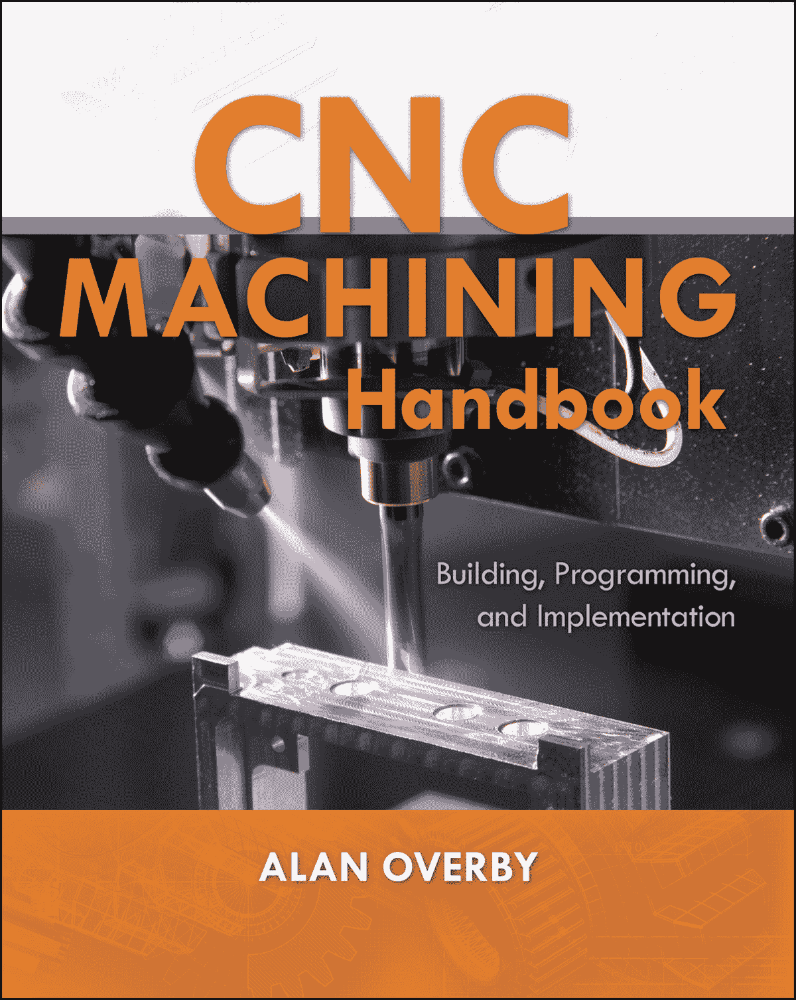
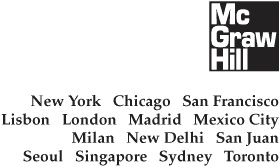

# CNC 加工手册：构建、编程与实施指南

## 关于作者

Alan Overby 毕业于亚利桑那州立大学的电气工程学学士学位。他对 CNC 技术一直有着浓厚的业兴趣，并在招牌行业内曾以专业水平拥有、编程并操作过多台 CNC 铣床和雕刻机。Overby 先生是 Custom CNC, Inc. 的联合所有者，该公司为个人和原始设备制造商提供新的及替换的控制器系统。

反背间隙螺母，38, 39f, 40f

进给率圆弧（`G02`、`G03`），96–99, 96f

ArtCAM（由 DelCAM 开发），155

带有滑板移动板的组件装，180f

ATC。*见* 自动换刀装置

AutoCAD，138–139

AutoCAD-LT（轻量版），138–139

AutoEditNC，90

自动换刀装置，5, 10

## B

B and B 等离子体（公司），166, 166f

背景纹理，197, 197f

背隙，38

背光亚克力 LED 标牌，201, 202f

球头，20

滚丝杠（s），41–42

选择。*见* 精密滚圆滚丝杠产品概述

滚丝杠寿命，237

轴承拆卸工具，8

皮带减速机，51f

皮带张紧工具，52f

斜边刻字，195–196, 196f

BHCS。*见* 柱头内螺钉

双极系列接线，58

BOB。*见* 扩展板

盲文刻字，21, 193–194

扩展板，72–75。*另见下方* 控制器硬件

柱头内螺钉，178

## C

CAD 与图形，135

### 图形程序

Adobe Illustrator，140

GIMP，140

Rhino，140

SolidWorks，140

像素化，137f

栅格到矢量转换工具，137–138

棒线字体，136, 136f

TrueType 字体，136, 136f

2D 和 3D 的差异，138

供应商列表，138

AutoCAD，138–139

AutoCAD-LT，138–139

免费 CAD，139

低成本 CAD，139

QCAD，139–140

TurboCAD，139

### CAM 软件

CAM 软件，143, 156

#### CAD 和 CAM 软件

ArtCAM（由 DelCAM 开发），155

CAM-Only 软件，156

FreeMill，156

MasterCAM，156

SheetCAM（由 Stable Design 开发），156

Vectric 软件，155

VisualMill，156

#### 铣削选项

顺铣，152–153

常规铣，152–153

精面轮廓，153–154

切入，154

切出位置，154

嵌套，154

零件分料，154

斜坡切，154

下刀，153

越刀，153

#### 用途

用途，144–146

区域间隙，147

CAM 加工参数，146

装饰性切割，148

钻孔功能，148–149

凹槽雕刻，150–151

镶嵌功能，149

轮廓，146–147, 145f, 146f

3D 雕刻，150–151

活动按钮（Campaign buttons），201

滑板（s），28

装配，31, 32f

带有 3/4 英制管，177f

### 笛卡尔坐标系

定义，129–130, 129f

车床/旋转拓结构，131–132, 131f, 132f

台式或铣床拓结构，130–131, 131f

C 型槽，19

陶瓷型轴承，8

夹装式机制，37

壳体法，184

顺铣，152–153

闭式轴承样式，27

### CNC

雕刻机，193

等离子切割床，15

由 B and B Plasma 提供，166f

#### CNC 机器

结构材料（雕刻机/等离子）

铝，18–19

连接材料，19

木材复合材料，18

雕刻（s），5

下胶双面胶带，12

`Z` 轴，15–16

限位开关，16

机械复位，13

光学复位，13

等离子切割机，14–15

复位，13

旋转轴，13–14

网格，12

真空，12

铣，18

精度，5

路由器雕刻头，6–8

主轴，8

完整件，17f

底部，17f

组件装配，17f

材料，17

`X` 轴装配，15f

`Z` 轴装配，15f

凸起式字母和标志，214–216, 215f, 216f

纹理背景效果，197, 197f

3D 路由，202–204, 203f

工具和模板，189

燕尾夹具，190f, 191f

DT 槽切割，192f

品板丝弯曲工具，193f

V 型雕刻，194–195, 195f

涂层，球滚钉，234

压缩负载，242

计算机操作系统和应用程序，89

同心衬套，30, 30f

锥形刀具，20f, 21f

建筑材料。*参见* CNC 机床

## 控制软件

计算机操作系统和应用程序，89

增强型机床控制器，版本 2 (`EMC2`)，88–89

进给率 (`F`)，123

G 代码，90–93, 92t–93t

`G00`（快速线性运动），93–95

`G01`（进给速率线性运动），95–96

`G02` 和 `G03`（进给速率圆弧运动），96–99

`G04`（延时），99

`G10`（坐标系数据工具和工件偏移表），99–100

`G12` 和 `G13`（顺时针/逆时针圆孔槽），100

`G15` 和 `G16`（退出和进入极坐标模式），100

`G17`、`G18` 和 `G19`（平面选择），100, 100f, 101f

`G20` 和 `G21`（长度单位），101

`G28` 和 `G30`（返回原位），101

`G28.1`（参考轴），101–102

`G31`（直线探测），102–103

`G40`、`G41` 和 `G42`（刀具半径补偿），103–104

`G43`、`G44` 和 `G49`（刀具长度偏移），104

`G50` 和 `G51`（缩放因子），104

`G52`（临时坐标系偏移），105

`G53`（绝对坐标移动），105

`G54` 到 `G59` 和 `G59 P`（选择工件偏移坐标系），105

`G61` 和 `G64`（路径控制模式），106

`G68` 和 `G69`（坐标系旋转），106

`G73` 槽循环（高速啄孔钻），106–107

`G80`（模态取消），107

`G81` 循环，109

`G81` 到 `G89`（固定槽循环），108–109

`G82` 循环（钻孔），110

`G83` 循环（啄孔钻），110

`G85` 循环（扩孔或铰扩），111, 111f

`G86` 循环（扩孔），112

`G88` 循环（扩孔），112

`G89` 循环（扩孔），112

`G90` 和 `G91`（距离模式），112–113

`G92`、`G92.1`、`G92.2` 和 `G92.3` 偏移，113–114

`G93`、`G94` 和 `G95`（路径控制模式），114–115

`G98` 和 `G99`（槽循环返回），115–116

G 代码编辑器，90

M 代码，116, 116f

`M0`、`M1`、`M2` 和 `M30`（程序停止和结束），116–117

`M3`、`M4` 和 `M5`（主轴控制），117

`M47`（从第一行重新运行），118

`M48` 和 `M49`（倍率控制），118

`M6`（换刀），117–118

`M7`、`M8` 和 `M9`（冷却液控制），118

`M98`（调用子程序），118–119

`M99`（返回子程序），119

`M998`（换刀位置），121

Mach3 控制软件，87–88

模态组，122, 122t

选择刀具 (`T`)，123

自动反转攻丝循环，119–121, 120t–121t

主轴速度 (`S`)，123

用户定义的 M 代码，122

## 控制硬件

附属设备，78–79

主轴速度控制器，79

接口板（breakout board），72–75

带主轴速度控制器的双端口 BOB，79f

来自音频逻辑的双端口，75f

五轴多功能的，74f

来自 PMDX 的四轴 BOB，74f

功能，72

驱动器，75–76

外壳，71–72, 72f

接线，73f

手持控制器，79–81

微开关，81–83

`Z` 触碰工具，83

电源，76–78, 77f

接线，83

控制器软件，163

控制台，10

常规铣削，152–153

对话式编程，88

冷却液控制，118

核心，137

关键螺母，238

关键速度，242

电流脉冲，7

插座内切割，219

切割类型，148

刀具半径补偿（`G40`、`G41` 和 `G42`），103–104, 105

刀具斜坡，154

刀具阶降，153

## D

数字读数仪，65

DRO 设备。*参见* 数字读数仪

直流电机，62

DIY (DIY)，168

双螺母调节预载，240

双面胶带，12

燕尾夹具，190f, 191f

钻孔功能，148–149

驱动器，75–76

驱动方法，37

### 传输系统

双 `Z`，15–16

双用途车床，169

## E

偏心衬套，30, 30f

EMC2。*参见* 增强型机床控制器，版本 2

紧急停电 (EPO)，71, 72

编码器，64–65, 65f

组装，65f

双轴配置，64f

线性玻璃刻尺，65

外壳，71–72, 72f

端部固定，35–36

端部和轴承支撑，234

端铣刀，19–20, 20f

雕刻，20, 20f

浅填充的，197

机器，5

带条形字体，148f

坯料，205, 206f

增强型机床控制器，版本 2 (`EMC2`)，88–89

EPO。*参见* 紧急停电

环脂填充雕刻，198f

ER25 筒夹系统，10f

EZ-Router，164, 164f

## F

厚垫子，12

FDA。*参见* 食品药品监督管理局

进速率，123

FenderStratocaster，207

浅槽雕刻，197

法兰，48, 234

美国食品食品药品管理局，46

FreeMill，156

免费软件，139

琴丝弯弯工具，193

家具，189, 190

## G

`G00`（快速直线运动），93–95, 94

不当使用，94

`G01`（进给速率直线运动），95–96, 95

`G02`（顺时针圆弧运动），96–99, 96

`G03`（逆时针圆弧运动），96–99, 96

`G04`（延时），99

`G10` 命令（坐标系数据工具和工件偏移表），99–100

`G12`（顺时针/逆时针圆柱孔），100

`G13`（顺时针/逆时针圆柱孔），100

`G15`（退出和进入极坐标模式），100

`G16`（退出和进入极坐标模式），100

`G17`（平面选择），100, 100, 101

`G18`（平面选择），100, 100, 101

`G19`（平面选择），100, 100, 101

`G20`（长度单位），101

`G21`（长度单位），101

`G28` 命令（返回原点），101, 102

`G28.1`（参考轴），101–102

`G30`（返回原点），101

`G31`（直线探头），102–103

`G40`（刀具半径补偿），103–104

`G41`（刀具半径补偿），103–104

`G42`（刀具半径补偿），103–104

`G43`（刀具长度偏移），104

`G44`（刀具长度偏移），104

`G49`（刀具长度偏移），104

`G50`（缩放因子），104

`G51`（缩放因子），104

`G52`（临时坐标系偏移），105

`G53`（绝对坐标下），105

`G54` 到 `G59`（选择工件偏移坐标系），105

`G59 P`（选择工件偏移坐标系），105

`G61`（路径控制模式），106

`G64`（路径控制模式），106

`G68`（坐标系），106

`G69`（坐标系），106

`G73` 循环（快速断孔），106–107, 107

`G80`（模式取消），107

`G81` 钻孔循环，109, 110

`G81` 到 `G89`（循环），108–109, 110

`G82` 循环（钻孔），110

`G83` 循环（断孔），107, 110, 111

`G85` 循环（扩孔/铰眼），111, 111

`G86` 循环（扩孔），112

`G88` 循环（扩孔），112

`G89` 循环（扩孔），112

`G90`（绝对距离模式），112–113, 113

`G91`（增量距离模式），112–113, 113, 114

`G92`、`G92.1`、`G92.2` 和 `G92.3`（偏移），113–114

`G93`（路径控制模式设置），114–115

`G94`（路径控制模式设置），114–115

`G95`（路径控制模式设置），114–115

`G98`（循环返回层），115–116

`G99`（循环返回层），115–116

龙门端盖，177, 177

电保护气体弧焊，19

钨极弧焊，19

G 代码命令，10

G 代码控制系统，162

G 代码编辑器，90

G 代码文件处理，16

G 代码编程编辑器。参见 G 代码中的编程示例

齿轮减机，46

GIMP，140

GMAW。见电保护气体弧焊

图形程序。参见 CAD 和图形下

GTAW。见钨极弧焊

导轨系统。参见线性导轨系统

## H

月形滚轮，31

霍尔传感器，62

方便的手对工具，82

硬件抽象层，88

硬件外壳柜，72

DU 泡沫。见高密度聚氨泡沫

151

V 型刀头，19

高密度聚氨泡沫，196, 200

压紧方法。参见 CNC

钻孔，149

孔，178

回位开关，16

马马力（实际），7,（理论上），6

混合导轨，32, 32

## I

凹槽雕刻，150–151

增量模式（`G91`），108, 112, 113

感应电机，6, 7

镶嵌功能，149

冲击电流，7

## K

K2-CNC（公司），166

## L

车床，18, 166–168

车床拓扑，131–132, 131, 132

丝杠，11, 18

组装，39

螺母，38–41

提前量值，36–37, 38

调平系统，173, 174

精密丝杠组件的预期寿命，244

线性光尺，65

### 线性导轨系统

混合导轨，32, 32

型形导轨，27–29, 28

圆轨，26–27, 26

持续支持，27

来自 Danaher Motion，26

端部安装，27

V 型滚轮，29–32

进给速率直线运动（`G01`），95–96, 95

Linux 操作系统，89

锁紧弹簧，234

润油孔，234

润滑，28

制琴店，206

## M

M 代码，116, 116

用户定义，122

`M0`、`M1`、`M2` 和 `M30`（程序停止和结束），116–117

`M00` 和 `M01` 命令，99

`M3`（主轴控制），117

`M4`（主轴控制），117

`M47`（从第一行重新运行），118

`M48`（覆盖控制），118

`M49`（覆盖控制），118

- `M5`（主轴控制），117
- `M6`（换刀），117–118, 118f
- `M7`（冷却液控制），118
- `M8`（冷却液控制），118
- `M9`（冷却液控制），118
- `M98`（子程序调用），118–119
- `M99`（从子程序返回），119
- `M998`（换刀位置），121

Mach3 控制软件，13, 87–88, 163, 164, 166

机器寿命，237

机器火炬，184

磁性开关，17, 17f, 82, 82f

MasterCAM，156

MDA 精度，168

MDF。参见 中密度纤维板

机械探针，13

中密度纤维板，18, 197

金属惰性气体，19

微开关，16, 16f, 81–83, 81f

Microsoft Windows，89

微步进驱动器，75, 76f

MIG。参见 质惰性气体

铣床，17–18, 166–168

铣床拓扑，130–131, 131f

模态组，122, 122t

纪念碑标志，189, 190f

### 电机

- 编码器，64–65, 65f
- 功率，163
- 伺服电机，61–63
  - 优势，64
  - 步进电机，57–61, 64f
  - 优势，63
  - 规格，60t

电机组件转支点，177f

安装式减速器，178

安装块，27

来自 Nidec Nemicon 的 MPG，81f

多级减速器，53

## N

美国电气制造商协会，57

NEMA（美国电气制造商协会），57

- NEMA 23 电机，58f, 178
- NEMA 34 电机，58f
- NEMA/34 步进电机，49, 50f
- NEMA 电机安装模板
  - NEMA 17 足迹尺寸，249f
  - NEMA 23 足迹尺寸，250f
  - NEMA 34 足迹尺寸，250f

嵌套矢量，217f

嵌套，154

Nidec Nemicon 公司，81, 81f

### 螺母

- 丝杠，38–41
- 载荷，241
- 安装，37, 241
- 旋转

## O

偏置齿轮减速，46–47, 47f

在线计算器，49, 183

光学探针，13

覆盖控制，118

## P

太平洋轴承，32

零件开槽，154

粒子图像流速，62–63

PD。参见 螺距

间孔钻，107f, 110

Pendant。参见 硬件

允许的压缩负载，238

允许的旋转速度，238

PID。参见 比例积分

齿轮，11, 43, 44, 45

齿轮传输系统，42, 46

螺距，42–43, 47

直径，43, 44, 45

PIV（粒子图像流速），62–63

像素化，137, 137f

行星齿轮减速，46

等离子切割机，14–15

等离子工作台，164–166, 165f, 166f

轴承孔，183

端口，定义，72

电源，76, 78f

精密滚压螺钉产品，234

许可速度，243

精度，239

滚珠丝杠组件，235

示例，236

轴支撑图（端部固定），242

压缩负载，246

设计公式，237–239

用于指定螺钉，246

用于螺钉，243

用于精密丝钉组件，244

用于带预载丝钉组件，245

润滑指南，241

预载类型，240

压力角（PA），42

探针，13

轮廓轨道，27–29、28

轮廓，146–147、145f、146f、153

编程示例，219–223

在`G`代码中，227–230

比例积分（PID），62

滑轮块，198–199、199f、200f

滑轮减速器，49–53

## Q

QCAD，139–140

## R

齿条，11

- 与齿轮组合，42–46
- 齿条传输系统，42、46

径向轴承，36

半径格式命令，97

轨道组件，31

凸起/凹字效果，196、196f

斜坡切削，154

快速线性运动（`G00`），93–95、94f

- 不当使用，94f

现制 CN 系统，161–164

自己动手（DIY），168

- 车床，166–168
- 铣床，166–168
- 等离子工作台，164–166、165f、166f
- 路由器，164–166
- 供应商列表，168–169

减速器机构，11

减速器，44。另参见传输系统

继电器盖拆卸作业，216–218、218f、220f

继电器持托盘，218f

来自 Texas Micro 的远程吊坠控制器，80f

余量加工，146

Rhino，140

旋转 A 轴，13–14

旋转编码器，65f

旋转拓扑，131–132、131f、132f

旋转螺母，42

圆轨道。参见导轨系统

路由器，5、164–166

- 头部，6–8、7f

RTA 运动控制系统，75

## S

螺钉，11

丝杠，37–38

丝距值，42

- 和螺母。参阅传输系统

选择，123

自动反转攻丝循环，119–121、120t–121t

串行控制主轴转速控制卡，80f

伺服电机，61–63

- 优势，64
- 闭环功能，62
- 调优参数
- PID（比例积分微分），62
- PIV（粒子图像测速法），62–63
- 速度与加速度，62f

共享软件，139

SHCS。参阅内圆圆头螺钉

SheetCAM（由 Stable Design 开发），156

木工橱柜，189f

Shuttle Pro，80

标牌行业，12

单极双掷，16

六线电机，58

跳间隙丝距预载，240

内圆圆头螺钉，178

实心电吉他，206–214、210f、211f、215f

- 安装有琴心钢的槽，211f
- 3D 轮廓切割，209f
- 3D 铣削，213f
- 正面拍摄，208f
- 镶嵌标记，214f
- 琴颈琴头，213f
- 琴颈固定夹，210f
- 部分切割的品丝槽，213f
- 铣削指板，212f

SolidWorks，14

Sound logic 控制卡，80f

SPDT。参阅单极双掷

主轴夹爪，21f

主轴控制，117

主轴驱动，8

主轴头，8–11

- 3 马力，9f

主轴转速，123

- 控制器，79、80f

废料板，131

独立式调节电源单元，76

间柱支撑，27

启动电流，7

步进电机，57–61、64f

- 优势，63
- 最大性能，61
- 电源，60–61
- 规格，60t

棒线字体，148、148f

- 雕刻，206f
- 文字，136、136f
- 直探针命令，102
- 螺钉安装字母和标志，214、215f、216f

子程序，228–230

切屑去除，28

## T

T 型槽作业，12

桌组装，184

切向球回返回，234

每英寸齿数，41

临时坐标偏移 `G52`，105

张力负载，242

德州电路，80

THC。参阅 Torch 控制器

薄壁管，176、176f

螺纹，18

- 3D 雕刻，150–151
- 3D 切割，138
- 3D 铣削，202–204

TIG。参阅钨气

Tiger Tek CNC，166

同步带，38、47–49、48

同步轮，47–49、48f

刀长度，104

刀具，19–21、21

拓扑结构

- 车床，131–132、131f、132f
- 铣床，130–131、131f
- 旋转，131–132、131f、132f

Torch 高控制器，14、15f

Tormach CNC 铣床，167f

Tormach 刀具系统，21、22f、169

扭矩，238

环形变压器，78f

传输系统

- 滚珠丝，41–42
- 丝杠和螺母，38–41
- 轮带减速单元，49–52
- 变体，52–53
- 齿轮组合，42–46、43f

减速器

- 齿轮减速器，46
- 偏移直齿轮减速器，46–47
- 行星齿轮减速器，46
- 旋转螺母，42

丝杠和螺母

- 驱动方法，37
- 端固定性，35–36
- 丝距值，36–37、38
- 螺母安装，37
- 丝杠丝距，37–38
- 同步带，47–49
- 同步轮，47–49

托插座

槽内继电器，219

槽内继电器，219

卡车，28

TrueType 字体，144、150、197

雕刻，206f

TrueType 文字，136、136f

TTS。参阅 Tormach 刀具系统

钨气，19

TurboCAD，139

12 伏继电器，218f

## U

Ubuntu，89

槽内继电器，219f

单极电机，58

美国农业部，46

通用序列技术，162

USB 技术。参阅通用序列技术

USB 显微镜，13

USDA。参阅美国农业部

用户定义代码，122

用户输入，164

## V

V 刀雕刻，150

V 型雕刻，194–195、195f

V 型铣刀，194

V 型铣刀，150

V 型滚轮，29–32

真空吸附方法，12

变频驱动，8、9f

矢量艺术品，215f

嵌套，217f

矢量文件，137

矢量四边形，30

Vectric 软件，155

VFD。参阅变频驱动

VisualMill，156

## W

WAGO 连接器，83f

墙支撑块，27

Warp 9，164、168

瓦数，6

鞭子，36

- 界速度，36

刮水器组件，234

布线，83

木复合材料，18

MDF 中的木纹纹理，197

木工铣头，7f

## X

X 轴导轨，176

## Y

Y 轴导轨，176

## Z

Z 轴组件装，181f、182f

Z 轴背板

- 安装结构，179
- 带有间隔块和导柱，179

`Z` 回退量（用于循环加工），115f

`Z` 刀具对刀，83

^* 使用了计算器；这是一个四舍五入后的值。

†80% 的临界速度
