# CNC 编程：Fanuc 自定义 B 宏使用指南

献给我永远怀念的父亲 Rameshwar Prasad Sinha 博士，他培养了我的工程特质

## 作者简介

S. K. Sinha 于 1993 年获得印度理工学院坎普尔分校机械工程博士学位。他拥有 20 年教学/工业经验，并在过去 12 年一直从事 CNC 领域工作。他还著有一本关于 Fanuc 0i 系列控制器基本编程技术的书《*CNC 编程*》第 8 版，由印度新德里 Galgotia Publications Pvt. Ltd. 出版。

## 前言

由于具有出色的精度、重复性以及其他若干无与伦比的独特特性，计算机数字控制（CNC）机床如今在制造业中几乎已完全取代了手动机床。甚至小型制造单位现在也在使用 CNC 机床，因为从长远来看，这些机床被证明更便宜。事实上，如今“为什么用 CNC？”根本不再是讨论的话题。

配备了近来引入的*宏编程*功能的 CNC 机床已变得如此强大，以至于不使用宏功能就像只把最新款手机用于交换语音信息一样。不幸的是，这一领域缺乏训练有素的人员。主要原因是，由于这是一门面向工业的学科，工学院/理工学院并未对其进行足够详细的讲解。甚至商业 CNC 培训学校通常也只提供基础 CNC 培训，而少数确实提供高级培训的培训学校收费过高。最糟糕的是，由于职业竞争，人们通常不愿意与同事分享知识；在这种情况下，学习宏编程很困难，而宏编程常常被恰当地描述为 CNC 的*保守得最好的秘密*。

学习宏编程受阻的根本原因是这一领域缺乏合适的书籍。甚至随机床提供的手册也不能满足需要，因为尽管这些手册确实描述了该语言的所有特性，但它们实际上是参考书，而不是以教材风格编写的。因此，虽然这些手册适合获取某些特定编程功能的详细信息，但人们无法真正从中系统地学习该语言。所需要的是一本带有分步说明的教材，从最基础的原则开始，并按复杂度逐步深入。这正是本书的主要写作动机。它是一本自给自足的教材，设计为按章节顺序从头读到尾。不需要任何其他书籍或讲师形式的外部帮助。仅通过*自学*即可学会。

本书专门讨论 Fanuc 版本的宏编程语言，称为*自定义宏 B*（*自定义宏 A* 已过时且不再使用），并以 0 系列控制器为参考。尽管该语言在 Fanuc 的所有控制器版本上（以及在兼容 Fanuc 的控制器上）都相同，但某些*系统变量*和*控制参数*在不同控制器版本上有所不同。因此，需要从相应的机床手册中核实这些内容，并在需要时进行必要的更改。

最后请注意，尽管已尽力确保本书给出的程序无错误且能按预期运行，但作者和出版方均不对任何可能无意中出现的错误承担责任。按照经验法则，在实际执行新程序之前，应始终检查其仿真结果。

欢迎提出进一步改进的建议，作者将不胜感激。任何反馈可直接发送至作者邮箱：sinha_nsit@yahoo.co.uk。

S. K. Sinha

## 致谢

作者极其感谢印度瓦拉纳西 BHU 技术学院主车间负责教授 V. P. Singh 教授和车间主任 M. D. Tyagi 先生，感谢他们允许免费使用 CNC 实验室，本书中的大部分程序均在该实验室进行了测试。还要感谢机械工程系主任 J. P. Dwivedi 教授和同事 Pradyumna Ghosh 博士的鼓励之言。

作者还采用了专业 CNC 专家的一些建议，例如前 Fanuc 应用工程师、现任 Suburban Machinery Software, Inc. 总裁的 Dan Fritz 先生，以及来自威斯康星州沃基肖的 CNC 奇才 Steve Hase 先生。谨向他们致以诚挚的感谢。

McGraw-Hill 以及负责排版的 Glyph International 的整个编辑/制作团队，感谢他们为本项目提供的专业帮助。

最后但同样重要的是，作者感谢妻子 Seema、女儿 Shubhi 和儿子 Sarthak，他们在本书写作过程中非常耐心地容忍了作者长时间的工作。

最后，作者若不提及母亲 Kanti Singh 女士的名字，便未尽到职责，她始终是作者鼓励的源泉。

S. K. Sinha

# 第 1 章：引言

数字控制是数字技术的一种应用，它通过一系列编码指令——称为*零件程序*——驱动各种驱动电机、继电器等，从而控制机床。这些机床最初被称为*数字控制（NC）*机床。NC 技术在 20 世纪 50 年代中期实现商业化应用。后来，随着技术进步，计算机成为机床的组成部分，机床的大部分功能通过软件控制，而不是为每个功能配备专用硬件。这类机床被称为*计算机数字控制（CNC）*机床。NC 机床已不再制造，不过我们仍用这个术语来指代这项技术。

由于具有出色的精度、重复性以及其他若干无与伦比的独特特性，CNC 机床如今在制造业中几乎已完全取代了手动机床。甚至小型制造单位现在也在使用 CNC 机床，因为从长远来看，这些机床被证明更便宜。事实上，如今“为什么用 CNC？”根本不再是讨论的话题。

然而，与任何其他计算机应用一样，要充分发挥 CNC 机床的潜力，就必须开发良好且高效的程序。不幸的是，这一领域缺乏训练有素的人力。主要原因是工学院/理工学院陈旧的课程并未详细讲解 CNC 编程。此外，如果你是一名执业工程师，你可能已经意识到，业内少数确实拥有良好编程知识的人，由于显而易见的原因，并不太愿意与他人分享自己的知识和经验！而且，自学并不真的那么容易，尤其是当这门学科复杂且信息以零散方式存在时。

为满足这一需求，最近涌现了许多商业 CNC 培训学校。然而，其中大多数只提供基础 CNC 培训。全世界只有极少数培训学校提供高级 CNC 培训。甚至以自包含教材风格编写的相关书籍也不容易获得。而手册/指南主要仅用于参考，即当人们想查看某个特定功能的详细描述时使用。这使得自学变得困难，尤其对于新手来说，他们

不允许在程序中使用变量、数学运算、函数、逻辑语句、循环等。换言之，它甚至不具备像PASCAL这样的典型计算机语言的基本特性。它只是一种针对特定需求的固定式程序。这显然在很大程度上限制了程序的应用范围。无法编写带有内置逻辑、可适应不同需求的“智能”零件程序。事实上，正如我们稍后将看到的，有许多应用场合不能使用常规零件编程。它只能服务于其设计时所针对的有限用途。

## 对话式零件编程

即使是常规零件编程也相当复杂。因此，为了简化某些常见应用的编程，引入了*对话式*或*引导式编程*（称为*蓝图编程*或*直接尺寸编程*），它使用户即使没有足够的编程经验，也能轻松开发合适的零件程序。程序员无需详细了解零件编程语言；他只需知道要做什么、按什么顺序做，以及使用什么切削参数。控制系统以交互方式提示他输入所有所需信息。然而，这种编程方法存在固有局限，即只适用于某些特定几何形状。因此，尽管可以为某些常见应用快速编写高效程序，但该方法对特殊需求毫无用处。实际上，对话式编程只是常规零件编程技术所能完成工作的一小部分。事实上，对话式编程并不是面向合格工程师的。

## 使用CAM软件的零件编程

只要机床只需同时控制两个轴（包括螺旋插补），而大多数实际应用通常如此，就可以手动编写合适的零件程序，除非几何形状非标准，例如涉及抛物线线段。对于非标准和/或三维几何形状，例如模具加工，手动开发零件程序可能变得过于繁琐，甚至在某些情况下不可能完成。已经开发了若干CAM软件，它们为所需加工生成刀具路径，并自动准备适合所选控制版本的零件程序。然而，CAM软件的基本目的是计算无法手动计算的内容（例如，五轴加工的刀具路径，其中希望始终保持刀具轴线垂直于其所加工的表面）。因此，尽管它能生成复杂的刀具路径，并提供某些与加工相关的这一点。在当今激烈竞争的世界中，人们实在不能对CNC机床如此强大的功能一无所知。考虑到这种编程带来的增强功能，令人惊讶的是，大多数*机床制造商*（MTB）、控制系统制造商，甚至商业培训学校都对其鲜有提及。

以下各节讨论宏编程的主要应用领域。

## 复杂运动

大多数CNC控制系统只提供直线和圆弧运动。因此，例如不可能在车床上进行抛物线车削，或在铣床上切出椭圆槽。对于此类应用，必须借助某种外部计算机编程语言来生成刀具路径，即一连串非常小的直线段，并通过直线插补（G01）依次连接。另一种方法是使用CAM软件。然而，宏编程具备高级计算机编程语言的所有相关特性，使我们能够轻松生成任何有数学方程可用的复杂运动。它还免除了将外部计算机程序或CAM软件生成的极大文件装入CNC的RAM这一问题，这有时使宏编程成为更好的选择。虽然宏编程不能完全取代CAM软件，但它确实可以完成许多不使用CAM软件可能无法完成的事情。

## 零件族

几乎所有公司都有一些属于此类的应用。通过开发*零件族参数化程序*，可以减少零件编程时间。一个例子是法兰上的螺栓孔钻削。虽然所有法兰可能因设计和生产方法相似而属于同一族，但它们实际上可能各不相同。例如，不同法兰的孔数、孔深（即法兰厚度）和节圆直径可能不同。甚至工件材料也可能不同，从而需要不同的进给速度和转速。这些差异还可能要求在不同法兰上使用不同的加工循环（G81、G82等）。

这意味着，尽管所有法兰的加工方法基本相同，但所有程序都会有所不同。然而，使用宏编程特性的单个程序就能完成这项工作。我们只需确定变化的实体，并编写一个以这些实体为变量的程序，并在程序开头定义这些变量。也可以定义一个子程序，以变量作为*实参*。对于特定法兰，*主程序*（即嵌套程序中最高层的程序）只需以所需的实参值调用该子程序。子程序将按指定的变量值执行。该编程方法与任何高级计算机语言中的方法非常相似。主要区别在于变量的指定方式。

请注意，不带实参列表调用的子例程称为*子程序*，而带实参列表调用时则称为*宏程序*（或简称为*宏*）。由机床制造商在机床上提供的内置宏称为*机床宏*，而用户定义的宏称为*用户宏*。子程序通过M98调用（不允许实参列表），而宏通过G65或G66调用（允许实参列表）。请注意，G65/G66不一定必须有实参列表（尽管这种情况很少见）。宏设计为带实参列表调用。另一方面，子程序设计为不带实参列表调用。同一程序如果由M98调用，则表现得像子程序；如果由G65或G66调用（无论是否带实参列表），则表现得像宏。子程序与宏之间的区别将在第6章和第7章详细说明。

将宏用于零件族通常称为*参数化编程*；宏的实参是定义该宏特定功能的*参数*。这里，“参数”一词是在数学意义上使用的。它与定义机床默认设置的*控制参数*毫无关系。控制参数也称为系统参数、CNC/PMC参数、机床参数，或简称为参数。

也可以为宏定义新的G代码（例如G100）或新的M代码（例如M100）。这样，此类宏也可以通过所定义的G代码或M代码调用。事实上，新代码可供该特定机床上的所有程序使用，所有程序员都可以使用它们。这简化了编程，因为程序员甚至无需知道如何调用宏；他们只需知道如何使用这些新代码，而这些新代码变得类似于普通G代码/M代码。当然，最初必须由专家程序员来开发这些新代码。

## 自定义固定循环

CNC机床配备了大量用于不同加工操作的*固定循环*，这在很大程度上简化了编程。例如，如果必须生成G71（多次车削循环）来执行外圆粗加工G00和G01，由于涉及大量数学计算，那将极其复杂和冗长。同样的操作将会

对于每种具有不同几何形状的工件，都需要重复此过程。但是，G71 仅仅是一行两行的代码，适用于所有几何形状。

然而，可能会出现这样的情况：没有预定义的固定循环能够完全适合特定应用。例如，如果要钻一个非常深的孔，可能需要逐步减少后续啄钻的啄钻长度，以便切屑能顺利排出孔外，尤其是当刀具深入孔内时。这种固定循环在任何 CNC 机床上都是不可用的。所有啄钻循环在整个孔深范围内都使用均匀的啄钻长度（除了最后一次啄钻会根据孔深进行调整）。但是，利用宏编程技术，可以编写一个具有可变啄钻长度（根据用户定义的逻辑）的程序，如前所述，还可以为这样的程序定义一个新的 G 代码，然后可以像使用内置固定循环一样方便地使用它。开发新的固定循环可以根据个人需求定制 CNC 机床。

### “智能”程序

宏编程允许使用条件语句（IF–THEN）配合条件运算符（等于、不等于、小于、小于或等于、大于、大于或等于）、逻辑运算符（AND、OR 和 XOR）、条件和无条件分支（IF_GOTO 和 GOTO）以及循环（WHILE_DO–END），此外还有常用的数学和三角函数功能。这使程序员能够编写“智能”程序，根据某些输入条件自动做出特定决策。例如，如果指定的切削深度过大，可以编程让机床自动选择粗加工刀具。同样，机床可以根据孔的参数自动选择合适的钻孔循环。可能性是无限的。实际上，你能想到的任何逻辑都可以纳入宏程序中，这样你就不必担心“如果……怎么办”的情况。机床知道在特定情况下应该做什么。

还可以在程序中插入错误陷阱。在某些指定条件下，机床会自动暂停或中止程序的执行，并显示编程的错误消息。操作员采取补救措施后，可以再次按下“循环启动”按钮，从暂停处恢复程序。所有这些都使程序变得相当灵活，从而提高了加工质量和生产率——这是迈向柔性自动化的重要一步。

### 探测

CNC 机床上的探测具有多项优势，因为检测结果立即可用，而且成本仅为独立三坐标测量机设施的一小部分。然而，人们普遍认为，由于机床非常精确，因此无需测量获得的尺寸。这种观点过于乐观。刀具可能会磨损到不可接受的程度，甚至可能断裂。如果关键尺寸至少不偶尔检查一次，可能会在生产出大批量不合格零件之后才发现问题。

探测的范围不仅限于测量零件的某些尺寸或检查刀具以进行质量控制。还可以通过自动设置刀具偏置程序来大幅减少装夹时间。如果不同工件的初始尺寸不完全相同，这就尤其有用，因为需要为每个新工件重复进行偏置设置程序。

探测还消除了对极其精确且昂贵的夹具的需求。夹紧工件时的任何不准确都可以通过测头测量出来，并且可以在程序中给出校正逻辑。在加工过程中，可以编程让机床根据探测结果自动做出某些决策。所有这些都能以更低的成本带来更好的质量和更高的生产率。然而，除非机床具有宏编程能力，否则探测是不可能实现的。

### 机床状态信息/操作

很多时候，我们需要了解机床的控制状态，例如偏置距离、刀具当前位置、当前主轴转速/进给速率/刀具号、各种 G 代码组的有效模态代码（例如，在加工中心上，第 3 组的 G90 或 G91 是否有效。请记住，在每一组 G 代码中，除了属于第 0 组的非模态代码外，一个代码一直有效，直到被同一组的另一个代码替换）。已生产的零件数量、当前日期/时间、机床运行的累计时间等。这些数据通过许多系统变量（详见第 3 章）提供，可在程序中用于做出某些决策。还可以在连接到机床的打印机上打印这些数据。其中一些变量，如用于存储当前刀具位置的变量，是只读类型，无法修改。其他变量，如偏置距离变量，可以通过程序修改，以改变机床行为。这种与机床的通信，以了解或更改其控制状态，只有通过宏编程功能才能实现。

### 与外部设备的通信

可编程逻辑控制器（PLC）是 CNC（控制）硬件的一个组成部分。一般来说，CNC 控制刀具的运动，而 PLC 控制机床的其他功能。PLC 可以按照我们的要求进行编程，以控制机床的各种自动系统。大多数控制器使用熟悉的*梯形图*来对 PLC 进行编程。

利用宏编程功能，这个 PLC 还可以用于从外部设备接收输入信号或向外部设备传递输出信号。这允许机床与外界进行双向通信。例如，可以使用传感器来检测托盘是否已装载（输入信号）。除非托盘已装载，否则加工循环不会启动。如果托盘未装载，外部指示灯会闪烁（输出信号）。最后，当一个加工循环完成时，零件计数会增加一，并显示在外部显示板上。当零件计数达到预定数量时，机床会停止，并发出外部蜂鸣器声音。这种操作顺序在无人值守、自动装卸的情况下非常有用。同样，在生产过程中还有其他几种有用且创新的自动化应用，这些应用将带来更高的生产率和更好的质量。

宏编程功能实际上为 CNC 机床注入了“生命力”，你可以让它在某些特定情况下按照你想要的方式做出响应。机床能做什么只受程序员的创造力限制。实际上，任何你能想到的逻辑都可以在它上面实现。另一个问题是，没有多少人了解现代 CNC 机床的这些功能。今天，仅将 CNC 机床用于传统加工应用，就像使用 64 位处理器、2GB 内存的计算机仅用于文字处理一样！

## 1.3 我的机床有宏功能吗？

这是现阶段最相关的问题，因为除非你使用的机床具有宏功能，否则学习宏编程就没有意义。尽管宏编程现在已成为大多数控制系统的标准功能，但在某些控制系统上它仍然是一个可选功能。因此，如果购买新机床，必须在规格说明中提及此功能。对于现有机床，执行一些宏语句来测试机床是否启用了该选项，方法如下：

- 设置适当的加工条件（液压泵开启、进给驱动启用、主轴旋转启用、尾座伸出、卡盘夹紧、门关闭）。
- 使用机床操作面板（MOP）上的选择开关选择*手动数据输入*（MDI）模式。
- 按下 MDI 面板上的 PROG 功能键。如果未出现空白程序屏幕，请再次按 PROG。此时会显示空白屏幕。


- 键入 #1 = 1（或任何其他“无害”的宏语句，以免引起任何意外的机床行为），后跟*程序段结束*（EOB）字符（即分号），然后在 MDI 面板上按 INPUT 键。
- 按 MOP 上的 CYCLE START（循环启动）按钮。

这会将值 1 赋给 1 号宏变量。如果没有错误信息，则说明机床具备全功能的宏编程能力（控制系统制造商不会以部分功能的方式启用此功能；它要么完全可用，要么不可用）。为确保万无一失，请在偏置/设定画面上检查已定义宏变量的值。

- 在 MDI 面板上按 OFS/SET 功能键。
- 如果 MACRO 软键未出现，请按显示屏下方的右扩展键（▶）。现在按 MACRO 软键。

这将在*滚动*画面（即向前滚动时，最后一行之后重新出现第一行）上显示所有宏变量（通常为 001～033、100～199 和 500～999）中存储的值，可使用 MDI 面板上的上/下箭头键以及 Page Up/Page Down 键查看。001 号变量（与 1 号变量相同）中存储的值将显示为 00001.000（值以八位数字存储，其余变量为空白字段（空白字段表示未定义变量），但 500～999 范围内的变量可能例外，这些变量即使在断电后也会保留先前存储的值）。不过，这些被称为*永久公共变量*的变量可以重新定义。按 RESET 键将清除除永久公共变量之外的所有变量。不过，通过参数设定，可以在 RESET 操作后仍保留所有变量的值。不同类型的变量将在第 3 章详细描述。

如果机床没有宏功能，它将无法识别宏语句，并会给出错误信息。在这种情况下，必须联系为该机床安装控制系统的公司（如 Fanuc、Siemens、Heidenhain 等）。他们会有偿在机床上启用此选项。有趣的是，某一特定控制版本的电子硬件对于所有始终保留标准功能的机床都是相同的。但控制系统制造商只通过软件编码启用那些他们收到额外付款的可选功能。因此，如果你的机床未启用宏功能，不必担心，只要愿意为此付费即可。不过，非标准控制系统通常不具备宏功能。

## 1.4 本书的目的

宏编程功能非常强大，其适用性仅受你的想象力限制。它为传统零件编程带来了全新的维度。遗憾的是，学习宏编程的资源材料并不容易获得。此外，信息要么以手册形式提供，要么以应用示例形式提供。手册主要用于参考，以便了解某一功能的更多细节；而应用示例则假定读者具备该语言的基础知识。最简单的学习方法是从简单到复杂，逐一学习该语言的各项功能，并配合若干合适的示例。这种方法使人仅通过自学就能理解这些概念。本书正是按照这种方法精心设计的，旨在解释为常见应用开发宏程序所需的全部工具和技术。不过，本书假定读者具备传统零件编程的基础知识。宏编程只是它的延伸。因此，在进入迷人的宏编程世界之前，有必要复习基本编程概念。

后续各章将详细描述宏编程的各项功能。虽然总体讨论不针对特定品牌，但具体描述和编程示例遵循 Fanuc 的 Custom Macro B 语言。较早的版本 Custom Macro A 已过时，不再使用。我们的讨论通常将围绕 Fanuc 0 系列控制系统展开。

如今，Fanuc 在全球数控（CNC）控制系统中拥有超过 50% 的市场份额。在印度，其份额超过 75%。这使 Fanuc 控制系统成为事实上的标准，这也是本书重点介绍 Custom Macro B 的主要原因。事实上，许多较小的公司专门设计其控制系统，以匹配 Fanuc 控制系统的功能。此类控制系统被称为非原厂 Fanuc 控制系统，目前市场上有不少这类产品。不过，此类控制系统并不能保证与 Fanuc 控制系统 100% 相似。它们仍有市场，因为其价格比原厂 Fanuc 控制系统低得多。仿制 Fanuc 控制系统通常不具备宏编程能力。

## 1.5 如何使用本书

本书以教科书风格编写。本书设计为从开头到结尾按顺序阅读。请继续阅读，不要跳过任何章或节（除非另有建议），因为跳读可能导致难以理解随后讨论的某些概念。宏编程是一种典型的高级编程语言，必须循序渐进、透彻地学习。你走得越慢，反而越快到达目的地，因为对任何编程语言的一知半解都可能随时让你陷入麻烦，甚至可能无法找出自己的错误。

然而，仅仅阅读是不够的，因为除非严格实践，否则不可能记住所有内容。因此，读者应尽可能在自己的机床上验证所有编程语句。例如，如果文中说 #0.5 等同于 #1，可以通过执行一行程序 #0.5 = 1; 来测试，这应将值 1 赋给变量 #1。

简单语句也可以在 MDI 模式下验证，而无需创建新程序。不过，MDI 模式的默认参数设定会在程序执行结束后自动清除所键入的程序（并且无法保存在 MDI 模式下创建的程序）。如果希望更改先前键入的程序，则需要重新键入整个程序。更改参数设定可以解决此问题；这将在第 2 章中说明。通过适当的参数设定，MDI 程序只能通过 MDI 面板上的编辑键有意删除或修改。

最后，必须注意，宏编程没有普遍接受的标准。尽管所有知名控制系统制造商都提供类似功能，但其编程方法存在差异。这排除了宏程序在不同控制系统之间可移植的可能性。事实上，即使在同一制造商的不同控制版本之间，通常也不可能 100% 可移植，主要原因是不同控制版本中的控制参数和系统变量存在差异。重要的是理解宏编程技术的基本概念。为适应特定控制版本而进行的必要微调总是可以完成的。

宏编程技术并非 CNC 用户中很普遍的知识，许多人甚至不知道自己机床可能确实具备这种编程功能。不幸的是，宏编程被炒作成一种极其复杂、精密的零件编程方式。这给学习过程造成了不应有的障碍。事实是，宏编程比 PASCAL 等高级编程语言简单得多。所需要的只是学习的意愿和有条理的方法。作者相信，仅用一周就可以获得可用的知识。继续读下去，自己发现吧！


# 第2章

# 变量与表达式

## 2.1 宏变量

宏变量是一个数学量，可以在其允许范围内取任意值。尽管 Fanuc 及类似控制系统上的宏编程具有高级计算机编程语言的若干特性，但在变量定义方式方面，目前仍较为原始。它不允许使用字母数字字符的任意组合来指定变量，指定变量只有一种特定方式。变量用 # 符号后跟一个处于允许范围内的数字（称为变量号）来表示（允许范围取决于控制系统版本）。变量的一些示例如下：

```
#1
#10
#100
#1000
#10000
```

这些数字表示特定的内存位置，其中可能包含某些正或负的算术值（如果已定义，即如果已为它们分配了某个值），也可能为空（如果未定义）。

## 2.2 宏表达式

宏表达式有两种类型：*算术表达式*和*条件表达式*。

算术表达式是涉及变量和/或常量（如 0.12、1.2、12、120 等）的数学公式，可以带函数，也可以不带函数（如 SIN、ACOS、SQRT、LN 等，这些函数将在第4章中说明）。嵌套表达式和函数的参数必须括在方括号内。不能使用小括号（圆括号），因为它们用于在程序中插入注释。算术表达式求值后得到一个算术值。

```
Examples:
#1 = #2
#3 = #4 + #4 * SIN[30 * [#5 / 10]]
```

条件表达式在两个变量/常量/算术表达式之间包含*条件运算符*（如 EQ、NE 和 LT）。它必须括在方括号内。它的求值结果为 TRUE 或 FALSE（这些值称为布尔值）。条件表达式也称为*布尔表达式*。

```
Examples:
[#1 EQ 0]
[[#2 + 1] LT [SIN[30] * #3]]
```

可用的宏变量不能用于存储条件表达式的结果。宏变量中只能存储算术值。布尔值 TRUE/FALSE 不等同于算术值 1/0。

```
Examples:
#1 = 10;                         (Stores 10.000 in variable #1)
#2 = [#1 LT 2];                   (Illegal, as TRUE or FALSE cannot be stored in a variable)
```

手动数据输入（MDI）面板通常只有一个左括号键和一个右括号键。输入时，括号显示为方括号还是圆括号取决于参数设置。如果机床采用 Fanuc 0i 或 Mate 控制系统，请将参数号 3204 的第一位（从右数，通常称为 #0 位；八个位从右到左分别编号为 #0 至 #7）设为 0，以使用方括号；设为 1，以使用圆括号：

|  | #7 | #6 | #5 | #4 | #3 | #2 | #1 | #0 |
|---|---|---|---|---|---|---|---|---|
| 3204 |  |  |  |  |  |  |  | 0 |

其余位的默认设置为 0，为突出显示需要编辑的内容（即 #0 位），表中未显示这些位。显然，在这种参数设置下，无法同时使用方括号和插入注释。如果需要在宏程序中插入一些注释，首先在需要处使用方括号输入/编辑程序。然后将参数设置改为圆括号，以便插入注释。插入注释后，如果还需要对程序中涉及方括号的部分进行一些修正，则需要再次更改参数 3204。

不过，有一种方法可以在同一参数设置下同时使用两种括号。为此，请将参数 3204#2 设为 1（3204#0 应保持为 0；其余六个位的状态不影响此功能）：

|  | #7 | #6 | #5 | #4 | #3 | #2 | #1 | #0 |
|---|---|---|---|---|---|---|---|---|
| 3204 |  |  |  |  |  | 1 |  | 0 |

这样的参数设置会在编辑模式下以软键形式显示扩展字符集，显示“(”、“)”和“@”。在此设置下，如果需要方括号，请使用 MDI 面板上的括号键；如果需要圆括号，请执行以下操作（在编辑模式下）：

- 按 MDI 面板上的 PROG 键（如果当前程序未显示，请再次按 PROG）。
- 按 OPRT 软键。
- 按两次右扩展键（▶）。
- 按 C-EXT 软键。

之后，将出现左圆括号、右圆括号和 @（可用于程序中插入的注释）的软键，在编辑模式下可根据需要随时使用它们进行编辑。但是，显示屏幕发生变化会使这些软键消失。如果再次需要它们，则必须重复显示它们的过程。

请注意，MDI 面板和 LCD 屏幕（彩色或单色）既可作为一体式单元，也可作为分离式单元。独立式 MDI 面板更大，按键更多。因此，输入字母数字字符/算术运算符时较少需要使用 SHIFT 键，从而使输入更快。键盘还为两种括号分别设置了按键，因此无需为它们显示软键。

回到关于宏表达式的讨论，算术表达式按照通常的优先级规则求值为正或负的算术值：括号（最内层优先）→ 函数求值 → 乘除 → 加减。允许混合模式算术，即同时涉及实数和整数的计算，其结果为一个实数。事实上，控制系统即使存储整数也将其存为实数，小数点后带零。因此，例如 10 等同于 10.0，并且它们可以在所有算术计算中互换使用。请注意，此说法仅对算术计算有效。例如，X10 可能被解释为 10 mm 或 10 μm（在毫米模式下），取决于参数 3401#0 是 1 还是 0。

要使用变量中存储值的负值，可以在变量地址前加减号，但不允许两个连续的算术运算符（+、-、*、% 和 /）。在这种情况下，必须使用方括号：

- `#1 + 10` —（有效表达式）
- `10 + #1` —（无效表达式）
- `10 + [#1]` —（有效表达式）

变量也可以用另一个变量或算术表达式来表示，该变量或表达式必须括在方括号内：

- `#{#1}` —（#1 应包含允许范围内的数字。例如，如果 #1 包含 10，则 `#{#1}` 等同于 #10。#1 非法。）
- `#{#1+10}` —（如果 #1 包含 10，则所引用的变量是 #20。）

变量的指定编号是一个整数。如果指定了实数值（这只是一种理论上的可能性，因为这种情况在实际应用中永远不会出现），它会自动舍入到最接近的整数（关于为变量赋值的方法，请参见 2.3 节）：

- `#1 = 1.4999999;` —（将 1.4999999 存入变量 #1）
- `#[#1] = 1.5000000;` —（将 1.5000000 存入变量 #1）
- `#[#1] = 1;` —（将 0001.000 存入变量 #2。变量使用八位数字存储并显示一个值，小数点后三位，除非该值无法用此格式表示。）
- `#0.4999999 = 1;` —（非法命令，因为它试图为变量 #0 赋值。变量 #0 是一个预定义的只读型空变量，不能重新定义。空变量的属性在 2.5 节中详细说明。）
- `#0.5000000 = 1;` —（将 0001.000 存入变量 #1。）

## 2.3 为变量赋值

可以为变量赋值，一般格式为

```
#i = <some value or arithmetic expression>;
```

其中 i 是变量号。在左侧，也可以用表达式代替 i。一些示例如下：

- `#1 = 10;` —（将 0010.000 存入变量 #1）
- `#1 = #1 + 1;` —（通过存入 0011.000 重新定义 #1）
- `#[#1 + 10] = [10 + 20] / 30 - #1;` —（将 -00010.000 存入变量 #21）
- `#[#1] = SQRT[-#21];` —（将 3.1622777（舍入到八位的值）存入变量 #1。舍入由控制系统自动完成，在……）


```
#[#1] = SQRT[-#21];
G00 W#11;
```

给变量赋值的所有情况。（仅存储八位十进制数字。）（在毫米模式下，由于位移的最小输入增量为 0.001 mm，因此会产生 3.162 mm 的位移，即四舍五入到小数点后三位的值。在数控语句中，如果以变量形式指定数值，控制器会自动将轴值四舍五入到机床的最小输入增量。另请参阅第 4.4 节。）

“数控语句”这一术语此前一直在使用，但并未正式定义。它是一个*程序段*，至少包含一个 NC 地址，例如 G、M、F、S、T、X、Y 和 Z，但不包括用于调用宏程序的代码（如 G65、G66 等）。另一方面，*宏语句*只是给变量赋值（#1 = <某个值或算术表达式>），或跳转到指定的程序段号（GOTO_ 和 IF_GOTO_），或使用条件语句（IF_THEN_WHILE_DO_ 和 END_），或调用宏程序。简单来说，宏语句不会直接引起机床的物理运动，而数控语句则直接控制机床运动。数控语句可以使用也可以不使用宏变量/函数。

控制器处理数控语句和宏语句的方式有两个主要区别：

- 如果程序以单段模式执行（MOP 上有一个用于此目的的开关），则执行会在每条数控语句结束时停止，并且只有在再次按下 CYCLE START 按钮后才会继续执行下一程序段。然而，执行不会在宏语句结束时停止；它会继续执行下一程序段。如果希望宏语句也在单段模式下执行，请将参数 6000#5 设为 1。正常情况下，这种需求永远不会出现，因为宏语句不涉及机床运动。但是，如果程序出现错误，可以一次执行一条宏语句，以检查中间计算结果。
- 尽管程序是逐程序段执行的，但控制器会预读下一程序段并提前解释它，以提高执行速度。在半径补偿模式下，会预读两个程序段，因为控制器需要在当前程序段结束时正确放置刀具，以适应下一路径段。然而，所有（或尽可能多的）连续宏语句都会被立即读取和求值。实际上，控制器不把宏语句计为一个程序段。数控语句才构成一个程序段。

回到关于定义变量的讨论，请注意，如果总位数不超过八位，变量始终存储至少保留三位小数的值。如果使用的小数位少于三位，则会补零。

```
Examples:
#1 = 1234;             (Stores 01234.000)
#1 = 12345;            (Stores 12345.000)
#1 = 123456;           (Stores 123456.000)
#1 = 1234567;          (Stores 1234567.0)
#1 = 12345678;         (Stores 12345678)
```

如果指定的位数超过八位，则在四舍五入到八位（与小数点的位置无关）后，多出的数字可能被转换为 0，这可能会产生意外结果，如下例所示：

```
#1 = 123456.789;     (Stores 123456.790 in variable #1)
#2 = 123456.794;     (Stores 123456.790 in variable #2)
#3 = #2 - #1;        (Stores 0.000 in variable #3)
```

然而，在 Fanuc 0i 控制器中，为任何值指定超过八位数字都会生成错误消息“TOO MANY DIGITS”，并终止程序执行。它不会将 123456.789 这样的值存储到变量中，并会显示该错误消息。但是，如果算术计算后结果超过八位数字，则会自动四舍五入到八位，并且不会出现错误（报警消息）或警告（操作员消息）。

变量也可以按条件方式定义（条件语句在第 5.3 节中说明）：

```
#10 = 10;
#25 = 5;
IF [#10 GT #25] THEN #25 = #25 + 10;    (TRUE condition, so
                                           #25 becomes 15.000)
```

## 2.4 变量的显示

有必要理解变量的值在宏变量屏幕上如何显示，因为这可能会引起一些混淆。变量的计算值必须位于允许范围内（10⁻²⁹ ≤ 数量级 ≤ 10⁴⁷，或为 0）。然而，并非所有合法值都能在屏幕上正确显示，因为屏幕使用简单的八位十进制格式，不带指数位。即便如此，变量中保存的值（只要它是合法的）仍会被正确用于后续计算。此外，Fanuc 0i 系列控制器不允许在直接赋值中指定超过八位数字（包括前导零或尾随零）的值。下面给出一些示例：

```
#1 = 0.00000001;                 (Illegal value, as it contains
                                  more than eight digits)
#1 = .00000001;
```

（将正确的值赋给 #1，但显示九个星号 ********，因为该数字无法用八位数字正确显示，因为显示会自动在小数点左侧至少添加一个零。因此，它应显示 0.00000001，但由于需要九位数字而无法显示。请注意，该值与上一示例中的值相同）

```
#1 = #1 * 10;
```

（将 0.00000001 赋给 #1，该值也能正确显示）

```
#1 = #1 * #1 * #1 * #1 * #1 / 10;
```

（将 10^-30 赋给 #1，但显示九个星号）

```
#1 = #1 / 10;
```

（计算值小于 10^-38，不在允许范围内，因此执行会以报警终止。请注意，报警消息将是“CALCULATED DATA OVERFLOW”，尽管它实际上是*数学下溢*）

```
#1 = 10000000;
```

（显示 10000000）

```
#1 = #1 * #1 * #1 * #1 * #1 * #1;
```

（将 10^70 赋给 #1，但显示九个星号）

```
#1 = #1 * 100000;
```

（将 10^75 赋给 #1，但显示九个星号）

```
#1 = #1 * 10;
```

（计算值大于 10^77，不在允许范围内。因此，执行会以报警“CALCULATED DATA OVERFLOW”终止）

## 2.5 实数值与整数值

尽管可能并不合适，但 Fanuc 控制器在*宏语句*（仅限宏语句）中非常宽松地允许用实数代替整数，反之亦然。虽然用整数代替实数不会造成任何问题，但用实数（直接赋值或算术表达式的值）代替整数时会被自动四舍五入。这一点已在涉及变量编号时解释过。下面是一些不同的示例（再次说明，这只是理论讨论，唯一目的是解释控制器所遵循的逻辑，因为这可能有助于错误诊断）：

```
#1 = 1000.4999;
M03 S#1;             (Equivalent to M03 S1000)

#1 = 1000.5000;
M03 S#1;          (Equivalent to M03 S1001)
M03 S1000.0;      (An illegal statement. S-value must be an integer number)

#1 = 3.4999999;
M#1 S1000;        (Equivalent to M03 S1000)
#1 = 3.5000000;
M#1 S1000;
M3.0 S1000;       (An illegal statement. M-value must be an integer number)
```

尽管最后一条语句是非法的，但如果将 3.0（或其他实数或表达式）括在方括号中，它就会成为宏表达式，并进行四舍五入：

```
M[3.0] S1000;       (Equivalent to M03 S1000)
M[3.4999999] S1000; (Equivalent to M03 S1000)
M[3.5] S1000;       (Equivalent to M04 S1000)
```

这也适用于所有其他地址（G 代码除外），例如主轴转速：

```
M03 S[1000.0];    (Equivalent to M03 S1000)
M03 S[1000.4999];  (Equivalent to M03 S1000)
M03 S[1000.5000];  (Equivalent to M03 S1001)
```

所有这些方括号也可以包含算术表达式。请注意，如果将参数 3451#2（仅适用于铣床；该参数在车床上不可用）设为 1，则主轴转速最多可以有一位小数，不过解释后的转速将是四舍五入后的整数值：

```
S1000.5;   (Equivalent to S1001, if parameter 3451#2 = 1)
S1000.50;  (Illegal, because of more than one decimal place)
```

“过度的灵活性会使编程语言变得相当‘缺乏纪律’，并且容易出错。程序员的一个无意错误可能会被机床‘正确地’解释，从而导致不良后果。而且这非常可能，因为宏编程可能涉及复杂的计算和复杂的逻辑。在作者看来，在需要整数值的地方绝不能接受实数值。此外，如第 2.6 节所述，Fanuc 控制器（事实上，也许是所有控制器）在算术计算中会将空变量视为值为 0 的变量。这同样不合逻辑，并可能被证明是危险的。输入错误总是可能发生。也许控制器制造商应该修改其宏编译器，使其成为一种类似 PASCAL 的严格语言。目前，程序员必须非常一丝不苟地理解宏编译器所遵循的逻辑。”


在使用 G 代码时，这个问题更为严重。控制系统不允许将任何宏表达式用作 G 代码的编号。因此，诸如 G[01] 这样的命令不等同于 G01，并且是非法的。但是，必须意识到控制系统并非在所有情况下都会给出错误信息。例如，在 0i Mate TC 控制上，G[03] 会导致意外的快速移动刀具运动，可能造成机床事故。因此，根据经验法则，绝不要将宏表达式用作 G 代码的编号。

然而，G 代码可以使用宏变量作为其编号。这些变量也可以根据算术表达式来定义。尽管实际应用可能永远不需要使用表达式来定义这些变量，但仍应了解甚至理论上的可能性，这可能有助于解释程序中某些错误的结果：

```text
#1 = 0;                         (Stores 0.000 in #1)
#2 = 1;                         (Stores 1.000 in #2)
IF [#2 GT #1] THEN #3 = 99;     (TRUE condition, so #3 becomes 99.000)

#4 = [#2 + #3] / 2;             (Calculation makes #4 equal to 50.000)

G#1;                            (Equivalent to G00)
G#2;                            (Equivalent to G01)
G#3;                            (Equivalent to G99)
G#4;                            (Equivalent to G50)
```

除少数例外（例如 G12.1 和 G13.1）外，所有 G 代码编号都是整数。因此，要用作 G 代码编号的变量值（直接赋值或通过表达式赋值）必须是整数。Fanuc 控制系统也接受实数，只要其四舍五入到小数点后第一位的形式在小数点后为 0。换句话说，它允许 ±0.05 的“误差”。因此，在 1.95 ≤ n ≤ 2.0499999 范围内的数被视为 2.0；在 2.95 ≤ n ≤ 3.0499999 范围内，它将被视为 3.0；而 2.05 ≤ n ≤ 2.9499999 是非法范围（因为四舍五入形式下的范围是 2.1 ≤ n ≤ 2.9）。所以，1.95、2.0、2.0499999 等都被视为 2，而 1.9499999、2.05、2.9499999 等则是非法的：

```text
#1 = 1.9499999;
#2 = 1.95;
#3 = 2.0;
#4 = 2.0499999;
#5 = 2.05;

G#1;                            (Illegal)
G#2;                            (Equivalent to G02)
G#3;                            (Equivalent to G02)
G#4;                            (Equivalent to G02)
G#5;                            (Illegal)
```

解释用实数代替整数进行指定所产生影响的目的是完整描述典型控制系统所使用的逻辑。从逻辑上讲，如果期望得到整数（例如与 G、M 和 S 代码相关的值），而计算结果（或直接赋值）却是实数（小数点后数字非零），这种情况本不应出现，除非程序中存在某种错误。然而，为了快速诊断，有必要充分理解宏编译器内置的逻辑。即使程序完美无缺，输入错误也总可能混入。

回想一下，参数 3401#0 决定以不带小数点的数字表示的尺寸值（例如距离和进给速度）将被解释为毫米值还是微米值（假设为 G21 模式）。在定义变量时，如果用整数代替实数，这可能会在 Fanuc 以外的某些控制系统上引起严重问题。例如，

```text
#1 = 10;
G00 W#1;
```

可能导致 0.01 mm 的位移。因此，为了更安全起见，所有尺寸值都应始终使用小数点。然而，这个问题在 Fanuc 控制系统上不存在，因为无论参数设置如何，它都会在变量 #1 中存储 00010.000。

变量可用作任何字母地址后的值，但 O（程序号）和 N（顺序号）除外。可选程序段跳过号也不允许使用变量：

```text
#1 = 1;
O#1;                 (An illegal statement. Use O1)
N#1 G01 X100;        (An illegal statement. Use N1)
/#1 G01 X100;        (An illegal statement. Use /1)
```

## 2.6 未定义变量

如果未向变量显式赋值，则该变量保持未定义状态，并且不包含任何内容。这种变量称为空变量或空缺变量。#0 是预定义的只读型空变量。不能向其中存储任何数据。提供它的唯一目的是将其他某个变量与其进行逻辑比较，以判断该变量是否已定义。比较语句用于条件表达式中，第 4.1 节和第 5.2 节将对此进行更详细的说明。

### 字地址中的空变量

当空变量出现在地址中时，仅该地址被忽略。例如，如果 #1 是空变量，则 G00 X#1 不会引起任何运动，尽管 G00 将成为第 1 组的活动模态代码。该语句等效于仅含 G00 的命令，不带任何轴字。另一方面，G00 X#1 Z100 等效于 G00 Z100。

### 算术运算中的空变量

通常，如果空变量在某个地方被用于比较以判断其是否为空变量之外的目的，那么给出错误信息 UNDEFINED VARIABLE 本来会更合适。但是，Fanuc 宏编译器（可能其他制造商的编译器也是如此）并非按这种方式设计。在加法和乘法等算术运算以及函数求值中，空变量被视为值为 0 的变量。在以下示例中，最初假设所有变量都是空变量：

| 语句 | 说明 |
|---|---|
| `#2 = #1;` | （#2 仍为空变量，因为此语句中没有算术运算或函数求值） |
| `#3 = [#1];` | （括号的存在确实使其成为表达式，但由于没有对 #1 进行任何算术运算，它仍为空。因此，#3 仍为空变量） |
| `#4 = #1 + #1;` | （等效于 #4 = 0 + 0。因此，#4 被定义并存储 0） |
| `#5 = #1 * 5;` | （等效于 #5 = 0 * 5。因此，#5 被定义并存储 0） |
| `#6 = 1 / #1;` | （等效于 #6 = 1 / 0，这将给出“DIVIDED BY ZERO”错误） |
| `#7 = SQRT[#1];` | （等效于 #7 = SQRT[0]。因此，#7 被定义并存储 0） |
| `#8 = #4109;` | （变量 #4109 包含机床上当前活动的进给速度；如果前面的程序段中任何地方都未使用 F 字，则它包含 0。因此，#8 将存储当前进给速度或 0。#4109 类型的变量在第 3 章中描述。这些变量从不为空，即使未显式定义） |

### 条件表达式中的空变量

除 EQ（等于）和 NE（不等于）外，空变量与 0 相同。在以下语句中，#1 是空变量：

| 语句 | 说明 |
|---|---|
| `[#1 LT 0]` | （等效于 0 LT 0，因此为 FALSE） |
| `[#1 LE 0]` | （等效于 0 LE 0，因此为 TRUE） |
| `[#1 GT 0]` | （等效于 0 GT 0，因此为 FALSE） |
| `[#1 GE 0]` | （等效于 0 GE 0，因此为 TRUE） |
| `[#1 LT #0]` | （等效于 0 LT 0，因此为 FALSE） |
| `[#1 LE #0]` | （等效于 0 LE 0，因此为 TRUE） |
| `[#1 GT #0]` | （等效于 0 GT 0，因此为 FALSE） |
| `[#1 GE #0]` | （等效于 0 GE 0，因此为 TRUE） |

然而，在使用 EQ 和 NE 的比较语句中，空变量与 0 并不相同：

- `[#1 EQ 0]` （使用 EQ 时，空变量与 0 不相同，因此为 FALSE）
- `[#1 NE 0]` （使用 NE 时，空变量与 0 不相同，因此为 TRUE）
- `[#1 EQ #0]` （使用 EQ 时，空变量与 #0 相同，因此为 TRUE）
- `[#1 NE #0]` （两者都是空变量，因此为 FALSE）

## 2.7 宏编程特性的简单使用

最后，以下简单示例展示了使用变量如何使同一程序在不同要求下工作：

```text
#1 = 0;
#10 = 1;
#100 = 50;
#101 = 60;
#102 = 30;
G#10 X#100 Z#101 R#1 F#102;
```

这些语句等效于 G01 X50.000 Z60.000 R0.000 F30.000；只需更改不同变量中存储的值，就能让它执行不同的操作。程序中可以有若干这样的语句。无需修改其中任何一条。只需在程序开头定义变量，并根据需要更改它们。这是宏编程最简单、最有效的用法，不需要深入掌握这种编程语言。只需了解宏变量的类型及其允许范围即可。

## 2.8 在 MDI 模式下保留程序

上面以及后续章节中的所有陈述，凡适用之处，均已在 Fanuc 0i Mate TC 上实际验证。如果希望验证它们，或想尝试其他组合，可以使用 AUTO 模式（自动运行模式，也称为存储器模式）中的动态图形功能安全地进行。然而，如果不涉及刀具运动，则可以在存储器模式下不使用动态图形进行验证。事实上，甚至可以使用 MDI 模式。但是，MDI 模式的默认设置使得程序在执行完成后会自动被擦除。这意味着后续执行时必须重新输入程序。这使得在 MDI 模式下进行试错变得不切实际。然而，如果将参数 3204#6 设为 1，则 MDI 程序在执行结束后仍会保留。RESET 键将，

当然，将其擦除。如果希望在按下 RESET 键后仍保留它，请将参数 3203#7 设为 0。在其他版本的 Fanuc 控制系统中，这些参数编号可能不同。需要参考相应的参数手册。然而，MDI 程序无法以程序号永久保存以供将来使用。关闭机床会将其永久擦除。

# 第 3 章：变量类型

## 3.1 局部变量和全局变量

在高级计算机语言中，存在*局部变量*和*全局变量*的概念。局部变量在子程序内部定义，并且只在该子程序内有效。它们用于子程序中的中间计算，在子程序之外或嵌套于其中的另一个子程序中都没有意义。因此，即使不同的子程序使用同名的局部变量，它们也指向不同且独立的内存位置，因而互不影响。并且，在嵌套的情况下，嵌套子程序执行结束、执行返回到调用子程序后，调用子程序先前定义的局部变量再次对其可用，并具有先前存储的相同值。主程序也可以有自己的一组局部变量。另一方面，全局变量在整个程序中具有全局性质。它们可以在任何地方以相同含义使用，因为它们指向相同的内存位置：

```
Main program
    GLOVAR = 1
    Call subroutine 1
    Print GLOVAR                    (Prints 3, because the global variable, GLOVAR, gets modified by both the subroutines)
End
Subroutine 1
    Local variables: LOCVAR
    LOCVAR = 1
    GLOVAR = GLOVAR + 1
    Call Subroutine 2
    Print LOCVAR                    (Prints 1, not 10, because the local variables LOCVAR of the two subroutines are stored at different and independent memory locations)

Return
Subroutine 2
    Local variables: LOCVAR
    LOCVAR = 10

    GLOVAR = GLOVAR + 1
    Return
```

> （此处定义的 LOCVAR 与子程序 1 中定义的 LOCVAR 不同）

在 CNC 程序中，子程序和宏程序被用作子程序。关于局部变量的讨论仅适用于宏程序。子程序没有自己的一组局部变量。它使用调用程序的变量，含义相同。而且，如果子程序定义了一些新变量，当执行返回调用程序时，这些变量也会对调用程序可用。事实上，子程序可以仅视为调用程序的一部分，将其单独定义是为了避免重复输入重复的行。

在宏编程术语中，局部变量仍称为局部变量，而全局变量称为公共变量。此外，还有一种特殊类型的公共变量可用，即使关闭机床后仍保留其中存储的值。这些变量中存储的值在今后所有加工会话中仍然可用，并可由所有程序使用/修改。只能有意清除（置为空）或修改它们。此类变量称为永久公共变量。这些变量是宏编程的独特特性之一，在 PASCAL 等传统编程语言中不可用。

还有一类变量用于读/写各种控制数据，以指示机床状态，例如当前刀具位置和刀具偏置值。这些变量称为系统变量，其中一些是只读型。系统变量将在第 3.5 节中详细描述。

因此，宏变量有以下类型：

- 预定义的只读空变量（#0）
- 局部变量（#1 至 #33）
- 公共变量（#100 至 #199）
- 永久公共变量（#500 至 #999）
- 系统变量（#1000 及以上）

变量 #34 至 #99 以及 #200 至 #499 不可用，不能使用。

## 3.2 系统复位对宏变量的影响

每当执行 M02 或 M30，或按下 MDI 面板上的 RESET 按钮时，所有局部变量（即 #1 至 #33）和公共变量（即 #100 至 #199）都会被清为空值。这意味着，具有相同含义的公共变量只能在一个程序（以及嵌套于其中的子程序/宏程序）中使用。因此，如果一个程序中的计算值也需要在其他程序中使用，就必须将其存储在永久公共变量（即 #500 至 #999）中。

永久公共变量对所有程序始终具有相同含义，不仅在当前加工会话中如此，在所有未来会话中也如此，直到它被修改以存储新值。并且，任何程序都可以随时修改它。它也可以在 MDI 模式下修改。它不会被 M02/M30/RESET 按钮清除。

尽管不推荐这样做（出于安全编程实践的考虑，因为大多数人认为新程序中的局部变量和公共变量以空值开始），以下参数设置可以在系统复位后仍保留局部变量和公共变量中存储的值（不过关机仍会清除它们）：

- `Parameter 6001#6 = 1` — 即使系统复位后仍保留公共变量
- `Parameter 6001#7 = 1` — 即使系统复位后仍保留局部变量

这些参数位的默认设置为 0，每当系统复位时，会清除已存储的值（如果有）。然而，良好的编程实践是不要依赖默认值，并在程序中使用所有局部变量和公共变量之前将它们设为空值。而且，永久公共变量也应谨慎使用，因为它们可能包含先前存储的值。

## 3.3 局部变量的层级

宏程序启动时，所有局部变量始终为空值，但通过宏调用参数将值传递给宏的那些局部变量除外。向某些局部变量传递所需值的方法将在第 7 章中详细讨论。此时，只需知道 G65 P2 A5 是对程序号 2 的宏调用，其中宏变量 #1 = 5（初始时），宏的其他局部变量为空即可。

宏程序中定义的局部变量仅在宏的当前调用中保持相应定义。同一宏的任何后续调用都将再次从所有局部变量为空值开始（当然，通过参数列表定义的变量除外）：

```
Main program

O0001;                 (Program number 1)
G65 P2 A5;             (The macro execution starts with #1 = 5, and sets
                       #10 = 5. Then, it redefines #1 and stores 6 in it.
                       Other local variables of the macro remain null.
                       Once the execution of the macro is complete, the
                       values assigned to #1 and #10 are lost)
G65 P2 A5;                 (This macro call does not get affected by the previous
                             call in any manner. The execution of the macro
                             starts with #1 = 5 and null values for the remaining
                             local variables, as in the previous call. So, the macro
                             sets #10 = 5 and #1 = 6, as in the previous call)
M30;                         (End of the main program)

Macro
O0002;                       (Program number 2)
#10 = #10 + #1;              (Recall that a null variable is equivalent to 0, in
                             arithmetic operations)
#1 = #1 + 1;                 (Redefines #1)
M99;                         (Return to the calling program)
```

宏程序最多允许嵌套四级。这意味着主程序可以调用宏 1，宏 1 可以调用宏 2，宏 2 可以调用宏 3，宏 3 可以调用宏 4。如果某个局部变量在所有使用位置具有相同名称，则它将有五种不同含义，分别对应主程序和四个宏。当一个宏调用另一个宏时，一组新的局部变量变为活动状态。然而，调用宏的局部变量中存储的值不会丢失。在 M99 之后，当控制返回到调用宏时，先前存储的值重新可用。例如，假设主程序和四个嵌套宏分别将局部变量 #10 设置为 1、2、3、4 和 5。那么，当控制返回到宏 2 时（在执行宏 3 的 M99 之后），#10 的值将恢复为 3。注意，宏的局部变量值仅在嵌套情况下保留，在宏的后续调用中不保留，如前所述。

嵌套宏中的五组不同局部变量称为局部变量的五个层级（实际上是五个不同的内存位置）。主程序的层级定义为层级 0，后续嵌套宏的层级依次递增 1：

- 主程序：层级 0 的 #1 至 #33
- 宏 1（由主程序调用）：层级 1 的 #1 至 #33
- 宏 2（由宏 1 调用）：层级 2 的 #1 至 #33
- 宏 3（由宏 2 调用）：层级 3 的 #1 至 #33
- 宏 4（由宏 3 调用）：层级 4 的 #1 至 #33

注意，主程序既可以调用宏，也可以调用子程序，而宏和子程序也可以相互调用。由于子程序也允许最多四级嵌套，因此我们可以有最多八级的混合嵌套——其中四个为宏，四个为子程序——以任意顺序：主程序调用宏 1，宏 1 调用宏 2，宏 2 调用宏 3，宏 3 调用宏 4，宏 4 调用子程序 1，子程序 1 调用子程序 2，子程序 2 调用子程序 3，

以及子程序3调用子程序4。四个宏和四个子程序的其他几种组合也是可能的，例如主程序调用宏1、宏1调用子程序1、子程序1调用宏2、宏2调用子程序2、子程序2调用宏3、宏3调用子程序3、子程序3调用宏4，以及宏4调用子程序4。一个程序中宏或子程序的总数没有限制，只是宏和子程序各自的最大嵌套层级必须为四或更少。换言之，在混合嵌套的情况下，最多允许四个宏或四个子程序。然而，同一程序中不同位置的嵌套调用总数没有限制，只要每个位置都不超过允许的最大嵌套层级即可。

然而应当注意，子程序没有自己的一套局部变量。子程序使用调用程序（可以是主程序、宏或另一个子程序）所定义的局部变量，并且也可以修改这些变量。例如，假设主程序调用一个宏，而该宏调用一个子程序。如果在各处使用的是同一个局部变量#10（假设），那么主程序的#10和宏的#10将具有不同的含义（分别对应层级0和层级1），但宏的#10将与子程序的#10相同。如果子程序修改#10，它也会覆盖宏的#10，因为两者指向同一内存位置（对应层级1）。

这些概念通过图3.1和图3.2的示例进一步解释，这些示例描绘了最大可能的嵌套层级。调用子程序和宏的方法参见第6章和第7章。对于这些示例，了解以下内容即可：

- `G65 P2 A3;` — 将程序号2作为宏调用，并为该宏设置#1 = 3，其他局部变量初始时保持为空。
- `M98 P2;` — 将程序号2作为子程序调用。调用程序和程序号2都使用同一组局部变量。
- `M99;` — 将执行返回给调用程序。

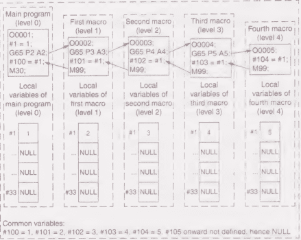

图3.1 嵌套宏中的局部变量。

注意，从结构上讲，子程序与宏并无不同。两者（以及主程序）都可以使用所有类型的宏变量和宏函数。如果一个程序由G65调用，它就变成宏，并遵循有关局部变量的规则。同一个程序如果由M98调用，就变成子程序。然而，通常一个程序被设计为用作宏或子程序（或主程序）。如果它是宏，那么某些局部变量将通过宏调用语句中的参数列表被赋予特定值；其他局部变量将保持为空。在调用宏时，也可以不向任何局部变量赋予任何初始值（例如，G65 P2只是将程序号2作为宏调用，所有局部变量均为空值）。另一方面，子程序调用就像将被调用程序复制粘贴到调用程序中一样。它不会改变调用程序局部变量的层级。因此，在其执行过程中，它可以修改调用程序任何变量中存储的值，也可以定义新变量。在其执行结束时，所有变量中存储的最终值都会传递给调用程序。

控制器以相同方式存储所有程序。正是程序的具体用途将其分类为主程序、子程序或宏。图3.3给出了宏和子程序混合嵌套的示例。最多还可以再嵌套三个宏和三个子程序到此程序。在此程序中，主程序和子程序都引用同一组层级0的局部变量，而宏中的局部变量是层级1变量。回想一下，未定义（即未赋值）的变量是空变量，在所有算术运算中等价于0。

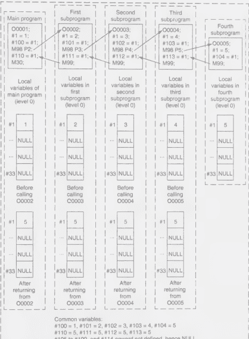

图3.2 嵌套子程序中的局部变量。

## 3.4 变量中存储值的范围

局部变量和公共变量可以取值为0，或取以下范围内的值：

- −10⁴⁷ 到 −10⁻²⁹
- +10⁻²⁹ 到 +10⁴⁷

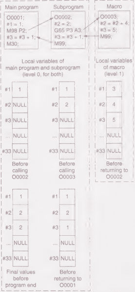

**图3.3** 宏和子程序混合嵌套中的局部变量。

如果由于计算，算术值（最终值或中间值）超出此范围，就会产生错误状态（称为报警），并且执行停止。事实上，介于−10⁻⁴和+10⁻⁴之间的值（但不等于0）也不允许。相关的报警消息为“计算数据溢出”（尽管这实际上是数学下溢的情况）。

程序员可能希望控制器忽略这个“错误”，并将此范围内的任何值视为0。然而，这是不可能的，因为没有参数来控制此功能。但这只是一种理论上的可能性。这种情况不太可能在CNC相关计算中出现。下面给出一个理论可能性的示例：

```
#1 = .00000001;         (Assigns 10^-8 to variable #1)
#2 = #1 * #1 * #1 + #1; (The calculated value is 10^-24 which generates an alarm, as the value is smaller than 10^-99)
```

如果这种情况有可能发生，程序员应在“可疑”变量的绝对值小于（比如）10^-10时，将其归零。这不会对后续计算的精度产生任何不利影响，因为宏计算的精度只到大约八位小数。可以使用如下条件语句：

```
IF [ABS[#1] LT [0.00001 * 0.00001]] THEN #1 = 0;
```

注意，并非所有处于允许范围内的值都能在屏幕上显示，屏幕使用八位十进制格式。因此，可显示的最小非零值（幅值）为0.0000001，最大值为99999999。只要值处于允许范围内（幅值介于10^-29和10^10之间），当无法显示某个变量的值时，控制器会在（宏变量屏幕）上显示九个星号（*********）作为该变量的值。

## 3.5 系统变量

术语“系统”指的是“CNC控制”。因此，系统变量也可以称为*控制变量*。这是与CNC控制当前状态相关的最后一组变量。

### 系统变量与系统参数

*系统变量*不应与系统*参数*（通常简称为*参数*）混淆。参数决定控制器的默认设置。例如，如前所述，某个参数的值决定MDI面板上的括号键输入的是圆括号还是方括号。*参数不是变量。* 我们根据需求为参数选择一个值，除非需求改变，否则不更改它。在新机床上，所有参数均按最常见的应用在出厂时设定。通常，用户不需要更改参数。事实上，他们不应该更改，除非绝对必要且用户清楚了解更改的影响，因为错误的参数设置可能导致意外的机床行为，从而引发事故。实际上，用户应将原始参数的备份保存在安全的地方，以便将来需要时可以重新安装。Fanuc 0i系列控制器配有闪存卡及其PCMCIA插槽，用于备份目的。

另一方面，系统变量实际上会随着人们在机床上操作而变化。由于其中存储的值不断变化，它们被称为变量，但不能像局部变量和公共变量那样使用。系统变量的唯一目的是**与控制器交换有关其当前状态的信息。** 因此，系统变量允许我们与控制器通信，这对于通用程序开发和自动化至关重要。此类应用是宏编程的主要目的，将在后续章节中更详细地讨论。

系统变量与系统参数之间唯一的相似之处是两者都是四位数编号（其中一些也是五位数编号）。

### Fanuc 0i系列控制器上的系统变量

有数百个系统变量，用户不太可能全部用到。然而，用户应当充分了解通过这些变量可获取的信息，否则就无法充分利用机床的能力。与系统参数一样，同一公司的不同控制版本上，即使功能相同，若干系统变量也会有所不同。本章剩余部分介绍Fanuc 0i系列控制器上一些常用的系统变量。对于不同的控制器，需要参考其*操作手册*。基本内容相同，只是变量编号可能不同。

### 显示系统变量

尽管系统变量可以在程序中读取和写入（尽管有些是只读类型），但它们**不会显示在宏变量屏幕上**。屏幕上只能看到存储在局部变量和公共变量中的值。因此，如果确实想查看某个系统变量中存储的值，就必须采用间接方法：将该系统变量复制到局部变量或公共变量中，然后就可以在偏置/设定（OFS/SET）屏幕上看到它。

以下信息仅供参考。在此阶段，没有必要阅读这里的全部内容。因此，粗略浏览这些信息后，*请跳到下一章*。系统变量可以根据其用于以下目的而大致分类：

- 接口信号
- 几何偏置和磨损偏置值
- 工件坐标系偏移量
- 宏报警（执行停止）


-   时间信息
-   自动运行控制
-   执行暂停（可通过 CYCLE START 重新启动）
-   镜像信息
-   已加工零件数量
-   模态信息
-   当前刀具位置
-   工件偏置值

## 接口信号

这也许是宏编程中最难的概念，因为它还需要 PLC 编程知识。它仅面向高级用户。因此，读者可以在学习宏编程的基本特性之前跳过它。

接口信号用于与连接到 CNC 机床的外部设备之间以二进制信号进行通信（即接收输入和发送输出）。第 12 章将更详细地讨论这个问题。这里仅给出概括性介绍，不深入细节，因此在读者参阅专门讨论该主题的章节之前，某些内容可能不是很清楚。这里的主要目标是解释接口信号是什么，而不是它们如何使用，不过也给出了一些相关概念。

讨论接口信号及其使用需要理解控制器的硬件架构（另请参阅第 1.2 节“与外部设备的通信”，其中给出了一些信息）。CNC（控制器）主要关注刀具路径控制。机床的整体控制通过 PLC 中集成的逻辑实现。例如，如果门是打开的，则不应开始加工。如果由于某种原因需要在门打开的情况下进行加工，则必须通过更改 PLC 的梯形图来修改 PLC 逻辑。（梯形图或梯形语言是 PLC 编程方法之一。假定读者具备其基础知识。如果不具备，可以参阅一些 PLC 编程书籍，例如 John R. Hackworth 著、Pearson Education 出版的那本。）

尽管 PLC 是控制制造商提供的控制硬件中不可或缺的一部分，但它由机床制造商编程以适配特定机床。Fanuc 将其 PLC 称为可编程机床控制器（PMC）。本质上，PLC 和 PMC 指的是同一事物。

当 CNC 机床连接到外部设备时，需要 CNC、PMC 和外部设备之间进行双向通信。然而，CNC 并不直接与外部设备通信。两者之间的通信通过 PMC 进行，如图 3.4 所示。

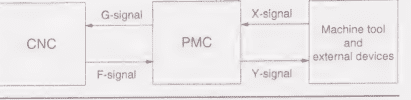

图3.4 CNC、PMC与外部设备之间的通信。

PMC 接受来自 CNC 以及来自外部设备（包括机床）的输入。这些输入分别称为 F 信号和 X 信号。类似地，它向 CNC 发送输出（G 信号），也向外部设备发送输出（Y 信号）。X 信号和 Y 信号也分别称为 DI（*数据输入*）和 DO（*数据输出*）信号。

由于 F 信号和 G 信号是控制器的*内部*信号，因此信号地址及相应含义由 Fanuc 决定。另一方面，X 信号和 Y 信号是*外部*信号，因此信号地址及其含义由 MTB 决定。MTB 不需要使用所有可用的 X 和 Y 地址。剩余的地址可由最终用户使用，作为与外部设备之间的接口信号。然而，某些 X 地址（例如 X4.0 至 X4.7 以及 X8.4）是标准的，并且始终具有相同含义。

所有信号都是八位信号，每一位的含义都与其他七位不同。例如，PMC 通过 G7.2 向 CNC 发送“循环启动”信号（即 G7 或 G007 的第 2 位；通常，F 信号和 G 信号地址为三位数，X 地址和 Y 地址为两位数，其中前导零可以省略）。另一方面，G7.1 是“启动锁”信号（用于禁用 MOP 上的 CYCLE START 按钮），G7.0 未定义。类似地，X0.0（X0 的第 0 位）和 X0.1（X0 的第 1 位）是两个独立的输入信号。有时，某些位的组合用于发送相应的信号。例如，G43.0、G43.1 和 G43.2 用于向 CNC 发送模式选择信号。当这些位全为 0 时，CNC 将其视为在 MDI 模式下工作的指令。另一方面，001 表示 HANDLE 模式，100 表示 MEMORY 或 AUTO 模式，依此类推。

F 信号和 G 信号的硬件连接是内部的。F 信号和 G 信号的预定义含义不能由 MTB 或最终用户更改。这些信号的地址编号及相关含义可在*Fanuc 维护手册*中找到。

有若干 X 信号和 Y 信号可用于与外部世界交互。通常，X0 至 X3 用于通用信号，X4 至 X11 连接到 Fanuc 制造 MOP 的按键，X12 连接到*手动脉冲发生器*（MPG），X13 和 X14 用于附加 MPG，X15 用于错误信号。许多 MTB 不使用 Fanuc 的 MOP。他们设计自己的 MOP。在这种情况下，X0 至 X11 变为通用信号，任何信号均可用于任何目的。可用的 Y 信号通常为 Y0 至 Y7。需要参阅 MTB 提供的手册，以查明他们使用了哪些 X 地址和 Y 地址。剩余地址可由用户用于与外部设备通信。

PMC 与外部设备之间的物理连接，是通过将导线连接到附接在 PMC 的 I/O（输入/输出）模块（也称为 I/O 单元）上的端子排来实现的。请参阅 Fanuc 的*连接手册（硬件）*，以了解端子排上的引脚分配（即哪个端子对应哪个 X 地址或 Y 地址）。I/O 模块通常放置在 MTB 设计的接线柜中。它通过四个 50 针连接器（位于 I/O 模块上）和带状电缆连接到端子排。

为了将外部信号通信到 CNC，需要将相应的 X 信号写入适当的 G 信号（G54.0 至 G54.7 和 G55.0 至 G55.7 保留用于此目的）。这可以通过向 PMC 梯形图添加一个新梯级来实现：

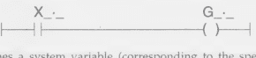

这会定义一个系统变量（对应指定的 G 地址），可在程序中读取。例如，当 X0.0（假设 MTB 未使用该地址）被写入 G54.0（对应变量 `#1000`）时，它定义变量 `#1000`（根据 X0.0 为低电平还是高电平，该变量变为 0 或 1）。变量 `#1000` 可在程序中读取。因此，外部传感器的开/关状态在程序内部可用。

类似地，CNC 生成的 F 信号（用于外部通信的那些信号，F54.0 至 F54.7 和 F55.0 至 F55.7）只有在通过向 PMC 梯形图添加新梯级而作为 Y 信号传递时，才可供外部世界使用（这些信号可从端子排上的指定引脚引出，并通过导线发送到外部设备）：

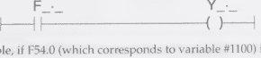

例如，如果 F54.0（对应变量 `#1100`）被写入 Y0.0（假设 MTB 未使用 Y0.0），则在程序中赋给变量 `#1100` 的值（0 或 1）会在输出端子 Y0.0 处可用，可用于开启或关闭外部设备。因此，程序语句可以驱动外部设备。

用于此类通信的二进制信号（对应变量 `#1000` 等）称为接口信号。通常有 16 个输入信号和 16 个输出信号可用。这些信号的当前状态可通过某些系统变量在程序内部获得，如一些示例已经解释的那样。

有两类系统变量可用：用于 16 个单比特信号的变量，以及用于一个 16 位信号的变量（输入和输出信号均适用）。所给示例涉及单比特信号的系统变量，这些变量只能为 0 或 1。16 位信号的变量用于通过单条程序语句同时读/写全部 16 个信号。例如，如果第一个和第二个信号（即 F54.0 和 F54.1）为 1，其余为 0，则相应的 16 位信号将为 0000000000000011（其十进制解释为 3）。因此，`#1100` = 1 且 `#1101` = 1；这与 `#1132` = 3 相同；区别在于第二种情况下两个输出同时触发。信号是由程序逐个读/写还是同时读/写，取决于个人选择/需求。完整变量列表如下。（也提供 32 位信号。由于很少使用，此处不描述它们。）

### 输入接口信号的系统变量

| 变量 | 描述 |
|---|---|
| `#1000` 至 `#1015`，`#1032` | `#1000` 至 `#1015` 是单比特信号。`#1032` 是 16 位信号，其各个位（从右开始）对应 `#1000` 至 `#1015`。这些是只读变量。 |

### 输出接口信号的系统变量

| 变量 | 描述 |
|---|---|
| `#1100` 至 `#1115`，`#1132` | `#1100` 至 `#1115` 是单比特信号。`#1132` 是 16 位信号，其各个位（从右开始）对应 `#1100` 至 `#1115`。这些是读写变量。 |

`#1032` 和 `#1132` 的十进制值（所有其他变量均为 0 或 1）由以下公式给出：

$$#1032 = \sum_{i=0}^{15} [#1000+i] \times 2^i$$

$$#1132 = \sum_{i=0}^{15} [#1100+i] \times 2^i$$

其中右侧的各个项将根据相应信号是 0 还是 1 而取 0 或 2ⁱ。这些变量与 F 信号和 G 信号之间的对应关系见表 3.1。

## 几何和磨损偏置值

指定的几何和磨损偏置值存储在特定系统变量中。这些变量将在下文针对最近的

**表 3.1** 接口信号与系统变量之间的对应关系

| 接口信号 | 系统变量 | 接口信号 | 系统变量 | 接口信号 | 系统变量 |
|---|---|---|---|---|---|
| G54.0 | #1000 | G55.0 | #1008 | F54.0 | #1100 |
| G54.1 | #1001 | G55.1 | #1009 | F54.1 | #1101 |
| G54.2 | #1002 | G55.2 | #1010 | F54.2 | #1102 |
| G54.3 | #1003 | G55.3 | #1011 | F54.3 | #1103 |
| G54.4 | #1004 | G55.4 | #1012 | F54.4 | #1104 |
| G54.5 | #1005 | G55.5 | #1013 | F54.5 | #1105 |
| G54.6 | #1006 | G55.6 | #1014 | F54.6 | #1106 |
| G54.7 | #1007 | G55.7 | #1015 | F54.7 | #1107 |
| F55.0 | #1108 | F55.1 | #1109 | F55.2 | #1110 |
| F55.3 | #1111 | F55.4 | #1112 | F55.5 | #1113 |
| F55.6 | #1114 | F55.7 | #1115 |  |  |

使用所谓存储器类型 C 的 0i 系列控制器版本。对于较旧控制器版本（即使用类型 A 或类型 B 存储器的版本），请参阅机床手册。

由于车床和铣床上的刀具几何形状存在差异，各种偏置距离的系统变量在这两类机床上具有不同含义。通常，车床上可使用 64 个（#2000 系列）或 99 个（#10000 系列）偏置号（#10000 系列也可用于 64 个可用偏置），铣床上可使用 200 个（#2000 系列）或 400 个（#10000 系列）偏置号（#10000 系列也可用于 200 个偏置号）。不过，最好使用 #10000 系列，因为其范围更大，而且也可用于较低范围。#2000 系列曾用于较旧控制器版本。#10000 系列是为增加偏置号而引入的，这也允许在未来控制器版本中进一步增加到超过 99（车床上）和 400（铣床上）。如果尝试读/写未定义的系统变量，则会显示错误信息“ILLEGAL VARIABLE NUMBER”。例如，在具有 64 个可用偏置的车床上，诸如 #1 = #10065; 这样的指令会给出错误信息。表 3.2、3.3 和 3.4 给出了车床和铣床上各种偏置值的系统变量。

完成偏置设定后，相应的系统变量会自动存储各自的偏置距离。这些是读/写变量，因此也可以通过修改这些变量来更改偏置值。例如，可以在 MDI 或存储器模式下执行 #15001 = 5; 从而在车床上将指定值（本例中为 5）设置为与偏置号 1 对应的 X 轴几何偏置值。

在程序执行期间修改偏置值时，无需显式重新定义相应的系统变量。可以通过可编程数据输入指令 G10 修改偏置值（因而也可修改相关联的系统变量），该指令在第 13 章中描述。G10 也可在 MDI 模式下指令。

由于指定偏置值出错会产生不良零件，严重错误甚至可能导致机床事故，因此在程序自动执行期间不应修改偏置，除非先在 MDI 模式下测试修改效果并充分验证其影响。为此，首先在 MDI 模式下执行偏置更改指令（直接赋值或通过 G10）和 T 代码，然后手动将刀具移到已知位置后检查位置显示。在铣床上，还必须执行刀具长度补偿代码（G43/G44），以验证刀具长度偏置值。刀具半径（车床上的刀尖半径和刀尖方向）可以直接在偏置表中查看，以验证其值。

**表 3.2** 车床偏置的系统变量（64 个偏置号）

| 偏置类型 | 偏置号 | 磨损偏置值 | 几何偏置值 |
|---|---|---|---|
| X 轴偏置值 | 1 | #2001 | #2701 |
|  | 2 | #2002 | #2702 |
|  | ... | ... | ... |
|  | ... | ... | ... |
|  | 64 | #2064 | #2764 |
| Z 轴偏置值 | 1 | #2101 | #2801 |
|  | 2 | #2102 | #2802 |
|  | ... | ... | ... |
|  | ... | ... | ... |
|  | 64 | #2164 | #2864 |
| 刀尖半径值 | 1 | #2201 | #2901 |
|  | 2 | #2202 | #2902 |
|  | ... | ... | ... |
|  | ... | ... | ... |
|  | 64 | #2264 | #2964 |
| 刀尖方向 | 1 | #2301 |  |
|  | 2 | #2302 |  |
|  | ... | ... |  |
|  | ... | ... |  |
|  | 64 | #2364 |  |

由于指定偏置值出错会产生不良零件，严重错误甚至可能导致机床事故，因此在程序自动执行期间不应修改偏置，除非先在 MDI 模式下测试修改效果并充分验证其影响。为此，首先在 MDI 模式下执行偏置更改指令（直接赋值或通过 G10）和 T 代码，然后手动将刀具移到已知位置后检查位置显示。在铣床上，还必须执行刀具长度补偿代码（G43/G44），以验证刀具长度偏置值。刀具半径（车床上的刀尖半径和刀尖方向）可以直接在偏置表中查看，以验证其值。

**表 3.3** 车床偏置的系统变量（99 个偏置号）

| 偏置类型 | 偏置号 | 磨损偏置值 | 几何偏置值 |
|---|---|---|---|
| X 轴偏置值 | 1 | #10001 | #15001 |
|  | 2 | #10002 | #15002 |
|  | ... | ... | ... |
|  | ... | ... | ... |
|  | 99 | #10099 | #15099 |
| Z 轴偏置值 | 1 | #11001 | #16001 |
|  | 2 | #11002 | #16002 |
|  | ... | ... | ... |
|  | ... | ... | ... |
|  | 99 | #11099 | #16099 |
| 刀尖半径值 | 1 | #12001 | #17001 |
|  | 2 | #12002 | #17002 |
|  | ... | ... | ... |
|  | ... | ... | ... |
|  | 99 | #12099 | #17099 |
| 刀尖方向 | 1 | #13001 |  |
|  | 2 | #13002 |  |
|  | ... | ... |  |
|  | ... | ... |  |
|  | 99 | #13099 |  |

**表 3.4** 铣床偏置的系统变量（200、400 个偏置号）

| 刀具偏置类型 | 偏置号 | 磨损偏置值 | 几何偏置值 |
|---|---|---|---|
| 刀具长度偏置值（H） | 1 | #10001 (#2001) | #11001 (#2201) |
|  | 2 | #10002 (#2002) | #11002 (#2202) |
|  | ... | ... | ... |
|  | 200 | #10200 (#2200) | #11200 (#2400) |
|  | ... | ... | ... |
|  | 400 | #10400 | #11400 |
| 刀具半径值（D） | 1 | #12001 | #13001 |
|  | 2 | #12002 | #13002 |
|  | ... | ... | ... |
|  | 400 | #12400 | #13400 |

**注：**
- 本表对应参数 6000#3 = 0。当该参数设为 1 时，磨损和几何变量编号互换。
- 当可用偏置号不大于 200 时，#2001 至 #2200 也可用于代替 #10001 至 #10200。类似地，#2201 至 #2400 可替代 #11001 至 #11200。

## 工件坐标系偏移量

由 G54 等定义的工件坐标系，可以在车床上通过工件偏移画面沿 X 轴和/或 Z 轴按所需量进行偏移。铣床上不提供此功能。在偏置/设定画面上按右侧扩展软键两次，可进入工件偏移画面。

这种偏移适用于机床后续所有操作，直到偏移值被更改，可用于在不更改偏置距离的情况下偏移已定义的工件坐标系（按偏移量沿相反方向）。例如，如果位置显示为 100 和 −50（车床上分别为 X 轴和 Z 轴），则在 X 和 Z 方向均偏移 +1 会使坐标系沿 X 和 Z 负方向移动 1 mm，使位置显示分别变为 101 和 −49。指定的偏移统一适用于由 G54、G55 等定义的所有工件坐标系。

相关的系统变量见表 3.5。这些是读/写变量。例如，要为 X 轴指定 +1 的偏移，设置 #2501 = 1。类似地，要读取 X 轴的偏移量，设置 #1 = #2501，并在宏变量画面上读取变量 #1 的值。

**表 3.5** 工件坐标系偏移量的系统变量

| 受控轴 | 偏移量系统变量 |
|---|---|
| X 轴 | #2501 |
| Z 轴 | #2601 |

## 宏报警

报警是指终止当前操作执行的错误状态。按下 MDI 面板上的 MESSAGE 键可显示错误信息。报警状态可能由多种原因引起，包括机床的硬件问题。只有在排除问题并按 RESET 键后，才能继续操作机床。程序中的语法错误、超出范围的值、非法数据输入等属于软件相关错误状态。CNC 在此类情况下会自动发出报警。

然而，在某些情况下，即使必须终止程序执行，控制器也不会检测到该错误。例如，安装在机床上的测头系统可能检测到刀具破损，从而需要立即终止程序执行，但控制器不会识别此问题。为处理此类情况，还提供了发出用户生成报警的功能，这些报警称为宏报警。

当向系统变量 #3000 赋予 0 到 200 的值时，机床会停止并显示报警信息“MACRO ALARM”。显示的报警号为 3000 加上所赋的数值。因此，#3000 = 1 将终止执行操作，并在按下 MESSAGE 键时显示“3001 MACRO ALARM”。

还可以在变量 #3000 的赋值之后，在括号内输入最多 26 个字符的用户指定信息，作为报警信息显示。

示例：

```
#3000 = 1 (TOOL BROKEN);
```

这将在信息画面上显示“3001 TOOL BROKEN”。

## 时间信息

时间相关信息所用的系统变量见表 3.6。变量 #3001 和 #3002 是读/写变量，而 #3011 和 #3012 是只读变量。因此，无法通过这些变量更改当前日期或时间。

当前日期/时间只能在时间设定画面上设置/更改，该画面称为定时器/零件计数画面。（选择 MDI 模式 → 按 OFS/SET 键 → 按 SETTING 软键 → 按 PAGE down 键两次 → 使用上/下/左/右箭头键将光标移到时间或日期显示处，输入新值并按 INPUT 键。）此画面还显示一些时间相关信息，例如通电时间和切削时间，格式为时-分-秒。零件计数信息（所需零件数和已生产零件数）也显示在此画面上。这在“加工零件数”一节中讨论。

## 自动运行控制

MOP 上的单程序段开关可用于逐段执行程序，即一次执行一个程序段。要执行下一程序段，必须再次按下 CYCLE START 按钮。


| 变量编号 | 功能 |
|---|---|
| #3001 | 该变量用作计时器，增量为 1 ms。它计算机器在**当前会话**中的总“开机时间”。断电时，该变量值复位为 0。达到 2147483648 ms（约等于 25 天）时，该变量值复位为 0，并重新开始计时。 |
| #3002 | 该变量用作计时器，增量为 1 小时。它计算机器在**所有会话**中的总“运行时间”（即 CYCLE START 灯点亮持续时间）。断电时，该变量值会保留。达到 9544.371767 小时（约等于 13 个月）时，该变量值复位为 0，并重新开始计时。 |
| #3011 | 该变量以十进制格式存储当前日期（年-月-日）。例如，2009 年 2 月 4 日表示为 20090204。 |
| #3012 | 该变量以十进制格式存储当前时间（时-分-秒）。例如，晚上 8 点 21 分 30 秒表示为 202130。 |

**表 3.6** 时间信息的系统变量

不过，可以通过系统变量 #3003 禁用该开关。

另一个由变量 #3003 控制的功能涉及辅助功能（M、S 和 T 代码）的完成，这些功能指定在同时含有 G 代码的程序段中。G 代码允许在同一程序段中指定辅助代码。G 代码执行是立即开始还是等待辅助命令完成，由该变量决定。例如，若指令为 G01 X100 S500;，则直线插补可能立即开始，而不等待主轴达到 500 rpm，也可能等待直到达到指定转速。注意，由于刀具与工件或机床本体之间可能发生干涉，T 代码可能无法用于加工过程中换刀。在这种情况下，T 代码的唯一用途是改变刀具偏置号（例如 T0101、T0111、T0112 等，其中在车床上，1 号刀具处于切削位置）。

即使辅助代码在单独程序段中指定，下一程序段的执行是否等待辅助命令完成，也可能取决于变量 #3003 的设置。

## 执行暂停

系统变量 #3009 产生报警条件并终止程序执行，而变量 #3006 导致执行暂时暂停，可通过再次按 CYCLE START 按钮重新启动。在暂停状态下，按 MESSAGE 键显示用户指定的消息（最多 26 个字符）。给变量 #3006 赋一个数会停止程序执行。该数字没有意义，因为不显示消息号。因此，通常赋值为 1。示例：

```text
#3006 = 1 (CHECK THE DIAMETER);
```

该示例将暂时停止执行，并在消息屏幕上显示“CHECK THE DIAMETER”。如果未输入消息，则不显示任何内容。

## 镜像信息

除了可编程镜像指令外，还可以使用 MOP 上的外部开关（不同轴有单独开关）或通过镜像设置屏幕获得镜像轮廓。（选择 MDI 模式 → 按 OFS/SET 功能键 → 按 SETTING 软键 → 然后，按翻页键后，将出现镜像屏幕，在该屏幕上为特定轴选择 I 以激活镜像。）

每个轴的镜像状态存储在只读系统变量 #3007 中。它是位类型变量，但以十进制形式存储值。例如，00000011（其中 1 表示启用镜像，0 表示禁用镜像）存储为 3。因此，需要将该变量中存储的值转换为二进制来解释。例如，值 3 表示前两个轴启用了镜像。表 3.9 显示了该变量的位设置。

在车床上，第一轴和第二轴分别指 X 轴和 Z 轴；在铣床上，前三个轴分别指 X 轴、Y 轴和 Z 轴。特定机床上可能提供或不提供附加轴。对于 Fanuc 0i 系列，仅使用该变量的前四位。

| Bit #7 | Bit #6 | Bit #5 | Bit #4 | Bit #3 | Bit #2 | Bit #1 | Bit #0 |
|---|---|---|---|---|---|---|---|
|  |  |  |  | 第 4 轴 | 第 3 轴 | 第 2 轴 | 第 1 轴 |

**表 3.9** 系统变量 #3007 的位设置

## 加工零件数

当前加工会话所需零件数和已完成零件数可分别在系统变量 #3902 和 #3901 中读取或写入。零件计数信息也可在定时器/零件计数屏幕上查看/修改，或通过参数 6713 和 6711 查看/修改，这两个参数分别存储所需生产零件数和已生产零件数。

定时器/零件计数屏幕还显示机器整个服务期内生产的总零件数，作为只读信息。每当完成一个零件，已生产零件数和总生产零件数都加 1。所需零件数和已完成零件数可按需更改（通过相关系统变量、参数设置或设置屏幕），而总完成零件数可通过参数 6712 更改。提供此信息是为了记录机器整个服务期内生产的总零件数。

机床默认设置（参数 6700#0 = 0）在每次执行 M02、M30 或参数 6710 中指定的 M 代码（通常仅包含 30，表示 M30）时，将零件计数加 1。如果希望仅在执行参数 6710 中指定的 M 代码后增加零件计数（该代码可与 02 或 30 相同或不同，但不能为 0、98 或 99），请设置参数 6700#0 = 1。

最后注意，M02 或 M30 必须键入程序段结束（EOB）符号（即 M02; 或 M30;），否则零件计数不会增加，即使零件生产无任何错误消息（控制器允许程序末尾缺少 EOB 符号）。

## 模态信息

G 代码已按功能相似性分为不同组。任何时候，每组中有一个 G 代码保持有效（第 0 组除外）。属于第 0 组的称为*非模态代码*，仅在编程所在程序段中有效。其他代码是模态代码，在未被同组其他代码替换前保持有效。例如，G01 是模态代码，与 G00、G02、G03 等归为一组。因此，如果程序中用过一次 G01，若后续运动以直线插补执行，则无需再次键入。然而，一旦指令 G02（或同组其他代码），G01 被取消，G02 变为有效。

编程期间，尤其使用要与多个程序配合的通用宏时，可能需要知道特定组的当前有效 G 代码。例如，对于铣床，如果主程序在增量模式下调用宏，宏应将宏调用参数列表中的值解释为增量值。宏应能在调用程序为绝对和增量模式下都正确工作。只有在执行宏时能获得此信息才可能做到。系统变量 #4003 存储 90 或 91，取决于当前是绝对模式还是增量模式。宏可读取该变量以获取当前有效模式信息。例如，假设宏的变量 #1 表示绝对 X 轴位置，并通过宏调用的参数列表获得值。然后，为处理调用宏时主程序可能处于增量模式的情况，需要在宏开头插入以下语句（IF_THEN 语句在第 5 章描述）：

```text
IF [#4003 EQ 91] THEN #1 = #5041 + #1;
```

系统变量 #5041 存储刀具沿 X 轴的当前位置，如表 3.11 所述。

Fanuc 0i 系列各种模态信息的系统变量见表 3.10(a) 和 (b)。空白列用于

| 变量编号 | 功能 | G 代码组 |
|---|---|---|
| #4001 | G00、G01、G02、G03、G33、G34、G71~G74 | 1 |
| #4002 | G96、G97 | 2 |
| #4003 |  | 3 |
| #4004 | G68、G69 | 4 |
| #4005 | G98、G99 | 5 |
| #4006 | G20、G21 | 6 |
| #4007 | G40、G41、G42 | 7 |
| #4008 | G25、G26 | 8 |
| #4009 | G22、G23 | 9 |
| #4010 | G80~G89 | 10 |
| #4011 |  | 11 |
| #4012 | G66、G67 | 12 |
| #4014 | G54~G59 | 14 |
| #4015 |  | 15 |
| #4016 | G17、G18、G19 | 16 |
| #4017 |  | 17 |
| #4018 |  | 18 |

**表 3.10(a)** 车床模态信息的系统变量


**表3.10(a)（续）**

| 变量编号 | 功能 | G代码组 |
|---|---|---|
| #4001 | G00, G01, G02, G03, G33 | 1 |
| #4002 | G17, G18, G19 | 2 |
| #4003 | G90, G91 | 3 |
| #4004 |  | 4 |
| #4005 | G94, G95 | 5 |
| #4006 | G20, G21 | 6 |
| #4007 | G40, G41, G42 | 7 |
| #4008 | G43, G44, G49 | 8 |
| #4009 | G73, G74, G76, G80–G89 | 9 |
| #4010 | G98, G99 | 10 |
| #4011 | G50, G51 | 11 |
| #4012 | G66, G67 | 12 |
| #4013 | G96, G97 | 13 |
| #4014 | G54–G59 | 14 |
| #4015 | G61–G64 | 15 |
| #4016 | G68, G69 | 16 |
| #4017 |  | 17 |
| #4018 |  | 18 |
| #4019 |  | 19 |
| #4020 |  | 20 |
| #4021 |  | 21 |
| #4022 |  | 22 |
| #4109 | F代码（进给速度） |  |
| #4113 | M代码编号 |  |
| #4114 | 顺序号 |  |
| #4115 | 程序号 |  |
| #4119 | S代码（转速/恒定表面速度） |  |
| #4120 | T代码（带偏置号的刀具号） |  |

**表3.10(b)** 铣床模态信息的系统变量

| 变量编号 | 功能 | G代码组 |
|---|---|---|
| #4019 |  | 19 |
| #4020 |  | 20 |
| #4021 |  | 21 |
| #4022 |  | 22 |
| #4102 | B代码编号 |  |
| #4107 | D代码编号 |  |
| #4109 | F代码（进给速度） |  |
| #4111 | H代码编号 |  |
| #4113 | M代码编号 |  |
| #4114 | 顺序号 |  |
| #4115 | 程序号 |  |
| #4119 | S代码（转速/恒定表面速度） |  |
| #4120 | T代码（刀具号） |  |
| #4130 | 当前所选附加工件坐标系的P代码编号 |  |

其他版本的Fanuc。这些系统变量显然是只读变量。请注意，某一特定控制版本的所有G代码未必都能在某一特定机床上使用。有些G代码是控制系统的可选功能（需要单独购买），另一些则因机床的硬件限制而无法使用。

参数 6006#1（在 Fanuc 0i 系列铣床控制系统中）决定通过系统变量（#4001 至 #4022）获得的模态信息是截至紧前程序段（这是默认设置），还是截至当前执行程序段：

```
6006#1 = 0 (up to the immediately preceding block)
6006#1 = 1 (up to the currently executing block)
```

控制系统会自动在显示屏幕上高亮显示当前执行的程序段。不过，该参数在车床上不可用；在车床上，模态信息截至最后执行的程序段可用。

### 当前刀具位置

存储当前刀具位置信息的系统变量见表3.11。这些变量均为只读变量。请注意以下事项：

**表3.11** 当前刀具位置的系统变量

| 变量编号 | 位置信息 | 坐标系 | 刀具补偿值 | 刀具移动期间读取操作 |
|---|---|---|---|---|
| #5001–#5004 | 程序段终点 | 工件坐标系 | 不包含 | 允许 |
| #5021–#5024 | 当前位置 | 机床坐标系 | 包含 | 禁止 |
| #5041–#5044 | 当前位置 | 工件坐标系 | 包含 | 禁止 |
| #5061–#5064 | 跳过信号位置 | 工件坐标系 | 包含 | 允许 |
| #5081–#5084 | 刀具偏置值 | — | — | 禁止 |
| #5101–#5104 | 偏差伺服位置 | — | — | 禁止 |

- 从右数第一位（1、2、3或4）表示轴号。因此，在2轴车床上，1表示X轴，2表示Z轴，其余两位不使用。这同样适用于表3.12和表3.13。
- 在 G31（跳过功能）程序段中，跳过信号接通时的刀具位置存储在变量 #5061 至 #5064 中。在 G31 下刀具移动过程中跳过信号未接通时，该程序段中指定的终点存储在这些变量中。
- 某些变量（例如当前刀具位置变量）在刀具移动时无法读取。其中存储的值只能在刀具移动停止时读取。因此，“当前位置”并非真正的瞬时位置。

### 工件偏置值

关于各种工件坐标系的偏置距离如何定义，详见第5.5节。测量得到的工件偏置距离会存储在特定系统变量中。这些是读/写变量。因此，也可以通过修改这些变量的内容来更改偏置距离。表3.12说明了这些变量的功能。表3.13给出了在铣床上也可用于工件偏置距离的备用变量编号。

**表3.12** 工件偏置值的系统变量

| 变量编号 | 功能 | 备注 |
|---|---|---|
| #5201–#5204 | 外部工件坐标系偏置值 |  |
| #5221–#5224 | G54工件坐标系偏置值 |  |
| #5241–#5244 | G55工件坐标系偏置值 |  |
| #5261–#5264 | G56工件坐标系偏置值 |  |
| #5281–#5284 | G57工件坐标系偏置值 |  |
| #5301–#5304 | G58工件坐标系偏置值 |  |
| #5321–#5324 | G59工件坐标系偏置值 |  |
| #7001–#7004 | 第1附加工件坐标系偏置值（G54.1 P1） |  |
| #7021–#7024 | 第2附加工件坐标系偏置值（G54.1 P2） | 铣床上可选提供 |
| … |  |  |
| #7941–#7944 | 第48附加工件坐标系偏置值（G54.1 P48） |  |

**表3.13** 工件偏置值的备用系统变量

| 功能 | 变量编号 | 备用变量编号 |
|---|---|---|
| 外部偏置 | #5201–#5204 | #2500–#2800 |
| G54偏置 | #5221–#5224 | #2501–#2801 |
| G55偏置 | #5241–#5244 | #2502–#2802 |
| G56偏置 | #5261–#5264 | #2503–#2803 |
| G57偏置 | #5281–#5284 | #2504–#2804 |
| G58偏置 | #5301–#5304 | #2505–#2805 |
| G59偏置 | #5321–#5324 | #2506–#2806 |

# 第4章

# 宏功能

## 4.1 宏功能类型

宏编程配备有高级计算机编程语言中通常可用的所有常用数学函数。可用的宏功能可以分组，以便更容易学习和理解其用法。除常规算术运算外，大致有五组：

- 三角函数
- 舍入函数
- 杂项函数
- 逻辑函数
- 转换函数

可以使用这些函数的任意组合（当然，逻辑上应正确）将值赋给变量（或赋给求值结果为合法变量编号的表达式）。未赋值（未定义）的变量称为空变量，在数学计算中等价于0。因此，一般规则是，在未先定义变量之前，不应在任何数学表达式中使用该变量。

### 算术表达式中的运算优先级

在涉及多个函数和括号的复杂表达式中，遵循以下优先级规则：

- 1. 括号（仅允许方括号）
- 2. 函数（如 SIN、ATAN、SQRT 和 EXP）
- 3. 乘法（*）、除法（/）和按位与
- 4. 加法（+）、减法（-）、按位或和按位异或

如果一行中出现多个优先级相同的运算，则从左到右计算。

### 布尔表达式中的运算优先级

布尔表达式可以在条件运算符的左侧和右侧都包含算术表达式（位于方括号内）。每个括号内部独立遵循优先级规则：

`[[2 + 2 / 2] LT [2 + 2]]`（等价于 `[3 LT 4]`，返回 TRUE）

条件运算符右侧的算术表达式必须用括号括起来，而左侧的括号是可选的：

- `[2 + 2 / 2 LT [2 + 2]]`（同上，因此返回 TRUE）
- `[2 + 2 / 2 LT 2 + 2]`（先计算左侧算术表达式，得到3，然后从左到右继续计算。因此，该语句等价于 FALSE + 2，这没有意义，因此非法）

在布尔表达式中省略括号（即使在某些情况下不会报错）是造成混淆的一个原因。因此，良好的编程实践是在条件运算符两侧使用括号，并为整个表达式加外层括号。

### 计算顺序的影响

在某些情况下，计算顺序不会改变算术表达式的数学含义，因此预期得到相同的最终结果。然而，在涉及极大值或极小值的某些情况下，计算顺序可能变得非常重要：

- `#1 = 10000000;`（将 10⁷ 的值赋给 #1）
- `#1 = #1 * #1 * #1 * #1 * #1 * #1 * #1;`（将 10⁴⁹ 的值赋给 #1）
- `#1 = #1 * 100000;`（将 10⁴⁷ 的值赋给 #1，这是最大的合法值）
- `#2 = #1 / 10 * 10;`（设置 #2 = 10⁴⁷）
- `#3 = #1 * 10 / 10;`（尽管右侧表达式在数学上与上一表达式相同，但从左开始的第一次计算得到 10⁴⁸，这会导致数据溢出，终止程序执行。在这种情况下，可以使用括号改变计算顺序。）
- `#4 = #1 * [10 / 10];`（设置 #4 = 10⁴⁷）


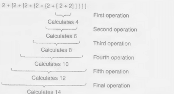

**图 4.1** 括号的嵌套。

### 括号的嵌套

括号的嵌套最多允许五层（即最多可使用五个左括号和五个右括号），包括与如下函数一起使用的括号：

```
SIN[<a variable number or an arithmetic value or an arithmetic expression>]
SQRT[<a variable number or an arithmetic value or an arithmetic expression>]
```

计算从最内层括号开始，逐层向外进行，直到最外层括号。图 4.1 给出的示例很简单，但它确实展示了可能的最大嵌套层数，并说明了计算顺序。

表达式中括号的总数没有限制。同一个表达式可以在多个位置进行嵌套，但每个嵌套最多限制为五层。

## 4.2 算术运算

四种算术运算符——加法（+）、减法（−）、除法（/）和乘法（*）——具有通常的含义，并给出计算器式的结果。事实上，这些运算符已在多个示例中使用过。这里唯一需要重申的是，控制器不区分实数和整数。实际上，在计算中所有数字都按实数处理。因此，

```
#1 = 1 / 2;
#1 = 1.0 / 2;
#1 = 1 / 2.0;
#1 = 1. / 2.0;
```

都是等价的，并将值 0.5 赋给 #1。

另一点需要说明的是计算值的精度。由于计算使用有限数量的二进制位，每次算术运算通常会引入 10^-3 量级的误差。这无关紧要，因为在毫米模式下机床的精度只有 0.001 mm。然而，在相等比较语句中，这可能会产生问题，因为这些值可能并非在所有小数位上完全相等。因此，不要使用

```
IF [#1 EQ #2] THEN #3 = 10;
```

而应使用

```
IF [ABS[#1 - #2] LT 0.001] THEN #3 = 10;
```

假设 0.001 是可接受的误差（否则，请选择更小的值）。条件语句将在第 5 章详细说明。

### 除法与程序段跳过功能

斜杠符号（/）既用于除法，也用于程序段跳过功能。通常，程序段开头的斜杠会被解释为程序段跳过符号，而程序段中间的斜杠则被视为除法运算符。然而，有些控制器（包括 Fanuc）也允许程序段中跳过。这可能会产生意外结果。因此，在此类控制器上，请将除法运算括在括号内：

```
#1 = 10;
#2 = #1 / 2;

#3 = [#1 / 2];
```

（斜杠可能被解释为程序段跳过符号。因此，如果 MOP 上的程序段跳过开关为 ON，则 #2 被设为 10）

（即使允许程序段中跳过且程序段跳过开关为 ON，#3 也始终设为 5）

有些机床型号没有程序段跳过开关。在此类机床上，斜杠始终被解释为除法运算符；因此，除法无需使用括号。

## 4.3 三角函数

可用的函数有

- SIN
- COS
- TAN
- ASIN
- ACOS
- ATAN

分别表示正弦、余弦、正切、反正弦（sin⁻¹）、反余弦（cos⁻¹）和反正切（tan⁻¹），因为这些函数就是科学计算器上常见的函数。SIN、COS 和 TAN 的所有输入均以度为单位，反函数 ASIN、ACOS 和 ATAN 的输出也以度为单位。因此，如果角度以度/分/秒格式给出，则需要使用以下换算公式将其转换为度：

$$D_d = D + \frac{M}{60} + \frac{S}{3600}$$

其中 D、M 和 S 分别是指定角度的度、分和秒值，D_d 是转换后的度值。

### 示例：

10° 30′ 36″ = 10 + 0.5 + 0.01 = 10.51°

与所有其他函数一样，三角函数也必须与方括号一起使用。括号内可以包含常量、变量数字或算术表达式。请注意，ATAN 使用一种相当特殊的表示方式——直角三角形的两条边（对边和底边）需要在单独的括号中指定，并用斜杠分隔：

```
#1 = SIN[30];                         (Sets #1 = 0.500)
#2 = ACOS[#1];                         (Sets #2 = 60.000)
#3 = TAN[#2 * 3 / 4];                  (Sets #3 = 1.000)
#4 = ATAN[SQRT[3]] / [#1 * 2];         (Equivalent to tan⁻¹√3. So,
                                      Sets #4 = 60.000)
#5 = TAN[90];                           (Overflow error, since tan
                                      90° = ∞)
```

请注意，与所有其他宏函数一样，三角函数的精度也大约为八位十进制数字。例如，在 Fanuc 控制器上，ACOS[0.5] 实际返回 59.999999。所有三角函数都可能存在此类不精确性，即使此处给出的示例中未明确提及。

ATAN 的表示方式是宏编程的一个独特特性，它始终给出正确的角度值，即使该角不是锐角（ASIN 和 ACOS 主要用于锐角）：

```
#5 = ATAN[1] / [1];       (Sets #5 = 45.000)
#6 = ATAN[1] / [−1];      (Sets #6 = 135.000)
#7 = ATAN[−1] / [−1];     (Sets #7 = 225.000)
#8 = ATAN[−1] / [1];      (Sets #8 = 315.000)
#9 = ATAN[0];             (Syntax error)
```

当参数 6004#0 设为 0 时，ATAN 的解算范围为 0° 到 360°，如前面的示例所示。当 6004#0 设为 1 时，范围变为 −180° 到 180°（注意角度保持不变，只是其表示方式改变）：

```
#10 = ATAN[1] / [1];        (Sets #10 = 45.000)
#11 = ATAN[1] / [-1];       (Sets #11 = 135.000)
#12 = ATAN[-1] / [-1];      (Sets #12 = −135.000)
#13 = ATAN[-1] / [1];       (Sets #13 = −45.000)
```

与其他函数一样，在算术计算中无需用外层括号括住 ATAN 函数：

```
#14 = ATAN[1] / [1] / [2 + 1];        (Sets #14 = 22.500)
```

参数 6004#0 不影响 ASIN 或 ACOS。无论 6004#0 如何设置，ASIN 的解算范围都是 270° 到 360° 以及 0° 到 90°，而 ACOS 的范围是 0° 到 180°。因此，ASIN 永远不会给出第二象限或第三象限的答案。同样，ACOS 不会给出第三象限或第四象限的答案：

```
#15 = ASIN[0.5];        (Sets #15 = 30.000)
#16 = ASIN[−0.5];       (Sets #16 = 330.000)
#17 = ACOS[0.5];        (Sets #17 = 60.000)
#18 = ACOS[−0.5];       (Sets #18 = 120.000)
```

因此，为避免因不恰当的答案造成任何混淆，只要角度可能在整个 0° 到 360° 范围内变化，就建议使用 ATAN。

为 ACOS 和 ASIN 指定的值的幅值（即绝对值）必须小于或等于 1，否则会产生报警条件，终止程序执行。

SIN、COS 和 TAN 的角度可以为正或为负，甚至可以大于 360°。实际上，角度没有上限。Fanuc 0i 控制器允许的最大值为 1048575.999°。通过从指定角度中减去 360 的整数倍，可计算出 0° 到 360° 范围内的对应角度。例如，

```
1048575.999 = 2912 × 360 + 255.999°
```

这等价于 255.999°。

由于三角函数的精度通常为 10⁻⁸，因此诸如 SIN[0] 这样的计算不会返回 0。一些典型的计算结果为

```
SIN[0]        (Returns −0.46566129 × 10⁻⁸)
COS[90]       (Returns 0.37252903 × 10⁻⁸)
TAN[0]        (Returns −0.46566128 × 10⁻⁸)
```

由于显示屏的限制，只能显示八位十进制数字，且不包含任何指数位，这些值会显示为 ********，但在后续计算中会被“正确地”使用：

```
1 / SIN[0]    (Returns 214748370.0)
```

这种程度的不精确对于 CNC 机床而言并不重要，因为机床的精度在毫米模式下通常为 0.001，在英寸模式下为 0.0001。无论计算多么复杂和广泛，产生的误差都可能远小于机床精度。然而，正如已经建议的那样，程序员必须避免将诸如 SIN[0] 与零进行直接相等比较。相反，如果需要，应将值之差与选定的较小值进行比较测试：

```
[SIN[0] EQ 0]                    (FALSE, so do not use this format)
[ABS[SIN[0] - 0] LT 0.00000001]  (TRUE, hence the recommended format)
```

只要程序员理解此类不精确性的影响，就不会出现问题。然而，当 SIN、COS 和 TAN 的计算值小于 10⁻⁸ 时，可以使用参数 6004#1 将结果处理为 0。当 6004#1 设为 1 时（其默认设置为 0），

```
SIN[0]       (Returns 0)
COS[90]      (Returns 0)
TAN[0]       (Returns 0)
1 / SIN[0]   (Execution terminates with an alarm message “DIVIDED
              BY ZERO”)
```

## 4.4 舍入函数

舍入分为两种类型：*隐式舍入*和*显式舍入*。隐式舍入由控制器完成，以适配特定地址。第 2 章已经讨论过若干此类情况。这里给出一些类似示例以帮助回忆（详情请参阅第 2 章）：

```
#1 = SQRT[2];        (√2 = 1.41421356237, . . . The control uses only
                      eight decimal digits, with adequate number of
                      leading or trailing zeroes, to save a number. So,
                      the value is 1.4142136)

#1 = 1.5000000;      (Equivalent to #2 = 1)
M2.5 S1000.4;        (Illegal statement)
M[2.5] S[1000.4];    (Equivalent to M03 S1000; rounding is done
                      only if the number is enclosed by brackets)
G[2.5];              (Never use a G-code in this manner. It will
                      either be an illegal command or may cause
                      unexpected tool movement, causing accidents)
```


```text
#3 = 2.4;
#4 = 2.04;
M#3;                 (Equivalent to M02)
G#3;                 (Illegal statement)
G#4;                 (Equivalent to G02)
#5 = 123.45678;
G00 X#5;             (Equivalent to G00 X123.45 in millimeter mode)
```

作为良好的编程实践，绝不应依赖隐式舍入，因为这极易出错。如果程序员没有清楚理解控制器内置的逻辑，就可能导致意外的机床行为。隐式舍入只应出于将实数用作整数的目的，通过丢弃小数点后的零来完成（例如，将 1.0 转换为 1）。例如，如果 #1 中存储的值为 1、1.0 或 1.000000，则 G#1 等价于 G01。实际上，这之所以必要，是因为控制器不将变量定义为整数变量；所有变量都存储实数。

### ROUND、FIX 和 FUP

显式舍入可使用三个函数：ROUND、FIX 和 FUP。它们分别用于将实数舍入到最接近的整数、向下取整的整数和向上取整的整数。这些函数的操作类似于典型高级编程语言中的操作，不同之处在于 CNC 控制器将整数结果保存为小数点后带零的实数。

**示例：**

| 函数 | 结果 |
|---|---|
| `ROUND[10.0]` | 返回 10.0 |
| `ROUND[10.2]` | 返回 10.0 |
| `ROUND[10.499999]` | 返回 10.0 |
| `ROUND[10.5]` | 返回 11.0 |
| `ROUND[10.8]` | 返回 11.0 |
| `FIX[10.0]` | 返回 10.0 |
| `FIX[10.2]` | 返回 10.0 |
| `FIX[10.499999]` | 返回 10.0 |
| `FIX[10.5]` | 返回 10.0 |
| `FIX[10.8]` | 返回 10.0 |
| `FUP[10.0]` | 返回 10.0 |
| `FUP[10.000001]` | 返回 11.0 |
| `FUP[10.2]` | 返回 11.0 |
| `FUP[10.499999]` | 返回 11.0 |
| `FUP[10.5]` | 返回 11.0 |
| `FUP[10.8]` | 返回 11.0 |

对负数执行这些函数的结果与正数情况相同，只是保留负号：

```text
ROUND[-10.2]              (Returns -10.0)
ROUND[-10.8]              (Returns -11.0)
FIX[-10.2]                (Returns -10.0)
FIX[-10.8]                (Returns -10.0)
FUP[-10.2]                (Returns -11.0)
FUP[-10.8]                (Returns -11.0)
```

这些函数也可用于存储某个值的变量。以下示例假设 #1 存储 1.3，#2 存储 1.7：

```text
ROUND[#1]                 (Returns 1.0)
ROUND[#2]                 (Returns 2.0)
FIX[#1]                   (Returns 1.0)
FIX[#2]                   (Returns 1.0)
FUP[#1]                   (Returns 2.0)
FUP[#2]                   (Returns 2.0)
```

也可以将值舍入到所需的小数点后位数，某些特殊应用可能需要这样做。例如，如果需要将 100.12345 舍入到小数点后四位，执行以下过程：

```text
#1 = 100.12345;             
#2 = #1 * 10000;            (Sets #2 = 1001234.5)
#3 = ROUND[#2];             (Sets #3 = 1001235.0)
#4 = #3 / 10000;            (Sets #4 = 100.12350)
#1 = #4;                    (#1 contains rounded value up to four places
                            after the decimal point, 100.1235)
```

这些命令分开给出，是为了解释中间计算步骤。也可以按下述方式将它们组合在一个嵌套块中：

```text
#1 = ROUND[#1 * 10000] / 10000;
```

要舍入到小数点后三位，使用 1000 作为乘数；要舍入到小数点后两位，使用 100，依此类推。

使用 FIX 函数时需要特别小心，因为宏计算中可能存在不准确性。例如，如果变量 #1 包含 0.002，而变量 #2 定义为 #1 * 1000，则结果值可能不精确等于 2。它通常可能是 1.9999999。因此，FIX[#2] 将返回 1.0！所以，在这种情况下，要么使用 ROUND 函数，要么适当修改计算值。由于毫米模式下机床的最小输入增量为 0.001，为了向下舍入，在计算值上加 0.0001 是安全的。因此，不要使用 FIX[#2]，而使用 FIX[#2 + 0.0001]，即可解决该问题。

最后，非常重要的一点是，如果在 NC 语句中将 ROUND 用于某个轴距离，则舍入会进行到机床的最小输入增量。毫米模式下的最小输入增量通常为 0.001 mm，如下例所假设：

```text
#1 = 100.12345;
G00 X[ROUND[#1]];    (Places the tool at X=100.123)
```

实际上，这里 ROUND 函数是多余的。正如第 2 章已经解释的，即使没有 ROUND 函数，也会进行隐式舍入到最小输入增量。因此，第二条语句等价：

```text
G00 X#1;
```

另请注意 ROUND 函数中外层括号的存在。如果函数或表达式被用作 NC 字中的值，则必须像下面这样用括号括起来：

```text
X ROUND[1.2];       (An illegal command)
X[ROUND[1.2]];      (Equivalent to X1.200)
```

并不是说 ROUND 函数在 NC 语句中完全无用（从给出的示例可以得出结论）。事实上，它可以非常有效地用于消除程序执行期间的舍入误差。考虑以下在铣床上的情况，最小输入增量为 0.001（假设当前刀具位置沿 X 轴为 X100）：

```text
#1 = 100.2345;
#2 = 200.3456;
G91 G00 X#1;         (Places the tool at X200.235)
X#2;                 (Places the tool at X400.581, because 200.235 +
                     200.346 = 400.581)
X-[#1 + #2];         (Equivalent to X-[300.580] which is rounded to
                     X-300.580, so the tool is placed at X100.001, which
                     is not the initial position of the tool)
```

尽管期望位置（X100）与实际位置（X100.001）之间的差异非常小（0.001），可能没有任何实际影响，但在涉及刀具位置比较的应用中会造成逻辑缺陷。此外，由于误差是累积的，经过若干次此类操作后，刀具实际上可能偏离正确位置到不可接受的程度。通过将最后一条语句替换为以下内容，可以轻松避免这个问题：

```text
X-[ROUND[#1] + ROUND[#2]];
```

它等价于 X-[100.235 + 200.346]，即 X-300.581，这会将刀具准确放置在期望位置。

请注意，只有当值以变量形式指定时，才会将轴距离舍入到最小输入增量，如上文讨论的情况。常数值会被截断到最小输入增量。例如，G91 G00 X100.2345 会使刀具移动 100.234 mm。

## 4.5 杂项功能

还提供了用于计算平方根（SQRT）、绝对值（ABS）、自然对数（LN）和指数（EXP）的附加函数。计算值会自动舍入到小数点后八位。SQRT 和 ABS 具有通常含义，并且已在不同上下文中使用过。

### SQRT

此函数计算给定正数的平方根（负数会产生“ILLEGAL ARGUMENT”报警消息）。SQRT 是其类别中唯一可用的函数。没有可用于计算例如一个数的立方根或平方的函数。但是，如后文所述，LN 和 EXP 函数的组合可用于计算给定数的任意指数。

- **示例：**
  - `SQRT[-2]` —（非法参数）
  - `SQRT[0]` —（返回 0.000）
  - `SQRT[2]` —（返回 1.4142136）

### ABS

此函数仅改变负值的符号，对正值没有影响。

- **示例：**
  - `ABS[-2]` —（返回 2.000）
  - `ABS[0]` —（返回 0.000）
  - `ABS[2]` —（返回 2.000）

看似“无害”的 ABS 函数有时非常方便；前面已经讨论过一些此类示例。作为另一个示例，考虑一个在铣床上使用 G81 进行钻孔操作的宏。Z0 平面的通常选择是工件上表面。那么，在 G81 程序段中，孔深必须带有负号。因此，当程序调用此宏时，必须将孔深的负值传递给该宏（到目前为止，尚未正式讨论将所需值传递给宏局部变量的方法。因此，不必担心确切过程，只需尝试理解讨论的主题）。如果程序员由于错误或误解而为孔深指定正值，则 G81 将开始“钻削”进入

正 Z 方向，远离工件！为确保正值和负值同样有效，G81 必须使用指定深度的绝对值的负值。这将确保 G81 的 Z 值始终为负。例如，如果变量 #26 用于传递孔深值，则宏应按以下方式使用 G81。

```
G81 X_ Y_ Z-(ABS[#26]) R_ K_ F_;
```

由于宏应当是通用程序，会被不同程序员编写的多个程序使用（调用），因此这种不一致并不罕见。开发宏需要深入掌握宏编程知识，而宏编程是一个相当庞大且专业的主题。因此，大多数程序员不得不把专家开发的宏当作黑箱来使用。编写宏可能很困难，但正如我们稍后将看到的，使用宏就像使用内置固定循环一样简单。只需了解宏中不同字母地址的用途即可。尽管期望宏程序员通过插入适当注释和/或在单独讲义中说明其用法来妥善记录自己开发的宏，但仍需注意常见错误。专业的宏编程方法旨在在错误实际发生之前预判可能出错的地方。^1

### LN

此函数计算自然对数，即以 e（2.7182818）为底的对数。以 10 为底的对数（即 LOG 函数）不可用。如有需要，可使用以下公式计算

log x = (ln x) / (ln 10)，即 LN[x] / LN[10]

LN 的自变量为负值或零无效，会给出“CALCULATED DATA OVERFLOW”（计算数据溢出）报警消息。

示例：

- LN(0)（导致溢出错误）
- LN(1)（返回 0.000）
- LN(2)（返回 0.6931472）

### EXP

此函数计算自然对数的反对数（即 e^x）。其自变量的最大允许值约为 110.2。更高的值会给出“CALCULATED DATA OVERFLOW”，因为计算值将接近/超过 10^6。以 10 为底的反对数（即 10^x）不可用。如有需要，可使用以下公式计算

10^x = e^(x ln 10)，即 EXP[x * LN[10]]

示例：

- `EXP[-2]`（返回 0.1353353）
- `EXP[0]`（返回 1.000）
- `EXP[2]`（返回 7.3890561）
- `EXP[110.25]`（溢出错误）

### 数的任意指数

没有标准函数可用于求 x^y 形式的表达式。不过，可以使用以下公式以间接方式计算

x^y = e^(y ln x)，即 EXP[y * LN[x]]

示例：

- `EXP[4 * LN[3]]`（等价于 3^4，返回 81.000）
- `EXP[4 * LN[10]]`（等价于 10^4，返回 10000.000）

## 4.6 逻辑函数

可用的逻辑函数有 AND、OR 和 XOR。它们可以按两种不同方式使用：

- 按位函数
- 布尔函数

### 按位函数

当作为按位函数使用时，两个数（对这些函数进行运算的数）的二进制表示中所有对应位会分别比较，得到的二进制格式答案再转换回十进制格式。表 4.1 是这三个函数的真值表。位-1 和位-2 是两个数的对应位。

图 4.2 给出了这些函数的维恩图表示。在此图中，与某一位对应的圆形区域表示二进制值 1，圆外区域表示二进制值 0。阴影区域表示指定逻辑运算的结果（二进制值 1）。该图还表明这三种逻辑运算都是可结合的。因此，例如 #1 AND #2 等价于 #2 AND #1。

| 位-1 | 位-2 | AND | OR | XOR |
|---:|---:|---:|---:|---:|
| 0 | 0 | 0 | 0 | 0 |
| 0 | 1 | 0 | 1 | 1 |
| 1 | 0 | 0 | 1 | 1 |
| 1 | 1 | 1 | 1 | 0 |

**表 4.1** 按位 AND、OR 和 XOR 的真值表

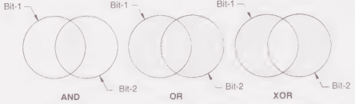

**图 4.2** 按位 AND、OR 和 XOR 的维恩图表示。

下面给出一些按位逻辑运算示例：

- `#1 = 4;`（等同于二进制 0100）
- `#2 = 3;`（等同于二进制 0011）
- `#3 = 1;`（等同于二进制 0001）
- `#4 = #1 AND #2;`（二进制形式结果为 0000。因此，#4 被设为 0.000）
- `#5 = #2 AND #3;`（二进制形式结果为 0001。因此，#5 被设为 1.000）
- `#6 = #1 OR #2;`（二进制形式结果为 0111。因此，#6 被设为 7.000）
- `#7 = #2 OR #3;`（二进制形式结果为 0011。因此，#7 被设为 3.000）
- `#8 = #1 XOR #2;`（二进制形式结果为 0111。因此，#8 被设为 7.000）
- `#9 = #2 XOR #3;`（二进制形式结果为 0010。因此，#9 被设为 2.000）

逻辑函数对整数进行运算。如果未指定整数值（或包含整数值的变量），则会自动舍入到最接近的整数：

- `#1 = 1.5;`
- `#2 = 1.4999999;`
- `#3 = #1 AND #2;`

（等价于 #3 = 2 AND 1；即二进制数 010 和 001 的按位 AND。结果为二进制 000，与十进制 0 相同。因此，0.000 存入 #3）

- `#4 = 2.5 XOR 2.4999999;`

（等价于 #4 = 3 XOR 2；即二进制数 011 和 010 的按位 XOR。结果为二进制 001，与十进制 1 相同。因此，1.000 存入 #4）

虽然按位运算实际上是逻辑运算，但它们看起来与算术运算相似。事实上，按位运算的结果也可以用于算术计算，尽管其目的完全不同。因此，像

```
#1 = #2 * #3 AND #4;
```

这样的语句可能没有意义，但并不非法。注意，由于乘法和 AND 具有相同优先级，该表达式将按从左到右的顺序求值：

```
#1 = [#2 * #3] AND #4;
```

另一方面，乘法优先级高于 OR。因此，以下两个语句等价：

```
#1 = #2 OR #3 * #4;
#1 = #2 OR [#3 * #4];
```

如果希望先计算 OR，则必须使用括号：

```
#1 = [#2 OR #3] * #4;
```

人们不一定总能记住所有优先级规则，因此使用括号避免混淆是良好做法。额外括号没有坏处，只是允许的最大嵌套层数为五。如果这一限制造成问题，或者多重嵌套使表达式过于复杂，可将表达式拆成更小的部分，分散到多行。

### 布尔函数

逻辑 AND、OR 和 XOR 也可作为布尔函数使用，对两个布尔表达式进行运算，运算结果是布尔值——真或假（回想一下，按位运算是对两个算术值或算术表达式进行，运算结果是算术值）。它们常用于 IF 和 WHILE 条件语句（条件语句将在下一章详细描述），例如

```
IF [<conditional expression-1> AND <conditional
expression-2>] THEN #1 = 1;
```

如果两个条件都为真，则将 #1 = 1。

AND、OR 和 XOR 的这种用法类似于任何高级计算机编程语言中的 AND、OR 和 XOR 函数，其含义与普通英语中的含义相同。真值表（见表 4.2）与按位函数的真值表相似。

| 条件-1 | 条件-2 | AND | OR | XOR |
|---|---|---|---|---|
| 假 | 假 | 假 | 假 | 假 |
| 假 | 真 | 假 | 真 | 真 |
| 真 | 假 | 假 | 真 | 真 |
| 真 | 真 | 真 | 真 | 假 |

**表 4.2** 布尔 AND、OR 和 XOR 的真值表

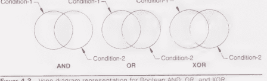

**图 4.3.** 布尔 AND、OR 和 XOR 的维恩图表示。

维恩图表示（如图 4.3 所示）也与按位函数的表示相似。在此图中，与某个条件对应的圆形区域表示布尔值真，圆外区域表示布尔值假。阴影区域表示指定逻辑运算的结果（布尔值真）。

务必注意，布尔值真并不等同于算术值 1；同样，假也不等同于 0。因此，像

```
#1 = #2 EQ #3; or
#1 = [#2 EQ #3];
```

这样的语句没有意义，会给出“FORMAT ERROR IN MACRO”（宏格式错误）。不能将布尔值（真或假）赋给变量，变量只能被赋予算术值。一些宏程序员中存在混淆，认为如果将布尔值赋给某个变量（如给定示例中的 #1），则真和假会分别对应存入 1 或 0。

### 按位运算与布尔运算

到目前为止，读者一定已经意识到：只要 AND、OR 和 XOR 作用于算术值，这些函数就表现为按位函数，结果是算术值。另一方面，如果这些函数作用于布尔值，它们就成为布尔函数，返回布尔值（真或假）。当然，算术值和布尔值不能与 AND、OR 和 XOR 混用。

- 1. `1 LT 2 AND 3`

  （条件运算符（如 EQ 和 LT）的存在使表达式成为布尔表达式。如果没有括号，这样的布尔表达式从左到右求值。因此，该表达式等价于 TRUE AND 3，这是无意义的，因此非法。）
- 2. `[1 LT 2] AND 3`

  （同上，因此非法。）


- `1 LT [2 AND 3]` — 等价于 1 LT 2，其求值结果为 TRUE
- `1 AND 2 LT 3` — 等价于 0 LT 3，其求值结果为 TRUE
- `1 AND [2 LT 3]` — 等价于 1 AND TRUE，这没有意义，因此非法
- `[1 LT 2] AND [3 LT 4]` — 等价于 TRUE AND TRUE。因此返回 TRUE

同样，布尔值不能用于任何算术运算：

- `1 * [2 LT 3]` — 等价于 1 * TRUE，这没有意义，因此非法
- `1 * 2 LT 3` — 等价于 2 LT 3，其求值结果为 TRUE

跳过括号并完全依赖优先级规则，可能使程序在某些情况下难以解读，其中一些情况已经讨论过。程序不应仅仅没有错误；其逻辑也应易于理解，这一点很重要。因此，尤其是在复杂的条件语句中，强烈建议使用额外的括号。优先级规则主要应仅用于算术运算。并且，根据经验法则，条件表达式必须括在括号内。

### 启用布尔运算

AND、OR 和 XOR 作为按位函数，在机器上始终可用。然而，它们作为布尔函数的可用性取决于参数 (6006#0)。6006#0 的默认设置为 0，不允许将 AND、OR 和 XOR 用作布尔函数。如果还希望将它们用作布尔函数，请将此位设置为 1。采用此设置时，这些函数既可用作按位函数，也可用作布尔函数。下面给出一个混合使用的示例，其中 AND 函数的行为（按位运算还是布尔运算）取决于其使用上下文：

```
IF [[[#1 AND #2] LT 2] AND [#3 LT #4]] THEN #5 = 1;
```

这里，AND 第一次（从左起）出现是按位运算，而第二次出现是布尔运算。

### 按位运算应用示例

在常见应用中，布尔 AND、OR 和 XOR 比按位 AND、OR 和 XOR 使用得更频繁。按位函数通常与系统变量配合使用，用于与连接到 CNC 的外部设备进行交互的接口信号。例如，考虑这样一种情况：有若干托盘可用于夹持铣床的工件，而程序需要知道是否装载了正确的托盘。每个托盘都有一个唯一的标识号（例如 27）和一个用于指示该编号的二进制编码系统。它还具有若干独立的 N/O（常开）限位开关（每个二进制信号一个开关），用于指示其已装载还是空载。

尽管下面描述的方法很简单，但考虑到实际因素，它并不是最佳方法。这里给出它，是因为除非认识到特定解决方案的局限性，否则就无法领会最佳解决方案。更好的方法将在末尾描述。

在一种简单的编码方案中，每个托盘可以附接一个八极双列直插封装 (DIP) 开关（假设最大托盘号不超过 255），开关设置将指示托盘号（以二进制表示，即 0 表示 OFF，1 表示 ON），例如 00011011 对应 27。DIP 开关是一组手动电气开关，它们以标准封装形式成组排列。整个封装单元（单数）称为一个 DIP 开关。DIP 有时也称为 DIL（双列直插）。这种开关设计用于与其他电子元件一起安装在印刷电路板 (PCB) 上，通常用于针对特定情况定制电子设备的行为。DIP 开关有多种类型。滑动式和摇杆式 DIP 开关非常常用于二进制编码。它们是简单的单刀单掷 (SPST) 触点阵列，可处于 ON 或 OFF 状态。这允许每个开关选择一个一位二进制值。封装中所有开关的值可解释为一个十进制数。八个开关提供 256 种组合——0 到 255——分别对应 00000000 和 11111111。常见的多引脚 IC 是双列直插封装的另一个例子。

DIP 开关的每个极都与一个独立的 N/O 限位开关串联，因此只有在限位开关被按下时才会发送二进制信号。为了将信号发送到 PMC，需要通过一条带状电缆（包含八根信号线和一根公共线）在 PMC 的输入/输出 (I/O) 模块端子排与每个托盘的限位开关之间建立物理连接。

在 PMC 梯形图中添加八个梯级（每个输入信号一个），用于将这些信号（按顺序）写入相应的 G 信号（G54.0 到 G54.7），将定义相应的系统变量（#1000 到 #1007 以及 #1032）。其中，#1000 到 #1007 将包含 0 或 1，对应相应开关的 OFF/ON 状态；#1032 则在其 16 位中包含完整信息（事实上，二进制表示的十进制解释，本例中为 27，将存储到 #1032 中）。因此，通过分析 #1032 的内容，为此需要按位 AND/OR/XOR 运算。例如，对于 #1032 = 27，#1032 XOR 27 将返回 0，否则返回非零数。因此，值为 0 将确认已装载 27 号托盘。程序中可以获得有关已装载托盘的信息，从而可能做出适合该特定托盘上工件的适当加工决策。

上述方法理论上是正确的，但并不实用，因为在运动系统中，电缆（从每个托盘延伸到端子排）可能造成干扰。下面描述一种实用方法。

首先确定将有多少个不同的托盘。两个托盘只需一个开关（ON 或 OFF）即可编码。四个托盘用两个开关（OFF/OFF、ON/OFF、OFF/ON 和 ON/ON），八个托盘用三个开关，十六个托盘用四个开关，依此类推。除非有 256 个托盘，否则不需要八个开关。除了“二进制数”开关阵列外，还需要一个附加开关来确认托盘是否已装载并锁定。现在剩下的就是如何驱动这些开关。

所有开关（按下接通型）都安装在机器的固定部分上，位于托盘被夹紧位置的下方。托盘底部只是带有凸起（表示 1）或凹陷（表示 0）的小按钮（按钮数量等于开关数量），这些按钮与安装在机器上的开关对齐。当托盘被锁定时，托盘上的按钮会驱动某个特定组合的开关，从而指示其编号。用于感测托盘是否已装载的附加开关，由所有托盘以相同方式驱动。并且，无需在该开关与用于托盘编码的开关之间建立物理串联连接（事实上，对于这种连接，将需要多个独立开关——每个编码开关一个）。相反，它可以表现为一个串联在所有其他开关对应梯形图梯级中的 N/O 继电器。开关阵列和附加开关通过一条电缆永久接线到 I/O 模块。因此，只需要一条电缆，它始终固定不动，固定在机器的固定部件上。

更复杂的托盘系统可能会使用条形码或射频 (RF) 标签向机器传递比托盘号更多的信息。

梯形图语言知识是此类应用的前提条件。虽然本文不涉及梯形图语言，但第 12 章给出了接线方法的简要说明。

## 4.7 转换函数

可用函数为 BIN 和 BCD，它们用于将数字从二进制编码十进制格式转换为二进制格式，反之亦然。这些函数用于在 PMC（使用二进制格式信号）与


**表4.3** 十进制数的BCD表示

| 十进制数 | BCD表示 | 二进制解释 |
|---:|:---:|---:|
| 0 | 0000 0000 0000 0000 | 0 |
| 1 | 0000 0000 0000 0001 | 1 |
| 9 | 0000 0000 0000 1001 | 9 |
| 10 | 0000 0000 0001 0000 | 16 |
| 19 | 0000 0000 0001 1001 | 25 |
| 20 | 0000 0000 0010 0000 | 32 |
| 99 | 0000 0000 1001 1001 | 153 |
| 100 | 0000 0001 0000 0000 | 256 |
| 999 | 0000 1001 1001 1001 | 2457 |
| 1000 | 0001 0000 0000 0000 | 4096 |
| 9999 | 1001 1001 1001 1001 | 39321 |

连接到CNC的外部设备（这些设备可能使用二进制编码十进制格式的信号，例如分别用于数字每一位的七段数码管显示）。

回顾一下，在十进制数的二进制编码十进制（BCD）表示中，数字的每一位都独立地由四位二进制数字表示。有关最多四位的十进制数的BCD表示的一些示例，请参考表4.3。注意，四位二进制数字可具有的最高十进制值为15，但由于最高十进制位仅为9，因此1010及以上（即最多到1111）不会出现在BCD表示中。

格式：

```
#i = BCD[<binary interpretation of a binary number>];
#i = BIN[<binary interpretation of a BCD number>];
```

BCD和BIN的参数都是二进制解释，转换结果同样按二进制解释。注意，二进制数的二进制解释就是实际数值，但对BCD数进行这种解释并不是BCD所表示的数值。格式转换针对的是两种格式所表示的实际十进制数。

示例：

```
#1 = BCD[1010];
```

（将1010转换为0001 0000，对应等价的十进制数10。）解释：有一个二进制数（1010），按二进制解释为10。因此，10是BCD函数的参数。这个数转换为BCD格式后变为0001 0000。转换后的BCD表示的十进制解释为16。所以，#1存储16。）

```
#2 = BIN[16];
```

（将0001 0000转换为1010，对应等价的十进制数10。解释：有一个BCD数（0001 0000），按二进制解释为16。因此，16是BIN函数的参数。这个数实际上是十进制10，转换为二进制格式后变为1010。转换后的二进制表示的十进制解释为10。所以，#2存储10。）

请注意，在两个示例中，转换涉及的都是同一个十进制数10。如果认识到这是将给定十进制数在一种格式下的表示转换为同一十进制数在另一种格式下的表示，这个概念就更容易理解。

按照类似的逻辑，作为练习，验证BCD[64]返回100，BIN[100]返回64：

```
0110 0100 ↔ 1000000
```

（两者分别以BCD和二进制格式表示十进制数64。）

BCD和BIN的参数不允许为负值（将显示“ILLEGAL ARGUMENT”报警消息）。参数应为整数。如果指定了实数，则会自动四舍五入到最接近的整数。

这些函数与用于接口信号的系统变量（在第3章中说明）配合使用，这些变量用于向PMC接收/发送16位/32位信号。例如，如果变量#1032对应输入状态0000000000010011，则它将存储十进制值19.000：

```
#1 = #1032;    (#1 is set to 19.000)
```

如果同一信号要通过变量#1132以BCD格式发送到外部设备，则需要BCD函数：

```
#2 = BCD[#1];
```

（19的BCD表示为0000 0000 0001 1001。其二进制解释为25。所以，#2被设为25。）

```
#1132 = #2;
```

（#1132发送所需的BCD信号0000000000011001。）

事实上，无需使用中间变量。下面的语句可以完成同样的工作：

```
#1132 = BCD[#1032];
```

BIN和BCD函数也可用于发送32位信号的变量#1133。由于单比特信号在二进制和BCD两种格式下的表示相同，因此变量#1000至#1015以及#1100至#1115不需要这些函数。

# 第5章

# 分支与循环

在程序中，可以使用GOTO和IF_GOTO语句改变执行顺序，这称为分支。这些语句也可用于创建循环，并重复执行，直到满足某个条件。然而，这并不被认为是创建循环的好方法。在任何结构化编程语言（如Pascal）中，避免使用GOTO是一种标准做法，因为它会降低程序的可读性。此外，它还引入了风险因素，因为后续对顺序号的更改可能使程序无法使用。有更好的方法可用。Custom Macro B为此提供了WHILE语句。

## 5.1 无条件分支

格式为

```
GOTO n;
```

其中n是所需的顺序号（1到99999）。

这会导致无条件跳转到指定的顺序号（回想一下，顺序号也称为程序段号、行号或N号）。GOTO语句中的顺序号也可以使用变量或表达式指定。

如果指定的顺序号不在1到99999范围内，或者程序中不包含指定的顺序号，则程序的进一步执行将终止并发出报警。

程序中并非所有程序段都必须有顺序号；只有目标程序段必须有顺序号。

在零件程序中允许顺序号重复，但不推荐，因为这可能导致意外错误。使用GOTO语句时，这会导致分支指令有歧义，产生错误状态。因此，为了良好的编程实践，同一顺序号在零件程序中不得出现多次，尤其是当程序使用宏编程功能时。

下面给出一些无条件跳转的示例：

| 语句 | 说明 |
|---|---|
| `GOTO 100;` | 程序执行流程跳转到N100程序段。如果程序中不存在这样的顺序号，则进一步执行将终止，并在屏幕上显示报警消息。 |
| `#1 = 1000;` |  |
| `GOTO #1;` | 跳转到N1000程序段 |
| `GOTO [#1 + 100];` | 跳转到N1100程序段 |
| `GOTO 0;` | 非法命令 |
| `GOTO 100000;` | 非法命令 |

GOTO的参数应为整数。然而，如果指定了实数，或者用作参数的变量或表达式的计算结果为实数，则会自动四舍五入到最接近的整数：

| 语句 | 说明 |
|---|---|
| `GOTO 100.0;` | 等价于GOTO 100 |
| `GOTO 100.49999;` | 等价于GOTO 100。不允许超过八位数字，例如100.4999990 |
| `GOTO 100.5;` | 等价于GOTO 101 |
| `#1 = 100.49999;` |  |
| `GOTO #1;` | 跳转到N100程序段 |
| `GOTO [#1 + .00001];` | 跳转到N101程序段 |

尽管这种GOTO用法只是一种理论上的可能性，在实际情况下不太可能发生，但透彻理解控制所遵循的逻辑有助于错误诊断。至少，打字错误总是可能发生，这可能产生意外结果，而不会生成任何错误消息。

## 5.2 条件分支

在条件分支中，GOTO与条件表达式结合使用。格式为

```
IF [<a conditional expression>] GOTO n;
```

如果指定条件满足（即求值为TRUE），程序执行跳转到顺序号n。如果指定条件不满足（即求值为FALSE），执行继续到下一个程序段。条件表达式必须括在方括号内。

可用的六个条件运算符可用于条件表达式，其含义见表5.1（这些运算符已在各种上下文中使用过；这里对它们进行正式描述）。请注意，此表中显示的等效数学符号仅供参考。它们不能用作条件运算符。


例如，可以用下面的代码块替换上面给出的表达式：

```text
#100 = #2 * [#3 + #4];
#100 = SQRT[#100];
#100 = ROUND[#100];
```

此后，可以用一个简单的表达式 [#1 LT #100] 来代替原表达式。

还允许使用多个条件的组合，并通过布尔 AND、OR、XOR 进行连接，前提是参数 6006#0 被设为 1。例如，可能需要在两个条件同时为 TRUE 时执行某个操作。在第4.6节末尾已给出这样的示例。事实上，三种布尔函数的任意组合都可用于模拟复杂条件。注意，在复杂表达式中，最好使用方括号来标明运算的层次，即使这些方括号实际上可能因为优先级规则而多余。这使表达式更易读，并降低逻辑错误的可能性。

```text
IF [[[#1 LT #2] AND [#3 LT #4]] OR [[#5 LT #6] XOR [#7 LT #8]]] GOTO 100;
```

在该指令中，嵌套的左、右方括号各为3个。在不嵌套的情况下，可以使用任意数量的括号。本例中使用了7个左括号和7个右括号。

最后，作为条件分支的一个实际示例，请考虑计算从1到10的所有整数之和（即1 + 2 + 3 + ... + 9 + 10）的问题。求和算法的流程图及其执行轨迹如图5.1所示。良好的编程实践是先为所选算法绘制流程图，并尽可能追踪执行过程。只有在完全验证算法之后，才开始编写程序代码。这在很大程度上降低了逻辑错误的可能性。

使用流程图还有一个好处。宏变量不能反映变量的物理含义（这实际上是宏编程的一个严重局限）。例如，如果定义变量 #100 存放某个变量的值，那么使用者就必须始终记住 #100 的含义。当处理大量变量时，这就会变得困难。因此，编写程序会变得有些困难，因为人们无法直观地知道哪个变量被用于什么目的。人脑不像计算机那样工作。事实上，这也是有些程序员认为宏编程过于复杂的原因之一。流程图解决了这个问题。一旦流程图准备好，只需将其用宏变量表达出来，程序就完成了！因此，不应将绘制流程图视为一项多余的、不必要的工作。它最初确实会花费一些时间，但最终，一个复杂的程序也许能在更短的时间内完成。此外，在复杂程序中，如果没有流程图，错误诊断将变得极其困难。在宏编程领域，很多时候，越慢反而越快到达目的地。因此，一条经验法则是：在没有预先准备好流程图之前，绝不要开始编写程序代码，尤其是对宏编程还不熟悉的人。否则，宏程序的抽象性会使其显得过于复杂，这可能使初学者失去进一步学习的兴趣，从而未战先败！

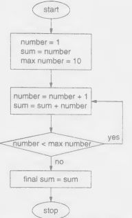

| 执行轨迹 | 数值 | 总和 |
|---|---:|---:|
| 数值和总和的初始值 | 1 | 1 |
| 执行第 I 次循环后的值 | 2 | 3 |
| 执行第 II 次循环后的值 | 3 | 6 |
| 执行第 III 次循环后的值 | 4 | 10 |
| 执行第 IV 次循环后的值 | 5 | 15 |
| 执行第 V 次循环后的值 | 6 | 21 |
| 执行第 VI 次循环后的值 | 7 | 28 |
| 执行第 VII 次循环后的值 | 8 | 36 |
| 执行第 VIII 次循环后的值 | 9 | 45 |
| 执行第 IX 次循环后的值 | 10 | 55 |
| 最终总和 |  | 55 |

**图5.1** 求和算法的流程图与执行轨迹。

算法验证之后的下一步，是先将变量编号分配给流程图中出现的所有变量。为便于正确的文档编写，应在程序开头的注释中描述所选变量，以便其他希望分析该程序的用户理解。现在，编写程序就只是把流程图转换成编码语言而已。程序号8000基于图5.1给出的流程图。

O8000 (数字求和);

(宏程序的程序号通常选用8000或9000系列，因为可以对这类程序进行编辑保护，以避免意外编辑或删除。参数设置 3202#0 = 1 和 3202#4 = 1 分别对程序号8000～8999和9000～9999进行编辑保护。实际上，被保护的程序甚至不会显示。只有在参数 3202#6 被设为1时，这类程序的程序号才能显示在目录搜索中。)

(请注意，MDI面板上只有大写字母键，没有 @ 字符键。@ 可以通过软键输入。详见第2.2节。)

```text
(#1 @ NUMBER);

(#2 @ SUM);
(#3 @ MAX NUMBER);
(#500 @ FINAL SUM);
;
```

(希望求和到哪一个数)

(这是一个空白的NC语句，不执行任何操作。插入此处只是为了增强程序的可读性。)

```text
#1 = 1;
#2 = #1;
#3 = 10;
N10 #1 = #1 + 1;
#2 = #2 + #1;
IF [#1 LT #3] GOTO 10;

#500 = #2;

M30;
```

(NUMBER 的初始值)
(SUM 的初始值)
(期望从1到10求和)
(NUMBER 加1)
(计算 SUM)
(如果 NUMBER 的当前值小于10，则跳转到 N10)
(SUM 的最终值存储在永久公共变量 #500 中)
(如果此程序要被其他程序调用，请将 M30 替换为 M99)

注意，M02 和 M30 包含 RESET（复位）动作。因此，它们会将所有局部变量（即 #1 至 #33）以及公共变量（#100 至 #199）清空为 null。因此，如果某个值需要在程序结束后仍然可用（例如用于检查其值或在不同的程序之间使用），就必须将其存储在永久公共变量中。因此，当给定程序执行结束时，#1、#2、#3 被清空为 null，而总和的最终值（本例中为55）仍保存在 #500 中，该值可以显示在宏变量画面上（显示宏变量的方法参见第1.3节）。

虽然宏编程功能可用于任何程序（上面给出的程序就是一个示例，它可以作为主程序执行），但宏程序或子程序总是为了供其他程序（主程序、子程序或宏程序）调用而设计的。如第3.3节所述，并在第6章和第7章中详细讨论的，子程序通过 M98 调用，宏程序（通常简称为宏）通过 G65 或 G66 调用。而且，如果程序是设计来供其他程序调用的，就必须以 M99 而不是 M30 结束。因此，如果本章中给出的任何程序要供其他程序调用，请在末尾将 M30 替换为 M99。这里特意使用了 M30，以便这些程序可以作为主程序运行。主程序末尾的 M99 会使程序无限循环地重复运行，直到按下 RESET 键。

还要记住，如果在 O 字母后紧跟注释（本程序就是这样做的），MDI 屏幕上的目录显示（要显示目录，请在 EDIT 模式下按 PROG 功能键，然后按 DIR 软键，或按两次 PROG 键）将显示所插入的注释（在7.2英寸LCD屏幕上最多31个字符）以及程序号。这是一种推荐做法，因为无需打开程序（即执行 O SRH 搜索）就能获得程序类型的信息。

给定程序本质上相当通用。例如，如果需要对从1到100求和，只需在程序开头将 #3 的值改为100，得到的求和值将是5050。一个好的宏程序应在程序开头就提供这种灵活性，这样其他用户（宏总是设计给多个用户使用的）即使不是专业程序员，也无需分析整个程序来确定需要修改哪里。

作为练习，读者可以尝试编写一个程序来计算前10个数的平方和（即 1² + 2² + ... + 10²）。该程序与上面给出的计算前10个数之和的程序几乎相同。只需将 #2 = #2 + #1 语句替换为 #2 = #2 + #1 * #1。答案将是 385。

尽管永久公共变量对于刚刚讨论的这类应用非常有用，但预设值并不总是可取的，因为在某些情况下这可能导致变量初始化不正确（例如，#500 = #500 + #1，其中希望 #500 的初始值为0）。此外，永远无法确定所显示的值是程序实际计算出来的，还是仅仅只是旧值。因此，为了安全的编程实践，程序中要使用的所有永久公共变量都应在程序的最开头设置为 null，除非确实需要它们的旧值。

在某些情况下，甚至可能需要清除所有永久公共变量。程序号8001就执行这一操作，将 #500 至 #999 范围内的所有变量设置为 null。在 0i Mate TC 上，执行大约需要10秒（宏计算速度不是很快）。该算法的流程图及其执行轨迹如图5.2所示。

```text
O8001 (CLEARING ALL PERMANENT COMM VARS)
;
#1 = 500; (Initial value of COUNTER)
N10 #[#1] = #0; (The variable number, referenced by COUNTER, set to null)
```


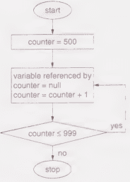

| 执行轨迹 | 计数器 | #500 | #501 | #502 | ... | #999 |
|---|---:|---|---|---|---|---|
| 计数器和变量的初始值 | 500 | 旧值 | 旧值 | 旧值 | 旧值 | 旧值 |
| 执行第I次循环后的值 | 501 | 空 | 旧值 | 旧值 | 旧值 | 旧值 |
| 执行第II次循环后的值 | 502 | 空 | 空 | 旧值 | 旧值 | 旧值 |
| 执行第III次循环后的值 | 503 | 空 | 空 | 空 | 旧值 | 旧值 |
| 执行第499次循环后的值 | 999 | 空 | 空 | 空 | 空 | 旧值 |
| 执行第500次循环后的值 | 1000 | 空 | 空 | 空 | 空 | 空 |

**图 5.2** 清除所有永久公共变量的算法的流程图和执行轨迹。

```
N10 #1 = #1 + 1;                         (COUNTER incremented by 1, for selecting the next variable)
IF [#1 LE 999] GOTO 10;                  (Branches to 10 if #1 is less than or equal to 999, i.e., if all variables up to #999 are not cleared)

M30;
```

一个更复杂的例子是计算例如 10 个给定数字的样本标准差（$\sigma_{n-1}$），这些数字存储在 #1 到 #10 中。数学公式为

$$\bar{x}=\frac{\sum x_i}{n}$$

$$\sigma_{n-1}=\sqrt{\frac{\sum(x_i-\bar{x})^2}{n-1}}$$

其中
- $x_i$ = 各个数据
- $n$ = 数据总数
- $\bar{x}$ = 给定数据的平均值

计算 $\sigma_{n-1}$ 的算法流程图见图 5.3。程序号 8002 基于该算法。虽然可以将任意值存储到变量 #1 至 #10 中，但本示例中选择的值分别为 1、2、3、...、10。得到的答案将是 3.0276503。该程序可用于计算最多 33 个数字（存储在 #1 至 #33 中）的 $\sigma_{n-1}$。

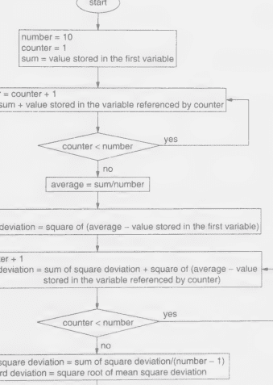

**图 5.3** 计算样本标准差的算法的流程图。

```
O8002 (STANDARD DEVIATION CALCULATION);
(#1 THROUGH #10 @ DATA);
(STORE DESIRED VALUES IN #1...#10);
(#100 = NUMBER OF GIVEN DATA);
(SET #100 TO THE NUMBER OF DATA);
(#101 @ COUNTER);
(#102 @ SUM OF GIVEN DATA);
(#103 @ AVERAGE OF GIVEN DATA);
(#104 @ SUM OF SQUARE DEVIATION);
(#105 @ MEAN SQUARE DEVIATION);
(#501 @ STANDARD DEVIATION);
;

#1 = 1;                        (First data)
#2 = 2;                        (Second data)
#3 = 3;                        (Third data)
#4 = 4;                        (Fourth data)
#5 = 5;                        (Fifth data)
#6 = 6;                        (Sixth data)
#7 = 7;                        (Seventh data)
#8 = 8;                        (Eighth data)
#9 = 9;                        (Ninth data)
#10 = 10;                      (Tenth data. Note that the data-entry
                                step is not shown in the flowchart)
#100 = 10;                     (NUMBER of data)
#101 = 1;                      (Initial value of COUNTER)
#102 = #1;                     (Initial SUM set to the first data)
N10 #101 = #101 + 1;           (COUNTER incremented by 1)
#102 = #102 + #[#101];         (Next data added to SUM)
IF [#101 LT #100] GOTO 10;     (Branching to N10 if all data are not
                                added to SUM)
#103 = #102 / #100;            (AVERAGE calculated)
#101 = 1;                      (COUNTER initialized to 1)
#104 = [#103 - #1] * [#103 - #1];
                                (Initial SUM OF SQUARE DEVIA-
                                TION set to the square deviation for
                                the first data)
N20 #101 = #101 + 1;           (COUNTER incremented by 1)
#104 = #104 + [#103 - #[#101]] * [#103 - #[#101]];
                                (Square deviation for the next
                                data added to SUM OF SQUARE
                                DEVIATION)
IF [#101 LT #100] GOTO 20;     (Branching to N20 if square devia-
                                tions for all data are not added to
                                SUM OF SQUARE DEVIATION)
#105 = #104 / [#100 - 1];      (MEAN SQUARE DEVIATION
                                calculated)
#501 = SQRT[#105];             (STANDARD DEVIATION calcu-
                                lated and stored in the permanent
                                common variable #501)
M30;
```

注意，在 7.2 英寸 LCD 屏幕上，使用 MDI 键无法在一个程序段中连续输入超过 34 个字符。在复杂的数学计算中，确实会出现一个程序段中超过 34 个字符的情况。例如，在标准差程序中，有一个程序段（紧邻 N20 程序段的那个）包含 40 个字符。要在程序中拥有这样的程序段，唯一的方法是先在 PC 上输入程序，然后通过 RS-232C 端口将其下载到 CNC。这样，程序段中实际上可以使用任意数量的字符。然而，如果仅使用 MDI 键输入程序，则长程序段（超过 34 个字符）需要拆分为更小的程序段。例如，

```
#104 = #104 + [#103 - #[#101]] * [#103 - #[#101]];
```

可以按以下方式拆分为更小的程序段，其效果相同：

```
#111 = #103 - #[#101];

#111 = #111 * #111;
#104 = #104 + #111;
```

（引入一个新变量 #111 用于中间计算）

下一个例子求以下形式的一元二次方程的根

$$ax^2 + bx + c = 0$$

两个根的公式为

$$x_1 = \frac{-b + \sqrt{b^2 - 4ac}}{2a} \qquad\text{and}\qquad x_2 = \frac{-b - \sqrt{b^2 - 4ac}}{2a}$$

求这两个根的算法流程图如图 5.4 所示。在基于该算法的程序号 8003 中，可以为对应于 a、b 和 c 的变量赋予任意值。这里取 1、1 和 −2，得到两个根的解为 1 和 −2。

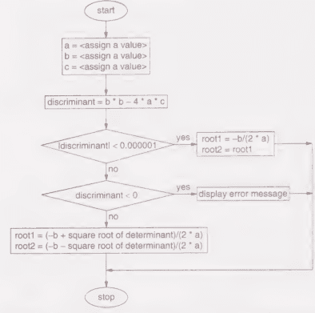

**图 5.4** 求一元二次方程根的算法的流程图。

```
O8003 (QUADRATIC EQUATION SOLUTION);
(FORM @ A * X * X + B * X + C = 0);
(#1 @ A);
(#2 @ B);
(#3 @ C);
(ASSIGN DESIRED VALUES TO A,B,C);
(#100 @ DISCRIMINANT);
(#502 @ ROOT1);
(#503 @ ROOT2);
;
#1 = 1;                         (a, i.e. coefficient of x²)
#2 = 1;                         (b, i.e., coefficient of x)
#3 = -2;                        (c, i.e., constant term)
#100 = #2 * #2 - 4 * #1 * #3;   (Determinant calculated)

IF [ABS[#100] LT 0.000001] GOTO 10;          (Branching to N10 if determinant
                                               is 0)

IF [#100 LT 0] THEN #3000 = 1 (IMAG ROOTS);  ("3001 IMAG ROOTS" displayed
                                               and execution terminated, for a
                                               negative determinant. IF_THEN
                                               statement is described in detail in
                                               Sec. 5.3)

#502 = [-#2 + SQRT[#100]] / [2 * #1];         (First root calculated and stored
                                               in the permanent common variable #502)
#503 = [-#2 - SQRT[#100]] / [2 * #1];         (Second root calculated and stored
                                               in another permanent common variable #503)
GOTO 20;                                      (Branching to N20)
N10 #502 = -#2 / [2 * #1];                    (First root calculated, when the determinant is 0)
#503 = #502;                                  (The two roots are equal)
N20 M30;
```

回想一下，每次宏计算通常都会涉及 $10^{-6}$ 的误差。因此，即使判别式实际上为 0，计算结果也可能不*恰好为 0*。正是由于这个原因，本程序中将判别式的绝对值与一个很小的值进行比较。

注意，即使判别式为负并产生报警，永久公共变量 #502 和 #503 中仍可能存储有旧值（如果有的话）。如果这很可能引起混淆，则在判别式为负时将 #502 和 #503 设置为空（#0）。事实上，如前所述，良好的编程实践是在程序一开始就*无条件地*将这些变量设置为空。这适用于所有使用永久公共变量且不需要其旧值的程序。

作为额外练习，读者可以尝试开发程序来求

- 给定数据集中的最大值和最小值
- $\sum_i^n$ 型有限级数的和（一个以索引 i 表示的表达式）
- 无限但收敛级数的和（当发现某个级数项非常小，例如小于 0.000001 时，需要终止计算）
- 给定数字的阶乘计算等

只要有可能，就应使用*递推关系*来提高计算效率。例如，给定数字的阶乘可以用其前一个数字的阶乘来定义：$i! = (i - 1)! \times i$。这种技术在级数求和中尤其有利。下面给出一个例子：

$$\mathrm{sum} = x - \frac{x^3}{3!} + \frac{x^5}{5!} - \frac{x^7}{7!} + \cdots + (-1)^{n-1}\frac{x^{2n-1}}{(2n-1)!}$$

观察可知

第 $i$ 项 = $(-1)^{i-1}\frac{x^{2i-1}}{(2i-1)!}$ 和第 $(i+1)$ 项 = $(-1)^i\frac{x^{2i+1}}{(2i+1)!}$


因此，第 (i + 1) 项可以用第 i 项按以下方式表示：

第 (i + 1) 项 = (-1) × x^2 / ((2i + 1)2i) × 第 i 项

基于该递推关系的流程图见图 5.5。输入数据为给定的 x 值以及级数中的项数 (n)。该流程图适用于 n ≥ 2。编写求该级数和的程序留给读者作为练习。

所给出和建议的若干程序，除了描述开发宏程序的正确方法外，其唯一目的就是解释宏中条件语句的使用（在实践中，可能没有任何 CNC 机床需要使用其中某些程序）。选择这些程序主要是因为每位工程专业毕业生都会在某门编程课程中编写这类程序。而且，当这些程序为人们所熟悉时，只需了解如何将它们转换为宏语言即可。这使学习一门新语言变得容易。

这些程序还表明，宏编程语言可用于进行复杂计算。事实上，接下来的讨论将表明，宏程序所能做的远不止这里所描述的内容。到目前为止，我们只是对该语言作了介绍。

图 5.5 求级数和的算法流程图。

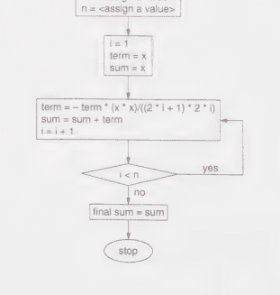

## 5.3 单个宏语句的条件执行

这种语句（IF_THEN_）已在程序号 8003 中使用过（留给读者思考如何在不使用该语句的情况下开发该程序，作为练习）。这里将对其进行正式、详细的描述。

指定的宏语句是否执行，取决于指定条件是否满足。格式为

```
IF <a conditional expression> THEN <a macro statement>;
```

条件表达式甚至可以是若干独立条件的复杂组合。

IF_THEN_ 格式具有以下限制：

- 只能指定单个宏语句。
- 不允许使用 NC 语句。

**示例：**

| 示例 | 说明 |
|---|---|
| `IF [#1 LT #2] THEN #3 = 3;` | 如果条件为真，则将值 3 赋给变量 #3。条件为假时，#3 中存储的先前值保持不变。 |
| `IF [#1 LT #2] #3 = 3;` | 非法命令。必须包含 THEN。 |
| `IF [#1 LT #2] THEN M30;` | 非法命令，因为指定了 NC 语句。 |
| `IF [#1 LT #2] THEN [#3 = 3; #4 = 4];` | 非法命令，因为指定了多个宏语句。实际上，不可能以所示方式显示该命令。第一个分号会换行，使该语句分成两个独立块，从而完全失去意义。 |

如果指定条件为真（例如 `if [#1 LT #2]` 为真）时希望执行多个宏语句，可按以下方式实现：仅当 #1 小于 #2 时，才执行 IF_GOTO_ 与 N100 块之间的语句）：

```
IF [#1 GE #2] GOTO 100;
<macro statement -1>
<macro statement -2>
...
...
<macro statement -n>
<NC statement -1>
<NC statement -2>
...
...
```

如果指定条件满足（即条件表达式的求值为真），则执行 DO 与 END 之间的程序块。之后再次检查条件，如果条件仍然满足，则重新执行循环。只要条件保持满足（在每次循环开始时进行测试），循环就会重复执行。

循环内的程序块经过设计，使其处理过程会影响指定条件，从而在循环执行若干次后条件变为假。此后，在完整执行完使条件从真变为假的循环后，程序执行将转到 END 之后的程序块。注意，条件是在执行新循环之前检查的；在执行循环期间不检查条件。WHILE 语句的流程图见图 5.6。

虽然只能使用 1、2 和 3 作为标识号 (n)，但它们在一个程序中可以使用任意多次：

```
WHILE [<conditional expression 1>] DO 1;
                         (The identification number is 1)
...
...
<program blocks within the first loop>
...
...
END 1;
WHILE [<conditional expression 2>] DO 1;
                         (Same identification number permitted)
...
...
<program blocks within the second loop>
...
...
END 1;
```

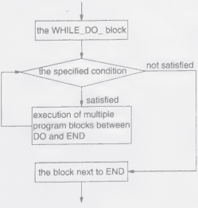

**图 5.6** WHILE 语句的流程图。

事实上，同一标识号（例如 1）可以在程序中的任何位置使用（如上一示例所做的那样），但在嵌套中除外：在嵌套中，1、2 和 3 对应三层嵌套的 WHILE 语句（最多允许三层嵌套）：

```
WHILE [<condition 1>] DO 1;
...
...
WHILE [<condition 2>] DO 2;
...
...
WHILE [<condition 3>] DO 3;
...
...
END 3;
...
...
END 2;
...
...
END 1;
```


在嵌套中，DO_END 范围不能重叠，因为那会使语句不合逻辑且毫无意义：

```
WHILE [<condition 1>] DO 1;
...
...
WHILE [<condition 2>] DO 2;
...
...
END 1;
...
END 2;
```


允许在循环内（即 DO_END 范围内）使用任何宏语句或 NC 语句，包括 IF_THEN_、IF_GOTO_ 和 GOTO_：

```
WHILE [<condition 1>] DO 1;
...
...
IF [<condition 2>] GOTO 10;    (Permitted to use GOTO inside a loop)
...
N10 ...;
...
END 1;
...
```

也允许使用 GOTO 语句跳出循环：

```
WHILE [<condition 1>] DO 1;
...
IF [<condition 2>] GOTO 10;    (Permitted to jump outside the loop)
...
...
END 1;
...
...
N10 ...;
```

但是，不允许从外部跳入循环内部：

```
IF [<condition 1>] GOTO 10;    (Illegal jump inside a loop)
...
...
WHILE [<condition 2>] DO 1;
...
...
N10 ...;
...
...
END 1;
```

为了说明 WHILE 语句的用法，将考虑同样的问题，以突出其与使用条件 GOTO 语句创建的循环之间的区别。

如前所述，只有在准备好流程图之后才应进行程序编码。WHILE 语句的流程图会略有不同，因为指定条件是在循环开始时检查的。

求和问题 (1 + 2 + 3 + ... + 10) 的流程图见图 5.7。程序号 8004 基于该流程图。

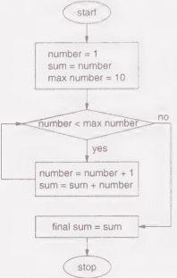

| 执行跟踪 | 数值 | 和 |
|---|---:|---:|
| 数值与和的初始值 | 1 | 1 |
| 执行第 I 次循环后的值 | 2 | 3 |
| 执行第 II 次循环后的值 | 3 | 6 |
| 执行第 III 次循环后的值 | 4 | 10 |
| 执行第 IV 次循环后的值 | 5 | 15 |
| 执行第 V 次循环后的值 | 6 | 21 |
| 执行第 VI 次循环后的值 | 7 | 28 |
| 执行第 VII 次循环后的值 | 8 | 36 |
| 执行第 VIII 次循环后的值 | 9 | 45 |
| 执行第 IX 次循环后的值 | 10 | 55 |
| 最终和 |  | 55 |

**图 5.7.** WHILE 语句求和算法的流程图与执行跟踪。

```
08004 (SUMMATION OF NUMBERS USING WHILE);
(#1 @ NUMBER);
(#2 @ SUM);
(#3 @ MAX NUMBER);              (Up to which summation is desired)
(#504 @ FINAL SUM);
;
#1 = 1;                          (Initial value of NUMBER)
#2 = #1;                         (Initial value of SUM)
#3 = 10;                         (Summation from 1 to 10 is desired)
WHILE [#1 LT #3] DO 1;           (The loop starts here. It is executed if #1
                                  is less than #3. If not, the loop terminates,
                                  and the execution jumps to the block after END 1)

#1 = #1 + 1;                     (NUMBER incremented by 1)
#2 = #2 + #1;                    (SUM calculated)
END 1;                           (The end of the loop. The execution
                                  jumps to the start of the loop to check if
                                  #1 is still less than #3)

#504 = #2;                       (The final value of the SUM stored in
                                  the permanent common variable #504)
M30;
```


```
END 1;
```
（循环结束。执行跳转到循环开头，以检查 #1 是否仍然小于或等于 999）

```
M30;
```

使用 WHILE 语句计算标准差的流程图见图 5.9（算法开头的数据输入步骤未在流程图中显示）。程序号为 8006 的是相应程序。注意，该算法使用两个循环。

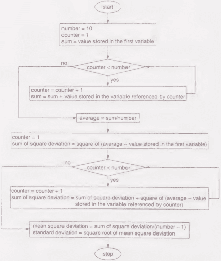

**图 5.9** 使用 WHILE 语句计算样本标准差的算法流程图。

```text
O8006 (STD DEV CALCULATION USING WHILE);
(#1 THROUGH #10 @ DATA);
(STORE DESIRED VALUES IN #1...#10);
(#100 @ NUMBER OF GIVEN DATA);
(SET #100 TO THE NUMBER OF DATA);
(#101 @ COUNTER);
(#102 @ SUM OF GIVEN DATA);
(#103 @ AVERAGE OF GIVEN DATA);
(#104 @ SUM OF SQUARE DEVIATION);
(#105 @ MEAN SQUARE DEVIATION);
(#505 @ STANDARD DEVIATION);
;
#1 = 1;                      (First data)
#2 = 2;                      (Second data)
#3 = 3;                      (Third data)
#4 = 4;                      (Fourth data)
#5 = 5;                      (Fifth data)
#6 = 6;                      (Sixth data)
#7 = 7;                      (Seventh data)
#8 = 8;                      (Eighth data)
#9 = 9;                      (Ninth data)
#10 = 10;                    (Tenth data)
#100 = 10;                   (NUMBER of data)
#101 = 1;                    (Initial value of COUNTER)
#102 = #1;                   (Initial SUM set to the first data)
WHILE [#101 LT #100] DO 1;   (The first loop starts here. It ends at
                             the END 1 block. Note that END 1
                             appears twice in this program
                             because the same identification num-
                             ber, 1, has been used for both the
                             loops. The current loop is executed if
                             #101 is less than #100. If not, the loop
                             terminates, and the execution jumps
                             after the END 1 block of this loop)
#101 = #101 + 1;             (COUNTER incremented by 1)
#102 = #102 + #[#101];       (Next data added to SUM)
END 1;                       (The end of the first loop. The execu-
                             tion jumps to the start of the loop to
                             check if #101 is still less than #100)
#103 = #102 / #100;          (AVERAGE calculated)
#101 = 1;                    (COUNTER initialized to 1)
#104 = [#103 - #1] * [#103 - #1];
                             (Initial SUM OF SQUARE DEVIA-
                             TION set to the square deviation for
                             the first data)
WHILE [#101 LT #100] DO 1;   (The second loop starts here. It is
                             executed if #101 is less than #100. If
                             not, the loop terminates, and the exe-
                             cution jumps to the block after the
                             END 1 block of this loop, that is,
                             jumps after the second END 1 of this program)
#101 = #101 + 1;             (COUNTER incremented by 1)
#104 = #104 + [#103 - #[#101]] * [#103 - #[#101]];
                             (Square deviation for the next data
                             added to SUM OF SQUARE DEVIATION)
END 1;                       (The end of the second loop. The execu-
                             tion jumps to the start of the loop to
                             check if #101 is still less than #100)
#105 = #104 / [#100 − 1];    (MEAN SQUARE DEVIATION calculated)
#505 = SQRT[#105];           (STANDARD DEVIATION calculated and
                             stored in the permanent common variable #505)
M30;
```

图 5.5 所示的级数求和流程图是为与条件 GOTO 语句配合使用而设计的。同一算法如果希望用 WHILE 语句实现，其流程图将如图 5.10 所示。读者应尝试根据该流程图编写程序，此练习留作习题。只需为输入 x 和 n，以及计数器 i、项和总和定义变量。此后，编写程序就只是按照已定义的变量照搬流程图而已。

**图 5.10**  
使用 WHILE 语句的级数求和算法流程图。

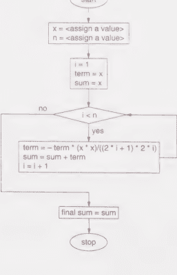

尽管 WHILE 语句用于循环执行，但如果指定条件为真，它也可以用于执行某些语句块一次：

```text
WHILE [<a conditional expression>] DO 1;
...
...
...
GOTO 10;
END 1;
N10 ...;
```

回想一下，IF_THEN_ 格式在满足指定条件时只能执行一条宏语句。此前已提出一种间接方法来执行多条语句。

## 5.5 宏变量编号的算术运算

如前所述，宏变量不能使用任意字母数字字符组合来定义。它们只能通过特定变量编号来定义。这有点不方便，因为程序员无法直观感受到程序中使用的不同变量所赋予的含义。

然而，宏变量的一个独特特性是允许对变量编号进行算术运算。这在某些情况下可以加以利用。例如，在 PASCAL 中，可以用五个变量（例如 MARKS1、MARKS2、MARKS3、MARKS4 和 MARKS5）存储一名学生在五门科目中的成绩。另一方面，在宏程序中，成绩可以存储在例如 #101、#102、#103、#104 和 #105 中。虽然 MARKS1、MARKS2、MARKS3、MARKS4 和 MARKS5 彼此完全独立，但 #101、#102、#103、#104 和 #105 遵循一种模式。某一科目的变量编号可以通过在前一科目的变量编号上加 1 来得到。这一事实可用于编写例如计算总成绩的程序。此类算法的流程图见图 5.11，相应程序号为 8007。该程序中使用 WHILE 语句创建循环，因为它比条件 GOTO 语句更可取。不过，读者应尝试使用 IF_GOTO_ 语句构造该循环，作为练习。

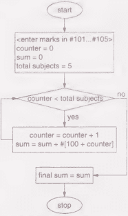

**执行轨迹**  
*（假设成绩为 50、60、70、80 和 90）*

|  | 计数器 | 总和 |
|---|---:|---:|
| 计数器和总和的初始值 | 0 | 0 |
| 执行 I 循环后的值 | 1 | 50 |
| 执行 II 循环后的值 | 2 | 110 |
| 执行 III 循环后的值 | 3 | 180 |
| 执行 IV 循环后的值 | 4 | 260 |
| 执行 V 循环后的值 | 5 | 350 |
| 最终总和 |  | 350 |

**图 5.11** 计算总成绩的算法流程图及执行轨迹。

```text
O8007 (AGGREGATE MARKS CALCULATION);
(#1 @ COUNTER);
(#2 @ SUM);
(#3 @ TOTAL SUBJECTS);
(#506 @ FINAL SUM);

#101 = 50;
#102 = 60;
#103 = 70;
#104 = 80;
#105 = 90;
#1 = 0;
#2 = 0;
#3 = 5;                 (If the total number of subjects is differ-
                        ent from 5, define #3 accordingly)

WHILE [#1 LT #3] DO 1; (Start of the loop)
#1 = #1 + 1;           (COUNTER incremented by 1)
#2 = #2 + #[100 + #1]; (Marks obtained in the next subject
                        added to SUM)

END 1;                 (End of the loop)

#506 = #2;             (FINAL SUM stored in the permanent
                        common variable #506)

M30;
```

当然，这是一个简单的例子；五门科目的成绩可以直接相加。然而，如果数据数量太大（例如 100），这样的程序就会有用。此外，这里的目的是解释如何对变量和编号进行算术运算，以及在这种情况下如何绘制包含循环的流程图。

宏变量的这种特性还可以用于操作某些遵循确定模式的系统变量。例如，对于某一特定轴，各种工件偏置值的变量编号之间相差 20（见表 5.2(a) 的每一行，该表是表 3.12 的一部分）。类似地，对于某个特定工件坐标系，下一轴的变量编号增加 1（见表 5.2(a) 的每一列）。所识别出的模式可以用编号 5201 进行数学描述，如表 5.2(b) 所示，该表是表 5.2(a) 的一部分。因此，如果指定了轴和工件坐标系，就可以计算出相应的系统变量编号。外部 G54、G55、G56、G57、G58 和 G59 工件坐标系的乘数（20 的倍数）分别为 0、1、2、3、4、5 和 6，而 X 轴、Y 轴和 Z 轴的加数分别为 0、1 和 2（其余轴如果存在，则为 3、4、5 等）。因此，例如，G56 坐标系的 Y 轴偏置值存储在变量编号 5201 + 20 × 3 + 1 中，即 #5262 中。

| 轴 | 外部 | G54 | G55 | G56 | G57 | G58 | G59 |
|---|---|---|---|---|---|---|---|
| X | #5201 | #5221 | #5241 | #5261 | #5281 | #5301 | #5321 |
| Y | #5202 | #5222 | #5242 | #5262 | #5282 | #5302 | #5322 |
| Z | #5203 | #5223 | #5243 | #5263 | #5283 | #5303 | #5323 |

(a)

| 轴 | 外部 | G54 | G55 | G56 |
|---|---|---|---|---|
| X | #5201 + 20 × 0 + 0 | #5201 + 20 × 1 + 0 | #5201 + 20 × 2 + 0 | #5201 + 20 × 3 + 0 |
| Y | #5201 + 20 × 0 + 1 | #5201 + 20 × 1 + 1 | #5201 + 20 × 2 + 1 | #5201 + 20 × 3 + 1 |
| Z | #5201 + 20 × 0 + 2 | #5201 + 20 × 1 + 2 | #5201 + 20 × 2 + 2 | #5201 + 20 × 3 + 2 |

(b)

**表 5.2** 铣床上各种工件偏置值的系统变量编号规律


## 零点偏移的方法

现在我们将考虑一个简单示例，以了解如何通过程序识别并操作此类系统变量，从而获得所需效果。假设在铣床上，要求将当前激活（或其他）工件坐标系（在 G54–G59 或可选提供的 48 个附加坐标系 G54.1 P1–P48 中）的原点放置在刀具当前 XY 位置。这称为零点偏移或基准偏移。回想一下，工件坐标系（G54、G55 等）的原点也称为工件零点、程序零点或零件零点；并且任何时候都可以选择六个标准工件坐标系和 48 个附加工件坐标系中的任意一个作为激活坐标系。程序在当前激活坐标系中执行（CNC 按当前激活坐标系解释程序中使用的坐标值）。

只需指令 G90 G92 X0 Y0 即可非常简单地完成零点偏移，这显然是最简单的方法。车床上的对应指令是 G50 X0 Z0。也可以进行单轴零点偏移。例如，G90 G92 Z0（车床上为 G50 Z0）仅对 Z 轴进行零点偏移。然而，使用 G92 或 G50 的一个限制是，偏移仅在当前加工会话中有效。一旦机床关机并再次开机，上一次会话中通过 G92 或 G50 输入的信息就会丢失，机床将开始使用原始零点设置。此外，使用该方法进行零点偏移只能针对当前激活坐标系进行。

另一方面，如果通过操作相关工件偏移距离所存储的系统变量值来进行零点偏移，则偏移后的原点将永久固定在新位置，直到再次（以任何方法）更改偏移值。此外，该方法适用于所有坐标系，即使这些坐标系当前未激活。当然，如果操作的是当前未激活坐标系的偏移距离所对应的系统变量，则只有在该坐标系变为激活后才会看到其效果。

各种偏移值对应的系统变量为读写型。因此，如果更改其中存储的值，相应的偏移距离会自动改变。反之，如果更改偏移距离，相应的系统变量会自动重新定义（即存储新值）。注意，“偏移距离”“偏移值”甚至“偏移”这些术语通常同义使用。因此，X 偏移值、X 偏移距离和 X 偏移都表示同一含义。

对该主题的进一步讨论需要清楚理解控制系统定义和使用各种坐标系的方式。下文讨论请参考图 5.12。X 和 Y 偏移距离是图中所示相应偏移向量的 X 和 Y 分量（带符号）。对于车床，将 X 替换为 Z，并将 Y 替换为 X。

### 机床坐标系

在任何机床上，*机床坐标系*（MCS）的原点（也称为*机床零点*）通过参数设定放置在所需位置。这由机床制造商（MTB）完成，最终用户无需更改。事实上，绝不能更改它，因为若干机床设置是在 MCS 中完成的。

例如，1300 系列参数（详见*参数手册*）用于定义刀具运动的软件超程限位。如果由于编程错误或其他原因，刀具需要进入禁止区域，它将在边界处自动停止并发出报警。出于安全考虑，这种软件限位是必要的。例如，刀具绝不应撞到车床上的卡盘或尾座。软件限位不允许刀具进入已定义的危险区域。这些限位在某些参数中指定，以 MCS 中的坐标值表示。这意味着 MCS 位置的任何改变都会自动重新定义禁止区域，这显然不可取。因此可以说，对于给定机床，MCS 是固定的。

然而，MCS 不便于运行零件程序；事实上，控制系统不允许在 MCS 中执行程序。为此还有其他坐标系。

### 外部工件坐标系

*外部工件坐标系*通常简称为*外部坐标系*，其相对于 MCS 定义，如图 5.12 所示。该坐标系原点在 MCS 中的 X 和 Y 坐标称为 X 和 Y 外部偏移。在铣床上，这些值分别存储在系统变量 #5201 和 #5202 中。所有其他工件坐标系（G54、G55 等）都相对于该坐标系定义，这也是该坐标系的唯一用途。它不能用于程序执行。程序总是在选定的工件坐标系（WCS）中执行。如果未作选择，则使用 G54，它是默认 WCS。

外部工件坐标系用于统一偏移所有其他工件坐标系的原点。当同一个夹具装夹多个工件，且这些工件都需要在不同的坐标系（G54、G55 等）中加工，而该夹具被放置在机床工作台上的不同位置时，就会出现这种情况。在这种情况下，不必分别重新定义 G54、G55 等，只需重新定义外部坐标系即可获得相同的效果。在车床上，当用于偏移设定的原卡盘被另一个沿 Z 轴夹持位置不同的卡盘替换时，就会出现这种情况。如果没有这种需求，则无需使用该坐标系。在这种情况下，所有外部偏移值保持为零，这意味着该坐标系与 MCS 重合，并且 G54、G55 等实际上是直接相对于 MCS 定义的。

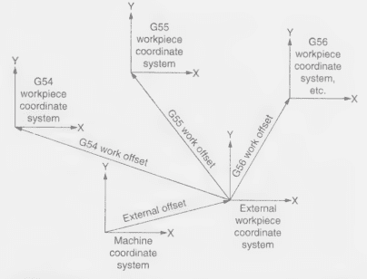

### G54–G59、G54.1 P1–P48 工件坐标系

可提供六个标准工件坐标系和 48 个可选工件坐标系（仅在铣床上通过额外付费激活）。它们都相对于外部工件坐标系定义，如图 5.12 所示。各种偏移距离存储在不同的系统变量中，如表 3.12 和表 5.2（表 5.2 是表 3.12 的子集）所示。

这些坐标系仅用于加工目的，并通过指定各种偏移距离将其放置在所需位置（即工件的所需基准处）。刀具偏移设定过程实际上只测量这些偏移距离。

这些坐标系一次只能有一个处于激活状态。程序中使用的坐标由控制系统在当前激活坐标系中解释（例如在 G54 坐标系中，尽管控制系统内部会将所有坐标转换为机床坐标系）。如果始终只加工一个工件，则不需要这么多工件坐标系。然而，在实际情况下，需要加工多个工件，而它们的基准位于不同位置。在这种情况下，为每个基准定义独立的坐标系，并在需要时激活相应的坐标系。由于 G54 是默认坐标系，因此每当机床开机或控制系统复位（按下 RESET 键，或执行 M02 或 M30）时，G54 都会变为激活状态。

### 通过操作偏移距离实现零点偏移

至此应当清楚，控制系统将不同 WCS 的原点放置在距 MCS 原点用户指定距离的位置。该距离是外部偏移向量与相应工件偏移向量的矢量和。例如，如果 X 外部偏移为 10，G54 的 X 偏移为 200，则控制系统会将 G54 坐标系的原点放置在沿 X 正方向距 MCS 原点 210 的位置。另一方面，如果 G54 距 MCS 的所需距离例如为 250，且不改变外部偏移，则 G54 的 X 偏移必须改为 240。因此，作为零点偏移的一个示例，如果要将刀具的当前 X 位置作为 G54 的原点（该坐标系可能是也可能不是当前激活坐标系），则必须使 X 外部偏移与 G54 的 X 偏移之和等于当前刀具位置距 MCS 的 X 向距离（该距离等于当前刀具位置在 MCS 中的 X 坐标）。

用数学式表示，

X 外部偏移 + G54 的 X 偏移 = 当前刀具位置在 MCS 中的 X 坐标

因此，如果不改变外部偏移值，则 G54 的 X 偏移必须等于 MCS 中的 X 坐标减去 X 外部偏移，即，

G54 的 X 偏移 = 当前刀具位置在 MCS 中的 X 坐标 − X 外部偏移

类似地，若要将零点偏移到刀具当前 Y 位置，

G54 的 Y 偏移 = 当前刀具位置在 MCS 中的 Y 坐标 − Y 外部偏移

这就是我们将用于零点偏移的原理，即把所需（激活或非激活）WCS 的原点偏移到当前刀具位置。

### 通过系统变量实现零点偏移

为了将当前 WCS 的原点（尽管该方法对当前未激活的坐标系也同样有效）置于当前刀具位置，为便于说明，我们假设当前激活的坐标系为 G56，且当前 XY 位置

要将刀具的当前位置作为铣床上的新基准。这可以通过使用以下公式重新定义 G56 的 X 和 Y 偏置值来实现：

G56 的 X 偏置 = 当前刀具位置在 MCS 中的 X 坐标 − X 外部偏置

G56 的 Y 偏置 = 当前刀具位置在 MCS 中的 Y 坐标 − Y 外部偏置

用系统变量表示，这些公式可写为（见表 3.11 和表 3.12/表 5.2）：

```text
#5261 = #5021 - #5201;
#5262 = #5022 - #5202;
```

请注意，上述公式的右侧对所有 WCS 都相同。例如，对于 G59 的 X-Y 基准偏移，公式将采用以下形式：

```text
#5321 = #5021 - #5201;
#5322 = #5022 - #5202;
```

### 铣床上的工件偏置显示

表 5.3 显示了铣床上当前坐标系为 G56 时的典型工件偏置画面。外部偏置矢量和各个工件偏置矢量沿不同轴的分量就是对应的偏置值，它们显示在该画面上。表中 G54、G55 和 G56 对应的 X、Y、Z 偏置值留空。实际显示时它们会显示一些值。如果未使用外部坐标系，外部偏置值将全为零，通常就是这种情况。如前所述，使用外部坐标系的目的是将所有其他工件坐标系（G54 至 G59 以及 G54.1 P1–P48）的基准按同一指定量偏移。

| 工件坐标系（G56） | 编号 | 数据 |
|---|---|---|
|  | 00 | X: 0.000; Y: 0.000; (EXT) Z: 0.000 |
|  | 01 | X: —; Y: —; (G54) Z: — |
|  | 02 | X: —; Y: —; (G55) Z: — |
|  | 03 | X: —; Y: —; (G56) Z: — |

**表 5.3** 铣床上典型工件偏置画面

按下 OFS/SET 键，然后按 WORK 软键，即可显示工件偏置画面。请注意该画面左上角显示的 G56，它表示当前激活的是 G56。

### 各种工件偏置值对应的系统变量

表 5.4 给出了各种偏置值对应的系统变量编号。该表有意以不同形式重复表 5.2(a)，以便更清楚地说明，因为可以直接将系统变量与屏幕上看到的内容关联起来。表 5.5 给出了铣床上 G57、G58 和 G59 对应的变量编号。

**工件坐标系（G56）**

| 编号 | 数据 | 编号 | 数据 |
|---|---|---|---|
| 00 (EXT) | X #5201 | 02 (G55) | X #5241 |
|  | Y #5202 |  | Y #5242 |
|  | Z #5203 |  | Z #5243 |
| 01 (G54) | X #5221 | 03 (G56) | X #5261 |
|  | Y #5222 |  | Y #5262 |
|  | Z #5223 |  | Z #5263 |

**表 5.4** 铣床上外部、G54、G55 和 G56 工件偏置值对应的系统变量

请注意，各种偏置值对应的变量编号不随当前坐标系变化而改变。例如，无论当前激活的是哪个坐标系，#5261 始终保存 G56 的 X 轴偏置值。当然，只有当 G56 成为当前坐标系时，机床才会使用 #5261 中存储的值。

**工件坐标系（G56）**

| 编号 | 数据 | 编号 | 数据 |
|---|---|---|---|
| 04 (G57) — X | #5281 | 06 (G59) — X | #5321 |
| 04 (G57) — Y | #5282 | 06 (G59) — Y | #5322 |
| 04 (G57) — Z | #5283 | 06 (G59) — Z | #5323 |
| 05 (G58) — X | #5301 |  |  |
| 05 (G58) — Y | #5302 |  |  |
| 05 (G58) — Z | #5303 |  |  |

**表 5.5** 铣床上 G57、G58 和 G59 工件偏置值对应的系统变量

### 通过程序实现零点偏移

对于零点偏移，需要编辑当前激活的工件坐标系对应的偏置值（可以编辑任意 WCS，但在本例中我们考虑的是当前 WCS）。也可以手动完成：用方向键高亮该偏置值，输入新值，然后按 MDI 面板上的 NEXT 软键或 INPUT 键。如果希望通过程序完成，则需要在程序内包含以下信息：

- 当前激活的工件坐标系
- 该工件坐标系的工件偏置值对应的系统变量编号
- 当前刀具位置在 MCS 中的坐标

参见表 3.10(b)，系统变量 #4014 存储当前工件坐标系的编号（在本例中应为 56，因为假设 G56 是当前坐标系）。另一方面，系统变量 #5021 和 #5022 分别存储当前 X 和 Y 坐标（在铣床上），单位为 MCS（见表 3.11）。程序号 O8008 基于这些信息，将铣床上当前激活坐标系的原点偏移到当前刀具位置。

```text
O8008 (CURR WCS DATUM SHIFT ON MILL M/C);
#1 = #4014;                         (The current coordinate system in our example is G56. So, 56 would get stored in #1)

#1 = #1 - 53;                       (This would store 1 in #1 if the current coordinate system is G54. Similarly, corresponding to G55, G56, G57, G58, and G59, the stored values would be 2, 3, 4, 5, and 6, respectively. In our example, #1 would store 3)

#1 = #1 * 20;                       (This calculates the multiplication factor, as defined in Table 5.2(b), for the current coordinate system. In our example, #1 would store 60)

#1 = #1 + 5201;                     (#1 would store 5221, 5241, 5261, 5281, 5301, and 5321, corresponding to G54, G55, G56, G57, G58, and G59, respectively, depending on which one is the current coordinate system. The stored value would be the variable number corresponding to the X-axis offset value for the current coordinate system, as shown in Table 3.12/Table 5.2(a). In our example, #1 would store 5261)

#[#1] = #5021 - #5201;              (#5021 contains the tool’s current X-coordinate in MCS, and #5201 contains the X-external offset. As already explained, when the difference in their values is stored in the system variable corresponding to the X-offset of a WCS, the current position of the tool becomes the new X-datum of that WCS, that is, the current tool position gets redefined as X0 in WCS. In our example, #5261 would get appropriately modified, which would shift the X-datum for G56 to the current X-position of the tool)

#[#1 + 1] = #5022 - #5202;          (Shifts datum for the Y-axis to the current Y-position of the tool. In our example, #5262 would get appropriately modified, which would shift the Y-datum of G56)

M30;
```

请注意，该程序是在没有绘制流程图的情况下编写的。对于这类简单情况，不需要流程图。该程序中的算法非常简单：

- 1. 识别当前工件坐标系。
- 2. 识别该坐标系对应的 X 和 Y 工件偏置值的系统变量。
- 3. 使用给定公式重新定义所识别出的系统变量。

然而，即使决定不绘制流程图就编写程序，至少也必须在尝试编写程序之前，把算法明确地写下来。这也有助于将来参考，因为宏程序看起来比较抽象，通常无法快速直观地解读。

尽管上述程序是用于铣床的，但它在车床上也能以几乎相同的方式工作。唯一的区别是车床上的第二轴是 Z 轴。因此，程序完全相同。只需在该程序的说明中将 Y 替换为 Z。不过，在车床的实际应用中，通常可能只需要 Z 基准偏移。如果是这样，请删除程序中的 #[#1] = #5021 - #5201 块。程序号 O8009 是修改后的程序。

```text
O8009 (CURR WCS Z-DATUM SHIFT ON LATHE);
#1 = #4014;
#1 = #1 - 53;
#1 = #1 * 20;
#1 = #1 + 5201;
#[#1 + 1] = #5022 - #5202;
M30;
```

这两个程序都用于识别并偏移当前 WCS 的基准。如果要求无论当前是哪个 WCS，都偏移例如 G56 坐标系的基准，那么这项任务更简单，可以通过程序号 O8010 和 O8011 完成。当然，只有在 G56 成为当前 WCS 之后，基准偏移的效果才会显现。

```text
O8010 (G56 DATUM SHIFT ON MILL M/C);
#5261 = #5021 - #5201;
#5262 = #5022 - #5202;
M30;
```

```text
O8011 (G56 Z-DATUM SHIFT ON LATHE);
#5262 = #5022 - #5202;
M30;
```

上述程序可能看起来很简单（因为可以使用可视化偏置设定流程手动偏移基准），但它可以非常有效地使用。例如，如果车床上的工件更换为尺寸不同的另一个工件，则需要重新进行 Z 基准设定。（X 基准将保持不变，因为 X0 位置不取决于工件直径。）如果机床操作员不完全了解偏置设定流程，可以简单地要求他先手动（在 JOG 或 HANDLE 模式下）将刀具移动到所需的 Z0 位置，然后在不扰动刀具位置的情况下运行程序号 O8009。这样就会将当前 WCS 的 Z 基准放置在所选位置。当然，这必须在加工程序所使用的同一工件坐标系中完成。例如，如果该坐标系是 G56，则必须先在 MDI 模式下执行 G56，然后在 AUTO 模式下运行程序号 O8009。并且其间不得按 RESET 键，否则默认工件坐标系 G54 将再次成为当前坐标系！


在此阶段，有必要指出在MDI和AUTO模式下运行程序方式的一个重大区别。虽然这两种模式用于不同的目的：MDI模式用于不需要保存的2-3行程序，AUTO模式用于运行存储在CNC存储器中的长程序，但这并不是唯一的区别。在MDI模式下运行程序时，执行结束后系统不会自动复位。如果需要复位，则必须显式编程M02或M30。另一方面，即使在AUTO模式下运行的程序末尾缺少M02或M30，执行结束时系统也会自动复位（如果参数3404#6设置为0，当程序末尾缺少M30或M02时，系统进入执行状态。该参数的默认设置为1，即使缺少M30或M02，系统也会复位而不发出任何报警）。这意味着如果在MDI模式下执行单行程序G66，G56将成为当前工件坐标系（WCS）。另一方面，如果在AUTO模式下执行相同的程序，执行结束时当前WCS将改回G54！另一个与讨论无关的区别是，MDI模式下不支持*动态图形显示*。

给定的基准移位程序，经过一些修改后，也可以用于使用*接触式测头*的自动刀具偏置设置，这将大幅度缩短设置时间。这一方面将在第11章详细讨论。

## 5.6 嵌套WHILE语句

本章的讨论到此已完整，只是到目前为止尚未给出嵌套WHILE语句的示例。当需要在指定条件持续满足的情况下执行若干相似操作时，使用简单的WHILE语句。另一方面，如果每个操作在条件循环中又涉及另一组相似操作，则使用嵌套WHILE语句。虽然控制系统允许再多一层嵌套，但实际上从来不需要。

图5.13所示的工件上规则矩形阵列孔，可以非常方便地使用钻孔固定循环（例如G81）来加工，因为所有固定循环都可以按指定次数重复。编号8012的程序就是完成该任务的一个此类程序。假设所需孔深为5 mm，工件顶面为Z轴基准。如图中所示，XY基准位于孔1的中心。

**图5.13** 一块板上规则矩形阵列的孔。

```text
O8012 (HOLE ARRAY USING A CANNED CYCLE);
G21 G94 G90 G54;            (Initial settings)
M06 T1;                     (Tool number 1 placed in the spindle)
M03 S1000;                  (Clockwise rpm 1000 starts)
G43 H01;                    (Tool length compensation invoked)
G00 X0 Y0 Z100;             (Rapid placed 100 mm above hole 1)
G81 G99 Z-5 R2 F30;         (Hole 1 drilled. Retraction to Z = 2 mm)
G91 Y25 Z-2;                (Hole 2 and 3 drilled)
X20 Y-50;                   (Hole 4 drilled)
Y25 Z-2;                    (Hole 5 and 6 drilled)
X20 Y-50;                   (Hole 7 drilled)
Y25 Z-2;                    (Hole 8 and 9 drilled)
X20 Y-50;                   (Hole 10 drilled)
Y25 Z-2;                    (Hole 11 and 12 drilled)
G80;                        (Canned cycle canceled)
M05;                        (Spindle stops)
G90 G00 Z100;               (Tool retracted to Z = 100 mm)
M30;                        (Program end and control reset)
```

**图5.14** 使用嵌套WHILE语句在图5.13所示板上钻孔的算法流程图。

```text
O8013 (HOLE ARRAY USING A NESTED WHILE);
(#1 @ COUNTER1, HOLE COUNTER ALONG X);
(#2 @ COUNTER2, HOLE COUNTER ALONG Y);
(#3 @ TOTAL NUMBER OF HOLES ALONG X);
(#4 @ TOTAL NUMBER OF HOLES ALONG Y);
(#5 @ DEPTH OF HOLE);
(#6 @ PITCH ALONG X);
(#7 @ PITCH ALONG Y);

#3 = 4;                    (Four holes along the X-axis to be made)
#4 = 3;                    (Three holes along the Y-axis to be made)
#5 = 5;                    (Depth of hole is 5 mm)
#6 = 20;                   (Pitch along a row is 20 mm)
#7 = 25;                   (Pitch along a column is 25 mm)
;
G21 G94 G90 G54;           (Initial settings)
M06 T1;                    (Tool number 1 placed in the spindle)
M03 S1000;                 (Clockwise rpm 1000 starts)
G43 H01;                   (Tool length compensation invoked)
G90 X0 Y Z100;                 (Tool placed 100 mm above hole 1)
#1 = 1;                         (COUNTER1 initialized)
WHILE [#1 LE #3] DO 1;          (The outer loop starts. It is executed once
                                 for every column of holes)
G90 G81 G99 Z-[ABS[#5]] R2 F30; (The use of ABS function makes the pro-
                                 gram work even if a negative value is
                                 specified for the depth of the hole)
                                 (COUNTER1 incremented for drilling
                                 holes in the next column of holes)
                                 (COUNTER2 initialized)
#1 = #1 + 1;
#2 = 1;
WHILE [#2 LE [#4 - 1]] DO 2;    (The inner loop starts. It makes the
                                 required number of holes in each column
                                 of holes)
G91 G00 Y#7;                     (The tool shifted along the Y-axis to the
                                 center of the next hole in the current col-
                                 umn of holes)
G90 G81 G99 Z-[ABS[#5]] R2 F30;  (Hole drilled)
#2 = #2 + 1;                     (COUNTER2 incremented for counting
                                 and drilling the required number of holes
                                 in the current column of holes)
END 2;                           (The inner loop ends)
IF [#1 GT #3] GOTO 10;           (Shift to the base of the next column of
                                 holes is not needed after the last column)
G91 G00 X#6 Y-[#7 * [#4 - 1]];   (Tool shifted to the base of the next
                                 column of holes)
N10;                             (A blank NC statement)
END 1;                           (The outer loop ends)
G80;                             (Canned cycle cancelled)
M05;                             (Spindle stops)
G90 G00 Z100;                    (Tool retracted to Z = 100 mm)
M30;                             (Program end and control reset)
```

尽管在这种情况下使用[WHILE语句]对于太简单的问题来说似乎是一种过于复杂的方法，但对于大量孔来说，这种方法绝对更可取。实际上，即使孔的数量增加，程序也基本保持不变；只需要根据要求重新定义用于表示X和Y方向孔数的两个变量（#3和#4）。虽然使用循环，特别是嵌套循环，会使简单的程序变得复杂，但它确实使复杂的问题变得非常简单！无论如何，这里的基本目的是解释嵌套WHILE语句的使用。此外，这恰好是我们的第一个涉及加工的编程示例，也是一个常见的实际应用。

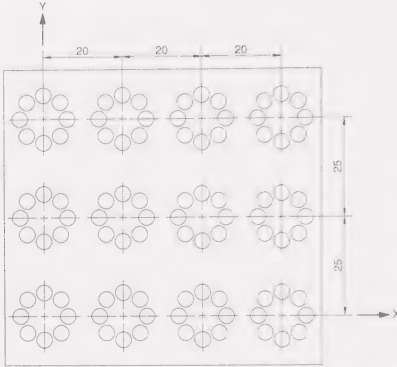

图5.15 需要三层嵌套WHILE语句的零件。

make it better! So, as a rule of thumb, always start with a small and easily achievable target.

回到嵌套问题，读者现在一定已经意识到，如果在每个位置是一个孔图案而不是单个孔，那么就需要第三层嵌套来在每个位置制作孔图案。图5.15展示了这样的示例。然而，三层嵌套使逻辑过于复杂而难以理解。因此，除非绝对必要，否则不应使用超过两层嵌套。这实际上几乎总是可行的，尽管程序不会像三层嵌套那样紧凑和通用。例如，对于图5.15的任务，可以只使用一层嵌套（实际上，一层嵌套意味着根本没有嵌套）。只需为极坐标图案编写一个宏（这将需要单层WHILE语句，没有任何嵌套），然后将刀具逐一放置到所有极坐标图案的中心后调用它12次。当然，这样的程序不会是通用程序。


# 第6章

# 子程序回顾

## 6.1 引言

在学习如何编写宏程序之前，有必要理解为什么要使用子程序以及如何使用子程序。尽管预计读者已经充分了解子程序，本章仍作简要回顾，以帮助唤醒记忆。即使以前使用过子程序，也强烈建议仔细阅读本章，以消除任何可能遗漏的环节。

### 什么是子程序？

顾名思义，子程序是程序的一部分，它像任何其他程序一样，以指定的程序号存储在 CNC 的内存中。它不是完整的程序，而是设计为由其他程序调用，这些程序可以是主程序、另一个子程序或宏程序。子程序本身通常没有意义，除非在其他程序内部使用。

### 为什么使用它？

有时程序包含重复的程序段，这些程序段在多个位置出现且没有任何变化。例如，假设要在铣床的平板上切出一个特定几何形状、深度为 10 mm 的槽。如果最大允许切削深度为 2 mm，则必须在将刀具依次置于 2、4、6、8 和 10 mm 的递增深度后，分五次走刀铣削该槽。这意味着定义槽几何形状的程序段会在程序中出现五次，使程序不必要地过长。在这种情况下，更好的方法是将重复的程序段存储为子程序，并调用它五次。

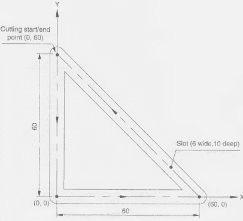

注：已选择沿槽中心线上箭头所示方向铣削该槽。也可以选择其他起点/终点以及顺时针加工方向。工件零点也可以选择在其他位置。

图6.1 平板上的三角形槽。

```gcode
M06 T1;                 (Tool number 1)
M03 S1000;              (CW rpm 1000)
G90 G43 H01;            (Tool length compensation)
G00 X0 Y60 Z100;        (Rapid positioning to 100 mm above the top
                         corner of the groove)
Z1;                     (Rapid positioning to 1 mm above the workpiece)
G01 Z-2 F10;            (Hole of 2-mm depth)
Y0 F60;                 (2-mm-deep groove along the Y-axis)
X60;                    (2-mm-deep groove along the X-axis)
X0 Y60;                 (2-mm groove at 45°)
Z-4 F10;                (Hole of 4-mm depth)
Y0 F60;                 (4-mm-deep groove along the Y-axis)
X60;                    (4-mm-deep groove along the X-axis)
X0 Y60;                 (4-mm groove at 45°)
Z-6 F10;                (Hole of 6-mm depth)
Y0 F60;                 (6-mm-deep groove along the Y-axis)
X60;                    (6-mm-deep groove along the X-axis)
X0 Y60;                 (6-mm groove at 45°)
Z-8 F10;                (Hole of 8-mm depth)
Y0 F60;                 (8-mm-deep groove along the Y-axis)
X60;                    (8-mm-deep groove along the X-axis)
X0 Y60;                 (8-mm groove at 45°)
Z-10 F10;               (Hole of 10-mm depth)
Y0 F60;                 (10-mm-deep groove along the Y-axis)
X60;                    (10-mm-deep groove along the X-axis)
X0 Y60;                 (10-mm groove at 45°)
G00 Z100;               (Rapid retraction to 100 mm above the workpiece)
M05;                    (Spindle stop)
M30;                    (Execution end and control reset)
```

通过使用子程序存储重复的程序段，可以使上面给出的程序变得更短。程序 00002 就是这样一个程序，它调用程序 00003 作为子程序五次。

```gcode
O0002;                       (Program number 2)
G21 G94;                      (Millimeter mode and feedrate in millimeter per minute)
G54;                          (Workpiece coordinate system)
G28 G92 X0 Y0 Z0;             (Reference point return)
M06 T1;                       (Tool number 1)
M03 S1000;                    (CW rpm 1000)
G90 G43 H01;                  (Tool length compensation)
G00 X0 Y60 Z100;              (Rapid positioning to 100 mm above the top corner of the groove)
Z1;                           (Rapid positioning to 1 mm above the workpiece)
G01 Z-2 F10;                  (Hole of 2-mm depth)
M98 P0003;                    (Subprogram call of O0003)
G01 Z-4 F10;                  (Hole of 4-mm depth)
M98 P0003;                    (Subprogram call of O0003)
G01 Z-6 F10;                  (Hole of 6-mm depth)
M98 P0003;                    (Subprogram call of O0003)
G01 Z-8 F10;                  (Hole of 8-mm depth)
M98 P0003;                    (Subprogram call of O0003)
G01 Z-10 F10;                 (Hole of 10-mm depth)
M98 P0003;                    (Subprogram call of O0003)
G00 Z100;                     (Rapid retraction to 100 mm above the workpiece)
M05;                          (Spindle stop)
M30;                          (Execution end and control reset)

O0003;                        (Program number 3)
Y0 F60;                       (Groove along the Y-axis, at the current depth)
X60;                          (Groove along the X-axis, at the current depth)
X0 Y60;                       (Groove at 45°, at the current depth)
M99;                          (Return to the calling program)
```

## 6.3 子程序的多次调用

可以将子程序重复调用所需次数，即一个接一个地调用。最多允许 999 次重复。为此，M98 程序段中 P 的参数必须包含七位数字（或至少五位数字）。从右数的四位被视为（子）程序号，左侧剩余的数字（最多三位）表示重复次数。如果 P 字中指定了八位数字，则从右数第八位被忽略：

```gcode
M98 P50001;         (Calls program number 1, five times, which is
                    equivalent to five consecutive blocks of M98 P0001
                    or M98 P1)
M98 P050001;        (Same as above)
M98 P050001;        (Same as above)
M98 P9990001;       (Program number 1 is called 999 times)
M98 P12340001;      (Program number 1 is called 234 times. The eighth
                    digit from right is ignored)
```

还可以通过在 M98 程序段中插入 L 字来重复调用子程序。L 字的参数是重复次数。使用此方法的优点是可以最多重复 9999 次，而先前的方法只能重复 999 次：

```gcode
M98 P0001 L9999;    (Program number 1 is called 9999 times)
M98 P1 L9999;       (Same as above)
M98 P1 L10000;      (Illegal L-word)
```

如果子程序的重复调用只是沿原刀具路径返回，那么重复将是不必要且无意义的。只有在增量模式下重复才有用，因为在同一子程序的后续执行中可以获得不同的刀具路径。例如，程序 O0004 在增量模式下重复调用程序 O0005 五次，加工出图6.1所示的槽。

```gcode
O0004;              (Program number 4)
G21 G94;            (Millimeter mode and feedrate in millimeter
                    per minute)
G54;                (Workpiece coordinate system)
G91 G28 X0 Y0 Z0;   (Reference point return)
M06 T1;             (Tool number 1)
M03 S1000;          (CW rpm 1000)
G90 G43 H01;        (Tool length compensation)
G00 X0 Y60 Z100;    (Rapid positioning to 100 mm above the top corner of the groove)
Z1;                  (Rapid positioning to 1 mm above the workpiece)
G01 Z0 F10;          (The tool touches the workpiece)
G91;                 (Incremental coordinate mode)
M98 P50005;          (Subprogram call of O0005, five times)
G90 G00 Z100;        (Rapid retract to 100 mm above the workpiece)
M05;                 (Spindle stop)
M30;                 (Execution end and control reset)

O0005;               (Program number 5)
Z-2 F10;             (Depth of hole increased by 2 mm)
Y-60 F60;            (Groove along the Y-axis, at the current depth)
X60;                 (Groove along the X-axis, at the current depth)
X-60 Y60;            (Groove at 45°, at the current depth)
M99;                 (Return to the G90 G00 Z100 block of the calling program, after five successive executions of the subprogram)
```

尽管上面给出的子程序可以正常工作，但通过在其内部调用增量模式，可以使其更通用一些。这样，即使它以绝对模式被调用，槽也会被正确加工。这降低了其被错误使用的可能性。程序 O0006 和 O0007 使用了这一思路。

```gcode
O0006;               (Program number 6)
G21 G94;             (Millimeter mode and feedrate in millimeter per minute)
G54;                 (Workpiece coordinate system)
G91 G28 X0 Y0 Z0;    (Reference point return)
M06 T1;              (Tool number 1)
M03 S1000;           (CW rpm 1000)
G90 G43 H01;         (Tool length compensation)
G00 X0 Y60 Z100;     (Rapid positioning to 100 mm above the top corner of the groove)
Z1;                 (Rapid positioning to 1 mm above the workpiece)
G01 Z0 F10;          (The tool touches the workpiece)
M98 P50007;          (Subprogram call of O0007, five times)
G90 G00 Z100;        (Rapid retraction to 100 mm above the workpiece)
M05;                 (Spindle stop)
M30;                 (Execution end and control reset)

O0007;               (Program number 7)
G91 Z-2 F10;         (Depth of hole increased by 2 mm)
Y-60 F60;            (Groove along the Y-axis, at current depth)
```


上面给出的子程序无疑更好，因为它既可以在绝对模式下调用，也可以在增量模式下调用。然而，它确实有一个缺点：当执行返回调用程序时，它会强制进入增量模式。此外，它假定在调用它时 G01 处于激活状态。这又是编程错误的另一个来源。子程序和宏应尽可能通用/实用，因为这些通常由专家程序员开发，供其他程序员编写的多个程序使用。如果新程序员调用由其他程序员开发的子程序，他肯定不希望该子程序改变调用程序的坐标模式或任何其他设置！幸运的是，利用宏编程功能，可以识别当前坐标模式以及其他若干事项。因此，可以这样设计子程序，使其不改变当前的控制状态。这可以通过在子程序开头识别控制状态，并在结尾、即就在通过 M99 退出到调用程序之前恢复该状态来实现。

```
X60;                            (Groove along the X-axis, at current depth)
X-60 Y60;                       (Groove at 45°, at current depth)
M99;                            (Return to the G90 G00 Z100 block of the calling program, after five successive executions of the subprogram)
```

注意，子程序 O0007 需要使用三样东西：G01、G91 和 F 代码。G01 属于 G 代码第 01 组，G91 属于第 03 组。第 01 组中的其他 G 代码在铣床上是 G00、G02、G03 和 G33。另一方面，G90 是第 3 组中唯一的其他 G 代码。参见表 3.10(b)，系统变量 #4001 存储 0、1、2、3 或 33，具体取决于第 01 组中当前激活的 G 代码（分别为 G00、G01、G02、G03 和 G33）。例如，如果当前激活的是 G01，则 #4001 将存储 1（回想一下，在任何时候，每个组中都有一个 G 代码保持激活）。类似地，系统变量 #4003 存储 90 或 91，具体取决于 G90 和 G91 中哪一个当前激活。当前进给率存储在系统变量 #4109 中。

子程序 O0008 使用这些系统变量在程序开头确定当前控制状态，并在结尾恢复它（回想一下，像 G01 这样不带任何轴字的语句，只是将第 1 组中当前激活的 G 代码更改为 G01，而不会引起任何刀具移动）。注意，即使多次调用该子程序，该逻辑也能正常工作。

此外，为了使子程序 O0008 更加通用，还可以在其中指定主轴转速，从而不使用调用程序中可能指定的错误转速。由于该子程序假定恒定转速，因此需要指定 G97。参见表 3.10(b)，系统变量 #4013 存储 96 或 97，具体取决于 G96（恒线速度）和 G97（恒定转速）中哪一个当前激活，而当前主轴转速/恒线速度存储在系统变量 #4119 中。

此外，子程序中的进给率希望采用毫米/分钟。因此，还需要 G94。再次参见表 3.10(b)，系统变量 #4005 存储 94 或 95，分别对应 G94 和 G95。

最后，该子程序是按毫米模式编写的。因此，如果在英寸模式下调用它，则应以报警消息终止执行（回想一下，坐标模式不能在程序中间切换）。系统变量 #4006 存储 20 或 21，分别对应 G20 和 G21（参见表 3.10(b)）。

```
O0008;                         (Program number 8)
#1 = #4001;                    (#1 stores 0, 1, 2, 3 or 33)
#2 = #4003;                    (#2 stores 90 or 91)
#3 = #4109;                    (#3 stores the current value specified in the F-word, i.e., the current feedrate)

#4 = #4013;                    (#4 stores 96 or 97)
#5 = #4119;                    (#5 stores the current rpm or the constant surface speed, depending on which one of G97 and G96 is currently active)

#6 = #4005;                    (#6 stores 94 or 95)
#7 = #4006;                    (#7 stores 20 or 21)
IF [#7 EQ 20] THEN #3000 = 1 (INCH MODE NOT PERMITTED);
                               (If G20 is used in the calling program, the execution would immediately terminate with the alarm message "3001 INCH MODE NOT PERMITTED." Refer to Macro Alarms in Sec. 3.5.)

G94 G97 G91;                    (Selects feedrate in millimeter per minute, constant rpm and incremental mode)
G01 Z-2 F10 S1000;              (Depth of hole increased by 2 mm at 1000 rpm and 10 mm/min feedrate)
Y-60 F60;                       (Groove along the Y-axis, at the current depth)
X60;                            (Groove along the X-axis, at the current depth)
X-60 Y60;                       (Groove at 45°, at the current depth)
G#1 G#2 G#3 G#4 S#5 G#6;        (Restores the original control status)

M99;                            (Return to the calling program)
```

子程序 O0008 相当通用。它仅假定在调用它时，刀具（直径 6 mm 的槽钻）在三角形沟槽的顶部拐角处接触工件。唯一的限制是它只能加工深度为 2 mm 倍数的沟槽。例如，M98 P40008 将加工一条 8 mm 深的沟槽。但不可能得到例如 5 mm 的深度，因为它不是 2 mm 的倍数。此外，当执行返回调用程序时，刀具会停留在沟槽顶部拐角的底部。尽管 XY 位置与开始时相同，Z 位置也应恢复。理想情况下，子程序或宏应完成所需完成的任何操作，而不干扰任何控制设置。

尽管宏可以在不产生任何附带影响的情况下完成某些操作，但子程序有其自身的局限性，因为在调用它时无法向其变量传递任何值。此外，子程序没有自己的一组局部变量。它仅充当调用程序的扩展。

如果第 8 章给出了用于任意沟槽深度的宏，而要通过子程序完成同样的事情，则需要在调用子程序之前定义一个变量（例如 #100），用它存储所需的沟槽深度，以便子程序可以使用它。由于这种子程序使用的逻辑涉及循环执行，因此在编写程序之前必须准备好所选算法的流程图。图 6.2 显示了这样的流程图。下面给出基于该流程图的子程序 O0009，以及调用程序的相关部分。注意，对于任何给定深度的沟槽，O0009 只需调用一次。使用循环消除了多次调用子程序的需要。

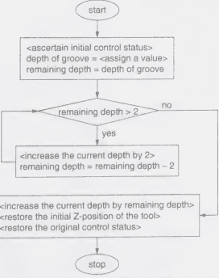

**图 6.2** 使用 WHILE 语句加工任意指定深度沟槽的算法流程图。

### 调用程序

```
...
...
#100 = 5;                     (Specify the desired depth of the groove)
M98 P0009;                    (Subprogram call of OXXXX)
...
M30;                          (Execution end and control reset)

O0009;                        (Program number)
#1 = #4001;                   (#1 stores 0, 1, 2, 3 or 33)
#2 = #4003;                   (#2 stores 90 or 91)
#3 = #4109;                   (#3 stores the current value specified in the F-word, i.e., the current feedrate)

#4 = #4013;                   (#4 stores 96 or 97)
#5 = #4119;                   (#5 stores the current value specified in the S-word, i.e., the current rpm or the constant surface speed, depending on which one of G97 and G96 is currently active)

#6 = #4005;                   (#6 stores 94 or 95)
#7 = #4006;                   (#7 stores 20 or 21)
#8 = ABS[#100];               (#8 stores the desired depth of the groove. The ABS function ensures that even if the depth is specified with a minus sign, the program would work correctly)

#9 = #8;                      (#9 stores the remaining depth of the groove, which is to be machined)

IF [#7 EQ 20] THEN #3000 = 1; (If G20 is used in the calling program, the execution would immediately terminate with the alarm message "INCH MODE NOT PERMITTED." Refer to Sec. 3.5)
G94 G97 G91;                  (Selects feedrate in millimeter per minute, constant rpm, and incremental mode)

WHILE [#9 GT 2] DO 1;         (Start of the WHILE loop. The loop is executed if the remaining depth of the groove is more than 2 mm. If not, the loop is skipped, and the execution jumps to the block following END 1)

G01 Z-2 F10 S1000;            (Depth of hole increased by 2 mm at 1000 rpm and 10 mm/min feedrate)

Y-60 F60;                     (Groove along the Y-axis, at the current depth)
```


```text
X60;                              (Groove along the X-axis, at the current depth)
X-60 Y60;                          (Groove at 45°, at the current depth)
#9 = #9 - 2;                       (Remaining depth recalculated)
END 1;                             (End of the WHILE loop. The execution jumps to the start of the loop to check if the remaining depth of the groove is still more than 2 mm)

G01 Z-#9 F10;                      (Depth of hole increased by the required amount, which is now less than or equal to 2 mm, to reach the final depth of the groove, at 1000 rpm and 10 mm/min feedrate)

Y-60 F60;                          (Groove along the Y-axis, at the final depth)
X60;                               (Groove along the X-axis, at the final depth)
X-60 Y60;                          (Groove at 45°, at the final depth)
G00 Z#8;                           (Restores the initial Z-position of the tool)
G#1 G#2 F#3 G#4 S#5 G#6;           (Restores the original control status)
M99;                               (Return to the calling program)
```

在程序 O0009 中，假设最大允许切削深度为 2 mm。作为练习，请尝试在最大允许切削深度为 1 mm 时修改该程序。另外，尝试使用 IF_GOTO 语句构造循环。这种情况下的流程图如图 6.3 所示。但需要注意的是，正如第 5 章所讨论的，构造循环时 WHILE 语句比 IF_GOTO 语句更可取。

图 6.3 所示的流程图需要两次使用 IF_GOTO 语句。这是因为沟槽的目标深度甚至可能小于 1 mm。在 IF_GOTO 语句创建的循环中，循环终止条件在最后才检查。因此，在进入循环之前还需要检查目标深度，以决定是否应执行循环。使用 WHILE 循环则不存在这个问题，因为循环终止条件在循环开始时就进行检查。这也是 WHILE 循环优于 IF_GOTO 循环的另一个原因。

程序 O0008 和 O0009 使用了若干宏程序功能。宏程序功能的使用不仅限于开发宏程序，尽管这是它们的主要用途。主程序也可以使用这些功能。事实上，这正是开始学习宏编程的方式。只有在尽可能多地在主程序和子程序中使用这些功能、掌握了语言的基本特性之后，才应开始为不同应用编写宏程序。

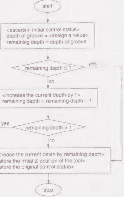

**图 6.3** 使用 GOTO 语句加工任意指定深度沟槽的算法流程图。

## 6.4 子程序嵌套

子程序可以调用另一个子程序，这称为嵌套。最多允许四级嵌套，涉及主程序和四个不同的子程序；也就是说，主程序可以调用子程序 1，子程序 1 可以调用子程序 2，子程序 2 可以调用子程序 3，子程序 3 可以调用子程序 4（子程序 4 不能再调用任何其他子程序）。图 6.4 以图形方式显示了这一点，其中执行流程用箭头表示。注意，主程序中子程序的总数或嵌套子程序的数量没有限制，只要求任一位置的嵌套级别不超过四级。

另请参阅图 3.2，该图说明了主程序和所有嵌套子程序的变量属于同一组变量。例如，如果变量 #1 同时被主程序和所有嵌套子程序使用，那么这五次出现的 #1 都指向同一个存储单元。

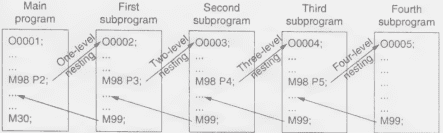

**图 6.4** 子程序嵌套。

作为子程序嵌套的一个例子，考虑图 6.5 所示的加工任务：在一块 600 mm × 300 mm 的板上加工五个深 10 mm 的三角形沟槽。利用子程序的主要特性，可以使这种规则且重复的图案的加工程序变得非常简短。同样，假设最大允许切削深度为 2 mm。因此，由于沟槽深度为 10 mm，每个三角形需要五次走刀。要加工五个三角形沟槽，整个操作需要重复五次。这可以通过两级嵌套来实现。调用子程序 O0011 在五个位置加工三角形沟槽，而嵌套调用子程序 O0012 则用五次走刀加工每个沟槽。工件零点选在板的左下角，Z 向基准位于其上表面。请注意，在此类应用中，子程序需要以增量方式编写。这些程序没有尝试使用宏程序功能使其适用于一般情况，因为这里唯一目的是说明子程序嵌套。

**注意：**
- 1. 图中显示了五个三角形沟槽的中心线。未显示的沟槽宽度等于刀具直径。
- 2. 所有三角形尺寸相同且均匀分布。
- 3. 刀具路径段按顺序编号，切削方向用箭头表示。由于多次走刀，刀具路径为 {1 → 2 → 3 → 4} 五次 → 5 → 6 → 7 → 8 → 9，直至终点。
- 4. 虚线表示 G00 在工件上方 1 mm 处的快速移动，显示折线效应。如果参数 1401#1 设置为 7，也可以进行直线快速定位。

**图 6.5** 规则排列的五个三角形沟槽。

```text
O0010;                         (Program number 10)
G21 G94;                       (Millimeter mode and feedrate in millimeter per minute)
G54;                           (Workpiece coordinate system)
G91 G28 X0 Y0 Z0;              (Reference point return)
M06 T1;                        (Tool number 1)
M03 S1000;                     (CW rpm 1000)
G90 G43 H01;                   (Tool length compensation)
G00 X-25 Y25 Z100;             (Rapid positioning to 100 mm above the start point, as designated in Fig. 6.5)
Z1;                            (Rapid to 1 mm above the workpiece)
M98 P50011;                    (Subprogram call of O0011, five times, for the five triangles)
G00 Z100;                      (Rapid retraction to 100 mm above the workpiece)
M05;                           (Spindle stop)
M30;                           (Execution end and control reset)

O0011;                         (Program number 11)
G91 G00 X100 Y25;              (Rapid positioning to the lower left corner of the triangular groove that is to be machined next)
G01 Z-1 F10;                   (The tool touches the workpiece)
M98 P50012;                    (Subprogram call of O0012, five times, for the five passes)
G90 G00 Z1;                    (Rapid retraction to 1 mm above the workpiece)
M99;                           (Return to G00 Z100 block of O0010, after five successive executions of this subprogram)

O0012;                         (Program number 12)
G91 G01 Z-2 F10;               (Depth of hole increased by 2 mm)
X50 Y100 F60;                  (Groove cutting along the slant side of the triangle, at the current depth)
Y-100;                         (Groove cutting along the Y-axis side of the triangle, at the current depth)
X-50;                          (Groove cutting along the X-axis side of the triangle, at the current depth)
M99;                           (Return to G90 G00 Z1 block of O0011, after five successive executions of this subprogram)
```


上述示例使用的是两级嵌套。虽然该控制功能允许嵌套多达四级，但超过两级的嵌套很少使用，因为此类程序往往会变得过于复杂而难以理解。嵌套的目的是简化编程，而不是使其复杂化！

尽管在子程序中嵌套和使用宏程序功能使程序相当通用和紧凑，但真正的强大之处在于几乎无限范围的宏。当然，透彻理解子程序对于编写专业质量的宏程序是绝对必要的。因此，读者应反复阅读本章的每一行，直到这些概念完全清晰明了。

# 第7章：宏调用

## 7.1 引言

前面已经讨论了若干宏程序功能。这些功能的使用并不局限于宏。它们可以在任何地方使用——在主程序、子程序和宏中。然而，宏程序是宏编程的独特功能，它为通过编程所能实现的内容增添了一个全新的维度。开发宏确实需要良好的编程技能，这只有极少数人具备，但使用宏却相当简单——就像使用固定循环一样。本章将解释如何定义和使用宏。

## 7.2 宏与子程序的对比

宏可以大致描述为子程序的进阶版本（这就是为什么本章放在“子程序回顾”一章之后的原因）。两者的总体程序结构是相同的。子程序可以被主程序、其他子程序或宏调用，也可以调用任何类型的程序。类似地，宏可以被任何程序调用，也可以调用任何程序。两者都允许最多四级的嵌套。在混合嵌套的情况下，除主程序外，最多可以出现四个子程序和四个宏，且顺序不限。

子程序和宏之间的一个主要区别在于输入数据的灵活性。子程序要么完全不使用变量，要么始终对其内部使用的变量采用固定的初始数据，其值由调用程序在调用子程序时定义。而宏则使用宏调用语句中为其局部变量指定的值。（如果宏调用语句未定义某个局部变量，则该变量最初保持为空。）事实上，如第3章所述，子程序甚至没有自己的一组局部变量。它使用的是调用程序的变量。当然，公共变量、永久公共变量和系统变量在子程序和宏中的行为方式相同。

## 7.3 宏调用

到目前为止，应该清楚宏调用与子程序调用的主要区别在于：宏调用会改变局部变量的层级，而子程序调用不会。此外，宏调用可以将数据传递给被调用的程序，而子程序调用则不具备这种能力。

子程序通过M98和M198调用。宏可以通过以下任何一种方法调用：

- 简单调用（G65）
- 模态调用（G66）
- 使用用户自定义G代码调用
- 使用用户自定义M代码调用

初次接触宏编程的人在此阶段可以跳过最后两种调用宏的方法。即使是模态调用（G66）也不是很常用。G65可以用于调用任何宏，没有任何限制。其他方法确实提供了一些便利，但使用G65也能胜任。然而，由于这些方法各有其特定的优势，因此必须了解所有方法。此外，其他程序员开发的程序中可能使用了任何方法，只有了解所用方法才能理解这些程序。不过，为了获得更陡峭的学习曲线，也可以选择只阅读有关G65的内容。其余方法可以留待以后学习。也可以跳过7.4节。

## 7.4 简单调用（G65）

使用G65进行宏调用的语法为：

```
G65 P<程序号> L<重复次数> <自变量1>
. . . <自变量n>
```

程序号是要调用的现有程序的编号。通常使用8000或9000系列编号作为宏程序号，因为这些编号可以通过参数3202#0和3202#4分别防止意外编辑/删除。但是，任何合法的程序号（1至9999）都可以使用。

重复次数默认为一次（即L1可以省略），是指被调用宏连续执行的次数。这是宏能够被重复执行的唯一方式。宏的重复次数不能包含在P字中，这与子程序调用的重复方式不同。如第6章所述，子程序的重复次数也可以包含在P字中（除了L字方法之外）。在这里，P字仅用于指定程序号。宏最多可以重复9999次。

自变量说明用于将所需的初始值传递给宏的局部变量。所有局部变量（#1至#33）都可以被初始化。未初始化的局部变量在宏执行开始时保持为空。自变量说明的具体方法将在7.5节讨论。

例如，`G65 P8000 L2 A10 B20` 连续两次调用程序号8000，其中#1（因地址A）和#2（因地址B）分别设置为10和20，而其他局部变量（#3至#33）最初保持为空。请注意，被调用的宏会修改变量#1和#2。其第二次调用将以#1和#2中存储的新值开始。类似地，如果第一次调用定义了一个新的局部变量（例如#3），那么第二次调用将以#3的存储值开始。（第一次调用开始时#3为空值。）换句话说，在宏的所有重复调用中，自变量列表中指定的值仅在宏第一次执行时传递给局部变量。任何后续执行都使用上一次执行得到的值。

因此，`G65 P8000 L2 A10 B20` 并不等同于在两个连续程序段中分别执行两次 `G65 P8000 A10 B20`。如果宏在两个（或更多）连续的程序段中被调用，则每次执行都独立于之前的执行，每次执行都使用其宏调用程序段中的初始值作为其局部变量的初始值。

为了更清晰地说明，考虑程序00013，它重复调用子程序00014和宏00015各三次，然后紧接着在三个连续程序段中分别三次调用宏00016。程序号14、15和16本质上相同，但根据调用方式的不同表现也不同，这解释了基本原理。回想一下，同一个程序被M98调用时成为子程序，被G65或G66调用时成为宏。其中一些概念已在第3章中讨论过。（请参考图3.1、3.2和3.3。）

| 程序语句 | 说明 |
|---|---|
| `O0013;` | （程序号13） |
| `#1 = 1;` | （此处赋的值仅由本程序和嵌套子程序O0014使用，而不被嵌套宏使用，因为子程序使用调用程序的局部变量，而宏使用不同的局部变量集合或层级） |
| `M98 P0014;` | （等同于M98 P0014 L3，将O0014作为子程序连续执行三次） |
| `G65 P0015 L3 A1;` | （将O0015作为宏连续调用三次。第一次执行初始使用#1 = 1，但第二次和第三次执行分别从第一次和第二次执行结束时#1的更新值开始） |
| `G65 P0016 A1;` | （将O0016作为宏调用一次，初始#1设置为1） |
| `G65 P0016 A1;` | （此宏调用与前一段落中的调用无关。因此，即使上一次执行包含不同的值，O0016也只执行一次，且#1再次初始设置为1。事实上，上一次执行中的#1现在毫无意义。） |
| <code>G65 P0016 A1;<br>#503 = #1;</code> | （与上述相同） |
| `M30;` | （执行结束并复位控制） |
| `O0014;` | （程序号14） |
| `#1 = #1 + 2;` | （由于本程序是作为子程序调用的，因此此处使用的#1与调用程序0013的#1相同。由于本程序每次执行都将#1中存储的值加2，因此三次执行后的最终值变为7） |
| `#500 = #1;` | （#500在第一次执行后存储3，第二次执行后存储5，第三次也是最后一次执行后存储7） |
| `M99;` | （在指定的所有重复次数结束后返回调用程序。返回后，调用程序的#1将包含7，因为其与本子程序的#1是同一个变量） |
| `O0015;` | （程序号15） |
| `#1 = #1 + 2;` | （由于本程序是作为宏调用的，因此此处使用的#1与调用程序0013的#1不同。宏调用在第一次调用本宏开始时将值1赋予宏变量#1。重复调用使用#1的更新值。由于本程序每次执行都将#1中存储的值加2，因此三次执行后的最终值变为7） |
| `#501 = #1;` | （#501在第一次执行后存储3，第二次执行后存储5，第三次也是最后一次执行后存储7） |
| `M99;` | （在指定的所有重复次数结束后返回调用程序。由于本程序的#1与调用程序的#1是不同的变量，调用程序的#1仍将包含7。本程序的#1在三次执行后也包含7，这只是巧合。实际上，当执行完宏返回到调用程序时，宏的所有局部变量都会变得不存在，因此毫无意义） |
| `O0016;` | （程序号16） |
| `#1 = #1 + 2;` | （由于本程序是作为宏调用的，且没有重复，其执行始终以#1 = 1开始，无论本程序执行多少次） |


```
#502 = #1;                 (#502 stores 3 irrespective of how many times this
                           macro is called)
M99;                       (Return to the calling program)
```

总结来说，子程序的第一次执行从 #1 = 1 开始，并在执行结束时将 #1 = 3 和 #500 = 3。之后每次执行子程序都会给这些值加 2。因此，在子程序执行三次结束时，#1 和 #500 都存储 7。接下来是 O0015 的宏调用，宏变量 #1 最初设为 1（因为 O0014 和该宏调用）。在宏执行结束时，#1 和 #501 都存储 3。现在，该宏还要再执行两次。由于后续执行从 #1 中存储的更新值开始，所以在宏调用三次结束时 #501 存储 7。最后，宏 O0016 的三次调用彼此独立。因此，每次执行结束时 #1（因而 #502 也）存储 3。最终，#503 存储主程序 #1 中存储的值。因此，O0013 完全执行后的结果（永久公共变量中存储的值）是

- #500 存储 7。
- #501 存储 7。
- #502 存储 3。
- #503 存储 7。

这个例子清楚地说明了主程序和子程序的局部变量是相同的（属于第 0 级），但宏使用另一组局部变量（属于第 1 级）。这里使用了永久公共变量（#500 和 #501），以便在程序执行结束时可以检查其中存储的值。回想一下，永久公共变量的内容不会被系统复位或断电清除。然而，这也意味着，如果程序没有修改某个永久公共变量的内容，该变量将显示其中存储的旧值！因此，如果它们的旧值可能造成混淆，请运行第 5 章中给出的程序号 8001 或 8005，以清除所有永久公共变量。

## 模态调用（G66）

有时必须多次调用宏，但不在同一刀具位置。例如，假设已经编写了一个宏，用于以某种特殊方式加工孔（例如，采用逐渐减小的啄钻长度）。现在，如果要钻多个孔，则需要在将刀具移动到所需位置后，使用 G65 多次调用该宏：

```
...

<Move the tool to location 1>
G65 P_ L_ <argument specification>;
<Move the tool to location 2>
G65 P_ L_ <argument specification>;
<Move the tool to location 3>
G65 P_ L_ <argument specification>;
...
...
<Move the tool to location n>
G65 P_ L_ <argument specification>;
...
...
```

虽然这种方法没有错，但 G65 程序段需要重复插入。如果希望 G65 程序段发生任何更改，则必须将该更改纳入所有 G65 程序段中。这不仅需要额外输入工作量，程序大小也会增加。模态调用 G66 消除了这一困难。G66 宏调用会一直有效，直到被 G67 取消。在 G66 程序段之后，只要刀具在后续程序段中移动，宏就会在完成运动后自动调用，直到编写 G67 取消 G66 模式。使用 G66 的程序结构将采用以下形式（由于下面解释的原因，这与上面给出的 G65 形式相似，但并不完全等价）：

```
...
...
G66 P_ L_ <argument specification>;
<Move the tool to location 1>
<Move the tool to location 2>
<Move the tool to location 3>
...
...
<Move the tool to location n>
G67;
...
...
```

G66 的语法与 G65 完全相同。适用于 G65 的所有规则也适用于 G66。一个主要区别是，G66 仅将其程序段中提供的信息存储为模态数据（即供将来使用的数据，直到更改），而不调用宏。仅当刀具在后续程序段中移动时，才会在完成指定运动后调用宏。此外，G66 程序段中指定的值仅在第一次调用时传递给宏。在遇到 G67 或命令另一个 G66 之前，所有其他调用都使用从前一次执行获得的局部变量更新值。程序号 17、18 和 19 说明了这些规则。

### 使用 G66 单次调用宏：

```
O0017;                (Program number 17)
G66 P0015 A1;         (Stores modal information, without calling the macro.
                      Though program number 15 is the same program
                      given earlier, the explanations given on the right-
                      hand side would not apply here)
G91 G00 X100;         (The tool moves 100 mm along the X-axis. Thereafter,
                      O0015 is called as a macro, with #1 initially set to 1.
                      The execution of the macro assigns a value of 3 to
                      both #1 and #501)
X100;                 (The tool further moves 100 mm along the X-axis.
                      Thereafter, O0015 is again called as a macro, with #1
                      initially set to 3, its updated value in the previous
                      execution. Therefore, the current execution of the
                      macro assigns a value of 5 to both #1 and #501)
G67;                  (G66 mode canceled)
X100;                 (Since G66 is no longer active, only the tool would
                      move by 100 mm, without calling any macro)
M30;                  (Execution end and control reset)
```

### 使用 G66 重复调用宏：

```
O0018;                (Program number 18)
G66 P0015 L3 A1;      (Stores modal information, without calling the
                      macro)
G91 G00 X100;         (The tool moves 100 mm along the X-axis. Thereaf-
                      ter, O0015 is called as a macro thrice, with #1 ini-
                      tially set to 1. The three executions of the macro
                      assign a value of 7 to both #1 and #501)
X100;                 (The tool further moves 100 mm along the X-axis.
                      Thereafter, O0015 is again called thrice as a macro,
                      with #1 initially set to 7, its updated value in the
                      previous execution. Therefore, the current three executions
                      of the macro assign a value of 13 to both #1 and #501)
G67;                  (G66 mode canceled. G67 can be omitted here
                      because the next command is M30, causing control reset,
                      which automatically changes the control status
                      to G67)
M30;                  (Execution end and control reset)
```

### 使用多个 G66 程序段调用宏：

```
O0019;                (Program number 19)
G66 P0015 A1;         (Stores modal information, without calling the
                      macro)
G91 G00 X100;         (The tool moves 100 mm along the X-axis. Thereafter,
                      O0015 is called as a macro, with #1 initially set to 1.
                      The execution of the macro assigns a value of 3 to
                      both #1 and #501)
G66 P0015 A1;         (Stores modal information, without calling the macro.
                      A second or any subsequent G66 block remains independent
                      of previous G66 blocks. In fact, the previous G66
                      automatically gets canceled, and the new G66 takes effect.
                      So, the updated values for the local variables from the
                      previous execution are not used. The next execution of
                      O0015 would again start with the specified data in the
                      current G66 block)
X100;                 (The tool further moves 100 mm along the X-axis.
                      Thereafter, O0015 is again called as a macro, with #1
                      initially set to 1, its specified value in the currently
                      active G66 block. Therefore, the current execution of
                      the macro assigns a value of 3 to both #1 and #501,
                      which happens to be the same as that obtained in the
                      previous execution of the macro, because all the modal
                      parameters are same in both the G66 blocks)
G67;                  (The current G66 mode canceled. The previous G66 mode
                      was automatically canceled when a new G66 was commanded)
M30;                  (Execution and control reset)
```

### 补充说明：

- 允许使用 G66 嵌套。最大嵌套深度为四级，包括 G65 和 G66。子程序也可以嵌套到 G66。总体而言，最多可以嵌套四个宏（由 G65 和/或 G66 调用）和四个子程序。
- G66 程序段仅存储模态数据。它不调用宏。因此，G66 程序段中不应包含移动命令。如果移动命令（例如 X100）出现在 G66 字之前，则刀具移动而不调用宏（尽管模态数据会存储以供将来使用）。如果它出现在 G66 字之后，则会被当作局部变量的数据（X100 会将值 100 赋给变量 #24）！此外，像 G01 这样的地址出现在 G66 右侧是非法的，因为字母 L、O、N、C 和 P 不允许用于参数指定。
- 当 G66 有效时，M 代码或任何其他不会引起刀具移动的代码都会执行，而不调用宏。
- 与 G65 一样，G66 宏调用中最多允许 9999 次重复（用地址 L 指定）。
- 模态数据仅在 G66 程序段中定义。例如，在 G66 有效的后续程序段中，X100 L3 不会将重复次数更改为 3。


- 如果需要在无刀具移动的情况下调用宏，请在增量模式下为某个轴指定零距离。例如，G91 G00 X0（车床上为G00 U0）将在没有任何刀具移动的情况下调用该宏。实际上，轴移动程序段是必需的；指定的位移**也可以为零！**
- 在当今数控机床使用的*字地址格式*中，与某个命令相关的不同字的顺序并不重要。例如，G66 P15 A1和G66 A1 P15是等效的（不过P15 G66 A1是非法的，因为G代码的所有实参都必须位于该代码*之后*）。但是，只应使用推荐的顺序，以消除给其他用户造成任何混淆的可能性。

### 使用用户自定义G代码调用

最多可以定义10个新的G代码，用于以G65调用宏的方式调用宏，区别在于使用所定义的G代码时不需要提及程序号。这类G代码变得类似于内置标准G代码，尤其像固定循环的代码（那些在一个程序段中定义的固定循环）。使用这些代码时，只需知道所用字母地址的含义。例如，G100 D80 Q5 R90 F10 S1000 可设计为调用一个宏，用于以逐渐减小的啄钻长度钻一个孔，其字母地址的含义如下。（我们尚未讨论各种字母地址与被调用宏的局部变量之间的对应关系。到目前为止，我们只使用了字母A定义变量#1、字母B定义变量#2这一点。因此，不必担心此示例中被调用的宏如何使用给定数据。这将在后面讨论。）

```text
G100:    New G-code
D80:     Depth of hole (80 mm)
Q5:      First peck length (5 mm)
R90:     Reduction percentage for the next peck length (90%)
F10:     Feedrate (10 mm/min)
S1000:   Spindle speed (1000 rpm)
```

如果G100设计为调用宏O9010，则给定命令等效于G65 P9010 D80 Q5 R90 F10 S1000。

以这种方式调用宏的优点是，即使编程技能较少的程序员也能使用某些（并非全部）预定义宏，而**无需**了解任何宏编程知识！新的G代码可以像标准G代码一样使用。甚至**不必**知道它调用的宏程序号。换言之，机床上会多出一些*额外*的G代码。当然，只有经验丰富的程序员才能定义这类代码。确切过程如下所述。

| 程序号 | 参数号 |
|---|---|
| O9010 | 6050 |
| O9011 | 6051 |
| O9012 | 6052 |
| O9013 | 6053 |
| O9014 | 6054 |
| O9015 | 6055 |
| O9016 | 6056 |
| O9017 | 6057 |
| O9018 | 6058 |
| O9019 | 6059 |

**表 7.1** 使用G代码进行宏调用时程序号与参数号的对应关系

只有程序号为9010到9019的宏才能通过此方法调用。用于调用这些宏的G代码可以是1到9999之间的任意编号。但是，只应选择未使用的G代码；否则，现有G代码将被重新定义！

用于调用宏而选择的G代码编号（在G00到G99范围内）在特定参数（6050到6059）中指定。两者之间的对应关系见表7.1。例如，如果参数6050中存储100，则G100将调用宏O9010。类似地，如果参数6059中存储1000，则G1000将调用宏O9019。并且，如果与已定义G代码对应的程序号不存在，控制器将进入报警状态，显示“NUMBER NOT FOUND”报警消息。例如，在参数6050中存储100，但未定义程序O9010，则在命令G100时会导致报警状态。

适用于G65的所有规则和限制也适用于使用G代码的宏调用。例如，可以用G代码指定1到9999次重复。实参也以相同方式指定。

为说明起见，考虑一个非常简单的示例：定义一个代码G500（不带任何实参），以无条件产生10秒的暂停。为此，将500存入参数6050（假设参数6050尚未用于定义其他G代码）。然后，G500将调用宏O9010，该宏应按以下方式定义：

```text
O9010;    (The program number corresponding to parameter number 6050, as per Table 7.1)
G04 X10;   (Causes a dwell of 10 seconds)
M99;       (Return to the calling program)
```

现在，在任何程序中，只要命令G500，就会产生10秒的暂停。而对于例如50秒的暂停，需要编程G500 L5。G65 P9010和G65 P9010 L5也会做同样的事情，分别造成10秒和50秒的延迟。基本上，为方便起见，G65 P_正被一个G代码取代。极其复杂的宏也可用于定义新的G代码。此处未给出这样的示例，因为目的只是解释方法。

除了这种调用程序的方法外，还可以用M代码和T代码调用程序，这将在下一节讨论。在通过上述任一方法调用的程序中，所有G代码都被视为普通G代码，并具有其原始含义。换言之，此类程序中的G代码即使被设计用于调用程序，也不会调用程序。它将按通常方式执行。此问题将在后面更详细地讨论。

### 使用用户自定义M代码调用

宏可以通过G代码调用的方式，也完全可以以相同方式通过M代码调用。这种宏调用方法定义一个新的M代码；如果选择了预定义M代码的编号，则重新定义现有M代码。因此，只应选择未使用的编号。

可以使用1到99,999,999之间的任意编号，该编号需要存储在6080到6089之间的任一参数中。最多可定义10个M代码。它们调用O9020到O9029之间的程序号。参数号与程序号之间的对应关系见表7.2。例如，如果要定义M1000，则需要将1000存入例如参数6080中，这会使M1000调用宏O9020。并且，如果O9020不存在，将产生报警，消息为“NUMBER NOT FOUND”。使用L字可以指定被调用宏最多9999次重复。与G代码宏调用的情况一样，在M1000（或任何其他用户定义M代码）程序段中指定实参，以将所需值传递给被调用宏的局部变量的方法，与G65/G66宏调用中使用的方法相同。

有一项限制：M代码宏调用及其所有实参只能在其所在程序段中使用；否则，它要么是非法命令，要么可能忽略其他代码。此外，与使用G代码进行宏调用的情况一样，这种宏调用方法不能用于由G代码、M代码或T代码调用的程序中。在此类程序中，所有M代码都具有通常含义；不会调用任何宏。

| 程序号 | 参数号 |
|---|---|
| O9020 | 6080 |
| O9021 | 6081 |
| O9022 | 6082 |
| O9023 | 6083 |
| O9024 | 6084 |
| O9025 | 6085 |
| O9026 | 6086 |
| O9027 | 6087 |
| O9028 | 6088 |
| O9029 | 6089 |

**表 7.2** 使用M代码进行宏调用时程序号与参数号的对应关系

## 7.4 不使用M98/M198的子程序调用

M98是调用子程序的常用方法。（M198调用存储在外部输入/输出设备中的子程序，例如通过机床的RS-232C端口连接的Fanuc手持文件。将参数0020设为4，参数0102设为3，以启用这种子程序调用。如果参数0020设为4，则M198调用存储在PCMCIA闪存卡中的子程序，这在较新的控制版本中是最简单的方法，因为PCMCIA插槽现在已成为控制器的标准配置。注意，在M198下，也可以通过将1到255中选定的所需编号存入参数6031，使用该参数进行子程序调用。如果存储值为0，则使用M198。）但是，如果机床上启用了宏编程功能，则可以使用某些用户定义M代码调用最多九个子程序。也可以使用T代码调用子程序。注意，由于调用的是子程序，不能像M98调用那样指定实参来将初始数据传递给被调用程序的局部变量。适用于M98调用的所有规则也适用于这些调用方法。

### 使用M代码调用子程序

可以选择1到99,999,999之间的任意编号作为调用子程序的M代码编号。最多允许的九个编号存储在参数6071到6079中。由这些参数定义的M代码调用子程序O9001到O9009。程序号与参数号之间的对应关系

| 程序号 | 参数号 |
|---|---|
| O9001 | 6071 |
| O9002 | 6072 |
| O9003 | 6073 |
| O9004 | 6074 |
| O9005 | 6075 |
| O9006 | 6076 |
| O9007 | 6077 |
| O9008 | 6078 |
| O9009 | 6079 |

**表7.3** 使用M代码调用子程序时程序号与参数号的对应关系见表7.3。例如，如果希望用M100调用子程序O9001，则参数6071需要存储100。此后，M100将等同于M98 P9001。尽管不允许指定自变量，但该子程序可以使用L字重复执行最多9999次。例如，M100 L5等同于M98 P9001 L5，会连续调用子程序O9001五次。

有一个限制：这种子程序调用方法不能用于由G代码（G65/G66除外）、M代码（M98/M99除外）或T代码调用的程序中。事实上，一般来说，使用G代码/M代码/T代码调用宏/子程序的方法，不能用于由这些方法中的任何一种所调用的程序中。在这些程序中使用的G代码/M代码/T代码被视为具有原始功能的普通代码。例如，如果参数6071包含3，M03将调用子程序O9001。但是，如果M03再次在O9001中使用，它将被视为主轴启动命令。如下例所示，这个“限制”可以非常有利地加以利用。

如果主轴正在旋转，突然改变旋转方向的命令（逆时针到顺时针或反之）可能因惯性对主轴电机造成过大负载。因此，可能希望在M03/M04之间切换时插入M05并暂停5秒。通过将3存入参数6071，并按给定方式定义O9001，任何程序中使用的M03（主程序、由M98/M99调用的子程序，或由G65/G66调用的宏，即不是由G代码/M代码/T代码调用的程序）将首先停止主轴，暂停5秒，然后开始顺时针旋转。这样，M03就被修改为具有类似但扩展的功能。

```text
O9001;    (The program number corresponding to parameter number
           6071, as per Table 7.3)
M05;      (Spindle stop)
G04 X5;   (Dwell for 5 seconds, to allow the spindle to stop completely)
M03;      (This M-code is an ordinary M-code, with its predefined
           meaning. So, clockwise rotation would start)
M99;      (Return to the calling program)
```

类似地，也可以通过将4存入参数6072，并按给定方式定义O9002来修改M04。

```text
O9002;    (The program number corresponding to parameter number
           6072, as per Table 7.3)
M05;      (Spindle stop)
G04 X5;   (Dwell for 5 seconds, to allow the spindle to stop completely)
M04;      (This M-code is an ordinary M-code, with its predefined meaning.
           So, counter-clockwise rotation would start)
M99;      (Return to the calling program)
```

修改后的M03/M04代码的唯一缺点是，即使主轴静止，也会造成5秒的暂停。然而，与工件的总加工时间相比，这么长的延迟可以忽略不计。

### 使用T代码调用子程序

除非参数6001#5设为1，否则不允许使用此方法。使用此方法，只能调用一个子程序O9000。T代码可选择1到99,999,999之间的任意数字（即允许T1到T99999999）。执行T代码后，指定的T代码号会自动存入公共变量#149（可能使用也可能不使用）。例如，如果使用T20调用子程序，#149将存储20。

此方法有几个限制。首先，只能调用一个子程序（O9000）。其次，在T代码块中不能指定参数（因为这是子程序调用）。但是，通过L字最多可以重复9999次。注意，此方法会在主程序、由M98/M99调用的子程序以及由G65/G66调用的宏中禁用T代码的换刀功能。例如，T0101（与T101相同）不会换刀（无论是否带M06）；它只会作为子程序调用O9000。（无论T代码中使用什么数字，只调用O9000。如果未定义O9000，将出现“NUMBER NOT FOUND”报警。）然而，如前所述，在由G代码（G65/G66除外）、M代码（M98/M99除外）或T代码调用的程序中，T代码被视为具有通常换刀功能的普通代码。此功能可用于修改T代码的换刀功能，如下文所述。

除非刀塔位于原点位置，否则换刀是危险的，因为旋转刀具与卡盘/工件/尾座之间可能发生干涉。因此，在发出换刀命令之前，必须给出G28 U0 W0命令。如果程序员忘记这样做，可能会导致机床事故。但是，可以重新定义换刀命令，使刀塔在换刀前自动返回原点位置。首先将参数6001#5设为1，然后按给定方式定义O9000。然后，调用程序中的T0707（举例）将在将刀塔送到原点位置后，将7号刀具移动到切削位置，并选择7号偏置号。

```text
O9000;            (The permitted program number for calling a subprogram,
                  using a T-code)
G28 U0 W0 ;       (Home position return)
T#149;            (This is the usual tool change command, with offset number
                  #149 stores the number used with the T-code in the
                  calling program. So, the specified T-code is executed here
                  with the usual tool change function)
M99;              (Return to the calling program)
```

到现在应该清楚，重新定义现有G代码、M代码和T代码的目的是将扩展功能并入其中。绝不应使用此功能改变任何代码的基本含义。始终使用未使用的编号来定义具有新功能的代码。

作为另一个例子，可以尝试重新定义G01，使得如果7号刀具指定的进给速度大于100 mm/min，则直线插补中使用的进给速度仅为100 mm/min。（这只是一个任意要求，仅用于说明。）然而，除非完全了解自变量指定的方法，否则无法编写这样的宏。因此，这个例子将在下一节讨论，同时附加说明自变量指定的用法。

## 7.5 自变量指定

在宏调用中，某些字母地址可用于将所需的初始值传递给被调用宏的局部变量。这称为自变量指定。有两种自变量指定方法可用：

- 自变量指定I，使用字母表中除L、O、N、G和P之外的每个字母各一次。
- 自变量指定II，使用A、B和C各一次，并且I、J和K各最多使用10次。

自变量指定的类型根据所使用的字母自动确定。

### 自变量指定I

这种自变量指定可以定义变量#1到#26，但#10、#12、#14、#15和#16除外。变量#27到#33不能定义。字母地址与变量号之间的对应关系见表7.4。被禁止的字母地址可以通过短语“LONG Program”轻松记住。

作为自变量指定I的一个例子，G65 P8000 L2 A10 D20 H30 I40 M50 Q60 Z70将作为宏调用程序O8000，其局部变量初始设置为#1 = 10、#7 = 20、#11 = 30、#4 = 40、#13 = 50、#17 = 60、#26 = 70，其余局部变量设为空值。L2字将使该宏连续执行两次，然后返回调用程序。然而，正如7.3节已经讨论的，在第二次执行中（以及如果L字的值大于2时的所有后续执行中），局部变量不使用G65程序段中指定的值作为初始值。相反，第一次（前一次）执行中更新后的值在第二次（后续）执行中用作初始值。

由于CNC使用字地址格式，G65/G66的自变量（包括P字和L字）可以按任意顺序指定（但任何自变量都不应出现在G65/G66的左侧）。但是，如果使用I、J和K，则必须按字母顺序指定。因此，例如，... K J ... 必须替换为 ... I J K ...，否则它

| 地址 | 变量号 | 地址 | 变量号 |
|---|---:|---|---:|
| A | #1 | Q | #17 |
| B | #2 | R | #18 |
| C | #3 | S | #19 |
| D | #7 | T | #20 |
| E | #8 | U | #21 |
| F | #9 | V | #22 |
| H | #11 | W | #23 |
| I | #4 | X | #24 |
| J | #5 | Y | #25 |
| K | #6 | Z | #26 |
| M | #13 |  |  |

**表7.4** 自变量指定I中字母地址与变量号的对应关系


将会在参数指定 II 中被解释，从而完全改变含义。

### 参数指定 II

参数指定 II 各使用一次 A、B 和 C。除这三个字母外，它还最多各使用 10 次 I、J 和 K（即使用 10 组独立的 I、J 和 K）。因此，它可以将初始值传递给全部 33 个局部变量。字母地址与局部变量之间的对应关系见表 7.5。注意，I₁ 到 I₁₀、J₁ 到 J₁₀ 和 K₁ 到 K₁₀ 仅在宏调用程序段中分别写作 I、J 和 K。我们使用下标（表示组号：第 1 组到第 10 组）仅用于我们的参考。控制器根据字母地址出现的顺序识别下标（组号）。例如，如果 I 在参数列表中出现了 4 次，则第一次出现表示 I₁，第二次出现表示 I₂，第三次出现表示 I₃，第四次出现表示 I₄。

| 地址 | 变量编号 | 地址 | 变量编号 |
|---|---:|---|---:|
| A | #1 | I₆ | #19 |
| B | #2 | J₆ | #20 |
| C | #3 | K₆ | #21 |
| I₁ | #4 | I₇ | #22 |
| J₁ | #5 | J₇ | #23 |
| K₁ | #6 | K₇ | #24 |
| I₂ | #7 | I₈ | #25 |
| J₂ | #8 | J₈ | #26 |
| K₂ | #9 | K₈ | #27 |
| I₃ | #10 | I₉ | #28 |
| J₃ | #11 | J₉ | #29 |
| K₃ | #12 | K₉ | #30 |
| I₄ | #13 | I₁₀ | #31 |
| J₄ | #14 | J₁₀ | #32 |
| K₄ | #15 | K₁₀ | #33 |
| I₅ | #16 |  |  |
| J₅ | #17 |  |  |
| K₅ | #18 |  |  |

*表7.5. 参数指定 II 中字母地址与变量编号的对应关系*

G65 P8000 L2 E10 J20 J30 J40 H50 K60 K70 F80

| 参数 | 参数指定类型 | 涉及的变量 | 赋值 | 备注 |
|---|---|---|---|---|
| E10 | 参数指定 I | #8 | 10 | |
| J20 | 两种指定等效 | #5 | 20 | |
| J30 | 参数指定 II（J_j） | #8 | 30 | 覆盖旧值 |
| J40 | 参数指定 II（J_j） | #11 | 40 | |
| H50 | 参数指定 I | #11 | 50 | 覆盖旧值 |
| K60 | 参数指定 II（K_k） | #12 | 60 | |
| K70 | 参数指定 II（K_k） | #15 | 70 | |
| F80 | 参数指定 I | #9 | 80 | |

**表7.6** 混合类型参数指定示例

1. **参数指定：** E10 K60 J20 J30 J40 H50 K60 K70 F80  
   **变量赋值：** #6 = 60, #8 = 20, #9 = 80, #11 = 50, #14 = 40, #15 = 60, #18 = 70

2. **参数指定：** B20 A10 D40 J50 K60  
   **变量赋值：** #1 = 10, #2 = 20, #5 = 50, #6 = 60, #7 = 40

3. **参数指定：** B20 A10 D40 K60 J50  
   **变量赋值：** #1 = 10, #2 = 20, #6 = 60, #7 = 40, #8 = 50

4. **参数指定：** I10 I10 I10 I10 D40 K60 J50  
   **变量赋值：** #4 = 10, #7 = 40, #10 = 10, #13 = 10, #15 = 60, #17 = 50

### 带参数的 G 代码宏调用示例

讨论完参数指定方法之后，我们现在可以编写一个用于重定义 G01 的宏了，这个问题曾在 7.4 节末尾介绍过。要重定义 G01，需要将 1 存入参数号 6051（或 6050 到 6059 范围内的某个其他参数）。参数 6051 对应的宏是 O9011（参见表 7.1）。因此，每当在程序（主程序、由 G65/G66 调用的宏，或由 M98/M198 调用的子程序）中指令 G01（或 G1）时，O9011 就会作为宏被调用。现在，下一个任务是编写宏 O9011。

调用该宏时，将使用 G01 的通用格式：G01 X_Y_Z_F_S_，其中字母地址具有其通常含义。由于使用了参数指定 I，该宏将初始化局部变量 #24、#25、#26、#19 和 #9，分别对应于所使用的字母地址（X、Y、Z、F 和 S）。

程序 O9011 中所用系统变量的含义参见表 3.10(b)。为简单起见，假定该宏是在恒定转速模式（G97）下被调用的。恒线速度模式（G96）在铣床上很少使用，尽管它非常有用，并且常用于车床。

尽管可以使用任何局部变量和/或公共变量来存储中间计算结果，但最好只使用公共变量，因为局部变量用于向宏传递数据。这样可以减少编程错误的可能性。此外，以后修改宏以加入需要传递给宏的额外数据也会很容易，因为可以利用任何（以前未用于传递数据的）局部变量来存储额外数据。另外，可用公共变量的总数也远多于局部变量的数量。最后，如果计算结果需要永久保存（即在系统复位或断电重启后仍保留），则需要将其保存在永久公共变量中。从现在起，后续所有程序都将采用这一方法。

在尝试编写宏之前，建议先用通俗易懂的语言写下逐步过程。这将在很大程度上简化程序编码。跳过这一步，就像在工程力学问题中不画自由体图就直接写平衡方程一样！事实上，如果宏涉及复杂的逻辑，就应当绘制适当的算法流程图，并分析其执行跟踪。除非将逻辑与语言分开，否则宏编程会显得非常困难，而实际上它并不困难。第 5 章也推荐了这种方法。这里再次强调，因为它非常重要。

宏 O9011 中使用的算法如下：

1. 找出调用宏时 G94 还是 G95 有效。
2. 找出调用宏时 G20 还是 G21 有效。
3. 找出紧邻宏调用程序段的前一程序段中有效的进给速度。
4. 如果 G01 程序段不含 F 字，则使用上一步得到的进给速度。
5. 找出调用宏时的转速（即在紧邻的前一程序段中）。
6. 如果 G01 程序段不含 S 字，则使用上一步得到的转速。
7. 找出刀具号。
8. 如果刀具号不是 7，转到第 13 步。
9. 指定以毫米/分钟为单位的最大允许进给速度（Fₘₐₓ）。
10. 如果 G95 有效，则使用以下公式将 Fₘₐₓ 转换为毫米/转：

    feed per minute = feed per revolution × rpm

11. 如果 G20 有效，则将其除以 25.4，把 Fₘₐₓ 转换为英寸/分钟或英寸/转。
12. 如果指定/先前的进给速度大于 Fₘₐₓ，则使用 Fₘₐₓ 作为进给速度。
13. 使用指定/先前的 X、Y、Z 和 S 值以及适当的 F 值执行直线插补。
14. 返回调用程序。

只有在清楚理解给定算法中所用逻辑之后，再研究宏 O9011。此后，只需将算法转换为代码即可。

回想一下，宏内部的 G 代码如果由某个 G 代码调用（无论相同还是不同代码），会被视为标准 G 代码，并具有其预定义含义。因此，在由 G01 调用的宏的第 13 步中，G01 被解释为直线插补。此外，如果某个字母地址的值为空，则该字在执行时被忽略。例如，如果 #1 为空，则 G00 X10 Y#1 等价于 G00 X10。因此，在第 13 步中，即使某个轴未赋值，使用带 X、Y 和 Z 地址的 G01 也不会引起任何问题。调用该宏的通用格式为 G01 X_Y_Z_F_S_，其中并非所有字母地址都必须使用。

```
O9011 (REDEFINES G01 ON MILLING MACHINE);
#100 = #4005;          (Stores 94 or 95, corresponding to G94
                      and G95, respectively, whichever was
                      active at the time of calling the macro.
                      This information is needed because one
```

必须知道宏调用程序段中指定的进给率是每分钟进给还是每转进给。**第 1 步完成**)

（存储 20 或 21，分别对应 G20 和 G21，取宏被调用时处于活动状态的那个。需要此信息，因为必须知道指定距离是以英寸还是毫米为单位。**第 2 步完成**）

```gcode
#101 = #4006;
```

（存储截至上一程序段的活动进给率。如果 G01 指令中未指定 F 字，则需要此信息。在这种情况下，将使用最后指定的进给率。**第 3 步完成**）

```gcode
IF [#9 EQ #0] THEN #9 = #102;
```

（在 G01 程序段中缺少 F 字时，使用最后指定的进给率。**第 4 步完成**）

```gcode
#102 = #4109;
```

（存储调用宏时的主轴转速。如果 G01 指令中未指定 S 字，则需要此信息。在这种情况下，将使用当前转速。请注意，此宏设计为在恒定转速模式下调用，即 G97 活动时。在 G96 模式下，需要进行某些更改。不过，G96 很少用于铣床。**第 5 步完成**）

```gcode
IF [#19 EQ #0] THEN #19 = #103;
```

（在 G01 程序段中缺少 S 字时，使用当前主轴转速。**第 6 步完成**）

```gcode
#103 = #4119;
#104 = #4120;
```

（存储当前刀具号，以检查是否为 7 号刀具。**第 7 步完成**）

```gcode
IF [#104 NE 7] GOTO 10;
```

（如果当前刀具不是 7 号刀具，则跳转到顺序号 N10，在不改变进给率的情况下执行 G01。**第 8 步完成**）

```gcode
#105 = 100;
```

（指定 7 号刀具的最大允许进给率，单位为毫米/分钟。**第 9 步完成**）

```gcode
IF [#100 EQ 95] THEN #105 = #105 / #19;
```

（将最大允许进给率转换为每转进给，以便在 G95 模式下使用。**第 10 步完成**）

```gcode
IF [#101 EQ 20] THEN #105 = #105 / 25.4;
```

（如果程序处于 G20 模式，则将最大允许进给率转换为英寸/分钟或英寸/转。**第 11 步完成**）

```gcode
IF [#9 GT #105] THEN #9 = #105;
(Specified/previous feedrate clamped to
the maximum permissible value. Step 12
complete)

N10 G01 X#24 Y#25 Z#26 F#9 S#19;
(Linear interpolation with specified/
previous values of X, Y, Z, and S, and
appropriate value of F. Step 13 complete)

M99;
(Return to the calling program. Step 14
complete)
```

这里给出的程序 O9011 适用于铣床。对于车床，需要修改以删除 Y 字。此外，除 X 和 Z 外，车床上还使用 U 和 W。因此，车床程序需要通过 G01 X_ Z_ U_ W_ F_ S_ 调用。可以在参数 6052（举例）中存储 1，并将相应程序定义为 O9012，用于车床 G01。有关此程序中使用的系统变量的信息，请参阅表 3.10(a) 和表 3.11。

该算法与程序 O9011 中使用的算法类似，不同之处在于 O9012 还处理恒定表面速度（G96）模式，用于计算在将每分钟进给与每转进给关联的公式中所需的转速，以便在 G99 模式下使用。但请注意，仅在直线插补运动的开始处才会（在需要时）对进给率进行限幅。如果在 G96 模式下每转进给（G99）模式也处于活动状态，则在执行直线插补时（例如端面车削或锥度车削），如果切削直径减小，进给率（每转进给）将增大。给定的宏无法控制这种变化的进给率。它只会在运动开始时检查进给率。

转速（N）与恒定表面速度（CSS）和切削直径（D）的关系如下式所示，其中 D 与刀具当前 X 位置相同：

$$N = \frac{1000 \times CSS}{\pi \times D}$$

其中 CSS 的单位为米/分钟，D 的单位为毫米，并且

$$N = \frac{12 \times CSS}{\pi \times D}$$

其中 CSS 的单位为英尺/分钟，D 的单位为英寸。

宏 O9012 中使用的算法如下，随后是程序：

- 1. 判断调用宏时 G98 还是 G99 处于活动状态。
- 2. 判断调用宏时 G20 还是 G21 处于活动状态。
- 3. 找出紧接在宏调用程序段之前的程序段中处于活动状态的进给率。
- 4. 如果 G01 程序段不包含 F 字，则使用上一步得到的进给率。
- 5. 找出紧接在前一程序段中处于活动状态的 S 字值。
- 6. 如果 G01 程序段不包含 S 字，则使用上一步得到的值。
- 7. 使用 FIX(T 代码值/100) 找出刀具号，这会从四位（也可以是三位）T 代码值中提取最左边的两位数字。例如，0102（对应 T0102）将得到 01，作为当前刀具号。
- 8. 如果刀具号不是 7，则转到第 15 步。
- 9. 判断调用宏时 G96 还是 G97 处于活动状态。
- 10. 找出调用宏时（即紧接在前一程序段中）的转速。在 G97 模式下，它等于 S 字值。在 G96 模式下，需要使用给定公式进行计算。
- 11. 指定最大允许进给率（Fₘₐₓ），单位为毫米/分钟。
- 12. 如果 G99 处于活动状态，则使用以下公式将 Fₘₐₓ 转换为毫米/转：
  
  每分钟进给 = 每转进给 × 转速
  
- 13. 如果 G20 处于活动状态，则将其除以 25.4，将 Fₘₐₓ 转换为英寸/分钟或英寸/转。
- 14. 如果指定/先前的进给率大于 Fₘₐₓ，则使用 Fₘₐₓ 作为进给率。
- 15. 使用指定/先前的 X、Z、U、W 和 S 值以及适当的 F 值执行直线插补。
- 16. 返回调用程序。

```gcode
O9012 (REDEFINES G01 ON LATHE);
#100 = #4005;          (Stores 98 or 99, corresponding to G98
                       and G99, respectively, whichever was
                       active at the time of calling the macro.
                       This information is needed because one
                       must know whether the specified feedrate
                       in the macro calling block is in feed per
                       minute or feed per revolution. Step 1
                       complete)
#101 = #4006;
```

（存储 20 或 21，分别对应 G20 和 G21，取宏被调用时处于活动状态的那个。需要此信息，因为必须知道指定距离是以英寸还是毫米为单位。第 2 步完成）

```gcode
#102 = #4109;
```

（存储截至上一程序段的活动进给率。如果 G01 指令中未指定 F 字，则需要此信息。在这种情况下，将使用最后指定的进给率。第 3 步完成）

```gcode
IF [#9 EQ #0] THEN #9 = #102;
```

（在 G01 程序段中缺少 F 字时，使用最后指定的进给率。第 4 步完成）

```gcode
#103 = #4119;
```

（存储调用宏时的主轴转速/CSS。如果 G01 指令中未指定 S 字，则需要此信息。在这种情况下，将使用当前转速/CSS。请注意，当 G97 活动时，S 字表示转速。在 G96 模式下，它表示 CSS。第 5 步完成）

```gcode
IF [#19 EQ #0] THEN #19 = #103;
#104 = #4120;
```

（存储四位当前刀具代码，以检查是否为 7 号刀具）

```gcode
#104 = FIX [#104 / 100];
```

（从四位刀具代码中提取刀具号。第 7 步完成）

```gcode
IF [#104 NE 7] GOTO 10;
```

（如果当前刀具不是 7 号刀具，则跳转到顺序号 N10，在不改变进给率的情况下执行 G01。第 8 步完成）

```gcode
#106 = #4002;
```

（存储 96 或 97，取决于当前 G96 和 G97 中哪一个处于活动状态。第 9 步完成）

```gcode
IF [#106 EQ 97] THEN #107 = #19;
```

（在 G97 模式下，S 字包含转速，该转速被存储到 #107 中）

```gcode
#108 = #5041;
```

（存储当前刀具沿 X 轴的位置。这等于当前车削的直径，即在调用 G01 时的直径。请注意，在锥度车削或端面车削中，车削直径会不断变化。然而，在 G96 模式下计算转速的公式中，使用的是此处获得的初始直径。因此，即使在执行 G01 时 G96 模式下的转速不断变化，也只计算初始转速）


```text
#109 = [[1000 * #19] / [3.14159 * #108]];
(Intermediate calculation. Use of outer brackets ensures that the slash is always interpreted as the division operator, never as the mid-block skip symbol)

IF [[#106 EQ 96] AND [#101 EQ 21]] THEN #107 = #109;
(#107 stores the rpm calculated in CSS and millimeter modes)

#110 = [[12 * #19] / [3.14159 * #108]];
(Intermediate calculation. Use of outer brackets ensures that the slash is always interpreted as the division operator, never as the mid-block skip symbol)

IF [[#106 EQ 96] AND [#101 EQ 20]] THEN #107 = #110;
(#107 stores the rpm calculated in CSS and inch modes. **Step 10 complete**)

#105 = 100;
(Specify the maximum permissible feedrate, in millimeter per minute, for tool number 7. **Step 11 complete**)

IF [#100 EQ 99] THEN #105 = #105 / #107;
(Maximum permissible feedrate converted to be in feed per revolution, for use in G99 mode. **Step 12 complete**)

IF [#101 EQ 20] THEN #105 = #105 / 25.4;
(Converts the maximum permissible feedrate to in inches per minute or inches per revolution, if the program is in G20 mode. **Step 13 complete**)

IF [#9 GT #105] THEN #9 = #105;
(Specified/previous feedrate clamped to the maximum permissible value. **Step 14 complete**)

N10 G01 X#24 Z#26 U#21 W#23 F#9 S#19;
(Linear interpolation with specified/previous values of X, Z, W, and S, and appropriate value of F. **Step 15 complete**)

M99;
(Return to the calling program. **Step 16 complete**)
```

选择这个示例的目的不仅仅是针对特定应用编写宏。（事实上，人们可能永远不需要在机床上重新定义 G01。）这个示例充分说明，像这样的复杂宏，如果不先编写算法，或许就无法正确编写。然而，一旦算法准备就绪，剩下的就是将算法转换为代码的机械性工作。如果不采用这种方法，初学者或许永远无法掌握宏编程；即使是经验丰富的程序员也可能会犯错。

还有几件事需要讨论，尽管它们与本章主题并不直接相关。然而，之所以在这里讨论，是因为它们不值得单独设为一章，而且这是讨论宏编程基础知识的最后一章。

## 7.6 宏语句的处理

### 什么是缓冲？

尽管程序是逐段执行的，但控制器会预读下一条将要执行的 NC 语句，以实现平滑加工。下一条 NC 语句会被提前读取并解释，但只有在前一条语句执行完成后才会执行。如果两条都是运动命令，第二条命令的执行会在第一条命令到达终点之前一点开始，这会导致拐角略微变圆。这一小段距离称为*到位宽度*，由参数 1827 指定。为了获得尖角，请在该参数中指定较小的值。或者，在铣床上以*精确停止模式* G61 运行程序。然而，拐角变圆会减少加减速效应，从而加快执行速度，而且在大多数情况下并不需要非常尖锐的拐角。在半径补偿模式下，会提前读取两条 NC 语句；如果其中一条不是补偿平面内的运动命令，则会再预读一条 NC 语句。这种预读操作称为缓冲。

### 会缓冲多少个程序段？

根据具体情况，最多会缓冲三条 NC 语句，不过紧跟在 G31、M00、M01、M02、M30 以及参数 3411 至 3420 中指定的 M 代码之后的程序段不会被缓冲。然而，在当前 NC 语句执行期间，控制器会尽可能多地缓冲宏语句。

### 缓冲的程序段何时被处理？

如前所述，缓冲的 NC 语句在当前 NC 语句执行结束（或“几乎”结束）后才会被处理（执行）。然而，宏语句一旦被缓冲，就会立即被处理。

宏语句的处理取决于控制器如何进行缓冲。有四种可能的情况，其缓冲方式各不相同。下面借助示例说明这些情况下宏语句的处理。

### 下一个程序段未被缓冲时的处理

在执行某些 M 代码和 G31 时，控制器不会缓冲下一个程序段。因此，如果下一个程序段包含宏语句，则在补偿平面内，会读取并立即处理直到当前执行 NC 语句之后的第三条 NC 语句为止的所有宏语句。（此示例涉及铣床，假设补偿平面为 G17，即 XY 平面。）

```text
...

N100 G01 X100 F100;    (While executing this block, buffering is done up to N109)
N101 #100 = 1;          (#100 is set to 1 while N100 is being executed)
N102 #101 = 2;          (#101 is set to 2 while N100 is being executed)
N103 Y100;              (The first NC statement, after N100 block)
N104 #102 = 3;          (#102 is set to 3 while N100 is being executed)
N105 #103 = 4;          (#103 is set to 4 while N100 is being executed)
N106 Z10;               (The second NC statement, after N100 block)
                       (This statement does not cause movement in
                        the plane of compensation)

N107 #104 = 5;          (#104 is set to 5 while N100 is being executed)
N108 #105 = 6;          (#105 is set to 6 while N100 is being executed)
N109 X100;              (The third NC statement, after N100 block)
N110 #106 = 7;          (This macro statement is not buffered while
                        N100 is being executed)

...
```

最后，在半径补偿模式下，如果当前执行 NC 语句之后的后续两条 NC 语句都不涉及补偿平面内的运动，就会导致补偿不正确。必须修改程序以避免这种情况。不过，就宏语句的缓冲而言，为便于讨论，这种情况等同于前一种情况（例如，如果将 N103 Y100 替换为 N103 M08，缓冲仍只会进行到 N109）。

### 宏语句缓冲对程序执行的影响

缓冲的目的是通过提前进行计算来加快程序执行。通常，它只会提高机床的性能，但在某些情况下并不希望进行缓冲，必须设法抑制缓冲。例如，假设系统变量 #1100（对应 PMC 梯形图中的信号 F54.0）已用于操作连接到输出端子 Y5.0（该端子可位于 PMC 输入/输出模块的端子排上）的外部设备，其方法是在现有梯形图中添加以下梯级：

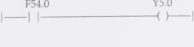

该梯级会根据变量 #1100 的当前状态（1 或 0）打开或关闭输出设备。现在，如果要求在程序执行过程中的某个位置打开设备，等待 5 秒，然后将其关闭并重新开始执行，则可以在程序中所需位置插入以下程序段：

```text
#1100 = 1;
G04 X5;
#1100 = 0;
```

遗憾的是，这样做行不通。输出确实会被打开，但在执行 5 秒暂停期间，下一条宏语句（#1100 = 0）会被缓冲并立即执行，从而瞬间关闭输出。因此，即使执行本应暂停 5 秒，输出也只会短暂打开。所以，为了达到预期效果，在这种情况下必须抑制缓冲。这可以通过在 G04 程序段之后插入一个空 NC 语句（分号，即 EOB 符号，会被视为空 NC 语句）来非常简单地实现：

```text
#1100 = 1;
G04 X5;
;
#1100 = 0;
```

与为此目的具有 G103 的哈斯控制器不同，发那科控制器没有定义用于将缓冲限制为所需程序段数量的 G 代码。然而，如前所述，可以定义某些 M 代码（范围 0 至 255），其唯一目的是阻止缓冲下一个程序段。例如，如果在 3411 至 3420 范围内的任何参数中存储了 100，则 M100 会阻止缓冲下一个程序段。于是，在前面的示例中，可以发出 M100 命令，而不是插入空 NC 语句。这种方法更好，因为另一位程序员可能会认为多余的分号不必要，甚至可能选择删除它！但请注意，在半径补偿模式下不应抑制缓冲，否则控制器将无法正确实施补偿，导致加工不正确。


# 第8章 复杂运动生成

## 8.1 引言

到目前为止，只讨论了宏编程的基本工具。借助这些工具，除了后续章节中讨论的其他若干应用外，还可以生成复杂的刀具路径。本章给出了一些复杂运动生成的示例。一般来说，在铣床（二维加工）上实现比在车床上更容易，因为在车床上生成的刀具路径必须与合适的固定循环（G71/G72/G73）配合使用，以避免较大的切削深度。因此，先讨论铣削示例。

## 8.2 半径均匀变化的圆弧

考虑图8.1所示的槽，其形状为半径均匀增大的圆弧（AB）。起始半径和终止半径分别为35 mm（CA）和40 mm（CB）。圆弧角为60°，起始角为15°。工件零点（所选WCS的原点或基准点，在G54、G55、...、G59中选择）位于O。圆弧中心（C）位于坐标(30, 20)。假设槽深为3 mm。

由于圆弧半径连续变化，本例不能使用圆弧插补。唯一的方法是在圆弧AB上定位间距很近的点，并用直线插补连接这些点。这些点之间的间距必须仔细选择。较小的值会提高圆弧的平滑度。然而，值太小会增加计算量，可能导致刀具运动迟缓。（刀具运动迟缓的另一个也是主要的原因是每个刀具路径段都涉及加速/减速。因此，有效进给率可能远小于指定进给率。）

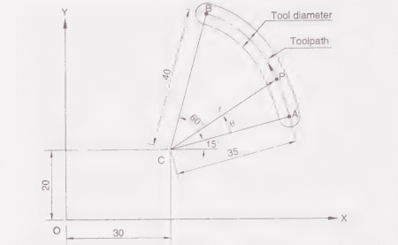

**图8.1** 半径均匀增大的圆弧。

圆弧上某点P的坐标（X_p, Y_p）作为角度θ的函数，可用以下方程求得，假设半径r随θ均匀（线性）变化：

r = r_A + ((r_B − r_A) θ) / ∠ACB

X_p = X_c + r cos(θ + θ_A)

Y_p = Y_c + r sin(θ + θ_A)

其中

- r_A = CA（起始半径）
- r_B = CB（终止半径）
- ∠ACB = 圆弧的包含角
- θ_A = CA与X轴的夹角（起始角）
- X_c = 圆弧中心C的X坐标
- Y_c = 圆弧中心C的Y坐标

在圆弧起点（A），θ的值为零。此后，它逐渐增大以到达终点（B）。这构成了该问题算法的基础。

开发宏算法的第一步是决定如何使用宏。这里假设调用宏时刀具位于圆弧起点（A）上方2 mm处，宏执行结束时刀具回到圆弧终点（B）的同一Z高度。还假设调用程序使用毫米（G21）、XY平面（G17）、进给率单位为毫米/分钟（G94）、绝对坐标（G90）、无半径补偿（G40），且无活动固定循环（G80）。进一步假设主轴装夹正确刀具（直径6 mm的槽钻），并以正确转速旋转。最后假设工件坐标系选择（G54）和刀具长度补偿（G43 H_）正确。在这些假设下，该宏不能说是很通用，但此处目的是描述生成变半径圆弧的技术。当然，圆弧会通过若干可变参数定义，从而使其相当通用。基本程序准备好后，按需求使其更通用就很容易。实际上，不建议一开始就考虑所有可能性，因为这种方法会使编程困难，并留下足够的逻辑错误空间。

槽的参数、为这些参数选择的字母地址以及相关的局部变量（按照参数规格I，参见表7.4）在表8.1中给出。由于字母地址将用于在G65/G66宏调用中传递数据，选择字母地址时应尽可能反映其实际物理意义。这有助于回忆哪个字母地址对应哪个参数。在本例中，除A和F无法使用外，参数的首字母被选作字母地址。

**表8.1.** 图8.1中槽的参数及所选字母地址

| 槽的参数 | 所选字母地址 | 关联变量 |
|---|---|---|
| 起始角 | A | #1 |
| 圆弧包含角 | I | #4 |
| 起始半径 | S | #19 |
| 终止半径 | E | #8 |
| 槽深 | D | #7 |
| 圆心X坐标 | X | #24 |
| 圆心Y坐标 | Y | #25 |
| 下刀进给率 | F | #9 |
| 铣削进给率 | M | #13 |

现在可以写出适合WHILE...DO END循环的该问题算法（注意，在WHILE语句中，指定条件在循环开始时检查）：

- 1. 以指定下刀进给率下刀进入至指定深度。
- 2. 选择角度增量Δθ，并赋值θ = Δθ。
- 3. 如果θ大于圆弧包含角，转到步骤8。
- 4. 使用给定公式计算 \(r\)、\(X_p\) 和 \(Y_p\)。
- 5. 以指定铣削进给率通过G01移动到计算坐标 \((X_p, Y_p)\)。
- 6. 角度递增 \((\theta = \theta + \Delta\theta)\)。
- 7. 转到步骤3。
- 8. 将刀具退回至工件上方2 mm。
- 9. 返回调用程序。

程序号8014基于该算法。要加工图8.1的槽，需要如下调用该宏：

```
G65 P8014 A15 I60 S35 E40 D3 X30 Y20 F20 M60;
```

其中下刀进给率和铣削进给率分别取20和60 mm/min。

```
O8014 (ARC WITH VARYING RADIUS);
G01 Z-[ABS[#7]] F#9;        (Plunge entry with the specified plunge feedrate at the start point A. Use of ABS function accepts both positive and negative values for the depth of the slot. Step 1 complete)

#100 = 0.1;                (Δθ selected, in degrees)
#101 = #100;               (θ set equal to Δθ. Step 2 complete)
WHILE [#101 LE #4] DO 1;   (Exit from the loop if θ is greater than the included angle of the arc. Step 3 complete)

#102 = #19 + [[#8 − #19] * #101 / #4];  (r calculated)
#103 = #24 + #102 * COS[#101 + #1];      (X_p calculated)
#104 = #25 + #102 * SIN[#101 + #1];      (Y_p calculated. Step 4 complete)

X#103 Y#104 F#13;          (Move to (X_p, Y_p) with the specified milling feedrate. Step 5 complete)
#101 = #101 + #100;        (Angle θ incremented by the chosen step. Step 6 complete)
END 1;                     (End of WHILE loop. Step 7 complete)
G00 Z2;                    (The tool is now at the end point B of the arc. Here, it is retracted 2 mm above the workpiece. Step 8 complete)

M99;                       (Return to the calling program. Step 9 complete)
```

该宏对半径增大和减小都适用（即也适用于 \(r_A > r_B\) 时）。然而，对于顺时针圆弧（即图8.1中A和B位置互换，但仍希望从A到B加工），需要进行以下更改：

- 为Δθ指定负值（例如#100 = −0.1）。
- 在r的公式中，应使用θ的绝对值（当Δθ赋为负值时，θ变为负值）。因此，在计算r的代码块中将#101替换为ABS[#101]。计算X_p和Y_p的代码块无需更改。另一种方法是在宏调用代码块中，如果从CA移动到CB时包含角按顺时针方向度量，则为包含角指定负值。这样就不需要对程序做任何更改。
- WHILE块应比较绝对值。

针对略有不同的需求修改宏并不是好做法，因为经验较少的程序员可能会无意中破坏由某些专家程序员精心开发的宏。此外，机床的其他用户可能不知道宏中所做的更改。事实上，正是因为这一原因，宏通常受编辑保护。

鉴于上述讨论，最好再定义一个局部变量（例如，引用字母地址Q的#17），用于将角度增量（Δθ）的值传递给宏，使得正增量值生成逆时针圆弧，负值生成顺时针圆弧。此外，由于包含角的符号可能存在混淆，宏应接受两种符号。传递Δθ值的一个优点是宏的用户还可以控制圆弧的平滑度。程序号8015就是这样一个宏，可通过以下方式调用：

```
G65 P8015 A15 I60 S35 E40 D3 X30 Y20 F20 M60 Q-0.1;
```

或

```
G65 P8015 A15 I-60 S35 E40 D3 X30 Y20 F20 M60 Q-0.1;
```

对于顺时针圆弧。读者可以尝试使宏更通用，以适应特定应用。一旦程序核心准备好，修改它并不是什么难事，正如本例中O8014被修改为O8015所示。

```
O8015 (ARC WITH VARYING RAD - MODIFIED);
G01 Z-[ABS[#7]] F#9;      (Plunge entry with the specified plunge
                          feedrate at the start point A. Use of ABS
                          function accepts both positive and negative
                          values for the depth of the slot. Step 1
                          complete)
#100 = #17;               (Δθ set to the specified value in the Q-word,
                          which can be both positive and negative,
                          for CCW and CW arcs, respectively)
#101 = #100;              (θ set equal to Δθ. Step 2 complete)
```


```gcode
WHILE [ABS[#101] LE ABS[#4]] DO 1;
    (Exit from the loop if the magnitude of θ is
    greater than the magnitude of the included
    angle of the arc. ABS[#4] would accept both
    positive and negative values for the
    included angle. Step 3 complete)

#102 = #19 + [[#8 - #19] * ABS[#101] / ABS[#4]];
    (r calculated. ABS[#4] would accept both
    positive and negative values for the
    included angle)

#103 = #24 + #102 * COS[#101 + #1];
    (Xₚ calculated)
#104 = #25 + #102 * SIN[#101 + #1];
    (Yₚ calculated. Step 4 complete)

X#103 Y#104 F#13;
    (Move to (Xₚ,Yₚ) with the specified milling
    feedrate. Step 5 complete)

#101 = #101 + #100;
    (Angle θ incremented by the specified step
    value. The angle actually gets decremented
    if the step value is negative, for a clockwise
    arc. Step 6 complete)

END 1;
    (End of WHILE loop. Step 7 complete)
G00 Z2;
    (The tool is now at the end point B of the
    arc. Here, it is retracted to 2 mm above the
    workpiece. Step 8 complete)

M99;
    (Return to the calling program. Step 9
    complete)
```

该宏将一次走刀加工出槽。如果槽深较大，例如 10 mm，一次走刀铣削可能并不实际。如果最大允许切削深度例如为 3 mm，则需要四次走刀（分别约在 3、6、9 和 10 mm 深度处）。因此，下一项任务是满足这一要求。可以利用图 6.2 所示流程图中采用的逻辑。需要将以下步骤并入前面给出的算法中。

- 1. 将刀具移动到 Z0 位置。
- 2. 如果指定/计算深度大于 3 mm，则
  - 使用上一程序的算法，加工一段深度为 3 mm 的圆弧（相对于前一 Z 层的增量距离）（该步骤在本程序中表现为嵌套的 WHILE 循环）。
  - 到达圆弧终点后，将刀具退回工件上方，并以快速率（G00）使其返回圆弧起点，保持同一 Z 层。
  - 现在将刀具带到前一 Z 层（以快速率移动到前一 Z 层上方 1 mm 处，最后 1 mm 行程采用进给率）。
  - 上一走刀中的槽铣削使所需深度减少 3 mm，因此设置 depth = depth - 3。
  - 循环回到步骤 2。
- 3. 在指定/计算深度处加工圆弧（相对于前一 Z 层的增量距离）。该步骤需要另一个 WHILE 循环。
- 4. 将刀具退回工件上方 2 mm。
- 5. 返回调用程序。

程序号 8016 基于该算法，它使用两级嵌套 WHILE 语句。可通过以下方式调用：

```gcode
G65 P8016 A15 I60 S35 E40 D10 X30 Y20 F20 M60 Q-0.1;
or
G65 P8016 A15 I-60 S35 E40 D10 X30 Y20 F20 M60 Q-0.1;
```

用于深度为 10 mm 的顺时针圆弧。加工将分四次走刀完成（分别在 Z = -3、-6、-9 和 -10 mm 处各一次）。

```gcode
O8016 (VAR RAD ARC WITH ARBIT DEPTH);
G01 Z0 F9;                  (Tool made to touch the workpiece at the
                            start point of the arc. Step 1 complete)
#107 = ABS[#7];             (Positive value of the specified slot depth
                            in the macro calling block would be used
                            further, which permits both positive and
                            negative values in the macro calling
                            block)
WHILE [#107 GT 3] DO 1;     (Step 2 starts here)
G91 G01 Z-3 F#9;            (Plunge entry to 3 mm below the current
                            Z-level, at the start point A, with the specified
                            plunge feedrate)
#100 = #17;                 (Δθ set to the specified value in the Q-word,
                            which can be both positive and negative,
                            for CCW and CW arcs, respectively. This
                            block can be placed outside the loop also,
                            i.e., before the WHILE...DO...block, because
                            #100 is not redefined by the loop)
#101 = #100;                (θ set equal to Δθ)
WHILE [ABS[#101] LE ABS[#4]] DO 2; (Exit from the loop if the magnitude of θ
                            is greater than the magnitude of the
                            included angle of the arc. ABS[#4] would
                            accept both positive and negative values
                            for the included angle)
#102 = #19 + [[#8 - #19] * ABS[#101] / ABS[#4]]; (r calculated. ABS[#4] would accept both
                            positive and negative values for the
                            included angle)
#103 = #24 + #102 * COS[#101 + #1]; (Xₚ calculated)
#104 = #25 + #102 * SIN[#101 + #1]; (Yₚ calculated)
G90 X#103 Y#104 F#13;       (Move to (Xₚ, Yₚ) with the specified milling feedrate)
#101 = #101 + #100;         (Angle θ incremented/decremented by the chosen step)
END 2;                      (End of WHILE loop. Arc made)
#105 = #5043;               (The current absolute Z-coordinate of the tool stored in #105)
G00 Z2;                     (The tool is now at the end point B of the arc. Here, it is retracted to 2 mm above the workpiece)
X[#24 + #19 * COS[#1]] Y[#25 + #19 * SIN[#1]]; (Tool brought back to the start point A)
Z[#105 + 1];                (Rapid to 1 mm above the previous Z-level)
G01 Z#105 F#9;              (Feed motion in the last 1-mm travel)
#107 = #107 - 3;            (Calculates the remaining depth of the slot, to be machined further)
END 1;                      (Loop back to the start of step 2. Step 2 complete)
G91 G01 Z-#107 F#9;         (Plunge entry to the final depth, at the start point A, with the specified plunge feedrate)
#100 = #17;                 (Δθ set to the specified value. This statement is redundant, because #100 is already defined)
#101 = #100;                (θ set equal to Δθ)
WHILE [ABS[#101] LE ABS[#4]] DO 3; (Exit from the loop if the magnitude of θ is greater than the magnitude of the included angle of the arc. Since it is not a nested WHILE loop, one may choose to use even 1 or 2, in place of 3, as loop identification number)
#102 = #19 + [[#8 - #19] * ABS[#101] / ABS[#4]]; (r calculated)
#103 = #24 + #102 * COS[#101 + #1]; (Xₚ calculated)
#104 = #25 + #102 * SIN[#101 + #1]; (Yₚ calculated)
G90 X#103 Y#104 F#13;       (Move to (Xₚ, Yₚ) with the specified milling feedrate)
#101 = #101 + #100;         (Angle θ incremented/decremented by the chosen step)
END 3;                      (End of WHILE loop. Arc made. Step 3 complete)
G00 Z2;                     (The tool is now at the end point B of the arc. Here, it is retracted to 2 mm above the workpiece. Step 4 complete)
M99;                        (Return to the calling program. Step 5 complete)
```

该程序现在已相当通用，只是它假定了一些控制条件。让用户使该宏适用于任何控制条件，这一点留作练习。其方法将与第 7 章宏（O9011 和 O9012）中所用的方法类似。此外，该宏假定一次走刀中最大允许切削深度为 3 mm。可以使用一个局部变量将该值提供给宏。这是可取的，因为不同切削条件需要不同切削参数。读者也应尝试这样做，这相当简单（只需在所需位置用所选局部变量替换 3）。

必须注意有关该程序风格的一个重要点：通过 G65/G66 语句进行赋值所使用的局部变量，未在宏内部重新定义。临时计算结果已存储在公共变量中。这种做法降低了宏中出错的可能性，因为宏可能需要在多个位置使用原始指定值。因此，如果根据宏的逻辑需要改变某个局部变量的指定值，就将其存入某个公共变量，并使用该公共变量代替局部变量。语句 #107 = ABS[#7] 正是这样做的，用于处理每次走刀后减小槽深。 #7 未被重新定义。

## 8.3 变半径螺旋插补

螺旋插补作为选项可在三轴铣床上使用。它基本上只是圆弧插补，并叠加沿第三轴的同步直线运动，使得三个轴的驱动电机同时到达指定终点，同时以均匀速率运动（尽管彼此速度不同）。指定进给率沿圆弧插补平面上的投影刀具路径保持。因此，沿直线轴的进给率将为

$$\text{指定进给率} \times \frac{\text{直线轴长度}}{\text{圆弧长度}}$$

（由控制器自动计算）

显然，刀具的实际进给率，即沿刀具路径的进给率，将大于指定进给率。事实上，它将等于

$$\sqrt{(\text{沿直线轴的进给率})^2+(\text{指定进给率})^2}$$

在三轴铣床上，螺旋插补可沿 X、Y 和 Z 轴进行，分别对应 G19（YZ 平面）、G18（XZ 平面）和 G17（XY 平面）。沿 Z 轴的螺旋插补如图 8.2 所示，可通过以下方式指令：

```text
<Place the tool at the start point S>
G17 G03 X_ Y_ Z_ R_ F_; or G17 G02 X_ Y_ Z_ I_ J_ F_;
```

其中 X_、Y_、Z_ = 终点 P 的坐标；R_ = 圆弧插补半径；I_、J_ = 螺旋轴相对于起点 S 的 X、Y 坐标；F_ = 沿 XY 平面上投影的刀具路径的进给速度。

G03 生成逆时针螺旋，如图 8.2 所示。对于顺时针螺旋，将其替换为 G02。螺旋方向（顺时针/逆时针，CW/CCW）由右手定则确定，其中拇指指向线性轴的正方向。因此，如果刀具沿弯曲手指的方向运动，则称为逆时针螺旋。

沿 X 轴和 Y 轴的螺旋插补以类似方式进行。（注意，选择 X_、Y_、Z_ 的顺序只是为了便于识别圆弧插补的排列顺序。圆弧插补平面由 G17/G18/G19 决定。在 CNC 机床使用的字地址格式中，G 代码参数顺序并不重要，除少数例外情况外，例如 G65“G 代码参数列表”中 I-、J-、K-字的顺序。）

```text
G18 G02/G03 X_ Z_ Y_ R_ F_; or G18 G02/G03 X_ Z_ Y_ I_ K_ F_;
G19 G02/G03 Y_ Z_ X_ R_ F_; or G19 G02/G03 Y_ Z_ X_ J_ K_ F_;
```

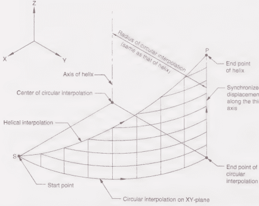

**图 8.2** 铣床上沿 Z 轴的螺旋插补。

上述内置螺旋插补有两个限制：

- 螺旋的半径/螺距不能变化。
- 沿实际刀具路径的进给速度大于指定进给速度。

现在我们将开发一个宏，以消除这些限制。然而，为简单起见，将假定沿线性轴的移动以均匀速率发生，并与角位移同步。换言之，将假定螺距恒定，如同内置螺旋插补的情况。半径当然会变化，但将假定半径变化相对于角位移以均匀速率发生。因此，螺旋将形成于正圆锥的侧面上。

具有此功能的宏可用于锥管螺纹的螺纹铣削，但需修改为引入螺距而不是圈数。这留给读者作为练习。然而，甚至无需任何修改也可以使用给定的宏——只需通过将总深度（Z 行程）除以螺距来计算并指定转数（也可以为小数）。

考虑一条具有恒定螺距和均匀变化半径的螺旋，其特性如下：

| 特性 | 值 |
|---|---|
| 圈数（转数） | = T |
| 起始半径 | = R_i |
| 终止半径 | = R_e |
| 总深度 | = d |
| 圆弧插补平面 | = XY 平面 |
| 线性轴 | = Z 轴 |
| 螺旋轴的 XY 坐标 | = (X_0, Y_0) |
| 起点坐标 | = (X_i, Y_i, Z_i) |
| 相对于正 X 轴的起始角 | = θ_i |
| 刀具路径方向 | = 逆时针（CCW） |

这种螺旋刀具路径的俯视图如图 8.3 所示，其中显示了四个完整圈，并且终止半径小于起始半径（尽管这不会影响螺旋的数学方程）。

为与内置螺旋插补的使用方式保持一致，该宏将设计成使螺旋起点位于当前刀具位置，并且刀具最终将停留在螺旋终点。换言之，调用宏时的刀具位置将自动成为螺旋起点。这意味着……的中心线（轴线）的

1. 通过相应的系统变量确定当前刀具位置 (X₁, Y₁, Z₁)。
2. 使用给定公式求出螺旋轴的 XY 坐标 (X₀, Y₀)。
3. 使用指定的角度增量 Δθ，并赋值 θ = Δθ。
4. 如果 θ 大于 360T，则转到第 9 步。
5. 使用给定公式计算 R(θ)、X(θ)、Y(θ) 和 Z(θ)。
6. 以指定进给速度用 G01 移动到计算出的坐标。
7. 角度递增（θ = θ + Δθ）。
8. 转到第 4 步。
9. 返回调用程序。

程序号 8017 基于此算法，使用表 8.2 中给出的局部变量。

对于半径均匀变化的螺旋插补，需要按如下方式调用该宏：

```
G65 P8017 T10 S50 E40 D30 A5 Q1 F60;
```

在绝对模式下，将刀具置于所需螺旋起点后。注意不必处于 G17 模式，因为 G01 不受 G17/G18/G19 影响。

```
O8017 (VAR RAD HELICAL INTERPOLATION);
IF [#19 LT 0] THEN #3000 = 1 (NEGATIVE START RADIUS);
IF [#8 LT 0] THEN #3000 = 2 (NEGATIVE END RADIUS);
IF [#20 LT 0] THEN #3000 = 3 (NEGATIVE NUMBER OF TURNS);
```

> （起始半径、终止半径和圈数不允许为负值；这些情况将分别产生带指定消息的报警。圈数也可以为小数值。例如，T = 1.1 对应 396°。）

| 螺旋参数 | 所选字母地址 | 关联变量 |
|---|---|---|
| 圈数 | T | #20 |
| 起始半径 | S | #19 |
| 终止半径 | E | #8 |
| 总深度 | D | #7 |
| 起始角（相对于 X 轴） | A | #1 |
| 角度增量 | Q | #17 |
| 进给速度 | F | #9 |

**表 8.2** 可变半径螺旋插补的参数及所选字母地址

```text
#100 = #5041;
#101 = #5042;
#102 = #5043;
```

（已确定当前 X 位置）  
（已确定当前 Y 位置）  
（已确定当前 Z 位置。第 1 步完成）

```text
#103 = #100 - #19 * COS[#1];
```

（已计算螺旋轴的 X 坐标。起始角也可以为负值。必须以度为单位指定。允许整个 360° 范围。）

```text
#104 = #101 - #19 * SIN[#1];
```

（已计算螺旋轴的 Y 坐标。第 2 步完成）

```text
#105 = #17;
```

（Δθ 设为 Q 字中指定的值，单位为度；对于逆时针（CCW）和顺时针（CW）螺旋，该值可分别为正和负）

```text
#106 = #105;
WHILE [ABS[#106] LE [360 * #20]] DO 1;
```

（如果 θ 的绝对值大于总遍历角度，则退出循环。第 4 步完成）

```text
#107 = #19 - [[#19 - #8] * ABS[#106] / [360 * #20]];
```

（已计算 R(θ)）

```text
#108 = #103 + #107 * COS[#1 + #106];
```

（已计算 X(θ)）

```text
#109 = #104 + #107 * SIN[#1 + #106];
```

（已计算 Y(θ)）

```text
#110 = #102 + [#7 * ABS[#106] / [360 * #20]];
```

（已计算 Z(θ)。深度可指定正值和负值。正值使刀具在从起点到终点过程中沿正 Z 方向移动，而负值使其沿负 Z 方向移动。第 5 步完成）

```text
G01 X#108 Y#109 Z#110 F#9;
```

（以指定进给速度移动到计算出的坐标。第 6 步完成）

```text
#106 = #106 + #105;
```

（角度 θ 按指定步长值递增。如果步长值为负，则角度实际上递减，这会生成顺时针螺旋。第 7 步完成）

```text
END 1;
```

（WHILE 循环结束。刀具停留在螺旋终点。第 8 步完成）

```text
M99;
```

（返回调用程序。  
第 9 步完成）

留给读者练习：修改此宏，使其适用于绝对和增量两种模式。事实上，这非常简单：

- 在宏开始时，读取系统变量 #4003 以确定模式（绝对模式下存储 90，增量模式下存储 91）。
- 在宏中将 G01 替换为 G90 G01，以强制使用绝对模式。
- 如果第一步表明为增量模式，则在宏末尾命令 G91。

上述示例说明了如果复杂刀具路径由数学定义，如何生成它。此类需求不必使用 CAM 软件。然而，CAM 软件可能无法提供宏所能提供的灵活性。下面讨论一些宏的示例。

车削应用中的一个复杂之处在于，对于给定的切削条件，切削深度必须限制在其最大允许值内。因此，仅通过使刀具沿生成的边界移动无法获得复杂的车削形状。必须使用 G71/G72/G73，其中零件边界定义在 P 和 Q 程序段号之间。如果特定机床上没有 G71/G72 II 型循环，则在沿零件轴线零件直径变化非单调的所有位置，都必须使用 G73。G71/G72 I 型循环要求沿其轴线的零件直径单调增大或减小。

下面讨论两种情况：一种为单调增大，另一种为非单调增大。单调情况可认为适合 G71，而非单调情况使用 G73。然而，如下一节所述，G71/G72 不能用于此类应用。

## 8.4 抛物线车削

反射器被制成抛物线形状，因为在其焦点处发射的信号或光经反射后会平行于其轴线，这使得长距离传输成为可能。类似地，如果将其用于接收来自远距离的信号（这些信号几乎是平行射线），则置于其焦点的信号接收器会接收到强汇聚信号。然而，抛物线车削不是车床的标准功能，尽管使用宏可以非常容易地实现。

考虑图 8.4 所示的几何形状。假定工件具有初始孔，并且内孔车刀的外廓尺寸足够小，能够无任何干涉地进入该孔。如果不是这样，则需要一个中心孔，其

在进行抛物线车削之前，需要先钻出合适直径的孔。然而，如果设计不允许存在中心孔，则此处给出的方法无法直接使用。在这种情况下，必须使用仿形重复循环（G73）在端面车削操作中（即径向退刀量=0，轴向退刀量按需设置）并使用中性端面车刀进行加工。不过，作为初步近似，仍然可以用中心钻加工一个中心孔，使孔底形成平面。由此引入的误差（抛物线顶点与平面底部之间的距离）可能小到可以忽略不计。例如，对于图8.4中给定的尺寸，该误差为0.3175毫米。

首要任务是推导抛物线的数学方程。可以证明，用最大直径（M）、孔径（B）和深度（D）表示的一般方程为

$$X^2 = \frac{M^2 - B^2}{D}\left\{Z + \frac{M^2D}{M^2 - B^2}\right\}$$

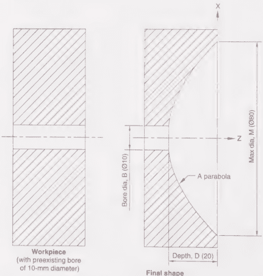

图8.4  车削抛物线

可以验证，Z = 0时X = M，Z = −D时X = B。注意，该方程被写成适合车床直径编程的形式。对于图8.4中给定的尺寸，该方程简化为

$$X^2 = 315(Z + 20.3175)$$

但是，在宏程序中不使用这个具体方程，而是使用一般形式。

此类加工（无论是内表面还是外表面）涉及大量材料去除，通常使用G71（多次车削循环，也称为毛坯去除循环，或简称粗加工循环）或G72（多次端面循环）完成，因为这些是最高效的循环。因此，人们可能会考虑使用例如G71进行加工，在P和Q程序段号之间使用给定方程来定义抛物线曲线。（但请注意，当待去除材料的径向尺寸大于其轴向尺寸时，如本例中分别为35毫米和20毫米，G72比G71更高效。）涉及G71的算法可以按如下方式编写：

- 1. 将刀具置于G71的起点。
- 2. 指令G71，并将刀具置于抛物线的起点，即X = M、Z = 0处。
- 3. 使用指定的轴向步距ΔZ，并令Z = −ΔZ。
- 4. 如果|Z|大于D（即|Zₘₐₓ|），则转至第9步。
- 5. 使用给定公式计算X。
- 6. 通过G01移动到计算出的坐标。
- 7. 改变Z坐标（Z = Z − ΔZ）。
- 8. 转至第4步。
- 9. G71结束。
- 10. 使用G70精加工，进给率取指定值的一半，主轴转速取当前转速的两倍，以获得更好的表面质量。
- 11. 返回调用程序。

遗憾的是，上述方法行不通。这是因为虽然G71和G72允许在P和Q程序段之间进行循环，但不允许循环中出现移动指令。

因此，无法通过循环来定义零件几何形状；对于G71/G72，甚至不能在G71/G72循环内调用子程序/宏程序（M98被忽略，G65/G66会报警）。G73（仿形重复循环）没有这些限制，但对于此类应用，它是效率极低的循环，因为大部分时间都在空切削。

因此，在这种情况下，唯一的方法是分别通过循环调用G90和G94来模拟G71和G72的粗加工操作。G71/G72的阶梯去除操作可以通过让刀具沿着所需轮廓移动来模拟，该轮廓以微小直线段定义。下面给出模拟G72（对于给定尺寸，G72比G71更高效）的算法：

### 粗加工操作

- 1. 将刀具置于Z = 0处，距孔留有1毫米间隙，即X = B − 2。
- 2. 令Z = − <指定粗加工切削深度>。
- 3. 如果|Z|大于D，转至第9步。
- 4. 使用给定公式计算X。
- 5. 指令G94，其参数为计算出的坐标和指定的进给率。
- 6. 沿轴向将刀具移动到已加工表面的Z坐标处，该位置为下一次G94循环的起点。
- 7. 改变Z坐标（Z = Z − <指定粗加工切削深度>）。
- 8. 转至第3步。

### 阶梯去除操作

- 1. 将刀具置于抛物线内缘，即(B, −D)处。
- 2. 令Z = −D。
- 3. 如果Z大于0，转至第16步。
- 4. 使用给定公式计算X。
- 5. 通过G01移动到计算出的坐标。
- 6. 改变Z坐标（Z = Z + <指定的Z向步距>）。
- 7. 转至第11步。
- 8. 返回调用程序。

请注意，如果抛物线深度不是指定的Z向步距的整数倍，刀具将不能精确地到达抛物线外缘，从而在外缘留下一个小折痕。这可以通过在Z = 0处沿切线方向移动刀具一段距离来消除。可以证明，在Z = 0处，X和Z的增量满足以下关系：

$$\Delta X = \frac{M^2 - B^2}{2MD}\Delta Z$$

### 表8.3 抛物线车削参数及所选字母地址

| 抛物线参数 | 所选字母地址 | 关联变量 |
|---|---|---|
| 最大直径 | M | #13 |
| 孔径 | B | #2 |
| 抛物线深度 | D | #7 |
| Z向步距 | Q | #17 |
| 粗加工切削深度 | R | #18 |
| 进给率 | F | #9 |

因此，在返回调用程序之前，最好使用上述公式进行一个额外的切向移动。

程序编号8018基于该算法，使用表8.3中给出的局部变量。该程序的刀具路径如图8.5所示。对于图8.4中给定的几何形状，该程序需要以如下方式调用：

```
G00 X0 Z2;
G65 P8018 M80 B10 D20 Q0.1 R0.5 F60;
```

将刀具初始定位在(X0, Z2)可避免刀具在宏内部第一次移动时与工件或机床本体发生可能的干涉。粗加工在当前主轴转速和指定进给率下进行，而精加工则在当前转速的两倍和指定进给率的一半下进行，从而获得更好的表面质量。

```
O8018 (PARABOLIC TURNING WITH G94);
#105 = #5041;          (Stores the initial X-position of the tool)
#106 = #5042;          (Stores the initial Z-position of the tool)

G00 X[#2 - 2] Z0;     (Tool placed at the start point of the first G94 cycle, leaving a clearance of 1 mm in the radial direction. Step 1 complete)

#100 = ABS[#17];       (ABS function would accept both positive and negative values for step distance in Z)
#101 = - #18;          (The first step change in Z. Step 2 complete)

WHILE [ABS[#101] LE ABS[#17]] DO 1;    (Exit from the loop if the entire depth is roughed out. Step 3 complete)
    #102 = [[#13 * #13 * ABS[#7]] / [#13 * #13 - #2 * #2]];
    (Intermediate calculation)
    #102 = #101 + #102;                  (Intermediate calculation)
    #102 = [[#13 * #13 - #2 * #2] / ABS[#7]] * #102;  (Intermediate calculation)
    #102 = SQRT[#102];                   (X calculated. Step 4 complete)
    G94 X#102 Z#101 P#9;                 (Roughing with G94. Step 5 complete)
```

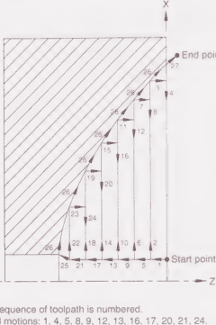

注意：

- 1. 刀具路径的顺序已编号。
- 2. 快速移动：1, 4, 5, 8, 9, 12, 13, 16, 17, 20, 21, 24。
- 3. 进给移动：2, 3, 6, 7, 10, 11, 14, 15, 18, 19, 22, 23, 25, 26, 27。
- 4. 刀具路径1至24由循环执行G94产生（且在每次G94循环结束时伴有定位移动），模拟了G72的粗加工操作（不含精加工余量），区别在于回退动作（3、7等）不是45°。
- 5. 刀具路径25是完成所有G94循环后的定位移动。
- 6. 刀具路径26由沿所定义抛物线轮廓的微小直线路径段组成。它去除由刀具路径1至24沿抛物线轮廓产生的近似三角形的台阶。因此，它模拟了G72的阶梯去除操作。显然，加工精度将取决于生成刀具路径26时所选用的Z增量值。
- 7. 刀具路径27是沿切线方向的直线移动，用于去除抛物线外缘可能出现的折痕。
- 8. 调用宏之前刀具所在位置的最终快速移动未示出。

图8.5  抛物线车削的刀具路径。


```gcode
G00 Z#101;

#101 = #101 - #18;

END 1;
#103 = #4119;
G01 X#2 Z[-ABS[#7]] F[#9 / 2] S[#103];

#101 = -ABS[#7];

WHILE [#101 LE 0] DO 1;

#102 = [[#13 * #13 * ABS[#7]] / [#13 * #13 - #2 * #2]];

#102 = #101 + #102;

#102 = [[#13 * #13 - #2 * #2] / ABS[#7]] * #102;

#102 = SQRT[#102];
X#102 Z#100;

#101 = #101 + #100;

END 1;
#104 = [[#13 * #13 - #2 * #2] / [2 * #13 * ABS[#7]] * 2];

U#104 W2;

G00 X#105 Z#106;

S#103 F#9;
M99;
```

- （为下一个 G94 循环进行刀具定位。第 6 步完成）
- （Z 按指定的粗加工切削深度递减。第 7 步完成）
- （循环结束。第 8 步完成）
- （存储当前转速）
- （刀具置于抛物线内边缘。第 9 步完成）
- （存储内抛物线的 Z 坐标。第 10 步完成）
- （如果到达抛物线外边缘，则退出循环。第 11 步完成）
- （中间计算）
- （中间计算）
- （中间计算）
- （中间计算）
- （计算 X。第 12 步完成）
- （直线插补到计算出的坐标。第 13 步完成）
- （Z 按指定步距递增。第 14 步完成）
- （循环结束。第 15 步完成）
- （计算 Z=0 处与 ΔZ = 2 mm 对应的 ΔX）
- （在抛物线外边缘增加切向移动，以去除任何可能的折角）
- （快速移动到原刀具位置）
- （恢复原转速和进给率）
- （返回调用程序。第 16 步完成）

尽管宏程序 O0818 不具备 G72 的精加工余量功能，但可以很容易地将其纳入其中。只需在粗加工以及阶梯去除操作中，从计算出的 X 值中减去所需的 X 向精加工余量，并向计算出的 Z 值加上 Z 向精加工余量。最后，可以在不加减精加工余量的情况下重复阶梯去除操作，根据需要使用同一把刀具或不同刀具。还可以再引入两个局部变量，通过宏调用程序段将 X 向和 Z 向精加工余量的值传递给宏程序。开发这样的宏程序留给读者作为练习。

## 8.5 车削正弦曲线

考虑图 8.6 所示的零件，该零件将由圆柱形毛坯加工而成。该零件的侧表面由正弦曲线定义。此情况下的另一个复杂之处在于，零件直径沿长度方向并非单调增大或减小。在负 Z 方向上，直径先增大，然后减小，再次增大。这使得通过 G90/G94 进行粗加工的操作难以纳入，而在前面的抛物线车削示例中这很容易做到。因此，唯一的方法是使用 G73 循环。事实上，只需在 G73 的 P 和 Q 程序段号之间定义轮廓的几何形状。

如前所述，此技术不能用于 G71 和 G72，因为循环中不能包含用于定义 G71/G72 轮廓的运动 G 代码。然而，G73 没有这个限制。G73 的唯一问题（实际上是一个严重问题）是，对于这类工作它效率很低，大部分进给运动都会是空行程，浪费大量时间。然而，在缺乏合适方法的情况下，只能使用 G73，至少它能加工出正确的零件。理想情况下，G73 应用于毛坯已具有预成形形状、沿整个长度需要去除的材料量几乎相等以获得精确形状的场合。换句话说，它主要适用于铸造或锻造零件的加工，对于这些零件，没有其他加工循环能如此高效。每个固定循环都是为某种特定目的而设计的。

我们交替使用“循环”和“固定循环”这两个术语。广义地说，如果一个 G 代码在加工后将刀具带回其初始位置，则称为循环。如果一个循环还涉及一些计算，通常称为固定循环。因此，G90 是循环，而 G71 是固定循环。不过，手册将所有循环都称为固定循环。出于这个原因，本文不区分这两个术语。

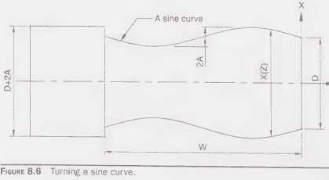

回到原问题，下面给出车削正弦曲线的算法：

- 1. 将刀具置于 G73 的起点。
- 2. 指令 G73，并将刀具置于正弦曲线的起点，即 X = D 且 Z = 0 处。
- 3. 使用指定的轴向步距 ΔZ，并赋值 Z = −ΔZ。
- 4. 如果 |Z| 大于 W（即 |Zₘₐₓ|），转到第 9 步。
- 5. 使用正弦曲线方程计算 X：

    `X = D + A sin(360|Z| / W)`

- 6. 用 G01 移动到计算出的坐标。
- 7. 改变 Z 坐标（Z = Z − ΔZ）。
- 8. 转到第 4 步。
- 9. G73 轮廓定义结束。
- 10. 用 G70 以指定进给率的一半和当前转速的两倍进行精加工，以获得更好的精加工质量。
- 11. 返回调用程序。

程序号 8019 基于该算法，它使用表 8.4 中给出的局部变量。

在所考虑的情况下，轴向退让量必须保持为零，因为零件几何形状要求 G73 后续切削行程中不得有轴向偏移，否则轴向偏移会导致刀具路径与零件几何形状之间发生干涉。事实上，出于同样的原因，在这种情况下，G73 循环的 Z 向精加工余量也必须保持为零。在此示例中，切削行程只需沿径向偏移，以逐渐逼近定义的轮廓。

| 正弦曲线参数 | 所选字母地址 | 关联变量 |
|---|---|---|
| 平均直径 | D | #7 |
| 正弦曲线波长 | W | #23 |
| 正弦曲线振幅 | A | #1 |
| Z 向步距 | Q | #17 |
| 粗加工切削深度 | R | #18 |
| 进给率 | F | #9 |

**表 8.4** 正弦曲线车削参数及所选字母地址

在本例中，径向退让量可以选择等于“谷”的最大深度（即等于 2A）。然而，采用该径向退让量时，G73 的第一道切削行程只会在零件直径最小处接触工件，而不去除任何材料。由于希望即使在第一道切削行程中也能去除材料，径向退让量应取为 (2A − <期望切削深度>)。

尽管宏程序 O8019 允许指定粗加工切削深度，但 G73 并不直接使用该信息。相反，必须指定切削行程数（G73 第一个程序段中的 R 字）以及选定的径向/轴向退让量（G73 第一个程序段中的 U 字/W 字），以使所得切削深度符合要求。

回想一下，G73 将第一道切削行程相对于定义轮廓（若指定了精加工余量，则沿相应方向偏移该余量）分别按指定的径向退让量和轴向退让量在径向和轴向进行偏移。最后一道切削行程精确地沿定义轮廓（加上精加工余量）进行。由于总行程数是指定在 R 字中的值，因此会有 (<R 值> − 2) 个中间行程。所有行程自动均匀间隔，并逐渐逼近最后一道行程（即定义轮廓加上精加工余量）。因此，两个连续行程之间的间距决定了一道行程中的切削深度。

为确保每道行程中的最大切削深度等于或小于指定切削深度，所需的行程数（R 值）将等于

$$
\frac{\text{径向退让量}}{\text{指定切削深度}} + 1
$$

由于该表达式通常计算为实数，因此应指定下一个（更大的）整数作为 R 值。注意，在所考虑的示例中，实际切削深度不会保持恒定。它会在零（不涉及切削处）与指定切削深度（零件直径最小处）之间变化。

```gcode
O8019 (TURNING A SINE CURVE);
#105 = #5041;              (Stores the initial X-position of the tool)
#106 = #5042;              (Stores the initial Z-position of the tool)
G00 X[#7 + 2 * #1 + 4] Z2; (Tool placed at the start point of G73
                            cycle, leaving a clearance of 2 mm in
                            radial as well as axial direction, with
                            respect to the workpiece. Step 1
                            complete)
```

```fanuc
#100 = ABS[#17];
G73 U[2 * #1 - #18] W0 R[FUP[[[2 * #1 - #18] / #18] + 1]];
G73 P1 Q2 U0.1 W0 F9;
N1 G00 X[#7 + 4] Z0;
G01 X#7 Z0;
#101 = -#100;
WHILE [ABS[#101] LE ABS[#23]] DO 1;
#102 = [#7 + #1 * SIN[360 * ABS[#101] / ABS[#23]]];
X#102 Z#101;
#101 = #101 - #100;
END 1;
N2 X[#7 + 2 * #1];
#103 = #4119;
G70 P1 Q2 F[#9 / 2] S[#103 * 2];
G00 X#105 Z#106;
F#9 S#103;
M99;
```

（ABS 函数可接受 Z 向步距的正值和负值）

（X 向精加工余量选择为 0.1 mm）

（刀具置于正弦曲线起点。该运动已拆分为两段移动，因为刀具必须以进给率接近工件，而单次进给运动会浪费大量时间。如果切削深度超过 2 mm，请修改前一条命令。第 2 步完成）

（Z 的第一次步距变化。第 3 步完成）

（如果正弦曲线已完整定义，即直到 Z = -W，则退出循环。第 4 步完成）

（已计算 X。第 5 步完成）

（直线插补至计算出的坐标。第 6 步完成）

（Z 按指定步距递减。第 7 步完成）

（循环结束。第 8 步完成）

（轮廓定义结束。最后一段是径向移动到初始工件直径处，通常给出该段以确保最终获得更好的加工表面。然而，在当前情况下，可能会使用中性刀具，因此该步骤可视为不必要，只需写 N2 END 1 即可。第 9 步完成）

（存储当前转速）

（用 G70 精加工。如果希望使用不同刀具进行精加工，请在此处进行必要修改。第 10 步完成）

（刀具返回其原始位置）

（恢复原始进给率和转速）

（返回调用程序。第 11 步完成）

为获得图 8.6 的形状，可按如下方式调用该宏：

```
...
G98 G00 X100 Z0;
G65 P8019 D30 W65 A3 C0.1 R0.5 F60;
...
```

除非刀尖角非常小（例如 35°），且正弦曲线的振幅与长度之比也很小，否则右手车刀的刀柄很可能会与这部分几何形状发生干涉。这需要使用中性刀具。如果在中性刀柄上使用菱形刀片，则无法通过这种方法获得正弦曲线左端的方形边缘。（左侧会出现相当于刀尖角一半的过切。）不能使用圆形刀片，因为它必须配合半径补偿使用（因为刀具上切削材料的点会不断改变位置），而半径补偿不能在 G71-G73 循环内使用（这是这些循环的一个限制）。

（控制参数，或简称为参数）决定机床的默认设置。（如果需要更改某些默认设置，则需要修改相应的机床参数。这通常是在 MDI 模式下手动完成的。不过，也可以通过任何程序（包括参数化程序）自动更改这些参数。这个问题将在第 13 章讨论。）本章剩余部分将介绍车床和铣床的参数化程序示例。

## 9.2 定位销

考虑图 9.1 所示的定位销。在定义该销几何形状的七个尺寸中，只有两个尺寸是固定的。其余五个尺寸用变量 *A*、*B*、*C*、*D* 和 *R* 表示。这些变量的值在表 9.1 中给出，对应五个不同尺寸的销。无需为这五个销编写五个不同的程序。当以参数 A、B、C、D 和 R 的所需值调用时，单个参数化程序 O8020 可生成全部五种销类型（以及任何其他尺寸的销，只要总体几何形状相同），这些参数分别对应程序 O8020 中的局部变量 #1、#2、#3、#7 和 #18。因此，G65 P8020 A10 B10 C15 D25 R2 将生成 1 号销，G65 P8020 A15 B10 C15 D30 R2 将生成 2 号销，依此类推。

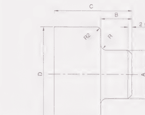

| 销编号 | A | B | C | D | R |
|---:|---:|---:|---:|---:|---:|
| 1 | 10 | 10 | 15 | 25 | 2 |
| 2 | 15 | 10 | 15 | 30 | 2 |
| 3 | 20 | 15 | 25 | 35 | 3 |
| 4 | 25 | 15 | 25 | 40 | 3 |
| 5 | 30 | 20 | 35 | 45 | 4 |

表9.1 图9.1所示定位销的尺寸

编写该宏时做了以下假设：

- 1. 调用程序处于毫米模式（G21）。
- 2. 对于所有销，工件初始直径均为 50 mm。
- 3. 工件零点位于工件右端面中心。（实际上，本文所有车床程序都假定工件零点位于同一位置。）
- 4. 工件需要一次走刀进行 0.5 mm 的端面加工。（不使用尾座支撑工件。）注意，由于假定 Z = 0 位于工件右端面，这将使零件右端面位于 Z = -0.5 mm。
- 5. 调用程序中的进给率和主轴转速（或 CSS，即 G96 模式下的恒定表面速度）正确，并将用于粗加工。精加工时，进给率减半，主轴转速/CSS 加倍。
- 6. 粗加工将使用 1 号刀具及 1 号偏置，精加工将使用 3 号刀具及 3 号偏置。
- 7. 将分别使用 G71（I 型）和 G70 进行粗加工和精加工。
- 8. 不需要切断操作（将单独进行，例如使用 G75），为此应在较大直径处多提供 3 mm 长度。

这些假设实际上并不是给定宏的限制。始终必须先确定宏应该做什么，这里所做的正是这一点。如果其中某些假设在特定情况下不太合适，则需要相应地修改宏。一般来说，修改宏比编写新宏简单得多。事实上，始终应从简单且易于实现的目标开始。只有在基本宏准备就绪并经过测试后，才应逐一加入复杂功能。试图在第一次尝试时就开发复杂宏会引发混乱，从而导致编程错误。本文前面已推荐过这种编程风格。由于它非常重要，这里再次强调。

这不是一个涉及复杂逻辑的宏示例。因此，并不真正需要流程图或算法。不过，建议至少写下刀具路径将如何生成，这有助于理清思路：

- 1. 将刀塔返回参考位置，并选择 1 号刀具及 1 号偏置。
- 2. 将刀具置于 (X54 Z2)，并使用 G94 一次走刀车端面至 Z−0.5。
- 3. 将刀具置于 (X50 Z2)，并使用 G71 进行粗加工，留出合适的精加工余量。
- 4. 将刀塔返回参考位置，并选择 3 号刀具及 3 号偏置。
- 5. 将刀具置于 (X50 Z2)，并以降低的进给率和提高的转速（CSS，带半径补偿）用 G70 精加工。（由于是右手车刀，在后置式车床上刀尖编号为 3，必须输入几何偏置表或磨损偏置表的第三行。刀尖半径输入几何偏置表。）

所定义的轮廓对 G71 和 G70 相同，如图 9.2 所示。

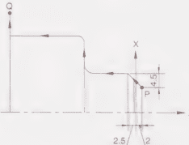

**注：**

- 1. 未显示的尺寸请参见图 9.1。
- 2. 轮廓定义从 P 开始，到 Q 结束。
- 3. P 的 X 坐标和 Z 坐标分别为 (−9) 和 (−2)。
- 4. Q 的 X 坐标和 Z 坐标分别为 (54 和 5)。
- 5. 轮廓起点处延长的刀具路径位于倒角角度（45°）。这可以获得质量更好的拐角。
- 6. Q 的 Z 坐标包含较大直径处额外 3 mm 的长度，这是切断操作所需的。

图9.2 图9.1所示销的 G71 和 G70 定义轮廓。


| CNC 程序 | 说明 |
|---|---|
| `O8020 (LOCATOR PIN);` |  |
| `G28 U0;` | （X 向回零） |
| `G28 W0;` | （Z 向回零。X 与 Z 分别回零可消除移动刀塔与机床本体（如尾座）之间发生干涉的可能性） |
| `T0101;` | （1 号刀具，1 号刀补，到达切削位置。步骤 1 完成） |
| `G00 Z2;` | （定位移动） |
| `X54;` | （刀具置于 G94 的起始点。这里同样采用两个独立运动，以消除干涉的可能性） |
| `M03;` | （主轴按当前有效转速开始顺时针旋转） |
| `M08;` | （冷却液开启。通常一行只允许一个 M 代码） |
| `G94 X-4 Z-0.5;` | （端面车削至工件轴线以下，可去除任何中心孔。若没有 F 字，则调用宏时的当前进给率将用于端面车削。步骤 2 完成） |
| `G00 X50 Z2;` | （刀具置于 G71 循环的起始点。此命令中的 Z2 是多余的） |
| `G71 U2 R0.5;` | （选择 2 mm 切削深度和 0.5 mm 径向退刀量。如认为不合适，可修改这些值） |
| `G71 P10 Q20 U0.2 W0.1;` | （轮廓定义从 N10 程序段开始，到 N20 程序段结束。X 向和 Z 向精加工余量分别为 0.2 mm 和 0.1 mm。如认为不合适，可修改这些值。若没有 F 字，则使用之前的进给率进行粗加工） |
| `N10 G00 X[#1 - 9];` | （轮廓定义从这里开始，G71（类型 1）不允许此程序段中出现 Z 字。它自动使用当前 Z 位置来定位轮廓上的第一个点，即图 9.2 中的点 P） |
| `G01 X#1 Z-2.5;` | （倒角） |
| `Z-[#2 + 0.5 - #18];` | （在小直径上直线车削） |
| `G02 X[#1 + 2 * #18] Z-[#2 + 0.5] R#18;` | （加工凹圆角） |
| `G01 X[#7 - 4];` | （向大直径方向直线端面车削） |
| `G03 X#7 Z-[#2 + 2.5] R2;` | （加工凸圆角） |

```
G01 Z-[#3 + 3.5]; (Straight turning on larger diameter, providing 3 mm extra length for part-off operation)
N20 X54; (Straight facing to clear off the workpiece. Profile definition ends here, with 2 mm radial clearance from the workpiece, which is point Q in Fig. 9.2. Step 3 complete)
G28 U0; (X-home)
G28 W0; (Z-home)
T0303; (Tool number 3 with offset number 3 selected for finishing. Step 4 complete)
G42 G00 Z2; (Radius compensation invoked. It was not used earlier because radius compensation is ignored by the canned cycles, G71–G76)
X50; (Some controls require the first two moves, after invoking radius compensation, be along the two axes, separately, before reaching the start point of the profile, otherwise there might be some error in tool positioning at the start point. On Fanuc control, however, a single start-up move, such as G42 G00 X50 Z2, is sufficient. Here, the main reason for splitting it into two moves is interference avoidance)
G70 P10 Q20 F[#4109 / 2] S[#4119 / 2]; (Finishing by half the current feedrate and twice the current rpm/CSS. Modify if desired. Step 5 complete)
G40 U4 W2; (Radius compensation canceled. As a rule of thumb, cancelation must be accompanied by adequate outward movement, otherwise, the tool may move toward the workpiece during cancellation. Even if compensation is not explicitly canceled by G40, it would be canceled automatically by M30 which resets the control)
M05; (Spindle stops)
M09; (Coolant stops)
G28 U0; (X-home)
G28 W0; (Z-home)
F[#4109 / 2] S[#4119 / 2]; (The original feedrate and rpm/CSS restored)
M99; (Return to the calling program)
```

要加工 1 号销钉，可以通过下面这样的程序调用该宏：

```
G21 G97 G98; (Change to G96 for CSS, and feedrate in millimeters per revolution)
F60 S1000; (Specify roughing feedrate and spindle speed)
G65 P8020 A10 B10 C15 D25 R2;
M30;
```

该宏可以加工任意尺寸的销钉，尺寸由参数 A、B、C、D 和 R 定义。然而，如果只需要加工给定的五种类型销钉，并且不要求操作人员记住相关字母地址的含义和/或销钉的确切尺寸，则可以编写一个修改后的主程序，只需在程序开头输入相应的销钉编号即可生成所需类型的销钉。这样的程序才是真正意义上的零件族程序：

```
#100 = 1; (Specify pin number here. One can also use a local variable such as #1 here. This would be different from variable #1 used inside the macro, as the local variables of the main program and those of the macro called by it belong to level 0 and level 1, respectively)
IF [[#100 LT 1] OR [#100 GT 5]] THEN #3000 = 1 (ILLEGAL PIN NUMBER); (Any value other than 1, 2, 3, 4, and 5 would alarm out, terminating the program execution)
G21 G97 G98;
F60 S1000;
IF [#100 EQ 1] GOTO 1; (Branches out to N1 for producing pin 1)
IF [#100 EQ 2] GOTO 2; (Branches out to N2 for producing pin 2)
IF [#100 EQ 3] GOTO 3; (Branches out to N3 for producing pin 3)
IF [#100 EQ 4] GOTO 4; (Branches out to N4 for producing pin 4)
IF [#100 EQ 5] GOTO 5; (Branches out to N5 for producing pin 5)
N1 G65 P8020 A10 B10 C15 D25 R2; (Macro call with pin-1 parameters)
GOTO 6;
N2 G65 P8020 A15 B10 C15 D30 R2; (Macro call with pin-2 parameters)
GOTO 6;
N3 G65 P8020 A20 B15 C25 D35 R3; (Macro call with pin-3 parameters)
GOTO 6;
N4 G65 P8020 A25 B15 C25 D40 R3; (Macro call with pin-4 parameters)
GOTO 6;
```

为简单起见，将使用 G81 在当前主轴转速下钻孔。不过，鼓励读者为这些参数引入额外的局部变量，这作为练习留给读者。对于 G81 以外的钻孔循环，还需要有关暂停值（G82）或啄钻距离（G73/G83）的信息，因此需要使用另外两个局部变量来赋值。请注意，为不使用这些功能的固定循环指定暂停值或啄钻距离并无害处，循环会直接忽略这些参数。因此，无论固定循环是 G81、G82、G73 还是 G83，其程序段都可以使用相同的参数列表。

虽然可以编写一个宏，用所选参数的任意值来加工法兰，但这里将考虑表 9.2 中所描述的法兰族。请注意，X 和 Y 并不是法兰的真正参数。它们的值取决于法兰相对于当前工件坐标系（G54、G55 等）在机床工作台上的夹紧方式。因此，对所有法兰这些值都取相同值，因为这些值相对于法兰类型没有意义。为了通用性，有必要包含这些变量。同样，起始角可能没有任何意义。因此，在所有情况下都取 0°。引入它是为了处理某些特殊需求。

我们假定如下（虽然放宽这些假设并不困难，但将其留给读者作为练习）：

- 1. 调用程序使用绝对坐标（G90）。
- 2. 调用宏之前，主轴上装有合适的刀具，并以合适的转速旋转。
- 3. 调用程序中已包含刀具长度补偿。

| 法兰编号 | X | Y | Z | D | H | S | R | F |
|---:|---:|---:|---:|---:|---:|---:|---:|---:|
| 1 | 150 | 100 | 5 | 50 | 4 | 0 | 1 | 60 |
| 2 | 150 | 100 | 10 | 100 | 6 | 0 | 1 | 50 |
| 3 | 150 | 100 | 15 | 150 | 8 | 0 | 1.5 | 40 |
| 4 | 150 | 100 | 20 | 200 | 10 | 0 | 2 | 30 |
| 5 | 150 | 100 | 20 | 300 | 12 | 0 | 2 | 30 |

表 9.2 —— 图 9.3 所示法兰的尺寸

下面的算法可用于为这个问题开发一个宏程序（O8021）：

- 1. 设置 G81 的参数，使用 K0（使用 K0 时，信息被存储但不会钻孔）。
- 2. 将 360 除以孔数，计算相邻孔之间的角度。
- 3. 设置 <孔计数器> = 1。
- 4. 如果孔计数器大于孔数，则转至步骤 8。
- 5. 指定第一个/下一个孔的 XY 坐标。（这将使刀具移动到指定坐标，并由 G81 在那里钻孔。）
- 6. 孔计数器加 1。
- 7. 转至步骤 4。
- 8. 取消固定循环。
- 9. 返回调用程序。

```
O8021 (BOLT HOLES ON A FLANGE);
G81 Z[ABS[#26]] R#18 F#9 K0; (Arguments of G81 specified. Step 1 complete)
#100 = [360 / #11]; (Angle between subsequent holes calculated. A negative value for the number of holes, H, is also permitted that would drill the holes in the clockwise direction. Step 2 complete)
#101 = 1; (Hole counter initialized. Its value indicates the hole number that is to be drilled next. 1 and #1 correspond to the first and the last holes, respectively. Step 3 complete)
WHILE [#101 LE ABS[#11]] DO 1; (Jump out of the loop if the hole counter exceeds the specified number of holes, i.e., when all the holes have been drilled. Step 4 complete)
#102 = #19 + #100 * [#101 - 1]; (Calculates the angular position of the first/next hole with respect to the X-axis, i.e., the CCW angle subtended at the center of the pitch circle by the position where the next drilling is to be done. A negative value for the start angle, #19, is also permitted.)
#103 = #24 + [#7 / 2]COS[#102]; (X-coordinate of the first/next hole calculated)

```


```text
N2 G65 P8021 X#101 Y#102 Z10 D100 H6 S#103 R1 F50;
(Macro call with flange-2 parameters)
GOTO 6;
N3 G65 P8021 X#101 Y#102 Z15 D150 H8 S#103 R1.5 F40;
(Macro call with flange-3 parameters)
GOTO 6;
N4 G65 P8021 X#101 Y#102 Z20 D200 H10 S#103 R2 F30;
(Macro call with flange-4 parameters)
GOTO 6;
N5 G65 P8021 X#101 Y#102 Z20 D30 H12 S#103 R2 F30;
(Macro call with flange-5 parameters)
N6 M09;
M30;
```

读者应观察 O8020 和 O8021 中采用的编程风格。O8020 包含了大多数所需的设置相关命令（如换刀），因此调用程序中只需很少此类命令。另一方面，O8021 完全没有这些命令，这就要求在调用程序中插入这些命令。如果宏通过使用局部变量控制其动作而具有足够灵活性，则第一种风格被认为更好。例如，O8020 的一个局限是它总是使用 T0101 进行粗加工、T0303 进行精加工。如果希望使用其他刀具/偏置号，则需要修改宏，这被认为不是良好做法。通常，宏由专家级程序员编写，并通过参数进行编辑保护。因此，粗加工和精加工刀具号的局部变量本应添加到参数列表中。另一方面，尽管调用 O8021 需要若干设置命令，但该宏可在不同切削条件下使用，而无需对其做任何修改。每种方法都有其自身优点和局限。基本上，这取决于个人选择和具体需求。

# 第10章
# 自定义固定循环

## 10.1 引言

第7.3节（“使用用户定义G代码调用”小节）已经讨论了如何定义新的G代码或重新定义现有G代码。定义新G代码而不是使用G65/G66宏调用的基本目的，是用户无需了解任何宏编程知识即可调用宏。所定义的G代码将在不使用G65/G66的情况下调用宏。它可以像车床上预定义的固定循环（如G71）那样使用，区别在于用户定义的G代码始终是单程序段代码。事实上，所有内置固定循环在内部都只是调用某些预定义宏，只是我们没有意识到这一点。用户只需知道此类代码中不同字母地址的含义。新的G代码也可以同样方式使用。因此，从某种意义上说，它通过为复杂加工应用提供一些额外G代码，增强了标准控制功能。最多可以定义10个新G代码（包括重新定义的G代码）。

可能存在没有标准G代码完全适用的情况。在铣床上，需要以逐次递减的啄钻长度进行啄钻的深孔钻削就是一个例子。类似地，在车床上，G74可用于啄钻，但每次啄钻后刀具不会退回到孔外。这使得深孔钻削变得困难。此外，一些G代码（如螺旋插补）作为选项提供，需要额外购买。在所有此类情况下，可能可以定义/重新定义G代码以适应特定应用。下面讨论两个示例，一个用于车床，一个用于铣床。

## 10.2 车床上的深孔啄钻

车床上标准G74循环的啄钻动作如图10.1所示。

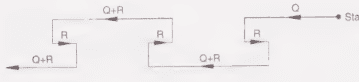

**注意：**

1. 用于钻孔的G74语法为

   ```
   G74 R_
   G74 Z_ Q_ F_
   ```

   其中（在毫米模式下）  
   R为每次啄钻后的退刀量（毫米），  
   Z为孔深（毫米），  
   Q为啄钻长度（微米），  
   F为进给率（毫米/分钟或毫米/转）。

2. 所有啄钻和退刀均沿孔轴线进行。为清晰起见，图中将它们分开表示。

3. 啄钻持续到孔底。之后，刀具退回到循环起点。通常，最后一次啄钻会有Q+R的移动量，以适应指定深度。

**图10.1** 车床上的啄钻循环（G74）。

G74设计用于钻深孔，但当孔太深时效果不理想，因为虽然它能断屑，却不能排屑。对于内冷钻头，这不会造成任何问题；但如果使用整体式钻头，则可能因切屑堵塞和冷却液不足而导致刀具寿命缩短。实际上，G74相当于铣床上的G73，具有类似局限。铣床上有G83，它在每次啄钻后退回到孔外（至R点）以排屑；而车床上通常只有在具备动力刀具时才有G83。因此，希望在车床上有一个用户定义的G代码，在每次啄钻后将刀具退回到孔外。所需刀具路径如图10.2所示，其中特意选择G174代码编号，以表示它是G74的修改版本。实际上，正是由于这个原因，G174中的啄钻长度保持为微米而不是毫米。这确保两个循环的Z、Q和F字具有相同含义。因此，G74和G174可以相同方式使用，只是G174会“缺少”第一个程序段。任何程序员都能像使用控制系统的内置固定循环一样使用G174，而无需关心它是如何在这台机床上实现的。即使程序员从未听说过宏编程，那又有什么关系呢！

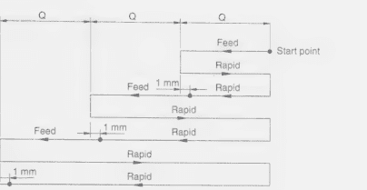

**注意：**

1. 用于钻深孔的用户定义循环G174的语法可为

   ```
   G174 Z_ Q_ F_;
   ```

   其中（在毫米模式下）  
   Z为孔深（毫米），  
   Q为啄钻长度（微米），  
   F为进给率（毫米/分钟或毫米/转）。

2. 所有啄钻和退刀均沿孔轴线进行。为清晰起见，图中将它们分开表示。

3. 所设计的刀具路径与标准G74循环相同，区别在于每次啄钻结束时的退刀均退至起点，以将切屑排出孔外。

4. 所有向外运动（退刀）均为快速运动。

5. 每次向内运动先快速移动到距前一次已钻深度1 mm处，然后开始进给运动，以增加指定啄钻长度的深度。

6. 啄钻持续到孔底。之后，刀具退回到循环起点。最后一次啄钻将调整移动量，以适应指定深度。

**图10.2** 车床上的深孔啄钻。

我们的下一个任务是定义这样一个G代码。参考表7.1，需要将174存储在参数号6051（例如）中，而相应的宏O0901应生成如图10.2所示的所需刀具路径，为此可使用以下算法：

1. 存储初始Z位置。
2. 计算`<required depth>`。（钻削从初始Z位置开始。）
3. 如果`<required depth>`小于或等于Q，转到步骤15。
4. 从初始位置以指定进给率钻至Q深度。
5. 存储当前Z位置。
6. 设置`<required depth>` = `<required depth>` - Q
7. 以快速速率退回到初始位置。
8. 如果`<required depth>`小于或等于Q，转到步骤17。
9. 快速移动到前一次啄钻结束Z位置之前1 mm处。
10. 进给运动，使现有孔深增加Q。
11. 存储当前Z位置。
12. 以快速速率退回到初始位置。
13. 设置`<required depth>` = `<required depth>` - Q。
14. 转到步骤8。


- 15. 以单次连续进给运动到达最终深度。
- 16. 转到步骤18。
- 17. 钻削所需深度：先快速移动到距前次钻削深度1 mm处，然后进给运动到达孔底。
- 18. 快速退回到初始位置。
- 19. 返回调用程序。

宏O9011基于给定算法，在程序开头还包含一些错误陷阱，用于检测某些不正确的调用方式。该宏会像G74那样，使用调用程序中的主轴转速，通过主轴上现有的刀具钻孔。不过，该宏设计为以期望的进给率调用。如果在调用宏时没有指令进给率，则钻孔将使用调用宏时调用程序中生效的进给率。孔深既可以用绝对形式（Z字）指令，也可以用增量形式（W字）指令，但不允许同时指定两者（否则会报警）。最后，该宏不要求Z基准必须位于工件右端面。所需孔的轴向位置完全不受Z基准限制。整个孔可以位于Z基准的右侧或左侧，甚至Z基准可以位于孔内某处。

宏调用程序段中的字母地址（根据参数说明1，对应的局部变量在括号中给出），以及该宏中使用的公共变量如下：

- Z (#26) = 孔底的绝对Z坐标
- W (#23) = 孔底的增量Z坐标（从初始刀具位置测量）
- Q (#17) = 啄钻长度（毫米模式下，单位为微米）
- F (#9) = 进给率
- #100 = 存储初始刀具位置的Z坐标
- #101 = 存储<所需深度>（剩余待钻深度），每次啄钻后更新
- #102 = 存储一次啄钻结束时的Z坐标，因此该值也在每次啄钻后更新

```text
O9011 (DEEP HOLE DRILLING ON LATHE);
IF [#17 EQ #0] THEN #3000 = 1 (PECK LENGTH NOT SPECIFIED);
IF [[#23 EQ #0] AND [#26 EQ #0]] THEN #3000 = 2 (DEPTH NOT SPECIFIED);
IF [[#23 NE #0] AND [#26 NE #0]] THEN #3000 = 3 (BOTH Z AND W SPECIFIED);
```

```text
END 1; (Jump to the WHILE block to check the loop condition again. Step 14 complete)
GOTO 20; (Jump to N20 to drill the remaining depth)
N10 G01 W-#101 F#9; (Single feed motion to reach the final depth. Step 15 complete)
GOTO 30; (Jump to N30 for rapid retraction, and return to the calling program. Step 16 complete)
N20 G00 Z[#102 + 1]; (Rapid motion up to 1 mm before the previous drilled depth)
G01 Z[#102 - #101]; (Remaining depth drilled. Step 17 complete)
N30 G00 Z#100; (Rapid retraction to the initial Z-position. Step 18 complete)
M99; (Return to the calling program. Step 19 complete)
```

该宏设计用于毫米模式。然而，很容易修改它，使其同时适用于毫米模式（G21）和英寸模式（G20）。在英寸模式下，1 mm的退让量（参见图10.2）需要替换为0.04 in。为此，在宏中所有出现退让量（1）的地方（有两处）将其替换为新变量，例如#103。读取系统变量#4006以确定当前生效的是G20还是G21。如果#4006包含20，则在宏开头将#103设为0.04；如果#4006包含21，则将#103设为1。在英寸模式下，重新定义#17的程序段中的除数1000也需要替换为10,000。程序中的所需修改留给读者作为练习。

在结构上，宏O9011与其他宏没有不同。可以按照调用宏的常规方式调用它，方法为

```text
G65 P9011 Z_ / W_ Q_ F_; or
G65 P9011 Z_ / W_ Q_;
```

然而，如果参数6051中存储174，则它还定义G174，如前所述。在这种情况下，G174 ... 将等同于G65 P9011 ...

为说明新G代码（G174）的用法，考虑图10.3所示的零件。要用G174加工它，只需为G74准备一个程序，并将G74替换为G174（多么简单！）。相应程序段以粗体显示，以便识别：

```text
G21 G97 G98;
G28 U0;
G28 W0;
T0101;
```

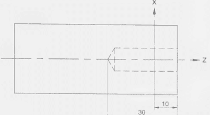

**注意：** Z基准的通常选择位于工件右端面。图中将其显示在任意位置，以说明宏O9011的用法。

**图10.3** 一个沿其轴线有孔的圆柱形零件。

```gcode
G00 Z12;
X0;
M03 S1000;
M08;
G174 Z-20 Q5000 F20;
(or, G174 W-32 Q5000 F20);
M09;
M05;
G28 U0;
G28 W0;
M30;
```

注意，孔底的锥形形状是由钻头尖端角度造成的。利用三角关系可以证明，对于给定的刀具直径D和尖端角θ，锥体高度h由下式给出

$$h = \frac{D}{2} \times \tan\left(90 - \frac{\theta}{2}\right)$$

对于常用的119°尖端角，该方程近似简化为

$$h = 0.3D$$

因此，要用例如直径10 mm的钻头获得一定长度的圆柱孔，应在所需圆柱长度上增加3 mm。因此，在图10.3中，如果刀具直径为10 mm，圆柱部分的长度约为27 mm。

至此完成了关于如何在车床上定义新G代码的讨论。也可以重新定义现有G代码，以向其添加某些期望的特性。例如，以极低的主轴转速指令G01很可能是一个编程错误。（除非主轴以合理转速旋转，否则如何加工？）因此，可能期望在以极低主轴转速指令G01时暂停程序执行，并等待操作员确认（再次按CYCLE START）以继续执行。类似地，在同一程序段中同时指令X和U（或Z和W）没有意义，应报警。G01中所需的修改可以按以下方式进行：

```text
IF [[#24 NE #0] AND [#21 NE #0]] THEN #3000 = 1 (BOTH X AND U SPECIFIED);
IF [[#26 NE #0] AND [#23 NE #0]] THEN #3000 = 2 (BOTH Z AND W SPECIFIED);
IF [#9 EQ #0] THEN #9 = #4109;
IF [#19 EQ #0] THEN #19 = #4119;
IF [[#19 LT 100] AND [#4002 EQ 97]] THEN #3006 = 1 (IS LOW RPM OK);
IF [[#19 LT 10] AND [#4002 EQ 96]] THEN #3006 = 1 (IS LOW CSS OK);
G01 X#24 U#21 Z#26 W#23 F#9 S#19;
```

留给读者作为练习：解释给定的程序段，并通过编辑6050–6059中的一个参数（在其中存储1）并定义O9010–O9019中对应的程序号来完成此练习。

回想一下，在由相同或不同G代码（G65/G66除外）调用的宏内部，G代码被视为预定义的标准G代码，具有通常功能。因此，在由G01调用的宏内部的G01只被视为直线插补；它不会再次调用同一宏而形成无限循环。

注意，所选的rpm和CSS最小值（分别为100和10 m/min）是任意的。针对具体应用指定合适的值。此外，仅检查S值并不能确认已指令M03或M04来启动主轴！事实上，无法通过程序确定主轴是否正在旋转。M代码的系统变量（#4113）存储最后指令的M代码号。例如，如果在M03之后指令M08，则#4113将包含8。因此，为更安全起见，人们可能倾向于在宏中指令M03或M04，但这也不是万无一失的，因为两者中只有一个适用于特定的机床配置（无论是前刀架还是后刀架车床，以及正常或反向刀具夹紧），而宏程序员只能猜测。因此，关于在宏中验证主轴转速的讨论，实际上仍然只是理论上的，尽管它是一个好的

编程练习。应了解宏编程的能力和局限。此外，尝试使该宏也适用于英寸模式。

## 10.3 在铣床上使用递减啄钻长度钻孔

G73 和 G83 是铣床上可用的两种啄钻循环。G83 是一种高速啄钻循环，每次啄钻后使用非常小的回退量。它用于孔不太深的情况。G83 在每次啄钻后将刀具回退到 R 点。这能完全清除切屑，使该循环适合深孔。然而，如果孔太深，经过几次啄钻后冷却液不足就会成为问题。唯一的解决办法是按所需系数采用长度逐渐递减的啄钻。这种啄钻循环也称为递减式啄钻循环。遗憾的是，Fanuc 控制系统不提供内置的递减式啄钻循环。因此，如果确实需要，就必须为其编写宏。更好的做法是为其编写一个新的 G 代码（例如，G183，表示修改后的 G83）。为此，需要将 183 存储在例如参数 6052 中，而相应的程序 O9012 应生成所需的刀具路径，如图 10.4 所示。

宏 O9012 的算法通常与宏 O9011 所用的算法相似，主要区别在于每次啄钻前都需要计算啄钻长度：

- 1. 存储初始 Z 位置。
- 2. 快速移动到 X-Y 位置（孔中心）。
- 3. 快速移动到 R 点。
- 4. 计算 <required depth>（从 R 点开始钻孔）。
- 5. 如果 <required depth> 小于或等于 Q，则转到步骤 20。
- 6. 以指定进给率从 R 点钻至 Q 深度。
- 7. 存储当前 Z 位置。
- 8. 设置 <required depth> = <required depth> − Q。
- 9. 以快速速率回退到 R 点。
- 10. 如果 <required depth> 小于或等于 M 或新啄钻长度（等于前一次啄钻长度乘以递减系数 I），则转到步骤 18。
- 11. 计算新啄钻长度。如果计算结果小于 M，则将其设为 M。

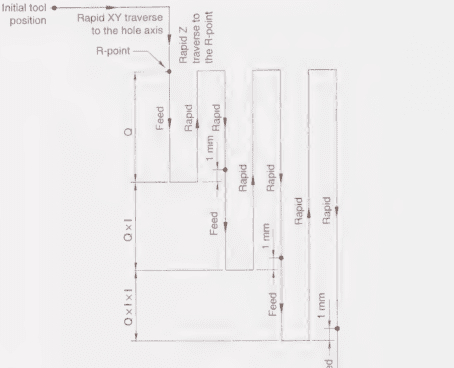

注：

- 1. 铣床上递减式啄钻循环 G183 的语法为
  `G183 X_ Y_ Z_ R_ Q_ I_ M_ F_`
  其中
  X、Y 为孔位置，
  Z 为孔深，
  R 为 R 点高度，
  Q 为第一次啄钻长度，
  I 为递减系数，
  M 为最小啄钻长度，
  F 为进给率。
- 2. 刀具先移动到 XY 点（孔轴线），然后以快速移动速率移动到 R 点，之后开始钻孔。设计的刀具路径与标准 G83 循环中的相同，不同之处在于后续啄钻长度按递减系数减小（Q → Q × I → Q × I × I，依此类推）。
- 3. 所有啄钻和回退均沿孔轴线进行。为清楚起见，图中将这些运动分开显示。
- 4. 如果计算出的啄钻长度小于指定的最小啄钻长度，则此次以及所有后续啄钻长度都被限制为指定的最小值。
- 5. 所有向外运动（回退）均为快速运动。
- 6. 每次钻孔运动先快速移动到前一次钻孔深度上方 1 mm 处，然后开始进给运动，使深度增加计算出的啄钻长度。
- 7. 啄钻持续到孔底。之后，刀具回退到 R 点或初始 Z 层。最后一次啄钻的运动将进行调整，以适应指定深度。

图10.4 铣床上的递减式啄钻循环。

- 12. 快速移动到前一次啄钻结束处 Z 位置上方 1 mm。
- 13. 进给运动，使现有孔深增加新的啄钻长度。
- 14. 存储当前 Z 位置。
- 15. 以快速速率回退到 R 点。
- 16. 设置 <required depth> = <required depth> − <current peck length>。
- 17. 转到步骤 10。
- 18. 钻至所需深度：先快速移动到前一次钻孔深度上方 1 mm，然后进给运动到达孔底。
- 19. 转到步骤 21。
- 20. 以单次连续进给运动到达最终深度。
- 21. 如果 G99 有效，则以快速速率回退到 R 点；如果 G98 有效，则回退到初始 Z 位置。
- 22. 返回调用程序。

该宏中使用的局部变量和公共变量如下（所有坐标均采用绝对坐标模式 G90）：

- X (#24) = 孔中心的 X 坐标
- Y (#25) = 孔中心的 Y 坐标
- Z (#26) = 孔底的 Z 坐标
- R (#18) = R 点的 Z 坐标
- Q (#17) = 第一次啄钻长度
- I (#4) = 递减系数（使得任何后续啄钻长度等于前一次啄钻长度乘以该递减系数。因此，I = 1 对应于恒定啄钻长度）
- M (#13) = 最小啄钻长度
- F (#9) = 进给率
- #100 = 存储初始刀具位置的 Z 坐标
- #101 = 存储 <required depth>（剩余待钻深度），每次啄钻后更新
- #102 = 存储一次啄钻结束时的 Z 坐标，因此该值也在每次啄钻后更新
- #103 = 当前啄钻长度（按前一次值乘以 #4 计算）

```
O9012 (REGRESSIVE PECKING ON MILL M/C);
IF (#24 EQ #0) THEN #3000 = 1 (SPECIFY HOLE Z-COORDINATE);
IF (#25 EQ #0) THEN #3000 = 2 (SPECIFY HOLE Y-COORDINATE);
IF (#26 EQ #0) THEN #3000 = 3 (SPECIFY HOLE DEPTH);
IF (#18 EQ #0) THEN #3000 = 4 (SPECIFY R-POINT);
IF (#17 EQ #0) THEN #3000 = 5 (SPECIFY FIRST PECK LENGTH);
IF (#13 EQ #0) THEN #3000 = 6 (SPECIFY MINIMUM PECK LENGTH);
IF (#4 EQ #0) THEN #3000 = 7 (SPECIFY REGRESSION FACTOR);
IF (#9 EQ #0) THEN #9 = #4109;
IF (#9 EQ #0) THEN #3000 = 8 (SPECIFY FEEDRATE);
                                      (Alarms out if inputs are missing)

#100 = #5043;                         (Initial Z-position stored. Step 1 complete)
G00 X#24 Y#25;                        (Rapid traverse to the hole center. Step 2 complete)
Z#18;                                 (Rapid traverse to the R-point. Step 3 complete)
#101 = #18 - #26;                     (Calculates required depth. Step 4 complete)
IF (#101 LE 0) THEN #3000 = 9       (IMPROPER R OR Z SPECIFIED);
#17 = ABS[#17];                       (Both positive and negative values for the first peck length allowed. Pecking would always be done in the negative Z-direction)
#13 = ABS[#13];                       (Both positive and negative values for the minimum peck length allowed)
IF [#101 LE #17] GOTO 10;             (If the required depth is less than or equal to the first peck length, jump to block N10 to drill the hole without pecking. Step 5 complete)
G01 Z[#18 - #17] F#9;                 (Drilling done up to the first peck length, measured from the R-point. Step 6 complete)
#102 = #5043;                         (Current Z-position stored. Step 7 complete)
#101 = #101 - #17;                    (Required depth updated. Step 8 complete)
G00 Z#18;                             (Rapid retraction to R-point. Step 9 complete)
#103 = #17;                           (Current peck length initialized)
WHILE [[#101 GT #13] AND [#101 GT [#103 * #4]]] DO 1;  (Drilling in a loop. If the required depth becomes smaller than or equal to the minimum peck length or the new peck length, exit from the loop. Step 10 complete)
#103 = #103 * #4;                     (New peck length calculated. Step 11 complete)
IF [#103 LT #13] THEN #103 = #13;
G00 Z[#102 + 1];                      (Rapid motion up to 1 mm above the Z-position at the end of the previous peck. Step 12 complete)
G01 Z[#102 - #103];                   (Feed motion to increase the depth by the calculated peck length. Step 13 complete)
#102 = #5043;                         (Current Z-position stored. Step 14 complete)
G00 Z#18;                             (Rapid retraction to R-point. Step 15 complete)
#101 = #101 - #103;                   (Required depth updated. Step 16 complete)
END 1;                                (Jump to the WHILE block to check the loop condition again. Step 17 complete)
G00 Z[#102 + 1];
G01 Z#26;                             (Remaining depth drilled. Step 18 complete)
GOTO 20;                              (Jump to N20 for final retraction. Step 19 complete)
N10 G01 Z#26 F#9;                     (Single feed motion to reach the final depth. Step 20 complete)
N20 G00 Z#18;                         (Retracts to R-point)
IF [#4010 EQ 99] GOTO 30;             (Jumps to program end if G99 is active)
G00 Z#100;                            (Retracts to the initial Z-level, if G98 is active. Step 21 complete)
N30 M99;                              (Return to the calling program. Step 22 complete)
```

给定宏使用毫米模式，并且只能在绝对坐标模式下调用。虽然使其也适用于英寸模式很容易，但要使其用于增量坐标模式（G91）则需要多花一点功夫。这留给读者作为练习。

为了说明该宏的用法，考虑图 10.5 所示的零件，其中假设孔很深（即具有较大的长径比），因此需要使用递减式啄钻循环（G183）。为便于识别，G183 程序段以高亮显示：

```
G21 G94 G54;
G91 G28 Z0;
G28 X0 Y0;
M06 T01;
G90 G00 X0 Y0;
```


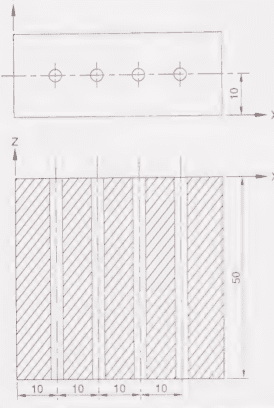

**图 10.5** 带有深孔的块体。

```gcode
G43 H01 Z100;
M03 S1000;
M08;
G99;
G183 X10 Y10 Z-53 R2 Q10 10.9 M5 F20;
G183 X20 Y10 Z-53 R2 Q10 10.9 M5 F20;
G183 X30 Y10 Z-53 R2 Q10 10.9 M5 F20;
G98;
G183 X40 Y10 Z-53 R2 Q10 10.9 M5 F20;
M09;
M05;
G91 G28 Z0;
M30;
```

请注意，前三个孔已在 G99 模式下加工，最后一个孔在 G98 模式下加工。因此，在完成前三个孔中的每一个孔后，刀具将停留在 R 点（工件的上表面上方的 2 mm 处），而在完成最后一个孔后，刀具将退回初始 Z 高度（工件上方 100 mm 处）。此外，最后三次调用可以没有 F 字，因为宏被设计为：如果在调用宏时未指定进给率，则自动使用先前的进给率。

宏调用（使用 G65 或其他方法）应出现在单独的程序段中，如给定示例中 G98 和 G99 未与 G183 组合在一起。如果在同一程序段中，在宏调用左侧编程一个 G 代码，则控制系统会忽略它。另一方面，在宏调用右侧的 G 代码会触发报警，因为它被视为宏的参数，而 G 字不允许作为参数。M98 在这种情况下行为不同。它不会忽略 G 代码或触发报警，但不会等待 G 代码执行完成。因此，如果是移动代码（如 G01），子程序将在刀具仍在移动时开始执行。因此，为避免任何混淆，子程序和宏应始终在单独的程序段中调用。

某些固定循环以及诸如螺旋插补之类的特殊功能代码是作为选项提供的，需要额外向控制系统制造商付费。也可以在以后激活任何选项，前提是机床硬件具备处理该选项的能力（如有疑问，请咨询 MTB）。然而，如给定示例所示，用户自己就可以定义所需的 G 代码，并具有所需的功能。在某些情况下，这些代码甚至可能比标准代码更好！如果你对宏编程足够熟悉，并且愿意动脑筋，那么你几乎可以做任何事情。

# 第 11 章：探测

## 11.1 简介

如果通过自动化这些耗时的过程来减少设置时间和检测时间，CNC 机床的生产率可以得以提高。该技术大致涉及某些尺寸的自动测量，并根据测量结果做出与加工相关的决策。这一过程被称为*探测*。

常用于探测的设备是触发式测头，它通过电缆或红外/无线电信号与控制系统保持电子连接。触发式测头能感知非常微小的位移，并在“被触碰”时发出一个电信号（称为*跳跃信号*）。控制系统在收到信号的瞬间立即将测头/刀具的位置存储到系统变量 #5061–#5064 中（参见表 3.11），并停止刀具的进一步移动。在计划位置处存储的位置用于计算所需尺寸。

触发式测头有两种基本类型：*刀具测头*和*工件测头*。刀具测头用于自动化刀具偏置设置过程，该过程原本是手动操作，依赖容易出错的人工判断。它是一种固定式测头，始终安装在机床主体上的固定部件上。需要被测量的刀具被移去触碰它（测头）。由于测头的位置已知，因此可以提取有关刀具几何形状的信息。此外，定期重复此过程可获得刀具磨损程度的信息，以便适当编辑磨损偏置，从而消除因刀具磨损引入的误差。刀具尺寸突然大幅变化则表明刀具已破损。

另一方面，工件测头是一种移动式测头。它像刀具一样被机床夹持，并像刀具一样移动，以便在所需位置触碰工件/成品。跳跃信号时存储的位置用于计算工件/成品的所需尺寸。本章示例仅涉及此类测头。这种测头有一个长测杆，其末端带有一个小红宝石球（之所以使用红宝石，是因为它硬度高，从而防止因磨损而导致球的尺寸发生变化）。当球压向一个固定表面时，测杆会稍微偏转，并扰动测头内部的光学聚焦装置。一个差分光电池感测像点位置的变化并触发信号。如果需要，计算时必须考虑球直径的影响。（在某些情况下，它不会影响计算结果，例如，在取两个位置之差时可能会相互抵消。）

测头的测杆由弹簧系统支撑，因此当被坚硬表面突然偏转时不会折断。通常，测头尖端（球）处允许的最大偏转为 5 mm。请注意，由于测头尖端过冲，存储的位置可能不太准确。处理过冲的一种方法是使用固定且受控的速度（进给率），并使用校准图表来估算过冲量。另一种方法是以非常低的速度进行探测。由于这会花费太多时间，因此对表面进行两次探测。首先以高速触碰表面，然后，当触发跳跃信号时，后退一小段距离（例如 2 到 3 mm），再以非常低的速度朝表面移动。这种技术可以在很短的时间内获得良好的结果，因此在大多数情况下是首选。本章示例均采用相同方法。

## 11.2 CNC 机床上的跳跃功能

除了所需的硬件（触发式测头和控制系统用于接收跳跃信号的物理连接）之外，控制系统还应在软件层面配备跳跃功能特性。相关的 G 代码是 G31。因此，除非 G31（或 Fanuc 之外的其他控制系统上的类似代码）可用，否则探测将无法实现。在某些控制系统版本上，G31 可能是一个可选功能。

G31 与 G01 非常相似，不同之处在于当控制系统接收到跳跃信号时，G31 的执行立即终止，此时刀具/测头的位置自动存储到某些系统变量中，并开始执行下一个程序段。当我们说要使刀具/测头移向待探测表面时，实际上指的是使用 G31 命令进行移动。图 11.1 解释了 G31 在铣床上的功能，包括有跳跃信号和无跳跃信号两种情况。在没有跳跃信号的情况下，移动会进行到编程终点；而在控制系统收到跳跃信号的那一刻，移动会终止并开始执行下一个程序段。

```gcode
G91;
G31 X80 F100;
G01 Y40;
```

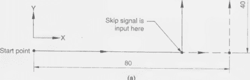

```gcode
G91;
G31 X60 F100;
G01 X20 Y40;
```

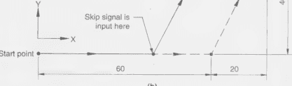

图例：
- 实际运动
- 无跳跃信号的运动

**注意：** G31 的设计目的是与刀具路径中的障碍物配合工作，以便为测量目的生成跳跃信号。它没有其他用途。因此，在 G31 到达指定点之前没有出现跳跃信号，很可能表示存在错误状况，要么是编程错误，要么是零件尺寸意外偏差。因此，在这种情况下，某些控制系统会发出报警并终止程序的进一步执行。

**图 11.1** 与跳跃功能（G31）相关的运动。

## 11.3 探测型腔

测量型腔的尺寸是一个非常简单的探测示例，但它非常清楚地解释了基本原理。测头只需依次触碰零件的上表面和型腔底部，即可进行深度测量。各自跳跃信号时的 Z 位置之差就是型腔的深度。如图 11.2 所示（分别为 B 和 D 位置）。请注意，球的直径不会影响结果，因为球的同一点接触了两个表面。类似地，其他尺寸（例如，型腔的长度/宽度以及


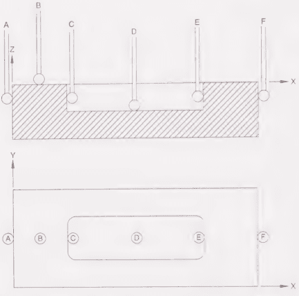

图 11.2 在铣床上探测型腔。

可以测量工件的长度/宽度。型腔的长度可以通过在例如 C 和 E 位置接触型腔，然后取所存储的 X 坐标之差来测量。从几何关系可以清楚看出，测球直径需要加到所得长度上。另一方面，当通过在 A 和 F 位置接触工件来测量工件长度时，需要从所得值中减去测球直径。

型腔的尺寸对于说明探测原理并不重要。然而，为了编写程序，假设块体和型腔的“预期”尺寸分别为 90 mm × 36 mm × 20 mm 和 50 mm × 16 mm × 10 mm，它们的中心都在 (45, 18, 18)。还假设测头占用 1 号刀位，长度补偿偏置号为 01。假设测球直径为 5 mm。针对此问题的程序有意不按通用情况编写，因为其唯一目的是说明探测原理，而不引入额外的复杂性：

```text
X0;
X50;
Z-10;
G31 X-100 F200;                 (Approaches the right side of the block)

X2;
G31 X-5 F10;
#104 = #5061;                    (X-coordinate at position F stored)
X5;
Z10;
X-120;
Z-10;
G31 X100 F200;                   (Approaches the left side of the block)
X-2;
G31 X5 F10;
#105 = #5061;                    (X-coordinate at position A stored)
#502 = #104 - #105 - 5;          (Length of the block calculated, in which diameter of the ball has been taken into account)

X-5;
G28 Z0;
G28 X0 Y0;
M30;
```

型腔和块体的 Y 方向尺寸可以用类似方法确定。这留给读者作为练习。对孔进行探测的方式与此类似，测头通常像内径刀具一样装夹。

## 11.4 确定孔的中心

有时工件是带有预制孔的铸件，加工程序将工件零点设在孔的中心。这就要求主轴与孔轴线精确对准，以便确定沿 X 轴和 Y 轴的工作偏置。这通常借助主轴式百分表完成。使杠杆端部与孔内某点接触，然后让主轴以极低转速旋转。调整 X 和/或 Y 位置，使所有角度位置上的百分表读数相同，即可确定孔的中心。虽然这种方法理论上正确且经常使用，但需要试错。因此，基准设定所需时间在很大程度上取决于操作人员的技能。下面我们来看如何使用触发式测头自动完成这一过程。

考虑图 11.3 所示的孔。定位中心的原理非常简单：圆心位于任意两条弦的垂直平分线的交点处。作为一种特殊情况，如果两条弦分别平行于 X 轴和 Y 轴，则圆心的 X 坐标与平行于 X 轴的弦的中点的 X 坐标相同；同理，圆心的 Y 坐标与平行于 Y 轴的弦的中点的 Y 坐标相同。当用触发式测头找到弦的端点时，测球直径就会产生影响，因为孔壁不是由测球上的同一点接触的。（测球上与孔壁接触的点在图 11.3 中用圆点标出。）然而，由于对称性，这不会影响我们的计算，从图中可以看出。

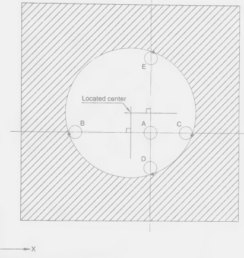

现在将基于这一原理开发一个宏程序。要确定孔的中心，只需将测头测球放在孔内某处（例如 A 点），然后调用该宏程序。定位中心后，宏程序会通过编辑相关的系统变量，将工件零点设置在该点。

如果选择 B 或 C 位置进行计算，为避免这种情况，可使用 D 或 E 位置。矩形型腔的中心可以用类似方法确定。

## 11.5 求棱边角度

有时，矩形块体的加工程序将程序零点设在例如块体的左下角，且坐标轴与其各边平行。在这种情况下，需要非常精确（因而昂贵）的夹具来正确装夹工件。不精确的夹具会导致装夹不正确，如图 11.4 所示，其中编程所用坐标系 (X-Y) 与工件坐标系 (X<sub>w</sub>Y<sub>w</sub>) 不重合。解决此问题的方法是将工件零点移动到 O 点，然后使用坐标系旋转功能（G68）执行加工程序。如上一个示例所示，将刀具定位到 O 点后调用宏程序 C0808，即可平移坐标系。要指令 G68，必须知道角度 θ（以度为单位）。算法如下：

- 1. 求出角度 θ。
- 2. 求出 O 点的 X 和 Y 坐标。
- 3. 将刀具定位到 O 点（在工件上方的一个安全高度处）。
- 4. 调用 C0808。
- 5. 指令 `G17 (G68 X0 Y0 R<θ>)`（旋转中心 X0 Y0 可以留空，因为如果未指定，当前刀具位置会自动成为旋转中心）。
- 6. 执行加工程序。
- 7. 指令 `G69`（取消坐标系旋转）。
- 8. 程序结束。

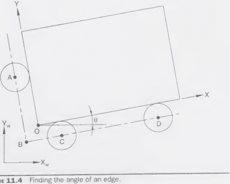

O 点的 X、Y 坐标以及角度 θ 可以通过触发式测头来确定。为此，测头需要接触工件正交棱边上的三个点，如图 11.4 所示。设这三个点 A、C、D 的坐标分别为 $(x_A, y_A)$、$(x_C, y_C)$ 和 $(x_D, y_D)$。下面的公式可用于所需计算。（请尝试用解析几何推导这些公式。）

直线 CD 和 AB（与 CD 正交）的方程为：

$$y_{CD}=\frac{y_D-y_C}{x_D-x_C}(x-x_C)+y_C$$

$$y_{AB}=-\frac{x_D-x_C}{y_D-y_C}(x-x_A)+y_A$$

联立求解这两个方程，可得出这两条直线的交点 B 的坐标 $(x_B, y_B)$：

$$x_B=\frac{m^2x_C-my_C+x_A+my_A}{m^2+1}$$

$$y_B=\frac{-mx_C+y_C+mx_A+m^2y_A}{m^2+1}$$

其中

$$m=\frac{y_D-y_C}{x_D-x_C}$$

角度 θ 由下式给出：

$$\theta=\tan^{-1}m$$

最后，程序零点 O 的坐标为：

$$x_O=x_B+\sqrt{2}\,r\cos(\theta+45)$$

$$y_O=y_B+\sqrt{2}\,r\sin(\theta+45)$$

其中，r 是测头测球的半径。

```text
G28 W0;                         (Z-home)
T#20;                           (The probe becomes the current “tool”)
G00 Z[#26 - #7 / 2];            (Center of the probe at the specified Z-coordinate, where measurement is to be made. The radius of the probe has been subtracted from the specified value, assuming that the tip of the probe is its reference point)
X[#24 + #7 + 4];                (Probe at a clearance of 2 mm from the diameter to be measured. Make necessary changes in positioning too, if an internal diameter machine is being probed. Moreover, both the plus signs would change to minus signs, for an internal measurement)
#103 = #4005;                   (Stores 98 or 99, depending on which one of G98 and G99 is currently active)
G98;                            (Since the spindle is stationary, this macro would not work in G99, the feed per revolution mode, because the feedrate would become zero when zero rpm)
G31 U-10 F10;                   (Stops at the surface, where the diameter is to be measured)
#104 = #5061;                   (X-coordinate of the center of the probe ball stored when it touches the part)
#105 = #104 - #7;               (Diameter of the part calculated. In the case of an internal diameter, the diameter of the ball would have to be added here. Step 2 complete)
#106 = #105 - #24;              (Error due to wear calculated. This quantity would be negative if probing is being done for an internal tool. Step 3 complete)
#107 = 10000 + #102;            (The system variable for wear offset, corresponding to the offset number being used, is determined. Replace 10,000 by 2000, if only 64 offset numbers are available. 10,000 series is for 99 offset numbers. Step 4 complete)
#[#107] = #[#107] - #106;       (Error subtracted from the current wear offset value. This expression is also correct for internal measurement, since the sign of #106 would automatically become negative. Step 5 complete)
G28 U0;                         (X-home)
G28 W0;                         (Z-home)
T#100;                          (Original tool called, with the updated wear offset value)
G#103;                          (Modal G-code restored)
M99;                            (Return to the calling program. Step 6 complete)
```


Z轴磨损补偿可按类似方式进行，这留作练习（通常径向磨损比轴向磨损更严重）。需要触碰一个已知Z面（该面已由待测刀具端面加工过），并确定误差。在这种情况下，内孔刀具和外圆刀具的程序相同。Z轴磨损补偿系统变量属于#2100系列（用于64个补偿）和#11000系列（用于99个补偿）（参见表3.2和表3.3）。

为了使用宏O8023，需要在要进行磨损调整的刀具加工完成后立即调用它。可以使用新的磨损补偿值继续进一步加工。事实上，在怀疑存在不准确时，可以先给出一条小切削深度的单一直线车削指令。调用该宏后，可以给出主加工代码。这将使检测和修正过程自动化。例如，可以每10个零件后使用此技术，这将确保几乎零废品。当前加工会话中已加工零件数存储在系统变量#3901中（参见第3.5节“已加工零件数”小节）。主程序可以通过以下方式调用/跳过探测宏：

```
<set-up commands>
<straight turning>
IF [#3901 LE 10] GOTO 100;
G65 P8023 T_ X_ Z_ D_;
#3901 = 0;
N100;
<machining program>
M30;
```

其中每当调用宏时，零件计数复位为零。如果零件计数变量#3901不应复位（因为可能希望跟踪当前加工会话中已加工零件的总数），如何实现相同逻辑，留作读者练习。

O8023宏调用的参数传递以下数据：

- T (#20) = 测头的四位刀具代码
- X (#24) = 要探测的直径
- Z (#26) = 要执行探测的轴位置
- D (#7) = 测头球直径

尽管可以针对特定探测需求开发宏，但测头制造商通常随测头提供用于常见探测应用的软件。

# 第12章 与外部设备的通信

## 12.1 引言

第3.5节（接口信号小节）已充分说明如何通过PMC控制外部设备。然而，梯形图语言知识是PMC编程的前提。此外，还必须了解PLC的输入类型（源型/漏型）、输出类型（源型/漏型继电器型）和接线技术。此外，如果希望使用非接触式接近开关来感测物体是否存在，必须了解此类传感器的特性（源型/漏型）。整个内容相当庞大，只能在专门为此设计的教材中详细描述。但为方便读者，本章给出简要说明，即必须了解的最低限度内容。这里主要目的是重温记忆，而不是细致解释基本概念。因此，完全不了解PLC应用的读者需要参考一些PLC基础教材。

## 12.2 开关原理

PLC的输入/输出数字信号基于晶体管的饱和模式工作原理，此时晶体管开始像电子通/断开关一样工作。（在饱和之前，它用于信号放大。）

NPN晶体管的表示及其功能模型如图12.1所示。I_B、I_C和I_E分别为基极电流、集电极电流和发射极电流。（I_E = I_B + I_C。）集电极与发射极之间的可变电阻（R_CE）连接电源（+V_CC）和负载，可认为受基极电流控制；当基极电流为零时，电阻为无穷大，并随基极电流增加而减小。因此，当基极电流增加时，集电极电流也增加。

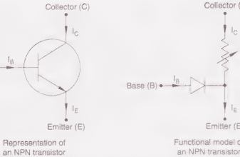

**图 12.1** NPN晶体管。

I_C与I_B之比称为晶体管的电流增益，典型值为100。（由于电流增益通常很高，I_C和I_E几乎相等。）这描述了晶体管作为电流放大器的用途。然而，超过某一基极电流值后，R_CE变得几乎为零。结果，I_C不再进一步增加，晶体管被称为饱和。在饱和模式下，I_C取决于外部电阻（负载）和电源；晶体管对电流流动呈现几乎为零的电阻。这种理想晶体管特性如图12.2所示。

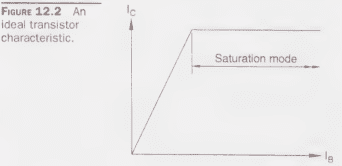

因此，晶体管可以在饱和模式下用作电子开关。对于这种用途，电路（调节基极电流）设计成使晶体管保持OFF（I_B = 0，导致I_C = 0）或进入饱和。

PLC的数字输入/输出使用类似的电子开关。然而，为了保护内部电路免受外部电流影响，通常使用某种光电隔离器。光电隔离器是一种由发光元件（如LED）和光敏元件（如光电晶体管）组成的器件。当向LED施加电压时，会产生光，由光电检测器感测。足够的光会使光电晶体管饱和并开始导通。这种布置将PLC与外部电流/电压完全隔离，因为两者之间的连接仅通过光束。对于交流输入，使用两个反向并联的LED。图12.3显示了直流和交流输入信号的这种布置。

**图 12.3**  
典型PLC输入电路。

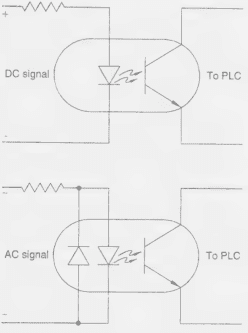

直流信号也可以提供给交流输入，而不必担心极性。因此，交流型输入实际上是交流/直流型输入。需要限流电阻来限制通过LED的电流。固态输出端子通常也使用类似的隔离技术。

## 12.3 输入类型与接线

商用PLC除高速输入和立即输入等特殊功能输入外，还提供多种“普通”输入，如直流、交流和模拟量型输入。但PMC通常只接受24V DC型普通输入。限制是不得使用外部电源提供输入信号；PMC内部的24V DC可用于此目的，位于输入/输出单元每个50针连接器的一个引脚上（在01控制器的CB104/105/106/107的B01号引脚上：A01号引脚上提供0V）。这是因为PMC内部通常没有类似PLC的光电隔离器。但请注意，通过在PMC的输入/输出单元中插入某些输入/输出卡，可选提供各种带隔离或不带隔离的输入/输出。标准配置通常只接受24V DC漏型/源型输入，并提供源型输出（显然是为了让继电器等外部设备在24V DC外部电源下工作）。本章讨论仅限这些输入/输出类型。

通过连接器CB104/105/106/107送入PMC的输入信号（称为DI信号）通常为漏型（消耗能量型）。因此，必须在相应端子提供+24V作为ON输入信号。但某些DI信号可设置为漏型或源型，尽管从安全角度看源型DI信号不可取。这是因为源型输入要求向输入端子提供0V作为ON输入信号。这很危险，因为接地输入线（由于故障）会被解释为ON输入信号。因此，建议所有DI信号都用作漏型信号。

图12.4说明了向PMC提供漏型DI信号（当然为数字信号）的方法。源型DI信号的接线类似，区别是使用A01号引脚上提供的0V而不是+24V作为ON输入信号。DI信号X000.4至X000.7（通过连接器CB106提供）既可用作源型信号，也可用作漏型信号。对于漏型信号，CB106的端子（端子号A14）连接到0V（端子号A01）。对于源型应用，COM4连接到+24V（端子号B01）。COM4绝不能悬空，否则无论输入信号状态如何，X000.4至X000.7将始终为OFF。外部开关表示由外部开关/传感器执行的离散开关动作（ON/OFF）。

## 12.4 连接器引脚分配

输入/输出连接总体布置（在0i控制器上）的框图如图12.5所示。PMC位于CNC控制单元中。它通过I/O链路（标准Fanuc电缆）连接到I/O单元。在机床制造商设计的电气柜中可以看到I/O单元、端子排和继电器PCB。在I/O单元上，有四个50针连接器（CB104、CB105、CB106和CB107）用于接收/发送输入/输出信号。它们通过四根带状（扁平）电缆连接到端子排。这些连接器的每个引脚都用于某些特定输入/输出信号，如表12.1和12.2所示。来自开关/传感器的输入线直接连接到端子排，但输出设备通过继电器驱动，因为这些设备可能需要大电流和/或交流电源。


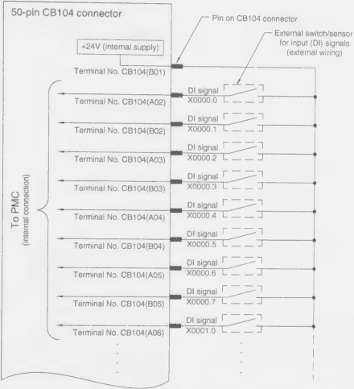

**图12.4** 漏型DI信号的输入接线。

通常，可提供96个输入（另有用于*手动脉冲发生器*的24个输入和用于DO报警检测的8个输入）和64个输出。在0i控制系统中，X0至X11（每个由8位组成，例如X0000.0至X0000.7）用于96个DI信号，X12用于MPG，X13和X14（各8个信号）用于附加MPG（如有），X15（8个信号）用于DO报警检测（例如DO驱动器内部过流或温度异常，其由过载引起，原因例如电源电缆意外接地）。Y0至Y7（每个由8个信号组成，例如Y0000.0至Y0000.7）用于DO信号。

这96个输入和全部64个输出可用于任何目的。然而，如果机床配有Fanuc MOP，则X4至X11连接到MOP的各种按键。因此，只有X0至X3（32个信号）是通用DI信号，其中一些可能被MTB使用，其余保持空闲。

**表12.1（续）**

**CB104**

| 引脚号 | A排 | B排 |
|---|---|---|
| 13 | X0002.6 | X0002.7 |
| 14 |  |  |
| 15 |  |  |
| 16 | Y0000.0 | Y0000.1 |
| 17 | Y0000.2 | Y0000.3 |
| 18 | Y0000.4 | Y0000.5 |
| 19 | Y0000.6 | Y0000.7 |
| 20 | Y0001.0 | Y0001.1 |
| 21 | Y0001.2 | Y0001.3 |
| 22 | Y0001.4 | Y0001.5 |
| 23 | Y0001.6 | Y0001.7 |
| 24 | DOCOM | DOCOM |
| 25 | DOCOM | DOCOM |

**CB105**

| 引脚号 | A排 | B排 |
|---|---|---|
| 13 | X0009.6 | X0009.7 |
| 14 |  |  |
| 15 |  |  |
| 16 | Y0002.0 | Y0002.1 |
| 17 | Y0002.2 | Y0002.3 |
| 18 | Y0002.4 | Y0002.5 |
| 19 | Y0002.6 | Y0002.7 |
| 20 | Y0003.0 | Y0003.1 |
| 21 | Y0003.2 | Y0003.3 |
| 22 | Y0003.4 | Y0003.5 |
| 23 | Y0003.6 | Y0003.7 |
| 24 | DOCOM | DOCOM |
| 25 | DOCOM | DOCOM |

**表12.2 CB106和CB107连接器的引脚分配**

**CB106**

| 引脚号 | A排 | B排 |
|---|---|---|
| 01 | 0V | +24V |
| 02 | X0004.0 | X0004.1 |
| 03 | X0004.2 | X0004.3 |
| 04 | X0004.4 | X0004.5 |
| 05 | X0004.6 | X0004.7 |
| 06 | X0005.0 | X0005.1 |
| 07 | X0005.2 | X0005.3 |
| 08 | X0005.4 | X0005.5 |
| 09 | X0005.6 | X0005.7 |
| 10 | X0006.0 | X0006.1 |
| 11 | X0006.2 | X0006.3 |
| 12 | X0006.4 | X0006.5 |
| 13 | X0006.6 | X0006.7 |
| 14 | COM4 |  |
| 15 |  |  |
| 16 | Y0004.0 | Y0004.1 |
| 17 | Y0004.2 | Y0004.3 |
| 18 | Y0004.4 | Y0004.5 |
| 19 | Y0004.6 | Y0004.7 |
| 20 | Y0005.0 | Y0005.1 |
| 21 | Y0005.2 | Y0005.3 |
| 22 | Y0005.4 | Y0005.5 |
| 23 | Y0005.6 | Y0005.7 |
| 24 | DOCOM | DOCOM |
| 25 | DOCOM | DOCOM |

**CB107**

| 引脚号 | A排 | B排 |
|---|---|---|
| 01 | 0V | +24V |
| 02 | X0007.0 | X0007.1 |
| 03 | X0007.2 | X0007.3 |
| 04 | X0007.4 | X0007.5 |
| 05 | X0007.6 | X0007.7 |
| 06 | X0010.0 | X0010.1 |
| 07 | X0010.2 | X0010.3 |
| 08 | X0010.4 | X0010.5 |
| 09 | X0010.6 | X0010.7 |
| 10 | X0011.0 | X0011.1 |
| 11 | X0011.2 | X0011.3 |
| 12 | X0011.4 | X0011.5 |
| 13 | X0011.6 | X0011.7 |
| 14 |  |  |
| 15 |  |  |
| 16 | Y0006.0 | Y0006.1 |
| 17 | Y0006.2 | Y0006.3 |
| 18 | Y0006.4 | Y0006.5 |
| 19 | Y0006.6 | Y0006.7 |
| 20 | Y0007.0 | Y0007.1 |
| 21 | Y0007.2 | Y0007.3 |
| 22 | Y0007.4 | Y0007.5 |
| 23 | Y0007.6 | Y0007.7 |
| 24 | DOCOM | DOCOM |
| 25 | DOCOM | DOCOM |

类似地，若干输出信号连接到Fanuc MOP的LED。然而，在许多情况下，MTB会设计自己的MOP，并选择哪个信号用于哪种目的。未使用的信号可用于与外部设备通信。需要查阅MTB提供的电气接口手册，以了解他们使用了哪些信号。其余信号空闲，可供用户使用。

如果DI/DO点数不足，则需要增加额外的I/O单元。另一方面，如果即使最小可用点数也超过需求，MTB可能不会为全部四个连接器提供连接。在这种情况下，端子排通常没有CB107的物理连接。

## 12.5 源型/漏型PLC输入的离散传感器

在标准PMC配置中，仅允许离散输入/输出信号。输入信号可由机械开关（*瞬时*型或*保持*型ON/OFF开关，或限位开关）或接近传感器提供。接近传感器内部具有电子开关系统。它们通常为*常开*（N/O）型，当物体进入其设计范围时，触点闭合，模拟开关动作。

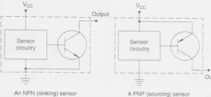

**图12.6** 离散型接近传感器。

由于内部通常使用晶体管进行开关，此类传感器可以是PNP型和NPN型。PNP型传感器在其输出端提供+V<sub>CC</sub>，而NPN型传感器在导通时将其连接到地（0 V）。在关断状态下，输出端保持电气开路。因此，PNP传感器提供源型输出（+V<sub>CC</sub>），被称为源型传感器。类似地，NPN传感器被称为漏型传感器（因为它通过其输出端汲取电流）。图12.6展示了这两种传感器。

只有当源型提供的电流被漏型泄放时，电路才能闭合。因此，源型传感器只能连接到PLC的漏型输入。类似地，漏型传感器连接到源型输入。虽然两种可能性都存在，但通常所有PMC输入均采用源型接法，因为源型传感器连接到这些输入。图12.7展示了源型传感器如何连接到漏型PLC输入。与PMC的连接以类似方式进行。（PMC的输入可能没有光隔离。）

漏型PLC输入的一个限制是传感器和PLC必须使用相同的V<sub>CC</sub>。另一方面，源型PLC输入允许传感器也使用不同的V<sub>CC</sub>工作；只需共地。当传感器和PLC的工作电压要求不同时，这很有用。图12.8展示了这种配置，其中漏型传感器连接到源型PLC输入。注意，此图中所示PLC的输入实际上是源型/漏型（交流型），可接线为源型和漏型两种。此处展示的是源型接线，这是漏型传感器所需的。PLC和传感器的工作电压分别为V<sub>CC1</sub>和V<sub>CC2</sub>，可以相同或不同。然而，如前所述，出于安全考虑，不建议采用这种接线。

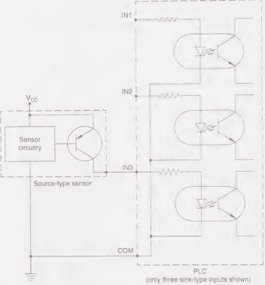

**图12.7** 源型传感器连接到漏型PLC输入。

## 12.6 输出类型与接线

在商用PLC中，有几种类型的输出可用，采用不同的控制方式。然而，用于I/O控制的PMC使用N沟道增强型MOSFET开关技术。其开关动作类似于NPN晶体管，其中MOSFET的源极、栅极和漏极分别对应于NPN晶体管的发射极、基极和集电极。

MOSFET与晶体管的一个主要区别是，MOSFET是电压控制的，而晶体管是电流控制的（用于所需偏置）。当在栅极施加电压时，会产生静电场，从而在漏极和源极之间形成导电沟道（P型或N型）。没有电流流过栅极。

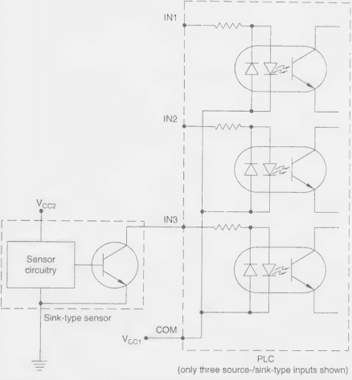

**图12.8** 漏型传感器连接到源型PLC输入。

这不仅可以提供输入和输出电路之间的隔离，而且输入负载要求也可保持可忽略不计，这是MOSFET相对于晶体管的主要优势。

MOSFET漏极和源极之间导电沟道的电导率取决于栅极上的电压水平。与使用晶体管进行开关的情况一样，MOSFET也用于其饱和工作模式下的开关（即，对于给定的栅极电压，漏极电流要么为零，要么保持在其最大值不变）。图12.9说明了N沟道MOSFET的开关动作。（另一种类型是P沟道MOSFET。两者之间的差异在于结构层面。整体电路连接相同，只是源极和漏极的极性发生变化。其开关动作类似于PNP晶体管。）当按下开关时，LED点亮。注意，连接到栅极的高阻值电阻


**图 12.9** 作为开关的 N 沟道增强型 MOSFET


功耗可忽略不计。有关 MOSFET 的更多信息，请参阅固态器件的基础教材。

PMC 的输出信号设计为源型输出，使用 MOSFET 作为开关器件。图 12.10 给出了 CB104 的典型输出接线（CB105、CB106 和 CB107 的接线类似；引脚连接请参阅表 12.1 和表 12.2），其中外部继电器由外部 24 V 直流电源供电，并由直流信号控制。使用继电器是因为 MOSFET 无法承受非常大的电流。此外，它不能用于交流设备。继电器避免了此类问题。

所有输出端子都必须独立接线，如图所示。切勿将两个（或更多）输出端子短接来驱动单个设备。另请注意，每个继电器线圈都并联有反偏二极管。当 MOSFET 信号关断时，这种二极管可防止继电器线圈两端产生过高电压。如果不加抑制，产生的电压可升高到数百伏，从而损坏 MOSFET。该二极管对感应电流进行分流，防止电压升高。事实上，有些继电器在制造时就预装了该二极管。


**图 12.10** 源型 DO 信号的输出接线。

源型输出的一个限制是，所有输出设备都必须使用同一个 $V_{CC}$ 工作（不过这无关紧要，因为我们只使用继电器作为输出设备，而且总能决定使用某种类型的继电器），因为 $V_{CC}$ 连接到公共输出端子（DOCOM）。在漏型输出中（PMC 不提供该类型），0 V 连接到公共输出端子，而 $V_{CC}$ 直接连接到输出设备。因此，可以为不同设备使用不同的 $V_{CC}$。然而，这种配置有一个严重缺点。如果由于某种故障，某个输出设备的导线（在 PLC 侧）接地，则该设备会在没有任何输出信号的情况下接通。因此，从安全角度考虑，源型输出优于漏型输出。当然，对于 PMC，除了源型输出外别无选择。

# 第 13 章：可编程数据输入

## 13.1 引言

CNC 机床的这一功能实际上与宏编程没有直接关系。本书之所以将其纳入，是因为它是一种高级编程功能，许多程序员并不了解它，尽管它非常有用，而且使用起来相当直接。

顾名思义，*可编程数据输入*由 G10 指令控制，用于将某些数据写入控制器，例如偏置值和参数。在某些控制器版本中，G10 是可选功能，如需使用则需激活。该功能不允许读取此类数据的当前值；只能覆盖这些值。

G10 的主要应用是输入以下数据：

- 工件坐标系的偏置距离
- 铣床上附加工件坐标系的偏置距离
- 铣床上的补偿值（长度和直径）
- 车床上的补偿值（径向/轴向值、刀尖半径和刀尖号）
- 参数值

G10 还可用于输入刀具管理数据，例如刀具寿命和偏置号。不过，本章不讨论这一内容，因为它不是非常常见的应用。

如果机床上具备宏编程功能，则在大多数情况下不需要 G10。这是因为所有偏置距离和补偿值的系统变量都可作为读写变量使用（参阅 3.5 节）。事实上，系统变量提供了更大的灵活性，因为还可以读取其中存储的当前值，而 G10 无法做到这一点。某些参数也可使用系统变量（尽管涵盖的很少）。然而，对于其余参数和刀具寿命数据，如果要通过程序更改其值，则必须使用 G10。

G10 可用于绝对模式和增量模式，以指定偏置距离和补偿值。在绝对模式下，指定值直接覆盖现有值；在增量模式下，指定值（带符号）加到现有值上。

G10 的作用是永久性的，即它对后续所有加工过程都有效，直到这些值再次被 G10 或其他方式更改。

## 13.2 WCS 偏置距离的数据输入

外部工件坐标系以及 G54 至 G59 工件坐标系的偏置距离，可在绝对或增量模式下按各轴分别指定。车床和铣床的语法相同：

```
G10 L2 P_ X_ Y_ Z_;
```

其中

- L2 选择此类数据输入，
- P0 指外部 WCS，
- P1 指 G54 WCS，
- P2 指 G55 WCS，
- P3 指 G56 WCS，
- P4 指 G57 WCS，
- P5 指 G58 WCS，
- P6 指 G59 WCS，
- X、Y 和 Z 包含相应轴的所需值。

在铣床上，需要在 G10 之前指令 G90/G91，以选择绝对/增量模式。在车床上，使用 G 代码系统时，X、Z 用于绝对值，U/W 用于增量值（车床上通常没有 Y 轴）。

增量模式对于根据观察到的误差修正偏置距离非常有用。例如，在铣床上，如果希望将 G54 WCS 沿 Z 轴负方向移动 0.1 mm（这样同一把刀具现在加工的层面比之前低 0.1 mm，而无需修改程序），可以指令（如果只需调整一次，可在 MDI 模式下）

```
G91 G10 L2 P1 Z-0.1;
```

当然，也可以通过相关系统变量完成（参阅表 3.12）：

```
#5223 = #5223 - 0.1;
```

两种方法效果相同。选择哪一种取决于个人偏好。不过，如果机床上未启用宏选项，则必须使用 G10。实际上，G10 也是一种可选功能，但现在通常随标准控制包提供。

## 13.3 附加 WCS 偏置距离的数据输入

除了可用 G54 至 G59 选择的六个标准 WCS 之外，铣床上还可选配 48 个附加 WCS（实际上，该选项最多也可提供 300 个附加 WCS）。在程序中通过以下指令调用这些 WCS：

```
G54.1 P<n>;
```

或简写为

```
G54 P<n>;
```

其中 n = 1 至 48。

它们分别称为第一附加 WCS、第二附加 WCS，依此类推，对应 n = 1、2、……。使用 G54.1/G54 时必须指定 P 字。如果未指定，控制器会自动采用 P1（表示第一附加 WCS）。

这些 WCS 的偏置距离可按与 13.2 节类似的方式指定：

```
G10 L20 P_ X_ Y_ Z_;
```

其中

- L20 选择此类数据输入，
- P1 指第一附加 WCS，
- P2 指第二附加 WCS，
- ...
- ...
- P48 指第 48 个附加 WCS，
- X、Y 和 Z 包含相应轴的所需值。

可使用绝对模式和增量模式。例如，以下指令会将第一附加 WCS 沿 Z 轴正方向移动 0.1 mm：

```
G91 G10 L20 P1 Z0.1;
```

当然，这也可以通过系统变量完成（参阅表 3.12）：

```
#7003 = #7003 + 0.1;
```

## 13.4 铣床补偿值的数据输入

这里所述内容涉及 0i 系列控制器中使用的 C 型补偿存储器（也称为 C 型偏置存储器）。铣刀长度（H 代码）和半径（D 代码）的补偿值可按表 13.1 所述指定，其中 P 字定义偏置号（通常为 1 至 400），R 字包含相应的补偿值。为兼容为较旧控制器型号编写的程序，系统允许指定 L1 来代替 L10。IS-B（增量系统 B）中补偿值的允许输入范围见表 13.2。有效范围远大于实际可能需要的范围。

下面给出一些示例。请注意，给出的说明仅在按顺序执行这些指令时才有效：

- 1. `G90 G10 L12 P10 R5;` — 将 5 mm 输入偏置号 10，作为 D 代码的几何补偿值，使刀具半径等于 5 mm，假定半径的磨损值为零。注意，D 代码指的是半径，而不是直径。
- 2. `G91 G10 L12 P10 R5;` — 以增量方式将 5 mm 输入偏置号 10，作为 D 代码的几何补偿值，使刀具半径等于 10 mm，而此前为 5 mm。
- 3. `G90 G10 L13 P10 R−0.5;` — 将 −0.5 mm 输入偏置号 10，作为 D 代码的磨损补偿值，使刀具半径等于 9.5 mm。

| 补偿值 | 格式 |
|---|---|
| H 代码的几何补偿值 | `G10 L10 P_R_;` |
| H 代码的磨损补偿值 | `G10 L11 P_R_;` |
| D 代码的几何补偿值 | `G10 L12 P_R_;` |
| D 代码的磨损补偿值 | `G10 L13 P_R_;` |

**表 13.1** H 代码和 D 代码值的可编程数据输入格式

| 几何补偿值（公制输入） | 几何补偿值（英制输入） | 磨损补偿值（公制输入） | 磨损补偿值（英制输入） |
|---|---|---|---|
| ± 999.999 mm | ± 99.9999 英寸 | ± 99.999 mm | ± 9.9999 英寸 |

**表 13.2** IS-B 中补偿值的有效输入范围


```
G91 G10 L13 P10 R-0.05;
```

（以增量方式向10号偏置中输入-0.05 mm，作为D代码的磨损补偿值，将其值改为-0.55，从而使刀具半径等于9.45 mm）

```
G90 G10 L10 P10 R-500;
```

（以绝对方式向10号偏置中输入-500 mm，作为H代码的几何补偿值）

```
G91 G10 L10 P10 R5;
```

（以增量方式向10号偏置中输入5 mm，作为H代码的几何补偿值，使其减小5 mm，变为-495 mm。因此，在相同的程序下，如果使用G43进行长度补偿，同一刀具将多切入工件5 mm）

```
G91 G10 L11 P10 R0.5;
```

（以增量方式向10号偏置中输入0.5 mm，作为H代码的磨损补偿值。因此，磨损值将增加0.5 mm，在相同的程序下，如果使用G43进行长度补偿，同一刀具将少切入工件0.5 mm）

当然，系统变量也可用于实现相同的功能。例如，第一个和最后一个示例分别等价于（参见表3.4）

```
#13010 = 5;
#10010 = #10010 + 0.5;
```

## 13.5 车床上补偿值的数据输入

可以指定径向/轴向距离、刀尖半径和刀尖号的几何值以及磨损值。与前面所述格式的一个区别是：在车床上输入补偿值时不使用L字。格式如下：

```
G10 P_ X_ Y_ Z_ R_ Q_;    (Absolute mode)
G10 P_ U_ V_ W_ C_ Q_;    (Incremental mode)
```

其中

- P0 指工件偏移值，
- P1至P64 指与1至64号偏置对应的磨损补偿值（假设有64个偏置号），
- P1001至P10064 指与1至64号偏置对应的几何补偿值，
- X/U、Y/V（如果Y轴可用）和Z/W 在绝对/增量模式下包含各轴所需的数值，
- R/C 在绝对/增量模式下包含刀尖半径，Q 包含刀尖号（两种模式下均如此）。

刀尖号或刀鼻号是由Fanuc针对不同的刀具方位任意定义的。图13.1显示了后置刀架式车床上的Fanuc定义的刀尖号。请注意，为几何偏置号指定的Q值会自动赋予对应的磨损偏置号，反之亦然。换句话说，Q的几何补偿值和磨损补偿值始终相同。这是数控系统的一项内置安全功能，可消除指定刀尖号时出现无意错误的可能性。

并非G10程序段中的所有补偿值都需要指定。未指定的值保持不变。下面给出一些示例：

```
G10 P10010 X-100 W5;   (Corresponding to geometry offset number
                       10, i.e., in the G10 row on the geometry offset
                       screen, the radial compensation value is set
                       to -100 mm, and the axial compensation value
                       is increased by 5 mm. Mixed coordinate mode
                       is allowed in G10)

G10 P10 X0 Z0;         (Corresponding to wear offset number 10,
                       the radial as well as the axial compensation
                       values are set to zero. In other words, the
                       radial and axial wear offsets are made zero,
                       for the W10 row on the wear offset screen)

G10 P10010 R0.8 Q3;    (Corresponding to geometry offset number
                       10, i.e., in the G10 row on the geometry offset
                       screen, the nose radius is set to 0.8 mm. The
                       tip number is set to 3 on both geometry and
                       wear offset screens, corresponding to offset
                       number 10)
```

在这种情况下，也可以使用系统变量来获得相同的结果。上面给出的三个G10程序段可以被以下程序段替换（参见表3.2）：

```
For G10 P10010 X-100 W5; use
#2710 = -100;
#2810 = #2810 + 5;
For G10 P10 X0 Z0; use
#2010 = 0;
#2110 = 0;
For G10 P10010 R0.8 Q3; use
#2910 = 0.8;
#2310 = 3;
```

另一个示例：如果需要清除全部64个偏置，可以在循环中执行G10。如果有99个偏置可用，只需将给定程序中的64改为99即可：

```
O8024 (CLEAR LATHE OFFSETS WITH G10);
#100 = 1;                         (Counter initialized)
WHILE [#100 LE 64] DO 1;          (Start of loop)
G10 P[#100] X0 Z0 R0;             (Clears wear offset)
G10 P[10000 + #100] X0 Z0 R0 Q0;  (Clears geometry offset)
#100 = #100 + 1;                  (Counter incremented)
END 1;                            (End of loop)
M99;                              (Returns to the calling program)
```

使用系统变量也可以完成同样的操作，尽管在这种情况下G10方法更简单：

```
O8025 (CLEAR LATHE OFFSETS WITH SYSVAR);
#100 = 1;                         (Counter initialized)
WHILE [#100 LE 64] DO 1;          (Start of loop)
[#2000 + #100] = 0;               (Clears X-axis wear offset)
[#2100 + #100] = 0;               (Clears Z-axis wear offset)
[#2200 + #100] = 0;               (Clears nose radius wear offset)
[#2300 + #100] = 0;               (Clears tip number)
[#2700 + #100] = 0;               (Clears X-axis geometry offset)
[#2800 + #100] = 0;               (Clears Z-axis geometry offset)
[#2900 + #100] = 0;               (Clears nose radius geometry offset)
#100 = #100 + 1;                  (Counter incremented)
END 1;                            (End of loop)
M99;                              (Returns to the calling program)
```

## 13.6 参数值的数据输入

到目前为止，读者可能会产生这样的印象：如果机床具有宏程序编程功能，就不需要使用G10。然而，系统变量方法仅限于到目前为止所讨论的内容。大多数参数没有关联的系统变量。因此，G10是通过程序更改参数的唯一方法。G10的这种用途通常被称为可编程参数输入。

与之前G10应用的一个区别是：当用于参数输入时，G10表现为模态代码。一旦进入参数模式，就可以在后续程序段中输入任意多个所需参数，直到该模式被G11取消。另一个区别是不允许使用十进制小数值。因此，如果参数与某个轴向距离有关，则必须按最小输入增量来指定该值（即在毫米模式下以微米为单位，在英制模式下以0.0001英寸的步长）。请注意，如果同一参数也定义了系统变量，则在此类变量中使用毫米或英寸（视情况而定）值。

请注意，最适合大多数情况的参数值已由MTB（机床制造厂）设置。不建议对这些值进行任何更改，因为不正确的设置可能导致机床出现不可预测的、可能危险的行为，从而造成操作员受伤或机床损坏，或两者兼有。然而，某些参数可能需要更改以适应特定应用，例如软件超程极限、车床上的G代码系统选择（A、B或C）、使用G00的直线定位、计算器型数据输入（例如，将X10解释为10 mm，而不是10 μm）等。但在这种情况下，在进行任何更改之前，请先记下原始设置，以便在设置不正确时能够恢复到原始值。任何更改都必须由有经验的人员在彻底研究打算更改的参数后完成。所有参数的完整说明可在随机附带的*《参数手册》*中找到。

进一步讨论需要清楚理解参数的类型。大致有四类参数：*位型*（允许的数据为0或1）、*字节型*（允许的数据范围为-128至127，或0至255）、*字型*（允许的数据范围为-32,768至32,767，或0至65,535）和*双字型*（允许的数据范围为-99,999,999至99,999,999）。位型参数有八位的行（最右边是位#0，最左边是位#7）。一些位型参数有多个八位行，每行对应一个机床轴。其他一些参数也有对应不同轴的多个行。在两轴车床上，第一行对应X轴，第二行对应Z轴。在三轴铣床上，三行分别对应X、Y和Z轴。这类参数称为轴型参数。为了有效利用内存，不同类型的参数用于不同的应用。例如，I/O通道是字节型参数，而设置软件超程极限（以微米为单位，机床坐标系）的参数是字型和双字型参数。

可编程参数输入的格式如下：

```
G10 L50;       (Parameter entry mode starts)
N_ R_;         (For parameters other than axis-type)
N_ P_ R_;      (For axis-type parameters)
...
...             (Multiple parameter entry is permitted)
...
G11;            (Parameter-entry mode ends)
```

其中

- L50 选择参数输入模式，
- N 包含参数号，
- P 包含轴号（仅用于轴型参数），
- R 包含该参数的指定值。


### 注意：

- 1. 在位型参数中，不能单独改变某一位。所有八位都必须指定。
- 2. 在R字中指定的值不能使用小数。
- 3. 在G10 L50和G11之间不能指定其他NC语句。
- 4. 如果正在使用固定循环，必须在执行G10 L50之前取消它。
- 5. 对于轴型参数，P1 指第一行，P2 指第二行，依此类推。
- 6. 允许按给定格式插入顺序号。如果一个程序段中出现两个N字，左侧的被视为顺序号，另一个为参数号。

### 示例 1（字型参数）：

调用用户宏程序号O9010的G代码存储在参数6050中，在车床和铣床上均如此。因此，如果希望通过，比如说，G100（可以选择1到9999之间的任意值；注意字型参数的允许范围大于参数6050的定义范围）来调用O9010，则需要在参数6050中存储100。可通过以下方式完成：

```
G10 L50;
N6050 R100;
G11;
```

### 示例 2（双字轴型参数）：

希望在车床上将外部偏置设置为零，G54 X偏置设置为150.123 mm，G54 Z偏置设置为300.456 mm。相关参数分别为1220和1221。要求以微米为单位指定这些值。在车床上，此类参数的第一行对应X轴，第二行对应Z轴。在铣床上，第三行对应Z轴。所需更改可通过以下方式完成：

```
G10 L50;
N1220 P1 R0;
N1220 P2 R0;
N1221 P1 R150123;
N1221 P2 R300456;
G11;
```

当然，也可以使用G10 L2方法（该方法稍微简单一些），它不直接引用这些参数：

```
G10 L2 P0 X0 Z0;
G10 L2 P1 X150.123 Z300.456;
```

请注意，距离以毫米为单位，而不是微米。G10 L50方法的一个灵活性在于，可以在绝对和增量模式下进行更改。但G10 L50方法不允许增量更改；R字始终包含新值。系统变量方法在这种情况下也可以使用。

### 示例 3（字节型参数）：

如果希望使用紧凑型PCMCIA卡作为外部存储设备，则需要在参数0020中存储4，在车床和铣床上均如此。该参数的允许范围是0到35（小于字节型参数的定义范围）。所需更改可通过以下方式完成：

```
G10 L50;
N20 R4;
G11;
```

指定参数号时，可以省略前导零。因此，在此示例中，N20和N0020是等价的。

### 示例 4（位型参数）：

希望将计算器类型的小数输入用于距离（例如，X10被解释为10 mm，而不是10 μm）。为此，需要将参数3401#0（即参数3401的第0位，最右边的一位）设置为1。然而，G10 L50方法要求指定所有八位，即使只需要更改一位。假设车床上参数3401的当前设置为00000100（必须查出来，别无他法）。这需要更改为00000011，可通过以下方式完成：

```
G10 L50;
N3401 R00000011;
G11;
```

请注意，R字中的前导零不能省略。

### 示例 5（位轴型参数）：

在铣床上可以使用G51/G51.1来镜像选定的刀具路径。然而，如果希望始终对X轴进行镜像，可以更方便地通过将参数0012#0设置为1来实现X轴镜像，这样就无需使用G51/G51.1进行镜像。假设参数0012的当前设置为00000000，位于第一行（即X轴）。对于X轴镜像，这需要更改为00000001。更改可通过以下方式完成：

```
G10 L50;
N12 P1 R00000001;
G11;
```

另一种更简单的方法是使用用于镜像的系统变量#3007（参见表3.9）：

```
#3007 => 1;
```

参数0012#0的更改会自动改变变量#3007，反之亦然。

一般来说，如果存在与参数对应的系统变量，则无需使用G10，因为系统变量方法更简单。此外，通过读取系统变量，还可以了解当前设置（如果需要，这些设置永远无法读回），而对于只能被新值覆盖的参数（如果希望通过程序进行更改），这是不可能的。

实际上，G10是一个较老的功能，在宏编程引入之前就已经存在。现在，它在许多情况下已经失去了相关性。

### G10 L50方法的一个限制

一旦参数被更改，除非我们知道其更改前的值，否则无法将其恢复为原始值。（然后我们可以再次使用G10 L50并填入原始值。）G10 L50只是用新值覆盖参数。事实上，这对于G10的所有应用都是如此。不可能“撤销”G10。虽然其他应用中的错误更改可能不会产生严重影响，但不正确的参数设置可能极其危险。因此，在使用G10 L50时必须格外小心。事实上，根据经验，除非绝对必要，并且完全理解将要更改的参数的功能，否则不应随意操作参数。为了安全起见，必须始终保留所有参数的原始设置备份。如果您的机器上没有外部存储设备（如紧凑型闪存卡）或RS-232连接，或者您根本不知道如何进行备份，只需将所有参数值记录在一张纸上，并将其放在安全的地方。今天花上一两个小时，也许某天能为您节省数周的停机时间！

# 附录 A

## 复杂宏列表

| 宏程序号 | 宏名称 | 页码 |
|---|---:|---:|
| **第5章 分支与循环** |  |  |
| O8000 | 数字求和 | 83 |
| O8001 | 清除所有永久通信变量 | 85 |
| O8002 | 标准偏差计算 | 87 |
| O8003 | 二次方程求解 | 89 |
| O8004 | 使用WHILE进行数字求和 | 98 |
| O8005 | 使用WHILE清除通信变量 | 99 |
| O8006 | 使用WHILE计算标准偏差 | 101 |
| O8007 | 汇总：成绩计算 | 103 |
| O8008 | 铣床当前工件坐标系基准偏移 | 112 |
| O8009 | 车床当前工件坐标系Z基准偏移 | 114 |
| O8010 | 铣床G56基准偏移 | 114 |
| O8011 | 车床G56 Z基准偏移 | 114 |
| O8012 | 使用固定循环的孔阵列 | 116 |
| O8013 | 使用嵌套WHILE的孔阵列 | 116 |
| **第7章 宏调用** |  |  |
| O9011 | 在铣床上重新定义G01 | 157 |
| O9012 | 在车床上重新定义G01 | 160 |
| **第8章 复杂运动生成** |  |  |
| O8014 | 变半径圆弧 | 170 |
| O8015 | 变半径圆弧 – 修改版 | 171 |
| O8016 | 任意深度变半径圆弧 | 173 |
| O8017 | 变半径螺旋插补 | 179 |
| O8018 | 使用G94进行抛物线车削 | 185 |
| O8019 | 车削正弦曲线 | 190 |
| **第9章 参数编程** |  |  |
| O8020 | 定位销 | 197 |
| O8021 | 法兰上的螺栓孔 | 202 |
| **第10章 自定义固定循环** |  |  |
| O9011 | 车床深孔钻削 | 210 |
| O9012 | 铣床渐进式啄钻 | 217 |
| **第11章 探测** |  |  |
| O8022 | 在铣床上定位孔中心 | 230 |
| O8023 | 车床上的磨损偏置修正 | 234 |
| **第13章 可编程数据输入** |  |  |
| O8024 | 使用G10清除车床偏置 | 258 |
| O8025 | 使用系统变量清除车床偏置 | 258 |

# 附录 B

## 参数列表

| 参数号 | 用途 | 页码 |
|---|---:|---:|
| 0012#0 | X轴镜像 | 261 |
| 0020 | 输入/输出通道选择 | 148, 261 |
| 0102 | 当0020设置为0时，选择I/O设备（如Fanuc Handy File） | 148 |
| 1220 | 外部偏置 | 260 |
| 1221 | G54偏置 | 260 |
| 1300系列 | 软件超程限位 | 107 |
| 1401#1 | 直线快速定位，即无狗腿效应 | 133 |
| 1827 | 进给运动期间不同轴的到位宽度（当1801#4 = 1时有效） | 163 |
| 3202#0 | O8000 – O8999范围内程序的编辑保护 | 83, 138 |
| 3202#4 | O9000 – O9999范围内程序的编辑保护 | 83, 138 |
| 3202#6 | 在目录搜索中显示受编辑保护的程序号 | 84 |
| 3203#7 | 控制复位后保留MDI程序 | 25 |
| 3204#0 | 在小MDI键盘上选择方括号和圆括号 | 14 |
| 3204#2 | 在小MDI键盘上显示“（”、“）”和“，”的软键 | 15 |
| 3204#6 | 执行结束后保留MDI程序 | 24 |


| 参数编号 | 用途 | 页码 |
|---|---|---|
| 3401#0 | 计算器型十进制数解释 | 15，22，261 |
| 3404#6 | 程序结束时缺少 M30/M02 | 115 |
| 3411–3420 | 用于防止缓冲的 M 代码 | 163，166 |
| 3451#2 | 铣床上主轴转速指定至小数点后一位 | 20 |
| 6000#3 | 在铣床上互换磨损和几何系统变量编号 | 44 |
| 6000#5 | 宏语句的单段执行 | 17 |
| 6001#5 | 使用 T 代码调用子程序 | 150 |
| 6001#6 | 控制复位后仍保留公共变量 | 29 |
| 6001#7 | 控制复位后仍保留局部变量 | 29 |
| 6004#0 | ATAN 的解范围 | 61，233 |
| 6004#1 | 对于接近 0°/90° 的角度，将 SIN/COS/TAN 值归一化为零 | 63 |
| 6006#0 | 逻辑语句中 AND/OR/XOR 作为布尔函数的可用性 | 73，82 |
| 6006#1 | 铣床上直至前一/当前程序段的模态信息 | 52 |
| 6030 | 从外部输入/输出设备调用子程序的 M 代码（如 M198） | 148 |
| 6050–6059 | 宏调用的 G 代码 | 146，156，214 |
| 6071–6079 | 子程序调用的 M 代码 | 148 |
| 6080–6089 | 宏调用的 M 代码 | 147 |
| 6700#0 | 零件计数递增的 M 代码 | 49 |
| 6710 | 零件计数递增的附加 M 代码 | 49 |
| 6711 | 已生产零件数 | 49 |
| 6712 | 已生产零件总数 | 49 |
| 6713 | 需要生产的零件数 | 49 |

# 索引

- #（符号，13）
- %（乘法）运算符，59
- [ ]（方括号）：
  - 表达式，13–14
  - 函数，61
- +（加法）运算符，59
- /（程序段跳过功能符号），60
- /（除法）运算符，59–60
- ;（程序段结束）符号，10，49
- −（减法）运算符，59

## A

- ABS（绝对值）函数，67–68
- 绝对坐标模式，219
- 绝对形式（Z 字），210
- 绝对模式，126
- 绝对值（ABS）函数，67–68
- ACOS 函数，60–63
- 活动坐标系，108
- AC 型输入，239
- 加法（+）运算符，59
- 调整磨损偏置，233–236
- 报警（错误状态），34
- AND 逻辑函数，69
- 刃口角度，求取，231–233
- 数的任意指数，69
- 圆弧：
  - 顺时针，170–171
  - 半径均匀变化的圆弧，167–175
- 自变量指定，151–162
- 自变量指定：
  - 带自变量的 G 代码宏调用示例，155–162
  - 方法 I，152–153
  - 方法 II，153–154
  - 混合，154–155
- 自变量指定 I：
  - 定义，151
  - 概述，152–153
- 自变量指定 II：
  - 定义，151
  - 概述，153–154
- 算术表达式：
  - 在条件分支中，81
  - 其中的运算优先级，57–58
- 算术运算：
  - 除法与程序段跳过功能的比较，60
  - 对宏变量编号的算术运算，103–115
  - 其中的空变量，23
  - 概述，59–60
- ASIN 函数，60–63
- ATAN 函数，60–63
- 自动运行控制，45–47
- 自动运行模式（存储器模式），24
- 辅助功能的完成，46–47

## B

- 条形码编码，75
- BCD（二进制编码十进制）函数，75–77
- BIN 函数，75–77
- 二进制插补，76
- 二进制信号，39–40
- 二进制编码十进制（BCD）函数，75–77
- 位型参数，259–261
- 位运算函数，69–71
- 位运算：
  - 应用示例，73–75
  - 布尔运算与位运算的比较，72–73
- 程序段号（顺序号），79
- 程序段跳过功能符号（/），60
- 程序段跳过功能，60
- 图纸编程（对话式编程），3
- 法兰上的螺栓孔，200–205
- 布尔表达式（条件表达式），14，58
- 布尔函数，71–72
- 布尔运算：
  - 与位运算的比较，72–73
  - 启用，73
- 分支：
  - 条件分支，80–92
  - 单条宏语句的条件执行，93–94
  - 循环中执行，94–103
  - 嵌套 WHILE 语句，115–120
  - 无条件分支，79–80
- 内置固定循环，207
- 字节型参数，259–261

## C

- CAL 软件，3–4
- 计算数据溢出
  - 报警消息，34，68
- 调用程序，定义，31
- 固定循环：
  - 自定义，6–7，207–221
  - 车床上的深孔啄钻，207–215
  - 铣床上减小啄钻长度的钻孔，215–221
  - 概述，207
  - 定义，188
  - 指定暂停值或啄钻距离，201
- 孔中心，求取，228–231
- CNC（计算机数控）机床，定义，1
- 公共变量，28
- 与外部设备的通信，8–9，237–250
  - 连接器引脚分配，240–244
  - 用于源型/漏型 PLC 输入的离散传感器，244–246
  - 输入类型和接线，239–240
  - 输出类型和接线，246–250
  - 概述，237
  - 开关原理，237–239
- 补偿值：
  - 车床上，255–258
  - 铣床上，254–255
- 复杂运动生成，5，167–192
  - 半径均匀变化的圆弧，167–175
  - 可变半径螺旋插补，175–181
  - 概述，167
  - 抛物线车削，181–187
  - 粗加工操作，184
  - 台阶去除操作，184–187
  - 正弦曲线车削，188–192
- 零件零点，106
- 计算机数控（CNC）机床，定义，1
- 条件分支，80–92
- 条件执行，93–94
- 条件表达式（布尔表达式），14–23，24，58
- 条件运算符，7，14
- 条件语句，7
- 连接器引脚分配，240–244
- 控制参数，6
- 常规零件编程，2–3
- 常规零件编程，3
- 转换函数，75–77
- COS 函数，60–63
- 当前状态，35
- 当前刀具位置，52–55
- 自定义固定循环，6–7，207–222
  - 车床上的深孔啄钻，207–215
  - 铣床上减小啄钻长度的钻孔，215–222
  - 概述，207
- 自定义宏，定义，6
- 循环启动按钮，7，17，45

## D

- 数据输入（DI）信号，38
- 数据输出（DO）信号，38
- 基准偏移（见零点偏移）
- D 代码值，254
- DC 型输入，239
- 深孔啄钻，207–215
- DI（数据输入）信号，38
- 直径编程，183
- 不带小数点的尺寸值，22
- DIP（双列直插式封装）开关，74
- 直接尺寸编程（对话式编程），3
- 离散传感器，244–246
- 除法（/）运算符，59–60
- DO（数据输出）信号，38
- DO、END 的范围，96
- 双列直插式封装（DIP）开关，74
- 动态图形显示，24，115

## E

- 仿真 Fanuc 控制系统，11
- 程序段结束（EOB）符号（;），10，49
- 等于（EQ）空变量，23
- 错误状态（报警），34
- 错误诊断，83
- 精确停止模式，163
- 循环中执行，94–103
- 执行跟踪：
  - 计算总成绩算法的执行跟踪，104
  - 清除所有永久公共变量算法的执行跟踪，86，99
  - 求和算法的执行跟踪，83，98
- EXP（指数值）函数，68，69
- 显式舍入，63
- 外部坐标系，107
- 外部设备，通信，8–9，37，237–250
  - 连接器引脚分配，240–244
  - 用于源型/漏型 PLC 输入的离散传感器，244–246
  - 输入类型和接线，239–240
  - 输出类型和接线，246–250
  - 概述，237
  - 开关原理，237–239
- 外部工件坐标系，107

## F

- 零件族，5–6，193
- Fanuc OI 系列控制系统变量，30，36
- Fanuc 便携文件，148
- 螺旋插补中的进给率，175
- 求取：
  - 刃口角度，231–233
  - 孔中心，228–231
  - 二次方程的根，90
- FIX 函数，64–67
- 法兰螺栓孔，200–205
- 柔性自动化，4
- 流程图：
  - 计算总分，104
  - 计算样本标准差，87，100
  - 清除所有永久公共变量，86，99
  - 在板上钻孔，117
  - 求二次方程的根，90
  - 加工指定深度的槽，129，132
  - 级数求和，92，102
  - 求和算法，83–98
  - WHILE 语句，95，98–100，117，129
- 宏程序格式错误报警消息，72
- FORTRAN 语言，122
- F 信号，38
- 函数求值中的空变量，23
- FUP 函数，64–67

## G

- G10 代码，41–42，251–262
  - 在绝对/增量模式下，252
  - 补偿值，254–256
  - 局限性，262
  - 参数值，258–261
  - 工件坐标系（WCS）偏移距离，252–253
- G65 代码，6，138–141
- G66 代码，6，138，141–145
- G 代码，6，21
  - 辅助功能的完成，46
  - 在由 G/M/T 代码调用的程序中，147，157
  - 用户定义，145–147，207
- 几何偏置，233，40–43
- 全局变量，27–28
- GOTO 语句，79，80，94
- G 信号，38

## H

- H 代码值，可编程数据输入格式，254
- 可变半径螺旋插补，175–181
  - 进给率，175
  - 同步直线运动，175
- 高速啄钻循环，215
- 孔，底部为锥形，213

## I

- IF 条件语句，71
- IF GOTO 语句，79，94，131
- IF...THEN... 语句，92
- 非法自变量报警消息，67，77
- 非法变量号报警消息，41
- 隐式舍入，63–64
- 到位宽度，163
- 输入：
  - 信号，40，237，240–241
  - 接线和类型，239–240
- INPUT 键，MDI 面板，112
- 整数：
  - 逻辑函数与整数，70
  - 与实数值的比较，19–22
- “智能”程序，7
- 接口信号，40–41
- I/O 单元，PMC，39

## J

- 在循环内跳转，97

## L

- 梯形图，9，37
- 梯形图语言，237


## M

- 宏语句，17
  - 宏语句的处理，163–166
    - 缓冲定义，163
    - 缓冲对程序执行的影响，165–166
    - 缓冲块数量，163
    - 半径补偿模式下的处理，164
    - 缓冲块的处理，163
    - 下一块未缓冲时的处理，163–164
    - 半径补偿模式下的处理，164
    - 取消模式，164
- 宏变量（参见变量）
  - 作为机床可选功能的可用性，9–10
  - 定义，6
- 主程序，定义，6
- 保持型 ON/OFF 开关，244
- 手动数据输入（MDI）模式，9, 12
  - 在其中保留程序，24–25
- 手动脉冲发生器（MPG），38, 241
- M 代码，6
  - 用于防止缓冲，166
  - 子程序调用，148–150
  - 用户自定义，147–148
- MCS（机床坐标系）机床零点，0, 107
- MDI 模式（参见手动数据输入（MDI）模式）
- 存储器模式（自动运行模式），24
- MESSAGE 键，44–45
- 铣床：
  - 补偿值，254–255
  - 递减啄钻深度的钻孔，215–222
  - 螺旋插补，175–176
  - 工件偏置显示，110–111
- 镜像信息，48
- 镜像设置画面，48
- 混合模式算术，15
- 模态调用（G66），138, 141–145
- 模态数据，49–52, 142
- 瞬时型 ON/OFF 开关，244
- MOP（机床操作面板），9
- MOSFET 开关技术，246–247
- 运动生成（参见完整运动生成）
- MPG（手动脉冲发生器），38, 241
- MTB（机床制造商），5
- 子程序多重调用，125–132
- 多重端面车削循环，183
- 多重 G66 块，143–144
- 多重车削循环，183
- 乘法（*）运算符，59

## N

- 自然对数（LN）函数，68
- NC（数控）机床，定义，1
- NC 语句，17, 93–94
  - 与缓冲，163
  - 半径补偿模式，164–165
- N 沟道 MOSFET，247–248
- NE（不等于）空变量，23
- 嵌套括号，59, 81–82
- 嵌套表达式，13
- 嵌套宏，30, 32
- 嵌套子程序，32, 132–135
- 嵌套 WHILE 语句，96, 115–120
- 中性刀具，192
- N 编号（顺序号），79
- N/O（常开）限位开关，74, 244
- 非模态代码，49
- 刀尖编号（刀具刀尖/刀尖号），257
- 刀尖半径值，42–43
- 不等于（NE）空变量，23
- NPN 晶体管，237–238
- NPN 型传感器，245
- 空变量（空闲变量）：
  - 在算术运算中，23
  - 在条件表达式中，23–24
  - 在字地址中，22–23
- 号码未找到报警信息，146, 150
- 已加工零件数，48–49
- 数控（NC）机床，定义，1

## O

- 偏置修正：
  - 用于外部刀具，233
  - 在增量模式下，252
- 偏置距离，106
- 偏置/设定画面，10
- 光电耦合器，238
- OR 逻辑函数，69
- 计算顺序，58–59
- 输出信号，40
- 输出类型与接线，246–250

## P

- 抛物线车削，181–187
  - 参数，185
  - 粗加工操作，184
  - 去台阶操作，184–187
- 参数值的数据输入，258–262
- 参数（系统参数），35
- 参数化编程，6, 193–205
  - 法兰上的螺栓孔，200–205
  - 零件族，5, 193
  - 定位销，194–200
  - 概述，193–194
- 零件编程技术，2–4
  - 传统零件编程，2–3
  - 对话式零件编程，3
  - 宏编程，4
  - 方法比较，4
  - 使用 CAM 软件，3–4
- PASCAL 编程语言，12, 103
- 模式重复循环，182, 183
- PCB（印制电路板），74
- P 沟道 MOSFET，247
- 啄式钻孔：
  - 深孔，207–215
  - 递减啄钻深度，215–222
  - 渐进式，215–216
- 永久公共变量，10, 28–29
- 引脚：
  - 连接器，240–244
  - 定位销，194–200
- PLC（可编程逻辑控制器），8, 37
- PMC（可编程机床控制器），37–38
- PNP 型传感器，245
- 凹槽探测，224–228
- 印制电路板（PCB），74
- 运算优先级：
  - 在算术表达式中，57–58
  - 在布尔表达式中，56
- 探测，7–8, 223–236
  - 调整磨损偏置，233–236
  - 查找边角度，231–233
  - 查找孔中心，228–231
  - 概述，223–224
  - 凹槽，224–228
  - 跳转功能，224
- Prog 功能键，MDI 面板，9
- 程序零点，106
- 可编程数据输入，251–262
  - 用于补偿值：在车床上，255–258
  - 在铣床上，254–255
  - 概述，251–252
  - 用于参数值，258–262
  - 用于 WCS 偏置距离，252–253
- 可编程逻辑控制器（PLC），8, 37
- 可编程机床控制器（PMC），37–38
- 可编程参数输入，258
- 离散接近传感器，245

## R

- 射频（RF）标签，75
- 变量中存储值的范围，33–35
- 只读变量，52–53
- 实数值与整数值，19–22
- 递推关系，91–92
- 重新定义 G01，155–156
- 退减式啄式钻孔循环，215–216
- 宏的重复调用，143
- 重复次数，125, 138
- RESET 键，10
- RF（射频）标签，75
- 带状电缆，39
- 滚动画面，10
- 粗车循环（多重车削循环），183
- 抛物线车削中的粗加工操作，184
- ROUND 函数，64–67
- 取整函数：
  - FIX，64–67
  - FUP，64–67
  - 概述，63–64
  - ROUND，64–67

## S

- 饱和模式，238
- 选定的字地址：
  - 在抛物线车削中，可变半径螺旋插补，179
  - 正弦曲线车削，189
- 顺序号，79
- 级数求和流程图，102
- 简单调用（G65），138–141
- 单刀单掷（SPST）触点，74
- SIN 函数，59–63
- 正弦曲线车削，188–192
- 宏的单一调用，143
- 漏型传感器，245
- 漏型 DI 信号，241
- 漏型传感器，245
- 16 位信号，40
- 跳转功能，224–225
- 跳转信号，223, 225
- 源型输出，249
- 源型传感器，245–246
- 主轴式百分表，228
- 弹簧系统，测头，224
- SPST（单刀单掷）触点，74
- SQRT（平方根）函数，59, 67
- 方括号（[]）：
  - 表达式，13–14
  - 函数，61
- 平方根（SQRT）函数，59, 67

## T

- TAN 函数，60–63
- 三轴铣床，175–176
- 内冷钻孔，208
- 时间信息，45
- 计时器/零件计数画面，45
- 刀尖号（刀具刀尖/刀尖号），257
- 位数过多报警信息，18
- 刀具测头，223
- 刀尖方向（刀尖号），系统变量，42–43
- 触发式测头，115, 223–232
- 三角函数，60–63
  - 抛物线，181–187
    - 参数，185
    - 粗加工操作，184
    - 去台阶操作，184–187
  - 正弦曲线，188–192
- 两级嵌套，示例，133–135
- 双字型参数，259–261

## U

- 无条件分支，79–80
- 未定义变量，22–24
  - 在算术运算中，23
  - 在条件表达式中，23–24
  - 在字地址中，22–23
- 用户自定义 G 代码，145–147
- 用户自定义 M 代码，147–148

## V

- 空闲变量（参见空变量）
- 可变半径螺旋插补，179
- 变量：
  - 参数规范 I，152
  - 参数规范 II，153
  - 给变量赋值，16–18
  - 公共变量，28
  - 显示，10, 18–19
  - 系统复位对变量的影响，28–29
  - 全局变量，27–28
  - 局部变量，层级，29–33
  - 概述，27–28
  - 概述，13
  - 永久公共变量，28–29
  - 预定义变量，22, 28
  - 变量中存储值的范围，33–35
  - 实数值与整数值，19–22
  - 系统变量，35–55
    - 自动运行控制，45–47
    - 当前刀具位置，52–55
    - 显示，36
    - 执行暂停，48
    - 在 Fanuc 0i 系列控制器上，36
    - 几何和磨损偏置值，40–43
    - 接口信号，37–40
    - 宏报警，44–45
    - 镜像信息，48
    - 模态信息，49–52
    - 已加工零件数，48–49
    - 系统参数与系统变量的对比，35–36
    - 时间信息，45
    - 工件偏置值，55, 111
    - 工件坐标系偏移量，43–44
- 未定义变量，10, 22–24
  - 在算术运算中，23
  - 在条件表达式中，23–24
  - 在字地址中，22–23
- 维恩图：
  - 用于按位函数，69–70
  - 用于布尔函数，72


## W

- WCS（工件坐标系），43–44，107–108，252–253
- 磨损补偿值：
  - 调整，233–236
  - 系统变量，40–43
- WHILE 语句，71
  - 使用以下方式创建循环
    - 特定程序块的条件执行 one，103
    - 流程图，95，98–100，102，117，129
    - 嵌套，96，115–120
    - 需要三级嵌套的零件，120
- 接线：
  - 输入类型与，239–240
  - 输出类型与，246–250
- 字地址：
  - 格式，145
  - 其中的空变量，22–23
- 工件类型参数，259–261
- 工件偏置值：
  - 在铣床上，110–111
  - 用于它的系统变量，55，111
- 工件测头，223
- 工件坐标系（WCS），43–44，107–108，252–253
- 工件偏移画面，43
- 工件零点，106，231

## X

- X 轴偏置值（X 偏置），42–43，106
- XOR 逻辑功能，69
- X 信号，38

## Y

- Y 信号，38
- Y 偏置，106

## Z

- Z 轴偏置值（Z 偏置），42–43，106
- Z 基准：
  - 深孔啄钻，210
  - 工件零点，122
- 零点偏移（基准偏移）：
  - 通过操作偏置距离，109
  - 概述，106
  - 通过程序，111–115
  - 通过系统变量，109–110

# 精通 CNC 宏编程

《使用 Fanuc Custom Macro B 进行 CNC 编程》向您展示如何实施强大、先进的 CNC 宏编程技术，从而实现无与伦比的精度、可重复性、灵活的自动化和更高的生产率。分步说明从基本原理开始，并逐步深入复杂内容。具体描述和编程示例遵循 Fanuc 的 Custom Macro B 语言，并参考 Fanuc 0i 系列控制器。通过本书，您将能够开发高效程序，充分发挥 CNC 机床的潜力。

## 涵盖内容包括：

- 变量和表达式
- 变量类型——局部变量、全局变量、宏变量和系统变量
- 宏函数，包括三角函数、舍入函数、逻辑函数和转换函数
- 分支和循环 • 子程序 • 宏调用
- 复杂运动生成
- 参数化编程 • 自定义固定循环
- 测头测量 • 与外部设备的通信
- 可编程数据输入

