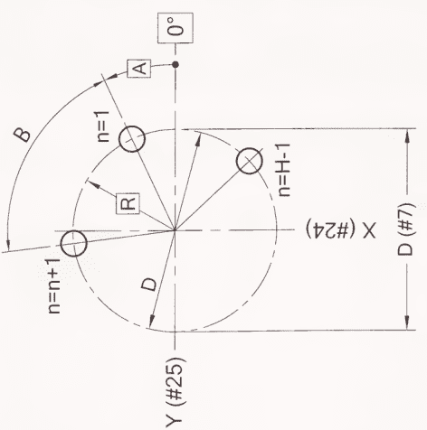
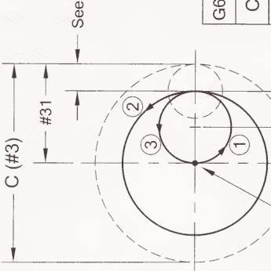
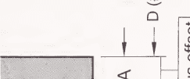
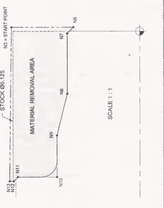
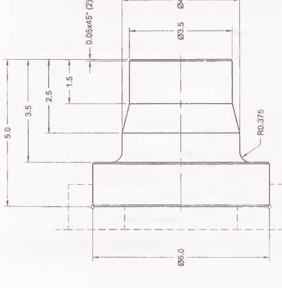

# CNC 技巧与诀窍：程序员读本（第一卷）


ACPL 项目已弃置

S1

## 关于本书

自 2000 年以来，Industrial Press 有幸将 Peter Smid 纳入其作者大家庭。作为一位既受欢迎又高产的作者，Peter 一直支撑着我们书单中的 CNC 部分，其中的领头之作是全球畅销书 *CNC 编程手册*，现已出版第三版。

*CNC 技巧与技术：程序员读本* 是 Peter 与 Industrial Press 合作的第五本书。在过去十年中，除了作为图书作者、顾问和教育者的所有职责之外，Peter 还为 *Shop Talk* 撰写定期专栏，这是一本提供“制造业与机械加工行业的金属加工解决方案”的月刊。

Peter 为 *Shop Talk* 撰写了数十篇专栏，他的专栏涵盖了 CNC 的全部主题。这些专栏涉及攻丝、螺纹加工和滚花。涉及程序长度和内存需求。涉及人员配置问题，例如将程序员和操作员设为独立岗位或合并岗位的优缺点。多种专栏聚焦于 G 代码、M 功能、循环和宏。此外还有更多内容。

自从 *Shop Talk* 停刊以来，这些专栏一直无法获得。现在，在 *CNC 技巧与技术* 中，Industrial Press 很高兴将它们重新呈现给您——Peter 最优秀的 60 多篇专栏——汇成一册，让您能够全面、便捷地获取 Peter 在过去十年中分享的建议。

这些文章自首次发表以来都经过了彻底审阅，并按需更新，以反映该领域持续发生的变化。这里按它们首次发表的时间顺序呈现。书中还包含一个按主题组织的备选目录，书末还附有几个实用附录和详尽索引。

我们希望您会发现 *CNC 技巧与技术* 是您 CNC 藏书中的宝贵补充，并希望 Peter 的建议能让您的工作更高效、更有效、更有价值。

Peter 与我们一同欢迎您的反馈和问题。只需写信至 info@industrialpress.com，我们一定会将您的信息转达给他。

*Industrial Press*  
*2013 年 4 月*


由 Internet Archive 于 2018 年数字化，资助来自 Kahle/Austin Foundation

## 关于作者

**Peter Smid** 是一位专业顾问、教育工作者和演讲者，在工业和教学领域拥有多年实际动手经验，包括各层级的 CNC 与 CAD/CAM 应用。他的咨询工作聚焦于 CNC 技术的实际应用、零件编程、AutoCAD®、Mastercam® 及其他 CAD/CAM 软件，以及高级加工、刀具、设置和许多相关领域。作为顾问，他凭借广泛的知识成功协助了数百家公司。

多年来，Peter 为美国、加拿大和欧洲各地学院和大学的数千名教师和学生，以及许多制造公司和私营部门组织，开发并交付了数百个定制教育项目。他积极参与了许多行业展会、会议、工作坊和研讨会。

Peter 还撰写了多篇关于 CNC 和 CAD/CAM 的文章及内部出版物，并曾六年为 *Shop Talk* 杂志撰写月度专栏。

Peter Smid 还著有 Industrial Press, Inc. 出版的其他四本畅销 CNC 图书，所有图书也都有电子书版本。欲了解更多信息，请访问 *www.industrialpress.com*。

- **CNC 编程手册**  
  实用 CNC 编程综合指南  
  *第三版——ISBN 978-0-8311-3347-4*

- **铣削与车削的 CNC 控制设置**  
  掌握 CNC 控制系统  
  *ISBN 978-0-8311-3350-4*

- **FANUC CNC 自定义宏**  
  面向 Fanuc Custom Macro B 用户的编程资源  
  *ISBN 978-0-8311-3157-9*

- **CNC 编程技巧**  
  有效方法与应用的内部指南  
  *ISBN 978-0-8311-3185-2*

Peter 欢迎您的评论、建议和问题。请写信至 info@industrialpress.com 与他联系。

## 致谢

本书中引用了若干制造商和软件开发商。下面列出它们才公平：

- FANUC 以及 CUSTOM MACRO 或 USER MACRO 或 MACRO B 是日本 Fanuc Ltd 的注册商标
- Mastercam 是 CNC Software Inc.（美国康涅狄格州托兰）的注册商标
- Edgecam 是 Pathtrace, Inc.（英国）的注册商标
- NCPlot 是 NCPlot LLC（美国密歇根州马斯基根）的注册商标
- AutoCAD 是 Autodesk, Inc.（美国加利福尼亚州圣拉斐尔）的注册商标
- WINDOWS 是 Microsoft, Inc.（美国华盛顿州雷德蒙德）的注册商标

本书还提到了其他公司。

Caterpillar、Fadal、Haas、Iscar、Makino、Mitsubishi、Okuma、Sandvik、Siemens、Yasnac……以及一些我可能遗漏的其他公司。

此外，感谢 Industrial Press 的出版团队。

John Carleo、Janet Romano、Robert Weinstein  
……没有你们，这本书就不会问世。

# 2004 年文章选读


## CNC 车削——为什么会有这么多错误？

*2004 年 1 月，2013 年 2 月更新*

即使在 CAD/CAM 时代，许多可用于两轴 CNC 车床的零件程序仍然是手动开发的。这是有充分理由的。仅为一台车床购买 CAD/CAM 系统可能不是许多管理者的首选。现代 CNC 车床提供许多省时功能。例如，所有中心线操作——如钻孔、铰孔和攻丝——都是简单的点位运动。冗长的车削和镗削切削可以通过使用非常强大的加工循环大幅缩短。还有用于外螺纹和内螺纹加工的特殊循环，甚至用于加工铸件和简单切槽。

然而，尽管有这么多可供我们使用的编程工具，许多车床程序仍存在若干错误。看到沮丧的 CNC 操作员在机床旁手忙脚乱地修改程序，并给生产率带来巨大损失，这并不罕见。为什么这么多车床程序会遭遇这种命运？

当我与程序员和操作员交谈时，我得到许多观点，但很少得到真正的答案。只需仔细查看他们的许多车床程序，就会发现同类型的错误反复出现。让我们分组来看这些错误，并谈谈可以采取哪些措施来预防它们：

### 计算错误

尽管车床循环功能强大且简单，但没有任何车床循环会提供轮廓点的计算。当评估错误时，通常是程序员“猜”错了或计算错了。复习三角学是改善这一方面的第一步。在所有数学科目中，三角学是程序员应掌握的相对最高深的知识。我认识一些程序员，他们通过让工程师从 AutoCAD 或其他程序提供轮廓点来避开这个障碍。

其他类型的计算错误是由不正确舍入引起的累积错误。为避免这个问题，只对最终结果进行舍入——不要对中间计算进行舍入。许多计算可以通过选择不同的数学方法来验证。

### 语法错误

语法错误常常发生在使用讨厌的字母 O 而不是数字 0 时。这些 O 是非法字符，不知怎么地混进了程序。例如，字母 Y 在两轴 CNC 车床上不可用。幸运的是，控制系统会识别这些错误。

### 逻辑错误

要非常仔细地注意逻辑错误，因为控制系统无法发现它们。例如，缺少小数点或负号会使编程尺寸的含义完全不同。X1 与 X1.0 不同，Z1.0 与 Z-1.0 也不同。

### 程序错误

相当频繁的程序错误往往是那些可能导致严重碰撞的错误。在孔内换刀就是其中一种错误。其他还包括刀具或偏置选择错误、主轴转速或进给率过高、换刀位置选择等许多错误。

### 偏置错误

这个领域是许多挫败感的温床。根据我的经验，与刀尖半径有关的错误在这一类中位居首位。如果控制系统检测到刀尖半径错误，其原因总是相同的——编程半径无法装入所提供的区域。这一类也代表了可能最难识别的错误。始终检查偏置设置。如果设置正确，那么程序本身就有问题。当刀尖半径大于轮廓的内圆弧时，这种错误经常发生。它也会因间隙不足而发生。由于最常见的刀尖半径为 1/64（0.4 mm）、1/32（0.8 mm）和 3/64（1.2 mm），始终应提供至少为最大半径两倍的间隙。通常，0.100 英寸或 2.5 mm 作为最小间隙就足够了。请记住，这是每侧的间隙，而不是直径上的。

### 设置错误

设置错误严格来说是 CNC 车床操作员的职责范围。在卡盘空着的情况下运行程序来检查所有刀具。间隙是否足够？刀具能否安全转位？尾座是否已移开？确保卡盘充分夹持工件，然后注意镗杆能否安全退出孔。以空运行和单段模式运行第一个零件可能会避免问题。

### 纠正错误

这个方面值得特别提及。许多操作员无法识别错误的实际原因。例如，如果钻头未达到预期深度，编程深度是否正确？偏置设置是否正确？甚至是否可能是钻头被稍微推入了刀柄？找出问题的真正原因是消除问题的第一步。

我希望通过回顾 CNC 车床许多程序中常见的一些错误，你能以截然不同的眼光看待自己的程序。


## 为什么我应该了解手动编程？

*2004年2月，2013年2月更新*

在过去，大多数CNC程序是手动开发的，使用简单常见的日常辅助工具——袖珍计算器、铅笔、纸张，以及常说的五磅重橡皮擦。将这种人工努力与穿孔纸带和一些额外硬件结合起来，你就会看到如今似乎早已成为历史的东西。纸带今天已经消失，尽管许多程序员仍然削铅笔、买新橡皮擦，但时代显然已经转向基于计算机的编程，即CAM编程。诚然，使用个人计算机进行CNC编程始于20世纪80年代中期，但初始成本、计算机技术状况、漫长的学习曲线以及功能缺乏，曾一度阻碍了它们的广泛使用。

使用CNC软件制作零件程序并不新奇。来自许多供应商的功能丰富的软件提供了全部选项——从入门级2D到复杂的3D、实体、多轴加工和多任务处理——所有这些都可用于台式机和笔记本电脑。公立和私立机构在该领域提供许多培训项目，通常是在标准CNC编程课程之外。

这就引出了许多学生提出的一个越来越重要的问题：“*既然我在学习Mastercam，为什么还要懂手动编程？*”当然，除了Mastercam之外还有其他软件可用，但这个问题提得很好。我要是每次这个问题在谈话中或培训期间出现都能得到一美元就好了。那么这是为什么呢？

每个CNC程序员都必须具备某些技能。我认为最重要的一项技能是*加工零件的能力*。决定最佳装夹、选择最合适的刀具，以及创建安全高效的加工操作，是任何成功CNC程序员的*核心技能*。实际的编程方法与它无关。计算机无法做出智能决策。

### 原因 4——你会用 MDI 吗？

任何设置CNC机床的操作员都必须执行许多加工前活动，例如换刀、对刀、启动主轴、主轴定向、将工作台移动一定距离、检查位置等等。即使面板上有许多开关，最好的方法之一就是使用控制系统的*手动数据输入*功能——即MDI。该功能允许你在控制系统上临时输入并执行数据。数据始终以该控制系统的程序格式提供。如果你至少不了解手动编程的基础知识，就无法使用*MDI*功能。

### 原因 5——向他人学习

打印在纸上的零件程序并不能教授编程或加工方法，然而，从已经验证过的程序中可以学到很多东西。我们中有多少人通过改编现有程序为己所用而开始职业生涯？一个运行良好的零件程序提供了巨大的研究和学习机会。当然，必须能够阅读这样的程序——*解读它们*——这意味着能够理解G代码和M功能、程序格式和结构、偏置、模式以及许多地址及其微妙含义。

当然，必须*愿意*学习。当你只是看着一个零件程序，却不理解它、无法解读它时，你在意吗？它困扰你吗？你觉得你想了解更多吗？如果答案是“是”，你正走在成为更好的程序员或操作员的路上——一名真正的专业人士。但那是第六个原因，而我只承诺了五个。

仅在首件在CNC机床上运行时显示。除程序本身外，机床装夹始终是新的，无论程序是新的还是先前已验证过的。

### 已验证的零件程序

这些是被接受用于生产并在较早日期验证过的零件程序。请记住，只有程序经过了验证，装夹或刀具没有。装夹和刀具经常变化；每次都必须验证。另一个重要考虑是所使用的CNC机床。即使已验证的程序，如果用于与上次不同的机床，也必须进行检查。

## 降低成本

降低首件成本——因而也是整批成本——必须在四个相互关联的层面加以考虑：

### 计划

工艺计划员或主管必须评估生产的许多方面。他们的关键考虑之一是在单个批次中生产的零件数量。单位时间内批次越多，每批成本就越高，主要因为重复装夹。假设一批中生产更多零件不会产生负面影响（例如对库存），那么单位时间内减少批次可能提供部分解决方案。

### 编程

CNC程序员确实可以通过程序创造奇迹来降低首件成本。这里只是一些想法。对常用刀具使用一致的刀具号可以节省装夹时间，因为刀具登记和许多相关偏置不会改变。另一种非常有效的编程方法是在程序中加入一个或多个带程序段跳过功能的试切。这些切削仅用于首件测试，在完整运行时关闭（除非偶尔检查）。不要忘记在程序中提供足够的注释，以便操作员知道这些特殊切削的目的。另一个考虑，尤其是对于手动开发的程序，是投资可靠的CNC仿真软件。尽管没有软件能模拟CNC加工的每个细节，但它可以成为发现错误和改进领域的好工具。

### 装夹

在机床旁，CNC操作员通常负责设置刀具和夹具、登记刀具号和各种偏置、排查程序故障以及监控操作。加快装夹所需的非生产时间是可实现的最重要的单项节省。模块化夹具、通用刀具、总体装夹一致性以及操作员的技能，都有助于使装夹与操作之间的转换更快、更顺畅。

### 加工

在加工过程中，CNC操作员在很大程度上依赖程序本身。在首件运行期间，CNC操作员只查找错误或监控程序流程应该是不够的。操作员可以而且应该同时做更多事情。例如，他们可以思考优化程序以获得更好的性能。速度和进给是最常见的关注领域，但还有更多“小事情”也会影响制造成本（包括首件）。

降低首件成本应该是团队努力。CNC程序员可能是此类工作中的关键人物。然而，所有相关人员的相互合作将带来许多好处，并对常说的最终利润产生积极影响。


## 你是 CAM 加工员吗？

*2004年4月，2013年2月更新*

几年前我参与的一次讨论的主要话题相当简单：CNC零件编程的*CAD/CAM学习曲线*。学习CAD/CAM软件以生成用于CNC加工机床的高质量零件程序需要多长时间？这类零件编程通常与术语*CAM编程*相关联。在看了许多提供商提供的许多课程之后，情况仍然有些模糊。从入门级三天课程（实际上十八小时，含休息）到运行超过一百小时的三级课程，每个人都能找到适合自己的内容。所有这些还不包括自学入门者、书籍和多媒体资源。

对于有计算机经验的人来说，学习CAM系统可能相当直观。对这样的人来说，创建几何图形（主要是点、线和圆弧）在短短几小时后可能轻而易举。另一方面，同样的CAM软件对于有加工零件经验但不使用计算机的人来说可能有些令人生畏。这就引出一个重要问题：*对CAM程序员有什么要求？* CAM程序员应具备何种知识和技能，才能开发出往往很复杂的刀具路径，在昂贵的CNC机床上加工零件？

在我上面提到的讨论中，*技能*一词确实被多次使用，大多与计算机技能有关。甚至术语*创建几何图形*（也经常使用）也过于简单。正确的说法应该是*创建刀具路径几何图形*——巨大的差别就在这里。开发一个在屏幕上看起来正确的几何图形相当容易。创建一个引导切削刀具、并且常常能决定小作坊成败的刀具路径几何图形并不容易。

在CAM编程中，几何图形的目的不是像许多初学者尝试的那样重新创建纸质图纸。其目的是创建*可用的刀具路径*。诚然，大多数CAM系统有数百项功能，使整个过程更简单，并且


## 面向程序员的读本

更快。诸如引入和引出、多次轮廓走刀、深度切削分层以及毛坯余量等功能，都使软件变得更易于使用、更高效。要包含这些功能，还需要另一项重要技能——理解所有这些功能的实际用途。你必须懂得何时使用它们以及如何正确使用它们。你还必须扎实掌握加工技术知识。

很多时候，即使 CAM 软件拥有最好的功能，也可能无法得到期望的结果。通常需要在各处添加一点几何图形，做一点额外的调整，才能得到所需的确切结果。零件编程员甚至在开始使用计算机之前，就应在头脑中形成刀具路径的精确设想。

考虑到这一切，使用 CAM 软件的合理学习曲线是怎样的？车间里的计算机高手（即使懂加工，也懂得极少）是否比计算机知识有限但经验丰富的机加工人员更适合这项任务？大多数人都会同意，学习如何操作和使用计算机及软件最多可能需要几周，而学习加工技艺则需要数年，甚至一生。

任何个人的学习曲线还取决于其他个人技能和专业能力。即使在 CAM 编程中，也总会涉及一些数学。此外还涉及理解制造业中的生产率、效率和安全性等整个领域。在技术方面，对每开发一个程序而言，了解机床、控制系统、夹具、刀具、装夹方法、速度和进给等最为重要。简而言之，使用手工方法的零件编程员所需的品质和技能，同样也是 CAM 编程员所需要的。不幸的是，实际情况并非总是如此。

那么，标题中所说的 CAM 机加工人员究竟是谁？我相信一个无法回避的事实是：你必须懂得*如何加工零件*，然后才能成为成功的 CAM 编程员。

考虑一下现实情况。客户传真给你一张图纸，要求报价。你的报价中标，你拿到了这项工作。通常，那张传真图纸是你用来加工零件的唯一图纸。更好的情况是，客户给你一张清晰的纸质图纸。再好一些，客户以磁盘文件的形式把图纸发给你。那当然是最好的情况，但是——是的，这里确实有“但是”。

由于加工车间中的大多数工作是二维（2D）的，设计通常由客户在 AutoCAD 等 CAD 软件中完成。具备 CAM 能力的车间使用 Mastercam、EdgeCam 或 GibbsCam 等刀具路径开发软件。问题在于如何把图纸文件导入 CAM 软件。理想的方法是软件以其原生格式读取文件。例如，流行的 Mastercam 可以直接读写 AutoCAD DWG 文件，无需转换器。如果软件无法读取原始文件的原生格式，就必须有可靠的转换器。

几乎所有的系统都支持 DXF（绘图交换文件）和/或 IGES（初始图形交换规范）。DXF 相当简单，只适用于由直线、圆弧、圆和点组成的二维图纸。IGES 功能更强大，用于转换复杂的三维图纸。

那么，小型车间最好采取什么方法？

### 与客户沟通

与客户沟通可能是最重要的一步。客户希望了解你的能力。反过来，你也应该知道客户能为你的车间提供什么，尤其是当图纸通过磁盘或电子邮件提供时。应要求对方提供你的 CAM 软件支持的文件格式，最好采用原生格式。

### 了解 CAD/CAM 转换器

如果必须使用转换器，请务必了解它的能力和局限性。性能不佳的转换器可能无法转换原始几何图形，尤其是当其中包含样条曲线等复杂几何图形时。

### 培训你的 CNC 编程员

优秀的 CNC 或 CAD/CAM 编程员能够发现图纸缺陷和错误，并且通常能迅速解决任何问题。他们还能删除图纸中属于图纸内容、但创建刀具路径时并不需要的几何图形。这项技能可能是编程员最重要的技能之一。

### 教育你的客户

不要害怕告诉客户你对他们有什么期望。他们会理解，你的要求是本着既按规范又高效地生产他们零件的宗旨提出的。

是的，由于多种原因，真正的 CAD/CAM 融合似乎并不属于小型加工车间。与此同时，在这种独特的环境中，CAD 与 CAM 良好协作并没有任何问题。


## 零件程序的升级与更新

*2004 年 6 月，2013 年 2 月更新*

无论采用何种方法，开发 CNC 零件程序确实需要时间。无论是手工编写，还是借助 CAD/CAM 系统生成，零件程序在用于运行几个零件并经过优化之前，都不应被视为已完成。即使是最好的零件编程员，也无法总是在实际加工中预测每一种情况。看到 CNC 操作员在控制面板上修改程序并不稀奇——事实上，这非常常见。如果程序完美无缺，就无需修改，而这种情况很少发生。

优化零件程序意味着改进它，主要是为了获得更高效的性能，但也可能出于其他原因，例如装夹变更、使用不同刀具，甚至提高安全性。优化程序可以在控制面板上进行（通常由 CNC 操作员完成），也可以远离控制面板进行（通常由 CNC 编程员完成）。程序变更常常涉及两个术语——*程序升级和程序更新*。

### 程序升级

*程序升级*是指强化程序、充实程序，并在不损害零件质量或加工安全的前提下使其更具成本效益。当一批加工数千个零件，或某项工作不时重复进行时，升级零件程序将对整体经营成本产生深远影响。将循环时间缩短几秒钟，总体上可能意味着节省数小时。以下是编程员和/或 CNC 操作员在升级现有零件程序时可以考虑的一些思路。

程序中设定的主轴转速和切削进给率是首先要评估的项目；它们只需很小的干预，几乎就能立即带来改进。众所周知，编程员在这一领域往往采取相当保守的做法。另一个值得关注的方面是程序中使用的安全间隙——“空切”从来不会产生效益，应尽量减少。更换切削刀片的牌号并提高进给率，也能带来好处，而无需对程序做重大修改。如果程序包含各种加工循环，操作员可以根据循环类型做出更显著的更改。

整体循环时间的一大杀手是过长的暂停时间。最小暂停时间是完成主轴一转所需的时间。在实践中，这个时间常常加倍，以便在编程主轴转速的 50% 下实现整转暂停。例如，对于 1200 rpm 的主轴转速，编程暂停时间设为 1 秒就过长，但常常……

良好的培训与经验相结合，将在相对较短的时间内回报每一位车间老板。作为车间老板，尽量为你的员工提供高质量的培训——它很快就会见效。


## 车床循环——用还是不用？

*2004 年 7 月，2013 年 2 月更新*

如果必须指出现代 CNC 技术相较于早期 NC 技术的一项主要优势，那就必须是各种形式的加工循环。是的，这些小程序节省了编程员大量的时间和计算。长期以来，CNC 加工中心一直配有无处不在的 G81、G82、G83 等循环，用于钻孔、镗孔、攻丝及其他与孔加工相关的操作。这组特殊循环对零件编程员来说完全合理，因为即使是专门处理复杂 3D 的公司也能高效使用它们，尽管只是偶尔使用。几乎每个 CAM 软件程序都通过后处理器输出支持这些*固定循环*或通常所称的*预制循环*。但涉及 CNC 车床和车削中心时，情况就有些不同了。

### 多重重复循环

20 世纪 80 年代初，日本公司 Fanuc 采用了一个零件编程员自 20 世纪 70 年代以来早已熟知的概念，当时他们使用各种编程语言，例如经典的 Compact II，来开发粗加工和精加工刀具路径。这一开发背后的数学概念相当简单——定义毛坯边界，定义精加工轮廓边界，控制系统就会去除这两个边界内包含的所有材料。将早期技术改编到现代 CNC 车削系统的这一成果，现在以若干*多重*……的统称而为人所知。


*重复循环。*

毫无疑问，其中三种循环从第一天起就成为数控车床手工编程的常规手段：用于粗加工的 G71 循环、用于精加工的 G70 循环，以及用于螺纹加工的 G76 循环。它们易于使用（用户只需计算精加工轮廓点），并且操作员可以在机床控制面板上更改切削参数，这使它们一经推出便大受欢迎。这些循环最突出的特点——简洁（粗加工只需一两个程序段）——也成了它们小小的缺点。

数控车床制造商和供应商已经意识到，如果缩小可用内存，他们就能以更优惠的价格提供机床（即使在今天，数控内存也非常昂贵）。仍有许多数控车床用于存储零件程序的内存容量非常小，不过这种情况正在迅速改变。

然而，即使容量问题正在变得无关紧要，能够在控制系统中更改各种切削参数（例如切削深度）始终是一项优势。CAM 软件开发人员已经意识到这一需求，并且通常支持在最终程序中输出多个重复循环。许多开发人员还提供不将循环选为程序输出的选项。当然，选择此选项将需要更强大的内存容量。它还会引出一个重要问题：*何时不使用这些循环。*

### 循环编程

循环不过是预先编程的例程。它们将严格根据这些内部例程中包含的条件来定义刀具运动。说得直白些（也有些不公平），程序员要受制于开发控制单元的软件工程师。这一点毋庸置疑。控制软件是为大多数——但不是全部——车削、镗削或螺纹加工应用开发的；在这些情况下，它表现得极其出色。从逻辑上讲，该软件*无法*针对特殊应用进行开发。

然而，编程在某种程度上就像雕塑。其中涉及技术，涉及技巧，也涉及强烈的个人风格（在雕塑中称为艺术）。为了完全按计划控制每一次刀具运动，程序员可能会发现某个特定循环并不有效。

以 G71 粗加工循环为例。它从切削起点开始，一直持续到终点，只允许沿 X 轴改变方向。如果你的程序需要频繁改变切削方向，那么较长的方法（逐程序段编程）将是选择。单点螺纹加工循环 G76 也不例外。它非常适合单头标准螺纹，但对于多头螺纹，其吸引力会有所下降（尽管仍可使用）。对于特殊螺纹，例如具有特殊牙型的螺纹，它几乎变得毫无用处，尤其是当螺纹刀片小于螺纹本身，或者螺纹形状必须通过插补而不是成形加工时。

毫无疑问，这些多个重复循环让我们所有人的编程和加工工作都轻松了许多。同时，我们必须了解它们的局限性，以及在不宜使用这些循环、甚至无法高效使用这些循环的情况下可采用的替代方案。除了手动编写每一次刀具运动（这始终是一种替代方案）之外，还要确保你的 CAM 系统能够处理你所做工作所需的刀具运动类型，并且你的程序员能够生成关键刀具路径。还要确保控制系统中有足够的可用内存来存储这些程序——它们可能相当长。DNC（直接数字控制）解决方案也可能有所帮助。

## 长程序的简短建议

*2004年8月，2013年2月更新*

偶尔，你的机加工车间会需要运行一个超出内置控制内存容量的 CNC 零件程序。这种方法通常称为 DNC（直接数字控制），它使用控制面板的 TAPE 或 EXTERNAL 模式，而不是更常见的 MEMORY 模式。要让这种方法在你的 CNC 机床上工作，所需并不多——合适的软件、台式机或笔记本电脑、连接电缆以及一些配置。如果一切顺利，你很快就能运行起来；如果不顺利，请继续阅读一些建议。

在本专栏中，我将*长程序*定义为无法从控制内存中执行的零件程序。此类程序最常见的来源是处理复杂加工操作的 CAD/CAM 系统。尽管大多数长程序都涉及某种 3D 加工（例如模具加工和多轴刀具路径），但对 2D 刀具路径进行更多控制的需求也在不断增长，例如在型腔加工中或高速加工时。高质量 CAD/CAM 软件提供大量刀具路径和型腔加工样式。当结合切削宽度和深度控制、零件尺寸、拐角清理、斜向进刀等时，最终得到长程序并不罕见。运行此类程序时的主要困难在于，当 CNC 操作员在程序中间某处必须*重新启动*切削时，此时某个特定刀具已经完成了相当长的刀具路径。通常，主要原因是刀具破损。

大多数 CNC 机床没有*程序重启*或*顺序返回*功能来解决这个问题。不过，CAD/CAM 程序员可以通过多种方式最大限度地减少与长程序中断相关的停机时间。让我们看看一些可以考虑的可能性：

### 计算机位置

将发送长程序的计算机放置在尽可能靠近接收该程序的 CNC 机床的位置。通常，接收数据的一方（CNC）必须*先于*发送数据的一方（台式机或笔记本电脑）准备就绪。这意味着可以减少在两者之间来回跑动。

### 程序分段

这是一个非常重要的考虑因素。程序中使用的每把刀具自动构成一个单独的分段。然而，对于单把刀具的分段，尤其是工作量很大的刀具，也应仔细定义。可以使用的一种技术是：在每个分段完成后让机床回零（机床零点返回），尤其是沿 Z 轴回零，然后用同一把刀具从下一分段开始。由于这些额外运动增加了循环时间，应在它们前面加上斜杠（程序段跳过功能）。在此方法中加入程序停止（M00）或可选程序停止（M01）可能会带来额外的好处。

### 程序编辑器

使用专用的 CNC 编辑器（专为 CNC 文件设计），或使用能够高亮显示程序中各个地址的文本编辑器——例如，将所有 Z 轴运动显示为红色。颜色有助于识别各个分段，编辑器还可用于创建缩短程序的临时副本。

### 程序段号或顺序号

它们确实很有帮助。尽管程序段号或顺序号会增加程序的整体长度，但在 DNC 操作中这一长度无关紧要。如果刀具破损，中断时的顺序号可提供一些可用于重新启动的信息。与其为每个程序段都使用程序段号，不如考虑只在程序中一些关键位置使用少量程序段号。选择性程序段号的合适位置是每个使用同一刀具的新分段的开头，或机床原点位置。

### 描述性注释

标明程序中的各个操作或分段。例如，如果同一把刀具用于粗加工五个型腔，请在每个型腔刀具路径的开头放置带有唯一描述的注释。

### 进给平面与退刀平面

在选择切削起点和切削完成后退刀的 Z 轴位置时保持一致。可以使用文本编辑器搜索和/或替换通用数据。

### 切削进给率

如果你使切入进给率不同于切削进给率，只需搜索该进给率，就能更容易地找到可进行更改的分段起点。此外，你也不会意外忘记进给率或使用错误的进给率。

还有什么需要注意的？上述建议可以单独应用，也可以组合应用。最重要的是确保所实施的任何更改都是安全的更改。注意 XY 刀具位置、缺失的主轴转速和进给率、控制面板上开关的状态、偏置设置以及其他相关事项。

在 DNC 模式下从外部计算机运行长程序可能非常简单且顺利。另一方面，如果确实出现问题，请做好准备，通过良好的计划来应对，以尽量减少不必要的停机时间。


## 保留记录——为程序编写文档

2004年9月，2013年2月更新

无论是常见还是不太常见的制造过程和活动，记录所做的工作都有很多理由。跟踪大量活动的最重要原因，是为进行中的工作创建一些合理的文档。其方法及目的相当基本——能够记录并追溯或检索各个开发步骤或阶段，以备将来需要。无论是用于应急目的还是一般参考，良好的文档对于机加工车间环境中的任何严肃工作都是必不可少的。在企业层面，文档通常仅为内部目的而编制。文档也可能成为 ISO 9000+ 认证流程的重要组成部分，在这种情况下，它会采取自己的形式。在 CNC 或 CAD/CAM 零件编程层面，该领域的需求要宽松和灵活得多，但同样重要。本文探讨与 CNC 编程有关的程序文档，无论其开发方法如何。良好的文档对于手动编程和 CAD/CAM 刀具路径开发同样重要。

大多数零件程序以两种形式之一到达 CNC 操作员手中：打印的硬拷贝或磁盘文件。在这两种情况下，程序格式相同，只是分发方法不同。所有 CNC 系统都提供一种将注释和消息插入零件程序正文的方法。如果使用得当，这些注释和消息位于程序内的关键位置，作为面向 CNC 操作员的注释。在 CNC 程序中包含注释和消息的最常见方式是使用成对圆括号 ()。这种 (COMMENT) 方法是 Fanuc 及相关控制系统的典型做法。例如，以下消息指示 CNC 操作员检查零件宽度：

**(宽度必须在 26.7 到 27 MM 之间)**

其他方法使用美元符号 ($) 或分号 (;)，以及类似方法，目的相同。在所有情况下，控制系统都被设计为在程序执行期间忽略该消息或注释。

零件程序中注释过多或过少都可能适得其反。程序中完全没有注释可能导致错误假设，除非提供了某种其他信息方式。CNC 程序注释和消息的主要目标是在 CNC 程序员和 CNC 操作员之间提供信息链接。详尽且信息丰富的程序文档如此重要，以至于每个车间所有者或管理者都应坚持要求它，每位程序员都应将其作为标准程序特性提供。

### 良好的程序文档

良好的程序文档有哪些主要特征？第一条规则是使程序中的任何注释简短且切中要点。第二条规则是只包含与当前项目相关的注释。就内容或主题而言，以下是一些许多 CNC 程序员已在各种程序注释中成功使用的建议：

- **日期和时间**：当前程序版本至关重要；它必须与零件图纸匹配。最新日期和时间被假定为最新版本。

- **程序员姓名**：程序员姓名对 CNC 操作员很重要，以备需要提问或澄清。

*程序员读本*

- **图纸编号和/或版本**：包括编程过程中使用的最新图纸版本。

- **机床类型**：开发良好的零件程序可用于类似的 CNC 机床。程序注释应列出哪些机床/控制组合将接受给定程序。

- **设置数据**：指定所有轴上的零件零点。包括设置方法及所有相关信息，例如零件方向、深度和间隙。

- **刀具数据**：在程序开头列出所有刀具，并在程序中为每把刀具重复刀具描述。

- **特殊说明**：如果程序包含 M00（程序停止），请描述其存在的原因。例如，指示 CNC 操作员需要翻转零件，或攻丝必须使用特殊润滑剂，或必须检查刀具。许多类似示例都属于此类。

有许多不同的应用受益于插入零件程序中的注释和消息。取决于控制系统，注释可能不会加载到控制存储器中，但它们始终可以以打印形式或程序文件形式提供。由 CAD/CAM 软件开发的 CNC 程序应包含与手动开发的程序相同的注释和消息。所有高级 CAD/CAM 软件都提供将注释插入程序的功能。

文档齐全的程序更容易被 CNC 操作员甚至其作者（程序员）解读。文档应作为每个程序的标准特性提供。


## 关注数字

*2004年10月，2013年2月更新*

你用来加工零件的图纸很可能源自 CAD 软件。没什么花哨的，只是一张标准、日常类型的二维图纸——两三个视图、尺寸和一些文字——仅此而已。然而，仅仅因为图纸是在 CAD 中准备的，并不意味着它没有缺陷甚至错误。让我们看看这张虚构的图纸，并关注与数字（实际上是尺寸）有关的几个细节。

### 关注点 1——公制还是英制？

图纸中使用什么单位？如果你毫无头绪，不要假设——要确认！现在用公制单位准备的图纸比以前多，但并不总是准备得当。图纸角落里的“METRIC”这个关键字可能偏偏没有出现，无法提示你。以下是一些判断方法（但无论如何，之后要核实）。

第一条线索是图纸比例，第二条线索是尺寸及其公称值。如果你专长于生产小零件，而看到零件长度为 50，那么这很可能是一张公制图纸。如果你习惯看到诸如 1.625 或 0.75（英寸）这样的尺寸，而图中没有这么小的尺寸，那么这很可能是一张公制图纸。如果比例正确，它就解决了谜题的另一部分。另一个线索是尺寸中使用的小数位数。如果图纸遵循适当标准，公制图纸应使用不带小数点的整数。因此，我们的 50 mm 长度在尺寸箭头之间将显示为 50，而不是 50.0。本应如此，但实际情况并不总是如此。

这引出了另一个线索，即小数如何表示。由于公制系统使用 1/1000 毫米作为最小单位，你在公制图纸中绝不应看到超过三位小数——即使三位小数也相当罕见。有时如果大多数尺寸使用一种单位，而另一个尺寸（例如螺纹或丝锥尺寸）使用相反单位，你就必须进行换算。现实情况可能很混乱，但这就是我们在采用公制系统方面落后于世界其他地方所付出的代价。

### 关注点 2——公差

一个可能引起麻烦的相关事项——公差——也与 CAD 系统直接相关。本示例我们继续使用英寸。你刚收到的图纸基本上是一个矩形零件，总体尺寸显示为 5.0000 x 3.0000 x 0.5000。这是什么？几十年前，我们会被教导说，小数位数表示公差的精度。例如，x.xxx 会表示 ±0.001（或当时公司内部标准规定的任何值）。所以现在我们的零件三个总体尺寸都有四位小数！这还没完——长度和宽度上还要求 125–250 的表面粗糙度。因为这个尺寸毫无意义，我们必须找出这背后的真正罪魁祸首。

首先，抛弃公差由小数位数暗示的旧观念。是的，这种做法仍然存在；是的，它仍然是错误的。除了这种表示法违反所有 ANSI 或 ISO 标准之外，它还是错误的，因为它不可靠。至少有一个原因（还有几个其他原因）使它不可靠——因为 CAD 软件默认英制图纸保留四位小数，公制图纸保留三位小数。这可能在 CAD/CAM 界养成一些坏习惯。当然，软件确实允许更改为任意小数位数，但选择适当设置是 CAD 操作员的职责。

### 关注点 3——为什么公制比英制更好？

再注意一下这个问题。它并没有问公制系统是否更好，而是假定它更好，并问为什么更好。在我收到太多质疑我这个问题的电子邮件之前，让我郑重声明，我特指 CNC 机床，而不是


## 程序员读本

### CNC 程序员/操作员的优势

首先，让我们看看优势。让一个人参与零件制造的整体流程，有助于更好地理解该流程。一旦出现问题，通常也更容易找到解决办法。同时操作 CNC 机床的程序员更有动力用自己的程序把工作做得更好。零件编程员通常需要懂得如何加工零件，但 CNC 操作员通常不被要求了解开发程序的所有细节。优秀的 CNC 操作员并不一定了解编程部分，也不总能提供与程序相关的解决方案。

在合并岗位中，这种理解上的欠缺就不存在了。程序员还经常与工程师和客户交流；操作员通常不会。优秀的程序员也会与机床操作员交流并征求他们的意见。同样，合并岗位可能为设计或制造工艺提供只有熟练机床操作员才能想到的解决方案。

### CNC 程序员/操作员的劣势

这种程序员/操作员合一的概念也有缺点。最初因节省薪酬而具有的吸引力，可能会被生产时间的损失所抵消。一边编制程序一边操作机床几乎是不可能的。要把两者同样做好，不仅需要一个技术熟练、尽职尽责的人，还需要合适的工作任务。如果机床上大约每两分钟就要更换一个零件，程序员就无法充分集中精力开发下一个程序。加工一个零件需要二十分钟，则能提供稍多一些灵活性。

每位车间经理都熟悉*机床利用率*这一术语——盈利之道就是尽可能多地运行 CNC 机床，生产高质量零件。使用 CNC 机床时总会有一些延误。首先是装调时间，包括夹具、刀具和控制设置。接着，必须对首件进行验证。然后，当机床最终开始生产时，总需要更换零件、更换磨损的刀片、修改偏置值等。由于程序员必须准备程序而增加更多停机时间，代价可能非常高；经过一段时间，其成本可能高于让两名熟练工人分别承担各自职责。

到目前为止，这一概述针对的是一台 CNC 机床。如果车间里有两台、三台甚至更多机床，又会怎样？

这种合并岗位还有另外三个缺点也应认真考虑。第一个很简单。如果程序员因病在家，操作员也如此（反之亦然）。第二个缺点与之相关。如果程序员/操作员辞职了怎么办？当然，有合适的后备人员是理想方案，但现实是生产中总会在某处出现缺口；即使缺口是暂时的，也仍意味着时间损失。第三个缺点更多涉及人性的某些特点，并不适用于所有人。一些同时操作机床的程序员可能倾向于掩盖自己的错误，在无人知晓的情况下花额外时间在机床上进行修正，甚至编写新程序。一些程序员/操作员可能自满甚至自得；他们不再学习新方法和新技术。另一些人可能在工资、福利、休假等方面提出过高要求。

需要考虑的一点是零件程序的生成方法。在许多车间，仍然普遍采用手工编写程序，而不是使用 CAD/CAM 编程系统。尽管程序员理解手工编程很重要，但车间经理理解 CAD/CAM（也称为 CAM）编程系统的优势也同样重要。对于由一人编程并操作的合并岗位，在 CNC 机床附近安装 CAM 系统尽管有初始成本，但可能带来许多好处。

许多机加工车间经理偏爱 CNC 程序员/操作员岗位，并且很清楚其缺点。如果在合适的环境中设立并妥善管理，车间里拥有一名多技能工人带来的好处应多于问题。大多数同时操作 CNC 机床的 CNC 程序员都诚实敬业；他们尽最大努力做好工作。他们认为自己是真正的专业人士，而且理应如此。在管理方面，谨慎的业主或经理在设立 CNC 程序员/操作员岗位之前，必须权衡所有利弊。


## 在小车间中使用 CAM 软件

*2004 年 11 月，2013 年 2 月更新*

多年来，手工编程为 CNC 程序员带来了许多好处。它提供对刀具路径的绝对控制，并培养组织性和纪律性。此外，它确实有一些负面副作用；它非常耗时、容易发生人为错误，并且难以修改程序。消除——或至少尽量减少——与手工编程相关问题的需求，促成了使用计算机进行 CNC 编程的发展，即*CAM 编程*。

### CAM 软件

现代 CNC 软件——通常被称为 CAM 软件，因为许多商品名以 CAM 这三个字母结尾，例如流行的 Mastercam——提供许多功能，使最初的手工编程方法自动化。计算机生成大多数 CNC 程序比手工编程更快、更准确。正确应用 CAM 软件将生成反映程序员加工零件方式的零件程序。

无论是手工开发还是由软件生成，系统都提供文件传输选项。对于更复杂的专用 DNC 传输，单独的软件通常是更好的选择。显示也很重要——长时间盯着电脑屏幕充其量会让人疲劳，随着时间推移还可能导致身体问题。大尺寸和高分辨率显示器对于舒适工作至关重要。许多显卡是为游戏而制造的，可能不适合严肃的 CAM 工作。其他特性如硬盘容量已不再是问题，只要它们可靠且维护良好。

### 编程环境

CAM 软件中的典型工作环境可以简单概括为三个步骤：

- 1. 刀具路径几何
- 2. 刀具路径应用
- 3. 程序生成

根据软件不同，可能会有许多中间（或附加）步骤，但这三个基本步骤始终适用。

*刀具路径几何*

刀具路径几何是刀具路径本身的可视化表示。它始终以图形方式生成，使用点、线、圆弧和其他图元。真正的刀具路径几何称为*关联几何*——这意味着更改刀具路径或操作中的任一项都会自动更改所有相关数据。

即使价格最低（即功能较少）的 CAM 软件也提供最常见的 2D 刀具路径——钻孔操作、轮廓加工和型腔加工。更复杂的软件还会包括特殊刀具路径和操作，例如螺旋插补、作为几何一部分的样条曲线、特殊循环、子程序、3D 加工、曲面和实体。选择 CAM 软件时，还要考虑未来需求，例如未来工作类型，以及机床和控制功能。

### 其他功能

将零件几何与所用刀具结合即可创建操作。操作被视为单元——在一个单元内，单项更改将更新整个操作，例如更改刀具直径、主轴转速或切削进给率。CAM 软件中可能包含许多特殊功能。其中非常重要的一项是对钻孔、铣削、车削、切槽和螺纹加工等各种循环的支持。此类循环使手工编程简单得多且不那么繁琐；在 CAM 软件中支持它们，可以更容易地在机床上进行小的加工更改。一些 CAM 软件提供开放式架构模型。简而言之，这意味着任何具备所需技能的人都可以编写可由 CAM 软件访问的特殊实用程序。添加外部功能的能力大大增强了 CAM 软件的能力。

*多机床支持*

一些机床制造商提供自己的 CAM 软件，仅专用于他们制造的 CNC 机床。这一领域的典型例子是钣金加工机床和某些 EDM 机床。该软件通常对所支持的机床类型表现很好，但缺乏支持其他机床的灵活性。它非常适合专业化车间，但对于需要编程灵活性的车间则不太实用。

大多数 CAM 软件是集成软件，允许零件程序员将其用于多种类型的机床，通常是铣床、加工中心和车床。集成 CAM 软件的主要优势是其灵活性。额外好处可能更实际但也同样重要，例如，铣削和车削使用相似的界面可缩短编程时间。


## CNC 技巧与技术

### 文本编辑器

在许多方面（以及专业观点中），大多数 CAM 软件附带的文本编辑器应当只是一个查看器——它不应能够修改程序。当然，这类更改每天都在发生，因为这是修复问题的一种权宜之计，通常是修复小问题。由 CAM 软件生成的程序应当不需要编辑；这正是一开始购买它的全部目的。然而，许多零件编程员选择手动进行小改动。原则上，这是一种错误的方法。问题可能已经修复，但程序数据库（即零件模型）根本没有改变。它仍然包含该错误。在多个用户共同使用该程序的环境中，这种方法可能导致重大困难。

与此同时，文本编辑器确实有其正当用途。例如，编辑器可以创建和编辑装夹单和刀具单、后处理器模板，甚至配置文件。这些应用都不会损坏刀路数据库。如果需要打印稿，也可以使用文本编辑器打印程序。

### CAD 连接

独立式 CAM 编程系统无需单独的 CAD 软件来定义刀路几何。如果零件图已经存在（例如，客户以文件形式提供 AutoCAD 图纸），重新绘制几何图形则适得其反。CAM 软件应包含若干内置的 CAD 转换功能。AutoCAD 仍是二维制图领域的领先者，并可直接打开 DWG 图纸。DXF 格式也可用，但仅适合转换基本图元。对于三维设计，优质 CAM 软件应能转换最流行的 CAD 系统，例如 SolidWorks、Inventor、CATIA 和 Solid Edge。其他系统也在不断加入支持范围。

# 2005 年文章选读


## 最小化程序长度

*2005 年 5 月，2013 年 2 月更新*

过去，处理长程序这一话题主要关注在实际零件生产过程中，借助 DNC 支持在机床上高效运行此类程序。长程序通常是 CAM 输出的结果，但在许多情况下也由人工编写。请记住，*长*这个词通常相对于所涉及的工作量和可用控制内存容量而言。例如，数控车床的内存容量比数控加工中心小得多。无论哪种情况，CNC 编程员都有几种可支配的方法来缩短长程序。使用本专栏建议的方法，通常可能无需使用 DNC 方法就能将长程序装入控制内存。有多种方法可实现这一目标，既可在程序开发之前采用，也可在程序开发之后采用。

在 CAM 编程中，获得高质量程序输出的关键是优质后处理器。CAM 软件中后处理器的目的是为所需的程序输出提供一个可定制平台。后处理器定制中所投入的思路和努力，在手工编程中同样需要考虑。这里没有魔法——如果你想缩短程序，就必须*在不损失其完整性和目的的前提下*完成。从程序中删除一道工序确实会缩短程序，但代价可能太高，难以承受。在开发 CNC 程序时，应关注那些可以说开箱即能提供更短输出的各种功能。它们包括各种固定循环、多重重复循环、子程序、宏、计数器和自动拐角。从已经尽可能短的程序开始，会使后续的任何努力都更加有效。让我们看看一些可用的选项。

### 消除字符

一旦从一开始就用尽所有可能的方法来缩短程序，就只剩下一种方法——*消除程序中所有不必要的字符*。是的，每次消除一个字符往往能对最终程序长度产生奇效。你需要一个好的文本编辑器，最好是为编辑 CNC 文件而设计的文本编辑器。文本编辑器提供一种称为*批量替换*的功能（通常称为*查找和替换功能*）。务必在程序的副本上操作，以防出现问题。另外，绝不要对程序进行可能对加工安全产生负面影响的更改。初始规划很重要，了解程序格式也必不可少。以下是应考虑作为实现缩短程序目标的主要方面：

- 消除或优化程序段号（顺序号）
- 删除程序注释
- 删除不必要的零
- 将单轴运动合并为多轴运动（如果安全允许）

#### 程序段号

*程序段号*几乎总是为了便利而使用，但某些特殊应用除外，例如多重重复循环或宏语句。消除程序段号将最大程度地减小任何程序的体积。如果你不放心消除所有程序段号，可以每把刀具只使用一个程序段号，也许是为了搜索。以 1 为增量使用程序段号比常见的以 5 或 10 为增量更经济，因为存储的字符更少。

## 车削循环的转换

*2005 年 6 月，2013 年 2 月更新*

大多数数控车床编程员会同意，数控车床控制系统最有用的功能是*多重重复循环*。自 20 世纪 80 年代中期以来，数控车床的多重重复循环一直是控制系统的重要组成部分。时至今日，它们仍是材料去除方面最具创新性的方法，尤其是在车削、镗削和螺纹加工领域。在其三十年的存在期间，多重重复循环只经历了两次重大变化。早期控制系统要求这些循环用单程序段编程，后来的控制系统则要求输入两个程序段。这种编程方法的差异常常导致一种类型必须转换为另一种类型——通常是从单程序段格式转换为双程序段格式。

### 转换格式

首先，让我们看看*转换*这个词。从一种格式更改为另一种格式并不是真正的转换，或者——至少不是完整的转换。原因是双程序段格式比单程序段格式提供更多功能。另外，请记住，此处你没有选择；控制系统决定编程方法。通常，FANUC 10/11/15 型控制系统使用单程序段格式，其他控制型号（0/16/18/20/21……）使用双程序段格式。哪些循环会受影响？从 G71 到 G76 的所有多重重复循环都可以根据控制系统采用其中一种格式编程。精加工循环 G70 始终使用单程序段格式。

#### 单程序段格式

单程序段格式是两者中较旧的一种，严重依赖系统参数设置，而机床操作员通常无法访问这些设置。本专栏将以最常用的 G71 和 G76 循环为例；其他循环同理。以下数据：

```
G76 X.. Z.. I.. K.. D.. A.. F..
```

在这种情况下，X 指定最终螺纹直径，Z 是螺纹终点位置，I 指定锥度量（如果使用），K 是螺纹深度，D 是第一刀深度，A 是螺纹角度，F 是螺纹导程（进给率）。双程序段版本则加入了更多可编程功能：

```
G76 P.. Q.. R..
G76 X.. Z.. R.. P.. Q.. F..
```

第一个程序段中的 *P* 地址一并包含精加工次数、螺纹终点退刀的前导长度和螺纹角度。*Q* 地址指定最小切削深度，R 是精加工余量。在第二个程序段中，X 和 Z 与前面相同，R 指定锥度量（如果使用），*P* 是螺纹深度，*Q* 是第一刀深度，F 是螺纹导程（进给率）。第二个程序段中的 *P* 和 *Q* 都不接受小数点。

从这两个示例可以看出，两种循环格式的主要区别在于附加的可编程参数，这些参数使循环比使用内部参数设置灵活得多。在任一双程序段循环中，不要将第一个程序段中的地址与第二个程序段中的相同地址混淆。如你所见，从单程序段格式到双程序段格式的*转换*增加了一些现在可编程的特定功能，为 CNC 编程员提供了更大的灵活性。


编程的 G54 工件偏置由 CNC 操作员用来设定程序零点，G52 用于将这个零点*偏移*到其他位置，通常是临时性的。真正的优势在于，G52 的实际设定由零件程序控制（而 G54 偏置的实际设定是在设置过程中通过机床控制面板输入的）。使用 G52 不需要费太多力，但要成功使用它，有三个条件很重要：

-   G52 始终在当前工件偏置（例如 G54）内起作用
-   G52 不会引起轴运动——它只调整当前工件偏置
-   编程时必须知道 G52 所用的零点偏移量

第一个条件解释了 G52 定义的含义——*局部坐标系从属于另一个坐标系*。编程 G52 只需要给出由工件偏置（G54）确定的程序零点与新位置之间的差值量。例如，程序中的 **G52 X2.0 Y1.0** 程序段会将程序零点分别在 X 和 Y 方向偏移 2 英寸和 1 英寸，从*当前*程序零点（由 G54 设定）向正方向偏移。在 G52 生效期间，这个新位置就是用于所有计算目的的程序零点。要取消零点偏移，只需编程一个包含零值的程序段——G52 X0 Y0——原来的程序零点（由 G54 工件偏置设定）就会恢复正常。

请记住，执行 G52 偏移时不会发生轴运动。在控制单元中发生的全部事情，就是按 G52 程序段中指定的量临时更新内部工件偏置设定。还要记住，由于 G52 是可编程指令，编程时*必须知道*偏移量。G52 的主要用途是在单个零件*内部*使用。它也可以用于在位于机床工作台上的不同零件之间偏移零点，前提是这些零件的精确位置已知。如果其他零件的位置是随机的，就使用不同的工件偏置，例如第一个零件用 G54，第二个零件用 G55，依此类推。

局部坐标系指令 G52 既可用于加工中心，也可用于车床。其主要优势是，它允许 CNC 操作员将程序零点设定在更方便或更易到达的位置，同时也为 CNC 编程人员提供了一种更轻松计算刀具路径坐标的方法。对生产过程双方而言，其结果都是最大限度地减少可能的错误，无论是编程错误还是设置过程中可能发生的错误。

通过 G52 指令偏移程序零点并不是唯一可用的方法。另一个可以使用的指令是 G10——*数据设定指令*。这将是另一篇文章的主题。


## 偏移程序零点——第 2 部分

*2005 年 8 月，2013 年 2 月更新*

另一篇文章介绍了在 CNC 程序中用 G52 方法偏移程序零点（零件零点）。现在我们来看另一种非常强大的方法，即使用数据设定指令 G10。G52 指令不会改变控制系统中存储的偏置实际设定，并且只能在一个工件偏置生效时使用。从这个意义上说，G52 是真正的零件零点偏移指令。

### G10——数据设定指令

尽管 G10 也用于偏移程序零点，但它可用于更改*任何偏置*，而不仅仅是当前生效的工件偏置。从这个意义上说，G10 提供了更多可能性，也将更多责任交到编程人员手中。无论其实际应用如何，G10 始终会更改所选偏置的当前设定，无法撤销，也无法自动恢复到之前的设定。仅这一点就足以成为深入理解数据设定指令的充分理由。三组偏置都可以由 G10 更改——工件偏置、刀具长度偏置和刀具半径偏置。如果使用绝对编程模式（G90），受 G10 影响的偏置将被*替换*；如果使用增量编程模式（G91），受 G10 影响的偏置将被*更新*。

G10 指令本身不区分这三组偏置——它需要附加参数。例如，要选择工件偏置，编程输入格式为 **G10 L2 P.. X.. Y.. Z..**。这里，L2 表示任意工件偏置组号，*P* 地址选择六个标准工件偏置中的哪一个将受到影响。*P1* 是 G54，*P2* 是 G55，依此类推。*X.. Y.. Z..* 参数包含替换（在 G90 模式下）或更新（在 G91 模式下）所选工件偏置的量。对于刀具长度偏置，情况类似。例如，程序中的 **G10 L10 P.. R..** 将更改由 *P..* 地址指定的刀具长度偏置的几何偏置设定。*R..* 指定实际更改量——同样是替换或更新。要对刀具长度磨损偏置进行类似更改，*L10* 将替换为 *L11*。要更改存储的半径偏置，将使用 *L12* 或 *L13*，后跟调整量。根据具体控制型号，有几种替代方式。

如你所见，G10 对新用户来说可能有点令人生畏，并且常被视为高级指令。为了至少说明一个示例，让我们回到 G54 中的零点偏移。编程人员通常不知道工件偏置，因此 G10 将反映*从当前设定开始*、按指定距离和方向进行的偏移（公制单位）：

```
Current G54 setting (unknown to the programmers):
X-400.000 Y-350.000 Z0.000

A programmed block G91 G10 L2 X15.0 Y12.0 will change
the current setting of G54 to a new setting:

G54 setting after G10 is processed:
X-385.000 Y-338.000 Z0.000
```

## 编程人员读本

尽管编程人员不知道控制系统中的实际设定，但他们知道原始程序零点已分别沿 X 轴和 Y 轴偏移了 15 mm 和 12 mm。为了使 G54 恢复到原始设定，G10 将包含相反的量：

将 G54 设定恢复为原始程序零点：  
**G91 G10 L2 X-15.0 Y-12.0**

偏移程序零点并不是 G10 的唯一目的——通过程序更改半径偏置也是一个非常强大的应用。以典型的粗加工和精加工轮廓刀具路径为例。通常，会使用两个偏置号，CNC 操作员负责在控制系统中完成这两项设定。使用 G10，精加工刀具路径可以包含余量，从而实际上使其成为粗加工刀具路径。例如，半径偏置 D51 的当前设定为 0.5000（英制单位）。

程序段 **G91 G10 L13 P51 R0.03** 会将 D51 的当前半径量设定更改为 0.5300，为精加工刀具留出 0.03 的余量。在精加工刀具生效之前，程序段 **G91 G10 L13 P51 R-0.03** 将恢复原始设定。

无论是由 G10 指令更改工件偏置、刀具长度偏置还是刀具半径偏置，它为富有想象力的 CNC 编程人员提供的机会都是巨大的。这两篇文章的目的是鼓励 CNC 编程人员超越更传统的编程方法。G52 和 G10 都提供了一个很大的好处——它们通过取消传统上由 CNC 操作员完成的偏置设定，并将其交到 CNC 编程人员手中，从而增强了对加工过程的控制。

## 车螺纹方法比较


*2005 年 9 月，2013 年 2 月更新*

在 CNC 车床上进行单点车螺纹时，零件编程人员有几种选择——事实上是三种。最古老的编程方法过去是、现在仍然是一种非常耗时的方法。这就是最初逐段编程的车螺纹方法，使用准备指令 G32（在某些控制系统中也称为 G33）。由于即使准备几个简单的车螺纹行程也需要大量计算，控制系统开发者很快就设法缩短了编程过程，于是第一个车螺纹循环诞生了。这个循环今天仍以其准备指令 G92 而闻名。尽管 G92 循环在当时是一个重大改进，但它并未达到零件编程人员和机床操作人员的高期望。最后，Fanuc 推出了一颗真正的明珠——G76 多重重复车螺纹循环。G76 的描述有点拗口，但它迅速成为单点车螺纹之王。那么，使用 G32 和 G92 指令的其他车螺纹方法处于什么位置呢？它们还有存在的空间吗？

### G32 方法

G32 车螺纹方法也称为“长写法”——而且确实可能很长。对 G32 最基本的理解是：它根本不是任何循环。它是对车螺纹过程中每一步的普通编程。以典型的一次螺纹走刀为例，它包含四个部分。从起始位置开始，刀具快速移动到要车螺纹的直径处，然后进行车螺纹本身。接下来，刀具必须从螺纹处退刀，最后必须返回起始位置。

这四个部分代表程序中的四个程序段。例如，七次走刀时，车螺纹运动将只占用程序中的二十八个程序段。为了获得最佳结果，每一

螺纹直径必须单独计算，以使金属去除率保持相当一致。此外，大多数螺纹都受益于侧向进给，也称为角度进给或复合进给。因此，每个起始位置都必须更改其 Z 坐标，而该坐标必须根据走刀深度和所需的进给角度通过三角学计算得出。这可能是一项相当繁重的编程工作。

尽管 G92 螺纹循环在缩短程序方面取得了一些进展，但它并未解决任何繁琐的计算问题。G92 只是免除了重复数据的反复编写——这意味着你仍然需要计算每次螺纹走刀的直径。此外，G92 循环仅适用于直进给或切入式进给，不适用于角度进给。

## G76 螺纹循环

G76 螺纹循环的引入彻底改变了螺纹编程。在非常短的程序段中蕴含着强大的功能——不再需要计算走刀次数或每次走刀的直径，不再需要通过三角学来求下一个 Z 坐标，而且还能对切削深度和进给进行出色控制。所有这些以及更多功能都被压缩到程序的一两个程序段中，适用于任意次数的走刀。G76 循环有两种版本：一种较旧，只需一个程序段；另一种较新，需要两个程序段。车床控制系统只支持其中一种方法，而不是两种都支持。两种方法都在机床上提供了相当大的灵活性，因此 CNC 操作员可以微调切削条件。两种方法都提供参数化设定（意味着数据可以在外部更改，而不是通过控制设置更改）。两段式方法提供了更多与精加工走刀相关的选项。毫无疑问，对于大多数单点螺纹加工应用，甚至所有螺纹加工应用，G76 都是应使用的循环。

请注意上一句中“大多数”一词的强调。G76 可以加工直螺纹、锥螺纹、多线螺纹；可以加工所有外螺纹或内螺纹。然而，即使是 G76 也不能——而且也不打算——始终用于所有螺纹类型。超深螺纹、端面螺纹或平面螺纹，以及某些特殊形状的螺纹，根本无法用 G76 编程，或者至少无法完整地完成。G76 主要是软件驱动的。人工输入相对较少；软件掌控大部分操作。这一切都很棒，并且在大多数螺纹加工任务中运行良好。那其余的呢？如果 G76 无法以令人满意的方式完成某项特定的螺纹加工任务，替代方案是什么？有吗？

对于这些问题只有一个答案：是的，有一个极好的替代方案，它的名字叫 G32。简单的 G92 循环并不能带来任何值得考虑的重大好处。另一方面，G32 对系统软件能够处理的任何螺纹都提供了绝对的控制。G32 是终极解决方案，但在效率方面需要付出代价。使用 G32 编写的程序必须从一开始就是正确的。在机床上无法进行微调；程序可能非常长，而且错误很容易混入其中。尽管如此，对于单点螺纹加工，请将 G76 作为日常最佳选择，但也要为 G32 留一扇门——它也许能救急。


## 当 1 英丝等于 65 美元

*2005 年 10 月，2013 年 2 月更新*

我的一个客户自认为是钻孔大师，并为此感到自豪，这完全有道理。他在所有最新的钻头技术、技能和设备方面都处于顶级水平。钻孔是他所在的一个竞争非常激烈领域的业务，在该地区做第二名是不可接受的。最近，他在加工一个类似于换热器管板零件的工件——数千个孔，而且相当深。观看这个过程是一次相当难忘的经历，也让我想起其他公司如何处理如此大量孔的编程。让我们暂且离开我们的钻孔大师，更详细地看看这种情况。

### G73 和 G83 循环

确实存在一些特殊钻头，可以在 CNC 加工中心上无需啄钻即可将深孔钻至全深。在没有此类钻头的情况下，常见做法是编写一个固定循环——标准的 G73 或 G83 循环——专门用于此目的。G73 循环更适合断屑，因为它每次啄钻后不会退回到工件上方，而是在钻头达到最终深度时才退回。如果需要冲洗切屑或向孔内注入更多冷却液，G83 循环可能是更好的选择。

在 Fanuc 及类似控制系统中，这两种循环都需要 Z 轴起始位置（编程为 R）、最终孔深（Z）以及每次啄钻的深度（Q）。虽然这些循环在大多数情况下运行良好，但它们缺少一个功能：随着钻头深入孔中，它们无法减少啄钻量。可选的 Fanuc 宏程序 B 是实现此目的的绝佳编程方法，因为它允许用户通过开发灵活的自定义循环来获得所需的精确控制。

那些没有安装宏选项的机械加工车间该怎么办？虽然没有直接的解决方案，但有一种变通方法。只需在同一位置使用该循环两到三次，并每次运行减少 Q 值。程序可能如下所示：

```
    (G43 Z1.0 H01 M08)
    G99 G73 X.. Y.. R0.1 Z-2.6 Q0.75 F10.0
    R-2.5 Z-4.0 Q0.5
    G98 R-3.9 Z-5.85 Q0.25
    G99 X.. Y.. R0.1 Z-2.6 Q0.75 (ETC.)
```

当用同一个程序加工数百甚至数千个孔时，会损失一定的时间，这可能相当可观，但该方法在没有宏的情况下完成了任务。在加工大量深孔时遇到的另一个可能问题与 Q 值的分配有关。通常，我们不会以很小的增量来思考，Q 值往往只是一个合理的数字，通常基于经验。考虑下面这个合理的 G83 循环，用于 5/8 英寸钻头，啄钻深度为 0.87，工件厚度为 4-7/8 英寸，穿透量为 0.06，钻尖长度为 0.1875（0.625 × 0.3）。编程深度为 4.875 + 0.06 + 0.1875 = 5.1225：

```
G99 G83 X.. Y.. R0.1 Z-5.1225 Q0.87 F10.0
```

### 钻削数千个孔

在这种情况下，G83 循环是必要的，以清除孔内大部分切屑。这似乎没什么问题；程序数据绝对合理，而且对于少量孔来说，程序运行良好。然而，当例如钻削 5000 个孔时，它可能是一段代价高昂的程序代码。让我在这里做一些数学计算。

为了计算啄钻次数，控制系统将编程啄钻深度 Q0.87 除以 R0.1 与 Z-5.1225 之间的总行程，距离为 5.2225。该距离除以 0.87 后，计算出 6.003 次啄钻，实际上意味着 7 次啄钻，因为控制系统不允许超过 Q 值。这意味着将以每次 0.87 进行 6 次啄钻，总行程仅为 5.22。剩余的 0.0025 将是最后一次啄钻的实际深度。由于处于 G83 循环中，钻头需要向上移动 5.22，然后再返回几乎相同的距离，每个孔大约有 10.4 英寸的空行程，只是为了切削 0.0025。此外，这 0.0025 本来就在工件下方，因此将切削更多的空气。

现在，计算一下成本。将 10.4 英寸的额外非切削行程乘以 5000 个孔，再除以常见的 900 英寸/分钟的快速移动速率。结果是浪费 57.8 分钟，几乎整整一个小时。

解决方案非常简单。只需将 Q0.87 改为 Q0.871（甚至稍高一点），即可消除最后一次啄钻。这一调整将每五千个孔节省一小时的空气切削时间。我们的钻孔大师会很高兴。

## 替代 CNC 机床的选择

*2005 年 11 月，2013 年 2 月更新*

曾几何时，车间里哪怕只有一台 CNC 机床，就能让机械加工车间在同行中享有某种特权地位，甚至在客户和竞争对手中也是如此——一种令人愉悦的敬畏与嫉妒的混合体。即使到了今天，作为第一个拥有最伟大、最新技术奇迹的人仍被认为是时髦和酷的，即使 CNC 技术本身已经不那么新了。即使是小型机械加工车间，拥有多台 CNC 机床也是很常见的，通常是在几年的时间里陆续购买的。

当然，在几年的时间里，CNC 技术在机床设计和控制功能方面都得到了发展。让新旧 CNC 机床并肩工作会带来几个挑战。除了适用于车间所有机床的标准调度挑战之外，CNC 程序员和操作员还面临着他们自己的挑战。

### 比较 CNC 机床

本文探讨了可在零件程序和/或机床控制中采用的技术。例如，我们使用两台相似的 CNC 加工中心，*机床 A* 和 *机床 B*。它们具有相似的容量和功能，因此某项工作可以在任一台机床上进行。从编程角度来看，主要的机床设计考虑因素可能是最大主轴转速和进给速率、刀库容量、换刀类型以及主轴输出额定值的潜在差异。每一项都直接影响实际程序的开发。其他可能的差异，如快速移动速率，并不直接影响编程方法。


另一方面，控制功能可能重要得多，尤其是当*机床 A* 的控制系统品牌与*机床 B* 不同时。例如，Fanuc、Yasnac 和 Haas 控制系统的编程方式相似，但它们也各有差异。程序员必须了解两种控制系统的*所有*功能，并考虑*所有*可用的控制选项。

通常，程序是针对特定的机床与控制系统组合开发的。出于排程原因，或当某台机床故障时，能够将加工任务从*机床 A* 切换到*机床 B*，反之亦然，往往意味着要更改程序。然而，对于属于同一类别的控制系统（如 Fanuc、Yasnac、Haas 以及许多其他系统），可以按照体现机床和控制系统共同点的方式来编写程序。要在完全不更改程序的情况下切换机床，并不总是可行，但尽量减少此类更改对提高生产率大有帮助。

### 处理机床差异

为了在程序中处理机床设计上的差异，有些思路值得考虑。为常用刀具分配刀具号及其对应的偏置号时，应分配两台机床共有的编号，通常采用较小的编号。如果需要最高主轴转速，应考虑按最大转速*较低*的那台机床的最高速度来编程。进给率也同理，不过最高进给率通常不会编程，因此不应成为问题。自动换刀的随机式和固定式可以在程序结构中解决（见下文）。仅某台机床独有的特殊功能不能牺牲。

在程序结构方面，第一处更改可能就在程序开头。编写启动程序段时，其典型内容可能是 N1 G20 G17 G40 G18 G49 或类似内容。有些控制系统要求单位选择指令 G20（或 G21）放在单独的程序段中。将 G20 或 G21 单独放在一个程序段中，对所有类型的控制系统都适用。

类似的结构更改也可能体现在换刀上。例如，虽然习惯上将 **T02 M06** 编在同一程序段中，但有些控制系统要求每条指令都放在各自的程序段中。同样，采用两段式方法总是可行的。使用 M 功能时，大多数较老的控制系统在一个程序段中只接受一个 M 功能，较新的控制系统可能最多接受三个。这种便利性可能会妨碍选择备用机床的能力，因此在一个程序段中只使用单个 M 功能，可为该目的提供更好的程序结构。

还有其他编程工具，其中一些并不总是可用。最典型的是所有控制系统都常见的程序段跳过功能（斜杠），以及大多数控制系统上可选配的宏功能。使用程序段跳过方法可能非常强大，特别是当控制系统允许斜杠代码出现在程序段中间时。在这种情况下，例如在同一程序段中编写 **S5000 M03 / S6000**，如果程序段跳过为*开启*，主轴将以 5000 rpm 旋转；如果开关为*关闭*，则以 6000 rpm 旋转。请注意，两种控制系统都必须具备此特殊功能。另请注意，M03 包含在斜杠*之前*。

调整程序结构以实现某种结果可能非常有用。理想情况下，最好针对单一的机床/控制系统组合进行编程。因紧急情况而选择备用机床，通常足以证明程序中所需更改是合理的。因排程原因选择备用机床，则需要在编程甚至机床设置上做出一定妥协。了解各种可能性将有助于做出更好的决策。


## 标准攻丝与刚性攻丝——第 1 部分

*2005 年 12 月，2013 年 2 月更新*

在这篇分为两部分的文章中，我们探讨在 CNC 加工中心上加工螺纹孔的两种常用方法。第一部分重点介绍使用浮动丝锥夹头进行攻丝，第二部分则讨论刚性攻丝这一主题。

在传统铣床、车床和 CNC 机床上进行攻丝，一直是加工孔的基本操作之一。时至今日，尽管存在种种缺点，最常见的攻丝方法之一仍是使用特殊的攻丝头，即所谓的*拉伸-压缩*式攻丝头。这类工具的另一个名称是*浮动丝锥夹头*。

### 标准攻丝方法

在典型的拉伸-压缩式丝锥夹头中，丝锥被牢固夹持，因此不会掉落，但又足够松动，以便在进入钻孔时提供轴向柔性。孔中的螺纹由丝锥的尺寸和形状形成。浮动丝锥夹头虽然仍非常流行，但存在一个主要问题——难以保持精确的螺纹深度，尤其是在盲孔中。

### 基本原理

标准攻丝的主要原理是主轴转速与攻丝进给率的同步。这是通过将主轴转速（r/min）乘以丝锥导程（螺距）来实现的，从而得到每分钟进给率。在切削开始时，丝锥必须从零进给率加速到相当大的进给率。达到编程进给率所需的时间称为*加速*。为了在与材料接触之前达到编程进给率，丝锥必须从离孔更远的位置开始——这就是固定循环中的 R 平面。当丝锥进入孔时，会遇到阻力，丝锥被稍微推入夹头（利用其压缩能力）。当丝锥到达孔底且主轴停止时，主轴减速会迫使丝锥稍微从刀夹中拉出（利用夹头的拉伸作用）。

程序员读本

标准攻丝几乎总是使用两种攻丝循环之一来编程：G84（右旋攻丝）和 G74（左旋攻丝）。正如您将在本文第二部分中看到的，许多控制系统以原样提供或稍作修改的方式支持刚性攻丝的相同格式。主要差异与其说在编程技术上，不如说在机床设计和合适的刀具上。

### 为何要欠进给？

大多数有经验的 CNC 程序员在职业生涯中都遇到过各种攻丝问题。浮动丝锥夹头至少可以说是一种不完美的工具。它是一种机械装置，因此会受到一些变量的影响，包括主轴波动。如果攻丝操作第一次不成功（假设程序原则上正确），程序员通常会使用一种简单的技巧来快速修正：降低攻丝进给率。这种降低被称为欠进给，因为它低于正常的攻丝进给率，而正常值始终是 r/min × 螺距。以下是这种技巧常常奏效的原因。

大多数主轴可能出现高达 ±10 r/min 的波动，尤其是在高速时。由于攻丝进给始终是主轴转速与丝锥螺距之间的直接关系，任何主轴波动都会使这种关系失衡。当浮动夹头中的丝锥进入孔时，在丝锥有机会“咬入”材料之前，它会被稍微推入夹头。这是攻丝的压缩部分。当丝锥到达 Z 深度时，主轴会停止，但并非立即停止；它必须先减速。为了防止丝锥折断，在 Z 轴运动停止后，浮动夹头允许丝锥靠自身的作用力稍微从夹头中拉出。这部分称为拉伸。压缩意味着推；拉伸意味着拉。现在回到主轴波动的问题。

CNC 技巧与技术

拿一个浮动丝锥夹头，试着推一下、再拉一下夹持丝锥的部件。将其拉出比推入要容易得多。用技术术语来说，这意味着拉伸即使有问题，也更少。为了消除丝锥进入或退出时的螺纹损伤，可以将进给率降低 2% 至 5%，即在名义攻丝进给率的 98% 至 95% 之间。在这种情况下，丝锥从丝锥夹头中受到拉力，并补偿主轴转速差异。

请记住，使用浮动丝锥夹头时轻微欠进给并不总是改善攻丝的解决方案，但在某些情况下，它可能是最快的解决方案。

浮动丝锥夹头正逐渐被淘汰。尽管它们已为行业服务多年，但一项较新的技术已成为标准。自 20 世纪 90 年代初引入刚性攻丝以来，攻丝方法和技术已发生巨大变化。本专栏将讨论刚性攻丝这一主题。


# 2006 年文章选读


结果。这并不是刚性攻丝的问题。事实上，机床的额定马力（或千瓦）是唯一的限制因素。

还有其他好处。刚性攻丝方法更适合在坚韧且硬化的材料中以及深孔中加工螺纹。某些航天时代材料和其他特殊材料甚至可以使用啄钻法进行攻丝，这种方法常用于深孔钻削。在这种情况下，必须开发专门的零件程序，但这并不是一项困难的任务。只要起点和深度始终不变，也可以进行重复攻丝。对于攻丝深度需要一定公差的孔来说，这是一个优点。总体而言，与使用浮动刀柄攻丝相比，刚性攻丝可显著降低每孔成本。

## 设置

由于使用刚性刀柄，必须确保刀具相对主轴中心线的偏差绝对最小，并且不超过总指示读数（TIR）0.005 mm（5 微米或约 0.0002 英寸）。同样重要的是使用高质量丝锥，这类丝锥较不易产生径向跳动。它们可能比标准丝锥成本更高，但总体更经济。较大的径向跳动会导致螺纹尺寸过大，甚至可能折断丝锥，尤其是在小孔径情况下。

## 可能的问题

尽管大多数现代加工中心都支持刚性攻丝，但设计上存在一些差异。如果认为每台机床的主轴同步都是完美的，并且刚性丝锥夹头能解决所有攻丝问题，那就错了。各种物理因素对螺纹质量和刀具寿命有很大影响，尤其是在大批量生产中。小批量加工通常不会遇到明显困难，但经过许多孔后丝锥磨损必须被视为一个严重的潜在问题，因为攻丝的质量


## 精通 M 功能

*2006 年 2 月，2013 年 2 月更新*

每个 CNC 程序都有它们。它们出现在程序中的各个位置，具有很大潜力，并且在程序中确实拥有很强的作用。它们被称为 *M 功能*——以字母 M 开头的特殊程序字。对许多程序员来说，它们与经典的 G 代码（准备命令）具有同等重要性。然而，它们的应用存在差异。尽管许多准备命令在大多数控制系统中基本相同，但 M 功能却并非如此一致。

### 定义 M 功能

M 功能通常被定义为 *机床功能*，或更准确地说，*杂项功能*。它们在程序中的作用有两个方面。一类功能控制程序的某些流程，例如 M00（程序停止）、M01（可选程序停止）、M30（程序结束）以及子程序相关功能 M98 和 M99。另一类则丰富得多。它包含真正的机床功能；这些功能涉及各种机床特性和附件的操作。其列表可能相当长，具体取决于机床类型和设计。这一类中典型的常见功能包括控制冷却液活动（M08、M09）、主轴旋转（M03、M04、M05）、换刀（M06）以及许多其他与机床相关的标准功能。几乎所有 CNC 加工中心都需要这些特性，这使得这些功能在各类控制系统之间相当一致。

同样与机床设计相关的是特定制造商*独有*的 M 功能，即使它们用途相同。例如，一台卧式加工中心的工作台夹紧/松开功能可能与另一台卧式加工中心的工作台夹紧/松开功能不同。根据特殊特性的数量，一些复杂加工中心可能拥有数十甚至数百个可用 M 功能；有些甚至使用三位数字，而不是常见的两位数字。它们大多数是 ON/OFF 型——激活或未激活状态。对于这些机床，CNC 程序员只有一个资源，那就是制造商的文档。

#### 编程视角

从编程角度看，杂项功能使用起来相当灵活。需要重点关注两个方面：一是应单独编程在一个程序段中、不包含其他数据的 M 功能；二是与轴运动一起编程时该功能的行为。有些控制系统要求程序结束功能（M02、M30、M99）单独占一个程序段。即使不适用这样的规则，许多程序员仍遵循这种格式，因为这使程序更易于理解。同样的方法适用于 M00 和 M01 程序停止功能。至于面向机床而非面向程序的功能，则应当预期会有一些显著差异。一个典型例子是 M06 自动换刀功能。该功能通常与刀具号一起编程，例如 T05 M06。有些控制系统接受两条命令在同一程序段中一起出现（无论其顺序如何）。另一些则要求刀具命令在一个程序段中，随后在下一个程序段中给出换刀命令。

#### M 功能的数量

另一个重要特性是一个程序段中 M 功能的数量。允许一个程序段中出现多个 M 功能的控制系统并不多。另一些系统允许一个程序段中最多有三个此类功能，前提是它们彼此不冲突。最佳策略是每个程序段只编程一个 M 功能，以防止机床上出现可能的语法错误。这种策略还能使程序更具可移植性。


## 刀具长度设置——三种方法

*2006 年 3 月，2013 年 2 月更新*

对于立式 CNC 加工中心的典型设置，必须向控制系统提供工件零点的精确位置，该位置从固定的机床零点位置（原点）测量。尽管该过程对于 X 轴和 Y 轴相当简单，但设置 Z 轴测量值则稍显复杂（除非您的机床支持自动刀具长度设置）。对于 XY 轴，在设置过程中使用简单的寻边器或找角器，并且通常对所有刀具都保持不变。测量得到的尺寸存储为工件坐标系偏置（G54–G59）。为了设置 Z 轴，必须知道每把刀具的长度，并将其登记为刀具长度偏置。例如，对于单把刀具，也可以使用工件设置中的 Z 轴，并通过 G54 命令调用。由于大多数 CNC 程序使用不止一把刀具，因此不能采用这种方法，而必须改用刀具长度偏置（G43）。寄存器设置允许分别输入每把刀具的长度，并可在程序中使用地址 H 按其编号调用。例如，G43 H03 将调用第三号刀具长度偏置。

在机床上，CNC 操作员可以使用以下三种常用方法之一来设置刀具长度偏置：

- 预调法
- 接触法
- 最长刀具法

### 预调法

这是最古老且仍常用的在机床外预调刀具的方法。它需要外部刀具预调仪，并需要有人为程序中的每把刀具设置刀具长度。刀具设置完成后，将其分配给 CNC 机床并装入刀库。由于尺寸已知，操作员只需将它们输入偏置寄存器；甚至这一操作也可以自动完成，数据存储在内置于刀柄中的特殊芯片上。预调尺寸是实际刀具长度，从刀尖测量到主轴基准线，通常存储为正值。机床的整体 Z 轴距离也必须已知。

这种方法的明显优点是实际设置过程中几乎不损失时间。一个不太明显的好处是，在机床外预调刀具为刀具管理提供了更好的环境。主要缺点是其成本，不仅包括初始设备成本，还包括运行成本。尽管任何车间都可以选择使用刀具预调，但它仍然是大公司或大批量加工同一零件的公司的领域。

### 接触法

许多小型机加工车间，乃至更多的零活加工车间，使用这样一种方法：让每把刀具的刀尖接触代表程序中 Z0 的表面。测量得到的尺寸不是实际刀具长度，而是从 Z 轴原点位置测量的、每把刀具刀尖到工件 Z0 的各自距离。这些设置通常以负值输入，并且不需要其他测量或设置。

尽管这种设置方法的主要优点在于简单，但主要缺点是它常常在两件工作之间造成较长的间隔，导致非生产时间。在非生产导向的环境中，例如工装模具车间、原型制作等，这种方法可能是合理的。

### 最长刀具法

最后一种可用方法同样使用接触对刀流程，但略有变化。不是为每把刀具设置相对于 Z0 的长度偏置，而是只将一把刀具设置为 Z0。所有其他刀具都将相对于这把基准刀具的刀尖进行设置。从实际角度看，基准刀具应当是最长刀具，主要是为了在设置中增加安全性。


刀具，主程序调用子程序并检索任意刀具的孔位。这种方法可显著缩短编程时间，使程序更易于理解，并在必要时简化编辑。M98 Pxxxx 指令用于调用先前存储在控制系统中编号为 Oxxxx 的子程序。M99 功能用于结束子程序，以区别于结束主程序的 M30 功能。子程序完成后，程序处理通常会返回到紧接子程序调用之后的程序段。

### 使用子程序——示例

这种编程方法究竟能发挥到何种程度？让我们看一个非常极端的情形，不必在意它有多么不可能——甚至根本不可能。仅用十二个程序段，就将编程加工一个由*一亿*个孔组成的正方形网格，而且只使用一把刀具——定心钻——来演示这种强大的方法。

这个网格应该很容易想象。它由 10,000 行、每行 10,000 个孔组成，总计 100,000,000 个孔，按正方形图案排列。孔间距沿 X 轴为 4 mm，沿 Y 轴为 4 mm。切削深度为 1.5 mm，从工件上方 1 mm（R 平面）开始，总切削运动为 2.5 mm。左下角的孔位于 X10.0 Y10.0，将首先加工。主程序和子程序都将使用控制系统的一项功能，该功能允许使用地址 L（在某些控制系统上为 K）在孔之间*重复增量*若干次，以及*重复子程序*执行。以下是主程序和子程序清单：

```text
(MAIN PROGRAM)
N1 G21 G17 G40 G80
N2 G90 G54 G00 X10.0 Y6.0 S1500 M03
N3 G43 Z1.0 H01 M08
```

完成需要 11.11 天。由于每次从深度快速退刀为 2.5 mm，执行这些运动将需要 10,000 分钟，即 166.67 小时或 6.94 天。定心钻将在每个孔底暂停（停留）0.1 秒，总计 166,666.67 分钟，即 2,777.78 小时或 115.74 天。最后，对于实际切削运动，总行程为每孔 2.5 mm，进给速度为 150 mm/min。该运动总共需要 1,666,666.67 分钟（或 27,777.78 小时或 1,157.41 天）才能完成。

总计是多少？仅为定心钻加工就要 1,291.20 天，即 3.54 年，而且完全没有任何类型的中断。当然，市场上没有哪台 CNC 机床能够容纳如此大的一块材料，而且所示程序确实是一个非常极端、实际上不可能的例子。然而，它展示了重复功能与零件程序和子程序的巧妙设计相结合所产生的威力。


## 特殊用途 G 代码

*2006 年 5 月，2013 年 2 月更新*

任何与 CNC 工作哪怕只有一点关联的人，可能都熟悉 G 代码，至少知道它们的存在。*准备指令*，这是它们的正式名称，只有一个目的——为零件程序中的其他指令赋予特定含义。例如，编程指令 X10.0 可以解释为 10 mm、10 英寸，甚至 10 秒。如果该指令表示尺寸类程序输入，则它可以是绝对位置，也可以是增量距离和方向，并处于快速定位或进给率模式下。确切含义由一个或多个 G 代码定义。例如，10 mm 的增量进给运动要求 G21（公制模式）、G91（增量运动）和 G01（直线插补）指令生效，并具有适当的进给率。

许多准备指令为 CNC 程序员和操作员所熟知，因为它们几乎用于每个

在典型零件程序中却很少——如果有的话——使用。指令 G27 是机床零点位置检查。它用一个或多个轴编程，并检查指定位置是否对应机床零点位置。如果不是，程序处理停止，控制系统发出报警。随着 G92（G50）编程（*位置寄存器*）的淘汰，它的实际应用已经停止。在使用工件坐标系偏移（G54 至 G59 或更高）的程序中，不需要该指令。G29 与 G28/G30 相反。G28/G30 表示经由中间点移动到机床零点，而 G29 是*从机床零点经由中间点移动到指定位置*。该指令在典型程序中几乎无用。

### 其他代码

另一个几乎无用的指令是 G44（*刀具长度负补偿*）。它可能有其拥护者，但普遍使用的 G43 指令（*刀具长度正补偿*）能够实现所有功能。

可能有点令人费解的一条指令是 G31，它被简单地定义为*跳过指令*。该指令确实非常特殊，因为它专门用于 CNC 机床上的测头测量（在机测量）。其目的是将测头从安全位置以进给速度（就像 G01 一样）移动到待测位置。一旦测头检测到与材料接触，运动停止，剩余运动不会完成；它被*跳过*，该指令名称由此而来。

### G6x 代码

最后，G6x 范围内还有几条 G 代码，即 G60（*单向定位*）、G61（*精确停止检查模式*）、G62（*自动拐角倍率模式*）、G63（*攻丝模式*）和 G64（*正常切削模式*）。默认是 G64，即正常切削模式。

G61 是 G09 的模态版本，当刀具必须以高进给率绕过尖角时，特别是当拐角形成窄角时，它可用于提高精度。在刀具半径补偿模式下切削尖锐内角时，**G62** 可以改善表面质量。其功能是自动调整切削进给率。用 **G63** 编程的攻丝模式会禁用进给倍率和进给保持按钮，而 **G64** 使切削运动返回到其原始编程模式。所选的每种模式都会替换任何其他模式。

**G60** 则单独存在。其目的是强制刀具单向定位，无论刀具来自哪个方向。它可用于补偿一些轻微的反向间隙，但并*不*能消除反向间隙。反向间隙问题需要合格的服务技术人员处理。

可能还有其他不常用的 G 代码，但本专栏提到的这些应能让您对更常见的特殊用途 G 代码有所了解。


## 结构良好的程序结构

*2006 年 6 月，2013 年 2 月更新*

一位相当有经验的 CNC 用户最近问我：“*实际编写程序有什么规则吗？*”他感兴趣的是程序的格式，而不是实际内容。他想知道是否有更好的方式来组织零件程序，以获得某些优势。确实，什么是良好的结构？事实上，程序结构首先到底是什么？

典型的 CNC 程序会包含若干把刀具，按加工顺序排列。每把刀具都将按三个独立部分编程：1）*开始*处的几个程序段，用于将刀具移动到切削位置；2）实际的*加工*部分；3）另外几个程序段，用于将刀具移离工件，为下一把刀具腾出空间。毫无疑问，加工部分——与切削相关的实际刀具路径——是最重要的部分，并且通常不受任何特定格式的影响。每把刀具的开始和结束部分是可以进行许多结构改进的地方，主要是在开始部分。

### 一个铣削程序示例

考虑一个典型 CNC 铣削程序的开头：

```text
N1 G21 G17 G40 G80 G90 G54
N2 T01 M06
N3 G00 X... Y... S... M03 T02
N4 G43 Z... H01 M08
<... machining with tool T01 ...>
```

该程序看起来没问题，包含了*开始时*所需的全部数据。然而，在数据顺序——即结构——上做几处更改，在确实发生问题时会产生显著差异。首先，G21（或 G20）指令应放在单独的程序段中。即使控制系统允许将单位选择与其他 G 代码组合，将此指令编程在单独的程序段中也会使程序在具有类似控制系统的机床之间更具可移植性。

换刀也是如此。将 T01 M06 放在一个程序段中并没有错，但将此格式拆分为两个程序段会使程序更灵活。第一个程序段通常称为*安全程序段*。这个说法背后的理念是，先存储所有必需的设置和/或取消设置，使程序安全启动，不带有任何默认值或前一程序遗留的设置。

### 进一步改进

建议在程序顶部包含这样一个程序段；然而，所给出的结构远非最佳。考虑这种不受欢迎但常见的情况。在加工过程中，程序切换到 G91 增量模式，不久之后，控制系统因某种原因产生报警。当报警清除后，操作员返回到该程序段

在换刀并重复刀具路径之后，这次采用增量模式。原因何在？G90 指令被编程得太早，*在搜索程序段之前*。如果将 G54 改为 G55，并且必须重复某个特定刀具的程序，也可能发生完全相同的问题。这些本身并不是编程错误，而是可能导致加工过程中出错的实际情况。要使程序更好，只需*改变其结构*。对于 CNC 操作员来说，使用这样的程序也会更容易：

```
N1 G21
N2 T01
N3 M06
N4 G17 G40 G80
N5 G90 G54 G00 X.. Y.. S.. M03 T02
N6 G43 Z.. H01 M08
<... machining with tool T01 ...>
N15 G00 Z2.0 M09
N16 G28 Z2.0 M05
N17 M01
```

在第一个程序段中选择单位模式是正常的，因为绝不应在同一个程序中更改单位。

CNC 操作员经常遇到的另一个常见问题是，某个刀具必须在另一把刀具已经装入主轴*之后*再次使用。在这种情况下，要消除机床上的手动换刀，只需在每个刀具的*开头*重复当前刀具号：

```
N18 T02  (TOOL CALLED IN N5 IS REPEATED)
N19 M06
N20 G90 G54 G00 X.. Y.. S.. M03 T03
N21 G43 Z.. H02 M08
<... machining with tool T02 ...>
N35 G00 Z2.0 M09
```

运动（G02 到 G03，反之亦然）。

单独来看，这两种更改都不会引起任何加工问题。但第三种更改并非如此。改变轴的方向还会将刀具半径补偿从 G41 改为 G42，这意味着在使用右手刀具时，从顺铣变为逆铣。最后这一点是在使用镜像之前需要认真考虑的事实。

例如，在 X 轴和 Y 轴的标准布局中，第一象限是网格的右上部分，第二象限位于左上，左下是第三象限，右下是第四象限。如果原始刀具路径在第一象限中开发并生效 G41（顺铣），则在第三象限中仍将保持顺铣模式，但在第二和第四象限中将变为 G42（逆铣）。根据加工要求，这可能会带来刀具寿命和零件质量问题。

## 镜像类型

镜像的主要好处在于节省程序开发时间。从技术角度来看，有两种可用的镜像类型：

- 通过*设置* — 镜像在机床控制系统中设置
- 通过*程序* — 镜像通过辅助功能进行编程

在两种情况下，程序都必须以允许使用镜像的方式编写。请记住，一旦激活该功能，所有 XY 运动都将被镜像，包括所有快速运动（Z 轴不会被镜像）。唯一的例外是机床回零，它不受任何镜像设置的影响。为了使镜像成功，刀具路径必须在同一点开始和结束，这一点很重要。与轴运动无关的程序功能不受影响，例如主轴旋转。

### 通过设置

在机床上进行设置通常通过 SETTING 屏幕完成，并且每个轴（X 和 Y）都有选项可设为 0:OFF 或 1:ON。CNC 操作员在不同象限中重复零件程序之前，设置所需的模式。

### 通过程序

可编程镜像更为常见，因为它可以更好地控制程序流程。通常，机床制造商提供三个（有时只有两个）辅助功能（M 功能）来涵盖所有设置可能性（请查阅您的手册）。例如，某台特定机床使用 M21 激活 X 轴镜像，M22 激活 Y 轴镜像，M23 取消任一轴的镜像。可编程镜像通常与子程序一起使用，并在调用子程序之前打开或关闭。下面是一个两点之间 45 度运动的小示例。槽在第一象限中编程，并镜像到第二象限、第三象限和第四象限。在这种情况下，四个象限共同的起点/终点是 X0Y0：

```
O8001 (SLOT SUBPROGRAM)
N101 G00 X70.0 Y50.0
N102 G01 Z-5.0 F125.0
N103 X170.0 Y150.0
N104 G00 Z2.0
N105 X0 Y0
N106 M99
%
```

```
O1001 (MAIN PROGRAM)
N1 G21
N2 G17 G40 G80
N3 M23        (MIRROR MODE OFF)
N4 G90 G54 G00 X0 Y0 S1200 M03
N5 G43 Z2.0 H01 M08
```

半径命令。如你所猜，另一个是 G28 命令。在另一篇文章（刀具半径补偿 — 基本概念）中，我谈到了 G41 / G42 的基础知识。现在是时候揭开另一个常常麻烦的命令——神秘的 G28——的面纱了。

## 定义 G28 命令

在我看来，困难的主要原因在于过于常见的教科书式定义（手册、书籍）。可以理解，命令定义必须简短，而且通常没有（或无法）呈现命令的全部含义。G28 的情况就是如此。如果对 G28 命令的定义没有限制，那么定义会是什么？让我试试这个：

> **G28 = 施加到指定轴（或多轴）并经过中间点的机床回零运动**

尽管更长，但这个定义要具体得多，而且它是 G28 命令的真实定义。请记住，G28 在程序中使用时不能单独使用。它只是一个非模态准备命令——可以说，是一个设置阶段的命令。G28 必须始终与一个或多个可用机床轴相关联。它在 CNC 程序中的用途是将指定轴（或多轴）送到机床零位，通常称为原点位置。G28 单独使用毫无用处。如果没有附加数据，没有至少一个轴与 G28 一起指定，它就无法使用。

### 附加轴数据

包含 G28 命令的程序段还必须包含其他一些轴数据；没有赋值的字母 X、Y 或 Z 不够好（至少在 Fanuc 和类似控制系统上）。那么所选轴的值应该是什么？这在最初的软件设计中是个难题，但 Fanuc 工程师想出了一个绝妙的解决方案。他们决定，与 G28 关联的轴值（轴数据）将表示在前往机床零位途中的中间刀具位置。实际来说，这意味着 CNC 程序员可以说：*“是的，我想把刀具移到原点位置，但我想让它在途中经过一个特殊点。”*

该点称为*中间点*。它是在实际执行机床回零运动之前要经过的一个点。我的一位客户把这个中间点比作下班回家途中在邮局停留一下。这正是中间点的全部意义——在前往机床零位的途中要经过的一个位置、一个地点。

### 尺寸编程方式

在典型的 CNC 程序中，G28 命令（及其关联数据）可以按两种尺寸编程模式编写：G90 绝对模式或 G91 增量模式。典型的程序输入可能如下所示（仅显示 Z 轴）：

```
G21 G90
...
G00 Z2.0
G28 Z2.0
M01
```

增量模式（G91）下的同一程序段只会略有不同：

```
G21 G90
...
G00 Z2.0
G91 G28 Z0
M01
```

两个版本表示的加工情况与

## 程序段跳过增加灵活性

_2006 年 9 月，2013 年 2 月更新_


在所有编程命令和功能中，有两个与 CNC 机床操作面板上的设置密切相关。一个是_可选停止_，使用 M01 辅助功能。另一个是_程序段跳过_功能（有时称为程序段删除）。_可选停止_非常直接：激活（ON）或未激活（OFF）。_程序段跳过_功能更复杂，需要 CNC 程序员和 CNC 操作员双方特别小心。

### 程序段删除

首先，让我们揭开_程序段删除_这一描述的神秘面纱：程序中的任何程序段都不会被真正删除。在这种情况下，_删除_一词具有误导性。前面带有正斜杠的程序段只有在操作员选择时才会被_跳过（绕过）_。为了激活或停用此功能，程序员必须在程序中使用正斜杠符号包含至少一个程序段，并且操作员必须打开或关闭机床操作面板上的_程序段跳过_开关。两者缺一不可。由于大多数程序不需要任何程序段跳过功能，作为一般规则，机床开关应关闭。

### 程序段跳过

_程序段跳过_功能的目的是什么？为什么一开始要编写一个或多个程序段，然后又按需跳过它们？此功能有几种常见用途（以及许多不常见用途）。最常见的应用之一是在程序开头或结尾可选地将一个或多个轴返回机床零位。例如：


程序必须在两种情况下都能令您满意地运行。

## 示例：两个端面切削

程序段跳过还有其他应用，例如为精确偏置设置编程试切，或为毛坯高度或长度可变的零件编程两个或更多端面切削。下一个示例展示了两个端面切削——如果不需要，第一个可以跳过：

```
...
N78 G90 G00 X-3.0 Y2.65
/N79 Z0.1 M08
/N80 G01 X8.5 F15.0
/N81 G00 Z0.2
/N82 X-3.0
N83 Z0 M08
N84 G01 X8.5 F12.0
N85 G00 Z1.0
...
```

虽然 M08 功能本可以在 N79 程序段之前编程，但所示的程序段可作为 N83 程序段中必要重复的示例。

## 使用正斜杠

在程序中使用正斜杠需遵循几条通用规则。通常，斜杠符号必须始终是程序段中的第一个字符。某些控制器允许在程序段中间进行程序段跳过，这一功能提供了额外的可能性。这不是标准功能，因此请先检查。另一条规则针对 CNC 操作员。确保在处理程序中第一个斜杠*之前*启用开关，并且仅在处理完最后一个带斜杠的程序段*之后*停用开关。遵循这些简单规则，程序段跳过命令将通过在机床上增加灵活性，成为当前编程方法的有价值补充。


## 模拟刀具路径

*2006年10月，2013年2月更新*

任何熟练的 CNC 编程员和操作员都应能够解读并检查书面形式的零件程序。尽管时间和经验会使这种解读更快、更准确，但在相当枯燥的程序代码中滚动浏览，仍无法胜过在计算机屏幕上对刀具路径进行真实的视觉模拟。

### 刀具路径模拟的类型

目前有几种类型的刀具路径模拟可用。一种由制造商直接内置在控制系统中，通常作为需额外付费的选件。另一种是面向 CNC 的软件（如 Mastercam、Edgecam 及大多数其他软件）的组成部分。

对于那些只有标准控制系统且没有编程软件的机加工车间，有一种颇具吸引力的*独立*替代方案——可在台式机或笔记本电脑上运行的刀具路径模拟软件。这一类中常见的两种类型是：1）线框模拟；2）使用着色模型的模拟。当前软件市场提供许多选择，其功能（和价格）差异很大。几乎所有软件供应商都提供限时试用期，让感兴趣的用户在购买适合自身需求的软件之前测试多个软件包。尽管软件的初始成本始终重要，但其实际功能与能力要关键得多，尤其是在长期使用中。

当今所有可用的模拟软件都应支持常见的刀具运动、孔加工固定循环以及其他若干常见控制功能。大多数软件具有内置文本编辑器，可用于编写和编辑零件程序。遗憾的是，许多此类软件程序缺少许多控制系统功能，且对细节关注不足。在选择 CNC 模拟软件时，在决定购买之前，先提出对您和您的日常工作重要的问题。该软件是否在一个软件包中支持铣削和车削操作？它是否支持控制系统的特殊功能？例如，您可能经常使用*坐标旋转*或*可编程镜像*功能，但由于软件不提供必要支持而无法模拟它们。Fanuc 控制支持通常是大多数模拟软件的标准配置，但该软件是否提供其变体，例如用于 Haas 或三菱控制器的支持？那*用户宏程序*呢？*立式车床*呢？DNC 呢？这类及类似问题的清单可能相当长，要涵盖所有细节将不止一篇短文。为了在寻找完美模拟器的过程中至少提供一些见解，我将以自己的经验为例。

### 我期望模拟器具备什么

我一直想寻找一款 CNC 刀具路径模拟器，并希望将其收录到我的一本书中（以 CD 形式）。我已评估了十多个 CNC 模拟软件包。我的目标是找到一款用户友好、功能丰富且价格实惠的软件——这种组合如今相当罕见。使用着色模型的模拟器在视觉上很有吸引力，但额外要求定义毛坯和刀具，不适合我的一般使用需求。此外，我常常发现这些软件不支持我的深入 CNC 书籍中涵盖的许多特殊功能，而这些功能是我希望在屏幕上模拟的。我想要简单、准确和功能——大量功能。

最终，当我找到（www.ncplot.com）一家总部位于密歇根州、提供名为 *NCPlot* 软件的公司时，我漫长的寻找结束了。其 2.0 版是市场上相对较新的产品；最新版本是 *NCPlot v2*。

我喜欢 *NCPlot* 的地方，也相信许多机加工车间会觉得非常有用。完整清单可能相当长，因此我将提到一些主要功能，可作为选择当前市场上任何 CNC 模拟软件的通用指南。在 NCPlot 中，一旦选择机床类型（有许多可自定义模式），软件界面易于导航，选项定义清晰。

*NCPlot* 支持 CNC 铣床和加工中心，包括 4 轴加工中心。它还支持 CNC 车床，包括立式车床（右向和左向）。它甚至支持不同控制器类型之间的特殊差异，例如不同的子程序格式。您可以使用全功能内置文本编辑器从头编写零件程序（令人惊讶的是，它甚至会在车床循环中重新编号 P 和 Q），或者可以从 CAD 软件导入 DXF 文件以生成刀具路径。

对此类软件而言，支持所有基本刀具运动、孔加工固定循环，以及具有缩放、旋转和平移功能的清晰图形显示，应是最低要求，但 *NCPlot* 远不止于此。它对控制选项的支持是一流的，例如*极坐标*、*缩放*、*坐标旋转*、多种格式的*子程序*、G71-G73 型车床循环、*自动拐角断开*、*DXF* 输入和输出，以及更多功能。再加上对 Fanuc 宏程序（包括兼容控制器）的全面支持、宏表达式计算器，甚至 *Visual Basic* 脚本，您就拥有了一家相对小型公司开发的、随时可以与大型厂商抗衡的软件。祝贺 *NCPlot* 的 Scott Martinez——请继续出色的工作。

*NCPlot* 最棒的部分是其预期价格。早在 2006 年，原始版本具备所有这些功能以及更多超级功能，价格低于 300 美元（包括论坛支持和多次购买的折扣定价）。几年后，最新版本的价格仍为 299 美元。*NCPlot* v2 的功能与价格组合似乎无与伦比。每个机加工车间都有自己的需求和独特要求。在模拟软件方面，您可能决定将 *NCPlot* 作为首选软件，或作为选购比较用的软件。无论哪种方式，明智的选择都将带来更好的工作环境，以及以好得多的状态到达机床的 CNC 程序。让我自身需求的示例成为通向您特定要求的路径。


## 自动拐角断开

*2006年11月，2013年2月更新*

在典型的车床加工中，有许多情况需要从台肩到直径——或从直径到台肩——的切削进行拐角断开。断开尖角是一种非常常见的做法，用于消除毛刺、提供间隙，并使搬运和装配更容易。它还能改善零件外观。

### 拐角断开的尺寸

工程图纸通常规定所有尖角都要断开，但并不总是给出其尺寸。这由 CNC 编程员来选择，尺寸可能从 0.005 到 0.020 英寸（0.125 到 0.500 毫米），特殊应用甚至更大。所需的拐角断开要么是 45 度角的倒角，要么是过渡半径（圆角）。许多拐角断开适用于台肩与相邻直径之间的切削，此时切削每次在一个轴上转 90 度。尽管起点和终点的计算并不困难，但如果涉及许多拐角（例如具有许多直径的轴类加工），则可能很耗时。

### 拐角断开的编程

Fanuc 及类似控制器提供了一种功能，可大大简化此类拐角的编程——它称为*自动拐角断开*。为了更好地理解编程方法的差异，请比较以下示例。第一个示例显示台肩与直径之间一个 0.1 的单个倒角，并为每个端点进行计算（程序段 N5 和 N6 形成倒角）：


```
N1 T0100 (0.1 X 45 CHFR - MANUAL CHAMFER)
N2 G96 S300 M03
N3 G00 G42 X4.0 Z0.1 T0101 M08
N4 G01 Z-2.0 F0.01
N5 X5.8
N6 X6.0 Z-2.1
N7 Z-3.0
...
```

第二个示例展示了同一程序为自动倒角而修改后的版本（程序段 N5 执行倒角）：

```
N1 T0100 (0.1 X 45 CHFR - AUTOMATIC CHAMFER)
N2 G96 S300 M03
N3 G00 G42 X4.0 Z0.1 T0101 M08
N4 G01 Z-2.0 F0.01
N5 X6.0 C-0.1 (SHARP CORNER)
N6 Z-3.0 (CONTINUES IN Z-NEGATIVE DIRECTION)
...
```

程序段 N5 中的 C 指令是*倒角矢量*，表示实际倒角尺寸。注意，按照图纸，X6.0 表示要达到的直径（尖点）——不需要起点/终点。当控制系统遇到包含倒角矢量的程序段时，它会自动将刀具路径长度缩短 C 矢量所表示的量。矢量的符号很重要。正 C 矢量表示倒角切入正方向；负 C 矢量表示倒角切入负方向（适用于 X 轴和 Z 轴）。

更有效的是使用自动倒角来实现过渡半径。台肩与直径之间（或反之）的过渡半径，使用 R 矢量以与倒角矢量非常相似的方式编程。尽管 R 矢量是一个半径，*但它是在 G01 模式下使用的！* 与用于倒角的 C 矢量一样，R 矢量也需要正方向或负方向。下面的示例展示了将前一个示例修改为切削 R0.1 过渡半径：

```
N1 T0100 (R0.1 FILLET - MANUAL RADIUS)
N2 G96 S300 M03
N3 G00 G42 X4.0 Z0.1 T0101 M08
N4 G01 Z-2.0 F0.01
N5 X5.8
N6 G03 X6.0 Z-2.1 R0.1
N7 G01 Z-3.0
...
```

使用自动转角半径，程序编写起来容易得多：

```
N1 T0100 (R0.1 FILLET - AUTOMATIC RADIUS)
N2 G96 S300 M03
N3 G00 G42 X4.0 Z0.1 T0101 M08
N4 G01 Z-2.0 F0.01
N5 X6.0 R-0.1 (SHARP CORNER)
N6 Z-3.0 (CONTINUES IN Z-NEGATIVE DIRECTION)
...
```

这两种方法基于相同原理并使用相同规则：

- 倒角必须为 45 度角，半径必须为 90 度扫掠角，且位于单一象限内。
- 转角矢量的编程量始终是*每边*，而不是直径。
- 转角断开*之前*的切削方向必须垂直于转角断开*之后*的切削方向。
- 转角断开之后的切削方向必须仅沿单一轴继续。它必须至少与转角量一样长——不能反向。

平面选择在快速运动和直线运动中不相关。（运动将按指定进行。）对于涉及以下三种加工模式的编程，情况则大不相同：

- 圆弧运动 G02 或 G03
- 刀具半径补偿 G41 或 G42
- 使用 G81-G89 以及 G73、G74 和 G76 指令的固定循环

## 定义平面

只有在这三种情况下，CNC 程序员才必须注意当前有效的平面。平面总是由两个主轴定义。圆弧运动最适合理解这个概念；这些原理同样适用于刀具半径补偿和固定循环。CNC 应用中的平面遵循标准数学定义。理解数学定义最简单的方法是将字母 XYZ 连续写两遍，然后将这六个字母分成三对：

XYZXYZ ... XY ZX YZ，它们定义 G17 为 XY 平面、G18 为 ZX 平面、G19 为 YZ 平面。

为了说明平面的概念，考虑下面这个简单 180 度圆弧的程序段：

```
G01 X20.0 Y35.0 F200.0
G02 X56.0 R18.0 (ONLY ONE AXIS SPECIFIED)
G01 X75.0
```

在 18 mm 半径中只指定了一个轴。控制系统如何解释这个程序段？圆弧总是需要两个轴。缺失的轴是 Y 还是 Z？程序指令中的平面选择提供了答案。如果 G17 有效，缺失的轴是 Y；如果 G18 有效，缺失的轴是 Z。G19 不适用，因为它不涉及 X 轴。

## 程序员读者来信

总之，请记住 G00 和 G01 模式与平面选择无关，并且 G17 和 G19 与机床平面一致。唯一需要特别注意的平面是 G18。还要记住，观察任何平面时，都必须使数学平面的第一个字母表示水平轴的正方向。

# 2007 年读物


## 极坐标的应用案例

*2007 年 1 月，2013 年 2 月更新*

在典型的 CNC 程序中，绝对坐标 XY 表示从称为工件零点或程序零点的公共点测量得到的点位置。这是直角坐标系的基础，其中 X 点位置沿 X 轴测量，Y 点位置沿 Y 轴测量（在 G17 平面中）。尽管该系统非常适合大多数 CNC 程序，但有时会变得繁琐且低效，因为三角函数计算需要时间。任何曾使用直角坐标计算圆周孔位置的程序员都会同意。圆周孔阵列或沿圆弧的任何孔布置都受益于另一种点定义方法，即极坐标法。

在非 Fanuc 系统上使用极坐标非常常见，原因很简单：它们总是可用。不幸的是，Fanuc 系统仅将此功能作为选件提供，而且即使在许多旧系统上也不可用。诚然，如果该功能可以添加到系统中，它并不很昂贵，但无论如何都可能很麻烦。

### 定义极坐标

就 CNC 编程而言，极坐标可以描述为一条线的端点（通常称为半径），该线从另一个点（通常称为极点）开始，具有给定长度和角度。极角从零度（东方方向或 3 点钟位置）逆时针测量为正。有效的平面选择确实会影响极坐标的使用，但标准 XY 平面（G17）是最常见的。

极坐标在 CNC 编程中的主要好处是，它们几乎消除了与直角坐标法相关的所有计算。

```
N12 Y300.0
N13 G15 G80 Z10.0 M09 (POLAR COORDINATES OFF)
N14 G52 X0 Y0  (RESET BACK TO WORK OFFSET G54)
N15 G28 Z10.0 M05
N16 M01
```

编程本身非常简单。尽管在此例中 X60.0（半径）不变，但 Y（角度）从零度（Y0）开始，按孔间角度增量（360/6 = 60.0）增加。不需要特殊计算；程序易于理解，必要时也易于更改。

程序中使用了几个重要特性，需要解释：

- 作为预防措施，程序开头（N2）编程了 G15，以取消极坐标模式（如果它处于有效状态）。
- 第一个主要刀具运动应到极点——圆周孔圆的中心（N3）。
- 对于 X 半径不变的圆周孔阵列，只需编程 Y 角度增量（N8 到 N12）。
- 在极坐标生效时，可以使用绝对模式或增量模式。
- 以 0.001 的精度编程角度可生成更好的程序（如有需要，角度保留三位小数，例如编程七孔圆周孔阵列时）。

在较少见的情况下，需要你在 G17 以外的平面中编程极坐标，地址的含义会发生变化：

| 平面 | 半径 | 角度 |
| --- | --- | --- |
| G17 平面 XY | X | Y |
| G18 平面 ZX | Z | X |
| G19 平面 YZ | Y | Z |


其他规则和约定与G17的适用方式相同。对于允许直接指定极坐标点的非Fanuc控制系统，还有其他一些优势，此处未提及。如果您有许多程序需要在圆弧上定位孔，只需投入几百美元购买极坐标选项，就能在很短时间内证明这笔花费是值得的。


## “其他”工件偏置

*2007年2月，2013年2月更新*

绝大多数CNC程序员和机床操作员都熟悉工件偏置G54（甚至整个六个工件偏置G54至G59及更多）。程序中的工件偏置仅用于一个目的——确定零件零点（程序零点）的位置，这使编程和操作更加简便。编程方面很容易。您只需在程序中至少包含一个工件偏置（通常是G54），然后从所选的程序零点开始编写所有坐标。CNC操作员则需要在机床上准备所有实际设置，尤其是在安装调试期间。操作员也可以在生产运行期间根据需要调整偏置。

### 工件偏置基础

让我们简要了解一些基础知识。工件偏置是沿每个轴的距离，通常仅沿X轴和Y轴，从机床零点测量到零件零点。虽然Z轴也可以包含在内，但在大多数应用中，Z轴设置为零，并由另一种偏置（刀具长度偏置，G43 H）处理。原因是每把刀具的长度不同。刀具长度偏置的工作原理与工件偏置完全相同，但仅针对Z轴。零件程序也可能包含刀具半径偏置，使用G41/G42命令配合D偏置。在此，我们仅简要提及G41/G42。相反，重点将放在工件偏置和刀具长度偏置上，因为它们之间的关系更直接。为了理解这两组偏置，了解它们在控制系统中的存储方式非常重要。

### 刀具长度偏置

工件偏置有自己的数据输入屏幕，刀具长度偏置也是如此。在大多数控制系统上，刀具长度偏置寄存器与刀具半径偏置共用。这意味着程序不能对H地址和D地址使用相同的偏置号。程序员通常会根据刀具号向D偏置添加一个任意数字。例如，刀具T06可以使用G43 H06或G41 D56。更高水平的控制系统可能会将几何偏置和磨损偏置分开。

无论控制系统具有哪种类型的偏置存储器，最终结果总是相同的。在典型应用中，每把刀具都会有一个控制Z轴（切削深度）的长度偏置。如果特定刀具的深度需要调整或微调，操作员只需更改该刀具的刀具长度偏置。

### 更改长度偏置

现在，让我们看一个相当常见的情况：所有长度偏置都必须更改相同的量。例如，当初始设置后更换虎钳中的支撑平行垫块时，就可能发生这种情况。效率最低的方法是单独调整每个刀具长度偏置。更好的方法是通过更改工件偏置中的Z设置（通常为Z0.000）来同时调整所有偏置。例如，如果每个偏置需要在正方向调整0.5毫米，则Z设置将为Z0.500。问题是哪个Z设置？

### G54 命令

使用G54命令的工件偏置是最常见的，原因很简单：它在屏幕上排在第一位，而且在许多情况下也是默认设置。如果特定程序仅使用G54，则应在G54屏幕中设置Z0.500。其他工件偏置呢？如果程序中还有G55至G59的工件偏置，并且0.5毫米的变化适用于所有使用的偏置，则必须将程序中使用的所有工件偏置的Z设置更改为Z0.500。当然，这同样适用于G54 P1至G54 P48范围内的任何附加工件偏置。理论上，多达54个工件偏置（6个标准+48个附加）可能需要更改Z设置。尽管您极不可能遇到这种情况，但只要更改对所有编程偏置是统一的，就没有必要更改多个偏置。必须再次回答更改哪个Z设置的问题。

### 公共或外部偏置

Fanuc及类似控制系统提供了另一种偏置。这种偏置没有任何编号；实际上，它甚至不可编程，至少不能通过常规方法编程。这种其他偏置称为公共偏置或外部偏置。它通常位于G54偏置屏幕的左侧，标识为COM（公共）或EXT（外部）。较旧的控制系统使用COM标识，后来改为EXT，以避免与表示通信的COM混淆。如果操作员在外部工件偏置中输入Z0.500，它将通过一个公共设置影响所有刀具和所有工件偏置。

使用此外部偏置功能并不能替代任何单独偏置的调整，无论是与工件坐标系（工件偏置）相关的调整，还是刀具长度偏置的调整。此外，这种其他偏置对刀具半径偏置完全没有影响。如果您必须对所有偏置进行全局更改，那么这种其他偏置很可能就是您应该使用的。


## 螺旋插补加工螺纹

*2007年3月，2013年2月更新*

CNC螺纹切削是许多机加工车间中非常常见的操作。在CNC车床上进行单点螺纹切削和攻丝，以及在CNC加工中心上进行攻丝，是螺纹加工常用的方法。加工中心还提供了另一种方法：螺纹铣削。当螺纹加工是业务的重要组成部分时，这种方法提供了最有效且最具成本效益的选择之一。

### 螺旋插补

任何类型的螺纹铣削的关键在于控制系统是否具备螺旋插补功能。不幸的是，许多控制系统将此非常有用的功能作为额外选项提供。螺旋插补是圆弧插补和直线插补的组合，两者都是标准功能。用更技术性的术语来说，螺旋插补是在两个轴上同时进行圆弧运动，在一个线性轴上同时进行线性运动。这里的关键词是“同时”——旋转刀具沿着圆弧路径（通常是XY平面）运动，同时在第三个轴（通常是Z轴）上向上或向下移动。完整的圆弧运动将沿Z轴方向产生一个螺距的螺旋。

### 螺纹铣削

与其他螺纹加工方法甚至任何加工方法相比，螺纹铣削是少数能够提供非常广泛优势和好处的加工操作之一。

- 使用同一把刀具即可加工外螺纹和内螺纹。
- 使用同一把刀具即可加工右旋螺纹和左旋螺纹。
- 大多数螺纹铣刀都能实现100%全螺纹深度。
- 更高的切削进给率缩短了循环时间。
- 更光滑的螺纹可减少或消除毛刺。

## CNC 技巧与诀窍

- 消除了二次操作，使用的刀具更少。
- 加工盲孔螺纹时，精度和控制性提高。
- 准确性和质量提高。
- 主轴旋转方向不变；主轴不反转。
- 没有断丝锥，意味着更易于处理硬材料。
- 小切屑避免了刀具排屑槽堵塞，从而实现更好的排屑控制。
- 仅需约额定功率的1/5。
- 刀具寿命延长。
- 可以加工锥螺纹（管螺纹）。
- 刀具和库存成本降低。
- 与攻丝相比，可获得更高的同轴度。

... 以及更多优势

### 螺纹铣削刀具

这种方法唯一相对的缺点是用于螺纹铣削的刀具（螺纹滚刀）内置了螺纹形状，包括螺距。如果任务要求每英寸12牙，您必须使用具有相应螺距的刀具。对于每英寸16牙，则需要不同的刀具。在这方面，它与丝锥没有什么不同，只是成本要低得多。

所使用的刀具称为螺纹铣刀或螺纹滚刀，有多种样式。对于小孔，它们由硬质合金制成，外观类似于丝锥，但没有内置螺旋槽。对于较大的孔，您可以选择单排刀具或多齿刀具（带或不带可转位刀片）。双刀片刀具的切削速度是单刀片刀具的两倍。


## 编程与螺纹铣削

令人惊讶的是，要让螺纹铣削正常工作，编程员需要额外学习的内容并不多。螺旋插补没有专用的G代码；准备指令G02和G03的使用方式与圆弧插补类似。其余轴（第三轴）定义直线运动，例如标准XY平面中的G03 X、Y、Z、I、J。与普通圆弧插补应用类似，也可以不使用圆弧矢量I、J、K，而使用直接半径地址R（用于部分圆弧），前提是控制系统支持。

由于螺旋插补通常是控制系统的可选功能，我们如何知道控制系统支持此功能？判断控制系统是否安装了螺旋插补功能，最简单的方法可能是在MDI模式下试运行一个简单的程序段。确保主轴在X轴和Y轴上远离机床零点，然后输入以下程序段：

```
G21 G91 G03 X-40.0 Y0 Z-2.0 I-20.0 J0 ...
```

或类似语句

如果控制系统接受整个命令，您应能通过观察主轴运动或控制屏幕上的位置数据看到实际运动。如果未安装螺旋插补选项，控制系统将发出报警。

许多以前用丝锥加工的孔也可以采用螺纹铣削。螺纹铣削的精度始终优于最好的丝锥。零件程序控制螺纹螺距；使用刀具半径补偿时，可以在机床上以极高精度调整螺纹直径。每个螺纹的螺纹深度一致，在加工大量零件时也保持一致。消除了切屑堵塞，同时也提高了螺纹表面质量。螺纹表面光洁度比攻丝操作产生的表面更光滑。如果需要上述任何优势，尤其是在大批量加工中，螺纹铣削无疑是应考虑的加工方法。

一旦控制系统具备螺旋插补功能，受益的并不只有螺纹铣削。螺旋插补还可用于许多非螺纹铣削操作，例如，当垂直下刀不可行或不实用时，可斜向切入材料。采用螺旋方式肯定能改善最终效益。


## G76：两种格式，一个循环

*2007年4月，2013年2月更新*

Fanuc为CNC车床控制系统提供了多种多重重复循环，范围从G70到G76。毫无疑问，对于粗车和镗削，G71是最常用的循环，G70则用于精加工。如果加工更偏垂直而非水平，G72可完成同样的工作。其他循环使用频率较低，主要用于特殊应用，G76除外。这个久经考验的循环是螺纹加工之王。无论从哪个角度看，它都表现出色，尽管情况并非一直如此。在Fanuc 10/11/15与最新控制型号之间的某个阶段，Fanuc改变了该循环的编程方式。这一变化也影响了其他循环，但对G76的影响没有如此深远。

### 最初的 G76

让我们回到最初的循环——在程序中以单个程序段编写的循环。其格式稍显冗长，但你能感受到那一个程序段中所蕴含的强大能力：

```
G76 X.. Z.. I.. K.. D.. A.. F..
(with a P.. option for some controls)
```

各地址含义相当直接——X是螺纹最终直径，Z是螺纹长度终点位置，I等于零，除非加工锥螺纹，K是实际螺纹深度，D是第一次螺纹切削深度，A是螺纹角度，F是作为进给率的螺纹导程。P选项并非所有控制系统都可用；其目的是控制刀具的实际切削运动。尽管这个循环过去很好，现在依然很好，但它缺少某些能让CNC操作员的工作稍微轻松一些的功能。设想在机床上进行快速修改，以便在匆忙中即时改善螺纹——可以这么说。只有两项：1）修改D以控制走刀次数；2）修改A以控制切入角度。仅此而已。其他所有细微调整都不容易实现，除非进入系统参数，而那是许多人不得涉足的领域。

### 改进 G76

Fanuc意识到有必要改进这个非常强大的循环，并通过增加某些功能使其更加强大，这些功能现在可以直接在机床控制系统中设置，而不必通过各种系统参数设置。结果就是两程序段G76——是的，两个程序段！——适用于Fanuc 0、16、18、21以及许多其他控制系统。这种格式提供的功能远不止可在机床上修改的那两项。这种额外便利是否需要付出代价？是的，但代价相当小。G76必须在两个程序段中都重复。此外，程序员必须理解循环内每个数据项的含义。以下是两程序段G76螺纹加工循环的格式：

```
G76 P.. Q.. R..
G76 X.. Z.. R.. P.. Q.. F..
```

注意P/Q/R在两个程序段中重复出现——这正是首先需要两个程序段的原因。不用说，这三个字母各自的含义取决于所在程序段。每个地址的说明会稍长一些，因为额外（也是真正）的强大能力就隐藏在这里。

在第一程序段中，最容易被误解的是P地址。它使用六（！）位数字，分为三对。第1对是精加工次数，可编程范围为01至99。第2对是逐渐退出螺纹所用的螺纹导程数。当编程的螺纹终止于实体材料而不是退刀槽时，这是非常有用的功能。对于第2对，范围是0.1至9.9，书写时不带小数点。最后，第3对是原来的A地址——螺纹角度。请记住，对于两种G76输入方式，该数据项都仅限于六个取值：00、29、30、55、60和80。这就解释了相当长的P地址。

Q地址和R地址相当简单。Q是每侧最小切削深度（不带小数点）。R是留作精加工余量的量（是的，这次允许使用小数点）。Q和R都非常便于微调切削条件，以获得尽可能最佳的螺纹。

现在看第二程序段。大多数原始设置都在这里：X和Z的含义与单程序段G76循环相同；对于锥螺纹，R取代了原来的I（直螺纹的R0可以省略）；P取代了原来的K，表示实际螺纹深度（这次不带小数点）；Q取代了D，作为第一次螺纹深度；但至少进给率F（始终是螺纹导程）保持不变。

毫无疑问，两程序段G76螺纹加工循环确实是一件瑰宝，但它只能用于支持该功能的控制系统。注意是否可以使用小数点；可能存在一些意想不到的变化。这个循环全面胜出。它不能处理所有存在的螺纹（这就是我们仍然需要G32的原因），但如果您从事特殊螺纹加工业务，您已经有自己的方法了。

## 多线螺纹加工

*2007年5月，2013年2月更新*


对于CNC车床上的大多数螺纹加工应用，螺纹按单线编程。程序员甚至不会考虑螺纹有一个线数，他们只是认为这是理所当然的。此类螺纹大多数是为紧固件设计的，例如螺栓和螺母。螺纹也用于传递运动，而不是用于紧固件。尽管这些螺纹也可以只有一个线数，但许多螺纹需要不止一个线数。这些被称为多线螺纹，在编程时需要特别注意。

### 多线螺纹加工原理

为了在相对较长的距离上快速传递运动，两个、三个、四个或更多线数会成倍提高运动速度。例如，取每英寸八牙（8 TPI）的标准外螺纹。前进一英寸需要八转。采用双线螺纹时，只需四转；采用四线螺纹时，只需两转。当然，也可以使用粗牙螺纹达到相同结果，但代价是——螺纹深度会急剧增加。在加快运动的同时保持螺纹深度不变，是使用多线螺纹的主要原因。

在编程中，经常被误用的术语“螺距”必须理解为相邻两个螺纹之间的距离——仅此而已。另一个术语“螺纹导程”具有特殊重要性。导程是螺纹旋转一圈时的轴向移动量。对于单线螺纹，螺距和导程相同，因此造成了术语误用。重要的是要理解，螺纹加工的每转进给率始终是导程，绝不是螺距。

以8 TPI的单线螺纹为例。其导程和螺距均为0.125，因此进给率为F0.125。如果图纸指定螺纹


采用双头螺纹时，螺距将保持不变（0.125）。深度也保持不变，但导程将加倍至 0.25，因此程序中需要进给率 F0.25。

### 同步

多头螺纹的另一个独特考虑因素是所有起始点的同步。控制系统保证每个深度上的同步，但程序员必须在程序中加入新的起始位置——Z 轴偏移。重要的是，每个螺纹头的起始位置应位于这样的位置：从螺杆或螺母的螺纹端看，圆周上的每个起始点都将按相等的角度增量分布。双头螺纹的起始点相隔 180 度，三头螺纹相隔 120 度，四头螺纹相隔 90 度。

### 编写程序

一旦理解了多头螺纹背后的理论，就可以使用 G32、G92 或 G76 指令（Fanuc 控制系统）编写程序。用几个公式总结该理论也可能有所帮助：

进给率 = 螺纹导程 = 头数 / TPI = 头数 × 螺距  
Z 轴偏移 = 螺距  
偏移次数 = 头数 − 1

在另一篇专栏（G76：两种格式——一个循环）中，我详细描述了多重重复螺纹循环 G76 的工作原理。为了将此循环用于多头螺纹加工，我将使用一个直径为 3 英寸、12 TPI、四头的外螺纹。首先是程序（仅螺纹加工，Z0 位于前端面）：

```
...
N21 T0600
N22 G97 S800 M03
N23 G00 X3.3 Z1.0 T0606 M08  (START POSITION)
N24 G76 P011060 Q004 R0.002
N25 G76 X2.8978 Z-2.5 R0 P0511 Q0120 F0.333333
N26 G00 W0.0833  (SHIFT FOR START 2)
N27 G76 P011060 Q004 R0.002
N28 G76 X2.8978 Z-2.5 R0 P0511 Q0120
N29 G00 W0.0833  (SHIFT FOR START 3)
N30 G76 P011060 Q004 R0.002
N31 G76 X2.8978 Z-2.5 R0 P0511 Q0120
N32 G00 W0.0833  (SHIFT FOR START 4)
N33 G76 P011060 Q004 R0.002
N34 G76 X2.8978 Z-2.5 R0 P0511 Q0120
N35 G00 X10.0 Z5.0 T0600
N36 M01
```

有几点值得提及。其一是初始起始位置。任何螺纹都需要大约三倍导程的距离，以便进给率加速在空行程中完成。对于示例中的四头螺纹，该距离相当大：一英寸（N23）。每次偏移均以螺距为增量进行编程，因而进一步远离前端面。也可以使用绝对位置，但它们更容易出现计算错误。另请注意，每个循环重复完全相同（进给率是模态的，英制螺纹允许六位数字精度）。如果在一个循环中做了更改，就必须在所有其他循环中重复该更改。示例中的多头螺纹切削应用很好地说明了编程概念，但没有考虑刀具磨损和其他因素对螺纹公差的影响。


## 自动换刀 — ATC

*2007年6月，2013年2月更新*

在为特定加工任务选择刀具时，许多 CNC 程序员的主要关注点是为该工件选择最合适的直径。同时，刀具材料类型（如 HSS 或硬质合金）以及刃数或刀片数也会被认真考虑。在选择切削刀具时，还应考虑其他同样重要的问题。这些问题涉及机床制造商规定的刀具最大直径、最大长度和最大重量。这里我们要考虑的是特定 CNC 铣床或加工中心所支持的 ATC（自动换刀装置）类型。

### 固定地址式 ATC

CNC 铣床和加工中心制造商提供两种类型的 ATC：固定地址式和随机地址式。在固定地址式 ATC 中，程序中使用的刀具号必须与刀库的刀位号相匹配。在机床上，这意味着刀具会先返回到它原来所在的刀库刀位，然后刀库才准备下一个程序指定的刀具。这种方法速度慢且效率相当低，尤其是在大批量生产环境中，不过它在非生产型车间中提供了一种成本较低的替代方案。程序员了解这一设计特点，并试图通过在刀库中更有效地安排刀具顺序来缩短循环时间。即使尽最大努力，非生产性换刀时间仍可能相当长。

### 随机地址式 ATC

大多数 CNC 加工中心将更先进的随机地址式换刀装置作为标准配置提供。其目的是尽可能缩短换刀时间，因为完全消除换刀时间是不可能的。在这种情况下，CNC 程序员为所有刀具分配编号，而不必考虑它们将如何分布在刀库中。程序中的刀具号不必与刀库刀位号相匹配。程序中的一个主要差异与刀具地址 T 有关。虽然字母 T 将该地址标识为刀具号，但实际上应将其标识为待命刀具号。这一差异很细微，但很重要。当控制系统处理 T 地址时，它会将该刀具定位到刀库中特殊的待命或准备位置。该位置在物理上与自动换刀装置对齐。我们来看一个刀具 T01 的典型程序开头示例：

```
N1 G20
N2 G17 G40 G80 T01 (GET T01 READY)
N3 M06 (ACTUAL TOOL CHANGE)
N4 G90 G54 G00 X.. Y.. S.. M03 T02 (GET T02 READY)
N5 G43 Z.. H.. M08
... <MACHINING WITH T01>
N35 M01 (END OF T01)
```

N2 程序段调用 T01。执行该指令时，刀库开始旋转，直到 T01 位于待命位置。N3 程序段中的换刀功能 M06 将强制在主轴当前刀具（即使没有实际刀具）与已准备好的（等待中的）刀具之间执行实际换刀。这一简单操作在刀具设置期间需要一个非常重要的步骤。由于 CNC 操作员可以将任意刀具放入任意刀库刀位（在合理范围内），这一额外设置步骤要求每把刀具都在控制系统存储器中注册。例如，T01 可能被放入 6 号刀库刀位，并在初始设置时按此注册；无论需要加工多少零件，其余工作都由控制系统完成。为了保持连续性，即使主轴中没有实际刀具，也必须注册一个不存在的刀具，通常注册为 T99。从这时起，不应手动处理任何刀具。如有必要，使用手动数据输入（MDI），并注意空刀具。

有些程序员喜欢将刀具号与换刀功能合并在一个程序段中，例如 T01 M06。这通常是个人选择问题。实际换刀过程或总循环时间不会有差异。我自己的偏好如示例所示。我倾向于将刀具号调用（T01）和换刀功能调用（M06）拆分为两个程序段。在自动运行中，不会有任何明显差异。在设置期间，操作员经常使用单段模式，这种方法可在实际换刀前留出时间检查刀库中的刀具。

现在看示例中的 N4 程序段。该程序段代表任何刀具典型的第一段运动。它将控制系统设置为绝对模式，选择工件坐标系偏移，并快速移动到第一个零件位置。这也是一个可编程主轴转速和主轴旋转的程序段。在同一程序段中加入下一把刀具调用是合理的。该调用在换刀之后执行，因此即使当前刀具的循环时间很短，刀具也已为下一次换刀做好准备。

刀具编程方面另一项可能的改进是：在下一把刀具的第一个程序段中重复调用再下一把刀具，例如上述 N35 程序段之后会接：

```
...
N35 M01 (END OF T01)

N36 T02 (GET T02 READY – IF NECESSARY)
N37 M06 (ACTUAL TOOL CHANGE)
N38 G90 G00 G54 ... T03 (GET T03 READY)
...
... <MACHINING WITH T02>
```

这种方法有一个好处——任何已编程的刀具都可以随时调用，通常是在遇到需要重复使用刀具的问题时。有些程序员使用其他方法，例如特殊程序段号。


在刀具注册过程中，系统也是如此。编程员应始终知道允许的最大刀具直径，以及相邻刀套为空时的扩展最大直径。使用超大刀具直径的问题主要局限于机床上的零件装夹。

## 最大刀具长度

按照定义，机床制造商将最大刀具长度定义为从主轴端面（基准线）到刀尖的实际刀具伸出长度。该距离基于机床实际尺寸，不考虑位于机床工作台上的零件或夹具的任何高度。同样，出于安全和平稳运行的原因，编程员应知道该距离，以及零件装夹的大致高度。如果刀具仅略微超过最大长度，编程员可决定在机床工作台上无零件装夹的特定安全位置进行换刀。当然，操作员应知悉这一不同于常规的更改，以保持该区域畅通。还建议在机床上进行额外的测试测量。除上述步骤外，编程员能做的并不多。与超大刀具直径一样，提供安全加工条件主要是操作员的责任。

## 最大刀具重量

制造商提供的另一项机床规格与切削刀具的重量有关。该重量与自动换刀有关，因此必须始终涵盖刀柄、拉钉、切削刀具本身以及任何刀片和小型硬件的总重量。与最大刀具长度不同，程序不允许使用仅略微超过该最大重量的刀具。事实上，机床规格根本不包含任何更重刀具的选项。嗯，也许有一个选项值得考虑。请记住，最大重量仅针对自动换刀（ATC）规定。

尽管有自动换刀，编程员仍可选择按常规方式编程换刀——是的，手动换刀。这个主题太复杂，无法压缩到一篇短专栏中。然而，实际编程过程并不过于困难，但需要一些编程经验和对细节的高度关注。还需要良好的判断力，因为主轴中较重的刀具会影响最大主轴转速。

手动换刀意味着程序中既没有刀具功能T，也没有自动换刀功能M06。取而代之的是使用程序结束功能M00，并附上适当注释。CNC操作员会手动将这种略重的刀具装入主轴，同时卸下当前刀具。较重的刀具将完成其全部工作，程序再次停止。现在，操作员将反向操作，卸下较重刀具并装回原刀具。程序将从这一点开始正常继续。

假设零件程序本身结构正确，重要的是要认识到，使用超大刀具不建议作为标准做法，而仅应作为例外。使用超大刀具时，应非常小心地对待，在编程期间、尤其是装夹期间提高警惕。无论如何，它们确实会增加宝贵的数秒甚至数分钟循环时间，并带来安全相关影响。


## 控制功能——选配还是标配？

*2007年8月，2013年2月更新*

所有CNC机床均由两大主要部分组成：机床本体及其控制系统（CNC单元）。尽管有几家机床制造商提供自己的控制系统（想到大隈Okuma和Fadal），但大多数制造商选择由发那科、三菱、Yasnac或西门子等独立制造的控制系统，仅举几例。在所有情况下，控制系统都设计为支持尽可能多的机床和机床功能。设计良好的通用型控制系统可轻松修改，以支持某些独特的机床相关功能和附件，如接料器、托盘、旋转轴、刚性攻丝和特殊螺纹切削。控制支持对这些附件正常工作必不可少；适当的控制支持始终作为标准功能包含在内。另一方面，与操作而非机床相关的功能又如何呢？

### 螺旋插补

一个很好的例子是螺旋插补功能。其主要应用在许多机加工车间可能是螺纹铣削，但也可用于螺旋下刀切入难加工材料（通常用于型腔加工）以及各种其他用途。不幸的是，螺旋插补并不总是控制系统的标准功能。一个合理的论点是：“我为什么要为从不使用的东西付费？”该功能是否应在所有控制器上作为标准，尚待讨论。

### 极坐标

对于另一项控制功能（也是许多控制器上常见的特殊选项）——极坐标，情况就清楚得多。在我看来，这个非常方便的功能应在所有控制器上提供，无论品牌，作为标准功能，绝不作为选项。极坐标往往胜过直角坐标系，不仅可用于加工螺栓孔圆，还可用于位于圆弧上的任何孔，甚至给定角度下的线性孔阵。最好的一点是，孔甚至不必等距分布，也不需要特殊的固定循环。尽管极坐标对加工孔非常有用，但旋转完整刀路本身又如何呢？以正交方向编程矩形型腔相对容易，但试着以一定角度、甚至不同角度编程同一型腔。这样的过程可能耗时且容易出错。

### 坐标旋转

然而，借助——没错——另一项控制选项“坐标旋转”，目标可以非常轻松地实现。几乎任何形状的刀路都可以存储为子程序。然后，可使用坐标旋转功能将子程序绕某一点按指定角度旋转任意多次。

这三项控制功能——螺旋插补、极坐标和坐标旋转——不需要任何自定义宏（这是另一选项）。每项都可以单独购买。它们相对便宜，这引出了一个问题：为什么它们不能成为标准功能阵容的一部分。尽管希望每台控制器都具备所有功能，但这也会增加CNC机床的总体成本，而且在许多情况下是不必要的。有些选项应保持为选项；如果需要，可让供应商以象征性费用开启。让我们看看另一组三项功能，这次是可能应保持为选项的功能。

### 其他选项

三项中的第一项是缩放功能。它允许按指定缩放系数将现有刀路加工得更大或更小。一个常见应用是所谓的内置收缩系数，无论是平面加工还是3D加工。另一项常见的控制系统选项是直接图纸尺寸编程。尽管已推出相当长时间，但它在用户中确实从未发挥潜力；作为选项与此有很大关系。概念相当简单——通过尽量减少手工计算来简化手动编程。角度、倒角、半径等可作为直接参数值输入；然后控制系统计算所需轮廓端点。这个选项可能值得研究，尤其是如果你仍进行大量手动编程。最后但同样重要的是已提到的自定义宏。用相当基本的术语来说，宏是使用可变输入数据而非固定数据的子程序。尽管该功能在编程中提供了巨大机会和可能性，但其利用需要额外的编程技能和合适类型的加工，才能收获其诸多益处。

各种控制器制造商为客户提供了许多其他可选功能。看看它们，看看你希望哪些成为标准功能。期望控制器制造商和供应商将当前每个选项都作为标准功能包含在内是否合理？未必，但我坚信至少上面提到的三项选项应作为标准提供。毕竟，刀具半径补偿曾经也是一项可选功能。如今，很难想象有哪个控制器不将此功能包含在总价中。奇怪的是，它在许多宣传册中仍被列为选项。


## 固定循环重复

*2007年9月，2013年2月更新*

对许多孔使用固定循环是现有最古老的编程捷径之一。循环G81–G89以及G73、G74和G76是日常编程的主要常用指令。每个CNC编程员都知道，公共数据只需编程一次，每个孔只需输入新数据——一个孔等于程序中的一个程序段。

### 定心钻

以下是定心钻六个孔阵列的示例程序：

```
N1 G20 G17 G40 G80 T01 M06
N2 G90 G00 G54 X1.0 Y1.25 S900 M03 T02
N3 G43 H01 Z1.0 M08
```


```
N4 G99 G82 R0.1 Z-0.14 P200 F5.0 (H1)
N5 X2.0 (H2)
N6 X3.0 (H3)
N7 Y2.5 (H4)
N8 X2.0 (H5)
N9 X1.0 (H6)
N10 G80 G28 Z1.0 M05
N11 M01
```

定心钻通常不会完成孔的加工，同一个孔位模式还会使用另外一两种刀具。一个典型应用是定心钻、钻孔和攻丝——三种刀具用于同样的六个孔。虽然六个孔不成问题，但六十个甚至六百个孔呢？有没有办法进一步缩短程序长度？

## 缩短程序长度

事实上，有两种可能的缩减方式。我们先看第一种。这种方法不一定总能使用，因为它取决于实际的孔位模式本身。孔与孔之间是否存在等间距？如果答案是肯定的，这种捷径可以节省少量——或大量——程序段。在示例中，沿 X 轴方向的孔间距为 1 英寸。使用重复功能 K（在某些控制系统上为 L），可以将程序改为增量模式并缩短：

```
N1 G20 G17 G40 G80 T01 M06
N2 G90 G00 G54 X1.0 Y1.25 S900 M03 T02
N3 G43 H01 Z1.0 M08
N4 G99 G82 R0.1 Z-0.14 P200 F5.0 (H1)
N5 G91 X1.0 K2 (H2 - H3)
N6 Y1.25 (H4)
N7 X-1.0 K2 (H5 - H6)
N8 G90 G80 G28 Z1.0 M05
N9 M01
```

六个孔并不能展示真实的全貌，只能说明大致思路。尽管这里只使用了一把刀具，另外两把刀具在结构上几乎完全相同——只是循环、速度和进给不同。

第二种方法始终可用，无论孔位模式如何。它可以与第一种方法结合使用，从而得到更短的程序。这涉及编写子程序。一种好的编程方法是把全部六个孔都包含在子程序中，而不只是剩下的五个孔：

```
O7000
N101 G90 X1.0 Y1.25 (H1)
N102 G91 X1.0 K2 (H2 - H3)
N103 Y1.25 (H4)
N104 X-1.0 K2 (H5 - H6)
N105 M99
```

这种方法如何改变主程序的结构？无论使用哪种循环，程序段 N4 都会加工第一个孔。由于第一个孔也包含在子程序中，它将被加工两次。这是不可接受的，必须对程序作一些修改。Fanuc 及类似控制系统为这种情况提供了一个非常有用的功能：K0 或 L0。通常，控制系统默认使用 K1 或 L1——只使用一次。当然，K1 和 L1 不会写在程序中；它们是隐含的。K0 或 L0 的作用非常简单。它们会把循环数据存入系统内存，但不会在该位置钻孔。程序的最终版本（仅一把刀具）如下所示：

```
N1 G20 G17 G40 G80 T01 M06
N2 G90 G00 G54 X1.0 Y1.25 S900 M03 T02
N3 G43 H01 Z1.0 M08
N4 G99 G82 R0.1 Z-0.14 P200 F5.0 K0 (NO HOLE)
N5 M98 P7000 (H1 - H6)
N6 G90 G80 G28 Z1.0 M05
N7 M01
```

请记住切换到增量模式。否则，所有重复都会在同一位置进行。根据孔的数量，这两种方法可以节省数百个程序段，使最终程序更易于解读、修改和存储。如果使用得当，K0（L0）可以成为非常强大的工具。


## 编程过程——何时完成？

*2007 年 10 月，2013 年 2 月更新*

无论机加工车间使用哪种类型的 CNC 编程——手动还是计算机辅助——基本编程过程通常相同。从图纸开始；评估材料；选择刀具和装夹方式、切削条件及刀路；然后编写程序。当 CNC 程序完全完成并发布到机加工车间用于生产时，编程过程似乎就结束了，零件程序员通常会转向另一个项目。毕竟，计算已经完成，决策已经做出，程序已经编写，文档齐全，程序文件也正发往 CNC 机床。对于这样一个零件，程序员的工作真的完成了吗？是否存在某种可能性，会因某种原因把程序退回来，也许还附带操作员的评论、建议，甚至一些建设性的批评？

### 程序员的角色

当然，如果零件程序运行完美，无需任何更改，程序员通常不会从任何方向听到一句话。另一方面，程序员会从四面八方听到负面评论和批评。所以问题在于：对于某个特定零件，程序员的责任究竟何时真正结束？在制造过程的哪个节点可以评估编程结果？在哪个节点，程序才能称得上是很好（甚至完美）的程序？

最可能的答案，或许也是最公平、最合理的答案，是：当零件在最优化的加工条件下完成加工时。这意味着编程责任并不会随着初始程序和文档交付到车间而结束。在这个阶段，零件程序仍然处于开发过程中；它尚未经过验证。它仍需加载到 CNC 系统。机床必须完成设置，刀具必须安装和测量，还要完成各种小任务，才能开始加工第一个零件。然后，程序必须经过验证，可能还要优化。诚然，所有这些任务都是 CNC 操作员的唯一责任，所以程序员无需关心加工过程中发生什么，对吗？其实并非如此。

### 与操作员协作

CNC 操作员只能按照所提供的程序工作；如果必要，可以期望他们只做少量优化更改。所有 CNC 程序员都应努力与实际生产团队保持经常联系。一个很好的类比是复杂业务软件开发领域。在这种环境中，必须有一个专家团队致力于某个大型编程项目，其中所有单独部分都必须无缝衔接。毕竟，大多数编程想法都来自与同事以及程序或特定软件实际用户的交流。

机加工车间使用的 CNC 程序也是如此。零件程序的实际用户通常是 CNC 机床操作员。他们直接参与实际生产，是建设性想法、改进和建议的深厚金矿。与他们交谈，提出问题，提供建议，并且——最重要的是——倾听他们要说什么。从不踏入机加工车间或勉强去那里的程序员走错了路。闭着眼睛、堵着耳朵去机加工车间的程序员，以及持“自己永远正确”态度的程序员，也是如此。

与 CNC 机床操作员交流想法、提出问题并寻求答案，是充分了解机加工车间实际情况的唯一途径。了解 CNC 操作员对他们的程序、编程风格以及整体 CNC 编程方法有何感受，符合程序员自身的利益。交换想法、相互沟通——这是成为更好的 CNC 程序员（以及 CNC 操作员）的最佳方式。大多数机加工车间都提供丰富的资源，要善加利用。

如今，CNC 技术比以往任何时候都更是一种以最少人工参与来提高生产率的工具，至少从体力层面衡量是如此。与任何其他技术一样，它必须由有经验、合格的人来理解和明智地管理。如果没有牢牢掌握和良好控制，没有良好的管理，没有正确的态度，这项技术就不会产生预期结果；事实上，它会适得其反。

为了开发高质量的程序，CNC 程序员自身必须具备某些素质。实际生产零件的质量是可衡量的。CNC 编程的质量也可以衡量吗？我们在文章 *CNC 编程中的质量* 中探讨这个主题。


影响。这就是本文的主题，以若干简短陈述和简短说明的形式呈现。

### 在大多数控制器上，工件偏置 G54 并不总是自动默认值

大多数发那科及类似控制器提供的六个工件偏置，在单个程序中很少全部需要。这样就只剩下一个需要的偏置，即 G54（排在第一位）。许多程序员根本不使用它，也没有问题。原因在于他们依赖控制器的默认设置。有些控制器即使程序中没有出现 G54，也会使用 G54 的设置。未将 G54 设为默认值的控制器可能会导致错误运动，包括可能的超程。始终良好的做法是在程序中包含工件偏置，而不要依赖默认设置。

### G92 与 G54 差异很大

旧的 G92 位置寄存器指令如今大多已过时，它始终是从工件零点量到当前刀具位置。G54 至 G59 范围内的现代工件偏置则是从机床零点量到工件零点。传统经验认为，这两组指令绝不应在同一程序中一起使用。我见过少数成功的例外，但这一经验仍然正确——如果有选择，应使用其中一种，而不是两者都用。

### 选择偏置号 H 和 D

程序员中相当常见的做法是将刀具长度偏置号（地址 H）与刀具号（地址 T）匹配。例如，将 T03 与 H03 一起编程是合理的，因为每把刀具通常只需要一个刀具长度偏置。至于刀具半径偏置，D 偏置号也可以相同，前提是控制器为每个偏置组设有独立寄存器。此功能仅在较高级别的控制器上或作为特殊选项提供。大多数控制器有一个共享偏置寄存器——刀具长度偏置和半径偏置都位于同一内存存储区。在这种情况下，D 偏置号应不同（而不是 H 偏置），因为它并非每把刀具都需要。一种典型做法是将 D 偏置号任意改变一定数值，通常加 20、30、40 或 50，具体取决于实际可用刀具数量。例如，如果 3 号刀具需要两种偏置，程序将使用 T03、H03 和 D53。不要忘记，H.. 与 G43 一起编程，D.. 与 G41/G42 一起编程。

### 尺寸单位——英制与公制

英制或公制单位的常用程序选择来自两个 G 代码：G20（英制）和 G21（公制）。在大多数情况下，它们取代了早期控制系统中常见的旧 G70/G71 指令。尽管许多程序员在程序开头的单个程序段中将这两个 G 代码中的任一个与其他 G 代码捆绑在一起，但这可能被证明是不好的做法。原因在于某些机床要求将 G20/G21 放在单独的程序段中。原因在于，一些较旧的控制器不会将偏置设置从英寸转换为毫米或从毫米转换为英寸；它们只是将小数点移动一位。在这种情况下，G 代码可以捆绑在一起。较新的控制器确实会将偏置及其他设置从一种单位系统转换为另一种。为了在没有任何冲突的情况下做到这一点，G20 或 G21 应该——甚至必须——单独编程在一个程序段中。这种方法在任何控制器上都不会造成损害，并使此类程序更具可移植性。

### M 功能与运动一起编程

有若干辅助功能应编程在没有任何其他数据的程序段中。这些包括 M00、M01 和 M30。其他功能则按逻辑编程并与其他功能关联，例如主轴转速和刀具旋转（S1000 M03）。那么与运动一起编程的 M 功能呢？举两个例子：G01 X10.0 F15.0 M03 会使主轴旋转与运动同时进行，而 G01 X10.0 F15.0 M05 会先完成运动，然后关闭主轴。在这方面，控制器的行为相当合乎逻辑。

### ……最后，一些一般性观察

操作面板上的报警灯可能会烧坏，从而无法向 CNC 操作员发出警告。要经常检查它们。

辅助功能 M19（在某些控制器上为 M20）可用于在程序中定向主轴。也可以使用 MDI 方法或物理按钮在机床或控制器上定向主轴。

G91 G28 X0 Y0 Z0（铣削）或 G28 U0 W0（车削）是从任何刀具位置将机床各轴送到各自零位的最快方法，前提是安全！

# 2008 年阅读材料


## 数控车床的主轴转速控制

*2008 年 1 月，2013 年 2 月更新*


在 CNC 加工中心上编程主轴转速，只需指定每分钟转数和旋转方向即可。例如，主轴正常旋转时 1500 r/min 将输入为 S1500 M03。由于切削刀具直径不变，主轴转速也不变。尽管原理相同，但为 CNC 车床编程主轴转速时必须考虑若干额外因素。

首先，对于车削和镗削，旋转的是工件，而不是刀具。因此，在加工过程中工件直径会频繁变化，有时变化相当剧烈。直径每变化一次，就需要相应的主轴转速。其次，一些加工操作发生在主轴中心线上，例如钻孔、铰孔和攻丝。然后，还有单点螺纹车削。

### G96 和 G97

发那科及类似控制器提供两种编程模式：切削速度和主轴转速。切削速度以英尺/分钟或米/分钟编程；主轴转速以转/分钟编程。要选择其中之一，可使用两个 G 代码：G96 选择切削速度，G97 选择主轴转速。切削速度还有其他几种叫法，例如恒表面速度或圆周速度。英制单位中还使用 SFM 或 SFPM（表面英尺/分钟）等缩写。在两种情况下，G96 或 G97 指令后都跟 S 地址。这里需要稍加注意以避免出错。例如，在英制单位下，程序段可能是：

```
G96 S400 M03    ... selects 400 feet per minute
G97 S400 M03    ... selects 400 revolutions per minute
```

一位数字的错误可能造成严重后果。我们什么时候使用一种模式而不是另一种？

与其列出何时使用 G96，不如记住何时使用 G97 更容易。主轴转速模式 G97 用于所有在机床中心线上进行的操作。前面提到的钻孔 G97 模式也用于任何螺纹加工操作，无论切削直径如何。就是这样。所有其他操作都将使用 G96，即切削速度模式。切削速度会在任何直径下自动计算实际主轴转速。结果是，随着刀具从一个直径移动到另一个直径，主轴转速不断变化。

还有几个属于“买方自行当心”类别的问题也应予以说明。一个问题是，例如在钻孔中使用 G96 会发生什么？由于机床中心线处的切削直径为零，常用的主轴转速公式失效。在这种情况下，主轴将以所选齿轮范围内的最高速度旋转，该速度可能极高。一个相关问题是将切削刀具移动到中心线或略低于中心线的端面加工操作。希望使用 G96 模式，但在切削结束时接近零直径可能会使主轴转速升高过高，甚至带来安全风险。在这种情况下，有一个简单的补救办法。G50 指令可用于限制 G96 模式下的最高主轴转速。编程——例如 G50 S2500——会随着直径减小而逐渐提高主轴转速，直到控制器达到 2500 r/min。此时，这个预选的主轴转速将被钳制，并一直保持到切削结束。可能会有一些刀具压力增加，这可以通过较慢的切削进给率来最小化。

### 切削速度的潜在问题

在某些机床上，尤其是较旧的机床上，切削速度可能存在一个虽小但可能很重要的问题，而这个问题常被忽视。考虑以下示例，它代表典型车削或镗削操作的前几个程序段：

在刀具到达材料之前生效。

一旦你理解了G96和G97指令之间的差异，使用G50或预先计算的主轴转速来微调任何车床程序应该不会有困难。


## CNC 车床上的动力刀具

*2008年2月，2013年2月更新*

在数控技术的早期，两轴车床和三轴加工中心是许多车间的主要生产设备。自那以后发生了很大变化，如今的CNC车床与以往大不相同。

### 加工技术的进步

确实，标准两轴车床仍然用于传统工作以及一般圆形和圆锥形加工。这一原始概念得以保留，但增加了新功能。20世纪80年代末，几家机床制造商为其车床增加了简单的铣削和钻孔能力，使得简单零件可以在一次装夹中完成。这些附加刀具必须依靠自身动力工作——当车床主轴静止时，它们必须由动力驱动或处于动力状态。“动力刀具”一词由此诞生，统称所有非车削刀具。使用这种技术的机床通常称为车铣复合机床。

在过去的25年里，加工技术取得了巨大进步。设计能够完成许多非常复杂加工过程的CNC车床已成为可能。动力刀具是迈向多工序加工的第一步——各种车削和铣削应用的组合、多个刀塔和卡盘、副主轴、自动零件翻转和转移以及许多其他功能。

对于CNC编程员来说，了解各种设计非常重要，因为编程方式会有所不同。最常用的动力刀具是用于加工孔的刀具和用于铣削操作的立铣刀。在斜床身型车床上，动力刀具可以平行于或垂直于机床中心线安装。这意味着可以在零件端面或圆周上完成加工。标准XZ运动由第三种运动补充：C轴。使用动力刀具时，C轴以度为单位控制主轴旋转。标准车削、镗孔及相关操作使用以每分钟转数表示的正常主轴旋转。C轴的主要目的是使主轴的旋转与动力刀具的运动直接关联。

C轴会使用许多辅助功能（M功能），而且不同制造商之间它们并不总是一致。M功能控制主轴的旋转以及动力刀具的旋转。一对M功能控制主轴是开启还是关闭。尽管有些机床可能会自动锁定C轴，但其他机床需要另一对M功能。这些功能及其他功能因机床而异，制造商会在其机床文档中列出。

### 一个主要限制

使用XZ+C轴有一个主要限制。钻孔、铰孔、攻丝、简单槽加工等都可以成功完成；然而，孔或槽的位置必须位于与机床中心线相交的平面上。以开槽为例，只能加工出与立铣刀宽度相对应的槽。当C轴增加另一个轴（Y轴）时，钻孔和铣削操作可以在偏离机床中心线的位置完成，从而大大增强加工灵活性。Y轴是在XZ+C轴之外由工厂安装的。其运动垂直于X轴和Z轴，类似于典型的CNC立式加工中心。

不要与极坐标插补混淆。

在圆柱插补中，C轴也可以与Z轴一起使用，以编程连续轮廓刀具路径。这种方法使线性Z轴与C轴零件旋转同步运动。此类加工最常见的应用是圆柱切槽。

本简要概述仅涉及可与C轴和Y轴一起使用的一些手动编程方法。对于更复杂的零件（尤其是轮廓），使用合适的CAM软件效率要高得多。


## 用于测量的试切

*2008年3月，2013年2月更新*

精密CNC加工始终是CNC编程员和CNC机床操作员之间的协作。编程员可以采用某些程序功能，使机床操作员能够执行原本困难甚至不可能完成的操作。其中一种方法就是编写用于测量的试切程序。

加工中有许多因素会影响零件的最终尺寸，例如热量、刀具偏斜、刀具磨损，甚至在一定程度上还包括润滑。对于要求非常严格公差的零件，这些因素的负面影响可能导致尺寸超差，甚至可能报废。另一个相当常见的问题是加工某些难以测量的形状，例如CNC车床上的圆锥。通过使用一种称为试切的简单编程方法，CNC编程员可以极大地影响零件的最终尺寸。

### 测量圆锥

以已经提到的圆锥为例。如果没有合适的专用量规，圆锥是在机床上难以测量的形状，因为千分尺没有可用的平面。即使有这样的专用量规，等发现圆锥超差也为时已晚。使用试切的方法是在加工最终圆锥之前，遵循几条简单规则，先提供一个易于测量的特殊平面区域（直径）。

通常，由圆棒料（如下例中使用的5.0英寸直径）加工圆锥时，零件程序中会包含G71粗加工循环和G70精加工循环：

```text
N1 G20 T0100 (ROUGHING TOOL)
N2 G96 S300 M03 (CUTTING SPEED)
N3 G42 G00 X5.2 Z0.1 T0101 M08 (START POINT FOR CYCLE)
N4 G71 U0.15 R0.025
N5 G71 P6 Q8 U0.07 W0.02 F0.015
N6 G00 X2.8 (CONE START)
N7 G01 X4.6 Z-3.5 F0.008 (CONE END)
N8 U0.2 (RETRACT FROM PART)
N9 G40 G00 X10.0 Z4.0 T0100 (CLEAR POSITION)
N10 M01

N11 T0300 (FINISHING TOOL)
N12 G96 S500 M03 (CUTTING SPEED)
N13 G42 G00 X5.2 Z0.1 T0303 M08 (START POINT FOR CYCLE)
N14 G70 P6 Q8
N15 G40 G00 X10.0 Z4.0 T0300 (CLEAR POSITION)
N16 M30
%
```

尽管上述程序是正确的，但它没有提供任何有效测量圆锥零件的方法。通过在程序中添加若干试切程序段并使用精加工刀具（T03），可以先加工出一段合适的直线切削面。

测量后，可根据需要调整各种补偿——所有这些都在进行任何粗加工切削之前完成。

```text
/ N1 G20 T0300 (FINISHING TOOL)
/ N2 G96 S500 M03 (CUTTING SPEED)
/ N3 G42 G00 X5.2 Z0.1 T0303 M08 (INITIAL POSITION)
/ N4 X4.925 (DIAMETER TO BE MEASURED)
/ N5 G01 Z-0.35 F0.008 (LENGTH OF CUT FOR MEASURING)
/ N6 U0.2 (RETRACT)
/ N7 G40 G00 X10.0 Z4.0 T0300 (CLEAR POSITION)
/ N8 M00 (MEASURE DIAMETER - MUST BE 4.925)

N9 G20 T0100 (ROUGHING TOOL)
N10 G96 S300 M03 (CUTTING SPEED)
N11 G42 G00 X5.2 Z0.1 T0101 M08 (START POINT FOR CYCLE)
N12 G71 U0.15 R0.025
N13 G71 P14 Q16 U0.07 W0.02 F0.015
N14 G00 X2.8 (CONE START)
N15 G01 X4.6 Z-3.5 F0.008 (CONE END)
N16 U0.2 (RETRACT FROM PART)
N17 G40 G00 X10.0 Z4.0 T0100 (CLEAR POSITION)
N18 M01

N19 T0300 (FINISHING TOOL)
N20 G96 S500 M03
N21 G42 G00 X5.2 Z0.1 T0303 M08 (START POINT FOR CYCLE)
N22 G70 P14 Q16
N23 G40 G00 X10.0 Z4.0 T0300 (CLEAR POSITION)
N24 M30
%
```

前八个程序段显示了程序段跳过功能，用 / 符号表示。实际测量很可能不需要对每个零件都进行。这种零件编程方法更高效，因为它省去了重新切削，并大大提高了精度。将程序段跳过模式设为OFF，CNC操作员检查试切尺寸（注意M00程序停止功能附带的信息），必要时调整合适的补偿，然后在程序段跳过设为ON的情况下继续加工。请注意，试切是用将用于精加工的同一把刀具进行的。


选择试切直径时，确保刀具去除的材料量大约与精加工切削去除的材料量相同。在示例中，试切直径为4.925，因此每边实际切削深度为(5.0 – 4.925) / 2 = 0.0375，这几乎等于留给精加工的余量：0.07 / 2 = 0.035（每边）。这种切削的长度应足以用千分尺测量（示例中为0.35）。此外，为获得最佳结果，加工速度和切削进给率应保持一致。

试切是一种仅按需执行的特殊切削。尽管此处给出的是车床示例，试切在铣削加工中也有许多应用。关键首先是确定需求，然后提供合适的程序。


## 减轻计算负担

*2008年4月，2013年2月更新*

生活中有一些我们不得不接受的必然事实。在手动CNC编程中也有许多这样的事实，但其中有一项最为突出——它常被新手程序员畏惧，也被经验更丰富者咒骂——那就是数学。参加各种CNC课程的学生中，令人惊讶的是有很多人没有意识到，数学（更准确地说，数学计算）是那些无法使用基于CAM软件的程序员工作中不可或缺的一部分。这种对数学的恐惧，或者至少是对数学的忧虑，其基础相当不牢固。诚然，手动CNC编程确实需要计算。数学当然处于这类计算的核心。作为一门科学学科，数学领域极其庞大。然而，几乎在每个领域中，都无需掌握数学所提供的全部内容。事实上，数学应用总是局限于特定领域，使用者需要学习并正确使用它们。

### 算术与代数

CNC编程也不例外。那种以某种方式影响新手程序员的固有忧虑，可以通过更好地理解这个庞大数学学科中日常工作中实际需要哪一部分来轻松消除。对与CNC编程相关的数学科目进行分类并不困难，因为科目并没有那么多。首先而且最重要的是两门同等重要的科目：算术和代数。“算术”一词听起来特别，但其含义并无特别之处。算术只是数学中处理加、减、乘、除四种基本运算的部分。我们每天都在使用这些运算，甚至无需多想。

代数处于更高一层，但在日常生活中也非常常见。代数涉及利用一些已知值求未知值。这项工作常用公式表达，其中未知值可由一些已知值计算出来。简单代数函数的一个典型例子是英寸与毫米之间的常见换算。如果1英寸 = 25.4 mm，那么2英寸就是2 x 25.4 = 50.8 mm。公式为 mm = 英寸 x 25.4。这个公式展示了代数的基础层面。

### 基本公式、几何与三角学

在CNC编程中，你经常只使用一二十个基础公式。它们涉及主轴转速、进给率、切削时间、螺纹数据等的计算。它们也涉及一些几何计算，例如锥度计算。特殊情况需要特殊公式，但不一定是更难的公式。

并非所有几何计算都能用代数函数完成，这就是第三层数学的用武之地：几何计算。这一数学领域本身非常庞大，但在CNC编程中只需要很小一部分。这部分包括求解直角三角形所需的基础三角学。再加上勾股定理和相似三角形定理等相关内容，你就几乎涵盖了为标准铣床、加工中心和车床编程所需的所有计算。

不久前，科学袖珍计算器几乎是CNC程序员唯一可用的辅助工具。尽管在许多情况下对计算器的需求没有改变，但它远非唯一辅助工具。事实上，还有许多其他资源可帮助解决数学相关问题，即使没有袖珍计算器。基于计算机的计算器很简单，但任何拥有个人电脑的人都能使用。大多数主要刀具公司提供在线或可下载的软件，用于计算各种切削条件，甚至提供完整解决方案，例如螺纹铣削软件——而且这类软件通常免费。当然，这类软件面向特定刀具品牌，但在许多情况下可用于任何品牌。

在商业层面，如果你有Microsoft Excel等电子表格软件，就可以在CNC编程的许多领域使用它，包括自动化螺栓孔圆周计算等任务。是的，这需要一些开发工作，但花这些时间可能是值得的。一些公司以实用工具的形式提供CNC专用软件，从编辑器到图形后绘图器。有一个提供大量CNC实用工具的软件程序，就是Tim Markoski开发出色、便宜且非常流行的Machinist Toolbox。它不仅消除了对袖珍计算器的任何需求，还为CNC编程和加工领域的数百种计算和即时解决方案提供了友好的图形界面。

并非每个小车间都买得起CAM软件，也并非每个小车间都可能需要它。手动编程可能有许多缺点，但借助基于计算机的软件和许多可用工具，令人尊敬的袖珍计算器不必再完成它曾经如此优雅地完成的所有工作。

## 使用偏移防止产生废品

*2008年5月，2013年2月更新*


CNC操作员的主要目标始终应是按图纸规格加工任何零件。同时，操作员还应努力防止产生废品。在加工出完美零件之前，用长棒料报废几个小件并不罕见。这种从容的做法常导致自满，当毛坯件数量固定时可能代价高昂。

### 防止废品的方法

产生废品的原因起初只有少数几种。人为方面，要么是疏忽，要么是无能力。机器方面，则是硬件或软件故障。不用说，人为错误发生得更频繁。CNC程序员和操作员有几种方法可以防止废品。有些程序必须包含在程序中；其他可直接在机床上完成。程序员常在程序中加入有助于消除废品的额外功能。典型方法包括：

- 提供试切，使用程序段跳过功能或其他方法
- 包含*程序停止/可选停止*功能M00/M01
- 包含消息或注释
- 制作带草图的装夹表
- 将刀具运动拆分以便单段运行
- 编程足够的间隙

这些只是可编入程序以方便操作员的部分方法。

CNC操作员也有几种方法防止由任何原因造成的废品。他们必须在潜在问题变成实际问题之前识别它。首要目标是能够解读程序并知道它的作用。

刀具或夹具设置过程中犯的错误是产生废品的常见原因。向控制系统输入数据时也会发生错误。将正确的设置放入错误的偏置寄存器是相当常见的原因。同样常见的是与小数点输入有关的错误，例如缺少小数点或小数点位置错误。即使已经成功加工了几个零件，在更换偏置、刀具或刀片等时仍可能产生废品。

### 测量零件尺寸

即使程序已经验证，也不能因此降低操作员的注意力。使用偏置时，有办法让偏置为你所用。以下评估说明测量出的零件尺寸如何影响整个零件，并可用于外轮廓或内轮廓：

对于外轮廓和内轮廓，如果测量尺寸在公差内，则无需采取行动。外轮廓尺寸偏小即为废品；外轮廓尺寸偏大可以重新加工。内轮廓尺寸偏小可以重新加工；内轮廓尺寸偏大即为废品。

考虑到这些事实，操作员可以通过有意调整刀具半径偏置来采取预防措施。以下程序仅用于加工外轮廓，以使用10 mm立铣刀铣削一个75 x 50 mm的小矩形：

```gcode
N1 G21
N2 T01 M06 (10 MM END MILL)
N3 G90 G54 G00 X-7.0 Y-7.0 S1000 M03
N4 G43 Z2.0 H01 M08
N5 G01 Z-5.0 F500.0
N6 G41 X0 D51
N7 Y50.0 F150.0
N8 X75.0
N9 Y0
N10 X-7.0
N11 G40 G00 Y-7.0 M09
N12 G91 G28 Z0 M05
```


```
N13 M30
%
```

假设75 mm宽度的公差很紧，为0到+30微米。即使使用全新的刀具，宽度也会正好达到或略小于目标值。宽度也可能偏大。与其冒险，不如采用以下步骤：

- 1. 确定D51的正常偏置值。
- 2. 估计可能误差的量。
- 3. 临时增大偏置。
- 4. 切削，然后测量并调整偏置。

以下是详细说明。对于*第1项*，10 mm立铣刀的答案是5.000 mm。*第2项*需要特别注意，以便估计准确。刀具质量很重要——新刀具应在10–15微米以内。对于*第3项*考虑这一点：改变偏置，使零件比15微米更宽。如果毛坯尺寸允许，宽度上可以取200微米。临时偏置设置将是多少？

从原始评估来看，较大的外部宽度可以重新切削到最终尺寸。这意味着通过将偏置从5.000增大来在刀具路径上增加余量，但增大到多少？实现宽度增大200微米的目标，意味着每侧仅100微米！偏置必须设为5.100，而不是5.200！完成*第3项*后，D51设置将包含临时的5.100 mm偏置。

接下来是*第4项*。切削完成后，测量75 mm宽度。它可能正好是75.2 mm，也可能更大或更小。即使宽度偏小，它仍应大于75.03这一最大值。如果不是这样，那么你在*第2项*中犯了错误——估计误差量。我们来看看结果和偏置调整，但首先必须确定最终宽度应该是多少，例如中间值75.015宽度。测量尺寸只是下一页中的示例：

**尺寸合格** 结果 = 75.200；(75.015 − 75.200) / 2 = −0.0925。

使用0.093以匹配三位小数。从偏置51的当前设置值中减去0.093：5.100 − 0.093 = 5.007，作为最终D51设置。

**尺寸过大** 结果 = 75.243；(75.015 − 75.243) / 2 = −0.114，且 5.100 − 0.114 = 4.986，作为最终D51设置。

**尺寸过小** 结果 = 75.185；(75.015 − 75.185) / 2 = −0.085，且 5.100 − 0.085 = 5.015，作为最终D51设置。

可以吸取一个教训。无论测试测量的实际尺寸如何，确定最终偏置量的方法是相同的。最终目标应是消除废品，而不是将其最小化。


## 解读 CNC 程序

*2008年6月，2013年2月更新*

CNC操作员解读零件程序的能力是他们最重要的技能之一。不幸的是，也并非每一个到达车间的程序都完美无缺。编程错误确实会发生，而且往往需要操作员去发现它们，甚至调试它们。能够解读程序*(即使没有图纸)*是必要时能够修正错误的第一步。看看这个示例，它没有错误：

```
O1001 (ELEVATION PLATE)
N1 G21
N2 G17 G40 G80 T07 (T7 = 12.7 MM DIA SPOT DRILL)
N3 M06
N4 G90 G54 G00 X20.0 Y60.0 S900 M03 T10
N5 G43 Z25.0 H07 M08
N6 G99 G82 R2.0 Z-2.6 P200 F200.0 (0.35x45 CHAMFER)
N7 X30.0 Y100.0
N8 X100.0
N9 Y60.0
N10 G80 Z25.0 M09
N11 G28 Z25.0 M05
N12 M01
```

在评估零件程序时，一些信息包含在注释中，例如零件名称。不太明显的是该工序所用刀具的尺寸——这里是半英寸定心钻，换算为毫米。这种方法在许多机加工车间中很常见，即公制零件使用英制刀具。还能从程序中得到什么信息？

### 单位

对于任何工作，了解尺寸单位始终很重要。在同时使用公制和英制单位的车间中，有两种方法可以判断当前生效的是哪一种。一种是通过程序代码G20（英寸）或G21（公制）。另一种方法是在控制器上查看，通常在设置下。程序段N1中有G21，因此本示例使用公制单位。

### 操作类型

CNC操作员应该能够从程序本身判断正在发生什么*操作类型*。主要使用G01、G02和G03指令表明是轮廓或型腔加工。大部分刀具路径在G01模式下使用*XYZ*轴，表明是3D加工。对于孔，使用各种固定循环，例如示例中用于定心钻的G82循环。与固定循环相关的还有退刀指令G98和G99。定心钻还可以通过相当浅的切削深度、暂停(P)以及程序中下一把刀具为*钻头*来进一步识别。

### 速度和进给

对于安全的加工操作，识别程序中的主轴转速和切削进给率有助于在使用主轴和进给倍率时做出明智决策，尤其是对首件。作为操作员，请记住，即使是最有经验的程序员也可能并不总是能准确设定速度和进给。事实上，在机床上优化速度和进给往往是CNC操作员最重要的职能之一。

本示例使用一个主轴转速900 rpm（S900）和一个进给率200 mm/min（约8 ipm）。有些铣削作业可能对同一把刀具使用两个或更多进给率。

主轴旋转也很重要。解读零件程序时，有三个M功能与主轴旋转相关：M03（顺时针）、M04（逆时针）和M05（主轴停止）。M03是右旋刀具的标准旋转方向，而M04用于左旋刀具。

### 刀具号

机床上的许多错误都是由于刀具选择错误造成的。在示例中，刀具号由地址T标识。其含义由自动换刀装置(ATC)的类型决定。对于固定型ATC，每把刀具返回其原来的刀库刀位；地址T同时表示刀位号和刀具号。对于更常见的随机型ATC，地址T标识接下来要使用的刀具。

示例中有两个T地址：一个在程序段N2中（T07），另一个在程序段N4中（T10）。注意程序段N3包含ATC功能M06。一旦换刀完成，控制器会查找T10，使其在刀库中准备好。要解读这三个程序段，T07表示准备7号刀具以便换刀，M06表示将T07装到主轴上，T10表示准备好下一把刀具T10。让下一把刀具准备好是随机型自动换刀装置的最大优势之一。

### 暂停时间

一旦在程序中识别出暂停——*程序段N6中的P200*——请确保理解暂停的原因。通常，要特别注意长于半秒的暂停。如果使用得当，较长的暂停不一定是浪费时间。长暂停通常被编程为确保CNC机床的某个机械功能在程序处理继续之前完全完成。例如，夹紧和松开、自动关门、因加速造成的延迟、尾座应用等动作，都能受益于较长的暂停。在这些情况下，你应*绝不*改变暂停时间。对于加工而言，改变暂停时间（通常是缩短）往往是有理由的。

从最小暂停时间计算（60 / rpm）开始。最小暂停时间是完成主轴旋转一圈所需的时间。在示例中，60 / 900 = 0.067秒，即67 ms（毫秒），就是最小暂停时间。程序员通常会将最小暂停时间加倍或三倍，以考虑到主轴转速倍率可能设置为50%（最低倍率）的情况。程序段N6中的P200在暂停生效期间允许少于三转。

通过仔细解读程序，还可以有其他发现。

现在，一个挑战问题：你能说出定心钻之后那把*钻头*的*直径*吗？不会使用其他刀具。答案和解释见本书末尾的附录1。


## 宏中的默认设置

*2008年7月，2013年2月更新*

尽管CAM软件取得了巨大进步，用户宏（自定义宏）在CNC编程中仍保持其特殊地位，并且其使用日益增多。它们被用作手动、对话式和计算机辅助CNC编程的补充——*而不是替代*。宏用于为特殊需求提供特殊解决方案。简单来说，宏是一种子程序，具有许多附加功能，尤其是处理变量数据的能力。多家控制器制造商，如Fanuc、Okuma、Fadal等，将宏作为标准功能或选配功能提供。

总体而言，Fanuc宏——称为*自定义宏B*——是使用最广泛的。程序中的典型应用是通过程序号调用宏，并使用准备指令G65，后跟一个或多个参数。一个*参数*是传递给宏主体的特定定义。参数中的不同数据会迫使宏以不同方式运行，同时完全在程序员的控制之下。

### 螺栓孔圆周宏

宏的经典示例之一是*螺栓孔圆周*宏。该宏有许多变体，但通常它们至少共享两个变量数据：*螺栓圆直径*和*孔数*。这是最基本的要求，但它并不能使宏非常灵活。例如，螺栓圆必须位于某个XY坐标位置；螺栓孔分布的角度方向可能已在图纸中指定。如果未指定附加数据，该宏只能用于一个固定的XY位置，例如X0Y0。此外，这样的宏的角度方向也会固定，通常为零度。对于许多螺栓孔，这两个基本定义可能就足够了。然而，一个开发完善的宏应该


内置了灵活的XY位置以及灵活的角度方向。

例如，以下螺栓孔阵列宏调用（可用于公制和英制尺寸）：

```
G65 P8500 X0 Y0 D49.0 H6 A0 S1
```

X和Y参数（#24和#25）是螺栓圆中心的位置。D参数（#7）是螺栓孔圆直径，H（#11）是等间距孔的数量，A（#1）是从零度起测量的方向角。添加S（#19）参数后，可以更改起始孔编号，并跳过一个或多个初始孔。括号内是与每个参数相关联的固定变量编号——它们是宏体的一部分。G65示例展示了大多数螺栓孔的典型输入。轻微缺点是，一旦XY、A和S参数成为宏的一部分，就必须在G65语句中定义它们。即使它们始终相同，也必须在每次宏调用之间重复。*除非……*

……*除非它们被定义为默认值。* 宏程序中的默认值是一种无需实际指定就会假定为某个值或数值的条件。在我们的情形中，我们希望将X和Y参数设置为零（X0Y0），角度方向设置为零度（A0），并从阵列的第一个孔开始（S1）。这可以通过简单的条件测试实现，使用**IF**函数检查参数是否存在。例如，如果缺少X参数，就假定它为零，依此类推。Fanuc宏提供一种特殊的*空变量*，标识为#0；该变量没有值，它是空的。可以在宏体中放置一系列语句，检查特定变量是否存在，如果该变量未在参数列表中定义，宏就将其设置为所需值。为了允许其他设置，使用**GOTO**语句绕过默认定义。以下是一组四个默认值：

```
IF[#24 NE #0] GOTO10
#24 = 0 (if X is not defined, set X to X0)
N10 IF[#25 NE #0] GOTO20
#25 = 0 (if Y is not defined, set Y to Y0)
N20 IF[#1 NE #0] GOTO30
#1 = 0 (if A is not defined, set A to A0)
N30 IF[#19 NE #0] GOTO40
#19 = 1 (if S is not defined, set S to S1)
N40 ... (macro continues)
```

如果你的控制系统支持IF-THEN语句，上述程序块可以用缩短的条件测试替代：

```
IF[#24 NE #0] THEN #24 = 0 (if X is not defined, set X to X0)
IF[#25 NE #0] THEN #25 = 0 (if Y is not defined, set Y to Y0)
IF[#1 NE #0] THEN #1 = 0 (if A is not defined, set A to A0)
IF[#19 NE #0] THEN #19 = 1 (if S is not defined, set S to S1)
```

在以下示例中，XY中心位置定义在非零位置，并将覆盖宏默认值。另一方面，A和S参数缺失（为空），将使用它们各自的默认值：

```
G65 P8500 X50.0 Y37.5 D49.0 H6
```

对于许多螺栓圆阵列，如果XY也是零位置，宏调用可以进一步简化为：

```
G65 P8500 D49.0 H6
```

这种方法展示了在自定义宏中使用默认值的强大之处。请参阅本书后面的附录2，以获取完整可用的宏清单及随附图（图A2-1）。


## 创建自己的 G 代码

*2008年8月，2013年2月更新*

自定义宏是一种非常常见的方法，通过添加变量数据和许多数据处理功能来增强子程序的概念。较少使用的宏功能之一涉及自定义G代码的开发。通常，用于加工的自定义G代码会是某种循环，并在程序中以这种方式出现。也可以使用G65语句，但它不能提供同样的透明度。本文使用的宏示例将重建某些非Fanuc控制器上使用的G13命令。由于实际控制型号非常重要，该宏将针对Fanuc 16/18/21系统开发。

### G13 命令

准备命令G13通常用于以顺铣模式加工圆形凹槽，例如沉孔或锪平面。该宏将存储为一个循环，仅使用三个主要刀具运动：

- 运动1：引入圆弧——从圆腔中心起180度
- 运动2：完整圆周加工
- 运动3：引出圆弧——返回圆腔中心180度

由于刀具半径命令G40/G41/G42不能应用于圆弧，因此不会使用它们。然而，该宏仍允许CNC操作员在机床上微调凹槽尺寸，遵循与刀具半径偏置相同的既定程序。开发将像任何G65宏调用一样开始。将需要三个变量参数：

- 圆腔直径——参数C（宏中的#3）
- 用于存储刀具半径的刀具偏置号——参数D（宏中的#7）
- 切削进给率——参数F（宏中的#9）

第一步，开发一个标准宏，例如O8600：

```
O8600 (G13 CIRCULAR MILLING CYCLE — CLIMB MILLING)
#31 = ABS[#3]/2 Radius of the circular pocket — guaranteed positive
#11 = #4001 Stores current G-code of Group 01 (motion commands)
#13 = #4003 Stores current G-code of Group 03 (absolute/incremental)
#32 = #31-#[2000+#7] True radius of the pocket to cut; see explanation below !!!
IF [#32 LE 0] GOTO998 Error if radius offset value is too large
#33 = #32/2 Calculated lead-in/lead-out radius
G91 G03 X#32 I#33 J0 F[#9/2] Motion 1 — lead-in arc toolpath
I-#32 F#9 Motion 2 — full circular pocket toolpath
X-#32 I-#33 J0 F[#9/2] Motion 3 — lead-out arc toolpath
G#11 G#13 Restore original G-codes of groups 1 and 3
GOTO999 Bypass error message
N998 #3000 = 13 (OFFSET TOO LARGE) Alarm refers to actual offset setting
N999 M99 Macro end
%
```

一旦可用，就可以连同所有三个参数一起调用该宏：

```
G65 P8600 C60.0 D51 F200.0 (metric units)
```

*请务必输入D参数作为偏置号，而不是刀具尺寸！*

### 转换宏调用 G65

下一步是将宏调用G65转换为新的G代码（G13）。这种选择是合适的，因为此类宏是真正的加工循环。为了使其在程序中以循环形式出现，必须选择一个尚未分配的G代码。要使该宏成为真正的循环，需要做两处更改。第一处更改必须从十个可能范围的允许宏编号中选择一个特殊宏编号：O9010到O9019。这意味着，例如将宏编号从O8600更改为O9013。可以选择该范围内的任何编号，但将宏称为O9013在逻辑上更合理。第二步是将新的G代码（13）注册为系统参数。

G代码编号13必须注册在对应于调用程序的参数中，即O9013。取决于所使用的控制型号，系统参数的范围会有所不同（请查阅控制手册）。此示例使用Fanuc 16/18/21，其中参数范围在6050到6059之间（相对于宏9010到9019）。参数6053对应于宏O9013，并将包含新的G代码编号13。一旦新的G代码编号注册完成，宏体不会改变，只是其编号改变。现在，任何需要它的零件程序都可以通过新的G代码调用圆形凹槽：

```
G13 C60.0 D51 F200.0
```

### 宏的类型

该示例使用了Fanuc系统型号16/18/21，但也使用了偏置存储器A型。这反映在变量#32中。宏变量#32绝对关键，需要解释。所有活动偏置都存储为系统参数。Fanuc提供三种类型的存储器偏置寄存器（A型——一个寄存器由刀具长度和半径偏置共享；B型——也是共享寄存器，但几何偏置和磨损偏置是分开的；C型——刀具长度和半径偏置使用独立寄存器，每个都有几何和磨损设置）。对于200个或更少的偏置，A型宏使用系统变量#2001到#2200，B型使用系统变量#2001到#2200作为几何偏置，并使用#2201到#2400作为磨损偏置。最后，C型使用系统变量#2401到#2600作为半径几何偏置，并使用系统变量#2601到#2800作为半径磨损偏置。变量#32必须始终反映所使用的偏置存储器类型。A型和B型没有刀具长度系统变量，而C型的那些变量则不需要。可以添加各种错误捕获功能

对于宏程序，也可以将其修改为常规加工方式。

示例的宏程序清单及附图见本书末尾的附录3。


## 缩放选项
*2008年9月，更新于2月13日*

许多控制系统上的一项功能称为缩放。缩放通常作为可选的控制功能，允许使用现有程序加工更小或更大的零件。在下结论之前，请记住，缩放并不意味着用于纠正因编程方法不当或装夹不良而造成的零件误差。缩放常用于铸造或注塑模具工作，用于补偿成型过程中的收缩，但也可用于二维加工。从CNC程序员的角度（而非工程角度）来看，缩放编程非常容易，但有许多特殊注意事项。

### 更改刀具路径

缩放会根据缩放中心的位置和提供的缩放系数，按比例实际改变当前刀具路径。可以设置一个取决于控制系统的系统参数，使缩放对三个主轴的每一个生效或失效，但不适用于任何附加轴。此外，缩放不影响各种偏置模式，即工件偏置G54–G59、刀具长度偏置G43和刀具半径补偿模式G41–G42。如果在缩放模式激活期间使用G81–G89系列或G73、G74、G76中的固定循环，则G76和G87循环中的偏移量（G73和G83循环中的啄钻深度和让刀量）将*不*受影响。

*机床回零*命令是另一个考虑因素。与机床回零相关的准备功能命令，特别是G28和G30，以及G27和G29（已很少使用），应在缩放模式关闭状态下编程。在仍使用G92命令进行位置寄存器的旧式控制器上，请确保缩放模式也已关闭。在激活缩放功能之前，应始终通过G40取消刀具半径补偿G41和G42。如前所述，其他命令和功能可以处于激活状态，包括所有工件偏置命令G54至G59，以及可用的附加命令。

### G50 和 G51 代码

Fanuc编程格式使用两个G代码：G50和G51指令，其中G50取消缩放模式，G51激活缩放模式。G51的编程格式为：

```gcode
G51 I.. J.. K.. P..
```

IJK地址分别对应缩放中心的XYZ坐标，而P地址为缩放系数。缩放中心以当前测量单位的绝对坐标定义，缩放系数可以按0.001或0.00001的增量设置，具体取决于控制器设置。为避免任何冲突，G50和G51都应作为独立程序段编程，且不包含其他重要数据。

缩放中心决定缩放后刀具路径的*位置*，缩放系数决定其大小。当缩放系数大于1时，加工刀具路径将被*放大*。当缩放系数小于1时，加工刀具路径将被*缩小*。缩放后的零件总是沿着所有指定轴从缩放点均匀放大或向缩放点均匀缩小。

基本编程格式如下例所示：

```gcode
N1 G20
N2 G17 G40 G80
N3 G50 (SCALING OFF AT TOOL START)
N4 G90 G00 G54 X-1.25 Y-1.25 S800 M03
N5 G43 Z1.0 H01 M08
N6 G51 I0 J0 P1.050 (SCALING CENTER AT X0Y0 - 1.05X expand)
N7 G01 Z-0.7 F50.0
N8 G41 X-0.75 D51 F25.0
N9 Y1.75 F15.0
N10 X1.5
N11 G02 X2.5 Y0.75 I0 J-1.0
N12 G01 Y-0.75
N13 X-1.25
N14 G40 Y-1.25 M09
N15 G50 (SCALING OFF AT TOOL END)
N16 G00 Z1.0
N17 G28 Z1.0
N18 M30
%
```

### 舍入误差

缩放中一个非常重要的考虑因素是可能出现的舍入误差。举例说明，考虑公制与英制单位之间的换算。1.0英寸的尺寸将变为25.4毫米，这是一个精确的换算。另一方面，将25.4毫米转换为英寸将使用系数0.039370079。如果缩放系数设置为三位小数精度，25.4毫米将仅变为0.991英寸（25.4 x 0.039 = 0.9906）——误差约为0.009，相当大。如果将缩放系数设置为五位小数，误差仍然存在，但几乎可以忽略不计。

缩放系数是一个*倍乘因子*，而不是百分比。如果需要某个缩放百分比——例如5%收缩率——则必须进行转换。缩放系数P1.05（放大）或P0.95（缩小）完全可以满足最终零件精度的预期误差要求。

有关使用缩放功能的完整示例和插图，请参见本书末尾的附录4。


## 安全与 CNC 编程
*2008年10月，2013年2月更新*

谈到机加工车间的安全，绝大多数企业都遵守其所在司法辖区的职业安全法律法规，而且往往超出官方要求。常见规则众所周知，包括穿戴防护服、安全鞋、带护罩的安全眼镜，保持环境清洁，消除任何危险源，以及其他许多措施。机加工安全对于任何机械设备（包括CNC设备）的成功运行都至关重要。许多安全问题与实际设备操作和零件加工相关。很少有公司针对CNC编程中的安全问题制定标准，无论是手工编程还是计算机生成程序。CNC程序员可能在办公室环境中工作，但他们有重大责任在每个CNC程序中内置安全特性。

可以列出一个相当长的清单来指明这些特性应该是什么。这在很大程度上取决于所制造的产品、所使用的设备以及公司的标准和文化。无论当地条件或编程方法如何，都可以确定一些通用的CNC编程安全方法。以下针对CNC立式加工中心的简短清单也可适用于CNC车床和其他机床，可能包括以下项目：

- **所有编程工作都要以安全为核心。**
  
  这一基本理念应始终贯穿于任何零件、任何程序和任何机床。

- **在XY轴方向上先规划趋近零件的路径，然后再移动Z轴。**
  
  当刀具先移动到零件上方时，不太可能与零件本身或夹具发生碰撞。就效率而言，这比三轴同时运动耗时更长，但在建立安全设置后，这种XYZ分离运动方式总是可以更改的。

- **编程退刀时先沿Z轴远离零件，然后再移动XY轴。**
  
  从零件上的退刀可以仅包括Z轴，但对于XYZ运动，分离运动比三轴运动更安全。这与前一项相反。

- **每个程序都以初始设置和取消指令开始（即所谓的状态块或安全块）。**
  
  通常在程序开头包含各种设置和取消指令。设置可包括尺寸单位选择、平面选择和绝对模式，而取消通常包括固定循环、刀具半径和长度补偿，以及某些选项的初始状态（例如，关闭缩放或关闭极坐标）。

- **提供足够的间隙（零件上方、零件下方、引入和引出等）。**
  
  间隙不足通常是危险的刀具-机床碰撞的原因。快速移动到某个深度时，如果编程为两段运动可能会更安全：先移动到零件上方，然后再移动到所需深度。这种方法在设置时很有帮助，并且在自动操作期间不会增加循环时间。

- **编程合理的速度、进给量、切深、切宽等。**
  
  每台CNC机床都有倍率开关——将速度和进给设置在保守一侧可能更安全，尽管效率较低。在设置期间，可以通过使用倍率开关在机床上优化程序来实现效率。当与经验不足的操作员合作时，这种方法可能特别有用。


## 特殊攻丝宏程序

*2008年11月，2013年2月更新*

不久前，我培训一位客户如何编程和操作他配备 Fanuc 控制系统的新 CNC 加工中心。他的产品相当简单，但包含大量铝制螺纹孔。这些孔非常小（最大的是 #3-48），穿透的材料厚度不超过 1/8 英寸（通常要薄得多）。我还要补充一点，这位客户在手动加工方面非常有经验。然而，原本看似简短的培训课程却变成了为期两天的工作。这个问题在极细牙距攻丝中并不少见：*螺纹滑牙*。

### 螺纹滑牙

我们尝试了我们共同经验所教给我们的一切，甚至更多。我们让工厂技术员检查了机床，使用了不同类型的浮动丝锥夹头（当时没有刚性攻丝功能），并尝试了不同几何形状、槽型和涂层的丝锥。我们尝试了不同的主轴转速、冷却液和底孔钻头尺寸——全都无济于事。放弃不是一个选项，所以我咨询了一位刀具专家。对于所有“你试过这个吗？”的问题，我都回答“试过”，只有一个问题除外。“你有没有试过以 80% 进给、以 120% 退回？”我回答说没有，因为 G84 攻丝循环不允许改变进给率。我们确实尝试过降低进给，但没有尝试不同的进给率。在简短听取了这种相当不寻常方法的优点之后，我编写了一个测试程序，并在 100% 主轴转速和进给率设置下进行了尝试。出乎所有人意料的是，它奏效了。下一步是将测试程序改为宏程序：

```gcode
(#3-48 TAP)
...
S800 M03
G65 P8500 R0.15 Z-0.14 F16.6 (MACRO APPLIED WITH ARGUMENTS)
...
```

```gcode
M03
#3003 = 0  (SINGLE BLOCK MODE ENABLED)
GOTO 999  (BYPASS ERROR MESSAGES)
N991 #3000 = 991 (FEEDPLANE R NOT DEFINED)
N992 #3000 = 992 (Z-DEPTH Z NOT DEFINED)
N993 #3000 = 993 (FEED RATE F NOT DEFINED)
N999 M99
%
```

该宏不仅展示了若干 3000 系列系统变量的用法，还展示了如何解决一个相对简单但恼人的小问题。还可以对该宏做进一步改进；例如，可以根据主轴转速和每英寸牙数或牙距在内部计算进给率。

这件事还有另一个要点——利用许多刀具专家的知识。


## 设置新零件

*2008年12月，2013年2月更新*

CNC 机床操作员通常通过研究程序附带的文档来开始一项新工作，并以工程图纸作为主要信息来源。附加数据通常包含在设置单或刀具清单中，并附有设置的图形表示。本月我们来看看可用于各种类型 CNC 机床的通用设置程序。

### 步骤 1：设置切削刀具。

第一步使用零件程序中的刀具信息。CNC 操作员将切削刀具装入刀柄和相应的刀位，必要时将所有刀具号登记到控制存储器中。确保刀具锋利并正确安装在刀柄中。

### 步骤 2：设置夹具。

用于夹持或支撑零件的夹具安装在机床上，找正并在必要时调整，但此时不安装零件本身。设置单作为文档使用，尤其是对于复杂设置。通常可能还需要夹具图纸。

### 步骤 3：设置零件。

将零件定位到夹具中并确保其固定。检查设置中可能的干涉和障碍。障碍通常包括刀具与零件、机床或夹具的不期望接触。注意换刀期间的间隙。

### 步骤 4：设置刀具偏置。

根据机床类型，此步骤负责设置刀具几何偏置和磨损偏置、刀具长度偏置以及刀具半径偏置（如适用）。此步骤最重要的部分之一是设置工件坐标系（工件偏置 G54 至 G59），或对于旧控制器设置刀具位置寄存器（G92 或 G50），但不要两者都设置，即使两者都可用。工件偏置设置（车床的几何偏置）是迄今为止现代 CNC 机床设置中最好、最方便的选择。

### 步骤 5：检查程序。

此步骤是对零件程序本身的第一次评估。待加工零件可以暂时从夹具中移出。由于所有偏置已在控制系统中设置好，可以按照所有常规注意事项准确检查程序。如有需要，可以使用操作面板上的程序倍率开关。通常要注意刀具运动，尤其要特别注意刀具索引/换刀动作。如果对编程刀具路径的任何方面不是绝对确定，请重复此步骤。

### 步骤 6：重新设置零件。

如果上一步中移除了零件，现在应将其重新安装到夹具中。成功完成所有前面的步骤后，就可以继续试切第一个零件。此时，再检查一次刀具；还要检查油压和气压、夹钳、偏置、开关设置、卡盘以及任何其他重要的机床特征，以确保无误。

### 步骤 7：进行试切。

有时可能需要进行实际试切，以确定编程的转速和进给是否合理，以及各种偏置是否设置正确。试切是一种临时或偶尔进行的切削，旨在识别实际偏置设置中的微小偏差，并允许对其进行更改。确保试切留下足够的材料用于实际加工。试切还有助于确定刀具偏置，使尺寸公差保持在限制范围内。

### 步骤 8：调整设置。

此时，要最终完成任何必要的调整，以便在实际生产开始前对程序进行微调。此步骤包括最终偏置调整（通常是磨损偏置）。如有必要，这也是调整主轴转速和切削进给率的好时机。

### 步骤 9：开始生产批次。

现在可以开始整批生产了。快速进行第二次双重检查可能再次证明值得花时间。运行新程序的理想方式（如果有的话）是先通过控制器图形显示运行它。它快速且准确，并在实际加工前提供很大的信心。此测试可以在各种有效倍率模式下运行，例如机床锁住或单段。在测试新程序时，不要低估零轴忽略和空运行等功能。不要期望任何刀具路径的图形显示 100% 准确。没有显示能展示每一个细节，也没有仿真能显示飞溅的切屑。

尽管所述各个步骤的编号暗示某种固定顺序，但该过程具有很大的灵活性。只需运用常识——过去的经验也有帮助。

# 2009 年读物


## 消除颤振

*2009年1月，2013年2月更新*

每个机械加工人员都经历过这种声音——尖锐、吱吱作响、有点怪异，但绝对预示着麻烦。这就是颤振的声音，它不会给人留下任何想象空间。每个机械加工人员（CNC 或传统加工）都会知道切削刀具性能出了问题。即使声音本身可以忍受，其结果也无法接受。颤振会在零件上留下较差的表面光洁度，大多不可接受，并对尺寸公差产生负面影响。颤振还会缩短刀具寿命，通常相当显著。从积极的一面看，颤振通常可以被控制到完全消除的程度。加工过程中的颤振是一种不期望的振动，由切削刀具或零件相互对抗而非相互配合引起。这种振动的实际原因并不总是容易快速识别，至少在没有一些特殊设备的情况下如此。发现实际补救措施可能需要几次试验才能成功，这并不罕见。然而，在大多数情况下，CNC 程序员或机床操作员可以探索并应用不少选项来消除颤振。

### 颤振背后的因素

颤振在 CNC 车床上比在加工中心上更常见，尤其是在深孔镗削操作期间。如果镗杆的悬伸长度与其直径之比在合理范围内，镗杆可以很好地工作。通常，钢制刀柄镗杆的该比例约为 3:1，而硬质合金镗杆为 5:1（或更大）。在实践中，这意味着 25 毫米（1.0 英寸）的钢制刀柄镗杆可以伸出约 75 毫米（3 英寸），而硬质合金镗杆可伸出 125 毫米（5 英寸）。

实际切削条件，如材料类型、切削深度、切削速度，尤其是进给率，也起着很大作用。长刀杆悬伸是发生颤振的最常见原因之一。尽管解决方案很简单——只需缩短


镗杆——由于零件设计和需要长镗杆，这并不总是一个可行的解决方案。选择硬质合金杆而不是钢杆通常有帮助。

另一种替代方案是购买专门设计用于减振的特殊镗杆。一些自制减振杆可由钢杆制成，在钻孔空腔中填充大尺寸轴承滚珠（或硬质合金球）。对于某些工作，这也可能是一种低成本选择。否则，改变装夹方式、增加工序和/或刀具可能是最后的手段。如果镗杆悬伸不是罪魁祸首，问题可能是零件本身的悬伸。

从卡盘伸出的零件也有其自身限制。幸运的是，伸出的零件可以通过尾座和/或中心架或跟刀架来支撑。使用尾座支撑时无法进行镗孔操作，而中心架或跟刀架附件这种替代方案可以提供解决方案。始终确保镗杆相对于刀尖和零件中心线正确设置。

其他常见的颤振原因可追溯到装夹刚性不足。夹持深度小、夹持装置支撑不足以及断屑槽选择不当也应作为可能原因加以检查。在一些不太常见的情况下，机床本身可能是原因，尤其是安装不良时。

### 消除颤振

除了已经提出的这些思路之外，颤振也可以通过镗孔前选择加工操作的方式来消除。例如，如果外圆刀具通过粗加工去除大部分材料，它也可能为镗孔留下薄薄的一层余量。薄余量应始终引起注意，因为它是颤振的另一个原因。重新安排工序顺序（先镗后车）可能消除颤振。切削深度也已知会导致颤振，减小它可能有助于消除颤振。请记住，切削深度与主轴转速和进给率共同作用，因此必须同时考虑它们。

这不过是程序员控制的退刀间隙，通常非常小：0.5–1.0 mm 或 0.02–0.04"。

第二个程序段对两个循环相同。地址P和Q总是一起出现。*地址P*标识表示轮廓起点处刀具位置的程序段号，而*地址Q*标识表示*轮廓终点*处刀具位置的程序段号。两个程序段号必须唯一（在程序中不重复）。

地址U和W也共同作用；它们表示留给后续精加工的加工余量。*U地址*是留在*直径*上的余量，*W地址*是留在*端面*上的余量。对于同时XZ运动，U和W余量将由控制系统复合。注意U是直径上的尺寸——0.03"的实际余量将编程为U0.06。U或W为正值时，余量留在轮廓正侧；为负值时，余量留在轮廓负侧，具体由切削方向决定。对大多数加工而言，车削时U地址为正值，镗孔时为负值。W地址通常对两种操作均为正值，但也可能为负值，例如在某些反镗操作中。

*F地址*是切削进给率，*S地址*是切削速度，通常为G96模式（恒线速度），以*英尺/分钟*或*米/分钟*编程。如果速度已在程序开头编程，则不必在循环调用中包含它。

## G70 循环

精加工循环G70总是编程为单程序段命令，其中P和Q为必需，F和S数据可选：

```
G70 P.. Q.. F.. S..
```

地址P和Q通常与粗加工循环所用的相同。

### 粗加工和精加工一个简单零件

以下示例使用一把刀具在英制单位下用G71和G70循环对简单零件进行粗加工和精加工：

```
N1 G20 T0100
N2 G96 S400 M03
N3 G00 G42 X6.2 Z0.1 T0101 M08 (START POSITION FOR THE CYCLE)
N4 G71 U0.15 R0.025 (ROUGH CYCLE - FIRST BLOCK)
N5 G71 P6 Q13 U0.06 W0.005 F0.02 (ROUGH CYCLE - SECOND BLOCK)
N6 G00 X3.2 (CONTOUR START POSITION)
N7 G01 X3.5 Z-0.05 F0.007
N8 Z-1.5 F0.012
N9 X4.0 Z-2.5
N10 Z-3.5 R0.375 (AUTO CORNER ROUNDING)
N11 X5.9
N12 U0.2 W-0.1 F0.007
N13 G00 U0.2 (CONTOUR END POSITION)
N14 G70 P6 Q13 S500 (FINISHING CYCLE)
N15 G40 G00 X5.0 Z3.0 T0100
N16 M30
%
```

在本文的后半部分，我们将更详细地研究这三个循环，并找出可能导致问题的问题及其解决方案。


## 车床循环 G70-G72——第 2 部分

*2009年3月，2013年2月更新*

在这两篇中的第二篇里，我们更详细地探讨车削和镗孔的粗加工与精加工循环。编程G71/G72车床循环时，一些一般性说明可能有用。遵循此处给出的建议可防止一些常见编程困难：

### 防止编程困难

- 在双程序段格式中，两个程序段都必须包含G71或G72命令——两者都不是模态命令。
- P地址始终是轮廓起点（第一个点）所在的程序段号。
- Q地址始终是轮廓终点（最后一个点）所在的程序段号。
- 注意P和Q编号与现有程序段号的关系。更改程序段号（例如重新排序）可能影响P和Q编号。据我所知，只有一款面向CNC的编辑软件（来自 www.ncplot.com 的 NCPlot™）会在程序段号更改后自动重新编号P和Q引用。另外，确保程序中没有重复的程序段号。
- 在P和Q程序段之间编程的进给率仅用于精加工循环G70。
- 循环的起始位置定义为调用G71/G72之前的最后一个XZ坐标。
- 出于安全原因，除非特殊应用需要，否则G71/G72粗加工和G70精加工应使用相同的起点。
- 循环在初始起点开始并结束，返回该点是自动的（不要在P-Q程序段范围内返回到起点）。
- X轴上的起点决定G71中第一次粗加工走刀的实际深度。对于外圆切削，增大起点直径会减小第一次切削的实际深度；减小起点直径会增大第一次切削的实际深度。
- 必须在调用G71/G72之前输入G41/G42刀尖半径补偿，并在G71/G72循环完成后取消。不要在P-Q范围内使用G41/G42。刀尖半径补偿对G71/G72粗加工循环无效。
- 对于双程序段输入，切削深度按每侧测量，并带小数点。例如，0.1"深度在G71循环中写为U0.1，在G72循环中写为W0.1。
- 对于单程序段输入，切削深度按每侧测量，以最小增量单位表示，不带小数点。例如，0.1"深度将写为D1000。
- 更改切削深度也会影响最后的直径深度，例如，为了消除极小的最后一次切削。
- U量是精加工时留在直径上的余量。正值或负值表示余量留在直径的哪一侧。通常，所有外径留正余量，而内径留负余量。
- W量是留在端面和台阶肩部上的余量。大多数刀具的主偏角不是很大，留过大的W量可能导致问题。在垂直端面或台阶肩部上只留0.075–0.125 mm（0.003"–0.005"）。
- G71循环的主切削方向为水平方向（通常朝向卡盘），G72循环为垂直方向（通常朝向中心线）。两个循环共享列出的所有基本原则。

### 粗加工中的问题

粗加工中的两个常见问题与第一次和最后一次切削有关。如上所述，这两个问题都有解决方案。有时G71循环中的第一次粗切削太浅或太深。可以通过改变起点的X位置来控制第一次切削的实际尺寸。以下三个运动从任意位置发生到进行第一次切削的位置：


## 面向程序员的读本

- 1. 刀具移动到起点（运动过程中应用磨损补偿）。
- 2. 执行 G71 循环程序段，并在实际运动中应用 U/W 偏移。
- 3. 在实际运动中应用切削深度。

*示例*

几何补偿 X-7.95 Z-6.63（仅供参考，与实际计算无关）。从机床零点开始：

```
N3 G00 X4.0 Z0.1
N4 G71 U0.1 R0.03 (0.1 DEPTH OF CUT)
N5 G71 P.. Q.. U0.06 W0.005 D1000 F.. (0.06 STOCK ON DIAMETER)
```

从 X7.95 到 X4.0……刀具位于绝对坐标 X4.0
将 U 余量加到 X4.0 + 0.06……刀具位于绝对坐标 X4.06
从 X4.06 减去两倍切削深度……刀具位于 4.06 - 2 x 0.1 = X3.86

第一次切削的直径将为 3.86 英寸。如果磨损补偿生效，它也会被计入计算中。

多重重复循环远不止表面看起来那么简单。要深入理解它们，包括所有不那么明显的细节。

附录 6 中的图 A6-1 概括了本文的图纸和程序。


### 螺纹加工中的限制

*2009 年 4 月，2013 年 2 月更新*

编写单点螺纹程序非常简单，因为几乎所有螺纹加工操作都使用一种特殊的多重重复循环 G76。这是一种参数化类型的循环，在 CNC 程序中只占两个程序段（较旧的控制系统使用单程序段格式）。该循环已在文章 *G76：两种格式，一个循环* 中介绍。本文重点关注由于螺纹加工中的某些限制而可能出现的问题，无论使用哪种编程方法（手工长程序还是循环）。

这一类螺纹加工问题属于两种限制：

- 主轴转速限制（rpm）
- 切削进给率限制

在评估螺纹加工问题时，请拿出机床手册，查看主轴转速和切削进给率的实际最大可编程范围。为便于本文说明，我们使用以下范围作为示例：

- 最低主轴转速 125 *rpm*，最高主轴转速 3000 *rpm*
- X 轴最低切削进给率 250 *ipm*，Z 轴最低切削进给率 500 *ipm*

#### 螺距与导程

螺纹加工中一个非常重要的区别是螺纹的螺距与导程之间的差异。人们常常在应当使用导程这一正确术语的地方使用了 *螺距* 一词。*导程* 定义为刀具在主轴旋转一周内沿某一轴前进的距离，而 *螺距* 定义为相邻两牙对应点之间的距离。仅对于单线螺纹，*导程* 才等于 *螺距*。螺纹加工的切削进给率始终等于螺纹导程。对于任何螺纹，进给率等于：

进给率 = 导程 = 螺距 × 线数

#### G97 指令

螺纹加工中同样重要的是使用 G97 主轴转速指令，而不是恒线速度 G96。在了解了背景之后，螺纹加工中究竟可能存在哪些限制？

以 *1300 rpm* 作为一个合理的编程主轴转速，用于 *16 TPI*、四线螺纹。该转速已在类似的单线螺纹上得到验证，并没有出现问题。

#### 比较进给率与主轴转速

为了确定 CNC 车床能否在此主轴转速下加工该螺纹，我们必须比较各自的每分钟进给率：

机床的最大切削进给率为 *250 ipm*（始终使用所有轴中最低的额定值），因此有效切削进给率将为 *0.25 × 1300 = 325 ipm*。

对于这个特定螺纹，*1300 rpm* 过高，即使相同主轴转速用于类似的单线螺纹时没有出现问题。螺纹导程是根据图纸确定的固定值，不能更改。这样就只剩下主轴转速，必须将其 *降低*。你可以猜测，也可以使用各种试错方法，但最好的方法是通过计算确定最大转速：

最大 rpm = 最大 ipm / 每转编程进给率（螺纹导程）

在此示例中，最大主轴转速 S 将为：

最大 rpm（S）= 250 ipm / 0.25 进给率 = 1000 rpm

始终将实际切削速度 S 编程为略低于计算出的最大主轴转速，以避免


### 编写长螺纹程序

*2009 年 5 月，2013 年 2 月更新*

在文章 *螺纹加工中的限制* 中，主要关注由主轴转速过高或过低引起的单点螺纹加工限制。本文探讨螺纹加工进给率的影响，特别是它如何适用于长螺纹。

#### 长螺纹

究竟什么是长螺纹，可能值得讨论。就本文而言，长螺纹是指直径相对较小而螺纹长度较长的螺纹。在大多数日常螺纹加工操作中，你处理的螺纹长度相对于其直径来说相对较短。这些螺纹在机床上不需要任何物理支撑，通常在编程或加工中不会带来问题。然而，加工长螺纹确实有一些挑战。长螺纹通常需要合适的支撑装置，至少需要尾座提供基本支撑，但往往还需要跟刀架或中心架，以防止零件偏斜。

许多 CNC 机床制造商提供专门设计用于加工长零件（如轴和管材）的车床。这些车床（通常为平床身型）还能在其整个 Z 轴行程范围内进行螺纹加工。从 CNC 程序员的角度来看，可能的问题在于某些 *英制* 螺纹的进给率。螺纹加工进给率始终是螺纹导程，对于公制螺纹不需要舍入。当每英寸牙数（TPI）转换为螺纹导程（切削进给率）时，某些英制螺纹必须对进给率计算进行舍入。

#### 示例程序

作为进给率舍入可能问题的一个示例，考虑一个单线、标准牙型 60 度螺纹 6.0-12，螺纹长度为 70 英寸（螺纹的实际用途对说明并不重要）：

- 螺纹直径 = 6.0 英寸
- 每英寸牙数（TPI）= 12
- 螺纹长度 = 70 英寸

假设刀具和零件装夹合适，螺纹切削程序很简单：

```
N51 T0500
N52 G97 S550 M03 (SPINDLE SPEED 550 RPM)
N53 G00 X6.25 Z0.4 T0505 M08 (START POINT CLEARANCE)
N54 G76 P011060 Q005 R0.002 (G76 - BLOCK 1)
N55 G76 X5.8978 Z-70.0 R0 P0511 Q0120 F0.0833 (G76 - BLOCK 2 - 0.0833 IPR)
N56 G00 X12.0 Z5.0 T0500 (TOOL CHANGE CLEARANCE)
N57 M01
```

所有程序数据看起来都合理，但让我们关注编程进给率 F0.0833。对于每英寸 12 牙，螺距为 1/12 = 0.08333333，这也是螺纹导程和编程进给率。现在，考虑程序中实际使用的进给率 F0.0833。它已 *舍入到四位小数*，这是英制尺寸的惯例。

不可避免地，舍入带来了一定程度的不准确。在 1 英寸长度上，误差为：

**1 - 12 × 0.0833 = 0.0004 英寸**

在大多数情况下，该误差可被螺纹公差吸收。现在，考虑相同误差在较长螺纹长度上的累积，例如我们示例中的 70 英寸：

**70 × 0.0004 = 0.0280 英寸**——这是一个显著的误差

由于 0.0833 这个数值是舍入到四位小数的正确结果，任何其他舍入都会使累积误差更糟。这个问题的解决方法很简单——只需将编程进给率 *F0.0833* 改为新的进给率 *F0.083333*，即从四位小数改为六位小数。Fanuc 类型的控制系统允许这种方法，正是为了最小化长螺纹的累积误差。使用 *F0.083333* 时，70 英寸长度上的误差将为：

**1 - 12 × 0.083333 = 0.000004 英寸 × 70 = 0.00028**，小于十分之三。

较旧的 Fanuc 及类似控制系统无法使用带六位小数的 E 地址，但控制系统提供了专门用于螺纹加工的 E 地址，确实允许六位小数。对于导程可整除为四位或更少小数的螺纹，不需要六位小数精度，例如 16 TPI = 1/16 = 0.062500。

G76 螺纹循环本身将在另外两篇讨论基础和细节的文章中讨论。


### 使用 G76 循环进行螺纹加工——基础

*2009 年 6 月，2013 年 2 月更新*

CNC 车床上的螺纹加工通常分为两类：要么运行良好，要么带来许多问题。当然，这些是极端情况，但普遍的看法是，如果螺纹加工问题确实发生，它们并不总是容易解决。这会导致生产延误，应完全避免，或至少将其最小化。必须先找到问题的实际原因，然后才能采取可能的处理措施。理想情况下，螺纹加工程序本身应预见到这些困难，并应做到完美。尽管初衷是好的，但现实是

螺纹加工是一种使用最弱刀具并施加最大进给率的操作。螺纹加工出现问题几乎是意料之中的，因为这些问题很难预测。

## G32 指令

生产中遇到的任何问题最好都能尽快解决。在机床方面，如果螺纹加工不能正常工作，CNC 操作员的选择有些有限。编程方法影响很大。对于所谓的*长程序*螺纹加工方法来说，这种观点当然成立，其中每个螺纹运动都写成一个单独的程序段。这种方法的典型示例是使用 G32 指令（某些机床上为 G33）的螺纹加工方法。在这种情况下，操作员在加工过程中无法做任何有意义的操作来改善螺纹走刀，因为所有运动都完全嵌入零件程序中。为了提高螺纹质量，必须几乎从头重新设计程序本身。这个过程耗时，而且不能保证获得更好的螺纹。

尽管 G32 螺纹编程方法可用于程序员需要对螺纹加工过程进行绝对控制的特殊场合，但如今 CNC 车床上的绝大多数螺纹加工都是通过使用非常强大的*多重重复循环*来完成的，即使用螺纹专用循环 G76。将此循环与另一个常用循环——用于车削和镗孔的 G71/G72——进行比较，G76 有更多的参数设置，必要时可在生产过程中于机床上进行调整。这种灵活性使该循环不仅受欢迎，而且对缩短交付周期非常有效。

## G76 循环

首先你应该了解的是，G76 循环有*两*种格式。原始格式是单程序段程序输入；它适用于较旧的控制系统，如 Fanuc 10 和 11 以及其他少数系统。现代控制系统使用双程序段格式，在单独设置方面提供了更大的灵活性。该循环在程序开发期间为 CNC 程序员带来很大好处，但它对 CNC 操作员的好处更大，因为它提供了许多可在很短时间内于 CNC 机床上更改的功能。

在当前的双程序段 G76 格式中，有些循环参数需要仔细审查。让我们从 G76 循环本身的结构开始：

```
G76 P.. Q.. R..
G76 X.. Z.. R.. P.. Q.. F..
```

Fanuc 实施双程序段格式的主要原因是在机床上包含更多设置选项。由于可用于程序开发的各种字母（地址）分配，有些字母必须使用两次，且用途完全不同。因此，P-Q-R 在第一程序段中的含义与相同字母 P-Q-R 在第二程序段中的含义不同。注意 G76 *不是*模态指令，必须在两个程序段中重复。

现在来看循环格式本身。与其解释各个循环条目代表什么（稍后介绍），不如看看 CNC 操作员在机床上实际车螺纹时可能需要什么。如果螺纹加工过程运行良好，则无需更改。如果确实出现问题，主要分为两类：通常是*刀具过早磨损*和*螺纹表面质量差*。这些问题没有单一的通用解决办法，因为其原因取决于太多难以列举的因素。双程序段 G76 循环的主要优点是 CNC 操作员可以在机床上即时进行多项更改，从而将对生产过程的干扰降到最低。这些更改不只是对单个设置的更改，而常常是同时影响多个设置的更改，以实现获得优质螺纹的主要目标。试验 G76 设置通常是解决任何螺纹问题的最佳方法——有时是唯一方法。

尽管各个循环条目的一般说明可从众多来源获得，但细节往往晦涩，且不包含对实际应用有用的细节。

了解可能的螺纹问题的基本背景对于解决这些问题至关重要。在另一篇文章中，我们将从 CNC 操作员的角度审视 G76 循环结构，并更详细地评估各个循环参数。请关注文章*使用 G76 循环车螺纹——详细说明*中的后续讨论，其中将讨论 G76 螺纹循环的许多格式细节。


## 使用 G76 循环车螺纹——详细说明

*2009 年 7 月*

文章*使用 G76 循环车螺纹——基础*涵盖了在 CNC 车床上使用 G76 多重重复循环进行螺纹加工的基础知识。当包含 G76 循环的程序到达 CNC 操作员手中时，所有螺纹加工数据都包含在两个程序段中。较旧的控制系统只使用一个程序段，但双程序段格式要流行得多，这里将更详细地介绍。

### 双程序段格式

例如，将在三英寸直径上制作每英寸 12 牙（12 TPI）的标准外螺纹。其长度为 2.5 英寸。程序员将提供以下数据：

```
G76 P010060 Q0040 R0.002
G76 X2.8978 Z-2.5 R0 P0511 Q0120 F0.083333
```

在第一个程序段中，*P010060* 是一个六位数条目，分为三对，格式为 *Pxxyyzz*，其中 **P01yyzz** 是 01 到 99 范围内的*精加工走刀次数*。在本例中，只需要一次精加工走刀。实际上，这是弹簧走刀的次数。可以随意使用两次或三次，尤其是对较硬材料。第二对 **Pxx00zz** 是逐渐退刀的*导程数*，有时被错误地称为倒角。通常，如果螺纹终止于退刀槽、凹槽或类似开放空间，这对数字将为 00。对于终止于实体材料的螺纹，该设置应为 10（=1.0）或更大，这将提供更平滑的螺纹角度退刀。注意范围为 0.1 到 9.9——在没有小数点的情况下，1.0 导程编程为 10。还要注意，导程量会缩短全长螺纹，可能需要在第二程序段中延长 Z 值。最后，第三对 **Pxxyy60** 通常用于 60 度 V 形螺纹——英制或公制。*该刀尖角度*只能使用六个值：00、29、30、55、60 和 80。此设置控制刀具的进刀角度。因此，例如，如果将 60 改为 55，进刀角度会改变，而螺纹仍保持其 60 度形状，因为那是刀片的物理角度。

在两个程序段中都有地址 P 和 Q。它们不带小数点，必须按正确格式输入，例如 0.02” 将写成 0200，0.15 mm 将写成 150。第一个程序段中的 Q 地址是*最小螺纹切削深度*。在示例中，Q0040 表示 0.040 英寸。随着螺纹刀具切得更深，循环会自动减小深度，以保持相同的切屑去除量。如果计算出的最小深度低于 Q 设置，Q 值将接管，深度不再进一步减小。注意 P 和 Q 在第一程序段和第二程序段中的含义不同！

第一程序段的最后一个地址是 R，它是*精加工余量*的固定值。在示例中，精加工余量为 0.002 英寸。这是最后一次螺纹走刀的深度，通常小于同一程序段中的 P 值。

在第二程序段中，X 地址是螺纹的*最终直径*，由常用公式 *0.613/TPI* 或 *0.613\*Pitch* 计算得出。对于 12 TPI，深度为 0.613/12 = 0.0511，因此最终螺纹直径为 3.0−2*0.0511=2.8978。对于内螺纹，X 地址是公称螺纹尺寸，但孔径必须使用类似公式 *0.541/TPI* 或 *0.541\*Pitch* 计算。Z 地址表示刀具从螺纹中退出时的 Z 位置。R 地址是*螺纹终点*与*螺纹起点*之间的差值，按单边测量。对于直螺纹，差值为零，编程为 R0，可以省略。对于典型的锥螺纹，R 值*对外螺纹为负*，*对内螺纹为正*。第二程序段中的 P 地址是*螺纹高度*，如上计算——0.0511，编程为 P0511。Q 地址是按单边测量的*第一次螺纹切削深度*值。Q0120 将深度设为 0.0120 英寸。螺纹加工进给率始终是螺纹导程，绝不是螺距。对于单头螺纹，导程与螺距相同。在英制单位中，螺纹加工进给率最多可到六位小数。对于公制螺纹，扩展小数位数没有实际用途。

通常，CNC 操作员可以通过考虑更改第一程序段中的所有数据以及第二程序段中的 Q 值来控制螺纹质量。对其他数据的更改则少得多。

### 补充要点

最后，请记住几个补充要点。对于交错螺纹加工（切削过程中改变螺纹侧面），必须使用 Fanuc 15 螺纹加工模式，该模式包含单程序段输入，并由地址 P 指定四个选项。通常，进给保持按钮在螺纹加工期间无效，但某些控制系统通过强制螺纹逐渐退出来允许其生效。螺纹的 XZ 起点也很重要，因为它决定了每次螺纹走刀后刀具的位置。

使用 G76 循环车螺纹非常高效，可用于大多数螺纹。另一方面，始终牢记

请记住，G32 手工长螺纹加工始终可用于那些非常特殊的情况。


## 圆弧进给率调整

*2009年8月，2013年2月更新*

一般来说，在 CNC 加工中，切削进给率由 CNC 编程员确定，并基于既定的加工实践。这一决定通常包括零件材料及其可加工性、刀具类型和直径、切削深度和宽度，以及整体装夹刚性等因素。通常情况下，其他因素并不包括对沿圆弧的进给率给予特别关注。对大多数加工任务而言，圆弧插补的切削进给率与直线插补的进给率相同，不会产生问题。

当刀具走直线刀路时，刀具中心偏移一个刀具半径。由刀具中心生成的直线路径比实际零件边缘或长或短，并且始终与其平行。在这种情况下，完全不需要考虑进给率调整。当同一把刀具沿圆弧运动时，刀具中心的圆弧路径也以同心圆弧的形式与零件边缘平行。在大多数情况下，直线路径和圆弧路径的表面加工质量相同，无需做任何处理。

在某些情况下，当刀具半径相对于零件的小圆弧较大时，表面加工质量可能下降。该问题的解决方案可能很简单，只需将切削进给率从计算出的正常进给率上调或下调。并非每个程序都需要调整圆弧进给率。如果刀具中心刀路接近零件图纸轮廓，则无需调整。另一方面，当使用大直径刀具加工较小的外圆角轮廓时，可能会出现影响表面加工质量的问题。在这种情况下，刀具中心路径生成的圆弧比图纸中的圆弧长得多。类似地，如果在内圆弧上使用大直径刀具，则等距路径将比原始圆弧短得多。

- 刀具路径的外圆弧比图纸中的圆弧长。
- 刀具路径的内圆弧比图纸中的圆弧短。

### 圆弧进给率调整的基本规则

基于这两个定义，圆弧进给率调整的基本规则是：对于外圆弧，提高编程的直线进给率；对于内圆弧，降低编程的直线进给率。

假设 18.0 英寸/分钟（F18.0）的切削进给率在直线运动中效果极佳，但在小圆弧上效果明显较差。所用刀具直径为 1.5 英寸，所讨论的小外圆弧半径为 0.4 英寸。在这种情况下，必须使用以下公式提高外圆弧的切削进给率：

FO = F * (R + r) / R

其中 FO 是外圆弧调整后的进给率，F 是直线进给率，R 是图纸圆弧半径，r 是刀具半径。使用上述公式，从 F18.0 改变进给率后，沿外圆弧将得到更大的进给率 F27.6（ipm）。

内圆弧的类似示例则需要降低直线进给率。假设直线进给率为 15 英寸/分钟（F15.0），内圆弧半径为 0.75 英寸，刀具直径为 0.5 英寸。在这种情况下，必须使用以下公式降低内圆弧的切削进给率：

FI = F * (R - r) / R

其中 FI 是内圆弧调整后的进给率，F 是直线进给率，R 是图纸圆弧半径，r 是刀具半径。使用上述公式，从 F15.0 改变进给率后，沿内圆弧将得到小得多的进给率 F10.0（ipm）。

这两个公式提供了求出沿圆弧调整后进给率的方法，该进给率在数学上等效于直线进给率。这两个公式仅推荐用于外轮廓或内轮廓加工，不适用于实体材料粗加工。

在车床编程中，无论半径大小，都没有理由区分直线和圆弧刀具运动的进给率。刀尖半径通常很小，平均为 0.0313 英寸（或 0.8 毫米），等距刀路非常接近编程刀路。

请记住，这里提供的公式（与许多其他公式一样）仅应作为指导原则，并应照此使用。常识结合实际经验应始终占主导地位。


## CNC 车床上的滚花

*2009年9月，2013年2月更新*

作为一种加工操作，滚花与手动车床加工一样古老。其主要目的是在材料上形成适用于各种用途的压痕。在 CNC 车床上编程滚花操作时，有四个基本运动：

- 快速移动到起始位置
- 以进给方式切入滚花长度
- 从零件直径处退刀
- 返回起始点或换刀位置

本文探讨在 CNC 车床上成功滚花至关重要的几个问题。

## CNC 提示与技巧

### 滚花花纹

材料表面上的滚花压痕是由滚花工具沿机床水平轴移动时的滚压作用造成的。根据滚花工具的不同，这些压痕可以呈直线、斜线或菱形（交叉）花纹。斜线花纹可以是左旋或右旋，并具有不同角度。滚花通常不是金属切削作用，而是由力引起的金属成形作用——并非所有车床都适合滚花。

推荐使用专门为 CNC 车床加工开发的滚花工具。有些设计适合以最小间隙滚花至方形台肩。请特别注意滚花轮本身及其直径和节距。典型图纸会将加工表面上使用的滚花类型指定为以下三种花纹之一：

- 直线滚花——平行于工件
- 斜线滚花——通常为 30° 或 45°
- 菱形滚花——也是 30° 或 45°（称为斜纹、交叉或方格花纹）

这些类型在实践中各有特定用途。直线滚花主要用于连接两个圆柱形物体，例如销和孔。斜线类型则用于便于操作，例如在旋转旋钮或手柄上获得更好的握持力。

滚花工具有一个或两个滚轮。在同一刀架中使用一个左旋轮和一个右旋轮并使其彼此相对，可以加工出菱形花纹。为 CNC 车床设计的滚花工具内置浮动（自定心）定位，以提供与零件的精确对准。节距尺寸的常见表示方法是 TPI（每英寸齿数）。滚花节距在进给率选择中也很重要。滚花节距分为三组：粗、中、细。

滚花是最终加工或精加工操作，通常在外径上进行，不过内孔滚花也是可能的。这意味着所有其他加工操作都必须事先完成。由于滚花是一种车床加工，因此在实施滚花操作之前，必须将零件车削到指定直径。

### 滚花工具运动

必须仔细选择滚花工具，因为它们只能在一定的工件直径范围内使用。CNC 编程员负责编程刀具运动、选择主轴转速和切削进给率。对于小螺纹，可能需要附加支撑，例如尾座。

四个运动中的第一个是移动到起始点；该点应位于滚花上方，并进入零件约 0.100″（2.5 mm）（如果端面为 Z0，则为 Z-0.1 或 Z-2.5）。第二个运动是进给运动，滚花轮将移动到切削深度。一旦刀具到达切削直径，它便以进给模式继续朝滚花末端移动——这是第三个运动。操作完成后，刀具沿 X 轴以快速移动离开零件——这是第四个运动。充足供应冷却液，以及滚花齿上没有任何金属碎片或毛刺，这两点都很关键。如果滚花长度小于滚花轮宽度，刀具可以直接切入并立即离开该直径。CNC 操作员可以使用各种偏置设置来微调滚花深度。滚花深度也可以根据以每英寸齿数（TPI）表示的圆周节距来计算，但这对一篇短文来说稍显复杂。

在机床上进行一些试验并不罕见。主轴转速通常根据被加工材料来计算。切入进给率应相当大，并且在滚花完成后，应立即退刀。滚花工具非常小的角度倾斜通常有助于缓解背压。


## 缺陷

如果滚花不完美，很可能是滚花太深或太浅。滚花太深会在零件表面产生毛刺和刻痕。滚花太浅会在零件表面产生明显的平斑。简要总结可能为可能的原因提供一些线索：

- 金属屑、毛刺和刻痕——可能是切削深度过大
- 刀具寿命低于预期——润滑问题、硬材料切削
- 深度不足——滚花轮或程序数据错误

滚花可能是一项容易的操作，也可能是一项困难的操作。如果你从未进行过滚花，请先运行几次测试，以免报废重要的零件。


## 编程整圆

*2009年10月，2013年2月更新*

编程圆弧时，零件程序使用R半径而不是传统的I和J矢量并不罕见。例如，**G02 X.. Y.. R..** 已在很大程度上取代了 **G02 X.. Y.. I.. J..**。

毫无疑问，指定半径简化了编程，因为无需计算半径。另一方面，I/J矢量必须按各轴测量，计算为从圆弧起点到圆弧中心的各自距离。许多编程人员可能没有意识到，直接使用R半径存在一些限制。对于不超过180°（含180°）的圆弧扫掠角，半径编程为正值。扫掠角大于180°但小于360°的半径，编程时半径取负值。剩下扫掠角为360°的圆弧：整圆。

编程整圆意味着编程将加工360°圆弧的刀具路径。有多种方法可实现这一目标：

- 使用*象限*法（需要四个程序段）
- 使用*半圆*法（需要两个程序段）
- 使用*单程序段*法（需要一个程序段）

在标准XY平面G17中，象限法和半圆法既可使用I/J矢量，也可使用直接半径R，但单程序段法只能使用I/J矢量。许多CNC编程人员仅使用I/J矢量，因为它们与许多控制系统兼容。圆周运动的起点通常是象限点，常用0°（三点钟方向）。另一个常见位置是12点钟方向（90°）。顺时针或逆时针切削方向由铣削类型选择。顺铣通常是CNC加工的首选方法。

以下示例中，X0Y0位于圆心；切削运动将从0°处作为P1开始，沿顺时针方向（G02），半径为20 mm。仅展示基本概念。

### 象限法

将圆分为四个象限的方法是原始的编程方式。实际上，它在现代编程中没有优势，此处列出是为了与其他两种方法进行比较。使用此方法，整圆用四个程序段编程——每个象限一个程序段（90°圆弧扫掠）。每个圆弧的程序段绝不能跨越0°、90°、180°或270°处的轴线。可使用I/J矢量法或R法。

```
N10 G90 G00 X20.0 Y0 (P1) (== USING I AND J VECTORS ==)
...
G02 X0 Y-20.0 I-20.0 J0 (P2)
X-20.0 Y0 I0 J20.0 (P3)
X0 Y20.0 I20.0 J0 (P4)
X20.0 Y0 I0 J-20.0 (P1)
G00 ...
```

```
N20 G90 G00 X20.0 Y0 (P1) (== USING DIRECT RADIUS R ==)
...
G02 X0 Y-20.0 R20.0 (P2)
X-20.0 Y0 R20.0 (P3)
X0 Y20.0 R20.0 (P4)
X20.0 Y0 R20.0 (P1)
G00 ...
```

### 半圆法

半圆是圆的一半，即180°圆弧扫掠。使用这种特定方法编程整圆时，需要两个半圆弧。

```
N30 G90 G00 X20.0 Y0 (P1) (== USING I AND J VECTORS ==)
...
G02 X-20.0 Y0 I-20.0 J0 (P2)
X20.0 Y0 I20.0 J0 (P1)
G00 ...
```

```
N40 G90 G00 X20.0 Y0 (P1) (== USING DIRECT RADIUS R ==)
...
G02 X-20.0 Y0 R20.0 (P2)
X20.0 Y0 R20.0 (P1)
G00 ...
```

半圆法有趣之处在于，它常被用作CAM生成的零件程序的默认方法。主要原因是，为了输出R半径，不需要四程序段法，而单程序段法完全不能使用R半径。当然，用户可以通过后处理器定制来更改输出。

### 单程序段法

单程序段法是编程整圆的最短方法。为了编程360°圆弧扫掠，不能使用直接半径R法。

```
N50 G90 G00 X20.0 Y0 (P1) (== USING I AND J VECTORS ==)
...
G02 I-20.0 J0 (P1)
G00 ...

N60 G90 G00 X20.0 Y0 (P1) (== USING DIRECT RADIUS R ==)
...
(=== RADIUS R CANNOT BE USED ===)
...
G00 ...
```

忽略象限法，其余两种方法中你应该使用哪一种？如果你坚持使用R半径，就必须使用半圆法，但表面光洁度可能在两处有小痕迹。单程序段法应能获得更好的表面光洁度，因为只有一处接触。我个人倾向于使用I/J矢量，因为它们几乎与所有控制系统兼容。


## 啄钻——注意 Q 值

*2009年11月，2013年2月更新*

顾名思义，啄钻是一种带中断的钻孔方法。啄钻不是一次单一的钻孔运动，而是描述这样一种钻孔操作：钻头不是一次切削就达到编程的Z深度，而是分一系列切削逐步达到。这种方法对深孔非常有用，因此冷却液可以轻松到达钻尖，冷却切削刃，同时至少尽可能多地冲走切屑。

几乎所有CNC加工中心都支持两种用于啄钻的编程命令（固定循环）：

- G83 = 深孔钻削
- G73 = 高速深孔钻削

这些描述仅供参考——在难加工材料中钻出的孔即使较浅，也仍可能受益于这种加工方法。“高速啄钻”有点夸张，一些手册实际上将这种G73循环称为*断屑循环*，这更具描述性。*高速*指的是与G83相比G73的回退运动。

### 编程格式

G83和G73都是常见的固定循环。除循环编号外，它们的格式相同：

- G98/G99 G83 X.. Y.. R.. Z.. Q.. F..
- G98/G99 G73 X.. Y.. R.. Z.. Q.. F..

在这两种情况下，Q值都是*每次啄钻的深度*。两种循环的区别在于实际切削，尤其是每次啄钻后的回退运动：

*在G83循环中，刀具将在每次啄钻后回退到R平面。在G73循环中，刀具在每次啄钻后仅回退一个特定的最小距离（约0.5 mm或0.02"）。*

在这两种情况下，从最终深度回退的运动要么到初始平面（G98模式），要么到R平面（G99模式）。

### 应用说明

G83循环可用于大多数孔的啄钻，而G73循环更适合需要断屑的孔，无论其深度如何。CNC操作员经常发现编程的Q深度要么太小要么太大。尽管在机床上实际更改Q深度只是简单编辑，但了解循环如何工作是有帮助的。啄钻总是从R平面（R地址=进给平面）开始，并在指定的Z深度（Z地址）结束。当需要编程所需的啄钻次数并且必须计算Q深度时，这一观察很重要。

注意，每次啄钻的Q深度将相同，最后一次啄钻可能例外，因为刀具（钻头）绝不会超过编程的钻孔深度（Z深度）。例如：

```
G99 G83 X300.0 Y250.0 R2.0 Z-26.5 Q8.0 F250.0
```

- 啄钻次数 = R与Z之间的总行程 / Q（始终向上取整）
- 总行程 = (2 + 26.5) / 8 = 28.5 / 8 = 3.5625
- 啄钻次数 = 4次啄钻

大多数控制系统不允许编程实际所需的啄钻次数。在这种情况下，当你已知若干次啄钻即可高效完成工作时，仍必须计算Q深度。下面是一个非常有趣的例子，我将用它说明这一点。不需要图纸，数字本身就能说明问题。目标是计算Q深度，使其为使用4.75 mm直径钻头保证*三次啄钻*的*最小*深度。以下是G83循环；请计算Q深度：

```
G99 G83 X175.0 Y200.0 R3.0 Z-24.925 Q.. F200.0
```

通常，计算的一部分还会包括Z深度，包括钻尖长度，但我们只关注Q深度。


## CNC 技巧与技术

因为 Z 轴起始位置为 Z3.0（在固定循环中编程为 R3.0），刀具的总行程长度将为 27.925。所需啄钻次数为三次，*始终*按总行程距离计算，在我们的例子中为 27.925 mm。

27.925/3 的结果是 9.308333，作为最小 Q 深度值。由于公制单位要求四舍五入到三位小数，Q 深度必须向上取整，并且必须在固定循环中编程为 **Q9.309**（或更大）。因为要求的是*最小* Q 深度，所以循环中必须使用 Q9.309。注意舍入！将 9.308333 按数学方法正确舍入到三位小数是 9.308，但这不满足啄钻中*向上*取整的要求。正确的最小 Q 值将是 Q9.309，并在循环中使用。

如果你确实将最小 Q 深度用作 Q9.308，你将得到 9.308 x 3 次啄钻 = 27.924 深度，差一微米（！）——也就是 0.00003937 英寸。我故意使用了一个公制示例，利用微米作为 CNC 加工中心所能接受的最小单位。结果将是三次 9.308 的啄钻，以及第四次恰好一微米的啄钻！通过将 Q 深度改为 9.309，将会有两次 9.309 的啄钻和一次 9.307 的啄钻。因此，最终答案是：最小 Q 深度为 9.309 mm。如你所见，即使一微米也会在 CNC 工作中产生差异。

# 附录


## 附录 2

*2008年7月*

### 宏中的默认设置

以下程序对应图 A2-1。

```
(MAIN PROGRAM - EXAMPLE OF USAGE)
N1 G21
N2 G90 G00 G54 X0 Y0 S1200 M03
N3 G43 Z10.0 H01 M08
N4 G99 G81 R2.0 Z-15.9 F225.0 L0 (K0)
N5 G65 P8500 X50.0 Y37.5 D49.0 H6 A10.0 S1 (MACRO CALL)
N6 G80 Z10.0 M09
N7 G28 Z10.0 M05
N8 M30
%
```

```
O8500 (=== BOLT HOLE CIRCLE MACRO =========)
(== VARIABLE DEFINITIONS =================)
(X = #24 = X-CENTER LOCATION - DEFAULT=0 )
(Y = #25 = Y-CENTER LOCATION - DEFAULT=0 )
(D = #7 = BOLT CIRCLE DIAMETER          )
(H = #11 = NUMBER OF HOLES - RANGE 2-48  )
(A = #1 = FIRST HOLE ANGLE - DEFAULT=0 )
(S = #19 = FIRST HOLE NUMBER - DEFAULT=1 )
(== ERROR TRAPPING SECTION ==============)
IF[#7 EQ #0] GOTO9101
IF[#7 LE 0] GOTO9102
IF[#11 EQ #0] GOTO9103
IF[#11 NE FUP[#11]] GOTO9104
IF[[ABS[#11] LT 2] OR [[ABS[#11] GT 48]] GOTO9105
(== DEFAULTS ===========================)
IF[#24 NE #0] GOTO10
#24 = 0
N10 IF[#25 NE #0] GOTO20
#25 = 0
N20 IF[#1 NE #0] GOTO30
#1 = 0
N30 IF[#19 NE #0] GOTO40
#19 = 1
N40 IF[#19 NE FUP[#19]] GOTO9104
IF[#19 LT 1] GOTO9106
IF[#19 GT #11] GOTO9107
#10 = #4003
(== MAIN MACRO BODY START =================)
#7 = #7/2
WHILE[#19 LE #11] DO1
#30 = [#19-1]*360/#11+#1
G90 X[COS[#30]*#7+#24] Y[SIN[#30]*#7+#25]
#19 = #19+1
END1
(== MAIN MACRO BODY END ===================)
GOTO9999
(== ERROR MESSAGES ========================)
N9101 #3000=101 (BOLT DIAMETER MISSING)
N9102 #3000=102 (CANNOT BE ZERO OR NEGATIVE)
N9103 #3000=103 (NUMBER OF HOLES MISSING)
N9104 #3000=104 (HOLES DATA MUST BE INTEGER)
N9105 #3000=105 (RANGE OF HOLES IS 2 TO 48)
N9106 #3000=106 (START HOLE IS 1 OR HIGHER)
N9107 #3000=107 (START HOLE NUMBER TOO HIGH)
(== MACRO END =============================)
N9999 G#10
M99
%
```

### 螺栓孔圆周阵列 - 定义

| 变量 | # | 说明 | 默认值 |
|---|---:|---|---|
| X | 24 | X 方向的绝对中心位置 | 0.0 |
| Y | 25 | Y 方向的绝对中心位置 | 0.0 |
| D | 7 | 螺栓圆周直径 | n/a |
| H | 11 | EQSP 孔数 | n/a |
| A | 1 | 从 0° 起的第一个孔角度 | 0.0 |
| S | 19 | 起始孔编号 | 1 |
| R | n/a | 螺栓圆周半径（#72） | |
| B | n/a | 孔间角度（360/#11） | |

任意孔的 X 和 Y 坐标：

`X = cos((n-1) * B + A) * R + #24`

`Y = sin((n-1) * B + A) * R + #25`

`n=1` 对应第 1 个孔，`n=2` 对应第 2 个孔，依此类推。



```
G65 P8500 [X...] [Y...] D... H... [A...] [S...]
```


## 附录 3

*2008年8月*

### 创建自己的 G 代码

以下程序对应图 A3-1。

```gcode
O9013 (G13 CIRCULAR MILLING CYCLE — CLIMB MILLING)
#31 = ABS[#3]/2 (POSITIVE RADIUS OF THE CIRCULAR POCKET)
#11 = #4001 (STORE CURRENT G-CODE GROUP 01 — MOTION COMMANDS)
#13 = #4003 (STORE CURRENT G-CODE GROUP 03 — ABSOLUTE/INCREMENTAL)
#32 = #31-#[2000+#7] (TRUE POCKET RADIUS MACHINED)
IF [#32 LE 0] GOTO998 (ERROR IF RADIUS OFFSET VALUE IS TOO LARGE)
#33 = #32/2 (CALCULATED LEAD-IN/LEAD-OUT RADIUS)
G91 G03 X#32 I#33 J0 F[#9/2] (MOTION 1 — LEAD-IN ARC TOOL-PATH)
I-#32 F#9 (MOTION 2 - FULL CIRCULAR POCKET TOOLPATH)
X-#32 I-#33 J0 F[#9/2] (MOTION 3 — LEAD-OUT ARC TOOLPATH)
G#11 G#13 (RESTORE ORIGINAL G-CODES OF GROUPS 1 AND 3)
GOTO999 (BYPASS ERROR MESSAGE)
N998 #3000 = 13 (OFFSET TOO LARGE) (REFERS TO ACTUAL OFFSET SETTING)
N999 M99 (MACRO END)
%
```

### 宏 O8600 / O9013

#### 圆弧切削循环 G13

| G65 # | 说明 |
|---|---|
| C 3 | 圆周型腔直径 |
| D 7 | 刀具半径偏置编号 |
| F 9 | 切削进给率 |

#### G13 C..D..F..

见正文



#32

#31

C (#3)

#33

#33

#32

在 XY 中心且位于型腔底部启动宏

D (#7)



直径

半径偏置编号

## 程序注释与清单

缩放中心是零件中点 X37.5 Y37.5。成功解决方案的关键是将公共刀具路径放入子程序，并具有一个重要特性——在关闭缩放后，刀具必须返回原始起点——见程序段 N115。刀具看起来已经处于该位置——见程序段 N112 中的 X95.0 和程序段 N113 中的 Y37.5。当缩放生效时，情况并非如此。

请仔细查看主程序和子程序——它们的结构非常重要。

```
(SCALING .NC)
(MAIN PROGRAM)

(T01 = 20 MM DIA END MILL)
N1 G21
N2 G50
N3 G17 G40 G80 T01
N4 M06
N5 G90 G54 G00 X95.0 Y37.5 S2500 M03      (CONTOUR START POINT)
N6 G43 Z3.0 H01 M08                      (DEPTH OF THE SMALLEST CONTOUR)
N7 G01 Z-3.0 F300.0                       (SCALING DATA - 0.5 SCALE)
N8 G51 X37.5 Y37.5 P0.5                   (SCALED CONTOUR CUTTING)
N9 M98 P7003                             (DEPTH OF THE MIDDLE CONTOUR)
N10 G01 Z-5.9 F300.0                      (SCALING DATA - 0.7 SCALE)
N11 G51 X37.5 Y37.5 P0.7                  (SCALED CONTOUR CUTTING)
N12 M98 P7003                            (DEPTH OF THE LARGEST CONTOUR)
N13 G01 Z-8.5 F300.0                      (SCALING DATA - 0.9 SCALE)
N14 G51 X37.5 Y37.5 P0.9                  (SCALED CONTOUR CUTTING)
N15 M98 P7003                            (SCALING OFF - INCLUDED FOR SAFETY)
N16 M09
N17 G28 Z3.0 M05
N18 G50
N19 G00 X-50.0 Y250.0                    (PART CHANGE POSITION)
N20 M30
%

O7003 (SUBROGRAM FOR SCALING EXERCISE)
(D51 = CUTTER RADIUS = 10 MM)
N101 G01 G41 Y57.5 D51                   (LEAD-IN LINE WITH G41)
N102 G03 X75.0 Y37.5 I0 J-20.0 F250.0    (LEAD-IN ARC)
N103 G01 X10.0
N104 G02 X65.0 Y0 I-10.0 J0
N105 G01 X10.0
N106 G02 X0 Y10.0 I0 J10.0
N107 G01 Y65.0
N108 G02 X10.0 Y75.0 I10.0 J0
N109 G01 X65.0
N110 G02 X75.0 Y65.0 I0 J-10.0
N111 G01 Y37.5
N112 G03 X95.0 Y17.5 I20.0 J0          (LEAD-OUT ARC)
N113 G00 G40 Y37.5 F500.0               (LEAD-OUT LINE WITH G40)
N114 G50                                 (SCALING OFF)
N115 X95.0 Y37.5                         (RETURN TO ORIGINAL START - NOT SCALED)
N116 M99
%
```

## CNC 与安全

### 概述

加工安全对于任何机械（包括 CNC 设备）的成功运行至关重要。大多数公司遵守——并且在许多情况下超过——其所在辖区的职业安全法律法规。最近的一次海报宣传活动确定了基本安全规则：

**始终遵守所有安全规则**

这句简短的广告语朗朗上口、巧妙——而且非常正确。安全通常与机加工车间环境中零件的实际加工联系在一起。尽管这是事实，但 CNC 程序员负有重大责任，应将安全功能构建到每个 CNC 程序中。

### 编程中的安全

以下是 CNC 程序员应为 CNC 加工中心考虑的一些最常见安全规则（也可适用于大多数 CNC 车床）：

- 在所有工作中都带着安全意识进行程序开发
- 编程时先在 XY 轴方向接近零件，然后再移动 Z 轴
- 编程时先在 Z 轴方向从零件退刀，然后再移动 XY 轴
- 每个程序都以取消指令开始（所谓的状态程序段或安全程序段）
- 提供足够的间隙（零件上方、零件下方、引入和引出等）
- 编程合理的速度、进给、切削深度、切削宽度等
- 选择安全的换刀或换件位置
- 为工作选择合适的刀具
- 编程刀具运动朝向坚固支撑，例如台虎钳的固定钳口
- 从一个工作到另一个工作时保持编程方法一致
- 如果程序失败，应纠正问题的真正原因，而不是主观认为的原因

### 加工中的安全 - 通用

由于工作性质，CNC 操作员有更多与安全相关的问题需要考虑。以下是操作 CNC 机器的人员必须遵循的一些最常见安全规则：

- 穿戴经认可的安全靴
- 佩戴带侧面防护罩的经认可安全眼镜，并在需要时佩戴经认可的安全头盔
- 穿着合适的衣物（衬衫塞好、袖子扣好、不打领带）
- 将长发置于发网下或扎起
- 操作机器前取下手表、戒指、手镯及类似首饰
- 保持地面清洁，无油污或其他危险
- 不要拆除防护罩和保护装置
- 不要在运动或旋转物体周围使用抹布或手套
- 不要在机器顶部放置物品
- 以安全方式安装每个零件


- 使用前检查夹具和刀具
- 注意锋利边缘和毛刺——去除零件上所有锋利边缘的毛刺
- 仅使用锋利刀具——钝刀具可能危险
- 不要使用超出规格（重量、长度、直径……）的刀具
- 如果该功能支持稍重的刀具，请将两个相邻刀位留空
- 运行批次首件时，注意程序错误、图纸错误、装夹/刀具错误……
- 注意在工件或刀具旋转过程中可能“飞出”的小零件（刀片、垫片、螺钉、销钉……）
- 不要让排屑器积存过多切屑
- 测量或检查工件时，停止所有机床运动
- 临时离开机床时（休息时间、去洗手间……），停止所有机床运动
- 维护时切断机床所有电源
- 电气或控制维护应由授权人员进行
- 不要在 CNC 机床导轨附近使用砂轮机
- 不要在通电的 CNC 机床上使用焊接设备
- 注意空气软管中积聚的压力
- 注意各种液体（冷却液、润滑油、杂油、电介质液……）——它们可能引发问题
- 阅读并遵循随机床提供的说明和操作手册
- 不得更改机床或控制器的设计或功能
- 不要操作有故障的机床
- 在机械周围恶作剧和嬉闹是危险的——请负责任地行事
- 了解何时使用紧急开关以及何时不应使用
- ……运用常识

### 加工安全 - CNC

此外，还有一些针对 CNC 的具体安全建议，适用于加工前和加工过程中：

- 正确解读零件程序
- 理解程序的目的
- 确保使用最新版本的图纸
- 在首件运行期间使用各种机床和控制功能（单程序段、空运行、倍率调整等）
- 确保刀具在刀库中正确设置并相应登记
- 如有疑问，请与 CNC 程序员或工程师确认

> 其他规则和标准可能特定于某一工作场所，每位员工都应熟悉此类规则和法规

## 附录 6

*2009年3月*

### 车床循环 G70–G72 – 第 2 部分





# 索引

- 二维刀路 35
- 三维 19, 22, 35, 79, 129
- 绝对坐标 107
- 绝对模式 52, 78, 90, 109
- 加速度 62, 121, 163
- 精度 114
- 报警 141
- 代数 155
- 角度 108, 129
- ANSI 29
- 圆弧运动 102
- 圆弧 5, 107, 205–207, 210
- 参数 164
- 算术 155
- 关联几何 35–36
- ATC 122–124, 126–127, 162
- Autocad 3, 15, 38
- 自动拐角 43, 97–100
- 自动换刀，见 ATC
- 轴向行程 119
- 轴反转 84
- 轴运动 50, 72, 85
- 轴对称 84
- 批次 10, 180
- 过渡半径 97
- 程序段删除 91
- 程序段号 44
- 程序段跳过功能 10–11, 23, 61, 91–93, 153
- 程序段 23–24, 46, 52, 54, 71, 76
- 螺栓孔圆 49, 107, 109, 128, 164–166
- 镗孔，3, 19, 20, 46, 100, 145, 149, 185, 187, 191
- 边界 19
- 断点 97–100
- 简洁 20
- 毛刺 97
- CAD 29, 38
- CAD/CAM 软件 12, 14–16, 22, 27
- 计算 3–4, 28–30, 154–156
- 计算器 6, 156
- CAM 19, 20, 33–39, 43, 150, 164
- CAM 机械师 12–16
- CAM 系统 38–39
- 固定循环 19
- 容量 20, 22, 59
- 硬质合金 114, 122, 186
- 铸件 170
- Catia 38
- C轴 149
- 中心 49
- 中心线 3, 145
- 认证 25
- 倒角 97–100, 129, 188
- 更换程序 7
- 更换刀具 8
- 颤振 185–187
- 断屑槽 187
- 卡盘 5, 148, 186
- 圆 210–213
- 圆弧插补 102, 113
- 圆周运动 101
- 夹紧 70, 163
- 间隙 97, 174
- 顺铣 85
- CNC 车床 43, 54, 72, 100, 145–151, 185, 207–210
- CNC 铣床 96, 122
- COM 112
- 注释 24, 25, 44–45
- 公共偏置 112
- Compact II 19
- CNC 比较 59–60
- 压缩 63
- 锥体 151–154
- 一致性 9, 137
- 恒定表面速度 145
- 轮廓 5, 13, 35, 53, 158, 161
- 控制 7, 59
- 控制系统 73, 127–130
- 逆铣 85
- 转换 46–48
- 冷却液活动 70
- 冷却液 176
- 坐标旋转 95, 96, 129
- 坐标系 49–51
- 拐角 43, 49, 80, 96–100
- 成本 10–11
- 沉孔 167
- 计数器 43
- 定制机加工车间 14
- 自定义宏 164, 167
- 客户 15–16
- 定制 36
- 刀具半径 87–88, 101, 102, 158, 167, 205
- 切削 24, 80, 92, 133
- 切削深度 111, 174, 192
- 切削速度 145–148, 185
- 切削刀具 178
- 循环 19–21, 37
- 圆柱插补 151
- D 139–140
- 阻尼 186
- 数据设定命令 51–53
- 日期 26
- 减速 63
- 小数点 4
- 深孔 57
- 默认设置 164–166
- 挠度 151
- 深度 13, 67, 174, 185, 214
- 设计人员 18
- 直径 54, 97, 125–126, 145, 163, 164
- 尺寸精度 9
- 尺寸 28–30, 49, 89–90, 129, 140, 158–160
- 直接图纸尺寸 129
- 直接数字控制，见 DNC
- 直接参数值 129
- 方向 85
- DNC 21, 22, 35, 43, 45, 95
- 文档 25–27
- 双程序段格式 46–47
- 图纸 18, 27, 97, 129, 133, 157
- 钻孔 3, 19, 35, 37, 57, 131, 145, 149, 213–216
- 暂停 161, 163
- 暂停时间 17–18
- DWG 文件 15, 38
- DXF（图形交换文件） 15, 38
- EdgeCam 15, 94
- 编辑器 23
- 电火花加工机床 37
- 工程师 14, 18, 20–21, 49
- 错误 3–5, 9–10, 160, 172
- Excel 156
- EXT 22, 112
- 外部偏置 112
- 端面切削 93
- Fadal 19, 25, 46, 57, 60, 88, 90, 96, 97, 107, 112, 116, 127, 145, 164, 167, 169, 171, 177, 188, 199–201
- 进给 11, 24
- 进给率 4, 17, 24, 47, 59, 62, 78, 81, 114, 119, 121, 162, 174, 185, 186, 191, 194–197, 205–207, 209
- 文件传输 35
- 圆角 97
- 精加工轮廓 47
- 精加工 20, 48, 53, 152, 187, 189, 191, 203
- 首件 9, 11
- 固定循环 19, 43, 94, 96, 101, 102, 108, 130–133, 161
- 固定存取 ATC 122
- 夹具 179
- 平面加工 129
- 浮动攻丝夹头 62, 64, 67
- 槽/刃 122, 125
- 公式 155, 206–207
- 财富500强 14
- 正斜杠 93, 153
- 整圆 210–213
- 功能 70
- G00 100
- G01 78, 100, 161
- G02 115, 161
- G03 115, 161
- G10 49, 51–53
- G13 167–168
- G15 108
- G16 108
- G17 100–102, 110
- G18 102
- G19 102
- G20 140, 161
- G21 78, 82, 140, 161
- G22/G23 79
- G25/G26 79
- G27/G28/G29/G30 79–80, 90
- G28 87–90
- G31 80
- G32 54–56, 72, 118, 120, 200
- G33 54
- G41/G42 85, 87–88, 110, 192
- G43 73
- G44 80
- G50 146, 171–172
- G51 171–172
- G52 49–51, 108
- G54 50, 52, 73, 110–112, 139
- G55 51, 52
- G60 81
- G65 165, 167–169
- G6x 80–81
- G70 20, 116, 140, 152, 187, 189–190
- G71 20, 21, 46–47, 116, 140, 152, 188–189, 191–193, 200
- G72 116, 188–189, 191–193, 200
- G73 57–58, 214
- G74 63, 69
- G76 20, 21, 46–48, 54–56, 116–118, 120, 194, 199–205
- G81 19
- G82 19, 108, 161
- G83 19, 57–58, 214
- G84 63, 69, 176
- G90 52, 82, 89
- G91 52, 78, 82, 89
- G92 54, 55, 120, 139
- G96 145–146
- G97 145–146, 195
- 规线 126
- G代码 8, 78–81, 167–170
- 几何 12–13, 35–37, 146, 155–156, 169
- GibbsCam 15
- 图形卡 35
- 切槽 37
- H 139–140
- Haas 60, 95
- 硬件 34–35
- 热 151
- 螺旋插补 35, 113, 128
- 滚刀 114
- 孔 56–59, 62, 76, 94, 100, 115, 128, 149, 164
- 回零 23
- 高速钢 122
- IGES（初始图形交换规范） 15
- 英制单位 140, 161
- 英寸 28–29
- 增量模式 52, 78, 82, 90, 109
- 刀片 122, 125, 187
- 内圆弧 5
- 集成软件 37
- 中间点 89
- 插补 150–151
- Inventor 38
- ISO 9000+ 认证 25, 29
- 加工车间 14, 14
- 滚花 207–210
- 车床控制 55
- 车床循环 19–21, 46–48, 187–193
- 导程 119, 194–195, 197, 203
- 引入、引出 13
- 学习曲线 12–13
- 左旋攻丝 63
- 长度 43–45, 126
- 直线插补 78, 113
- 动力刀具 148–151
- 局部坐标系 49–51
- 位置 23, 149
- 逻辑 4
- 长程序 22–24
- 长螺纹 197–199
- 最长刀具法 74–75
- 润滑 151
- M00 23, 27, 70, 127, 140, 153
- M01 23, 70, 91, 140
- M03 70, 162
- M04 70, 72, 162
- M05 70, 72, 162
- M06 70, 71, 127
- M08 70, 93
- M09 70
- M19 141
- M23 86–87
- M30 70, 76, 140
- M98 70, 76
- M99 70, 76
- 机床功能 70
- 机床类型 27
- 机床利用率 31
- 机床零点 79–80, 87–90, 171
- 加工 6, 9, 11
- 加工中心 96, 100, 113, 122, 125
- 加工循环 19–21
- 机械师 12–13
- Machinist Toolbox 156


- 宏 43, 57, 95, 129, 130, 164-167, 169-170, 176-178
- 手动数据输入 见 MDI
- 手工编程 6-8, 34, 37
- 批量替换 44
- Mastercam 6, 15, 33, 94
- 材料去除 187
- 最大刀具直径 125-126
- MDI 8, 115, 123
- 测量 151-154, 158-160
- 内存 22, 34
- 公制单位 28-29, 140, 161
- 公制模式 78
- M 功能 8, 61, 70-72, 86, 124, 140-141, 149, 162
- 铣削 37, 82, 96, 113, 187
- 最小螺纹深度 203
- 最小增量 30
- 镜像 84-87, 95
- 辅助功能 70
- 三菱 95, 127
- 模块化夹具 11
- 模具加工 22
- 多轴运动 44-45
- 多轴刀具路径 22
- 多机床支持 37-38
- 多重重复循环 19-20, 43, 46, 187-188, 193
- 多工序加工 148
- 多头螺纹 55, 119-121
- NCPlot 95-96
- 负号 4
- 新零件 9-10
- 数字 28-30
- 偏置 4-5, 50, 51, 73, 80, 101, 102, 110-112, 139-140, 146, 157-160, 169, 170, 179, 192

- 大隈 127, 164
- 单程序段法 213
- 操作员 3, 11, 16, 25, 30-33, 55, 94, 110, 125, 134-135, 151, 157, 160, 176, 178
- 优化 11, 17, 44
- 可选程序停止 70, 91
- 原点 49
- 悬伸 185
- 托盘 128
- 接料器 128
- 零件翻转 148
- 工件零点 49-53, 73, 107, 110
- 啄钻 213-216
- 圆周速度 145
- 管螺纹 114
- 螺距 119, 194-195
- 平面 100-103
- 规划 10
- 塑料注射模具 170
- 型腔加工 35, 100, 161
- 极坐标 96, 107-110, 128-129, 151
- 后处理器 7, 19, 36, 43
- 精密加工 151
- 准备指令 54-55, 78-81, 167
- 预置方法 73-74
- 工艺规划人员 10
- 生产 9, 180
- 程序 179
- 程序结束 70, 71
- 程序错误 4
- 程序生成 36
- 程序长度 131-133
- 程序停止 23, 70, 71
- 程序结构 81-84
- 程序更新 17-19
- 程序升级 16–18
- 程序零点 49–53, 107, 110
- 程序员/操作员 7, 30–33
- 程序员 6, 10–11, 13, 16, 19, 26, 30–33, 43, 46, 49, 54, 94, 110, 133–137, 151, 157, 170, 205
- 编程 6–13, 16–27, 43–45, 69, 97–100, 115–116, 133–138, 150, 160–163, 173–175, 197–199, 210–213
- 勾股定理 156
- 象限法 211–212
- 质量 114, 136–138, 205
- 半径 108, 188, 210
- 随机存取存储器（RAM） 34
- 随机存取 ATC 122–124
- 快速运动 18, 59, 77, 78, 92
- 铰孔 3, 145, 149
- 记录 25–27
- 直角坐标系 107
- 重复 130–133
- 阻力 62
- 重新启动 22
- 退刀平面 24
- 退刀 54, 174
- 右旋攻丝 63
- 直角三角形 156
- 刚性攻丝 62, 67–69, 128
- 旋转轴 128
- 旋转 70, 95, 129
- 旋转方向 145
- 粗切削 192–193
- 粗加工 20, 21, 47, 53, 187, 188, 191
- 圆棒料 152
- 舍入 4
- 舍入误差 172
- rpm 145, 149, 194
- 安全 173–175, 191
- 安全程序段 82
- 比例 28
- 比例缩放 96, 129, 170–172
- 废品 157–160
- 部分 23, 81–82
- 半圆法 212
- 顺序 44
- 顺序号 23–24
- 顺序返回 22
- 设置 5, 11, 27, 68, 73–75, 102–103, 125, 133, 148, 179
- 着色模型 94
- 收缩 129
- 西门子 127
- 仿真 11, 94–96
- 单程序段格式 46–47, 72
- 单点螺纹循环 21, 54, 55, 145, 194
- 单轴运动 44–45
- 技能 12, 18–19, 80, 91–93
- 槽 149
- 小型车间 33–39
- 软件 6, 20–21
- 软件 20–21
- Solid Edge 38
- SolidWorks 38
- 特殊指令 27
- 速度 11, 162, 174
- 主轴波动 79
- 主轴旋转 70, 85, 114, 149
- 主轴转速 4, 8, 17, 47, 59, 62, 63, 69, 72, 145–148, 162, 176, 186, 194–196, 209
- 定心钻 108, 130–131, 161
- 交错螺纹加工 204
- 标准攻丝 62–64, 67
- 起始位置 54
- 状态程序段 174
- 钢 186
- 毛坯余量 13, 47
- 停止 80, 91
- 存储行程检查 79
- 直螺纹 55
- 脱扣 176–177
- 子程序 43, 70, 75–78, 96, 130, 132, 164, 167
- 副主轴 148
- 表面光洁度 205
- 同步 120
- 同步攻丝 67
- 语法 4

- T03 152
- 尾座 5, 163
- 攻丝钻头尺寸 176
- TAPE 22
- 锥螺纹 55
- 锥度 114, 117, 155, 188
- 攻丝 3, 19, 62–64, 67–69, 80, 113, 131, 145, 149, 176–178
- 技术支持 39
- 拉力 63
- 拉压式夹头 62, 67
- 文本编辑器 38
- 螺纹切削 113, 128
- 螺纹长度 117
- 螺纹铣削 113–116, 128
- 螺纹脱扣 176–177
- 螺纹加工 20, 21, 37, 46, 54–56, 119–121, 145, 194–196, 199–205
- 螺纹循环 47–48, 55–56, 118
- 螺纹 62, 68, 113–116
- 每英寸螺纹数（TPI） 197–198, 202
- 三轴加工中心 100, 148
- 时间 26
- 公差 18, 29
- 换刀 4, 59, 70–71, 84, 122–124, 162, 175
- 刀具长度 73–75, 80, 111, 126, 139
- 刀尖半径 4, 192
- 刀具号 124, 139, 162
- 刀具偏置 179
- 刀具 27, 122–127, 148–151
- 刀具路径 35–36, 85, 94–96, 100, 128, 129, 133, 170–171, 179, 205
- 刀具路径几何形状 12, 38
- 对刀法 74
- 培训 6, 16, 39
- 转移 148
- 转换器 15–16
- 试切 151–154, 180
- 三角学 3, 107, 156
- 车削 3–5, 20, 37, 46, 100, 145, 149, 187, 191
- 刀塔 148
- 两轴车床 3, 148
- 双程序段格式 55, 202–204
- 操作类型 161

- 进给不足 63–64
- 单位 161
- 更新 17–19, 52
- 升级 17–18
- 用户宏 164

- 矢量 98
- 供应商 7, 20, 36, 39
- 验证 10
- 立式车床 95
- 立式加工中心 73, 149, 173
- 振动 186
- 磨损 151, 169
- 重量 126–127
- 线框仿真 94
- 工件偏置 50, 110–112
- Yasnac 60, 127
- 零 4, 44–45, 49–53

在过去的十年里，彼得·斯米德为 *车间漫谈* 杂志撰写了数十篇专栏文章，涵盖了 CNC 的各个方面，例如攻丝、螺纹加工和滚花；程序长度和内存需求；G 代码、M 功能、循环、宏……等等。自从 *车间漫谈* 停刊以来，这些专栏文章就一直无法获得。现在，在 *CNC 技巧与技术* 中，我们很高兴将它们重新汇集——超过 60 篇彼得的最佳专栏文章——全部收录在一本书中，以便您能够完整而便捷地获取彼得在过去十年中分享的建议。

自首次发表以来，每篇专栏文章都经过了全面审阅，并根据需要进行了更新，以反映该领域持续发生的变化。此处按它们最初发表的时间顺序呈现。还包含一个按主题组织的备选目录。此外，您还会找到几个有用的附录和一份详尽的索引。

*CNC 技巧与技术* 是彼得·斯米德“遗失作品”的宝库，必将成为您 CNC 工具包中宝贵的补充。我们希望这些文章中的建议和说明能帮助您更高效、更有效地完成工作，并且希望您读得愉快。

**彼得·斯米德** 是 CNC 领域的专业顾问、教育家、培训师、畅销书作者和演讲者。他在各级 CNC 和 CAD/CAM 应用方面拥有多年的实践动手经验。他非常受欢迎，曾就 CNC 技术的实际使用、零件编程、培训与开发、CAD/CAM、各种先进加工方法、刀具、装夹及其他相关领域，为制造公司和教育机构提供咨询。数百家组织使用过他的服务，并从他广泛的工业和教育经验中受益。他由 Industrial Press 出版的其他书籍包括：*CNC 编程手册，第 3 版*；*铣削与车削的 CNC 控制设置*；*FANUC CNC 自定义宏*；以及 *CNC 编程技术*。


