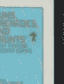

# 共同创作电子游戏

由 Internet Archive 于 2022 年数字化，资金来源为 Kahle/Austin Foundation

1007416603

献给我的三位特别的人——
伊丽莎白、夏洛特和艾薇

# 致谢

这本书从构思到完成历时很久，至今已远超十年，一路上有许多人帮助过我。它始于 1997 年在昆士兰大学的一个博士研究项目，在那里我尤其要感谢我的朋友兼导师 Tony Thwaites 和导师 Tom O'Regan。

感谢 Auran 的管理层和员工，尤其是 Greg Lane、Tony Hilliam 和 Graham Edelsten，以及 *Trainz* 和 *Fury* 开发团队的成员（尤其是前 Auran 同事 Rob Shaw、Rachel Nixon、Ieuan Hyde、Stephanie Bond、Jason Robson、Alex Weekes 和 Dan Gray）。还要感谢参与本研究并与我分享经验与知识的众多 *Trainz* 粉丝社区成员。能与大家合作建设这个极具创造力的 *Trainz* 社区，是一种荣幸。还要感谢 Maxis 的管理层和员工参与本研究（尤其感谢 Caryl Shaw 促成项目的这一方面）。还要感谢 Will Wright 在研究收尾阶段提供的宝贵见解。

本书所基于研究的最后阶段以及本书的写作，是在 2007 年至 2011 年间我担任 John Hartley 的联邦研究员项目 *The Uses of Multimedia*（项目编号 FF0561981）博士后研究员时完成的，该项目由澳大利亚研究理事会资助，并得到昆士兰科技大学支持。该机构的同事提供了支持、批评性反馈、鼓励以及使研究成为一份有回报的职业的同行思想交流。尤其感谢这一时期我的朋友、同事兼前办公室室友 Jean Burgess。还要感谢 Christy Collis、Sal Humphreys（现于阿德莱德大学）、Alan McKee、Lucy Montgomery、Thomas Petzold、Deb Polson、Jason Potts、Christine Spurgeon、Jason Sternberg 和 Nic Suzor。

特别感谢 Stuart Cunningham 和 John Hartley，他们在过去五年中一直鼓励我。

我还必须感谢世界各地更广泛同行圈中一路提供反馈和鼓励的人。感谢 Nancy Baym、Mark Deuze、Henry Jenkins、Thomas Malaby、Hector Postigo、T. L. Taylor、Tiziana Terranova 和 Fred Turner。

还要感谢多年来与我讨论过本书早期版本的许多本科生和研究生，尤其是博士生 Darryl Woodford、Nicole Podleshny、Jonathon Hutchinson、Pip Shea 和 Dane Byrom。

感谢我的父母 John Banks 和 Margaret Jones，以及我的兄弟 Michael Banks。

衷心感谢我的妻子莉兹的耐心与爱。最后感谢我的女儿们夏洛特和艾薇——爸爸终于完成了“这本书”，感谢你们在我因为（又）要写作而不能陪你们玩时的理解。你们俩是我的灵感。

还要感谢 *Media International Australia*、*Convergence: The International Journal of Research into New Media Technologies*、*International Journal of Cultural Studies*、*New Media and Society* 和昆士兰大学出版社惠允以大幅编辑和修订后的形式转载第 3、4、5、6 章的部分内容。

# 引言：共同创造至关重要

游戏玩家不只是玩电子游戏；他们也制作电子游戏。游玩、生产与消费之间的边界正在模糊。通过与彼此以及专业开发者协作与合作，游戏玩家设计、生产、流通和营销引人入胜的电子游戏。我将这一过程称为共同创造。

过去几年里，用户生成内容和用户主导的创新作为重要的文化与经济现象兴起（Benkler 2006: 60; Bruns 2008; OECD 2007; Shirky 2008; Burgess and Green 2009a; Hartley 2009; Jenkins 2009）。2006 年 12 月，*《时代》杂志*将“你”评为年度人物，向数百万使用并贡献于 YouTube、MySpace 和 Wikipedia 等社交网络平台的人致敬。这些媒体消费者如今有时也是媒体生产者，他们制作并传播媒体内容和体验。当消费者对新产品或现有产品的设计、开发、生产、营销和分销贡献了非微不足道的组成部分时，共同创造性就发生了。正如 Prahalad 和 Ramaswamy（2004）在 *《竞争的未来》* 中提出的，价值正日益由企业和顾客共同创造（另见 Foster 2007; Grabher et al. 2008; NESTA 2008）。Henry Jenkins 和 Joshua Green（2009: 213）写道：

> 到二十一世纪初，粉丝已被重新定义为新数字经济中财富生产的驱动者：媒体公司对采用用户生成内容、社交网络和“利用集体智慧”的 Web 2.0 策略感兴趣，因而正积极寻求他们的参与和加入，尽管对此仍理解得并不完善。

认识到文化生产条件中这些潜在的重大转变，我们现在需要仔细思考这一现象。我们应当如何理解这些新兴的共同创造性行为与实践？这些共同创造性关系在媒体行业工作场所的基层层面如何展开？这些变化对创意专业人士的工作与身份意味着什么？在什么意义上我们可以说共同创造性至关重要？本书讲述的是电子游戏产业语境中的消费者和媒体专业人士如何应对共同创造性媒体的挑战与机遇。这些参与者多样的理解、动机和激励共同促成了共同创造的形成。紧迫的挑战是更好地理解这些协作性与创造性力量能够在何种条件下为共同利益而得到协调。

本书取材于始于 1997 年、与澳大利亚和美国的电子游戏开发公司合作开展的、刚刚超过十年的民族志参与式观察研究。例如，我取材于 2009 年对美国领先游戏公司 Maxis 员工的访谈，该公司是 *《模拟人生》* 系列和 *《孢子》* 的开发商。我也取材于 1997 年至 2005 年与总部位于澳大利亚布里斯班的 Auran 游戏公司开展的广泛民族志研究。本书描述并分析专业开发者与游戏玩家网络之间的共同创造性关系，这些玩家网络为开发者提供大量玩法测试、反馈、创意设计输入、数字艺术内容供应和营销支持。它描述了促成这种新兴文化的关键行动者（程序员、设计师、制作人、在线社区经理、营销经理、游戏玩家、技术和商务人士），他们反过来又被共同创造性所塑造。游戏学者 T. L. Taylor（2006b: 159–60；另见 2006a）认为，玩家在电子游戏创作中是共同创造性的“生产性行动者”，并主张我们需要“更进步的模型”来理解和整合玩家对这些产品与文化制作的创造性贡献（另见 Postigo 2003, 2007; Humphreys 2005a, b）。本书从一线民族志视角写作，提供了游戏开发者如何应对创造共同创造文化的挑战的幕后细节，以提出这样一种模型。

从 2000 年 6 月到 2005 年，当我接受该公司在线社区关系经理的职位后，我与 Auran 的研究关系发生了变化。这一角色主要涉及管理 Auran 与一个在线铁路迷社区的关系，该社区围绕游戏开发项目 *Trainz*（www.auran.com）形成：这是一款于 2001 年发布的火车与铁路模拟游戏。从 2001 年到 2011 年，Auran 为 *Trainz* 模拟器系列发布了约 14 个不同的产品迭代版本，并将一个全球在线社区发展到远超 200,000 名成员。超过 1,000,000 套 *Trainz* 售给澳大利亚、美国以及整个欧洲的游戏玩家。Auran 和 *Trainz* 项目为本书提供了一个民族志案例研究。

整个 2007 年，我也与 Auran 开展了民族志研究，追踪其竞争性……的开发和发布最后阶段

玩家对玩家（PvP）大型多人在线游戏（MMOG）*《狂怒》*于2007年10月发布，最终在商业上失败。2007年全年，我在较长时段内与Auran在线社区关系团队成员、*《狂怒》*的开发者以及Auran高级管理层密切合作。我还参与了*《狂怒》*发布前的游戏测试，与*《狂怒》*玩家一起参加大量游玩和反馈环节，并采访了参与同Auran这种共同创造关系的玩家。

基于我在田野工作笔记和日志中记录的、对Auran日常工作实践所做的这一民族志参与式研究，以及同Auran员工（远超30次访谈）、Maxis员工和围绕游戏开发项目形成的玩家粉丝社区成员进行的广泛半结构化访谈，我描述了将这些共同创造关系纳入开发过程核心所面临的挑战，以及这些转变对传统公司结构和文化造成的影响，包括媒体专业人士和富有创造性地参与其中的公民消费者的身份与角色。

共同创造的文化生产接近约瑟夫·熊彼特（1950）对驱动资本主义创新的、躁动不安的创造性毁灭之风的描述。在本书中，我叙述了这些新兴关系如何也导致商业失败，以及创意专业人士工作前景的不确定性。这些共同创造关系扰乱了现有商业模式、项目组织方式、法律框架和监管制度。这不是一项关于大型媒体企业平稳霸权运作、并从中发现另一种有利可图的剩余价值来源的研究。从熊彼特的意义上说，这些变化从市场资本主义内部产生，为往往不可预见、不确定且难以治理和管理的不稳定与创新提供了种子。

共同创造并不只是业余爱好者之间自下而上、点对点的动态过程。共同创造需要专业人士和专家的技艺、知识与投入。我对共同创造的理解聚焦于业余爱好者与专业人士之间的联系和关系。本书受民族志冲动所引导，旨在描述创意产业专业人士和公民消费者在共同探索这一新兴共同创造文化的机遇与挑战时的生活经验。正如保罗·巴雷特（1996：17）在其对生物技术公司Cetus Corporation的民族志研究中所提出的：“人类学上相关的要点是实践特殊性的塑造。”为实现这一目标，我纳入了大量访谈摘录和对日常工作实践的描述，以凸显参与者（包括专业人士和业余爱好者）对共同创造实践的多元理解与经验。我们将会看到，专业电子游戏开发团队在理解和支不支持这一共同创造生产过程方面往往远非一致。制作人、设计师、程序员、艺术家、营销与社区关系经理以及首席执行官对这些共同创造关系有着非常不同的理解。但共同创造文化正是由这些参差不齐的实践构成的。共同创造的核心存在着无法消解的张力和冲突。

本书前三章具有浓厚的民族志描述色彩，旨在阐明创造共同创造文化的实践。但民族志研究也关乎理论建构。详细案例研究描述的意义和价值不仅在于民族志式的逼真，还在于为一种分析框架和模型提供依据；杰森·波茨（Banks and Potts 2010）和我称之为社会网络市场语境中的“多重游戏”，我在最后几章中对此加以发展。该模型旨在提供分析基础，以更好地理解共同创造。民族志描述和模型建构这两项抱负并不总是和谐一致。参与者的叙述并不总能无缝地融入我们的模型建构抱负。

社会网络市场语境中的多重游戏——这是本书核心的观念和命题——将共同创造文化建模为共同演化的市场与非市场；这一动态且涌现的过程部分关乎新的、不稳定的和颠覆性的市场关系的出现。社会网络市场提请关注一种需求驱动的动态，其中富有创造力的公民消费者及其社会网络的能动性与选择，连同专业知识和技能，都是根本性的。这是一个在复杂且不确定环境中进行分布式学习的模型，该环境会随着行动者对其探索而改变，并且正是因为这种探索而改变。它是一个社会的、涌现的学习过程，因为它是一个自我累积的发现过程。行动者，无论专业人士还是业余爱好者，都参与着高度网络化和涌现性的学习过程。这些行动者的选择受到他人选择的影响。但他们是在对这些共同创造交易中的回报和激励存在相当深刻不确定性的语境中做出并行使选择的。然而，这一模型并不是要把文化实践化约为经济或商业命令，因为这些选择语境常常同时涉及商业与非商业价值，或内在与外在激励。我们提出，当聚焦于共同创造语境中的社会学习和涌现行为时，多重游戏是基本分析单元。其基本观念是：行动者在相互重叠且不可通约的语境（既有商业也有非商业）中穿行于行为世界时，会发现经过协商的行动规则和规范，而这些规则和规范大多源自社会环境本身并与之协商形成。这是一种适应性的、实验性的游戏。

这些多重游戏和社会网络市场是什么样子？我对这种商业与非商业动机和激励、专业工作与专长同消费者业余爱好者的热情与投入相协调的混合体的思考——它似乎正是共同创造的核心——在我进行民族志研究并受雇于Auran的某一特定时刻凝聚成形。我瞥见了共同创造在改变我们生成知识和学习方式方面的潜力。与此同时，关于这些活动所生成价值得以共享和分配的条件与条款的问题困扰着我。2002年7月，即*《火车模拟》*（Trainz）商业发布约六个月后，我参加了在佛罗里达州劳德代尔堡举行的美国国家铁路模型协会（NMRA）大会。我被安排与Auran同事一起参加这次大会以推广该游戏。在大会前夕，*《火车模拟》*粉丝热切期待一个支持蒸汽机车的更新发布。这是一个呼声很高的功能，Auran的开发者未能在发布时及时完成。然而，一个临时组成的*《火车模拟》*内容创作者小组通过适应性试错实验弄清了如何将蒸汽机车内容纳入游戏。这项分布式的、用户主导的创新努力看起来可能抢在Auran专业人士之前引入蒸汽机车。尽管我也知道许多Auran开发者正在向这些业余开发者提供信息和指导，说明如何最好地推进这个蒸汽项目。我在第3章对这项蒸汽机车项目作了更详细的叙述。但在本书这一导论阶段，叙述我在这次大会上遇到该蒸汽项目早期成果之一的情形，有益地将共同创造的各种线索汇聚起来，而这些线索正是我们多重游戏和社会网络市场观念的核心。

来自世界各地的铁路迷爱好者及相关企业和俱乐部参加了大会。在线*《火车模拟》*粉丝社区的成员也加入了我们。我们安排Battrash从佐治亚州的家中飞往劳德代尔堡，以便他通过演示和销售*《火车模拟》*来帮忙。Mutey、Bitstorm和Amethyst在深夜驱车四个多小时，于凌晨抵达酒店，带来他们的个人电脑和显示器，通过向铁路模型爱好者演示*《火车模拟》*来帮忙。志愿粉丝团队在电脑前站了好几个小时，演示*《火车模拟》*的功能并回答提问。他们积极推动销售，用这样的话鼓励犹豫或动摇的潜在顾客：“看，这个游戏绝对棒极了。我每周都花好几个小时玩它。我就是玩不够。而且我来这里甚至没有报酬。”然后他们会演示自己最喜欢的*《火车模拟》*功能之一，展示铺设轨道或创建山脉并挖隧道是多么容易。演示通常以Battrash或Mutey成交而结束。

这种共同创造感在展会最后一天达到某种高潮，当时*《火车模拟》*粉丝社区的另一位成员Gumby，

赶来帮忙。Gumby 是内容创作社区中一位相当知名且富有才华的成员。他与一支小型创作者团队一起，正在制作一系列机车模型；这些模型通过他们的网站 Digital Roundhouse（www.digitalroundhouse.com）发布，令不断壮大的 Trainz 在线社区中的许多人翘首以盼。到达展会并自我介绍后不久，Gumby 递给我一张 CD，并催促道：“看看吧，你得加载这个，我想你会印象深刻。”我把 CD 递给 Bitstorm，他一边加载一边评论：“哦对，我看到这个小宝贝已经在 Download Station 上线了。”“它来了，”Badtrash 宣布道，我听到围在显示器旁的铁路迷发出几声赞叹和欣赏的声音。一位我曾与之讨论 Trainz 功能和优点的老人（我们已弄清楚他的 PC 确实不支持 Trainz）拍了拍我的肩膀，指着屏幕说：“我记得你说过 Trainz 没有蒸汽机车；那台 P10 真是漂亮的大家伙，如果它有蒸汽机车，那我就要一份。”在支付了 40 美元并写下我们关于升级他 PC 硬件的建议后，这位男士后退站了大约半小时，周围聚集起越来越多欣赏的旁观者，他们全神贯注于屏幕上 P10 蒸汽机车在布局中行驶的画面。

我记得一位 Auran 同事在路过并完成另一笔销售时低声说：“真希望展会一开始我们就有蒸汽机车，那可能能让我们多卖不少。”他要求我们调高扬声器音量，好让蒸汽音效吸引注意力，或许还能带动销售。技术、粉丝投入、资本投入与商业、DIY 实践与技能及历史，同专业开发者的技能与专长的这种混合，模糊了行动者与企业之间的边界。P10 将商业与非商业、专有与非专有纠缠在一种不安的联盟之中。

我们每个人每天在需要做出行动选择时，都会玩多重游戏，而这些选择发生在有时复杂、相互冲突且不确定的多个环境的交叠之中。共创性所产生并促成的价值，源自这些不可通约且往往相互竞争的领域之间的摩擦与张力。共创性并不是一种我们必须或应该决定让一方优先于另一方的情境：让商业优先于非商业，或反之。相反，我们正在试验并适应性学习如何驾驭这些实践以实现共同利益。然而，提出这一点并不意味着我认为，发现什么构成共同利益以及如何最好地追求它是一件简单直接的事。正如我们将在本书中看到的——它困难、令人困惑，也可能带来回报。

第1章“定位共创性”通过结合 Henry Jenkins（2006）、Yochai Benkler（2006）和 Axel Bruns（2008）等人的著作，识别并描述共创性文化生产的关键问题、主题与挑战。我还通过讨论 *孢子* 和 *小小大星球* 等游戏，在电子游戏语境中引入共创性。

本章随后借鉴我在 Auran games（澳大利亚布里斯班）开展的民族志研究，以及对 Maxis（美国旧金山）员工的半结构化访谈，为我对共创性意义与特征的论证提供语境。我借助对两家公司开发者和管理者的访谈，识别媒体专业人士在应对共创性时面临的关键问题与挑战。本章描述开发者和管理者如何努力阐明这些共创关系中的关键所在。

贯穿这项民族志研究，促成这些共创关系形成的技术成为一个紧迫问题。游戏引擎和软件编辑工具在共创性的形成中处于什么地位？最近大多数关于参与式文化和用户生成内容的研究，虽然承认信息通信技术（ICTs）的重要性，却往往将技术在塑造这些关系中的作用黑箱化。

第2章“共创技术”通过考察 Auran 从1998年到2001年构建开放架构游戏引擎的努力，探讨这一技术问题。本章借鉴对 Auran 程序员、设计师、制作人和图形艺术家的访谈，考察游戏引擎如何重新配置 Auran 开发团队内部的关系。我运用 Bruno Latour、John Law 和 Annemarie Mol 的行动者网络理论（ANT）来论证，游戏引擎是一个复杂对象，其多重性本身协调着不同竞争且冲突的议程。Auran 游戏引擎的不同版本虽然往往不可通约且不连贯，却确实维系在一起。不可通约性未必是游戏引擎技术开发项目成功实施的障碍。游戏引擎和编辑工具在共创文化的形成中很重要。然而，在强调人类与非人类在共创性等网络建构中的作用时，当我们试图理解这些动态关系的本质时，ANT 却失去了分析效力。我转向 W. Brian Arthur（2009）的演化理论路径，以理解*技术演化*如何塑造共创性。

第3章“共同创造*Trainz*”提供了一个描述性案例研究，说明 Auran 如何日益让火车与铁路迷参与设计和制作 *Trainz* 的过程。本章涵盖2000年6月至2004年 *Trainz* 的生产与商业发布。在此期间，Auran 日益依赖 *Trainz* 粉丝的内容创作。用户使用游戏附带的编辑工具制作自己的3D铁路世界布局，导入机车3D模型，然后通过 Auran 网站与其他用户分享。通过这些共创活动产生的价值直接促成了 Trainz 的商业成功。粉丝创作者实际上被嵌入 Trainz 的设计、开发全过程。然而，我质疑那种通过商业与非商业之间的对立来框定这些关系的倾向。我认为，这种鲜明的对立无助于理解塑造这一新兴图景的复杂性与机会。

第4章“共创劳动”（与 Sal Humphreys 合著）将游戏开发者对火车与铁路迷所产生价值的依赖视为一种用户劳动。本章探讨 Tiziana Terranova、Andrew Ross 等人的研究，他们认为创意产业日益依赖消费者的无偿劳动，而这种共创性也可能加剧专业创意工作者的不稳定就业状况。本章基于对 Auran 与游戏粉丝共创关系的民族志研究，以及对 Maxis 员工的访谈，探讨行动者自身何时借助工作与劳动的话语来塑造他们对这些关系的理解。

尽管企业开发者从这些共创关系中提取价值，但我认为这并不简单是利用不知情的粉丝作为无偿劳动来源的情形。专有与非专有、商业与非商业的这些纠缠，未必就是企业利润导向议程对粉丝文化或媒体消费者劳动的挪用。这些新兴生产组织模式依赖于由往往不可通约的忠诚、激励、动机和逻辑构成的织体，而这些因素却常常服务于共同利益；劳动价值论是理解它们的最佳途径吗？此类共创游戏开发项目之所以成功，恰恰依赖于接纳参与这一网络建构的行动者之间的不可通约性。我认为，共创文化可能并不只是廉价内容或无偿且被剥削劳动的来源。

共创文化关系是业余者与专业人士、专家与非专家组成的混合且高度分散的集体，其出现源于创意产业日益依赖用户主导的创新和用户生成内容。共创性使创意产业的生产与项目实践从封闭的专业知识工业模式转向开放而动态的创新体系（Schroeder 2003; Von Hippel 2006）。用户共创是一种协调与变迁的动态机制，它有可能将商业实践与消费者实践转变为开放创新网络。

第5章“共创专长”借鉴了2007年全年开展的一项民族志研究，该研究紧随 Auran 开发和发布 Fury 的最后阶段之后进行；Fury 是一款竞技性、PvP、大型多人在线游戏，于2007年10月发布。我探讨了 Auran 的专业开发者与一个游戏玩家网络之间的关系，这些玩家提供了

Auran 提供了大量反馈和设计输入。我考察了这一专业能力问题在展开过程中如何干扰了 *狂怒* 的开发。

最后一章“协同创造建模：多重博弈”（与杰森·波茨合著）在社交网络市场语境中详细阐述了我们将协同创造视为多重博弈的模型。协同创造被处理为市场与非市场之间共同演化的动态过程。

社交网络市场模型被波茨等人（2008）定义为消费者选择由他人选择决定的市场，它挑战了传统新古典经济学的还原论行为理性主义。社交网络市场在做出选择的语境中探索并建模协同创造。然而，这些选择并不是在传统微观经济理论所描述的狭窄行为激励与动机范围内实施的。该模型基于这样一种观念：这本身既不是经济现象，也不是文化现象，而是经济领域与文化领域之间共同演化过程的结果。本书所依据的民族志数据表明，*经济与文化因素、内在与外在动机、商业与非商业激励* 同时塑造着协同创造。这不仅涉及这些领域如何为其他领域提供条件，还涉及它们如何相互转化。正是这种文化机会与经济机会同时被重新配置的共同演化动态，使社交网络市场成为理解协同创造的一种具有分析意义的方法。这允许两个领域及其相关动机与激励之间发生复杂互动。我认为，正是这种共同演化动态有助于我们理解这些协同创造关系如何运作，以及它们如何实现互利。我们不是以政治经济学术语来框定协同创造，坚持认为开发商和发行商等企业正在剥削玩家协同创造者以获取剩余价值，并追问玩家是否因此在某种意义上不了解——或可能被误导——这些交换的条件；相反，我们探讨开发商与玩家消费者双方通常所做出的知情而精明的选择的条件与特征。然而，这些选择并不只是狭隘且在经济上还原论的“理性选择”。

本书以对顶尖游戏设计师威尔·赖特的访谈作结；在访谈中，我们讨论了协同创造文化的一些未来方向，以及理解与塑造这一新兴现象相关的挑战。我认为，协同创造文化所引发的许多挑战与困境，也许最好通过试错式演化机制来应对——这种机制具有适应性、涌现性、实验性和游戏性。

# 1 协同创造的情境定位

## Auran 与 *黑暗统治*

我在1997年中期开始注意到 Auran，当时围绕 *黑暗统治* 聚集了一批玩家粉丝；*黑暗统治* 是当时即将推出的实时战略（RTS）游戏，由 Auran 与领先电子游戏发行商动视联合制作，并由动视于1997年9月发行。粉丝们正在建立以该游戏为主题的网站，内容包括预览内容、新闻和游戏特性描述；他们对 Auran 参与在线粉丝社区的程度感到兴奋。Auran 大力宣传游戏将包含用户友好的编辑工具，使玩家能够创建和分享附加地图。Auran 还承诺发布一份详尽的用户指南或手册，可从其网站下载，提供关于如何修改各种游戏特性的详细信息。

Auran 当时在尝试各种建立并维持与 *黑暗统治* 粉丝关系的方法。其中一部分努力包括 Auran 和动视的员工参加每周在“*黑暗统治*”频道举行的互联网中继聊天（IRC）会议。在这些由粉丝社区一位关键人物组织的会议中，程序员和设计师会回答问题并讨论游戏特性。当然，这些讨论显然是一种宣传和营销手段——它是激发人们对游戏兴趣的一种方式。在与我的讨论中，玩家表示他们很清楚这一策略是“发布前造势炒作”的一部分。但他们也因 Auran 的参与而受到鼓舞：他们相信或希望游戏开发者正在倾听他们，他们的想法也许甚至能够影响游戏设计决策。当时，这家公司愿意就即将推出的 *黑暗统治* 进行开放式交流，这给粉丝留下了深刻印象。自那以后，参与在线社区的核心玩家越来越期待游戏开发公司会主动倾听、互动并支持围绕游戏作品形成的粉丝群体。粉丝期望越来越多地参与游戏生产过程。简言之，他们期待一种协作与协同创造的关系。

Auran 早在1997年就努力与粉丝建立更紧密的关系，这可以看作一家新兴中小型企业开发商在试图提升其在全球游戏市场中的知名度时采取的精明策略。这项点对点营销举措确实提升了 Auran 在在线 RTS 粉丝社区核心玩家中的知名度。

考虑到这一切，我联系了 Auran，并争取到访问他们、研究他们正在探索的与在线粉丝社区关系的机会。1997年中期我第一次访问 Auran 位于布里斯班市中心的办公室时，我记得注意到那里是杂乱的开放式布局。Auran 显然正迅速超出其办公空间，工位挤在一起。在这次初次会面中，Auran 的首席执行官格雷格·莱恩正在权衡是否让我访问 Auran 以及以什么条件访问。我很紧张，莱恩通过谈论我们作为玩家的共同背景来让我放松。我们发现，我们共享一项少年时代的爱好：玩桌面战争游戏和角色扮演游戏 *龙与地下城*。莱恩在布里斯班的角色扮演圈中非常活跃，并在20世纪80年代中期组织过一个大型角色扮演俱乐部。他指出，正是这种对角色扮演和游戏活动的参与，使他理解粉丝的价值和重要性。

Auran 开发团队刚刚从美国之行回来；他们在那里与 *黑暗统治* 的发行商动视团队一起工作了数周，为游戏做最后润色。*黑暗统治* 距发布大约还有六周。

在我看来，讨论进行得很顺利，因为莱恩以相当开放的方式谈论了 *黑暗统治* 和 Auran。莱恩随后说：“我想你会想看看这款游戏。”他演示了 RTS 类型中标准的各种特性以及一些新功能，然后说：“但我觉得这可能是 *黑暗统治* 最酷的地方之一。”他切换到编辑工具包，演示玩家创建新地图和修改各种参数会有多容易。他花了很长时间向我展示游戏可以如何被扩展和修改——编辑工具集如何被当作绘图程序来创建新地图，以及玩家如何访问配置脚本来更改或修改各种变量（包括人工智能例程）。他评论道：

> 从项目一开始，在开发战术引擎[用于开发 *黑暗统治* 设计的游戏引擎]时，我们就希望它尽可能可扩展、可定制。随着我们开发引擎，可配置游戏的理念及其重要性逐渐浮现。我期待看到用户会用这个做什么，他们会创造什么样的内容。

在会面剩余时间里，我们讨论了游戏开发者与在线粉丝社区之间的关系。莱恩说：

> 我认为，游戏引擎的可扩展性或可定制性对于吸引核心玩家群体非常重要，尤其是那些游戏活动基于互联网的玩家。……我们不确定我们与粉丝的互动对 *黑暗统治* 的最终销量究竟有多重要。但我们确实相信它很重要；这是我们非常投入的事情……我认为核心在线玩家确实有影响力，尤其是那些运营主要粉丝网站的人。他们是意见领袖。他们影响一款游戏作品在网上的存在感和可信度。围绕一款游戏作品的粉丝活动越多（建立网站、制作附加内容），该作品在在线玩家中的可信度就越高。我们相信，在线游戏活动在未来几年只会增长。所以，是的，我们确实相信倾听粉丝很重要。但在现阶段，我们的参与对销量有多重要，谁也说不准。我们在这一切上的投资回报是什么——谁真的知道呢？我认为这会延长游戏的生命周期。游戏用来实现销售的时期相对短暂。也许像内容创作这样的粉丝活动能够延长人们对一款游戏的兴趣。但除此之外，这很有趣。粉丝们显然乐在其中，这里的人也同样乐在其中。

新兴玩家粉丝文化的一个重要特征——如今许多作品都支持这一特征——是用户生成内容，即对游戏软件的扩展和增补（通常称为“模组”或“附加内容”）。这种向最终用户开放游戏架构的做法，促成了 ID Software 的突破性作品 *毁灭战士* 的成功。在 *游戏机国度* 中，J. C. Herz（1997：90）观察到，*毁灭战士* 标志着游戏制作方式的一种潜在转变，即游戏制作成为最终用户参与的开放式过程。ID 于1997年12月以非营利许可发布 *毁灭战士* 的源代码，允许具备编程技能的粉丝修改游戏。他们可以创建自定义音景、调整游戏配置，甚至创建新关卡和游戏的完整章节……玩家成为 *毁灭战士* 世界的一部分，不仅因为他们玩这款游戏，还因为他们构建了其中的一部分。

如今，游戏开发公司通常会在游戏发行软件包中附带编辑与模组工具。这些工具常常是游戏设计师和美术师在制作发行版本时使用的软件工具

游戏标题，并让用户能够修改或为游戏制作新内容。皮肤或纹理可以修改和改变游戏中元素和模型的图形。更广泛的修改，如“完全转换”，包括创建新的游戏关卡或游戏单位以及可与其他玩家共享的物体的能力。游戏研究者认识到模组对电子游戏行业和游戏文化的价值和意义（Banks 2002; Postigo 2003, 2007, 2008; Dovey and Kennedy 2006; Kerr 2006; Nieborg and van der Graaf 2008），他们经常引用多人游戏模组*反恐精英*，一个以反恐为主题的第一人称射击游戏，由业余爱好者Minh Le和Jess Cliffe于1999年为Valve广受欢迎的*半条命*（1998）开发。正如Nieborg和van der Graaf（2008: 178）所指出的：

> > *反恐精英*的成功最终超越了*半条命*，玩家们开始购买原版游戏只是为了玩这个模组。预见到*反恐精英*及其开发者的广阔前景，*半条命*的原始开发商Valve回应道，为模组团队提供了Valve专业开发团队中的一席之地，并以此获得了*反恐精英*宝贵的知识产权。

商业上成功的游戏，如作为零售现象的*模拟人生*（Maxis和Electronic Arts，2000）系列，在很大程度上依赖于玩家创建和分享内容。在《向模拟人生学习》中，J. C. Herz（2001）认为，*模拟人生*这一广受欢迎的现象的成功，或许至少部分归因于Maxis努力让客户直接参与产品开发和演变的过程。这达到了“客户不仅完成了大部分的创新和营销工作，而且生产的知识资本与他们消费的一样多”的地步。

由Maxis开发、美国艺电发行的*孢子*（2008）的成功依赖于用户创建的内容。玩家使用3D编辑器来设计生物和其他游戏内内容，引导他们的生物通过各个进化阶段，然后与其他玩家分享他们的创作。Maxis通过他们称为“授粉内容”的系统收获这些玩家创造的内容，并将其填充到其他玩家的游戏中。自*孢子*于2008年9月发布以来，第一年内就有超过1亿件玩家创造的内容被上传到在线Sporepedia资料库。玩家还可以直接从游戏内将他们的生物创作视频上传到*孢子*的YouTube频道。创建和分享内容是*孢子*的核心特色，以至于这个游戏或许最好被理解为一个由玩家创造力生成的社会网络。解谜平台游戏*小小大星球*，由总部位于英国的Media Molecule开发，于2008年10月在PlayStation 3主机上发布，其续作*小小大星球2*也同样严重依赖用户创建的内容。玩家可以使用整个游戏中嵌入的拖放式关卡编辑器来创建和编辑新关卡。然后，他们可以通过PlayStation Network在线服务与其他玩家分享这些创作。该游戏的官方在线社区网站*小小大工坊*允许玩家分享他们的关卡设计和游戏内视频。该网站还提供视频教程，帮助玩家学习使用关卡编辑器并创建自己的关卡。自*小小大星球*发布以来，已有超过两百万个玩家创建的关卡可供使用，年度游戏版包含了其中的18个关卡。

*孢子*和*小小大星球*等游戏的特殊意义在于，它们将共同创造的媒体文化融入了游戏体验和电子游戏商业的核心。*小小大星球*的口号“玩，创建，分享”凸显了这种共同创造的中心地位。

然而，早在1997年，当我采访Lane并访问Auran时，我只是看到了用户创建内容的潜力及其对改变生产者-消费者关系的意义。在获得Auran参与研究的同意后，我安排了定期访问其工作场所，并有机会采访正在从事*黑暗王朝*工作的程序员和设计师。我试图从程序员的角度了解Lane曾与我讨论过的开放架构游戏引擎设计。我的田野笔记记录道，在早期的一次访问中，我走近一位年轻程序员，问他“在做什么工作”，他指着屏幕回答：“你知道的，追踪最后几个错误。”当我进一步询问*黑暗王朝*、开放架构的战术引擎以及Auran支持粉丝社区创建附加组件和模组的计划时，他似乎不知道该如何回答。他说：

> > 是的，粉丝的东西真的很酷也很重要。我们想在这方面做些努力。比如我们和粉丝聊天的方式。

我接着询问了*黑暗王朝*背后的战术引擎技术，以及Lane如何将其描述为对玩家开放且可修改的。那位程序员似乎有些不安，说：“我得回去工作了，现在是赶工时期，还有很多事情要做。”

就这样，我们的讨论突然结束了。当我离开主要工作区时，我注意到他坐回电脑前，显然又忙开了，不管“它”是什么。我猜想他是指修bug。对他来说，真正的行动就在那里，在电脑前编码。从我的初次访问以及和开发者的类似讨论中，我遇到了一个问题：该如何理解那个年轻程序员坐在电脑前编码时正在做的事情。

离开Auran之前，Lane说：“看看这个”，和之前几次访问一样，他在屏幕上调出了*黑暗王朝*的编辑器工具。“我们已经做了一些”

他向我演示了他编写的AI脚本，这些脚本用于改变游戏中各种单位的行为。他说：“社区里的家伙们正在编写一些很棒的脚本，用不了多久，我们就能把AI做得比开发者们还好。”但是很明显，他也在指出编辑器工具中需要修复的问题和限制。他评论道：

> > 这种开放的方式和给我们提供工具真是太好了。但如果Auran真的希望看到好的内容涌现出来，他们确实需要修复这些问题。这些东西挡了我们的路。Auran看起来反应很快，所以也许你下次去那里的时候可以告诉他们这件事。谁知道呢，也许他们会做出我们想要的修复。

*黑暗王朝*于1997年9月发布，迅速在商业上取得成功，最终售出超过70万份。它获得了在线游戏网站媒体和线下游戏评论杂志的好评。Auran发布了*战术引擎手册*，详细解释了如何修改战术引擎，以及用户如何访问、修改和创建游戏脚本以改变各种关键游戏参数。发布后不久，用户创建的新游戏地图开始出现在粉丝网站上供下载。Lane希望这只是不断增长的粉丝生成内容源泉的开始，这些内容将为*黑暗王朝*提供支持。然而，粉丝内容创作活动低于预期，从未成为围绕*黑暗王朝*的玩家活动的重要特征。Lane认为，*黑暗王朝*的设计中做出了一些妥协，使得玩家难以修改或创建附加组件。他在1998年3月评论道：

> > 我们从那件事中学到了，它确实需要更简单、更容易使用，门槛必须更低，因为我们知道如果太难用的话，大多数人不会去尝试，或者他们会放弃。除了那些真正的核心玩家……我仍然认为开放架构引擎的方法是我们想要走的路。让粉丝和玩家参与进来将变得越来越重要。这很可能会改变我们制作游戏的方式，而开放的引擎在这里很重要。粉丝群体所取得的成就让我惊讶，开发者需要利用这一点。

## 新的参与式文化？

我在1997年至1998年初对Auran的这些访问中记录的田野笔记提出了一个问题：我是否正在目睹消费者与生产者之间关系的重大变化，这种变化超越了文化研究……

消费意义上的非粉丝。作为补救措施，他提出了一种基于事实基础的方法，提供一种‘更复杂且较少庆祝性质的粉丝文化模式’（9）。¹ 希尔斯鼓励我们更复杂地理解粉丝文化、企业商业文化与学术研究之间的关系。例如，他认为詹金斯的粉丝文化版本旨在‘作用于特定的学术和制度空间及议程’（10）。詹金斯的粉丝不是需要被理解和呈现的文化客体。相反，它被改造成一种‘能够作用于学术共同体的形态’。在这里，粉丝充当了一个屏幕，文化研究学者的政治价值观投射其上（10–11）。² 希尔斯随后提出了一个令人不安的问题：当粉丝文化本身被直接视为利基市场时，那些往往主导文化研究如詹金斯研究中的粉丝概念会变成什么样（27）？

这些对文化研究关于粉丝文化和主动受众论题的批评并不特别新鲜。关于粉丝文化为企业提供了一个诱人的利基市场的观察也是如此（Ang 1996: 10–11; Nightingale 1996: 95–100, 126–30）。希尔斯补充了一个担忧，即这种对粉丝文化的理解还依赖于生产者和消费者之间假定的分离。生产者拥有生产设备，而消费者则通过挪用最终产品在“生产空间”中偷猎。他质疑这种对德塞托（de Certeau）工作的依赖，指出“它似乎过于僵化，无法有效处理消费者与作为生产者的消费者身份之间的模糊性。它实际上无法接受消费者可以在官方生产空间中积极寻求并占据战略位置的可能性”（39）。在此，希尔斯提请我们注意，塑造粉丝文化的条件正在发生重大转变。我们在与Auran的初步研究中看到了这一点。詹金斯的工作也已从*《文本盗猎者》*的立场转向，以应对这些变化对其参与式文化理解的影响。

在‘互动受众’（2002）中，詹金斯借鉴了皮埃尔·列维（Pierre Lévy）的著作，思考互动受众与媒体产业之间已经转变的关系。列维认为，从经济角度看，“附加值的生产转移到了消费者手中，或者更确切地说，消费的概念应被商品或互动服务的共同生产所取代”（80–1）。对于列维而言，这些趋势表明“一个质不同的交易空间的出现，其中消费者和生产者的角色正经历深刻变化”（78）。

在*《融合文化》*（2006）中，詹金斯发展了对参与式文化中这些变化的理解，避免了将消费者视为要么抵抗媒体产业要么被其收编的对立逻辑。他打破了这种非此即彼的逻辑——拒绝将媒体消费者视为要么完全自主要么完全易受创意产业影响。相反，詹金斯将媒体用户视为追求复杂且矛盾的联盟，并认为粉丝在这些商业网络中寻求开放和探索参与式联盟的可能性。问题因此变成访问权限以及这种参与的条款和条件，而非对立或抵抗。³ 这个框架下，粉丝社群不被理解为要么抵制文化产业，要么被无缝整合进企业利益和议程。相反，这些参与式文化的协商和联盟或许正成为“媒体运作的正常方式之一”（246）。

詹金斯分析的特别优势在于，它凸显了定义参与式文化的媒体消费者与媒体产业之间的动态关系。但他的工作是否仍然会受到希尔斯提出的批评，即他过度抬高媒体消费者的生产活动？这一点也许在最近从詹金斯工作出发的研究中更为清晰，例如布伦斯（Bruns，2008）的“生产性使用”（produsage）概念。在一项典范性研究中，布伦斯考察了用户和消费者在制作和创造媒体内容方面日益增长的作用，从开源软件开发、新闻博客和维基百科，到Flickr、YouTube和电子游戏产业。他认为，“生产”一词本身就是问题，因为它将我们锁定在工业模式的生产理解中。他所描述的“生产性使用”如此彻底地让用户以自身身份参与并融入内容制作过程，以至于超越了工业化的生产组织模式并从根本上打破了它。但在突显媒体用户和消费者的这种生产能动性时，布伦斯是否可能过快忽略了这类活动在很大程度上仍主要通过商业拥有的平台和工具进行？此外，媒体专业人员在他所讨论的各种媒体产品和实践的创造和制作中仍然发挥着核心作用。

“生产性使用”等概念的抽象程度，虽然正是其优势所在，但或许过度抽象化了那些首先使许多活动成为可能的关系和媒体生产实践。它还将生产假定为一种静态形式，而非一套复杂且不断演变的关系，这些关系并非必然最终由某种工业福特式组织所定义。布伦斯描述的是不断演变的*生产—消费*关系，也许过快地将生产者、消费者和用户等类别视为无用且过时而加以拒绝，并评论道：“‘消费者’乃至‘终端用户’的角色早已消失，内容生产者与用户之间的区别已逐渐变得相对无关紧要”（2）。当布伦斯将电子游戏产业分析为“这些过程的彻底促进者”（289），简要提及*《模拟人生》*并触及Auran的*《模拟火车》*（Trainz）时，他承认这有些问题，因为这些是商业产品和平台，其中制作内容的“生产者”同时也是购买游戏软件的消费者。专业游戏开发者及其工作也在布伦斯所描述的实践中占据显著地位。“生产性使用”概念本身的高度概括性开始妨碍描述和分析这些不断变化的产消关系在不同媒体产业部门中出现和协商时的精确特征。例如，没有迹象表明电子游戏产业的特殊性可能要求我们重新审视“生产性使用”的概念以进行微调——它只是提供了另一个例子来说明该书第二章详述的一般原则。但即便如此，一般原则很重要，在结论一章中，我自己也将提出一些关于这些新兴文化生产模式的一般原则。然而，我希望民族志案例研究的经验细节与所提出的原则之间能保持生产性的张力。

我们需要对共同创造关系如何在创意产业工作场所运作和协商进行更细致和详尽的描述。托马斯·M·马拉比（Thomas M. Malaby，2009）的*《创造虚拟世界：林登实验室与第二人生》*等重要研究为我们指明了方向，它提供了一部厚重而细腻的民族志，描述了林登实验室的员工如何应对创造如“第二人生”这样的虚拟世界所面临的挑战和复杂过程。然而，我提出这些观察，并不是要拒绝布伦斯或詹金斯对消费者在制作和传播媒体内容与体验中日益增长作用的强调——这无疑是共同创造理念的基础。但我从“共同创造”理念出发，并不急于抛弃生产与消费等类别；它植根于对这些新兴文化经济关系如何形成的不确定性和争议之中。马拉比对林登实验室的描述之所以重要，恰恰是因为它突显了林登设计师们的不确定性，因为他们试图打造一个虚拟世界，其核心和可用性都旨在鼓励用户创造性地打造“第二人生”的世界。马拉比将此描述为一个“人为设计的架构”（8），其中林登员工自上而下的设计意图与目标之间相遇并碰撞着用户经常出乎意料的实践。正如马拉比所指出的，“第二人生依赖其消费者的出乎意料的使用”（8）。然而，正如他精彩描述的那样，林登设计师控制或引导用户实践的努力常常产生相当复杂和出乎意料的后果。因此，马拉比的民族志所呈现的是，这种用户共同创造活动不仅对用户本身、对詹金斯和布伦斯作品所强调的参与式文化和“生产性使用”意味着什么，“而且对于日益增多的此类数字环境架构而言，它们或许都在描绘一种设计这种开放性的新方式”（8）。他仔细地突显了林登实验室专业员工在创造这些世界时的工艺技能和实践，并严谨地描述了他们对这些新兴实践的多样化理解。

那一点，或者说它如何促成那一点，但你看，在办公室里四处比划的那群人正乐在其中，聊天等等，粉丝们也乐在其中，但这一切从这里会走向哪里、我们能把它推进多远，谁知道呢？

这份民族志材料既没有全面记述1997—2007年间的Auran，也不是对这一时期游戏产业的全面研究。我借助这份民族志材料来阐明共同创造这一复杂过程与实践。接下来的许多章节会描述性地突出游戏开发者和玩家应对新兴共同创造关系所带来机遇与挑战的各种方式。其他章节，尤其是最后三章，则利用这些材料提出并发展一个共同创造的分析模型。我想在此明确民族志描述与理论建构之间的关系。厚实详尽的描述和访谈摘录不应被简化为分析性和理论性命题的单纯范例。民族志材料为我的理论论述提供信息并引导它，但民族志材料与理论之间存在一种必要的张力。这种张力无法通过适当的方法论反思性来克服。此外，尽管我是从许多小时的录音和数百页转录稿中精心挑选访谈摘录的（正如前面Rabinow的引文所暗示的，民族志记述是“被塑造的”），我并不认为这些材料可以被无缝地还原为我的记述。John Frow（1995）借鉴Meghan Morris（1988）的研究，警告说民族志研究对象（他考察的是“通俗”这一范畴）可能变成“批评家自身活动在文本上被委托的、寓言式的象征”。“他们的精神气质可以被建构为他者，但它被用作民族志学者的面具”（69）。这里的风险于是在于，来自这些游戏开发工作场所的访谈和描述材料可能成为我的面具。然而，我不认为我们被困在再现性民族志逼真性与理论或批判分析之间的截然对立中。我也不认为这正是Morris或Frow在此必然要表达的意思。我希望，我并不是在把这些游戏开发者的叙述挪用来替代我的学术话语，而那种话语“否认自身的阐释性和分析性——即其智识地位”（Frow 1995: 69）。我的目标是，这份民族志记述从这种构成性的张力与困境中建构起来。Frow和Morris所指出的分析风险，并不必然构成开展民族志研究的障碍或反对理由。不过，我认为把民族志化约为Frow所说的“其智识地位”也是一种错误。我在形成这份记述中的位置，远比一个提出理论的学者更繁多、更多重。它也来自我作为Auran games雇员、担任在线社区经理的经历，我当时既想理解也参与创造共同创造媒体关系的技艺。这种对这些专业人士日常工作实践的参与。

从我围绕*Auran games*开展的更广泛研究中，我了解到，半结构化访谈中分享的内容，与那些“宏大的创意想法和愿景”在日常工作场所关系中如何展开，可能非常不同。我不是说受访者刻意要误导或提供错误信息——更确切地说，访谈情境往往会引出某些类型的回应，也会使参与者对哪些信息和评论会被他们认为对研究者有价值产生某些预期。我将在本研究的多个地方使用这些材料，尤其是在最后几章和结论中，因为我认为它有助于为我将提出的各种主张提供语境。它还提出了一个与*Auran games*案例研究所提供的视角略有不同的视角。

访问Maxis和Will Wright的机会，源于2008年12月Caryl Shaw访问澳大利亚时的一次会面（她是*Spore*项目的高级制作人，负责传播内容）。在澳大利亚期间，Shaw花了几天时间参加与澳大利亚游戏研究者的研讨工作坊，我们在其中重点关注游戏开发者与玩家之间新兴共同创造关系的重要性与挑战。当时*Spore*刚刚发布，我们正目睹该游戏中玩家创建内容数量的惊人增长。Shaw表达了Maxis开发团队对玩家在如此短的时间内——仅两个月——创建了如此多内容的惊讶。她还说，设计师们对玩家发现工具意外应用和用途的速度感到惊讶——这正是Malaby（2009）所说的未预见偶发性：

> 他们很快就发现了我们漏掉的东西，甚至是我们知道其中存在、但你知道，被当作缺陷的东西（笑），然后抓住这一点，想出创造性的用法，做出真正很酷的内容。于是这些缺陷变成了特性，我们接下来就得考虑支持或进一步开发它们。

与Shaw的这些非正式讨论中一个富有启发的方面，是她如何突出并具体呈现了支撑共同创造媒体文化制作的所有*专业*工作。例如，她讨论了设计和制作编辑工具的挑战，这些工具让玩家能够创建并享受所有*Spore*内容。她还提出了扩展并重新思考其网络与服务器基础设施及系统的困难，这些基础设施和系统使玩家创建的内容得以分享：

> 好，那么现在我们已经有了这么大量的内容，并且正用它填充玩家的游戏，我们如何帮助他们从中筛选，并找到最契合他们那个Spore世界版本的确切物品呢？这是个大问题，而且越来越大（笑）。然后在此基础上，我们如何为所有这些内容提供一个有意义又有趣的语境或玩法环境？玩家不想只创作；他们还想玩这些内容、用它做事情。就Spore而言，我认为创作这一部分我们做对了；团队在编辑器方面确实做得很到位，他们干得很出色。但我认为，在弄清楚如何为所有这些内容提供意义和价值、然后让玩家以某种方式创造性地参与其中这方面，我们还有一段路要走。

2009年6月22日至26日，我访问了旧金山的Maxis，当时团队正忙于Spore首个扩展包《Galactic Adventures》的发布。这个扩展包为玩家提供了一套工具，他们可以用这些工具设计自己的迷你游戏冒险或关卡，并配有支撑故事，纳入他们自己创建或其他玩家创建的内容。然后他们上传这些冒险并与其他玩家分享。以下摘自对不同员工的访谈的片段，概括了许多问题和挑战，这些问题和挑战是电子游戏产业中共同创造关系的特征，并构成后续章节的核心主题和议题。它们包括：

- 有助于形成和塑造共同创造关系的技术与工具；
- 玩家与专业人士之间价值交换和交易的性质；
- 玩家在探索内容创作工具潜力方面的创造力；以及
- 专业开发者在支持和促成这些共同创造实践中的作用。

## Lucy Bradshaw——工作室主管

### 关系

Bradshaw在访谈一开始就强调，游戏产业中的这些共同创造实践有其历史。对Maxis而言，这可以追溯到Will Wright的SimCity系列：

> 我想那是97年左右。我参与制作的第一款游戏是SimCity 3000，那时用户生成内容还没有那么多。但SimCity 2000实际上包含了SimCity城市更新工具包（SCURK），这是一个人们用来创建自己内容的工具包。所以我们看到一小群一小群的人开始建立自己的网站，为游戏制作作品并分享它们。我联系了那个特定的玩家社区，想了解它

知识产权与商标问题。我们的界限划在哪里？基本上，最终用户许可协议等文件中的法律立场规定，所有内容本质上都是《模拟人生》的内容，归Maxis和EA所有，但因此我们现在与用户群体和创作者群体有了道义上的关系。我们不会以将其作为自己产品发布的方式来使用他们的内容；我们不会将其当作自己的东西来用。这些内容出现在网站上，吸引人们访问这些内容聚合网站，而他们最终能够通过广告收入将这些网站变现……所以当《模拟人生2》推出时，我们制作了一个更高级版本的内容创建工具，名为“Body Shop”（身体工坊），我们在游戏发布前就推出了它，他们真的能够进入其中并制作出令人难以置信的内容……然后，当我们为《孢子》将内容制作工具直接构建到游戏中时，这种关系再次发生了变化。我们将这些工具紧密地嵌入游戏中，以至于我们某种程度上改变了玩家生成内容的方式。这些是我们自己团队使用的工具，我们希望将它们交到每个人手中，并使其成为游戏体验的核心。

当我请布拉德肖详细阐述与玩家的关系如何因《孢子》而改变时，她再次回到了工具的话题，评论道：

我们必须非常努力地开发那些编辑器。我们尽力强调玩家的创造力，但通过我们的程序化动画方法在幕后实现这一点。这让玩家更容易看到自己的想法变为现实。因此，在底层技术和尽可能广泛地激发玩家创造力之间，存在着一种握手式的关系。然后是内容“授粉”这一方面——我们如何开发内容共享系统。我们在后台进行操作，当你分享某个内容时，它会传到我们的服务器上，然后进入其他玩家的游戏中，即使他们是在自己的客户端上完全单人游玩，他们的内容也会不断刷新，与Spore.com上Sporepedia中的任何内容同步。但这同时也让内容创作者能够控制何时发布内容，因此他们可以进行润色和微调。然后我们建立了系统，让他们能看到自己的内容获得的关注度以及由此得到的赞誉……

我认为我们让这种内容的制作和共享与核心游戏真正无缝衔接。但随后，玩家制作并想要分享的海量内容让我们感到惊讶[笑]。但我们并没有利用所有这些资产，也没有为玩家提供一个背景和环境，去探索他们能用这些资产做什么，你知道，真正地玩和探索那些创作——所有那些内容，现在超过1亿个资产，你知道，行星、建筑、载具，以及

社区支持了这一请求的改变。布拉德肖和杜林格显然都对这种向Maxis游说改变的方法印象深刻。杜林格评论道：‘听着，这比普通的论坛帖子更能引起我们的注意’，布拉德肖则说：‘你们必须注意这一点，它很有艺术性，毕竟——这是一种吸引我们注意力的创意方式’

在我们的讨论中，布拉德肖经常回到Maxis与玩家社区‘不断变化和演变的关系’这一话题。她评论说这其中有‘道德层面’的问题。我请她澄清，她回应道：

> Maxis对玩家社区怀有真正的尊重……这很有趣，因为他们非常热情，我认为这正是我们所回应的，而且他们中的许多人都是创作者，他们帮助进行了游戏的口碑传播。他们甚至超越了我们最初发布的游戏内容所设定的边界。我们为其提供养分，但他们也将这些反馈给我们，所以这实际上是一种双向的交流。因此我们倾听，我们也确实努力确保我所说的规则是平衡的。显然，我们拥有需要持有和捍卫的知识产权，然而在这种关系中，他们增添了某些东西，而我们从中受益，所以，你知道，你最终如何尊重这一点？

## Dan Moskowitz：首席工程师

### *这是一个诡计*

负责编辑器的首席工程师丹·莫斯考维茨详细描述了制作这些编辑器的技术和设计难度，这些编辑器‘既能让从未在3D中创建过任何东西的人上手，又要强大到足以让专家创造出令人难以置信的东西’。他强调，挑战在于给玩家一种强烈的创造可能性，同时又要设定一些参数和约束。他说：

> 这就是我们要处理的平衡点，作为工具制作者，我们很多精力都放在思考你能把约束关掉多少，并允许玩家基本上构建他们想要的任何东西。但这还必须与游戏玩法需求相平衡；你知道，比如我们希望内容做什么。

莫斯考维茨还详细描述了确保内容项目数据量小的技术成就，以便它们能够快速无缝地上传到Sporepedia并下载到其他玩家的PC上。他说，

> 例如，当你想在编辑器里给你的生物上色时，我们存储的其实只是六条数据，基本上有三层涂料可供选择，每一层都有一个关联的颜色。所以我们最终存储的只是六字节的数据，这些数据被发送到服务器，但当我们实际重建生物时，我们会说，哦，这个涂料脚本，它实际上是我们的技术美术师制作的一个文本文件，里面有如何让涂料沿着生物脊柱滴下，这样条纹就能出现在正确的位置，并沿着生物椎骨的轮廓延伸的指令。这只是技术和设计成就的一个小方面。毕竟，我认为我们制作的这些工具确实打开了很多人的想象力，因为他们更习惯于那些比较静态的工具，你知道，你有一个主要角色，你可以把他拆开再重新穿上。但我们所做的真正不同的事情是，让你真正定义你的生物的身体、体形和四肢等等。然后在这之上是另一个体系，即程序化动画，克里斯·赫克也参与其中。我们创建的编辑器是一回事，但如果没有程序化动画，它们就只是静态的生物；而它实际能四处走动、移动，这是程序化动画团队处理的另一项技术壮举。嗯，我眼中的《孢子》成就是这样的：它某种意义上是将3D建模真正、真正地普及给大众，以及关于如何做到这一点的决策的结合，这样当工具到玩家手中时，玩家的创造力就被释放了。

我评论说这‘显然是成功的，因为有玩家制作的所有那些内容’，莫斯考维茨打断了我说：

但这是一种诡计，一种伟大的诡计，对吧，我的意思是，因为我们某种程度上定义了这个可能性空间以及人们能制作什么，而且这个空间非常巨大，所以人们觉得自己拥有完全的自由，可以做任何想做的事，但在这个世界的生物创建器中，有很多东西你是无法制作的。然后就是把这些出色的工具发布出去，让每个人都能使用它们，而不必非得具备一定的技术水平。但随后那种诡计发生了变化，因为在我们发布生物创建器之后很快，你知道，玩家们开始找到他们自己的诡计，并开始用它们制作出梦幻般的内容，几周之内，我们就能看到他们用这些工具做出了一些我们需要大约三年才能摸索出来的东西[笑]，然后我们看着我们自己的内容，然后……

笑称这太烂了，因为玩家创造的东西要好得多。就是这样，你知道这太令人满足了。我是这一点的坚定支持者，我的意思是，我们基本上做了一个好工具，然后就像把它放到互联网上一样；他们会用它做出你甚至无法想象的惊人东西。所以这里有一个成本效益问题，即把你的工具打磨到可以公开发布的水平。这就是我们、团队在开发它时的心态。这些上亿的素材，数字大到有点无意义，但心态是看到并支持人们如何把它提升到下一层次。

我问是否愿意澄清“这是一个花招”是什么意思：

> 好吧，所以当我们设计那个可能性空间时，你也需要约束所有这些，你需要删减和修剪。不能只是像“好吧，给你，想做什么就做什么”……嗯[停顿]。但对程序员来说，有些时刻我们会想，好吧，如果我删掉这行代码，我基本上是在修剪玩家探索时我知道可能发生的整个可能性空间。所以就像你感到一种奇怪的责任，必须非常小心保留什么、去掉什么。我们保留的一些东西是那种别扭的按键组合，你可以用它们做某些事，我们知道总有人会弄明白，也许那百分之一的人会发现它、欣赏它，并以此做出一些很酷的东西。但你知道这些技巧传播得很快。使用它的内容被投票顶到顶部并流行起来，然后你看到很多人在用。然后你看到那些YouTube片段，比如教程，教人们怎么做。有很多这样的案例，有些真的让我们惊讶。

莫斯科维茨说的“花招”并不是指不诚实。有趣的是，他有些费力地描述工程师设计这些工具和环境的专业技术技能与玩家往往出人意料且富有创造性的使用之间的动态关系。这非常接近托马斯·马拉比（2009）对林登实验室和《第二人生》的论述，我先前讨论过，其中他突出“消费者未预料到的使用”（8）。马拉比（14）将这些环境和工具的设计工作描述为“新的制度性技术”，并指出“表面上的自由”或许“掩盖了治理技术上的重大创新”（14）。正是在这里，我某种程度上偏离了马拉比；Maxis开发者所描述的动力机制和创造性关系不仅仅是“表面上的自由”（着重号为笔者所加）。然而，《孢子》所提供的创造性自由需要程序员、设计师、制作人和社区经理的技艺。这些专业人士无疑在创新，以打造和协调“新的制度性技术”，与玩家协作共同创造产品和体验。这是“人为设计的”（马拉比 2009：86），或者用莫斯科维茨的话说“一个花招”，但这并不意味着它带有误导性或操纵性。

## 摩根·罗阿里蒂：首席运营官

> *“我们还没有完全弄清楚，我们不知道”*

Maxis首席运营官摩根·罗阿里蒂强调了开发团队对玩家借助编辑器所取得成就的热情和兴奋：

> 作为制作人，当你看到有人在编辑器里做出东西时，真的会有极大的满足感，因为那几乎像是——我不知道有什么好比喻——我部分负责创造了让这成为可能的工具，那种感觉真的很酷。看到人们做出的东西就是极大的满足，我们给了他们表达自己的能力……当你看到人们创作的内容以及其中的乐趣和表达力时，那是一种不同的关系。所有这些都会反馈到开发中，并真正推动像丹[莫斯科维茨]这样的人。

摩根随后讨论了促成这种玩家创造力的各种角色和技能，尤其强调将“社区视角和反馈”嵌入各开发团队的重要性：

> 我们的社区经理，你知道，特蕾莎·杜林格斯和梅根·麦克道尔斯，他们每天都进行这种对接。他们在我们各团队之间互动非常频繁。特蕾莎是个很好的例子；她从测试背景进入，然后一步步做到社区经理角色，现在是助理制作人。你知道她在各种内部团队邮件列表上，所以她把来自社区的视角发送给《孢子》工程团队。让这样的人贯穿开发过程，是的，这是其中很大一部分。实际上这非常重要。

我与罗阿里蒂讨论了玩家生成内容的“成本效益”。他回应道：

> 这里有趣的关键在于，游戏产业是一门大生意，对吧。你知道EA[电子艺界]是一家企业，我们想赚钱，你知道，我的意思是我们想要薪水，这样我们才能继续在这里工作。这样我才能买房子、养孩子等等。然后还有所有这些社区的东西，有点像免费的，以及社区提出的增加更多功能的点子。但这在我们这边也需要大量工作和资源，比如目前围绕不对称性进行的所有工作。你觉得所有这些能让《孢子》多卖几份吗？我认为我们还在努力弄清楚所有这些，而对于像《孢子》这样的游戏，我们将开始弄清楚。我的意思是做一个补丁或更新真的很贵——等你加上测试和发布，就真的很贵。这也是一种工程平衡，是的我们可以加入更多功能，是的我们可以做所有这些回应社区的事情，但最终业务看起来是什么样？所有这一切仍在演变，我们也还在摸索。

我问罗阿里蒂，关于用户创建内容以及开发团队与玩家社区的关系，他是否想在我们的谈话中补充什么。他回答说：“我希望你带走的要点是，它仍在演变。我们还没有完全弄清楚，我们不知道，好吧，我们为《孢子》制定了一些计划，然后从中学习，从玩家正在做的事情中学习，我们也在《银河冒险》中尝试一些东西，但你知道，它会改变。”罗阿里蒂有帮助地提醒我们，所有这些共创活动都发生在一个更广泛的电子游戏产业背景下，该产业涉及像电子艺界这样的大型发行商。这背后有一种政治经济学。但我不想匆忙进入这样一种分析，它也许会排除描述和理解制造共创性的专业技艺，包括罗阿里蒂所暗示的不确定性和实验。

## 斯通·利布兰德——首席设计师

> *“我真的希望它在某种程度上成为游戏设计教育”*

与我采访的许多Maxis员工相似，利布兰德对玩家创作的内容数量以及他们发现工具意外用途的速度表示惊讶：

> 首先，一切都让我们惊讶。从第一天起，我们就开始看到让我们惊叹的东西。比如“哦，我们甚至没想到那个”，你知道，玩家很快就弄清楚了所有我们以为可能要花几周或几个月才能发现的技巧，因为有时候我们花了几个月才弄明白你可以做某件事。
>
> 我们会看看那个效果如何，让人们讲故事，你知道，把《孢子》看作一个充满故事的星系。
>
> 但这也关乎通过玩《银河冒险》并把他们的故事与所有内容组合起来，来教育人们，教他们如何设计游戏。我教一门游戏设计课，主要面向完全没有游戏设计经验的学生。这是一学期15次讲座的系列课程。所以很多那样的知识、那种教授设计的方法，我试图把它放进《银河冒险》里，因为在这里我们不只是做一个游戏，我们是在做一个让人们能制作自己游戏的工具。那么我如何让这些知识成为UI[用户界面]的一部分，这样当你开始摆弄和探索像这样的“目标面板”——你在世界里拖拽目标并排序——那么，当你摆弄这些目标时，你现在就是一名电子游戏设计师。我真的希望它在某种程度上成为游戏设计教育。它让进入并探索这一领域的门槛稍微低一些。也许《银河冒险》会成为那个让他们制作游戏或看到自己能够制作游戏的东西。这是一套他们可以非常容易地探索和摆弄的工具，你知道，相比用于模组制作的虚幻编辑器、《半条命》编辑器之类的东西。就像这是朝着某人未来使用更高级工具迈出的一小步。这是我的希望。

在我访问Maxis后回到布里斯班的几天后，利布兰德给我发了一封电子邮件，附有一个YouTube片段链接，展示了玩家创作的一个冒险：一款以《马里奥赛车》为主题的赛车游戏。玩家再次以生成此类内容的速度让Maxis团队感到惊讶。但在我待在Maxis的那一周里，当我进出各种采访时，当采访被电话和提醒员工需要参加的会议或需要完成的任务打断时，当我偶然听到关于服务器和网络问题的零碎对话时，我意识到，诸如用户创建内容、用户主导式创新、制作人甚至参与式文化这样的术语，可能会忽视设计师、程序员、制作人、首席运营官和社区经理在生产和协调这些共创式媒体实践时所做的工作。这并不是要否认媒体消费者的创造性角色，但这一角色并不是简单地接管或取代媒体专业人士。

共创性与商业企业和媒体专业人士的工作深深纠缠在一起。共创性是市场与非市场、专业与业余之间动态且涌现的关系场所，而这些关系正不确定地演变着。

## 共同创造技术

### 引言

正如我们在前一章所见，Auran 和 Maxis 的游戏开发者对共同创造文化的叙述，往往围绕游戏引擎与编辑工具技术的地位展开。在他们的叙述中，这些技术具有相当活跃而生动的地位。探索共同创造的潜力，要求这些专业人员开发能够支持这些新兴关系的游戏引擎和软件工具。设计师、制作人和程序员也热切期待玩家可能以意想不到的方式使用这些工具，探索修改和扩展*孢子*等游戏的可能性。我们需要仔细考虑这些技术的地位，它们通过邀请用户修改自身来公开显示其偶然性。

在我早期与 Auran 程序员讨论时，我对游戏引擎的理解还很初步。但要把 Auran 与游戏引擎和编辑工具等技术剥离开来却证明很困难。在电子游戏产业中，游戏引擎是游戏生产中的研发组件。正如 Lane 和 Auran 的一位首席程序员最初向我描述的那样，游戏引擎是一种软件设计环境，由一系列子系统和功能构成，设计师随后可用它来实现特定的游戏设计。游戏引擎渲染当代游戏常有的 3D 环境；它们还提供支配物体与角色运动和交互的物理例程，例如碰撞检测；它们管理声音、人工智能例程、网络和工具。正是这个工具层对用户创建内容等共同创造活动尤为重要，因为它使游戏和引擎可供访问，从而可以通过更改各种参数和导入新内容来修改它们。游戏引擎

‘用户创造力作为企业托管 3D 软件平台上的产品开发策略’。在对 Linden Lab 的*第二人生*的研究中，van der Graaf 强调了企业—用户互动的复杂动态，以及让模组社区等用户参与知识生产和创新实践日益重要的意义，这些对 Linden Labs 等企业至关重要。尽管认识到工具包和引擎技术的重要性，但技术如何塑造并促成这些新兴的用户参与关系，并不是她博士研究的主要焦点。

### Auran 的游戏引擎项目

1998 年初，Lane 相信开放架构的游戏引擎技术以及复杂但用户友好的编辑工具将改变游戏开发。随着游戏引擎向 3D 环境建模发展，它们变得越来越复杂。开发一个能够支持前沿游戏的引擎，正成为一个具有挑战性的长期项目，需要一组程序员至少工作两年。这是一项耗资数百万美元的事业。这为进入游戏产业制造了研发壁垒。到 1998 年初，一小队热情的程序员在车库里工作，就能开发出随后可支持具有商业竞争力游戏设计的游戏引擎，已越来越不可能。替代方案是从另一家开发商那里授权许可一个游戏引擎，然后根据游戏设计的要求对其进行修改。但高端引擎迅速攀升的许可费用同样高得令人却步。

Auran 迫切需要一款引擎来支持其下一个游戏项目。Lane 认为，Auran 也有机会成为技术提供者，向试图进入该产业的独立游戏开发者授权开放架构引擎。Auran 管理层需要制定一种能够有效利用这一机会的商业模式。凭借*黑暗王朝*的成功，Auran 已在澳大利亚及更广泛的国际 PC 游戏产业中建立起显著知名度。在这种环境下，公司设法从私人投资者和澳大利亚联邦政府研发拨款中吸引了大量投资。从 1998 年到 2000 年的目标是：通过开发可授权给其他游戏开发者的引擎技术，提升 Auran 在本地和国际上的知名度；然后制作一款游戏并达成发行协议，以巩固 Auran 作为顶级开发商的地位，并推广 Auran 的技术。

Auran 的资深程序员在 1998 年初向我解释，SAGE 引擎概念涉及使游戏设计对终端用户内容创作开放。Lane 解释道：

可扩展性、可定制性，使引擎能够支持粉丝将创建的所有附加组件和模组。我们在*黑暗王朝*的*战术引擎*上朝这个方向前进，可扩展引擎的想法随着我们不断推进而发展。现在，随着我们推进新引擎，它变得更加重要、更加显著。但现在它不只是为粉丝服务。如果我们做对了，这里有一个真正开放游戏生产过程的机会。但这将是一项艰巨的任务。这有点像试图构建一个能做所有事情的游戏引擎。如果我们希望它在通用层面对游戏设计师有用，作为通用游戏创作工具或环境，那么我们需要保持它的开放性，以便他们能用它做我们甚至从未想到的事情。它必须是模块化和灵活的，以便设计师及其团队能够根据项目需求对其进行扩展。

基于与 Auran 管理层、程序员、设计师和美术人员的讨论和半结构化访谈，本章追踪 SAGE 从 1998 年到 2000 年的制作过程。这个引擎（2000 年更名为 Jet）也为 Auran 的*Trainz* 火车与铁路模拟器的开发提供了核心技术。因此，这项游戏技术是以下各章所讨论的共同创造网络形成过程中的重要行动者。在探讨游戏引擎等对象的物质性时，我将它们描述为“行动元”，从而赋予它们通常仅限于人类行动者的能动性；这里我借鉴了 ANT。ANT 通常与布鲁诺·拉图尔、约翰·劳、安玛丽·莫尔和米歇尔·卡龙等理论家的著作相关联。

### 行动者网络理论

借鉴 ANT，以更好地理解设计人工物如何建构社会。对 Yaneva 而言，这涉及：带有脚本和内置行动程序的对象如何强制并重新表述新的社会纽带；它们被塑造和设计的方式如何与建构社会的特定方式相关联。

但是，在描述此类关系网络时，这种受 ANT 启发的方法存在一个问题：人们最终可能试图囊括一切，因而在分析上什么也解释不了。这些相互关系由何种动态构成？在*连接的文化：社交媒体批判史*（2013）中，José van Dijck（2013：26-9）采用 ANT 作为理论方法，以理解社交媒体平台如何日益塑造和建构人们的社交性。她提出，ANT 通常让我们能够考虑“人与技术的共同演化网络”（26）。它让我们能够将社交媒体和游戏引擎等平台不只视为人工物，而视为由人类和非人类构成的一组关系，这些关系“不断需要被施行；各类行动者赋予平台意义”（van Dijck 2013：26）。然而，van Dijck 认为，尽管 ANT 以拒绝区分社会与技术提供了有益的本体论起点，但为了分析目的，作出这些区分可能仍然重要。在此，她质疑 ANT 所提供的分析效力。她认为，当我们想要理解技术与社会之间变化的关系时，这些区分可能很重要（van Dijck 2013：26）。为克服这一困难，van Dijck 将 ANT 提供的视角与政治经济学方法（尤其借鉴曼纽尔·卡斯特尔的工作）结合起来，以把握“平台的动态复杂性”（van Dijck 2013：28）。ANT 使她能够系统地将平台作为社会技术建构来处理，而政治经济学框架则使她能够强调平台作为社会经济结构，并考虑所有权、治理和商业模式问题。van Dijck 评论说，通过将 ANT 与政治经济学结合——她承认这是一种不稳定的联盟——她想要理解“在连接文化兴起的背景下社交媒体平台与社交性的共同演化”（2013：28）。van Dijck 在此提出了正确的问题。这个问题正是本书的核心——这些共同演化动态的性质与特征对于理解共同创造至关重要。我同意，共同演化方法提供了 van Dijck 所寻求的分析效力。然而，这里也有一个问题。van Dijck 并没有提出一种以演化理论为基础、用于理解她试图视为共同演化的这些动态的模型。ANT 并未提出这样的理论，政治经济学也没有提供

任何类似基于演化理论来理解这些动态的方法。正如 van Dijck 所观察到的，政治经济学关注结构而非动态。我会在最后一章回到演化与共同演化动态这个问题。不过现在，我提出，一种以演化理论为基础的技术与技术变迁研究方法，或许也能提供 ANT 所缺失的分析牵引力。我会在本章结论部分讨论这一可能性。

不过在这一阶段，我仍想看看 ANT 在理解游戏引擎方面能带我们走多远。在我与 Auran 的整个研究关系中，我确实注意到技术性材料对于这家不断成长的企业之形成的重要性，尤其是信息技术硬件、基础设施和软件。没有这些材料，就没有 Auran。ANT 让我们能够考虑这些技术如何参与组装体的形成，而这些组装体扰动了人类/非人类的分野。游戏引擎技术是 Auran 这一物质组装体的重要组成部分。

1998 年初，Lane 向我解释说，Auran 正“回到绘图板前”，开发制作一款新游戏所需的核心引擎技术。Lane 和其他 Auran 程序员在 1998 年初告诉我，他们的目标是扩展构建一个高度可配置、可扩展的游戏引擎的想法。Lane 说：

> 玩家自己在修改游戏。我认为这真的很重要，即为玩家提供工具，使他们能够进行修改并添加自己的内容……我相信，这种可扩展、可配置的引擎方法很可能会彻底变革整个游戏设计过程，就像我们之前谈到的那样，让玩家、粉丝更多地参与实际的设计/制作过程，并为游戏创作额外内容。谁知道它最终会把我们带向何方。

对游戏引擎技术的这一界定只是一个起点。这一人工物的地位相当难以捉摸。我对游戏引擎重要性的认识，是在与 Lane 的对话中逐渐形成的，这些对话涉及 Auran 建立和管理与玩家粉丝共同创造关系的计划。Lane 反复强调设计哲学和引擎架构的重要性，因为它们将支持这些共同创造关系的发展。在不同阶段，我被展示了一些篇幅很大、细节详尽的设计文档，并被告知这些文档“概述了引擎的架构”。我其实无法评估这些评论或文档。在与 Lane 和首席程序员的讨论中，身体语言、语调、沉默等各种线索告诉我，他们正努力用没有编程背景或知识的外行也能跟上并理解的方式来描述游戏引擎。他们正在把引擎转译成一个框架和一种形式——如果你愿意这么说，就是在重新配置它——以使它对我有用。这个出现在我与 Lane 和首席程序员对话中的引擎，是否就是程序员在 Auran 日常工作中所处理的那种技术？SAGE 是一个单一对象，还是也许是多重对象？我面对的是关于同一种引擎技术的相互竞争、彼此冲突的视角吗？还是说我在这里遇到的是多个引擎？

游戏引擎是一个复杂对象。它不是单一的，而是一个由编程模块组成的网络，这些模块可以插接在一起，以支持某个特定的游戏设计实例。构建游戏引擎的过程也需要大量物质材料：一个由个人计算机组成的网络，程序员在其中工作，并在对象被构建的过程中共享成果；一个工作空间，所有这一切材料都在其中汇集起来；以及多样的学科、专业技能和知识，包括编程、项目管理、行政、营销和财务实践。在访问 Auran 时，我注意到一些会议和会议室，在那里我会瞥见似乎与游戏引擎项目有关的文本、流程图和图表，但我很难辨认和理解它们。知识产权对于围绕游戏引擎形成的关系网络也至关重要。正如 Nieborg 和 van der Graaf（2008）所指出的，游戏引擎是专有技术，最终用户许可协议的细节仔细规定了其使用的条款和条件。谁或什么拥有这一软件，以及其他人可以在何种条款和条件下访问它，这些问题在我旁听的会议上是一个经常讨论的话题。这些知识产权问题还涉及商业模式，而这些模式会塑造引擎如何被发布到市场并流通。游戏引擎是 Auran 企业网络这一复杂物质组织的一部分，并从其中涌现出来。

坚持维持社会性与技术性之间边界的重要性的理论家之所以这样做，是因为他们担心，追随 ANT 对这一区分的拒斥，可能会放弃通过社会建构理论赢得的重要领地。在与 Latour 和 Callon 的一场辩论中，H. M. Collins 和 Stephen Yearley（1992：10）认为，ANT 对人类与非人类之间分离的挑战，退离了科学知识和技术知识是社会建构的这一立场。Collins 和 Yearley 担心，通过取消人类社会世界在建构科学知识和技术中的中心性，ANT 可能会恢复科学家、技术人员和工程师的权威。他们论证说，科学知识社会学“不再屈从于科学家和技术人员工作之说明”（321）。总之，他们认为 ANT 的含义远非激进，如果说有什么的话，反而是保守的，因为“方法的贫乏[使]它屈从于一种平庸的科学与技术观”（323）。

那么，他们与 ANT 的辩论是出于一种政治关切，即人文学科相对于科学和工程的地位。这一反对意见似乎确实适用于我的研究处境，因为我依赖 Lane 和首席程序员对游戏引擎的说明来构建我的研究描述。在我最近对 Maxis 员工的访谈中，我也依赖程序员和设计师对构成 Spore 的工具和技术的说明。到目前为止，我关于 Auran 游戏引擎开发所描述的一切，都依赖与 Lane 和 Auran 程序员的访谈和讨论。但怎样才能避免这种批评呢？Collins 和 Yearley 在这里的要点是，ANT 所提供的不过是技术专家的说明，Latour 和 Callon 只是在重复这些说明，而不是质疑或挑战它们。简言之，他们提出的是关于研究的情境性和政治性的问题。那么，我是否正在向一种企业家—技术专家版本的世界让步，而本来我应该坚持技术是由商业利益之类社会利益或软件工程师狭隘技术主义所塑造的，并以此与之抗争？进一步说——这是 Collins 和 Yearley 没有涉及但我认为其隐含的一点——仅仅通过报告并依赖 Lane 和 Braushaw 的说明，我的研究是否参与并共谋了某种特定企业家版本的技术项目的制造？在这里，游戏引擎及其周围关系的哪些其他版本正在被边缘化？

Callon 和 Latour（1992）坚持认为，他们所做的事情不止是依赖技术专家的说明。困难在于，在经验田野工作中，当追随科学家和技术人员所做之事，甚至在与他们讨论其所做之事时，他们“同时容纳数十种本体论立场”（352；另见 361）。非人类实体和对象不断进入科学家和技术人员的斗争与辩论。为使研究者能够有效追随并描述这些活动，“不可能只从众多本体论立场中取一种，以说明科学家引入非人类的方式；我们分析者不得不容纳整个范围”（Callon and Latour 1992：353）。Annemarie Mol（2002：33–4）认为，坚持维持社会性与技术性之间的分离，试图为社会科学和人文学科主张并保护一个知识与权威的领域。其担忧在于，如果这一区分不被尊重，那么其他知识模式和学科就会接管。

# 2 打造 SAGE

整个 1998 年，我定期访问 Auran，跟踪游戏引擎技术 SAGE 的开发，以及它将

支持。在此期间，Auran 搬到了市中心一个更大的场所。Auran 的新办公场所无疑给人一种成功且快速成长的公司的印象。Auran 正在招聘新项目所需的人员。公司从约 20–30 人的团队迅速扩张到 60 人的峰值。随着团队不断壮大以开发游戏引擎，程序员区域尤其扩大。Auran 雇用了来自澳大利亚、英国、美国、瑞典和俄罗斯的程序员。那是一个令人印象深刻的人员与设备展示。借助《Dark Reign》的成功，Auran 吸引了可观的资本投资。这包括获得超过 100 万澳元的澳大利亚联邦政府拨款，以支持 SAGE 游戏引擎技术的开发。

1998 年中期，在我一次前往 Auran 的研究访问中，Lane 向我介绍了一位年轻设计师，他最近受雇参与新游戏项目。这位设计师解释说，Auran 最近获得了一个奇幻角色扮演世界的知识产权授权，该世界大致以中世纪欧洲为基础。他正在设计一款游戏，要让玩家沉浸于 3D 环境和史诗般的奇幻叙事中。这位设计师似乎对游戏引擎的前景以及它将提供的用于创建这一奇幻环境的工具感到兴奋。

整个 1998 年，我定期访问 Auran，并与首席设计师讨论这款奇幻游戏的设计。然而，到 1998 年末，他似乎对这一过程感到沮丧。我向他提出这一印象，他回应时指了指放在桌上的一份厚文件。他说：“看，这就是[这款游戏]目前的样子，但它还不是一款电脑游戏。嗯，我在游戏设计文档里有一些有趣的想法，但这没有意义，在看到屏幕上实际发生的东西之前，我不知道自己手里有什么；到那时我才有东西给你看。”他感到沮丧的是，SAGE 引擎及相关软件工具尚未达到他可以用来开始实现游戏设计的阶段：

> 我真的很想做出一个原型并让它运行起来，然后我们就能看看它是否可行。
> 玩起来感觉如何，这才是大问题。我有一个宏大、史诗般的故事
> [指着桌上的文件]，但[这款游戏]玩法的重要问题在于
> 把这个故事与玩游戏的体验整合起来。
> 故事会在你游玩的过程中、在游玩的过程中浮现。
> 引擎将让你无缝地做到这一点。

他再次指着桌上的文件：“所有这些系统，以及它们与实现设计之间的关系，都在那里面。但实际上我并没有可以用来做任何事的工具或引擎，而这就是对我的考验。”

在构建技术项目的民族志记述时，我们必然依赖报道人告诉我们的内容。评估这些信息的地位往往很困难，因为我们可能不具备所需的技术背景。此外，我们正在构建和传播的记述可能正在参与对象和网络的制造。这并不是一种可以通过采用更严格的方法论或访谈技巧来克服的失能状况。它是在这些场所进行研究和工作的平凡而常规的一部分。但这是否只是对 SAGE 游戏引擎存在不同甚至相互竞争的看法这样一个简单案例？对于人文学科研究者而言，它提供了一个机会，来考察技术如何重新配置生产者与消费者之间的关系。我倾向于关注任何有关该引擎开放架构的评论。对 Lane 而言，SAGE 涉及商业模式和知识产权。对设计师而言，引擎项目为实现游戏设计带来了问题和机会。对编程团队而言，SAGE 是一个创建 3D 环境的技术软件问题。他们努力解决物体在这些场所中如何交互、物理如何建模，以及如何在内存、图形能力和处理器周期等有限硬件资源的约束下实现这一切。那么，SAGE 是否正由这些相互竞争的议程和利益构建而成？

我与设计师讨论了 Lane 关于引擎可扩展性的看法，该引擎旨在支持最终用户的修改。他回答说：“是的，那是其中重要的一部分。他们希望我正在向你描述的那些系统是开放且可修改的。”

他接着说，有一个问题我或许应该知道：

> 这都是大局。理论上这都没问题，这个引擎支持所有这些系统。它当然会支持一些很棒的游戏设计。但它必须能运行……编程团队正计划利用 3D 显卡的最新能力，实现大量令人印象深刻的 3D 和图形效果。如果它能支持他们旨在实现的所有东西，那当然会令人印象深刻。前沿图形很重要。它们能卖游戏。但前沿 3D 图形是有代价的。我的担忧归结为游戏玩法。正如我们之前讨论过的，我对游戏设计、对游戏的看法是，这一切真的都归结为游戏玩法。玩起来感觉如何。而这一切都取决于像样的帧率。我不会在这一点上妥协。令人担心的是，所有投入到令人印象深刻的图形上的工作会导致帧率问题，进而危及游戏玩法。

我与 Lane、设计师和首席程序员的访谈，是围绕游戏引擎开发与游戏设计之间关系的一场内部辩论的一部分。设计师很清楚我会与 Lane 讨论他的评论。我在对他进行任何访谈之前已披露了这一点。他也知道，所有访谈记录都涉及一种设计者—玩家关系：“几乎可以说，玩家将参与甚至共同制作游戏——嗯，至少在某种程度上如此。”这个 SAGE 与我在同游戏设计师讨论时遇到的那个 SAGE 是非常不同的对象。它旨在让游戏设计过程向设计者与玩家之间参与式、共同创造的关系开放。然而，Auran 的设计师感到沮丧的是，该引擎尚不能被用来实现他的设计，甚至无法达到早期电子概念验证阶段。这些是对同一个对象相互竞争且相互冲突的表述吗？或者，Auran 中也许有不止一个 SAGE 在流通？

## 访谈 Auran：增殖的 SAGE

1999 年 6 月，Lane 评论说，他认为我有必要通过访谈 Auran 各类员工，来更广泛地了解 Auran 正在发生的事情。他指出，从我与设计师和他的讨论中，我大概已经意识到 Auran 内部围绕 SAGE 项目的紧张与冲突。他建议我需要一个机会将其置于背景中，因为这类紧张和问题是游戏开发的一部分。Lane 还表示，他很想讨论我对这些讨论中浮现之事的看法和意见。我向所有参与访谈的员工披露，访谈记录将由包括 CEO 在内的高级管理层阅读。访谈在 1999 年 6 月下旬的一周内进行，涉及八名 Auran 员工，包括从事 SAGE 及相关游戏开发项目的高级程序员和美术人员。

## Auran 的首席运营官

Auran 的 COO 讨论了 SAGE 作为一种开放式、模块化引擎技术的重要性。然而，他评论说，这种开放性带来了问题，因为团队——尤其是首席程序员——需要知道在哪里设定界限：

> 所以我们给他们设定了一个问题，正如我对程序员们所说，你必须为一个我无法给你答案的问题想出答案。引擎必须影响深远。这是一个挑战，因为我们希望它成为这种开放的通用技术，然而要让它运行得足够好，当然必须对系统建模的内容有所限制。

我问 COO 他在管理这样一个开放式项目中的角色。他回答说，最重大的挑战是“设定界限，弄清楚

界限在哪里，办法是对将要实现的功能设定上限……划一条线，说做到这里就行，这就完成了，并且能够让别人接受这一点。

我问他对设计师因引擎迟迟无法到位、难以实施游戏设计而感到沮丧一事有何看法：

> 我们这里的设计师和美术师是来做游戏的。他们渴望做出点东西。他们的设计文档已经定稿，但因为SAGE，一切都停滞了。目前这里的大量资源都投入到了SAGE中，[设计师]对此提出质疑。这种程度的沮丧甚至愤怒是可以理解的。

他还认为，这些紧张关系和冲突表明，这是一家成长中的公司正朝着某个不再适合部分员工的方向发展。

## SAGE团队首席程序员

我问首席程序员对SAGE开放引擎这一概念有何看法。他回答说：

> 那个什么都能做的游戏引擎，是的，刚开始的时候，格雷格[莱恩]说我们要构建一个能支持3D应用的游戏引擎，尤其是一个完全3D的场景。他们还说，这是一个“必须什么都能做”的游戏引擎。我知道这有点荒谬，因为当然任何引擎技术都必须有局限。但我的态度是：“当然，咱们做吧。看看我们能做出什么。”

我问他，这个项目性质模糊，是否给团队管理带来了问题或挑战。他回答说：

> 是的，绝对如此。有一阵子那里真是一团糟。每个人都奔着自己的小项目和方向去了，围绕“它必须什么都能做”实际上意味着什么各干各的。但现在我们已经把它细化下来，对系统和模块设定了一些限制，同时内置了扩展能力，使其保持开放。

首席程序员评论说，以负责人角色参与SAGE的工作一直很艰难：

> 这就像有两个主人。一个是高层管理，出钱的人和投资者。另一个是代码本身。高层管理对最终结果应该是什么样、什么时候应该准备好，可能有一套想法。我理解这一点，他们有影响盈亏平衡点的目标日期。有些家伙，程序员和美术师，对此心怀不满。他们对来自商业方面的压力或要求感到愤怒。但仔细想想，没有这些，没有商业，我们也不会都在这里做这件事，对吧？但还有代码本身，它做完了才算完成。它不能半途而废，因为那样根本运行不了；而且有时候，它确实不符合商业进度表和截止期限。管理与商业需求之间的关系可能会很棘手……从商业角度看，这真的会让管理层很沮丧。他们不喜欢事情如此不确定。

## SAGE团队程序员

我问这位程序员对SAGE项目的看法：

> 参与像SAGE这样的游戏引擎工作这个想法真的让我很兴奋——这是我想做的事。从*《黑暗王朝》*延续下来的可配置引擎理念，我们很喜欢，也看到了其中的潜力……最好的事情是，你的某个想法、某个功能被做进引擎。我会先做一个演示来证明它能与引擎配合工作。然后我需要说服管理者它应该被纳入其中。有些东西没被批准，我也有过失望，那很难受。有些功能我回家后还会做，每周最多十小时左右，即使在这里已经工作60小时之后。但我喜欢长时间工作。这甚至不像是你在做一份工作。

我问：“你总体上怎么看SAGE的做法？”他回答说：

> 我刚来这里、听到“什么都能做的游戏引擎”这个想法时，嗯，我觉得它太大了，太野心勃勃了。当然，我把这个想法藏在心里。但现在我们更专注，也设定了一些限制，我认为它会不错。不过“什么都能做”这件事更多是营销。是炒作。嗯，我觉得是这样。

这位程序员花了相当多时间描述为SAGE编写人工智能（AI）系统所面临的挑战。他详细讨论了他正在做的寻路AI系统，并在我们交谈过程中查看我的笔记，以确保我记录正确。他补充说：“做这些东西是童年的梦想。我们工作时间非常长，常常一天十二小时甚至更久。但就算这样，我可能回家后还是会坐在电脑前接着做，这是很棒的工作。”

很明显，对这位程序员来说，采访过程给了他一个机会，向Auran高层管理表达自己对AI系统的看法。当我直接问他是否“愿意把他所说的所有评论转达给格雷格”时，他回答说：“当然，我希望他们知道我的看法。”

我采访的程序员似乎对Auran的状况相当满意。他们都提到工作时间非常长，但几乎无一例外会补充类似这样的话：“但这是梦想中的工作，长时间工作是其中一部分，而且我在家反正也会做。这并不真的像一份工作。”程序员们似乎对自己正在处理的特定技术问题投入很深。他们都质疑“什么都能做的游戏引擎”这一说法，但认为这首先是一个挑战：在保持可扩展性和模块化的同时，为引擎设定一些限制和范围。最后，所有接受采访的程序员都表示，SAGE项目出现了严重延误和问题，对美术师和设计师产生了负面影响。我与SAGE编程团队相处后得到的最强烈印象是，他们几乎把在Auran从事游戏技术工作视为一种特权，并且这为他们每个人提供了重要机会，去做对自己有意义的事情。这种职业使命感，即参与一个能让他们研究AI、寻路、3D世界系统和物理问题的项目，补偿了长时间工作。我将在第4章和第5章回到职业身份和工作条件这个重要问题。

## 图形美术师

对Auran美术师的采访在语气上与对程序员的采访非常不同。他们都在不同程度上批评Auran管理层，并对SAGE引擎的做法表示强烈怀疑。许多人说，他们来Auran时以为会参与前沿游戏的工作。但所有人都补充说，几个月来他们根本没有在做游戏设计。“沮丧”一词在采访中非常常见。他们都质疑推动SAGE项目的通用“什么都能做的游戏引擎”做法。美术师和设计师觉得，如果目标是开发前沿作品，那么这就需要一种专属于特定游戏类型或品类的核心引擎技术。

一位美术师评论说：

> 你需要一个非常快速、经过优化的引擎。如果那个引擎试图为所有人做所有事，那么我相信性能根本达不到。整件事是由编程重心驱动的；它是技术主导的，如果你是一家游戏开发公司，那是个大错误。

另一位美术师评论说：

> 你在这里工作时，会被弄得觉得自己能进来就已经很幸运了，只有最优秀的人才能在这里工作。某种程度上确实如此，这里有些非常有才华的人。所以你就信了。但随后你看到管理层所有这些不必要的控制。他们真的把我们当小孩对待。然后一些质疑整个游戏引擎愿景的人，就被叫作抱怨鬼，还被要求离开。那种氛围是一家公司想做大、做大生意，那不适合我。我想做游戏。

这种沮丧在我与首席游戏设计师的最后一次采访中凸显出来。他评论说：

> 我担心的是，整个项目是由程序员和他们的目标驱动的。这关乎游戏设计与编程理念之间的差异。这让我恼火，因为他们[程序员]现在所做的决定更多涉及游戏设计，他们在侵入游戏设计领域。
>
> 现在别误解我，SAGE真的很重要，也是个极好的想法。好吧，是的，SAGE有巨大潜力，但它运行得像条狗一样慢，而且目前很难为它编程，并且开放，还……好吧，这不太公平。它比那要好，我是为了说明观点、把我的意思讲清楚而夸大了。

## 多种引擎？

采访表明，在Auran存在许多不同、相互竞争又相互冲突、甚至不可通约的SAGE版本。首席游戏设计师一度质疑这个游戏引擎是否真的存在，因为他当时无法使用它来构建自己正在做的游戏设计。程序员们的版本则是一系列关于内存系统、AI、3D世界物理和开放

他们乐于参与开发的模块化架构。接着，我们还有莱恩这位首席执行官所构想的引擎技术版本，这种技术将从根本上改变游戏设计与开发的方式。他相信，SAGE 有潜力让游戏开发向游戏设计团队与玩家之间的协作敞开。这一引擎开发还与工作条件、权威以及不同知识形式之间的关系等问题纠缠在一起。那么，SAGE 的这些不同版本，是对一个单一事物的相互冲突的视角，并共同促成了该事物的建构过程吗？归根结底，这是一个关于相互竞争的利益试图塑造并占有这一技术物及其在游戏开发中的角色的故事吗？那么 SAGE 是社会建构的吗？例如，我们在这里有一个相当有趣的故事，讲述 Auran 内部围绕一项技术开发而产生的紧张与冲突：设计师和美术师与程序员发生冲突，两个群体都质疑更广泛的公司战略与方向。但是，正如当时许多参与者向我指出的那样，这种冲突和分歧是游戏开发的常见特征。我 2000 年至 2005 年在 Auran 参与不同项目、随后在 2007 年研究 Fury 项目的经历，当然支持这一点。但是，依靠莱恩和程序员提供的信息，我究竟是否有资格质疑或挑战他们为民族志学者的凝视所展示的那些版本的有效性？我是不是最终把过多的权威交给了他们的愿景和世界版本？那么，柯林斯和耶尔利对 ANT 的批评在这里是否相关？

在运用 ANT 简要追踪 SAGE 的制造过程时，我们看到，一个多样且异质的材料网络——从设计师、程序员和代码，到首席执行官、知识产权协议和 PC 硬件规格——进入了它的建构过程。于是，SAGE 混合了人与非人；它涉及杂合体的生产。追随米歇尔·塞雷斯的工作，拉图尔（1993：50–5）将它们描述为“准客体”，它们如此彻底地混合了人与非人，以至于把它们描述为社会建构的，或仅仅是人类能动性与实践的产物，几乎没有意义。构成 SAGE 的材料中介了访谈摘录中凸显的各种关系与活动——从设计与编程实践到工作场所关系（亚内娃 2009）。

SAGE 是一个“同时是真实的、话语的和社会的”客体；它既属于集体，也属于话语（拉图尔 1993：64）。这些具有可变本体论的变动客体，不只是连接彼此分离且独立的事物或主体的中介者。SAGE 不仅是一个装置或交换点，用来协调首席执行官、程序员、显卡、人工智能与 3D 世界物理建模系统、处理器周期、3D 艺术对象、设计师及其

那么，方法论问题不仅涉及民族志对象如何被建构为知识对象，也涉及它们如何与正在被研究的网络和对象的其他版本发生关联并介入其中。但是，在提出这一点时，同样重要的是保持 ANT 的理解，即这些对象的本体论是可变且多重的。像 SAGE 这样的转译者远非单一或稳定；这些准客体“是”集体性的，因为它们把我们彼此连接起来，因为它们在我们手中流通，并正是通过其流通定义我们的社会纽带。然而，它们也是话语性的；它们被叙述、具有历史性、充满激情，并且栖居着自主形式的行动者”（89）。

约翰·劳和安玛丽·莫尔推进了这种关于可变本体论的思考所蕴含的意义与潜力，以质疑 ANT 的网络逻辑和隐喻。在 *身体多重性：医学实践中的本体论* 中，莫尔（2002）论证说，她对围绕动脉粥样硬化这一疾病的医学实践所做的民族志，不是研究“医学如何认识其对象”（vii），而是关涉医学如何生成现实。这些对象是多重的，并且需要被协调（vii–viii）。她细致地描述了动脉粥样硬化如何通过医患访谈、通过血管实验室中的技术实践与诊断工具、通过放射科医生和病理学家的实践，以及通过血管外科医生的工作和血液学家研究实验室的物质性而被生成。通过利用对医疗从业者、患者、科学家和实验室技术员的访谈，以及对实验室、技术设备和全科医生诊室的描述，莫尔是否只是为我们提供了关于一个单一对象的不同视角？她论证说，通过聚焦于这些多样实践和异质材料——动脉粥样硬化正是通过它们被操作和制造——对象就多重化了。我们面对的并不是一个等待这些不同知识实践去发现或揭示的单一对象。与其说是认识的问题，不如说是行动的问题：我们发现对象通过这些实践而生成。在病理科显微镜下被生成并变得可见的动脉粥样硬化，与全科医生诊室或门诊诊所中的动脉粥样硬化非常不同。使该疾病在这些地方变得可见、可知、可治疗和可管理的技术、设备与实践，常常相互排斥。莫尔的民族志方法论试图关注对象的这种多重性。她随后追问，动脉粥样硬化的不同版本如何被协调，以及它们为何需要被协调：诊断和治疗该疾病要求跨越对象的不同、有时甚至相互冲突的版本进行协调与合作。

> 生成临床动脉粥样硬化和病理学动脉粥样硬化的实践相互排斥。前者要求有一位抱怨腿部疼痛的患者。后者要求有一幅在显微镜下可见的动脉横截面。这些必要条件至少是不相容的；它们无法同时实现……这种不相容性是一个实践问题……在门诊诊所和病理科，动脉粥样硬化的做法不同。（她的强调，35–6）

现在，这种对对象多重性的理解标志着与拉图尔的工作以及 20 世纪 80 年代和 90 年代 ANT 的断裂或发展。现在的焦点不再那么在于建构或稳定网络与对象身份的工作，也不那么在于挑战这些物质上根深蒂固的网络时所遇到的困难。相反，莫尔的工作表明，这些对象是碎片化的、多重的，散布于不同场所。跨越一个对象的这些多重版本并在它们之间进行协调，成为一项需要持续努力的成就（莫尔 2002：42–3；另见劳 2002：32–7）。莫尔详细描述了协调临床实践中出现的动脉粥样硬化多重版本所需的资源和工作。她考察等级制的建立，以及一个版本相对于另一个版本所获得的优先地位。她感兴趣的是，在实践中，这些相互竞争、不可通约的动脉粥样硬化版本如何通过医疗保健系统被组织和协调（43–8）。当莫尔从门诊诊所到病理科，在不同场所追踪动脉粥样硬化时，它就多重化了。她论证说，生成该疾病的不同方式在不同场所共存：“存在多重性这一事实在每个场所、每个尺度上都保持不变”（50）。

我们已经在 Auran 的 SAGE 案例中，以及在 Maxis 关于 Spore 编辑工具的各种叙述中，看到了这种多重性的实际运作。然而，莫尔坚持认为，这种多重性未必是碎片化的。不同版本之间存在连接与协调。正如她所说：“被生成的动脉粥样硬化不止一个——但少于许多。多重身体并非碎片化的。即使它是多重的，它也仍然连在一起”（55）。莫尔描述了医院中发生的各种协调形式。设备和技术在其中扮演重要角色。实验室发现与患者主诉之间可能建立并制度化一种等级关系（63）。我们也在 Auran 看到了这种协调工作：程序员的 SAGE——一个模块化架构问题和一种通用的开放式游戏引擎——被优先于设计师版本的游戏引擎。正如莫尔所评论的：“它们中的一个获胜。另一个被丢弃。于是，单个患者最终得到单个动脉粥样硬化”（66）。那么，在 Auran 的案例中，我们最终得到的是单个 SAGE——那种通用的、开放架构的游戏引擎吗？但事情就这么简单吗？更令人感兴趣的是，不同对象之间的不一致如何被添加或组合起来，作为一种创造单一性即复合对象的强大方式（67，69–71）。这里的要点在于各种争议

各个参与者之间的误解并非执行和制作游戏引擎的障碍，反而是其可能性得以成立的条件。在一项关于新媒体初创企业的民族志研究中，大卫·斯塔克（David Stark, 2009: 108–11）将这种动态描述为“话语实用主义”，在这种实用主义中，协作与协调恰恰需要这种令人不安的摩擦。他称之为“相互竞争的绩效原则之间的摩擦”以及“多重评价框架之间的摩擦”（109）。我将在最后一章详细讨论斯塔克的研究，因为这些动态对我理解共同创造至关重要。

我在Auran公司遇到的SAGE的各个版本并非一种碎片化的多元主义。尽管它们常常不可通约，但确实在软件引擎技术、商业模式、复合客体这一表演中聚合在一起。摩尔（Mol）描述了实施动脉粥样硬化的过程：

> 临床发现、压力测量、社会调查、双功能超声结果和血管造影图像都被汇集到患者的病历中……这就是我想用“多重”一词传达的意思：存在多重性，但不是多元主义。在医院里，身体（单数）是多重（众多）的。将多种以同一名称出现的客体汇聚在一起，涉及各种协调模式。（她强调，84）

因此，不可通约性未必是游戏引擎开发项目成功执行的障碍。同样，企业创业议程与学术人文学科研究之间的张力与冲突，或者游戏开发公司的市场驱动激励与玩家群体的非市场价值与动机之间的张力与冲突，也不一定是成功实施互利共同创造关系的障碍。摩尔仔细论证道，实施疾病现实的不同方式未必需要被归结为一种矛盾。她所描述的不可通约性并不是需要修补或克服的缺陷。我将回到协调看似不可通约的材料与行动者这一挑战上，因为这是共同创造的核心困境。于是，挑战变成了理解在何种具体条件下，这样的关系能够为互利而被构建。那种能够在不可通约性之间自如运作、在不将其归结为矛盾的情况下将各种术语维系在一起的技艺与传播工艺技能——正是应对这些新兴关系复杂性所亟需的资源。

在探讨这一方法的意义时，摩尔采用了苏珊·利·斯塔尔（Susan Leigh Star）的边界客体理论。在这里，她关注的是客体的移动与流通如何模糊并重新配置社会领域与世界之间的边界。斯塔尔认为，尽管不同的社会实践领域各有其编码、习惯、工具和实践方式，它们仍可能共享一个边界客体。不同的领域会为该客体赋予不同的意义与价值。例如，我们已经看到，一种游戏引擎技术对于程序员、游戏设计师、图形艺术家和首席执行官而言可能是截然不同的东西。摩尔（2002: 138）评论道：“只要没有人强调这些差异，边界客体似乎就不会是两三个不同的客体。它保持足够的模糊性，以吸收可能的张力……因此，它促进了跨越边界的协作，并使这些边界不再那么绝对。它模糊了它们。模糊边界是一种争夺边界的方式。”^6 然而，摩尔质疑这种对边界客体的理解所依赖的“观念，即存在不同的区域。它们彼此相邻。之间虽有大量模糊地带，但仍可分离、各自独立”（139）。对摩尔而言，这种边界客体概念无法完全把握差异与相似之间运动中的不确定性与不可判定性。相反，她用“流体”一词来描述“同时存在差异与相似的过渡情境”（142）。这一意象旨在强调，过渡并不总是界限分明的；我们并非总能确定边界在哪里。它们移动并被重新配置。^7

这是摩尔研究中的一个关键论点，也标志着她与ANT的网络隐喻和逻辑的脱离——或更准确地说，是对其的重新改造（142–3）。不同版本的客体并非在无缝网络中连接；它们彼此模糊、流动并漫过周围的他者。但这里要说的不仅是模糊分界。更重要的是，它关乎“显著不同者的共存”。摩尔阐明了共存的不同形式与策略，包括吸纳与包容（143）。摩尔并不要求我们把那些可能希望彼此对立的事物安置在诸如网络这样的欧几里得空间概念中的固定位置上，而是请我们思考它们如何也可能“相互依存”（145）。她提出：“对立之物也可能相互协作”（145）。摩尔用以下术语描述这些模式与关系：“并列共存、相互包含、张力中的包含、干涉：被实施的客体之间的关系是复杂的。实践中的本体论伴随着的客体与其说凝聚，不如说组装”（150）。^8

## 参与的召唤

然而，劳（Law, 2002: 88）提出了一个担忧：这种强调部分连接、断裂与多重性的文化策略，可能容易受到批评，即它与新自由主义相碰撞，成为“晚期资本主义文化逻辑的一种表达”（88）。这里提出了一个重要而困难的问题。ANT确实容易受到这样的批评：尽管它讲述了大量关于关系性物质性的内容，但网络隐喻也可能过于紧密地追随某种马基雅维利式的、管理主义的和功能主义的秩序化策略（Law, “After ANT”: 5）。

让我们暂时回到Auran，这个新兴创意产业的场域。SAGE几乎就是理想的多重客体。它的质询模式，如果你愿意这么说的话，是附加式的。它是模块化的、开放的，通过其可定制性承诺它可以根据你的议程被重塑：使用我，与我连接，来制作你的游戏设计并进入游戏开发行业。更重要的是，作为最终用户，你不再仅仅是一个消费者。你也可以作为生产者、数字内容的制作者参与游戏开发的过程。在其本体论状态本身，SAGE这样的软件客体就邀请我们参与它们的制造。

1999年底，莱恩再次回到SAGE可配置性的重要性这一话题。他说：

> 我们正在探索将设计师与引擎一起使用的工具集发布给社区的想法，这将帮助他们为模组和附加内容等创建内容。引擎的可扩展性意味着我们用它所构建的游戏将可以由最终用户高度定制。《黑暗王朝》（Dark Reign）并没有像我们希望的那样完全支持这一点。它确实太难使用了，而且我们发布的手册也太过技术化。

随后展开了一场关于游戏开发者与在线玩家之间关系的广泛讨论。莱恩提出需要将粉丝内容与核心游戏平台整合：

> 目前它们是有些分离的。你必须离开游戏、离开游戏环境，然后使用你的网页浏览器浏览粉丝网站并搜索新内容。然后你需要想办法将粉丝创建的内容与游戏整合。这个过程可能很棘手。但如果我们能把所有这些无缝地整合到游戏中会怎样？这里可能有一个需要深思的商业模型。然后还有所有与内容分发相关的知识产权问题需要考虑。但这就是我们思考的方向。

在这里，莱恩设想的用户创建内容的紧密整合，正是我们大约九年后在《孢子》（Spore）和《小小大星球》（LittleBigPlanet）等游戏中看到的那种整合。在2009年6月我对威尔·赖特（《模拟人生》和《孢子》的设计师）的一次采访中，赖特评论说，从《模拟城市》这样的游戏到《模拟人生》系列和《孢子》的演进，从根本上说就是关于用户创建内容的更紧密整合。

满足于游戏体验。但这里的重点并不在于 Lane 是一位设计远见者。更确切地说，Lane 在思考开放架构游戏引擎所带来的潜力和机遇，而这种生成性与生产者与消费者之间不断变化的关系、知识产权以及商业模式等问题相互关联。

Lev Manovich（2001）认为，新媒体数字对象的一个决定性特征包括一种表征模式，在这种模式中，我们被质询为“用户”而不仅仅是“观看者”或“读者”（16–17）。Manovich 告诉我们，新媒体的功能是“将观看者转变为积极的用户”（183）。新媒体对象的数字化还使复制具有可变性和可定制性。用来制造和生产这些对象的 PC 硬件技术和软件工具，同样也被用于其消费和使用。这种使用往往涉及变化和定制。Manovich 认为，这是由新媒体对象的模块化所实现的。他将其描述为“新媒体的分形结构”（30）⁹，并认为这一逻辑遵循或表达了后工业时代“即时制”与“按需生产”的生产和分配逻辑，这些逻辑重视个性化和定制化（36；另见41–2）。¹⁰ 他提到电脑游戏为这一趋势提供了有力例证（120）。

Manovich 观察到，这些新媒体对象标志着生产过程的一种转变，这种转变使终端用户感到自己不仅是消费者，而且是创造和制作新媒体对象或体验的参与者（125）。他认为，这些对象体现或反映了后工业资本主义的此种模式：“一套社会、经济实践和惯例如今已被编码到软件本身之中”（129；另见131）。然而，我们是否应该认同 Manovich 的观点，即新媒体对象体现并反映了后工业或信息资本主义的逻辑（131）？

Manovich 对新媒体分形和模块化特征的理解，以及 ANT（行动者网络理论）对技术的研究路径，都为理解技术塑造共创文化的意义和作用提供了重要洞见。但这里或许缺少的是一个更精确的分析框架，用以理解协调技术创新与变革之动态关系的机制，包括这些变化如何与经济和文化领域相关联。在《技术的本质》中，W. Brian Arthur（2009）提出了一种基于进化科学和复杂性科学的技术理论。他从一个命题出发：技术是通过与其他技术的组合而进化和产生的。这些组合或技术体系包括方法、设备、理解与实践。这接近我在本章中一直借鉴的拼装和模块化概念。不同之处在于，Arthur 将这一过程理解为一种进化过程：这些组合安排通过一种涉及适应过程的算法式进化搜索机制运作，在这种机制中，新技术是先前技术集合的后代。他称之为“组合进化”，通过这种进化，“技术从自身中创造出自身”（18–23）。Arthur 主张，如果我们能理解这些进化机制，就能开始理解创新过程。这些组合和共同进化过程，正是文化和经济变迁动力学的核心，例如共创文化。

Arthur 认为，我们所看到的与数字技术相关的种种变化，正是从制造业经济所特有的固定工业过程技术，转向可以根据不同目的组合和重新配置的技术要素安排——一个“持续组合”的过程，这一过程是基因工程的特征，而且我认为，也是本书所讨论的共创媒体文化拼装体的特征。因此，从 Arthur 的“组合进化”视角来看，技术与其说是独立的生产手段，不如说正在“成为”一种创造经济结构和功能的开放语言（25）。在这个框架中，技术并不表达或反映某种单一的“工业逻辑”，也不决定经济和文化变迁。相反，Arthur 认为，当经济“遭遇”这些技术组合时，它会通过改变和转化“其活动、其产业、其组织安排——其结构”来作出反应（146）。这种遭遇的结果是，新的流程、新技术甚至新产业纷纷出现。

当这些技术组合与经济相遇时，由此产生的与既有实践和活动的混合与重组能够形成一个全新的可能性领域。共创文化恰恰就是这样一个领域。他将这些遭遇描述为“创造性转化”和“重新划域”的过程，产业和文化实践通过这个过程使自身适应新技术。这是一个“相互改变与相互连接”的共同进化过程（155）。共创文化及相关技术（就游戏业而言，即游戏引擎和编辑工具）的重要性和价值正源于这些共同进化动力；通过它们，新的流程、安排、做事方式和制造方式不仅出现在电子游戏产业这样的应用领域，而且如 Arthur 所观察到的，出现在整个经济中。

Arthur 的技术与技术变迁理论在某种程度上接近于 ANT 的方法。Arthur 工作的不同之处和优点在于，它为我们提供了一个植根于进化科学和复杂性科学的分析框架来理解这些动态关系。在这个意义上，他提供了 van Dijk（2013）在指出 ANT 的分析局限性之后所寻求的分析框架。他不仅仅是坚持关系性，而是提供了一个严谨而精细的框架来理解这些关系动态的性质和特征——它们是在复杂适应系统背景下的进化过程。我将在最后一章更详细地探讨这一进化转向。

# 3 共创 *Trainz*

## 从民族志研究者到在线社区关系经理

我与 Auran 的研究变成了关于如何建立和管理与在线玩家粉丝关系的对话。在 2000 年 6 月的一次会议上，Lane 向我发出挑战：“研究这些东西是一回事，不如实际应用这些想法，看看它们在实践中效果如何。”我接受了在线社区经理的职位，并以兼职身份开始在 Auran 工作；几个月后，这变成了一份全职工作。

管理粉丝社区关系如今已成为游戏开发公司创新、产品开发和营销实践中不可或缺的一部分。游戏玩家越来越期望并要求开发者不仅倾听他们的观点，还要与他们积极对话。像 Auran 和 Maxis 这样的开发商会主动征求消费者和受众的反馈。

在 Auran 担任社区经理一职，积极参与玩家粉丝社区的创建和管理，并因此获得报酬，这有什么影响？这是否会因向商业要求和目标妥协而不可挽回地损害研究？最好情况是民族志研究者“入乡随俗”，最坏情况则是商业对学术研究的接管？作为 Auran 的在线社区关系经理，我直接参与了打造一个可供商业开发的粉丝社区的过程（Nightingale 1996: 124）。

民族志研究方法正越来越多地被商业企业用作理解和接触顾客与用户文化的工具。在《作为“品牌”的人类学：对企业人类学的反思》一文中，Lucy Suchman（一位曾在施乐帕洛阿尔托研究中心（Xerox PARC）担任研究员多年的人类学家）考察了这一点。

企业人类学的趋势表明，它涉及人类学以商品或品牌的形式呈现，因为人类学家受雇于企业，并与“商业发展、研究、市场营销和公共关系领域”接触（2000: 2-3）。她认为，这类人类学家在企业工作场所内逐渐承担起作为客户和用户“代理人”的角色或身份（2000: 4）——正如我作为Auran公司的民族志学者所做的那样。萨奇曼评论说，这些角色提供了进入“21世纪早期资本主义引擎室”的独特干预机会，但也提出了我们应如何占据这些位置的挑战。人类学家参与发现和观察消费者体验，然后由企业设计和营销来处理这些体验，但同时也通过“设计和营销活动”为构建消费者体验做出贡献。我同意萨奇曼的观点，即这些紧张关系无法消解，正是开展此类研究和工作关系的条件。这些位置为探索和参与共同创造性的形成提供了机会。然而，它们也带有“助长而非重塑商品拜物教主导形式”的风险和危险（4）。因此，正如萨奇曼（2000: 5）所提议的那样，这项研究的部分挑战在于“找到让我们能够重塑这些项目的空间……而不是仅仅被动地融入其中”。然而，这并不意味着这些研究参与应该或必须与企业议程相对立。正如我们将看到的，共同创造的关系动摇了这种二元对立的逻辑。

我的工作是鼓励并管理围绕*Trainz*（一个模型铁路模拟游戏）的在线社区的形成。玩家将能够收集具有逼真细节的机车和铁路车辆的3D模型，这些模型可从Auran在线商店单独购买或作为组合包购买。*Trainz*还允许玩家从工程师驾驶室视角驾驶火车穿越全3D铁路线景观。在首次发布时，*Trainz*将包含*Surveyor*，一套编辑器工具集，使玩家能够创建线路布局。使用*Surveyor*，玩家可以操纵景观并放置树木、建筑物、轨道、桥梁和隧道等物体，以制作高度精细的3D模型铁路。开发团队在设计*Surveyor*上投入了大量精力，基于以下前提：玩家创建和分享布局的活动将为不断增长且可持续的在线社区奠定基础，而该社区也将成为可收藏机车模型的市场。由Auran托管的*Trainz*网站将设有论坛、聊天、在线商店以及用户创建布局的托管服务。定期发布涵盖历史时期、地区铁路、著名客运路线以及联合太平洋、德国联邦铁路和英国铁路等特定铁路公司的内容附加包，也是*Trainz*产品线计划的一部分。

Trainz还将使玩家能够使用3D建模程序创建诸如3D机车和铁路车辆模型等内容，并将其导入Trainz。用户创建的内容对产品的成功至关重要。开发团队旨在为Trainz引入用户友好的编辑工具，这些工具将有效地向玩家开放内容创作过程。

## 火车模拟器粉丝网络

Trainz开发团队发现已经存在一个活跃的铁路迷和爱好者在线社区。有数百个网站涵盖了这一爱好的方方面面，从模型铁路到火车观察。此外，一个网站网络已经形成，以推广火车和铁路模拟软件。Trainz开发团队早期的成员之一罗伯·肖（Rob Shaw）就是一位铁路迷，他正好托管着这样一个网站。莱恩（Lane）联系了肖，邀请他加入Auran，肖接受了邀请，离开了他在阿德莱德的家，举家搬到布里斯班。肖将他对于火车和铁路所有事物的知识与热情，以及通过Auran提供的培训所磨练出的计算机图形艺术技能带到了项目中，最终作为3D艺术家参与项目，创作机车模型。此外，他还为Trainz团队带来了他与在线火车模拟器粉丝的联系。当我们开始计划围绕Trainz项目组建在线社区时，这对开发团队来说是极大的助力。通过雇用肖，莱恩将铁路迷文化的深刻理解植入了Trainz项目的核心。

在我以在线社区经理的身份加入Auran后不久，肖向我概述了火车模拟器粉丝网络的历史，该网络成立的目的是创建一个功能齐全的火车和铁路模拟器。他还让我联系了一些长期且受人尊敬的意见领袖，他们托管的网站为社区在线活动提供了聚焦点。例如，他让我注意到弗恩·穆尔豪斯（Vern Moorhouse），一位长期倡导火车模拟软件的人，居住在威尔士，他托管的网站可能对社区最重要：TrainSim UK（www.trainsim.org.uk）。该网站提供火车模拟软件评测和一个论坛，粉丝们通过该论坛分享他们对这类模拟软件期望的想法和意见。

在2003年2月与肖的一系列电子邮件交流中，他与我分享了他参与火车模拟器社区的经历，以及他对该社区对任何火车模拟器项目重要性的看法。电子邮件详细介绍了火车和铁路模拟的历史，强调了专业开发人员与火车模拟器粉丝之间的密切关系。肖写道：

> 在弗恩·穆尔豪斯和我自己的指导下，并且主要源于*Mechanik EN57*模拟器社区，“全球火车模拟器工作组”（GTSWG）成立了。GTSWG的主要目标是创建一个支持声卡的全3D彩色铁路模拟，具有开放架构和可用的路线编辑器。社区已经发展到相当大的规模，以至于有一长串潜在的贡献者，他们认为这种软件如此必要，以至于愿意自愿亲自创建它。
>
> GTSWG还向微软等软件公司请愿，请求他们考虑将铁路模拟作为商业产品发布。
>
> 使命宣言、白皮书和早期讨论引起了不止一位商业铁路模拟开发者的注意，其中一位恰好是Auran的格雷格·莱恩（Greg Lane），他正准备组建一个团队来创造他梦想已久的游戏。
>
> 据我观察，铁路模拟成功的唯一最重要因素是良好的定制潜力。铁路爱好者几乎总是对特定的地区、铁路、时代等感兴趣，而一点点良好的建模潜力就能发挥很大的作用。

这段摘自肖那封冗长而内容丰富电子邮件的话，强烈地传达了铁路爱好者对火车模拟器项目投入的时间和热情。这些项目依赖于在线铁路爱好者的自愿协作努力，模糊了商业开发与粉丝文化之间的界限。肖对全球火车模拟器工作组的描述对Auran计划邀请在线铁路迷社区直接参与开发*Trainz*产生了重大影响。Auran的管理层和开发人员希望社区能够对初始设计概念提供反馈，审查早期发布的截图和3D模型预览，为Auran的艺术家提供特定机车的背景研究材料和规格，组建测试团队，并在发布后生成内容以扩展产品基础。

整个2000年7月，Auran实施了一项策略，以吸引并吸纳现有的火车和铁路模拟爱好者网络。网络团队开发了一个*Trainz*网站，最初只有几页概述*Trainz*设计概念，并配有论坛讨论板。该论坛成为与社区沟通的初步焦点，并通过以下方式得到增强……

直接通过电子邮件联系 Vern Morehouse 等重要意见领袖。几个月后，网络团队推出了一个内容更丰富的网站，展示截图和其他预览内容（视频以及机车 3D 模型的预览），并配备一台 IRC 服务器，用于主持 Trainz 开发团队与社区成员之间的实时在线会议。

Auran 的计划在一定程度上被 Microsoft 的公告打断：Microsoft 也正在发布一款 3D 火车模拟器产品（由英国的 Kuju 开发），该产品将具备对列车运行（柴油和蒸汽）的精确建模，以及由参与铁路公司协助和提供意见创建的原型路线。Trainz 开发团队成员猜测，我们根本无法与 Microsoft 竞争。团队中许多人认为，Lane 现在取消项目已不可避免。他们等着 Lane 召开团队会议或群发电子邮件。他没有理会这些猜测，随后召开了一次简短会议。他的观点是，Microsoft 将有助于建立人们对火车模拟器的认知，而且这个领域容得下不止一个软件产品。

然而，营销和网络团队认识到，Auran 现在正与 Microsoft/Kuju 团队直接竞争在线火车模拟器粉丝的关注和支持。在 Trainz 网站和论坛发布之前，我给铁路迷社区的意见领袖发邮件，简要概述设计理念，并邀请他们在整个开发过程中向 Auran 提供反馈。这封邮件强调，Trainz 将使用户能够创建附加内容和修改。网站也强调了这一参与号召：“我们邀请您在论坛上就上述各个领域分享您的想法，以确保您的 Trainz 体验能够满足火车社区的期望并表达其愿望。帮助我们把它打造成您一直梦想的铁路软件！”

在游戏开发项目的背景下，Auran 邀请火车模拟器爱好者参与 Trainz 的设计和制作，这一做法如何运作？它如何扰乱并改变组织逻辑和产业逻辑？

Lane 在 2000 年 7 月的一次每周例会上把我介绍给 Trainz 团队，并评论说 Auran 历来善于与粉丝群体建立牢固而紧密的关系。Lane 概述了我的背景以及我与 Auran 的研究关系，然后解释我的职责是与网络、营销和开发团队密切合作，确保 Auran 建立一个强大且不断壮大的、支持 Trainz 的粉丝群体。他强调，他相信这对游戏的成功至关重要。我当时记录在田野笔记中的印象是，制作人、程序员和美术人员这些制作成员表现出“强烈的怀疑”。

并辩称，除非 *Trainz* 支持原型路线创建，否则它就不会是“严肃的”火车模拟器：“对于我们这些主要兴趣是在可能长达数百英里的原型路线上驾驶火车的人来说，在 *Trainz* 中做到这一点会有多容易？”（“*Trainz*——初步想法”，2000 年 8 月 10 日）。Vern 所说的原型，是指准确模拟现实世界铁路线路的路线。这里的问题在于，Auran 不想在原型运营领域与 Microsoft 直接竞争。Auran 管理层认为，凭借用户友好的编辑工具和多样化的机车模型火车，*Trainz* 更适合定位为模型铁路模拟。我们会发布具有鲜明主题的路线，以反映美国、英国和澳大利亚的特定地区和路线，但它们不会是特定路线的原型。

在此期间，Vern 发布的每条帖子都经过 Auran 管理层的仔细审查和讨论，并在定期的 *Trainz* 团队会议上提出。我所做的田野笔记包含一些条目，记录了 Auran 营销经理的担忧：论坛帖子在多大程度上代表了我们 *Trainz* 的目标市场。正如她所说：“我们是不是对这里的硬核玩家反应过度了？”对于我们应该如何对待这些社区观点，存在相当大的不确定性。它们应该在多大程度上影响实际的 *Trainz* 设计与制作过程？这种用户参与应如何融入开发和生产过程？我的笔记记录了我与开发团队一些成员之间的激烈交锋，他们认为这种“社区那套东西”是营销和网络团队的事，不应被允许对项目进度或功能产生重大影响。不过，我也注意到，在团队会议上，粉丝发布的论坛帖子有时会被提出来，以支持开发者自己希望进行的某项功能更改或新增。对于粉丝建议应对实际设计和项目方向产生多大影响，Auran 显然没有一个统一立场。

迅速壮大且要求日益增多的粉丝社区所扮演的角色，正成为 Auran 内部一个有争议的话题。网络团队在支持粉丝参与的价值方面有切身利益，并且承受着越来越大的压力，要确保网站流量持续增长。该团队认为，需要定期发布预览内容以带来流量。即将推出的 *Trainz* 网站会带来流量上升，但为了维持流量水平并扩大粉丝社区，他们还需要定期发布预览内容。Lane 也积极支持在线社区发展对 *Trainz* 成功的重要性。另一方面，开发团队成员则认为这更像是一项营销举措，妨碍了他们制作 *Trainz* 的本职工作。正如高级制作人对我评论的那样：“这确实全是干扰，会妨碍游戏开发。”

尽管这个基于社区的网站是游戏的宣传和营销工具，但其总体目标也是从火车和铁路爱好者那里获得有用的反馈，进而指导和改进项目的持续开发。这关乎让领先用户参与过程，Eric Von Hippel（2006）将其精辟地描述为用户主导的创新。这些早期采用的火车迷和铁路迷会根据他们的兴趣和需求，回应并调整我们的设计方案。与现有的火车模拟器粉丝网站建立联系，在一定程度上也是一项营销和推广活动。我们与许多网站交换了链接，这增加了来自游戏潜在未来购买者对我们网站的访问量。获得领先火车模拟器粉丝网站对 *Trainz* 的认可，是 Auran 在线营销团队的一个重要目标。对粉丝网站所有者而言，他们经常向游戏开发者索取独家预览内容：能够成为游戏开发过程新闻的来源并发布独家预览内容，有助于他们建立并维持其作为在线粉丝社区领导者的地位。与粉丝的关系也得到培养，以获得对游戏计划功能的反馈，然后开发者会在可行的情况下采取行动。但什么算可行，在开发团队成员之间经常存在争议。

关于粉丝输入可能如何影响 *Trainz* 设计的决策是矛盾的，并受到内部紧张关系的塑造。例如，出于商业和业务原因，我们最初拒绝了 Vern 等个人粉丝的要求，即 Auran 应在 *Trainz* 中引入更强的模拟真实感元素，而不是走模型铁路路线；引入如此重大的变化将需要长得多的开发时间。*Trainz* 团队成员，尤其是项目制作人，抵制基于粉丝反馈进行过多重大更改。这源于项目管理方面的担忧。制作人认为，如果要引入主要功能或进行重大更改和修改，项目成果可能会面临风险。在讨论 *Trainz* 社区提出的想法的团队会议上，他会回应说，这种“功能蔓延”和“委员会式设计”带来了重大风险，他不准备允许这种风险。他的任务要求是制作一款模型火车模拟游戏，具备精细的 3D 模型和与游戏无缝集成的用户友好编辑工具，其他一切留待未来版本。制作人辩称，粉丝往往只是缺乏信息或设计理解，无法领会其提议的影响。我将在第 5 章（“共创性专长”）中回到专业专长与业余粉丝创作者之间关系这一问题。

在许多开发团队会议上，我展示了来自不断壮大的 *Trainz* 粉丝社区的观点和意见。我会提供我认为能代表所表达观点的电子邮件和论坛帖子打印件。这些会议上的辩论有时相当尖锐。

当然，这也是对他巨额投资的可观回报。如果没有 Hilliam 的支持，*Trainz* 根本不会诞生。当然，通常很难向粉丝提供全部细节；其中许多信息具有商业敏感性，直接涉及与潜在发行商和投资者的谈判，而且往往受到保密协议的保护。Auran 在许多问题上对粉丝提问的积极回应，使人们期待它在所有问题上都会如此。提前发布信息还必须与维护 Auran 在竞争市场中的地位谨慎平衡。

2000年9月15日，新的 *Trainz* 网站上线，发布了截图和3D机车模型预览等材料。反响立刻出现。Barney 发帖说：“那台采用 Atchison, Topeka and Santa Fe 涂装的 F7 绝对棒极了。我至今还留着 1969 年我还是个小孩子时买的 N 比例模型。那是我的第一个模型。”Roger J. 补充道：“给我一台 Dash 9，让我轰隆隆地跑起来吧！”（“新的 Trainz 网站”，2000年9月15日）。然而，尽管预览内容引发了热情，关于 *Trainz* 应该做成模型铁路，还是为原型铁路提供支持，争论仍在继续。一个持续数周的论坛帖子（“真实铁路还是模型布局？”）再次将这一问题推到前台，并分裂了社区。在 Auran 再次评论说 *Trainz* 的重点将是“模型铁路式布局”之后，Barney 发帖说：“耶！！！我早就料到 *Trainz* 最初会以模型布局系统的形式出现。依我看，这是非常好且明智的选择……我终于可以创建那种对我的房间来说实在太大了的模型布局了。”另一方面，Vern 再次请求能够创建贴近原型的“漂亮的长线性布局”（“真实铁路还是模型布局？”，2000年9月6日）。

在接下来的几个月里，Auran 每周发布预览内容（游戏内美术，以及加拿大国家铁路 SD40 等热门机车的预览模型）。粉丝对预览美术质量的反应热烈而积极，其中包括 US_Railfan 的以下留言：

> 谢谢，看到诸位先生花时间和精力与我们分享关于 *Trainz* 的想法和信息，真是太好了。我觉得自己就像 *Trainz* 团队成员一样，是这个项目的一部分。（“Trainz 洞察”，2000年10月25日）

到2001年6月中旬，粉丝们希望看到实际游戏玩法的预览影片，并质疑在自己的 PC 系统上运行如此高细节的3D模型能否提供像样的性能水平。他们普遍认同预览美术质量非常高，但担心支持这种3D图形可能需要高端 PC 硬件。在这个阶段，团队觉得发布游戏内影片还为时过早。但 Surveyor 已经发展到 Auran 能够有效展示其易用性的阶段。一位有影响力的社区成员 3801 住在澳大利亚堪培拉，他通过论坛帖子树立了声誉：既是一位知识渊博的火车和铁路爱好者，也是 Trainz 项目一位具有建设性批评精神的支持者。Auran 出资邀请他前往布里斯班的工作室预览 Surveyor。他接受了邀请，并在与团队一起测试 Trainz 一段时间后表示，Surveyor 的功能和友好的用户界面给他留下了深刻印象。在访问期间，3801 还渴望亲自上手这些工具并创建一条路线。他立刻发现，Surveyor 为火车和铁路爱好者创建自己的布局提供了很大潜力，并预测在 Trainz 发布后，许多布局将可以从粉丝网站下载。

3801 请求允许将他对 Surveyor 的印象发布在自己的个人网站和 Trainz 论坛上。Auran 予以批准，但有一项谅解：某些技术问题不能公开评论，同时他可以自由表达任何批评意见。他关于 Surveyor 的帖子非常正面，称它不仅达到而且超越了 Auran 对其作为强大且用户友好工具的宣称：

> 各位，昨天我看到了下一代火车模拟，而且它今年就会来到我们身边。就这么简单……但我现在可以说，我们将迎来一场绝对的盛宴；Vern，你完全不用担心能否创建出你认为合适的、足够贴近原型的路线。事实上，我们会玩得非常尽兴！！（“Auran：梦想成真之地”，2001年6月5日）

3801 的帖子引发了人们对 Trainz 的浓厚兴趣和热情，缓解了此前提出的许多担忧。他在 Auran 的访问还包括为 Auran 的计划提供意见：将 Surveyor 以及整个 Trainz 软件发布给一批更活跃、更有热情的粉丝，用于 beta 测试和反馈。Auran 管理层设想，beta 计划的一项成果将是创建一些布局，我们可以将其作为免费下载提供给 Trainz 购买者。在这里，像 3801 这样的粉丝已经在 Auran 的推广活动中发挥着重要作用。他的帖子对缓解粉丝对 Surveyor 易用性的担忧做出了重要贡献。3801 在 Auran 期间对编辑工具的摆弄和试验，也对开发团队（包括首席设计师和制作人）的看法和意见产生了重大影响。在他访问的那一周里，团队成员经常来到 3801 坐的桌前聊天，并关注他在做什么。他们对 3801 开始制作出的布局质量感到有些惊讶和兴奋。团队开始讨论如何更好地支持这些用户创建内容的活动，以及未来更新中可能添加哪些功能。

3801 访问之后，Auran 开始为 *Trainz* 的发布进行紧锣密鼓的筹备。其中包括在网站上发布更多游戏内预览截图和影片。团队增加了一系列分集影片，演示如何使用“Surveyor”编辑工具创建布局。2001年9月26日发布的一集演示了铺设轨道的简便性，所用系统只需用鼠标拖动和点击。结尾包含 Rob Shaw 的旁白：“就是这么简单！”粉丝们经常在官方 *Trainz* 论坛和其他粉丝网站论坛上重复这句话，以表示 *Trainz* 编辑器很友好易用。

Tony Hilliam 和 Greg Lane 已与位于加拿大的发行商 Strategy First 达成了 *Trainz* 的发行协议。Strategy First 将负责北美发行，并聘请其他发行商和分销商负责欧洲发行。*Trainz* 的零售上市计划于2002年初进行。在2001年的最后几个月里，粉丝寻求 *Trainz* 更多细节的论坛帖子和电子邮件显著增加。Auran 面临的挑战之一是管理和维持与迅速壮大的粉丝社区之间的互动水平，以及对他们的回应能力。

此时，很容易指责 Auran 冷酷地操纵 *Trainz* 用户社区，将其作为一种营销手段，而我的研究也成了共谋。但在急于下判断之前，我们不妨问一问这些关系是如何形成的。例如，来自 Vern、Barney、CeeBee、3801 等许多个人成员的电子邮件清楚地表明，他们意识到 Auran 的这一社区举措旨在为 *Trainz* 创造市场。然而，他们也希望这不仅仅如此，并希望社区的意见能直接影响设计。这些新兴的共同创造关系引发了关于不断变化的市场的问题。这些游戏玩家共同创作者与 Auran 之间发生着怎样的交易和交换？这仅仅是企业与市场在利用毫无戒心的游戏玩家的劳动吗？

*Trainz* 成为成功游戏的潜力在很大程度上取决于粉丝们会用 Surveyor 做什么，取决于他们在创建附加内容方面的努力，以及他们推广 *Trainz* 的努力。他们会如何改变它？他们会接受它并摆弄它，以扩展 Trainz 吗？Trainz 的商业成功越来越依赖于 Trainz 粉丝在开发和生产过程中的参与。那么，“玩”是否准确描述了铁路粉丝与 Auran 之间的这种关系？3801 从全职工作中请假，到 Auran 待了一段时间。在访问期间，他向团队提供了有用的反馈，并最终做出了贡献。

他为 *Trainz* 手册撰写了前言——他是社区中知名且高调的成员，向购买者介绍该产品。他也因提供额外研究而在 *Trainz* 手册的致谢与鸣谢中得到认可——超过50位直接参与开发项目的社区成员同样如此。3801 还曾在一段时间内担任 Auran 论坛的社区版主，协助欢迎新访客并回答常见问题。而且他作出决定：尽管 Auran 声称该产品并非为创建原型线路而设计，他仍要努力创建这样一条长线路。在与 Auran 的讨论中，他表示自己将此视为对火车模拟社区中那些希望为 *Trainz* 制作原型线路者的恰当回应与反驳。简言之，他的观点是 Auran 已经提供了“自己动手做”的工具。作为 Beta 测试团队的成员，3801 可以访问 *Trainz* 的早期构建版本，并开始制作这条线路，其基于澳大利亚的一段铁路——罗布河（Robe River）。这条完成后的线路最终被纳入 Auran 对 *Trainz* 发行的官方更新中。在这里，粉丝创作的内容直接与官方的企业商业发行版整合在一起。这种企业生产者与粉丝内容创作者之间边界的模糊，究竟不过是将粉丝文化纳入资本主义网络之中？还是提供了消费者赋权的有力例证，甚至可能是粉丝—企业关系的一种民主化？

这种鲜明的对立无助于应对塑造这一新兴图景的复杂性与矛盾。这种对立式的解释框架与其说是在呈现或描述这些关系，不如说是一种工具，用来塑造作为学术欲望对象的“粉丝”形象。通过关注人们与这些关系相遇的具体性与特殊性，并详细描述受众与媒体专业人士如何与媒体技术以及彼此之间进行协商，民族志研究可以帮助我们触及自身在这些网络中定位的矛盾情感，而不必退回到将这种消费者共同创造活动等同于抵抗或民主赋权的陈词滥调。

Matt Hills（2002：27）在其粉丝文化研究著作 *Fan Cultures* 中，谨慎地将粉丝置于当代消费资本的进程之中。他问道，当粉丝文化本身被直接当作利基市场来定位时，我们对“粉丝—生产者”的概念会发生什么。粉丝对开发与生产的参与涉及：

> 市场细分的机制，在其中粉丝的价值观与真实性……被卖回给他们。因此，还有谁比粉丝自己更适合生产这种材料——按定义，这种材料必须借助对粉丝文化及其知识形式和能力的沉浸——呢？(40)

Hills 富有洞见地指出，粉丝研究倾向于凸显粉丝文化对商业化与商品化的敌意，却忽视了“粉丝文化内部可能奇怪地共存着*反商业意识形态*与*顺从商品的实践*”（原文强调，28）。这种张力无法通过提出更好的粉丝文化描述，甚至更好的粉丝实践理论来克服。粉丝文化正是由这些矛盾所塑造和构成的。事实上，*Trainz* 的生产与营销本身正是由这些不可通约的关系所促成。正是在这里，在这个不安的空间中，新兴共同创造关系的动态得以展开。对 Hills 而言，坏粉丝作为消费者与好粉丝作为生产者这种道德二元对立应被彻底挑战。我一直在描述的实践动摇了这种对立结构。将粉丝生产加以推崇，并不触及作为粉丝文化条件的张力与矛盾，而更多是在塑造一种粉丝形象，并在学术制度实践中动员它，从而小心抹去粗俗消费主义的痕迹与污名（30–5）。² 此外，在某些媒体研究中也或许存在一种倾向：过度推崇粉丝自下而上的能动性与生产活动，而在某种程度上牺牲了对促成这些活动的媒体专业人士工作的考量。

## 用户创建内容与 *Trainz* 开发项目

从2001年到2008年的一系列发行版本中，*Trainz* 日益突出用户创建内容。用户使用 Surveyor 模块提供的工具制作自己的3D布局，然后通过 *Trainz* 网站的 Download Station 与其他用户分享。玩家还可以使用 3D Studio Max 等第三方建模工具制作自己的3D机车与车辆模型，并将其导入游戏。

粉丝内容日益成为 *Trainz* 不可或缺的一部分，其商业成功也依赖此类内容。在2001年首次商业发行时，Auran 并未完全预料到 *Trainz* 会在多大程度上依赖用户创建内容。这引发了关于 Auran 将如何管理与粉丝创作者关系的问题。这些粉丝内容将如何融入 *Trainz* 项目？Auran 会从其网站分发这些内容吗？Auran 会允许粉丝保留其创建内容的所有权吗？粉丝会被允许出售其创建的内容吗？将如何

识别需要在发行前修复的 bug 和问题。该计划的第二个目标是鼓励粉丝创作者开始制作布局和其他内容，以便在游戏零售发行后立即从 Auran 的 *Trainz* 网站和粉丝网站下载。整个2001年，Auran 支持粉丝创作者的计划雄心勃勃，包括承诺向他们提供来自开发团队的信息与支持，以及访问网站服务（如用于销售和分发其内容的电子商务设施）。创作者通过电子邮件、论坛帖子和电话作出的回应十分热烈。

在线粉丝为 *Trainz* 创建并分享内容的努力，强化了 Auran 的决定：现在将开发精力集中于一个用户友好的编辑器，并支持粉丝为 *Trainz* 创建布局和其他内容。Auran 承诺与第三方粉丝创作者密切合作，提供有关如何为 *Trainz* 准备其内容的信息和文档。然而，Auran 的开发者发现，要以创作者期望的细节水平和时间框架来回应粉丝内容创作者非常困难。一些创作者（例如 3D Train Stuff 团队）越来越恼火，因为 Auran 的开发者没有兑现承诺，提供他们让自己的创作与 *Trainz* 兼容所需的文档和反馈。开发团队在这一阶段的时间和资源完全投入到识别和处理 Beta 测试过程中出现的 bug 上；他们根本没有时间充分回应第三方创作者的问题。这反过来在 Auran 内部引发了紧张与分歧。作为社区关系经理，我觉得 Auran 现在需要兑现对粉丝内容团队作出的承诺，并担心如果我们不解决他们日益增长的关切，很可能会失去他们的兴趣与支持。

2001年10月，Auran 高级管理层决定发布 *Trainz* 的早期版本（社区版），从12月起可在 Auran 的在线电子商务商店直接购买。他们希望这一早期发行版本能满足快速成长的内容创作者社区对尽早访问 *Trainz* 的需求。它还将在计划于2002年初进行的实体店发行之前，提供有用的一轮最终测试与反馈。Auran 宣布了社区版的发行，并开始通过网站接受订单，同时告知随后将于2002年初进行更广泛的零售发行。Auran 还承诺通过发布详细的内容创作指南文档来支持内容创作者的努力。11月14日，该文档的草稿版本通过新推出的 *Trainz* 内容创作者论坛区域发布。整个10月和11月，*Trainz* 的构建版本被发布给 Beta 测试组，为开发团队提供了宝贵的反馈，并协助识别 bug。Beta 测试组的成员——他们恰好也是内容创作者——当时正在使用

随后，在12月26日，来自美国、身为 Trainz 社区青少年成员的 JoshEH 在 Trainz 论坛发布了一篇长帖，详细描述了如何导入机车模型并让它在游戏中运行。他是通过反复试验、不断尝试和修补才弄明白的。他在帖子中评论道：“如果你遇到任何问题，不要给 Auran 报 bug，因为他们已经明确表示，在内容创作文档发布之前，不会发布任何相关信息”（“内容创作信息必读！”，2001年12月26日）。这种“自己动手”，或者更准确地说“我们自己动手”的精神开始渗透到 Trainz 粉丝文化中。另一位年轻的内容创作者 Pikkabird 也借鉴 JoshEH 的建议，推进了自己的机车项目。在整个12月并一直延续到2002年1月，许多社区成员——包括 JoshEH、Landrvr1、Pikkabird 和 Hack——合作让机车模型和其他内容能在 Trainz 中运行。JoshEH 发布了一台南太平洋 GP9 机车；这台机车早先是为 Microsoft Train Simulator 创建的，现在可以导入 Trainz。他还通过个人网站分享了详细教程和指南，说明如何做到这一点。2001年12月20日，Hack 通过他的 www.3dtrains.com 网站发布了广受欢迎的圣塔菲 F7。这个模型的精度更高，因此比 Auran 的 Trainz 软件包中附带的 F7 模型更精细。2002年1月，Landrvr1 发布了一系列模型，包括锯木厂、车站和站台。Auran 的 Rob Shaw 也发布了一个他在业余时间创建的车站。这些内容发布往往还伴随着创作者在论坛上发布的有帮助的帖子，分享开发 Trainz 内容的技巧和建议。这个社区开发并分享的技术诀窍迅速开始超过开发者的能力，使他们难以跟上粉丝共同创作者探索和使用 Trainz 的方式。正如 David Weinberger（2011）在《Too Big to Know》中所描述的，我们在这里看到新的知识与学习机构的出现；作为一个物种，我们正在适应这一点——我们创造和分享知识的机构正在演化。Weinberger 写道：

> 在网络化世界中，知识并不存在于书本或头脑中，而是存在于网络本身。这并不是说网络是一个超级大脑，或者将会变得有意识。并非如此。相反，互联网使群体能够把想法发展到任何个人都无法达到的程度。这使知识从个人头脑转移到群体的网络化之中。我们仍然需要从聪明、有知识的个人那里获得最大化的共享收益，但我们是通把他们联网来做到这一点的。（45–6）

我们正是在这个火车模拟器粉丝社区中看到知识与专长的网络化浮现出来。当然，他们在分享对一切火车和铁路事物的热情。他们也在适应性探索如何创造和分享知识。专长和知识变得外化和分布式。例如，Pikkabird 在推进他的英国铁路模型项目时，定期发布进行中的预览。其他成员则会回应，发布有用的研究信息，如机车图纸、照片和规格，以帮助创作者。2001年12月31日，Pikkabird 发帖说，他正在制作一台 101 Class DMU 动车组，需要帮助寻找显示车底和车顶细节的照片，以及各种车身角度照片。两个小时内，来自波兰的 Tolars 发布了资源链接和照片。几天后，Pikkabird 随着工作进展，又跟进了该模型的预览截图（“101 Class DMU”，2001年12月31日）。

2002年1月，结合 Pikkabird 等人提出的建议，JoshEH 弄清楚了如何为他的机车模型加入带有可操作操纵杆的驾驶室：

> 是的！你可以从驾驶室后面往外看!!!!!!!!! ☺ 不管怎样，这里还有一张图来逗逗你！这里的操纵装置布置得很好，我简直不敢相信！而且它们运行得不错！！！……Auran 做的那个有点像 F7 的驾驶室很不错，什么的，但就我个人而言，我已经厌倦了它必须出现在我的机车上，而且它根本比不过一个好看的带罩驾驶室视角！！！
>
> 我还需要关于制动仪表之类东西的细节，以及它们如何工作或显示数据……你知道，就是关于它们的一切！因为我对它们真的了解不多 :( 所以如果你有信息之类的，请发邮件给我……我还需要其他仪表的信息，这样我才能把东西做对。感谢任何人能提供的帮助。

CeeBee 回应道：

> Josh，你真是太厉害了 ☺ 最棒的是，听起来我们有相当多厉害的人在研究这些东西。我不会提名字，因为我可能会漏掉某个人，但你们都知道自己是谁 :))) 来自 CeeBee 的感谢 !!!!!☺
> :) :) :) [流口水与擦口水拖把图标]。

Landrvr1 随后在帖子中补充道：

> 又一个半胜利，又一次胜利。你是不是必须从零开始制作换向器、油门和制动杆？我附议做一个教程。显然你对这些东西很有见解。（“我们可以用一些新驾驶室”，2002年1月4日）

在 Pikkabird 发布了他的英国铁路 08 型调车机车的预览后，Arpster 问道：“哇，看起来真相当不错！Trainz 里要是能有几台调车机车就好了。你用什么作为模型的基础（尺寸等）？看看车轮/连杆如何动起来会很有趣！干得好。”Pikkabird 回答：

> 是啊，车轮可能有点问题……除非 Auran 在我完成这个之前发布动画支持，而这不太可能；我想我就先带着静态车轮发布它（把连杆涂成黑色，并放在顶部，这样它们就不那么显眼）。然后等动画功能可用后再重新发布。（“BR 08 型调车机车”，2001年12月17日）

Amigo 也发帖说：“我可以帮你把那个宝贝弄进 Trainz，因为我正在尝试导入模型。这样，如果你想尽快发布它，或者只是想看到它出现在轨道上，就不必等 Auran 了”（“BR 08 型调车机车”，2001年12月17日）

在随后的一系列帖子中，粉丝创作者分享了关于其模型准确性的技术细节，以及配置模型并从 3D Studio Max 导出模型的技巧。这里我只描述了众多涉及粉丝协作努力的内容创作项目中的几个。它们让人得以一窥 Trainz 项目日益依赖的分布式、网络化学习创造力。

整个2002年初，Auran 团队密切关注粉丝创作者的努力。他们常常感到惊讶：尽管他们尚未提供全面的文档，这些协作努力竟能如此迅速地发布高质量内容。Auran 的开发者也对粉丝协作网络弄清楚如何让他们的内容在 Trainz 中运行的速度感到惊讶。我们也在 Maxis 的开发者围绕 Spore 所表达的看法中，看到了这种惊讶：粉丝内容创作者协作创新、制作并分享高质量内容的速度竟如此之快。有些素材质量如此之高，以至于 Auran 提到它比官方发行包中附带的模型还要好。Auran 团队制作的一些机车模型受到了知识丰富的铁路粉丝的批评性关注，他们指出了建模细节中的不准确之处。粉丝创作者在制作单个模型时投入的研发时间，远远超过 Trainz 团队的美术师所能允许的。游戏项目现在需要大量美术资源，而每个资源的开发时间必须严格安排和预算。当我们追踪围绕 Trainz 形成的粉丝内容创作者新兴网络时，Lane 和 Hiliam 讨论了增加 Auran 对粉丝创作者支持的可能性。也有团队与 Auran 接洽，表示有兴趣以商业方式发布他们的内容，既包括在自己的网站上独立发布，也包括通过未来 Auran 官方 Trainz 发行版发布。Auran 对这些提议没有异议，并为进一步鼓励粉丝

在内容创作（既包括付费软件，也包括免费软件）方面，他们宣布成立一个第三方内容支持计划，并邀请有意者报名。该计划旨在为创作者提供与开发团队直接联系的电子邮件通道，以及定期在线聊天会议，并让他们提前获知即将发布的*Trainz*版本将如何影响内容创作流程。Auran还希望这一举措能够回应其与某些团体密切合作而将其他团体排除在外的批评。这一问题再次出现在邮件中，以及JoshEH发起的论坛帖子“摇树！那些大佬们在哪里？”中，他在帖子里挑衅地质问道：

> > 我对此已经好奇了一段时间，我只想知道答案！我已经有几台机车能在*Trainz*里运行了，还有几台尚未公开发布但到目前为止也能正常工作，我还做了一个带有乘客视角的守车，同样可以运行，所以我不禁想问，那些大佬们为什么花了这么长时间？比如TA [Train Artisan] 和3DTrains，我听说这两个团队可能已经在和Auran合作内容创作了，这让我更加好奇！为什么他们没有展现出多少*Trainz Life*的迹象呢？（“摇树！那些大佬们在哪里？”，2002年1月16日）

内容创作者们对Auran迟迟未发布内容创作文档感到越来越沮丧。信息获取问题继续成为*Trainz*内容创作者之间的一个争议焦点。Auran面临的困难在于，开发团队仍在根据早期版本发布后产生的反馈和报告来更新和改进代码。这些变更可能影响到第三方内容的整合流程。Auran的开发人员认为，在团队相对确定代码库不再需要重大修改之前，敲定内容创作指南文档将是一个错误。他们担心的是，如果做出这样的修改，导入和支持第三方内容所需的更新可能无法向后兼容现有的内容。Auran以这种早期社区版的形式发布*Trainz*，是为了鼓励粉丝第三方内容的开发与发布。他们已宣布计划为内容创作者提供支持，但此时代码却出现了需要开发人员解决的问题。团队还在考虑对下载站系统进行重大升级，这也需要对第三方粉丝内容的制备方式做出相应更改。Auran管理层担心，当粉丝创作者发现自己花费许多小时制作的模型不再受支持，需要大量返工时，愤怒和敌意会指向Auran。他们还担心用户们的烦恼——当他们升级到最新版本的*Trainz*后，已下载安装的第三方内容将无法继续使用。

Auran管理层还在考虑究竟该如何支持第三方内容创作者。开发人员正在努力解决一系列关于用户创作内容的问题。这个支持计划是否应该对任何通过电子邮件表达兴趣的创作者开放？如果Auran采取门户开放政策，那么其内部资源是否足以支持可能参与的大量创作者？还是开发人员应该更有选择性，根据申请的表现来评判（所提交内容的质量、他们对这些参与者能否开展建设性合作的印象、当前的内容需求等）？Auran还需要处理在其下载站以及未来可能的商业包中分发粉丝创作内容所涉及的知识产权问题。面对免费软件和付费软件粉丝创作者之间日益显现的冲突，Auran应持何种立场？现有技术系统能否支持粉丝内容与*Trainz*核心代码平台在未来的版本中实现如此紧密的整合？开发人员很快发现，创作者和玩家在将粉丝内容导入*Trainz*时都遇到了困难。Auran团队正在探索开发和发布额外工具以简化这一流程的可能性。论坛帖子和支持邮件还显示，大量用户在使用下载服务时遇到困难，该服务还远未达到Auran所期望的易用程度。将用户创作内容与*Trainz*整合所带来的支持需求日益令人担忧。开发和在线团队发现，支持一个快速成长的内容创作者社区是一项重大的资源、技术和管理挑战。像Auran和粉丝共同创造性地构建的分布式专家网络，很可能产生Weinberger（2011）所指出的益处。然而，构建和协调支撑这些网络的基础设施这一适应性挑战，既困难又紧迫。随着知识变得网络化，“房间里最聪明的人就是房间本身：即把房间里的人和想法连接起来，并与外部相连的网络”（Weinberger 2011: xiii）。因此，正如Weinberger所指出的，挑战和任务在于如何有效地构建“聪明的房间”。这些聪明的房间包括游戏开发工作室，而我认为，构建这些聪明的房间也需要以共同创造的方式进行。Auran管理层倾向于关注共同创造媒体内容的结果——机车模型和铁路世界布局。他们低估了共同创造性地构建和维护支持这一共创活动必要基础设施的任务的艰巨性。事实上，*Trainz*粉丝与专业开发人员之间的共创活动不仅仅是在生产数字内容——更重要的是，它涉及到共同创造这些知识生产和共享网络。有效开展共创生产所需的那种组织转型，被证明远比单纯制作数字内容困难得多。

Auran每天已经收到大量寻求粉丝制作内容帮助的邮件。用户可能注册了Auran网站，然后下载了一项粉丝内容并尝试安装，结果却发现无法运行。网站提供了技术支持论坛区域和电子邮件联系方式。Auran是否有责任为用户创作内容的问题提供支持？Auran的开发人员并没有创建这些内容，因此他们认为下载站只是一个免费的托管服务。按照Auran管理层的意见，如果开发人员确定某个问题与第三方内容有关，就应该建议用户直接联系创作者寻求帮助。不幸的是，许多用户并不接受这种逻辑。他们是从包装盒上列出的Auran*官方Trainz网站*下载的内容，所以Auran应该提供支持。Auran管理层与开发团队就这一问题进行了长时间的讨论，最终认定他们不可能为上传到下载站的数量迅速增长的内容提供支持。他们没有资源去检查每项提交的内容是否按照Auran的指南正确制作和配置。

与此同时，许多粉丝网站涌现出来（尤其是Amigo的Trainz.Luvr.net），它们托管着用户创作的内容。社区成员，包括备受尊重的粉丝内容创作者们，纷纷评论说他们更喜欢使用这些粉丝网站，而不是官方的*Auran Trainz*网站。Auran面临的困境在于，在线销售是相当可观的收入来源。每次销售所得的利润全部归Auran所有，无需与出版商和零售商的分销链分享。通过在集中的、受保护的服务器上存放内容，Auran还希望阻止盗版。然而，如果内容在粉丝网站上轻易就能获取到，那些享用盗版版本的人就几乎没有理由转而购买正版。另一方面，Auran也不想过度集中控制迅速扩张的*Trainz*粉丝网站网络。事实上，Auran反而希望鼓励这些网站的活动。

在*Trainz*的开发团队、网络团队和营销团队之间，对于如何以及在多大程度上将用户创作内容与*Trainz*核心平台及Auran企业整体整合，存在着分歧和相互冲突的意见。这是一个敏感而棘手的问题，因为它涉及到面对网站设计和系统质量、机车美术内容与粉丝作品相比如何等问题。开发团队的一些成员提出担忧：如果一个粉丝决定关闭他们的内容

分发站点。这种关闭可能源于时间投入和带宽成本不断增大的压力，也可能只是由于失去兴趣。另一方面，*Trainz* 美术团队的一些成员坚持认为，依赖粉丝美术内容很可能带来 Auran 无法控制的风险和不稳定因素。这些美术师认为，粉丝创作者常常不遵守 Auran 内容创作指南。Auran 的美术师被分配了多边形预算和纹理制作准则，以确保模型在 *Trainz* 支持的广泛硬件规格上表现良好。然而，为了实现模拟游戏粉丝所期望的高细节水平，一些内容创作者发布的内容在多边形数量和纹理效果上超出了准则。这对使用高端 PC 的硬核粉丝来说通常不是问题。但对于使用较低端 PC 的普通用户来说，这会造成性能问题。

但团队中的其他人表达了不同意见。Rob Shaw 评论道：

> 诚然，这里的美术师们说得有道理。多边形预算和优化很重要。但他们经常遗漏的是一些小东西，是一些对火车迷来说真正重要的细节。修复它们并不需要太多工作。但除非你感兴趣，除非你了解并热爱火车，否则你看不到这些。或者他们只是懒得费心，因为这对他们来说无关紧要。

2002年1月25日，Auran 发布了《内容创作指南》的早期草案，随后又发布了一系列美术资源示例（*Trainz* 模型文件样本），以帮助粉丝创作者理解导入和配置模型的过程。我们还发布了 Content Dispatcher，这是一个简化粉丝内容打包、分发和安装过程的实用工具。第三方创作者普遍很高兴他们终于有了期待已久的文档。但许多人也赞同 JoshEH 的帖子：

> 失望。你们会在不久之后加入更多内容吗？我们中有些人对所说的内容有点失望，因为它让我们对某些事情感到疑惑，比如一些配置文件设置之类，还有样本文件什么时候能出来，好让我们可以探索它们？大部分东西我们已经知道了。☹（'第三方内容创作指南现已发布！'，2002年1月26日）

整个2002年，来自 Pikkabird、JoshEH 和 Landrvr1 等创作者的高质量粉丝内容持续发布。尽管正在形成的内容创作团队之间竞争日益激烈、派系林立，这种共享信息、共同解决问题的协作方式仍然延续。例如，在1月中旬，JoshEH 研究出了如何对驾驶室内饰建模，并提出将源文件提供给其他创作者，以便他们可以学习并改进他的成果。由此产生的论坛主题帖包含一系列提供进一步建议的帖子（'什么？你觉得你会想要一个这种东西？算了吧'，2002年1月14日）。其他创作者也沿用了这种共享内容的做法。在发布一套备受期待的内容（Chicago Traction、Northshore 和 Southshore 城际列车）时，Landrvr1 评论道：

> 按照传统，所有 .tga 文件都已包含在内。我希望人们会拿走这些文件，并按他们喜欢的任何方式随意修改。收到新的机车车辆，却发现有人没有附带 .tga 文件，那真的一点也不好玩！☺（Chicago traction——第1包：已发布，'2002年3月17日'）

*Trainz* 项目越来越依赖于这个临时形成、分布式的粉丝内容创作协作网络所构成的难以驾驭的集合体。在这里，商业与非商业、专有与非专有以深刻重塑工作与娱乐网络的方式联系在一起。一方面，我们拥有这种以粉丝为基础的自愿协作努力，它创造的内容直接促进了商业专有产品的推广和成功。另一方面，这个粉丝网络与专有支持基础设施相互交织，并依赖后者。

现在，这种以粉丝为基础的生产性活动很容易在文化研究传统中被解读为积极受众实践的例证。用詹金斯的话说，游戏玩家在这里不正是作为“文本盗猎者”在发挥作用吗？他们不正是在拿走资本的产品，并按照自己的议程、愉悦和享受来改造它们吗？这里的问题，正如我们已经看到的，是 Auran 积极鼓励和支持这种做法。这些参与式协作内在于这些企业实践和过程之中。在这一点上必须谨慎，因为“内在于”并不一定意味着它们无缝整合进了企业资本的网络之中。此外，这些粉丝实践与其说旨在扰乱企业过程，不如说它们从国际资本的产品中获得愉悦。扰乱这些流动就会扰乱粉丝自身的参与式愉悦。但正如我们所见，这不仅仅关乎一种平庸的民粹式愉悦。这些活动涉及知识增长和分布式学习中的创新。但这些学习以及知识创造和共享活动正通过商业领域发生。那么，作为共同创作者的粉丝，其利益必然在于不扰乱他们收益的来源。粉丝实践往往不是颠覆，而是努力提升自身在这些商业网络中的参与程度（Jenkins 2006；Hartley 2009）。这些共同创造网络是如何形成的？共同创作者（包括专业和业余）之间正在发生的交易和交换具有怎样的性质与特征？

在进一步追问这些问题之前，我们需要考虑：提出问题的方式本身就可能使我们倾向于某些特定的回应框架——例如，我们可能把它们视为企业对粉丝文化的收编和剥削问题。然而，这些共同创造关系是由一系列复杂的协商与妥协塑造的。我认为，把这些新兴关系视为商业与非商业、企业开发者与粉丝社群之间的对立，将是一个错误。与其说它们是外在且对立的术语，不如说“Auran”和“*Trainz* 粉丝社群”这些实体内在于这些专有—非专有、商业—非商业的动态之中。不存在一个可以从外部稳妥地批判这些冲突与妥协的位置。问题在于如何参与这些过程。更有趣的挑战是，用温伯格的话说，如何建造“智能房间”。例如，共同创造性地建设一个像 *Trainz* 这样的项目以实现互利，这意味着什么？这种情况可能在什么条件下发生？又有哪些因素可能扰乱和阻碍这种互利结果？完整回答这些问题超出了本书的范围，但这些问题正是我从这项民族志研究中浮现出来的问题。我认为，提出这些问题，比在假定商业与非商业领域对立的语境下简单追问这些实践是否具有剥削性，更能揭示共同创造的本质。

### 不稳固的联盟

在早先与粉丝内容创作者的讨论中，Auran 管理层做出了一些后来难以兑现的承诺。*Trainz* 的在线销售虽然稳步增长，但尚未达到预期数字，零售销售数据也低于使 *Trainz* 成为盈利项目所需的水平。Auran 高级管理层正在评估继续该项目的可行性。为第三方项目提供所承诺支持的延迟，加上日益明显的营销和发行问题，导致许多知名内容创作团队——如 Train Artisan 和 3D Train Stuff——将精力完全转向 *Microsoft Train Simulator*。这些从事半商业性事业的粉丝创作者团队被微软更大的用户基础所吸引，这是可以理解的。其他团队，例如 Digital Roundhouse 团队，则继续推进为 *Trainz* 创建第三方内容的计划。这

那是一段艰难的时期，因为 Auran 的开发者无法向内容创作者披露具有商业敏感性的信息，而这些信息影响着 Auran 兑现支持承诺的能力。再次有传言说，Auran 的开发者正在与一个享有特权且受青睐的粉丝群体密切合作，而将其他人排除在外。即将推出的更新所引入的变更将要求粉丝创作者也更新他们的内容。这一变更旨在通过将自定义内容的分发与核心 Trainz 应用平台紧密且无缝地整合，简化自定义内容的分发和安装过程。关于核心 Trainz 程序更新的多少细节将向内容创作社区发布、向谁发布以及在什么时间范围内发布的问题，被证明是 Auran 内部以及 Auran 与内容创作者之间持续冲突和紧张的根源。

不幸的是，*Trainz* 还遇到了销售、营销和分销方面的困难。*Trainz* 在欧洲的零售发布出现了严重延迟。当零售发布终于发生时，此前几乎没有开展什么营销活动。这反过来导致大型游戏零售连锁店不愿大量备货 *Trainz*。事实上，较为成功的零售发布活动之一，是由哥本哈根的一群 *Trainz* 粉丝与斯堪的纳维亚分销商合作组织的。在 2002 年中期这个节点，*Trainz* 的未来生存能力非常不确定。但不断壮大的 *Trainz* 在线社区的热情支持，鼓励 Auran 高级管理层推进从核心 *Trainz* 产品发布向外扩展的计划。例如，*Trainz* 粉丝团体在美国和欧洲各地参加模型铁路俱乐部会议以及大型模型铁路展览和大会时开展的一系列推广活动，使管理层相信 *Trainz* 可能仍有强大潜力成为一款成功产品。

尽管存在这些困难，Auran 在 7 月 10 日发布一次重大更新时，仍包含了出色的第三方内容，包括 CeeBee 的 Highland Valley 布局、3801 的 Robe River Iron 线路（该线路配有一台由 JoshEH 制作的机车），以及 Pikkabird 广受欢迎的英国铁路 37 型机车。此次更新包含旨在支持制作和分享用户创建内容的系统与实用工具。

## 蒸汽是如何进入 *Trainz* 的

这个粉丝内容创作者网络的重要性和价值在蒸汽机车的引入中凸显出来。我在引言中简要谈及这一点，现在将更详细地回到这项用户主导的创新举措。在最初发布时，*Trainz* 并不包含也不支持创建

你们这些人正在胜过他们“蒸汽机车以后会来”的计划！☺（‘蒸汽机车走行装置动画’，2002 年 4 月 12 日）。

正如本书引言所述，我在佛罗里达州劳德代尔堡举行的 NMRA 大会上遇到了这次蒸汽协作的早期成果之一。在大会期间，*Trainz* 粉丝之一 Gumby 表达了他的担忧，认为 Auran 没有兑现对第三方创作者社区作出的承诺。他说创作者们很愤怒，他们投入了大量时间和精力，用高质量内容支持我们，但 Auran 仍未提供我们让他们期待的那种程度的帮助和信息。这一支持的一个直接成果是 P10 蒸汽机车，Auran 员工在大会上用它来推广 *Trainz* 的销售；而与此同时，这些有才华的创作者之一指出，许多内容创作者觉得，尽管他们被视为 Auran 有价值的一部分，但 Auran 近来对社区承诺的减弱正导致日益增长的不安和不确定感。Gumby 说‘他们感到失望和失落’。他寻求得到保证：Auran 仍致力于支持创作者的努力，并获得关于第三方创作者支持计划究竟何时实施的明确细节。毕竟，Gumby 和一小队第三方创作者投入了大量时间和精力来制作模型，他们打算在自己的网站或 Auran 的电子商务系统上发布销售这些模型。

P10 蒸汽机车源于社区成员 Marlboro 领导的一项协作努力，这项努力跨越了不同个人正在推进的多个不同蒸汽项目。像 User RO 和 Prowler 这样的蒸汽创作者分享了关于使用各种 3D 建模软件工具以及关于蒸汽机车历史和传说的知识与技能。他们在将一系列与蒸汽相关的动画效果整合进 Trainz 方面取得的进展，很大程度上是协作式试错方法的结果，创作者之间定期分享结果更新。在整个过程中，Prowler 和 Marlboro 等人远远走在了 Auran 发布的技术细节之前。Narrowgauge 发帖说：‘CCG（内容创作指南）的命名规范是什么？……对 Auran 不满意！’（‘蒸汽机车走行装置动画’，2002 年 5 月 9 日）。《内容创作指南》尚未更新，未包含动画效果成功导入 Trainz 程序所需的命名约定。Marlboro 继续努力将 P10 蒸汽机车引入 Trainz，遇到问题，并常常在内容创作社区其他成员的协助和意见下解决这些问题。

6 月 9 日，在又进行了一系列交流、共享信息并解决遗留问题之后，Marlboro 宣布‘她完成了’（‘4-6-2’，2002 年 6 月 9 日）。随后在 6 月 17 日，他发帖称 P10 终于可以上传了。Marlboro 面对一个难题：如何将 P10 分发给更广泛的 *Trainz* 用户社区。他在一篇论坛帖子中提出这个问题，考虑是否暂缓发布，并与他正在制作的其他蒸汽机车一起通过 CD 分发。它应该是付费软件还是免费软件？应该上传到 Auran 的 Download Station，还是在他自己的网站上发布供下载？Marlboro 担心即将发布的 Auran 更新可能会给该机车与 *Trainz* 的整合带来问题。Marlboro 还提到，他希望申请‘官方内容’身份，并担心模型的任何预发布都可能以某种方式对他参与 Auran 官方内容创作计划产生负面影响。Auran 已宣布计划通过官方内容创作计划扩大对粉丝内容创作者的支持；有兴趣的创作者需要向 Auran 申请才能参与该计划。

P10 带来了关于访问 Auran 以及这种访问潜在条款和条件的问题。它还可能受法律条款和条件约束，例如如果 Marlboro 将 P10 上传到 Auran 的 Download Station，他将接受的许可协议。这一同时惠及 *Trainz* 社区和 Auran 的成就，是一个开放、分布式、协作式网络的成果，该网络自由分享想法、专门知识和艺术内容。P10 的创作得到了相当自由的信息、想法、技术细节、规格与图纸、纹理、模型包、照片、论坛帖子、电子邮件以及模型制作过程中各种工作版本交流的支持。实际上，P10 项目之所以成为可能，是因为 *Trainz* 社区的数字公地鼓励 3D 模型和知识等资源的自由使用与流通。但在这个节点上，对于 P10 现在应如何分发，出现了片刻犹豫。它继续其旅程的方式会带来什么影响？它应该通过 Auran 的 Download Station 免费提供给其他用户吗？Marlboro 提出了这个问题：

> 起初有一系列热情的帖子，敦促 Marlboro 发布 P10。后来，在 6 月 17 日，Marlboro 宣布 Union Pacific P10 已上传至 Auran。从这时起，P10 就掌握在 Auran 手中，等待网络开发团队的批准，之后才……

被提供用于普遍分发。在等待此事期间，Marlboro 继续预览其蒸汽模型的其他版本，并获得了极大的热情、赞扬和鼓励。由于 Auran 因下载站更新而推迟发布 P10，社区的其他成员主动提出在其粉丝网站上托管该模型。Marlboro 需要更新 P10 模型，以确保其符合新的第三方内容要求。Auran 的员工一直饶有兴趣地关注粉丝创作者的努力，个别团队成员会经常主动参与电子邮件和聊天对话，为内容创作者提供信息和建议，说明如何最有效地将其模型与 *Trainz* 程序整合。有些团队成员常常利用自己的时间来做这件事。这再次提出了一个难题：谁能够获得 Auran 的技术援助，以及按照何种条款和条件获得。

2002 年 7 月 19 日，P10 的更新版本（带有新的声音、蒸汽和烟雾效果）通过 Auran 的下载站发布。Bobo88 宣布该机车现已可用的帖子承认，该模型是协作努力的成果。更广泛的 *Trainz* 粉丝社区对发布公告的回应包括：

> 完全令人惊叹，多么美妙的景象和声音。刚刚让六台这样的庞然大物在一个场景布局里跑了一圈，真是乐趣无穷。向所有参与弄清这一切的人致敬，大门现在真正为一些精美的蒸汽机车附加内容敞开了。（Jetstreamsky，“想要蒸汽吗？”，2002年7月19日）

正如 Jetstreamsky 在其帖子中所指出的，弄清如何将蒸汽机车引入 *Trainz* 的协作努力，为其他人也开展蒸汽机车项目开辟了道路。

在对 P10 及其得以出现和流通的协作性、共同创造型文化网络的这一叙述中，将这些对象和关系界定为交换与交易对象意味着什么？我们应如何分析这些关系——它们动摇了业余与专业、市场与非市场、知识增长与流行商业文化等对立？这些在工业媒体经济语境中行之有效的范畴，如今已不再有用。共同创造型媒体生产与我们当前对工作和劳动的理解及理论难以协调。

将媒体消费视为一种劳动形式并不新鲜。例如，Dallas Smyth（1981）和 Miller 等（2001）描述了消费者的注意力和活动如何为媒体产业创造价值，并使用劳动这一范畴来为一种批判政治奠定基础，这种批判政治塑造了他们对这些交换的分析。在新媒体语境中，Lev Manovich（2001: 44, 109）认为新媒体对象鼓励生产者与用户之间的重叠，并追问这些动态或许如何发挥作用，将劳动从公司转移到顾客，因而可能表明工作与休闲、专业与业余等领域之间的关系发生了重大变化。然而，Manovich 并不假定这些变化在任何意义上必然具有解放性、民主化或剥削性。他审慎地为我们打开了一片充满困难且要求严苛的问题领域，却并未最终解决或平息这些问题。

正如我们所见，Auran 和 Maxis 对共同创造关系的追求，动摇了产业生产和项目实践，使其从封闭式创新模式转向更开放、更具动态的模式。在劳动关系语境中，这使我们的关注点从对消费者共同创造者作为免费劳动的剥削，以及对受雇创意劳动可能被取代的担忧转移开来——这些是该领域许多文献所探讨的主题。我认为，共同创造实践可能成为工业时代生产方式及相关商业实践的有力破坏者。用户共同创造或许最好不要被理解为廉价内容的来源，或无偿且受剥削的劳动。它更可能是一种协调与变革的动态机制，推动商业和消费者实践转向更开放、分布式的创新网络。简言之，它可能提供一个机会，以适应性和实验性的方式探索如何建造 Weinberger（2011）在 *大到不可知* 中所描述的智能房间。建造这些智能的、分布式的网络需要专业技能和能力，而这些可能重塑工作场所和职业身份。

我们需要超越这样一种评论：它把具有商业价值的用户创造内容框定为新自由主义资本磨坊中被剥削劳动的标志。这些新兴的混合关系横跨商业与非商业、社交网络与市场。我们在 Auran 和 Maxis 的案例研究中已经看到，非货币性的社会经济在货币或金融经济——即电子游戏的制作与销售——中发挥着越来越具有构成性的作用。但是，与其假定社会因此已被商品化并化约为底线经济要求，我认为从这种社会关系中提取经济价值是一个动态过程，它也可能改变商业实践。游戏开发工作室这些“房间”若要成功利用这些共同创造机会实现互利，可能需要看起来与工业时代的工作场所非常不同。这两种经济（社会/情感经济与商业经济）的共同演化，产生的并非资本对无偿劳动的赤裸裸剥削，而是一片协商性关系与交易的地带，与工业时代生产的关系和交易相当不同。

# 4 用户共同创造与劳动

将劳动与剥削这两个术语联系起来，在当前关于游戏产业和玩家劳动的文献（学术与非学术）中很常见——通常是以这样的方式：把玩家创作者定位为开发商和发行商的不明就里、多少有些盲目的受骗者。Yee（2006）、Grimes（2006）、Garite（2003）、Kücklich（2005）和 Kline 等（2003）等游戏研究学者都以不同方式暗示，用户在不知不觉中被诱入工作活动。例如，Kücklich（2005）认为，产业界关于协作的修辞掩盖了他们逐利的动机（或许假定玩家不理解其贡献的价值）。Herman、Coombe 和 Kaye（2006: 204）得出结论，在 Second Life 中游玩很可能是一种“企业奴役”的“半衰期”，参与者误将自己的社会关系认作知识产权交换的一部分。这些进路假定，玩家在某种意义上并未意识到自己的参与是一种生产性实践，而企业从中提取经济价值。

批判性学者提出，媒体企业这种对用户创造内容的利用，并非只是构成更大的消费者能动性，而是以外包的形式从消费者共同创造者的无偿劳动中榨取剩余价值，因而可能加剧专业创意工作者不稳定的就业状况（Terranova 2000, 2004; Scholz and Lovink 2007; Scholz 2008）。Andrew Ross（2009: 22）认为，在 YouTube、Flickr、Twitter 和 MySpace 等社交网络内容生产平台上，“生产性有酬劳动的负担正日益转移给用户或消费者”，并要求我们思考在业余者创造内容的语境中，劳动以及专业创意工作者的劳动条件会发生什么。Ross 评论说，这种“免费或削价内容”是“对专业创意工作者生计的明显威胁，他们的价格被这些蓬勃发展的折扣替代品的商业开采压低，或者他们根本无法与之竞争”（2009: 22；另见 Allen 2008 和 Jarrett 2008b）。

然而，这些共同创造关系并不能轻易被化约为企业剥削，而像 Ross 这样的批评者也很少把问题化约为这种直截了当的剥削。Ross 著作的力量在于，它

突出了参与者围绕工作与劳动的意义和经验如何被改变和动摇所进行的复杂协商。在 *无领：人性化工作场所及其隐性成本*（2003）中——这是一部关于纽约硅巷新媒体公司 Razorfish 的民族志——罗斯对非正式经济工作场所进行了引人入胜的研究。他谨慎地保留了创意工作者叙述中的不确定性与矛盾：他们既谈到以更具创造性和赋权性的方向重新发明工作意义与经验的潜力，也意识到这同时可能解释了他们为何常常工作时间极长，从而侵占了非工作生活。

就工时条件而言，游戏行业的记录并不特别令人羡慕。众所周知，劳动条件不稳定，工人常常无偿加班，并在“冲刺”期每周工作 80–100 小时（IGDA 2004; de Peuter and Dyer-Witheford 2005; Deuze et al. 2007）。共同创造式生产的采用发生在这样一个劳动力市场背景中：工人常常难以维持公平的条件。当然，这些不确定的劳动条件并非游戏行业独有；它们更是创意产业的一个普遍特征（Ross 2000; Gill 2002; McRobbie 2002）。

即使只是粗略阅读泰拉诺瓦那篇被广泛引用的文章‘免费劳动：为数字经济生产文化’（2000）——她在文中识别并努力应对创意产业企业日益依赖无偿、临时的志愿劳动网络这一现象——也会发现她突出了其中的张力与矛盾，因为这些“生产活动……被愉悦地拥抱，同时常常被无耻地剥削”（2004: 216）。她通过指出这种情感劳动既不是由资本直接生产的，也不是作为对资本需求的直接回应而发展起来的，谨慎地保持了塑造共同创造关系的复杂性。这一过程不应被理解为对一种原本真实的粉丝文化的免费劳动的直接吸纳或占有。相反，正如泰拉诺瓦所提出的，这些重新配置生产与消费关系的动态，是在一个“始终且已经属于资本主义”的场域中展开的；它们内在于信息资本主义的网络之中（2004: 80）。这种免费劳动并非被无缝占有，而是自愿给予的。这些关系远比操纵或剥削的语言所暗示的更加微妙和复杂。泰拉诺瓦写道：“此类过程并非在资本之外被创造出来、随后又被资本重新占有，而是一段复杂历史的结果；在这段历史中，劳动与资本之间的关系是相互构成的、纠缠的，并在福特主义危机期间被关键性地锻造出来”（2004: 94）。

然而，在这里，劳动常常被用作一个范畴，与其说是在描述专业人士与业余爱好者之间正在形成的关系，或是在思考共同创造关系可能如何以及以何种方式确实在重塑和改造媒体工作场所，不如说它变成了一种批判形式的解释，试图揭示或披露可能在行动者背后起作用的社会力量（Layton 2005: 136）。我质疑这种“不知情”，并根据我对玩家社群内部以及玩家与游戏行业开发者之间协商的观察提出：玩家和专业开发者通常最清楚自己在做什么、生产什么，以及在什么条件下做这些事。用户—创作者在构建这些关系时往往是相当有能力和精明的参与者。

在所有这些之中，一个紧迫的问题是：当我们应对与共同创造式媒体关系相关的各种问题时，这些关于劳动和工作的特定理论化是否为我们提供了解释效力。媒体生产者与消费者之间、以及专业人士与业余爱好者之间关系的变化，可能表明一种深刻转变：我们那些在工业媒体经济语境中行之有效的分析框架和范畴（例如传统劳动价值论）如今不如以前有用。正如约翰·哈特利（2008）所论证的，套用适合现代工业经济语境——及其分工和应用专长的封闭体系——的范畴，很可能是一个错误。试图从工业模型（包括其政治经济学范畴）来理解正在形成的知识生产与流通范式，是一种视差错误。这些新的、正在形成的共同创造关系及相关的劳动关系问题，无论在分析上还是在实践中，都可能与这些旧模型和框架不相容。即使考虑到非物质劳动、情感劳动、免费劳动和不稳定劳动等观念已经通过与毛里齐奥·拉扎拉托以及哈特和奈格里等理论家的著作对话而被重新加工，人们仍必须追问：这种重新加工在多大程度上为我们提供了把握与共同创造文化相关的持续转型的工具。² 正如马克·波斯特（2006: 54–6）所提出的，新马克思主义的以生产为基础的经济模型最终可能只是简单而舒适地将对资本的批判重新带回劳动过程，尽管该过程如今已被扩展和重新定义。这类批判视角并未妥善处理价值的流动与交换——它们与用无偿创意劳动简单取代传统劳动非常不同。通过这些新关系涌现的能动性模式、社交网络实践和市场化企业，与我们当前对劳资关系和劳动组织的理解格格不入。我们不能假定一种劳动价值论，其中用户的生产活动只是被企业利用来取代有酬劳动。我们需要能够把握经济结果如何与重要的社会和文化结果并存并共同演化的模型和方法。

## 机器学习基础

机器学习是一门多领域交叉学科，涉及概率论、统计学、逼近论、凸分析、算法复杂度理论等多门学科。

它专门研究计算机怎样模拟或实现人类的学习行为，以获取新的知识或技能，重新组织已有的知识结构使之不断改善自身的性能。

### 主要分类

- 监督学习
- 无监督学习
- 强化学习

### 常见算法

| 算法 | 类型 | 用途 |
| --- | --- | --- |
| 线性回归 | 监督学习 | 回归 |
| 决策树 | 监督学习 | 分类 |
| K-means | 无监督学习 | 聚类 |

> 让计算机从数据中学习，是人工智能的核心。

与支持 Trainz 另一次发布所需规模相称的、进一步内部美术内容创作相关的成本无法被证明合理。Trainz 持续的商业可行性依赖于与粉丝内容创作者合作。当 Auran 致力于下一个重要发行版 Trainz Railroad Simulator 2004（TRS2004）时，决定从粉丝内容创作者那里获取新的美术内容（机车模型、站台和工厂模型等轨旁配件，以及线路布局）。Auran 开发团队则集中精力引入新的核心特性和功能，包括互动产业、蒸汽运行以及新的脚本规则系统，该系统使用户能够将脚本附加到对象上，控制它们在布局环境中的交互。因此，将粉丝内容纳入 Auran 的官方发行包，是对特定商业情境的一种相当偶然且战略性的回应。在给第三方创作者社区的帖子中，莱恩表示，作为一个开放平台，不断发展的游戏 Trainz 将越来越多地借助第三方创作者获取内容。因此，Auran 开发团队将把资源投入扩展 Trainz 平台的核心特性和功能，同时支持玩家社区的美术内容创作努力。在私密第三方创作者论坛区域的一系列帖子中，莱恩还提出了创作者可获得的商业化机会，不过他强调 Auran 将继续支持免费软件和付费软件创作者。

到那时，已经形成了若干粉丝内容创作团队，Auran 从这些团队获取了 TRS2004 的大部分内容。例如，TrainzProRoutes（www.trainzproroutes.com）是一个由来自美国、英国和瑞典的大约 24 名粉丝创作者组成的分布式团队，曾合作制作 Trainz 非常受欢迎、高知名度的线路，如 Clinchfield。他们承诺为 TRS2004 创建一条线路“Tidewater Point”。由 Shutter 领导的 Razorback Railway 团队贡献了其受欢迎的 Razorback Railway 线路的更新版本（www.razorbackrailway.com）。3801 的 Robe River Iron 和 CeeBee 的 Highland Valley 线路也被纳入。Strat 向 Auran 提供了他的 Big Boy 蒸汽机车，Jetsteamsky 提供了他的 Mallard 蒸汽机车。到 2004 年 10 月 TRS2004 发布时，已有 35 名第三方粉丝创作者为光盘发行版贡献了内容，许多粉丝社区成员参与了 beta 测试过程。TRS2004 手册承认了这一贡献。

参与 TRS2004 的第三方团体，可能是一个开发者首次如此紧密地利用其社区人才的协助来创建商业产品。这一过程并非没有陷阱和问题，也有许多人觉得进展过于艰难。致你们所有人，尤其是那些为光盘发行版贡献了产品的人，我们想祝贺你们付出了非凡的努力。没有你们，我们根本不可能发布 TRS2004。

许多内容创作者被 Auran 的承诺吸引而参与 TRS2004 项目：他们将能提前访问 TRS2004 的构建版本，更重要的是，能获得 *Trainz* 团队成员的直接支持。那些正寻求将其内容商业化的创作者也将其视为宝贵的推广机会，因为将自己的内容纳入 TRS2004 发行版可能会鼓励用户访问他们的网站并购买他们的其他内容产品。随着项目在 2003 年下半年推进，满足粉丝创作者支持期望变得越来越困难。

我们收到许多创作者的电子邮件、论坛请求和电话，他们希望从 Auran 程序员那里获得建议和帮助，因为他们正努力最终完成内容并在截止日期前提交。这些用户创作者发现，在 TRS2004 的某个构建版本中他们的内容可以运行，而到了下一个版本却突然不再起作用。沮丧和愤怒是粉丝创作者常见的反应。他们还对 Auran 开发团队回复迟缓表示不满。一些人放弃了项目，觉得根本不可能赶上 Auran 的商业截止日期；毕竟，对他们中的许多人来说，这只是下班后和周末从事的爱好。少数人发邮件给 Auran，表示这不再有趣，越来越像一份工作，因此他们决定退出该小组。他们仍会制作内容，但会按自己的节奏，并在内容准备好后通过 Download Station 发布。有影响力的创作者对 Auran 对 TRS2004 项目第三方内容项目的管理表示担忧。2003 年 6 月，Prjindigo 发邮件称，他们为测试内容而收到的代码构建版本“无法完成我们需要进行的测试和创作”。他补充道：

> 时间安排缺乏灵活性，这一点已经体现在那些完全不可能实现的固定截止日期上；而且中途才宣布无法在首个 beta 进入完整 beta 前一周给我们一个可用的第一 beta 版本用于制作内容。这些确实让内容团队大失所望……第三方群体中较大部分人都期望，在构建时间和测试时间方面得到比这份时间表所压缩给他们的更顺畅、更公平的对待。

他主要担心的是，内容创作者没有得到他们所需程度的信息和支持。

Auran 开发团队成员，尤其是 Rob Shaw，与许多创作者密切合作，确保他们的内容与最终的 TRS2004 构建版本相契合。少数创作者甚至在项目收尾阶段安排请假，以确保赶上 Auran 的截止日期。但 Auran 开发者并未有效履行支持粉丝创作者努力的承诺。开发者在如此有限的项目周期内与如此庞大的粉丝创作者群体密切合作的期望，即便并非不切实际，也过于雄心勃勃。Auran 管理层严重低估了许多创作者所需支持的程度。但从 Auran 的商业角度看，该项目是成功的。

许多创作者也对结果非常满意，并继续成为持续进行的 *Trainz* 项目不可或缺的一部分，继续创作和发布内容。TRS2004 发行时，软件包中包含了用户创作者提供的出色、高质量内容。例如，美国发行版的包装封面以 Union Pacific Big Boy 为特色，英国版包装封面则以 Mallard 为特色。这两款蒸汽机车模型都是粉丝创作者与 Auran 开发团队合作的成果。

在 2004 年中期接受我的采访时，TRS2004 制作人承认 Auran 对粉丝创作者的支持存在严重问题。不过，他认为这主要归因于团队完成项目可用的资源和时间有限。我问他：“在经历了为 TRS2004 整合粉丝内容的工作之后，你认为这是个好主意吗？你认为我们在未来版本中还应采取这种做法、如此严重地依赖粉丝内容吗？”他回答说：

> 当然，那是个问题。我们本可以做得更好，但考虑到可用的资源和时间，我认为我们做得不错。创作者们确实需要更大的时间窗口——在项目接近尾声、代码锁定的时候——来完成他们的内容，并与我们的人就此合作。期望他们为一个我们仍在开发、修改和更新的代码平台制作内容，尤其是在我们的商业时间框架内，这个要求实在太高了。但我们就是没有时间可腾出来，我们对发行商有必须兑现的承诺。我是否认为让粉丝参与开发与制作是个好主意？当然，我是说，只要我们把事情做对，投入资源，腾出时间……所以，尽管如你所知，我对我们在 TRS2004 中的做法不太满意，是的，我仍然认为这值得。

这种生产重构涉及专业开发者与用户社区之间日益增强的相互依赖，但这并不表示专业工作者或粉丝内容创作者缺乏知识。例如，我把前一章所述的关于 P10 蒸汽机车的记述的早期版本分发给了 *Trainz* 粉丝社区的成员，包括创作者 Marlboro。他通过电子邮件回复，评论了 Auran 在 NMRA 展会上使用他的 P10 模型一事：

> 当论坛上的小道消息报道 NMRA 亮相时，我稍微皱了皱眉——那难道不是用于商业目的吗……？但正如我所说，哎呀，消息传来时我很自豪。
> 
> 嗯，坦率地说，我对 Auran 的感受一直很复杂。由于我在（汽车）行业工作，我以为自己理解像 *Trainz* 这样的项目必然会给 Auran 带来的暗流。一方面，我钦佩其进军利基市场的胆识，以及客户沟通、支持、创新理念等概念。另一方面，我仿佛看穿了那层试图利用社区的薄纱。

Marlboro 的邮件表达了他对这一共同创作计划的热情与投入，以及对 Auran 商业动机的怀疑之间的张力。在决定如何分发 P10 模型时，他难以权衡这些矛盾：

> 大概和大多数贡献者一样，我也反复思量过如何以 Steamz（TM）的名义分发成品——免费软件、共享软件、捐赠软件、通过 Auran……不赚钱、收回香烟、阿司匹林和离婚律师的费用、赚真正的钱（但如果你仔细算算——即使乐观地算——也永远不会致富）。我不确定自己在这个过程中站在什么位置——可能也就是用 CD 抵付运费和处理费。然而，哪怕你只收一角钱，你就要为产品完美无瑕负责……而对客户满意度的担忧可能把爱好变成负担。
> 
> 有一阵子我继续制作了几台机车——我的德国和奥地利阶段。不过那些只发给了我论坛时期结识的少数几个朋友。这大概是我对 Auran 最感激的地方——它提供了这个独特机会，让我结交了至今仍保持密切联系的朋友——最近我还在欧洲拜访了其中一位。我承认，当我看到那些截图出现在论坛上时，我感受到一阵短暂的孩子气的得意。（2003 年 8 月 8 日）

Marlboro 提出了许多塑造了 *Trainz* 第三方内容创作者网络的争议与冲突，包括粉丝内容的知识产权地位。这些分歧和冲突并不只是企业开发者与粉丝创作者之间的对立，同样也在内容创作者和更广泛的 *Trainz* 粉丝社区内部上演。例如，较具分裂性的问题之一是粉丝付费软件的地位。当像 Landvr1 这样的粉丝创作者宣布计划

内容创作者对 Auran 计划的看法各不相同：在这些问题上，Trainz 粉丝并没有统一的立场。对许多人来说，这些创作活动源于他们对火车和铁路的共同热情；对另一些人来说，它关乎精心制作一个精细模型所带来的满足感，或在 Trainz 社区中因免费分享自己的作品而获得的社交地位。对一些人来说，它还提供了通往有偿就业的途径，正如我们在 Rob Shaw 身上看到的那样。在某些情况下，这种生产性活动是免费提供的。另一些人则追求其创作努力所能获得的商业机会。这些多样化的实践和兴趣的交汇构成了共创文化，并在如何协商素材权利以及谁应获得信息和支持方面产生了冲突和紧张。Auran 的最终关切是有利可图的商业成果，这意味着生产流程需要得到精心管理。另一方面，许多粉丝内容创作者的动力来自他们对火车和铁路的热情投入，以及作为粉丝社区中高知名度创作者的身份所带来的社会回报。这些不同实践和理解结合的方式并不均衡，甚至充满冲突。Auran 的 Trainz 团队本身对协作生产过程的理解也远非一致。制作人、程序员、美术师、社区发展经理和首席执行官对于应如何管理这些关系往往有非常不同的理解。粉丝创作者在《Trainz Railroad Simulator 2004》项目中的工作并未完全契合 Auran 的项目进度，这一事实表明这些用户创作者可能难以管束，并受自身兴趣和议程引导。但共创文化正是在这些不均衡且混乱的实践中形成的。

> 布鲁诺·拉图尔（Bruno Latour，2005：11–12）提醒我们，在争议情境中，“创新不断涌现、群体边界不确定、需要考虑的实体范围不断波动”时，我们不能把行动者局限于信息提供者的角色，仅让他们提供某些众所周知类型的案例。你必须把他们自己构建关于社会由何构成的理论的能力归还给他们。你的任务不再是强加某种秩序、限制可接受实体的范围、教导行动者他们是什么，或为他们盲目的实践增添某种反身性。

我们需要认真考虑行动者本身——无论是专业人士还是非专业人士——如何驾驭并定义我所描述的这些共创关系。我同意吉尔和普拉特（Gill and Pratt，2008：18–20）的挑战性观点：在考虑创造性工作和劳动问题时，我们需要更加关注文化工作者自身赋予这些活动的意义。我们还需要将这一点扩展到共创网络的意义上。温伯格（Weinberger，2011）提出，智能房间和网络正在改变我们的知识机构本身；建设这些智能房间和网络要求我们认真关注这些专业人士的身份和工作条件。但我们也需要质疑，政治经济学批判的范畴是否足以应对这些挑战。

这项与 Auran 和 Trainz 粉丝社区共同开展的研究表明，游戏玩家不仅清楚自己创造的价值；他们还是参与生产网络的老练实践者。玩家创作者往往会在开始感到交换条件不公平、参与动机未得到满足时，策略性地使用“劳动”和“工作”等术语。有时，这种情况出现在他们的参与所获得的回报和价值未被 Auran 公平认可的时候。但同样重要的是要注意，他们在使用劳动和工作概念来理解和评估自己所贡献的价值时，也会感到不适和不确定，因为他们的动机是混合的——一些人更可能认同关于创造力和艺术的话语，这些话语将其活动视为源于热情兴趣，只需要社会性经济的内在回报和社会回报；而另一些人则强调追求商业机会的潜力。

粉丝创作者拒绝配合 Auran 的公司日程，也动摇并扰乱了我们对文化产品生产中专家与非专家之间关系的假设。彻底重组开发流程及相关组织结构，以考虑并支持粉丝内容创作者的贡献，究竟意味着什么？这将如何改变专家与非专家、专业人士与非专业人士之间的关系？对企业而言，使用劳动和工作等术语意味着义务、合同以及与生产者之间正式化、受监管的关系，而这些制度形式并不一定适合更临时、更流动的共创式生产。然而，尽管当前的制度形式可能无法完全适配临时的共创网络，这并不必然意味着企业现在不再对用户创作活动和专业创意工作者的工作条件承担任何义务。我们需要探讨，当企业跨越共创式生产的金融经济与社会经济，与用户创作者和专业创意工作者互动时，可能承担哪些新形式的义务和问责。

我们如何才能更好地理解这些关系所特有的交易与交换，并动摇我们当前的工作和劳动框架？正如奈杰尔·思里夫特（Nigel Thrift，2006：295–6）所主张的，共创关系表明“价值形式如何构成以及由什么构成”发生了深刻而普遍的变化，这种变化超出了我们当前对工作中劳动的理解和安排。我将在接下来的两章中探讨这些问题。

# 5 共创式专业能力

## 分配专业知识

共创需要由业余爱好者与专业人士、专家与非专家组成的分布式网络。创造力和创新不仅归功于专业开发者，也归功于社会化网络中的公民消费者的分布式专长和共创实践。当 *Trainz* 粉丝把蒸汽机车引入游戏时，我们看到了这种分布式专长在发挥作用。对生产者—消费者关系的这种再造，动摇了专业专长范式，以及在整个工业时代主导媒体生产组织的相关权威和控制主张（Weinberger 2007, 2011; Hartley 2009）。NESTA 于 2008 年 7 月发布的一份报告 *《新发明家》* 承认，随着用户日益参与新产品和改进型产品及服务的开发，用户正在改变创新过程的规则。该报告认识到用户主导的创新创造了显著的商业价值，同时也承认这种活动挑战并扰乱了传统创新与研发过程的边界和控制。

通过模糊专业与业余之间的界限，这些转变凸显了专业媒体生产者与用户之间日益相互依赖的关系（Jenkins 2006: 50–8; Bruns 2008: 214–19; Hartley 2009: 131–5）。然而，我在上一章中指出，把这种共创关系视为必然涉及媒体公司剥削消费者的免费劳动，并没有太大帮助。尽管如此，消费者参与正日益成为创意专业人士日常工作环境的一部分。正如我们在 *Trainz* 项目案例中所见，要求高且难以管束的用户共创者扰乱了专业开发者的工作实践和日常惯例。因此，专业媒体工作者的身份本身就在这些共创式媒体网络中面临风险（Deuze 2007, 2009）。共创式

*《Fury》*的社交网络策略，这是一款于2007年10月发布的竞技性PvP大型多人在线游戏。我密切跟随并观察了Auran在线社区关系团队的成员、*《Fury》*的开发者以及Auran高级管理层。我也参与了*《Fury》*发布前的游戏测试，与*《Fury》*玩家一起参加广泛的游戏和反馈环节，并采访了参与同Auran这种共同创造关系的玩家。更具体地说，我考察了Auran专业开发者（设计师、制作人、社区经理等）的设计与生产实践以及他们的职业身份，如何因需要与玩家的专长和知识进行协商而受到扰乱和动摇。在探讨这些问题时，我还借鉴了我对Maxis专业开发者的采访。我讨论了公司与玩家之间多样且常常冲突的关系和互动，这些关系和互动塑造了这些新兴的共同创造关系。例如，我们已经看到，Auran的专业开发者并不总是全心全意地接受与*《Trainz》*粉丝日益密切的关系。开发者们在是否支持让粉丝参与*《Trainz》*制作的问题上常常意见分歧。尽管制作人、首席设计师和参与该项目的图形艺术家常常原则上支持让玩家社区参与的想法，但他们也对在整个开发过程中整合玩家所带来的风险表达了保留意见。制作人、设计师、程序员、艺术家、社区关系经理、营销经理和首席执行官们对这些新兴共同创造实践的风险与机遇往往有非常不同、有时相互竞争的评估。他们对这些实践应如何实现也有不同的理解。

## ‘现在是你们的游戏了？’ 协商玩家专长

游戏研究学者T. L. Taylor（2006a）问道：“超越仅仅管理玩家社区、进而将玩家纳入设计与游戏世界核心，这意味着什么？”这种情境将专长视为一个问题，因为它要求我们考虑将专长延伸至玩家消费者。它要求我们使玩家在设计决策过程中的角色具有正当性。但是，将专长延伸到公司边界和专业人员的技艺技能之外，以纳入玩家的知识和技能，这意味着什么？2008年末，Auran管理层联系我，就他们与一个围绕*《Fury》*开发最后阶段和发布而形成的在线玩家社区之间的关系，向我提供咨询建议。该

团队密切监测反馈，并且正在着手进行设计变更，以修复所提出的许多问题。问题在于，他们已经连续数周采用这一说法，而一系列更新迄今未能缓解玩家的担忧。Gray和Weekes都受雇管理开发团队与《Fury》玩家在线社区之间的关系。Gray被认为是围绕游戏*《Guild Wars》*形成的PvP公会中一位高调且受人尊敬的领袖，他之所以被招募，是因为他能为项目带来自己与PvP文化的联系和理解。很像Rob Shaw在*《Trainz》*项目中的角色，Gray在开发团队中有点像是“玩家社区的嵌入式代表”。Weekes通过建立并运营一个高调的PvP粉丝网站，以及担任*《Guild Wars》*发行商NCSoft的社区经理，证明了自己作为社区经理的能力。Gray和Weekes与QA团队密切合作，管理玩家参与*《Fury》*测试过程。他们监测和主持《Fury》论坛，并与公会领袖保持密切关系，将他们的意见过滤后传达给首席设计师。他们还负责向玩家测试者社区传达设计决策的理由，尤其是当这些决策可能出乎意料或与有影响力的公会领袖表达的意愿相冲突时。

社区关系团队对首席设计师和制作人是否愿意接受许多核心玩家测试者提出的批评性反馈逐渐失去信心。尤其是Gray，他对设计和开发团队的负责人感到沮丧。他觉得他们没有听取核心测试者的反馈，并认为许多主要公会和有影响力的玩家正在考虑放弃这款游戏。

> 我们现在时日无多。我们曾拥有玩家的信任，他们真的支持*《Fury》*。但我们正在迅速失去信誉。开发人员[开发者]似乎认为我们只要继续发这些帖子，说我们在倾听之类的话就行。但除非真正做出这些公会家伙想要的改动，否则那不会让我们有任何进展。他们不傻，能看穿这一切。他们是非常有经验的玩家，知道自己想从一款竞技性PvP游戏中得到什么。这就是我们向他们承诺的。而他们并没有看到。开发人员需要兑现，而我们快没时间了。

2007年10月初，距商业发布仅三周，经过重大的内部辩论后，Tony Hilliam指示必须进行设计变更。他起草并发布了一篇论坛帖子和一封发给核心PvP玩家的电子邮件，宣布这一重大方向转变：

> 我们一直在收到大量关于《Fury》状况的反馈。我们花了一些时间评估这些反馈，并将很快宣布对《Fury》的一些广泛变更。简而言之：社区表明了其需求，我们听取了，并且我们已确信必须做出改变。

该公告简要概述了核心玩家测试者一直持续要求的许多重大变更，并包含以下评论：

> *这真的是你们的游戏了* [斜体为笔者所加]，作为开发者，我们的任务是倾听并作出反应，指导如何以及何时实施改进……现在是时候让你的公会伙伴来到论坛讨论这些变更，并帮助我们让《Fury》成为市场上排名第一的PvP游戏。

玩家社区中许多人的反应是立即的、热情的，并且总体上是积极的。论坛帖子开始出现，玩家们在其中互相鼓励支持Auran并推广《Fury》。10月16日，Monky发起了一个帖子“传递下去：推广《Fury》”——“你喜欢《Fury》吗？你希望它取得巨大成功吗？力量掌握在你手中！如果你认为《Fury》是有史以来最棒的游戏，并希望它发展壮大，你所要做的就是告诉3个人它有多棒，并让他们也这样做”（论坛帖子，2007年10月16日）。

然而，玩家们对Auran最终于12月发布所承诺的更新报以愤怒和失望。开发团队选择在很大程度上忽略硬核PvP测试者的反馈，并将设计转向有望吸引更主流和休闲玩家市场的方向。问题在于，这些设计变更也未能以任何显著数量吸引或留住新玩家。《Fury》仍在不断流失玩家。此时的设计似乎成了一个不完整的妥协，失去了重点和方向。长期忠实的测试者对该更新的敌意，在SkinnyG等人的论坛帖子中显而易见：“我以为这个新补丁本应是关于倾听玩家的，但他们根本不在乎从测试版起就一直在这里的玩家。AURAN到底怎么回事？”（2007年12月15日）。在《Fury》论坛的一篇长帖中，受人尊敬的社区成员和长期《Fury》测试者Repoblica批评Auran的开发者和设计师未能做出许多玩家一直要求的变更。回应《Fury》首席设计师Adam Carpenter的一篇帖子，他在其中

试图为 Auran 拒绝引入部分所要求的改动辩护。

Republica 评论道：

> 请理解，我以对您和您的团队最诚挚的尊重与同情说这番话：你们正站在非常非常薄的冰面上。考虑到这款游戏投入的资金规模，你们必须非常小心地对待玩家。我们喜欢这个创意，但现在却被告知，我们真正无法忍受这款游戏的那一点不会改变，因为你们不想改。我希望你们能理解，这有点侮辱人，也使得我们中的许多人不会继续玩这款游戏。这很可能也是你们为何没有从 PvP 玩家群体那里获得更好口碑宣传的一大原因。（论坛帖子，2008 年 1 月 16 日）

玩家们发布了许多论坛帖子，其中包括有影响力的公会领袖，它们表达了非常相似的观点。这些只是从大量长篇论坛帖子、电子邮件往来和在线游戏内聊天讨论中摘取的简短示例，游戏测试者通过这些渠道向 Auran 提供反馈。我参与了许多这样的在线交流，包括与长期玩家测试者进行的广泛在线及游戏内聊天；他们表示惊讶和失望，因为他们认为 Auran 开发团队在开发的最后阶段没有考虑他们的反馈。当然，像 Republica 这样的论坛帖子在 Auran 开发团队的设计决策中处于有争议的地位。首席设计师兼制作人经常质疑论坛帖子作为了解玩家对 Fury 体验的可靠指南的有效性。在与我的讨论中，这位设计师辩称，他同样可以举出许多提供替代观点的帖子。他评论说，在根据论坛帖子评估游戏设计时应当格外谨慎：

> 它们实在太不可靠，而且杂乱无章。一个帖子或一个讨论串会告诉你一件事，但继续读下去，其他玩家又会同样激烈而热情地为相反的观点争辩。我们一直看到这种情况。你不能根据自己在最新热门论坛帖子里读到的东西来改变游戏设计。你该听谁的？

另一方面，Auran 的社区关系经理提到 Republica 的论坛帖子，认为它们就 Fury 的问题提供了表述清晰、论证充分的观点。许多长期且投入的 Fury 游戏测试者也向我推荐了 Republica 的帖子。这些核心测试者中的许多人，像 Republica 一样，认真对待 Auran 发出的“现在这是你们的游戏”的邀请。他们期待 Auran 兑现其承诺，去

仍然真的不理解这一点。尽管这些人拥有丰富的游戏经验，而且我们非常尊重他们的意见，但我们始终没能让他们跳出自己的个人视角，从更高层次的设计视角来看待问题。就许多被请求的改动而言，即便在硬核群体内部，也存在非常多样的观点。我们听到的未必是一个统一的阵线或意见。他们的声音不够清晰、不够一致，以至于我们无法说“是的，这肯定是个问题”；同样，我们收到的反馈也未必来自正在玩 *Fury* 的更温和、休闲的玩家。在某些方面，我们的社区团队本可以帮助我们做得更好，纳入更多元化的反馈，而不是如此集中于硬核玩家。

在 *《网络财富》* 中，约柴·本克勒指出，企业利用社会性同侪生产的努力给商业带来挑战：如何整合这些“新近雄心勃勃的关系……它们将同侪生产作为其商业生态的一个关键组成部分”（125）。本克勒观察到：

> 对商业管理者而言，关键而难以接受的一点是：将同侪生产社区带入企业新近半渗透性的边界——把过去是顾客的人变成共同生产过程的参与者——改变了企业管理层与其用户之间的关系。（125）

向这个由专家玩家组成的分布式网络开放 *Fury* 的开发，提供了有用的批判性反馈和前瞻性营销。但这也通过打破封闭的行业专业模式、转向更开放的创新模式，使 Auran 面临管理挑战。Auran 的许多高级管理者未能认识到，利用这些玩家的支持和投入，意味着隐含承认玩家作为共同创造者的专家身份。利用共同创造关系带来的好处，伴随着尊重这种专业知识的责任；而当开发者未能做到这一点时——至少在玩家共同创造者心中如此——一项隐含契约就被打破了，原本分布式的创新与发展资产迅速变成市场网络中的负债。Auran 误解并错误处理了这些互动展开的语境，因为它未能认识到，协调那些相互竞争且常常冲突的专业知识形式，要求我们重新思考企业及其顾客如何形成超越企业边界的协作网络。Auran 管理层没有去应对在整个组织内与核心玩家测试者建立联系的问题和潜力，以鼓励开发与设计团队有机会与玩家一起创新和创造，反而常常把核心玩家提出的问题搁置一旁，将其视为营销、客户服务和社区关系团队的沟通与“期望管理”问题。但这样说，我并不是在暗示这是一个容易解决的问题。首席设计师亚当·卡彭特（Adam Carpenter）提出的困难和困境是真实存在的，不应被轻视。

把消费者视为共同创造者，会引发一种具有破坏性且难以管理的创造性破坏。这些冗长引文和观察的目的，并不是要暗示专业设计师错了，而业余玩家和社区关系团队对了。把消费者创造力推崇为用户生成内容或用户主导创新的自下而上动力，并不会让我们走得很远。这并不只是专业经验与用户创造力之间的对立。Fury 的成功依赖于有效结合并协调专业开发者所拥有的各种专业知识与玩家的专业知识。但正如我们在 Fury 的案例中所看到的，成功协调这些不同形式的专业知识，说起来容易做起来难。Fury 的设计团队提出了与将玩家纳入设计决策过程相关的、有说服力的困难和风险。这些反对意见包括：评估来自不同测试者群体的相互冲突的需求这一问题，以及仅仅回应玩家提出的众多请求和需求的风险。

在会议和非正式讨论中，社区经理会引用论坛帖子、主要玩家的电子邮件、在线讨论以及他们对“社区观点”的评估，来支持其关于必要设计改动的建议。在这些交流中，我远非一个无利害关系的旁观者；基于我与玩家开展的研究，我也会贡献自己对玩家意见的评估。我并不声称自己相对于这些围绕 Fury 形成的共同创造实践占据中立观察者地位。我的研究实践旨在帮助 Auran 更好地理解和管理他们与共同创造者玩家的关系。我与 Auran 的社区关系团队以及设计团队成员密切合作，因为他们当时正在努力应对让玩家参与开发过程究竟意味着什么这一挑战。我参与了会议、非正式讨论和电子邮件往来，在这些场合中，玩家对设计过程的贡献所起的作用和意义得到了辩论。因此，在我所描述的分布式专业知识网络中，民族志学者的专业知识也牵涉其中。在 2007 年 10 月这些辩论的高峰期，我通过电子邮件向 Auran 高级管理层发送了基于这项研究的报告。

在‘技术生产中的定位问责’一文中，露西·萨奇曼（Lucy Suchman，2000b）讨论了基于民族志的尝试在调解 IT 项目设计者-生产者与用户之间关系时所面临的困难。专业传统之间的断裂植根于关于知识实践和生产的假设，而这些假设需要被妥善处理。这些

部门之间的区隔往往难以协商，正如我在Auran开发团队与社区管理团队之间所发现的那样。Suchman (2000b: 3) 指出：“支撑这些持久边界的一个关键假设是，技术专长不仅是生产新技术所必需的知识，而且是其充分的知识形式。”我在此还要补充一点：设计专长的地位正日益提升。开发者和设计师不会轻易共享对技术和游戏设计的控制权。正如Suchman所观察到的，维系这些网络的社会—物质联系和工作关系，在关于参与式文化与设计的讨论中往往不可见。Suchman (2000b: 2) 动摇并重构了这样一种理解：技术设计与生产涉及由设计师/用户对立所塑造的离散对象。这些对立封闭了承认以下可能性的空间：工作关系网络“既包括竞争也包括联盟……使技术系统成为可能”。共同创造性重构并质疑这些对立与边界。但是，“重构技术生产与使用的关系以承认这一现实，是一项极其困难的任务。当前界定专业实践的边界，是通过那些恰恰为再生产这些边界而精心设计的制度化安排来实现的”(3)。Suchman认为，这种重构需要将设计师/用户对立问题化，并建立能够扰乱和跨越二者边界的社会关系。

在*Trainz*和*Fury*项目中，我们看到一种日益扩大的脱节：Auran管理层希望围绕其产品利用玩家共同创造活动的雄心与意图，同其对理解和支助共同创造实践所需的组织重塑与转型的忽视之间，存在越来越大的脱节。公司上下围绕专业设计实践与玩家共同创造参与之间的关系，日益出现差距与紧张。Auran致力于应对这些问题，这一点无可争议。然而，对于重新组织开发流程和组织结构以充分考量玩家共同创造参与及其对专业开发者提出的要求，给予的考虑和关注并不充分。

2009年6月，我在Maxis待了几天，遇到一家正在应对这些挑战的公司：如何协调专业员工的工作与迅速壮大的玩家社区的创造性产出和创新。Lucy Bradshaw（总经理）、Caryl Shaw（高级制作人）和Morgan Roarty（首席运营官）等高级管理人员描述了一种尊重并重视玩家作为共同创造者的投入与角色的Maxis文化。在前几章中，我们从访谈摘录中看到他们热情洋溢地讲述玩家的创造力如何常常超出其团队及其资源支持玩家的能力。然而，他们也讨论了在整个开发过程中嵌入理解玩家社区文化的社区经理和制作人的重要性。例如，Morgan Roarty描述了让Therese Duringer等社区经理定期参与产品开发讨论的重要性。我还观察到，有社区管理背景的员工担任制作人职位：Meghan McDowell（一名制作人，此前曾在*The Sims*项目中担任社区经理）；Caryl Shaw（高级制作人，此前也担任过社区经理）；以及社区经理Therese Duringer也正在转向助理制作人的角色。这确保了理解和评估玩家文化这一挑战被纳入整个开发过程的关键岗位，而不是仅仅被孤立地归为“社区关系”。同样令我印象深刻的是，Maxis不同岗位的员工都在认真思考这种共同创造关系对他们作为创意专业人士身份的影响。在我与Brian Marble——一位参与Spore项目的高级测试员——的讨论中，这一点尤为明显。Marble描述了让玩家参与产品创造如何从根本上改变测试的角色。

> 对于Spore这类游戏来说，玩家能做各种各样的事情，测试它不像测试一款线性游戏那样可以逐点检查并测试各种功能。现在，我们拿到构建版本后，需要弄清楚玩家究竟是如何做出那些令人惊叹和意想不到的东西的。我们关注开发者告诉我们的社区动态。但我们自己也会留意论坛。你知道，在测试中，我们有一些真正富有想象力、创造力的人，他们能想出各种稀奇古怪甚至怪诞的方式，用工具突破边界。你知道，他们会想出荒谬复杂又有趣的创作。常常有人会说，哇，看看玩家现在做出来的东西，但其实我们在测试中已经到过那里了。不过，我们在测试中想出来的东西，甚至还没有触及玩家现在已经做出来的东西的表面。即便我们的团队一直很有创造力、技术也很娴熟，我们仍然无法捕捉玩家所做的一切，因为我们在这里面对的不是线性进程。就测试目的而言，这真的很难量化。例如，我个人在Spore中最喜欢的东西之一就在生物编辑器里。我们确实花了数年时间测试那个编辑器，以为已经把它里面所有东西都测出来了。但不知怎么的，他们[玩家]设法弄清楚了如何让身体和部件消失。然后他们还写好了如何操作的教程，这现在已成为广泛使用的工具之一。这完全是一个漏洞，如果我们当时能发现，就会修复它。但他们已经弄清楚了如何复现它，而且你真的得费一番功夫才能让它发生，但之后你就能做出一些非常酷的东西。它绝对是一个已经变成功能的漏洞[笑]。

我请Brian再多谈谈测试与玩家社区之间这种不断变化的关系：

我认为最重要的一点是，一旦社区掌握了它，并且你与他们建立了那种关系，你就必须能够敏捷应对。我们有数十万人在游玩和探索，而你根本无法在测试环境中复制这一点。你知道，你可以复制一些东西，比如负载测试，以确保服务器能够处理流量以及游戏的所有核心功能和特性。但你知道，你根本无法复制社区拥有的头脑数量和视角数量。你真的必须敏捷地回应它，而且我认为，只要我们关心社区所说和社区所发现的东西，我们就会得到他们的支持。

我请他举一个这种响应能力的具体例子：

嗯，比如玩家如何与网站互动，以及那些功能运行得如何。我们原以为某种方式效果最好，并照此测试，对我们来说运行良好；但当他们[玩家]实际使用它时，并不真正喜欢它，我觉得我们并没有真正完全理解。我们对网站将如何运作有很多预期，但我觉得我们并没有真正把握人们会如何使用它，以及它实际上会有多少社交网络属性。我们更多把它视为一种资源，而不是社交网络，因此我们那样构建它，把它构建成供人们参考使用的东西。但人们真的把它当社交网络来用。

我问现在是如何处理这个问题的：

Caryl [Shaw]和团队一直在重新评估这一切。我们在用户与网站互动的方式、评分系统的做法方面已经有很多变化。我们还需要研究所有那些内容如何被搜索。但在这个东西已达到的规模上测试，对我们来说真的很难。它有点让我们措手不及……对于Spore这类开放风格的游戏，测试以及测试工作发生了变化。你需要从玩家的视角把这些视为开放式的游戏，并且需要对此作出回应。这不仅仅是寻找漏洞；还在于亲自玩一玩，并试着想象玩家可能会把它带向何方。

这些共同创造的消费者现在会根据Auran和Maxis如何响应他们的反馈，以及如何提供并交付一项将消费者有效整合到创意开发过程中的服务，来评判这些公司。Auran首席执行官希望利用的正面口碑并非免费获取。这里发生的是“注意力经济”（Lanham 2007）的交易：游戏消费者通过其粉丝社交网络为《Fury》背书的参与，要求Auran反过来在互利共赢的共同创造关系背景下，认可游戏玩家专业知识地位及其贡献。

这个关于Auran《Fury》及其与消费者共同创造者之间复杂而充满摩擦的互动的案例研究，提出了明显的商业战略和流程问题，但也提出了一些基本的分析性问题。有哪些机制和过程可以帮助我们更好地理解这些共同创造的专业知识交换？我们需要开发分析工具和模型，以帮助我们理清那些塑造这些新兴共同创造交流的动态关系。我们需要一个专业知识框架或模型，将公民消费者的专业知识与设计及媒体制作领域中专业创意人员的专业知识放在适当的视角中。H. M. Collins和Robert Evans（2002, 2007）所识别的“专业知识扩展”问题承认，需要将技术决策领域扩展到专业资格精英的范围之外，例如纳入那些未经认证或专业地位承认的“基于经验的专业知识”。但Collins和Evans问道，那么我们如何着手为限制这些决策权的扩展建立依据（2002: 237）？我们在《Fury》首席设计师提出的“由委员会设计”的担忧中看到了识别这种权利限制和边界的问题。Collins和Evans通过确立识别和分类不同类型专业知识的必要性，为我们完成这一任务提供了起点。然后他们论证说，这样“就有可能开始思考不同类型的专业知识如何在社会生活中结合，以及它们如何在技术决策中结合”（2002: 251）。

### “互动专业知识”与共同创造交易区

在这些不对称的共同创造专业知识交换情境中，参与者需要发展并使用Collins和Evans所称的“互动专业知识”（2002: 256; Collins 2004; Collins and Evans 2007）。互动专业知识被定义为（Collins and Evans 2007a: 14）“在缺乏实际能力的情况下掌握专业领域语言的能力”，它是一种翻译角色，促进和支持跨专业知识领域的沟通、对话和交流。在发展这一专业知识类别时，Collins借鉴了他作为研究引力波科学家的民族志学者的经验。他认为，通过与这些科学家长期参与式接触，他获得了能力和沟通技巧，使他能够以足以被视为专业知识的方式参与该主题的讨论，尽管他不具备充分参与该科学研究领域所需的严谨数学知识或核心实验技能。Collins和Evans（2002, 2007）认为，这种通常位于特定专业知识领域之间并跨越这些领域的互动专业知识，对于涉及不同专业知识子群体协作的项目成功至关重要。

Collins、Evans和Gorman（2007）通过借鉴Peter Galison（1997）的“交易区”一词，进一步细化了互动专业知识的这一理念，以理解在跨学科科学研究中经常发生在看似形式上不可通约的领域之间的交换和交易。Galison强调需要通过开发“中间词汇”和“互语言”来解决这些领域之间的沟通问题。他们指出互动专业知识对于交易区作为协调机制成功发展的重要性。Collins、Evans和Gorman（2007: 662）断言，“互动专业知识交易区似乎如此普遍，以至于可以说它是新的跨学科工作的常态”。

因此，共同创造的专业知识可以被理解为一种协调或再协调问题，需要使用互动专业知识来创建和促进交易区。但发展这种互动专业知识是困难且耗时的，项目经理经常低估其重要性（Collins, Evans and Gorman 2007: 663–5; Collins and Evans 2007; also see Stark 2009: 192–4）。在《Fury》的案例中，有人认为Auran未能构建一个有效的交易区，来支持需要结合起来的各种不同技能之间的交流和交易，以识别和解决游戏的设计问题。互动专业知识是Auran低估的一种技能，并为此付出了代价。

交易区作为解决协调问题的地方，这一理念为我们理解共同创造专业知识以及使共同创造公平有效地运作的问题提供了一个有用的起点。但要进一步发展这一理念，有必要承认，塑造这些共同创造交易区的不对称性和不可通约性与跨学科科学研究项目中所显现的会非常不同。首先，本书探讨的各种形式的共同创造模糊了经济领域与文化领域之间的关系。然而，一个

## 建模共同创造性：一种共同演化方法（与Jason Potts合著）

### “你怎么让这该死的东西运作起来？”

在一次《时代》杂志采访中，“通过那些免费工作的人致富”（Fox 2007），Yochai Benkler问道：“你怎么让这该死的东西运作起来？”他回答说，共同创造关系需要“管理金钱与非金钱的结合，而不让非金钱方感觉像傻瓜”。交易或交换在商业与非商业的边界上展开。但这些动态交换的具体机制是什么？

在过去十年左右，我们已经进入了“消费者生产力”时代，共同创造消费者的网络化能动性，结合创意产业公司雇用的专业人员的工作，日益促进整个系统的生产力——在这个系统中，经济价值和文化价值共同演化。要应对这些变化动态的影响，我们需要超越结构性和对立性的分析模式，那些模式认为一方的收益必然意味着另一方的剥削和损失。我们需要不同的模型和理论框架来分析和理解共同创造性。在最后一章中，我们提出了这样一种模型或框架：*社会网络市场*背景下的*多重博弈*（Banks and Humphreys 2008; Potts et al. 2008; Banks and Potts 2010）。社会网络市场模型的核心是一种观念，即通过社交网络连接起来的消费者是参与生产和交换价值创造的行动者，而不仅仅是消费效用的接受者。这些行动者正在评估并达成交易，他们在不确定和风险的条件下交换金钱、注意力、连接性、内容和想法（Hartley 2009）。

在提出社会网络市场这一理念时，Potts等人（2008: 169）提出，创意产业中的消费者选择不仅受“传统需求理论所描述的激励集合”支配，还受到“他人选择”的影响。因此，社会网络市场从根本上关乎“在其他个体选择的复杂社会系统中的个体选择”。协调主要不是通过价格信号发生，如成熟市场那样，而是通过其他行动者行为的社会信息信号发生。Auran和Maxis在整个开发过程中整合游戏玩家的努力，认识到游戏标题的商业成功恰恰依赖于这种社会网络互动和交易。我们看到Auran的首席执行官Tony Hilliard和Maxis的总经理Lucy Bradshaw强调他们所称“口碑”的重要性。因此，这是一种需求驱动的动态，其中创意公民消费者及其社交网络的能动性和选择是根本性的。例如，购买一款视频游戏并投资其在线社交网络，可能是由于一群推荐该游戏的游戏爱好者，或者其他游戏玩家在粉丝论坛上发布的正面评论所促成的。这些社交网络动态可以清晰地看到在Facebook、YouTube（Burgess and Green 2009b）和Amazon等企业的成功中发挥作用。

在一项对学术界解释和理论化用户生成内容中新兴能动性模式的批判性综述中，Jose van Dijck（2009; also see van Dijck and Nieborg 2009）仔细审视了参与式和共同创造文化理念中隐含的许多假设。她指出，我们需要更加关注构成这种用户能动性的“不同参与水平”，因为它“包含了各种不同的使用和行动者，并且发展一个更细致的模型来理解其文化复杂性是极其相关的”（45–6）。有时她的批评过于夸大，例如，当她问道：“所有用户都成为‘共同创造者’或‘内容生产者’这一说法有多大的有效性？”（2009: 46）。这些描述这种新兴能动性模式的方式或许可以被批评为过度推崇生产性活动，但像Jenkins和Bruns这样的学者当然没有声称所有用户都在参与这些活动。但尽管如此，van Dijck（42）的批评是有道理的——我们确实需要更好的模型来应对用户能动性的复杂性。Graeme Turner（2009）也挑战说，我们需要对与数字媒体相关的变革所做出的那些热情洋溢甚至兴高采烈和乐观的反应进行一次“现实检验”。他提出，围绕社交媒体和web 2.0现象（从Twitter和Facebook到视频游戏）的许多说法，往往超出了证据所能支持的范围。我们同意。我们现在需要弄清

正在改变文化与经济领域之间关系的动态。

Van Dijck 的综述与 Turner 的批判性评估都继续将这些领域维持为多少彼此分离且对立的视角，却没有提出，在努力发展更具启发性的解释和模型时，我们应如何将它们结合起来。总之，van Dijck 敦促我们，“需要的不仅仅是单一的学科理论来帮助我们理解社会行动者与技术行动者之间的错综关系”（54）。她提出，我们需要一种“对用户能动性的多学科路径”，这种路径应“产生一个模型，既能解释用户的多重角色，同时又把技术和网站运营者—所有者视为引导用户能动性的行动者”（55）。正如我们在第三章所见，van Dijck 的*《连接的文化》*（2013）通过结合行动者网络理论与政治经济学来应对这一挑战，以发展一种分析模型，阐明社交媒体平台如何建构社会性。她提出一种路径，聚焦于“在日益兴起的连接文化语境中，社交媒体平台与社会性的共同演化”（van Dijck 2013: 28）。问题在于，若没有一种演化动力学理论，van Dijck 便未能实现这一抱负，并常常最终困于商业与非商业领域之间的对立。例如，在全书很靠前的地方，她论证道，表征这种连接文化的社会交换组织“植根于新自由主义经济原则。连接性源于持续的压力——既来自同侪，也来自技术——即通过竞争来扩张，并通过战略联盟来获取权力”（van Dijck 2013: 21）。对 van Dijck 而言，这是一种“重视等级制、竞争和赢家通吃心态的意识形态”（2013: 21）。商业与非商业、市场与非市场之间这种根深蒂固的对立，阻碍了对共同演化关系的分析。理解这些新兴的社会交换形式及其如何被组织起来，是 van Dijck 的著作有力凸显的问题；我们从共同演化的市场与非市场语境出发来探讨共同创造关系，以纳入多重语境、激励与动机之间的复杂相互关系，以及市场的涌现与制度的动态。这从根本上涉及*经济变迁与文化变迁两者*的共同演化动态。

## 激励与动机的问题

通过使用市场、交易和选择这套语言，我们是否正把共同创造缩减为狭义界定的经济激励与命令？我们主张，共同创造关系是由*经济选择与文化选择同时发生*的语境所界定的。那些常被描述为彼此不同且不可通约的领域，正在混合型社会网络市场中汇合。处于社会网络市场命题核心的选择概念，并不必然意味着一个狭义的、理性的、追求效用最大化的经济主体。这种“个体选择”也被外化，并通过网络加以分配。在这里，选择的能力本身以及由这种选择所行使的能动性，都是通过这些网络的物质性而被造就和分配的。于是，从这种社会网络市场的视角看，共同创造文化涉及新的、不稳定的和颠覆性的市场关系的涌现，这些关系包含——尽管不能化约为——媒体消费者的企业家式能动性。

关于共同创造关系的研究常常主张，这些生产模式主要基于非市场或非金钱动机（Lessig 2004; Benkler 2006, 2011; Quiggin 2006; Bruns 2008）。这描绘了一种礼物经济，人们因内在动机和共同体精神而从事项目（Zeitlyn 2003）。例如，Benkler（2006: 19, 110–16）主张，这种组织生产的新模式并不依赖市场信号，甚至不依赖市场体系，并且这些共同创造关系的价值与创新潜力可能表明，市场本身正在显现出一种真正的市场限度。在解释其“生产性使用”（produsage）理论时，Bruns（2008）也倾向于把这些更具共同体原则的组织方式，与商业和企业领域占主导的组织原则对立起来（尽管他确实坚持认为等级化的传统工业生产模式受到扰乱，并承认存在将这种社会资本转化为就业结果的可能性）。Benkler 的分析（2006）往往由社会性生产方式与企业、商业或市场领域之间的对立所结构。Burgess 和 Green（2009a: 13–14）也指出，Benkler 倾向于把新兴的非市场社会生产网络予以理想化，视其为对一种想象出来的前工业民间文化的怀旧式回归，然后将其与所谓二十世纪大众生产流行文化的被动性对立起来。他们主张，“把同侪生产网络描述为民间文化的复兴”这一做法，复制了人民文化与大众媒体产业文化之间过于简单的二分（14；另见 Zittrain 2008: 91–2）。

Benkler（2006: 56）主张，过剩能力与计算能力的民主化分配相结合，再加上信息的公共物品性质以及问题空间的模块化，正在带来一场革命；在这场革命中，同侪生产以及“非市场行为正成为生产我们的信息与文化环境的中心”。Benkler 将此宣告为非市场生产对市场生产的一场即将到来的胜利（另见 Shirky 2010）。以身份和参与为中心、并由社会规范和制度塑造的内在动机与激励，被视为消费者共同创造的基础。在这种语境中，经由价格、金钱和市场产生的外在动机被假定为与内在动机相抵触，要么抑制它们，要么将它们挤出（Zeitlyn 2003）。例如，Benkler（2006, 2011）借鉴合作行为研究，主张将这种参与货币化的尝试可能挤出参与的内在动机，这意味着内在动机与外在动机不可互换。他坚持认为，同侪生产本质上是非市场的，并将越来越多地发生在企业范围之外，因为行动者被假定是出于市场或非市场动机而参与。通过借鉴行为科学的近期研究，Benkler 正确地指出，我们“比大多数人以为的更合作、更不自私”（2011: 77）。他也正确地指出，进化生物学、实验经济学和认知科学中的此类研究如今有力证明了一种合作倾向，表明信任、互惠和利他主义与“我们是理性的、自利的行动者，会进行计算以最大化自身物质利益”这一假设一样，都是关于行为的重要指标（Benkler 2011: 78–9）。质疑关于自利理性的假设至关重要。但在这一切之中，Benkler 倾向于偏爱并赋予合作价值以优先地位，而不是他所谓的自利理性。他写道：

> 我们需要依赖参与、沟通以及共同目的感和身份感的系统。大多数组织若能帮助我们投入并拥抱我们的协作性、慷慨情感，而不是假定我们完全由自利驱动，会更好。事实上，基于自利的系统，例如物质奖励与惩罚，往往比面向我们社会动机的路径导致更低的生产率。（2011: 79）

在展开这一论证时，他援引诺贝尔奖得主 Elinor Ostrom 的研究；Ostrom 令人信服地确立，共同体能够发展出规范与制度，以解决有效自治公共池塘资源所面临的挑战。Benkler 从中汲取的观念是：人们若出于利他动机合作工作，便能有成效地解决此类挑战。我在本书结论中回到 Ostrom 的研究，因为她为研究和理解共同创造行为提供了重要洞见。Ostrom 及其同事确立，那种假定理性选择、自利行动者的人类行动狭义行为理论，只是故事的一部分：

我们需要认识到，所谓理性选择理论其实是模型家族中的一个模型，它有助于在高度结构化、竞争性的……

社交网络市场模型引入的一个突出要点是，这并不是一个静态或封闭的情境，我们并非总能清晰而明确地识别出其中的收益是什么：市场或非市场动机、激励或行为。相反，这些新兴的共创实践有可能重新定义我们对市场是什么以及市场如何在与社交和文化网络的关系中运作的理解。之所以称之为市场，是因为交换确实发生，但发挥协调功能的不仅仅是价格，还包括社交联系、推荐、获取渠道和注意力。

## 注意力经济动态

Auran 在整个开发过程中让玩家参与并融入其中的努力，体现了《Trainz》和《Fury》的商业成功依赖于社交网络动态和交易。《Fury》的测试玩家会向其他玩家推荐并认可这款游戏吗？例如，Auran 社区关系团队的一个高光时刻是，一张截图在竞争激烈的 PvP 公会和网站的在线网络中流传，显示一个知名公会正在试玩《Fury》。这里的重点不在于截图展现了游戏的画面华丽，而在于它的意义在于确认了某个知名公会的成员在支持《Fury》。如果这个高级别公会正在玩《Fury》，那么仅凭这一点就可能吸引其他公会的注意和兴趣。从某种意义上说，这可能只是线上病毒式口碑营销。然而，这张截图的价值在于那些在截图中展示其虚拟形象的人的可信度和地位，因为许多其他玩家认可他们作为玩家的技能和能力。他们是精通电子游戏设计和美学的专家级玩家——他们一玩就知道游戏好不好，而且常常能仔细分析并清晰阐述什么构成了高质量的游戏体验。他们拥有精心磨练出的游戏素养和能力，其他玩家在做出购买决定以及决定投入时间参与测试过程时，会依赖他们的意见。用理查德·兰纳姆（2005: 17）的话来说，玩家是“敏锐而迅捷的注意力经济学家”。

我们同样可以在 Maxis 的 *Spore* 中看到这些注意力经济动态的作用。在我的一次采访中，Maxis 的社区经理 Theresa Duringer 指出，*Spore* 不仅为玩家提供了创作工具，还为他们提供了“观众基础和沟通工具，所以他们互相分享作品，在论坛上评论，你知道，这还关乎谁拥有最佳创作。因此这其中有一种竞争性，我认为这真的很棒。”

当我向 Duringer 提出 Maxis 如何从玩家创作的内容中获益的问题，并问她是否认为这是“公平公正”时，她回答说这是玩家的选择。在相当长的停顿之后，她补充道：“我试图想出一种表述方式，但那种观点对我来说就是不太对。我认为我们是在给人们创造这些东西的机会[停顿]。”然后她较为详细地描述和阐述了玩家如何行使这一选择：

“我认为我们是在为人们提供一个机会，而他们拥有的货币是名气。我的意思是，我们在 *Spore* 社区里有名人，而且你的作品能获得认可是一种愉悦……我的意思是，最近我们有一位明星创作者来参加社区日。我问他，他是如何开始创作那些惊人作品的。他说：‘你知道，我算不上是真正的玩家。我玩游戏不多，我做了一个东西，然后我查看了收件箱，发现上面有几条评论，于是我又做了一个东西，结果又多了不少评论，我想嘿，人们真的很喜欢这个，我要做更多，因为人们正在注意到它。’现在他已经是顶尖创作者之一，可能有一千多个订阅者。嗯……我并不觉得我们在剥削他，我认为他确实从这段经历中获得了很大的价值……你知道，这就像营销，有趣的是，我认为不一定只有一种策略。人们会想出不同的方法来让他们的创作获得关注和注意。这几乎就像创作作品和想出新点子时的创造力一样。人们也在制定这些创意的策略来吸引注意，你知道，一旦某个方法成功了，所有人都开始效仿，那么你就得想出下一个方法、另一种途径，这样才能保持原创和新鲜。我们的一位顶尖玩家创作者很早就注意到一件事：受欢迎的作品，那些上升到顶部并获得关注的作品，往往部件不多，没有高级部件，通常相当简单。它们能被很多人看到，因为它们会出现在你尚未深入的游戏进程中。这与我们的系统如何选择内容、选择哪些物品来填充玩家的世界有关。他弄清了其中的原理，于是调整了他的内容，使其更有可能被选中并生成到其他玩家的世界中。而其他人虽然做出了惊人的创作，但那些作品有太多部件，因此非常高级，结果反而无法生成到很多玩家的游戏中。”

我插话问为什么会这样。Duringer 回答说：

“嗯，要让更高级的内容加载到你的游戏中，你知道，在所有可用内容中，你需要把游戏玩得相当深入，花很多时间游玩。玩家们现在变得非常聪明，他们能让自己的生物保持原创和创意，同时又完全不复杂。他们可能只使用更基础的部件，然后想办法在脊柱或形状上做文章，创造出引人注目、能获得关注的东西。这样它就能进入游戏，因为它不太复杂，但它依然与众不同，因此能获得关注并被投票到顶端。他们获得的观看量也大幅增加，所以那些玩家……嗯，我真的很喜欢看着他们升到顶端，你知道，追踪他们是怎么做到的。”

我评论道：“你说追踪，是什么意思？我猜 *Spore* 和玩家对它的使用会产生大量数据。你会用这些数据来绘制和追踪社区中发生的事情吗？” Duringer 继续说道：

“是的，我们会。我们也会把这些统计数据中的一部分反馈给社区。我们有 Spore.com 的统计数据，那是我们的统计页面。它会显示谁拥有最多的订阅者，哪些 *Spore* 剧集最受欢迎，哪些创作被添加到 *Spore* 剧集中的次数最多。我们还有可以查看的内部统计数据，比如当我们试图弄清楚为什么某些内容或类型的内容会上升到顶端，成功的秘诀是什么。这些统计帮助我们追踪……不过，随着玩家逐渐摸索出游戏和工具的新玩法，观察这一切的变化真的很有意思。比如现在随着 *Galactic Adventures* 的发布，我们开始看到玩家推广内容的方式发生了变化。我们看到了更多的影片。”

我插话问道：“你是说像 YouTube 上那样……”

“是的，没错。人们开始制作广告片，基本上是因为他们用 *Adventures* 制作的产品现在需要更多时间来体验。我的意思是，以前的内容只是一个物品，你可以瞬间看到，只需看一张图片或用 3D 查看器预览一下就能了解它。但现在有了 *Adventures*，评估一个冒险的价值需要时间，所以人们试图把这种价值压缩到一小段视频里，用它来传达这个冒险将会有多么棒。”

# 6 *Minecraft——打造共创文化*

这些注意力和信号传递行为，Duringer 描述得如此出色，同样可见它们对最近……的流行和成功做出了贡献。

其中许多内容是从彼此之中衍生出来的。稍作漫游和富有玩趣的试验，你很快就会发现，可以从环境中采集木材、煤炭等各种资源。接着你会发现，你可以“合成”（或将这些资源以不同组合方式混合）来制造有用物品，包括镐、铲和斧之类的工具。你用这些工具采集泥土、岩石和石头等更多资源。然后乐趣就开始了，因为你沉浸于制作属于自己的 Minecraft 世界的创造喜悦之中。很快你就会发现，你可以改造地形并制作世界，从而建造相当精巧的结构。刚开始时，这个世界没有任何人造结构。但经过许多小时的制作和建造，你可能已经造出了精致的城堡或错综复杂的地下矿井群，还配有用于运输开采出的矿物的矿车系统。

玩家通过观察、模仿和相互学习，摸索出在 Minecraft 中如何进行合成，因为一些玩家会把自己的 Minecraft 游戏过程录制成一系列教程指南，解释如何在 Minecraft 世界中生存、如何合成各种工具，以及如何着手建造各种结构。其中最好、最受欢迎的作品，比如 Halnicholas 的《在 Minecraft 中建造巨型物体》，描述了如何巧妙地利用其各种能力制作《星际迷航》中 USS Enterprise 的复制品。这里的目的并不是颂扬像 Halnicholas 这样的玩家个人的创造天赋（尽管这当然可以承认）。社会学习论点并不是简单地说这些 Minecraft 玩家通过 YouTube 视频相互学习。那是显而易见的。关键在于他们如何学会学习。

像 davidr64yt 的《Minecraft 历险记》^3 这样的教程系列，起到了娱乐性视频博客日志的作用，记录了他如何学会游玩。各集节目与观众分享他发现的各种合成机会和技巧，并经常引用其他玩家的 YouTube“Let's play Minecraft”视频。事实上，这些视频是游玩和享受 Minecraft 的重要部分，以至于它们现在被展示在 Minecraft 官方社区论坛上。因此，这些视频显然不是 Minecraft 游戏体验的附属品。它们是核心且根本的。确实可以说，这些社交网络营销举措推动了 Minecraft 新兴的商业成功。这款独立游戏最有效的营销举措，包括玩家自己制作并传播宣传视频。一个例子是 Vareide 制作的热门 Minecraft 粉丝自制预告片。^4 该视频配以从电影《盗梦空间》截取的配乐，如今已获得超过 150 万次观看。我最初就是通过一条链接到该视频的推文注意到 Minecraft 的。玩家们也经常在论坛上评论说，他们是在观看玩家制作的 YouTube“Let's play Minecraft”视频后购买并下载 Minecraft 的。Geek.com 发表了一篇题为《如果你还没玩 Minecraft，看完这些你就会去玩》的文章。^5 文章重点介绍了玩家制作的 Minecraft YouTube 视频。

我们在此并不是要就一场自下而上、消费者驱动的病毒式营销活动的成功提出一个平庸的观点。相反，我们的重点是要凸显玩家如何相互学习。这些 YouTube 片段之所以重要，并不仅仅是因为其内容有创造力或没有创造力，例如把 *Minecraft* 环境改造为 USS Enterprise 或霍格沃茨城堡所涉及的创造力。真正重要的是，玩家正在模仿、复制和调整关于如何学习以及如何通过在线网络并在其中协作的行为。这也是本克勒所寻找的解决方案可能从中涌现的演化性、适应性社会学习机制。问题在于，用本克勒的术语来说，这种演化式搜索机制未必“高效”，尽管它可能是有效的，因为我们是通过适应性的试错过程来找到解决方案的，而这些过程往往以失败为特征（Harford 2011）。通过玩 *Minecraft* 之类的游戏，你可以很快学到这一点；我的许多合成实验都惨遭失败。但正是通过带有这些失败的实验性游玩，我才为 *Minecraft* 环境的设计挑战找到更好的解决方案。但更有帮助的是，我通过关注和学习他人正在做以及已经发现的事情，搜索并找到其中一些适应性可能性。*Minecraft* 是一个大规模、分布式的社会学习沙坑。事实上，本克勒的问题——“我们如何让这该死的东西运转起来”——的答案，很可能就在于容忍甚至拥抱某种“低效”，而这种低效正是培育这些试错式适应性实验所需要的。我们可能需要尝试大量事物以及事物的组合，才能弄清楚什么行得通：这正是 *Minecraft* 玩家通过自己的选择和行为所探索的学习习惯与能力。因此，共同创造文化是一个大规模分布式搜索过程，专门用来探索本克勒的问题——“你如何让这该死的东西运转起来？”——所提出的那类挑战和困境。我们共同创造、共同制作解决方案。

## 创业型共同创造

我们在 *Trainz*、*Spore* 和 *Minecraft* 等游戏中所看到的那些寻求关注的竞争性与协作性行动，可以被描述为一种消费者创业主义，因为它既具有创造性，又具有破坏性。它创造知识，但这些由专业和非专业知识共同构成的分布式网络，也扰乱了工业时代控制和组织文化生产的方式。这种创业主义带来了增长、活力和变化，而关注创造性消费者公民所行使的能动性，要求我们从分析上认真处理那些促成内容与观念开放、同伴分享的过程，然后转向更具创业性的实践。起初作为非货币性实践而开始的东西，有时会发展成市场行为，或二者兼有的混合形态。最初可能出于社会动机的行为，也很可能同时成为对潜在市场和新兴市场的明智投资。当这些“非市场”社交网络与“市场”语境互动并共同演化时，它们本身可能催生潜在的营利性企业，也会在工具性意义上塑造市场本身的创造与发展（参见 Malaby 2006）。参与这些共同创造网络，也可能是一种未来投资，用以发展参与这些新兴市场所需的技能、能力和素养。这些技能和能力最终很可能被转化为商业成果——包括工作机会。在高度不确定的条件下，出于多样动机的行动者正在寻找创造价值的机会。交换条件是什么、究竟在交换什么、监管制度与规范可能是什么，这些都仍在摸索之中。这并不是一个静态或封闭的局面，使我们能够清楚而精确地界定什么是市场或非市场实践与行为。这些实践并不只是被纳入现有的稳定市场制度，而可能在重新定义什么是市场，以及市场如何相对于社交网络运作。

例如，Jean Burgess 和 Joshua Green 在《创业型视频博主》（2009b）中，对 YouTube 视频博主实践作了有说服力的分析，认为这些实践“体现了一个正在变化的媒体环境，但在这个环境中，与文化生产和消费、商业与非商业事业、专业性与业余性相关的实践和身份，以新的方式相互作用并汇聚在一起”。他们认为，YouTube 作为一种共同创造文化具有颠覆性，“因为它是市场与非市场、社会活动与经济活动之间动态而新兴关系的场所”。总之，他们建议我们不应把 YouTube 的业余使用和创业使用分开或对立起来，因为二者是“共存并共同演化的”。

### 解释共同创造：市场还是文化？

共同创造提出了各种分析挑战。最明显的是参与此类关系的动机问题，既包括消费者共同创造者，也包括企业，还包括各方所获得成本与收益的具体性质。正如我们所见，近来的分析有两条相当不同的路线：要么（1）将消费者共同创造视为市场交换的延伸，从而是与现有制度相关的激励的产物；要么

- (2) 将消费者共同创造视为一种新的非市场生产模式的出现，该模式以社会文化解释为中心，例如利他偏好和涉他偏好（Benkler 2006, 2011a, 2011b）。

第一种解释大致与经济解释相关，其核心在于承认消费者共同创造是一种自愿的（理性的、受激励的且非强制性的）交换。因此，双方都获益是不言自明的，否则交换就不会发生（Johnson 2002; Lerner and Tirole 2002; Llanes 2007; Boldrin and Levine 2008）。劳动信号和干中学被认为是看似利他动机背后的原因（Lee et al. 2003; Mustonen 2003）。这种经济视角强调消费者共同创造与其说是一种生产关系，不如说是一种自愿交换关系，其激励和形式往往复杂而微妙。这些交换超出劳动力和商品市场，包括更复杂的、较不有形且可替代的“物品”交换，例如声誉、机会、学习、推荐和准入（Lanham 2006）。这些反过来又涉及未来劳动力市场以及知识产权选择权，从而创造出额外激励；这些激励大多在“影子市场”中运作，例如声誉市场，可能只能间接货币化（如果能够货币化的话），并且难以观察。例如，Alex Weekes 起初并不是要将其粉丝身份货币化；相反，事情就这样发生了。他在建立和协调粉丝网络过程中获得的技能，并不是一项经过深思熟虑的人力资本投资策略。事情只是变成了那样。但正是在以深刻不确定性为特征的情境中，你才会预期出现这种来自试错实验的意外结果。它们未被计划，并不意味着它们无关紧要。这种“影子市场”方面很容易且经常与非市场动机和情境相混淆。

尽管这两种视角得出了非常不同的分析框架，因而也提出了不同的消费者共同创造解释机制，但二者都遵循一条排他性的分析路线：*要么*消费者共同创造可以被理解为由外在激励支配的、基于市场的交换活动，*要么*它可被理解为由内在激励支配的非市场文化生产。其隐含之意是，这些解释中只有一种可能是正确的。然而，这并不符合这项民族志研究概述的事实。一个核心发现是，复杂的动机常常在多个市场中共同发挥作用。我所描述为共同创造的那些行为，并不完全契合单一而狭隘界定的人类行为模型。正如奥斯特罗姆的工作所表明的，我们需要多种人类行为模型。例如，Alex 能够将其贡献在二级市场中货币化。这倾向于指向基于市场的经济解释。与此同时，规范、期望和制度之间存在相当大的冲突，所有这些都意味着文化因素和涌现制度同样重要。正如我们在本研究中始终看到的那样，假定参与者（*两者*，即业余者和专业人士）主要出于商业激励而行动，也会是一个错误。当然，内在激励和涉他偏好很突出，并且常常与商业要求发生冲突和竞争。我们并不否认这一点。

因此，我们需要一种共同创造的解释模型，力求同时整合*两者*——市场交换解释和文化生产解释。但这个框架并不是把这些解释作*经必要修改*后简单相加，而是将*两者*重新框定为一个更一般的共同演化分析模型；在该模型中，经济因素和文化因素被概念化为一种动态开放关系：二者相互影响，从而使消费者共同创造在实践、身份、社会规范、商业模式和制度方面，表现为*两者*——基于市场的外在动机交换关系和文化塑造的内在动机生产关系——的一种演化过程。

### 共同演化的市场与文化

消费者共同创造的一种共同演化模型本身既不是经济分析，也不是文化分析，而是同时采用两种解释模式来说明消费者共同创造的*动态*。这种动态随后会在多个维度上发生，包括市场结果、实践与身份、制度等。这种共同演化分析的核心方面在于，文化因素（身份观念、既定实践、象征因素）影响经济结果的空间，同时经济因素（隐性契约、激励、市场和商业模式）影响文化结果的空间。这便建立了一个动态的*共同演化过程*：其中一方的变化影响另一方的条件，后者随之适应，进而引发影响前者的变化，使前者适应，如此循环。关键在于，这种方法将解释分析的核心转向研究经济领域与文化领域之间的互动以及这些互动的性质。

这引出了某种不同的视角，它们超越了这样一种观念：消费者共同创造从根本上是一种交换关系或一种生产情境——*要么*是市场情境，要么是非市场情境。相反，两者可能同时发生，而分析则聚焦于它们如何相互影响并持续相互转化。此外，从社交网络市场的角度构想消费者共同创造，也避免了将行为归为*要么*社会内在动机，要么经济外在动机，而是允许两种动机和领域之间发生复杂互动（Johnson 2002; Lanham 2006）。

这些选择关系和行为也日益外化；它们通过构成这些网络的设备和材料被配置，因此，将激励框定为内在的或将选择框定为个体的，就变得有些问题。为探究社交网络市场模型的意涵，我们关于选择个体的观念需要转向一种更加外化和分布式的认知理解（Stark 2009: 203–3, 164, 187; Herrmann-Pillath 2010）。借鉴爱德华·哈钦斯（Edward Hutchins，1995）的工作，拉图尔（Latour，2005: 211）指出：“认知能力并不存在于‘你’之中，而是分布在整个格式化环境之中；这个环境不仅由定位器构成，还由许多能力建设命题、许多小型智力技术构成。”这便开始在一定程度上动摇那种支撑波茨等人（Potts et al.）关于社交网络市场观念的最初表述的个体行动者观念；其方向可能与作者们所设想的相当不同。在探究社交网络市场方法的意涵时，选择行动者的身份以及该身份的性质至关重要。事实上，正如大卫·斯塔克（David Stark，2009: 164–5）所指出的，这种分布式认知方法动摇了选择观念，因为通过这些网络所实施并促成的各类“实践行动”难以还原为个体选择。

作为 Lanham（2006）“注意力经济”动机谱系的老练导航者，消费者共同创造的行动者可以既寻求经济机会，也寻求社会地位和从参与社交网络中获得的 intrinsic rewards（内在回报）。Lanham（2006）认为，在“注意力经济”的领域中，消费者如今在经济与象征/文化之间摆动。因此，有创造力的公民消费者远非不可通约且不可替代；他们如今跨越这些动机和激励领域进行交易，从而产生新的制度形式，而文化与经济制度随后会围绕这些新形式重新协调。不过，这一命题并不排除这些评价领域之间持续存在的张力和冲突，甚至不排除这些领域如何相互关联的不确定性。我们在 Malaby（2007, 2009）的术语“人为偶发”（contrived contingencies）中看到了这些张力和不确定性，它们贯穿于支撑本研究的民族志叙述之中。事实上，我认为，社交网络市场动态非但没有消除这种张力，反而依赖让这些张力和摩擦发挥作用，因为它们会生成价值。

### 多重博弈

标准的经济和社会科学人类行动模型日益允许复杂的动机和激励，但不允许复杂的情境；例如，对消费者共同创造的分析被框定在要么市场

在交换语境或社会文化生产语境中，但不能同时处于两者之中。当然，将复杂情境分解为诸如诱发经济行为反应的经济语境，以及诱发文化行为反应的文化语境，是完全合乎逻辑的。这可以成为一种重要的分析与建模启发法。但人类行动的实际语境很少能如此整齐地分解，而通常由同时并存的多种语境构成；这些语境不允许采取多种行动（例如，把经济行动与社会文化行动分开），而要求行动乃至选择在所有语境中同时展开：这就是多重博弈的语境。我们的论点是，消费者共创是多重博弈的一个范例。⁶

David Stark（2009）的*《不协调感：经济生活中的价值叙事》*有助于接近这种同时并存的多重评价语境观念，而这一观念正是该多重博弈模型的核心。作为经济社会学家和民族志学者，Stark利用四项关于非常不同公司的民族志研究（因此是一种比较民族志方法），提出关于创新与创业的有力主张。他追问：在相当深刻的不确定性以及相互重叠的价值评估语境中——也就是他所研究的组织正在遭遇并努力应对的环境——什么才算作价值或价值物，我们又该如何评价它？

Stark的有力论点是，企业或许——至少在演化语境中——最好允许多种价值逻辑并存，而不是抑制由此产生的不确定性探索。他建议发展组织形态（“异层级制”，heterarchy），以利用这种源于价值结构褶皱的“不协调”所带来的益处和机会（参见Burt的结构洞概念）（17）。他开始关注这些企业中的行动者的行动如何因不确定性而成为可能，以及他们“试图获益的方式不是在一个秩序中主张或固定自身价值，而是维持共存原则之间持续的模糊性”（Stark 2009: xiii–xiv）。为什么？因为这种不协调成为组织反身性的机会，源自持续的竞争与争端，而这些竞争与争端指向了通过探索与重组进行创业的可能性。

从Stark的论述中出现的行动者与能动性类型，是以搜寻和导航为中心的。他提出一种新的搜寻方式：“你不知道自己在寻找什么，但当你找到它时就会认出它”（Stark 2009: 1；另见2–6）。因此，对Stark而言，创新过程与问题在于努力识别尚未被表述为类别的事物，并建立新的联想或连接（Potts 2000）。确实，这些机会和价值主张尚未舒适地契合既有价值范畴（例如劳动剩余价值），这恰恰是我们不应匆忙通过宣称我们知道它是什么来关闭这种不确定性的原因，无论其形式是自由劳动还是民主化媒体。当对于什么算数存在不确定性或“原则性分歧”时，就会出现令人困惑的情境。Stark（2009）建议组织和企业应努力拥抱这种令人困惑的情境。我要把学术研究者也加入这一名单。确实，我们应该设法生成它们。顺便提一句，这一表述与Malaby（2009: 14）将游戏理解为“培育意外之物的社会合法空间”非常接近；他补充说：“它们是本应发生意外之物的场所”。所产生的“摩擦”不应被回避或关闭，因为它们会生成一种“富有资源性的不协调”。Stark解释道：

> 因此，在这种观点中，创业利用不确定性。创业不是个体人格的属性，而是组织形态的功能，是使多种评价原则持续发挥作用并从生产性摩擦中获益的能力。（Stark 2009: 6）

这一视角提供了一种对创业、以及更一般地对价值评估的分布式理解，它要求计算实践，其中各种多重价值秩序具有“独特且不可通约的等价原则”（Stark 2009: 12）。

这些是支撑价值秩序内理性行动的独特语法与逻辑。这引向对工作中的认知行动的新理解：与其说基于（内在主义的）理性认知限制，不如说基于一种外在主义理性，它跨特定（且常常不可通约）的价值秩序进行计算。其结果就是多重博弈的展开。正如Stark所说：“多种评价原则在发挥作用。”Stark的观点是，这些多重价值秩序与其说构成了不确定性下的个体选择问题，不如说明确参与了“创造不确定性，从而打开行动机会”（13）。Stark将这种价值冲突称为“重叠处的创业”（13–19）。简要回到Auran的Fury项目案例，导致该项目失败的错误之一，是管理层试图裁决并平息相互竞争的评价原则以及由此在共创玩家社区和专业开发团队中产生的不确定性，而不是将这些摩擦视为生成性价值冲突。

Stark谨慎地将此与概率风险区分开来。创业与其说是对风险的回报，不如说是对“利用不确定性的能力”的回报。例如，他将创业定义为“使多种评价原则持续发挥作用，并利用其相互作用所产生的摩擦的能力”（2009: 15）。

> 创业通过保持多样的绩效标准开放，而不是就一套规则达成共识，从而利用不确定的情境。创业是颠覆性的，并以反馈驱动的重组为中心。在这种观点中，创业者是多重博弈的内部人，进一步参与资产与位置的重组，以利用这些学习机会。于是，创业与其说发生在不同评价秩序的空隙处，不如说产生于扰乱身份与组织规范的生产性虚构。它使资源的重新定义、重新部署和重新组合成为可能。简言之，创业不是发生在空隙处，而是通过评价框架重叠处的生成性摩擦而发生’（Stark 2009: 19）。

演化协调与发展之所以发生，不是尽管存在因重叠价值网络（或结构褶皱）中的不协调而产生的误解，而恰恰是因为这些误解（Stark 2009: 191–3）。Stark的“情境”沿袭实用主义哲学家约翰·杜威的工作，是复杂语境，它们反映这样一个事实：大多数人类行动的实际语境很少能整齐地分解，而通常由同时并存的多种语境构成；这些语境不允许采取针对孤立价值领域的多种行动，而更常要求单一行动或选择在所有语境中同时展开。这就是多重博弈。我们的论点是，共创关系是多重博弈的一个范例。

多重博弈理论（Page and Bednar 2007）是博弈论的一个新近扩展，它分析这样一种选择情境：单个行动者使用单一策略在多个概念空间（或“博弈”）中互动，而这些空间本来是不可通约的。标准博弈论允许行动者、策略和博弈规则具有相当大的复杂性，但总是假定只进行一个博弈。多重博弈的不同之处在于，单一策略要在多个博弈中展开，而每个博弈代表不同的规则、收益甚至参与者。多重博弈理论提供了一个模型，用以处理这样一种观念：消费者共创中不仅存在多重行动语境——例如知识产权生产、未来劳动力市场信号、学习与反馈、股权份额、文化身份与机会、文化参与、社区规范——而且这些维度在根本上是不可通约的。这一点很重要，因为如果这些维度是可通约的，那么就有可能把与每个维度相关的成本与收益加总，并加以适当加权以反映行动者的文化与经济偏好，从而得出单一的理性选择或策略。

然而，这并不是我们通过这项民族志研究看到的情况。我的研究参与者往往没有表现出这样的证据：他们先将语境的不同方面整齐地隔离开来，再将其化解为反映各种内在权衡的行动。相反，他们有时表现得仿佛这些多重语境和不同张力就是这些情境的特征

以及他们遇到的决策。这正是多重博弈理论所预测的，而标准的经济或文化分析则会预测相反的结果——即各种动机会被体验为截然不同的，因而本质上相互冲突。

多重博弈正是我们每个人每天所玩的博弈，当我们在有时复杂、冲突且不确定的多重环境的重叠中做出行动选择时。在每个决策中看似非理性的选择，在多重博弈情境中却可能在演化意义上是理性的。

关键的一点是，这把消费者共创框定为一种制度演化的情境，在其中，行动者群体通过协商将多重博弈转化为互利的行动可能性，以对抗那些不这样做的人。换言之，这并不是一种相互对立的“冲突动机”情境——例如市场自利与文化参与之间的对立——也不论这种对立是发生在试图平衡这些冲突目标的单一个体身上，还是发生在代表各自目标的群体之间，如企业与社区之间。

从多重博弈理论的视角来看，这或许不是两种既有生产方式之间的战斗，即一方的收益意味着另一方的损失，而是一个将新的复杂行为和新兴制度与所有更古老的制度形式相对抗的演化过程。同样，这种共演化动态是微妙的，因为如果真是如此，那么它也将会催生新的非市场行为和制度（例如共创者文化社群），这些行为和制度既无法与既有范畴轻松契合，也会催生新的市场形式和制度（例如声誉市场、网络化商业模式）。

我们在与新制度相关的新兴身份中见证了这些共演化动态的运作。参与多重博弈意味着新的职业身份，这些身份能够为了互利而协调和驾驭这些情境。例如，我们可以在职业和专业的演化中观察到这一点：当各种技能和行动结合成新的专业化时，它们也表达出一种新的身份。在我们的研究中，消费者共创者往往非常擅长发展此类身份机制并强化社区规范。请记住，Weekes最初就是此类社区网络的组织者。反过来，当人们不能正确识别行动者类型以及相关的规范与期望时，即无法区分那些采用多重博弈策略的行动者与那些没有采用该策略的行动者（无论其策略是社群主义的还是逐利的），问题便会不断出现。这在Auran在Fury项目上的后期行为及其引发的公愤中显而易见，也体现在其他玩家发现他们原本以为在玩的游戏被改变后的行为中。这凸显出，当其他方采取行动实际上改变了他们正在玩的游戏时，消费者共创的合作体系可能非常迅速地瓦解。

因此，多重博弈理论提供了一个分析窗口，用以理解复杂且相互冲突的动机和激励如何通过制度演化得到协商，从而产生新的行为规范、文化实践、身份，乃至商业模式和市场类型。纯粹的经济或文化分析会遗漏这一共演化维度。当然，在某些情况下，这类共演化动态可能只是二阶效应，但共创说明了相反的情况，即有时这些新兴动态实际上对于理解正确的分析情境至关重要。

当公司寻求让消费者作为积极的共创参与者参与进来时，这反过来又改变了消费者对于公司将如何参与以及参与条款和条件的期望。随着消费者接受并响应这些邀请，他们现在要求的参与、协作和互动水平，是许多公司所不适应的，或者尚未调整出能够成功参与的合适商业模式。

## 共创价值的问责

我们在本书的评论中看到，许多游戏开发者承认他们从这一共创生态中获益，更重要的是，他们表现出越来越强的意识，认为自己应该为这种交换负责。例如，Lucy Bradshaw在我与她的讨论和访谈中谈到“尊重”玩家所做贡献可能意味着什么。这种意识在我对Will Wright的总结性访谈中也很突出。但这种问责意味着什么？像Auran和Maxis这样的公司应该如何为其与玩家社区的关系承担责任？

T. L. Taylor（2006b）评论说，像索尼的*EverQuest*这样的大型多人在线游戏（MMOG）的商业成功，很大程度上是由玩家的贡献和活动构成的。如果是这样，她问道：

> 用户对构成其游戏空间的内容是否拥有有意义的利益或发言权？……当企业被视为数千人日常生活的首要生活世界管理者时，它们可能被认为承担着什么样的责任？（129–30）

如果我们承认像*EverQuest*这样的世界以及*Trainz*、*Spore*和*Minecraft*这样的游戏，是由企业与其玩家用户群集体地、共创地构建的，那么当前的知识产权制度和契约安排是否为理解和管理这些关系提供了有用或公平的框架？

这些关系目前主要通过私人合同法安排来正式治理和监管，例如最终用户许可协议（EULA）和服务条款协议，而这些协议绝大多数起草的目的都是保护开发者与出版商的利益，并尽量减少他们的风险敞口。我在此正要指向一些重要的治理和监管问题，但这些超出了本书的范围（Humphreys 2005b, 2008, 2009; Suzor 2009, 2010）。作为起点，我认为在这种情境下，问责至少要求开发者和出版商重新审视当前的合同与知识产权工具，以及其治理程序和做法，以确保他们更公平、更透明地承认共创关系的本质以及这些企业从该关系中获取的价值。例如，那些仅仅规定出版商和平台所有者可以完全自行决定排除或移除用户的服务条款，根本不够好。

正如Stark（2009: 202–3）所言，这一切中的一个紧迫问题是，这些网络化组织和共创性媒体实践产生了新型的价值创造关系，因此也带来了新类型的问题和困境。而其中的核心问题是问责问题。如果行动或能动性的单位不是做出选择的个体或企业，而是网络，那么说网络在某种意义上是可问责的，这意味着什么？正如Beinhocker（2006: 267）所言，赞美非零和博弈的好处固然不错：

> 但要让人们有合作的动力，他们必须分享到一部分战利品。因此，合作收益如何分配是一个关键问题。如果奖励分配方式不当，合作就会崩溃，非零和收益也会蒸发。

我们又回到了Benkler的问题：“你究竟如何让这该死的东西运转起来？”我们正在尝试以新的方式来组织和协调自己，以创造和分享价值，包括知识。我们正在学习如何在快速增长的规模上做到这一点，这种规模模糊了组织边界，并改变了媒体专业人员和消费者的既定身份。这正是Benkler工作的核心，也是Clay Shirky（2008, 2010）通俗思考的中心。我说“通俗”并不是为了贬低。像Shirky这样的作家往往比许多学术研究者和评论家更敏锐地识别和描述这种快速变化的景观。Shirky所提供的思考工具，可以说塑造了媒体

专业人士为这些共创网络进行想象与制作，并通过这些网络进行想象与制作。此类评论者的工作具有深刻的述行性，而不只是描述性的。忽视他们的工作对这一领域所作贡献将是一个错误。然而，正如我希望本书通篇所表明的，我并不像 Shirky (2008) 那样走得那么远，以至于主张这就是一种“无组织的组织力量”（其著作*《人人时代》*的副标题）。相反，我认为一些组织——包括某些类型的企业及其相关的、基于项目的文化生产协调形式——正在变形和变化。某些情境和地点中的某些类型的组织正在变化。但它们仍然是组织。而且它们是寻求提取和利用这些共创关系价值的组织。Auran、Maxis 以及本研究中介绍的其他游戏开发商是组织、是企业，它们在协调共创文化方面处于核心地位。它们高技能的受雇专业人士参与这些关系的形成和塑造。在这里，我多少要反驳一种推崇消费者和用户自下而上能动性的倾向，这种倾向忽视了这些活动在很大程度上是由专业人士多种技艺所中介和支持的。正如 Maxis 高级制作人所评论的：“这是个把戏”。不是欺骗或误导意义上的把戏，而是一种否定性而创造性的把戏，它确实常常从消费者和用户那里产生真正创新且有价值的创造力。但回到组织这一话题——我们需要更好地说明正在涌现的组织类型和组织方式。什么在起作用，什么不起作用？成功和失败在哪里？从这些不和谐的组织实验的正中间正在浮现哪些规范和标准，用以判断什么算作有效和成功？在共创式媒体制作语境中，寻找非零和结果的挑战是如何被解决的？

遵循贯穿本书大部分内容的演化理论路径，对这些挑战的回应将通过适应性的试错过程出现。会有失败。企业和消费者在寻找那些非零和可能性时会犯错。机会主义的零和操作必然会出现，例如激进的寻租行为。其中一些行为很可能在一段时间内提供竞争优势，而另一些行为则会受到惩罚，因为参与者分享他们关于更有效的非零和安排的学习，这些安排能更好地奖励有效合作。互惠、信任和自身利益将塑造这些集体行动。参与者仍在摸索可能促成更好结果的规范。这关乎涌现式治理，而不是预先判断我们认为应该且将会起作用的东西。我们怀疑这些解决方案能够以自上而下、中央计划的方式被强加。

## 市场将往何处去？

尽管使用了文化领域与商业领域之间共同演化动态的语言，社交网络市场和多重博弈这些观念难道不只是经济还原论的一个稍微精致些的版本吗？此外，以社交网络市场模型来框定这项民族志研究，我难道不也犯了我曾针对他人提出的批评吗？即用总体性理论取代参与者自己精妙的叙述。

民族志描述和访谈摘录不只是供社交网络市场和多重博弈模型磨坊研磨的谷物；这些材料提供了大量顽固的砂砾，足以扰乱和打乱任何此类模型的平稳运转。但尽管如此，我们不应放弃寻找解释这一现象的一般原则和理论的挑战。因此，我们需要更仔细地考察这一模型的地位。

从共同演化动态角度考察共创性，其基础是对文化变迁动态这一问题与疑问的关注。这是一种非还原论自然主义路径，试图通过变异、选择和保留过程——演化理论的基本原则——的透镜来理解文化过程 (Hartley 2009; Hodgson and Knudsen 2010)。⁹ 从演化经济学视角看，市场并非主要是或仅仅是有效配置资源的机制。更重要的是，Beinhocker (2006: 294) 写道，市场是演化搜寻机制，能有效促成“非均衡中的创新”。从这个视角看，市场本身远非仅仅是维持均衡条件的静态制度；它们会演化并动态变化，而且常常易变且具有颠覆性。这种方法强调，市场和市场交易从来不只是经济的；它们与社会、文化和技术条件纠缠在一起，正是这些条件使它们成为可能 (Callon 1998: 22–3; 2007: 315; 另见 MacKenzie 2006: 15–20)。

Callon (2007) 的社会技术能动安排（agencements）观念接近表达社交网络市场的动态。Agencements 是异质元素的组合，它们动摇了人类行动者与所安排事物之间存在区分的任何感觉。“Agencements 是各种安排，被赋予依据其配置以不同方式行动的能力”(Callon 2007: 320)。换言之，它们赋予我们行使选择的能力。Callon 的 agencements 观念还强调那些试图描述和分析这些动态的理论、假设和模型的述行性贡献。然而，述行性并不意味着陈述和模型具有某种神奇属性，能够使陈述或模型所指的现实存在。它要务实得多，也粗粝得多。我们不能仅仅因为……就从头创造事物。

我们需要认识到，共创性和社交网络市场形态拥有广泛的收益和价值。这些包括（但不限于）经济创新。它并非零和博弈——若企业获得经济利益就否定用户的社会利益（因而被表述为剥削）——相反，它可以是一种合作性非零和博弈，其中不同动机、激励和价值制度共存。这些新兴的社交网络市场和多重博弈是社会实践，我们通过它们试验和创新“在越来越大的规模上合作的新方式，并设计玩越来越复杂且有利可图的非零和博弈的新方式”(Beinhocker 2006: 266)。但我们需要更好地理解促成成功与失败的因素和条件。

针对数字媒体语境中消费者共创的进一步研究，应旨在研究我们借以学习玩此类非零和博弈的共同演化过程。多重博弈和社交网络市场都被提出作为这一过程的关键机制。

专业领域。他们聚在一起，进行某种分享、协作，那种专业化实际上对社群是一种价值。就理解它而言，这是一种不同的心态：我们不只是在构建游戏体验，我们某种程度上是在构建一个社群，游戏是社群围绕其形成各种活动的催化剂。

我问 Wright，他从让玩家融入制作与设计过程这一过程中学到了什么：

首先，让工具更易获取、更有娱乐性。这不只是，你知道，把工具交给玩家，让他们定制游戏。越来越多的情况是，让工具变得和游戏一样有娱乐性。工具这一人工制品本身就是娱乐。然后，一旦你创造出人工制品，就有社会动态：玩家制作的内容如何流动、被分享，随后是对它的认可，以及由此流动的社交货币。正是社群内部的认可构成了回报。对某些玩家来说，你知道，这就是游戏；嗯，到了某个时候，他们几乎根本不玩游戏，而是把所有时间花在处理社群创造内容的网站上，查看评分。你知道，从统计数据看，我们发现有些人 90% 的时间花在与社群互动上，只有 10% 花在游戏里。所以游戏在某种意义上关乎社交层面，即社群。

然后，你知道，对我们设计者和开发者来说，当这些社群活跃起来并令我们惊讶时，我们就知道我们成功了。当社群做出我们未曾预料的事情，有时那可能是我们并不真正希望发生的事。它们是这些充满活力的有机事物，而其本质在于社群处于我们的控制之外。他们所做之事令人惊叹。

但真正酷的事情是追踪这如何在社群中传播。就像在《孢子》(Spore) 中，当玩家想出一个真正酷的利用技巧，比如利用他们发现的某个小漏洞，他们会给自己的内容打上“生物创造器技巧”标签，然后解释自己如何做到，以便别人复制。于是，你只需去 Spore 网站输入 creator tip，就会得到一份很酷的东西的列表，你可以随机学习这些由社群创造的内容。所以玩家非常投入其中；他们会去搜索并互相学习技巧，他们作为一个系统加速了自我学习，在两个月内就发现了所有这些我们在多年测试中从未发现的东西。然后他们会要求我们不要，你知道，修复这些漏洞。于是我们听他们的，不修复。但这里让我印象深刻的不仅是玩家如何……

拿起工具并学会了它，但你知道，这加速了自学的过程，远远超出了我们原本以为他们能达到的程度。

然后这一切给我们带来了一系列全新的问题和难题。它呈指数级增长，所以你怎么喂养这头野兽[笑]？这就像试图喂饱一个黑洞。所以你需要让它反过来作用于自身，你知道，让他们创造的东西也由他们自己消费，他们消费自己努力的成果，而不是必须由我们来喂养他们。这是唯一可行的办法，因为作为一个约百人的制作团队，我们能做的事情与外面数百万人在一周内能做的事情之间存在不对称。其中一个重要方面就是拿出工具给他们去做这件事。《孢子》在这方面产出的内容，以及玩家所创造内容的庞大规模，远远超出了我们的估计，超出数百万。所以我们面对的是这些奇怪的指数关系，这是一个非常非线性的系统。

我请赖特谈谈他用来思考和理解这一涌现现象的工具和模型：

> [笑]好吧，这取决于你所说的“理解”是什么意思，你不觉得吗？嗯，这取决于你在看什么、往哪里看，理解这样一个系统有很多范式。复杂性理论和网络理论似乎是证明有用的两种范式，它们最适合理解这里正在发生的事。这些复杂适应系统本质上是非线性的，因为它们有很多内部反馈循环，你知道，比如自学习，然后你就会遇到这些失控的滚雪球效应。而且因为它们是适应性的，这就使它们非常难以设计，因为你不太确定适应性反馈循环会变成什么样，你知道，它们可能朝很多不同方向发展。

随后，我和赖特进行了大约半小时的精彩讨论，内容是如何理解和研究这类动态。他简要提到了圣塔菲研究所为复杂系统研究开发的多智能体建模与仿真方法：

> 问题在于，这些系统的性质抗拒预测性分析。你可以做描述性分析，你知道，试着描述这些系统中的智能体，有时由此能对动态有所了解，但要预测行为并真正知道行为到底怎么回事，你知道，那是极其困难的。但我们做过，你知道，对我们社区及其运作方式做过这些简单的小型模拟，所以就我们讨论的内容而言，我们接着对社区建模[笑]，你知道，用的是我们在设计游戏时使用的那类原型模型。

我问赖特，他们从这些工具和建模技术中获得了什么价值：

嗯，问得好。首先，正如我所说，它们不是预测性的。它们确实能帮助你对该系统内部的非线性动态形成直觉。它给你一种看待它的方式，作为一些粗略的指导技术，当某事物开始到达那个临界点时，它们能让你反应更灵敏。这某种程度上也关乎尝试弄清楚如何在这些系统中内置追踪器、混沌追踪器，我不知道……这里我们可以采取相当多不同的方法。我的意思是，你有从香农开始的信息论，你可以从那个视角分析它。然后是系统动力学视角或模因学视角、网络理论等等。它们帮助你捕捉现实的某个方面，有些在特定情境下更有用，但实际上这些都是你工具箱的一部分，当你对复杂系统进行分析时，你有点像是把工具拿出来，通过各种镜头来看它，时不时其中一个可能会突然给你一个巧妙的视角，哦等一下，我看到了这个东西，或者我们可能即将经历一场滚雪球式、失控的事情。它们只是不同的诊断仪器。

我问赖特，他为什么对这些方法和模型如此感兴趣：

嗯，对我来说，如果游戏本身是涌现系统的模拟或模型，那才是真正有趣的事情，因为那样你就需要思考这些系统如何开始回应玩家行为，然后你就会在系统和玩家与之互动的方式之间形成这些循环。随着游戏作为娱乐的演进，这就是有趣的方向，因为游戏现在正处于快速多样化的过程中。这个领域真正让我兴奋，也是我计划追求的方向。有一件事已经逐渐把游戏定义为一种互动媒体形式，而且我认为它越来越会成为更广泛的互动娱乐的决定性特征，那就是我们将有能力捕捉大量关于玩家行为的数据。你知道，关于他们的兴趣、技能和游戏体验。然后我们可以把这些反馈回游戏中，在他们游玩时在底层改变体验，所以在某种意义上，游戏可以演化以适合玩家。这还没有出现在任何其他媒体形式中，我认为这将是互动娱乐未来的方向。学习如何驾驭这一点，我们现在才刚触及表面。

我们现在在这里做的一些项目就是关于这个的，但要把它带出这个我们仍称之为游戏的盒子，看看它在更广阔的娱乐领域中——电影、电视、社交网站、这个[他朝自己的 iPhone 比划了一下]等等——会是什么样子。不过这需要大量实验。

我问赖特，对于这样一种说法他怎么看：通过如此广泛地利用用户创造的内容和用户指标，Maxis 和 EA 这样的公司是在利用一种免费劳动，把它当作外包和降低成本的手段：

嗯，所有这些都是可选的，如果它对玩家来说是繁重的，他们就不会费心去做。游戏是一种可自由选择的娱乐形式，所以把这描述为劳动，嗯，我真的不明白，我不那样看。我们给他们喜欢做的事情，他们为此付钱给我们。还有他们享受的所有这些内容这一因素，数量巨大，我们不可能以可行的方式资助生产那么多内容，而他们也享受创造和分享它。所以我很难认真对待那个说法。你问题的另一个方面，成本节约。我想我之前在接受采访时提到过，正如你所说。但再说一次，我们这里让玩家创造和分享所有那些内容，用成本节约和免费劳动这些说法来理解真的说得通吗？现实地、从经济上说，我们不可能提供那么多内容。但你问的另一件事，与生成的玩家数据相关的隐私和监控问题，那里确实有些东西。你知道，我们需要认真思考如何让玩家自己对这些拥有更多控制权。这些信息以及玩家所创造内容的所有权也是一个更棘手的问题。这也涉及整个 DRM（数字版权管理）问题，你知道，玩家可以直接拿走那个很酷的生物，做几处小改动，然后说现在这是我的生物了，再重新上传。目前我们对那些——你们怎么称呼来着——编辑权？——控制很少。我们确实尝试在生物、内容中嵌入曾接触或修改过它的创作者谱系，所以你可以追踪这一点。

我请赖特就 DRM 问题再多谈一些，因为在《孢子》的案例中，这个问题尤其有争议。

你知道，这是个棘手的问题，双方之间有很多灰色地带。而灰色地带本身也有点挑战性，并不是一个平滑下降的斜坡，从那些在某种意义上应该享受自己劳动成果、应该拥有自己知识产权的人……

推进到一种彻底的混制文化：能够拿数字内容按我的意愿任意混制，然后再把它发回世界。正是在这些观点交汇之处，事情才变得真正棘手。随着玩家创作更多内容，且这对互动娱乐越来越重要，这一切开始引发有趣的法律问题。还有，对于他们创作了我们正在分发的内容，我们是否欠他们什么？

我回应道：“你觉得呢？”

我不确定，我认为这是一种有来有往。如果我们处在一个像《孢子》这样的系统中，每个人都能自由访问一切。你知道，我们不会在你每次下载一个生物时收费并把那笔钱留下，哪怕它是别人制作的。与此同时，我们从数亿份内容中收获好处。但这一切对我们也有成本——开发成本等等。而且你知道，整个玩家社区也从所有这些内容中获益。

你知道，我对其中许多事情的倾向是等等看，看我之前谈到的社区自学习动态会涌现出什么。在*《模拟人生》*中，我们确实看到一些玩家出现，他们建立了聚合内容并将其货币化的网站。我们没有介入其中。玩家随后围绕一些问题进行了某种自我监管，比如有人未经创作者许可拿取并打包内容等。这种社区学习非同寻常——当你有成千上万的人在处理这一切，并思考如何为此获得关注时，其中一些人会非常有创造力、非常有效，因为这是一场巨大的并行探索。当这类问题出现时，你知道，它可能涉及经济、知识产权，也可能涉及政治；那么，让一万个人自由尝试一万件不同的事情，远比依赖你知道的现有结构和制度更可能取得成果，因为这些结构和制度在处理这些新兴动态时也许有点过于僵化。它基本上是一种蜂巢思维[笑]，既可以在像《孢子》这样的创造性意义上使用——许多人制作数十亿件东西——也可以用在人们如何回应一个问题上。这很惊人，从某种意义上说，这确实是我们第一次接触到你知道的、由成千上万人组成的元智能，他们拥有所有这些工具和信息流。从这个意义上说，计算机并不是在提供AI，它们并不是在从根本上重新创造人类智能，它们所做的一切只是放大并连接现有的人类智能。但从中涌现出来的东西是不同的，所以从某种意义上说，它有点像AI，你知道，AI由一万个能够交流并分享信息和想法的人组成。我们开始看到这打开的各种可能性。计算机从根本上非常擅长收集和收获人类智能，而不是重新创造它。所以对于*《孢子》*来说，这个程序和技术在某些方面根本没有创造性；它是在收获数百万玩家的创造力，并将其反射回他们。但接下来，你如何让人们大规模地使用它，你知道。这就是*《孢子》*现在面临的挑战。在某些方面，这款游戏大约完成了一半，我们有了如此大量的内容。我认为它现在可能是世界上最大的3D内容数据库。我们最终处理的内容量确实比预期大了好几个数量级[笑]。已经到了这种地步，我是说它的规模，我们几乎不知道该如何利用它。它几乎没有索引，你知道，我们只有粗略的分类，仅此而已。进入其中，建立索引，并找到不同的方式来访问这些数据、以有趣的方式呈现它——那会是一个开始。我们做的一件事是开放数据库的API，这样任何人都可以实际请求数据并将其用于不同用途。我们希望玩家会开始展示他们能用它做出的一些很酷的事情，呈现这些数据等等。但你知道，这仍然很大程度上是一个实验性过程。

## 知识的增长与共创

作为一种适应性变迁的演化过程来考察，共创涉及人们通过学习如何做新事情、并对变体进行创造性实验，从而产生并采纳新想法（Hartley 2009; Potts et al 2008; Potts and Cunningham 2008）。共创之所以重要，不仅仅因为它是创造性内容甚至新想法的来源，还因为它在与这些实践相关的新兴身份和角色如何被采纳、适应和保留方面所起的作用（例如专业专家与业余爱好者之间正在转变的关系）。社交网络市场与多重博弈模型将共创描述为社会学习动态，而不只是文化产品的产出或这些活动相关成本的转移。于是，这一视角并不把共创聚焦为一个资源配置问题。相反，它要求我们考虑在开放且自组织的系统中协调知识的挑战，在这些系统中，适应性学习行为和实践至关重要。

这正是我们在游戏开发者的叙述中看到的魅力和兴奋之处：共创型玩家如何开展生成和分享内容与想法的活动。例如，他们如何为自己的内容获得关注，或如何游说开发者做出改变，或如何与其他玩家分享并扩展自己的发现和学习。所有这一切，可能都是我们增长知识的方式中一场根本而深刻的演化的一部分。

在对YouTube的研究中，让·伯吉斯和乔舒亚·格林（2009a: 69–74）提出，YouTube的价值及其重要性不能仅以庞大的内容库来衡量，而也许更重要的是通过参与YouTube共创文化所获得和分享的技能与能力来衡量。用威尔·赖特的话说，这就是涌现式自学习。伯吉斯和格林认为，将YouTube视为一个同伴学习平台，涉及用户如何分享在这个社交网络中导航和创新所需的技术与文化能力。这些价值和规范“是作为社交网络发展的一部分被集体建构、教授和学习的”（73–4）。我早先对P10蒸汽机车的叙述，根本上讲的是那个数字对象如何中介了此类过程。而且，正如我们在那个案例以及《孢子》案例中看到的，这种集体行动和学习的过程并不只是业余爱好者取代媒体专业人士，而是这些身份和实践如何共同演化并重新协调。这关乎知识的增长以及我们如何增长知识。

这不是一种对与用户创造内容和用户主导创新相关的变化与转型的盲目乐观看法。我们需要密切关注这些变化相关的潜在成本与风险，包括像安德鲁·罗斯这样的批评者提请我们注意的失业和就业不稳定。这种动态理解承认这些变化所带来的创造性破坏和意外后果。

我们需要构建严谨而稳健的理解与模型，来说明经济与文化的共同演化如何塑造这些共创关系。正如我们所见，这些过程伴随着大量不确定性，尤其是围绕专业人士与业余爱好者之间迅速变化的关系。我们可以预期，既有身份与制度将受到动摇。文化与经济变化相互作用，生成新的身份、存在方式、商业模式和学习实践。在这种不可化约的不确定性背景下，无论是对共创文化民主化潜力的夸张主张，还是批判性否定，都不能让我们走得很远。我们需要分析工具和模型，将人文学科丰富的诠释学传统与演化理论、复杂适应系统模型结合起来，以更好地理解共创文化现象以及与之相关的涌现式社会学习实践。当我为这部手稿做最后润色时，我读了经济学家蒂姆·哈福德（2011）的最新通俗著作*《适应：为什么成功总是始于失败》*。哈福德的核心前提是：当我们面对越来越不可预测且复杂的问题，而这些问题似乎对专家意见与分析的传统模型有些难以处理时，我们必须适应。哈福德所说的适应是严格演化意义上的适应。与阿瑟（2009）一样，哈福德采用演化科学的视角提出，在处理这类复杂问题时，我们必须放弃寻找能够提供全面而集中行动计划的宏伟设计。

作为研究者，我们的任务是描述、建模并分析为应对和解决与共创性媒介生产相关的各种社会困境和问题而出现的各种制度安排与规范。此处我们可以借鉴埃莉诺·奥斯特罗姆（Elinor Ostrom）的研究，她于2009年与奥利弗·威廉姆森（Oliver Williamson）共同获得诺贝尔经济学奖。她关于公共池塘资源情境下治理问题的研究——即加勒特·哈丁（Garrett Hardin，1968）所阐述的经典“公地悲剧”问题——表明，协调制度可以从自下而上的集体互动以及参与者之间在当地协商形成的规范中演化而来。正如波茨和厄尔（Potts and Earl，2010）在对奥斯特罗姆研究的综述中所指出的，“奥斯特罗姆运用案例研究和实验表明，集体资源的治理问题可以通过*临时性*的自下而上制度或规则制定来解决”（2）。实际上，这是一个自组织和涌现的规则与规范系统，能够解决与集体财产相关的社会困境（16）。共创性关系既涉及公共池塘资源，也涉及专有的商业利益。如何在这些不同框架之间进行协调的困境，或许也可以通过这种自下而上的互动来协商，即使不能完全解决，而不是由自上而下的管理或治理系统强加控制。

采用奥斯特罗姆（2005）的表述，挑战在于识别这些被理解为集体行动形式的规则如何通过参与者之间的各种互动而发展。我们需要描述和分析使参与者能够协商这些情境所特有的各种困境的集体行动形式。如果将“行动情境”理解为互动模式及其结果，那么“个人在其中互动、交换商品和服务、解决问题、彼此支配或争斗（在个人所做的众多事情之中）”的“行动情境”究竟是什么（Poteete et al. 2010: 40）。奥斯特罗姆（2005；另见 Ostrom and Hess 2006）提供了一个制度分析与发展的总体分析框架，该框架将基于田野的比较定性研究案例研究（包括民族志研究）的优势，与博弈论、基于主体的建模模拟和实验等微观行为分析工具结合起来，以理解和分析此类“行动情境”。

多重博弈模型提出了一些命题和假设，说明参与者——尤其是在微观行为层面——可能如何协商这些情境所特有的困境。这一模型现在需要通过进一步的比较研究来检验和完善。但对我而言，驱动性的问题或疑问仍然存在：参与者（无论是专业人士还是业余爱好者）如何可能通过这些形式的共创性实践和组织采取集体行动，以实现可持续的互惠利益？我们如何理解和识别那些有助于创造此类协作与合作形式可持续且成功的情境的因素？影响这种成功集体行动前景的条件和关系是什么？在哪些语境和情境中，参与者会以合作方式行事，以协商他们所面对的各种困境（我们称之为多重博弈）？我们需要更好的工具和理论，以帮助我们提出并探索这些关于共创性文化的社会—生态系统的问题。

本书并未提出一套关于共创性媒介生产情境下集体行动的成熟的一般理论。但我认为我们已经朝这个方向迈出了一些步伐。在所有这些讨论中，我并不主张共创性关系必然会使消费者参与者，或实际上使专业人士，变得民主化或获得赋权。有时确实如此，有时并非如此。目的是理解参与者如何协商和协调这些新兴的集体行动模式。任何关于这些关系性质的乐观看法都必须通过严谨的研究来检验。我们需要剖析塑造这些集体行动的具体机制和过程，尤其是微观制度变量。但正如多重博弈方法所提示的那样，对于这些变量、行为和激励究竟是什么，我们必须保持开放。我们不应假定，我们的解释可以自信地建立在这样一种理解之上：个体依据某一特定类型的收益函数（无论是内在的还是外在的）来计算其选项和行动。应对和解释此类现象的理论与实证挑战要不确定和复杂得多（Poteete et al. 2010: 220–21）。然而，任何试图应对这一挑战的方法都需要建立在分布式社会学习和规范采纳的动态之上。未来的任务是通过提供能够简化问题并让一般原则得以阐明和检验的工具（这是理论努力），*与此同时*又允许复杂性和偶然性存在，从而推进我们对这些集体行动形式的理解。正如 Poteete et al.（2010: 222）所指出的，“对社会困境中合作的解释，其分量必须既落在人类行为的一般理论中，也落在他们所嵌入的微观制度的具体特征以及更广泛的语境中。”这正是 Stark（2009）也提出的那种分布式研究议程，例如通过采取多方法和协作式研究计划，将民族志案例研究与社会网络分析结合起来。

本书在学科和方法相互交融的这一方向上迈出了一些初步步伐，尤其是通过与演化经济学家杰森·波茨（Jason Potts）的合作工作为最后一章提供了基础；但要做的工作还有很多，以增长和分享我们关于共创性实践的知识，而这些实践可能正在改变我们增长和分享知识的方式。这一令人兴奋的努力还处于非常早期的阶段，我希望我们能够构建一种严谨而宽厚、甚至富有游戏性的共创性探究模型，为塑造我们的共创性媒介文化作出贡献。

## 第3章

- 1. 萨奇曼（Suchman）在作出这些观察时借鉴了丹尼尔·米勒（Daniel Miller）1998年的研究《购物理论》。
- 2. 另见 Cavicchi 的 Tramps Like Us、Brooker 的 Batman Unmasked，以及“互联网粉丝文化与《星球大战》《银翼杀手》和《异形》的延续叙事”。

## 第4章

- 1. 关于“第二人生”（Second Life）作为共创性关系平台的一种非常不同的视角，参见 van der Graaf（2009）。在这篇新近的博士论文中，van der Graaf 捕捉了塑造“第二人生”专业开发者与用户群体之间关系的复杂动态。
- 2. 参见《理论、文化与社会》（Theory, Culture and Society）25 (2008): 7–8 的近期专刊，其中一系列文章讨论和分析了文化工作语境中的不稳定劳动与非物质劳动观念。罗莎琳德·吉尔（Rosalind Gill）和安迪·普拉特（Andy Pratt）的导论文章《在社会工厂中？非物质劳动、不稳定性与文化工作》对这些观念周围的近期争论提供了有益概述。
- 3. Louvain 在帖子中写道：“不知怎么的，这项声明让我觉得非商业内容创作者的工作突然被贬值并被弃置一旁——尽管 Auran 可能从中获得了商业优势。”

# 参考文献

- Akerlof, G. 与 Kranton, R.（2000），“经济学与身份”，*经济学季刊*，105(3)：715—53。
- Allen, M.（2008），“Web 2.0：反对融合的一个论点”，*第一个星期一*，13(3)。可访问：www.uic.edu/htbin/cgiwrap/bin/ojs/index.php/fm/article/view/2139/1946（2008年12月访问）。
- Ang, I.（1996），*客厅战争：反思后现代世界中的媒体受众*。伦敦：Routledge。
- Arthur, W. B.（2009），*技术的本质：它是什么以及如何演化*。纽约：Free Press。
- Baldwin, C.、Hienerth, C. 与 von Hippel, E.（2006），“用户创新如何成为商业产品：一项理论考察与案例研究”，*研究政策*，35(9)：1291—1313。
- Banks, J.（2002），“作为共同创造者的玩家：征募用户受众——来自前线的报告”，载 Mark Barnes、Tom O’Regan 与 Jason Sternberg（编），*动员受众*。圣卢西亚，昆士兰州：昆士兰大学出版社，第188—212页。
- —（2007），“打开生产管道：不羁的创作者”，载 S. de Castell 与 J. Jenson（编），*游戏中的世界：数字游戏研究的国际视角*。纽约：Peter Lang Press，第143—50页。
- Banks, J. 与 Deuze, M.（2009），“共同创造劳动”，*国际文化研究杂志*，12(5)：419—31。
- Banks, J. 与 Humphreys, S.（2008），“用户共同创造者的劳动：新兴社交网络市场？”，*融合：新媒体技术国际研究杂志*，14(4)：401—18。
- Banks, J. 与 Potts, J.（2010），“共同创造游戏：协同演化分析”，*新媒体与社会*，12(2)：253—70。
- Benkler, Y.（2002），“科斯的企鹅，或 Linux 与企业的性质”，*耶鲁法律杂志*，112：369—98。
- —（2006），*网络财富*。耶鲁：耶鲁大学出版社。
- —（2011a），*企鹅与利维坦：合作如何战胜自利*。纽约：Crown Business。
- —（2011b），“无私的基因”，*哈佛商业评论*（7—8月）：77—85。
- Beinhocker, E. D.（2006），*财富的起源：演化、复杂性与经济学的彻底重塑*。马萨诸塞州波士顿：哈佛商学院出版社。
- Bogost, I.（2006），*单元操作：一种电子游戏批评方法*。马萨诸塞州剑桥：麻省理工学院出版社。
- Boldrin, M. 与 Levine, D.（2008），“开源产业中的市场结构与产权”，未刊稿，华盛顿大学（圣路易斯）。可访问：
- Collins, H. M. 与 Yearley, S.（1992），“认识论小鸡”，载 A. Pickering（编），*作为实践与文化的科学*。芝加哥：芝加哥大学出版社，第301—26页。
- Conlisk, J.（1996），“为什么有限理性？”，*经济文献杂志*，34(2)：669—700。
- Croteau, D.（2006），“自产媒体内容的增长及其对媒体研究的挑战”，*媒体传播批判研究*，23(4)：340—4。
- De Peuter, G. 与 Dyer-Witheford, N.（2005），“嬉戏的大众？动员与反动员非物质游戏劳动”，*纤维文化*，5。可访问：http://journal.fibreculture.org/issue5/depeuter_dyerwitheford.html（2007年5月14日访问）。
- Deuze, M.（2007），*媒体工作*。英国剑桥：Polity Press。
- —（2009），“融合文化与媒体工作”，载 J. Holt 与 A. Perren（编），*媒体产业：历史、理论与方法*。马萨诸塞州马尔登：Wiley-Blackwell，第144—56页。
- Deuze, M.、Martin, C. B. 与 Allen, C.（2007），“游戏工作者的职业身份”，*融合：新媒体技术国际研究杂志*，13(4)：335—53。
- Dijk, J. van（2009），“像你一样的用户？用户生成内容中的能动性理论化”，*媒体、文化与社会*，31(1)：41—58。
- —（2013），*连接文化：社交媒体的批判史*。牛津：牛津大学出版社。
- Dijk, J. van 与 Nieborg, D.（2009），“维基经济学及其不满：对 Web 2.0 商业宣言的批判分析”，*新媒体与社会*，11(5)：855—74。
- Dovey, J. 与 Kennedy, H. W.（2006），*游戏文化：作为新媒体的电脑游戏*。英国梅登黑德：开放大学出版社。
- Earl, P. 与 Potts, J.（2010），“制度与治理：授予奥利弗·威廉姆森与埃莉诺·奥斯特罗姆的诺贝尔奖”，*政治经济学评论*，23(1)：1—24。
- Fenwick, T. 与 Edwards, R.（2010），*教育中的行动者网络理论*。伦敦：Routledge。
- Foster, R.（2007），“新经济的工作：消费者、品牌与价值创造”，*文化人类学*，22(4)：707—31。
- Fox, J.（2007），“靠免费劳动者致富”，*时代杂志*在线，2007年2月15日。可访问：www.time.com/time/magazine/article/0,9171,1590440,00.html（2008年6月11日访问）。
- Frow, J.（1995），*文化研究与文化价值*。牛津：牛津大学出版社。
- Galison, P.（1997），*图像与逻辑：微观物理的物质文化*。芝加哥：芝加哥大学出版社。
- Garde, M.（2003），“互动性意识形态，或电子游戏与休闲的泰勒化”，载*升级。数字游戏研究协会会议 DIGRA*，乌得勒支。可访问：www.digra.org/dl/db/05150.15436（2007年5月14日访问）。
- Gauntlett, D.（2011），*制作即连接：创造力的社会意义，从 DIY 与编织到 Youtube 与 Web 2.0*。英国剑桥：Polity Press。
- Gill, R.（2002），“酷、有创造力且平等？探索欧洲项目制新媒体工作中的性别”，*信息、传播与社会*，5(1)：70—89。
- Gill, R. 与 Pratt, A.（2008），“‘社会工厂’：非物质劳动、不稳定性与文化工作”，*理论、文化与社会*，25(7—8)：1—30。
- Grabher, G.、Ibert, O. 与 Flohr, S.（2008），“被忽视的国王：创新新知识生态中的顾客”，*经济地理*，84(3)：253—80。
- Green, J. 与 Jenkins, H.（2009），“Web 2.0 的道德经济：受众研究与融合文化”，J. Holt 与 A. Perren（编），*媒体产业：历史、理论与方法*。马萨诸塞州马尔登：Wiley-Blackwell，第213—25页。
- Grimes, S. M.（2006），“在线多人游戏：知识产权辩论的虚拟空间？”，*新媒体与社会*，8(6)：969—90。
- Grossman, L.（2006），“时代年度人物：你”，*Time.com*（2006年12月13日）。可访问：www.time.com/time/magazine/article/0,9171,1569514,00.html?aid=434&from=to&to=http%3A//（2007年4月5日访问）。
- Hardin, G.（1968），“公地悲剧”，*科学* 162：1243—8。
- Harford, Tim（2011），*适应：为什么成功总是始于失败*。纽约：Farrar, Straus and Giroux。
- Hartley, J.（2008），*电视真相：流行文化中的知识形式*。牛津：Blackwell。
- —（2009），*数字素养的用途*。布里斯班：昆士兰大学出版社。
- Herz, J. C.（1997），*摇杆国度：电子游戏如何吞掉我们的金钱、赢得我们的心并重塑我们的大脑*。伦敦：Abacus。
- —（2001），“向〈模拟人生〉学习”。*行业标准*（2001年3月）。可访问：www.thestandard.com/article/0,1902,22848,00.html（2009年5月10日访问）。
- Hills, M.（2002），*粉丝文化*。伦敦：Routledge。
- Herman, A.、Coombe, R. J. 与 Kaye, L.（2006），“你的第二人生？在线数字游戏中的商誉与知识产权表演性”，*文化研究*，20(2—3)：184—210。
- Herrmann-Pillath, C.（2010），*身份与创造力的经济学：一种文化科学进路*。圣卢西亚，昆士兰州：昆士兰大学出版社。
- Hodgson, G. M. 与 Knudsen, T.（2010），*达尔文的猜想：社会与经济演化一般原理的探索*。芝加哥：芝加哥大学出版社。
- Humphreys, S.（2005a），“生产性玩家：在线电脑游戏对传统媒体形式的挑战”。*传播与批判/文化研究杂志*，2(1)：36—50。
- —（2005b），“生产性用户、知识产权与治理：电脑游戏的挑战”，*媒体艺术法律评论*，10(4)：299—310。
- —（2008），“统治虚拟世界：大型多人在线游戏中的治理”，*欧洲文化研究杂志*，11(2)：149—71。
- —（2009），“怪物群的话语建构及其对政策与监管的一些启示”，*澳大利亚国际媒体*，130：53—65。
- 国际游戏开发者协会（2004），“生活质量白皮书”。可访问：www.igda.org/qol（2007年4月5日访问）。
- Jarrett, K.（2008a），“超越‘broadcast yourself™’：YouTube 的未来”，*澳大利亚国际媒体*，126：132—44。

- — (2008b)，《互动性是邪恶的！对Web 2.0的批判性考察》，*第一星期一*，13(3)。可访问：www.uic.edu/htbin/cgiwrap/bin/ojs/index.php/fm/article/viewArticle/2140/1947（访问于2009年1月）。
- Jenkins, H. (2002)，《互动受众？媒介粉丝的“集体智慧”》，载于D. Harries（编），《新媒体书》。伦敦：英国电影学院出版社，第157–70页。
- — (2003)，《昆汀·塔伦蒂诺的〈星球大战〉？数字电影、媒介融合与参与式文化》。可访问：http://web.mit.edu/21fms/www/faculty/henry3/starwars.html（访问于2008年2月）。
- — (2006)，《融合文化：新旧媒体交汇之处》。纽约：纽约大学出版社。
- — (2009)，《YouTube之前发生了什么》，载于J. Burgess和J. Green（编），《YouTube：在线视频与参与式文化的政治》。伦敦：政体出版社，第109–25页。
- Johnson, J. P. (2002)，《开源软件：公共物品的私人提供》，《经济学与管理战略杂志》，11：637–62。
- Kahneman, D. (2011)，《思考，快与慢》。纽约：法勒、斯特劳斯和吉鲁出版社。
- Keen, A. (2007)，《业余者的崇拜：博客、MySpace、YouTube以及其他当今用户生成媒体如何摧毁我们的经济、文化和价值观》。纽约：双日出版社。
- Kelty, C. (2005)，《极客、社会想象与递归公众》，《文化人类学》，20(2)：185–214。
- Kerr, A. (2006)，《数字游戏的商业与文化：游戏工作/游戏玩法》。伦敦：塞奇出版社。
- — (2007)，《业余者的崇拜：当今互联网如何扼杀我们的文化》。纽约：双日出版社。
- Kirman, A. 和 Teschl, M. (2004)，《论经济身份的出现》，《经济哲学评论》，9(1)：59–86。
- Kline, S., Dyer-Witheford, N. 和 De Peuter, G. (2003)，《数字游戏：技术、文化与营销的互动》。蒙特利尔：麦吉尔-女王大学出版社。
- Kücklich, J. (2005)，《不稳定的玩工：模组制作者与数字游戏产业》，《纤维文化杂志》，3(5)。可访问：http://journal.fibreculture.org/issues/kucklich.html（访问于2009年10月14日）。
- Lakhani, K. 和 von Hippel, E. (2000)，《开源软件如何运作：“免费”的用户对用户协助》，麻省理工学院斯隆工作论文，4117。
- Lanham, R. (2007)，《注意力经济学》。芝加哥：芝加哥大学出版社。
- Latour, B. (1987)，《行动中的科学：如何通过社会跟随科学家与工程师》。马萨诸塞州剑桥：哈佛大学出版社。
- — (1993)，《我们从未现代过》。凯瑟琳·波特译。马萨诸塞州剑桥：哈佛大学出版社。
- — (1999)，《潘多拉的希望：科学研究的现实论文集》。马萨诸塞州剑桥：哈佛大学出版社。
- — (2005)，《重组社会：行动者网络理论导论》。牛津：牛津大学出版社。
- Law, J. (1992)，《行动者网络理论笔记：秩序、策略与异质性》，兰卡斯特大学科学研究中心。可访问：www.comp.lancs.ac.uk/sociology/papers/Law-Notes-on-ANT.pdf（访问于2010年1月）。
- — (1994)，《组织现代性》。牛津：布莱克威尔出版社。
- — (2000a)，《网络、关系、赛博格：论技术的社会研究》，兰卡斯特大学社会学系与科学研究中心。可访问：www.comp.lancs.ac.uk/sociology/papers/Law-Networks-Relations-Cyborgs.pdf（访问于2010年1月）。
- — (2000b)，《物体、空间与他者》，兰卡斯特大学科学研究中心。可访问：www.comp.lancs.ac.uk/sociology/papers/Law-Objects-Spaces-Others.pdf（访问于2010年1月）。
- — (2002)，《飞机故事：在技术科学中去中心化客体》。北卡罗来纳州达勒姆：杜克大学出版社。
- — (2004)，《方法之后：社会科学研究中的混乱》。纽约：劳特利奇出版社。
- Llanes, G. (2007)，《开源中的技术共享》，未刊稿，马德里卡洛斯三世大学。
- Leadbeater, C. (2008)，《我们思考：大众创新，而非大众生产》。伦敦：Profile Books出版社。
- Lee, S., Moisa, N. 和 Weiss, M. (2003)，《开源作为信号装置——一种经济分析》，法兰克福歌德大学金融系。金融与会计工作论文系列第102号。可访问：www.finance.uni-frankfurt.de/wp/275.pdf（访问于2009年9月）。
- Lerner, J. 和 Tirole, J. (2002)，《开源的简单经济学》，《产业经济学杂志》，50：197–234。
- Lessig, L. (2004)，《自由文化：大型媒体如何利用技术和法律锁定文化并控制创造力》。纽约：企鹅图书。
- Llanes, G. (2007)，《开源中的技术共享》，未刊稿，马德里卡洛斯三世大学经济系，马德里。
- MacGregor Wise, J. (1997)，《探索技术与社会空间》。伦敦：塞奇出版社。
- Long, N. (1958)，《地方社区作为游戏生态》，《美国社会学杂志》，64(3)：251–61。
- MacKenzie, D. (2006)，《引擎，而非相机：金融模型如何塑造市场》。马萨诸塞州剑桥：麻省理工学院出版社。
- Malaby, T. M. (2006)，《瘫痪价值：虚拟世界内外的资本》，《游戏与文化》，1(2)：141–62。
- — (2007)，《超越游戏：一种新的游戏研究方法》，《游戏与文化》，2(2)：95–113。
- — (2009)，《创造虚拟世界：林登实验室与第二人生》。纽约州伊萨卡：康奈尔大学出版社。
- Manovich, L. (2001)，《新媒体的语言》。马萨诸塞州剑桥：麻省理工学院出版社。
- McCraw, T. K. (2007)，《创新先知：约瑟夫·熊彼特与创造性破坏》。马萨诸塞州剑桥：哈佛大学出版社贝尔纳普出版社。
- McGonigal, J. (2011)，《现实已破碎：游戏为何让我们更优秀以及它们如何改变世界》。纽约：企鹅出版社。
- McRobbie, A. (2002)，《从俱乐部到公司：加速创意世界中政治文化衰落的笔记》，《文化研究》，16(4)：517–31。
- Miller, D. (1998)，《购物理论》。纽约：康奈尔大学出版社。
- Miller, J. H. 和 Page, S. E. (2007)，《复杂适应系统：社会生活计算模型导论》。新泽西州普林斯顿：普林斯顿大学出版社。
- Miller, T., Govil, N., McMurria, J. 和 Maxwell, R. (2001)，*全球好莱坞*。伦敦：英国电影学院出版社。
- Mol, A. (1999)，《本体论政治：一个词与一些问题》，载于J. Law和J. Hassard（编），*行动者网络理论与之后*。牛津：布莱克威尔出版社，第74–89页。
- — (2002)，*身体多重性：医学实践中的本体论*。北卡罗来纳州达勒姆：杜克大学出版社。
- Morris, M. (1988)，《文化研究中的平庸》，*话语*，X，2，3–29。
- Mustonen, M. (2003)，《Copyleft：Linux和其他开源软件的经济学》，*信息经济学与政策*，15：99–121。
- Neff, G. (2005)，《文化生产变迁中的位置：数字媒体产业中社会网络的位置》，*美国政治与社会科学院年鉴*，597：134–52。
- — (2012)，*风险劳动：创新产业中的工作与风险负担*。马萨诸塞州剑桥：麻省理工学院出版社。
- NESTA（国家科学、技术与艺术基金会）(2008)，《新发明者：用户如何改变创新规则》，*研究报告*，2008年7月。伦敦：NESTA。
- Nieborg, D. B. 和 van der Graaf, S. (2008)，《模组产业？非市场游戏生产的产业逻辑》，*欧洲文化研究杂志*，11(2)：177–95。
- Nightingale, V. (1996)，*研究受众：真实的冲击*。伦敦：劳特利奇出版社。
- Nowak, M. A. 与 Highfield, R. (2011)，*超级合作者：利他主义、进化以及我们为何需要彼此才能成功*。纽约：自由出版社。
- OECD. (2007)，《参与式网络：用户创建内容》，*信息经济工作组*。可访问：www.oecd.org/dataoecd/57/14/38393115.pdf（访问于2008年3月）。
- Ostrom, E. (2000)，《集体行动与社会规范的演化》，*经济展望杂志*，14(3)：137–58。
- — (2005)，*理解制度多样性*。新泽西州普林斯顿：普林斯顿大学出版社。
- Ostrom, E. 和 Hess, C. (2006)，*理解知识作为公地：从理论到实践*。马萨诸塞州剑桥：麻省理工学院出版社。
- Page, S. 和 Bednar, S. (2007)，《博弈论能解释文化吗？多重游戏中文化行为的出现》，*理性与社会*，19(1)：65–97。
- Pearce, C. (2002)，《〈模拟人生〉、Battlebots、元胞自动机、上帝与围棋：与威尔·赖特的对话》，*游戏研究*，2(1)。可访问：www.gamestudies.org/0102/pearce（访问于2008年5月）。
- Poster, M. (2006)，*信息请：数字机器时代的文化与政治*。北卡罗来纳州达勒姆和伦敦：杜克大学出版社。
- Postigo, H. (2003)，《从〈乒乓〉到〈雷神之锤星球〉：从休闲到工作的后工业转型》，*信息、传播与社会*，6(4)：593–607。
- — (2007)，《论模组与模组制作者：追寻粉丝数字游戏修改的价值》，*游戏与文化*，2(4)：300–13。
- — (2008)，《通过修改进行的电子游戏挪用：粉丝与模组制作者关于知识产权的态度》，*融合：新媒体技术国际研究杂志*，14(1)：59–74。

Poteete, A. R.、Janssen, M. A. 和 Ostrom, E.（2010），*合作共事：集体行动、公地与实践中的多元方法*。Princeton, NJ: Princeton University Press.

Potts, J.、Cunningham, S.、Hartley, J. 和 Ormerod, P.（2008），'社交网络市场：创意产业的新定义'，*Journal of Cultural Economics*，32：167–85。

Potts, J.、Hartley, J.、Banks, J.、Burgess, J.、Cobcroft, R.、Cunningham, C. 和 Montgomery, L.（2008），'消费者共同创造与情境化创造力'，*Industry & Innovation*，15(5)：459–74。

Prahalad, C. K. 和 Ramaswamy, V.（2004），*竞争的未来*。Boston, MA: Harvard Business School Press.

Quiggin, J.（2006），'博客、维基与创意创新'，*International Journal of Cultural Studies*，9(4)：481–96。

Rabinow, P.（1996），*制造PCR：一个生物技术的故事*。Chicago: The University of Chicago Press.

Ross, A.（2000），'脑力劳动问题'，*Social Text*，18(2)：1–32。

—（2009），*若能得此好工作：不稳定时代的生活与劳动*。New York: New York University Press.

Scholz, T.（2008），'市场意识形态与Web 2.0的神话'，*First Monday*，13(3)。见：www.uic.edu/htbin/cgiwrap/bin/ojs/index.php/fm/article/viewArticle/2138/1945（2009年4月10日访问）。

Scholz, T. 和 Lovink, G.（编）（2007），*自由合作的艺术*。New York: Autonomedia/Institute for Distributed Creativity.

Schumpeter, J.（1950），*资本主义、社会主义与民主*（第3版）。New York: Harper & Brothers.

Sennett, R.（2012），*在一起：合作的仪式、愉悦与政治*。London: Allen Lane.

Shirky, C.（2008），*人人来了：无组织地组织起来的力量*。New York: The Penguin Press.

—（2010），*认知盈余：互联时代的创造力与慷慨*。New York: The Penguin Press.

Shrager, J.（2007），'BioBike的演化：一个生物计算平台的社区适应'，*Studies in History and Philosophy of Science*，38：642–56。

Smythe, D. W.（1981），*依附之路：传播、资本主义、意识与加拿大*。Norwood, NJ: Ablex Publishing.

Star, S. L. 和 Griesemer, J.（1989），'制度生态、转译与边界物：伯克利脊椎动物学博物馆的业余者与专业人士，1907—1939'，*Social Studies of Science*，19（1989）：387–420。

Stark, D.（2009），*不和谐感：经济生活中的价值叙事*。Princeton, NJ: Princeton University Press.

Suchman, L.（2000a），'作为“品牌”的人类学：对企业人类学的反思'，Centre for Science Studies, Lancaster University 发布。见：www.comp.lancs.ac.uk/sociology/papers/Suchman-Anthropology-as-Brand.pdf（2006年6月访问）。

—（2000b），'技术生产中的定位问责'，Centre for Science Studies, Lancaster University 发布。见：www.comp.lancs.ac.uk/sociology/papers/Suchman-Located-Accountabilities.pdf（2006年6月访问）。

Suzor, N.（2009），'论虚拟社区参与者（部分）不可让渡的权利'，*Media International Australia*，130：90–101。

—（2010），'数字宪政主义与法治在虚拟社区治理中的作用'，未出版博士论文，Queensland University of Technology 法学院。

Taylor, T. L.（2006a），'超越管理：考量玩家文化中的参与式设计与治理'，*First Monday*，第7期特刊（2006年9月）。见：www.firstmonday.org/issues/special11_9/taylor/（2008年8月访问）。

—（2006b），*世界之间的游戏：探索在线游戏文化*。Boston, MA: MIT Press.

—（2009），'游戏的组装'，*Games and Culture*，4(4)：331–9。

Terranova, T.（2000），'免费劳动：为数字经济生产文化'，*Social Text*，18(2)：33–57。

—（2004），*网络文化：信息时代的政治*。London: Pluto Press.

Thomas, D. 和 Seely Brown, J.（2011），*学习的新文化：为一个不断变化的世界培育想象力*。Lexington, KY: CreateSpace.

Thrift, N.（2006），'重新发明发明：资本主义传播中的新趋势'，*Economy and Society*，35(2)：279–306。

Turner, G.（2010），*普通人与媒体：大众化转向*。London: Sage.

Von Hippel, E.（2006），*民主化创新*。Boston, MA: MIT Press.

Van der Graaf, S.（2009），'为模组开发而设计：企业托管3D软件平台上作为产品开发战略的用户创造力'，未出版博士论文，London School of Economics and Political Science，London。

Weinberger, D.（2007），*一切皆杂陈：新数字无序的力量*。New York: Holt Paperbacks.

—（2011），*大到不可知：当事实不再是事实、专家无处不在、房间里最聪明的人是房间本身时，重新思考知识*。New York: Basic Books.

White, H.（1981），'市场从何而来？'，*American Journal of Sociology*，87(3)：517–47。

Williams, D.（2006），'为何现在需要游戏研究：玩家不会独自打保龄'，*Games and Culture*，1(1)：13–16。

Yaneva, A.（2009），'让社会得以持存：迈向设计的行动者网络理论'，*Design and Culture*，1(3)：273–88。

Yee, N.（2006），'乐趣的劳动'，*Games and Culture*，1(1)：68–71。

Zeitlyn, D.（2003），'开源软件开发中的礼物经济：人类学反思'，*Research Policy*，32(7)：1287–91。

Zittrain, J.（2008），*互联网的未来以及如何阻止它*。New Haven: Yale University Press.

## 电子游戏

- Auran。*黑暗统治*。Activision，1997。
- *Trainz：在PC上做模型铁路*。2001。
- *Trainz终极合集*。2002。
- *Trainz铁路模拟器2004*。2003。
- *Trainz模拟器2006*。2005。
- *Trainz模拟器2009*。2008。
- *Trainz模拟器2010：工程师版*。2009。
- BioWare。*无冬之夜*。Infogrames，2002。
- id Software。*毁灭战士*。id Software，1993。
- *雷神之锤*。Activision，1996。
- Maxis。*模拟城市*。Electronic Arts，1989。
- *模拟城市2000*。Electronic Arts，1993。
- *模拟城市3000*。Electronic Arts，1999。
- *模拟人生*。Electronic Arts，2000。
- *模拟人生2*。Electronic Arts，2004。
- *孢子*。Electronic Arts，2008。
- Media Molecule。*小小大星球*。Sony，2008。
- Valve Software。*半条命*。Sierra Online Entertainment，1998。
- *半条命：反恐精英*。Vivendi Universal，2001。

# 索引

- 3D Studio Max 78, 84
- active reading,
  - 作为一种盗猎模式 18
- Activision 11–12
- 行动者网络理论（ANT）7, 41–6, 55–8, 60, 63, 135
- agencements 158 *另见* Callon
- Allen, M. 99
- Amazon 134
- Ang, I. 19
- ArenaNet 116, 146
- *激战* 116, 119, 146
- Arthur, W. B. 7, 62–3, 159, 168
- *技术的性质* 62
- 人工智能（AI）52
- 注意力经济动态，Auran 与 Maxis 对其的依赖 140–2
- Auran 游戏 2–3, 5, 7, 9, 11–12, 15–19, 24, 25, 37, 44, 46–7, 49–50, 53–6, 58–9, 61, 65–6, 65–95, 97–8, 102–12, 134, 140, 146, 152, 154–5, 157, 159
  - 以及 *黑暗统治* 11–17
  - *另见* 各单独条目
  - *Fury* *见* 各单独条目下的 Fury
  - 失败 116–17
  - 游戏引擎项目 40–1
  - 对员工的访谈 50–4
    - 首席运营官 50–1
    - 图形美术师 53–4
    - 首席程序员（SAGE团队）51–2
    - 程序员（SAGE团队）52–3
  - 大型多人在线游戏（MMOG）3
  - SAGE引擎 46–50
  - Lane论其可配置性 61
- *战术引擎手册* 17
- *Trainz* *见* 各单独条目下的 Trainz
- Banks, J. 4, 14, 133
  - 作为Auran在线社区经理 65–7
- Bednar, S. 153
- Behrnocker, E. D. 156, 158, 160
- Benkler, Y. 6, 124, 133, 136–9, 145, 148, 156
- *网络财富* 124
- Benkler, Y. 1
- 暴雪 16
- *魔兽世界* 116
- Body Shop 28
- Bogost, I. 38–9
- Boldrin, M. 148
- 边界物，Star的理论 59–60
- Bradshaw, L. 24, 26–30, 38, 46, 126, 134, 146, 155
- 英国铁路 66
- Brown, R. 143
- Bruns, A. 1, 6, 20–1, 113–14, 134, 136
  - *另见* produsage
- Burgess, J. 1, 114, 136, 168
  - 创业型视频博主（与Green合著）147
- Burt, R. 151
- Callon, M. 41, 45–6, 158–9
  - *另见* agencements
- 资本主义 60
- Carpenter, A. 123
- Castells, M. 43
- Cetus公司 3
- Chevroush, H. 8
- Cliffe, J. 14

- 共同创造 147–9
- 共同创造型消费者 133–4
- 共同创造文化 4, 8, 37, 63
- 共同创造专长 113–31
  - 专长的分布 113–15
  - 玩家专长的协商 115–29
  - 国际专长 129–31
  - 共同创造的交易区 129–31
- 共同创造劳动 97–112
  - 共同创造与劳动 99–102
  - Auran的无组织网络 107–11
  - Auran的劳动关系 111–12
  - *Trainz*与 102–7
- 共同创造价值 155–7
- 共同创造性 1–2, 4–7, 9, 21, 23–4, 34, 36–8, 43, 59, 66, 130, 133, 135, 139, 158
  - 知识增长与 167–70
  - 另见 创业型共同创造性
- 柯林斯，H. M. 45–6, 55, 129–30
- 消费者共同创造 149–55
  - 其共同演化模型 149–50
- 消费者生产力 133–4
- 库姆，R. J. 99
- 企业人类学 66
- 坎宁安，S. 111, 167
- *《黑暗王朝》* 11–17, 18, 40, 47, 52, 61
  - 格雷格·莱恩论 12–13, 15–16
  - 在线粉丝社群 16
  - 战术引擎技术 15–16, 41
- 德·塞尔托，M. 18–19
- 德·珀特，G. 100, 102
- 德国联邦铁路 66
- 德乌兹，M. 70, 100, 113
- 杜威，J. 153
- 数字圆屋（www.digitalroundhouse.com）6, 90
- 迪克，J. 范 43–4, 64, 134–5
  - *《连接文化》* 135
  - 话语实用主义 59
    - 另见 斯塔克
- 分布式学习 4
- 多尔恩 13, 38

- 多维，J. 14

- 杜林，T. 29–30, 33, 127, 140–2
- 戴尔-威瑟福德，N. 100, 102

- 厄尔，P. 151, 169
- 艺电 14, 27–8, 34, 165
- 最终用户许可协议（EULAs）156
- 创业型共同创造性 145–7
  - 另见 共同创造性
- 埃文斯，R. 129–30

- 粉丝文化 19, 77–8
- 福特主义 100
- 福斯特，R. 1
- 福克斯，J. 133
- 免费劳动 100
- 弗劳，J. 23
- *《狂怒》* 3, 8–9, 55, 115–29, 131, 140, 146, 152, 154

- 加利森，P. 130
- 游戏引擎 38
  - 描述 37
- 玩家粉丝文化 13
  - 特征 13
  - 用户创建内容 13
- 加里特，M. 99
- 吉尔，R. 100, 110
- 全球模拟列车工作组 68
- 戈尔曼，M. 130
- 格拉布尔，G. 1
- 格雷，D. 118–19, 122–3, 146
- 格林，J. 1, 70, 114, 136, 168
  - '创业型视频博主'（与伯吉斯合著）147
- 格莱姆斯，S. M. 99
- 格罗斯曼，L. 97

- 哈克，C. 31
- 哈丁，G. 169
- 哈特，M. 101
- 哈福德，T. 145, 168
  - *《适应……》* 168
- 哈特利，J. 1, 89, 101, 113, 131, 134, 146, 158, 167
- 赫尔曼，A. 99
- 赫尔曼-皮拉特，C. 150

- 赫兹，J. C. 13–14
  - *《摇杆国度》* 13
  - '向模拟人生学习' 14
- 赫斯，C. 169
- 希利亚德，T. 73, 76, 84, 116–17, 119, 134
- 希尔斯，M. 18, 77–8
  - *《粉丝文化》* 18, 77
- 霍奇森，G. M. 158
- 汉弗莱斯，S. 2, 8, 133, 156
- 哈钦斯，E. 150

- 信息通信技术（ICTs）7
- 互动专长 129–30
- 互联网中继聊天（IRC）11

- 贾勒特，K. 99, 102
- 詹金斯，H. 1, 6, 18, 20–1, 70, 89, 113, 134
  - *《融合文化》* 19
  - '互动受众？' 19
  - *《文本盗猎者：电视粉丝与参与式文化》* 18, 19
- 约翰逊，J. P. 148–9

- 卡尼曼，D. 138
  - *《思考，快与慢》* 138
- 凯，L. 99
- 基恩，A. 114
  - *《业余者的崇拜》* 114
- 肯尼迪，H. W. 14
- 克尔，A. 14
- 克莱因，S. 99, 102
- 克努森，T. 158
- 屈克利希，J. 99
- 久慈 69

- 莱恩，G. 12, 15–17, 22, 24, 37, 40–1, 44–51, 53, 55–6, 61–2, 65, 68–9, 73, 76, 84, 103
  - *另见《黑暗王朝》*
- 兰哈姆，R. 129, 140, 148, 149
- 拉图尔，B. 7, 41, 45–6, 55–6, 58, 101, 110, 150
  - *《潘多拉的希望》* 41
  - *《我们从未现代过》* 42
- 劳，J. 41–2, 56–8, 61
- 拉扎拉托，M. 101
- 李，M. 14, 148

- 勒纳，J. 148
- 莱西格，L. 136
- 莱文，D. 148
- 莱维，P. 19
- 利布兰德，S. 34–6
- 林登实验室 21–2, 32, 40
- 利亚内斯，G. 148
- 洛文克，G. 99

- 麦克道尔，M. 33, 127
- 麦格雷戈·怀斯，J. 42
- 麦肯齐，D. 158
- 麦克罗比，A. 100
- 马拉比，T. M. 21–2, 25, 32–3, 147, 150, 152
  - *《创造虚拟世界》* 21
- 马诺维奇，L. 62, 98
- 马布尔，B. 127
- 大型多人在线游戏（MMOG）3, 116, 118, 146, 155
- Maxis 2–3, 7–8, 14, 29–30, 32, 35, 37–8, 46, 58, 65, 97–8, 115, 126–7, 129, 134, 140, 146, 155, 157, 161–2, 165–6
  - 访谈（与员工）26–36
    - 丹·莫斯科维茨（首席工程师）30–3
    - 露西·布拉德肖（工作室负责人）26–30
    - 摩根·罗蒂（首席运营官）33–4
    - 斯通·利布兰德（首席设计师）34–6
  - 与内容创作者的关系 27–9
  - *《模拟人生》系列* 见各条目
  - *《孢子》* 见各条目
  - 访问 24–36
- 媒体分子 14
  - *《小小大星球》* 14–15, 35, 61
  - *《小小大星球2》* 14
- 微软 69, 90
- 微软模拟列车 82, 90
- 米勒，T. 98
- 《我的世界》142–5, 145, 155
  - '我的世界中的冒险' 144
  - '让我们玩我的世界'（YouTube）144
- 模组制作 36

- 莫尔，A. 7, 41, 46, 57–8, 60
  - *《身体多重》* 7
- 穆尔豪斯，V. 67–72, 74–6
- 莫里斯，M. 23
- 莫斯科维茨，D. 24, 30–3
- 多重游戏 4, 6, 150–5
  - 多重游戏理论 153–4
- 穆斯托宁，M. 148

- 全国铁道模型协会（NMRA）大会 5, 93
- NCsoft 146
- 内夫，G. 11
  - *《风险劳动》* 111
- 内格里，A. 101
- 新自由主义 60
- *《新投资者》* 113
- New Trainz网站 73
- 尼博格，D. B. 14, 38–9, 45, 134
- 奈廷格尔，V. 19, 65
- 诺瓦克，M. 138
  - *《超级合作者》* 138

- 奥斯特罗姆，E. 137–8, 148, 169

- 佩奇，S. 153
- 参与式文化 17–24
- 展演性 158–9
- 佩尔松，M. 143
- 玩家生成的内容，
  - 利布兰德论其速度与数量 34–6
  - 罗蒂论其成本与收益 33–4
- 玩家对战（PvP）3, 8, 115–16, 118–23, 140, 146
- 玩家，
  - 作为生产性主体 2
- 波斯特，M. 101
- 波斯蒂戈，H. 2, 14
- 波蒂特，A. R. 138, 169–70
- 波茨，J. 4, 9, 133–4, 151, 167, 169–70
- 普拉哈拉德，C. K. 1
  - *《竞争的未来》*（与拉马斯瓦米合著）1
- 普拉特，A. 110
- 生产 20
- 产消式生产 20–1；另见 布伦斯

- 《雷神之锤》38
- 奎金，J. 136

- 拉比诺，P. 3
- 拉马斯瓦米，V. 1
  - *《竞争的未来》*（与普拉哈拉德合著）1
- 即时战略（RTS）11–12
- 罗蒂，M. 24, 33–4, 126–7
- 罗斯，A. 8, 99–100, 102, 111, 168
  - *《无领……》* 100, 102

- SAGE 见 Auran 条目
- 朔尔茨，T. 99, 102
- 熊彼特，J. 3
- *《第二人生》* 21, 32, 40, 99
- 桑内特，R. 1
  - *《团结：合作的艺术与政治》* 24
- 塞尔，M. 55
- 七宗罪（网站）27
- 肖，C. 24–5, 126–8
- 肖，R. 67–8, 70, 76, 88, 104, 110, 119
- 舍基，C. 1, 136, 156–7
- *《模拟人生》系列* 2, 14, 20, 26–8, 38, 61, 146, 161, 166
  - 《模拟城市》城市更新工具包（SCURK）26–7, 38
  - *Sim Resource*（网站）27
- 史密斯，D. W. 98
- 社交网络市场 133–40, 158–60, 167
  - 与选择 135–6
- 社交网络平台 1, 24, 43, 99
  - Facebook 24, 134
  - Flickr 20, 99
  - MySpace 1, 99
  - Twitter 99, 134
  - 维基百科 1, 20
  - YouTube 1, 20, 32, 36, 99, 134, 147, 168
- 索尼 155
  - *《无尽的任务》* 155
- *《孢子》* 2, 7, 14–15, 25–6, 28–9, 31–2, 34, 37, 58, 61, 84, 127, 131, 140–2, 145, 155, 161–3, 166–8

- *《银河冒险》*（首个资料片）26, 29, 34–6
  - 与玩家的关系 28–9
- *《孢子》* 28–9, 31
- Star, S. L. 59
- *《星际迷航》* 144
- Stark, D. 59, 150, 152–3, 156, 170
  - 另见话语实用主义
- *《不和谐感》* 151
- Strategy First 76
- 结构洞 151
- Stupid Fun Club 24, 161
  - 另见 Wright
- Suchman, L. 65–6, 125–6
  - ‘作为“品牌”的人类学……’ 65
- Suzor, N. 156
- Taylor, T. L. 2, 42, 115, 155
- Terranova, T. 8, 99–100
  - ‘免费劳动……’ 100
- Thrift, N. 112
- *《时代》杂志* 97
- Tirole, J. 148
- 交易区 130
- *Trainz* 2, 5, 8, 20, 41, 65–95, 115, 126, 140, 145–6, 155
  - 社区版 80–1
  - 与之相关的困难 90–1
  - 粉丝社区 5–6
  - 蒸汽机车的引入 91–5
  - 官方第三方内容创作者计划 79
  - 与 Strategy First 的发行协议 76
  - 火车模拟器粉丝网络 67–78
- *Trainz* 2006 79
- *Trainz* 2009 79
- *Trainz 铁路模拟器* 2004 79, 103–5, 107, 110
- *Trainz 铁路模拟器* 2006 107
- 用户创建内容 78–90
- Transmogrifier 27
- Turner, G. 134–5
- Union Pacific 66
- *《虚幻竞技场》* 38
- Valve 14, 38
  - *《半条命》* 14, 38
  - *《半条命：反恐精英》* 14, 38
- van der Graaf, S. 14, 38–40, 45
  - ‘为模组开发而设计……’ 39
- Von Hippel, E. 8, 72, 131
- Web 2.0 1, 134
- Weekes, A. 118–19, 122, 146, 148, 154
- Weinberger, D. 82, 86, 90, 98, 112–13
  - *《大到不可知》* 82, 98
- Wright, W. 9, 24–6, 29, 61, 155, 161, 163, 168
  - 另见 Stupid Fun Club
- Yaneya, A. 42–3, 55
- Yearley, S. 45–6, 55
- Yee, N. 99
- Zeitlyn, D. 136–7
- Zittrain, J. 136

# 共创电子游戏

> ‘在游戏研究领域，John Banks 的《共创电子游戏》是那种罕见的结合：既能深入接触电子游戏生产现场，又具备拒绝简单答案的敏锐分析。他对共同创造式数字生产的描述，展示了创造力、不确定性和价值如何在电子游戏引入文化景观的新经济（广义上）中交织。一个关键贡献是，他愿意承认那些自上而下的设计与人为安排因素，这些因素不可避免地塑造了看似‘自下而上’的数字文化生产动态。任何对数字时代文化生产感兴趣或投入其中的人，都应该把这本书放在书架上。’
>
> Thomas Malaby，美国威斯康星大学密尔沃基分校人类学教授兼系主任

> ‘John Banks 的《共创电子游戏》为成熟的 Web 2.0 时代提供了一种详尽而细致的生产理论。基于原创民族志研究，Banks 令人信服地表明，如今的电子游戏生产是经济与文化、商业与非商业因素之间演化过程的结果。与 Web 2.0 文化早期那种二元对立的理论相去甚远，Banks 的模型既不是狂热的庆祝，也不是意识形态上的贬低，而是对各种行动者如何同时塑造共同创造力的平衡学术研究。对于每一位专门研究游戏与数字文化的学者和学生来说，这都是必读之作。’
>
> José van Dijck，荷兰阿姆斯特丹大学比较媒体研究教授

> ‘对于任何对共同创造文化——游戏与网络生活中最重要的方面之一——感兴趣的人来说，这本书都是必读之作。Banks 对玩家与开发者之间在共同生产我们的游戏空间时新兴关系的细致而富有洞见的处理，是极其宝贵的贡献。借助其丰富的民族志工作，他超越了简单化模型，带领我们深入粉丝实践、开发过程和新形式创意生产的核心。’
>
> T. L. Taylor，美国麻省理工学院副教授

共同创造力已成为一种重要的文化与经济现象。媒体消费者已经变成媒体生产者。本书对电子游戏产业中新兴的参与式、共同创造式关系进行了丰富描述与分析。Banks 讨论了将这些共同创造关系纳入开发过程所面临的挑战。基于对该行业十年的研究，本书为我们提供了关于电子游戏世界持续变化与成长的宝贵洞见。

John Banks 是澳大利亚昆士兰科技大学创意产业学院高级讲师。他也曾在电子游戏行业工作，并基于这一行业背景下的研究广泛发表成果。

政治学/社会学

封面图片 © Shutterstock

ISBN 978-1-84966-496-7

98000

9 781849 664967

www.bloomsbury.com

Bloomsbury 还出版有

