# Cocoa 应用教程


## 引言

Cocoa 应用教程简介

- 面向对象环境中的应用开发流程是怎样的
- 如何制作一个 Cocoa 应用
- 接下来如何通过运用所学知识继续深入

### 先决条件

为了充分利用本文档的教学价值，你应该了解 C 语言，但不一定要掌握面向对象编程或应用设计。

为了帮助你在学习本教程时排查问题，本文档附带了一个已完成的 Currency Converter 项目，作为配套归档文件（`ObjC-Tutorial_companion.zip`）。该归档文件还包含完成本文档中某些操作步骤所需的文件。

Xcode 开发环境是 Mac OS X 安装介质的一部分，也可以从 [developer.apple.com](http://developer.apple.com) 下载。在按照本文档中的说明进行操作之前，你必须在计算机上安装 Xcode。

### 参见

以下文档提供了有关 Cocoa 开发的详细信息：

- *《Cocoa 入门》*提供了学习 Cocoa 的路线图。
- *《Cocoa 基础指南》*描述了 Cocoa 应用程序环境。
- *《Objective-C 编程语言》*介绍了 Objective-C，并描述了 Objective-C 运行时系统，该系统是 Cocoa 大部分动态行为和可扩展性的基础。
- *《Apple 人机界面指南》*解释了如何布局用户界面元素，以提供愉悦的用户体验。

## Cocoa 的本质

本章介绍 Cocoa 中最常用的面向对象设计模式，并展示该范式如何应用于应用程序开发。设计模式是一种设计模板，用于在特定情境中解决普遍且反复出现的问题。如果你以前做过面向对象设计，可能想知道这种模式如何融入 Cocoa 的世界。本教程将帮助你理解 Cocoa 作为一个面向对象框架的本质。如果你以前只做过过程式编程，也不必担心，本教程同样会讲解面向对象编程的基础知识。你将学习 MVC 设计模式，这是应用程序开发者非常常用的实践。

### 什么是 Cocoa？

Cocoa 是一个面向对象的工具库，包含为 Mac OS X 开发优秀应用所需的许多对象和方法。通过向程序员提供这些工具，它让编写应用不再单调乏味，同时也使用户界面开发变得简单。如果你曾经尝试过通过编写实际代码来设计用户界面，就会明白这有多难。在本教程中，你将了解只需把对象拖到窗口上就能创建精美用户界面是多么容易。

如果你希望更详细地了解可以用 Cocoa 做什么，以及它如何融入 Mac OS X，请参阅 *《Cocoa 基础指南》*。

### 类和对象

对象由数据以及操作这些数据的方法组成。对象是类的一个实例，这意味着会为该特定实例分配内存。对象的一个基本特征是封装数据。其他对象或外部代码不能直接访问对象的数据，但可以通过向对象发送消息来请求数据。请再读一遍这句话，因为它道出了面向对象开发的核心。*其他对象或外部代码不能直接访问对象的数据，但可以通过向对象发送消息来请求数据。*你的任务就是让这些对象相互通信，并通过它们的方法共享信息。

对象会调用与传递给它的消息相对应的方法，并可向发送消息的一方返回数据。对象的方法实际上实现了封装，规范了对对象数据的访问。对象的方法也是对象的接口，阐明了对象与外部世界通信的方式。

由于对象封装了一组定义好的数据和逻辑，你可以轻松地为其分配程序中的特定职责。从概念上讲，它就像一个功能单元（例如“客户记录”），你可以在设计板上移动它；然后根据其他对象的接口规划与之通信的路径。

在设计面向对象应用程序时，以图形方式描绘对象之间的关系通常很有帮助。本文档以图形方式描绘对象，如图 1-1 所示。

**图 1-1** 一个对象

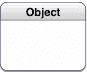

*有关数据封装、消息、方法以及其他面向对象编程相关内容的更完整描述，请参阅《Objective-C 编程语言》。*

### MVC 设计模式

模型-视图-控制器（MVC）是一种源自 Smalltalk-80 的设计模式。它提出应用程序中的三类对象，按抽象边界分隔，并跨这些边界相互通信，如图 1-2 所示。这是许多面向对象程序设计背后的设计模式。这种设计模式有助于开发可维护、可扩展且易于理解的系统。

**图 1-2** 模型-视图-控制器范式中的对象关系

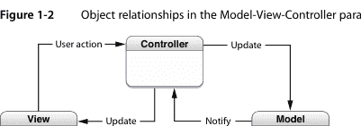

#### 模型对象

这类对象代表特定的知识与专业能力。模型对象保存数据，并定义操作这些数据的逻辑。例如，假设你有一个客户对象——商业应用中常见的对象——它保存了客户的所有关键信息，包括姓名、出生日期和电话号码。该对象就属于模型对象，因为它表示你的应用程序要操作的数据，并且可以访问获取和分发这些信息的方法。更专门的模型可以是一个气象系统中名为 Front 的模型；这种类型的对象将包含表示天气锋面的数据和智能。模型对象不会由应用程序用户直接访问。它们通常可重用、可分发、可持久化，并且可移植到多种平台。

#### 视图对象

视图对象表示用户界面上可见的内容（例如窗口或按钮）。视图对象对它显示的数据来源“一无所知”。Application Kit 是组成 Cocoa 的框架之一，通常会提供你所需的所有基本视图对象：窗口、文本字段、滚动视图、按钮、浏览器等。但你可能希望创建自己的视图对象，以新颖的方式显示或表示数据（例如图形视图）。你也可以在窗口内以特定于应用程序的新颖方式组合视图对象。视图对象往往具有很强的可重用性，从而在应用程序之间提供一致性。

#### 控制器对象

控制器对象在应用程序中充当模型对象和视图对象之间的中介。控制器对象在模型对象与视图对象之间来回传递数据。例如，控制器对象可以协调将街道地址（来自客户模型对象）传输到窗口上可见的文本字段（视图对象）。它还执行其所处应用程序特有的所有事务。由于控制器所做的事情非常特定于具体应用程序，因此通常不可重用，尽管它往往构成了应用程序代码的很大一部分。（不过，这最后一句并不意味着控制器对象不能被重用；只要设计得当，它们也可以被重用。）由于控制器处于核心的中介角色，模型对象无需了解用户界面的状态和事件，视图对象也无需了解模型对象的程序化接口。你甚至可以把自己的视图对象和模型对象放到 Interface Builder 的组件面板中，供其他开发者使用。

#### 混合模型

严格遵循 MVC 并不总是最佳解决方案。有时最好将角色结合起来。例如，在图形密集型应用（如街机游戏）中，你可能会让一些视图对象同时承担视图和模型两种角色。在某些应用中，尤其是简单的应用，你可以结合控制器和模型的角色；这些对象把模型对象独特的数据结构和逻辑与控制器同界面之间的连接结合起来。

### Currency Converter 应用

MVC 设计模式虽然非常简化，但可以直接应用于 Currency Converter 应用。Currency Converter 是一个简单的应用，它根据用户输入的汇率将美元兑换成另一种货币。尽管它是一个非常简单的应用，但仍可用来传达使用 MVC 设计模式进行 Cocoa 应用开发的基本要素。

底层功能（即模型）根据汇率将美元兑换成另一种货币。为此，有一个单独的函数 `convertCurrency`，它将美元金额乘以汇率，得到另一种货币的金额。

所有图形应用程序都有一个供用户交互的用户界面，这就是视图。在本应用中，用户在一个文本字段输入汇率，在下一个文本字段输入要兑换的美元金额，然后点击“转换”按钮或按 Return 键执行计算。最终结果出现在最后一个文本框中，即另一种货币的金额。

视图需要以某种方式将用户输入的数据发送给模型。具体做法是创建一个控制器：控制器从视图收集汇率和美元金额，将这些值发送给模型，并将结果写入视图。


## 在 Xcode 中创建项目

每个 Cocoa 应用程序都始于一个项目。**项目**是所有构成应用程序的元素的仓库，例如源代码文件、框架、库、应用程序的用户界面、声音和图像。你使用 Xcode 应用程序来创建和管理项目。在本章中，你将学习创建一个项目，并了解项目的各个部分分别有什么用途。在此过程中，你将学习如何在 Xcode 用户界面中导航，并了解所有可供你使用的不同文件夹。

### 打开 Xcode

要打开 Xcode：

- 1. 在 Finder 中，前往 `/Developer/Applications`。
- 2. 双击图标，如图 2-1 所示。

**图 2-1** Xcode 应用程序图标


首次启动 Xcode 时，它会引导你完成一个快速设置过程。默认设置应适用于大多数用户。

### 新建项目

本节将引导你完成创建项目的过程。虽然本节重点在于创建一个适合 Currency Converter 的项目，但你将了解在创建新项目时可供你使用的其他选项。

#### 选择新建项目命令

要创建项目，请选择 File > New Project。此时会出现新建项目助理。

#### 选择项目类型

Xcode 可以构建许多不同类型的应用程序，包括从 Carbon 和 Cocoa 应用程序到 Mac OS X 内核扩展和 Mac OS X 框架的各种应用。本教程使用 Cocoa Application 模板。

- 1. 选择 Cocoa Application，然后点击 Choose…，如图 2-2 所示。

**图 2-2** Xcode 中的新建项目助理

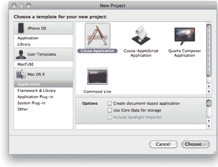

- 2. 在存储表单中输入项目名称 Currency Converter，并选择项目的保存位置。然后点击 Save。

Xcode 会创建项目的文件并显示项目窗口，如图 2-3 所示。

**图 2-3** Xcode 中新建的 Currency Converter 项目

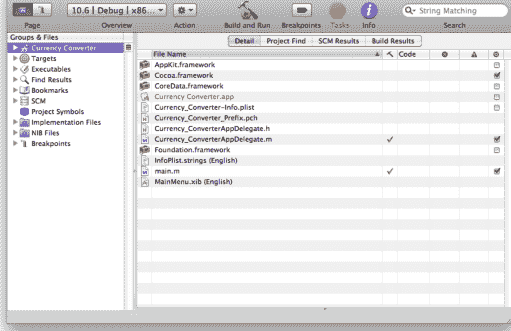

### Xcode 项目界面

Groups & Files 列表让你可以轻松浏览项目的文件和目标。构成项目的所有源文件、图像和其他资源都分组在项目组中，即 Groups & Files 列表中的第一项；该组以项目命名（此处为 Currency Converter）。项目的文件被分组到子组中，例如类、其他源文件、资源等，如图 2-3 所示。组非常灵活，因为它们不一定反映项目中文件在磁盘上的布局，也不一定反映构建系统处理这些文件的方式。组纯粹用于组织项目。Xcode 创建的组应适合大多数开发者，但你可以按自己的喜好自定义它们。

以下是 Xcode 为 Cocoa 应用程序设置的组：

- **类。** 该组包含应用程序所需的所有类。
- **其他源文件。** 该组包含 `main.m` 文件，其中定义了运行应用程序的 `main` 函数。（你不应需要修改此文件。）它还包含 `Currency_Converter_Prefix.pch`。这个“前缀头文件”帮助 Xcode 减少编译时间。你无需担心此文件。
- **资源。** 该组包含 nib 文件以及指定应用程序用户界面的其他资源。
- **框架。** 该组包含应用程序使用的框架（类似于库）。
- **产品。** 该组包含项目构建的结果，并自动填充对项目中每个目标所创建产品的引用。

项目组下方是其他组，包括智能组。**智能组**——由列表左侧的紫色文件夹标识——允许你使用自定义规则访问项目文件，类似于在 iTunes 中使用智能播放列表。

以下是 Groups & Files 列表中的其他一些组：

- **目标。** 该组列出构建的最终结果。该组通常包含一个目标，例如应用程序或框架，但也可以由多个项目组成。
- **可执行文件。** 该组包含项目创建的可执行产品。
- **错误和警告。** 该组显示执行构建时项目中遇到的错误和警告。

好奇的人可能想在 Finder 中查看项目目录，以了解其中包含的文件。项目文件中包括：

- `Currency Converter.xcodeproj`  
  此包包含定义项目的信息。你不应直接修改它。你可以通过双击此包打开项目。
- `main.m`  
  一个为每个项目生成的 Objective-C 文件，包含应用程序的 `main` 函数。
- `English.lproj`  
  一个包含英语本地化资源的目录。此目录中有为项目自动创建的 nib 文件。你可能会找到其他本地化资源目录，例如 `Dutch.lproj`。

### 下一步是什么？

在本章中，你创建了一个 Xcode 项目，它将包含 Cocoa 应用程序的所有资源文件。在下一章中，你将学习如何创建模型，即应用程序背后的基本功能。

## 定义模型

模型对象包含专门的知识和专业技能。它们保存数据并定义操作该数据的逻辑。例如，业务应用程序中常见的客户对象就是一个模型对象。在 Currency Converter 中，你将创建的模型类是转换器类。在 MVC 设计模式中，模型类的实例不直接与用户界面通信。

在本章中，你将创建应用程序的模型。首先，你将学习如何在 Xcode 中创建新类。然后，你将在实现模型之前定义其接口。最后，你将实现该类的全部功能。在此过程中，你将学习 Objective-C 的一些语法，包括如何声明变量和方法。你还将了解声明属性的概念——这是 Objective-C 2.0 中的一项特性，它使编写访问器方法变得极其快速和简单。

### 指定模型类

- 1. 在 Groups & Files 列表中选择 Classes 组。
- 2. 选择 File > New File。
- 3. 在 Cocoa Class 组中选择 Objective-C 类。将其保留为 NSObject 的子类，然后点击 Next。

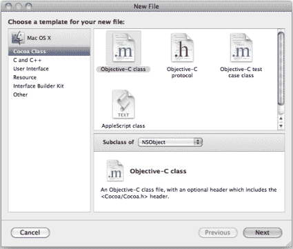

Objective-C 2.0 提供了一项称为**声明的属性**的特性。属性声明实际上是一种简写形式，用于声明类实例某个属性的设置器和获取器。除了声明本身之外，还有一些指令用于指示编译器合成访问器，并告知编译器你将在运行时自行提供这些方法。属性分为两部分：声明和实现。

你按如下方式声明属性：

```
@property(attributes) Type variableNameList;
```

其中 *attributes* 是以逗号分隔的关键字列表，比如 *readwrite* 和 *copy*，例如：

```
@property(copy) NSString *name;
```

你的转换器类希望向外部对象提供对其数据的访问，因此你需要声明访问器方法。

- 1. 将插入点放在 `Converter.h` 中实例方法声明的右花括号之后，即 `@end` 指令之前。
- 2. 为两个实例变量添加以下属性声明。

  `@property(readwrite) float sourceCurrencyAmount, rate;`

在编译时，编译器会将其视为你已声明了以下方法：

```objc
- (float)sourceCurrencyAmount;
- (void)setSourceCurrencyAmount:(float)newSourceCurrencyAmount;
- (float)rate;
- (void)setRate:(float)newRate;
```

属性声明只是声明访问器方法将是什么样子。在下一节中，你将提供访问器方法的实现。

### 声明模型方法：convertCurrency

模型需要的一个方法是一个简单函数，用于将转换器类封装的两个值相乘。

在 `Converter.h` 中，将以下行添加为下一行代码：

```objc
- (float)convertCurrency;
```

尽管此方法不接受参数，但它仍然提供源货币金额与转换率相乘的结果。这是可行的，因为实例方法可以访问其对象的实例变量。在运行时，实例方法会将所有实例变量视为局部变量。即使变量在作用域内，也通常使用访问器方法。这种做法清楚地表明代码访问的是实例变量，而不是局部变量。


## 第 4 章——定义视图：构建用户界面

每个应用都有用户界面。如果没有好的程序辅助，设计用户界面可能会是一项枯燥且令人沮丧的任务。Interface Builder 是 Xcode 随附的应用，它让设计用户界面变得简单，从而把枯燥的任务变得轻松。

本章将教你 Interface Builder 如何与 Cocoa 集成。它会引导你为自己的应用构建用户界面。你将了解在哪里找到所需的工具，以及如何使用 Interface Builder 中的功能，为你的应用创建完美的用户界面。

### 用户界面元素与 Interface Builder

Interface Builder 是一个应用，可帮助你设计用户界面，并连接应用的不同部分。它包含用于 UI 设计的拖放界面，以及一个检查器，可让你查看和更改设计中各种对象的属性，以及它们之间的连接。

### 什么是 nib 文件？

每个带有图形用户界面的 Cocoa 应用至少有一个 nib 文件。主 nib 文件会在应用启动时自动加载。它包含菜单栏，通常还至少包含一个窗口以及各种其他对象。一个应用也可以有其他 nib 文件。每个 nib 文件包含：

- **归档对象。** 也称为“扁平化”或“序列化”对象——意思是对象已经以某种方式编码，以便可以保存到磁盘，并在之后恢复到内存中。归档对象包含诸如大小、位置以及在对象层级中的位置等信息。在归档对象层级的顶部是文件所有者（File’s Owner）对象，它是一个代理对象，在运行时会成为拥有该 nib 文件的实际对象（通常是从磁盘加载该 nib 文件的对象）。
- **图像。** 出现在应用界面中某处的图像文件，例如按钮或图像视图。
- **类引用。** Interface Builder 可以存储 Cocoa 对象以及你放入静态调板中的对象的详细信息，但它不知道如何归档自定义类的实例，因为它无法访问这些类的代码。对于这些类，Interface Builder 会存储一个代理对象，并将你的自定义类信息附加到该代理对象上。
- **连接信息。** 关于类层级中的对象如何相互连接的信息。当你保存文稿时，nib 中对象之间的连接信息会与对象本身一起归档。

**图 4-1** 手动调整窗口大小

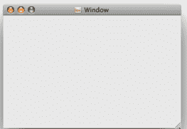

你可以使用窗口大小检查器更精确地调整窗口大小。

- 1. 通过点击窗口的标题栏，或在 MainMenu.xib 窗口中选择其图标，来选中该窗口。
- 2. 选择“工具 > 检查器”。
- 3. 点击看起来像黄色标尺的“大小”图标。
- 4. 在“内容大小与位置”组中，你可以设置窗口的宽度、高度以及默认的 x 和 y 坐标。
- 5. 使用宽度和高度字段输入宽度 400 和高度 200，如图 4-2 所示。

  **图 4-2** 使用检查器调整窗口大小

  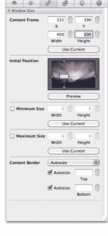

- 6. 在“初始位置”中，你会看到窗口和屏幕的图形表示。将窗口拖到方框的左上角，以获得传统的默认窗口位置。

### 更改窗口标题

窗口的默认标题是 Currency Converter，也就是你的项目名称。如果愿意，你可以在检查器的“属性”标签页中更改标题。Currency Converter 作为窗口标题很合适，因此保持原样即可。

### 添加文本字段

Interface Builder 的资源库窗口包含用户界面元素，你可以将这些元素拖到窗口或菜单中，以创建应用的用户界面。

- 1. 如果资源库尚未打开（如图 4-3 所示），请选择“工具 > 资源库”。

  **图 4-3** Interface Builder 资源库窗口中的 Cocoa 视图与单元格

  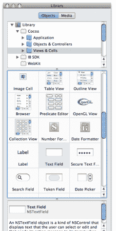

- 2. 在资源库顶部的列表中，打开“资源库”，然后打开“Cocoa”，并选择“视图与单元格”。
- 3. 请注意图 4-3 中的图标带有标签。要显示标签，请从资源库窗口底部的齿轮菜单中选择“视图 > 图标与标签”。这将使你更容易找到所需的对象。
- 4. 在 Currency Converter 窗口中放置一个文本字段。

  找到“文本字段”项（在图 4-3 中高亮显示），并将“文本字段”对象从资源库拖到窗口的右上角。请注意，当对象被拖到与相邻对象或窗口边缘接近适当距离时，Interface Builder 会显示布局参考线，从而帮助你按照 Apple 人机界面指南放置对象。

- 5. 增大文本字段的尺寸，使其宽度增加约三分之一。

  通过抓住控制柄并向希望其增大的方向拖移，来调整文本字段的大小。在本例中，向左拖动左侧控制柄以增大文本字段，如图 4-4 所示。

  **图 4-4** 调整文本字段大小

  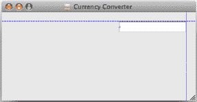

- 6. 再添加两个文本字段，二者都与第一个大小相同。

  有两种选择：你可以从调板中再拖一个文本字段到窗口，并使其与第一个大小相同；也可以复制窗口中已有的文本字段。

  要复制 Currency Converter 窗口中的文本字段：

  - a. 如果文本字段尚未选中，请选中它。
  - b. 从“编辑”菜单中选择“复制”（Command-D）。新文本字段会出现在与原字段略有偏移的位置。
  - c. 将新文本字段放置到第一个文本字段下方。请注意，布局参考线会出现，Interface Builder 会将文本字段吸附到位。
  - d. 要创建第三个文本字段，请再次按 Command-D。

  作为快捷方式，你也可以按住 Option 拖移原始文本字段来复制它。

### 为字段分配标签

没有标签的文本字段会让人困惑，因此请使用资源库中现成的标签对象为它们添加标签。

- 1. 从 Cocoa 资源库中将“标签”元素拖到窗口上。

  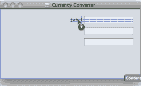

- 2. 将标签设置为右对齐：

  选中标签元素后，在检查器中“文本字段属性”标签页的“对齐”区域，点击从左数第四个按钮，如图 4-5 所示。

  > **注意：** 要在 Interface Builder 中打开检查器，请选择“工具 > 检查器”。

  **图 4-5** 在 Interface Builder 中将文本标签右对齐

  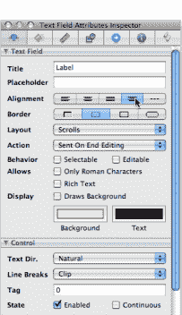

- 3. 在“标题”文本字段中输入“每 1 美元的汇率：”。
- 4. 复制该标签两次。将第二个文本标签的标题设置为“要转换的美元金额：”，将第三个标签的标题设置为“其他货币金额：”。
- 5. 向左扩展标签，使其完整标题可见，如图 4-6 所示。

  **图 4-6** Currency Converter 窗口中的文本字段和标签

  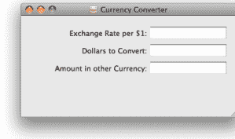

### 更改文本字段属性

底部的文本字段显示货币换算计算的结果，因此应具有与其他文本字段不同的属性。用户不能编辑该字段。

- 1. 选中第三个文本字段。
- 2. 在检查器中，导航到“文本字段属性”标签页。
- 3. 点击“可编辑”选项以移除勾选标记，这样用户就不能更改文本字段的内容。保留“可选择”选项处于勾选状态，以便用户可以将文本字段的内容复制到其他应用。

### 配置按钮

提供一个用于转换货币金额的按钮，可以为用户创建一个明确的操作。要向 Currency Converter 窗口添加按钮：

- 1. 将“按钮”对象从资源库拖到窗口的右下角。
- 2. 双击按钮，并将其标题更改为“转换”。
- 3. 在“按钮属性”检查器的“按键等效项”（Key Equiv.）区域中，点击灰色框。然后按 Return。灰色框中应出现一个回车符号。这会使按钮既响应点击，也响应 Return 键。
- 4. 将按钮对齐到文本字段下方。
  - a. 向下拖动按钮，直到布局参考线出现，然后释放它。


- b. 在按钮仍处于选中状态时，按住 Option 键。如果移动指针，Interface Builder 会显示从按钮到指针所悬停元素的距离（以像素为单位）。
- c. 在仍按住 Option 键且指针位于 Amount in Other Currency 文本栏上方时，使用方向键微调按钮，使其中心与文本栏的中心对齐，如图 4-7 所示。

**图 4-7** 在 Interface Builder 中测量距离

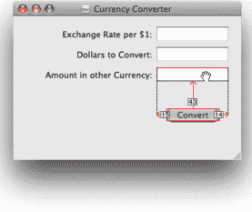

### 添加分隔符以对控件分组

Currency Converter 的最终界面有一条线将文本栏和按钮分隔开。要将该线添加到 Currency Converter 窗口：

1. 从库中将 Horizontal Line 对象拖到 Currency Converter 窗口。
2. 拖动线的端点，直到该线横跨整个窗口，如图 4-8 所示。

图 4-8 向 Currency Converter 窗口添加一条水平线

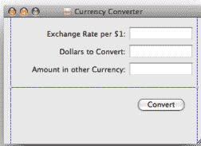

3. 向上移动 Convert 按钮，直到水平分隔线下方出现布局参考线；然后缩短窗口，直到 Convert 按钮下方出现水平布局参考线。

### 优化布局和视图功能

Currency Converter 窗口现在包含按设计运行所需的全部对象。本节将指导你格式化窗口和菜单，使其更加用户友好。

### 在窗口中排列对象

为了打造美观的用户界面，你应该在视觉上按行和列排列界面对象。“目测”对齐可能非常困难，而手动输入 x/y 坐标既繁琐又耗时。对齐用户界面元素甚至更加困难，因为这些元素带有阴影，而用户界面指南度量通常不会考虑阴影。Interface Builder 使用视觉参考线和布局矩形来帮助你进行对象对齐。

在 Cocoa 中，所有绘制都在对象框架的边界内完成。由于界面对象带有阴影，如果对齐框架边缘，它们在视觉上并不会正确对齐。例如，Apple Human Interface Guidelines 指出按钮应高 20 像素，但实际上按钮及其阴影需要 32 像素的框架。你必须对齐的是布局矩形。你可以使用 Layout 菜单中的 Show Layout Rectangles 命令在 Interface Builder 中查看对象的布局矩形。

Interface Builder 提供了几种在窗口中排列对象的方法：

- 结合布局参考线用鼠标拖动对象
- 按方向键（关闭网格时，所选对象移动一个像素）
- 使用参考对象将所选对象按行和列放置
- 使用内置对齐功能
- 在检查器的 Size 面板中指定原点

Layout 菜单中的 Alignment 子菜单提供了各种对齐命令和工具，包括 Alignment 窗口，其中包含可用于执行常见对齐操作的控件。

### 最终确定窗口大小

Currency Converter 界面几乎完成。最后的润色是调整窗口大小，使所有用户界面元素居中并正确对齐到各边缘。目前，这些对象仅与顶部和右边缘对齐。

要最终确定 Currency Converter 窗口：

1. 选择 Amount in Other Currency 文本标签，并扩展选择范围（按住 Shift 单击）以包含另外两个标签。
2. 选择 Layout > Size to Fit，将所有标签调整为其最小宽度。
3. 选择 Layout > Alignment > Align Right Edges。
4. 将标签拖向窗口左边缘，当出现布局参考线时松开。
5. 选择三个文本栏并将它们向左拖动，同样使用参考线帮助找到合适位置。
6. 缩短水平分隔线，并再次将按钮移动到文本栏下方的位置。
7. 使窗口变短变窄，直到文本栏右侧出现布局参考线。
8. 选择 Window 对象。
9. 由于你已将窗口调整为适合其组件的完美大小，你不希望用户调整窗口大小。在检查器的 Attributes 标签中，取消选中 Controls 部分下的 Resize。

此时，应用程序的窗口应如图 4-9 所示。

**图 4-9** Interface Builder 中 Currency Converter 的最终用户界面

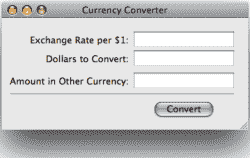

### 启用文本字段之间的 Tab 切换

编写 Currency Converter 用户界面的最后一步更多涉及行为而非外观。你希望用户能够从第一个可编辑栏按 Tab 切换到第二个栏，再切回第一个栏。Interface Builder 库中的许多对象都有一个名为 `nextKeyView` 的出口。此变量标识用户按下 Tab 键时下一个接收键盘事件的对象。Cocoa 应用程序默认会“尽力猜测”如何处理文本栏的 Tab 切换，但你可以根据应用程序的特定需求显式设置下一个键视图，从而改进默认行为。通过连接 `nextKeyView` 出口，可以为对象设置下一个键视图。

要配置文本栏之间正确的 Tab 切换：

1. 选择 Exchange Rate 文本栏。
2. 按住 Control 键从 `MainMenu.nib` 窗口中的 Window 实例拖出一条连接线到 Exchange Rate 文本栏，如图 4-11 所示。

图 4-11 在 Interface Builder 中设置 `initialFirstResponder` 出口

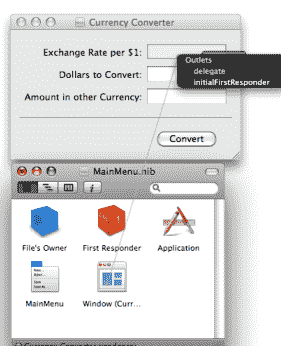

3. 在 Outlets 下选择 `initialFirstResponder`。

Currency Converter 用户界面现在已完成。

### 测试界面

Interface Builder 让你无需编写代码即可测试应用程序的用户界面。要测试 Currency Converter 用户界面：

1. 选择 File > Save 保存工作。
2. 选择 File > Simulate Interface。
3. 尝试各种用户操作，例如按 Tab 切换，以及在文本栏之间剪切和粘贴。
4. 完成后，从应用程序菜单中选择 Quit Cocoa Simulator 退出测试模式。

### 接下来做什么？

在本章中，你构建了应用程序的用户界面。你放置并组织了用户在使用应用程序时将与之交互的各种对象，并对它们进行了配置，使它们能够正确交互。下一章将指导你创建一个控制器，将你刚刚创建的视图与上一章实现的模型连接起来。

### Interface Builder 中的 Target/Action

> **注意：** `IBOutlet` 是一个空定义宏，C 预处理器会在编译时将其移除。Interface Builder 使用它来标识出口声明，以便在可视化连接出口时显示这些声明。

以 `id` 为类型的对象是动态类型的，这意味着对象的类在运行时确定。你可以将 `id` 用作任何对象的类型。动态类型对象的类可以按需更改，甚至在运行时也可以更改；即便对于最有经验的面向对象老手，这也应唤起一种既兴奋又极度谨慎的感觉。这可能是一个强大的特性，并允许非常高效地使用内存，但将类型强制转换为一个无法响应该类型消息的对象，可能会在应用程序中引入令人困惑且难以调试的问题。

当你不需要动态类型对象时，可以——而且在大多数情况下应该——将其静态类型化为指向特定类对象的指针：

```
IBOutlet NSButton* myButton;
```

你通常通过在 Interface Builder 中在对象之间绘制连接线来设置出口的目标。除了出口之外，还有其他方式可以在应用程序中引用对象，但出口以及 Interface Builder 初始化它们的能力带来了极大的便利。

在应用程序加载时，表示出口的实例变量会被初始化，以指向相应的目标。例如，控制器实例中接收视图中汇率值的参数，将用对 Exchange Rate 文本栏对象的引用进行初始化（详情参见“Connect the ConverterController Instance to the Text Fields”（第 45 页））。当出口未连接时，相应实例变量的值为 `nil`。

通过想象一个插入目标对象的电源插座，可能有助于理解连接。再想象一根电源线从源对象中的出口延伸出来。在建立连接之前，电源线未插入，出口的值为 `nil`；建立连接后（电源线插入），目标对象的引用会被赋给源对象的出口。

例如，当用户单击 Currency Converter 窗口中的 Convert 按钮时，按钮从其单元格获取所需信息，并在目标出口对象上调用 `convert` 方法，该对象是自定义类 `ConverterController` 的实例。图 5-2 展示了 `ConverterController` 类、Convert 按钮和 Amount in Other Currency 栏之间的交互。


**图 5-2** target-action 范式中的关系

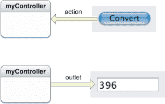

在“动作”列（检查器的“连接”窗格）中，所有动作方法都由目标对象的类定义，并且 Interface Builder 知道这些方法。Interface Builder 识别动作方法，因为它们的名称遵循以下语法：

```objc
- (IBAction)myAction:(id)sender;
```

> **注意：** `IBAction` 与 `IBOutlet` 类似，是一个空定义的宏，C 预处理器会在编译时移除它。Interface Builder 利用它来识别动作声明，以便在直观连接动作时显示这些声明。

## 该从哪个方向连接？

通常，你要连接的出口和动作属于 `NSObject` 的自定义子类。在这些情况下，只需遵循一个简单规则，就知道在 Interface Builder 中应如何指定连接方向。连接应从发送消息的对象指向接收消息的对象：

- 要建立动作连接，请从用户界面中的某个元素（如按钮或文本字段）连接到您想要发送消息的自定义对象。
- 要建立出口连接，请从自定义对象连接到应用程序中的另一个对象（另一个自定义对象或用户界面元素）。

这些只是常见情况下的经验法则，并非适用于所有情况。例如，许多 Cocoa 对象都有一个 `delegate` 出口。要连接这些对象，需要从 Cocoa 对象画一条连接线到您的自定义对象。

另一种澄清连接方向的方法是考虑谁需要找到谁。对于出口，拥有出口的对象需要找到另一个对象，因此连接方向是从拥有出口的对象指向另一个对象。对于动作，控件对象需要找到目标，因此连接方向是从控件对象指向自定义对象。

### 定义控制器类

Interface Builder 对应用程序开发者而言是一个多功能的工具。它不仅使您能够构建应用程序的图形用户界面，还让您能够定义应用程序类的大部分程序化接口，并连接最终由这些类创建的对象。

本章的其余部分将展示如何定义 `ConverterController` 类，并将其连接到 Currency Converter 的用户界面。

- 1. 在项目的 Groups and Files 列表中选择 Classes 组。
- 2. 选择 File > New File。
- 3. 选择 Objective-C Class，然后点击 Next。
- 4. 将文件命名为 `ConverterController.m`。
- 5. 确保选中 “Also create ‘ConverterController.h’”，然后点击 Finish。

#### 为 ConverterController 类定义出口

`ConverterController` 对象需要与 Currency Converter 窗口中的用户界面元素进行通信。它还必须与 `Converter` 类的一个实例通信，该类的定义参见“定义模型”（第 19 页）。`Converter` 类实现转换计算。

- 1. 打开 `ConverterController.h` 文件进行编辑（如果尚未打开）。
- 2. 在 `ConverterController` 接口文件的括号之间添加以下几行：

```objc
IBOutlet NSTextField *amountField;
IBOutlet NSTextField *dollarField;
IBOutlet NSTextField *rateField;
```

这些代码行声明了三个出口，分别对应界面中的三个文本字段。请注意，这三个文本字段出口的类型为 `NSTextField`。由于 Objective-C 是一种动态类型语言，将所有这些出口定义为 `id` 类型也是可以的。不过，最好养成设置出口类型的习惯，因为静态类型的实例变量可以获得更好的编译时错误检查。

#### 声明控制器方法

`ConverterController` 类需要一个动作方法 `convert:`。当用户点击 Convert 按钮时，`convert:` 消息会发送到目标对象，也就是 `ConverterController` 类的一个实例。`ConverterController` 类必须实现 `convert:`，这样当控制器对象收到 `convert:` 消息时，才会有相应的操作发生。

- 1. 将 `convert:` 方法的声明行添加到接口文件中，如下所示：

```objc
#import <Cocoa/Cocoa.h>

@interface ConverterController : NSObject {
    IBOutlet NSTextField *amountField;
    IBOutlet NSTextField *dollarField;
    IBOutlet NSTextField *rateField;
}
- (IBAction)convert:(id)sender;
@end
```

- 2. 保存文件。

您可能会问自己，为什么计算不在控制器中完成。显然，减少一层通信会更快。完全可以用这种方式设计应用程序，但 MVC 设计模式的初衷是为了实现可移植性和可维护性。在更复杂的应用程序中，底层功能可能依赖于操作系统。如果让控制器拥有一个 `convert:` 方法，视图只需要知道调用这个方法即可。接下来，针对不同操作系统编写的各种控制器可以负责调用正确的模型函数。从这个角度看，这类似于为特定应用程序编写 API。同样，通过将功能分解为清晰独立的模块，很容易记住哪些对象负责哪些功能。

### 将控制器与视图相互连接

现在，您可以将 Currency Converter 用户界面和 `ConverterController` 对象相互连接了。

#### 将 ConverterController 类添加到 Nib 文件

作为在 Interface Builder 中定义类的最后一步，您需要创建 `ConverterController` 类的一个实例，并连接其出口和动作。将该类添加到您的 nib 文件中。

- 1. 在 Interface Builder 中，选择 File > Read Class Files。
- 2. 选择 `ConverterController.h` 文件，然后点击 Open。
- 3. 在库中，将一个对象项拖入 `MainMenu.xib` 窗口。
- 4. 选择新对象，然后在检查器中导航到 Identity 标签页。
- 5. 在 Class 下拉框中，键入 `ConverterController`，然后按 Return 键。类动作和类出口会自动填充，与您在 `ConverterController.h` 文件中定义的出口和动作相匹配。

**图 5-3** `ConverterController` 的新实例化对象

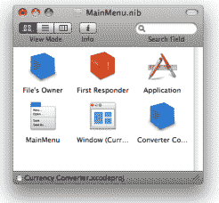

在 Interface Builder 的对象检查器中查看该类时，这些操作的结果如图 5-4 所示。

**图 5-4** Converter Controller 的 Identity 检查器中的出口和动作

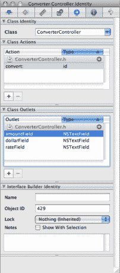

#### 将 ConverterController 实例连接到文本字段

通过将 `ConverterController` 实例连接到界面中的特定对象，您可以初始化其出口。`ConverterController` 对象使用这些出口来获取和设置用户界面中的值。要将实例连接到用户界面：

- 1. 按住 Control 键，从 `ConverterController` 实例拖一条连接线到 Exchange Rate 文本字段。
  - Interface Builder 会在一个黑色弹出框中显示可能的连接。
- 2. 选择与第一个字段对应的出口 `rateField`，如图 5-5 所示。

**图 5-5** 将 `ConverterController` 连接到 `rateField` 出口

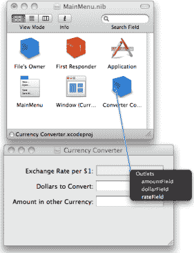

- 3. 按照相同步骤，将 `ConverterController` 类的 `dollarField` 和 `amountField` 出口连接到相应的文本字段。

#### 将 Convert 按钮连接到相应的方法

要将 Currency Converter 窗口中的用户界面元素连接到 `ConverterController` 类的方法：

- 1. 按住 Control 键，从 Convert 按钮拖一条连接线到 nib 文件窗口中的 `ConverterController` 实例。
- 2. 会弹出一个黑色框，与之前连接出口时使用的类似。选择 `convert:`。
- 3. 保存 nib 文件。

#### 检查您的操作

要确保所有操作都正确完成：

- 1. 在 `MainMenu.nib` 窗口中选择 Converter Controller 实例。


## 第5章：连接模型与视图：控制器

- 2. 在检查器（Inspector）中导航到“连接”（Connections）标签页。
- 3. 将鼠标悬停在连接上，确保每个插座（outlet）都连接到正确的文本字段，如图5-6所示。

**图5-6** 检查插座连接

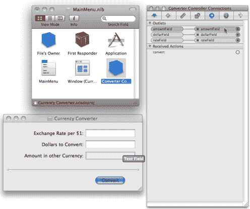

### 将控制器连接到模型

在 Xcode 的 `ConverterController` 类内创建一个转换器类的实例。

- 1. 在“组和文件”（Groups and Files）侧边栏的“类”（Classes）文件夹中，双击 `ConverterController.h` 在编辑窗口中打开。
- 2. 在声明完插座之后、结束括号之前，将下面一行代码添加到你的代码中，声明一个指向转换器对象的指针：

```
Converter *converter;
```

当被点击时，“转换”（Convert）按钮会向 `ConverterController` 对象发送 `convert:` 消息。补全 `ConverterController` 中 `convert:` 方法的定义，使其向 `Converter` 实例发送 `convertCurrency` 消息以执行转换：

```
converter = [[Converter alloc]init];
```

这行代码在内存中为 Converter 实例分配空间，使用后应将其释放。你可能会注意到你并没有释放这个实例。

之所以可以这样做，是因为 Objective-C 2.0 利用了**垃圾回收**（garbage collection）。要启用垃圾回收：

- 1. 选择“项目”（Project）>“编辑项目设置”（Edit Project Settings）
- 2. 转到“构建”（Build）标签页
- 3. 在“GCC 4.0 - Code Generation”下，将“Objective-C Garbage Collection”的值设置为 `Supported`。

通过支持垃圾回收，你无需担心释放所实例化的对象。你可以保持代码现状，无需担心内存泄漏。

更多有关垃圾回收的信息，请参阅 *GNU/C++/Objective-C 4.0.1 编译器用户指南*。

### 下一步是什么？

你现在已经完成了 Currency Converter 的实现。请注意，你只需编写很少的代码，而你的应用程序现在拥有一个功能完整的货币转换系统和一个漂亮的用户界面。在下一章中，你将学习如何构建并运行该应用程序。

## 第6章：构建并运行你的应用程序

既然你已经编写了应用程序运行所需的全部代码，构建了用户界面并将各个类连接在一起，那么是时候看看你的应用程序能否编译了。在本章中，你将学习如何运行将项目构建为应用程序的过程，还将学习如何检查编译时发生的错误。

### 构建应用程序

要构建 Currency Converter 应用程序：

- 1. 在 Xcode 中，选择“文件”（File）>“全部保存”（Save All）以保存对项目源文件所做的更改。
- 2. 点击项目窗口中的“构建”（Build）工具栏项。

项目窗口底部的状态栏会显示构建的状态。当 Xcode 完成且途中未遇到任何错误时，状态栏会显示“构建成功”（Build succeeded）。但如果存在错误，你需要纠正它们并重新开始构建过程。有关详细信息，请参见“纠正构建错误”（第52页）。

### 额外内容：查阅文档

Xcode 允许你访问 ADC 参考库的内容。在项目工作时，你可以直接跳转到文档和头文件。试一试：

- 1. 在编辑窗口中打开 `ConverterController.m` 文件。
- 2. 按住 Option 键并双击代码中的 `setFloatValue` 一词。（按住 Option 键并双击该词。）此时会弹出“快速帮助”（Quick Help）窗口，其中显示参考文档的摘要。点击书本图标可获取所选方法的完整描述。更多内容请阅读“扩展基础知识”（第67页）。
- 3. 关闭“快速帮助”窗口。
- 4. 按住 Command 键并双击同一个词。此时会出现一个包含方法名称列表的弹出菜单。
- 5. 选择 `[NSCell setFloatValue]`。这一次，Xcode 会在编辑窗口中显示 `NSCell.h` 头文件，并高亮显示 `setFloatValue` 方法的声明。
- 6. 关闭头文件。

### 运行应用程序

你的辛勤工作即将得到回报。由于自上次构建项目以来你尚未编辑任何代码，因此应用程序已可以运行。

- 1. 选择“构建”（Build）>“构建并运行”（Build and Go）。
- 2. 在 Currency Converter 应用程序启动后，输入汇率和美元金额。
- 3. 点击“转换”（Convert）。
- 4. 选中文本字段中的文本，然后选择“Currency Converter”>“服务”（Services）子菜单。
  
  服务菜单列出了可以对所选文本进行操作的其他应用程序。
- 5. 从应用程序菜单中选择“Currency Converter”>“退出 Currency Converter”（Quit Currency Converter）以退出 Currency Converter。

### 纠正构建错误

当然，从一开始就完美无瑕的项目是罕见的。对于你编写的大多数应用程序，Xcode 很可能在首次构建时发现一些错误。谢天谢地，Xcode 提供了工具来帮助你捕获这些错误并继续前进。

- 1. 为了了解 Xcode 的错误检查功能，请在代码中引入一个错误并再次点击“构建”（Build）。
  
  现在你可以看到代码左侧列包含一个或多个错误指示符。
  
  虽然错误指示符有助于你了解错误的位置，但你可能还想检查问题的性质。
- 2. 在项目窗口中，点击“构建结果”（Build Results）标签页。
- 3. 双击错误以在编辑窗口中打开并显示错误。
- 4. 修正代码中的错误并再次构建应用程序。错误消失，状态栏显示构建成功。

### 干得漂亮！

虽然 Currency Converter 是一个简单的应用程序，但创建它展示了 Cocoa 编程的许多概念和技术。现在你已经更好地掌握了开发 Cocoa 应用程序所需的技能。你学到了：

- 在 Interface Builder 中组合图形用户界面（GUI）

## 配置你的应用程序

现在你有了自己的功能应用程序，是时候为它设置单独的属性，而不是默认属性了。在本章中，你将了解 `Info.plist` 文件，该文件是你可以更改控制应用程序属性的地方。本章还介绍了 Mac OS X 应用程序所需的基本标识属性。它将引导你完成在 Currency Converter 中配置这些属性的过程。你将了解在查看应用程序信息时更改这些不同属性会产生什么效果。最后，你将学习如何为应用程序提供自己的图标，使其与其他应用程序区分开来。

### Info.plist 文件

Mac OS X 应用程序包含用于彼此区分的信息。这些信息包括应用程序的主版本号和次版本号，以及 Finder 和 Dock 用来表示它的图标。存储这些详细信息的文件称为信息属性列表文件（名为 `Info.plist`）。此属性列表文件与构成应用程序的可执行文件和资源存储在一起，称为应用程序包。

> **注意：** **包**（bundle）是一个以结构化层次结构对文件进行分组的目录。为了方便用户操作包，包可以在 Finder 中表示为文件而不是文件夹；这些包称为**软件包**（packages）。**应用程序包**存储构成应用程序的可执行文件和资源。虽然更准确的做法是将应用程序包称为*应用程序软件包*，因为它们在 Finder 中始终以单个文件形式显示给用户，但本章采用应用程序包而不是应用程序软件包。有关包和软件包的更多信息，请参阅 *Bundle 编程指南*。

### 基本项目属性

有几个基本属性用于向用户和 Mac OS X 标识应用程序：应用程序标识符、构建版本号、发布版本号、版权声明、应用程序名称和应用程序图标文件名。

- 如果没有应用程序标识符，管理员将不得不导航到每个受管应用程序的位置，这是一项相对繁琐的任务。**应用程序标识符**属性指定一个字符串，Mac OS X 使用它来标识应用程序。此属性不标识文件系统中的特定应用程序包，也不标识应用程序的特定版本。在正常情况下，用户看不到应用程序标识符。
  
  `Info.plist` 文件中的 `CFBundleIdentifier` 键用于指定应用程序标识符属性。


应用程序标识符是统一类型标识符（UTI）或反向域名系统（DNS）名称；也就是说，顶级域名在前，然后是子域名，以句点（.）分隔。应用程序标识符由两部分组成：*前缀*和*基础部分*。**应用程序标识符前缀**标识负责该应用程序的公司或组织，由两个或更多域组成。第一个前缀域（即顶级域名）通常是 `com` 或 `org`。第二个域是公司或组织的名称。可根据需要使用后续域来提供更窄的范围。按约定，前缀域使用小写字母。例如，Apple 应用程序使用以 `com.apple` 开头的应用程序标识符。

**应用程序标识符基础部分**由一个域组成，该域指代应用程序本身。此域应使用单词首字母大写，例如 *AddressBook*。有关统一类型标识符的更多信息，请参阅*统一类型标识符概述*。

Mac OS X 使用应用程序标识符来精确指代应用程序包，无论其在文件系统中的位置如何。例如，某些 Mac OS X 功能（如家长控制）仅使用应用程序标识符来指代用户计算机上的应用程序。家长控制偏好面板包含一个应用程序文件名列表，管理员可在其中选择要为用户提供受管理访问权限的应用程序，如图 7-1 所示。

**图 7-1** 使用应用程序标识符的好处

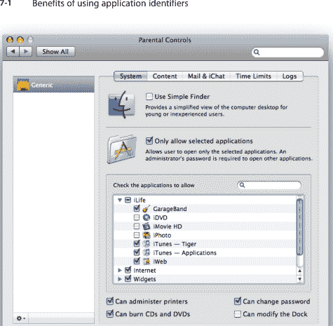

- **构建版本号**属性标识应用程序的某个迭代版本。

    构建版本号属性通过 `Info.plist` 文件中的 `CFBundleVersion` 键指定。

    构建版本号由一串以句点分隔的整数组成。每个整数都必须等于或大于零。例如，55、1.2 和 1.2.0.55 都是有效的构建版本号。

    Mac OS X 使用构建版本号，例如，当文件系统中存在多个版本的应用程序（由其应用程序标识符确定）时，决定启动哪个版本的应用程序来打开文件。在这种情况下，Mac OS X 会启动构建版本号最高的应用程序包。为确保此机制准确运行，您在发布应用程序新版本时必须遵循同一种版本编号风格。也就是说，如果您首次发布应用程序时使用多整数构建版本号，那么后续公开发布的版本必须在其构建版本号中使用相同数量的整数。

    > **注意：** 应用程序的构建版本号不会出现在 Finder 窗口中。

- **发布版本号**属性指定 Finder 为应用程序显示的版本信息。同时指定构建版本号和发布版本号时，“关于”窗口会显示发布版本号，并在括号中紧跟构建版本号，如图 7-2 所示。

    图 7-2    Finder 预览面板和“关于”窗口中的构建版本号与发布版本号

    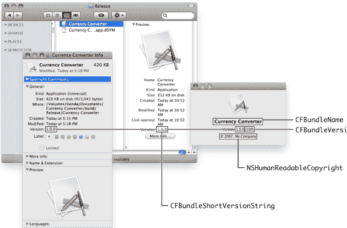

    发布版本号属性通过 `Info.plist` 文件中的 `CFBundleShortVersionString` 键指定。

    发布版本号标识应用程序的某个已发布迭代版本。与构建版本号类似，发布版本号由一串以句点分隔的整数组成。但是，发布版本号最多只能指定三个整数。按约定，第一个整数表示应用程序的主要修订，例如实现新功能或重大更改的修订。第二个整数表示实现较次要功能的修订。第三个整数表示维护版本。

- **版权文本属性**指定应用程序的版权声明，例如 `© 2007, My Company.`。此声明会在应用程序的“关于”窗口中向用户显示。

    版权文本属性通过 `Info.plist` 文件中的 `NSHumanReadableCopyright` 键指定。

- **应用程序名称属性**指定应用程序打开时菜单栏中应用程序菜单的标题，以及其“关于”窗口中的应用程序名称。

    应用程序名称属性通过 `Info.plist` 文件中的 `CFBundleName` 键指定。

    > **注意：** 创建新的应用程序项目时，Xcode 会将应用程序名称设置为项目名称。

- **应用程序图标文件名属性**指定 Finder、Dock 和应用程序“关于”窗口为该应用程序显示的图标。

    应用程序图标文件名属性通过 `Info.plist` 文件中的 `CFBundleIconFile` 键指定。

    图标文件包含一个或多个图像，这些图像以各种分辨率描绘应用程序的图标。图标的这些独立版本使 Finder 和 Dock 能够在不同大小下尽可能清晰地渲染图标。您可以使用 Icon Composer 应用程序创建图标文件。

有关这些及其他应用程序属性的更多详细信息，请参阅*运行时配置指南*。

### 指定标识符、版本和版权信息

本节介绍如何指定 Currency Converter 的标识符、发布版本号和版权文本。

> **重要：** 要完成此任务，您需要打开本文档的配套归档文件 `ObjCTutorial_companion.zip`。

Currency Converter 的名称属性已设置为您在“在 Xcode 中创建项目”（第 15 页）中输入的項目名 `Currency Converter`。因此，您无需更改此属性的值。

首先，从项目中移除 `InfoPlist.strings` 文件。此文件用于国际化，该主题超出本教程的范围。

1. 在 Currency Converter 项目窗口中，在“组与文件”列表中选择“资源”组。
2. 在详细信息视图中，选择 `InfoPlist.strings` 文件。
3. 选取“编辑”>“删除”。
4. 在出现的对话框中，点按“同时移到废纸篓”。

要设置应用程序标识符和构建版本号，请执行以下步骤：

1. 在项目窗口中打开“目标”组，然后选择 Currency Converter 目标。
2. 选取“文件”>“显示简介”以查看“目标简介”。
3. 点按“属性”标签页以显示目标的属性。
4. 在“标识符”栏中输入 `com.mycompany.CurrencyConverter` 以设置应用程序标识符。
5. 在“构建”栏中输入 `100`，将构建版本号设置为 100。

发布版本号和版权文本属性未在“属性”标签页中公开。您可以通过打开 `Info.plist` 文件并直接编辑它，来编辑这些属性以及存储在 `Info.plist` 文件中的其他属性。

1. 点按“属性”标签页底部的“打开 `Info.plist` 作为文件”按钮。

    `Info.plist` 文件会显示在编辑器中，左侧显示键列表，右侧显示其关联值。

2. 将发布版本号设置为 `1.0.0`。

    在编辑器中找到“Bundle version string, short”条目，并将其值更改为“1.0.0”。

3. 将版权文本设置为 © 2009, My Company：

    a. 选择 `Info.plist` 文件中的一行，然后点按该行右端的加号按钮。

    b. 从键列表中选择“Copyright (human-readable)”。

    c. 双击表格右侧的值单元格，然后输入文本“© 2009, My Company.”。

4. 存储 `Info.plist` 文件。

要查看这对应用程序的影响：

1. 清理项目，然后构建并运行应用程序。
2. 选取 Currency Converter > 关于 Currency Converter。

    请注意，您在 `Info.plist` 文件中输入的名称、版本号和版权信息在此处正确显示。


**注意：** 如果信息（如版权信息）不一致，你的`NSHumanReadableCopyright`值可能与你在`Info.plist`文件中输入的不同。如果存在一个额外的文件`InfoPlist.strings (English)`，就会出现这种情况。该文件用于本地化，即根据应用所面向的地区不同而具有不同的属性。在这种情况下，编译项目英文版本时，英文本地化文件中设置的任何键值都将覆盖`Info.plist`文件中设置的值。要解决此问题，你可以删除`InfoPlist.strings (English)`文件，或者打开该文件并像在`Info.plist`文件中那样更改值。

- 3. 退出货币转换器。
- 4. 要了解应用程序标识符的益处，请在“终端”窗口中执行以下命令：

```
> open -b com.mycompany.CurrencyConverter
```

`open`命令会根据应用程序标识符定位并启动Currency Converter。该命令也可以使用应用程序包的文件名来定位和启动应用程序（`.app`后缀是可选的）。

- 5. 在程序坞中，按住Control键点按，或点按并按住Currency Converter图标，然后从快捷菜单中选择“在Finder中显示”，如图7-3所示。

    **图7-3** 从程序坞中定位应用程序包

    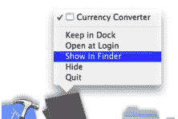

    Finder会打开一个如图7-4所示的窗口，显示Currency Converter应用程序包。请注意，发布版本号（CFBundleShortVersionString）会显示在预览列（列视图）和应用程序包的信息窗口中。“关于Currency Converter”窗口显示应用程序名称（CFBundleName）、括号中的构建版本号（CFBundleVersion）、发布版本号和版权文本（NSHumanReadableCopyright）。

    **图7-4** 用户所看到的应用程序属性

    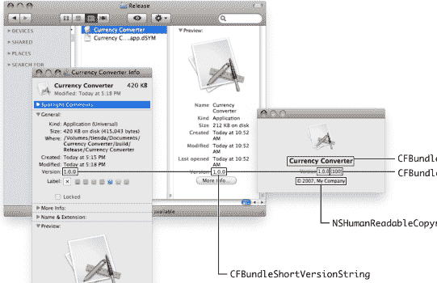

- 6. 退出货币转换器。

现在，对于Currency Converter而言，唯一尚未指定的关键应用程序标识信息就是它的图标。

### 创建图标文件

当你创建Cocoa应用程序时，如果没有为其指定图标，Finder和程序坞会为其分配通用的应用程序图标，如图7-4（第61页）所示。为了使应用程序对用户更具吸引力，并使其与其他应用程序区分开来，你应该为应用程序提供独特的图标。这样，你的应用程序就能在Finder窗口和程序坞中脱颖而出。本节介绍使用Icon Composer创建图标文件以及配置Currency Converter使用该图标文件的过程。为此，你必须已下载本文档附带的配套文件。

**注意：** 在执行此操作之前，请确保你已下载配套归档文件（`ObjCTutorial_companion.zip`）。该归档文件包含你将用于本节的图标图像。

要创建Currency Converter的图标文件：

- 1. 启动位于`/Developer/Applications/Utilities`中的Icon Composer。Icon Composer会显示一个空的图标文件编辑器窗口。
- 2. 在Finder中，导航到`ObjCTutorial_companion/application_icon_images`**目录**。该目录包含描述Currency Converter应用程序图标的图像文件。
- 3. 将图像文件添加到图标文件中。
  - a. 将`c_conv512.png`从Finder窗口拖到图标文件编辑器中的“大图像”图像井中，如图7-5所示。

    **图7-5** 将`c_conv512.png`拖到图标文件编辑器中

    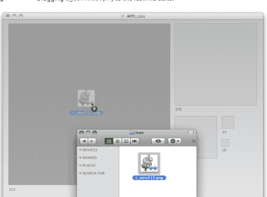

  - b. 系统会弹出对话框，询问是否要将图像复制到其他尺寸。选择“复制到所有较小尺寸”，然后按“导入”。这会自动将512 x 512图像缩放到较小尺寸。
  - c. 所有尺寸的点击遮罩都会自动提取。点击遮罩是图像在点击时响应位置的位图映射。

- 3. 在出现的对话框中，选择Currency Converter项目目录中的`APPL.icns`文件，然后点按“添加”，如图7-7所示。

    **图7-7** 选择要添加到Currency Converter项目的图标文件

    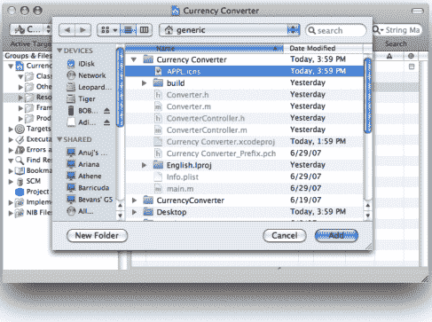

- 4. 在接下来出现的对话框（如图7-8所示）中，点按“添加”。

    **图7-8** 指定项目文件添加选项

    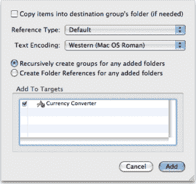

- 5. 最后，在目标属性的“图标文件”（Icon File）字段中指定图标文件的名称。

要在项目中查看图标：

- 1. 如果尚未退出Currency Converter，请先退出。
- 2. 选择“构建”>“清理”（Build > Clean）。
- 3. 点按“构建并运行”（Build and Go）来构建并运行应用程序。
- 4. Currency Converter现在有了一个独特的图标，如图7-9所示。

    **图7-9** Currency Converter配上了一个优雅的图标

    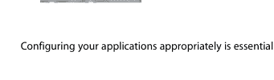

适当地配置应用程序对于为客户提供良好体验至关重要。

### 下一步是什么？

既然你的项目已经完成，你可能想了解Cocoa与其他框架的区别。你可能已经注意到，无需对这些功能进行编程，你构建的应用程序就能实现多少功能。在下一章中，你将了解Cocoa提供的许多功能以及如何利用它们。

## 第7章：配置你的应用程序

## 第8章：拓展基础知识

Cocoa的设计宗旨是让应用程序开发变得简单，并从应用程序开发中去除许多无趣且重复的工作。用户可能认为理所当然的许多常见应用程序功能，其实编写起来相当困难。Cocoa实现了这些功能中的很大一部分，因此你可以将时间花在让应用程序变得特别的事情上，而不是实现基本功能。本章介绍Cocoa的这些集成组件。你可能会惊讶于Cocoa为最大限度地提高你的生产力而打包了多少类和功能。

### 使用Cocoa即可免费获得

最简单的Cocoa应用程序，即使不添加一行代码，也包含大量你可以“免费获得”的功能。你不必自己编写这些功能。当你在Interface Builder中测试界面时，就能看到这一点。

### 应用程序和窗口行为

在Interface Builder测试模式下，Currency Converter的行为几乎与屏幕上的任何其他应用程序一样。点按屏幕上的其他位置，Currency Converter就会变为非活动状态，被其他应用程序的窗口完全或部分遮挡。

如果你关闭了应用程序，请再次运行它。一旦Currency Converter窗口打开，可以通过其标题栏移动它。以下是一些你可以尝试的其他测试：

- 1. 打开“编辑”菜单。与任何应用程序菜单一样，它的菜单项会在你释放鼠标按钮时出现然后消失。
- 2. 点按“最小化”按钮。点按程序坞中该窗口的图标以恢复应用程序。
- 3. 点按“关闭”按钮；Currency Converter窗口消失。

如果你没有在Interface Builder中将Currency Converter窗口配置为移除大小调整框，那么你现在就可以调整它的大小。你还可以设置窗口及其视图的自动调整大小属性，使窗口元素随窗口大小按比例调整，或保持其初始大小（有关自动调整大小的详细信息，请参阅Interface Builder帮助）。

### 控件和文本

Currency Converter的按钮和文本字段具有许多内置行为。注意“转换”（Convert）按钮会脉动（这是与Return键关联按钮的默认行为）。点按“转换”按钮。注意按钮如何被高亮显示片刻。如果你使用不同样式的按钮，它们也会以特有的方式响应鼠标点按。

现在点按其中一个文本字段。注意插入点是如何就地闪烁的。输入一些文本并选中它。使用“编辑”菜单中的命令将其复制并粘贴到另一个文本字段中。

你还记得你在Currency Converter文本字段之间建立的`nextKeyView`连接吗？将光标插入文本字段，按Tab键，观察光标从一个字段跳到另一个字段。

### 菜单命令

Interface Builder为每个新应用程序提供一个默认菜单，其中包括应用程序、文件、编辑、窗口和帮助菜单。其中一些菜单（如编辑）包含现成的命令集。例如，通过“服务”子菜单（其菜单项由其他应用程序在运行时添加），你可以与其他Mac OS X应用程序通信。你可以使用“窗口”菜单管理应用程序的窗口。

Currency Converter只需要少数几个命令：“退出”和“隐藏”命令，以及“编辑”菜单中的“拷贝”、“剪切”和“粘贴”命令。如果你愿意，可以删除不需要的命令。但是，你也可以添加新的命令并获得“免费”行为。在Interface Builder中设计的应用程序只需简单添加一个菜单或菜单命令即可获得额外功能，而无需编译。例如：

- “字体”子菜单为文本视图对象中的文本应用字体添加了行为，就像“文本”面板中的文本视图对象那样。你的应用程序“免费”获得“字体”窗口和字体管理器。应用程序中的文本元素可以立即使用此功能。有关更多信息，请参阅*字体面板*。
- “文本”子菜单允许你在任何可编辑文本的位置对齐文本，并在`NSText`对象中显示标尺，用于制表、缩进和对齐。
- 得益于Mac OS X的PDF图形核心，许多显示文本或图像的对象都可以将其内容打印为PDF文档。

### 文档管理

许多应用程序会创建和管理称为文档的可重复、半自治对象。文档包含离散的信息集，并支持这些信息的输入和维护。文字处理文档就是一个典型例子。应用程序与用户协调，并与其文档通信，以创建、打开、保存、关闭文档或以其他方式管理它们。你也可以通过一些额外代码将Currency Converters保存为文档。

有关更多信息，请参阅Cocoa设计指南文档中的*基于文档的应用程序概述*。

### 文件管理

应用程序可以使用由Application Kit框架创建和管理的“打开”对话框，帮助用户在文件系统中定位文件并打开它们。它还可以使用“保存”对话框将信息保存到文件中。Cocoa还提供了一些类，用于管理文件系统中的文件（创建、比较、拷贝、移动等）以及管理用户默认设置。


### 与其他应用程序通信

Cocoa 为应用程序提供了几种与其他应用交换信息的方式：

- **剪贴板。** 剪贴板是一种在应用之间共享信息的全局设施。应用可以使用剪贴板来保存用户剪切或复制并可能粘贴到另一个应用的数据。每个应用可以有多个剪贴板，接受多种数据类型。
- **服务。** 任何应用都可以根据所选数据类型（如文本）访问另一个应用提供的服务。一个应用也可以为其他应用提供服务，如加密、语言翻译或记录获取。
- **拖放。** 如果你的应用实现了适当的协议，用户可以在其他应用的界面之间拖动对象。

### 自定义绘图和动画

Cocoa 允许你创建自己的自定义视图，这些视图可以绘制自己的内容并响应用户操作。为了帮助你实现这一点，Cocoa 提供了用于绘制的对象和函数，例如 `NSBezierPath` 类。

### 国际化

Cocoa 提供 API 和工具支持，用于将应用程序中的字符串、图像、声音和 nib 文件国际化。国际化使你可以轻松地将应用本地化为多种语言和区域设置，而无需大量额外开销。

### 编辑支持

当你在 Interface Builder 中向应用程序的菜单栏添加某些菜单时，你可以获得几个面板（及相关功能）。这些“附加组件”包括字体窗口（和字体管理）、颜色选择器（和颜色管理）、文本标尺，以及“文本”菜单带来的制表符和缩进功能。

格式化器类使你的应用程序能够格式化数字、日期和其他类型的字段值。还支持验证字段内容。

### 打印

只需一个简单的 Interface Builder 过程，Cocoa 就能自动打印包含文本或图形的视图。当用户执行“打印”命令时，会出现一个适当的对话框来帮助配置打印过程。输出是所见即所得（WYSIWYG）。

多个 Application Kit 类让你可以更精细地控制文档和表单的打印，包括分页和页面方向等功能。

### 帮助

你可以使用 Interface Builder 检查器非常轻松地为应用程序创建上下文相关帮助——称为“帮助标签”。在为应用程序中的用户界面元素输入帮助标签文本后，当用户将指针悬停在这些元素上时，会出现一个包含该元素简要信息的小窗口。

### 插件架构

你可以将应用程序设计为允许用户稍后整合新模块。例如，绘图程序可以有一个工具面板：铅笔、画笔、橡皮擦等等。你可以创建一个新工具并让用户安装它。下次启动应用程序时，该工具会出现在面板中。

### 使用 Xcode 进行快速编码

当你使用 Xcode 编写代码时，你拥有一套“工作台”工具可供使用。下面介绍其中一些工具。

#### 项目查找

项目查找（可从 Xcode 的“查找”窗口中使用）允许你在项目代码和系统头文件中搜索标识符。项目查找使用一个项目索引，该索引将项目的所有标识符（类、方法、全局变量等）存储在磁盘上。

对于基于 C 的语言，Xcode 会在源文件编译时自动收集索引信息；因此，在使用项目查找之前，不必先构建项目来创建索引。

#### 代码感知和代码补全

代码感知会为你的项目文件建立索引，以便快速访问代码中的符号以及项目所链接的框架。代码补全会利用此索引在你键入时自动建议匹配的符号。你可以在 Xcode“偏好设置”窗口的“代码感知”偏好设置窗格中打开这些功能。

由于代码感知和代码补全使用 Xcode 快速的索引系统，它们的建议会随着你的键入即时出现。如果你在光标后看到省略号(...)，则说明 Xcode 无法找到完全匹配项。

#### 集成文档查看

Xcode 支持直接在应用程序中查看基于 HTML 的 ADC Reference Library 内容。你可以访问有关 Xcode 应用程序、其他开发者工具、Carbon、Cocoa、AppleScript Studio 的参考资料，甚至可以访问 UNIX 手册页。

此外，你可以直接从代码中完整或部分完成的标识符跳转到参考信息和头文件。要获取标识符的参考信息，请按住 Option 并双击；要获取其在头文件中的声明，请按住 Command 并双击。

“开发者文档”窗口中的搜索栏还为你提供了一种快速简便的方法，可以在 Cocoa 的任何编程接口中查找标识符。

#### 缩进

在 Xcode“偏好设置”窗口的“缩进”偏好设置窗格中，你可以设置自动缩进的字符、每次缩进的空格数以及其他全局缩进特性。“格式”菜单还提供了单独缩进代码块的命令。

#### 分隔符检查

双击一个花括号（左或右都无关紧要）可以定位匹配的花括号；花括号之间的代码会被高亮显示。类似地，在消息表达式中双击方括号可以定位匹配的方括号，双击圆括号字符可以高亮显示圆括号内的代码。如果没有匹配的分隔符，Xcode 会发出蜂鸣声。

#### Emacs 键绑定

你可以在 Xcode 代码编辑器中使用最常见的 Emacs 命令。（Emacs 是一种流行的编写代码的编辑器。）例如，有向前翻页（Control-v）、向前移动单词（Meta-f）、删除单词（Meta-d）、向前删除到行尾（Control-k）以及从 kill ring 中召回（Control-y）等命令。

某些 Emacs 命令可能会与某些标准 Macintosh 键绑定冲突。你可以在 Xcode“偏好设置”的“键绑定”偏好设置窗格中修改代码编辑器使用的键绑定，用其他“命令”键——如 Option 键或 Shift-Control——替代 Emacs 的 Control 或 Meta 键。有关键绑定的信息，请参阅 *文本输入管理* 中的“关于键绑定”。

## Objective-C 快速参考指南

Objective-C 语言是 ANSI C 的超集，具有特殊的语法和运行时扩展，使面向对象编程成为可能。Objective-C 语法简单，但其简洁性却十分强大。你可以将标准 C 与 Objective-C 代码混合使用。

以下各节总结了该语言的一些基本方面。详细内容请参阅 *Objective-C 编程语言*。

### 消息和方法实现

方法是由类为其对象实现的过程（或者对于类方法而言，提供不依赖于特定实例的功能）。方法可以是公开的或私有的；公开方法在类头文件中声明。消息是对对象方法的调用，通过名称标识该方法。

消息表达式由一个标识接收对象的变量和你要调用的方法名称组成；将表达式括在方括号中。

```objectivec
[anObject doSomethingWithArg:this];
```

与标准 C 一样，语句以分号结尾。

消息通常会导致被调用的方法返回一个值；你必须在赋值左侧有一个正确类型的变量来接收此值。

```objectivec
int result = [anObj calcTotal];
```

你可以在其他消息表达式中嵌套消息表达式。此示例获取表单对象的窗口，并使返回的 `NSWindow` 对象成为另一条消息的接收者。

```objectivec
[[form window] makeKeyAndOrderFront:self];
```

方法的结构类似于函数。方法的完整声明之后是用花括号括起来的实现代码主体。

使用 `nil` 指定空对象；`nil` 类似于空指针。请注意，某些 Cocoa 方法不接受 `nil` 作为参数。

方法可以有效地引用两个隐式标识符：`self` 和 `super`。两者都标识接收消息的对象，但它们在方法实现的查找方式上有所不同：`self` 从接收者所属的类开始搜索，而 `super` 从接收者的超类开始搜索。因此，

```objectivec
[super init];
```

会调用超类的 `init` 方法。


在方法中，你可以直接访问类实例的实例变量。不过，除非性能至关重要，否则建议使用访问器方法而非直接访问。

### 声明

将对象动态类型化，声明为 `id`。

```objc
id myObject;
```

由于动态类型化对象的类在运行时才被解析，你可以在代码中引用它们，而无需事先知道它们属于哪个类。如果类型可能涉及多态和动态绑定，请以这种方式声明输出口和对象。

将对象静态类型化为指向类的指针。

```objc
NSString* myString;
```

你可以通过静态类型化对象来获得更好的编译期类型检查，并使代码更易于理解。

实例方法的声明以减号（-）开头；减号后的空格是可选的。

```objc
- (NSString*)countryName;
```

将方法返回值的类型放在括号中，位于减号（类方法则为加号）与方法名开头之间。不返回任何值的方法必须使用 `void` 作为返回类型。

方法参数类型放在括号中，位于参数关键字与参数本身之间。

```objc
- (id)initWithName:(NSString*)name andType:(int)type;
```

务必在所有声明末尾加上分号。

默认情况下，实例变量的作用域是受保护的（protected），这意味着只有声明该变量的类或其子类的对象才能直接访问该变量。若要将实例变量设为私有（仅在声明它的类内部可访问），请在声明之前插入 `@private` 编译器指令。

## 文档修订历史

下表描述了 *Cocoa 应用程序教程* 的更改。

| 日期 | 备注 |
|---|---|
| 2009-08-03 | 针对 Xcode 3.2 更新，并修复了几个小错误。 |
| 2007-10-31 | 针对 Mac OS X v10.5 更新。添加了 Objective-C 2.0 内容，如垃圾回收和声明属性。 |
| 2006-11-07 | 将标题从“使用 Objective-C 的 Cocoa 应用程序教程”更改。 |
| 2006-05-23 | 添加了关于设置基本应用程序属性的章节，包括应用程序标识符、应用程序图标文件名和版本信息。 |
|  | 添加“配置货币转换器”以说明如何配置应用程序属性。 |
|  | 改进了“在菜单中设置应用程序名称”中自定义货币转换器默认菜单层次结构的说明。 |
|  | 进行了小幅编辑修改。 |
| 2006-01-10 | 添加了最终确定的货币转换器项目。指定了 Xcode 工具版本要求。进行了其他小幅修改。 |
|  | 添加了最终确定的货币转换器项目作为本文档的配套归档文件。 |
|  | 添加“完成 ConverterController.h”，指示必须将 `#import "Converter.h"` 代码行添加到 `ConverterController.h` 中。 |
|  | 更新了引言和“创建货币转换器用户界面”，以指定成功完成本文档所述任务所需的开发环境。 |
|  | 更新了“对象通信路径：输出口、目标和操作”，以说明 Interface Builder（在 Xcode Tools 2.2 及更高版本中）如何在其生成的头文件中定义输出口。 |
|  | 更新了“定义 ConverterController 类的用户界面和模型输出口”，以解释为何 `converter` 输出口无法被类型化。 |
|  | 更正了“Converter.h 中 convertCurrency:atRate: 方法的声明”，将方法声明移至右花括号之后。 |
|  | 更正了“Converter.m 中 convertCurrency:atRate: 方法的定义”，在包含右花括号的代码行中加入了标签编号。 |

