# Cocoa 开发者参考


## 关于作者

Richard Wentk 拥有十多年开发经验以及超过十五年的出版经验，是英国最可靠的技术作家之一。他为 *Macworld* 和 *MacFormat* 杂志报道 Apple 产品及发展动态，还为 *Computer Arts* 和 *Future Music* 等杂志撰写有关技术、创意和商业战略的文章。作为一名培训师和前专业 Apple 开发者，他重新回到 iPhone 和 OS X 开发领域，因此能够独特地阐明开发过程的关键点，解释如何避免陷阱和隐患，并强调关键优势和创意可能性。他生活在网络上，但在英格兰威尔特郡也有一个家。有关应用和其他图书项目的详细信息，请访问 www.zettaboom.com。

## 制作人员

| 角色 | 姓名 |
| --- | --- |
| 约稿编辑 | Aaron Black |
| 项目编辑 | Martin V. Minner |
| 技术编辑 | Benjamin Schupak |
| 文字编辑 | Lauren Kennedy |
| 编辑总监 | Robyn Siesky |
| 编辑经理 | Rosemarie Graham |
| 业务经理 | Amy Knies |
| 高级营销经理 | Sandy Smith |
| 副总裁兼执行组出版人 | Richard Swadley |
| 副总裁兼执行出版人 | Barry Pruett |
| 高级项目协调员 | Kristie Rees |
| 图形与制作专家 | Joyce Haughey, Jennifer Henry |
| 质量控制技术员 | John Greenough |
| 校对 | Laura Bowman |
| 索引 | BIM Indexing & Proofreading Services |
| 媒体开发项目经理 | Laura Moss |
| 媒体开发助理项目经理 | Jenny Swisher |
| 媒体开发副制作人 | Shawn Patrick |

## 前言

在我离开软件行业十五年后重新开始为iPhone开发时，我的第一个念头是：*这到底是怎么回事？* 我曾为Mac编写过机器代码，也用过早期版本的Mac OS。很快我就意识到，Cocoa Touch 在幕后做着一些巧妙的事情，而我的应用本应是与这些巧妙的事情交换信息的。

遗憾的是，无论是官方文档还是非官方的帮助来源，都没有把这些事情讲清楚。

只要有足够的毅力，几乎任何开发者都能逆向工程文档，自己回答“这到底是怎么回事？”这个问题。但如果在开始之前就掌握这些信息，效率会更高。因此，本书的第一个目标是为你——作为一名开发者——配备高效、富有成效地构建Cocoa项目所需的关键概念。

理解Cocoa不仅仅意味着能够说出委托和模型-视图-控制器等概念的名称；它意味着学习Cocoa如何应用这些概念，它们如何影响Cocoa类的设计，以及你的代码如何利用Cocoa内置的特性来简化项目并最大限度地减少开发时间。简而言之，它意味着发现如何以 Cocoa 的方式*思考*。一旦你理解了新特性背后的原理，它们就会变得直观。

我的第二个目标是让读者掌握自己回答Cocoa问题所需的技能，而无需手把手地指导。OS X庞大而复杂，完整印刷所有功能的指南需要用卡车来运。如果读者能轻松拿起书带回家而不堵塞交通，书总是卖得更好，所以这本书并不试图详细描述每一个Cocoa特性。它也不试图构建那些不太可能符合你具体需求的复杂示例项目。相反，它为你提供了使用官方文档和其他洞察来源自行寻找问题答案所需的技能。

你不会在这本书中找到的一个特点是空洞的吹捧。与其他任何开发环境一样，Cocoa是卓越与不可预测性的混合体。Cocoa最优秀的特性几乎具有超自然的生产力，几乎不用什么代码就能把你带到想去的地方。其他元素则提供了一条风景更优美但类关系不那么直观的旅程。这本书不是推销说辞，而是带你游览高光之处，同时也会提醒你镇上一些比较危险的地方。

最后，软件既是一门科学，也是一门艺术。艺术是为观众创造引人入胜、愉悦和丰富多彩的体验。与苹果的理念一致，这本书刻意比纯粹的软件参考书更轻松、更具创造性。你会在这里找到规则。有时你还会找到打破规则的建议。

每位作者都尽力让自己的书尽可能有用。欢迎将评论和反馈发送至 cocoadr@zettaboom.com。

## 致谢

书不会自己写出来——至少现在还不会。在操作系统能够自我记录之前，写书仍然是一项团队工作。

我要感谢策划编辑 Aaron Black 热情地提出了这个项目，感谢项目编辑 Marty Minner 的支持，以及他对书稿的处理和成书工作。同时衷心感谢 Wiley 团队其他成员的幕后辛勤工作。

软件开发已经成为一种集体活动，特别要感谢网络上无数的博客作者、实验者、开发者和问题解决者，他们的慷慨和创造力在众多方面让一切成为可能。

最后——一如既往地爱 Team HGA。没有你们，我写不出这本书。

## 引言

本书讲述如何使用 Xcode SDK 为 OS X 开发 Cocoa 项目。Cocoa 的理论要素与 Cocoa Touch 中的类似，同样适用于 OS X 和 iOS。更实际的要素是为描述 OS X 而写，但与 iOS 中的等效功能有大量重叠。

如果你刚开始接触 Cocoa，处于初学者或中级水平，并且有 C/C++/C#、Java、Flash、Python 或 PHP 等 Web 语言的经验，你会发现这本书很有用。如果你雄心勃勃，想要接受挑战，也可以毫无经验地开始。如果你这样做了，你会发现使用《Objective-C》（Wiley，2010）作为配套书会很有帮助。

Cocoa 不是 OS X 的同义词，出于实际原因，本书很少谈及支撑 OS X 的底层 Mach/POSIX 特性。它提到了一些 Cocoa 所基于的 C 级框架，但没有详细说明，不过它确实给了你足够的信息，如果你愿意，可以自己去探索。

第1章介绍了 Cocoa 和 OS X 的历史，解释了 Cocoa 如何从 Smalltalk 以及 NeXT 在1980年代末引入的 Objective-C 开发环境中演变而来。它还包含了一些关于 OS X 和 iOS 应用市场的战略性提示，以及如何研究两者的当前状况，以便让你的应用获得最大回报。

第2章是对使 Cocoa 独一无二的特性的非正式介绍。无论你是从零开始编程，还是在其他环境中有背景，这都是本书中最关键的章节之一。阅读它将为你以后节省时间。

第3章是 Apple 文档的指南。为什么这需要指南可能并不明显，但 Apple 以特定方式组织了文档，如果你理解这在实践中的含义，你将更快、更省力地取得进展。理解和使用文档是一项关键技能。即使你已经在其他环境中有经验，也不要跳过这一章。

第4章解释了如何加入 Apple 的开发者计划，以及如何下载和安装 Xcode。它还介绍了 Xcode 3.2.3 的主要功能，包括窗口、菜单项和可自定义工具栏。本章解释了如何创建一个新的示例项目——这是本书后面反复使用的一项基本技能。

第5章介绍了对象和类，并描述了它们在 Objective-C 中是如何实现的。如果你有其他面向对象环境的经验，你需要这一章来重新适应 Objective-C。如果你没有，你会找到一个面向对象开发的解释，这是理解 Cocoa 的基本要求。

第6章以更实践的方式探索了 Cocoa 中的对象，通过非常简单的项目来说明如何在真实的 Cocoa 应用中使用对象及其特性。

第7章介绍了 Interface Builder 的主要功能，并解释了如何使用 IB 构建完整的应用程序，因为 IB 不仅仅用于界面。


第8章演示如何使用 IB 构建一个可运行的应用程序，其自定义界面由 Cocoa 库对象组装而成，并演示如何将 IB 中创建的 UI 连接到 Xcode 中编写的代码。这又是必不可少的一章。你需要这些信息来构建成功的 Cocoa 应用程序。

第9章介绍一些标准 Cocoa 设计模式及其支持特性，包括 target-action、Model-View-Controller 和选择器。它还更深入地介绍 Cocoa 的键值技术，如 Key-Value Coding 和 Key-Value Observing，并说明如何有效使用它们。

第10章介绍 Cocoa 文件接口，并解释它如何内建于许多 Cocoa 对象中，使文件管理器变得不必要。为完整起见，本章还介绍文件管理器，并解释如何向应用程序添加打开和保存面板。

第11章解释如何在 Cocoa 中管理计时、线程和任务。它还介绍新的 block 语法，该语法计划在 OS X 的未来版本中取代委托和其他设计模式。

第12章介绍 Cocoa 的数据集合类，包括 `NSArray`、`NSDictionary` 和 `NSSet`，并探讨它们的一些特性。它解释如何使用 `NSCoder` 在保存或重新加载数据时序列化数据，并介绍手动内存管理和自动垃圾回收的要点。

第13章探讨绑定，这通常被视为 Cocoa 较具挑战性的特性之一，但这里以异常直截了当且实用的方式加以解释。

第14章承接上一章，介绍 Core Data。它解释如何完全不用代码构建一个可运行的卡片索引应用程序，并说明如何自定义它，使其更有用、更灵活。

第15章介绍 Cocoa 的属性化——样式化——文本特性，并解释如何创建具有多个文档窗口的应用程序。你还会找到关于打印、撤销以及为国外市场本地化文本的信息。

第16章解释如何使用 Cocoa 的路径、填充和描边特性创建 2D 图形，并给出一个使用 Cocoa Core Image 滤镜创建效果的底层示例。

第17章扩展上一章的技术，演示各种动画技术，包括一个简化但带动画的 Core Image 滤镜。你还可以找到 Cocoa 中 OpenGL 的简介，并附有一个示例动画茶壶应用程序。

第18章介绍用于调试和性能分析代码以及优化性能的各种工具和策略。

第19章是关于 iOS 开发的。它介绍 Cocoa 与 Cocoa Touch 的关键差异，解释如何使用 iOS 模拟器以及如何在真实硬件上开始开发，并探讨 iPhone 和 iPad 提供的一些商业机会。

附录 A 是关于构建 Dashboard 小组件的，这些小组件使用 JavaScript 而非 Objective-C，是快速轻松开始 Mac 开发的途径。

附录 B 列出 Cocoa 代码中出现的一些常见错误，并介绍一些可能的除错策略。

代码以 `monospaced font` 显示。你键入的项目以**粗体**显示。

项目是在 OS X 10.6.3 上使用 Xcode 3.2.3 开发的。配套代码可在本书网站 `www.wiley.com/go/cocoadevref` 获取。有关最新的系统和软件要求，请参阅该网站上的 readme。代码按原样提供，不附带任何担保，可用于商业和私人 Cocoa 项目，但不得作为教程材料出售或重新打包。

# 入门

## 本部分内容

- 第1章：Cocoa 简介
- 第2章：像 Cocoa 一样思考！
- 第3章：Cocoa 与 OS 文档简介
- 第4章：Xcode 入门
- 第5章：Objective-C 中的类与对象简介
- 第6章：应用程序设计中的类与消息入门
- 第7章：Interface Builder 简介
- 第8章：使用 Interface Builder 构建应用程序

# Cocoa 简介

苹果的 Cocoa 技术是计算领域的成功故事之一。2001 年 OS X 10.0 发布时，它立即彻底改变了桌面应用程序的外观和感觉。从那时起，其他操作系统纷纷自由借鉴 Cocoa 的创新。苹果继续通过 iPhone 和 iPad 创新，为移动设备推出 Cocoa Touch。Cocoa Touch 提供简化且更具触感的用户体验，是首次流行且成功的尝试，旨在超越传统的窗口、鼠标和菜单界面。Mac 上未来版本的 Cocoa 很可能将 iPhone 的触感技术与 Cocoa 开发者已经可用的复杂数据处理、64 位内存管理和丰富用户界面选项融合起来。Cocoa 在苹果自己的项目中得到广泛使用，并决定了 Aperture 等应用程序的外观和感觉，如图 1.1 所示。

## Cocoa 简介

Cocoa 是用于构建 Mac 应用程序骨架、创建和显示用户界面以及管理数据的库和设计原则的集合。Cocoa 也是一种设计哲学，其基础是关于应用程序设计与开发的独特理念，你可以在本书其余部分看到这些理念。使用 Cocoa 库并不需要了解 Cocoa 的历史，但如果你了解，可能会更容易使用它们的特性。

### 本章内容

- Cocoa 简介
- 了解 Cocoa 的历史
- 从 Cocoa 中获益
- Xcode 与 Apple 开发者计划简介

## 了解 Cocoa 的历史

Cocoa 的起源可追溯到 20 世纪 70 年代中期，并与 Objective-C 编程语言的历史紧密相连。Cocoa 和 Objective-C 在不同层面上使用。Cocoa 是一个代码库以及一套界面和开发准则。Objective-C 是实现它们的语言。

现在 Cocoa 也可用于其他语言，包括 JavaScript、Python 和 Ruby on Rails，但大多数 Cocoa 开发者继续使用 Objective-C，因为其语法和特性非常适合 Cocoa 项目。

**图 1.1**

苹果的 Aperture 应用程序使用 Cocoa 技术，并遵循苹果的用户界面设计准则。尽管 Cocoa 对象实现界面，但它们并不强制统一的外观和感觉。


Objective-C 由 Brad Cox 和 Tom Love 在 20 世纪 80 年代初供职于 ITT Corporation 时开发，最初是 C 与从 Smalltalk 实验语言复制而来的特性的混合体。Smalltalk 是由 Alan Kay 在 Xerox Palo Alto Research Center（PARC）创造的——最初源于一个赌约。PARC 著名的图形用户界面（GUI）实验启发了 Mac OS 和 Windows 的许多视觉设计。Smalltalk 通过实现一种开发环境影响这些实验，其中独立对象通过发送和接收消息进行通信。

在大多数软件仍是过程式的时候——它从计算机运行开始一直持续到结束，偶尔有分支和子程序调用——Smalltalk 的模型提出了一种新的、不那么僵化的软件开发方法。它使程序员能够从一组“可复制”但各不相同的交互部件库中构建应用程序，这些部件通过消息传递系统连接起来，使这些部件具有响应性且可控。

在过程式环境中，窗口化 GUI 难以管理。在 Smalltalk 环境中，窗口和图标成为具有属性——大小、位置、图形内容等——的对象，这些属性可通过消息远程控制。当窗口收到消息时，它不仅存储该值，还能自动重绘自身。消息传递使对象能够远程控制彼此。对象可以更新自身或触发其他对象中的行为，因为更改对象的属性可以触发复杂得多的响应。

对象是*不透明的*；也就是说，对象的内部代码可以隐藏，并且对象可以与其他开发者共享，这些开发者看到的是一个*接口*——一组他们可以远程访问的属性和行为——但他们不需要考虑这些特性背后的*实现*代码的细节。这增强了安全性并简化了应用程序设计。开发者可以把对象用作功能构建块，而不会被实现它们的代码分散注意力。

因为对象可以发送和接收消息，并以可编程的方式响应这些消息，所以它们比传统数据结构和函数更强大。开发者不仅发现对象更易于使用，还发现发明新的、更复杂的交互类型更容易。更新单个对象中的单个属性可以自动触发整个应用程序中的一连串响应。

### 从 Smalltalk 到 Objective-C

尽管 Smalltalk 的理念很强大，但其语法繁琐，而且它从未演变成主流语言。现在专业开发者很少使用它，不过它仍然可用于业余项目。例如，实验者可以探索图 1.2 所示的 Smalltalk 解释器，它在 Web 上作为 Flash 应用程序运行，网址为 www.smoaktalk.com/st/071808。

Smalltalk 的影响在其他语言中显而易见，包括 Ruby、Perl 和 Objective-C。Objective-C 在精神和实现上最接近 Smalltalk 最初的设计理想。它将这些理想与标准 C 的特性融合，创造出非常强大且高效的环境。Objective-C 可以不加修改地运行 C 代码，但它增加了从 Smalltalk 引入的特性和概念。具体来说，它使用 Smalltalk 的一些语法和约定来支持对象和消息传递。

### 从 Objective-C 到 NeXTStep

1988 年，Steve Jobs 离开苹果，创办了一家名为 NeXT 的新公司。NeXT 从该语言的所有者 StepStone 那里获得 Objective-C 某个版本的许可，并开始创建自己的编译器和库。NeXT 的计算硬件产品广受赞誉，但由于对主流用户来说过于昂贵，销路不佳。NeXT 不情愿地退出硬件开发，转而集中精力将编译器、库和 SDK 开发为可销售的产品，以便授权给潜在用户。这些库被称为 NeXTStep，包含数据管理特性。它们还支持复杂的图形和用户界面（UI）环境，该环境基于继承自 Smalltalk 的对象-消息开发惯用法。


### 图 1.2

Web 上的 Smalltalk 在 Flash 应用程序内部重新创建了一个 Smalltalk 解释器。你可以用它来试验 Smalltalk 的特性和语法。

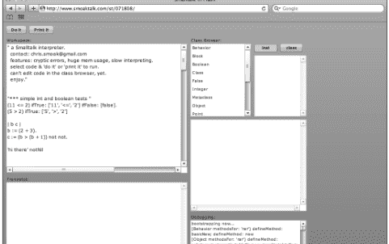

随着 NeXTStep 越来越受欢迎、影响力越来越大，它演变成了 OpenStep——一个基于 NeXTStep 的特性和设计目标的开放行业标准。NeXT 桌面成为创新界面开发的标杆，它使用 Display PostScript 支持任意字体，而当时大多数 PC 仍显示着普通的块状文字。

### 注意

> 可以说，OpenStep 以微弱差距错失了与 Microsoft Windows 3.0 竞争的机会。20 世纪 90 年代初，OpenStep 显然是更优秀的操作系统，并且当时已经在从最初的 Motorola 680x0 平台移植，以便在 Intel x86 机器上运行。不幸的是，OpenStep 比 Windows 更晚发布，这给了 Microsoft 早期采用者优势。如果它发布得更早、推广得更积极，它很可能就会盖过 Windows，并给开发者社区一个值得选择的替代平台。

## NeXTStep 与 Web

NeXTStep 可能直接催生了万维网。最初的超文本浏览器和服务器系统由蒂姆·伯纳斯-李在欧洲 CERN 粒子加速器的一台 NeXT 系统上开发。Web 并非真正的面向对象，也不是基于消息的，HTML 仍然只是一种简单的标记语言，而不是编程语言。不过，从标签链接和 HTML 字段被指定为具有特定子属性的对象这一点上，仍能看出 Objective-C 和 NeXTStep 的痕迹。

NeXTStep 和 Cocoa 当然也受到了 Web 的影响。许多 Cocoa 数据对象不区分本地数据和远程数据。大多数操作系统假定所有数据都位于本地磁盘或网络上，而 Cocoa 允许通过 URL 指定并下载数据。一些 Cocoa 对象对所有数据都使用 URL。本地文件路径必须先转换为 URL，然后才能加载数据。

## 从 NeXTStep 到 Cocoa

1996 年，史蒂夫·乔布斯重返 Apple，并将 NeXTStep 一并带回。在此前的几年里，Apple 曾试图打造 Mac OS 9 的继任者，但未能成功。收购 NeXTStep 并重新聘用其创造者，显然是一个解决方案。在经历了多次失败的开端之后，Apple 最终于 2001 年发布了 OS X 10.0。OS X 10.0 代号 Cheetah，融合了 OpenStep 的特性和现有的 OS 9 代码。Apple 对 NeXTStep 的新诠释被命名为 Cocoa。在内部，Cocoa 对象仍然使用字母 NS 作为前缀——例如，Cocoa 的窗口对象称为 NSWindow。

尽管 OS X 10.0 以不稳定著称——Apple 几乎立即发布了 OS X 10.1 的免费更新——但 OS X 受 NeXTStep 启发的外观和体验立刻受到了用户和开发者的欢迎。Apple 通过提供免费 SDK 大力推动 OS X 开发。此后，Cocoa 进一步发展。2005 年，Apple 放弃了对 G3 系列处理器的支持，并将 OS X 迁移到 Intel Mac 技术。目前，Cocoa 和 OS X 正朝着全面 64 位支持以及基于触摸的用户界面扩展方向发展。但 SDK 仍然是免费的。所有 Mac 都捆绑了一个版本，而最新更新可以从 Apple 网站下载。


### 交叉参考

有关 Xcode SDK 的更多信息，请参阅第 3 章和第 4 章。

较新版本的 Cocoa 仍与 NeXTStep 代码兼容，后者通常只需极少改动即可在 OS X 上编译和运行。但 Cocoa 已不再与 OpenStep 或 NeXTStep 完全相同。每次 OS X 更新都会添加新特性，并更改或移除旧特性。图 1.3 展示了 Snow Leopard，这是 OS X 和 Cocoa 的最新版本。在内部，NeXTStep 的遗产仍然存在，既体现在代码中，也体现在影响了 OS X 用户体验的 Cocoa 设计哲学中。Cocoa 仍然完全面向对象，Cocoa 代码仍使用一种可辨认的消息传递和对象模型版本，该模型起源于 20 世纪 70 年代末的 Smalltalk。

### 图 1.3

当前的 Snow Leopard 基于 Cocoa 技术，该技术仍与 OS X 10.0 中使用的技术相似。窗口以带有轻微纹理的灰色饰面呈现，并具有细微的 3D 效果。外观由操作系统设定，无法在 Cocoa 内自定义。

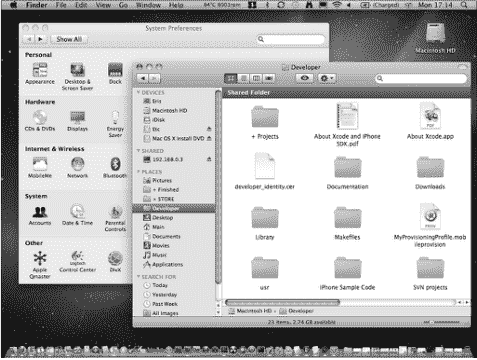

如今，Cocoa 是最流行的应用程序开发框架。许多 Mac 应用程序使用其他 OS X 库来实现媒体功能并管理应用程序数据。但只要这些混合应用程序营造出 Cocoa 的外观和体验，并围绕相互交互的对象和事件来组织，它们仍被视为“Cocoa 应用程序”。

### 注意

> 本书重点介绍 Cocoa，但也会介绍其他库中的关键元素。尽管从技术上讲，它们并不属于 Cocoa，但如果不熟悉它们，就很难开发 Cocoa 应用程序。

## 从 Cocoa 中获益

开发者学习 Cocoa 既可以获得乐趣，也可以获得收益。Mac 应用程序市场比 Windows 市场小得多，但饱和度也低得多，因此可能更容易进入。Mac 市场份额通常在台式机和笔记本电脑总销量的 3% 到 7% 之间波动，目前由于 iPhone 的影响而呈上升趋势。Web 统计数据显示，大约 5% 的页面被提供给 Safari 或 Mac 版 Firefox 的用户。

Windows PC 的销量部分由企业批量采购决定，这可能会扭曲用户统计数据。实际上，对于家庭和小型企业买家而言，Mac 仍然是一个格外受欢迎的选择。即便如此，市场仍然有限，小众应用实现批量销售的前景并不乐观。

对于游戏开发而言，Mac 也是一个相对较差的选择。Mac 比高性能 PC 更昂贵，也更难定制，因此知名游戏开发者一直集中在 PC 市场，但在知名的高性能游戏市场之外也存在例外。简单的 Flash 游戏在 Web 上很流行，一些开发者通过直接的 PC 和 Mac 移植版取得了成功，并利用 Web 游戏来推广独立版本。这些游戏的开发成本远低于全规模影院级 3D 游戏体验，但可能带来意想不到的利润。

在创意应用市场，Apple 自家的音乐、视频和摄影产品在音频和视频领域占据主导地位，并得到许多其他成熟软件产品的支持。在其他领域，Adobe 的 Creative Suite 系列已成为图形设计、摄影和动画的行业标准。这些市场如今已经成熟，留给竞争性新产品的空间很小。偶尔，如果一款新产品的特性足够独特且具有吸引力，它也能为自己开辟出一片天地。例如，图 1.4 所示的 Ableton 的 Live 音频音序器在 Mac 和 PC 用户中都很畅销。它问世时提供了现有产品所没有的全新现场演出功能。

除非你拥有真正能改变市场的想法，否则与现有创意产品正面竞争是一种糟糕的策略。靠价格竞争也不太可能带来更多利润。Mac 上曾发布过各种廉价版 Adobe Photoshop 克隆产品和重新诠释版本，但即使定价低得多，也没有一个成功地从原版手中夺取市场份额。独立开发者应牢记，即使产品实用且制作精良，营销成本也可能远高于开发成本。

但正面竞争并不是唯一的选择。支持市场领导者的插件和辅助应用程序市场十分兴旺。例如，软件音乐合成器和音频处理插件一直稳定畅销，视频和图形设计应用的插件及辅助应用市场也同样强劲。插件和辅助应用程序比完整应用程序更小、更简单，开发速度可以快得多——而且更有利可图。


**图 1.4**

Ableton Live 是少数成功开创出全新应用细分领域的媒体应用之一。现场采样循环播放与交互式控制的独特结合，已被证明对音乐人和 DJ 具有难以抗拒的吸引力。

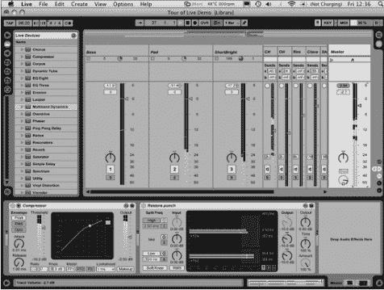

工具类应用是另一个稳定的市场。苹果自家的 Finder 应用自 OS X 10.0 以来几乎没有更新，用户可能会欢迎一个有说服力的替代品。标准的 Mac Mail 应用缺乏打磨，功能集也很少。自动化是另一个开发不足的市场。OS X 包含 Automator，但它难以使用，用户可能会喜欢其他提高生产力的选择。

一般来说，只要苹果的软件难以使用或被有意限制，机会就存在。这适用于 OS X 附带的大多数免费应用，因此存在明显的创新机会。能以低成本解决简单问题的产品通常总是容易成功。例如，各种廉价的辅助应用，例如图 1.5 所示的 Growl，为 OS X 增加有用的额外功能或增强。能吸引所有 Mac 用户、但编码简单且售价低廉的产品，可能是独立开发者的理想项目。

**图 1.5**

Growl 是一款独特且流行的辅助工具，可增强应用间通信。Growl 是捐赠软件，但它如此受欢迎，以至于捐赠已成功为其开发提供资金。

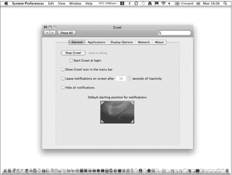

作为一个潜在开发者，在线软件销售并不是唯一可能的市场——你还可以以自由职业者的身份提供外包服务，开发可能永远不会商业销售的定制应用。企业主和开发者支撑着一个规模虽小但重要的市场，面向有经验的 Mac 开发者和顾问。要在这个市场取得成功，你需要精通 OS X 和 Cocoa，并愿意且能够使用 Amazon、Twitter、Google 和 Facebook 等流行 Web 服务的 API。图 1.6 所示的 Twitterrific 应用就是这种方法的一个例子。

开发将 Mac 连接到这些服务——或其他仍在开发中的服务——的应用，可以成为可靠的收入来源。一些苹果开发者采用的成功策略是，接触那些拥有相对简单但流行的 Windows 应用的公司，询问他们是否考虑外包 Mac 版本的开发。

**图 1.6**

Icon Factory 的 Twitterrific 应用是成功且易于上手的开发的一个好例子。它小巧、简单且便宜，并通过瞄准一个非常流行的市场来实现批量销售。

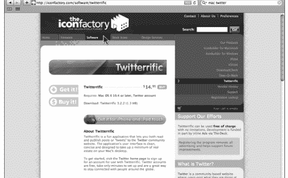

## 从 iPhone 中获利

有时 iPhone 开发甚至更有利可图。一款 iPhone 热门应用让你非常成功的可能性虽小但不可忽视。对一夜成功的前景过于乐观是不明智的，但一些开发者通过销售相对简单的 iPhone 应用做得极其成功。更多信息请参见第 19 章，该章更详细地探讨 iPhone 的开发模式和商业策略。

其他开发者通过为常见的 iPhone 问题提供解决方案而取得成功。这是桌面策略在 iPhone 上的友好延伸：在现有软件有限或令人沮丧的地方寻找机会。DigiDNA 的 Aid 系列应用（如图 1.7 所示）使将 iPhone 用作 USB 驱动器进行简单文件复制成为可能，并简化了 iTunes 中的文件管理。

**图 1.7**

DigiDNA 的一系列实用工具采用相关模式，瞄准现有流行的苹果应用，并针对其中一些缺点创建解决方案。

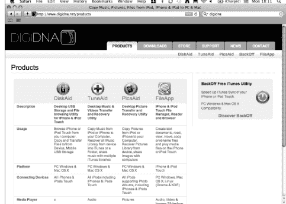

Mac 应用和 iPhone 应用的一个关键区别是，苹果垄断了 iPhone 应用销售。任何人都可以开发 Mac 应用并在网站上销售，无需苹果许可。只有当 OS X 应用以明显方式违法时，苹果才能阻止其销售。

iPhone 市场受到的控制要严格得多。应用必须通过 App Store 销售，并且必须在上架前获得苹果批准。一些开发者在审批过程中有过不幸经历，他们的应用在未通知的情况下被下架。苹果声明的审批政策并不总是得到一致执行。如果应用以非标准或不受支持的方式使用 Cocoa 功能、与苹果自身或其商业伙伴的商业计划冲突，或包含非法或可疑内容，那么可以预期该应用会失败。避开灰色地带的应用通常会被接受。

尽管 iPhone 开发包含额外的风险因素，但它也提供了进入巨大潜在市场的机会。在 App Store 上架是一种潜在有价值的免费营销形式。然而，对开发者来说，这并不是可行的快速致富方案——少数开发者会获得巨额利润；大多数不会。但它可以提供可观的额外收入来源。

结合 Mac、PC 和 iPhone/iPad 开发是一种日益流行的策略。由跨多个平台元素构建的应用可以卖得更高的价格，而且它们还会相互交叉推广。

## 为乐趣而开发

并非每个人都专业从事开发，而 Cocoa 对于创意媒体项目来说是一个有益的环境。其功能包括对图形、视频和声音的强大支持。熟悉 Flash 和 JavaScript 等易上手的以 Web 为中心的语言、富有冒险精神的开发者，正发现 Cocoa 和 Objective-C 是自然的下一步。

Cocoa 应用只能在 Mac 上运行。没有基于 Web 的 Cocoa 版本，因此你不能使用 Cocoa 创建 Web 图形。但你可以用它为专业媒体应用创建自定义插件；以富有想象力的方式处理图形、视频和声音文件；并生成可打印的超高分辨率图形，而这些在其他环境中很难创建。

Cocoa 不像 Flash、Java 或 Processing 这样简化的“玩具”语言那样容易上手。它也不像 Cycling 74 的 Max/MSP/Jitter 产品或图 1.8 所示的开源同类产品 Pure Data 这样的媒体构建套件那样容易掌握。如果你需要一个简单干净但功能有限的环境，Cocoa 可能并不适合你。

当你达到这些环境的极限并开始探索更复杂的可能性时，Cocoa 和 Objective-C 就会发挥出自身优势。Objective-C 非常适合各种结构化编程，包括媒体应用；而且，从使用 ActionScript 编码到使用 Objective-C 和 Cocoa 编码之间的距离，远小于编写代码与完全不编码之间的距离。

尽管 Objective-C 仍被一些人视为“真正的”编程，而 Flash、PHP、JavaScript 和 Perl 被认为更简单、要求更低，但这种区分是肤浅且具有误导性的。随着苹果开始超越桌面/笔记本电脑模式，进入新型计算领域，这些技术将开始以有趣而有创意的方式相互碰撞。熟悉所有这些环境的开发者，将比那些不那么勇于探索的开发者拥有创意上的、或许还有职业上的优势。

**图 1.8**

像 Pure Data 音频合成器这类非主流应用的开发者和用户常常发现，一旦他们达到这些更简单环境的极限，Objective-C 和 Cocoa 开发对他们来说就是自然的进阶。

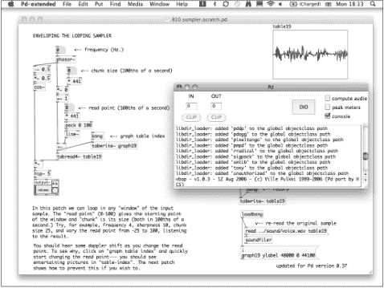

## 介绍 Xcode 和 Apple 开发者计划

如果本章激发了你开始编码的兴趣，你会很高兴地知道，用于创建 Cocoa 应用的 Xcode SDK 可供任何拥有 Intel Mac 的人使用。入门级会员资格需要简单注册，但它是免费的，并包含对苹果 Xcode SDK 的访问权限，该 SDK 同时支持 iPhone 和 OS X 开发。你可以在图 1.9 所示的 Apple Developer Center 网站 http://developer.apple.com 了解更多信息。更多信息请参见第 4 章。


**图 1.9**

苹果的开发者中心向所有人开放。免费入门级注册可访问合并的 Mac 和 iPhone SDK。

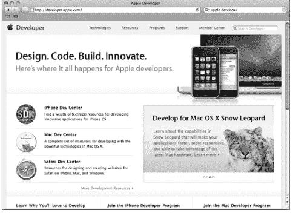

## 使用 Xcode 和 Interface Builder

如图 1.10 所示的 Xcode 是一套完整的开发工具；第 3 章将更详细地介绍它。除了编辑器和编译器，它还包含 Interface Builder（IB，如图 1.11 所示）。

乍一看，IB——它通常被这样称呼——看起来像界面设计工具。事实上，这个名字具有误导性。创建应用时，你可以使用 IB 列出应用启动时加载的对象。可见对象会出现在界面中，但你也可以加载不出现在那里的数据对象。实际上，Interface Builder 是一个对象层级编辑器，也可以设计界面，你可以用它定义应用的整个架构。

**图 1.10**

Mac 和 iPhone SDK 围绕 Xcode 代码编辑器和编译器构建。初学者可以使用简单的一键构建方式使用 Xcode，而更有经验的开发者几乎可以无限地定制和扩展它。

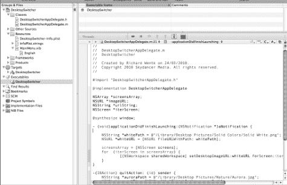

## 使用 Safari

苹果还为 Web 应用提供免费的 Safari Developer Program。Safari 目前在 Mac 和 PC 上仍属于少数人关注的对象。在 iPhone 上，你可以使用 Web 应用技术创建基于 Web 的应用，这些应用具有传统 iPhone 应用的许多功能，但创建更简单，并且可以直接从网站销售。随着 HTML5 和 CSS3（层叠样式表 3）即将在 Safari 和其他浏览器中支持，Web 应用很可能拥有有趣的未来。Safari 开发工具还包括一个强大的 JavaScript 调试器，你可以在其他项目中使用它。尽管本书不是关于 Safari 的，但探索 Safari 环境是值得的，它可以作为 JavaScript 和 Flash Web 开发与 Objective-C 和 Cocoa 更复杂挑战之间的过渡桥梁。

**图 1.11**

Interface Builder 包含可添加到应用中的完整对象列表。它还包括对象层级视图、界面预览，以及用于显示和编辑对象及其设置的 Inspector 窗口。

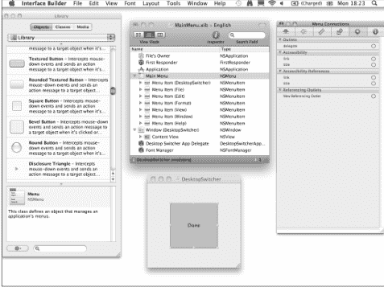

## 小结

本章介绍了 Smalltalk 和 Objective-C 的历史，并解释了创建 Cocoa 的开发过程如何始于 Smalltalk、转向 Objective-C 和 NeXTStep，并最终随着 OS X 的发布将 Cocoa 库集成到 Mac OS 中。

本章还探讨了 iPhone 和 OS X 开发的各种商业业务模式，并介绍了 Apple Developer Program 和 Xcode SDK。


# 以 Cocoa 的方式思考！


尽管可以通过死记硬背来学习 Cocoa，费力地列出其对象并试图记住它们的关键属性和代码接口，但当你以更开放的方式理解其设计原则时，Cocoa 就会变得生动起来。其中一些原则源自 Objective-C。另一些与 Aqua 相关——即构建在 Cocoa 之上的 OS X 观感——本章后面将更详细地描述。通过理解 Cocoa 的设计哲学并在需要时补充编码细节，比从 Cocoa 代码示例反向学习要容易掌握得多。

## 为 Cocoa 而设计

苹果产品强调创意设计；成功的设计包含以下三个要素：

- **卓越的美感。** 应用程序应看起来鼓舞人心且富有吸引力，用户一看到界面就应感到好奇并为之着迷。但设计应增强功能，而不是喧宾夺主。

- **趣味感和创造可能性。** 这一要素并非总是适用——例如，办公应用通常不强调它——但即使是最简单或最直接的应用，也可以包含能启发用户的元素。


> **提示**
> 
> 应用程序有时会通过包含模板和预制内容来伪造趣味性和创造力。这可能受用户欢迎，但创建一个能让用户完全发挥原创性的应用程序更有价值——也更困难。

- **清晰直观的心智模型。** 用户应能尽可能不费力地理解应用的功能。应用应当“隐形”；用户永远不必思考如何执行某项操作。

| 本章内容 |
| --- |
| 使用 Cocoa 设计 |
| 创建 Cocoa 应用程序 |
| 从其他平台迁移到 Cocoa 和 Objective-C |


> **警告**
> 
> 用户可能对功能应如何工作有许多想法。清晰直观的心智模型如果不符合这些预期，仍然可能失败。例如，用户有时觉得 iTunes 难以使用，因为他们以为 iPod 可以当作外置 USB 驱动器。作为一种模型，外置驱动器比 iTunes 的实际工作方式更简单，这让他们感到沮丧。

功能复杂的应用总是需要学习曲线。但重要的是思考这些目标，并让它们塑造每个 Cocoa 应用程序的设计，即使结果并不完美或理想。

创建简单应用时更容易接近这些目标，因此 Cocoa 的设计哲学在 iPhone 和 iPad 上尤为重要。这些设备针对精简、流畅且具有简单、美观、清晰界面的应用进行了优化。主流 Cocoa 环境未来很可能朝这个方向发展，因此在设计桌面应用时考虑移动端美学是有用的。

## 理解 Aqua

Cocoa 是 Aqua 的一部分。Aqua 实现 Cocoa 应用程序的视觉样式，包括玻璃质感按钮和灰色窗口边框。Aqua 还定义了一些特定的预期和要求，如下列所示。

> **提示**
> 
> 你可以通过搜索“Apple Human Interface Guidelines”在线找到这些指南。URL 偶尔会变化，因此最好进行搜索，而不是寻找特定 URL。

- **应用程序使用多个窗口。** 窗口通常浮在桌面上，而不是位于单独的应用窗口内。屏幕顶部只有一个菜单栏。不同窗口没有不同的菜单。
- **应用程序应快速启动和退出。**
- **应用程序必须支持 OS X Dock。** 允许全屏模式，用户负责在 Dock 之上排列窗口。
- **OS X 支持多用户。** 用户应能在同一台机器上以不同会话使用同一应用而不发生冲突。OS X 支持快速用户切换，因此用户应能在不丢失数据或设置的情况下注销并重新登录。
- **应用程序应支持国际化。** Cocoa 包含简化多语言和多字母表支持的功能。
- **OS X 包含标准功能，如预设键盘快捷键、颜色选取器、鼠标操作、菜单选项、拖放选项和文件选择器。** Cocoa 应用程序应使用这些功能。
- **窗口采用标准元素设计。** 这些元素包括左侧的数据源、顶部的工具栏、右侧的滚动条、底部的更多选项等。应用程序应遵循相同的轮廓设计。

> **说明**
> 
> 如果你刚接触 Cocoa，且来自不同的开发环境，请查看 Aqua 窗口的设计指南。像底部栏这样的元素可能不熟悉。并非所有应用都使用所有元素，但你应了解不同的选项。

- **窗口内元素的间距也已标准化。** 边距、定位、分组和对齐的标准列在 Apple Human Interface Guidelines 中。例如，偏好设置面板（如图 2.1 所示的 Safari 偏好设置）经过加权，使其在窗口中看起来居中，但并不是以机械方式简单居中对齐。
- **字体已部分标准化。** 大多数应用使用系统字体，但在某些情况下，你可以允许用户选择其他字体。
- **应用程序应包含帮助文件，** 支持主题浏览和开放搜索。

**图 2.1**

Safari 的偏好设置采用居中加权而不是居中对齐。整个布局看起来平衡，尽管没有任何单个项目被放置在精确的垂直中心线上。项目还按垂直方向分组以保持清晰。

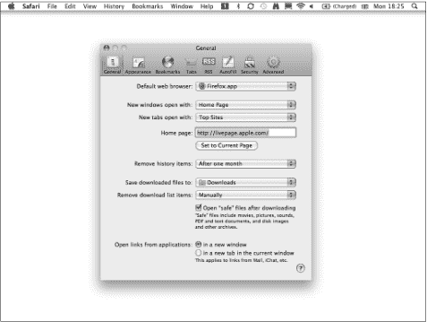

## 将 Aqua 与 Cocoa 结合使用

许多应用未能遵循所有这些设计指南。由于任何开发者都可以在未经苹果许可的情况下创建和销售 OS X 应用，开发者可以创建自己的界面标准。


Aqua 是主流生产力和生活方式应用的理想选择，但创意和媒体应用有时在界面设计和功能访问上采用更个性化的方式。虽然 Cocoa 的部分内容与 Aqua 紧密相关，但使用 Cocoa 完全可以创造出完全个性化的观感。Aqua 是一套指南，但 Cocoa 只是在包含一组可纳入界面的标准对象库的范围内强制执行这些指南。如果你愿意，可以自定义其中大多数对象的外观，并仍使用 Cocoa 来定义它们如何响应用户操作。

## 创建 Cocoa 应用程序

Cocoa 是 OS X 中众多库之一，并非整个操作系统的代名词。从技术上讲，Cocoa 是 OS X 中的一个层——一组可用于实现相关功能的库。在讨论层时需要谨慎，因为 Apple 的文档以不同方式描述层。例如，在部分文档中，Cocoa 被描述为应用程序框架层的一个元素——一组可用于构建应用程序的四个库。在其他地方，Cocoa 被描述为本身就是一个完整的层。还有的地方将其描述为一组独立的框架——代码库。

### 理解层和框架

你会发现理解这一点很有帮助：文档的某些部分勾勒了 OS X 的功能概要，而其他部分则涉及实际的代码库组。令人困惑的是，功能概要仅与代码结构松散相关。功能视图最适合作为 OS X 的入门摘要和术语速查，而不是开发辅助工具。

表 2.1 展示了 OS X 中各层的功能摘要。这是 Apple 官方概述的扩展版本，并添加了注释。

**表 2.1 OS X 功能层——概要视图**

| 层 | 元素 | 注释 |
|---|---|---|
| 用户体验 | Aqua<br>Spotlight<br>辅助功能 | 这些元素以高级方式实现或定义 OS X 最可见的部分。它们要么是 API（Spotlight、辅助功能），要么是概念和指南（Aqua）。较简单的应用可以忽略这些 API。较高级的应用可以使用它们来添加某些标准 Mac 功能。 |
| 应用程序框架 | Cocoa<br>Carbon<br>Dashboard 和 WebKit<br>POSIX 和 X11 | 这些代码库用于创建应用程序骨架。它们包括窗口管理功能、数据处理、应用程序启动和关闭、界面创建等。更多详情，请参见表 2.2。 |
| 图形与媒体 | Core Animation<br>Core Image<br>Core Video<br>QuickTime<br>OpenGL<br>Quartz<br>Core Audio | 这些元素包括静态图像、动画、视频和音频支持。此列表是精简摘要，此处列出的名称并不完全对应于实现这些功能的框架名称。但这些名称通常用作相关库组的通用描述。 |
| 数据与数据管理 | Core Data<br>通讯录<br>日历 | 使用这些元素在应用程序内管理数据，并与 Apple 自带的应用程序交换数据。Apple 框架有各自独立的内部数据管理功能。许多应用程序同时使用这两种数据管理方式。 |
| Darwin、内核与驱动 | UNIX 系统调用<br>驱动程序库 | OS X 构建于 UNIX 的 BSD（伯克利软件发行版）变体之上，包含所有常用的底层 UNIX 系统调用。此级别处理对硬件功能（如磁盘硬件或温度传感器）的直接（高风险）访问。它还处理对底层 Darwin 版本 UNIX 操作系统的调用。 |

图 2.2 以图形方式展示了这些元素之间的相互关系。最复杂和最抽象的层位于图表的顶部。当你远离用户体验层时，便进入了 OS X 的内部，最终到达底层的 UNIX 代码。

**图 2.2**

这个简化的功能视图有助于你了解方向，但在实践中，框架和层的代码级视图更为相关。

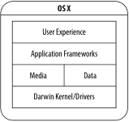

### Cocoa、Aqua 与用户体验

Aqua 是用户体验的关键部分。Cocoa 是代码库，而 Aqua 是一种观感，部分由 Apple 开创的玻璃质感界面图形定义。作为开发者，你不会对 Aqua 层进行编程，也不存在 Aqua 框架。相反，Aqua 的可见部分会自动为你实现。每当你向应用程序添加标准按钮图形时，它都会显示为 Aqua 按钮。理论上，Apple 可以在未来版本的 OS X 中用不同的外观替换 Aqua，而不会破坏任何现有的 Cocoa 代码。


> **注意**
> 
> 你可以选择用自定义图形替换默认的 Aqua 图形功能。但 Aqua 深受用户欢迎，如果你打算使用自己的图形来自定义应用的外观，可能会发现很难创造出同样吸引用户的外观。

Aqua 远不止是一套光鲜的图形。作为一个层，Aqua 还定义了一套明确的设计指南，符合 Aqua 规范的应用程序必须满足这些指南。本章后面会更详细地讨论这一点。

用户体验层的其他部分内置于 OS X 中。Spotlight 实现了快速搜索。Dashboard 显示称为 widget 的迷你应用程序，并在附录 A 中描述。辅助功能用于为残障用户创建可访问的应用程序。建议支持 Spotlight 和辅助功能，但并非强制要求。根据应用的功能和用户界面，有时可以省略 Spotlight 功能而不会使用户失望或沮丧。

### Cocoa 与应用程序框架

如表 2.2 所示，Cocoa 并不是 OS X 中唯一的应用程序框架。开发者还可以使用底层 POSIX 调用和 X11 窗口管理来创建 Unix 兼容的应用程序；一个名为 Carbon 的框架可以通过 C 函数调用创建和管理 OS X 窗口与界面功能；还可以使用 Java 和 JavaScript 创建基于 Web 或类似 Web 的应用程序。

| 框架 | 接口 | 应用程序类型 |
|---|---|---|
| Cocoa | Objective-C 对象和方法 | 使用 Cocoa 数据类型的 Mac 风格窗口桌面应用和命令行应用。 |
| Carbon | C 函数和数据结构 | 使用 C 语言数据类型、结构和函数的 Mac 风格窗口桌面应用。此层包含许多特殊库，例如语音合成和语音识别。 |
| POSIX 和 X11 | C 函数和数据结构 | UNIX 风格的应用程序，具有 X11 窗口化和底层命令行输入。使用此框架可以创建跨平台 UNIX 应用程序，只需极少的更改即可在 Mac 和其他 UNIX 平台上运行。 |
| Dashboard 和 WebKit | Java 和 JavaScript 函数与数据类型 | 基于 Web 的应用程序，包括适用于 iPhone 的 WebKit 应用和适用于 Mac 桌面的 Dashboard widget。有关详细信息和示例，请参见附录 A。 |

### 跨层开发功能

各层之间的划分并不清晰或简单——不存在独立的“图形框架”或“动画框架”。相反，动画功能分布在 Cocoa 层、媒体层和 Core Graphics 中。类似地，你可能认为 Core Graphics 属于媒体层，但出于历史原因，它被包含在核心服务层中的应用程序服务框架中。

因此，向应用程序添加功能通常意味着混合来自不同框架的代码和功能。使用 Cocoa 创建用户界面、使用 Core Graphics 绘制界面中的动态元素、使用 Core Animation 为图形添加动画效果，都是很常见的做法。

层之间也存在一些重复；例如，你可以使用 Core Audio 或 AudioToolbox 层播放声音。这看起来可能多余，但这些层提供了不同的功能。AudioToolbox 实现了功能有限的简单文件播放器对象，而 Core Audio 包含更复杂、更难使用的对象，但可用于更具挑战性的应用，例如实时声音合成。


> **提示**
> 
> 如果你必须一直使用所有框架，那么框架的组织方式会令人非常困惑。事实上，你只需要掌握少数几个框架。一旦你知道如何创建和控制窗口、添加控件、管理鼠标点击和键盘事件、绘制图形以及可能添加声音，你就已经掌握了基础知识——而且这些并不难。其余内容有用且有趣，但可选。

### “免费桥接”层

某些对象提供了更根本性的重复。例如，Cocoa 中的 NSString 与 Core Foundation 框架中的 CFString 密切相关。有些对象被明确描述为免费桥接——这是 Apple 的一种表示方式，表明对象及其接口在很大程度上可以互换，即使它们存在于不同的层中。

事实上，许多 Cocoa 对象只是其他框架中列出的底层函数的包装器。如果你专门使用 Cocoa 开发，可以忽略这一点；除非你需要使用底层函数，否则也可以忽略它们。但了解这种关系很有用，因为即使类功能被重复，也很少是完全相同的复制。相关框架总是在功能性和可访问性之间提供不同的平衡，有时可以使用底层框架来解决在 Cocoa 中不易解决的问题。

### 成功使用框架和层

如果你是 Cocoa 开发新手，现在应该已经意识到，层模型只是 OS X 的一个非常粗略的指南。在实践中，你经常会发现自己在翻阅框架参考文档，以组合不同层中的功能。但是，由于 OS X 中对象和库的数量庞大，且组织有些混乱，在刚开始使用 Cocoa 时，可能很难形成如何解决问题的思路。


> **提示**
>
> 新开发者很容易被大量框架和对象弄得不知所措。任何智力正常的人都不可能记住整个 OS X 文档集。更实用的学习策略是掌握 OS X 中最有用框架之间关系的大纲，然后在需要时再到文档中查找其余细节。你不需要记住*所有内容*——但记住在需要查找某样东西时该去哪里找，会很有帮助。

表 2.4 展示了 OS X 各层的简化视图，将其精简到最核心的部分。这个模型与 Apple 自己的分类方案并不一致，但它确实符合你在实践中可能使用各层的方式。在典型应用中，你会使用 Cocoa 层来构建应用骨架，并管理关键应用事件和数据；还会使用 Services 层来管理媒体和数据。许多应用完全忽略 OS 层，或者几乎从不访问它。如果你要创建或管理驱动程序，或访问 Mac 的硬件功能，就需要使用 OS 层。否则，你可以忽略它的大部分功能。

| 框架 | 接口 | 应用与元素 |
|---|---|---|
| “Cocoa 层” | Objective-C 对象和方法 | 窗口、界面和应用管理；高层媒体功能；封装动画效果；面向对象数据；高层 Web 和网络访问；高层定时器和线程控制。 |
| “Services 层” | C 函数和数据结构 | 低层媒体功能，包括基本图形基元和自定义动画；C 类型数据结构；低层 Web 和网络访问。该层通过另一种 C 函数接口重复实现了 Cocoa 的部分功能。 |
| “OS 层” | C 函数和数据结构 | 其他层未包含的有用函数，例如随机数生成。套接字级 Web 和网络访问；系统和硬件访问；低层进程和线程控制。 |

在工作中切换层是标准做法。理解以下几点可以简化开发：大多数 Mac 应用是 Objective-C 对象和标准 C 函数调用的混合体；各层之间存在一些功能重复；你离用户越远，就越会使用 OS X 的 C 库而不是 Cocoa。图 2.4 展示了一个常见工作流程。

**图 2.4**

创建 OS X 应用没有单一的标准化方式，但这种概要式工作流程格式被广泛使用。在实践中，大多数项目至少会在其中一些步骤上反复迭代。

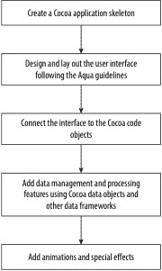

## Cocoa 与框架的故事

如果这些框架的组织方式看起来不够精简，那确实如此。OS X 的框架是全新开发与悠久历史的结合体。正如加入 Carbon 是为了简化向后兼容性一样，其他框架是在 NeXTSTEP/OS X 开发历程的不同阶段加入的，原因在当时很相关，但如今可能已不那么紧迫。

像大多数操作系统一样，OS X 也是计算考古学的一个例子。遗留层不仅没有 Cocoa 那么复杂、抽象程度也没那么高，而且它们也更古老。如果你难以理解哪些框架是必需的、哪些是可选的，你会在本书其余部分找到这些信息；本书重点介绍 Cocoa 和 OS X 的关键要素。

有时，你可能会使用某个专用框架，为应用添加非常专门的功能，例如语音合成。一般来说，你可以忽略那些更专用的框架。你也可以忽略许多较旧的框架，因为它们的特性已经在 Cocoa 中被重复实现并简化了。

概括来说，你会经常使用 Cocoa 层，定期使用 Services 层——其中一些元素必不可少，而另一些则几乎用不到——只会偶尔使用 OS 层。随着经验积累，你会发现较旧的层变得更容易理解，也更容易使用。

## iPhone 和 iPad 上的 Cocoa

iPhone 和 iPad 使用 Cocoa Touch，它是对 Cocoa 的发展和重塑。与 OS X 相比，iPhone OS 提供了一套大幅简化的框架集合。Cocoa Touch 比 Cocoa 更不复杂：对象库更小、窗口机制更简单、数据对象更少，如图 2.5 所示。

不过，两个平台对应用设计做出了相似的假设，并使用相同的概念和设计理念。与 Mac 应用相比，Cocoa Touch 应用更不复杂，限制也更多，但两者并没有本质区别。如果你熟悉其中一个环境，就能轻松转向另一个环境。你不需要学习一门新语言，只需扩展或修改自己的“词汇表”即可完成转变。

**图 2.5**

iPhone 应用比 OS X 应用更简单，可能不需要使用 C 函数层。这个 Zettaboom 应用完全由 Cocoa Touch 组件构建。


## 从其他平台转向 Cocoa 和 Objective-C

Web 引发了人们对软件开发兴趣的爆发。有许多脚本化和编程环境可供选择，但从历史上看，大多数都是面向对象的。开发者发现，相互竞争的平台使用相关的编码原则，现有技能可以迁移。如果你有使用另一种面向对象语言的经验，你会发现 Objective-C 很有价值，而且相对容易上手。

但 Cocoa 的库源于一些关于操作系统设计的非寻常理念。Cocoa 代码易于理解，但启发其语法的理念是独特的，在其他环境中没有对应物。要有效使用 Cocoa，你必须理解它们。Objective-C 还具有其他语言所没有的独特特性。

Apple 的开发者文档列出了若干正式的设计模式——事件、响应、代码和数据之间的关系——它们影响了 Cocoa 和 OS X 的发展。Apple 的列表部分出于历史与学术目的，遗憾的是，它并未充分解释 Cocoa 和 OS X 中使用的某些模式、数据结构和原则。经验丰富的开发者或许能通过字里行间领会它们，但新手可以从更详细的介绍中受益。

Objective-C 的语言特性将在第 5 章更正式地描述，Cocoa 的要素将在本书其余部分探讨。本章为使用其他语言的用户提供 Cocoa 和 Objective-C 的概述。请把它当作一份备忘单，列出你必须学习和熟悉的关键特性。读完本节后，你会发现更容易上手官方文档。这里介绍的所有特性都会在后续章节结合实际示例讨论，因此请把本节视为初次一瞥。后面会有更详细的实践讲解。


> **提示**
>
> 不要跳过本节！你会发现这份总结非常宝贵，因为它告诉了你需要了解的关键细节。开发者文档重点不够集中，还包含不必要的细节，在你刚开始时会分散你的注意力。尽管本节只是初次一瞥的总结，但内容很多。在完成本书后面的示例时，欢迎随时回到这里。

## 使用 Objective-C 对象和消息

Objective-C 像 Java、C# 和 C++ 一样是面向对象的。对象既包括方法也包括属性，并且分为类抽象和具体实例。继承和子类化受到支持并得到鼓励。用于定义对象的语法和文件结构与其他语言略有不同，但概念仍然熟悉且可识别。如果你有其他语言的面向对象编程经验，那么你对 Objective-C 基础知识的了解已经足够，可以顺利起步。


Cocoa 应用程序高度依赖子类化。在 Objective-C 中，子类化是定制的同义词。当你对某个对象进行子类化时，你会重新实现——即覆盖——它的一些现有特性，并添加你自己的新特性。有些 Cocoa 对象是专门为子类化而设计的，其中包含方法存根，你需要用自己的代码来充实这些存根。

Objective-C 类的一个独特特性是类消息传递。在其他语言中，你创建类对象的实例，并向实例发送消息。在 Objective-C 中，类本身作为元对象存在。它们可以包含在类自身运行的类方法。这一特性常用于创建对象：你通过消息向类发送创建请求，类创建对象实例并返回指针。

### Objective-C 消息传递

在 Objective-C 中，消息传递是一项基本特性。你并不是在对象上直接运行方法，而是向它发送一条触发该方法的消息。消息是事件，而非函数调用。它们是异步的；也就是说，消息可以在任何时候发生，并且不受顺序程序流程的约束。

> **注意**
>
> 一个有用的简化是假装消息会被立即发送并处理。当然，真实代码需要时间运行。但作为一阶近似，Objective-C 试图向你隐藏这一点。更进阶且更准确的近似是，Cocoa 代码可以在独立线程中运行，而 Cocoa 包含线程管理功能，可以控制事件和消息的时序。但在你开始处理线程、进程、定时器和性能分析之前，忽略 Cocoa 代码中与时间相关的元素，并假设事件是瞬时处理的，会很有用。

以下是在 Objective-C 中使用消息传递的最常见方式列表。其中一些在其他语言中已经司空见惯，另一些则不那么传统。

- **获取对象属性。** 读取对象属性的唯一方式是向它发送消息并请求返回值。Objective-C 中没有直接读取特性，因为对象是不透明的——它们的内部工作方式对其他对象不可见。如果你想在自己的对象中让某个属性可见，必须添加代码来实现。
- **设置对象属性。** 与读取值需要添加代码一样，设置值也需要添加代码。通常，设置属性不仅仅将其保存到内存中，还会触发一个行为，该行为可能波及相关对象。例如，设置对象的位置会自动在屏幕上移动它。在一个不那么直接的例子中，设置单个对象的位置可以自动更改与其关联的其他对象的位置，使它们作为一个整体移动。Cocoa 会自动处理许多此类交互。只要你正确初始化和排列对象，就可以利用 Cocoa 来简化和自动化它们的一些响应。

> **提示**
>
> 编写 setter 和 getter 代码——也就是所谓的访问器代码——可能是一项重复性的琐事。Objective-C 提供了 `@synthesize` 指令，使样板式的 setter 和 getter 代码不再必要。`@synthesize` 的工作方式类似于宏。它接受一个属性列表，并自动为这些属性创建 setter 和 getter 代码。这些代码不会出现在你的源文件中，但会出现在应用程序中，并且在调试时可见。当一个对象被合成后，它看起来具有简单的可读属性，但事实上这些属性仍然通过 getter 代码访问。

## 问题-响应消息传递与委托

你不需要记住前面的列表。理解消息传递最简单的方式是将其视为一种问答对话。OS X 使用图 2.6 所示的问答设计模式来实现应用程序特性。当 OS X 向你的应用程序发送消息时，它是在提问。你的应用程序可以选择忽略该问题，也可以选择用行为、数据或两者来响应。问题是靠为可能的消息包含处理程序方法来回答的。没有关联处理程序方法的消息将被忽略。

**图 2.6**

问题-响应消息传递。这种略带想象色彩的消息传递视图，为应用程序与其 OS X 环境之间的关系提供了一种有用且易于理解的心智模型。

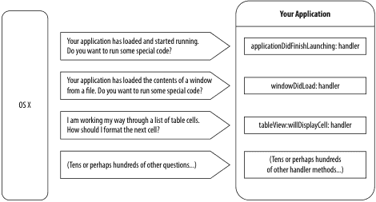

OS X 将每个应用程序视为一组互不相连的消息处理程序列表。它不会从应用程序的开头开始按顺序执行这些处理程序。相反，它会在需要时调用每个处理程序。处理程序在代码中出现的顺序并不重要。重要的是处理程序存在，而且将相关的处理程序放在一起有助于清晰度和代码的可维护性。但如果你把应用程序的所有处理程序方法以随机顺序放在一个长文件中，应用程序仍然可以运行。

如果你有 Flash 或 JavaScript 的经验，就会理解 `onLoad` 和 `onClick` 消息是如何异步发送和处理的。OS X 将这一原理推得更远，它会跟踪应用程序中使用的对象列表并相应地发送消息。这可能会为成百上千个可能的事件和情况生成数量极其庞大的可能消息。

有些消息可以被忽略，而另一些则是强制性的。如果你没有包含响应这些消息的方法，某些对象将无法正常工作；它们的一些特性将被禁用：它们会出现在屏幕上但什么也不做，或者可能根本不会出现。

### 隐式问题-响应与委托

问题-响应可以是*显式*的，也可以是*隐式*的。显式消息传递使消息与响应之间的联系在代码中显而易见。例如，按钮与其处理程序方法之间的链接通常是显式的。Cocoa 中的许多特性对消息何时触发做了隐式假设。OS X 请求响应的上下文可能并不可见。

例如，表格对象经常使用隐式问题-响应来设置表格项的外观并请求每个元素的数据。在更传统的操作系统中，你可能会创建自己的循环代码来遍历单元格列表，并使用函数调用来设置它们的属性。而在 Cocoa 中，循环是*隐式*的——它是一个你无法控制的 OS X 内部过程，由你看不到也无法修改的隐式代码管理。

如果你使用表视图，你的应用程序需要实现一个为每个单元格提供数据的方法。没有明显的代码触发该方法，但你可以看到它在运行——在你理解这一特性的工作原理之前，这看起来有些神秘。图 2.7 以图形方式说明了这一过程。

**图 2.7**

隐式问题-响应将问题来源隐藏在 OS X 的内部工作方式中。对于一次性应用程序事件来说，这很容易理解，但当对象关系更复杂或使用隐式迭代时，理解起来就更有挑战性。

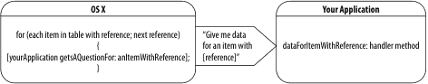

隐式问题通常通过*委托方法*实现——这些是可选的辅助方法，并不总是列在对象的主类参考中。如果某个对象的表现不符合你的预期，很可能是因为你尚未实现它的所有必需委托方法。第 5 章会更详细地解释委托，并在本书中提供更多示例。


> **警告**
>
> 当你设计自己的对象时，可以使用同样的问答设计模式来定义它们如何相互响应。自定义对象不允许忽略消息。如果你向对象发送无法识别的消息，应用程序会崩溃。在内部，OS X 通过一种“作弊”方式为 Cocoa 对象解决了这个问题——每一条可能的消息都包含一个什么都不做的存根处理程序方法。当你为 Cocoa 对象方法编写自己的处理程序时，你的代码会覆盖该存根。


## Cocoa 消息传递与通知

Cocoa 包含一个独立的消息传递系统，具有更丰富的特性。*通知（Notifications）* 就像内部电子邮件或聊天服务。你可以使用它们在应用之间或应用内的对象之间传递信息。对象可以注册接收通知，也可以通过通知中心发布通知。通知可以包含复杂的数据。它们是系统级特性，而 Objective-C 消息传递是语言级特性。这两种消息系统互不相关，使用方式也不同。

## Objective-C 语法

既然你已经了解了 Cocoa 中使用消息传递的一些方式，你可能会对消息代码感到好奇。Objective-C 使用方括号来表示消息。例如：

```objective-c
[anObject doSomething];
```

会触发 anObject 中的 `doSomething` 方法。

消息语法可以传递参数。

```objective-c
[anObject doSomethingWith: anInt];
```

会触发 `doSomethingWith:` 并向其传递一个 int 值。参数字段可以有描述性名称字符串。例如，在

```objective-c
[anObject doSomethingWith: anInt andABoolToo: YES];
```

中，`doSomethingWith:` 和 `andABoolToo:` 是消息语法的一部分。它们实际上是基于代码的工具提示，为了清晰和易读而存在，并且不影响执行。


> **警告**
>
> Objective-C 将 `aMethod` 和 `aMethod:`（它接受一个参数）视为完全不同的实体。在你自己的代码中，尽量保持方法名彼此区分明显是一种良好实践。有些 Cocoa 方法名并未做到这一点；你偶尔会看到相同的方法名后跟着不同的参数分组。Objective-C 能够理解其中的差异，但你可能会发现更难记住。

这种惯用法常用于 Cocoa 类中，以包含每个字段用途的提示。例如

```objective-c
[aWindow setHasShadow: YES];
```

会为 aWindow 启用投影效果。将 YES 替换为 NO 可关闭投影。这一特性有助于让 Cocoa 代码易于阅读。但有时会失控。Objective-C 偏冗长而非简洁，有些 Cocoa 方法名非常长。Cocoa 的 `NSWindow` 窗口对象内置的 `dragImage:` 方法的完整语法是

```objective-c
[aWindow dragImage: anImage
          at:aPoint
          offset:anOffset
          event:anEvent
          pasteboard:aPasteboard
          source:anObject
          slideBack:aBool];
```

这并不太容易记住——如果字段名更具描述性，解析该方法就会更难。遗憾的是，在 Objective-C 和 Cocoa 中，长方法名是不可避免的。


> **提示**
>
> 将很长的方法名拆分成多行以提高可读性是一种良好实践，可以让每个字段单独占一行。

幸运的是，你几乎不需要手动输入长方法名。Xcode 包含代码自动化功能，可以为你自动补全方法名。你还可以直接从文档中复制粘贴长方法名，并用代码中使用的属性名填充字段。

消息可以嵌套，一条消息的返回值可以用作另一条消息的输入。一个典型的例子是

```objective-c
MyClass *thisInstance = [[MyClass alloc] initWithData:
    initialData];
```

这种惯用法在 Cocoa 中随处可见。alloc 方法（allocate 的缩写）被发送给 MyClass 并返回一个对象实例。返回的对象立即在 initWithData: 方法中用初始数据进行初始化。指向已初始化内存区域的指针被传递给 thisInstance，并用作对象引用。

### 对象与星号

Objective-C 对象通过带星号定义的命名指针来引用。Objective-C 使用 C 语言的指针星号约定，所以你会在 Objective-C 代码中到处看到星号。创建新对象的一个标准惯用法是

```objective-c
NSClass *myObject = [...aCreationMessage...];
```

赋值的左侧指定 myObject 是指向 NSClass 实例的指针。你也可以按照通常的 C 风格声明指针并在稍后引用它们：

```objective-c
NSClass *myObject; //Declares myObject as a pointer to an instance of NSClass
[...otherCode...]
myObject = [...aCreationMessage...]; //Creates an instance of NSClass and assigns it to myObject
```

在你创建对象并将其赋值给指针之前，该指针一直为 NULL——但它仍然具有类型。

在消息中传递参数时，类型转换被广泛用作“代码提示”，提醒你应该在参数字段中传递哪种类型的对象。例如：

```objective-c
...thisIsAParameterField: (NSClass *)myObject... //Reminds both you and the compiler that myObject should be an instance of NSClass
```

### 使用 @ 字符实现 Objective-C “对象化”

Objective-C 使用 @ 字符作为对象化运算符，将后面的任何内容转换为对象。这最常用于文本字符串定义中。在其他语言中，你用引号界定字符串。在 Objective-C 中，你还必须加上 @ 字符才能将字符串转换为对象。例如：

```objective-c
NSLog(@"This is a string");
```

这会使用 Cocoa 的 NSLog 类打印 "This is a string"，该类将输出记录到控制台窗口。你也可以使用等效的 C 函数：

```c
fprintf(stderr, "This is a string");
```

这行代码产生完全相同的效果，并且在不进行对象化的传统 C 语言中是一个功能同义词。

在 Objective-C 中，无论字面字符串出现在哪里，都必须将其转换为对象。无论它们是文本字符串、文件和路径元素，还是用于其他目的，都是如此。如果你漏掉 @ 字符——在习惯输入它之前，你经常这样做——编译器并不总会报告错误。在某些情况下，忘记 @ 可能导致崩溃。

## 在 Cocoa 和 Objective-C 中管理数据

Objective-C 支持所有标准 C 数据类型，包括数组和自定义结构体。Cocoa 增加了自己的一组用于存储和管理数据的 Cocoa 对象。最重要的对象在表 2.5 中介绍，并在第 5 章中详细描述。

**表 2.5 Cocoa 数据对象**

| 数据对象 | 描述 |
|---|---|
| NSArray | 存储带编号的对象列表。支持枚举。NSArray 比简单的 C 类型数组复杂得多。 |
| NSDictionary | 在 Cocoa 中广泛使用。要想成功使用 Cocoa，你必须掌握 NSDictionary。存储键值对——一组命名值的配对——并能根据键自动查找返回其值。 |
| NSSet | 存储无序的对象集合。当你需要检查某个对象是否在一个集合中时，NSSet 比 NSArray 更快。 |

其他语言支持这一点。在 Objective-C 中，这行代码可以正确编译，但它只是复制指针值。赋值完成后，你会得到两个指向同一数据的指针，而不是一个。数据本身完全不受该操作影响。

对象是复杂的，可能在一个层次结构或树中包含其他对象，所以复制它们可能不是一个简单的过程。Cocoa 包含一组标准的 NSCopying 方法来支持复制，但不同的对象以不同级别的智能和精细度实现名为 copyWithZone: 的方法。当你创建自己的自定义对象时，必须包含实现标准复制方法的代码。

许多 Cocoa 对象包含使用另一个对象中的数据来创建和初始化对象的方法。第一次遇到时，这似乎有违直觉，因为它看起来是多余的。事实上，这通常是复制数据的最佳方式。例如，你可以通过以下方式将数组复制到新数组：

```objective-c
newArray = [NSArray arrayWithArray: oldArray];
```

如果需要复制对象，不要在文档中寻找直接的复制方法；如果存在“copy”方法，它们也常常伪装成初始化方法。

> **警告**
>
> 这段代码比看起来要复杂一些，因为它是 Cocoa 中类消息发送的一个示例。它不是向现有数组发送消息，而是向 NSArray 类发送消息，并将现有数组作为参数传递。有时你通过向对象发送消息来复制对象，有时通过向类发送消息来复制。Cocoa 在处理这一点上几乎没有一致性；你必须查看类文档来确定使用哪种方式。

### 比较数据对象

一个相关的错误是试图使用简单的 C 比较来比较对象：

```objective-c
if (anObject == anotherObject)...
```

在其他语言中，你可以这样做来比较字符串。在 Objective-C 中，这段代码可以编译并运行，但它不是比较数据，而是比较指针引用，而指针引用几乎总是不同的。

要比较数据，必须使用一个名为 isEqual: 的标准比较方法。

```objective-c
if ([anObject isEqual: anotherObject])...
```

isEqual: 有用于比较特定对象的类型化变体，包括 isEqualToString: 和 isEqualToArray:。这些变体经过优化，比通用比较方法更高效。当你创建自定义类时，如果想要比较实例，就需要实现自己的自定义 isEqual: 方法。

> **警告**
>
> 注意代码中的方括号。这些方括号不是可选的；isEqual: 是一条消息，而不是一个函数。你必须包含方括号，否则代码无法编译。


## 数据对象中的键值对

尽管在某些上下文中可以使用对象作为键——详情参见第12章——但键通常是作为标识符使用的 NSString。键必须唯一，因为无法区分相同的字符串。值可以是任意 Objective-C 对象。C 数据类型必须“对象化”后才能用作值，即包装在 NSValue 或 NSNumber 的实例中。第12章包含了相关示例代码。

键值对将键与值关联起来，使得可以使用键作为引用来读取或写入值。键值对在整个 Cocoa 中都有使用。它们是 Cocoa 的基本数据惯用法之一，并通过 forKey: 语句访问：

```
//Set aKeyName to aValue
[myObject setValue: aValue forKey: @"aKeyName"];

//Read the value of aKeyName and copy it to aReturn
aReturn = [myObject valueForKey: @"aKeyName"];
```

> **注意**
> 你可以从这个示例中看到文本字符串是如何通过 @ 字符“对象化”的。

所有 Objective-C 对象都实现了一种相关但不同的键值访问形式，它支持具名属性访问。大多数面向对象语言都支持直接属性访问，如图 2.8 所示。

**图 2.8**

Objective-C 中实现了简单的直接属性访问。但键值对还允许更复杂的访问方式。

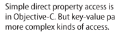

这在 Objective-C 中同样可用。但 Objective-C 还支持通过键值系统进行间接属性访问。如果 myObject 有一个名为 thisProperty 的属性，你可以用以下代码设置它

```
[myObject setValue:aValue forKey:@"thisProperty"];
```

图 2.9 直观地展示了键值访问的工作方式。键字符串必须与属性名匹配。只要存在匹配的名称，就可以使用此功能访问任意对象中的任意属性。此功能称为*键值编码*。它内置于 Objective-C 中，所有对象都支持它。

**图 2.9**

使用键进行间接属性访问时使用的是文本字符串。该文本字符串不必是字符串字面量；它也可以是可变字符串。

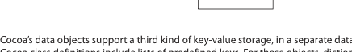

Cocoa 的数据对象支持第三种键值存储方式，位于单独的数据区域中。许多 Cocoa 类定义都包含预定义键的列表。对于这些对象，字典代替了单独的伪属性列表。你不是通过直接修改对象属性来触发响应，而是创建一个字典，使用类文档中定义的键常量列表填充键值对，然后通过消息将字典传递给对象。当对象收到字典时，它会解包字典，读取每个键的值，并相应地作出响应。图 2.10 说明了这一点。

**图 2.10**

许多 Cocoa 对象使用键值对字典来实现“伪属性”。有些对象还会以字典形式返回数据，你需要在该字典中查找特定的键，以便将它们作为“属性”读取。

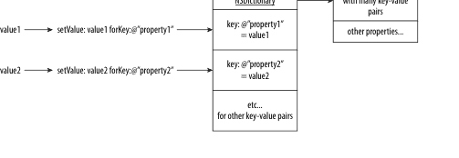

在代码中，这种方法如下所示：

```
[myDictionary setValue:value1 forKey:@"property1"];
[myDictionary setValue:value2 forKey:@"property2"];
...
[anObject doSomethingWithTheValuesIn: myDictionary];
```

“伪属性”字典在整个 Cocoa 中都有使用，最明显的是在媒体层中，它们用于控制动画、视频和声音功能，但也用于网络管理框架以及某些用户界面对象中。

Cocoa 使用这种间接方式来节省内存。当对象有数百个可能属性但一次只使用少数几个时，这是一种高效的解决方案。例如，一个多格式视频播放器对象可能需要支持多种不同的视频文件格式，每种格式都有不同的属性集。可以为每种可能的格式定义具有完整属性集的播放器对象，但这会造成浪费。它还会难以维护，并可能破坏向后兼容性。

更高效的做法是用单个属性字典定义播放器对象。当支持新格式时，可以更新字典中每种格式可能的键值对，而无需更改对象的接口。键值和字典系统为固定对象属性列表提供了一种灵活的替代方案，代价是需要一些额外的设置和清理工作。

## Objective-C 内存管理

垃圾回收——自动清理未使用对象的内存——在 Objective-C 中出现得相对较晚，遗留代码继续使用较旧的引用计数模型来管理内存。如果你为 Mac 开发，现在可以使用垃圾回收来为你清理内存。如果你为 iPhone 开发，则没有选择——垃圾回收不可用，引用计数是唯一的选择。

引用计数的理论很简单。每次引用一个对象时，它都会递增一个隐藏的计数器。当你不再需要该对象时，你用以下代码释放它

```
[anObject release];
```

当引用计数器达到零时，对象会从内存中移除。一个明显且容易犯的错误是认为使用 release 会立即释放对象，但事实上并非如此——它告诉 Cocoa 你的代码不再引用该对象，并且该对象可以被释放。

理论上，你应始终能够平衡引用和 release 调用。在实践中，有时如果不执著地追踪所有可能的执行路径，就无法做到这一点。在某些应用中，你可能根本无法平衡它们，因为 Cocoa 的引用机制可能并不像你预期的那样工作。偶尔它也不会按应有的方式工作，从而使内存错误不可避免。

通常，在应用程序启动时创建对象，并在其终止时释放对象会更简单。官方认为这是不良实践——理想情况下，资源应在需要时创建或加载，并在不使用时释放——但有时这可以是一种使内存管理变得可行的实用方法。

出于类似原因，避免在循环内创建对象是一种良好实践。无论内存是手动管理还是自动管理，这一点都适用。在循环内更新或重用对象，比反复创建和释放对象更高效。


> **警告**
> 在循环内反复创建对象且从不释放它们，是浪费内存、使应用程序慢如蜗牛并产生随机崩溃的好办法。

无论你是选择使用引用计数，还是被迫使用它，都要预料到会花很多小时调试内存泄漏并修复随机崩溃。Windows、Java、Flash 和 Unix 都包含垃圾回收。必须习惯在没有自动化的情况下管理内存，这可能具有挑战性。在 iPhone 上，这是 Objective-C 最薄弱、最不吸引人的特性之一。幸运的是，Xcode 开发工具包含一组应用程序，可简化测试，并使监视和跟踪内存泄漏变得更容易。

## 对象与条件语句

你不能在条件块内创建对象，并在其外部引用它们。例如，在

```
if (condition) {
    createAnObject;
    doOtherStuff...
}
doStuffWithTheNewObject;
```

编译器无法确定该对象在条件块外是否还存在。它假定不存在，并报告错误。

## Cocoa 文件管理

Cocoa 包含一个文件选择器对象，它加载并显示标准的 OS X 文件列表。在底层，文件管理并不那么传统。文件不是被保存，而是被归档。归档自动包含一个转换阶段，将内存中的对象或集合转换为磁盘上的字节。加载文件会调用解档器来逆转该过程。

这看起来可能很间接，但这是 Cocoa 强调抽象的一个例子。当你将图像保存到磁盘时，总是需要先将其转换为标准图形文件格式，然后再写出。Cocoa 使这变得容易；例如，它包含一个 JPEG 归档器。你也可以为自定义文件格式创建自己的归档和解档代码。

## Cocoa 归档

Cocoa 的数据对象包含内置归档功能。例如，你可以用以下代码将字典写入磁盘

```
[aDictionary writeToFile: aFilePathString atomically: YES];
```

这会自动归档该字典，并将其写入文件，其格式可以通过对应的代码读回

```
thatOldDictionary =
[NSDictionary dictionaryWithContentsOfFile: aFilePathString];
```


> **注意**
> atomically 参数选择两阶段写入：先尝试写入完整文件，如果写入成功，再将其重命名为指定的文件名。如果写入失败，则删除文件片段。这保证磁盘上的文件始终是完整的。


将文件写入方法包含在数据对象中并不常见。更常见的做法是编写独立的文件写入代码，将对象及其内容作为参数。Cocoa 也支持这种更传统的选项，第 5 章会详细讨论。但请记住，Cocoa 数据对象可以直接将自身内容读写到磁盘。

## 使用 NSCoder

一个名为 NSCoder 的特殊对象负责处理更复杂的归档和解档。在许多应用中，保存文件意味着保存一组对象。你不能为此使用直接归档，因为你需要将每个对象写入单独的文件。

借助 NSCoder，你可以在自定义对象中创建自己的归档方法，并用一系列编码方法填充它。这会把你的一组对象连接在一起，创建一个单一的打包归档。可选但很有用的一点是，你可以为每个字段标记一个键，便于之后访问。每个字段中被归档的对象都作为值处理。要反转这一过程，实现一个对应的解码方法即可。关于 NSCoder 的实际示例，请参阅第 12 章。

## 文件路径和 URL

Cocoa 尽可能不区分本地数据和远程数据。你可以像从磁盘加载文件一样轻松地从网站下载文件。在 Cocoa 中，文本文件路径和 URL 密切相关。路径可以转换为 URL 对象——而且有时路径必须转换为 URL，因为某些对象只能通过 URL 访问本地数据。

尽管 OS X 文件系统基于标准的 UNIX 层级结构，但在实践中，系统和用户目录通常需要专门的访问代码。这在 iPhone 上更为明显，因为 iPhone 应用只能访问非常有限且风格化的 UNIX 层级结构，而且出于安全原因，数据会被沙盒隔离。

## 探索 Cocoa 的其他特性

Cocoa 还包含一些开发者必须熟悉的其他独特功能。有些功能在开发者文档中有所介绍，但文档并不总是解释这些功能的设计用途。

### Cocoa 网络支持

Apple 的网络系统称为 Bonjour，Cocoa 包含可以在 Bonjour 网络上查找数据的对象。具体来说，Cocoa 可以找到一系列网络服务。遗憾的是，大多数数据传输必须在操作系统的较低层级处理。Web 支持则更加全面。Cocoa 提供了对在线文件的简单直接访问，并且还支持在线安全。对于不那么以 Web 为中心的在线数据访问，组装一个访问在线 API 的应用程序相当容易——但并非简单到微不足道。第 10 章有更多细节。

### 窗口和视图

OS X 支持窗口化界面，支持各种界面对象，包括按钮、滑块、文本字段、文件列表、偏好设置面板等。在 Cocoa 中，窗口包裹着视图。视图是窗口中的一个活动区域，用于绘制图形并响应用户操作。Cocoa 包含一个管理视图的 NSView 对象。在实践中，你可以通过用自己的代码自定义 NSView 的实例来创建应用界面。相关类可以显示表格、表单、文本字段、单元格组，以及其他标准界面功能，包括滑块、数字框和按钮等较小对象。

理论上，用户能看到并能与之交互的任何项目都称为视图。这在 iPhone 上最为明显，iPhone 包含各种复杂的预定义视图类型，包括显示网页的 Web 视图、以表格形式显示项目列表的表格视图等等。

一个令人困惑的地方是视图中各个项目与整个窗口外观之间的关系。在设计界面时，整个界面就是窗口的视图。但较小的对象也是视图。为避免混淆，可以将界面视为视图，将较小的对象视为子视图或视图对象。按钮和滑块等非常小的单一功能视图通常称为控件，虽然偶尔也会被称为视图，这正好让人困惑。

### Interface Builder 中的视图和对象

Interface Builder（IB）是 Xcode 的视图设计工具。设计视图看似是一个简单的可视化过程，但其中隐藏着一个微妙之处。新开发者不容易立即明白的是，资源文件——也就是 nib 文件——可以被自动加载。默认情况下，应用运行时至少会加载一个 nib 文件。如果你愿意，可以覆盖加载过程并手动控制它。如果你不这样做，它会自动发生——无需任何代码。

可以设置 nib 文件，让它们加载其他 nib 文件。事实上，你可以使用 Interface Builder 跨多个文件定义一组对象、视图和数据结构，整个集合将被自动加载。如果你把 IB 仅仅看作一个界面编辑器，就会错过这一基本特性。你还会发现理解应用程序的组织方式变得困难。更多信息请参阅第 8 章。

### 模型、视图、控制器

Apple 的开发者文档强调模型-视图-控制器（MVC）设计模式，如图 2.11 所示。MVC 意味着数据与视图保持隔离，控制器对象在双向传递消息。视图从不直接与数据对象通信。

这看起来像是不必要的额外复杂性，但它提高了效率。就像 Web 浏览器不需要下载整个互联网就能显示一个页面一样，MVC 意味着应用界面永远只显示其数据的一个子集。Cocoa 应用程序被设计为使用 MVC，并包含针对各种数据类型的预定义控制器对象。

图 2.12 展示了一个可能的示例。模型是一个包含数千条条目的表格。让一个应用程序慢到不可用的一个好方法是，将每个单元格的数据复制到屏幕上一个列表中的可编辑单元格中，同时在内存中保留所有可见单元格。

**图 2.11** 模型-视图-控制器——MVC——是 OS X 和 Cocoa 的基本设计模式之一，并内置于 Cocoa 的对象层级结构中。

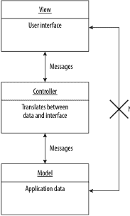

**图 2.12** 将 MVC 应用于表格显示，可以根据需要在界面之间选择性地传递数据。与直接在表格数据和可滚动的可见单元格列表之间建立连接相比，这是一种更复杂但效率高得多的解决方案。

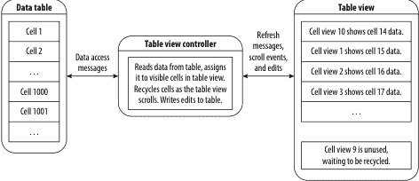

MVC 允许更高效的实现。单元格仍然以可滚动列表的形式出现在屏幕上，但它们与数据源没有直接连接。当用户在列表中上下滚动时，控制器会从顶部或底部移除单元格，用数据重新填充它们，然后重新插入到底部或顶部。应用程序不必显示数千个单元格，而是可以用少量单元格创建相同的滚动效果。控制器对象会自动更新单元格，这一过程透明且不可见，代价是额外的一些设置和清理工作。

控制器是粘合代码，但它们是智能的粘合代码。它们简化了两个方向的访问。Cocoa 和 Cocoa Touch 都包含预编写的控制器类，以简化界面设计并消除不必要的代码。你也可以为自己的应用程序创建自定义控制器。

### 包（Bundle）和属性列表（plist）

包是应用程序包含的文件列表。一个包通常包含 .app 可执行文件、至少两个图标文件，以及可选的数据、图形和支持文件。应用程序还至少包含一个 plist——一个以 XML 文件形式存储的属性列表，它向 OS X 指示关键应用资源，并包含必要的应用偏好设置。Cocoa 包含可以从包加载数据以及读写 plist 的对象类。


**提示**

在 OS X 中，应用程序的 .app 文件实际上是一个包含应用程序包的文件夹。要查看包的内容，请在 Finder 中右键单击 .app 文件并选择“显示包内容”。你会看到一个 Contents 文件夹，打开它即可查看包中的文件和文件夹。

## 与其他平台比较 Cocoa

每个平台和环境都有其独特的性质。Objective-C 和 Cocoa 也不例外。Cocoa 最大的优势是其精妙性。对象库丰富而强大，通常只需几行代码就能实现功能。学习曲线不容小觑，但最初的挫败感只是暂时的。随着经验积累，Cocoa 会开始让人感到高效和愉悦。

### 设置与清理

如果你习惯于像 Flash 这样更简单的语言，请准备好花一些时间处理新的编码开销。如果你在 Flash 中绘制图形，Flash 会自动为你创建一个舞台，你可以立即使用 ActionScript 的绘图函数在上面绘制。这让 Flash 在创造力上很有回报，因为你可以专注于结果，而不是开销代码。

在 Cocoa 中，你必须自己创建相当于舞台的东西。根据应用程序的不同，这可能需要使用大量类和框架中的代码，经过许多额外步骤。最初，这会让人觉得 Cocoa 很难且不意外。新手常常会觉得自己正陷入层层下降的类、框架、方法和常量组成的兔子洞，直到完成设置代码。声音、动画和数据管理也有类似开销。因为没有捷径，你有时需要学习大量关于 Cocoa 和 OS X 的知识才能实现一个相对简单的功能，尤其是在第一次遇到设置时。


Cocoa 方法有优势：它灵活且开放；能够自动处理到各种设备的输出，从打印机到屏幕再到文件；并且能用很少的代码创建高级效果。从积极的角度看，设置代码通常可以像样板一样复用。一旦你有了相当于 Flash 舞台的东西，就可以在其他应用程序中稍作修改地重用这些设置代码。即便如此，在开始之前也要预留额外的设置和清理工作；可能比你期望的更多。

## 抽象与面向对象

Cocoa 高度抽象且面向对象。原因和结果之间的关系是松散的，并且可以定制。例如，一个简单的操作系统可能会包含一个循环，将键盘事件捕获到缓冲区中，以及一个能读取和处理事件的最小框架。你的应用程序可能会从缓冲区读取事件并处理它们。

Cocoa 采用了一种远不那么直接的方法。键盘事件被抽象为消息，你的应用程序必须为部分或全部可能的消息包含处理程序。例如，Cocoa 的用户界面管理器对象 NSResponder 会在用户在 Mac 键盘上打字时发送各种消息，例如：

```
cancelOperation:
capitalizeWord:
deleteBackward:
willPresentError:
yank:
```

这个编辑控件消息列表包含超过 170 项。NSResponder 可以发送的完整消息列表有数百项，实现了鼠标控制、触控板控制、手势感应、数位板控制以及其他标准功能。

通过抽象，Cocoa 为你实现了大量事件处理和一些应用程序设计。虽然这些消息名称暗示文本编辑，但你也可以在不同的应用程序中使用它们，比如数学公式编辑器。你可以选择你的应用程序响应哪些消息。如果你没有为某条消息包含处理程序方法，该消息和用户操作就会被忽略；如果你确实包含了处理程序，你可以选择它做什么以及如何工作。Cocoa 不会强迫你实现与方法名称匹配的功能，尽管如果你这样做，对用户来说更不容易混淆。

抽象增加了灵活性，而且往往是以有用的方式。它也增加了复杂性。简单的操作系统用三个数值 RGB 分量设置颜色，而 Cocoa 则将颜色封装在 NSColor 对象中。没有直接设置颜色的选项。你必须创建并初始化一个 NSColor 对象，将其属性设置为所需的分量，然后使用消息传递让其他对象读取这些属性——也许是为了绘制一条线或设置一个点。示例代码可能如下所示：

```
NSColor *myTranslucentBlack = [NSColor initWithCalibratedRed: 0
    green: 0 blue: 0 alpha: 0.5];
[receiverObject drawSomethingWithColor: myTranslucentBlack];
```

这段代码调用 `NSColor` 类来返回一个新的 `NSColor` 对象，其颜色值为半透明黑色。尽管它并非不可能复杂，但相较于更简单语言中设想的

```
line (x1, y1) to (x2, y2) with 0,0,0,0.5;
```

它更为复杂。如果你手动管理内存，必须记住在不再需要时释放颜色对象。如果你使用垃圾回收管理内存，你仍然需要小心避免不必要或低效地创建对象。尤其要注意循环——在循环内创建对象总是低效的，应尽可能避免。

抽象是 OS X 中造成初始设置和清理挑战的特性之一。如果 Cocoa 能为常见需求提供简化的类和对象，那会很有用。Cocoa 有时确实如此，但通常不会。

通常，Cocoa 试图将尽可能多的通用性封装到对象中。之前分配的 `NSColor` 对象内置了对颜色校准的支持。这个特性是免费的——它内置于 `NSColor` 中，调用 `initWithCalibrated:` 方法会自动调用它。在返回颜色对象之前，`NSColor` 会参考当前的校准表并相应调整颜色常量。其他 Cocoa 对象也同样丰富而细致，它们会自动实现复杂的特性。这通常是好事，也很有用。但有时你的应用程序需求与 Cocoa 的特性不一致，这时你需要绕过它们，或者手动重新实现它们。

### 从 Windows 迁移到 Cocoa 和 OS X

Windows 开发一直以来都定位于两个层面。Visual Basic 和相关的 Visual Basic for Applications 提供了入门级的访问途径。对于更高级的开发人员，Microsoft 已将重点转向 C# 语言和 .NET 框架集合。

Visual Basic 看起来可能与 Objective-C 非常不同，但也有一些熟悉的参考点。Visual Basic 应用程序是事件驱动的，因此在整体轮廓上与 Cocoa 环境相似。但 Objective-C 和 Cocoa 更精确、要求更高、更复杂，拥有多得多的特性和对象。从 Visual Basic 迁移时的一个好策略是从小处着手，保持简单。不要立即尝试构建整个应用程序，而是先创建非常简单的应用程序骨架。然后逐步添加特性来充实它们——菜单支持、方法、控件、更复杂的视图——从界面开始，逐步推进到媒体和动画支持、数据管理，最后是网络和硬件。你会在本书其余部分看到这个策略的运用。

对于更有经验的开发人员，C# 与 Objective-C 有着明显的相似之处。但语法和概念上存在明显差异。例如：

```objc
aClass.aMethodWithAParameter(20);    //C#
[aClass aMethodWithAParameter: 20];   //Objective-C
```

在 Objective-C 中，类原型和实现被拆分到独立的头文件和实现文件中。这是 Objective-C 的传统而非语言特性，但大多数开发人员都遵循这一惯例。此外，Objective-C 没有 C# 的泛型；类可以接受无类型的概念和惯用法。在 OS X 上，Java 的 SWT（Standard Widget Toolkit，标准部件工具包）包含与 Cocoa 某些特性的连接，可以用作过渡性的学习辅助工具。

Java 天生就是跨平台的，OS X 将 Java 作为应用程序框架包含在内，因此开发人员无需使用 Objective-C 或 Cocoa 就能创建 Mac 应用程序，例如图 2.14 中所示的 jEdit 代码编辑器。但 Objective-C 代码要快得多、高效得多，而且 Cocoa 和 OS X 层实现了更广泛的特性。Java 对于简单应用来说仍然是不错的选择，但更复杂的项目需要 Objective-C 和 Cocoa 的完整性能。

**图 2.14**

jEdit 展示了 Java 在 OS X 上的灵活性和局限性。它实现了一个非常实用的文本和代码编辑器，但缺乏 Xcode 所内置的与 UNIX 和 OS X 的深层链接。

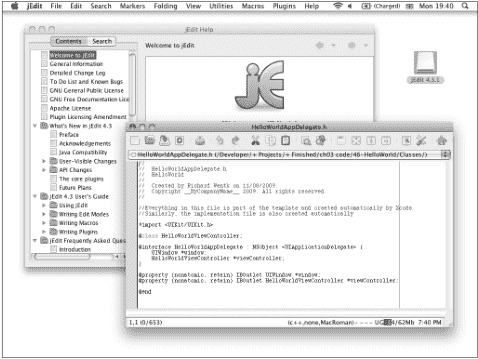

### 从 C 或汇编语言迁移

如果你习惯了传统的过程式编程，你会发现 Cocoa 更具挑战性。OS X 中具有传统 C 接口的框架会让你感到很自在。但 Cocoa 和 Objective-C 可能更难理解，因为它们在如何处理问题和构建解决方案方面做出了不同的假设。

虽然从代码中可能看不出来，但 Cocoa 的哲学非常视觉化。它也是事件驱动的。你可能会发现，通过图形化地勾勒对象之间的联系，可以加深你对 Cocoa 开发的理解。这有助于打破旧的过程式习惯，使 Cocoa 应用程序的整体结构和事件流更容易理解。后续章节中会有示例。

### 总结

本章涵盖了大量内容。不要试图一下子全部吸收。本章介绍了后续章节将更详细探讨的信息，并附带了实际示例。本章首先简要介绍了 Aqua 设计指南，然后探讨了 Cocoa 与 OS X 其他部分的关系，并详细考察了 OS X 的框架和层次。

接着，它考察了 Objective-C 的一些基本特性，以及在整个 Cocoa 和 OS X 中使用的标准数据类型和设计惯用法。最后，它审视了 OS X 和 Cocoa 与其他流行开发平台之间的一些异同。


# 介绍 Cocoa 与 OS X 文档

在上一章简要浏览了框架和层次之后，OS X 和 Cocoa 文档应该比直接一头扎进去更容易理解。Apple 提供了 Cocoa 文档，如图3.1所示，可通过两个地方获取。开发者可以下载并安装免费的 Xcode SDK，如第4章所述。除了一套设计工具之外，SDK 还包含完整文档，可在基于 Safari 的简易查看器中查看。非开发者和准开发者可以在线查看 Cocoa 文档。目前的 URL 是 http://developer.apple.com/mac/library/navigation。

### 注意

Apple 偶尔会重新调整其开发者网站，因此文档 URL 并不保证始终准确。如果 URL 发生变化，预计会重定向到新位置。如果没有重定向，你可以通过搜索“Mac OS X Reference Library”找到位置。该库一直可在线免费获取，未来也不太可能改变。但 Apple 正在从基于磁盘的文档转向在线访问，因此未来的 Xcode 版本可能不会完整捆绑该文档。

高效使用 Apple 文档是一项关键技能，但并不容易掌握。文档本身是历史与新功能的略显混乱的混合体，详细程度也参差不齐。浏览器也可能难以使用。

### 提示

你可以使用一款名为 AppKiDo 的免费第三方辅助应用程序解决浏览器问题，该程序可从 http://homepage.mac.com/aglee/downloads/appkido.html 获取，如图3.2所示。强烈推荐 AppKiDo。它改变并简化了浏览体验，确实能为你节省数小时的浏览时间。它还会以有用的方式对相关的 Cocoa 类进行分组和排序，使你更容易理解 Cocoa 的组织方式。

## 本章内容

- 理解资源类型
- 使用文档

图3.1

开发者文档的正式名称是 Mac OS X Reference Library。iPhone 开发者还有一个单独的 iPhone OS Reference Library。

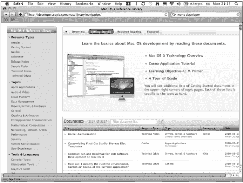

**图3.2**

AppKiDo 读取文档内容，并以更易访问的形式呈现，类参考浏览更快、更高效。遗憾的是，它只包含 Cocoa 层，不包含 C 函数层。

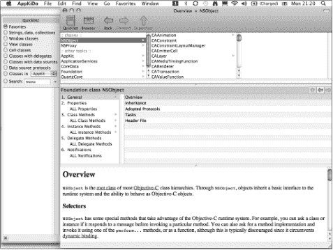

## 文档入门

最重要的窗口位于右上角。在 Xcode 3.2 中，它显示四个不同的窗格：概览、入门、必读和精选，如图3.3所示。窗口和功能的布局会随更新而变化，但你通常能找到可辨识的相似元素。

图3.3

必读部分是最佳起点——尤其是《Cocoa 基础》以及 Xcode 和 Interface Builder 的入门介绍。

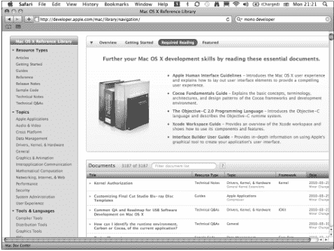

尽管“入门”部分默认可见，但“必读”部分更适合作为起点。Xcode 和 Interface Builder 的指南是必读内容，而《Cocoa 基础指南》是一个很好的概览，尽管其中一些内容抽象层次较高，初读时可能难以理解。Objective-C 2.0 参考全面但简略，最好作为参考而非入门指南使用。

《Apple 人机界面指南》是理论与实践的结合。最有用的部分是第三部分：Aqua 界面。其中包含关于界面元素的非常详细的信息，包括鼠标光标、功能键、快捷键选择以及视觉设计标准。你应该立即浏览这一部分，并在开始设计应用程序时再次参考它。查看精选的 Apple 和第三方应用程序的界面也会对你有所帮助。并非所有指南都显而易见。即使你是经验丰富的 Mac 用户，也会发现一些你之前可能没有意识到的设计建议和元素。

“精选”部分通常包含两三篇精选的新文章，通常关于近期的操作系统更新。内容面向经验丰富的开发者，可能会提到任意层中的框架。刚开始时最好忽略这些文章；当你获得更多经验后，它们可能会更有用。


### 提示

iPhone 文档遵循类似的格式。它的内容较少，因为 Cocoa Touch 比 Cocoa 更小、更简单。但两个平台的概要设计相似，你可以采用相同的策略来高效使用文档。

## 理解资源类型

文档的其余部分按大类资源类型划分。尽管你会把大部分时间花在查看框架参考页上，但值得花些时间探索其他资源，以便开始熟悉有用的资源，同时留意不太有用的资源。

### 文章

文章包含杂七杂八的随笔和专题，例如图3.4所示的《在 Cocoa 中绑定偏好设置》简介。许多文章高度专业化，除非你在寻找关于某个非常具体主题的信息，否则几乎没有实际意义；简而言之，你可以忽略它们。对于 Cocoa 新手来说，最有用的文章如下：

- 在 Cocoa 中绑定偏好设置
- 使用 Subversion 和 Xcode 获得控制
- 在 Mac OS X 上安装应用程序：开发者指南
- 最大化 Mac OS X 应用程序性能
- 使用 Shark 4 优化——三篇文章系列

图3.5

《音频与视频入门》指南是其他入门文章的典型代表。它是一份链接和示例列表，仅以简短引言填充，并非真正的概览或入门导引。

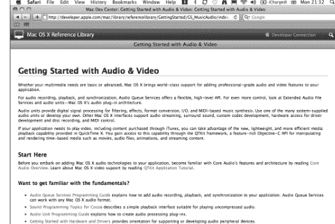

### 指南

指南包含关于各种 OS X 功能的编码接口的信息。少数用户界面和风格指南也出现在本节。指南质量参差不齐。有些很详细，并包含可复制粘贴到应用程序中的源代码片段。另一些则只是非常简单的单段式复杂功能概要。只有少数在起步阶段立即有用。其余则详述极少使用的极其专业化功能的 API。

必备指南包括《字符串编程指南》《错误处理编程指南》和《撤销管理器架构指南》，如图3.6所示。你不需要立即吸收这些指南的内容，但应该知道它们的存在，以便在处理特定 Cocoa 功能时将其用作参考资料。

图3.6

指南通常遵循类似的格式——简短引言，随后是一组更详细的迷你文章。有时迷你文章包含可复制粘贴到应用程序中的示例代码。

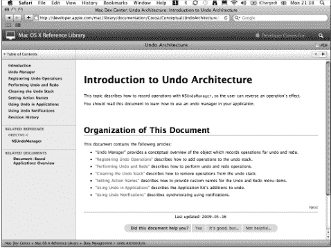

### 参考

参考部分占据文档的大部分。一旦你吸收了入门指南，大部分时间都会花在查看这些参考列表上。参考文章有两种类型。少数提供关于广泛主题的通用参考资料，例如详细的编译器设置。大多数是代码参考，包含属性/变量和代码接口的正式列表。这一组包括 Objective-C 对象参考，以及 OS X 所有层的 C 函数和结构体参考。代码参考按前面介绍的层次分组。类参考遵循固定格式，图3.7展示了其中一部分。少数类参考包含额外的“类概览”摘要。目录可以包含以下全部或部分部分：

- 概述部分是一篇简短的文字文章，概述类的功能以及应如何使用它。
- 任务部分提供按功能分组的纯方法列表。每个方法都是一个链接——你可以点击它以显示更多信息。


- 可选的“属性”部分列出了类的属性，并简要概述其特征。并非所有类都包含“属性”部分。
- 可选的“类方法”部分更详细地列出了类方法，并概述其特性和功能。
- “实例方法”部分使用与“类方法”相同的格式列出实例方法。
- 最后还有一个可选部分，列出其他信息，可能包括常量、更多可选方法，或有关该类生成的通知消息的信息。

**图 3.7**

类参考文档通常很长。浏览它们最简单的方式是使用内部链接向前跳转，并使用左上角的目录列表（而不是后退按钮）返回某个部分。

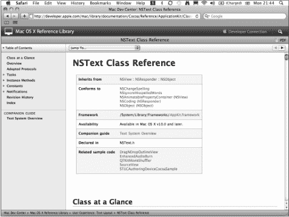

> **警告**
>
> 类参考文档中不太友好的一个特性是链接。当你点击链接时，它会带你到同一页面上的某个位置。你几乎肯定会在阅读完后点击浏览器的“后退”按钮——而它会带你回到之前浏览的页面，而不是原始位置。这个问题没有解决办法，你只能不断提醒自己不要这么做。

## 发布说明

发布说明是另一堆短文章的杂集。图 3.8 显示了一个典型示例。这些说明列出了 OS X 每次发布中更新的属性、常量以及新增的类。包含这些信息是为了完整性，而非作为参考。极少数情况下，你可能会发现代码无法运行，因为这里列出的信息没有包含在主文档中。更常见的是，主类参考文档在变更后立即更新，而发布说明则提供了一个偶尔有价值的变更日志。

**图 3.8**

可能有些开发人员仍然需要查看 2003 年原始的 Java 1.3.1 发布说明，但这种可能性不大。

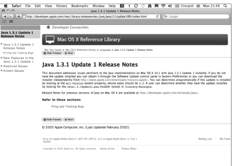

## 示例代码

图 3.9 所示的“示例代码”是文档中最有用的功能之一，其中包含一系列带有完整源代码和项目设置的迷你应用程序，你可以将其用作工作示例。示例代码与 Xcode SDK 紧密关联。你可以将示例保存到项目文件夹，在 Xcode 中打开、编译，并只需两三次鼠标单击即可运行。

> **提示**
>
> “示例代码”资源并不是所有可用示例代码的完整且最终的列表。你可以在线找到更多代码示例；Apple 的在线示例代码库并不总是与文档中的库一致。一些框架参考文档列出了本节中未出现的更多示例代码。

**图 3.9**

在 Xcode 自带的文档版本中，“下载示例代码”链接被替换为一个按钮，该按钮会自动将项目加载到 Xcode。在线版本中，你必须先下载项目文件并手动解压缩，然后才能打开。

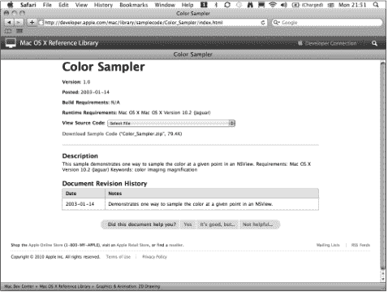

## 技术说明

图 3.10 所示的“技术说明”部分是另一堆短文章和微型功能的杂集。其中许多条目只有历史意义，没有实际内容。你可以在这里找到提及 Mac OS 6、7、8 和 9 的文章，以及早已被取代的特性和代码接口，例如图 3.10 中写于 1996 年的 QuickTime for Windows 文章。少数文章（如“New HID Manager APIs”功能）可能对当前开发人员有用。不幸的是，有些文章过于过时，其内容具有误导性。浏览此部分对某些内容可能有用，但大部分内容可以忽略——除非你是 IT 历史学家。

**图 3.12**

主题细分是查看与某个主题相关的所有内容的最佳方式，尽管这里出现的许多项目是多余的或不相关的。

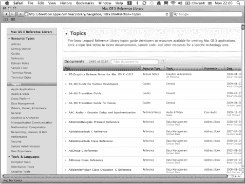

## 阅读有关工具与语言的内容

尽管名称如此，“工具与语言”部分并不包含关于工具和语言的权威参考信息。相反，它补充了“必读”部分中的指南，增加了额外细节，并介绍了非核心功能。例如，你会找到一份关于 Quartz Composer 的指南，这是 Apple 的视觉动画和视频处理工具。Quartz Composer 是 Xcode 附带的一个有用且有趣的功能，但你不一定需要使用它或了解它才能创建可运行的应用程序。

值得浏览这一部分，因为它包含一些有用的内容，包括有关使用 Xcode 隐藏在 GUI（图形用户界面）之后的功能的信息。如果你愿意，可以使用这些内容来自定义和优化 Xcode。最初，你可以将这部分视为额外材料的集合，而不是必需的参考。

## 使用文档

刚开始使用时，文档的信噪比很低，可能会用无关内容分散你的注意力。随着经验增长，这个问题会逐渐减轻，因为你将吸收“入门”指南中的信息，或在其他地方找到等效的帮助。你也会开始记住经常使用的框架和对象，并记住它们的一些特性。有条理地使用文档可以提高工作效率。不建议随机浏览。更专注的方法将帮助你更可靠地找到有用的细节。

### 对文档进行排序

排序是使用文档的一项关键技能。列表窗口有五个标题：“标题”、“资源类型”、“主题”、“框架”和“日期”。单击每个标题会按字母顺序对窗口内容进行排序，但“日期”标题除外，它按时间顺序排序。

> **提示**
>
> 在查看框架参考文档时，“框架”标题不会出现，因为它是多余的。

单击“标题”可能会显示一堆不相关的功能。要获得更有用的摘要，请尝试单击“主题”、“资源类型”或“框架”。在查看杂集部分（“技术说明”、“技术问答”、“发布说明”和“文章”）时，按“日期”排序也很有用，可以排除无关的旧内容。

> **提示**
>
> 使用任何资源之前最好检查其日期，因为有些文档已经过时且不正确。虽然没有正式的保质期，但根据经验法则，任何超过五年的项目都可能不准确。

当单击“主题”对内容进行排序时，标题包含在主“主题”列表中不可见的额外子组。例如，包罗万象的“通用”主题包含“内存管理”子部分。你可以使用此功能查找可能会错过的项目。

排序算法按子来源（主题或资源类型）对项目分组，然后在每组内按字母顺序排序。标题列表可能看起来混乱，但实际上它是有组织的，因此相关项目会相邻显示。一个令人困惑的小问题是，在“主题”排序中，“通用”项目出现在列表顶部。其余项目按通常方式按字母顺序排序。查找框架中类的有用搜索顺序是

```text
Frameworks List ⇨ <named framework> ⇨ Resource Type ⇨
           Reference
```

### 处理源代码

源代码至少可以与参考文档一样有用。有时，即使你并不完全理解代码的工作原理，也可以通过复制代码来解决问题或实现功能。这是一种毫不掩饰的取巧，你应该力求理解所使用的代码。但即使你不理解，这也是一种可以用来积累经验的方法。图 3.13 展示了我建议的策略。

Apple 的代码示例往往相当密集。你不太可能直接使用它们，但剔除不需要的代码可能是学习应用程序设计的好方法。别忘了，应用程序的架构至少有一部分是由其 nib 文件定义的，所以你也需要探索这些文件。

## 总结

本章向你介绍了开发人员文档。它解释了不同文档资源之间的差异，并提供了查找最有用的内容的实用提示。它还包含一些关于整体使用文档以及如何最好地利用其他在线资源和 Apple 及其他开发人员创建的源代码的建议。


图 3.13

我建议的文档流程图侧重于查找有用的代码。入门时，示例代码和类参考是最有用的资源。

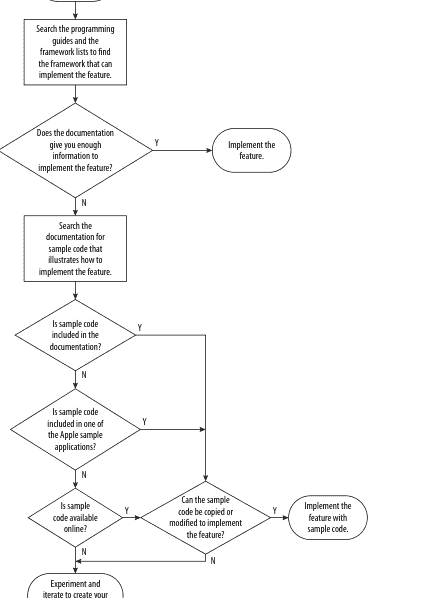

# 4 Xcode 入门

理论上，Objective-C 与 C++、Java、Ruby 和 Python 一样平台无关。实践中并非如此。大多数开发者编写的代码结合了 Objective-C 和 Cocoa 的特性，将它们作为一种非正式混合语言使用，几乎只在 Apple 硬件上运行。只有一种工具包支持这种方式——Apple 的 Xcode SDK（软件开发工具包）。

Xcode 包含其他环境中没有的专用类和对象管理功能。开发者依靠这些功能向应用程序添加新类，并定义应用程序运行时加载的对象列表。虽然可以用文本编辑器和命令行编译器创建可工作的 Objective-C 代码，但这并不是高效的工作方式。它没有利用 Xcode 中的辅助功能，而这些功能使处理 Cocoa 对象更加容易。

接下来几章将通过 Xcode 和 Interface Builder 中创建的可运行示例代码，从理论角度介绍 Cocoa 对象创建和类管理。它们还概述一些典型设计流程，并说明如何向应用程序添加特定功能，将开发者文档中的细节转化为可运行代码。

## 为 Xcode 做准备

直到 2010 年 4 月发布 iPhone OS 4 之前，Apple 提供两个版本的 Xcode。Mac 开发者可以使用仅限 OS X 的 Xcode 版本，而 iPhone 开发者获得的是组合版本，包含适用于 OS X 和 iPhone OS 项目的模板与文档。

Apple 不再支持仅限 OS X 的版本，所有开发者都必须使用组合 SDK。这鼓励开发者探索两个平台，但组合 SDK 的下载量大得多——最高可达 5GB，而仅限 OS X 的 SDK 为 800MB。下载完成后，在最旧、最慢的 Intel Mac 上安装组合 SDK 可能需要三个小时。在较新的硬件上，一小时更为常见。

## 本章内容

- 为 Xcode 做准备
- 安装 Xcode
- 创建新的 OS X 项目
- 探索 Xcode 的窗口

## Xcode 的替代方案

如果你没有 Mac，可以使用 GNUstep 试验 Objective-C，并开发非常简单的 Cocoa 应用程序。这对 Windows 和 Linux 用户是一个可行选项，但遗憾的是，GNUstep 是 Xcode 的糟糕替代品。它缺少在 Mac 上支持 Cocoa 的函数库，不包含 Cocoa 较新的任何类和功能，也没有实现 Aqua 界面或大多数 OS X 层与框架。没有 Aqua，GNUstep 应用程序具有 20 世纪 90 年代初 NeXTStep 应用程序的外观和感觉，并且不支持某些较新的核心 Cocoa 功能。

Xcode 包含复杂的集成编辑器，而 GNUstep 使用免费的 jEdit 编辑器。两个环境都依赖某个版本的 GCC（GNU 编译器集合）编译器，但两个版本之间存在细微差异。代码大致兼容，但并非所有 Objective-C 特性都以相同方式实现。

与 Xcode 相比，GNUstep 是一个非常有限的环境。本章的一些示例与 GNUstep 兼容，但后续章节的大多数代码不兼容。如果你没有其他选择，或者想尝试一些非常简单的示例，可以使用 GNUstep 入门 Cocoa。但如果你想为其他用户开发应用程序，无论是为了娱乐还是为了盈利，你都需要一台 Mac 和一份 Xcode。

OS X 开发者可以在 Mono 等替代环境中创建可运行的应用程序。Mono 是一组替代库，已用 Cocoa 元素部分重新实现。但用 Mono 编写的代码不会直接调用 Cocoa 的功能。Mono 是简化跨平台开发的有效替代方案，但它不支持许多标准 Cocoa 和 OS X 功能，对于高性能应用程序，或严重依赖 Cocoa 和 OS X 媒体与动画功能的应用程序来说，是低效选择。

iPhone OS 开发者的选择一直更为有限。由于 Objective-C 和 Cocoa Touch 相对复杂且属于底层编程，出现了各种简化的替代 SDK 和框架，例如 Cocos2D、Flash for iPhone 和 Ansca Corona。用这些 SDK 构建的项目曾被 App Store 接受。

2010 年初，Apple 宣布了针对 iPhone 应用的新政策：仅限 Xcode。只允许 Objective-C、C、C++ 和原生 Apple Java 应用。替代 SDK 和框架被禁止进入 App Store。目前尚不清楚该政策将执行得多严格，也不清楚之前已接受的非 Xcode 应用是否也会被禁。但开发者应记住，Apple 强调 Xcode 和 Objective-C 是确定的开发环境，现在尝试将替代方案用于商业项目风险很大。

> **提示**
>
> 如果你在 2010 年 2 月之前购买了 Mac，你的系统附带的 OS X 支持 DVD 中很可能有仅限 OS X 的 Xcode 版本。它可能不是最新的，某些功能可能无法与本书其余部分的描述完全匹配，但如果你只是做实验而不是创建要发布的代码，可以使用此版本绕过开发者注册和随后的下载。请在 Optional Installs 文件夹中查找 Xcode .mpkg 文件。如果你愿意，可以稍后更新此版本。

尽管 Xcode 可在从 Mac mini 起的任何 Intel Mac 上运行，但编译是一个处理器和磁盘密集型过程。OS X 开发要求很高，你的 Mac 运行得越快，花在等待每次构建上的时间就越少。这对 iPhone 应用来说不太明显，因为它们更简单、更紧凑。在初次编译运行后，即使在小幅编辑后重新编译 iPhone OS 应用，即使在慢速硬件上也可能几乎是瞬间完成。

尽可能拥有更大的屏幕空间是有用的。双显示器系统非常有用，三显示器或四显示器系统更好，不过单个大显示器也可行。理想的最低配置可以在一台显示器上显示代码窗口，在另一台显示器上显示文档，后者还可兼作测试和调试的暂存区。使用单个低分辨率屏幕也可以工作，但 Xcode 设计为同时显示多个窗口。在窗口之间切换会分散注意力，并耗费宝贵时间，显著降低生产力。

## 注册为开发者

尽管 Xcode 是免费的，但你需要注册为开发者才能下载它。注册过程很简单，但你需要一个有效的电子邮件地址用于确认。请从 http://developer.apple.com 开始，如图 4.1 所示。

**图 4.1**

你不必注册即可查看 Apple 的开发者欢迎页面。设计和布局会定期更新；此版本显示的是 Mac OS X Snow Leopard。

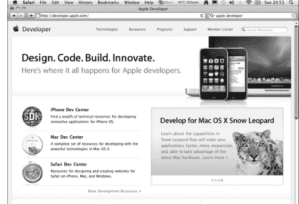

单击 Mac Dev Center 链接打开 Mac 开发者中心，如图 4.2 所示。你可以看到左下角的下载链接，但此页面的设计会定期更改，因此当你查看时它可能位于页面上的不同位置。要查找的关键词是 Xcode 和 SDK。

图 4.3

注册页面说明了注册的好处。目前基本注册是免费的。

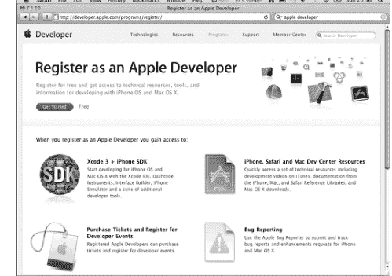

注册过程的其余部分很简单。在指定 ID、输入联系方式、回答几个简单问题、接受开发者协议并处理电子邮件确认后，你的开发者账户就创建好了。然后你可以再次登录并返回图 4.2 所示的屏幕。下载链接现在已激活，你可以开始下载 SDK。

> **注意**
>
> 如果你的宽带连接较慢，你可能希望让下载整夜运行。以 1MB/秒的速度大约需要六个小时。使用拨号上网下载该文件可能需要大半个星期，因此获取 SDK 最实际的方法是请有宽带的朋友下载、刻录到 DVD 并邮寄给你。Apple 不销售 Xcode 的 DVD 副本。由于开发者文档的访问正在转移到线上，拨号上网正变得越来越不切实际。


图 4.4

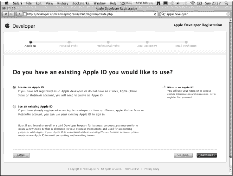

## 加入 Mac 开发者计划和 iPhone 开发者计划

注册为免费开发者，即可获得开发者计划的入门级访问权限。愿意支付年费的开发者还可以获得更高级别的权限。2010 年，Apple 对其 Mac 开发者计划进行了改版，将费用从每年 $499 降至 $99，但取消了许多权益。在旧计划中，开发者购买 Mac 硬件可享受折扣，还可以将应用程序发送到 Apple 的 Compatibility Testing 实验室进行硬件测试。更昂贵的层级还提供 Apple Developer Convention 的“免费”门票以及更多折扣。

在新计划中，主要权益包括免费获得当前版本 OS X 的副本，以及在正式公开发布更新前的几个月内下载高级 beta——“seed”——版本。开发者每年可以申请两次技术支持事件，与 Apple 工程师讨论开发问题；工程师会审查其代码，并提供故障排除建议或变通方案。该计划还包括访问 Apple Developer Forums 以及精选教学视频的权限。

该计划还控制对 App Store 的访问。只有已付费开发者才被允许在商店中销售应用。iPhone 计划受到严格控制，以至于用 Xcode 构建并安装到手机上的应用会在几个月后自动过期。开发者可以在自己的设备上运行其代码构建版本，但仅限有限时间。过期后，应用将停止工作，必须重新构建并重新安装。只有将应用提交到 App Store、等待其获批并购买它，应用才能被永久安装。

目前，企业和商业开发者可以注册两个替代性的企业计划，费用为每年 $299。只有拥有 500 名以上员工且具有 DUNS 编号（一种国际企业标识符）的企业才有资格。Enterprise iPhone 计划允许在内部分发和开发 iPhone 应用，从而绕过 App Store。由于 Mac 开发不受限制，因此没有与 OS X 对应的 Enterprise Program。

## 安装 Xcode

下载 Xcode dmg 文件后，双击打开它。安装过程很常规，几乎没有意外。双击 dmg 文件夹中的 Xcode.mpkg 文件，然后按照提示操作。该 SDK 旨在同时支持多个版本的 OS X 和 iPhone OS。你可以使用图 4.6 所示的对话框选择这些版本。没有必要支持任一操作系统的旧版本，但你可以安装它们以进行兼容性测试。


> **注意**
>
> 你可以通过勾选 UNIX Development 复选框，使用此对话框安装一组额外的 Unix 命令行开发工具。此功能是可选的——Xcode 不使用它，Cocoa 开发也不需要它。如果你熟悉 Unix 开发，并希望在 Mac 上使用传统的命令行编译器工具、库和 man 手册页集合，它会很有用。这些工具将安装到 `<usr>` 中。

默认情况下，Xcode 安装在一个新的 `Developer` 目录中，如图 4.7 所示；该目录位于 Mac 硬盘的根目录下，而不是用户目录中。最好将 `Developer` 留在原处——移动它可能会破坏安装。为了快速访问，将 `Developer` 添加到 Finder 中的 Places 列表会很有用。

你可以打开 `Applications` 文件夹，查看 Xcode 中包含的应用程序。Xcode 出现在列表底部。你可能想将它和 Interface Builder 一起添加到 Dock。此文件夹中的其他应用程序使用频率较低。

图 4.6

iPhone OS 和 OS X 的旧版本对于兼容性测试很有用，但大多数构建者都以最新操作系统为目标。

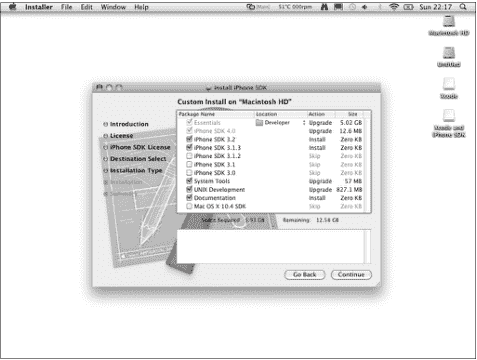

创建一个 `Projects` 文件夹是个极好的主意。在 Xcode 中创建项目时，它会自动被放置在一个新文件夹中。大多数开发者会生成几十个甚至数百个这样的文件夹，因此将它们收集到子文件夹中会很有帮助；例如，将试验和实验与商业项目分开。单独的 `Projects` 文件夹也简化了版本控制。

图 4.7

你可以将自己的项目文件夹（此处未显示）添加到 Developer 目录的内容中，然后进一步将项目划分到有用的子目录中。至少留出一个文件夹用于随机的实验。

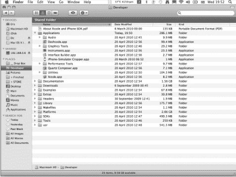

## 创建新的 OS X 项目

要创建应用程序，请双击 Xcode.app。单击如图 4.8 所示的大型 Create a New Xcode Project 按钮。

> **警告**
>
> 本书使用 Xcode 3.2.3 编写。Xcode 4 的预览版在本书付印前刚刚发布。Xcode 4 提供了更快的编译器，并集成了 Interface Builder；后者不再作为独立的应用程序运行。除此之外，应用程序的编辑和构建过程仍明显相似。有关 Interface Builder 的更多信息，请参见第 7 章。

图 4.8

Xcode 启动屏幕会显示最近项目列表（如果有的话）。查看 Getting Started with Xcode 教程是个好主意，可以快速了解 Xcode 的一些功能。

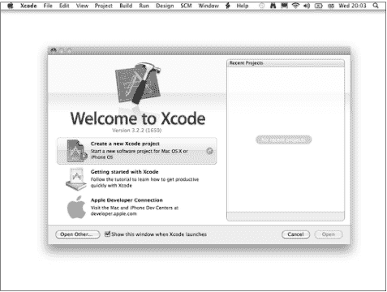

Xcode 会显示一个模板窗口，如图 4.9 所示。该窗口显示 Xcode 支持的文件和应用程序模板列表。单击窗口左侧模板窗格中的 Application。然后单击窗口顶部模板窗格中的 Cocoa Application。单击右下角的 Choose 按钮。

> **注意**
>
> 如果你使用的是 iPhone 版 Xcode，会在左上方看到额外的 iPhone 模板分区。请确保选择 Mac OS X 下的 Application 选项，而不是 iPhone OS 下的选项——除非你想创建 iPhone 应用。iPhone 和 OS X 模板具有不同的结构。

一个文件选择器表单从窗口顶部下拉出现。在表单顶部的 Save As: 字段中输入一个名称，例如 First，如图 4.10 所示。名称要简短并避免空格：该名称会用作项目中某些文件的前缀。在这里使用长名称会在项目中产生冗长的文件名。你输入的名称还会设置应用程序名称。

图 4.9

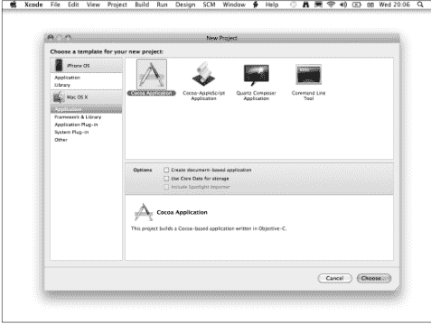

iPhone OS 提供了一系列项目模板，第 19 章将对此进行介绍。Cocoa 应用程序从单个通用的 Cocoa Application 模板开始。其他模板更为专用，使用频率较低。

> **警告**
>
> 如果你愿意，可以稍后更改应用程序名称，但重命名项目文件极其困难。Xcode 将构建目标、应用程序、项目名称和项目文件视为具有独立名称的单独实体。

图 4.10

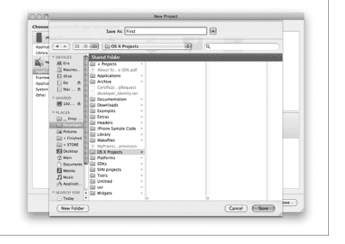

你可以将新项目保存到磁盘上的任何位置，但默认情况下此对话框会选择 Developer 文件夹。在此处创建一个或多个项目文件夹比在磁盘其他位置更高效。

Xcode 会使用你指定的名称创建新模板，并打开一个新的项目窗口，如图 4.11 所示。

> **注意**
>
> 项目窗口出现时并未最大化。你可以手动调整其大小，或单击窗口左上角的绿色按钮将其最大化。对于小于 26 英寸的显示器，使用最大化的项目窗口更便于工作。对于较大的项目，同时打开多个项目或文件窗口可能会更高效。

图 4.11

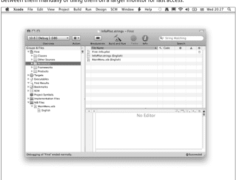

创建新的 Xcode 项目时，它会出现在一个同时充当编辑器和文件选择器的单一窗口中。你可以同时打开多个项目窗口，既可以手动在它们之间切换，也可以在较大的显示器上平铺它们以便快速访问。

构建项目只需单击一次。无需定义编译器选项或更改任何默认设置。单击窗口顶部的 Build and Run 按钮。Xcode 会编译并运行该应用程序，创建一个浮动窗口和一个新的菜单栏，如图 4.12 所示。

> **提示**
>
> 应用程序编译时，会在主 Xcode 窗口的左下角发布状态信息。Xcode 是一种增量编译器——它只编译已添加到项目中或已更改的文件。根据 Mac 的速度，首次构建并运行模板应用程序需要 15 到 30 秒。后续编辑后的构建会更快。

尽管该应用程序看起来是独立的，但它实际上作为 Xcode 内的子进程运行。如果退出 Xcode，该应用程序也会终止。你可以打开项目文件夹中的 Build ▶ Debug 文件夹，并双击 `.app` 文件，从而独立运行应用程序。


这在编码和调试时通常没有帮助。Xcode 包含独立的控制台窗口和调试窗口，只有当应用程序在 Xcode 中运行时才能访问它们。

该应用程序并不复杂。它显示一个支持一组基本功能的空窗口。你可以通过拖动右下角的调整大小框来调整窗口大小。左上角的红色、橙色和绿色窗口按钮分别以通常方式关闭、隐藏和恢复窗口。应用程序运行时会自动将自己添加到 Dock，并显示默认应用程序图标。要退出，请从菜单中选择“文件 ▸ 退出”。

> **注意**
>
> 应用程序未设置为在关闭窗口时自动退出，因此关闭窗口后，菜单仍会保留，应用程序也仍在运行。你只能从菜单中退出。

**图 4.12**

默认模板窗口的大小和位置在应用程序内设置。默认情况下，它显示在 Xcode 之上。虽然窗口是空的，但功能完整。它可以被拖动、调整大小、隐藏等。

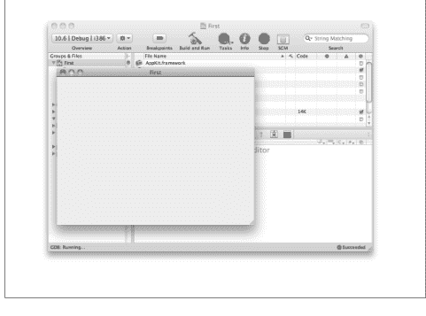

## 探索 Xcode 的窗口

既然你已经创建了第一个应用程序，你会想更仔细地了解 Xcode。Xcode 是一个看似简单但具有意外丰富而强大功能的开发环境。新手实际上只需单击一下就能构建 Mac 和 iPhone 应用程序，而忽略 Xcode 的大多数功能。更有经验的开发者几乎可以无限地自定义 Xcode，创建自定义构建阶段，使用在线和离线版本控制，并构建各种类型的项目。

### 理解组与文件

理解项目和文件如何组织很重要，因为在 Finder 中复制或移动 Xcode 项目文件夹时，如果没有正确设置，可能会破坏项目。Xcode 中的“组与文件”窗格出现在屏幕左侧。它包含看起来像文件夹和其他项目的功能。这些文件夹称为*组*。它们看起来像 Finder 文件夹一样工作。你可以使用展开三角形来打开和关闭它们，将文件拖入和拖出它们，并创建新文件夹。但组结构是表面的，只是为了方便你——在 Finder 的项目目录中并没有对应的文件夹。

创建新项目时，左上角会出现一个带名称的项目图标，代码和资源组会出现在它“内部”。图 4.13 显示了一个新的空项目中的文件夹，表 4.1 总结了它们的用途。


> **注意**
>
> 文件夹下方是一个附加功能列表，包括目标、构建产品、查找结果等。你不需要使用这些功能来构建和运行项目。

**表 4.1** Xcode 的组与文件窗格中的组

| 组 | 说明 |
|---|---|
| Classes | Objective-C 类文件 |
| Other sources | 杂项 C 文件，包括 `main.c` |
|  | 项目的 `.pch` 前缀头文件 |
| Resources | Interface Builder 使用的 Nib 文件 |
|  | 可选的图形和其他媒体文件 |
| Frameworks | 项目中使用的框架 |
| Products | 构建产品列表 |
|  | （通常只有一个——完成的应用程序） |

**图 4.13**

左上角的“组与文件”区域是 Xcode 的关键功能。你会在这里花很多时间选择要编辑的文件，然后在 Xcode 窗口右下区域的编辑器窗口中处理它们。

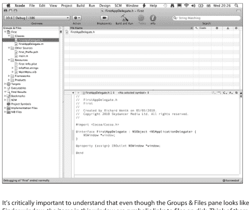

极其重要的是要理解，尽管“组与文件”窗格看起来像 Finder 窗口，但此窗口中的项目是指向磁盘上文件的符号链接。可以把它们看作指向文件路径的具名占位链接。

默认情况下，链接名称与文件名匹配——因此 file.h 指向磁盘上真实的 file.h。但在 Xcode 中并非总是如此，你可以重命名、删除和重新排列“组与文件”窗格中的链接，而不会影响它们指向的文件。一个名为 file.h 的链接实际上可能指向磁盘上某个完全不同的 something.h。

起初，这种间接系统看起来几乎完全违反直觉，但它提供了显著的好处。例如，你可以将任意磁盘位置的文件包含到 Xcode 项目中，而无需将它们复制到磁盘上的项目文件夹中。


> **警告**
>
> 使用 Finder 重命名或移动项目文件夹可能会破坏项目。如果你在 Finder 中移动或重命名文件，“组与文件”中的链接可能指向不再有效的文件路径。Xcode 的默认链接设置不允许你在不造成损坏的情况下复制项目文件夹。这很容易修复——详情见第 18 章——但就目前而言，不要尝试使用 Finder 移动或复制项目文件夹。

### 选择要编辑的项

“组与文件”窗格右侧还有两个窗口。顶部窗格中的“文件列表”显示项目中的文件列表。这是“组与文件”窗格中视图的平面版本，没有组，也没有出现在底部的额外项目。不过，它在右侧添加了一些额外字段，用于显示文件大小和项目分组信息。你可以使用这些字段启用或禁用所选文件的编译。这是一个高级功能，与入门项目无关。

单击此窗口中的任何可编辑文件，都会将其加载到屏幕底部的文本编辑器窗口中。你也可以通过单击“组与文件”中的名称来加载项。这是 Xcode 最高效的功能之一——项目中的所有文件都可以即时访问，无需保存和加载。


> **提示**
>
> 文本编辑器窗口可以显示图形文件。单击任何受支持的图像文件，都会将预览加载到窗口中。它没有编辑功能，但你可以在 Xcode 的偏好设置中指定外部编辑器。详情见第 18 章。

文本编辑器窗口还包含低调但强大的导航选项。文本区域正上方有两个下拉列表。最左侧是“历史记录”列表，显示最近访问过的文件列表。你可以将其作为将文件加载到编辑窗口的另一种方式。“历史记录”列表右侧是“符号”列表，显示方法标题和其他标题，如图 4.14 所示。你可以使用此功能单击一下即可滚动到所选方法。

文本编辑器窗口右上角还有两个重要的导航功能。滚动条上方的“拆分”图标可将窗口拆分为两个或多个部分，以显示两个不同的文件。通常，在一个窗口中查看头文件，在另一个窗口中查看实现代码很有用。挂锁图标左侧是“对应文件”图标，挂锁图标用于锁定文件以防止编辑。此图标可在头文件及其对应的实现文件之间切换文本窗口。两个图标如图 4.15 所示。

这些功能很简单，但它们使 Xcode 成为一个非常高效的环境。在开始处理较大的项目之前，养成使用它们的习惯很有用。它们确实可以为你节省数小时的开发时间。

**图 4.14**

历史记录列表和符号列表是 Xcode 更高级功能的典型代表。它们没有被突出强调，很容易被忽略，但它们可以非常有效地节省时间。

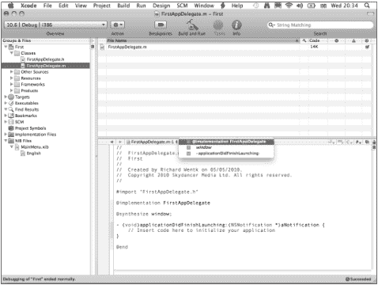

**图 4.15**

Xcode 的图标包含同样强大的功能，可用于加快你的工作速度。

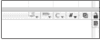

### 自定工具栏

你可以右键单击工具栏任意位置并选择“自定工具栏”来自定工具栏。要移除项目，请将其拖出工具栏。要添加项目，请将其从下拉窗口拖到工具栏中央区域。图 4.16 显示了一个建议的自定配置。你会发现包含“构建”选项（用于在不运行的情况下检查构建）和“全部清理”选项（用于移除现有构建产品并从头重新构建项目）很有用。随着你对 Xcode 的经验增加，你很可能会想在这里添加其他更高级的功能。


现在你已经了解了Xcode，就可以开始探索Objective-C的一些特性，并了解它们如何用于创建可运行的应用程序。

**图4.16** 自定义工具栏可以快速单击访问Xcode的一些基本功能。不幸的是，这些选项是固定的——你不能创建和添加自己的图标或实现自己的功能。

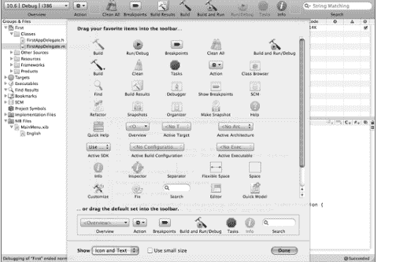

## 摘要

在本章中，你了解了Apple的开发者计划，并认识了不同开发者计划和级别的特点。你学会了如何注册成为开发者，如何下载和安装Xcode SDK，以及创建、构建和运行空示例项目是多么容易。你还了解了Xcode的一些更高级的功能，包括编辑图标和工具栏自定义功能。

# 在Objective-C中介绍类和对象

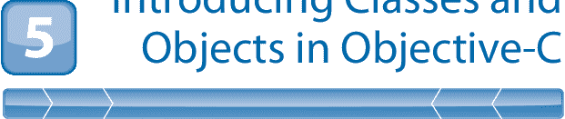

Objective-C是面向对象的。代码由类模板定义的对象组装而成；实例被动态创建和释放，并由消息控制。Cocoa是面向对象特性与传统C语言的混合体，并融入了用于创建和管理对象的实用工具和技术。

本章初步介绍Objective-C中面向对象开发的理论，并介绍类定义、消息传递和构造函数。后续章节将阐述实践，并解释如何在Objective-C代码和nib文件内容之间创建链接。

## 理解对象

对象可以表示具体的数据，也可以表示抽象的过程和关系。面向对象方法的一些优势包括：

- **抽象。** 对象通过隐藏底层复杂性使应用程序设计更简单。你可以专注于在应用程序的各个元素之间建立清晰的关系。
- **封装。** 对象可以包含其他对象，以各种方式链接和分组。分组后的对象可以作为一个具有简化接口的单个对象来对待，或者可以单独访问其元素。
- **简化的流程控制和循环。** 对象可以被计数、枚举、循环、收集和处理，就像它们是简单的数据类型一样。Cocoa的一些数据类型包括循环和枚举特性。你可以使用这些特性用一行代码处理一组对象。
- **直观的事件管理。** Objective-C是显式事件驱动的，事件管理功能灵活而强大。
- **直观而正式的数据依赖管理。** 对象可以通过访问自身数据或查询其他对象来响应消息。数据依赖关系可以自动管理。

| 本章内容 |
| --- |
| 理解对象 |
| 设计对象 |
| 创建类 |
| 使用对象 |

表5.1列出了一些可能的实际应用。*属性*是数据字段，*方法*是可以在对象内部触发以产生响应的代码块。

| 对象 | 可能属性 | 可能方法 |
| --- | --- | --- |
| GUI窗口对象 | 位置<br>大小<br>不透明度<br>前置/关键窗口状态 | 响应鼠标点击<br>最大化/最小化/关闭<br>移动到位置<br>报告位置<br>置于最前 |
| 游戏对象或标记 | 状态<br>位置<br>速度<br>纹理 | 移动到位置<br>改变状态<br>改变纹理<br>重绘 |
| 游戏场地 | 游戏状态<br>游戏得分<br>玩家数量<br>标记数组 | 更新得分<br>以新玩家开始<br>报告最高分 |
| 通讯录 | 单个条目（可以是子对象）<br>条目的子属性 | 添加条目<br>删除条目<br>更新子属性<br>计算条目数<br>保存/恢复条目<br>搜索条目 |
| 音乐合成器或采样事件 | 合成器/采样器设置<br>音符开始/结束时间 | 播放音符<br>停止音符<br>使用设置创建音符 |
| 通用对象 | 指针引用<br>内存状态 | 创建<br>销毁并释放内存<br>复制<br>从磁盘保存/恢复 |

面向对象编程的挑战之一是对象设计。理想的设计将强大的功能封装在一个简洁直观的接口中，该接口响应迅速且易于使用。


> **注意**
>
> Cocoa还包括一些混合数据结构，它们不是真正的对象，但可以与对象部分互换。从形式上说，这些是纯C语言结构体，但它们可以被强制转换或复制到相关的Cocoa对象类。在典型的应用程序中，你使用Cocoa对象、混合结构体和标准C数据类型的组合。

一些Cocoa对象被用作实现特定功能的直接替换方案；例如，NSDate对象保存有关系统日期和时间的信息。其他对象则被设计为可修改和扩展。所有Cocoa对象都是名为NSObject的对象的扩展，NSObject实现了基本的对象创建、内存管理和复制方法。你可以扩展NSObject来创建一个最小的空白对象。你也可以修改Cocoa的大多数其他对象来创建复杂的自定义功能。


> **注意**
>
> 在Objective-C中可以创建与NSObject无关的自定义对象，但这通常是徒劳的。NSObject“免费”实现了核心对象管理功能。自定义替代方案必须从零开始实现类似的功能——这不是一个小项目。

## 理解类

类是一个空白模板，定义了对象的特性。例如，Cocoa的NSWindow类定义了OS X窗口的特性。类定义列出了对象的属性字段及其支持的方法，包括实现它们的代码块。理论上，类定义是空白且静态的：它们不保存数据，也不做任何事情。为了处理数据，模板被用来创建实例——对象的工作副本。实际上，Objective-C将类本身视为一个单独的实例，具有独特的方法和属性。类方法通常用于创建和返回有关类实例的信息。

表5.2总结了定义对象并使其可用的不同元素。

| 特性 | 概述 |
| --- | --- |
| 类定义 | 一个模板，定义每个对象中的方法和属性。每个对象都有一个唯一的类模板。 |
| 实例 | 对象的一个可用版本，可以存储数据。根据需要从内存中创建和释放副本。每个副本使用相同的模板组织其数据。 |
| 指针 | 一个命名变量，存储实例的基本内存地址。该变量用作地址的句柄。指针在给定作用域内必须唯一。 |
| 属性 | 一个数据字段。类模板定义每个字段的数据类型并指定一个有用的名称。实例可以在每个字段中存储数据。属性不能直接访问。必须包含访问器方法，以便其他对象可以访问它们。 |
| 方法 | 定义对象如何响应消息的代码块。可选地，方法可以接受参数并生成返回值。 |
| 消息 | 发送到实例以运行命名代码块的事件。在Objective-C中，消息也可以发送到类模板。 |
| 访问器 | 读取或写入属性的方法——显式的setter（写入）和getter（读取）代码。访问器可以在Objective-C的`@synthesize`指令中自动生成。可选地，访问器可以在实现读写时强制更新对象的内部数据或状态。 |
| C语言特性 | C语言不用于对象间的消息传递，但可以出现在对象方法代码中，并且C数据类型可以用作属性或包装到对象中。C函数调用通常作为实现底层特性的辅助代码包含在对象中。Cocoa的部分使用C结构体作为原型对象，它们可以与完整对象部分互换。 |


接收消息的对象称为*接收者*。在这段代码中，anInstance 和 anotherInstance 都是接收者。

**图 5.2**

创建实例使得*使用*类成为可能，可以用数据填充其字段，并调用其方法来访问和处理这些数据。

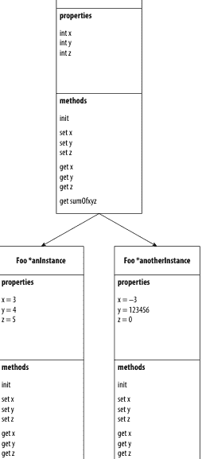

## 创建隐式实例和显式实例

至关重要的是，应用程序可以通过 Objective-C 代码*显式*创建对象实例，也可以在运行时从 nib 文件*隐式*加载它们。

这可能看起来有些神秘，因为并非所有对象都有配套代码。例如，前一章介绍的空白模板应用程序包含一个可用的菜单。模板中的代码不会创建或显示菜单，也不会处理诸如“退出”之类的标准事件。相反，菜单是在应用程序的 nib 文件中定义的，并在应用程序启动时加载。nib 文件还包含菜单的初始化设置，用于将菜单项绑定到标准事件。

当你运行应用程序时，菜单对象会自动创建，并且某些菜单选项会设置为在你选择时响应。在这个例子中，这一切无需配套代码即可实现。你可以选择添加代码来访问从 nib 加载的对象。如果不这样做，对象仍会被加载并在内存中创建，但你无法直接访问它们的属性或方法。

从 nib 加载对象是 Objective-C 中*动态加载*的一个例子。对象可以在运行时加载和释放，并且可以在应用程序运行时重新配置其架构。通常，Interface Builder 管理此过程的一部分，其余部分则通过代码实现。

## 设计对象

属性可以是传统的 C 数据类型、自定义或预定义的结构体，也可以是对象。类中属性的数量没有限制，但拥有数百个属性的对象会变得笨重，可能需要进行重新设计。

方法复杂度也没有限制。方法接口可以隐藏深层复杂性，方法代码可以访问其他对象的属性和方法。良好的方法设计通过创建易于理解的接口和结果来隐藏复杂性，并以简单的方式封装有用的返回值。

一个好的做法是定义明确描述性且易于理解的类名、属性名和方法名，即使这意味着需要多输入一些内容。这可以提高代码清晰度，并有助于简化对象设计。例如，sumOfxyz 的扩展变体可能会将结果作为字符串返回：

```
sumOfxyzAsBinaryString
sumOfxyzAsHexString
sumOfxyzAsDecimalString
```

Cocoa 通常为对象和方法使用描述性名称。创建含糊不清或不精确的名称是一种不好的做法：

```
sum // Sum of what?
Total
sumAsString // What kind of string?
returnValue
```

## 命名约定

按照惯例，类名和函数名使用 UpperCamelCase，而实例名、方法名、属性名和一般数据类型名使用 lowerCamelCase。不允许使用空格，但允许使用下划线。在名称中明确包含对象或数据结构的类类型是很有用的。

> **注意**
>
> *据称，CamelCase 得名于两个大写字母形成的双峰。它有一个更正式的名称——medial capitals（中间大写）——但这种说法缺乏头韵，音节多一倍，而且没有提及动物，因此更难记住。CamelCase 并非编译器强制要求，但它是一种标准的命名约定。*

Cocoa 类和功能使用 UpperCamelCase 命名，并带有可选的框架前缀。例如，Cocoa/NeXTStep 类以 NS 为前缀，NS 是 NeXTStep 的缩写：

```
NSWindow
NSViewController
NSBrowserDelegate
```

其他 OS X 库有自己的前缀。由于存在重叠，命名方案略显随机。例如，CoreAudio 项以 Audio 开头，而不是 CA，CA 用于 Core Animation 库。

> **警告**
>
> *并非所有以 NS 为前缀的 Cocoa 功能都是对象。大多数是，但也有一些常见的例外。例如，NSInteger 是标准 int 的包装器。有关这些例外的详细信息，请参阅开发者文档中的 Foundation Framework Reference。Other References 分组列出了在 Cocoa 中使用但未被定义为对象的 C 函数、C 数据类型和常量。*

因为名称具有描述性，所以可能会很长。例如：

```
CFAbsoluteTimeGetDifferenceAsGregorianUnits
```

这是 Core Foundation 时间实用工具库中的一个函数。Cocoa 中的常量以 k 开头，后跟库前缀，再跟一个长名称，例如：

```
kCFAbsoluteTimeIntervalSince1970
```

在自己的类定义中遵循这些约定是有帮助的。如果你创建自己的自定义框架，添加唯一的前缀缩写至关重要。

对于开发者创建的对象，没有正式的命名指定。许多开发者使用 a、my 和 this 作为前缀来表示其代码中创建的实例。

```
aWindow
myView
thisDictionary
```

这是一种非正式做法，但对于简单项目来说效果很好。

或者，开发者可以使用其姓名首字母或独特的两个或三个字符的首字母缩略词来标识其类。这在协作项目中有帮助，因为诸如 aWindow 之类的名称可能已被使用。例如：

```
RWWindow
CDRObject
CDRView
```

## 对象构造函数和指针

Objective-C 使用 C 语言的星号指针约定，如图 5.3 所示。指针名称可以是其作用域内唯一的任意字符串，但最好将类名作为后缀包含在内。例如，指向类 Foo 实例的指针声明如下：

```
Foo *aPointerToFoo = ... // This is traditional
```

**图 5.3**

aPointerToFoo 是一个保存内存地址的变量。确切的数据类型取决于应用程序使用的是 32 位还是 64 位内存模型。直接比较或操作指针地址是合法的，偶尔也很有用。

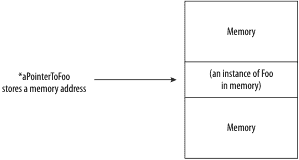

每当创建类的新实例时，都会生成一个唯一的指针。Objective-C 不支持正式的构造函数。相反，对象是使用一种标准代码习惯用法创建的，该用法运行两个名为 alloc 和 init 的方法，以返回指向类实例的指针。alloc 创建对象的实例，init 对其进行初始化。这两个方法总是嵌套的，如下所示：

```
Foo *aPointerToFoo = [[Foo alloc] init]; // Do this

Foo *aPointerToFoo = [Foo alloc];
    aPointerToFoo = [aPointerToFoo init]; // Don't do this
```

第一种写法在 Cocoa 代码中随处可见。除下文所述的少数例外情况外，你可以按原样使用此代码来创建 Cocoa 对象。

```objective-c
// Create a new instance of NSView
NSView *aView = [[NSView alloc] init];
```

## 理解 alloc、init 和嵌套

图 5.4 说明了 `alloc` 和 `init` 如何协同工作。`[class alloc]` 返回一个指向 `Class` 实例的指针。但由于代码是嵌套的——`[aClass alloc]` 的返回值直接传递给 `init`——这个指针不需要显式名称。

> **警告**
>
> 这里的 `init` 指的是初始化方法。有些 `init` 方法带有参数。这并不会改变这种惯用写法；只要 `alloc` 和 `init` 方法保持嵌套，代码就是正确的。

**图 5.4**

`alloc` 消息在 Foo 类上运行并返回一个实例。`init` 方法在该实例上运行，并返回一个指向已初始化实例的指针，该指针有时可能与 `alloc` 返回的指针不同。嵌套 `alloc` 和 `init` 可以保证最终得到的指针是可用的。

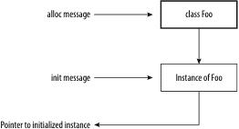

通常，你可以使用嵌套来避免创建临时指针。包含一或两级嵌套是良好实践。嵌套超过三级是不好的做法，因为代码会变得难以理解。不幸的是，由于 Cocoa 的语法，有时不可避免地需要更深层次的嵌套。

使用新实例的示例代码可能如下所示：

```objective-c
[aPointerToFoo setx: 1];
[aPointerToFoo sety: 2];
[aPointerToFoo setz: 3];
int aTotal = [aPointerToFoo sumOfxyz];
```


你可能会创建另一个实例，使用

```
Foo *aDifferentPointerToFoo = [[Foo alloc] init];
```

接着是使用 aDifferentPointerToFoo 实例的类似代码：

```
[aDifferentPointerToFoo setX: 15];
//Etc...
```

理解指针变量与实例并不相同这一点至关重要。指针是一个 size_t 整数，它指向对象实例使用的内存，并作为该实例的引用。误解这一点可能导致代码泄漏内存或崩溃。如果指针在对象从内存中释放之前被覆盖，对象的内存就会丢失。在手动管理内存的 iPhone 上，这一点变得非常重要。但即使在启用了垃圾回收的 Mac 应用程序中，覆盖指针也可能造成内存泄漏。

## 类与实例方法

类模板等同于类型定义。就像两个被命名的 int 是不同实体一样，Foo 的两个实例也完全不同且相互独立。它们使用相同的模板，但除此之外没有任何联系。

大多数对象被设计为作为实例使用，而类本身只是一个没有活动功能的模板。但某些 Cocoa 对象包含类方法，这些方法在类上运行，而不是在实例上运行。某些类方法无需使用 alloc 就能返回对象，例如：

```
NSDate *now = [NSDate date];
```

这行代码从系统日期对象读取日期和时间，将其写入 NSDate 的一个实例，并返回指向该实例的指针。如果代码写成这样，会更一致：

```
NSDate *now = [[NSDate alloc] init];
```

事实上，这样写也是有效的。NSDate 的 init 方法会自动返回当前日期和时间。但第一种写法使用得更广泛，显然是出于历史原因。


> **注意**
>
> 类方法通常是线程安全的。实例方法可能不是线程安全的。文档并不总是详细说明这些差异，因此如果你的代码支持多线程，你可能需要通过实验来找出哪种方式能可靠运行。有关创建和管理线程的信息，请参阅第 11 章。

类方法通常用于创建对象——alloc 就是一个类方法——或返回指向系统对象的指针，例如共享应用程序管理器 NSApplication。例如，对 NSApplication 运行 sharedApplication 类方法会返回指向当前应用程序的指针：

```
//Get a pointer to the current application
//and send it a terminate message to quit
[[NSApplication sharedApplication] terminate: nil];
```

## 子类化与继承

Cocoa 是一个由预编写类组成的库，你可以直接将其放入代码中。当你对现有类进行子类化时，你创建了该类的一个新版本，并以其作为自己添加功能的起点。然后你可以添加自己的新特性，或者覆盖（override）——即编写代码重新实现——其部分或全部现有特性。

当你创建子类时，它会继承父类的所有特性。在你开始修改它之前，子类是现有父模板的直接副本，包含其所有属性和方法。它有一个新名称，但在功能上与其父类完全相同。

继承和子类化可以节省你的时间。你不需要重新发明轮子或窗口——你可以重用现有类，根据需要扩展或修改它。Cocoa 的设计就是为了鼓励这种定制。你几乎可以对任何类进行子类化，而且有些 Cocoa 类刻意保持极简，只具有特性的大致轮廓，就像没有车身、车轮或座椅的汽车底盘。

例如，NSView 类——在 iPhone 上对应 UIView——包含一个 drawRect: 方法，可以用图形填充视图。默认情况下，drawRect: 方法是空的，不做任何事情。如果你不向其中添加代码，应用程序运行时它将继续什么都不做。当你希望在一个窗口中绘制自定义图形时，可以对 NSView 进行子类化，并用自定义代码填充 drawRect:。新的 drawRect: 会覆盖旧的空版本。


**提示**

有时，不创建子类而直接修改现有类会更容易。Objective-C 包含一个类别（category）特性，使这成为可能。这个名称具有误导性——并没有“类别”被分类。实际上，现有类通过添加新的属性和方法得到扩展。与子类不同，类的名称不会改变，新特性是“就地”添加的。有关实际示例，请参阅第 8 章。

当你创建子类时，它本身就成为一个新类。你可以再次对它进行子类化，然后无限地对子类进行子类化，没有任何限制。你也可以从同一个源类创建具有不同特性的多个子类。

Cocoa 利用这一特性将类组织成层次结构或树。根是最小的对象模板类，称为 NSObject。如图 5.5 所示，类从 NSObject 出发，沿各个分支展开。每个分支实现不同但相互关联的特性，例如窗口和 UI 管理、网络、数据管理等。类离 NSObject 越远，其专门化程度越高。

完整的 NSObject 层次结构包含 100 多个对象。开发者文档包含有关每个类在层次结构中的位置以及它所继承特性的类的信息。你不需要记住类之间的关系，但确实需要了解它们，而对类层次结构有一个概要性的理解是有帮助的。

### 图 5.5

这是 NSObject 子类层次结构的一小部分。要查看完整结构，请访问 http://developer.apple.com/mac/library/documentation/Cocoa/Reference/Foundation/ObjC_classic/Intro/IntroFoundation.html。

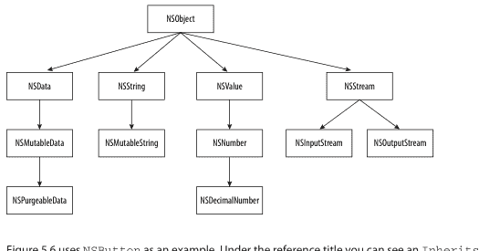

图 5.6 以 NSButton 为例。在参考标题下方，你可以看到一个*继承*字段，其中包含一个类列表。这个列表告诉你，NSButton 包括其自身类参考中列出的所有属性和方法，并且它还实现了 NSControl、NSView、NSResponder 和 NSObject 中内置的所有属性和方法。

这些额外的方法和属性没有列在 NSButton 页面中——要找到它们，你必须阅读其他类的参考页面。这样做是一种好习惯，尤其是当你刚开始接触 Cocoa 编程时，因为它有助于在记忆中牢固建立层次结构的概要。它还会扩展你对可能性的认识。例如，你可以使用 NSView 方法为 NSButton 的实例制作动画，改变它们的大小使其脉动，或者改变它们的位置使其以类似 iPhone 的方式抖动。梳理子类化层次结构不仅是一个技术过程，也可以是一种为你的应用程序发现新可能性的创造性方式。

> **注意**
>
> *符合*（Conforms to）字段列出了另一组可选方法，这些方法可以在子类代码中使用。

### 图 5.6

`NSButton` 类参考的放大图，展示了子类化和继承信息


### 子类、父类和根类

`NSObject` 是 Cocoa 的根类。当你创建子类时，原始类称为*父类*（superclass）。你可以使用 `super` 变量从任何对象向其父类发送消息。`super` 不是一个独立的对象。它用于“取消覆盖”方法名，访问未修改、未扩展的原始方法。例如，如果你对 `NSView` 进行子类化并调用 `[super drawRect:...]`，你的代码将运行未修改的原始 `drawRect:` 方法。与其说这是一个有用的例子，不如说这是一个说明性示例，但同样的技术也可以用于在具有有用特性的对象中运行未修改的方法。`super` 经常用于 `init` 方法中，这将在第 7 章中介绍。

## 创建类

类定义分布在两个文件中——一个扩展名为 `.h` 的头文件和一个扩展名为 `.m` 的代码文件。头文件称为*接口*。它声明了对其他对象可见的方法和属性。代码文件保存*实现*——即每个方法被触发时运行的代码。实现还可以包含对其他对象不可见的私有变量和方法。一个特性只有在两个文件中都出现时才是公开的。

**提示**

正如你将在第 6 章中看到的，Xcode 通过提供一系列默认模板，使创建新类变得很容易。你不必从头输入接口和实现文件的内容——你可以从模板文件开始，然后修改它。

### 定义类接口

接口文件的内容组织如下：

```objective-c
#import <any required headers>
@interface MyNewClass : NSObject <protocols>{
(a list of instance variables)
```


```
}
(a list of public properties prefixed with @property
    declarations)
(a list of public methods that can be accessed by other objects...)
(a list of public setter and getter methods, if used)
@end
```

@interface 指令告诉 Objective-C，接下来的行定义了类接口。该行的其余部分包含类名，类名可以是任意唯一字符串，后面跟着它继承特性的超类名称。

换句话说，这一行告诉 Objective-C 创建一个名为 *MyNewClass* 的新类，并从 NSObject 复制方法和属性。要继承不同的类，请替换 NSObject。例如，下面的代码替换为 NSView：

```
@interface MyNewViewClass : NSView <protocols>{...
```

> **注意**
>
> protocols 字段包含一个或多个命名的可选方法包，可在类中使用。协议是一种简化的复杂导入/包含形式。协议用作将相关方法组快速导入类的一种方式。它们是可选的，但许多 Cocoa 对象都使用它们。有关一些示例，请参见第 6 章。

实例变量（也称为 *ivars*）可以是带指针的对象，也可以是标准 C 数据类型。例如：

```
{
    NSView *aView;       //This is a pointer to a view
    int numberOfGiraffes; //This is a standard C int
}
```

花括号之间的属性列表定义了私有内部变量。要将它们暴露给其他对象，属性名必须加上 @property 指令前缀。

```
@property (nonatomic, retain) NSView *aView; // aView can be public
```

> **注意**
>
> `(nonatomic, retain)` 定义了对象属性的内存管理选项。C 数据类型不需要这个额外信息。有关更多信息，请参见第 12 章。

方法列表定义了可由其他对象触发的每个公共方法。例如：

```
- (void) thisIsAMethod;
// This is a method with no return value and no parameters
- (NSValue *) thisIsAnotherMethod: (int) aNumber;
// This is a method that returns an instance of NSValue and takes an int as a parameter
```

方法以签名形式列出——即一行摘要，列出方法中使用的类型、输出类型、名称和参数。签名以分号结尾。它们不包括实现代码。

在接口文件和实现文件中，Objective-C 都使用 – 字符作为实例方法定义的前缀，使用 + 作为类方法定义的前缀。

```
- (void) thisIsAnInstanceMethod;
+ (void) thisIsAClassMethod;
```

## 定义访问器：设置器和获取器

在 Objective-C 中，属性是私有的且不可见，除非为它们定义了设置器和获取器方法。设置器写入值；获取器读取值。属性可以允许其中一种或两种访问模式。你可以用代码显式定义设置器和获取器，也可以使用 @synthesize 指令隐式定义。

使用 @synthesize 为简单的读和写操作生成所需的设置器和获取器。该指令的作用很像宏，它会自动创建设置器和获取器代码。它还实现点格式的属性访问。

```
anInt = anObject.numberOfElephants;
anObject.numberOfWheels = 5;
```

这种语法在其他语言中很常见。在 Objective-C 中，只有当属性被合成时，它才有效。

当读取或写入属性会触发更复杂的结果时，请使用显式的设置器和获取器代码，例如对象状态发生变化，或访问其他属性和功能的操作。例如，设置器可以在窗口大小改变时自动重绘可见图形，或者获取器可以统计属性被访问的次数，并将计数写入另一个属性。

按照约定，获取器方法名与它们访问的属性名相同，而设置器会在名称前加上 set。在接口中定义设置器和获取器如下：

```
- (int) numberOfElephants; // A getter for the numberOfElephants property
- (void) setNumberOfWheels: (int) aNumber; // A setter for the numberOfWheels property
```

要使用它们，语法是

```
anInt = [anObject numberOfElephants];
[anObject setNumberOfWheels: 5];
```

编译器并不强制实施这种命名约定，但 Cocoa 中使用了它，它有助于使代码易于阅读。设置器和获取器代码的复杂度没有限制。如有必要，单个设置器方法可以显著改变整个应用程序的状态。

## 使用 self

在类中，self 用于访问内部方法。例如：

```
[self doSomethingInternal];
```

会触发 doSomethingInternal 方法，假定该类中存在该方法。内部方法可以是私有的或公共的。你也可以使用 self 使属性访问操作显式化。

```
// If aProperty uses a custom getter, this is necessary
aValue = [self aProperty];

// ...because this is interpreted as a pointer copy
aValue = aProperty;
```

## 定义类实现

实现文件的内容组织如下：

```
#import MyNewClass.h
#import (any other classes that are referenced)
@implementation MyNewClass
    (an optional list of @synthesize directives for properties)
    (an optional list of private variables)
    (a list of methods with full implementation code)
@end
```

#import 指令加载接口头文件。由于历史原因，Objective-C 对 Objective-C 头文件使用 #import，对 C 头文件使用 #include。文件的其余部分是已实现方法的列表。接口中列出的任何方法都必须在实现中实现。实现不必完整和完成——一个存根即可——但如果缺少它，编译器将抛出错误。

> **注意**
>
> 可以将头文件和实现合并到单个文件中。这是一种不好的做法，因为类经常需要导入其他类的接口声明。当头文件与代码不分离时，这会变得非常低效。

如果一个类引用了某个类或框架，它必须包含针对其头文件的 #import 指令。为了清晰和易记，良好的做法是在实现中包含 #import 指令。

要使用 @synthesize，请在其后跟一个属性名列表，并以分号结束该列表：

```
@synthesize aProperty, anotherProperty, somethingElse, aView;
```

这会对列出的四个属性运行 `@synthesize` 功能，并为它们生成设置器和获取器代码。然后，你可以使用点语法或常规方法代码从其他对象访问这些属性。

```
aValue = [thisObject aProperty];  // Using a synthesized getter
aValue = thisObject.aProperty; // Identical code using dot syntax

[thisObject aProperty: 5]; // Using a synthesized setter
thisObject.aProperty = 5; // Identical code using dot syntax
```

## 定义公共属性

总而言之，要创建一个可由其他对象访问的属性，你必须做三件事：

- 1. **在接口的 ivars 列表中包含它。**
- 2. **在接口中再次将其声明为 `@property`。**
- 3. **在实现中添加显式的设置器/获取器方法，或对属性使用 `@synthesize`。**

这三个步骤都是必需的。如果跳过其中一步，构建将失败，或者应用程序可能崩溃。如果更改属性名，必须在所有三个位置都更改它。


**提示**

在专注于其余代码时，很难记住这三个步骤，因此将此摘要用作检查清单会很有帮助。最终，这三个步骤会开始变得自动化，但忘记某个步骤仍然是一个常见且普遍的错误。

## 定义公共方法

要定义公共方法，请遵循以下四个步骤：

- 1. **在接口中声明签名。** 签名包括类/实例类型、返回类型、名称和参数列表。以分号结尾。
- 2. **将签名复制到实现文件。**
- 3. **将分号替换为左花括号。**
- 4. **添加实现代码并关闭花括号。**

例如，以下代码完整定义了一个名为 `thisMethodDoesNothing` 的方法：

```
- (void) thisMethodDoesNothing; // Add this line to the method list in the interface
```


```objc
- (void) thisMethodDoesNothing {
} //Add these two lines to the method body list in the implementation
```

定义参数列表和返回值的规则与 C 语言类似。方法可以接受任意数量的参数。参数类型必须显式声明。例如：

```objc
//This line appears in the interface
- (AClass *) thisMethodDoesSomething: (AnotherClass *) aParameter;
//This block of code appears in the implementation
- (AClass *) thisMethodDoesSomething: (AnotherClass *) aParameter
{
AClass *aResult; //This is a private variable for this method
aResult = [aParameter doSomethingToIt];
return aResult;
}
```


### 提示

aParameter 在方法内部用作私有变量。名称冲突很常见，因此用下划线作为参数前缀会很有用，这样可以确保局部参数名不会与全局属性冲突。

```objc
- (AClass *) thisMethodDoesSomething:
(UsingAnotherClass *) _aParameter;
```

Xcode 假定：如果你的代码引用了某个方法，那么该方法就存在。如果编译器在编译时找不到该方法，它会记录一条警告，但允许构建完成。如果你在定义某个方法的实现之前就使用它，编译器也会生成相同的警告。

方法名与对象之间只是松散关联，Objective-C 运行时会动态查找方法名。例如，只要两个类中都提供了 aMethod，即使 aMethod 的两个实现不同，下面这段代码也是有效的：

```objc
aPointer = anInstanceOfAClass;
[aPointer aMethod];
aPointer = anInstanceOfASubclassOfAClass;
[aPointer aMethod];
```


### 注意

默认情况下，当你创建新项目时，Xcode 假定你将手动管理内存。通常你会希望改为启用垃圾回收。有关如何执行此操作的说明，请参见第 12 章最后一节。本书其余部分的项目均假定已启用垃圾回收。

## 在 Objective-C 中使用对象

本概述初步介绍 Objective-C 中的对象，但 Objective-C 以不同寻常的方式使用对象。一个关键点是，对象、消息和数据之间的关系尽可能保持松散。在大多数语言中于编译时定义的连接，在 Objective-C 中可以在运行时更改。例如，Objective-C 允许松散类型，并包含类管理功能，可以在运行时读取对象的类，或测试它是否是某个类层次结构的成员。

表 5.3 介绍了 Objective-C 更具创造性的元素。这个列表并不是 Objective-C 所有更具创造性的选项的完整总结，但它列出了 Cocoa 应用程序中广泛使用的特性。

| 特性 | 摘要 |
|---|---|
| 面向对象架构 | 可以定义、实例化和销毁对象。子类化和方法重写被广泛使用。 |
| 显式和隐式对象创建 | 对象实例可以在代码中创建，也可以定义为 Interface Builder 文件中的资源，并在应用程序运行时自动加载。加载过程可以分布在多个文件中。 |
| 动态加载 | 可以在需要时加载对象，并动态释放对象，以尽量减少内存使用。 |
| 使用 `id` 的消息参数松散类型 | 消息参数中的类型信息可以被强制执行、忽略、动态检索，或使用占位符 `id` 数据类型在运行时隐式表示。 |
| 对象与消息之间的松散链接 | 消息和对象以松散方式绑定——一个具名消息可以发送给任何支持它的目标对象。目标对象可以在运行时选择。某些对象允许为特定消息显式指定目标对象。 |
| 消息选择器 | 提供选择器数据类型，作为每个方法的容器/句柄。代码可以使用选择器在运行时动态选择消息。 |
| 自动消息创建 | 消息可以无需显式代码而自动生成——例如，当对象属性更新时。 |
| 自消息传递 | 对象可以通过向 `self` 发送消息来触发内部方法。 |
| 抽象类 | Cocoa 包含少量抽象类，主要用作必须手动重写的方法集合。 |
| 委托 | 相关消息可以收集到协议中，并由任何对象采用；该对象充当委托，实现该组消息的处理程序。委托对象可以被动态分配和重新分配。 |

Cocoa 依赖这种松散性来实现一些更灵活的特性。例如，单个对象可以处理来自许多不同对象、具有不同参数列表的消息。这在 UI 设计中通常很有用。事件处理程序可以接收来自各种 UI 对象的消息，而无需对消息的格式或来源做出假设。同样，数据收集对象——数组、集合和字典——可以在单个集合中存储各种数据类型。第 8 章和第 9 章将更详细地说明这些特性。

了解理论之后，你就可以在下一章进入一些实践了，下一章将演示如何在一个简单应用程序中使用 Cocoa 对象。

## 总结

在本章中，你了解了对象，并看到了面向对象设计与更传统的编程模型相比所提供的一些优势。你探索了类和实例，并学习了 Objective-C 和 Cocoa 的命名约定。

接下来，你了解了子类化和继承的好处，并发现了它们如何在 Cocoa 中用于简化开发。最后，你看到了用于在 Objective-C 中创建类的接口和实现代码的概览，并初步了解了 Objective-C 的一些独特特性。

# 在应用程序设计中使用类和消息入门


尽管 Cocoa 和 Xcode 都使用 Objective-C，但仅凭对类的理论理解并不足以有效地使用它们。必要的实践技能包括：

- 理解 Cocoa 应用程序的结构。
- 找到合适的 Cocoa 对象来解决问题或实现功能。
- 将 Cocoa 文档转化为可工作的代码。
- 使用 Xcode 和 Interface Builder 来添加、释放和管理应用程序对象。

## 理解 Cocoa 开发过程

Cocoa 代码通常需要像侦探一样调查。Cocoa 对象很复杂，许多特性会交叉引用其他对象和数据类型。开发者文档内容全面，但类与支持特性之间的联系可能并不像应有的那样清晰。

当你第一次使用某个 Cocoa 类时，你很可能会经历我在本章中概述的过程：走弯路、做出错误猜测，并反复查阅文档。当你找到解决方案时，它往往优雅而强大。你通常可以用一行代码实现复杂的解决方案，但可能需要花一些时间才能找到这个理想方案。

节省时间的帮助总是受欢迎的，这就是为什么查找示例代码和相关在线讨论如此有帮助。偶尔你能找到解决你问题的完整示例。更常见的是，你会找到对尚未探索或未被注意的特性的引用，这些引用可以为你指明解决方案的方向。一般来说，在文档之外寻找完整示例会节省你的时间；例如，在 Apple 自己的示例代码和在线论坛中发布的解决方案中寻找。

### 本章内容

- 理解 Cocoa 开发过程
- 理解应用程序
- 发现对象方法和属性
- 创建子类
- 介绍 Code Sense
- 使用委托接收来自 OS X 的消息
- 使用 NSResponder 接收来自 OS X 的消息


**注意：**

在每个文件开头注释中设置开发者名称和版权信息的简单但出人意料的方法是，在“通讯录”中创建一张包含个人详细信息的卡片，然后从“卡片”菜单中选择“将此设为我的名片”。Xcode 在创建新项目时会从“通讯录”读取信息。你也可以在“终端”中单行输入以下内容：

```
defaults write com.apple.Xcode PBXCustomTemplateMacroDefinitions '{ "ORGANIZATIONNAME" = "<OrganizationName>" ; }'
```

表 6.1 列出了每个文件夹中的关键元素。在本章中，你将重点关注前三个组的内容。所有元素都是必需的——没有它们项目就无法构建——但有些元素可以直接使用，无需更改。

**注意：**

实际项目中的文件会以项目名作为前缀。表中未包含该前缀。

### 表 6.1 Cocoa 应用程序的元素

| 元素 | 说明 | 组 |
|---|---|---|
| 类文件 | 应用程序类模板的源代码。 | Classes |
| main.m | 标准的应用程序启动代码。（此文件可以编辑，但通常不会修改。） | Other Sources |
| `_Prefix.pch` | 用于避免重复编译 Cocoa 头文件的预编译头。此处可以添加其他常见的项目头文件。对于简单项目，此文件不会更改。 | Other Sources |
| `-Info.plist` | 默认应用程序设置，包括首次加载的类名和默认 nib 文件名。 | Resources |
| InfoPlist.strings | 用于本地化；这是一个“文件夹”，其中包含一个文件，该文件列出应用程序支持的每种语言的文本字符串。 | Resources |
| Nib 文件 | 至少会自动加载一个在 `-Info.plist` 中定义的 nib 文件。如有需要，可以定义其他 nib 文件并按需加载。 | Resources |

**警告：**

向项目添加新文件时，Xcode 不会尝试将它们移动到正确的组中。组结构只是表面性的。它不会影响编译，但确实能更容易地将相关文件放在一起。

## 探索标准应用程序元素

在空模板中，恰好有三个源代码文件。其中两个通常直接使用，另一个只是偶尔修改。图 6.1 所示的 main.m 文件是一个标准的 C main() 函数。所有 Cocoa 应用程序都包含此文件。它运行一个名为 NSApplicationMain() 的加载函数，该函数初始化内存管理器，然后加载并运行应用程序主体。可以修改此文件以创建不同的启动环境，但在大多数项目中你可以忽略它。

同样，你通常可以忽略 `_Prefix.pch` 文件。它包含用于 Cocoa 库头文件集合的导入指令，通过确保这些头文件只编译一次来加速编译。有时你可以选择在此处添加额外的头文件集合。更常见的情况是，你会让它保持不变。

默认情况下，你的应用程序会忽略用于字符串本地化的 Info.plist 选项。在 Cocoa 应用程序中支持非英语语言有两种方式：本地化字符串和本地化 nib 文件。如果你面向英语用户开发，可以忽略这些选项。如果不是，可以在第 9 章中了解更多关于本地化的内容。

## 介绍应用程序委托

活动的应用程序代码收集在 Classes 文件夹中的文件里。如果你的项目名为 First，你会看到两个名为 FirstAppDelegate.h 和 FirstAppDelegate.m 的文件。


**提示**
为清晰起见，Classes 文件夹只包含子类的代码。你可以——而且经常这样做——直接使用 Cocoa 类与对象，而无需对它们进行子类化。

Cocoa 应用程序的架构出乎意料地间接。虽然存在一个 NSApplication 对象，但你很少直接访问它。相反，每当 OS X 发送应用程序级消息时，该消息会被传递给一个应用程序委托对象。委托处理 OS X 在应用程序即将退出时、用户隐藏或取消隐藏应用程序时、OS X 内存不足时等情况下发送的消息。

与应用程序对象不同，委托被设计为可供子类化。当你创建新项目时，会自动为你创建一个带有 AppDelegate 后缀的委托子类。在很大程度上，这个委托就是应用程序。


**注意**
使用委托可能看起来冗余且不必要地复杂，但它具有实际优势。你将在本章后面看到这些优势。

这个委托可以通过为 OS X 生成的每条应用程序控制消息添加处理程序来扩展，但默认模板生成的委托是轻量级的，做的事很少。代码定义了一个指向窗口对象的链接，并包含一个在应用程序加载时触发的单一存根方法。

点击 `FirstAppDelegate.h` 以在编辑器窗口中显示它。该接口如下所示：

```objc
#import <Cocoa/Cocoa.h>
@interface FirstAppDelegate : NSObject <NSApplicationDelegate> {
    NSWindow *window;
}
@property (assign) IBOutlet NSWindow *window;
@end
```

表 6.2 详细分解了这些特性。

| 特性 | 说明 |
|---|---|
| `#import <Cocoa/Cocoa.h>` | 此行导入 Cocoa 框架头文件。默认模板会“免费”添加此行——以及其他行。当你在类中引用某个框架时，必须在此处手动添加相应的一行来导入其头文件。 |
| `@interface FirstAppDelegate` | 后面的代码是 `FirstAppDelegate` 类的接口。 |
| `:NSObject` | 该类是 `NSObject` 的子类，并继承其方法和属性。 |
| `<NSApplicationDelegate>` | 该类导入并使用一组预定义的可选方法，称为 `NSApplicationDelegate` 协议。这个特定协议是 Cocoa 的一部分。它定义了一组可选的应用程序管理方法，可以在委托中实现。 |
| `NSWindow *window;` | 该类包含 Cocoa 的 `NSWindow` 类的一个实例，通过名为 window 的指针访问。 |
| `@property` | window 可以是一个公共属性。 |
| `(assign)` | window 使用 assign 操作进行内存管理。（内存管理将在第 12 章介绍。） |
| `IBOutlet` | window 是指向关联 nib 文件中定义的对象的指针。window 不是在代码中分配的；它在应用程序加载时从 nib 文件自动加载。nib 加载过程还会初始化其指针。 |

接下来展示 `FirstAppDelegate.m`。表 6.3 分解了它的特性。

```objc
#import "FirstAppDelegate.h"
@implementation FirstAppDelegate
@synthesize window;
- (void) applicationDidFinishLaunching: (NSNotification *)
    aNotification {
    // Insert code here to initialize your application
}
@end
```

### 表 6.3 示例类接口特性

| 特性 | 说明 |
|---|---|
| `#import "FirstAppDelegate.h"` | 此行导入类接口文件。（如果不包含此行，或者在重命名类时忘记重命名头文件，编译器就无法找到构建实现所需的变量和方法定义。） |
| `@implementation FirstAppDelegate` | 后面的代码是 `FirstAppDelegate` 类的实现。 |
| `@synthesize window;` | 此行生成 window 的 setter 和 getter 方法。 |
| `- (void) applicationDidFinishLaunching:...` | 这是应用程序的 `didFinishLaunching:` 方法的实现，该方法定义在 `NSApplicationDelegate` 协议中。模板中包含的默认实现是一个空存根。你可以用自己的应用程序初始化代码来扩展它。 |

从功能上说，你可以向 applicationDidFinishLaunching: 方法添加自定义启动代码，但委托可以处理的其他消息都还没有实现——至少目前如此。这些其他方法将在本章后面介绍。委托是 NSObject 的子类。理论上，这意味着你可以在委托上运行任何 NSObject 方法。这对 NSObject 的其他子类通常很有用，但对应用程序委托并非如此——你不太可能想要复制委托或将其从内存中释放。在这种情况下，继承 NSObject 是因为这是创建可通过进一步特性定制的通用 Cocoa 对象的最简单、最容易的方法。它继承的特性是多余的。在子类化 NSObject 时，通常并非如此；一般来说，你确实希望能够复制对象并在内存中管理它们，但应用程序委托是一个特殊情况。

请注意，尽管应用程序包含菜单等其他对象，但代码中并未引用它们，委托也不会显式加载它们。当应用程序加载时，菜单也随之加载，无需大量事件或消息。这是动态加载的一个例子，第 5 章已介绍过动态加载。菜单定义在 MainMenu.xib nib 文件中并自动加载。下一章将介绍此文件。


**图 6.3**

文档中的“查找文本”功能可以极大节省时间。你可以用它来在文档中搜索任何高亮显示的字符串。


## 探索类参考

类参考是单个可滚动页面。NSWindow 是一个包含许多功能的复杂类，因此其参考文档又长又详细。探索它最有效的方式是使用出现在主窗口左侧面板中的目录列表。

你可以以多种方式使用参考信息。当寻找可能的功能列表时，浏览任务列表很有用。它包含 NSWindow 所响应消息的完整列表，并按应用和功能分组。你可以向下滚动或点击目录中的任务标题来查看任务列表。点击展开三角形会将其展开，在内容面板中显示摘要列表，如图 6.4 所示。

**图 6.4**

点击任务标题旁的展开三角形，会显示每个类的基于解决方案的摘要列表。可将任务列表用作类功能的快速概览。


> **提示**
>
> 乍一看，某些 Cocoa 对象的任务、方法和其他功能列表可能会显得令人不知所措。你不需要记住这些列表；而且可以确定的是，除非你有开发者超能力，否则你不会立即知道如何使用出现的所有功能。Cocoa 是一个由相互连接的对象和功能组成的库。有些功能不言自明，但其他功能只有在你进一步了解 Cocoa 对象如何协同工作后才会变得有意义。

作为第一个项目，你将尝试一个非常简单的任务——更改窗口的标题字符串。在任务列表中向下滚动，找到“管理标题”子标题。正如你可能预期的那样，该子标题包含专门用于管理标题栏的功能列表。每个蓝色条目都是可点击的链接。`setTitle:` 看起来是一个可能的解决方案，因此点击 `setTitle:` 链接阅读该方法的说明。

> **注意**
>
> 方法和属性通常以直观的方式与名称相符，但有时并非如此。例如，你可能期望 `center` 方法将窗口在屏幕中居中。实际上，它会在水平方向居中，但为了突出和视觉冲击，会在垂直方向将其放在中心上方。为避免意外，使用某个功能前请查看其完整说明。

图 6.5 显示了 `setTitle:` 条目。它有一个标题，后面是简要说明，再后面是代码签名。理解签名是一项基本技能。即使你有其他面向对象语言的经验，并且已经理解每个元素的作用，一些 Objective-C 语法也可能不熟悉。

**图 6.5**

`setTitle:` 方法说明包含该方法功能的简要列表。很少有类参考页面包含示例代码或示例。


### 理解签名

在此示例中，你想向 `NSWindow` 的实例发送 `setTitle:` 消息。签名告诉你四件事：

- 开头的“-”字符表示这是一个实例方法，而不是类方法。它必须在 `NSWindow` 的实例上运行，而不是在整个类上运行。这是个好消息——这意味着你可以在 `window` 上使用此方法。对于类方法，开头的字符会是“+”，并且必须在 `NSWindow` 本身上运行，而不是在实例上运行。
- `(void)` 表示没有返回值。如果该方法提供返回值，此字段会以通常的类 C 方式指示其类型。
- 第三个字段是方法名，也定义了用于触发它的字符串——`setTitle:`。
- 冒号表示方法名后跟一个参数。在此示例中，参数是 `NSString` 的实例，它是 Cocoa 的强对象数据类型。当参数是 Cocoa 对象时，它会显示为链接。如果你需要关于 `NSString` 的更多信息，请点击该链接查看其类参考。

综合这些信息，你可以猜到需要发送给窗口的消息如下：

```objc
[window setTitle: aString];
```

`aString` 可以使用 `@` 对象化字符定义为内联字面量。因此，你的最终代码看起来像这样：

```objc
[window setTitle: @"A Window Title"];
```

### 介绍 Code Sense

要添加此代码，请在 `applicationDidFinishLaunching:` 中的注释行之后输入它。你会注意到，一旦输入左方括号和 win，Xcode 就会补全 window 的其余部分。同样，当你输入 `setT` 时，Xcode 会自动将其扩展为 `setTitle:`，并添加一个提醒字段，告诉你 `setTitle:` 接受一个参数字符串。

这种自动补全功能称为 Code Sense。Code Sense 不会读心——这在未来版本的 Xcode 中可能会改变——但它确实会尝试预测你的输入，并插入应用程序符号表中可能的条目。默认情况下，该表包含完整的 Cocoa 对象集。

Code Sense 可以显著提高你的生产力，但可能需要一段时间才能习惯有一个在你输入时进行猜测的助手：

- 要接受猜测，按 Tab 键。光标会移到猜测内容之后。
- 当符号有多个子字符串选项时——例如 `setT` 可以被理解为 `setTitle:` 或 `setTitleWithRepresentedFilename:`——按 Return 键接受部分符号。光标会移到下一个子字符串。
- 要设置提醒字段，按 Tab 移到该字段并开始输入。你的输入会覆盖提醒字符串。对于有多个参数的类，依次按 Tab 移到每个字段。

## 处理多个类

作为更困难的挑战，你可以尝试在应用程序一运行时就最大化窗口。Apple 的人机界面指南不支持最大化，而且窗口没有简单的最大化方法。OS X 窗口上的绿色按钮会将窗口框架调整为默认大小，但这与简单的最大化效果并不相同。


> **备注**
>
> 理论上，根据 Apple 的指南，Cocoa 应用程序应具有多个浮动窗口。但一些用户发现，带浮动子窗口的单个主窗口更直观、更易用——也许是因为它避免了 OS X 中常见的一种干扰：点击窗口外部而意外丢失应用程序焦点。由于 UI 指南并未被强制执行，你可以实现自己觉得最舒适的方案。

忽略任何可能的争议，你将实现一个最大化功能。没有最大化方法时，最大化窗口的唯一方式就是手动设置其大小。浏览任务列表会发现一个名为“调整窗口大小”的任务，它看起来可能解决部分问题。但值得查看如图 6.7 所示的《Cocoa 窗口编程指南》简介，看看其中是否包含更多提示。


> **提示**
>
> 你可以滚动到 NSWindow 目录的底部来找到《Cocoa 窗口编程指南》。大多数类不包含配套指南，但 NSWindow 是一个包含许多功能的关键类，其文档已扩展为包含介绍这些功能的指南。

名为“窗口如何工作”的小节介绍了 frame 的概念。在 Cocoa 中，frame 是围绕对象并定义其大小和位置的矩形。回到“调整窗口大小”子标题，可以看到它列出了许多与 frame 相关的方法。`frame` 返回当前 frame，但它是只读的，不能用于设置 frame。`setFrameOrigin:` 更改 frame 的位置和窗口的位置。`setFrame:` 正好实现了我们想要的功能——在窗口上调用 `setFrame:` 会调整其大小。

从 `setFrame:` 方法描述中可以看到，其参数包括 `display` 和 `animate`；`display` 是一个布尔值，定义是否刷新窗口内容，`animate` 启用可选的动画效果。对于空窗口，`display` 无关紧要，但不妨将其设置为 `YES`，以防之后添加其他内容。`animate` 看起来是一个值得尝试的有趣参数。因此，你的第一次尝试看起来像这样：

```objective-c
[window setFrame: aFrame display: YES animate: YES];
```


**图 6.7**

指南的深度和复杂度各不相同。NSWindow 指南非常全面，但有些指南只是简短说明，附带几个简练的示例。


## 探索 C 语言特性

如何计算 frame？根据文档，frame 应该是 NSRect 的实例。文档中没有指向 NSRect 的链接，因此要进一步了解它，唯一的方法就是搜索它。你可以使用“在文档中查找文本”功能来搜索文档。在文档中高亮选中 NSRect，右键单击以显示浮动菜单，然后选择“在文档中查找文本”。图 6.8 显示了结果。

这表明 NSRect 是 C 语言的 typedef，而不是对象。你已经从 Cocoa 的对象层次结构中掉入了一个底层的 C 库，而该库是 Foundation 层的一部分。NSRect 是一种 Foundation 数据类型。Foundation 库仍然属于 Cocoa 的一部分，但它使用 C 代码和数据结构，并不是面向对象的。

**图 6.8**

Cocoa 的 C 语言函数和数据类型不会在文档中显示为链接，但你可以手动搜索它们。`NSRect` 是一种 Foundation 数据类型。


查找关于 `NSRect` 的更多信息没有帮助，因为根本找不到更多信息。你可以进一步深入查找 `NSPoint` 和 `NSSize` 的信息。或者，你也可以创建自己的自定义 `NSRect` 实现，并用它把一组 `floats` 或 `ints` 转换为一个 `NSRect`。

有一种更简单的解决方案。Foundation 层包含一组支持其数据类型的 Foundation Functions。你可以使用 `NSMakeRect()` 函数，根据任意的高度、宽度和位置浮点值创建一个 `NSRect`。

> **注意**
>
> Cocoa 数据类型通常深度嵌套。`NSRect` 包含一个由两个 `CGFloat` 构成的 `NSPoint`，而 `CGFloat` 只是重新定义的普通 `float`。逐层深入多个数据结构，最终发现底层数据类型是熟悉的 C 数据类型，只是被多层 Cocoa 重定义所掩盖，这是很正常的。

### 发现框架函数和数据类型

遗憾的是，当你查找某种 Foundation 数据类型的信息时，文档并不会介绍 Foundation Functions。你只能通过浏览示例代码、在网上讨论中找到它们，或者通过阅读书籍来了解它们。

许多框架都提供了一系列辅助函数和数据类型。它们极其有用，但除非你已经知道它们存在，否则很难找到。

例如，Quartz 2D 图形库包含一组 CGGeometry 特性，它们提供了用于实现底层图形的函数和数据类型。

当你开始使用一个新框架时，必须查看它的 Framework Reference 页面，以了解其函数和数据类型。这并不总能让你找到解决问题所需的功能，因为你可能需要查找相关框架才能找到它们。例如，NSWindow 是图 6.9 所示的 Application Kit 框架的一部分。查看 Application Kit Functions Reference 页面并不会告诉你，它依赖图 6.10 所示的 Foundation Functions 来提供各种支持功能。

但根据经验，Foundation Functions 在整个 Cocoa 中都有使用。每当你探索新功能时，回顾它们会很有帮助。

**图 6.9**

Application Kit Functions Reference 列出了一些 Cocoa 中不太明显的特性。除非你主动查找，否则不会发现这些函数，但它们对 Cocoa 的许多特性都极其有用。


**图 6.10**

同样，Foundation Functions Reference 页面也列出了一些其他必不可少的 Cocoa 函数。任务列表尤其能说明问题。你不会经常使用这些函数，但你可能想知道它们的存在，并熟悉它们能做什么。


探索完 Foundation Functions 后，你修改后的代码看起来像这样：

```objective-c
[window setFrame: NSMakeRect(x,y,w,h) display: YES animate: YES];
```

这会将窗口调整为任意大小，你可以用静态浮点值指定 x、y、w、h。试验这一行代码会揭示一些意想不到的情况——将 x 和 y 设为 0 会把窗口锚定在屏幕底部，而不是顶部。这是因为 OS X 窗口使用左下角作为原点。要将窗口移动到屏幕顶部，必须计算底部坐标。例如，在分辨率为 1024×768 的屏幕上，图 6.11 显示了以下代码的结果：

```objective-c
[window setFrame: NSMakeRect(0,0,640,480) display: YES animate: YES];
```

这个简单的问题开始显得更具挑战性。不仅没有简单的最大化功能，而且固定窗口顶部还需要一些额外的坐标变换。如果你想锚定窗口并将其调整为填满屏幕，就需要知道屏幕分辨率。有更好的解决方案吗？

**图 6.11**

第一次尝试调整窗口大小虽然成功改变了其尺寸，但并没有根据屏幕尺寸来计算大小。


### 将搜索扩展到相关类

对于某些应用程序，答案结果是“没有”：有些功能无法轻松或优雅地实现。你可能需要求助于一些取巧手段或其他不太理想的解决方案。

但在这个例子中，如果你再次查看 `NSWindow` 的目录，会看到一个名为“访问屏幕信息”的标题。该任务中的第一个方法名为 `screen`，它返回窗口所在的屏幕，作为 `NSScreen` 对象的实例。

```objc
NSScreen *thisScreen = [window screen];
```

点击进入 `NSScreen` 类参考会发现，`NSScreen` 实现了一个名为 `frame` 的方法，它返回屏幕 frame 的 `NSRect`。因此你可以使用以下片段

```objc
[thisScreen frame]
```

来返回一个 `NSRect`。这几乎完美，但 `frame` 返回的 `NSRect` 覆盖整个屏幕。再看一遍会发现另一个名为 `visibleFrame` 的方法，它返回的区域排除了屏幕顶部的标准 OS X 菜单和底部的 Dock。这正是你想要的区域，并解决了问题。

现在你可以编写一个新版本，从当前屏幕获取可见区域，并将其传回 window：

```objc
NSScreen *thisScreen = [window screen];
[window setFrame: [thisScreen visibleFrame] display: YES
        animated: YES];
```

可以将这段代码简化为一行。没有必要将 thisScreen 声明为显式指针；你不会再次访问它。因此可以使用嵌套返回：

```objc
[window setFrame: [[window screen] visibleFrame] display: YES
        animated: YES];
```

回顾一下嵌套代码如何工作：

```objc
[window screen]
//returns the current screen as an NSScreen
[[window screen] visibleFrame]
//runs the visibleFrame method on the screen, returning an NSRect
[window setFrame: [[window screen] visibleFrame]];
//passes the NSRect to setFrame and sets the size and position of window
```

你可以重复这个过程来探索 NSWindow 的其他特性。如果浏览类参考，你可以找到启用或禁用投影、修改窗口不透明度、关闭或最小化窗口等方法。有些方法简单但强大——例如，print 会将窗口内容发送到 OS X 打印系统，并实现基本打印解决方案的功能。其他方法则更复杂，需要更深入地了解 Cocoa 及其消息传递系统。


**提示**

尝试使用 NSWindow 的其他一些方法，以熟悉该类的特性，这是一个非常好的主意。

## 使用委托接收来自 OS X 的消息

window 是嵌入 OS X 中的 Cocoa 对象。你的应用程序通过向它发送消息来控制它。但你的应用程序如何处理来自 OS X 的消息呢？你已经简要了解了应用程序委托，并看到它实现了一个处理程序，用于处理一条名为 applicationDidFinishLaunching: 的 OS X 消息。其他消息可以通过添加更多处理程序来处理。但是，你可以在哪里找到这些消息的列表呢？


## 使用协议

再次查看接口的代码，可以看到 NSApplicationDelegate 协议。

```
#import <Cocoa/Cocoa.h>
@interface FirstAppDelegate : NSObject <NSApplicationDelegate> {
    NSWindow *window;
}
@property (assign) IBOutlet NSWindow *window;
@end
```

第二行中的 <NSApplicationDelegate> 语句告诉编译器，FirstAppDelegate 类可以使用捆绑在 NSApplicationDelegate 协议内的方法。

你可以把协议声明看作一条简洁但强大的 #include 语句。使用一个名为 AnImaginaryProtocol 的虚构协议

```
@interface AnObject: NSObject <AnImaginaryProtocol>
```

几乎等同于：

```
#import <Cocoa/Cocoa.h>
@interface AnObject : NSObject {
}
//List of <AnImaginaryProtocol> delegate methods starts here
- (void) anOptionalMethod;
- (void) anotherOptionalMethod;
- (AClass *) anOptionalMethodThatReturnsAValue;
+ (void) andSoOn...;
//List of <AnImaginaryProtocol> delegate methods ends here
@end
```

从某种意义上说，协议是一种便捷方式，可以避免在类接口中进行不必要的复制和粘贴。当你采用 <AnImaginaryProtocol> 时，注释之间的方法会被自动粘贴到接口中。然后，你可以在类实现中为它们添加实现代码。

但协议方法会从编译器那里获得一种特殊而有用的豁免。与传统方法不同，它们不必由相应的实现来匹配。相反，你可以*挑选*要实现哪些协议方法。为从协议采用的方法全部、部分或不实现任何方法添加实现代码，都同样有效。编译器会在某些方法未实现时发出警告，但你可以在不实现其中任何方法的情况下构建项目。

这使得协议具有极强的响应性。如果没有委托或协议，一个对象必须为它可能接收的每条消息塞满空方法存根。使用委托时，只有实际实现的方法才需要代码。图 6.12 和 6.13 说明了其工作方式。

**图 6.12**

没有协议时，类必须在接口中包含所有可能的方法定义列表，并在实现中包含所有可能的方法存根列表。


**图 6.13**

使用协议时，可选方法可以捆绑到一条简单的 `#include` 语句中，并且仅在需要时才包含在实现中。


许多 Cocoa 对象都有相关联的委托协议。你也可以为自己的对象定义自定义协议。NSApplicationDelegate 是一个标准 Cocoa 协议，因此你可以在开发者文档中找到其可选方法的定义列表。协议参考页面类似于类参考页面，你可以用同样的方式搜索它们——将搜索词复制并粘贴到文档搜索字段中，或使用“Find Text in Documentation”菜单选项。图 6.14 显示了 NSApplicationDelegate 协议参考页面。

**图 6.14**

与类参考一样，协议参考会按任务分组显示方法。协议中还有一个常规的按字母顺序排列的方法列表。


### 阅读协议参考

协议参考页面类似于类参考页面，组织方式也相似。协议不是对象，因此它们没有属性，但它们确实包含按任务分组的方法列表。你可以使用页面左上角的目录查看任务，也可以访问页面下方按字母顺序排列的列表。

此参考中显示的消息由 OS X 在应用程序生命周期的各个时间点自动生成。我们已经使用了 `applicationDidFinishLaunching:` 方法，它在应用程序加载后触发。此存根作为便利包含在模板中，因为许多应用程序都会使用此方法。如果你不需要使用此功能，可以删除该存根。

你还可以添加更多委托方法，如下所示。一个对象可以采用无限多个协议，不过在实践中，如果一个对象采用的协议超过三个，应用程序的设计可能需要简化。要采用多个协议，请用逗号分隔它们：

```
@interface AnObject: NSObject <AnImaginaryProtocol,
ACompletelyDifferentProtocol, YetAnotherProtocol>
```

如果一个对象采用多个 Cocoa 协议，它将接收 OS X 发送的所有相应消息。你也可以定义自己的协议，并将来自这些协议的消息发送到应用程序中的其他自定义对象。

### 理解 Cocoa 中的委托

委托和协议是完全通用的，并不局限于高层应用程序管理。理论上，委托对象可以执行普通对象能做的任何事情，并且协议方法没有任何限制。

在实践中，大多数 Cocoa 对象以选择性方式使用委托。这些选项在第 2 章中列出过，但它们非常重要，值得在此重复。

委托消息会在以下情况下发送：

- 当事件即将发生时
- 当事件已经发生时
- 询问某个事件或响应是否应该发生时
- 从另一个对象请求数据时

如果你查看 NSApplicationDelegate 协议参考中定义的方法列表，会看到它们属于以下组之一：

- `applicationDidFinishLaunching`：在应用程序完成加载后由应用程序委托接收。
- `applicationDidChangeScreenParameters`：在屏幕分辨率变化时接收。
- `applicationShouldTerminate`：在 OS X 想知道应用程序是否应该退出时接收。应用程序委托通过返回 YES 或 NO 来控制响应。你可以利用此功能让应用程序在退出前保存状态时保持运行。
- `applicationWillUnhide`：在应用程序取消隐藏时接收。

这种基于事件的模型描述了委托在 Cocoa 中通常的使用方式。你不会在文档中找到对此的解释，但如果你理解这些设计目标，就更容易理解委托和协议。

**图 6.16**

粘贴方法签名会创建方法实现的第一部分。要完成实现，请在花括号之间添加代码。


要查看输出，请选择 Run ⇨ Console 打开 Xcode 的控制台窗口。控制台窗口包含 Xcode 主工具栏的便捷副本。它无法自定义，但你可以使用 Build and Run 构建并运行项目，而无需切换回 Xcode 主窗口。

点击 Build and Run。窗口出现后，选择 First ⇨ Hide First 来隐藏应用程序。图 6.17 显示了结果。

`applicationWillHide:` 方法由 OS X 触发，运行你的新代码。你添加的代码会向控制台发送一条消息。要退出应用程序，请点击其在 Dock 中的图标。如果再次隐藏它，该方法会再次触发。你还可以选择试验协议中定义的其他一些方法。例如，你可以使用 `applicationWillUnhide:` 在应用程序取消隐藏且其至少一个窗口变为可见时记录一条消息。

你可以将此方法放入循环中并持续轮询以监控鼠标位置。但这会效率低下，而且无法处理鼠标点击。鉴于 Objective-C 基于事件的编程模型，可以合理地假设存在基于事件的解决方案。

界面对象（包括窗口）可以使用 NSResponder 类来响应用户操作。滚动到 NSWindow 类参考的顶部，会看到“Inherits from...”列表。这告诉你 NSWindow 是 NSObject 的子类，也是 NSResponder 的子类。这也意味着 NSWindow“免费”包含了 NSObject 和 NSResponder 的所有属性和方法。

在 Cocoa 中，每个处理用户消息的类都是 NSResponder 的子类。因此，你可以利用其特性让 NSWindow 响应鼠标点击。图 6.18 显示了 NSResponder 类参考中列出的鼠标事件方法。

**图 6.18**

通过子类化 NSResponder——在尚未子类化的情况下——你可以处理丰富的鼠标及其他事件消息。


### 警告

NSResponder 是一个抽象类。你不能创建 NSResponder 的实例，但可以创建其子类的实例。幸运的是，NSResponder 是一组方法的集合，这些方法为窗口、视图和应用程序对象实现事件处理。你可以对它进行子类化，以创建自己的事件驱动对象。开发者偶尔会争论，把 NSResponder 实现为协议是否会更好。答案很可能是“是”，但它目前是作为抽象类实现的，所以就只能按这种方式使用。

与协议方法一样，NSResponder 的方法被设计为可重写。使用它们的方式是复制其签名，将其添加到接收者中，然后用自定义代码实现它们。在这个示例中，你希望让 window 响应鼠标事件，因此 window 就是接收者。代码

```objc
[window mouseDown:theEvent];
```

并不能工作，因为它向 window 发送了一条消息。你要找的是 window 中的消息处理程序。


### 提示

你可以使用这段代码向窗口发送模拟的鼠标点击。事实上，你可以通过在代码中运行某个方法来人为触发任何 NSResponder 方法。大多数应用程序不需要这样做，但你可以利用这一特性创建鼠标和键盘事件自动化。

但是代码放在哪里呢？NSWindow 没有类文件。你怎样才能修改它？

## 子类化 NSWindow

一个显而易见的解决方案是子类化 NSWindow，并用一个处理鼠标的方法来扩展它。如果子类化 NSWindow，就可以向其中添加一个或多个自定义方法，包括一些 NSResponder 方法。

Xcode 提供了一些功能，可以轻松向项目中添加子类。在 Xcode 的 Groups & Files 窗格顶部右键点击 Classes 组，然后选择 Add ➔ New File，如图 6.19 所示。你也可以从主菜单选择 File ➔ New File。

在左侧的 Mac OS X 窗格中选择 Cocoa Class，并在顶部的文件类型列表中选择 Objective-C class，如图 6.20 所示。找到窗口中部的 Subclass Of 下拉列表，如果尚未选中 NSObject，则点击它。

### 图 6.19

在 Xcode 中添加新类。如果右键点击某个组，该类会自动添加到所选组中。这并不总是一件好事。如果该类包含 nib 文件，你将不得不手动将其拖到 Resources 组中。


点击右下角的 Next，并在窗口顶部的框中输入文件名。由于你正在子类化 NSWindow，最好使用一个能提醒你这是一个类似窗口类的名称，例如 FirstNewWindow。点击 Finish 将新类添加到项目中。图 6.21 显示了结果。


### 提示

Xcode 不会强制实施命名约定，也不会为新文件添加项目前缀。为清晰起见，遵循标准命名约定会很有用，例如 `<projectname><subclassname><object type>`。包含项目名称可以在你开始在其他项目中复用文件时更容易跟踪这些文件。

### 图 6.20

将 `NSObject` 看作一个空白的通用子类。这里显示的其他子类选项包含预写的方法存根。`NSObject` 选项会创建一个没有预写代码的空白子类。


默认情况下，此过程会创建一个 `NSObject` 的子类。这不是你这里想要的，因此第一步需要修改 `FirstNewWindow.h` 中的接口代码。文件创建后，接口的第一行如下所示：

```objc
@interface FirstNewWindow : NSObject {
```

要将新类重新定义为 `NSWindow` 的子类而不是 `NSObject` 的子类，请将代码改为

```objc
@interface FirstNewWindow : NSWindow {
```

保存文件，就是这样——你已经子类化了 `NSWindow`。你可以重复这些步骤来子类化任何其他 Cocoa 对象。

### 图 6.21

探索新子类。目前它仍然是 NSObject 的子类。


### 提示

在 Xcode 中创建新文件时，你可以使用下拉菜单选择 NSObject、NSDocument、NSView 或 NSWindowController 作为源类。这些类经常被用作子类，因此它们已内置到 Xcode 中以节省你的时间。选择 NSObject 会创建一个空白的头文件和实现文件。其他类会生成包含其某些关键方法存根定义的文件。

既然已经子类化了 NSWindow，你可以通过重写 NSResponder 的某个鼠标方法来扩展它。你将使用 `mouseDown:`。和之前一样，简单的方法是从类参考中复制方法签名并粘贴到新类中。

在 Xcode 中，选择 `FirstNewWindow.m`。将这一行粘贴到 `@implementation FirstNewWindow` 指令下方，使文件如下所示：

```objc
@implementation FirstNewWindow
- (void)mouseDown:(NSEvent *)theEvent
@end
```

给方法添加花括号，然后添加一行使用 NSLog 发送消息的代码。完成后的方法看起来如图 6.22 所示的版本。

### 图 6.22

在 NSWindow 的新子类中实现 mouseDown: 方法。代码是正确的——但它不起作用！


构建并运行该文件。在主 Xcode 窗口中选择 Run ⇨ Console 打开控制台窗口。当应用程序窗口出现时，在其中点击。

### 警告

每当你在编辑后点击 Build and Run 时，Xcode 都会显示一个“Save before Building?”对话框。通常你会希望点击 Yes 来保存已编辑的文件。如果点击 Cancel，文件将不会被保存。Xcode 始终基于已保存的文件构建，而不是编辑器中可见的版本。如果你意识到需要在构建前进行编辑，也可以使用 Cancel。


不幸的是，如图 6.22 所示，控制台窗口中什么也没有发生。点击没有效果。你已经子类化了窗口对象，并且添加了鼠标方法，那么代码为什么不起作用呢？

## 完美日记 PERFECT DIARY 真丝柔滑粉饼

老爸评测

| 检测项目 | 检测结果 | 标准要求 |
|---------|---------|---------|
| 菌落总数（CFU/g） | 符合 | ≤500 |
| 甲醛（mg/kg） | 未检出 | ≤2000 |
| 砷（mg/kg） | 符合 | ≤10 |
| 铅（mg/kg） | 符合 | ≤40 |
| 汞（mg/kg） | 符合 | ≤1 |
| 镉（mg/kg） | 符合 | ≤5 |
| 铬（mg/kg） | 符合 | ≤20 |
| 镍（mg/kg） | 符合 | ≤20 |

**综合评级：优秀**

NSWindow 后面的 (maximize) 是任意取的。该名称不必与接口中的一个或多个方法匹配。

实现如下所示：

```objc
#import "NSWindow+Maximize.h"
@implementation NSWindow (maximize)
- (void)maximize {
    [self setFrame:[[self screen] visibleFrame]
             display:YES
             animate:YES];
}
@end
```

将此类别添加到项目后，你可以使用以下代码最大化应用程序中的任何窗口：

```objc
[aWindow maximize];
```

你可以重复步骤 3 和 4，将自定义的 mouseDown 方法添加到 NSWindow 中。


### 注意

本章示例代码可在网站 www.wiley.com/go/cocoadevref 上获取。

## 总结

你在本章学到了很多，因此花些时间回顾一下你的新技能。你了解了 Cocoa 应用程序的结构，并学习了委托对象的作用。你接触了协议，发现了其中一些可能的应用，并探索了如何在实践中使用委托对象和协议。

你第一次遇到了 NSResponder，并学习了如何在 NSWindow 的子类中实现其方法。你通过一步步演示了解了子类化，接触了类别，并发现每个 Cocoa 应用程序的重要部分都在其 nib 文件中定义，下一章将对此进行探讨。


# Interface Builder 简介


正如前面章节所强调的，Interface Builder——也称为 IB——可以被称为 Application Builder。许多开发者仅将 IB 用作界面设计工具。但你可以以完全通用的方式使用它，为应用程序创建任意对象集合，并在它们之间定义任意链接。


> **提示**
>
> 即使仅用于 UI 设计，你也可以使用 IB 在 UI 中创建可加载元素，例如表格中的单独条目或滚动子窗口。你不必使用 IB 设计完整视图。你还可以将 IB 元素与代码结合，创建自定义动画界面，这些界面与 Flash 设计的共同点可能多于标准的 Aqua/OS X 外观和感觉。

## Nib 文件简介

Nib 文件是对象的集合。Nib 文件的内容是只读的：你不能将 nib 文件用作可变数据的持久存储。但 IB 包含某些对象的初始化选项，因此你可以将其部分属性预设为有用的值；例如，你可以设置应用程序窗口的初始位置和大小。表 7.1 列出了 nib 系统的一些关键特性。

Nib 文件加载是半自动的。当应用程序的初始 nib 文件在其 `Info.plist` 文件中定义时（如图 7.1 所示），该 nib 总是会自动加载。

**本章内容**

- Nib 文件简介
- Interface Builder 入门
- 设置类与子类

| 特性 | 说明 |
| --- | --- |
| 通用对象支持 | Nib 文件可以包含任何 Cocoa 对象或自定义子类。 |
| 隐式对象实例化 | 从 nib 文件加载的对象实例会在内存中分配并初始化，无需 alloc/init 代码。 |
| 可视化 UI 设计 | 具有可见元素的对象可以使用 IB 的图形视图编辑器进行定位。 |
| UI 对象默认值 | 可见对象的一部分属性可以初始化为默认值。 |
| 对象图 | 对象可以按树或层级分组，并通过一个共同的根对象访问。 |
| 半自动加载 | Nib 文件可以自动加载，也可以使用代码手动加载。 |
| 延迟加载 | 对象组可以根据需要加载和释放，以最大化内存。 |
| Nib 交换 | Nib 交换是延迟加载的一种实际应用。可以根据需要交换 nib 文件——例如，将不同视图加载到单个窗口中。 |
| 输出口和动作 | Nib 文件中的对象可以通过 IBOutlets 链接到代码中的对象。代码中的方法可以通过 IBActions 由 nib 对象生成的事件触发。 |
| 绑定 | 对象可以自动触发代码事件，而无需显式的输出口或动作。 |

**图 7.1**

要定位默认 nib 文件，请打开 Resources 组，点击 First-Info.plist，然后向下浏览项目列表以找到 Main nib 基名。你可以编辑此名称以加载不同的 nib 文件，但更常见的情况是在应用程序加载时使用默认 nib。


Cocoa 的 nib 加载器在对象加载到内存时会运行其自身的隐式 `alloc/init` 代码。但默认情况下，这些对象无法从你的代码中访问。要使它们可访问，你必须创建指向它们的链接——这是一个结合代码指令与 IB 中手动编辑的复杂过程，下一章将详细介绍。

## 编辑 nib 文件

编辑 nib 是一个包含六个步骤的过程。通常，随着项目演进，你会重复这些步骤，向 nib 中添加更多对象，或向项目中添加更多 nib。

- **1. 在代码中定义输出口和动作。**
- **2. 使用本章后面列出的方法之一启动 IB。** IB 会扫描你的代码并生成输出口和动作列表。为避免每次代码编辑后都重新启动 IB，你也可以选择“文件 ⇨ 重新加载所有类文件”选项。
- **3. 向 nib 文件添加对象。** 如果对象是可见的——按钮、窗口等——请指定它们的大小、位置、颜色和其他默认属性。
- **4. 如果你的代码使用了子类，请对任何修改过的对象重新分类，以强制 IB 加载该子类。**
- **5. 使用 IB 的链接工具将对象和消息连接到输出口和动作。**
- **6. 保存 nib 文件。** 此步骤至关重要，因为 Interface Builder 在构建前不会自动保存更改。

当你构建并运行项目时，Xcode 会包含修改后的 nib 文件。如果你遵循这些步骤并成功创建链接，你的应用程序就可以接收来自 nib 文件中对象的消息、向它们发送消息，并读取或写入它们的属性。

## Interface Builder 入门

你可以通过双击 Xcode 中的任何 nib 文件来启动 IB。你也可以通过双击 Xcode 创建的 Applications 目录中的 `Interface Builder.app` 直接运行 IB，但双击 nib 文件更方便。

打开 First 项目后，点击 Xcode 的 Groups & Files 面板中的 Resources 组以将其打开。`MainMenu.xib` 在创建新项目时会自动生成，因此打开 Resources 组时你会看到它，如图 7.2 所示。

双击 `MainMenu.xib` 并等待。Interface Builder 是一个复杂的应用程序，加载可能需要长达一分钟。它出现后，选择“窗口 ⇨ 全部置于顶层”。你应该会看到图 7.3 所示的窗口。

**图 7.2**

MainMenu.xib 文件位于 Resources 组中。English 项表示该 nib 的默认英语本地化；你可以通过为其他语言创建带有不同标签的 nib 来支持这些语言。


> **注意**
>
> 尽管 nib 文件具有 .xib 扩展名，但它们并不被称为 xib 文件。最初的扩展名是 .nib，它是 NeXT Interface Builder 的缩写。在 Interface Builder 3.0 中，nib 文件使用 XML 重新实现，扩展名改为 .xib。原来的名称保持不变——可能是因为没有人完全确定如何发音 xib。

## IB 的窗口简介

IB 有四种窗口类型。Document（文档）窗口，或称 Doc 窗口，列出 nib 文件中的对象。Doc 窗口与一个或多个 Edit（编辑）窗口相关联，后者预览 nib 文件的视觉设计。一个 nib 通常包含多个元素，可以在单独的编辑窗口中预览；例如，标准应用程序模板包含一个空白窗口和一个单独的菜单元素。

**图 7.3**

接下来介绍 Interface Builder 的窗口。Main Menu 窗口独立于其他窗口，并模拟应用程序菜单。


Library 窗口显示可添加到文件中的 Cocoa 及其他 OS X 项目库。Inspector 窗口显示关于 Doc 窗口中当前所选项目的信息。Inspector 和 Library 窗口包含可显示子窗口的标签页。


> **提示**
>
> 出于仍然神秘的原因，Interface Builder 中的窗口喜欢隐藏在其他窗口后面。养成选择“全部置于顶层”菜单选项以将它们带到程序前端的习惯会很有帮助。你可以在 Interface Builder 中打开多个项目。当你选择“全部置于顶层”时，它们都会出现，因此最好一次只处理一个项目。

## Document 窗口简介

选择图 7.4 所示的 Doc 窗口会显示空白模板中包含的完整对象列表。对象排列在类似 Finder 的树中，并带有展开三角形。选择 Window (First) 对象并点击其展开三角形。你会看到另一个名为 Content View 的对象，它缩进显示在 Window 下方。缩进表示一个对象“位于”另一个对象内部，处于以最顶层对象为根的树结构中。


### 图7.4

展开“文档”窗口中的项目，可以显示项目如何“位于”其他项目内部，或如何放置在对象树的较低分支上。


你可以通过拖放项目来更改图形。要从nib中移除项目，请将其高亮并选择“编辑 ◆ 删除”。你也可以使用退格删除键。要向nib中添加项目，请从库窗口的“对象”列表中将其拖拽过来。

不同的对象会以不同的方式解释这种层级结构。要查看示例，请点击“主菜单”对象旁边的展开三角形。对于菜单，层级结构定义了菜单标题，然后是菜单项列表。对于窗口，层级结构定义了窗口中显示的对象，并且还设置了它们的绘制顺序。通过更改对象在图形中的位置，可以将对象隐藏在其他对象后面。具有相同缩进级别的对象按从上到下的顺序绘制，因此列表中位置较低的对象会覆盖位于其上方的对象，如图7.5和图7.6所示。

### 图7.5

对象从文档窗口的顶部向下绘制。位置较低的对象会覆盖位置较高的对象。当滑块位于文本字段——小白色矩形——下方时，它在预览中会显示在该文本字段的上方。


> **注意**
>
> 当你将对象从“库”拖到“文档”窗口时，释放位置很重要：它定义了对象在图形中的位置。只有某些对象关系是允许的，并且不可能将对象放在会产生无效图形的位置。

### 图7.7

编辑窗口的参考线会自动出现以指示对齐。在此示例中，文本字段与滑块居中对齐，并且还与窗口的“安全”边缘对齐，该边缘定义了有用的绘制区域。在iPhone上——但在Mac上不会——会出现一条参考线来指示窗口的中心线。


> **警告**
>
> Interface Builder会在单独的预览窗口中显示独立的nib元素，因此应用程序的菜单总是单独显示。它被视为一项独立功能，不与窗口关联，并且它有一个特殊的预览窗口，使你能够动态测试菜单设计。然而，预览不支持编辑——你只能在文档窗口中添加、移除和重新排列菜单项。

重要的是要理解，文档窗口中的只有部分项目可以在编辑窗口中进行编辑。例如，如果你双击文档窗口中的`NSApplication`对象，什么也不会发生。它只存在于代码中，而代码是在Xcode中编辑的，不是在IB中。通常只有菜单、窗口和偏好设置面板可以进行可视化编辑。

## 介绍库窗口

“库”窗口是一个资源列表，这些资源可以包含在nib文件中。它有三个标签页：*对象*、*类*和*媒体*。当你设计nib文件时，你会经常使用“对象”标签页，而较少使用“类”和“媒体”标签页。

如图7.8所示，“对象”标签页显示一个可滚动的对象列表，你可以将这些对象添加到窗口中以创建Cocoa界面。要将对象添加到nib中，请将其从此窗口拖到文档窗口并释放。文档窗口会自动强制执行有效的对象树。你可以将任何对象放在nib文件的根级别，但只有选定的对象才能被放到其他对象内部。例如，你不能将`NSApplication`的实例放到窗口内部，因为——毫不意外——窗口不能包含应用程序。

### 图7.8

库的“对象”标签页显示可见对象——可用于构建界面的Cocoa元素。并非所有Cocoa对象都是可见的。


你也可以通过将带有可视元素的对象拖放到打开的编辑窗口中来添加它们。这会立即将该对象添加到nib设计中，以便你可以看到它并处理其位置和大小。它还会将其放置到图形中的有效位置。

> **提示**
>
> 你可以通过以下方式创建一个非常简单的Hello World应用程序：从“库”中将一个“标签”对象——`NSTextField`的一个实例——拖到一个空窗口上，双击它以启用编辑，然后将文本更改为“Hello, World.”。如果你保存nib文件，然后构建并运行该应用程序，窗口就会出现并显示该文本。除了空窗口之外，这是所有可能的Cocoa应用程序中最简单的一个。

如图7.9所示，“类”标签页显示按字母顺序排列的Cocoa类列表。选择一个对象会在四个子标签页中显示有关它的信息：

- **继承**显示对象的超类。
- **定义**显示定义该对象的框架。有些对象是在*插件*中定义的。暂时忽略插件功能；它不用于基本的nib设计。
- **出口**显示为方便起见已在IB中预列出的对象属性。你可以为任何对象创建自己的自定义出口，但少数对象具有预定义的出口。例如，`NSDrawer`包含指向父窗口、内容视图和委托的出口。
- 类似地，**动作**显示预定义动作的列表。例如，`NSDocument`包含指向预定义打印、保存、另存为和其他方法的链接。

大多数对象不包含预定义的出口和动作，因此这些元素保持空白。此标签页的内容偶尔可作为记忆提示，但完全可以在不使用此标签页的情况下设计nib文件。

### 图7.9

“库”窗口的“类”标签页显示所有Cocoa对象——可见的和不可见的。你可以使用此标签页将数据对象（例如NSSet）添加到nib中。此标签页还显示类继承关系和预定义连接。


如图7.10所示，“媒体”标签页显示预定义图形和其他媒体功能。大多数图形设计用于NSCell的实例中——NSCell是Cocoa的按钮和表格单元格管理器类。使用此标签页可以将标准Mac图形添加到你的应用程序中。

> **注意**
>
> 你可以设计自己的图形，并使用其他Xcode功能手动导入它们，但它们不会出现在“媒体”标签页中。有关详细信息，请参阅第16章。

### 图7.10

“媒体”标签页显示标准Mac图形，你可以在应用程序中使用这些图形来创建熟悉的外观和感觉。你也可以独立加载图形并在代码中分配它们，但此标签页是创建具有标准Aqua特性的UI的快捷方式。


## 介绍“检查器”窗口

“检查器”窗口是IB中最关键的窗口。它具有多种功能，用于以下用途：

- 预设对象属性和行为
- 定义对象的特殊效果，包括动画
- 设置对象的位置和大小，并定义窗口大小调整时的对象行为
- 创建绑定，即对象被修改时触发的到代码的隐式链接
- 创建到代码中对象和出口的显式链接
- 将对象分配给子类
- 设置对象工具提示

当你在文档窗口中选择一个对象时，其相应属性会出现在“检查器”窗口中，并通过窗口顶部标签栏中的图标进行选择。这些图标有些晦涩。以下是它们正式名称的列表，从左到右。

如图7.11所示，“属性”标签页是一个上下文相关的属性编辑器。它相当于在代码中设置对象属性，但更易于使用，因为它同时显示许多属性。当所选对象在编辑窗口中可见时，在“检查器”中更改其属性会立即更新其外观。每个对象都有不同的可编辑属性选择：有些对象根本没有可编辑属性；其他对象则显示数十个选项。属性定义对象的外观和行为方式。例如，滑块对象可以显示或不显示刻度标记，滑块的运动可以是自由的，也可以约束到刻度标记；文本字段可以居中、左对齐或右对齐，并具有各种可能的换行选项；等等。

### 图7.11

“属性”标签页是IB中最关键的元素之一。使用此标签页可以预设对象属性。每个对象显示不同的属性选择；例如，你可以设置标题，并定义应用程序窗口中可见的控件。


如图7.12所示，“效果”标签页用于选择特殊效果，包括投影和透明度效果，以及使用预定义和可编辑滤镜实现的各种动画效果。例如，你可以指定类似Photoshop的合成模式，将对象与其下方绘制的对象组合。你还可以设置动画过渡——例如翻页和溶解——这些过渡会响应用户操作而触发。


“大小”标签页（如图 7.13 所示）定义对象大小和对齐方式。它不仅设置对象尺寸，还定义对象如何相对于其周围窗口锚定，并包含对齐和放置按钮，可将对象水平或垂直居中，或将其与其他元素对齐。


**提示**

你可以在编辑器或文档窗口中选择多个对象，并使用放置按钮将它们作为一个组进行对齐和居中。有关使用检查器的示例，请参见下一章。

**图 7.13**

使用“大小”标签页，通过精细的数值控制来设置对象的大小、位置和对齐方式。“放置”和“对齐”按钮会自动对齐并居中选中的项目。


“绑定”标签页（如图 7.14 所示）将选定的对象属性链接到应用程序中的各种数据处理功能。绑定是一项高级 Cocoa 特性，可简化数据管理。例如，你可以使用绑定来管理应用程序偏好设置，而无需为每个可能的偏好设置创建出口和动作。更多信息，请参见第 13 章。

**图 7.14**

“绑定”标签页将项目链接到应用程序中的数据结构，绕过标准访问器，并允许自动刷新和更新。绑定在 iPhone 上不可用。


*连接*标签页（如图 7.15 所示）用于将对象链接到代码中定义的出口和动作。选择该标签页后，检查器窗口会显示可用出口和动作的列表。链接过程将在下一章详细说明。链接完成后，你可以单击此标签页，查看对象与其支持代码之间的连接。

*标识*标签页（如图 7.16 所示）定义对象的类、设置可选的工具提示，并定义可选的运行时属性。为方便起见，你还可以用彩色标记突出显示对象。这是一种外观功能，不会影响对象在应用程序中的外观，但能让你在 IB 中更容易查看相关对象。标识标签页顶部的“类标识”字段是最有用的元素。使用它可以通过下拉列表设置对象的类，该列表会显示可用的类。该列表会自动预设为显示兼容的类；例如，你不能将应用程序对象重新归类为滑块对象，但可以将文本字段更改为功能略有不同的另一种文本字段。

**图 7.16**

使用“标识”标签页从名义上兼容的类列表（包括自定义子类）中选择对象的类。你也可以在这里定义工具提示文本。


**注意**

空白应用程序模板包含一个 `Font Manager` 实例。如果你的应用程序不需要支持多种字体，可以删除此对象。它对于功能完整的文本编辑必不可少，但在简单应用程序中是多余的。该模板还包含一个 `NSApplication` 实例，它是主应用程序对象。此对象必须出现在主 nib 文件中。其他任何 nib 文件都不需要它。

**图 7.17**

文件所有者是一个虚拟占位对象，代表加载 nib 的对象。它作为链接源和链接目标包含在内——在 Xcode 中从代码进行链接并不实际，因此文件所有者被用作中转站。第一响应者为 Cocoa 响应者链执行等效功能。


### 设置类和子类

现在我们已经浏览了 Interface Builder，可以回到上一章末尾的问题：我们成功子类化了 NSWindow，但发现它没有响应消息。

菜单树下有一个名为 Window (First) 的对象。Window (First) 是 NSWindow 的实例——这就是我们在上一章创建的 NSWindow 子类不起作用的原因。nib 文件仍在加载 NSWindow 的实例，而我们新创建的子类被忽略了。

Interface Builder 包含一个用于更改对象类的选项。在文档窗口中单击该对象以将其突出显示，然后单击检查器窗口中最右侧的标签页——它显示圆圈中的字母“i”。最上方的窗格称为“类标识”窗格。它包含一个下拉菜单，其中列出了项目中使用的所有类。单击该下拉菜单可查看兼容类的列表，然后选择 FirstNewWindow，如图 7.18 所示。这样该窗口就会作为我们新子类的实例加载，从而为对象添加新定义的功能。

在代码中创建子类时，你**必须**在任何引用它的 nib 文件中将对应对象子类化。如果不这样做，应用程序会加载原始未修改的类，而你的代码会被忽略。我之所以在早期就说明这个特性，是因为它可能是 Cocoa 应用程序设计中最令人费解和困惑的特性之一。

**图 7.18**

要用自定义子类替换对象，请在 IB 中选择它，单击“标识”标签页，然后从列表中选择子类名称。该对象现在支持你子类的所有属性和方法。


保存文件，然后构建并运行项目。你应该会得到图 7.19 所示的结果。默认窗口已被子类替换，该子类现在会响应鼠标事件。成功！

现在你已经创建了一个非常简单的项目，可以继续处理更复杂的应用程序。

**图 7.19**

将应用程序窗口重新归类为你新的 `FirstNewWindow` 类后，该窗口会响应鼠标点击事件并运行你的点击处理程序。


## 总结

本章介绍了 nib 文件，并简要查看了可用于将其加载到应用程序中的 Cocoa 类。详细介绍了 Interface Builder 中不同窗口及其子标签页。最后，你学习了如何使用检查器窗口中的标识标签页，将 nib 对象子类化，以便其运行自定义代码。

# 使用 Interface Builder 构建应用程序

现在你已经初步了解了 Interface Builder (IB)，可以准备使用它构建一个简单应用程序。此应用程序将使用在 IB 中创建的简单 UI，将 nib 对象与代码链接起来。它运行一个简单计时器，由两个按钮控制。按钮文本会根据应用程序状态变化，计数以较大字体显示。

## 在 Interface Builder 中设计项目

首先，在 Xcode 中选择“文件 ▸ 新建项目”，单击 Mac OS X 部分下的“应用程序”项，选择“Cocoa 应用程序”模板，然后单击“选择”按钮。将项目保存为 Counter。打开“资源”组，然后双击 MainMenu.xib 以启动 IB 并加载 nib 文件进行编辑。IB 加载后，选择“窗口 ▸ 全部置于顶层”。

如果“库”窗口不可见，请选择“工具 ▸ 库”。如果“编辑”窗口不可见，请在文档窗口中双击 Window (Counter)。你应该会看到一组窗口，类似于图 8.1 所示。

IB 中窗口的位置、大小和布局并未标准化，因此你看到的布局可能有所不同。你将使用文档、检查器、编辑和库窗口。你可以忽略菜单。如果你有较大的显示器，应该能够同时查看所有这些窗口。在较小的显示器上，你可能需要最小化某些窗口，以便为其他窗口留出空间。

- **8 本章内容**
  - 在 Interface Builder 中设计项目
  - 理解链接、出口和动作
  - 使用高级 UI 技术

**提示**

本章的示例项目使用标准 IB 库中的对象。你可以用第三方对象扩展该库。例如，位于 http://brandonwalkin.com/bwtoolkit/ 的 BWToolkit 是一个有用的免费 IB 对象集合。


**图 8.1**

创建可供编辑的工作布局。在双显示器系统中，你可以让代码在一个窗口中保持可见，而让 IB 的窗口在另一个窗口中保持可见。单显示器系统则不太方便。


## 介绍 Interface Builder 工作流程

正如上一章所述，Interface Builder 和 Xcode 不会在 nib 文件中的对象与代码中的对象之间自动创建链接。你必须手动添加链接，在添加之前，nib 对象和代码仍处于断开状态。如果你加载 nib 时没有创建链接，它会出现在内存中，但你的代码无法访问其功能。当用户与其交互时，它不会向你的应用程序发送消息。

链接是一个复杂的多阶段过程。它容易出错，许多基本的构建错误都是由缺少链接以及其他与 nib 相关的问题造成的。这些错误通常微不足道且易于修复，但避免它们最有效的方法是遵循一个明确的工作流程，如图 8.2 所示。加粗的项目是关键步骤。对于 nib 中由代码访问的每个对象，都必须完成这些步骤。

**图 8.2**

典型的 IB 工作流程。对于简单项目，可以从代码定义开始，然后向 nib 中添加匹配的对象。在大多数项目中，你将按所示步骤迭代。


> **注意**
> 你可以向 nib 中添加“哑”对象用于装饰。哑对象不需要链接；当 nib 加载时，它们会出现在视图中，但它们不支持用户交互，外观也永远不会改变。示例包括装饰性或指示性图形，例如视图中的背景壁纸。

### 向 nib 中添加对象

首先，向 nib 中添加一个文本域。如果尚未选中，请选择库窗口中的“对象”标签页。在窗口中滚动，直到找到 Label 对象——它大约位于列表中间偏下的位置。将其从库窗口拖放到编辑窗口中，如图 8.3 所示。松开鼠标按钮后，标签便添加到视图中。

**图 8.3**
在编辑窗口中向视图添加对象。你也可以将对象拖放到文档窗口中，但将其添加到编辑窗口可以让你定义对象的位置。


库窗口中的对象完整列表很长，因此可能很难找到所需项。该窗口包含搜索功能，可以按名称预先选中对象。在窗口底部，在搜索框中输入 **按钮（button）**，如图 8.4 所示。

**图 8.4**

使用库搜索按名称预先选中项目


> **提示**
> 搜索基于文本，因此你可以使用任何已命名的特征；例如，可以搜索“textured”而不是“button”。

从库中拖放一个 Push Button 到视图中并松开，然后再拖放另一个 Push Button 并松开。在视图中移动它但不要松开。当它与标签和另一个按钮对齐时，你会看到各种参考线出现；例如，当两个按钮水平对齐时，你会看到如图 8.5 所示的线条。

**图 8.5**

在视图中添加或移动任何对象时，都会显示参考线，使对象更容易沿水平、垂直或共同中心线对齐。


### 设置字体和字体大小

单击标签以选中它；两侧各会出现两个标记点。选择 **字体 → 显示字体**（Fonts → Show Fonts），以显示字体选择器和文本大小对话框。标签应该大而清晰，因此你将大小设置为 96 点。在字体选择器的右侧，从列表中选择 96。

你还会将字体更改为 OCR A Std，以营造数字化外观。字体的选择不会影响应用程序，因此如果你更喜欢其他样式，可以在此选择一种字体。结果如图 8.6 所示。为完整起见，你也可以更改按钮中使用的字体。依次单击每个按钮，并从列表中选择一种新字体。

**图 8.6**

使用“字体”对话框为文本标签选择字体和大小。更改字体大小时，标签会自动调整自身大小。


### 对齐对象并设置属性

由于你不希望出现“label”一词，因此首先更改标签文本。双击标签。视图将变为如图 8.7 所示的样子

由于这是一个计数器，默认计数为 0，因此输入“0”并按 Return 以替换标签文本。

**图 8.7**

双击带文本的项会启用文本编辑。你可以输入任意替换文本。按 Return 确认编辑，或按 Escape 取消编辑。


你会注意到文本是左对齐的。将文本标签居中对齐通常很有用，因此你将相应地修改文本域。如果检查器窗口不可见，请选择“工具 ➔ 检查器”将其显示。选择最左侧的“属性”标签页。如果尚未选中文本域，请单击它。你会看到一个属性列表——称为特性——可以为文本域设置这些属性。你可以在启动代码中设置其中大多数属性，但在 IB 中预设它们通常更方便。这样可以生成更少的代码，使代码更易于维护，还能在你设计视图时提供即时视觉反馈。要选择居中对齐，请单击“居中对齐”标签，如图 8.8 所示。

> **提示**
> 如果将鼠标悬停在某个属性上，会出现一个工具提示，提醒你用于访问等效属性的代码。

**图 8.8**

设置默认文本域属性。大多数属性都不言自明。可选地，你可以在此设置字体、颜色。单击“文本”框中大约中间位置的黑色区域，会显示颜色选取器。


### 选择单元格对象

在 Mac 上，任何 UI 项都分为容器对象和底层单元格对象。在 iPhone 上并非如此，iPhone 上的 UI 项往往是自包含的单一对象。如果你在编辑窗口中缓慢地单击某个项两次——以免触发双击——即可选中其底层单元格对象，如图 8.9 所示。请注意，检查器窗口的标题会变为 Text Field Cell，并且单元格对象周围会出现高亮。单元格对象定义对象的内容及其大部分外观。你对单元格所做的任何编辑都会自动应用到整个对象。

**图 8.9**

缓慢单击对象两次（而不是双击）会选中对象的单元格（如果该对象有单元格）。大多数单元格对象与其容器对象共享大部分属性。编辑一个对象会自动更改另一个对象的属性。


### 居中和对齐对象

标签在视图中并未居中。你可以用肉眼对齐对象，但 IB 包含一个用于精确对齐的居中工具。选择检查器窗口顶部的“大小”标签页（从左数第三个标签），然后单击“水平居中对齐”按钮，如图 8.10 所示。标签会自动居中。相邻的放置按钮可将对象垂直居中。你可以使用此窗口左上角的数字以数值方式设置对象的大小和位置。你可以在编辑窗口中拖动橡皮筋框选一组对象，以便将它们一起对齐。

自动调整大小功能控制当周围窗口调整大小时对象如何响应。方框中的外部线条将对象锚定到周围框架；例如，你可以强制对象与窗口边缘保持固定距离。内部线条控制对象是否相对于锚点调整自身大小。


图 8.10

使用“大小”面板中的“放置”按钮使对象在窗口中居中。选中多个对象时，“放置”按钮上方的“对齐”按钮行处于活动状态。


> **提示**
>
> 你在此示例中不会使用调整大小功能，但你会发现试验此功能很有用。对于在代码中实现自动旋转的 iPhone 应用程序来说，这一点尤其重要；关闭锚点和自动调整大小选项会强制视图中的对象自动旋转并重新定位自身。

你几乎完成了视图编辑。将左侧按钮编辑为显示“开始”，将右侧按钮文本编辑为显示“停止”。保存文件。现在你可以开始将 nib 中的对象链接到新的支持代码。

> **提示**
>
> 此时你可以构建并运行应用程序。加载后，你会看到窗口包含新对象。你可以点击这些按钮。它们会像通常的 Aqua 风格那样短暂变暗，但由于它们没有连接到代码，所以什么也不会发生。

## 理解链接、出口和动作

当你将 nib 对象链接到代码时，nib 中的每个活动对象都必须在代码中有对应对象。在此示例 nib 中，有两个按钮和一个文本字段，因此你必须在代码中声明两个按钮对象和一个文本字段对象。如前所述，“哑”的非交互对象不需要代码，但活动对象必须有一个代码对应对象，并且你必须将该对应对象链接到 IB 中与其关联的对象。

链接有两个端点和两种类型。出口用于读取和设置对象属性。动作用于响应消息。在代码端，出口使用 `IBOutlet` 指令定义。动作使用 `IBAction` 定义，但这并不总是强制要求。在 nib 文件端，链接使用可视化链接工具定义。

图 8.11 说明了出口和动作的用法。出口在代码中引用的对象与 nib 文件中的对象之间定义唯一链接。出口在链接的每一端恰好有一个对象。动作只有一个目标——一个事件处理方法——但可以由多个来源触发。

图 8.11

出口和动作的典型设计模式。此图展示了最简单、最常见的设计模式。也支持更复杂的模式；例如，接收到的动作在对象内部处理，而不是发送给另一个对象。


> **提示**
>
> 从技术上讲，`IBOutlet` 告诉编译器在编译时让指针保持未定义。Cocoa 的 nib 加载器会在 nib 加载时于运行时返回该值。`IBAction` 是方法占位符。Objective-C 在运行时计算所有方法地址，因此该指令主要是为了清晰。

### 使用 IBOutlet 和 IBAction

要创建出口，请将 `IBOutlet` 指令插入对象的属性声明中。将

```objc
@property (assign) AClass *anInstance;
```

替换为

```objc
@property (assign) IBOutlet AClass *anInstance;
```

这就是所需的全部操作。其余过程在 IB 中完成。


> **提示**
>
> 尽管创建出口非常简单，但可能更难记住你需要这样做。如果你遵循图 8.2 中的检查清单，就不会忘记。

`IBAction` 更复杂。在某些情况下，`IBAction` 指令是可选的，常规的 `void` 方法可以作为可接受的替代。此功能在 iPhone 和 OS X 上的实现方式不同。在 Mac 上，只要方法具有以下签名，Interface Builder 就会将其识别为 `IBAction`：

```objc
-(void) methodName: (id) sender;
```

你不需要将 `void` 替换为 `IBAction`，但动作必须具有此签名才能被识别。不允许任何变体。sender 参数持有指向触发消息的对象的指针。接下来描述动作。

此自动识别功能未在 iPhone 上实现。你必须包含 `IBAction` 指令。不过，你可以指定不带参数的动作。例如：

```objc
- (IBAction) methodName;
```

仅在 iPhone 上有效。`sender` 参数会被丢弃。


> **注意**
>
> 有关 `sender` 的更多信息将在本章后面出现。

### 在接口中定义出口和动作

为了让应用程序尽可能简单，你将在应用程序委托中实现计数器。在典型应用程序中，委托会保留用于系统消息，而计数器功能会在子类化的窗口或自定义视图中实现。在实践中，这意味着至少要对一个额外对象进行子类化，并且不会给应用程序的功能或效率带来任何提升。仅在本示例中，你将把支持代码保留在委托中。

点击 CounterAppDelegate.h。已定义指向窗口对象的出口，因此你可以看到正确语法的示例。如下所示，为 `NSTextField` 和两个 `NSButtonCell` 对象添加声明：

```objc
#import <Cocoa/Cocoa.h>
@interface TimerAppDelegate : NSObject <NSApplicationDelegate> {
    NSWindow *window;
    NSButtonCell *startButton;
    NSButtonCell *stopButton;
    NSTextField *countText;
}
@property (assign) IBOutlet NSWindow *window;
@property (assign) IBOutlet NSButtonCell *startButton;
@property (assign) IBOutlet NSButtonCell *stopButton;
@property (assign) IBOutlet NSTextField *countText;
@end
```

> **注意**
>
> 你创建的是指向按钮单元格对象的出口，而不是指向按钮对象，因为在许多 IB 对象（包括按钮组）中，单元格对象才是活动且可编辑的元素。只有修改按钮内部的单元格对象，才能设置按钮的文本。然而，这条经验法则并不完全一致。文本字段包含一个单元格，但忽略它并通过直接指向字段本身的出口来设置文本会更容易。

如何知道 nib 中对象的名称？名称列在“文档”窗口的右列中，如图 8.12 所示。点击 Window (Counter) 及其所有子对象的展开三角形。“类型”列会列出对象名称。当你向 nib 添加对象时，如果还不知道它们的名称，可以使用此功能读取名称。

> **注意**
>
> 虽然必须使用标准 Cocoa 对象名称，但你可以自由选择指针名称。本示例为清晰起见使用了自解释的名称，但这些名称是任意的。

图 8.12

要查找对象名称，请查看“类型”列。在代码中创建出口时，必须使用相同的对象名称。


你还需要定义三个动作方法——一个由按钮触发以开始计数，一个用于停止计数，一个用于重置计数。在属性声明之后、@end 指令之前添加这三个签名：

```objc
- (void) startCount: (id) sender;
- (void) stopCount: (id) sender;
- (void) resetCount: (id) sender;
```

至此接口完成，如图 8.13 所示。选择“文件”⇨“保存”以保存文件。

图 8.13

计时器项目的已完成接口。出口和动作已定义，但尚未实现。


> **注意**
>
> 尽管有三个方法，但只有两个按钮。在本示例中，我将演示如何动态切换方法，重新编程一个按钮，使其根据计时器的状态触发两个不同的方法。创建单独的重置按钮同样实用，但动态选项更强大。

### 在实现中定义出口和动作

要完成代码的第一阶段，你将把新对象添加到实现中，并为新方法创建方法存根。在开发工作流的这个阶段，你有两个选择：你可以创建一个充满存根的原型实现，在 Interface Builder 中向其添加链接，然后返回代码完成实现；或者你可以编写代码的初稿，在 Interface Builder 中添加链接，并运行测试构建。

两种方法都有效，但第一种更简单、更易管理，因为你可以分阶段添加代码功能，分别实现和测试每个方法和每个事件。第二种方法更适合使用从现有应用程序复制的可用代码来实现处理程序方法。这里你将使用第一种方法。

在 Xcode 中选择 CounterAppDelegate.m。首先将新指针添加到文件中的 @synthesize 指令。接下来，为每个方法添加一个存根。最终实现应如下所示：

```objectivec
#import "CounterAppDelegate.h"
@implementation CounterAppDelegate
@synthesize window, startButton, stopButton, countText;
- (void)applicationDidFinishLaunching:(NSNotification *)aNotification {
    // Insert code here to initialize your application
}
- (void) startCount: (id) sender{
}
- (void) stopCount: (id) sender{
}
- (void) resetCount: (id) sender{
}
@end
```

保存文件。现在你可以开始将代码链接到 Interface Builder 中的对象。以下是你到目前为止所做工作的回顾：

1. 为 nib 中的每个“活动”对象添加了一个对象
2. 为这些对象创建了指针
3. 为每个对象添加了 IBOutlet 指令
4. 在接口中定义了一些动作方法
5. 为每个方法创建了存根实现

此检查清单是创建可供链接的代码端对象所需的最低要求。如你所见，这并不是一个优雅或简单的过程——而且当你完成 nib 端的链接后，还有更多阶段要进行。不幸的是，处理 nib 文件没有其他方法。每当你设计 nib 并为其创建支持代码时，都必须仔细完成这些步骤。通过练习，这个过程会变得更容易。


## 在 Interface Builder 中创建链接

nib 端的链接过程始于 IB 加载当前类头文件。在后台，它会扫描这些头文件并创建一份可能链接目标的列表。这些目标会列在 IB 中的各个弹出菜单里。要创建链接，需从某个链接目标拖一条线到目标对象。链接动作时，需从目标对象上方出现的独立浮动弹出菜单中选择该动作。

看看它在实践中如何运作。首先在 IB 中选择 File → Reload All Class Files。这会运行扫描并创建链接列表。该过程是不可见的——执行期间 IB 不会提供任何反馈，不过在较大的项目中，等待过程完成时可能会出现旋转的沙滩球图标。每当 IB 加载时，以及在 Xcode 中双击 nib 文件以打开进行编辑时，扫描也会自动运行。

在文档窗口中，选择 Counter App Delegate 对象。在检查器窗口中，选择 Connections 标签页（带右箭头、从右数第二个）。图 8.14 显示了结果。Application Delegate 中的链接目标会列在该窗口中。

**图 8.14**

链接目标列表。出口和动作分别列在不同的区段中。有些链接已经存在；它们内建在模板中，以节省你的时间，因此无需手动添加。


**图 8.16**

链接完三个出口后，选择 Counter App Delegate 对象时应当会看到此画面。三个出口都已连接到 nib 中各自对应的对象。


> **提示**
>
> 你可以将链接拖到文档窗口或编辑窗口。将链接拖到编辑窗口会自动把出口连接到有效对象。如果蓝色矩形闪烁时你按住鼠标不放，编辑窗口会为你高亮当前目标对象。

### 创建到动作的直接链接

点击 Counter App Delegate 对象以选中它。从 `startCount:` 方法拖一条线到 Push Button (Start) 对象并释放。对 `stopCount:` 方法重复此操作，将其链接到 Push Button (Stop) 对象。让 `resetCount:` 方法保持未链接。

链接到动作与链接到出口略有不同。单元格容器和单元格对象可以互换——两者都可以作为链接目标。对于这第一个示例，链接已经完成。图 8.17 显示了结果。我们现在可以开始实现应用程序的核心部分了。回顾一下：如果构建并运行该应用程序，点击按钮会触发代码中的存根方法，而你可以添加代码来设置所有对象的属性。这些代码尚不存在——在添加它之前，我们先看看另一种创建链接的方式，它展示了 Objective-C 最强大的特性之一。

**图 8.17**

开始和停止按钮已链接到各自对应的方法。点击按钮会触发该方法。


### 使用选择器创建链接

动作是一个目标，由事件触发。在 IB 中，事件触发项列在 Sent Actions 下。虽然你刚刚是从 App Delegate 向按钮拖动了一个链接，但实际上消息的传递方向相反，是从按钮传到委托。

这一区别在本应用程序中并不关键。但有时，从按钮或其他 UI 对象向链接目标对象拖动链接，然后选择其可用方法之一，会更方便。

再次点击 Counter App Delegate，然后点击 startCount 链接左侧的斜叉。这会删除该链接；这是 IB 中标准的链接移除选项。你将使用另一种方法重新创建该链接。

点击 Push Button (Start)。在 Sent Actions 标签页下，你会看到一个圆圈，标为 selector。选择器是一种可编程的方法变量。它像指针一样工作，但它指向的是方法，而不是对象。


> **注意**
>
> 有关选择器的更多信息，请参见第 9 章。

对于按钮，当用户点击按钮时会触发该方法。选择器在整个 Cocoa 中都有使用。例如，点击 Main Menu 项，并使用展开三角形向下钻取到菜单中的菜单项 (Undo) 对象。你会看到，一个发往名为 `undo:` 的方法的已发送动作已经定义好了。点击删除叉号。该方法会被删除，然后你可以看到该菜单项使用选择器来指定其动作，如图 8.18 所示。

**图 8.18**

许多对象使用选择器来定义当用户与它们交互时触发的方法。选择器是 Cocoa 菜单系统的核心特性。


> **提示**
>
> 保存 nib 文件。我有没有提到你应该记得保存 nib 文件？保存 nib 文件。

## 使用 NSTimer 创建简单的秒计数器

在 Cocoa 中有很多方法实现定时计数器。最简单的方法是使用 NSTimer——一个轻量但强大的计时器对象。NSTimer 可以作为一次性计数器或重复计数器运行。要创建重复计数器，请将以下样板代码添加到 applicationDidFinishLaunching：

```objc
NSTimer *myTimer =
    [NSTimer scheduledTimerWithTimeInterval: 1
        target: self
        selector: @selector(timerMethod)
        userInfo: nil
        repeats: YES];
```

> **注意**
>
> NSTimer 使用非常长的嵌套签名。为了便利和清晰，将参数拆分到多行会很有用。这纯粹是外观上的调整。它不会影响代码，但确实让代码更易读、更易修改。

这会创建一个每秒调用一次 timerMethod 的计时器。将 repeats 设为 NO 则会调用 timerMethod 一次。注意 timerMethod 是如何在代码中通过选择器定义的。其原理与按钮几乎完全相同——选择器槽中的方法由计时器事件自动触发，而不是由用户操作触发。timerMethod 的名称是任意的。它必须唯一且必须存在，但对方法名没有其他限制。

还有一个额外细节需要注意。target 属性指定选择器方法所在的对象。你可以利用这一特性触发另一个对象中的方法；或者像这里这样，指定 self 来触发同一对象中的方法。

最后，要停止计时器，请使用 invalidate 方法。

```objc
[myTimer invalidate];
```

这会停止计时器并从内存中释放计时器对象。可选地，你可以在使其失效后将计时器指针设为 nil。然后你可以测试是否为 nil，以避免再次使计时器失效，因为那很可能导致崩溃。

### 实现计时器方法

计时器方法的简单大纲如下：

```objc
- (void) timerMethod {
    doThingsHere...
}
```

将此代码添加到 `applicationDidFinishLaunching:` 下方。可以将计时器对象传递给方法。本应用程序未使用此特性，但在处理计时器时它通常很有用。将选择器替换为

```objc
selector: @selector(timerMethod:)
```

多出来的冒号就足以告诉 Cocoa 将指向计时器对象的指针作为参数传入，然后你可以从签名中复制它。

```objc
- (void) timerMethod: (NSTimer *) timer {
    doThingsHere...
    [timer invalidate]; //Stop the timer
}
```

在这个示例中，计时器方法需要递增一个计数器。它还需要将计时器值报告给视图；具体来说，它需要更新文本字段中的文本。用 int 实现计数器很容易，并在每次计时器滴答时递增它。

```objc
- (void) updateTimer {
    timerCount += 1;
}
```

报告计时器值稍微困难一些。许多 Cocoa 对象包含一个 text 或 `title` 属性，用于保存文本标签。独特的是，`NSTextField` 改用名为 `stringValue` 的属性。因此，要设置名为 `countText` 的标签文本，请使用

```objc
countText.stringValue = <any string>;
```

要将数字转换为字符串，请使用 `NSString stringWithFormat:` 方法。它实现标准 C 文本格式化，与 `printf` 和 `sprintf` 中使用的格式化相同；例如，`%i` 会将数字解释为 int 并将其转换为文本字符串。该方法实现为 `NSString` 类方法。格式字符串必须按通常方式用 `@` 进行“对象化”。计时器方法的最终代码如下：

```objc
- (void) updateTimer {
    timerCount += 1;
    countText.stringValue =
    [NSString stringWithFormat: @"%i", timerCount];
}
```

这会在每次滴答时递增计数，然后将该值写入 nib 中的标签。因为你已将 `countText` 对象链接到视图中的文本字段，更新 `stringValue` 参数会自动更新视图中显示的计数。简而言之，它就是这样工作的。显示该值不需要更多代码。


## 实现启动和停止按钮方法

这些按钮方法需要启动和停止计时器，并重置计数器变量。在此示例中，它们还会动态地重新配置按钮。最初，按钮的标签为“启动”和“停止”。只有“启动”按钮处于启用状态。单击“启动”会将按钮重命名为“重置”和“继续”。它会修改按钮的选择器，并禁用“启动”按钮，这样如果已经有一个计时器在运行，用户就无法创建第二个计时器。完整代码如下：

```objective-c
#import "CounterAppDelegate.h"
@implementation CounterAppDelegate
@synthesize window, startButton, stopButton, countText;
NSTimer *thisTimer;  // Generic timer object pointer
int timerCount;
- (void)applicationDidFinishLaunching:
 (NSNotification *)aNotification {
    timerCount = 0; // Initialize the count on start-up
}
- (void) startCount: (id) sender {
    stopButton.action = @selector(stopCount:);
    //Stop button does stop
    stopButton.title = @"Stop";
    [stopButton setEnabled: YES];
    [startButton setEnabled: NO]; //Prevent double timing
    thisTimer = [NSTimer scheduledTimerWithTimeInterval: 1
    target:self
    selector:@selector(updateTimer)
    userInfo:nil
    repeats:YES]; //Boilerplate timer initialization
}
- (void) stopCount: (id) sender {
    if (thisTimer != nil) {
        [thisTimer invalidate];
        thisTimer = nil; //Kill the timer
    }
    [startButton setEnabled: YES];
    stopButton.action = @selector(resetCount:);
    //Stop button does reset
    stopButton.title = @"Reset";
    startButton.title = @"Continue";
    //Identical to Start, but without clearing the timer
    //Variable timer
}
- (void) resetCount: (id) sender {
    //Reinitialize everything on reset
    timerCount = 0;
    countText.stringValue = @"0";
    stopButton.action = nil; //Stop button does nothing
    stopButton.title = @"Stop";
    startButton.title = @"Start";
    [stopButton setEnabled: NO];
    [startButton setEnabled: YES];
}
- (void) updateTimer {
    timerCount +=1;
    countText.stringValue =
        [NSString stringWithFormat:@"%i", timerCount];
}
@end
```

这些方法会在不同的可能计时器状态之间循环，同时更改按钮上的标签以及按钮触发的选择器。例如，在 startCount: 中：

```objc
stopButton.action = @selector(stopCount:);
```

这一行将 stopCount: 方法填入 stopButton 的选择器槽位。当用户单击该按钮时，会触发 stopCount:。

选择器的一个关键特性是它们可以随时被修改。stopCount: 方法会更新选择器以触发 resetCount: 方法，而 resetCount: 方法又会修改选择器，使其不执行任何操作。选择器切换是一种简单但非常强大的技术。你可以用它动态地重新配置 UI，使用户根据应用状态触发不同的事件。你也可以在内部修改选择器，在应用运行时更改所触发的事件；例如，可以更改计时器的选择器，使其在每第十次计数时触发不同的方法。

其余代码会更新两个按钮的 title 属性，以反映它们的新功能。setEnabled: 属性用于动态启用和禁用按钮，使得计时器已经在运行时用户无法再次单击“启动”按钮。当此属性设置为 NO 时，按钮会显示为灰色，用户无法单击它。

现在你可以添加这些代码，或在网站上查看示例。完成后的应用如图 8.20 所示。

> **注意**
> 示例代码可在 www.wiley.com/go/cocoadevref 获取。

**图 8.20**

完成后的应用。按钮标签会动态更新，以指示不同的应用状态。按钮也会被动态启用和禁用。


## 使用高级 UI 技术

要在 OS X 和 iPhone OS 上创建基本 UI，你需要知道如何使用以下内容：

-   选择器
-   单元格对象
-   委托对象、委托消息和 `self`
-   输出口
-   动作
-   可视化 nib 布局
-   属性设置
-   连接

掌握这些核心技能后，你几乎可以将任何界面对象添加到 Cocoa UI 中，并参考文档为其编写支持代码。例如，你现在可以通过更改菜单标签、添加和移除菜单项，以及为活动菜单项定义选择器来创建自定义菜单。

但其他 Cocoa 对象接口的实现并不一致，有些对象需要特殊的技巧或知识。借助这些核心技能，你可以大致理解需要完成什么，即使在实际操作中并不清楚具体该如何完成。


### 提示

要为困难或不一致的对象找到现成解决方案，最简单的方法是在线查找。开发者讨论中经常会提到这些陷阱。找到一个现成解决方案可以让你免去数小时的挫败感。

借助更高级的技术，你可以更灵活、更优雅地使用 UI 对象，以最少的代码创建简单而强大的界面。

### 使用松散类型和 (id) sender

Objective-C 支持一种开放、通用的占位指针类型，名为 `id`。当类型要到运行时才确定，或者同一个方法必须处理不同对象类型时，可在参数列表和方法返回值中使用 `id`。例如：

```objc
- (AClass *) thisMethodDoesSomething: (id) aParameter;
```

aParameter 可以是任何数据类型。`id` 是一种包罗万象的指针类型，它告诉编译器该指针指向……某个东西。这常用于 UI 事件处理程序中。

```objc
- (void) handleAnEvent: (id) sender;
```

`sender` 是触发事件的对象。它可以是任何类型的对象：按钮、开关、滑块等。许多 Cocoa 对象在签名中使用 `id` 设计，因为若要为签名中每一种可能支持的对象创建不同的子类和方法，会非常笨拙。

`id` 通常有四种用法：

-   **情况 1：** 当类型无关紧要时，作为占位指针；例如，当方法保存指向某个对象的指针，但不需要访问其特性时。
-   **情况 2：** Cocoa 对象在参数或返回字段中使用 `id`，但应用有意加以限制，以确保只使用某些类型。
-   **情况 3：** 当必须在运行时显式发现类型时。
-   **情况 4：** 用于直接识别对象。

### 将 id 与数据集合配合使用

在情况 1 中，Cocoa 的数据集合对象——`NSArray`、`NSSet`、`NSDictionary`——会隐式保存 `id` 类型的指针。你可以用任何类型的对象填充数据集合中的任意槽位，并按需混合使用。这使集合非常灵活且强大。同一个数组可以存储数字、字符串、标准 Cocoa 对象和自定义对象，并可按需在各项之间移动它们，不受限制。


> **注意**
> 你可以在自己的方法中使用 `id` 数据类型。它是一种通用数据类型。尽管它常与 `sender` 参数一起使用，但还有其他可能的应用。

### 将 (id) sender 与强制类型转换配合使用

在情况 2 中，必须先通过强制类型转换对对象进行“重新指定类型”，然后才能访问其属性。例如：

```objc
- (void) anActionMethod: (id) sender {
    aButton = (NSButton *) sender; //Assume sender is an NSButton
    something = aButton.aProperty; //Access a property
    ...
}
```

这是事件处理方法中的一种标准惯用法。当你确定（例如）aParameter 是 NSButton 时，就可以使用它。你可以通过在 IB 中连接界面来保证这一点，使得只有 NSButton 对象会触发某个 Method:。当 sender 的类型不固定时，不要使用它。

这种惯用法是必要的，因为 id 类型不支持属性访问器。以下写法无效，因为编译器不知道哪些属性对 id 类型有效：

```objc
    something = sender.aProperty;
```

强制类型转换会向编译器提供这一信息。

### 将 (id) sender 与类检查配合使用

在情况 3 中，Objective-C 支持用于类的 Class 数据类型，你可以使用它在运行时读取类名。类由预定义的 Class 类型管理。你可以通过以下方式发现一个类：

```objc
    Class thisIsAClass = [sender class];
```

你也可以将类名转换为字符串，以便使用以下代码进行列出或测试：

```objc
    NSString *aString = NSStringFromClass([sender class]);
```

这有时对调试很有用。但你不需要以字符串形式检查类名，因为可以直接比较它们。要根据对象的类运行代码，请使用以下代码：

```objc
//Check for an exact match
if ([anObject isMemberOfClass: [className class]])
    {doSomething...
//Check for a match while also checking inheritance
if ([anObject isKindOfClass: [className class]])
    {doSomethingElse...
```

第一个条件语句当且仅当 anObject 是 className 的实例时返回 TRUE。匹配必须完全一致。第二个条件语句在 anObject 是 className 的子类时返回 TRUE。例如，所有 Cocoa 对象都是 NSObject 的子类，因此将 className 设置为 NSObject 时总是返回 TRUE。

你可以使用这些条件语句在运行时根据对象的类选择要执行的代码。与前面展示的情况 2 相比，这是一种更复杂的解决方案，但它可以支持范围广得多的对象。


理论上，你可以创建一个单一方法来处理来自某个界面的每一种可能事件。这个方案并不简单或优雅，但确实可行。更常见的是，你可以在 switch 中使用类检查，为少量不同的发送者类型选择处理程序代码。

### 使用 (id) sender 识别对象

在案例 4 中，你可以直接使用 sender 的值，通过直接比较来识别触发事件的对象。例如，你的应用程序的 UI 中可能有三个对象：

```objc
@property (assign) IBOutlet NSButtonCell *firstButton;
@property (assign) IBOutlet NSButtonCell *secondButton;
@property (assign) IBOutlet NSTextField *firstTextField;
```

你可以将所有这些对象链接到同一个处理程序方法，并使用指针比较来发现是哪个对象触发了事件。

```objc
-(void) eventHandler: (id) sender {
    if (sender == firstButton) {
        //First button was clicked
    }
    if (sender == secondButton) {
        //Second button was clicked
    }

    if (sender == firstTextField) {
        //The text field did something
    }

    //Etc...
}
```

这段代码本质上是松散类型的，并且对所有对象都有效。它对于包含多个文本字段的 UI 特别有用。

### 放置输出口和动作

UI 设计中的一个常见问题是决定要链接到哪个对象。本章中的简单示例围绕一个经过子类化的对象——应用委托——构建。这种最小化设计非常适合只有一个视图的应用程序。你可以在委托中实现菜单和其他事件处理程序，而无需创建更多对象。这有点不符合常规，但它是一个简单且可行的方案。

在更复杂的应用程序中，可能会有许多 nib 文件，每个文件又包含许多对象。设计多视图 UI 时，必须执行以下操作：

- 1. 定义对象之间如何发送消息。
- 2. 为这些消息创建链接。

nib 编辑系统的一个关键限制是，你不能在 nib 文件之间拖拽链接。IB 的界面不支持这一点。但 First Responder 对象旨在为动作链接提供一种变通方法。


**注意**

无法跨多个 nib 文件链接输出口，因为这种需求本身就不合理。输出口与单个对象关联，而该对象又与单个 nib 文件关联。通常，一个 nib 中的所有输出口都会链接到 File’s Owner，偶尔也会链接到某个委托对象。

当你在应用程序中的任意对象里创建动作方法时，它会被添加到响应者链中。单击 First Responder 时，你会看到一个可接收的动作方法列表。该列表包含应用程序中的所有动作方法，它们是从每个对象收集而来的。你可以用通常的方式链接到这些动作——这就解决了交叉链接问题。

图 8.21 用一个 iPhone 应用程序的示例说明了这一点。`showZetta` 和 `showInfo:` 方法位于不同对象中，但二者都会在 First Responder 内作为链接目标出现。当应用程序有多个 nib 时，相同的 First Responder 方法列表会出现在所有这些 nib 中。

**图 8.21** 使用 First Responder 查看应用程序中的所有动作方法。你可以利用此功能向不在当前 nib 中的对象发送消息。


**警告** First Responder 不会指示某个方法是否已经作为选择器直接链接。你很容易为同一批方法创建多个链接。这在你的应用程序中可能不是问题，但在尝试于 First Responder 中再次链接某个方法之前，复核该方法是否已在某个对象内链接过，可能会很有用。

### 在 OS X 中放置 NSResponder 事件

First Responder 还支持一长串标准方法，这些方法可用于每个应用程序，并受到许多对象支持。它们定义在 NSResponder 的文档中，NSResponder 已在第 6 章介绍过。

要实现这些方法，请遵循以下两步流程：

- 1. 将合适的对象链接到这些方法，使它们由用户操作触发。为方便起见，默认菜单中的菜单项已预先链接到其中一些方法。
- 2. 在应用程序中的合适对象中实现处理程序方法。例如，要实现撤销事件，请创建一个名为 undo: 的方法。你可以将该方法放在任何 NSResponder 子类的对象中。

### 在 iPhone 上使用标准事件消息

iPhone 支持 NSResponder 的简化版本，其中标准消息的选择更少。它还支持经过修改的选择器系统，这会生成另一份消息列表。iPhone 对象不是通过单击触发的单一空白选择器槽来响应，而是用不同的事件消息响应不同的用户操作。图 8.22 显示了标准事件列表。大多数对象都可以使用此列表，但不同对象中的实现方式不同。例如，按钮不会发送 Value Changed 消息，而滑块会；文本字段不会发送 Touch Down，但会发送 Editing Did Begin；依此类推。

这是对选择器系统的细化；你可以为不同的事件类型以及其中的对象定义不同的处理程序，但在实践中，它的工作方式类似。将每个事件链接到代码中负责处理该事件的方法。若要忽略某个事件类型，就不要链接它。

**图 8.22** iPhone 上的事件。此列表已标准化，并可用于许多 UI 对象，但大多数对象只能发送这些消息的一个子集。


## 小结

本章涵盖了大量内容。你可能需要反复阅读几遍才能全部吸收，但这是值得花时间的，因为它解释了 Cocoa 的一些关键实用概念。

在本章开头，我们向你介绍了一个典型的 Interface Builder 工作流程。接着，你了解了如何向 nib 中添加对象、如何将它们居中和对齐，以及如何修改它们的默认属性。

在下一节中，我们向你介绍了输出口和动作，以及如何在代码中定义它们。你还了解了 Interface Builder 的链接过程，以及如何将代码中的对象链接到 nib 文件中的对象。随后，你探索了一个简单应用程序，它使用选择器动态替换处理程序方法，从而创建了一个可自行重新配置的 UI。

最后，我们向你介绍了一些事件处理程序中使用的更高级技术，包括 `id` sender 惯用法和 First Responder 事件。

# 使用 Cocoa 设计模式和高级消息传递

> 在 Cocoa 书籍中，提到设计模式以及 Model-View-Controller（MVC）、target-action、Key-Value Coding（KVC）和 Key-Value Observing（KVO）等功能，是一种传统做法。

Apple 的文档把这些设计模式神秘化了，使它们看起来比实际更困难、更复杂。它们是 Cocoa 的重要组成部分，你可以用它们实现效率惊人的代码。但实践可能比理论简单得多。

## 理解 Model-View-Controller

Model-View-Controller 通常缩写为 MVC，已在第 2 章介绍过。MVC 的轮廓如图 9.1 所示。应用程序被拆分为三个元素——称为模型的数据存储、称为视图的界面，以及在这两者之间传递数据的控制器对象。

MVC 暗示但并未强制要求：模型数据应保存在独立对象中，或许还应保存在独立的自定义类中。

在简单应用程序中，这似乎不必要地复杂，因为它确实如此。如果你的数据位于单个数组或字典中，那么把数据对象从 App Delegate 中取出并放入单独的包装对象中，并没有什么好处。在较大的应用程序中，将数据保存在独立的数据处理类中可能很有用。但一般来说，MVC 的关键特性不在于数据如何存储，而在于控制器如何处理数据并为显示做好准备。

- **本章内容**
  - 理解 Cocoa 中的 Model-View-Controller
  - 理解并使用 target-action
  - 使用 Key-Value Coding
  - 使用 Key-Value Observing
  - 处理通知和错误


### 图 9.1

以大纲形式呈现的 MVC。模型和视图不直接通信。MVC 的关键在于实现高效且（可选地）富有创造性的控制器设计。


控制器不仅能连接视图和模型。当正确实施 MVC 时，控制器层还会带来有用的好处，通常包括以下一些：

- **提高效率。** 控制器可以根据需要选择部分数据用于显示，而不是在每次刷新时都尝试访问全部数据。通常，表格只显示来自数据源的一小部分值。设计良好的控制器只访问创建有用显示或实现编辑功能所需的值。
- **抽象与复用。** 相同的控制器代码和视图对象可以复用，并能与不同的数据源配合工作。
- **格式转换。** 简单的控制器可以支持多种类型，在字符串、数值和布尔值之间相互转换。更复杂的控制器可以获取数字列表，并将其转换为表格、散点图、图表等，适合由合适的视图对象显示。
- **用户控制。** 控制器可以管理选择事件、处理多选并实现编辑操作。它还可以对用于显示的值排序，并可选地生成其他汇总显示，例如平均值。

要有效使用 MVC，请关注控制器代码，并考虑它如何为你的应用增加价值。图 9.2 至 9.4 概述了一些实用示例。

### 图 9.2

在游戏中使用 MVC。控制器将游戏数据转换为可由游戏渲染引擎处理的格式，并维护视口属性，这些属性定义了用户所见的游戏世界视图。


### 图 9.3

使用 MVC 管理数据库。MVC 是数据库的一种自然设计模式。控制器管理编辑事件，并可以重新解释数据，以多种方式显示它，例如图形、表格、排序汇总等。


### 图 9.4

在浏览器中使用 MVC。浏览器应用几乎自动支持 MVC。为了显示单个页面而下载 Web 服务器的全部内容会非常低效。相反，MVC 模式使一次与一个页面进行交互成为可能。控制器将每个页面上的 HTML 和其他脚本转换为可见视图，并通过数据模型管理用户操作。


> **警告**
>
> 模型-视图-控制器与模态视图无关。在 Cocoa 和 Cocoa Touch 中，模态视图会接管界面并锁定其他交互。例如，当保存/打开表单出现时，用户只能选择文件或点击“取消”按钮。在表单关闭之前，界面的其余部分停止响应。

### 在 Cocoa 控制器对象中使用 MVC

Cocoa 的一些类（例如 NSTableView）需要控制器中有显式的转换代码。例如，要在表视图中显示来自数据源数组的值表格，需实现两个委托方法：

```objective-c
- (int) numberOfRowsInTableView: (NSTableView *) tableView {
    return [dataSourceArray count];
}
- (id)tableView: (NSTableView *)tableView
          objectValueForTableColumn: (NSTableColumn *) tableColumn
          row: (int) row
{
    return [dataSourceArray objectAtIndex:row];
}
```

这两个方法执行第 2 章介绍的自动枚举。Cocoa 使用它们向你的应用询问要在表格列中显示的项数，然后询问要在每一行中显示的对象。

### 定义数据模型

Cocoa 的数据收集对象——NSArray、NSDictionary、NSSet 及其他对象——旨在简化数据管理。键值编码（KVC）将在本章后面详细介绍，它是基本的数据访问模式之一。你必须理解 KVC 才能有效使用 Cocoa，因为相当一部分 Cocoa 对象都会使用它。自定义数据模型通常默认使用 KVC。其他设计模式也是可能的，但 KVC 内置于 Cocoa 中，并且非常适合数据管理。

数据模型还应支持归档——文件保存和加载。数据归档功能内置于 Cocoa 对象中，并且可以保存和加载大多数类的实例及其当前属性值。有些类需要额外代码来实现这一点；另一些类则无需修改即可工作。更多信息，请参见第 10 章。

Cocoa 还包含一种更复杂的技术，称为 Core Data，它可以构建定义实体（具有属性的类对象数据容器）以及将实体相互关联的关系的模型。Core Data 是可选的，但它提供了持久化受管实体存储的优势，这些实体可以作为一个组合对象保存并重新加载。

综上所述，一个好的 Cocoa 数据模型应具备以下特性：

- **可归档。** 对大多数对象而言，默认如此。
- **符合 KVC。** 这为 Cocoa 提供了尽可能好的数据访问灵活性。
- **由标准数据收集对象构建，例如** `NSArray`。这简化了归档，也支持符合 KVC。

虽然可以使用标准 C 数据类型构建数据模型，但它不太可能满足这些要求。代码接口可能更简单，但它不会支持 Cocoa 高效访问它所需的特性。缺少这些特性，MVC 将难以实现。

### 理解目标-动作

既然你已经看了一些关于 MVC 的大纲笔记，现在该更仔细地了解一些相关设计模式了。MVC 是一种顶层设计模式，它勾勒出应用整体的特性。目标-动作是一种较低层级的模式，它定义对象之间如何发送消息。上一章已经介绍了一些目标-动作的示例。现在，你将更仔细地了解它。

目标-动作并不复杂。典型的 Objective-C 消息如下所示：

```objective-c
[anObject aMessage];
```

当对象支持目标-动作时，对象和消息会作为属性存储，外部事件会触发该消息，如图 9.5 所示。触发事件通常是用户操作，但在某些应用中，它可以是定时器事件或由对象调度的通用事件。

### 图 9.5

当目标和动作被指定为属性时使用目标-动作。


有些方法也支持目标-动作，具体来说是定时器方法以及一个名为 `performSelector:` 的方法。目标和动作在方法体中定义。

```objective-c
[anObject doSomethingThatSupportsTargetAction
 target: anObject action: @selector(aMethod)…]
```

两种变体产生相同结果：在 anObject 中触发 aMethod。


> **警告**
>
> 如果在 anObject 中找不到 aMethod，就会生成错误，应用可能会崩溃。

目标-动作的关键好处是，目标和动作都可以在程序控制下更改。你可以根据需要动态重新配置应用，将消息从一个对象和方法重定向到另一个对象和方法。

在实践中，这种情况发生的频率并没有可能达到的那么高。通常，目标-动作在启动时定义，之后不再修改。但有时动态修改目标和动作会很有用。目标-动作使这成为可能。

### 定义选择器

要定义动作方法，必须将其包装在选择器中——一种“对象化”的方法。你可以像使用对象一样使用选择器，复制它们、归档它们、比较它们，并执行其他操作。更常见的是，你把选择器语法当作一点样板语法，用来包装方法，以便将其插入目标-动作代码。

该语法略显特殊，可能难以记住。它看起来像这样：

```objective-c
@selector(aMethod:)
```

要记住的要点：

- 语句中任何地方都没有引号。
- 括号是圆括号。
- 如果方法带参数，则包含冒号。参数不会列出。


SEL 是关联的数据类型。你可以定义一个 SEL 变量，并用它代替字面选择器。

```
SEL theSelector;
if (aCondition)
    theSelector = @selector(methodOne:);
else
    theSelector = @selector(methodTwo:);
anObject.action = theSelector;
```


### 注意

**SEL 并不定义指针。不要在 SEL 变量前加星号。**

## 在代码中使用选择器

目标-动作机制通常与 NSControl 的子类一起使用，但并非仅限于此。这包括大多数 UI 对象，例如按钮、菜单和滑块。以下代码对其所有子类都有效：

```
[aControl setTarget: anObject];
[aControl setAction: @selector(aMethod:)];
```

如果 aControl 是 @synthesized 的，点语法也是有效的。

```
aControl.target = anObject;
aControl.action = @selector(aMethod:);
```

你可以读取一个 action，并直接用 == 将其与选择器进行比较：

```
if (aControl.action == @selector(aMethod:)) {...}
```

你可以用它来测试是否需要修改选择器，或者根据当前选择器状态处理事件。

名为 continuous 的属性是 NSControl 中实现的可选功能。当 continuous 为 TRUE 时，控件会在用户按住鼠标按钮期间触发其选择器。否则，每次单击只生成一条消息。使用此功能可实现自动递增和自动递减。

## 理解选择器的局限性

动作系统有一个明显的限制：你不能用它向目标方法传递参数。目标-动作的某些变体支持扩展语法，带有一个额外参数，可以将对象传递给选择器：

```
[anObject setAction:
    @selector(withObject:) withObject:anObjectUsedAsAParameter];
```

这仅在有限的情况下可用。如果你需要向选择器方法传递参数，请通过一些关联属性或其他数据对象从外部传递。

另一个限制是选择器*不是*指针。它不指向内存中的特定入口点。相反，它会触发对方法名的运行时查找，并返回一个指针。这可能是一个有歧义的过程，因为多个对象可能实现相同的方法名。

通常，选择器是局部的。如果没有显式的 `target` 对象，查找会假定你试图在 `self` 中查找匹配的方法。这是直观的行为，很少出问题。但请记住，选择器通常不会覆盖整个应用程序，除非有一个支持的目标属性。

这个简短的总结几乎就是你需要了解的目标-动作的全部内容。这是一个不寻常的特性，在大多数其他语言中并不存在，但在实践中它一点也不神秘。

## 在 Interface Builder 中定义选择器

当你在 Interface Builder (IB) 中创建 `IBAction` 链接时，实际上是在设置对象的 target 和 action 属性。这就是设置动作是一个两步过程的原因。假设你有一个包含按钮的 nib 文件，并且要将该按钮链接到一个动作。第一步以图形方式选择目标对象，如图 9.6 所示。

**图 9.6**

创建链接时，第一步为链接设置目标对象。


在此示例中，这一步将按钮的目标对象定义为 App Delegate。第二步设置动作方法，如图 9.7 所示。

**图 9.7**

通过从弹出列表中选择来设置动作方法


在代码中，你可以选择任何公共方法作为有效动作。在 IB 中，只有定义为 IBAction 的方法才会出现在弹出菜单中。如果 IB 能列出目标对象中所有兼容的方法会很方便——但它没有。你可以通过在应用程序加载时用代码定义动作来绕过这一点。使用此方法可以在任何对象中选择任何有效的选择器，包括代码动态创建的对象。

### 交叉参考

有关动态创建按钮并分配动作的示例，请参见第 16 章中的随机按钮示例。

## 创建一个示例应用程序

图 9.8 展示了一个说明目标-动作的简单应用程序。它是对上一个示例中的计数器应用程序略微扩展和简化的变体。两个按钮创建一个向上和向下计数的计数器。计时器被 continuous 属性取代。启用此属性后，按住鼠标按钮时会生成触发事件。

**图 9.8**

一个简单的目标-动作应用程序。选择 Flip 按钮会交换 Up 和 Down 按钮中的选择器。


这些按钮链接到 `addOne:` 和 `subtractOne:` 方法，这些方法会更改计时器变量的值。该值显示在文本字段中。图 9.9 展示了 nib 文件中的元素和链接。

`upButton`、`downButton` 和 `theText` 出口链接到两个主按钮和文本字段的属性。`addOne:` 和 `subtractOne:` 方法控制一个计数器。`flipButton` 动作触发按钮翻转方法。

项目的头文件定义了所使用的对象、出口和动作。

```objc
#import <Cocoa/Cocoa.h>
@interface TargetAction_AppDelegate : NSObject
{
    NSWindow *window;
    NSTextField *theText;
    NSButton *upButton;
    NSButton *downButton;
}
@property (nonatomic, retain) IBOutlet NSWindow *window;
@property (nonatomic, retain) IBOutlet NSTextField *theText;
@property (nonatomic, retain) IBOutlet NSButton *upButton;
@property (nonatomic, retain) IBOutlet NSButton *downButton;
- (IBAction) addOne: (id) sender;
- (IBAction) subtractOne: (id) sender;
- (IBAction) flipButtons: (id) sender;
@end
```

**图 9.9**

项目的 nib 文件：它很简单，没有不寻常的功能。


实现文件实现了按钮动作方法。addOne: 和 subtractOne: 方法的代码会更新计数器，并将其新值写入文本字段。

flipButtons: 方法交换两个按钮的标题和动作，并且还切换它们的 continuous 属性。当按钮被翻转时，单击会触发计数器的一次更新。否则，按住鼠标按钮时计数会变化。代码还包括一个选择器比较，用于检查当前翻转状态。

```objc
#import "TargetAction_AppDelegate.h"
@implementation TargetAction_AppDelegate
@synthesize window, theText, upButton, downButton;
int theCount;
- (IBAction) addOne: (id) sender{
    theCount +=1;
    theText.stringValue =
    [NSString stringWithFormat:@"%i", theCount];
}
- (IBAction) subtractOne: (id) sender{
    theCount -=1;
    theText.stringValue =
    [NSString stringWithFormat:@"%i", theCount];
}
- (IBAction) flipButtons: (id) sender {
    if (upButton.action == @selector(addOne:)) {
        upButton.action = @selector(subtractOne:);
        [upButton setContinuous: NO];
        upButton.title = @"Down";
        downButton.action = @selector(addOne:);
        [downButton setContinuous: NO];
        downButton.title = @"Up";
    } else {
        upButton.action = @selector(addOne:);
        [upButton setContinuous: YES];
        upButton.title = @"Up";
        downButton.action = @selector(subtractOne:);
        [downButton setContinuous: YES];
        downButton.title = @"Down";
    }
}
@end
```

## 选择器的其他应用

表 9.1 列出了选择器和目标-动作在 Cocoa 中的一些其他用法。

**表 9.1** 目标-动作和选择器的一些高级应用

| 应用 | 描述 |
|---|---|
| NSTimer | 同时支持 target 和 action。选择一个在每次计时器滴答或延迟后调用的方法。 |
| performSelector: | NSObject 内置并由大多数类支持的方法。同时支持 target 和 action。选择一个可以立即运行或延迟运行的方法。支持显式多线程。 |
| performSelectorInBackground: | 一种在单独后台线程中运行方法的非常简单的方式。 |
| 数据收集对象：NSArray 等 | 包含一个 makeObjectsPerformSelector: 方法，该方法自动枚举集合中的每个对象，并在其上运行选定的方法。 |
| Core Animation | 某些 Core Animation 类可以在动画完成时触发选择器。使用此功能来组合多个动画或在动画运行时控制用户输入。 |
| NSInvocation | 将选择器和目标包装成一个带参数的综合对象，以创建强大的组合。有时用于管理 Cocoa 的撤销系统。 |
| canPerformSelector: | 一种可在任何对象上运行的方法，用于检查它是否实现了某个选择器。使用它来避免崩溃和错误消息。 |


## 使用键值编码

与选择器类似，键值编码（KVC）为 Objective-C 引入了方向性。但 KVC 是一项非常不同且不相关的技术，其应用也大不相同。

KVC 使得通过属性名称字符串间接访问属性成为可能。

```objective-c
aReturn = anObject.aProperty;                 //Direct access
aReturn = [anObject valueForKey: @"aProperty"]; //KVC access
```

KVC 在理论上看起来很简单，但在实践中可能很棘手。一些问题包括：

- **值必须“对象化”。** 这项技术更准确地说应称为键对象编码（Key-Object Coding），因为除少数例外，值必须包装在对象内部。
- **KVC 通常不用于标准属性访问。** 使用标准 setter、getter 和 `@synthesize` 更容易。
- **KVC 广泛用于初始化并返回成组的值，以及访问数据集合对象中的值。** 必须掌握它才能有效地使用 Cocoa。
- **Cocoa 的键路径管理可能显得难以捉摸。** 你可以使用 `object.property.subproperty` 语法定义键路径。但并非所有类都支持键路径访问，而支持它的类也并不总是以一致的方式实现。这尤其适用于可变数据集合。
- **KVC 使捕获错误变得更困难。** 如果使用字符串字面量作为键，编译器无法检查它们。你可以通过在头文件中将键字符串定义为常量，并在整个代码中使用它们来解决此问题。

### “对象化”值

考虑这个简单的 KVC 示例，它读取并设置 `NSWindow` 的一些值。这段代码看起来是设置 `hasShadow` 属性的合理尝试。

```objective-c
[window setValue: NO forKey: @"hasShadow"];
```

但它不起作用，因为 `setValue:` 期望一个对象，而不是 BOOL。正确的代码是：

```objective-c
[window setValue: [NSNumber numberWithBool: NO]
        forKey: @"hasShadow"];
```

这说明了值必须如何对象化，从而给 KVC 增加了一层额外的复杂性。图 9.10 说明了这一点。

**图 9.10**

将数值类型转换为 NSNumber 对象，然后再转换回来。如果不将数值类型“对象化”，就无法对它们使用 KVC。


**注意**

如果有 `set...` 方法，请将 `set` 后的第一个字符转换为小写。例如，`NSWindow` 有一个 `setHasShadow` 方法。对应的键是 `hasShadow`。

### 使用 NSNumber

字符串已经通过 `@` 字符对象化了。要将数值对象化，请将它们包装在 `NSNumber` 实例中。所有数值类型，包括 `int`、`float`、`BOOL` 等，都必须以类似方式包装。有关支持类型的完整列表，请参阅 NSNumber 类参考。

例如，使用以下代码设置 float：

```objective-c
[window setValue:
    [NSNumber numberWithFloat: 0.75]
    forKey: @"alphaValue"];
```

NSNumber 支持名为 <type>Value 的方法，可将 NSNumber 转换回其等效的简单类型。读取值的等效代码如下：

```objective-c
BOOL returnFlag =
    [[window valueForKey: @"hasShadow"] boolValue];
float aFloat =
    [[window valueForKey: @"alphaValue"] floatValue];
etc...
```

**提示**

创建新键时，在键名中包含类型定义会很有用，可以作为提醒或“代码工具提示”。

```objective-c
@"something"     //Bad
@"somethingBOOL" //Good
```

### 使用 nil

由于 NSNumber 是对象类型，其值可能为 nil。如果代码可能访问尚未设置的值，那么测试这一点很重要：

```objective-c
if ([window valueForKey:@"hasShadow"] != nil)
    BOOL returnFlag = [[window valueForKey:@"hasShadow"]
        boolValue];
```

Cocoa 的键很可能已初始化。自定义对象可能包含也可能不包含初始化代码，因此良好的做法是确保所有可能的值都正确初始化，或者在使用返回值之前测试它们是否为 nil。

### 使用 NSNull

令人困惑的是，集合对象——NSDictionary、NSArray、NSSet 等——使用一种不同但等效的值，称为 null。

nil 是空指针，而 null 是用作缺失且未定义值占位符的对象。null 定义为 NSNull 类的输出，它是 NSNull 的一个实例。

```objective-c
NSNull *nullValue = [NSNull null];
```

这种奇怪的构造是访问 null 值的唯一方式。

### 避免错误

如果 KVC 系统找不到某个键，就会引发错误。你可以通过在正在访问的对象中实现 valueForUndefinedKey: 方法来控制 KVC 错误。添加以下样板方法签名，实现该方法以创建有用的返回，例如代码可以捕获的错误值：

```objective-c
- (id)valueForUndefinedKey:(NSString *)key
{
    //return a default value to avoid generating an exception
}
```

当你尝试设置未识别的键的值时，会触发等效的 setValue: forUndefinedKey: 方法。用空实现重写此方法是避免生成写入时异常的最简单方式。

### 使用键值观察

键值观察（KVO）是一项相关技术，它将键与观察者方法关联起来。每当值更新时，观察者方法就会被触发。你可以使用它来监视任何符合 KVO 的对象中的任何属性。

KVO 字面意思是，当值被修改时，观察者方法会被触发——这是一种远程查看形式。即使被观察对象与执行观察的对象之间没有其他连接，KVO 也能工作。

观察者方法接收一个包含更改详情的字典。可以将该字典配置为报告旧值、新值、原始值和先前值的任意组合。观察者方法可以位于不同的对象中。图 9.11 说明了其工作方式。

**图 9.11**
理解 KVO。`registerAsObserver:` 方法运行一次以启用 KVO。每次键路径的值被修改时，都会运行 `observeValueForKey:` 方法。


```objective-c
- (void)registerAsObserver
{
    [objectToWatch addObserver: watchingObject
                    forKeyPath:@"observedProperty"
                       options:(NSKeyValueObservingOptionNew |
                                NSKeyValueObservingOptionOld)
                       context:NULL];
}
```

这会将 `watchingObject` 初始化为 `objectToWatch` 中 `observedProperty` 键的观察者。对象可以观察自身，因此两个对象都可以是 `self`。

`options` 字段将两个选择标志按位或在一起，并设置字典以返回旧值和新值。`context` 是一个自由字段，可用于将任意指针传递给观察者。

要处理更新，请将以下方法添加到观察者中。该方法定义是传入参数的样板列表。同一个方法体可以处理多个属性的更新，因此包含一组条件判断并为每个属性运行单独的代码会很有用。

例如，假设你有一个名为 `myObject` 的对象，它是 `MyClass` 的实例，并且有一个名为 `thisInt` 的属性。以下代码将触发 KVO 更新，**只要你是在另一个对象中运行它**：

```objective-c
myObject.thisInt = 15;
```

访问器方法由外部属性写入触发。但是，如果你在 myObject 中包含内部更新代码，该赋值不会使用访问器，因此该赋值对 KVO 不可见。

```objective-c
@implementation MyClass
...
thisInt += 10;
```

一种解决方案是使用显式代码强制更新：

```objective-c
[self willChangeValueForKey: @"thisInt"];
thisInt = thisInt + 10;
[self didChangeValueForKey: @"thisInt"];
```

当你想把一个数字加到另一个数字上时，这种做法很难看，而且会带来很多额外麻烦。其他解决方案也是可能的，但最优雅的是对关键赋值使用 `self` 和点语法：

```objective-c
self.thisInt = thisInt+10;
```

指定 `self` 会强制赋值使用访问器，从而以简单易读的方式解决问题。仅将其用于*关键*赋值。为了提高性能，不要在计算中的中间步骤使用它。

你还必须检查在使用绑定（第 13 章中描述）时是否使用了访问器。绑定使用 KVO，如果你不使用访问器设置值，它们就无法正确跟踪更新。


**注意**  
此解决方案适用于点语法。如果你不赞成点语法，你将不得不使用丑陋的老式构造，例如 `[self setThisInt: [self thisInt] + 10];`。

### 使用 KVO

KVO 可以极其强大。你的应用可以监视代码中任何位置的事件，并自动响应给定的值或应用状态。在代码中某处设置一个值，可以自动触发一系列依赖事件。许多 Cocoa 对象都符合 KVO；你的应用可以观察 Cocoa 对象属性的变化，并根据需要做出响应。一些应用包括以下内容：

- **当后台进程在完成计算后将值写入属性时进行响应。** 你的应用无需使用委托方法或显式方法调用，就能监视该属性并自动捕获更新。
- **监视应用程序偏好设置的更改。** 应用可以跟踪用户在独立偏好设置面板中所做的更新，而无需建立链接（示例见第 13 章）。
- **将值从一个位置复制到另一个位置。** KVO 使实现类似电子表格的相互依赖关系变得容易得多。

### 了解 KVO 的限制

KVO 并非每个对象都支持，有时它只得到部分支持。可变数据集合对象尤其如此。例如，创建、分配或复制数组时会触发 KVO，但修改数组内容时不会触发。这意味着 KVO 对数组编辑操作是“视而不见”的。你可以在修改数组后通过一次虚拟赋值来解决这个问题：

```objc
self.theArray = theArray;
```

这是一种丑陋的变通方法，但你可以用它通知 KVO 观察者数组已更改，或按需触发 KVO 观察者方法。

### KVO 与 nil/null 值

正如 KVC 可以返回 nil 一样，KVO 也可以返回 null 值。为了提高稳健性，通过测试 [NSNull null] 来检测这种情况很有用，这是 Cocoa 指定 null 值的方式。

```objc
if (([newValue valueForKey:@"new"]) != [NSNull null]) { … 
```

使用 Cocoa 对象时，键名是给定的。记住某个键所引用的数据类型并不总是容易，因此良好的做法是在注释中注明类型。

## 使用通知

Cocoa 的通知是一种应用范围的消息服务。许多类在工作时会生成通知。你可以设置对象来接收另一个对象发布的所有通知，或仅响应指定名称的通知。图 9.12 是通知系统的框图。

有些名称是预定义的。例如，`NSWindow` 会发布 `NSWindowDidBecomeKeyNotification` 和 `NSWindowWillCloseNotification` 等通知。如果存在这些通知名称，你可以在类参考文档的底部找到它们。

如果某条消息会自动触发通知，你也会在方法描述中看到该通知；例如，向窗口发送 update 会更新窗口并发布一个 `NSWindowDidUpdateNotification` 对象。这是“自然而然发生”的——它已内置于该方法中。

### 发布通知

你可以创建具有自定义名称的自定义通知。要发布一个标识，请使用

```objc
[[NSNotificationCenter defaultCenter]
    postNotificationName:@"AName"
                object:anOptionalObject];
```

通常 `OptionalObject` 是 `self`，这为通知提供了一个明确的返回地址。你也可以使用 object 字段，通过字典、数组或字符串，或指向另一个对象的指针来传递有用信息。通知的内容及其使用方式需要由发送方和接收方达成一致——更准确地说，需要由你来为双方定义格式。

一个可选的扩展方法同时支持一个可选对象和一个可装入其他对象的字典。

```objc
[[NSNotificationCenter defaultCenter]
    postNotificationName:@"AName"
                object:anOptionalObject
               userInfo:aDictionary];
```

要定义一个接收并处理通知的方法，请使用

```objc
- (void)handlerMethod:(NSNotification *)theNotification {
    NSString *theName = theNotification.name;
    id theObject = theNotification.object;
    NSDictionary *theDictionary = theNotification.userInfo;
}
```

注册通知时，将此方法填入处理程序选择器槽位。所有数据字段都是可选的。你可能并不需要它们，因为有时只需知道某个事件已经发生就足够了。

### 使用通知与委托

通知提供了一种有用的快捷方式。如果对象有委托，委托会自动观察通知，并能触发相应的委托方法。无需定义观察者。这是一个隐藏特性。你不会在协议中找到列出的相应委托方法，因此只能通过猜测和内部知识来重建它们。这并不困难，因为格式是一致的。要找到 `NSWindowDidMoveNotification` 消息对应的委托方法，请去掉开头的类名和结尾的“Notification”。

按如下方式实现该方法，使其接收一个通知作为参数并返回 void：

```objc
- (void)windowDidMove:(NSNotification *)theNotification {
    // Code goes here
}
```

图 9.13 显示了将该代码添加到空模板中的 App Delegate 后的结果。窗口移动时，该委托方法会记录一条消息。编译器会报错说找不到 NSWindow 的委托协议，但代码仍然可以工作。

**图 9.13**

将预定义通知转换为委托方法。即使没有正式协议，也没有显式注册的观察者，该方法也会在委托中自动触发。


## 处理错误与异常

许多 Cocoa 对象支持一个错误参数，它是 NSError 的实例。NSError 存储指向错误对象的指针，因此语法不太寻常：错误指针前面带有 &。例如，要在带错误检查的情况下将字符串写入磁盘，请使用以下代码：

```objc
NSError *error;
[aString writeToFile:aFilePath
              atomically:YES
                encoding:anEncoding
                   error:&error];
```

暂时忽略其他参数；它们将在第 10 章和第 12 章讨论。本节将介绍 &error。

前面的代码告诉 writeToFile: 方法：如果该方法失败，就用错误信息填充 &error 指针。你可以忽略这种错误捕获，让 error 保持为 nil。这偶尔是有效的。例如，从磁盘读取一项内容时，你可以检查它是否为 nil，而不是捕获显式错误，但加入错误检查能写出更稳健的代码。

### 使用 NSError

错误对象本身信息量不大。你可以使用

```objc
[error localizedDescription];    //Returns a description string
[error localizedFailureReason];  //An alternative description
```

来返回适合记录日志的错误文本描述。有时这些描述会包含一个晦涩的错误码，只有翻阅各种头文件才能将其转换为有用的错误说明。对于严重错误，描述可能直白且有用。


> **注意**
> 错误按域分组——Mach、POSIX 或 OSStatus 之一——该域定义了负责定义错误的操作系统层。

你可以使用以下代码将错误转换为 NSAlert：

```objc
NSAlert *alert = [NSAlert alertWithError:error];
[alert runModal];
```

这会将错误连同内置于弹出警告面板中的描述字符串一起显示，如图 9.14 中的示例所示；该示例尝试从文件路径为 null 的文件中加载字符串。

**图 9.14**

将错误对象转换为错误警告面板。


### 使用 NSException 处理错误

如果某段代码容易出错，你可以使用 `@try`、`@catch` 和 `@finally` 编译器指令来处理错误。使用 `@throw` 创建 NSException，将代码转移到错误处理程序。例如：

```objective-c
@try {
    //Do useful things
    if (thereWasAnError) {
        NSException *thisException = [NSException
            exceptionWithName:@"Something bad happened"
                       reason:@"For a reason"
                     userInfo:nil];
        @throw thisException;
    }
}
@catch (NSException *exception) {
    if ([exception name] isEqual:@"Something bad happened") {
        //Something bad handler
```


```objc
}
@finally {
    //Clean up, if necessary
}
```

@try 块包含可能引发异常的代码，@catch 块在异常发生时处理异常。@finally 块无论如何都会运行。

你可以在 @catch 部分添加多个条件，以按名称处理多个异常。你还可以继承 NSException 来创建自定义异常对象，并可选择附加额外功能。在 @catch 处理程序中，将 NSException 替换为你的子类名称。

可选地，你可以添加一个 @catch 部分来捕获系统生成的异常事件。这是一种可行但存在潜在风险的方式，用于创建不会崩溃的应用程序。即使应用程序因异常而受到致命破坏，仍有可能在退出前给用户一个保存其数据的机会。

## 摘要

本章中，你进一步了解了各种 Cocoa 消息传递功能和设计模式。你看到了对模型-视图-控制器（MVC）的详细说明，并了解了它在 Cocoa 各种控制器对象中的实现方式。

接下来，你学习了目标-动作设计模式，并研究了一个简单应用程序，该程序使用目标-动作来交换按钮单击所触发的方法。你还学习了选择器，并发现了如何使用选择器在延迟后触发消息。

在下一节中，你探讨了键值编码，了解了它的优势和一些局限性。你接触了实用的键值观察，并发现了如何有效使用它。

你学习了通知，发现了如何发布和观察通知，还学习了如何在没有正式协议的情况下实现基于通知的委托方法。

最后，你探讨了 Cocoa 的错误处理功能，发现了如何创建错误警告面板，以及如何将应用程序划分为多个部分，以便在不崩溃的情况下捕获和管理异常。

# 处理文件、URL 和 Web 数据

Cocoa 的文件处理方式很不寻常。在大多数操作系统中，文件是通过调用文件管理器对象来管理的。在 Cocoa 中，数据对象可以直接读写数据。只有在需要以编程方式删除、复制、重命名或移动文件时，才需要单独的文件管理器。

> **注意**
>
> Cocoa 的 `NSFileManager` 类可用于访问 `stdio`——默认的系统 I/O 通道。它还支持非线性文件读取，从而可以从文件中提取字节而无需将其加载到内存中。

例如，`NSString` 具有将字符串数据读写到文件的方法；`NSDictionary` 可以读写字典；等等。通常，`initWithContentsOfFile:` 方法会用路径字符串指定文件的内容来初始化数据对象，该路径字符串指向文件系统中的一个唯一位置。对应的 `writeToFile:` 方法负责写入数据。

对于完全通用的文件访问，第 12 章中介绍的 `NSCoder` 类可以读写复杂的任意数据集合。你可以使用 `NSCoder` 创建特定于应用程序的文件，以镜像应用程序的内部对象或文档结构，并组合大量不同类别的多个对象。

> **交叉参考**
>
> 有关 Cocoa 数据对象的更多信息，请参见第 12 章。

也许 Cocoa 文件处理最独特的功能是本地数据与远程数据之间的密切关系。在大多数操作系统中，本地和远程数据由不同的类处理。

在 Cocoa 中，URL 对象和本地文件路径几乎是同义词。所有数据对象都有一个 `initWithContentsOfURL:` 方法，用于从指定 URL 加载数据。URL 可以表示本地文件路径或在线数据源。同一个类处理两者，并且不区分它们。

事实上，字符串文件路径正逐渐成为 OS X 和 iPhone OS 的遗留功能。字符串尚未被弃用，但有一种趋势是使用 URL 对象作为所有文件操作的默认路径说明符。

## 本章内容

- 创建和使用文件路径
- 创建和使用 URL
- 使用 Web API
- 使用 WebView

可选地，你可以添加 `inDirectory:subPath` 来指定子路径。要查找具有相同扩展名的多个文件的路径数组，请使用：

```objc
NSArray *theArrayOfPaths =
[[NSBundle mainBundle] pathsForResourcesOfType:@"ext"
    inDirectory:subPath];
```

## 查找其他标准目录

要查找诸如 `/Documents` 之类的标准系统目录，请使用：

```objc
NSString *standardDirectory;
NSArray *paths = NSSearchPathForDirectoriesInDomains
                 (NSDocumentDirectory, NSUserDomainMask, YES);
if ([paths count] > 0) {
    standardDirectory = [paths objectAtIndex:0];
}
```

在 OS X 中，你可以将 NSDocumentDirectory 替换为其他 NSSearchPathDirectory 常量之一。你可以在《Foundation 数据类型参考》中找到完整的定义集。例如：

- `NSApplicationDirectory`——应用程序的根目录
- `NSDesktopDirectory`——桌面
- `NSDownloadsDirectory`——默认下载位置

这种技术比从系统根路径开始并附加 `/Documents` 更可靠。标准目录可能不在你预期的位置，而这种方法更有可能返回指向它们的有效路径。

## 使用自动补全

Cocoa 包含一个自动补全功能，它会扫描目标目录，查找与模板匹配的文件名列表。这与 Spotlight 中实现的文件搜索无关。

```objc
NSString *testPath = @"usr/somepath/a";
NSString *longestCompletion;
NSArray *outputArray;

unsigned allMatches =
    [testPath completePathIntoString:&longestCompletion
        caseSensitive:NO
        matchesIntoArray:&outputArray
        filterTypes:NULL];
```

allMatches 返回以“a”开头的匹配文件数量，outputArray 返回每个匹配文件的完整路径数组。在实际示例中，将 testPath 设置为有效目录路径，并附加搜索字符串以查找匹配文件。

要搜索具有特定扩展名的文件，请在运行搜索之前，将 `filterTypes` 加载为包含这些扩展名的数组：

```objc
NSArray *filterTypes =
[NSArray arrayWithObjects: @"jpg", @"tiff", nil];
```

通常，你使用 `testPath` 显示可能的匹配项列表，然后允许用户选择一个或多个。

## 使用路径

一旦有了路径字符串，Cocoa 的数据对象就可以使用标准的 `objectWithContentsOfFile:` 和 `initWithContentsOfFile:` 方法从它指向的文件加载数据。

例如，要从 aPath 处的文本文件加载字符串，请使用：

```objc
NSString *textInTheFile =
[NSString stringWithContentsOfFile: aPath
encoding: anEncoding error: &error];
```

编码参数定义字符串编码，即字符与字节值之间的映射。`NSUTF8StringEncoding` 和 `NSASCIIStringEncoding` 是两个标准值。更多信息请参见第 15 章。`&error` 是标准系统错误处理程序，在第 9 章中介绍。

`NSArray`、`NSDictionary`、`NSSet`、`NSData` 和 `NSImage` 具有等效的方法。

对应的写入操作是

```objc
[aString writeToFile: aPath
              encoding: anEncoding
             atomically: YES];
```

同样，Cocoa 的其他数据对象也有对应的方法。

atomically 参数是一个 BOOL。当它为 YES 时，文件分两个阶段写入，以保证文件已关闭且可读。当它为 NO 时，写入失败可能会在磁盘上留下未完成的文件片段；没有任何充分理由指定 NO。

## 使用文件句柄

Cocoa 面向对象的文件系统简化了面向对象的读写，但使字节级文件访问变得复杂。要使用指针控制读写二进制文件，请使用 `NSFileHandle`。例如：

```objc
NSFileHandle *aReadHandle =
[NSFileHandle fileHandleForReadingAtPath: aPath];
NSData *someData =
[aReadHandle readDataOfLength: anInteger];
//Read more data or change the seek pointer here, as needed
[aReadHandle closeFile];
```


要移动查找指针，请使用

```objective-c
[aFileHandle seekToFileOffset: aLongInt];
```

对应的 writeData: 方法将数据写入文件。使用 synchronizeFile 方法刷新缓存和缓冲区，并确保文件内容正确更新。


> **提示**
>
> 文件句柄也可用于数据传输。NSFileHandle 支持通过委托方法进行异步通信，这些委托方法在数据发送或传输时发布通知。有关详细信息，请参阅类参考。

## 使用文件管理器

你可以使用文件管理器对象来复制、移动和删除文件，以及列出目录内容。大多数应用程序不需要实现文件管理器。用户可以使用 Finder 处理单个文件，因此这些功能仅对批量文件操作的应用程序（例如备份/恢复应用程序）有用，或者当应用程序需要在关闭时删除临时文件时有用。文件打开/存储操作可以使用标准文件访问面板执行，而目录列表只有在创建自定义的等效功能时——或执行扫描目录结构的批量操作时——才有用。

但是，你可以使用文件管理器比较两个文件或更改应用程序的当前目录。

文件管理器类易于使用。要创建文件管理器对象，请使用

```objective-c
NSFileManager *thisManager = [NSFileManager defaultManager];
```

这会返回默认系统文件管理器，它是你的应用程序应使用的唯一管理器。

要比较两个文件，请使用

```objective-c
[thisManager contentsEqualAtPath: aPath andPath: anotherPath];
```

这会返回一个可用于测试相等性的 BOOL。复制/移动操作也同样简单直接

```objective-c
[thisManager copyItemAtPath: aPath
toPath: anotherPath error:&error];
```

要更改当前应用程序目录，请使用

```objective-c
[thisManager changeCurrentDirectoryPath: aNewPath];
```

## 创建和使用 URL

尽管 URL 与字符串路径在一定程度上可以互换，但它们更复杂。它们还支持附加功能。某些对象，例如用于向用户呈现文件选择器的 NSOpenPanel 和 NSSavePanel 对象，会自动返回 URL 路径。更常见的是，你从字符串路径创建文件访问 URL；例如：

```objective-c
NSURL *thisURL = [NSURL fileURLWithPath: aPath];
```

你也可以从 URL 中提取路径字符串：

```objective-c
NSString *thePath = [thisURL path];
```


> **警告**
>
> NSURL 的 string 方法返回一种 URL 特定格式的字符串。它既不是有效的文件路径，也不是有效的 Web URL。如果你将其记录到日志中，会看到它看起来完全不像路径。另外，最好不要将 URLWithString: 和 initWithString: 方法用于文件路径——它们可能无法正确解析路径字符串。

### 理解路径与引用

NSURL 支持两种路径对象：文件路径和文件引用。创建文件 URL 时，你不需要指定类型，因为文件系统会在运行时检查类型并相应地解析 URL 数据。但了解这种区别是有用的。你可以通过对引用运行 filePathURL: 将其转换为路径。使用 fileReferenceURL: 将路径转换为引用。isFileReferenceURL 和 isFileURL 是返回类型的 BOOL 方法。

### 使用 URL 读写数据

大多数对象提供的方法与用于文件路径读写的方法相对应。例如，要加载字符串，请使用

```objective-c
NSString *textInTheFile =
[NSString stringWithContentsOfURL: aURL
encoding: anEncoding error: &error];
```

但与文件路径不同，URL 可以是远程的：

```objective-c
NSURL *aURL =
[NSURL URLWithString: @"http://www.asite.com/file.txt"];
```

如果你知道远程服务器上文件的地址，就可以使用此功能下载它，本章后面关于 Web API 的一节将对此进行讨论。

## 使用打开与存储面板

Cocoa 包含两个类，使用户能够在打开和存储文件时以可视方式选择文件并返回 URL。**NSOpenPanel** 创建如图 10.1 所示的类似 Finder 的窗口。**NSSavePanel** 创建如图 10.2 所示的更简单的窗口，不过它可以展开为如图 10.3 所示的更大面板。

**图 10.1** 标准 **NSOpenPanel**。该面板从应用程序窗口顶部滑下。此动画是自动的——它内置于该类中，无法更改。


**图 10.2** 标准小型 `NSSavePanel`。你可以使用此面板输入文件名并将其存储到当前目录。


通常，这些类包裹在加载和存储数据的代码周围，使用 Cocoa 数据收集类内置的功能或自定义 `NSCoder` 实现。你可以使用这些类来：

- 支持可配置的窗口标题、可选文本消息、返回按钮提示以及其他用户友好的标签功能。
- 打开文件时预选一种或多种文件类型。其他文件类型会变灰，无法选择或打开。
- 打开时允许多选。
- 存储时自动追加文件扩展名。
- 预选默认目录。
- 启用或禁用目录切换。
- 显示或隐藏隐藏文件。
- 启用文稿模态或应用程序模态显示。
- 动态刷新并重新验证文件视图。
- 返回“取消”或“好”状态。
- 以多种格式返回文件路径。（从 OS X 10.6 起，首选 URL。）

**图 10.3** 点击文件名框旁边的向下三角形，会显示 NSSavePanel 的较大视图，可完全访问目录。


打开和存储面板以及 Cocoa 的面向对象数据功能，使得创建非常精简的应用程序成为可能，例如网站上提供的 Picopad 应用程序。Picopad 实现了一个非常简单的文本编辑器，具有文件存储/加载功能。该编辑器将文本存储在 NSTextView 中，而 NSTextView 位于 NSScrollView 内，如图 10.4 所示。

> **说明**
>
> 你可以在 www.wiley.com/go/cocoadevref 下载 Picopad 应用程序。

**图 10.4** Picopad 的 nib 文件。NSScrollView 包含一个 NSTextView 实例。在此示例中，你将忽略滚动条并直接链接到文本视图；不需要访问滚动视图的属性。


NSWindow 被子类化为 TheWindow，并且它包含一对打开/存储方法 openADocument: 和 saveTheDocument:，它们链接到“打开”和“存储为”菜单项。TheWindow 还包含一个连接到文本视图的出口，以便应用程序可以读取和写入其文本。头文件以及其中一个链接如图 10.5 所示。

**图 10.5** TheWindow 的头文件包含一个连接到文本视图的出口以及一对用于打开和存储文件的方法。其中一个方法显示为链接到其对应的菜单项。另一个项（此处未显示）也已链接。


存储和打开方法很容易实现。从 OS X 10.6 起，NSOpenPanel 和 NSSavePanel 使用内联块作为返回处理程序，而不是委托方法。TheWindow 的完整代码如下：

```objective-c
@implementation TheWindow
@synthesize theTextView;
- (void) saveTheDocument: (id) sender {
    //Create a panel
    NSSavePanel *savePanel = [NSSavePanel savePanel];
    savePanel.allowedFileTypes = [NSArray arrayWithObject:@"txt"];
    //Display it, and append the handler block
    [savePanel beginSheetModalForWindow:self
        completionHandler:^(NSInteger result) {
            //This is the handler block
            if (result == NSFileHandlingPanelOKButton) {
                //Save the file on OK, do nothing on Cancel
                [theTextView.string writeToURL: savePanel.URL atomically: YES
                    encoding: NSUTF8StringEncoding error:nil];
            }
        }]; //This is the end of the handler
}

- (void) openADocument: (id) sender {
    NSOpenPanel *openPanel = [NSOpenPanel openPanel];
    openPanel.allowedFileTypes = [NSArray arrayWithObject:@"txt"];
    [openPanel beginSheetModalForWindow:self
        completionHandler:^(NSInteger result) {
            if (result == NSFileHandlingPanelOKButton) {
                // If OK, load the file
                NSString *theText = [NSString stringWithContentsOfURL:openPanel.URL encoding: NSUTF8StringEncoding error:nil];
                [theTextView setString: theText];
            }
        }];
}
```

### 代码要点：

- 1. 第一行创建一个存储面板，并用一个预选 `.txt` 文件的数组初始化它。
- 2. 第二行显示该表单。它以模态方式运行，锁定应用程序的其余部分。
- 3. 结果处理程序位于一个块内。它检查返回按钮状态，如果用户取消则不做任何事。否则，它将以字符串形式把数据写入面板返回的 URL 所指向的文件。
- 4. 打开方法几乎相同，但它将所选文件中的数据加载到文本视图中。

你可以通过设置其他可选属性进一步自定义打开/存储面板。这个极简解决方案实现了一个完整的打开/存储应用程序，具有编辑、复制/粘贴以及文件存储和加载功能——所有这些只需几行代码。完成的应用程序如图 10.6 所示。


> **警告**
>
> 如果你的 Mac 位于网络上，并且你连接到了任何远程服务器，打开和存储面板将扫描网络并 ping 服务器。这通常不是问题，但如果你使用像 Little Snitch 这样的网络监视器，当你的极简应用程序触发网络访问警告时，不要感到惊讶。


**图 10.6**

使用 Picopad 保存文件。如果你*非常*仔细地看，也许能隐约看到面板顶部“另存为”标签后面的文本框中非常模糊、暗淡的文字。与所有 Aqua 元素一样，面板略微半透明，并会模糊其后面的任何内容。


## 使用 Web API

NSURL 的关键应用之一是 Web API 访问。Google、Amazon、Yahoo、Twitter、Facebook 和其他流行 Web 服务都提供 API，开发者可用这些 API 实现高级功能。例如，你可以使用 Google 新的 Location API 返回给定位置附近的商家列表。

NSURL 包含的功能可以连接到任何 Web API。通常，你的应用程序遵循四个步骤：

- 1. 它按照 API 所需的非常特定的格式创建一个 URL。
- 2. 它使用 NSURL 方法将 URL 发送到服务器。
- 3. 它下载响应。
- 4. 它从响应中提取数据。

> **提示**
>
> 尽管 Web API 是通过标准 http: URL 访问的，但 API 提供的是数据，而不是网页。不过，你可以使用 NSURL 从任何站点下载 HTML 页面；例如，抓取站点、扫描链接，或下载部分页面以供离线查看。

在实践中，应用程序要使用任何 API 都必须做四件事：

- 1. 设置访问凭据和安全性。
- 2. 正确初始化 URL 请求。
- 3. 为返回选择同步或异步下载方法，并正确捕获数据。
- 4. 解析数据以从中提取有用信息。

### 开始使用 bit.ly

作为示例，我使用了 bit.ly URL 缩短服务，它常用于在 Twitter 上创建简短 URL。它提供多种不同的 API 选项，从简单的文本访问到 XML 数据。但它也实现了安全性，并同时支持同步和异步下载，我将在下面解释。

第一步，你将创建一个新应用程序——称其为 bit.ly——并编辑 nib 以创建图 10.7 所示的视图。它包含两个需要 outlet 的活动文本字段，以及两个静态描述性标签。

要创建 outlet 并定义一个可触发以缩短 URL 的方法，请按如下方式修改应用程序委托头文件，并在 Interface Builder (IB) 中将 outlet 链接到相应对象：

```objective-c
@interface bit_lyAppDelegate : NSObject <NSApplicationDelegate,
    NSTextFieldDelegate> {
    NSWindow *window;
    NSTextField *sourceURL;
    NSTextField *bitlyURL;
}
@property (assign) IBOutlet NSWindow *window;
@property (assign) IBOutlet NSTextField *sourceURL;
@property (assign) IBOutlet NSTextField *bitlyURL;
- (void) toBitly;
@end
```

**图 10.7**

创建初始 bit.ly nib。源 URL 文本字段应比 bit.ly 返回字段宽得多，原因可能很明显。


### 从文本字段获取文本

注意，我采用了 `NSTextFieldDelegate` 协议。文本字段不会触发选择器。相反，它会调用协议中的委托方法：

```objective-c
- (void) controlTextDidEndEditing:
    (NSNotification *)aNotification;
```

该协议支持其他委托方法，但此方法是本应用程序中的关键方法。当用户在编辑文本后按下 Return 键时，它会被触发。你可以实现该方法来读取新文本并处理它；在本例中，就是将其传给 bit.ly API 以进行缩短。

要使用该协议，请在应用程序启动时将 `sourceURL` 的委托设置为 `self`，如下所示，并实现 `didEndEditing:` 方法，稍后你将详细完成这项工作。你还会设置一个初始提示字符串，以免为每个 URL 手动输入。

```objective-c
- (void)applicationDidFinishLaunching:
```

## 使用 bit.ly API

在使用 bit.ly API 之前，你需要找到一些相关文档。你可以通过 Google 搜索找到大多数公共 API 的详细信息。你可以在 `http://code.google.com/p/bitly-api/wiki/ApiDocumentation` 找到 bit.ly API 文档，如图 10.9 所示。

**图 10.9**

查找 bit.ly API 参考文档。有些 API 是公共且开源的，因此文档不一定能在主网站上找到。


文档表明 API 有许多功能：你可以缩短 URL，可以查明它被点击了多少次，可以将短 URL 展开为长 URL，等等。


> **提示**
>
> 文档质量参差不齐。有些 API 有非常清晰的文档和示例；另一些则晦涩难懂。示例通常很有帮助；如果你在文档中找不到示例，可以尝试在网上其他地方搜索。

你想缩短 URL，因此需要 shorten 功能。点击 /v3/shorten 链接会带你进入一个包含不同格式定义和示例的页面。对于本例，你需要图 10.10 中高亮显示的文本格式。

**图 10.10**

获取 URL 要求。支持 URL 访问的 API 总是会列出所需的 URL，并详细说明每个子字段。


要成功使用该 API，你必须发送格式完全如下的请求：

```
http://api.bit.ly/v3/shorten?login=<name>&apiKey=<key>&longUrl=<escapedURL>&format=txt
```

如果操作正确，bit.ly 服务器会返回一个标准的缩短 URL 字符串：

```
http://bit.ly/<short six character URL>
```

### 创建长 URL

你可以用各个组成部分拼接出这个长 URL。例如，登录名和密钥可以在文件开头定义为前导字符串常量，而 `&format=txt` 字符串可以存储在单独的字符串常量中。要将部分字符串组合成完整字符串，你可以使用 `[NSString stringWithFormat:]` 方法串联一系列输入字符串。确切代码出现在后面的完整代码清单中。

长 URL 更具挑战性。查看格式，你可以看到它使用了*转义字符*。空格转换为 %20，冒号转换为 %3A，依此类推。这是许多 API 的标准要求，因为它消除了歧义，并保证服务器能正确读取 URL。

Cocoa——更确切地说，是 Core Foundation——包含一个函数，可将该字符串转换为其转义后的等效形式。该函数的设置稍显棘手，但以下代码可作为样板方法，你可以将其放入任何代码中，以将字符串转换为转义字符串：

```objective-c
- (NSString *)urlEncodeValue:(NSString *)str
{
    NSString *escapedURL = (NSString *)
    CFURLCreateStringByAddingPercentEscapes (kCFAllocatorDefault,
    (CFStringRef)str, NULL, CFSTR("~:/?#[]@!$&'()*+,;=\\\""),
    kCFStringEncodingUTF8);
    return escapedURL;
}
```

`CFSTR` 之后的字符会在返回字符串中自动替换为其转义等效形式。如果需要，你可以向此列表添加更多字符，但这个标准选择可处理大多数需求。

最后，在字符串处理之后，你需要将完成的长 URL 字符串转换为 URL 对象。这很简单：你可以使用 `[NSURL URLWithString:]` 方法返回等效的 URL 对象。

### 发送 URL 请求并处理返回结果

发送 URL 请求有多种方式。此时，Apple 的 NSURL 文档可能与其说有帮助，不如说更令人困惑。它建议使用各种辅助的 URL 连接和响应对象。

事实上，有一个单行解决方案。对于简单的 Web 事务，最简单的选项是使用 NSString 内置的 `stringWithContentsOfURL:` 方法。它返回一个字符串对象：

```objective-c
theReturnString = [NSString stringWithContentsOfURL: aURL
           encoding: NSUTF8StringEncoding error: nil];
```

这一行代码极其强大。它将 URL 请求发送到远程服务器，等待响应，并将返回数据下载到等待接收的字符串对象中。如果请求失败，返回字符串为 `nil`。但如果你正确设置了 URL 请求，这一行代码就足以获取缩短的 URL。此处显示的完整代码会将返回值复制到视图中的返回字段——这样就完成了。

```objective-c
@synthesize window, sourceURL, bitlyURL;
NSURL *thisURL;
```


完成的应用程序如图 10.11 所示。要使用它，请输入一个 URL 并按回车键。缩短后的 bit.ly 地址会显示在下方文本字段中；如果出现问题，则会报告错误。

**图 10.11**

获取 URL 要求。支持 URL 访问的 API 始终会明确列出所需的 URL。


## 创建 XML 请求

大多数 Web API 以两种行业标准格式之一返回数据：JSON（JavaScript Object Notation，JavaScript 对象表示法）和 XML。两种格式都基于文本（至少目前如此），但都包含用于定义字段和子字段的特殊格式。

与 XML 相比，JSON 是更新且更健壮的格式。XML 可能会受到空白问题的影响，并且如果存在细微错误，解析器可能无法从 XML 格式字符串中正确提取数据。

遗憾的是，Cocoa 不包含对 JSON 的原生支持。它确实包含对 XML 的原生支持，并提供了一系列 XML 管理类。但原生支持并不总是必需的。通过简单的字符串处理，可以从 JSON 和 XML API 返回内容中提取数据。这个过程并不优雅，但当周围的标签已知时，它是一种从一两个特定字段中提取数据的轻量级方法。


> **提示**
>
> 开发一个完整的 JSON 解析器是一个大项目——而且这项工作已经有人完成了。你可以通过添加第三方 JSON 框架来为 Cocoa 添加 JSON 支持。最流行的框架之一是 json-framework，它托管在 http://code.google.com/p/json-framework。

图 10.12 展示了简单 bit.ly 项目的扩展版本。新增元素包括一个额外的文本字段、应用委托头文件中一个名为 `returnXML` 的关联文本字段出口，以及两者之间的连接。

**图 10.12**

向项目中添加一个额外的文本字段，以便查看原始 XML 返回内容


## 选择 XML 格式

唯一另一项必需的更改是将后置字符串中定义的 `&format=txt` 修改为 `&format=xml`。这会告诉 bit.ly 服务器，你的应用希望获得一个 XML 数据包，而不是简单的文本字符串。需要处理 XML 以从中提取缩短后的链接。但你可以将返回字符串复制到 `returnXML.stringValue`，以查看服务器返回的原始 XML。构建并运行该项目后，应产生如图 10.13 所示的结果。

为什么要费心下载这些额外数据呢？如前所述，许多 API 不支持文本返回，因此你常常被迫使用 XML。但从返回内容中可以看到，它包含简单文本 API 未提供的额外数据。例如，`new_hash` 字段会告诉你之前是否已缩短过此 URL。你还可以读取单独的状态码和状态文本，以便在返回失败时了解更多错误情况。

**图 10.13**

原始 XML 返回内容。可以看到缩短后的 URL 隐藏在其中的 url 标签内。


你并不总是需要这些数据，但 XML 和 JSON 返回内容总是提供更多数据，因此也提供更大的灵活性。有时它们还会提供多个返回结果；例如，某些 Google API 在使用地址或位置搜索字符串查询时会返回多个位置。

可以创建通用的 XML 和 JSON 解析器，从返回字符串中提取任何命名值。通用解析器可能会发展成一个高级项目，而且通常没有必要。更常见的情况是，你会从返回内容中读取一两个值，并假定其格式是固定的。就 bit.ly API 而言，XML 格式是标准化的。每个有效返回内容都以相同方式格式化数据，使用相同的元素和子元素序列。

## 以文本方式解析 XML 返回内容

如果你不想使用 Cocoa 的 XML 框架，可以将这些数据作为文本解析。文本解析通用性较差，但使用的资源更少。XML 框架的内存效率不高。在必须谨慎管理内存的 iPhone 上，文本解析是一个不错的选择。

> **提示**
>
> 文本解析还使得从纯 HTML 中提取数据成为可能。你可以使用文本解析来汇总或处理来自任何网站的纯 HTML。

下面列出了一个简单的文本解析器。它接收相同的返回字符串作为输入，并从两个字段中提取数据：`status_txt` 和 `url`。

```objc
if (returnURLString != nil) {
    returnXML.stringValue = returnURLString;
    statusRange = [returnURLString rangeOfString: @"<status_txt>"];
    thisRange.location = statusRange.location+12;
    thisRange.length = 2;
    thisString = [returnURLString substringWithRange:thisRange];
    if ([thisString isEqualToString: @"OK"]) {
        NSLog(@"Status OK");
        urlStartRange = [returnURLString rangeOfString: @"<url>"];
        urlEndRange = [returnURLString rangeOfString: @"</url>"];
        thisRange.location = urlStartRange.location+5;
        thisRange.length = urlEndRange.location -
        urlStartRange.location - 5;
        bitlyURL.stringValue = [returnURLString
        substringWithRange:thisRange];
    }
    else
        bitlyURL.stringValue = @"Error";
}
```

这段代码使用 `rangeOfString:` 方法查找目标字符串的范围——索引和长度。首先，代码查找 `<status_txt>`，以找到状态字符串的起始索引。它使用 `substringWithRange:` 方法从该索引开始准确复制两个字符到一个新字符串中，并检查这个短的新字符串是否等于 OK。

如果相等，它会重复相同的步骤，查找 `<url>` 和 `</url>` 标签之间的子字符串。这段代码可以提取任意两个标签之间任意长度的字符串。在此示例中，缩短后的 URL 字符串长度是固定的，因此代码可以略微简化。但以这种形式，它是一个更通用的解决方案，可用于从任何 XML 返回内容中提取任何标签的内容。


> **注意**
>
> 完整项目可在网站（www.wiley.com/go/cocoadevref）上获取，接下来讨论的更复杂项目也是如此。

## 创建异步 Web 请求

前一个示例使用相同的 `stringWithContentsOfURL:` 方法发送 API 请求并读取其返回内容。代码很简单，但它会在等待返回完成或失败时使应用停滞。这称为*同步请求*。

更复杂的替代方案称为*异步请求*。异步请求会创建一个请求对象，并带有相关的委托方法。然后它会触发该对象开始请求。应用无需等待请求完成，而是可以继续运行。当服务器返回数据时，数据由委托方法收集，并追加到 NSData 实例中。当请求完成时，它会调用一个名为 `connectionDidFinishLoading:` 的方法，然后由该方法处理返回内容。

异步方法可能看起来复杂，但可以使用标准的样板代码来实现。下面是一个可能的示例：

```objective-c
- (void) toBitly: (id) sender {
    escapedURLString = [sender encodeValue: sourceURLStringValue];
    thisURL = [NSURL URLWithString: [NSString
        stringWithFormat:@"%@%@%@%@%@%@",
        escapedURLString, bitlyPreambleString,
        escapedURLString, bitlyPostambleString]];
    //Create the request object
    NSURLRequest *theRequest = [NSURLRequest requestWithURL: thisURL
        cachePolicy: NSURLRequestReloadIgnoringLocalCacheData
        timeoutInterval: 30];
    //Start the connection
    [theSpinner startAnimation:self];
    NSURLConnection *theConnection = [[NSURLConnection alloc]
        initWithRequest: theRequest delegate:self];
    if(theConnection) {
        //Connection initialized correctly
        theData = [[NSMutableData data] retain];
    }
    else {
        NSLog(@"Connection didn't initialize");
        return;
    }
}

- (void) connection: (NSURLConnection *)connection
    didReceiveResponse: (NSURLResponse *)response {
    //Reset the data after a response - use in case of redirects
    [theData setLength: 0];
}

- (void) connection: (NSURLConnection *)connection
    didReceiveData: (NSData *)data {
    //Some data arrived - append it
    [theData appendData:data];
}

- (void) connection: (NSURLConnection *)connection
    didFailWithError: (NSError *)error {
    [theSpinner stopAnimation:self];
    NSLog(@"Connection failed");
    [theData release];
    return;
}
```


```objc
- (void)connectionDidFinishLoading:(NSURLConnection *)connection
{
    // Process the data here
}
```

代码的主要特性包括：

- 该连接需要两个对象：一个 URL 请求和一个 URL 连接。
- NSURLRequest 对象定义连接的属性，包括 URL 和超时时间间隔。如果请求在超时时间间隔结束前未完成，请求就会失败。
- 请求对象还定义缓存策略。这里，缓存被设置为每次尝试都重新加载，因为缓存 API 返回结果可能有风险，尤其是当远程数据是临时的时候。
- 请求被传递给 NSURLConnection 对象，由它发起连接。它为连接指定一个委托对象，该对象监视连接状态并在数据到达时接收数据。
- 四个委托方法管理该连接。
- `connection:didReceiveResponse:` 由一个活跃的新连接触发，并重置数据接收器对象。
- `connection:didReceiveData:` 在数据到达时将其追加到数据对象。
- `connection:didFailWithError:` 报告错误代码。
- `connectionDidFinishLoading:` 在数据成功接收后触发。

尽管这是字节级的 Web 访问——你可以以通用方式使用 NSData 接收任意格式的数据——但你可以用这段代码管理几乎任何异步 Web 请求。

## 使用 Cocoa 的 XML 类

Cocoa 的 XML 实现很复杂，部分原因是 XML 本身可能很复杂。核心类是 NSXMLDocument，可以使用 initWithData: 方法加载。虽然可以将数据提取到 NSXMLElement 和 NSXMLNode 等支持数据类型中，但对于简单任务（例如获取两个标签之间的文本）来说，这并非必要。可以使用名为 XPath 的查询框架直接扫描 XML 文档，该框架内置于 NSXMLDocument 中。

XPath 是一种标准 Web 技术。所有标准 Web 浏览器都内置了 JavaScript 版本。XPath 搜索假定 XML 文件中的数据以类似路径的结构格式化。查询将路径传递给文档，搜索返回该路径处的数据。


### 注意

NSXMLDocument 和 nodeForXPath: 在 iPhone 上都不可用。请改用 NSXMLParser——一个动态解析器类，它接收 XML 字符串并在扫描时触发各种委托方法。NSXMLParser 比 NSXMLDocument 更轻量，但不太方便。要提取特定元素，必须向委托方法添加显式 switch 或条件测试。

以下是从 url 标签中提取文本字符串的示例代码：

```objc
theDocument = [[NSXMLDocument alloc] initWithData:theData
    options:NSXMLDocumentTidyXML error:&theError];

if (theDocument) {
    // We have a valid document
    NSLog(@"The XML doc: \r%@", theDocument);
    // Get the text string within the url tags
    NSArray *someNodes = [theDocument
        nodesForXPath:@"/response/data/url/text()"
        error:&theError];
    // This is the string we're looking for
    bitlyURL.stringValue = [someNodes objectAtIndex:0];
} else {
    bitlyURL.stringValue = @"Doc error";
    return;
}
```

代码的主要特性包括：

- 文档使用 NSXMLDocumentTidyXML 选项创建，该选项会整理文档格式，并可以消除轻微错误。
- nodesForXPath 数组返回搜索路径处的元素。
- 访问 text() 元素会返回一个文本对象，可以从数组中读取。无需进一步处理或提取。
- 项目代码包含一个旋转活动指示器，这是一个非常简单但有效的补充，用于显示下载状态。


### 提示

要找到所需的路径，请查看原始 XML 中缩进标签的顺序。XPath 可以执行许多技巧，包括读取具有相同标签的多个返回值。更多信息，请参阅 www.w3schools.com/xpath/xpath_examples.asp 上的 XPath 教程。

## 使用 WebView

如果不介绍 WebView（Cocoa 的 Web 浏览器），任何关于 URL 的讨论都不完整。你可以使用 WebView 向任何应用添加浏览器窗口，完全控制 URL、窗口大小（滚动条会根据需要自动出现）以及前进和后退按钮等标准浏览器功能。

创建一个新项目，并将其保存为 WebView。右键单击 Frameworks，从出现的列表中选择 WebKit.framework，然后单击 Add，如图 10.14 所示。

### 图 10.14

在创建 WebView 之前添加 WebKit 框架。WebKit 包含一组非常丰富的功能，用于在 Objective-C 和 JavaScript 应用中进行 Web 管理。


在 Interface Builder 中，从库中向 Content View 对象添加一个 WebView。设置其自动调整大小选项，如图 10.15 所示。

按如下方式编辑 WebViewAppDelegate.h 文件：

```objective-c
@class WebView;

@interface WebViewAppDelegate : NSObject <NSApplicationDelegate> {
    NSWindow *window;
    WebView *webView;
}

@property (assign) IBOutlet NSWindow *window;
@property (assign) IBOutlet WebView *webView;

@end
```

### 图 10.15

为 WebView 设置自动调整大小选项会强制其跟随窗口大小。如果不设置此功能，WebView 的大小将保持固定，这有时是理想的属性，但通常并非如此。


保存文件。在 IB 中，将 WebView 输出口连接到 WebView 对象。然后，按如下方式编辑 WebViewAppDelegate.m 文件：

```objc
#import "WebViewAppDelegate.h"
#import <WebKit/WebKit.h>

@implementation WebViewAppDelegate

@synthesize window, webView;

- (void)applicationDidFinishLaunching:(NSNotification *)aNotification
{
    WebFrame *mainFrame = [webView mainFrame];
    NSURL *url = [NSURL URLWithString:@"http://www.apple.com"];
    NSURLRequest *aRequest = [NSURLRequest requestWithURL:url];
    [mainFrame loadRequest:aRequest];
}

@end
```

构建并运行应用，等待页面加载。然后点击 Store 链接。你应该会看到图 10.16 所示的结果。

### 图 10.16

WebView 在其窗口中运行。你可以点击活动链接进行导航。


这段代码比看起来稍微不那么直观。关键特性是 `mainFrame` 属性是活动浏览器窗口；`WebView` 是一个或多个 Web 框架的包装器。`mainFrame` 是最重要的活动框架。在大多数应用中，你可以忽略其他框架。

`WebView` 是一个非常复杂的类。你可以添加浏览器必备功能，例如前进、后退和刷新按钮，还可以使用各种委托方法实现受控下载。甚至还有一个 `estimatedProgress` 方法可以驱动进度条。

作为一个简单的练习，你可以尝试添加 URL 栏，并在用户输入新 URL 时下载新页面。也可以实现更复杂的应用。

### 提示

大多数应用使用 `WebView` 访问网页。由于 URL 可以是本地地址，你可以使用 `WebView` 访问本地 HTML、CSS 或图像内容。

## 总结

在本章中，你了解了文件路径、URL 以及它们的异同。你探索了 Cocoa 的 File Manager 类，并发现了如何比较文件以及将可用的打开/保存面板构建到应用中。你还学习了如何从本地文件系统加载和保存数据、如何创建和查找有效路径，以及如何开始使用 Cocoa 数据对象的文件功能。

接下来，你详细探索了 NSURL，并了解了如何使用 URL 对象将在线数据加载到 Cocoa 对象中。你试验了 bit.ly Web API，并学习了如何组装简单的基于文本的请求，以及从 XML 返回中提取信息的复杂异步请求。

最后，你认识了 WebKit 中的 WebView 对象，并看到了向任何项目添加简单 Web 浏览器是多么容易。


### 实现暂停方法

你可以使用 performSelector: 来模拟暂停功能。假设你有一个名为 aLongMethod 的方法。要创建暂停，请将 aLongMethod 拆分为两部分，并使用 performSelector: 在延迟后触发第二部分。

```objective-c
- (id) aLongMethod {
    // Do things
    // Pause here...
    [self performSelector: @selector(restOfMethod:)
           withObject: anObject
           afterDelay: 1.0];
}

- (id) restOfMethod:(id)optionalObject {
    // Finish the rest after the pause
}
```

你还可以使用以下代码在当前线程中暂停执行

```objective-c
[NSThread sleepForTimeInterval: 2.0];
```

### 在单独的线程中运行选择器

performSelectorInBackground: 方法是在单独线程中运行方法的简单方式。由选择器指定的方法会从主线程分离并在后台运行。你无法控制线程优先级。如果需要传递参数，请使用 performSelectorInBackground:withObject:，并将参数打包到数组或字典中。

如果你不使用垃圾回收，后台方法必须实现自己的自动释放池，如下文“管理线程内存”部分所述。

### 跨线程传递消息

performSelector: 可以在特定线程中触发方法，并等待该方法完成：

```objective-c
[targetObject performSelector: @selector(aMethod:)
            onThread: aThread withObject: aParameterObject waitUntilDone: YES];
```

可选地，你可以在此签名末尾添加 modes 参数来指定线程模式。该参数接受一个字符串 NSArray，用于定义支持的 modes 列表。无法延迟消息，但可以使用 performSelector:withDelay: 方法延迟第二个 performSelector: 来触发消息。

aThread 是 NSThread 的实例。performSelectorOnMainThread: 选项会在主线程中选择目标对象，但也可以创建单独的自定义 NSThread 实例来从主应用程序中派生线程。

## 使用 NSThread

NSThread 在 OS X 中正逐渐成为遗留对象，但它在 iOS 中仍然有用，因为 iOS 的线程模型更简单。线程是独立于触发它的对象运行的方法。要创建线程，请使用

```objective-c
[NSThread detachNewThreadSelector: @selector(theThreadMethod:)
                         toTarget: self
                       withObject:anOptionalObject];
```

该方法通过以下方式实现

```objective-c
- (void) theThreadMethod: (id)theOptionalObject {
    // Do things
    [NSThread exit];
}
```

你可以向 theOptionalObject 中打包任意所需数据。它可以是单个 NSNumber，也可以是完整的键值对字典。

exit 调用会终止线程。或者，你可以创建一个独立的线程对象：

```objective-c
NSThread *theThread = [[NSThread alloc]
    initWithTarget: self
            selector: @selector(theThreadMethod)
              object: anOptionalObject];
```

### 暂停线程

使用独立对象时，你可以设置其属性，包括 name、stackSize 和 threadPriority——后者范围为 0.0 到 1.0。要运行线程，请使用 start 方法。要从外部结束线程，请向其发送 cancel 消息。根据线程代码的不同，这可能没有效果。

线程（包括主线程）可以通过以下方式暂停

```objective-c
[NSThread sleepForTimeInterval: aFloat];
```

从你想暂停的线程内部调用此方法。它是一个类方法，但 NSThread 会隐式识别调用它的线程并相应地暂停该线程。对应的 sleepUntilDate: 方法设置绝对唤醒时间/日期，而不是间隔。

> **注意**
>
> 如果暂停主线程超过几秒钟，就会出现沙滩球图标，并且应用程序会被标记为“未响应”。

## 管理线程内存

在 OS X 上，你可以使用垃圾回收来简化线程内存管理。在 iPhone 上，必须在线程启动时为其创建本地自动释放池，并在退出前释放它。

```objective-c
NSAutoreleasePool *aPool = [[NSAutoreleasePool alloc] init];
// Thread code goes here
[aPool release];
[NSThread exit];
```

这是标准样板代码，也是实现自动释放池所需的全部内容。

## 处理 UI 与线程交互

只有部分 AppKit 和 UIKit 是线程安全的，因此直接从线程访问 UI 对象可能有风险。通常，你使用线程执行后台操作，例如下载、搜索或归档操作，否则这些操作会拖慢执行速度。

如果你需要触发 UI 更新，请使用

```objective-c
[mainThreadObject performSelectorOnMainThread: @selector(aMethod:)
                                      withObject: anObject
                                      waitUntilDone: BOOL];
```

将更新代码放在一个特殊的选择器/方法中，该方法执行更新但在主线程中运行，并且可以被远程触发。你可以选择暂停线程，等待主线程完成该选择器，或者继续。

要从 UI 接收消息，请使用等效的 performSelectorOnThread: 方法，指定线程以及其中的目标对象和方法。


> **提示**
>
> 有时在线程退出前运行 `performSelectorOnMainThread:` 很有用，可以让主线程知道另一个线程已完成运行。如果需要，使用 `waitUntilDone: YES` 确保主线程已复制或读取运行的任何结果。

## 使用 NSOperation

NSOperation 比 NSThread 更晚出现，并具有以下优点：

- 线程是对象，而不是方法。
- 可以通过自定义的 init 方法传递任意数量的参数。
- **可以在线程对象运行时或终止前从其属性中读取结果。**
- **可以管理排队和并发。** 操作可以在后台*并发*运行——同时运行——或顺序运行。并发处理可以定义正在运行的线程的最大数量。

NSOperation 比 NSThread 需要更多设置，并且灵活性较低。当你需要对线程进行更多控制，并且需要向后台任务传递更广泛的对象和值时，可将其用于更复杂的线程应用程序。

接下来你将创建一个简单示例，使用 NSOperation 列出素数。

### 创建 NSOperation 对象

NSOperation 对象必须具有以下内容：

- **一个自定义 init 或 initWith: 方法，用于初始化其本地值。**
- **一个包含主线程代码的 main 方法。** 可以根据需要定义其他本地方法。

init 方法在创建对象时调用，main 方法在运行队列运行该对象时触发。下面是一个简单对象的头文件，它定义了 BackgroundTask 类：

```objective-c
#import <Foundation/Foundation.h>
@interface BackgroundTask : NSOperation {
    int limitInt;
}
@property int limitInt;
- (id) initWithInt: (int) anInt;
@end
```

要在 Xcode 中创建 NSOperation 对象，请按常规方式向项目中添加一个 NSObject：右键单击 Classes 文件夹，选择 Add New File，选择 OS X Cocoa Class 和 Objective-C class，并在类弹出菜单中选择 Subclass of NSObject。命名并保存它。

保存后，将类从 NSObject 改为 NSOperation，如前所示。


> **注意**
>
> 不要忘记使用 `GetInfo` 将新文件的 Path Type 改为 Relative To Enclosing Group。

示例后台任务的代码如下：

```objective-c
#import "BackgroundTask.h"
#import "NSOperationAppDelegate.h"
@implementation BackgroundTask
@synthesize limitInt;
- (id) initWithInt: (int) anInt
{
    if (![super init]) return nil;
    limitInt = anInt;
    return self;
}
- (void) main {
    for (int i=0; i< limitInt; i++) {
        if ([self isPrime: i])
        NSLog (@"%i is prime", i);
    }
    [[NSOperationQueue shared] performSelectorOnMainThread:
    @selector(taskDidFinish:)
    withObject: self
    waitUntilDone: YES];
    return;
}
- (BOOL) isPrime: (int) testNumber {
    if (testNumber < 1) return NO;
    if ((testNumber == 2) || (testNumber == 3)
                    || (testNumber%2 == 0) || (testNumber%3 == 0)) return NO;
    int divisor = 5;
    int limit = 1+sqrt(testNumber);
    while (divisor < limit) {
        if ( ((testNumber%divisor) == 0) ||
                    (testNumber%(divisor+2)) == 0) return NO;
        divisor +=6;
    }
    return YES;
}
@end
```

代码的主要特性包括：

- **initWithInt: 方法将初始化内容复制到本地属性中。** `main` 不支持参数传递，因此必须通过 `init` 传递参数。
- **主循环遍历整数列表，测试它们，如果它们是素数则记录日志。** 素数测试位于单独的本地方法中。由于它是 NSOperation 对象的一部分，该方法也成为后台任务的一部分。
- **使用 performSelectorOnMainThread: 在线程完成时通知主线程。** 这是一个可选但有用的特性。
- **线程会自动退出。**
- **[NSOperationAppDelegate shared] 返回指向创建并运行此对象的应用程序委托的指针。** 接下来将更详细地描述它。


## 使用 NSOperationQueue

要运行 NSOperation 对象，需要创建 NSOperationQueue 的实例，它是一个队列管理器对象。根据需要创建任意数量的 NSOperation 实例。通过以下方式将它们加入队列：

```
[aQueue addOperation: anInstance];
```

这会将操作添加到队列中。当队列有空闲的执行槽时，它会运行该操作，并在对象执行之前对其进行管理。下面是一个示例代码，可同时运行最多四个实例：

```objective-c
#import "NSOperationAppDelegate.h"
#import "BackgroundTask.h"
@implementation NSOperationAppDelegate
@synthesize window;
static NSOperationAppDelegate *sharedInstance;
+ (id) shared {
    //Other objects can use shared to get a pointer to this object
    return sharedInstance;
}
- (void)applicationDidFinishLaunching:(NSNotification *) aNotification {
    sharedInstance = self;
    NSOperationQueue *theQueue = [[NSOperationQueue alloc] init];
    //[theQueue setMaxConcurrentOperationCount:1];
    // When set to 1, dispatches tasks sequentially
    [theQueue setMaxConcurrentOperationCount:4];
    // When set to 4, dispatches up to 4 tasks concurrently
    BackgroundTask *task1 =
    [[BackgroundTask alloc] initWithInt:1000];
    [theQueue addOperation:task1];
    BackgroundTask *task2 =
    [[BackgroundTask alloc] initWithInt:2000];
    [theQueue addOperation:task2];
    BackgroundTask *task3 =
    [[BackgroundTask alloc] initWithInt:500];
    [theQueue addOperation:task3];
}
- (void) taskDidFinish: (id) sender {
    NSLog(@"Task %@ finished", sender);
}
@end
```


### 警告

你可以使用 suspend 方法来控制队列。它并不会像你可能期望的那样挂起执行；它挂起的是派发。当队列被挂起时，在取消挂起之前不会再派发新的任务。

`+(id) shared` 方法是一种便捷方式，可以在其他对象需要向 App Delegate 发送消息时，为它们提供指向该对象的指针。这不是必须的，但这是一种简单的方式，让任务在需要时能够“联系总部”。`sharedInstance` 属性被设置为 `self`，当其他对象调用 `shared` 时，它们会收到 App Delegate 的 `self` 值。然后它们可以使用：

```objective-c
[[NSOperationAppDelegate shared] sendAMessage];
```

只要类只有一个实例，你就可以在任何自定义类中以这种方式实现 `shared` 属性。

```objective-c
//in yourClass
static yourClass *sharedInstance;
sharedInstance = self;
//In another object
[[yourClass shared] sendAMessage];
```

当你创建的类需要多个实例时，不要使用这种惯用法。


### 提示

不要因为类名是 `NSOperationAppDelegate` 而感到困惑。这是一个自定义类，用于演示 `NSOperation` 的特性。它不是 Cocoa 预置的类，你不能在自己的应用程序中使用它。但是你可以使用 `shared` 惯用法，只要像前面展示的那样替换成你自己的类名即可。

代码的其他关键特性包括：

- `NSOperationQueue` 的实例管理任务列表。
- 任务使用不同的初始化值创建。
- 任务通过 `addOperation` 添加到运行队列中。
- `taskDidFinish:` 方法是一个可选的自定义方法，用于报告任务的完成。在每个任务中通过调用 `performSelectorOnMainThread:` 触发它，如前面列表所示。

总之，使用 NSOperation 需要遵循以下步骤：

1. 继承 `NSOperation`，为你的任务创建一个类。
2. 添加 `initWith:` 方法来实现参数传递。将传入的参数复制到本地属性或值中。
3. 添加 `main` 方法作为任务代码的入口点。根据需要添加额外的本地方法。
4. 可选地，添加一个 `performSelectorOnMainThread` 方法，在任务退出或需要被关注时进行报告。
5. 在你的主线程中，创建一个 `NSOperationQueue` 实例。
6. 根据需要创建并初始化你的任务类的实例。
7. 通过 `addOperation:` 将它们添加到任务队列中，从而运行它们。

NSOperation 的一个明显缺点是缺乏灵活性。如果你的应用需要对许多不同的任务进行排队，为每个任务创建一个自定义子类可能会花费大量时间。

NSOperation 已被扩展，允许使用 block 定义任务代码，从而可以使用内联代码或预定义的代码块，使用方式更加灵活。

## Blocks 入门

Blocks 是 Objective-C 中的一个新特性，借鉴了其他语言（如 Ruby）中的类似惯用法。block 是一个对象，但用法类似函数。Block 代码可以内联创建，也可以在单独的声明中定义，并通过 *block 指针* 调用，这与对象指针类似，但语法有所修改。

block 是一种替代设计模式，可以取代委托和选择器。委托和选择器都可能难以理解，因为相关代码可能分散在许多对象中。Block 代码是内联的，这使得它易于阅读和维护。例如，在本章后面的 block 操作示例中，在单独线程中运行的代码立即可见，并且可以就地编辑，而不是埋在另一个对象的方法中。

从技术上讲，block 封装了一段代码，*包括创建时所有相关变量的状态*。这使变量和参数赋值变得复杂。默认情况下，变量值在 block 定义时是固定的。要使它们可变，必须在它们前面加上 `__block` 指令，该指令由双下划线定义。

在 OS X 10.6 中，Block 支持被添加到 Cocoa 的一些关键类中，并将在未来版本中进一步发展。对于某些应用，blocks 提供了一种可行的委托替代方案，因为它们允许更容易编写和理解的内联代码。

尽管 blocks 通常与多线程相关联，但 blocks 是一种独立的技术。它们本质上并不是多线程的，可以用作标准的单线程 Objective-C 代码。但一些新的 Cocoa 扩展使得用 block 代码定义任务并启动它成为可能，其方式与 NSThread 调用选择器定义方法，然后在单独的线程中启动该方法非常相似。

### 理解 block 语法

Blocks 有两个部分：一个可选的头部和一个包含 block 代码的主体。支持 blocks 的类允许仅包含主体的 block 作为内联代码使用。根据上下文，这可能会禁用某些特性，如参数传递或返回值支持。

Blocks 以 ^（脱字符）字符标记，并用花括号分隔，后跟分号。

```
aBlock = ^{ some code goes here};
```

如果没有定义参数或返回值，则假定为 void。你可以通过以下方式调用 block：

```
aBlock();
```

要定义返回值，请使用：

```
aBlock = ^(int n) { return n*20; };
NSLog(@"%i", aBlock(3)); //Logs 60
```

完整的 block 声明包括返回类型、名称和参数列表，后跟参数列表的副本，再后跟代码。

```
int (^aBlock) (int) = ^(int n) { return n+1; };
```

如果缺少返回类型，编译器*会从代码中推断它*——这就是为什么前两行代码是有效的。

### 固定变量和值

如果 block 在创建时引用了变量或值，该值会被冻结在代码中。参数以通常的方式引用，但如果你没有将变量定义为参数，block 会在创建时复制该变量的当前状态，并且不允许更改它。例如：

```
int b;
b=2;
aBlock = ^(int a) { return a*b; };
NSLog(@"%i", aBlock(3)); //Logs 6
b=3;
NSLog(@"%i", aBlock(3)); //Still logs 6
```

要将 b 转换为 block 变量，请在原始定义中添加 `__block` 前缀：

```
__block int b=3;
NSLog(@"%i", aBlock(3)); //Logs 9
```

从技术上讲，这会将代码中被冻结的 b 常量值替换为一个引用。该引用指向 block 内存中的一个位置，这是一个单独的内存区域，只要至少有一个 block 处于活动状态，它就会持续存在。简而言之，b 现在可以被当作变量来访问。

Blocks 是对象，可以被复制、存储在数组和字典中，并且可以被归档。它们也可以像方法一样使用点语法远程触发。在内部，你可以通过以下方式运行 block：

```
self.aBlock();
```

你还可以将 blocks 声明为属性，以便其他对象可以运行它们。为了使它们可访问，可以声明一个 typedef，它类似于标准 C typedef，可以像类名一样使用。

```
typedef int (^MyBlockType) (int);
MyBlockType aBlock = ^(int aNum) {
return aNum*42;
};
```

将以下内容添加到头文件中：

```
@property (readwrite, copy) MyBlockType aBlock;
```


然后，你可以在外围类的实例中运行该 block，如下所示：

```objective-c
someInstanceName.aBlock(anInt);
```

### 使用 NSBlockOperation

NSBlockOperation 同时支持具名 block 和内联 block，但不允许传递参数或返回值。基于 block 的素数生成器等效实现如下：

```objective-c
#import "NSBlockOperationAppDelegate.h"
@implementation NSBlockOperationAppDelegate
@synthesize window;
- (void)applicationDidFinishLaunching:(NSNotification *)
    aNotification {
    NSOperationQueue *theQueue =
    [[NSOperationQueue alloc] init];
    int limitInt = 1000;
    NSBlockOperation *block1 =
    [NSBlockOperation blockOperationWithBlock:
    /***Start of the block
    ^{
        for (int i=0; i< limitInt; i++) {
            if ([self isPrime: i])
                NSLog (@"%i is prime", i);
        }
    }];
    //***End of the block
    [block1 setCompletionBlock:^{
        NSLog(@"Finished");
    }];
    [theQueue addOperation:block1];
    return;
}
- (BOOL) isPrime: (int) testNumber {
    if (testNumber < 1) return NO;
    if ((testNumber ==2) || (testNumber == 3)
                 || (testNumber == 1)) return YES;
    if ((testNumber%2 == 0) || (testNumber%3 ==0)) return NO;
    int divisor = 5;
    int limit = 1+sqrt(testNumber);
    while (divisor < limit) {
        if ( ((testNumber%divisor) ==0) ||
                 (testNumber%(divisor+2)) ==0) return NO;
        divisor +=6;
    }
    return YES;
}
@end
```

NSOperationQueue 的管理方式与之前相同。每当创建 block 操作时，就使用 addOperation: 将其加入队列。

block 语法本身是嵌套的。你不能向由 blockOperationWithBlock: 定义的 block 传递参数，但可以将该 block 视为一个占位包装器，并在其中调用实际要执行的 block。这解决了问题——但有一个前提：block 使用的是参数引用而非参数值，会取 limitInt 的当前值。

如果在 block 被调度之前其他进程更改了 limitInt，它就会取运行时值，这可能不是你在那里设置的值。对于可靠的代码，最好将参数作为字面量传递，或者为可传递给 block 的值创建一个局部副本。这两种做法都能保证值在代码运行期间不会改变。

### 引入 Grand Central Dispatch

NSOperation 是对称为 Grand Central Dispatch（GCD）的底层技术的封装。在大多数应用中，使用 NSOperationQueue 就能完成所需的一切。GCD 提供了改进的底层线程管理，让你能更好地控制线程的分组和运行方式。它实现了一组独立的队列，独立于主队列运行，并且可以更精细地控制优先级。

GCD 理解 block；例如，要使用 GCD 启动线程，可以使用：

```
dispatch_async(queue, ^{ block code});
```

有关 GCD 的更多详细信息，请参阅文档中的 Grand Central Dispatch 参考。

## 使用 NSTask

Cocoa 还包含另一个支持线程和远程执行的类。NSTask 是对系统级 Unix 调用的封装。你可以使用 NSTask 调用 shell 来执行简单命令（如 ls），或运行实用工具（如 traceroute 或 ping）。

默认情况下，NSTask 会将返回数据通过管道传回 stdio——系统输入/输出流——而该流连接到控制台。你可以运行 NSTask 并在控制台窗口中监控结果。要在自己的应用中捕获输出，请创建 NSPipe 的实例；将其连接到任务；创建 NSFileHandle 的实例；实现一个在数据到达时捕获数据的观察者方法；并将其传回你的应用。

很少有应用需要或适合这样做。下面是一个简单示例，它从文本视图调用 say 语音合成实用工具。图 11.3 展示了完成后的应用。

**图 11.3**

让你的 Mac 使用 `NSTask` 和 say 说话。运行 say 会触发一系列复杂事件，这些事件会记录到控制台。


该窗口包含一个文本视图，通过 outlet 链接到 App Delegate。当用户按下 Return 键时，会调用 `controlTextDidEndEditing:` 方法。该字符串被包裹在引号中，并作为参数传递给 NSTask。

NSTask 需要两个值。第一个是启动路径，用于定义实用工具的位置。对于 say，路径是 `/usr/bin/say`。第二个是参数数组，它相当于 C 应用中使用的 args 数组，但通过 `setArguments:` 方法传递。在此示例中，带引号的字符串是唯一参数。代码如下：

```objective-c
@synthesize window, theText;

- (void)applicationDidFinishLaunching:(NSNotification *)aNotification
{
    theText.delegate = self;
}
- (void)controlTextDidEndEditing:(NSNotification *)aNotification
{
    NSLog(theText.stringValue);
    NSTask *aTask = [[NSTask alloc] init];
    [aTask setLaunchPath:@"/usr/bin/say"];
    NSString *talkString =
        [NSString stringWithFormat:@"\"%@\"", theText.stringValue];
    NSArray *args = [NSArray arrayWithObjects: talkString,nil];
    [aTask setArguments: args];
    [aTask launch];
}
@end
```

设置过程可能需要一些时间，才能加载并初始化语音合成器并开始说话。代码运行后，你可以通过反复按 Return 键创建多个并行任务。每个任务独立运行和终止，合成语音会重叠。


> **提示**
>
> 本书网站包含该代码的另一个版本，它可以运行带参数的任何命令，并具有终止功能。你可以在 www.wiley.com/go/cocoa 下载该代码。Terminal 内置的标准 Unix 文件路径搜索功能尚未实现，因此你必须显式指定所有文件路径。

## 小结

本章中，你学习了如何管理并行任务和事件。你了解了 NSTimer 的各种应用，并探讨了如何使用 performSelector: 在延迟后触发消息。

接下来，你学习了如何使用 NSThread，以及如何创建和调度方法，使其在单独的线程中运行。你了解了如何使用 performSelector: 的一些更复杂变体，将消息传回主线程、管理 UI 或收集数据。

你接触了 NSOperation，并了解了如何创建可作为单独后台任务运行的子类、如何管理操作队列，以及如何控制线程优先级。

你探索了 block，了解了如何使用 NSBlockOperation 调度 block 事件，并研究了一些参数传递的限制。你还简要接触了 Grand Central Dispatch（GCD），并了解了如何使用另一种底层接口调度 block 任务。

最后，你试验了 NSTask，为 Mac 内置的语音合成器创建了一个简单接口。


# 在 Cocoa 中管理数据和内存


Cocoa 包含独特的数据集合对象，其使用频率几乎与 C 和 Java 中的浮点数、整数和字符串一样高。你可以将这些对象用作自定义对象存储，但也会花时间将数据打包到集合中并传递给 Cocoa 类，以及从 Cocoa 类返回的集合中解包数据。


> **警告**
>
> Cocoa 并不总是高效地使用数据集合。某些类在你想要传递单个字符串或数字时，会强制你将数据打包到数组或字典中。这会增加开销并使代码复杂化，但有时是必须的。

基本的数据集合技能包括：

- 理解可变类与标准类之间的区别。
- 理解数组、集合、字典和字节数据之间的区别。
- 按索引、键或其他搜索选项查找对象。
- 枚举对象并处理它们。
- 创建单对象集合。
- 对集合内容进行计数、列出、排序和汇总。
- 使用键值编码来初始化和读取 Cocoa 某些框架中使用的设置和参数；例如，某些医疗类要求并返回键值字典。
- 将对象保存到磁盘以及从磁盘加载对象。

## 本章内容

- 介绍数据集合对象
- 使用 NSCoder 和 NSData
- 归档和取消归档对象属性
- 管理内存


> **提示**
>
> 数据集合对象与更简单的 C 语言对应物几乎没有共同之处。C 数组是一种非常简单的数据类型，功能有限。NSArray 共享相同的索引访问模型，但支持计数、搜索和枚举等强大功能。


数据集合对象可以分组和嵌套。用字典填充数组并不罕见，键值路径也可能变得复杂。绘制类图来展示对象如何链接以及如何解释键值组合，可能非常有用。

## 介绍数据集合对象

Cocoa 的数据集合对象具有许多不寻常的特性：

- **它们实现自己的磁盘访问方法。** 你可以将任何数据对象的内容保存到磁盘并从磁盘加载。还可以将来自 URL 的数据加载到对象中。
- **默认情况下，数据在初始化时定义并且是只读的。** 如果需要更改集合的内容，请使用*可变*子类。
- **数据集合存储对象。** 简单的 C 类型必须被“对象化”。通常这意味着将 int、float 和其他类型转换为 `NSNumber` 的实例，或者使用 `NSValue` 作为其他数据类型的包装器。字符串必须是 `NSString` 的实例。
- **数据集合支持隐式枚举方法。** 你可以用一行代码对集合中的每个对象运行方法。
- **修改可变数据集合不会触发键值观察（KVO）消息，也不会修改集合中某个对象的值。** 如果你想要一个能触发 KVO 响应的集合，需要添加一些变通代码。

表 12.1 介绍了每个对象的关键特性。

**表 12.1  Cocoa 数据对象**

| 数据对象 | 描述 |
|---|---|
| `NSArray` | 在索引列表中存储对象。支持枚举、谓词搜索和排序。 |
| `NSMutableArray` | 支持插入和移除对象。插入一个对象会自动增加其后对象的索引。 |
| `NSDictionary` | 以键值对形式存储对象。支持键和值列表、键枚举、对象枚举和谓词搜索。 |
| `NSMutableDictionary` | 允许插入和删除键值对，并允许修改与某个键关联的对象的值。 |
| `NSSet` | 存储无索引的无序对象集合。当你需要测试某个对象是否在集合中时，`NSSet` 比 `NSArray` 更快。 |
| `NSMutableSet` | 支持插入和删除对象，并支持集合之间的并集、交集和差集运算。 |
| `NSValue` | 通常用作集合中的数据元素。它可作为常规 C 或其他 Objective-C 数据类型的包装器。将其对象化，并提供用于访问、复制和比较它们的标准接口。还支持指针、NSRange，以及图形中使用的 NSPoint、NSRect 和 NSSize 类型。 |
| `NSNumber` | NSNumber 是 NSValue 的子类，用于数值。 |
| `NSIndexSet` | 一组数组索引。用于多个数组操作。NSMutableIndexSet 可以动态修改。 |

## 使用对象、键和值

键值配对是数据集合对象的基本特性。但很容易误解键、对象和值之间的关系。

### 理解对象和值

你可能认为值用于访问对象的内容。如图 12.1 所示，并非如此。

代码创建一个可变字典，并向其中添加各种对象和值。控制台输出显示，`valueForKey:` 和 `objectForKey:` 方法返回同一个对象。

当你使用字符串键时，这两个方法是同义的。对象和值之间的关键差异更加微妙，并且不是直观明显的。

- 当你使用 `valueForKey:` 时，键必须是 `NSString`。
- 当你使用 `objectForKey:` 时，键可以是任意类中的任意对象。

`objectForKey:` 极其灵活且强大。你可以使用任何数据类型或类作为键来搜索、枚举和组织对象。你可以利用此特性来搜索和组织任何对象的集合——指针、图形数据、游戏令牌等等——并以有用的方式配对对象。

`valueForKey:` 则相形见绌。它强制你将对象与字符串配对。一些 Cocoa 框架在其类定义中专门使用 `valueForKey:`，因此你常常不得不使用它。

### 使用 `setValue:forKey`

`NSArray` 和 `NSSet` 实现了 `setValue:forKey:` 方法。它会枚举数组或集合中的项，并依次对每一项运行 `setValue:forKey:`。

尽管这些类名义上是只读的，但你可以使用此方法来修改存储在非可变对象内部的可变集合中的值。

**图 12.1**

说明 `valueForKey:` 和 `objectForKey:` 如何返回同一个对象。
这些方法之间的差异在于键，而不在于对象/值。


图 12.2 展示了一个示例。一个 NSArray 保存了一系列 NSMutableDictionary 项。对数组运行 setValue:forKey: 方法会修改每个字典中匹配键的值。

你可以使用此技术实现快速重置功能。例如，数组可能包含游戏中玩家信息的数组。你可以用一行代码为每位玩家重置任意一个键值。

## 实现键值观察

数据集合对象不可观察。添加、移除、计数和搜索项不会触发键值观察（KVO）。要实现 KVO，必须手动添加。通常你会将更改包装在一个或多个编辑方法中。每个方法可以指定一个通知，告知 KVO 有关编辑的信息。例如：

```objective-c
- (void) editMethod: (id) objectsToReplace
             atIndexes: (NSIndexSet *) indexes {
    [self willChange: NSKeyValueChangeReplacement
              atIndexes: indexes
                forKey: @"key"];
    // Add code to replace some of the objects in the collection
    [self didChange: NSKeyValueChangeReplacement
      valuesAtIndexes: indexes forKey: @"these objects"];
}
```

支持的常量包括：

- NSKeyValueChangeReplacement
- NSKeyValueChangeRemoval
- NSKeyValueChangeInsertion

**图 12.2**

setValue: forKey: 可以更改可变对象内部的值——即使它们存储在一个非可变集合中。


如果你的代码不需要知道项何时被更改、移除或插入，你可以在编辑后通过一个虚拟赋值触发 KVO。

```
self.dataCollectionObject = dataCollectionObject;
```

这会告诉 KVO 对象已被访问，但不会说明集合是否或如何被更改。这是一个小方案，但在某些应用中可能足够。

## 使用 NSNumber 和 NSValue

你可以向任何数据集合添加任何对象。你也可以在同一集合中混合使用对象，这也是数据集合对象如此强大的原因之一。默认情况下，你可以用任何类填充任何数据对象中的任何数据槽。


> **注意**
> 
> Cocoa 没有类型化数组或集合的概念。如果需要强制类型，可以手动实现。

因为数据集合存储对象而不是裸值，所以你经常需要使用 NSNumber 和 NSValue 来“对象化”现有值。

NSNumber 相对容易使用。要创建 NSNumber 对象，请使用

```
NSNumber *aNumber = [NSNumber numberWith<Type>: rawValue];
```

NSNumber 类参考列出了支持的类型。有 long 和无符号变体可用。

要将 NSNumber 转换回数值 C 类型，请使用

```
<a type> rawValue = [aNumber <type>Value];
```

例如，要转换为 float 以及从 float 转换，请使用

```
NSNumber *aNumber = [NSNumber numberWithFloat: 2.71828];
float theNumber = [aNumber floatValue];
```

你可以使用 stringValue 方法将数字转换为字符串。格式是任意的，因此最好使用 NSString stringWithFormat: 方法进行转换，因为你可以应用标准 C 格式说明符。详细信息请参见第 15 章。

NSValue 更加开放，它支持少数非对象的 Cocoa 数据类型，例如 NSRange、NSRect、NSPoint 等。你还可以使用它来“对象化”自定义 C 数据结构。最有用的内置类型包括：

- 指针
- 几何点（NSPoint）


- 几何矩形（NSRect）
- 几何矩形尺寸（NSSize）
- 双值范围（NSRange）

这些标准类型的语法与 NSNumber 所用的语法类似：

```objc
NSValue *aValue = [NSValue valueWithType:<type> rawValue];
<a type> rawValue = [aValue <type>Value];
```

NSValue 还支持任意自定义 C 类型定义，并具有转换功能。

```objc
typedef struct {
    //Assorted data types
} StructName;
StructName letsMakeOne;
//Code to set struct values
NSValue *aStructWrapper = [NSValue value: &letsMakeOne
                                  withObjCType: @encode(StructName)];
```

这会创建一个名为 aStructWrapper 的对象，其中包含 letsMakeOne 中的值，而 letsMakeOne 是 StructName 的一个实例。初始化 aStructWrapper 后，你可以将其插入数据集合对象。

withObjCType: 参数告诉 NSValue 如何组织内部值。value 参数告诉 NSValue 这些值是什么。

要提取这些值，请使用：

```objc
[aStructWrapper getValue: &letsMakeOne];
```

这会解包 aStructWrapper 的内容，并将它们复制到具有匹配类型定义的变量中。

## 使用 NSArray

NSArray 的 init 方法可以从多种数据源创建数组，包括以下几种：

- 另一个数组
- 一个文件
- 通过 URL 访问的数据源，可以是本地文件或在线数据源（详见第 10 章）。
- 单个对象
- 对象列表
- 对象的 C 数组

通常你可以忽略 initWith... 方法，而使用它们的类等价方法。使用：

```objc
NSArray *aNewArray = [NSArray arrayWith<data source>];
```

而不是：

```objc
NSArray *aNewArray = [[NSArray alloc] initWith<data source>];
```

要创建包含单个对象的数组，请使用：

```objc
NSArray *theArray = [NSArray arrayWithObject: theObject];
```

在 Cocoa 中，当向一个接受数组参数的对象传递对象时，这种做法是必需的。数组参数可以包含多个对象，但有时只需要一个。

使用此方法的复数变体定义对象列表时，请以 nil 结尾。

```objc
NSArray *theArray = [NSArray arrayWithObjects: object1, object2,
    nil];
```

如前几章所述，你可以通过使用现有数组的内容创建新数组来复制数组。NSArray 包含一些能在复制时修改数组的方法。它们可以从数组中提取一系列对象、添加新对象或合并两个数组。例如：

```objc
NSArray *newArray =
    [oldArray arrayByAddingObject: newObjectToAdd];
```

这会将 oldArray 中的对象复制到 newArray，然后追加 newObjectToAdd。

尽管 NSArray 本身是不可变的，但这些修改方法使得可以改变数组中的数据，代价是多写一些代码并另建一个数组对象。

你也可以使用 copyWithZone: 方法直接复制数组。所有数据集合对象都实现了该方法。

```objc
NSArray *copiedArray = [oldArray copyWithZone: NULL];
```

使用 NULL 来指定默认内存池。

### 使用 NSMutableArray

NSMutableArray 支持编辑，但要求必须是连续列表。

```objc
[aMutableArray insertObject: anObject atIndex: n];
```

n 以上的现有对象的索引会自动加一，如图 12.3 所示。removeObjectAtIndex: 方法以类似方式重新计算现有索引。

图 12.3

向可变数组插入对象会自动调整现有索引。


相关方法可用于删除、替换和交换对象。你可以使用 `removeAllObjects` 清空数组。

你可以通过以下方式创建 `NSMutableArray` 来提示容量：

```objc
aMutableArray = [NSMutableArray arrayWithCapacity: integer];
```

可变数组会根据需要扩展和收缩。提示容量会预先分配一块内存，略微提升性能。

容量不会像 C 数组那样设置数组边界。边界限制由当前项目数决定，而非容量。

数组内容必须是连续列表，不允许有空隙。如果尝试在空数组的索引 50 处插入项目，即使容量为 50，也会引发异常。

如果需要实现非连续数组，请使用 `NSDictionary`，将对象与任意索引键配对。

### 搜索 NSArray 和 NSMutableArray

`NSArray` 和 `NSMutableArray` 使用常见的索引模型组织数据。`index:0` 保存第一个对象，`index:1` 保存下一个，依此类推。但这些类还实现了强大的搜索选项，支持随机访问。

基本查询方法是 `objectAtIndex:`：

```objc
id theObject = [anArray objectAtIndex: anInteger];
```

这会返回整数索引处的对象。该对象可以是任何类型。你的代码必须支持 `id` 类型，实现类型检查，或以其他方式强制类型。

你还可以在数组中搜索特定对象，如果存在则返回索引。

```objc
theIndex = [anArray indexOfObject: aSearchObject];
```

该方法返回第一个匹配项，忽略其他匹配项。如果未找到匹配项，theIndex 会被设置为常量 `NSNotFound`，该常量被定义为一个非常大的数字。

可选地，你可以使用额外的 `inRange:` 参数将搜索限制在索引范围内，该参数接受一个 `NSRange` 实例。

从 OS X 10.6 开始，`NSArray` 支持使用任意内联搜索代码进行搜索。此功能使用了第 11 章描述的新块技术。内联代码完全可自定义。你可以实现任何搜索条件或测试。`NSArray` 枚举其内容，应用测试代码，并在匹配时返回索引；例如：

```objc
theIndex = [anArray indexOfObjectPassingTest:
(BOOL (^)(id obj, NSUInteger idx, BOOL *stop)){
    if ([obj isEqual: searchObject]) {
        *stop = YES;
        return YES;
    }
}];
```

条件定义了测试。这里的测试是一个简单的比较，但测试可以任意复杂，可选地引用数组中每个条目的某些内部属性。stop 布尔值用于终止搜索。

### 对 NSArray 和 NSMutableArray 排序

没有办法对 `NSArray` 进行原地排序，而且只能通过自定义代码对 `NSMutableArray` 进行原地排序。

不过，你可以使用 `sortedWith...` 方法创建另一个数组，其内容相同，但使用任意函数、选择器或排序描述符进行排序。

排序隐式地依赖于类型，因此不可能为任意对象的数组定义通用的排序解决方案。

通常你假设数组包含单一类型的数据，然后据此创建排序算法。例如，排序函数接收两个给定类型的项目，并返回三个 `NSInteger` 比较常量 —— `NSOrderedAscending`、`NSOrderedDescending` 和 `NSOrderedSame`。

```objc
NSInteger aSort (id thingOne, id thingTwo, void *aContext) {
    v1 = [thingOne <type>Value];
    v2 = [thingTwo <type>Value];
    if (v1 < v2) return NSOrderedAscending;
    if (v1 == v2) return NSOrderedSame;
    if (v1 > v2) return NSOrderedDescending;
}
```

这假设值可用且可以直接比较。复杂对象需要更复杂的解决方案。

然后你可以使用排序函数创建排序后的数组。

```objc
NSArray *sortedArray =
    [sourceArray sortedArrayUsingFunction: aSort context: NULL];
```

使用选择器排序类似，区别在于选择器在数组中的每个对象上运行，并将另一个对象作为参数传递。返回码相同。

### 不使用 NSArray 的数组

如果不需要 NSArray 的功能，你可以使用以下方式创建对象指针的 C 数组：

```objc
ClassName *arrayName[numberOfEntriesConstant];
```

每个条目都是指向 ClassName 实例的指针。这相当于创建一组相关指针的列表，但它也支持索引访问。

```objc
ClassName *arrayName1;
ClassName *arrayName2;
etc...
```

你可以单独设置项目：

```objc
NSString *someStrings[3];
someStrings[0] = @"aString";
someStrings[1] = anObject.name;
someStrings[2] = someStrings[0];
```

请注意，someStrings 是指针变量的数组，而不是字符串对象的数组。

```objc
NSString *aString;
aString = @"One fish";
someStrings[0] = aString;
aString = @"Two fish";
//someStrings[0] is still @"One fish"
```

使用手动内存管理时要小心。如果不释放对象，就可能导致对象泄漏。


## 使用 NSDictionary

NSDictionary 收集键/值对。它比 NSArray 更灵活，允许任意索引和对象配对。键几乎可以表示任何格式的任何数据，因此可以用数字键模拟非连续数组。

你可以通过合并两个数组来创建键值对，从而创建字典：

```
aDictionary =
[NSDictionary dictionaryWithObjects:
objectArray forKeys: keyArray];
```

使用 allKeys 可以逆转此过程并返回键数组，使用 allValues 返回对象/值数组。

你也可以指定一个交替的键和值列表：

```
bDictionary =
[NSDictionary dictionaryWithObjectsAndKeys:
value1, @"key1", value2, @"key2", nil];
```

排序和枚举功能类似于 NSArray 中的功能。

## 访问文件属性

NSDictionary 包含一些便捷方法，用于访问文件管理器的属性字典。无需指定显式键，你可以直接调用这些方法来返回各种属性；例如：

```
NSDate *creationDate = [anAttributesDictionary fileCreationDate];
```

你可以使用属性字典访问底层文件信息。对于简单的读/写归档操作，通常不需要这些信息。

## 使用 NSMutableDictionary

使用 setObject:forKey: 和 setValue:forKey: 向字典添加项目或替换现有项目。

你可以使用 setDictionary: 方法复制整个现有字典。在编辑字典数据之前，可以用它制作字典数据的可变副本。

removeAllObjects、removeObjectForKey: 和 removeObjectsForKeys: 管理删除操作。后者接受一个键数组。

NSMutableDictionary 支持容量提示。键系统不实现边界检查。

## 使用 NSSet 和 NSMutableSet

使用 NSSet 创建无序的对象集合——特别是当排序和索引不重要，但你的应用程序需要检查某个对象是否包含在某个集合中或两个集合的某种组合中时。表 12.2 列出了最常用的方法。

**表 12.2 常用的 NSSet 和 NSMutableSet 方法**

| 方法 | 描述 |
|---|---|
| **NSSet 方法** | |
| intersectsSet: | 如果两个集合至少共享一个共同对象，则返回 TRUE。 |
| isEqualToSet: | 如果两个集合完全相同，则返回 TRUE。 |
| isSubsetOfSet: | 如果原始集合中的每个对象也存在于另一个集合中，则返回 TRUE。 |
| **NSMutableSet 方法** | |
| unionSet: | 合并两个集合。 |
| setSet: | 用一个集合替换另一个集合。 |
| minusSet: | 如果项目也出现在目标集合中，则将其从源集合中移除。 |
| intersectSet: | 如果项目未出现在目标集合中，则将其从源集合中移除。 |

NSSet 还实现了其他集合对象所实现的枚举、计数和搜索方法。你可以使用 `setWithArray:` 初始化器将数组转换为集合。但是，你无法轻松地将集合转换回数组。理论上，你可以枚举集合中的每个项目并将其添加到数组中，但自然而然地，顺序将是不确定的。

## 枚举项目

有三种方法可以枚举数据集合中的项目。

### 使用 NSEnumerator

你可以请求类使用可用的类方法之一创建 `NSEnumerator` 对象，然后使用 `nextObject` 方法依次遍历每个项目。例如，你可以按如下方式枚举数组：

```
NSEnumerator *enumerator = [anArray objectEnumerator];
id object;
while (object = [enumerator nextObject]) {
    // do something with the object
}
```

每个类都可以返回不同的枚举器。表 12.3 列出了最常用的选项。只有 `NSArray` 暗示了明确的顺序。对于其他类，`objectEnumerator` 生成的顺序没有明确定义。

### 性能考虑

快速枚举速度很快。它比 for-next 循环或枚举器对象运行得稍快一些。Cocoa 的核心针对对象处理进行了优化，因此数据集合枚举的速度可以与 C 数组索引一样快。通常，你可以放心使用快速枚举，无需担心性能问题。

### 枚举可变集合

不要在可变集合被修改时对其进行枚举。如果集合中的数据发生变化，枚举器会引发异常。

枚举可变对象的安全方法是将其复制到临时只读对象，然后对只读数据运行枚举。枚举器不适用于条件编辑。

```
//Don't do this!
for (id anItem in mutableCollection) {
    if ([anItem isEqual: aTestItem]) {
        //code to replace anItem or delete it from the collection
    }
}
```

### 计数项目

所有数据集合对象都实现了 count 方法，该方法返回包含项目数量的整数；例如：

```
int items = [aDictionary count];
```

## 集合对象的归档和解档

所有集合对象都实现了直接磁盘访问。你可以通过调用集合对象上的磁盘访问方法，使用任意文件名直接将数据保存到磁盘或从磁盘加载。例如，要保存数组中的数据，请使用

```
[anArray writeToFile: aFilePath atomically: YES];
```

你可以使用以下方式重新加载数据：

```
anArray = [NSArray arrayWithContentsOfFile: aFilePath];
```

你无需创建文件管理器对象。这些方法会为你处理底层磁盘访问。

**交叉引用**

有关创建和使用文件路径和 URL 的信息，请参阅第 10 章。

典型的应用程序可能会在其模型中使用数十或数百个数据集合对象。为每个对象创建单独的文件效率很低。幸运的是，Cocoa 包含一个“集合的集合”类，它可以从一组集合中创建单个数据缓冲区，将其作为单个文件保存到磁盘，并在重新加载时检索原始集合数据。这个类叫做 `NSCoder`。

## 使用 NSCoder 和 NSData

`NSData` 是 Cocoa 最简单的数据集合对象。它是任意二进制数据块的封装。`NSData` 不关心数据的含义或组织方式。它不支持键、索引、集合、字典或其他访问方法。它只是将数据视为连续的字节缓冲区。

`NSMutableData` 增加了字节级编辑功能。你可以更改缓冲区的长度、追加更多字节或来自另一个 `NSData` 对象的数据，以及替换缓冲区中的一段字节。

`NSData` 有时用于应用程序中的通用存储。更常见的是，它被用作文件或数据传输缓冲区。第 10 章有一个异步 Web 下载的示例，该示例在下载时将传入数据附加到缓冲区。在下一节中，`NSData` 与 `NSCoder` 配对使用，为应用程序数据创建文件缓冲区。

## 介绍归档和编码

大多数应用程序将文档和数据保存到单个文件中。Cocoa 的 `NSCoder` 类将对象的属性值合并到单个 `NSData` 对象中。然后可以将数据作为单个文件保存到磁盘。`NSCoder` 支持解码方法，该方法可以逆转此过程，解包合并后的数据并将其复制回对象的属性。

`NSCoder` 实现有两个组成部分。首先，每个支持归档的类都必须实现两个方法：

- `encodeWithCoder:` 定义类如何将其属性转换为可以添加到文件缓冲区中的二进制块。
- `initWithCoder:` 定义二进制如何转换回属性值。

转换由两个方法管理，称为 `encode:` 和 `decode:`。这些方法在 `encodeWithCoder:` 和 `initWithCoder:` 中依次对每个属性运行：

- `encode:` 为单个属性生成二进制块，并将其链接到键字符串。
- `decode:` 搜索键字符串，并将相关的二进制转换回对象或值。

其次，负责保存和加载数据的类使用 `NSKeyedArchiver` 的实例来管理对象属性到 `NSData` 块的转换，以及再转换回来。

`NSKeyedArchiver` 会为你运行 `encodeWithCoder:` 和 `initWithCoder:` 方法。你永远不需要直接调用它们。你只需告诉 `NSKeyedArchiver` 你想将对象转换为二进制，或将二进制文件转换回对象，并传递一个 `NSData` 对象作为参数。转换是自动的。


更有用的是，NSCoder 过程是递归的。数据集合对象会自动对其元素运行 NSCoder。如果需要，元素会对其子元素运行 NSCoder，依此类推，直到不再需要递归。只要树中的每个类都正确实现 NSCoder，这一切就会毫不费力地发生，无需额外代码。图 12.4 总结了这一过程。

### 图 12.4

将复合对象保存到磁盘并从磁盘加载。NSCoder 方法直接内置在类实现中。它们由 NSKeyedArchiver 间接调用。


## 使用 NSCoder 创建类

我将向你展示如何创建 NSCoder 和 NSKeyedArchiver 的简单实现，以在表单中保存和加载数据。数据存储在自定义数据模型类中。在商业应用中，该类的多个实例可用于存储许多表单。在本例中，你将专注于保存和加载单个实例的代码，使用具有固定名称的单个文件。代码在保存值之前从表单 UI 写入数据。当数据重新加载时，代码使用保存的值创建新的数据实例，并将它们复制回表单以供显示和编辑。

> **提示**
>
> 如果你想尝试保存和加载多个文件，可以将此项目与第 10 章中保存/打开窗格的示例代码结合起来。

项目 nib 文件如图 12.5 所示。它使用一个 NSForm 对象来存储三个文本字符串，其中一个被解释为整数。关联的 NSTextView 对象为备注提供自由文本字段。NSForm 和 NSTextView 连接到 App Delegate 中的出口。两个按钮触发磁盘保存和加载操作。

### 图 12.5

应用程序 nib 文件使用 NSForm，它只是一个按索引访问的文本字段数组。


下面的代码列出了自定义数据类的头文件和实现。只有具有 encode: 和 decode: 方法的属性才会被归档。这是一个最小示例；在实际的类中，你可以根据需要添加其他方法来实现其他功能。

> **提示**
>
> 在本例中，你将实现每个属性的完整归档。有时有选择地归档很有用。你可以轻松做到这一点——只需在编码方法中省略某些属性即可。

与每个属性关联的键是任意的。键字符串仅用于编码和解码。每个键必须是唯一的。

```objective-c
@interface DataClass : NSObject {
    NSString *firstName;
    NSString *secondName;
    int       theAge;
    NSString *theNotes;
}
@property (retain) NSString *firstName;
@property (retain) NSString *secondName;
@property (retain) NSString *theNotes;
@property int theAge;
- (void)encodeWithCoder: (NSCoder *)encoder;
- (id) initWithCoder: (NSCoder *)decoder;
@end

@implementation DataClass
@synthesize firstName, secondName, theNotes, theAge;
- (void)encodeWithCoder: (NSCoder *)encoder
{
    [encoder encodeObject: firstName forKey: @"firstName"];
    [encoder encodeObject: secondName forKey: @"secondName"];
    [encoder encodeObject: theNotes forKey: @"theNotes"];
    [encoder encodeInt: theAge forKey:@"theAge"];
}
- (id) initWithCoder: (NSCoder *)decoder
{
    if (self = [super init])
    {
        firstName = [decoder decodeObjectForKey:@"firstName"];
        secondName = [decoder decodeObjectForKey:@"secondName"];
        theNotes = [decoder decodeObjectForKey:@"theNotes"];
        theAge = [decoder decodeIntForKey:@"theAge"];
    }
    return self;
}
@end
```

这段代码中有一些微妙之处。如果对象是 NSObject 的子类（如此处所示），请使用以下代码初始化它：

```objective-c
if (self = [super init])
{
    ...
}
```

如果它是其他某个类的子类，请使用以下代码初始化它：

```objective-c
if (self = [super initWithCoder: coder])
{
    ...
}
```

这实现了递归，当父类是 NSObject 时，递归会自动停止。

对象编码应该自动发生，无论对象的复杂性或内部结构如何。对于简单类型，请使用特定于类型的编码和解码语句。

```objective-c
encodeBool: forKey:
encodeInt: forKey:
encodeFloat: forKey:
encodeDouble: forKey:

decodeBoolForKey:
decodeIntForKey:
decodeFloatForKey:
decodeDoubleForKey:
```

其他数值类型可以包装在 NSNumber 或 NSValue 中。

## 归档和解归档对象

保存和加载记录的代码如下。在本例中，代码位于 App Delegate 中，但你可以在任何需要加载和保存另一个类中值的类中实现它。

```objective-c
#import "NSCoderAppDelegate.h"
#import "DataClass.h"

@implementation NSCoderAppDelegate
@synthesize window, theForm, theText;

- (void)applicationDidFinishLaunching:
    (NSNotification *)aNotification {
    //Create the file path
    NSString *documentsDirectory =
        [NSHomeDirectory()
            stringByAppendingPathComponent:@"Documents"];
    savePath = [documentsDirectory
        stringByAppendingPathComponent:@"SaveState.obj"];
}

- (IBAction) saveRecord: (id) sender {
    //Create an instance of the record object
    DataClass *anInstance = [[DataClass alloc] init];
    //Prepare it for archiving by copying the form data to it
    anInstance.firstName = [[theForm cellAtIndex:0] stringValue];
    anInstance.secondName = [[theForm cellAtIndex:1] stringValue];
    anInstance.theAge = [[theForm cellAtIndex:2] intValue];
    anInstance.theNotes = theText.string;
    //Run the archiver
    NSMutableData *saveData = [[NSMutableData alloc] init];
    NSKeyedArchiver *archiver =
        [[NSKeyedArchiver alloc]
            initForWritingWithMutableData:saveData];
    [archiver encodeObject: anInstance forKey:@"SaveState"];
    [archiver finishEncoding];
    if (![saveData writeToFile:savePath atomically:YES])
        NSLog(@"Save error");
}

- (IBAction) loadRecord: (id) sender {
    //Load a blob of data from the saved file
    NSData *restoreData =
        [[NSData alloc] initWithContentsOfFile:savePath];
    //Initialize an unarchiver with the loaded data
    NSKeyedUnarchiver *unarchiver =
        [[NSKeyedUnarchiver alloc]
            initForReadingWithData:restoreData];
    //Create a new data object instance
    DataClass *anInstance = [[DataClass alloc] init];
    //Initialize the properties with saved data
    anInstance = [unarchiver decodeObjectForKey:@"SaveState"];
    //Copy the values back to the form
    [[theForm cellAtIndex:0]
        setStringValue:anInstance.firstName];
    [[theForm cellAtIndex:1]
        setStringValue:anInstance.secondName];
    [[theForm cellAtIndex:2]
        setStringValue:[NSString stringWithFormat:@"%d", anInstance.theAge]];
    theText.string = anInstance.theNotes;
}
@end
```

代码的主要功能包括：

- **文件路径是指向 Documents 目录中单个文件的静态路径。**
- **saveRecord: 方法在保存之前将信息从表单复制到数据记录中。** 在另一个应用中，数据可能以其他方式加载到记录中，或自动生成。只要数据对象在归档前持有有效值，具体细节并不重要。
- **NSForm 对象是一个文本字段数组。** 列表中每个单元格的内容通过索引访问。
- 通过创建 `NSMutableData` 实例并将其作为初始化参数传递给 `NSKeyedArchiver` 来准备归档器。这为归档器设置了一个空缓冲区。
- `encodeObject:` 方法中的键是任意的。它是什么并不重要，但它必须与加载代码中 `decodeObjectForKey:` 方法中的键匹配。
- `finishEncoding:` 方法实现归档过程。你必须将此方法放在 `encodeObject:` 之后。
- 解归档代码是归档器的镜像，但它使用 `NSKeyedUnarchiver`，它会为文件中的每个属性运行 `decode:` 方法。

图 12.6 显示了正在运行的应用程序。单击“保存记录”保存 UI 中的数据。单击“加载记录”从文件恢复已保存的数据。

### 图 12.6

这个单一表单示例在单个表单中保存和加载记录。你可以轻松扩展代码以支持多个表单。


由于 `NSCoder` 递归工作，扩展此示例以支持多个表单几乎是小菜一碟。添加另一个使用数组或字典保存多个记录的数据类，然后实现自定义 `NSCoder` 方法来支持该类的归档。在新复合类上运行归档方法，将所有记录保存到一个文件中。通过添加一些 UI，你可以毫不费力地构建一个有用的卡片索引应用，并使用 `NSArray` 和 `NSDictionary` 内置的枚举、排序和搜索功能添加可选的搜索和列表功能。

> **提示**
>
> 有关另一种卡片索引应用，请参阅第 14 章。


**警告**  
*在向新项目添加代码之前，必须先启用垃圾回收。否则，编译器会认为你正在向代码中添加手动内存管理功能。*

**警告**  
*如果缺少这些功能，你的代码将崩溃。*

## 实现手动内存管理

你可以选择手动管理内存。这通常是一个糟糕的选择——除非在 iPhone 上，因为你根本没有选择余地。手动内存管理以困难著称。理论很简单，但实践往往不会如你所愿，原因可能来自明显的错误，也可能来自 Cocoa 类中内置的微妙问题。

手动内存管理的核心特性是*保留计数*。每个对象都会统计对其调用 retain 方法的次数。使用 *retain* 或引用对象会使计数器递增。使用 *release* 会使计数器递减。当计数器归零时，对象就会从内存中被释放。如果再次尝试访问它，就会导致崩溃。基本的内存管理方法如表 12.4 所示。

**表 12.4 基本内存管理方法**

| *方法* | *描述* |
| --- | --- |
| `[object assign];` | 复制一个指针，但不改变保留计数。 |
| `[object retain];` | 递增保留计数。 |
| `[object release];` | 递减保留计数。 |
| `[object autorelease];` | 将对象交给自动释放池。这样做有风险——你永远不知道自动释放的对象何时会消失。 |
| `object2 = [object copy];` | 调用对象的 copy 方法。结果取决于对象对 copy 的实现。 |

**警告**  
*自动释放功能看起来像是内存管理问题的简单修复方案——但实际上不是，因为它会按照自己的计划自动释放对象，可能与你的计划不一致。为了保证对象在你需要时可用，你必须部分拥有它并保留它。*

手动内存管理代码通常遵循以下周期：

- 1. 分配/初始化一个对象。
- 2. 使用该对象。
- 3. 释放该对象。

内存管理的黄金法则是每个引用都有对应的 release 来平衡。例如，在 iPhone 上，你可以通过以下代码创建、显示并释放一个警报：

```objc
UIAlert *myAlert = [UIAlert initWith<list of properties>];
[myAlert show];
[myAlert release];
```

这看起来很简单，但重要的是要理解 release 并不会立即释放对象。相反，它告诉内存管理器你的代码不再引用该对象。在这个例子中，iOS 会保留该警报，直到用户操作完成——然后才释放它。最终的释放发生在操作系统内部，用户不可见。你的 release 语句只是授予操作系统释放该对象的权限，并不一定触发释放事件。

为了正确管理内存，所有对象都必须实现以下特性：

- 一个 init 方法，如果没有足够的内存来创建对象，则返回 nil。
- 内存感知的设置器（setter）。
- 一个 dealloc 方法，在每个对象即将被释放之前调用，让它有机会释放它所引用的对象。

Cocoa 对象应在内部正确实现这些方法。但由于 Cocoa 对象是不透明的，无法看到其内部发生的事情。某些类会在你意想不到的时候持有对象。在最坏的情况下，可能会创建保留循环，导致对象相互引用。

### 创建标准的 init 方法

推荐的 init 方法样板代码如下：

```objc
- (id)init {
    if (self = [super init]) {
        //Set up instance variables, if needed
    }
    return self;
}
```

将这段代码添加到每个自定义类中并使用它。某些类使用 [super init] 来释放由 alloc 创建的原始对象，并用新对象替换它。这段代码考虑了这种可能性，这种情况虽然很少发生，但也不至于少到可以忽略。

### 创建标准的 setter 方法

对于一个名为 `item` 的属性，推荐的内存感知 setter 方法样板如下：

```objc
- (void) setItem: (id) newItem {
    if (newItem != item) {
        [item release];
        item = [newItem retain];
    }
}
```

`@synthesize` 会为你实现这一点，但在你编写的任何自定义 setter 中，都应使用这段代码。这看起来像是用复杂方案解决简单问题，但这是保证值在更新时被正确释放的唯一方法。

更简单的 setter 必然会导致内存泄漏。

```objc
- (void) setItem: (id) newItem {
    //Don't do this
    item = newItem;
}
```

`item` 原来引用的内存现在丢失了。没有指针持有对它的引用，它永远无法被释放。

> **警告**
>
> `!=` 条件是伪代码。在实践中，你需要使用标准 `isEqual:` 方法的某种变体来实现它。

### 使用 dealloc

为你创建的每个自定义类添加一个 dealloc 方法。

```objc
- (void) dealloc {
    [super dealloc];
    [propertyOne release];
    ...
    [lastProperty release];
}
```

该方法定义了对象被释放时发生的情况。`[super dealloc]` 允许父类在需要时递归地运行 `dealloc`。各个 release 方法会释放类属性所使用的内存。如果你不实现 `dealloc`，你的自定义类就不太可能正确地释放内存。

## 使用内存管理启发式规则

最后，有一些启发式规则可以帮助你进行内存管理。这些规则并非官方规定，也不能替代对代码结构的正式分析。但它们可以帮助你在让代码的其他部分正常工作的同时，解决临时性的内存问题。这些是快速修复、非最终的建议，不应在生产代码中使用。

- 随机崩溃表明对象没有被正确保留。
- 引用不会跨方法持久存在。如果你在某个方法内创建了一个对象，并且希望它在另一个方法中可用，则应保留它。
- 释放指针后将其设置为 `nil`。释放 `nil` 指针不会导致崩溃。
- 警惕委托对象。设置委托对象可能会对它的某些属性的保留计数造成不利影响。
- 警惕 Core Animation，它可能不会像你预期的那样管理内存。


**提示**

Xcode 内置的 Object Allocations 工具在追踪内存错误方面非常有价值。健壮的应用程序不会因为对象缺失而崩溃，也不会因为对象引用被覆盖而泄漏内存。有关此工具和其他诊断提示的更多信息，请参阅第 18 章。

## 总结

在本章中，你学习了数据收集对象、内存管理和归档方法。你探索了 `NSArray`、`NSDictionary` 和 `NSSet` 的关键特性，并发现了如何枚举集合对象中的项目、如何搜索项目，以及如何使用自定义代码处理每个项目。

接下来，你了解了 `NSCoder`，并研究了它如何与 `NSKeyedArchiver` 和 `NSKeyedUnarchiver` 配合，创建可以保存为二进制文件，然后重新加载并解包以恢复原始对象属性的复合对象集合。

最后，你了解了实用的垃圾回收，以及使用手动内存管理时遇到的一些不太明显的挑战和可能的解决方案。

绑定通常有两种使用方式：

- **在简单的应用程序中，它们可以取代 outlet。** UI 对象可以自动连接到代码对象，而无需声明任何 `IBOutlet` 或在 IB 中将它们连接。绑定以可选的内置智能将两个对象连接起来。例如，文本字段可以自动显示数字值，无需显式转换。
- **在更复杂的应用程序中，绑定被用作数据管道，用于同步数据块。** 绑定可以同步数组、字典和其他复杂数据类型；例如，下拉列表可以通过绑定到数据源来自动填充。更有用的是，它们可以同步*编辑*数据，从而通过简化的 UI 和最少的支持代码实现添加、更新和删除数据。

混淆源于 Apple 文档暗示绑定需要控制器对象，特别是 `NSObjectController`、`NSArrayController`、`NSDictionaryController`、`NSTreeController` 和 `NSUserDefaultsController`。

*不使用这些对象也可以使用绑定。* 只要两个对象都支持 KVC 和 KVO，你就可以将任何对象绑定到任何其他对象。对于简单的应用程序，添加控制器会带来不必要的混淆和复杂性。表 13.1 总结了关于绑定的其他常见误解。

**表 13.1 关于绑定的真相与谬误**

| 谬误 | 真相 |
|---|---|
| 绑定需要控制器对象。 | 没有控制器也可以使用绑定。 |
| 绑定“直接就能用”。 | 只要你始终通过访问器方法访问值，并绑定彼此兼容的对象，绑定就能正常工作。简单的赋值不会触发 KVO 机制。 |
| 绑定总是双向的。 | 有些绑定是只读的。显示的值可能无法编辑。 |
| 绑定是专门为 Interface Builder 设计的。 | 你可以在不使用 IB 的情况下以编程方式创建绑定。 |
| 绑定能消除不必要的代码。 | 在较大的项目中，绑定可以消除大量代码。在较小的项目中，如果绑定以类似 outlet 的方式使用，其好处可能不那么明显。 |

# 开始使用绑定

要成功使用绑定，请记住以下要求：

- **绑定作用于对象属性。** 你不能绑定到私有变量。
- **绑定依赖 KVO。** 所有属性和赋值都必须符合 KVO 规范。


## 使用访问器

如第 9 章所述，在设置由绑定访问的值时，你*必须*使用访问器方法。

```objectivec
value = value*10;      //This doesn't work
self.value = value*10; //This does - it's obligatory
```

这是造成困惑的一个主要来源。如果你没有正确更新值，绑定将无法工作。

**提示**

你可以绑定到系统对象，也可以绑定到你自己代码中的对象。如果它们的属性符合 KVO，绑定会在其值变化时跟踪它们。如果它们不符合 KVO，则什么也不会发生。类参考文档偶尔会提到某些属性对 KVO 友好。如果没有提及，你可以尝试设置一个 KVO 观察者来测试它们。

## 创建简单绑定

本书网站上的 SimpleBindings1 项目演示了如何将计数器值绑定到滑块对象。你可以从 www.wiley.com/go/cocoadevref 找到该项目。在继续之前请加载该项目。所有代码都在应用委托中。头文件将计数器定义为一个属性：

```objectivec
#import <Cocoa/Cocoa.h>
@interface SimpleBindingsAppDelegate : NSObject
    <NSApplicationDelegate> {
    NSWindow *window;
    int sliderCount;
}
@property (assign) IBOutlet NSWindow *window;
@property int sliderCount;
@end
```

实现部分创建了一个定时器，该定时器会触发 timerMethod。sliderCount 计数到最大值，然后反转方向，向下计数，并在 0 处再次反转方向。

```objectivec
#import "SimpleBindingsAppDelegate.h"
@implementation SimpleBindingsAppDelegate
@synthesize window, sliderCount;
int delta = 1;
- (void)applicationDidFinishLaunching:(NSNotification *)
    aNotification {
    NSTimer *thisTimer = [NSTimer
        scheduledTimerWithTimeInterval:0.05 target:self selector:
        @selector(timerMethod) userInfo:nil repeats:YES];
    }
```

要创建绑定，请在文档窗口中选择滑块，然后选择“绑定”标签页；它是带有两个绿色对象、从右数第三个的那个。图 13.2 显示了未选择任何绑定时窗口的外观。

**图 13.2**

显示滑块的可绑定属性


在创建绑定之前，请仔细查看此面板。它显示了滑块对象的部分属性列表。如果你查阅 NSSlider 类参考，你会看到属性列表中有这些项目。当你绑定其中一个属性时，就是将其链接到另一个对象中的某个值。

出口可以连接到任何属性，但绑定只支持对象属性的一个子集。如果某个属性没有出现在此列表中，你就无法绑定它。

要定义另一个对象，请选择滑块的 value 属性。点击“Bind to:”复选框旁边的弹出菜单。你会看到 nib 中的对象列表，如图 13.3 所示。

**图 13.3**

显示可绑定对象的菜单


如图所示，选择 Simple Bindings App Delegate。选中它旁边的“Bind to:”复选框。这会告诉 IB，你正在将滑块的 Value 属性绑定到应用委托的某个属性。

如图 13.4 所示，你可以通过在“Model Key Path”弹出菜单中输入其名称来选择该属性。在这个示例中，只有一个可绑定的属性——sliderCount——所以这就是你在这里输入的内容。

这一步有两个可能的困惑来源。第一个是“Model Key Path”组合框通常默认为 self，这毫无意义、毫无用处、分散注意力，而且完全是错误的。

第二个是弹出菜单没有显示有效属性列表，尽管它可以也应该这样做。如果这个功能可用，绑定会好理解得多。它会凸显与 IB 中其他地方的出口-方法连接系统的相似性。由于此功能不可用，你必须手动输入名称，而不是从可能的属性列表中选择它。

图 13.5 显示了结果。滑块以自动化方式左右移动。

打开控制台窗口，然后用鼠标移动滑块。你会看到，当你松开鼠标时，`sliderCount` 的值会自动更新。

绑定是双向的。当代码设置 `sliderCount` 时，滑块会跟随它。当用户移动滑块时，`sliderCount` 会更新为新的滑块值。

在典型的应用程序中，`sliderCount`——或其他某个属性——不会由定时器设置。绑定之所以有价值，是因为 `timerMethod` 可以被更健壮的跟踪方法、报告可用空间的磁盘监视方法或从互联网推送来的值所替代。只要有访问器赋值，绑定就能显示它。

**提示**

看看你是否可以使用代码中的 delta 值，或一个关联的布尔属性，以及“Enable”绑定，在计数增加时启用滑块，在计数减少时禁用滑块。

**图 13.5**

该绑定将滑块的 value 属性链接到 Simple Bindings App Delegate 中的 `sliderCount`。随着计数变化，滑块随之移动。


## 绕过键路径限制

模型键路径功能暗示你应该能够访问子属性。例如，应用委托有一个名为 someThing 的属性，其类具有一个名为 aString 的内部属性，如图 13.6 所示。你可能会认为 someThing.aString 是有效的模型键路径。

事实并非如此。这种用法在某些对象控制器中是有效的，但不适用于简单绑定。如果你想绑定子属性，就必须使用 KVO 在更新后将属性值复制到顶层对象，并绑定到该副本。

**图 13.6**

绕过键路径限制。这是一个丑陋的变通方案，但模型键路径通常不能直接绑定子属性。


### 绑定不兼容的对象

图 13.7 展示了同一项目稍作修改后的 nib。与之前一样，添加了一个文本字段并将其绑定到 `sliderCount` 属性。

**图 13.7**

SimpleBindings 应用程序的扩展版本，带有一个可以按数值显示滑块值的文本字段。


结果如图 13.8 所示。滑块继续移动，文本字段显示其值。

这看起来是一个微不足道的改动，但幕后发生了很多事情。文本字段中的字符串在没有代码的情况下显示了一个 `int` 值。*绑定不仅仅是链接两个属性；它们还可以在不同数据类型之间转换值。*

通常，将 `int` 转换为字符串需要额外的格式化代码：

```objectivec
NSString *sliderString =
    [NSString stringWithFormat: @"%i", sliderCount];
```

绑定会自动执行一系列最有用的转换。无需额外代码或显式格式规范。图 13.9 以图形方式说明了这一点。

**图 13.8**

SimpleBindings 应用程序的扩展版本，带有一个可以按数值显示滑块值的文本字段


**图 13.9**

不要只把绑定看作属性链接；它们还可以在数据类型之间进行互换。


如果你打开控制台窗口，在文本框中输入一个数字，然后按 Return 键，你会看到这个绑定仍然是双向的；它会设置 `sliderCount` 和滑块位置。类型转换足够智能，可以双向工作。

## 使用绑定管理交互

你可以结合使用绑定和 KVO 来创建半自动界面。有时 UI 属性彼此依赖。例如，选择一个 UI 功能可以禁用或启用其他功能，或者修改一个值可以更新其依赖值。

只要小心谨慎，就可以创建相互依赖的 UI；用户可以更改任何元素，所有相关元素都会自动更新。图 13.10 显示了一个非常简单的示例：一个双向温度转换器微型应用程序。在任一文本字段中输入数字并按 Return 键，会在另一个文本字段中生成更新后的值。


**图 13.10**
Tempverter：一个非常简单的温度转换应用程序，使用 KVO 和绑定实现


可以使用输出口（outlet）和文本字段的委托方法来解决此问题：使用 `(IBAction)` 发送者发现哪个文本字段发生了变化，并添加代码来更新另一个字段。绑定不仅使管理多个依赖关系变得容易，而且还简化了代码。两个温度值可以是浮点数。绑定会将浮点数转换为文本以供显示，并将文本转换为浮点数以供用户输入。无需添加格式化代码或支持中间值。

在更复杂的应用程序中，可以用很少的代码扩展此方法以创建多个传播依赖关系。但要创建复杂的 UI，你需要理解简单 UI 的关键特性。

项目的 nib 文件如图 13.11 所示。该 nib 是一个标准内容视图，包含四个文本字段。其中两个是静态标签；另外两个用于温度输入和显示。

> **注意**
>
> 图 13.11 包含“窗口属性”视图。通过选择“调整大小”控件固定窗口大小。“关闭”和“最小化”也已被禁用。应用了纹理和阴影效果。这些功能不影响应用程序的运行，但确实改善了其外观。

App Delegate 的头文件如下所示：

```objc
#import <Cocoa/Cocoa.h>
@interface TempVerterAppDelegate : NSObject
    <NSApplicationDelegate>
{
    NSWindow *window;
    float celsFloat;
    float fahrFloat;
}
@property (assign) IBOutlet NSWindow *window;
@property float celsFloat;
@property float fahrFloat;
@end
```

**图 13.11**
Tempverter 的 nib 文件。其中有四个文本字段。


图 13.12 说明了如何分配绑定。如上一个示例所示，绑定选择一个输出口——App Delegate——而 Model Key Path 指定该对象中的一个属性名。

这足以在文本字段与 `celsFloat` 之间创建双向链接。如果用户在摄氏度文本字段中输入数字并按 Return 键，该数字会转换为浮点值并复制到 `celsFloat`。如果应用程序向 `celsFloat` 写入新值，该值会转换为字符串并复制到文本字段。

在华氏度文本字段与 `fahrFloat` 之间添加相应的绑定，几乎足以创建一个简单的应用程序。但仍缺少两个功能：温度转换代码，以及用于触发依赖更新的 KVO 管理。


> **注意**
>
> 在内部，绑定使用 `NSString` 内置的 `stringFromFloat:` 和 `floatValue` 方法。文本会被解释为错误，并产生浮点值 0。


> **注意**
>
> 在幕后，KVO 通过一种称为 isa swizzling 的技巧工作——这是一种花哨的说法，意思是类在运行过程中被复制和修改，更新后的版本会冒充原始版本。这不是一个快速的过程。

因此，在此示例中，你通过 App Delegate 中一个名为 `isObserving:` 的方法，为所有属性显式启用和禁用 KVO。该方法如下所示：

```objective-c
#import "TempVerterAppDelegate.h"
@implementation TempVerterAppDelegate
@synthesize window, celsFloat, fahrFloat;
- (void)applicationDidFinishLaunching:(NSNotification *)
    aNotification {
    self.celsFloat = 100.0;
    self.fahrFloat = 212.0;
    [self isObserving: YES];
}
- (void) isObserving: (BOOL) observing {
    if (observing) {
        [self addObserver:self forKeyPath:@"celsFloat"
        options:NSKeyValueObservingOptionNew context:NULL];
        [self addObserver:self forKeyPath:@"fahrFloat"
        options:NSKeyValueObservingOptionNew context:NULL];
    } else {
        [self removeObserver: self  forKeyPath:@"celsFloat"];
        [self removeObserver: self  forKeyPath:@"fahrFloat"];
    }
}
- (void) observeValueForKeyPath: (NSString *)keyPath ofObject:(id)
    object change:(NSDictionary *) change
    context: (void *) context {
    NSLog(@"%@KeyPath:%@ Context: %@", keyPath,
    [self valueForKeyPath:keyPath]);
    [self isObserving: NO];
    if ([keyPath isEqual: @"celsFloat"])
        self.fahrFloat = 32+self.celsFloat*1.8;

    if ([keyPath isEqual: @"fahrFloat"])
        self.celsFloat = (self.fahrFloat-32)/1.8;

    [self isObserving: YES];
}
@end
```

代码的关键特性包括：

- `applicationDidFinishLaunching:` 为两个温度设置初始默认值，然后开启 KVO。
- `isObserving:` 方法接受一个 `BOOL`，并动态地为两个温度添加和移除观察者。
- 当任一浮点数变化时，会触发标准的 KVO `observeValueForKeyPath:` 方法——但仅在 KVO 已启用时才会触发。它会记录触发事件，关闭 KVO 以防止循环，更新其中一个浮点数，运行通过测试 `keyPath` 选择的代码，并在更新后再次开启 KVO。

重要的是要理解绑定和 KVO 是独立运作的。你可以关闭 KVO 而不影响绑定，因为绑定管理器是一个独立对象。在幕后，在你的代码看不到的地方，它运行着自己的 KVO 监视。它不关心你在其他地方如何使用 KVO。

> **注意**
>
> 不要忘记在属性前加上 `self`，使它们对 KVO 和绑定可见。

### 使用格式化器

绑定管理器中自动转换的缺点是不支持格式控制。如果你在华氏度框中输入值，你会看到等效的摄氏度值通常是一个循环小数。文本字段会在视觉上截断它。更宽的文本字段则会显示这些小数。

`NSNumberFormatter` 是一个简单的即插即用格式化对象，可以解决此问题。它与绑定没有直接关系，但常用于微调绑定管理器生成的字符串格式。图 13.13 说明了如何向文本字段添加 `NSNumberFormatter`。

> **警告**
>
> 格式化器作用于文本单元格，因此必须将其拖放到 nib 中的 `NSTextFieldCell` 上，而不是文本字段本身上。

**图 13.13**
向文本字段添加数字格式化器，以整理绑定浮点数的字符串表示形式。


`NSNumberFormatter`：有许多选项，并且可以执行不寻常的技巧。例如，它可以将数字转换为诸如“ten”或“fifty three”之类的文本字符串，并支持相关的本地语言。在此示例中，你将使用图 13.14 所示的设置，将文本字段限制为两位小数。数字格式化器属性面板顶部附近的两个 Format 文本框设置格式，小数点后的井号数量设置小数位数。必须选择面板顶部的 Mac OS X 10.4+ Custom Behavior 才能看到 Format 选项。

要完成该应用程序，请向华氏度文本字段添加另一个具有相同设置的格式化器。

**图 13.14**
在 Format 框中设置两位小数。你可以使用格式化器定义科学和财务格式，并可选用特殊字符，包括货币符号。


> **提示**
>
> 你可以使用关联的 NSDateFormatter 对象来控制日期值的格式。

## 将绑定与控制器配合使用

控制器对象——NSObjectController、NSArrayController、NSDictionaryController、NSTreeController 和 NSUserDefaultsController——为绑定增加了一层额外的精细度，并增加了四五层复杂性。当绑定被用作数据管道时，控制器就会变得有用。正如简单绑定无需格式化或转换代码即可连接不同属性一样，控制器可以连接复杂对象并在它们之间转换数据。


你可以使用控制器以极少的代码构建复杂的应用程序。例如，NSTableView 是用于显示和管理表格的标准 Cocoa 对象。它是一个复杂的类，具有许多功能和委托方法。若要在不使用绑定的情况下实现 TableView，你必须编写胶水代码——这种代码将两个对象或功能连接在一起，并在它们之间转换数据。例如，可以将数组转换为值的列表。这些代码嵌入在委托方法中，当表格需要显示、刷新或修改数据时就会调用这些方法。它很容易变得非常复杂。

控制器对象可以最大限度地减少胶水代码。在某些应用程序中，它们可以完全消除胶水代码。为作演示，下面的示例展示了如何创建一个在 OS X 中显示正在运行的进程列表的应用程序——且只需恰好一行有效代码。

App Delegate 头文件如下所示：

```
#import <Cocoa/Cocoa.h>
@interface TableBindingAppDelegate : NSObject
    <NSApplicationDelegate> {
    NSArray *runningApps;
    NSWindow *window;
}
@property (assign) IBOutlet NSWindow *window;
@property (nonatomic, retain) NSArray *runningApps;
@end
```

它是一份标准模板的副本，并添加了一个名为 runningApps 的 NSArray 属性。

App Delegate 实现如下所示：

```
#import "TableBindingAppDelegate.h"
@implementation TableBindingAppDelegate
@synthesize window, runningApps;
- (void)applicationDidFinishLaunching:
    (NSNotification *)aNotification
{
    self.runningApps =
        [[NSWorkspace sharedWorkspace] launchedApplications];

    NSLog(@"%@", runningApps);
}
@end
```

这段代码并没有做太多事情。它调用 NSWorkspace 对象并请求获取正在运行的应用程序列表，该列表会被复制到数组中。一次 NSLog 调用将正在运行的应用列出到控制台。日志记录是可选的，但它非常有用，你接下来就会看到。

图 13.15 展示了完成后的应用程序。它具有以下功能：

- 有三列相互独立的数据，显示来自 `runningApps` 数组的值。
- 表格分隔线可以移动。
- 可以通过点击行来选择行，并且有一个可选的选择索引，用于返回当前所选内容的编号信息。
- 可以通过点击每个列标题来选择升序或降序排序，从而对列进行排序。

该应用程序有一些限制。它不会自动刷新表格；数组在启动时加载一次，之后不会更新。在基本状态下，它是一个仅用于显示的应用。它没有用于启动和停止应用、将列表保存到文件、维护日志文件等功能。

但它用极少的代码完成了很多工作。而且大部分智能逻辑都内置在一个控制器对象中，并通过绑定与数组和表格视图耦合。

**图 13.15**

使用绑定填充表格视图。大部分有效代码都内置在控制器对象中，并自动运行。


### 添加控制器对象

图 13.16 展示了项目的 nib 文件。表格视图会自动添加一个包围它的滚动视图。默认的表格视图有两列。又通过复制粘贴添加了一列。每一列的名称——即显示在分隔线中、标题顶部的文本字符串——在 Inspector 的 Attributes 面板中设置。Size 面板设置默认宽度和可选的宽度限制。在继续之前，请花些时间探索这些功能。

图 13.16 展示了 Library 窗口中的控制器对象列表。在这个示例中，你使用数组作为数据源，因此通过从 Library 中拖拽，将一个 `NSArrayController` 实例添加到项目中。

请记住，向 nib 中添加对象会在 nib 加载时自动在内存中生成一个实例。你不需要在代码中 alloc/init 该控制器——它已经从 nib 中加载好了。

可选地，你可以对它进行子类化以访问其内部功能，添加一个支持子类——也许命名为 `ArrayControllerSubclass`——并使用 IB 的 Identity 标签页将默认控制器重新归类为你的子类。这里你不需要这样做。相反，你将会了解如何使用这个新控制器。

> **提示**
>
> 当你添加一列时，其默认宽度可能太宽，以至于你看不到它，因为它已经超出了表格的右边缘。手动设置宽度可以将其恢复。一旦某列可见，你就可以用鼠标拖动它来设置宽度。这是一个棘手的过程：你可能需要点击标题标签两到四次，具体取决于表格的选择状态。

**图 13.16**

使用绑定填充表格视图。大部分有效代码都内置在控制器对象中，并自动运行。


**图 13.18**

绑定到控制器的 Controller Content 属性，使其使用 `runningApps` 数组作为数据源


### 从控制器读取数据到视图中

从控制器读取转换后的数据更为困难。这个过程并不沿用 Controller Content 的隐喻，而是使用不同的属性。实际上，你将要深入 Controller Content 对象内部，并从数据中提取出各种切片。

第一个——也是关键的一点——是，只有当数组中的对象支持键值属性访问时，才能从该数组中取出数据。图 13.19 显示了 `runningApps` 数组内容的日志。通常，这个数组是字典对象的集合，每个正在运行的应用对应一个字典。从日志中很容易找出相关的键；例如，`NSApplicationName` 就是应用程序名称。然而，并非所有对象都支持这种访问方式。如果它们不支持，你就不能使用绑定来显示其数据。

**图 13.19**

理解 `runningApps` 数组中数据的格式。每一项都是一个字典。


使用绑定时，这一点至关重要。你*必须*能够为每个显示的属性指定一个键路径，并且它必须返回有用的值。如果你希望将绑定与自定义对象一起使用，就必须以支持键路径值访问的方式来设计它们。字典非常适合这一点，因为它们显式实现了键值访问。

然而，你无法访问一个简单的线性字符串数组，因为这些字符串没有关联的键。数组索引不足以支持绑定，而且绑定不支持索引访问。你不能将 `someArray.0` 用作键路径。

这会使应用程序的设计变得复杂，因为通常你需要先将数组数据打包到字典中，然后才能访问。其他变通方法也是可能的，但将内容包装到字典中通常是最简单的解决方案。

在这个示例中，字典已经可用。因此你可以继续处理问题的第二部分：选择格式化后的数据。图 13.20 显示了 Controller Key 组合框。这是另一个看起来神秘的元素，但在实践中却相当简单。

**图 13.20**

列出可用的 Controller Key 选项，以选择你希望查看源数组中数据的方式


### 理解控制器键

正如控制器从数据源中抽象出数据一样，它也抽象出数据的显示方式。这个组合框中的每一项都是对复制到控制器中的数据的一种可能解释或视图。同样，这些项与原始数据中具体命名的属性无关，控制器也不关心数据代表什么或如何命名。

相反，这些 Controller Key 会选择数据中的某个特定摘要或元素。表 13.2 描述了此列表中更有用的项。

所有控制器键的一个关键特征是，这些键所选择的数据由用户的操作决定。数据源数组不会改变，但数据的视图会随着用户与表格视图或其他显示对象的交互而修改。图 13.21 以图形方式说明了这一过程。


**表13.2 一些常见的控制器键**

| 名称 | 描述 |
|---|---|
| `arrangedObjects` | 一个数组，保存源数据的排序副本。当用户在表视图中更改排序选项时，该数组会自动重新排序并更新。 |
| `selection` | 当前选中对象的副本，当用户选择对象时更新。（使用键路径从中提取值。） |
| `selectionIndexes` | 当前选中对象的 `NSIndexSet`，如果存在多选。 |
| `selectionIndex` | 当前选中对象的 `NSUInteger` 索引。（多选时无效。） |
| `selectedObjects` | 当前选中对象组成的数组。 |

**图13.21**

当绑定到 UI 中的可见对象时，控制器可以显示数据的多种解释，包括用户选中的元素。


**提示**

在列表更下方，你会看到诸如 `canInsert` 之类的键。你可以使用这些键来启用和禁用编辑功能。创建可编辑表格更具挑战性，并且需要一些额外代码。通常，你会子类化数据源数组、控制器或两者，以实现完整的编辑。

### 选择控制器键

既然你知道了控制器键的作用，就很容易选择所需的键，将表格列绑定到运行配置数组中的一行数据。图13.22说明了如何操作。你选择 arrangedObjects 来显示数组中应用的排序列表，然后选择 `NSApplicationName` 键来获取每个应用的名称字符串。

**图13.22**

选择“控制器键”和关联的“模型键路径”，以将数据源数组中的值复制到表视图中


应用运行时，绑定管理器会自动依次访问每个正在运行的应用，提取与 `NSApplicationName` 键关联的值，并将其添加到表格列中，从而创建先前在图13.15左侧列中显示的列表。

你可以对其他两列中的其他属性重复此操作。在此示例中，中间列显示 NSApplicationProcessIdentifier 键，最右侧列显示 NSApplicationPath 键。

以下是创建最终应用的步骤回顾：

- 1. 你添加了代码，用数据初始化数据源。
- 2. 你在 nib 中添加了一个控制器对象。
- 3. 你将控制器对象绑定到数据源，将数据复制到其 Controller Content 属性。
- 4. 你在 nib 中添加了视图对象。
- 5. 你将视图对象绑定到控制器生成的视图内容，并使用控制器键选择不同的可能视图内容。
- 6. 最后，你通过在“模型键路径”中输入属性名来选择要显示的值。

**提示**

你可以在本书网站 www.wiley.com/go/cocoadevref 上找到此项目的两个版本。一个稍作扩展的版本增加了一个额外的文本字段，你可以用它进行试验。尝试将 selection、selectionIndex 和一些布尔值绑定到文本框，观察当你选择表中的项目时它们如何变化。

## 使用绑定实现偏好设置

用于绑定的控制器对象中包括 NSUserDefaultsController。这是一个特殊对象，其数据来自应用的偏好设置。该控制器是共享的。你可以在多个 nib 中创建它的多个实例，每个实例都访问相同的数据。你不需要将它绑定到数据源，因为它已经绑定到偏好设置系统。

绑定可以通过两种方式简化偏好设置：

- 你可以将偏好设置面板中的对象和视图直接绑定到 NSUserDefaultsController。控制器会自动保存和加载应用偏好设置，因此该面板将始终正确。
- 你可以将主应用 nib 中的对象绑定到 NSUserDefaultsController，以便在其他位置显示它们或它们的修改版本。例如，你可能希望在工具栏中包含一个提示或提醒项，显示某个偏好设置的当前值。

包含此代码会定义偏好设置数据中使用的名称和键。你可以在应用的其他位置读取和写入这些键。

因为偏好设置是对象，所以必须将它们“对象化”。数字必须打包到

```objc
[NSNumber numberWith<Type>: value];
```

通用对象必须归档到 NSData 对象中。例如，要包含颜色，请使用

```objc
NSData *thisColor =
    [NSArchiver archivedDataWithRootObject: [NSColor whiteColor]];
[prefsDictionary setObject: thisColor forKey: <a key>];
```

### 设置偏好设置键

定义全局的、应用范围的偏好设置键常量会很有用。如果字面字符串拼写错误，不会触发编译器错误。显式定义的常量则会。这是一项可选的额外功能，但它有助于使应用更健壮。

```objc
extern NSString * const AKey = @"A key name";
```

来定义键常量。

然后，你可以在整个应用中使用 AKey 作为 @"A key name" 的替代。

### 读取偏好设置值

要在应用中读取偏好设置值，请使用标准的 valueForKey: 方法访问偏好设置字典。在应用启动时初始化一个指向偏好设置字典的指针一次，然后之后引用它，会很有用。

```objc
NSUserDefaults *prefs;
...
prefs = [NSUserDefaults standardUserDefaults];
<type> aPref = [prefs valueForKey: <a key>];
```

当你在应用中读取已归档或“对象化”的键以检查其值时，必须反转归档或对象化过程。

```objc
float aFloat =
    [[prefs valueForKey: <a key which is a float>] floatValue];
NSColor *thePrefColor = [NSUnarchiver unarchiveObjectWithData:
    [prefs valueForKey: <a key>]];
```

通过将变量绑定到显示或控制偏好设置的对象，可以消除其中一些转换。例如，你可以将滑块直接绑定到偏好设置中的 NSNumber 值，而无需转换。

### 创建带偏好设置的应用

图13.23展示了一个带偏好设置面板的简单应用。KVO 和绑定用于监视面板的更改并刷新主应用窗口。

**图13.23**

当绑定到 UI 中的可见对象时，控制器可以显示数据的多种解释，包括用户选中的元素。


该应用的主要特性包括：

- **应用菜单中的“偏好设置”项会触发** App Delegate 中的 `showPreferences:` 方法。
- **该方法会分配一个自定义 Preferences Controller 对象的实例。**
- **创建 Preferences Controller 时，它使用自定义的 init 方法加载并显示单独的 Preferences Panel nib 文件的内容。** 图13.23所示的 nib 包含一些 UI 元素和一个 `NSUserDefaultsController` 实例。UI 元素绑定到控制器。代码会初始化偏好设置。UI 更新、保存和加载由控制器自动处理。不需要其他代码。
- **主应用窗口包含几个 UI 元素，它们绑定到 `NSUserDefaultsController` 的另一个副本。**（因为这是一个共享对象，每个副本都访问相同的数据。）
- **颜色数据无法绑定，因此使用 KVO 监视颜色更新。** 为每个偏好设置键初始化观察者。公共观察者方法检查键，并在颜色偏好设置更新时运行更新代码，以更改主文本视图的背景颜色。
- **在更复杂的应用中，此处的代码可以添加进一步的自动刷新功能。**
- **其中一个绑定字段使用了值转换器，如下所述。**


**注意**

> 你可以通过右键点击 Xcode 中的 Resources 组，选择 **Add > New File**，选择 **User Interface** 标签页和 **Empty XIB**，然后按常规方式保存并命名文件，向任何项目添加一个空的 nib 文件。

图13.24展示了偏好设置面板 nib。该面板不使用 NSWindow，而是使用 NSPanel 实例来创建适合偏好设置和其他轻量级显示任务的自定义窗口。除此之外，它是一个标准 nib，包含内容视图、一些控件和 Shared Defaults 控制器。

要绑定到 `NSUserDefaultsController` 中的值，请使用 values 控制器键。与 `NSArrayController` 提供 arrangedObjects、selection、selectionIndex 和其他已定义键的方式相同，`NSUserDefaultsController` 提供更简单的 values 控制器。顾名思义，这是其值的简单列表。要访问某个值，请在“模型键路径”中输入其键名。


> **提示**
>
> 当将 `NSUserDefaultsController` 作为数据源进行绑定时，它会自动添加到 nib 中。你无需手动添加它。

**图 13.24**

绑定偏好设置对象。选择“共享用户默认设置控制器”作为源，可以访问应用程序偏好设置中的值。


## 创建和使用值转换器

应用程序的偏好设置面板包含一个单选按钮，其设置保存为数字索引。可以在应用程序中使用 switch 语句将该索引转换为字符串，但创建一个自动显示正确字符串的绑定会很有用。

值转换器是对绑定内置转换代码的可自定义扩展。你可以使用它们将任意对象的值转换为任意其他对象，或以更复杂的方式处理值，例如执行数学运算、更改数据格式，甚至通过 Internet 将值发送到远程服务器。

值转换器是 `NSValueTransformer` 类的子类。要创建和使用转换器，请按照以下步骤操作：

1. **在 Xcode 中创建一个新对象。** 用下面提供的值转换器样板代码替换头文件和实现的开头。
2. **向 App Delegate 的 initialize 方法添加更多样板代码以注册转换器。**
3. **在“模型键路径”下的“值转换器”框中键入转换器的名称。**

当你保存 nib 文件并构建、运行应用程序时，转换器会处理从数据源提取的值，并将其替换为转换后的值。

在此示例中，你将创建一个名为 `IndexToNameTransformer` 的转换器，它接收单选按钮索引并返回对应字符串。注册转换器的样板代码如下所示。将等效代码添加到 App Delegate，并将名称字段替换为你自己的转换器对象的名称。你可以分配多个转换器。每个转换器都必须具有唯一的名称字符串。

```objc
+ (void) initialize {
    NSValueTransformer *transformer =
    [[IndexToNameTransformer alloc] init];
    [NSValueTransformer setValueTransformer:transformer
        forName:@"IndexToNameTransformer"];
}
```

转换器对象的头文件声明了 `NSValueTransformer` 的自定义子类，其中定义了转换器的名称。

```objc
#import <Cocoa/Cocoa.h>
#import <Foundation/Foundation.h>
@interface IndexToNameTransformer : NSValueTransformer
{}
@end
```

属性和其他变量在实现中声明，如下所示。switch 语句将传入的 `int` 转换为文本字符串并返回。

```objective-c
#import "IndexToNameTransformer.h"

@implementation IndexToNameTransformer

// These two methods are boilerplate
+ (Class)transformedValueClass
{
    return [NSString class];
}

+ (BOOL)allowsReverseTransformation
{
    return NO;
}

// The transformer method signature is fixed, the code is
// customizable
- (id)transformedValue:(id)value
{
    int thisIndex = [value intValue];
    switch (thisIndex) {
    case 1:
        return @"Radio";
        break;
    case 2:
        return @"TV";
        break;
    case 3:
        return @"Internet";
        break;
    case 4:
        return @"Pigeon (RFC 1149)";
        break;

    default:
        return @"Paper";
        break;
    }
}
@end
```

图 13.25 展示了如何使用值转换器。在“模型键路径”下的“值转换器”组合框中手动键入名称。结果如图 13.23 所示：索引被自动转换为关联字符串，并显示在文本框中。如果没有该转换器，绑定到单选按钮偏好设置将显示一个数字。

**提示**

绑定管理器包含一组预定义转换器。最有用的两个是 `NSUnarchiveFromDataTransformerName` 和 `NSKeyedUnarchiveFromDataTransformerName`，它们可以将已归档的偏好设置对象转换回对象。有关示例，请参阅偏好设置应用程序中的“收藏颜色”绑定。

**图 13.25**

设置值转换器。在代码中注册转换器后，在“值转换器”框中键入名称，将其应用于“模型键路径”中选择的数据源。


## 总结

在本章中，你学习了如何使用绑定。你首先了解了绑定为什么有用，然后探索了它们一些不太为人所知的功能。接下来，你查看了一个创建和使用简单绑定的实际示例，该绑定将 UI 控件与应用程序内部设置的值以双向方式连接起来。

为了向你展示如何创建更复杂的应用程序，我们向你介绍了控制器对象，你学习了它们的特性和功能，以及如何使用它们来消除胶水代码。

你了解了如何使用绑定和 KVO 为应用程序创建完整的偏好设置解决方案，并具备一些高级功能。最后，你学习了值转换器，并看到了一个转换器类的简单草图，你可以自定义并在自己的项目中使用它。

# 14 使用 Core Data

Core Data 是一组旨在简化关联数据编辑和归档的类，可在任何应用程序中用作模型。

当你的应用程序需要管理数据集合，而其中的对象从其他对象获取部分属性时，你可以使用 Core Data。这可能包括面向用户的数据集合，例如音乐播放列表、照片集合中的 EXIF（可交换图像文件格式）数据管理器以及联系人数据库。它也可能包括用户从不直接访问的应用程序专用数据。例如，你可以使用 Core Data 存储音乐音序器或视频编辑器的完整项目状态及其所有子部分。

你可以使用 Cocoa 的数据集合对象实现简单链接，但 Core Data“免费”提供以下功能：

- 撤销
- 无需显式归档和取消归档的数据持久化
- 内置绑定支持
- Interface Builder（IB）中的自动化 UI 生成器
- 可报告对象编辑/撤销状态的抽象接口
- 对象关系的可视化编辑


> **注意**
>
> Core Data 不是完整的关系数据库，不支持 SQL 和其他数据库环境中标准的一些关系和功能。对于某些功能，可能需要变通方法。

对于 Cocoa 新手来说，Core Data 可能显得抽象且难以理解。编程模型使用许多独特的类，并引入了一些新概念。但如果你能理解键值编码（KVC），付出一些努力，就可以使用 Core Data。

Core Data 开发有两种方法：

- **使用 Xcode 的 Core Data 编辑器可视化创建应用程序，然后添加额外代码。** 对于任何支持用户编辑的基于记录的应用程序来说，这都是一个好方法，也是本章演示的方法。

## 本章内容

- 可视化创建 Core Data 应用程序
- 理解 Core Data 的对象和编程模型
- 显示搜索结果

## 职业健康管理制度

为贯彻落实《中华人民共和国职业病防治法》，加强公司职业健康管理工作，保障劳动者健康权益，结合公司实际情况，特制定本制度。

各部门应当对劳动者进行上岗前、在岗期间和离岗时的职业健康检查，并将检查结果书面告知劳动者。职业健康检查费用由公司承担。

公司应当对存在职业病危害的作业场所设置警示标识和中文警示说明，并定期对作业场所进行职业病危害因素检测与评价。

劳动者应当学习和掌握相关的职业卫生知识，遵守职业病防治法律、法规和操作规程，正确使用和维护职业病防护设备和个人使用的职业病防护用品。

对违反本制度的行为，公司将按照有关规定追究相关责任人的责任。本制度自发布之日起施行，由公司安全管理部门负责解释。

## 添加实体

要添加实体，请单击“属性”面板左下角的 +（加号）图标，如图 14.3 所示。新实体将出现在窗口底部的图表中。

**图 14.3**

添加新实体。你也可以在图表区域右键单击，然后从弹出菜单中选择“添加实体”。


在检查器面板中，在“名称”字段中键入 **Album**。按下 Return 键应用名称，如图 14.4 所示。


**图 14.4** 命名实体。注意，检查器面板还会列出实体的类。`NSManagedObject` 类是 Core Data 使用的一种特殊包装类。


## 添加属性

接下来，你将为 Album 实体添加一些属性。点击属性面板左下角的 + 图标，然后选择“添加属性”，如图 14.5 所示。在“检查器”窗口的名称字段中输入 Name。取消选择“可选”。从“类型”弹出菜单中选择 String。这就会添加一个名为 Name 的新属性，它是一个字符串，并且必须存在。重复这些步骤添加另一个属性。将其命名为 Year。将其类型设置为 Date，并取消选择“可选”。

**图 14.5** 添加属性。使用“检查器”面板设置名称和类型。取消选择“可选”意味着必须设置该属性。（注意：此图像是显示两个菜单的合成图。）


创建另一个名为 Artist 的实体。添加一个名为 Name 的非可选属性。模型图应该看起来像图 14.6。

## 创建关系

关系是一个实体与另一个实体之间的链接。关系用于从关联实体中提取数据。它们间接地定义属性。

在这个例子中，专辑（Albums）由艺术家（Artists）创建，因此 Album 与 Artist 实体之间需要存在关系。另一个方向上也应该有一个关系，因为一位艺术家可以录制多张专辑。

**图 14.6** 你的模型开始成形，包含两个实体。


从一个对象到多个对象的关系称为*对多关系*——一个实体与多个其他实体相连。与完整的关系数据库不同，Core Data 对多关系的支持是有限的。

为了说明这一点，你将创建 Album ⇔ Artist 之间的对一关系，以及 Artist ⇔ Album 之间的对多关系。

选择 Album 实体，然后点击属性面板左下角的 + 图标。从弹出菜单中选择“添加关系”，如图 14.7 所示。将关系命名为 **Artist**。取消选择“可选”。在“目的地”弹出菜单中选择 Artist。编辑器会自动添加一个箭头来连接这两个实体。

**图 14.7** 创建并定义关系。箭头会自动出现。


> **注意**
>
> 尽管编辑器是可视化的，但模型在图形上的布局并不重要。名称和属性很重要，关系存在这一事实也很重要。但你可以将实体移动到图形上的不同位置，而不会影响任何一方。

对 Artist 实体重复此过程，创建一个指向 Album 的关系，如图 14.8 所示。在“反向”弹出菜单中选择 Artist 会创建一个双向关系，并将两个箭头替换为一个两端都有箭头的箭头。

**图 14.8** 创建双向关系。现在两个实体在两个方向上都已连接。


> **提示**
>
> 双箭头表示对多关系。单箭头表示对一关系。

## 生成用户界面

Interface Builder 可以获取一个 Core Data 实体并为其构建界面。这个功能非常易用，会生成一个默认的 nib 文件，你可以根据自己的喜好进行自定义。其中包含绑定，用于将 UI 中的对象与 Core Data 管理的对象链接起来。

打开“资源”分组，然后双击 MainMenu.xib。如果“文档”窗口尚未可见，请将其打开。双击 Window 对象以打开其编辑窗口。按住 Option 键将 Album 实体拖拽到空的编辑窗口上并释放。你会看到如图 14.9 所示的对话框。从弹出菜单中选择“主/从视图”选项，并选中所有复选框。当出现下一个对话框时，保留属性复选框并选择“完成”。

> **提示**
>
> 使用两台显示器会容易得多。如果只有一台显示器，你必须调整 Xcode 和 Interface Builder 的大小，使它们同时显示在屏幕上。

**图 14.9** 在 IB 中创建 Core Data 界面。复选框定义了界面中出现的元素。


IB 将图 14.10 所示的 UI 添加到窗口中。源实体中包含的任何属性都会以文本字段的形式出现在这里。指向其他实体的对一关系会生成一个弹出菜单。如左侧所示，这是一个标准的 nib 文件。你可以移动元素、添加自动调整大小等。

将窗口加宽以添加另一个 UI 面板，然后按住 Option 键将 Artist 实体拖入窗口。像之前一样进行相同的选择，创建另一个显示 Artist 属性的主/从视图。完成的 UI 如图 14.11 所示。你不会看到用于专辑的弹出菜单，因为 UI 不支持对多关系。这个简单的 UI 不够智能，无法进行对多编辑。

**图 14.10** 项目的自动生成用户界面及其关联的 nib。


> **提示**
>
> 新面板会出现在窗口中间，与原始面板重叠。如果在尝试拖动时误点击，可能很难再次选中它。在移动它之前，要轻松选中它的方法是双击“文档”窗口中的 Box (Artist) 元素。

## 构建应用程序

一旦 UI 完成，保存 nib 文件，然后构建并运行应用程序。不需要任何代码！完成的应用程序如图 14.12 所示。点击 Add 按钮添加一些艺术家，然后以同样的方式添加一些专辑。使用 Artist 弹出菜单为每个专辑选择艺术家姓名。你也可以直接点击 Artist 列下的条目。

**图 14.11** 为 Artist 实体添加另一个面板。重新定位此面板可能有些棘手。


**图 14.12** 带有一些示例数据的已完成应用程序


这个设计在细节上还有些粗糙，但它支持以下功能：

- **输入检查。**
- **编辑。** 你可以更改任何条目。
- **排序。** 点击列标题。
- **搜索。** 在搜索栏中输入。
- **保存并重新加载。** 选择“文件 ▷ 保存”来保存数据。数据会自动重新加载。
- **OS X 标准撤销。**

无需代码就能实现这一点令人印象深刻；但它确实有一些限制：

- **日期字段** 显示日、日期和时间，而它应该只显示年份。
- **链接是单向的。** 按艺术家过滤专辑会很有用。


> **警告**
>
> 如果你修改了模型，Core Data 将无法重新加载之前保存的数据；如果尝试这样做，应用程序将会崩溃。一个名为迁移的功能可以通过编程方式修复实体，但迁移是一个高级主题，超出了本书的讨论范围。

## 探索和扩展 Core Data 应用程序

你可以通过两种方式改进此应用程序：修改 nib 和添加代码来实现自定义功能。仔细看看应用程序的 nib，如图 14.13 所示。

其格式与上一章中的表视图示例类似。Album 框包含一个带有三个列对象的表视图。每个列对象都绑定到 Album 数组控制器对象中的一个独立键。这将生成三个列视图。

每个数组控制器都绑定到 App Delegate 中的 managedObjectContext，如图 14.14 所示。这是 Core Data 的主要数据存储。托管对象上下文绑定选项包括自动搜索存储的功能，并返回可由数组控制器显示的值数组和键数组。

展开 Year 列会发现，Year 字段已经包含一个日期格式器对象。日期格式器类似于上一章中介绍的 NSDateFormatter 对象。你可以使用它来控制日期的显示方式。


**图14.13**  
探索自动 UI，并发现它的一些绑定


如图14.15所示，打开日期格式化器的属性，删除现有格式，然后从“Format”窗口下的集合中拖拽年份格式化器来替换它。

这解决了格式问题。Year 列现在应该能正确显示单个年份。以相同方式修改用于在年份输入文本框中显示年份的日期格式化器。它位于滚动视图上方，在“Static Text (Year)”标签下方的文本框内。

要解决第二个问题，你需要用代码访问模型数据。虽然 Core Data 支持用于数据展示的通用过滤，但在这里没有简单的实现方式。虽然可以添加一个自定义数据转换器，检查 Artist 字符串并相应地过滤结果。但你可以通过直接搜索数据，并将结果列表打包到一个数组中，在单独的表格中显示，从而获得相同的结果。为此，你需要了解 Core Data 的类和编程模型。

**图14.14**  
探索数组控制器如何绑定到一个称为*托管对象上下文*的公共数据存储


**图14.15**  
修改日期格式以消除时间、星期和日期字符串


## 了解 Core Data 的对象和编程模型

Core Data 使用三个对象定义其工作环境，如表14.1所示。如果你在项目中使用 Core Data 模板和 Xcode 编辑器，持久化存储协调器和托管对象模型会“开箱即用”。然而，你仍然需要访问托管对象上下文来读写数据。

**表14.1 Core Data 环境对象**

| 对象 | 用途 |
|---|---|
| `NSPersistentStoreCoordinator` | 对数据进行归档和反归档，并保持已保存数据和实时数据同步。在 Core Data 模板中你可以忽略此对象。样板代码会为你初始化它，并且它会自动工作。 |
| `NSManagedObjectModel` | 数据模型中使用的实体、属性、关系及其他特性的集合。托管对象模型定义了数据的组织方式，但不存储数据——它是模型的模板。不要动态更改模型。最好将模型管理交给 Xcode 中的模型编辑器。 |
| `NSManagedObjectContext` | 完整的数据库，包含数据。模板会自动创建一个上下文。应用程序可以使用多个上下文——但通常一个就足够了。 |

用于读写数据的 Core Data 类如表14.2所示。

**表14.2 用于编辑和搜索的 Core Data 对象**

| 对象 | 用途 |
|---|---|
| `NSManagedObject` | 实体对象的包装器，可将它们接入 Core Data 内置的归档和编辑功能中。有时你需要直接访问托管对象，其他时候则访问其关联的实体描述对象。支持键值编码（Key-Value Coding，KVC）。 |
| `NSEntityDescription` | 定义命名实体的名称、属性列表和关系。托管对象保存数据，其实体描述则说明数据是如何组织的。 |
| `NSFetchRequest` | 搜索的包装器。搜索请求会被发送到上下文，上下文返回符合搜索条件的对象数组。 |
| `NSPredicate` | 定义搜索请求细节的谓词对象。它保存搜索字符串或模式、匹配条件、大小写敏感等底层细节。 |
| `NSSortDescriptor` | 指定搜索结果排序方式的对象。可选地，可以在搜索请求之前将其传递给谓词对象。 |

### 创建获取请求

要读取数据，请创建获取请求并将其传递给托管上下文。获取请求可能很复杂，代码接口也不直观，但概括地说，搜索无非就是创建请求、设置参数、传递给上下文，然后读取结果。

示例代码如下：

```objective-c
NSEntityDescription *albumEntity =
    [NSEntityDescription entityForName:@"Album"
    inManagedObjectContext:managedObjectContext];
NSFetchRequest *theRequest = [[NSFetchRequest alloc] init];
[theRequest setEntity:albumEntity];
returnArray = [managedObjectContext
    executeFetchRequest:theRequest error:&error];
```

在模型的上下文中，这段代码执行了最简单的搜索。`returnArray` 返回上下文中所有 Album 实体的列表，也就是所有专辑的列表。然后你可以处理这个数组，进一步从中提取值。

### 使用谓词

要缩小搜索范围，可以向搜索请求添加谓词：

```objective-c
NSPredicate *thePredicate =
    [NSPredicate predicateWithFormat:@"Name == 'An Album Name'"];

[theRequest setPredicate:thePredicate];
//Run the search...
```

谓词语法很复杂，但明显类似于它所基于的正则表达式匹配。`predicateWithFormat:` 允许使用通常的 `withFormat:` 选项进行替换。使用它来动态搜索字符串和其他值。

```objective-c
NSPredicate *thePredicate =
    [NSPredicate predicateWithFormat:@"Name == %@", aString];
```

表14.3展示了一些其他示例。有关谓词编程的更多信息，请参阅 Cocoa 文档中的《谓词编程指南》。

**表14.3 谓词搜索字符串示例**

| 谓词 | 用途 |
|---|---|
| `like 'string'` | 搜索相似的字符串。字面字符串必须包含单引号。 |
| `contains[c] 'ey'` | 查找所有包含“ey”的记录，忽略大小写和变音符号；即带重音符号的非英文字符。 |
| `beginsWith 'A'` | 查找所有以“A”开头的记录。 |
| `ANY salary < 20000` | 返回找到的第一个薪资小于 20,000 的记录。数字无需加引号。 |
| `ALL salary > 1000000` | 返回所有超过一百万货币单位的薪资。（单位取决于数据和上下文。） |

### 使用排序描述符

排序描述符可以根据指定的键将结果按升序或降序排序。描述符通过数组传递，因此可以指定多个描述符——虽然这并不总是有用的。

```objective-c
NSSortDescriptor *sortDescriptor = [[NSSortDescriptor alloc]
    initWithKey:@"Artist" ascending:YES];
[theRequest setSortDescriptors:
    [NSArray arrayWithObject: sortDescriptor]];
```

获取请求必须指定一个实体，并且可以指定谓词和排序描述符。

> **提示**
>
> 新手面临的最大挑战之一是没有简单的查询机制。没有类似“帮我找到具有以下属性的对象”这样的简单方法。相反，查询是通过查询对象处理的，每次查询都必须组装和打包这些对象。你可以编写查询包装器来简化代码接口，从而使 Core Data 更易于使用。

### 创建针对对多关系的获取请求

通常，你可以使用简单的谓词搜索来返回结果数组，无需更多代码。

遗憾的是，Core Data 不支持目标为对多关系的搜索——也就是说，一个项目可以链接到许多其他项目。

例如，如果你想按艺术家过滤专辑，很自然会认为可以这样做：

```objective-c
NSEntityDescription *albumEntity =
    [NSEntityDescription entityForName:@"Album"
    inManagedObjectContext:managedObjectContext];
NSFetchRequest *theRequest = [[NSFetchRequest alloc] init];
[theRequest setEntity:albumEntity];
NSPredicate *thePredicate =
    [NSPredicate predicateWithFormat:@"Artist == %@", aString];

[theRequest setPredicate:thePredicate];
```

但这行不通。Artist 键是一个关系，正则表达式搜索代码无法跟踪对多关系链接。

一种变通方法是创建一个单独的数组来存放专辑的键和值，并在该数组中搜索 Artist 键。你可以不指定谓词，而是请求所有专辑的列表，然后搜索返回的数组。

与直觉相反的是，这解决了问题，而且只增加了很少的额外复杂性。完整的解决方案代码如下。搜索被封装在一个 `refreshList:` 方法中，应用程序需要刷新过滤后的专辑列表时可以调用该方法。

```objective-c
- (void) refreshList: (id) sender {
    NSEntityDescription *albumEntity =
        [NSEntityDescription entityForName:@"Album"
        inManagedObjectContext:managedObjectContext];
    NSFetchRequest *theRequest = [[NSFetchRequest alloc] init];
    [theRequest setEntity:albumEntity];
    searchReturnArray = [NSMutableArray arrayWithCapacity:50];
    tempArray =
        [managedObjectContext executeFetchRequest:theRequest
        error:nil];
    [tempArray enumerateObjectsUsingBlock:^(id obj,
        NSUInteger idx, BOOL *stop) {
        NSString *albumName = [obj valueForKey:@"Name"];
        NSString *artistName =
            [[obj valueForKey:@"Artist"] valueForKey:@"Name"];
        if ([artistName isEqual:selectedName.stringValue])
            [self.searchReturnArray insertObject:
                [NSDictionary dictionaryWithObject: albumName
                forKey:@"FileName"] atIndex: 0];
    }];
    self.searchReturnArray = searchReturnArray;
    NSLog(@" %@", searchReturnArray);
}
```


代码的主要特性包括：

- 获取请求返回完整的专辑列表。
- `enumerateObjectsUsingBlock:` 方法依次处理每个对象。
- 处理块为每个专辑提取专辑名和艺术家名。
- 使用 `valueForKey:` 获取艺术家名，以返回对艺术家对象的引用，然后通过嵌套代码使用 `Name` 键从该对象中提取名称。
- 将该名称与从 UI 中文本字段读取的字符串进行比较。（假设已创建 outlet 和到 UI 的链接。）
- 匹配结果被打包成一个字典对象数组，每个字典对象包含一个与键 `FilterName` 关联的名称。这使得数组控制器可以创建带有该键的项目列表，并将其绑定到表格视图中的一列。
- 搜索数组通过 `self` 赋值，使其对绑定可见。

## 显示搜索结果

显示搜索结果有多种方式。图 14.16 展示了一种解决方案。默认 UI 已重新排列，并添加了一个额外的表格视图和关联的数组控制器。该控制器绑定到 `searchReturnArray` 作为其数据源，该数组已被添加到 App Delegate 头文件中。

新表格视图中的单列通过 `arrangedObjects` 绑定到 Array Controller 中的 `FilterName` 键，如图 14.17 所示。

还需要一些额外的小改进来完成代码。可以添加单独的搜索按钮来创建筛选搜索，但用户在每次选择新艺术家时看到更新后的列表会更直观。为此可以使用键值观察（KVO），但表格视图的选择器已链接到 `refreshList:` 方法，如图 14.18 中到 App Delegate 的链接列表所示。还创建了一个指向显示艺术家名的文本字段的 outlet。

当用户在 Artist 面板的列表中选择新的艺术家名时，会发生以下情况：

- 1. 表格视图通过内置于原始 UI 的绑定，更新列表下方的名称框。
- 2. 表格视图的选择器动作触发 `refreshList:` 方法。
- 3. 该方法从 Core Data 存储中读取所有专辑的列表，并将它们复制到临时数组。
- 4. 通过一些简单的编码技巧，它从每个专辑中读取艺术家键。如果艺术家名与名称框匹配，则将专辑名插入 `searchReturnArray`。
- 5. 它将数组赋给自身以触发 KVO 更新。
- 6. nib 中的数组控制器注意到更新，并将它们发送到 Albums 表格视图中的一列进行显示。
- 7. 列表出现。

**图 14.16**

创建改进后的界面，并添加一个表格视图来显示每位艺术家的专辑摘要列表，同时添加一个新的数组控制器，将搜索结果绑定到该表格


**图 14.17**

将新表格绑定到自定义的 FilterName 属性，该属性用于在筛选搜索代码中标记字典条目


**图 14.18**

此应用程序到 App Delegate 的链接和绑定。两个关键链接分别是指向 selectedName 文本框 outlet 的链接（该文本框显示当前选中的艺术家名），以及 refreshList: 方法（由 Artist 表格中的新选择触发）。


虽然这不是最优雅的解决方案，但它解决了问题。完成后的应用程序如图 14.19 所示。

作为练习，尝试扩展该应用程序，使 Album 框同时显示年份和艺术家名。

> **提示**
>
> 最后一个贴心的改进是在加载时添加自动刷新功能。完成后的应用程序实现了 `applicationDidFinishLaunching:`；`performSelector:withObject:afterDelay:` 方法在启动一秒后调用 `refreshList:`。这样在给应用程序短暂的稳定时间后更新专辑列表。

**图 14.19**

自动显示专辑。选择新艺术家后，会在相邻文本字段中列出该艺术家的专辑。


## 总结

在本章中，你学习了 Core Data。你使用 Xcode 内置的模板创建了一个 Core Data 项目，并使用 Xcode 的模型编辑器设计了数据模型。

你了解了如何使用 Interface Builder 内置的转换功能将模型转换为简单应用程序，以及如何微调界面元素以改善应用程序的外观和感觉。

接下来，你学习了 Core Data 的关键对象，包括托管上下文、实体和获取请求。你创建了一个简单的获取请求，并用它检索实体列表。你还探讨了 Core Data 的局限性，并了解了一种可能的规避方法。

最后，你创建了原始应用程序的扩展版本，增加了搜索功能并改进了界面。

## 15


# 处理文本和文档

Cocoa 包含一些类，它们实现了强大的多语言文本功能，并大幅简化了支持带样式和格式文本的文档设计。相关的 Xcode 模板使创建支持多个编辑窗口的应用程序变得容易。每个窗口都是可自定义的 MyDocument 类的实例，该类是 NSDocument（Cocoa 的文档对象）的子类。你可以通过自定义其关联的 nib 来定义该类的观感，并添加自定义代码，以实现对自定义和现有文件格式的保存与加载功能。

## 使用 NSString

NSString 是 Cocoa 的字符串处理类。它支持大量方法，可用于初始化、转换、比较、拆分、合并和处理字符串数据。

NSString 对象是只读的。你可以通过将某个字符串处理方法的输出复制到新字符串来创建编辑后的字符串。你还可以使用 NSMutableString，它实现了插入、删除和替换方法。

表 15.1 列出了少量有用的 NSString 方法。NSString 类参考中的完整列表要长得多。

## 本章内容

- 使用 NSString
- 使用 NSMutableString
- 创建多文档应用程序
- 实现撤销和重做
- 支持其他语言

**图 15.1**

使用 `NSMakeRange( );` 从 `aString` 中的字符提取子字符串到新的 `bString`


> **注意**
>
> 范围实际上只是一对整数。它是一种结构，而不是对象。它不需要指针，不与任何特定字符串关联，也不是字符串属性的一部分。

## 处理编码

NSString 支持一系列 *编码*，这些编码使得处理不使用拉丁字符的语言成为可能。首选的编码是 UTF-8（Unicode Transformation Format-8），它是 Unicode 的一种字节打包实现。单字节字符与 ASCII 向后兼容。多字节字符定义了世界其他地区的书面语言。理论上，字符最多可使用 6 个字节，但在实践中，没有哪种语言每个字符使用超过 4 个字节。

### 选择默认编码

如果可以假定 UTF-8 是默认编码，那会很有帮助。通常，你的应用程序应使用 NSUTF8StringEncoding 常量保存文本。

```
    [aString writeToFile: aPath
        encoding: NSUTF8StringEncoding error: &error];
```

但某些 Web 来源（例如 RSS（Really Simple Syndication）源）使用其他编码，例如 NSISOLatin1StringEncoding。Cocoa 的 UTF-8 解码器设计得过于拘泥细节而非健壮，如果编码存在任何歧义，就会返回空字符串，这使得它与 RSS 源及其他 Web 来源不兼容，包括那些生成纯 ASCII 的来源。


有多种解决方案。你可以编写代码遍历可能的编码列表，逐一尝试，直到返回可能的匹配项。一种更巧妙的解决方案是，将 Web 信息下载到 NSXMLDocument 中，并通过 characterEncoding 方法要求其报告编码。

无论选择哪种方案，都要注意，为 Web 文本中使用的编码创建可靠的支持可能不是一个小问题，即使没有多语言支持也是如此。

## 为 UTF-8 文本创建缓冲区

UTF-8 字符串中的每个字符长度可变。如果需要将字符串转换为字节表示，请勿使用 length 属性来设置缓冲区长度，因为它假定所有字符都是单字节。

`lengthOfBytesUsingEncoding:` 方法返回给定字符串所需的字节数。

`maximumLengthOfBytesUsingEncoding:` 方法返回最大可能的字节数，假设每个字符使用最大字节数。这很少有用。

如果需要估计一个给定长度的字符串（无论内容如何），请将长度乘以 4，并为 NULL 终止符加 1。

## 使用 NSAttributedString

默认情况下，字符串包含纯文本，没有样式或布局信息。你可以使用 NSAttributedString 来管理样式化文本。这个类包含一个标准的 NSString 对象，但添加了一系列属性记录。每条记录都持有一个 NSRange 和该范围的属性数据，其中可以包括字体、文本大小、对齐方式等。

NSMutableAttributedString 支持属性编辑。例如，若要更改字符串前三个字符的字体样式和大小，请使用

```objc
NSMutableAttributedString *theString =
    [[NSMutableAttributedString alloc] initWithString: @"The String"];
[theString addAttribute: NSFontAttributeName
value: [NSFont fontWithName: @"Myriad Pro" size: 40.0]
range: NSMakeRange (0, 3)];
```

重复使用其他属性和值来设置字符串样式。若要移除属性，请使用

```objc
[theString removeAttribute: NSAttributeName
range: NSMakeRange (location, length)];
```

没有直接的方法可以移除某个范围内的所有属性，但你可以使用 setAttributes: 并传入一个空字典来删除所有现有属性。

- HTML
- MS Word

MS Word 导入器不能保证支持最新的 MS Word 格式。你可以向 `initWith<type>` 方法传递一个可选的字典指针，以接收从文件中提取的文档属性列表。

要保存文件，请使用下面列出的转换方法之一将其转换为 `NSData` 对象，然后将数据对象保存到磁盘。所有格式都支持一个可选的属性字典，该字典定义了文件中包含的属性：

- `dataFromRange:` 是一个通用转换器，支持所有有效属性，非常适合 Mac 专属文档保存。
- `docFormatFromRange:` 创建 MS Word 文件，通常是旧式类型。
- `RTFFromRange:` 创建 RTF 文件。有关示例代码，请参阅本章后面的 Nanopad 示例。
- `RTFDFromRange:` 创建一个文件夹，其中包含一个 RTF 文件和相关的图像附件。这是一种旧式格式，并未被广泛使用。

## 绘制和使用属性字符串

`NSAttributedString` 支持直接绘制。你可以使用 `drawAtPoint:` 和 `drawInRect:` 方法在某个点或 `rect` 内绘制字符串。当你的应用程序有多个窗口时，字符串会被绘制到当前顶层视图中。

```objc
//Draw a string at the bottom left
[attrString drawAtPoint: NSZeroPoint];
```

你可以利用此功能对字符串进行动画处理，并创造出类似 Flash 的效果。

## 沿路径绘制文本

没有简单的方法可以沿路径绘制文本。你必须将每个字形单独绘制到路径上，并根据需要应用大小、旋转和位置变换。

文档包含一个名为 CircleView 的项目的示例代码，该项目在圆形路径上绘制文本。它使用了 Cocoa 的文本存储、文本布局和文本容器类，这些类通常用于实现桌面出版和高级 PDF 创建的页面设计工具。

这种方法并不比逐字符解决方案更简单或更高效；它只是将逐字符代码包装在容器对象中，而你的应用程序可能并不需要这些容器对象。

## 在控件中使用属性文本

许多控件支持 `setAttributedTitle:` 方法。使用此方法可以用属性文本为按钮和其他控件添加标签；例如，设置标签文本颜色或添加文本投影。

## 保存和加载富文本

如果你使用这个版本的编辑器保存文本，你会看到样式信息丢失了。当你重新加载文本时，应用程序会将上次选定的样式应用到整个文件。

原来的 Picopad 保存/打开代码写入的是标准的无属性字符串。为了支持属性，请按如下所示将文件保存并加载为富文本。

打开和保存方法使用了 Picopad 中引入的块结构，但使用 `RTFFromRange:` 方法在 NSData 对象中生成 RTF 流，然后将其保存到文件。打开代码则更简单。它使用 `readRTFFromFile:` 方法将 RTF 数据读回文本视图。


> **注意**
>
> 请注意，这两种方法都在文本视图上运行，而不是在文本视图的单独属性字符串属性上运行。它们与 `NSAttributedString` 使用的方法相同，但它们是 `NSText` 类的一部分，而 `NSText` 是 Cocoa 的默认文本容器对象。`NSTextView` 是 `NSText` 的子类，并继承其方法。

```objective-c
@implementation TheWindow
@synthesize theTextView;
- (void) awakeFromNib {
    //Nothing happens here.
    //You could add auto-load of the last saved file...
}
- (void) saveTheDocument: (id) sender {
    NSSavePanel *savePanel = [NSSavePanel savePanel];
    savePanel.allowedFileTypes = [NSArray arrayWithObject:@"rtf"];
    [savePanel beginSheetModalForWindow:self
                     completionHandler:^(NSInteger result) {
        if (result == NSFileHandlingPanelOKButton) {
            NSData *theData = [theTextView RTFFromRange:
                NSMakeRange(0, [theTextView.string length])];
            [theData writeToURL: savePanel.URL atomically: YES];
        }
    }];
}
- (void) openADocument: (id) sender {
    NSOpenPanel *openPanel = [NSOpenPanel openPanel];
    openPanel.allowedFileTypes = [NSArray arrayWithObject:@"rtf"];
    [openPanel beginSheetModalForWindow:self
                     completionHandler:^(NSInteger result) {
        if (result == NSFileHandlingPanelOKButton) {
            [theTextView readRTFFromFile: openPanel.URL.path];
        }
    }];
}
@end
```

这几行代码和字体管理器共同构成了一个完整解决方案的核心，用于在 NSWindow 的 `TheWindow` 子类中编辑、保存和加载属性文本。该子类最初是在第 10 章的 Picomap 示例中创建的。


### 说明

打印是通过调用 `NSWindow` 中的 `print:` 方法实现的，该方法会自动打开页面设置面板，创建打印作业并管理分页。

缺少三项功能：

- 文件操作不捕获错误。
- 没有可在不显示保存面板的情况下重新保存当前文件的保存功能。
- “打开最近使用”菜单未实现。

前两项相对容易添加，因此留给读者作为挑战。

## 实现“打开最近使用”菜单

要在单窗口应用程序中实现“打开最近使用”菜单，请将以下样板代码添加到文件打开代码中，并将其放置在打开操作成功加载文件之后运行的位置。

```objc
[[NSDocumentController sharedDocumentController]
noteNewRecentDocumentURL:  openPanel.URL];
```

你会看到应用程序现在正在维护“打开最近使用”列表，但当用户单击最近的文件来重新加载时，它还没有响应。

有多种方法可以实现重新加载，但最简单的方法是将以下方法添加到 App Delegate 中：

```objc
- (BOOL)application:(NSApplication *)theApplication
    openFile:(NSString *)filepath {
// Open code here
}
```

当用户在“打开最近使用”菜单中选择一个项目时，此方法会运行，并将文件路径作为字符串传递。你可以在此处复制详细的打开代码，或者——更高效的做法——从打开面板块中提取详细的打开代码并将其放在单独的方法中。然后，活动打开代码可以被块调用，也可以从 App Delegate 中的此方法调用。请注意，此方法仅从“打开最近使用”菜单调用。当用户通过选择“文件” → “打开”打开文件时，它不会运行。


### 警告

这个方法接收一个字符串文件路径。如果你的打开代码需要一个 URL，请使用 `fileURLWithPath:` 进行转换。

## 创建、保存和加载文档

Xcode 包含一个应用程序模板，该模板概述了一个多文档应用。在创建新项目时，你可以通过选择“创建基于文档的应用程序”来选中它，如图 15.4 所示。在 Xcode 中执行此操作，并将项目保存为 MyDocument。

### 图 15.4

创建基于文档的应用程序。文档模板生成一个项目，该项目使用 NSDocument 类作为内容容器。每个文档包含一个 NSWindow，并带有一个内容视图。


项目结构如图 15.5 所示。`MyDocument` 类定义了用于实现文档的代码。每个文档都是一个独立但——通常——相同的实例。它运行相同的代码，其 UI 在 `MyDocument` nib 中定义。

### 图 15.5

文档的结构。选择“文件▸新建”会自动创建 `MyDocument` 类的新实例，该实例会加载相关联的 nib。


> **注意**
>
> 这里没有 App Delegate。如果你的应用程序需要一个，请为代码创建 `NSObject` 的 App Delegate 子类，并将对应的 `NSObject` 子类实例添加到 MainMenu nib 中以创建实例。将其连接到 File's Owner 或 Application 的 delegate 出口。

构建并运行该应用程序，然后选择“文件▸新建”几次。你会看到类似图 15.6 的界面，其中有多个相同的文档窗口。每个窗口都显示 `MyDocument` nib。

### 图 15.9

为文档分配标准系统文件类型


添加自定义 UTI 是一项繁琐的工作。你必须在你应用程序的 `Info.plist` 文件中定义它，`Info.plist` 是一个包含各种应用程序设置的 XML 文档。Xcode 包含一个 plist 编辑器，但更简单的做法是在 Finder 中导航到项目文件夹，在文本编辑器中打开 plist 文件，从 Apple 文档中复制 UTI 样板 XML，粘贴到 plist 文件中，然后手动进行少量修改。以下示例 XML 用于创建一个实现 abcd 文件扩展名的自定义 UTI：

```xml
<key>UTExportedTypeDeclarations</key>
<array>
    <dict>
        <key>UTTypeIdentifier</key>
        <string>com.myURL.applicationname</string>
        <key>UTTypeDescription</key>
        <string>My custom document format</string>
        <key>UTTypeConformsTo</key>
        <array>
            <string>public.data</string>
        </array>
        <key>UTTypeTagSpecification</key>
        <dict>
            <key>com.apple.ostype</key>
            <string>abcd</string>
            <key>public.filename-extension</key>
            <array>
                <string>abcd</string>
            </array>
        </dict>
    </dict>
</array>
```

## 实现保存和打开代码

创建保存和打开面板的代码已内置于模板中。当你选择“文件 → 保存”时，会看到带有你新采用的文件类型的保存面板。

要保存或打开文件，不要直接访问文件。文件访问已为你实现。在 MyDocument.m 中，你会看到两个方法：`dataOfType:` 和 `readFromData:`。这些方法留空。你的代码必须从文档数据创建一个 NSData 对象，并从 NSData 对象恢复文档数据。

保存很简单。你的代码负责转换，其余过程是自动的。

打开则不那么直接。当 `readFromData:` 运行时，新文档尚未创建，因此你无法初始化其内容，因为没有可初始化的内容。解决方案是在 `readFromData:` 中将文档数据保存到临时存储中。然后在 `windowControllerDidLoadNib:` 方法中，添加代码将数据从存储复制到新文档。这保证了文档在创建后能被正确初始化，如图 15.10 所示。

### 图 15.10

理解默认保存和打开操作的工作原理，以及如何添加支持代码

MyDocument 类的示例代码如下。如果你的应用程序支持单一数据类型（如这里使用的 RTF 类型），则可以忽略 ofType 参数。对于多种数据类型，请添加条件来读取类型并为每种类型选择不同的转换代码。

```objc
@implementation MyDocument
@synthesize theTextView;
NSMutableAttributedString *theString;
NSMutableDictionary *aDictionary;
- (id)init
{
    self = [super init];
    if (self) {
    }
    return self;
}
- (void)windowControllerDidLoadNib:(NSWindowController *)aController
{
    [super windowControllerDidLoadNib:aController];

    //Copy the loaded data to the new text view
    // text storage is the text view's container object
    if (theString)
        [[theTextView textStorage] setAttributedString: theString];
}
- (NSData *)dataOfType:(NSString *)typeName
        error:(NSError **)outError
{
    if ( outError != NULL ) {
        *outError = [NSError errorWithDomain:NSOSStatusErrorDomain
code:unimpErr userInfo:NULL];
    }
    //Return the converted data as an NSData object
    return [theTextView
        RTFFromRange: NSMakeRange(0, [theTextView.string length])];
}
- (BOOL)readFromData:(NSData *)data ofType:(NSString *)typeName
        error:(NSError **)outError
{
    //The dictionary is optional. Use it check or list attributes.
    aDictionary = [[NSMutableDictionary alloc] init];
    //Convert the data into a temporary string variable
    theString =
        [[NSMutableAttributedString alloc] initWithRTF:data
        documentAttributes: &aDictionary];
    if ( outError != NULL ) {
        *outError = [NSError errorWithDomain:NSOSStatusErrorDomain
    code:unimpErr userInfo:NULL];
    }
    return YES; // Or NO if there was a problem
}
@end
```

当应用程序使用基于文档的模板时，“打开最近使用”功能会自动实现。当你选择 **文件 > 打开最近使用** 时，应用程序会调用前面定义的相同打开代码。

## 打印文档

打印文档的简单方法是使用容器视图设计文档，然后重写 `NSDocument` 中的 `printDocument:` 方法，并自定义调用 `print:`。

```objc
- (void) printDocument: (id) sender {
    [theContentView print: nil];
}
```


> **注意**
>
> `print:` 接受一个名义上的 `(id) sender` 参数，但会忽略它。

这会启动默认的打印对话框，管理自动分页和页边距，并用很少的代码为你运行打印任务。你还可以将文档渲染到单个屏幕外视图，并在该视图上运行 `print:`。默认打印机是标准 OS X 打印机，它实现了打印到 PDF 的功能。

有时你可能需要以复杂的方式打印文档。自定义打印使你能够控制分页、页边距和页面缩放，并支持页数不限的超长文档。

完整的自定义打印解决方案可能有些复杂。核心打印操作代码如下所示：

```objc
NSPrintInfo *printInfo;
NSPrintOperation *printOp;
printOp = [NSPrintOperation printOperationWithView: viewToPrint
                                      printInfo: [self printInfo]];
[printOp setShowPanels: NO]; // Optional
[printOp runOperation];
```

`printInfo` 对象存储有关边距、纸张大小、方向和分页的信息。例如，你可以将分页设置为裁剪、按任一维度缩放/适应，或自动创建页列。

选择 `[self printInfo]` 会显示一个面板，使用户能够定义打印选项。你可以通过将 `showPanels` 设置为 NO 来禁用此功能。

要创建手动分页，请在可打印视图中实现两个方法：

```objc
- (BOOL)knowsPageRange:(NSRange *)theRange {
    theRange->location = 1;
    theRange->length = <estimate number of pages here>;
    return YES;
}

- (NSRect)rectForPage:(int)page {
    return <page rect calculated for a given page number>;
}
```

theRange 是指向范围结构的指针，它在方法调用时被传入，并在方法完成时包含返回的值。

计算要返回的 rect 可能需要了解纸张大小、所需边距、缩放和可选边框、裁剪标记、页码、页眉和页脚字符串等信息。没有通用解决方案；每个应用程序都有不同的要求。对于很长的文档，你可以使用单个 rect 作为缓冲区，并通过 `drawRect:` 渲染每一页的内容。

## 使用 NSUndoManager

MultiDocument 项目中的文本视图自动实现了撤销。这是文本视图的功能，而不是文档的功能。要实现完整的撤销解决方案，你需要在每个编辑操作中添加额外的代码。

`NSDocument` 支持 `NSUndoManager` 类，它可以为每个文档维护独立的撤销/重做堆栈。如果你在每次编辑前正确初始化撤销管理器，该堆栈将自动管理多级撤销和重做。

要获取指向文档撤销管理器的指针，请使用

```objc
NSUndoManager *theManager = [self undoManager];
```

有两种实现撤销的方法。对于简单操作，你可以设置撤销将执行的目标/动作，以及撤销将对其执行的对象。

```objc
[undoManager
    registerUndoWithTarget: targetObject
                   selector: @selector(methodToImplementTheUndo:)
                     object: objectThatWillBeRestored];
```


targetObject 通常是 self。当用户选择“撤销”时，结果是

```text
[targetObject methodToImplementUndo: objectThatWillBeRestored];
```

你的代码必须实现该方法，并以一种能创建撤销操作的方式来管理该对象。通过一些努力，可以创建嵌入此代码并将编辑前的旧值存储在对象中的编辑方法。这对于简单对象是一个不错的解决方案，但对于复杂的多次编辑可能会变得难以处理。

如果对象是复杂的复合对象（例如视频序列），为每个撤销步骤保存完整对象的备份副本是不切实际的。另一种撤销技术使用名为 NSInvocation 的类，该类存储完整的消息，包括目标对象、发送的消息以及所有参数。

```text
[[undoManager prepareWithInvocationTarget: targetObject]
                         aMethod: undoParameters];
```

同样，targetObject 通常是 self。当用户选择“撤销”时，结果是

```text
[targetObject aMethod: undoParameters];
```

通常，在每次编辑之前，你创建一个调用，用于恢复即将更改的参数或属性的编辑前值。或者，你可以创建一个执行与某些编辑相反操作的调用；例如，减小刚刚增加的值。

对于复杂的编辑，撤销参数可能包含先前值的数组和字典。为应用程序中的每种可能的编辑实现完整的撤销解决方案需要大量额外的代码。

## 本地化应用程序

对于商业项目，你可以通过添加多语言支持来提高销量。支持多种语言称为本地化，通过两种互补的方式实现：本地化的 nib 文件和本地化的字符串。

### 创建本地化的 nib 文件

右键单击 nib 文件并选择“显示简介”（Get Info）。如果“通用”（General）选项卡尚未选中，请选择它。选择窗口左下角的“添加本地化”（Add Localization），然后从窗口顶部弹出的表单的下拉列表中选择一种语言，如图 15.11 所示。

**图 15.11**

创建本地化的 nib 文件。默认的语言选择是有限的。


这将创建一个新的法文 nib，与现有的英文 nib 并存。要本地化该 nib，请将所有静态标签和标题替换为法文文本，如图 15.12 所示。当您构建并运行应用程序，用户选择“Français”作为首选语言时，法文 nib 会自动加载。对 MainMenu nib 重复此过程。

要输入带重音符号的文本，请选择字符并使用“字符查看器”（Character Viewer）表单插入。这是标准的 Mac 功能，应该出现在您常用的语言选择下，如图 15.13 所示。

### 创建本地化字符串

极少情况下，本地化的 nib 可能解决本地化问题。更常见的是，您还必须添加本地化字符串来本地化提示和错误消息。本地化字符串保存在应用程序包中。每种语言都有一个单独的文件。

**图 15.12**

替换静态文本


要创建文件，请右键单击“Resources”（资源）并选择“Add ➔ New File”（添加 ➔ 新建文件）。选择“Mac OS X Resource”下的“Strings File”，如图 15.14 所示。

该文件保存为 **Localizable.strings**，如图 15.15 所示。文件路径应为：英文文件 **English.lproj**，法文文件 **French.lproj**，以此类推。这将在 Xcode 中创建一个 **Localizable.strings** 项，并为每种语言提供单独的文件。

在编辑包含非英文文本的文件之前，请将其转换为 UTF-8 编码。右键单击该文件，选择“显示简介”（Get Info），然后从下拉菜单中选择编码，如图 15.16 所示。在提醒中选择“转换”（Convert）选项。

您可以在 Xcode 中编辑每个文件。字符串以键-文本对的形式存储。

```text
"key" = "Localized text";
```

**图 15.13**

“字符查看器”是大多数语言选择中内置的可选功能。


图 15.13 显示了法文 `Localizable.strings` 文件的一部分。键出现在应用程序的代码中。当应用程序运行时，它会根据用户所在的区域选择合适的 `Localizable.strings` 文件，动态查找每个键对应的文本并显示。您还可以通过用大写、添加特殊字符前缀、在末尾添加“key”等方式使键更易识别。

要使用本地化文本，请将通常的字符串引用替换为以下内容：

```text
NSLocalizedString(@"key", @"default text");
```

如果应用程序找到与 Key 匹配的本地化字符串，则显示该字符串；否则显示默认文本。

> **注意**
>
> `NSLocalizedString` 是一个宏，它会在 `[NSBundle mainBundle]` 上执行 `localizedStringForKey:`。您可以忽略该宏并编写自己的实现，以便为查找添加特殊功能，但通常该宏就能解决问题。

**图 15.14**

创建 Localizable Strings 文件


**图 15.15**

为特定语言保存文件


**图 15.16**

选择 UTF-8 编码以支持带重音符号和非拉丁文本


## 小结

在本章中，您学习了字符串、属性字符串和文档。您了解了 `NSString` 和 `NSMutableString` 支持的一些关键方法，并学习了如何使用 `NSAttributedString` 和 `NSMutableAttributedString` 创建和编辑富文本。

您探索了 Xcode 的多文档应用程序模板，并了解了如何用很少的代码为应用程序添加强大的多文档支持。您探索了 `NSUndoManager`，并学习了实现完整撤销解决方案所需的基本步骤。

最后，您学习了本地化字符串和特定语言的 nib 文件，并了解了如何创建支持多种语言并自动选择语言字符串和 nib 文件的应用程序。

## 扩展可能性


- **本部分内容**
  - **第 16 章**
    管理视图并创建 2D 图形
  - **第 17 章**
    创建动画和 3D 图形
  - **第 18 章**
    调试、优化和管理代码
  - **第 19 章**
    为 iPhone 和 iPad 开发

# 16 管理视图并创建 2D 图形

Cocoa 和 Cocoa Touch 具有令人印象深刻的图形能力，但从开发者的角度来看，图形框架就像是密集的半兼容技术迷宫，接口不一致。每个框架的设计者都重新发明了基本概念，如大小、位置和方向，并将它们封装到不兼容的数据结构中。

图形编程中最令人沮丧的挑战之一，是几乎经常需要在对象和数据结构之间移动数据，而这些对象和数据结构本应“免费桥接”，但实际上并非如此。

例如，Cocoa 的 NSRect 和 Core Graphics 的 CGRect 结构定义了具有相同组件的矩形：原点、宽度和高度。尽管相似，您只能通过调用一对转换函数（NSRectToCGRect 和 NSRectFromCGRect）在它们之间移动数据。

类似地，NSPoint 和 CGPoint —— 两种定义 x、y 坐标的数据结构 —— 是不兼容的，尽管它们之间唯一的区别是名称。

将两个浮点数打包成 CGPoint 的函数称为 CGPointMake。创建 NSPoint 的等效函数称为 NSMakePoint。

图像支持也不一致。Cocoa 定义了用于处理图像数据的 NSImage 类型。Core Graphics 框架使用不同的 CGImage 类型。Core Image 滤镜使用另一种 CIImage 类型。在功能上，这些数据类型以等效的方式使用。您可以用文件或其他数据源中的数据加载它们，并将数据绘制到视图中，但它们的内容不兼容或不可互换。

最后一个混淆来源是 Cocoa 的图形系统将数据结构与对象结合在一起。NSRect 是一种数据结构。用于定义路径和形状的 NSBezierPath 是一个对象。您不需要对 NSRect 进行 alloc/init，但确实需要分配并初始化 NSBezierPath 的实例。这不可避免地会造成混乱。

## 本章内容

- 理解视图层次结构
- 处理鼠标事件
- 理解 Cocoa 图形中的几何
- 创建和绘制路径
- 使用 Core Image 滤镜


遗憾的是，这些不一致之处是不可避免的，而且没有办法绕过它们。图形框架不支持对有用值的底层访问；例如，不存在使用字面量浮点或整数值的点、线或矩形绘图。要使用这些框架，必须将值打包到数据结构和对象中，然后将打包后的数据传递给函数或方法。

虽然仅凭 Cocoa 自身的图形功能来解决问题是可能的——但很勉强——更常见的是组合使用多种框架。要成功地做到这一点，你必须理解所使用的不同数据结构和对象，并且必须熟悉众多可用的数据打包、转换和转换辅助函数。你还必须理解框架如何使用基本的图形画布：视图对象。

## 理解窗口和视图

Cocoa UI 的典型结构如图 16.1 所示。窗口是主容器。它处理与窗口相关的消息，例如窗口拖动事件以及最小化、打开和关闭操作。

你可以通过向窗口添加可见对象来设计应用程序。更常见的是，使用内容视图或容器视图，并将对象放置在容器内。对于具有单个窗口和极简功能集的简单应用程序，这不是必需的。在更复杂的应用程序中，这样做可以简化事件处理，并可以用 NSWindow 不支持的方法和函数绘制自定义图形和动画效果来填充视图。

**图 16.1**

典型的 UI 结构，窗口内包含一个内容视图。当你从空白模板创建新项目时，会自动创建此结构。


容器视图通常被子类化，以便你可以向其添加代码来处理鼠标和其他事件。你也可以选择创建自定义图形和动画效果。有时对主窗口对象进行子类化也很有用，但这种情况较少。

容器视图持有子视图的树状结构，如图 16.2 所示。它还可以包含其他自定义图形。子视图通常管理 UI 并允许用户交互。自定义图形可以包括从磁盘或 Internet 加载的图像文件，以及具有颜色、纹理和渐变的动态生成的形状。

**图 16.2**

来自真实应用程序的视图结构示例：本章后面描述的 TwinFilter 项目。主视图已被子类化，其中包含一组创建 UI 的界面对象。它还包含另一个子类化视图，用于生成自定义图形：应用于图像的滤镜效果。


表 16.1 总结了与视图相关的不同对象（续）。

| 对象 | 应用 |
|---|---|
| `NSWindow` | 设置应用程序标题，处理打开/关闭/最小化/最大化事件。可以处理鼠标事件，但通常不处理，除非是在非常简单的应用程序中。 |
| `NSPanel` | 一种特殊的简化浮动辅助窗口，用于应用程序窗格和面板。可用于弹出式警告。 |
| `NSView` | 主要的视图对象。通常被子类化。处理鼠标事件和其他 UI 事件。包含一个 `drawRect:` 方法，可以绘制自定义图形。可以包含其他视图对象以创建可动态修改的视图层次结构。 |
| `NSControl` | 创建用户控件的对象的超类，包括按钮、滑块和其他 UI 对象。控件放置在视图层次结构“内部”。它们生成由视图处理的用户事件。 |
| `NSViewController` | 视图的可选不可见容器对象。用于切换视图，通常按需从 nib 加载它们。设置控制器的视图属性会使视图可见。还用于在基于文档的应用程序中实现高级页面和打印功能。 |
| `NSResponder` | 一个抽象类，定义了任何视图可以处理的消息和事件。通过向视图添加 `NSResponder` 方法签名并用自定义代码填充它们来实现消息处理。 |

### 理解视图层次结构

nib 结构说明了视图层次结构是如何组合在一起的。当你将对象放置在视图“内部”时，它会被添加到树状结构中。主视图对象是树的根。其他对象称为子视图，放置在树中较低的位置。

当你加载 nib 时，你加载了此结构，它会出现在应用程序的窗口中。但可以动态修改它以添加和移除对象。视图也可以动态重新定位和调整大小。要添加能够实现这些功能的代码，你必须对根视图进行子类化。

### 对根视图进行子类化

要对根视图进行子类化，首先创建一个新项目。将其保存为 **EmptyView**。默认情况下，它具有图 16.1 所示的 nib 结构。忽略 MainMenu 项——在本章中，你将专注于窗口的内容。

要对其进行子类化，请右键单击 Classes 组并选择 Add ▷ New File。选择 Mac OS X Cocoa Class 选项，然后在窗口中间的弹出菜单中选择 NSView，如图 16.3 所示。将其保存为 **NewView**。

图 16.4 显示了结果。NSView 模板包含了一些额外的方法，这些方法在你对 NSObject 进行子类化时不会包含在文件中。当视图的新实例被分配时，会调用 `initWithFrame:` 方法。

**图 16.3**

创建 `NSView` 的子类。选择 `NSView` 模板会生成一个文件，其中包含标准空白 `NSObject` 模板中不包含的额外功能。


> **注意**
> 
> 因为你从不会——或几乎不会——生成多个根视图子类的实例，所以 `initWithFrame:` 方法永远不会被调用。这个代码块并不以其实用性而著称，尽管它在多文档应用程序中有时会包含初始化代码。

`drawRect:` 方法是 `NSView` 的基本特性，它被用作自定义图形代码的包装器。当周围窗口被移动、打开或调整大小时，该方法会自动触发以刷新视图。当你需要因其他原因（例如用户事件）刷新图形时，也可以按需触发它。

> **提示**
> 
> 你可以通过使用定时器重复触发 `drawRect:` 来创建动画。有关更多信息，请参阅下一章。

要完成视图的子类化，请打开 Interface Builder (IB)，选择视图对象，在 Inspector 窗口中选择 Identity 选项卡，然后从弹出菜单中选择你的新类名，如图 16.5 所示。这会告诉应用程序运行新文件中的代码。你的新视图现在可以响应事件，你还可以添加管理视图层次结构或生成自定义图形的代码。

**图 16.5**

在 IB 中分配子类。此步骤在第 7 章中介绍过，但值得在这里重复；它很容易被忘记，但没有它，你的子类将无法工作。


### 在视图层次结构中添加和移除视图

视图层次结构非常强大。图 16.6 显示了一个可能的视图层次结构的另一种视图，说明了树状结构。你可以加载 nib 并保持层次结构不变。但你也可以在运行时重新定义层次结构，创建完全动态的、依赖于上下文的界面。

**图 16.6**

探索视图层次结构的树状结构。你可以在 IB 中创建这样的结构并将其保存到 nib 中，也可以动态生成它以填充空视图。任何项目都可以根据需要子类化。在给定分支上位于另一项目上方的项目称为父视图（superview）。在分支上位于另一项目下方的项目称为子视图（subview）。


大多数应用程序采用第一种方法，UI 从 nib 加载。第二种方法更强大，可以创建一些独特的效果，例如动态、浮动、动画菜单项，可重新配置的按钮面板，以及具有可变单元格数量的网格。

操作层次结构很简单。要创建新的子视图，请使用 `alloc/init` 创建新的视图对象。添加代码来设置一组默认属性。

或者，你可以为每个对象创建单独的 nib 文件，并使用默认设置保存。使用 nib 可以将现有层次结构作为复合对象加载，并通过单次操作将其插入根视图。


```objective-c
targetRect = NSMakeRect(0, 0, self.bounds.size.width-buttonWidth,
    self.bounds.size.height-buttonHeight);
[self drawSomeButtons];
}
-(void) mouseDown: (NSEvent *) theEvent {
[self removeTheButtons];
[self drawSomeButtons];
}
-(void) drawSomeButtons {
    for (int i = 0; i < buttonCount; i++) {
        //Create a button at a random point
        CGPoint thisPoint = CGPointMake(arc4random() % (int)targetRect.
            size.width, arc4random() % (int)targetRect.size.height);
        newButton = [[NSButton alloc]
            initWithFrame:NSMakeRect(thisPoint.x, thisPoint.y,
                buttonWidth, buttonHeight)];
        //Define the button style and set the title string
        [newButton setButtonType:NSMomentaryPushInButton];
        [newButton setBezelStyle: NSRoundedBezelStyle];
        [newButton setTitle: [NSString stringWithFormat:@"%i", i+1]];
        //Set a target/action method that
        //is triggered when the button is clicked
        [newButton setAction: @selector(buttonWasPressed:)];
        [newButton setTarget:self];
        //Add the button to the container view
        [self addSubview:newButton];
    }
}
-(void) removeTheButtons {
    //Get an array of subviews
    NSArray *theSubviews = [NSArray arrayWithArray:[self
        subviews]];
    //Remove them all with a single line of code
    [theSubviews
        makeObjectsPerformSelector:@selector(removeFromSuperview)];
}
-(void) buttonWasPressed: (id) sender {
    //When a button is pressed, log the title
    thisButton = (NSButton *) sender;
    NSLog(@"Pressed: %@", thisButton.title);
}
- (void)drawRect:(NSRect)dirtyRect {
    // Not used in this example - we're not drawing custom graphics
}
@end
```

图16.7展示了修改后的视图。当你点击一个按钮时，一个通用的方法会将其标题字符串（恰好也是其编号）记录到控制台。当你点击视图的其他位置时，按钮位置会被随机打乱。

### 图16.7

一个带有随机按钮的视图。点击视图可更改排列。当按钮被点击时，控制台会记录按钮编号。


代码中的关键点包括：

- 对任何对象调用`removeFromSuperview`方法，会将其从视图层次结构中移除，同时释放其内存并将其从显示中移除。
- 在根视图上调用`addSubview:`方法并传入一个对象作为参数，会将该对象添加到层次结构中并显示出来。
- 按钮通过`alloc/init`创建，并伴随额外的初始化代码。通过调用`addSubview:`将它们添加到视图中。
- 按钮是活跃的。为每个按钮设置目标和动作，将其链接到名为`buttonWasPressed:`的方法，当用户点击按钮时触发。可以从按钮标题文本中读取按钮编号。
- 对数组中的按钮运行`makeObjectsPerformSelector:`方法，只需一行代码即可将它们全部移除，不需要枚举。
- 几何结构`NSRect`和`CGPoint`分别表示矩形和点。这些结构将在后面更详细地解释。


**提示**  
这个应用程序并不试图避免按钮重叠；有时按钮会重叠在一起。尝试修改项目，使按钮永远不会出现在彼此上方。可能的解决方案有很多，可能需要一些枚举。

## 在视图中处理鼠标事件

查找鼠标位置通常很有用，无论是在单击或拖动事件期间，还是在视图内跟踪光标时。NSView支持多种鼠标跟踪方法，其中大多数在NSResponder中定义。要将它们添加到项目中，可以像下面所示这样实现自定义处理程序。你也可以从网站（www.wiley.com/go/cocoadeveloper）下载鼠标处理程序项目，查看完整示例。

mouseDown: 事件会被自动捕获。你可以通过以下代码获取窗口内的坐标：

```objective-c
- (void) mouseDown: (NSEvent *) theEvent {
    NSPoint mouseLocation = [theEvent locationInWindow];
    NSLog (@"Mouse position: %.0f, %.0f", mouseLocation.x,
        mouseLocation.y);
}
```

通常需要将坐标转换为某个子视图的坐标，并限制点击范围，使应用程序忽略子视图外部的点击。要转换坐标，请使用：

```objective-c
NSPoint mousePositionInPanel =
    [self convertPoint: mouseLocation toView: aTargetSubview];
```

转换之后，点击`aTargetSubview`的左下角会返回0,0。

要对子视图进行命中测试，请使用 mouse:inRect: 方法：

```objective-c
NSRect targetBounds = [aTargetSubview bounds];
if ( [self mouse: mousePositionInPanel inRect: targetBounds]) {…
```

如果鼠标点击发生在子视图内部，则条件中的代码会运行。子视图外部的点击将被忽略。

使用 mouseDragged: 接收左键拖动事件。你可以使用前面展示的相同代码读取鼠标位置。


### 警告

**mouseDragged:**事件即使鼠标被拖出窗口框架之外也会持续到达。命中测试对于拖动事件变得更加关键；否则，你可能会在屏幕上拖动数值和对象，即使你并不想这样做。

使用**mouseMoved:**事件来捕获未按下左键时的鼠标光标位置。**mouseMoved:**跟踪默认是不启用的。要启用它，请在视图的`awakeFromNib:`方法中添加以下代码：

```objc
- (void) awakeFromNib {
    [[self window] setInitialFirstResponder: self];
    [[self window] makeFirstResponder: self];
    [[self window] setAcceptsMouseEvents: YES];
}
```

这会告诉根窗口对象将鼠标移动消息传递给视图进行处理。**mouseMoved:**跟踪在整个屏幕范围内处于活动状态，你应该对窗口边界进行命中测试以限制鼠标操作。

这只是可用鼠标方法中的一小部分。完整列表定义在NSResponder和NSView类参考中。其他有用的方法包括：

- `mouseUp:` 当左键释放时发送。
- `mouseEntered:` 当光标进入跟踪区域时发送。
- `mouseExited:` 当光标退出跟踪区域时发送。

使用`NSTrackingArea`类来定义跟踪区域对象。

## 理解Cocoa图形系统

要创建Cocoa图形，你必须理解：

- 点、矩形和其他基本数据如何打包到数据结构中，以及如何设置和读取其中的数据
- 点和其他元素如何组合以创建形状对象
- 形状对象如何绘制到视图中
- 颜色和渐变如何创建和管理
- 图像如何加载并绘制到视图中

本节其余部分将介绍这些基本技术和概念。

## 理解并定义基本几何

在Cocoa中，几何数据是正式且结构化的。没有像更简单语言中的`plot (x,y)`、`line (x1, y1, x2, y2)`或其他简单图形原语。点和矩形——`rect`——值被包装在数据结构中，这些结构在方法和函数中使用。所有组件都是浮点数。Cocoa坐标使用左下角原点。表16.2介绍了Cocoa的关键图形数据结构。请注意，这些不是类或对象——它们是标准的C结构体或对象属性。

| 数据结构 | 描述 |
|---|---|
| `NSPoint` | 任意x,y坐标对。使用`point.x`和`point.y`访问各个坐标。 |
| `NSSize` | 定义矩形的大小。使用`size.width`和`size.height`访问组件。 |
| `NSRect` | 具有`NSPoint`原点和`NSSize`的矩形。使用`rect.origin.x/y`访问原点，使用`rect.size.width/height`访问大小组件。 |
| `Frame` | 一个`NSRect`，其原点相对于对象的父视图定义。更改`origin`会移动对象在父视图中的左下角锚点。 |
| `Bounds` | 一个`NSRect`，其原点设置为0,0。使用`bounds`访问子视图的内部坐标。`frame`和`bounds`通常具有相同的大小。更改frame会拉伸内容。 |


> **注意**
> 
> 没有`NSLine`结构，因为在Cocoa中没有直接绘制直线的方法。直线是使用更复杂的`NSBezierPath`对象定义的，该对象可以从线段、弧线和复杂曲线构建任意形状。

## 使用几何数据结构

一个常见的问题是获取视图的`NSRect`。要返回大小，请使用：

```
NSRect boundsRect = view.bounds;
```

然后你可以访问`boundsRect`的组件来查找宽度和高度。

你也可以直接访问组件。

```
float thisWidth = view.bounds.size.width;
```

要返回相对于矩形左下点在父视图中的位置，请使用：

```
NSPoint thisOrigin = view.frame.origin;
```


请注意，由于 NSPoint、NSSize 和 NSRect 是数据结构而不是对象，因此不需要指针星号。

## 使用 Foundation 常量

许多常量是预定义的：

-   NSZeroPoint 等于 0,0
-   NSZeroSize 宽度和高度均为零
-   NSZeroRect 位于 0, 0 的零尺寸矩形

在需要等效的 NSPoint、NSSize 或 NSRect 的任何地方，都可以使用这些常量。

## 使用 Foundation 函数

Cocoa 的 Foundation Functions 中包含一组辅助函数。完整列表请参阅 Foundation Functions Reference。在开始使用 Cocoa 图形之前，你必须查看此参考文档。这些函数是必不可少的省时工具。将它们打印出来并钉在附近可见的地方会很有帮助。

表16.3 列出了部分较常用的函数。NSSize 的等效函数列在 Foundation Functions Reference 中。

**表16.3 选定的 Foundation 函数**

| 函数 | 描述 |
|---|---|
| NSMakePoint | 将两个浮点数打包到一个 NSPoint 中 |
| NSMakeRect | 将四个浮点数打包到一个 NSRect 中 |
| NSEqualPoints | 如果两个点相同，则返回 YES |
| NSEqualRects | 如果两个矩形相同，则返回 YES |
| NSIntersectionRect | 返回两个输入矩形重叠的矩形区域 |
| NSUnionRect | 返回包围两个输入矩形的最小矩形 |
| NSMidX and NSMidY | 返回矩形的 X 或 Y 中心 |
| NSPointInRect | 如果点位于矩形内，则返回 YES |


**注意**

因为基本数据元素是浮点数，所以在比较点、矩形和尺寸时要小心。舍入误差可能意味着相似的值并不完全相同，而比较可能因第 n 位小数的差异而失败。当你对点和矩形进行乘法以缩放它们时，这可能成为问题。你可以使用 NSIntegralRect 将矩形中的浮点值舍入为整数。

椭圆形路径返回一个与周围矩形边缘相接触的椭圆或圆。如果高度和宽度相等，则该路径为圆形。

对于更复杂的形状，你可以分段定义路径。段的数量和顺序是任意的，而且它们不必连续。有用的方法包括

-   `moveToPoint`：将绘图位置移动到任意点，而不创建标记。
-   `lineToPoint`：将绘图位置移动到一个点，并创建一条线。
-   `closePath`：将绘图位置移动到路径起点，创建一个闭合形状。

还提供了 `relativeMoveToPoint:` 和 `relativeLineToPoint:` 便捷方法。它们采用相对坐标而非绝对坐标，以简化某些路径计算。

## 使用控制点创建贝塞尔路径

`curveToPoint:controlPoint1:controlPoint2:` 使用两个控制点定义贝塞尔曲线，从当前位置绘制一条曲线到一个点，如图16.8所示。控制点不可见，但它们定义曲线的形状。贝塞尔曲线用于定义字体中的字形形状，但你可以在任何需要任意线条形状的应用程序中使用它们。

**图16.8**

由两个控制点定义的贝塞尔曲线。这些点是不可见的“手柄”，用于定义路径的曲率。它们可以放置在任何位置，以创建几乎无限范围的曲线。


## 创建复合贝塞尔路径

你可以连接路径来创建复杂的复合路径。使用 `appendBezierPath:` 将一个路径连接到另一个路径。变体包括

-   `appendBezierPathWithPoints:` 接收一个数组，并将元素解释为由线段连接的点。
-   `appendBezierPathWithArcFromPoint:toPoint:` 在两个点之间创建弧。
-   `appendBezierPathWithGlyph:inFont:` 从选定字体添加字体字形。

**注意**

你必须使用 appendBezierPath: 方法来创建弧。你只能将弧追加到路径；不能用弧初始化或创建路径。

## 描边和填充路径

一旦有了路径对象，就可以通过调用其上的描边和填充方法来绘制它。可选地，你可以为这些方法设置颜色、线型和线宽。默认颜色是黑色，默认线型是实线，默认宽度是 1 像素。

此外，你可以定义线端端点来创建箭头或带弯曲终端的线条。你还可以指定线接合来创建平头端或尖锐的线条连接。详情请参阅 NSBezierPath Class Reference。颜色是全局的，但线条特征是路径对象的属性。

作为一个非常简单的示例，你将创建一个从容器视图边缘偏移的矩形。矩形计算可能会变得复杂，因为左下角原点使尺寸和位置计算变得复杂。将对象居中通常很有用，但这只能通过手动计算尺寸和位置来实现。

首先创建一个新的空白项目。创建一个名为 RectsView 的新 NSView 子类。打开 IB，并将该子类分配给容器视图。将以下代码添加到新视图的 drawRect: 方法中：

```objective-c
- (void)drawRect:(NSRect)dirtyRect {
    float rectOffset = 30;
    NSRect boundsRect = self.bounds;
    NSRect newRect = NSMakeRect(boundsRect.origin.x+rectOffset,
                                boundsRect.origin.y+rectOffset,
                                boundsRect.size.width-2*rectOffset,
                                boundsRect.size.height-2*rectOffset);
    NSBezierPath *newPath =
        [NSBezierPath bezierPathWithRect:newRect];
    [newPath stroke];  //Draw the path
}
```

保存文件和 nib。构建并运行项目。图16.9 显示了结果。

将 [newPath stroke] 改为 [newPath fill]。构建并运行项目。你会看到矩形现在填充为纯黑色，如图16.10 所示。

## 使用颜色

在 Cocoa 中，NSColor 定义颜色对象。在颜色对象上调用 set 方法来设置填充和描边颜色。各种预定义颜色都有便捷方法可用。列表请参阅 NSColor Class Reference。

**图16.10** 用填充替换描边会用纯色填充矩形。


### 使用校准颜色

颜色是一个出乎意料复杂的话题。Cocoa 颜色旨在支持校准——一种消除颜色硬件缺陷的映射过程。显示器和打印机通常校准不佳，因此无法保证给定的蓝色或红色色调在两台不同设备上看起来相同。

关于校准的完整讨论超出了本书范围，但你可以使用 colorWithCalibratedHue: 和 colorWithCalibratedRed:green:blue:alpha: 方法创建校准颜色对象。这些方法利用 OS X 内置的校准功能来创建考虑现有校准映射的颜色。

### 创建和绘制渐变

渐变不像颜色对象那样定义和使用。NSGradient 对象接受两种或更多颜色，并定义它们之间的平滑混合，如图16.11 所示。

```objective-c
NSGradient *thisGradient = [[NSGradient alloc]
    initWithStartingColor: aColor
    endingColor: anotherColor];
```

然后单独绘制渐变，可以用以下方式填充矩形

```objective-c
[thisGradient drawInRect: aRect angle: angleInDegrees];
```

或用以下方式填充路径

```objective-c
[thisGradient drawInBezierPath: aPath angle: angleInDegrees];
```

angle 参数旋转渐变。渐变没有 set 方法。

**注意**

大多数图形方法和函数以弧度为单位接收参数。渐变绘制函数以度为单位接收 angle 参数。

**图16.11**

用渐变填充矩形。angle 参数旋转渐变。请注意，旋转是围绕矩形的左下角进行的。


## 变换路径

除非你是数学专家，否则仿射变换中使用的矩阵计算并不简单。幸运的是，即使不理解仿射变换的工作原理，也很容易使用它们。要变换路径，请创建一个变换对象：

```
NSAffineTransform *aTransform = [NSAffineTransform transform];
```

这个略显不寻常的语法会创建一个默认的空变换，将其应用于对象时不会产生任何效果。然后，你可以使用缩放方法来创建调整路径大小的变换，使用旋转方法来旋转路径，并使用平移方法来移动路径。

例如：

```
[aTransform rotateByDegrees: 45];
```

创建一个将对象旋转 45 度的变换。类似地，

```
[aTransform translateXBy: xFloat yBy: yFloat];
```

创建一个移动对象的变换；以及

```
[aTransform scaleXBy: xFloat yBy: yFloat];
```

创建一个缩放对象的变换。

变换是累积的，因此你可以先缩放、再旋转，然后平移。顺序很重要：缩放和旋转围绕左下角原点进行。跟踪相对原点可能很有挑战性。通常，你会将对象平移到原点以进行缩放和旋转，然后再将它们平移回原始位置，或视图中其他某个点。复杂路径可能没有明确定义的中心。

要将变换应用于路径，请使用

```
NSBezierPath *newPath = 
    [aTransform transformBezierPath: anOldPath];
```

当你描边或填充 newPath 时，它会以平移后的位置出现，并经过缩放和旋转。

## 加载图像

要加载图像，请创建一个 NSImage 对象，并用文件中的图像数据初始化它。你可以指定任意文件路径，也可以将图像包含在应用程序包中，并直接从包中加载。图像编辑使用前一种方法，而定义自动加载并显示的图像则使用后一种方法。例如，要将图像包含在包中，请右键单击 Resources 组，然后选择 Add > Existing Files。导航到该文件，选中它，并将其复制到项目中，同时选择 Relative to Enclosing Group 引用类型，如图 16.12 所示。

**图 16.12**

将文件与项目一起打包。不要忘记选择 Relative to Enclosing Group Reference Type；否则，你的捆绑文件将无法正确捆绑。


你可以在每次绘制图像时加载它，但这通常效率很低。更高效的做法是在 awakeFromNib 中加载一次，并在需要时引用它。例如：

```objective-c
NSImage *sourceImage;
- (void) awakeFromNib {
    NSString *sourceImagePath =
        [[NSBundle mainBundle] pathForResource:@"bi" ofType:@"jpg"];

    NSURL *sourceImageURL =
        [NSURL fileURLWithPath: sourceImagePath];
    sourceImage =
        [[NSImage alloc] initWithContentsOfURL: sourceImageURL]
            retain];
}
```

这会根据访问应用程序包的路径，为指定名称的文件创建一个 URL。`initWithContentsOfURL:` 方法将图像数据加载到 NSImage 实例中。


> **注意**
>
> 你可以通过常规文件系统文件路径访问磁盘上其他位置的图像文件。应用程序包中的文件必须通过 URL 访问。这不太一致，但规则就是如此。

## 绘制图像

你可以在视图中的任意位置绘制图像对象。严格来说，图像并不是被绘制出来，而是被*合成*，即将图像数据与视图中现有的像素值组合起来。

如果你使用过图像编辑软件，那么你已经熟悉合成。它有时被称为*图层混合*。Cocoa 支持多种合成选项。你可以按原样合成图像，可以在合成后提取最大和最小像素值，也可以对图像执行 XOR 以创建极其花哨的迷幻效果。不透明度——透明度——可通过一个单独的参数控制，也称为 alpha。

要绘制图像，请对它调用 `drawInRect:` 方法。完整的方法签名指定一个目标矩形、一个源矩形、一个 *operation* 参数（取 Cocoa 预定义合成模式之一）以及一个介于 0 和 1 之间的 *fraction* 参数（定义不透明度/alpha）。


> **提示**
>
> 为源矩形指定 `NSZeroRect` 是快速指定整个图像的一种方式。例如：

```objc
[sourceImage drawInRect:newRect fromRect:NSZeroRect
    operation:NSCompositeSourceOver fraction:0.5];
```

合成模式常量在 NSImage Class Reference 中定义。

图 16.13 展示了将图像与底层渐变组合并以 50% 不透明度绘制的结果。


> **提示**
>
> 当调整图像大小时，它会自动进行插值——也就是说，原始像素信息会被扩展或缩小，以适应新的图像尺寸。你可以通过包含以下内容来设置插值质量：

```objc
[[NSGraphicsContext currentContext]
 setImageInterpolation:NSImageInterpolationHigh];
```

在 `drawRect:` 开头。

**图 16.13**

加载并合成图像。选择 `newRect` 矩形作为目标会在窗口调整大小时自动调整图像大小。将不透明度设置为 50% 可以让部分底层渐变透出。


### 组合 Quartz、Core Graphics 和 Cocoa 图形

Cocoa 图形系统是底层基于 C 的框架 Quartz 2D 的封装。Cocoa 中使用的函数和数据结构在 Quartz 中有对应项，但前缀是 CG 而不是 NS。在操作上，这两个框架明显相似。Quartz 使用路径、颜色、点、渐变和矩形的方式几乎相同，区别在于 Quartz 功能通过函数调用而不是方法访问。Quartz 为图形提供更底层的支持，还使图像可以离屏绘制并作为纹理重复。它也可能明显快于 Cocoa 绘图代码，不过这在很大程度上取决于具体应用。

**图 16.14**

一个简单的应用程序，它在两点之间创建随机的多条贝塞尔路径，并使用一系列吸引人的颜色


> **注意**
>
> 窗口背景已在应用程序委托中设置为黑色。

## 使用 CoreImage 滤镜

CoreImage 滤镜是一组预编写的图像滤镜插件，你可以将它们应用于任何视图的内容或背景。这些滤镜在文档中的 Core Image Filter Reference 里按名称列出，其中还包含预览图像。如果你有 Adobe Photoshop 的使用经验，许多效果会看起来很熟悉，但完整滤镜列表还包括一些尚未在行业标准图像编辑器中提供的新颖效果。

使用滤镜有三种方式：

- 你可以在 Interface Builder 中点击视图的 Inspector 窗口里的 Effects 标签页，将它们添加到任何视图。
- 你可以在 `drawRect:` 的子类实现中通过代码触发它们。
- 你可以编写 Objective-C 代码来组合现有滤镜或定义全新的效果。

创建和组合滤镜属于高级主题，超出了本书的范围。这里不会介绍它们。第一种方式非常容易使用，你可以用很小的精力为任何 UI 添加特殊效果。第二种方式更具挑战性，但可以通过相对简单的样板代码实现。

> **注意**
>
> CoreImage 效果对处理器要求较高，并且尚未在 iPhone 或 iPad 上提供。

### 在 Interface Builder 中添加 CoreImage 效果

作为基于视图的 CoreImage 效果的演示，你将扩展 MultiBezier 项目以包含这些效果。添加效果是一个简单的过程。

在 Doc 窗口中选择 BezierView。如果 Inspector 窗口不可见，请选择 Tools ▸ Inspector 将其打开。选择从左数第二个 Effects 标签页。找到 Content Filters 面板，如图 16.15 所示。

**图 16.15**

找到 Content Filters 面板，它会对视图内容应用一个或多个滤镜


单击 + 按钮。会看到图 16.16 所示的面板。选择“模糊”，然后选择“高斯模糊”。单击“好”将滤镜添加到视图中。

**图 16.16** 从列表中选择并添加滤镜。滤镜按功能分组。要查看完整列表，请选择“全部”组。


图 16.17 显示了结果。选中 Bezier View 旁边的复选框以启用效果。在“详细信息”标签页中，可以更改滤镜的设置。将 Radius 改为 4 左右的值。滑块未按精确值校准，但 3 到 5 之间的任何值都可以接受。

> **注意**
>
> 从技术上讲，CoreImage 是 CoreAnimation 系统的一部分，因此窗口顶部的提示要求你**启用 CoreAnimation 渲染**。选中顶部视图旁边的复选框以启用 CoreAnimation。

**图 16.17** 设置滤镜详细信息——控制每个滤镜属性的具体值。高斯模糊滤镜只有一个 Radius 属性。有些滤镜根本没有属性。另一些则有六个或更多属性。


保存 nib 文件。构建并运行应用程序。图 16.18 显示了内容如何经过模糊滤镜处理。现在可以尝试其他滤镜，也可以通过添加多个滤镜来创建组合效果。使用 – 按钮移除滤镜。可以通过拖放更改滤镜效果的顺序。

按照类似步骤为视图背景设置滤镜效果。Aqua 的菜单系统利用此功能模糊菜单后面的内容，营造出漂浮的半透明效果。

## 设置用于处理的滤镜

本书附带的 Twirl Filter 项目演示了如何将滤镜应用到上下文的内容。在此示例中，代码从应用程序包中加载图像，对其进行处理，并将其绘制到视图中。结果与在 IB 中向视图应用滤镜相同。但你可以使用类似技术将滤镜应用到不可见的离屏上下文；例如，实现图像的批处理。

**图 16.18** 滤镜运行后，Bezier 路径的锐利线条被纤细的模糊效果取代。Radius 参数控制模糊量。这是单个滤镜的输出，但你可以几乎无限地组合滤镜，以创建复杂的多重效果。


图 16.19 显示了应用程序的 nib 和 UI。Filter Browser View 和 Filter View 都是 NSView 的子类。Browser View 管理界面。它响应应用程序窗口内的 mouseDown: 事件，并实现两个与两个滤镜参数关联的滑块。此视图用于管理 UI，其 drawRect: 方法不会被使用。

Filter View 从 UI 接收设置，并实现滤镜。通过调用 CIFilter 的 filterWithName: 方法创建滤镜对象：

```
CIFilter *thisFilter =
    [CIFilter filterWithName: @"CITwirlDistortion"];
```

CIFilter 参数通过键值编码访问：

```
[thisFilter setValue: [NSNumber numberWithFloat: 50]
           forKey: @"inputRadius"];
```

**图 16.19** Twirl Filter 应用程序的 nib 和视图结构。它是一个标准内容视图，外加一个额外的滤镜视图和一对滑块。


## 查找滤镜键

每个滤镜都有不同的一组键，列在《Core Image 滤镜参考指南》中。在 Twirl Filter 项目中，这些键硬编码在代码中，并由另一个视图控制。还可以在代码中使用 `inputKeys` 方法读取任何滤镜的键。它会生成一个字符串键名数组：

```
NSArray *keyNames = [thisFilter inputKeys];
```

这个列表不足以创建有用的 UI，因为它不会告诉你每个值的最大或最小范围。要获取该信息，请使用 `attributes` 方法返回一个字典：

```
NSDictionary *filterAttributes = [thisFilter attributes];
```

该字典列出：

- 滤镜所属的类别。类别是滤镜的功能分组；例如，扭曲、视频、静态图像等。类别名称在参考指南中定义。
- 滤镜名称。
- 键名列表。
- 每个键的属性列表，包括可接受的最大值和最小值以及值类型。

## 创建滤镜控制器界面

理论上，你可以使用这些信息创建一个完全通用的滤镜包装器。在实践中，字典格式很复杂，创建通用的自动化 UI 是一项具有挑战性的工程。

有一种更简单的解决方案。对任何滤镜运行 `viewForUIConfiguration:` 方法，都会自动生成完整的控制器视图，其中包含适当的滑块、颜色选择器和其他 UI 功能。你可以指定各种大小的控制器视图，也可以排除特定参数；例如，你可能会选择单独实现图像源选择器。使用 `addSubview:` 或 `replaceSubview:` 将控制器视图嵌入容器视图。

图 16.20 显示了一个简单的原型示例。UI 控件出现在右下角。该 UI 设计更注重功能而非样式，而且你必须使用绑定将 UI 元素链接到滤镜参数。但你可以使用此方法以相对较少的编码工作自动生成滤镜控件。

**图 16.20** 使用 `viewForUIConfiguration:` 创建滤镜界面。自动生成的视图出现在窗口右下角。


## 将滤镜应用到图像

Twirl Filter 示例中的 drawRect: 方法演示了如何设置滤镜的输入值和输出值，以及如何应用滤镜。输入图像通过 inputImage 键设置。

图像对象必须是 CIImage——CoreImage 特有的一种特殊图像类型。在此示例中，图像数据通过 URL 路径从文件加载。

对于更通用的解决方案，将源图像转换为位图或 NSData 对象，并使用 imageWithBitmap: 或 imageWithData: 方法加载 CIImage 对象。

处理来自视图的数据的最简单方法——不将滤镜添加到 IB 中的视图——是从 CGLayer 对象读取数据。

这些转换选项在实践中可能很麻烦。在某些应用程序中，你需要通过各种中间数据类型转换图像。但它们使对其他图形框架生成的图像应用滤镜成为可能。

运行该滤镜的 drawRect: 方法如下：

```objc
- (void)drawRect:(NSRect)viewRect {
    thisContext = [[NSGraphicsContext currentContext] CIContext];
    preFilterImage =
        [CIImage imageWithContentsOfURL:sourceImageURL];
    [thisFilter setValue: preFilterImage forKey: @"inputImage"];
    thisCenter =
        [CIVector vectorWithX: filterCenter.x Y: filterCenter.y];
    [thisFilter setValue:thisCenter forKey:@"inputCenter"];
    [thisFilter setValue:
        [NSNumber numberWithFloat: filterSize]
    forKey:@"inputRadius"];
    [thisFilter setValue:
        [NSNumber numberWithFloat: filterAngle]
    forKey:@"inputAngle"];
    postFilterImage = [thisFilter valueForKey:@"outputImage"];
    CGRect preRect = [preFilterImage extent];
    CGPoint anImageOrigin =
        CGPointMake(viewRect.size.width*.5 - preRect.size.width*.5,
                    viewRect.size.height*.5 - preRect.size.height*.5);
    [thisContext drawImage: postFilterImage
                   atPoint:anImageOrigin
                   fromRect:preRect];
}
```

代码的关键点包括：

- `filterAngle`、`filterCenter` 和 `filterSize` 的值由控制器视图提供。
- 滤镜输出由特殊的 `CIContext` 对象管理。它的工作方式类似 `CGContext` 或 `NSGraphicsContext`，但包含一个特殊的 `drawImage:` 方法，该方法将输出绘制到上下文中，并由此绘制到周围的视图中。
- `CIVector` 数据类型用于定义点。滤镜不能使用 `NSPoint` 或 `CGPoint`。
- 输入和输出图像数据存储在两个 `CIImage` 对象中，分别称为 `preFilterImage` 和 `postFilterImage`。
- 通过触发最后一行中的 `drawImage:` 方法来运行滤镜。在调用此方法之前，不会进行任何过滤。此方法运行滤镜，然后将数据写入上下文中指定的点；而几乎完全不一致的是，该点被指定为 `CGPoint`，而不是 `CIVector`。

该应用程序如图 16.21 所示。在滤镜视图中单击可设置滤镜中心，滑块控制滤镜参数。你可以使用类似代码实现任何其他 CoreImage 滤镜，设置不同的键和值，并根据需要从控制器中添加或移除参数滑块。

**图 16.21** 完成后的 Twirl Filter。创建这个简单的滤镜效果并不是一项完全简单的挑战。


> **警告**
>
> CoreImage 并不稳健。如果因为提供无效值或键而导致滤镜崩溃，整个框架会停止工作，所有滤镜效果也会随之停止。重新启动它的唯一方法是重新启动应用程序。必须仔细调试代码以避免使 CoreImage 崩溃。


# 创建动画和 3D 图形

动画常与游戏联系在一起，但 Cocoa 让用户界面中几乎任何元素都能轻松实现动画。对象可以平滑移动、随颜色或亮度脉动、轻微晃动，或在单击或鼠标悬停时改变大小。Aqua 包含标准动画效果，例如滑出式面板和脉动按钮。其中一部分是自动的。当你创建文件打开/存储面板时，动画已嵌入该类中，无需更多代码即可运行。

你可以添加更多动画来改善应用程序的外观和感觉，使其更专业，并通过巧妙地突出重要功能来增加价值。

在用一个对象替换另一个对象时，也可以创建动画过渡。这种视图交换是 iPhone 应用设计中的一项关键技能，在 iPhone 应用中，交换后的视图会替代桌面应用程序的窗口、面板和窗格。


> **交叉引用**
> 关于视图交换的实际示例，请参见第 19 章。

要有效地使用动画，你必须熟悉 Cocoa 不同的动画类和功能。许多应用程序未能充分利用动画，或以缺乏想象力的方式添加动画。一个关键的设计目标是利用动画创造真正的用户收益。成功的动画不应只是看起来令人印象深刻；它还应该向用户提供视觉提示，帮助用户理解应用程序，并以更直观的方式使用它。

例如，在 iPhone 上，视图通过手指动作进行交换，并伴随相匹配的动画。动画暗示一种隐喻，例如翻页、弹出、滑动或旋转，从而暗示应用的组成结构。如果一个应用以滑动方式进入某个视图，却以翻页方式返回，就会让人觉得不一致。

Cocoa 包含一系列支持动画的类和技术。概括来说，有三种选择：直接访问属性；Core Animation（Cocoa 的主要动画框架）；以及 OpenGL（一种支持 3D 场景渲染的复杂低级语言）。

## 本章内容

- 创建直接属性动画
- 使用动画器
- 创建自定义动画对象
- 在 Cocoa 中创建简单的 OpenGL 动画

## 为动画创建定时器

动画定时器就是一个运行专用动画方法的定时器。Cocoa 中没有特殊的动画定时器。要创建定时器，请使用标准的 `NSTimer` 对象。目标通常是 `self`，但也可以是另一个对象。

```objective-c
NSTimer *theTimer = [NSTimer scheduledTimerWithTimeInterval:0.05
                     target: anObject
                     selector: @selector(theAnimationMethod:)
                     userInfo: anOptionalObject
                     repeats: YES];
```

在目标对象中实现动画定时器方法：

```objective-c
- (void) theAnimationMethod: (NSTimer *) theTimer {
    //Do something to a property here
}
```

图 17.1 展示了一个简单示例。该视图包含一个按钮。代码让按钮围绕视图中心做小半径循环移动，并动态修改其大小。按钮始终处于活动状态：如果你能抓住它，就可以点击它。它可以按常规方式连接到某个选择器动作。

**图 17.1**

飞行按钮，这是一种不寻常的 UI 设计，你不太可能在成品应用中看到


## 创建属性动画代码

使用直接属性动画时，你可以完全自由地决定如何实现动画功能。此示例的关键代码段如下：

```objc
@synthesize window, theButton;
float bOffX, bOffY, currX, currY, centerX, centerY, timeCount,
      radius, theta;
CGPoint currPoint;
- (void)applicationDidFinishLaunching:
(NSNotification *)aNotification {
    NSTimer *aTimer =
    [NSTimer scheduledTimerWithTimeInterval:0.017
        target: self selector: @selector(timerMethod)
        userInfo: nil repeats: YES];
}
- (void)timerMethod
{
    timeCount += 0.05;
    theta = timeCount/6.283;
    bOffX = NSMidX(theButton.bounds);
    bOffY = NSMidY(theButton.bounds);
    centerX = window.frame.size.width/2;
    centerY = window.frame.size.height/2;
    radius = centerY*0.6;
    currX = centerX+radius*cos(theta)-bOffX;
    currY = centerY+radius*sin(theta)-bOffY;
    currPoint = NSMakePoint(currX, currY);
    [theButton setFrameOrigin:currPoint];
    [theButton setFrameSize:
    NSMakeSize(50+25*cos(2*theta), 50+25*cos(3*theta))];
}
```

定时器方法更新位置计数器，计算视图中心，然后使用简单的三角函数为按钮创建圆形路径。通过用 `setFrameOrigin:` 更新按钮的 frame 原点来重新定位按钮；并通过用 `setFrameSize:` 更新 frame 大小来调整按钮尺寸。一个偏移项用于校正按钮 frame 的左下角原点，并将绘制点移到按钮中心。

对于简单效果来说，这段代码的复杂度中等。它也非常依赖系统负载。如果你的 Mac 很忙，按钮就会卡顿。这种方法也很难管理多个同时进行的动画。当你需要为少量相关属性制作动画时，这是一个不错的解决方案；但如果同时有多个独立动画在运行，就很难处理。你可以为每个动画创建一个单独的定时器，但这种方法很快就会变得笨拙。


> **提示**
> 为位置和大小制作动画时，请设置对象的 frame 属性，而不是其 bounds。这同样适用于旋转。完整的旋转解决方案需要一个后备层，本章后文将对此进行介绍。

## 使用 drawRect:

你可以使用类似技术，利用上一章介绍的路径和绘图对象来创建自定义的动画 2D 图形。使用定时器方法为每次更新初始化相关的路径和对象值，并在定时器方法末尾调用

```objc
[theView setNeedsDisplay];
```


> **注意**
> 如果视图正在刷新自身，请将 `theView` 替换为 `self`。

这会间接调用视图的 drawRect: 方法并刷新视图。drawRect: 代码可以读取更新后的值，为每次定时器更新创建刷新后的视图。你可以使用此技术创建复杂效果。对于简单游戏来说它足够快，但当绘图代码密集并以典型的游戏刷新率更新时，可能会卡顿。

对于更复杂的效果，可以使用 Cocoa 的其他动画选项之一来获得更平滑的结果。

## 使用动画器

通过添加代理，你可以创建非常简单的动画效果——代理是一种简单的即插即用动画控制器，它会自动添加动画对象，用有用的默认值初始化它，并运行动画。Core Animation 的代理选项让你只需很少的代码就能获得强大的动画能力。你可以用额外的代码自定义动画，但最小实现几乎不需要添加任何代码。

例如，要为按钮的位置更新制作动画，请将

```objc
[theButton setFrameOrigin: newPosition];
```

替换为

```objc
[[theButton animator] setFrameOrigin: newPosition];
```

动画器会创建从当前位置到新位置的平滑变化，默认持续时间为 0.25 秒。

## 创建简单的代理动画

图 17.2 展示了一个非常简单的应用程序的 nib 文件，该程序演示代理动画，并使用一个按钮作为方便的可动画对象。

**图 17.2**

一个简单动画器演示应用程序的 nib 文件，其中包含一个带按钮的子类视图


TheView 是 NSView 的子类，并包含如下所示的代码。当用户点击鼠标时，mouseDown: 处理程序会读取位置并将按钮移动到点击位置。不使用动画器时，按钮的位置会立即改变。使用动画器时，按钮会在旧位置和新位置之间平滑滑动。

代码很直接。与前一个示例一样，一个偏移项用于校正按钮 frame 的左下角原点；除此之外，代码读取鼠标点击的窗口坐标，校正偏移，并使用动画器设置按钮的位置。

```objc
#import "TheView.h"
#import <QuartzCore/QuartzCore.h>

@implementation TheView
@synthesize theButton;
NSPoint oldPosition;
float bOffX, bOffY;
```


```objective-c
- (void) mouseDown: (NSEvent *)theEvent {
    NSPoint mousePosition = [theEvent locationInWindow];
    bOffX = NSMidX(theButton.bounds);
    bOffY = NSMidY(theButton.bounds);
    mousePosition.x = mousePosition.x-bOffX;
    mousePosition.y = mousePosition.y-bOffY;
    [[theButton animator] setFrameOrigin: mousePosition];
}
```

> **注意**
>
> 动画效果需要 QuartzCore 框架。要将此框架添加到项目中，请右键单击 Frameworks 文件夹，选择“添加”>“现有框架”，在列表中向下滚动找到 QuartzCore.framework 项，选中它，然后单击“添加”按钮。

动画时间是固定的，因此按钮的速度取决于它需要移动的距离。图 17.3 给出了结果示意。

**图 17.3**  
在任意位置单击鼠标，按钮最终会跟随过去。


请注意，你不是把 `animator` 当作类或对象来使用。它是一个更复杂的动画对象的包装器，你无法直接访问该对象的属性。最好把 `animator` 看作一种独特的修饰符。Cocoa 中其他地方没有完全类似的东西。从功能上讲，这意味着你无需创建对象和编写设置代码即可创建动画。你可以选择绕过 `animator`，在需要时添加那些代码，但对于许多效果来说，`animator` 更简单，而且几乎同样灵活。

## 设置动画持续时间

要更改默认 animator 的持续时间，请将其包裹在 `NSAnimationContext` 调用中。

```objective-c
[NSAnimationContext beginGrouping];
[[NSAnimationContext currentContext] setDuration: 2.0];
[[theButton animator] setFrameOrigin: mousePosition];
[NSAnimationContext endGrouping];
```


### 交叉参考

本书网站（www.wiley.com/go/cocoadevref）上的第二个 FollowButton 项目演示了一个简单的修改，可同时为按钮大小和目标位置添加动画。

## 自定义动画对象

默认情况下，animator 以不透明的方式工作。它包含一个动画对象，但你不能修改其属性。但是，你可以创建一个新的自定义动画对象，根据需要设置其属性，并将其插入 animator 以替换默认动画。为此，请创建 Core Animation 的某个动画管理器类的实例。

Core Animation 是一个强大但略显杂乱的框架。并非只有一个动画对象，而是有一个名为 `CAAnimation` 的类，它有许多子类。表 17.2 总结了最有用的子类及其典型应用。

| 类 | 描述 |
|---|---|
| `CAAnimation` | 根类，很少直接使用。创建动画对象，支持 `animationDidStart:` 和 `animationDidEnd:` 委托方法。还实现 `removedOnCompletion`，以便在动画运行后自动删除动画，以及 `timingFunction` 属性，用于控制动画随时间的演变。 |
| `CAPropertyAnimation` | `keyPath` 属性定义被动画属性的键路径，`cumulative` 定义动画是累加到该属性的当前值还是替换该值。很少使用。 |
| `CABasicAnimation` | 最有用的对象。实现前面所有属性，并添加 `fromValue` 和 `toValue` 属性，以数值方式定义动画值。包含一个可选的 `byValue` 属性；如果定义了它，动画序列将经过该值。 |
| `CAKeyframeAnimation` | `CABasicAnimation` 的替代方案，通过一系列称为关键帧的离散步骤来动画目标值，这些关键帧由点数组或路径定义。包含用于调节动画节奏并强制步骤序列固定持续时间的选项。 |
| `CAGroupAnimation` | 一个动画对象数组的包装器，可一起使用。 |
| `CAMediaTiming` | 所有 Core Animation 对象都实现的一个协议，使动画可以重复、延迟，并应用自动反转，使其先向前运行再向后运行。还定义动画结束后最终属性值如何确定。 |
| `CAMediaTimingFunction` | 不是 `CAMediaTiming` 的子类。这是一个单独的类，用四个预设之一或自定义时间贝塞尔曲线定义动画时间曲线。该曲线是一个对象，可插入 `timingFunction` 属性。 |

你可以通过以下提示简化这组嵌套的类：

- 你很少（如果有的话）会直接使用 `CAAnimation` 和 `CAPropertyAnimation`。
- 对于简单的从值到值动画，创建一个 `CABasicAnimation`。
- 对于沿已定义点列表的复杂路径动画，创建一个 `CAKeyframeAnimation`。
- 可选地，定义一个 `CAMediaTimingFunction` 实例来控制时间演变。对于大多数动画，预设时间函数会产生良好的效果。使用自定义函数实现特殊效果。
- 可选地，使用 `CAMediaTiming` 实例设置重复和自动反转效果。
- 将你选择的时间函数和时间设置插回动画对象。
- 可选地定义委托并实现 `animationDidStart:` 和 `animationDidEnd:` 方法。例如，你可以使用 `animationDidEnd:` 运行另一个动画对象，创建复杂的链式动画序列；或者它也可以仅记录一条调试消息。
- 要替换默认 animator，请将新动画对象打包到字典中，并将该字典赋给目标对象的 `animations` 属性。

这看起来工作量很大，但其中大部分都是可选的。下面是一些示例代码，为跟随按钮示例添加时间函数：

```objective-c
- (void) awakeFromNib {
    oldPosition = theButton.frame.origin;
    //Create a basic animation object
    moveAnimation = [CABasicAnimation animation];
    moveAnimation.duration = 2.0;
    //Preset ease-in/out curve
    moveAnimation.timingFunction = [CAMediaTimingFunction
functionWithName: kCAMediaTimingFunctionEaseInEaseOut];
//Extreme custom timing function - pauses before moving
//moveAnimation.timingFunction = [CAMediaTimingFunction
functionWithControlPoints:0.99 -1.0 : 0.01 : 5.0];
theButton.animations = [NSDictionary dictionaryWithObject:
moveAnimation forKey:@"frameOrigin"];

- (void) mouseDown: (NSEvent *)theEvent {
    NSPoint mousePosition = [theEvent locationInWindow];
    bOffX = NSMidX(theButton.bounds);
    bOffY = NSMidY(theButton.bounds);
    mousePosition.x = mousePosition.x-bOffX;
    mousePosition.y = mousePosition.y-bOffY;
    [(theButton animator) setFrameOrigin: mousePosition];
}
```

这段代码在 awakeFromNib: 中创建自定义动画对象，并在将其包装到字典中后插入 animations 属性。该字典使得可以为不同属性设置不同的动画对象。

在这种情况下，动画键名必须与被动画的属性匹配。如果 animator 找不到匹配的动画键，它会回退到默认动画对象。当然，你也可以用同一个动画对象赋给不同键来填充字典。

## 使用时间函数

时间函数是由 CAMediaTimingFunction 函数创建的对象，用于返回一个时间函数对象实例。表 17.3 列出了预设时间函数及其一些可能的应用。

| 类 | 描述 |
|---|---|
| `kCAMediaTimingFunctionLinear` | 默认值——以恒定速度进行的线性动画。在动画移动时可能显得不够精致，但对于颜色和其他非移动属性来说很理想。 |
| `kCAMediaTimingFunctionEaseIn` | 动画开始时缓慢，并在完成时加速。紧迫而狂乱。 |
| `kCAMediaTimingFunctionEaseOut` | 动画突然开始，并在完成时减速。轻松而不受约束。 |
| `kCAMediaTimingFunctionEaseInEaseOut` | 动画开始缓慢，加速，然后在停止前再次减速。这是一种精致且自然的动画，暗示物理对象在惯性下移动。 |


## 创建自定义计时函数

`CAMediaTimingFunction` 的 `functionWithControlPoints:` 所使用的贝塞尔曲线可能看起来不直观且难以使用，但有一种简单的方法可以利用其特性。

要控制计时，请设置两个 cx 值，使它们的总和为 1.0。这样它们就近似表示定义曲线初始阶段和最终阶段计时的比例/百分比。

两个 cy 值是“活动”值，用于近似动画值。例如，0.1 相当于插值值的 10%，而 0.9 相当于 90%，依此类推。例如：

```
0.9 : 0.0 : 0.1 : 1.0
```

创建一个计时函数，在其持续时间的 90% 内暂停，并在剩余 10% 的时间内突变到最终值。由于曲线是贝塞尔曲线，控制点会被平滑插值，因此这种技术是近似的。但你可以用它来深入理解一个否则难以可视化的函数。

在 OS X 中，cy 值被限制在 0.0 和 1.0 之间。在 iOS 中，它们不受限制，你可以指定超出这些限制的值来定义过冲。你可以使用这个技巧来创建弹跳效果。如果 cy2 大于 1.0，动画对象会过冲，然后在动画结束时回落到 1.0。

## 创建和使用动画路径

当你需要对动画随时间的发展进行更精细的控制时，请使用 `CAKeyframeAnimation`。你可以通过两种方式定义关键帧。

### 创建 values/keytimes 动画

要创建可应用于任何动画序列的抽象关键帧集合，请创建一个保存一系列 `NSNumber` 对象的数组，并将其传给 values 属性。动画会逐步遍历该数组，并使用其中的数值控制目标对象，可选进行插值。

计时由 keyTimes 数组或 timingFunctions 数组控制。keyTimes 使用 NSNumber 对象定义每个步骤的持续时间。calculationMode 属性定义每个步骤之间的插值方式，可以是线性的、离散的（即阶梯式）或定速的，从而在整个动画中产生平滑变化。

timingFunctions 接受一系列 CAMediaTimingFunction 对象，对点之间的插值提供非常精细的控制。这在视频编辑器、音频音序器和游戏等复杂媒体应用中可能很有用，但对于简单的 UI 动画来说过于精细。

该代码的主要特性包括：

- 代码仍在使用动画器。
- 默认动画对象被替换为 CAKeyframeAnimation 的实例。
- calculationMode 属性用于调整动画节奏，从而营造更自然的外观。
- 计时函数应用于整条路径。动画代码在计算路径上的每个点时，会自动应用该计时函数。
- 路径使用 Core Graphics 的 CGPathCreateMutable() 函数创建。
- 起始点使用 CGPathMoveToPoint() 设置，该函数接受一个路径指针、一个此处未使用的可选变换矩阵，以及两个点。
- 曲线段使用 CGPathAddCurveToPoint() 添加，该函数接受四个控制点，与 NSBezierPath 非常相似。
- 每次鼠标点击时，都会使用当前和之前的鼠标值重新计算路径。
- 路径被赋给动画对象的 path 属性。

复杂路径为动画添加了摆动效果，如图 17.4 所示。

**图 17.4**

使用自定义路径的动画。动画对象从起点一路摆动到终点。这条简单路径由单个曲线路径段创建。但也可以通过许多子路径将其变得任意复杂。


通过添加更多路径段，可以按需要让路径变得简单或复杂。也可以将其设为非连续路径以实现特殊效果。有关 CGPath 函数的完整列表，请参阅文档中的 CGPath Reference。

## 使用 CALayer 创建动画

现在，你已经拥有创建完全自定义动画所需的大部分工具，而无需使用动画器系统。动画器是封装动画对象的一种便捷方式。通过用称为图层的更灵活动画组件替换动画器，你可以运行任意动画。

在内部，Core Animation 会创建一个动画对象组件的层级结构，类似于视图层级结构。该层级结构中的每一项不是视图，而是图层，即 CALayer 类的实例。

图层类似于视图，但它具有更多属性，并针对动画进行了优化。从技术上讲，它也是视图内容的包装器。图层比视图更灵活，你可以使用它们创建令人印象深刻的静态效果和动画。

带有图层的视图被称为*图层支持*的。默认情况下，视图没有图层。你可以通过两种方式添加图层。在代码中，使用

```
CALayer *theLayer = [theView makeBackingLayer];
```

这会创建一个图层并返回指向它的指针。你也可以在 Interface Builder 中创建图层。在 Effects 标签页的 Wants Core Animation Layer 面板中，选中顶部视图旁边的复选框，如图 17.5 所示。如果该视图是包含多个对象的容器视图，则无需选中每个复选框；选中顶部那个就足够了。子视图的图层会自动创建。


> **警告**
> 
> 如果你尝试将动画应用于不是图层支持的视图，应用程序有时可能会崩溃。按照官方说法，你必须创建图层。按照官方说法，简单的动画器动画似乎在没有图层时也能工作。但依赖这一点并不是好主意，因此请记住，每当使用动画时都要创建图层。

### 使用图层进行动画

创建动画器的代码与创建并运行图层支持动画的代码之间差异出奇地小。主要差异如下：

- 你必须使用 `layer` 方法返回视图的图层对象。
- 你必须使用 `addAnimation:` 方法在图层上运行动画。
- 你可以为动画对象指定名称，并将该名称用作键字符串。
- 你可以在创建动画时为属性指定 keypath，而不是在属性上运行动画。

**图 17.5**

使视图由图层支持，以启用动画和其他图层功能


概括来说，这些差异可以用一个词来总结——keypath。在图层动画中，keypath 是显式的。

作为示例，你将使用上一章 Twirl Filter 项目的修改版本，将旋涡滤镜替换为环形透镜畸变滤镜，并对该滤镜进行动画处理，使畸变看起来从鼠标点击处扩散开来。

### 创建可动画的滤镜

在上一章中，你了解了 Core Image 滤镜，这些滤镜可应用于任何视图的背景或内容，或可用于将两个视图合成（混合）在一起。在本节中，你将创建一个不同的实现，并使其可动画。

你可以在 Interface Builder 中通过 Effects 标签页添加静态滤镜并将其应用于视图，也可以使用直接初始化和运行滤镜的自定义绘图代码来实现。第三种选择是创建并初始化一个滤镜，然后将其添加到视图的 backgroundFilters 或 contentFilters 属性中。如你所料，这相当于在 Interface Builder 中添加滤镜的代码方式。


> **提示**
> 
> 你可以使用 Color Monochrome 和 Color Controls 滤镜来更改按钮的背景颜色，并可选择对其进行动画处理。这会违反多项 Aqua 设计准则，但有时脉冲式或颜色循环按钮正是应用程序所需要的。

以下示例代码在视图的 awakeFromNib 方法中创建滤镜，并在用户用鼠标点击时更新其 inputCenter 键：

```objective-c
- (void) awakeFromNib {
    //Load the demo image from the bundle
    myBundle = [NSBundle mainBundle];
    sourceImagePath =
    [myBundle pathForResource:@"b1" ofType:@"jpg"];
    sourceImageURL =
    [NSURL fileURLWithPath: sourceImagePath];
    sourceImage = [[NSImage alloc] initWithContentsOfURL:
    sourceImageURL];
    self.image = sourceImage;
    self.imageScaling = NSScaleToFit;
    //Set a default filter center in the middle of the view
    boundsRect = [self bounds];
    filterCenter = NSMakePoint(boundsRect.size.width*.5,
    boundsRect.size.height*.5);
    //Create and initialize the filter
    thisFilter =
    [CIFilter filterWithName:@"CITorusLensDistortion"];
    [thisFilter setDefaults];
    thisCenter = [CIVector vectorWithX: filterCenter.x Y:
    filterCenter.y];
    [thisFilter setValue: thisCenter forKey: @"inputCenter"];
    [thisFilter setValue: [NSNumber numberWithFloat:0]
    forKey:@"inputRadius"];
    [thisFilter setValue: [NSNumber numberWithFloat:200]
    forKey:@"inputWidth"];
    [thisFilter setValue: [NSNumber numberWithFloat:1.5]
    forKey:@"inputRefraction"];
    thisFilter.name = @"torus";
    [self setContentFilters:
    [NSArray arrayWithObjects:thisFilter, nil]];
}
- (void) mouseDown: (NSEvent *) theEvent {
    //Get the click location, using superview coordinates
    clickedPoint =
    [self.superview convertPoint:
    [theEvent locationInWindow] toView: self];
    //Change the filter center
```


```objc
if ([self mouse: clickedPoint inRect: [self bounds]]) {
    filterCenter = clickedPoint;
    thisCenter =
    [CIVector vectorWithX: filterCenter.x Y: filterCenter.y];
    [self setValue: thisCenter forKeyPath:
    @"contentFilters.torus.inputCenter"];
    //[self animateFilter];
}
```

这是滤镜的纯设置和更新代码。目前还没有动画。到目前为止，代码会：

- **将图像加载到 `self` 中，`self` 是 `UIImageView` 的子类。**
- **找到视图的中心。**
- **创建一个 `CITorusLensDistortion` 类型的滤镜对象。**
- **设置滤镜的初始值，包括默认中心点。**
- **命名滤镜。** 该名称将用于键路径访问。
- **创建一个滤镜数组，其中该滤镜是唯一的对象，并将该数组赋给视图的 `contentFilters` 属性。**
- **使用 `mouseDown:` 方法响应鼠标点击：将鼠标位置转换为 `CIVector`，并更新滤镜的 `inputCenter` 属性。**

这段代码大部分都很直接，但有几行需要进一步解释。默认的 `inputRadius` 被设置为 0，这意味着如果按原样运行这段代码，滤镜不会有明显效果。这无关紧要，因为你会为这个属性制作动画。但如果你想测试这段代码以创建静态滤镜效果，请将半径改为更大的值，例如 200。

下面这行

```objc
[self setValue: thisCenter
forKeyPath: @"contentFilters.torus.inputCenter"];
```

使用 KVC 设置滤镜的 `inputCenter` 属性。该键路径会选择名称匹配的滤镜——torus——然后访问指定的属性。

你必须以这种方式使用 KVC 来更新滤镜值。如果你尝试直接用

```objc
[thisFilter setValue: aCenter forKey: @"inputCenter"];
```

修改 `inputCenter` 属性，什么也不会发生。你可能认为 `setValue:` 足以触发 setter 方法，但事实并非如此。滤镜一旦激活，就必须使用视图的访问器来间接设置属性；滤镜自身的访问器不再起作用。

事实并非如此，尽管你可以使用这个键路径在不播放动画的情况下访问滤镜值。正确的键路径是 `@"filters.torus.inputRadius"`

然而，如果你想把滤镜添加到视图的背景滤镜集合并为其制作动画，正确的键路径应是 `@"backgroundFilters.torus.inputRadius"`

你可以在《Core Animation 编程指南》中的 Animatable Properties 列表里找到其他可动画属性的正确键路径。有些键的名称略显随意。在将它们添加到代码之前，复核一下会很有用。

要运行动画，请触发 `animateFilter` 方法。在前面的代码中，我将它添加到了 `mouseDown:` 方法中，但把它注释掉了。取消注释后，它会在用户点击鼠标时运行。你也可以通过其他用户操作、慢速计时器，甚至传入的网络流量来触发该效果。图 17.6 展示了完成后的应用程序。

### 图 17.6

创建由鼠标点击触发的动画滤镜效果


> **提示**
> 
> 示例将动画半径设置为固定的目标值 1000。要获得更精细的效果，可以尝试将目标值设置为与视图边界相关的数字。这可以确保当视图在大显示器上调整大小时，动画不会在到达视图边缘之前突然停止。

最后一个贴心之处是使用了委托。本书网站（www.wiley.com/go/ocafref）上该示例的示例代码包含 animationDidStart: 和 animationDidEnd: finished: 方法的最小实现，这些方法会向控制台记录一条消息。在更复杂的应用程序中，你可以在每个动画开始和结束时使用它们来触发相关功能，包括其他动画。通过扩展代码，可以同时为多个滤镜制作动画，从而创造极其丰富的视觉效果。

> **注意**
> 
> 你可以使用类似的代码为任何可动画属性制作动画。常规属性的键路径要简单得多。通常你使用属性名即可——无需创建自定义滤镜或为其命名。不过，你可以使用这段更复杂的代码来试验其他 Core Image 滤镜的动画。

## 使用 OpenGL

OpenGL 是为独立 3D 场景渲染而设计的。它是一种独立的动画技术，与 Core Animation 没有直接关联。

> **注意**
> 
> 在幕后，Core Animation 使用 OpenGL 调用来创建其效果，但两者之间的连接没有 API（应用程序编程接口）。你可以使用 Core Animation 或 OpenGL，但不能操作它们之间的接口。

OpenGL 功能强大，但复杂且富有挑战性，学习曲线非常陡峭。完整介绍超出了本书范围，但本章其余部分将介绍 Cocoa 的 NSOpenGLView 类，它为在 OpenGL 上下文中运行的 OpenGL 代码提供了一个简单封装。

NSOpenGLView 是一种混合视图类，具有 NSView 的大部分功能以及三个独特方法。视图调整大小时会调用 reshape 方法。调用 drawRect: 可将场景渲染到视图中。这两个方法既支持 OpenGL 代码，也支持标准 Cocoa 对象和功能。剩下的方法是 openGLContext，它运行在 NSOpenGLContext 类上，并为绘图代码返回一个上下文。

可选地，你可以通过创建另一段代码来优化应用程序，该代码用于设置 OpenGL 场景的关键特性。通常，你会用一个名称合适的自定义方法来实现这一点，例如 setUp。setUp 在应用程序加载时运行一次。它会设置场景的背景颜色、创建并初始化光照等。这个方法不是必需的。你可以——有时也必须——在每次刷新时重新运行相同的设置代码；但将只运行一次的代码与经常运行的代码分开会更高效。

## AI 手机白皮书

随着人工智能技术的飞速发展，AI 手机已经成为智能手机行业的重要发展方向。本白皮书旨在探讨 AI 手机的定义、核心技术、应用场景以及未来趋势。

## 一、AI 手机的定义

AI 手机是指集成了人工智能芯片和算法，能够在本地运行 AI 模型，提供智能交互、个性化服务和高效计算的智能手机。与传统智能手机相比，AI 手机具备更强的感知能力、认知能力和学习能力。

## 二、核心技术

- **端侧大模型**：在手机本地运行大规模语言模型，保护用户隐私，降低延迟。
- **神经网络处理单元（NPU）**：专为 AI 计算设计的硬件加速器，提升能效比。
- **多模态感知**：融合语音、视觉、触觉等多种传感器数据，实现更自然的交互。

## 三、应用场景

| 场景 | 典型应用 |
| --- | --- |
| 智能助手 | 语音助手、AI 写作、日程管理 |
| 影像处理 | AI 摄影、实时翻译、场景识别 |
| 健康管理 | 心率监测、睡眠分析、运动指导 |
| 游戏娱乐 | 游戏加速、虚拟角色、沉浸体验 |

如果计时器每秒触发超过 25 次，场景动画看起来就会很流畅。在这个示例中，你使用计时器来更新一个定义场景旋转的变量。

OpenGL 场景由一长串函数定义。通常，代码会执行以下操作：

- 初始化光照和材质
- 定义视口和相机位置
- 将对象放入场景中
- 调用 `glFinish()` 渲染场景

`glFinish()` 函数会编译场景代码并运行它，从而创建最终视图。茶壶示例的示例代码如下。该代码使用 OpenGL 和 GLUT 库，因此你必须将这些库及其头文件添加到项目中。

```objective-c
- (void) timerMethod {
    //Increment the rotation value, and refresh the display
    rotationCount +=rotationStep;
    [self setNeedsDisplay: YES];
}

- (void)drawRect:(NSRect)dirtyRect {
    //Setup a context
    NSOpenGLContext *glContext = [self openGLContext];
    [glContext makeCurrentContext];
    //Basic setup
    glEnable(GL_LIGHTING);
    glEnable(GL_DEPTH_TEST);
    glDepthFunc(GL_LEQUAL);
    glClearDepth(1.0);
    glEnable(GL_CULL_FACE);

    //Ambient light
    GLfloat ambientLight[] = {ambientBrightness,
    ambientBrightness, ambientBrightness, 1.0};
    glLightModelfv(GL_LIGHT_MODEL_AMBIENT, ambientLight);
    //Add a diffuse white light
    GLfloat diffuseLight[] = {diffuseBrightness,
    diffuseBrightness, diffuseBrightness, 1.0};
    glLightfv(GL_LIGHT0, GL_DIFFUSE, diffuseLight);
    //Some specular highlights, same value as the diffuse light
    GLfloat specularLight[] = {diffuseBrightness,
    diffuseBrightness, diffuseBrightness, 1.0};
    glLightfv(GL_LIGHT0, GL_SPECULAR, specularLight);
    //Turn on the light
    glEnable(GL_LIGHT0);
```


```
    //The material is sort of blue-ish
    GLfloat theMaterial[] = { 0.25, 0.8, 1.0, 1.0 };
    glMaterialfv(GL_FRONT, GL_AMBIENT, theMaterial);
    glMaterialfv(GL_FRONT, GL_DIFFUSE, theMaterial);
    glMaterialfv(GL_FRONT, GL_SPECULAR, theMaterial);
    //Background color is black
    glClearColor (0.0, 0.0, 0.0, 1.0);
    glClear(GL_COLOR_BUFFER_BIT | GL_DEPTH_BUFFER_BIT);
    //Set the projection view matrix
    glMatrixMode(GL_PROJECTION);
    glLoadIdentity();
    gluPerspective(fieldOfView, baseRect.size.width/baseRect.size.height,
        0.1, 10);
    //Set the model view matrix
    glMatrixMode(GL_MODELVIEW);
    glLoadIdentity();
    //'Eye' position - looking straight ahead
    gluLookAt(0.0, 0, zEye,
        0.0, 0, 0.0,
        0.0, 1, 0);
    //Position the light
    GLfloat lightPosition[] = { diffuseX, diffuseY, diffuseZ };
    glLightfv(GL_LIGHT0, GL_POSITION, lightPosition);
    /***Object drawing code***/
    //Center the drawing position
    glTranslatef(0.0, 0.0, 0.0);
    //Include some rotation
    glRotatef(rotationCount, 0, 1, 0);
    //Move one step to the right
    glTranslatef(1.0, 0.0, 0.0);
    //Draw the teapot
    glutSolidTeapot(1.0);
    //Render the scene
    glFinish();
    }
    - (void) reshape {
    //Resize the viewport to support the new view rect
    baseRect = [self convertRectToBase:[self bounds]];
    glViewport(0, 0, baseRect.size.width, baseRect.size.height);
    glMatrixMode(GL_PROJECTION);
    glLoadIdentity();
    gluPerspective(fieldOfView, baseRect.size.width/baseRect.size.height,
        0.1, 10);
    }
```

完成的场景如图 17.7 所示。

**图 17.8**

使用单独的控制面板控制场景参数——控制 OpenGL 场景的众多可能方式之一。


作为练习，你可以尝试改进该项目。在此版本中，当用户移动滑块时，计时器动画会停止。可以将计时器和 drawRect: 方法移到子线程，使它们独立于 UI 运行。第 11 章提供了一些关于线程管理的提示。

你还可以通过添加额外光源、自定义纹理以及改进深度剔除（控制可见表面的绘制顺序）来创建更复杂的 OpenGL 视图。

> **提示**
> 
> 在 http://nehe.gamedev.net 上有一系列有用的非官方教程。这些项目的 Cocoa 版本现在已过时，但你可以从网站示例中提取代码，并将其复制到 OpenGL 项目示例代码中。官方文档可在 www.opengl.org 获取。

## 总结

在本章中，你学习了如何通过使用计时器方法更新属性值来创建简单的计时器驱动属性动画。你了解了动画器对象，并看到了它们如何用极少的代码添加简单的动画效果。

接下来，你发现了如何通过用自己创建和定义的动画对象替换默认动画对象来自定义动画器。作为自然的下一步，你学习了如何用图层对象替换动画器，并发现了如何创建可应用于 Core Image 滤镜的更复杂动画效果。

最后，你了解了 OpenGL，并学习了 OpenGL 场景动画的基础知识。你探索了 NSOpenGLView 视图类，并使用它创建了一个简单的动画场景，其可变参数由关联的控制面板设置。

# 18 调试、优化和管理代码

Xcode 包含一套强大的工具，用于性能分析、测试和调试代码。你可以通过三种方式测试应用程序：

- 将消息记录到控制台。
- 设置断点、单步执行代码并在调试窗口中检查属性值。
- 使用 *instruments*——一组测试工具，可以报告内存使用、线程状态、应用性能、对象分配和内存泄漏。

默认情况下，Xcode 为 OS X 和 iPhone OS 项目支持两种不同的构建配置选项：Release 和 Debug。你可以使用 Xcode 窗口左上角的构建下拉菜单选择这些选项，如图 18.1 所示。

Debug 选项会创建支持符号表。Release 构建不创建此表，因此生成的二进制文件小得多。

在 OS X 上，你可以将 Release 构建用作最终分发版本。在 iPhone 上，默认的 Release 设置不会创建用于 App Store 的构建；它们只是移除符号表。有关创建有效的 App Store 发布构建的信息，请参见第 19 章。

## 本章内容

- 使用控制台和 `NSLog`
- 使用断点和调试器窗口进行调试
- 使用 *instruments*
- 使用快照和源代码管理管理代码

**图 18.1**

在 Xcode 中选择 Debug 和 Release 构建。你可以使用默认的 Debug 构建设置进行基本调试。对于更高级的技术，你可能需要手动修改 Debug 配置。


## 使用控制台和 NSLog

你将通过第 8 章的计数器应用程序学习调试：它易于修改，但又足够复杂，可以介绍性能分析和调试的理论与实践。将该应用程序重新载入 Xcode，并单击 CounterAppDelegate.m。你将使用此代码作为 Xcode 内置调试和性能报告工具的测试平台。

### 开始使用 NSLog

你已经使用过 NSLog，但在本章中，你将结构化地使用它作为调试辅助工具。NSLog 将字符串写入应用程序的控制台。在大多数 Cocoa 应用程序中，控制台是隐藏的，但你可以在 Xcode 中测试应用程序时显示它，并且可以在代码中生成 NSLog 字符串来报告变量值和应用程序事件。

控制台是附加到 `stdout` 的终端，你也可以使用 `printf` 的多种变体及其相关格式选项向其写入内容。`NSLog` 经过优化以支持 Cocoa 对象。`printf` 更适合记录 C 语言字符串和值。你可以在应用程序中使用其中任意一种或同时使用两者。

要显示控制台窗口，请在 Xcode 中选择“运行 ➤ 控制台”。该窗口包含 Xcode 标准工具栏的子集，以及一个用于删除当前日志的“清除日志”按钮。单击“构建并运行”按钮以常规方式构建并运行应用程序，单击“重新启动”按钮以在崩溃后重新启动应用程序。你还可以单击“暂停”按钮临时暂停应用程序。这会显示命令行提示符，你可以使用它进行调试和日志记录的命令行控制。

控制台窗口和调试器窗口（本章后面会介绍）都是底层 `gdb`（GNU Project Debugger）调试环境的封装。如果你是 `gdb` 专家，可以在控制台窗口中使用 `gdb` 的命令行选项来访问 `gdb` 的高级功能。

`gdb` 是一个复杂而强大的工具，具有一些非常精密的功能。Xcode 的调试功能仅触及了它能做的事情的表面。但它是一个面向命令行的环境，并不是非常友好或易于访问。你可以在不直接访问它的情况下成功调试大多数应用程序。

对 `gdb` 功能的完整讨论超出了本书的范围。Apple 的 `gdb` 手册可在 http://developer.apple.com/mac/library/documentation/DeveloperTools/gdb/gdb/gdb_toc.html 获取。

### 使用 NSLog 报告事件

事件日志记录是所有可能的调试选项中最简单的一种，但即使在复杂应用程序中，它也可以强大而有用。`NSLog` 简单易用。只需少量编辑，你就可以自动生成应用程序事件列表，并创建正在被触发的方法记录。使用它来测试方法是否在应该被触发时被触发。例如，你可以检查正确的方法是否由用户操作触发。通常，日志消息会添加到方法的顶部，但也可以嵌入条件代码中，以实现更有选择性的报告。

为了演示第一个选项，请在应用委托中编辑 `applicationDidFinishLaunching:` 方法，以包含一条 `NSLog` 语句：

```
- (void)applicationDidFinishLaunching:
    (NSNotification *)aNotification {
    NSLog(@"Application launched");
    TimerCount = 0;
}
```

构建并运行该应用程序。图 18.2 显示了结果。当 `applicationDidFinishLaunching:` 被触发时，代码会记录一条消息。在本章的示例应用程序中，已为所有方法添加日志记录，以便你可以监视它们何时被触发。日期/时间字符串和十六进制地址是自动生成的。


**图 18.2**

使用 NSLog 报告应用程序事件。在你想要监控的每个方法开头添加一条 NSLog 语句。你可以对条件语句和 switch 语句使用同样的技术来监控程序流程。


## 使用 NSLog 报告值

你可以向 NSLog 添加格式字符串来报告值。格式字符串选项是 C 标准选项。格式字符串必须通过前置 @ 进行“对象化”，以防止崩溃。表 18.1 列出了一些有用的格式选项。

**表 18.1 有用的 NSLog 格式选项**

| 选项 | 用途 |
| --- | --- |
| %i 或 %d | 有符号 int |
| %u | 无符号 int |
| %f | float/double |
| %x 或 %X | 以十六进制表示的 int |
| %p | 内存地址（类似于 %x，带标准 0x 前缀） |
| %zu | size_t |
| %@ | 对象 |
| \n | 换行 |

例如，要记录一个名为 `anInt` 的 `int` 变量的值，请使用：

```objc
NSLog(@"Int value is: %i", anInt);
```

当格式字符串与要记录的项目不匹配时，`NSLog` 会产生垃圾输出。从技术上讲，它会尝试读取连续的内存位置并将它们组合成一个字符串，但结果可能无用、不可预测或容易崩溃，具体取决于上下文。

对象会以特殊方式处理。记录任何对象的标准惯用写法是

```objc
NSLog(@"%@", anObject);
```

因为对象或其内容没有标准的格式描述，不同对象会以不同方式响应记录请求。默认输出是类名和对象的内存地址：

```objc
<ClassName: 0x123456>
```

调试时记录地址有时很有用。如果你需要检查多个不同对象的地址及其属性，使用 Xcode 的调试工具会更方便，它包含用于查看对象及其值的强大功能。

如果类实现了名为 `description` 的方法，记录时会触发此方法，并返回一个描述字符串。对于 `NSString`，这会生成字符串值。对于 `NSArray`、`NSDictionary` 和 `NSSet`，该方法会尝试将集合的内容转储为可读字符串。某些图像处理对象也支持此功能。结果可能有用，也可能完全没用，具体取决于应用程序。

作为一种快捷方式，可以直接将字符串对象传递给 `NSLog` —— 无需格式字符串。这种惯用写法会产生编译器警告，但通常能正常工作：

```objc
NSString *aString = @"Some characters";
NSLog(aString);
```

这仅适用于 `NSString` 对象。其他对象会导致崩溃。


### 警告

用包含转义字符的字符串（尤其是用于 URL 和网络对象的字符串）使 NSLog 崩溃是可能的——尽管很少见。你有时可以通过在字符串前加上 @"%@" 格式说明符来修复此问题。

## 使用 NSLog 报告行号和函数名

Xcode 定义了许多构建和调试变量。你可以引用它们来报告调试信息。例如，

```objc
NSLog(@"%s %d %s", __FILE__, __LINE__, __PRETTY_FUNCTION__);
```

记录源文件的文件路径、文件中的行号以及函数名，函数名是对象名和对象内方法的组合。`__PRETTY_FUNCTION__` 用于改进此功能的格式。本章的示例代码包含一个示例，其中添加了换行符，以将结果拆分为多行。示例输出如图 18.3 所示。

**图 18.3**

记录、行、文件和函数信息。这些信息列在 Application launched 字符串上方。在此示例中，添加了额外的换行符（在代码窗口中可见）以改进格式。


### 注意

这些特殊功能的前缀和后缀是双下划线，通过连续输入两次下划线字符创建。

## 有选择地启用 NSLog

NSLog 速度慢且开销大，可能会破坏应用程序的性能，尤其是当它出现在关键循环中时。这在 iPhone 上尤其明显。如果循环由定时器驱动——例如屏幕刷新循环——你有时可以通过临时降低定时器频率来简化调试，给 NSLog 留出工作时间。

更常见的情况是，你会希望在调试时生成 NSLog 消息，但在发布代码中移除它们。手动完成此操作是可能的，即创建一个禁用或移除选定代码的特殊发布构建。在典型应用程序中，你会将 NSLog 事件添加到多个对象中的多个方法里。手动将它们注释掉是一种耗时且容易出错的解决方案。

直观上，你可能会期望可以通过条件定义来解决这个问题：

```objc
#ifdef DEBUG
    NSLog(@"A message");
#endif
```

这效率低下——为每条日志语句添加额外的条件代码是浪费额外精力——而且它不起作用。尽管有单独的调试和发布方法，但默认情况下 Xcode 并未实现 DEBUG 标志。你可以定义自己的标志，但更快捷简单的解决方案是在应用程序的 _Prefix.pch 文件中将 NSLog 重新定义为空值：

```objc
#define NSLog
```

这个简单的一行指令（如图 18.4 所示）将 NSLog 定义为空函数，并消除所有 NSLog 输出。你可以在调试时注释掉此行，或在发布构建前添加它。

更复杂的解决方案也是可能的。网上有完整的替代日志类和框架。一种流行的解决方案使用宏来创建轻量级、可自定义的替代品。同样，代码会添加到应用程序的 _Prefix.pch 文件中：

```objc
#define MY_DEBUG_MODE
#ifdef MY_DEBUG_MODE
    #define MyLog( s, ... ) NSLog ( @"%@ %@:%d) %s", self,
        [[NSString stringWithUTF8String:__FILE__] lastPathComponent],
        __LINE__, [[NSString stringWithFormat:(s), ##__VA_ARGS__] )
#else
    #define MyLog( s, ... )
#endif
```

**图 18.4**

禁用 NSLog 输出的简单方法。这是一种快速技巧，并不保证有效，但它非常方便，通常能解决问题。


调用 MyLog 而不是 NSLog。此示例代码将每条语句的地址、文件名和行号作为前缀记录到标准 NSLog 输出中。你可以根据需要自定义此功能，添加或移除日志记录功能。你还可以定义多种日志类型和模式，以便在发布代码中剥离调试日志，但可以保留偶尔的关键日志事件。在发布构建时注释掉 MY_DEBUG_MODE。

### 提示

最好给自定义调试选项起一个唯一甚至个性化的名称。不要将其称为 DEBUG 或 DEBUG_MODE。如果你导入其他开发者创建的框架或库，这些定义可能已经存在。

## 使用断点和调试器窗口进行调试

Xcode 的调试器窗口如图 18.5 所示。它包括以下功能：

- 断点
- 单步执行
- 崩溃转储
- 变量查看

**图 18.5**

Xcode 调试器基于标准 GNU 调试器，并带有定制的 Mac 界面。


Xcode 的调试功能简单但强大。调试选项与代码编辑器紧密集成。你可以在代码编辑器中查看变量并单步执行代码，而无需打开单独的可选调试器窗口，该窗口可以提供有关代码路径和对象内容的额外详细信息。

### 启用调试

调试器环境在特殊的调试模式下运行，该模式会启用断点。请注意，选择 Debug 配置或创建调试标志并不会启用调试器——它会创建一个调试器可以使用的二进制文件，但不会运行调试环境。

要运行它，请点击 Xcode 主工具栏上的 Breakpoints 按钮。按钮会改变状态，Build and Run 按钮会被 Build and Debug 按钮替换，并显示一个风格化的托盘图标，如图 18.6 所示。或者，你可以向代码中添加断点，如下所述——这会自动启用调试。

**图 18.6**

处于调试模式的 Xcode。Breakpoints 按钮已选中，Build and Run 按钮被 Build and Debug 按钮替换。请注意，选择 Debug 模式时，单独的 Debugger 窗口不会自动出现。


## 设置和使用断点

要设置断点，请在 Xcode 的代码编辑器中选择一行代码，然后选择“运行 ➤ 管理断点 ➤ 在当前行添加断点”。该行左侧的边距中会出现一个箭头图标。图 18.7 显示了在 `startCount:` 和 `stopCount:` 方法开头添加断点的结果。

**图 18.7**

添加断点：代码窗口在每个断点旁边的边距中显示一个蓝色箭头图标。这里在两个 NSLog 调用处添加了断点，但你可以在任何一行上添加断点。


点击“构建并调试”，应用程序将附带断点信息进行构建和运行。当代码到达断点时，它会暂停，箭头图标会显示一个较小的额外棕色箭头。带有断点的行会高亮显示，如图 18.8 所示。

在断点处你可以做三件事：

-   检查变量和属性
-   单步执行方法
-   继续执行

### 控制断点执行

Xcode 代码编辑窗口上方的图标控制断点后的执行，并提供指向控制台和调试器窗口的快速链接。工具栏如图 18.9 所示。从左到右，你可以：

-   切换断点
-   继续执行到下一个断点（如果有的话）
-   跳过方法或函数
-   步入方法或函数
-   跳出当前方法或函数
-   打开调试器窗口
-   打开控制台窗口

“跳过”和“步入”选项都是单步执行代码。在 OS X 中继续执行时，跳出方法或函数会使执行标记“消失”。（毫不奇怪，你不被允许查看 OS X 源代码。）在你自己的代码中，执行可能会在另一个对象中继续。

**图 18.9**

调试工具栏。
执行图标仅在断点后单步执行时处于活动状态。


### 设置条件断点

有两组条件断点。第一种是在“断点”窗口中定义它们，如图 18.10 所示。在 Xcode 中没有针对此窗口的菜单选项。只能通过键盘上的 ⌘+Alt+B 打开。

如果你熟悉 gdb 兼容的条件，可以双击“条件”选项卡下的位置，在选定的断点旁边输入它们。实际上，这种方法可能过于笨拙而无法使用。gdb 的条件解析器功能有限，且测试属性的条件语句可能变得非常复杂。通常使用另一种方法更容易：将条件测试作为临时测试代码添加，并在其中放入一个常规静态断点。

**图 18.10**

“断点”窗口。你可以通过单击第二列的复选框，有选择地启用和禁用断点，而无需移除它们。


### 删除断点

要移除单个断点，请在 Xcode 中单击其所在行，然后选择“运行 ▸ 管理断点 ▸ 移除当前行断点”。你也可以使用键盘快捷键 ⌘+\。

断点往往会扩散，因此在一个操作中全部删除它们可能很有用。移除所有断点的最简单方法是在“控制台”窗口中暂停应用程序，然后在 (gdb) 提示符下输入 `delete breakpoints`。与直觉相反，这*不会删除*断点；它只是停用它们。效果类似——它们不再起任何作用——但断点在代码中仍然可见。

要删除所有断点，请打开“断点”窗口并按 ⌘+A 全选它们。按 Delete 键删除它们。此功能没有菜单选项。

### 使用调试器窗口

通常，你可以直接在代码编辑器窗格中调试。浮动覆盖和执行选项为你提供了足够的信息来查找和修复简单问题。调试器窗口（再次显示在图 18.11 中）对于更高级的问题很有用，例如跟踪崩溃和监视对象属性。

你可以通过三种方式打开“调试器”窗口。慢速方式是从 Xcode 主菜单中选择“运行 > 调试器”。更快的方式是使用 Shift+⌘+Y 键盘快捷键。最快最简单的方式是单击“编辑”窗口工具栏中的“调试器”窗口图标，该图标已在图 18.9 中显示。

**图 18.11**

“调试器”窗口。左上角的面板列出执行堆栈。右上角的面板列出当前对象中的每个变量和数据结构，也可以列出全局值和处理器寄存器的内容。


### 使用堆栈跟踪

执行堆栈出现在左上角的面板中。堆栈按顺序列出方法和函数的调用顺序。崩溃后，堆栈顶部的项导致崩溃。这可能——而且经常是——一个内部的 Cocoa 对象或函数。

此面板不区分 Cocoa 内部代码和你的代码。通常，此列表中的大多数项都是内部代码。但你可以向下查看列表，找到你的代码中可能因向 Cocoa 传递无效值而导致崩溃的对象、方法或函数。

## 使用 Instruments

Xcode 包含一套性能工具，可以报告应用程序性能的几乎所有方面。这些工具单独列出，但它们作为具有多个插件选项的单个工具运行。要运行工具，请在 Xcode 中选择“运行 > 性能工具”。Xcode 会同时启动你的应用程序和该工具，将两者关联起来，以便该工具自动开始收集信息。图 18.13 显示了 OS X 中可用的 instruments。图 18.14 显示了 iPhone 开发人员可用的较小列表。

> **提示**
>
> 你可以组合选项来创建自定义工具，显示任意组合的性能指标。选择“仪器 > 构建新仪器”。每个探针都是一个单独的指标。从“类型”菜单中选择指标。高级开发人员可以为每个探针添加自定义脚本。

**图 18.13**

OS X 开发人员可用的 instruments。OS X 开发人员可以监视线程、崩溃和多核性能。


**图 18.14**

iPhone OS 开发人员可用的 instruments。两个平台都支持 Leaks（泄漏）、Object Allocations（对象分配）、CPU Sampler（CPU 采样器）和 Activity Monitor（活动监视器）。两者也都支持 Shark，这是一个独立的性能分析器。


通用的 Instruments 工具作为事件和值记录器运行。顶部的一条或多条通道显示正在监视的指标的时间轨迹。图 18.15 显示了 Activity Monitor 仪器的一次运行，它跟踪 Mac 上每个进程的性能和资源需求。

所有仪器都使用相同的原理：窗口顶部的轨迹在应用程序运行时绘制成图形。同时，轨迹下方的区域以数字形式列出每个功能的估计值。

你可以通过选择“文件 > 保存”来保存每次运行。你不能重放时间线，但你可以手动沿时间线拖动光标，以查看特定时间点的指标值。这只是偶尔有用。通常，你会实时查看指标，并在与应用程序交互时观察它们如何发展。

**图 18.16**

大多数仪器都包含过滤功能。对于 Time Profiler，左侧的 Call Tree 选项可以削减一长串杂乱无章的 OS X 内部列表，并强制仪器仅显示你代码中的方法。


在 iPhone 上，内存管理是核心问题之一，最有用的仪器会报告对象分配和内存泄漏。Object Allocations（对象分配），如图 18.17 所示，可能是 iPhone 开发中唯一最有用的仪器。它显示所有已分配对象的列表以及应用程序的总内存占用。

要检查泄漏，请查看 All Allocations 的 Live Bytes 总计。如果它在应用程序运行时稳步增加，或者在一个用户操作后增加且未恢复到原始值，那么你的应用程序正在泄漏内存，并最终会崩溃。要查找泄漏，请查看 # Living 列下的项目列表。如果此数字增加，则该对象或函数正在泄漏内存。某些泄漏是 iPhone OS 内置的，无法解决。但此仪器可以即时反馈你代码中的泄漏，为你节省数小时的开发时间。


**图 18.17**

在 iPhone 上，对象分配（Object Allocations）通常是最常用的工具。它显示总内存使用量，并按对象和函数进行细分。


## 使用 Shark

如图 18.18 所示，Shark 是另一个可用于 OS X 和 iPhone OS 开发的性能分析工具。要有效使用 Shark，请关闭所有打开的应用程序，包括 Xcode。通过双击构建文件夹中的 app 文件来独立运行你的应用程序。你可以在 Developer 文件夹的 Applications 目录中找到 Shark。双击 Shark.app 即可启动它。

然后，你需要等待。Shark 加载需要一段时间，并且在大约 30 秒内看起来没有任何反应。在此期间，它会采样所选的应用程序。然后分析样本。对于一个简单的应用程序，这可能需要几秒钟；对于一个包含许多线程和功能的复杂应用程序，则可能需要几分钟。右下角的进度指示器会显示分析的状态。分析完成后，Shark 会统计应用程序在所列的每个方法和函数上花费的相对时间。

图 18.18 展示了 Shark 对 Firefox Web 浏览器性能的分析结果。Shark 不包含用于区分自定义代码和 OS X 内部进程的过滤器，因此你必须手动从列表中挑选。

Shark 最适合竞争进程数量相对较少的简单项目。随着进程和事件数量的增加，性能分析的效果会被稀释，变得越来越不实用。

**图 18.18**

Shark 与 Firefox。Shark 只是偶尔有用。在这个例子中，Firefox 遇到处理器峰值问题，但很难从这次跟踪中找到罪魁祸首。


## 使用快照和源代码控制管理代码

在调试时，创建项目的多个版本通常很有用。通过还原到旧版本，比手动删除新增内容更容易移除临时调试代码。

Xcode 支持两种源代码控制功能。*快照*提供了一种简单快捷的方式来保存和恢复项目状态。*源代码控制*则提供了一套更复杂的工具集，用于管理项目、与其他开发人员协作、记录更改、比较文件等。你还可以使用 Finder 手动复制项目文件夹。

### 手动复制项目并创建快照版本

如第 4 章所述，复制或移动默认项目并不总是可行的，否则可能会破坏项目。图 18.19 说明了原因。右键单击“组与文件”（Groups & Files）窗格中的任意组，选择“显示简介”（Get Info）并切换到“通用”（General）标签页。你会看到如图 18.19 所示的对话框。

**图 18.19**

选择组路径类型。要创建可移植的项目，项目中的每个元素都必须具有相对于项目或所在组的路径类型。


Xcode 的符号链接是相对于路径锚点定义的。路径类型定义了路径锚点，可以是以下之一：

- 所在组
- 项目文件夹
- 绝对文件路径
- 构建产品路径
- Xcode 文件夹
- 当前 SDK 文件夹

有些选项是相对的，而有些是绝对的。如果你复制或移动带有绝对路径的项目，符号链接将指向不再可用的项目。

相反，当你正确设置项目路径类型时，你可以：

- 让项目可在网站上下载。
- 使用 Finder 在项目演进过程中为每个版本制作快照副本，同时通过复制项目文件夹并赋予新名称来保留旧版本作为备份。
- 将备份副本复制到其他磁盘或其他 Mac 上。如有需要，你也可以就地构建。

最安全的选项是让每个路径都相对于项目文件夹或所在组。在 Xcode 中没有简单的全局设置方法。最有效的解决方案是选择组中的每个项目，使用图 18.19 中的对话框更改路径类型。对每个组重复此操作。组“文件夹”具有等效的路径规范，因此你也必须设置它们的路径类型。

当你创建新项目或添加现有项目时，记得在图 18.20 所示的等效对话框的下拉菜单中设置路径规范。你必须这样做，因为默认情况下，Xcode 会使所有路径相对于 Xcode 文件夹——这是错误的。

如果你复制或移动项目文件夹，忘记更改此设置确实可能导致灾难性后果。Xcode 允许你在旧项目中编辑文件，而忽略新副本。这可能会破坏旧项目，而你在新项目上却没有取得任何进展。


> **警告**
> 
> Xcode 有时会混淆链接，造成令人困惑的 bug。对修改过的文件的编辑似乎被忽略了，而符号链接看起来却是正确的。通常，编译器找不到新的对象和方法定义，即使它们就在代码中。发生这种情况时，请检查链接是否未损坏，以及 Xcode 是否不是在编辑不同文件夹或项目中的文件。

**图 18.20**

创建或添加文件时，不要忘记选择组路径类型。默认会将项目锚定到固定路径，这不是一个有用的功能。


### 使用快照

Xcode 包含一个自动化的快照工具，用于简单的版本管理。该工具简单但有效，而且非常易于使用。要试用它，请在 Xcode 中创建一个新的空白项目。给它取任意名称。选择“文件”▸“制作快照”（Make Snapshot）以保存项目的初始状态。

在代码编辑器中，添加一行或多行新代码；例如，新的 NSLog 消息。再制作一个快照以保存项目的新状态。选择“文件”▸“快照”（Snapshots）以打开“快照”窗口，如图 18.21 所示。

**图 18.22**

选择“显示文件”（Show Files）并选择一个文件，可以显示两个快照之间代码的差异。此功能还会列出项目支持文件中的差异。支持文件更难理解——它们不是为以文本方式阅读而设计的——但差异仍然清晰可见。


你可以通过查看以下位置来挽救快照文件：

```
~/Library/Application Support/Developer/Shared/SnapshotRepository.sparseimage
```

关闭 Xcode，并在“磁盘工具”（Disk Utility）中挂载该映像文件。快照应该就能正常工作了。


> **注意**
> 
> 与 OS X 中的惯例一样，~ 字符会展开为 `/Users/<你的用户名>/`。

### 使用 SVN 源代码控制

Xcode 支持 Subversion（SVN）源代码控制的完整实现。你可以在“终端”中从命令行运行 svn 来手动检出项目，也可以将其集成到 Xcode 中，以支持检出、编辑和提交，从而实现版本控制和协作开发。

源代码控制是一个复杂的话题，有许多变体和高级需求。其细节超出了本书的范围。对于单独开发来说，它也不是必需的；快照和手动复制足以管理大多数个人项目。在协作项目中，源代码托管在远程服务器上并共享，SVN 源代码控制就变得必不可少。有关介绍，请参阅 Apple 的文档：http://developer.apple.com/mac/articles/server/subversionwithxcode3.html。

## 总结

在本章中，你了解了 Xcode 的调试、性能分析和代码管理功能。你学习了如何使用 NSLog 报告方法触发和属性值，以及如何从发布代码中移除 NSLog 调用以保持其性能。

接下来，你探索了 Xcode 的断点功能，并了解了如何在代码编辑器窗口中使用它们，以及如何在单独的“调试器”窗口中探索更多功能。

下一节介绍了 Instruments，你学习了如何使用 Instruments 运行代码，以及哪些 Instruments 对 OS X 和 iPhone 开发最有用。

最后，你探索了快照和手动代码备份，并简要了解了 Subversion——Xcode 支持的一种正式的在线源代码控制工具。


# 19 为 iPhone 和 iPad 开发

如果你能创建一个 Cocoa 应用，那么你就能开发 iPhone 应用——而如果你能开发 iPhone 应用，你就能在 App Store 中销售它。从 OS X 上的 Cocoa 代码过渡到 iPhone 的 Cocoa Touch 技术并不难，但商业模式、开发环境和设计目标却截然不同。要创建一款成功的应用，你必须改变目标，学会适应如图 19.1 所示的更小的屏幕和触摸界面。

**图 19.1**  
著名的 iPhone 主屏幕，展示了可供使用的数十万款应用中的一部分


## 本章内容

- 介绍 iPhone、iPod touch 和 iPad
- 从 OS X 转向 iOS
- 理解 iOS 视图和 UI 设计
- 在 Xcode 中为 iOS 开发
- 构建一个简单的应用
- 在 App Store 中销售

## 介绍 iPhone、iPod touch 和 iPad

苹果的移动设备为内容和应用开发者创造了一个流行、庞大且利润丰厚的市场。这三种不同的 iOS 设备为所有移动设备提供了一组核心框架和类。所有设备都提供了不同的硬件功能组合，而且不同型号之间还存在一些细微的差异。

iPod touch 主要是一个音乐和视频内容平台，但它也可以运行应用，并且是游戏的热门选择。它比 iPhone 更轻、更便宜，无需签订合约即可购买和使用。它仍然受到买家和开发者的欢迎。大约 90% 的应用可以在 iPod touch 和 iPhone 上同时运行。

iPhone 增加了定位感应、摄像头以及蜂窝语音和数据功能。除非应用使用了这些额外的硬件功能，否则 iPod touch 应用和 iPhone 应用实际上完全相同。代码可以针对单一目标进行编译，并无需修改即可在两个平台上运行。

iPod touch 和 iPhone 系列中不同型号之间存在细微但重要的差异。在撰写本文时，入门级 8GB iPod touch 在性能和表现上相当于 iPhone 3G。16GB 和 32GB 型号相当于 iPhone 3GS，包含更快的处理器和稍先进的图形加速。这些性能差异在游戏和处理器密集型音乐及媒体应用中很明显，而在类似应用中几乎看不出来。目前还没有与 iPhone 4 直接对应的 iPod 型号。

iPad 如图 19.2 所示，于 2010 年初加入该系列。它被批评为一款巨大的 iPod touch，但更快的处理器、更大的屏幕和扩展的操作系统使其成为一款独特的新产品。在 iPhone 和 iPod touch 上，你使用 *UIKit 框架* 来开发用户界面——这是一个固定的、预编写类的集合，可以添加到视图中。在 iPad 上，UIKit 已通过新的 UI 类进行了扩展，这些类可以在更大的屏幕上改善用户体验。iPad 的某些 UI 功能可以自定义和扩展，以创建更复杂的用户体验；例如，你可以使用自定义符号和选项来扩展标准的弹出式键盘。

为了向后兼容，iPad 包含一个模拟窗口，可以无需修改地运行现有的 iPhone 应用。它包含一个 1.5 倍缩放选项，可以将应用扩展到填满 iPad 的屏幕。这只是视觉效果，不会改变原始的原生分辨率，也不会使应用能够使用 iPad 上可用的任何 OS 扩展功能。

应用可以是 *通用* 的，通过双重 nib 文件在两个平台上运行相同的代码。然而，由于 iPhone 和 iPad 之间的物理差异、不同的 UI 选项以及不同的市场和设计目标，用户通常更喜欢能够发挥每个平台优势的独立应用。在 Xcode 中，只需点击几下鼠标，就可以将 iPhone 项目转换为 iPad 项目，以原始代码为基础，构建具有扩展 UI 和额外功能的更复杂应用。

**图 19.2**  
iPad 在 Safari 浏览器中的自我介绍


**提示**  
所有平台上的 iOS 应用通常与 OS X 应用几乎没有共同之处，也不太可能共享代码。最成功的 iPhone 和 iPad 应用是从零开始开发的，以满足新的用户需求，创造突出这些较小平台优势和独特功能、同时淡化其弱点的体验。如果你正在从 OS X 转向 iOS，请思考如何做到小巧、巧妙和美观。

## 比较 iOS 和 OS X 应用

iPhone 应用使用 Objective-C 编写，并采用熟悉的 Cocoa 框架模型。然而，每个平台上的应用之间存在显著差异。

- **iOS 应用比 OS X 应用更小、更简单。** 它们更加独立，对外部数据的访问有限。
- **用户交互是通过基于 UIKit 框架构建的更简单、更精简的视图来管理的。** 用户界面更小、更不复杂。
- **OS X 中的许多框架、功能和数据控制器在 iOS 中不可用。** 例如，无法在 Interface Builder (IB) 中创建绑定。Core Data 仍然可用，但 iOS 环境并不适合处理海量数据或复杂数据库。自定义图形使用 Quartz 2D 框架创建。Cocoa 的图形类不可用。
- **对额外硬件功能的支持——包括多点触控界面以及倾斜、摇晃和旋转感应——已被添加，以创造更具触感和直观的体验。**

由于这些差异，iOS 可能会让人感觉受限。然而，这些限制使得更容易专注于创建强大且高度聚焦的用户体验。一个典型的应用不会功能过载，而是以风格完成一两件简单的事情。应用应尽可能直观。帮助和说明应该是不必要的或最小化的。使用巧妙或创新软件技术的应用通常很受欢迎，并且更有可能成功。

尽管存在这些限制，iOS 并不是 OS X 的残缺版本。将其视为一个衍生品更有用，它旨在不同的计算环境中为用户创造不同的体验。例如，具有定位功能的应用（如图 19.3 所示）可以为用户提供与其周围环境相关的信息。这可能包括有关商店和当地交通、前往其他地点的路线或新型游戏的信息。

iOS 包含一些尚不（尚未）在台式机和笔记本电脑上成为标准的新功能，包括：

- **定位感应。** 所有设备都包含一个名为 Core Location 的框架，可返回位置更新。iPhone 3G、3GS 和 4 以及 iPad 包含 GPS（全球定位系统）接收器，可以提供非常准确的位置信息。其他设备使用蜂窝三角测量和 WiFi 发射器标记的组合来报告不太准确的位置定位。位置数据可用于向用户提供有关其周围环境的信息，并可选配增强现实功能。iPhone 4、3GS 和 iPad 还包含一个磁罗盘。
- **多点触控屏幕控制。** 所有设备都支持多点触控屏幕，可以同时跟踪至少五个手指。这允许手势控制（如下所述），但也使应用能够将功能与其他类型的触摸跟踪联系起来；例如，三个同时触摸可以触发独特的响应，或者两次触摸后再接一次触摸可以实现独特的拖拽选项。应用可以使用多点触控屏幕来创建独特而新颖的触摸界面。
- **手势控制。** iOS 3.2 包含一个新的 UIGestureRecognizer 类，其预定义的子类可以识别点击、捏合、拉伸、平移和拖拽、轻扫、旋转，以及一种称为长按的触摸并按住手势。每个手势被识别时会触发操作方法。虽然可以通过额外代码识别自定义手势（如画圆、打勾或螺旋运动），但用户期望至少实现一些标准的 UIGestureRecognizer 事件。与自定义多点触控支持不同，手势控制是标准化的。
- **方向感应。** iOS 包含可以监控设备方向的硬件和消息。当用户旋转设备时，应用可以在竖屏和横屏视图之间自动切换。方向消息也可以用于触发其他类型的响应，例如声音、页面更新、视图切换或游戏事件。


### 图 19.3

内置地图和位置感应使创建 iPhone 应用成为可能，这些应用可以告诉用户他们身在何处、去过何处或将要前往何处。


**倾斜与运动感应。** 所有 iOS 设备都内置加速度计。它控制方向感应，也可以直接读取其数据来监测倾斜和运动事件。倾斜信息报告每个设备轴与重力方向所成的角度。倾斜控制在游戏中很流行，但也可用于更具创意的方式；例如，从传感器数据流的最低有效位中生成随机噪声源。运动感应还可用于报告单独的摇晃事件。在具备指南针的情况下，将其与指南针结合，应用可以使用这些测量值计算设备相对于磁北的绝对方向。iPhone 4 机型包含陀螺仪，使应用能够监测六个轴的方向和旋转。

- **移动相机输入。** iOS 设备上的相机支持参差不齐。iPhone 3G 配备 200 万像素的低分辨率静态相机。3GS 相机具有改进的 300 万像素分辨率，并支持视频。iPhone 4 相机进一步提升至 500 万像素分辨率，并内置 LED 闪光灯。iPad 完全没有相机，但支持外接相机硬件。在具备相机的情况下，开发者以富有创意的方式使用相机，充分利用其便携性。示例应用包括条码扫描、文本识别、字体识别，甚至扫描并重建数独谜题和填字游戏。

- **内置应用。** Maps、iPod、Contacts 和 Settings 应用中包含的部分或全部数据和功能，可以通过内置于 Cocoa Touch 的 API 访问。你可以将这些应用的定制版本构建到自己的应用中，根据需要添加新功能或访问其数据源。目前没有适用于 Weather、Stocks 或 Calculator 应用的 API。

- **应用切换。** 你的应用可以终止自身，并通过调用基于 URL 的接口功能来启动基于 Web 的或在线应用，包括 Safari、YouTube、App Store、SMS 和 Email；该接口功能允许选定且有限的数据传输。例如，你的应用可以用特定 URL 启动 Safari，或用特定地址和电子邮件文本重新加载 Mail 应用。应用也可以启动其他应用，但数据共享有限。

- **多任务处理。** iOS 4 在 iPhone 4 和 3GS、iPod touch 16/32GB 以及从 2010 年 11 月起的 iPad 上支持多任务处理。多任务处理在很大程度上是自动的。当用户启动新应用时，现有应用会被放入低优先级后台队列。这支持快速启动，但排队中的应用必须在消失前保存其状态，因为它们可能会在未通知的情况下被从队列中移除。可能还有其他要求——例如，应用可以指定它正在后台播放音频，并且需要必要的资源来做到这一点，而不会卡顿或突然退出。

## 理解移动应用商业模式

许多应用是为盈利而开发，并通过 App Store 销售。由于应用市场很大且开发周期可能非常短，成为全职独立 iPhone 开发者比成为独立 Mac 开发者的职业要容易得多。然而，iPhone 开发的商业收益有时被夸大。一些开发者做得异常出色，许多开发者做得相当不错，但大量开发者从他们的应用中获得很少或没有收入。

打造畅销应用没有简单公式，尽管游戏始终很受欢迎。对于其他应用，令人印象深刻的图形设计、幽默感和横向思维，以及强有力的推广和营销，与编程技能同样重要。

### 图 19.4

典型的 iPhone 应用更接近仪表盘小部件，而不是完整的 OS X 应用，并且有一个由极简流畅界面控制的简单功能。一旦开发者掌握了应用设计的要点，开发周期就可以变得非常快。


### 图 19.5

Trism 游戏应用在 App Store 上架的头两个月收入超过 25 万美元，但现在要复制这一成功可能更加困难。


一些开发者将广告收入作为单独的收入来源。Medialets（www.medialets.com）等服务允许开发者将屏幕空间专用于外部广告服务器，该服务器会按每次广告点击自动向他们付费。

借助 iOS 4，苹果推出了自己的竞争性广告服务 iAd，并配有支持框架。对于可以在 iPhone 和 iPad 上免费赠送的简单娱乐或新奇应用，广告收入可以提供有用的收入来源。

## 通过 iPad 开发获利

iPhone 和 iPad 共享相似的编程模型，但它们的商业模式非常不同。iPad 市场较小——预计到 2010 年底总销量约为 600 万台，到 2011 年底将增至 1000 万至 1200 万台——并且用户构成也不同，分为传统的较年轻 iPhone 人群和较年长、经验较少的计算机用户，后者正在寻找电子邮件、Web、游戏和其他娱乐计算的简化体验。

由于 iPad 使用更快的处理器和更大的屏幕，人们很容易想不断向应用添加功能，从而延长开发周期。但应用市场仍然相对较小，额外的复杂性可能并不意味着更多用户兴趣。具有复杂专业功能的小众应用可能潜在受众很小，销量更小。更长的开发时间可以证明更高的应用价格是合理的，但总销量可能仍然较小。图 19.6 展示了一个二进制时钟应用，它利用 iPad 更大的屏幕创建了一个可以永久运行的简单应用，将 iPad 变成一件家用配件。

### 图 19.6

这款极简二进制时间显示应用依赖于 iPad 较大的物理尺寸。它被设计为在 iPad 放入托架或支架时运行，从而创造出一个不寻常的桌面时钟。


避免小众局限的一种方法是开发游戏；iPad 作为手持游戏平台具有明显吸引力。将 iPad 更多地视为内容阅读器以及娱乐和教育播放器，也可能很有启发性。内容容器应用可以快速、轻松且低成本地开发。iPad 非常适合显示 Web 内容、Web 应用和订阅服务。对于内容交付应用，你可以使用 Web 技术——可能完全不需要使用 Xcode。

订阅或内容购买方案可以以应用无法做到的方式创造定期收入，而具有引人注目的定期更新的简单 Web 应用很可能至少与传统的 iPhone 风格应用一样成功。传统应用仍然可以卖得很好，但就目前而言，对独立开发者来说，iPad 的商业前景比 iPhone 风险更高，尽管成功可能带来更多回报。

> **提示**
> 
> 你可以使用 App Store 中的排行榜功能查找最受欢迎和最成功的应用。定期查看排行榜并测试排名靠前的免费和付费应用，可以让你深入了解畅销应用的设计和功能。

## 从 OS X 转向 iOS

iOS 与 OS X 有明显的相似之处。许多设计模式完全相同。iPhone 应用以相同的方式使用模型-视图-控制器、目标/动作、键值编码与观察、块与线程、响应者链以及通知。nib 系统也类似，但有一些简化和省略。

但 iPhone 应用和 Mac 应用具有不同的设计目标，并运行在不同的硬件上。由于硬件差异以及 iOS 中精简的类，开发环境不那么复杂。

### iPhone SDK 入门

iPhone 有自己的开发者中心和相关的开发者计划，如图 19.7 所示。从 2010 年第一季度起，iOS 和 OS X 开发者使用同一个支持两个平台的 SDK。两个计划都通过 Apple 网站上的单独页面访问，并且都提供免费和付费访问，付费访问包含增强支持和其他功能。

> **交叉引用**
> 
> 有关注册 iPhone 开发者计划以及下载和安装 Xcode SDK 的更多信息，请参见第 4 章。


**图 19.7**

与 Mac 开发者计划一样，注册付费访问 iPhone 开发者计划后，开发者可以下载即将发布的 OS 更新的 beta 种子版本。


## 理解 iOS 应用设计目标

同样，用户体验也被精简和简化。关键设计目标包括：

- **即开即用，即关即停。** iOS 应用应尽可能快速地加载和退出。强烈不建议长时间加载。完全不允许过长的关闭时间。保存和退出耗时超过几秒钟的应用可能会被操作系统终止。
- **全屏操作。** 应用不会与其他应用共享屏幕，也不支持浮动窗口。这一限制在 iPhone 上很严格，但在 iPad 上已略有放宽，允许模态视图和局部视图弹出，或显示为附着在其他视图上。
- **无提示地失去焦点。** 在 iPhone 上，来电会强制应用进入后台，并将内置的电话应用带到前台。应用可能会在操作过程中无提示地暂停，也可能被终止；例如，当收到包含网页链接的短信，用户点按链接以用 Safari 浏览器查看时，应用就可能被暂停或终止。
- **电池续航受限。** iPhone 上的电池续航极其有限，iPod touch 上稍好一些，iPad 上则相当持久。iPhone 应用必须尽一切可能节省电量，在不需要硬件时动态禁用它，或按固定的轮询周期将其开启再关闭。
- **没有显式的数据保存和恢复。** 应用应始终自动保存并重新加载其状态。Apple 的设计指南建议，文件操作应尽可能对用户不可见。只有在没有其他方式管理应用数据时，才应向用户显示文件保存和加载功能。
- **受限的数据共享。** 应用可以访问自己的文件区域，但无法轻松地与其他应用或台式电脑共享文件。这一限制在 iOS 3.2 中略有放宽，但文件系统的使用仍可能颇具挑战。

## iOS 上的游戏与 OpenGL

iOS 移动设备是掌上游戏的理想平台。触摸屏和倾斜感应可以营造出极具触感和沉浸感的体验；例如，赛车游戏或太空射击游戏可以将倾斜动作与转向和导航关联起来。复杂性并非必需。简单、易于上手的游戏可以像复杂、动画化、共享世界的冒险游戏一样受欢迎且有利可图。

应用可以使用三种不同的游戏技术。简单的益智游戏可以使用 UIKit 来处理视图管理、倾斜和方向功能接口、触摸屏支持以及简单动画效果。UIKit 非常适合带有简单动画的益智游戏和网格游戏，并且运行速度足够快，可以实现出奇复杂的效果。

对于更开放式的图形，Quartz Core 框架是一个不错的选择，它是 OS X 中对应框架的简化版本。基本的绘图和动画功能及概念相似，但不支持滤镜。3D 和 2D 仿射变换、分层图形以及关键帧动画都可用。

最复杂的效果可以通过 OpenGL ES 图形加速实现，它非常适合带有动画 3D 环境、角色和对象的游戏。2D 图形也可实现，但 OpenGL ES 对新手来说可能是一个颇具挑战的环境；对于需求较简单的应用，更简单的框架是更好的解决方案。喜欢冒险的开发者可以使用 OpenGL 绕过 UIKit，创建完全自定义的动画界面。

OpenGL 代码与 OpenGL ES 代码并不完全相同。使用 OpenGL 的 OS X 游戏若不做修改，无法在 iOS 上运行。iPhone 的图形加速硬件纹理内存有限，应用的内存也受到严格限制，因此复杂的纹理和模型可能需要简化。OpenGL ES 的优势在于跨平台支持。其他移动平台也使用 OpenGL ES，iPhone 游戏通常可以相对简单地移植到不同平台。

iOS 设备上使用两个版本的 OpenGL ES。iPhone 3G 和 3G S iPod touch 支持 OpenGL ES 1.1。iPhone 3GS、16/32GB iPod touch 和 iPad 支持更新、更复杂的 OpenGL ES 2.0 规范，但也可以运行使用旧技术的应用。2.0 规范包括对软件着色器的支持——即自定义的动态纹理和动画代码——但在其他方面明显相似。

游戏可以使用 GameKit 框架，该框架实现蓝牙发现以及两台或更多设备之间的数据共享。GameKit 可以带来极大回报：应用只需相对较少的编程工作即可共享数据和游戏事件。GameKit 功能还可以推动 App Store 中的销售，因为用户更可能鼓励朋友和家人购买应用，以便一起玩；这对于既包含实时共享又包含单人模式（因此合作游玩并非必需）的游戏最为明显。还支持实时语音聊天。

管理视图切换的最简单方式是通过 UIViewController 的子类实例。不要将 UIView 直接传递给窗口，而应通过控制器间接传递。Xcode 模板中包含样板代码：

```
    [window addSubview:
        aViewController.view];
    [window makeKeyAndVisible];
```

要显示不同的视图，请用指向 UIView 的指针更新 UIViewController.view。

视图可以半自动切换。导航控制器和标签栏控制器实现了标准化导航解决方案，可按需切换视图控制器及其关联视图。也可以由视图控制器管理的自定义代码手动切换视图。几乎任何 OS 事件都可以触发切换。在许多应用中，视图在点按按钮后切换。还可以实现更复杂的效果；例如，位置感知应用可以在用户接近某个地理位置时显示新视图。视图中的子视图存储在 NSArray 中。UIView 包含用于在数组中插入和移除视图以及重新排列其顺序的方法。

由于视图切换和控制器子类化是关键的 iOS 设计模式，Xcode 包含一个便捷的 UIViewController 子类文件模板，并带有关联的 nib 文件。要在应用中创建新视图，请按需创建任意数量的不同 UIViewController 子类，并按需切换它们的视图。你可以用用户选项填充 nib 文件——包括按钮、标签、图形和上下文、可编辑文本字段等——然后向视图控制器子类添加代码来管理每个项目，并按需连接出口和动作。有关出口、动作和链接的更多信息，请参见第 7 章。

UIView 数组的索引 0 是根视图。要实现手动视图切换，请分配传入视图控制器的实例，并使用 initWithNibName: 方法加载其 nib。或者，可以在代码中动态分配并初始化 UIView 实例，并按需添加功能和设置选项。然后，通过对当前可见视图调用 insertSubview:atIndex:0 方法来切换入新视图。要移除并释放视图，请对可见视图调用 removeFromSuperview: 方法。

可选地，你可以用数据预加载新控制器，或将其链接到数据源，以便它在出现时自动加载并显示数据。数据通常在新控制器的 viewDidLoad 方法中处理以便显示，该方法会在视图加载后立即触发。你也可以使用 loadView 方法从代码动态填充视图，或在运行时加载 nib 来填充视图。

模态视图会临时弹出或滑入——例如，用于显示应用制作人员或联系信息——并在关闭时消失，露出原始视图。不能将模态视图用于导航。要显示模态视图，请分配新视图控制器的实例，并在主视图中调用 presentModalViewController:，将新控制器作为参数传入。要关闭模态视图，请在主视图中调用 dismissModalViewController:。

所有视图切换都可以动画化。模态视图切换提供少量预设动画，由加载到主视图控制器的 modalTransitionStyle 属性中的常量控制。非模态视图切换可以使用自定义动画块来动画化，该动画块选择预设动画效果（如翻页或交叉淡入淡出），并设置动画持续时间。

由于视图可以切换，它们必须能够彼此交换消息和数据。你的应用可以使用协议/委托设计模式来实现消息传递，也可以使用响应者链在界面中的对象与根控制器之间建立直接连接。

视图系统可能看似复杂，但使用起来并不一定困难。为避免混淆，请记住，应用委托中包含的 UIViewController 实例决定哪个视图可见。其他 UIViewController 实例可以加载到内存并从内存释放。它们可以处理事件，但除非链接到主控制器的 view 属性中，否则它们的视图保持不可见。

应用通常使用样板代码来实现视图切换。本章后面关于构建简单应用的一节中会给出一个示例。


## 管理屏幕方向

所有移动设备都包含方向感应功能。当用户旋转设备时，应用可以旋转视图，使内容保持垂直。图 19.10 展示了当 iPhone 处于水平方向时，Safari 如何自动旋转其内容。

**图 19.10**

Safari 中的自动旋转。旋转 iPhone 会自动旋转浏览器及其内容。


在 iPhone 和 iPod touch 上，屏幕方向支持是可选的。Apple 建议不支持倒置竖屏方向，因为用户可能会觉得困惑，尤其是在电话呼入时手机处于倒置状态的情况下。在 iPad 上，应用必须支持所有方向。

屏幕方向支持由每个视图控制器管理。简单应用可以通过实现 `shouldAutorotateToInterfaceOrientation:` 方法来支持自动旋转，并为每个支持的方向返回 `YES`。要允许旋转到所有方向，请使用：

```objective-c
- (BOOL) shouldAutorotateToInterfaceOrientation:
    (UIInterfaceOrientation) interfaceOrientation {
    return YES;
}
```

如果将此代码包含在视图控制器中，iOS 会自动旋转视图。视图中的项应在 Interface Builder 中禁用自动调整大小，如图 19.11 所示，以便在视图旋转时保持正确的位置和大小。

**图 19.11**

要禁用自动调整大小，请点击“自动调整大小”框中的线条。所有线条都应为虚线，而不是实线。保存视图前，可使用 IB 中的旋转预览功能测试视图。


> **提示**
>
> 你可以在 Interface Builder 中预览旋转。要旋转视图，请点击“视图”窗口右上角的弯曲箭头图标。可以使用此功能检查子视图是否已正确锚定。

并不总是能够创建可正确自动旋转的视图；例如，内容密集的视图中的项在旋转后可能会重叠。要自定义旋转效果，还可以创建两个或多个视图来支持不同的方向，并按需切换它们。

在旋转之前，会向视图控制器发送 `willRotateToInterfaceOrientation:` 消息。对于更复杂的效果，旋转过程可以分为两个阶段。在第二阶段之前，会触发 `didAnimateFirstHalfOfRotationToInterfaceOrientation:` 方法。你可以将本章后面介绍的窗口切换代码放入任一方法中，以切换视图来匹配新的方向。


> **警告**
>
> 屏幕方向处理并不完全可靠。要绕过此问题，可以添加代码独立监测加速度计，并按需创建旋转事件。这不是一个简单的项目，但它可能比操作系统的标准方法更可靠、更流畅。你还可以使用它绕过默认的旋转动画，并将其替换为其他更复杂的效果，例如交叉淡入淡出或旋出/旋入动作。

## 添加导航和控制功能

UIKit 包含一组标准类，用于管理应用内导航。应用通常包含其中一两个类。导航选项应清晰可见，并尽可能保持简单。

*标签栏*（如图 19.12 所示）实现模态视图切换。当用户点击栏中的某一项时，它会自动选择预先指定的视图控制器，从 nib 文件加载其视图并显示。用户可以自定义标签栏，从预设列表中添加项、重新排序和移除项。

你可以用非常简单的方式使用标签栏：在 Interface Builder 中向标签栏添加一组标签栏项，并在 Interface Builder 中呈现一个视图控制器类。点击某个栏项会选择并加载一个视图控制器类，自动从关联的 nib 加载并显示其视图。视图切换和类选择已内置于标签栏中，无需额外代码。

标签栏还可以创建更复杂的效果，加载其他类，例如显示可选择和可编辑项列表的*表格视图*，或访问设备照片库中图像的预构建照片选择类*图像选择器*。可选地，标签栏项可以*加徽标*，在红色椭圆中显示数字或非常短的字符串，以指示需要注意的项或向用户提供额外信息。

*工具栏*（如图 19.13 所示）提供一组项，点击这些项可触发应用功能，例如媒体播放器中的播放/暂停功能或通用的完成/取消选择。工具栏项彼此独立，互不交互。点击时它们会短暂高亮，并使用目标/动作选择来触发应用中选定的方法。

**图 19.12**

Xcode 中包含一个标签栏模板，演示如何在不编写额外代码的情况下在两个视图之间切换。


**图 19.13**

Xcode 不包含工具栏模板，但许多 iPhone 内置应用都使用工具栏进行导航，例如这里显示的 iPod 应用。


尽管工具栏可以实现视图切换和导航，但它们更常用于在视图中产生可见响应而不切换视图的功能。兼容的栏按钮项列表包括固定和灵活间隔区，用于控制栏上按钮的水平布局。添加间隔区会自动定位栏上的按钮，使它们以最优雅的方式填充空间。

工具栏和标签栏都包含一小组图形标识符——为支持常见应用功能而预设的文本和图标。例如，选择“收藏”标识符会向标签栏项添加“收藏”标签，并显示星形图标。

导航控制器类实现分层视图切换，常用于模拟下拉列表导航。该控制器实现一个导航栈——由视图控制器组成的链表。当用户深入层级时，控制器会被压入栈中，控制器栏上会自动出现返回按钮。当用户在层级中向上返回时，控制器会从栈中弹出并释放。返回按钮会自动创建并命名。点击时，它会从栈中弹出上一个控制器，并触发关联的视图切换。图 19.14 所示的 iPad 示例展示了一个带有两个导航控制器的分屏视图：设置和键盘。设置栏是装饰性的，用作组合视图的大标题栏。iPhone 上的对应界面（稍后在图 19.16 中展示）在视图顶部显示单个控制器。

> **说明**
>
> 必须向视图添加导航栏才能实现导航，并添加 Navigation Item 子视图以在栏上显示标题。Navigation Item 包含四个空占位符：标题视图以及各自独立的返回、左侧和右侧按钮。返回按钮会自动分配和释放。你可以分配并链接右侧按钮以添加额外功能。标题视图是通用视图，默认显示一个标签。你可以在代码中使用其 title 属性设置标签文本，或在 Interface Builder 中为其指定固定标题。

**图 19.14**

iPad 的分屏视图功能与两个导航栏和一个表格视图配合良好，展示了导航如何自然地从左向右流动，以及表格视图单元格如何通过图像、活动子视图和显示组进行自定义。


为了模拟下拉列表，导航控制器常与表格视图一起使用，后者显示可滚动的垂直选项列表。表格视图功能丰富，具有许多特性。当用于导航时，它们通常会显示额外的尖括号视图，以表示点击表格单元格将触发视图切换，并将用户带到层级中的下一级。它们还有其他用途；单元格可以显示缩略图照片或图标、开关、滑块、标签和其他标准功能。它们也可以完全自定义，并从 nib 文件加载。导航、控制和显示功能可以混合在单个表格中。

> **警告**
>
> 导航控制器栈管理一个视图控制器列表。不要将其与视图数组混淆。视图数组是 nib 系统的一部分，包含在每个应用中。导航栈是一个单独的控制器列表，用于实现前进/后退导航。只有当应用包含导航控制器时，才会实现导航栈。

*自定义切换选项包括通过旋转事件、倾斜和摇晃事件、触摸事件，甚至声音、语音或音乐识别来切换视图。在 iOS 中，视图切换功能并不绑定到特定类或选择事件；它们可以由 Cocoa Touch 中的任何功能触发。理论上，Cocoa 中也可以实现这种灵活性，但移动设备内置的触摸屏和其他硬件功能鼓励尝试，并能创造在 Cocoa 应用中难以或无法包含的体验。*

应用设计的一个关键特征是，视图及其控制器类紧密关联，并且通常为每个应用重新设计。每个视图实现少量明确定义的功能。控制器类中的关联代码会使用应用的模型和数据源中的内容预加载视图，并管理触发各项功能的用户交互。

这使得用少量控制器类开发复杂应用成为可能；例如，一个小型百科全书可能只使用两三个不同的视图控制器类来显示和浏览数百页内容。

> **提示**
>
> 在 iPhone 应用中，自定义视图控制器类可能会不受控制地激增。不要为每个视图都创建一个新类，从而重复造轮子。

### 处理触摸事件

iOS 应用不生成鼠标事件，而是生成触摸事件，这些事件由应用的响应者链处理。从 iOS 3.2 起，你可以使用 `UIGestureRecognizer` 类，在操作系统识别出某种标准手势时自动触发动作。这极大地简化了触摸处理，并更容易包含一系列触摸功能。

某些应用仍然需要自定义触摸处理。手动触摸处理具有中等复杂度。触摸事件会触发四个方法：注册新触摸时触发 `touchesBegan:`；注册移动时触发 `touchesMoved:`；触摸结束时触发 `touchesEnded:`；操作系统删除现有触摸以响应外部事件（例如来电）时触发 `touchesCancelled:`。


> **警告**
> 
> 工具栏和标签栏与分栏视图和弹出框配合不佳，尤其是当它们位于屏幕底部时。Apple 的指南建议应用不要使用它们。不过，你可以为分栏视图布局中的各个视图添加两个独立的导航栏。即使导航栏只是装饰性的、不起任何作用，这也能改善应用的外观。

## 在 Xcode 中为 iOS 开发

iPhone 模拟器及其目标设备支持标准 Xcode 调试工具的一个子集。Interface Builder 也被简化了。库中缺少 OS X 中可用的许多标准化对象，包括菜单树和各种数据控制器类型。UIKit 对象取代了 OS X 中可用的视图设计对象。为了支持 iOS 中的不同框架，SDK 包含替代文档、新的代码示例，以及一组不同的 iOS 项目模板，以匹配各种可能的应用类型。模板详情将在本章稍后列出。

### 使用 Xcode 模拟器

Xcode 模拟器足以进行基本测试，并且可以模拟显示旋转和摇动事件。然而，模拟器并不是目标设备的完美模型。代码在模拟器中运行得快得多，因此不能用于性能测试。模拟的 SDK 与真实设备上运行的 iOS 之间也可能存在细微差异。在模拟器中能正常运行的代码，在硬件上偶尔会崩溃，反之亦然。

> **交叉引用**
> 
> 有关下载和安装 Xcode 与 iPhone 模拟器的信息，请参见第 4 章。

模拟器可以模拟 iPhone 和 iPad。要在 iPad 上测试 iPhone 应用，请在 Xcode 的构建选择器下拉菜单中将 iPad 模拟器选为活动可执行文件。这会在 iPad 的模拟窗口中运行该应用。

要将 iPhone 项目转换为 iPad 项目，请在 Xcode 之外制作一个安全副本。将该副本载入 Xcode，右键单击一个已编译的目标，然后选择“为 iPad 升级当前目标”。这会修改 nib 文件，并使应用可以作为全屏原生 iPad 应用运行。无法将 iPad 项目降级回 iPhone。

> **提示**
> 
> 尽管存在这些限制，你仍应在大部分开发周期中使用模拟器。将应用编译并载入硬件设备会多花一两分钟，从而拖慢开发速度。它还可能会让设备上堆满不需要的半成品应用。

模拟器中没有加速度计和指南针。Core Location 会返回一个单一的位置定位结果，即 Apple 位于库比蒂诺的总部位置。即使 Mac 配有摄像头，也无法使用相机功能；照片、视频和 iPod 资料库也未完全实现。要全面测试访问这些功能的代码，必须在真实设备上运行应用。

> **说明**
> 
> 必须使用 USB 连接线将应用载入设备。不支持蓝牙和无线下载。要使用实时调试工具，必须在连接线缆的情况下运行应用。应用安装完成后，你可以断开线缆并在远离 Mac 的地方测试它，但没有线缆连接就无法调试。已安装的应用可以像其他应用一样在 Springboard 上停靠、删除和重新排列。

### Xcode 模板简介

与 OS X 一样，Xcode 包含一组用于 iPhone 和 iPad 项目的应用模板，如图 19.15 所示。它们包含精简的应用骨架，你可以用自己的代码将其充实。每个文件中都包含一组相关的实用方法，但大多数已被注释掉。包含的方法并不全面（类参考文档中列出了更多方法），但它们可以方便地提醒你每个类中最常用的功能。

**图 19.15**

3.2 iOS SDK 中包含的模板初览。使用“产品”下拉列表选择 iPad 或 iPhone 项目。


图 19.18 所示的基于分栏视图的模板仅在 iPad 上可用。它会创建一个分栏视图显示，左侧是表格视图，右侧是空白视图。一个分栏视图控制器管理这两个视图。表格视图是动态分配和初始化的，并不从 nib 文件加载。你可以自定义此模板，以加载你选择的视图——使用自定义 nib——具体做法是将创建表格视图的代码替换为加载并显示自定义视图控制器类的代码。

**图 19.18**

分栏视图模板左侧出现的表格视图并未包含在项目 nib 文件中；它是在应用运行时在代码中动态添加的。


> **警告**
> 
> 当你为 iPad 创建带 nib 的新视图控制器类时，nib 是标准尺寸并覆盖整个屏幕。你无法在 Interface Builder 中编辑此尺寸，但可以在视图加载后于代码中动态调整其大小。对于分栏视图，尺寸无关紧要；最右侧的细节视图会自动覆盖它，只在左侧留下 320 像素的可见宽度。

图 19.19 所示的标签栏应用模板会创建一个包含两个标签栏项的应用，可在两个视图之间切换。要添加更多视图，或更改标签页所选的视图类型，请在 Interface Builder 中打开 MainWindow.xib 文件，选择标签栏控制器，并在“属性”面板中编辑可见的视图控制器列表，以添加或移除控制器或更改其类型。为每个新列表条目添加一个新的视图控制器类——按需自定义。为每个控制器添加一个标签栏项子视图。当你这样安排层级结构时，主标签栏控制器会在点按每个标签栏项时自动切换视图。

**图 19.19**

标签栏应用模板中的两个视图由标签栏控制器自动切换。无需编写代码。


图 19.20 所示的实用工具应用模板会创建一个双视图应用。第一个视图为空，右下角有一个信息按钮。点按该按钮会使视图旋转，显示一个模态背面视图，其中有一个导航栏，显示标题并包含一个“完成”按钮。点按“完成”按钮会再次旋转视图，显示原始视图。

该模板是为一个非常简单的双视图应用设计的。应用很少如此简单，它更有用的地方在于作为两种技术的示例：使用 `presentModalViewController:` 方法切换视图，以及在视图之间使用协议/委托通信。背面视图包含一个委托属性，用作指向主视图控制器的链接。当用户请求返回时，背面视图会在委托中触发自定义的 `flipsideViewControllerDidFinish:` 方法。在委托——即主控制器——中，此方法调用 `dismissModalViewControllerAnimated:` 方法，模态视图消失并被主视图替换。你可以根据需要为两个视图填充更多功能。


> **提示**
> 
> 背面视图上的“完成”按钮和导航栏很大，显眼得令人分心。更典型的应用可能会用按钮、分段开关或某种触摸方法来实现“完成”功能。要简化背面视图，请打开其 nib 文件，删除导航栏，并用另一种返回方式替换它。

**图 19.20**

实用工具应用模板中的主视图使用浅色的信息按钮图形来切换视图。背面视图包含一个不够低调的导航栏和“完成”按钮。


图 19.21 所示的 *基于视图的应用* 模板虽然极简，但用途广泛。它包含一个窗口，该窗口会加载一个单独的视图控制器及其关联的 nib，后者显示一个空的灰色视图。视图是空白的，但控制器代码包含一个精简的实用方法列表，这些方法已被注释掉，其中包括 `viewDidLoad`。

要创建更复杂的应用，请按常规方式从 nib 文件中的子视图组装界面，并将它们链接到视图控制器中新的自定义方法。要创建包含更多视图的应用，请向项目中添加一个或多个新的控制器类，并在每个类中包含视图切换代码。你还可以使用此模板创建具有导航控制器或标签栏切换功能的应用。请将这些项添加到主窗口 nib，而不是视图控制器 nib。然后，你可以根据需要，用它们加载更多视图控制器。

**图 19.21**

基于视图的应用模板是经典的应用配置，其中 `UIViewController` 的子类从关联的 nib 加载其视图。


图 19.22 中所示的*基于窗口的应用*模板包含一个应用委托及关联的 nib 文件，其中包含一个 `UIWindow` 实例。该模板是最基础（skeletal）的，并且没有视图控制器。你可以使用它来构建尽可能少占用内存的微型应用，直接将额外的功能、输出口（outlet）和动作方法添加到应用委托中。

你也可以将此模板作为使用导航控制器或标签栏的应用的起点。一般来说，对于这些应用类型，从其他预建模板开始更容易；但如果你的应用有独特的导航需求，从头构建它们可能更简单。

**图 19.22**

基于窗口的应用模板类似于基于视图的应用模板，但没有额外的控制器——没有它，就无法交换视图。


## 构建一个简单的应用

既然你已经了解了 iOS 的关键特性，现在可以创建你的第一个应用了。这个应用比“Hello World”应用更复杂；它演示了如何使用简单功能构建视图，以及如何实现视图交换。

### 添加视图控制器子类

空白的灰色视图并不令人兴奋，但你即将改变这一点。你的新应用将有两个视图，并通过按钮在它们之间切换。首先创建 `UIViewController` 的两个新子类来容纳额外的视图。许多应用都使用 `UIViewController` 的子类，因此它包含在 Xcode 的文件模板列表中，并可以选择使用新类文件创建新的 nib 文件。

右键单击 Classes 文件夹，然后选择 Add > New File。在左上角选择 Cocoa Touch Class，并单击 UIViewController subclass 文件模板。确保选中 With Xib for user interface 选项。

单击 Next，并将新类保存为 `AViewController`。Xcode 会将其连同 nib 文件一起添加到项目中。重复此操作，添加另一个名为 `BViewController` 的新类，并带有其自己的独立 nib。

应用现在有三个视图控制器和三个 nib 文件——由模板生成的带有空白视图的原始控制器，以及两个新的视图控制器，如图 19.24 所示。对于一个双视图应用来说，三个控制器似乎有些多余，但它简化了项目。优点包括：

- **简化内存管理。** 视图控制器类在被释放后不能持有指向自身或其属性的指针。根控制器在管理其他视图时充当方便的指针存储，从而可以安全地释放它们。
- **简化事件处理。** 你可以将管理用户事件的代码包含在其视图控制器中，也可以让响应者链将它们传递给根控制器。这可以简化事件处理；与显式委托相比，编码更容易，而且“它就能正常工作”。
- **简化数据存储。** 尽管这并不完全符合官方的模型-视图-控制器（MVC）模式，但你可以向根控制器添加数据存储区或数据存储区接口，以管理应用的全部数据需求。

### 实现视图控制器

牢记这种设计模式后，你就可以开始编写应用代码了。首先，将额外的视图控制器作为属性添加到根控制器的头文件中。包含一个名为 `showBView:` 的动作方法，用于触发初始视图交换。

```objectivec
@class AViewController;
@class BViewController;
@interface FirstAppViewController : UIViewController {
    AViewController *aViewController;
    BViewController *bViewController;
}
@property (nonatomic, retain) AViewController *aViewController;
@property (nonatomic, retain) BViewController *bViewController;
- (IBAction) showBView: (id) sender;
@end
```

**图 19.24**

应用的完整类和资源列表包括一个应用委托、三个视图控制器类和四个 nib 文件。许多应用使用类似的设计，因此你可能希望保存此项目以便重用。


在实现文件中，添加启动代码，释放原始的空灰色视图，并用 `AViewController.xib` 的内容替换它。这段代码位于根控制器的 `viewDidLoad` 方法中，该方法大致相当于 Cocoa 项目中的 `awakeFromNib`。

```objectivec
#import "FirstAppViewController.h"
#import "AViewController.h"
#import "BViewController.h"
@implementation FirstAppViewController
@synthesize aViewController, bViewController;
- (void)viewDidLoad {
    //Load the first view to replace the default view in the root
    //controller nib
    self.aViewController = [[AViewController alloc]
        initWithNibName: @"AViewController" bundle: nil];
    [self.view release];
    [self.view insertSubview:aViewController.view atIndex:0];
}
```

如果你保存新的 nib，构建并运行应用，它将加载并显示 AView nib 设计，如图 19.26 所示。

**图 19.26**

运行应用会加载新的 nib 并显示它。


新按钮仍未关联。点击时它会闪烁，但不执行任何操作。要解决此问题，请向 `FirstAppViewController.m` 添加 `showBView:` 方法，并编写加载和显示 B 视图的代码。

```objectivec
- (IBAction) showBView: (id) sender
{
    self.bViewController = [[BViewController alloc] initWithNibName:
        @"BViewController" bundle:nil];
    [aViewController.view removeFromSuperview];
    [self.view insertSubview:bViewController.view atIndex:0];
}
```

这几乎与 `viewDidLoad` 中的代码相同。它加载 BViewController nib 文件，然后调用 `removeFromSuperview` 将之前可见的视图从视图数组中取消关联并释放它。最后一行将 B 视图插入层次结构中以便显示。

保存文件，然后在 Interface Builder 中选择 File▸ Reload All Class Files，以将新的 `showBView:` 方法添加为可关联的动作。单击视图中的圆角矩形按钮以选择它。在 Inspector 窗口中单击 Connections 选项卡，以显示事件列表。将按钮的 Touch Down 事件关联到 First Responder 对象，如图 19.27 所示。当浮动弹出菜单出现时，从中选择 `showBView:` 方法。

**图 19.27**

将按钮事件关联到 First Responder，它绕过类控制器并将事件发送到应用的根视图控制器。


### 警告

用户事件列表是 UIKit 中的标准功能。对象在 IB 中显示完整列表，但大多数对象仅生成部分事件；例如，圆角矩形按钮不支持编辑，因此它们永远不会发送 Editing Changed 事件。文本字段不会生成 Touch Down 事件。如果视图没有按预期生成事件，请仔细检查你在此处关联的事件。

使用响应者链处理事件是一种巧妙的关联技术——关联到 First Responder 会绕过 AViewController，并将 Touch Down 事件直接发送到根控制器中的 `showBView:`。你可以使用这个技巧来处理几乎任何上下文中的任何事件类型，但这不符合 MVC 的规范，你应该将其保留给由根控制器处理的视图交换事件。如果你为 AViewController 扩展更多功能——按钮、滑块等——请按照通常方式将处理这些功能的代码添加到 AViewController.m 文件中。

现在你可以编辑 B 视图 nib，以显示一个较大的标签和另一个圆角矩形按钮，如图 19.28 所示。暂时将按钮保持未关联状态。

**图 19.28**

设计 B 视图，它与 A 视图非常相似，仅标签略有变化。


保存编辑后的 nib，构建并运行应用。点击 A 视图中的按钮，B 视图就会出现，如图 19.29 所示。

**图 19.29**

测试 A 视图中的按钮是否显示 B 视图


### 通过协议消息处理事件

接下来，向 B 视图添加代码以交换回视图；在完成此操作之前，B 视图中的按钮仍处于非活动状态。你可以重复之前的步骤，在根控制器中添加 `showAView:` 方法，稍微修改代码以加载 A 视图 nib，并通过 First Responder 将其关联到 B 视图中的按钮。这是最简单的解决方案，而且会完美运行。

这个示例演示了如何通过创建委托协议来解决该问题。与更简单的选项不同，协议可以在视图控制器之间传递参数。首先，向根视图控制器的接口添加一个新的委托协议。将 FirstAppViewController.h 中的声明改为：

```objectivec
@interface FirstAppViewController : UIViewController <ViewControllerDelegate>{
```


## 创建动画视图切换

即时视图切换效果有效，但效果并不出众。你可以通过为其添加动画来提升应用的产品品质。iOS 动画代码与第 17 章介绍的 OS X 动画代码类似。在视图切换周围添加动画代码会产生更长的版本。

```objc
- (void)BViewControllerDidFinish:(NSString *)aString {
    NSLog(aString);
    self.aViewController = [[AViewController alloc] initWithNibName:
        @"AViewController" bundle:nil];
    //Start of the animation
    [UIView beginAnimations:@"An Arbitrary Transition Name"
        context:nil];
    [UIView setAnimationCurve:UIViewAnimationCurveEaseOut];
    [UIView setAnimationDuration:1.1];
    UIViewAnimationTransition transition;
    //Create and load a transition type
    transition = UIViewAnimationTransitionFlipFromRight;
    [UIView setAnimationTransition: transition forView:self.view
        cache:YES];
    [bViewController.view removeFromSuperview];
    [self.view insertSubview:aViewController.view atIndex:0];
    [UIView commitAnimations];
}
```

### 图 19.31

运动中的 B 视图。视图在旋转时自动变暗以增强效果。在 [B] 中，UIWindow 的背景色属性也已设置为黑色，以便让白色视图与黑色背景形成对比。


## 在 App Store 中销售

任何有资格支付 99 美元标准开发者计划年费的人都可以向 App Store 提交应用。并非所有应用都会被接受。据 Apple 称，约 95% 的提交应用通过认证，平均审批时间为两周。应用可能因以下一个或多个原因被拒绝：

- **缺陷和功能有限。** 如果应用在测试期间崩溃，或其功能与描述不符，则会被拒绝。
- **不可接受的内容。** Apple 会对应用进行评级，并使用审批网格检查成人内容特征、真实或模拟暴力的表现以及其他标准。未成年人访问受到控制。无法评级的应用不予接受。
- **不可接受的商业功能。** 使用过多蜂窝带宽，或与 Apple 及其移动合作伙伴当前或未来计划冲突的应用，不予接受。
- **不可接受的软件功能。** 使用未记录的 API（应用程序编程接口）调用或非 Apple 框架的应用不被允许。

如果不*越狱*——即下载工具破解 iPhone 的安全性——就无法独立购买、销售或加载应用。*越狱*本身存在风险，并可能使手机永久*变砖*（锁定）。越狱手机存在一个替代开发者网络，拥有自己的替代应用市场，但它比 Apple 的 App Store 小得多，且不受官方支持。

图 19.32 展示了开发者计划网站。

### 图 19.32

开发者计划网站的页面右上角包含指向 iTunes Connect（用于 App Store 上传）和开发者计划门户（用于安全与配置）的链接。


### 注意

每次新的官方 iOS 更新都会重新锁定已越狱的手机，抹掉现有的非官方应用。越狱有其优点，包括开放的应用开发以及通过简单的 Unix shell 访问 iPhone 的文件系统，但越狱仍然更多是业余爱好者和发烧友的兴趣，对主要应用市场的影响极小。

### 了解证书、描述文件和权限

在向 App Store 提交应用之前，你应该先在硬件上测试它，然后创建一个特殊的 App Store 分发构建。测试和分发由代码签名技术控制。应用可在模拟器上无需代码签名运行，但只有在经过复杂的认证流程后，才能在硬件设备上测试。这使 Apple 对应用市场有更多控制——测试和销售应用的权限可未经通知即被撤销——但这也使开发复杂化。

你可以在 *iPhone 开发者计划门户* 中管理代码签名权限和文件，该门户在主 iPhone 开发中心网页上以链接形式列出。创建完整的一套权限并不简单，但大多数步骤只需执行一次。

完整的权限集包括：

- **开发者证书。** 在硬件上测试应用所需。
- **分发证书。** 用于创建应用的分发构建，以便上传到 App Store。


### 说明

开发者证书和分发证书互斥——一个应用只能使用其中一种签名。当你为 App Store 创建分发构建并使用分发证书签名后，无法在设备上运行该构建。运行分发构建的唯一方式是从 App Store 购买它。幸运的是，iTunes Connect 中提供促销证书，你可以使用它们免费“购买”自己的应用。不幸的是，它们仅在美国 iTunes Store 有效。

- **一个 App ID。** 一个简短的标识字符串。单个通配符 App ID 可在 Xcode 中用作应用 Bundle Identifier 的占位符，并且你可以在所有应用中使用同一 ID。


### 说明

如果你使用 Apple 的推送通知或应用内购买服务（这些服务允许用户在其应用中从在线商店购买内容，或从 Web 服务器接收事件通知），则必须为每个应用创建唯一 ID。

- **设备列表。** 保存你的测试设备列表。每年最多可以添加 100 台设备。图 19.33 说明了如何在 Xcode 中查找并复制设备 ID。
- **描述文件。** 一种导入 Xcode 并安装到硬件设备上的临时密钥。它包含开发者证书中 ID 的副本以及设备列表。当两者匹配时，Xcode 允许你将应用安装到硬件设备上，设备也允许你运行该应用。描述文件在三个月后过期。使用它构建的应用会停止工作。


**图 19.33**

在创建设备列表时高亮设备 ID 以便复制。当在线向导创建描述文件时，下载它并将其拖放到左侧窗格中的“描述文件”项上。


## 生成和使用证书与权限

Apple 现已将此过程自动化，并创建了一个在线助手，逐步引导你完成，如图 19.34 所示。助手完成后，你可以将描述文件下载到桌面。

Xcode 项目在“项目属性”对话框中包含代码签名选择功能。在创建项目时，在此选择你的开发者证书；在最终构建 App Store 版本之前，选择你的分发证书。Xcode 会从你的钥匙串中读取证书，并将你的用户密钥构建到每个应用中。

要在 Xcode 中安装描述文件，请选择“窗口”→“管理器”。将桌面上的描述文件拖放到“IPHONE 开发”下的“描述文件”项上。当应用针对设备目标构建时，Xcode 会自动用该描述文件标记它。

**图 19.34**

在线助手


要在设备上安装描述文件，请选择“描述文件”以查看你的描述文件列表。连接设备，等待其被识别，然后将顶部列表中的描述文件拖到“设备”分隔栏下的设备上。

在设备上运行应用之前，你必须通过在设备上选择“设置”→“通用”→“描述文件”来选择描述文件。这是一次性要求。当描述文件过期时，重复第 12 步创建新描述文件，将其安装到管理器中以载入 Xcode，并在设备上选择新描述文件。你可以对开发者计划门户中列出的每台设备使用同一个描述文件。

完成这些步骤后，在 Xcode 中选择“设备”构建目标，以在设备上构建、安装并运行应用。

> **注意**
>
> 你可以使用开发者计划门户上的临时分发选项，在 Beta 测试人员之间创建和共享描述文件与测试构建，而无需使用 App Store。测试人员可以通过 iTunes 安装描述文件和应用。有关详细信息，请在门户上选择“分发”→“临时”。

## 为 App Store 打包应用

尽管 Xcode 包含“发布”构建目标，但它只是从构建中移除调试信息。它不适合提交到 App Store。为分发而打包应用需要一个额外步骤来安装分发证书，如图 19.35 所示。如果你没有分发证书，请在开始前按照上一节中的步骤创建一个。

1. **在 Xcode 中，右键点击项目，并从弹出列表中选择“获取信息”。** 点击“配置”标签页。点击“发布”配置，然后点击“复制”。当副本出现时，给它一个新名称，例如 **分发**。

2. **点击“构建”标签页以显示构建设置。** 找到“代码签名标识”部分。点击“代码签名标识”三角形，右键点击“iPhone 开发者”，然后从弹出列表中选择“iPhone 分发”。关闭窗口。

**图 19.35**

在为分发构建之前选择分发证书。“自动描述文件选择器”功能会最佳猜测最合适的证书——而且通常猜得对。


3. **右键点击“目标”标题下的构建目标。** 从弹出列表中选择“获取信息”。点击“属性”标签页，并用唯一的应用名称替换通用标识符。填写应用的图标文件和版本号。


图标文件是 57 × 57 像素的 PNG，用于在 Springboard 中标识应用。Springboard 会自动添加玻璃高光；不要尝试添加你自己的高光。

4. **选择新的分发配置，并选择构建 ▸ 构建来构建它。**

5. **在“产品”文件夹中点击构建产品。** 从下拉工具列表中选择“在 Finder 中显示”。在 Finder 中，右键点击 `.app` 文件，然后从弹出列表中选择“压缩 `<file name>`”。这会创建分发文件，可供上传。

## 将应用上传到 App Store

应用上传、财务信息、销售报告以及税务和银行信息均通过 iTunes Connect 管理，可从 iPhone 开发者计划页面右上角的链接访问。在上传应用之前，请选择“合同、税务和银行”以输入你的银行详细信息并接受标准 iTunes Connect 合同。你还必须为应用销售所在的地区定义你的税务状态。


> **警告**
>
> 国际税务细节很复杂，超出本书范围。iTunes Connect 包含数字文书，以尽量减少国际税务问题，但你可能仍需提供状态证明并与国家税务机构通信；否则在某些地区，你的部分收入可能会被预扣。有关信息和建议，请咨询专业会计师。

在上传应用之前，请收集以下内容：

- 压缩后的分发构建文件。
- 至少一张但不超过五张 PNG 截图，用于在 App Store 中展示你的应用。
- 应用图标文件的 512 × 512 PNG 版本。
- 一个 SKU 编号（你选择的任意产品 ID 代码）。每个应用的代码必须不同。
- 销售描述。最多 4,000 个字符。
- 关键词列表。最多 100 个字符。

应用上传很简单。在 iTunes Connect 中，选择“管理你的应用”，然后点击“添加新应用”。按照提示定义应用在 App Store 中的上架信息并上传文件。你必须在内容分级网格上定义应用的评级，如图 19.36 所示，该网格会标记成人内容。上传成功后，当应用在 App Store 中上架时，你将收到一封通知电子邮件。

**图 19.36**

App Store 评级网格。需要在“频繁/强烈”列中勾选的应用不太可能被接受。


## 总结

本章向你介绍了 iOS 设备系列以及 Apple 移动产品之间的关键差异。你学习了如何理解 App Store 商业模式，并发现了 iPhone 与 iPad 开发之间的商业差异。你了解了设计提示，以帮助你创建在 App Store 中最有可能成功的应用，重点放在热门应用类型上，并避免专业化、面向小众且耗时的项目。

接下来，你了解了 OS X 与 iOS 开发模型之间的差异，并认识了移动平台的限制和设计机会。你探索了 iOS 编程模型的一些关键特性，并发现了视图和视图控制器在应用设计中的重要性。你还探索了 Xcode 中 iOS 模板的属性，并详细检查了一个简单视图切换应用（采用两种不同的视图控制和事件处理方式）的代码与视图设计。

最后，向你介绍了 iOS 安全模型，并了解了如何获取在物理设备上测试应用所需的证书和描述文件、如何在 Xcode 中安装它们，以及如何构建用于测试和分发的应用。还向你介绍了 iPhone 开发者计划门户和 iTunes Connect，你学习了如何准备、打包并将应用上传到 App Store，以及如何设置合同、税务信息和银行详细信息以从应用中获取收入。

# 附录


**本部分内容**

- 附录 A
  - 构建 Dashboard 小部件
- 附录 B
  - 最大化生产力并避免错误


# 构建 Dashboard 小组件


小组件于 2005 年在 OS X 10.4 Tiger 中引入。与 iPhone 应用一样，小组件以时尚的封装为用户提供简单、易用的益处。有些小组件提供单位或货币换算，或时钟、计算器、倒计时器等实用工具。另一些则打包娱乐内容——卡通是热门选择——或 Web 信息，如交通报告或天气。而小组件游戏一直很受欢迎。

用户持续觉得小组件很迷人，因为它们能轻松地通过一组外观精美、独特包装的微应用来自定义 Mac。

小组件的外观和感觉非常松散地基于 Yahoo! 的 Konfabulator 项目，该项目以前作为独立的 OS X 应用出售。在内部，小组件使用 JavaScript、HTML 和 CSS，但包含指向 Cocoa 元素的链接，并且可以用 Objective-C 编写的插件进行扩展。

## 介绍 Dashboard

小组件在 Dashboard——小组件管理器应用——中自动加载并运行。Dashboard 如图 A.1 所示，作为 OS X 后台任务永久运行。它保持隐藏，直到用户通过按功能键或将鼠标光标移到 Exposé 的某个热角来激活它。

对用户来说，Dashboard 有点像另一个桌面。一组小组件出现在 Dashboard 区域中，可以通过单击并拖动来重新定位它们。

单击 Dashboard 区域左下角的打开 (+) 按钮，会显示一个类似程序坞的菜单，其中列出所有已安装的小组件。在程序坞中选择一个小组件会将其复制到 Dashboard“桌面”，并通过如图 A.2 所示的迷人波纹动画安装它。

**本附录内容**

- 介绍 Dashboard
- 从小组件中获利
- 了解小组件技术
- 介绍 Dashcode
- 在 Dashcode 中构建小组件

**图 A.1** — 介绍 Dashboard，其中展示了一组 Apple 标准、下载的和自制的小组件。所有小组件都可能从 Web 拉取数据，并将其显示在自定义框架内。


Dashboard 以模态方式使用——它出现时会使背景变暗，小组件从屏幕顶部放大进入。后台应用继续运行，但只要 Dashboard 可见，小组件就是焦点。要关闭 Dashboard，用户可以按预设功能键、触发“活跃屏幕角落”操作、设置 Exposé 和 Spaces 系统偏好设置面板，或单击 Dashboard 背景上的任意位置。

> **提示**
>
> 当 Dashboard 隐藏时，小组件可以继续作为后台进程运行，但它们应仅在需要时使用处理器周期。良好的做法是包含在 Dashboard 不可见时停止或暂停小组件的代码。理想的小组件在 Dashboard 关闭时暂停，并在 Dashboard 出现时快速更新自身。Apple 的小组件模板包含用于处理各种可能的 Dashboard 状态的代码。

**图 A.2** — 安装新小组件会创建波纹动画。十字图标在编辑模式下自动添加。单击这些图标会关闭小组件，将其从主 Dashboard 视图中移除，但不会永久卸载它们。


## 从小组件中获利

尽管 iPhone 应用和小组件使用不同的技术，但它们为用户提供相似的好处。小组件刚出现时，为开发者创造了一个新市场，并引发了一场小规模淘金热。小组件比 iPhone 应用更简单、更容易构建，并且可以直接从网站销售，无需 Apple 批准。可选地，它们也可以提交到 Apple 的小组件“商店”进行官方收录，网址为 www.apple.com/downloads/dashboard。

然而，当 iPhone 的 App Store 成立后，它立即盖过了小组件市场。目前，大多数小组件被列为免费软件，直接销售小组件的机会非常小。尽管只有少数小组件继续畅销，但小组件开发仍具有商业潜力，而定制小组件创作对设计师和顾问来说仍是一个虽小但可能有利可图的市场。小组件的一些优势如下：

- **尽管小组件可能看起来像玩具且简单，但它们可以很强大。** 例如，它们可以处理和汇总 Web 与服务器数据，创建安全的内部通信工具，或提供持续的新闻和信息更新。小组件可以使用轮询或推送技术，在信息变化时显示信息。
- **小组件可以支持广告销售和捐赠箱。** 向小组件添加广告横幅空间并将其链接到广告服务器相对容易。向小组件本身或下载页面添加捐赠箱则更简单。小组件可以在每次加载 Dashboard 时或按固定的定时更新周期显示新广告。与网页上的广告不同，小组件内容无法被广告过滤器屏蔽。
- **小组件可以支持移动应用，并为商业 Web 服务提供前端。** 例如，Twitter 和 Facebook 的小组件仍然非常受欢迎。尽管独立应用可能功能更多，但小组件提供即开即用的便利。

> **提示**
>
> 用户通常对基于广告的产品不太热情。如果小组件过于花哨或侵扰，用户会卸载它。但如果小组件的功能足够有趣，并且广告经过精心定位或做得简单而不显眼——例如，采用简短低调的文字消息，而不是花哨的动画横幅——那么小组件可以成为服务、内容、新闻、应用和其他产品的有效营销媒介。

- **小组件很受欢迎且易于获取。** 它们未来可能会出现在 iPad 甚至 iPhone 等平台上；如果某个版本的 Dashboard 出现在移动平台上，开发者可以期待另一场淘金热。

## 了解小组件技术

在内部，小组件是位于自定义封装中的脚本化 Web 页面。封装提供图形框架，并包含部件——即包含文本、图像、动画、视频文件和其他信息的占位符对象。小组件的代码读取或生成内容，并将其写入占位符。可以用纯 HTML 构建非常简单的小组件，而不含脚本功能，但通常会添加代码以创造更丰富、更具交互性的用户体验。

尽管小组件可以具有任意尺寸，但 640 × 480 是现实的最大尺寸。小组件应简单，并应能与其他小组件共享 Dashboard“桌面”。不要将它们设计为具有扩展功能集的复杂独立应用。小组件应在一个小屏幕区域内优雅地完成一两件事。

- 一个 `Icon.png` 文件。图标文件是小组件在 Dashboard 程序坞中的图标。它采用正方形宽高比，应为 85 x 85 像素。内容应限制在 74 x 74 像素的区域内。“Icon”中的 I 必须大写。
- 一个 `info.plist` 文件，包含包和版本信息，包括小组件的名称、标识符和尺寸。此文件还指定小组件中的 `.html` 和 `.js` 文件的名称。Dashboard 在小组件加载时读取这些引用。
- 一个 `version.plist` 文件，包含版本编号信息，仅供 Dashboard 内部使用。

可选地，小组件可以通过单独的 `<language_name>.lproj` 文件夹进行本地化，每个文件夹都包含一个 `InfoPlist.strings` 文件，其中为每种支持的语言提供 UTF-8（Unicode Transformation Format-8）字符串。许多小组件包含一个额外的 `/Images` 文件夹，用于存放图形文件。

小组件的一个关键特性是组件不受保护。代码、HTML 和图形可以在任何编辑器中打开、复制，并由任何对小组件技术有基本了解的人更改，如图 A.4 所示。Mac 用户通常缺乏禁用小组件的技能，但作为开发者，你必须假设其他开发者能够读取和复制你的代码。


> **注意**
>
> 尽管小组件中的 JavaScript 文件可以被任何人读取，但大多数小组件并未正式开源，也很少在开放许可证下协作开发。你应将所有代码视为私有和专有，除非开发者包含明确说明并非如此的许可证。如果你发布的小组件包含未经另一名开发者许可而直接复制的代码，该开发者很可能会发现——并可能产生后果。

许多流行的小组件为 Twitter、bit.ly 和 Facebook 等 Web 服务提供前端。尽管你没有法律权利直接复用其他小组件的代码，但小组件脚本可以成为了解其他开发者如何使用公共应用程序编程接口（API）的极佳方式。即使你不打算开发小组件，这也是小组件技术最有用的特性之一。在没有良好示例代码的情况下试图掌握 API 可能很困难。小组件可以为你提供这种代码。


> **备注**
>
> 尽管小组件是用 JavaScript 而不是 Objective-C 编写的，但这两种语言足够相似，很容易双向转换——即使你并不精通两者。

## 手动组装小组件

你可以使用文本编辑器创建 HTML、CSS 和 JavaScript，使用图像编辑器创建图形，并使用 OS X 的 plist 编辑器组装 plist 文件，从而手动组装一个最小化小组件。对于非常简单的小组件，这是一种实用的选择，并且具有尽可能最小的包大小这一优势。如果你的小组件包含必要元素，并被压缩到一个文件夹中并重命名为 `.wdgt` 扩展名，那么它就可以安装到 Dashboard 中。


| 项目 | 单位 |
| --- | --- |
| 公开情况义务劳动 | 中共厦门水务集团有限公司委员会 |

**图 A.5**

Dashcode 的窗口区域类似于 Xcode 的窗格，左上角是部件而不是类，资源位于部件窗口下方，并且有单独的源代码视图。


你可以在 /Developer/Applications 中找到 Dashcode。如果你熟悉 Xcode 和 Interface Builder，就会发现在 Dashcode 中工作很容易。功能和窗口的布局与 Xcode 类似，Dashcode 中使用的许多惯用法和概念也容易识别。然而，也存在重要差异。在开始第一个 Widget 之前熟悉这些差异，可以让开发感觉更简单、进行得更顺利。

## 探索 Dashcode 界面

Dashcode 界面的部分内容（如图 A.6 所示）相对不言自明，例如用于设计和布局 Widget 图形的图形预览窗口以及源代码窗口。遗憾的是，下文所述另外两个关键元素的呈现方式则远没有那么直观。在你识别并掌握这些功能之前，使用 Dashcode 可能会比较困难。

**图 A.6**

“视图”下拉菜单包含 Dashcode 一些有用的隐藏功能，并且在 Xcode 中没有对应项。


Dashcode 窗口左上角的“视图”下拉菜单是 Dashcode 的主视图选择器。使用它可以选择每个 Dashcode 主窗格中显示的内容；例如，你可以在通常用于图形编辑的窗格中显示“运行日志”。你还可以用“代码评估器”替换源代码窗格，以进行即时计算或直接与 Widget 的部件属性交互。

Dashcode 窗口左下角的一排图标（如图 A.7 所示）是另一种关键视图选择器。这些图标只带有极简的工具提示，很容易被忽略，但它们是 Dashcode 界面的关键部分。

**图 A.7**

左下角的图标系列选择显示在左下窗格中的元素。“文件”视图通常最有用。


从左到右，这些图标如下：

- **文件控制器。** 使用此图标向项目添加新文件。
- **文件。** 使用此图标显示和隐藏“文件”窗格，其中列出项目中的文件。这是 Dashcode 的关键图标之一，在开始编辑前应熟悉它。
- **数据源。** 使用此图标向项目添加数据源——一个指向 JSON（JavaScript 对象表示法）或 XML（可扩展标记语言）源的 URL。对 JSON 和 XML 的完整讨论超出了本书的范围。你可以在 www.json.org 找到介绍。
- **工作流。** 使用此图标显示“工作流步骤”窗格。（这是 Dashcode 中不太有用的功能之一。）


> **提示**
>
> Dashcode 首次加载时会显示“工作流步骤”窗格。你很可能希望切换此视图，使其显示项目文件列表。养成在 Dashcode 加载后立即单击“文件”图标来替换“工作流步骤”列表的习惯会很有帮助。

## 使用部件和资源库

选择“窗口”▸“显示资源库”以显示部件列表，如图 A.8 所示。你也可以单击 Dashcode 窗口右上角附近的资源库图标。部件类似于 Interface Builder 的对象，但不能被子类化。它们被设计为按原样拖放到 Widget 设计中，然后链接到代码中的事件处理程序。要将部件添加到 Widget，请将其拖放到 Widget 的正面或背面图像上。

资源库复杂而丰富，包含特殊效果部件，例如 Quartz Composer 框架、导航栈和可自定义列表。尽管 Widget 应该简单，但它们不必粗糙。你可以大胆使用部件来创建独特且原创的 Widget，提供非同寻常的用户体验。

单击资源库窗口中的“代码”标签页可查看代码片段列表。你可以复制这些代码，将其粘贴到 Widget 的源代码窗口中，并根据需要进行修改。代码和部件是相互独立的——代码片段可以在脚本中的任何位置使用。它们并非设计为与任何特定部件配合使用。

**图 A.8**

Dashcode 的部件列表包含 41 个 Widget 对象，你可以将它们添加到背景框架中。你还可以查看代码片段，并单击顶部标签中的“照片”，以在 Widget 中包含自定义照片或视频。


## 使用检查器

选择“窗口”▸“显示检查器”以显示检查器。你也可以单击 Dashcode 窗口右上角附近的检查器图标，如图 A.9 所示。检查器窗口显示并编辑部件和对象的属性。属性包括控制部件可见外观的设置，还定义指向 Widget 代码和外部信息源的数据链接与事件触发器。这六个窗格是：

- **属性。** 包含每个部件的 ID 和类信息以及本地化设置。
- **填充与描边。** 设置部件的填充和描边效果，并包括圆角、渐变填充、玻璃样式和凹陷斜面等图形效果。
- **度量。** 控制部件的位置和大小、其大小调整选项以及尺寸约束。
- **文本。** 为使用文本字符串的部件设置字体、颜色、阴影、字号和对齐方式。
- **绑定。** 将部件属性绑定到数据源，并可选进行变换。
- **行为。** 显示部件事件列表，并可选择链接到代码中的处理函数。

**图 A.9**

尽管检查器中的“属性”窗口看起来很简单，但 ID 字段是 Widget 中每个部件的关键属性之一。


> **提示**
>
> 与 Interface Builder 中一样，“资源库”和“检查器”窗口经常会消失在其他对象后面。可以选择“窗口”→“全部置于顶层”来显示它们。

## 在 Dashcode 中构建 Widget

要创建新 Widget，请选择“文件”→“新建”以显示 Dashcode 的标准模板列表，如图 A.10 所示。单击每个模板即可查看其说明。许多模板不太可能满足你的需求，但 RSS（真正简单的聚合）和自定义模板确实很有用。若要使用一个带渐变填充的圆角框和一行文本的最小模板，请选择“自定义”。

### 创建 Widget 图形

要修改背景图形的外观，请在 Dashcode 窗口左上角的“部件”窗格中选择 `frontImg` 部件。你可能需要单击 `front` 部件旁边的三角形以显示其内容。

Dashcode 在检查器的“填充与描边”窗格中包含玻璃效果和渐变工具。尝试使用“样式”窗格中的渐变填充效果，并添加可选的圆角、反射和不透明度。在“效果”窗格中，可以添加玻璃和凹陷（内嵌）效果。

**图 A.10**

遗憾的是，没有用于显示或更新来自 Web 来源的图像的模板。完全不支持 Adobe Flash 元素。


> **提示**
>
> 你可以将图形编辑器用作一种便捷工具，为其他项目创建玻璃效果图形。保存 Widget 项目时，图像文件会包含在项目文件夹中。你可以使用任何图像编辑器读取这些文件。对于任何 iPhone 或 OS X 项目，这都是创建自定义玻璃质感按钮的一种方便快捷的方法。

## 在 Widget 中使用 JavaScript

JavaScript 是一种具有许多特性的复杂面向对象语言，但无需成为 JavaScript 专家也能创建可用的 Widget。对 JavaScript 的完整描述超出了本书的范围，但你可以使用本节的提示开始 Widget 编程。

### 理解 DOM 对象访问

JavaScript 使用文档对象模型（DOM）来管理对象访问。Widget 中的每个部件都有各自不同的 ID，你可以通过引用 ID 来访问对象的属性。例如，要访问 Widget 的前视图，请使用

```
var front = document.getElementById("front");
```


然后，你可以使用标准的点语法访问正面对象的属性。要为某个部件设置自定义 ID，请在检查器的“属性”面板中的 ID 字段内输入 ID 名称。每个部件都包含一个可通过 DOM 访问的固定属性列表。其中一些属性在《Dashcode 用户指南》中列出并说明，但遗憾的是并非全部属性都有说明。要查看《用户指南》，请选择“帮助 ➜ Dashcode 用户指南”。

DOM 是小组件管理的重要组成部分。可以使用它来更改基本属性（例如文本字符串），或让对象显示或隐藏。有些部件（例如 Canvas）具有更复杂的接口；例如，你可以使用标准 canvas 函数的 JavaScript 版本来绘制到 Canvas 中。

## 使用事件和处理程序

与 Objective-C 应用程序中一样，小组件中的可见部件可以连接到处理函数，这些函数会在用户用鼠标点击、拖动对象等操作时被触发。例如，当用户点击某个对象时，该部件的 onclick 事件就会被触发。每个对象或部件的事件列表可在检查器的“行为”面板中查看。

要分配处理程序，请选择一个事件，然后双击其右侧“处理程序”标题下的区域。此时会出现一个空框。要完成分配，请在框中输入处理程序例程的名称，如图 A.11 所示。这里没有提示功能，也没有菜单或可用处理程序列表——你必须手动输入名称。你可以通过点击处理程序名称右侧的箭头来检查分配是否正确；相应的代码例程会以浅蓝色高亮显示。

图 A.11

因为“处理程序”字段没有智能提示，你必须手动输入函数名。如果输入错误，事件将无法正确触发。


### 使用小组件事件

小组件模板通常包含一些代码，用于创建由点击“信息”部件触发的旋转效果，这些代码通常位于 showFront(event) 和 showRear(event) 例程中。你通常不需要更改这段代码，但你可以向小组件的背面添加部件，并使用你自己设计的自定义处理程序——例如，请求捐赠并附上指向你网站的链接。

每个模板底部都有一个样板条件语句：

```javascript
if (window.widget) {
    widget.onremove = remove;
    widget.onhide = hide;
    widget.onshow = show;
    widget.onsync = sync;
}
```

这段代码将自定义处理函数——hide、remove、show、sync——分配给标准小组件事件，这些事件会在 Dashcode 改变状态时触发。每个自定义处理程序的存根都包含在模板脚本的顶部。你可以根据需要向这些存根添加额外代码，以便为每种状态启用或禁用小组件功能。

### 处理时间

许多小组件会使用计时器，但 JavaScript 缺少一个简单的、可直接替代 NSTimer 的等价物。要创建计时器，请使用：

```javascript
aTimer = setInterval(aFunctionCalledWhenTheTimerExpires,
                     aTimeInMilliseconds);
```

这会在 aTimeInMilliseconds 之后调用 aFunctionCalledWhenTheTimerExpires。计时器函数可以自行调用，以实现重复的定时事件。要停止并删除计时器，请使用

```javascript
clearInterval(aTimer);
aTimer = null;
```

要获取当前时间，请使用 Date() 函数：

```javascript
var currentTime = new Date();
var currentHours = currentTime.getHours();
var currentSeconds = currentTime.getSeconds();
```

### 加载图像

可以通过以下方式预加载图像以提高速度：

```javascript
(new Image()).src = "/Images/anImage.png";
var anImage = new Image(width, height);
anImage.src = "/Images/anImage.png";
```

然后，你可以将图像写入或链接到小组件中的任意部件，或将其绘制到 canvas 中。


# 最大化生产力并避免错误


软件开发可能很有回报，但也可能令人沮丧。大多数开发者都有过这样的经历：代码连续数天或数周无法工作，同时尝试并放弃各种可能的解决方案。

许多个人项目是以逐步改进的方式推进的，而不是以结构化的方式开发的。在商业软件工程中，正式项目管理的可靠性并不稳定，而且没有任何技术或流程可以保证项目按时或按预算完成。但作为个人开发者，你可以使用简单的检查清单，并与其他开发者讨论，从而让你的项目压力更小、更高效、更省时。

## 成功管理项目

三种简单的项目管理技巧可以显著提高你的生产力：

- **使用源代码管理和版本控制。** 即使是最简单的项目，也能从 Xcode 内置的版本控制功能中受益，这些功能已在本书第 3 章中介绍。你可以使用它们回滚重大的编码或设计错误，而不会丢失其他工作。

- **随时编写参考文档。** 参考文档包括笔记和对象图，几乎不费什么时间就能生成，但却是一种经过测试且行之有效的方法，可以厘清设计。如果你的思路清晰，代码就更可能正确，应用程序也更可能按你的期望运行。使用 doxygen 这样的免费工具——来自 www.doxygen.org，如图 B.1 所示——你可以直接在注释字段中编写内容，从而在编码时构建参考文档。

- **用标准解决方案检查清单消除编译器错误。** 许多错误都是由少量简单错误造成的。你可以通过执行正式的错题检查清单来消除它们。

| 本附录内容 |
|---|
| 成功管理项目 |
| 获取帮助 |
| 解决棘手问题 |

图 B.1

Doxygen 的开发目的是简化文档编制，它可以将注释和笔记转换为多种文档格式。


## 解决常见问题

表 B.1 和表 B.2 列出了一些较常见的语法错误和构建错误。如果你发现自己还犯了其他重复性错误，请将它们添加到列表中。许多开发者会重复同样的错误；如果你把自己的错误列出来，就有助于你养成避免这些错误的习惯。

**表 B.1 常见语法错误**

| 错误类型 | 描述 |
|---|---|
| 缺少分号 | 这很常见，但也很容易发现。Xcode 会在下一行标记 `Expected ';' ...` 错误。 |
| 大括号缺失或多余 | Xcode 的括号平衡功能并不总能捕获这个错误，它通常会导致单个文件中出现多条错误消息。在文件末尾查找 `Expected declaration or statement at end of input`，然后向前回溯以找到第一个不匹配的方法。缺失的括号通常位于其上方的方法中。 |
| 方括号缺失或多余 | 这是另一个可能导致多条错误消息的简单错误。在缺少括号的行上查找 `Expected ']' ...`。 |
| 大小写缺失或多余 | 这是 Objective-C 中最常见的错误之一，而且很容易被忽略。查找那些看起来正确但编译器无法识别的属性、变量和方法。反复检查错误附近的大小写。再检查出现单词 `view` 或其复合词（如 `Superview`）的每个位置；它们经常在方法名中被错误地大小写化。 |
| 方法名中冒号缺失或多余 | 请记住，`aMethod:` 和 `sameMethod` 是互不相关且截然不同的。避免声明名称容易混淆的方法。查找崩溃以及控制台中警告未找到选择器的消息。 |
| 方法调用中参数缺失或多余 | 一个常见错误是：在类原型中基于系统方法创建带有额外参数的自定义方法，然后在类实现中调用未修改的原始方法。通过创建正式类别来避免这个问题。 |
| `[anObject = aMethod[etc];` | 方括号内的赋值通常是语法错误。即使名义上正确，也要把赋值拆分到单独一行来避免这种情况。 |
| `if (a==b)...` | 每个人都会这样——通常不止一次。 |
| `if (aString == bString) ...` | 比较对象时，请使用 `isEqual:` 或其某个类型化等价方法。标准比较可以编译并运行而不报错，但它比较的是指针地址，而不是对象内容。 |
| 子属性列表不完整 | 对于具有许多子属性的复杂对象来说很常见——例如，使用 `window.width` 而不是 `window.frame.size.width`。查找著名的 `Request for member 'property' in something not a structure or union` 消息。 |


**提示**

你可以通过创建常见对象及其子属性的参考列表来避免子属性错误。记住完整的子属性列表可能很困难——一份参考列表可以为你节省数小时的时间。


| 错误类型 | 描述 |
|---|---|
| Interface Builder 中遗忘的链接或绑定 | 当你向视图添加新功能时，不要忘记在 Interface Builder 中链接其输出口和动作以添加绑定——并且编辑后不要忘记保存 nib 文件。 |
| 缺失的委托功能 | 如果某个类功能不工作，请检查并实现任何必需的委托方法。 |
| 缺失焦点或 First Responder 状态 | 某些 AppKit 类在没有窗口焦点或 First Responder 状态时可能无法工作。请检查你是否正确处理了这些功能。 |
| 损坏或未对齐的 Xcode 链接 | 如果你将文件导入项目或向其添加资源，请记住将 Path Type 设置为 `Relative to Enclosing Group`。如果将其保留为 `Default`，你可能会发现自己跨多个项目文件夹混合编辑文件。Xcode 在你这样做时不会警告你。 |


### 提示

简单的错误会浪费时间，但不要让它们削弱你的信心或增加你的压力。即使是经验丰富的开发者也会经常犯基本错误。

## 管理类和文件

Xcode 不包含帮助你管理类、属性和文件的自动化支持。手动管理它们容易出错。使用这些检查清单来避免最常见的错误。这些步骤可能看起来显而易见，但当你专注于项目的其他方面时，很容易漏掉它们。

### 在类头文件中包含其他类

- 为被引用的其他类添加 `#import` 指令。
- 为每个类添加 `@class` 指令。
- 根据需要，为框架头文件添加 `#import` 指令。

### 创建新子类

- 创建文件后，在接口中更改子类名称。
- 根据需要添加任何委托协议。

### 添加新属性或方法

- 在头文件中，将属性或方法添加到原型尖括号之间。
- 在尖括号下方的区域添加属性声明。
- 在实现文件中，合成新属性或添加方法存根。
- 在 Interface Builder 中，添加新链接和绑定。


### 提示

如果重命名方法或属性，请使用 Xcode 的全局 Replace All 功能来重命名代码中的每个实例。不要尝试手动重命名功能——你不太可能发现每个实例。要使用 Replace All 功能，请选择 Edit > Find > Replace All。

### 在 Interface Builder 中工作

- 每当你添加或编辑类时，重新加载类。
- 一旦需要就创建链接并添加绑定——否则之后可能会忘记。
- 检查链接是否连接到正确的对象；例如，根据需要连接到 First Responder 而不是 File’s Owner。
- 在构建前保存 nib 文件。

### 添加框架

- 使用框架特定功能时，记得将框架添加到项目中。
- 记得 `#import` 框架头文件。

## 获取帮助

博客、留言板、讨论组、教程和完整解答几乎无止境地涌现，互联网是最有用的开发者资源。其他开发者的评论可以帮助推动停滞的项目，完整的解答也可能在线获得。帮助程度参差不齐；少数开发者可能更乐于叫你去 RTFM，而大多数留言板都有一些已发布但没有任何评论或回复的问题。虽然互联网有时嘈杂，且绝非万无一失，但它仍然是各级经验开发者寻求帮助、反馈和解决方案的首选来源。

### 提示

搜索“OS X”甚至“Cocoa”会带出许多许多页用户级信息，这些信息不太可能有用。为了更有效地定位搜索，请在搜索字符串开头添加“dev”或“developer”。

资源包括：

- **博客。** 许多开发者写博客，发布已解决的问题和示例代码片段。iPhone 开发者社区尤其活跃，但你也可以找到 Cocoa 和一般 OS X 的博客内容。
- **官方开发者论坛。** Apple 的开发者论坛（如图 B.2 所示）是有用资源，但只有已加入官方开发者计划的开发者才能访问。官方开发者社区仍在成长。目前，最好将这些论坛视为有用的补充，而不是解决方案的权威来源。

### 图 B.2

Apple 的论坛仍略带实验性质，但随着 iPhone 和 Mac 开发者计划持续发展，它们可能会变得更受欢迎、更有用。


- **非官方开发者论坛。** 有数十个甚至数百个非官方论坛，并且新论坛定期出现。如图 B.3 所示的 CocoaDev（www.cocoadev.com）是一个受欢迎的中心，拥有出色的开源项目集合。不要把自己限制在单个论坛中——通常，进行互联网范围的一般主题搜索比关注单个位置的帖子能获得更好的结果。
- **邮件列表。** 尽管被论坛和博客盖过风头，邮件列表仍继续提供有用的帮助和内容。如图 B.4 所示的 Apple cocoa-dev 列表已经运行了十年；详情请参见 http://lists.apple.com/mailman/listinfo/cocoa-dev。
- **Usenet/Google Groups。** Usenet/Google Groups 不再像过去那样突出，并且可能容易受到垃圾信息侵扰，但它们仍然有帮助。iPhone 群组比 Cocoa 群组更突出，但如图 B.5 所示的 cocoa-dev 是获取 Cocoa 帮助的有用资源。

### 图 B.3

在众多可用且流行有用的在线论坛中，CocoaDev 是一个受欢迎且实用的论坛。


### 图 B.4

据 Apple 称，cocoa-dev 列表的第一篇归档帖子发布于 1996 年。大多数帖子更近，而且往往更有用。


### 图 B.5

Google Groups 已更接近 Yahoo! Groups 模式，并远离其 Usenet 起源。你可以使用 Google Groups 页面查找两种类型的归档。


## 解决不可能解决的问题

如果你在一个问题上花了两天以上却没有取得任何进展，并且你已经穷尽了官方文档和所有可能的互联网资源，那么你可能正在处理一个“不可能问题”。并非所有“不可能问题”都真正不可能——有时持续努力可以带来简单的解决方案。但它们可能使项目转入无成效的死胡同，并浪费本可以更有用地利用的时间。

在尝试解决“不可能问题”时，退后一步考虑项目策略而不是编码战术可能会很有用。策略定义目标，战术定义如何实现目标。许多“不可能问题”是战术性的：从战略上思考有时可以帮助你避开它们，并保持项目推进。请考虑这些问题：

- **这个问题需要解决吗？** “不可能问题”常常会形成自己的势头，独占你的注意力。你可以通过从用户角度考虑问题来尽量减少这种情况。正在实现的功能有多重要？如果用户不会因为缺少它而感到不便，就将其排除，或将其移到后续版本的功能愿望清单中。
- **这个问题需要现在解决吗？** 让问题悬而未决可能会让人很不满意，但这可能是推动项目前进的唯一方式。把问题搁置一旁可能会让项目转向新方向，使问题变得无关紧要，或以意想不到的方式解决它。
- **有没有其他方式实现相同结果？** 当最终目标是特定的用户收益时，可能存在更简单的方式来提供它。
- **这个问题能解决吗？** 有些问题由于正式或非正式原因而真正不可能解决；例如，它们可能在数学上难以处理，或者可能需要过多的处理器周期。
- **这个问题已经被解决了吗？** 许多问题在理论上容易解决，但在实践中编码太难或太耗时。一个令人满意的解决方案是使用其他开发者创建的代码或框架。由于大量代码要么已正式开源，要么可在线获得，常见问题很可能至少有一个现成解决方案，例如图 B.6 所示的 iPhone Exif 处理框架，它是一个复杂问题的解决方案，否则需要数天或数周的独立工作。


### 提示

开源代码可能包含许可限制；例如，如果你包含根据通用公共许可证（GPL）发布的代码，可能被要求将自己的项目开源。按原样使用代码与逆向工程代码之间存在区别。从现有解决方案中借鉴概念而不复制粘贴代码，是避免许可限制的一种可能方式。


### 图 B.6

诸如 SourceForge（http://sourceforge.net）、GitHub（http://github.com）和 Google Code（http://code.google.com）等代码仓库拥有数百个可直接放入项目的预编写框架，例如此处展示的 EXIF 框架。


## 小结

在本附录中，你了解了一些简单但有效的项目管理技巧，浏览了常见错误及可能解决方案的检查清单，并查看了在线帮助资源。最后，你还获得了一些提示，帮助你在遇到看似不可能——但往往并非如此——的问题时继续推进项目。

# 索引


## 特殊字符

- ! = 条件，310
- *（星号），37–38
- :（冒号），126，567
- ;（分号），111，567
- @ 字符，38
- []（方括号），40，127，567
- ^（脱字符），277，278
- {}（花括号），111，141，277，567
- '（撇号），277

## A

- Ableton’s Live，9–10
- aBlock，281
- 抽象类，113
- 加速度计，497
- 访问器，97
- 操作
  - 创建指向操作的直接链接，191–192
  - 在实现中定义，188
  - 在接口中定义，185–187
  - 描述，184
  - 放置，202–203
- ActionScript，48，53
- 活动可执行文件，525
- 活动屏幕角，548
- 活动监视器，483
- 广告横幅，550
- ad hoc 分发，540
- addAnimation: 方法，452
- addOne: 方法，219–220
- addOperation:，281
- 地址簿，96，117
- addSubview: 方法，413，435
- Adobe Creative Suite，9
- 设计中的美学，19
- aFile.ext，236
- aFrame，129
- aFunctionCalledInTheTimerExpires，561
- AKey，342
- 水平居中对齐按钮，182
- 对齐按钮，183
- allMatches，237
- alloc 消息，103
- alloc 方法，37
- alloc/init 代码，154，410，413
- allocateObject，269
- alpha，426
- Amazon，11，247
- aMethod，215
- anImage，561
- AnImaginaryProtocol，135
- 可动画滤镜，453–456
- 创建动画视图切换，534–535
- animationCurve，535
- animationDidEnd:，446，447，458
- animationDidStart:，446，447，458
- 动画
  - 创建属性动画代码，442
  - 为其创建定时器，441
  - 概述，439
  - 类型，440
  - 使用 animator
    - 创建路径动画，450–452
    - 创建简单代理动画，443–445
    - 创建值/关键时间动画，449
    - 自定义动画对象，446–449
    - 设置持续时间，446
    - 定时函数，448–449
  - 使用 CALayer
    - 可动画滤镜，453–456
    - 对滤镜进行动画处理，456–458
    - 使用图层进行动画，452–453
  - 使用 drawRect:，443
  - 使用 OpenGL，458–463
- 动画器
  - 可动画滤镜，453–456
  - 对滤镜进行动画处理，456–458
  - 创建路径动画，450–452
  - 创建简单代理动画，443–445
  - 创建值/关键时间动画，449
  - 自定义动画，440
  - 自定义动画对象，446–449
  - 默认动画，440
  - 设置持续时间，446
  - 定时函数，448–449
- anInstance，99
- anObject，215
- anotherInstance，99
- aNotification，139
- Ansca Corona，76
- aParameter，112
- Aperture，4
- API（应用程序编程接口）
  - 创建异步 Web 请求，258–260
  - 创建长 URL，252–253
  - 创建 XML 请求，255–256
  - 解析 XML 返回文本，257–258
  - 选择 XML 格式，256–257
  - 发送 URL 请求，253–255
  - 使用，247–248
- 撇号（'），277
- App Delegate，304
  - .app 文件，48，88
- App ID，538
- App Store
  - 认证流程，538–540
  - 收入区域，499
  - 在线助手，539–540
  - 为 App Store 打包应用，541–542
  - 权限，538–540
  - 评级网格，543
  - 拒绝应用的原因，536–537
  - 在 App Store 中销售，82，536–537
  - 将应用上传到 App Store，542–543
- 应用切换，498
- AppDelegate 后缀，118
- appendBezierPath:，419
- appendBezierPathWithArcFromPoint:toPoint:，419
- appendBezierPathWithGlyphInFont:，419
- appendBezierPathWithPoints:，419
- AppKiDo，57，59
- Apple Developer Connection，80
- Apple Developer Forums，80
- Apple Human Interface Guidelines，20，60
- Apple ID，80
- Application Delegate
  - 其代码，344
  - 关键特性，344
  - 链接目标，189
- 应用委托
  - 将通知转换为应用委托，230–231
  - 描述，118–121
  - 错误，568
  - 消息，138–139
  - 方法，139–142
  - 通知与，230–231
  - 使用其从 OS X 接收消息，134–137
- Application Framework 层，22
- 应用程序框架，24–25
- Application Kit Functions Reference，131
- 应用程序编程接口。参见 API
- applicationDidChangeScreenParameters:，138
- applicationDidFinishLaunching:
  - 自动刷新，373
  - 委托，138
  - 描述，120
  - 事件记录，467
  - 键值观察，328
  - 对象状态，33
  - 协议参考，137
  - 从 OS X 接收消息，134
  - 定时器方法，196
- 应用程序
  - 向其添加导航和控制功能，511–514
  - 应用委托，118–121
  - 应用程序框架，24–25
  - 构建简单应用程序
    - 添加视图控制器子类，526
    - 创建动画视图切换，534–535
    - 在 Xcode 中创建新项目，525
    - 创建视图，528–532
    - 使用协议消息处理事件，532–534
    - 实现视图控制器，526–528
  - 商业模式
    - 通过 iPad 开发赚钱，501–502
    - 通过 iPhone 和 iPod touch 开发赚钱，499
  - Carbon，25
  - C 语言路径，129–132
  - 类引用，121–125
  - 代码层，25
  - Code Sense，126–127
  - Core Data
    - 添加代码，363–364
    - 添加实体，354
    - 添加属性，355–356
    - 构建应用程序，361–363
    - 创建获取请求，367
    - 创建关系，356–359
    - 显示此类结果，370–373
    - 生成用户界面，359–361
    - 修改 nib，363–364
    - 项目模板，352–353
    - 排序描述符，368
    - 对多获取请求，368–370
    - 使用谓词，367–368
  - 在 NSWindow 上创建类别，149–150
  - 自定义切换，514
  - 委托，118–121
  - 设计目标
    - 受约束的数据共享，504
    - 全屏运行，503
    - 即时开启、即时关闭，503
    - 无提示失去焦点，503
    - 无显式数据保存与恢复，504
    - 方向感应，509–511
    - 电池寿命受限，504
  - 跨层开发功能，25
  - 元素，22–23，117–118
  - 将搜索扩展到相关类，133–134
  - 框架，27–29
  - 处理触摸事件，514–515
  - iOS 与 OS X 应用，30，495–496
  - iPad 应用，30
  - iPhone 应用，30
  - 层，22–23，27–29
    - 与 Mac 应用对比，13
  - 市场，499
  - 主/根视图控制器，507
  - 多个类，128
  - 价格，499
  - 从中获利，12–14
  - 从 OS X 委托接收消息
    - 委托方法，139–142
    - 概述，134
    - 协议，135–136
    - 协议参考页面，137–138
  - 使用 NSResponder 从 OS X 接收消息，142–144
  - 在 App Store 中销售
    - 认证流程，538–540
    - 收入区域，499
    - 在线助手，539–540
    - 为 App Store 打包应用，541–542
    - 权限，538–540
    - 评级网格，543
    - 拒绝应用的原因，536–537
    - 在 App Store 中销售，82，536–537
    - 将应用上传到 App Store，542–543
  - 签名，125–126
  - 子类化 NSWindow，144–149
  - “免费桥接”层，25
  - 上传到 App Store，542–543
  - 用户体验，23–24
    - 工作流，29
    - 仅允许使用 Xcode 的策略，76
- Applications 文件夹，82
- applicationShouldTerminate:，138
- applicationWillHide:，139，141
- applicationWillUnhide:，138，141–142
- Aqua
  - 默认图形特性，24
  - 设计指南，20–21
  - 用户体验，23–24
  - 与 Cocoa 一起使用，21–22
- 归档，44，214，300–301
- argc 参数，116
- argv 参数，116
- arrangedObjects，338
- ArrayControllerSubclass，333
- 不使用 NSArray 的数组，295
- 文章，61–62
- Assembler，54
- 赋值，符合 KVO，226–227
- 星号（*），37–38
- aStructWrapper，291
- 异步请求，258–260
- aThread，269
- atomically 参数，238
- 属性字符串
  - 在路径上绘制文本，380
  - 加载，379–380
  - 保存，379–380
  - 使用，380
- 属性
  - 描述，180–181
  - 文档，379
  - 文本，379
- Attributes 面板，557
- Inspector 窗口的 Attributes 标签页，164
- Audio Toolbox，27
- 自动补全功能，126–127，237–238
- Automator，10
- 自动旋转，509
- AViewController.m 文件，531
- AViewController.xib，526–528
- awakeFromNib，408，425，448，526
- aWindow，36


## B

- backgroundFilters, 453
- BackgroundTask 类, 272
- BaseInbound, 448
- 电池寿命, 504
- beginAnimations: 方法, 535
- 行为面板, 557
- 伯纳斯-李，蒂姆, 7
- beta 更新, 81
- 贝塞尔路径, 419
- 绑定，*另见* 偏好设置
  - 创建, 315-320
  - 描述, 163
  - 错误, 568
  - 事实与虚构, 314
  - 格式化器, 328-330
  - 使用绑定实现偏好设置, 340-346
    - 使用绑定创建应用程序, 343-346
    - 初始化, 341-342
    - 读取值, 342-343
    - 设置键, 342
  - 不兼容对象, 322-323
  - 使用绑定管理交互性, 323-326
  - 使用 KVO 管理, 326-328
  - 概述, 313
  - 要求, 314
  - 简单, 315-320
  - 用途, 314
  - 与控制器一起使用
    - 添加控制器, 332-333
    - 数据源, 334-335
    - 从控制器读取数据, 335-340
    - 选择控制器键, 339
  - 绕过键路径限制, 321
- 绑定面板, 557
- 检查器窗口的“绑定”标签页, 166-167
- bit.ly
  - API, 251-252
  - 应用委托头文件, 248
  - 创建应用程序, 248-249
  - 获取密钥, 250
  - 从文本字段获取文本, 249-250
  - 概述, 248
  - 网站, 250
- 空白应用程序模板, 169
- 块指令, 277
- blockOperationWithBlock:, 280, 281
- 块，*另见* 线程
  - 代码, 277
  - 描述, 267
  - NSOperation, 279-281
  - 概述, 277
  - 指针, 277
  - 语法, 277-278
  - 值, 278-279
  - 变量, 278-279
- 博客, 570
- Bonjour, 45
- Bounds, 416
- boundsRect, 416
- 装箱, 51
- 断点，*另见* 调试
  - 条件, 477
  - 控制执行, 477
  - 删除, 478
  - 设置, 475-476
  - 使用, 475-476
- 浏览器，在其中使用 MVC, 212
- “构建并运行”按钮, 88, 141
- 构建错误, 568
- 内置应用程序, 498
- 包
  - 描述, 48
  - 路径, 236-237
- Button，ActionScript, 53
- buttonWasPressed: 方法, 413
- BWViewControllerDidFinish:, 533
- BWViewController.h, 533
- BWViewController.m, 533
- BWToolkit, 173
- byValue: 属性, 446

## C

- C 数组, 285
- C main() 函数, 118
- C 编程语言, 54, 129-130
- C# 编程语言, 50-51
- CAAnimation, 446
- CABasicAnimation, 446
- CAGroupAnimation, 447
- CAKeyframeAnimation, 447
- CalculationToken 属性, 449
- 校准颜色, 422
- CAMediaTiming, 447
- CAMediaTimingFunction, 447, 449
- canPerformSelector, 221
- 大小写错误, 567
- capitalizedString: 方法, 376
- CAPropertyAnimation, 446
- Carbon, 24, 25
- Carbonization, 25
- 脱字符 (^), 277, 278
- caseInsensitiveCompare: 方法, 376
- 强制转换, 38, 201
- @catch 指令, 233–234
- 类别，创建, 149–150
- 单元格对象，选择, 181–182
- cellsFloat, 325
- center 方法, 124
- CFMutableDictionary, 39
- CFString, 27
- CGContext, 437
- CGGeometry, 131
- CGLayer, 436
- CGPoint, 403, 428
- CGPointMake, 403
- CGRect, 403
- 字符查看器, 398
- characterEncoding 方法, 378
- Cheetah, 7
- CIContext, 437
- CIFilter, 433
- CIImage, 403, 436
- CTFont?isDistribution, 455
- CIVector, 437, 455
- 类检查, 201–202
- @class 指令, 568
- 类实现, 110–111
- 类方法, 97, 104
- “类方法”部分, 65
- 类引用
  - 描述, 64–65
  - 探索, 123
  - 查找和使用, 121–126
- 类。另见对象
  - 创建, 107–112
  - 使用 NSCoder 创建, 302–304
  - 定义, 97
  - 将搜索扩展到, 133–134
  - 获取器, 109
  - 实现, 110–111
  - 包含在类头文件中, 568
  - 接口, 107–109
  - 多个, 128–129
  - 命名, 101
  - 公共方法, 111–112
  - 公共属性, 111
  - self, 110
  - 设置器, 109
  - 设置, 170–172
- 库窗口的“类”标签页, 161–162
- className, 201
- closePath: 方法, 419
- Cocoa
  - 应用程序网络与, 24–25
  - 应用程序类型, 24
  - 归档, 44
  - 包, 48
  - 代码层, 25–26
  - 使用 Cocoa 创建媒体项目, 14
  - 数据对象
    - 比较, 40
    - 复制, 39–40
    - 描述, 38–39, 286–287
    - 键值对, 41
  - 为 Cocoa 设计, 19–20
  - 使用 Cocoa 开发 iPhone 应用程序, 12–14
  - 使用 Cocoa 开发 Mac 应用程序, 9–11
  - 文件管理
    - 归档, 44–45
    - 文件路径, 45
    - URL, 45
    - 使用 NSCoder, 45
  - 文件路径, 45
  - 框架, 29
  - 历史, 3–8
  - 消息传递与通知, 36
  - 模型-视图-控制器, 46–48
  - 迁移到, 31
  - 网络支持, 45
  - 与其他平台对比
    - 抽象, 48–49
    - 汇编器, 54
    - C 编程语言, 54
    - Flash, 52–53
    - Java, 53–54
    - 面向对象, 48–49
    - 设置与拆除, 48–49
    - Windows, 50–52
  - 概述, 3
  - plist 文件, 48
  - 从 Cocoa 中获益, 9–11
  - URL, 45
  - 用户体验, 23–24
  - 与 Aqua 一起使用, 21–22
  - 视图, 45–46
  - 窗口, 45–46
- Cocoa 应用程序模板, 86
- Cocoa 应用程序
  - 应用程序委托, 118–121
  - 应用程序框架, 24–25
  - Carbon, 25
  - C 语言特性, 129–132
  - 类引用, 121–125
  - Code Sense, 126–127
  - 在 NSWindow 上创建类别, 149–150
  - 跨层开发功能, 25
  - 元素, 22–23, 117–118
  - 将搜索扩展到相关类, 133–134
  - 框架, 27–29
  - iPad 应用, 30
  - iPhone 应用, 30
  - 层, 22–23, 27–29
  - 多个类, 128
  - 从 OS X 委托接收消息
    - 委托方法, 139–142
    - 概述, 134
    - 协议, 135–136
    - “协议参考”页面, 137–138
  - 使用 NSResponder 从 OS X 接收消息, 142–144
  - 签名, 125–126
  - 子类化 NSWindow, 144–149
  - “toll-free 桥接”层, 25
  - 用户体验, 23–24
  - 工作流, 29
- Cocoa 文档
  - 文章, 61–62
  - 下载站点, 57
  - 精选, 61
  - 流程图, 73
  - 入门, 60, 62–63
  - 指南, 63–64
  - 参考, 64–65
  - 发行说明, 66
  - 必读, 60
  - 示例代码, 66–67
  - 排序, 71
  - 源代码, 72
  - 技术说明, 67–68
  - 技术问答, 68–69
  - 主题细分, 69–70
- Cocoa 层, 25, 28, 29
- Cocoa Touch, 30
- CocoaDev, 571
- Cocos2D, 53, 76
- 代码管理
  - 复制项目, 487–489
  - 手动创建快照, 487–489
  - 使用快照, 489–491
  - 使用 Subversion 源代码控制, 491–492
- Code Sense, 126–127
- 代码签名, 538
- “代码”标签页, 556
- 冒号 (:), 126, 567
- 颜色
  - 校准, 422
  - 创建, 418
  - 使用, 420–421
- colorWithCalibratedHue:, 422
- commitAnimations: 方法, 535
- 兼容性测试, 82
- 兼容性测试实验室, 80
- 编译, 76, 88
- componentsSeparatedByString: 方法, 376
- 复合贝塞尔路径, 419
- 条件语句, 44
- “遵循”字段, 106
- connection:didFailWithError: 方法, 260
- connectionDidFinishLoading: 方法, 259, 260
- connectionDidReceiveData: 方法, 260
- connection:didReceiveResponse: 方法, 260
- 检查器窗口的“连接”标签页, 167, 168
- 常量, 101
- 构造函数, 102–103
- 容器视图, 404–405
- “内容过滤器”面板, 430
- 内容视图, 156
- 内容视图, 404–405
- contentView 设置器, 453, 455
- “目录”页面, 124
- 控制器内容, 334–335
- 控制器
  - 添加, 332–333
  - 优点, 210
  - 创建, 213


## D

- Dashcode
  - 描述，553–554
  - 图标，556
  - 界面，554–556
  - 位置，554
  - 窗格，555
  - 使用检查器，557
  - 视图下拉菜单，555
  - 窗口区域，554
  - 使用资源库，556–557
  - 使用部件，556–557
- 数据收集，285
- 数据收集对象。*另见*对象
  - 归档，299–300, 304–306
  - 数组，295
  - 取消归档，299–300, 304–306
  - 定义，214
  - 枚举
    - 计数项目，299
    - 可变集合，299
    - 性能注意事项，299
    - 使用快速枚举，298
    - 使用隐式枚举，298
    - 使用 NSEnumerator，297
  - 特性，286
  - 键值观察，288–290
  - NSArray，291–292, 293–295
  - NSCoder，300–306
  - NSData，300
  - NSDictionary，296
  - NSMutableArray，292–295
  - NSMutableSet，297
  - NSNumber，288–290
  - NSSet，297
  - NSValue，288–290
  - 对象和值，287
  - setValue:forKey: 方法，287–288
  - 与 id 一起使用，200
- 数据格式化器，363
- 数据层，23
- 数据管理层，23
- 数据模型，定义，214
- 数据对象
  - 比较，40
  - 复制，39–40
  - 描述，38–39, 286–287
  - 键值对，41
- 数据源，334–335
- Data Sources 图标，Dashcode，556
- 数据存储，526
- 数据结构，416
- 数据类型，130
- 数据库管理，在其中使用 MVC，211
- dataFromRange: 方法，380
- dataOfType: 方法，391
- dealloc 方法，310
- Debug 文件夹，88
- 调试器窗口
  - 使用机器码调试，478
  - 功能，473
  - 对象浏览器，478
  - 打开，479
  - 概述，478
  - 堆栈跟踪，478
- 调试
  - 断点
    - 条件断点，477
    - 控制执行，477
    - 删除，478
    - 设置，475–476
    - 使用，475–476
  - Debug 文件夹，88–89
  - 调试器窗口
    - 使用机器码调试，478
    - 功能，473
    - 对象浏览器，478
    - 打开，479
    - 概述，478
    - 堆栈跟踪，478
  - 启用，474
  - 概述，465
  - 使用 Instruments 工具，478–485
  - 使用 NSLog
    - 控制台窗口，467
    - 格式选项，468–469
    - 概述，466–467
    - 用它报告事件，467–469
    - 用它报告行号和函数名，470
    - 用它报告值，468–469
    - 有选择地启用，471–472
  - 使用 Shark，485–486
- decode: 方法，300, 303
- decodeWithCoder: 方法，300
- Default.png 文件，551
- **委托**
  - 将通知转换为委托，230–231
  - 描述，118–121
  - 错误，568
  - 消息，138–139
  - 方法，139–142
  - 通知与委托，230–231
  - 用它从 OS X 接收消息，134–137
- **委托**
  - 描述，113
  - 问答式消息传递与委托，34
- description 方法，469
- 描述性名称，100
- 描述符，368
- 设计元素，19
- 设计错误，568
- 设计模式，31
- 开发者，注册为，77–80
- 开发者证书，538
- 开发者目录，82, 84
- 开发者论坛，570–571
- 开发者名称，117
- 开发者计划，537
- 设备列表，538
- 字典，写入磁盘，44
- `didAnimateFirstHalfOfOrientationToInterfaceOrientation:` 方法，511
- `didEndEditing:` 方法，249
- DigiDNA，12–13
- 直接属性访问，41
- 直接属性动画。*另见*动画
  - 创建属性动画代码，442
  - 为其创建定时器，441
  - 描述，440
- `dismissModalViewController:` 方法，508
- `dismissModalViewControllerAnimated:` 方法，522
- Display PostScript，6
- 分发证书，538, 541
- `doCFormatFromRange:` 方法，380
- Dock，20
- 文档对象模型 (DOM)，559–560
- 文档类型，设置，388–391
- 文档窗口，Interface Builder
  - 将对象添加到 nib，176
  - 创建链接，179
  - 描述，156–159
  - 打开，173
- **文档**
  - 文章，61–62
  - 下载站点，57
  - 精选，61
  - 流程图，73
  - 入门，60, 62–63
  - 指南，63–64
  - 参考资料，64–65
  - 发行说明，66
  - 必读，60
  - 示例代码，66–67
  - 排序，71
  - 源代码，72
  - 技术说明，67–68
  - 技术问答，68–69
  - 主题分类，69–70
- **文档**
  - 默认 nib 文件，387–388
  - 实现保存和打开代码，391–393
  - 打印，393–394
  - 设置类型，388–391
  - 结构，386
  - 模板，385
- 捐赠框，550
- `doSomething` 方法，36
- downButton，219
- “下载示例代码”链接，67
- `dragImage:` 方法，36
- `drawAtPoint:` 方法，380
- `drawImage:` 方法，437
- `drawInRect:` 方法，380, 426
- `drawRect:` 方法，105, 428, 436, 443
- 驱动层，23, 26
- 投影，36
- 双显示器系统，77
- DUNS 编号，82
- 动态加载，100, 112

## E

- `EAGLView.m`，519
- **编辑窗口，Interface Builder**
  - 将对象添加到视图，176
  - 描述，159–160
  - 打开，173
- 编辑窗口，Xcode，92
  - 可编辑文件，选择，92
- 效果标签页，检查器窗口，164–165
- 元素
  - 窗口内元素间距，21
  - 标准元素，20
- `encode:` 方法，300, 303
- `encodeObject:` 方法，306
- `encodeWithCoder:` 方法，300
- 编码
  - 为 UTF-8 文本创建缓冲区，378
  - 默认编码，377–378
  - 描述，300–301
  - UTF-8，377, 400
- 编码参数，238
- 企业 iPhone 计划，82
- 实体
  - 添加，354
  - 定义，214
- 实体窗格，353
- `enumerateObjectsUsingBlock:` 方法，370
- 枚举
  - 计数项目，299
  - 快速枚举，298
  - 隐式枚举，298
  - 可变集合，299
  - 性能注意事项，299
  - 使用 NSEnumerator，297
- 错误
  - 构建错误，568
  - 检查清单，566
  - 转换为 NSError，232–233
  - 设计错误，568
  - 处理，232–233
  - NSError，232
  - NSException，233–234
  - 语法错误，567
- `ES1Renderer`，519
- `ES2Renderer`，519
- 转义字符，253
- `estimatedProgress` 方法，264
- 事件，ActionScript，53
- 事件
  - 处理，33, 526, 532–534
  - 使用 NSLog 报告事件，467–469
  - 事件前警告，33
  - 小组件中的事件，560
- 异常，处理，233–234
- EXIF（可交换图像文件格式），351
- 显式实例，100
- 显式对象创建，112
- Exposé 和 Spaces 系统偏好设置面板，548
- 多余大写，567
- 多余冒号，567
- 多余花括号，567
- 多余参数，567
- 多余方括号，567

## F

- Facebook，11, 247, 550
- fahrFloat，325
- 快速枚举，298
- 特性，命名，101
- 获取请求，367
- 文件活动 Instruments 工具，483
- 文件属性，296
- File Controller 图标，Dashcode，556
- 文件句柄，238–239
- 文件列表，92
- 文件管理
  - Cocoa 归档，44–45
  - 描述，44
  - 文件路径，45
  - URL，45
  - 使用 NSCoder，45
- 文件管理器，239
- 文件路径
  - 自动补全功能，237–238
  - 束，236–237
  - 使用 NSString 创建，236
  - 标准目录，237
  - URL 与文件路径，45
  - 使用，238
- 文件选择器表单，85
- FileManager，239
- `fileReferenceURL:` 方法，240
- Files 图标，Dashcode，556
- 文件所有者，168, 170
- `fileURLWithPath:`，385
- 填充与描边窗格，557
- `fill` 方法，420
- filterAngle，437
- filterCenter，437
- filterName 属性，372
- 滤镜
  - 动画化滤镜，456–458
  - 将滤镜应用到图像，436–437
  - 控制器接口，435–436
  - 键，434–435
  - 设置，432–433
- filterSize，437
- filterType，238
- `filterWithName:` 方法，433
- `@finally` 指令，233–234
- 在文档中查找文本，123, 129
- Finder，使用它重命名或移动项目文件夹，92
- Finder 应用程序，10
- `finishEncoding:` 方法，306
- Firefox，486
- 第一响应者
  - 描述，168
  - 错误，568
  - 将按钮事件链接到，530
  - 方法，204
  - 查看操作方法，203
- FirstAppDelegate.m，119
- FirstAppViewController.h，532
- FirstAppViewController.m，529, 533
- First-info.plist，152
- FirstNewWindow 类，172
- Flash，48, 52–53
- iPhone 版 Flash，76
- flipButton 操作，219–220
- `flipSideViewControllerDidFinish:` 方法，522
- 浮动窗口，128
- `floatValue` 方法，325
- 飞行按钮，441
- 字体管理器，381–382, 389
- FontManager，169
- 字体
  - 设置，178–179
  - 大小，178–179
  - 字体标准化，21
- `forKey:` 语句，41
- 格式转换，210
- Foundation 常量，417
- Foundation 框架，39
- Foundation 框架参考，101
- Foundation 函数，130–132, 417
- 帧，128
- Frame，416
- `frame` 方法，133
- 框架，24–25, 130–132, 569
- fromValue 属性，446
- 前置，558
- 函数名，470
- FunctionBaseIn，448
- FunctionBaseOut，448
- FunctionLinear，448

## G

- 游戏对象，96
- 游戏场，96
- GameKit 框架，504
- 游戏
  - 在 iOS 上，504
  - 在其中使用 MVC，211
- 垃圾回收，43–44, 307–308
- 高斯模糊滤镜，431–432
- GCC（GNU 编译器集合），76
- GCD（Grand Central Dispatch），281
- gdb（GNU 项目调试器），467
- 通用对象，96
- 手势控制，496
- `get` 方法，98
- GetInfo，272
- `getLineStart:` 方法，376
- `getParagraphStart:` 方法，376
- getter，109
- 入门，60, 62–63
- 全球定位系统 (GPS)，496
- 胶水代码，48
- GNU 编译器集合 (GCC)，76
- GNU 项目调试器 (gdb)，467
- GNUstep，76
- Google，11, 247
- Google 群组，571–572
- GPS（全球定位系统），496
- 渐变，创建，422–423
- Grand Central Dispatch (GCD)，281
- 图形标识符，512
- 图形
  - 组合 Cocoa 与 Core Graphics，427–428
  - 组合 Cocoa 与 Quartz 图形，427–428
  - 将 Core Graphics 与图形组合，427–428
  - 将 Quartz 图形与图形组合，427–428
  - Core Image
    - 在 Interface Builder 中添加效果，430–432
    - 将滤镜应用到图像，436–437
    - 创建滤镜控制器，435–436
    - 数据类型，403
    - 滤镜键，434–435
    - 滤镜，429–430
    - 设置用于处理的滤镜，432–434
    - 创建并绘制渐变，422–423
    - 使用控制点创建贝塞尔路径，419
    - 创建路径对象，418–419
    - 创建形状和颜色，418–428


## G

- 图形 *(续)*
  - 绘制图像，426
  - Foundation 常量，417
  - Foundation 函数，417
  - 加载图像，424–426
  - MultiBezier 项目，428–429
  - 概述，415
  - 描边和填充路径，420
  - 变换路径，424
  - 使用校准颜色，422
  - 使用颜色，420–421
  - 使用几何数据结构，416–417
- 图形与媒体层，23, 25
- 组，90
- Groups & Files 面板
  - 其中的组，90
  - 指向磁盘上文件的链接，91
  - 概述，90
- Growl，11
- GUI 窗口对象，96
- 参考线，63–64

## H

- .h 扩展名，107
- 处理程序，560
- 帮助。*另请参阅*项目管理
  - 博客，570
  - Google 群组，571–572
  - 邮件列表，571
  - 官方开发者论坛，570
  - 概述，569
  - 资源，570
  - 非官方开发者论坛，571
  - Usenet 群组，571–572
- 帮助文件，21
- hide 函数，561
- 历史记录列表，92–93
- HTML 文档，379
- .html 文件，551

## I

- iAd，500
- IB。*参见* Interface Builder
- IBAction 指令，185
- IBOutlet，119, 121, 184–185
- Icon Factory，12
- Icon.png 文件，551–552
- id
  - 数据集合，200
  - 发送者，200
  - 用于标识对象，202
  - 与强制类型转换一起使用，201
  - 与类检查一起使用，201–202
  - 使用，200
- 身份检查器窗口，167, 169
- 图像选择器，511
- 图像。*另请参阅*图形
  - 合成，427
  - 绘制，426
  - 加载，424–426, 427
- imageWithBitmap: 方法，436
- imageWithData: 方法，436
- 实现
  - 定义，110–111
  - 在其中定义操作，188
  - 在其中定义出口，188
  - 描述，107
- @implementation AppDelegate，120
- 隐式枚举，298
- 隐式实例，100
- 隐式对象创建，112
- 隐式问答，35
- #import 指令，110–111, 568
- #import "FirstAppDelegate.h"，120
- #import <Cocoa/Cocoa.h>，119
- 不可能的问题，解决，573
- IndexToNameTransformer，347
- 间接属性访问，41–42
- -info.plist，116
- info.plist 文件，153, 390, 551–552
- InfoPlist.strings，116
- 继承，105–107
- init 方法，103–104, 272, 309
- initialize 方法，341
- initWith: 方法，272
- initWith<type> 方法，380
- initWithCalibrated: 方法，50
- initWithColor: 方法，300, 519
- initWithContentsOfFile: 方法，235, 238
- initWithContentsOfURL: 方法，235, 425
- initWithData: 方法，37
- initWithFrame: 方法，406–407
- initWithString: 方法，240
- inputCenter 键，454, 455
- inputRadius，455
- inRange: 参数，294
- 检查器面板，353
- Interface Builder 的检查器窗口
  - 属性标签页，164
  - 绑定标签页，166–167
  - 连接标签页，167, 168, 189
  - 描述，156
  - 效果标签页，164–165
  - 功能，163
  - 身份标签页，167, 169
  - 打开，173
  - 大小标签页，166
  - 在 Dashcode 中使用，557
- 实例方法，65, 104
- 实例变量，108
- 实例，97, 99
  - 创建，100
  - 显式，100
  - 隐式，100
  - 命名，101
- Instruments，478–485
- int，101
- 接口，5, 98
- Interface Builder (IB)
  - 在其中添加 CoreImage 效果，430–432
  - 在其中创建链接
    - 到操作，191–192
    - 到出口，190–191
    - 使用选择器，192–194
  - 窗口，189
  - 定义出口和操作
    - 在实现中，188
    - 在接口中，184–187
  - 在其中设计项目
    - 向 nib 添加对象，176–178
    - 对齐对象，179–181
    - 居中与对齐对象，182–183
    - 选择单元格对象，181–182
    - 设置字体和字号，178–179
  - 窗口，173
  - 工作流程，174–175
  - File's Owner，168–170
  - First Responder，168–170
  - 启动，154
  - nib 文件
    - 向其中添加对象，176–183
    - 编辑，154
    - 从中定位对象，153–154
  - 概述，16–17, 18
  - 在其中预览方向，510
  - 项目管理，569
  - 在其中设置类，170–172
  - 使用 IBOutlet 和 IBAction，184–185
  - 使用 NSTimer
    - 启动和停止按钮方法，197–198
    - 计时器方法，195–196
  - UI 技术
    - id 发送者，200–202
    - 松散类型，200–202
    - 放置出口和操作，202–205
  - 视图，46
  - 窗口
    - 文档，156–159
    - 编辑，159–160
    - 检查器，156, 163–168
    - 资源库，156, 160–163
    - 主窗口，156
    - 概述，155–156
  - 工作流程，174–175
- @interface 指令，107–109
- 接口文件，107–109
- @interface FirstAppDelegate，119
- 国际税收，542
- 国际化，支持，20
- 整数，98
- invalidate 方法，195
- iOS
  - 添加导航和控制功能，511–514
  - 应用设计目标，503–504
  - 应用切换，498
  - 构建简单应用程序
    - 添加视图控制器子类，526
    - 创建动画视图切换，534–535
    - 在 Xcode 中创建新项目，525
    - 创建视图，528–532
    - 使用协议消息处理事件，532–534
    - 实现视图控制器，526–528
  - 内置应用程序，498
  - 编码差异，505
  - 为其开发
    - Xcode 模拟器，516–517
    - Xcode 模板，517–524
  - 框架，30
  - 其上的游戏，504
  - 手势控制，496
  - 处理触摸事件，514–515
- iPod Touch
  - 描述，494
  - 型号，494
  - 方向感应，509–511
  - 总销量，499
- isEqual: 方法，40
- isEqualToArray: 方法，40
- isEqualToString: 方法，40, 376
- isFileReferenceURL 方法，240
- isFileURL 方法，240
- isObserving: 方法，327–328
- iTunes，25
- iTunes Connect，543
- ivars，108

## J

- 越狱，537
- Java，53–54
- JavaScript
  - DOM 对象访问，559–560
  - 加载图像，561
  - 使用事件和处理程序，560
  - 使用时间，561
  - 使用 widget 事件，561
- JavaScript 对象表示法 (JSON)，255, 257, 556
- jEdit 代码编辑器，54, 76
- 史蒂夫·乔布斯，5, 7
- JSON (JavaScript 对象表示法)，255, 257, 556

## K

- 艾伦·凯，4
- kCAMediaTiming，448
- kCAMediaTimingFunction，448
- 内核层，23, 26
- 键盘事件，49
- 键路径限制，321
- keyPath 属性，446
- 键值编码。参见 KVC
- 键值观察。参见 KVO
- 键值对，41–42
- KVC（键值编码）
  - 避免源，224
  - 数据访问，214
  - 描述，41
  - 问题，222
  - 将值对象化，222–223
  - 使用 nil，224
  - 使用 NSNull，224
  - 使用 NSNull，223
- KVO（键值观察）
  - 实现，288–290
  - 限制，228
  - 使赋值符合要求，226–227
  - 使用其管理绑定，326–328
  - 使用其监视偏好设置更改，341
  - nil/null 值，228
  - 概述，224–225
  - 支持的常量，289
  - 使用，227–228

## L

- 层
  - 使用层进行动画，452–453
  - 应用程序框架，22
  - 混合，426
  - 代码级概述，26
  - 跨层开发功能，26
  - 无缝桥接，27
  - 用户体验，22
- Length: 方法，376
- Interface Builder 的资源库窗口，156, 160–163, 173, 556
- 行号，470
- lineToPoint: 方法，419
- 链接，65
- 链接
  - 创建，189–195
  - 到操作，191–192
  - 到出口，190–191
  - 使用选择器，192–194
- 描述，184
- 错误，568
- 本地化
  - 定义，395–398
  - nib 文件，395–396
  - 字符串，396–399
- 位置感应，496
- 循环，35
- 循环，在其中创建对象，43
- 汤姆·洛夫，4
- lowercaseString: 方法，376

## M

- 为其打包应用，541–542
- 权限，538–540
- 评分网格，543
- 拒绝应用的原因，536–537
- 在其中销售，82, 536–537
- 将应用上传到其中，542–543
- 上传到 App Store，542–543
- 仅限 Xcode 的策略，76
- 移动相机输入，498
- 模态视图切换，508
- 模态视图，508
- `modalTransitionStyle` 属性，508
- 模型键路径，349
- 模型-视图-控制器。*参见* MVC
- Mono，51–52, 76
- MonoDevelop 环境，51
- 运动感应，497
- 鼠标事件，414–415
- `mouse:inRect:` 方法，414
- `mouseDown:` 方法，148, 414, 444
- `mouseDragged:` 方法，408, 414–415
- `mouseEntered:` 方法，415
- `mouseExited:` 方法，415
- `mouseMoved:` 方法，415
- `mouseUp:` 方法，415
- `moveToPoint:` 方法，419
- MovieClip，ActionScript，53
- MS Word 导入器，380
- `MSMakeRange()`，377
- `NSMutableSet`，286
- 多字母表支持，20
- MultiBezier，428–429
- MultiButtons 项目，411
- Multicore 工具，483
- MultiDocument
  - 默认 nib 文件，387–388
  - 文档结构，386
  - 实现保存和打开代码，391–393
  - 打印文档，393–394
  - 设置文档类型，388–391
  - 模板，385
- 多语言支持，20
- 多个类，128–129
- 多用户，20
- 多窗口，20–21
- 多任务处理，498
- 多点触控屏幕控制，496
- 可变集合，299
- MVC（模型-视图-控制器）
  - 控制器层，210
  - 创建自定义控制器，213
  - 描述，46–48
  - 大纲形式，210
  - 概述，209
  - 使用
    - 在浏览器中，212
    - 与 Cocoa 控制器对象一起使用，212–213
    - 在数据库管理中，211
    - 在游戏中，211
- MyDocument 类，386
- MyLog，472
- MyNewClass 类，108
- `myObject`，37

## N

- 名称
  - 更改，86
  - 约定，101–102, 145
  - 描述性，100
  - 保存，85
- Nanopad 文本编辑器
  - 创建，381–384
  - 实现“打开最近使用”菜单，384
  - 保存和加载富文本，383–384
  - 模板，381
  - 使用 NSTextManager，381–382
- 导航控制器，508, 513–514
- 基于导航的应用程序模板，518
- .Net，50
- 网络支持，45
- `new_hash` 字段，256
- `newRect`，427
- `nextObject` 方法，297
- NeXTStep，5–7, 29
- nib 文件
  - 向其中添加对象，176–178
  - 创建，387–388
  - 默认，387–388
  - 定义，46, 151
  - 描述，116
  - 编辑，154
  - iOS，507–508
  - 主要特性，152
  - 加载，151–153


- NSInvocation, 221
- NSISOLatin1StringEncoding, 377
- NSKeyedArchiveFromDataTransformerName, 349
- NSKeyedArchiver, 300, 306
- NSKeyValueChangeInsertion constant, 289
- NSKeyValueChangeRemoval constant, 289
- NSKeyValueChangeReplacement constant, 289
- NSLog。*另请参阅*调试
    - 控制台窗口，467
    - 格式选项，468–469
    - 实现委托方法，140
    - 列出正在运行的应用程序，331
    - 概述，466–467
    - 使用它报告事件，467–469
    - 使用它报告行号和函数名，470
    - 使用它报告值，468–469
    - 选择性启用，471–472
- NSMakePoint, 403, 417
- NSMakeRect, 130, 417
- NSManagedObject, 367
- NSManagedObjectContext, 366
- NSManagedObjectModel, 366
- NSMid, 417
- NSMidY, 417
- NSMutableArray
    - 描述，286
    - 搜索，293–294
    - 排序，294–295
    - 使用，292–293
- NSMutableAttributedString, 379
- NSMutableData, 300, 306
- NSMutableDictionary
    - 描述，286, 298
    - 键值对，39
    - setValue:forKey: 方法，288
- NSMutableSet, 297
- NSMutableString, 39
- NSNib, 153
- NSNotFound, 294
- NSNull, 224
- NSNumber, 223, 270, 287, 290–291
- NSNumberFormatter, 328–330
- NSObject
    - 作为空白泛型子类，146–147
    - 描述，105
    - 键值观察，225
    - performSelector: 在其中，268
    - 在委托上运行，120
    - 子类层次结构，106
    - 子类化，108, 119, 304, 386
    - 用途，97
- NSObjectController, 330
- NSOpenGLContext, 458
- NSOpenGLView, 458
- NSOpenPanel, 240, 241, 245
- NSOperation
    - 优点，271–272
    - 创建新对象，272–273
    - 缺点，277
    - Grand Central Dispatch，281
    - 运行对象，274
    - 使用，275–276
- NSOperationQueue, 274–277, 280, 281
- NSOrderedAscending, 294–295
- NSOrderedDescending, 294–295
- NSOrderedSame, 294–295
- NSPanel, 345, 405
- NSPersistentStoreCoordinator, 366
- NSPoint, 290, 403, 416, 428
- NSPointFromCGPoint, 428
- NSPointInRect, 417
- NSPointToCGPoint, 428
- NSPredicate, 367
- NSRange, 291, 376–377
- NSRect, 129–130, 291, 403, 416
- NSRectFromCGRect, 403
- NSRectToCGRect, 403
- NSResponder
    - 描述，406
    - 处理键盘事件，49
    - 处理鼠标事件，414–415
    - 在 OS X 中放置事件，204
    - 接收来自 OS X 的消息，142–144
- NSSavePanel, 240, 242, 243, 245
- NSScreen, 133
- NSScrollView, 243, 244
- NSSet
    - 添加到 nib，162
    - 描述，38, 286, 298
    - id 数据类型，200
    - 方法，297
    - 触摸事件，515
- NSSize, 291, 416
- NSSlider, 317
- NSSortDescriptor, 367
- NSString
    - 使用它创建路径，236
    - 描述，39
    - 方法，235, 376
    - 概述，375
- NSStringWritingWithFormat: 方法，196
- NSTask, 281–283
- NSTextField, 185, 196
- NSTextFieldDelegate protocol, 249
- NSTextView, 243, 244, 302, 381
- NSThread
    - 描述，270
    - 处理 UI 与线程交互，271
    - 管理线程内存，271
    - 暂停线程，270
- NSTimeInterval, 267
- NSTimer, 195–199, 221, 267–268, 441
- NSTrackingArea, 415
- NSTreeController, 330
- NSUInteger, 338
- NSUnarchiveFromDataTransformerName, 349
- NSUndoManager, 394–395
- NSUnionRect, 417
- NSURL, 240
- NSURLConnection 对象，260
- NSURLRequest 对象，260
- NSUserDefaults, 341
- NSUserDefaultsController, 330, 340–341, 345–346
- NSUTF8StringEncoding, 238, 377–378
- NSValue, 39, 287, 290–291
- NSValueTransformer, 347
- NSView
    - 描述，46, 405
    - drawInRect: 方法，105–106
    - 处理鼠标事件，414–415
    - 子类化，108
    - 模板，406
- NSViewController, 153, 406
- NSWindow
    - 应用程序，405
    - 类引用，121–122
    - 在其上创建类别，149–150
    - 在基于文档的应用程序中，385
    - 用 maximize 方法扩展，149–150
    - 指南，129
    - 设置类和子类，170–172
    - 子类化，144–149
- NSWindow 窗口对象，36
- NSWindow *window, 119
- NSWindowController, 153
- NSWorkspace, 331
- NSXMLDocument, 261, 378
- NSXMLElement, 260
- NSXMLNode, 260
- NSXMLParser, 261
- NSZeroPoint, 416
- NSZeroRect, 416, 426
- NSZeroSize, 416
- null, 229
- numTaps, 515
- Object, ActionScript, 53
- 对象分配，484–485
- 对象浏览器，478
- 对象名称，查找，186
- 对象属性，32
- objectWithContentsOfFile: 方法，238
- objectAtIndex: 方法，294
- objectForKey, 287–288
- Objective-C
    - 中的星号，37–38
    - blocks
        - 代码，277
        - 描述，267
        - NSBlockOperation, 279–281
        - 概述，277
        - 指针，277
        - 语法，277–278
        - 值，278–279
        - 变量，278–279
    - classes
        - 描述，97–98
        - 获取器，109
        - 实现，110–111
        - 接口，107–109
        - 公共方法，111–112
        - 公共属性，111
        - self，110
        - 设置器，109
    - Cocoa 消息传递和通知，36
    - 特性，112
    - 历史，4–5
    - 隐式问答，35
    - 实例，98–100
    - 内存管理，43–44
    - 消息传递，32–33
    - 迁移到，31
    - 用 @ 字符对象化，38
    - objects
        - 构造函数，102–103
        - 设计，100–107
        - 继承，105–106
        - 命名，101–102
        - 概述，31–32
        - 指针，102–103
        - 子类化，105–106
    - 问答消息传递，34
    - 中的子类化，32
    - 语法，36
    - 在其中使用对象，113–114
    - 面向对象架构，112
    - 面向对象编程，95–96
- objects
    - 抽象，95
    - 添加到 nib，176–178
    - 对齐，179–181, 182–183
    - 应用程序，96
    - 归档，304–306
    - 单元格，选择，181–182
    - 居中，182–183
    - 更改其类，170–172
    - 条件语句与对象，44
    - 构造函数，102–103
    - 创建，33
    - 数据依赖管理，95
    - 解归档，304–306
    - 设计，100–107
    - 封装，95
    - 事件管理，95
    - 查找其名称，186
    - 流控制，95
    - 获取属性，32
    - 初始化，33
    - 循环，95
    - 消息与对象之间的松散链接，113
    - 命名，101–102
    - Objective-C，31–32
    - 路径，418–419
    - 指针，102–103
    - 发布，230
    - 发布其状态，33
    - 私有特性，98
    - 接收者，99
    - 注册通知，229
    - 释放，33
    - 设置属性，32
    - 使用，230–231
    - 使用 id sender 标识，202
    - 在 Objective-C 中使用，113–114
    - 与值对比，287
- 对象标签页，库窗口，160–161
- ObjectToWatch, 225
- observedProperty 键，225
- observeValue 方法，226
- observeValueForKeyPath: 方法，225, 328
- onclick 消息，34
- 在线助手，539–540
- onload 消息，34
- 不透明度，426
- 不透明对象，5
- Open Office 文档，379
- 最近打开菜单，384
- openDocument: 方法，244
- OpenDocumentText, 379
- OpenGL。*另请参阅*动画
    - 控制动画，462–463
    - 创建动画，459–462
    - 描述，439, 440
    - 函数，459
    - 概述，457–458
    - Utility Toolkit，459
- OpenGL ES 应用程序模板，519
- OpenStep, 6
- orderFrontPanel: 方法，381
- 方向感应，496, 509–511
- OS 层，24
- OS X 10.0, 7
- OS X 应用程序
    - 创建，29
    - 与 iOS 应用程序对比，495–496
- OS X 文档
    - 文章，61–62
    - 下载站点，57
    - 精选，61
    - 流程图，73
    - 入门，60, 62–63
    - 指南，63–64
    - 参考，64–65


- OS X 文档（续）
  - 发行说明，60
  - 必读，60
  - 示例代码，66-67
  - 排序，71
  - 源代码，72
  - 技术说明，67-68
  - 技术问答，68-69
  - 工具与语言部分，70
  - 主题细分，69-70
- OS X 层，28
- OS X 项目
  - 创建，84-89
  - 命名，85
  - 重命名，86
  - 保存，87
  - 选择要编辑的项目，92
  - 窗口
    - 调整大小，87
    - 切换，88
    - 平铺，88
- 其他参考组，101
- 出口，184
  - 创建链接到，190-191
  - 在实现中定义，188
  - 在接口中定义，185-187
  - 放置，202-203
- outputArray，237

## P

- 帕洛阿尔托研究中心，4
- 参数错误，567
- 参数列表，定义，112
- 部件，556
- 路径动画，450-452
- 路径对象。另见图形
  - 带控制点的贝塞尔路径，419
  - 复合贝塞尔路径，419
  - 创建，418-419
  - 填充，420
  - 描边，420
  - 变换，424
- 路径
  - 自动补全功能，237-238
  - 包，236-237
  - 使用 NSString 创建，236
  - 标准目录，237
  - URL 和，45
  - 使用，238
- PC（个人电脑），9
- performSelector:
  - 描述，215，221
  - 实现暂停方法，269
  - 跨线程消息传递，269
  - 在单独线程中运行选择器，269
  - 使用，268
- performSelectorInBackground: 方法，269
- performSelectorOnMainThread: 方法，269，271，275
- performSelector:withObject:afterDelay: 方法，373
- 个人电脑（PC），9
- Picopad
  - 用于的 nib 文件，244
  - 为其保存文件，247
- ping，281
- 放置按钮，183
- 平台比较
  - 抽象，48-49
  - 汇编器，54-55
  - C 编程语言，54
  - Flash，52-53
  - Java，53-54
  - 面向对象，48-49
  - 设置和拆卸，48-49
  - Windows，50-52
- plist，48
- .png 文件，551-552
- 指针，102-103
- 弹出框，515
- POSIX，24
- postFilterImage，437
- 预定义键，42
- 谓词，367-368
- predicateWithFormat:，367-368
- 偏好设置。另见绑定
  - 使用其创建应用程序，343-346
  - 使用绑定实现，340-346
  - 初始化，341-342
  - 读取值，342-343
  - 设置键，342
- 偏好设置控制器，345
- preFilterImage，437
- Prefix.pch 文件，117，118
- presentModalViewController: 方法，508，522
- 预设键盘快捷键，20
- print: 方法，384
- printDocument: 方法，393-394
- printf，140
- printInfo，393–394
- 问题解决，566–568，573
- 项目管理
  - 添加框架，569
  - 添加新属性或方法，569
  - 创建新子类，568
  - 错误清单，566
  - 帮助资源，569–572
  - 在类头文件中包含其他类，568
  - 参考文档，565
  - 解决问题，566–568，573
  - 源代码管理，565
  - 技巧，565–566
  - 版本控制，565
  - 在 Interface Builder 中工作，569
- 项目窗口
  - 关闭，89
  - 隐藏，89
  - 位置，89
  - 调整大小，89
  - 恢复，89
  - 大小，89
  - 切换，88
  - 平铺，88
- 项目
  - 复制，487–489
  - 手动创建快照，487–489
  - 在 Interface Builder 中设计
    - 向 nib 添加对象，176–178
    - 对齐对象，179–181
    - 居中和对齐对象，182–183
    - 选择单元格对象，181–182
    - 设置字体和字体大小，178–179
    - 窗口，173
    - 工作流程，174–175
  - 命名，85
  - 重命名，86
  - 保存，87
  - 选择要编辑的项目，92
- Properties 文件夹
  - 添加到 Developer 目录，84
  - 创建，83
- 属性，96
- Properties 部分，65
- `@property`，119
- 属性
  - 访问，41–42
  - 添加，355–356，569
  - Core Data，355–356
  - 定义，97
  - 获取，33
  - 命名，101
  - `@property` 指令，108
- Property 窗格，353
- 协议消息传递，532–534
- 协议参考页面，137–138
- 协议，135–136
- 协议字段，108
- 配置概要文件，538–539
- 伪属性，42
- 公共方法，定义，111–112
- 公共属性，定义，111
- Pure Data 音频合成器，15

## Q

- 四显示器系统，77
- Quartz 2D，427–428
- Quartz 2D 图形库，131
- Quartz Composer，53
- QuartzCore，445，504
- 问题-响应消息传递，34
- 快速开始页面，122

## R

- 范围，376–377
- `rangeOfString:` 方法，258
- `readFromData:` 方法，391
- 接收器，99
- RectsView，420
- 引用计数，43–44
- 参考文档，565
- 引用，64–65
- `refreshLink:` 方法，370
- `refreshList:` 方法，369，372
- `registerAsObserver:` 方法，225
- 注册为开发者，77–80
- 关系
  - 创建，356–359
  - 相互的，359
  - 对多，357
- `relativeLineToPoint:` 方法，419
- `relativeMoveToPoint:` 方法，419
- 发行说明，66
- 提醒字段，设置，126
- 移除函数，561
- removeAllObjects，296
- removedOnCompletion，446
- removeFromSuperview: 方法，413，508，529
- removeObjectForKey，296
- removeObjectsForKeys，296
- 重复计数器，创建，196
- replaceSubview: 方法，435
- resetCount: 方法，191，198
- 资源组，154–155
- 响应者链，33，351
- Return 键，126
- 返回值，定义，112
- returnXML，255，256
- 富文本，383
- 富文本编辑器。另见 Nanopad 文本编辑器
- 富文本格式（RTF），379
- 根类，107
- 根视图，406–409
- RootViewController，518
- RTF（富文本格式），379
- RTFD 文件，379
- RTFDFromRange: 方法，380
- RTFFromRange: 方法，380
- runningApps 数组，334–336
- runningApps 属性，331

## S

- Safari
  - 布局，21
  - 概述，17
- Safari 开发者计划，17
- 示例代码，66–67
- saveRecord: 方法，304
- saveTheDocument: 方法，244
- screen 方法，133
- searchReturnArray，370，371
- 秒计数器，创建，196
- SEL 变量，216
- selectedName 文本框，372
- setSelectedObjects，338
- Selection，338
- selectionIndex，338
- selectionIndexes，338
- 选择器数据类型，113
- 选择器
  - 应用程序，221
  - 创建链接，192–194
  - 定义，215–216
  - 在 Interface Builder 中定义，217–218
  - 限制，216–217
  - 在单独线程中运行，269
  - 使用，216
- self，110
- 自消息传递，113
- 分号（;），11，567
- 服务层，28，29
- set 方法，98
- setArguments: 方法，282
- setAttributedTitle: 方法，380
- setDictionary: 方法，296
- setEnabled: 属性，198
- setFrame:，128
- setFrameOrigin:，128，442
- setFrameSize:，442
- setObject: 方法，341
- setter，109，310
- setTitle: 链接，124
- setTitle: 方法，125
- setValue:forKey: 方法，287–288，289
- 共享属性，275
- SharedInstance 属性，275
- Shark，485–486
- shouldAutorotateToInterfaceOrientation: 方法，509
- show 函数，561
- showAController 方法，533
- showView: 方法，526，529，534，535
- showFront（事件），561
- showPanel，394
- showPreferences 方法，345
- showRear（事件），561
- 签名，109，125–126
- 注册页面，79
- Size 选项卡，检查器窗口，166
- size_t 整数，104
- 调整窗口大小任务，128
- sleepUntilDate: 方法，270
- sliderCount 属性，315–316，320
- Smalltalk，4
- SmokeTalk，6
- 快照，487，489–491
- Snow Leopard，8
- 排序描述符，368
- 源代码，72
- 源代码管理，565
- 源代码控制，487，491–492
- sourceURL，249
- 拆分图标，92


- 基于 Split View 的模板，520
- 方括号 (`[]`)，40，127，567
- 堆栈跟踪，478
- 标准目录，查找，237
- 开始按钮，197–198
- startCount: 方法，191
- 启动屏幕，85
- stdio，281
- StepStone，5
- 停止按钮，197–198
- stopButton，198
- stopCount: 方法，198
- 字符串编码，238
- 字符串方法，240
- stringFromFloat: 方法，325
- 字符串
  - 属性字符串
    - 在路径上绘制文本，380
    - 加载，379–380
    - 保存，379–380
    - 使用，380
  - 为 UTF-8 文本创建缓冲区，378
  - 默认编码，377–378
  - 本地化，396–399
  - NSAttributedString，378–380
  - NSRange，376–377
  - NSString，375–376
- stringValue 参数，196
- stringValue 属性，250
- stringWithContentsOfURL: 方法，376
- stringWithContentsOfURL: 方法，258
- stringWithFormat: 方法，376
- stroke 方法，420
- 结构体，96
- 子类
  - 创建，568
  - 描述，107
  - 设置，170–172
- 子类化
  - 描述，32
  - 继承与，105–107
  - NSWindow，144–149
  - 根视图，406–409
  - 视图，411–414
- 子路径，237
- subStringWithRange: 方法，258，376–377
- subtractOne: 方法，219–220
- Subversion 源代码控制，491–492
- 子视图，411
- 突然终止，483
- super 变量，107
- 超类，107
- 超视图，411
- suspend 方法，274
- 交换文件，505
- 符号列表，92–93
- 同步函数，561
- synchronizeFile 方法，239
- 同步请求，258
- 语法错误，567
- @synthesize 指令
  - 向其中添加指针，188
  - 类实现，110–111
  - 使用其创建 setter 和 getter 代码，32，310
  - 描述，109
  - 用途，97
- `@synthesize window;`，120

## T

- 标签栏应用程序模板，521
- 标签栏控制器，508
- 标签栏，511，512
- Tab 键，126
- 表格对象，35
- 表视图，511
- target 属性，195
- 目标-动作
  - 定义选择器，215–216，217–218
  - 描述，214–215
  - 示例应用程序，219–221
  - 选择器的限制，216–217
  - 在代码中使用选择器，216
- targetObject:，268，394
- 任务部分，64
- 税收，542
- 技术说明，67–68
- 技术问答部分，68–69
- 模板窗口，85
- 模板，Xcode
  - 基于导航的应用程序，518
  - OpenGL ES 应用程序，519
  - 概述，517
  - 基于 Split View 的，520
  - 标签栏应用程序模板，521
  - 实用工具应用程序，521–522
  - 基于视图的应用程序，523
  - 基于窗口的应用程序，524
- TempConverter，324–325
- textPath，237
- 文本。另请参阅文档
  - 属性字符串
    - 在路径上绘制文本，380
    - 加载，379–380
    - 保存，379–380
    - 使用，380
  - 为 UTF-8 文本创建缓冲区，378
  - 默认编码，377–378
  - 本地化，396–399
  - NSAttributedString，378–380
  - NSRange，376–377
  - NSString，375–376
- 文本编辑器。参见 Nanopad 文本编辑器
- 文本窗格，557
- 文本解析，257–258
- 文本字符串，38
- theEvent，408
- theIndex，294
- theOptionalObject，270
- theRange，394
- theText，219
- TheView，444
- TheWindow，244–246
- this，ActionScript，53
- thisScreen，134
- 线程。另请参阅块
  - 内存管理，271
  - 暂停，270
  - 用户界面与，271
- 3D 图形
  - 创建属性动画代码，442
  - 为其创建计时器，441
  - 概述，439
  - 类型，440
  - 使用 animator
    - 创建路径动画，450–452
    - 创建简单代理动画，443–445
    - 创建值/关键时间动画，449
    - 自定义动画对象，446–449
    - 设置时长，446
    - 计时函数，448–449
  - 使用 CALayer
    - 可动画过滤器，453–456
    - 动画过滤器，456–458
    - 使用图层进行动画，452–453
  - 使用 drawRect:，443
  - 使用 OpenGL，458–463
- 倾斜和运动感应，497
- Time Profiler，483–484
- 计时器方法，实现，195–196
- timerMethod，195，320
- 计时器，267–268
- 计时函数，448–449
- timingFunction:，446
- 免费桥接层，27
- 对多获取请求，368–370
- 对多关系，357
- 工具栏
  - 自定义，93–94
  - 图形标识符，512
  - UIKit，511–512
- 工具与语言部分，70
- 主题分类，69–70
- 触摸事件，514–515
- 触摸对象，515
- touchesBegan: 方法，514–515
- touchesCancelled: 方法，514
- touchesEnded: 方法，514
- touchesMoved: 方法，514–515
- traceroute，281
- 变换，424
- 透明度，426
- 三显示器系统，77
- Trism 游戏应用，500
- `@try` 指令，233–234
- Twitter，11，247，550
- Twitterrific，11，12
- 2D 图形
  - 与 Core Graphics 结合，427–428
  - 与 Quartz 图形结合，427–428
  - Core Image
    - 在 Interface Builder 中添加效果，430–432
    - 将过滤器应用于图像，436–437
    - 创建过滤器控制器界面，435–436
    - 数据类型，403
    - 过滤器键，434–435
    - 过滤器，429–430
    - 设置用于处理的过滤器，432–434
  - 创建和绘制渐变，422–423
  - 使用控制点创建贝塞尔路径，419
  - 创建路径对象，418–419
  - 在 drawRect: 中创建形状和颜色，418–428
  - 绘制图像，426
  - 加载图像，424–426
  - MultiBezier 项目，428–429
  - 概述，415
  - 描边和填充路径，420
  - 变换路径，424
  - 使用校准颜色，422
  - 使用颜色，420–421
  - 使用 Foundation 常量，417
  - 使用 Foundation 函数，417
  - 使用几何数据结构，416–417
  - `<type>Value`：方法，376

## U

- UI。参见用户界面 (UI)
- UIDevice，515
- UIGestureRecognizer，496，514–515
- UIKit
  - 框架，494，504，506
  - 用户事件列表，530
  - 标签栏，511
  - 工具栏，511
- UITableView，518
- UIView，105，507–508
- UIViewController，507–508，523，526
- UIWindow，505–515，524，535
- 通用类型标识符 (UTI)，389
- UNIX Development 框，82
- upButton，219
- 更新，81
- uppercaseString: 方法，376
- `<url>` 标签，258
- URLs
  - 创建，240
  - 文件路径与，45
  - 长，252–253
  - 路径，240
  - 使用其读写数据，240
  - 引用，240
  - 发送请求，253–255
- URLWithString: 方法，240
- “使用 Core Data 存储”复选框，352
- UISegmentedControl，571–572
- 用户控件，210
- 用户体验，23–24
- 用户体验层，22
- 用户界面 (UI)
  - Core Data，359–361
  - 创建，199
  - 生成，359–361
  - io 发送器，200
  - 松散类型，200
  - 将 io 数据与数据集合一起使用，200
- userInfo 属性，268
- `<usr>`，82
- UTF-8 编码，377，400
- UTI（通用类型标识符），389
- 实用工具应用程序模板，521–522

## V

- 值转换器框，349
- 值转换器
  - 创建，347–348
  - 定义，347
  - 设置，349
- valueForKey: 方法，287–288，342，370
- valueForUndefinedKey: 方法，224
- 值
  - 获取，33
  - 键值对，41，287
  - 偏好设置的值，342–343
- 版本控制，565
- version.plist 文件，551–552
- 视图控制器
  - 添加，526
  - 描述，507–508
  - 实现，526–528
  - 视图交换，508，534–535
- 基于视图的应用程序模板，523
- viewDidLoad 方法，508，523，526
- viewForConfiguration，435
- 视图
  - Cocoa，45–46
  - 容器，404–405
  - 创建，528–532
  - 在其中处理鼠标事件，414–415
  - 层次结构
    - 从中添加，409–414
    - 描述，406
    - 从中移除，409–414
    - 树结构，410
  - Interface Builder，46
  - iOS，507–508
  - iPhone，505–508
  - 图层支持的，452
  - 对象，405–406
  - 带随机按钮的，413
  - 根，406–409
  - 子类化，411–414
  - 对根视图进行子类化，406–409
  - 子视图，410–412
- visibleFrame，133–134
- Visual Basic，50
- Visual Basic for Applications，50
- `- (void)`，120

## W

- 小部件文件，551–552，562
- Web API
  - 创建异步 Web 请求，258–260
  - 创建长 URL，252–253
  - 创建 XML 请求，255–256
  - 将 XML 返回解析为文本，257–258
  - 选择 XML 格式，256–257
  - 发送 URL 请求，253–255
  - 使用，247–248
- WebKit，24，262
- WebView，261–264
- WebViewAppleDelegate.m 文件，262
- WebViewAppleDelegate.m 文件，263
- 小部件
  - 向其添加广告横幅空间，550
  - 向其添加捐赠框，550
  - 向其添加移动应用，550
  - 优点，550
  - 手动组装，552–553
  - 在 Dashcode 中构建
    - 创建小部件图形，558–559
    - 使用 JavaScript，559–561
  - 组件，551–552
  - 部署，562
  - 描述，543
  - 尺寸，550
  - 手动拆卸，551–552
  - 显示，24
  - 导入，562
  - 安装，549
  - 从中获利，549–550
  - 作为后台进程运行，548
  - 包装器，550
- willRotateToInterfaceOrientation: 方法，511
- Window (First) 对象，170–172
- Cocoa 窗口编程指南，128
- 基于窗口的应用程序模板，524
- windowControllerDidLoadNib: 方法，391
- 窗口
  - Cocoa，45–46
  - 容器，404–405
  - Interface Builder
    - 文档，156–159
    - 编辑，159–160
    - 检查器，156，163–168
    - 库，156，160–163
    - 主，156
    - 概述，155–156
  - iPhone，505–508
  - 对象，405–406
  - Xcode
    - 编辑，92
    - 组与文件，90
    - 模板，85
- Windows 操作系统，51
- withObjType: 参数，291
- WordDoc，379
- 工作流图标，Dashcode，556
- 工作流步骤窗格，556
- writeData: 方法，239
- writeToFileURL: 方法，376

## X

- X11，24
- Xcode
  - 替代方案，76
  - 自定义工具栏，93–94
  - 在 iOS 中开发
    - 使用 Xcode 模拟器，516–517
    - Xcode 模板，517–524
  - 安装，82–84
  - iPhone 开发者计划，80–82
  - Mac 开发者计划，80–82
  - 概述，16–17，75
  - 注册为开发者，77–80
  - 启动屏幕，85
  - 窗口
    - 编辑，92
    - 组与文件，90
    - 模板，85
- Xcode 3 与 Xcode 4，153


- Xcode 4, 84, 153
- Xcode project
  - 创建, 84-89
  - 命名, 85
  - 重命名, 86
  - 保存, 87
  - 选择要编辑的项目, 92
  - 窗口
    - 调整大小, 87
    - 切换, 88
    - 平铺, 88
- Xcode SDK
  - 下载站点, 57
  - 文件大小, 75
  - 示例代码, 66-67
- Xcode 模拟器, 516-517
- Xcode 模板
  - 基于导航的应用程序, 518
  - OpenGL ES 应用程序, 519
  - 概述, 517
  - 基于分屏视图, 520
  - 标签栏应用程序模板, 521
  - 实用工具应用程序, 521-522
  - 基于视图的应用程序, 523
  - 基于窗口的应用程序, 524
- Xcode .mpkg 文件, 76, 82
- XML
  - 类, 260-261
  - 格式，选择, 256-257
  - 将返回解析为文本, 257-258
  - 请求，创建, 255-256
- XPath, 260

## Y

- 雅虎, 247
- Yellow Box, 51

## Z

- Zettaboom 应用, 30
- Zip 文件, 562

## 为 Apple 应用程序编写出色代码所需的一切

无论您是经验丰富的开发者，还是刚刚进入 Apple 平台，Wiley 的 Developer Reference 系列都非常适合您。这些精心设计的书籍聚焦于 Apple 开发者最喜欢的主题，引导您了解最先进和最新的 Apple 工具、技术和编程技巧。由各自领域公认权威的资深作者提供深入覆盖和专业指导，Developer Reference 系列将迅速成为您不可或缺的 Apple 开发资源。


Developer Reference 系列在各地书店有售。

## 学习 Cocoa——为了乐趣和商业

Cocoa 是 Apple 开发的编程环境，这本信息丰富的开发者指南是您通往 Cocoa 库和 Apple 开发者工具的钥匙。本书由经验丰富的 Mac 专家和 iPhone 开发者专为开发者编写，向您展示如何学习和使用 Xcode 与 Objective-C、设计用户界面、优化代码、管理数据、创建动画和特殊效果，以及为 App Store 打包应用。

- 掌握并理解 Xcode® SDK、Objective-C® 和 Cocoa API
- 创建、使用、分析并调试自定义对象和子类
- 使用 Interface Builder 设计用户界面
- 使用模型-视图-控制器 (MVC) 等设计模式简化代码
- 处理文本、PDF、Web 数据和 Apple 的 Core Data API
- 使用 Core Animation 和 Core Image 创建简单和高级动画效果
- 学习为 Mac OS® X 和 Apple 设备开发应用

## 获取 Apple 开发的最新信息

访问 www.wileydevreference.com 获取 Apple 开发工具和技术的最新信息，并下载本书中项目的源代码。

Richard Wentk 是一位在出版业拥有超过十五年经验的开发者，也是英国最可靠的技术作家之一。他为 MacWorld 和 MacFormat 杂志报道 Apple 产品和发展，还为 Computer Arts 和 BBC Focus 等出版物撰写关于技术和商业策略的文章。

