# Cocoa 编程：开发者的快速启动指南


## 第1章：引言

我刚对新房做完最后验收，街对面一位女士朝我喊：“今晚是我们一年一度的轮流聚餐，来认识一下邻居们吧。”

我跟着去了，一下子认识了所有新邻居。过程很快，有点应接不暇，信息量很大，其中一些我后来才理清。主要是，它让我对新社区感觉好多了。我知道该问哪些问题，也见过能替我解答的人。

这就是本书的目标。它不是一本游客指南，不会列出如果你只打算与Cocoa共处一天会想去看的东西。它也不是一本详尽的年鉴，逐类逐方法列出每一个API。本书旨在帮你度过搬到Cocoa的最初几周和几个月。

这相当于编程中的：弄清去哪里喝咖啡、晚上哪些街道可以安全行走，以及该为孩子申请哪位老师。一旦你熟悉了这个社区，你会有更多问题，但你会知道去哪里、如何得到解答。

### 1.1 搬入

搬到Cocoa就像搬到一个新社区。你需要弄清每样东西在哪里，并习惯当地习俗。你会发现，为Mac OS X开发Cocoa应用的某些方面与你一直在做的非常相似，而另一些方面则感觉很陌生。

在本书中，你将初步了解以下内容：

- *Objective-C*：Cocoa开发语言
- *Xcode、Interface Builder和Instruments*：Cocoa开发工具
- *Cocoa*：这些框架充满了Apple创建的现有类，能让你的应用具备你最喜欢的Mac OS X应用的特性和精致感

你可能会问，什么是框架？*框架*是一个目录，包含一组相关资源。你可以把框架看作库或包，但它也可以包含图像文件、文档、本地化字符串，以及本书后面你将了解的其他构造。你会在第*2*章“使用现有资源”（第*24*页）中看到，我们通过将WebKit框架添加到项目，引入用于编写Web应用的全部资源。

框架有点像你已经知道的东西，又有点不同。目前你可以把它们看作库，这样就可以了。你会了解到Mac OS X开发中的许多理念与你已知的内容很接近。你会忍不住坚持过去做事的方式。别这样。你不想成为唯一一个在道路错误一侧开车的人。这对你不好，对同路的其他人也不好。

没人喜欢一个不停说原来地方有多好的新邻居。在OS X这里也一样。并不是老手刻薄，只是他们有一套做事方式。如果你接受Objective-C、使用开发工具并利用Cocoa框架，你将拥有惊人的能力，能快速开发原生Mac OS X应用。如果你使用为你提供的东西并遵循当地习俗，而不是与文化对抗，通常会更快走得更远。

使用Objective-C。当然，你可以用其他语言编写Cocoa应用。但目前，先学习原生语言。各种Apple邮件列表¹，以及可从Xcode访问的支持文档、教程和示例代码，为新开发者提供了大量支持。如果你使用Cocoa开发的通用语，你的问题会更容易得到解答。

1. 完整列表请访问http://lists.apple.com/。你很可能想订阅http://lists.apple.com/mailman/listinfo/cocoa-dev列表。还要寻找服务于你的应用所针对的特定领域的邮件列表。如果你的特定需求只是临时的，也可以搜索归档。

你需要像警惕差异带来的挑战一样，警惕被相似之处蒙蔽。³ 你很快就能习惯方括号以及代码的组织方式。你还必须适应Cocoa程序员使用的常见模式。

在第3章*《方法与参数》*（第48页）中，我们会让你能够轻松阅读一些Objective-C代码。我们将从消息开始，因为发送消息是Cocoa编程的核心。即使经验丰富的面向对象程序员也会忽视这一点。我们往往认为面向对象（OO）的一切都在于对象。

Objective-C建立在C之上，但它的许多思想归功于Smalltalk。不时重读Alan Kay 1998年在Squeak邮件列表上的提醒会很有帮助；他在其中表达了对创造*对象*一词的遗憾，因为这鼓励人们关注错误的东西。⁴ Kay解释说：“构建伟大且可扩展系统的关键，更多在于设计其模块之间如何通信，而不是其内部属性和行为应该是什么。”

### 1.3 安装工具

检查你是否安装了免费的开发者工具。默认情况下，安装程序会将开发者应用程序、文档、示例和其他文件放在根级Developer目录中。尽管开发者工具免费且包含在Mac OS X附带的安装光盘中，但它们默认不会被安装。检查Developer目录以确认它们已安装。另外，选中Xcode并选择“文件 > 显示简介”，或按⌘I调出Xcode的信息窗口。检查版本号。本书示例假定你至少运行Xcode 3.2。

通过加入http://developer.apple.com/上的Apple开发者连接（ADC），获取最新的开发者工具（包括beta版）。*你应该*加入ADC。目前有一个免费会员级别，可让你访问许多预发布软件。也有付费会员级别，附带不同权益。

3. Java的一大卖点同时也是它的弱点。它的语法很熟悉。C程序员可以轻松编写Java代码。但他们常常写出看起来太像C代码的Java代码。许多其他编程语言也是如此，包括Objective-C。Objective-C建立在C之上，因此你可以编写纯C代码。不要这样做。

4. http://lists.squeakfoundation.org/pipermail/squeak-dev/1998-October/017019.html

你会知道那两行很可能存在。当你自己不知道该怎么办时，你会知道去哪里寻求帮助。

你会找到自己最喜欢的文档查阅路径。我倾向于按住Option和Command键（⌥ ⌘）并双击类名或方法名，以查看该类或方法的文档。你也可以右键点按或按住Control键点按代码的某一部分，获得弹出式上下文相关帮助菜单，其中可能包括重构操作、指向定义的链接和其他可用操作。你不需要记住这些快捷键；你始终可以使用Xcode菜单导航到文档。

你会发现很棒的第三方网站，也可以加入*cocoa-dev*邮件列表，网址是[http://lists.apple.com](http://lists.apple.com)。先潜水，感受一下列表氛围。当你确实已经努力自己弄明白某件事后，再提问，并说明你做了什么、你不理解什么或希望学到什么。

### 1.5 本书内容

本书分为四个部分。第一部分介绍Cocoa、Objective-C和工具。第二部分会带你达到能够熟练运用创建Cocoa应用基本技术的水平。第三和第四部分包含可以稍后再学的材料。理解那里介绍的概念很重要，但你需要等到有一些经验后再学。

在第一部分，你会开始使用Xcode和Interface Builder。你会习惯在两者之间来回切换的节奏。我们将从第*2*章“使用现有资源”（第*24*页）开始，创建一个完全不用写代码的Web浏览器。从那里到第*9*章“使用委托进行定制”（第*158*页），你将掌握Cocoa和Objective-C的基础。

在这个第一部分中，你将学习创建和调用方法，并克服对带有方括号和冒号的古怪语法可能产生的任何恐惧。你将在Xcode中设计类，并在Xcode和Interface Builder中创建对象。你将接受属性和点语法，并尽可能使用自动垃圾回收。你将学习在需要手动管理内存的情况下——比如iPhone应用——使用引用计数的规则。我们还将向你介绍Cocoa开发中的两个基本模式：

这些高级技术让你只需编写所需的代码，就能创建功能强大且灵活的应用程序。

第四部分很简短，介绍块（blocks）以及两种处理并发的方法。在第 **24** 章《*块*》的第 **383** 页，你将了解 Snow Leopard 新增的一种构造。虽然我假设你是在 Snow Leopard 上进行开发，但到目前为止你学到的所有技术同样适用于部署到 Leopard 的代码。[^5] 如果你在代码中使用块，就不能以 Leopard 或 iPhone 为目标平台，你只能面向 Snow Leopard 及更高版本。

我纠结了很久，要不要在本书中讲解并发。在代码中把并发处理好是件非常困难的事，我本可以就这个主题写一整本书。我的建议很简单：不要直接使用线程。首先，使用操作队列（operation queues）；如果它们不能满足你的需求，并且你使用的是 Snow Leopard 或更高版本，那么就直接使用派发队列（dispatch queues）。

正如你所看到的，本书关注的是技术而不是 API。读完本书后，你应当具备处理任何 Cocoa 任务的能力。即使你可能没有学过需要解决的具体问题，你也会有足够的经验在 Apple 文档中找到正确的位置，并弄清楚如何做你需要做的事情。

欢迎来到这个社区。很高兴你来到这里。我迫不及待想看到你读完这本书后开发出的那些酷炫应用。

> [^5]: API 可能有所不同，但技术是相通的。

## 第 2 章：使用现成之物

我们将从创建一个如下所示的 Web 浏览器开始：

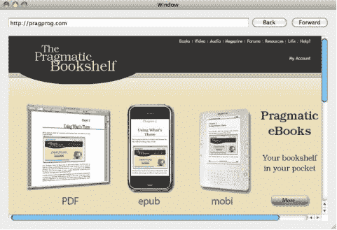

我们将不写一行代码就能创建我们的浏览器。它不会很花哨，但基本上可以工作。你将能够输入 URL 来加载你喜欢的网站。你可以像在普通浏览器中一样，通过点击链接在网站间导航，还能用几个按钮在浏览历史中前进和后退。

在本章中，我们将使用 Interface Builder 和现成的组件来构建浏览器。我们会挑选几个按钮、一个文本字段和一个用于显示网页的特殊组件（来自某个库）。我们会把这些组件拖到窗口上，按照我们想要的样子排列，并确保在缩小或拉伸窗口时，它们在视觉上表现正常。然后，我们将使用 Interface Builder 来启用我们想要的行为。等我们把所有能做的都做得差不多之后，我们会快速看看幕后的一些神奇机制。

### 2.1 在 Xcode 中创建你的项目

在前几章中，我们会在 IB¹ 和 Xcode 之间来回切换，你会逐渐体会到它们各自的用途。多数情况下，你会把 Xcode 当作 IDE 来编写代码、处理数据模型和管理项目。如果你使用过其他 IDE，你会对在 Xcode 中的操作感到熟悉。

正如你所预期的，你将使用 Interface Builder 来创建 GUI。你还会使用 Interface Builder 将 GUI 元素连接到数据源、其他 GUI 元素以及代码中描述的方法。在第一个示例中，你几乎要把所有时间都花在 Interface Builder 上。

尽管这个 SimpleBrowser 示例不需要你编写任何代码，但你仍然需要从 Xcode 创建项目。启动 Xcode，使用 ⌘ N 或 文件 > 新建项目 创建一个新项目。²

你会看到各种项目模板选项，这些模板可用于开发 iPhone 或 Mac OS X 的应用。选择 Mac OS X > 应用程序 > Cocoa 应用程序。不要勾选创建基于文档的应用或使用 Core Data 的复选框。点击“选择”按钮，或者直接按 ↵。

我将项目保存为 SimpleBrowser，位于 ~/Dev/UsingWhatsThere/。你也可以选择其他名称或位置。

- 1. 这是 Interface Builder 的简称，发音为“I.B.”，但写作 IB。
- 2. 你可以在 /Developer/Applications 目录中找到 Xcode。你会经常用到它，所以最好把它拖到 Dock 中创建快捷方式。另外，请记住，你随时可以通过点击菜单栏最右侧的放大镜图标来使用 Spotlight。

你的新项目应该看起来像这样：

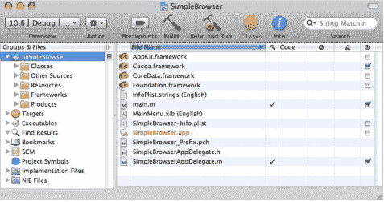

系统自动为你创建了不少基础架构。我们现在先忽略这些文件。在本章中，你所有的工作都在 MainMenu.xib 文件中完成。

你的 SimpleBrowser 应用目前还什么都做不了，但你可以试运行一下。点击 构建并运行，经过一小会儿的编译和启动后，你会看到一个空白的 SimpleBrowser 窗口，以及一个包含标准菜单和菜单项的菜单栏。你可能还会注意到，SimpleBrowser.app 在 Xcode 中不再是红色高亮，因为文件现在存在了。退出 SimpleBrowser³，然后我们开始创建界面吧。

### 2.2 用 Interface Builder 创建外观

在 Xcode 窗口中双击 MainMenu.xib (English)。这是你的主 nib 文件。nib 文件包含了你在 Interface Builder 中做的所有工作。你可以使用 Interface Builder 中的图形化工具来创建、配置和连接对象。每个 nib 文件本质上是一个经过“冻干”处理的对象图，在运行时会被重新还原。这第一个应用将只有一个 nib 文件。在本书的后面，你将会构建使用多个 nib 文件的更复杂的应用。

nib 文件过去以二进制格式存储，扩展名为 nib。现在，它们在开发过程中以 XML 格式存储，以便更好地配合版本控制。你仍然只应该通过 Interface Builder 与这些文件交互，这样持久化格式对你来说是透明的。你唯一能看到的不同之处是 XML 版本使用 xib 扩展名。尽管有这一变化，它们大多仍被称为 nib 文件（发音为“nib”，而不是“N.I.B.”），不过也有人把 xib 文件读作“zibs”。⁴

> 3. 关闭窗口并不会退出应用。你需要在 Xcode 中停止任务，或者在 SimpleBrowser 处于活动状态时按 ⌘ Q 或使用菜单退出。

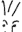

#### Joe 问道...

**难道我们不应该写代码吗？**

凡是在 Interface Builder 中能完成的事情，都能用代码完成。但一般来说，凡是能在 Interface Builder 中完成的事情，都应该在 Interface Builder 中完成，而不是用代码。

如果你尽可能严格地遵循这条规则，那么大多数时候，你写的代码将是特定于应用的代码，而不是通用代码。在应用中实例化并放置按钮的方式很可能没什么特别之处——所以用 Interface Builder 来做这件事吧。

在本章中，我们只会用到常见的视觉组件，如窗口、按钮、文本字段和 Web 视图。我们不需要创建自己的类，因为 Apple 已经为我们创建了它们，并把（大多数）包含在 Cocoa 框架中。我们将创建这些视觉元素的实例，并排列它们，让它们在 Interface Builder 中看起来合适。

到本章结束时，你会看到我们还可以用 Interface Builder 将按钮连接到它要执行的动作。Apple 提供给我们的 Web 视图已经知道如何跳转到给定的 URL，以及在浏览器历史中向前和向后导航。我们现在就使用这些内置行为，直到我们想要自定义浏览器行为时再写代码。

SimpleBrowser 由一个使用现成组件的独立窗口组成。你将在 MainMenu nib 中填入一个 Web 视图，用于渲染

> 4. nib 这个名字来自 NeXT Interface Builder 的首字母缩写。Interface Builder 以及后来演变为 Cocoa 的框架都是在 NeXT Computer 开发的。另外，当你创建发布版本时，xib 文件会被编译成 nib。


网站、一个用于输入其地址的文本字段，以及两个用于导航的按钮。

你双击 MainMenu.xib 启动了 Interface Builder。你应该会看到几个窗口。其中一个包含菜单栏的信息，另一个标题为 MainMenu.xib，并包含 File’s Owner 和 First Responder。你关心的那个窗口除了标题栏中的 *SimpleBrowser* 字样外是空的。我们将用这个窗口来容纳所有视觉元素。

使用 ⌘⇧L 或 Tools > Library 打开 Library。Library 中既有 Apple 为你提供的所有对象，也有你将在 Xcode 中创建的对象。你可以导航到想要的元素，也可以使用窗口底部的搜索框筛选结果。要查看 Apple 提供的组件，请确认顶部已选中 Objects 标签页，并且标签页正下方的下拉列表中已选中 Library。在这里，我输入了 *text* 来查找要用于 URL 输入的文本字段框。

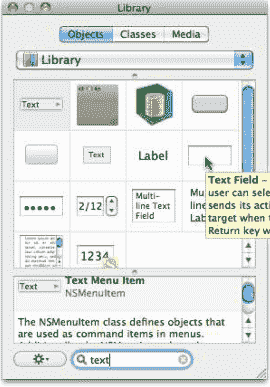

你可以右键单击 Library 窗口的中间面板来配置它。我选择显示图标，但我们也可以改为显示图标和标签，或显示 GUI 元素的图标和描述。无论选择哪种视图，你始终可以将鼠标悬停在某个组件上，以获取更多详细信息，例如上一张图中方框所示的内容。

单击 Library 中的文本字段，并将其拖到空窗口中。在窗口中拖动文本字段时，你会看到蓝色参考线，它们可帮助你按照 Apple 的《人机界面指南》放置元素。

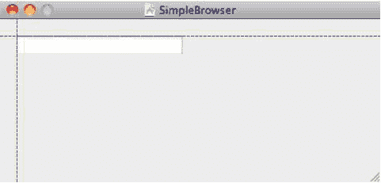

使用左侧和顶部参考线将文本字段放在窗口的左上角。你可能需要向右下方拖动窗口的右下角来增大窗口尺寸。你需要为文本字段右侧的两个按钮留出足够的空间。回头看看本章第一页中的浏览器，以提醒自己正在构建什么。

回到 Library，并清除底部搜索框中的 *text* 一词。确保顶部已选中 Objects 标签页，并使用标签页正下方的控件导航到 Library > Cocoa > Views & Cells > Buttons。你会看到许多不同的按钮。它们都是 NSButton 类的实例，但各自用于不同的场景。当你单击每一个按钮时，窗口底部的文本会发生变化，告诉你所选按钮的类型。你需要的是 Push 按钮。

单击 Library 中的 Push 按钮，并将其拖到刚刚放置在窗口中的文本字段右侧。你应该会看到水平蓝色参考线，确保它与文本字段位于同一行；当按钮靠近文本字段时，按钮左侧会出现一条垂直蓝线，表示各元素之间已具有正确的间距。

返回 Library，再取一个 Push 按钮，并将其拖到另一个按钮的右侧。现在窗口的顶行应包含一个文本字段和两个按钮。我们稍后还会对这三个元素做进一步调整，因此你之后有机会细化它们的大小和位置。

你还有一个元素要放置。回到 Library，找到 Library > WebKit。它不在 Cocoa 下。它属于一个单独的框架，你稍后需要使用 Xcode 将其链接到项目中。该框架包含一个名为 WebView 的视觉元素。网页将在这个元素中渲染。单击看起来像 Safari 图标的图标，并将其拖入窗口。调整 Web 视图的位置，使其占据窗口的其余部分。现在你应该会看到类似下面的内容：

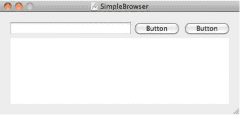

花点时间调整按钮、文本字段和 Web 视图的大小并重新排列它们，使一切看起来符合你的期望。

在按照这些“单击这里”和“拖到那里”的说明操作时，很容易忽略整体目标。在本节中，你已从面板中选取了应用程序界面所需的对象，并将它们放置在主窗口中，使其呈现为用户在启动时看到的样子。

使用 ⌘S 或 File > Save 保存工作。关闭 Library 窗口。本章剩余部分不再需要它。

### 2.3 使用 Cocoa 模拟器测试界面

你应该不时停下来操作一下界面，确保它的行为符合你的期望。首先，你需要将 Interface Builder 选为当前应用程序（单击任意 IB 窗口）。使用 ⌘R 或 File > Simulate Interface 启动 Cocoa 模拟器。

目前还没有连接任何内容，因此你还不能检查行为。现在，你只能测试应用程序的外观是否正确。调整窗口大小。把它变得非常大。再把它变得非常小。

这些项目的行为可能并不符合你的期望。当你把窗口变得非常大时，你希望 Web 视图相应地增大。当你把窗口拉宽时，你希望按钮和文本字段保持彼此靠近，并让文本字段增大以弥补多出的空间。

问题在于，你还没有告诉应用程序，当窗口被拉伸和缩小时，你希望这些组件如何表现。使用 ⌘Q 或 Cocoa Simulator > Quit Cocoa Simulator 退出模拟器。

我们来修正窗口大小改变时组件尺寸的变化方式。你需要在 IB 中打开大小检查器。可以使用 ⌘3 来完成。（使用 ⌘3 是因为大小检查器是检查器窗口中的第三个标签页。）你也可以用鼠标通过 Tools > Size Inspector 选择大小检查器。如果检查器已经打开，你可以选择从左数第三个标签页。⁵ 也就是那个图标看起来像尺子的标签页。你还可以使用 ⌘I 或 Tools > Inspector 打开检查器。无论如何，如果你选中一个按钮并打开大小检查器，你应该会看到类似下一页截图的内容。

5. 有很多方法可以打开每个检查器。我给出不止一种方法，因为有些人喜欢菜单，另一些人喜欢键盘快捷键。选择你最喜欢的一种即可。

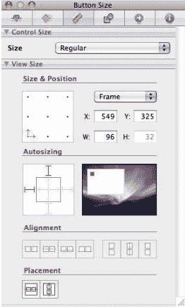

当你通过单击来打开和关闭它们时，右侧的动画会显示所做更改的结果。通过这种方式，你可以控制窗口增大和缩小时组件哪些边被锚定。你还应该尝试打开和关闭内部方块中的水平和垂直弹簧。通过这种方式，你可以控制窗口大小变化时组件拉伸和收缩的方向。

以下是两个按钮、Web 视图和文本字段的设置：

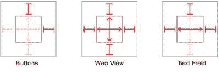

当窗口增大和缩小时，每个元素的顶部与窗口顶部之间的距离将保持不变。两个按钮的右侧与窗口右侧之间的距离将保持不变。文本字段将水平增大，使其两侧与窗口边缘之间的距离保持不变。最后，Web 视图将在水平和垂直方向增大，以填满窗口的其余部分。

保存工作，并在 Cocoa 模拟器中测试结果。将窗口一直缩小，然后再展开。很可能这会让你的界面表现不佳。你应该设置窗口的最小尺寸。为此，请退出 Cocoa 模拟器，并选择 Window 对象。在大小检查器中，你会看到一个 Window Size 区域。选中 Minimum Size 复选框，并单击 Use Current 按钮。保存工作。现在用户将无法把窗口缩小到小于当前尺寸。如果愿意，你还可以用同样的方式设置窗口的最大尺寸。

再次在 Cocoa 模拟器中测试结果。在这里时，花几分钟尝试支柱和弹簧的设置，并尝试为窗口设置不同的最大和最小尺寸。

### 2.4 完成界面

你还有两个标签为 Button 的按钮。更改按钮标签的一种方法是双击按钮并输入新名称。另一种方法是使用检查器并选择 Attributes 标签页。这是检查器最左侧的标签页——带有滑块图标的那个。你也可以使用 ⌘1 或 Tools > Attributes Inspector 访问此标签页。

通过选中 *Title* 右侧的矩形，并在数据输入字段中输入 *Back*，将最左侧按钮的标题设置为 *Back*。当你选择检查器的另一个区域时，你会看到按钮的标题发生变化。顺便，将此按钮的键盘等效项设置为 ⌘←：单击 Key Equivalent 标签旁边的灰色矩形，然后在按住 Command 键（⌘）的同时输入左箭头（←）。


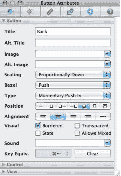

将另一个按钮的标题设置为 Forward，并将其键盘等效项设置为 ⌘ →。接下来，选择 Window，并将其标题设置为 SimpleBrowser。

最后，让我们为用户提供一个默认值，并提示如何使用我们的浏览器。将文本字段的标题设置为 http://pragprog.com，可以双击它，也可以选中它并在 Attributes inspector 中设置 title 字段的值。还要使用文本字段的 Attributes inspector 中的下拉列表，将 Action 的值设置为 Sent on Enter Only。这会配置文本字段，使其在用户按下 Enter 时发送其值。

当用户按下 Enter 时，文本字段的值会发送到哪里？我们还没有设置这一点。

现在，你已经完成了 SimpleBrowser 界面所有可视元素的创建。使用 Cocoa Simulator 再查看一下浏览器，并调整窗口或任意组件的大小。你的浏览器仍然不做任何事情——但我们将在下一节修复这一点。

#### 读取 Nib

到目前为止你所做的所有工作都以 XML 形式存储在 MainMenu.xib 文件中。你没有理由直接读取或更改你生成的 XML。这是一种旨在由 Interface Builder 创建和解释的格式。出于好玩，你也许想用最喜欢的文本编辑器打开该文件并四处看看。你可以找到文本字段、两个按钮和 web 视图。它并不好看，你也不会想以这种方式与你的 GUI 设置交互，但令人安心的是，如果你愿意，这种格式是你可以探究的。悄悄关闭文件，不要保存任何更改。在本章结束前，我们会再来看一次 MainMenu.xib。

## 2.5 连接组件

你已经使用 Interface Builder 选择并配置了将在此应用程序中使用的可视元素。你把它们放入窗口，更改了外观，设置了默认值，调整了大小，并设置了它们在窗口大小变化时如何调整。现在你准备好将它们连接起来。

例如，你想将 Back 按钮连接到 web 视图。当你点击该按钮时，你希望 web 视图显示上一个 URL 的内容。普通按钮对 web 视图一无所知。然而，web 视图应该知道如何在其历史中后退，并且应该由某个外部来源触发。所以，你只需要将 web 视图的后退能力连接到这个按钮的点击。

类似地，文本字段不应该知道 URL 和 web 视图。如果文本字段必须知道它可以为其提供文本的所有东西，API 就会庞大而脆弱。但 web 视图应该知道如何从某个其他元素的字符串中获取 URL。所以，你只需要将 web 视图的“从字符串获取 URL”能力连接到提供该字符串的组件。

这并不总是奏效，但思考谁知道什么会有帮助。在这种情况下，大部分知识都在 web 视图中。许多……

回看连接检查器。你在 goBack: 旁边点击的圆圈现在已被填充。此外，goBack: 现在在视觉上连接到 Push Button (Back)。看到 Push Button (Back) 左侧的 x 了吗？点击它。你刚刚断开了连接。

你可以像之前一样重新连接 goBack: 和 Back 按钮，或者你可以右键单击或 ^-单击（即 Control-单击）web 视图，以调出浮窗显示版本。和之前一样，点击 goBack: 旁边的圆圈，并拖到 Back 按钮。松开鼠标，你就重新连接了 goBack: 和 Back 按钮。

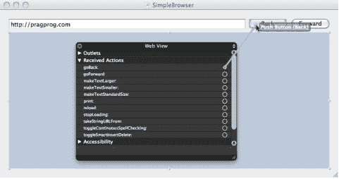

我们还有两个连接要做。再次选择 WebView，并使用连接检查器或浮窗显示。

- 1. 将 goForward: 接收的动作连接到 Forward 按钮。这将使用户能够点击 Forward 按钮，在浏览器历史中向前移动。
- 2. 将 takeStringUrlFrom: 接收的动作连接到文本字段。这使用户可以在文本字段中输入 URL，并点击 Enter 加载网页。

完成后，连接检查器应该像这样：

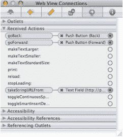

仿佛你的选项还不够多，你也可以按相反方向建立这些连接。例如，选择 Back 按钮并查看它的连接检查器。在 Sent Actions 区域，你应该看到单个条目 selector:⁶ 选中它，将连接拖回 WebView，然后松开。应该会出现一个包含 web 视图所有动作的灰色框。

选择 goBack:。你现在已经成功地按相反方向建立了连接。你很快就会围绕自己最喜欢的方法和方向形成节奏。坚持使用你最 comfortable 的方式。

#### 在模拟器中测试浏览器

保存你的工作，并在 Cocoa Simulator 中打开它。点击文本字段，然后按 ↵。Pragmatic Programmer 主页应该会出现。输入另一个 URL，然后按 ↵。尽管这基本可行，但我有几点简短说明：

- 不要忘记包含 http://，因为这只是一个非常基础的 web 浏览器。

⁶. 选择器是被调用方法的名称，冒号表示该方法接受单个参数。你将在第3章*方法与参数*第48页学到更多关于选择器的内容。

- 不要选择过于复杂的页面或需要身份验证的页面。这是一个非常基础的 web 浏览器。
- 一旦第二个页面出现，你可以点击 Back 和 Forward 按钮，在两个页面之间来回导航。

这很棒！至少在这里的模拟器中，你有一个可工作的 web 浏览器。

我们的浏览器没有一些你即使在最简陋的浏览器中也可能期望看到的功能。例如，页面加载时你得不到任何反馈。当你第一次运行 SimpleBrowser 时，你可能会以为什么也没发生，直到停顿之后页面出现。此外，当你点击 Back 和 Forward 时，URL 不会改变。如果你加载 http://pragprog.com，然后加载 http://apple.com，然后点击 Back 按钮，你会看到 Pragmatic Programmer 的主页，尽管 URL 仍会显示 http://apple.com。我们将在接下来几章中处理这些问题。

## 2.6 修复构建

感觉你已经完成了。你可以在 Cocoa Simulator 中玩你的应用程序。你在 Interface Builder 中的所有工作都正确且完整，而且这个 SimpleBrowser 项目没有代码要写。然而，你还没有一个可以交给别人在其机器上运行的应用程序。你需要回到 Xcode 并创建一个发布版本。

在 Xcode 中，点击 Build & Run。构建成功，看起来 SimpleBrowser 开始加载。图标在 Dock 中弹跳了一会儿，但什么也没发生。取决于你的设置，你可能会发现自己身处调试器中，看到堆栈跟踪和一条警告。

啊——。点击 Stop 按钮，或选择 Run > Stop。⁸ 我们需要添加 WebKit.framework。

我之前提到过我们必须把它链接进来。我们本可以在将 WebView 从 Library 拖到窗口时完成。现在你看到了可能出现的问题，很可能你会更容易记住它。请参阅本页的*Joe 问……*，了解你如何自行诊断该问题的解释。

⁷ 这个示例的重点不是构建一个健壮的 web 浏览器，而是使用 web 浏览器作为示例应用程序，让我们向你介绍 Cocoa 编程。例如，目前你还无法加载包含 Flash 的页面。

⁸ 如果你安装的 Xcode 看起来和我的不一样，你总是可以通过选择 View > Customize Toolbar... 来自定义工具栏。此外，你可以从 Xcode > Preferences 进行许多调整。


#### Joe 问……

##### 我怎么会知道要添加 WebKit 框架？

首先使用 Run > Debugger 或 ⇧⌘Y 打开调试器。取决于你如何配置 Xcode，你可能还会看到一个看起来像杀虫喷雾的图标，可以点击。在 Xcode 窗口左上角，你会看到警告：应用程序正在

```
TERMINATING DUE TO UNCAUGHT_EXCEPTION
```

堆栈跟踪不太有帮助，但如果你查看 Console，你很快就会看到问题。使用 ⇧⌘R 或 Run > Console 打开 Console。你会看到一个 gdb 提示符。向上滚动越过堆栈列表。就在这上面，你会看到一系列行，每一行都以时间戳、单词 SimpleBrowser 以及包含进程号的标识符周围的括号开头。一旦你解析掉所有这些信息，你应该会得到类似这样的内容：

```
An uncaught exception was raised
-[NSKeyedUnarchiver decodeObjectForKey:]
        cannot decode object of class (WebView)
Terminating app due to uncaught exception
        'NSInvalidArgumentException'
```

啊哈！问题在于解归档一个 WebView 对象。你的 nib 本质上是对象及其连接的归档。你需要加载 WebKit 框架，以便 WebView 能够成功重建。

当我们从库中拖出 WebView 实例时，我们看到它是 WebKit 框架的一部分，而不是 Cocoa 框架的一部分。我本以为 Xcode 会自动将 WebKit 框架添加到相应项目中进行链接，但它不会。你需要自己做这件事。

从项目视图中，选择 SimpleBrowser 组中的 Frameworks 文件夹。你应该看到已经有四个框架添加到了项目中，但如果你查看最右列，你会看到只有 Cocoa.framework 对我们的目标处于活动状态。


右键单击或按住 Control 键单击 Frameworks 文件夹，然后选择“添加”>“现有框架...”。

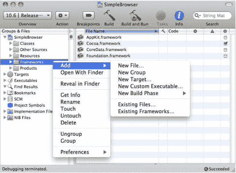

选择 WebKit.framework，并确保添加后勾选了目标复选框。⁹

9. 你也可以通过选择目标来添加框架，方法是在“添加”>“现有框架...”中操作，或是在选中“显示简介”后出现的“通用”标签页中进行操作。

恭喜！现在你可以在 Xcode 中构建并运行你的应用程序了。

### 2.7 分享你的浏览器

既然你已经费了这么多功夫创建了一个可用的浏览器，你自然想把你的应用程序分享给朋友——至少是那些运行 Mac OS X 的朋友。请确保你的“活动构建配置”设置为 Release 而不是 Debug。你可以通过“项目”>“设置活动构建配置”>“Release”来完成此操作，或者如果你已在 Xcode 偏好设置中显示了该下拉菜单，也可以使用 Xcode 中的“活动构建配置”下拉菜单。

设置好构建目标后，再次点击“构建并运行”。这一次，你的 SimpleBrowser 应用程序应该能够顺利构建、链接并启动。查看项目中的 `build/Release` 目录。

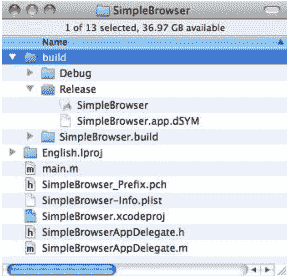

你应该能看到你的 SimpleBrowser 应用程序。由于我们选择的是 Release 而不是 Debug 作为目标，这个文件可以分发并在其他机器上运行。最简单的方法是右键单击 `build/Release` 目录中的 SimpleBrowser 文件，然后选择“压缩‘SimpleBrowser’”选项。这会生成 SimpleBrowser.zip，你可以将其发送给朋友。

### 2.8 练习：重复练习

在本章中，你没有编写任何代码就创建了一个可用的网页浏览器。你利用 Apple 的 WebKit 框架为你完成了大部分工作。你花了大量时间让应用程序看起来美观，最后只需几次点击和拖拽就实现了所需的行为。

你学会了如何分步完成这些工作，但这并不是你实际工作时的习惯。如果你要重新做一遍，你会将多个步骤合并。当你拖入第一个按钮时，你可能会立即将其命名为“Back”并连接到网页视图。

虽然你可能想跳过这个练习，但从头开始重新创建这个浏览器会让你受益匪浅。在没有别人一步步告诉你该做什么的情况下，各个部分会逐渐拼合在一起。花五分钟制作你自己的网页浏览器，你会巩固所学到的知识。

### 2.9 Nib 文件

你在本章中完成的所有工作都保存在一个 nib 文件中。*nib* 是一个对象归档文件。在 Cocoa 中，nib 文件包含在运行时将 UI 元素激活所需的所有信息。一个典型的 Cocoa 应用程序会有许多 nib 文件，这些文件仅在需要创建构成用户界面的对象实例时才会被加载，而且正如你在第 141 页第 8 章《创建控制器》中看到的那样，非可视对象也是如此。

nib 文件表示你使用 Interface Builder 构建的对象图，这样每次应用程序启动时，界面和 nib 中保存的其他对象都可以被重新构建。你将在 Xcode 中定义类，并在 Xcode 或 Interface Builder 中将类实例化为对象。在 Interface Builder 中创建的 nib 文件是一个冻结的对象图，在运行时会被重新激活。

在本书中，我们会多次回到 Interface Builder 和 nib 文件这个话题。你还可以在 Apple 的 *Interface Builder 用户指南* [App08e] 中找到大量相关信息。Scott Stevenson 也有一篇不错的快速入门教程，介绍如何无需编写代码创建一个不同的应用程序。¹⁰

10. http://cocoadevcentral.com/d/learn_cocoa/

#### 文档窗口

让我们看看 MainMenu nib 中的对象。双击 MainMenu.xib 在 Interface Builder 中重新打开它。这次，通过菜单项“窗口”>“文档”或使用快捷键 ⌘O 打开文档窗口。

我更喜欢列表视图模式，你可以通过左上角三个标签页中间的那个来选择。我还展开了“Window”对象及其包含对象的展开三角形。这个层次结构包含我们放置在布局窗口中的所有 GUI 组件。

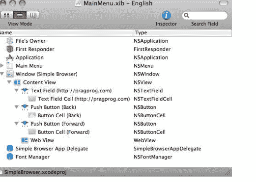

`SimpleBrowser.xcodeproj`

查看 Window 层次结构，你会发现窗口中包含一个内容视图，其中包含我们拖到窗口上的四个组件。nib 文件还包含主菜单和一堆非可视元素。我现在不打算逐一说明它们各自的作用，但我希望向你展示 nib 中对象的这个视图，因为稍后我们会用它来连接可视和非可视元素。这个窗口将帮助我们把在 Interface Builder 中构建的内容与在 Xcode 中编写的代码连接起来。这也是选择嵌套在布局窗口中的组件的一种便捷方式。此外，如果你不小心关闭了布局窗口，可以双击文档窗口中的“Window（SimpleBrowser）”项，布局窗口就会显示到前面。

#### Nib 的 XML 表示

文档窗口为我们提供了 nib 文件的一种视图。为了看到另一种视图，让我们看看在开发过程中用于持久化 nib 的实际 XML。我们先简要回顾一下本章中创建和使用 nib 的过程。

我们的特定 nib 包含两个按钮，每个按钮都是 NSButton 类的实例。如果你在 Interface Builder 库中搜索 NSButton，你不会只找到一个按钮。你应该会看到十几个或更多按钮，如下图所示：

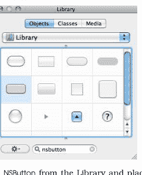

当你从库中拖入一个 NSButton 并将其放置在视图中时，你就是在创建 NSButton 类的一个实例。你可以从图中看到的任意一个 NSButton 开始，将其变成你想要的 NSButton 实例。但 Apple 向你展示的是一组外观各异的按钮。这意味着，当你在库中浏览时，你真正关注的并不是找到一个 NSButton，而是寻找一个具有特定外观或以特定方式使用的按钮。也就是说，你是从最终用户的角度来寻找组件的。

你可以选择、放置并配置你的按钮。通过阅读 XML，你至少可以了解其中存储的部分信息。

我们将用文本编辑器打开 MainMenu.xib，只是为了看一看。你以后再也不需要通过这种方式来查看 nib 文件的内容。更重要的是，请向我保证，当 nib 文件在文本编辑器中打开时，你绝不会更改其中的任何内容。Interface Builder 是你用来创建、查看或修改 nib 的唯一工具。

如果你还没有这样做，请用文本编辑器打开 MainMenu.xib。搜索文本 NSButton，并查找文件中描述 Back 按钮外观的这一部分：

下载 `UsingWhatIsWhere/SampleNib/MainMenu.xib`

```xml
<object class="NSButton" id="164086064">
    <reference key="NSNextResponder" ref="439893737"/>
    <int key="NSvFlags">265</int>
    <string key="NSFrame">{{277, 258}, {93, 32}}</string>
    <reference key="NSSuperview" ref="439893737"/>
    <bool key="NSEnabled">YES</bool>
    <object class="NSButtonCell" key="NSCell" id="941085700">
        <int key="NSCellFlags">67239424</int>
        <int key="NSCellFlags2">134217728</int>
        <string key="NSContents">Back</string>
        <reference key="NSSupport" ref="640083843"/>
        <reference key="NSControlView" ref="164086064"/>
        <int key="NSButtonFlags">-2038284033</int>
        <int key="NSButtonFlags2">268435585</int>
        <string key="NSAlternateContents"/>
        <string type="base64-UTF8" key="NSKeyEquivalent">75yCA</string>
        <int key="NSPeriodicDelay">200</int>
        <int key="NSPeriodicInterval">25</int>
    </object>
</object>
```

这描述了一个 NSButton 类型的对象。x 和 y 坐标以及高度和宽度都在以 NSFrame 为键的那一行中。NSButton 对象还包含一个 NSButtonCell 类型的对象。我们还没有讨论过 NSButtonCell，但你可以看到，按钮名称和键盘快捷键正是在这里设置的。

nib 文件还包含代表你所建立连接的对象。例如，搜索字符串 `takeStringURLFrom:`。你应该会看到 MainMenu.xib 中的这一部分：

下载 `UsingWhatIsWhere/SampleNib/MainMenu.xib`

```xml
<object class="IBConnectionRecord">
    <object class="IBConnection" key="connection">
        <string key="label">takeStringURLFrom:</string>
        <reference key="source" ref="1029174864"/>
        <reference key="destination" ref="109215417"/>
    </object>
    <int key="connectionID">459</int>
</object>
```

你可以搜索目标和源的引用编号，并看到这段代码描述了一个从标签为 `takeStringURLFrom:` 的 WebView 对象到目标 NSTextField 对象的连接。在下一章中，我们将学会用稍微不同的方式来描述这一点。正如你将在下一章中看到的，这只是意味着目标（


WebView 对象）正在被发送消息 takeStringURLFrom:，并将 NSTextField 对象作为发送者传入。

在我们的特定情况下，nib 对象生命周期很直接。应用程序启动时，对象图被加载到内存中并解档。各个组件被初始化。然后建立对象之间的所有连接，并显示主菜单。

当然，任何有用的应用程序也都有自己的一份代码——那是我们旅程的下一站。

## 方法和参数

那么，你已经构建了一个可用的 Web 浏览器。一方面，你对自己感觉相当不错。你只是拖放并连接了一些点，就拥有了一个 Web 浏览器。这就是力量。

另一方面，这感觉不像真正的编程。一个*真正*的程序员不会使用一堆 GUI 工具。真正的程序员会赤手空拳地构建对象。他们会一边与内存管理搏斗，一边说“Arrrr”，并发出其他海盗般的声音。你不会对我心软吧？说起来，你甚至还没有给自己构建一个“Hello, World!”程序。

你的“Hello, World!”程序得等到下一章了。在你开始在代码中创建自己的对象并编写自己的方法之前，你需要能够轻松阅读向目标发送动作的 Objective-C 代码，并浏览 API 文档，以找出你可以向 Cocoa API 中的对象发送哪些消息。本章将向你介绍 Objective-C 和 Cocoa 中的消息。

### 3.1 发送不带参数的消息

回到第 2.5 节，*连接组件*，第 35 页，你使用 Interface Builder 创建了从 Back 按钮到 Web 视图中 `goBack:` 接收动作的连接。因此，每次点击 Back 按钮时，Web 视图的 `goBack` 方法都会被调用。¹

1. 你可能注意到，我通过去掉 `goBack` 末尾的 `:` 稍微简化了一下。稍后我会修正这一点，但在开始时这会让我们更容易理解。

假设你已经实例化了此动作中涉及的两个对象。你有一个名为 backButton 的 NSButton 实例，以及一个名为 myWebView 的 WebView 实例。当用户点击 Back 按钮时，本质上会发送这条消息：

```
[myWebView goBack]
```

方括号以及其中的所有内容构成了*消息表达式*。在这种最简单的情况下，只有两个部分：接收者和消息。myWebView 对象是接收者。它是目标——你正在向其发送消息的对象。在这个示例中，消息是 goBack。

我们正在发送一条不带参数的消息。在这种形式下，调用将如下所示：

```
[receiver message]
```

取决于你现在使用的编程语言，这可能看起来像函数调用或方法调用。换句话说，在你自己的语言中，下面的 Objective-C 消息：

```
[myWebView goBack]
```

看起来类似这样：

```
myWebView.goBack()
```

正如你所预料的，你可以用与串联方法大致相同的方式将消息串联起来。在 Java 或 C# 中，你可能会编写类似这样的代码：

```
myWebView.oneMethod().anotherMethod()
```

这会在 myWebView 上调用 oneMethod()，然后对结果调用 anotherMethod()。

在 Objective-C 中，你会这样编写同样的虚构代码：

```
[[myWebView oneMethod] anotherMethod]
```

你要由内向外阅读这些嵌套调用。首先，消息 oneMethod 被发送给 myWebView。然后，这个调用的结果成为消息 anotherMethod 的目标。

你实际上可以向 myWebView 发送哪些消息？你会花很多时间浏览 Apple 的 API 文档。让我们看看 WebView 的文档，并找到这个 goBack 方法的说明。

### 3.2 阅读文档

Apple 提供了一套全面的文档，帮助你在开发 Cocoa 应用时弄清楚该使用什么以及如何使用。你可以使用 Xcode 中的 Help > Developer Documentation 访问这些文档。当然，你不需要我的帮助也能浏览这些文档——我只是想指出你会看到的一些内容，以此鼓励你去查看。

在文档查看器右上角的搜索框中输入 *webview*，并尝试查看根据你选择搜索 iPhone、Mac OS X、Xcode 的文档集还是某种组合而得到的不同结果。[^2] 你还可以选择只关注以搜索字符串开头、包含搜索字符串或与搜索字符串完全匹配的结果。

你可以通过多种方式缩小搜索范围。目前，请选择将文档集限制为 Mac OS X 10.6 Core Library，启用所有语言，并选择 Exact。返回的结果将像这样分组在 API、Title 和 Full Text 这些标题下：

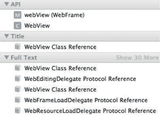

我们在 API 下的前两个结果是来自 WebFrame 类的 WebView 方法和 WebView 类。Title 标题下的唯一条目和 Full Text 标题下的第一个条目也会把我们带到 WebView 类的文档。

[^2]: 文档以及你搜索文档和筛选结果的方式在 Snow Leopard 中发生了变化。这里的说明适用于随 Snow Leopard 发布的 Xcode 3.2（及更高版本）。如果你使用的是 Leopard 或更早版本，差异应该很明显。

我们在 Full Text 下得到更多结果，因为 *webview* 只出现在一个文档的标题中，但它出现在三十多个文档的正文中。

如果你将 Doc Sets 设置改为包含 iPhone 文档，并选择 Contains 而不是 Exact，你还会在每一个类别中看到 Cocoa WebView 在 iPhone 上的对应类，即 UIWebView 类。

选择包含 WebView 类的那一行，以查看 WebView 的类参考。下面是列表的顶部：

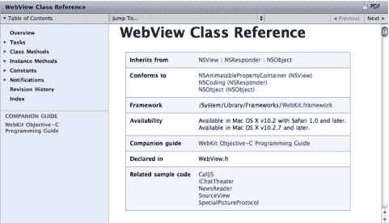

在右侧，你可以追溯从 WebView 到 Cocoa 根类 NSObject 的继承关系。WebView 继承自 NSView，NSView 继承自 NSResponder，而 NSResponder 又继承自根类 NSObject。

你还会看到使用该类需要包含哪个框架。Objective-C 使用头文件[^3]——在本例中，WebView 在 WebView.h 中声明，而 WebView.h 是 WebKit 框架的一部分。如果你要面向较旧版本的 Mac OS X，方法说明中的 Availability 部分会告诉你某个方法是否可用。

[^3]: 如果你不熟悉头文件，不用担心。第 8.4 节，*声明出口和操作*，第 146 页以及前面直到该节的材料，应该能让你很好地理解它们如何以及为何被使用。

你可以在文档中搜索特定的方法名，但左侧那个灰色框中有三个链接，可以帮助你弄清楚如何使用一个 Cocoa 类。

- *概述：* 这是关于该类用途以及应如何使用它的快速摘要。它包含指向需要特别指出的特定方法以及经常与所描述类协作的类的链接。

- *任务：* 你可以在文档后面获得类方法和实例方法的按字母顺序列表，但这里按方法的功能对方法进行了分组，换句话说，按你可能要执行的任务分组。例如，下面的截图显示了用于后退和前进的方法。我已将鼠标指针悬停在 canGoBack 方法上，以调出描述该方法的工具提示。

  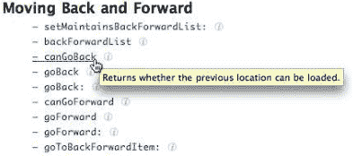

- *配套指南：* Apple 通常有一份或多份全面的文档，给出使用该类实例完成某些编程任务的示例。在本例中，你会看到一个指向 *WebKit Objective-C 编程指南* 的链接。

除了所有方法的 Tasks 列表之外，你还可以看到类方法列表和实例方法列表。还有常量和可用通知的列表。

让我们快速看一下某个方法的条目。


这两个方法完全不同。`goBack:` 方法末尾的冒号表明它接受一个参数。

在 WebView 类参考中查找 `goBack:` 方法。它的签名与无参数的 `goBack` 方法非常不同：

### goBack:

一种动作方法，用于加载后退/前进列表中的上一个位置。

```objc
- (void)goBack:(id)sender
```

**参数**

*sender*

发送此消息的对象。

**讨论**

如果无法向后移动，此方法不执行任何操作。

**可用性**

在 Mac OS X v10.2 及更高版本中，随 Safari 1.0 及更高版本可用。
在 Mac OS X v10.2.7 及更高版本中可用。

**另请参阅**

- `goForward:`

**声明于**

`WebView.h`

当你将“后退”按钮连接到 Web 视图时，你选择了这个 `goBack:` 方法作为动作。你会经常看到这种类型的签名，尤其是在设计为由 GUI 组件调用的方法中。sender 参数是指回调用对象的句柄。sender 的类型被向上转型为 `id`。这是 Cocoa 的泛类型。任何指向对象的指针至少都是 `id` 类型。拥有指向发送者的句柄，使我们能够与调用 `goBack:` 的对象通信，无论该对象是什么类型。我们将在第 58 页的 3.6 节 *链接回自身* 中查看一个典型示例，了解你可以如何利用这一点。⁴

下面是你调用接受单个参数的方法的方式：

```objc
[myWebView goBack:self]
```

如果你仍在 Objective-C 和另一种语言之间来回翻译，你可能习惯了类似这样的写法：

```text
myWebView.goBack(this)
```

⁴. `goBack:` 的返回类型是 `IBAction`。我们将等到第 141 页的第 8 章 *创建控制器* 再讨论这意味着什么。目前，你可以把它当作 void 处理。

让我们使用一个参数更多的方法，帮助你更好地理解这些差异。WebView 包含一个名称相当长的方法 `searchFor:direction:caseSensitive:wrap:`。这就是完整的方法名。在其他语言中，这可能被称为 `searchFor`，但在 Objective-C 中，所有参数的描述都包含在方法名中。将方法拆分为以冒号结尾的片段。调用该方法时，需要为每个冒号提供一个参数。方法签名使这一点更清楚，因为它指定了方法的返回类型以及每个参数的类型。

```objective-c
- (BOOL)searchFor:(NSString *)string
           direction:(BOOL)forward
       caseSensitive:(BOOL)caseFlag
                wrap:(BOOL)wrapFlag
```

下面是你可能使用它的方式：

```objective-c
[myWebView searchFor:myString direction:YES caseSensitive:NO wrap:YES]
```

在 Java 或 C# 中的等价写法可能类似这样：

```java
myWebView.searchFor(myString, true, false, true)
```

Objective-C 的新手往往更容易被冒号以及参数混在方法名中的写法劝退，而不是方括号。我完全理解。我认为部分困难来自方法短到可以列在一行中。相反，如果我们采用这种更垂直的排列方式，你可能会觉得更容易阅读：

```objective-c
[myWebView searchFor:myString
            direction:YES
        caseSensitive:NO
                 wrap:YES]
```

这里我们遵循 Objective-C 代码格式标准，并对齐冒号。这样可以很容易地把方法名看作冒号左侧元素的组合，而参数位于每个冒号的右侧。

Objective-C 版本看起来像命名参数，但它们并不是。参数的顺序不能改变。你不能省略其中任何一个。方法名是 `searchFor:direction:caseSensitive:wrap:`，它也被称为 *选择器*，因为它在运行时用于选择将要调用的方法。

你最终会真正体会到：你不必像在 Java 或 C# 版本中那样回想参数 true、false 和 true 分别指什么。在 Objective-C 版本中，你知道自己正在按给定字符串向前搜索，不区分大小写，并启用环绕。

你的 Cocoa 代码应当是可读的。在编写一个方法一个月后，你应当能够迅速重建自己的意图并理解该方法做什么。在 WebView 中，你可以看到方法 `moveToBeginningOfSentenceAndModifySelection:`。方法名可能比它的实现还长——但任何在代码中调用它或使用 Interface Builder 连接到它的人，都能立刻明白该方法做什么。

你可以在 Apple 的 *Objective-C 编程语言* [App09] 的“对象、类和消息传递”章节中找到关于方法的更多信息。Stack Overflow 上还有一篇关于在 Objective-C 中传递多个参数的好文章。⁵ 你还应当查看 Apple 的 *Cocoa 编码指南* [App06]，了解方法命名指南。Matt Gallagher 在 Cocoa with Love 上有一篇关于方法名的好文章。⁶

- 5. http://stackoverflow.com/questions/722651/how-do-i-pass-multiple-parameters-in-objective-c
- 6. http://cocoawithlove.com/2009/06/method-names-in-objective-c.html

### 3.4 动态绑定

让我们看看发送 Objective-C 消息时幕后发生了什么。最简单的情况如下所示：

```objc
[myWebView goBack]
```

在运行时会被转换为以下函数调用：

```objc
objc_msgSend(myWebView, goBack)
```

接收者作为第一个参数传入，选择器作为第二个参数传入。更复杂的消息如下所示：

```objc
[myWebView searchFor:myString direction:YES caseSensitive:NO wrap:YES]
```

在运行时会被转换为以下函数调用：

```objc
objc_msgSend(myWebView, searchFor:direction:caseSensitive:wrap:, myString, YES, NO, YES)
```

同样，接收者作为第一个参数传入，选择器作为第二个参数传入。参数作为其余函数参数传入。

- 5. http://stackoverflow.com/questions/722651/how-do-i-pass-multiple-parameters-in-objective-c
- 6. http://cocoawithlove.com/2009/06/method-names-in-objective-c.html

以下是你不需要知道太多的内容：在运行时，选择器会与对象类的分派表中的一个条目匹配，该条目指向实现所请求方法的过程的内存位置。如果该类中不存在该选择器，则搜索会在该类的超类中继续，并沿着树向上一直到根类。更多信息请阅读 Apple 的 *Objective-C 2.0 编程语言*，你可以从 Xcode 的文档窗口中访问它。

### 3.5 发送消息时的问题

在 Objective-C 中，一个简单消息可能出两种基本问题：要么接收者可能不存在，在这种情况下它的值为 nil；要么对象可能有效，但可能不理解发送给它的消息。尝试构建应用程序时，你可能会收到编译器警告，但这两种错误都不会中断构建，也不会阻止别人尝试运行应用程序。

在第一种情况下，你发送的是如下形式的消息：

```objc
[nil someMessage];
```

编译时不会出错，运行时也不会抛出异常。此外，如果 someMessage 返回对象、指针类型或大多数有效数值类型，那么此消息返回 0。

在第二种情况下，你发送的是这样的消息：

```objc
[validObject someMessageItDoesNotUnderstand];
```

这一次，当接收者收到它不理解的消息时，应用程序将终止。⁷ 这个问题在编译时悄悄溜过，却导致了运行时异常。如果 validObject 是虚构类 CustomClass 的实例，你将在控制台中看到类似这样的消息：

```text
*** -[CustomClass someMessageItDoesNotUnderstand]:
        unrecognized selector sent to instance 0x102980
*** Terminating app due to uncaught exception 'NSInvalidArgumentException'
```

⁷. 如果一个对象或其某个超类声明并实现了相应的方法，则该对象会“理解”一条消息。


这表明消息 someMessageIDoesNotUnderstand 被发送给了 CustomClass 的一个实例，而 CustomClass 并未实现该方法。

那么，为什么这没有在编译时被捕获呢？它很可能已经被捕获了。你多半会收到一个警告，指出 CustomClass 可能无法响应消息 someMessageIDoesNotUnderstand。⁸

有时我们会利用动态类型和动态绑定，另一些时候我们会发现，如果编译器知道我们面向的类型，那么利用编译器能提供的帮助是有益的。避免运行时错误的一种方法是熟悉 Apple 的文档，以便你发送给对象的是它们能够理解的消息。

### 3.6 链接回自身

我们使用了 WebView 方法 takeStringURLFrom:，以便将用户在文本字段中输入的 URL 用于 Web 视图。takeStringURLFrom: 的签名看起来和 goBack: 方法的签名很像。

```
- (IBAction)takeStringURLFrom:(id)sender
```

假设我们有一个名为 myWebView 的 WebView 实例，并且文本字段是一个名为 addressField 的 NSTextField 实例。那么，当用户在文本字段中输入一个字符串并按下 ↵ 时，就会发送类似下面这样的消息：

```
[myWebView takeStringURLFrom: self]
```

你可以将其想象为一条来自文本字段的消息，其目标是 WebView 实例。


⁸. 有时你可以谨慎地忽略这个警告。你可能知道，在运行时 validObject 不会是 CustomClass 的实例，而会是一个能够处理 someMessageIDoesNotUnderstand 的类的实例。

Web 视图接收到这条消息，并准备加载一个新的网页。首先，它需要从某处获取包含 URL 的字符串。由于刚刚收到的消息，它知道该从哪里获取。WebView 对象会向发送 takeStringURLFrom: 消息的对象发回一条消息，请求其字符串值。

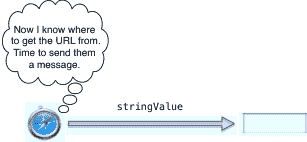

WebView 对象发送这条消息：

```
[sender stringValue]
```

Web 视图会向发送 takeStringURLFrom: 消息的对象发回一条消息，请求其字符串值。发送者是一个有效对象，我们假设其类型能够响应 stringValue 消息，但编译器无法替我们检查这一点。我们在编译时无法知道发送者的类型，然而在运行时一切正常。

随后，Web 视图会尝试加载作为对该消息的响应而以字符串形式提供的 URL。

### 3.7 练习：多重连接

你可以通过修改 SimpleBrowser 项目来实际查看这一点。完成后我们会丢弃这个版本，因此请复制现有的 SimpleBrowser 项目，以便你可以在该副本中完成所有工作。

让我们一起完成这个练习。完成后，你将把 Web 视图连接到多个文本字段，并让它能够从其中任意一个文本字段获取其字符串 URL。

打开你项目副本中的 nib 文件，并添加两个具有不同默认地址的文本字段，使应用程序在运行时看起来像这样：

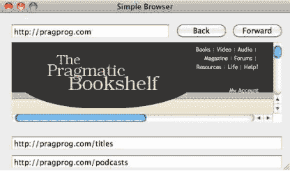

在 Interface Builder 中，选择 Web 视图，并使用检查器查看其连接。接收动作 takeStringURLFrom: 与你的第一个文本字段之间应该有一个连接，并且圆圈应像之前一样被填满。

但我们知道 takeStringURLFrom: 如何工作。它做的第一件事就是向调用该方法的组件发回一条消息。因此，我们没有理由不能将这个接收动作连接到多个元素。从已填满的圆圈拖到你在窗口底部添加的两个文本字段之一。再从已填满的圆圈拖到你添加的另一个文本字段。现在你的 Web 视图已准备好从任一文本字段获取其 URL。你可以在这里看到多重选择：

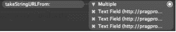

保存你的工作，并测试修改后的应用程序。你可以从任意一个文本字段输入 URL。事实上，你本可以混合搭配用于传入 URL 的可视组件类型。该组件只需要能够用包含有效 URL 的字符串来响应 stringValue 消息即可。

在继续之前，你可能想保存此项目的副本，并还原到我们添加两个文本字段之前的版本。继续并关闭此项目；接下来的三章我们不需要这个浏览器示例。

既然你已经知道如何阅读 Objective-C 中的方法，你就可以自己编写一些方法来自定义 SimpleBrowser 的行为。在我们回到浏览器之前，我们会花一点时间探索类、对象、实例变量和属性。

## 第 4 章：类与对象

我们将暂时把浏览器示例搁置几章。既然你已经能阅读方法，现在就该自己编写一些方法了。这一章是你开始编写 Objective-C 代码的地方。你将从一个相当基础的“Hello, World!”应用程序开始，并学习创建类、对象、变量和方法。

请记住，我们的目的不是创建一个出色的“Hello, World!”应用程序。在本章过程中，我们程序的输出不会发生太大变化。重点在于我们逐步使用不同技术的过程。你将使用 Apple 的一个类，然后创建自己的一个类。你将使用类方法与这些类通信。然后，你将创建一个类的实例，并使用实例方法与这些对象通信。在我们重新找回作为真正开发者的自尊之后，我们将在第 8 章“创建控制器”（第 141 页）回到 Web 浏览器示例，并通过编写自己的代码来自定义其行为。

### 4.1 创建“Hello, World!”

让我们在 Xcode 中创建“Hello, World!”项目。请记住，在 Xcode 中，你可以通过 File > New Project 或 ⇧ ⌘ N 创建新项目。选择 Application > Cocoa Application 模板，保持所有复选框未选中，并将项目命名为 HelloWorld。点击 Build & Run，稍等片刻后，会出现一个空窗口。应用程序可以运行；只是它什么也不做。退出 HelloWorld，或者在 Xcode 内通过点击停止标志、选择 Run > Stop 或按 ⇧ ⌘ ↩ 来停止任务。

### 函数

NSLog() 看起来完全不像上一章中看到的方括号、冒号、目标和动作。

它本来就不应该像。NSLog() 不是 Objective-C 方法——它是一个 C 函数。Objective-C 建立在 C 之上。尽管你应优先使用向类和对象发送消息的 Objective-C 风格，但你也可以使用老式的 C 来完成任务。

当你处理系统级调用以及与图形对象相关的 API 时，会看到许多 C 风格函数。你可以通过它们使用普通括号来捕获参数来识别 C 函数，而且你只需调用函数而无需指定目标。在本章中，我会不时指出这些差异，很快你就会习惯 C 和 Objective-C 构造的混合使用。

在你可能见过的传统 C“Hello, World!”应用程序中（甚至在旧版 Cocoa“Hello, World!”应用程序中），你会把这行代码放在 main() 中。你的程序在文件 main.m 中有一个 main()，你可以在 Groups & Files 的 Other Sources 目录中找到它。

`Download Code / Classes/HelloWorld/main.m`

```
#import <Cocoa/Cocoa.h>

int main(int argc, char *argv[])
{
    return NSApplicationMain(argc, (const char **) argv);
}
```

我们将不去改动 main.m。我们永远不会向其中添加内容或修改它。main() 的所有操作都包含在对函数 NSApplicationMain() 的调用中。在我们的例子中，这个函数创建 NSApplication 类的一个实例并加载 MainMenu nib。换句话说，它启动应用程序。

如果你是 C 程序员，你会想把更多编程逻辑放在这里的 main() 函数中。不要这样做。这种自定义有一个新位置，即应用程序委托。你将在本书中大量看到这种委托模式。

这第一次讲解时，我会略过细节，但核心思想是，NSApplication 类非常了解应用程序如何

通常应如何表现。它不可能知道任何特定应用程序应如何表现。一种解决方案是让我们继承 NSApplication，并用自定义行为重写相应方法。在 Cocoa 应用程序中，我们往往采用不同的方法。我们为 NSApplication 指定一个委托对象，并且只实现需要实现的方法。那么什么是委托？你可以把它看作一个助手类，主类会把工作交给它。当主类（在这里是 Application）需要完成某项工作时，它会调用其委托类中的方法。

幸运的是，Cocoa Application 模板为我们创建了一个名为 HelloWorldAppDelegate 的应用程序委托。你可以在 Groups & Files 下的 Classes 文件夹中找到源文件。²

- HelloWorld
  - Classes
    - HelloWorldAppDelegate.h
    - HelloWorldAppDelegate.m
  - Other Sources
  - Resources
  - Frameworks
  - Products

Cocoa Application 模板创建了文件 HelloWorldAppDelegate.h 和 HelloWorldAppDelegate.m，这两个文件共同定义了类 HelloWorldAppDelegate。

在 HelloWorldAppDelegate.m 内部，有一个名为 applicationDidFinishLaunching: 的方法，其中包含以下注释：

```
// Insert code here to initialize your application
```

用日志行替换该注释，如下所示：

[下载 Classes/HelloWorld/HelloWorldAppDelegate.m](#)

```objc
#import "HelloWorldAppDelegate.h"
@implementation HelloWorldAppDelegate
@synthesize window;

- (void)applicationDidFinishLaunching:(NSNotification *)aNotification {
    NSLog(@"Hello, World!");
}
@end
```

² 如果你找不到这些文件，你使用的可能是 Xcode 3.1 或更早版本，需要升级到 Xcode 3.2 或更高版本。

这个方法究竟是如何被调用的？我们并没有从 main() 中显式调用它。事实上，我们没有从任何地方显式调用它。

简单解释是：在运行时，应用程序完成启动后，应用程序对象会向它的委托发送 applicationDidFinishLaunching 消息。稍微详细一点的解释就是你在上一章看到的内容：如果委托没有实现这个方法，那么调用它时就会出现运行时错误。所以，真正发生的情况是：应用程序对象会检查并确保委托实现了该方法；如果实现了，它才发送消息。

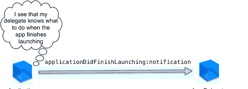

要运行应用程序，首先通过“运行 > 控制台”或 ⇧ ⌘ R 显示控制台。接下来，通过选择“运行 > 清除控制台”、按下 ⌃ ⌘ R，或在可见时点击“清除控制台”按钮来清空控制台。最后，点击“构建并运行”（或使用其键盘快捷键 ⌘R）。

HelloWorld 应该会启动，出现一个空窗口，控制台应包含一行表示会话开始时间的内容，后面跟着一行带有时间戳、进程 ID 和我们创建的字符串的内容。我的看起来像这样：

```
HelloWorld[19673:10b] Hello, world!
```

稍微欣赏一下你的成果后，就可以退出 HelloWorld，回去继续工作了。

### 4.3 使用现有类

我们已经有了一个能漂亮地打印到控制台的“Hello, World”应用。下一步，我们将在代码中创建一个文本字段，将它添加到窗口中，稍作配置，然后在这个文本字段中显示“Hello, World!”。记住，我们的目标并不是在文本字段中打印出“Hello, World!”。如果那只是我们唯一的目标，我们完全可以直接从 Interface Builder 的库中拖出该控件，然后输入短语 *Hello, World!*³。Interface Builder 的经验法则很简单：只要能用 Interface Builder，就应该使用 Interface Builder。你在 Interface Builder 中能做的事情，没有什么是代码做不到的。除了非常特殊的情况，没有任何理由避免使用 Interface Builder。

本节就是这种特殊情况之一。本节的目标是积累使用代码来实例化、配置和使用一个并非由我们编写的类的经验。之后，我们就准备好创建并使用自己的类了。

为了让事情稍微简单一些，双击 MainMenu.xib 启动 Interface Builder，选择你的窗口，并使用大小检查器将窗口宽度设为 580、高度设为 90。遗憾的是，如果点击窗口内部，很容易误选视图。如果点击窗口的标题栏，那么大小检查器的标题栏应显示 *窗口大小*。

我也将窗口的最大和最小尺寸设为了这些尺寸，这样用户就无法调整窗口大小。这些尺寸没有什么神奇之处，但当我们创建并放置标签时，知道窗口尺寸会对我们有帮助。

那么，回想一下在我们的 SimpleBrowser 示例中，将文本字段放到窗口顶部时发生了什么。你从库中抓取一个文本字段，把它拖到窗口上并放下。它会自动添加到视图层级中。你的 Document 窗口看起来大致如下：

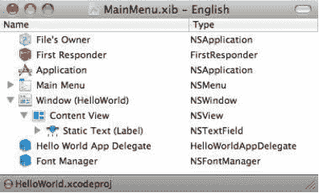

³ 在本例中用代码创建文本字段的一个附带好处是，它应该有助于说服你尽可能使用 Interface Builder。

尽管你当时可能没有注意，但窗口包含一个 ContentView。当你将文本字段拖放到窗口上时，你创建了一个 NSTextField 实例，并将它作为 ContentView 的子视图添加进去。

然后你重新定位了文本字段，并更改文本以显示你想要的内容。下面是我们可能在代码中这样做的方式：⁴

下载类：HelloWorld2/HelloWorldAppDelegate.m

```objc
#import "HelloWorldAppDelegate.h"
@implementation HelloWorldAppDelegate
@synthesize window;

-(void)applicationDidFinishLaunching:(NSNotification *)aNotification {
    NSRect    labelLocation = NSMakeRect(20, 20, 540, 50);
    NSTextField *label = [[NSTextField alloc] initWithFrame:labelLocation];
    [label setStringValue:@"Hello, World!"];
    [[self.window contentView] addSubview:label];
}
@end
```

首先，我们创建一个 NSRect，用于保存标签的大小和位置信息。这与我们在第 2 章 *使用现有内容*（第 24 页）中使用 Interface Builder 所做的工作一致：当时我们调整了文本字段的大小，或在大小检查器中设置了它的尺寸。注意，NSMakeRect() 是一个 C 函数，而不是方法。在处理图形元素时，这相当典型。尽管现在这些信息肯定太多了，但 NSRect 或 NSPoint 是 C 结构体，而不是 Objective-C 对象。总会有相应的 C 函数（例如 NSMakeRect() 或 NSMakePoint()）来创建和配置这些元素。

接下来，我们创建一个名为 label 的 NSTextField 实例，并将其位置和尺寸设置为 labelLocation 变量所描述的值。我们将标签的字符串值设为 Hello, World!，并将该标签作为窗口内容视图的子视图添加进去。

---

⁴ 目前我假设你明白 *self.window* 指的是当前对象的窗口实例。我会在第 5 章 *实例变量与属性*（第 86 页）中解释点语法。

点击“构建并运行”，你应该会看到类似下面的内容：

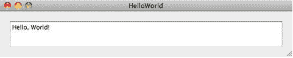

我对这个项目当前的状态不太满意。当然，输出看起来很难看，我们会修正这一点，但我主要关心的是代码的状态。我们来稍微重构一下。

### 4.4 重构代码

时不时地从代码中退后一步，看看哪些地方需要清理，会很有帮助。现在我看了看，我不喜欢 labelLocation 这个名字。当然，我们完全可以去掉这个变量，直接内联创建 NSRect，而不使用解释性的临时变量。那会是一种解决方案。

如果我们改为选择重命名这个变量，那么需要考虑到它不仅是标签的位置，还包括标签的大小。你可能已经从方法名 initWithFrame 猜到，这两部分信息被收集在一个 NSRect 中，称为 frame（框架）。

让我们使用 Xcode 将变量名从 labelLocation 改为 labelFrame。在这种情况下，手动进行更改已经足够简单，但我想向你介绍如何使用 Xcode 执行几项重构。

我不知道你是否已经注意到，但当你点击 labelLocation 时（来吧，点一下它），所有 labelLocation 实例都会带下划线。⁵ 如果你将鼠标悬停在已选中的 labelLocation 周围、稍微靠右的位置，就会出现一个下拉箭头。这与你悬停在 Mail.app 中阅读的电子邮件里的电话号码或地址上时看到的界面相同。点击这个箭头，你应该会看到这里显示的选项：

```objc
-(void)applicationDidFinishLaunching:(NSNotification *)aNotification {
    NSRect labelLocation = NSMakeRect(..., ..., ..., 50);
    NSTextField *label = [[NSTextField alloc] initWithFrame:labelLocation];
    [label setStringValue:...];
    [self.window addSubview:label];
}
```

⁵ 这里 labelLocation 只出现了一次，但你明白意思。


这是生成的 HelloWorldAppDelegate.m 文件：

下载 Classes/HelloWorld/HelloWorldAppDelegate.m

```objc
#import "HelloWorldAppDelegate.h"
@implementation HelloWorldAppDelegate
@synthesize window;

-(void)createLabel {
    NSRect labelFrame = NSMakeRect(20, 20, 540, 50);
    NSTextField *label = [[NSTextField alloc] initWithFrame:labelFrame];
    [label setStringValue:@"Hello, World!"];
    [[self.window contentView] addSubview:label];
}
-(void)applicationDidFinishLaunching:(NSNotification *)aNotification {
    [self createLabel];
}
@end
```

现在 applicationDidFinishLaunching: 变得简洁清晰。它只包含对 createLabel 的一次调用。四点简要说明：

- createLabel 没有理由必须是一个方法。在重构过程中，我本可以选择将它做成一个普通的 C 函数。
- 记住，我们通过向对象发送消息来调用方法。在这里，消息 createLabel 的目标是 self，它指向我们当前的 HelloWorldAppDelegate 实例。
- 如果 createLabel 被定义成 C 风格函数，我们就会用 `createLabel();` 替换 `[self createLabel]`。
- 重构工具会将新方法放在源代码中调用该方法的行之前。可以把编译器想象成从上到下阅读你的源代码。当它读到调用该方法的行时，编译器需要已经遇到过该方法的实现。如果方法出现在调用它的位置下方的源代码中，你就会收到编译器警告。

既然我们已经把创建标签的代码分离出来，我不介意再添加一些代码，按我想要的方式配置它。我会添加一些本来会在 Interface Builder 中使用属性检查器（Attributes inspector）完成的自定义设置。

```objective-c
- (void) createLabel {
    NSRect labelFrame = NSMakeRect(20, 20, 540, 50);
    NSTextField *label = [[NSTextField alloc] initWithFrame:labelFrame];
    [label setEditable:NO];
    [label setSelectable:NO];
    [label setAlignment:NSCenterTextAlignment];
    [label setFont:[NSFont systemFontOfSize:36]];
    [label setStringValue:@"Hello, World!"];
    [[self.window contentView] addSubview:label];
}
```

我已经设置好标签，使用户无法选择或编辑它。我将文本居中，并将其设为粗体和 36 点。结果看起来好了一点，但我们短期内还拿不到 Apple Design Award：

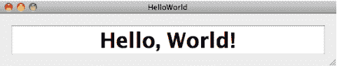

你不会想写大量这样的代码。你在 Interface Builder 中能做的任何事情，也都可以用代码完成。不过一般来说，如果你能在 Interface Builder 中完成某件事，那就应该那样做。始终优先选择使用 Interface Builder，而不是编写代码。

### 4.5 创建新类

让我们创建自己的类。我们将创建一个名为 Greeter 的类，并向它发送消息。然后，我们将使用这个类实例化一个对象，并向这个对象发送消息。

所有类都在 Xcode 中创建。你可以在 Xcode 或 Interface Builder 中创建类的实例，但类本身是在 Xcode 中创建的。

在 Xcode 中，选择“组与文件”（Groups & Files）下的 Classes 文件夹，这样你创建的文件就会出现在该文件夹中。选择“文件”>“新建文件...”，或按 ⌘N。选择创建一个 Cocoa > Objective-C 类，它是 NSObject 的子类。说明文字应显示你正在创建“一个 Objective-C 类文件，带有可选的头文件，其中包含 <Cocoa/Cocoa.h> 头文件。”点击“下一步”。

#### 组织文件

在编辑器窗口的左侧，你应该会看到一个标有“组与文件”（Groups & Files）的区域。你可能需要使用应用程序名称旁边的展开三角形，来显示标有 Classes、Other Sources、Resources、Frameworks 和 Products 的文件夹。

在 Xcode 中创建新类时，实现文件和头文件会出现在当前选中的任何目录中。如果没有选中任何目录，它们会出现在应用程序名称下的顶层。文件在磁盘上的实际位置与它们在此组织器中显示的位置之间没有对应关系。这个组织器的工作方式更像 iTunes 中的播放列表，而不是 Mail 中的邮箱。

如果你愿意，可以创建其他文件夹，但对于小型项目，你会希望将源代码保存在 Classes 文件夹中。要么在创建新类之前选中 Classes，要么在创建之后将文件拖入该文件夹。

将文件命名为 Greeter.m。[^6] 另外，确保选中创建 Greeter.h 以及目标为 HelloWorld 的复选框。一般来说，接受默认设置就不会有问题。点击“完成”。你现在已经生成了头文件 Greeter.h 和实现文件 Greeter.m。

头文件包含 Greeter 类的公共接口。你用它来告诉其他人如何与你的类交互。在文件顶部，你通常会导入你的类可能想要使用的其他类的头文件。在这种情况下，Xcode 已经包含了导入 Cocoa.h 的指令，其中包含你可能需要使用的所有 Cocoa 类的头文件。

[^6]: 类名以大写字母开头，并使用驼峰命名法。变量名和方法名以小写字母开头。记得查看 *Coding Guidelines for Cocoa* [App06]，其中包含 Apple 关于类、变量、方法和函数命名的文档。

下面是头文件，我插入了两条注释来帮助讨论：

[下载](Classes/HelloWorld5/Greeter.h)

```objc
#import <Cocoa/Cocoa.h>

@interface Greeter : NSObject {
    // you'll declare instance variables here
}

    // you'll declare methods here

@end
```

@interface 和 @end 之间的所有内容都是 Greeter 类的公共接口描述。Greeter : NSObject 表示 Greeter 类直接继承根类 NSObject。相比之下，WebView 是 NSView 的子类，而 NSView 又是 NSResponder 的子类，NSResponder 又是 NSObject 的子类。除非你专门重写它，否则你会受益于继承任何超类的行为。所有对象共有的行为都在根类 NSObject 中指定。有时你需要查看超类的文档，以找到你的类创建的对象可用的方法。

在头文件中，我添加到模板代码中的注释表明，你在花括号内添加实例变量的声明，并在右花括号和 @end 之间声明方法。

下面是 Greeter.m，也就是你刚刚生成的实现文件：[^7]

[下载](Classes/HelloWorld5/Greeter.m)

```objc
#import "Greeter.h"

@implementation Greeter

@end
```

[^7]: 注意两个文件 Greeter.h 和 Greeter.m 的后缀。h 代表 header（头文件），m 代表 implementation（实现）。你可以在 http://www.faqs.org/faqs/computer-lang/Objective-C/faq/ 的 Objective-C FAQ 中找到这一点和其他有趣的事实。

你将使用 Greeter.h 和 Greeter.m 文件的组合来定义 Greeter 类。类的头文件包含你乐意公开分享的信息。其他类会导入这个头文件，以便知道它们可以向这个类发送哪些消息。实现文件包含类中与他人无关的部分。头文件告诉其他人他们可以要求这个类或这种类型的对象做什么。实现则隐藏了完成这项工作的细节。

### 4.6 创建并使用类方法

在“Hello, World!”的这一迭代中，我们将定义一个新类，但不从它创建任何对象。在实践中，我们通常会从一个类创建一个或多个对象，并使用这些实例。我希望你看到这个渐进过程，以便知道如何创建和使用类方法与实例方法。

Greeter 类将拥有类方法 greeting。我们无需实例化 Greeter 就可以调用这个方法。换句话说，greeting 方法的目标是 Greeter 类，而不是 Greeter 类型的对象。你会这样调用它：

```objc
[Greeter greeting];
```

在 Greeter.h 中声明你的类方法。你将在方法声明前使用 + (NSString *)，以表明 greeting 是一个返回 NSString 的类方法。你将在右花括号和 @end 之间声明类方法。

下载 Classes/HelloWorld/Greeter.h

```objc
#import <Cocoa/Cocoa.h>

@interface Greeter : NSObject {
}
+ (NSString *) greeting;
@end
```

该方法返回一个包含我们问候语的 NSString。下面是实现文件：

下载 Classes/HelloWorld/Greeter.m

```objc
#import "Greeter.h"

@implementation Greeter
+ (NSString *) greeting {
    return @"Hello, World!";
}
@end
```


你需要对 HelloWorldAppDelegate.m 做两处修改。你必须导入 Greeter 的头文件，这样当你尝试调用 greeting 时编译器就不会报错。你还必须将标签的字符串值设置为向 Greeter 类发送 greeting 消息后得到的任何内容。

下载 Classes/HelloWorld/HelloWorldAppDelegate.m

```objective-c
#import "HelloWorldAppDelegate.h"
#import "Greeter.h"
@implementation HelloWorldAppDelegate
@synthesize window;

- (void)createLabel {
    NSRect labelFrame = NSMakeRect(20, 20, 540, 50);
    NSTextField *label = [[NSTextField alloc] initWithFrame:labelFrame];
    [label setEditable:NO];
    [label setSelectable:NO];
    [label setAlignment:NSCenterTextAlignment];
    [label setFont:[NSFont boldSystemFontOfSize:36]];
    [label setStringValue:[Greeter greeting]];
    [[self.window contentView] addSubview:label];
}

-(void)applicationDidFinishLaunching:(NSNotification *)aNotification {
    [self createLabel];
}
@end
```

点击 Build & Run，结果应该与之前完全相同。准备好后，退出应用程序，让我们修改这个应用程序，以创建对象并使用实例方法。

### 4.7 创建新对象

接下来，我们将创建一个新对象并调用一个实例方法。因为我们将项目配置为使用垃圾回收，所以现在有一大堆内存管理细节你不必担心。我会等到第 102 页的第 6 章*内存*再向你展示这些内容，因为这些细节有些枯燥，但如果你将来要在非垃圾回收的 Cocoa 应用程序中工作，或者要为不支持垃圾回收的 iPhone 开发应用程序，这些细节仍然很重要。8 因为启用了垃圾回收，我们只需在代码中做几处小修改，就能创建 Greeter 类型的对象。

8. 实际上，内存管理不会是我要一带而过的第一个细节。你可能已经注意到有一两个星号（*）飘过却没有任何说明。我们也没有讨论应用程序首次启动时会发生什么。我们的浏览器怎么会一出现就准备好工作，系统又怎么知道 HelloWorldAppDelegate 是我们在代码中创建初始对象的地方？

首先，修改头文件 Greeter.h，将 + 改为 -，从而将 greeting 方法声明为实例方法而不是类方法：

```objective-c
#import <Cocoa/Cocoa.h>

@interface Greeter : NSObject {
}
-(NSString *) greeting;
@end
```

在实现文件 Greeter.m 中做相应的 + 到 - 的修改，否则编译器会抱怨你声明了一个没有实现的实例方法（它不会抱怨你实现了一个没有声明的类方法）。

```objective-c
#import "Greeter.h"

@implementation Greeter
-(NSString *) greeting {
    return @"Hello, World!";
}
@end
```

现在是时候实际创建你的第一个对象并调用一个实例方法了。将 HelloWorldAppDelegate.m 中的 createLabel 方法改成这样：

```objective-c
- (void) createLabel {
    NSRect labelFrame = NSMakeRect(20, 20, 540, 50);
    NSTextField *label = [[NSTextField alloc] initWithFrame:labelFrame];
    [label setEditable:NO];
    [label setSelectable:NO];
    [label setAlignment:NSCenterTextAlignment];
    [label setFont:[NSFont boldSystemFontOfSize:36]];
    Greeter *greeter = [[Greeter alloc] init];
    [label setStringValue:[greeter greeting]];
    [[self.window contentView] addSubview:label];
}
```

第 8 行代码的右侧是你将用来创建新对象的模板代码。这里变量 greeter 指向你正在创建的 Greeter 类型的对象。你可以通过这个嵌套调用来看到，你分两步创建对象：

```objective-c
[[Greeter alloc] init]
```

类方法 alloc 负责分配内存并返回一个对象，其初始值由实例方法 init 设置。在下一行中，你向 greeter 发送 greeting 消息，并将返回的值用作标签中显示的字符串。

### 4.8 进一步重构

我们不会在整本书中都这样做，但我想让你感受一下编写 Cocoa 代码的节奏。你很少能一次就把事情做对，所以你先编写一点代码，然后当你注意到代码变得难以控制时再清理。

createLabel 方法负责创建 Greeter 对象，这让我觉得有点奇怪。试图将这两者分开的一种方法是，想一想我如何在 applicationDidFinishLaunching: 方法中从高层描述这个动作。让我们试试这样：

```objective-c
-(void)applicationDidFinishLaunching:(NSNotification *)aNotification {
    Greeter *greeter = [self greeter];
    NSTextField *label = [self labelWithText:[greeter greeting]];
    [[self.window contentView] addSubview:label];
}
```

在这段代码中，你可以看到，我们首先从另一个名为 greeter 的方法中获取一个 Greeter 对象，该方法目前不会做太多事情。然后，我们创建并配置一个标签，其文本是将 greeting 消息发送给 Greeter 对象后得到的结果。最后，我们拿起那个标签，将它作为子视图添加到窗口的内容视图中。

一旦我规划好我的类看起来是什么样，我现在就可以填写细节。通过我调用创建标签的代码的方式，我可以看到我需要做以下事情：

- 我已将方法名改为 labelWithText:。
- 该方法现在将要显示在标签中的文本作为参数。
- 我期望该方法将标签返回给我，这样我就可以在 applicationDidFinishLaunching: 中将它添加为子视图，而不是在创建标签的方法内部添加。

我们可以很容易地对新命名的 labelWithText: 方法做出这些修改：

```objective-c
- (NSTextField *) labelWithText: (NSString *) labelText {
    NSRect labelFrame = NSMakeRect(20, 20, 540, 50);
    NSTextField *label = [[NSTextField alloc] initWithFrame:labelFrame];
    [label setSelectable:NO];
    [label setAlignment:NSTextAlignmentCenter];
    [label setFont:[NSFont boldSystemFontOfSize:36]];
    [label setStringValue:labelText];
    return label;
}
```

我们还需要添加一个 greeter 方法，用于创建并返回一个 Greeter 对象。9

9. 我们可以将 Greeter 对象的创建内联为 applicationDidFinishLaunching: 方法的一部分。我将其拆分出来，是为了强调小方法，并提供更多关于创建方法和发送消息的经验。

我们有点希望 applicationDidFinishLaunching: 方法出现在代码顶部，这样人们可以瞥一眼就了解这个类做什么。记住，编译器会从上到下读取你的代码。如果 applicationDidFinishLaunching: 位于顶部，编译器会抱怨它不知道 greeter 方法或 labelWithText: 方法。程序仍然会正常运行，但你会收到这些警告。

我们可以在头文件中声明 greeter 和 labelWithText: 方法，但它们其实并不是公共接口的一部分。我们以后会学习其他技巧，但现在我们将把 applicationDidFinishLaunching: 方法留在底部。

### 4.9 初始化对象

当我们创建一个新的 Greeter 对象时，我们分配内存，然后调用 init 方法。但你已经看到了 Greeter。它没有自己的 init 方法。当你对 Greeter 的实例调用 init 时，你实际上是在调用 Greeter 的超类 NSObject 上的 init。所有这些继承都工作得很好，因为 Greeter 没有任何自己的变量需要初始化。Greeter 中没有任何东西是 NSObject 中尚未包含且需要初始化的。

让我们改变这一点。让我们向 Greeter 添加一个名为 name 的实例变量。记住，我们需要在头文件 Greeter.h 中的花括号之间添加一个声明。

```objective-c
#import <Cocoa/Cocoa.h>

@interface Greeter : NSObject {
    NSString * name;
}
-(NSString *) greeting;
@end
```

我们要用这个新变量做什么？首先，我们需要在对象初始化时设置它的值。我们将不得不编写自己的 init 方法，在其中将 name 的值设置为 World。然后，我们将不得不修改 greeting 的实现，使其将 name 的值插入到*Hello，*和*！*之间。

我们将从 init 开始，慢慢讲解以下代码：

```objective-c
#import "Greeter.h"

@implementation Greeter

-(NSString *) greeting {
    return [[NSString alloc] initWithFormat:@"Hello, %@!", name];
}

-(id) init {
    if (self = [super init]) {
        name = @"World";
    }
    return self;
}
@end
```

让我们从第 10 行开始。它看起来确实不对。你可能认为 `self` 和 `[super init]` 之间应该是双等号，但这实际上是一个赋值，而不是相等性测试。那么，这个赋值中发生了什么？

```objective-c
self = [super init];
```


从右往左读，当你初始化一个对象时，你做的第一件事是调用超类的 init 方法。你将这个已初始化的对象赋值给 self，然后测试 self 是否不为 nil。如果不是，就继续像我们在第 11 行所做的那样定制它。这让你可以保留在开始编写此方法之前已有的所有初始化，然后在此基础上补充额外的初始化。最后，你在第 13 行返回你的对象。

你经常会看到这种稍显冗长的方式来实现同样的目的：

```
    - (id) init
    {
        self = [super init];
        if (self != nil) {
            name = @"World";
        }
        return self;
    }
```

如果你使用第二个版本，我更希望你用 `if (self)` 替换 `if (self != nil)`。^10

现在让我们看看 greeting 方法中的第 6 行。我们正在返回一个格式化字符串。这与你许多其他语言中看到的情况类似。你创建一个包含 `%d` 之类占位符的字符串。在字符串后面，你跟上以逗号分隔的值的列表，这些值用于替换字符串中的占位符。

在我们的例子中，我们使用一个新的 Cocoa 类型 `%@`，它显示 Cocoa 对象的字符串表示（如其 `description` 方法所指定）。在我们的例子中，我们有：^11

```
    [[NSString alloc] initWithFormat:@"Hello, %@!", name]
```

这意味着我们用 `name` 的值替换 `%@`，该值当前是 `World`。^12 我们的结果是 `Hello, World!`。

- 10. 关于 `self` 和 `[super init]` 的完整讨论，请参阅 Matt Gallagher 的文章：http://cocoawithlove.com/2009/04/what-does-it-mean-when-you-assign-super.html。阅读 Wil Shipley 关于使用 `self = [super init]` 的文章也既有信息量又有趣，你可以在 http://www.wilshipley.com/blog/2005/07/self-stupid-init.html 找到它。一定要读到结尾，他在那里得出结论：使用它是件好事。
- 11. 如果你已经了解 Objective-C 中的内存管理，你会看到我在这里引入了一个内存泄漏。这是故意的，并且由垃圾回收器处理；稍后我们会讨论没有垃圾回收器时该怎么办。
- 12. 有关格式化字符串的更多细节，你可以在文档中查找 `stringWithFormat:` 方法。这会指向一篇名为“Formatting String Objects”的文章，其中有一些关于你可能如何使用该方法的示例。还有一个链接指向全面的字符串格式说明符列表。

点击 Build & Run，程序应该再次像之前一样正常工作。

### 4.10 日志记录对象

有时你想在程序中的特定位置快速查看对象的状态。一个快速而粗糙的解决方案是使用 NSLog() 配合 %@ 来记录对象的字符串描述。不幸的是，Apple 无法知道你想为自定义对象记录什么。例如，添加以下高亮行来记录新创建的 Greeter 对象的值：

```objc
-(void)applicationDidFinishLaunching:(NSNotification *)aNotification {
    Greeter *greeter = [self greeter];
    NSLog(@"Greeter: %@", greeter);
    NSLog(@"This occurred in %@ at line %d in file %s.",
          NSStringFromSelector(_cmd), __LINE__);
    NSTextField *label = [self labelWithText:[greeter greeting]];
    [[self.window contentView] addSubview:label];
}
```

点击 Build & Run。不幸的是，Greeter 对象不知道如何描述自己，因此你继承了 NSObject 的默认行为。你会看到类似这样的内容：

```text
Greeter <Greeter: 0x10044d520>
```

这只是对象的类名及其内存位置。这可能不太有用，但你始终可以通过重写 description 方法来指定你希望对象如何显示自己。为了帮助调试，我还添加了用于显示方法名称、文件和当前行号的信息。¹³

```objc
-(NSString *)description {
    return [[NSString alloc] initWithFormat:@"name: %@ \n created: %@",
        name, [NSDate date]];
}
```

- 13. 有关更多选项，请参阅 Apple 的技术问答“Improved logging in Objective-C”：http://developer.apple.com/mac/library/qa/qa2009/qa1669.html。

点击 Build & Run，你应该会看到一个更个性化的问候。

### 4.12 解决方案：其他初始化

将以下声明添加到 Greeter 头文件中，因为我们正在向公共接口添加一个新的初始化方法：

下载 `Classes/HelloWorld11/Greeter.h`

```objective-c
#import <Cocoa/Cocoa.h>

@interface Greeter : NSObject {
    NSString * name;
}
-(NSString *) greeting;
-(id) initWithName:(NSString *)newName;
@end
```

对于 Greeter.m，添加此方法：

下载 `Classes/HelloWorld11/Greeter.m`

```objective-c
-(id) initWithName:(NSString *) newName {
    if (self = [super init]) {
        name = newName;
    }
    return self;
}
```

一旦你在下一章学习了属性，你将使用比下面稍微更健壮的东西：

```objective-c
name = newName;
```

你将使用属性来设置 name 的值，并顺便处理内存管理。

现在你可以重构 init 方法以调用 initWithName:，从而消除重复代码：

下载 `Classes/HelloWorld11/Greeter.m`

```objective-c
-(id) init {
    return [self initWithName:@"World"];
}
```

此方法替换 HelloWorldAppDelegate.m 中的 greeter：

下载 `Classes/HelloWorld11/HelloWorldAppDelegate.m`

```objective-c
- (Greeter *) greeterFor:(NSString *) personName {
    return [[Greeter alloc] initWithName:personName];
}
```

调整 applicationDidFinishLaunching: 以调用这个新方法：

下载 `Classes/HelloWorld11/HelloWorldAppDelegate.m`

```objective-c
    - (void)applicationDidFinishLaunching:(NSNotification *)aNotification {
        Greeter *greeter = [self greeterFor:@"Maggie"];
        NSLog(@"Greeter: %@", greeter);
        NSTextField *label = [self labelWithText:[greeter greeting]];
        [[self.window contentView] addSubview:label];
    }
```

点击 Build & Run，你应该会看到类似这样的内容：

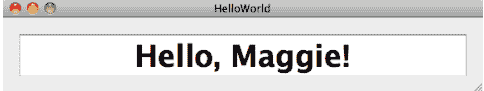

在本章中，你创建并使用了你自己的类和对象。你创建了自定义初始化方法、类方法、实例方法和实例变量。现在让我们退后一步，看看一些我们之前掩盖起来的问题。

这声明了一个名为 `initWithName:` 的实例方法。该方法接收一个指向名为 `newName` 的 NSString 的指针作为其唯一参数。

initWithName: 的返回类型是 id。当我们不想确切指定类型是什么时，我们用 id 表示指向任意类型的指针。换句话说，在 Objective-C 中，我们用 id 指向一个类的实例。我们在第 53 页第 3.3 节 *带参数的方法* 中将 id 用作参数类型。

```
+ (IBAction) goBack:(id) sender
```

这是单击 Back 按钮时发送给 WebView 的消息。² 按照我们的连接方式，消息的发送者是一个 NSButton *。我们本可以引入一个完全不同的元素并用它来发起 goBack: 消息，这样发送者的类型就会不同。我们通过将发送者的类型设置为 id 来满足这种灵活性需求。

你不会写 id *，因为 id 就是一个指针。这可能令人困惑，因为 id 代表像 NSButton * 和 NSString * 这样的指针。但 id 出现时不带星号。

在我们的示例中，我们将 id 用作任何 init 方法（包括我们自己的 initWithName: 等）的返回类型，正如 Apple 的 *Objective-C 编程语言* [App09] 中所述。

### 5.2 处理非对象类型

Objective-C 建立在 C 之上，因此你可以使用 C 的基本类型，例如 int、long 和 float 等。但你也会遇到其他类型，它们不是基本类型，但也不是一等对象。

例如，如果你查看 HelloWorldAppDelegate.m 中 labelWithText: 方法的第一行，你会看到：

```
NSRect labelFrame = NSMakeRect(20, 20, 540, 50);
```

我们第一次输入它时，你可能没有多想，但现在它看起来好像缺少了它的 *。其实并没有。如果你查看文档，你会看到 NSRect 是一个由 NSPoint 和 NSSize 组成的结构体。它们各自又被定义为由两个 CGFloat 组成的结构体。再按照文档往下看一步，你会看到 CGFloat 是

- 2. 我们将在第 7 章 *出口与动作*（第 124 页）中讨论 IBAction 返回类型。IBAction 与 void 相同，只是 Interface Builder 能够向我们暴露一些信息。查看文档，你会看到 IBAction 被 #defined 为 void。


在 32 位下运行的代码中，它被 typedef 为 float；在 64 位下运行的代码中，它被 typedef 为 double。无论如何，NSInteger 类型的变量不是指针，因此没有 *。³

这可能会让人困惑。NSNumber 是对象，而 NSInteger 不是。你需要查阅文档来弄清哪个是哪个。下面是你可能声明两个变量的方式，其中一个为 NSNumber，另一个为 NSInteger：

```objc
NSNumber *income;
NSInteger age;
```

Objective-C 还有用于处理布尔值的 BOOL 类型。我们通常不会为逻辑计算做那些花哨且难以阅读的算术运算。相反，我们把 BOOL 看作具有 YES 或 NO 值之一。在谈论布尔值时，我们特别小心不要使用 *true* 或 *false* 这样的词。我们不想让人觉得我们是外地人。

### 5.3 Getter 和 Setter

在 Greeter 类中，我们可以轻松获取和设置 name 的值。在下面示例的第一行高亮代码中，我们获取并打印 name 的值；在第二行高亮代码中，我们设置它的值：

下载 `Properties/HelloWorld12/Greeter.m`

```objc
#import "Greeter.h"

@implementation Greeter
-(NSString *) greeting {
    return [[NSString alloc] initWithFormat:@"Hello, %@!", name];
}
-(id) initWithName:(NSString *) newName {
    if (self = [super init]){
        name = newName;
    }
    return self;
}
-(id) init {
    return [self initWithName:@"World"];
}
```

3. 在这个 Stack Overflow 问题 http://stackoverflow.com/questions/2189212/why-object-doesomething-and-not-object-dosomething 的回答中，对对象和简单的 C 结构有很好的解释。该回答由 Apple 工程师 Bill Bumgarner 撰写，他使用的标准用户名是 bbum。他的 Stack Overflow 帖子以及他对各种其他邮件列表（例如 http://lists.apple.com 上的 cocoa-dev 列表）的贡献总是值得寻找。他不时会在自己的博客 http://www.friday.com/bbum/ 上总结自己的想法。

#### Joe 问……

##### 我必须遵循这些命名约定吗？

是的。遵循这些命名约定很重要，因为它们将实现你不久后就会看到的许多“魔法”。这些只是约定——编译器并不强制这些名称，但遵循它们*非常*重要。

```objc
-(NSString *)description {
    return [[NSString alloc] initWithFormat:@"name: %@ \n created: %@",
           name, [NSDate date]];
}
@end
```

如果我们想允许其他对象获取和设置 name 的值，我们会在 Greeter 头文件中声明一个 getter 和一个 setter，并在实现文件中实现它们。

getter 是一个实例方法，返回 name 实例变量的当前值，因此返回类型必须是 NSString *。getter 不接受任何参数。剩下唯一需要操心的是给它起什么名字。在 Objective-C 中，属性 xyz 的 getter 也命名为 xyz。你完全不需要把 *get* 插入名称中。

setter 也是一个实例方法。它不返回任何内容，但需要把 name 的新值作为一个 NSString * 接收，我们会把这个参数称为 name。至于方法名，在 Objective-C 中，属性 xyz 的 setter 命名为 setXyz。换句话说，你以 *set* 开头，后面跟上变量名，并将变量名的首字母转换为大写。

将这些访问器声明添加到你的头文件中：

下载 `Properties/HelloWorld13/Greeter.h`

```objc
#import <Cocoa/Cocoa.h>

@interface Greeter : NSObject {
    NSString *name;
}
-(NSString *) greeting;
-(id) initWithName:(NSString *)name;
-(NSString *) name;
-(void) setName:(NSString *) name;
@end
```

要看到它生效，你需要在 applicationDidFinishLaunching: 中像下面高亮行那样添加对该方法的调用：

下载 `Properties/HelloWorld13/HelloWorldAppDelegate.m`

```objc
- (void)applicationDidFinishLaunching:(NSNotification *)aNotification {
    Greeter *greeter = [self greeterFor:@"Maggie"];
    NSLog(@"Greeter: %@", greeter);
    NSTextField *label = [self labelWithText:[greeter greeting]];
    [self setUpperCasedName:greeter];
    [[self.window contentView] addSubview:label];
}
```

点击 Build & Run，你将看到类似下面的输出：

```
The name was originally Maggie.
The name is now MAGGIE.
```

现在让我们引入属性，并开始精简和简化我们的代码。

### 5.4 将访问器转换为属性

让我们盘点一下当前进度。我们已经公开了 Greeter 类的一个名为 name 的属性，并且可以获取和设置它。我们分三步完成了这件事：

- 1. 在头文件中声明一个名为 name 的实例变量。
- 2. 在头文件中声明一个名为 name 的 getter 和一个名为 setName: 的 setter。
- 3. 提供了大部分是样板代码的内容，在实现文件中实现这些方法。

现在我们将使用 Objective-C 2.0 属性来修改最后两步，并在某些情况下省去第一步。

将 getter 和 setter 的声明替换为以下内容：

下载 `Properties/HelloWorld14/Greeter.h`

```objc
#import <Cocoa/Cocoa.h>

@interface Greeter : NSObject {
    NSString *name;
}
-(NSString *) greeting;
-(id)initWithName:(NSString *)name;
@property(copy) NSString *name;

@end
```

暂时忽略编译器指令 @property 后面括号中的 copy。你应该把该高亮行的其余部分理解为声明一个名为 name、类型为 NSString 的属性。就目前而言，这一行声明了一个名为 name 的 getter 和一个名为 setName 的 setter。

如果你现在点击 Build & Run，代码会像以前一样正常工作。你将能够从 HelloWorldAppDelegate 调用 getter 和 setter，而不会出现任何警告或错误。换句话说，这个 @property 指令正在声明你的 getter 和 setter——事实上，它做的还不止这些，你将在第 96 页的 5.6 节 *属性特性* 中看到。

我们实现 getter 和 setter 方法的方式并没有什么特别之处。事实上，如果我们要求编译器这样做，它可以为我们创建实现。将你的 getter 和 setter 实现替换为以下高亮行：

`Download Properties/HelloWorld14/Greeter.m`

```objc
#import "Greeter.h"

@implementation Greeter

@synthesize name;
```

`@synthesize` 指令告诉编译器实现相应 `@property` 指令中声明的方法。

那么，让我们回顾一下创建属性的三个步骤。我们在头文件中的花括号之间声明一个实例变量。我们使用 `@property` 指令在头文件中花括号之外声明 getter 和 setter。到目前为止，我们只是在声明一个变量和一个属性（换句话说，访问器方法），这就是为什么我们在头文件中这样做。现在是时候实现我们为变量声明的方法了。实现放在 `.m` 文件中，所以我们要把 `@synthesize` 指令放在那里。

点击 Build & Run，程序应该会像以前一样正常工作。换句话说，getter 和 setter 正在被正确生成。

### 5.5 点表示法

既然你已经声明并合成了属性，就应该以不同的方式调用它们。当你想要调用 getter 时，我希望你使用点表示法，而不是你一直使用的方法调用语法。

换句话说，将以下内容：

```objc
[self name]
```

替换为：

```objc
self.name
```

要看到实际效果，这意味着你要把 greeting 方法中的代码改成下面这行高亮代码：

下载 `Properties/HelloWorld14/Greeter.m`

```objc
- (NSString *) greeting {
    return [[NSString alloc] initWithFormat:@"Hello, %@!", self.name];
}
```

同样，你会将下面这个版本的 setter：

```objc
[self setName:newName];
```

替换为：

```objc
self.name = newName;
```

这会把 initWithName: 方法改成这样：

下载 `Properties/HelloWorld14/Greeter.m`

```objc
- (id) initWithName:(NSString *) newName {
    if (self = [super init]) {
        self.name = newName;
    }
    return self;
}
```

在每种情况下，方法调用形式和点语法形式的行为都完全相同。事实上，点语法只是语法糖，会编译成方法调用形式。不过你会发现，如果你在获取和设置属性时始终使用点语法，代码会变得更容易阅读。

这让人感觉好像又回到了原点。以 setter 为例，我们一开始是这样直接设置变量的：

```objc
name = newName;
```

然后我们引入了 setter。现在你被告知要像这样使用 setter 方法来设置底层实例变量的值：

```objc
[self setName:newName];
```


#### Joe 问……
##### 为什么我要费心使用点语法？

关于这个问题一直存在不少争议。有些人反对这一点：当你编写如下代码时：

```
self.name = newName;
```

你实际上是在进行方法调用，即使看起来不像。确实如此，但使用点语法的优势在于，获取或设置属性与向对象发送消息是两种不同的活动，即使底层机制相同。点语法能明确你的意图。

当你发送如下消息时：

```
[greeter greeting];
```

这显然与设置或获取属性值完全不同。你会发现 Apple 在其现代 API 中采用了点语法。当你查看某个类的任务时，你会看到其中许多实际上是属性。在你使用点号表示法进行获取和设置一段时间后，你会发现代码更易读，也能更快理解。

在 http://eschatologist.net/blog/?p=160 上，Chris Hanson 充满热情地更详细解释了为什么你要对属性使用点语法。

现在我们已经声明并合成了一个属性，因此你现在像这样设置变量的值：

```
self.name = newName;
```

我们并没有绕回原点。当你使用 self.name = newName 时，你使用的是设置方法，而不是直接设置底层变量。

你希望使用属性而不是变量，以利用我们很快会添加到属性上的各种设置。这是属性最常见的错误之一。你费尽周折声明并合成一个属性，然后却忘记使用 self，最终直接使用了实例变量而不是属性。

更重要的是，我们可以从 HelloWorldAppDelegate 访问这个属性。首先，我想重新看一下 HelloWorldAppDelegate：

下载 Properties/HelloWorld14/HelloWorldAppDelegate.h

```objective-c
#import <Cocoa/Cocoa.h>

@interface HelloWorldAppDelegate : NSObject <NSApplicationDelegate> {
    NSWindow *window;
}
@property (assign) IBOutlet NSWindow *window;
@end
```

既然你了解了属性，就能认出类型为 NSWindow 的变量 window 被声明为属性。如果你查看 HelloWorldAppDelegate.m 的顶部，你会看到它已被合成；你可能还记得，在 applicationDidFinishLaunching: 的底部，当我们把标签添加到其内容视图时，是以属性方式访问它的。

```objective-c
[[self.window contentView] addSubview:label];
```

一旦你重构 setUpperCaseName: 方法中的代码以利用点语法，它应该像这样：

下载 Properties/HelloWorld14/HelloWorldAppDelegate.m

```objective-c
-(void) setUpperCaseName:(Greeter *) greeter {
    NSLog(@"The name was originally %@", greeter.name);
    greeter.name = [greeter.name uppercaseString];
    NSLog(@"The name is now %@", greeter.name);
}
```

### 5.6 属性特性

属性声明的一般形式如下：

```objective-c
@property(attribute1, attribute2,...) PropertyType propertyName;
```

这些特性用于指明在合成属性时，你希望创建哪种访问器。

一组特性让你决定是生成获取器和设置器，还是只生成获取器。默认情况下，你会生成两者，因此不需要使用 readwrite 特性；但如果你只想生成获取器，就要使用 readonly。

另一组特性可用于设置访问器名称。这通常用于布尔值的情况。你可能有一个名为

另一个选项是将属性的底层变量设置为指向参数所指向的对象。这是 `assign` 的指针版本；如果没有内存管理，其实现会完全相同。假设我们有一个名为 `buddy`、类型为 `Greeter` 的属性。设置器大致如下：

```objective-c
-(void) setBuddy:newBuddy {
    if (buddy != newBuddy) {
        [buddy release];
        buddy = [newBuddy retain];
    }
} //retain
```

这些规则适用于 iPhone 和 Mac OS X 开发。如果你利用了垃圾回收器，那么不必担心保留和释放变量，因此凡是你原本会使用 `assign` 或 `retain` 的地方，都可以使用 `assign`。⁵

如果你想把属性声明为 `nonatomic`，还需要设置一个特性。默认情况下，访问器是 `atomic` 的。当属性是 `atomic` 时，对该属性的访问是线程安全的。在使用垃圾回收器的桌面应用中，这几乎没有成本。当你不使用垃圾回收器时，在获取器中必须设置对象级锁、取回所需值、释放锁，然后返回取回的值。在这种情况下实现原子设置器的细节也类似。

当你为 iPhone 编写代码时，不会有可用的垃圾回收器。如果你频繁访问属性，就会感到性能下降。因此，当我们为 iPhone 声明属性时，往往会设置 `nonatomic` 特性；而为桌面开发时，我们会使用默认设置。更多信息请阅读 Apple 的 *《Objective-C 编程语言》* [App09] 中的“Declared Properties”章节。

### 5.7 练习：添加属性

向 `Greeter` 添加这三个属性：一个名为 `age` 的 `NSInteger`，一个名为 `buddy` 的 `Greeter`，以及一个名为 `upperCase` 的 `BOOL`。

⁵ 我假设你的 Mac OS X 应用程序将以 Leopard 及更高版本为目标，因此你会使用垃圾回收器。对于桌面应用程序，你的两个内存特性选择是 `assign` 和 `copy`。

为了本练习的目的，假设你没有使用垃圾回收，因此需要区分 assign 和 retain。

使用正确的特性，使 age 有获取器但没有设置器，并让 upperCase 的获取器名为 isUpperCase。

### 5.8 解决方案：添加属性

所有困难的工作都在头文件中。你需要声明这三个实例变量，然后像这样声明属性：

下载 Properties/HelloWorld15/Greeter.h

```objc
#import <Cocoa/Cocoa.h>

@interface Greeter : NSObject {
    NSString *name;
    NSInteger age;
    Greeter *buddy;
    BOOL upperCase;
}
-(NSString *) greeting;
-(id) initWithName:(NSString *)name;
@property(copy) NSString *name;
@property(assign, readonly) NSInteger age;
@property(retain) Greeter *buddy;
@property(assign, getter=isUpperCase) BOOL upperCase;
@end
```

name 变量是 NSString，它符合 NSCopying，因此我们使用 copy 特性。

age 和 upperCase 都是基本类型，因此我们使用 assign。因为我们只为 age 生成获取器，所以还使用 readonly。为了遵循布尔值的正确命名约定，我们通过添加 getter=isUpperCase 来指定 upperCase 的获取器应为 isUpperCase。

buddy 属性是 Greeter。它是指向一个不符合 NSCopying 的对象的指针，因此我们使用 retain 作为内存特性。

在实现文件中，将三个新属性的名称添加到 @synthesize 行，并用逗号分隔。注意，我们还在 initWithName: 中初始化了 upperCase 变量：

下载 Properties/HelloWorld15/Greeter.m

```objc
#import "Greeter.h"

@implementation Greeter
```

那么，让我们移除为属性提供支持的实例变量。首先，让我们检查你的项目设置。从菜单栏用 Project > Edit Project Settings 打开它们。选择 Build 标签，将 Architectures 设置设为 64-bit Intel，并勾选仅构建活跃架构的复选框。

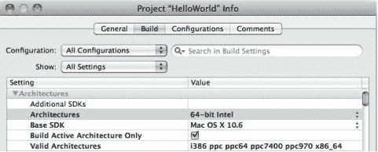

现在你可以从头文件中移除实例变量：

[下载 Properties/HelloWorld/Greeter.h](download)

```objc
#import <Cocoa/Cocoa.h>

@interface Greeter : NSObject {
}
-(NSString *) greeting;
-(id) initWithName:(NSString *)name;
@property(copy) NSString *name;
@property(assign, readonly) NSInteger age;
@property(retain) Greeter *buddy;
@property(assign, getter=isUpperCase) BOOL upperCase;

@end
```

点击 Build & Run，应用程序应和之前完全一样运行。如果移除实例变量后出现警告，请检查你是否在 64 位下运行，以及项目设置是否正确。

如果你是为 iPhone 开发，⁶ 你可以移除支持属性的实例变量；但如果你是在 32 位 Mac OS X 运行时上开发或为其开发，则不能这样做。

6. 在撰写本书时，针对 iPhone 时你可以移除这些变量，代码将在设备上正常工作。模拟器尚不支持移除变量。


## 第6章 内存

你已经学会了如何在 Interface Builder 和代码中创建对象。你已经看到了如何向对象发送消息，并且使用了属性来更改某些对象的状态。在本章中，你将学习在 Cocoa 应用程序中管理内存的规则。

每当你创建一个对象时，你都在使用一小块内存。如果稍后某个时刻你不再使用该对象，你需要确保这块内存不再被占用。在程序的生命周期内，你可能会创建成千上万个临时对象。如果你不安排清理这些对象，那么所有这些内存都将被浪费（更糟糕的是，其他应用程序也无法使用）。因此，作为负责任的开发者，我们要确保所有这些被浪费的对象都归还到可用内存池中。

如果你未能回收不再使用的对象，你的应用程序就会泄漏内存。随着时间的推移，它会不断增长，有时甚至无法再运行（或者阻止其他程序运行）。

另一方面，如果你回收了一个仍在使用的对象，该对象可能会被其他获取了已回收内存的代码覆盖——这将导致数据损坏。

这正是本章的内容——如何组织安排，使得内存在不再需要时被回收，但不能提前回收。^1

1. 在阅读本章的过程中，你的程序可能会时不时地在不该失败的时候失败，或者在该失败的时候不失败。请选择 Build > Clean All Targets...，然后尝试重新运行。

### 6.1 引用计数

引用计数是我们用来自行管理对象内存的技术。内存管理的规则说起来比做起来简单：

- 如果你拥有一个对象，你有责任在使用完毕后释放它。声明对一个对象的所有权会增加它的引用计数。释放该对象会减少计数。当引用计数为零时，该对象就不再被使用。
- 如果你不拥有一个对象，就绝不应该释放它。

如果你违反了第一条规则，就会导致内存泄漏。如果你违反了第二条规则，就可能会导致一个对象在其他人仍然需要向它发送消息时消失。

那么，你什么时候拥有一个对象呢？

任何时候，只要你使用 `alloc` 创建一个新对象，你就拥有了该对象，并且在不再使用它时需要释放它。还有一个名为 `new` 的类方法，它是 `alloc` 和 `init` 的组合。换句话说，下面的代码与以下代码做的事情完全相同：

```objective-c
Greeter *host = [[Greeter alloc] init];
```

与以下代码相同：

```objective-c
Greeter *host = [Greeter new];
```

即使 `new` 可用，我们也倾向于不在 Objective-C 中使用它。这里的要点是，当你使用它时，你就拥有了该对象。引用计数增加一，你有责任在使用完毕后释放它。

你可能还想拥有一个在别处创建的对象的拥有权。当你得到一个需要保留的对象时，你有责任向该对象发送 `retain` 或 `copy` 消息。这会使它的引用计数增加一。无论你是使用 `alloc` 或 `new` 创建对象，还是使用 `retain` 或 `copy` 来持有对象，你都会拥有该对象，并有责任在不再需要它时释放它。²

2. 你很快就会看到，如果你使用类方法创建对象，你并没有保留该对象。它是自动释放的。如果你想持有新创建的对象，必须显式保留它。

### 6.2 使用 Clang 静态分析器查找泄漏

到目前为止，为了让事情更简单，你可能还记得我让你打开了自动垃圾回收。为了制造泄漏，我们需要关闭垃圾回收。选择菜单项 Project > Edit Project Settings，在 Build 选项卡中，筛选出垃圾回收设置。将 Objective-C Garbage Collection 的值设置为 Unsupported。

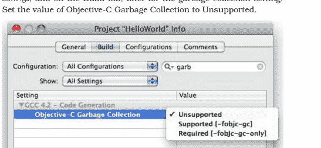

现在让我们故意制造一个内存泄漏。

首先，我将从 HelloWorldAppDelegate 中移除 GUI 代码。像这样清理 HelloWorldAppDelegate.h：

下载 Memory/HelloWorld17/HelloWorldAppDelegate.h

```objective-c
#import <Cocoa/Cocoa.h>

@interface HelloWorldAppDelegate : NSObject <NSApplicationDelegate> {
}
@end
```

精简实现文件，使其只创建一个 Greeter 对象并记录日志：

下载 Memory/HelloWorld17/HelloWorldAppDelegate.m

```objective-c
#import "HelloWorldAppDelegate.h"
#import "Greeter.h"

@implementation HelloWorldAppDelegate

- (void)applicationDidFinishLaunching:(NSNotification *)aNotification {
    Greeter *host = [[Greeter alloc] initWithName:@"Maggie"];
    NSLog(@"Greeter %@", host);
}
@end
```

我们制造了问题，所以当然能看出哪里不对。我们使用 alloc 创建了一个 Greeter 类的实例，并用变量 host 指向该对象。引用计数为 1。我们从未向 host 发送 release 消息，因此它的引用计数永远不会变为零，内存也永远不会被回收。

这是一个非常简短且生命周期很短的程序，所以对我们来说不会造成太大问题。你可以想象它是某个更大程序的一部分，而我们可能必须先查找问题。在 Snow Leopard 中，使用 Clang 静态分析器可以非常容易地检测到这个泄漏。

通过选择菜单项 Build > Build & Analyze 或使用键盘快捷键 ⌘⇧A 来运行 Clang 静态分析器。

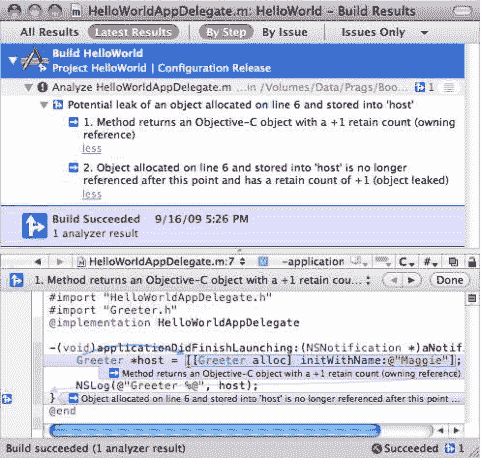

报告告诉我们，一个对象已被分配并存储到 host 中，引用计数为 1。你可能会看到报告了三个问题，而不是之前图片中的一个——如果你点击每一个，你会发现它们报告的是同一个问题，当我们修复它时，它们都会消失。在 host 用于日志语句之后，它再也没有被引用过。这就是我们的内存泄漏。Greeter 对象被实例化并使用，然后在 GUI 窗口保持打开期间一直存在，却再也没有被使用过。

### 6.3 修复 Mac OS X 上的内存泄漏

要修复 Mac OS X 上的内存泄漏，请返回你的项目设置，并将 Objective-C Garbage Collection 的设置从 Unsupported 改为 Required。

点击 Build & Analyze，内存泄漏就消失了。

哇——你刚刚学到了一种全新的内存管理方式。再也不需要引用计数，也不需要将 alloc、new、retain 或 copy 与 release 进行平衡了。在本书中，我假设你部署到 Leopard 或更高版本，所以建议就是这么简单：

打开垃圾回收。

精通引用计数的人会觉得信任垃圾回收器是对他们作为程序员的一种侮辱。事实并非如此。如果你是为 Mac OS X 编程，请打开垃圾回收器，把引用计数抛在脑后。

我接触的第一个使用垃圾回收的系统是 Java。在 Java 的早期时代，垃圾回收时一切都会停止。事实上，屏幕上会出现一个动画。那是一辆推土机在收集东西。

有一段时间，人们会研究编译器生成的字节码，寻找一些小的优化。其中之一涉及翻转 for 循环，即不是从 0 递增到某个上限，而是从该上限递减到 0，这样效率更高。

但就在我们学习这些聪明的小技巧时，垃圾回收器在针对自然出现的情况进行优化方面变得更好了。结果，我们那些聪明的小技巧反而让垃圾回收器更难做好它的工作。

这就是我们在桌面端 Cocoa 上的现状。

话虽如此，你仍然需要理解引用计数。我们很快就会探索一个 iPhone 示例，在那种情况下你别无选择，只能手动管理内存。首先，我想向你展示在涉及属性的内存属性时，垃圾回收器能帮助什么，不能帮助什么。

### 6.4 属性与垃圾回收

既然我们已经打开了垃圾回收，让我们重新考虑一下 Greeter 头文件中的属性声明：

```objective-c
#import <Cocoa/Cocoa.h>

@interface Greeter : NSObject {
}
```


如果这还没有让你完全理解，也不用担心。我主要是希望你在本书后面编译器因此报错时能有所准备。你主要需要思考内存管理的地方，是在为 iPhone、iPod touch 和 iPad 创建应用时。在本章剩余部分，我们将看一个 iPhone 应用示例。

### 6.5 创建手电筒

目前，如果你的目标是 iPhone 或 iPad，就必须使用引用计数并自行管理内存。让我们构建 HelloWorld 项目的 iPhone 版本，以便试验你学到的一些规则。

你需要在 http://developer.apple.com/iphone 注册成为 iPhone 开发者。这是免费的，但要求你同意 Apple 的条款。当你准备部署到手机或在 App Store 上分发时，需要加入某个付费计划。

如果你还没有注册为 iPhone 开发者，可以继续使用当前的示例；只需将垃圾回收重新设置为 Unsupported。

在 Xcode 中新建项目（File > New Project...）。这次选择 iPhone > Application > Window-based Application 模板。确保用于 Core Data 的复选框未选中，然后点击 Choose。将项目命名为 Flashlight，并选择 Save。

点击 Build & Run，iPhone 模拟器将启动并运行你的应用。你应该会看到一个纯白屏幕，顶部有状态栏。恭喜，你构建了一个手电筒。人们曾在 App Store 上卖过这类东西。

我们需要复制 Greeter 类的头文件和实现文件。在 Groups & Files 中选择 Classes 文件夹。选择菜单项 Project > Add to Project...。导航到你存放 HelloWorld 项目的位置，选择 Greeter.h 和 Greeter.m，然后点击 Add 按钮。如有需要，选中将项目复制到 Flashlight 应用文件夹的复选框，然后点击 Add 按钮。你已经将 Greeter 类添加到了这个项目中。

你的 FlashlightAppDelegate.m 文件应该与之前的 HelloWorldAppDelegate.m 文件非常相似。

你应该得到如下内容：

```objc
#import "FlashlightAppDelegate.h"
#import "Greeter.h"

@implementation FlashlightAppDelegate
@synthesize window;

- (void)applicationDidFinishLaunching:(UIApplication *)application {
    Greeter *host = [[Greeter alloc] initWithName:@"Maggie"];
    NSLog(@"Greeter %@", host);
}
@end
```

点击 Build & Run，你会看到有一些问题需要修复。

首先，我们在 Greeter.h 中遇到一个错误：没有名为 Cocoa/Cocoa.h 的文件或目录。对于 iPhone，包含 GUI 和底层框架的框架是 UIKit/UIKit.h。这里我们不需要任何图形相关部分，因此只导入 Foundation 框架。将

```objc
#import <Cocoa/Cocoa.h>
```

替换为

```objc
#import <Foundation/Foundation.h>
```

（在 Greeter.h 中）。另一个问题是我们运行在模拟器上造成的现象。我们需要显式声明实例变量。下面是修正后的 Greeter.h 文件：

```objc
#import <Foundation/Foundation.h>
@interface Greeter : NSObject {
    NSString *name;
    NSInteger age;
    NSDate *today;
    BOOL upperCase;
}
-(NSString *) greeting;
-(id) initWithName:(NSString *)name;

@property(copy) NSString *name;
@property(assign, readonly) NSInteger age;
@property(assign) NSDate *today;
@property(assign, getter=isUpperCase) BOOL upperCase;

@end
```

我还把类型为 Greeter 的 buddy 对象替换为名为 `today` 的 NSDate。³ 我会在创建 Greeter 对象时用它生成实际时间戳。

```objc
#import "Greeter.h"

@implementation Greeter

@synthesize name, age, today, upperCase;
-(NSString *) greeting {
    return [[NSString alloc] initWithFormat:@"Hello, %@!", self.name];
}
-(id) initWithName:(NSString *) newName {
    if (self = [super init]){
        self.name = newName;
        self.upperCase = YES;
        self.today = [NSDate date];
    }
    return self;
}
-(id) init {
    return [self initWithName:@"World"];
}
-(NSString *)description {
    return [[NSString alloc] initWithFormat:@"name: %@ \n created: %@",
            self.name,self.today];
}
@end
```

点击 Build & Run，你应该会再次看到你的手电筒，并且控制台输出与你在桌面版本中看到的相同。在模拟器中点击 Build & Analyze，你应该会看到与之前报告的相同内存泄漏。⁴ 我们将重点关注 FlashlightAppDelegate.m 中出现的那个泄漏。

### 6.6 在 Instruments 中查找泄漏

关于 Apple 的性能和调试工具，完全可以也应该写成整本书。我只想花一点时间向你展示，Instruments 应用本来也可以如何识别出 FlashlightAppDelegate.m 中的内存泄漏。

3. 我使用了便捷构造器 date，而不是 alloc 和 init。到本章结束时，你会明白为什么。

4. 我假设你正在针对模拟器运行所有性能工具。这样做是免费的。将应用部署到你的设备上则需要付费。

你已经执行过 Build & Run，因此有一个构建产物可供我们在 Instruments 中运行。在 Xcode 中选择菜单项 Run > Run with Performance Tool > Leaks。Instruments 应用将启动，你的 Flashlight 应用也会从 Instruments 中启动。几乎立刻，你应该会在 Instruments 窗口的顶行看到一条垂直蓝线，表示对象正在被分配。大约十秒后，你应该会在 Instruments 窗口的第二行看到一条红线以及一系列蓝线。红线表示发现的泄漏数量，蓝线表示已泄漏的字节数。

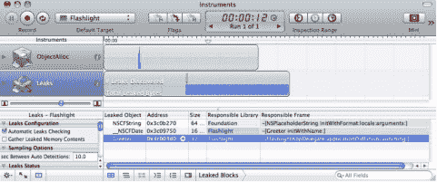

泄漏其实发生得早得多，但默认设置是每十秒采样一次泄漏。默认情况下，Object alloc 数据报告在 Instruments 窗口的右下部分。在左上角选择 Leaks 工具，你应该会看到泄漏信息。你可以在这个示例输出中看到，报告称泄漏源自 FlashlightAppDelegate 的 applicationDidFinishLaunching: 方法。这已经足够我们找到泄漏；不过，如果你双击报告泄漏的 Greeter 对象的那一行，就会跳转到源代码中有问题的代码行。既然知道泄漏在哪里，我们来修复它。

### 6.7 修复 iPhone 上的内存泄漏

内存管理是多种约束之间的平衡。最基本的一点是，你不希望在还有其他东西可能仍然指向某个对象时释放该对象的内存。另一方面，你也不希望在没人需要对象之后仍然长期持有它们，从而造成内存泄漏。在 Objective-C 中实现这一点的方式是引用计数。

你已经简要看到，当你用类似下面的代码创建 Greeter 类型的对象时，调用 alloc 后引用计数会被设为一：

```objective-c
Greeter *host = [[Greeter alloc] initWithName:@"Maggie"];
```

这正是 Build & Analyze 报告的错误。它知道你已将引用计数增加到一，并且再也没有使用过该变量。它希望你确认自己不再需要这个变量。你可以通过调用下面的代码来做到这一点：

```objective-c
[host release];
```

这会将引用计数递减一。在我们的例子中，这就足够了。host 的引用计数将变为零，它的 dealloc 方法会被调用，以清理对象资源并释放内存。当你知道不再需要 host 对象时，就向它发送 release 消息。在我们的例子中，你会在这里这样做：

```objective-c
Download Memory/Flashlight2/Classes/FlashlightAppDelegate.m

- (void)applicationDidFinishLaunching:(UIApplication *)application {
    Greeter *host = [[Greeter alloc] initWithName:@"Maggie"];
    NSLog(@"Greeter %@", host);
    [host release];
}
```

点击 Build & Analyze，这个特定的内存泄漏现在消失了。接下来，让我们花一点时间看看当你犯另一个关键内存错误时会发生什么。当你尝试向一个已被释放的对象发送消息时，会发生什么？

### 6.8 使用僵尸对象

到目前为止，我们创建了一个 Greeter 类型的对象，将其内容打印到控制台，并释放了该对象。现在让我们故意向这个已释放的对象再发送一条消息。我们就像这样再次将其内容打印到控制台：

```objective-c
Download Memory/Flashlight3/Classes/FlashlightAppDelegate.m

- (void)applicationDidFinishLaunching:(UIApplication *)application {
    Greeter *host = [[Greeter alloc] initWithName:@"Maggie"];
    NSLog(@"Greeter %@", host);
    [host release];
    NSLog(@"Greeter %@", host);
}
```


选择菜单项“构建 > 构建并调试”。你应该会在控制台窗口中看到一条模板消息，随后类似下面这样：[^5]

```text
Greeter name: Maggie
  created: 2009-09-18 14:24:43 -0400
objc[11179]: [Free(id): message respondsToSelector:
                 sent to freed object=0x3b06760
Program received signal: EXC_BAD_INSTRUCTION.
```

这太没用了。我们之所以知道哪个对象已被释放，只是因为我们为了演示而自己释放了它；但在对象不断创建和销毁的大型程序中，要追踪到出问题的对象会更困难。

我们将在这里借助僵尸对象来帮忙。要启用它们，请在“组与文件”中选择“可执行文件”>“Flashlight”。右键点击该文件，选择“显示简介”；或者选中 Flashlight 后按 ⌘I。选择“参数”标签页，在底部你应该会看到“要在环境中设置的变量：”这段文字。

点击左下角的 + 按钮添加一个环境变量。在变量名中输入 `NSZombieEnabled`，在值中输入 `YES`。

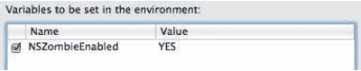

关闭窗口。再次点击“构建并调试”。这次你应该会在控制台中看到：

```text
Greeter name: Maggie
  created: 2009-09-18 16:13:57 -0400
*** -[Greeter respondsToSelector:]:
     message sent to deallocated instance 0x380d950
```

这次僵尸对象帮助我们看出该对象的类型是 `Greeter`。在调试并试图弄清楚你正在向哪个已释放对象发送消息时，这项技术非常有帮助。继续之前，请移除启用 NSZombies 的变量。部署应用时，你不会希望一直持有这些对象。

[^5]: 如果你没有看到这条消息，请尝试执行“构建 > 清理所有目标”，然后再次点击“构建并运行”。

### 6.9 在 dealloc 中清理

当一个对象的引用计数达到零时，它的 `dealloc` 会被调用。这里是你清理对象所用资源的地方。例如，在 `Greeter` 中有两个指向我们拥有的对象的指针：`name` 和 `today`。当我们的 `Greeter` 对象即将被销毁时，需要分别向它们发送 `release`。我们通过重写 `dealloc` 方法来完成这一点：

下载 Memory/Flashlight16/Classes/Greeter.m

```objective-c
- (void) dealloc {
    [name release];
    [today release];
    [super dealloc];
}
```

注意，在 `init` 方法中，我们先让超类完成初始化，然后才进行自定义初始化。而在这里，我们先清理自定义对象，最后调用 `[super dealloc]`。

你可以将这一行加入 `dealloc`，以便在 `Greeter` 对象被释放时向控制台窗口输出一条简短消息。

```objective-c
NSLog(@"In Greeter dealloc.");
```

如果你是个非常谨慎的人，想确保绝不可能最终向一个已释放对象发送消息，那么你可能希望在释放变量后将它们设为 `nil`，如下所示：

下载 Memory/Flashlight16/Classes/Greeter.m

```objective-c
- (void) dealloc {
    [name release];
    name = nil;
    [today release];
    today = nil;
    [super dealloc];
}
```

这里你释放了实例变量，并将它设为 `nil`。你可以使用对应的属性将这些步骤合并，如下所示：

下载 Memory/Flashlight16/Classes/Greeter.m

```objective-c
- (void) dealloc {
    self.name = nil;
    self.today = nil;
    [super dealloc];
}
```

正如你将在下一节看到的，`self.name = nil` 既会释放 `name`，又会将它设为 `nil`。[^6]

### 6.10 在 Setter 中 Retain 和 Release

下面是你在更改对象值时将使用的 retain-release 模式的一个示例。[^7] 假设你已经创建了一个名为 `greeter`、类型为 `Greeter` 的对象。使用 retain-release 模式的惯用 `setGreeter` 方法大致如下：

```objective-c
- (void) setGreeter: (Greeter *) newGreeter {
    if (newGreeter != greeter) {
        [newGreeter retain];
        [greeter release];
        greeter = newGreeter;
    }
}
```

你接收到了对象 `newGreeter`。你想拥有它以便对它做些事情，因此保留它是你的职责。另一方面，你即将把变量 `greeter` 设置为指向 `newGreeter` 所引用的对象。

首先，检查以确保这些指针没有指向同一内存位置。如果指向同一位置，那就无需做任何事。如果不是，就继续将 `greeter` 设置为指向 `newGreeter` 所引用的对象。

你将需要持有 `newGreeter` 所指向的对象，因此向它发送 `retain` 消息。另一方面，你不再需要 `greeter` 所指向的对象，因此释放它。现在你将 `greeter` 设置为指向 `newGreeter` 所指向的对象。尽管你永远不会再次使用变量 `newGreeter`，但你将会使用它所指向的内容。整个 retain-release 循环保留和释放的是变量所指向的对象，而不是变量本身。

这种 retain-release 的内存管理方法确实与日常生活有相似之处。例如，我想入住的那家会议酒店已经订满了。他们把我列入等候名单，而我

[^6]: 如果你正在使用键值观察（Key Value Observing），并且仍有其他人注册监听正在被释放并设为 `nil` 的对象的变更，那么可能会产生潜在后果。我倾向于只在 `dealloc` 中向变量发送 release 消息，然后就这样。

[^7]: 在上一章查看属性内存属性时，你曾简要看到过这一点。这个版本略有不同，现在你更好地理解了 retain-release 循环。

点击“构建并运行”，应用运行正常。它会创建新对象，正确显示它，然后释放它并调用 `dealloc`。

```text
Greeter name: Maggie
created: 2009-09-17 14:12:09 -0400
In Greeter dealloc.
```

如果你改为点击“构建并分析”，你会看到 FlashlightAppDelegate.m 中有两个问题被标记出来。当返回对象的方法（在我们的例子中是 `greeterFor:`）与调用它的对象定义在不同的类中时，你通常会看到这个问题。在这个示例中，事务的两部分都包含在同一个对象中，这就是为什么我们在运行示例时成功创建并释放了对象。然而，Clang Static Analyzer 通过分别查看 `greeterFor:` 和 `applicationDidFinishLaunching:` 这两个方法，识别出了一个潜在问题。

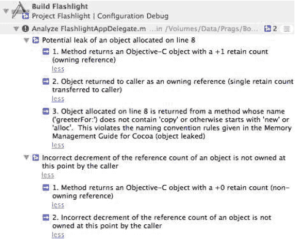

第二个错误告诉我们，我们释放了一个并不拥有的对象。事实上，如果你查看 `applicationDidFinishLaunching:` 方法，就会发现当我们释放 `host` 时，我们根本无法知道我们拥有它。

我们暂时忽略这个问题，专注于另一个问题。如果你查看这段代码，就会看到我们拥有 `host`，因为我们用 `alloc` 创建了它：

下载 Memory/Flashlight9/Classes/FlashlightAppDelegate.m

```objective-c
- (Greeter *) greeterFor:(NSString *) personName {
    return [[Greeter alloc] initWithName:personName];
}
```

为了突出这个问题，让我们像这样分两个不同步骤创建并释放对象：

下载 Memory/Flashlight9/Classes/FlashlightAppDelegate.m

```objective-c
- (Greeter *) greeterFor:(NSString *) personName {
    Greeter *tempGreeter = [[Greeter alloc] initWithName:personName];
    return tempGreeter;
}
```

我们可以在哪里释放 `tempGreeter`？

你不能在返回 `tempGreeter` 之前就直接释放它，否则引用计数会变为零，并且在你尝试返回它之前，`tempGreeter` 就会被解引用。[^9] 你不能忽略自己为 `tempGreeter` 持有的引用。那正是我们试图修复的内存泄漏。如果你不释放它，你可能在没有对象真正使用 `tempGreeter` 之后仍然持有它，因为你没有递减它的引用计数。

解决方案是使用自动释放池。[^10] 你向 `tempGreeter` 发送 `autorelease` 消息，它就会被标记为在调用 `greeterFor:` 方法的方法完成后释放。你也可以在创建 `Greeter` 实例时这样做。在这种情况下，你可以消除临时变量，并像这样满足需求：

下载 Memory/Flashlight10/Classes/FlashlightAppDelegate.m

```objective-c
- (Greeter *) greeterFor:(NSString *) personName {
    return [[[Greeter alloc] initWithName:personName] autorelease];
}
```

现在我们可以通过移除 `applicationDidFinishLaunching:` 中对 `[host release]` 的调用来解决第二个问题。`host` 变量所指向的对象没有被保留，因为它现在已被自动释放。既然我们不再拥有这个对象，我们也不再被允许释放它。

[^9]: 我假定这很明显：你不能把释放该对象的调用放在 `return` 之后的那一行。

[^10]: 有关自动释放池和内存管理的更多信息，请参阅 Apple 的出版物 *Cocoa 内存管理编程指南*。


因此，我们不再使用这个：

```
[[NSString alloc] initWithFormat:@"Hello, %@!", self.name]
```

而是使用下面这个：

```
[NSString stringWithFormat:@"Hello, %@!", self.name]
```

这两个版本并不完全相同。我们来回顾一下我们的规则。

如果使用第一个版本创建字符串，那么你就拥有它，并负责释放它。当我们使用 alloc 时，我们会将引用计数加一，并且需要通过调用 release 或使用自动释放机制来释放该字符串。

另一方面，规则对于使用第二种方法创建的对象是怎么说的？我们没有显式使用 alloc 或 new 来创建字符串，也没有使用 retain 或 copy 来持有它。因此，我们不拥有它。

`stringWithFormat:` 被称为便利构造器，因为它用于创建并初始化一个对象，并将其已经自动释放后返回给我们。换句话说，下面这个：

```
[NSString stringWithFormat:@"Hello, %@!", self.name]
```

等价于这个：

```
[[[NSString alloc] initWithFormat:@"Hello, %@!", self.name] autorelease]
```

### 6.13 练习：创建并使用便利构造器

为 Greeter 类创建你自己的便利构造器，命名为 `greeterWithName:`。你需要在 Greeter.h 中声明它，并在 Greeter.m 中实现它。

重构 FlashlightAppDelegate.m 中的 `applicationDidFinishLaunching:` 方法，使用这个方法创建 Greeter 类的实例。在你完成向控制台写入之后，Greeter 将被自动释放，并且 Greeter 的 `dealloc` 方法将被调用。

## 第 7 章：出口与动作

Cocoa 编程使用模型-视图-控制器（MVC）将应用程序逻辑与外观和体验分离。对于模型，我们将使用 Xcode 以 Objective-C 创建应用程序逻辑。你已经看到如何使用 Interface Builder 创建视图。

控制器是模型与视图之间的桥梁。当用户点击按钮、在文本字段中输入，或对视图做任何操作时，控制器会响应这些动作，通常是通过向模型发送消息。同样，当模型发生变化时，控制器会更新视图，以便这些变化对用户可见。

控制器必须同时涉足两个世界。有一个类文件，你用它创建方法并向模型或视图发送消息。我们将在 Interface Builder 中创建控制器类的实例。这为我们提供了控制器的可视化表示，它存在于一个 nib 中，你用这个 nib 将控制器代码连接到你在 IB 中创建的可视组件。这有点像控制器的真实版本生活在代码中，而它的化身生活在 IB 中。

你将在下一章为我们的 Simple Browser 创建一个控制器。在本章中，我们将研究如何从 Interface Builder 中创建的那些 GUI 元素与你的代码通信，以及你的代码如何更改 GUI。一旦你熟悉了这些动作和出口，你会发现自己一直在使用它们。¹

1. 尽管我们从出口和动作的这种简单视图开始，但随着深入，我们会以更复杂的方式使用它们。

### 7.1 总体概览

设想我们有一个窗口，里面有一个按钮和一个文本字段。当用户点击按钮时，我们将在文本字段中显示“Hello, World!”。我们需要一种方法将按钮连接到代码，这样当按钮被点击时，我们的代码中会调用一个方法来完成工作。我们还需要某种连接回文本字段的方式，以便将其文本设置为“Hello, World!”

控制器连接到 UI 元素基本上有两种方式：

- **动作（Actions）：** 当按钮之类的元素想要发起由控制器执行的动作时使用的控制器方法
- **出口（Outlets）：** 指向控制器需要向其发送消息的 UI 元素的控制器实例变量

动作和出口是专门为 Interface Builder 中创建的连接而设计的。下面是基本流程。

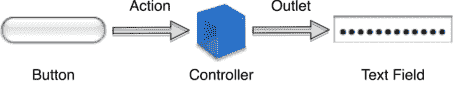

当用户点击按钮时，会向指定的目标发送一条消息，以发起特定的动作。你在控制器中创建这个目标动作，并在 Interface Builder 中进行连接。动作只是一个在按钮被点击时会被调用的方法。

有时控制器需要与你使用 IB 创建的对象通信。一种方法是给控制器一个指向该对象的句柄。设想我们的控制器有一个出口，它是一个文本字段。换句话说，控制器有一个指向该文本字段的实例变量。就像墙上的插座一样，出口是控制器中的一个位置，可视化元素可以插入其中。

### 7.2 使用出口

使用 Cocoa Application 模板创建一个新项目，取消选中所有复选框，并将其命名为 HelloWorldPro。

将这一行添加到 HelloWorldProAppDelegate.m：

```
Download Outlets/HelloWorldPro/HelloWorldProAppDelegate.m

#import "HelloWorldProAppDelegate.h"

@implementation HelloWorldProAppDelegate

@synthesize window;
- (void)applicationDidFinishLaunching:(NSNotification *)aNotification {
    self.window.backgroundColor = [NSColor greenColor];
}
@end
```

点击 Build & Run，你的窗口应该会出现，背景色设置为绿色。这是怎么发生的？我们向 window 属性发送了一条消息来更改其背景色。那条消息是如何传达到作为 nib 文件一部分的实际 NSWindow 的？

要实现这一点，有两个重要步骤。首先，查看 HelloWorldProAppDelegate 类的头文件：

```
Download Outlets/HelloWorldPro/HelloWorldProAppDelegate.h

#import <Cocoa/Cocoa.h>

@interface HelloWorldProAppDelegate : NSObject <NSApplicationDelegate> {
    NSWindow *window;
}
@property (assign) IBOutlet NSWindow *window;
@end
```

你看到 IBOutlet 关键字被塞进 window 的 @property 声明中间了吗？这告诉 Interface Builder 将 window 包含在 HelloWorldProAppDelegate 每个实例的出口列表中。

双击 MainMenu.xib 文件（记住你可以在 Resources 下找到它）。当 nib 在 Interface Builder 中打开时，查看 Document 窗口，并选择 HelloWorldProAppDelegate 类的实例。²

2. 如果 Document 窗口不可见，你始终可以使用 ⌘0 或 Window > Document 将其调出。

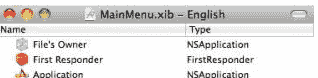


打开它的 Connections inspector（Tools > Connections inspector）。window 出口已经连接到同一个 nib 中的 NSWindow 对象。

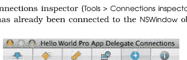

如果你愿意，也可以查看 NSWindow 对象的连接，你会看到 window 被列为引用出口。

因此，你可以这样想象事件顺序。我们在 HelloWorldProAppDelegate 类中有一个 window 变量和属性。我们有一个 nib，其中包含 HelloWorldProAppDelegate 的一个实例和 NSWindow 的一个实例。

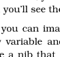

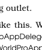

window 属性隐藏在 HelloWorldProAppDelegate 内部。你在上一章看到我们可以在代码中访问该属性，但如何在 Interface Builder 中连接到它？第一步是将该属性标记为 IBOutlet。我把这个 outlet 想象成……上的一个把手

在文本字段中对文本进行两端对齐，使用 Attributes inspector 调整字体大小，并保存你的工作。

为 HelloWorldProAppDelegate 的头文件中的该文本字段添加一个新属性，并将其声明为出口。在应用程序启动后，使用该出口打印“Hello, World!”。

回到 Interface Builder，将该出口连接到文本字段。

点击 Build & Run，你应该会看到窗口中有一个绿色背景，上面有一个文本字段，显示消息“Hello, World!”

### 7.4 解决方案：创建并使用出口

使用 Xcode 和 Interface Builder 是有节奏的。你会在它们之间来回切换。你应该已经毫无困难地在 Interface Builder 中拖入一个文本字段并将其定位到窗口中。在回到 Xcode 之前，查看 HelloWorldProAppDelegate 的 Connections inspector。它应该和之前看起来完全一样，只有一个处于活动连接状态的出口。

接下来的部分挺酷的。将下面两行高亮行添加到你的头文件中：

```objective-c
#import <Cocoa/Cocoa.h>

@interface HelloWorldProAppDelegate : NSObject <NSApplicationDelegate> {
    NSWindow *window;
    NSTextField *textField;
}
@property (assign) IBOutlet NSWindow *window;
@property (assign) IBOutlet NSTextField *textField;
@end
```

你已经向 HelloWorldProAppDelegate 添加了一个名为 textField 的实例变量，并声明了相应的属性。但对我们当前目的更重要的是，你已经将 textField 标记为出口。保存头文件，然后在 Interface Builder 中点击回 Connections inspector。

你看到了吗？


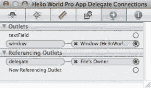

一个新的输出口出现了。每次看到这都让我微笑。我们已在 HelloWorldProAppDelegate 的公共接口中添加了一个输出口，向外界表明这个属性可供你使用。Interface Builder 已识别出这一新增内容，因为你用 IBOutlet 标记了这个输出口。

点击 textField 输出口右侧的圆圈，并将其拖到你放置在窗口内的文本字段上。松开鼠标，你就应该建立了一个新连接。保存你的工作。如果愿意，你现在可以退出 Interface Builder。

回到 Xcode，你需要对实现文件做两处小修改。你需要为 textField 合成访问器，并且你想在其中显示“Hello, World!”。你之前已经知道如何完成这两步。

```objective-c
#import "HelloWorldProAppDelegate.h"

@implementation HelloWorldProAppDelegate

@synthesize window, textField;

- (void)applicationDidFinishLaunching:(NSNotification *)aNotification {
    self.window.backgroundColor = [NSColor greenColor];
    [self.textField setStringValue:@"Hello, World!"];
}
@end
```

### 7.5 声明一个动作

在 Interface Builder 中，向你的窗口添加一个按钮，并将其标题改为 Personalize。当按钮被点击时，我们将把问候语从“Hello, World!”改为更个性化一点的内容。


#### Joe 问……

##### 我在代码中刚添加的输出口在哪里找到？

如果你向名为 NSFoo 的类添加一个输出口，那么你会在 IB 中任何类型为 NSFoo 的对象上找到该输出口。这会成为你的第二天性，但许多刚接触 Interface Builder 的人会抱怨说，他们把输出口添加到了类中，但它却没有显示在 IB 中。出问题通常有两个原因：

- 确保你在 Xcode 中保存了头文件。需要保存的文件在“组与文件”面板中会略微呈灰色。
- 确保你查看的是正确的对象。在我们的示例中，我们在源文件 HelloWorldProAppDelegate.h 中添加了输出口，因此在 Interface Builder 中，选择 HelloWorldProAppDelegate 对象，并查看连接检查器。

如果这些步骤对你来说显而易见，那很好。你理解了在 Xcode 中所做的事情与在 Interface Builder 中所做的事情之间的关系。

我们必须在 Xcode 中声明并实现一个方法，该方法将在按钮被点击时调用。第一步是使用正确的语法声明一个方法。对于所有 Mac OS X Cocoa 应用程序，你的动作必须像这样声明：

```objective-c
- (IBAction)actionSelector:(id)sender;
```

这与你之前看到的 web 视图的 goBack: 方法的格式相同。该方法必须是实例方法，接受一个类型为 id 的单一参数。按照惯例，我们将该参数命名为 sender。

返回类型是 IBAction。这个返回类型同时传达了两件事。第一，这有助于 Interface Builder 理解该方法是动作，从而可以在连接检查器中显示。第二，IBAction 被 typedef 为 void，因此 IBAction 告诉你该方法不返回任何内容。^3

3. 仅靠 IBAction 返回类型不足以让该方法显示在 Interface Builder 中。IB 足够智能，会确保还存在一个类型为 id 的单一参数。


顺便说一句，当你为 iPhone 或 iPod touch 设计应用程序时，可以使用两种额外的变体。你可以创建一个没有参数的动作。以下签名在 Cocoa Touch 中可以正常工作：^4

```objective-c
- (IBAction)actionSelector;
```

在使用 Cocoa Touch 时，这个版本一直是我的首选。如果 Cocoa 中也能使用这种无参数签名，那么它在这里也会是我的首选。在需要传递 sender 的情况下，我很喜欢有这个选项。但很多时候，我不需要与 sender 通信，也不需要了解关于 sender 的任何信息。我希望通过使用无参数版本，在代码中更清楚地表达这一点。

另一方面，有时我需要知道的信息比仅传递 sender 所能传达的更多。有时我想了解触发该消息的事件的一些信息。如果你正在编写 Cocoa Touch 应用程序，可以为 IBAction 使用以下签名：

```objective-c
- (IBAction)respondToButtonClick:(id)sender forEvent:(UIEvent*)event;
```

目前，对于桌面应用程序，我们需要使用单参数形式来声明 IBAction。对于 Cocoa Touch 应用程序，我们也可以自由使用无参数和双参数版本。

回到我们当前的示例，将这段高亮显示的声明添加到头文件中，并保存你的工作：

```objective-c
#import <Cocoa/Cocoa.h>

@interface HelloWorldProAppDelegate : NSObject <NSApplicationDelegate> {
    NSWindow *window;
    NSTextField *textField;
}
@property (assign) IBOutlet NSWindow *window;
@property (assign) IBOutlet NSTextField *textField;

- (IBAction)changeGreeting:(id)sender;
@end
```

4. Cocoa Touch 是我们对面向 iPhone OS 的 Cocoa API 的称呼。

### 7.6 连接并实现动作

你已经在 HelloWorldProAppDelegate 头文件中创建了按钮并声明了动作。像我们描绘 IBOutlet 那样来描绘 IBAction 可能会有所帮助。假设我们一开始在 HelloWorldProAppDelegate.h 中这样声明一个方法：

```objective-c
- (void)changeGreeting;
```

这给了我们一个可以在代码中调用的方法，但无法在 Interface Builder 中连接它：


更改该方法的签名，使其现在成为一个动作：

```objective-c
- (IBAction)changeGreeting:(id)sender;
```

你现在已经公开了这个方法。这意味着，例如，你可以将按钮连接到此动作，以便在按钮被点击时执行该方法。

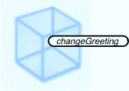

让我们利用已声明的动作，回到 Interface Builder，并连接动作和按钮。在 IB 中，在文档窗口中选择类型为 HelloWorldProAppDelegate 的对象，并使用连接检查器查看它的连接。你现在应该会在 Received Actions 下看到 changeGreeting:。

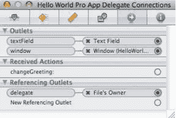

点击 changeGreeting: 右侧的圆圈，并将其拖到你创建的按钮上。松开鼠标，你就连接好了输出口。保存你的工作，然后退出 Interface Builder。

我们将实现该动作方法，将窗口背景颜色改为红色，并个性化地问候用户。我们怎么可能提前知道用户的名字呢？我们做不到。但我们可以使用函数调用 NSFullUserName() 来获取用户在配置其机器时输入的名字：

下载 Outlets/HelloWorldPro3/HelloWorldProAppDelegate.m

```objective-c
- (IBAction)changeGreeting:(id)sender {
    self.window.backgroundColor = [NSColor redColor];
    [self.textField setStringValue:
        [NSString stringWithFormat:@"Hello, %@!", NSFullUserName()]];
}
```

当我在我的笔记本电脑上运行这个应用时，我看到的是：

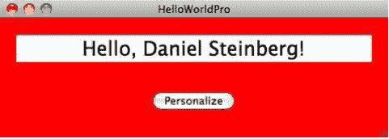

### 7.7 练习：隐藏按钮

我不太喜欢这个应用程序当前的状态。在用户点击 Personalize 并且文本字段显示个性化问候语之后，按钮仍然显示“Personalize”，尽管用户已经没有更多可做的了。

在用户将输出个性化之后，隐藏按钮。

### 7.8 解决方案：隐藏按钮

在用 Objective-C 编写 Cocoa 应用时，你往往会写更少的代码，但一开始你会花更长时间来找出需要编写的是什么代码。你会花大量时间查阅文档和搜索互联网。许多 Cocoa 编码工作要求你不要做超出必要范围的事情。

例如，我们这里的目标是隐藏按钮。我们知道必须向按钮发送一条消息，那么该怎么做呢？我们可以在 HelloWorldPro4AppDelegate.h 中为 NSButton 创建一个输出口，并在 nib 中将该输出口连接到按钮。这是正确的，但没有必要。

至少目前，我们唯一需要访问按钮的地方是在 changeGreeting: 方法内部。而你在那里已经有一个指向按钮的句柄——它就是作为参数传入的 sender。你只需要反过来，通过将这一行添加到 changeGreeting: 的实现中，向按钮发送正确的消息：

```objective-c
- (IBAction)changeGreeting:(id)sender {
    self.window.backgroundColor = [NSColor redColor];
    [self.textField setStringValue:
        [NSString stringWithFormat:@"Hello, %@", NSFullUserName()]];
    [sender setHidden:YES];
}
```

如果这能让你感觉更好，你可以将 sender 强制转换为 NSButton，以便更清楚地看出你正在向谁发送消息：

```objective-c
[(NSButton *)sender setHidden:YES];
```

那么，我们怎么知道要向按钮发送哪条消息呢？首先，你查看 NSButton 的文档，浏览任务中与隐藏按钮相关的内容。那里什么也没有。于是，你转到 NSButton 文档的顶部，你会看到它继承


从NSControl继承：NSView : NSResponder : NSObject。这会沿着继承树向上移动。你查看NSControl，发现里面什么也没有，于是继续查看NSView。

浏览任务列表，有一个“隐藏视图”的标题，其中有一个方法是setHidden:。我们也可以决定完全移除按钮，使用如下代码：

```objc
[sender removeFromSuperview];
```

从用户的角度来看，这两种方式没有区别；然而，从内存的角度来看，这两者之间存在重要差异。当我们在Interface Builder中将按钮拖到窗口上时，按钮的父视图（窗口的内容视图）拥有该按钮并将其引用计数加一。如果我们隐藏按钮，它仍然存在；只是不可见而已。另一方面，如果我们将按钮从其父视图中移除，那么唯一拥有该按钮的对象将会释放它，按钮所占用的内存也会被释放。

这两种方法没有对错之分。你需要根据具体情境决定：是已经不再需要这个按钮并想要释放它，还是仅仅将其隐藏。

### 7.9 练习：切换界面

不要隐藏按钮，让我们将按钮设置为在两个视图之间来回切换。当应用启动时，按钮标题为“Personalize”，背景为绿色，文本字段显示“Hello, World!”。

当用户点击Personalize按钮时，按钮标题应变为“Generalize”，背景应变为红色，文本字段应显示个性化的问候语。

### 7.10 解决方案：切换界面

编写这个解决方案的方式有很多种。让我们从简单的方式开始，然后再继续。我将在头文件中添加一个类型为BOOL的实例变量，名为isPersonalized：

```text
Download Outlets/HelloWorldPro5/HelloWorldProAppDelegate.h
```

```objc
NSWindow *window;
NSTextField *textField;
BOOL isPersonalized;
```

现在我们可以修改changeGreeting:方法，根据isPersonalized是YES还是NO来设置按钮、文本字段和背景颜色。我还在applicationDidFinishLaunching:方法中初始化了isPersonalized。BOOL默认初始化为NO，但我发现在这里明确说明有助于理解：

```text
Download Outlets/HelloWorldPro5/HelloWorldProAppDelegate.m
```

```objc
#import "HelloWorldProAppDelegate.h"

@implementation HelloWorldProAppDelegate

@synthesize window, textField;

- (void)applicationDidFinishLaunching:(NSNotification *)aNotification {
    self.window.backgroundColor = [NSColor greenColor];
    [self.textField setStringValue:@"Hello, World!"];
    isPersonalized = NO;
}

- (IBAction) changeGreeting:(id)sender {
    if (isPersonalized) {
        self.window.backgroundColor = [NSColor greenColor];
        [self.textField setStringValue:@"Hello, World!"];
        [sender setTitle:@"Personalize"];
        isPersonalized = NO;
    } else {
        self.window.backgroundColor = [NSColor redColor];
        [self.textField setStringValue:
            [NSString stringWithFormat:@"Hello, %@!", NSFullUserName()]];
        [sender setTitle:@"Generalize"];
        isPersonalized = YES;
    }
}
@end
```

点击Build & Run，应用就会按照我们希望的方式运行。

### 7.11 引入另一个Outlet

我不喜欢applicationDidFinishLaunching:方法中的重复代码，也不喜欢changeGreeting:方法中if语句的真正分支。我们将背景颜色和文本字段内容设置成了相同的值两次。我想从applicationDidFinishLaunching:调用changeGreeting:。

你能看出这样做有什么问题吗？谁应该是发送者？如果changeGreeting:不是响应按钮点击而调用的，它如何获得按钮的句柄呢？

让我们为按钮引入一个outlet：

```text
Download Outlets/HelloWorldPro/HelloWorldProAppDelegate.h
```

```objc
#import <Cocoa/Cocoa.h>

@interface HelloWorldProAppDelegate : NSObject <NSApplicationDelegate> {
    NSWindow *window;
    NSTextField *textField;
    NSButton *button;
    BOOL isPersonalized;
}
@property (assign) IBOutlet NSWindow *window;
@property (assign) IBOutlet NSTextField *textField;
@property (assign) IBOutlet NSButton *button;

-(IBAction) changeGreeting:(id)sender;
@end
```

在Interface Builder中将这个新outlet连接到你的按钮。如果你愿意，可以删除按钮的标题，使其为空。保存。

在实现文件中，你需要合成button。现在你可以在changeGreeting:内部将对sender的使用改为self.button。让我们先让applicationDidFinishLaunching:变得更“糟糕”一点，然后再让它变得更好。

```text
Download Outlets/HelloWorldPro/HelloWorldProAppDelegate.m
```

```objc
- (void)applicationDidFinishLaunching:(NSNotification *)aNotification {
    self.window.backgroundColor = [NSColor greenColor];
    [self.textField setStringValue:@"Hello, World!"];
    [self.button setTitle:@"Personalize"];
    isPersonalized = NO;
}
```

这段代码现在与if语句的true分支完全相同，所以让我们进行重构。引入两个工具方法personalize和generalize，并在applicationDidFinishLaunching:和changeGreeting:中使用它们。

```text
Download Outlets/HelloWorldPro/HelloWorldProAppDelegate.m
```

```objc
#import "HelloWorldProAppDelegate.h"

@implementation HelloWorldProAppDelegate

@synthesize window, textField, button;

- (void) personalize {
    self.window.backgroundColor = [NSColor redColor];
    [self.textField setStringValue:
        [NSString stringWithFormat:@"Hello, %@!", NSFullUserName()]];
    [self.button setTitle:@"Generalize"];
    isPersonalized = YES;
}
- (void) generalize {
    self.window.backgroundColor = [NSColor greenColor];
    [self.textField setStringValue:@"Hello, World!"];
    [self.button setTitle:@"Personalize"];
    isPersonalized = NO;
}
- (void)applicationDidFinishLaunching:(NSNotification *)aNotification {
    [self generalize];
}
-(IBAction) changeGreeting:(id)sender {
    if (isPersonalized) [self generalize];
    else [self personalize];
}
@end
```

代码并没有真正缩短多少，但更易读了。在下一节中，我们将利用Objective-C的另一个特性来进行另一项修改。

### 7.12 从字符串创建选择器

让我们退后一步，注意到当按钮标题为“Personalize”时，我们调用personalize方法；当按钮标题为“Generalize”时，我们调用generalize方法。

如果我们能够获取按钮的标题，将其转换为小写，并将其用作我们要调用的方法名，那就太好了。因为它的值在运行时发生变化，我们将使用NSSelectorFromString()函数，如下所示：

```objc
NSSelectorFromString([[self.button title] lowercaseString]);
```

这会返回一个选择器——你可以将其视为方法的正式名称。然后，我们通过向self发送performSelector:消息并传入刚创建的选择器作为参数来调用具有该名称的方法。

换句话说，changeGreeting:方法可以变为这样：

```text
Download Outlets/HelloWorldPro/HelloWorldProAppDelegate.m
```

```objc
-(IBAction) changeGreeting:(id)sender {
    [self performSelector:
        NSSelectorFromString([[self.button title] lowercaseString])];
}
```

顺便说一下，我们可以去掉名为isPersonalized的BOOL，因为我们不再使用它了。我并不是建议你替换每一个布尔值和if语句，但我的确想向你展示一种使用选择器的方法，让你无需进行任何判断就能获得清晰的代码路径。<sup>5</sup>

我们的旅程始于在无需编写任何代码的情况下创建一个网页浏览器。在接下来的章节中，你已经学到了很多关于代码以及为你创建的连接的知识。在下一章中，我们将回到我们的网页浏览器，创建一个控制器，为免费获得的功能添加一些新功能。

5. 在这种情况下，我将我们的决策与按钮上的标签耦合在一起。这使得在日后将应用国际化时变得更加困难。我想向你介绍NSSelectorFromString()。你将学到使用这种技术的更健壮的方法。


## 第8章 创建控制器

你无法仅通过在 Interface Builder 中拖拽可视元素之间的连接，就完成应用程序想要做的所有事情。一方面，我们在第2章“使用现有功能”（第24页）中只用可视化工具就如此轻松地创建了一个简单的 Web 浏览器，这相当令人惊叹。另一方面，这个浏览器还有很多不足之处。有些事情我们就是需要自己编写代码来实现。

在本章中，我们将为 SimpleBrowser 示例创建一个控制器。为简单起见，我们不会使用模型——只会有视图和控制器。这个示例的重点是创建一个新类，并实例化它，以便与你在 Interface Builder 中创建的对象通信。

### 8.1 我们是如何创建对象的

我们以两种不同的方式创建并连接对象。在 SimpleBrowser 示例中，我们所有的对象都是在 nib 中创建的。我们拖入按钮、一个文本字段和一个 Web 视图，它们加入了 SimpleBrowserAppDelegate 以及所有其他在 nib 中创建的对象。

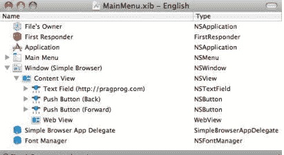

这个应用程序实际上没有代码。对象之间的所有连接都已在 Interface Builder 中完成。以下是 Web 视图接收到的动作。它从 Back 按钮接收 goBack: 消息，从 Forward 按钮接收 goForward: 消息，并从文本字段接收 takesStringURLFrom: 消息。

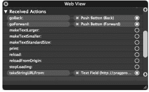

请将此与我们在第4章 *类和对象*（第62页）中构建的“Hello, World!”应用程序进行对比。在那里，我们在应用程序委托中用代码创建了一个文本字段。然后，我们创建了一个自定义的 Greeter。我们在应用程序委托中用代码实例化它，而我们创建的对象之间的所有通信都通过代码完成。

在第7章 *出口和动作*（第124页）中，你学习了如何将你编写的代码与在 Interface Builder 中创建的对象连接起来。如果你需要从代码中与某个控件通信，你就在头文件中为该控件创建一个 outlet，然后连接

一开始，这会让人感觉有点奇怪。毕竟，你正在创建一个类的实例，而本书让你使用一个名为 *Interface Builder* 的工具为其提供可视化表示。很快，你就会觉得这完全自然。

### 8.3 在 IB 中创建控制器的实例

现在，我们将在 Interface Builder 中创建 BrowserController 类的一个实例。^2

当我们创建按钮实例时，我们只是在 Library 中查找一个看起来像我们想要的那种按钮的 NSButton，然后把它拖到窗口中。对 BrowserController 就不能这样做，因为 Interface Builder 的 Library 不可能包含我们的 BrowserController 类——这个类是我们刚刚编出来的。幸运的是，Snow Leopard 和 Xcode 3.2 让这件事对我们容易多了。^3

双击 MainMenu.xib 以在 IB 中打开 nib 文件。你不再关心 Window 视图，因为控制器没有可供最终用户看到的可视化表示。相反，使用快捷键 ⌘0 或选择 Window > Document 来调出 Interface Builder 中的 Document 窗口。

Interface Builder 为我们提供了 BrowserController 对象的表示。在 IB 中，转到 Library，这次选择 Classes 标签页，然后查找 BrowserController。

2. 实际上，直到应用程序启动时 nib 被解档，这个实例才真正被创建。我们可以认为实例就是在此刻创建的，就像我们之前学习使用 `[[BrowserController alloc] init]` 这样的调用时，所讨论的在代码中创建对象那样。

3. 如果你运行的是较早版本的 Xcode，则需要调整后续说明，以便将 NSObject 拖入 Document 窗口，并使用 Identity Inspector 更改其类型。

nib 中的 BrowserController。以下是你的 Document 窗口的图标视图，其中包含新添加的 BrowserController 实例：

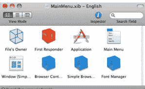

我更喜欢使用列表视图，但还是想向你展示这个视图，以防你更喜欢它。

### 8.4 声明一个 outlet 和一个 action

目前，Back 按钮连接到 Web 视图的 goBack: 方法。让我们把 BrowserController 插入到中间。我们将需要在控制器中有一个用于加载上一个网页的方法。它将由 Back 按钮调用，并且反过来必须向 Web 视图发送 goBack: 消息。这意味着我们需要一个用于 Web 视图的 outlet，以及一个用于该方法的 action。

回到 Xcode，在 BrowserController.h 中添加一个名为 loadPreviousPage: 的 IBAction。你还需要使用一个实例变量和一个属性，添加一个名为 myWebView 的 IBOutlet。^4 myWebView 变量是指向 WebView 对象的指针。

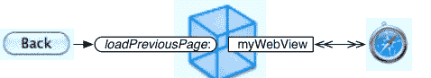

4. 如果你使用并面向 64 位环境，则可以在不声明实例变量的情况下创建属性。

这样设置后，当点击 Back 按钮时，将在 BrowserController 对象上调用 loadPreviousPage: 方法。loadPreviousPage: 方法将在 myWebView 变量上调用 goBack: 方法。由于 myWebView 变量也是一个连接到 WebView 对象的 outlet，因此这相当于在这个 WebView 对象上调用 goBack: 方法。你可以在 Apple 的 *Communicating with Objects* [App08c] 中阅读更多关于对象和 action 的内容。

记得在实现文件中合成（synthesize）myWebView。以下是头文件：


```objective-c
#import <Cocoa/Cocoa.h>

@interface BrowserController : NSObject {
    WebView *myWebView;
}
@property(assign) IBOutlet WebView *myWebView;

-(IBAction) loadPreviousPage: (id) sender;

@end
```

在你点击 Build & Run 之前，你能看出任何问题吗？如果能，就修正它们。如果不能，我过一会儿会解释怎么做。点击 Build & Run，你应该会收到消息“构建失败（9 个错误，6 个警告）。”在你打开的窗口右下角，你应该会看到：


你可以点击 Failed、带感叹号的黄色三角形（表示警告），或带 ! 的红色圆圈（表示错误），以打开一个包含更多关于出错详情信息的窗口。这三个错误和两个警告重复了三次：

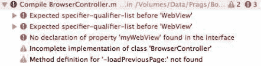

我们先处理错误。你的 IBOutlet 使用了 WebView 类。但你的程序对 WebView 类一无所知。你必须导入相应的头文件。在 WebView 文档顶部，你可以看到它属于 WebKit 框架，并在 WebView 中声明。一个解决方案是将这个 import 添加到 BrowserController.h 中，放在导入 Cocoa 头文件的那一行下面：

```objc
#import <Cocoa/Cocoa.h>
#import <WebKit/WebKit.h>
@interface BrowserController : NSObject {
    WebView *myWebView;
}
@property(assign) IBOutlet WebView *myWebView;
-(IBAction) loadPreviousPage: (id) sender;
@end
```

#### Joe 问……

**警告和错误有什么区别？**

错误意味着存在某种使你的代码无法编译的问题。它是无法继续的障碍。你的代码无法编译，因此没有可运行的应用。除了修正错误，你别无选择。

警告让你知道可能存在问题，但问题并不严重到使代码无法编译。这可能意味着一切都会正常，也可能意味着最终会出现运行时错误。警告可能是编译时的一条提示，告诉你向一个对象发送了消息，而该对象并未声明具有该签名的方法。这并不意味着该对象无法处理该消息，只是编译器无法验证该对象能否处理。

警告很容易被忽略。你的代码能编译——为什么要担心？一些有经验的开发者认为这些警告太容易被忽略了，因此他们会选择 Treat Warnings as Errors（将警告视为错误）选项。

选择菜单项 Project > Edit Project Settings，转到 Build 标签页，然后勾选 Treat Warnings as Errors 复选框。搜索 treat 这个词。

再次点击 Build & Run。这一次构建将成功。会有两个不同的警告，因为头文件承诺会有一个名为 loadPreviousPage 的方法，而我们还没有实现它。即使还有这项未完成的工作，程序仍会构建并启动，而且


其工作方式与之前相同。使用红色的 Tasks 停止标志停止正在运行的应用程序。

### 8.5 前向声明

对于上一节中遇到的错误，还有另一种解决方案：你可以在头文件中使用 @class 指令来代替 import 语句。

```objc
#import <Cocoa/Cocoa.h>
@class WebView;
@interface BrowserController : NSObject {
    WebView *myWebView;
}
@property(assign) IBOutlet WebView *myWebView;
-(IBAction) loadPreviousPage: (id) sender;
@end
```

在 BrowserController.h 文件中，编译器只需要知道 WebView 是一个合法的类。它不需要了解关于该类的任何其他信息。@class 指令正是做这件事的。它不会引入整个头文件来告诉我们 WebView 类型的对象能做什么——我们目前还不需要知道这些。它只是向我们保证存在一个名为 WebView 的类。

每当你在头文件中使用 @class 指令时，你很可能需要在实现文件中使用相应的 import 语句。现在就在实现文件顶部附近添加它吧。顺便也把 loadPreviousPage: 动作存根出来。

```objc
#import "BrowserController.h"
#import <WebKit/WebKit.h>

@implementation BrowserController

@synthesize myWebView;

-(IBAction) loadPreviousPage: (id) sender{
    NSLog(@"loadPreviousPage");
}

@end
```

点击 Build & Run。应该没有警告或错误，并且你的浏览器应该像之前一样运行。

### 8.6 连接控制器

回到 Interface Builder；在 Document 窗口中点击 Browser Controller 对象，然后打开 Connections 检查器。

在 Outlets 下，你现在会找到 myWebView，在 Received Actions 下你会看到 loadPreviousPage:。将 loadPreviousPage: 动作连接到 Back 按钮。现在 Back 按钮应该只连接到控制器，而不再直接连接到 web 视图。同时将 myWebView 出口连接到 web 视图。

保存你的工作，然后点击 Build & Run。输入几个 URL。试试 Back 按钮。目前，当你点击 Back 按钮时，loadPreviousPage: 消息会发送到 BrowserController 对象，该对象会在 Console 中打印方法名。

### 8.7 实现加载上一页

回到 Xcode，没有多少代码要写。当 Back 按钮将 loadPreviousPage: 消息发送给 BrowserController 对象时，BrowserController 对象只是转而将 goBack 消息发送给 myWebView。

我们唯一需要决定的是，将什么作为发送者发送给 web 视图。我们可以发送 self，也可以传递调用 loadPreviousPage: 的对象的身份。在我们的情况下，这并不重要。我决定采用后一种方法，将 Back 按钮作为发送者传递。

下载 CreatingAController/SimpleBrowser4/BrowserController.m：

```objc
-(IBAction) loadPreviousPage: (id) sender {
    [self.myWebView goBack:sender];
}
```

就是这样！点击 Build & Run，你又有了一个可用的 Back 按钮。

### 8.8 练习：完成控制器

向 BrowserController 添加另一个名为 loadNextPage: 的动作，并使用它让 Forward 按钮通过控制器工作。

完成之后，向 BrowserController 添加最后一个动作。将其命名为 loadURLFrom:，并使用它让来自文本字段的 URL 输入通过控制器工作。请记住，当点击 Enter 时，文本字段会向控制器发送一条消息，然后 web 视图需要向文本字段发送一条消息以获取文本字段的字符串值。你可以用不止一种方式做到这一点。你可能会想为文本字段引入一个出口。在这种情况下，你不必这样做。使用 sender 与文本字段通信。

### 8.9 解决方案：完成控制器

练习的前半部分与我们共同采取的步骤类似。你需要做三处更改。

首先，你需要使用 Xcode 向头文件 BrowserController.h 添加一个动作并保存：

```objc
-(IBAction) loadNextPage: (id) sender;
```

其次，回到 Interface Builder，选择 BrowserController。在 Connections 检查器中，从 loadNextPage 右侧的圆圈拖到 Forward 按钮以建立连接。保存你的工作。

最后，你需要实现该方法。查看 web 视图的连接，你可以看到需要调用的方法是 goForward。回到 Xcode，修改 BrowserController.m 以添加此方法：

下载 CreatingAnIconController/SimpleBrowser5/BrowserController.m

```objc
-(IBAction) loadNextPage: (id) sender
{
    [self.myWebView goForward:sender];
}
```

保存你的工作。点击 Build & Run，你应该会发现现在有了可用的 Back 和 Forward 按钮。输入几个 URL，你应该能够使用这些按钮在列表中前后移动。

对于练习的后半部分，我们将遵循三个类似的步骤。首先，在 Xcode 中向头文件添加一个名为 loadURLFrom: 的动作并保存：

```objc
-(IBAction) loadURLFrom: (id) sender;
```

在 IB 的 Document 窗口中选择 BrowserController，然后打开 Connections 检查器。

从 `loadURLFrom:` 右侧的圆圈拖到文本字段以建立连接。我们已经配置了文本字段，使其在用户按下 Enter 键时向其目标发送一个动作。你可以使用文本字段的 Attributes 检查器来确认 Action 值仍按此方式设置。保存你的工作。回到 Xcode，像这样实现你的方法：

下载 CreatingAnController/SimpleBrowsers/BrowserController.m

```objc
-(IBAction) loadURLFrom: (id) sender{
    [self.myWebView takeStringURLFrom:sender];
}
```

### 8.10 从 Nib 唤醒

回到第 4 章 *类和对象* 第 62 页，我们使用类似这样的组合创建并初始化了 Greeter 的实例：

```objc
[[Greeter alloc] initWithName:@"Maggie"];
```

我们能够在 `initWithName:` 方法中初始化变量并完成所需的任何自定义。我们在 BrowserController 中没有类似的方法，而且我们的 BrowserController 是在加载 nib 时初始化的，而不是通过显式调用 alloc 和某种形式的 init 来初始化。

稍后我会更深入地介绍当 nib 被取消归档并加载时会发生什么。目前，当应用程序启动时，nib 中归档的对象图会被重建。对象被创建，它们之间的连接被建立。接下来，在向最终用户显示任何内容之前，会向所有拥有该方法的对象发送一条 awakeFromNib 消息。<sup>5</sup> 只需将此方法添加到任何需要在初始化后立即执行任务的文件中：

```objc
-(void) awakeFromNib {
}
```

例如，我希望我们的浏览器在启动时加载默认网页。现在用户必须点击文本字段并按 Enter 才能加载页面。所以在 awakeFromNib 中，我将把文本字段的字符串值设置为 http://pragprog.com，然后让 web 视图显示此页面。这意味着我需要能够在浏览器窗口主体中与文本字段交互。我们需要为 NSTextField 在头文件中添加一个出口。我们把它称为 address。

```objc
#import <Cocoa/Cocoa.h>
@class WebView;
@interface BrowserController : NSObject {
    WebView *myWebView;
    NSTextField *address;
}
@property(assign) IBOutlet WebView *myWebView;
@property(assign) IBOutlet NSTextField *address;

-(IBAction) loadPreviousPage: (id) sender;
-(IBAction) loadNextPage: (id) sender;
-(IBAction) loadURLFrom: (id) sender;
@end
```

在 IB 中将 address 出口连接到文本字段。我还使用 Attributes 检查器移除了文本字段的默认值，但这并不重要。回到 Xcode，在 BrowserController.m 中合成 address，并为 awakeFromNib 添加以下内容：

```objc
-(void)awakeFromNib {
    [self.address setStringValue:@"http://pragprog.com"];
    [self loadURLFrom:self.address];
}
```

### 8.11 禁用和启用按钮

从可用性的角度来看，我们的 web 浏览器仍然存在一些根本性的问题。例如，一个问题就是按钮始终处于启用状态。这意味着用户随时都可以点击它们。如果我们只从 Objective-C 程序员的角度来看，我们知道这没问题。我们可以随意多次向 web 视图发送 goBack: 方法。如果没有上一页可加载，它也不会费心尝试。

但 Cocoa 编程的一个不同之处在于，我们需要从最终用户的角度来看待我们的应用程序。如果点击按钮没有意义，那么就应该有一个视觉提示让我们知道这一点。在本节中，你将编写启用和禁用按钮的代码。它基本能正常工作。

<sup>5</sup> 不会向未实现此消息的对象发送消息，这样你就不会遇到运行时错误。


在继续阅读之前，请先自己尝试实现这一点，因为解决方案包含在下面的代码中。

我们需要向这两个按钮发送消息，因此请在头文件中添加两个输出口：

```objective-c
#import <Cocoa/Cocoa.h>
@class WebView;
@interface BrowserController : NSObject {
    WebView *myWebView;
    NSTextField *address;
    NSButton *backButton;
    NSButton *forwardButton;
}
@property(assign) IBOutlet WebView *myWebView;
@property(assign) IBOutlet NSButton *backButton;
@property(assign) IBOutlet NSButton *forwardButton;
@property(assign) IBOutlet NSTextField *address;

-(IBAction) loadPreviousPage: (id) sender;
-(IBAction) loadNextPage: (id) sender;
-(IBAction) loadURLFrom: (id) sender;
@end
```

保存头文件，然后回到 Interface Builder 的文档窗口。选择 Browser Controller，并打开“连接检查器”。你应该会看到标记为 backButton 和 forwardButton 的新输出口。将它们连接到对应的按钮。现在，Browser Controller 应该拥有四个输出口和三个接收到的动作。

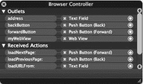

继续之前，请点击 Back 按钮，并打开“属性检查器”（点击检查器窗口顶部最左侧的图标）。向下查看大部分内容，找到“控制”组中的“启用”复选框。取消选中该复选框。对 Forward 按钮执行相同操作。保存你的工作。现在，你的浏览器启动时这两个按钮将处于禁用状态。

并非如此。第二页加载完成后，输入第三个 URL。现在 Back 按钮已启用，你可以用它一路导航回第一页。问题在于 URL 加载需要一段时间，而你已经根据发出加载 URL 请求后紧接着的状态设置了按钮状态。更好的做法是在 URL 开始加载后再选择 canGoBack: 和 canGoForward:。

退出应用程序，然后再次启动它。输入一个 URL。页面加载后，点击一个链接。该页面加载后，再跟随另一个链接。只要你继续使用 Web 视图中的链接，这些按钮就永远不会启用。历史记录一直在维护，但没有回调来调用 resetButtons。如果你输入一个 URL 就能看到这一点。页面加载后，你可以使用这些按钮在历史记录中前进和后退。

到目前为止，我们看到的所有方法都会立即执行。我们需要一种延迟发送消息的方式——在你请求的页面加载完成之前，不要问我能否后退或前进。幸运的是，Cocoa 通过委托这一概念内置了这种通知机制。我们将在下一章研究它们如何工作。

## 第 9 章：用委托进行定制

事情总会发生。

事实上，当最终用户在你的 SimpleBrowser 中输入 URL、点击按钮和链接时，大量事情正在发生。最基本的事件类型是目标-动作。用户点击一个按钮，一个动作就会被发送到一个目标。你已经学会了两种处理这些事件的方式：你可以使用 Interface Builder 直接将发送消息的对象连接到将执行动作的目标对象，或者你可以创建一个控制器。

但是，一旦你输入 URL 或使用 Back 或 Forward 按钮，就会有额外的消息和事件飞过，而你甚至看不到它们。例如，当你在 Safari 中加载页面时，你可能已经注意到，新页面的标题会在页面实际加载之前显示在工具栏上方。与此同时，你可以通过一条蓝色进度条看到页面加载进度，它会在包含 URL 的文本框中逐渐前进。Safari 能够捕获并响应正在发送的消息。那我们呢？

一直有许多消息从我们身边飞速掠过。在本章中，你将学习如何监听它们以及如何响应它们。我们将在加载网页时显示网页标题，并顺便修正按钮和 URL。委托将让我们无需创建子类就能为某个类定制行为。

### 9.1 理解委托

在将委托应用到浏览器示例之前，我们将使用 NSWindow 类来探索委托如何工作。

想象一下，我们的 NSWindow 对象正在参加一场 Cocoa 游戏节目。如果你查看 NSWindow 的文档，你会看到超过 200 个方法被列为我们的窗口对象可能被要求执行的任务。

我们的窗口对象相当自信，它知道如何响应可能收到的大多数消息。例如，它知道如何响应 setShowsToolbarButton: 消息。如果我们的窗口有工具栏，那么传入 YES 会显示工具栏按钮，传入 NO 会隐藏工具栏按钮。如果我们的窗口没有工具栏，那么调用此方法不会做任何事情。

另一方面，有些任务我们的窗口不知道如何反应。例如，如果在脱口秀节目上问我们的窗口这个问题，会怎样？

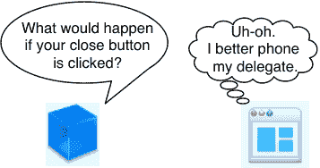

答案并不像你想的那么简单。通常，当有人点击红色按钮时，窗口会关闭，而应用程序会继续运行。尽管这是默认行为，但它并不是唯一的可能。例如，如果你打开“系统偏好设置”并点击红色按钮，窗口会关闭，而这一次应用程序也会退出。

如果你在 Safari 中打开一个网页，然后创建一个新标签页（启用标签页浏览后，选择“文件”>“新建标签页”或按 ⌘T），你会看到第三种行为。在新标签页中打开一个网页，然后点击红色按钮。

尽管你在同一个应用程序中点击了同一个红色按钮，但当你有多个标签页打开时，窗口不会自动关闭。相反，它会问你：“你确定要关闭这个窗口吗？”

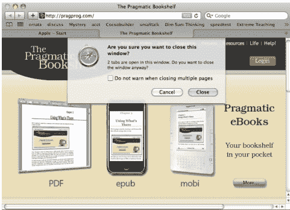

这些变化让我们的窗口陷入两难。如果游戏节目主持人问它：“如果我点击你的红色按钮，会发生什么？”它应该怎么回答？

窗口想回答“视情况而定”，但这在游戏节目中或在运行中的 Cocoa 应用程序里都不是可接受的答案。因此，窗口选择通过“打电话给朋友”来帮助回答这个问题。

这个游戏的规则是这样的。窗口会提前找出它可能需要帮助的所有消息，并将这些消息标记为委托方法。¹ 对于 NSWindow 类，以下是所有委托方法：

```
window:shouldDragDocumentWithEvent:from:withPasteboard:
window:shouldPopUpDocumentPathMenu:
window:willPositionSheet:usingRect:
windowDidBecomeKey:
windowDidBecomeMain:
windowDidChangeScreen:
windowDidChangeScreenProfile:
windowDidDeminiaturize:
windowDidEndSheet:
windowDidExpose:
windowDidMiniaturize:
windowDidMove:
windowDidResignKey:
windowDidResignMain:
windowDidResize:
windowDidUpdate:
windowShouldClose:
windowShouldZoom:toFrame:
windowWillBeginSheet:
windowWillClose:
windowWillMiniaturize:
windowWillMove:
windowWillResize:toSize:
windowWillReturnFieldEditor:toObject:
windowWillReturnUndoManager:
windowWillUseStandardFrame:defaultFrame:
```

1. 在本章中，我们使用的是 Apple 创建的协议和委托。我们将在第 12 章“*为委托创建协议*”（第 203 页）中创建自己的委托和协议。

委托方法有三种形式：某事将要发生、某事已经发生，以及某事应该发生。你实现 will 版本以在动作发生之前改变行为，实现 did 版本以在动作发生之后作出响应。should 版本返回一个 BOOL，允许你在判定某个动作不应该发生时取消该动作。

就像参赛者可以“打电话给朋友”的游戏节目一样，每个窗口对象都可以指定一个朋友，当这些方法中的任何一个被调用时，就可以呼叫这个朋友。这个朋友就是委托。

我们并不真的期望一个朋友能够响应所有这些消息，但我们的窗口必须提前只选择一个委托。不幸的是，窗口不能说“我知道谁知道如何回答那个问题”，然后在运行时决定要呼叫谁。委托是在问题被提出之前就选好的。

在游戏开始之前，我们会预先面试委托。这样，我们就知道委托能处理哪些消息，不能处理哪些消息。用 Cocoa 的术语来说，委托可以实现某个对象的零个、任意个或全部委托方法。如果委托没有实现某个方法，它就不会被调用来处理该消息。窗口将不得不自己给出答案。

这些规则可能看起来复杂——但一个简单的例子应该能说明情况。


### 9.2 默认窗口行为

在 Xcode 中新建一个项目，选择 Mac OS X > Application > Cocoa Application，命名为 WindowDressing。我们将使用委托来改变绿色和红色按钮的默认行为。

点击 Build & Run。当你点击绿色按钮时，窗口应当放大到填满大部分屏幕。再次点击它，窗口会缩放到原始大小。点击红色按钮，窗口会关闭，但应用程序不会退出。一旦点击了红色按钮，你能做的就不多了。我们无法创建新窗口，所以无论如何都必须退出这个应用程序。

到目前为止，我们已经看到了点击绿色或红色按钮时的默认行为。这是窗口在不被允许向朋友求助时提供的行为。在下一节中，我们将使用委托提供替代行为。

### 9.3 把背景变成红色

让我们改变行为，使得用户点击红色按钮时，窗口背景变成红色。我们将遵循以下步骤：

- 1. 我们需要创建一个新类，可以实例化它以创建窗口的委托。
- 2. 我们将把该对象指定为窗口的委托。
- 3. 我们将确定需要实现的委托方法。
- 4. 最后，我们将实现该方法。

第二和第三步是人们常犯小而难以追踪错误的地方。很容易忘记在 Interface Builder 中将窗口连接到其委托。另外，确保更改后保存 nib 文件。在 Xcode 中构建项目时，系统会询问是否要保存已更改的源文件，但 Interface Builder 中也可能有未保存的更改。

我保证这迟早会坑到你。如果你一直在 Xcode 和 Interface Builder 之间来回切换，而项目行为不符合预期，请查看 nib 的 Document 窗口。如果看到红色关闭按钮中间有一个黑点，说明文件处于已修改状态，需要保存。

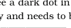

如果没有未保存的更改，红色关闭按钮应当像黄色最小化按钮和绿色缩放按钮一样没有标记。这是 Mac OS X 应用中普遍使用的细微提示，值得留意。


还需要注意，委托方法名的拼写必须与 NSWindow 文档中完全一致。使用按钮时，我们可以自由地将任意对象指定为目标，并自行命名方法。现在使用委托时，方法名是为你选定的。

在 Xcode 中，选择 File > New File... 或 ⌘N 创建新的类文件。选择模板 Mac OS X > Cocoa Class > Objective-C class，并将其命名为 WindowHelper。

和上一章一样，现在将在 Interface Builder 中创建该类的表示。双击 MainMenu.xib 在 Interface Builder 中打开。在 Library 的 Classes 标签下找到 WindowHelper，并将其拖到 Document 窗口。[^2] 在 Document 窗口中按住 Control 键点按 Window 对象——不是 WindowHelper 对象——以打开这个连接窗口。


从 delegate 出口旁边的圆点拖到 Document 窗口中的 WindowHelper 对象。这会将窗口的委托设置为 WindowHelper 的一个实例。保存工作并退出 Interface Builder。

回到 Xcode，其实不必对 WindowHelper 头文件做任何修改。你已经在 Interface Builder 中建立了到委托的连接。作为开发者，你知道可以实现的方法签名。运行时，系统知道它可以发送哪些消息。不过，你可以通过指明 WindowHelper 实现了 NSWindowDelegate 协议，使其意图更清晰。

协议声明了一组类可以实现也可以不实现的方法。在头文件顶部用尖括号声明一个或多个协议，如下所示：

下载 Delegates/WindowDressing2/WindowHelper.h

```objc
#import <Cocoa/Cocoa.h>

@interface WindowHelper : NSObject <NSWindowDelegate> {
}
@end
```

如果查看 NSWindowDelegate 协议的文档，会看到所有方法都列为可选。换句话说，你可以只实现需要的方法。

只有两个委托方法与窗口关闭有关。有 `windowShouldClose:` 和 `windowWillClose:`。`windowShouldClose:` 方法在用户点击红色按钮时被调用，给你机会说“不要关闭窗口”。`windowWillClose:` 方法在窗口即将关闭前被调用。这对我们的需求来说太晚了。

我们将使用 `windowShouldClose:` 方法。因为很容易引入难以发现和调试的类型问题，我经常去文档中剪切并粘贴方法签名。

`windowShouldClose:` 方法需要做两件事。它必须将窗口背景色设为红色。这次 sender 就是窗口，所以可以直接让 sender 将其背景色设为红色。

该方法还必须返回 NO，以便窗口不关闭。如果返回 YES，窗口将关闭。这是 WindowHelper.m：

下载 Delegates/WindowDressing2/WindowHelper.m

```objc
#import "WindowHelper.h"

@implementation WindowHelper
- (BOOL)windowShouldClose:(id)sender {
    [sender setBackgroundColor:[NSColor redColor]];
    return NO;
}

@end
```

点击 Build & Run，现在点击红色按钮时窗口会变红。更具体地说，点击红色按钮时，`windowShouldClose:` 消息会发送给你指定为窗口对象委托的对象。使用 ⌘Q 或从 Xcode 中选择 Stop 来退出 WindowDressing。

### 9.4 练习：把背景变成绿色

找到当有人点击绿色按钮以将窗口缩放到另一个框架大小时所调用的方法。实现该方法，使窗口不改变大小，并在点击绿色按钮时让窗口背景变绿。

### 9.5 解决方案：把背景变成绿色

只需实现 `windowShouldZoom:toFrame:` 方法。方法体应与 `windowShouldClose:` 几乎完全相同。

```objc
// Download Delegates/WindowDressing3/WindowHelper.m
- (BOOL)windowShouldZoom:(NSWindow *)window toFrame:(NSRect)newFrame {
    [window setBackgroundColor:[NSColor greenColor]];
    return NO;
}
```

点击 Build & Run。现在可以通过点击相应按钮将窗口颜色改为红色和绿色。

### 9.6 应用程序委托

实际上，从第一个项目开始我们就一直在使用委托。Xcode 3.2 中引入的 Cocoa Application 模板包含一个应用程序委托。既然你已经在窗口的语境中理解了这个概念，应该能看出它如何应用于应用程序。

应用程序启动时，有许多事情必须发生，Apple 会为你处理。但也有一些你的应用程序特有的、Apple 不可能知道的事情。如果希望在应用程序完成启动后发生某些特定事情，就实现应用程序委托的 `applicationDidFinishLaunching:` 方法。

注意，你的应用委托头文件中包含了协议声明 `NSApplicationDelegate`，并且在 Interface Builder 中从应用程序到应用委托连接了 delegate 出口。

如果查看 NSApplicationDelegate 文档，会发现其中有些方法可以帮助你在应用程序生命周期的数十个不同关键点定制应用程序行为。有处理应用启动和终止、隐藏应用、管理窗口等的委托方法。

委托是 Cocoa 应用程序的重要设计模式。你主要会在 WebKit 等现代 Cocoa 桌面 API 中找到它们。你也会发现 iPhone API 中到处都在使用委托。

### 9.7 Web 视图的委托

在本章剩余部分，我们将把学到的委托知识应用到 SimpleBrowser 示例中。关闭 WindowDressing 项目，重新打开 SimpleBrowser 项目。

在面向对象编程中，如果想改变某个类的行为，通常会创建子类并重写一个或多个方法。委托让我们不必每次想修改基类中的某些内容时都创建继承链。使用委托时，我们找出最常需要更改的方法，将它们标记为委托方法，并提供默认行为；除非我们提供委托并用自定义行为实现该方法，否则将执行默认行为。

NSWindow 类型的对象可以指定单个委托对象。这就是 Cocoa 中委托通常的工作方式。不过，有时一个类会有多个委托。例如，WebView 类的设计者考察了你可能想要自定义的所有行为，并将它们分成四个委托。

这四个委托列在 WebView 类参考的概述部分：

- WebFrameLoadDelegate
- WebPolicyDelegate
- WebResourceLoadDelegate
- WebUIDelegate

[^2]: 如果你在 Library 窗口底部的搜索框中开始输入 Win，会快得多。


你可以回想一下我们在 Cocoa 游戏节目中用过的 WebView，但这一次，它可以根据问题属于哪个类别，选择呼叫四位朋友中的一位。

这四个 Delegate 集合是协议而不是类。它们指定了可由实现该协议的类使用的方法签名。这确保当消息发送给委托对象时，会调用相应的方法。这也意味着编译器可以让你知道是否存在问题。

在 WebView 文档的“Tasks”部分下的“Getting and Setting Delegates”中，你会看到十个用于分配和使用委托的方法。你可以通过 Interface Builder 中的 outlet 设置委托，也可以使用类似 setUIDelegate: 的方法以编程方式设置它们。

### 9.8 设置窗口标题

接下来，让我们用正在加载的页面标题更新浏览器窗口的标题栏。我们将使用 WebFrameLoadDelegate 中的 webView:didReceiveTitle:forFrame: 方法。

哪个对象应该作为我们的委托？我们可以创建一个新类并实例化它，也可以使用现有类的实例。在这种情况下，我们已经创建的 BrowserController 对象是最佳选择，因为它与我们需要访问的 GUI 元素有连接。在 Interface Builder 中像这样将委托连接到我们的控制器：


选择 web 视图，打开 Connections inspector。你应该会看到四个委托方法与其他 outlet 混在一起。拖动以将 frameLoadDelegate 连接到你的 BrowserController。保存工作。我们将回到 Xcode 完成收尾。

当标题可用时，会调用 `webView:didReceiveTitle:forFrame:` 方法。你可以看到，我们收到的消息还包含标题作为参数。下面是我们将如何使用它：

-   我们不向头文件添加任何内容。`WebFrameLoadDelegate` 协议中列出的全部十五个方法现在都可以在 `BrowserController` 中使用。文档告诉我们，`WebFrameLoadDelegate` 是一个非正式协议，因此我们不在 `BrowserController` 头文件中声明它。

-   我们需要在 `BrowserController.m` 中实现 `webView:didReceiveTitle:forFrame:`，填写该方法的方法体：

    ```objc
    - (void)webView:(WebView *)sender didReceiveTitle:(NSString *)title
        forFrame:(WebFrame *)frame {
    }
    ```

-   我们等待。一旦正在加载的 URL 的标题可用，就会调用 `webView:didReceiveTitle:forFrame:` 方法。

当此方法被调用时，你希望将应用程序窗口的 title 属性设置为返回给你的标题。查看方法签名可以看到，当方法被调用时，会向你传递正在使用的 web 视图的句柄以及新页面的标题。你可以像这样使用 web 视图获取指向包含该 web 视图的窗口的指针：

```objc
[sender window];
```

不幸的是，你无法在 `WebView` 文档中找到所需的方法。你必须查看超类 `NSView`，在那里你会找到 `window` 方法。`window` 方法在 `NSView` 中也作为常用方法被突出显示，它“返回包含该 `NSView` 对象的 `NSWindow` 对象”。

一旦有了这个窗口，你就要求它将其标题设置为调用此委托方法时得到的标题。你需要将此方法添加到 `BrowserController.m`：

```objc
- (void)webView:(WebView *)sender
didReceiveTitle:(NSString *)title
    forFrame:(WebFrame *)frame {
  [[sender window] setTitle:title];
}
```

保存工作。点击 Build & Run，现在无论你如何在浏览器中导航到网站，标题一可用就会显示。你所要做的就是找到正确的方法、创建并配置 outlet，并用一行代码实现该方法：

```objc
[[sender window] setTitle:title];
```

同样，我们没有在 BrowserController 头文件中列出 webView:didReceiveTitle:forFrame: 方法。此方法不是 BrowserController 公共接口的一部分。唯一需要知道 BrowserController 实现了此方法的对象是委托对象 myWebView。只有在委托已分配且方法已实现时，消息才会被发送。

### 9.9 练习：更新 URL 并设置按钮

现在你已经看到如何在页面标题可用时将其显示为窗口标题，那么你可以在页面加载后重置按钮并更新 URL。到目前为止，如果用户点击网页中的链接，新页面会加载，但文本字段中的 URL 不会像用户从几乎所有其他浏览器的经验中所期望的那样发生变化。

要在页面加载后重置按钮并更新 URL，请在 WebFrameLoadDelegate 协议中找到一个在框架完成加载时被调用的方法。实现该委托方法以做两件事：(a) 将文本字段的字符串值设置为页面主框架（也是唯一框架）的 URL；(b) 调用 resetButtons。

提示 1：如果你在 NSTextField 类参考中查找用于设置文本字段字符串值的方法，你不会找到你要找的内容。记住，继承的方法不会出现在 Cocoa 文档中。因此，你需要查看 NSTextField 的超类 NSControl 的类参考。你会在“Tasks”下的“Setting the Control’s Value”中找到 setStringValue:。

提示 2：WebView 有很多方法。很容易漏掉你想要用来获取正确 URL 的那个方法。请查看“Tasks”部分中标题为“Getting and Setting Frame Contents”的内容。

#### 完成你的控制器

你可以在偏好设置中调整 Xcode 的 Code Sense 设置。你可以调整代码补全出现的速度。你不必为了想要的方法查找整个层次结构，而是可以选择 Edit > Completion List 查看所有可用的补全项。在练习示例中，如果你在输入 `[inputField` 后这样做，就会在列表中看到 setStringValue:。

### 9.10 解决方案：更新 URL 并设置按钮

像这样实现 webView:didFinishLoadForFrame 方法：

```objc
- (void)webView:(WebView *)sender didFinishLoadForFrame:(WebFrame *)frame {
    [self.address setStringValue:[sender mainFrameURL]];
    [self resetButtons];
}
```

点击 Build & Run。你的代码应该完美运行。窗口标题在正确的时间设置，当你使用按钮前进和后退导航时 URL 会变化，按钮也会正确地启用和禁用。你现在应该感觉相当不错，但在你跑去下一章学习新东西之前，你还有一些清理工作要做。

代码很乱。我们有很多冗余，而且我们可能可以去掉一些 outlet。我们走过的路径没有错。首先我们让代码工作起来，现在我们要稍微整理一下。

### 9.11 清理

你有一些浪费需要处理。看看这些方法中每个方法的最后一行：

```objc
-(IBAction) loadPreviousPage: (id) sender{
    [self.myWebView goBack:sender];
    [self resetButtons];
}
```

```objc
-(IBAction) loadNextPage: (id) sender{
    [self.myWebView goForward:sender];
    [self resetButtons];
}
-(IBAction) loadURLFrom: (id) sender{
    [self.myWebView takeStringURLFrom:sender];
    [self resetButtons];
}
```

没有必要在这些方法中的任何一个里调用 `resetButtons`，因为当框架完成加载时它会被调用。删除这三行，然后重新运行你的应用程序。你会发现它仍然运行良好。

既然你已经从 `loadPreviousPage:`、`loadNextPage:` 和 `loadURLFrom:` 中删除了 `[self resetButtons];`，这些方法就做不了多少事了。这些操作实际上不再需要使用控制器。

为了说明一点，我希望你暂时保留这些方法，转到 Interface Builder。在 Document 窗口中点击 BrowserController，然后选择 Connections inspector。点击 X 断开这三个 received action。现在点击 web 视图，并使用 Connections inspector 重新连接你之前的三个操作。从 `goBack:` 拖到 Back 按钮，从 `goForward:` 拖到 Forward 按钮，从 `takeStringURLFrom:` 拖到文本字段。在 Interface Builder 中保存工作，然后在 Xcode 中点击 Build & Run。你的应用程序完美运行。

这应该会让你有点担心。

你刚刚完全从 IB 重定向了控制流。Xcode 中有三个方法不再被调用。在使用 Cocoa 程序时，这是你需要记住的事情。你不能仅仅通过阅读代码来弄清楚整个故事。你必须查看你在其他地方创建的连接。³

但是，你也应该让之后回到这个项目并试图弄清楚发生了什么的人（包括你自己）更容易。既然这三个方法不再被调用，你应该从头部和实现文件中删除它们。

3. 如果你想使用测试驱动开发，那么你应该阅读 Chris Hanson 关于 Cocoa 用户界面单元测试的博客文章：http://eschatologist.net/blog/?p=205，以及他关于 Cocoa 代码单元测试的介绍文章：http://eschatologist.net/blog/?p=24 和 http://chanson.livejournal.com/19303.html。


移除这些内容后，你需要重构 `awakeFromNib` 方法，将 URL 直接传递给 web 视图，而不再经过我们刚刚删除的某个方法。以下是当前实现文件的状态：

```objective-c
#import "BrowserController.h"
#import <WebKit/WebKit.h>

@implementation BrowserController

@synthesize myWebView, address, backButton, forwardButton;

- (void)resetButtons {
    [self.backButton setEnabled:[self.myWebView canGoBack]];
    [self.forwardButton setEnabled:[self.myWebView canGoForward]];
}

- (void)awakeFromNib {
    [self.address setStringValue:@"http://pragprog.com"];
    [self.myWebView takeStringURLFrom:self.address];
}

- (void)webView:(WebView *)sender
 didReceiveTitle:(NSString *)title
        forFrame:(WebFrame *)frame {
    [[sender window] setTitle:title];
}

- (void)webView:(WebView *)sender
 didFinishLoadForFrame:(WebFrame *)frame {
    [self.address setStringValue:[sender mainFrameURL]];
    [self resetButtons];
}
@end
```

以下是当前头文件：

```objective-c
#import <Cocoa/Cocoa.h>
@class BrowserController;
@interface BrowserController : NSObject {
    NSTextField *address;
    NSButton *backButton;
    NSButton *forwardButton;
    WebView *myWebView;
}
@property(assign) IBOutlet NSButton *backButton;
@property(assign) IBOutlet NSButton *forwardButton;
@property(assign) IBOutlet NSTextField *address;
@property(assign) IBOutlet WebView *myWebView;
@end
```

花点时间看看，当我们*使用*现有的 Apple 框架时，所需的代码是多么少。每当你的代码变得冗长复杂时，你应该暂停一下，思考是否有更简单的方法来完成你想要做的事情。你的目标是编写清晰易懂的简单代码。Cocoa 程序员并不推崇那些简短到晦涩难懂的聪明代码。

### 9.12 练习：添加进度指示器

目前我们做的很多工作都是在 Xcode 和 Interface Builder 之间来回切换，从而形成肌肉记忆。让我们把这个示例再推进一步——至少在桌面端是这样。

在浏览器的右上角添加一个小型圆形进度指示器。它最初应该是隐藏的。当用户输入新的 URL 或导航到不同的页面时，进度指示器应出现并开始旋转。我们希望给用户一些反馈，让他们知道有事情正在发生。一旦页面完全加载，进度指示器应停止旋转并再次隐藏。

仔细思考这些步骤。你需要使用 IB 放置一个进度指示器。你需要在 `BrowserController` 头文件中为该指示器添加一个 outlet，然后在 IB 中连接它。你需要合成刚刚创建的属性，并在页面开始和停止加载时使用它。

### 9.13 解决方案：添加进度指示器

你可以查看代码下载中提供的解决方案，以了解 nib 文件和头文件。以下是进度指示器的属性检查器（Attributes inspector）设置：


在 Behavior 下，我取消了“Display When Stopped”（停止时显示）的勾选；在 Drawing 下，我取消了“Hidden”（隐藏）的勾选。

以下是实现文件的最终版本。我们需要在 `webView:didFinishLoadForFrame:` 方法中添加几行代码，以停止进度条的动画并隐藏它。我们还需要在 `webView:didStartProvisionalLoadForFrame:` 方法中取消隐藏进度指示器并让它开始旋转。

```objective-c
#import "BrowserController.h"
#import <WebKit/WebKit.h>

@implementation BrowserController

@synthesize myWebView, address, backButton, forwardButton, progress;

- (void)resetButtons {
    [self.backButton setEnabled:[self.myWebView canGoBack]];
    [self.forwardButton setEnabled:[self.myWebView canGoForward]];
}

- (void)awakeFromNib {
    [self.address setStringValue:@"http://pragprog.com"];
    [self.myWebView takeStringURLFrom:self.address];
}

- (void)webView:(WebView *)sender
 didReceiveTitle:(NSString *)title
        forFrame:(WebFrame *)frame {
    [[sender window] setTitle:title];
}

- (void)webView:(WebView *)sender
 didFinishLoadForFrame:(WebFrame *)frame {
    [self.address setStringValue:[sender mainFrameURL]];
    [self resetButtons];
    [self.progress stopAnimation:self];
}

- (void)webView:(WebView *)sender
 didStartProvisionalLoadForFrame:(WebFrame *)frame {
    [self.progress startAnimation:self];
}
@end
```

代码量仍然不多。在下一章中，我们将看到需要做哪些更改才能在 iPhone 上实现我们的 SimpleBrowser。

更正式地说，当浏览器应用程序启动时，会创建一个 `UIApplication` 类的实例，并加载 MainWindow nib 文件。²


nib 文件包含一个代表应用程序的对象，其 delegate outlet 连接到 `MobileBrowserAppDelegate`。nib 文件还包含 `MobileBrowserViewController`。在 app delegate 的 `applicationDidFinishLaunching:` 方法中，视图控制器的视图被添加到窗口中。

```objective-c
BrowserAppDelegate.m

- (void)applicationDidFinishLaunching:(UIApplication *)application {
    // Override point for customization after app launch
    [window addSubview:viewController.view];
    [window makeKeyAndVisible];
}
```

这就是大多数 iPhone 应用的工作方式。整个应用只有一个窗口。你眼中的屏幕其实是视图的内容，当你使用标签栏、导航栏或其他方式从一个屏幕切换到另一个屏幕时，你实际上是通过操纵视图控制器，用新视图替换窗口中的旧视图。

通常，这些顶层视图各自包含在自己的 nib 文件中，其视图控制器作为 File's Owner（文件所有者）。我暂时不打算讨论 File's Owner。我们只需知道，这个应用的大部分工作将在第二个 nib 文件和视图控制器中完成。

你或许已经猜到，视图控制器的工作就是控制视图。视图关乎外观，而控制器定义行为。首先，正如你在 `applicationDidFinishLaunching:` 方法中看到的，当你想要把一个视图作为子视图添加到窗口时，你需要向视图控制器请求它所控制的视图。一切安排就绪后，你可以将窗口及其内容展示给用户，并让它接受触摸和其他输入。

2. iPhone 专属的类通常以 UI 开头，而不是像你在桌面应用中看到的 NS 开头。

我们不打算在启动时自定义应用程序的行为，所以让我们把注意力转移到包含视图及其控制器的 nib 文件上，来创建我们的网络浏览器。

### 10.2 创建浏览器的外观

双击 `MobileBrowserViewController.xib` 在 IB 中打开它。我们将把这个空视图变成如下图所示的样子：


和之前一样，从库中拖出组件并将它们放置在视图上。在视图顶部放置一个 `UIToolbar`。将一个 `UITextField` 拖到工具栏上方，放在原本位于工具栏左侧的 `UIBarButtonItem` 的左边。再拖一个 `UIBarButtonItem`，放在文本框的右侧。在桌面版中，我们有空间容纳*前进*和*后退*字样。这里我们将借用为音频界面提供的图像。打开检查器（inspector）。

它看起来与创建 Mac OS X 应用时的检查器窗口略有不同。这里有四个标签页，用于检查和更改属性（Attributes）、连接（Connections）、大小（Size）和标识（Identity）。为 Back 按钮选择属性检查器（Attributes inspector）。


使用下拉菜单将 Identifier 设置为 Rewind。趁此机会，取消勾选 Enabled 复选框，这样用户最初无法点击 Back 按钮。类似地，将 Forward 按钮的 Identifier 设置为 Fast Forward，并取消勾选 Enabled 复选框。

最后，选择一个 `UIWebView`，并将其定位到占据工具栏下方视图的所有区域。打开该 web 视图的属性检查器，勾选 Web View > Scales Page to Fit 复选框。保存你的工作。这就是我们目前的界面。

让我们点击 Build & Run，看看会发生什么。我们的应用应该可以正常启动。Forward 和 Back 按钮处于禁用状态。尝试输入一个 URL。点击文本字段。这看起来很有希望。文本字段被清空，键盘出现。你可以输入一个新的 URL。

然后呢？

你按下 ↵，但什么也没发生。如果你点击屏幕的其他区域，键盘会被关闭，但下次你选择文本字段时，URL 会被清空，你需要重新输入。怎样才能输入 URL 并导航到网站呢？事实证明，我们还需要两个 delegate。

### 10.3 WebView 的局限性

`UIWebView` 能做到的事情不如我们之前看到的 `WebView` 多。你可以从我们的 `UIWebView` 的 Connections 检查器中看到这一点。


这里还缺很多东西，但对我们来说最直接的问题是：WebView 能够接收 takeStringURLFrom: 消息，而 UIWebView 不能。这是个问题。在桌面版中，这意味着我们可以把 Web 视图连接到文本字段，并在无需编写任何代码的情况下传递 URL。现在我们需要找到另一种方法。

### 10.4 启动时加载网页

我们无法把文本字段和 Web 视图直接连接起来，因此两者都需要连接到我们的控制器。为 MobileBrowserViewController 的头文件添加两个输出口。

```objc
#import <UIKit/UIKit.h>

@interface MobileBrowserViewController : UIViewController {
    UIWebView *webView;
    UITextField *address;
}
@property(nonatomic,retain) IBOutlet UIWebView *webView;
@property(nonatomic, retain) IBOutlet UITextField *address;

@end
```

与桌面版不同，UIWebView 是我们在此文件顶部导入的 iPhone 框架的一部分，因此我们不需要做任何特殊导入，也不需要像之前那样向目标添加框架。

属性也有所不同。因为我们是针对 iPhone 编写代码，而且是为 UIKit 的单线程、单核模型编写，所以我们会给属性添加 nonatomic 特性。我们也没有可用的垃圾回收，因此内存特性必须使用 retain 而不是 assign。不要忘记在实现文件中合成这些属性。

打开 MobileBrowserViewController nib 文件，并使用连接检查器将这些输出口从 File’s Owner 连接到视图中的对应组件。³ 保存并退出 Interface Builder。

回到 Xcode，我们想创建一个方法，用来加载以字符串形式传入的 URL。让我们查阅 UIWebView 的文档，看看是否有方法能实现我们想要的功能。

嗯。当我查看 Tasks > Loading Content 时，找到的最接近的是这个：

```objective-c
- (void)loadRequest:(NSURLRequest *)request
```

这已经很接近了，但它的参数是 NSURLRequest，而不是字符串。让我们点击链接进入 NSURLRequest 文档，看看那里有没有可用的内容。这次当我查看 Tasks > Creating Requests 时，找到了这个：

```objective-c
+ (id)requestWithURL:(NSURL *)theURL
```

感觉我们越来越接近了，但现在还必须弄清楚如何从字符串创建 NSURL。点击链接进入 NSURL 文档，并查看 Tasks > Creating an NSURL。找到了！

```objective-c
+ (id)URLWithString:(NSString *)URLString
```

把这些组合起来，创建我们的 loadURLFromTextField 方法。⁴ 将其添加到 MobileBrowserViewController.m 中 @synthesize 行之后：

下载 iPhoneBrowser/MobileBrowser1/Classes/MobileBrowserViewController.m

```objective-c
- (void)loadURLFromTextField {
    NSURL *url = [NSURL URLWithString:self.address.text];
    NSURLRequest *request = [NSURLRequest requestWithURL:url];
    [self.webView loadRequest:request];
}
```

我们使用文本字段的 text 属性创建 URL。我们根据该 URL 创建 URL 请求，然后向 webView 输出口发送消息，让它使用我们创建的请求加载 URL。

我们快完成了——只需有人在应用程序启动后调用我们的 loadURLFromTextField。在桌面版中，我们使用 awakeFromNib 方法。在 iPhone 开发中，你通常会在 viewDidLoad 方法中做这件事。⁵ 如果你在实现文件中四处看看，应该会看到该方法被注释掉了。去掉注释，并添加这一行来加载 URL。

下载 iPhoneBrowser/MobileBrowser/Classes/MobileBrowserViewController.m

```objective-c
- (void)viewDidLoad {
    [super viewDidLoad];
    self.address.text = @"http://pragprog.com";
    [self loadURLFromTextField];
}
```

点击 Build & Run；应用程序应该会启动，Pragmatic 主页应该会缩小加载，以便在浏览器中可见。你可以通过点击链接进行导航，但还不能输入其他 URL。接下来我们来处理这一点。

### 10.5 在 IB 中调整文本字段

尽管 iPhone 既强大又酷，但它仍然是一台有许多限制的设备。对我们大多数人来说，用笔记本电脑输入文本比用 iPhone 更容易。虽然 iPhone 的显示屏很漂亮、分辨率也很好，但我们的桌面显示器或笔记本电脑上有大得多的空间。在为 iPhone 编程时，我们需要考虑设备的限制，并尽可能让用户方便地与我们的应用程序交互。

让我们配置文本字段和键盘，使用户更容易输入 URL。打开 MobileBrowserViewController.nib，并使用属性检查器查看文本字段。

使用这个文本字段时，我发现第一件烦人的事是：每次点击它，所有内容都会被清除。我真的很希望能选择清除它，或者选择编辑现有内容，以防我把 URL 敲错，只差一两个字符。取消选中标有 Clear When Editing Begins 的复选框，并使用下拉菜单将 Clear Button 设置为 Appears while editing。


点击 Build & Run，现在编辑文本字段时，你会看到文本字段右侧有一个小 x。选中文本字段时，它也不再清除内容，而且你可以双击文本并使用 iPhone 的剪切和粘贴。


查看属性检查器中列出的 Text Input Traits。让我们选择一个更适合网页导航的键盘。这里可以看到可用的选项：


选择 URL。这是一个很小但非常重要的改动。它会显示便于输入 URL 的按键，并会极大地改善用户体验。作为最后一项调整，将 Return Key 从 Default 改为 Go。保存工作，然后再次运行应用程序。现在键盘看起来像这样：


### 10.6 使用文本字段委托

你刚刚使用了文本字段来设置其外观以及与其关联的键盘外观。但虚拟键盘不知道用户输入数据并点击 Go 按钮后该如何反应。为此，我们需要一个委托。[^6]

在 Interface Builder 中，使用连接检查器将文本字段的 delegate 输出口连接到 File’s Owner，然后保存。在 Xcode 中，将 UITextFieldDelegate 的声明以尖括号形式添加到 MobileBrowserViewController 的头文件中：

```objc
@interface MobileBrowserViewController : UIViewController
                                 <UITextFieldDelegate> {
```

这样我们就向外界宣布，MobileBrowserViewController 知道如何响应开始和结束编辑、响应 Return、清除字段以及更改某些字符这七条可选消息中的任意一条。

例如，让我们在用户开始编辑 URL 时禁用 Web 视图：

```objc
- (void)textFieldDidBeginEditing:(UITextField *)textField {
    [self disableWebView];
}
```

为了禁用 Web 视图，我们将阻止用户与其交互，并通过调整 alpha 值使其变暗，以在视觉上暗示它当前未处于活动状态。我们还会通过反向执行禁用时的步骤来重新启用 Web 视图。[^7]

```objc
- (void)disableWebView {
    self.webView.userInteractionEnabled = NO;
    self.webView.alpha = 0.25;
}
- (void)enableWebView {
    self.webView.userInteractionEnabled = YES;
    self.webView.alpha = 1.0;
}
```

3. 我们知道要使用 File’s Owner，是因为它的类型。
4. 注意，我们使用类方法来构造请求和 URL 的自动释放实例。我们不需要自己释放它们。
5. 我们常用于这类工作的其他方法是 viewWillAppear 和 viewDidAppear。
[^6]: 对于 NSTextField，你使用的是物理键盘，不需要委托。
[^7]: 注意，alpha 是 UIView 的属性，因此你可以为任何 UIView 子类调整此值，而不仅限于 UIWebView。


当用户点击键盘上的 Go 时，URL 会被加载，同时我们让文本字段调用 resignFirstResponder 来收起键盘。我们还会重新启用 Web 视图。我们把这一切都放在委托方法 textFieldShouldReturn: 中。

```objc
-(BOOL) textFieldShouldReturn:(UITextField *)textField {
    [self loadURLFromTextField];
    [textField resignFirstResponder];
    [self enableWebView];
    return YES;
}
```

点击 Build & Run；你应该能够输入 URL，并点击 Go 加载相应网站。现在我们有了一个基本可用的浏览器。接下来让按钮正常工作。

### 10.7 使用第三个委托实现按钮

如果回看我们的 BrowserController，你会看到我们需要知道网页何时加载完成，以便重置按钮。要知道页面何时加载完成，唯一的方法是使用 UIWebViewDelegate。

我们将使用 MobileBrowserViewController 作为 Web 视图的委托。我们还会为 Forward 和 Back 按钮添加 outlet。现在我们的头文件如下所示：

```objc
#import <UIKit/UIKit.h>

@interface MobileBrowserViewController : UIViewController
                                      <UITextFieldDelegate> {
    UIWebView *webView;
    UITextField *address;
    UIBarButtonItem *backButton;
    UIBarButtonItem *forwardButton;
}
@property(nonatomic, retain) IBOutlet UIWebView *webView;
@property(nonatomic, retain) IBOutlet UITextField *address;
@property(nonatomic, retain) IBOutlet UIBarButtonItem *backButton;
@property(nonatomic, retain) IBOutlet UIBarButtonItem *forwardButton;

@end
```

在 Interface Builder 中打开 MobileBrowserViewController nib。我们需要建立五个连接。

- 1. 选择 File’s Owner，将 backButton outlet 连接到 Back 按钮，将 forwardButton outlet 连接到 Forward 按钮。
- 2. 选择 Web 视图，将其 delegate 连接到 File’s Owner。
- 3. 仍在 Web 视图中，将 goBack: 接收动作连接到 Back 按钮，将 goForward: 连接到 Forward 按钮。

保存你的工作。现在，像我们在桌面浏览器中那样实现按钮重置。别忘了合成属性。接下来，我们会从告知网页加载完成的委托方法中调用一个我们创建的方法，名为 resetButtons:。对于 iPhone，该方法是 webViewDidFinishLoad:。

```objective-c
-(void) resetButtons:(UIWebView *)theWebView {
    [self.backButton setEnabled:[theWebView canGoBack]];
    [self.forwardButton setEnabled:[theWebView canGoForward]];
}
-(void)webViewDidFinishLoad:(UIWebView *)theWebView {
    [self resetButtons:theWebView];
}
```

运行浏览器，导航到或输入第二个网页的 URL。页面加载后，Back 按钮应启用。点击 Back 按钮；你将返回上一页，同时 Forward 按钮会启用。我们已经在 iPhone 上实现了一个基本可用的 Web 浏览器。

### 10.8 练习：添加活动指示器

向应用程序添加一个 UIActivityIndicatorView。在 Interface Builder 中，将其 Style 设置为 Large White，并选中 Hide When Stopped 复选框。

你的活动指示器应在网站加载时旋转。Web 视图应保持禁用，直到页面加载完成。最后，如果你导航到某个页面，文本字段应显示该页面的 URL，而不是继续包含用户上次输入的 Web 地址。

### 10.9 解决方案：添加活动指示器

首先，将此 outlet 添加到你的 MobileBrowserViewController 头文件中：[8]

下载 iPhoneBrowser/MobileBrowser5/Classes/MobileBrowserViewController.h

```objc
#import <UIKit/UIKit.h>

@interface MobileBrowserViewController : UIViewController
                                      <UITextFieldDelegate> {
    UIWebView *webView;
    UITextField *address;
    UIBarButtonItem *backButton;
    UIBarButtonItem *forwardButton;
    UIActivityIndicatorView *activityView;
}
@property(nonatomic,retain) IBOutlet UIWebView *webView;
@property(nonatomic, retain) IBOutlet UITextField *address;
@property(nonatomic, retain) IBOutlet UIBarButtonItem *backButton;
@property(nonatomic, retain) IBOutlet UIBarButtonItem *forwardButton;
@property(nonatomic, retain) IBOutlet UIActivityIndicatorView *activityView;
@end
```

现在打开 nib 文件，将一个活动指示器视图拖到 Web 视图上方。使用 Connections inspector 将其连接到 outlet，然后使用 Attributes inspector 将其 Style 设置为 Large White，并选中 Hide When Stopped 复选框。保存你的工作，然后返回 Xcode。

我们可以在 webViewDidStartLoad: 和 webViewDidFinishLoad: 方法中完成所有需要的更改。此外，你可以移除 textFieldShouldReturn: 方法中对 enableWebView: 的调用。让我们停下来回顾一下本章编写的代码。我发现，我们只用这么少的代码就实现了 Web 视图、文本字段及其键盘、Forward 和 Back 按钮以及活动指示器，这令人印象深刻。

下载 iPhoneBrowser/MobileBrowser5/Classes/MobileBrowserViewController.m

```objc
#import "MobileBrowserViewController.h"

@implementation MobileBrowserViewController

@synthesize address, webView, backButton, forwardButton, activityView;
```

8. 请记住，一旦模拟器修复，你就可以从头文件中删除实例变量声明。

```objective-c
//View Controller Utility Methods
-(void) disableWebView {
    self.webView.userInteractionEnabled = NO;
    self.webView.alpha = 0.25;
}
-(void) enableWebView {
    self.webView.userInteractionEnabled = YES;
    self.webView.alpha = 1.0;
}
-(void) loadURLFromTextField {
    NSURL *url = [NSURL URLWithString:self.address.text];
    NSURLRequest *request = [NSURLRequest requestWithURL:url];
    [self.webView loadRequest:request];
}
-(void) resetButtons: (UIWebView *) theWebView {
    [self.backButton setEnabled:[theWebView canGoBack]];
    [self.forwardButton setEnabled:[theWebView canGoForward]];
}

//Initialization
- (void)viewDidLoad {
    [super viewDidLoad];
    self.address.text = @"http://pragprog.com";
    [self loadURLFromTextField];
}

//Web View Delegate methods
-(void)webViewDidStartLoad:(UIWebView *) theWebView {
    [self disableWebView];
    [self.activityView startAnimating];
}
-(void)webViewDidFinishLoad:(UIWebView *)theWebView {
    [self enableWebView];
    [self.activityView stopAnimating];
    [self resetButtons:theWebView];
    self.address.text = [self.webView.request.URL absoluteString];
}

//Text Field Delegate methods
-(void)textFieldDidBeginEditing:(UITextField *)textField {
    [self disableWebView];
}
-(BOOL) textFieldShouldReturn:(UITextField *)textField {
    [self loadURLFromTextField];
    [textField resignFirstResponder];
    return YES;
}
```

```objc
//Memory Management
- (void)didReceiveMemoryWarning {
    // Releases the view if it doesn’t have a superview.
    [super didReceiveMemoryWarning];
}
- (void)dealloc {
    self.address = nil;
    self.webView = nil;
    self.backButton = nil;
    self.forwardButton = nil;
    self.activityView = nil;
    [super dealloc];
}
@end
```

我们使用了三个委托和一堆属性，而最长的方法体也只有四行。我希望，这次以 iPhone 应用的形式再次审视创建 Web 浏览器的过程，能帮助你感受到开发 Cocoa 应用程序的节奏。

### 10.10 使用 Pragma Marks 组织代码

我在上一个代码清单中添加了注释，以帮助将方法分类组织。这有助于我在浏览源代码时定位所需的方法，但还有更好的方法。

如果你查看编辑器窗口顶部，会看到几个下拉菜单。其中一个显示已打开的其他文件，并允许你在它们之间快速切换。另一个显示所有方法名。选择一个，你就会移动到源代码中的相应位置。它目前看起来像这样：


所有内容都混杂在一起。这仍然比在冗长的源代码列表中搜索要好，但我们可以使用 #pragma mark 让它变得更好。将以下注释：

```objc
//Memory Management
```

替换为：

```objc
#pragma mark -
#pragma mark Memory Management
```

现在，方法的下拉列表看起来像这样：


#pragma mark - 会绘制水平分隔线，而 #pragma mark Memory Management 会生成粗体标题。⁹ 在所有小节的位置引入这些标题，你的代码就会变得更容易导航，正如我们在下一页看到的那样。¹⁰

我们的桌面和 iPhone Web 浏览器已经很好地为我们服务了。我用它们来演示在代码中创建类，以及在代码或 nib 中实例化对象。你已经编写并调用了带参数和不带参数的方法。

9. 不要在 - 后添加尾随空格，否则 #pragma mark - 在下拉列表中会呈现为短横线而不是水平线。
10. 如果你在单独的行上合成每个属性，它们将分别出现在单独的行上，而不是像我的那样全部显示在一行。

```objc
@implementation MobileBrowserViewController

Synthesizers
    address, webView, backButton, forwardButton, activityView

View Controller Utility Methods
    -disableView
    -enableWebView
    -loadURLFromTextField
    -resetButtons

Initialization
    -viewDidLoad

Web View Delegate methods
    -webViewDidStartLoad
    -webViewDidFinishLoad

Text Field Delegate methods
    -textFieldDidBeginEditing
    -textFieldShouldReturn

Memory Management
    -didReceiveMemoryWarning
    -dealloc
```

你已经使用过属性，并学会了管理内存。你已经通过动作和出口将应用程序连接起来，并学会了使用委托。这些是你作为 Cocoa 开发者会一直使用的一些基本技术。

但还有更多……

## 第11章：发布和监听通知

生活中有太多事情需要你跟踪。每隔几分钟甚至每天一次停下来检查所有事情的进展并不现实。对于大多数事情，你只想知道什么时候发生了变化。

也许你希望在股票达到某个价格时收到提醒。也许提醒应该改为发送给经纪人，并附带一组特定指令。你会如何设置呢？

你必须与通知中心约定好，你对了解某个特定事件感兴趣。在我们的例子中，这类似于“当 XXX 跌到 yyy 时告诉我”。你必须告诉通知中心它应该通知谁。它应该把通知发送给你，还是发送给某个代理？

现在，无论消息是发给我还是发给别人，我们都需要快速弄清楚如何处理它。我们一天会收到大量通知。如果上下文对我们来说是清晰的，就更容易解析它们并弄清楚下一步该做什么。在代码中，这通过告诉通知中心要向我们发送什么消息来实现。消息可能是买入或卖出。换句话说，我们是在告诉通知中心，它将为我们已经设置的目标发送什么动作。

然后，通知中心会把通知作为消息的一部分发送给我们的目标。在代码中，这意味着通知对象是消息的参数。通知将包含接收者可能需要的信息。你总能找到通知的名称以及关于谁发布了通知的信息。你还会获得可能需要用来处理该通知的其他信息。¹

1. 在本章中，我们不会研究这个通知对象。我们的示例将侧重于注册接收通知以及响应收到通知。我们将在第13章 *使用字典* 中回到这个主题，并向你展示如何使用通知对象。

### 11.1 练习：创建模型

我们的下一个运行示例将在应用程序启动和终止时显示其名称和图标。与浏览器一样，这个应用程序的目的不是构建一个功能齐全的应用程序，而是利用它来进一步了解 Cocoa 编程的各个方面。在本章中，我们将从通知开始。

创建一个新的 Cocoa 应用程序，并将其命名为 HelloApplication。记住，我们回到了 Mac OS X 应用程序的世界，因此不需要管理自己的内存。更改项目设置，使垃圾回收成为必需。从现在起，对于我们创建的每个项目，你都要这样做。

添加两个都继承自 NSObject 的类。CurrentApp 类将表示此应用程序的模型。暂时不要以任何方式自定义它。ActivityController 类将是我们的控制器。在 MainMenu.xib 中实例化它。在 ActivityController 的 awakeFromNib 中创建 CurrentApp 的实例，并将其存储到名为 currentApp 的属性中。

### 11.2 解决方案：创建模型

到现在，你应该已经为创建新项目和文件建立了一些肌肉记忆。你在创建 HelloApplication 时没有选中任何复选框。你创建了一个新文件 CurrentApp.m，它是一个继承自 NSObject 的 Objective-C 类。然后你对 ActivityController.m 重复了这一过程。

现在实例化你的类。在 Interface Builder 中，将一个 ActivityController 实例拖入 MainMenu.xib 的 Document 窗口。

在 Xcode 中，向 ActivityController.h 声明一个实例变量和一个名为 currentApp、类型为 CurrentApp 的属性。记得使用 @class 前向声明 CurrentApp 类。


```objc
#import <Cocoa/Cocoa.h>
@class CurrentApp;

@interface ActivityController : NSObject {
    CurrentApp *currentApp;
}
@property CurrentApp *currentApp;

@end
```

我希望你记得在 import 语句下方加入 CurrentApp 的前向声明。这个属性声明可能看起来有点“裸露”。如果没有垃圾回收，内存属性就必须是 retain。使用垃圾回收时，这等价于 assign，而 assign 是默认值，因此我们完全可以省略它。²

2. 当然，如果你是在 64 位机器上编写代码并面向 64 位机器，也可以省略实例变量。

在 ActivityController.m 中，你需要合成 currentApp，并在 awakeFromNib 中创建它的实例。务必导入 CurrentApp.h。

```objc
#import "ActivityController.h"
#import "CurrentApp.h"

@implementation ActivityController

@synthesize currentApp;

-(void)awakeFromNib {
    self.currentApp = [[CurrentApp alloc] init];
}
@end
```

### 11.3 注册通知

对象注册接收通知的方式如下：

```objc
[[NSNotificationCenter defaultCenter]
    addObserver:observerObject
    selector:@selector(methodName:)
    name:NameOfNotification
    object:notifyingObject];
```

零个、一个或多个对象可以针对同一通知向通知服务器注册，而一个对象可以注册任意多种它想要接收的通知类型。让我们更仔细地看看注册中使用的每个参数：

- 你正在向默认通知中心发送 addObserver:selector:name:object: 消息。
- 在我们的例子中，我们会把 observerObject 设置为 self，但它可以是任何有兴趣接收该通知的对象。这将是你设置由通知触发的动作的目标。
- selector 指定动作。这是属于观察者的方法名，当收到通知时将调用该方法。
  - 此方法名以冒号结尾，因为该方法将接收一个参数。
  - 这个单一参数是发送通知时传入的通知对象。
- name 是正在注册接收的通知名称。
- object 指你感兴趣其通知的对象。在我们的 SimpleBrowser 示例中，你可能不止一个 web view 在发布通知，而你可能只想监视其中特定的一个。你也可以传入 nil，以接收应用程序中任何对象发布的此类通知。

在股票示例中，observerObject 是你或你的代理。selector 是要执行的动作，例如 buy: 或 sell:。name 是你正在注册接收的通知，例如“价格跌到 $yyy”。object 可能是你正在监听的股票名称。

核心思想是：你通过传入一个将在特定对象上调用的方法名来注册监听某个通知。当该方法被调用时，它会接收一个 NSNotification 对象作为唯一参数。


收到通知时将调用的操作。该通知将作为参数发送。

以下是 CurrentApp.m 的完整清单：

[下载 Notification/HelloApplication2/CurrentApp.m](Notification/HelloApplication2/CurrentApp.m)

```objc
#import "CurrentApp.h"

@implementation CurrentApp

-(void) reportActivity: (NSNotification *) notification {
    NSLog(@"%@", notification.name );
}
-(void) registerNotifications {
    NSNotificationCenter *defaultCenter = [[NSWorkspace sharedWorkspace]
                                           notificationCenter];

    [defaultCenter addObserver:self
                   selector:@selector(reportActivity:)
                             name:nil
                           object:nil];
}
-(id) init {
    if (self = [super init]) {
        [self registerNotifications];
    }
    return self;
}
@end
```

在 reportActivity: 中，我们只是把通知的名称输出到控制台窗口。点击 Build & Run。会发生什么？

应用会打开一个窗口，我还会在控制台窗口中看到类似下面的内容：

```text
NSWorkspaceDidLaunchApplicationNotification
```

出于好玩，我启动了 iCal。我本应在控制台窗口中看到另一个 NSWorkspaceDidLaunchApplicationNotification。但我没有看到。

我退出了 iCal。我本应在控制台中看到 NSWorkspaceDidTerminateApplicationNotification。但我没有看到。³

呃啊啊啊。这就是我之前所说的内存问题。让我们暂停一下，把它修好。

3. 如果你确实看到了这些额外通知，请检查项目设置，并确保垃圾回收设置为 Required。

### 11.5 保持对控制器的引用

我们已经将 CurrentApp 实例设置为通知的观察者。唯一持有对该对象强引用的对象是我们的 ActivityController 实例。ActivityController 是在 nib 文件中创建的，但没有任何对象持有它。⁴

4. 冒着损害我名声的风险，这让我想起《超人》电影中的一个场景：超人接住了坠落的露易丝·莱恩，并说：“别担心，我抓住你了。”她看起来相当担心，问道：“但谁抓住你呢？”

让我们在应用委托中添加一个 outlet：

```objective-c
Notification/HelloApplication/HelloApplicationAppDelegate.h

#import <Cocoa/Cocoa.h>

@class ActivityController;

@interface HelloApplicationAppDelegate : NSObject <NSApplicationDelegate> {
    NSWindow *window;
    ActivityController *ac;
}
@property IBOutlet NSWindow *window;
@property IBOutlet ActivityController *ac;
@end
```

跳到实现文件，并为 ac 合成访问器：

```objective-c
Notification/HelloApplication/HelloApplicationAppDelegate.m

#import "HelloApplicationAppDelegate.h"

@implementation HelloApplicationAppDelegate

@synthesize window, ac;

- (void)applicationDidFinishLaunching:(NSNotification *)aNotification {
}
@end
```

保存你的工作，并在 Interface Builder 中打开 MainMenu.xib。将你刚创建的 outlet 连接到 ActivityController。保存该工作，然后点击 Build & Run。

现在，当我启动并退出 iCal 时，控制台窗口看起来像这样：

```text
NSWorkspaceDidLaunchApplicationNotification
NSWorkspaceWillLaunchApplicationNotification
NSWorkspaceDidActivateApplicationNotification
NSWorkspaceDidDeactivateApplicationNotification
NSWorkspaceDidLaunchApplicationNotification
NSWorkspaceDidActivateApplicationNotification
NSWorkspaceDidDeactivateApplicationNotification
NSWorkspaceDidTerminateApplicationNotification
NSWorkspaceDidLaunchApplicationNotification
NSWorkspaceDidDeactivateApplicationNotification
```

这里发生了大量活动，而现在我们的 ActivityController 和 CurrentApp 对象存活得足够久，能够把这些活动告诉我们。首先，我们的 HelloApplication 项目启动，我们收到应用已启动的通知。当我启动 iCal 时，我会收到 iCal 将要启动和 iCal 已经启动的通知，它们与应用程序激活和停用的通知混在一起。接下来，让我们修改代码，只关注我们想要的信息：启动和终止应用。

### 11.6 练习：注册通知

修改代码，以监听 NSWorkspaceDidLaunchApplicationNotification 和 NSWorkspaceDidTerminateApplicationNotification。作为响应，在控制台窗口中显示“Launched.”和“Terminated.”。

### 11.7 解决方案：注册通知

让我们从注册并响应启动通知开始：

```objc
-(void) registerNotifications {
    NSNotificationCenter *defaultCenter = [[NSNotificationCenter alloc]
                                                    init];
    [defaultCenter addObserver:self
                       selector:@selector(applicationDidLaunch:)
                           name:NSWorkspaceDidLaunchApplicationNotification
                         object:nil];
}
```

主要变化是指定了我们要监听的通知名称，而不是通过指定 nil 来获取所有通知。我还将回调方法名改为 applicationDidLaunch:。

如果我按照同样的模式注册并响应终止通知，就会产生大量重复代码。因此，我将引入一个名为 `setUpNotification:withSelector:` 的实用方法，并像这样重构：

```objc
Download Notification/HelloApplication5/CurrentApp.m

#import "CurrentApp.h"

@implementation CurrentApp

-(void) applicationDidLaunch: (NSNotification *) notification {
    NSLog(@"Launched.");
}
-(void) applicationDidTerminate: (NSNotification *) notification {
    NSLog(@"Terminated.");
}
-(void)setUpNotification:(NSString *)notification withSelector:(SEL)methodName {
    [[[NSWorkspace sharedWorkspace] notificationCenter]
                    addObserver:self
                       selector:methodName
                           name:notification
                         object:nil];
}
-(void) registerNotifications {
    [self setUpNotification:NSWorkspaceDidLaunchApplicationNotification
               withSelector:@selector(applicationDidLaunch:)];
    [self setUpNotification:NSWorkspaceDidTerminateApplicationNotification
               withSelector:@selector(applicationDidTerminate:)];
}
-(id) init {
    if (self = [super init]) {
        [self registerNotifications];
    }
    return self;
}
@end
```

现在，当我点击 Build & Run、启动并退出 iCal 时，我在控制台中看到：

```text
Launched.
Launched.
Terminated.
```

### 11.8 发布通知

假设我们现在想向窗口添加一个文本字段，并在该文本字段中显示“Launched.”或“Terminated.”。你会怎么做？

首先，向控制器添加一个类型为 `NSTextField`、名为 `activityDisplay` 的 outlet：

```objc
#import <Cocoa/Cocoa.h>
@class CurrentApp;

@interface ActivityController : NSObject {
    CurrentApp *currentApp;
    NSTextField *activityDisplay;
}
@property CurrentApp *currentApp;
@property IBOutlet NSTextField *activityDisplay;
@end
```

在 Interface Builder 中，将一个多行文本字段拖入应用窗口。在 Attributes inspector 中取消选中 Selectable 复选框。将该 outlet 连接到文本字段，然后保存。

我们应该如何将启动和终止通知传达给这个视图？控制器应该是让视图知道这些信息的对象，但控制器又该如何获得这些消息呢？

我们可以注册控制器来接收启动和终止通知，然后将消息传递给模型。控制器了解模型（毕竟它创建了模型），所以这会非常自然。模型可以在有变化需要报告时联系控制器。这就不那么自然，因为模型尚不了解控制器。在下一章中，我们将把控制器设置为模型的委托，而在本书更靠后的部分，我们将学习如何使用键值观察（Key Value Observing）机制。

另一种解决方案是我们自己发布通知。下面介绍如何从 applicationDidLaunch 和 applicationDidTerminate 方法发布名为 Launched 和 Terminated 的通知：

```objc
-(void) applicationDidLaunch: (NSNotification *) notification {
    [[NSNotificationCenter defaultCenter]
                          postNotificationName:@"Launched" object:self];
}
-(void) applicationDidTerminate: (NSNotification *) notification {
    [[NSNotificationCenter defaultCenter]
                          postNotificationName:@"Terminated" object:self];
}
```

首先，我们通过以下调用获取应用程序的通知中心：

```objc
[NSNotificationCenter defaultCenter]
```

注意，这与此前为工作区获取通知中心句柄时的调用不同。一旦获得通知中心，我们就使用 postNotificationName:object: 发布通知。剩下的就是注册并响应这些通知。

### 11.9 练习：接收自定义通知

在 ActivityController 中为我们上一节创建的通知注册观察者。在 ActivityController 中实现 applicationDidLaunch: 和 applicationDidTerminate: 方法，当收到相应的通知时，在文本字段中打印“Launched.”或“Terminated.”。

### 11.10 解决方案：接收自定义通知

你知道如何完成这个练习中的每一步；现在让我们把它们整合起来。添加我们在 CurrentApp 中使用过的 `registerNotifications` 和 `setUpNotification:withSelector:` 方法。从 awakeFromNib 调用 registerNotifications。

当你收到通知时，需要将 activityDisplay 的字符串值改为“Launched.”或“Terminated.”。

```objc
// Download Notification/HelloApplication6/ActivityController.m
#import "ActivityController.h"
#import "CurrentApp.h"

@implementation ActivityController

@synthesize currentApp, activityDisplay;

-(void) applicationDidLaunch: (NSNotification *) notification {
    [self.activityDisplay setStringValue:@"Launched."];
}
-(void) applicationDidTerminate: (NSNotification *) notification {
    [self.activityDisplay setStringValue:@"Terminated."];
}
-(void)setUpNotification: (NSString *)notification withSelector:(SEL)methodName {
    [[NSNotificationCenter defaultCenter]
        addObserver:self
        selector:methodName
        name:notification
        object:nil];
}
-(void) registerNotifications {
    [self setUpNotification:@"Launched"
            withSelector:@selector(applicationDidLaunch:)];
    [self setUpNotification:@"Terminated"
            withSelector:@selector(applicationDidTerminate:)];
}
-(void)awakeFromNib {
    self.currentApp = [[CurrentApp alloc] init];
    [self registerNotifications];
}
@end
```

你可以在 Apple 的 *Cocoa 通知编程主题* [App08h] 中阅读更多关于通知的内容。

在下一章中，我们将重新架构此应用程序，改为使用委托而不是通知来在模型和控制器之间通信。我们需要创建自己的协议，并自己实现委托方法。

## 第12章：为委托创建协议

当可能有多个对象需要被告知某项变更，或者当你事先不知道哪些对象可能有意接收通知时，通知非常有用。例如，我们在上一章编写的应用程序正在监听 NSWorkspace 发出的通知。这是通知在我们应用程序中的一种很好的用法。

另一方面，我们的模型和控制器之间的通信并不是通知的很好用法。¹ CurrentApp 对象的 applicationDidLaunch: 和 applicationDidTerminate: 方法各自除了调用 ActivityController 对象中名称基本相同的方法之外，几乎不做别的事。目前这是通过一种迂回的方式完成的。CurrentApp 的方法正在发布通知，而 ActivityController 已注册观察这些通知。我们最好使用委托而不是通知。

你以前使用过协议和委托。在本章中，我们将创建自己的协议，并将其添加到控制器的头文件中。我们将让控制器成为模型的委托。接下来是棘手的部分。模型将反过来调用委托方法（如果它们存在）。

1. 如果这不是通知的良好用法，那我为什么还要展示给你呢？我以这种方式使用通知，是为了向你展示如何生成自己的通知。我的目标是用这个示例向你展示一系列有用的技巧。

### 12.1 练习：创建并设置委托

在 CurrentApp 类中创建一个名为 delegate 的新属性。目前我们使用 id 作为 delegate 的类型，因此任何对象都可以赋给它。

从 ActivityController.m 中移除除 awakeFromNib 之外的所有方法。完成之前我们会把其中一些放回去，但这将帮助你了解声明和实现协议时的一些细节。在 awakeFromNib 中将 CurrentApp 的 delegate 设置为 self。

### 12.2 解决方案：创建并设置委托

将 delegate 实例变量和属性添加到 CurrentApp.h：

```objc
Download Protocols/HelloApplication7/CurrentApp.h

#import <Cocoa/Cocoa.h>

@interface CurrentApp : NSObject {
    id delegate;
}
@property id delegate;

@end
```

我们将 delegate 标记为 id，以便任何类型的对象都可以被设置为 CurrentApp 的委托。记得在 CurrentApp.m 中合成该属性。

目前，我们在 ActivityController 的 awakeFromNib 方法中只做三件事：创建 CurrentApp 的实例，将其赋给我们的实例变量，并将该对象的 delegate 设置为自身。

```objc
Download Protocols/HelloApplication7/ActivityController.m

#import "ActivityController.h"
#import "CurrentApp.h"

@implementation ActivityController

@synthesize currentApp, activityDisplay;

-(void)awakeFromNib {
    self.currentApp = [[CurrentApp alloc] init];
    self.currentApp.delegate = self;
}
@end
```

要列出必需的方法。在此代码片段中，aRequiredMethod 和 anotherRequiredMethod 是必需的，而 anOptionalMethod 是可选的。

```objc
@protocol SomeProtocol

-(void) aRequiredMethod;

@optional
-(void) anOptionalMethod;

@required
-(void) anotherRequiredMethod;

@end
```

让我们创建一个协议，用来定义我们的委托。首先在 Xcode 中新建一个头文件。在“组与文件”中选择 Classes 文件夹。新建一个文件，并选择模板 Mac OS X > Cocoa Class > Objective-C protocol。将文件命名为 ActivityMonitorDelegate.h，然后保存。

文件的第一行是 @protocol，后面跟着协议名称，该名称与文件名相同。⁴ 协议是方法声明的列表。没有导入、没有类，也没有实例变量，因此我们不需要任何花括号。这里我们在协议中声明 applicationDidLaunch: 和 applicationDidTerminate:。注意这些方法接受一个 CurrentApp 类型的参数。

`Download Protocols/HelloApplication7/ActivityMonitorDelegate.h`

```objc
@class CurrentApp;

@protocol ActivityMonitorDelegate

@optional
-(void)applicationDidLaunch: (CurrentApp *) app;
-(void)applicationDidTerminate: (CurrentApp *) app;

@end
```

现在让我们在 ActivityController 类中使用这个协议。你需要在 ActivityController.h 顶部添加一条导入语句。你还必须在 ActivityController 的超类 NSObject 名称后的尖括号中添加 ActivityMonitorDelegate，以声明 ActivityController 遵循该协议。

⁴. 协议和文件名可以不同，但按照惯例它们相同。

```objc
#import <Cocoa/Cocoa.h>
#import "ActivityMonitorDelegate.h"
@class CurrentApp;

@interface ActivityController : NSObject <ActivityMonitorDelegate> {
    CurrentApp *currentApp;
    NSTextField *activityDisplay;
}
@property CurrentApp *currentApp;
@property IBOutlet NSTextField *activityDisplay;
@end
```

点击 Build & Run。应该没有警告，但运行应用程序时不会发生什么特别的事情。

### 12.4 将方法设为必需

从协议中移除 `@optional` 行，然后点击 Build & Run。你会得到类似下面的警告：

- 类 `ActivityController` 的实现不完整
- 未找到 `-applicationDidTerminate:` 的方法定义
- 未找到 `-applicationDidLaunch:` 的方法定义
- 类 `ActivityController` 未完全实现 `ActivityMonitorDelegate` 协议

既然 applicationDidLaunch: 和 applicationDidTerminate: 现在是必需的，我们就需要在 ActivityController.m 中实现它们：

```objc
-(void) applicationDidLaunch: (CurrentApp *) app {
    [self.activityDisplay setStringValue:@"Launched"];
}
-(void) applicationDidTerminate: (CurrentApp *) app {
    [self.activityDisplay setStringValue:@"Terminated"];
}
```

点击 Build & Run，警告又消失了。我们已经设置好委托，并创建了一个声明所需方法的协议。我们使用了该协议并实现了必需的方法。现在，让我们通过将 CurrentApp 中发布通知改为向委托发送消息来完成收尾。


### 12.5 响应选择器

下面是你如何测试能否从委托方对象调用委托方法：

```objective-c
-(void) applicationDidLaunch: (NSNotification *) notification {
    if ([self.delegate
          respondsToSelector:@selector(applicationDidLaunch:)]) {
        NSLog(@"Delegate implements applicationDidLaunch.");
    } else {
        NSLog(@"We're on our own.");
    }
}
```

在调用方法之前，你要询问委托是否实现了该方法。你通过向委托发送 `respondsToSelector:` 消息，并传入正在检查的方法名来进行检查。

点击“构建并运行”。你应该会在控制台窗口中看到消息“Delegate implements applicationDidLaunch.”。

我们来制造一两个问题。在 `ActivityController.m` 中注释掉这一行：

```objective-c
self.currentApp.delegate = self;
```

点击“构建并运行”。这一次你应该会在控制台中看到“We’re on our own.”。

取消注释最后一行，并注释掉 `ActivityController.m` 中的 `applicationDidLaunch:` 方法。点击“构建并运行”。忽略警告。你又会看到控制台中出现“We’re on our own.”。

取消注释该方法，然后再次点击“构建并运行”，以确认委托方法能够被成功调用。

### 12.6 练习：调用委托方法

我们准备完成委托。在 `CurrentApp` 的 `applicationDidLaunch:` 方法中，检查委托是否响应名为 `applicationDidLaunch:` 的方法。如果是，则调用该方法，并传入 `self` 作为 `CurrentApp` 对象。

在 `CurrentApp` 的 `applicationDidTerminate:` 方法中做类似的事情。当你点击“构建并运行”时，在启动和退出应用程序时，你应该会在文本字段中看到“Launched.”和“Terminated.”。

### 12.7 解决方案：调用委托方法

这是那种描述起来可能比实际做起来更耗时的练习之一。以下是你在 `applicationDidLaunch:` 和 `applicationDidTerminate:` 中所做的更改：

```objc
- (void) applicationDidLaunch: (NSNotification *) notification {
    if ([self.delegate
            respondsToSelector:@selector(applicationDidLaunch:)]) {
        [self.delegate applicationDidLaunch:self];
    }
}
- (void) applicationDidTerminate: (NSNotification *) notification {
    if ([self.delegate
            respondsToSelector:@selector(applicationDidTerminate:)]) {
        [self.delegate applicationDidTerminate:self];
    }
}
```

你还需要在 `CurrentApp` 头文件中导入 `ActivityMonitorDelegate.h`。你可以在头文件中使用前向声明，并在实现文件中导入，但我知道我们马上就要移动它，所以我把导入放在头文件中。

### 12.8 练习：清理

给你一条经验法则：如果你在 Interface Builder 中*可以*做某事，那么你就*应该*在 Interface Builder 中做它。

当然，也有例外，我们也会尝试用代码做一些在 IB 中*可以*完成的事情，但如果你遵循这一原则，你会走得更远。

让我们把这个原则应用到当前示例中，做一点清理工作。在 nib 中创建 `CurrentApp` 对象，并在那里设置其委托。你需要持有这个对象，所以我们在应用程序委托中设置一个输出口，并将其连接到 `CurrentApp` 对象。

### 12.9 解决方案：清理

我们可以去掉 `ActivityController.m` 中的 `awakeFromNib` 方法，因为我们要在 nib 中创建对象并设置委托。

```objective-c
#import "ActivityController.h"
#import "CurrentApp.h"

@implementation ActivityController

@synthesize activityDisplay;

-(void) applicationDidLaunch: (CurrentApp *) app {
    [self.activityDisplay setStringValue:@"Launched"];
}
-(void) applicationDidTerminate: (CurrentApp *) app {
    [self.activityDisplay setStringValue:@"Terminated"];
}
@end
```

我们不再需要 `currentApp` 属性。确保从头文件中移除变量和属性声明以及前向声明：

```objective-c
#import <Cocoa/Cocoa.h>
#import "ActivityMonitorDelegate.h"

@interface ActivityController : NSObject <ActivityMonitorDelegate> {
    NSTextField *activityDisplay;
}
@property IBOutlet NSTextField *activityDisplay;
@end
```

我们将在应用程序委托中添加一个输出口，以便 `CurrentApp` 实例在我们需要时一直存在：

```objective-c
#import <Cocoa/Cocoa.h>
@class ActivityController;
@class CurrentApp;

@interface HelloApplicationAppDelegate : NSObject <NSApplicationDelegate> {
    NSWindow *window;
    ActivityController *ac;
    CurrentApp *currentApp;
}
@property IBOutlet NSWindow *window;
@property IBOutlet ActivityController *ac;
@property IBOutlet CurrentApp *currentApp;
@end
```

记得在实现文件中合成 `currentApp` 属性。

下载 Protocols/HelloApplication10/HelloApplicationAppDelegate.m

```objc
#import "HelloApplicationAppDelegate.h"

@implementation HelloApplicationAppDelegate

@synthesize window, ac, currentApp;

- (void)applicationDidFinishLaunching: (NSNotification *)aNotification {
}
@end
```

最后，既然我们将在 IB 中设置委托，我们需要更仔细地指定类型。像这样修改 `CurrentApp.h`：

下载 Protocols/HelloApplication10/CurrentApp.h

```objc
#import <Cocoa/Cocoa.h>
#import "ActivityMonitorDelegate.h"

@interface CurrentApp : NSObject {
    NSObject <ActivityMonitorDelegate> *delegate;
}
@property IBOutlet NSObject <ActivityMonitorDelegate> *delegate;

@end
```

我们将 `id` 改为 `NSObject`。我还将协议名插入到尖括号中。注意 `*` 属于变量。如果你试图让它与 `NSObject` 放在一起，这将无法编译。我们还将委托属性标记为输出口。

委托属性的类型声明中的这一更改有一个不错的副作用。现在我们可以从 `CurrentApp.m` 的 `applicationDidLaunch:` 方法中移除这个保护子句：

```objc
if ([self.delegate
        respondsToSelector:@selector(applicationDidLaunch:) ] )
```

既然我们已经声明委托实现 `ActivityMonitorDelegate` 协议，而该协议要求实现 `applicationDidLaunch:` 方法，我们就不再需要这个检查。`applicationDidTerminate:` 方法也是如此。以下是 `CurrentApp.m` 中简化后的方法：

```objc
-(void) applicationDidLaunch: (NSNotification *) notification {
    [self.delegate applicationDidLaunch:self];
}
-(void) applicationDidTerminate: (NSNotification *) notification {
    [self.delegate applicationDidTerminate:self];
}
```

保存你的工作，然后我们转到 Interface Builder。在库的 Classes 标签页中找到 `CurrentApp`，并将其拖到文档窗口中。打开连接检查器。选择 `HelloApplicationAppDelegate` 对象，并将其 `currentApp` 输出口连接到 `CurrentApp` 对象。选择 `CurrentApp` 对象，并将其 `delegate` 输出口连接到 `ActivityController` 对象。保存你的工作，然后退出 IB。

点击“构建并运行”，你的应用程序应该和之前完全一样运行。

我们现在会在应用程序启动或终止时接收通知，并使用协议和委托在模型与控制器之间通信。然而，我们还没有对收到的通知做太多处理。其中包含大量我们目前只是忽略的信息。我们将在下一章解决这个问题。

## 第 13 章：使用字典

在过去的两章中，我们使用通知和委托来输出“Launched.”和“Terminated.”。在本章中，你将学习使用字典来回答“启动了什​​么？”和“终止了什么？”这两个问题。

通知中包含大量我们尚未使用的信息。请记住，`NSNotification` 包含通知名称、发送通知的对象，以及一个名为 `userInfo` 的字典，其中填充了关于特定通知的键值对信息。

在本章中，我们将深入探讨该字典的内容。[^1] 事实证明，这是一项需要了解的重要技术——Cocoa 框架到处都在使用字典。

### 13.1 查看用户信息

通知有三种基本的使用模式：

- 第一种情况下，重要的是你收到了通知——你只需要知道你一直在等待的事件已经发生。
- 第二种情况下，你可能会使用通知的名称或对象。
- 第三种情况下，你需要 `userInfo` 字典中包含的进一步信息。例如，当你收到应用程序已启动的通知时，你可能想知道……的名称

[^1]: 取决于你来自哪种编程语言，你可能会使用术语 *哈希* 而不是 *字典*。


应用程序以及它在硬盘上的位置。这些信息会以键值对的形式存储在由 userInfo 返回的 NSDictionary 中。

将此行添加到 CurrentApp.m 中的 applicationDidLaunch: 方法中：

下载 Dictionaries/HelloApplication1/CurrentApp.m

```objc
-(void) applicationDidLaunch: (NSNotification *) notification {
    [self.delegate applicationDidLaunch:self];
    NSLog(@"%@", notification.userInfo);
}
```

点击“构建并运行”。启动应用程序时，你应该会在控制台窗口中看到 userInfo 字典。例如，当我启动 iCal 时，我在控制台中看到以下内容：

```
{
    NSApplicationBundleIdentifier = "com.apple.iCal";
    NSApplicationName = iCal;
    NSApplicationPath = "/Applications/iCal.app";
    NSApplicationProcessIdentifier = 7130;
    NSApplicationProcessSerialNumberHigh = 0;
    NSApplicationProcessSerialNumberLow = 987377;
    NSWorkspaceApplicationKey = "<NSRunningApplication:
        0x200019ae0 (com.apple.iCal - 7130)>";
}
```

你可以看到应用程序的名称及其在磁盘上的位置。你可以看到它的 bundle 标识符和其他标识符。我们先从提取名称开始。

### 13.2 从字典中读取

从字典中读取有很多方法。你可以使用键枚举器按顺序遍历字典条目并挑选出值。你可以获取包含所有键或所有值的数组。我们将使用 objectForKey: 方法：

```objc
[notification.userInfo objectForKey:@"NSApplicationName"]
```

现在，当我们点击“构建并运行”时，我们会将已启动应用程序的名称记录到控制台窗口。从字典中读取就是这么简单。

### 13.3 练习：显示名称

向 CurrentApp 添加一个名为 name、类型为 NSString 的属性。收到通知时，通过从 userInfo 字典中读取来设置 name 属性的值。你的应用程序窗口应该看起来像这样：


换句话说，当你更新文本字段时，启动或退出 iCal 时，消息应分别显示“Launched: iCal”或“Terminated: iCal”。

### 13.4 解决方案：显示名称

将 name 实例变量和属性添加到头文件。将内存模型指定为 copy，因为 NSString 遵循 NSCopying 协议。

```objective-c
#import <Cocoa/Cocoa.h>
#import "ActivityMonitorDelegate.h"

@interface CurrentApp : NSObject {
    NSObject <ActivityMonitorDelegate> *delegate;
    NSString *name;
}
@property IBOutlet NSObject <ActivityMonitorDelegate> *delegate;
@property(copy) NSString *name;

@end
```

在 CurrentApp.m 中的 applicationDidLaunch: 和 applicationDidTerminate: 方法中设置 name：

```objective-c
-(void) applicationDidLaunch: (NSNotification *) notification {
    self.name = [notification.userInfo objectForKey:@"NSApplicationName"];
    [self.delegate applicationDidLaunch:self];
}
-(void) applicationDidTerminate: (NSNotification *) notification {
    self.name = [notification.userInfo objectForKey:@"NSApplicationName"];
    [self.delegate applicationDidTerminate:self];
}
```

objectForKey: 让我们从字典中读取特定条目。我们传入键 NSApplicationName，并以 NSString 形式返回正在启动或终止的应用程序的名称。

利用应用程序作为参数传入 applicationDidLaunch: 和 applicationDidTerminate: 方法这一事实，在 ActivityController.m 中创建格式化字符串以增强输出。

下载 `Dictionaries/HelloApplication13/ActivityController.m`

```objective-c
#import "ActivityController.h"
#import "CurrentApp.h"

@implementation ActivityController

@synthesize activityDisplay;

-(void) applicationDidLaunch: (CurrentApp *) app {
    [self.activityDisplay setStringValue:
        [NSString stringWithFormat:@"Launched: %@", app.name]];
}
-(void) applicationDidTerminate: (CurrentApp *) app {
    [self.activityDisplay setStringValue:
        [NSString stringWithFormat:@"Terminated: %@", app.name]];
}
@end
```

### 13.5 减少冗余

CurrentApp 中的两个 applicationDidXxx: 方法实现几乎完全相同。在每种情况下，我都插入了对委托是否响应我们选择器的检查，以防止传入未实现的方法名。

```objc
if ([self.delegate
        respondsToSelector:@selector(applicationDidXxx:)]) {
    self.name = [notification.userInfo objectForKey:@"NSApplicationName"];
    [self.delegate applicationDidXxx:self];
}
```

我们只需要一种方法，确保在一种情况下 Xxx 是 Launch，在另一种情况下是 Terminate。我们可以将通知传递给一个实用方法，并根据通知的名称选择要调用的方法，如下所示：

下载 `Dictionaries/HelloApplication14/CurrentApp.m`

```objective-c
-(void) respondToChange: (NSNotification *) notification {
    SEL methodName;

    if (notification.name == NSWorkspaceDidLaunchApplicationNotification) {
        methodName = @selector(applicationDidLaunch:);
    } else {
        methodName = @selector(applicationDidTerminate:);
    }
    if ([self.delegate respondsToSelector:methodName]) {
        self.name = [notification.userInfo objectForKey:@"NSApplicationName"];
        [self.delegate performSelector:methodName withObject:self];
    }
}

-(void) applicationDidLaunch: (NSNotification *) notification {
    [self respondToChange:notification];
}

-(void) applicationDidTerminate: (NSNotification *) notification {
    [self respondToChange:notification];
}
```

这样好多了。² 我们在 respondToChange: 方法中捕获了共同行为。我们首先根据 notification.name 的值将方法名设置为 applicationDidLaunch: 或 applicationDidTerminate:。

一个区别是我们调用方法并将 self 作为参数传入的方式。当我们拥有方法名时，我们可以像这样调用：

```objc
[self.delegate applicationDidLaunch:self]
```

现在我们需要使用 performSelector:withObject:

```objc
[self.delegate performSelector:methodName withObject:self];
```

我很高兴我们消除了重复代码，但我对 if 语句感到困扰。像 if、for、case 等控制语句不一定是坏事，但你应该考虑代码中是否有更直接的路径。

在我们的简单案例中，有很多方法可以消除 if。我将向你展示一种使用字典的技术。

2. 正如一位审稿人所指出的，此时我们可以完全删除 applicationDidLaunch: 和 applicationDidTerminate: 方法，进一步消除冗余。不幸的是，我们不得不在后面几节中重新添加它们，所以我保留它们。

### 13.6 使用字典进行流程控制

让我们再看一下那个 if 语句：

下载 Dictionaries/HelloApplication1/CurrentApp.m

```objc
if (notification.name == NSWorkspaceDidLaunchApplicationNotification) {
    methodName = @selector(applicationDidLaunch:);
} else {
    methodName = @selector(applicationDidTerminate:);
}
```

让我们创建一个字典，以通知名称为键，以方法名称为值。然后我们可以用以下内容替换 if 语句：

下载 Dictionaries/HelloApplication1/CurrentApp.m

```objc
SEL methodName = NSSelectorFromString(
    [delegateMethods objectForKey:[notification name]]);
```

无需做决定。我们只需从字典中取出方法名。

我们需要在 CurrentApp.h 中声明一个名为 delegateMethods、类型为 NSDictionary 的实例变量。我们不需要将它设为属性。我们将像这样初始化它：³

下载 Dictionaries/HelloApplication1/CurrentApp.m

```objc
- (void) initializeMethodDictionary {
    delegateMethods = [[NSDictionary alloc] initWithObjectsAndKeys:
        @"applicationDidLaunch:",
        NSWorkspaceDidLaunchApplicationNotification,
        @"applicationDidTerminate:",
        NSWorkspaceDidTerminateApplicationNotification,
        nil];
}
```

我们以逗号分隔、以 nil 结尾的列表传入键值对。在每一对中，我们先传入值，再传入键。我们将方法名存储为 NSString，因为我们放入字典的值必须是对象。

### 13.7 使用可变字典添加和删除条目

有时你想向字典添加一个条目，或从字典中删除一个或多个条目。你不能进行这些

3. 在 init 方法末尾添加对 initializeMethodDictionary 的调用。


不能对 NSDictionary 进行更改，因为它是不可变的。相反，你必须使用 NSMutableDictionary。它是 NSDictionary 的子类，允许进行此类更改。

到目前为止，你可能已经感到沮丧：Apple 针对某个类的文档至少没有列出某一类型对象可用的所有方法。文档包含对该类所定义方法的深入描述，但不会显示从超类继承来的方法。你必须沿着文档向上追溯继承树，才能发现某个特定方法是在上面好几层定义的（而且往往是在一个你根本想不到要查看的类中）。⁴

这种普遍的不便有时也可能成为优点。例如，如果你查看 NSMutableDictionary 的文档，就能很快看出它与 NSDictionary 有何不同。文档只列出额外的方法。其中有用于创建可变字典的方法，允许你指定字典的初始容量。⁵ 还有用于向可变字典添加条目和从中移除条目的额外方法。在其他所有方面，NSMutableDictionary 就只是一个 NSDictionary，因此超类中的所有那些方法在 NSMutableDictionary 中同样可用。

那么，让我们稍微试用一下 NSMutableDictionary。首先，在 CurrentApp.h 中声明一个名为 runningApps 的实例变量。

下载 Dictionaries/HelloApplication16/CurrentApp.h

```objc
#import <Cocoa/Cocoa.h>
#import "ActivityMonitorDelegate.h"

@interface CurrentApp : NSObject {
    NSObject <ActivityMonitorDelegate> *delegate;
    NSString *name;
    NSDictionary *delegateMethods;
    NSMutableDictionary *runningApps;
}
@property IBOutlet NSObject <ActivityMonitorDelegate> *delegate;
@property(copy) NSString *name;
@end
```

4. 输入目标名称和一个空格后，你始终可以按 Escape 键来查看所有可用的方法。将其与快速帮助结合使用，可以快速了解每个方法的作用。

5. 随着字典增长，会根据需要为它分配更多内存。

我们在 init 方法中创建可变字典。每当应用程序启动时，使用 setObject:forKey: 方法向字典中添加一个新条目，以应用程序的名称作为键，以时间戳作为值。⁶

```objc
[runningApps setObject:[NSDate date] forKey:appName];
```

我们需要从通知的 userInfo 字典中获取应用程序名称，来代替 appName。同样，每当应用程序终止时，我们将使用 removeObjectForKey: 方法删除键等于已终止应用程序名称的条目。

```objc
[runningApps removeObjectForKey: appName];
```

让我们添加日志记录，在 respondToChange: 方法末尾显示 runningApps 变量的值。当我运行该应用程序并启动 iCal 时，在控制台窗口中看到如下内容：

```text
HelloApplication = "2009-10-03 10:45:36 -0400";
iCal = "2009-10-03 10:45:39 -0400";
```

为完整起见，下面是 CurrentApp.m：

下载 Dictionaries/HelloApplication16/CurrentApp.m

```objc
#import "CurrentApp.h"

@implementation CurrentApp

@synthesize delegate, name;

-(void) respondToChange: (NSNotification *) notification {
    SEL methodName = NSSelectorFromString([delegateMethods objectForKey:[notification name]]);
    if ([self.delegate respondsToSelector:methodName]) {
        self.name = [notification.userInfo objectForKey:@"NSApplicationName"];
        [self.delegate performSelector:methodName withObject:self];
    }
    NSLog(@"%@", runningApps);
}
-(void) applicationDidLaunch: (NSNotification *) notification {
    [runningApps setObject:[NSDate date]
                     forKey:[notification.userInfo
                             objectForKey:@"NSApplicationName"]];
    [self respondToChange:notification];
}
-(void) applicationDidTerminate: (NSNotification *) notification {
    [runningApps removeObjectForKey:[notification.userInfo
                                      objectForKey:@"NSApplicationName"]];
    [self respondToChange:notification];
}
-(void) setUpNotification:(NSString *)notification withSelector:(SEL)methodName {
    [[[NSWorkspace sharedWorkspace] notificationCenter]
             addObserver:self
                selector:methodName
                    name:notification
                  object:nil];
}
-(void) registerNotifications {
    [self setUpNotification:NSWorkspaceDidLaunchApplicationNotification
             withSelector:@selector(applicationDidLaunch:)];
    [self setUpNotification:NSWorkspaceDidTerminateApplicationNotification
             withSelector:@selector(applicationDidTerminate:)];
}
-(void) initializeMethodDictionary {
    delegateMethods = [[NSDictionary alloc] initWithObjectsAndKeys:
                       @"applicationDidLaunch:",
                       NSWorkspaceDidLaunchApplicationNotification,
                       @"applicationDidTerminate:",
                       NSWorkspaceDidTerminateApplicationNotification,
                       nil];
}
-(id) init {
    if (self = [super init]) {
        [self registerNotifications];
        [self initializeMethodDictionary];
        runningApps = [[NSMutableDictionary alloc] initWithCapacity:5];
    }
    return self;
}
@end
```

6. 这样做并没有真正的原因，只是为了表明我们可以向字典中添加条目以及从字典中移除条目。

在继续之前，请删除我在前面 CurrentApp 头文件和实现文件代码清单中高亮显示的所有行。它们不会造成任何危害，但会让示例显得有些杂乱；既然你已经知道如何创建和使用可变字典，我们就不需要保留它们了。

### 13.8 练习：添加图标

既然我们已经整理好代码，现在就用 userInfo 字典为 HelloApplication 添加另一个功能。让我们显示正在启动或终止的应用程序的图标。

例如，当我们退出 iCal 时，显示效果应该如下所示：


我们可以通过向 ActivityController 头文件添加一个插座变量，并重构代码来实现这一更改。正如 Cocoa 编程中常见的那样，弄清楚如何完成第三步可能需要一些时间。让我们先处理较容易的步骤。

在 Xcode 中，向头文件 ActivityController.h 添加一个名为 imageView 的插座变量。该插座变量应是指向 NSImageView 的指针。

在 Interface Builder 中，从库中找到描述为*图像井*的 NSImageView，并将其拖到窗口中。调整窗口、文本字段和图像井，使它们看起来像你在本节开头看到的图片。

调整大小设置，使用户只能沿水平方向调整窗口大小。当窗口变大时，图像井应保持原位，文本字段应随之扩展，使其与左右两侧的距离保持不变。

在离开 Interface Builder 之前，将你在头文件中创建的 imageView 插座变量连接到图像井。保存你的工作。

我们将利用 Snow Leopard 中新增的一个类。NSRunningApplication 让你可以向当前正在运行的用户应用程序发送消息并获取其信息。回顾一下我们在控制台窗口中显示 userInfo 字典时看到的最后一项：

```text
NSWorkspaceApplicationKey = "<NSRunningApplication:
    0x200019ae0 (com.apple.iCal - 7130)>";
```

NSRunningApplication 具有以下属性：

- activationPolicy
- active
- bundleIdentifier
- bundleURL
- executableArchitecture
- executableURL
- finishedLaunching
- hidden
- icon
- launchDate
- localizedName
- processIdentifier
- terminated

userInfo 字典其余部分包含的所有信息以及更多信息，都包含在键为 NSWorkspaceApplicationKey 的 NSRunningApplication 实例中。

由于你是在 Snow Leopard 中开发，可以重构应用程序，尽可能使用 NSRunningApplication。我们可以获取并存储正在运行的应用程序，而不是从 userInfo 字典中获取并存储应用程序名称。并且，我们可以传递正在运行的应用程序，而不是将 CurrentApp 实例传递给委托方法，并使用它来显示名称和图标。⁷

在继续阅读解决方案之前，请花几分钟尝试让它运行起来。

### 13.9 解决方案：添加图标

你的头文件应如下所示：

下载 Dictionaries/HelloApplication17/ActivityController.h

```objc
#import <Cocoa/Cocoa.h>
#import "ActivityMonitorDelegate.h"

@interface ActivityController : NSObject <ActivityMonitorDelegate> {
    NSTextField *activityDisplay;
    NSImageView *imageView;
}
@property IBOutlet NSTextField *activityDisplay;
@property IBOutlet NSImageView *imageView;
@end
```

在 Interface Builder 中，你应该可以毫无问题地添加图像井，并使用蓝色参考线在窗口中排列图像井和文本字段。你应该已经使用大小检查器设置窗口的最小和最大尺寸。如果最小尺寸和最大尺寸的高度相同，最终用户就可以调整

7. 当我们只需要应用程序名称时，没有必要承担这种开销。现在，使用我们从 userInfo 字典中获取的 NSRunningApplication 实例就有意义了。


仅窗口的水平尺寸。你还应该对图像井和文本字段使用 Size inspector，以便它们在窗口调整大小时看起来正确。

至于代码，我们从末尾开始。如果我们把 NSRunningApplication 作为 ActivityController 的方法 applicationDidLaunch: 和 applicationDidTerminate: 的参数传入，那么就可以像这样从中获取应用程序名称和图标：⁸

```objective-c
Download Dictionaries/HelloApplication17/ActivityController.m
#import "ActivityController.h"

@implementation ActivityController

@synthesize activityDisplay, imageView;

- (void)applicationDidLaunch:(NSRunningApplication *)app {
    [self.activityDisplay setStringValue:
        [NSString stringWithFormat:@"Launched: %@", app.localizedName]];
    [self.imageView setImage:app.icon];
}
- (void)applicationDidTerminate:(NSRunningApplication *)app {
    [self.activityDisplay setStringValue:
        [NSString stringWithFormat:@"Terminated: %@", app.localizedName]];
    [self.imageView setImage:app.icon];
}
@end
```

我们可以通过引入一个工具方法 displayAction:forApplication: 来消除冗余：

```objective-c
Download Dictionaries/HelloApplication18/ActivityController.m
#import "ActivityController.h"

@implementation ActivityController

@synthesize activityDisplay, imageView;

- (void)displayAction:(NSString *)action
        forApplication:(NSRunningApplication *)app {
    [self.activityDisplay setStringValue:
        [NSString stringWithFormat:@"%@: %@", action, app.localizedName]];
    [self.imageView setImage:app.icon];
}
- (void)applicationDidLaunch:(NSRunningApplication *)app {
    [self displayAction:@"Launched" forApplication:app];
}
- (void)applicationDidTerminate:(NSRunningApplication *)app {
    [self displayAction:@"Terminated" forApplication:app];
}
@end
```

8. 把正在终止的应用程序称为正在运行的应用程序感觉有点奇怪，但它就是我们收到的通知中所包含的 userInfo 字典里的 NSRunningApplication 实例。

我们的委托方法的签名已经改变，所以必须更新协议以保持一致：

```objective-c
Download Dictionaries/HelloApplication18/ActivityMonitorDelegate.h

@protocol ActivityMonitorDelegate

- (void)applicationDidLaunch:(NSRunningApplication *)app;
- (void)applicationDidTerminate:(NSRunningApplication *)app;

@end
```

使用 NSRunningApplication 对象的另一个优势是，我们可以移除 CurrentApp 类的导入和前向声明。

在 CurrentApp.h 中，我们将 name 属性替换为名为 app、类型为 NSRunningApplication 的属性：

```objective-c
Download Dictionaries/HelloApplication18/CurrentApp.h

#import <Cocoa/Cocoa.h>
#import "ActivityMonitorDelegate.h"

@interface CurrentApp : NSObject {
    NSObject <ActivityMonitorDelegate> *delegate;
    NSRunningApplication *app;
    NSDictionary *delegateMethods;
}
@property IBOutlet NSObject <ActivityMonitorDelegate> *delegate;
@property NSRunningApplication *app;

@end
```

最后，我们合成 app 属性，从 userInfo 字典中设置它的值，并在调用委托方法时将其作为参数传入：

```objective-c
Download Dictionaries/HelloApplication18/CurrentApp.m

@synthesize delegate, app;

- (void)respondToChange:(NSNotification *)notification {
    SEL methodName = NSSelectorFromString(
        [delegateMethods objectForKey:[notification name]]);
    if ([self.delegate respondsToSelector:methodName]) {
        self.app = [notification.userInfo
                    objectForKey:@"NSWorkspaceApplicationKey"];
        [self.delegate performSelector:methodName withObject:self.app];
    }
}
```

你应该注意到，使用键从字典中取出对象与访问对象属性之间存在某种相似性。我们稍后会回到这个主题。

现在，你可以使用字典从每次应用程序启动或终止时收到的通知中提取信息。你使用这些信息将文本和图像发送到标准 GUI 控件。在下一章中，你将看到如何创建自定义视图，以更灵活地显示这些信息。

## 第14章：多个 nib

到目前为止，在我们的桌面应用中，所有内容都放在一个 nib 中。在本章中，我们将把这个 nib 拆分成两部分，然后再拆分成三部分。尽管我们当时没怎么在意，但在创建 iPhone 网页浏览器时，我们有两个 nib 文件。一个包含窗口和视图控制器，另一个包含视图控制器所控制的视图。

本章的目的是向你展示如何使用多个 nib 文件。正如当方法或类承担过多职责时你会拆分它们一样，你也将学会把 nib 拆分成更小、易于描述的对象集合。就像对象和方法一样，当你把它们拆分成更小的部分时，常常需要在这些部分之间通信。这正是 File’s Owner 的职责。到本章结束时，你也会理解 File’s Owner 是如何工作的。

### 14.1 方法、对象与 nib

nib 是项目的组织层级之一。nib 是对象及其相互连接的集合。

深入来看，每个对象都是一个内聚的功能集合。一个对象可能包括变量、属性、函数和方法。当然，这意味着对象是状态加行为，但我喜欢从对象能做什么的角度来思考对象。也就是说，对我来说，对象由其方法刻画。

方法是我现在想考虑的最小组织层级。当我们想完成一项任务、实现一个动作或执行一项计算时，就会创建一个方法。属于同一组的方法被收集到一个类中。对象是这些类的实例。我们经常把需要相互通信的对象收集到一个 nib 文件中。

换句话说，nib 是对象、它们的初始状态以及它们相互连接的内聚集合，就像对象是变量、它们的初始状态以及对象所能理解的消息的集合一样。在接下来的几章中，我会帮助你认识到，一个 nib 对你的应用程序来说很少足够，正如单个对象很少足够一样。

在我们开始把这个 nib 拆分成更小的部分之前，先考虑一下你在重构方法或类时已经看到的优缺点。较短的方法更容易描述，它们所做的事情也更容易理解。例如，当我们创建 CurrentApp 的新实例时，目前是这样做的：

```objective-c
Download Dictionaries/HelloApplication18/CurrentApp.m

- (id)init {
    if (self = [super init]) {
        [self registerNotifications];
        [self initializeMethodDictionary];
    }
    return self;
}
```

我们的定制化工作是为此对象注册通知，并初始化方法字典。这个方法读起来像散文。registerNotifications 方法如下：

```objective-c
Download Dictionaries/HelloApplication18/CurrentApp.m

- (void)registerNotifications {
    [self setUpNotification:NSWorkspaceDidLaunchApplicationNotification
            withSelector:@selector(applicationDidLaunch:)];
    [self setUpNotification:NSWorkspaceDidTerminateApplicationNotification
            withSelector:@selector(applicationDidTerminate:)];
}
```

同样，一旦你理解了 Objective-C 语法，这段代码读起来就很清晰。它表示我们正在设置“启动”应用程序通知，其回调方法为 applicationDidLaunch:，并设置“终止”应用程序通知，其回调方法为 applicationDidTerminate:。我们实际如何做到这一点，体现在 setUpNotification:withSelector: 方法中。

```objective-c
Download Dictionaries/HelloApplication18/CurrentApp.m

- (void)setUpNotification:(NSString *)notification withSelector:(SEL)methodName {
    [[NSNotificationCenter defaultCenter]
        addObserver:self
             selector:methodName
                 name:notification
               object:nil];
}
```

这个方法只是对共享工作区通知中心调用的一层包装，用来注册我们的通知。

把这个过程分解成这些更小的部分，使每一部分都更容易理解。我们虽然并不掌握所有如何实现的细节，但能立刻理解 init 方法中正在做什么。我们本可以写一个很长的 init 方法，用每个部分所调用的代码替换这些部分。这样就无需为我们自己的方法起新名字，也无需在周围传递信息。所有内容本来都会在一个位置。

同样的矛盾也适用于我们设计类和对象的时候。我们把模型行为隔离在 CurrentApp 中，把控制器行为隔离在 ActivityController 中。现在每一部分都更容易理解，但我们花了过去三章探索它们之间不同的通信方式。我们本可以把它们合并成一个更难理解、但可能更容易实现的对象。

在这种情况下，我选择将它们分开，因为这样能获得否则没有的灵活性。我将能够把同一个模型用于完全不同的控制器和视图，而无需重写 CurrentApp.m 中的一行代码。以后当我需要对代码做进一步调整时，我会知道更改应该发生在模型还是控制器上。换句话说，在这种情况下，对象的简单性比它们之间通信的难度更重要。

### 14.2 拆分 nib

我们有一个名为 MainMenu.xib 的单一 nib 文件，其中包含许多对象。


ActivityController 是连接两个世界的桥梁。它需要与视图中的组件通信，以便在图像井中显示图标，并在文本字段中显示消息。我们会把这些组件放入同一个 nib 中。ActivityController 对象还需要与模型通信。我们将把这个 nib 拆成这两部分，并让同一个 ActivityController 实例分别存在于这两部分中：


ActivityView 是一组紧密相关的对象。它是视图的组件以及视图控制器。MainMenu.xib 可以进一步拆分，将 NSWindow 移到它自己的 nib 中。我们需要引入一个窗口控制器来管理窗口，就像我们使用视图控制器管理视图一样。


我在每个 nib 顶部放置的对象是文件所有者（File’s Owner）。你很快会看到，文件所有者是将新 nib 文件连接到应用程序其余部分的对象。因此，我们已经把单个 nib 拆成了三个较小的部分，并通过各自的文件所有者连接起来。让我们开始拆分出第一个 nib。

### 14.3 准备拆分出视图

让我们从拆分出视图开始。这个操作的关键在于视图控制器。我们将把视图控制器控制的文本字段和图像井移到一个包含视图的新 nib 中。我们会把这个视图添加到窗口中，但不会移动窗口、模型或应用委托。下面是 ActivityController 当前的连接：


注意，我们的 ActivityController 连接到了四个对象，而这些对象很快将被包含在两个不同的 nib 中。诀窍是确保同一个 ActivityController 实例能够与两个 nib 通信。我们将在 MainMenu nib 中创建 ActivityController，并在新 nib 中把它用作文件所有者。这个练习的目标之一是帮助你理解文件所有者的作用。

我们一直将 ActivityController 用作视图控制器，但到目前为止它还没有继承 NSViewController 类。让我们通过修改 ActivityController 头文件中的超类来解决这个问题：

```objc
#import "MultipleNibs/HelloApplication19/ActivityController.h"

@interface ActivityController : NSViewController <ActivityMonitorDelegate> {
```

现在，如果你在“连接检查器”中查看 ActivityController 的出口，你会看到一个新的 view 出口。在下一节将这个 nib 一分为二时，我们会用到它。

### 14.6 文件所有者

拥有像 ActivityView.xib 这样小而专注的 nib 文件的一个好处是，我们可以选择更合适的文件所有者。这里的 nib 文件目前就是我们将要在主窗口中显示的视图，因此我们的文件所有者将负责管理该视图及其内容。文件所有者的自然选择就是我们在 MainMenu.xib 中创建的 ActivityController 对象。

要设置文件所有者，请在 ActivityView.xib 的文档窗口中选择 File’s Owner。使用“身份检查器”将 File’s Owner 的类名改为 ActivityController，然后保存工作。


让我们连接 ActivityController。共有五个可能的连接。两个引用出口已在 MainMenu.xib 中连接。


我们需要连接 ActivityView.xib 中的三个出口。将 view 出口连接到 Custom View，将 imageView 出口连接到 NSImageView，将 activityDisplay 出口连接到 NSTextView。


你的 ActivityController 对象同时涉足两个 nib，因此你可以在第一个 nib 中建立一些连接，在第二个 nib 中建立另一些连接。ActivityController 对象就是这两个世界之间的纽带。

我想在这里强调一个重要点。文件所有者 ActivityController 是你在 MainMenu.nib 中创建的 ActivityController 实例的代理。它们是同一个对象。

相反，如果你将一个 ActivityController 拖入 ActivityView nib，你创建的就是一个新的 ActivityController 实例。这样就会有两个独立的对象，因此一个 nib 中的连接和另一个 nib 中的连接根本无法帮助它们通信。

### 14.7 练习：加载视图

单击“构建并运行”，代码应能编译、构建并运行，并出现一个空窗口。


我们需要解决这个问题。哪个对象能够与窗口和视图控制器通信？使用该对象将窗口的内容视图设置为视图控制器的视图。我们可以在 IB 中完成，但还是用代码来实现吧。

当你单击“构建并运行”，文本字段和图像重新可见并已填充内容时，你就知道自己做对了。

### 14.8 解决方案：加载视图

你的应用委托是拥有窗口和视图控制器属性的对象。你只需导入 ActivityController 头文件，并将视图连接为视图控制器的视图，如下所示：

```objc
#import "HelloApplicationAppDelegate.h"
#import "ActivityController.h"

@implementation HelloApplicationAppDelegate

@synthesize window, ac, currentApp;

- (void)applicationDidFinishLaunching:(NSNotification *)aNotification {
    self.window.contentView = ac.view;
}
@end
```

单击“构建并运行”，我们的应用程序应像上一章末尾那样运行。

### 14.9 创建窗口 Nib

我们将再次把 MainMenu nib 拆成两部分。我们会创建一个包含此窗口的新 nib。让我们创建一个可用作文件所有者的窗口控制器。在 Xcode 中，在“组与文件”中选择 Classes 文件夹，创建一个类型为 Mac OS X > Cocoa Class > Objective-C Class 的新文件，并使用下拉列表选择 NSWindowController。将你的类命名为 MyWindowController。

- 创建和使用新 nib 涉及许多步骤。请记住，你可以查看可下载的代码，将此版本与上一版本进行比较。


一个 Objective-C 类文件，带有一个可选的头文件，其中包含 <Cocoa/Cocoa.h> 头文件。

现在选择 Resources 文件夹，并使用 Mac OS X > User Interface > Window XIB 模板创建一个新文件。将 nib 命名为 MainWindow.xib。使用“身份检查器”将 File’s Owner 的类型改为 MyWindowController。


使用“属性检查器”将窗口标题改为 Hello Application。将 File’s Owner 的 window 出口连接到你的窗口，然后保存工作。稍后我们会回到这个 nib，但首先让我们退一步，清理 MainMenu nib。

### 14.10 加载窗口 Nib

打开 MainMenu.xib。删除 CurrentApp 对象、ActivityController 对象，以及 NSWindow 对象和其中的 ContentView。剩下的内容不多——只有应用委托、菜单和几个标准项。


HelloApplication.xcodeproj

应用委托不再与模型、窗口或视图控制器有连接。我们稍后会弄清楚在哪里重新连接所有这些对象。现在，我们可以清空应用委托的头文件：

下载 MultipleNibs/HelloApplication20/HelloApplicationAppDelegate.h

```objective-c
#import <Cocoa/Cocoa.h>

@interface HelloApplicationAppDelegate : NSObject <NSApplicationDelegate> {
}

@end
```

在实现文件中，我们将实例化窗口控制器并加载其 nib 文件：

下载 MultipleNibs/HelloApplication20/HelloApplicationAppDelegate.m

```objective-c
#import "HelloApplicationAppDelegate.h"
#import "MyWindowController.h"

@implementation HelloApplicationAppDelegate

- (void)applicationDidFinishLaunching:(NSNotification *)aNotification {
    [[MyWindowController alloc] initWithWindowNibName:@"MainWindow"];
}
@end
```

initWithWindowNibName: 以 NSString 形式接收 nib 的名称。这意味着无法在编译时检查你输入的名称是否正确。你输入的是 nib 的名称，但不包括后缀

（nib 或 xib）。如果点击“构建并运行”，你的应用会编译、构建并启动，但应用程序窗口不会出现。接下来我们来解决这个问题。

### 14.11 显示窗口

在 MyWindowController.m 中重写 initWithWindowNibName: 方法。点击“构建并运行”，应用启动后你现在就能看到应用程序窗口。我们还需要做一些工作来连接视图和模型，以便在应用程序启动和终止时看到它们。

下载 MultipleNibs/HelloApplication2/MyWindowController.m

```objc
#import "MyWindowController.h"

@implementation MyWindowController

- (id)initWithWindowNibName:(NSString *)windowNibName {
    if (self = [super initWithWindowNibName:windowNibName]) {
        [self showWindow:self];
    }
    return self;
}

@end
```

### 14.12 练习：连接视图和模型

你已经知道一种连接视图和模型的方法。你可以将 ActivityController 和 CurrentApp 对象添加到 MainWindow.xib，在窗口控制器头文件中创建相应的 outlet，并在窗口控制器实现文件中设置窗口的内容视图。

我们将尝试一种不同的方法。其实没有必要将视图控制器和模型添加到 nib 文件中，因此我们将在代码中完成所有工作。这应该会让你感觉很熟悉，就像我们刚刚在代码中创建窗口控制器并指定 nib 时所做的那样。

将视图控制器和模型的属性添加到 MyWindowController.h。在实现文件中，创建你的 ActivityController 对象，并使用 initWithNibName:bundle: 初始化它。nib 名称是 ActivityView，并且应为 bundle 传入 nil。同时创建一个 CurrentApp 实例，并将 ActivityController 设置为其委托。将窗口的内容视图设置为 ActivityController 的视图。如果你愿意，看看能否弄清楚如何调整窗口大小，使其正好围绕你的视图。

点击“构建并运行”。不要慌。看起来好像什么也没有发生。窗口应该会启动，你应该能看到图像井和文本框，但它们会是空的。HelloApplication 在你的模型注册监听通知之前就完成了启动。启动 iCal，你就会看到图标和消息按预期出现。尝试修复这个问题，以便在我们启动时出现 HelloApplication 的图标和启动方法。

### 14.13 解决方案：连接视图和模型

我们将属性添加到了头文件：

下载 MultipleNibs/HelloApplication21/MyWindowController.h

```objc
#import <Cocoa/Cocoa.h>
@class CurrentApp;
@class ActivityController;

@interface MyWindowController : NSWindowController {
    CurrentApp *currentApp;
    ActivityController *ac;
}
@property CurrentApp *currentApp;
@property ActivityController *ac;

@end
```

让我们更仔细地看看实现文件：

下载 MultipleNibs/HelloApplication21/MyWindowController.m

```objc
#import "MyWindowController.h"
#import "ActivityController.h"
#import "CurrentApp.h"

@implementation MyWindowController

@synthesize ac, currentApp;

-(void) setUpView {
    self.ac = [[ActivityController alloc]
               initWithNibName:@"ActivityView" bundle:nil];
    self.currentApp = [[CurrentApp alloc] init];
    self.currentApp.delegate = self.ac;
    [self.window setContentSize:[self.ac.view bounds].size];
    self.window.contentView = self.ac.view;
    [self.ac applicationDidLaunch:[NSRunningApplication currentApplication]];
}

- (id) initWithWindowNibName:(NSString *)windowNibName {
    if (self = [super initWithWindowNibName:windowNibName]) {
        [self setUpView];
        [self showWindow:self];
    }
    return self;
}
@end
```

- 我们在第 10 行和第 11 行实例化 ActivityController，并加载它将控制的 nib。
- 在下一行实例化 CurrentApp 对象，然后将 ActivityController 设置为其委托。
- 在第 14 行，我们调整窗口大小，使其内容尺寸与视图尺寸完全匹配。
- 调整好大小后，我们将内容视图替换为视图控制器的视图。
- 最后在第 16 行，我们初始化视图控制器，以使用 HelloApplication 应用的图标和应用名称。

现在我们有三个独立、内聚且易于理解的 nib。第一个是 MainMenu.xib，由应用、应用委托和（未使用的）菜单组成。第二个 nib 会被加载，其文件所有者由应用委托创建。第二个 nib 是 MainWindow.xib，包含窗口，并将窗口控制器作为其文件所有者。窗口控制器加载第三个 nib，并创建其文件所有者——ActivityController 以及模型。第三个 nib 是 ActivityView.xib，包含视图，并将视图控制器作为其文件所有者。

本章有很多步骤。这些技术很重要。像关注你的类一样关注你的 nib 文件。当它们变得太大并失去焦点时，就考虑拆分它们。拆分 nib 文件有两个主要原因。第一，你希望保持它们内聚且单一用途。第二，正如你将在第 17 章 *将数据保存到磁盘*（第 270 页）中看到的，通过在需要时加载 nib、在不使用时释放内存，你可以更好地管理内存。

## 第15章：创建自定义视图

到目前为止，我们一直使用 Interface Builder 构建整个视图。在本章中，我们将朝着更复杂的 UI 迈出第一步。你将需要用代码补充在 Interface Builder 中输入的信息。你将子类化 NSView 来创建自己的自定义视图。

我们将首先把已启动或已终止应用的图标绘制到 NSImageView 中。然后，我们将创建一个自定义视图，并学习如何在其上绘制形状和文本。最后，我们会将图标显示移到自定义视图上，这样你就会看到如何在自定义视图中绘制图像。

### 15.1 创建自定义视图

创建一个新的基于视图的 nib 文件用于绘图，并将其命名为 IconView.xib。我们需要为这个 nib 创建一个视图控制器，因此创建一个名为 IconViewController 的新 NSObject。修改头文件，使其继承 NSViewController 并实现 ActivityMonitorDelegate 协议。

```objectivec
// Download CustomView/HelloApplication22/IconViewController.h
#import <Cocoa/Cocoa.h>
#import "ActivityMonitorDelegate.h"

@interface IconViewController : NSViewController <ActivityMonitorDelegate>{
}
@end
```

ActivityMonitorDelegate 协议有两个必需方法，因此我们必须在 IconViewController.m 中为它们编写桩方法：

下载 `CustomView/HelloApplication22/IconViewController.m`

```objc
#import "IconViewController.h"

@implementation IconViewController

- (void) applicationDidLaunch: (NSRunningApplication *) app {}
- (void) applicationDidTerminate: (NSRunningApplication *) app {}

@end
```

现在，不同之处来了。

我们将为视图创建一个自定义类。创建一个类型为 NSView 的新类，并将其命名为 IconView。¹ 本章大部分时间都将使用 IconView 类，但首先让我们设置好它周围的基础设施。

在 IconView.xib 中，使用身份检查器将文件所有者的类改为 IconViewController，并将视图的类改为 IconView。使用连接检查器将 IconViewController 的视图出口连接到 IconView。同时使用大小检查器将 IconView 的宽度设置为 216，高度设置为 240。保存你的工作，然后退出 IB。


我们还需要修改 MyWindowController，使其创建 IconViewController 并加载 IconView nib。在 MyWindowController 头文件中，我们只需将所有 ActivityController 的实例改为 IconViewController。

- 1. 选择 Objective-C 类模板，并使用下拉列表找到 NSView 选项。


下载 CustomView/HelloApplication22/MyWindowController.h

```objective-c
#import <Cocoa/Cocoa.h>
@class CurrentApp;
@class IconViewController;

@interface MyWindowController : NSWindowController {
    CurrentApp *currentApp;
    IconViewController *ac;
}
@property CurrentApp *currentApp;
@property IconViewController *ac;

@end
```

对实现的唯一两处修改是：添加对 `IconViewController.h` 的导入，以及将创建视图控制器并加载 nib 的那行代码改为：

下载 CustomView/HelloApplication22/MyWindowController.m

```objective-c
self.ac = [[IconViewController alloc]
              initWithNibName:@"IconView" bundle:nil];
```

点击 Build & Run，你应该会看到一个空窗口自豪地展示我们的新视图。稍后，我们将用一些内容填充这个窗口。

### 15.2 在自定义视图中绘制形状

在我们向自定义视图绘制形状或文本之前，你需要了解 NSView 是如何绘制自身的。这与目前所见到的不同。

在前一章中，当你在图像视图上绘制图标时，你向 NSImageView 的实例发送了 `setImage:` 消息。同样，当你想在文本字段中显示文本时，你向 NSTextField 的实例发送了 `setStringValue:` 消息。这可能是你在其他平台上熟悉的一种模式。你对正在绘制的对象调用各种配置和绘制方法。

在 NSView 中绘图则完全不同。你需要在 NSView 的 `drawRect:` 方法内部设置所有绘制参数和指令。你不要直接调用 `drawRect:`。它会在你的视图第一次需要被绘制时被调用，稍后我会展示如何发出信号，让它再次被调用以重绘视图。现在，下面是我们如何在视图内部创建一个蓝色矩形：

```objective-c
#import "IconView.h"

@implementation IconView

- (void)drawRect:(NSRect)dirtyRect {
    NSRect innerRect = NSMakeRect(18, 42, 180, 180);
    [[NSColor blueColor] set];
    [NSBezierPath fillRect:innerRect];
}

@end
```

乍一看这很奇怪。你在向 NSColor 对象发送 `set` 消息。起初似乎你应该告诉 NSView 将它自己的颜色设置为蓝色。对于视图，你需要记住它们自己会绘制自己。当它们需要被重绘时，焦点会锁定在正在绘制的视图上，调用它的 `drawRect:` 方法，然后焦点解锁。

对于在 `drawRect:` 方法中进行的绘制，你需要这样理解：当你向 `[NSColor blueColor]` 发送 `set` 时，你是在说：“蓝色蜡笔，你被选中了。请到我手上来。”接下来的一行中，当你填充矩形时，蓝色蜡笔就在你手中，所以你用的就是它。

假设你现在想在蓝色矩形周围绘制一个黑色边框。如果我们对矩形使用相同的尺寸，并选择 12 的描边宽度，我们的带框矩形将如下所示：


注意，矩形下方的空间比上方更多。这是因为坐标系锚定在视图的左下角。x 轴向右递增，y 轴从底部向上递增。因此，我们构造了一个起点在 (18, 42)、宽度和高度为 180 的矩形。除非我们另行指定，否则描边将跨越该线，所以黑色边框真正的左下角位于点 (12, 36)。

我们在处理图形对象时的大量工作感觉更像是 C 而不是 Objective-C。例如，NSRect 是一个表示矩形的结构体。它由另外两个结构体组成：一个用于指定矩形位置的 NSPoint 和一个用于指定矩形宽度和高度的 NSSize。

还要注意，`NSMakeRect()` 是一个标准的 C 函数，而不是 Objective-C 方法。你会发现你将要使用的大部分结构体都有这类构造器函数。

一旦你创建了矩形，你就会用它进行蓝色填充和黑色描边。完成蓝色矩形的填充后，你接着写 `[[NSColor blackColor] set]`，然后用你的黑色画布绘制其他内容。这一次，你将使用 `strokeRect:` 而不是 `fillRect:`，在蓝色矩形周围绘制黑色边框。

```objective-c
- (void)drawRect:(NSRect)dirtyRect {
    NSRect innerRect = NSMakeRect(18, 42, 180, 180);
    [[NSColor blueColor] set];
    [NSBezierPath fillRect:innerRect];
    [[NSColor blackColor] set];
    [NSBezierPath setDefaultLineWidth:12];
    [NSBezierPath strokeRect:innerRect];
}
```

查看 NSBezierPath 的文档，你就发现可以用它绘制各种形状。在 HelloApplication 创建自定义视图时，我们将继续使用矩形。

到目前为止，我们只在视图首次实例化时绘制矩形。接下来，让我们在应用启动或终止时重绘视图。

### 15.3 练习：修改描边颜色

我希望你在应用退出时绘制一个红色边框，在应用启动时绘制一个绿色边框。不用填充矩形。

向你的 IconView 添加一个名为 `alertColor`、类型为 NSColor 的属性。修改 `drawRect:` 代码，将画笔颜色设置为 `alertColor` 并描边矩形。

在 IconViewController 中实现 `applicationDidLaunch:` 方法，将 IconView 的 `alertColor` 设置为绿色。IconView 实例就是 IconViewController 的 view。不幸的是，你需要将变量 view 的类型转换为 IconView，才能设置 `alertColor` 属性。

还有一步。你需要将 IconView 标记为“脏”，以便它被重绘。通过发送以下消息来发出视图需要重绘的信号：

`[self.view setNeedsDisplay:YES]`

实现 `applicationDidTerminate:` 方法，并将 `alertColor` 设置为红色。点击 Build & Run。当应用完成启动时，你应该会看到一个绿色边框。当你退出另一个应用时，边框应该变为红色。

### 15.4 解决方案：修改描边颜色

当你添加 `alertColor` 属性时，需要将内存属性指定为 `copy`，因为 NSColor 遵循 NSCopying 协议。我还添加了一个名为 `frameRect` 的 NSRect 作为实例变量。

```objective-c
#import <Cocoa/Cocoa.h>

@interface IconView : NSView {
    NSColor *alertColor;
    NSRect frameRect;
}
@property(copy) NSColor *alertColor;
@end
```

在视图的实现文件中，我们向 `alertColor` 发送 `set` 方法并描边矩形的边界。我在 `awakeFromNib` 中创建了矩形并将线宽设置为 12，以避免每次调用 `drawRect:` 时都要重复这样做。

诸如按钮之类的视图组件。在这里你可以看到 IconViewController 和 IconView 之间职责的清晰划分。

### 15.5 绘制图像

我们将在自定义视图的子视图中绘制应用程序图标，使它显示在我们的边框内。事实证明这非常简单。我们将创建一个图像视图，设置其大小，并将其设置为自定义视图的子视图。

下载 `CustomView/HelloApplication26/IconView.m`

```objective-c
- (void) awakeFromNib {
    frameRect = NSMakeRect(18, 42, 180, 180);
    [NSBezierPath setDefaultLineWidth:12];
    imageRect = NSMakeRect(36, 66, 144, 144);
    self.imageView = [[NSImageView alloc] initWithFrame:imageRect];
    [self addSubview:self.imageView];
}
```

可以看到，我们需要声明一个名为 `imageView` 的属性和一个名为 `imageRect` 的实例变量。

下载 `CustomView/HelloApplication26/IconView.h`

```objective-c
#import <Cocoa/Cocoa.h>

@interface IconView : NSView {
    NSColor *alertColor;
    NSRect frameRect;
    NSRect imageRect;
    NSImageView *imageView;
}
@property(copy) NSColor *alertColor;
@property NSImageView *imageView;
@end
```

和之前一样，我已经将两个委托方法中重复的代码抽取出来，并添加了这一高亮行，将 `imageView` 属性的图像内容设置为活动应用程序的图标。

下载 `CustomView/HelloApplication26/IconViewController.m`

```objective-c
#import "IconViewController.h"
#import "IconView.h"

@implementation IconViewController

- (void) displayColor:(NSColor *) color for:(NSRunningApplication *) app {
    ((IconView *)self.view).alertColor = color;
```


```objc
((IconView *)self.view).imageView.image = app.icon;
[self.view setNeedsDisplay:YES];
}
-(void) applicationDidLaunch: (NSRunningApplication *) app {
    [self displayColor:[NSColor greenColor] for:app];
}
-(void) applicationDidTerminate: (NSRunningApplication *) app {
    [self displayColor:[NSColor redColor] for:app];
}
@end
```

不幸的是，实际图像太小了。当 `drawRect:` 被调用时，图像会以默认大小重新绘制。我希望它能够填满大部分框架，所以我添加了一行代码，在 `drawRect:` 方法中调整图像的大小。

```objc
- (void) drawRect:(NSRect)dirtyRect {
    [self.alertColor set];
    [NSBezierPath strokeRect:frameRect];
    [self.imageView.image setSize:imageRect.size];
}
```

点击 Build & Run。当你启动和退出应用程序时，应该会看到类似这样的效果：


退一步想想，你为了绘制图像做了哪些工作。你实例化了一个用于承载该图像的容器，并设置了它的位置和尺寸。然后将图像填充到容器中。整个过程就是这么简单。

### 15.6 绘制文本

当你要显示大量文本时，应该使用文本字段或文本视图。但我们不是这种情况。我们要显示的是一条简单而简短的消息，因此可以直接将文本绘制到自定义视图中。本节将介绍在需要向自定义视图绘制文本时要用到的技术。

为了将字符串绘制到自定义视图中，我们会在 `drawRect:` 方法中向该字符串发送 `drawInRect:withAttributes:` 消息。这个方法有两个参数：第一个是绘制字符串的矩形的位置和尺寸；第二个是一个字典，包含你想设置的任何特殊属性。

在 IconView.h 中为矩形和用于保存应用程序名称的字符串添加实例变量。为 `appName` 变量创建一个属性：

[下载 CustomView/HelloApplication27/IconView.h](CustomView/HelloApplication27/IconView.h)

```objc
#import <Cocoa/Cocoa.h>

@interface IconView : NSView {
    NSColor *alertColor;
    NSRect frameRect;
    NSImageView *imageView;
    NSRect imageRect;
    NSString *appName;
    NSRect textRect;
}
@property(copy) NSColor *alertColor;
@property NSImageView *imageView;
@property(copy) NSString *appName;
@end
```

在 IconView.m 中，将这行创建矩形的代码添加到 `awakeFromNib` 方法的末尾：

[下载 CustomView/HelloApplication27/IconView.m](CustomView/HelloApplication27/IconView.m)

```objc
textRect = NSMakeRect(36, 10, 144, 20);
```

这样一来，你只需创建一次矩形，每次调用 `drawRect:` 方法时，就可以在其中写入不同的文本。在这个版本中，我们使用默认外观，所以将传入 `nil` 而不是字典。将下面这行代码添加到 `drawRect:` 方法的末尾：

[下载 CustomView/HelloApplication27/IconView.m](CustomView/HelloApplication27/IconView.m)

```objc
[self.appName drawInRect:textRect withAttributes:nil];
```

你应该会看到这种“默认”外观：


你可以通过在元字典中设置属性来改变这个字符串的外观。例如，我们可以用以下属性填充一个字典，使字符串变为蓝色、加粗并居中。²

[下载 CustomView/HelloApplication28/IconView.m](CustomView/HelloApplication28/IconView.m)

```objc
NSMutableParagraphStyle *par = [[NSMutableParagraphStyle alloc] init];
[par setAlignment:NSCenterTextAlignment];
textAttributes = [[NSMutableDictionary alloc] initWithObjectsAndKeys:
                   [NSColor blueColor], NSForegroundColorAttributeName,
                   par, NSParagraphStyleAttributeName,
                   [NSFont boldSystemFontOfSize:12], NSFontAttributeName,
                   nil];
```

用我们的自定义视图及其控制器实现这一效果，我们只用了非常少的代码。下面是视图控制器的最终实现：

[下载 CustomView/HelloApplication28/IconViewController.m](CustomView/HelloApplication28/IconViewController.m)

```objc
#import "IconViewController.h"
#import "IconView.h"

@implementation IconViewController

-(void) displayColor:(NSColor *) color for:(NSRunningApplication *) app {
    ((IconView *)self.view).alertColor = color;
    ((IconView *)self.view).imageView.image = app.icon;
    ((IconView *)self.view).appName = app.localizedName;
    [self.view setNeedsDisplay:YES];
}
```

> ². 有关显示字符串的标准属性列表，请参阅 http://developer.apple.com/documentation/Cocoa/Reference/ApplicationKit/Classes/NSAttributedString_AppKitAdditions/Reference/ 。你也可以在开发者文档中直接搜索 NSAttributedString(AppKitAdditions)。

[下载 CustomView/HelloApplication28/IconView.m](CustomView/HelloApplication28/IconView.m)

```objc
#import "IconView.h"

@implementation IconView

@synthesize alertColor, imageView, appName;

- (void)drawRect:(NSRect)dirtyRect {
    [self.alertColor set];
    [NSBezierPath strokeRect:frameRect];
    [self.imageView.image setSize:imageRect.size];
    [self.appName drawInRect:textRect withAttributes:textAttributes];
}

- (void)setUpFrameRect {
    frameRect = NSMakeRect(18, 42, 180, 180);
    [NSBezierPath setDefaultLineWidth:12];
}

- (void)setUpImageView {
    imageRect = NSMakeRect(36, 66, 144, 144);
    self.imageView = [[NSImageView alloc] initWithFrame:imageRect];
    [self addSubview:self.imageView];
}

- (void)setUpText {
    textRect = NSMakeRect(36, 10, 144, 20);
    NSMutableParagraphStyle *par = [[NSMutableParagraphStyle alloc] init];
    [par setAlignment:NSCenterTextAlignment];
    textAttributes = [[NSMutableDictionary alloc] initWithObjectsAndKeys:
        [NSColor blueColor], NSForegroundColorAttributeName,
        par, NSParagraphStyleAttributeName,
        [NSFont boldSystemFontOfSize:12], NSFontAttributeName,
        nil];
}

- (void) awakeFromNib {
    [self setUpFrameRect];
    [self setUpImageView];
    [self setUpText];
}
@end
```

因此，现在你已经创建了一个自定义视图，可以在其中绘制形状、文本和图像。你已经看到了如何在代码中创建和配置可视对象。在本章中，我们重点关注视图。在下一章中，我们将创建一个表格来存放所有正在运行的应用程序的列表。

## 第16章：在表格中显示数据

从现在到本书结束，我们将逐步学习越来越酷、越来越强大的数据交互方式。在本章中，你将学习一种比较基础的在表视图中显示数据的方法。

我们将使用一个数组作为表视图的数据源。数组中的每一项都是一个 `NSRunningApplication` 实例，用于填充显示表格中的一行。对象的属性将与表格列对应。这种列标识符与属性之间的对应关系，将是你学习键值编码、键值观察以及通向 Core Data 之路上的其他绑定技术的第一步。

到本章结束时，你的表视图将能够响应底层数据的更新，并且你还能通过表视图更新数据。为了开始，我们将创建一个表视图，并将其连接到模拟数据源上。

### 16.1 表格和数据源

我们首先来设置表视图及其对应的数据源。在第一个示例中，你只需用行号和列号填充表格中的每个单元格。我们可以在这个示例中复用 ActivityView nib 和 ActivityController。

首先，将 ActivityController.m 文件清理为如下内容：

[下载 Tables/HelloApplication29/ActivityController.m](Tables/HelloApplication29/ActivityController.m)

```objc
#import "ActivityController.h"

@implementation ActivityController

-(void) applicationDidLaunch: (NSRunningApplication *) app {}
-(void) applicationDidTerminate: (NSRunningApplication *) app {}
@end
```

同时，从头文件中移除属性和实例变量：

[下载 Tables/HelloApplication29/ActivityController.h](Tables/HelloApplication29/ActivityController.h)

```objc
#import <Cocoa/Cocoa.h>
#import "ActivityMonitorDelegate.h"

@interface ActivityController : NSViewController <ActivityMonitorDelegate> {
}
@end
```

我们需要调换 MyWindowController 加载的视图控制器和 nib，所以让我们修改头文件，让这种来回切换变得更容易一些。我们要把变量 `ac` 的类型改掉，让它既不是 ActivityController 也不是 IconViewController。相反，我们将其声明为 `NSViewController` 类型，并指定它实现 `ActivityMonitorDelegate` 协议。

[下载 Tables/HelloApplication29/MyWindowController.h](Tables/HelloApplication29/MyWindowController.h)

```objc
#import <Cocoa/Cocoa.h>
#import "ActivityMonitorDelegate.h"
@class CurrentApp;

@interface MyWindowController : NSWindowController {
    CurrentApp *currentApp;
    NSViewController <ActivityMonitorDelegate> *ac;
}
@property CurrentApp *currentApp;
@property NSViewController <ActivityMonitorDelegate> *ac;

@end
```

在实现文件中，将 `ac` 的实例化代码改为如下所示，并在文件顶部添加相应的 import：

[下载 Tables/HelloApplication29/MyWindowController.m](Tables/HelloApplication29/MyWindowController.m)

```objc
self.ac = [[ActivityController alloc]
            initWithNibName:@"ActivityView" bundle:nil];
```


### 16.2 练习：实现一个基本数据源

点击 Build & Run，你应该会看到这个错误：

```
Illegal NSTableView data source (<ActivityController: 0x200053b60>).
Must implement numberOfRowsInTableView: and
tableView:objectValueForTableColumn:row:
```

这已经是错误信息所能提供的最有帮助的提示了。它告诉我们需要在 ActivityController 中实现哪些方法，才能让它充当表格视图的数据源。我先把它留作练习让你尝试。

表格中的行表示数据源中的不同记录，列表示每条记录的各种属性。因此，例如，我们可以显示你本地 CocoaHeads 小组的人员名单。第一列可以包含他们的名，第二列可以包含他们的姓。你的数据源中甚至可能包含比表格中想要显示的信息更多的信息（电子邮件地址、电话号码……）。

你在创建表格视图时在 Interface Builder 中设置好了列，但通常直到运行时你才会知道数据源中的记录数。事实上，如果你创建一个可以添加和删除记录的应用程序，那么这个数字会在运行时变化。因此，你的数据源必须能够告诉表格视图中有多少行。然后，表格视图可以遍历可见的行数和列数，并通过为每个单元格调用 tableView:objectValueForTableColumn:row: 方法来询问数据源每个单元格中应放什么，从而填充自身。

数据源记录通常存储在数组中，但实际上，只要数据源能够响应 numberOfRowsInTableView: 和 tableView:objectValueForTableColumn:row: 这两个方法，它们可以以任何你想要的方式存储。这意味着记录必须能够用整数索引。

以尽可能简单的方式实现这些方法。从 numberOfRowsInTableView: 返回一个固定整数。选择一个足够大的数，比如 100，以便滚动视图也会启用。从 tableView:objectValueForTableColumn:row: 返回行号（作为字符串）。该行的两列都会显示行号。

使用文档来获得正确的方法签名。用方法名搜索文档。一旦找到该方法，就从文档中复制方法签名并粘贴到代码中。无论如何，都不要自己把那一整串打出来！

哎呀。我们还有另一个问题。返回行号应该对你来说足够容易，但如何找到列号呢？搜索 NSTableColumn 文档，你会看到 identifier、dataCellForRow: 和 headerCell 之类的方法。看起来列并不知道自己的索引号。你很快就会明白为什么。现在，只需用行号填充每个单元格。

### 16.3 解决方案：实现一个基本数据源

你不应该对 ActivityController 头文件做任何修改。如果你停下来想一下，这实际上可能令人惊讶。你不必声明 ActivityController 实现了 NSTableViewDataSource 或 NSTableViewDelegate 协议。如果你愿意，可以自由添加它们——事实上，这可能更好地向阅读你源代码的其他人传达 ActivityController 的用途。并非要求你这样做，因为只有表格视图会调用协议中声明的方法，所以不会出现警告。

至于实现文件，你应该已经添加了这些方法：

```objc
- (NSInteger)numberOfRowsInTableView:(NSTableView *)aTableView {
    return 100;
}

- (id)tableView:(NSTableView *)aTableView
objectValueForTableColumn:(NSTableColumn *)aTableColumn
             row:(NSInteger)rowIndex {
    return [NSString stringWithFormat:@"Row = %d", rowIndex];
}
```

点击 Build & Run。应用程序运行后，双击第一列以选中它。将该列向右拖动，直到两列像下一页的图片那样交换位置。


因此，我们不能也不应该根据列的位置来识别列，因为这个位置可能会变化。通常我们也不会在每列的表头中使用数字，但我想让两列已经交换位置这一点在视觉上清晰可见。

### 16.4 练习：引入数据源

现在，我们的表格还没有任何真实数据作为支撑。让我们创建一个数组，包含应用程序首次启动时正在运行的应用程序，并在表格中显示它。目前，你将在两列中显示相同的信息。

声明一个名为 runningApps 的可变数组，作为 ActivityController 的属性。重写 initWithNibName:bundle:，将该数组的值设置为 NSWorkspace 共享实例的 runningApplications。³

³ 这在文档中标记为类方法，但在撰写本文时被实现为实例方法。

你的表格视图将显示 runningApps 数组的内容。表格中有多少行？这个问题的答案就是你要从 numberOfRowsInTableView 返回的值。

剩下的就是用每条记录的应用程序名称填充每个单元格。runningApps 数组中填充的是 NSRunningApplication 类型的对象。你知道如何获取应用程序名称。你需要从 runningApps 数组中获取与 rowIndex 索引相同的对象。

特定行中的单元格应返回什么？应返回同一索引处 RunningApplication 对象的 localizedName。

下载 Tables/HelloApplication31/ActivityController.m

```objc
- (id)tableView:(NSTableView *)aTableView
    objectValueForTableColumn:(NSTableColumn *)aTableColumn
    row:(NSInteger)rowIndex {
    return [[runningApps objectAtIndex:rowIndex] localizedName];
}
```

这个练习的难点是初始化 runningApps。我们不能只是把 runningApplications 数组强制转换为可变数组。相反，我们创建一个可变数组，然后把 runningApplications 的内容添加到其中。

下载 Tables/HelloApplication31/ActivityController.m

```objc
- (id)initWithNibName:(NSString *)nibName bundle:(NSBundle *)nibBundle {
    if (self = [super initWithNibName:nibName bundle:nibBundle]) {
        self.runningApps = [[NSMutableArray alloc] initWithCapacity:20];
        [self.runningApps addObjectsFromArray:[[NSWorkspace sharedWorkspace]
            runningApplications]];
    }
    return self;
}
```

接下来，让我们进入下一阶段，在每一列中显示不同的内容。

### 16.6 根据表格列标题填充单元格

tableView:objectValueForTableColumn:row: 方法的主体很容易变得丑陋。例如，你会如何在第一列显示应用程序的图标，在第二列显示其名称？

首先，我们必须修改 nib 文件，以便可以在第一列显示图像。在 Interface Builder 中打开 ActivityView.xib。在 Library 中查找 NSImageCell。把它拖到第一列上。TextCell 字样应替换为通用应用程序图标。

将第一列标题改为 Icon，第二列改为 Name：


你可能会忍不住使用类似下面这样的 if/else 结构：

```objc
//don't even think of doing it this way
- (id)tableView:(NSTableView *)aTableView
       objectValueForTableColumn:(NSTableColumn *)tableColumn
                             row:(NSInteger)rowIndex {
    if ([[[tableColumn headerCell] title] isEqualToString:@"Icon"]) {
        return [[self.runningApps objectAtIndex:rowIndex] icon];
    } else {
        return [[self.runningApps objectAtIndex:rowIndex] localizedName];
    }
}
```

好消息是，这段代码确实实现了我们想要的功能。我们在左列看到应用程序图标，在右列看到它们的名称。


坏消息是，这是极其丑陋的代码。我们不希望每次填充表格单元格时都必须使用 if 语句。我们使用了一个


字典来消除我们代码另一部分中的一个 if。这次我们将使用另一种技术。

### 16.7 将表格列标识符用作键

在 if 语句中，我们可以不使用列标题，而使用表格列的另一个属性，称为*标识符*。标题是显示在列顶部表头单元格中的文本。该文本用于与应用用户沟通。标识符对最终用户不可见。数据源使用它来标识列。我们可以将标识符用作字典中的键，或用作属性或方法的名称。

因此，在 Interface Builder 中选择表格的第一列，并使用 Attributes inspector 将 Identifier 设置为 icon。同样，将第二列的 Identifier 设置为 localizedName。我并非随意选择这些名称；它们是我希望每一列中显示的 NSRunningApplication 类中的属性名称。


现在我们可以调用与标识符同名的方法。它只是该名称属性的 getter。

```objective-c
- (id)tableView:(NSTableView *)aTableView
       objectValueForTableColumn:(NSTableColumn *)aTableColumn
                              row:(NSInteger)rowIndex {
    return [[self.runningApps objectAtIndex:rowIndex]
        performSelector:NSSelectorFromString([aTableColumn identifier])];
}
```

下面大致说明用图标和名称填充表格时必须发生的过程。首先，表格视图询问其数据源这个表格有多少行。数据源回复 [runningApps count]。然后，对于表格中的每个单元格，表格视图询问其数据源：“这里放什么？”数据源现在用数组中索引与行号匹配的应用程序信息来回答。^4 并且在每个单元格中，数据源用与单元格所在列的标识符匹配的属性值来响应。相当巧妙。

看看这如何简化了代码——无需做出选择。更好的是，即使我们引入新列，也不必更改这段代码。

### 16.8 后续内容预览

事实证明，属性的一个优点是它们遵循某种命名约定，使我们能够将对象当作字典来处理。换句话说，我们可以像向字典传入键一样，传入我们想要其值的属性名称。你将在第 19 章*键值编码*（第 298 页）中学到更多相关内容。

这是一个应用该技术的绝佳场景，我简直等不及到那一章了。你不需要理解 KVC 就能欣赏这个应用。我们不再将标识符转换为 SEL 再执行该选择器，而是使用 `valueForKey:` 方法，并将标识符作为键传入。

下载 Tables/HelloApplication34/ActivityController.m

```objective-c
- (id)tableView:(NSTableView *)aTableView
    objectValueForTableColumn:(NSTableColumn *)aTableColumn
        row:(NSInteger)rowIndex {
    return [[self.runningApps objectAtIndex:rowIndex]
        valueForKey:[aTableColumn identifier]];
}
```

这又是使用 Cocoa 编程时让我会心一笑的一点。

### 16.9 练习：添加和移除行

我们的迷你 Dock 现在会显示应用程序启动时正在运行的应用程序的图标和名称快照。接下来，让我们通过添加正在启动的应用程序并移除正在终止的应用程序来更新列表。

4. 幸运的是，它们的计数都从 0 开始。

我们本可以在每次应用程序启动或终止时，从 NSWorkspace 的 runningApplications 数组重新生成列表。不过，我在这里的目标是向你展示如何向表格视图的底层数据源添加和移除内容，然后更新视图。

你已经有在应用程序启动或终止时响应的委托方法。实现其中一个方法，通过向 runningApps 末尾添加条目并更新表格视图，将正在启动的应用程序添加到表格视图底部。同样，实现另一个方法，通过从 runningApps 中移除相应条目并更新表格视图，从表格视图中移除正在终止的应用程序。

### 16.10 解决方案：添加和移除行

我们将需要从 ActivityController 中访问表格视图。向头文件添加一个 outlet：

下载 Tables/HelloApplication35/ActivityController.h

```objective-c
#import <Cocoa/Cocoa.h>
#import "ActivityMonitorDelegate.h"

@interface ActivityController : NSViewController <ActivityMonitorDelegate,
NSTableViewDelegate, NSTableViewDataSource> {
    NSMutableArray *runningApps;
    NSTableView *table;
}
@property(retain) NSMutableArray *runningApps;
@property IBOutlet NSTableView *table;
@end
```

在 Interface Builder 中，将此 outlet 连接到你的表格视图。

回到 Xcode，你应该已经将这两个方法添加到 ActivityController 的实现文件中。然后向 runningApps 数组添加和移除相应条目，并告诉表格视图重新加载。^5

下载 Tables/HelloApplication35/ActivityController.m

```objective-c
- (void) applicationDidLaunch: (NSRunningApplication *) app {
    [self.runningApps addObject:app];
    [self.table reloadData];
}

-(void) applicationDidTerminate: (NSRunningApplication *) app {
    [self.runningApps removeObject:app];
    [self.table reloadData];
}
```

5. 另外，你应该记住，每次我们在头文件中添加属性时，都需要在相应的实现文件中合成它。

### 16.11 手动移除行

到目前为止，我们已经在数据源中发起更改，并反映在表格中。在本节中，我们还将利用这样一个事实：我们已将 ActivityController 也设置为表格视图的委托。

让我们向应用程序添加一个 Remove 按钮。这将允许用户从列表中移除应用程序。仅当用户在表格视图中选择应用程序时，该按钮才会变为可见。然后，如果用户点击该按钮，所选应用程序将从列表中消失，我们还会再次隐藏该按钮。

首先向 ActivityController 头文件添加一个 outlet 和一个 action。outlet 将连接到新按钮，action 将是按钮被点击时调用的方法。

```objective-c
#import <Cocoa/Cocoa.h>
#import "ActivityMonitorDelegate.h"

@interface ActivityController : NSViewController <ActivityMonitorDelegate, NSTableViewDelegate, NSTableViewDataSource> {
    NSMutableArray *runningApps;
    NSTableView *table;
    NSButton *deleteButton;
}
@property(retain) NSMutableArray *runningApps;
@property IBOutlet NSTableView *table;
@property IBOutlet NSButton *deleteButton;
-(IBAction)removeRow:(id)sender;
@end
```

在 Interface Builder 中，在表格视图下方添加一个小方形按钮。我们不会给它设置标题，而是在上面显示一个减号。为此，打开 Attributes Inspector，将按钮的图像设置为 NSRemoveTemplate。同时选中 Hidden 复选框。


将 ActivityController 的 deleteButton outlet 连接到该按钮，并同样连接 removeRow: action。保存。

现在你需要在 ActivityController 中实现两个方法。第一个是用户选择行时调用的委托方法。我们要做的只是在选中行时让按钮可见。

下载 Tables/HelloApplication35/ActivityController.m

```objective-c
- (void)tableViewSelectionDidChange:(NSNotification *)notification {
    [self.deleteButton setHidden:NO];
}
```

当用户点击 Delete 按钮时，我们从 runningApps 数组中移除所选行并重新加载表格视图。我们还会确保表格视图中不再选中任何行，并隐藏该按钮。

下载 Tables/HelloApplication35/ActivityController.m

```objective-c
- (IBAction)removeRow:(id)sender {
    [self.runningApps removeObjectAtIndex:[self.table selectedRow]];
    [self.table deselectAll:nil];
    [self.table reloadData];
    [self.deleteButton setHidden:YES];
}
```

再一次，我喜欢这段代码读起来几乎就像我们要完成之事的描述。

点击 Build & Run，你将能够选择行并将它们从列表中移除。遗憾的是，如果你退出 HelloApplication 并再次启动它，已移除的项目又会回来。在下一章中，我们将为此示例添加持久化和偏好设置。


## 第 17 章

## 将数据保存到磁盘

在上一章的末尾，我们为你的用户添加了从表格视图中移除应用程序的功能。如果你在工作时玩游戏或上网，你可能不希望游戏或 Web 浏览器出现在可见的运行中应用程序列表中。

但是，按照我们目前的编码方式，下次运行 HelloApplication 时，被移除的项目会再次出现在列表中。在本章中，你将通过两种不同的方式持久化已移除项目的列表。你还将学习如何使用偏好设置，让用户选择是否使用已保存的已移除项目列表。

和往常一样，示例只是一个载体。我们将研究如何创建、保存和读取属性列表。我们将学习如何归档、保存和解档对象图。最后，我们将学习如何创建和读取两种类型的默认设置。

首先，我们要处理在运行中的应用程序里保存被移除应用列表的工作。

### 17.1 在运行中的应用中保存

在我们考虑记住之前几次运行 HelloApplication 时被移除的项目之前，我们需要先记住应用程序运行期间被移除的项目。启动 HelloApplication，我来演示一下这是什么意思。

从你的列表中移除一个应用程序——我以 iCal 为例。iCal 仍在运行，但它不在你的列表中。所以，退出 iCal。现在重新启动 iCal。看到了吗？它又出现在你运行中应用程序列表的末尾了。我不希望你每次重新启动它时都要将 iCal 从列表中移除。

为了解决这个问题，我们将创建一个辅助类来跟踪我们已经移除了哪些应用。使用 NSObject 模板创建一个名为 BanishedApps 的新类。我们将被移除应用的名称列表保存在一个 NSMutableArray 中。我们还需要一些方法，用于向该数组添加应用，以及检查某个应用是否已经是数组的成员。

下载 Persistence/HelloApplication37/BanishedApps.h

```objc
#import <Cocoa/Cocoa.h>

@interface BanishedApps : NSObject {
    NSMutableArray *apps;
}
@property (retain) NSMutableArray *apps;
-(void)add:(NSRunningApplication *) app;
-(BOOL)contains:(NSRunningApplication *) app;
@end
```

我们的实现并不复杂。我们将在 init 方法中初始化可变数组。add: 和 contains: 方法是很轻量的包装器，允许我们传入 NSRunningApplication 类型的对象，但会使用应用程序的 localizedName 将信息存储为字符串。

下载 Persistence/HelloApplication37/BanishedApps.m

```objc
#import "BanishedApps.h"

@implementation BanishedApps

@synthesize apps;

-(BOOL)contains:(NSRunningApplication *) app {
    return [self.apps containsObject:app.localizedName];
}
-(void)add:(NSRunningApplication *) app {
    if ([self contains:app]) return;
    [self.apps addObject:app.localizedName];
}
-(id)init {
    if (self = [super init]) {
        self.apps = [NSMutableArray arrayWithCapacity:5];
    }
    return self;
}
@end
```

add: 方法的第一行可能看起来有点奇怪。你可能更习惯这样写这个方法：

```objc
-(void) add: (NSRunningApplication *) app {
    if (![self contains:app]) {
        [self.apps addObject:app.localizedName];
    }
}
```

那个版本读起来是这样的：“如果这个应用不在我们的被移除应用列表中，那就把它添加到列表中。”而我使用的方法是提前退出。如果这个应用已经在我们的被移除应用列表中，那么这里的工作就完成了。

我们需要对 ActivityController.m 做一些修改。将这一行添加到 initWithNibName:bundle: 中，以初始化 BanishedApps 对象。¹

下载 Persistence/HelloApplication37/ActivityController.m

```objc
self.banishedApps = [[BanishedApps alloc] init];
```

当应用程序启动时，你需要在将其添加到 runningApps 之前添加这个检查：

下载 Persistence/HelloApplication37/ActivityController.m

```objc
-(void) applicationDidLaunch: (NSRunningApplication *) app {
    if ([self.banishedApps contains:app]) return;
    [self.runningApps addObject:app];
    [self.table reloadData];
}
```

当用户从表格中移除某个应用程序时，我们需要添加这一行，将其加入被移除应用列表：

下载 Persistence/HelloApplication37/ActivityController.m

```objc
-(void)removeRow:(id)sender{
    [self.banishedApps add:[self.runningApps
        objectAtIndex:[self.table selectedRow]]];
    [self.runningApps removeObjectAtIndex:[self.table selectedRow]];
    [self.table deselectAll:nil];
    [self.table reloadData];
    [self.deleteButton setHidden:YES];
}
```

1. 到现在你应该知道，这一行意味着还需要做许多其他代码改动。你需要声明 banishedApps 实例变量和相应的属性。你需要合成该属性。最后，你还需要在 ActivityController 头文件中使用 BanishedApps 类的前向声明，并在实现文件顶部添加相应的 import 语句。

点击 Build & Run。移除一个应用程序。退出该应用程序，然后重新启动它；这一次它不会添加到表格视图中。很棒。

我们没有做太多改动，但现在已经让 HelloApplication 运行期间的一切都正常工作了。接下来我们会添加持久化支持，这样下次运行 HelloApplication 时就不必再移除同样的应用程序了。

### 17.2 应用支持文件的存放位置

每次添加被移除的应用时，我们将被移除应用的名称保存到磁盘，并在实例化 BanishedApps 时读取文件的内容。在本节中，我们将使用由 NSMutableArray 创建的一个属性列表。当你处理的只是包含少量字符串和数字数据的单一集合时，这种技术非常好用。

你的应用程序支持文件存储在 ~/Library/Application Support 内一个以你的应用程序或公司命名的文件夹中。~ 是你的主目录的简写。我们将使用 NSSearchPathForDirectoriesInDomains() 函数来获取应用程序支持目录的路径，如下所示：

```objc
NSSearchPathForDirectoriesInDomains(NSApplicationSupportDirectory,
                                NSUserDomainMask, YES)
```

第一个参数是一个常量，表示我们想要应用程序支持目录。第二个参数也是一个常量，表示我们希望使用用户的 Library 目录，而不是系统的 Library 目录。第三个参数是布尔值，我们将其设置为 YES，这样 ~ 会被展开为用户目录的完整路径。该调用会返回一个数组，其中只包含我们想要的路径。我们将把这个值作为字符串从数组中取出，并追加字符串 /HelloApplication，得到存储应用程序数据的完整路径。

我们将在 BanishedApps.m 中完成这些工作。这段代码看上去很丑陋，但它本质上是你定位应用程序支持文件时都会用到的样板代码。

下载 Persistence/HelloApplication38/BanishedApps.m

```objc
- (void) setSupportFile {
    NSFileManager *fileManager = [NSFileManager defaultManager];
    NSString *appSupport =
        [NSSearchPathForDirectoriesInDomains(
            NSApplicationSupportDirectory,
            NSUserDomainMask, YES)
        objectAtIndex:0];

    NSString *dir =
        [NSString stringWithFormat:@"%@/HelloApplication", appSupport];
    [fileManager createDirectoryAtPath:dir
        withIntermediateDirectories:YES
        attributes:nil
        error:nil];

    self.dataFile =
        [dir stringByAppendingPathComponent:@"removedApps.plist"];
}
```

将 NSString *dataFile 属性添加到 BanishedApps 头文件中。到现在你可能已经注意到，对于 NSString 属性，你总是需要指定 copy 属性。如果你忘了，编译器会给出警告，提醒你这样做。

你还需要将 [self setSupportFile:] 调用添加到 init 方法中。

点击 Build & Run。进入 ~/Library/Application Support/ 目录，你应该会看到一个新建的名为 HelloApplication 的目录。


### 17.3 保存到 Plist

NSArray 类型的对象知道如何将自身写入 plist 文件。实际上，任何由 NSDictionary、NSArray、NSString、NSData 或 NSNumber 类型对象组成的集合都可以轻松地以 plist 形式将自身写入磁盘。你还可以将其他对象转换为 NSData，然后把它们塞进数组或字典中，使它们也能适用。

每当我们向 apps 数组添加应用程序时，我们都要保存其内容。将高亮显示的那一行添加到你的 add: 方法中。

```objc
-(void)add:(NSRunningApplication *)app {
    if ([self contains:app]) return;
    [self.apps addObject:app.localizedName];
    [self.apps writeToFile:self.dataFile atomically:YES];
}
```

这非常神奇。你所要做的只是告诉数组将自身保存到文件，并提供该文件的路径。数组、字典、字符串，


```objective-c
- (id)initWithNibName:(NSString *)nibName bundle:(NSBundle *)nibBundle{
    if (self = [super initWithNibName:nibName bundle:nibBundle]) {
        self.finishedApps = [[NSMutableArray alloc] init];
        self.runningApps = [NSMutableArray arrayWithCapacity:20];
        for (NSRunningApplication *app in
             [[NSWorkspace sharedWorkspace] runningApplications]) {
            if (![self.finishedApps containsObject:app]) {
                [self.runningApps addObject:app];
            }
        }
    }
    return self;
}
```

点击 Build & Run。你移除的应用程序不应出现在表视图中，即使你退出并重新启动 HelloApplication 或你移除的应用程序也是如此。

### 17.5 将归档保存到磁盘

你通常会使用 plist 来持久化相对少量的应用程序数据（通常与配置相关）。但如果你想存储大量数据，或者想持久化对象树，该怎么办呢？大多数情况下，你会想使用我将在第 22 章“Core Data”（第 350 页）中描述的技术。不过，有时你也需要将数据写成归档。

将对象图保存到磁盘基本上有两个层次。在顶层，你需要为所有需要保存并在之后取回的对象创建一个归档。这些操作由 NSKeyedArchiver 和 NSKeyedUnarchiver 类实例中的方法处理。你传入位于树根部的对象，然后每个对象都会被要求对自身进行编码或解码。

在这个对象层次上，每个对象负责通过 encodeWithCoder: 方法知道自己状态的哪一部分需要被持久化。从磁盘加载数据是相反的操作，会使用每个对象的 initWithCoder: 方法。

我不会让你新建一个应用程序来说明这个概念。大多数情况下，你要么应该能够使用 plist 方法，要么就应该考虑使用 Core Data。但请想象一下，apps 是 NSMutableSet，而不是 NSMutableArray。²

假设你想将 BanishedApps 对象的当前状态持久化到磁盘。我们能想到需要持久化的变量只有两个：apps 和 dataFile。持久化 dataFile 没有意义，因为它是我要持久化到的目录路径——保存下来的值永远不会有任何用处。因此，当需要保存 BanishedApps 对象时，我们只需要编码 apps 的内容。实现 encodeWithCoder: 方法。

```objective-c
- (void) encodeWithCoder: (NSCoder *) coder {
    [coder encodeObject:self.apps forKey:@"bannedApps"];
}
```

你不调用 encodeWithCoder:。它由键值归档器在保存对象树时调用。我们的 BanishedApps 对象是对象树的一部分，其上方有一个 ActivityController 对象。因此，我们可能会在窗口控制器中通过类似下面的调用来创建归档：

```objective-c
[NSKeyedArchiver archiveRootObject:ac toFile:self.dataFile];
```

这里，ac 是将位于我们对象树根部的 ActivityController 实例，dataFile 指向我们写入数据的文件。

我们通过类似下面的调用来反转这个过程：

```objective-c
self.ac = [NSKeyedUnarchiver unarchiveObjectWithFile:self.dataFile];
```

在解档过程中，每个对象都必须知道如何对自身进行解码。我们在 init 方法的一个变体中进行此操作，该变体名为 initWithCoder:。例如，BanishedApps 的 initWithCoder: 方法中某处会有下面这一行：

```objective-c
self.apps = [coder decodeObjectForKey:@"bannedApps"];
```

当你的对象由本身不知道如何写入文件的类型组成时，以上就是创建归档的四个步骤。现在，让我们回到正在运行的示例，允许用户为你的应用程序设置偏好设置。

2. 将 NSSet 转换为 NSArray 再转换回来非常容易，因此实践中我们会进行这种转换并作为 plist 持久化。这里的目的只是向你展示如何使用 NSCoder。

### 17.6 读取和使用偏好设置

我们将创建一个非常基本的偏好设置面板，允许用户选择：是使用已存储的已移除应用程序列表，还是在启动 HelloApplication 时从头开始。在本节中，我们假设该偏好设置存在且已设置。

目前，我们在尝试从磁盘恢复 apps 之前会先询问数据文件是否存在。修改此检查，以确保用户希望我们从磁盘恢复，并且数据文件存在。

```objc
- (id)init {
    if (self = [super init]) {
        if ([self shouldLoadSavedRemovedApps] &&
            [[NSFileManager defaultManager] fileExistsAtPath:self.dataFile]) {
            self.apps = [NSMutableArray arrayWithContentsOfFile:self.dataFile];
        } else {
            self.apps = [NSMutableArray arrayWithCapacity:5];
        }
    }
    return self;
}
```

方法 shouldLoadSavedRemovedApps 会根据偏好设置中存储的内容返回一个值。

```objc
- (BOOL) shouldLoadSavedRemovedApps {
    return [[NSUserDefaults standardUserDefaults]
                    boolForKey:@"LoadSavedRemovedApps"];
}
```

到目前为止，这是一种熟悉的模式。你请求标准用户默认设置的方式，与你请求默认工作空间或文件管理器的方式相同。一旦拥有了需要的实例，你就可以向它请求与键 LoadSavedRemovedApps 对应的值，并将该值作为 BOOL 返回。

### 17.7 设置出厂默认值

让我们为 shouldLoadSavedRemovedApps 设置一个默认值。

在 Cocoa 应用程序中，你可以设置五个层级的默认值。我们只关心其中两个：出厂默认值和用户默认值。我们将忽略通过命令行传入的默认值、为整个系统设置的默认值，以及依赖本地化的默认值。我们会立即加载出厂默认值，然后检查用户是否使用偏好设置面板更改了任何值。

在本节中，我们将查看在注册域中设置的默认值。你可以将这些视为出厂设置——它们是用户进行任何调整之前的值。让我们将 shouldLoadSavedRemovedApps 的值设为 NO。

设置注册域默认值的最佳位置是在 initialize 方法中。原因是 initialize 方法是一个类方法，在对 HelloApplicationAppDelegate 或其子类调用任何其他方法之前就会被调用。initialize 方法中的任何内容都会在使用我们的应用委托做其他事情之前完成——甚至在 applicationDidFinishLaunching: 方法执行之前完成。

下载 Persistence/HelloApplication40/HelloApplicationAppDelegate.m

```
+(void)initialize {
    NSDictionary *defaults =
        [NSDictionary dictionaryWithObject:[NSNumber numberWithBool:NO]
                                    forKey:@"LoadSavedRemovedApps"];
    [[NSUserDefaults standardUserDefaults] registerDefaults:defaults];
}
```

点击 Build & Run。每次运行该应用时，你都会从一个空的已移除应用程序数组开始。将 NO 改为 YES，现在启动时就会使用已保存的已移除应用程序列表。

实际上，在将 BOOL 放入字典时，你不必写得这么明确。你可以将 YES 或 NO 作为字符串传入，并且在从偏好设置中读取时仍然可以根据该值创建 BOOL。

下载 Persistence/HelloApplication40/HelloApplicationAppDelegate.m

```
+(void)initialize {
    NSDictionary *defaults =
        [NSDictionary dictionaryWithObject:@"NO"
                                    forKey:@"LoadSavedRemovedApps"];
    [[NSUserDefaults standardUserDefaults] registerDefaults:defaults];
}
```

在偏好设置文件中存储更复杂对象的一个常见示例是保存颜色。我们的应用程序中不需要这样做，但让我们快速看看你会如何实现。你需要将颜色对象存储为数据。使用我们在本章前面学到的创建归档的技术。


```objc
Download Persistence/HelloApplication4D/PreferencesController.h
#import <Cocoa/Cocoa.h>

@interface PreferencesController : NSWindowController {
    NSButton *loadSavedRemovedAppsCheckbox;
}
@property IBOutlet NSButton *loadSavedRemovedAppsCheckbox;
-(IBAction) toggleLoadSavedRemovedApps: (id)sender;

@end
```

PreferencesController 不需要做太多事情。当偏好设置窗口出现时，我们希望将复选框设置为用户偏好设置中存储的状态：

```objc
Download Persistence/HelloApplication4D/PreferencesController.m
-(void) awakeFromNib {
    [self.loadSavedRemovedAppsCheckbox
        setState:[[NSUserDefaults standardUserDefaults]
            boolForKey:@"LoadSavedRemovedApps"]];
}
```

当用户选中或取消选中复选框时，我们需要将新值存储到用户偏好设置中：

```objc
Download Persistence/HelloApplication4D/PreferencesController.m
-(IBAction) toggleLoadSavedRemovedApps: (id) sender {
    [[NSUserDefaults standardUserDefaults]
        setBool:[self.loadSavedRemovedAppsCheckbox state]
            forKey:@"LoadSavedRemovedApps"];
}
```

让我们将 PreferencesController 连接到它所管理的 nib。双击 Preferences.xib。将 File's Owner 的类设置为 PreferencesController。将其 window 出口连接到 Window。将其 loadSavedRemovedAppsCheckbox 出口和 toggleLoadSavedRemovedApps 动作连接到 Checkbox。选择 Window，并将其委托连接到 File's Owner。

保存你的工作。我们已经创建了偏好设置窗口及其控制器。我们已经实现了该控制器，并在新的 nib 中连接好了所有内容。同时，我们还设置了 ActivityController 来使用这些偏好设置。剩下的全部工作就是：当用户选择 HelloApplication > 偏好设置时，弹出偏好设置窗口。

使用连接检查器将 HelloApplicationDelegate 的 openPreference: 动作连接到“偏好设置...”菜单项。

因此，现在当用户选择“偏好设置...”时，我们会初始化 PreferencesController 并加载 Preferences nib 文件。当用户关闭偏好设置窗口时，我们还需要清理这些资源。窗口不可见时没有必要继续存在，因此我们会销毁它，并在用户之后决定修改偏好设置时创建一个新窗口。

PreferencesController 是其窗口的委托，因此我们可以实现这个委托方法：

```objc
// Persistence/HelloApplication4D/PreferencesController.m
- (void)windowWillClose:(NSNotification *)notification {
    [self autorelease];
}
```

这又是使用许多小而专注的 nib 的另一个优势。我们可以在需要时加载资源，并在之后清理它们。

此时，如果你单击“构建并运行”，就可以使用菜单项或 ⌘, 键盘快捷键调出偏好设置窗口。所有内容都已就位，可供你设置和读取设置。你可以随意更改偏好设置，并退出、重新启动来试试。

你甚至可以打开你的偏好设置文件（是 plist 文件，而不是窗口），查看你设置的值。

| 键 | 类型 | 值 |
| --- | --- | --- |
| Root | 字典 | （1 项） |
| LoadSavedRemovedApps | 布尔值 | ☑ |

在本章中，你学习了保存少量数据的技术。你已经了解了如何从 NSArrays 等基本类型创建 plist，以及如何归档更复杂的数据。你还了解了如何使用用户偏好设置。当我们需要存储更大量的数据或组织更复杂的数据时，我们将转向 Core Data。在下一章中，我们将切换不同的视图，然后开始理解 Core Data 的旅程。

## 第 18 章

## 更改视图

回到第 16 章 *在表格中显示数据*（第 256 页），我们当时让窗口控制器可以轻松切换所使用的视图控制器和视图。好消息是，你可以通过更改视图控制器类的名称和 nib 名称并重新编译来来回切换。坏消息是，你的用户无法在运行时做出同样的更改。

在本章中，我们将创建一个新的偏好设置，用户可以通过它指定应用程序启动时应显示哪个视图。然后，我们将使用该偏好设置在启动时显示用户选择的视图。接着，我们将扩展这个示例，让用户在应用程序运行期间可以随意来回切换。

我们通过重新创建简单的 iPhone 网页浏览器，结束了故事的第一幕。那并没有太多新内容，但目的是在一个新的情境中快速回顾你到目前为止学到的知识。

随着第二幕落幕，让我们回顾一下你在处理这个示例时学到的一些技术。尽管你会时不时学到新东西，但主要目标是让你看到使用多个 nib 以及小而定义良好的类和方法的优势。

### 18.1 使用单选按钮

让我们向偏好设置面板添加一组单选按钮。双击 Preferences.xib，并在库中搜索 *单选按钮*（Radio）。

你应该会找到这个控件：


将它拖到偏好设置窗口上。调整控件和窗口的大小，并在两个单选按钮右侧添加文本，使其看起来大致如下：


看一下 Preferences.xib 文档窗口中 GUI 元素的层级结构：


我们本可以分别连接单选按钮组中的每个 NSButtonCell 对象并与之交互。相反，我们将通过 NSMatrix 对象把整个组作为一个整体来处理。

为了从 PreferencesController 对象中设置选中哪个单选按钮，请向 PreferencesController 类添加一个名为 group、类型为 NSMatrix 的属性。你还需要向 PreferencesController 添加一个动作，每当选中某个单选按钮时都会调用它。将你的动作命名为 chooseView:，并保存 PreferencesController.h。在 IB 中，使用连接检查器将这个出口和动作连接到 NSMatrix。

如果我们要将控制器连接到 NSMatrix，而不是连接到各个按钮，就需要一种区分这两个按钮的方法，以便判断哪一个被选中。在处理表格时，我们使用了列的标识符。NSButtonCell 没有标识符，但它们有标签。

在 Interface Builder 中，选择你标记为“启动时显示图标视图”的按钮。查看属性检查器的底部，你应该会看到 Tag 属性的值为 1。同样，另一个按钮单元格的 Tag 属性值为 0。¹

### 18.2 为启动时使用的视图添加偏好设置

要让偏好设置正常工作，我们需要做四件事：

- 1. 为偏好设置选择一个名称和一种格式。
- 2. 创建一个默认值，在用户设置自己的偏好设置之前使用。
- 3. 当我们的 PreferencesController 从 nib 唤醒时读取该偏好设置。
- 4. 当用户选择某个单选按钮时写入该偏好设置。

我们可以像处理复选框那样，将偏好设置存储为布尔值。目前这样做没问题，因为我们要么使用图标视图，要么不使用。我们已经这样做过了。让我们做点不同的。

让我们将当前选中按钮的标签存储为偏好设置的值。标签是一个 int。在写入或读取偏好设置时，我们需要在 int 与 NSNumber 之间进行转换。我们使用类方法 numberWithInt: 从 int 创建 NSNumber。反过来，我们使用方法 intValue 从 NSNumber 中取出 int。

现在我们已经有了偏好设置的格式，可以给它起一个能说明其含义的名称。我们把它叫作 TagForView。我们可以在 HelloApplicationAppDelegate.m 中注册默认值，位置就在我们为 LoadSavedRemovedApps 注册默认值的下方。

```objective-c
+(void)initialize {
    NSDictionary *defaults =
        [NSDictionary dictionaryWithObjectsAndKeys:
            @"NO", @"LoadSavedRemovedApps",
            [NSNumber numberWithInt:1], @"TagForView",
            nil];
    [[NSUserDefaults standardUserDefaults] registerDefaults:defaults];
}
```

¹ 如果这些标签的值不同，请将它们改为 1 和 0。


```objective-c
- (void)setUpView {
    self.currentApp = [[CurrentApp alloc] init];
    self.currentApp.delegate = self.ac;
    [self.window setContentSize:[self.ac.view bounds].size];
    [self.window setContentView:self.ac.view];
    [self.ac applicationDidLaunch:
            [NSRunningApplication currentApplication]];
}

- (void)loadIconView {
    self.ac = [[IconViewController alloc]
            initWithNibName:@"IconView" bundle:nil];
    [self setUpView];
}

- (void)loadTableView {
    self.ac = [[ActivityController alloc]
            initWithNibName:@"ActivityView" bundle:nil];
    [self setUpView];
}
```

创建一个名为 shouldLoadIconView 的新方法，用于读取偏好设置中存储的值：

```objective-c
- (BOOL)shouldLoadIconView {
    return ([[[NSUserDefaults standardUserDefaults]
            objectForKey:@"TagForView"] intValue]);
}
```

shouldLoadIconView 方法很短，你可能会忍不住省略它。我引入它，是因为它让 initWithWindowNibName: 中的逻辑比内联获取偏好设置值更易读。

```objective-c
- (id)initWithWindowNibName:(NSString *)windowNibName {
    if (self = [super initWithWindowNibName:windowNibName]) {
        if ([self shouldLoadIconView]) [self loadIconView];
        else [self loadTableView];
        [self showWindow:self];
    }
    return self;
}
@end
```

点击“构建并运行”，你的应用将启动并显示首选的视图。在本章的其余部分，我们将努力实现随时在视图之间切换。

### 18.5 消除魔法数字

对于那些对我们在解决方案中使用魔法数字感到不安的读者，我要短暂岔开一下。请复制一份你的项目，因为下一节我们将回到代码的这个阶段。你可以安全地跳过本节，在下一节继续阅读。

问题在于这里使用了数字 1：

下载：`ChangingViews/HelloApplication42/MyWindowController.m`

```objective-c
- (BOOL)shouldLoadIconView {
    return (1 == [[[NSUserDefaults standardUserDefaults]
            objectForKey:@"TagForView"] intValue]);
}
```

这个 1 是一个魔法数字，它与用于选择加载哪个视图的单选按钮的标签（tag）绑定。你可以在 `@implementation` 正下方放置 `#define ICON_VIEW_ID 1`，并用 `ICON_VIEW_ID` 代替 1。这当然能让其他开发者更清楚地理解代码意图。你也可以在应用委托中声明并定义一个公共常量。

让我们创建并使用一个名为 Views 的属性列表：

下载：`ChangingViews/HelloApplication42/Views`

```xml
<?xml version="1.0" encoding="UTF-8"?>
<!DOCTYPE plist PUBLIC "-//Apple//DTD PLIST 1.0//EN"
"http://www.apple.com/DTDs/PropertyList-1.0.dtd">
<plist version="1.0">
<array>
    <dict>
        <key>class</key>
        <string>ActivityController</string>
        <key>nib</key>
        <string>ActivityView</string>
    </dict>
    <dict>
        <key>class</key>
        <string>IconViewController</string>
        <key>nib</key>
        <string>IconView</string>
    </dict>
</array>
</plist>
```

这个文件很短，可以手动输入。它是一个字典数组。索引 0 处的字典表示表视图，索引 1 处的字典表示图标视图。如果我们添加更多视图，只需向这个数组添加条目即可。每个字典都有一个键为“class”的字符串，其对应值是视图控制器的类名。键为“nib”的值是一个字符串，包含我们视图的 nib 名称。

如果你不想手动编写这个文件，也可以用代码编写。将以下内容添加到应用委托的 `applicationDidFinishLaunching:` 方法中，点击“构建并运行”，然后删除这段代码。这将在你的构建目录中创建一个名为 Views 的文件。

```objc
NSDictionary *tableview = [NSDictionary dictionaryWithObjectsAndKeys:
        @"ActivityView", @"nib", @"ActivityController", @"class", nil];
NSDictionary *iconView = [NSDictionary dictionaryWithObjectsAndKeys:
        @"IconView", @"nib", @"IconViewController", @"class", nil];
NSArray *viewArray =
        [NSArray arrayWithObjects:tableview, iconView, nil];
[viewArray writeToFile:@"/Views" atomically:YES];
```

无论你以哪种方式创建 Views 文件，现在都需要将它添加到项目中。按住 Control 键点击“组与文件”下的 Folder，选择“添加”>“现有文件...”。导航到你的 Views 文件，然后点击“添加”按钮。当这个列表展开时，勾选“将项目复制到目标组的文件夹（如需要）”复选框，并使用下拉菜单将“引用类型”设置为“相对于项目”。这样我们就能通过文件名访问该文件，而无需提供长路径。点击“添加”按钮完成。

到目前为止，你的代码没有变化。我们已经把魔法数字和决策逻辑都移到了新建的配置文件中。现在让我们在 MyWindowController.m 中使用它。我们可以用以下方法替换 loadIconView 和 loadTableView 两个方法：

下载：`ChangingViews/HelloApplication42/MyWindowController.m`

```objc
- (void)loadView {
    NSArray *viewArray = [NSArray arrayWithContentsOfFile:
            [[NSBundle mainBundle] pathForResource:@"Views"
                                            ofType:nil]];
    NSDictionary *view = [viewArray objectAtIndex:
            [[[NSUserDefaults standardUserDefaults]
                    objectForKey:@"TagForView"] intValue]];
    self.ac =
            [[NSClassFromString([view objectForKey:@"class"]) alloc]
                    initWithNibName:[view objectForKey:@"nib"] bundle:nil];
    [self setUpView];
}
```

我们首先从 Views 文件创建字典数组。然后使用 TagForView 偏好设置的值来选择我们想要的字典。接着，使用字典中存储的类名和 nib 名称创建一个新的视图控制器。

选择“自定义工具栏...”菜单项，并将其标题改为“显示图标视图”。将其等效快捷键设置为 ⌥⌘I（Option-Command-I）。

保存，然后点击“构建并运行”。我们新的菜单栏看起来相当不错：


菜单项及其键盘快捷键都在那里。它们呈灰色，因为目前用户还不能选择它们。它们还没有任何功能。

### 18.7 移动主窗口

当用户选择两个菜单项之一时，显而易见的响应对象是窗口控制器。窗口控制器已设置为可交换一个视图与另一个视图。不幸的是，菜单项和窗口控制器位于不同的 nib 中，因此我们不能只在窗口控制器中创建一个动作并将其连接到菜单项。

在 Interface Builder 中打开 MainMenu.xib。从“库”的“类”标签页中将一个 MyWindowController 实例拖到“文档”窗口中。现在我们必须调整加载窗口控制器和 MainWindow nib 的方式。

HelloApplicationAppDelegate 中的 `applicationDidFinishLaunching:` 方法包含这一行：

```objective-c
[[MyWindowController alloc] initWithWindowNibName:@"MainWindow"];
```

我们需要删除它。通过将 MyWindowController 拖入 MainMenu，我们是在那里实例化它。我们不应在应用委托中创建它的单独实例，否则我们会看着一个实例却向另一个实例发送消息。删除这一行，使 `applicationDidFinishLaunching:` 方法为空。

如果你此时点击“构建并运行”，应用会启动，但你看不到窗口。看一下 MyWindowController.m。它有 `initWithWindowNibName:` 方法，但没有任何内容告诉它其 nib 名称是什么。

在 `initWithWindowNibName:` 方法正下方添加这个 init 实现：

下载：`ChangingViews/HelloApplication43/MyWindowController.m`

```objective-c
- (id)init {
    return [self initWithWindowNibName:@"MainWindow"];
}

@end
```

这个简单的调用提供了我们需要的全部帮助。它表示，当需要创建 MyWindowController 的新实例时，包含其控制窗口的 nib 是 MainWindow。

点击“构建并运行”，窗口应该会在启动时再次可见。

### 18.8 练习：切换视图（大体上）

将 MyWindowController.m 中的 loadIconView 和 loadTableView 方法改为动作，并将它们连接到你的菜单项。我们的应用应该大体上能工作。我说“大体上”，是因为每次切换回图标视图时，显示的第一个应用都会是 HelloApplication。我们接下来必须解决这个问题。

### 18.9 解决方案：切换视图（大体上）

将两个动作的声明添加到 MyWindowController.h：

下载：`ChangingViews/HelloApplication44/MyWindowController.h`

```objective-c
#import <Cocoa/Cocoa.h>
#import "ActivityMonitorDelegate.h"
@class CurrentApp;

@interface MyWindowController : NSWindowController {
    CurrentApp *currentApp;
    NSViewController <ActivityMonitorDelegate> *ac;
}
@property CurrentApp *currentApp;
@property NSViewController <ActivityMonitorDelegate> *ac;
- (IBAction) loadIconView: (id) sender;
- (IBAction) loadTableView: (id) sender;
@end
```


在实现文件中，对方法签名做相应修改：

```objective-c
-(IBAction) loadIconView:(id) sender {
    self.ac = [[IconViewController alloc]
               initWithNibName:@"IconView" bundle:nil];
    [self setUpView];
}
```

```objective-c
-(IBAction) loadTableView:(id) sender {
    self.ac = [[ActivityController alloc]
               initWithNibName:@"ActivityView" bundle:nil];
    [self setUpView];
}
```

当你从 initWithWindowNibName: 内部调用这些方法时，还需要将 self 作为参数添加进去：

```objective-c
if ([self shouldLoadIconView]) [self loadIconView:self];
else [self loadTableView:self];
```

保存你的工作，并在 Interface Builder 中打开 MainMenu.xib。使用连接检查器将这些动作连接到对应的菜单项。保存。

点击 Build & Run，你应该能够使用菜单项或键盘等效操作在两个视图之间来回切换。每次切换回 Icon 视图时，它都会显示 HelloApplication 的启动通知。问题出在 setUpView 方法中。

```objective-c
-(void) setUpView {
    self.currentApp = [[CurrentApp alloc] init];
    self.currentApp.delegate = self.ac;
    [self.window setContentSize:[self.ac.view bounds].size];
    self.window.contentView = self.ac.view;
    [self.ac applicationDidLaunch:
                  [NSRunningApplication currentApplication]];
}
```

setUpView 方法原本只应在应用程序首次启动时调用一次。现在每次切换视图时它都会被调用。每次切换视图时都创建一个新的 CurrentApp 实例是没有理由的。我们还只想在第一次时硬编码“我们正在启动当前应用程序”这一事实。

我们将用延迟初始化解决第一个问题，并通过判断当前应用是否正在运行来解决第二个问题。

### 18.10 延迟初始化

我们不想每次切换视图时都创建一个 CurrentApp 实例。我们只想在第一次需要它时才实例化 CurrentApp。

尽管 currentApp 属性的 getter 和 setter 是自动为我们生成的，我们仍可以自由覆盖它们。我们将像这样覆盖 getter 方法 currentApp：

从 ChangingViews/HelloApplication45/MyWindowController.m 下载

```objective-c
-(CurrentApp *) currentApp {
    if (!currentApp) {
        self.currentApp = [[CurrentApp alloc] init];
    }
    return currentApp;
}
```

如果 currentApp 实例变量不为 nil，我们就直接返回它。如果它还不存在，我们就创建一个 CurrentApp 实例，并使用 setter 将其赋给我们的属性。

更新 CurrentApp.m 中的 init 方法，将其 app 属性设置为当前应用程序：

从 ChangingViews/HelloApplication45/CurrentApp.m 下载

```objective-c
-(id) init {
    if (self = [super init]) {
        [self registerNotifications];
        [self initializeMethodDictionary];
        self.app = [NSRunningApplication currentApplication];
    }
    return self;
}
```

现在，在我们的应用程序整个生命周期内，CurrentApp 只有一个实例，而且它始终知道正在启动或终止的应用程序是哪一个。

有很多方法可以判断当前应用程序是在启动还是在终止。例如，我们可以给 CurrentApp 添加一个属性来保存这一信息。我们可以将通知保存在视图控制器中，并根据其类型进行判断。我采用了一种更简单的方法。既然我们知道刚刚启动或终止的是哪个应用，就可以检查它是否位于正在运行的应用程序数组中。

## 第19章：键值编码

人们很容易忽略键值编码的重点。大多数人关注的是机制，而不是它允许你做什么。让我们先解决一些“怎么做”的问题，这样就能多思考一下“为什么”和“何时”使用它。

假设你有一个名为 PragBook 的类，它有一个属性 title。如果 jrport 是 PragBook 的一个实例，那么你会这样获取它的 title：

```objective-c
NSString *bookTitle = [jrport title];
```

你也可以使用点语法访问该属性。

```objective-c
NSString *bookTitle = jrport.title;
```

使用键值编码（从现在起我们称之为 KVC），你会写成类似这样：

```objective-c
NSString *bookTitle = [jrport valueForKey:@"title"];
```

那看起来糟透了。有很多理由说明它明显不如直接方式。第一，它需要输入更多内容。第二，我们将变量名作为字符串传入，因此没有编译时检查。第三，为什么会有人想出这种愚蠢的变量访问方式？

KVC 是我们理解键值观察、绑定和 Core Data 之路的第一步。在本章中，你将体会它是什么、如何使用它，以及为什么你会想使用它。

### 19.1 将对象当作字典

一旦冷静下来，我们就会想起以前见过类似 valueForKey: 的写法。这看起来很像我们处理字典时使用的 objectForKey: 方法。

我们一开始使用硬编码键从字典中取出特定条目。当我们学到第16章 *在表格中显示数据* 时，一切都变了。我们通过根据列标识符取值来填充表格。这意味着我们用这些字典的内容填充表格，而无需编写大量条件代码。借助 KVC，我们可以对对象及其变量玩同样的把戏。¹

我们将构建一个应用程序，让你在一个文本字段中输入 *author* 或 *title*，而作者姓名或书名将出现在另一个文本字段中。GUI 将如下所示：


创建一个名为 Bookshelf 的新 Cocoa 应用程序，并向其中添加一个名为 PragBook 的 Objective-C 类，其头文件如下：

```objective-c
#import <Cocoa/Cocoa.h>

@interface PragBook : NSObject {
    NSString *title;
    NSString *author;
}
@property (copy) NSString *title, *author;

@end
```

顺便在实现文件中合成访问器 title、setTitle:、author 和 setAuthor:。

¹ 你在第16.8节 *即将登场内容预览*（第366页）简要见过 valueForKey: 方法。

### 19.2 使用 KVC 获取变量

再添加一个名为 BookshelfController 的 Objective-C 类，它继承 NSViewController。目前，BookshelfController 将包含一个 PragBook 实例。我们需要一个动作，在用户完成输入 *author* 或 *title* 时被调用。我们还需要一个出口，以便在第二个文本字段中写入书名或作者姓名。你将在 BookshelfController 的头文件中看到所有这些内容。

```objc
#import <Cocoa/Cocoa.h>
@class PragBook;

@interface BookshelfController : NSViewController {
    NSTextField *valueField;
    PragBook *book;
}
@property IBOutlet NSTextField *valueField;
@property PragBook *book;

-(IBAction) getValue:(id) sender;
@end
```

实现将创建一个 book 实例，并响应用户在顶部文本字段中输入 *author* 或 *title*：用作者姓名或书名填充底部文本字段。

```objc
#import "BookshelfController.h"
#import "PragBook.h"

@implementation BookshelfController
@synthesize book, valueField;

-(IBAction) getValue:(id) sender {
    [self.valueField setStringValue:
                         [self.book valueForKey:[sender stringValue]]];
}

-(PragBook *) book {
    if (!book) {
        self.book = [[PragBook alloc] init];
        self.book.title = @"Manage Your Project Portfolio";
        self.book.author = @"Johanna Rothman";
    }
    return book;
}
@end
```

我会花一分钟时间把让这个应用运行起来所需添加的基础连接描述完，然后再回来重点讨论 getValue: 动作。

创建一个新的基于视图的 nib 文件，并将其命名为 Bookshelf。要创建 GUI，请按照你刚才看到的图片布置一个标签和两个文本字段。使用属性检查器将第二个字段设为不可选择，并让第一个文本字段上的动作仅在按下 Enter 时发送。

使用身份检查器将文件所有者的类型设置为 BookshelfController。接下来使用连接检查器将 valueField 出口连接到下方文本字段，并将 getValue: 动作连接到顶部文本字段。将 view 出口连接到 Custom View。保存。

创建我们的视图控制器实例，并在应用程序委托的 applicationDidFinishLaunching: 方法中加载 Bookshelf nib。调整窗口大小，并将其内容视图设置为我们的视图控制器的视图。

从 KVC/Bookshelf/BookshelfAppDelegate.m 下载

```objective-c
#import "BookshelfAppDelegate.h"
#import "BookshelfController.h"

@implementation BookshelfAppDelegate

@synthesize window;

- (void)applicationDidFinishLaunching:(NSNotification *)aNotification {
    BookshelfController *bc = [[BookshelfController alloc]
        initWithNibName:@"Bookshelf" bundle:nil];
    [self.window setContentSize:[bc.view bounds].size];
    self.window.contentView = bc.view;
}

@end
```

点击 Build & Run。在顶部文本字段中输入 title，当你按下 ↵ 时，将在底部文本字段中看到 “Manage Your Project Portfolio”。改为输入 author，你将看到 “Johanna Rothman”。我们已经使用 KVC 获取变量的值。我喜欢 getValue: 方法中这一个调用所包含的简洁性和灵活性。

从 KVC/Bookshelf/BookshelfController.m 下载

```objective-c
[self.valueField setStringValue:
            [self.book valueForKey:[sender stringValue]]];
```

让我们从内到外逐步分析。当用户输入 author 或 title 后按下 Enter 时，会调用 getValue: 方法。第一个文本字段将指向自身的指针作为 sender 参数传进来，而我们使用

通过这个简单的改动，我们在第二个文本字段中显示错误。


尽管这种处理不需要的输入的机制很好，但更好的做法是设计一个不允许用户输入未定义键的界面。你可以使用预填充的下拉列表，也可以使用带固定字段的界面——每个想要显示的属性对应一个字段。

### 19.4 练习：使用 KVC 设置变量

有设置方法 `setValue:forKey:`，它与获取方法 `valueForKey:` 配对使用。向 `BookshelfController` 添加一个名为 `setValue:` 的动作。

在这个方法中，你把顶部文本字段中出现的属性名设置为底部文本字段中输入的值。换句话说，用户正在输入一个键值对，其中键（*author* 或 *title*）是顶部文本字段的内容，而你要赋给该键的值则在底部文本字段中输入。

### 19.5 解决方案：使用 KVC 设置变量

诚然，这是一个简单的示例，但它说明了如何使用 KVC 获取和设置属性。你需要向 `BookshelfController` 头文件添加一个输出口和一个动作：

```
Download KVC/Bookshelf13/BookshelfController.h

#import <Cocoa/Cocoa.h>
@class PragBook;

@interface BookshelfController : NSViewController {
    NSTextField *keyField;
    NSTextField *valueField;
    PragBook *book;
}
@property IBOutlet NSTextField *valueField, *keyField;
@property PragBook *book;

-(IBAction) getValue:(id) sender;
-(IBAction) setValue:(id) sender;
@end
```

在 nib 文件中连接新的输出口和动作。将底部文本字段设置为可选择和可编辑，并在按下 Enter 时发送其值。

在实现文件中合成 `keyField` 属性，并像这样实现 `setValue:` 动作：

```
Download KVC/Bookshelf3/BookshelfController.m
- (IBAction) setValue:(id) sender {
    [self.book setValue:[sender stringValue]
                forKey:[self.keyField stringValue]];
}
```

现在，你可以像在字典中使用键和值一样，获取和设置任何已定义属性的值。让我们更进一步。

### 19.6 KVC 与字典

所以，我们已经看到，键值编码让我们可以像对待字典中的条目一样对待属性及其值。让我们更进一步——事实证明，只要键与属性名匹配，使用字典填充对象的属性或从类创建字典都非常简单。

让我们改造正在使用的 Bookshelf 示例，以实例化 PragBook 并用从字典中取出的值填充它。这一次，我们不再在 book 中初始化属性，而是创建一个名为 bookInfo 的字典，其键为 title 和 author。现在，我们像这样从 bookInfo 字典一次性设置 book 的属性值：

```
Download KVC/Bookshelf4/BookshelfController.m
- (PragBook *) book {
    if (!book) {
        self.book = [[PragBook alloc] init];
        NSDictionary *bookInfo =
            [NSDictionary dictionaryWithObjectsAndKeys:
                @"Manage Your Project Portfolio", @"title",
                @"Johanna Rothman", @"author", nil];
        [self.book setValuesForKeysWithDictionary: bookInfo];
    }
    return book;
}
```

就是这样。

反过来做只是稍微复杂一点。我们需要传入一个数组，其中填充新字典的键。这些键与我们要在这个字典中捕获的对象属性相同。在我们的例子中，我们会捕获这两个属性。将下面这一行添加到 `setValue:` 中，以便在用户更改 title 或 author 的值时创建字典并记录它：

```
Download KVC/Bookshelf15/BookshelfController.m

-(IBAction) setValue:(id) sender {
    [self.book setValue:[sender stringValue]
        forKey:[self.keyField stringValue]];
    NSLog(@"%@", [self.book dictionaryWithValuesForKeys:
        [NSArray arrayWithObjects:@"author", @"title", nil]]);
}
```

这里，我已将 author 变量的值从 Johanna Rothman 改为 JR：

```
Bookshelf[6388:a0f] {
    author = JR;
    title = "Manage Your Project Portfolio";
}
```

同样，这个示例在如此简单的形式下看起来有点傻，但你可以很容易想到这种机制会有用的场景。例如，想象一下，每当值发生变化时，你都希望将图书信息保存到磁盘。你已经知道如何读写磁盘上的字典，而现在你也知道如何在符合 KVC 的类和字典之间进行转换。这使你能够存储和检索任何符合 KVC 的类。

### 19.7 用于遍历类层次结构的键路径

目前我们的书架只有一本书。现在让我们给这本书添加一章。Chapter 对象将拥有用于存储标题和页数的变量。我的目标是向你展示如何通过使用键路径代替键，用 KVC 遍历层次结构。

创建一个名为 Chapter 的新 Objective-C 类。以下是其头文件：

```
Download KVC/Bookshelf16/Chapter.h

#import <Cocoa/Cocoa.h>

@interface Chapter : NSObject {
    NSString *chapterTitle;
    NSNumber *pageCount;
}
@property(copy) NSString *chapterTitle;
@property(copy) NSNumber *pageCount;
@end
```

同样，我们只需在实现文件中合成这些属性：

下载 KVC/Bookshelf6/Chapter.m

```objc
#import "Chapter.h"

@implementation Chapter
@synthesize chapterTitle, pageCount;

@end
```

现在向上一层，并向 PragBook 添加一个 Chapter 实例：

下载 KVC/Bookshelf6/PragBook.h

```objc
#import <Cocoa/Cocoa.h>
@class Chapter;

@interface PragBook : NSObject {
    NSString *title;
    NSString *author;
    Chapter *chapter;
}
@property (copy) NSString *title, *author;
@property Chapter *chapter;
@end
```

合成 chapter 的访问器。在 PragBook 的 init 方法中创建并初始化 chapter：

下载 KVC/Bookshelf6/PragBook.m

```objc
#import "PragBook.h"
#import "Chapter.h"

@implementation PragBook
@synthesize title, author, chapter;

-(id)init {
    if (self=[super init]) {
        self.chapter = [[Chapter alloc] init];
    }
    return self;
}

-(id) valueForUndefinedKey:(NSString *)key {
    return [NSString stringWithFormat:@"No property with key %@.", key];
}
@end
```

现在我们的 BookshelfController 对象有一个 PragBook 实例，而该实例又有一个 Chapter 实例，后者拥有名为 chapterTitle 和 pageCount 的属性。让我们在 BookshelfController.m 的 book 方法中使用 KVC 设置 chapter 的标题和页数。我在高亮行中两次使用了 setValue:forKeyPath:。

```objectivec
Download KVC/Bookshelf6/BookshelfController.m

-(PragBook *) book {
    if (!book) {
        self.book = [[PragBook alloc] init];
        NSDictionary *bookInfo =
            [NSDictionary dictionaryWithObjectsAndKeys:
                @"Manage Your Project Portfolio", @"title",
                @"Johanna Rothman", @"author", nil];
        [self.book setValuesForKeysWithDictionary: bookInfo];
        [self.book setValue:@"Preface"
                 forKeyPath:@"chapter.chapterTitle"];
        [self setValue:[NSNumber numberWithInt:4]
                 forKeyPath:@"book.chapter.pageCount"];
    }
    return book;
}
```

我用了两条不同的路径只是为了说明。当我从 book 开始时，我使用键路径 chapter.chapterTitle。当我从 self（换句话说，在 BookshelfController 层级）开始时，键路径是 book.chapter.pageCount。

注意，我们使用了方法 setValue:forKeyPath:，而以前使用的是方法 setValue:forKey:。你实际上可以把键看作一个非常短的键路径，并在我们的 setValue: 动作中使用 setValue:forKeyPath:。

```objectivec
Download KVC/Bookshelf6/BookshelfController.m

-(IBAction) setValue:(id) sender {
    [self.book setValue:[sender stringValue]
             forKeyPath:[self.keyField stringValue]];
}
```

同样，在以前使用 valueForKey: 的地方，现在使用获取方法 valueForKeyPath:。这将让我们可以输入键或键路径，而以前只能输入键。

```objectivec
Download KVC/Bookshelf6/BookshelfController.m

-(IBAction) getValue:(id) sender {
    [self.valueField setStringValue:
        [self.book valueForKeyPath:[sender stringValue]]];
}
```

所以现在，除了在顶部文本字段中输入 author 和 title 键之外，我们还可以安全地使用键路径 "chapter.chapterTitle" 和 "chapter.pageCount" 来获取和设置这些值。


现在我们有了属性和点表示法，键路径就不再那么神秘了。即使没有属性，只要你的类针对该键符合键值编码，键值编码也能工作。Apple 文档解释说，对于名为“key”的属性，这意味着你要么需要一个名为 key 或 isKey 的 getter，要么有一个名为 key 或 _key 的实例变量。如果你需要一个 setter，其名称应为 setKey:，这是一个不执行验证的方法。我们还没有验证输入，但如果你需要验证，验证应放在 validateKey:error: 方法中。

### 19.8 练习：使用 KVC 填充表格

KVC 让我们能像之前从字典填充表格那样轻松地填充表格。


用一个章节数组来填充表格，这个数组要添加到 ProgBook 类中，替代我们目前在那里使用的 chapter 属性。BookshelfController 将作为表格视图的数据源和委托。你需要实现哪些方法？应该如何实现它们？

### 19.9 解决方案：使用 KVC 填充表格

我们从 Bookshelf nib 文件开始。将一个表格视图拖入你的 Document 窗口。你可以删除自定义视图及其标签和文本字段。使用属性检查器将第一列的标识符设为 chapterTitle，将第二列的标识符设为 pageCount。要

向 ProgBook 添加一个名为 chapters 的数组。你可以删除类型为 Chapter 的 chapter 变量。在 ProgBook 的 init 方法中用一组章节填充 chapters 数组。^4

下载 KVC/Bookshelf7/ProgBook.m

```objective-c
-(id)init {
    if (self=[super init]) {
        self.chapters = [[NSArray alloc] initWithObjects:
            [Chapter chapterWithTitle:@"Preface"
                pageCount:3],
            [Chapter chapterWithTitle:@"Meet Your Project Portfolio"
                pageCount:12],
            [Chapter chapterWithTitle:@"Create Your First Draft"
                pageCount:10],
            [Chapter chapterWithTitle:@"Evaluate Your Projects"
                pageCount:14],
            [Chapter chapterWithTitle:@"Rank the Portfolio"
                pageCount:20], nil];
    }
    return self;
}
```

这些信息应该足以让你把这个项目跑起来并正常工作。你需要在头文件中添加适当的声明，并补全一些方法。你还应该从 BookshelfController 中移除出口和动作。^5 如果卡住了，记住你可以参考代码下载包中的 KVC/Bookshelf7。

### 19.10 数组与 KVC

上一节中，我们像这样从章节数组中取出特定元素：

```objective-c
[[self.book.chapters objectAtIndex:rowIndex]
    valueForKey:[aTableColumn identifier]];
```

代码的第一部分取出一个特定章节，第二部分选择它的一个属性。我们还能做更多。例如，我们可以用以下调用一次性创建一个包含所有章节标题的数组：

```objective-c
[self.book.chapters valueForKey:@"chapterTitle"]
```

- 4. 从 book 方法中删除用于设置单个章节标题和页数的代码。
- 5. 注意容易犯的错误：使用 book.chapter 而不是 book.chapters。你应该已经删除了名为 chapter 的变量，因此可以搜索以确保只使用复数形式 chapters。

这里面的内容比乍看之下更多。我们有一个名为 chapters 的数组，其中的条目都是 Chapter 类型的对象。每个章节有两个属性：chapterTitle 和 pageCount。想象一下过去要创建这个数组需要经过哪些步骤。你得创建一个新数组，并从旧数组复制元素过去。这不算什么大问题，但 KVC 让它更简洁、更容易。

但这还不是全部。

你可以操作这些新集合，并执行各种计算。例如，pageCount 属性是一个数字，所以你可以计算 chapters 中所有页数的总和或平均值。下面是计算总和的方法：

```objective-c
[self.book valueForKeyPath:@"chapters.@sum.pageCount"]
```

是不是很酷？你只需在键路径中把 @sum 插入到 pageCount 之前。一般来说，你把运算符插入到指向数组的键路径和指向属性的键路径之间。

运算符有两类。第一类作用于数字集合，返回平均值、最大值、最小值或总和（分别对应 @avg、@max、@min 和 @sum）。第二类作用于集合，返回它们的 @count、@distinctUnionOfArrays、@distinctUnionOfObjects、@distinctUnionOfSets、@unionOfArrays、@unionOfObjects 和 @unionOfSets。

我们可以在应用中试用其中一些。在 BookshelfController 的头文件中声明一个名为 createReport 的实例方法，并像这样实现：

下载 KVC/Bookshelf/BookshelfController.m

```objective-c
- (void)createReport {
    NSLog(@"There are %@ chapters.",
        [self valueForKeyPath:@"book.chapters.@count.chapterTitle"]);
    NSLog(@"The titles are: %@",
        [self.book.chapters valueForKey:@"chapterTitle"]);
    NSLog(@"This book has %@ pages so far.",
        [self.book.chapters valueForKeyPath:@"chapters.@sum.pageCount"]);
    NSLog(@"The longest chapter is %@ pages long.",
        [self valueForKeyPath:@"book.chapters.@max.pageCount"]);
    NSLog(@"The average chapter length is %@.",
        [self.book.chapters valueForKeyPath:@"@avg.pageCount"]);
}
```

你可能注意到，我又为键路径使用了不同的锚点，以向你展示在哪里插入运算符。在应用委托的 applicationDidFinishLaunching: 方法末尾调用这个方法。

下载 `KVC/Bookshelf8/BookshelfAppDelegate.m`

```objective-c
- (void)applicationDidFinishLaunching:(NSNotification *)aNotification {
    BookshelfController * bc = [[BookshelfController alloc]
                                  initWithNibName:@"Bookshelf" bundle:nil];
    [self.window setContentSize:[bc.view bounds].size];
    [self.window setContentView:bc.view];
    [bc createReport];
}
```

点击 Build & Run，你应该会在控制台中看到类似下面的内容：

```text
There are 5 chapters.
The titles are: (
    "Preface",
    "Meet Your Project Portfolio",
    "Create Your First Draft",
    "Evaluate Your Projects",
    "Rank the Portfolio"
)
This book has 59 pages so far.
The longest chapter is 20 pages long.
The average chapter length is 11.8.
```

那么，我是否说服了你？你能看出 KVC 远不只是把 [foo bar] 替换成 [foo valueForKey:@"bar"] 吗？你可以在 Apple 的 *《键值编码编程指南》* [App08] 中进一步了解 KVC。

KVC 给你带来很大的灵活性，但这只是一半。KVC 的真正威力在于它所支持的其他技术。下一章，我们将研究这个拼图的另一块基础：键值观察。

## 第20章：键值观察

小时候，我们会盼着下雪天。那些日子雪下得很大，学校停课，我们可以一整天在外面玩雪。那时下雪时，我们会听广播或看电视，等着学校停课名单。我们得从名单里找出自己的学校——电台主持人或电视天气预报员并不知道我们，也不知道我们在听哪所学校。

现在，有了女儿，情况不一样了。我们仍然可以通过广播和电视收听学校停课通知，但也可以在当地电视频道的网站上注册。每年我都会去那个网站，输入我的电子邮箱地址和我关注的具体学校。

我注册成为一名观察者。我的邮箱在一个列表中，当 Cocoa Valley Schools 的值从 open 变为任何其他值时，它就会收到通知。本章我们将介绍键值观察（Key Value Observing，KVO），它是 Cocoa 应用对观察者模式的实现。

### 20.1 无代码连接

本章我们从一个基础应用开始。


左边有一个步进器，右边有一个文本字段。点击步进器的上半部分时，文本字段中的数字每次增加 1；点击步进器的下半部分时，文本字段中的数字会减少。


你会如何为它编写代码？其实，我们先从完全不用代码开始。

创建一个名为 Counter 的新 Cocoa 项目。这个示例中我们将使用单个 nib，因此双击 MainMenu.xib。将一个 NSStepper 和一个文本字段拖入窗口，并调整它们的大小，使其看起来像我们的图片。NSStepper 包含你希望在文本字段中显示的值。你只需设置限制并建立连接。

对于 stepper 的限制，我们直接使用默认值即可。你可以点击 stepper，并使用 Attributes inspector 查看：stepper 的值从 0 开始，在 0 到 100 之间以步长 1 变化。选中 Behavior 复选框，这样值就会循环回绕。


现在我们来建立连接。选中 stepper。按住 Control 键点击 Connections inspector 中 Sent Actions 里 selector 右侧的圆圈。将连接拖到文本字段并释放，你应该会看到这些选项：

```
performClick:
print:
selectText:
takeDoubleValueFrom:
takeFloatValueFrom:
takeIntegerValueFrom:
takeIntValueFrom:
takeObjectValueFrom:
takeStringValueFrom:
```

选择 takeIntegerValueFrom:。最后一步，点击文本字段，并使用 Attributes inspector 将其标题设置为 0。这样，当用户运行你的应用程序时，初始值就会显示出来。保存工作，然后返回 Xcode。点击 Build & Run。你就得到了一个无需代码即可工作的计数器。

到目前为止，还没有任何观察行为发生。现在，当用户点击 stepper 时，stepper 会向文本字段发送一条消息。这是传统的 target-action 方法。下一节中，我们会用代码把这一点表达得更明确，以便你能看到消息发送的方向。然后，我们会颠覆这个模型，并引入观察者。

### 20.2 一个 Target-Action 计数器

在设置观察者之前，我要让你扩展这个示例：在 stepper 和文本字段之间插入两个对象，以说明我们目前使用的是 target action。stepper 会向 UpOrDown 对象发送消息，UpOrDown 对象会向 Display 对象发送消息，Display 对象会向文本字段发送消息。流程大致如下：


这可能感觉像是朝错误方向迈出的一步，但我认为，当我们在下一节讲到 KVO 时，这会有助于你更好地看清 KVO 能带来什么。

创建一个新的 Objective-C 类，命名为 Display。这个类需要一个 outlet，你会把它连接到文本字段；还需要一个方法，供 UpOrDown 对象调用，以传入文本字段的新值。

注意，displayField 没有对应的 property，所以我们在声明变量时将其标记为 IBOutlet。如果有对应的 property，从技术上讲，我们可以把 IBOutlet 标记留在实例变量声明处，但更好的做法是像我们之前那样把它移到 property 声明中。

下载 KVO/Counter2/Display.h

```objc
#import <Cocoa/Cocoa.h>

@interface Display : NSObject {
    IBOutlet NSTextField *displayField;
}
-(void)updateDisplay: (NSNumber *) newValue;
@end
```

Display 的实现只包含更新文本字段的那个方法：

下载 KVO/Counter2/Display.m

```objc
#import "Display.h"

@implementation Display

-(void)updateDisplay: (NSNumber *) value{
    [displayField setIntegerValue:[value integerValue]];
}

@end
```

另外，创建一个新的 Objective-C 类，命名为 UpOrDown，用来接收来自 stepper 的 action，并将其传递给 Display 对象。UpOrDown 需要一个 outlet 来连接 Display，还需要一个 action 方法：

下载 KVO/Counter2/UpOrDown.h

```objc
#import <Cocoa/Cocoa.h>
@class Display;

@interface UpOrDown : NSObject {
    IBOutlet Display *display;
}
-(IBAction) step:(id) sender;
@end
```

实现该 action，以调用 Display 的 updateDisplay: 方法：

下载 KVO/Counter2/UpOrDown.m

```objc
#import "UpOrDown.h"
#import "Display.h"

@implementation UpOrDown

-(IBAction) step: (id) sender {
    [display updateDisplay:
        [NSNumber numberWithInteger:[sender integerValue]]];
}
@end
```

保存工作，然后转到 Interface Builder，把所有连接都接好。

向 Document 窗口添加一个类型为 `Display` 的对象和一个类型为 `UpOrDown` 的对象。在 Connections Inspector 中，首先断开 stepper 与文本字段之间的直接连接。点击 `UpOrDown`，将 `display` outlet 连接到 `Display` 对象。将 `step:` 的 received action 连接到 stepper。点击 `Display`。将 `displayField` outlet 连接到文本字段。保存，然后点击 **构建并运行**。

从用户的角度看，这个版本与无代码版本没有区别。

注意，`Display` 对象不必了解 `UpOrDown` 对象的任何信息，但 `UpOrDown` 对象需要了解 `Display` 对象。接下来，当我们让 `Display` 对象成为观察者时，我们会把这个关系颠倒过来。

### 20.3 引入观察者

在传统的 target-action 方法中，`UpOrDown` 对象持有指向 `Display` 对象的句柄，并向该对象发送 `updateDisplay:` 消息。使用 KVO 时，观察者知道自己正在观察谁。被观察对象只会在状态发生变化时发出消息——所有已注册的观察者都会收到通知。

在我们的示例中，`Display` 对象需要向 `UpOrDown` 对象发送消息，以注册为观察者。这意味着我们的 `Display` 对象需要一个指向 `UpOrDown` 对象的句柄。此时，你得到的关系如下：


换句话说，你并没有改变 UpOrDown 与 stepper 之间，或 Display 与文本字段之间的关系。但现在 Display 需要了解 UpOrDown，而之前情况正好相反。

我们的图指出了一个以前没有、现在却存在的问题：没有任何东西持有 Display 对象。我们的应用程序在启用垃圾回收的情况下运行。除非我们持有它，否则 Display 对象会先将自己注册为观察者，然后被垃圾回收。

向 app delegate 添加一个 property：

下载 KVCO/Counter3/CounterAppDelegate.h

```
    #import <Cocoa/Cocoa.h>
    @class Display;

    @interface CounterAppDelegate : NSObject <NSApplicationDelegate> {
        NSWindow *window;
        Display *display;
    }
    @property (assign) IBOutlet NSWindow *window;
    @property IBOutlet Display *display;
    @end
```

在实现文件中合成该 property，并在 Interface Builder 中将这个 outlet 连接到 Display 对象。

接下来，我们将 Display 对象连接到 UpOrDown 对象，并为添加观察者做好准备。首先，在 Display 的头文件中添加一个 IBOutlet：

下载 KVCO/Counter3/Display.h

```
    #import <Cocoa/Cocoa.h>
    @class UpOrDown;

    @interface Display : NSObject {
        IBOutlet NSTextField *displayField;
        IBOutlet UpOrDown *counter;
    }
    @end
```

我已经移除了 updateDisplay: 方法的声明。我们仍然会实现这个方法，但它不再是 Display 公共接口的一部分。

接下来，我们转到它正在观察的对象。UpOrDown 头文件可以稍作修改。我们会移除所有对 Display 的引用，并添加一个名为 count、类型为 NSNumber 的 ivar。

下载 KVC/Counters/UpOrDown.h

```objc
#import <Cocoa/Cocoa.h>

@interface UpOrDown : NSObject {
    NSNumber *count;
}
-(IBAction) step:(id) sender;
@end
```

我们去修正 nib 文件，然后再回来实现这两个类。在 Interface Builder 中，断开 UpOrDown 的 display outlet 与 Display 之间的连接。选中 Display，并将其 counter outlet 连接到 UpOrDown。保存工作。

现在，我们准备好设置观察者了。基本步骤有三步：

- 1. 观察者需要向包含其想要观察的 property 的对象注册。
- 2. 被观察对象必须以其观察者会收到变更通知的方式来更新 property。
- 3. 观察者必须响应它收到的通知。

我们依次来看这几点。

### 20.4 注册观察者

注册为观察者很容易。你只需向想要观察的对象发送这条消息：

```
addObserver:forKeyPath:options:context:
```

第一个参数传入指向观察者的指针。在这个例子中，我们会传入 self，但你可以使用任何对象。keypath 是指向我们所关注的 property 的路径。这与你学习 KVC 时看到的形式相同。有四个选项可用，你可以使用 | 将它们组合起来。

四个 NSKeyValueObservingOptions 分别是 NSKeyValueObservingOptionNew、NSKeyValueObservingOptionOld、NSKeyValueObservingOptionInitial 和 NSKeyValueObservingOptionPrior。前两个控制你获取所观察属性的新值还是旧值。第三个会在你首次设置观察者时发送通知。最后一个表示你希望在每次变化前后都收到消息，而不只是在变化之后。


下面是我们如何注册 Display，以监听 UpOrDown 对象 count 属性的变化。我们会在 Display 对象从 nib 唤醒时进行注册。

```objc
-(void) awakeFromNib {
    [counter addObserver:self
              forKeyPath:@"count"
                 options:NSKeyValueObservingOptionNew
                 context:NULL];
}
```

所有对象都从 NSObject 继承了 addObserver:forKeyPath:options:context:，因此 Display 对象可以向 UpOrDown 对象发送该消息，将自己注册为 count 属性的观察者。

别忘了做好清理工作。当观察者被释放时，你需要注销观察者。当我们通过引用计数管理内存时，会在 dealloc 方法中释放资源。现在，由于启用了自动垃圾回收，我们改用 finalize 方法，因为 dealloc 永远不会被调用。

```objc
-(void) finalize {
    [counter removeObserver:self forKeyPath:@"count"];
    [super finalize];
}
```

负责任地注册观察者，要做的就这些。

### 20.5 使更改可观察

我们在 Cocoa 中见过太多神奇之处，以至于看起来你只要像下面这样设置 UpOrDown 的实例变量 count 的值，Display 就能捕获这一更改。

```objc
-(void) step: (id) sender {
    //not good enough
    count = [NSNumber numberWithInteger:[sender integerValue]];
}
```

不幸的是，当你直接设置变量时，需要用“被观察的值即将更改”的信号和“被观察的值已经更改”的信号把这次更改包起来。

修正后的代码如下：

下载 KVO/Counters/UpOrDown.m

```objc
-(IBAction) step: (id) sender {
    [self willChangeValueForKey:@"count"];
    count = [NSNumber numberWithInteger:[sender integerValue]];
    [self didChangeValueForKey:@"count"];
}
```

这很麻烦。还有另外两种没那么痛苦的方法。一种是使用键值编码（Key Value Coding）。当你使用 setValue:forKey: 时，观察者会收到通知。KVC 和 KVO 就是设计来协同工作的。下面是你如何修改 UpOrDown 以使用 KVC：

下载 KVO/Counters/UpOrDown.m

```objc
-(IBAction) step: (id) sender {
    [self setValue:[NSNumber numberWithInteger:[sender integerValue]]
            forKey:@"count"];
}
```

我不知道这是不是过得太快，以至于你没注意到它有多巧妙。count 是一个实例变量，而不是属性，而我们刚刚用 KVC 改变了它的值。我知道我在上一章说过可以这样做，但现在你能看到这样做的一个额外好处。你改变变量的值，同时把该更改的通知发送给已使用 KVO 注册的观察者。

另一种解决方案是为变量 count 声明并使用属性。将属性添加到你的头文件中：

下载 KVO/Counters/UpOrDown.h

```objc
#import <Cocoa/Cocoa.h>

@interface UpOrDown : NSObject {
    NSNumber *count;
}
@property(copy) NSNumber *count;
-(IBAction) step:(id) sender;
@end
```

直接设置属性值。观察者将收到更改通知：

下载 KVO/Counters/UpOrDown.m

```objc
#import "UpOrDown.h"

@implementation UpOrDown
@synthesize count;

-(IBAction) step: (id) sender {
    self.count = [NSNumber numberWithInteger:[sender integerValue]];
}
@end
```

在本节中，你看到了三种改变变量值并让观察者收到通知的方法。第一种，你可以直接改变变量的值，但必须用对 willChangeValueForKey: 和 didChangeValueForKey: 的调用把它包起来。第二种，你可以使用 KVC，通过 setValue:forKey: 改变变量的值。最后，你可以创建一个属性，并改变该属性的值，而不是底层的实例变量。

### 20.6 观察更改

现在观察者已经注册，它正在监视的属性也已设置为可被观察，并会在更改时通知观察者。最后一步是让观察者响应更改。我得提醒你，这部分引来了很多抱怨。在我们的应用中，它可能看起来像这样：

```objective-c
// PowerTool KVC/Counters/Display.m
- (void)observeValueForKeyPath:(NSString *)keyPath
        ofObject:(id)object
        change:(NSDictionary *)change
        context:(void *)context {
    [self updateDisplay:[object valueForKeyPath:keyPath]];
}
```

方法签名有四行长，而方法体只有一行。在第 5 行，我选择用从 change 字典中取出的新值来更新显示。

那么，抱怨是什么呢？

这个对象每观察一个属性，该方法都会被调用。你可能在监听同一个对象中多个属性的变化，也可能在监听属于不同对象的属性的变化。如果你注册了某个属性更新的通知，那么被调用的就是这个方法，而你需要自己弄清楚是谁调用了你，以及该如何处理。

这不算什么大问题，但这与通知的工作方式不同。使用通知时，你可以为任意给定的通知指定要调用哪个对象中的哪个方法。这是另一种机制，而那些想以处理通知的同样方式来使用它的人会大声抱怨。

处理这一限制有很多方法。一种是检查键路径是否指向 count 属性。你很快会看到，如果我们监听不止一个属性的变化，这种做法会变得丑陋且失控。绕过这一限制的最简单方法是创建小而专注的观察者，每个观察者只监听单个属性的变化。我们会在本章后面回到这种方法。

### 20.7 练习：添加第二个观察者

KVO 的一个优点是，包含被观察属性的对象不需要对观察者有任何了解。你可以添加任意数量的观察者。

我们来这样做。为 UpOrDown 中的 count 属性添加第二个观察者。创建一个名为 Logger 的类，将计数器的值输出到控制台。你不应该需要对 UpOrDown 或 Display 做任何更改。

### 20.8 解决方案：添加第二个观察者

向你的项目中添加一个名为 Logger 的新 Objective-C 类。Logger 需要一个 outlet 来连接到 UpOrDown 实例，因此你的头文件应该看起来像这样：

[下载 KVO/Counter/Logger.h]

```objc
#import <Cocoa/Cocoa.h>
@class UpOrDown;

@interface Logger : NSObject {
    IBOutlet UpOrDown *counter;
}
@end
```

在 CounterAppDelegate.h 中为你的 Logger 对象添加一个 outlet。在 Interface Builder 中创建一个 Logger 实例，并将其 counter outlet 连接到 UpOrDown。将 CounterAppDelegate 的 logger outlet 连接到你的 Logger outlet。保存。

Logger 的实现几乎与 Display 相同。这里突出显示不同之处。由于你只零散地看过 Display，我会把 Logger 的全部代码展示给你。

```objc
#import "Logger.h"

@implementation Logger
-(void)logValue:(NSNumber *)value {
    NSLog(@"%@", value);
}
-(void)awakeFromNib {
    [counter addObserver:self
              forKeyPath:@"count"
                 options:NSKeyValueObservingOptionNew
                 context:NULL];
}
-(void)observeValueForKeyPath:(NSString *)keyPath
                     ofObject:(id)object
                       change:(NSDictionary *)change
                      context:(void *)context {
    [self logValue:[object valueForKeyPath:keyPath]];
}
-(void)finalize {
    [counter removeObserver:self forKeyPath:@"count"];
    [super finalize];
}
@end
```

所以，添加任意数量的观察者很容易。它们不会影响自己所观察的对象，也不需要了解其他观察者。

另一方面，当一个对象观察一个或多个对象中的多个属性时，事情就会变得复杂。

### 20.9 观察多个属性的丑陋方式

让我们用两个步进器和两个显示对象来加倍乐趣。每个显示对象只与其中一个步进器绑定。我们将使用 UpOrDown 与两个步进器交互。Display 将注册为两个步进器当前计数值的观察者。

这意味着同一个对象将成为两个不同属性的观察者。我们将用两种方式处理这个问题——但首先我们需要做一些准备工作。


我们的界面如下所示：


我们来删除 logger 文件。它们不会造成任何损害，但会让这个示例显得有点杂乱。你需要删除 Logger.h 和 Logger.m。别忘了从 Interface Builder 的 Document 窗口中删除 Logger 对象，并从 CounterAppDelegate 中移除 logger 属性。

现在 UpOrDown 需要两个输出口和两个属性：

下载 KVO/Counter/UpOrDown.h

```objc
#import <Cocoa/Cocoa.h>

@interface UpOrDown : NSObject {
    NSNumber *countOne, *countTwo;
}
@property(copy) NSNumber *countOne, *countTwo;
-(IBAction) stepOne:(id) sender;
-(IBAction) stepTwo:(id) sender;
@end
```

在 UpOrDown.m 中，你需要合成这两个变量，并实现这些动作，以使用当前计数器值设置属性：

下载 KVO/Counter/UpOrDown.m

```objc
#import "UpOrDown.h"

@implementation UpOrDown

@synthesize countOne, countTwo;

-(IBAction) stepOne: (id) sender {
    self.countOne = [NSNumber numberWithInteger:[sender integerValue]];
}
-(IBAction) stepTwo: (id) sender {
    self.countTwo = [NSNumber numberWithInteger:[sender integerValue]];
}
@end
```

在 Display.h 中为新增的文本字段添加第二个输出口：

下载 KVO/Counter7/Display.h

```objc
#import <Cocoa/Cocoa.h>
@class UpOrDown;

@interface Display : NSObject {
    IBOutlet NSTextField *displayFieldOne, *displayFieldTwo;
    IBOutlet UpOrDown *counter;
}
@end
```

在 Interface Builder 中连接好动作和输出口，并移除失效的链接。

回到 Xcode，用 Display.m 完成收尾。大部分工作我们都做了两遍。我们本可以用 KVC 取巧，但那样会掩盖本示例的重点：一个对象如何观察多个属性。

Display 对象同时在监听 countOne 和 countTwo 的变化。如果其中任意一个发生变化，就会调用 observeValueForKeyPath: 方法。这意味着我们必须弄清楚为什么会调用这个方法。这里强调的一种解决方案是检查键路径，必要时检查被观察的对象，以弄清是谁发出了通知以及为什么发出。

下载 KVO/Counter7/Display.m

```objc
#import "Display.h"

@implementation Display

- (void) updateDisplayOne: (NSNumber *) newValue{
    [displayFieldOne setIntegerValue:[newValue integerValue]];
}
- (void) updateDisplayTwo: (NSNumber *) newValue{
    [displayFieldTwo setIntegerValue:[newValue integerValue]];
}
- (void) awakeFromNib {
    [counter addObserver:self
              forKeyPath:@"countOne"
                 options:NSKeyValueObservingOptionNew
                 context:NULL];
    [counter addObserver:self
              forKeyPath:@"countTwo"
                 options:NSKeyValueObservingOptionNew
                 context:NULL];
}

- (void)observeValueForKeyPath:(NSString *)keyPath
                     ofObject:(id)object
                       change:(NSDictionary *)change
                      context:(void *)context {
    if ([keyPath isEqualToString:@"countOne"]) {
        [self updateDisplayOne:[object valueForKeyPath:keyPath]];
    } else if ([keyPath isEqualToString:@"countTwo"]) {
        [self updateDisplayTwo:[object valueForKeyPath:keyPath]];
    }
}
- (void) finalize {
    [counter removeObserver:self forKeyPath:@"countOne"];
    [counter removeObserver:self forKeyPath:@"countTwo"];
    [super finalize];
}
@end
```

我并不特别为这样的代码感到自豪。大多数情况下，你已经看到，在使用 Objective-C 进行 Cocoa 编程时，我们可以摆脱大量条件判断。这会让代码路径更清晰。

接下来的两节中，我将向你展示两种不同的方法。首先，我们将使用 KVC，根据收到的通知的键来调用正确的方法。其次，我们将引入专用观察器对象。这两种方法的区别归结为：是在注册为观察器时做出决定，还是在收到通知时做出决定。我更喜欢使用专用观察器，但我并不拘泥于此。

### 20.10 使用 KVC 选择方法

当我们收到通知时，是因为 countOne 或 countTwo 发生了变化。因此，我们可以采取的一种方法是重命名用于更新两个显示字段的方法：

下载 KVC/CountDisplay.m

```objc
- (void) updateDisplayForCountOne: (NSNumber *) newValue {
    [displayFieldOne setIntegerValue:[newValue integerValue]];
}
- (void) updateDisplayForCountTwo: (NSNumber *) newValue {
    [displayFieldTwo setIntegerValue:[newValue integerValue]];
}
```

下载 KVO/Counter9/Observer.m

```objc
#import "Observer.h"

@implementation Observer

@synthesize targetObject, targetAction;

- (void)observeValueForKeyPath:(NSString *)keyPath
        ofObject:(id)object
          change:(NSDictionary *)change
         context:(void *)context {
    [self.targetObject performSelector:self.targetAction
                            withObject:[object valueForKeyPath:keyPath]];
}

- (id)initWithTarget:(id)object action:(SEL)action {
    if (self = [super init]) {
        self.targetObject = object;
        self.targetAction = action;
    }
    return self;
}
@end
```

现在可以简化 Display 类。在 Display 头文件中声明 Observer 类型的实例变量 observerOne 和 observerTwo：

下载 KVO/Counter9/Display.h

```objc
#import <Cocoa/Cocoa.h>
@class UpOrDown;
@class Observer;

@interface Display : NSObject {
    IBOutlet NSTextField *displayFieldOne, *displayFieldTwo;
    IBOutlet UpOrDown *counter;
    Observer *observerOne, *observerTwo;
}
@end
```

在 awakeFromNib 中注册新的观察器。移除 observeValueForKeyPath:ofObject:change:context: 方法。它现在在观察器中实现。在 finalize 方法中释放这些观察器。

下载 KVO/Counter9/Display.m

```objc
#import "Display.h"
#import "Observer.h"

@implementation Display

- (void) updateDisplayOne: (NSNumber *) newValue {
    [displayFieldOne setIntegerValue:[newValue integerValue]];
}
- (void) updateDisplayTwo: (NSNumber *) newValue {
    [displayFieldTwo setIntegerValue:[newValue integerValue]];
}
- (void) awakeFromNib {
    observerOne = [[Observer alloc]
                    initWithTarget:self
                            action:@selector(updateDisplayOne:)];
    observerTwo = [[Observer alloc]
                    initWithTarget:self
                            action:@selector(updateDisplayTwo:)];
    [counter addObserver:observerOne
               forKeyPath:@"countOne"
                  options:NSKeyValueObservingOptionNew
                  context:NULL];
    [counter addObserver:observerTwo
               forKeyPath:@"countTwo"
                  options:NSKeyValueObservingOptionNew
                  context:NULL];
}
- (void) finalize {
    [counter removeObserver:observerOne forKeyPath:@"countOne"];
    [counter removeObserver:observerTwo forKeyPath:@"countTwo"];
    [super finalize];
}
@end
```

像 Observer 这样小型、单一用途的类可以让你的代码更整洁。每个 Observer 实例都知道在被调用时向哪个对象发送哪个方法。

### 20.12 更新依赖变量

有时在一个类中，你会有些变量依赖于其他变量的值。依赖变量始终可以根据独立变量重新计算。例如，假设我们想在 `UpOrDown` 中引入一个名为 `totalCount` 的新变量，它表示 `countOne` 和 `countTwo` 之和。用户每次点击任意一个步进器时，`totalCount` 的值都会改变。

我们需要能够做到以下几点：

- 注册 `totalCount` 依赖于 `countOne` 和 `countTwo`。
- 添加一个观察 `totalCount` 变化的观察器。实际上，它会监听上一步中我们注册的任意属性的变化。
- 指定当我们收到 `totalCount` 变化的通知时希望发生什么。


```objc
-(void)awakeFromNib{
    [self addObserver:self
           forKeyPath:@"totalCount"
              options:NSKeyValueObservingOptionNew
              context:NULL];
}
-(void)observeValueForKeyPath:(NSString *)keyPath
                     ofObject:(id)object
                       change:(NSDictionary *)change
                      context:(void *)context {
    NSLog(@"%@", self.totalCount);
}
@end
```

除了 keyPathsForValuesAffectingTotalCount 之外，我们还在 awakeFromNib 方法中注册观察者。我们还有一个 totalCount 的 getter 方法，它返回 countOne 与 countTwo 之和。每当其中任一值发生变化时，都会从 observeValueForKeyPath:ofObject:change:context: 方法中调用它。作为响应，我们只是将总和记录到控制台。¹

本章带你了解了观察的基本原理。² 你注册一个对象，然后等待它被回调。这就像没有通知中心的通知。这只是两个对象之间的关系，并且只有观察者需要知道被观察者。你已经看到了如何向一个属性注册多个观察者，以及如何向多个属性注册单个观察者。最后，你看到了如何设置依赖变量，以便当它所依赖的变量发生变化时，其观察者会得到更新。

尽管 KVO 和 KVC 各自以及组合起来都很酷，但它们真正的威力在于它们所支持的技术。我们将通过 Bindings 从控制器层移除代码，并通过 Core Data 从模型层移除代码。

无论你是在为 Mac OS X 还是 iPhone OS 开发，都可以使用 KVO 和 KVC。如果你主要对为 Mac OS X 开发感兴趣，你会喜欢我们接下来要讲的内容。我们将看看这些技术如何支持绑定，从而让你为控制器层编写更少的代码。不幸的是，目前 iPhone OS 还不支持绑定。

- 1. 参见代码 zip 文件中的 KVO/Counter1，了解你可以移除 totalCount 实例变量和属性，并且仍然获得相同的行为。
- 2. 你可以在 Apple 的 Key-Value Observing Guide [App08] 中找到更多信息。

## 第21章：Cocoa Bindings

到目前为止，我们已经使用 Interface Builder 创建 GUI，并将按钮、标签、表格等连接到控制器和模型。这消除大量样板代码。你不需要继承 NSButton 并在代码中配置其外观和位置。从你使用自定义视图的经历中你会知道，你可以编写那些代码——只是你不必这样做。

Cocoa Bindings 关注控制器层，并问可以移除多少重复代码。事实证明，如果你注意使用符合 KVO 和 KVC 的类，答案是“大部分”。本章大部分时间我们会回到 Interface Builder 中建立连接并输入 keypath。我们会有少量代码要写，但不多。

我们将通过创建一个名为 CounterWithBindings 的新 Cocoa 应用程序来开始本章。你将添加一个名为 Counter 的新 Objective-C 类，声明一个类型为 NSNumber、名为 count 的属性，并合成它。这就是创建模型所需的全部代码。

至于视图，你将把一个步进器和一个文本字段拖到窗口中。随着本章的推进，我们会添加更多内容，但一开始这些就足够了。

剩下的是控制器。在本章中，你不会用代码实现控制器。你将利用 Cocoa Bindings 以及模型符合 KVC 和 KVO 这一事实，使用 Interface Builder 创建控制器。Cocoa Bindings 将让视图和模型通信，而无需我们编写大量样板胶水代码。我们将从回顾上一章的示例开始。

### 21.1 带 Bindings 的计数器的模型和视图

创建一个名为 CounterWithBindings 的新项目。添加一个名为 Counter 的新 Objective-C 类，其中包含属性 count。换句话说，你在头文件模板中添加两行代码：

```
Download Bindings/CounterWithBindings/Counter.h

#import <Cocoa/Cocoa.h>

@interface Counter : NSObject {
    NSNumber *count;
}
@property(copy) NSNumber *count;

@end
```

你还需要在实现文件中添加一行代码来合成属性 count：

```
Download Bindings/CounterWithBindings/Counter.m

#import "Counter.h"

@implementation Counter

@synthesize count;

@end
```

我们有一个定义了单个属性的单个类。在本章第一部分，这个应用程序中不会有其他代码。

现在让我们创建视图。将一个步进器和一个文本字段拖到主窗口中。和之前一样，使用 Attributes inspector 将步进器的行为设置为 Value Wraps。调整窗口大小，使其看起来像这样：


好。现在我们有了模型和视图。让我们创建控制器。

### 21.2 创建并连接 NSObjectController

在 Interface Builder 中，从 Library 中拖出一个 Counter 对象，并将其放到 Document 窗口中。这就是你的模型实例。

**Joe 问……**

**用代码不是更好吗？**

根据你的背景，这确实可能感觉如此。现在很多逻辑都转移到了你用 Interface Builder 设置的文件中。当遇到问题时，你不能使用你一直以来的技术。最初，定位问题会更难。另一方面，你也不太可能因为在本应是样板代码的地方犯错而造成这些问题。

Cocoa Bindings 可能令人害怕。但很快你就会知道出错时应该去哪里查找。如果你回想早期编程的日子，那时也是如此。你必须学会去哪里找问题。你可能盯着看了很久，才发现你本意是输入 ==，却输入了 =。所以，这与其说是新的挫折，不如说是老问题的新前沿。

接下来，从 Library 中拖一个 NSObjectController 到 Document 窗口。回想本书早期的示例。控制器位于模型和视图之间。控制器坚持充当中间人。你需要按照以下三个步骤配置控制器：

- 1. 连接到对象控制器所控制的对象。
- 2. 指定对象控制器负责哪些键。
- 3. 将每个元素绑定到对象控制器所控制的属性。

**连接控制器**

对象控制器需要知道它正在控制哪个对象。点击对象控制器，然后在 Connections inspector 中查看其 content outlet。将此 content 连接连接到 Counter 对象。你可以（并且很快就会）拥有多个相同类型的对象。这一步就是在指定对象控制器负责哪一个对象。

**选择键**

接下来，你需要让绑定到 NSObjectController 的对象可以使用 count 键。选择对象控制器，并使用 Attributes inspector 将类名设置为 Counter。注意有两种模式。我们在这里使用类模式，因为 Counter 是一个类。当我们用 Core Data 构建数据模型时，我们将使用实体模式。

你必须明确指定对象控制器将提供哪些键用于绑定。这里只有一个可能的选择。使用加号添加键 count。


**绑定组件**

点击文本字段以选中它，并使用 ⌘ 4 或直接点击检查器的第四个标签页来打开其 Bindings inspector。


在 Value 部分，选中“Bind to”复选框，并使用下拉列表选择 Object Controller。控制器键是 selection，模型键路径是 count。对步进器执行相同操作。

步进器和文本字段都绑定到 count 的值。点击 Build & Run。点击步进器，你可以看到文本字段的值发生了变化。到目前为止，这似乎不是什么很大的收益。但事实确实如此。

当你点击步进器时，它的值绑定到 count 的值，因此 count 会自动更新。类似地，文本字段绑定到 count 的值。每当 count 的值变化时，文本字段会自动更新。这些连接通过控制器建立。这里发生了很多活动。在下一节中，我们将添加更多小部件，以便更清楚地说明这一点。

### 21.3 绑定更多对象

向视图中添加一个圆形滑块和一个水平滑块。使用对象控制器将每个都绑定到 count。


将你的滑块配置成如下样子：


当你点击步进器时，count 的值会更新，所有绑定元素都会收到变更通知。因此，你可以在图中看到，当我在文本字段中输入 70 时，两个滑块移动到了对应的值。

将水平滑块一直拖到最右侧，使值为 100。使用步进器将值增加一。水平滑块应该已经一直移动到最左侧。旋转圆形滑块并松开。你应该会看到类似这样的内容：


我现在对滑块的运行方式不太满意。我只希望计数值为整数，但如你所见，我的滑块太容易产生小数点后有很多位的值。

我们可以选中一个滑块，并使用属性检查器指定希望滑块“仅在刻度标记上停止”。我已经把水平滑块设置为有二十个刻度标记，这样我就可以选择五的倍数。这样一来，我把取值限制为整数，但无法选择任何不是五的倍数的整数。

我们将使用数字格式化器来得到想要的效果。

### 21.4 数字格式化器

在界面构建器库中查找 NSNumberFormatter。将它从库中拖出，放到文本字段上。选中文本字段时，你应该会看到文本字段下方出现数字格式化器图标。第一次时，你可能需要先选中另一个元素，然后再选中文本字段，才能看到该图标出现。你也可以在文档窗口中找到数字格式化器。

选中数字格式化器，然后查看属性检查器：


你可以设置非常多参数。我们只调整其中几个。注意检查器顶部的下拉菜单。你可以使用两种数字格式化样式。我们针对的是更现代的版本，因此请确保选中 Mac OS X 10.4+ Custom。你可以把整数看作小数点后没有任何内容的十进制数。因此，首先将样式设置为 Decimal。现在向下跳到“Constraints”部分，将 Maximum Fraction Digits 的值设为 0。

就是这样。保存你的工作。点击构建并运行，你的滑块将能够选择 0 到 100 之间的任意整数，而不能选择其他值。¹

1. 这个解决方案对应代码示例中 Bindings/CounterWithBindings3 里的内容。

### 21.5 练习：用绑定连接两个计数器

让我们在不添加任何代码的情况下，重新创建上一章中的另一个示例。该应用应有两个步进器和两个文本字段。顶部步进器只改变顶部文本字段，底部步进器只改变底部文本字段。


同样，你应该能够完全在界面构建器中完成，而无需修改或添加一行代码。

这里有一个你可能觉得有用的提示。选中你的 Counter，然后查看标识检查器。在底部，你应该会看到一个标有“Interface Builder Identity”的区域。


可以看到，我已将你看到的空白文本字段的名称改为 Counter1。照做，然后查看你的文档窗口。


我们将对象的名称改为 Counter1，但没有更改其关联的类。这会让你更容易区分两个计数器。可以看到，我还更改了 NSObjectController 的名称。我们不必太担心可视元素，因为我们可以点击其中一个文本字段，从而知道指的是哪一个。对于非可视元素，能够给它们起不同的名称真的很有帮助。

### 21.6 解决方案：用绑定连接两个计数器

你只需要构建一个与现有系统并行的第二个系统。最终你会有两个步进器、两个文本字段、两个控制器和两个模型对象。

#### NSControllers 家族

NSObjectController 继承自抽象类 NSController。下面是 NSObjectController 及其兄弟类的家族合影：


先做一点清理。从界面中移除两个滑块，并添加另一个步进器和文本字段。我移除了数字格式化器，但你不需要这样做。你可以选中现有的步进器和文本字段，使用 ⌘ D 复制它们，然后把新项目放到你想要的位置，从而加快这一步。

使用标识检查器将 Counter 和 NSObjectController 的名称分别改为 Counter1 和 CounterController1。

从库中将一个 Counter 对象拖到文档窗口，并将其名称改为 Counter2。从库中拖入一个新的对象控制器，并将其名称改为 CounterController2。

现在只需按照之前做过的步骤操作。选中 CounterController2，并使用连接检查器将 content 出口连接到 Counter2。切换到属性检查器，将类设置为 Counter，并添加 count 键。

最后一步是绑定底部步进器和文本字段。依次选中它们，并使用绑定检查器绑定到 CounterController2。将 Controller Key 的值设置为 selection，将 Model Key Path 设置为 count。²

2. 解决方案位于代码下载中的 Bindings/CounterWithBindings4。

### 21.7 书架示例的模型

我们将重新审视那个包含书籍的书架示例。目标是从使用绑定和对象控制器，过渡到使用绑定和数组控制器。

创建一个名为 BookshelfWithBindings 的新 Cocoa 项目，并添加 PragBook 类，它有两个属性 title 和 author，二者都是字符串：

下载 `Bindings/BookshelfWithBindings/PragBook.h`

```
#import <Cocoa/Cocoa.h>

@interface PragBook : NSObject {
    NSString *author, *title;
}
@property (copy) NSString *author, *title;
@end
```

在实现中合成这些属性：

下载 `Bindings/BookshelfWithBindings/PragBook.m`

```
#import "PragBook.h"

@implementation PragBook
@synthesize author, title;
@end
```

创建一个 Bookshelf 类，用于包含一个或多个 PragBook。Bookshelf 类包含一个名为 bookList 的 NSMutableArray，作为其唯一属性：

下载 `Bindings/BookshelfWithBindings/Bookshelf.h`

```
#import <Cocoa/Cocoa.h>

@interface Bookshelf : NSObject {
    NSMutableArray *bookList;
}
@property (retain) NSMutableArray *bookList;
@end
```

在使用 bookList 之前，我们需要初始化它。我们在 awakeFromNib 方法中完成：

下载 `Bindings/BookshelfWithBindings/Bookshelf.m`

```
#import "Bookshelf.h"

@implementation Bookshelf
@synthesize bookList;
-(void) awakeFromNib {
    self.bookList = [NSMutableArray arrayWithCapacity:1];
}
@end
```

Bookshelf 并不知道 PragBook。稍后我们会使用绑定来指定 PragBook 是 bookList 中包含的对象类型。

就是这样。这就是这个示例需要编写的全部代码。³ 一旦你看到完成后的项目能做什么，我想你会相信绑定和 NSArrayController 的强大能力。

3. *need* 这个词并不太准确。我们可以写更少的代码，等我们讲到 Core Data 时就会这样做。

### 21.8 为书架创建视图

向窗口中添加一个表格视图和两个方形按钮，并调整各个标题，使其看起来像这样：


最棘手的部分可能是设置方形按钮上的 + 和 - 符号。你的第一反应可能只是为按钮标题输入 + 或 -。这样可行，但看起来远没有那么美观。Apple 提供了一组图像，你可以通过图像下拉列表选择它们。

像这样为 + 选择 NSAddTemplate，为 - 选择 NSRemoveTemplate：


这一次，你不需要为表格列创建标识符。我们将使用绑定来完成所有这些工作。

### 21.9 使用 NSArrayController 进行绑定

向文档窗口中添加一个数组控制器和一个 Bookshelf 对象，这样我们就在界面构建器中拥有所有需要的材料。

我们将按照以下步骤设置绑定：

- 1. 指定数组中包含的对象，并指定我们想要绑定到的键。
- 2. 将数组控制器绑定到它包含的数组。
- 3. 绑定表格列。

然后我们需要连接 + 和 - 按钮。

#### 设置数组的内容

当用户按下 + 按钮时，一个对象将被添加到 bookList 数组中。我们需要指定这个对象应是 PragBook 的实例。选中数组控制器，然后打开属性检查器。


将类名设置为 PragBook。添加 author 和 title 键。

#### 将控制器连接到其数组

你之前使用 content 出口将对象控制器连接到它的对象。这一次，你将使用 content array 将数组控制器绑定到数组。选择数组控制器，然后打开 Bindings 检查器。

在 Controller Content 下，找到 Content Array。选中“Bind to”复选框，并在下拉列表中选择 Bookshelf。将 Model Key Path 设置为 bookList。


你已经配置好了数组控制器。接下来，我们会将视图中的元素绑定到数组控制器，从而完成应用程序的连接工作。

#### 配置表格列

现在你要绑定表格列，使第一列填入标题名称，第二列填入作者姓名。选择第一个表格列，然后打开 Bindings 检查器。


绑定到数组控制器。注意，这一次 Controller Key 是 arrangedObjects，而不是 selection，因为该列与整个数组中的这一部分相关联。将 Model Key Path 设置为 title。对第二列重复此过程，但这次将 Model Key Path 设置为 author。

#### 连接按钮

使用 Connections 检查器来连接按钮。从 + 按钮的已发送动作拖到数组控制器。你应该会看到一个可能动作的列表。选择 add:。对 - 按钮执行同样的操作，但这次选择 remove:。

在今天收工之前，我们要确保只有当数组中有可移除的条目时，- 按钮才处于启用状态。选择 - 按钮，然后打开 Bindings 检查器。


到目前为止，我们只对 Controller Key 使用了 selection 和 arrangedObjects。还有许多其他选项，对应处理数组时会出现的各种情况。其中之一是 `canRemove:`。这就是我们在 - 按钮的 Bindings 检查器中，在 Availability > Enabled 下绑定给 - 按钮的内容。

### 21.10 大功告成

点击 Build & Run。点击 + 按钮，向列表中添加书籍。点击 - 按钮，移除一些书籍。

我知道这并不神奇，但感觉非常接近神奇。只用了极少的代码，我们就创建了一个应用程序，允许我们向表格中添加条目并移除条目。

这应该足以让你开始使用控制器了。你可以使用用户默认值控制器将 GUI 元素绑定到已存储的默认值。字典控制器和树控制器与数组控制器类似，但它们管理（显然）字典和树。更多信息请参阅 Apple 的 *Cocoa Bindings Programming Topics* [App08a] 和 Apple 的 *Cocoa Bindings Reference* [App08b]。

你可以添加代码来自定义控制器，方式与我们自定义视图以完成 Interface Builder 中不容易完成的事情非常相似。我并不是建议你不写代码——我是说，你应该利用免费获得的功能，只在需要编写代码时才编写代码。我们将在下一章关于 Core Data 的内容中进一步推进这一点。

## 第 22 章

## Core Data

我们在分离模型、视图和控制器方面已经相当成功。你从我们自定义视图的工作中已经看到，我们可以编写代码来描述视图，但你也看到了尽可能多地使用 Interface Builder 创建视图所带来的强大功能和灵活性。你还看到了控制器层提供了模型和视图之间的粘合剂。我们已经在代码中编写了许多控制器逻辑，但你也看到了使用 Cocoa Bindings 在 Interface Builder 中再次连接视图和模型的强大之处。

但是，如果你回顾过去几章，我们的模型内容并不多。我们创建了几个类，其中包含几个属性。Core Data 让我们可以使用 GUI 工具构建这样的模型。实体和属性将是 Core Data 中与类和属性对应的概念。

Core Data 为你提供了一个工具，用于设计模型中的元素以及它们如何相互交互。它会自动创建程序处理这些模型对象所需的类和对象，并为你处理持久化。如果你要在 Cocoa 应用中向磁盘写入数据或从磁盘读取数据，就应该使用 Core Data。

在本章中，我们将重新审视之前处理过的书籍示例，并使用 Xcode 的数据建模工具创建实体关系图。我们将在不编写任何代码的情况下重新创建并扩展整个示例。每本书都将有一个标题、一个或多个作者以及一组章节。我们将允许用户为他们选择的任何书籍添加、移除或修改这些信息。我们还将了解 Bindings 和 Core Data 如何协同工作，以填充这些表格、从磁盘保存和检索信息，并支持排序和搜索。

在实体区域的左下方。在 Name 字段中输入 *PragBook*。[^1] 窗口底部显示数据模型的图形表示。你应该会看到 *PragBook*，它没有任何属性或关系。

现在让我们为书籍的标题和作者姓名添加属性。在实体视图中选中 *PragBook* 后，点击属性视图底部的 + 按钮。会弹出一个列表，其中包含 Add Attribute、Add Fetched Property、Add Relationship 和 Add Fetch Request 选项。

选择 Add Attribute，或使用菜单项 Design > Data Model > Add Attribute，或使用键盘快捷键 ^ ⌘ A。将属性命名为 `title`，并将其配置为非可选，类型为 `String`。由于此属性不是可选的，你应该添加一个类似“Book’s title”的默认值。再添加一个名为 `author` 的属性，也将其设置为非可选，类型为 `String`。你的数据模型应该如下所示：


目前数据模型的工作已经完成。其余工作将在 nib 文件中进行。

### 22.2 使用 Core Data 部件

复制你的项目，因为我们将用两种不同的方式完成这个应用程序。首先，我们将使用 Apple 提供的部件，它会同时创建控制器和视图。

双击 `MainMenu.xib`，在 IB 中打开该 nib。从资源库中拖一个 `Core Data Entity` 到你的 `Window` 对象上。向导将允许你选择 *PragBook* 实体。为此，你首先要选择当前的 Xcode 项目，然后选择项目中包含的数据模型。项目可以包含多个数据模型。在我们的例子中，只有一个。数据模型中通常有多个实体。我们的数据模型只包含 PragBook 实体。选择它，然后点击 Next 按钮。

下一个面板允许你从三个视图中进行选择——我选择了 Master/Detail 视图。我还选中了 Add/Remove 复选框，这样我就可以让用户在运行时添加和移除书籍条目。我还选中了 Search Field 选项，以允许用户根据搜索条件缩小显示的书籍集合。我没有选中 Detail Fields 复选框。在我们的例子中，选中它并不会让你获得更多信息；你只会得到下方表格中包含的相同信息。点击 Next。

最后一个面板允许你选择此界面中包含的属性。我选择同时显示 author 和 title。


点击 Build & Run，你就得到了一个可用的应用程序，它允许你添加和移除书籍，并搜索你想要的条目。[^2]

输入一些书籍，然后退出应用程序。再次启动它，你应该会看到它们仍然存在。测试一下你可以移除一个或多个书籍条目，并且可以通过在搜索字段中输入来筛选列表。你拥有一个功能完整的 Core Data 应用，而无需真正了解其内部运作。

[^1]: 你需要从 Name 字段中按 Tab 键移出，*PragBook* 才会也出现在实体视图中。

[^2]: 请参阅代码下载中的 CoreData/InstantBookshelf。


现在，我们先把这个即时书架放到一边；我们将从数据模型重新开始，并手动添加控制器和视图。这将帮助你理解 Core Data 应用程序中涉及的各个层。

### 22.3 托管对象上下文

回到项目的一个全新副本，我们从你已经创建好数据模型之后继续：该模型包含一个名为 PragBook 的单一实体，其中有 title 和 author 两个必需的字符串属性。打开你的 nib 文件。

向 nib 的 Document 窗口添加一个数组控制器。使用 Identity inspector 将数组控制器的名称设置为 BookController。注意，我们更改的是名称，而不是类。要设置该数组控制器，我们只需做两处小改动。

首先，打开 BookController 的 Attributes inspector。这次将模式设置为 Entity，并在实体名称中输入 *PragBook*。


接下来，打开该数组控制器的 Bindings inspector。在底部的“Parameters”标题下，展开 Managed Object Context 的展开三角形。我会告诉你需要设置什么，然后解释你做了什么。

选中“Bind to”复选框，并从下拉列表中选择 CDBookshelf_AppDelegate。将 Controller Key 和 Value Transformer 条目留空。将 Model Key Path 设置为 managedObjectContext。

你应当得到类似下面的内容：


托管对象上下文是你的运行中应用程序与从磁盘保存和检索数据的机制之间的分界线。你的运行中应用程序将使用在运行时根据数据模型创建的对象（实际上是托管对象）与托管对象上下文交互。

将创建 NSManagedObject 或 NSManagedObject 的子类来表示数据模型中的每个实体。实际对象按需创建。

因此，你通过两个步骤将控制器连接到模型。你必须通过应用程序委托将控制器绑定到其托管对象上下文。你还必须使用 Attributes inspector 指明该控制器负责哪个实体。

你的模型和控制器已经设置好。现在，完全按照你在第345页第21.8节 *创建书架视图* 中所做的那样重新创建视图。这是使用 MVC 的优点之一。我们完全更改了模型，而无需对视图做任何更改。


你甚至不需要修改视图与控制器之间的连接和绑定。和之前一样，使用 Controller Key 设置 arrangedObjects，并将第一列的 Model Key Path 设置为 title、第二列设置为 author，从而将表格列绑定到控制器。你需要将按钮连接到控制器的 add: 和 remove: 方法。

### 22.4 持久化层

点击 Build & Run。向你的应用程序添加一些书籍，然后退出。重新启动。嘿，等一下。你的数据怎么了？为什么迎接你的是一个空表格？

还记得第17章 *将数据保存到磁盘*（第270页）中说过，你的应用程序数据存储在用户主目录的 ~/Library/Application Support 下。该目录的名称与你的应用程序相同，所以我查看 CDBookshelf 内部，找到了文件 storedata。用你喜欢的文本编辑器打开 storedata，你应该会看到数据已被存储，内容大致如下：

```
<object type="PRAGBOOK" id="z106">
    <attribute name="title" type="string">
                  The Passionate Programmer</attribute>
    <attribute name="author" type="string">Chad Fowler</attribute>
</object>
```

因此，数据无需你费任何力气就保存到了磁盘。你只需做一个简单更改，就能让应用程序重新启动时从磁盘读取数据。在 Book Controller 的 Attributes inspector 中，选中 Prepares Content 复选框。


点击 Build & Run，应用程序启动时，表格中会填充你之前输入的值。³ 所有这些都在后端由持久化存储协调器为你处理。你的托管对象上下文与运行中的应用程序交互，根据数据模型创建所需对象。它还与持久化存储协调器交互，以存储和检索数据。

如果你查看为你生成的模板代码，会发现你在应用程序委托中创建了一个 NSPersistentStoreCoordinator。以下是 persistentStoreCoordinator 方法中的一段代码：

```
NSURL *url = [NSURL fileURLWithPath: [applicationSupportDirectory
    stringByAppendingPathComponent: @"storedata"]];
persistentStoreCoordinator = [[NSPersistentStoreCoordinator alloc]
    initWithManagedObjectModel: mom];
if (![persistentStoreCoordinator
    addPersistentStoreWithType:NSXMLStoreType
    configuration:nil URL:url options:nil error:&error]){
```

在第一处高亮行中，我们将 storedata 追加到 Application Support 目录中 CDBookshelf 文件夹的路径后，补全了数据在磁盘上的存储路径。在第二处高亮行中，我们将持久化存储添加到持久化存储协调器，并将其类型设置为 NSXMLStoreType。因此，我们指定希望将数据存储为 XML，并命名了将包含数据的文件。

你经常会使用 XML 作为持久化格式进行开发工作，然后决定是否切换到 SQLite 或某种自定义格式。

> ³. 这是代码下载中的项目 CDBookshelf1。

我们的实体关系图现在如下所示：


我们有一个简单的数据模型，包含三个实体、少量属性，以及每对实体之间的关系。在我们的模型可以正式投入使用之前，还有一步要做。

### 22.6 选择关系的删除规则

在完成这个数据模型之前，我们需要考虑用户删除数据时会发生什么。例如，当用户删除一本书时，该书中的章节也应该消失。但当用户删除一个章节时，书不应该消失。当用户删除一本书时，作者应该发生什么？

当用户删除实体时，我们有几种选项：Deny（拒绝）、Nullify（置空）、Cascade（级联）和 No Action（不操作）。这些删除规则是定义关系的一部分。让我们看看当前模型中的一些示例。

首先，我们应如何设置 chapters 关系的删除规则？我们要确保，如果一本书中还有任何章节，用户就不能删除当前包含这些章节的书。

换句话说，我们选择 Deny 选项，这样当用户尝试删除该书时，如果仍有章节会因为失去所属的书而变成孤儿，他们的请求就会被拒绝。如果关系目标处至少有一个项，Deny 选项就不会让你删除该实体。

作者则不同。一个作者可能写了不止一本书，因此我们删除一本书时不想删除作者。在这种情况下，我们选择 Nullify 选项。使用 Nullify 时，即使一个或多个作者仍然存在，也不会阻止我们删除该书。我们会将每个作者中的 book 关系设置为 null。我们将该关系置空，因为那本书已不存在，所以作者不可能写过它。

对于 chapters 关系，我们还有另一个选项。当我们删除书时，也可以删除该书的所有章节。换句话说，我们希望删除操作向下级联。我们仍然坚持这一想法：如果书不存在，章节继续存在就没有意义——我们只是选择了不同的结果。

因此，将 chapters 的 Delete rule 设置为 Cascade。反向关系 book 的 Delete rule 应设置为 Nullify。当我们删除一个章节时，不删除它所属的书，但要确保该书不再引用这个已删除的章节。类似地，authors 和 books 的规则应设置为 Nullify。⁶

### 22.7 更新视图

到这一步，你应该已经能够轻松使用 Interface Builder，而不需要太多指导。打开你的 nib 文件，选择表格视图，并将列数减少到一。选中内容视图中的所有组件，然后选择 Layout > Embed Objects In > Box。将框的标题改为 Prag Books。选中该框，粘贴两次，并自定义内容使其如下所示：


章节框和作者框的内容需要取决于选中了哪本书。这是控制器层的任务。

> 6. 你可以将你的工作与代码下载中 CDBookshelf2 的数据模型进行比较。


### 22.8 管理依赖关系

要让用户能够向一本书中添加章节，首先按照我们为 Book Controller 所遵循的相同步骤操作。从库中将一个数组控制器拖到你的文稿窗口。在身份检查器中，将其名称改为 Chapter Controller。在属性检查器中，将模式改为 Entity，并将实体名称改为 Chapter。这一次让 Prepares Content 保持未选中状态。在绑定检查器中，将 Managed Object Context 绑定到 CDBookshelf_AppDelegate，并将 Model Key Path 设置为 managedObjectContext。

现在我们要做一些截然不同的事情。每本书都有自己的一组章节。Chapter Controller 将管理当前所选书籍的章节。你很快会看到，如果切换书籍，章节也应该随之切换。在绑定检查器中，你需要将 Chapter Controller 的 Content Set 绑定到 Book Controller 中适当的键路径。为此，Controller Key 应为 selection，Model Key Path 应为 chapters。


剩下的就是连接视图。如果你通过复制书籍表格来创建章节表格和按钮，那么这些元素可能已经连接到 Book Controller。让我们把所有内容都移到 Chapter Controller。

选择“章节”区域中的 + 按钮。在连接检查器中，将选择器连接到 Chapter Controller。当弹出可用连接的菜单时，选择 add:。同样，将 - 按钮的选择器连接到 Chapter Controller 的 remove: 方法。

我们还需要设置按钮上的绑定。再次选择 + 按钮，并使用绑定检查器将 Enabled 绑定到 Chapter Controller，Controller Key 为 canAdd。同样，将 - 按钮的 Enabled 绑定，Controller Key 为 canRemove。

最后，你需要将表格列绑定到 Chapter Controller。和之前一样，你将 Value 与 Controller Key 设置为 arrangedObjects 进行绑定，因为你正在将列绑定到数组的内容。你将使用 Model Key Path 设置为 title。我会暂停一下，让你在接下来的练习中为作者表格重新执行这些步骤。

### 22.9 练习：启用作者添加和移除

向你的 nib 文件中添加一个 Author Controller。它应连接到托管对象上下文，并处理与所选书籍关联的 Author 实体。像处理 Chapter Controller 那样，将可视元素连接并绑定到 Author Controller。[^7]

点击 Build & Run。无需编写任何代码，你就拥有了一个功能完整的应用，可以添加和移除书名及其章节标题。你的按钮将相应地启用或禁用，信息将保存到磁盘并从磁盘读取。我们还免费获得了撤销功能。添加一些书籍及其对应章节。现在使用“编辑”>“撤销”或 ⌘Z，就可以逐步撤销你的操作。

### 22.10 排序

你可能已经注意到一个小问题——如果你退出并重新启动应用、添加一个章节条目，或者只是在书籍之间切换，章节顺序可能会改变。原因是内容集是集合。换句话说，没有内置顺序。你可以按顺序输入一本书的章节，但无法保证下次选择该书或重启应用时，它们会以相同顺序出现。多年来，Apple cocoa-dev 邮件列表上一直在讨论这个问题。[^8] 像 Tim Isted[^9] 和 Brian Webster[^10] 这样的人创建了有用的变通方法，但这些方法超出了本书的范围。

我们将采用一种更简单的方法，创建另一个属性来存储章节编号，并允许章节表格按此列表排序。开始之前，请从 Application Support 中删除 CDBookshelf 目录。

[^7]: 你可以在代码下载的 CDBookshelf3 中找到解决方案。
[^8]: 例如，参见此讨论串：http://www.cocoabuilder.com/archive/message/cocoa/2005/6/14/138793。
[^9]: http://www.timisted.net/blog/archive/core-data-drag-drop/。
[^10]: http://www.fatcatsoftware.com/blog/2008/12/26/per-object-relationships-using-core-data。

在 Xcode 中打开你的数据模型。选择 Chapter 实体，并添加一个名为 chapterNumber、类型为 Integer 16 的新属性。保存你的工作，然后转到你的 nib 文件。

在 Interface Builder 中，向“章节”区域中的表格添加第二列。重新排列这两列，使新列位于左侧并且相当窄，仅以 # 作为列标题。将该列的值绑定到 Chapter Controller，Controller Key 设置为 arrangedObjects，Model Key Path 设置为 chapterNumber。

我们需要做一个小调整。该列期望以 NSNumber 形式接收输入，但当你向可用字段中键入内容时，它会被读取为 NSString。要解决这个问题，从库中抓取一个数字格式化器，并将其拖放到表格单元格上。使用属性检查器将数字格式化器设置为支持十进制样式，且最多 0 位小数。你的格式化器应设置为支持 Mac OS X 10.4+ Custom。如果你在以前显示“Text Cell”的地方看到“123”，就说明设置好了。


现在我们将两列都设置为按章节编号排序。选择第一列，打开属性检查器。将 Sort Key 设置为 chapterNumber，并将 Selector 设置为 compare:。对第二列做同样的操作——确保你仍然按 chapterNumber 排序。

点击 Build & Run。输入一本书的章节编号和标题。如果章节顺序乱了，你可以点击任一列的标题栏来重新排列表格。我仍然不满意这种行为。我希望能够启动应用时，Chapters 表格默认就按排序显示。不幸的是，我们需要一点点代码才能实现，所以只能先等一等。

在继续之前，我希望你暂停一下，回顾一下我们在本章中不打印任何代码已经走了多远。我们有一个应用，可以将数据持久化到磁盘，并允许用户创建和修改书籍、作者和章节的信息。^11^ 接下来，我们将让用户筛选显示哪些书籍。

11. 将你的版本与代码下载中的 CDBookshelf4 进行比较。

### 22.11 筛选项目

一旦你的书籍列表增长，你就会希望根据某些条件筛选它，以缩小列表范围。第一步，让我们按书名筛选。我想要一个搜索框，让我可以开始输入标题的一部分，并立即将显示的列表限制为包含我目前输入字符串的书名。它应该像 Interface Builder 中“库”窗口底部的搜索栏一样工作。


我们将能够在 nib 文件中完成所有工作。从库中抓取一个搜索栏，并将其放到你的窗口中。你可能想添加一个标签，让用户知道可以搜索什么。

选择搜索栏，并使用绑定检查器设置搜索条件。在 Search 组中，打开 Predicate 展开三角形。我们将把这个搜索绑定到 Book Controller，Controller Key 为 filterPredicate。

你通过构造一个谓词并传入该谓词来进行搜索。谓词可能相当复杂；如果你发现它们变得太大，难以舒适地输入到提供的空间中，也可以用代码构造。^12^ 在我们的例子中，你要搜索的是标题包含用户正在输入的文本的书籍。我们还会像这样将其设为不区分大小写的搜索：

```
    title contains[c] $value
```

简而言之，你应该像这样修改搜索栏的绑定检查器：


12. 参见 Apple 的 *Predicate Programming Guide*。

现在，当我在搜索栏中输入 *Core* 时，我的所有 Pragmatic Bookshelf 书籍列表会缩小为 *Core Animation* 和 *Core Data*。将你的结果与 CDBookshelf5 进行比较。

这个搜索并不有趣，也不是特别有用。我本可以自己扫描书籍列表，找出包含 *Core* 的书名。如果我想颠覆这种层级关系呢？让我们搜索某个特定作者写的所有书。手工做这件事会很痛苦。我们将不得不选择每个书名，查看出现的作者姓名，并看看是否有任何姓名符合我们的条件。将这种搜索自动化是个好主意，而且不需要太多工作。

我们仍然将搜索绑定到 Book Controller。这一次，我们将搜索每本书的所有作者，看看他们的姓氏是否包含用户输入的字符串。为此，将 Predicate Format 设置替换为：

```
any authors.lastName contains[c] $value
```

现在当我输入 *Dudley* 时，我的书籍列表会显示 Bill 写的 *Core Animation* 书以及他合著的 *iPhone SDK* 书。这非常强大。否则，你将不得不依次选择每个书名，然后查看出现的作者列表。^13^

### 22.12 编写排序描述符代码

你在 Interface Builder 中能做的任何事情，也可以用代码完成。事实上，我们在 Interface Builder 中做的一些事情只是方法调用的薄封装。例如，当你为表格列添加排序时，你在为选择器输入 compare: 时指定了方法名。

记住，我们并没有完全得到想要的行为。我希望章节表格在显示时立即排序。我们需要一点点代码。在 CDBookshelf_AppDelegate 头文件中声明一个名为 sortDescriptors、类型为 NSArray 的实例变量，以及一个同名的对应属性。

13. 这个搜索版本是代码下载中的 CDBookshelf6。


合成排序描述符，并通过像下面这样实现应用委托的 applicationDidFinishLaunching: 方法，将其初始化为以 chapterNumber 属性为键：

下载 CodeData/CDBookshelf1/CDBookshelf_AppDelegate.m

```objective-c
@synthesize window, sortDescriptors;

- (void)applicationDidFinishLaunching: (NSNotification *) notification {
    self.sortDescriptors = [NSArray arrayWithObject:
        [[NSSortDescriptor alloc] initWithKey:@"chapterNumber"
            ascending:YES]];
}
```

现在我们已经创建并初始化了 sortDescriptors，可以将 Chapter Controller 的排序描述符绑定到它：


单击 Build & Run，现在章节从启动到退出期间都保持按其章节编号排序。

在本章中，我描述了在以 Mac OS X 为目标的应用程序中如何使用 Core Data。请记住，iPhone OS 中还没有绑定，因此使用 Core Data 的细节会略有不同。你仍以相同方式定义数据，但获取数据的方式略有不同。

用一两章无法完全覆盖 Core Data。Marcus Zarra 的 *Core Data* [Zar09] 一书探讨了一些更高级的想法。你还应该看看 Apple 的 *Introduction to Core Data Programming* [App09d]。

你需要或想要编写的许多代码都能很好地放入控制器层或应用委托中。然而，有时你确实想对表示实体的类进行更改或添加。在下一章中，你将学习一种技术，它使用一种称为*类别*的强大技术，使在类本身之外对类进行更改变得更容易。

## 第23章：类别

早在第17.5节 *将归档保存到磁盘*（第276页）中，我们想要将一个 NSSet 保存到磁盘，然后再读回来。如果我们有 NSArray，这会很容易。NSArray 内置了将自身写入文件以及从文件创建数组的方法。NSSet 不具备这种能力。

类别让我们可以无视这些限制。我们使用类别为现有类声明并实现新方法。这些类可以是我们创建的类，也可以是我们甚至无法访问其源代码的类。

在本章中，我们将使用类别教会集合将自身保存到磁盘并从磁盘读取自身。然后，我们将使用类别的一种变体在代码中声明私有方法。最后，我们将把类别与 Core Data 结合使用，以两种不同方式修改对象的行为。

### 23.1 克服限制

让我们从一个可以读写数组到磁盘的简单应用开始。创建一个名为 Bounce 的新 Cocoa 应用。确保未选中 Use Core Data for Storage 复选框。我们的应用将创建一个数组，将其保存到磁盘，根据磁盘上保存的内容创建第二个数组，并记录这个新数组。

最简单的方法是将这段代码放入 BounceAppDelegate.m 文件中的 applicationDidFinishLaunching: 方法：

下载 Code Categories/Bounce/BounceAppDelegate.m

```
- (void)applicationDidFinishLaunching:(NSNotification *)aNotification {
    NSArray *source = [NSArray arrayWithObjects:@"One", @"Two", nil];
    [source writeToFile:@"savedArray" atomically:YES];
    NSArray *fromDisk = [NSArray arrayWithContentsOfFile:@"savedArray"];
    NSLog(@"Array from disk: %@",fromDisk);
}
```

单击 Build & Run，一切正常。我们的第一个数组被创建并保存到磁盘。第二个数组由已保存的内容创建，以下内容被记录到控制台窗口：

```
Array from disk: (
    One,
    Two
)
```

我想用 NSSet 而不是 NSArray 做同样的事情。换句话说，我想把 applicationDidFinishLaunching: 方法的实现改成下面这样，并让它直接正常工作：

下载 Code Categories/Bounce2/BounceAppDelegate.m

```
- (void)applicationDidFinishLaunching:(NSNotification *)aNotification {
    NSSet *source = [NSSet setWithObjects:@"One", @"Two", nil];
    [source writeToFile:@"savedSet" atomically:YES];
    NSSet *fromDisk = [NSSet setWithContentsOfFile:@"savedSet"];
    NSLog(@"Set from disk: %@",fromDisk);
}
```

编译器抱怨 NSSet 可能不响应 writeToFile:atomically: 和 setWithContentsOfFile: 方法。更糟的是，如果我们忽略这些警告并运行应用，会得到一个运行时异常，因为选择器 writeToFile:atomically: 不存在。

我们来解决这个问题。NSSet 不知道如何将自身写入文件位置。我们将为 NSSet 创建一个名为 Persistence 的类别来添加这个能力。

### 23.2 创建类别

创建一个扩展 NSObject 的新 Objective-C 类。我知道我们实际上是在创建类别而不是类，但目前没有类别的模板。约定是将类别名称与它所作用的类名称组合来命名文件。我们将类别命名为 Persistence。它将为 NSSet 类添加功能，因此类别的实现文件名为 NSSet+Persistence.m。

类别不能包含任何实例变量。本质上，你是在内存已分配且变量已初始化之后装饰一个类。你可以向正在装饰的类添加新方法，但仅此而已。

这看起来可能有点像协议。但有巨大区别。正如你在第**12**章 *为委托创建协议*，第**203**页看到的，协议是一组方法声明，可以是可选的或必需的。任何类都可以自由采纳协议。一个类在其头文件中承诺遵循某个协议，就是承诺以某种方式实现所需的方法。

另一方面，类别绑定到一个特定的类，并且必须在接口和实现中都命名该类。类别还必须实现它声明的方法。你在类别中声明并实现的方法，与在类的头文件和实现文件中声明并实现的方法一样。

将你的头文件修改成如下样子：

下载 Categories/Bounce3/NSSet+Persistence.h

```objective-c
#import <Cocoa/Cocoa.h>

@interface NSSet(Persistence)

- (BOOL)writeToFile:(NSString *)path atomically:(BOOL)flag;
+ (id)setWithContentsOfFile:(NSString *)aPath;

@end
```

这个小小的文件里有很多值得注意的地方。你可以看到如何指定这是你在 NSSet 上定义的 Persistence 类别的接口。我们去掉了花括号，因为不能有任何实例变量。至于我们声明的方法，我复制了 NSArray 类中 writeToFile:atomically: 方法的签名，并改编了 arrayWithContentsOfFile: 的签名。

下面是相应实现文件的框架：

下载 Categories/Bounce3/NSSet+Persistence.m

```objective-c
#import "NSSet+Persistence.h"

@implementation NSSet(Persistence)

@end
```

我们只需要实现头文件中声明的两个方法。记住，策略是将集合与数组相互转换，然后使用数组的方法写入磁盘和从磁盘读取。幸运的是，NSSet 有一个类方法 setWithArray:，可以从 NSArray 创建新的 NSSet。我们可以像这样将其与 NSArray 的 arrayWithContentsOfFile: 链接起来：

```objc
+ (id)setWithContentsOfFile:(NSString *)aPath {
    return [NSSet setWithArray:[NSArray arrayWithContentsOfFile:aPath]];
}
```

写入磁盘稍微棘手一些，因为 NSArray 没有用于从集合创建数组的便利构造器。创建一个与 NSSet 大小相同的 NSMutableArray，遍历集合的所有元素，一次一个地将它们添加到数组中。完成后，数组就可以将自身写入磁盘。

```objc
- (BOOL)writeToFile:(NSString *)path atomically:(BOOL)flag {
    NSMutableArray *temp = [NSMutableArray arrayWithCapacity:self.count];
    for (id element in self) {
        [temp addObject:element];
    }
    return [temp writeToFile:path atomically:YES];
}
```

注意，我们可以调用正在装饰的类的方法并访问其实例变量。我们使用了 count，并遍历底层 NSSet 对象的所有元素。

单击 Build & Run。你仍应会收到两个编译器警告：NSSet 可能不响应 writeToFile:atomically: 和 setWithContentsOfFile: 方法。然而这一次没有运行时错误。应用运行完美。集合被创建，类别中添加的方法负责将其写入磁盘并从磁盘读取。

### 23.3 类别注意事项

你注意到刚才发生了什么吗？

我们编写了一些客户端代码，调用了 NSSet 类中不存在的两个方法。编译器抱怨，我们得到了运行时异常。我们修复了问题，而无需再次改动这段代码，也无需访问 NSSet 源代码。


在这个小小的玩具示例中，这其实没什么大不了的，但有时这两种选择我都不喜欢。我的源文件可能会变得很长，因此我想按逻辑为人类读者组织方法，而不受编译器线性阅读源代码的限制。另一方面，这些方法并不是公共接口的一部分。我不想在头文件中声明它们。我真正想要的是一种私有声明它们的方式。

类扩展正是为这种情形而创建的。将此内容添加到实现文件的顶部，紧挨着导入语句下方：

```objc
@interface BounceAppDelegate()
@end
```

类扩展看起来就像一个没有名称的分类。因为该扩展定义在我们的实现文件中，所以我们不会与任何其他人共享这些方法声明。这些是仅供我们自己使用的私有函数。在类扩展中声明我们的新方法，然后你就可以自由地把这些方法放在类实现中的任何位置。

下载 Categories/Bounce4/BounceAppDelegate.m

```objc
#import "BounceAppDelegate.h"
#import "NSSet+Persistance.h"

@interface BounceAppDelegate()
- (void)createSetOnDisk;
- (void)setFromDisk;
@end

@implementation BounceAppDelegate
@synthesize window;
- (void)applicationDidFinishLaunching:(NSNotification *)aNotification {
    [self createSetOnDisk];
    [self setFromDisk];
}
- (void) createSetOnDisk {
    NSSet *source = [NSSet setWithObjects:@"One", @"Two", nil];
    [source writeToFile:@"savedSet" atomically:YES];
}
- (void) setFromDisk {
    NSSet *fromDisk = [NSSet setWithContentsOfFile:@"savedSet"];
    NSLog(@"Set from disk: %@",fromDisk);
}
@end
```

```objc
@property (readonly) NSSet *retrievedSet;
@property (assign) IBOutlet NSWindow *window;
@end
```

在实现文件中合成你的属性，并将这一行添加到 applicationDidFinishLaunching: 方法中：

下载 Categories/Bounce/BounceAppDelegate.m

```objc
- (void)applicationDidFinishLaunching:(NSNotification *)aNotification {
    [self createSetOnDisk];
    [self setFromDisk];
    NSLog(@"Set from disk: %@", self.retrievedSet);
}
```

新增的这一行使用了该属性的 getter，而对 setFromDisk 的这一改动使用了该属性的 setter：

下载 Categories/Bounce/BounceAppDelegate.m

```objc
- (void) setFromDisk {
    self.retrievedSet = [NSSet setWithContentsOfFile:@"savedSet"];
}
```

通过重写 retrievedSet 属性的声明，使该属性可写：

下载 Categories/Bounce/BounceAppDelegate.m

```objc
@interface BounceAppDelegate()
- (void)createSetOnDisk;
- (void)setFromDisk;
@property(copy) NSSet *retrievedSet;
@end
```

现在，任何导入了该头文件的客户端代码都会将此属性视为只读，而在内部，我们在合成方法之前已将属性重新定义为读写。除非已经存在底层的实例变量，否则不能在类扩展中添加新属性。这里我们只是修改了一个现有属性的特性。

### 23.7 分类与 Core Data

假设我想为我的 Core Data 实体添加行为。假设我想向控制台窗口记录某种报告。我们可以向 CDBookshelf_AppDelegate.h 添加一个动作：

```objc
- (IBAction)createReport:(id) sender;
```

向用户界面添加一个按钮，并将其连接到此动作。让我们枚举内存中的所有托管对象，并让那些知道如何生成报告的对象执行报告。

下载 Categories/CDBookshelf8/CDBookshelf_AppDelegate.m

```objc
- (IBAction)createReport:(id) sender {
    for (NSManagedObject *element in
        [[self managedObjectContext] registeredObjects]){
        if ([element respondsToSelector:@selector(PP_report)]) {
            [element PP_report];
        }
    }
}
```

我们应该在哪里定义 PP_report 方法？在第一个示例中，让我们给 NSManagedObject 添加一个分类，并在那里创建它。在头文件中声明它。

下载 Categories/CDBookshelf8/NSManagedObject+Report.h

```objc
#import <Cocoa/Cocoa.h>

@interface NSManagedObject(Report)
-(void) PP_report;
@end
```

要实现它，只需将 description 记录到控制台：

下载 Categories/CDBookshelf8/NSManagedObject+Report.m

```objc
#import "NSManagedObject+Report.h"

@implementation NSManagedObject(Report)
-(void) PP_report {
    NSLog(@"%@", [self description]);
}
@end
```

你可以将针对该分类的导入语句添加到应用委托中，然后单击 Build & Run。单击报告按钮，你应该会在控制台中看到许多类似下面这样的条目：

```
<NSManagedObject: 0x2000a9f60> (entity: Author;
id: 0x20008cb80 <x-coredata://44E-0D0D-46A2-9497-182BB3C/Author/p103> ;
data: {
    books = "<relationship fault> 0x2000c44e0 'books'";
    firstName = Chad;
    lastName = Fowler;
    middleInitial = nil;
})
```

如果我们想报告所有对象，而不论它们来自哪个实体，这相当简单直接。如果我们只想报告书籍呢？让我们移除 NSManagedObject 上的这个分类，改为在 PragBook 上引入一个分类。

### 23.8 Core Data 中生成的类

在 PragBook 类上创建一个名为 Report 的新分类。实现文件应如下所示：

```objc
// Download Categories/CDBookshelf9/PragBook+Report.m
#import "PragBook+Report.h"

@implementation PragBook(Report)
-(void)PP_report {
    NSLog(@"%@",[self description]);
}
@end
```

头文件需要导入 PragBook，而这是我们做不到的。

```objc
// Download Categories/CDBookshelf9/PragBook+Report.h
#import <Cocoa/Cocoa.h>
#import "PragBook.h"

@interface PragBook(Report)
-(void)PP_report;
@end
```

PragBook.h 并不存在。目前，与 PragBook 实体关联的类是 NSManagedObject。我们需要生成 PragBook 类的源代码。

选择你的数据模型，然后选择菜单项 File > New File....。如果你在选择数据模型时执行此操作，就会看到在 Mac OS X > Cocoa Class 下列出了一个新选项。选择 Managed Object Class，然后单击 Next 按钮。该向导将让你选择位置、项目和目标。保持默认设置，再次单击 Next 按钮。

下一个面板让你选择要为哪些实体生成类。选择 PragBook 实体。面板底部有三个选项。选中 Generate Obj-C 2.0 Properties 复选框，并保持“Generate accessors”和“Generate validation methods”复选框未选中。单击 Finish 按钮。

数据模型显示，PragBook 实体现在已绑定到我们刚刚生成的 PragBook 类，而不是通用的 NSManagedObject：

| 实体 | Abs | 类 |
| --- | --- | --- |
| Author | ☐ | NSManagedObject |
| Chapter | ☐ | NSManagedObject |
| PragBook | ☑ | PragBook |

接下来，查看生成的头文件 PragBook.h：

下载 Categories/CDBookshelf9/PragBook.h

```objc
#import <CoreData/CoreData.h>

@interface PragBook : NSManagedObject{}

@end
```

其中除了 PragBook 类继承自 NSManagedObject 而不是仅仅继承 NSObject 之外，没有别的内容。实现文件也是空的。这就是让修改后的应用程序编译并运行所需的全部内容。

单击 Build & Run；你会像之前一样得到报告，但这一次它只包含 PragBook 对象，而不包含 Chapter 或 Author 对象。

PragBook 是 NSManagedObject 的子类。你应该仔细阅读文档的概述部分，了解关于子类化 NSManagedObject 的说明。要点是：你绝对不应该重写大多数方法，而且你几乎没有必要重写其余方法。此外，文档还让你知道几乎没有理由编写自定义访问器方法。

大多数情况下，你需要向类中添加功能，而不是修改现有行为。你应该像我们刚才那样在分类中进行这些修改，而不是在生成的文件中进行。分类允许你将一个类的功能拆分到多个源文件中。对于 Core Data 来说，这尤其方便，因为如果你更改数据模型并需要重新生成类文件，就会覆盖任何本地修改。

### 23.9 访问属性

好，这里有一个很酷的东西。让我们修改报告，使其只显示书名，而不显示 description 返回的所有其他内容。


看一下 ProgBook 的新头文件：

下载 Categories/CDBookShell11/ProgBook.h

```objc
#import <CoreData/CoreData.h>

@interface ProgBook : NSManagedObject {}

@property (nonatomic, retain) NSString * title;
@property (nonatomic, retain) NSSet* authors;
@property (nonatomic, retain) NSSet* chapters;
@end

@interface ProgBook (CoreDataGeneratedAccessors)
- (void)addAuthorsObject:(NSManagedObject *)value;
- (void)removeAuthorsObject:(NSManagedObject *)value;
- (void)addAuthors:(NSSet *)value;
- (void)removeAuthors:(NSSet *)value;

- (void)addChaptersObject:(NSManagedObject *)value;
- (void)removeChaptersObject:(NSManagedObject *)value;
- (void)addChapters:(NSSet *)value;
- (void)removeChapters:(NSSet *)value;
@end
```

哇，新增了很多代码。顶部有三个属性。一个对应 title 属性，另外两个对应 authors 和 chapters 关系。

底部由一个非正式协议组成——一个没有对应实现的类别接口。我们不会实现这些方法中的任何一个，因此可以删除整个非正式协议。

实现文件中包含一个我们之前没见过的关键字：

下载 Categories/CDBookShell11/ProgBook.m

```objc
#import "ProgBook.h"

@implementation ProgBook
@dynamic title;
@dynamic authors;
@dynamic chapters;
@end
```

模板没有合成这些属性，而是使用了 @dynamic 关键字。这告诉编译器不要合成 getter 和 setter。在这种情况下，它表示方法实现将在运行时提供。³

现在这三个属性可供我们使用，因此我们可以修改 PP_report 方法，使用点语法访问 title 属性。

下载 Categories/CDBookShell11/ProgBook+Report.m

```objc
#import "ProgBook+Report.h"

@implementation ProgBook(Report)
-(void)PP_report {
    NSLog(@"%@", self.title);
}
@end
```

点击 Build & Run，当你点击按钮生成报告时，书名将被记录到控制台。

在本章中，我们使用类别向你创建的类、Apple 创建的类以及由 Core Data 实体创建的类添加代码。我们还使用了一种类别的变体——类扩展，来向类添加私有方法。你可以获得很大的能力和自由——但它不应该成为你首先考虑的选项。

3. 如果你自己提供 getter 和 setter 的实现，也可以使用 @dynamic。

## 第24章：块

通常，当有工作要做时，我们会调用一个知道如何完成该工作的方法，并把所需数据发送给它。在本章中，我们将考察三种情况：我们还会把一些需要完成的工作发送给方法。这些工作作为一种特殊的 Objective-C 对象传入，称为*块*。块是一段可执行代码，可以连同从包含该块的作用域中复制的数据一起传递。

我们将考察块的三种用途。首先看包装器——这类代码执行一些特定的准备工作，调用块中的代码，然后可能在块完成后做一些清理工作。接下来看块如何与对象集合配合——它们允许你指定应用于集合中每个元素的代码，而不依赖于你访问集合的方式。最后看回调——能够在某个事件发生时运行一段代码。^1

如果你在其他语言中使用过块、闭包、lambda，甚至函数指针，那么你所知道的很多内容在这里同样适用。语法和具体细节可能不同，但核心思想和总体策略是一样的。

1. 此外，我们将在第26章*调度队列*（第412页）中考察块在并发中的应用。

### 块的官方支持

块目前仅在 Mac OS X Snow Leopard 及更新版本中可用。如果你的目标是 iPhone 或更早版本的 Mac OS X，就不会使用块。

### 24.1 包装器中对块的需求

假设我们想将两个以 NSNumber 存储的整数相加。创建一个名为 SimpleCalc 的新 Cocoa 应用程序，并在 SimpleCalcAppDelegate.m 中创建这个 add:to: 方法。²

下载 Blocks/SimpleCalc/SimpleCalcAppDelegate.m

```objc
-(NSNumber *) add:(NSNumber *)x to:(NSNumber *)y {
    NSInteger xAsInt = [x integerValue];
    NSInteger yAsInt = [y integerValue];
    NSInteger result = xAsInt + yAsInt;
    return [NSNumber numberWithInteger:result];
}
```

这两个 NSNumber 被转换为 NSInteger 并相加，然后和又被转换回 NSNumber 并返回。

这段代码中几乎没有多少内容与实际计算有关。为了看清这一点，我们可以创建一个名为 multiply:by: 的新方法，将两个 NSNumber 相乘。这个方法与 add:to: 之间有很多重复代码。我们仍然必须把 NSNumber 转换为 NSInteger，也仍然必须返回结果。唯一改变的是方法名和对两个 NSInteger 执行的操作。

下载 Blocks/SimpleCalc/SimpleCalcAppDelegate.m

```objc
-(NSNumber *) multiply:(NSNumber *)x by:(NSNumber *)y {
    NSInteger xAsInt = [x integerValue];
    NSInteger yAsInt = [y integerValue];
    NSInteger result = xAsInt * yAsInt;
    return [NSNumber numberWithInteger:result];
}
```

我真正想要的是一个方法，允许我传入两个 NSNumber 以及要对它们执行的操作。这个新方法将把两个 NSNumber 作为前两个参数，并像我们在 add:to: 和 multiply:by: 中那样，先把它们转换为 NSInteger。我们的新方法将有一个第三个参数，用来接收作用于两个 NSInteger 的操作。这一信息被捕获在块中。

2. 我已经从应用程序委托中移除了 window 属性。请确保编辑项目设置，以便要求使用垃圾回收。

### 24.2 声明块

下面是我们将用来替换 add:to: 和 multiply:by: 的方法签名：

下载 Blocks/SimpleCalc4/SimpleCalcAppDelegate.m

```objc
-(NSNumber *) combine:(NSNumber *) x
            with:(NSNumber *) y
       usingBlock:(NSInteger (^)(NSInteger,NSInteger)) block
```

在查看块声明之前，再看一下我们如何声明 combine:with:usingBlock: 方法的第一个参数：

```objc
(NSNumber *) x
```

我们把 x 的类型放在变量前的括号中。这个类型是指向 NSNumber 的指针。

第三个参数声明了一种称为块的特殊对象。块本质上是一个函数，它在执行经过块的声明点时捕获并复制数据。块可以接受一个或多个输入，并且可能有返回值。将块指定为方法参数的格式通常如下：

```objc
(return_type (^) (parameterType1, parameterType2)) block_name
```

^ 表示一个块。它前面是块返回的类型，后面是块参数的类型。

在我们的具体情况下，块是这样声明的：

```objc
(NSInteger (^)(NSInteger, NSInteger)) block
```

用文字来说，我们的块将由名称 block 来引用。它是一个接受两个 NSInteger 并返回一个 NSInteger 的函数。这使编译器能够检查传入的块是否具有正确的签名。

在本章后面，我们会把块声明为变量。那种形式看起来略有不同。我们的示例块将如下所示：

```objc
NSInteger (^block) (NSInteger, NSInteger) = // block definition
```

如果我们的块是 C 函数中的参数，我们也使用相同的形式：

```objc
(NSNumber *) combineUsingBlock (NSNumber *x, NSNumber *y,
                                NSInteger (^block)(NSInteger,NSInteger)){
  //function body
}
```

我们将继续使用方法参数版本。接下来，让我们看看如何实现并调用这个特定的块。

### 24.3 在包装器中使用块

在 combine:with:usingBlock: 方法内部，你像使用函数一样使用块。

下载 Blocks/SimpleCalc4/SimpleCalcAppDelegate.m

```objc
-(NSNumber *) combine:(NSNumber *) x
                with:(NSNumber *) y
           usingBlock:(NSInteger (^)(NSInteger,NSInteger)) block
{
    NSInteger xAsInt = [x integerValue];
    NSInteger yAsInt = [y integerValue];
    NSInteger result = block(xAsInt, yAsInt);
    return [NSNumber numberWithInteger:result];
}
```

我们已经准备好，在 combine:with:usingBlock: 方法中接受并使用块。下面是我们将传给这个方法来将两个数相加的块。在这种情况下，块的返回类型可以被推断出来，不需要指定。

```objc
^(NSInteger x, NSInteger y) {
    return x+y;
}
```

这种表达式称为*块字面量*。其主体可以包含多条语句和声明的变量。我们的块恰好非常简单。它是一个接受两个 NSInteger 作为参数的块。我们需要给这些参数命名，以便在块的主体内部使用它们。我们将把它们命名为 *x* 和 *y*，这个块只返回它们的和。

因此，当你在 combine:with:usingBlock: 中调用 block(xAsInt,yAsInt); 时，就好像在调用这个函数：

```objc
(NSInteger) block(NSInteger x, NSInteger y) {
    return x+y;
}
```


块的力量在于，只需传入不同的块，你就能改变这个函数的主体，使其返回乘积。下面是完整的 applicationDidFinishLaunching: 方法。我顺带标出了两个不同的块。

下载 Blocks/SimpleCalc4/SimpleCalcAppDelegate.m

```objective-c
- (void)applicationDidFinishLaunching:(NSNotification *)aNotification {
    NSNumber *firstNumber = [NSNumber numberWithInteger:7];
    NSNumber *secondNumber = [NSNumber numberWithInteger:5];
    NSNumber *sum = [self combine:firstNumber
                    with:secondNumber
                    usingBlock:^(NSNumber *x, NSNumber *y){return x+y;}];
    NSLog(@"The sum of %@ and %@ is %@.",
        firstNumber, secondNumber, sum);
    NSNumber *product = [self combine:firstNumber
                    with:secondNumber
                    usingBlock:^(NSNumber *x, NSNumber *y){return x*y;}];
    NSLog(@"The product of %@ and %@ is %@.",
        firstNumber, secondNumber, product);
}
```

你已经知道如何将块作为参数提供。我们在第 6 行和第 11 行传入了用于加法和乘法的块。

这算是使用包装器的一个有点傻的示例，但它说明了这种技术。更典型的情况可能是对存储在远程的文件执行操作。无论你的操作是什么，你都需要在执行操作之前执行一组步骤来访问该文件，并在执行操作之后执行另一组步骤来清理资源。编写一个包含该协议的方法，并将动作作为块放在中间接受，是合理的。事实上，任何时候你有多个动作，而这些动作之前和/或之后都有相同的步骤，都可以考虑使用这种基于块的包装技术。

那么遍历数组并对每个元素执行操作呢？事实证明这种情况非常常见，因此 Apple 已将向数组、集合和字典等集合的每个元素发送块的能力内置。我们将在了解块如何与同一作用域中定义的变量协同工作之后，再来看这一点。

### 24.4 捕获值

到目前为止，我一直忽略块的一个主要特性：它们包含块声明时处于作用域内的变量值的快照。我将通过几种方式简化我们的示例。首先，我会用 NSInteger 替换 NSNumber，以消除来回转换。这样做对于展示我们如何以及为何使用块将操作传入包装器很有用，但现在它使事情有些混乱。其次，我不再将两个数相乘，而是将一个数乘以三，这个数定义在与块定义相同作用域的局部变量中。

下载 Blocks/SimpleCalc/SimpleCalcAppDelegate.m

```objective-c
#import "SimpleCalcAppDelegate.h"

@implementation SimpleCalcAppDelegate

- (NSInteger) tripleUsingBlock:(NSInteger (^)(NSInteger)) block
{
    return block(3);
}

- (void)applicationDidFinishLaunching:(NSNotification *)aNotification {
    NSInteger multiplicand = 5;
    NSInteger product = [self tripleUsingBlock:^(NSInteger multiplier){
        return multiplier * multiplicand;
    }];
    NSLog(@"Triple %d is %d.", multiplicand, product);
}
@end
```

这段简短代码中有很多内容。先从第 5 行 tripleUsingBlock: 方法的声明开始。我们没有传入被乘数的值。唯一的参数就是块本身。

被乘数在 applicationDidFinishLaunching: 中声明，就在第 11 行声明块之前。下面是实际的块定义：

`^(NSInteger multiplier){ return multiplier * multiplicand; }`

该块接受一个参数，即名为 multiplier 的 NSInteger。现在这个示例的重点来了。该块返回将这个 multiplier 与名为 multiplicand 的第二个变量相乘的结果。在执行到 ^ 时，multiplicand 的值是 5，因此该值会随块一起传递。结果是，当第 10 行调用该块时，multiplicand 的值仍然冻结为 5，所以 3 乘以的就是这个值。

现在你明白发生了什么，再回头看看代码。起初，块看起来有点奇怪。当你以更深入的理解回头看这段代码清单时，它们会开始显得更自然。接下来，让我们通过将块传入集合来扩展这个示例。

### 24.5 块与集合

Apple 已添加数十个方法，让你可以将块传入集合，以便在 Snow Leopard 中对元素进行排序或转换。作为如何使用这些方法的示例，让我们将一些整数放入 NSArray，然后遍历该数组并将每个元素乘以 3。

创建一个名为 CollectionCalc 的新 Cocoa 项目。在 applicationDidFinishLaunching: 中，我们将创建并显示初始数组，将每个元素乘以 3，并显示结果。

```objective-c
- (void)applicationDidFinishLaunching:(NSNotification *)aNotification {
    NSArray *numbers = [self createArray];
    NSLog(@"Elements in the initial array:%@", numbers);
    NSArray *transformedNumbers = [self tripleElementsIn: numbers];
    NSLog(@"Elements in the tripled array:%@", transformedNumbers);
}
```

createArray 方法没有太多内容。你只需记住，数组只能包含对象，不能包含基本类型，因此我们必须将 NSInteger 转换为 NSNumber。

```objective-c
- (NSArray *) createArray {
    return [NSArray arrayWithObjects:[NSNumber numberWithInt:5],
                                    [NSNumber numberWithInt:2],
                                    [NSNumber numberWithInt:17],
                                    [NSNumber numberWithInt:3],
                                    [NSNumber numberWithInt:14],nil];
}
```

我们将在 tripleElementsIn: 方法中转换该数组。如果不用块，我们就会使用 Objective-C 2.0 中引入的 for in 快速枚举。在这种情况下，我们将负责遍历数组。枚举器移动到下一个元素后，会询问我们需要完成什么工作。

```objective-c
for (NSNumber *element in originalArray) {
    // do some work
}
```

在 Snow Leopard 中，我们可以在数组上调用这个方法：

```objective-c
- (void)enumerateObjectsUsingBlock:
             (void (^)(id obj, NSUInteger idx, BOOL *stop))block
```

现在我们在告诉数组，将我们传入的工作应用到它的每个元素上。我们不再把枚举作为一项单独的活动来调用。下面是我们如何使用这种技术将数组中的每个值乘以三：

```objective-c
- (NSArray *)tripleElementsIn:(NSArray *)originalArray {
    NSMutableArray *tempArray =
        [[NSMutableArray alloc] initWithCapacity:[originalArray count]];
    [originalArray enumerateObjectsUsingBlock:
                         ^(id obj, NSUInteger idx, BOOL *stop) {
        [tempArray addObject:[NSNumber numberWithInt:3 * [obj intValue]]];
    }];
    return tempArray;
}
```

注意在这个数组示例中，块被传入了三个参数。第一个参数 obj 是指向当前元素的指针。这为我们提供了一个句柄，用于访问我们正在将其值乘以三的对象。第二个参数是当前元素的索引。在我们当前的应用中，我们不需要它。最后一个参数充当中断。它是一个 BOOL，当将其值设为 YES 时，允许你停止遍历数组。例如，你可能想遍历一个数组，直到找到某个东西第一次出现的位置。此时，你会将 stop 设为 YES。

此时，你心中可能涌起一个“这有什么了不起的？”问得好。让我们再深入一点。记住，块是对象。我们可以声明并初始化它们，并像传递其他对象一样传递它们，而不是只在原地声明它们。让我们看看这会如何改变我们的代码。

### 24.6 声明、定义和使用块

到目前为止，我们都是以内联方式描述块。当块非常短时，这是一种捕获所需完成工作的便捷方式。但块也是对象，因此我们可以像使用其他对象一样声明和使用它们。例如，让我们声明一个块，它将一个 NSNumber 和一个 NSInteger 相乘，并将它们的乘积作为 NSNumber 返回。我们将在 CollectionCalcAppDelegate.h 中创建一个实例变量以及对应的属性。


下载 Blocks/CollectionCalc2/CollectionCalcAppDelegate.h

```objc
#import <Cocoa/Cocoa.h>

@interface CollectionCalcAppDelegate : NSObject <NSApplicationDelegate> {
    NSNumber *(^multiply)(NSNumber *, NSInteger);
}
@property(copy) NSNumber *(^multiply)(NSNumber *, NSInteger);
@end
```

别忘了在 CollectionCalcAppDelegate.m 顶部合成这个属性：

下载 Blocks/CollectionCalc2/CollectionCalcAppDelegate.m

```objc
@synthesize multiply;
```

将 block 初始化添加到 applicationDidFinishLaunching: 方法中：

下载 Blocks/CollectionCalc2/CollectionCalcAppDelegate.m

```objc
- (void)applicationDidFinishLaunching:(NSNotification *)aNotification {
    NSArray *numbers = [self createArray];
    self.multiply = ^(NSNumber *x, NSInteger y) {
        return [NSNumber numberWithInt:[x intValue] * y];
    };
    NSLog(@"Elements in the initial array:%@", numbers);
    NSArray *transformedNumbers = [self tripleElementsIn:numbers];
    NSLog(@"Elements in the tripled array:%@", transformedNumbers);
}
```

如果你要把一个 block 传出它创建时所在的作用域，就需要复制它。否则，当包含该 block 初始化的方法返回时，这个 block 可能会被销毁。这就是我们为 multiply 使用属性的原因。我们利用了在 multiply 上设置的 copy 内存属性。

现在，在枚举数组时所用的 block 内部使用这个 block：

下载 Blocks/CollectionCalc2/CollectionCalcAppDelegate.m

```objc
-(NSArray *) tripleElementsIn:(NSArray *) originalArray {
    NSMutableArray *tempArray =
        [[NSMutableArray alloc] initWithCapacity:[originalArray count]];
    [originalArray enumerateObjectsUsingBlock:
        ^(id obj, NSUInteger idx, BOOL *stop) {
            [tempArray addObject:multiply(obj,3)];
        }];
    return tempArray;
}
```

是不是很不错？如果不是为了适应本书排版而不得不缩短行，我们本可以把整个数组转换写在一行里。

### 24.7 使用 `__block`

我们将从几个不同方向推进这个示例，以探索变量。在本节中，让我们创建一个名为 `squareElementsIn:` 的新方法，用于返回一个数组，其中包含原数组中每个元素的平方。

```objective-c
- (NSArray *) squareElementsIn:(NSArray *) originalArray {
    NSMutableArray *tempArray =
    [[NSMutableArray alloc] initWithCapacity:[originalArray count]];
    [originalArray enumerateObjectsUsingBlock:
        ^(id obj, NSUInteger idx, BOOL *stop) {
            [tempArray addObject:multiply(obj, [obj intValue])];
        }];
    return tempArray;
}
```

在 `applicationDidFinishLaunching:` 中调用这个方法，并显示结果。当你点击“构建并运行”时，一切运行正常，你应该会得到一个包含原数组各元素平方的数组。

现在，在 block 外部为 `[obj integerValue]` 引入一个临时变量，这样你就能看到可能出什么问题。

```objective-c
- (NSArray *) squareElementsIn:(NSArray *) originalArray {
    NSMutableArray *tempArray =
    [[NSMutableArray alloc] initWithCapacity:[originalArray count]];
    NSInteger multiplier;
    [originalArray enumerateObjectsUsingBlock:
        ^(id obj, NSUInteger idx, BOOL *stop) {
            multiplier = [obj intValue];
            [tempArray addObject:multiply(obj, multiplier)];
        }];
    return tempArray;
}
```

这甚至无法编译。我们在 block 外部声明了一个 NSInteger，并试图更新它。错误消息是“Assignment of read-only variable ‘multiplier’.”（只读变量‘multiplier’赋值）。我们本可以在 block 内部声明这个变量来避免这个问题，但重点是要让我们理解为什么 multiplier 是只读的。

这一点非常重要。当进入 block 时，运行时会获取当时可访问变量的快照。这就是我们能够在 24.4 节 *捕获值*（第 387 页）所用的 block 中使用 multiplicand 变量的原因。除非另有说明，这些变量会被当作常量——block 中的代码可以读取它们的值，但不能修改它们。这有助于提升性能和多线程能力。

更准确地说，当我们进入 block 时，执行会转到 block 字面量。非对象类型会在此时设定其值。如果 multiplier 不是 NSInteger，而是一个对象，那么该变量所指向的对象就可以被 block 修改。

那么，如何表示“另有说明”呢？如果你需要让 block 修改在 block 外部声明的非对象变量的值，那么在声明该变量时需要使用 __block。³ 仅做这一处更改，应用程序现在就能正常构建并运行。

```objective-c
-(NSArray *) squareElementsIn:(NSArray *) originalArray {
    NSMutableArray *tempArray =
    [[NSMutableArray alloc] initWithCapacity:[originalArray count]];
    __block NSInteger multiplier;
    [originalArray enumerateObjectsUsingBlock:
       ^(id obj, NSUInteger idx, BOOL *stop) {
           multiplier = [obj intValue];
           [tempArray addObject:multiply(obj,multiplier)];
       }];
    return tempArray;
}
```

block 和变量有许多微妙之处。你绝对应该阅读 Apple 的 *Blocks 编程主题* [App09b]，特别是标题为“Blocks and Variables”的那一节。

³. 也就是两个下划线后跟单词 block。

### 24.8 用 typedef 清理代码

让我们声明第二个名为 add 的 block，其签名与 multiply 相同。将它声明为属性并合成。我们不会使用这个 block；我只是引入它来向你展示一种清理声明的方法。

下载 Blocks/CollectionCalc6/CollectionCalcAppDelegate.h

```objc
#import <Cocoa/Cocoa.h>

@interface CollectionCalcAppDelegate : NSObject <NSApplicationDelegate> {
    NSNumber *(^multiply)(NSNumber *, NSInteger);
    NSNumber *(^add)(NSNumber *, NSInteger);
}
@property(copy) NSNumber *(^multiply)(NSNumber *, NSInteger);
@property(copy) NSNumber *(^add)(NSNumber *, NSInteger);
@end
```

add 和 multiply 这两个 block 具有相同的类型——它们都接收一个 NSNumber 和一个 NSInteger，并返回一个 NSNumber。让我们通过 typedef 来形式化这个概念，定义这个我们将称为 ArithmeticOperation 的新类型。

下载 Blocks/CollectionCalc7/CollectionCalcAppDelegate.h

```objc
#import <Cocoa/Cocoa.h>

typedef NSNumber *(^ArithmeticOperation)(NSNumber *, NSInteger);

@interface CollectionCalcAppDelegate : NSObject <NSApplicationDelegate> {
    ArithmeticOperation multiply;
    ArithmeticOperation add;
}
@property(copy) ArithmeticOperation multiply;
@property(copy) ArithmeticOperation add;
@end
```

这种方法有利有弊。好的一面是，你肯定能看到代码整洁多了。不好的一面是，在较大的程序中，人们要找到这些 typedef 并弄清楚底层发生了什么可能会很麻烦。

### 24.9 练习：在回调中使用 Blocks

让我们用一个回调示例来完善这篇 block 入门介绍。我们的应用程序将监听通知中心发出的所有通知，并将它们记录到控制台。我们需要向通知中心发送一条消息，并指定当发布此类通知时通知中心应调用的对象和方法。一旦我们以传统方式完成设置，你就会用 block 替换回调机制。

创建一个不使用 Core Data 的新 Cocoa 应用程序。将其命名为 Callback，并将 CallbackAppDelegate.m 文件改为如下内容：

下载 Blocks/Callback/CallbackAppDelegate.m

```objc
#import "CallbackAppDelegate.h"

@implementation CallbackAppDelegate

@synthesize window;

-(void) response:(NSNotification *) notification {
    NSLog(@"Received: %@", [notification name]);
}

-(void) registerWithoutBlocks {
    [[NSNotificationCenter defaultCenter]
                         addObserver:self
                         selector:@selector(response:)
                         name:nil
                         object:nil];
}

-(void)applicationDidFinishLaunching:(NSNotification *)aNotification {
    [self registerWithoutBlocks];
}
@end
```

看看 registerWithoutBlocks 方法，我们在其中注册以接收通知。在这个例子中，我们将通知名称传入 nil，以接收所有通知。我们还指定要通知哪个对象，以及收到通知时应回调哪个方法。

你可以看到，回调方法 response: 并没有做太多事情。

Snow Leopard API 新增了一个方法，用于注册 block 来接收通知。通过将收到通知时想要执行的操作作为 block 传入，就不再需要回调方法。这一个方法同时结合了通知注册和回调。

```objc
addObserverForName:(NSString *)name
                 object:(id)obj
                  queue:(NSOperationQueue *)queue
           usingBlock:(void (^)(NSNotification *arg1))block
```

修改 CallbackAppDelegate.m，以使用这个方法和一个 block。

4\. 我确实觉得有点令人不安：我们就是得知道回调方法需要接受一个 NSNotification 类型的单个参数。你会看到，在 blocks 版本中这个要求更清楚。


### 24.10 解决方案：在回调中使用块

你可以删除 response: 方法，并用以下方法替换 registerWithoutBlocks 方法：

```objc
// Download Blocks/Callback2/CallbackAppDelegate.m
-(void)registerWithBlocks {
    [[NSNotificationCenter defaultCenter]
                   addObserverForName:nil
                              object:nil
                               queue:nil
                          usingBlock:^(NSNotification *notification) {
                              NSLog(@"Received: %@", [notification name]);
                          }];
}
```

块的主体是旧的 response 方法的主体。为清晰起见，我将 NSNotification 的名称从 arg1 改为 notification。使用块的一个优点是，你在需要完成工作的地方表达需要做什么。你的逻辑不会分散得到处都是。

点击构建并运行，你的控制台应充满类似这样的通知：

```text
Received: NSMenuDidChangeItemNotification.
Received: NSWindowDidBecomeKeyNotification.
Received: NSWindowDidBecomeMainNotification.
```

这段代码有一个大问题。这个问题并非块特有的，但它很容易让人犯错，因此我们应该稍微讨论一下。几秒钟后，通知会停止。即使你调整应用程序窗口的大小，也不会看到 NSWindowDidResizeNotification 或其他相关事件通知。

你可能还记得我们在使用 KVO 时遇到的这个问题。在自动垃圾回收机制下，我们必须显式持有观察者，否则它会被垃圾回收，就没有对象在那里接收通知了。

向头文件中添加一个实例变量。

```objc
// Download Blocks/Callback3/CallbackAppDelegate.h
#import <Cocoa/Cocoa.h>
@interface CallbackAppDelegate : NSObject <NSApplicationDelegate> {
    NSWindow *window;
    NSObject *observer;
}
@property (assign) IBOutlet NSWindow *window;
@end
```

将 observer 设置为注册监听通知时返回的对象，并保留这个对象。

下载 Blocks/Callback3/CallbackAppDelegate.m

```objc
-(void)registerWithBlocks {
    observer = [[NSNotificationCenter defaultCenter]
                addObserverForName:nil object:nil queue:nil
                usingBlock:^(NSNotification *notification) {
                    NSLog(@"Received: %@.", [notification name]);
                }] retain];
}
```

现在一切正常。通知会一直发送和接收，直到我们退出应用程序。

块彻底颠覆了你思考代码的方式。你不再向一个知道如何处理参数的方法传递大量参数，而是向对象传入一个动作，以及一些需要被处理的数据快照。通过练习，你会逐渐判断自己所处的情况是否能从块中受益。

网上有很多关于块的好材料。BBum 在他的 weblog-o-mat 上有一系列必读文章。尤其要阅读 Basic Blocks⁴ 和 Blocks Tips & Tricks.⁶ Mike Ash 在他的周五问答系列中发布了两篇关于块的非常好的文章。⁷,⁸ Joachim Bengtsson 有一篇关于块的在线介绍，⁹ Drew McCormack 在他的 “Cocoa for Scientists” 系列中写了一篇出色的指南 “10 Uses for Blocks”。¹⁰

在本章中，你体验了在需要封装某些行为、使用回调或处理集合时使用块的各种方式。接下来，我们将研究并发，以及块是如何构建以使你的代码性能更好的。

- 5. http://www.friday.com/bbum/2009/08/29/basic-blocks/
- 6. http://www.friday.com/bbum/2009/08/29/blocks-tips-tricks/
- 7. http://mikeash.com/pyblog/friday-qa-2008-12-26.html
- 8. http://mikeash.com/pyblog/friday-qa-2009-08-14-practical-blocks.html
- 9. http://thundergod.eu/pwcblocks/
- 10. http://www.macresearch.org/cocoa-scientists-xxii-10-uses-blocks-cocoa-objective-c

```objective-c
- (void)applicationDidFinishLaunching:(NSNotification *)aNotification {
    NSArray *arrayOfSpinners = [self arrayOfSpinners];
    for (NSProgressIndicator *spinner in arrayOfSpinners) {
        [self spin:spinner];
    }
}
```

我将调整窗口大小并放置进度指示器，以便如果它们全部同时可见，看起来会像这样：


为此，在 Interface Builder 中调整窗口大小，使其宽度为 415，高度为 56。使用 Xcode 在 arrayOfSpinners 方法中创建并放置进度指示器。

```objective-c
- (NSArray *) arrayOfSpinners {
    NSMutableArray *array = [[NSMutableArray alloc] initWithCapacity:25];
    for (int i = 0; i < 25; i++) {
        NSProgressIndicator *spinner = [[NSProgressIndicator alloc]
                         initWithFrame:NSMakeRect(16 + i * 8, 20, 16, 16)];
        [spinner setStyle:NSProgressIndicatorSpinningStyle];
        [spinner setControlSize:NSSmallControlSize];
        [spinner setDisplayedWhenStopped:NO];
        [window.contentView addSubview:spinner];
        [array addObject:spinner];
    }
    return array;
}
```

arrayOfSpinners 方法返回一个填满进度指示器的数组。我们遍历这个数组，告诉每个进度指示器开始动画，休眠一秒钟，然后停止动画。

```objective-c
- (void) spin:(NSProgressIndicator *) spinner {
    [spinner startAnimation:self];
    sleep(1);
    [spinner stopAnimation:self];
}
```

点击构建并运行。应用程序将启动，进度指示器将出现并一次旋转一个。如果你将鼠标指针悬停在窗口上，你会看到旋转的沙滩球。你可能注意到该窗口不是活动窗口。如果你尝试点击该窗口，它将无响应。


如果你创建应用程序的发布版本并将其作为独立应用程序运行，也可以看到这一点。在用于强制退出应用程序的窗口中，它会被报告为“未响应”。


应用无响应是因为其主事件处理线程被阻塞，正在等待 spin 方法完成。我们将使用操作和队列来修复这种无响应问题。操作有三种基本类型。我们将从一种允许我们将方法调用转换为操作的类型开始。

### 25.2 调用操作

现在，我们只是直接调用 spin: 方法：

```objc
for (NSProgressIndicator *spinner in arrayOfSpinners) {
    [self spin:spinner];
}
```

NSInvocationOperation 允许我们通过指定方法、方法的目标以及要传递给方法的参数，从此方法调用创建一个对象。

```objc
NSInvocationOperation *op =
    [[NSInvocationOperation alloc] initWithTarget:self
        selector:@selector(spin:)
        object:spinner];
```

一旦你有了某种操作，就把它添加到一个操作队列中，该队列管理其中的操作。

下载 Operations/Spinner2/SpinnerAppDelegate.m

```objc
- (void)applicationDidFinishLaunching:(NSNotification *)aNotification {
    NSArray *arrayOfSpinners = [self arrayOfSpinners];
    NSOperationQueue *queue = [[NSOperationQueue alloc] init];
    for (NSProgressIndicator *spinner in arrayOfSpinners) {
        [queue addOperation:[[NSInvocationOperation alloc]
            initWithTarget:self
            selector:@selector(spin:)
            object:spinner]];
    }
}
```

点击构建并运行，情况就大不相同了。¹ 所有进度指示器会同时旋转，而且你可以选择应用程序窗口。没有旋转的沙滩球。窗口将成为活动窗口。


那么，我们如何让进度指示器一次旋转一个呢？我们可以限制可并发执行的操作数量。我们可以将此值设为三，并观察三个进度指示器同时旋转。作为一种特殊情况，我们可以将此值设为一，将队列变成串行队列。操作将一次执行一个。

下载 Operations/Spinner3/SpinnerAppDelegate.m

```objc
- (void)applicationDidFinishLaunching:(NSNotification *)aNotification {
    NSArray *arrayOfSpinners = [self arrayOfSpinners];
    NSOperationQueue *queue = [[NSOperationQueue alloc] init];
    [queue setMaxConcurrentOperationCount:1];
```

- 1. 如果这进行得太快，你可能想将睡眠时间从一秒钟增加到十秒钟。


```objc
for (NSProgressIndicator *spinner in arrayOfSpinners) {
    [queue addOperation:[[NSInvocationOperation alloc]
                         initWithTarget:self
                         selector:@selector(spin:)
                         object:spinner]];
}
```

现在，进度指示器一次旋转一个，应用也能保持响应。没有旋转的沙滩球；我们可以选择窗口，并使其成为活动窗口。


我知道我把这件事说得很重要。这确实很重要。即使你有串行任务要执行，也可以通过使用 NSOperation 让应用响应更灵敏、性能更好。你是在把任务推送到后台线程，并把主线程保留给用户交互。

### 25.3 块操作

如果你的目标是 Mac OS X 10.6 或更高版本，那么可以使用块而不是方法。<sup>2</sup> 你可以用下面这个便利构造器创建 NSBlockOperation 对象：

```objc
+ (id)blockOperationWithBlock:(void (^)(void))block
```

这个签名意味着该块不接受任何参数，也不返回任何内容。这完全符合我们的需求。以内联方式创建一个块，其主体与 `spin:` 方法相同：


```objc
- (void)applicationDidFinishLaunching:(NSNotification *)aNotification {
    NSArray *arrayOfSpinners = [self arrayOfSpinners];
    NSOperationQueue *queue = [[NSOperationQueue alloc] init];
    [queue setMaxConcurrentOperationCount:1];
    for (NSProgressIndicator *spinner in arrayOfSpinners) {
        [queue addOperation:[NSBlockOperation blockOperationWithBlock:^{
            [spinner startAnimation:self];
            sleep(1);
            [spinner stopAnimation:self];
        }]];
    }
}
```

删除 `spin:` 方法。点击 Build & Run，应用应像之前一样运行：进度指示器一次旋转一个，并且应用能够响应鼠标点击。

在这种情况下，我们还可以使用 Snow Leopard 中添加到 `NSOperationQueue` 的 `addOperationWithBlock:` 方法。将以下内容：

```objc
[queue addOperation:[NSBlockOperation blockOperationWithBlock:^{
```

替换为：

```objc
[queue addOperationWithBlock:^{
```

同时删除一个右方括号，它位于结束该块的右花括号之后：

```objc
// Download Operations/Spinners/SpinnerAppDelegate.m
- (void)applicationDidFinishLaunching:(NSNotification *)aNotification {
    NSArray *arrayOfSpinners = [self arrayOfSpinners];
    NSOperationQueue *queue = [[NSOperationQueue alloc] init];
    [queue setMaxConcurrentOperationCount:1];
    for (NSProgressIndicator *spinner in arrayOfSpinners) {
        [queue addOperationWithBlock:^{
            [spinner startAnimation:self];
            sleep(1);
            [spinner stopAnimation:self];
        }];
    }
}
```

就这样。点击 Build & Run，一切都会像之前一样运行。

### 25.4 与队列和操作交互

你可以从 `NSOperation` 和 `NSOperationQueue` 获取信息，并向它们发送消息。例如，我们可以获取队列中所有当前操作组成的数组，或者只获取操作数量的计数。我们可以取消所有操作，或者只是挂起或恢复队列。我们可以询问一个操作是否已取消、正在执行、已完成、已就绪或可并发。我们可以在操作开始前取消它。

接下来，我们让用户能够暂停和恢复旋转：

```objc
- (IBAction)toggleIsSuspended:(id)sender {
    [queue setSuspended:![queue isSuspended]];
}
```

当你向队列发送 setSuspended:YES 消息时，队列将暂停。与取消操作一样，当前正在旋转的进度指示器会继续旋转直到完成，但在你向队列发送 setSuspended:NO 消息之前，不会有更多指示器开始旋转。

最后，我们可以创建队列中操作组成的数组，并询问每个操作是正在执行还是处于就绪状态。正在执行的操作也被视为就绪。

```objc
- (IBAction)queueStatus:(id)sender {
    NSArray *ops = [queue operations];
    int executing = 0;
    int ready = 0;
    for (NSOperation *operation in ops) {
        if ([operation isExecuting]) executing++;
        if ([operation isReady]) ready++;
    }
    NSLog(@"Status for %d operations: executing %d and %d are waiting.",
          [queue operationCount], executing, ready - executing);
}
```

这将在控制台中生成类似下面的报告。在九项操作完成后，我得到的是下面这份报告：

```text
Status for 16 operations: executing 3 and 13 are waiting.
```

转到 Interface Builder，将这三个按钮添加到窗口顶部：


将你的动作连接到这些按钮。保存并点击 Build & Run。这些按钮应能按我描述的方式工作。

### 25.5 自定义 NSOperation

块操作和调用操作将满足你的大多数需求。当它们无法满足时，你可以创建自己的 NSOperation 子类，以创建自定义操作并添加到队列中。

向项目中添加一个新文件，即一个名为 SpinnerOperation 的 NSObject 类型类。我们需要对头文件做一些修改。SpinnerOperation 类必须继承 NSOperation 类。我们还需要为 spinner 声明一个实例变量，并声明一个自定义 init 方法，以便在初始化 SpinnerOperation 对象时设置 spinner。

```objc
#import <Foundation/Foundation.h>

@interface SpinnerOperation : NSOperation {
    NSProgressIndicator *spinner;
}
-(id) initWithSpinner:(NSProgressIndicator *) newSpinner;

@end
```

像这样实现自定义 init：

```objc
-(id) initWithSpinner:(NSProgressIndicator *) newSpinner {
    if (self = [super init]) {
        spinner = newSpinner;
    }
    return self;
}
```

当你继承 NSOperation 且不必担心并发问题时，将需要由该操作执行的工作放在 main 方法中。³

```objc
-(void) main {
    [spinner startAnimation:self];
    sleep(4);
    [spinner stopAnimation:self];
}
```

> ³. 如果你让操作并发执行，NSOperation 文档规定需要完成大量额外工作。我们并没有这样做；而且如果你将操作与操作队列一起使用，就永远不必这样做。NSOperation 文档明确指出，当你使用操作队列时，没有理由让操作并发执行。

文字有点难读，但左侧的文字标出了你将在下一章中显式使用的四个全局调度队列。主线程位于顶部。提交到主队列的项就在那里执行。主队列及相关的主线程是所有 UI 发生的地方。

你可以看到，底部三个队列相当繁忙，以便主线程可用于处理用户输入。底部三个队列都是全局队列，旨在以三种不同优先级接收工作。在图中从上到下，它们分别是默认优先级、高优先级和低优先级。你可以看到工作负载分布得相当均匀。

将其与我们在使用任何队列之前运行第一版 Spinner 的情况对比。


你可以看到，事情的开始方式与我们当前版本大致相同。但工作被划分之后，直到二十五秒刚过、最后一个进度指示器完成旋转之前，什么也不会发生。如果你想了解更多正在发生的细节，可以在 Instruments 中四处查看，但即使只是快速浏览这两份报告，也能看出有些地方不同。

看看 Thread States 工具生成的报告，你会看到更多内情。我们并没有显式创建和使用线程，但在底层，这件事已经替我们完成了。首先，这是原始无响应版本 Spinner 的报告：


将这个报告底部与我们并发版本的部分进行比较。线程的对角线模式继续向上并向右延伸。


你可以看到，第一个版本中 Dispatch Worker 7 的内容在第二个版本中分布在图像顶部附近及更远处的所有那些线程上。同样，即使不深入细节，你也能看出并发版本很可能具有更高的性能和响应性。

下一章将深入探讨显式使用 Grand Central Dispatch 的细节。你很可能会发现，除了使用操作队列之外，永远不需要做更多事情就能获得你想要的行为。

## 第 26 章：调度队列

随着计算机配备更多核心，让你的应用程序更快、响应更灵敏的一种方法就是让这些处理器保持忙碌。在上一章中，你学到了让应用程序利用并发的最简单方式是使用操作队列。

有时你需要更精细的控制，或者需要与系统级活动集成。如果你正在编写 iPhone 应用或面向 Leopard 或更早版本的桌面应用，那就不走运了。你必须使用线程。编写和调度线程很困难。使用线程时很容易出错，反而会让你的应用变得更糟。

Apple 在 Snow Leopard 中引入了 Grand Central Dispatch（GCD）。GCD 让操作系统负责管理线程中的任务。你将任务添加到调度队列，GCD 负责决定何时将各个队列中的任务发送给处理器。

在本章中，你将学习如何使用以及何时使用不同类型的调度队列。我们只是触及了一个深入而困难话题的表面，但你会了解哪些是可能的，以及如何将调度队列集成到你的应用程序中。

### 26.1 何时使用调度队列

想象你编写了一个程序，用于在多个网站上搜索特定日期前往特定地点最便宜的航班。你的程序会询问用户旅行的起点和终点，然后询问他们为什么想旅行。你不会考虑一次只搜索一个网站。用户自己也能做到。你会发送

如果你需要等待某个任务完成后再执行程序中的下一行，那么你将使用 `dispatch_sync()` 函数将代码块添加到队列中。还有其他的技术，比如组，可以用来协调工作何时完成。我们不会在本书中介绍这些。一旦你掌握了这些基本选项的用法，你会想阅读 Apple 的《*并发编程指南*》[App09c]。

### 26.3 绘制我们的分形

从代码下载中 Dispatch/Newton1 目录里的 Newton 项目开始。除了应用程序委托之外，它还包含两个类。Grid 类是一个 NSView，我们用它来显示结果。Grid 将创建 Tile 类的一个实例，该实例表示一个需要着色的矩形。Tile 对象将计算其颜色，并生成四个需要着色的子矩形。我们将重复这个着色矩形并拆分为四个子矩形的循环，直到我们用 262，144 个 1×1 正方形覆盖 512×512 的 Grid。

Grid 类有一个名为 tiles 的 NSMutableArray 类型属性，用于保存矩形及其颜色。你可以在下面的代码中看到，我们在 initWithFrame: 方法中初始化了数组。为了绘制，我们复制数组并遍历脏矩形中包含的 tiles，绘制任何需要重绘的 tile。startTiling 方法创建初始 Tile 并启动整个过程。

下载 Dispatch/Newton1/Grid.m

```objective-c
#import "Grid.h"
#import "Tile.h"

@implementation Grid
@synthesize tiles;

- (id)initWithFrame:(NSRect)frame {
    if (self= [super initWithFrame:frame]) {
        self.tiles = [[NSMutableArray alloc] initWithCapacity:1000];
    }
    return self;
}
- (void)startTiling {
    [[Tile alloc] initWithFrame:self.frame view:self] cycle];
}
- (void)drawRect:(NSRect)dirtyRect {
    for (Tile *tile in [NSArray arrayWithArray:tiles]){
        if(NSContainsRect(dirtyRect, tile.frame)) {
            [tile.color set];
            [NSBezierPath fillRect:tile.frame];
        }
    }//NSLog (@"here");
}
@end
```

在介绍调度队列的过程中，我们基本上不会修改这些文件。在下一节中，我将向你展示 Tile 类中我们将使用队列进行优化的部分。

### 26.4 不使用调度队列的工作

在这个应用程序中，大部分工作由 Tile 类执行。在最高层级，Tile 对象的生命周期如下：

下载 Dispatch/Newton/Tile.m

```objective-c
-(void) cycle {
    [self calculateColor];
    [self.grid.tiles addObject:self];
    [self.grid setNeedsDisplayInRect:self.frame];
    if (self.frame.size.width > 2) {
        [self split];
    }
}
```

我们调用 calculateColor 方法，它使用牛顿方法迭代 2，000 次，并设置当前 Tile 对象的颜色。我们可以改进这个算法，但在本章中，我们将探索使用调度队列能在多大程度上提升性能和响应性。

cycle 方法的其余部分将当前 tile 添加到网格的 tiles 数组中，然后测试是否应继续细分。split 方法创建四个等大的子 tile，覆盖当前 tile。

下载 Dispatch/Newton/Tile.m

```objective-c
-(void) split {
    CGFloat size = (self.frame.size.width)/2;
    CGFloat x = self.frame.origin.x;
    CGFloat y = self.frame.origin.y;
    [self tileWithX:x Y:y size:size];
    [self tileWithX:x Y:y+size size:size];
    [self tileWithX:x+size Y:y size:size];
    [self tileWithX:x+size Y:y+size size:size];
    [self.grid.tiles removeObject:self];
}
```

另外，这种直接调用会增加应用程序的运行时间。请保留调用为 setNeedsDisplayInRect: 而不是 drawRect:。

接下来，让我们添加一些多线程的好处。

### 26.5 主队列

请记住，有多个全局队列可供你使用，与主线程关联的那个全局队列是一个串行队列，称为*主队列*。GUI 的事件和变更发生在主线程上，因此当你开始使用异步线程来获得更好的应用性能时，你会将更新推送到主线程，这样用户就不会坐在那里看着旋转的沙滩球。这需要几个小节才能讲清楚。

你不需要自己创建主队列或任何全局队列。你需要调用一个函数来返回所请求队列的引用。对于主队列，你使用函数 dispatch_get_main_queue() 来获取它的引用。下面是你如何获取并存储主队列句柄的方法。注意类型是 dispatch_queue_t。

```objective-c
dispatch_queue_t main = dispatch_get_main_queue();
```

我们将使用 dispatch_async() 或 dispatch_sync() 函数将代码块传递给队列。大多数情况下我们使用 dispatch_async()，这样我们就不必等待任务完成。这两个方法都接受两个参数。第一个是队列，第二个是描述要执行任务的代码块。

```objective-c
dispatch_async(main, ^{
    //code to be executed
});
```

修改 cycle 方法，将我们的请求（把 tile 添加到 Grid 的数组以及显示结果）都推到主线程上。

```objective-c
-(void) cycle {
    [self calculateColor];
    dispatch_async(dispatch_get_main_queue(), ^{
        [self.grid.tiles addObject:self];
        [self.grid setNeedsDisplayInRect:self.frame];
    });
    if (self.frame.size.width > 2) {
        [self split];
    }
}
```

在我的笔记本电脑上，性能甚至比以前更好。最小宽度为 2 的时间从大约 20 秒下降到了不到 5 秒。宽度为 1 的时间现在大约为 20 秒。接下来，我们将开始把计算包装到不在主线程上执行的队列中。

### 26.6 全局并发队列

下一个变化非常显著。你会获得一点性能提升，但主要区别在于绘制会立即开始，并且图像会持续更新直到完成。

当你不需要与主 GUI 线程集成时，你应该考虑是否能安全地将某个操作分发到另一个线程。如果可以，你应该使用全局并发队列。你可以通过调用函数 dispatch_get_global_queue() 来获取句柄。第一个参数指定队列的优先级。你的选择有 DISPATCH_QUEUE_PRIORITY_DEFAULT、DISPATCH_QUEUE_PRIORITY_LOW 和 DISPATCH_QUEUE_PRIORITY_HIGH。文档说明，第二个参数目前应该为 0，因为该位置是为将来扩展保留的。

很快我们就会大量使用这些并发队列。目前，我们只需要在 split 方法中把生成四个子 tile 的调用发送到一个并发队列。使用默认优先级。

```objc
-(void) split {
    CGFloat size = (self.frame.size.width)/2;
    CGFloat x = self.frame.origin.x;
    CGFloat y = self.frame.origin.y;
    dispatch_async(
        dispatch_get_global_queue(DISPATCH_QUEUE_PRIORITY_DEFAULT, 0), ^{
            [self tileWithX:x Y:y size:size];
            [self tileWithX:x Y:y+size size:size];
            [self tileWithX:x+size Y:y size:size];
            [self tileWithX:x+size Y:y+size size:size];
        });
    [self.grid.tiles removeObject:self];
}
```

结果更令人满意。你应该很快看到一些较大的正方形显示出来，然后随着图像被细化，你会看到分形有轻微动画效果。尝试使用不同的值。


tile 的最小宽度。程序应比之前运行得稍快一些，但更重要的是，观察起来挺有趣。

### 26.7 在主队列上同步

我们加快了应用程序的速度——它现在看起来和用起来都更好了——但我们也引入了一个问题。由于这是一个并发应用程序，每次运行应用程序时，你都可能在控制台中看到这条消息。当最小尺寸足够小时，我几乎每次都会看到这个警告：

```
*** -[NSCFArray initWithObjects:count:]:
    attempt to insert nil object at objects[5733]
```

问题在于，我们正在向 `tiles` 属性（一个属于 `Grid` 对象的数组）中添加对象和从中移除对象。我们是在主队列（一个全局串行队列）中向数组添加对象，但并没有从该队列中移除对象，因此程序可能会在 tile 已从数组中移除之后，还去检查它是否需要绘制。我们可以通过将“从 `tiles` 数组中移除对象”的调用派发到主队列来修复这个问题。

```objc
- (void) split {
    CGFloat size = (self.frame.size.width)/2;
    CGFloat x = self.frame.origin.x;
    CGFloat y = self.frame.origin.y;
    dispatch_async(
        dispatch_get_global_queue(DISPATCH_QUEUE_PRIORITY_DEFAULT, 0), ^{
        [self tileWithX:x Y:y size:size];
        [self tileWithX:x Y:y+size size:size];
        [self tileWithX:x+size Y:y size:size];
        [self tileWithX:x+size Y:y+size size:size];
    });
    dispatch_async(dispatch_get_main_queue(), ^{
        [self.grid.tiles removeObject:self];
    });
}
```

主队列是串行队列，因此只从主队列访问该数组，就能确保不会发生资源争用。主队列也是处理事件的地方，因此你可以在那里执行任何其他需要完成的 UI 任务。

你可能还会注意到动画有些不同。我更喜欢之前的方式：先对整个视图进行初始着色，然后随着进一步计算进行细化。现在动画从左下角开始，并大致向右上推进。

### 26.8 私有调度队列

使用主队列来同步对 tiles 数组的访问是合理的，因为我们正用它来进行主线程上的绘制。我们还在数千个 tile 对象之间同步这些调用。

然而，有时你想在很短的时间跨度内或在一小段代码中组织一小组任务。你可以使用自己创建并释放的串行队列来实现。串行队列不是全局的；你必须自己创建它们，使用类似下面这样的调用：

第一个参数是队列的标签，用于调试。请使用反向 DNS 命名方案，并给队列取一个唯一名称，这样你就能弄清问题出在哪里。第二个参数目前未使用，文档让你直接传 NULL。

```objc
dispatch_queue_t myQ = dispatch_queue_create("com.pragprog.myQ", NULL);
```

这是一个串行队列，因此我们添加到队列的每个任务都会在下一个任务开始之前执行。这里我们会向队列添加两个任务。实际上，每个任务都是一次向队列的调度。在第一个任务中，我们生成四个子 tile；在第二个任务中，我们从 tiles 数组中移除父 tile。

下载 Dispatch/Newton6/tile.m

```objc
- (void) split {
    CGFloat size = (self.frame.size.width)/2;
    CGFloat x = self.frame.origin.x;
    CGFloat y = self.frame.origin.y;
    dispatch_queue_t myQ =
                    dispatch_queue_create("com.pragprog.myQ", NULL);
    dispatch_async(myQ, ^{
        dispatch_async(
            dispatch_get_global_queue(
                DISPATCH_QUEUE_PRIORITY_DEFAULT, 0), ^{
            [self tileWithX:x Y:y size:size];
            [self tileWithX:x Y:y+size size:size];
            [self tileWithX:x+size Y:y size:size];
            [self tileWithX:x+size Y:y+size size:size];
        });
    });
    dispatch_async(myQ, ^{
        dispatch_async(dispatch_get_main_queue(), ^{
            [self.grid.tiles removeObject:self];
        });
    });
    dispatch_release(myQ);
}
```

这些私有调度队列采用引用计数，目前不会由自动垃圾回收清理。你可以在上面最后一行高亮代码中看到，我们必须像这样显式释放队列：

```objc
dispatch_release(myQ);
```

同样，如果你需要传递这些队列中的某一个，任何需要拥有该队列的对象都必须显式保留它，并在之后释放它。当你使用 `dispatch_queue_create()` 创建串行队列时，返回队列的引用计数为 1。这就是为什么我们在用完它之后需要手动释放它。

点击 Build & Run，这样可以正常工作。不过，这里的开销很大。你正在创建和销毁大量调度队列对象。你可以通过使用 Dispatch instrument 对项目的这个版本运行 Instruments 来看到这一点。你会看到大量队列被创建出来，并且只使用了很短时间。

一般来说，当你创建或使用队列时，你希望确保它做了足够多的工作，以证明使用它是合理的。不幸的是，有时你无法避免这种开销。接下来我们会考虑一种不需要使用主队列或这些私有调度队列的情况。

### 26.9 同步任务

一切运行得又快又好，以至于你会忍不住到处使用调度队列。例如，让我们把 tile 颜色的计算推入一个并发队列：

```objc
-(void) cycle {
    dispatch_async(
        dispatch_get_global_queue(
            DISPATCH_QUEUE_PRIORITY_DEFAULT, 0), ^{
            [self calculateColor];
        });
    dispatch_async(dispatch_get_main_queue(), ^{
        [self.grid.tiles addObject:self];
        [self.grid setNeedsDisplayInRect:self.frame];
    });
    if (self.frame.size.width > 1 ) {
        [self split];
    }
}
```

如果我们去掉上一节添加的串行队列，就更容易看出这种方法的问题：

```objc
- (void) split {
    CGFloat size = (self.frame.size.width)/2;
    CGFloat x = self.frame.origin.x;
    CGFloat y = self.frame.origin.y;
    dispatch_async(
        dispatch_get_global_queue(DISPATCH_QUEUE_PRIORITY_DEFAULT, 0), ^{
            [self tileWithX:x Y:y size:size];
            [self tileWithX:x Y:y+size size:size];
            [self tileWithX:x+size Y:y size:size];
            [self tileWithX:x+size Y:y+size size:size];
    });
}
```

点击 Build & Run。我在黑色背景上看到一块块颜色斑块。将矩形绘制到屏幕的代码在颜色计算完成之前就被调用了。如果你愿意，可以通过把牛顿法中的迭代次数从 2,000 改为 200 再改为 20，来看到不同数量的黑色。


我们遇到了竞态条件。无法保证 calculateColor 会在主队列中绘制 self 之前执行。这说明了我们在上一节通过使用串行调度队列所避免的问题。在这段代码中，我们使用 dispatch_async() 将 tile 颜色的计算发送到全局并发线程。当我们向主队列发送异步请求以绘制 tile 时，并不会等待颜色计算完成。

让我们对代码做一处微小改动。把 cycle 中对函数 dispatch_async() 的第一次调用改为 dispatch_sync()。

```objc
-(void) cycle {
    dispatch_sync(
        dispatch_get_global_queue(DISPATCH_QUEUE_PRIORITY_DEFAULT, 0), ^{
            [self calculateColor];
        });
    dispatch_async(dispatch_get_main_queue(), ^{
        [self.grid.tiles addObject:self];
        [self.grid setNeedsDisplayInRect:self.frame];
    });
    if (self.frame.size.width > 1) {
        [self split];
    }
}
```

现在，tile 颜色的计算会在我们将绘制 tile 的请求推送到主线程之前完成。这个版本与使用串行队列的版本运行方式相同，但没有创建那些队列的开销。

在这个对调度队列的简要介绍中，我们了解了三种基本队列类型，以及如何使用 dispatch_async() 和 dispatch_sync() 函数向它们发送任务。如果这个示例程序是终点而非手段，那么我们还有很多调优工作要做。我们可以精简绘制例程，避免重绘没有变化的单元格。我们还可以在不损失准确性的前提下加速算法。

使用队列可以获得很高的速度和响应性，但也是有代价的。你需要确保不会意外引入非预期行为，并且必须确保队列所需的复杂性确实带来了可感知的改进。


阅读 Mike Ash 关于 Grand Central Dispatch 的四部分系列文章以及他的其他相关文章。^1 Drew McCormack 也对 GCD 作了很好的介绍。^2

- 1. http://mikeash.com/pyblog/?tag=gcd
- 2. http://www.macresearch.org/cocoa-scientists-xxxi-all-aboard-grand-central

## 第27章：向上与向外

那么现在，你已经对 Mac 和 iPhone 开发者的“街区”有了扎实的了解。你知道在编程上相当于去哪里喝咖啡、在哪里搭乘开往市中心的公交车。我没有列出当地咖啡馆的完整菜单和价格，也没有给你完整的公交时刻表。这些细节会变化，你可以在需要时再查阅。

你已经走过了一段相当长的旅程。你学会了如何使用 Mac OS X 和 iPhone 应用的基础开发工具。你了解了 Cocoa 和 Objective-C 的来龙去脉。最重要的是，你学会了如何运用 Cocoa 开发的核心技术和设计模式，充分利用这个平台。

### 27.1 但是，那些……呢？

有很多主题我曾考虑纳入但最终没有。我想让本书的重点放在编程所需的技能上，而不是 API 上。你会有自己特别希望被涵盖却没有涵盖的主题。

例如，我开发过一个 Web 服务示例，其中你会创建一个简单的 Twitter 客户端。当我退后一步审视这个示例时，发现它过于侧重 API 了。你会学到如何发送同步和异步请求、解析响应中收到的 XML，甚至如何响应身份验证质询。这类似于我们的 iPhone SDK 书中使用的一个示例，也类似于我们在 iPhone Studio 课程中教授的一个序列，但它不适合本书。除了向你介绍更多类和方法的用法之外，这个示例使用的主要技术是委托。

同样，我曾一度将 Core Data 示例移植到 iPhone 上。iPhone 上没有绑定，所以你必须自己获取数据并在表视图中呈现。尽管这是 Core Data 具体设置上的差异，但它使用的技术是我们在讲到 Core Data 之前很久就用过的填表技术，因此没有理由纳入这些内容。

事情就是这样。这本书本来很容易写成现在的两倍长，但每一种情况下，我都会要求这些材料证明自己存在的价值。你在这里真的增加了新东西吗？那些候选章节常常耸耸肩说：“我想没有吧。”

有一个例外。有几个月我一直在纠结是否要以一章关于 OpenCL 的内容结尾。最终我认定这是一个小众主题。事实上，这个决定让我缩减了 Grand Central Dispatch 这一章，只覆盖基础知识。

所以当你说“你本可以加一章关于……的内容”时，我同意你的看法。我本可以这么做。很多情况下，我确实考虑过，但最终认为加入这些额外材料并不会让本书变得更强。我想尽量减少我们在这趟 Cocoa 开发技术之旅中的绕路。

### 27.2 接下来做什么

是时候停止读书，开始编写一个真正的应用了。

在坐下来写下一行代码之前，务必明确你写的是什么，以及它是给谁用的。你能想象出有人在使用你的应用吗？他们用它做什么？他们什么时候用？他们在挠什么痒处，或者说在解决什么问题？你会如何向别人解释，为什么他们应该下载你的应用或为它付费？

这听起来是小事，但如果你看看上一节，就能看出它多么有用。我清楚地知道这本书是写给谁的，以及我在本书中为你提供的是什么。这让艰难的决定变得更容易。明确你的受众，以及他们将从你的应用中获得什么。

你仍然还没准备好写任何代码。画出你的界面草图，想象用户在各个屏幕之间导航并与你的应用交互。这个纸质原型步骤可能感觉没必要，但它能帮助你理清应用的流程。在开始写代码和创建 nib 文件之前修正问题，要比之后容易得多。

在这些初始步骤中，确保不要使用程序员的行话。不要谈论使用委托，不要描述你的模型，也不要谈论分开的 nib 文件。此时你的所有思考都应该从使用你应用的人的角度出发。这是最难遵守的规则，但其理念是，此时你不应该担心实现。现在，你要确保自己拥有值得实现的东西。

现在你可以打开 Xcode 开始编码了。当你有了可以交到测试者手中的东西时，就交出去。你离这个应用太近了。你知道必须进入某个特定子菜单才能找到你需要的东西——如果这对你的测试者来说不清楚，那你就需要解决它。大多数情况下，你希望你的应用与其他 Mac 或 iPhone 应用的行为保持一致。

一路上，你会遇到死胡同。你无法在文档中找到需要的东西。你会需要某些特殊情况，而本书或你拥有的其他任何书都没有涵盖这些情况。用 Mike Ash 那篇《Getting Answers》的文章武装自己，然后前往 Apple 和第三方论坛及邮件列表。¹

继续推进并打磨，但记住史蒂夫·乔布斯那句著名的告诫：“真正的艺术家会把作品交付出去。”²

- 1. http://www.mikeash.com/getting_answers.html
- 2. http://www.folklore.org/StoryView.py?story=Pirate_Flag.txt

我迫不及待想看到你能做出什么。

### 27.3 致谢

我无法确定该把致谢放在本书的哪里。我知道它们通常放在前面，但这本书讲的是你的旅程，不是我的。我无法想象先让你踏上这段旅程，然后停下来谈论我自己。如果这是一段启用 GCD 的程序而不是一本书，我会把这本书留在主队列上，而把感谢发送到一个并发的高优先级线程。请理解，这些致谢放在最后，并不是因为它们不重要。

首先，感谢 Kimberli Diemer 和 Margaret Steinberg。对我来说，没有人比我的妻子 Kim 和我的女儿 Maggie 更重要。没有她们的帮助、支持以及每天让我面对现实，什么事都做不成。

其次，感谢 Dave Thomas 同意编辑本书。这是一份礼物，本书的每一页都让我从中受益。他对文字和代码提出了建议。你对本书任何不喜欢的地方，绝对都是他的错。

当然，我在开玩笑。那大概是 Andy Hunt 的错。

是的，又是在开玩笑。除了编辑本书之外，我还要感谢 Dave 和 Andy，他们给了我这个作者兼编辑一个家，并提供了一套出色的工具，支持一本技术书的写作和生命周期。

感谢 Mike 和 Nicole Clark 允许我在 Pragmatic Studios 教授 Cocoa 编程和 iPhone 编程。感谢工作室里的许多学生，他们对这些材料给了我很好的反馈。感谢朋友和同事 Craig Castelaz、Chris Adamson、Bill Dudney、Eric Freeman、Scott Kovatch 和 Dee Wu，在这个项目的整个过程中提供了有益的评论。

还要感谢技术审稿人以及在这本书处于 beta 阶段的一年里提交勘误的读者。感谢 Apple 的那些我不能点名的人，点名会给他们带来麻烦。特别是其中两位几年前请我吃午饭，确保我明白：如果我想继续为这个平台写代码，就需要从 Java 转向 Objective-C。最后，感谢 Apple 创造了如此出色的平台的人们。编写 Cocoa 和 Objective-C 是一种乐趣。

### 27.4 献词

本书献给我的朋友 James Duncan Davidson。

我是在 Apple 全球开发者大会（WWDC）上认识 Duncan 的，那时大会还在圣何塞举办。他当时正在为他的书 *Learning Cocoa* [DA02] 做研究。老实说，如果由我决定，这本书会由他来写，而我会来编辑。我一直努力忠于这本书的精神。

Duncan 在一次 Mac 极客游轮活动上认识了我的妻子 Kim，并很快成为我们家的朋友。他第一次见到我的女儿们是在一次拜访中，当时这两个

我们中的一些人开车去了 MacHack。换句话说，我家人与这个人的最初所有互动都与 Mac 活动有关。

我女儿 Maggie 会压低声音对朋友们说：“他非常有名。他创建了 Ant 和 Tomcat。”她还故意弄错他的名字，叫他 James David Duncanson。

我很喜欢他与我小女儿之间的相处方式。无论是在我们家，还是我们去波特兰拜访他、或在旧金山与他见面时，他们之间都有一种特别的你来我往。她会逗他、跟他调情，而他也会用既符合她年龄、又尊重她这个人的方式和她说话。是的，用的是过去时。Elena 去世后，Duncan 站出来照顾我们。他放下一切，在葬礼结束后留下来陪我们，并确保我们拥有需要的东西。

几年前，我找 Duncan 谈过，希望他写一本 Cocoa 书的更新版。他拒绝了，并建议我来写。我很紧张。我记得他对 Cleveland Java Users Group 说过，他在 Sun 做 Java 时曾以为自己是 OO “badass”，但使用 Objective-C 和 Cocoa 工作后，他意识到当时自己并不是。这个想法正是本书对我的核心所在。我不想只是走一遍 Cocoa API，教你使用工具。我想探讨那些能让你成为 OO badass 的技术。

谢谢你，James。

## 附录 A

### 参考书目

- [App06] Apple, Inc. *Cocoa 编码指南。* http://developer.apple.com/mac/library/documentation/Cocoa/Conceptual/CodingGuidelines/Articles/NamingMethods.html, 2006.
- [App08a] Apple, Inc. *Cocoa 绑定编程主题。* http://developer.apple.com/documentation/Cocoa/Conceptual/CocoaBindings, 2008.
- [App08b] Apple, Inc. *Cocoa 绑定参考。* http://developer.apple.com/documentation/Cocoa/Reference/CocoaBindingsRef, 2008.
- [App08c] Apple, Inc. *Cocoa 基础：与对象通信。* http://developer.apple.com/mac/library/documentation/cocoa/Conceptual/CocoaFundamentals/CommunicatingWithObjects.html, 2008.
- [App08d] Apple, Inc. *垃圾回收编程指南。* http://developer.apple.com/mac/library/documentation/cocoa/Conceptual/GarbageCollection/Introduction.html, 2008.
- [App08e] Apple, Inc. *Interface Builder 用户指南。* http://developer.apple.com/mac/library/DOCUMENTATION/DeveloperTools/Conceptual/IB_UserGuide/Introduction/Introduction.html, 2008.
- [App08f] Apple, Inc. *键值观察编程指南。* http://developer.apple.com/documentation/Cocoa/Conceptual/KeyValueObserving, 2008.
- [App08g] Apple, Inc. *键值编码编程指南。* http://developer.apple.com/documentation/Cocoa/Conceptual/KeyValueCoding, 2008.
- [App08h] Apple, Inc. *Cocoa 通知编程主题。* http://developer.apple.com/DOCUMENTATION/Cocoa/Conceptual/Notifications, 2008.
- [App09a] Apple, Inc. *使用 Xcode 3 和 Objective-C 进行自动化单元测试。* http://developer.apple.com/mac/articles/tools/unittestingwithxcode3.html, 2009.
- [App09b] Apple, Inc. *块编程主题。* http://developer.apple.com/mac/library/documentation/Cocoa/Conceptual/Blocks/Articles/bxUsing.html, 2009.
- [App09c] Apple, Inc. *并发编程指南。* http://developer.apple.com/mac/library/DOCUMENTATION/General/Conceptual/ConcurrencyProgrammingGuide/Introduction/Introduction.html, 2009.
- [App09d] Apple, Inc. *Core Data 编程指南简介。* http://developer.apple.com/documentation/Cocoa/Conceptual/CoreData/cdProgrammingGuide.html, 2009.
- [App09e] Apple, Inc. *Cocoa 内存管理编程指南。* http://developer.apple.com/mac/library/documentation/cocoa/Conceptual/MemoryMgmt/MemoryMgmt.html, 2009.
- [App09f] Apple, Inc. *Objective-C 编程语言。* http://developer.apple.com/documentation/Cocoa/Conceptual/ObjectiveC, 2009.
- [DA02] James Duncan Davidson and Apple Computer. *使用 Objective-C 学习 Cocoa*. O'Reilly Media, Inc., Sebastopol, CA, 2002.
- [DA09] Bill Dudney and Chris Adamson. *iPhone SDK 开发*. The Pragmatic Programmers, LLC, Raleigh, NC, and Dallas, TX. 2009.
- [GL06] David Gelphman and Bunny Laden. *使用 Quartz 编程：Mac OS X 中的 2D 和 PDF 图形*. Morgan Kaufmann, San Francisco, 2006.
- [Tho06] R. Scott Thompson. *面向 Mac OS X 开发者的 Quartz 2D 图形*. Pearson Education, Inc., Boston, MA. 2006.
- [Zar09] Marcus Zarra. *Core Data：Apple 用于在 Mac OS X 下持久化数据的 API*. The Pragmatic Programmers, LLC, Raleigh, NC, and Dallas, TX, 2009.

## 索引

### 符号

- `*`（星号）用于声明指针，87
- `@`（at 符号）用于 NSString，63
- `[]`（方括号）用于调用类方法，75
- `^`（脱字符）用于块，385
- `:`（冒号）用于带参数的方法，54
- `%@` 类型，81，82

### A

- accessInstanceVariablesDirectly 方法，300
- 访问器方法，89–92
  - 用于访问器方法的点表示法，93–96
  - 声明属性时生成访问器方法，96
  - 作为属性的访问器方法，92–93
- retain-release 模式，116–117
- 使用 KVC 搜索访问器方法，300
- 为访问器方法设置名称，96
- 动作
  - 连接并实现，133–134
  - 声明，130–132
  - 为类声明动作，146–149
  - 查看类的动作，145
- Action 标签页（Document 窗口），145
- 活动指示器，173–174，185–188
- ActivityController 类，197
  - 为其使用单独的 nib 文件，230
- ActivityMonitorDelegate 协议，244
- ActivityView 类
  - 为其使用单独的 nib 文件，230–233，236–237
- ADC，参见 Apple Developer Connection
- 向字典添加条目，218–221
- addObserver:forKeyPath:options:context: 方法，320，321
- addObserver:selector:name:object: 方法，194
- addOperationWithBlock: 方法，403
- alloc 方法，78，103
- alpha 值，更改，183
- Apple Developer Connection（ADC），19
- 应用程序委托，65，165–166
- Application Support 目录，273
- applicationDidFinishLaunching: 方法，65，165
  - 用于 iPhone 应用，176
  - 移动主窗口与，293
  - 重构，70，78
- applicationDidLaunch: 方法
  - ActivityMonitorDelegate 协议，244
  - 与 applicationDidTerminate: 结合，216–217
  - 从中发布通知，200
- applicationDidTerminate: 方法
  - ActivityMonitorDelegate 协议，244
  - 与 applicationDidLaunch: 结合，216–217
  - 从中发布通知，200
- 应用程序
  - 启动期间所需的活动，165
  - 构建和发布，41–42
  - 更改视图，285–297
  - 移动主窗口，293–294
  - 启动视图的用户偏好设置，287–289
  - 使用延迟初始化，296–297
  - 应用程序支持数据应放在何处，273–274
- 将数据归档到磁盘，276–277
- 方法参数，53–56
- 数组控制器，343
  - 绑定（示例），346–349
  - 连接，347
- 数组
  - Bounce 应用（示例），368
  - 使用块迭代，389-390
  - KVC 与数组，311-313
  - 将自身写入文件，274-275
- arrayWithContentsOfFile: 方法，370
- assign 属性，97，108
- `*`（星号）用于声明指针，87
- 异步操作，414
- `@`（at 符号）用于 NSString，63
- 原子属性，98
- 属性（Core Data），351-352
- 属性特性，96-98
- Attributes 检查器（Interface Builder），33
  - 用于 Mac OS X 应用程序，178
  - Text Input Traits 设置，182
- 自动补全功能，170
- 自动垃圾回收，63
  - 关闭（Unsupported 设置），104
- autorelease 消息，119
- 自动释放池，117-119
- 自动调整大小设置，31
- @avg 运算符，312
- awakeFromNib 方法，152，172
  - iPhone 应用中的替代方案，180

### B

- 返回按钮，构建，36
- 绑定，参见 Cocoa Bindings
- Bindings 检查器（Interface Builder），337
  - Managed Object Context 设置，354
- __block，392-393
- 块字面量，386
- 块操作，402-403
- 块，383-397
  - 集合与块，389-390
  - 声明，385-386，390-392
    - 声明时获取变量快照，387-389
    - 使用 typedef，393-394
  - 使用 __block，392-393
  - 在回调中使用，394-397
  - 包装器，384-387
- bookshelf 应用（示例），299
- 带绑定的 bookshelf 应用（示例），344-349
  - 使用 NSArrayController 绑定，346-349
    - 其模型，344-345
    - 其视图，345-346
- BOOL 类型，53
- Bounce 应用（示例），368
- `[]`（方括号）用于调用类方法，75
- 浏览器应用（示例），24-42
  - 添加 WebKit 框架，39-41
  - 构建和发布，41-42
  - 在 IB 中创建外观，26-30，33-34
  - 为其创建 Xcode 项目，25-26
  - 作为 iPhone 应用，175-190
    - UIWebView 的局限性，178-179
    - 启动时加载网页，179-181
  - 使用 Cocoa Simulator 测试，31-33，38
  - 编写并组合组件，35-39
- 构建项目，39-41
- 按钮，29
  - 连接到 Web 视图，35
  - 启用和停用，153-157
  - 隐藏（示例），135-136
  - 为其设置键盘等效项，33
  - 添加标签，33
  - 菜单栏中的按钮，自定义，292-293
  - Remove 按钮（示例），268
  - 在 nib 文件中表示，45

### C

- C 风格函数，64
- 回调，在回调中使用块，394-397
- 调用类方法，75
- canGoBack 方法，155，157
- canGoForward 方法，155，157
- `^`（脱字符）用于块，385
- Cascade 选项（删除规则），361
- case 语句，用字典替换，218
- 类别，368-382
  - 类扩展
    - 其中的私有方法，372-375
    - 使用类扩展实现读写属性，375-376
  - Core Data 与类别，376-378
    - 访问属性，379-380
    - 生成的类，378-379
    - 从实体重新生成类文件，380-382


- 创建新的，369–371
  - 协议对比，370
- CDBookshelf 项目（示例），350–367
  - 筛选条目，365–366
  - 管理依赖项，362–363
  - 模型，351–352
  - 持久化层，356–358
  - 关系，358–361
    - 删除规则，360–361
  - 排序条目，363–364
    - 编写排序描述符，366–367
  - 使用托管对象上下文，354–356
  - 使用 Core Data 部件，352–354
- CGFloat 类，88
- 消息链式调用，49
- Clang Static Analyzer，104–106
- @class 声明，149、192、193
- 类扩展
  - 其中的私有方法，372–375
  - 使用其实现读写属性，375–376
- 类方法
  - 用于创建和初始化字符串，120
  - 创建新的，75–76
  - 在参考文档中识别，52
- 类参考文档，21、50–53
- 类
  - 单继承语言，205
  - 创建类方法，75–76
  - 创建控制器类，143–144
  - 创建实例，144–146
  - 创建新的，72–75
  - 声明出口和动作，146–149
  - 类的委托方法，160
  - 委托对象，概述，65
  - 设计权衡，229
  - 从字典填充，305–306
  - Core Data 中生成的类，378–379
  - getter 和 setter，89–92
    - 点语法，93–96
  - 声明属性时生成，96
  - 延迟初始化，296–297
  - 列出方法，52
  - 命名，73n
- 使用键路径导航层级结构，306–309
- nib 文件与类，228
- 重构，优势，228
- 从实体重新生成类文件，380–382
- 查看继承谱系，145
- 查看出口和动作，145
- Classes 文件夹，73
- “编辑开始时清除”选项，181
- 关闭窗口，164
- Cocoa Bindings，334–349
  - 带绑定的书架应用程序（示例），344–349
    - 使用 NSArrayController 进行绑定，346–349
    - 模型，344–345
    - 视图，345–346
  - 带绑定的计数器应用程序（示例），334–344
    - 控制器，335–338
    - 模型和视图，335
    - 数字格式化器，339–341
  - 创建并连接 NSObjectController，335–338
- Cocoa Simulator，使用其测试（示例），31–33、38
- cocoa-dev 邮件列表，21
- Code Sense 设置，170
- 集合类，使用其声明 copy 属性，108
- 集合
  - 块与集合，389–390
  - 对集合的操作，使用 KVC，312
  - 用于带参数方法的 :（冒号），54
- 颜色默认值，保存，279
- 表中的列，259
  - 标识符，265
  - 数字（索引），260
- combine:with:block: 方法，385
- 使用 #pragma mark 注释，188–189
- 配套指南部分（类参考），52
- 编译警告和警告，147、148
- 代码补全，170
- 组件，绑定到对象控制器，337
- 压缩应用程序以进行分发，42
- 并发，参见操作队列
- 并发队列，414、422–424
  - 分形项目（示例），419–420
- 连接动作，133–134
- 连接到 UI 元素，概述，125
- Connections Inspector（Interface Builder）
  - 具有多个连接，59–61
  - 连接动作，133–134
  - 创建和使用出口，127、129
  - 查看 UIViewController，178
  - Web 浏览器应用程序（示例），35–39
- Console，将输出记录到其中，63–66
- ContentView 类，68
- 控制器，124–125、343
  - 数组控制器
    - 绑定（示例），346–349
    - 连接，347
    - awakeFromNib 方法，152
  - 将组件绑定到控制器，337
  - 创建，141–157
    - 创建控制器类，143–144
    - 创建实例，144–146
    - 声明出口和动作，146–149
  - 对象控制器，335–338
    - 连接，336
  - 视图控制器，176
- 便利构造器，120–122
- 坐标系，247
- copy 属性，97、215
  - 与集合类一起使用，108
- copy 消息，103
- 核心类，名称，63
- Core Data，350–367
  - 类别与 Core Data，376–378
    - 访问属性，379–380
    - 生成的类，378–379
    - 从实体重新生成类文件，380–382
  - 实体和属性，351–352
  - 筛选条目，365–366
  - 管理依赖项，362–363
  - 持久化层，356–358
  - 数据模型中的关系，358–361
    - 删除规则，360–361
  - 排序条目，363–364
    - 编写排序描述符，366–367
  - 使用托管对象上下文，354–356
  - 使用 Core Data 部件，352–354
- @count 运算符，312
- 计数器应用程序（示例），314–318
- 带绑定的计数器应用程序（示例），334–344
  - 控制器，335–338
  - 模型和视图，335
  - 数字格式化器，339–341
- 创建新的 Xcode 项目，25–26

### D

- 数据，在表中显示，256–269
  - 添加和移除行，266–269
  - 按列标题填充单元格，263–266
  - 实现数据源，259–263
  - 为其进行设置，256–258
- 数据源，实现，259–263
- 数据，将其自身写入文件，274–275
- 日期，将其自身写入文件，274–275
- dealloc 方法，115–116
- 调试
  - 编译警告和警告，147、148
  - 内存泄漏，查找，104–106、111–112
  - 内存泄漏，修复，106–107、112–113
  - 僵尸对象，113–114
- 声明
  - 动作，130–132、146–149
  - 块，385–386、390–392
    - 声明时获取变量快照，387–389
    - 使用 typeof，393–394
  - 类方法，75
  - IBActions，131、132
  - 方法，87
    - getter 和 setter，93
  - 出口，146–149
  - 指针，87
  - 属性，92–93
    - 带特性，96–98
    - 点语法，93–96
  - 协议，164、206
- 默认值，设置
  - 出厂默认值，278–280
  - 单选按钮选择，287–289
  - 用于文本字段，34
  - 用户默认值，280–284
- 委托方法，160
  - 代替子类继承，166
  - 拼写，163
- 委托对象，概述，65
- 委托，158–174
  - 应用程序委托，165–166
  - 检查是否实现了某个方法，208
  - 创建，204–207
  - 工作原理，158–161
    - 示例，162–165
  - 代替子类继承，166
- 删除规则（数据模型关系），360–361
- 删除
  - Core Data 数据，360–361
  - 从字典中，218–221
  - 从表中删除行，266–269
- dealloc 方法，104
- 拒绝动作（删除规则），360
- 数据模型中的依赖项，管理，362–363
- 因变量，重新计算，331–333
- Developer 目录，19
- 开发者文档，21、50–53
- iPhone 开发者注册，109
- 开发者工具安装，19
- 字典，213–226
  - 添加和移除条目，218–221
  - 用其消除魔法数字，290–292
  - 用于流程控制，218
  - KVC 与字典，305–306
  - 将对象当作字典处理，299–300
  - 从字典读取，214
  - 用户信息（通知），213–214
  - 将其自身写入文件，274–275
- 字典控制器，343
- didChangeValueForKey: 方法，323
- 禁用和启用按钮，153–157
- 磁盘，将数据保存到其中，276–277
- dispatch_async() 函数，414、418、424
- dispatch_get_global_queue() 方法，419
- dispatch_get_main_queue() 函数，418
- Dispatch 工具，408
- dispatch_queue_create() 函数，422
- DISPATCH_QUEUE_PRIORITY_ 值，419
- dispatch 队列，408–410、412–424
  - 基础知识，414–415
  - 分形项目（示例）
    - 并发队列，422–424
    - 全局并发队列，419–420
    - 主 dispatch 队列，418–419
    - 私有 dispatch 队列，421–422
    - 在主队列上同步，420–421
  - 何时使用，412–414
- dispatch_sync() 函数，415、418、424
- 在表中显示数据，256–269
  - 添加和移除行，266–269
  - 按列标题填充单元格，263–266
  - 实现数据源，259–263
  - 为其进行设置，256–258
- @distinctUnionOfArrays 运算符，312
- @distinctUnionOfObjects 运算符，312
- @distinctUnionOfSets 运算符，312
- 分发项目，41–42
- 文稿窗口（Interface Builder），43、144
- 文档（参考），21、50–53
- 点语法，93–96
  - 使用理由，95
- 在自定义视图中绘制
  - 图像，250–251
  - 形状，245–247
  - 描边颜色（示例），248–250
  - 字符串，252–254
- drawInRect:withAttributes: 方法，252
- drawRect: 方法（NSView），245、248
  - 使用其调整图像大小，251
- 动态绑定，56–57

### E

- “在范围内全部编辑”命令，70
- 编辑字典，218–221


- 启用和禁用按钮，153–157
- encodeWithCoder: 方法，276, 277
- @end 语句，74
- 实体（Core Data），351–352
  - 从中重新生成类文件，380–382
- 错误（编译结果），147, 148

### F

- 工厂默认值，设置，278–280
  - 用于选择的单选按钮，287–289
- File's Owner（nib 文件），176, 234–236
- 文件，组织，73
- fillRect: 方法，246
- 过滤，在 Core Data 中，365–366
- finalize 方法，321, 330
- Flashlight 应用（示例），109–122
  - 在其中查找内存泄漏，111–112
  - 在其中修复内存泄漏，112–113
  - 使用僵尸对象，113–114
- 流程控制，用字典实现，218
- 文件文件夹，73
  - for 语句，用字典替换，218
- 前向声明，149, 193
- Foundation 框架，10
- 分形项目（示例），415–424
  - 使用调度队列，418–424
  - 不使用调度队列，416–418
- frameLoadDelegate 方法，167
- 框架，已定义，16

### G

- 垃圾回收，63
  - Flashlight 应用（示例），109–122
  - iPhone 应用，179
  - 属性与垃圾回收，107–109
  - 释放串行队列，422
  - 要求垃圾回收，106–107
  - 关闭（不支持的设置），104
  - 当对象计数达到零时，115–116
- GCD（Grand Central Dispatch），412
- Core Data 中生成的类，378–379
- getter，89–92
  - 声明为属性，92–93
  - 点表示法，93–96
  - 声明属性时生成，96
  - 设置名称，96
- getValue: 方法，302
- 全局并发队列，414
  - 分形项目（示例），419–420
- 全局串行队列，414
- goBack 方法（WebView），52, 54
- goBack: 方法（WebView），36, 54
- goBack 方法（WebView），185
- goForward 方法（WebView），37
- goForward 方法（WebView），185
- Grand Central Dispatch（GCD），412
- Grid 类，415

### H

- .h 文件，74n
- 类的头文件，73
- Hello, World! 程序，62–85
- 帮助文档，21, 50–53
- 层次结构（类），用键路径遍历，306–309

### I

- IBAction 返回类型，131
- IBAction 返回类型，88n
- IBOutlet 类型，126
- 图标，显示（示例），221–226
- id 返回类型，78
- 表列的标识符，265
- if 语句，用字典替换，218
- 图像视图，250–251
- 图像池，222
- 自定义视图中的图像，250–251
- 导入头文件，73
- 自变量，从中重新计算因变量，331–333
- 列的索引编号，260
- 非正式协议，373
- 继承，用其进行委托，166
- init 方法，79, 103
- initialize 方法，在其中设置工厂默认值，279
- 初始化对象，79–82
- initWithCoder: 方法，276, 277
- initWithNibName: 方法，240
- initWithWindowNibName: 方法，239, 240
  - 移动主窗口及，293
- 输入字段，参见文本字段
- 安装开发者工具，19
- 实例方法
  - 用于创建和初始化字符串，120
  - 创建新的，76–78
  - 声明，用指针，87
  - getter 和 setter，89–92
    - 点表示法，93–96
    - 声明属性时生成，96
    - 设置名称，96
  - 在参考文档中识别，52
  - 用 KVC 搜索，300
- 实例变量，86
  - 创建，80
  - 在类别中不允许，370
  - 移除，100
- 实例化类，143
- Instruments 应用，111–112
- 集成多个 nib 文件，233–234
- Interface Builder
  - 文档窗口，43, 144
  - 库，28
  - 大小检查器，31
  - 与 Xcode 一起使用，节奏，129
  - Web 浏览器应用（示例），26–30, 33–34
  - 另请参阅 Attributes inspector；Bindings inspector；Connections inspector
- @interface 声明，74
- 调用操作，400–402
- iPhone 应用，175–190
  - 活动指示器，185–188
  - UIWebView 的限制，178–179
  - 启动时加载 Web 页面，179–181
  - 用于它的 nib 文件，176
  - 其中的文本字段，181–182
- iPhone 开发者，注册为，109
- 用块迭代数组，389–390
- ivar，300

### K

- 键值编码（KVC），298–313
  - 数组与，311–313
  - 使用其填充表，309–311
  - 使用其获取变量，301–303
  - 用键路径导航类层次结构，306–309
  - 用于观察多个属性，328–329
  - 使用其设置变量，304–305
  - 未定义的键，处理，303–304
  - 使用字典，305–306
    - 像字典一样处理对象，299–300
- 键值观察（KVO），314–333
  - 添加观察者，318–320, 324–325
  - 监听变化，323–324
  - 使观察可观察，321–323
  - 观察多个属性，325–331
    - 使用条件，325–328
    - 使用 KVC，328–329
    - 使用 Observer 辅助对象，329–331
  - 注册观察者，320–321
  - 注销观察者，321
  - 更新因变量，331–333
- 键盘等效项（按钮），33
- 键盘，用于 iPhone 应用输入，182
  - 多个观察属性与，
    - 用其导航类层次结构，306–307
- keyPathsForValuesAffectingValueForKey: 方法，332, 333

### L

- 标记按钮，33
- 启动，所需活动，165
- 启动通知，196
  - 在文本字段中通信，199–201
    - 示例，201
  - 响应，198
- 延迟初始化，296–297
- 泄漏（内存）
  - 自动释放池，117–119
  - 便利构造器与，120–122
  - 用 Clang Static Analyzer 查找，104–106
  - 用 Instruments 应用查找，111–112
  - 在 Mac OS X 上修复，106–107, 112–113
  - 僵尸对象与，113–114
- 库（Interface Builder），28
- Lineage 标签页（文档窗口），145
- 列表视图模式（文档窗口），43
- 监听通知，194
- 加载 nib 文件（示例），236–237, 239–240
- loadValuePage: 方法（示例），146, 150
- 日志记录
  - 到控制台，63–66
  - 对象，82

### M

- .m 文件，74n
- 魔术数字，消除，290–292
- 主调度队列，409, 414
  - 分形项目（示例），418–419
  - 在其上同步，420–421
- main() 函数，64
- 主窗口，移动，293–294
- MainMenu.xib 文件，26
  - 访问它，不必要，35
  - 其内容，关于，43–47
  - 拆分为多个文件，229–231
- MainWindow.nib 文件，176
- 托管对象上下文，354–356
- 托管对象，向其中添加类别，377
- @max 运算符，312
- 内存管理，102–123
  - 自动释放池，117–119
  - 便利构造器与，120–122
  - Flashlight 应用（示例），109–122
  - 内存泄漏
    - 用 Clang Static Analyzer 查找，104–106
    - 用 Instruments 应用查找，111–112
    - 在 Mac OS X 上修复，106–107, 112–113
    - 属性与垃圾回收，107–109
  - 用于内存管理的属性特性，97
  - 引用计数，103–104, 112–113
    - 当对象计数达到零时，115–116
  - retain-release 模式，116–117
  - 僵尸对象，113–114
- 菜单栏，自定义，292–293
- 消息表达式，49
- 消息
  - 链式调用，49
  - 动态绑定，56–57
  - 链接回 self，58
  - 发送问题，57–58
  - 无参数发送，48
  - 发送给已释放对象，113
- 方法
  - 动作，连接，133–134
  - 动作，声明，130–132
  - 带参数，53–56
  - 块作为其参数，383–397
    - 带回调，394–397
    - 捕获变量的值，387–389
    - 集合与，389–390
    - 声明，385–386, 390–394
    - 使用 `__block`，392–393
    - 包装器，384–387
  - 检查是否实现，208
  - 便利构造器与，120–122
  - 用于创建和初始化字符串，120
  - 创建新的类方法，75–76
  - 创建新的实例方法，76–78
  - 从字符串创建选择器，139
  - 声明，用指针，87
  - 委托方法，160
    - 代替子类继承，166
  - 拼写，163
  - 设计张力，229
  - getter 和 setter，89–92
    - 点表示法，93–96
    - 声明属性时生成，96
    - 设置名称，96
  - 方法列表，用于特定类，52
  - nib 文件与，227–229
  - 协议中的可选与必需，205
  - 私有，在类扩展中，372–375
  - 用类别重定义（不要），372


### N

- NSLog() 函数，63, 64, 82
- NSMakePoint() 函数，68
- NSMakeRect() 函数，68, 247
- NSManagedObject 类
  - 向其添加类别，377
  - 用于数据模型中的实体，355
  - 重写其方法，379
- NSMatrix 类，285-289
- NSMenuItem 类，292-293
- NSMutableArray 类，262
  - 使用绑定的书架应用程序（示例），344
- NSMutableDictionary 类，218-221
- NSMutableString 类
  - 使用 copy 属性声明 NSStrings，108
- NSNotification 类，194, 213
  - 其实例方法，195
- NSNumber 类，89
  - 用于用户偏好设置，287
  - 写入 plist 文件，274-275
- NSNumberFormatter 类，339-341
  - 用于排序数据，364
- NSObjectController 类，335-338, 343
- NSOperation 类，402
  - 自定义，406-408
  - 调度队列，408-410, 412-424
    - 基础知识，414-415
    - 何时使用，412-414
  - 与其交互，403-405
- NSOperationQueue 类，与其交互，403-405
- NSPersistentStoreCoordinator 类，357
- NSPoint 类，68, 88, 247
- NSRect 类，68, 88
- NSRemoteTemplate 类，268, 346
- NSRunningApplication 类，222-225
- NSScrollView 类，258
- NSSearchPathForDirectoriesInDomains() 函数，273
- NSSelectorFromString() 函数，139
- NSSet 类，369
  - 使用其声明 copy 属性，108
- NSSize 类，88, 247
- NSStepper 类，315
- NSString 类，63
  - 使用其声明 copy 属性，108
  - 显示其 name 属性（示例），215
  - 用于创建字符串的方法，120
  - 写入 plist 文件，274-275
- NSTableColumn 类，260
- NSTableView 类，258
- NSTableViewDataSource 协议，260
- NSTableViewDelegate 协议，260
- NSTextField 类，68
- NSUnarchiver 类，280
- NSURLs，从字符串创建，180
- NSURLRequest 类，180
- NSView 类
  - 在其中绘制图像，250-251
  - 在其中绘制形状，246-247
    - 描边颜色，248-250
  - 在其中绘制字符串，252-254
  - 如何绘制，245
- NSView 视图类，其委托，166
- NSWindow 类
  - 其委托方法，160
  - 其委托，166
  - 为其使用单独的 nib 文件（示例），230, 237-240
- NSWindowDelegate 协议，164
- NSWorkspace 类，195
- NSWorkspaceDidLaunchApplicationNotification 类，196, 198
- NSWorkspaceDidTerminateApplicationNotification 类，196, 198
- NSZombie 类，114
- Nullify 选项（删除规则），360
- 数字格式化器，339-341
  - 用于排序数据，364
- numberOfRowsInTableView: 方法，259, 261, 310
- 数字
  - 在集合中操作，312
  - 用于列，260
  - 将自身写入文件，274-275

### O

- 对象控制器，335-338, 343
  - 将组件绑定到它，337
  - 连接，336
- object 方法（NSNotification），195
- 对象属性，86
  - 使用 Core Data 和类别访问，379-380
  - 使用点语法调用，93-96
  - 创建，92-93
  - 使用属性声明，96-98
  - 用字典填充，305-306
  - 垃圾回收及其关系，107-109
  - Flashlight 应用程序（示例），109-122
  - 读写，使用类扩展。**375–376**
  - 移除底层实例变量。**100–101**
  - 标记为 IBOutlet。**126**
- objectForKey: 方法。**214, 216**
- Objective-C 语言
  - 学习过程。**18**
  - 作为单继承语言。**205**
- 对象
  - 块。**383–397**
    - 块操作。**402–403**
    - 捕获变量值。**387–389**
    - 集合与块。**389–390**
    - 声明。**385–386, 393–394**
    - 声明和定义。**390–392**
    - 使用 `__block`。**387–389**
    - 在回调中使用。**394–397**
    - 包装器。**384–387**
  - 便利构造器与对象。**120–122**
  - 作为类别创建。**369–371**
  - 创建新对象。**76–78, 141–143**
  - 内存管理与对象。**102**
  - File's Owner。**176, 234–236**
  - 已释放，向其发送消息。**113**
  - 初始化。**79–82**
  - 实例化类。**143**
  - 延迟初始化。**296–297**
  - 记录日志。**82**
  - nib 文件与对象。**227–229**
  - 观察器对象。**329–331**
  - 注册通知。**194–195**
    - 示例。**198–199**
  - 像字典一样处理。**299–300**
- 对象标签页（库，Interface Builder）。**28**
- 对象，用其观察，*见*观察器
- 对象，指向对象的变量，*见*指针
- 观察器
  - 添加新观察器。**318–320, 324–325**
  - 监听变化。**323–324**
  - 使观察可观察。**321–323**
  - 观察多个属性。**325–331**
  - 使用条件语句。**325–328**
  - 使用 KVC。**328–329**
  - 使用 Observer 辅助对象。**329–331**
  - 注册。**320–321**
  - 取消注册。**321**
- observeValueForKeyPath: 方法
  - 多个被观察属性与。**327**
- observeValueForKeyPath:ofObject:change:context: 方法。**329, 333**
- “仅在刻度线上停止”设置。**339**
- 操作队列。**398–410, 424**
  - 块操作。**402–403**
  - 自定义 NSOperations。**406–408**
  - 调度队列。**408–410, 412–424**
    - 基础知识。**414–415**
    - 何时使用。**412–414**
  - 与队列和操作交互。**403–405**
  - 调用操作。**400–402**
- 对数组的操作，使用 KVC。**312**
- @optional 指令。**205**
- 协议中的可选方法。**205**
- 组织文件。**73**
- 输出口。**125–130**
  - 创建和使用（示例）。**128–130, 137–139**
  - 为类声明输出口。**146–149**
  - 查看类的输出口。**145**
- 输出口标签页（文档窗口）。**145**
- 输出到控制台。**63–66**
- 概述部分（类参考）。**52**
- 关于对象所有权。**103**

### P

- 可并行化操作。**414**
- 持久化。**270–284**
  - Core Data 持久化层。**356–358**
  - 出厂默认值。**278–280**
  - 从 plist 文件读取。**275–276**
  - 在运行中的应用程序中保存。**270–273**
  - 保存到磁盘（归档）。**276–277**
  - 保存到 plist 文件。**274–275**
  - 用户偏好设置。**278**
    - 为其选择单选按钮。**287–289**
    - 设置用户默认值。**280–284**
    - 将应用程序支持文件放在哪里。**273–274**
- persistentStoreCoordinator 方法。**357**
- plist 文件
  - 从其中读取，**275–276**
  - 保存到其中，**274–275**
  - 在其中存储用户默认值，**280–284**
- 指针，**87–88**
- 使用字典填充类，**305–306**
- 填充数据表
  - 添加和移除行，**266–269**
  - 按列标题，**263–266**
- 使用 KVC 填充表，**309–311**
- 发布通知，**199–201**
  - 示例，**201**
- postNotificationName:object: 方法，**201**
- #pragma marks，**188–189**
- 谓词（在 Core Data 中搜索），**365–366**
- 偏好设置（用户），保存，**278**
  - 为其选择单选按钮，**287–289**
  - 设置用户默认值，**280–284**
- 私有调度队列，**421–422**
- 类扩展中的私有方法，**372–375**
- 进度指示器，**173–174, 185, 188**
  - Spinner 应用程序（示例），**398**
- 项目
  - 构建，**39–41**
  - 创建新项目，**25–26**
- 对象属性，**86**
  - 使用 Core Data 和类别访问，**379–380**
  - 使用点语法调用，**93–96**
  - 创建，**92–93**
  - 使用属性声明，**96–98**
  - 用字典填充，**305–306**
  - 垃圾回收及其关系，**107–109**
  - Flashlight 应用程序（示例），**109–122**
  - 读写，使用类扩展，**375–376**
  - 移除底层实例变量，**100–101**
  - 标记为 IBOutlet，**126**
- 属性特性，**96–98**
- @property 指令，**93, 96–98**
- @protocol 声明，**206**
- 协议，**164**
  - 与类别对比，**370**
  - 检查方法是否已实现，**208**
  - 创建，**204–207**
  - 声明，**206**
  - 非正式协议，**373**
  - 其中的可选方法与必需方法，**205**
  - 何时优于通知，**203**
- 按钮，**29**

### Q

- 队列，见操作队列

### R

- 竞态条件，**424**
- 单选按钮，**285–289**
- 类扩展中的读写属性，**375–376**
- 读取数据
  - 从 plist 文件，**275–276**
  - 用户偏好设置，**278**
    - 为其选择单选按钮，**287–289**
- 从字典读取，**214**
- readwrite 特性，**96**
- 使用 KVC 重新计算依赖变量，**331–333**
- 接收者，非常量，**57**
- 关于表中的记录，**259**
- 矩形，在自定义视图中绘制，**245–247**
- 减少方法间的冗余，**216–217**
- 重构方法的优点，**228**
- 重构工具，Xcode，**70**
- 引用计数，**103–104, 112–113**
  - 释放串行队列，**422**
  - 当对象计数达到零时，**115–116**
- 参考文档，**21, 50–53**
- 从实体重新生成类文件，**380–382**
- 注册为 iPhone 开发者，**109**
- 注册通知，**194–195**
  - 示例，**198–199**
- 注册观察器，**320–321**
- registerNotifications 方法，**201, 228**
- 注册域默认值，**278–280**
- 关系（数据模型），**358–361**
  - 删除规则，**360–361**
  - 管理依赖关系，**362–363**
- release 消息，**104**
  - 当对象计数达到零时，**115–116**


-   发布项目，**41–42**
-   removeObjectForKey: 方法（NSDictionary），**220**
-   removeRows: 方法，**269**
-   从字典中移除条目，**218–221**
-   重命名变量，**69**
-   reportActivity: 方法，**195**
-   @Required 指令，**205, 207**
-   Required 设置（Objective-C 垃圾回收），**106–107**
-   要求协议中的方法，**205, 207**
-   resetButtons 方法，**155, 171**
-   调整窗口大小
    -   组件与调整窗口大小，**31**
    -   调整时限制大小，**33**
-   respondsToSelector: 方法，**208**
-   respondToChange: 方法（NSDictionary），**220**
-   retain 属性，**97**
-   retain 消息，**103**
-   内存管理的 retain-release 模式，**116–117**
-   表格行，**259**
    -   添加和移除，**266–269**
    -   运行中的应用程序
        -   从中保存数据，**270–273**

### S

-   保存数据
    -   Core Data 持久化层，**356–358**
    -   到磁盘（归档），**276–277**
    -   设置出厂默认值，**278–280**
    -   到 plist 文件，**274–275**
    -   在运行中的应用程序中，**270–273**
    -   用户偏好设置，**278**
        -   为其选择单选按钮，**287–289**
        -   设置用户默认值，**280–284**
-   将应用程序支持文件放在何处，**273–274**
-   作用域，块，**391**
-   滚动视图，**258**
-   searchFor:direction:caseSensitive:wrap: 方法，**55**
-   在 Core Data 中搜索，**365–366**
-   无法识别的选择器，**57**
-   从字符串创建选择器，**139**
-   self 关键字，**80**
-   “仅在按下 Enter 时发送”选项，**34**
-   串行队列，**414**
    -   手动释放，**422**
-   setHidden: 方法（NSView），**136**
-   setNeedsDisplay: 方法，**248**
-   setObject:forKey: 方法（NSDictionary），**220**
-   setStringValue: 方法（NSControl），**169**
-   设置器，**89–92**
    -   声明为属性，**92–93**
    -   用于设置器的点表示法，**93–96**
    -   声明属性时生成，**96**
    -   retain-release 模式，**116–117**
    -   为设置器设置名称，**96**
-   setUpNotifications: 方法，**228**
-   setUpNotificationWithSelector: 方法，**201**
-   setValue:forKey: 方法，**304–305**
    -   用其使观察值可被观察，**322**
-   setValue:forKey: 方法，**308**
-   setValue:forKeyPath: 方法，**308**
-   setWithArray: 方法，**371**
-   setWithContentsOfFile: 方法，**369**
-   自定义视图中的形状，**245–247**
    -   描边颜色（示例），**248–250**
-   Simple Browser 应用程序，参见 Web 浏览器应用程序（示例）
-   单继承语言，**205**
-   大小检查器（Interface Builder），**31**
-   滑块，**339**
-   在 Core Data 中排序，**363–364**
    -   编写排序描述符，**366–367**
-   Spinner 应用程序（示例），**398**
-   拆分 nib 文件，**229–231**
-   Stack Overflow，**89**
-   启动 Cocoa Simulator，**31**
-   文本字段中的状态消息，**199–201**
    -   示例，**201**
-   步进器（NSStepper），**315**
-   字符串，**63**
    -   用于显示的属性，**253n**
    -   从字符串创建 NSURL，**180**
    -   创建和初始化，**120**
    -   从字符串创建选择器，**139**
    -   在自定义视图中绘制，**252–254**
    -   将自身写入文件，**274–275**
-   stringWithFormat: 方法，**121**
-   stringWithFormat: 方法，**81n**
-   形状的描边颜色（示例），**248–250**
-   strokeRect: 方法，**247**
-   子类，改用委托代替，166
-   @sum 运算符，312
-   在主队列上同步，420–421
-   同步操作，415
-   @synthesize 指令，93

### T

-   表视图，256–258
    -   添加和移除行，266–269
    -   带绑定的书架应用程序（示例），345–346
    -   按列标题填充单元格，263–266
    -   实现数据源，259–263
-   表格，显示数据，256–269
    -   添加和移除行，266–269
    -   按列标题填充单元格，263–266
    -   实现数据源，259–263
    -   为其进行设置，256–258
-   表格，使用 KVC 填充，309–311
-   tableView:objectValueForTableColumn:row: 方法，259, 263
-   takeIntegerValueFrom: 方法，315
-   takeStringValueFrom: 方法（WebView），37, 58, 60
    -   在 nib 文件中表示，46
-   Tasks 部分（类参考），52
-   测试驱动开发，171n
-   测试项目
    -   Web 浏览器应用程序（示例），38
-   测试项目（示例），31–33
-   文本字段，68, 252
    -   绑定到对象控制器，337
    -   连接到 Web 视图，35
    -   创建，29
    -   默认值，34
    -   显示状态消息，199–201
        -   示例，201
    -   在 iPhone 应用中，181–182
    -   与数字格式化器配合使用，339–341
    -   窗口调整大小时调整大小，33
    -   在自定义视图中绘制文本，252–254
-   文本输入特征设置，182
-   文本视图，252
-   线程状态工具，409
-   线程化，参见调度队列
-   Tile 类，415, 416
-   标题属性，应用程序窗口，168
-   工具安装，19
-   使用键路径遍历类层次结构，306–309
-   “将警告视为错误”设置，148
-   树控制器，343
-   typedef 语句，393–394

### U

-   UIActivityIndicatorView 类，185–188
-   UIApplication 类，176
-   UIBarButtonItem 类，177
-   UIField 类，177
-   UIFileFieldDelegate 协议，183
-   UIFooBar 类，177
-   UIWebView 类，178
    -   其局限性，178–179
    -   启动时加载 Web 页面，179–181
-   UIWebViewDelegate 协议，184
-   @unionOfArrays 运算符，312
-   @unionOfObjects 运算符，312
-   @unionOfSets 运算符，312
-   注销观察者，321
-   nib 文件中的未保存更改，162
-   Unsupported 设置（Objective-C 垃圾回收），104
-   updateDisplay: 方法，317
-   使用 KVO 更新依赖变量，331–333
-   URL（键盘类型），182
-   URLWithString: 方法，180
-   用户默认值控制器，343
-   用户偏好设置，278
    -   为其选择单选按钮，287–289
    -   设置用户默认值，280–284
-   userInfo 方法（NSNotification），195, 213–214
    -   示例，221–226

### V

-   valueForKey: 方法，266, 299, 308
-   valueForKeyPath: 方法，308
-   valueForUndefinedKey: 方法，303–304
-   值，设置默认值
    -   出厂默认值，278–280
    -   为其选择单选按钮，287–289
    -   用户默认值，280–284
-   变量
    -   作为变量的块，385
    -   依赖变量，从独立变量重新计算，331–333
    -   使用 KVC 获取，301–303
    -   实例变量，86
        -   创建，80
        -   在类别中不允许，370
        -   移除，100–101
        -   重命名，69
        -   使用 KVC 设置，304–305
-   变量，指向对象，参见指针
-   视图控制器，176
    -   为其使用单独的 nib 文件，230–233, 236–237
-   viewDidLoad 方法，180
-   视图，243–255
    -   运行时更改，285–297
    -   移动主窗口，293–294
    -   启动视图的用户偏好设置，287–289
    -   使用延迟初始化，296–297
    -   创建自定义视图，243–245
    -   在其中绘制图像，250–251
    -   在其中绘制形状，245–247
        -   描边颜色（示例），248–250
    -   在其中绘制字符串，252–254
-   Grid 类，415
-   菜单栏，自定义，292–293
-   表视图，256–258
    -   添加和移除行，266–269
    -   按列标题填充单元格，263–266
    -   实现数据源，259–263
-   虚拟键盘，iPhone 应用，182

### W

-   警告（编译结果），147, 148
-   Web 浏览器应用程序（示例），24–42
    -   添加 WebKit 框架，39–41
    -   构建和发布，41–42
    -   在 IB 中创建外观，26–30, 33–34
    -   为其创建 Xcode 项目，25–26
    -   作为 iPhone 应用，175–190
        -   UIWebView 的局限性，178–179
    -   启动时加载 Web 页面，179–181
    -   使用 Cocoa Simulator 测试，31–33, 38
    -   连接组件，35–39
-   Web 视图，30
    -   WebView 的类参考，21, 51–53
    -   将组件连接到 Web 视图，35–39
        -   具有多个连接，59–61
    -   其委托，166
        -   禁用并降低 alpha 值，183
-   WebFrameLoadDelegate 协议，167, 168
-   WebKit 框架，30, 39–41
-   webView:didReceiveTitle:forFrame: 方法，167, 168
-   webView:didStartProvisionalLoadForFrame: 方法，174
-   webView:didFinishLoadForFrame 方法，170
-   webView:didFinishLoad: 方法，185, 186
-   webView:didStartLoad: 方法，186
-   willChangeValueForKey: 方法，323
-   window 方法（NSView），168
-   WindowDressing 应用（示例），162
-   窗口
    -   关闭，164
    -   最小大小，33
    -   调整大小，31
    -   标题属性，168
-   windowShouldClose: 方法，164
-   windowShouldZoom:toFrame: 方法，165
-   windowWillClose: 方法，164
-   响应工作区活动，195–196
-   包装器，384–387
-   writeToFile:atomically: 方法，369

### X

-   x 轴（坐标系），247
-   Xcode，17
    -   Code Sense 设置，170
    -   在其中创建类，143–144
    -   在其中创建新类，72
    -   创建新项目，25–26
    -   重构工具，70
    -   与 Interface Builder 配合使用的节奏，129
-   .xib 文件，27
    -   创建新文件，232
-   nib 文件的 XML，44–47

### Y

-   y 轴（坐标系），247


## 面向 OS X/iPhone 的 Core Animation

你见过 Apple 的 Front Row 应用程序和 Cover Flow 效果吗？那你就见识过 Core Animation 的实际效果了。它的目标是让应用程序通过运动和变形提供强烈的视觉反馈，而不是重绘面板。这本全面指南将帮助你快速上手，并带你深入这项新技术。

**Mac OS X 和 iPhone 上的 Core Animation：创建引人注目的动态用户界面**  
Bill Dudley  
（220 页）ISBN: 978-1-934356-1-4. $34.95  
http://pragprog.com/titles/bdcora


## Core Data

从头开始学习 Apple Core Data API。你可以专注于为应用程序设计模型，并利用 Core Data 的强大功能完成其余工作。本书将带你从 Core Data 入门，一直讲到你在其他地方找不到的专家级配置。了解为什么你的下一个 Cocoa 项目应该使用 Core Data，以及如何最有效地使用它。

**Core Data：Apple 在 Mac OS X 下持久化数据的 API**  
Marcus S. Zarra  
（256 页）ISBN: 978-1-934356-32-6. $32.95  
http://pragprog.com/titles/mzcd


## 更多 iPhone 和 iPad

### iPhone SDK 开发

以 Pragmatic 的方式，投入当今最非凡的移动通信平台的应用程序开发。这本 Pragmatic 指南将带你了解工具和 API——与 Apple 用于其应用程序的相同——你可以用它们为 iPhone 和 iPod touch 创建自己的软件。本书充满有用的示例，将同时为你提供大局概念和日常“陷阱”细节，帮助开发者充分利用 iPhone OS 平台的美观与强大。


**iPhone SDK 开发**  
Bill Dudney, Chris Adamson, Marcel Molina  
（545 页）ISBN: 978-1-9343562-5-8. $38.95  
http://pragprog.com/titles/amiphp

### iPad 编程

它不是 iPhone，也不是笔记本电脑：iPad 是一款开创性的新设备。你需要创建真正的 iPad 应用，才能利用 iPad 所能实现的一切。如果你是一位经验丰富的 iPhone 开发者，*iPad 编程*将向你展示如何编写这些出色的新应用，同时完全符合用户对该设备的期望。


**iPad 编程：iPhone 开发者快速入门指南**  
Daniel H Steinberg and Eric T Freeman  
（250 页）ISBN: 978-1934356-7-9. $34.95  
http://pragprog.com/titles/sfipad

## 更高效

### TextMate

如果你在 Mac 上编写 Ruby 或 Rails 代码，那么你应该给自己弄一个 TextMate 编辑器。而且，一旦你开始使用 TextMate，你就应该给自己买这本书。它满载信息，能帮助你自动化所有编辑任务，节省时间专注于重要的事情。使用代码片段生成样板代码，使用重构来移动内容。学习如何编写自己的扩展，以将其自定义为适合你的工作方式。

**TextMate：Mac 高效编辑**  
James Edward Gray II  
（200 页）ISBN: 0-9787392-3-X. $29.95  
[http://pragprog.com/titles/txmate](http://pragprog.com/titles/txmate)


### 番茄工作法图解

你是否曾看着时钟，纳闷这一天都去哪儿了？你花了所有时间在工作上，却远未完成所有事情。明天，试试新方法。在*番茄工作法图解*中，Staffan Nöteberg 向你展示如何组织工作，以更少的时间完成更多事情。不需要昂贵的软件或花哨的计划工具。你只需一张纸、一支铅笔和一个厨房定时器就可以开始。

**番茄工作法图解：用更少时间完成更多事情的简单方法**  
Staffan Nöteberg  
（144 页）ISBN: 9781934356500. $24.95  
[http://pragprog.com/titles/sfocus](http://pragprog.com/titles/sfocus)


## 调试它！

Debug It! 将为你提供工具、技术和思路，帮助你自信地处理任何缺陷。这些专业调试的秘诀阐明了缺陷生命周期的每个阶段：从构建让调试更轻松的软件；到缺陷检测、复现和诊断；再到推出我们最终的修复。无论你是在编写 Java 还是汇编语言，面向服务器还是嵌入式微控制器，使用敏捷还是传统方法，都能学会更好地调试。


**Debug It!：在你的代码中查找、修复和预防缺陷**  
Paul Butcher  
（232 页）ISBN: 978-1-9343562-8-9. $34.95  
http://pragprog.com/titles/pbcd

## SQL 反模式

如果你编写的应用程序需要存储数据，那么你很可能正在直接或通过映射层使用 SQL。但大多数被使用的 SQL 都效率低下、难以维护，有时甚至完全错误。本书向你展示所有常见错误，然后引导你采用最佳修复方案。更重要的是，它向你展示这些修复方案背后的原理，因此你会在过程中学到很多关于关系数据库的知识。


**SQL 反模式：避免数据库编程的陷阱**  
Bill Karwin  
（300 页）ISBN: 978-1-9343565-5-5. $34.95  
http://pragprog.com/titles/bkscla

## The Pragmatic Bookshelf

The Pragmatic Bookshelf 收录由开发者撰写、面向开发者的书籍。这些书目延续了著名的 Pragmatic Programmer 风格，并持续获得奖项和好评。随着开发变得越来越困难，Pragmatic Programmers 将带来更多书目和产品，帮助你保持领先。

### 访问我们的网站

- **Cocoa 编程**  
  [http://pragprog.com/titles/dscpq](http://pragprog.com/titles/dscpq)  
  本书源代码、勘误及其他资源。也欢迎给我们反馈！
- **注册获取更新**  
  [http://pragprog.com/updates](http://pragprog.com/updates)  
  在有更新和新书时收到通知。
- **加入社区**  
  阅读我们的博客，加入我们的在线讨论，参与我们的邮件列表，与我们的 wiki 互动，并从其他 Pragmatic Programmers 的经验中受益。
- **新品与值得关注**  
  [http://pragprog.com/news](http://pragprog.com/news)  
  查看最新的 Pragmatic 动态、新书及其他产品。

### 购买本书

如果你喜欢这本电子书，也许你会想要一本纸质书。可在我们的商店购买：[pragprog.com/titles/dscpq](http://pragprog.com/titles/dscpq)。

### 联系我们

|  |  |
|---|---|
| 在线订购： | www.pragprog.com/catalog |
| 客户服务： | support@pragprog.com |
| 非英文版本： | translations@pragprog.com |
| Pragmatic 教学： | academic@pragprog.com |
| 作者提案： | proposals@pragprog.com |
| 联系我们： | 1-800-699-PROG (+1 919 847 3884) |

