# Mac OS X Cocoa 编程入门指南（第 4 版）


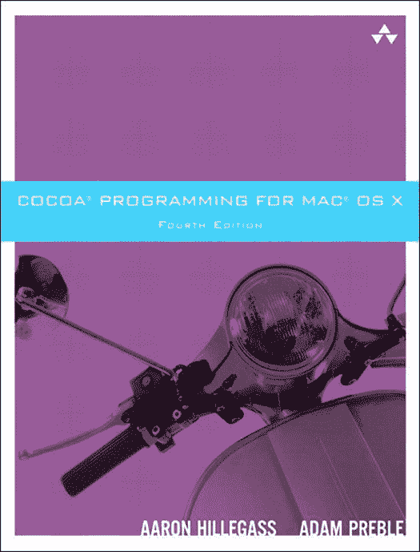

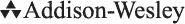

在美国境外销售，请联系：

> 国际销售  
> international@pearson.com

访问我们的网站：`informit.com/aw`

*美国国会图书馆编书出版数据*

Hillegass, Aaron.

Cocoa programming for Mac OS X / Aaron Hillegass, Adam Preble.—4th ed.

p. cm.

包含索引。

ISBN 978-0-321-77408-8（平装本：纸）

1. Cocoa（应用程序开发环境）
2. 操作系统（计算机）
3. Mac OS
4. Macintosh（计算机）—编程。I. Preble, Adam. II. 标题。

QA76.76.O63H57145 2012

005.26'8—dc23

2011034459

*献给 Aaron 的两个儿子 Walden 和 Otto*

*以及*

*献给 Adam 的女儿 Aimee*

接下来，编译并运行应用程序。现在你获得了一个可能的语音列表，但选择某个语音还没有产生任何效果。

除了有一个 `dataSource` 输出外，表格视图还有一个 `delegate` 输出。每当选择发生变化时，代理都会收到通知。在 `SpeakLineAppDelegate.m` 中，实现 `tableViewSelectionDidChange:`。（`NSNotification` 类将在本书稍后部分介绍。现在，只需注意你被传递了一个通知对象作为该代理方法的参数。）

```objc
- (void)tableViewSelectionDidChange:(NSNotification *)notification
{
  NSInteger row = [_tableView selectedRow];
  if (row == –1) {
    return;
  }
  NSString *selectedVoice = [_voices objectAtIndex:row];
  [_speechSynth setVoice:selectedVoice];
}
```

合成器在说话时不会允许你更改语音。表格视图应该是启用状态的：

```objc
- (IBAction)say:(id)sender
{
  NSString *string = _textField.stringValue;
  if (string length == 0) {
    return;
  }
  speechSynthesizer didFinish:string;
}
```

```objc
- (void)awakeFromNib
{
  // 准备切换到行 "rowIndex"
  // 设置默认行为
}
```

```objc
- (void)awakeFromNib
{
  // 准备切换到行 "rowIndex"
  // 设置默认行为
  BOOL ok = YES;
}
```

```objc
- (void)awakeFromNib
{
  // 准备切换到行 "rowIndex"
}
```

## 实现代理时的常见错误

人们在实现代理时有两种非常常见的错误：

- 拼错方法名称：该方法将不会被调用，且编译器不会报错。避免此问题的最佳方法是从文档中复制粘贴声明。
- 忘记设置代理输出：如果你犯了这种错误，编译器不会给出错误或警告。

## 许多对象拥有代理

代理模式是 Cocoa 中常用的设计模式。以下是具有 `delegate` 的 AppKit 类：

- `NSAlert`
- `NSAnimation`
- `NSApplication`
- `NSBrowser`
- `NSDatePicker`
- `NSDrawer`
- `NSFontManager`
- `NSImage`
- `NSLayoutManager`
- `NSMatrix`
- `NSMenu`
- `NSPathControl`
- `NSRuleEditor`
- `NSavePanel`
- `NSound`
- `NSpeechRecognizer`
- `NSSpeechSynthesizer`
- `NSplitView`
- `NSTableView`
- `NSTableView`
- `NSText`
- `NSTextField`
- `NSTextStorage`
- `NSTextView`
- `NSTokenField`
- `NSToolbar`
- `NSWindow`

### 给好奇的读者：代理是如何运作的

代理不需要实现所有方法，但如果对象实现了某个代理方法，它就会被调用。在许多语言中，这种事情是不可能的。在 Objective-C 中是如何实现的呢？

`NSObject` 有以下方法：

`(BOOL)respondsToSelector:(SEL)aSelector`

由于每个对象都直接或间接继承自 `NSObject`，因此每个对象都有这个方法。如果对象拥有名为 `aSelector` 的方法，它将返回 `YES`。

想象一下，你是编写 `NSTableView` 的工程师。你正在编写将选择从一行更改到另一行的代码。你想想：“我应该询问一下代理。”为了这样做，你添加了这样一段代码片段：

```objc
// 准备切换到行 "rowIndex"
// 设置默认行为
BOOL ok = YES;
```

```objc
// Check whether the delegate implements the method
if ([delegate respondsToSelector:@selector(tableView:shouldSelectRow:)]) {
    // Execute the method
    ok = [delegate tableView:self shouldSelectRow:rowIndex];
}

// Use the return value
if (ok) {
    ...actually change the selection...
}
```

注意，只有当代理实现了该方法时，才会向其发送消息。如果代理没有实现该消息，则会发生默认行为。（实际上，`respondsToSelector:` 的结果通常会被带有 `delegate` outlet 的对象缓存。这使得性能比代码所暗示的要快得多。）

在写完这个方法后，你应该在你的类文档中仔细地记录它的存在。

如果你想查看对代理方法存在的检查，可以在你的代理对象中重写 `respondsToSelector:`：

```objc
- (BOOL)respondsToSelector:(SEL)aSelector
{
    NSString *methodName = NSStringFromSelector(aSelector);
    NSLog(@"respondsToSelector:%@", methodName);
    return [super respondsToSelector:aSelector];
}
```

你现在可能想尝试将此方法添加到 `AppController.m` 中。

### 挑战：制作一个代理

创建一个只有一个窗口的新应用程序。创建一个作为该窗口代理的对象。当用户调整窗口大小时，确保窗口的高度始终是其宽度的两倍。

这里是你将实现的代理方法的签名：

```objc
- (NSSize)windowWillResize:(NSWindow *)sender
            toSize:(NSSize)frameSize;
```

第一个参数是正在调整大小的窗口。第二个参数是一个包含用户请求尺寸的 C 结构体：

```objc
typedef struct _NSSize {
    float width;
    float height;
} NSSize;
```

以下是创建一个宽 200 磅、高 100 磅 `NSSize` 的方法：

```objc
NSSize mySize = NSMakeSize(200.0, 100.0);
NSLog(@"mySize is %f wide and %f tall", mySize.width, mySize.height);
```

你可以在 Interface Builder 的 Size Inspector 中设置窗口的初始大小。

### 挑战：制作一个数据源

制作一个待事项列表应用程序。用户将在文本字段中输入任务。当用户点击 Add 按钮时，你把字符串添加到可变数组中，新任务将出现在列表末尾。

**图 6.11。** 挑战框图

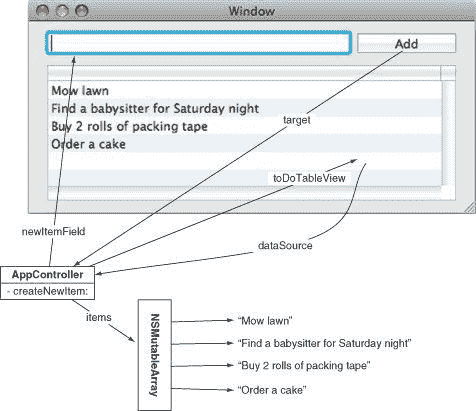

当新字符串被添加到数组时，你需要向表格视图发送 `reloadData` 消息才能看到它。

让表格视图变得可编辑可以让你获得额外分。（*提示：* `NSMutableArray` 有一个方法 `replaceObjectAtIndex:withObject:`）

# 第 7 章 键值编码与键值观察

键值编码（或 KVC）是一种机制，允许你通过名称来设置和获取变量的值。该名称只是一个字符串，但我们将该名称称为*键*（key）。例如，假设你有一个名为 `Student` 的类，它有一个类型为 `NSString` 的名为 `firstName` 的实例变量：

```objc
@interface Student : NSObject
{
    NSString *firstName;
}
@ends
```

如果你有一个 `Student` 的实例，你可以这样设置它的 `firstName`：

```objc
Student *s = [[Student alloc] init];
[s setValue:@"Larry" forKey:@"firstName"];
```

你可以这样读取它 `firstName` 的值：

```objc
NSString *x = [s valueForKey:@"firstName"];
```

`setValue:forKey:` 和 `valueForKey:` 方法定义在 `NSObject` 中。我们知道：这看起来不像什么深奥科技，但事实证明通过名称读取和设置变量的能力是非常强大的。本章的其余部分将通过一个简单的示例来展示这种力量。

## 键值编码

在 Xcode 中，创建一个类型为 Cocoa Application 的新项目。将项目命名为 `KvcFun`。在 `KvcAppDelegate.h` 中，为 `fido` 添加一个属性：

```objc
@interface KvcAppDelegate : NSObject <NSApplicationDelegate>
@property (assign, IBOutlet) NSWindow *window;
@end
```

在 `KvcAppDelegate.m` 中，你创建 `init` 方法：

```objc
- (id)init
{
    self = [super init];
    if (self) {
        _fido = 0;
    }
    return self;
}
```

如果你使用 `int`，键值编码机制将正常工作。在 `KvcAppDelegate.m` 中添加这些方法：

```objc
- (int)fido
{
    NSLog(@"fido: %d", _fido);
    return _fido;
}

- (void)setFido:(int)x
{
    NSLog(@"setFido: %d", x);
    _fido = x;
}
```

## 绑定（Bindings）

Cocoa 中的许多图形对象都有绑定。当你将一个键（例如 `fido`）绑定到对象的属性时，视图将自动保持它们同步。打开 `MainMenu.xib`，在窗口上拖入一个滑块，并将其值绑定到 `KvcAppDelegate` 的 `fido` 键。

## 键值观察（Key-Value Observing）

如果 `fido` 被滑块以外的内容改变了什么？滑块如何知道它有了新值？

当滑块创建时，它告诉 `KvcAppDelegate` 它正在观察其 `fido` 键。每当通过访问方法或键值编码更改 `fido` 的值时，`KvcAppDelegate` 都会向滑块发送消息，通知 `fido` 发生了变化。

编译并运行应用。注意，当你移动滑动块时，会调用 `setFido:`。这会通知文本字段 `fido` 已经更改。文本字段使用 `valueForKey:` 来获取 `fido` 的新值。因此，你会看到 `fido` 方法被调用了。

## 使键可观察

上一节提到，当你使用访问器方法或键值编码（KVC）来更改键的值时，观察者会自动收到通知。如果你直接修改变量会发生什么？

打开 `KvcFunAppDelegate.h` 并声明一个新的动作方法：

> `incrementFido:sender`

```objc
- (IBAction)incrementFido:(id)sender;
```

在 `KvcFunAppDelegate.m` 中实现该方法：

```objc
- (IBAction)incrementFido:(id)sender
{
    fido++;
    NSLog(@"fido is now %d", fido);
}
```

打开 `MainMenu.xib`。在窗口中添加一个按钮，将其标记为 Increment Fido，并从按钮 Control 拖拽到实例 `KvcFunAppDelegate`。该按钮应该触发 `incrementFido:` 动作（图 7.4）。

**图 7.4。** 设置按钮的目标和动作

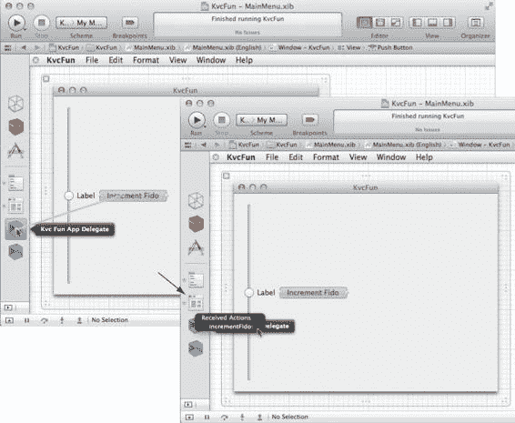

你可能希望点击按钮时，滑动块会移动且文本字段会自动更新。遗憾的是，这两者都没有发生。尝试编译并运行应用程序。

如果你打算直接更改变量，你需要显式地触发观察者的通知。更改 `incrementFido:` 方法：

```objc
- (IBAction)incrementFido:(id)sender
{
    [self willChangeValueForKey:@"fido"];
    fido++;
    NSLog(@"fido is now %d", fido);
    [self didChangeValueForKey:@"fido"];
}
```

现在编译并运行应用程序；Increment Fido 按钮应该可以工作。

还有两个可行的解决方案。首先，你可以使用键值编码：

```objc
- (IBAction)incrementFido:(id)sender
{
    NSNumber *n = [self valueForKey:@"fido"];
    NSNumber *npp = [NSNumber numberWithInt:[n intValue] + 1];
    [self setValue:npp forKey:@"fido"];
}
```

或者，你可以使用访问器方法来更改 `fido`：

```objc
- (IBAction)incrementFido:(id)sender
{
    [self setFido:[self fido] + 1];
}
```

输入这个版本。然后编译并运行它。

图 7.5 是你所操作的对象图。注意，我们将使用半箭头来表示绑定。

**图 7.5。** 对象图

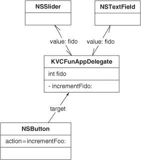

## 属性

正如你所见，我们花费了大量时间调用访问器方法，以至于 Objective-C 为程序员提供了使用点符号表示（dot notation）来调用访问器的选项。如果你有一个指向具有 getter 方法 `rex` 的对象的指针 `rover`，你可以这样调用它：

```objc
NSLog(@"Rover's rex is %@", rover.rex);
```

要调用 `setRex:`，你可以这样操作：

```objc
rover.rex = [NSDate date];
```

Objective-C 程序员对于点符号表示是否是语言的一项良好改进持有不同意见。一些人认为它是语法糖，一种可以（危险地）掩盖消息发送（message sends）的特性，而消息发送的行为与在结构体中赋值并不相同。另一些人认为，它为语言带来的简洁性抵消了这些危险。为了清晰起见，我们在书中不会使用它。

那么编写访问器方法呢？如果你的对象有 12 个实例变量，你需要写 12 个 setter 和 12 个 getter 吗？

属性提供了一种非常优雅的方法来消除大量代码。在 `KvcFunAppDelegate.h` 文件中，将 `fido` 和 `setFido:` 方法的声明替换为属性声明：

```objc
@interface KvcFunAppDelegate : NSObject <NSApplicationDelegate> {
    int fido;
}
@property (assign) IBOutlet NSWindow *window;
@property (readwrite, assign) int fido;

- (IBAction)incrementFido:(id)sender;

@end
```

这一行等同于声明 `setFido:` 和 `fido` 方法。

在 `KvcFunAppDelegate.m` 中，你可以使用 `@synthesize` 来实现访问器方法。从 `KvcFunAppDelegate` 中删除你的 `fido` 和 `setFido:` 方法。

```objc
@synthesize fido;
```

```objc
toObject:employeeController
withKeyPath:@"arrangedObjects.@avg.expectedRaise"
options:nil];
```


当然，在 `Interface Builder` 中创建绑定通常更简单。

使用 `unbind:` 方法移除绑定：

```objc
[textField unbind:@"value"];
```

### 进阶：更好奇的读者：键值观察（Key-Value Observing）

文本字段是如何成为 `KvcFunAppDelegate` 对象中 `fido` 键的观察者的？当它从 NIB 中唤醒时，它把自己添加为观察者。如果你想成为该键的观察者，你的代码可能像这样：

```objc
[theAppDelegate addObserver:self
                 forKeyPath:@"fido"
                   options:NSKeyValueChangeOldKey
                   context:somePointer];
```

该方法定义在 `NSObject` 中。它是让你这样说：“嘿！每当 `fido` 变化时，请给我发消息。”`options` 和 `context` 决定了当 `fido` 变化时随消息一起发送的额外数据。被触发的方法看起来如下：

```objc
- (void)observeValueForKeyPath:(NSString *)keyPath
                     ofObject:(id)object
                       change:(NSDictionary *)change
                       context:(void *)context
{
...
}
```

在这种情况下，`keyPath` 将为 `@"fido"`；`object` 将是 `KvcFunAppDelegate`；`context` 将是你成为观察者时作为上下文提供的指针 `somePointer`；`change` 是字典（键值对集合），它可以保存 `fido` 的旧值和/或新值。

## 第 8 章 `NSArrayController`

在面向对象编程社区中，一种非常常见的设计模式是模型-视图-控制器（Model-View-Controller）。这种设计模式认为，你写的每个类都应该恰好属于以下组别之一。

1. **模型（Model）**类描述你的数据。例如，如果你在写银行系统，你可能会创建一个名为 `SavingsAccount` 的模型类，它有一个交易列表和一个当前余额。最好的模型类不包含任何关于用户界面的信息，并且可以在多个应用程序中使用。

2. **视图（View）**类是 GUI 的一部分。例如，`NSSlider` 就是一个视图类。最好的视图是通用类，可以在多个应用程序中使用。

3. **控制器（Controller）**类通常是特定于应用程序的，负责控制应用的流。用户需要查看数据，因此控制器对象从文件或数据库读取模型，然后通过视图类显示模型。当用户做出更改时，视图对象会通知控制器，随后控制器更新模型对象。控制器还将数据保存到文件系统或数据库。

在 Mac OS X 10.3 之前，Cocoa 程序员在控制器对象中编写了大量代码，仅仅是将数据从模型对象移动到视图对象并反反之。为了让常见的控制器类更容易编写，Apple 引入了 `NSController` 和绑定。

`NSController` 是一个抽象类。`NSController` 的子类 `NSObjectController` 显示对象的信息或内容。`NSArrayController` 是一个以数据对象数组作为内容的控制器。在练习中，我们将使用 `NSArrayController`。

**图 8.1.** 控制器类

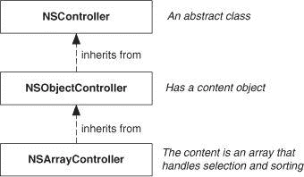

### 启动 `RaiseMan`

在接下来的章节中，你将创建一个功能完整的应用程序，用于跟踪员工以及每个人今年将获得的加薪。随着书籍的进展，你将添加文件保存、撤销、用户偏好和打印功能。在本章之后，该应用程序将像图 8.2 所示。

**图 8.2.** 完成的应用程序

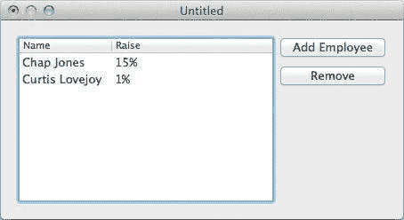

（是的，丰富的 Cocoa 程序员可以使用 Core Data 创建这样的应用程序，但我们想看到如何手动完成。在 Xcode 中创建一个新项目。类型类型选择 Cocoa Application。将项目命名为 `RaiseMan`，将类前缀设置为 `RM`，并启用基于文档的应用程序（Document-Based Application）。将文档扩展设置为 `rman`，禁用 Core Data 并包含单元测试。）

**图 8.3.** 新基于文档的项目

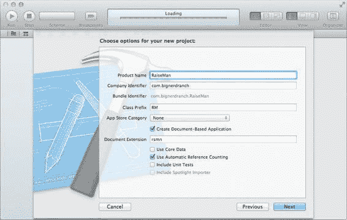

什么是基于文档（document-based）应用程序？它是可以打开多个文档的应用程序。例如，TextEdit 就是基于文档的应用程序。另一方面，系统设置（System Preferences）并不是基于文档的应用程序。你将在第 10 章学习更多关于文档架构的知识。

该应用程序的对象图如图 8.4 所示。列通过绑定而不是连接到 `NSArrayController`。这是一个基于单元的视图（cell-based view）；我们将在第 1 章讨论基于视图的视图（view-based views）。

**图 8.4.** 对象图

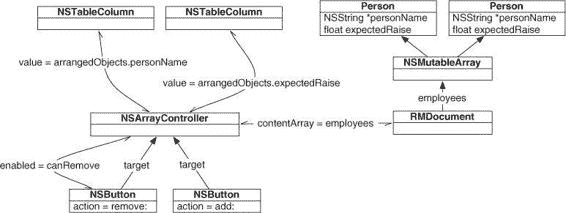

注意，类 `RMDocument` 已经为你创建好了。`RMDocument` 是 `NSDocument` 的子类。文档对象负责读写。在练习中，我们将使用 `NSArrayController` 和绑定来构建我们的简单界面，所以我们暂时不会向 `RMDocument` 添加任何代码。

要创建一个新的 `Person` 类，选择 `File -> New -> File...` 菜单项。出现选项时，选择 Objective-C class。将类命名为 `Person` 并将其设置为 `NSObject` 的子类，如图 8.5 所示。

**图 8.5.** 创建 `Person` 类

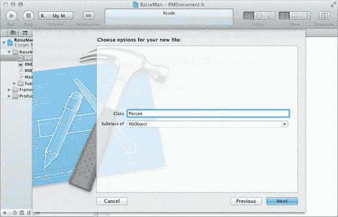

编辑 `Person.h` 文件声明两个属性：

```objc
#import <Foundation/h>

@interface Person : NSObject
{
    NSString *personName;
    float expectedRaise;
}
@property (readwrite, copy) NSString *personName;
@property (readwrite) float expectedRaise;
@end
```

现在编辑 `Person.m` 以合成这些属性并重写 `init`：

```objc
#import "Person.h"

@implementation Person

@synthesize personName;
@synthesize expectedRaise;

- (id)init
{
    self = [super init];
    if (self) {
        expectedRaise = 0.05;
        personName = @"New Person";
    }
    return self;
}

@end
```

注意 `Person` 是一个模型类——它没有关于用户界面的信息。因此，该类不需要了解所有的 Cocoa 框架。因此，我们没有导入 `Cocoa/Cocoa.h`，而是导入了 `Foundation.h`。两种方法都可以，但导入较小的框架更有格。这表明该类可以在命令行工具或 iOS 应用程序中重用。

在 `RMDocument.h` 中声明 `employees` 数组（它将包含 `Person` 类的实例）：

```objc
@interface RMDocument : NSDocument
{
    NSMutableArray *employees;
}
- (void)setEmployees:(NSMutableArray *)a;
@end
```

现在在 `RMDocument.m` 中，修改 `init` 以实例化 `employees` 数组。创建 `setEmployees:` 方法。暂时保留模板中的其他方法。

```objc
- (id)init
{
    self = [super init];
    if (self) {
        employees = [[NSMutableArray alloc] init];
    }
    return self;
}

- (void)setEmployees:(NSMutableArray *)a
{
```

```objc
// This is an unusual setter method. We are going to add a lot
// of smarts to it in the next chapter.
if (a == employees) {
    return;
}
employees = a;
}
```

#### `RMDocument.xib`

点击 `RMDocument.xib` 在 Interface Builder 编辑器中打开它。

删除显示 `Your document contents here` 的文本字段。向窗口拖入一个表格视图（table view）和两个按钮。按照图 8.6 所示对其进行重命名和排列。使用属性检查器（Attributes Inspector）确保表格视图的 `Content Mode` 设置为 `Cell Based`。

**图 8.6.** 文档窗口

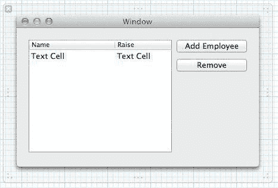

拖出一个 `NSArrayController`（来自 Cocoa->Objects & Controllers）并将其拖入编辑器区域。Interface Builder 调度台中会出现一个 `NSArrayController` 图标。

确保调度台中选中了数组控制器。打开 `NSArrayController` 实例的属性检查器（Attributes Inspector）；在 Object Controller 下，将 `Class Name` 设置为 `Person`。添加键 `personName` 和 `expectedRaise`，如图 8.7 所示。

**图 8.7.** 配置 `NSArrayController` 的类名和键

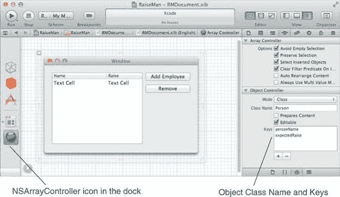

在数组控制器仍仍被选中状态的情况下，切换到绑定检查器（Bindings Inspector，其图标像一个结）。在列表中找到 `Content Array` 绑定并展开它。在弹出窗口中勾选 `Bind to;`；选择 `File’s Owner`。留空 `Controller Key` 并在 `Model Key Path` 中输入 `employees`（图 8.8）。Cocoa 程序员会说，他们正在将数组控制器的 `Content Array` 绑定到 `File’s Owner` 的 `employees` 数组（即 `RMDocument` 的实例）。

**图 8.8.** 绑定数组控制器的 `Content Array`

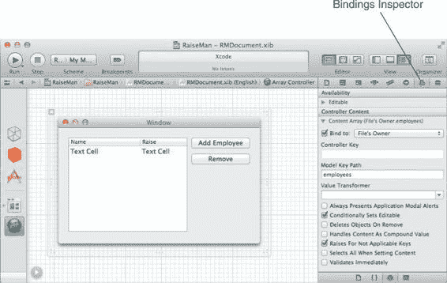

现在我们已经配置了数组控制器，我们将绑定表格列以显示数组控制器的内容。在第 6 章中，我们实现了 `NSTableViewDataSource` 协议来填充表格视图；绑定将允许我们跳过那些代码。

表格视图的第一列将显示每个员工的名字。点击并双击该列以选中它（在本书书中，你永远不要绑定滚动视图或单元格；这样做是一个常见的错误，请留意编辑器上方的跳转条）。在绑定检查器（Bindings Inspector）中，找到 `Value` 绑定。勾选 `Bind to` 并在弹出窗口中选择 `Array Controller`。将 `Controller Key` 设置为 `arrangedObjects`，并将 `Model Key Path` 设置为 `personName`（图 8.9）。再次，Cocoa 程序员会说，他们正在将列的值绑定到数组控制器的 `arrangedObjects` 的 `personName`。

**图 8.9.** 将第一列绑定到数组控制器

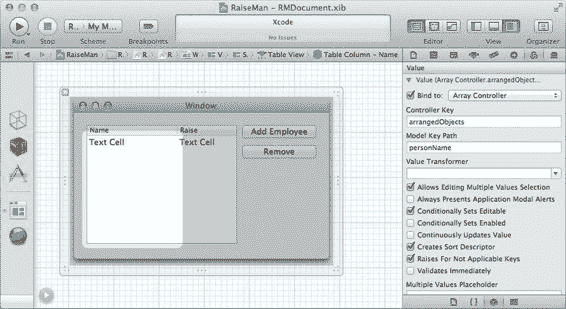

表格视图的第二列显示每个员工的 `expected raise`。在库（Library，位于 Library->Cocoa->Controls）中找到 `Number Formatter` 并将其拖动到第二列的单元格中（图 8.10）。

**图 8.10.** 添加数字格式化器

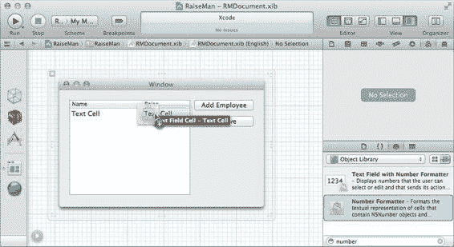

在检查器中，选中数字格式化器，设置格式化器（一个 10.4+ 化器）将数字显示为百分比并启用 `Lenient`，这将使其对输入不那么挑剔，如图 8.11 所示。

**图 8.11.** 数字格式化器属性

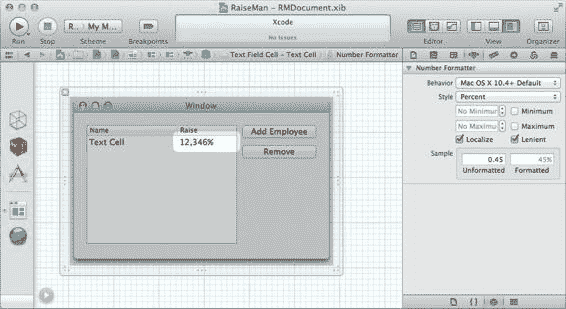

重新选择第二列。在绑定检查器（Bindings Inspector）中，像你处理第一列一样，将 `value` 绑定到数组控制器 `arrangedObjects` 的 `expectedRaise`（图 8.12）。

**图 8.12.** 将第二列绑定到数组控制器

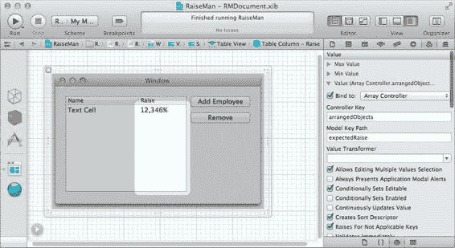

选择显示 `personName` 的列。在检查器（Inspector）中，将排序键（sort key）设置为 `personName`，并将选择器（selector）设置为 `caseInsensitiveCompare:`，如图图 8.15 所示。

**图 8.15.** 按 `personName` 排序

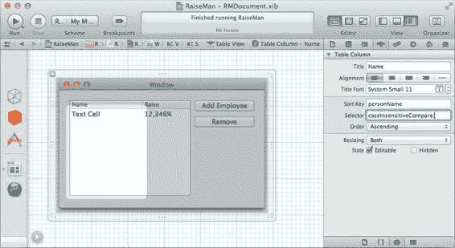

`caseInsensitiveCompare:` 方法是 `NSString` 的一部分。例如，你可以这样做：

```objc
NSString *x = @"Piaggio";
NSString *y = @"Italjet";
NSComparisonResult result = [x caseInsensitiveCompare:y];

// x 在字典中排在前吗？
if (result == NSOrderedAscending) {
    ...
}
```

`NSComparisonResult` 只是一个整数。`NSOrderedAscending` 是 -1。`NSOrderedSame` 是 0。`NSOrderedDescending` 是 1。

构建并运行你的应用程序。点击列头对数据进行排序。再次点击查看反序数据。

### 给更具好奇心的读者：不使用 `NSArrayController` 进行排序

在第 6 章中，你通过显式实现 `dataSource` 方法来填充表格视图（table view）。你当时可能好奇，如何在自己的应用程序中实现这种排序行为。

你添加到表格列中的信息被封装在一个 `NSSortDescriptor` 对象的数组中。一个排序描述符包含键（key）、选择器以及数据是否应按升序或降序排列的指示。如果你有一个包含对象的 `NSMutableArray`，你可以使用以下方法对其进行排序：

```objc
- (void)sortUsingDescriptors:(NSArray *)sortDescriptors
```

当用户点击带有排序描述符的列头时，会触发一个可选的表格视图 `dataSource` 方法：

```objc
- (void)tableView:(NSTableView *)tableView
    sortDescriptorsDidChange:(NSArray *)oldDescriptors
```

因此，如果你有一个持有表格视图信息的可变数组，你可以像这样实现该方法：

```objc
- (void)tableView:(NSTableView *)tableView
    sortDescriptorsDidChange:(NSArray *)oldDescriptors
{
    NSArray *newDescriptors = [tableView sortDescriptors];
    [myArray sortUsingDescriptors:newDescriptors];
    [tableView reloadData];
}
```

大搞定！你的应用程序中实现了排序。

### 挑战 1

让应用程序根据人名字中的字符数量对人员进行排序。你可以仅使用 Interface Builder 完成这个挑战——秘诀是使用键路径（key path）。（提示：字符串有一个 `length` 方法。）

### 挑战 2

在本书的第一版版中，读者们在没有使用 `NSArrayController` 或绑定（bindings）机制的情况下创建了 `RaiseMan` 应用程序。（这些功能是在 Mac OS X 10.3 中引入的。）为了做到这一点，读者使用了之前章节中的思想。那么，挑战在于在不使用 `NSArrayController` 或绑定机制的情况下重写 `RaiseMan` 应用程序。绑定通常看起来很神奇，但了解如何在不诉诸魔法的情况下完成工作是很有用的。

请务必从新项目重新开始——在下一章中，我们将基于你现有项目进行构建。

`Person` 类将保持不变。在 `RMDocument.xib` 中，你将每个列的标识符（identifier）设置为你想显示的变量名称（使用 Interface Builder 中的 `Attributes Inspector`）。然后，`RMDocument` 类将成为表格视图的 `dataSource` 以及“创建新员工”和“删除”按钮的 `target`。`RMDocument` 将有一个用于显示的 `Person` 对象的数组。为了帮助你开始，这里是 `RMDocument.h`：


```objc
#import <Cocoa/Cocoa.h>
@class Person;

@interface RMDocument : NSDocument
{
    NSMutableArray *employees;
    IBOutlet NSTableView *tableView;
}
- (IBAction)createEmployee:(id)sender;
- (IBAction)deleteSelectedEmployees:(id)sender;
@end
```

这里是`RMDocument.m`中有趣的部分：

```objc
- (id)init
{
    self = [super init];
    if (self) {
        employees = [NSMutableArray array];
    }
    return self;
}

#pragma mark Action methods

- (IBAction)deleteSelectedEmployees:(id)sender
{
    // 选中了哪行？
    NSIndexSet *rows = [tableView selectedRowIndexes];

    // 选择是否为空？
    if ([rows count] == 0) {
        NSBeep();
        return;
    }
    [employees removeObjectsAtIndex:rows];
    [tableView reloadData];
}

- (IBAction)createEmployee:(id)sender
{
    Person *newEmployee = [[Person alloc] init];
    [employees addObject:newEmployee];
    [tableView reloadData];
}

#pragma mark Table view methods

- (NSInteger)numberOfRowsInTableView:(NSTableView *)tableView
{
    return [employees count];
}

- (id)tableView:(NSTableView *)tableView
    objectValueForColumn:(NSTableColumn *)aTableColumn
    row:(NSInteger)rowIndex
{
    // 列的标识符是什么？
    NSString *identifier = [aTableColumn identifier];

    // 什么人？
    Person *person = [employees objectAtIndex:rowIndex];

    // 属性的值是什么？
    return [person valueForKey:identifier];
}

- (void)tableView:(NSTableView *)tableView
    setObjectValue:(id)anObject
    forTableColumn:(NSTableColumn *)aTableColumn
    row:(NSInteger)rowIndex
{
    NSString *identifier = [aTableColumn identifier];
    Person *person = [employees objectAtIndex:rowIndex];

    // 为属性设置值
    [person setValue:anObject forKey:identifier];
}
```

一旦完成，确保添加排序！

## 第 9 章 NSUndoManager

使用`NSUndoManager`，你可以非常优雅地为应用程序添加撤销功能。当对象被添加、删除或编辑时，撤销管理器会跟踪撤销这些更改所需的消息。当你调用时，会跟踪重做这些更改所需的消息。这种机制通过利用两个`NSInvocation`栈来实现。

在书早期介绍这个相当沉重的话题。（当我们考虑撤销时，头可能会开始晕。）然而，撤销与文档架构是有交互的。如果我们现在处理这项工作，你将在下一章中看到它是如何工作的。

### NSInvocation

正如你所想象的，将消息（包括选择器、接收者和所有参数）封装成一个可以随时调用的对象是非常方便的。这样的对象是`NSInvocation`的实例。

调用的一个极其方便的用途是在消息转发中。当对象接收到它无法理解的消息时，在抛出异常之前，消息发送系统会检查对象是否实现了以下方法：

```objc
- (void)forwardInvocation:(NSInvocation *)x
```

如果对象有这样的方法，发送的消息将被封装为`NSInvocation`并调用`forwardInvocation:`。

### NSUndoManager 如何工作

假设用户打开了一个新的 RaiseMan 文档并进行了三次编辑：

1. 插入新记录。
2. 将名字从`New Employee`改为`Rex Fido`。
3. 将工资从 0 改为 20。

在执行每次编辑时，你的控制器会将一个撤销该编辑的调用添加到撤销栈中。为了简化表述，我们说：“编辑的*反向操作*被添加到撤销栈中。”

图 9.1 显示了在这些编辑后撤销栈看起来是什么样子。

# 图 9.1. 撤销栈 (Undo Stack)

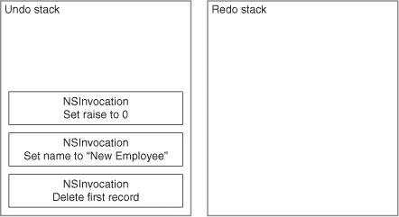

如果用户现在选择“撤销”（Undo）菜单项，第一个调用将从栈中取出并执行。这将把该人的加薪恢复为零。如果用户再次选择“撤销”菜单项，该人的姓名将变回`New Employee`（新员工）。

每当一个项目从撤销栈中弹出并执行时，必须将该撤销操作的反逆操作添加到重做（redo）栈中。因此，在撤销了上述两个操作后，撤销栈和重做栈应该如图 9.2。

## 图 9.2. 修改后的撤销栈

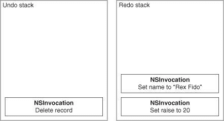

撤销管理器非常智能：当用户正在编辑时，撤销调用进入撤销栈。当用户正在撤销编辑时，撤销调用进入重做栈。当用户正在重做编辑时，撤销调用进入撤销栈。这些任务会自动为你处理；你唯一的工作就是给撤销管理器提供需要添加的反逆调用。

现在假设你正在编写一个名为`makeItHotter`（变热）的方法，该方法的逆称为`makeItColder`（变冷）。以下是启用撤销的方法：

```objc
- (void)makeItHotter
{
    temperature = temperature + 10;
    [[undoManager prepareWithInvocationTarget:self] makeItColder];
    [self showTheChangesToTheTemperature];
}
```

正如你可能猜到的，`prepareWithInvocationTarget:`方法记录`target`并返回撤销管理器本身。然后，撤销管理器巧妙地重写了`forwardInvocation:`，将`makeItColder:`的调用添加到撤销栈中。

为了完成示例，你需要实现`makeItColder`：

```objc
- (void)makeItColder
{
    temperature = temperature - 10;
    [[undoManager prepareWithInvocationTarget:self] makeItHotter];
    [self showTheChangesToTheTemperature];
}
```

注意，我们再次向撤销管理器注册了逆操作。如果`makeItColder`是由于撤销而被调用的，那么这个逆操作将进入重做栈。

两个栈上的调用是分组的。默认情况下，在单个事件期间添加到栈中的所有调用会被分在一起。因此，如果一个用户操作导致了多个对象的更改，只需点击一次“撤销”菜单项即可撤销所有更改。

撤销管理器还可以更改“撤销”和“重做”菜单项的标签。例如，“撤销插入”（Undo Insert）比简单的“撤销”更具描述性。要设置标签，使用以下代码：

```objc
[undoManager setActionName:@"Insert"];
```

如何获取撤销管理器？你可以显式地创建一个，但注意每个`NSDocument`实例都已拥有自己的撤销管理器。

## 在 RaiseMan 中添加撤销

让我们用户能够撤销点击“添加新员工”和“删除”按钮的影响，并能够撤销他们对表格中`Person`对象所做的更改。必要的代码将放入你的`RMDocument`类中。

### 键值编码 (Key-Value Coding) 与一对多关系

在设计类时，将你的实例变量视为具有四种可能用途之一：

1. **简单属性**。例如：每个学生都有名字。简单属性通常是数字或`NSString`、`NSDate`或`NSData`的实例。
2. **一对一关系 (To-one relationships)**。例如：每个学生都有一个学校。它像简单属性，但类型是一个复杂对象，而不是简单类型。一对一关系使用指针实现：`Student`实例拥有指向`School`实例的指针。
3. **有序一对多关系 (Ordered to-many relationships)**。例如：每个播放列表都有一个歌曲列表。歌曲按照特定顺序排列。这通常使用`NSMutableArray`实现。
4. **无序一对多关系 (Unordered to-many relationships)**。例如：每个部门有一群员工。你可以以特定顺序显示员工（例如按姓氏排序），但这种排序并不是该关系所固有的。这通常使用`NSMutableSet`实现。

在此之前，我们讨论了如何使用键值编码设置简单属性和一对一关系。记住，在设置或获取`fido`的值时，如果存在访问器（accessors），KVC 将使用它们。同样，我们可以为有序和无序一对多关系创建访问器。

例如，假设`Playlist`实例拥有一个包含`Song`对象的`NSMutableArray`。如果你想使用键值编码来操作该数组，你需要向播放列表请求它的`mutableArrayValueForKey:`。你将得到一个代理对象。

该代理对象知道它代表持有歌曲的数组。

```objc
id arrayProxy = [playlist mutableArrayValueForKey:@"songs"];
```

在这个示例中，当被询问`count`时，代理对象会询问`Playlist`是否有一个`countOfSongs`方法。如果`Playlist`有，它就会返回结果。注意，将方法命名为`countOfSongs`仅仅是一种约定；键值机制会寻找它。

### 图 9.3. 有序关系的键值编码

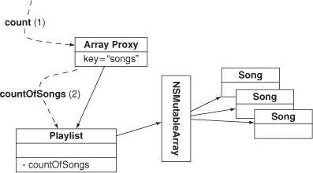

有几种情况，这里是：

```objc
id arrayProxy = [playlist mutableArrayValueForKey:@"songs"];
int count = [arrayProxy count];
```

### 图 9.4. 无序关系的键值编码

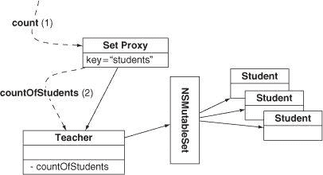

```objc
id setProxy = [teacher mutableSetValueForKey:@"students"];
int count = [setProxy count];
```

```objectivec
// 将此操作的逆操作添加到撤销栈
NSUndoManager *undo = [self undoManager];
[[undo prepareWithInvocationTarget:self]
removeObjectFromEmployeesAtIndex:index];
if (![undo isUndoing]) {
    [undo setActionName:@"Add Person"];
}

// 将 Person 添加到数组
[employees insertObject:p atIndex:index];
}

- (void)removeObjectFromEmployeesAtIndex:(NSUInteger)index
{
    Person *p = [employees objectAtIndex:index];
    NSLog(@"removing %@ from %@", p, employees);
    // 将此操作的逆操作添加到撤销栈
    NSUndoManager *undo = [self undoManager];
    [[undo prepareWithInvocationTarget:self] insertObject:p
    inEmployeesAtIndex:index];
    if (![undo isUndoing]) {
        [undo setActionName:@"Remove Person"];
    }

    [employees removeObjectAtIndex:index];
}
```

当`NSArrayController`想要插入或移除`Person`对象时，这些方法会被自动调用（例如，当“添加员工”和“删除”按钮向它发送`insert:`和`remove:`消息时）。

此时，你已经实现了撤销删除和插入。撤销编辑将稍微复杂一些。在处理此任务之前，请构建并运行你的应用程序。测试你目前拥有的撤销功能。注意，重做（redo）功能同样有效。

### 键值观察 (Key-Value Observing)

在第 7 章中，我们讨论了键值编码。回顾一下，键值编码通过名称读取和更改值的方法。*键值观察允许你在此类变化发生时获得通知。*

为了为编辑启用撤销功能，你需要让你的文档对象感知到所有`Person`对象中`expectedRaise`和`personName`键的变化。

`NSObject`中的一个方法允许你注册以感知这些变化：

```objectivec
- (void)addObserver:(NSObject *)observer
             forKeyPath:(NSString *)keyPath
             options:(NSKeyValueObservingOptions)options
              context:(void *)context;
```

你提供应该被通知的对象作为`observer`，以及你希望被通知发生变化的`keyPath`。`options`变量定义了你希望在收到变化通知时包含的内容。例如，你可以被告知旧值（更改之前）和新值（更改之后）。`context`变量是一个指向数据的指针，你希望与其余信息一起发送该数据。

当变化发生时，观察者将接收到以下消息：

```objectivec
- (void)observeValueForKeyPath:(NSString *)keyPath
                     ofObject:(id)object
                        change:(NSDictionary *)change
                      context:(void *)context;
```

观察者会被告知哪个对象中的哪个键路径发生了变化。这里，`change`是一个字典（取决于你注册为观察者时请求的选项），可能包含旧值和/或新值。当然，此方法会接收到注册为观察者时提供的`context`指针。

#### 防御性地使用 Context 指针

由于任何观察键值变化的对象都必须实现具有此特定选择器`observeValueForKeyPath:ofObject:change:context:`的方法，因此可能会误拦截本属于另一个类的通知。

考虑一个虚构类`Maple`，它是虚构类`Tree`的子类。两个类都独立地观察键路径`season`。除非开发者采取措施，否则`Maple`将接收到它的键值观察 (KVO) 消息*以及*那些目标给`Tree`的消息，因为`Maple`实际上重写了 KVO 方法。为了修复这个问题，`Maple`必须正确识别目标给自己的观察消息与目标给其父类的消息。如果消息不是目标给该特定类的，`Maple`应该将消息传递给其父类。

解决此问题的方法是使用类特定的指针值作为`context`参数。我们将在练习的后续步骤中使用这种方法，尽管在特定练习中并不是必须的。

### 编辑的撤销

第一步是注册你的文档对象以观察对`Person`对象的变化。在`RMDocument.m`顶部添加以下静态变量和方法：


```objectivec
// RMDocumentKVO 允许此类区分
// KVO 消息和目标给父类的消息。
static void *RMDocumentKVOContext;

- (void)startObservingPerson:(Person *)person
{
    [person addObserver:self
    forKeyPath:@"personName"
    options:NSKeyValueObservingOld
    context:&RMDocumentKVOContext];

    [person addObserver:self
    forKeyPath:@"expectedRaise"
    options:NSKeyValueObservingOld
    context:&RMDocumentKVOContext];
}

- (void)stopObservingPerson:(Person *)person
{
    [person removeObserver:self
    forKeyPath:@"personName"
    context:&RMDocumentKVOContext];
    [person removeObserver:self
    forKeyPath:@"expectedRaise"
    context:&RMDocumentKVOContext];
}
```

每当 `Person` 进入或离开文档时，调用这些方法：

```objectivec
- (void)insertObject:(Person *)p inEmployeesAtIndex:(NSUInteger)index
{
    // 将此操作的逆操作添加到撤销栈
    NSUndoManager *undo = [self undoManager];
    [[undo prepareWithInvocationTarget:self]
    removeObjectFromEmployeesAtIndex:index];
    if (![undo isUndoing]) {
        [undo setActionName:@"Add Person"];
    }

    // 将 Person 添加到数组
    [self startObservingPerson:p];
    [employees insertObject:p atIndex:index];
}

- (void)removeObjectFromEmployeesAtIndex:(NSUInteger)index
{
    Person *p = [employees objectAtIndex:index];
    // 将此操作的逆操作添加到撤销栈
    NSUndoManager *undo = [self undoManager];
    [[undo prepareWithInvocationTarget:self] insertObject:p
    inEmployeesAtIndex:index];
    if (![undo isUndoing]) {
        [undo setActionName:@"Remove Person"];
    }
    [self stopObservingPerson:p];
    [employees removeObjectAtIndex:index];
}

- (void)setEmployees:(NSMutableArray *)a
{
    for (Person *person in employees) {
        [self stopObservingPerson:person];
    }

    employees = a;

    for (Person *person in employees) {
        [self startObservingPerson:person];
    }
}
```

现在，实现执行编辑且自逆操作的方法：

```objectivec
- (void)changeKeyPath:(NSString *)keyPath
             ofObject:(id)obj
             toValue:(id)newValue
{
    // setValue:forKeyPath: 会导致键值观察方法
    // 被调用，该方法处理撤销逻辑
    [obj setValue:newValue forKeyPath:keyPath];
}
```

实现每当 `Person` 对象被用户或 `changeKeyPath:ofObject:toValue:` 方法编辑时都会调用的方法。注意，此方法会将 `changeKeyPath:ofObject:toValue:` 的调用放入撤销栈，并带有被更改键的旧值：

```objectivec
- (void)observeValueForKeyPath:(NSString *)keyPath
                     ofObject:(id)object
                        change:(NSDictionary *)change
                      context:(void *)context
{
    if (context != &RMDocumentKVOContext) {
        // 如果上下文不匹配，此消息
        // 必须目标给我们的父类。
        [super observeValueForKeyPath:keyPath
        ofObject:object
        change:change
        context:context];
        return;
    }

    NSUndoManager *undo = [self undoManager];
    id oldValue = [change objectForKey:NSKeyValueChangeOldKey];
}
```

```objc
// NSNull objects are used to represent nil in a dictionary
if (oldValue == [NSNull null]) {
    oldValue = nil;
}
NSLog(@"oldValue = %@", oldValue);
[[undo prepareWithInvocationTarget:self] changeKeyPath:keyPath
ofObject:object
toValue:oldValue];
[undo setActionName:@"Edit"];
}
```

这样就完成了。一旦你编译并运行应用程序，撤销（undo）和重做（redo）应该就能完美工作。

在测试应用程序时，你可能会遇到错误：`The document could not be autosaved`。由于你正在操作撤销系统，AppKit 注意到你的文档有未保存的并尝试自动保存。你将在下一章节学习如何将文档保存到文件中。

### 在插入时开始编辑

你的 App 进展顺利，但你的用户会抱怨：“为什么我在插入后必须双击才能开始编辑？显而易见我想立即更改新人的名字。你们不能在插入的同时就开始编辑吗？”

奇怪的是，这做起来有点复杂。所以，这里是你需要的代码片段。首先，`RMDocument.h` 需要一个 `action` 和两个实例变量：

```objc
@interface RMDocument : NSDocument
{
    NSMutableArray *employees;
    IBOutlet NSTableView *tableView;
    IBOutlet NSArrayController *employeeController;
}
- (IBAction)createEmployee:(id)sender;
```

保存该文件。打开 `RMDocument.xib`，按住 Control 键从 Add Employee 按钮拖到 File’s Owner（即 `RMDocument` 的实例）。将它的 `action` 设置为 `createEmployee:`。

按 Control 键点击 File’s Owner。拖动将 `tableView` outlet 连接到表格视图（table view），并将 `employeeController` outlet 连接到数组控制器（array controller）。

**图 9.5.** 设置 tableView Outlets

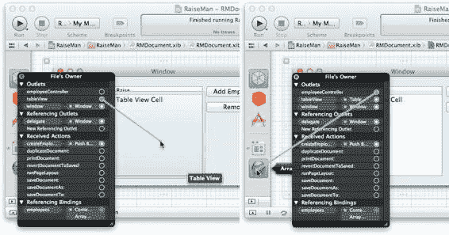

现在，在 `RMDocument.m` 中，添加 `createEmployee:` 方法：

```objc
- (IBAction)createEmployee:(id)sender
{
    NSWindow *w = [tableView window];

    // 尝试结束任何正在进行的编辑
    BOOL editingEnded = [w makeFirstResponder:w];
    if (!editingEnded) {
        NSLog(@"Unable to end editing");
        return;
    }
    NSUndoManager *undo = [self undoManager];

    // 此事件中是否已经发生了编辑？
    if ([undo groupingLevel] > 0) {
        // 关闭上一个分组
        [undo endUndoGrouping];
        // 打开一个新分组
        [undo beginUndoGrouping];
    }
    // 创建对象
    Person *p = [employeeController newObject];

    // 将其添加到 'employeeController' 的内容数组
    [employeeController addObject:p];

    // 重新排序（以防用户排序了某列）
    [employeeController rearrangeObjects];

    // 获取排序后的数组
    NSArray *a = [employeeController arrangedObjects];

    // 找到刚刚添加的对象
    NSUInteger row = [a indexOfObjectIdenticalTo:p];
    NSLog(@"starting edit of %@ in row %lu", p, row);

    // 在第一列开始编辑
    [tableView editColumn:0
    row:row
    withEvent:nil
    select:YES];
}
```

我们并不指你现在就能理解这段代码的每一行，但可以浏览一下该方法并尝试掌握要意。编译并运行应用程序。

### 给更具好奇心的人：窗口与撤销管理器

视图可以向撤销管理器添加编辑。例如，`NSTextView` 可以将人员对文本的每次编辑都放入撤销管理器。文本视图如何知道使用哪个撤销管理器呢？首先，它询问它的 `delegate`。`NSTextView` 代理可以实现此方法：

```objc
- (NSUndoManager *)undoManagerForTextView:(NSTextView *)tv;
```

接下来，它询问它的窗口。`NSWindow` 有一个用于此目的的方法：

```objc
- (NSUndoManager *)undoManager;
```

窗口的 `delegate`可以通过实现以下方法为窗口提供撤销管理器：

```objc
- (NSUndoManager *)windowWillReturnUndoManager:(NSWindow *) window;
```

撤销/重做菜单项反映了主窗口（key window）撤销器的的状态。（主窗口是大多数用户所谓的“活动窗口”。Cocoa 开发者称之为 *key* 窗口。）

**图 9.6.** NSTextView

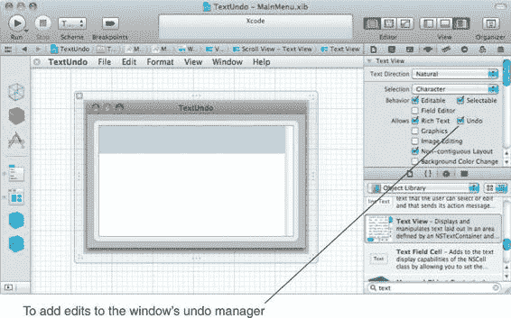

`NSCoder` 是一个 `abstract class`。你永远不会创建抽象类的实例。相反，抽象类具有一些意图让子类继承的功能。你将创建具体子类的实例。具体来说，你将使用 `NSKeyedUnarchiver` 从数据流中读取对象，并使用 `NSKeyedArchiver` 将对象写入数据流。

### 编码（Encoding）

`NSCoder` 有许多方法，但大多数程序员发现自己只是反复使用其中少数几个。当你将数据编码到编码器（coder）时，以下是最常用的几个方法：

```objc
- (void)encodeObject:(id)anObject forKey:(NSString *)aKey
```

此方法将 `anObject` 写入编码器并将其与键 `aKey` 关联。这将导致 `anObject` 的 `encodeWithCoder:` 方法被调用（就像告诉了两个朋友，他们又告诉了两个朋友……）。

对于每种常见的 C 原始类型（例如 `int` 和 `float`），`NSCoder` 都有一个对应的编码方法：

```objc
- (void)encodeBool:(BOOL)boolv forKey:(NSString *)key
- (void)encodeDouble:(double)realv forKey:(NSString *)key
- (void)encodeFloat:(float)realv forKey:(NSString *)key
- (void)encodeInt:(int)intv forKey:(NSString *)key
```

要为你的 `Person` 类添加编码功能，请向 `Person.m` 添加以下方法：

```objc
- (void)encodeWithCoder:(NSCoder *)coder
{
    [coder encodeObject:personName forKey:@"personName"];
    [coder encodeFloat:expectedRaise forKey:@"expectedRaise"];
}
```

如果你查看 `NSString` 的文档，你会发现它实现了 `NSCoding` 协议。因此，`personName` 知道如何编码自己。

所有常用的 AppKit 和 Foundation 类都实现了 `NSCoding` 协议，但 `NSObject` 是个例外。因为 `Person` 继承自 `NSObject`，所以它没有调用 `[super encodeWithCoder:coder]`。如果 `Person` 的父类实现了 `NSCoding` 协议，该方法将看起来像这样：

```objc
- (void)encodeWithCoder:(NSCoder *)coder
{
    [super encodeWithCoder:coder];
    [coder encodeObject:personName forKey:@"personName"];
    [coder encodeFloat:expectedRaise forKey:@"expectedRaise"];
}
```

对父类 `encodeWithCoder:` 方法的调用将让父类有机会将其变量写入编码器中。因此，层次结构中的每个类都只向编码器写入自己的实例变量（而不是其父类的实例变量）。

### 解码（Decoding）

当从编码器中解码数据时，你将使用类似的解码方法：

```objc
- (id)decodeObjectForKey:(NSString *)aKey
- (BOOL)decodeBoolForKey:(NSString *)key
- (double)decodeDoubleForKey:(NSString *)key
- (float)decodeFloatForKey:(NSString *)key
- (int)decodeIntForKey:(NSString *)key
```

如果由于某种原因，流中不包含某个键的数据，你将得到零结果。例如，如果在第一次写入流时对象没有为键 `foo` 写入数据，那么以后被要求解码键 `foo` 的 `float` 时，编码器将返回 0.0。如果被要求解码键 `foo` 的对象，编码器将返回 `nil`。

要为你的 `Person` 类添加解码功能，请向你的 `Person.m` 文件添加以下方法：

```objc
- (id)initWithCoder:(NSCoder *)coder
{
    self = [super init];
    if (self) {
        personName = [coder decodeObjectForKey:@"personName"];
        expectedRaise = [coder decodeFloatForKey:@"expectedRaise"];
    }
    return self;
}
```

再次，你没有调用父类 `initWithCoder:` 的实现，因为 `NSObject` 没有这个方法。如果 `Person` 的父类实现了 `NSCoding` 协议，该方法将看起来像这样：


```objc
- (id)initWithCoder:(NSCoder *)coder
{
    self = [super initWithCoder:coder];
    if (self) {
        personName = [coder decodeObjectForKey:@"personName"];
        expectedRaise = [coder decodeFloatForKey:@"expectedRaise"];
    }
    return self;
}
```

细心的读者现在可能会说：“[第 3 章]说过指定初始化器完成了所有工作并调用了指定初始化器。但 `NSObject` 有 `init`，它是它的指定初始化器。你已经教了 `Person` `NSCoding` 协议。”为了声明你的 `Person` 类，你需要编辑 `Person.h`：

```objc
@interface Person : <NSCoding>
...
@end
```

### 文档架构（Document Architecture）

处理多个文档的应用有很多共同点。Apple 提供了三个类来处理大部分工作：`NSDocumentController`、`NSDocument` 和 `NSWindowController`。这三个类共同构成了文档架构。

其目的与第 8 章讨论的模型-视图-控制器（MVC）设计模式有关。在 Raise 中，你的 `NSDocument` 子类（在 `NSArray` 的帮助）充当控制器。它将有一个指向模型的指针，并负责：

- 将模型数据保存到文件
- 从文件加载模型数据
- 在视图中显示模型数据
- 从视图接收用户输入并更新模型

#### Info.plist 和 NSDController

在构建应用程序时，`Xcode` 会包含一个名为 `Info.plist` 的文件。（在本章稍后的部分，你将更改 `Info.plist`。）当应用启动时，它会从 `Info.plist` 读取内容，这会告诉它要处理的文件类型。

如果它发现自己是一个基于文档的应用，它会创建一个 `NSDocumentController` 实例。你很少需要处理文档控制器；它在后台运行并为你处理这些细节。如果你需要向文档控制器发送消息，可以像这样获取它：

```objc
NSDocumentController *dc;
dc = [NSDocumentController sharedDocumentController];
```

#### NSDocument

文档对象是 `NSDocument` 子类的实例。例如，在你的 Raise 应用中，文档对象是 `RMDocument` 的实例。对于许多应用，你只需要扩展 `NSDocument` 来实现你的需求；你完全不需要担心 `NSDocumentController` 或 `NSWindowController`。

##### 保存（Saving）

菜单项“保存”（Save）、“另存为...” （Save As...）、“全部保存”（Save All）和“关闭”（Close）都是不同的，但它们都处理同一个问题：将模型放入文件或文件封装（file wrapper）中。（文件封装是对用户看来像文件的目录。）

为了处理这些菜单项，你的 `NSDocument` 子类必须实现以下三个方法之一：

```objc
- (NSData *)dataOfType:(NSString *)aType
                 error:(NSError **)e
```

你的文档对象提供了要以 `NSData` 对象格式写入文件的模型。`NSData` 本质上是一个字节缓冲区，是基于文档的应用程序中实现保存功能最简单且最流行的方法。

如果你无法创建数据对象，请返回 `nil`，用户将收到一个提示表单（alert sheet），指示保存尝试失败。注意，你会接收到一个类型，这允许你以几种可能的格式之一来保存文档。

例如，如果你编写了一个图形程序，你可能允许用户将图像保存为 gif 或 jpg 文件。当你创建数据对象时，`aType` 表示用户请求保存文档的格式。如果你只处理一种类型的数据，可以简单地忽略 `aType`。要指示你无法保存数据，请返回 `nil` 并创建一个描述错误原因的 `NSError` 对象。

```objc
- (NSFileWrapper *)fileWrapperOfType:(NSString *)aType
                                 error:(NSError **)e
```

你的文档对象以 `NSFileWrapper` 对象的形式返回模型。它将被写入到用户选择的文件系统位置。要指示你无法创建文件包装器，请返回 `nil` 并创建一个描述错误原因的 `NSError` 对象。

```objc
- (BOOL)writeToURL:(NSURL *)absoluteURL
               ofType:(NSString *)typeName
              error:(NSError **)outError;
```

你的文档对象接收 URL 和类型，并负责将数据存储到 URL 中。（URL 通常只是文件系统上的一个文件。）如果保存成功，返回 `YES`；如果保存失败，则返回 `NO`。

返回 `NO` 表示你无法将数据写入 URL，并创建一个描述错误原因的 `NSError` 对象。

`NSError` 可能会让人感到困惑。其核心是：如果方法由于某种原因无法执行其任务，该方法会创建一个 `NSError` 并将该错误的指针存放在提供的地址中。

例如，要从文件中读取 `NSData`，你会提供一个用于放置错误指针的地址：

```objc
NSError *e;
NSData *d = [NSData dataWithContentsOfFile:@"/tmp/x.txt"
                                   options:0
                                     error:&error];
// 读取是否失败？
if (d == nil) {
    NSLog(@"Read failed: %@", error localizedDescription);
}
```

因此，`NSData` 要么返回数据对象，要么创建一个错误对象。在这些保存和加载方法中，如果方法失败，你将负责创建一个 `NSError`。

## 加载

“打开...”、“最近打开”和“恢复到保存版本”（Revert To Saved）菜单项虽然不同，但处理的都是同一个基本问题：从文件或文件包装器获取模型。

为了处理这些菜单项，你的 `NSDocument` 子类必须实现三个方法之一：

```objc
- (BOOL)readFromData:(NSData *)data
                 ofType:(NSString *)typeName
                  error:(NSError **)outError
```

你的文档将接收一个 `NSData` 对象，其中包含用户尝试打开的文件内容。如果你成功从数据创建了模型，请返回 `YES`。如果你返回 `NO`，用户将收到一个警告面板（Alert panel），该面板应该解释为何失败。

```objc
- (BOOL)readFromFileWrapper:(NSFileWrapper *)fileWrapper
                      ofType:(NSString *)typeName
                       error:(NSError **)outError
```

```objc
- (BOOL)readToURL:(NSURL *)absoluteURL
           ofType:(NSString *)typeName
            error:(NSError **)outError
```

你的文档对象接收 URL 和类型，并负责将数据存储到 URL 中。（URL 通常只是文件系统上的一个文件。）如果保存成功，返回 `YES`；如果保存失败，则返回 `NO`。

返回 `NO` 表示你无法将数据写入 URL，并创建一个描述错误原因的 `NSError` 对象。

`NSError` 可能会让人感到困惑。其核心是：如果方法由于某种原因无法执行其任务，该方法会创建一个 `NSError` 并将该错误的指针存放在提供的地址中。

例如，要从文件中读取 `NSData`，你会提供一个用于放置错误指针的地址：

```objc
NSError *e;
NSData *d = [NSData dataWithContentsOfFile:@"/tmp/x.txt"
                                   options:0
                                     error:&error];
// 读取是否失败？
if (d == nil) {
    NSLog(@"Read failed: %@", error localizedDescription);
}
```

因此，`NSData` 要么返回数据对象，要么创建一个错误对象。在这些保存和加载方法中，如果方法失败，你将负责创建一个 `NSError`。

## 加载

“打开...”、“最近打开”和“恢复到保存版本”菜单项虽然不同，但处理的都是同一个基本问题：从文件或文件包装器获取模型。

为了处理这些菜单项，你的 `NSDocument` 子类必须实现三个方法之一：

```objc
- (BOOL)readFromData:(NSData *)data
                 ofType:(NSString *)typeName
                  error:(NSError **)outError
```

你的文档将接收一个 `NSData` 对象，其中包含用户尝试打开的文件内容。如果你成功从数据创建了模型，请返回 `YES`。如果你返回 `NO`，用户将收到一个警告面板，该面板应该解释为何失败。

```objc
- (BOOL)readFromFileWrapper:(NSFileWrapper *)fileWrapper
                      ofType:(NSString *)typeName
                       error:(NSError **)outError
```

```objc
- (BOOL)readToURL:(NSURL *)absoluteURL
           ofType:(NSString *)typeName
            error:(NSError **)outError
```

你的文档对象接收 URL 和类型，并负责将数据存储到 URL 中。（URL 通常只是文件系统上的一个文件。）如果保存成功，返回 `YES`；如果保存失败，则返回 `NO`。

返回 `NO` 表示你无法将数据写入 URL，并创建一个描述错误原因的 `NSError` 对象。

现在你将为应用程序添加加载文件的功能。再次，`NSDocument` 已经为你处理了大部分的细节。

要进行反归档操作，你将使用 `NSKeyedUnarchiver`，它具有以下方便的方法：

> `+ (id)unarchiveObjectWithData:(NSData *)data`

在 `RMDocument.m` 中，将你的 `readFromData:ofType:error:` 方法修改如下所示：

```objc
- (BOOL)readFromData:(NSData *)data
             ofType:(NSString *)typeName
              error:(NSError **)outError
{
    NSLog(@"About to read data of type %@", typeName);
    NSMutableArray *newArray = nil;
    @try {
        newArray = [NSKeyedUnarchiver unarchiveObjectWithData:data];
    }
    @catch (NSException *e) {
        NSLog(@"exception = %@", e);
        if (outError) {
            NSDictionary *d = [NSDictionary dictionaryWithObject:@"The data is corrupted."
                                                           forKey:NSLocalizedFailureReasonErrorKey];
            *outError = [NSError errorWithDomain:NSOSStatusErrorDomain
                                            code:unimpErr
                                        userInfo:d];
        }
        return NO;
    }
    [self setEmployees:newArray];
    return YES;
}
```

你可以在 XIB 文件加载后更新用户界面，但 `NSArrayController` 会为你处理它：`windowControllerDidLoadNib:` 方法不需要做任何操作。暂时保留在这里，因为你将在[第 13 章]中对其进行添加。

```objc
- (void)windowControllerDidLoadNib:(NSWindowController *)aController
{
    [super windowControllerDidLoadNib:aController];
}
```

注意，当打开或创建文档时，系统会询问文档加载哪个 XIB 文件。此方法也不需要更改：

```objc
- (NSString *)windowNibName
{
    return @"RMDocument";
}
```

当你进行编辑时，窗口会自动标记为已编辑，因为你已经正确启用了撤销机制。当你向文档的撤销管理器注册更改时，它会自动将文档标记为已编辑。

此时，你的应用程序就可以读写文件了。编译你的应用程序并尝试一下。一切都应该正常工作，但你所有的文件都将显示为 `Document Type` 文件并带有通用的文档图标。让我们看看如何更完整地定义应用程序的文档类型。

### 为文件类型设置扩展名和图标

RaiseMan 文件已经有了 `.rsmn` 扩展，这是我们在创建项目时配置的。但 `.rsmn` 文件需要一个图标。找到一个 `.icns` 文件并将其拷贝到项目中。你可以在 `/Developer/Examples/TextEdit/txt.icns` 找到一个很好的图标。将其从 Finder 拖到 Xcode 项目导航器视图中的 Supporting Files 组中。

**图 10.3。** 将图标拖入项目

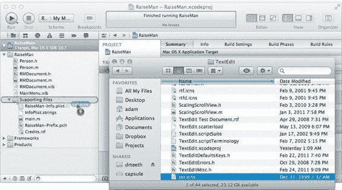

Xcode 会弹出一个工作单。确保你勾选了“Copy items into destination group’s folder”。这将图标文件拷贝到你的项目目录中。

**图 10.4。** 拷贝

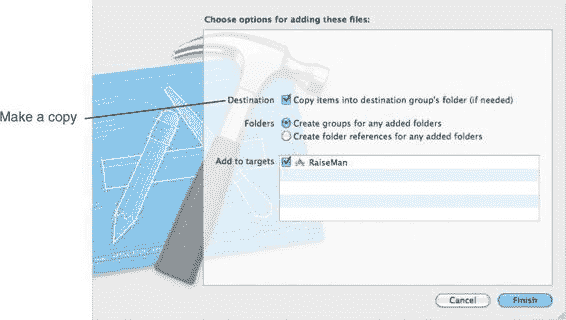

要设置文档类型信息，请在项目导航器中选择 `RaiseMan` target。在 Info 标签页下，找到 Document Types 标题并展开现有的文档类型。将名称设置为 `RaiseMan Doc`，图标设置为 `txt`，标识符设置为 `com.bignerdranch.raisemandoc`。

接下来，为 RaiseMan 文档配置导出的 UTI。UTI 描述了文件中包含的数据类型；我们将在本章稍后的部分详细介绍 UTI。

导出的 UTIs 位于 `target` info 中 Document Types 标题的正下方。如果还没有空白的导出的 UTI，请使用 Add 按钮添加一个。将 Description（描述）、Identifier（标识符）、Icon（图标）和 Extensions（扩展名）设置为与你在 Document Type 中进行的设置相同。对于 Conforms To（符合），输入 `public.data`。

**图 10.5。** 配置类型和导出的 UTI


类不需要重新声明它从超父类继承的任何方法，也不需要重新声明它所实现的协议中的任何方法。因此，在我们的示例中，类 `ZsaZsa` 的接口文件不需要列出 `Spooky`、`Foo` 或 `NSCoding` 中的任何方法。

### 针对更具好奇心的读者：自动文档保存

在 Mac OS X Lion 中，Apple 为 Cocoa 引入了自动文档保存支持。有了自动文档保存，你的用户将不再需要担心手动保存文档。通过监控更改计数（后文将描述），Cocoa 会在适当的时间提示你的文档进行归档。

当用户手动保存文档时，会创建一个新版本。用户可以使用类似于 Time Machine 的界面浏览之前的版本。未命名的文档（用户未显式保存的文档）甚至会在应用程序运行之间被保留。

为了支持自动文档保存，你的 `NSDocument` 子类必须通过重写类方法 `autosavesInPlace` 返回 `YES` 来开启开启：

```objc
+ (BOOL)autosavesInPlace {
    return YES;
}
```

如果你的文档保存数据很快，选择开启可能是一个很容易的选择。否则，在本地自动保存可能不适用于你的应用程序，因为它会导致界面阻塞直到保存完成。请参考 Apple 的 *Mac OS X Application Programming Guide* 以获得更深入的讨论。

Xcode 中的 Cocoa 应用程序模板启用了此功能；`NSDocument` 对该方法的实现返回 `NO`。

### 针对更具好奇心的读者：不支持撤销的文档应用程序


你应用程序的`NSUndoManager`知道何时发生了未保存的编辑。此外，窗口会自动被标记为已编辑。但如果你写了一个应用程序，并且没有向撤销管理器注册你的更改该怎么办？

`NSDocument`会跟踪进行了多少次更改。它有一个为此目的的方法：

```
- (void)updateChangeCount:(NSDocumentChangeType)change;
```

`NSDocumentChangeType`可以是以下之一：`NSChangeDone`、`NSChangeUndone`或`NSChangeCleared`。`NSChangeDone`增加更改计数，`NSChangeUndone`减少更改计数，而`NSChangeCleared`将更改计数置为0。只要更改计数不为0，窗口就会被标记为脏。

## 通用类型标识符

与计算机打交道时的一个长期问题体现在这个问题上：这些数据代表了什么？在Mac上，这个问题在几个地方被提出：当从Finder打开文件时、当从剪贴板拷贝数据时、当Spotlight索引文件时，以及通过Quicklook查看文件时。到目前为止，已经有了几个答案：文件扩展名、创建者代码、MIME类型。

Apple决定该问题的长期解决方案是通用类型标识符（UTIs）。UTI是一个标识数据类型的字符串。这些数据可能在文件中，也可能在内存缓冲区中。UTIs是层次化的。例如，UTI`public.image`符合`public.data`。

你的应用程序通过设置其`Info.plist`中的值来告诉Mac OS X你的应用程序可以读写哪些UTI，包括新的自定义UTI。`Info.plist`是一个包含键值对字典的XML文件。导出的UTI存储在键`UTExportedTypeDeclarations`中。你之前遵循的添加导出UTI的步骤创建了这个键。我们将在第21章中提到的剪贴板使用UTI来识别数据类型。

有一组系统定义的UTI。你可以在Apple的文档中找到完整列表。

## 第11章 基础Core Data

此时，你已经实现了一个可以跟踪对象数组、处理撤销并处理从文件保存和加载的应用程序。正如你可以想象的，有许多像你刚刚编写的这样的应用程序。

Apple决定让这类应用程序的编写变得极其简单：

- `NSArrayController`将持有一个对象数组。
- 绑定（Bindings）将消除为了保持模型对象与视图同步而所需的许多胶水代码。
- `NSManagedObjectContext`将观察你的数据对象的实例变量，并为你处理撤销以及数据的加载和保存。

所以，结论是：使用Core Data和绑定，你编写的RaiseMan应用程序可以完全不需要代码就能创建。在这一节中，你将编写一个没有代码的简单Core Data应用程序（与RaiseMan类似）。

### NSManagedObjectModel

为了知道如何保存和加载对象中的数据，系统需要了解关于这些数据的信息：你的对象属性的名称是什么？它们的类型是什么？为了提供这些信息，你将创建一个托管对象模型（managed object model）。Xcode有一个编辑器，可以方便你在`.xcdatamodeld`文件中描述你的承载数据的对象。在运行时，该文件将被读取，并创建一个`NSManagedObjectModel`实例。

模型使用的术语与我们习惯的稍有不同。模型不使用“类”，而是使用`entity`（实体）。模型不使用“实例变量”，而是使用`property`（属性）。

模型中有两种属性：`attributes`（属性）和`relationships`（关系）。我们将在第32章中讨论关系。

RaiseMan使用了名为`RMDocument`的`NSDocument`子类。在这个应用程序中，你将有一个名为`MyDocument`的`NSPersistentDocument`子类。`NSPersistentDocument`是`NSDocument`的子类，会自动读取模型并创建一个`NSManagedObjectContext`。

启动Xcode并创建一个类型为Cocoa Application的项目。将项目命名为Car，将Class前缀设置为`My`，将Document后缀设置为`carlot`。启用Create Document-Based Application和Use Core Data。想象你拥有几家二手车行。这个应用程序将使你能够跟踪想要出售的汽车。当应用程序完成后，它看起来像图11.1。

**图11.1.** 已完成的应用程序

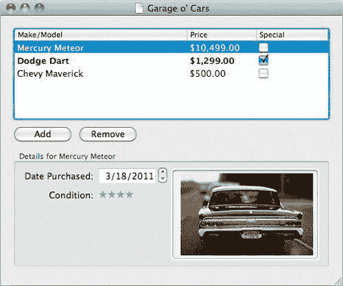

在新项目中，打开`MyDocument.xcdatamodeld`。点击编辑器左下角的Add Entity按钮来创建一个新实体。将实体命名为Car。

在仍选中`Car`实体的情况下，点击Attributes编辑器底部的按钮。添加六个属性并赋予它们以下名称和类型：

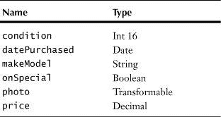

图11.2显示了`Car`在模型器中看起来的样子。我们可以在模型中放入许多其他东西，但对于这个练习来说足够了。

**图11.2.** 已完成的模型

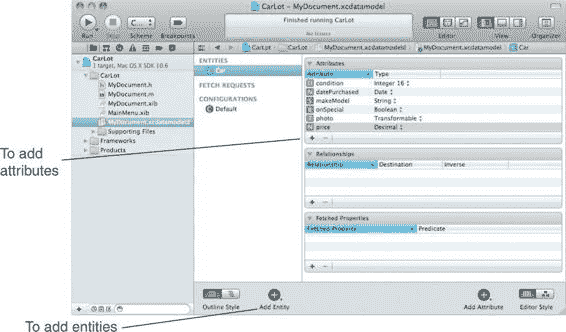

### 接口

打开`MyDocument.xib`。删除写着“Your document contents here”的文本字段。向Interface Builder停靠栏拖入一个数组控制器（array controller）。数组控制器将使用文档对象的`NSManagedObjectContext`来获取和存储数据。使用Bindings检查器将数组控制器的`managedObjectContext`绑定到File’s Owner的`managedObjectContext`（图11.3）。

**图11.3.** 给数组控制器一个Managed Object Context

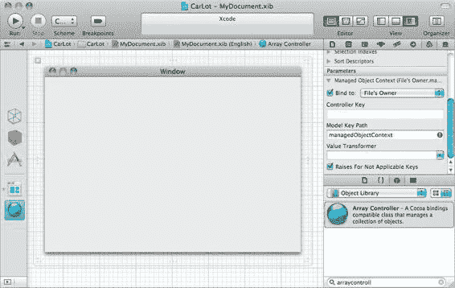

在数组控制器（array controller）仍被选中时，在属性检查器（Attributes Inspector）的Object Controller区域下，将`Mode`设置为`Entity Name`，并将实体名称设置为`Car`。同时，开启`Prepares Content`选项，以便数组控制器在创建后立即获取内容。

Interface Builder编辑器中的每个对象都可以有一个标签。在仍选中`NSArrayController`的情况下，切换到身份检查器（Identity Inspector）并将其`Label`设置为`Cars`。一旦你在XIB中有了多个数组控制器，这些标签将消除很多困惑（图11.4）。

**图11.4.** 检查Cars Array控制器的属性

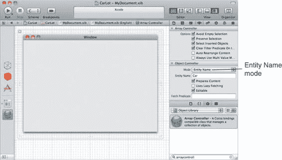

## 基于视图的表格（View-Based Table Views）

在Mac OS X 10.7中，Apple引入了基于视图的表格，它们与iOS的表格类似。在10.7之前，Cocoa开发者使用的是基于单元格（cell-based）的表格，它们非常快速且轻量级，但定制往往非常复杂。相比之下，基于视图的表格使得自定义表格单元格的外观变得非常简单：你可以利用Xcode的Interface Builder来实现此目的。

拖出一个表格视图（从Cocoa->Data Views）。在属性检查器中，将`Content Mode`设置为`View Based`，并给它分配三列。将这些列命名为`Make/Model`、`Price`和`Special`。

使用对象层次结构视图（展开的dock视图）选择第一列中的`Table Cell View`并将其删除——它是`Table Column`的子级。现在，从库中拖入一个`Image & Text Table Cell View`到第一列中。现在每列都应该包含一个表格单元格视图（`NSTableCellView`），并在其中包含静态文本（`NSTextField`）。第一列的单元格视图还包含一个图像视图（图11.5）。

**图11.5.** 拖入Image & Text Table Cell View

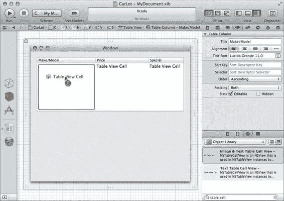

现在将一个数字格式化器（从Cocoa->Controls）拖动到Price列中的`NSTextField`上（图11.6）。在属性检查器中，使用10.4+格式化器，并将样式设置为`Currency`。

**图11.6.** 配置格式化器

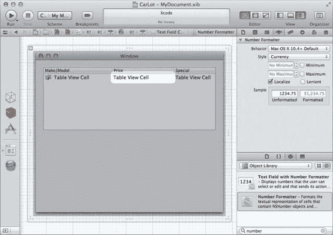

第三列将由复选框填充，因此选择第三列单元格视图中的`NSTextField`并将其删除。请确保你选中并删除的是`Static Text - Table View Cell`，而不是`Table Cell View`本身。这需要直接在单元格上点击两次。

现在，在第三列的文本框位置拖入一个`Check Box`（从Cocoa->Data Views），而不是`Check Box Cell`。选中复选框并清除它的标题（图11.7）。

**图11.7.** 拖入Check Box

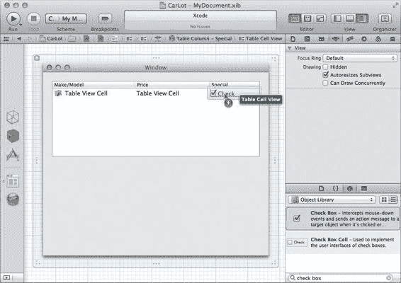

在表格视图下方，向窗口拖入一个`NSDatePicker`、两个按钮、一个`NSImageView`（在库中称为Image Well）以及一个`NSLevelIndicator`。将按钮标记为`Add`和`Remove`。在日期选择器和级别指示器旁边放置标签字段。标签应该是`Date Purchased`和`Condition`。使用属性检查器使`NSImageView`变为可编辑状态（图11.8）。

**图11.8.** NSLevelIndicator的属性

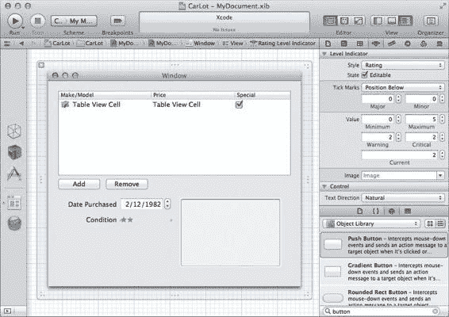

在`NSLevelIndicator`的属性检查器中，将其`max`设置为5，`min`设置为0。将其样式设置为`Rating`（以获得星级）。同时，让级别指示器变为可编辑（图11.8）。

选择日期选择器、图像视图、两个标签和级别指示器。使用`Editor -> Embed -> Box`项将它们封装在一个框中（图11.9）。

**图11.9.** 嵌入框中

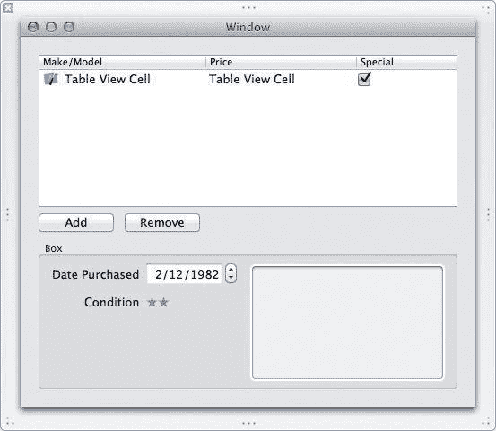

## 连接与绑定（Connections and Bindings）

现在你将进行大量的绑定。我们将引导你逐步完成（图11.10是你将在视图和数组控制器之间创建的绑定的图解）。

**图11.10.** 绑定总结

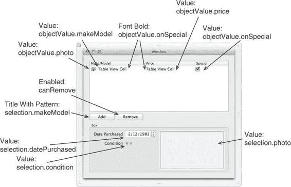

如果你过去用过基于单元格的表格，你会发现基于视图的表格绑定要直观得多。对于基于视图的表格，你将把表格的内容绑定到数组控制器；然后你放置在单元格视图（而非表格列）中的控件的值，将绑定到该行对应的对象值上。提醒一下：在本书中，你永远不会绑定滚动视图或单元格。

从将表格视图的`Content`绑定到Cars的`arrangedObjects`开始。将Model Key Path留空。记住，Cars是`NSArrayController`。接下来，将`Selection-Indexes`绑定到Cars的`selectionIndexes`（图11.11）。

**图11.11.** 表格视图绑定

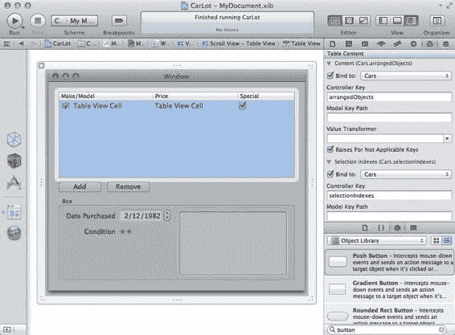

现在，对每列单元格视图控件的`value`进行绑定，如下表。

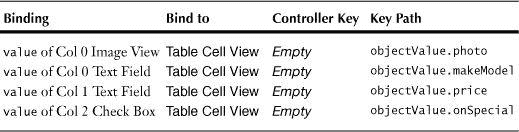

注意绑定中的模式。每个控件的值都绑定到单元格视图`objectValue`的特定属性。回想表格的内容绑定到`NSArrayController`的排列对象。这些对象中的每一个都是我们`Car`实体的一个实例。当表格视图的内容被绑定时，表格单元格视图（`NSTableCellView`）的`objectValue`属性将填充为该行的实体实例。一旦我们理解了这一点，就可以配置非常直观的绑定，例如表格中的这些绑定。

在继续之前，使用属性检查器将每个静态文本框的Behavior（行为）设置为`Editable`。

使`Add`按钮触发数组控制器的`add:`方法（图11.12）。

**图11.12.** 设置Add按钮的Target和Action

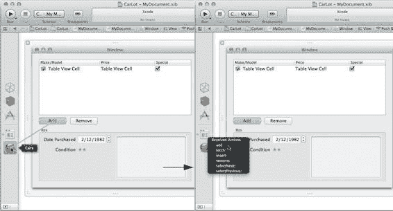

使`Remove`按钮触发数组控制器的`remove:`方法。

如下所示将控件绑定到数组控制器的selection：

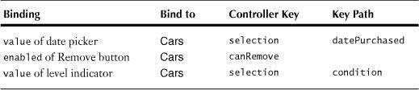

将`value`绑定到图像视图。选择控制器键`selection`和键路径`photo`。同时，勾选“Conditionally Editable”框（图11.13）。

**图11.13.** 图像视图绑定

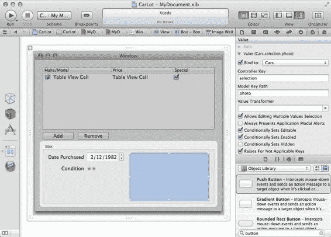

选择框。在绑定检查器中，在Title With Pattern下，将`Display Pattern1`绑定到Cars（我们对数组控制器的自定义名称）。设置控制器键`selection`和键路径`makeModel`。设置Display Pattern为`%{title1}@`。将No Selection Placeholder设置为`<no selection>`。将Null Placeholder设置为`<no Make/Model>`（图11.14）。

**图11.14.** 框绑定

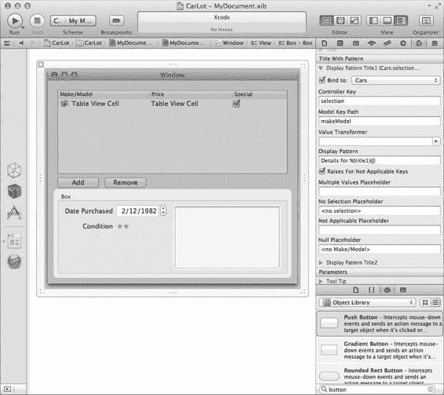

让我们在汽车处于特殊状态时在前两列的文本加粗显示。将前两列中静态文本（`NSTextField`）的Font Bold绑定到Table Cell View。设置Model Key Path为`objectValue.onSpecial`（图11.15）。

**图11.15.** 特殊项加粗

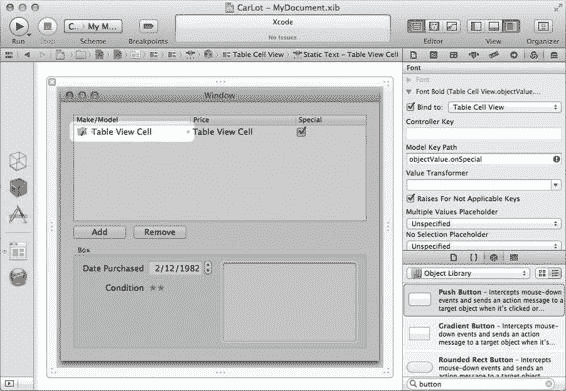

#### Core Data的工作原理

尽管你没有编写任何代码，但将创建许多对象来完成这些工作。图11.16是其中一些对象的图解。

你完成了。编译并运行应用程序。保存和加载应该可以工作。撤销也应该可以工作。神奇，不是吗？

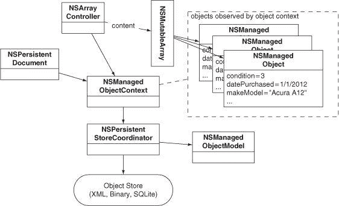

因此，`NSPersistentDocument`读取你创建的模型，并使用它创建一个`NSManagedObjectModel`实例。在我们的案例中，该托管对象模型包含一个`NSEntityDescription`（描述我们的`Car`实体）。该实体描述有多个`NSAttributeDescription`实例。

一旦获取了模型，持久化文档就会创建一个`NSPersistentStoreCoordinator`实例和一个`NSManagedObjectContext`实例。`NSManagedObjectContext`从对象存储器中获取`NSManagedObject`实例。当这些托管对象存在内存中时，托管对象上下文会对其它们进行观察。每当托管对象内部的数据发生变化时，托管对象上下文就会向文档的`NSUndoManager`注册该次`undo`（撤销）操作。托管对象上下文还知道哪些对象被更改并需要保存。

因此，在Core Data框架的类中，你会发现自己与`NSManagedObjectContext`的交互最为频繁。要获取对象，你将使用`NSManagedObjectContext`。要保存对象图的更改，你将使用`NSManagedObjectContext`。

考虑到我们可能会在购买汽车时将它们添加到系统中，如果`datePurchased`属性被设置为当前日期就太棒了。实现此点的一种良好方法是为`NSArrayController`子类并重写它的`newObject`方法。

创建一个Objective-C类的新文件。它将是`NSArrayController`的子类。将其命名为`CarArrayController`。在`CarArrayController.m`中，移除生成的模板`init`和`dealloc`方法，并重写`newObject`：

```objectivec
- (id)newObject
{
    id newObj = [super newObject];
    NSDate *now = [NSDate date];
    [newObj setValue:now forKey:@"datePurchased"];
    return newObj;
}
```

在Interface Builder编辑器中打开`MyDocument.xib`并选择数组控制器。在Identity Inspector（身份检查器）中，将类设置为`CarArrayController`。（确保你处于Identity Inspector中，而不是Attributes Inspector（属性检查器）；此数组控制器仍然持有一个`Car`实体的实例数组。）参见图11.17。

**图11.17.** 更改数组控制器的类

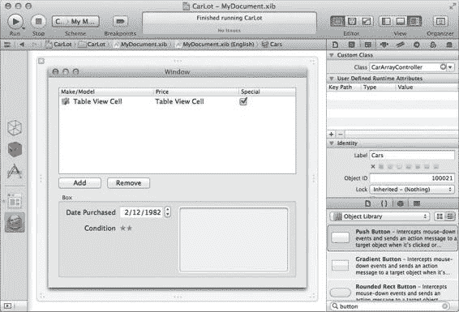

编译并运行应用程序。当添加新汽车时，它们的`datePurchased`属性应该初始化为当前日期。

### 给更有好奇的人：基于视图与基于单元的表格视图

你现在已经同时使用了基于视图和基于单元的表格视图：本章使用了基于视图，SpeakLine练习中使用了基于单元。你可能在好奇为什么有两种类型，以及你应该选择哪一种。

基于单元的表格视图自从Cocoa在NeXT起初就存在了。这类表格视图出于性能考虑使用单元，对于显示简单数据效果非常好。但自定义可能具有挑战性，而且在单元中加入动画或交互式控件（如按钮）极具挑战性。如果你的目标是Mac OS X 10.6或更早版本，基于单元的表格视图是你的唯一选择。


基于视图的表格视图是在 Mac OS X 10.7 中引入的，提供了简单、方便的自定义，允许使用 Interface Builder 编辑器布局单元内容。动画和交互式控件可以被轻松使用，因为表格单元实际上是视图。

基于单元的表格视图上的绑定（Bindings）并不那么明显，但更简单：仅绑定表格列。基于视图的表格视图上的绑定完全不同，但更符合逻辑：绑定表格视图的内容，然后将单元视图中的单个控件直接绑定到所需的属性上。这种方法的优点是允许创建相对简单的复合单元（包含多个控件的单元）。

### 挑战

在学习了 RaiseMan 中`createNewEmployee:`的代码后，让`CarArrayController`在创建新记录时选择表格视图的“制造地/型号”（Make/Model）列。提示：你需要为`CarArrayController`添加一个出口（outlet）。

## 第 12 章.NIB 文件与 NSWindowController

在 RaiseMan 中，你已经在使用两个 NIB 文件：`MainMenu.nib`和`RMDocument.nib`。（记住编译器在构建过程中会将我们的 XIB 文件转换为 NIB 文件。）`MainMenu.nib`由`NSApplication`在应用程序首次启动时自动加载。`RMDocument.nib`在每次创建`RMDocument`实例时自动加载。在本章中，你将学习如何使用`NSWindowController`加载 NIB 文件。

你为什么要加载 NIB 文件呢？最常见的是，你的应用程序会有几个窗口（例如查找面板和偏好面板），它们只偶尔被使用。通过延迟加载 NIB 直到需要窗口时，你的应用程序启动速度会更快。此外，如果用户永远不需要该窗口，你的程序将消耗更内存。

### NSPanel

在本章中，你将创建一个偏好面板。该面板将是`NSPanel`的实例，它是`NSWindow`的子类。面板与普通窗口并没有太大区别，但因为面板旨在作为辅助，它的行为略有不同。

- 面板可以成为关键窗口（key window）而不成为主窗口（main window）。
- `NSApplication`有一个`mainWindow`输出和一个`keyWindow`输出。除非涉及面板，否则这两个输出点都指向同一个窗口。
- 如果它有`close`按钮，你可以按 Escape 键关闭面板。面板不会出现在窗口列表中。

所有窗口都有一个名为`hidesOnactivate`（非活动时隐藏）的布尔值。如果设置为`YES`，则窗口在应用程序未激活时会自动隐藏。大多数文档窗口此变量设置为`NO`；大多数辅助面板设置为`YES`。这种机制减少了屏幕杂乱。可以通过 Interface Inspector 设置`hidesOnactivate`。

### 将面板添加到应用程序

你现在要添加的偏好面板目前除了显示之外什么都不做。但在第 13 章中，你将学习用户默认（user defaults）并让偏好面板发挥作用。

偏好面板将位于自己的 NIB 文件中。你将创建一个名为`PreferenceController`的`NSWindowController`的子类。`PreferenceController`的实例将作为偏好面板的控制器。在创建辅助面板时，记住你可能想在下一个应用程序中重用它。创建一个仅作为控制器的类和一个仅包含面板的 NIB，有助于在另一个应用程序中重用该面板。时髦的程序员会说：“通过让应用程序更加模块化，我们可以最大化重用。”模块化也更容易在多个程序员之间分配任务。一个经理可以说：“Rex，你负责偏好面板。只有你可以编辑 NIB 文件和偏好控制器类。”

偏好面板上的对象将连接到偏好控制器。特别是，偏好控制器将成为颜色选择器复选框的`target`（目标）。当用户点击“偏好...”菜单项时，偏好面板将会出现。运行时，它看起来像图 12.1。

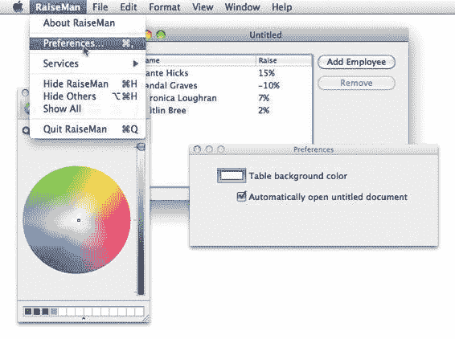

图 12.2 展示了你将创建的对象以及它们所属的 NIB 文件的结构图。

**图 12.2.** 对象/NIB 结构

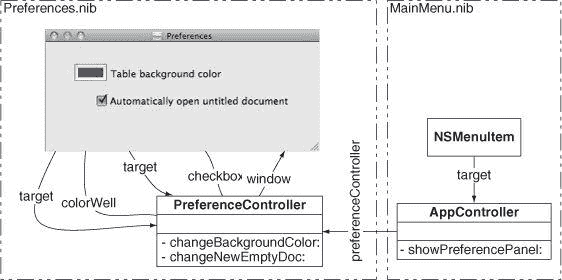

我们将从创建`PreferenceController`开始；这将允许我们稍后利用 Xcode 的代码完成功能。打开`RaiseMan`项目，从 File 菜单选择`New -> New File...`，并创建一个`NSWindowController`子类的新的 Objective-C 类文件。将该子类命名为`PreferenceController`。编辑`PreferenceController.h`如下所示：

```objc
#import <Cocoa/Cocoa.h>

@interface PreferenceController : NSWindowController {
    IBOutlet NSColorWell *colorWell;
    IBOutlet NSButton *checkbox;
}
- (IBAction)changeBackgroundColor:(id)sender;
- (IBAction)changeNewEmptyDoc:(id)sender;
@end
```

接下来，创建一个名为`AppController`的`NSObject`新子类。编辑`AppController.h`如下所示：

```objc
#import <Foundation/Foundation.h>

@class PreferenceController;

@interface AppController : NSObject {
    PreferenceController *preferenceController;
}
- (IBAction)showPreferencePanel:(id)sender;

@end
```

注意 Objective-C 的语法：

`@class PreferenceController;`

这告诉编译器存在一个名为`PreferenceController`的类。然后你可以在不导入`PreferenceController`头文件的情况下进行以下声明：

```objc
PreferenceController *preferenceController;
```

你可以将`@class PreferenceController;`替换为`#import "PreferenceController.h"`。该语句将导入头文件，编译器将得知`PreferenceController`是一个类。由于`import`命令需要编译器解析更多文件，使用`@class`通常会导致更快的编译速度。

请注意，你必须始终导入父类的头文件，因为编译器需要知道父类中声明了哪些实例变量。在这种情况下，`NSObject.h`是由`Foundation/Foundation.h`导入的。

### 设置菜单项

打开`MainMenu.xib`。从 Library（Objects & Controllers 下方）拖入一个`NSObject`到停坞中。在`Identity Inspector`中，将其类设置为`AppController`（[图 12.3]）。

**图 12.3.** 创建 AppController 实例

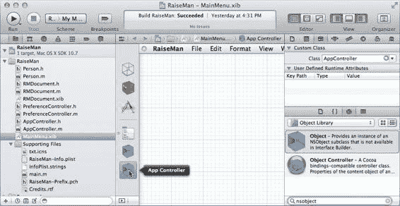

在 Interface Builder 编辑器中，点击应用程序菜单项`RaiseMan`。从`Preferences...`菜单项控制并拖拽到`AppController`。将其设置为`target`，并将`action`设置为`showPreferencePanel:`（[图 12.4]）。

**图 12.4.** 设置菜单项的 Target

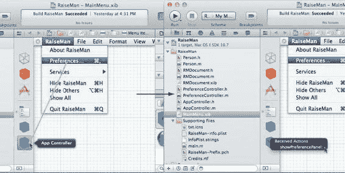

### AppController.m

现在你需要编写`AppController`的代码。使`AppController.m`的内容如下所示：

```objc
#import "AppController.h"
#import "PreferenceController.h"

@implementation AppController

- (IBAction)showPreferencePanel:(id)sender
{
    // preferenceController 是否为 nil?
    if (!preferenceController) {
        preferenceController = [[PreferenceController alloc] init];
    }
    NSLog(@"showing %@", preferenceController);
    [preferenceController showWindow:self];
}

@end
```

注意，这段代码只会创建一次`PreferenceController`实例。如果`preferenceController`变量非空，它将向现有实例发送`showWindow:`消息。

同样注意，我们在使用它的`.m`文件导入了`PreferenceController.h`。

### Preferences.xib

在 Xcode 中，创建一个名为`Preferences.xib`的空 XIB 文件（[图 12.5]）。

**图 12.5.** 创建一个空 XIB 文件


点击`Preferences.xib`在编辑器中打开它。调出 Identity Inspector，选择 File’s Owner，将其类设置为`PreferenceController`（[图 12.6]）。

**图 12.6.** 设置 File’s Owner


### File’s Owner

在`Preferences.xib`中，File’s Owner 代表`PreferenceController`实例。通过将类设置为`PreferenceController`，你允许 XIB 连接在该类中定义的 outlet（输出口）和 action（动作）。

从 Library 拖入一个`NSObject`到停坞中。在`Identity Inspector`中，将其类设置为`AppController`（[图 12.3]）这是处理偏好窗口高层逻辑的控制器。

#### 布局界面

在`Preferences.xib`中，你需要添加 UI 元素。在视图中拖入一个`NSColorWell`用于颜色选择，拖入一个`NSButton`作为复选框。将这些元素连接到`PreferenceController.h`中定义的 File’s Owner 的`colorWell`和`checkbox` outlet。

注意你在`init`方法中设置了要加载的 NIB 文件的名称。该 NIB 文件会在需要时自动加载。`PreferenceController`的实例将替换 NIB 文件中的文件所有者（File’s Owner）。

在 NIB 文件加载后，`PreferenceController`将收到`windowDidLoad`消息。它为控制器对象提供了一个机会（类似于`awakeFromNib`或`windowControllerDidLoadNib:`），用于初始化从 NIB 文件中读取的用户界面对象。

当第一次发送`showWindow:`时，`NSWindowController`会自动加载 NIB 文件并将窗口移动到屏幕上并置于顶。NIB 文件只加载一次。当用户关闭偏好面板时，它会被移出屏幕但不会被释放。当用户下一次请求偏好面板时，它会被简单地移回屏幕上。

`changeBackgroundColor:`和`checkboxChanged:`方法现在相当无聊——它们只是打印出一条消息。在下一章中，你将更改它们以更新用户的默认设置数据库。

编译并运行应用程序。新面板应该出现，更改复选框或颜色选择器应该会在控制台中输出一条消息（图 12.13）。

**图 12.13.** 完成的应用程序


用户第一次遇到颜色选择器时，可能会感到困惑。如果你点击颜色选择器的边缘，边缘会变亮，颜色面板会弹出，且选择器将进入`active`模式。

### 深入好奇者：NSBundle

一个*包*（bundle）是应用程序可能使用的资源目录。资源包括图像、声音、编译后的代码和 NIB 文件。（用户通常使用“插件”一词而不是“包”）。`NSBundle`类是处理“包”的一种非常优雅的方式。

你的应用程序就是一个包。在 Finder 中，应用程序对用户来说就像其他任何文件，但它实际上是一个填充了 NIB 文件、编译后的代码和其他资源的目录。我们称该目录为应用程序的*主包*（main bundle）。

包中的某些资源是可以进行本地化的。例如，你可以有两个版本的`foo.nib`，一个给英语用户使用，一个给法语用户使用。该包将有两个子目录：`English.lproj`和`French.lproj`。你会在每个目录下放入对应版本的`foo.nib`。当你的应用程序请求包加载`foo.nib`时，如果用户将首选语言设置为法语，包将自动加载`foo.nib`的法语版本。我们将在第 16 章介绍本地化。

要获取应用程序的主包，使用以下代码：

```objc
NSBundle *myBundle = [NSBundle mainBundle];
```

这是最常用的包。但如果你需要访问另一个目录中的资源，可以请求特定路径下的包：

```objc
NSBundle *goodBundle;
goodBundle = [NSBundle bundleWithPath:@"~/Library/Application Support/MyApp/Good.bundle"];
```

一旦你有了一个`NSBundle`对象，就可以向它请求资源：

```objc
// 扩展名是可选的
NSString *path = [goodBundle pathForImageResource:@"Mom"];
NSImage *momPhoto = [[NSImage alloc] initWithContentsOfFile:path];
```

包可能包含一个代码库。通过从包中请求类，包将链接该库并按该名称搜索类：

```objc
Class newClass = [goodBundle classNamed:@"Rover"];
id newInstance = [[newClass alloc] init];
```

如果你不知道包中任何类的名称，可以简单请求主类（principal class）：

```objc
Class aClass = [goodBundle principalClass];
id anInstance = [[aClass alloc] init];
```

如你所见，`NSBundle`在许多方面都非常方便。在本节中，`NSBundle`负责（在后台）加载 NIB 文件。如果你想在没有`NSWindowController`的情况下加载 NIB 文件，可以这样做：

```objc
BOOL successful = [NSBundle loadNibNamed:@"About" owner:someObject];
```

注意，你需要提供将作为文件所有者的对象。

### 挑战

创建一个带有自定义关于（About）面板的 XIB 文件。为`AppController`添加一个出口（outlet）以指向新窗口。还要添加一个`showAboutPanel:`方法。使用`NSBundle`加载 NIB，并使`AppController`文件所有者。

## 第 13 章. 用户默认

许多应用程序都有偏好面板，允许用户选择首选的外观或行为。用户的选择会被保存在用户主目录下的用户默认数据库中。注意，只有与出厂设置不同的选项才会保存在用户默认数据库中。如果你进入`~/Library/Preferences`，就可以看到你的用户默认数据库。

`NSUserDefaults`类允许你注册默认值、保存偏好并读取它们。`changeBackgroundColor:`和`checkboxChanged:`方法现在相当无聊——它们只是打印出一条消息。在下一章中，你将更改它们以更新用户的默认设置数据库。

### NSDictionary 和 NSMutableDictionary

在对默认设置进行操作之前，我们需要讨论`NSDictionary`和`NSMutableDictionary`类。字典是键值对的集合。键是字符串，值是对象。

> 向字典添加一个条目，包含`aKey`其对应的值对象`anObject`。值对象在被添加到字典之前会收到一个`retain`消息。如果接收者已存在该`aKey`，则接收者该键之前的值对象将收到一个`release`消息，并由`anObject`取代其位置。

## NSUserDefaults

每个应用程序都带有一组“出厂”默认设置。当用户编辑其默认设置时，只有用户意愿与出厂默认之间的差异会被存储在用户的默认数据库中。因此，每次应用程序启动时，你都需要提醒它出厂默认设置。此操作被称为`registering defaults`（注册默认）。

注册之后，你将使用用户默认对象来确定用户希望应用程序如何运行。这个过程被称为`reading and using the defaults`（读取和使用默认）。用户默认数据库的数据将自动从文件系统读取。

在你的偏好设置面板中，你将允许用户设置默认值。对默认对象的更改将自动写入文件系统。此过程被称为`setting the defaults`（设置默认）（图 13.3）。

**图 13.3.** NSUserDefaults 与文件系统


以下是`NSUserDefaults`中实现的一些常用方法：

> `+ (NSUserDefaults *)standardUserDefaults`
>
> 返回共享默认对象。
>
> `- (void)registerDefaults:(NSDictionary *)dictionary`
>
> 为应用程序注册出厂默认设置。
>
> `- (void)setBool:(BOOL)value forKey:(NSString *)defaultName`
>
> `- (void)setFloat:(float)value forKey:(NSString *)defaultName`
>
> `- (void)setInteger:(NSInteger)value forKey:(NSString *)defaultName`
>
> `- (void)setObject:(id)value forKey:(NSString *)defaultName`
>
> 用于更改和保存用户意愿的方法。
>
> `- (BOOL)boolForKey:(NSString *)defaultName`
>
> `- (float)floatForKey:(NSString *)defaultName`
>
> `- (NSInteger)integerForKey:(NSString *)defaultName`
>
> `- (id)objectForKey:(NSString *)defaultName`
>
> 读取默认设置的方法。如果用户没有更改它们，则返回出厂默认设置。
>
> `- (void)removeObjectForKey:(NSString *)defaultName`
>
> 移除用户的偏好设置，因此应用程序将恢复使用出厂默认设置。

### 默认类型的优先级

到目前为止，我们讨论了两个级别的优先级：用户写入其默认数据库的内容会覆盖出厂默认设置。事实上，存在更多级别的优先级。这些默认设置级别被称为`domains`（域）。以下是应用程序使用的域，优先级从高到低排序：

- `Arguments`：通过命令行传递。大多数人通过双击图标启动程序，而不是通过命令行操作，因此此功能在生产应用中很少使用。
- `Application`：来自用户默认数据库的内容。
- `Global`：用户为整个系统设置的内容。
- `Language`：根据用户的偏好语言设置的内容。
- `Registered defaults`：应用程序的出厂默认设置。

### 设置默认值

#### 应用程序的标识符

在`~/Library/Preferences`中为此应用程序创建的`plist`文件是什么？默认情况下，它使用创建它的应用程序的标识符。你将在第 10 章中将此标识符设置为`com.bigneranch.RaiseMan.plist`。

#### 为名称创建键

你将在应用程序的多个类中注册、读取和设置默认值。为了确保始终使用相同的名称，你应该在一个文件中声明这些字符串，然后在使用名称的地方导入该文件。有几种方法可以实现（例如使用 C 预处理器的`#define`），但大多数情况下使用全局变量。在导入之后，向`PreferenceController.h`添加以下行：

```objc
extern NSString *const BBgColorKey;
extern NSString *const EmptyDocKey;
```

现在在`PreferenceController.m`中定义这些变量。将它们放在导入行之后、`@implementation`之前：

```objc
NSString *const BBgColorKey = @"TableBackgroundColor";
NSString *const EmptyDocKey = @"TableDocumentFlag";
```

为什么我们要声明只包含常量字符串的全局变量呢？毕竟，你只需要记住字符串并在需要时输入它即可。问题在于你可能会拼错字符串。如果字符串被引号包围，编译器会接受它。相比之下，如果你拼错了变量，编译器会捕获你的错误。为了防止变量与其他变量冲突，给它们加上前缀`BNR`（代表 Nerd Ranch）。Cocoa 变量的前缀是`NS`。这些前缀在使用第三方开发的框架时很重要（注意类名也是全局的）。

### 注册默认值

每个类在任何其他操作之前都会收到`initialize`消息。为了确保你的默认值尽早注册，请在`AuthController.m`中重写`initialize`：

```objc
+ (void)initialize {
    // 创建字典
    NSMutableDictionary *defaultValues = [NSMutableDictionary dictionary];

    // 归档颜色对象
    NSData *colorAsData = [NSKeyedArchiverDataDataRootObject:[NSColor yellowColor]];

    // 将默认值放入字典
    [defaultValues setObject:colorAsData forKey:BBgColorKey]; own[defaultValues setObject:[NSNumber numberWithBool:YES] forKey:EmptyDocKey];

    // 注册默认值字典
    [[NSUserDefaults standardUserDefaults] registerDefaults:defaultValues]; own    NSLog(@"registered defaults: %@", defaultValues);
}
```

这是一个类方法；这就是为什么它的声明带有`+`前缀。注意，我们必须将颜色存储为数据对象。`NSColor`对象并不知道如何将自己写入 XML，因此我们将其封装进可以执行此操作的数据对象中。有一组类知道如何将自己写入 XML，称为属性列表（property list）类：`NSString`、`NSArray`、`NSDictionary`、`NSDate`、`NSData`和`NSNumber`。属性列表由这些类的任意组合组成。例如，包含日期数组的字典就是一个属性列表。

### 让用户编辑默认值

接下来，你将修改`PreferenceController`类以便面板能够更新默认数据库。在`PreferenceController.h`中声明以下方法：

```objc
+ (NSColor *)preferenceTableBgColor;
+ (void)setPreferenceTableBgColor:(NSColor *)color;
+ (BOOL)preferenceEmptyDoc;
+ (void)setPreferenceEmptyDoc:(BOOL)emptyDoc;
```

这些类方法将使我们更容易设置和获取当前默认值，并抽象掉存储偏好的细节。

在`PreferenceController.m`中实现新的类方法：

```objc
+ (NSColor *)preferenceTableBgColor {
    NSUserDefaults *defaults = [NSUserDefaults standardUserDefaults];
    NSData *colorAsData = [defaults objectForKey:BBgColorKey];
    return [NSKeyedUnarchiver unarchiveObjectWithData:colorAsData];
}

+ (void)setPreferenceTableBgColor:(NSColor *)color {
    NSData *colorAsData = [NSKeyedArchiver archivedDataWithRootObject:color];
}
```

```objc
[[NSUserDefaults standardUserDefaults] setObject:colorAsData forKey:BNRTableBgColorKey];
}

+ (BOOL)preferenceEmptyDoc
{
    NSUserDefaults *defaults = [NSUserDefaults standardUserDefaults];
    return [defaults boolForKey:BNREmptyDocKey];
}

+ (void)setPreferenceEmptyDoc:(BOOL)emptyDoc
{
    [[NSUserDefaults standardUserDefaults] setBool:emptyDoc forKey:BNREmptyDocKey];
}
```

现在让我们修改`windowDidLoad`和动作方法来使用这些偏好：

```objc
- (void)windowDidLoad
{
    [super windowDidLoad];
    [colorWell setColor:[PreferenceController preferenceTableBgColor]];
    [checkbox setState:[PreferenceController preferenceEmptyDoc]];
}

- (IBAction)changeBackgroundColor:(id)sender
{
    NSColor *color = [colorWell color];
    [PreferenceController setPreferenceTableBgColor:color];
}

- (IBAction)changeNewEmptyDoc:(id)sender
{
    NSInteger state = [checkbox state];
    [PreferenceController setPreferenceEmptyDoc:state];
}
```

在`windowDidLoad`方法中，你正在读取默认值并让颜色选择器和复选框反映当前的设置。在`changeBackgroundColor:`和`changeNewEmptyDoc:`中，你正在更新默认数据库。

你现在应该可以编译并运行应用程序了。它将读取和写入默认数据库，因此设置面板将显示你上次选择的颜色，并指示复选框的开启状态。然而，你还没有对这些信息进行任何操作，因此无标题文档将继续出现，表格视图的背景将继续保持白色。

### 使用默认值

现在你将使用默认值。首先，你将让`AppController`成为`NSApplication`对象的代理，并根据用户默认抑制创建无标题文档。然后，在`RMDocument`中，你将从用户默认设置表格视图的背景颜色。

#### 抑制无标题文档的创建

与之前一样，创建代理有两个步骤：实现代理方法并将`delegate` outlet 指向该对象（图 13.4）。

**图 13.4。** 代理抑制了无标题文档的创建


在自动创建新的无标题文档之前，`NSApplication`对象将向其代理发送`applicationShouldOpenUntitledFile:`消息。在`AppController.m`中，添加以下方法：

```objc
- (BOOL)applicationShouldOpenUntitledFile:(NSApplication *)sender
{
    NSLog(@"applicationShouldOpenUntitledFile:");
    return [PreferenceController preferenceEmptyDoc];
}
```

要让你的`AppController`成为`NSApplication`对象的代理，打开`MainMenu.xib`文件，并 Control-点击 File Owner（代表`NSApplication`对象）以弹出连接窗口。从`delegate`拖动到你的`AppController`。

#### 设置表格视图的背景颜色

打开`RMDocument.m`并在顶部导入`PreferenceController.h`。这将允许我们使用`BNRTableBgColorKey`常量。

```objc
#import "PreferenceController.h"
```

在新文档窗口的 NIB 文件被成功反归化后，你的`RMDocument`对象将接收`windowControllerDidLoadNib:`消息。那时，你可以更新表格视图的背景颜色。

你已经在`RMDocument.m`中有了这个方法；只需将其修改为如下所示：

```objc
- (void)windowControllerDidLoadNib:(NSWindowController *)aController
{
    [super windowControllerDidLoadNib:aController];
    [tableView setBackgroundColor:[PreferenceController preferenceTableBgColor]];
}
```

编译并运行你的应用程序。

注意，Mac OS X Lion 的状态恢复功能可能会让观察新文档偏好变得困难。你可以通过编辑 Xcode 中的`Run` scheme 来禁用状态恢复。打开 Product 菜单并选择 Edit Scheme。选择`Run RaiseMan.app` scheme，切换到 Options 面板，并勾选 Disable state restoration（图 13.5）。

**图 13.5。** 禁用状态恢复


### 给更具好奇心的读者：NSUserDefaultsController

有时，你想绑定来自`NSUserDefaults`对象的值。`NSUserDefaultsController`使这一切成为。例如，如果你想将复选框绑定到`NSUserDefaultsController`（图 13.6）。

**图 13.6。** 绑定到`NSUserDefaultsController`


### 给更具好奇心的读者：读取和写入默认值

用户默认值位于`~/Library/Preferences/`。要从命令行编辑它，你需要使用一个名为`defaults`的工具。要查看 Xcode 的默认设置，你可以打开终端并输入此。前几行如下：

```text
{
    DocViewerHasSetPrefs = YES;
    NavBrowserPreferedColumnWidth = 155;
    NavLastCurrentDirectory = "~/RaiseMan";
    NavLastRootDirectory = "~";
    NavPanelExpandedSize = "{518, 400}";
    NavPanelFileListMode = 1;
}
```

你还可以写入默认值。要将`NSOpenPanel`中的 Xcode 默认目录设置为`/Users`目录，你可以输入`defaults write com.apple.Xcode NavLastRootDirectory /Users`。尝试`defaults read bigneranch.RaiseMan`。要查看全局默认值，输入`defaults read NSDomain`。

### 挑战

在设置面板添加一个按钮来移除所有用户设置。将按钮命名为 Reset Preferences。忘记更新设置窗口以反映新的默认值。

## 第 14 章：使用通知

当用户打开了多个 RaiseMan 文档时，他可能决定紫色背景太难以阅读。用户打开设置面板并更改背景颜色，但遗憾地发现现有窗口的颜色并没有变化。当用户就这个问题向你发送电子邮件时，你回复说：“默认值只在文档窗口创建时读取。只需保存文档、关闭并重新打开即可。”作为回应，用户给你发了一封刻薄的邮件。更好的做法是更新所有现有窗口。但有多少个呢？

### 什么是通知，什么不是

每个运行的应用程序都对某些通知感兴趣（如果有人发现了丢失的狗，请写信给我）；我们将注册的对象称为*观察者*（observer）。其他对象可以发布通知（我发现了一只丢失的狗）。该通知随后会被转发给所有感兴趣的对象。我们将发布通知的对象称为*发布者*（poster）。

许多标准 Cocoa 类都会发布通知：窗口会发送大小已变化的通知。当表格视图的选择改变时，表格视图会发送通知。标准 Cocoa 对象发送的通知可以在在线文档中列出。

在我们的示例中，你将把所有的`RMDocument`对象注册为观察者。当用户选择新颜色时，你的偏好控制器（preference controller）将发送一个通知。收到通知后，`RMDocument`对象将更改背景颜色。

在`RMDocument`对象被释放之前，你必须将其从通知中心的观察者列表中移除。通常，这是在`dealloc`方法中完成的。（如果你使用垃圾回收，`RMDocument`实例在被释放时将自动从通知中心移除。）

### 通知“不是”什么

通知中心允许应用程序中的对象向*同一应用程序内*的其他对象发送通知。当程序员第一次听到通知中心时，他们有时会认为它是进程间通信的一种形式。（“我将在一个应用程序中创建一个观察者，并从另一个应用程序中的对象发送通知。”）

通知不会在应用程序之间传递。（如果需要在不同应用程序之间传递通知，请查阅`NSDistributedNotificationCenter`。）

### NSNotification

通知对象非常简单。通知就像一个信封，发布者将在其中放入发送给观察者的信息。通知有两个重要的实例变量：`name`和`object`。几乎所有情况下，`object`都是发布通知的对象的指针。（它类似于回执。）

因此，通知还有两个有趣的方法：


# NSNotificationCenter 相关代码

以下是 `NSNotificationCenter` 相关的 Objective-C 代码：

```objc
- (NSString *)name
- (id)object
```

## NSNotificationCenter

`NSNotificationCenter` 是操作的核心。它允许你执行三件事：注册观察者对象、发布通知和注销观察者。

以下是 `NSNotificationCenter` 实现的一些常用方法：

```objc
+ (NSNotificationCenter *)defaultCenter
```

返回通知中心。

```objc
- (void)addObserver:(id)anObserver
              selector:(SEL)aSelector
              name:(NSString *)notificationName
              object:(id)anObject
```

注册`anObserver`以接收名为`notificationName`且包含`anObject`的通知（图 14.1）。当发布包含对象`anObject`的名为`notificationName`的通知时，`anObserver`将收到一个以该通知为参数的`aSelector`消息。

**图 14.1.** 注册通知


> 如果`notificationName`为`nil`，通知中心向观察者发送所有对象匹配`anObject`的通知。

> 如果`anObject`为`nil`，通知中心向观察者发送所有名为`notificationName`的通知。

> 观察者*不会*被通知中心保留。注意，该方法接收一个选择器（selector）。

```objc
- (void)postNotification:(NSNotification *)notification
```

向通知中心发布通知（图 14.2）。

```objc
- (void)postNotificationName:(NSString *)aName
                      object:(id)anObject
```

**图 14.2.** 发布通知


> 创建并发布一个通知。

```objc
- (void)removeObserver:(id)observer
```

从观察者列表中移除`observer`。

## 发布通知

发布通知是最简单的一步，因此你将从这里开始。当接收到`changeBackgroundColor:`消息时，你的`PreferenceController`对象将发布一个带有新颜色的通知。

你将把通知命名为`@"BNRColorChanged"`，但你会为该常量创建一个全局变量。（经验丰富的程序员会给通知加上前缀，以防它与应用程序中可能运行的其他通知发生冲突。）打开`PreferenceController.h`并与其他字符串常量一起添加该声明：

```objc
extern NSString * const BNRColorChangedNotification;
```

在`PreferenceController.m`中，定义该常量：

```objc
NSString * const BNRColorChangedNotification = @"BNRColorChanged";
```

使你在`PreferenceController.m`中的`changeBackgroundColor:`方法看起来如下所示：

```objc
- (IBAction)changeBackgroundColor:(id)sender
{
    NSColor *color = [colorWell color];
    [PreferenceController setPreferenceTableBgColor:color];

    NSNotificationCenter *nc = [NSNotificationCenter defaultCenter];
    NSLog(@"Sending notification");
    [nc postNotificationName:BNRColorChangedNotification object:self];
}
```

## 注册为观察者

要注册为观察者，你必须提供观察者、感兴趣的通知名称以及发布该通知的对象。（记住该方法接收一个选择器，即当通知到达时你想要发送的消息。）

如下编辑你的`RMDocument`类的`init`方法：

```objc
- (id)init
{
    self = [super init];
    if (self) {
        NSNotificationCenter *nc = [NSNotificationCenter defaultCenter];
        [nc addObserver:self
                  selector:@selector(handleColorChange:)
                      name:BNRColorChangedNotification
                    object:nil];
        NSLog(@"Registered with notification center");
    }
    return self;
}
```

然后实现`dealloc`以从通知中心移除`RMDocument`实例：

```objc
- (void)dealloc
{
    [[NSNotificationCenter defaultCenter] removeObserver:self];
}
```

## 处理到达的通知

当通知到达时，`handleColorChange:`方法会被调用。现在，只需记录它的到达即可。在`RMDocument.m`文件中添加此方法：

```objc
- (void)handleColorChange:(NSNotification *)note
{
    NSLog(@"Received notification: %@", note);
}
```

编译并运行应用程序。注意，当在偏好面板中编辑颜色时，会发送并接收通知。

## 给更好奇的人：代理（Delegates）与通知

一个让自己成为标准 Cocoa 对象的代理（delegate）的对象，可能也对接收该对象的通知感兴趣。例如，如果你为一个窗口实现了一个代理来处理窗口的`windowShouldClose:`代理方法，那么该对象很可能对来自同一个窗口的`NSWindowDidResizeNotification`也感兴趣。

如果一个标准 Cocoa 对象拥有代理并且会发布通知，那么该代理将自动注册为它所实现方法的观察者（observer）。如果你正在实现这样一个代理，你如何知道该调用哪个方法呢？

命名规范非常简单：从通知的名称开始。删除开头的`NS`，并将首字母设为小写。删除末尾的`Notification`。添加一个冒号。例如，为了在窗口发布`NSWindowDidResizeNotification`时接收到通知，代理句类应实现以下方法：

```objc
- (void)windowDidResize:(NSNotification *)aNotification
```

该方法将在窗口调整大小后被自动调用。你也可以在`NSWindow`类的文档和头文件中找到此方法。

## 挑战

让你的应用程序在失去活动状态时发出蜂鸣声。`NSApplication`会发布`NSApplicationDidResignActiveNotification`通知。你的`AppController`是`NSApplication`的代理。`NSBeep()`会导致系统蜂鸣。

# 第 15 章. 使用警报面板（Alert Panels）

有时，你可能想通过警报面板向用户发出某种警告。警报面板很容易创建。虽然 Cocoa 中的大多数内容都是面向对象的，但显示模态警报面板通常是通过一个 C 函数完成的：`NSRunAlertPanel()`。以下是其声明：

```objc
NSInteger NSRunAlertPanel(NSString *title,
                          NSString *msg,
                          NSString *defaultButton,
                          NSString *alternateButton,
                          NSString *otherButton, ...);
```

以下代码将产生如图 15.1 所示的警报面板：

```objc
NSInteger choice = NSRunAlertPanel(@"Title", @"Message",
                                 @"Default", @"Alternate", @"Other");
```

**图 15.1.** 示例警报面板


注意，面板上的图标将是对应应用程序的图标。第二个和第三个按钮是可选的。要防止某个按钮出现，将其标签替换为`nil`。

`NSRunAlertPanel()`函数返回一个`int`，指示用户点击了哪个按钮。这些常量有全局变量：`NSAlertDefaultReturn`、`NSAlertAlternateReturn`和`NSAlertOtherReturn`。

注意`NSRunAlertPanel()`接受可变参数。第二个字符串可能包含类似`printf`的标记。在`otherButton`标签之后提供的值将被替换。因此，以下代码将产生如图 15.2 所示的警报面板：

```objc
NSInteger choice = NSRunAlertPanel(@"Title", @"Message can have %@",
                                 @"Default", @"Alternate", nil,
                                 @"Format Specifiers");
```

**图 15.2.** 另一个警报面板示例


警报面板以模态方式运行；也就是说，应用程序中的其他窗口在——之前不会接收事件。

## 让用户确认删除

如果用户点击按钮，警报面板将以工作表（sheet）的形式出现（图 15.3）。

**图 15.3.** 完成


要启用此行为，打开`RMDocument.xib`，选择视图（table view），打开检查器（Inspector）。允许用户进行选择（图 15.4）。

**图 15.4.** 表视图


警报面板以模态方式运行；也就是说，应用程序中的其他窗口在——之前不会接收事件。

警报也可以作为工作表运行。

在 Xcode 中，按住 Control 从删除按钮拖动到文件图标，使文件所有者（File's Owner）成为目标。将`action`设置为`removeEmployee:`（图 15.5）。

**图 15.5.** 更改删除按钮的目标和动作


如果你想让删除按钮向数组控制器（array controller）发送消息以删除删除记录：

在 Xcode 中，打开`RMDocument.h`并添加方法：

```objc
- (IBAction)removeEmployee:(id)sender;
```

在`RMDocument.m`中，实现`removeEmployee`：

```objc
- (IBAction)removeEmployee:(id)sender {
    NSArray *selectedPeople = [employeeController selectedObjects];
    NSLog(@"Starting alert");
    NSAlert *alert = [NSAlert alertWithMessageText:@"Do you want to remove these people?"
                                            informativeText:@"%d people will be removed.",
                                            defaultButton:@"Remove"
                                            alternateButton:@"Cancel"
                                            otherButton:nil];
    [alert beginSheetModalFor:window completionHandler:(NSInteger)choice {
        NSLog(@"Alert ended");
        if (choice == NSAlertDefaultReturn) {
            [employeeController remove:nil];
        }
    }];
}
```

该方法将在窗口调整大小后被自动调用。你也可以在`NSWindow`类的文档和头文件中找到此方法。

## 挑战

让你的应用程序在失去活动状态时发出蜂鸣声。`NSApplication`会发布`NSApplicationDidResignActiveNotification`。你的`AppController`是`NSApplication`的代理。`NSBeep()`会导致系统蜂鸣。

# 第 16 章. 本地化

如果你创建的应用程序，你想与全世界分享。不幸的是，我们并不说同一种语言。假设你想让你的 RaiseMan 应用对法语用户可用。我们会说，"你正为法语用户本地化 RaiseMan。"

如果你正在为世界创建一个应用程序，你应该计划至少为以下语言进行本地化：英语、法语、西班牙语、德语、荷兰语、意大利语和日语。显然，你不想为每个语言重写整个程序。事实上，我们的目标是确保你不需要为每个语言重写任何 Objective-C 代码。这样，全世界的国家都可以和平地使用同一个执行文件。

与其创建多个执行文件，不如对资源本地化并创建字符串表。在你的项目目录中，`en.lproj`目录持有所有英语用户的资源：XIB 文件、图像和声音。为了为法语用户本地化，你将添加一个`fr.lproj`目录。该目录中的 XIB、图像和声音适用于法语用户。在运行时，应用程序将自动使用符合用户语言偏好的资源版本。

那么应用程序中那些通过编程使用语言的地方呢？例如，在`RMDocument.m`中，你有如下的一行代码：

```objc
NSAlert *alert = [NSAlert alertWithMessageText:`
```

```objc
@"Do you really want to remove these people?"
defaultButton:@"Remove"
alternateButton:@"Cancel"
otherButton:nil
informativeTextWithFormat:@"%d people will be removed.",
[selectedPeople count]]
```

这个 Alert 表单并不会带来世界和平。对于每种语言，你将有一个字符串表。你会要求`NSBundle`查找字符串，而`NSBundle`会自动使用适用于用户语言偏好的版本（图 16.1)）。

**图 16.1.** 已完成的应用程序


## 本地化 NIB 文件

在 Xcode 中，打开`RMDocument.xib`并打开文件检查器（File Inspector）。点击本地化（Localization）区域下的`+`按钮（图 16.2）。

**图 16.2.** 创建 RMDocument.xib 的法语版本


系统会提示你选择一个区域（locale）。选择法语。

如果你在 Finder 中查看，你会发现`fr.lproj`中创建了`en.lproj/RMDocument.xib`的副本。你将对这个副本进行法语化处理。在 Xcode 项目导航器（Project Navigator）中，你将有两个版本的`RMDocument.xib`：英语和法语，如 图 16.3 所示。点击法语版本在编辑器中打开它。

**图 16.3.** MainMenu.xib 的两个版本


让你的窗口看起来像 图 16.4。

**图 16.4.** 已完成的界面


要输入带重音符号的字符，你需要使用`Option`键。例如，要输入`é`，在按住`Option`键的同时输入`e`，然后再次输入`e`。在 Mac OS Lion 中，你还可以按住一个键一秒钟显示显示带有变调标记的弹出窗口（在系统设置的"国际"页面中，你可以将"键盘查看器"添加到输入法。如果你使用大量不寻常字符，键盘查看器可以帮助你学习哪些组合可以生成字符）。

到此时，你已经创建了一个本地化资源。请注意，如果你对程序做了很多更改，你可能需要同时更新两个 XIB 文件（法语版本和英语版本）。例如，发现按钮对于法语翻译来说太窄了，因此相应地调整了窗口大小。因此，在应用程序完成并测试之前对其进行本地化是一个好主意。


构建你的应用。在运行之前，打开系统设置中的“语言与文本”页面。将`Français`拖到列表顶端，将其设置为你的首选语言。现在运行你的应用程序。注意，`NIB`的法语版本会被自动使用。还要注意，文档已经为你处理了某些本地化工作。例如，如果你尝试关闭一个未保存的文档，系统会用法语询问你是否要保存更改。

### 字符串表

对于每种语言，你可以创建多个字符串表。字符串表是一个扩展名为`.strings`的文件。例如，如果你有一个查找（Find）面板，你可能会为每种语言创建一个`Find.strings`文件。该文件将包含查找面板使用的短语，如“`None found.`（未找到任何内容）”。字符串表只是键值对的集合。键和值都是用引号括的字符串，键值对以分号结束：

```
"Key1" = "Value1";
"Key2" = "Value2";
```

要为给定的键查找值，你使用`NSBundle`：

```objc
NSBundle *main;
NSString *aString;
main = [NSBundle mainBundle];
aString = [main localizedForKey:@"Key1" value:@"DefaultValue1"];
```

这将在`Find.strings`文件中查找`"Key1"`的值。如果在用户的首选语言中没有找到，将搜索第二种首选语言，依此类推。如果在用户的任何语言中都未找到该键，将返回`"DefaultValue1"`。如果你不提供表名，将使用`Localizable`。大多数简单的应用程序为每种语言都有一个字符串表：`Localizable.strings`。

#### 创建字符串表

要为英语使用者创建一个`Localizable.strings`文件，请在`Xcode`中选择`New -> New File...`菜单项。在`Mac OS X Resource`类别中，创建一个新的`Strings`文件，并将其命名为`Localizable.strings`。将其保存到`en.lproj`目录中（图 16.5）。

**图 16.5.** 创建英语字符串表


编辑新文件以以下文本：

```
"REMOVE_MSG" = "Do you really want to remove these people?";
"REMOVE_INF" = "%d people will be removed.";
"REMOVE" = "Remove";
"CANCEL" = "Cancel";
```

保存它。（不要忘记分号！）

现在为该文件创建一个法语的本地化版本。在`Xcode`中选择`Localizable.strings`文件（目前的英语版本），打开文件检查器，并创建一个本地化变体（图 16.6）。

**图 16.6.** 创建法语字符串表


编辑该文件如下：

```
"REMOVE_MSG" = "Voulez-vous supprimer ces personnes?";
"REMOVE_INF" = "%d personnes seront supprimées.";
"REMOVE" = "Supprimer";
"CANCEL" = "Annuler";
```

（要创建带有重音符号的`e`，在按住`Option`键的同时输入`e`。）

当保存带有不寻常字符的文件时，你应该使用`Unicode (UTF-8)`文件编码。在`fr.lproj/Localizable.strings`的文件检查器中，确保文本编码设置为`UTF-8`。（如果不是，并且出现了一个面板询问你是否要将文件转换为`UTF-8`，请点击是。）

#### 使用字符串表

显然，当你开发和本地化许多应用程序时，你会开发出一套通用翻译。有一种自动化方法将翻译后的字符串放入`XIB`文件中将非常方便。这是`ibtool`的几种用途之一。

幸运的是，`NSBundle.h`中定义了一个宏用于此目的：

```objc
#define NSLocalizedString(key, comment) \
[[NSBundle mainBundle] localizedForKey:(key) value:@""]
```

（注意，这个宏完全忽略注释。然而，它被一个名为`genstrings`的工具使用，该工具扫描代码中对`NSLocalizedString`宏的调用并创建一个骨架字符串表。）

在`RMDocument.m`中，找到运行`Alert`面板的地方。将该行替换为这一行：

```objc
NSAlert *alert = [NSAlert
alertWithMessageText:NSLocalizedString(@"REMOVE_MSG", @"Remove")
defaultButton:NSLocalizedString(@"REMOVE", @"Remove")
alternateButton:NSLocalizedString(@"CANCEL", @"Cancel")
otherButton:nil
informativeTextWithFormat:NSLocalizedString(@"REMOVE_INF",
@"%d people will be removed."),
[selectedPeople count]];
```

`ibtool`命令从终端中运行，它可以列出`XIB`中的类或对象，还可以将本地化字符串导出到`plist`中。以下是如何将`en.lproj/RMDocument.xib`文件中的本地化字符串导出到名为`Doc.strings`的文件：

```bash
cd RaiseMan/en.lproj
ibtool --generate-stringsfile Doc.strings RMDocument.xib
```

生成的`Doc.strings`文件将包含许多类似下方的条目：

```
/* Class="NSTableColumn";headerCell.title="Name";ObjectID="100026"; */
"100026.headerCell.title" = "Name";
```

要为此`XIB`文件创建一个西班牙语字典，你可以编辑该文件以包含西班牙语条目：

```bash
/* Class="NSTableColumn";headerCell.title="Name";ObjectID="100026"; */
"100026.headerCell.title" = "Nombre";
```

要用此字典中的西班牙语等价替换`XIB`文件中的字符串，你可以这样创建一个新的`NIB`文件：

```bash
mkdir ../es.lproj
ibtool --strings-file Doc.strings --write ../es.lproj/RMDocument.xib RMDocument.xib
```

要了解更多关于`ibtool`的信息，可以使用`Unix`的`man`命令：

```bash
man ibtool
```

### 给好奇的读者：格式化字符串中令牌的显式排序

当文本从一种语言转换为另一种语言时，单词及其顺序都会发生。例如，一种语言中的单词布局如下：“Ted wants a scooter。”而在另一种语言中，顺序可能是“A scooter is what Ted wants.”假设你尝试本地化如下格式化字符串：

```objc
NSString * theFormat = NSLocalizedString(@"WANTS", @"%@ wants a %@");
x = [NSString stringWithFormat:theFormat, @"Ted", @"Scooter"];
```

以下内容对于第一种语言运行正常：

```
"WANTS" = "%@ wants a %@";
```

对于第二种语言，你需要显式指定要插入的令牌索引。这是通过数字和美元符号`$`实现的：

```
"WANTS =  A %2$@ is what %1$@ wants".
```

## 第 17 章 自定义视图

应用程序中的所有可见对象要么是窗口或视图。在本章中，你将创建一个`NSView`的子类。每有时，你可能需要创建一个自定义视图来执行自定义绘图或事件处理。即使你不计划自定义绘图或事件处理，通过学习如何创建一个视图类，你也将学到关于`Cocoa`如何工作的知识。

窗口是`NSWindow`类的实例。每个窗口都有一个视图集合，每个视图负责窗口的一个矩形区域。视图在该矩形内绘图并处理发生在该处的鼠标事件。视图也可以处理键盘事件。你已经处理过`NSView`的几个子类：`NSButton`、`NSTextField`、`NSTableView`和`NSColorWell`都是视图。（注意，窗口不是`NSView`的子类。）

### 视图层次结构

视图按层级结构排列。窗口有一个完全填充其内部区域的内容视图。内容视图通常有几个子视图。每个子视图也可以有自己的子视图。每个视图都知道它的父视图、子视图以及它所属的窗口。

**图 17.1.** 视图层次结构


以下是`NSView`的相关方法：

```objc
- (NSView *)superview;
- (NSArray *)subviews;
- (NSWindow *)window;
```

任何视图都可以有子视图，但大多数视图没有。以下五个视图通常具有子视图：

1. 窗口的内容视图。

2. `NSBox`。箱体的内容是它的子视图。

3. `NSScrollView`。出现在滚动视图中的视图是滚动视图的子视图。滚动条也是滚动视图的子视图。

4. `NSSplitView`。分割视图中的每个视图都是子视图。

**图 17.2.** 分割视图中的滚动视图


5. `NSTabView`。当用户选择不同的标签页时，不同的子视图会被换进换出。

**图 17.3.** 视图

### 获取用于自绘图的视图

在本节中，你将创建一个非常简单的视图，它将显示并绘制自己。你的`StretchView`是`NSView`的子类，并且是窗口内容视图的子视图。

### 尺寸检查器

你的`StretchView`对象是窗口的子视图。这引出了有趣的问题：当父视图调整大小时，视图会发生什么？尺寸检查器（`Size Inspector`）允许你指定这种行为。

### drawRect

当视图需要绘制自己时，它会收到`drawRect:`消息，带有需要绘制或重绘的矩形。该方法是自动调用的——你不需要直接调用它。相反，如果你知道一个视图需要重绘，向视图发送`setNeedsDisplay:`消息：

```objc
[myView setNeedsDisplay:YES];
```

在调用`drawRect:`之前，系统会对该视图进行锁定焦点（locks focus）。每个视图都有自己的图形上下文，其中包含了视图的坐标系、当前颜色、当前字体以及裁剪矩形。当焦点锁定在某个视图上时，该视图的图形上下文处于激活状态。当焦点解锁时，该图形上下文将不再处于激活状态。每当你发布绘制命令时，这些命令将在当前的图形上下文中执行。

你可以使用`NSBezierPath`来绘制线条、圆、曲线和矩形。你可以使用`NSImage`在视图上创建复合图像。在这个示例中，你将用一个绿色矩形填充整个视图。

打开`StretchView.m`并向`drawRect:`方法添加以下代码：

```objc
- (void)drawRect:(NSRect)dirtyRect
{
    NSRect bounds = [self bounds];
    [[NSColor greenColor] set];
    [NSBezierPath fillRect:bounds];
}
```

如图 17.10 所示，`NSRect`是包含两个成员的结构体：`origin`（一个`NSPoint`）和`size`（一个`NSSize`）。

**图 17.10.** NSRect, NSSize, 和 NSPoint


`NSSize`是包含两个成员的结构体：`width`和`height`（均为`float`浮点数）。

`NSPoint`是包含两个成员的结构体：`x`和`y`（均为`float`浮点数）。

出于性能考虑，在某些地方使用了结构体而不是`Objective-C`类。为了完整起见，这里列出了你可能会使用的所有`Cocoa`结构体：`NSSize`、`NSPoint`、`NSRect`、`NSRange`、`NSDecimal`和`NSAffineTransformStruct`。`NSRange`用于定义子范围。`NSDecimal`描述具有特定精度和舍入行为的数字。`NSAffineTransformStruct`描述图形的线性变换。

注意，你的视图通过名为`bounds`的`NSRect`知道自己的尺寸。在此方法中，你获取了`bounds`矩形，将当前颜色设置为绿色，并用当前颜色填充了整个`bounds`矩形。

作为参数传递给视图的`NSRect`是“脏”需要重绘的区域。它可能小于整个视图。如果你正在进行非常耗时的绘制，只重绘脏矩形可能会显著提高应用程序的速度。

注意，`setNeedsDisplay:`会触发视图的所有可见区域重绘。如果你想更精确地指定视图的部分需要重绘，你应该使用`setNeedsDisplayInRect:`：

```objc
NSRect dirtyRect;
dirtyRect = NSMakeRect(0, 0, 50, 50);
[myView setNeedsDisplayInRect:dirtyRect];
```

编译并运行你的应用。尝试调整窗口大小。

### 使用 NSBezierPath 绘制

如果你想绘制线条、椭圆、曲线或多边形，可以使用`NSBezierPath`。在本章中，你已经使用`NSBezierPath`的类方法`fillRect:`为你的视图着色。在本节中，你将使用`NSBezierPath`绘制连接随机点的线条（图 17.11）。

**图 17.11.** 完成的应用程序


你首先需要一个持有`NSBezierPath`实例的实例变量。你还将创建一个返回视图中随机点的实例方法。打开`StretchView.h`并使其看起来如下所示：

```objc
#import <Cocoa/Cocoa.h>

@interface StretchView : NSView
{
    NSBezierPath *path;
}
- (NSPoint)randomPoint;

@end
```

在`StretchView.m`中，你将重写`initWithFrame:`。作为`NSView`的指定初始化器，当你创建视图实例时，`initWithFrame:`会被调用。在你的`initWithFrame:`版本中，你将创建路径对象并用连接到随机点的线条填充它。使`StretchView.m`看起来如下所示：

```objc
#import "StretchView.h"

@implementation StretchView

- (id)initWithFrame:(NSRect)frame
{
    self = [super initWithFrame:frame];
    if (self) {
        // 初始化随机数生成器种子
        srandom((unsigned)time(NULL));

        // 创建路径对象
        path = [NSBezierPath bezierPath];
        [path setLineWidth:3.0];
        NSPoint p = [self randomPoint];
        [path moveToPoint:p];
        int i;
        for (i = 0; i < 15; i++) {
            p = [self randomPoint];
            [path lineToPoint:p];
        }
        [path closePath];
    }
    return self;
}

- (NSPoint)randomPoint
{
    NSRect r = [self bounds];
    NSPoint result;
    result.x = rand() % r.size.width;
    result.y = rand() % r.size.height;
    return result;
}

- (void)drawRect:(NSRect)dirtyRect
{
    NSRect bounds = [self bounds];
    [[NSColor greenColor] set];
    [NSBezierPath fillRect:bounds];
    [[NSColor whiteColor] set];
    [path stroke];
}

@end
```

`NSControl`继承自`NSView`。`NSView`（带有其图形上下文）是一个相对较大且创建代价昂的对象。当`NSButton`类被创建时，人们做的第一件事是创建一个包含十行十列按钮的计算器。由于有 100 个微小的视图，其性能低于预期。后来，有人想出了聪明的办法：将按钮的“大脑”移动到另一个对象（不是视图）中，并创建一个大视图（称为`NSMatrix`），它作为所有 100 个按钮大脑的视图。按钮大脑的类被名为`NSButtonCell`（图 17.16）。

**图 17.16.** NSMatrix


最后，`NSButton` 变成了一个仅包含 `NSButtonCell` 的视图。单元格负责所有工作，而 `NSButton` 只需要在窗口中声明一个空间（图 17.17）。

**图 17.17.** `NSButton` 和 `NSButtonCell`


同样，`NSSlider` 是一个带有 `NSSliderCell` 的视图，而 `NSTextField` 是一个带有 `NSTextFieldCell` 的视图。相比之下，`NSColorWell` 没有单元格。

要在 Interface Builder 编辑器中创建 `NSMatrix` 实例，将带有单元格的控件拖到窗口上，选择 `Editor -> Embed In -> Matrix`，然后按住 Option 拖动大小手柄，直到矩阵具有正确的行列数（图 17.18）。

**图 17.18.** 按钮矩阵


`NSMatrix` 拥有一个 `target` 和一个 `action`。单元格也可以有一个 `target` 和一个 `action`。如果单元格被激活，则使用单元格的 `target` 和 `action`。如果选定单元格的 `target` 和 `action` 未设置，则使用矩阵的 `target` 和 `action`。

在处理矩阵时，你经常会询问哪个单元格被激活了。单元格也可以赋予一个 `tag`：

```objc
- (IBAction)myAction:(id)sender {
    id theCell = [sender selectedCell];
    int theTag = [theCell tag];
    ...
}
```

单元格的 `tag` 可以在 Interface Builder 中设置。

单元格还用于其他几种类型的对象。例如，基于单元格的 `NSTableView` 中的数据是由单元格绘制的。

### 给更有好奇心的人：isFlipped

PDF 和 PostScript 都使用标准的笛卡尔坐标系，其中 `y` 随着页面向上而增加。Quartz 默认遵循此模型。原点通常位于视图的左下角。

对于某些类型的绘制，如果左上角是原点且 `y` 随着页面向下而增加，数学计算会变得更容易。我们称这种视图为 `flipped`（翻转）。

要翻转视图，你可以在视图类中重写 `isFlipped` 并返回 `YES`：

```objc
- (BOOL)isFlipped
{
    return YES;
}
```

在我们讨论坐标系时，注意 `x` 和 `y` 坐标是以 `points`（点）衡量的。一个点通常定义为“72.0 points = 1 英寸”。实际上，在你的屏幕上默认“1.0 point = 1 pixel”。但是你可以通过更改坐标系来改变点的大小：

```objc
// 让视图中的所有内容放大一倍
NSSize newScale;
newScale.width = 2.0;
newScale.height = 2.0;
[myView scaleUnitSquareToSize:newScale];
[myView setNeedsDisplay:YES];
```

### 挑战

`NSBezierPath` 也可以绘制贝塞尔曲线。将直线替换为随机的曲线。（提示：查看 `NSBezierPath` 的文档。）

## 第 18 章 图像和鼠标事件

在上一章中，你绘制了连接随机点的线。一个更有趣的项目应该是编写绘图应用程序。要编写这类应用程序，你需要能够获取并处理鼠标事件。

### NSResponder

`NSView` 继承自 `NSResponder`。所有的事件处理方法都声明在 `NSResponder` 中。我们将在下一章讨论键盘事件。现在我们只对鼠标事件感兴趣。`NSResponder` 声明了：

```objc
- (void)mouseDown:(NSEvent)event;
- (void)rightMouseDown:(NSEvent)event;
- (void)otherMouseDown:(NSEvent)event;
- (void)mouseUp:(NSEvent)event;
- (void)rightMouseUp:(NSEvent)event;
- (void)otherMouseUp:(NSEvent)event;
- (void)mouseDragged:(NSEvent)event;
- (void)scrollWheel:(NSEvent)event;
- (void)rightDragged:(NSEvent)event;
```

### NSEvent

事件对象包含了关于用户操作的所有信息。

- `locationInWindow`：返回事件的位置。
- `modifierFlags`：告诉你用户按住了哪些键。
- `timestamp`：给出机器启动到事件发生之间的时间秒间隔。
- `clickCount`：表明点击是单击、双击还是三击。
- `pressure`：如果用户使用输入设备（例如平板电脑），则返回压力值。该值在 0 到 1 之间。
- `deltaX`、`deltaY`：提供鼠标或滚轮位置的变化。

### 获取鼠标事件

要获取鼠标事件，你需要在 `StretchView.m` 中重写鼠标方法：

```objc
#pragma mark Events

- (void)mouseDown:(NSEvent *)event {
    NSLog(@"mouseDown: %ld", [event clickCount]);
}

- (void)mouseDragged:(NSEvent *)event {
    NSPoint p = [event locationInWindow];
    NSLog(@"mouseDragged:%@", NSStringFromPoint(p));
}

- (void)mouseUp:(NSEvent *)event {
    NSLog(@"mouseUp:");
}
```

### 使用 NSOpenPanel

将图像合成到视图上会很有趣，但首先你需要创建一个控制器对象来从文件中读取图像数据。这是一个学习如何使用 `NSOpenPanel` 的好机会。注意 RaiseMan 应用程序使用了 `NSOpenPanel`，但那是 `NSDocument` 类自动完成的。在这里你将显式地使用 `NSOpenPanel`。图 18.1 显示了一旦用户选择图像后你的应用程序的样子。窗口底部的滑块将控制图像的不透明度。

图 18.2 显示了对象图。

**图 18.2.** 对象图


### 修改 XIB 文件

从第 17 章打开 `DrawingFun` 项目。在 `DrawingFunAppDelegate.h` 中，为 `StretchView` 添加一个输出（outlet）以及一个用于启动打开面板的动作（action）：

```objc
#import <Cocoa/Cocoa.h>

@class StretchView;

@interface DrawingFunAppDelegate : NSObject <NSApplicationDelegate> {
    IBOutlet StretchView *stretchView;
}
@property (strong) IBOutlet NSWindow *window;
- (IBAction)showOpenPanel:(id)sender;
@end
```

打开 `MainMenu.xib` 并调出我们的绘制窗口。向窗口中拖入一个滑块（slider）。在检查器（Inspector）中，将其范围设置为 0 到 1。此外，勾选“连续”（Continuous）复框。此滑块将控制图片的透明度（图 18.3）。

**图 18.3.** 检查滑块


切换到尺寸检查器（Size Inspector），配置滑块水平拉伸并保持左、右、下外边距（图 18.4）。这将使滑块随窗口相应调整大小。

**图 18.4.** 配置滑块的自动调整


将滑块的值绑定到 app delegate 的 `stretchView.opacity` 键路径。

**图 18.5.** 绑定滑块的值


按 Control 键（Control-click）`DrawingFunAppDelegate`。将 `stretchView` 输出连接到窗口上的 `StretchView`（图 18.6）。

**图 18.6.** 连接 `stretchView` 输出


查看你 XIB 中的主菜单。打开“文件”（File）菜单并删除除“打开”（Open）之外的所有菜单项。按 Control 拖动（Control-drag）将菜单项连接到 `DrawingFunAppDelegate` 的 `showOpenPanel:` 动作（图 18.7）。保存文件。

**图 18.7.** 连接菜单项


### 编辑代码

编辑 `DrawingFunAppDelegate.m` 使如下内容所示。注意该方法中使用了一种新语法，称为“块”（block）。我们将在第 29 章中详细讨论块。注意，你可能会看到关于 `StretchView` 可能无法响应 `setImage:` 的警告；这目前没有关系。我们将在下一节中修复它。

```objc
#import "DrawingFunAppDelegate.h"
#import "StretchView.h"

@implementation DrawingFunAppDelegate

@synthesize window;

- (IBAction)showOpenPanel:(id)sender
{
    __block NSOpenPanel *panel = [NSOpenPanel openPanel];
    [panel setAllowedFileTypes:[NSImage imageFileTypes]];

    [panel beginSheetModalForWindow:[stretchView window]
    completionHandler:^ (NSInteger result) {
        if (result == NSOKButton) {
            NSImage *image = [[NSImage alloc]
            initWithContentsOfURL:[panel URL]];
            [stretchView setImage:image];
        }
        panel = nil; // 防止强引用循环
    }];
}

@end
```

启动表的这一行是一个非常实用的方法：

```objc
- (void)beginSheetModalForWindow:(NSWindow *)window
             completionHandler:(void (^)(NSInteger result))handler
```

该方法将以表（sheet）的形式附加到 `window` 之上弹出一个打开面板。第二个参数 `handler` 是该块。块的语法需要一些适应，但块是一个非常强大的工具。当用户关闭打开面板时，块会运行，允许你的代码对用户的操作响应。

### 将图像复合到你的视图上

你还需要需要修改 `StretchView` 以使用 `opacity` 和 `image`。首先，在你的 `StretchView.h` 文件中声明变量和方法：

```objc
#import <Cocoa/Cocoa.h>

@interface StretchView : NSView
{
    NSBezierPath *path;
    NSImage *image;
    float opacity;
}
@property (assign) float opacity;
@property (strong) NSImage *image;
- (NSPoint)randomPoint;

@end
```

现在在你的 `StretchView.m` 中实现这些方法：

```objc
#pragma mark Accessors

- (NSImage *)image
{
    return image;
}

- (void)setImage:(NSImage *)newImage
{
    image = newImage;
}

- (float)opacity
{
    return opacity;
}

- (void)setOpacity:(float)x
{
    opacity = x;
}

- (NSPoint)randomPoint
{
    // 实现细节
}
```

```objc
- (void)mouseUp:(NSEvent *)event
{
    NSPoint p = [event locationInWindow];
    currentPoint = [self convertPoint:p fromView:nil];
    [self setNeedsDisplay:YES];
}
```

添加一个根据两个点计算矩形的方法：

```objc
- (NSRect)currentRect
{
    float minX = MIN(downPoint.x, currentPoint.x);
    float maxX = MAX(downPoint.x, currentPoint.x);
    float minY = MIN(downPoint.y, currentPoint.y);
    float maxY = MAX(downPoint.y, currentPoint.y);
    return NSMakeRect(minX, minY, maxX-minX, maxY-minY);
}
```

（由于某种原因，很多人会写错最后一个方法。在继续之前请再次检查你的代码。如果你写错了，结果将非常令人失望。）

在 `StretchView.h` 中声明 `currentRect` 方法。

这样即使用户没有拖动也能看到某些内容，在 `setImage:` 方法中初始化 `downPoint` 和 `currentPoint`：

```objc
- (void)setImage:(NSImage *)newImage
{
    image = newImage;
    NSSize imageSize = [newImage size];
    downPoint = NSZeroPoint;
    currentPoint.x = downPoint.x + imageSize.width;
    currentPoint.y = downPoint.y + imageSize.height;
    [self setNeedsDisplay:YES];
}
```

在 `drawRect:` 方法中，将图像复合到矩形内：

```objc
- (void)drawRect:(NSRect)rect
{
    NSRect bounds = [self bounds];
    [[NSColor greenColor] set];
    [NSBezierPath fillRect:bounds];
    [[NSColor whiteColor] set];
    [path stroke];
    if (image) {
        NSRect imageRect;
        imageRect.origin = NSZeroPoint;
        imageRect.size = [image size];
        NSRect drawingRect = [self currentRect];
        [image drawInRect:drawingRect
                 fromRect:imageRect
                 operation:NSCompositeSourceOver
                   fraction:opacity];
    }
}
```

编译并运行你的应用程序。注意，当你拖过边缘时视图不会滚动。如果滚动视图能够移动以允许用户看到他们拖到了哪里就太好了，这种技术被称为自动滚动（autoscrolling）。在下一节中，你将为你的应用程序添加自动滚动。

### 自动滚动

要为你的应用程序添加自动滚动，你将在用户拖动时向裁剪视图发送 `autoscroll:` 消息。你会将事件作为参数包含。打开 `StretchView.m` 并在 `mouseDragged:` 方法中添加以下行：

```objc
- (void)mouseDragged:(NSEvent *)event
{
    NSPoint p = [event locationInWindow];
    currentPoint = [self convertPoint:p fromView:nil];
    [self autoscroll:event];
    [self setNeedsDisplay:YES];
}
```

编译并运行你的应用程序。

注意自动滚动只在拖动时发生。为了实现更平滑的自动滚动，大多数开发者创建一个定时器，在用户拖动期间定期向视图发送 `autoscroll:` 方法。定时器在第 24 章中讨论。

### 更有好奇心的人：NSImage

在大多数情况下，读取图像、调整其大小并将其复合到视图上就足够，正如你在练习中所做的那样。


`NSImage` 对象有一个表示数组。例如，你的图像可能是一张牛的画。那幅画可以是 PDF、彩色位图等。`NSImage` 对象,,,,,,,,, the the the the the the the the the the, the the the the the... the is the

of `NSImage`: 的

- `NSImage`
- `NSImage`
- `NSImage`
- `NSImage`
- `NSImage`
- `NSImage`
- `NSImage`
- `NSImage`
- `NSImage`
- `NSImage`
- `NSImage`
- `NSImage`
- `NSImage`
- `NSImage`
- `NSImage`
- `NSImage`
- `NSImage`
- `NSImage`
- `NSImage`
- `NSImage`
- `NSImage`
- `NSImage`
- `NSImage`
- `NSImage`
- `NSImage`

等待，`NSImage` 对象。

`NSImage`

`NSImage`

`NSImage`

`NSImage`

`NSImage`

`NSImage`

`NSImage`

`NSImage`

`NSImage`

`NSImage`

`NSImage`

这里是 `NSImage` 方法：

```objc
[image drawInRect:drawingRect
         fromRect:imageRect
         operation:NSCompositeSourceOver
           fraction:opacity];
```

### 挑战

创建一个新的 `NSView`，允许用户绘制椭圆。

```objc
- (NSRect)currentRect
```

等待，`NSImage` 方法：

```objc
[image drawInRect:drawingRect
         fromRect:imageRect
         operation:NSCompositeSourceOver
           fraction:opacity];
```

等待，`NSImage` 方法：

```objc
[image drawInRect:drawingRect
         fromRect:imageRect
         operation:NSCompositeSourceOver
           fraction:opacity];
```

等待，`NSImage` 方法：

```objc
[image drawInRect:drawingRect
         fromRect:imageRect
         operation:NSCompositeSourceOver
           fraction:opacity];
```

等待，`NSImage` 方法：

```objc
[image drawInRect:drawingRect
         fromRect:imageRect
         operation:NSCompositeSourceOver
           fraction:opacity];
```

等待，`NSImage` 方法：

```objc
[image drawInRect:drawingRect
         fromRect:imageRect
         operation:NSCompositeSourceOver
           fraction:opacity];
```

等待，`NSImage` 方法：

```objc
[image drawInRect:drawingRect
         fromRect:imageRect
         operation:NSCompositeSourceOver
           fraction:opacity];
```

等待，`NSImage` 方法：

```objc
[image drawInRect:drawingRect
         fromRect:imageRect
         operation:NSCompositeSourceOver
           fraction:opacity];
```

等待，`NSImage` 方法：

```objc
[image drawInRect:drawingRect
         fromRect:imageRect
         operation:NSCompositeSourceOver
           fraction:opacity];
```

等待，`NSImage` 方法：

```objc
[image drawInRect:drawingRect
         fromRect:imageRect
         operation:NSCompositeSourceOver
           fraction:opacity];
```

等待，`NSImage` 方法：

```objc
[image drawInRect:drawingRect
         fromRect:imageRect
         operation:NSCompositeSourceOver
           fraction:opacity];
```

等待，`NSImage` 方法：

```objc
[image drawInRect:drawingRect
         fromRect:imageRect
         operation:NSCompositeSourceOver
           fraction:opacity];
```

等待，`NSImage` 方法：

```objc
[image drawInRect:drawingRect
         fromRect:imageRect
         operation:NSCompositeSourceOver
           fraction:opacity];
```

等待，`NSImage` 方法：

```objc
[image drawInRect:drawingRect
         fromRect:imageRect
         operation:NSCompositeSourceOver
           fraction:opacity];
```

等待，`NSImage` 方法：

```objc
[image drawInRect:drawingRect
         fromRect:imageRect
         operation:NSCompositeSourceOver
           fraction:opacity];
```

等待，`NSImage` 方法：

```objc
[image drawInRect:drawingRect
         fromRect:imageRect
         operation:NSCompositeSourceOver
           fraction:opacity];
```

等待，`NSImage` 方法：

```objc
[image drawInRect:drawingRect
         fromRect:imageRect
         operation:NSCompositeSourceOver
           fraction:opacity];
```

# 创建自定义视图的新项目

创建一个类型为 `Cocoa Application` 的新项目。将其命名为 `TypingTutor`，并将 `Class Prefix`（类前缀）设置为 `TypingTutor`。

在 Xcode 中，创建一个 `NSView` 类的 Objective-C 类，并将其命名为 `BigLetterView`。

## 布局界面

打开 `MainMenu.xib` 并点击 Dock 上的 `TypingTutor` 窗口以打开它。通过拖出一个 `Custom View`（在 `Cocoa` -> `Layout Views` 下）并将其拖到窗口上来创建类的实例（图 19.3）。

**图 19.3.** 将视图拖入窗口


在 `Identity Inspector`（身份检查器）中，将视图的类设置为 `BigLetterView`（图 19.4）。

**图 19.4.** 将视图的类设置为 BigLetterView


将两个文本字段（在 `Cocoa` -> `Controls` 下）拖到窗口上（图 19.5）。

**图 19.5.** 完成的界面


## 建立连接

现在，你需要为窗口创建按键视图的循环。也就是说，你正在设置用户通过 Tab 键从一个元素切换到下一个元素时视图选中的顺序。顺序将是：左侧文本字段、右侧文本字段、`BigLetterView`，然后回到左侧文本字段。

将左侧文本字段的 `nextKeyView` 设置为右侧文本字段（图 19.6）。

**图 19.6.** 设置左侧文本字段的 `nextKeyView`


将右侧文本字段的 `nextKeyView` 设置为 `BigLetterView`（图 19.7）。

**图 19.7.** 设置右侧文本字段的 `nextKeyView`


最后，将 `BigLetterView` 的 `nextKeyView` 设置为左侧文本字段（图 19.8）。这将允许用户在三个视图之间通过 Tab 键切换。Shift-tab 将向相反方向移动选择。

**图 19.8.** 设置 `BigLetterView` 的 `nextKeyView`


那么，当窗口首次出现时，哪个视图应该是 `firstResponder`（响应者）？要让 `BigLetterView` 成为窗口的 `initialFirstResponder`（初始响应者），在编辑器中 Control-点击窗口标题栏以查看连接面板，然后从 `initialFirstResponder` 输出口拖到 `BigLetterView`（图 19.9）。你也可以使用 Dock 上的窗口图标来设置该出口。

**图 19.9.** 设置窗口的 `initialFirstResponder`


## 编写代码

在本节，你将使你的 `BigLetterView` 响应按键事件并接受响应者状态。用户输入的字符将显示在控制台中。完成后的应用程序将如图 19.10。

**图 19.10.** 完成的应用程序


### 在 BigLetterView.h 中

你的 `BigLetterView` 将有两个实例变量以及针对这些变量的访问方法。`bgColor` 变量将标识视图的背景颜色，它是一个 `NSColor` 对象。`string` 变量将保存用户最近输入的字母，它是一个 `NSString` 对象。

```objc
#import <Cocoa/Cocoa.h>

@interface BigLetterView : NSView {
    NSColor *bgColor;
    NSString *string;
}

@property (strong) NSColor *bgColor;
@property (copy) NSString *string;

@end
```

### 在 BigLetterView.m 中

视图的指定初始化器是 `initWithFrame:`。在该方法中，你需要调用父类的 `initWithFrame:` 方法并初始化 `bgColor` 和 `string` 的默认值。将以下方法添加到 `BigLetterView.m`：

```objc
- (id)initWithFrame:(NSRect)frame
{
    self = [super initWithFrame:frame];

    if (self)
    {
        NSLog(@"initializing view");
        bgColor = [NSColor yellowColor];
        string = @" ";
    }

    return self;
}
```

为 `bgColor` 和 `string` 创建访问方法：

```objc
#pragma mark Accessors

- (void)setBgColor:(NSColor *)c
{
    bgColor = c;
    [self setNeedsDisplay];
}

- (NSColor *)bgColor
{
    return bgColor;
}

- (void)setString:(NSString *)c
{
    string = c;
    NSLog(@"The string is %@", string);
}

- (NSString *)string
{
    return string;
}

- (void)drawRect:(NSRect)rect
{
    NSRect bounds = self bounds;
    [bgColor fill];
    [NSBezierPath strokeRect:bounds];

    if ([[self window] firstResponder] == self) {
        [bgColor focusIndicator set];
        [NSBezierPath strokeRect:bounds];
    }
}

- (void)keyDown:(NSEvent *)event
{
    [self interpretKeyEvents:[NSArray arrayWithObject:event]];
}

- (void)insertText:(NSString *)input
{
    // 将 string 设置为用户输入的
    [self setString:input];
}

- (void)insertTab:(id)sender
{
    [[self window] selectKeyViewFollowingView:self];
}

// 注意这里的大小写，backtab 被视为一个单词
- (void)insertBacktab:(id)sender
{
    [[self window] selectKeyViewPrecedingView:self];
}

- (void)deleteBackward:(id)sender
{
    [self setString:@""];
}
```

编译并运行你的程序。你应该发现你的视图变成了响应者。当它是响应者时，它应该获取键盘事件并将其记录到终端。此外，注意你可以通过 Tab 和 Shift-Tab 在视图之间切换（图 19.11）。

**图 19.11.** 完成的应用程序


（是的，`acceptsFirstResponder` 被调用的次数比你想象的要多（每次视图选中时))。

### 给更好奇的人：悬停效果

在第 18 章中没有讨论三种鼠标事件：`mouseMoved:`、`mouseEntered:` 和 `mouseExited:`。

```objc
- (void)mouseMoved:(NSEvent *)event
```

要接收 `mouseMoved:`，视图的窗口需要接受“mouse-moved”事件。如果是这样，`mouseMoved:` 消息将发送给窗口的第一响应者（first responder）。要设置窗口接收鼠标移动事件，你需要向它发送 `setAcceptsMouseMovedEvents:` 消息。

```objc
[[self window] setAcceptsMouseMovedEvents:YES];
```


此时，每当鼠标移动时，视图都会收到该消息。这是一个大量的事件。当人们向我们询问鼠标移动事件时，我们会问他们为什么需要它。他们通常会说：“呃，悬停效果（rollovers）。”

悬停效果在 Web 浏览器中非常流行。当你悬停在某个区域上时，它的外观会发生变化，让你清楚如果现在点击，该区域将接受该点击。例如，Safari 中的超链接在悬停在它们上时会高亮。

为了实现悬停效果，你通常不会使用`mouseMoved:`。相反，你应该设置一个跟踪区域（tracking area）并重写`mouseEntered:`和`mouseExited:`。

当视图被放入窗口时，`viewDidMoveToWindow`会被调用。这是一个创建跟踪区域的好地方。通过传递`NSTrackingInVisibleRect`，跟踪区域将自动匹配所有者的可见`rect`。

```
- (void)viewDidMoveToWindow
{
    int options = NSTrackingMouseEnteredAndExited |
                  NSTrackingActiveAlways |
                  NSTrackingInVisibleRect;
    NSTrackingArea *ta;
    ta = [[NSTrackingArea alloc] initWithRect:NSZeroRect
                                     options:options
                                     owner:self
                                  userInfo:nil];
    [self addTrackingArea:ta];
}
```

然后，当调用`mouseEntered:`和`mouseExited:`时，改变视图的外观。假设你有一个类型为`BOOL`的名为`isHighlighted`的变量，代码如下：

```
- (void)mouseEntered:(NSEvent *)theEvent
{
    isHighlighted = YES;
    [self setNeedsDisplay:YES];
}

- (void)mouseExited:(NSEvent *)theEvent
{
    isHighlighted = NO;
    [self setNeedsDisplay:YES];
}
```

然后你可以在`drawRect:`方法中检查`isHighlighted`并适当地绘制视图。

### 模糊蓝框

当你的`BigLetterView`成为第一响应者（firstResponder）时，它的边缘会出现一个蓝色框。但请注意，这个框并不像文本字段周围的框那样漂亮且模糊。你想要模糊的蓝框吗？这需要一些工作。

查看`BigLetterView.m`中`drawRect:`里的绘制蓝框的地方。将其更改为如下所示：

```
if (([[self window] firstResponder] == self) &&
[NSGraphicsContext currentContextDrawingToScreen]) {
    [NSGraphicsContext saveGraphicsState];
    NSSetFocusRingStyle(NSFocusRingOnly);
    [NSBezierPath fillRect:bounds];
    [NSGraphicsContext restoreGraphicsState];
}
```

现在，当你失去第一响应者状态时，你需要重新绘制视图*以及占据它周围模糊蓝光的区域*：

```
- (BOOL)resignFirstResponder
{
    NSLog(@"Resigning");
    [self setFocusRingNeedsDisplayInRect:[self bounds]];
    return YES;
}
```

编译并运行你的应用程序。

## 第 20 章：使用属性绘图

下一步是让字符串显示在我们的视图中。在本章结束时，你的应用程序将看起来像图 20.1 所示。显示的字符将随着你的输入而改变。

**图 20.1。** 完成的应用程序


### NSFont

总体而言，`NSFont`类只有两种类型的方法：
1. 获取你所需字体的类方法
2. 获取字体指标（如高度）的方法

以下是`NSFont`中常用的方法：

```
+ (NSFont *)userFontOfSize:(float)fontSize
+ (NSFont *)FixedFontOfSize:(float)fontSize
+ (NSFont *)messageFontOfSize:(float)fontSize
+ (NSFont *)titleBarFontOfSize:(float)fontSize
```

返回一个用于对应字符串的用户默认字体的字体对象。如果你发送`0.0`的`fontSize`，这些方法将使用默认大小。用户字体旨在用于代表用户输入的区域：例如文本字段。其他方法在实现自定义界面控件时非常有用。

```
+ (NSFont *)fontWithName:(NSString *)fontName size:(float)fontSize
```

返回一个字体对象；`fontName`是一个字体族名称，例如“Helvetica-lique”或“Times-Roman”。同样，`0.0`的`fontSize`使用默认大小。除非你的应用程序要求特定的字体，否则我们建议使用前面的一组方法代替此方法，以保持一致性。

### NSAttributedString

有时，你想显示一个对某些范围具有属性的字符串。例如，你想显示字符串“Big Ranch”，并希望第 0 到 2 个字符下划线，第 0 到 7 个字符为绿色，第 9 到 13 个字符为上标。

当处理范围时，Cocoa 使用`NSRange`。`NSRange`有两个成员：`location`和`length`都是整数。`location`是第一个元素的索引，`length`是范围内的数量。你可以使用`NSMakeRange()`来创建`NSRange`。

要创建带有属性的字符串，Cocoa 有`NSAttributedString`和`NSMutableAttributedString`。以下是创建上述`NSAttributedString`的方法：

```
NSMutableAttributedString *s;
s = [[NSMutableAttributedString alloc] initWithString:@"Big Nerd Ranch"];
[s addAttribute:NSAttributeName value:[NSFont userFontOfSize:22] range:NSMakeRange(0,14)];
[s addAttribute:NSUnderlineStyleAttributeName value:[NSNumber numberWithInt:1] range:NSMakeRange(0,3)];
[s addAttribute:NSForegroundColorAttributeName value:[NSColor greenColor] range:NSMakeRange(0,8)];
[s addAttribute:NSSerscriptAttributeName value:[NSNumber numberWithInt:-1] range:NSMakeRange(9,5)];
```

一旦有了字符串，你就可以对它进行很多操作。

```
[s drawInRect:[self bounds]];
// 放入文本字段
[textField setAttributedStringValue:s];
// 放在按钮上
[button setAttributedTitle:s];
```

图 20.2 显示了此代码执行的结果。

**图 20.2。** 使用属性字符串


是最常用的属性全局变量名称、它们对应的对象类型以及默认值：


所有的属性名称都可以在`NSAttributedString.h`中找到。

从文件创建属性字符串是最简单的方法。`NSAttributedString`可以读取和写入以下文件格式：

* *字符串*：通常来自纯文本文件。
* *RTF*：富文本格式是多字体和颜色的标准。在这种情况下，你将使用`NSData`实例来读取和设置属性字符串的内容。
* *RTFD*：这是带有附件的 RTF。除了 RTF 的多种字体和颜色外，你还可以包含图像。
* *HTML*：属性字符串可以处理基本的 HTML 布局，但你可能希望使用`WebView`来获得最佳效果。
* *Word*：属性字符串可以读取和写入简单的`.doc`文件。
* *OpenOffice*：属性字符串可以读取和写入简单的`.odt`文件。

当你读取一个文档时，你可能想了解关于它的一些信息，例如纸张尺寸。如果你提供一个可以存放该方法存放字典指针的地方，该字典将包含它能从数据中获取的所有额外信息。例如：

```objc
NSDictionary *myDict;
NSData *data = [NSData dataWithContentsOfFile:@"myfile.rtf"];
NSAttributedString *aString;
aString = [[NSAttributedString alloc] initWithRTF:data documentAttributes:&myDict];
```

如果你不在乎文档属性，只需提供`NULL`。

### 绘制字符串和富属性字符串

`NSString`和`NSAttributedString`都具有让它们绘制到视图上的方法。`NSAttributedString`具有以下方法：

```objc
- (void)drawAtPoint:(NSPoint)aPoint
```

绘制接收者。`aPoint`是字符串的左下角。

```objc
- (void)drawInRect:(NSRect)rect
```

绘制接收者；所有绘制都发生在`rect`内部。如果`rect`太小无法容纳字符串，则绘制将被裁剪以适应`rect`。

```objc
- (NSSize)size
```

返回接收者如果绘制将具有的大小。

`NSString`具有类似的方法。对于`NSString`，你需要提供一个属性字典以应用于整个字符串。

```objc
- (void)drawAtPoint:(NSPoint)aPoint
    withAttributes:(NSDictionary *)attribs
```

使用`attribs`中的属性绘制接收者。

```objc
- (void)drawInRect:(NSRect)aRect
    withAttributes:(NSDictionary *)attribs
```

使用`attribs`中的属性绘制接收者。

```objc
- (NSSize)sizeWithAttributes:(NSDictionary *)attribs
```

返回接收者如果使用`attribs`中的属性绘制时将具有的大小。

### 让字母出现

打开`BigLetterView.h`。添加一个实例变量来保存属性字典，并声明`prepareAttributes`。

```objc
#import <Cocoa/Cocoa.h>

@interface BigLetterView : NSView {
    NSColor *bgColor;
    NSString *string;
    NSMutableDictionary *attributes;
}

- (void)prepareAttributes;
```

打开`BigLetterView.m`。创建一个带有字体和前景色的`attributes`字典的方法：

```objc
- (void)prepareAttributes
{
    attributes = [NSMutableDictionary dictionary];
    [attributes setObject:[NSFont userFontOfSize:75] forKey:NSFontAttributeName];
    [attributes setObject:[NSColor redColor] forKey:NSForegroundColorAttributeName];
}
```

在`initWithFrame:`方法中，调用新方法：

```objc
- (id)initWithFrame:(NSRect)rect
{
    self = [super initWithFrame:rect];
    if (self) {
        NSLog(@"initializing view");
        [self prepareAttributes];
        bgColor = [NSColor yellowColor];
        string = @" ";
    }
    return self;
}
```

在`setString:`方法中，告诉视图它需要重绘自己：

```objc
- (void)setString:(NSString *)c
{
    string = c;
    NSLog(@"The string: %@", string);
    [self setNeedsDisplay:YES];
}
```

创建一个在矩形中间显示字符串的方法：

```objc
- (void)drawStringCenteredIn:(NSRect)r
{
    NSSize strSize = [string sizeWithAttributes:attributes];
    NSPoint strOrigin;
    strOrigin.x = r.origin.x + (r.size.width - strSize.width)/2;
    strOrigin.y = r.origin.y + (r.size.height - strSize.height)/2;
    [string drawAtPoint:strOrigin withAttributes:attributes];
}
```

在你的`drawRect:`方法内部调用该方法：

```objc
- (void)drawRect:(NSRect)rect
{
    NSRect bounds = [self bounds];
    [bgColor set];
    [NSBezierPath fillRect:bounds];
    [self drawStringCenteredIn:bounds];
    if ([[self window] firstResponder] == self) ...
```

编译并运行应用程序。注意，键盘事件会发送到你的视图，除非它们触发了菜单项。尝试按下 Command-W。它应该关闭窗口（即使你的视图是第一响应者）。

### 让你的视图生成 PDF

所有的绘制命令都可以通过`AppKit`框架转换为 PDF。PDF 数据可以发送到打印机或文件。注意，PDF 在任何设备上看起来都将尽可能好，因为它是分辨率无关的。你已经创建了一个视图，该视图知道如何生成 PDF 数据来描述它应该的样式。将 PDF 数据存到文件中实际上非常简单。`NSView`具有以下方法：

```objc
- (NSData *)dataWithInsideRect:(NSRect)aRect
```

此方法创建一个数据对象，然后调用`drawRect:`。通常发送到屏幕的绘制命令现在进入数据对象中。一旦你有了这个数据对象，只需将其保存为文件。

打开`BigLetterView.m`并添加一个作为表单（sheet）创建保存面板的方法。我们将再次使用 block，就像我们在第 18 章中使用`NSOpenPanel`来响应用户操作的那样。

```objc
- (IBAction)savePDF:(id)sender
{
    __block NSSavePanel *panel = [NSSavePanel savePanel];
    [panel setAllowedFileTypes:[NSArray arrayObject:@"pdf"]];
    [panel beginSheetWindow:[self window] completionHandler:^ (NSInteger result) {
        if (result == NSOKButton) {
            NSRect r = [self bounds];
            NSData *data = [self dataWithInsideRect:r];
            NSError *error;
            BOOL successful = [data writeToURL:[panel URL] options:0 error:&error];
            if (!successful) {
                NSAlert *a = [NSAlert alertWithError:error];
                [a runModal];
            }
        }
    }];
}
```


```objc
        }

        panel = nil; //避免循环

    }];

}
```

同时，在`BigLetterView.h`中声明该动作：

```objc
- (IBAction)savePDF:(id)sender;
```

打开`MainMenu.xib`。选择 File 菜单下的 Save As 项。如果没有，从库拖入一个新的菜单 Item。将其重命名为 Save PDF....（如果你愿意，可以删除其他菜单项）。让 Save PDF... 项触发`BigLetterView`的`savePDF:`方法。

**图 20.3. 连接菜单项**


保存并编译应用程序。你应该能够生成 PDF 文件并在 Preview 中查看它。

**图 20.4. 完成的应用程序**


你会注意到多字节字符（如`é`）没有被你的`BigLetterView`处理。要让这可行，你需要添加几个`NSInputManager`使用的方法。这个主题超出了本书范围（我们只是想展示如何获取键盘事件），但你可以在 Apple 关于`NSInputManager`的讨论中学习它。

### 给好奇者：NSFontManager

有时，你有一个很好的字体，但如果它是加粗、斜体或压缩的就很完美了。`NSFontManager`可此类转换。你还可以使用字体管理器更改字体的大小。

例如，假设你有一个字体，并想要类似的加粗字体。这里是代码：

```objc
fontManager = [NSFontManager sharedFontManager];

boldFont = [fontManager convertFont:aFont toHaveTrait:NSBoldFontMask];
```

### 挑战 1

给字母添加一个阴影。`NSShadow`类具有以下方法：

```objc
- (id)init;

- (void)setShadowOffset:(NSSize)offset;

- (void)setShadowBlurRadius:(float)val;

- (void)setShadowColor:(NSColor *)color;
```

### 挑战 2

在你的`BigLetterView`中添加布尔变量`bold`和`italic`。添加复选框来切换这些变量。如果`bold`为`YES`，让字母以加粗显示；如果`italic`为`YES`，让字母以斜体显示。

## 第 21 章 剪贴板与无目标操作

一个名为剪贴板服务器（`/usr/bin/pboard`）的进程在你的 Mac 上运行。应用程序使用`NSPasteboard`类向该进程写入数据，并从该进程读取数据。剪贴板服务器实现了应用程序之间的复制、剪切和粘贴等操作。

应用程序可以用多种格式将相同的数据复制到剪贴板上。例如，图像可以作为 PDF 文档和 PNG 图像复制到剪贴板。然后，读取数据的应用程序可以选择它最喜欢的格式。剪贴板使用`UTIs`来识别剪贴板上使用的各种类型。

在 Mac OS X 10.6 之前，剪贴板 API 允许剪贴板上同时有一个项目（尽管该项目可以任意数量的表示或类型）。在 10.6 中，Apple 更新了剪贴板 API，允许剪贴板上存在多个项目：例如从 Finder 复制的多个 URL。每个项目都可以关联多个类型，例如字符串和 URL 表示。

在将数据放入剪贴板时，你的应用程序通常会先清空剪贴板，然后将一个或多个对象直接写入剪贴板。这些每个对象都构成剪贴板上的一个独立项目。这些对象必须符合剪贴板写入协议，该协议提供数据。在这种情况下，这些项目的数据会立即复制到剪贴板上。

接收端应用程序将向剪贴板请求一个对象数组。它在请求的同时提供一个类数组，这使得剪贴板能够为每个项目提供尽可能丰富的表示。在这种情况下，这些类必须符合剪贴板读取协议。

数据也可以通过剪贴板以懒性方式传递。要这样做，类需要声明它将要提供的数据，并承诺在将来通过代理方法在被请求时提供这些数据。我们将在章节末尾讨论懒性复制。

Apple 还提供了按类型处理剪贴板的 API，如果你的应用程序需要对剪贴板进行非常精细的控制，这些 API 可能很有用。这些 API 与 10.6 之前的 API 非常相似。

系统有多个剪贴板可用。有一个名为“通用剪贴板”（general pasteboard）的剪贴板，用于复制粘贴操作，另一个用于拖放任务。一个剪贴板存储用户搜索的最后一个字符串，另一个存储标尺，另一个存储字体。

### 在本章中，你将为`BigLetterView`添加剪切、复制和粘贴功能。首先，你将实现从剪贴板读取和写入的方法。然后我们将讨论这些方法是如何调用的。

### NSPasteboard

如前所述，`NSPasteboard`类充当指向剪贴板服务器的接口。以下是`NSPasteboard`的一些常用方法：

```objectivec
+ (NSPasteboard *)generalPasteboard
```

返回通用`NSPasteboard`。你将使用此剪贴板进行复制、剪切和粘贴。

```objectivec
+ (NSPasteboard *)pasteboardWithName:(NSString *)name
```

返回由`name`标识的剪贴板。以下包含标准剪贴板名称的全局变量：

- `NSGeneralPboard`
- `NSFontPboard`
- `NSRulerPboard`
- `NSFindPboard`
- `NSDragPboard`

```objectivec
- (NSInteger)clearContents
```

在向剪贴板写入对象之前清空剪贴板内容。返回此剪贴板的当前更改计数，这在大多数应用程序中并不需要。

```objectivec
- (BOOL)writeObjects:(NSArray *)objects
```

向剪贴板写入符合`NSPasteboardWriting`协议的对象。符合条件的类包括`NSString`、`NSAttributedString`、`NSURL`和`NSImage`。每个对象代表一个独立的剪贴板项目。如果每个项目要写入多个类型，则该对象必须通过剪贴板写入协议写入这些类型。

例如，如果将`NSURL`对象数组写入剪贴板，将为每个`NSURL`创建一个剪贴板项目。每个此类剪贴板项目都将关联两个类型：`public.url`和`public.utf8-plain-text`。

```objectivec
- (NSArray *)readObjectsForClasses:(NSArray *)classes

options:(NSDictionary *)options
```

从剪贴板读取对象。每个剪贴板项目返回一个对象。必须传递一个类数组，用以描述所需类型的顺序，通常是尽可能丰富的表示在先。这些类必须符合`NSPasteboardReading`协议。

接上之前的例子，如果`classes`数组仅包含`[NSURL class]`，则将返回`NSURL`实例数组。如果它仅包含`[NSString class]`，则返回`NSString`实例。

注意，上述任何方法都没有直接使用`UTIs`。相反，它们是关注类类的。

`NSPasteboardItem`本身符合`NSPasteboardReading`和`NSPasteboardWriting`，允许你使用`UTIs`与剪贴板进行更紧密的工作。为了懒性提供剪贴板数据，它声明`provider`将在请求时提供`types`。以下是一些标准类型：

- `NSPasteboardTypeColor`
- `NSPasteboardTypeFont`
- `NSPasteboardTypePDF`
- `NSPasteboardTypeRuler`
- `NSPasteboardTypeRTF`
- `NSPasteboardTypeRTFD`
- `NSPasteboardTypeHTML`
- `NSPasteboardTypeString`
- `NSPasteboardTypeTabularText`
- `NSPasteboardTypeTIFF`
- `kUTTypeURL`

以下是`NSPasteboardItem`的一些常用方法：

```objectivec
- (BOOL)setData:(NSData *)aData forType:(NSString *)dataType

- (BOOL)setString:(NSString *)s forType:(NSString *)dataType

- (id)setPropertyList:(id)plist forType:(NSString *)dataType

- (NSArray *)types
```

返回一个包含可从剪贴板读取的数据类型的数组。返回`types`中找到的可读类型。

### 为 BigLetterView 添加剪切、复制和粘贴

你将在`BigLetterView`类中创建名为`cut:`、`copy:`和`paste:`的方法。为了使这些方法更容易编写，你将首先创建写入剪贴板和从剪贴板读取的方法。将这些方法添加到`BigLetterView.m`中：

```objectivec
- (void)writeToPasteboard:(NSPasteboard *)pb

{

    // 将数据复制剪贴板

    [pb clearContents];

    [pb writeObjects:[NSArray arrayWithObject:string]];

}

- (BOOL)readFromPasteboard:(NSPasteboard *)pb

{

    NSArray *classes = [NSArray arrayWithObject:[NSString class]];

    NSArray *objects = [pb readObjectsForClasses:classes options:nil];

    if ([objects count] > 0)

    {

        // 从剪贴板读取字符串

        NSString *value = [objects objectAtIndex:0];

        // 我们的视图只能处理一个字母

        if ([value length] == 1) {

            [self setString:value];

            return YES;

        }

    }

    return NO;

}
```

注意我们是如何实现`write`和`read`方法的。在写入剪贴板（pasteboard）时，我们清空它的内容，将对象写入其中。从剪贴板读取时，我们提供一个我们感兴趣的类数组，然后向剪贴板请求匹配的对象。通过实现`NSPasteboardWriting`和`NSPasteboardReading`协议，`NSString`类让这项任务变得非常简单。

在`BigLetterView.h`中声明`cut:`、`copy:`和`paste:`方法：

> `- (IBAction)cut:(id)sender;`
> `- (IBAction)copy:(id)sender;`
> `- (IBAction)paste:(id)sender;`

在`BigLetterView.m`中实现这些方法：

```objc
- (IBAction)cut:(id)sender

{

    [self copy:sender];

    [self setString:@""];

}

- (IBAction)copy:(id)sender

{

    NSPasteboard *pb = [NSPasteboard generalPasteboard];

    [self writeToPasteboard:pb];

}

- (IBAction)paste:(id)sender

{

    NSPasteboard *pb = [NSPasteboard generalPasteboard];

    if(![self readFromPasteboard:pb]) {

        NSBeep();

    }

}
```

编译并运行应用程序。注意，当`BigLetterView`被选中时，剪切、复制和粘贴菜单项现在可以工作了。键盘快捷键也有效。你可以将包含单个字符的字符串复制到`BigLetterView`中。

### 空目标动作（Nil-Targeted Actions）

右侧视图是如何接收`cut:`、`copy:`或`paste:`消息的呢？毕竟，有许多许多个视图。如果你选择了一个文本字段，它应该获取该消息。当你选择另一个视图然后选择复制或粘贴菜单项时，消息应该发送给新选择的视图。为了解决这个问题，NeXT 的天才工程师们提出了*空目标动作（nil-targeted actions）*。如果你将控件的`target`设置为`nil`，应用程序将尝试将`action`消息发送给多个对象，直到其中一个对象做出响应为止。应用程序首先尝试向主窗口（key window）的第一响应者（first responder）发送消息。这正是你剪切和粘贴时想要的行为。你可以多个窗口，每个窗口都可以有多个视图。活动窗口上的活动视图将接收剪切和粘贴消息。

目标动作的妙之处不仅于此。`NSView`、`NSApplication`和`NSWindow`都继承自`NSResponder`，后者包含一个名为`nextResponder`的实例变量。如果一个对象不对空目标动作做出响应，它的`nextResponder`就会获得机会。视图的`nextResponder`通常是它的父视图。窗口内容视图的`nextResponder`是该窗口。因此，这些响应者通过我们所说的*响应者链链（responder chain）*被连接在一起。

请注意，`nextResponder`与`nextKeyView`没有任何关系。

例如，一个菜单项会关闭主窗口。它的`target`为`nil`。动作是`performClose:`。除了`NSWindow`之外，没有任何标准对象响应`performClose:`。因此，例如选中的文本字段会拒绝响应`performClose:`。然后文本字段的父视图拒绝，并沿着视图层级向上传递。最终，窗口（主窗口）接受了`performClose:`方法。因此，对用户来说，“活动”窗口被关闭了。

正如第 12 章中提到的，面板（panel）可以成为主窗口但不是主要窗口（main window）。如果主窗口和主要窗口不同，那么两个窗口都有机会响应空目标动作。

你此时产生的问题应该是：在空目标动作被丢弃之前，对象将按什么顺序进行测试？

1. `keyWindow`的`firstResponder`及其响应者链。响应者链通常包括父视图，最后是主窗口。
2. 主窗口的`delegate`。
3. 如果是基于文档的应用程序，则是主窗口的`NSWindowController`然后是`NSDocument`对象。
4. 如果主要窗口与主窗口不同，它将对主要窗口执行相同的流程：主要窗口的`firstResponder`及其响应者链（包括主要窗口本身）、主要窗口的`delegate`，以及主要窗口的`NSWindowController`然后是`NSDocument`对象。
5. `NSApplication`的实例。
6. `NSApplication`的`delegate`。
7. `NSDocumentController`。

这一系列对象代表了上述引入的响应者链。图 21.1 提供了一个示例。数字表示了询问这些对象是否响应空目标动作的顺序。

**图 21.1.** 响应者获得响应机会的顺序示例


注意，在基于文档的应用程序（如 RaiseMan）中，`NSDocument`对象有机会响应空目标动作。该对象接收来自以下菜单项的消息：保存、另存为...、恢复、打印、页面布局....

#### 查看 XIB 文件

为了继续示例，打开`MainMenu.xib`。注意剪切、复制和粘贴项连接到标记为 First Responder 的项目。First Responder 代表了`nil`（见图 21.2）。

**图 21.2.** 菜单项


### 深入：哪个对象发送动作？

剪切、复制和粘贴项的`target`是`nil`。我们知道向`nil`发送消息不会执行操作。所有的目标动作消息都由`NSApplication`处理。它拥有以下方法：

```objc
- (BOOL)sendAction:(SEL)anAction to:(id)aTarget from:(id)sender
```


当目标为`nil`时，`NSApplication`知道尝试向响应者链发送消息。

## 深入：UT与剪贴板

在第10章中，我们讨论了Mac OS X如何使用UTI来识别文件类型。剪贴板也为此目的使用UTI。虽然我们在这个练习中没有直接使用UTI，但`NSString`在从剪贴板读取和写入自身时使用`NSPasteboardTypeString`作为类型。如果你记录`NSPasteboardTypeString`的值，你会发现它的值为`public.utf8-plain-text`。

UTI的分级结构允许应用程序在请求剪贴板对象时使用宽泛（`public.image`）或具体的（`public.png`）。系统将根据其遵循的类型判断类型是否有效。

### 自定义UTI

在某些情况下，你可能需要针对自定义数据使用剪贴板。在这种情况下，你可以使用自定义UTI。自定义UTI应采用反向DNS名称的形式，例如`com.bignerdranch.raiseman.person`。你可能需要在自定义对象上实现`NSPasteboardWriting`和`NSPasteboardReading`，或者使用`NSPasteboardItem`作为抽象层。

注意，除非供其他应用程序使用，否则自定义UTI不需要导出（使用`Info.plist`）。如果导出了，它们必须符合`public.data`。

## 深入：懒拷贝

应用程序可以以懒加载（lazy）的方式将内容拷贝到剪贴板。例如，想象一个图形应用程序，将大图像以多种格式拷贝到剪贴板：PNG、TIFF、PDF等。你可以想象，将所有这些格式都拷贝到剪贴板会对应用程序和剪贴板服务器造成很大负担。相反，这样的应用程序可能会执行懒加载拷贝。也就是说，应用程序会声明它可能放在剪贴板上的所有类型，但会将拷贝数据的操作推迟，直到另一个应用程序请求这些数据。

本质上，应用程序是在剪贴板上放置了一个“欠据”（IOU，而不是数据本身），并提供一个在需要时会提供数据的对象。当另一个应用程序实际请求数据时，剪贴板服务器会回调以获取数据。

你将使用一个`NSPasteboardItem`来创建这个IOU欠据对象：

```objc
NSPasteboard *pboard = [NSPasteboard generalPasteboard];
[pboard clearContents];
NSPasteboardItem *item = [[NSPasteboardItem alloc] init];
[item setDataProvider:self forTypes:...];
[pboard writeObjects:[NSArray arrayWithObject:item]];
```

然后实现`pasteboard:item:provideDataForType:`：

```objc
- (void)pasteboard:(NSPasteboard *)pasteboard
             item:(NSPasteboardItem *)item
   provideDataForType:(NSString *)type
{
    [item setData:... forType:type];
}
```

当另一个应用程序需要数据时，就会调用此方法。此时，应用程序必须将它承诺的数据拷贝到提供的剪贴板项目中。

正如你所想象的，如果剪贴板服务器在应用程序终止后请求数据，就会出现问题。当应用程序正在终止时，如果它剪贴板上当前带有一个“欠据”，它将被要求在终止前提供所有承诺的数据。因此，在应用程序终止的过程中，向“欠据”数据提供者发送多次`pasteboard:item:provideDataForType:`并不罕见。

懒加载拷贝最棘手的部分是，当用户将数据拷贝到剪贴板并在稍后粘贴到另一个应用程序时，他们并不想要数据的最新状态。相反，用户想要的是他们拷贝时的状态。在实现懒加载拷贝时，大多数开发者会在声明类型时对信息进行某种快照（snapshot）。在提供数据时，开发者会将快照（而不是当前状态）拷贝到剪贴板。

当然，当用户在其他地方执行拷贝操作时，你的对象将不再负责保留该快照。

```objc
- (void)pasteboardFinishedWithDataProvider:(NSPasteboard *)sender;
```

如果你实现了这个方法，当你不再负责保留快照时，它就会被调用。

### 挑战1

你正在将字符串放入剪贴板。为该视图创建一个PDF并将其也放入剪贴板。现在，你将能够将字母的图像拷贝到图形程序中。使用“预览”（Preview）的“从剪贴板新建”（New from Clipboard）菜单项进行测试。（不要破坏字符串的拷贝和粘贴：将字符串和PDF都放入剪贴板中。）提示：你需要创建一个`NSPasteboardItem`。

### 挑战2

在`RaiseMan`项目中，添加一个菜单项，以触发`RMDocument`中的`removeEmployee:`方法。

## 第22节 分类（Categories）

尽管Apple的工程师们非常明智，但有一天你会认为：“天哪，如果他们把那个方法放在那个类上，我的生活就会轻松多了。”当这种情况发生时，你就会想要创建一个分类（category）。分类简单来说就是你想要添加到现有类中的方法集合。分类的概念非常有用，令人惊讶的是，有如此少面向对象的语言包含了这个强大的想法。

创建分类比谈论它们要容易得多。在节一节中，你为你的`BigLetterView`添加了粘贴功能。然而，请注意，如果剪贴板上的字符串包含多个字母，则粘贴尝试将会失败，因为`BigLetterView`每次只能显示一个字母。让我们扩展一下示例，只取字符串的第一个字母而不是直接失败。

### 为NSString添加方法

如果每个`NSString`对象都有一个返回其第一个字母的方法，那就太好了。但它并没有，所以你将使用分类来添加它。

打开`TypingTutor`项目并创建一个类型为Objective-C category的文件。在Category字段输入`FirstLetter`，在Category处输入`NSString`。将创建两个文件：`NSString+FirstLetter.m`和`NSString+FirstLetter.h`。编辑`NSString+FirstLetter.h`如下：

```objc
#import <Foundation/Foundation.h>

@interface NSString (FirstLetter)

- (NSString *)bnr_firstLetter;

@end
```

你似乎在声明类`NSString`，但你没有给它提供任何实例变量或父类。相反，你将分类命名为`FirstLetter`并声明了一个方法。分类不能为类添加实例变量，只能添加方法。

现在在`NSString+FirstLetter.m`文件中实现`bnr_firstLetter`方法。让文件像这样：

```objc
#import "NSString+FirstLetter.h"

@implementation NSString (FirstLetter)

- (NSString *)bnr_firstLetter
{
    if ([self length] < 2) {
        return self;
    }
    NSRange r;
    r.location = 0;
    r.length = 1;
    return [self substringWithRange:r];
}

@end
```

现在你可以像使用`NSString`的一部分一样使用这个方法。在`BigLetterView.m`中，将`readFromPasteboard:`改为：

```objc
- (BOOL)readFromPasteboard:(NSPasteboard *)pb
{
    NSArray *classes = [NSArray arrayObject:[NSString class]];
    NSArray *objects = [pb readObjectsForClasses:classes options:nil];
    if ([objects count] > 0) {
        NSString *value = [objects objectAtIndex:0];
        [self setString:[value bnr_firstLetter]];
        return YES;
    }
    return NO;
}
```

在`BigLetterView.m`的开头导入头文件：

```objc
#import "NSString+FirstLetter.h"
```

构建并运行你的应用程序。你将能够将多个字母的字符串拷贝到`BigLetterView`。只有第一个字母会被拷贝。

在这个示例中，你添加了一个方法，但注意你可以根据意愿向类添加任意数量的方法。在这里你只使用了类的方法，但你也可以直接访问类的实例变量。

### 给更好奇的人：声明私有方法

通常，你会在`.m`文件中定义一些你不想通过在`.h`文件中声明它们来公开的方法。这些被称为私有方法。

如果你在声明或定义私有方法之前调用它，将收到编译器的警告。防止这些警告的一种常用技术是在`.m`文件的开头的一个category中声明这些私有方法：

```objc
#import "Megatron.h"

// 声明私有方法
@interface Megatron ()
- (void)blowTheLidOff;
- (void)putTheLidBackOn;
@end

@implementation Megatron
// ...实际实现所有的私有和公共方法...
@end
```

## 第23章 拖放

拖放本质上仅仅是一个华丽的复制-粘贴操作。当拖动开始时，某些数据会被复制到拖动贴板（pasteboard）上。当发生释放操作时，数据会从拖动贴板中读取。让这种技术比复制-粘贴更复杂的点在于，用户需要反馈：一个在拖动时出现的图像，一个拖入时会高亮的视图，可能可能在释放图像时发出一声巨大的“吞咽”声。

当数据从一个应用程序拖动到另一个应用程序时，可能会发生几种情况：可能什么都不发生，可能会创建数据的副本，或者可能会创建一个指向现有数据的链接。常量表示了这些操作：

- `NSDragOperationNone`
- `NSDragOperationCopy`
- `NSDragOperationLink`

还有一些你不常看到的其他操作：

- `NSDragOperationGeneric`
- `NSDragOperationPrivate`
- `NSDragOperationMove`
- `NSDragOperationDelete`
- `NSDragOperationEvery`

源和目标都必须对用户释放图像时将发生的操作达成共识。

当你向视图添加拖放功能时，变化包含两个不同的部分：

1. 使其成为拖动源。
2. 使其成为拖动目标。

让我们分开处理这些步骤。首先，你将使你的视图成为拖动源。当它工作正常后，你将将其变为拖动目标。

### 使BigLetterView成为拖动源

完成本节后，你将能够从`BigLetterView`拖出一个字母并将其释放到任何文本编辑器中。它看起来会像图23.1。

**图23.1.** 完成的应用程序


要成为拖动源，你的视图必须实现`draggingSourceOperationMaskForLocal:`。此方法声明了视图愿意作为源参与的操作类型。将以下方法添加到`BigLetterView.m`中：

```objc
- (NSDragOperation)draggingSourceOperationMaskForLocal:(BOOL)isLocal
{
    return NSDragOperationCopy;
}
```

此方法会被调用两次：一次时`isLocal`为`YES`，这决定了它愿意为你应用程序内部的目标参与的操作；另一次时`isLocal`为`NO`，这决定了它愿意为其他应用程序中的目标参与的操作。

#### 开始拖动

要启动拖动操作，你将使用`NSView`上的一个方法：

```objc
- (void)dragImage:(NSImage *)anImage
             at:(NSPoint)imageLoc
         offset:(NSSize)mouseOffset
         event:(NSEvent *)theEvent
    pasteboard:(NSPasteboard *)pboard
      source:(id)sourceObject
   slideBack:(BOOL)slideBack
```

你将为该方法提供要拖动的图像以及你想要开始拖动的点。提供的事件应该是`mouseDown`事件。偏移量（offset）被完全忽略。贴板通常是标准的拖动贴板。如果没有发生释放操作，你可以选择图标是否应该滑回原来的地方。

在`BigLetterView.h`中添加一个实例变量来存储`mouseDown`事件：

```
NSEvent *mouseDownEvent;
```

在`BigLetterView.m`中，定义`mouseDown:`并将事件存入该实例变量：

```objc
- (void)mouseDown:(NSEvent *)event
{
    mouseDownEvent = event;
}
```

你还需要创建一个用于拖动的图像。你可以像在视图上绘图一样在图像上绘图。为了让绘图显示在图像上而不是屏幕上，你必须首先锁定图像的焦点。当绘制完成后，你必须解锁焦点。

以下是需要添加到`BigLetterView.m`中的完整方法：

```objc
- (void)mouseDragged:(NSEvent *)event
{
    NSPoint down = [event locationInWindow];
    NSPoint drag = [event locationInWindow];
    float distance = hypot(down.x - drag.x, down.y - drag.y);
    if (distance < 3) {
        return;
    }
    // 字符串是否为空？
    if ([string length] == 0) {
        return;
    }
    // 获取尺寸
    NSSize s = [string size];
    // 创建图像
    NSImage *anImage = [[NSImage alloc] initWithSize:s];
    // 获取贴板
    NSPasteboard *pb = [NSPasteboard pasteboard:NSDragPasteboard];
    // 将字符串写入贴板
    [self writeToPasteboard:pb];
    // 开始拖动
    [self dragImage:anImage
                 at:p
             offset:NSZeroSize
             event:mouseDownEvent
        pasteboard:pb
          source:self
       slideBack:YES];
}
```

就是。编译并运行应用程序。你应该能够将字母从视图拖出并释放到任何文本编辑器中。

#### 释放之后

当发生释放操作时，如果你实现了以下方法，拖动源将收到通知：

```objc
- (void)draggedImage:(NSImage *)image
             endedAt:(NSPoint)screenPoint
           operation:(NSDragOperation)operation;
```

为了通过将字母拖到Dock上的垃圾桶来清除`BigLetterView`，在`draggingSourceOperationMaskForLocal:`中宣告你的意愿：

```objc
- (NSDragOperation)draggingSourceOperationMaskForLocal:(BOOL)isLocal
{
    return NSDragOperationCopy | NSDragOperationDelete;
}
```

然后实现`draggedImage:endedAt:operation:`：

```objc
- (void)draggedImage:(NSImage *)image
             endedAt:(NSPoint)screenPoint
           operation:(NSDragOperation)operation
{
    if (operation == NSDragOperationDelete) {
        [self setString:@""];
    }
}
```


### 使 `BigLetterView` 成为目标

成为目标有几个部分。首先，你需要声明你的视图是某些类型拖动的目标。`NSView` 有一个用于此目的的方法：

`- (void)registerForDraggedTypes:(NSArray *)pboardTypes`

你通常在 `initWithFrame:` 方法中调用此方法。

你需要实现六个方法。（是的，六个！）这六个方法都有相同的参数：一个遵循 `NSDraggingInfo` 协议的对象。该对象拥有拖动贴板。这六个方法的调用如下：

1. 当图像拖入目标时，目标会收到 `draggingEntered:` 消息。通常，目标视图会更新其外观。例如，它可以高亮自己。
2. 当图像留在目标内时，会发送一系列 `draggingUpdated:` 消息。实现 `draggingUpdated:` 是可选的。
3. 如果图像被拖出目标，则会发送 `draggingExited:`。

> **4.** 如果图像在目标位置释放，它要么滑回源位置（这会破坏序列），要么向目标位置发送 `prepareForDragOperation:` 消息，这取决于最近一次 `draggingEntered:`（如果视图实现了该方法，则为 `draggingUpdated:`）的返回值。

> **5.** 如果 `prepareForDragOperation:` 消息返回 `YES`，则发送 `performDragOperation:` 消息。这通常是应用程序从剪贴板读取数据的地方。

> **6.** 最后，如果 `performDragOperation:` 返回 `YES`，则会发送 `concludeDragOperation:`。外观可能会发生变化。在这里你可能会产生一个大大的“咕嘟”声声，以表示拖放成功。

### `registerForDraggedTypes:`

在 `BigLetterView.m` 的 `initWithFrame:` 方法中添加对 `registerForDraggedTypes:` 的调用：

```objectivec
- (id)initWithFrame:(NSRect)rect
{
    self = [super initWithFrame:rect];
    if (self) {
        NSLog(@"initializing view");
        [self prepareAttributes];
        bgColor = [NSColor yellowColor];
        string = @"";
        [self registerForDraggedTypes:
        [NSArray arrayWithObject:NSPasteboardTypeString]];
    }
    return self;
}
```

### 添加高亮

为了向用户指示释放操作是可以接受的，你的视图将高亮自己。在 `BigLetterView.h` 中添加一个 `highlighted` 实例变量：

```objectivec
@interface BigLetterView : NSView
{
    NSColor *bgColor;
    NSString *string;
    NSMutableDictionary *attributes;
    NSEvent *mouseDownEvent;
    BOOL highlighted;
}
```

现在你要在 `drawRect:` 中添加高亮。`NSGradient` 类使得绘制渐变变得简单。在这种情况下，你将绘制一个径向渐变：中心为白色并逐渐淡变为 `bgColor`。

```objectivec
- (void)drawRect:(NSRect)rect
{
    NSRect bounds = [self bounds];
    // 如果处于高亮状态，则绘制渐变背景
    if (highlighted) {
        NSGradient *gr;
        gr = [[NSGradient alloc] initWithStartingColor:[NSColor whiteColor]
        endingColor:bgColor];
        [gr drawInRect:bounds relativeCenterPosition:NSZeroPoint];
    } else {
        [bgColor set];
        [NSBezierPath fillRect:bounds];
    }
    [self drawStringCenteredIn:bounds];
}
```

### 实现拖放目标方法

到为止，我们已经看到了两种声明对象指针的方法。如果指针可以引用任何类型的对象，我们可以像这样声明它：

```objectivec
id foo;
```

如果指针应该引用特定类的实例，我们可以像这样声明：

```objectivec
MyClass *foo;
```

还存在第三种可能性。如果我们有一个指针应该引用一个符合特定协议的对象，我们可以像这样声明：

```objectivec
id <MyProtocol> foo;
```

`NSDraggingInfo` 是一个协议，而不是一个类。所有的拖放目标方法都期望一个符合 `NSDraggingInfo` 协议的对象。

在 `BigLetterView.m` 中添加以下方法：

```objectivec
#pragma mark Dragging Destination

- (NSDragOperation)draggingEntered:(id <NSDraggingInfo>)sender
{
    NSLog(@"draggingEntered:");
    if ([sender draggingSource] == self) {
        return NSDragOperationNone;
    }
    highlighted = YES;
    [self setNeedsDisplay:YES];
    return NSDragOperationCopy;
}

- (void)draggingExited:(id <NSDraggingInfo>)sender
{
    NSLog(@"draggingExited:");
    highlighted = NO;
    [self setNeedsDisplay:YES];
}

- (BOOL)prepareForDragOperation:(id <NSDraggingInfo>)sender
{
    return YES;
}

- (BOOL)performDragOperation:(id <NSDraggingInfo>)sender
{
    NSPasteboard *pb = [sender draggingPasteboard];
    if(![self readFromPasteboard:pb]) {
        NSLog(@"Error: Could not read from dragging pasteboard");
        return NO;
    }
    return YES;
}

- (void)concludeDragOperation:(id <NSDraggingInfo>)sender
{
    NSLog(@"concludeDragOperation:");
    highlighted = NO;
    [self setNeedsDisplay:YES];
}
```

### 添加第二个 `BigLetterView`

回到你 Xcode 中的 `TypingTutor` 项目。创建一个名为 `TutorController` 的 Objective-C 类。在 `TutorController.h` 中，为它提供两个 outlets 和一个 action。你还需要一个计时器、一个用于字母的数组、上一个显示的字母的索引，以及三个帮助跟踪当前字母可见时长的时间间隔：

```objectivec
@interface TutorController : NSObject
{
    // Outputs
    IBOutlet BigLetterView *inLetterView;
    IBOutlet BigLetterView *outLetterView;

    // Data
    NSArray *letters;
    int lastIndex;

    // Time
    NSTimeInterval startTime;
    NSTimeInterval elapsedTime;
    NSTimeInterval timeLimit;
    NSTimer *timer;
}

- (IBAction)stopGo:(id)sender;
- (void)updateElapsedTime;
- (void)resetElapsedTime;
- (void)showAnotherLetter;

@end
```

#### 布局界面

打开 `MainMenu.xib`。通过向编辑器中拖入一个对象（从 Cocoa -> Objects & Controllers 下）来创建 `TutorController` 的实例。将类设置为 `TutorController`（参考图 24.4）。

**图 24.4.** 创建 `TutorController` 实例


添加两个标签（来自 Cocoa -> Controls），并将它们放置在每个 `BigLetterView` 实例上方。将左侧的标签设置为 Type Here，右侧的标签设置为 Match This。

在窗口上拖入一个 `NSProgressIndicator`。使用检查器（Inspector）将其设置为非不确定模式（indeterminate）。将其范围设置为 0 到 100（参考图 24.5）。

**图 24.5.** 检查进度条


在窗口上放置一个圆角纹理按钮（Rounded Textured Button）。使用属性检查器（Attributes Inspector），将其标题设置为 Go，备用标题（alternate title）设置为 Stop。将其类型设置为切换（Toggle），并将状态设置为关闭（Off）（参考图 24.6）。

**图 24.6.** 检查按钮


### 建立连接

按住 Control 拖动按钮到 `TutorController` 对象。将动作（action）设置为 `stopGo:`（参考图 24.7）。

**图 24.7.** 将按钮连接到 `TutorController`


打开进度条的绑定检查器（Bindings Inspector）（参考图 24.8）。将值（Value）绑定到 `TutorController` 的模型键 `elapsedTime`。将进度条上的最大值（Max Value）也绑定到导师控制器的 `timeLimit`。

**图 24.8.** `NSProgressIndicator` 绑定


Control-点击 `TutorController` 以显示连接面板。从 `inLetterView` 拖到左侧的 `BigLetterView`。从 `outLetterView` 拖到右侧的 `BigLetterView`（参考图 24.9）。

**图 24.9.** 连接 `outLetterView` 属性


#### 为 `TutorController` 添加代码

在 `TutorController.m` 中实现以下方法：

```objectivec
#import "TutorController.h"
#import "BigLetterView.h"

@implementation TutorController

- (id)init
{
    self = [super init];
    if (self) {
        // 创建字母数组
        letters = [NSArray arrayWithObjects:@"a", @"s",
        @"d",@"f", @"j", @"k", @"l", @";", nil];
        // 初始化随机数生成器
        srandom((unsigned)time(NULL));
        timeLimit = 5.0;
    }
    return self;
}

- (void)awakeFromNib
{
    [self showAnotherLetter];
}

- (void)resetElapsedTime
{
    startTime = [NSDate timeIntervalSinceReferenceDate];
    [self updateElapsedTime];
}

- (void)updateElapsedTime
{
    [self willChangeValueForKey:@"elapsedTime"];
    elapsedTime = [NSDate timeIntervalSinceReferenceDate] - startTime;
    [self didChangeValueForKey:@"elapsedTime"];
}

- (void)showAnotherLetter
{
    // 随机选择数字，直到获得与上一个
    //不同的数字
    int x = lastIndex;
    while (x == lastIndex){
        x = (int)(random() % [letters count]);
    }
    lastIndex = x;
    [outLetterView string:[letters objectAtIndex:x]];
    // 开始计数
    [self resetElapsedTime];
}

- (IBAction)stopGo:(id)sender
{
    [self resetElapsedTime];
    if (timer == nil) {
        NSLog(@"Starting");
        // 创建计时器
        timer = [NSTimer scheduledTimerWithInterval:0.1
        target:self
        selector:checkTime:)
        userInfo:nil
        repeats:YES];
    } else {
        NSLog(@"Stopping");
        // 失效计时器
        timer = nil;
    }
}

- (void)checkTime:(NSTimer *)aTimer
{
    if ([inLetter string]) {
        [self showAnotherLetter];
    }
    [self updateElapsedTime];
    if (elapsedTime >= timeLimit) {
        NSBeep();
        [self resetElapsedTime];
    }
}

@end
```

你的 `TutorController` 将控制滑块和窗口，因此你需要为它们添加输出（outlets）。此外，当用户选择“Adjust speed...”菜单项或点击 OK 按钮时，你的 `TutorController` 将收到一条消息，因此你需要为 `TutorController` 添加两个动作方法（action methods）。

图 25.2 展示了对象图。

**图 25.2.** 对象图


### 添加输出和动作

如下编辑 `TutorController.h`：

```objc
#import <Cocoa/Cocoa.h>

@class BigLetterView;

@interface TutorController : NSObject
{
    // Outlets
    IBOutlet BigLetterView *inLetterView;
    IBOutlet BigLetterView *outLetterView;
    IBOutlet NSWindow *speedSheet;

    // Data
    NSArray *letters;
    int lastIndex;

    // Time
    NSTimeInterval startTime;
    NSTimeInterval timeLimit;
    NSTimeInterval elapsedTime;
    NSTimer *timer;
}

- (IBAction)stopGo:(id)sender;
- (IBAction)showSpeedSheet:(id)sender;
- (IBAction)endSpeedSheet:(id)sender;
- (void)updateElapsedTime;
- (void)resetElapsedTime;
- (void)showAnotherLetter;

@end
```


保存文件。

#### 布局界面

打开 `MainMenu.xib`。从库（Library，位于 `Cocoa -> Windows & Menus` 下）拖出一个菜单项，为你的应用程序添加到主菜单中（图 25.3）。

**图 25.3.** 添加菜单项


将菜单项的标题更改为 `Adjust Speed...`。按 `Control-drag` 从该菜单项拖动到 `TutorController`。将动作设置为 `showSpeedSheet:`（图 25.4）。

**图 25.4.** 连接菜单项


通过从库（Library，位于 `Cocoa -> Windows & Menus` 下）拖出一个窗口创建一个新窗口（图 25.5）。禁用窗口的调整大小。取消勾选 `Visible at launch`（启动时显示）。

**图 25.5.** 检查新窗口


在新窗口上放置一个滑块。为了将滑块的左端标记为“1 second”，右端标记为“10 seconds”，请向窗口上丢入两个标签。在滑块上方添加第三个标签，内容为 `Time per letter:`。添加一个按钮并将其标题更改为 `OK`。检查滑块并将其范围设置为 1 到 10（图 25.6）。

**图 25.6.** 检查滑块


将滑块的 `Value`（值）绑定到 `TutorController` 的 `timeLimit`，如图 25.7 所示。

**图 25.7.** 将滑块的值绑定到 `timeLimit`


当用户点击 `OK` 按钮时，应该向 `TutorController` 发送一条消息以结束表单（sheet）。从按钮 `Control-drag` 到 `TutorController` 并选择 `endSpeedSheet:` 作为动作（图 25.8）。

**图 25.8.** 设置目标的 `Target`


你的 `TutorController` 将控制滑块和窗口，因此你需要为它们添加输出。此外，当用户选择“Adjust speed...”菜单项或点击 `OK` 按钮时，你的 `TutorController` 将收到一条消息，因此你需要为 `TutorController` 添加两个动作方法。

图 25.2 展示了对象图。

**图 25.2.** 对象图


### 添加输出和动作

如下编辑 `TutorController.h`：

```objc
#import <Cocoa/Cocoa.h>

@class BigLetterView;

@interface TutorController : NSObject
{
    // Outlets
    IBOutlet BigLetterView *inLetterView;
    IBOutlet BigLetterView *outLetterView;
    IBOutlet NSWindow *speedSheet;

    // Data
    NSArray *letters;
    int lastIndex;

    // Time
    NSTimeInterval startTime;
    NSTimeInterval timeLimit;
    NSTimeInterval elapsedTime;
    NSTimer *timer;
}

- (IBAction)stopGo:(id)sender;
- (IBAction)showSpeedSheet:(id)sender;
- (IBAction)endSpeedSheet:(id)sender;
- (void)updateElapsedTime;
- (void)resetElapsedTime;
- (void)showAnotherLetter;

@end
```

保存文件。

#### 布局界面

打开 `MainMenu.xib`。从库（Library，位于 `Cocoa -> Windows & Menus` 下）拖出一个菜单项，为你的应用程序添加到主菜单中（图 25.3）。

**图 25.3.** 添加菜单项


将菜单项的标题更改为 `Adjust Speed...`。按 `Control-drag` 从该菜单项拖动到 `TutorController`。将动作设置为 `showSpeedSheet:`（图 25.4）。

**图 25.4.** 连接菜单项


通过从库（Library，位于 `Cocoa -> Windows & Menus` 下）拖出一个窗口创建一个新窗口（图 25.5）。禁用窗口的调整大小。取消勾选 `Visible at launch`。

**图 25.5.** 检查新窗口


在新窗口上放置一个滑块。为了将滑块的左端标记为“1 second”，右端标记为“10 seconds”，请向窗口上丢入两个标签。在滑块上方添加第三个标签，内容为 `Time per letter:`。添加一个按钮并将其标题更改为 `OK`。检查滑块并将其范围设置为 1 到 10（图 25.6）。

**图 25.6.** 检查滑块


将滑块的 `Value`（值）绑定到 `TutorController` 的 `timeLimit`，如图 25.7 所示。

**图 25.7.** 将滑块的值绑定到 `timeLimit`


当用户点击 `OK` 按钮时，应该向 `TutorController` 发送一条消息以结束表单（sheet）。从按钮 `Control-drag` 到 `TutorController` 并选择 `endSpeedSheet:` 作为动作（图 25.8）。

**图 25.8.** 设置目标的 `Target`


你的 `TutorController` 将控制滑块和窗口，因此你需要为它们添加输出。此外，当用户选择“Adjust speed...”菜单项或点击 `OK` 按钮时，你的 `TutorController` 将收到一条消息，因此你需要为 `TutorController` 添加两个动作方法。

图 25.2 展示了对象图。

**图 25.2.** 对象图


## 第 26 章 创建 `NSFormatters`

格式化器（formatter）获取字符串并生成另一个对象，通常是为了让用户输入不仅仅是字符串的内容。例如，`NSDateFormatter` 在接收到字符串 `August 17, 1967` 时，会将其转换为 `NSDate` 对象，代表 1967 年 8 月 17 日（图 26.1）。

**图 26.1.** `NSDateFormatter`


此外，格式化器（formatter）可以接收一个对象并创建一个供用户查看的字符串。例如，想象带有 `NSDateFormatter` 的文本字段。当向文本字段发送带有 `NSDate` 对象的 `setObjectValue:` 时，日期格式化器将创建一个表示该日期的字符串。用户就能看到该字符串。

所有的格式化器都是 `NSFormatter` 类的子类。其中 Cocoa 提供了两个子类：`NSDateFormatter` 和 `NSNumberFormatter`。你曾在第 3 章中使用 `NSDateFormatter` 来格式化彩票日期，并在第 8 章中使用 `NSNumberFormatter` 将预期收益格式化为百分比。

最基本的格式化器将实现两个方法：

```objc
- (BOOL)getObjectValue:(id *)anObject
             forString:(NSString *)aString
           errorDescription:(NSString **)errorPtr
```

当控件（如文本字段）需要将 `aString` 转换为对象时，它会向格式化器发送此消息；`aString` 是用户输入的字符串。格式化器可以返回 `YES` 并设置 `anObject` 指向新对象。返回 `NO` 表示字符串无法转换，并设置 `errorPtr` 以指示哪里发生了错误。注意，`errorPtr` 是一个指向指针的指针，`anObject` 也是如此。也就是说，它是你可以在其中放置一个指向字符串指针的位置。

```objc
- (NSString *)stringForObjectValue:(id)anObject
```

当控件需要将 `anObject` 转换为字符串时，它会向格式化器发送此消息。控件将显示返回的字符串给用户（图 26.2）。

**图 26.2.** `NSFormatter`


通常，从字符串创建的对象也是字符串。例如，你可能有一个 `TelephoneNumberFormatter`，它能正确地在电话号码中插入括号和横线。

### 基础格式化器

在本章中，你将编写自己的格式化器类。你将创建一个允许用户输入颜色名称的格式化器，格式化器反过来创建相应的 `NSColor` 对象。然后，你将用该颜色对象设置 `BigLetterView` 的背景。图 26.3 显示了你完成后应用程序的样式。

**图 26.3.** 完成的应用程序


#### 创建 `ColorFormatter.h`

在 Xcode 中打开 `TypingTutor` 项目，并创建一个 `NSFormatter` 子类的新 Objective-C 类。将其命名为 `ColorFormatter`。

在 `ColorFormatter.h` 中，添加一个实例变量：

```objc
#import <Foundation/Foundation.h>

@interface ColorFormatter : NSFormatter {
    NSColorList *colorList;
}

@end
```

保存该文件。

#### 编辑 XIB 文件

打开 `MainMenu.xib`。向窗口中拖入一个颜色选择器（color well）和一个文本字段（图 26.4）。

**图 26.4.** 添加颜色选择器和文本字段


将颜色选择器的 `value` 绑定到 `TutorController` 的 `inLetterView.bgColor`（图 26.5）。

**图 26.5.** 将颜色选择器的值绑定到 `inLetterView` 的 `bgColor`


将文本字段的值绑定到相同的键路径（图 26.6）。

**图 26.6.** 将文本字段的值绑定到 `inLetterView` 的 `bgColor`


在编辑器中拖入一个 `NSObject`。将其类设为 `ColorFormatter`（图 26.7）。

**图 26.7.** 创建 `ColorFormatter` 实例


按 `Control` 键点击文本字段以弹出其连接面板。将格式化器输出（formatter outlet）指向 `ColorFormatter` 对象（图 26.8）。

**图 26.8.** 设置文本字段的格式化器输出


```objc
// 查找 'string' 颜色
NSString *matchingKey = [self firstColorKeyForPartialString:string];
if (matchingKey) {
    *obj = [colorList colorWithKey:matchingKey];
    return YES;
} else {
    // 有时 'errorString' 为 NULL
    if (errorString != NULL) {
        *errorString = [NSString stringWithFormat:
                        @" 不是一种颜色", string];
    }
    return NO;
}
}
@end
```

编译并运行你的应用程序。你应该能够输入颜色名称并看到 `BigLetterView` 的背景随之改变。此外，如果你正确使用颜色，你应该看到文本字段中的颜色名称发生变化。尝试输入一个不是颜色的字符串。

### `NSControl` 类的 `Delegate`

注意，绑定（bindings）机制在格式化失败时会弹出一个漂亮的警报框（Alert sheet）。文本字段的 `delegate` 也可以被通知格式化失败。如果格式化器认为字符串无效，则 `delegate` 将收到以下错误消息：

```objc
- (BOOL)control:(NSControl *)control
    didFailToFormatString:(NSString *)string
    errorDescription:(NSString *)error
```

`delegate` 可以覆盖格式化器的意见。如果它返回 `YES`，控件将原样显示字符串。如果它返回 `NO`，则 `delegate` 同意格式化器的判断：该字符串是无效的。

在 `TutorController.m` 中实现以下方法：

```objc
- (BOOL)control:(NSControl *)control
didFailToFormatString:(NSString *)string
errorDescription:(NSString *)error
{
    NSLog(@"TutorController 通知 %@ 的格式化失败: %@",
          string, error);
    return NO;
}
```

现在打开 `MainMenu.xib`，将 `TutorController` 设置为文本字段的 `delegate`（图 26.9）。

**图 26.9.** 连接文本字段的 `delegate` `Outlet`


编译并运行你的应用程序。当验证失败时，你将在控制台上看到一条消息，指示该字符串是什么以及失败的原因。

### 检查部分字符串

你可能想创建一个格式化器，防止用户输入不是颜色名称一部分的字母。为了让格式化器在每次按键后检查字符串，请实现以下方法：

```objc
- (BOOL)isPartialStringValid:(NSString *)partial
    newEditingString:(NSString **)newString
    errorDescription:(NSString **)errorString
```

在这里，`partial` 是包含最后一次按键的字符串。如果你的格式化器返回 `NO`，表示该部分字符串是不可接受的。此外，如果格式化器返回 `NO`，它可以提供 `newString` 和 `errorString`。`newString` 将显示在控件中。`errorString` 应该让用户知道他们做错了。如果格式化器返回 `YES`，则 `newString` 和 `errorString` 被忽略。

在 `ColorFormatter.m` 中添加以下方法：

```objc
- (BOOL)isPartialStringValid:(NSString *)partial
newEditingString:(NSString **)newString
errorDescription:(NSString **)error
{
    // 长度为零的字符串是可以的
    if ([partial length] == 0){
        return YES;
    }

    NSString *match = [self firstColorKeyForPartialString:partial];
    if (match) {
        return YES;
    } else {
        if (error) {
            *error = @"没有这种颜色";
        }
        return NO;
    }
}
```

编译并运行你的应用程序。你将无法输入颜色名称以外的任何内容。

注意这个应用的一个麻烦点：在离开字段之前，你无法看到将选择什么颜色。你想要的是具有自动补全功能的格式化器。要启用自动补全，你还需要控制选择范围。注释掉 `isPartialStringValid:newEditingString:errorDescription:` 方法，并替换为此方法：

```objc
- (BOOL)isPartialStringValid:(NSString **)partial
    proposedSelectedRange:(NSRange *)selPtr
    originalString:(NSString *)origString
    originalSelectedRange:(NSRange)origSel
    errorDescription:(NSString **)error
{
    // 长度为零的字符串是可以的
    if ([*partial length] == 0) {
        return YES;
    }
```


进入`/path/to/xxx`目录，找到`xxx.json`。

在表达式`cvar = avar + bvar`中，加法运算符（`+`）将`avar`与`bvar`相加，得到它们的和`cvar`。

在`List.of(arg0, arg1, arg2)`中，`List`接口的工厂方法`of()`接受一系列的元素，返回包含它们的只读列表。

之后我们这样调用`cmd`命令：`cmd arg0 arg1 arg2`。

```
if (condVar > someVal) {console.log("xxx")}
```

---

```
NSString *match = [self firstColorKeyForPartialString:partial];

if (match) {

    return YES;

} else {

    if (error) {

        *error = @"输入...";

    }

    return NO;

}

```

*(注：由于原始文本存在严重乱码，此处已根据代码逻辑进行了修复。)*

### 返回属性字符串的格式化器

有时，让格式化器不仅定义字符串还定义属性是很有用的。例如，如果是负数，可以将数字打印为红色。为了这个目的，请使用`NSAttributedString`。你的格式化器可以实现：

```objc
- (NSAttributedString)attributedStringForValue:(id)anObj
    withDefaultAttributes:(NSDictionary *)attributes
{
    NSString *match = [self stringForValue:anObj];
    if (!match) {
        return nil;
    }
    NSMutableDictionary *attDict = [attributes mutableCopy];
    [attDict setObject:anObj forKey:NSForegroundColorName];
    NSAttributedString *atString
    = [[NSAttributedString alloc] initWithString:match
                                       attributes:attDict];
    return atString;
}
```

## 第 27 章：打印

编写打印的代码总是很难。有很多因素：分页、页边距和页面方向（横向或纵向）。与大多数操作系统相比，Mac OS X 让编写打印程序变得简单得多。由于视图已经知道如何生成 PDF，Mac OS 知道如何打印。如果你有一个基于文档的应用并且知道如何绘制自己的视图，你只需要实现`printOperationWithSettings:error:`。在这个方法中，你使用视图创建一个`NSPrintOperation`对象并返回它。

```objc
- (NSPrintOperation *)printOperationWithSettings:(NSDictionary *)ps
                                            error:(NSError **)e;
{
    NSPrintInfo *printInfo = [self printInfo];
    NSPrintOperation *printOp = [NSPrintOperation printOperationWithView:aView printInfo:printInfo];
    return printOp;
}
```

### 处理分页

多页的情况如何处理？毕竟，视图（view）只有一个页面。你如何让一个视图打印多页文档呢？在离屏状态下，你会创建一个巨大的视图，它可以同时显示文档的所有页面（图 27.1) 打印打印系统会询问视图它显示了多少页，并询问视图每一页在视图中的具体位置。

**图 27.1.** 每一页都是视图上的一个矩形


因此，你的视图必须重写两个方法：

```objc
// 有多少页？
- (BOOL)knowsPageRange:(NSRange *)rptr;

// 每一页在哪里？
- (NSRect)rectForPage:(NSInteger)pageNum;
```

你不需要创建一个巨大的视图并为每一页返回不同的矩形，而是可以记录正在打印哪一页，并在`rectForPage:`中始终返回相同的矩形。这就是你将在练习中用到的技术。

作为一个示例，你将为 RaiseMan 添加打印功能。你将打印姓名和预期的加薪，直到填满用户从打印面板选择的纸张尺寸的人员为止（图 27.2）。

**图 27.2.** 完成的应用程序


为了实现这一点，你将创建一个负责打印的视图。我们不需要把视图做得大到能同时显示所有人，只需记录系统正在打印哪一页，并在`drawRect:`中仅绘制该页上的姓名。

创建一个名为`PeopleView`的类，它是`NSView`的子类。让`PeopleView.h`看起来如下：

```objc
#import <Cocoa/Cocoa.h>

@interface PeopleView : NSView {
    NSArray *people;
    NSMutableDictionary *attributes;
    float lineHeight;
    NSRect pageRect;
    NSInteger linesPerPage;
    NSInteger currentPage;
}

- (id)initWithPeople:(NSArray *)array;

@end
```

在`PeopleView.m`中，你将实现`initWithPeople:`方法。这个初始化器将调用`NSView`的`initWithFrame:`方法。

```objc
#import "PeopleView.h"
#import "Person.h"

@implementation PeopleView

- (id)initWithPeople:(NSArray *)persons
{
    // 使用一些虚拟（dummy）框架调用父类的指定初始化器
    self = [super initWithFrame:NSMakeRect(0, 0, 700, 700)];
    if (self) {
        people = [persons copy];
        // 要打印文本的属性
        attributes = [[NSMutableDictionary alloc] init];
        NSFont *font = [NSFont fontWithName:@"Monaco" size:12.0];
        lineHeight = [font lineHeight] * 1.7;
        [attributes setObject:font forKey:NSFontAttributeName];
    }
    return self;
}

#pragma mark Pagination
- (BOOL)knowsPageRange:(NSRange *)range
{
    NSPrintOperation *po = [NSPrintOperation currentOperation];
    NSPrintInfo *printInfo = [po printInfo];
    // 我可以在哪里画？
    pageRect = [printInfo imageableBounds];
    NSRect newFrame = NSZeroPoint;
    newFrame.size = [printInfo paperSize];
    [self setFrame:newFrame];
    // 每页有多少行？
    linesPerPage = pageRect.height / lineHeight;
    // 页面从 1 开始计数
    range.location = 1;
    // 需要多少页？
    range.length = [people count] / linesPerPage;
    if ([people count] % linesPerPage) {
        range.length = range.length + 1;
    }
    return YES;
}

- (NSRect)rectForPage:(NSInteger)i
{
    // 记录当前页
    currentPage = i - 1;
    // 返回相同的页矩形
    return pageRect;
}

#pragma mark Drawing
// 视图的原点在左上角
- (BOOL)isFlipped
{
    return YES;
}

- (void)drawRect:(NSRect)r
{
    NSRect nameRect;
    NSRect raiseRect;
    raiseRect.size.height = nameRect.size = lineHeight;
    nameRect.origin.x = pageRect.origin.x;
    nameRect.size.width = 200.0;
    raiseRect.origin.x = NSMaxX(nameRect);
    raiseRect.size.width = 100.0;
    NSInteger i;
    for (i=0; i<linesPerPage; i++) {
        NSInteger index = (currentPage * linesPerPage) + i;
        if (index >= [people count]) {
            break;
        }
        Person *p = [people objectAtIndex:index];
        // 绘制索引和姓名
        nameRect.origin.y = pageRect.origin.y + (i * lineHeight);
        NSString *nameString = [NSString stringWithFormat:@"%2d %@", index, [p personName]];
        [nameString drawInRect:nameRect withAttributes:attributes];
        raiseRect.origin.y = nameRect.origin.y;
        NSString *raiseString=[NSString stringWithFormat:@"%4.1f%%", [p expectedRaise]];
        [raiseString drawInRect:raiseRect withAttributes:attributes];
    }
}

@end
```

`RMDocument.m`中的代码非常简单。首先，在顶部导入`PeopleView.h`：

```objc
#import "PeopleView.h"
```

然后实现`printOperationWithSettings:error:`：

```objc
- (NSPrintOperation *)printOperationWithSettings:(NSDictionary *)ps
                                            error:(NSError **)e;
{
    PeopleView *view = [[PeopleView alloc] initWithPeople:people];
    NSPrintInfo *printInfo = [self printInfo];
    NSPrintOperation *printOp = [NSPrintOperation printOperationWithView:view printInfo:printInfo];
    return printOp;
}
```

在`MainMenu.xib`文件中，注意打印菜单项是`nil`，其动作是`printDocument:`。

构建并运行应用程序。注意你可以更改纸张尺寸，每页会出现更多或更少的人。

### 奇好奇：你是在屏幕上绘制吗？

在应用程序中，你通常希望在屏幕上和打印时绘制不同的内容。例如，在图形程序中，你可以在`drawRect:`方法中询问当前的图形上下文是否正在向屏幕绘制：

```objc
if ([[NSGraphicsContext currentContext] isDrawingToScreen]) {
    ...绘制网格...
}
```

### 挑战

添加页码。

Web 服务备受推崇。但到底，Web 服务只是 HTTP 请求和响应，其中可能携带 XML 数据（图 28.1)）。因此，在 Cocoa 中使用 Web 服务只需要发送 HTTP 请求并接收响应，它可能还需要生成和解析 XML。

HTTP 请求和响应由`NSURL`、`NSURLRequest`和`NSURLConnection`处理（图 28.2)）。

**图 28.2.** 用于制作 HTTP 请求的类


生成和解析 XML 通常有两种方法。高级方法是使用`NSXMLDocument`和`NSXMLNode`。如果你有一个包含以下 XML 的`NSData`，`NSXMLDocument`将将其解析为方便使用的树结构（图 28.3)：

```xml
<?xml version="1.0" encoding="UTF-8"?>
<person>
    <first>Larry</first>
    <last>Furg</last>
</person>
```

**图 28.3.** 解析后的 XML 文档


低级 XML 解析是通过`NSXMLParser`完成的。当它解析包含 XML 的`NSData`时，`NSXMLParser`在遇到 XML 元素和其他结构时会调用其`delegate`（代理）。在处理大型 XML 文档或内存资源有限（例如在 iOS 设备上）时，低级 XML 解析最为合适。

## RanchForecast 项目

恰好 Big Nerd Ranch 网站有一个关于即将课程的 XML 馈。在本次练习中，你将编写一个应用程序，使用该 Web 服务在表格视图中显示 Big Nerd Ranch 的即将课程。该应用程序的外将所示图 28.4。

**图 28.4.** 完成的应用程序


创建一个类型为 Cocoa Application 的项目。禁用“创建基于文档的应用”（Create Document-Based Application）、“使用 Core Data”（Uses Core Data）和“创建单元测试”（Create Unit Tests）。将项目命名为`RanchForecast`。同时将类前缀（Class Prefix）设置为`RanchForecast`。

我们将从模型向上构建此应用程序。创建一个名为`ScheduledClass`的新 Objective-C 类，继承自`NSObject`。在`ScheduledClass.h`中添加四个属性：`name`、`location`、`href`和`begin`：

```objc
#import <Foundation/Foundation.h>

@interface ScheduledClass : NSObject
{
    NSString *name;
    NSString *location;
    NSString *href;
    NSDate *begin;
}

@property (nonatomic, copy) NSString *name;
@property (nonatomic, copy) NSString *location;
@property (nonatomic, copy) NSString *href;
@property (nonatomic, strong) NSDate *begin;

@end
```

然后在`ScheduledClass.m`中合成属性：

```objc
#import "ScheduledClass.h"

@implementation ScheduleClass

@synthesize name, location, href, begin;

@end
```

对于简单的模型，使用`NSDictionary`往往很有诱惑力。然而，从长期来看，花时间创建一个类会让未来的工作变得更容易，特别是当项目规模超过其初始范围时。

## NSURLConnection

现在我们已经定义了模型，将转向从 Web 服务获取数据。在 Cocoa 中，这通常通过使用`NSURLConnection`类来实现。为了创建一个连接，我们必须先创建一个`NSURLRequest`，它描述了指向连接对象的请求。`NSURLRequest`对于简单请求已经足够了。需要更多控制（例如特定的请求标头）的请求应使用`NSMutableURLRequest`。

`NSURLConnection`可以同步或异步地使用。在同步连接中，当前线程会在请求完成之前被阻塞，因此不适合在主线程中使用，因为这将导致用户界面在请求完成期间无响应。

异步连接调度在运行循环（run loop）中进行，并指定一个代理来响应连接在生命周期内的各种事件。在本章中，为了简单起见，我们将使用同步连接。

创建一个`NSObject`的新子类名为`ScheduleFetcher`。该类将封装与 Web 服务通信以及将结果解析为模型对象的繁琐工作。通过抽象此功能，我们可以保持用户界面控制器类的简单整洁，并且可以在其他项目中轻松地使用该类。在`ScheduleFetcher.h`中定义接口：

```objc
#import <Foundation/Foundation.h>
```


```objc
@interface ScheduleFetcher : NSObject <NSXMLParserDelegate> {
    NSMutableArray *classes;
    NSMutableString *currentString;
    NSMutableDictionary *currentFields;
    NSDateFormatter *dateFormatter;
}

// 如果成功，返回 ScheduledClass 对象的数组。
// 如果失败，返回 nil。
- (NSArray *)fetchClassesWithError:(NSError **)outError;

@end
```

在 `ScheduleFetcher.m` 中定义 `init` 和 `fetchClassesWithError:`：

```objc
#import "ScheduleFetcher.h"
#import "ScheduledClass.h"

@implementation ScheduleFetcher

- (id)init
{
    self = [super init];

    if (self) {
        classes = [[NSMutableArray alloc] init];
        dateFormatter = [[NSDateFormatter alloc] init];
        [dateFormatter setDateFormat:@"yyyy-MM-dd HH:mm:ss zzzz"];
    }

    return self;
}

- (NSArray *)fetchClassesWithError:(NSError **)outError
{
    NSURL *xmlURL = [NSURL URLWithString:@"http://bignerdranch.com/xml/schedule"];

    NSURLRequest *req = [NSURLRequest requestWithURL:xmlURL
        cachePolicy:NSURLRequestReturnCacheDataElseLoad
        timeoutInterval:30];

    NSURLResponse *resp = nil;

    NSData *data = [NSURLConnection sendSynchronousRequest:req
        returningResponse:&resp
        error:outError];

    if (!data) {
        return nil;
    }

    NSLog(@"%ld bytes.", [data length]);
}

@end
```

我们将在稍后的过程中使用 `NSDateFormatter`。在进入解析之前，让我们测试我们的 `fetchClasses:` 方法。在 `RanchForecast.m` 中：

```objc
#import "RanchForecast.h"
#import "ScheduleFetcher.h"

@implementation RanchForecast

@synthesize window;

- (void)applicationDidFinishLaunching:(NSNotification *)a
{
    ScheduleFetcher *fetcher = [[ScheduleFetcher alloc] init];
    NSError *error = nil;

    [fetcher fetchClassesWithError:&error];
}

@end
```

编译并运行你的应用程序。你应该能看到一个指示已接收数据的消息。

### XML 解析

现在我们需要解析来自 Web 服务的 XML。我们通过使用 `NSXMLParser` 实例来实现。修改 `fetchClassesWithError:` 以实例化并运行：

```objc
- (NSArray *)fetchClassesWithError:(NSError **)outError
{
    NSURL *xmlURL = [NSURL URLWithString:@"http://bignerdranch.com/xml/schedule"];

    NSURLRequest *req = [NSURLRequest requestWithURL:xmlURL
        cachePolicy:NSURLRequestReturnCacheDataElseLoad
        timeoutInterval:30];

    NSURLResponse *resp = nil;

    NSData *data = [NSURLConnection sendSynchronousRequest:req
        returningResponse:&resp
        error:outError];

    if (!data) {
        return nil;
    }

    NSLog(@"%ld bytes.", [data length]);

    [classes removeAllObjects];

    NSXMLParser *parser;
    parser = [[NSXMLParser alloc] initWithData:data];
    [parser setDelegate:self];

    BOOL success = [parser parse];

    if (!success) {
        *outError = [parser parserError];
        return nil;
    }

    NSArray *output = [classes copy];
    return output;
}
```

注意解析器的 `delegate` 设置为了 `self`。由于 `NSXMLParserDelegate` 协议方法都是可选的，我们只需要添加我们感兴趣的方法。现在将它们添加到 `ScheduleFetcher.m` 中：

```objc
#pragma mark -
#pragma mark NSXMLParserDelegate Methods

- (void)parser:(NSXMLParser *)parser
    didStartElement:(NSString *)elementName
    namespaceURI:(NSString *)namespaceURI
    qualifiedName:(NSString *)qName
    attributes:(NSDictionary *)attributeDict
{
    if ([elementName isEqual:@"class"]) {
        currentFields = [[NSMutableDictionary alloc] init];
    } else if ([elementName isEqual:@"offering"]) {
        [currentFields setObject:[attributeDict objectForKey:@"href"]
                          forKey:@"href"];
    }
}

- (void)parser:(NSXMLParser *)parser
    didEndElement:(NSString *)elementName
    namespaceURI:(NSString *)namespaceURI
    qualifiedName:(NSString *)qName
{
    if ([elementName isEqual:@"class"]) {
        ScheduledClass *currentClass = [[ScheduledClass alloc] init];

        [currentClass setName:[currentFields objectForKey:@"offering"]];
        [currentClass setLocation:[currentFields objectForKey:@"location"]];
        [currentClass setHref:[currentFields objectForKey:@"href"]];

        NSString *beginString = [currentFields objectForKey:@"begin"];
        NSDate *beginDate = [dateFormatter dateFromString:beginString];

        [currentClass setBegin:beginDate];
        [classes addObject:currentClass];

        currentClass = nil;
        currentFields = nil;
    } else if (currentFields && currentString) {
        NSString *trimmed;

        trimmed = [currentString stringByTrimmingCharactersInSet:
                   [NSCharacterSet whitespaceAndNewlineCharacterSet]];

        [currentFields setObject:trimmed forKey:elementName];
    }

    currentString = nil;
}

- (void)parser:(NSXMLParser *)parser
    foundCharacters:(NSString *)string
{
    if (!currentString) {
        currentString = [[NSMutableString alloc] init];
    }

    [currentString appendString:string];
}
```

正如章节开头提到的，当调用 `NSXMLParser` 的 `parse` 方法时，它会扫描所提供的数据，并在遇到 XML 数据结构发生每次变化时调用其代理（delegate）。正如在本练习中的情况的那样，你通常只对元素的开始和结束，以及它们之间发生的字符数据感兴趣。

代理负责管理解析过程中的任何状态信息。`ScheduleFetcher` 使用它的 `currentString`、`currentFields` 和 `classes` 实例变量来实现此目的。`currentString` 为当前元素累积的字符串数据会在元素结束后存储在 `currentFields` 中。一旦每个 `class` 元素结束，就会创建一个 `ScheduledClass` 实例，并用 `currentFields` 中的值填充，然后为下一个类重新开始该过程。

解析完成后，将创建 `classes` 数组的副本（使其变为不可变），并返回结果。

再次运行应用程序并使用调试器在返回之前检查 `classes` 数组，以查看 XML 正在解析。

#### 布局界面

在 `RanchForecastAppDelegate.h` 中，声明一个表格视图（table view）输出和一个类数组：

```objc
#import <Cocoa/Cocoa.h>

@interface RanchForecastAppDelegate : NSObject <NSApplicationDelegate> {
    IBOutlet NSTableView *tableView;
    NSArray *classes;
}

@property (strong) IBOutlet NSWindow *window;

@end
```

打开 `MainMenu.xib`。将一个表格视图拖到窗口上。确保表格视图的内容模式（Content Mode）设置为 `Cell Based`。将表格视图设置为三列：Date、Class 和 Location。将一个日期格式器拖到 Date 列单元格中，并将其日期样式（Date Style）设置为 Medium（[图 28.5]）。

**图 28.5。** 布局界面


Control-点击 `RanchForecastAppDelegate` 以调出连接面板（Connection panel）并连接 `tableView` 输出。

Control-点击表格视图调出其连接面板。将 `RanchForecastAppDelegate` 设置为表格视图的数据源。（没有看到 `dataSource` 输出？你是否选选了滚动视图而不是表格视图？）

在第 7 章中，我们讨论过键值编码（key-value coding）有多强大。现在让我们利用它来简化编码端的工作，并将每个表格列的标识符（identifier）设置为我们要在该列中显示的 `ScheduledClass` 属性名称。使用表格视图每列的身份标识检查器（Identity Inspector）将 Date、Class 和 Location 列的标识符分别设置为 `begin`、`name` 和 `location`（[图 28.6]）。如果你使用的是 4.2 之前的 Xcode 版本，标识符字段将显示在属性检查器（Attributes Inspector）中。使用属性检查器使每列变为不可编辑（Not Editable）。

**图 28.6。** 为列设置标识符


### 编写控制器代码

更新 `RanchForecastAppDelegate.m` 以在表格视图中显示获取的类：

```objc
#import "RanchForecastAppDelegate.h"
#import "ScheduleFetcher.h"
#import "ScheduledClass.h"

@implementation RanchForecastAppDelegate

@synthesize window;

- (void)applicationDidFinishLaunching:(NSNotification *)aNotification
{
    ScheduleFetcher *fetcher = [[ScheduleFetcher alloc] init];
    NSError *error;

    classes = [fetcher fetchClassesWithError:&error];
    [tableView reloadData];
}
```

现在添加 `NSTableViewDataSource` 方法：

```objc
#pragma mark -
#pragma mark NSTableViewDataSource

- (NSInteger)numberOfRowsInTableView:(NSTableView *)theTableView
{
    return [classes count];
}

- (id)tableView:(NSTableView *)theTableView
    objectValueForTableColumn:(NSTableColumn *)tableColumn
    row:(NSInteger)row
{
    ScheduledClass *c = [classes objectAtIndex:row];
    return [c valueForKey:[tableColumn identifier]];
}

@end
```

编译并运行应用程序。你应该能看到一个即将进行的课程列表。

### 打开 URL

最后一步是使用户双击某个类并在浏览器中打开它。在 `applicationDidFinishLaunching:` 中，设置表格视图的 `doubleAction` 和 `target`：

```objc
- (void)applicationDidFinishLaunching:(NSNotification *)aNotification
{
    [tableView setTarget:self];
    [tableView setDoubleAction:@selector(openClass:)];

    ScheduleFetcher *fetcher = [[ScheduleFetcher alloc] init];
    NSError *error;

    classes = [fetcher fetchClassesWithError:&error];
    [tableView reloadData];
}
```

最后，实现 `openClass:`。在这里你使用了 `Workspace` 类。`Workspace` 代表 Finder。

```objc
- (void)openClass:(id)sender
{
    ScheduledClass *c = [classes objectAtIndex:[tableView selectedRow]];

    NSURL *baseUrl = [NSURL URLWithString:@"http://www.banch.com/"];
    NSURL *url = [NSURL URLWithString:[c href] relativeTo:baseUrl];

    [[NSWorkspace sharedWorkspace] openURL:url];
}
```


编译并运行应用程序。双击标题即可打开所选课程的页面。

### 挑战：添加 WebView

目前，你正在使用另一个应用程序中打开网页。如果网页出现在现有应用程序的 sheet 中，用户可能会喜欢（[图 28.7]）。

**图 28.7.** 使用 WebView 显示详情


那么，挑战在于为应用程序添加一个带有`WebView`的新窗口。以 sheet 的形式将窗口显示出来。

你需要向项目添加 WebKit 框架。

如果你有一个代表 URL 的字符串，可以通过向它发送以下消息让`WebView`加载该 URL：

```objc
- (void)setMainFrameURL:(NSString *)URLString;
```

这应该是你需要的全部。如果你想要进度指示器，你需要让你的控制器成为`WebView`的“帧加载代理”（frame load delegate）：

```objc
[webView setFrameLoadDelegate:self];
```

然后你的控制器可以实现以下方法：

```objc
- (void)webView:(WebView)wv
didStartProvisionalLoadForFrame:(WebFrame *)wf;

- (void)webView:(WebView)wv
didFinishLoadForFrame:(WebFrame *)wf;

- (void)webView:(WebView)wv
didFailProvisionalLoadWithError:(NSError *)error forFrame:(WebFrame *)wf;
```

让我们假设自己正在编写一个僵尸游戏。具体来说，我们正在编写僵尸的 AI 代码。我们希望在`Zombie`对象上有一个方法来寻找附近的大脑。所以我们从这里开始：

```objectivec
@implementation Zombie

- (NSArray *)brainsForFlags:(NSInteger)flags
{
    return [[self game] allBrains];
}

@end
```

这是一个良好的开始，但如果返回的大脑按照距离僵尸的远近顺序排列，将会有用得多，也就是说，按照僵尸与大脑之间的距离进行排序。毕竟，僵尸是饿了。`NSArray`的`sortedArrayUsingSelector:`通常是排序的首选。它会顺序对数组中的对象调用给定的选择器，以便与其他相邻对象进行比较。例如，`NSString`提供了一个`compare:`方法。因此，我们可以用它对字符串数组进行排序：

```objectivec
NSArray *sortedStrings = [theStrings sortedArrayUsingSelector:@selector(compare:)];
```

我们可能会考虑在`Brain`类中添加一个`compareByDistanceToZombie:`方法。但它如何知道自己正在与哪个僵尸比较距离呢？`sortedArrayUsingSelector:`方法并没有提供任何向排序过程传递上下文信息的方法。

`NSArray`的`sortedArrayUsingFunction:context:`似乎是一个更好的选择。我们可以编写一个 C 函数，并告诉`sortedArrayUsingFunction:context:`使用哪个函数来比较大脑。使用它的方法看起来所示：

```objectivec
NSInteger CmpBrainsByZombieDist(id a, id b, void *context)
{
    Brain *brainA = a;
    Brain *brainB = b;
    Zombie *zombie = (__bridge Zombie *)context;
    float distA = [zombie distanceToBrain:brainA];
    float distB = [zombie distanceToBrain:brainB];
    if (distA == distB) return NSOrderedSame;
    else if (distA < distB) return NSOrderedAscending;
    else return NSOrderedDescending;
}

- (NSArray *)brainsForFlags:(NSInteger)flags
{
    NSArray *allBrains = [[self game] allBrains];
    return [brains sortedArrayUsingFunction:CmpBrainsByZombieDist
                               context:(__bridge void *)self];
}
```

void 指针`context`参数用于向比较函数提供额外数据；我们用它来传递`Zombie`实例（`self`）的指针。注意，`__bridge`转换对于将对象引用转换为 ARC 控制之外类型是必要的。

现在我们有了可行的解决方案。然而，在经过一些测试后，我们决定让僵尸拥有更多样化的选择。如果开启了`frenzy`模式，僵尸应该寻找无论在游戏世界中哪个位置、IQ 值最高的大脑。现在我们需要为`CmpBrainsByZombieDist`提供多个参数，但所有这些参数都必须通过单个 void 指针参数传递。

可能你已经开始发现这种方法有许多缺点。为自定义排序维护 C 函数迫使我们的输入参数尴尬地汇聚通过一个 void 指针传递。使用`NSDictionary`或自定义 C 结构体可以完成工作，但它们增加了复杂性。此外，C 函数必须与调用它的代码分离，这使得高效地维护代码变得更具挑战性。

然而，这个问题有一个优雅的解决方案：blocks（块）。你可以将 blocks 视为像对象一样可以传递的函数。考虑下面的解决方案。以下代码中的插入符号 (^) 是 block 的开始：

```objectivec
- (NSArray *)brainsForFlags:(NSInteger)flags
{
    NSArray *allBrains = [[self game] allBrains];
    return [brains sortedArrayUsingComparator:^(id a, id b) {
        Brain *brainA = a;
        Brain *brainB = b;
        float criteriaA, criteriaB;
        if (flags & FrenzyMode)
        {
            criteriaA = [brainA iq];
            criteriaB = [brainB iq];
        }
        else
        {
            criteriaA = [self distanceToBrain:brainA];
            criteriaB = [self distanceToBrain:brainB];
        }
        if (criteriaA == criteriaB) return NSOrderedSame;
        else if (criteriaA < criteriaB) return NSOrderedAscending;
        else return NSOrderedDescending;
    }];
}
```

### Block 语法

void 指针 context 参数用于向比较函数提供额外数据；我们用它来传递`Zombie`实例（`self`）的指针。注意，`__bridge`转换对于将对象引用转换为 ARC 控制之外类型是必要的。

（注：提示中提供的文本在后半部分包含一些重复/重叠片段。我已按照要求，优先考虑了进入 Block 语法部分的后续解释逻辑流。）

然而，当变量被标记为`__block`时，编译器会将其本质上视为全局变量。在作用域内使用它创建的任何 block 都可以更改它的值。由于`__block`会带来一些性能开销，因此它并不是默认选项。通常情况下，只捕获变量的值更有用。

### Block 内部内存与对象

当 block 被定义时，它被创建在栈上。当定义它的方法或函数退出时，该 block 会连同所有其他局部栈变量一起从内存中移除。有时，这是没问题的；我们可能只需要在该特定方法调用的生命周期内使用 block，正如我们之前的脑排序示例那样。在方法返回后，block 不再被使用。

然而在其他情况下，我们希望 block 在方法返回后继续存在。由于 block 是创建在栈上的，我们必须复制它，以确保它不会随着当前栈帧被释放。出于这个原因，我们建议在将 block 赋值给实例变量时进行拷贝：

```objc
@property (nonatomic, copy) int (^arithmeticOperationBlock)(int);
```

就像我们可以在 block 中捕获标量值一样，我们也可以捕获对象的指针。当 Objective-C 对象的指针被 block 捕获时，它会被保留（形成一个强引用）。block 保留的任何对象在 block 离开作用域或被释放时会被释放：

```objc
NSMutableArray *array;
array = [NSMutableArray array]; // 引用计数为 1，自动释放
void (^simpleBlock)() = ^{
    [array addObject:@"Q"];     // 捕获了 array 指针并保留
};
simpleBlock();
return; // simpleBlock 从栈中弹出，释放 array
```

注意，带有`__block`修饰的变量不会被 block 保留。这在防止强引用循环时非常有用。注意，在 ARC 下情况依然如此；然而，ARC 仍然将`__block`指针视为强引用并对其保留，除非你将变量标记为`__weak`。

考虑以下代码：

```objc
controller = [[MyController alloc] init];
controller.block = ^{
    [controller doSomething];
};
```

这段代码创建了一个强引用循环。你看到了吗？

`MyController`持有对`block`的强引用。然而，block 持有对`MyController`实例的强引用！最简单的方法是使用一个临时弱引用变量，因为子对象（block）应该只对其父对象（controller）持有弱引用。

```objc
controller = [[MyController alloc] init];
__weak MyController *weakController = controller;
controller.block = ^{
    [weakController doSomething];
};
```

这解决了强引用循环。

### Block 的可用性

Block 从 Mac OS X 10.6 和 iOS 4.0 开始可用，它们是 C 语言的扩展。因此，你不需要使用 Objective-C 也可以利用 block 的优势，但你确实需要一个理解 block 的编译器以及运行时支持。如果你针对的系统是 Mac OS X 10.5 或 iOS 2.2，来自 Plausible Labs 的`PLBlocks`提供了一个非常值得研究的解决方案。

第一个使用 block 的高知名 API 是 Grand Central Dispatch（GCD），它是一个 Mac OS X 并发库。因此，许多人认为 block 仅在多线程编程中有用。我们认为，block 在非常广泛的编程设置中都方便用。当你在自己的项目中解决问题时，你可能会发现 block 在某些意想不到的地方非常合适。

### RanchForecast：转向异步

我们的 RanchForecast 应用在理想情况下运行良好。也就是说，拥有快速的互联网连接。然而，如果我们的网络连接很差怎么办？或者如果我们正在加载一个大多的 XML 文档，可能需要几秒钟（甚至久）来下载怎么办？

我们的客户会抱怨，这也是合理的，应用程序在请求完成和表格更新之前看起来就像死了一样。原因是我们在主线程中运行同步请求，而主线程正是处理 UI 事件的线程。然而，如果我们以异步方式使用`NSURLConnection`，就可以避免阻塞主线程，UI 将保持良好的响应能力。让我们更新`ScheduleFetcher`类，以正确的方式来处理。

记住，异步使用`NSURLConnection`意味着我们将创建连接并指定代理，使用`initWithRequest:delegate:`。此调用将立即返回，并在连接的生命周期内调用代理方法来处理各种事件。`NSURLConnection`与运行循环配合以实现这一点。

在我们的应用程序中，`ScheduleFetcher`将充当连接的代理，并实现处理接收数据以及请求成功或失败完成所需的三个代理方法：

```objc
- (void)connection:(NSURLConnection *)connection
    didReceiveData:(NSData *)data;

- (void)connectionDidFinishLoading:(NSURLConnection *)connection;

- (void)connection:(NSURLConnection *)connection
    didFailWithError:(NSError *)error;
```

### 接收异步响应

如果响应加载是异步进行的且`ScheduleFetcher`不会阻塞，那么`RanchForecastAppDelegate`如何知道进度表已加载或发生了错误呢？

我们可以通过几种方式实现这一点。最明显的方法是在`ScheduleFetcher`中为`RanchForecastAppDelegate`添加一个指针。一旦获取了进度表，获取器就会调用 app delegate 上的方法（也许是`updateWithClasses:`）。然而，这种方法的缺点是，我们刚刚让`ScheduleFetcher`依赖于`RanchForecastAppDelegate`。如果我们以后想在另一个项目中使用`ScheduleFetcher`，我们需要修改它的代码。

另一种方法是使用代理模式。它对`NSURLConnection`非常有效；`ScheduleFetcher`也可以使用。我们会定义`ScheduleFetcherDelegate`协议，`RanchForecastAppDelegate`符合该协议并将其设置为代理。这种方法是非常合理的；它解耦了类，使`ScheduleFetcher`可复用，但对于如此简单的服务响应来说，它显得有些过重。

另一种方法是利用我们对 block 的知识应用回调块设计模式。在这种模式下，`ScheduleFetcher`上的 fetch 方法将一个 block 作为唯一参数。随后`ScheduleFetcher`在准备好交付结果或报告错误时调用该 block。回调块非常紧凑；不需要额外的方法，并且优点是允许我们将处理响应的代码保留在启动服务调用的位置。

让我们修改`ScheduleFetcher`以异步执行请求并使用回调块报告结果。

在`ScheduleFetcher.h`中定义`ScheduleFetchResultBlock`类型。由于 block 语法包含很多标点符号，因此对 block 类型进行 typedef 通常有助于在将来更优雅地使用它们。

```objc
#import <Foundation/Foundation.h>

typedef void (^ScheduleFetchResultBlock)(NSArray *classes,
NSError *error);
```

```objc
NSMutableData *responseData;
NSURLConnection *connection;
}

- (void)fetchClassesWithBlock:(ScheduleFetcherResultBlock)theBlock;
@end
```

现在，在`ScheduleFetcher.m`中，移除`fetchClassesWithError:`并实现`fetchClassesWithBlock:`：

```objc
- (void)fetchClassesWithBlock:(ScheduleFetcherResultBlock)theBlock
{
    // 拷贝 block 以确保它不会保留在栈上：
    resultBlock = [theBlock copy];
    NSURL *xmlURL = [NSURL URLWithString:
                        @"http://bignerdranch.com/xml/schedule"];
    NSURLRequest *req = [NSURLRequest requestWithURL:xmlURL
                            cachePolicy:NSURLRequestReturnCacheDataElseLoad
                        timeoutInterval:30];
    connection = [[NSURLConnection alloc] initWithRequest:req
delegate:self];
}
```


`if (connection)`

`{`

`responseData = [[NSMutableData alloc] init];`

`}`

注意`theBlock`被复制了，生成的指针被存储在`resultBlock`中。我们拷贝block是因为它可能仍然位于调用方法的栈上。如果是这样，block在该方法退出时就会被释放。由于我们启动了一个异步请求，且调用方法保证在请求完成之前返回，因此我们需要确保在带结果调用block之前，它的内存是有效的。如果`theBlock`仅在此方法内部使用而在返回后不再使用，那么拷贝它就是没有必要的。

`resultBlock`、`connection`和`responseData`对象在启动获取时被创建。在请求完成后清理它们是一个好主意。为了减少重复代码，添加一个名为`cleanup`的新方法：

```objc
- (void)cleanup
{
    responseData = nil;
    connection = nil;
    resultBlock = nil;
}
```

在`ScheduleFetcher.m`中继续实现`NSURLConnection`代理方法：

```objc
#pragma mark -
#pragma mark NSURLConnection Delegate

- (void)connection:(NSURLConnection *)theConnection
didReceiveData:(NSData *)data
{
    [responseData appendData:data];
}

- (void)connectionDidFinishLoading:(NSURLConnection *)theConnection
{
    [classes removeAllObjects];

    NSXMLParser *parser = [[NSXMLParser alloc]
        initWithData:responseData];
    [parser setDelegate:self];
    BOOL success = [parser parse];

    if (!success)
    {
        resultBlock(nil, [parser parserError]);
    }
    else
    {
        NSArray *output = [classes copy];
        resultBlock(output, nil);
    }

    [self cleanup];
}

- (void)connection:(NSURLConnection *)theConnection
didFailWithError:(NSError *)error
{
    resultBlock(nil, error);
    [self cleanup];
}
```

响应数据在`connection:didReceiveData:`中收集，然后在`connectionDidFinishLoading:`中进行解析。然后我们带结果或错误条件调用`resultBlock`。

现在是时候更新`RanchForecastAppDelegate`以适配`ScheduleFetcher`的新接口。在`RanchForecastAppDelegate.m`中，更新`applicationDidFinishLaunching:`：

```objc
- (void)applicationDidFinishLaunching:(NSNotification *)aNotification
{
    [tableView setTarget:self];
    [tableView setDoubleAction:@selector(openClass:)];

    ScheduleFetcher *fetcher = [[ScheduleFetcher alloc] init];
    [fetcher fetchClassesWithBlock:^(NSArray *theClasses,
                                     NSError *error)     {
        if (theClasses)
        {
            classes = theClasses;
            [tableView reloadData];
        }
        else
        {
            NSAlert *alert = [[NSAlert alloc] init];
            [alert setAlertStyle:NSCriticalAlertStyle];
            [alert setMessageText:@"Error loading schedule."];
            [alert setInformativeText:[error localizedDescription]];
            [alert addButtonWithTitle:@"OK"];
            [alert beginSheetModalForWindow:self.window
                              modalDelegate:nil
                             didEndSelector:nil
                                contextInfo:nil];
        }
    }];
}
```

构建并运行应用程序。你会发现应用程序现在更快了，因为请求是异步执行的。

## 挑战：设计一个代理（Delegate）

在本章前面，我们讨论了如何使用代理设计模式将Web服务数据传回给感兴趣的方。创建一个该项目的副本并对其进行重构，使用这种模式代替blocks。记住，代理属性应该是弱引用（weak references），以防止强引用循环。

## 第30章. 为iOS开发

iPhone和iPad应用程序使用Xcode和Cocoa Touch框架编写。Cocoa Touch包含Foundation、Core Graphics和UIKit。UIKit类似于AppKit，为iPhone程序员提供窗口、事件、视图、按钮等。然而，UIKit与AppKit并不相同。本章将带你开始在iOS上开发应用程序，重点介绍它们不同之处。

特别是，你将没有垃圾回收机制，但可以在iOS上使用ARC，或者根据你的选择使用手动引用计数（retain/release）进行内存管理。你将使用ES而不是普通的OpenGL。

### 将预报迁移到iOS

让`RanchForecast`运行的大部分内容（`NSXMLParser`、`NSURLConnection`）在iOS上也存在。从Cocoa Touch全部迁移让你感受到这两个平台之间的许多差异：导航控制器（navigation controller）和表格视图（table view）。iOS应用程序只有一个窗口。视图控制器（view controllers）广泛配合导航控制器使用，以创建多个屏幕的感觉。

在Xcode中，使用Empty Application模板创建一个iOS应用程序。某些版本的Xcode将称为基于窗口的应用程序。将项目命名为`RanchTouch`，将类前缀设置为`RanchTouch,`，并将设备族（Device Family）设置为Universal（通用）。这会创建更多文件，但未来为iPhone和iPad设备定制你的应用时会变得更容易。

视图控制器正如其名所示：负责一个屏幕信息的控制类。我们将在下一章讨论视图控制器的作用。导航控制器管理视图控制器栈，并在它们进入离开屏幕时执行动画。顶部的导航栏（navigation bar）为用户提供栈中的位置感，通常左侧有一个“返回”按钮，中间是标题，有时右侧有一个按钮。

#### ScheduleFetcher

你将使用在第29章中编写的`ScheduleFetcher`类和`ScheduledClass`模型。将`ScheduleFetcher.h`、`ScheduleFetcher.m`、`ScheduledClass.h`和`ScheduledClass.m`拖入此项目。确保勾选了“Copy items into destination group’s folder”复选框。

创建一个名为`RootViewController`的`UIViewController`子类。勾选带有With XIB for user interface的选项框（图30.5）。

**图30.5.** UIViewController子类


打开`RootViewController.xib`。在视图的属性检查器（Attributes Inspector）中，将Simulated Metrics（模拟指标）下方的Top Bar设置为Navigation Bar（图30.6）。这将视图的大小设置为适用于导航栏。

**图30.6.** 模拟导航栏


向视图上拖入一个按钮（button）和一个活动指示器（activity indicator）。将按钮的标题设置为Fetch Classes，并将活动指示器设置为Hides When Stopped（停止时隐藏）（图30.7）。

**图30.7.** 将活动指示器设置为停止时隐藏


现在启用助手编辑器（Assistant Editor）。这将简化我们所需的输出（outlets）和动作（actions）的创建。确保助手编辑器的跳转栏设置为Automatic；这将在编辑器中显示`RootViewController.h`。

按住Control键并从按钮拖动到助手编辑器中的`RootViewController`接口声明处，放并创建一个名为`fetchButton`的输出。参见Storage to Weak（图30.8）。

**图30.8.** 通过Control-Drag创建fetchButton输出

对活动指示器重复此过程：创建一个名为`activityIndicator`的输出。然后按住Control键从按钮拖动到`RootViewController`的属性部分，创建一个名为`fetchClasses:`的动作。请注意，此过程的结果与手动输入输出和动作，然后在在连接面板（Connection panels）与接口对象之间进行Control-drag是相同的。这在Mac和iOS项目中都可以同样操作。

### 添加导航控制器

在我们应用程序目前的状况下，启动时将显示一个空白视图。我们希望应用启动时使用`RootViewController`，它包含了我们刚刚连接好的Fetch Classes按钮。此外，当用户点击Fetch Classes时，应用程序应该显示类列表。正如我们在本章早期提到的，iOS的导航控制器（navigation controller）提供了一种管理视图控制器显示的简单方法。

打开`RanchForecastTouchAppDelegate.h`为导航控制器添加一个实例变量：

```objc
#import <UIKit/UIKit.h>

@interface RanchForecastTouchAppDelegate : NSObject <UIApplicationDelegate>
{
    UINavigationController *navController;
}

@property (nonatomic, strong) IBOutlet UIWindow *window;

@end
```

根视图控制器（root-view controller）是栈上最底部的视图控制器，通常是用户看到的第一个视图控制器。在`RanchForecastTouchAppDelegate.m`中，实例化导航控制器以及根视图控制器：

```objc
#import "RanchForecastTouchAppDelegate.h"
#import "RootViewController.h"

@implementation RanchForecastTouchAppDelegate

@synthesize window=_window;

- (BOOL)application:(UIApplication *)application
didFinishLaunchingWithOptions:(NSDictionary *)launchOptions
{
    RootViewController *rvc;
    rvc = [[RootViewController alloc] initWithNibName:nil bundle:nil];

    navController = [[UINavigationController alloc]
                     initWithRootViewController:rvc];

    self.window = [[UIWindow alloc]
                   initWithFrame:[[UIScreen mainScreen] bounds]];
    [self.window addSubview:[navController view]];
    [self.window makeKeyAndVisible];

    return YES;
}
```

请注意iOS有一个`UIApplicationDelegate`方法`application:didFinishLaunchingWithOptions:`，它与Cocoa的`applicationDidFinishLaunching:`非常相似。

编译并运行应用程序。它将在模拟器中启动，你应该能看到Fetch Classes按钮。你可以使用Xcode工具栏上的Scheme弹出窗口，在iPhone模拟器或iPad模拟器之间选择启动应用程序。

### ScheduleViewController

第二个视图控制器`ScheduleViewController`将用于在获取完成后显示调度本身。创建一个新的`UIViewController subclass`，但这次将其设置为`UITableViewController`的子类。取消勾选With XIB for user interface。将其命名为`ScheduleViewController`。`UITableViewController`本身是`UIViewController`的子类。

打开`ScheduleViewController.h`添加两个实例变量和一个属性：

```objc
#import <UIKit/UIKit.h>

@interface ScheduleViewController : UITableViewController
{
    NSArray *classes;
    NSDateFormatter *dateFormatter;
}

@property (nonatomic, strong) NSArray *classes;

@end
```

在`ScheduleViewController.m`中导入`ScheduledClass.h`，合成`classes`并对`initWithStyle:`和`dealloc`进行一些添加：

```objc
#import "ScheduleViewController.h"
#import "ScheduledClass.h"

@implementation ScheduleViewController

@synthesize classes;

- (id)initWithStyle:(UITableViewStyle)style
{
    self = [super initWithStyle:style];
    if (self)
    {
        dateFormatter = [[NSDateFormatter alloc] init];
        [dateFormatter setDateStyle:NSDateFormatterLongStyle];
        [[self navigationItem] setTitle:@"Schedule"];
    }
    return self;
}
```


注意我们正在设置此视图控制器导航项（navigation item）的标题。每个视图控制器都有导航项，当该视图控制器位于顶部时，它显示在导航栏中。当顶部视图控制器在其上方时，它用于提供返回按钮。可以在导航栏中配置特定于此视图控制器的按钮（称为 bar button items）。

### TableViewController

从 iPod 到 Stocks，几乎每个应用程序中的表格视图提供了一种高度自定义的有序信息显示方式。在处理一段时间表格视图后，你会发现喜爱的应用程序中大部分漂亮的界面都是表格视图。

`UITableViewController` 是 `UIViewController` 的子类，专门设计用于管理 `UITableView`。`UITableViewController` 会自动创建它所管理的表格。它也是该表格的数据源（data source）和代理（delegate），因此你的 `UITableViewController` 子类必须重写适当的方法来获取数据。与其他框架中的数据源和代理方法一致，你并不是随时都向表格视图提供数据。当准备好显示数据时，表格视图会向你请求所需的信息。

`UITableViewController` 子类的 Xcode 包含了必要的 `UITableViewDataSource` 方法。在 `ScheduleViewController.m` 中填充这些方法：

```objc
#pragma mark - Table view data source

- (NSInteger)numberOfSectionsInTableView:(UITableView *)tableView
{
    return 1;
}

- (NSInteger)tableView:(UITableView *)tableView
 numberOfRowsInSection:(NSInteger)section
{
    // 返回部分的行数
    return [classes count];
}

- (UITableViewCell *)tableView:(UITableView *)tableView
         cellForRowAtIndexPath:(NSIndexPath *)indexPath
{
    static NSString *CellIdentifier = @"Cell";

    UITableViewCell *cell =
        [tableView dequeueReusableCellWithIdentifier:CellIdentifier];

    if (cell == nil) {
        cell = [[UITableViewCell alloc]
            initWithStyle:UITableViewCellStyleSubtitle
            reuseIdentifier:CellIdentifier];
    }

    ScheduledClass *c = [classes objectAtIndex:[indexPath row]];

    NSString *details = [NSString stringWithFormat:@"%@ - %@",
        [dateFormatter stringFromDate:c.begin],
        c.location];

    [[cell textLabel] setText:[c name]];
    [[cell detailTextLabel] setText:details];

    return cell;
}
```

`UITableView` 的工作原理与 Cocoa 中基于视图的表格视图非常相似。表格视图请求其数据源为每一行提供一个 `UITableViewCell`。数据源获取一个视图单元（我们稍后会讨论这一点），并用模型中的数据值填充其控件（在本例中为标签 labels）。

请注意，视图单元本身是通过两种方式之一获取的：通过调用 `dequeueReusableCellWithIdentifier:` 或直接创建一个。`UITableView` 利用了大多数表格视图单元具有相同布局的这一事实。因此，当用户滚动表格导致某行不再可见时，该行的单元就会被释放出来供复用。通过这种方式，`UITableView` 保持了低内存占用，并最大限度地减少了配置视图单元所花费的时间。表格视图使用标识符来查找特定类型的单元。因此，你仍然可以通过为不同的单元布局使用唯一的标识符，来利用单元复用的优势。

### 推送视图控制器

`ScheduleViewController` 已经准备好在其表格中显示调度数据。我们需要修改 `RootViewController` 来获取调度数据，然后提示 `ScheduleViewController` 显示它。

在 `RootViewController.m` 中，导入 `ScheduleFetcher.h` 和 `ScheduleViewController.h`，并设置导航项的标题：

```objc
#import "RootViewController.h"
#import "ScheduleFetcher.h"
#import "ScheduleViewController.h"

@implementation RootViewController

- (id)initWithNibName:(NSString *)nibNameOrNil
             bundle:(NSBundle *)nibBundleOrNil
{
    self = [super initWithNibName:nibNameOrNil bundle:nibBundleOrNil];

    if (self) {
        [[self navigationItem] setTitle:@"Ranch Forecast"];
    }

    return self;
}

@end
```

现在我们准备好填充 `fetchClasses:` 动作的代码了。我们将使用 `ScheduleFetcher`（我们直接从该应用程序的 Cocoa 版本复制的）来获取结果。我们提供的 block 将在收到结果或发生错误时被调用。如果我们收到了调度，我们将创建一个 `ScheduleViewController` 的新实例并将其推送到导航控制器的栈上，从而向用户展示它。如果发生错误，我们将显示一个警报。

填充 `fetchClasses:` 的主体：

```objc
- (IBAction)fetchClasses:(id)sender
{
    [activityIndicator startAnimating];
    [fetchButton setEnabled:NO];

    ScheduleFetcher *fetcher = [[ScheduleFetcher alloc] init];

    [fetcher fetchClassesWithBlock:
        ^(NSArray *classes, NSError *error) {
            [fetchButton setEnabled:YES];
            [activityIndicator stopAnimating];

            if (classes) {
                ScheduleViewController *svc;

                svc = [[ScheduleViewController alloc]
                    initWithStyle:UITableViewStylePlain];

                [svc setClasses:classes];

                [self.navigationController pushViewController:svc
                    animated:YES];
            } else {
                UIAlertView *alert;

                alert = [[UIAlertView alloc]
                    initWithTitle:@"Error Fetching Classes"
                    message:[error localizedDescription]
                    delegate:nil
                    cancelButtonTitle:@"Dismiss"
                    otherButtonTitles:nil];

                [alert show];
            }
        }];
}
```

构建并运行应用程序。点击 Fetch Classes 按钮。一旦收到结果，你将看到表格视图控制器推送到栈上，即将的课程表显示在表格视图中。

### 挑战

修改 `RanchForecastTouch`，使得当用户点击调度中的某门课程时，显示该课程的 Web view。使用表格视图代理方法 `tableView:didSelectRowAtIndexPath:` 来检测点击；然后推送一个包含 `UIWebView` 的 `UIViewController`。

## 第 31 章 视图切换

通常情况下，你不需要弹出一个新窗口，只想切换一个视图并用另一个替换它。实现此点的简单方法是更改框（box）的内容视图。

将每个视图放在自己的 XIB 中会导致更具模块化的设计。在 Mac OS 10.5 中，Apple 在 Cocoa 中添加了 `NSViewController` 类。我们将为每个想要切换的视图创建一个 `NSViewController` 的子类。

通常情况下，你不需要弹出一个新窗口，只想切换一个视图并用另一个替换它。实现此点的简单方法是更改框（box）的内容视图。

将每个视图放在自己的 XIB 中会导致更具模块化的设计。在 Mac OS 10.5 中，Apple 在 Cocoa 中添加了 `NSViewController` 类。我们将为每个想要切换的视图创建一个 `NSViewController` 的子类。

### 入门

在 Xcode 中，创建一个新的 Cocoa Application。将其命名为 `My` 并启用基于文档的 Core Data 使用。将 Class 设置为 `My`。打开 `MyDocument.xib` 并向窗口添加一个框（来自 Library -> Layout）和一个弹出按钮（pop-up button）。设置框的标题和边界为 None。

双击弹出按钮打开其菜单。从弹出按钮移除所有菜单项。你将通过代码创建它们。

在 `MyDocument.h` 中，添加两个 outlet、一个数组和一个 action：

```objc
#import <Cocoa/Cocoa.h>

@interface MyDocument : NSPersistentDocument {
    IBOutlet NSBox *box;
    IBOutlet NSPUpButton *popUp;
    NSMutableArray *viewControllers;
}

- (IBAction)changeViewController:(id)sender;

@end
```

回到 `MyDocument.xib`，在 File’s Owner 上控制点击以弹出连接面板，并设置两个 outlet。

现在从弹出按钮控制键拖动到 File’s Owner 以设置其目标。动作应该是 `changeViewController:`。

### ManagedViewController 类

创建一个 `NSViewController` 的新 `Objective-C 类`，并命名为 `ManagingViewController`。使用项目导航器删除 Xcode 为我们创建的 `ManagingViewController.xib` 文件，我们将为 `ManagingViewController` 子类创建对应的 `.h` 和 `.m` 以及 XIB。编辑 `ManagingViewController.h`：

```objc
#import <Cocoa/Cocoa.h>

@interface ManagingViewController : NSViewController {
    NSManagedObjectContext *managedObjectContext;
}

@property (strong) NSManagedObjectContext *managedObjectContext;

@end
```

在 `ManagingViewController.m` 中，移除 Xcode 模板创建的初始化器 `synthesize managedObjectContext`：

```objc
#import "ManagingViewController.h"

@implementation ManagingViewController

@synthesize managedObjectContext;

@end
```

#### 创建 ViewControllers 及其 XIB 文件

现在你将创建两个独立的视图，并将它们切换到你创建的框中。每个视图都有其自己的控制器：即 `ManagingViewController` 的子类。因此，你将重复两次相同的步骤：

1. 创建 `ManagingViewController` 的子类作为文件所有者（File’s Owner）。
2. 为该视图创建一个 XIB 文件。

其中一个视图用于查看公司的部门，另一个视图用于查看公司的员工。你将先处理 `Departments`（部门）视图。

在 Xcode 中，创建一个自 `ManagingViewController` 的 Objective-C 类，并将其命名为 `DepartmentViewController`。在 `DepartmentViewController.h` 中，导入 `ManagingViewController.h`。

在 Xcode 中，创建一个新的视图 XIB（Mac OS X -> User Interface -> View）。将其命名为 `DepartmentView`。打开 `DepartmentView.xib`。在视图上放置几个文本字段和按钮。（我们不会使用这些控件；我们只是想让你在视图出现在框中时看到一些有趣的内容。）

在 `Identity Inspector`（身份检查器）中，将 File’s Owner 的类设置为 `DepartmentViewController`。按住 Control 从 File’s Owner 拖动到视图（标记为 Custom View）以设置 `view` outlet。（`view` outlet 定义在 `NSViewController` 中。）保存 XIB 文件。

**图 31.4。** 将视图控制器引入其视图中


回到 `DepartmentViewController.m`，在 `init` 方法中为控制器提供一个 XIB 和一个标题：

```objectivec
- (id)init
{
    self = [super initWithNibName:@"DepartmentView"
                            bundle:nil];

    if (self) {
        [self setTitle:@"Departments"];
    }

    return self;
}
```

可以吗？很好。对 `EmployeeViewController` 重复操作：

- 创建名为 `EmployeeViewController` 的类，并使其成为 `ManagingViewController` 的子类。
- 创建一个带有视图的 XIB 文件（命名为 `EmployeeView.xib`）。
- 在视图上放置一个文本视图（或其他漂亮的内容）。
- 将 File’s Owner 的类设置为 `EmployeeViewController`。
- 将 File’s Owner 的 `view` outlet 指向该视图。
- 为 `EmployeeViewController.m` 添加一个 `init` 方法：

```objectivec
- (id)init
{
    self = [super initWithNibName:@"EmployeeView"
                            bundle:nil];

    if (self) {
        [self setTitle:@"Employees"];
    }

    return self;
}
```

### 为 MyDocument 添加视图切换功能

现在你需要在 `MyDocument` 中创建控制器的实例并将它们添加到 `viewControllers` 数组中。将以下代码添加到 `MyDocument.m`：

```objectivec
#import "MyDocument.h"
#import "DepartmentViewController.h"
#import "EmployeeViewController.h"

@implementation MyDocument

- (id)init
{
    self = [super init];

    if (self) {
        viewControllers = [[NSMutableArray alloc] init];

        ManagingViewController *vc;
        vc = [[DepartmentViewController alloc] init];

        [vc setManagedObjectContext:[self managedObjectContext]];
```


在`viewControllers`数组中添加对象：

```
[viewControllers addObject:vc];
```

初始化`EmployeeViewController`实例：

```
vc = [[EmployeeViewController alloc] init];
```

设置其`managedObjectContext`：

```
[vc setManagedObjectContext:[self managedObjectContext]];
```

再次将`vc`添加到`viewControllers`数组：

```
[viewControllers addObject:vc];
```

返回`self`：

```
return self;
```

### 创建用于切换视图的方法

```objectivec
- (void)displayViewController:(ManagingViewController *)vc
{
    // 尝试结束编辑
    NSWindow *w = [box window];
    BOOL ended = [w makeFirstResponder:w];
    if (!ended) {
        NSBeep();
        return;
    }

    // 将视图放入框中
    NSView *v = [vc view];
    [box setContentView:v];
}
```

在`MyDocument.h`中声明该方法（同时也让编译器知道`ManagingViewController`类）：

```objectivec
@class ManagingViewController;

...

- (void)displayViewController:(ManagingViewController *)vc;

...
```

### 弹出式按钮的菜单加载

弹出式按钮（pop-up button）本质上是一个带有菜单的按钮。当 NIB 文件加载时，你需要加载包含每个控制器项的菜单。将此代码添加到`MyDocument.m`：

```objectivec
- (void)windowControllerNib:(NSWindowController *)wc
{
    [super windowControllerNib:wc];
    NSMenu *menu = [popUp menu];
    NSUInteger i, itemCount;
    itemCount = [viewControllers count];
    for (i = 0; i < itemCount; i++) {
        ManagingViewController *vc = [viewControllers objectAtIndex:i];
        NSMenuItem *mi = [[NSMenuItem alloc] initWithTitle:[vc title]
                                               action:@selector(changeViewController:)
                                            keyEquivalent:@""];
        [mi setTag:i];
        [menu addItem:mi];
    }
    // 初始化显示第一个控制器
    [self displayViewController:[viewControllers objectAtIndex:0]];
    [popUp selectItem:0];
}
```

注意菜单项的`tag`被设置为该菜单项代表的控制器在`viewControllers`数组中的索引。我们可以在菜单项触发的动作中使用 tag：

```objectivec
- (IBAction)changeViewController:(id)sender
{
    NSUInteger i = [sender tag];
    ManagingViewController *vc = [viewControllers objectAtIndex:i];
    [self displayViewController:vc];
}
```

编译并运行应用程序。弹出按钮允许你在两个视图之间跳转。

### 调整窗口大小

如果两个视图完全不同会怎样？如果窗口能拉伸以完美适应框难道不是很棒吗？你现在将添加该功能。

打开视图 XIB 并让两个视图不同。在`MyDocument.xib`中，选择框并使用 Size Inspector 使随窗口调整。

**图 31.5。框的尺寸检查器**


选择窗口。在 Attributes Inspector 中，防止用户调整大小。

**图 31.6。禁用调整大小**


在`MyDocument.m`中，将以下行添加到`displayViewController:`方法中：

```objectivec
- (void)displayViewController:(ManagingViewController *)vc
{
    // 结束编辑
    NSWindow *w = [box window];
    BOOL ended = [w makeFirstResponder:w];
    if (!ended) {
        NSBeep();
        return;
    }

    NSView *v = [vc view];
    // 计算新的窗口帧
    NSSize currentSize = [[box contentView] frame].size;
    NSSize newSize = [v frame].size;
    float deltaWidth = newSize.width - currentSize.width;
    float deltaHeight = newSize.height - currentSize.height;
    NSRect windowFrame = [w frame];
    windowFrame.size.height += deltaHeight;
    windowFrame.origin.y -= deltaHeight;
    windowFrame.size.width += deltaWidth;

    // 清空框以调整大小
    [box setContentView:nil];
    [w setFrame:windowFrame display:YES animate:YES];
    [box setContentView:v];
}
```

编译并运行程序。当你切换视图时，窗口将调整大小以适应新视图。

## Core Data 关系

是时候深入研究 Core Data 了。在第 11 章中，你处理的是单个实体（`Car`）。在大多数应用程序中，会有多个实体以及它们之间的关系。Core Data 支持一对一关系和一对多关系（有序或无序）。

在这个练习中，将有两个实体：`Employee` 和 `Department`。一个员工属于一个部门。一个部门有一组员工；其中一个员工（从组中选择）是经理。因此，有三个关系。

**图 32.1。数据模型**


### 编辑模型

在本节中，你将扩展在上一章节中开始的`Departments`项目。打开`MyDocument.xcdatamodel`。添加两个实体：`Employee` 和 `Department`。

`Employee`将拥有两个属性`firstName`和`lastName`（均为字符串），以及一个与`Department`的`department`一一对（to-one）关系。添加这些属性（图 32.2）。

**图 32.2.** Employee 实体


`Department`将拥有一个字符串属性`deptName`；一个与`Employee`的`employees`一一对多（to-many）关系；以及一个与`Employee`的`manager`一一对一（to-one）关系。添加这些属性（图 32.3）。

**图 32.3.** Department 实体


注意，`Employee`的`department`关系和`Department`的`employees`关系是反向的。确保这两个关系都设置了反向关系（如截图所示）。

`manager`关系将没有反向关系。编译时可能会收到关于此的警告：请忽略该警告。

### 创建自定义 NSManagedObject 类

你需要显示员工的全名，因此你将创建一个自定义类来存储员工数据。该类将是`NSManagedObject`的子类。

部门只能由在该部门工作的员工进行管理。当作为经理的员工离开该部门时，你需要将`manager`设置为`nil`。这将由`Department`实体的自定义`NSManagedObject`子类来处理。

确保你的`MyDocument.xcdatamodel`文件在编辑器中打开，并选择其中一个实体。在 Xcode 中，选择`Editor -> Create NSManagedObject Subclass...`菜单项。为`Employee`和`Department`创建类（图 32.4）。

**图 32.4.** 创建 NSManagedObject 子类


#### Employee

在`Employee.h`中，将`firstName`和`lastName`的类型从`retain`改为`copy`，并声明只读属性`fullName`：

```objc
#import <Foundation/Foundation.h>
#import <CoreData/CoreData.h>

@class Department;

@interface Employee : NSManagedObject {
@private
}

@property (nonatomic, copy) NSString *firstName;
@property (nonatomic, copy) NSString *lastName;
@property (nonatomic, retain) Department *department;
@property (nonatomic, readonly) NSString *fullName;

@end
```

在`Employee.m`中，实现方法`fullName:`：

```objc
- (NSString *)fullName
{
    NSString *first = [self firstName];
    NSString *last = [self lastName];

    if (!first)
        return last;

    if (!last)
        return first;

    return [NSString stringWithFormat:@"%@ %@", first, last];
}
```

我们将表格的列绑定到`fullName`键。如果`firstName`或`lastName`发生变化，那么让`fullName`的观察者知道它也发生了变化是非常关重要的。你将重写一个类方法来指定哪些键会导致`fullName`的变化：

```objc
+ (NSSet *)keyPathsForValuesAffectingFullName
{
    return [NSSet setWithObjects:@"firstName", @"lastName", nil];
}
```

#### Department

在我们的模型中，经理必须是部门的成员。因此，如果我们被要求移除一个该部门的经理员工，我们希望将`manager`设置为`nil`。为了实现这一点，请在`Department.m`中实现这些方法：

```objc
#import "Department.h"
#import "Employee.h"

@implementation Department

@dynamic deptName;
@dynamic manager;
@dynamic employees;

- (void)addEmployeesObject:(Employee *)value
{
    NSLog(@"Dept %@ adding employee %@", [self deptName], [value fullName]);
    NSSet *s = [NSSet setWithObject:value];
    [self willChangeValueForKey:@"employees"
              withSetMutation:NSKeyValueUnionSetMutation
              usingObjects:s];
    [[self primitiveValueForKey:@"employees"] addObject:value];
    [self didChangeValueForKey:@"employees"
              withSetMutation:NSKeyValueUnionSetMutation];
}

- (void)removeEmployeesObject:(Employee *)value
{
    NSLog(@"Dept %@ removing employee %@", [self deptName], [value fullName]);
    if (manager == value) {
        manager = nil;
    }
    NSSet *s = [NSSet setWithObject:value];
    [self willChangeValueForKey:@"employees"
              withSetMutation:NSKeyValueUnionSetMutation
              usingObjects:s];
    [[self primitiveValueForKey:@"employees"] removeObject:value];
    [self didChangeValueForKey:@"employees"
              withSetMutation:NSKeyValueUnionSetMutation];
}

@end
```

### 处理键盘事件

在`NSResponder`中定义的事件方法（如`mouseDown:`和`keyDown:`）通常只是将事件转发给`nextResponder`。因此，未处理的事件会沿着响应链向上传递。

例如，当有人在表格视图中选择一行并按下 Delete 键时，该事件会一直沿着响应链向上传递，直到被处理为止。让我们为`Departments`项目中的`EmployeeView`处理这种情况。由于`NSViewController`是`NSResponder`的子类，因此我们可以将其放入响应链中，并让它处理未处理的键盘事件。在`MyDocument.m`的`displayViewController:`方法末尾添加以下几行：

```objc
[box setContentView:v];
// 将视图控制器放入响应链
[v setNextResponder:vc];
[vc setNextResponder:box];
```

在`EmployeeViewController.m`中添加这两个方法：

```objc
// 接收键事件
- (void)keyDown:(NSEvent *)e
{
    [self interpretKeyEvents:[NSArray arrayWithObject:e]];
}

// 处理退格键
- (void)deleteBackward:(id)sender
{
    [employeeController remove:nil];
}
```

现在，如果它接收到`keyDown:`事件，视图控制器将请求解释该事件。如果键事件是按下 Delete 键，将调用`deleteBackward:`，此时我们向数组控制器发送`remove:`消息。

现在，你需要一个名为`employeeController`的输出（outlet）。在`EmployeeViewController.h`中添加它：

```objc
IBOutlet NSArrayController *employeeController;
```


打开`EmployeeView.xib`。在 Interface Builder 节点中点击 File's Owner。从`employeeController`输出拖动到 Employees 数组控制器上。

构建并运行应用程序。选择一个员工并按下 Delete 键。该员工应该消失。

## 第 33 章 Core Animation

随着 Mac OS X 的演进，它越来越多地使用 OpenGL 来利用现代图形处理器的能力。为了让所有程序员方便使用这些功能，Apple 在 Mac OS X 10.5 中创建了 Core Animation。Core Animation 功能非常丰富，不仅可以用于 UI 组件动画，还可以作为从零创建自定义 UI 元素的工具。

Core Animation 的核心类是`CALayer`，你可以将其看作一个构建块。可以通过它的属性以多种方式配置其外观。其中包括位置、大小、图像内容、背景颜色、边框、阴影和圆角。还可以使用另一个层来遮罩层，或者应用 3D 变换。大多数属性都可以通过简单设置新值来实现动画。

层在某些方面与视图（views）相似。与视图一样，层按层级结构排列。一个视图可以被层覆盖，而该层可以有子层。你也可以向`CALayer`绘图，类似于自定义视图。然而，与视图不同，层不接收用户输入事件（鼠标、键盘），且不是响应链的一部分。

操纵层的属性会使其产生动画，但我们有时需要更多的控制。`CAAnimation`及其子类允许我们精细调整动画。`CATransaction`可用于分组和同步多个动画，还可以临时禁用动画。

## 散点（Scattered）

让我们创建一个使用 Core Animation 驱动界面的应用程序。这个特定的应用程序将加载文件夹中找到的所有图像，并使用`CALayer`对象显示它们（图 33.1）。在本次练习中，我们将使用点符号法来设置 Core Animation 对象上的属性。

**图 33.1.** 完成的应用程序


在 Xcode 中，创建一个名为`Scattered`的新项目，类前缀为`Scattered`。将其设置为不基于文档（not to be document based）。由于我们将使用 Core Animation，请添加 QuartzCore 框架。切换到项目导航器并选择 Scattered 项目项。在项目编辑器中，选择 Scattered target 并点击 Linked Frameworks and Libraries 下方的按钮。选择`QuartzCore.framework`。

接下来，打开`ScatteredAppDelegate.h`。导入`QuartzCore.h`并添加以下实例变量：

```objc
#import <Cocoa/Cocoa.h>
#import <QuartzCore/QuartzCore.h>

@interface ScatteredAppDelegate : NSObject <NSApplicationDelegate> {
    IBOutlet NSView *view;
    CATextLayer *textLayer;
}

@property (assign) IBOutlet NSWindow *window;

@end
```

打开`MainMenu.xib`。在 Interface Builder 节点中选择窗口以显示它，然后向其拖入一个自定义视图（Custom View）。将其调整大小以填充窗口。确保它足够大，至少为 500 × 500。

右键点击节点中的 Scattered App Delegate 以显示其连接面板。从`view`输出拖动连接到你创建的自定义视图上（图 33.2）。

**图 33.2.** 自定义视图


打开`ScatteredAppDelegate.m`并执行以下操作：

```objc
#import "ScatteredAppDelegate.h"

@interface ScatteredAppDelegate ()

- (void)addImagesFromURL:(NSURL *)url;
- (void)presentImage:(NSImage *)image;
- (void)setText:(NSString *)text;

@end

@implementation ScatteredAppDelegate

@synthesize window;

- (void)applicationDidFinishLaunching:(NSNotification *)a
{
    srandom((unsigned)time(NULL));

    // 设置视图为层托管（layer-hosting）：
    view.layer = [CALayer layer];
    [view setWantsLayer:YES];

    CALayer *textContainer = [CALayer layer];
    textContainer.anchorPoint = CGPointZero;
    textContainer.position = CGPointMake(10, 10);
    textContainer.zPosition = 100;
    textContainer.backgroundColor = CGColorGetColor(kColorBlack);
    textContainer.borderColor = CGColorGetColor(kColorWhite);
    textContainer.borderWidth = 2;
    textContainer.cornerRadius = 15;
    textContainer.shadowOpacity = 0.5;

    [view.layer addlayer:textContainer];

    textLayer = [CATextLayer layer];
    textLayer.anchorPoint = CGPointZero;
    textLayer.position = CGPointMake(10, 6);
    textLayer.zPosition = 100;
    textLayer.fontSize = 24;
    textLayer.foregroundColor = CGColorGetColor(kColorWhite);

    [textContainer addlayer:textLayer];

    // 依赖 setText: 来设置上述层
    [self setText:@"Loading..."];
    [self addImagesFromURL:[NSURL fileURLWithPath:@"/Library/Desktop Pictures"]];
}

- (void)addImagesFromURL:(NSURL *)url
{
    // 加载并显示图像的实现
}

- (void)presentImage:(NSImage *)image
{
    // 显示图像的实现
}

- (void)setText:(NSString *)text
{
    // 设置文本的实现
}

@end
```

第一层`textContainer`被添加到视图的层中，而`textLayer`被添加到`textContainer`中（图 33.3）。注意，每个层的`anchorPoint`被设置为 (0, 0)，这等于左下角。层的默认的`anchorPoint`为 (0.5, 0.5)，即图层的中心。`anchorPoint`决定了层相对于其`position`属性的位置。

**图 33.3.** 完成的应用程序


接下来，调用`setText:`，它会设置层的边界（bounds）。bounds 描述了层的大小；默认情况下，层的 bounds 为 (0, 0, 0, 0)。层像视图一样拥有`frame`属性，但更常见的做法是独立设置位置和边界。

接下来，实现`setText:`、`thumbImageFromImage:`和`addImagesFromFolderURL:`。虽然你可能不熟悉正在使用的特定 API，但你应该对它们在做什么有一个大致的了解。

```objc
- (void)setText:(NSString *)text
{
    NSFont *font = [NSFont systemFontOfSize:textLayer.fontSize];
    NSDictionary *attrs = [NSDictionary dictionaryWithObjectsAndKeys:
        font, NSFontAttributeName, nil];

    NSSize size = [text sizeWithAttributes:attrs];

    // 确保大小是整数：
    size.width = ceilf(size.width);
    size.height = ceilf(size.height);

    textLayer.bounds = CGRectMake(0, 0, size.width, size.height);
    textLayer.superlayer.bounds = CGRectMake(0, 0, size.width + 16,
        size.height + 20);
    textLayer.string = text;
}

- (NSImage *)thumbImageFromImage:(NSImage *)image
{
    const CGFloat targetHeight = 200.0f;
    NSSize imageSize = [image size];
    NSSize smallerSize = NSMakeSize(targetHeight * imageSize.width /
        imageSize.height, targetHeight);

    NSImage *smallerImage = [[NSImage alloc] initWithSize:smallerSize];
    [smallerImage lockFocus];

    [image drawInRect:NSMakeRect(0, 0, smallerSize.width,
        smallerSize.height)
        fromRect:NSZeroRect
        operation:NSCompositeCopy
        fraction:1.0];

    [smallerImage unlockFocus];
    return smallerImage;
}

- (void)addImagesFromFolderURL:(NSURL *)folderURL
{
    NSTimeInterval t0 = [NSDate timeIntervalSinceReferenceDate];
    NSFileManager *fileManager = [NSFileManager new];
    NSDirectoryEnumerator *dirEnum =
        [fileManager enumeratorAtURL:folderURL
        includingPropertiesForKeys:nil
        options:NSDirectoryEnumerationSkipsHiddenFiles
        errorHandler:nil];

    int allowedFiles = 10;

    for (NSURL *url in dirEnum)
    {
        // 跳过目录：
        NSNumber *isDirectory = nil;
        [url getResourceValue:&isDirectory
            forKey:NSURLIsDirectoryKey
            error:nil];

        if ([isDirectory boolValue])
            continue;

        NSImage *image = [[NSImage alloc] initWithContentsOfURL:url];

        if (!image)
            return;

        allowedFiles--;

        if (allowedFiles < 0)
            break;

        NSImage *thumbImage = [self thumbImageFromImage:image];
        [self presentImage:thumbImage];

        [self setText:[NSString stringWithFormat:@"%0.1fs",
            [NSDate timeIntervalSinceReferenceDate] - t0]];
    }
}
```

最后，在`ScatteredAppDelegate`中实现`presentImage:`，将提供的图像动画到视图上，从中间的一个微小点开始，并扩展到视图上随机位置的缩图版本：

```objc
- (void)presentImage:(NSImage *)image
{
    CGRect superlayerBounds = view.layer.bounds;
    NSPoint center = NSMakePoint(CGRectGetMidX(superlayerBounds),
        CGRectGetMidY(superlayerBounds));

    NSRect imageBounds = NSMakeRect(0, 0, image.size.width,
        image.size.height);

    CGPoint randomPoint = CGPointMake(
        CGRectGetMidX(superlayerBounds),
        CGRectGetMidY(superlayerBounds));

    // ... 动画实现逻辑 ...
}
```


### 隐式动画与动作

在我们讨论如何开启之前，让我们先看看隐式动画是如何实现的。

## 关于 CALayer

`CALayer` 允许你通过其属性控制大量的外观。但如果这还不够用呢：如果你想在 `CALayer` 中进行自定义绘制怎么办？`CALayerDelegate` 的方法 `drawLayer:inContext:` 允许你使用 Core Graphics/Quartz 实现这一目标。

然而，在很多时候，你只是想控制一些常见的属性：

> • 一张图片  
> • 背景颜色  
> • 角是否圆角，如果是，圆角程度是多少  
> • 用于处理层内容的图像过滤器  

`CALayer` 的子类让特定类型的绘制变得更容易。

> • 正如所见，如果层是 `CATextLayer` 的实例，在层上绘制文字会变得更容易。  
> • `CAShapeLayer` 让绘制描边和/或填充的路径变得简单。  
> • `CAGradientLayer` 显示可配置的渐变。  
> • 如果层是 `CAOpenGLLayer` 的子类，将 OpenGL 调用到层中会变得更容易。  
> • 视图的基础层是 `_NSViewBackingLayer` 的实例（这不是一个公共类！），它知道在自己身上绘制视图的内容。

### 挑战 1

为每个图像层添加一个文本层，以显示该图片的文件。你需要为 `presentImage:` 提供一个额外的参数。尝试为这些层添加阴影和边框。

### 挑战 2

在窗口中添加一个按钮和一个文本字段。点击按钮时，按钮应该重新定位所有图像层，但不要移动那个圆角的黑色文本容器层！使用来自文本字段的数值来设置此重新定位动画的持续时间。

## 第 34 章 并发

到目前为止，我们在书中编写的所有应用程序都是单线程的。通俗地说，这意味着在任何给定时刻，应用程序中只发生一件事，例如响应按钮点击、更新显示或计算数组中对象的数量。

当然，在某些情况下，能够同时做很多事情是非常用的。在现代操作系统中，每个应用程序都运行在自己的进程中；这种划分为每个应用程序提供了各自的内存空间，但也允许任务调度器营造出许多应用程序同时运行的幻象。

# 多线程

线程为单个进程赋予了同样的力量。进程中的每个线程都有自己的栈，这意味着每个线程都可以执行自己的代码路径并拥有自己的栈变量。然而，分配对象的堆是所有线程共享的，全局变量也是如此。每个进程启动时都有一个线程，称为主线程。可以随时创建额外的线程（称为后台线程），它们将被调度为与进程中的其他线程并发运行。这被称为多线程。

在 Cocoa 中，显示始终由主线程更新，主线程还负责处理来自窗口管理器的事件。因此，如果你的应用程序的主线程在用户尝试调整窗口大小时正忙于计算圆周率的 6 万亿位，窗口将看起来忽略鼠标输入，直到主线程忙回来处理事件。计算圆周率是后台线程的绝佳用例。硬件 I/O 是一个更好的候选，因为硬盘由于众所周知的原因比处理器和内存慢得多。如果你的应用程序需要同步网络通信（异步是不行的），那么即使在网络出现波动时，后台线程也能让你的应用程序中的其他线程保持继续运行。通过多线程，你的应用程序在深思熟虑时仍保持对用户的响应。

过去几年中对多核心处理器的强调导致了 Mac OS X 的许多改进，即 `NSOperationQueue` 和大中央调度（Grand Central Dispatch），这些工具使得多线程对开发者来说变得更容易上手。在本章中，我们将查看 `NSOperationQueue` 以及其他创建后台线程的方法。

### 你面前开启了一个巨大的深渊

虽然多线程在某些应用程序中可能是必不可少的，但它也开启了一类全新的、且极难修复的 Bug：竞态条件。正因如此，我们建议你仔细权衡多线程的好处与巨大的代价。

当代码在两个或多个线程中修改相同的数据时，就会发生竞态条件。考虑两个线程增加全局变量的经典案例（图 34.1）。这里是全局整数变量：

```
int globalCount = 0;
```

图 34.1 经典的竞态条件


现在想象两个线程并发执行这段代码：

```
for (int i = 0; i < 1000; i++) {
    globalCount = globalCount + 1;
}
```

看起来，程序员的预期是当两个线程完成后，`globalCount` 将等于 2000。然而，取决于线程如何调度，`globalCount` 的最终值可能小得多。为什么会这样？原因是线程调度器可能会任何时间中断任何线程以运行另一个线程，或者它可能在多核心系统的内核上同时运行多个线程。因此，语句

```
globalCount = globalCount + 1;
```

实际上是几条指令：

i. 将 `globalCount` 的值加载到寄存器中。  
ii. 将此值加 1。  
iii. 将结果存回 `globalCount`。

考虑两个线程反复运行这些指令的影响。一个线程对 `globalCount` 的增加值极有可能被另一个线程覆盖。更糟糕的是，此类代码在不同系统甚至同一系统上的运行结果是不一致的。这是一个竞态条件的相当级示例，但它说明了多线程的通用问题：你无法假设线程何时会被调度、它执行多久会被中断、哪些线程可能同时运行，以及数据访问的排他性。通常，竞态条件 Bug 的影响比一个未增加的整数大得多。

幸运的是，Cocoa 提供了一些处理这些问题的工具。它们不会魔法般地解决，你需要谨慎地使用这些工具，因为它们会产生自己的一的问题，例如死锁。我们将在章末检查这些工具之一。

如果你计划在应用程序中使用多线程，请在早期花时间考虑你的数据结构将如何被使用，并尽量减少数据结构的共享。细致的设计将在将来需要调试时为你节省很多麻烦。

### 简单的 Cocoa 后台线程

现在你已经对多线程有了足够的警惕，让我们看看在 Cocoa 中创建后台线程的一种方法。`NSThread.h` 有一个非常实用的 `NSObject` 分类，包含以下方法：

```
- (void)performSelectorInBackground:(SEL)aSelector withObject:(id)arg;
```

我们可以使用这个分类方法通过选择器创建一个后台线程：

```
- (void)buttonClicked:(id)sender
{
    [self performSelectorInBackground:@selector(backgroundOperation:) withObject:nil];
}

- (void)backgroundOperation:(id)unused
{
    // 执行后台工作 ...
    // 线程会在方法返回后结束。
}
```

很简单，对吧？在背后，会创建一个 `NSThread` 实例，并在接收者对象（在本例中为 `self`）上运行该选择器。

通常情况下，在后台执行某些操作并不好玩。大多数时候，我们希望根据后台工作的结果来更新 UI。请记住，对 UI 的任何更新必须在主线程上进行；我们可以使用另一个 `NSObject` 类别方法 `performSelectorOnMainThread:withObject:waitUntilDone:` 来实现这一点。让我们进一步充实一下 `backgroundOperation:` 方法：

```objectivec
- (void)buttonClicked:(id)sender
{
    [self performSelectorInBackground:@selector(backgroundOperation:)
                               withObject:nil];
}

- (void)backgroundOperation:(id)unused
{
    @autoreleasepool {
        NSArray *results = nil;
        // 执行后台工作 ...
        // 线程会在此方法返回后结束，
        // 所以让我们来报告结果：
        [self performSelectorOnMainThread:@selector(updateWithResults:)
                                     withObject:results
                                    waitUntilDone:NO];
    }
}

- (void)updateWithResults:(NSArray *)theResults
{
    [self setResults:theResults];
    [tableView reloadData];
}
```

`performSelectorOnMainThread:withObject:waitUntilDone:` 方法在形式上与 `performSelectorInBackground:withObject:` 非常相似，但它有一个有趣的额外参数：`waitUntilDone`。`waitUntilDone` 参数可选地让此方法一直阻塞，直到主线程上的选择器执行完毕。在这种情况下，不需要它；`withObject:` 参数（`results`）会被该方法保留，直到选择器执行完毕后才会释放。

注意，我们通过使用 `@autoreleasepool` 在线程体中添加了一个自动释放池。每当你创建一个后台线程时，都必须提供你自己的自动释放池。

### 改进 Scattered：在 Instruments 中进行时间分析（Time Profiling）

打开上一章节中的 `Scattered` 项目，并在 `ScatteredAppDelegate` 中找到 `addImagesFromFolderURL:`。找到 `allowedFiles` 变量，它用于将打开的文件数量限制为十个。移除所有 `allowedFiles` 的痕迹并运行应用程序。

你应该能看到窗口有几秒钟无响应状态，随后图像出现并开始动画。看起来加载图像阻塞了主线程，这是一种糟糕的用户体验。我们已经很清楚地认为问题与加载图像有关，因为我们刚刚删除了限制，但让我们自己证明这一点。

#### 引入 Instruments

Instruments 是一个用于分析运行程序的工具。该工具有许多不同的插件（称为 instruments），允许你查看运行应用程序的各个方面，通常与性能相关。

在 Xcode 中，打开 Product 菜单并选择 Profile。Xcode 将使用 Release 构建配置（在 Scheme Editor 中可配置）重新构建项目，然后启动 Instruments。在 Mac OS X 下，在模板选择器中选择 Time Profiler 并点击 Profile (图 34.2)。Instruments 将会运行 `Scattered`。一旦图像完成动画，点击 Instruments 中的红色 Stop 按钮停止分析。

**图 34.2.** 在 Instruments 中选择 Time Profiler


Instruments 界面分为几个部分。关键部分是左上角的 Instruments 列表；在当前情况下，只运行了一个 instrument，即 Time Profiler。右侧是跟踪轨道窗（track pane），它显示了与每个运行的 instrument 相关的随时间变化的图形数据。查看 Time Profiler 的图，我们可以看到有一段相当活跃的活动，可能与加载图像有关。轨道的下方是详情窗（detail pane），它显示了与所选 instrument 相关的表格数据 (图 34.3)。

**图 34.3.** 在 Time Profiler 下运行 Scattered


Time Profiler 的工作原理是在程序运行时反复对调用堆栈进行快照。这使我们能够判断应用程序将时间花在了什么地方，但它并没有告诉我们某个特定方法被调用了多少次，因为它只是在拍摄快照，并不知道方法何时进入和退出的。

在详情窗中，我们看到按耗时排序的符号。注意 Symbol Name 列中的展开三角形。尝试点击它们来导航堆栈，或者如果你更喜欢的话，使用键盘的箭头键来探索树形结构。请注意 Invert Call Tree（反转调用树）默认是勾选的；这意味着我们看到的是 CPU 花费大部分时间的深层函数。你可以关闭 Invert Call Tree 以查看应用程序的各个入口点。有时这会让你更快地找到所需的信息。

如果你挖掘得足够深，你会发现所有时间都花在了 `thumbImageFromImage:` 中（快速找到此点的一种方法是启用 Hide System Libraries）。如果你显示扩展详情窗（使用工具栏中的 View 分隔段），你就可以看到堆栈的另一种视图；这通常很有用 (图 34.4)。

**图 34.4.** 显示扩展窗


到此时，已经很清楚了，相当的时间花在了创建缩略图上。尝试双击 `thumbImageFrom:` 帧。详情窗将变为显示代码，并高亮显示每行代码花费的时间 (图 34.5)。使用详情窗上方的跳转栏返回调用栈。

**图 34.5.** 代码显示


Instruments 的另一个有用功能是限制范围（Range）。你可以使用工具栏设置范围，但更快的方法是按住 Option 键、并在时间线上拖动。详情窗中的信息将限于所选范围。这对于关注性能问题很有帮助。

我们仅仅接触了 Instruments 的一角。正如我们所见，它可以作为时间分析器，但它还有许多处理内存问题的工具，包括跟踪使用情况以及检测强循环。当你改进应用程序性能时，你会想要阅读 Apple 关于 Instruments 的文档。WWDC 视频也是学习使用 Instruments 的良好资源。

##### 分析

现在我们确定知道问题在哪里：生成缩略图是非常耗时的；更糟糕的是，我们在 `applicationDidFinishLaunching:` 中执行这些工作，这在遍历目录树和创建每个缩略图时阻塞了主线程。

这类阻塞问题通常分为两类：CPU 密集型和 I/O 密集型。I/O 密集型问题围绕等待较慢的硬件完成工作并将控制权还给我们。在 CPU 密集型问题中，CPU 是瓶颈；压缩几十个 JPEG 图像高度依赖 CPU。正如我们在第 28 章中看到的，I/O 密集型问题有时可以通过异步 I/O 解决，但在情况下这样做可能会复杂。

在这种情况下，我们似乎面临这两种问题的混合：加载数兆字节的数据是磁盘密集型的，而解压缩和绘制缩放后的缩略图是 CPU 密集型的。

我们可以通过 `performSelectorInBackground:withObject:` 来实现这一点，但这只有一个线程，所以我们无法利用多核机器的优势。以这种方式创建多个线程会很快变得复杂。我们需要一种更复杂的工具。

### NSOperationQueue

通常情况下，多线程被用于在后台处理分块信息。在这种情况下，与相当非正式的 `performSelectorInBackground:withObject:` 甚至于手动使用 `NSThread` 创建线程相比，Cocoa 的 `NSOperationQueue` 提供了一个更成熟的框架来组织处理过程。

`NSOperationQueue` 代表一组操作（由 `NSOperation` 封装），并并在一个或多个线程上管理这些操作的执行。每个应用程序都有一个代表主线程的主队列；可以通过 `[NSOperationQueue mainQueue]` 访问。如果应用程序需要额外的队列，可以通过分配和初始化一个新的 `NSOperationQueue` 来轻松地创建并配置它们。

默认情况下，`NSOperationQueue` 对象被配置为并发运行多个操作；具体数量由系统自动决定。你可以通过 `setMaxConcurrentOperationCount:` 来覆盖此配置。最大并发操作数设置为 1 则结果为串行队列。主队列始终是串行的。

### 多线程分散

让我们修改 `Scattered` 以使用 `NSOperationQueue` 并尝试改进它。

打开 `ScatteredAppDelegate.h` 并为 `NSOperationQueue` 添加一个实例变量：

```objectivec
#import <Cocoa/Cocoa.h>
#import <QuartzCore/QuartzCore.h>

@interface ScatteredAppDelegate : NSObject <NSApplicationDelegate> {
    IBOutlet NSView *view;
    CATextLayer *textLayer;
    NSOperationQueue *processingQueue;
}

@property (assign) IBOutlet NSWindow *window;

@end
```

切换到 `ScatteredAppDelegate.m`。我们先从添加 `init` 方法开始：

```objectivec
- (id)init {
    self = [super init];
    if (self) {
        processingQueue = [[NSOperationQueue alloc] init];
        [processingQueue setMaxConcurrentOperationCount:4];
    }
    return self;
}
```

现在我们将在 `addImagesFromFolderURL:` 中利用 `NSOperationQueue`。添加六行代码。注意平衡块括号和消息发送的括号：

```objectivec
- (void)addImagesFromFolderURL:(NSURL *)folderURL
{
    [processingQueue addOperationWithBlock:^(void) {
```


```objective-c
NSTimeInterval t0 = [NSDate timeIntervalSinceReferenceDate];

NSFileManager *fileManager = [[NSFileManager alloc] init];

NSDirectoryEnumerator *dirEnum =
    [fileManager enumeratorAtURL:folderURL
      includingPropertiesForKeys:nil
                         options:NSDirectoryEnumerationSkipsHiddenFiles
                      errorHandler:nil];

for (NSURL *url in dirEnum) {
    // 跳过目录：
    NSNumber *isDirectory = nil;

    [url getResourceValue:&isDirectory
                   forKey:NSURLIsDirectoryKey
                    error:nil];

    if ([isDirectory boolValue])
        continue;

    [processingQueue addOperationWithBlock:^(void) {
        NSLog(@"-- processing %@", [url lastPathComponent]);

        NSImage *image = [[NSImage alloc] initWithContentsOfURL:url];

        if (!image)
            return;

        NSImage *thumbImage = [self thumbImageFrom:image];

        [[NSOperationQueue mainQueue] addOperationWithBlock:^(void) {
            [self presentImage:thumbImage];

            [self setText:[NSString stringWithFormat:@"%0.1fs",
                [NSDate timeIntervalSinceReferenceDate] - t0]];
        }];
    }];
}
```

搞定！运行应用程序并惊叹于改进后的用户体验吧。根据你的硬件，你还应该注意到速度有了显著提升。

我们没有显式地创建`NSOperation`对象，而是使用`NSOperationQueue`的`addOperationWithBlock:`，它会为我们创建一个`NSBlockOperation`并将其添加到队列中。注意我们的修改是么微小；应用程序的总体流程几乎没有变化。在应用程序中添加多线程总是可以做到这么简洁，但你看到了更多关于块（blocks）如何通过允许你引用作用域内的变量来帮助避免大量的样板代码。

### 线程同步

在练习中，我们似乎并没有担心竞态条件。这是因为应用程序的设计特意避免了从后台线程内部使用任何共享数据结构。后台线程的工作限于枚举文件夹、打开图像和创建缩略图。在这种情况下，唯一的共享数据（即 Core Animation 层）仅从主线程进行修改。当你可以完全避免竞态条件时，多线程是最容易的。

然而，并不是所有的多线程问题都能通过这种方法解决。通常，你需要保护一段代码（或多段代码），使得一次只有一个线程可以运行它。这通常通过互斥锁（mutex lock）来实现。Objective-C 提供了一种简单的方法——`@synchronized`指令来使用互斥锁：

```objective-c
- (void)addImage:(NSImage *)image
{
    @synchronized (images) {
        [images addObject:image];
    }
}
```

`@synchronized`指令使用一个与传递给它的对象所有的互斥锁。在这种情况下，我们锁定的是`images`，这是一个`NSMutableArray`。由于`NSMutableArray`不是线程安全的（意味着它没有被编写成可从多个线程中进行修改），因此在多线程环境中修改它时，建议使用互斥锁。`@synchronized`指令保证了对于某个特定对象的`@synchronized`指令，一次只有一个线程能够执行该块。因此，如果两个线程同时调用`addImage:`，第一个线程将获取锁并添加对象，而另一个将阻塞并等待锁释放。

你可能在奇怪为什么`NSMutableArray`不是线程安全的。一个原因是互斥锁与之相关的开销，线程安全性会使`NSMutableArray`变慢得多。另一个原因是，通常更有用且常见的是锁定一段代码而不是单个方法调用，例如当你将对象从一个数据结构移动到另一个时。

Cocoa 提供了许多其他线程同步工具，例如`NSLock`和`NSCondition`。这些工具、对`NSOperationQueue`的更深入探讨以及 Grand Central Dispatch（GCD）将在 *Advanced Mac OS X Programming* 中详细讨论。

Grand Central Dispatch (GCD) 是`NSOperationQueue`的基础，它最实用的功能之一是根据系统硬件（核心数）和当前系统负载来管理运行操作（线程）的数量。从高级别的术语来说，GCD 会创建它认为系统能够处理的线程，以便尽可能快地处理队列中的操作。如果每个队列操作在所需资源方面是均匀的，那么这种机制的效果非常好。

然而，考虑`Scattered`的工作原理：每个操作都从从磁盘读取数据（图像）开始。磁盘 I/O 对 CPU 的需求很小，因此 GCD 看到 CPU 并没有被利用，便开始另一个操作，该操作也开始从磁盘读取数据，以此类推。也许你可以看到 GCD 如何非常快速地启动大量线程来处理队列中的操作。

当第一个操作的图像数据完全读入后，图像会被解压并创建缩略图，这是一项相当消耗 CPU 的工作。在进行这项工作时，第二个线程完成了从磁盘读取并开始解压缩，以此此类推。突然之间，CPU 被要求执行大量工作！

在练习中，我们通过限制并发操作的数量来避免了这种堆积，但这种方法并不理想，因为我们在等待磁盘时经常在浪费 CPU 时间：回想一下 Instruments 中的 CPU 图表是多么起伏不平。解决这个问题的正确方案是使用两个队列：一个队列用于从磁盘加载图像数据，并限制其并发操作的数量（因为磁盘很慢），另一个队列用于执行创建缩略图的工作。然而，要正确实现这一点要复杂复杂得多。

### 挑战

适配`Scattered`以使用上一节概述的正确方案。由于`NSImage`避免了在绝对必要之前进行磁盘 I/O，你需要手动读取数据，然后使用这些数据创建图像。使用`NSData`来读取图像数据。检查`NSImage`的文档或头文件，以找到从`NSData`对象创建图像的方法。

## 第 35 章 Cocoa 和 OpenGL

本章的设计目的并不是为了教你 OpenGL。如果你想学习 OpenGL，请阅读《OpenGL 编程指南》。相反，本章旨在向你如何在使用 Cocoa 编写的应用程序中使用 OpenGL 进行绘图。像 Cocoa 中所有其他绘制一样，OpenGL 渲染将在视图中完成。到目前为止，所有的视图都使用`NSGraphicsContext`通过 Quartz（通过`NSImage`、`NSBezierPath`和`NSAttributedString`）进行绘图。

`NSOpenGLView`是`NSView`的子类，拥有一个 OpenGL 绘制上下文。就像你需要锁定焦点到视图才能使用 Quartz 进行绘图一样，任何 OpenGL 绘制命令必须在上下文激活时才能生效。

以下是`NSOpenGLView`中的一些重要方法：

- `- (id)initWithFrame:(NSRect)frameRect pixelFormat:(NSOpenGLPixelFormat *)format`：指定的初始化器。
- `- (NSOpenGLContext *)openGLContext`：返回 OpenGL 上下文。
- `- (void)reshape`：当视图调整 own 时调用。调用此方法时，OpenGL 上下文处于激活状态。
- `- (void)drawRect:(NSRect)r`：当视图需要重绘时调用。调用此方法时，OpenGL 上下文处于激活状态。

### 一个简单的 Cocoa/OpenGL 应用程序

[图 35.1] 显示了将创建的应用程序。

**图 35.1.** 完成的应用程序


创建一个新的 Cocoa Application 项目并将其命名为`Gliss`（“GL Bliss”的缩写）。将类前缀设置为`Gliss`。这将不是基于文档的应用程序。在项目导航器中点击项目打开项目编辑器。使用 Linked Frameworks and Libraries 下方的 + 按钮向项目添加`OpenGL.framework`和`GLUT.framework`框架。你将不会使用 GLUT 事件模型——只需要几个方便函数。

创建一个子自`NSOpenGLView`的 Objective-C 类，并命名为`GlissView`。在`GlissView.h`中声明一个 outlet 和一个 action：

```objc
#import <Cocoa/Cocoa.h>

@interface GlissView : NSOpenGLView {
    IBOutlet NSMatrix *sliderMatrix;
}

- (IBAction)changeParameter:(id)sender;

@end
```

#### 布局界面

打开`MainMenu.xib`。

如[图 35.2]所示，将一个`NSOpenGLView`拖到窗口中。

**图 35.2.** 将 NSOpenGLView 拖入窗口


在身份标识检查器（Identity Inspector）中，将视图的类设置为`GlissView`（[图 35.3]）。

**图 35.3.** 设置类


选择`GlissView`。在身份标识检查器中，将视图的类设置为`GlissView`。在属性检查器（Attributes Inspector）中，勾选`NSOpenGLView`。如[图 35.4]所示，将一个`NSOpenGLView`拖到窗口中。

**图 35.4.** 矩阵


在身份标识检查器中，将视图的类设置为`GlissView`。在属性检查器中，勾选`NSOpenGLView`。如[图 35.5]所示，将一个`NSOpenGLView`拖到窗口中。

**图 35.5.** 滑块


在身份标识检查器中，将视图的类设置为`GlissView`。在属性检查器中，勾选`NSOpenGLView`。如[图 35.6]所示，将一个`NSOpenGLView`拖到窗口中。

**图 35.6.** 16 位缓冲区


在身份标识检查器中，将视图的类设置为`GlissView`。在属性检查器中，勾选`NSOpenGLView`。如[图 35.7]所示，将一个`NSOpenGLView`拖到窗口中。

**图 35.7.** 矩阵


#### 写代码

编辑`GlissView.h`：

```objc
#import <Cocoa/Cocoa.h>

@interface GlissView : NSOpenGLView {
    IBOutlet NSMatrix *sliderMatrix;

    float lightX, theta, radius;
    int displayList;
}

- (IBAction)changeParameter:(id)sender;

@end
```

接下来，编辑`GlissView.m`：

```objective-c
#import "GlissView.h"
#import <GLUT/glut.h>

#define LIGHT_X_TAG 0
#define THETA_TAG 1
#define RADIUS_TAG 2

@implementation GlissView

- (void)prepare
{
    NSLog(@"prepare");

    // GL 上下文必须激活这些函数才能生效
    NSOpenGLContext *glcontext = [self openGLContext];
    [glcontext makeCurrentContext];

    // 配置视图
    glShadeModel(GL_SMOOTH);
    glEnable(GL_LIGHTING);
    glEnable(GL_DEPTH_TEST);

    // 添加一些环境光
    GLfloat ambient[] = {0.2, 0.2, 0.2, 1.0};
    glLightModelfv(GL_LIGHT_MODEL_AMBIENT, ambient);

    // 初始化光
    GLfloat diffuse[] = {1.0, 1.0, 1.0, 1.0};
    glLightfv(GL_LIGHT0, GL_DIFFUSE, diffuse);

    // 并开启它。
    glEnable(GL_LIGHT0);

    // 设置材质在环境光下的反射属性
    GLfloat mat[] = {0.1, 0.1, 0.7, 1.0};
    glMaterialfv(GL_FRONT, GL_AMBIENT, mat);

    // 设置材质在漫反射光下的反射属性
    glMaterialfv(GL_FRONT, GL_DIFFUSE, mat);
}

- (id)initWithCoder:(NSCoder *)c
{
    self = [super initWithCoder:c];

    if (self) {
        [self prepare];
    }

    return self;
}

// 当视图缩放时调用
- (void)reshape
{
    NSLog(@"reshaping");

    // 转换为窗口空间，以像素为单位。
    NSRect baseRect = [self convertRectToBase:[self bounds]];

    // 现在结果与 glViewport() 兼容。
    glViewport(0, 0, baseRect.size.width, baseRect.size.height);

    glMatrixMode(GL_PROJECTION);
    glLoadIdentity();

    gluPerspective(
        60.0,
        baseRect.size.width / baseRect.size.height,
        0.2,
        7
    );
}

- (void)awakeFromNib
{
    [self changeParameter:self];
}

- (IBAction)changeParameter:(id)sender
{
    lightX = [[sliderMatrix cellWithTag:LIGHT_X_TAG] floatValue];
    theta = [[sliderMatrix cellWithTag:THETA_TAG] floatValue];
    radius = [[sliderMatrix cellWithTag:RADIUS_TAG] floatValue];

    [self setNeedsDisplay:YES];
}

- (void)drawRect:(NSRect)r
{
    // 清除背景
    glClearColor(0.2, 0.4, 0.1, 0.0);
    glClear(GL_COLOR_BUFFER_BIT | GL_DEPTH_BUFFER_BIT);

    // 设置视点
    glMatrixMode(GL_MODELVIEW);
    glLoadIdentity();

    gluLookAt(
        radius * sin(theta),
        0,
        radius * cos(theta),
        0,
        0,
        0,
        0,
        1,
        0
    );

    // 将光置于位置
    GLfloat lightPosition[] = {lightX, 1, 3, 0.0};
    glLightfv(GL_LIGHT0, GL_POSITION, lightPosition);

    if (!displayList) {
        displayList = glGenLists(1);
```


```c
glNewList(displayList, GL_COMPILE_AND_EXECUTE);

// 绘制物体

glTranslatef(0, 0, 0);

glutSolidTorus(0.3, 0.9, 35, 31);

glTranslatef(0, 0, -1.2);

glutSolidCone(1, 1, 17, 17);

glTranslatef(0, 0, 0.6);

glutSolidTorus(0.3, 1.8, 35, 31);

glEndList();

} else {

glCallList(displayList);

}

// 刷新到屏幕

glFinish();

}

@end
```

注意，OpenGL 调用被分为三个部分：`prepare`，所有初始发送的调用；`reshape`，当视图缩放时发送的所有调用；以及 `drawRect`，每次视图需要重绘时发送的所有调用。编译并运行该程序。

# 第 36 章 NSTask

你创建的每个应用程序都是一个目录，在该目录的某个地方有一个可执行文件。在 Unix 机器（如你的 Mac）上运行可执行文件，会派生（fork）一个进程，新进程将执行该文件中的代码。许多可执行文件是命令行工具，有些非常实用。因此，本章将向你展示如何使用 `NSTask` 类从你的 Cocoa 应用程序运行命令行工具。

`NSTask` 是 Unix 函数 `fork()` 和 `exec()` 的一个易用封装。你为 `NSTask` 提供一个可执行文件的路径并启动它。许多进程从标准输入读取数据并写入到标准输出。你的应用程序可以使用 `NSTask` 将管道连接到外部进程进出。管道由 `NSPipe` 类表示。

## ZIPspector

工具 `/usr/bin/zipinfo` 查看 zip 文件的内容。在你的机器上找到一个 zip 文件，尝试在终端中像这样运行 `zipinfo`（`-1` 是数字 1，不是横杠）：

```bash
/usr/bin/zipinfo -1 /Users/aron/myfile.zip
```

你将创建一个使用 `zipinfo` 的应用程序。注意，它必须发送一些参数并从进程的标准输出读取内容。

**图 36.1.** 完成的应用程序

在 Xcode 中，创建一个名为 ZIPspector 的新 Cocoa Application，并启用“基于文档的应用程序”（Document-Based Application）。将类设置为 `My`。此程序将只查看文件而不进行编辑。在目标的 Info 面板中，将 ZIPspector 设置为 UTI 为 `com.apple.archive` 的文件的查看器（这是一个系统标识符）。

**图 36.2.** 设置 UTI

在 `My.h` 中，创建 `NSTableView` 和用于存储文件的 `NSArray`：

```objective-c
@interface MyDocument : NSDocument
{
    IBOutlet NSTableView *tableView;
    NSArray *filenames;
}
@end
```

打开 `MyDocument.xib`。为表格添加一个标题为 Filenames 的单元格。

**图 36.3.** 设置 dataSource

点击 File Owner 以弹出窗口。将 `dataSource` 指向 File Owner。

**图 36.4.** 设置 tableView Outlet

在 `MyDocument.m` 中，重写 `readFromURL:ofType:` 并创建一个执行 `zipinfo` 的 `NSTask`。此外，创建一个 `NSPipe` 并将其连接到 `NSTask` 的标准输出。

**图 36.5.** 对象图

这里是代码执行 `zipinfo` 的 `NSTask` 逻辑：

（注：此处原文未提供具体代码块，但根据上下文描述，此处应为实现代码。为了遵循翻译要求，此处仅翻译描述的逻辑部分。）

现在你需要表格视图的数据源方法：

```objective-c
- (NSInteger)numberOfRowsInTableView:(NSTableView *)v
{
    return [filenames count];
}

- (id)tableView:(NSTableView *)tv
objectValueForTableColumn:(NSTableColumn *)tc
row:(NSInteger)row
{
    return [filenames objectAtIndex:row];
}
```

你的应用程序不需要保存功能，因此如果你愿意，可以删除 `dataOfType:error:` 方法。此外，你也可以打开 `MainMenu.xib` 文件并删除任何与保存相关的菜单项。

编译并运行你的应用程序。你应该能够看到任何 zip 文件的内容。（不会出现 `Untitled` 文档（这是一个查看器），所以你必须打开一个现 `.zip` 文件。）

## 异步读取

正如第 24 章所述，运行循环（run loop）是等待事件的对象，这些事件可能是键盘、鼠标或定时器事件。这些都是运行循环的数据源。你也可以让文件句柄（file handle）成为运行循环的数据源。

在本节中，我们将派叉出一个偶尔会产生数据的进程。我们将为 `standardOut` 附加一个管道（pipe），但不是尝试立即从文件句柄读取所有数据，而是让文件句柄在后台读取，并在数据准备绪时发送通知。

你可以使用 `/sbin/ping` 来检查是否可以与另一台机器建立 IP 连接。尝试在 Terminal 中运行：

```bash
$ /sbin/ping -c10 www.bignerdranch.com
```

```text
PING www.bignerdranch.com (69.39.89.150): 56 data bytes
64 bytes from 69.39.89.150: icmp_seq=0 ttl=50 time=35.579 ms
64 bytes from 69.39.89.150: icmp_seq=1 ttl=50 time=35.099 ms
64 bytes from 69.39.89.150: icmp_seq=2 ttl=50 time=34.546 ms
64 bytes from 69.39.89.150: icmp_seq=3 ttl=50 time=35.495 ms
64 bytes from 69.39.89.150: icmp_seq=4 ttl=50 time=35.685 ms
64 bytes from 69.39.89.150: icmp_seq=5 ttl=50 time=35.667 ms
64 bytes from 69.39.89.150: icmp_seq=6 ttl=50 time=36.435 ms
64 bytes from 69.39.89.150: icmp_seq=7 ttl=50 time=52.296 ms
64 bytes from 69.39.89.150: icmp_seq=8 ttl=50 time=36.142 ms
64 bytes from 69.39.89.150: icmp_seq=9 ttl=50 time=36.188 ms
--- www.bignerdranch.com ping statistics ---
10 packets transmitted, 10 packets received, 0% packet loss
round-trip min/avg/max/stddev = 34.546/37.313/52.296/5.021 ms
```

如果你想提前结束程序，按下 Control-C 向它发送一个 `sigint` 信号。这将导致它输出统计信息并终止。

## iPing

现在你将编写一个 Cocoa App，使用 `NSTask` 来运行 ping（图 36.6）。

**图 36.6.** 完成的应用程序


在 Xcode 中，创建一个类型为 Cocoa Application 的新项目 `iPing`。将 Class Prefix 设置为 `iPing`。取消勾选 `Create Document-Based Application`。在 `iPingAppDelegate` 中，添加两个 outlets（分别指向 `NSTask` 和 `NSPipe` 的指针）以及一个 action：

```objc
@interface iPingAppDelegate : NSObject <NSApplicationDelegate> {
    IBOutlet NSTextView *outputView;
    IBOutlet NSTextField *hostField;
    IBOutlet NSButton *startButton;
    NSTask *task;
    NSPipe *pipe;
}
@property (assign) IBOutlet NSWindow *window;
- (IBAction)startStopPing:(id)sender;
@end
```

打开 `MainMenu.xib`，并将文本视图（text view）、一个文本字段（text field）和一个按钮拖到窗口上。按钮应设置为切换模式（Toggle mode）。标题应为 Start Ping（图 36.7），备用标题为 Stop Ping。将状态设置为 Off。

**图 36.7.** 按钮属性


将 `iPingAppDelegate` 设置为按钮的 `target`；其 `action` 应该为 `startStopPing:`。将 `outputView`、`hostField` 和 `startButton` outlets 分别指向文本视图、文本字段和按钮（图 36.8）。

**图 36.8.** 对象图


在 `iPingAppDelegate.m` 中，实现 `startStopPing:`：

```objc
- (IBAction)startStopPing:(id)sender {
    // 任务正在运行吗？
    if (task) {
        [task interrupt];
    } else {
        task = [[NSTask alloc] init];
        [task setLaunchPath:@"sbin/ping"];
        NSArray *args = [NSArray arrayWithObjects:@"-c10", [hostField stringValue], nil];
        [task setArguments:args];

        // 创建新管道
        pipe = [[NSPipe alloc] init];
        [task setStandardOutput:pipe];

        NSFileHandle *fh = [pipe fileHandleForReading];
        NSNotificationCenter *nc;
        nc = [NSNotificationCenter defaultCenter];

        [nc removeObserver:self];
        [nc addObserver:self
               selector:@selector(dataReady:)
                   name:NSFileReadCompletionNotification
                 object:fh];

        [nc addObserver:self
               selector:@selector(taskTerminated:)
                   name:NSTaskDidTerminate
                 object:task];

        [task launch];
        [outputView setString:@""];
        [fh readInBackgroundNotify];
    }
}
```

在任务运行时，文件句柄会在数据准备绪时发送通知。实现将被调用的方法：

```objc
- (void)appendData:(NSData *)d {
    NSString *s = [[NSString alloc] initWithData:d
                                         encoding:NSUTFStringEncoding];
    NSTextStorage *ts = [outputView textStorage];
    [ts replaceCharactersInRange:NSMakeRange([ts length], 0)
                      withString:s];
}

- (void)dataReady:(NSNotification *)n {
    NSData *d;
    d = [[n userInfo] valueForKey:NSFileHandleData];
    NSLog(@"dataReady:%ld bytes", [d length]);

    if ([d length]) {
        [self appendData:d];
    }

    // 如果任务正在运行，开始读取
    if (task) {
        [[pipe fileHandleForReading] readInBackgroundNotify];
    }
}
```

当进程完成后，我们需要进行一些清理：

```objc
- (void)taskTerminated:(NSNotification *)note {
    NSLog(@"taskTerminated:");
    task = nil;
    [startButton setState:0];
}
```

编译并运行应用程序。

## 挑战：.tar 和 .tgz 文件

zip 文件的内容列表由 `zipinfo` 提供。你可以通过命令行工具 `tar` 获取 `tar` 文件的类似列表：

```bash
# /usr/bin/tar tf MyFiles.tar
```

如果 `tar` 文件也是压缩的，只需在标志中添加一个 `z` 即可：

```bash
# /usr/bin/tar tzf MyFiles.tgz
```

扩展 ZIPspector 以也能处理 `.tar` 和 `.tgz` 文件。

# 第 37 章 分发你的应用程序

当你准备好让应用程序离开巢穴时就会到来。你已经修复了所有能找到的 bug，并在 Instruments 中测试了泄漏。现在是时候让你的应用程序看看世界了！在本章中，我们将讨论如何使用 Xcode 为你的应用程序准备应对外部环境。

## 构建配置

到目前为止，我们一直使用调试构建（debug builds）进行测试。调试构建包含额外信息，允许调试器显示详细的栈信息。调试构建通常禁用优化；如果你为多个架构（32 位和 64 位）构建，则调试构建仅为开发系统的架构创建。

这些设置对于开发来说是非常棒的。它们让调试器更有用，且生成速度更快，但与你发布给客户的构建所要求的相反：即发布构建（release builds）。在发布构建中，会开启优化，移除调试符号（以减小体积并增加检查代码的难度），并构建所有架构。

Xcode 有多个可用操作：运行（run）、分析（profile）、分析（analyze）和归档（archive）。每个操作都关联着一个构建配置。你可以使用 `Scheme Editor` 配置此项，将构建配置与特定操作关联起来（图 37.1）。在构建该特定操作的目标时，将使用该构建配置。

**图 37.1.** 选中了运行（Run）的 Debug 构建配置的 Scheme Editor


## 预处理器宏和使用构建配置更改行为

构建配置的一种常见用途是在你的应用程序中硬编码行为设置的方法。这是通过预处理器宏实现的。

在第 3 章中，我们看到了如何使用 `NS_BLOCK_ASSERTIONS` 宏来禁用 `NSAssert`。打开项目并在项目浏览器中点击项目。选择目标，并在 `Build Settings` 下找到 `Preprocessor Macros` 行（图 37.2）。

**图 37.2.** 预处理器宏


请注意，预处理器宏可以展开以显示 Debug 和 Release。这允许你为调试和发布构建定义唯一的预处理器宏集。在这个示例中，在调试配置中定义的唯一宏是 `DEBUG=1`。这会将 `DEBUG` 宏的值设为 1。要在代码中检查 `DEBUG` 的值，我们可以进行如下操作：

```cpp
#if DEBUG
    [self printOutEverything];
#else
    [self printOnlyWhatsNeeded];
#endif
```

如果你不熟悉预处理器宏，这个概念相当简单：在你的源代码编译之前，它会通过预处理器，预处理器会逐行处理你的源代码。在我们的情况下，调试构建发送到编译器的代码是：

```cpp
[self printOutEverything];
```

请注意，其他代码被完全省略了：当程序运行时，甚至没有需要评估的分支。但是，如果你愿意，也可以在分支中使用宏。例如：

```cpp
if (DEBUG) {
    NSLog(@"Debug is %d", DEBUG);
}
```

关于预处理器宏的最后一点：它们可以做的事情比仅仅是定义函数要多得多。你可能只想在调试构建中只记录某些语句。我们的第一个想法可能是这样的：

```cpp
#if DEBUG
    NSLog(@"This happened.");
#endif
```


但直接使用下面的代码会少那么许多干扰：

```cpp
DebugLog("This happened.");
```

我们可以通过定义一个`DebugLog`函数来实现这一点。然而，预处理器宏允许我们完全删除日志代码。下面的宏给了我们一个`DebugLog`宏，它看起来就像一个函数，但当`DEBUG`为 0 时求值为空：

```cpp
#if DEBUG
#define DebugLog(...) NSLog(__VA_ARGS__)
#else
#define DebugLog(...) do { } while(0)
#endif
```

这种宏的绝佳位置是你的预编译头文件，通常命名为`ProjectNamePrefix.pch`并位于`Supporting Files`组中。该文件本质上被项目中的每个文件包含。由于修改预编译头文件（或它包含的任何文件）会触发重新构建整个项目，我们通常只包含很少更改的文件，例如框架头文件。

## 创建发布构建

现在你已经了解了构建配置——足够知道在你分发应用程序时，你会想要一个发布构建——如何创建它呢？在`Xcode`中实现此点的简单方法是归档（archive）你的目标。注意，在`Scheme Editor`中，`Archive`操作选用了 Release 的构建配置。在`Product`菜单中选择`Archive`。你的目标将重新构建。

`Xcode`的归档功能旨在帮助分类应用程序的各种发布构建，并维护其调试符号，以便以后用于你可能收集的任何崩溃日志。

一旦你的目标被归档，它将出现在`Organizer`的`Archives`标签页中（图 37.3）。

**图 37.3.** Organizer 中的 Archives


然后你可以通过`Share`按钮从归档中提取 app 包。系统会提示你以什么种格式共享。选择`Application`仅共享 app 包（图 37.4）。

**图 37.4.** 分享你的应用程序


一旦`Xcode`导出了 app 包，你可以将其压缩为 ZIP 归档并发布到网站，或发送给你的测试团队。

## 关于安装程序的几句话

如果你是 Mac 新手，可能会疑惑如何为你的应用程序创建一个安装程序。我们的建议是：不要。Mac 的安装与其他平台不同，在大多数情况下安装程序增加了不必要的复杂性，并隐藏了操作。大多数应用程序的安装只需让用户将其从下载文件夹拖入`/Applications`。这种方法的优点是卸载非常：将应用程序拖到垃圾桶。

打包应用程序有两种常用方法。许多 app 包只需压缩为 ZIP 归档。默认情况下，Safari 解压包含 app 包的 ZIP，让拖放变得变得简单。

另一种方法是创建一个 DMG（映像），打开（挂载）时会显示 Finder 窗口。这允许包含 app 包之外的其他文件，例如`readme`、指向`/Applications`的符号链接（以使拖放安装更加方便）以及可选背景。配置这样的 DMG 足够复杂，因此有第三方工具可以帮助。

两种方法并不是没有缺陷。例如，用户有时忘记将应用程序拖到`/Applications`文件夹，将其留在下载文件夹中，甚至糟糕是从 DMG 运行。一些开发者实现的解决方案是在启动时检测 app 包的位置并提议移动它。

注意 Mac App Store 无法使用安装程序。

## 沙箱

在过去，应用程序拥有与运行它的用户相同的权限。如果你信任所有的应用程序，这听起来很好。然而，大多数用户并没有只运行信任的应用的运气，更重要的是，没有用户可以只运行没有 bug 的应用程序。遗憾的事实是，即使是信任的应用程序也可能存在无意的 bug，导致系统损坏或允许攻击者访问用户系统。沙箱是解决这一问题的一步。

沙箱是一种限制应用程序与系统（文件系统、网络）交互的安全方法。iOS 上的应用程序已经沙箱化多年。随着 Mac OS X Lion，Apple 将沙箱引入了 Mac，并进一步要求 Mac App Store 中的所有应用程序都必须沙箱。

### 权限

沙箱对于开发者来说比简单的开启`Enable Sandboxing`标志需要更多的思考。开发者必须指定应用程序的权限（entitlements），即它被允许的操作列表。操作系统随后限制应用程序只执行这些操作。你可以将权限视为应用程序与操作系统之间的合同：应用程序承诺只执行列出的操作。

例如，考虑`RanchForecast`项目的需求。它需要创建出站网络连接，仅此而已。它不需要在磁盘上读写文件，不需要使用摄像头或麦克风，也不需要为传入连接打开端口。通过将`RanchForecast`的权限（entitlements）设置为仅创建出站网络连接，我们极大地限制了该应用程序进行恶意活动的机会。

要指定应用程序的权限，可以编辑`plist`，也可以使用`Xcode`的项目编辑器（图 37.5）。

图 37.5 应用程序权限


沙盒应用程序提供了一个容器：磁盘上的一个文件夹，它们可以在其中存储缓存、偏好文件和其他资源。Mac OS X 会更改通过`AppKit` API 调用报告的主目录，以返回此容器文件夹，该文件夹位于用户的 Library（库）目录中。

### 受中介的文件访问与 Powerbox

受中介的读写访问是应用程序访问文件的首选方式。中介访问包括对临时文件的访问（例如应用程序容器中的文件），以及对用户使用 Mac OS X 文件打开对话框显式打开的文件或拖入应用程序的文件进行读取或读/写访问。也就是说，当用户通过`NSOpenPanel`或`NSSavePanel`选择文件时，应用程序的沙盒会自动扩展，以包含所选的文件或目录。

此功能由一个名为`Powerbox`的系统守护进程提供。当开发者使用`NSOpenPanel`或`NSSavePanel`时，这些表单（sheets）由系统守护进程渲染，为文件选择提供了一种受信任的手段，且对开发者是透明的——无需更改代码。

如果一个具有中介读或读写权限的应用程序被终止并重启，当`Lion`通过重新打开这些文档来恢复应用程序之前的状态时，沙盒将再次扩展以包含之前打开的文档。标准的`AppKit`“最近打开”（Open Recent）菜单也提供了类似的功能。

有关应用程序可用权限的完整描述，请参阅 Mac OS X 开发者文档《Code Signing and Application Sandboxing Guide》（代码签名与应用程序沙盒指南）。

## Mac App Store

如果你正在编写商业应用，除了编写应用本身外，还有大量工作需要完成。Mac App Store 的优势在于它可以为你处理其中的许多方面：购买、安装/打包以及分发都由它为你处理。大部分的许可问题也得到了解决。如果你是一个独立开发者，处理此类任务可能会让你觉得夺夺了你改进产品的宝贵时间。

然而，Mac App Store 并不适用于所有应用程序。如果你的应用程序无法在沙环境中运行，或者不符合审核指南，你可能将需要使用更传统的分发方式。

Mac App Store 分发的大多数方面非常直观，并且与 iOS App Store 类似。你需要使用`Xcode`对你的应用程序二进制文件进行签名，提供应用程序的描述和截图，最后通过`Xcode`的`Organizer`（组织机构）提交应用。

### 收据验证（Receipt Validation）

然而，Mac App Store 应用与 iOS 应用在一个关键方面有所不同：操作系统没有提供许可检查的支持。这意味着，在不需要你付出额外努力的情况下，没有防拷贝保护。如果防拷贝保护对你很重要，你就需要实现收据验证。

当从 Mac App Store 购买时，应用程序会被下载到用户的系统中。包含应用程序收据的文件将放置在应用程序包（application bundle）中。收据包含了应用程序的包标识符（bundle identifier）、版本字符串以及计算机`GUID`的哈希值。收据由 Apple 经过加密签名。

通过验证此收据中的信息，你的应用程序可以确定其是否有权在该系统上运行。验证步骤如下：

1. 验证收据是否存在。
2. 验证收据是否由 Apple 妥善签名。
3. 验证收据中的包标识符是否匹配。
4. 验证版本标识符是否匹配。
5. 验证收据包含的哈希值是否与此计算机的`GUID`哈希匹配。

注意：虽然包和版本标识可以从`Info.plist`文件获取（分别为`CFBundleIdentifier`和`CFBundleShortVersionString`键），但强烈建议将这些值作为常量在应用程序内部进行备份。原因是应用程序的`Info.plist`很容易被用户修改；通过信任这些信息，应用程序可能会被欺骗，接受系统中另一个应用程序的有效收据。

如果验证失败，应用程序应以状态码 173 退出：

```c
if (!validated) {
    exit(173);
}
```

这指示系统该应用程序的验证失败。

坦率地说，执行此验证过程的代码对大多数开发者来说并不愉快。低级`C`程序员会感到自如在家，尽管处理加密 API 对大多数开发者来说可能是令人生畏的。你可能会问：“为什么 Apple 不提供参考实现？”

原因是，如果 Apple 提供了参考实现，绝大多数开发者都会使用它，然后就可以使用破解工具解除所有使用该代码的应用程序的保护。通过要求开发者自己发明方法来验证这些信息，破解防拷贝保护的问题就会变得更加困难。

Apple 已经提供了执行此过程某些部分的代码片段，以及一个用于测试的示例收据。这是构建配置（build configurations）的一种极用法：使用调试构建配置，或创建一个指向收据的新配置。

上述代码片段可以在 Mac OS X 开发者文章“Validating App Store”中找到。在收据验证方面保持创意，并在你的应用程序中使用不同的模式。

## 第 38 章 结

当我们授课时，总是以“鼓励演讲”结束，它传递了以下信息：

- 从这次经历中获得的知识绝非易。你学习了许多东西。为你感到自豪。
- 巩固所学知识的唯一方法是编写应用程序。越早开始越容易。
- 还有很多需要学习的内容，但你已经过了学习曲线的波峰。从现在起事情会变得更容易。再次，进步的唯一途径是编写应用程序。
- 作为演讲者，Aaron 可以参加婚礼、派对、成人礼活动。我们在 Big Nerd Ranch 提供五天和七天的课程。课程表请查看 Big Nerd Ranch 网站（[www.bignerdranch.com](http://www.bignerdranch.com/)）。或者使用`RanchForecast`练习。

“鼓励演讲”的最后部分是帮助问题的资源列表。与任何编程主题一样，你的答案可以在在线文档、网站和邮件列表中找到。

- 如果你有关于`Cocoa`的问题，首先应该检查参考文档。所有的类、协议、函数和常量都列在其中。
- 如果你有关于`Objective-C`的问题，首先应该检查在线的`Objective-C`参考文档。
- 如果你有关于`Xcode`或`Interface Builder`的问题，首先应该检查开发者工具的参考文档。
- Mark Dalrymple 从开发者的视角写了一本关于 Mac OS X 底层架构的书。如果你的代码需要涉及操作系统的任何操作（例如多线程或网络），我们强烈建议你买一本 *Advanced Mac OS X Programming*。
- 不要害怕实验——大多数问题可以通过创建一个小型应用程序来解决。创建这个应用程序可能只需要你不到 15 分钟的时间。
- 这本书的网站（[www.bignerdranch.com/books](http://www.bignerdranch.com/books））提供了许多问题的答案和几个有趣的示例。
- Stack Overflow（[www.stackoverflow.com/](http://www.stackoverflow.com/)）是寻找问题答案的绝佳场所，在 Cocoa 和 iOS 领域非常活跃。很有可能有人遇到过你正面临的相同挑战。
- CocoaDev Wiki（[www.cocoadev.com/](http://www.cocoadev.com/)）是学习新技巧的好地方。
- Apple 还有一个为 Cocoa 开发者提供的邮件列表。你可以在 Apple 的列表服务器（[`lists.apple.com/`](http://lists.apple.com/））加入 cocoa-dev 邮件列表。该列表存档于 [www.cocoabuilder.com/](http://www.cocoabuilder.com/)。
- 如果你已经尝试了所有其他方法，Apple 的开发者技术支持（Developer Technical Support）将付费回答你的问题。那里的人为我们解答过很多问题，我们他们一直专业且乐于助。
- 加入 Apple Developer Connection。它将让你获得最新的开发者工具和文档，以及往年的 WWDC 视频。ADC 网站是 [`developer.apple.com/`](http://developer.apple.com/)。
- 当你准备好学习更多 Cocoa 知识时，即将推出的 *More Cocoa Programming for Mac OS X* 将帮助你将 Mac 应用程序推向新的层次，重点介绍更高级的主题，例如自定义控件以及使用 AppleScript 使你的应用程序可脚本化。

最后，请尽量保持友好。帮助初学者。分享实用的应用程序及其源代码。以友善的方式回答问题。这个社区很小，很少有善举永远没有回报的。

感谢阅读我们的书籍！

### 索引

#### 符号（Symbols）

- `:`（冒号），带参数的方法名，36
- `@`“...”构造，47
- `@`符号
  - C 字符串对比`NSStrings`，40–41
  - Objective-C 关键字，27
- `^`运算符，blocks，372、374

#### A

- 抽象类（abstract class）
  - 定义，160
  - 作为`NSCoder`，160
  - 作为`NSController`，129–130
- `acceptsFirstResponder`方法，键盘事件，272–275、280、282
- 访问器方法（accessor methods）
  - 为新类声明，50–51
  - 定义，50
  - 实现，123–125
- 动作（actions）
  - 隐式动画和，423–424
  - 目标和（targets）。见 target/action
  - 字典，423
- `addObject`方法
  - 将对象添加到数组末尾，36
  - `NSMutableArray`，46
- `addObjectsFromArray:`方法，`NSMutableArray`，46
- `addOperationWithBlock:`方法，`NSOperationQueue`，436–437
- 警报面板（Alert panel）作为模态窗口，336–337
- 概述，229–230
- 使用字符串，241
- `alloc`方法
  - 带有`init`消息，43–44
  - 所有权的计数规则，76
  - retain 计数，69
- AppKit 框架
  - 带有代理的类，112
  - 定义，6
  - UIKit 对。见 iOS 开发
- 应用程序
  - 调试提示，98
  - 目录，172
  - 分发你的应用程序，CR%214YM8XM0QGX0QVE3S43Z44M2W2PZ0_split_045.html_filepos138207)
- ARC（自动引用计数）
  - 优势和局限性，68–69
  - 定义，68
  - 禁用，63–64
  - 概述，80–81
  - 强引用，81
  - 弱引用，81–82
- 归档
  - 自动文档保存，174
  - 文档架构，163–167
  - 加载和`NSKeyArchiver`，168–169
  - `NSCoder`和`NSCoding`，160–163
  - 概述，159–160
  - 防止无限循环，172–173
  - 保存和`NSKeyArchiver`，167–168
- 参数
  - 带有初始化器的，56–58
  - 接收参数的方法，36–37
- `arrangedObjects`控制器键，数组控制器，136
- 数组控制器（array controllers）
  - `NSArrayController`。见 NSArrayController
- 数组（arrays）
  - 由`NSArray`实现的方法，45
  - 由`NSMutableArray`实现的方法，46
- 断言（asserts），调试，61–62
- `assign`属性，属性，125
- 辅助编辑器（Assistant Editor）
  - 编辑实现文件，27
  - `XIB`文件布局，91
  - 建立连接，92–94

#### 异步连接

- `NSURLConnection`，362–363
- 接收响应，377–381
- 使用异步读取解决 I/O 密集型问题，434

- `NSTask`，456
- 带属性字符串。查看`NSAttributedString`

#### 属性

- `NSAttributedString`，287–288
- 在`NSManagedObjectModel`中，178–179
- 属性检查器。查看 attributes
- 自动保存文档，174
- 自动引用计数。查看 ARC（automatic reference counting）

#### `autorelease`消息

- 实例变量的访问器方法，79
- 概览，74–76
- 留存计数规则，76–77

#### Autorelease 池

- 后台线程，430–431
- 简化对象的释放，74–76
- `autosavesInPlace`方法，`NSDocument`，174
- `autoscroll:`方法，268–269


### 自动滚动

向...添加定时器，328

添加到应用程序，268–269

调整大小检查器，244, 445

`awakeFromNib` 消息的时间序，32

概览，30–31

### 后台

颜色表格视图，216–217

线程概览，227–228

竞态条件，228–229

使用 `NSOperationQueue`，435–438

`becomeFirstResponder` 方法，272–275, 281

### 行为

在偏好面板中配置日志，29

### 绑定

向...附加值转换器，351

基于单元格的视图对比基于视图的，191

Core Data，177, 183–188

程序化创建，127

移除，127

使用键值编码，119–120

绑定器。查看 bindings

`_block` 类型指定符，374–375

### Blocks

可用性，376

内部的内存和对象，375–376

概览，371–373

接收异步响应，377–381

语法，373–375

带属性的粗体绘制，294

`BOOL`，定义，26

框绑定，187–188

视图切换。查看 view swapping

断点导航器，60

断点，58–61

### 构建配置

断言检查，62

改变行为，462–464

到 Release 配置，62

分发，461–462

App 包。查看 `NSBundle`

### 按钮

`NSButton`, 85

目标和动作，83–84

### C 语言

断言检查，62

与 ARC 交互，72

Objective-C 中的字符串，228–229

### 动画

`CAAnimation` 类，41

`CABasicAnimation` 类，42

配置项目，417

自定义绘制，425

隐式动画动作，423–424

概览，417

`CAOpenGLL`, 425

`CATextLayer`, Core Animation

420–421, 425

`CATransaction`, Core Animation

417, 424

### 基于单元的表格视图

- 绑定输入，183

- 局限性，180

- 基于视图的表格视图对比，191

### 居中对齐按钮，文本字段属性检查器

19

### `changeBackgroundColor`: 消息

- 向应用程序添加面板，204

- 编辑默认值，214–215

- 通知，224–227

### `characters` 方法，`NSEvent`

273

### 带重音符号的字符

- Option 键，235, 237

- `clang/LLVM` 打开项目，35

- `class` 方法，54 在 Interface Builder 中创建的类，20–22

- 创建自己的类。参见 `Objective-C`，创建自己的类 214

- 创建/使用现有类。参见 `Objective-C`，在 Objective-C 与 Java 中声明使用现有类，25–26

- 使用 `NS` 前缀标记，43

- 作为集合的框架，6

- 实现协议，160–163

- 概述，5

- 排版规范，7

### `clearContents` 方法，`NSPasteboard`

296

- 关闭按钮，面板，194

### Cocoa Touch

- 定义 3

- 为 iOS 开发。参见 iOS development

### 理解 Cocoa

- 常见错误，8

- 框架，6

- 历史，3

- 如何学习，8–9

- 语言，4–5

- 对象、方法和消息，5–6

- 工具，3–4

### 代码签名与应用沙箱

468

- 带有冒号的方法，36 (原文链接处有拼写错误，将保留原文)

- 命令行工具，37–41

### `compare`: 方法，排序数组

140–141

- 将图像合成到视图，264–265

### `concludeDragOperation`: 消息，拖放

316, 318

### 并发

- 多线程，427–429

- `NSOperationQueue` 与，435–438

- 概述，427

- 简单的后台线程，429–431

- 在 Instruments 中进行时间分析，431–435

### 连接面板

- 在 Interface Builder 中建立连接，93–95

- 到 Action 的连接，92

- 到 Outlet 的连接，92–93

### 连接

- Interface Builder，15, 22–25

- 使用控制台调试，29, 98

- Objective-C 常量，26

### `containsObject` 方法，`NSArray`

45

- 内容视图，视图层级，241–243

- `contents` 属性，Core Animation，223

- 安全地使用 context 指针，153

- `contextInfo` 表，329, 335–336

- 调试器 `Continue` 按钮，60

### 控制器类

- `NSArrayController`。参见 `NSArrayController`

- `NSController`，129

- `NSObjectController`，129–130

### 控制

- XIB 文件，90–94

- `NSButton`，85–86

- `NSSlider`，86–87

- `NSTextField`，87–89

- 程序化设置 target，96

- target/action 的，83

### 转换为 Objective-C 自动引用计数

82

### 坐标系，视图，266–268

- copy。参见 拖放

- blocks，当赋值给实例变量时，375

- `copy` 属性，属性，125

- `copy` 方法，所有权的引用计数规则，76

### Core Animation

- `CALayer`, 425

- 隐式动画与动作，423–424

- 概述，417

- 创建自定义 `NSManagedObject` 类，409–411

- 编辑模型，407–408

### Core Data 框架

- 创建应用程序，130

- 定义，6

- `NSManagedObjectModel`,177–179

- 概述，177

### Core Graphics 框架。参见 Quartz

### `count` 方法，`NSArray`,45

### `currentContext`，绘制到屏幕，358

### `currentEvent` 方法，`NSApplication`,328

### 剪切，添加，298–300

### D

### `dataOfType:error:` 方法，168, 455

### `dataSource` outlet，`NSTableView` 建立连接，109

### `date` 方法，`NSDate`,54–55

### `dateByAddingInterval` 方法，`NSDate`,54

### `dealloc` 方法

- 在 ARC 中，81

- 概述，72–73

- 释放对象，调试提示，98

### Debug 配置

- 开发中使用，98

- 断言检查，62

- 概述，461

### Debug navigator，59 (`gdb`)

- 添加断点，60–61

- console，29

- Debug bar，59–60

- 定义，5

- 提示，98

- 输出对象功能，60

- 使用 `NSAssert()`，61

- 使用静态分析器调试，63–64

### DebugLog 函数，预处理器宏，463–464

### 解码数据，`NSCoder`,162–163

### 默认。参见 用户默认

### `defaults` 工具，217–218

### 代理

- AppKit 框架类，112

- 创建，114

- 创建辅助对象，100–104

- 设计，381

- 实现中的错误，112

- 通知和，227

- `NSControl` 的，347–348

- `NSTableView` 和，104–107

- 剪贴板，目标目标的动作，301

- 理解，113–114

### iOS 中的 `UITableView` `dequeueReusableCellWithIdentifier:`，393

### `description` 方法

- 自动释放对象，73–74

- 实现，52–53

- `NSObject`,44

- 在调试控制台中打印，60

- 指定初始化器，57

### 目标，拖放，315–319

### 字典，208–209

### 磁盘镜像 (DMG)，为下载打包应用程序，466

### 分发你的应用程序

- 应用程序沙箱，466–468

- 构建配置，461–462

- Mac App Store，468–470

- 更改配置行为的预处理器宏，462–464

- Release 构建，464–466

### DMG (磁盘镜像)，为下载打包应用程序，466

### dock，Interface Builder，20

### 架构

- 定义，131

- `Info.plist` 和 `NSDocument`，163–164

- `NSDocument`,164–167

- `NSWindowController`,167

- 概述，163

- 文档控制器，163–164

- 文档类型，设置，170

### 文档与 API 引用，31

### 文档。参见 `NSDocument`

### 基于...的应用程序，131

- 抑制未命名文档的创建，215–216

- 域，设置默认值的优先级，212

### 拖放

- 点符号表示法，访问器，124

- 拖放目标，315–319

- 拖放源，312–315

- 操作掩码，319

- 概述，311–312

`draggingEntered:` 消息, 316–317

`draggingExited:` 消息, 315, 318

`draggingSourceOperationMaskForLocal:` 消息, 312–317, 319

`draggingUpdated:` 消息, 315, 316, 319

`drawInRect:` 方法, `NSAttributedString`, 309

`drawLayer:inContext:`, `CALayer`, 425

`drawRect:` 方法

- 添加高亮，316–317

- 添加打印，355

- 图像合成，265

- 视图坐标系，268

- 使用属性绘制文本，291

- 让视图自己绘图，246–248

- 让视图生成 PDF 数据，291–293

- 鼠标悬停，283

- 使用键盘事件，280

### E

`encodeWithCoder:` 方法, `NSCoder`, 160–161

编码数据

- `NSCoder`, 160–161

- 防止无限循环，172–173

`endSheet:` 方法, 329

`en.lproj` 目录，英语本地化，233, 237

实体

- Core Data 模型，180, 407

- 编辑模型，407–408

- 在 `NSManagedObjectModel` 中，177–179

- 等等性，在 `NSObject` 中，44

事件

- 图像和鼠标。查看 图像和鼠标

- 键盘。查看 键盘事件

- `nextResponder` 和，414–415

- 窗口服务器的角色，33

- 计时器。查看 `NSTimer`

添加断点，60–61

调试提示，98

键值编码和 `nil`，139–140

UTIs

- 配置，170–171

- 定制，303

- 存储在 `ExportedDeclarations` 中，175

扩展详情面板，Instruments，433

extensions

- Objective-C ，40–41

- 文件类型，170–172

formats 拷贝到剪贴板，295

File 检查器，234, 237–238

system `UserDefaults` 和，210–211

file 包装器，165–167

File’s Owner

- dock 图标，20

- NIB 文件和 `NSWindowController`，198

First Responder, dock 图标，20

`flagsChanged` 事件，`NSResponder`，273

`floats`, `nil` 值和，139

fonts

- NSFont。查看 `NSFont`

- `NSFontManager`，293

- 本书中的排版规范，7–8

format strings，其中 token 的显式排序，240

formatters。查看数字格式化器。查看 `NSFormatters`

- `NSTextField`，88

- 概述，339–340

`forwardInvocation:` 方法，145

Foundation framework

- 创建创建命令行工具，38–41

`framework` 定义，6

`en.lproj` 目录，英语本地化，233, 237

`fromValue` 属性，`CABasic`,424

garbage collector，67–68

`gcc` (GNU 编译器)，35, 58–59

GCD (*See Grand Central Dispatch)

- and blocks，376

- 更性能和，439

`gdb`。查看 调试器 (`gdb`)

通用剪贴板，296

`generalPasteboard` 方法，`NSPasteboard`, 296

genstrings 工具，239

全局变量

- 为默认名称创建键，212

- `NSAttributedString`, 287–288

- `NSPasteboard`, 297

- notifications，225

- GNU C 编译器 (`gcc`), 35, 58–59

- 渐变，`CAGradientLayer`, 425

- Grand Central Dispatch (GCD)

- 以及 blocks，376

- 更快的性能和，439

### 图形。参见 Core Animation

### H

#### 头文件 (header file)

- 创建类，20

- 创建新类，50

- 在 Objective-C 中，26–27

#### 辅助对象 (helper objects)

- 带有代理输出点 (delegate outlets) 的类，112

- 代理 (delegates)，100–104

- 实现代理的错误，112

- 代理的工作原理，113–114

- 建立连接，109

- `NSTableView` 及其其 `dataSource`，104–107

- 概述，99

- `hidesOnDeactivate` 变量，窗口，194

- 视图 (views) 层级结构，241–243

- 颜色高亮，204

- 错误的代码，28

- 拖放目标，316–317

- 滚动滚动 (rollovers)，283

- `HTTP` 服务，359

### I

#### `IBAction`

- 剪切、复制和粘贴，300

- 定义，26

- 建立连接，92

#### `IBOutlet`，26

#### `ibtool` 命令，239–240

#### `.icns` 文件，170–172

#### 图标 (icons)

- 复制到项目目录，170

- dock，20

- 文件类型设置，170–172

#### `id`，26

#### 标识符 (identifier)

- Web 服务接口布局，367

- 归档中的文档类型设置，170

- 默认设置，212

#### 身份检查器 (Identity Inspector)

- 视图子类的实例，244

- 对象标记，180

#### 图像视图 (image view)

- 绑定，186–187

- 基于视图的表格，181–184

#### 图像和鼠标

- 自动滚动，268–269

- 复合图像，264–265

- 鼠标事件，259

- `NSEvent`，257–258

- `NSImage`，269

- `NSOpenPanel`，259–264

- `NSResponder`，257

- 视图的坐标系，266–268

- 作为不可变的 `NSArray`，45

#### 实现文件 (implementation file)

- 创建类，20

- 编辑，27–28

#### `#import`

- 为默认名称创建键，212

- 头文件以及，26–27


- `Info.plist`、`NSDocumentController`，163–164

## 继承（inheritance）

- “继承自”（inherits from）对比“使用”（uses）或“了解”（knows about），48
- `NSControl` 以及，84–85
- 在 Objective-C 中，26
- 在 Objective-C 对比 C++，48

## `init` 方法

- 创建和使用实例，36
- 作为 `NSObject` 的指定初始化器，57
- 带有参数的 `NSObject`，43
- 写入初始化器，55–56
- `NSResponder` 事件，276–278

- `initialize` 方法，213
- `initialize` 方法。参见 `init` 方法（359, 360）
- `initialize` 带有参数，36–37
- 创建的惯例，27–28
- `initWithCoder:` 方法，`NSCoder`，160，163–164
- `initWithFormat` 方法，`NSString`，47
- `insertObject` 方法，`NSMutableArray`，46
- 检查范围（Inspection Range），Instruments，433
- 检视器面板（Inspector panel），16
- 安装程序（installers），464–466

## 实例变量（instance variables）

- 添加到类中，21
- 归档，159
- 定义，[5]
- 设计类，[148–149]
- 为……启用访问方法，[77–80]
- Objective-C 中的头文件和，[26–27]
- `isa` 指针，[65–66]
- 命名约定，[22]
- Objective-C 中的保护，[27]
- 实例，创建，[5]，[22]，[35–37]

## Instruments

- 时间性能分析，[431–434]
- 定义，[4]

## Interface Builder

- 常见错误，[8]
- 创建实例，[22]
- 创建类，[20–22]
- `dock`，[20]
- 功能，[15–16]
- 界面布局，[17–19]
- 在……中建立连接，[22–25]，[91–94]
- XIBs 和 NIBs，[17]

### 界面布局

- 在 Interface Builder 中，[17–19]
- 概述，[17–19]
- 面板，[201–202]
- 窗格，[331–334]
- 国际面板，系统偏好，[235]
- `interpretKeyEvents` 方法，`NSResponder`，[281]

### 反转调用树，时间性能分析器

- [433]
- 调用，[145–148]

### iOS 开发

- 添加导航控制器，[388–390]
- 概述，[383]
- 压入视图控制器，[393–395]
- `UITableViewController`，[391–393]

## iOS SDK

- iPad 应用，[383]
- iPhone 应用，[383]
- `isa` 指针，消息传递，[65–66]
- `isARepeat` 方法，`NSEvent`，[273]
- `isEqual:` 消息，`NSArray`，[45]
- `isEqual:` 消息，`NSObject`，[44]
- `isFlipped`，翻转视图，[255]
- `isOpaque` 方法，带有键盘事件的项目，[280]
- 问题导航器，[28]
- 斜体，使用属性绘制绘制文本，[294]

## 跳转到下一个对应项，编辑文件

- [27]

### 键路径

- 键值观测，[127]
- 概述，[126–127]
- 排序人员，[142]
- 用于绑定的键值编码，[119–120]
- 使键可观测，[123]
- 并且 `nil`，[139–140]
- 概述，[117–119]
- 多对多关系，[148–152]
- 针对编辑的键值观测撤销，[152–153]
- 键路径，[126–127]
- 使键可观测，[121–123]
- 概述，[120–121]
- 属性，[124–126]
- 理解，[127]

## 键值对

- 字典，[208]
- 字符串表作为集合，[236]

## 键盘事件

- `nextResponder`，[414–415]
- `NSEvent`，[273–274]
- `NSResponder`，[273]
- 概述，[271–272]
- `keyCode` 方法，`NSEvent`，[273]
- `keyDown` 事件，[273]
- `keyUp` 方法，`NSResponder`，[281]
- 关键字，Objective-C，[48]
- “了解”、“继承自”，[49]
- `key-value coding`。见 [45]

## 标签

- Interface Builder 编辑器中的对象，[180]

## 语言

- Objective-C，[4–5]
- Objective-C 对比 C++，[2]
- 语言和文本面板，系统偏好，[236]

## 图层

- Core Animation，[417]，[419–421]
- 隐式动画和动作，[423–424]
- 懒懒拷贝，拖放，295–298，304–305
- `length` 成员，`NSRange`，286
- 级别指示器，181–184
- 库。参见框架
- 代码库，程序包，205
- 库面板，17–19

## LLVM（低级虚拟机机器）编译器

- 编译 Objective-C 2，5
- 定义的，35
- 使用静态分析器，63–64

## 加载

- NIB 文件。参见 NIB 文件与 `NSWindowController`
- `NSKeyedUnarchiver` 和，168–169
- 使用 `NSDocument`，166–167

## 本地化

- `Localizable.strings`，236–238
- 格式字符串中令牌的显式排序和，240
- `ibtool` 和，239–240
- Nib 文件和，234–236
- 概述，233–234
- 字符串表和，236–239
- `location` 成员，`NSRange`，286
- 锁定视图焦点上，`drawRect`，246–247
- 低级虚拟机。参见 LLVM（低级虚拟机机器）编译器

## Mac App Store

- 分发应用，468–469
- 面向 Mac 开发者，3
- 收据验证，469–470

## Mac OS X

- 开发者工具，3–4
- 带预处理器的硬编码，462–464
- 使用字符串表，238–239
- `main` 函数更改，49–52
- 创建命令行工具，38–41
- 带参数的初始化器，56–58
- 概述，15

## `MainMenu.xib`

- 为面板设置菜单项，197
- Interface Builder，15
- 用于 `ibtool` 的 `man` 命令，240
- 管理对象模型，`NSObjectModel`，177–181，189

## 手动引用

- 与 ARC 工作，82
- 自动释放对象，73–76
- `dealloc` 方法，72–73
- 在 iOS 5 中，383
- 局限性，68
- 内存管理，67
- 概述，69–70
- 引用计数规则，76–77
- 矩阵，创建单元，253–254
- 介介的文件访问，以及 `Powerbox`，468

## 内存管理

- 访问器方法，77–80
- ARC，80–82
- block 内部，375–376
- iOS 5，383
- 手动引用计数。参见手动引用计数
- 概述，67
- 静态分析器，63–64
- 菜单项目标，77
- 消息，95
- 通过对象调用方法，6
- 向 `nil` 发送，41–42
- 语法，35–37
- `retain-count` 计数规则，76–77
- 传递参数，36–37
- 模态窗口，336–337
- 模型类，129

# 模型-视图-控制器（MVC）设计模式

- Cocoa 与，129–130
- 相关的文档架构，163
- 在面向对象编程中，129
- `modifierFlags` 方法，`NSEvent`，274

# 鼠标事件

- 自动滚动，268–269
- 复合图像，264–265
- `nextResponder`，414–415
- `NSEvent`，257–258
- `NSResponder`，257
- 鼠标悬停，282–283
- 视图的坐标系，266–268

### `mouseDown:` 方法

- 为自动滚动添加定时器，328
- 视图的坐标系，267
- 获取鼠标事件，259
- `NSResponder`，257

### `mouseDragged:` 方法

- 添加自动滚动，268–269
- 为自动滚动添加定时器，328
- 视图的坐标系，267
- 获取鼠标事件，259
- `NSResponder`，257
- `mouseEntered` 事件，283
- `mouseExited` 事件，283
- `mouseMoved` 事件，282–283

### `mouseUp:` 方法

- 为自动滚动添加定时器，328
- 视图的坐标系，267
- 获取鼠标事件，259

# 多线程

- 多核处理器与多线程，428
- 时间性能分析，431–435
- 更快的性能与，438–439
- 概述，427–428
- 竞态条件，428–429
- 简单的 Cocoa 线程，429–431
- 使用 `NSOperationQueue`，435–437
- `mutableCopy` 方法，`NSArray`，45
- 互斥锁与同步，438

## 命名规范

- 代理与通知，227
- 默认值的键，212
- 方法与实例变量，22
- 导航栏，386–387
- iOS 导航控制器，388–390
- 推送视图，393–395
- 创建菜单项的类，20
- 所有权的 `new` 方法计数规则，76
- 新项目，12–14
- 带有键盘事件的 `nextKeyView` 项目，276–278
- `nextResponder` 与事件，414–415
- 粘贴板与目标动作，300
- `NO`，26
- STEP，1–3

### NIB 文件

- 自动调用 `awakeFromNib`，30–31
- 应用程序的时间线，32
- 本地化，234–235
- 概述，17

#### NIB 文件与 `NSWindowController`

- 向应用程序添加面板，194–196
- 菜单项设置，197
- `NSBundle`，204–205
- 概述，193

### `nil`

- ARC 将弱引用设置为，81–82
- 定义，26
- 键值编码，139–140
- 不添加到数组中，46
- 使用 `NSNull` 表示无，46
- 向发送消息，41–42

## 通知

- 代理与，227
- 到达时的处理，226
- `NSNotification`，222
- `NSNotificationCenter`，222–224
- 概述，221
- 应用程序间的传递，222
- 发送，224–225
- 注册为观察者，225–226
- `userInfo` 字典和，226–227

- `NS` 前缀，已定义，43
- `NSApplication` 对象
  - 应用演变史，32–33
  - 已定义，20
  - 抑制未命名文档的创建，215–216
- `NSApplicationMain()` 函数，15，32
- `NSArray`，45，212，371

### `NSArrayController`

- 添加排序，140–141
- 绑定基于视图的表格视图，183–188
- 键值编码与 `nil`，139–140
- 概览，129–130
- 在不使用……的情况下重写 RaiseMan，142–144
- 不使用……的情况下排序，141–142

### `NSAssert()`

- 61

### `NSAtrributedString`

- 带属性的文本绘制，286–288
- 作为 `drawInRect:` 的分类，309
- 返回属性字符串的格式化器，350
- 在视图上绘制的方法，289

### `NSBezierPath`

- 247–250

### `NS_BLOCK_ASSERT` 宏

- 62，462–464

### `NSBox`

- 子视图，241–242
- 视图层级，242
- 在视图中，398–399

### `NSBundle`

- 为本地化创建字符串表，236
- 使用字符串表，238–239
- 操作，204–205

### `NSButton`

- 代码创建视图，252–253
- 第一响应者，302
- 键盘事件，271

### `NSButtonCell`

- 253
- 概览，85–86
- `NSControl` 的子类，83–84
- 作为视图，241
- 视图层级，242

### `NSColorWell`

- `NSControl` 的子类，83
- 作为视图，241
- 视图层级，242

- `NSComparisonResult`，`NSDate`，55
- `NSCondition`，线程同步，438

### `NSControl`

- 常用子类，85–89
- 代理，347–348
- 继承自 `NSView`，253
- 概览，83–85
- 代码设置目标，96

- `NSControlMask`，258
- `NSController`，129–130

### `NSData` 对象

- 使用 `NSDocument`
- 解码数据，162–163
- 编码数据，160–161
- 概览，160

- `NSCoding` 协议，160–163

### `NSColor`

- 带有基础格式化器创建，341
- 注册默认，213
- 使用 `NSColorList`，344–345

- `NSColorList`，341，344–345
- `NSCAss()` 在 C 中的断言，62

### `NSUserDefaults`

- 概述，208–209
- 作为属性列表类，212
- `userInfo` 字典和，226–227

- `NSDistributedNotificationCenter`，222

### `NSDocument`

- 自动保存文档，174
- 已定义，163
- 文档架构，164
- 不带撤销功能的基于文档的应用程序，175
- 加载文档，166–167
- 针对 `nil` 的动作和，301
- 打印文档，353
- 保存文档，164–166
- 用于撤销的管理器，148

- `NSDocumentController`，163–164
- `NSDraggingInfo` 协议，315，317–319
- `NSDragOperationCopy`，312–317，319
- `NSDragOperationDelete`，312，315
- `NSDragPboard`，296
- `NSEntityDescription`，189
- `NSError` 对象，165–167
- `NSEvent` 已定义，257
- 键盘事件，273–274
- 鼠标事件，257–258
- `NSResponder` 方法，273
- `NSFileHandle`，459
- `NSFileWrapper` 对象，165–167
- `NSFindPboard`，296

### `NSFont`

- 带有属性的文本，285–286
- `NSAtrributedString`，287–288
- `NSFontManager`，293
- `NSFontPboard`，296

### `NSFormatters`

- 检查部分字符串，348–350
- 已定义，88
- 实现，345–347
- `NSValueTransformer` 与，351
- 概述，339–341
- 返回带属性的字符串，350

- `NSGeneralPasteboard`，296

### `NSGraphicsContext`

- 使用 Quartz 绘图，441
- 打印，358

### `NSImage`

- 将图像合成到视图上，264–265
- 视图的坐标系，266–268
- 的表示，269
- 使用，269

- `NSImageRep`，269

### `NSImageView`

- 绑定，186–187


基于视图的表格，181–184  
`NSInputManager`，293  
`NSInvocation`，`NSUndoManager`，145  
`NSKeyedArchiver`，167–168  
`NSKeyedUnarchiver`，168–169  
`NSLevelIndicator`，基于视图的表格，181–184  

`NSLock`，线程同步，438  

`NSLog()` 函数  
- 已定义，40  

`NSManagedObject`，409–411  
`NSManagedObjectContext`  
- 用于视图切换的访问，397  
- 创建，178  
- 已定义，177  
- Core Data 的工作原理，189  
- 接口，179–180  

`NSManagedObjectModel`，179–180  
`NSMatrix`  
- 单元格工作，253–254  
`NSMenuItem`，95  
`NSMutableArray`  
- 组合，48  
- 已定义，45  
- 实例，37  
- 方法，46  
- 排序工作，141–142  
- 线程同步，438  

`NSMutableAtrributedString`，286–288  

`NSMutableDictionary`  
- 概述，208–209  

`NSMutableString`  
- 已定义，45  

`NSMutableURLRequest` 类，361–363  

- 键值编码与 `nil`，139–140  
- 作为属性列表类，212  
- `NSNumberFormatter`，340  
- `NSObject`  
  - 创建类，20–22  
  - 头文件以及，26–27  
  - `init` 作为指定初始化器用于，57  
  - `isa` 指针以及，65–66  
  - 作为 Objective-C 类层次结构的根根，43  
- `NSObjectController`，129  
- `NSOffState` 按钮，86  
- `NSOnState` 按钮，86  
- `NSOpenGLView`  
  - 使用 OpenGL 工作，441  
- `NSOpenPanel`  
  - 使用，263–264  
  - 调介的文件访问与 Powerbox，468  
- `NSOperationQueue`  
  - 概述，435  
  - 线程同步，437–438  
- `NSOrderedAscending`，47  
- `NSOrderedDescending`，47  
- `NSPanel`  
  - 创建，193–194  
- `NSPasteboard`  
  - 添加剪切、拷贝和粘贴，298–300  
  - 方法，296–298  
  - 概述，295  
- `NSPasteboardItem`  
  - 懒拷贝，304–305  
  - 创建自定义 UTIs，303  
  - 定义，297  
- `NSPasteboardReading` 协议，297, 299, 303  
- `NSPasteboardWriting` 协议，297, 299, 303  
- `NSPersistentDocument`，178, 189  
- `NSPersistentStoreCoordinator`，189  
- `NSPipe`, `NSTask`，453–454, 456–460  
- `NSPoint`  
  - 视图的坐标系，266–268  
  - 使用 `NSBezierPath` 绘图，248–250  
  - `drawRect:` 方法，247  
- `NSPrintOperation`，353–357  
- `NSProgressIndicator`，321, 324–325  
- `NSRange`  
  - 处理数字范围，286  
  - 搜索子串，344–345  
- `NSRect`，247–248  
- `NSResponder`  
  - 键盘事件以及，273  
- `NSRuler`，296  
- `NSAlertPanel()` 函数，229–230  
- `NSApplication()`，16  
- `NSSavePanel`，468  
- `NSScrollView`，242, 250–252  
- `NSSecureTextField`，88  
- `NSSize`，247  
- `NSSlider`  
  - `NSSliderCell`，253  
  - 概述，86–87  
  - 作为 `NSControl` 的子类，83, 85  
- `NSSortDescriptor` 对象，141–142  
- `NSSpeechSynthesizer`  
  - 代理方法，100–104  
- `NSSpeechSynthesizerDelegate` 协议，100–102, 106  
- `NSSplitView`，242  
- `NSSRunLoop`，328  
- `NSString`  
  - 转换为其他对象，344  
  - 不变的，297  
  - 方法，273  
  - 在视图上绘图，289  
  - `NSMutableString`，451  
  - 概述，435  
- `NSTextField`  
  - 绑定基于视图的表格视图，187–188  
  - 创建基于视图的表格视图，181  
  - 第一响应者，271–274, 302  
  - 键盘事件，271  
- `NSTextFieldCell` 视图，253  
  - 概述，87–89  
  - 作为 `NSControl` 的子类，83, 85  
  - 视图层次结构，241–242  

### `NSTextView`  
- 第一响应者，302  
- `NSControl` 的继承图，85  
- 键盘事件，271  
- `NSUndoManager` 和，158  

### `NSThread`, 429–431  

### `NSTimeInterval`, `NSDate`, 54–55  

### `NSTimer`  
- 与 `NSSRunLoop` 使用，328  
- 概述，321–323  

### `NSUndoManager`  
- 未使用基于文档的应用程序，174  
- 用于编辑，153–155  
- 工作原理，146–148, 189  
- 键值观察，152–153  
- `NSInvocation` 和，145  
- 概述，145  
- 窗口和，158  
- `NSURL` 类，359  

### `NSURLConnection`  
- 从 Web 服务获取数据，361–363  
- 异步，377–381  
- `NSURLRequest`,359, 361–363  
- `NSUserDefaults`,207, 210–211  
- `NSUserDefaultsController`,217  
- `NSValueTransformer`,351  

### `NSView`  
- 带有单元，253–254  
- 带有自定义视图，241  
- 使用 `NSBezierPath` 绘制，248–250  
- `drawRect`,246–248  
- 生成 PDF 数据，291–293  
- `NSControl` 的继承图，84–85  
- 继承自 `NSResponder`，257  
- 键盘事件。查看键盘事件  
- Size，244–246  
- 拖拽，312–313  
- `NSViewController`,397, 399, 403  

### `NSWindow`  
- 调度。查看调度  
- 成为第一响应者，271–272  
- `initialresponder` 属性，94  
- 视图层次结构，241–242  

### `NSWindowController`  
- 定义，163  
- 文档架构，167  
- 不带 NIB 文件加载，205  
- 带有 NIB 文件加载。查看 NIB 文件和 `NSWindowController`  
- 剪贴板和目标为 nil 的动作，301  

### `NSWorkspace`, 369  

### `NSXMLDocument`, 359–360  

### `NSXMLNode`, 359–360  

### `NSXMLParser`,360, 364–366  

`NSXMLParserDelegate`,362  

- 对象面向编程，Cocoa 作为 17  
- 对象关系，8  
- `AtIndex` 方法，`NSArray`,45  
- `awakeFromNib` 方法，30–31  
- 在...中声明类，25  
- 编辑文件，27–28  
- 头文件，26  
- 消息传递如何工作原理，65–66  
- 实例，[35–37]Objective-C 特性](CR%214YM8XM0QGX0QVE3S43Z44M2W2PZ0_split_035.html_filepos35)  
- 单继承在...中，26  
- 静态分析器，63–64  
- 归档。*查看* 归档  
- 在块内，375–376  
- 创建、发送消息以及销毁，35–37  
- 概述，5–6  
- 引用计数系统，69–70  

## 观察者 (Observers)  
- 定义，221  
- `NSNotificationCenter` 方法，222–224  

## Core Data 中的一对一关系 407–408  

- `Open` 菜单项，`NSDocument`，166–167  
- `Open Recent` 菜单项，`NSDocument`，166–167  

## OpenGL  
- Core Animation。*查看* Core Animation  
- 概述，441  
- OpenOffice，`NSAtrributedString` 文件格式，288  
- OpenStep，2–3  
- 键值路径中的操作符，126–127  
- 可选垃圾回收器，Objective-C 2，4  
- `@optional` 协议，173  
- 有序多对关系，键值编码，148–149  

## 导出点 (Outlets)  
- 定义，21  
- 建立连接，23–25, 91–94  
- 所有权对象，76  

## P  
- 打印时的分页，353–357  
- 添加到应用程序的面板，194–196  
- 通用窗口，193–194  
- `parse` 方法，`NSParser`，365–366  
- XML 文档，359–360  
- 部分字符串格式化器，348–350  
- 粘贴，298–302。*另另* 拖放  

## 剪贴板 (Pasteboards)  
- 懒拷贝，304–305  
- nil 目标动作，300–302  
- `NSPasteboard`，296–298  
- 概述，295–296  
- UTIs 和，303  

## PDFs  
- 将图像作为拷贝到剪贴板，295  
- 获取你的视图以生成，291–293  
- 打印，353  
- Quartz 生成，2  
- 使用笛卡尔坐标系，255  

## 性能开销 (Performance overhead)  
- `autorelease` 消息，779  
- 垃圾回收器，68  
- `performDragOperation:`，316–317, 318  
- `performSelector:withObject:`，430–431, 435  
- `performSelectorOnMainThread:withObject:waitUntilDone:`，430–431  
- 占位符字符串字段，87–89  
- 将 `plist` 转储到，239–240  
- 指定明权限，467  
- PNG 图像拷贝到剪贴板作为，295  
- `po (object)` 调试控制台，60  
- `NSObject`，44  
- `nil` 值和，139  
- 作为 `NSArray` 列表，45  
- 启动 sheet 时使用 `contextInfo`，335–336  
- 弹出按钮，397–399, 402–403  
- 发送通知，224–227  
- Powerbox 和中介文件访问，468  
- `#pragma`，259  

## 偏好面板 (Preferences panel)，创建  
- 添加到应用程序，194–196  
- 用户默认。*查看* 用户默认  
- `prepareForDragOperation:` 消息  
- `NSInvocation`，430–431  
- 在屏幕上进行不同的绘制，358  
- 项目目录，13  
- 项目导航器 (Project Navigator)，27, 62  
- 项目，创建新的，12–14  

# properties  
- 属性的，125–126  
- 消除代码，124  
- 在 `NSManagedObjectModel` 中，177–179  
- `@property`, 声明属性，125  
- 属性列表类，注册默认值，213  

# protocols  
- 创建自己的，173–174  
- 作为方法声明列表，160  
- `NSCoding`, 160–163  

# Python, 4  

## Q  
- Quartz, 2  
- QuartzCore 框架，418  
- `Quit` 命令，33  

## R  

### race conditions  
- 多线程中的问题，428–429  
- 线程同步与，437–438  
- `random` 函数，51  

### `readFromData:ofType:error:` method  
- 加载与 `NSKeyedArchiver`，168–169  
- `readFromPasteboard:` 方法，299, 308  
- `readFromURL:ofType:error:` 方法，`NSTask o`，453  
- 读取和写入默认值，210–214, 217–218  
- `readonly` 属性，125  
- `readwrite` 属性，125  
- `receipt` 验证，Mac Store，469–470  
- `Received` 动作面板，连接，25  
- `Redo` 栈，`NSUndoManager`，146–147  
- `registerDraggedTypes:` 方法，315–316  
- `registering` 默认值，210–213  
- `as` 观察者，222–226  
- `relationships` Core Data。*See* Core Data relationships in `NSManagedObjectModel`，178  
- `Release` 配置，断言检查，62  
- `changing current configuration to`，62  
- `creating`，464–466  
- `overview of`，461–462  
- `release` 消息，自动释放对象，73–76  
- `calling `dealloc` 方法，72–73  
- `deallocating objects`，70–71  
- `decrementing retain count`，69  
- `enabling accessor methods for instance variables`，78–79  
- `retain-count rules`，76–77  
- `removeObject` 方法，`NSMutableArray`，46  
- `removeObjectAtIndex` 方法，`NSMutableArray`，46  
- `resignFirstResponder` 方法，272, 273  
- `resources` Xcode tracking，12  
- `responder chain`，300–301  
- `respondsToSelector:` 方法，委托，113–114  
- `retain counts`，64, 81–82 *See also* `manual reference counting`  
- `retain cycles`，68–69  
- `retain` 消息，实例变量的访问方法，78–79  
- `incrementing retain count`，69  
- `memory management`，71–72  
- `retain-count rules`，76–77  
- `Revert To Saved` 菜单项，`NSDocument`，166–167  
- `Rich Text Format (RTF)`，288  
- `Rich Text Format with attachments (RTFD)`，288  
- `RoboCop`，99  
- `rollovers`，282–283  
- `RTF (Rich Text Format)`，288  
- `RTFD (Rich Text Format with attachments)`,288  
- `Ruby`，4  
- `run` 应用，12  
- `run changing current configuration to`，62  
- `run` 应用，31  

### sandboxing  
- 介导文件访问与 Powerbox，468  
- `overview of`，461–462  
- `specifying entitlements`权限，467–468  
- `Save All` 菜单项，`NSDocument`，165–166  
- `Save As` 菜单项，`NSDocument`，165–166  
- `Save` 菜单项，`NSDocument`，165–166  

### Scheme Editor  
- 构建配置，461–462  
- 更改构建配置，62  
- 创建发布构建，464–466  

## 滚动视图 (scroll view)  
- 层级结构，242  
- 随窗口调整大小，250–252  
- 安全性与应用程序沙箱，466–468  
- 选择器表格，65  
- `self`，编写初始化方法，55–56  
- `setAcceptsMouseMovedEvents:` 消息，悬停效果，282  
- `setEnabled` 消息，按钮，86  
- `setFloatValue` 方法，滑动块，86  
- `setImage:` 方法，`NSImage`，268  
- `setNeedsDisplay:` 消息，重绘视图，246–248  
- `setNeedsDisplayInRect:` 消息，248  
- `set NilValueForKey:` 键值编码，140  
- `setState` 消息，按钮，86  


- `setString:`方法，带属性的文本绘制，290
- `setValue:forKey`方法
- 绑定（bindings），120
- 键值编码，117
- `setWantslayer`，Core Animation，419–420
- 阴影，293
- 形状，`CAShapeLayer`，425
- 分享按钮，发布构建配置，464–465

## 暂态窗口（sheets）
- 添加，330
- 相关代码，334–335
- 创建模态窗口，336–337
- 定义，329
- 界面布局，331–334
- `NSApplication`方法，329
- ...的出口（outlets）与动作（actions），331
- 使用`contextInfo`，335–336
- `showWindow`，面板（panels），203
- 简单属性，用于键值编码，148–149

## 尺寸检查器（Size Inspector）
- 定制视图，244–246
- 调整`NSScrollView`大小，251–252
- 滑动块。另见Slider
- ...的值，119–120
- 使键可观察，121–123
- 用于暂态窗口（sheets），332–334
- Smalltalk，35
- 排序描述符（descriptors），141–142
- `sortedArraySelector`方法，374
- `sortedArrayUsingFunction:`方法，371
- `sortedArrayUsingSelector:`方法，371
- 添加到`NSArray`，140–141
- 基于名称的，142
- 带`sortedArrayUsingSelector:`的，371
- 使用块（blocks），372–373
- 不带`NSArray`，141–142
- 源代码，433–434
- Instruments，312–315
- 拖拽，242
- 拆分视图层级结构，242
- `state`消息，按钮，86
- 静态分析器（analyzer），63–64
- `Step-Over`按钮，调试器栏，60
- 字符串表，237–238
- 本地化使用，236
- 使用，238–239
- `stringWithFormat`，`NSString`，75–76
- 使用格式化器转换字符串。另见NSFormatters
- `stringByAppending`方法，`NSString`，47
- 带属性的字符串绘制，289
- 格式中标记的显式排序，240
- `NSAttributedString`，286–288
- Objective-C对比C，40–41
- 搜索子字符串，344–345
- 使用`ibtool`获取XIB文件，239–240
- `.strings`扩展，字符串表，236

## 通用主题
- 多线程中的，427–428
- `NSURLConnection`，361–363
- `@synthesize`
- 访问器方法（accessor methods），124–125
- Interface Builder中的连接，93
- 作为Objective-C关键字，27
- 属性属性（property attributes），125–126

## T
- 标签页视图（tab view）层级结构，242–243
- 表格选择器（table selector），65
- 表格视图（table view）。*另参阅* 基于视图的表格视图
- `NSTableView`及其`dataSource`，104–107
- 设置背景颜色，216–217
- `UITableViewController`，392–393
- `.tar`文件，460

## target/action
- 调试提示，98
- 定义，21, 83
- 创建连接，24–25
- `NSMatrix`，254
- `NSTimer`，323
- 概述，83–85
- 剪贴板和针对nil的动作（nil-targeted actions），300–302
- 通过代码设置target，96
- target，定义，83
- 针对性动作，剪贴板和针对nil，300–302
- `terminate:`消息，33
- 文本，使用`CATextLayer`在层上绘制，425
- 文本，使用属性和斜体绘制，294
- 获取视图以生成PDF，291–293
- 给字母添加阴影，293
- 让字母出现，289–291
- `NSAttributedString`，286–288
- `NSFont`，285–286
- `NSFontManager`，293
- 概述，285
- 字符串和富文本字符串，289
- 文本字段。*另参阅* NSTextField
- `awakeFromNib`和，30–31
- 创建outlet连接，92–93
- 创建基础格式化器，342–344

## Text Table Cell
- 单元格，181–182
- `.tgz`文件，460
- *Objective-C*语言，5, 35
- 线程，427–429
- Time Profiler，431–435
- `timeIntervalSince`方法，`NSDate`，54
- `timeIntervalSinceDate`方法，`NSDate`，55
- 计时器。*另参阅* NSTimer
- 改变按钮，18
- Core Data中的一对多关系（relationships），407
- 键值编码（key-value coding）用于，148–152
- 标记，格式化字符串，40, 240
- Tool项目，12
- 工具，3–4
- `toValue`属性，`CABasicAnimation`，424
- 故障排除，常见问题，98
- Objective-C中的类型，26

## U
- UIKit，383
- `UINavigationController`，iOS，390
- `UITableView`，iOS，391–393
- `UITableViewController`，iOS，391–393
- `UITableView`方法，407
- `UIViewController`子类，386–387
- 创建视图，395
- 移植到iOS，383
- `WebView`，iOS，395
- `unarchiveObjectData:`方法和`NSKeyedArchiver`，168–169
- 解档化，159
- `unbind`方法，127
- 撤销管理器。*另参阅* NSUndoManager
- 撤销栈，`NSUndoManager`，146–147
- Unicode (UTF-8) 文件编码，238
- 通用类型标识符。*另参阅* UTIs (universal type identifiers)
- Unix进程，1–3
- `NSTask`和，451
- 无序一对多关系，键值编码，149–150
- 无标题文档，抑制创建的，215–216
- `updateChangeCount`方法，`NSDocument`，174
- `uppercaseString`，`NSString`，75–76

## URLs
> 在应用程序中添加`WebView`，369–370
> 为Web服务打开，368–369

## user defaults（用户默认）
> 允许用户编辑，213–215
> `NSUserDefaults`，210–211
> `NSUserDefaultsController`，217
> 概述，207–208
> 类型的优先级，211
> 从命令行读取和写入，217–218
> 设置，212–213

用户界面。参见接口布局

`userInfo`字典，226–227

“使用（uses）”与“继承自（inherits from）”的区别，48

`UTExportedTypeDeclarations`键，导出的UTIs，175

UTF-8 (Unicode) 文件编码，238

工具区域，Interface Builder，16

## UTIs（通用类型标识符）
> 配置导出的类型，170–171
> 定制化，303
> 剪贴板与，297–300, 303
> 理解，175

### V transformers
`value`转换器，351
`valueForKey`方法
> 绑定，120
> 值编码（key-value coding），117
> 值观测（key-value observing），122

对象内部的`variables`，5
> 访问方法的读取和设置，50
> 在调试器中查看，59–60

基于视图（view-based）
> 绑定，183–188
> 基于单元格（cell-based），191

`view`类，面向对象编程，129

`view controllers`。参见view swapping

在iOS中的`view controllers`
> 概述，383–385
> 压入（pushing），393–395
> `UITableViewController`，391–393

`view swapping`
> 创建XIB文件，400–401
> 概述，397–398
> 调整窗口大小，403–405

`viewDidMoveToWindow`，滚动（rollovers），283

`views`
> 拖放至。参见drag-and-drop
> 图像和鼠标事件。参见images and mouse events
> 层（layers），417

`views`，自定义单元格，253–254
> 通过代码创建，252
> 使用`BezierPath`图，248–250
> 使用`isFlipped`翻转，255
> 键盘事件，274
> 概述，241
> 绘制自己，243–248
> 视图层级，241–243

### W
`weak`属性，属性，125
`weak`块（blocks），375–376
`weak`修饰符（qualifier），ARC，82
`weak`引用（references）
> ARC（自动引用计数）
> 手动引用计数，72
> 支持ARC的平台，82

## Web services
> `URLConnection`类，361–363
> 概述，359–360

Web视图，369–372, 395

Window Inspector
> 设置`hidesOnDeactivate`，194

window服务器，2, 33

window Controller
`windowDidLoadNib:`方法，166–169
`windowDidLoad`，203, 215
`view swapping`
> 创建XIB文件视图控制器，400–401
> 概述，397–398
> 调整窗口大小，403–405

### X
> 添加工作表（sheets）。参见view swapping
> 视图集合，241
> `firstResponder`的，271
> iOS应用，383–384

Xcode
> 创建新项目，12–14
> 入门，11–12

# Interface Builder 编辑器
4

# 使用的iPhone和iPad应用程序
383

# 概述
4

## XIB文件
- 创建`NSFormatters`，342–344
- 定义，15
- Interface Builder，17
- 概述，17
- 翻译字符串，239–240
- 视图切换，400–401, 403–405

### XML解析
- Web服务，359–360

### Y

### YES
- 定义，26
- `NSArray`，45
- `NSObject`，44

### Z

### ZIP归档
- 列出`.tar`和`.tgz`的tar文件，460
- 打包应用程序以供下载，466
- 僵尸对象（zombies），调试提示，98
