# Mac OS X Cocoa 编程入门指南

## 关于作者

埃里克·泰科夫斯基是一名自由作者和软件开发人员。他是《Cocoa For Dummies》、《Mac OS X Tiger Simplified》以及《Mac OS X Panther Top 100 Simplified Tips and Tricks》等书籍的作者。他还曾为 MacTech、MacWorld 和 RB Developer 等流行 Macintosh 出版物担任编辑和写作职务。在不在计算的时候，他喜欢与妻子丽莎（Lisa）和孩子们梅赛德斯（Mercedes）和埃米尔（Emil）共度闲暇时光。

## 献辞

本书献给玛丽亚·帕雷德斯博士。干得好！

## 作者致谢

感谢格雷格·克罗伊（Greg Croy）、丹尼斯·科恩（Dennis Cohen），尤其是丽贝卡·亨宁（Rebecca Henning）编辑了本书。最终稿件的质量归功于他们的建议、推荐和编辑专业知识。

感谢米西（Mixi）、先生（Mister）和埃米尔（Emil）带来的灵感。

## 出版商致谢

我们为这本书感到自豪；请通过位于 `http://dummies.custhelp.com` 的在线注册表格向我们发送您的评论。对于其他评论，请致电美国境内客户部门 877-762-2974，美国境外 317-572-3993，或传真 317-572-4002。

一些帮助本书推向市场的人员包括：

### 收购、编辑和媒体开发

项目编辑：丽贝卡·亨宁

执行编辑：格雷戈里·S·克罗伊

收购编辑：凯蒂·莫尔

文字编辑：詹·里格斯

技术编辑：丹尼尔·R·科恩

编辑经理：莉娅·卡梅隆

编辑助理：阿曼达·福克斯沃斯

高级编辑助理：谢丽·凯斯

漫画：里奇·滕南特

`www.the5wave.com`

### 排版服务

项目协调：艾琳·史密斯

版式与图形：萨曼莎·艾伦、鲁本·W·戴维斯、梅丽莎·K·杰斯特、萨拉·菲利普帕特、克里斯汀·威廉姆斯

校对：大卫·福斯特、托尼·塞特尔

索引：Broccoli Information Management

### 技术类 Dummies 书籍的出版与编辑

理查德·斯瓦德利，副总裁兼执行集团出版人

安迪·卡明斯，副总裁兼出版人

玛丽·贝德纳雷克，高级收购总监

玛丽·C·科德尔，编辑总监

### 消费类 Dummies 书籍的出版

戴安·格雷夫斯·斯蒂尔，副总裁兼出版人

杰里·法希，生产服务副总裁

黛比·斯特莱，排版服务总监

### 排版服务

## 简介

欢迎阅读 *《Mac OS X Cocoa 编程入门》*。本书将向你展示如何为 Mac OS X 创建应用程序，这些应用拥有精美的 Aqua 界面和高级功能。最棒的是，Cocoa 赋予你的编程技巧，在几年前可能还只是你的梦想。

## 关于本书

*《Mac OS X Cocoa 编程入门》* 是 Mac OS X Cocoa 编程的新手指南。本书将引导你掌握 Cocoa 应用开发的基础知识，让你最终能够充分发挥 Macintosh 的潜力。虽然 Cocoa 并不是世界上最容易理解的技术，但对于初学者来说，它足够简单，可以创建应用程序。此外，即使是初学者项目，也可以拥有与专业应用程序相匹敌的功能。你会惊讶于添加复杂功能竟是如此容易——这些功能在过去可能需要一支工程团队才能构建出来。

这本书不会让你成为认证 Cocoa 专家，但它会让你在精通 Cocoa 的道路上有一个良好的开端。从书的开头到结尾，你将通过实际使用来探索 Cocoa 编程。每一章都会引导你完成创建至少一个简单的应用程序的过程，该应用程序将展示本章介绍的功能。

*《Mac OS X Cocoa 编程入门》* 涵盖了 Cocoa 编程的基础知识以及高级功能。Cocoa 的奇怪之处在于，有时你分不清哪一个是基础，哪一个高级。在 Cocoa 中，简单变得复杂，复杂变得简单。你会惊叹于如何在几分钟内为你的应用程序添加精美的图形、多媒体和专业排版。然后你会回过头来，因为试图记住如何在 Cocoa 中创建一个简单的物品列表而撞墙。Cocoa 的绝佳之处在于，一旦你掌握了基础知识，你就可以构建具有高质量功能的应用程序，而这些功能在过去对于初学者来说是几乎不可能实现的。

## 本书使用的约定

本书将引导你构建 Cocoa 应用程序的过程。在此期间，你使用 Objective-C 代码创建界面并使其功能化。书中的代码示例采用等宽字体显示。例如：

```
#import <Cocoa/Cocoa.h>
```

Objective-C 与 C 语言紧密相关，而 C 语言是一种区分大小写的语言。因此，确保本书中的代码*完全*按照文本中显示的那样编写是个好主意。某些大写可能并非强制要求，但直到你熟悉规则之前，最好不要偏离文本。如果你对大小写敏感性有任何疑问，可以参考 *For Dummies* 网站 `www.dummies.com/cocoaf` 上的源代码。本书中的所有 URL 也采用等宽字体显示：

```
www.apple.com
```

## 错误假设

通过编程 Cocoa 应用程序，你需要一台 Macintosh 计算机、一个 Mac OS X 副本（最好是 10.4 或更高版本），以及 Apple 免费提供下载的开发者工具（Developer Tools）。如果你不确定如何安装开发者工具，附录可以指导你完成为 Cocoa 开发准备 Mac 所需的步骤。

除了计算机和软件，你还需要一些计算技能。首先，你应熟悉使用 Macintosh 操作系统。你应该知道如何启动应用程序、保存文件和使用互联网。

你应该对某些计算机语言至少有初步的了解。理想情况下，你应具备 C 编程语言的实用技能。即使是拥有面向对象语言（如 C++ 或 Java）的初步经验也有益，但这并非绝对必要。这并不意味着如果没有这些技能你就会完全迷失方向。不同的计算机语言有许多共同特征。无论你是拥有 Pascal、JavaScript 还是 AppleScript 背景，你会发现 Objective-C 虽然起初看起来很奇怪，但很容易学习，且许多方面会感到熟悉。

书中的示例侧重于编程的 Cocoa 方面。虽然需要一些辅助 C 代码来实现这一点，但示例并不是普通程序员无法理解的晦涩代码。如果你仍然不确定自己是否准备好学习 Cocoa，那就尽管如此加入吧。你很可能会理解正在发生的事情。当你迷失方向时，你总是可以参考互联网上众多的 C 语言参考文献以获取额外帮助。

## 本书的组织结构

*《Mac OS X Cocoa 编程入门》* 包含五个主要部分。

## 第一部分：开发者工具

第一部分带你进入 Cocoa 编程的世界。你将探索编写 Cocoa 软件所需的工具，并在过程中构建你的第一个 Cocoa 应用程序。

### 第二部分：即时 Cocoa 和 Objective-C 语言

在第二部分，你通过研究 Objective-C 语言的基础知识、Cocoa 界面的元素以及面向对象编程，继续探索 Cocoa 的奥秘。这些章节为你提供使用本书其余部分介绍的功能所需的基本背景知识。

### 第三部分：融会贯通：深入的 Cocoa 编程

既然你已掌握基础知识，现在是深入探索 Cocoa 有趣功能的时候了。在第三部分，你使用图形、音频、视频、互联网功能和风格化文本为应用程序增添光彩。这是应用程序的素材！

### 第四部分：高级 Cocoa 主题

第四部分带你进入高级 Cocoa 编程主题的领域。直到现在，应用程序都保持为简单的单窗口事务。使用 Cocoa，你可以轻松创建具有多个文档的应用程序，甚至是完全不是传统 Mac 应用程序的其他可执行文件。在这部分，你会发现一些更高级的 Cocoa 功能，并了解如何在自己的项目中使用它们。

### 第五部分：技巧篇

第五部分包含有用的 Cocoa 提示、技巧和建议。无论是关于如何充分利用 Cocoa 的建议，还是在出现问题时的应对指南，第五部分都涵盖了你在开发过程中会遇到的常见问题。

## 本书中使用的图标

当你看到这个图标时，可以确定“Dummies 网站”上的代码适用于当前的示例。该网站包含了本书所有项目的代码，方便那些不想手动输入代码的读者。只需访问 `www.dummies.com/go/cocoafd` 即可。

这表示一条有用的建议，你不应该跳过。

这个图标代表一个友好的提醒。它描述了在浏览章节特定部分时你需要牢记的重要要点。

这个图标表示附带的说明可能很有信息量（我敢说甚至很有趣？），但并非理解 Cocoa 所必需的内容。如果你是个“科技恐惧症”患者，不妨自由地跳过这些趣闻。

这个图标提醒你可能会遇到潜在的麻烦。请阅读并遵循这些说明以避免问题。

## 接下来去哪里

是时候去探索 Cocoa 了！如果你对在旅途中有些犹豫，请放心，任何人都可以学习 Cocoa 编程。本书将向你展示如何入门。

> “我们的任务是清理代码。”

## 本部分内容...

我们对 Cocoa 的初次尝鲜始于对 Cocoa 开发流程的介绍。接下来，我们将进入 Apple 开发工具的世界，让你将所学付诸实践。

第一部分通过 Xcode 和 Interface Builder 引导你了解 Cocoa 开发的基础知识。这两个应用程序构成了你 Cocoa 体验的基石，你将在全书中使用从它们中获得的各项知识。为了帮助你理解它们如何工作，你将构建自己的可运行的 Cocoa 应用程序。随着第一部分的学习进程，你会不断改进那个应用程序，添加功能并优化性能。当你对结果满意后，第一部分末尾将向你展示如何准备最终应用程序供发布使用。

# 第一章：Cocoa 开发简述

## 本章内容

- 为 Mac OS X 编程
- 探索 Cocoa 开发流程
- 探索用于编程 Cocoa 应用程序的工具

对于 Macintosh 用户来说，这是一个激动人心的时代。当 Apple 向世界推出 Mac OS X 时，它为忠实的 Mac 用户开启了计算的新纪元。除了 UNIX 的坚若磐石的稳定性外，Mac OS X 还提供了功能和特性，这些是 Mac 用户几年前只能梦想拥有的。伴随着这个伟大的操作系统，Apple 也适时地关注了 Macintosh 开发人员，并一直延续至今。Apple 的主要成就之一便是 Cocoa，也是本书的主题。本章向你介绍 Mac OS X 编程的世界，特别是 Cocoa 编程。

### Mac OS X 是程序员的梦想

Macintosh 编程从未像现在使用 Mac OS X 时那样简单或易于入手。首先，Apple 作为友好的厂商，认为免费提供开发工具是个很棒的主意。Apple 免费在 Apple 开发者连接网站提供 Xcode 工具作为免费下载。通过安装 Xcode，你立刻可以获得一整套用于开始在 Mac OS 上编程的工具、实用程序、文档和源代码。过去，一套开发工具包需要花费数百美元。如今，Apple 免费提供这些工具，没有任何额外费用。

Mac OS X 的某些较旧版本附带一张“开发光盘”；较新的版本则没有。如果你正在寻找这张光盘但找不到，可能你安装的 Mac OS X 不包含开发工具光盘。不过无需担心，你可以注册 Apple 开发者网站上的免费 ADC 会员资格（`https://connect.apple.com`）来下载 Xcode 开发工具。事实上，即使你已经有开发工具光盘，也请查看 Apple 开发者网站以获取更新，因为每个版本的 Xcode 开发工具都特定于某个操作系统版本。

**注意：** Xcode 开发工具的安装包大小可达数百兆字节；下载时你可能需要快速的互联网连接。

Developer Connection `ADC` 是 Apple 对开发者的支持。你可以注册不同层级的会员资格（支付不同的费用），这将为你提供不同程度的支持和其他福利，例如“世界开发者大会”`WWDC` 门票。最低层级完全免费，因此下载 Xcode 开发工具不会花费你任何钱。

Xcode 开发工具虽然是免费下载的，但这并不意味着软件质量低劣。相反，Xcode 开发工具是世界级的。使用这些工具为 Macintosh 开发软件时，你可以利用以下优势：

- 使用多种编程和脚本语言编写代码：Objective-C、Python、Ruby、Java，甚至是 AppleScript。
- 创建遵循 Apple 人机界面指南 `Human Interface Guidelines` 的精美界面。
- 开发功能丰富的应用程序，其中一些功能可以在不写一行代码的情况下添加到你的项目中。

此外，由于 Mac OS 的核心带有 UNIX 的味道，你可以利用 UNIX 用户几十年的研究成果。例如，大多数开源软件都运行在 UNIX 的各种变体上，因此你可以在自己的 Mac OS X 系统中利用数千个兼容的源代码示例。

### 为什么要使用 Cocoa 编程？

Cocoa 是使用 Xcode 开发工具可以进行的一种编程方式。Cocoa 是一组工具和库（或框架）的集合，它可以让你从 Mac OS X 编程中获得最大的收益。许多特性使 Cocoa 变得非常出色，其中一些包括：

- 模块化的面向对象的
- 框架的使用
- 可视化界面设计

面向对象编程如今已很常用，而且有其原因。采用面向对象设计，你的代码可以更紧密地模拟现实世界中的物品。本书并不是一本面向对象的教材；事实上，你应该在接触 Cocoa 之前至少具备面向对象编程的基本概念。然而，本书确实会讨论 Cocoa 的面向对象特性，并研究其主要语言：Objective-C。正如你可能从其名称推测的那样，Objective-C 是 C 语言的一个面向对象超集。它允许你以面向对象的方式编程，而无需承担 C 语言中的一些繁琐包袱。由于 Objective-C 是 C 的超集，你同时也可以利用你所了解的 C 语言知识。你在 C 中能做的任何事，在 Objective-C 编译器中都是有效的代码。

框架的使用是 Cocoa 开发的另一个重要方面。经验丰富的程序员可能会倾向于用另一个名字来称呼框架——库。框架是一组类的集合，它们为你提供（作为 Cocoa 开发人员）特定类型的功能。Mac OS X 有许多框架供你选择，但有两个主要框架脱颖而出：`AppKit` 和 `Foundation`。`AppKit` 框架提供了用于处理界面的类和函数，而 `Foundation` 框架则提供与数据操作和程序执行相关的实用功能。在编写 Cocoa 软件时，你需要使用它们。

Cocoa 的面向对象特性及其丰富的框架集合构成了一个无往不利的代码复用搭档。计算机程序员通常很懒，不希望重复做任何事情。为了帮助开发者追求可复用的代码，Cocoa 提供了大量可复用的类。完成一些编程任务后，你甚至可以将其结果存储在你的框架中，以便在其他项目中使用。Apple 开箱即用地提供可复用代码，你同样也可以复用你自己的代码。Cocoa 的面向对象设计使得这种复用成为可能。

可复用代码有很多好处：它让你能快速创建软件。它减少了代码中的错误数量，并防止你每次坐下来编程时都在重新“造轮子”。通过重用 Xcode 开发工具中提供的 Apple 框架，你可以在不了解底层工作原理的情况下获得各种出色的功能。

除了这些好处，Cocoa 编程还有许多其他方面。首先，伴随 Mac OS X 的框架提供了一组丰富的元素，你可以使用它们来构建专业软件所需的高级界面。此外，Cocoa 编程让你能即时访问广泛的免费类。无论你是在应用程序中需要“关于”对话框、拼写检查器，还是 QuickTime 电影，Cocoa 都有解决方案。

### 你需要的工具

为了促进 Cocoa 开发，Apple 非常贴心地提供了大量工具和实用程序。借助这些工具，你可以从零开始创建 Cocoa 软件。编程完成后，这些工具甚至可以构建应用程序、为分发做准备，并组装安装程序。

要开始使用 Cocoa 进行编程，请找到开发工具。如果你将它们安装在默认位置，它们将位于你硬盘上的以下目录中：

```
/Developer/Applications
```

如果你发现系统中没有开发工具，请访问 `developer.apple.com` 下载最新版本。

你不需要 Apple 在 `/Developer/Applications` 目录中提供的所有应用程序。实际上，对于许多任务来说，你可能只需要两个工具就足够了：`Xcode` 和 `Interface Builder`。

#### Xcode

`Xcode` 是你用于所有 Cocoa 项目的主要应用程序。`Xcode` 在 Cocoa 开发过程中扮演多种角色：

- `Xcode` 充当所有 Cocoa 项目中所有文件的中央存储库。使用熟悉的文档方法，`Xcode` 让你可以在一个易于使用的文档中组织 Cocoa 项目的组件。图 1-1 显示了在 `Xcode` 中打开的一个 Cocoa 项目。
- 你还使用 `Xcode` 来编写和编辑源代码。当你为项目编写代码时，`Xcode` 会通过着色语法、自动缩进代码以及提供自动完成功能来引导你，从而减少你需要键入（和记忆）的内容。它还提供了方便的单击访问你代码中所有函数的功能，如图 1-2 所示。
- 你的 Cocoa 项目可能包含代码以外的其他类型文件，`Xcode` 已准备好帮助你处理这些文件。例如，如果你想在项目中包含图像，`Xcode` 允许你在主项目窗口中查看它们，而不会中断流程。你不需要使用其他应用程序来查看图像。`Xcode` 直接在代码编辑器中显示它们，如图 1-3 所示。


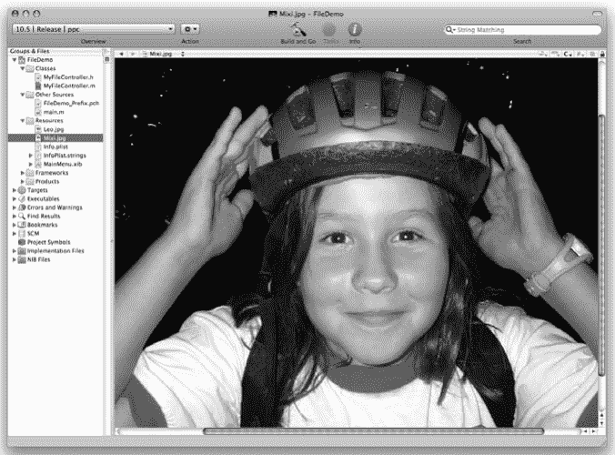

图 1-3：你可以在 Xcode 中查看其他类型的文件。

- 当你遇到困难时，Xcode 会为你提供访问完整的 Cocoa、Xcode 和其他开发人员文档集合的渠道。你可以使用 Xcode 以与使用 Web 浏览器类似的方式查看和导航这些文档。图 1-4 显示了文档加载到 Xcode 中时屏幕的样子。

完成你的 Cocoa 项目后，你使用 Xcode 来编译、链接并构建最终的应用程序。然后，你可以将应用程序分发给朋友、同事，甚至全世界（只要他们使用 Mac OS X）。

Xcode 身兼多职。如果你习惯于其他环境，你可能会惊讶地发现 Xcode 执行的任务在其他环境中需要多个工具来完成。例如，Xcode 充当：

- 项目组织者，管理你 Cocoa 项目中的文件和资源
- 代码编辑器，允许你编写和编辑 Xcode 代码
- 浏览器，显示你 Cocoa 项目中内置的文档或其他类型的资源
- 编译器和链接器，在开发过程结束时输出完整的 Cocoa 应用程序

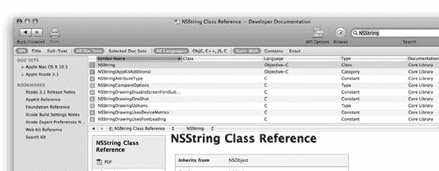

图 1-4：你可以在 Xcode 中查看文档。

Interface Builder 是 Xcode 的常客。正如你可能猜测的那样，Interface Builder 的主要目的是创建界面。借助它，你可以构建符合 Apple 界面指南的界面。

Interface Builder 提供了一套完整的控件，你可以将它们添加到你的应用程序中。从窗口和抽屉的拖放访问，到全套界面元素，让你的软件尽善尽美。别忘了 Interface Builder 是 Apple 的产品。没有人比 Apple 更了解 Macintosh 用户界面，因为他们创造了它；因此，你可以确定 Interface Builder 中的控件遵循最严格的 Apple 指南。

图 1-5 显示了一个示例界面，其中包含许多你可以在 Interface Builder 中使用的控件类型。这个界面可能不会赢得任何设计奖项，但它展示了你可以自己 Cocoa 软件中使用的元素范围。

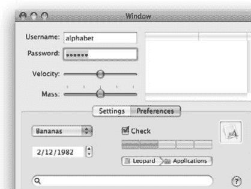

Interface Builder 的功能不仅限于所见即所得（WYSIWYG，What You See Is What You Get）的界面编辑。你还可以创建没有视觉表示的类。虽然你实际上不在 Interface Builder 中为你类的代码编写，但你确实在那里定义了它们的基本结构和方法。你还可以使用简单的拖放技术将界面连接到你的类，如图 1-6 所示。

> 你懂这门语言吗？

Cocoa（像大多数类型的编程一样）要求使用编程语言。要创建 Objective-C、Python、Ruby、Java 或 Script。这本书使用 Objective-C，因为它是 Cocoa 的“原生语言”。Objective-C 是传统 C 编程语言的一个超集。如果你有 C 语言经验，你在理解 Objective-C 的路上已经走得很远了。你所知道并喜爱的所有 C 函数都可以在 Cocoa 中使用。然而，Objective-C 更进一步，通过向语言添加面向对象特性来增强 C。Objective-C 是一种语法，起初你可能觉得有点陌生，除非你熟悉 Smalltalk。但一旦你习惯了它，你会发现它并不难理解。第 6 章详细介绍了 Objective-C，但你将从第 2 章开始使用它来构建你的 Cocoa 项目。

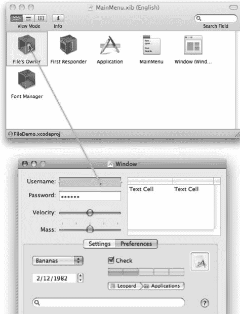

**图 1-6：** 通过简单的拖放操作将界面元素连接到类。

完成界面后，Interface Builder 更进一步，为你创建头文件和实现文件，然后将其插入到所需的 Xcode 项目中。虽然 Interface Builder 的最强功能涉及设计和创建外观精美的界面，但其他许多功能使其不仅仅是一个界面构建工具。它在 Cocoa 编程体验中扮演着重要角色。

### 创建你的第一个 Cocoa 应用程序

- 本章内容
  - 通过六个简单步骤用 Cocoa 获得名声和财富
  - 创建项目
  - 构建你的界面
  - 向项目添加代码
  - 测试并构建完成的应用程序

> 给计算机编程可能是很折磨人的。Apple 试图通过提供一套完整的工具、易于理解的编程语言以及先进的面向对象框架来简化这一过程，以帮助你生产出色的软件。这套完整的工具包打磨得非常精细，你只需编写少量代码就可以在一次会话中创建一个应用程序。

本章向你展示如何从头开始使用 Apple 的 Xcode 开发工具创建你的第一个 Cocoa 应用程序。无论你是在构建界面、添加代码使界面功能化，还是构建最终成品，Apple Xcode 开发工具都提供了一个专业的开发环境，让你可以快速工作以生成令人惊叹的应用程序。

#### 通过六个简单步骤创建 Cocoa 应用程序

编写自己的软件是一个过程。就像遵循食谱一样，你按顺序执行一系列步骤，直到最终得到一个可用的应用程序。以下是创建 Cocoa 应用程序的六步过程：

对于一些人来说，这可能是编程过程中最艰难的一步。对于其他人来说，它是最简单的。考虑一下你想让计算机执行的任务。然后想想一个可以完成它的计算机程序。这个程序会是什么样？它将如何运行？它必须具备哪些行为？

你通常会在 Xcode 应用程序中开始 Cocoa 开发。Xcode 是 Cocoa 编程的核心工具；你在那里创建并处理 Cocoa 项目的各个部分。第 3 章深入介绍了 Xcode。

在 Xcode 中创建项目后，启动 Interface Builder 来处理你应用程序的界面。按照传统的 Mac 风格，创建界面就像拖放一样简单。仅使用 Interface Builder 中的工具，你就可以在几分钟内快速构建吸引人的界面。第 4 章介绍了 Interface Builder。

创建界面后，返回 Xcode 并添加代码使界面具备功能。编程过程的这部分为你创建的界面提供了功能。幸运的是，Interface Builder 可以通过在 Xcode 中布置一个基本外壳来促进这一过程，你可以在那里输入代码。

没有人第一次就能把所有事情都做对，尤其是当编程计算机可能很复杂时。为了协助你，Xcode 提供了一套完整的工具，让你在对全世界释放你的应用程序之前对其进行测试。

你已经创建了界面，添加了代码，并测试了你的项目。现在是时候构建应用程序了。只需单击一下，你就可以构建一个可以在几乎任何 Mac 计算机上运行的应用程序。

> 如果你使用的 Mac OS X 版本低于 Leopard (10.5)，你可能无法在较新版本的 Mac OS X 上运行你的应用程序。因为 Apple 始终在改进操作系统，可能会出现这种情况：新操作系统版本中的框架与旧操作系统版本不兼容。为了确保你拥有针对最新 Mac OS X 版本所需的目标框架，请始终升级到最新版本的 Mac OS X 及其相应的 Xcode 开发工具。


# 第 2 章：创建你的第一个 Cocoa 应用程序

现在，你对创建 Cocoa 应用程序所需的步骤有了基本的了解，是时候创建你自己的项目了！本章的剩余部分将引导你完成构建、编码和创建你的第一个 Cocoa 应用程序的过程。

## 开始一个新项目

要开始编写你的第一个 Cocoa 软件，先构思一下你想创建什么样的软件。在确定了你想要构建的软件类型后，你将使用 Xcode 创建一个新的项目，并开始对其进行编程。

### 构思想法

与其费力去实现有时过于复杂的自己的创意，不如先从一个简单的想法开始。每个人都需要一个计算器。无论你想计算出售优秀 Cocoa 软件的收益，还是想知道如何靠这些收益退休，计算器都是一项实用的工具。没错，Mac OS X 自带几款不同的计算器，但没人规定你不允许构建一个更好的。

传统计算器应用的一个棘手问题在于，当你按下运算符键（+、*、等）并输入另一个数字时，你无法看到之前输入的第一个数字。你的应用程序通过显示正在处理的那两个数字来解决这个问题。

与传统计算器界面不同，你的计算器看起来更像一张表单。你在界面的各个字段中输入数字，然后按下一个按钮来计算结果。图 2-1 展示了完成后的应用程序的样子。

图 2-1：在构思应用程序的想法时，试着想象它会是什么样子的。

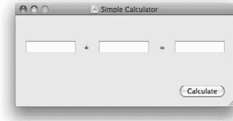

如你所见，你现在有了一个想法（构建一个更好的计算器），考虑了如何实现它（使用类似表单的界面），并构建了对它外观的心理图像。在这个例子中，心理图像是成品的图像（参见图 2-1）。但因为无法读取我的心意，我提供了一张成品的图像。

### 开始你的 Cocoa 项目

既然你已经有了一个想法，就可以开始 Cocoa 开发流程了：

1. 双击 Xcode 图标以启动 Xcode。该图标位于硬盘驱动器的以下位置：`/Developer/Applications/Xcode`。当你启动 Xcode 时，可能会弹出一个温馨的欢迎窗口，如图 2-2 所示。此窗口还为你提供便捷的单击访问文档和教程。如果它打开了，请关闭“欢迎使用 Xcode”窗口以减少杂乱。除非你取消勾选“启动时显示”复选框，否则下次启动 Xcode 时它还会再次打开。
2. 选择“文件”>“新建项目”。会出现“新建项目”窗口，询问你想创建什么类型的项目，如图 2-3 所示。

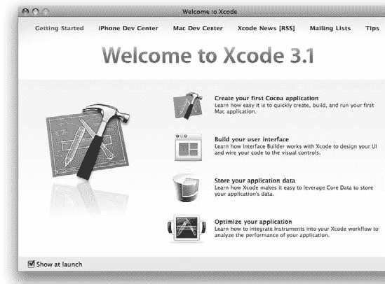

3. 在“新建项目”窗口的左侧选择“应用程序”模板。在“新建项目”窗口的左侧是一个由 Apple 为你创建的项目模板列表。你使用“应用程序”模板来构建标准的 OS X 应用程序。图 2-3 显示了左侧选中的“应用程序”模板。
4. 在“新建项目”窗口的右侧选项列表中，选择“Cocoa 应用程序”。在“新建项目”窗口的右侧是一个应用程序模板列表，你可以从中进行选择。对于本书中的大多数应用程序，请选择“Cocoa 应用程序”，如图 2-3 所示。
5. 选择该按钮。将打开一个“另存为”对话框。
6. 在“另存为”对话框中为你的项目输入一个名称。例如，你可以将项目命名为“My First Project”，如图 2-4 所示。当你打开“另存为”对话框时，它可能看起来不像图 2-4 中那样。它可能显示得更小，并且可能不会显示展开的文件列表。要展开对话框，请单击“另存为”旁边的三角形按钮。


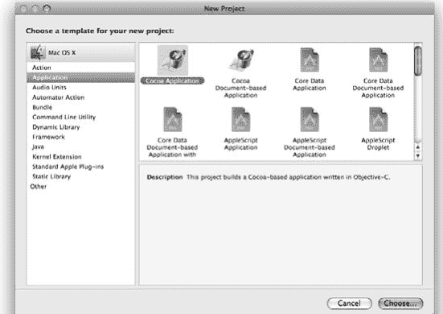

图 2-3：选择 Cocoa 应用程序。

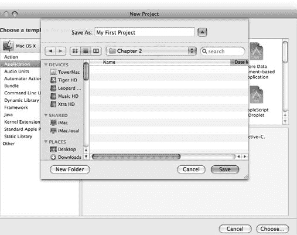

图 2-4：为你的项目给出一个描述性的名称，并选择保存项目的位置。

7. 选择项目的位置，然后单击“保存”按钮。你的硬盘驱动器会发出几秒钟的嗡嗡声和运转声，然后 Xcode 显示一个项目窗口。在 Finder 中，项目文件包含在一个与你第 6 步中指定的名称相同的文件夹内。在 Xcode 中，项目窗口显示项目中元素的列表，分组到文件夹中（不出所料，Xcode 将其称为“组 & 文件”），如图 2-5 所示。你的项目由项目窗口左侧的组件组成。这些组件包括类文件、源代码文件、接口文件和图像等。
8. 打开“Resources”组文件夹，然后双击 `MainMenu.xib` 文件。`MainMenu.xib` 是你项目的默认接口文件。你的项目将在 Interface Builder 中打开。

项目中的文件位于 Xcode 中少数几个组文件夹之一中。你可以在第 3 章中阅读有关这些组文件夹的所有内容，该章涵盖了 Xcode 的操作。目前，你只需要关注“Resources”文件夹即可。

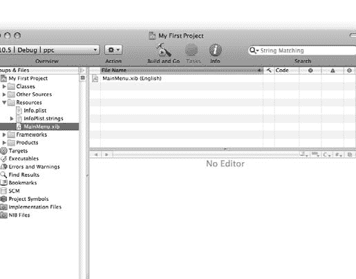

图 2-5：`MainMenu.xib` 包含你项目的接口。

## 构建接口

当你在 Xcode 中双击 `MainMenu.xib` 时，Interface Builder 将启动。图 2-6 显示了在 Interface Builder 中打开的 `MainMenu.xib` 文件。

默认情况下，项目的主窗口应该是打开的，准备添加新的控件。如果你在 Interface Builder 中没有看到打开的窗口，请双击 XIB 项目中的 Window 对象。

此窗口是你应用程序接口的起点。因为其他人可能会使用此应用程序，所以让它看起来尽可能美观是个好主意。通过更改窗口的标题：

1. 通过选择“工具”>“检查器”打开检查器窗口。检查器将显示与窗口相关的属性，如图 2-7 右侧所示。检查器窗口可以显示不同类型的信息，但当它显示与窗口相关的属性时，其标题为“窗口属性”。
2. 在检查器窗口中，将 Title（标题）属性更改为你的窗口名称。例如，你可以将标题更改为“Simple Calculator”。该名称将显示在你窗口的标题栏中，如图 2-7 左侧所示。

图 2-6：Interface Builder 是你设计和创建应用程序接口的地方。

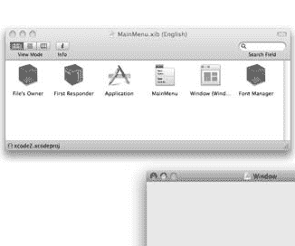

图 2-7：检查器窗口让你可以更改窗口的许多方面，包括其标题。

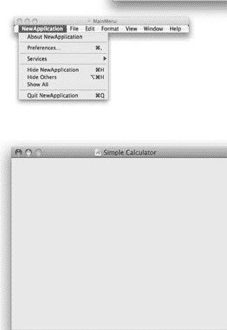

3. （可选）更改窗口大小。要更改窗口大小，只需单击并拖动窗口右下角的小部件，就像你在 Finder 中调整窗口大小一样。
4. 为防止用户在使用你的应用程序时调整窗口大小，请取消选中检查器窗口中“Controls”部分的“Resize”（调整大小）选项（参见图 2-7）。
5. 如果库窗口默认未显示，请选择“工具”>“库”以打开库窗口。要继续构建接口，你必须从显示各种可用于你的 Cocoa 接口的控件的库窗口中拖动控件。库窗口有两个标签页：Objects（对象）和 Media（媒体）。单击“Objects”以查看可用的控件，如图 2-8 所示。

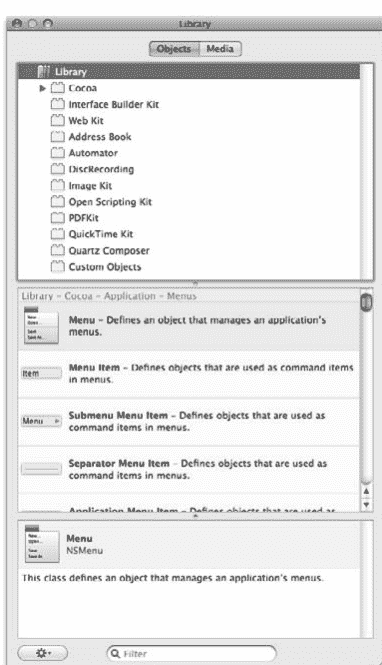

图 2-8：库窗口拥有创建 Cocoa 接口所需的所有控件。

### 向接口添加控件

控件是构成应用程序界面的交互元素。你很可能已经熟悉许多不同类型的控件，因为每次使用计算机时都会用到它们。常见的界面控件包括按钮、复选框、单选按钮、滚动条和文本字段。

对于你的第一个项目，你将在界面中使用一些控件。请执行以下步骤以添加此项目所需的控件：

1. **从库窗口拖动一个 Push Button（推按按钮）控件到应用程序的接口窗口。** 为了快速定位 Push Button 控件，请在库窗口底部的搜索字段中输入 **Push Button**。
2. **更改按钮的标签。** 要更改按钮的标签，请双击它并开始输入文本。例如，你可以输入 **Calculate**，如图 2-9 所示。

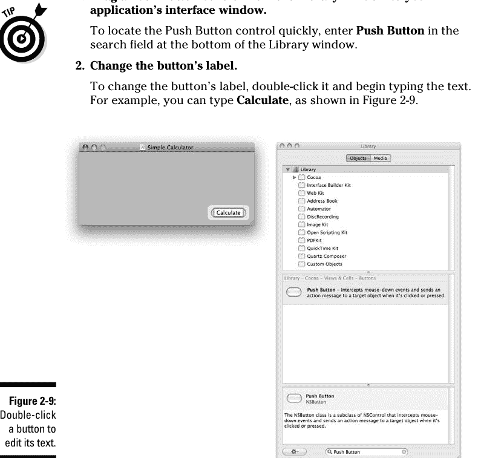

图 2-9：双击按钮以编辑其文本。

# 第 2 章：创建你的第一个 Cocoa 应用程序

3. 将三个大号文本框控件拖到窗口中。

用户将在你添加到窗口的前两个文本框中输入数字（即运算数）。数学运算的结果将显示在第三个文本框中。你无需更改前两个文本框的属性，但第三个文本框需要稍作调整。计算的答案将显示在第三个文本框中，因此你需要使其内容不可被用户修改。

4. 选中第三个文本框，然后选择 **Tools:Inspector（工具:检查器）** 以显示检查器窗口。从属性列表中，取消选中 **Editable（可编辑）** 选项（参见图 2-10）。

正如你可能猜测的那样，该文本框现在已变为不可编辑状态。

5. 添加两个标签（Labels）作为界面中的视觉提示。

标签具有装饰性功能。它们让用户了解界面是如何工作的。在库（Library）的搜索框中输入 **Label**，即可轻松找到标签控件。由于你正在布局一个看起来像传统数学问题的界面，请将一个文本框的标题更改为 **“+”**，另一个更改为 **“=”**。图 2-10 展示了包含新文本框控件的完整界面。在第 3 章中，你只学习加法。在第 4 章中，你将向项目中添加减法、乘法和除法。

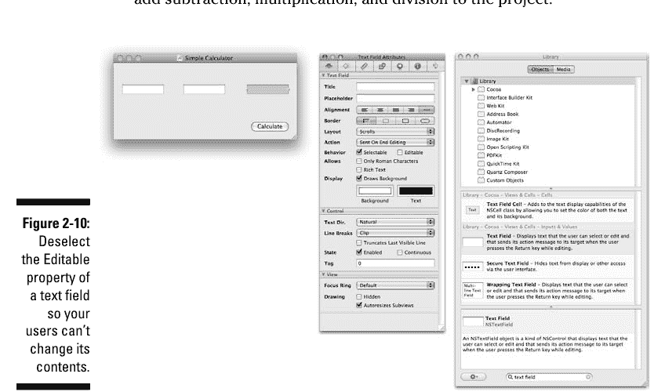

# 第一部分：开发者工具

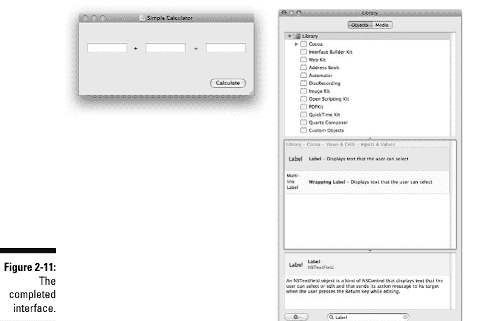

图 2-11：完整的界面。

表 2-1 列出了构成你界面的控件。在继续之前，现在是核对所有元素是否按你想要的方式排列的好时机。

| 控件类型 | 数量 | 在库窗口中识别它的方法 | 其他信息 |
| :--- | :--- | :--- | :--- |
| Button | 1 | 搜索 Button | 标题为 Simple Calculator |
| Text Field | 2 | 搜索 Text Field | |
| Text Field | 1 | 搜索 Text Field | 取消选中 Editable 选项 |
| Label | 1 | 搜索 Label | 标题为 + |
| Label | 1 | 搜索 Label | 标题为 = |

## 连接界面


既然你已经构建了界面，现在该进行连接了。毕竟，你家里的电如果没有连接灯和开关的电线，就无法打开灯；你的界面也不例外。在典型的家庭电气系统中，中心是一个保险丝盒或断路器盒。家中所有的电线都汇聚到这个中心位置的保险丝盒。Cocoa 界面遵循类似的模式。然而，你使用的不是保险丝盒，而是一个类。类是你想在程序中从现实世界建模的某种事物的抽象表示——目前，你可以将其视为一个虚拟盒子。第 6 章提供了有关 Objective-C 程序中类的更多信息。然后，你添加出口（outlets）以将主保险丝盒（Fusebox）连接到你界面的元素。

## 创建类

要在 Xcode 中创建一个类：

1. **返回 Xcode 中的项目并选择 File:New File（文件:新建文件）。**

新建文件向导将打开，显示可能的文件模板。

2. **在左列中选择 Cocoa。**

向导将显示 Cocoa 文件模板。

3. **在屏幕右侧的部分中选择 Objective-C Class（Objective-C 类）。**

Objective-C 类是此 Cocoa 项目的合适类类型，因为你正在使用 Objective-C 语言来编写此程序。

4. **点击 Next（下一步）。**

5. **将新文件命名为 `Fusebox.m`，并确保选中了 Also Create "Fusebox.h"（同时创建 "Fusebox.h"）复选框，如图 2-12 所示。**

Objective-C 类有两个部分——一个带有 `.m` 文件扩展名的实现和一个带有 `.h` 文件扩展名的接口。

6. **点击 Finish（完成）。**

Xcode 将 `Fusebox.m` 和 `Fusebox.h` 文件添加到项目中。你可能会发现 `Fusebox.m` 和 `Fusebox.h` 文件不在你项目的正确文件夹中。完全没问题，你可以将新文件拖到所需的文件夹。实际上，它们可以位于项目中的任何位置——在任何文件夹中，甚至在文件夹之外。Xcode 足够智能，能在构建时为你找到它们。

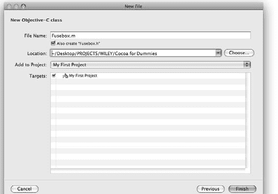

图 2-12：`Fusebox` 类将界面元素连接到你的应用程序。

## 添加出口

接下来，向这个新类添加出口。出口是连接你的源代码与界面元素的引用。

在 Simple Calculator（简单计算器）项目中，用户将在文本框中输入数字进行计算。第三个文本框显示计算结果。因此，你需要创建三个出口——每个文本框一个。

要在 Xcode 中的类添加出口，请向 `Fusebox.h` 文件添加它们。

```objective-c
IBOutlet id answerField;
IBOutlet id numberField1;
IBOutlet id numberField2;
```

这三个出口必须出现在 `Fusebox` 接口的括号之间，如下所示：

```objective-c
#import <Cocoa/Cocoa.h>

@interface Fusebox : NSObject {
    IBOutlet id answerField;
    IBOutlet id numberField1;
    IBOutlet id numberField2;
}
@end
```

## 添加动作

除了三个出口外，还要向类添加一个动作。动作是一个函数，当你在 Interface Builder（界面构建器）中分配的某个事件发生时执行。此新类中的新动作计算由界面提出的数学问题的答案。你可以将新动作命名为 `calculateAnswer`，并以此方式定义它：

```objective-c
- (IBAction)calculateAnswer:(id)sender;
```

此定义也出现在 `Fusebox.m` 中，位于结束括号之后，但在 `@end` 语句之前。完整的 `Fusebox.h` 文件如下所示：

```objective-c
#import <Cocoa/Cocoa.h>
@interface Fusebox : NSObject {
    IBOutlet id answerField;
    IBOutlet id numberField1;
    IBOutlet id numberField2;
}
- (IBAction)calculateAnswer:(id)sender;
@end
```

## 将类添加到界面

类定义完成后，切换到 Interface Builder（界面构建器）。

1. 在 Interface Builder 中，选择 File:Read Class Files（文件:读取类文件）。

将出现一个“打开”对话框，如图 2-13 所示。

2. 选中 `Fusebox` 并点击 Open（打开）按钮。

你目前看不到什么明显的变化，但你已经告知你的界面关于新的 `Fusebox` 类的信息。

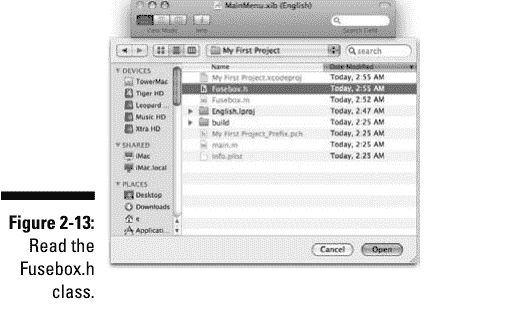

3. 在 Interface Builder 中向项目添加一个新对象。

在库（Library）窗口中，搜索 object（对象），并将一个 Object（对象）实例拖入项目中，如图 2-14 所示。

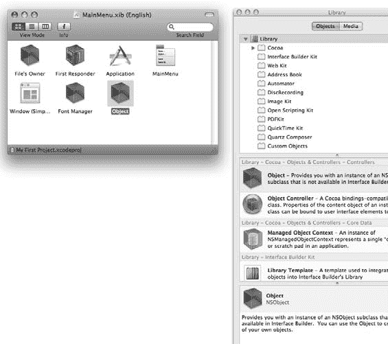

图 2-14：向项目添加一个新的 Object 实例。

4. 通过选择 Tools:Identity Inspector（工具:身份检查器）打开身份检查器。

5. 在身份检查器中，从下拉列表中选择 `Fusebox`。

你可以从下拉列表中选择 `Fusebox`，或者简单地直接在下拉框中输入 `Fusebox`，如图 2-15 所示。更改类为 `Fusebox` 后，出口和动作将出现在身份检查器中。

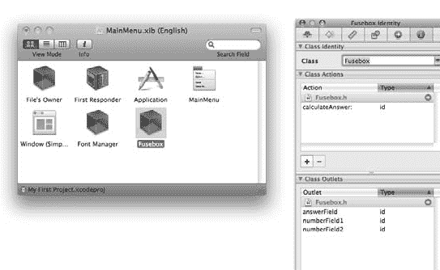

图 2-15：将对象的类更改为 `Fusebox`。

## 建立连接

既然你已经创建了 `Fusebox` 类并添加了三个出口和一个动作，现在是时候在 `Fusebox` 和你的界面之间建立连接了。

你刚刚基于 `Fusebox` 类创建了一个新的 `Fusebox` 对象。你将使用之前添加的出口和动作在这个实例和你的界面之间建立连接。首先，将三个出口连接到界面上对应的三个文本框。为了让你开始，以下是将 `numberField1` 出口连接到界面的方法：

1. 在 `MainMenu.xib` 中选中 `Fusebox` 实例。

2. 从 `Fusebox` 实例 Control+拖曳到界面中最左侧的文本框。

图 2-16 展示了 Control+拖曳操作的样子。

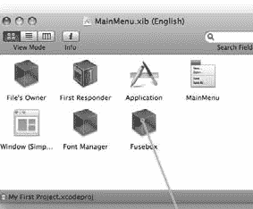

**图 2-16：** 要创建到出口的链接，从实例 Control+拖曳到界面元素。

当你 Control+拖曳到文本框并释放鼠标时，会出现一个黑色的连接列表覆盖层，其中列出了你的实例中可用的出口列表。

3. 选择你要的实例。

为了跟随示例，选择 `numberField1`，如图 2-17 所示。

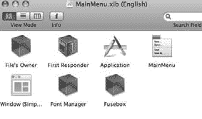

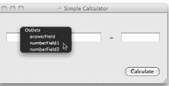

**图 2-17：** 选择一个出口。

4. 对其余两个输出量，`numberField2` 和 `answerField`，重复步骤 2–3。

在选中要连接的输出量之前，请务必按住 Control 键并从实例拖拽到界面中相应的控制项。

为操作接线的工作流程也是类似的，但有一个重要的不同点：它是反向进行的。不是从实例 Control-drag（按住 Control 键拖拽）到界面，而是从界面拖拽到实例。要执行以下步骤：

1. 按住 Control 键，从界面上的按钮拖拽到 `MainActivity.xib` 中的 `Fusebox` 实例。

2. 从列表中选择一个操作（action）。

按照示例操作，从黑色遮罩层中选择 `calculateAnswer` 操作，如**图 2-18** 所示。它将是 `Fusebox` 类中唯一可用的操作。

你已完成界面创建和接线工作！为完成项目的这一部分，请保存你的 `MainActivity.xib` 文件：

1. 按 ⌘+S 保存界面。

2. 退出 Interface Builder。

界面制作已完成。现在可以安全地退出 Interface Builder 并返回 Xcode 中的项目。

在下一节中，你将添加代码来运行应用程序。


**图 2-18：** 从出现的黑色遮罩层中选择操作。

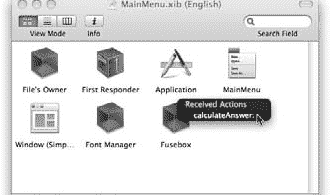

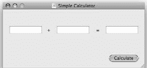

## 添加代码以让应用工作

回到 Xcode，点击 `Fusebox.m` 文件以显示其内容。这是你的主要源代码文件，也是你添加功能以使该应用程序执行某项任务的地方。该文件并非空文件。Interface Builder 很贴心地添加了一些代码作为起始：

```objective-c
@import Fusebox.h
@implementation Fusebox
@end
```


Cocoa 程序员是一个特殊的群体。他们不使用“头文件”这个词，而是称之为“接口文件”。同样，源代码文件被称为“实现文件”。

如果你现在还不明白所有内容，请不要担心。这是一个供你在开始项目时使用的外壳。该代码使用以下行引入头文件：

```objective-c
@import Fusebox.h
```

如果你是经验丰富的 C 程序员，请记住，Cocoa 中的 `@import` 类似于标准 C 中的 `#include`。该指令让你知道你的类定义在哪里。

在头文件之后，源代码列出了 `Fusebox` 类的实现：

```objective-c
@implementation Fusebox
```

`Fusebox` 类的一部分是 `calculateAnswer` 操作。通过添加 `calculateAnswer` 操作，你可以使应用程序具备功能。出现在 `calculateAnswer` 方法两个空大括号之间的所有代码，每当用户点击界面上的按钮时都会执行。用户点击按钮，进而触发 `calculateAnswer` 操作，该操作执行你的代码。

将以下操作添加到 `Fusebox.m` 文件中：

```objective-c
@import "Fusebox.h"

@implementation Fusebox

-(IBAction)calculateAnswer:(id)sender
{
    int num1, num2, answer;
}

num1 = [numberField1 intValue];
num2 = [numberField2 intValue];
answer = num1 + num2;

[textField setValue:answer];

@end
```

这段代码的作用如下：

1. 添加一行代码，创建三个整数变量，用于在内存中临时存储三个数字：

```objective-c
int num1, num2, answer;
```

然后代码为 `num1` 和 `num2` 变量赋值。使用的值是从对应的界面元素 `numberField1` 和 `numberField2` 中获取的。这两个元素是文本框。要从文本框中获取整数值，需向对应的输出量发送 `intValue` 消息，该消息将返回该字段中文本的整数值。

2. 要向对象（如界面元素）发送消息，请将对象名称和消息名称放在方括号内：

```objective-c
num1 = [numberField1 intValue];
num2 = [numberField2 intValue];
```

代码将这两个数相加，并将结果放入 `answer` 变量中。

答案通过向 `answerField` 发送 `setIntValue` 消息来显示。此特定消息需要一个参数：整数值。

3. 添加 `answer` 变量以显示答案：

```objective-c
answer = num1 + num2;
[textField setValue:answer];
```

4. 通过选择“文件：保存”来保存添加了新源代码的 `Fusebox.m` 文件。

## 调试和构建应用程序

你已构建了一个界面，将其接线到 `Fusebox` 实例，并添加了代码。现在是时候查看你辛勤工作的成果了。要测试项目，请在 Xcode 中选择“构建并运行 (Build and Go)”或点击“构建并运行”按钮，如**图 2-19** 所示。

## 第一部分：开发工具

**图 2-19：** 点击“构建并运行”按钮以查看你努力的结果。


当 Xcode 构建你的应用程序时，调试器窗口会出现，大量的文字飞速闪过。这是正常现象。如果在构建过程中出现任何问题（例如代码中的错误），调试器是你想要寻找到底发生了什么问题的第一个线索来源。当构建完成后，调试器会告知你结果（参见**图 2-20**）。

构建成功后，Xcode 将启动已完成的应用程序，如**图 2-21** 所示。你在编程过程中的下一步是测试应用程序的功能。在前两个文本框中输入数字，然后点击“计算 (Calculate)”。它是否显示了预期的答案？

**图 2-20：** 如果构建顺利，调试器会在右下角显示“成功 (Succeeded)”。

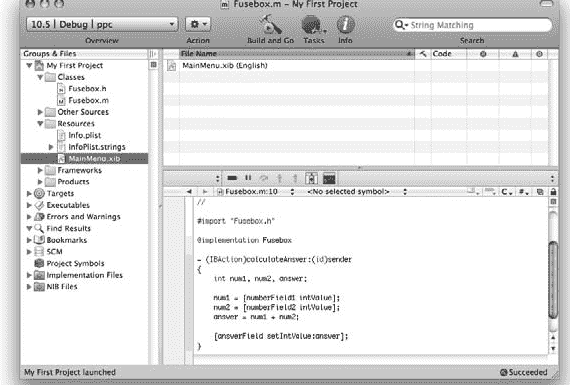

**图 2-21：** 正在运行的完成版应用程序。

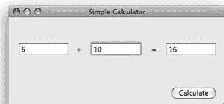

请记住，你目前只能处理整数小数；如果你输入带有小数部分的数字，将不会得到正确结果（参见**图 2-22**）。如果你使用带小数点的数字，你会得到一个小数部分被截断的结果。显然，这个计算器的健壮性可能无法满足你的需求。

在**第 3 章**中，你将扩展该项目以处理十进制数字。现在，让我们回到你构建了第一个 Cocoa 应用的荣耀时刻。生成的可执行文件位于你项目在访达 (Finder) 中的文件夹里。打开 `MyFirstProject` 文件夹，并在其中找到 `Build` 文件夹。打开 `Build` 文件夹以显示你的 `MyFirstProject` 应用程序。你构建了该应用程序，它可以在任何 Mac OS X 计算机上运行。

**图 2-22：** 哎呀！计算器目前只处理整数。

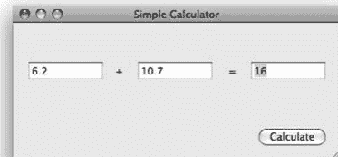

# 第 3 章

## Xcode

### 本章内容

- 立即进入 Xcode

- 定制 Xcode 窗口

- 调整项目设置

- 使用 Xcode 编辑源代码

- 调试你的 Cocoa 项目以消除错误

- 使用 Xcode 内置的帮助功能

- 从项目构建应用程序

Cocoa 编程需要使用一些 sophisticated（复杂的/老练的）开发工具。其中最主要的是 Xcode。使用 Xcode，你可以管理你的 Cocoa 项目：编写代码、组装、组织并测试你的项目，最终构建一个可以在任何 Mac OS X 计算机上运行的应用程序。

Xcode 是 Apple 集成开发环境 (IDE) 的主要组件。Xcode 拥有管理 Cocoa 项目、编辑和调试源代码以及构建应用程序所需的一切。随着你发现 Xcode 的不同功能，你将继续改进你在**第 2 章**中创建的计算器项目。到本章结束时，你将拥有一个功能增强且无 bug 的计算器应用程序。这两个目标是所有专业程序员对软件的要求，而 Xcode 可以帮助你实现这些目标。

如果你没有在**第 2 章**中构建简单的计算器，可以在 For Dummies 网站 [www.dummies.com/go/cocoafd](https://www.dummies.com/go/cocoafd) 上找到本章的项目文件。本章从 `My First Project` 文件开始。


### Xcode：苹果开发工具的核心

由于 Xcode 是一款一流的开发工具，其窗口、菜单和设置的集合对于初学的 Cocoa 程序员来说可能显得有些望而生畏。Xcode 是专业软件，因此如果你有一定的学习曲线，请不要感到惊讶。苹果公司为普通用户（无论男女）创建了 Mac OS X，但专为开发者制作了 Xcode。Xcode 拥有经典的 Macintosh 界面，像其他软件一样具备窗口和菜单，但其内容是技术性的，所以如果一下子无法理解所有内容，请不要感到太有压力。

使用 Xcode，你可以进行多种类型的编程。正因为如此，Xcode 提供了用于执行这些各种类型编程的工具、文档和设置。

作为 Cocoa 程序员，你只关注 Xcode 全部功能中的一个方面。因此，你只需使用与 Cocoa 编程相关的工具、文档和设置。Xcode 中的一些功能你可能偶尔使用、很少使用或根本不用。

把 Xcode 想象成一家五金店。你通常去五金店是为了买钉子、螺丝或木工胶。偶尔，你会拿起锤子、螺丝刀，甚至卷尺。每隔几年，你甚至还会为房子的外墙付费。但你不会走进摇晃的货架区。你恐高，总是把这项工作留给专业人士。


你使用 Xcode 的方式就像使用当地五金店的方式一样。你总是执行某些任务（为你的应用程序编写代码），某些任务不太频繁（为你的应用程序分配图标），某些任务很少见（调整 Xcode 设置的偏好）。其他任务可能完全不涉及（为 CD 刻录机创建驱动程序）。这不同于调整偏好；Xcode 是你很少使用的工具，而 CD 驱动程序仅面向专业人士。这是因为 Xcode 是用于多种开发类型的工具。就像五金店一样，每个人都根据特定需求使用 Xcode。也许你的邻居喜欢做水管工和 CD 驱动程序开发。而你则专注于家具修理和 Cocoa 应用程序开发。即使你们彼此不了解对方的工作，五金店和 Xcode 也能协助你和你邻居的 endeavors。

### 自定义 Xcode 偏好设置

在 Finder 中双击项目文件图标以打开项目文件。Xcode 启动，显示该项目及其组件。默认 Xcode 设置如图 3-1 所示。如果你读过第 2 章，这个窗口应该看起来很熟悉，因为你曾使用它来创建你的项目。

Xcode 在你的窗口中显示你项目的代码和组件。默认情况下，它显示单个项目窗口，但你并不局限于这种布局。请按照以下步骤更改你的布局：

1. 关闭所有项目。

    - 在允许你更改“布局”设置之前，Xcode 要求关闭所有项目窗口。

2. 通过选择 Xcode 首选项打开 Xcode 偏好设置窗口。

    - 此窗口的顶部有一排按钮。

3. 点击“常规”按钮。

    - Xcode 设置会出现，如图 3-2 所示。

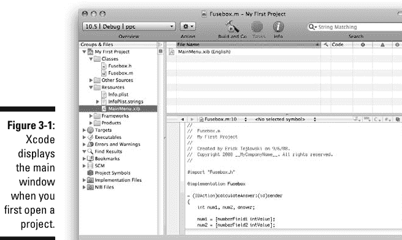

**图 3-2：** 你可以选择 Xcode 在开发期间显示多少个窗口。

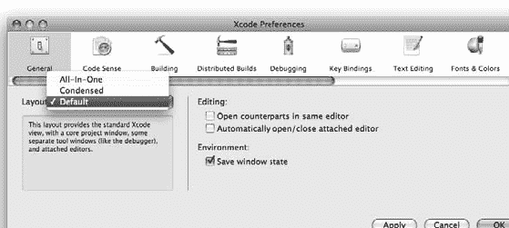

Xcode 为“布局”设置提供三个选项，影响项目窗口：

- **一体化（All-in-One）**：所有任务都在一个窗口内显示：代码、构建结果、构建日志和调试。如果你的空间非常有限（如小型笔记本电脑），一体化可能是最适合你的选择。

- **精简（Condensed）**：任务在单独的窗口中显示：代码、构建结果、构建日志和调试。如果你拥有大显示器或多显示器配置，你可能更喜欢精简方法，以便分散你的工作。

- **默认（Default）**：默认布局使用了一体化和精简的某些元素。主项目窗口包含大多数视图，但在某些情况下（特别是调试器和控制台）会显示额外的窗口。讲究整洁的人喜欢这个设置，我通常在大多数情况下也使用它。

4. 从“布局”弹出菜单中选择一个设置。

5. 点击“确定”以应用设置并关闭偏好设置窗口。

6. 重新打开你的项目并选择 `构建：构建并运行`。

    - 你的应用程序照常运行。

7. 退出应用程序返回 Xcode。

8. 选择 `运行：控制台` 以查看最后一次运行的状态。

如果你的项目执行没有故障，控制台窗口会显示类似这样的消息：

```
My First Project has exited with status 0.
```

状态 0 消息表明 Xcode 在应用程序执行期间未遇到任何错误。这是好事，意味着你的项目没有某些类型的错误。

如果你使用的是默认布局，控制台窗口将作为单独窗口显示，如图 3-3 所示。

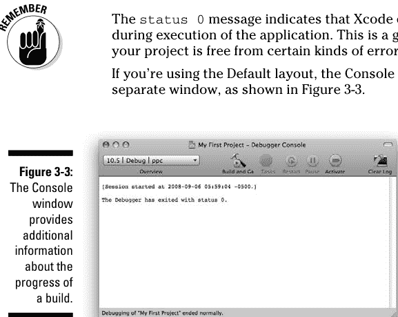

### 处理项目文件

在第 2 章中，你发现了如何制作一个简单计算器，它可以加整数但不能处理带小数点的数字。要更改应用程序的运行方式，你需要修改项目中的代码：

1. 在 Xcode 的主项目窗口中，点击展开“类”组。

    - “类”组打开并显示你项目中的文件。你通常将其识别为文件夹，Xcode 称之为*组*。显示在项目窗口左侧的小文件夹是组。点击每个组左侧的展开三角形会显示该组中的文件。

2. 点击 `Fusebox.m` 文件。

    - `Fusebox.m` 文件的代码会显示出来，如图 3-4 所示。

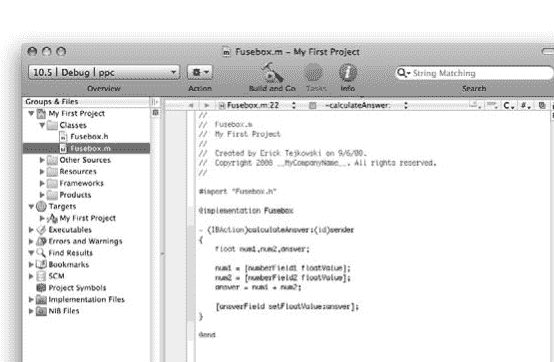

**图 3-4：** 类组织你项目中的源代码文件。

3. 将 `Fusebox.m` 文件中的代码修改为以下内容：

```objectivec
#import "Fusebox.h"

@implementation Fusebox
{
    (IBAction)calculateAnswer: (id sender)
{
    float num1, num2, answer;

    num1 = [numberField1 floatValue];
    num2 = [numberField2 floatValue];
    answer = num1 + num2;

    [answerField setFloatValue:answer];
}
}
@end
```

此代码有三个重要更改：

- 你正在将三个变量从 `int` 类型更改为 `float` 类型。`float` 数据类型支持带小数点的数字。

- 由于你现在处理的是 `float` 数据类型，使用 `floatValue` 函数从两个数字字段中检索小数数据。

```objectivec
num1 = [numberField1 floatValue];
num2 = [numberField2 floatValue];
```

- 使用 `setFloatValue` 函数代替 `setIntValue` 函数在 `answerField` 中显示 `float` 结果。

```objectivec
[answerField setFloatValue:answer];
```

4. 现在你已经编辑了 `Fusebox` 中的源代码，选择 `Fusebox.h` 以查看其内容。

    - `Fusebox.h` 包含你接口的定义。

5. 在“组与文件”列表中，打开“其他源”组文件夹并选择你的 `main.m` 文件。

    - 在此文件中，你会看到类似这样的代码：

```objectivec
#import <Cocoa/Cocoa.h>

int main(int argc, const char *argv[])
{
    return NSApplicationMain(argc, argv);
}
```

    - 此代码出现在你创建的每个 Cocoa 应用程序项目中。它负责让你的应用程序运行，就像一串钥匙启动汽车一样。好的部分是，Xcode 会自动将其添加到项目中，你通常不需要对此文件做任何更改。

6. 选择 `构建：构建` 或按 `Cmd+R` 以查看你的代码更改的实际效果。

7. 在 Xcode 编译并启动项目后，使用小数测试 Simple Calculator 应用程序。

计算器现在可以正确添加小数（见图 3-5）。

**图 3-5：** 计算器支持小数！

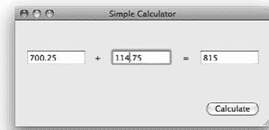

### 类模型

类模型是你 Xcode 工具之旅的下一站（有关更多类，请参阅第 2 章）。Xcode 可以为你提供项目中类的可视化表示。这对设计和调试目的可能很有帮助。要查看类模型，选择所需的类并选择 `设计 -> 快速模型`。Xcode 显示你类的图形模型。

计算器只有一个类：`Fusebox` 类。选择 `设计 -> 快速模型` 以查看 `Fusebox` 模型。在此类中，你实现了一个函数（`calculateAnswer`）和三个用于三个文本字段的出口，如图 3-6 所示。`NSObject` 也出现在快速模型中，因为它是 `Fusebox` 类的父类。除了 `NSObject` 之外，所有类都基于类层次结构中的其他类。`Fusebox` 类基于 `NSObject` 类，因此 `NSObject` 是其父类。

随着项目的增长，类模型有助于你了解整体情况。图表显示它们如何在项目交互中相互作用。

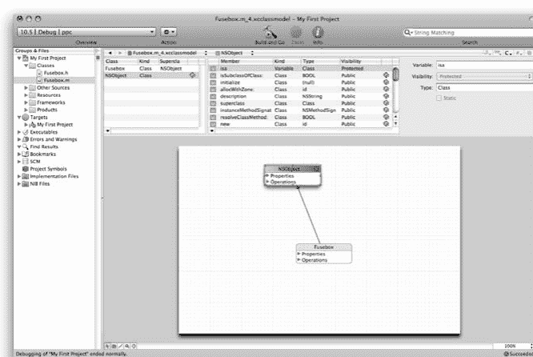

**图 3-6：** 快速模型显示你项目中的类。

### 文件注释

你可以在 Xcode 中为任何项目项分配注释。这类注释与源代码注释不同，因为它们可以分配给项目中的任何元素，而不仅仅是源代码文件。当你处理非常大的项目或与他人协作时，这是一个非常实用的功能，因为你可以使用这些注释来记录更改或保留其他笔记。请按照以下步骤为项目添加注释：

- 1. 在 Classes 组中选中 `Fusebox.m`。

  `Fusebox.m` 包含你实现部分的声明。

- 2. 点击项目工具栏中的 Info 按钮，或按 `⌘+1`。

  文件信息窗口将打开，如图 3-7 所示。

- 3. 点击文件信息窗口顶部的 Comments 按钮。

  注释字段将出现，你可以在其中输入关于该文件的信息，以便日后检索，同时将这些信息保留在源代码之外。

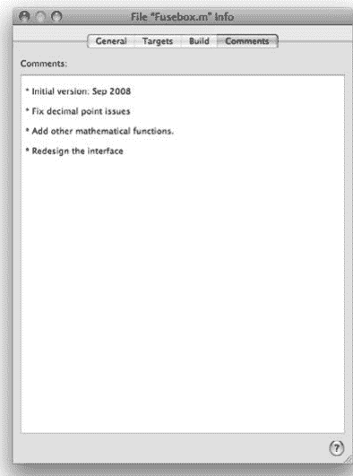

图 3-7：文件信息窗口可以帮助你记录项目元素。

### 使用收藏夹加速开发

随着项目的增长，你会发现定位代码有时会变得棘手。对于大型项目，在数十个源代码文件之间跳转并不罕见。为了帮助你，Xcode 提供了一个类似于 Web 浏览器的收藏夹栏。与指向 Web 上的 URL 不同，Xcode 的收藏夹栏指向你源代码中的特定位置。当你希望快速跳转到代码中的某些位置，而不必费力浏览构成项目的众多文件时，它非常有用。

要在 Xcode 中开始使用收藏夹，请按照以下步骤操作：

- 1. **View > Layout > Show Favorites Bar。**

  项目的收藏夹列表将显示在窗口顶部，如图 3-8 所示。

- 2. **将项目中的任意文件拖到收藏夹栏。**

  收藏夹将显示在窗口顶部的收藏夹栏中，如图 3-8 所示。

- 3. **若要删除项目中的收藏夹，请将其拖出收藏夹栏。**

  收藏夹会瞬间消失，仿佛一缕青烟。

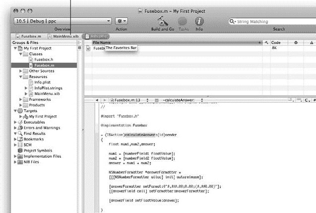

图 3-8：收藏夹显示在窗口顶部。

### 调试你的项目

由于计算机编程可能是一个复杂的过程，出错很容易发生。你可以通过多种方式在代码中引入错误。以下是两种：

- 语法错误是代码语法中的错误，导致 Xcode 无法解释代码。代码中的拼写错误可能导致项目中的语法错误。

- 运行时错误与代码语法无关。相反，你的代码逻辑中存在错误，导致生成的应用程序无法正常运行。这些错误可能在语法上是正确的，仍然允许 Xcode 将代码编译并链接到应用程序中，但会产生意外或不正确的结果。应用程序可能会运行，甚至有时表现得符合预期，但在某个时刻，你的应用程序会做错了什么。例如，在你的图形应用程序中，可能显示了一个紫色的苹果而不是红色的；在你的电子游戏中，敌方入侵者在被击中后不会死亡；或者在你的电子表格应用程序中，计算错误导致了不正确的数值结果。

要知道你的代码中是否存在 bug 的唯一方法是彻底测试你的项目。在调试项目时，你会构建、运行并测试你的应用程序，直到确信它没有 bug。

开始调试时，请按照以下步骤操作：

- 1. 构建并运行你本章中一直使用的项目。

- 2. 在两个数字字段中输入值，然后点击 Calculate 按钮。

- 3. 更改数字，再次点击 Calculate 按钮。

- 4. 重复步骤 3，直到你确信项目运行正常。

例如，对该项目的连续三次测试得出以下结果：

```
1 + 2 = 3
3.25 + 4.75 = 7.999998099265137
3.2 + 4.75 = 7.949998099265137
```

糟糕！最后一次测试产生的结果可能并非你所期望的那样。这里发生了什么？似乎有三个问题：

- 代码在某些情况下错误地计算了两个数字的和。

- 问题似乎只在使用小数时发生。

- 错误只在使用某些小数时发生，而不是其他小数。例如，0.25 + 0.75 按预期工作，但 4.2 + 2 不行。发生这种情况的原因是，如果数值不能表示为二进制中的非循环序列，计算机就无法显示小数部分（小数点后的数字）。如果你想了解更多关于这个主题的信息（警告：这可能变得非常复杂），请在 `Google.com` 上搜索 `IEEE 754`。

为了找出哪里出了问题，Xcode 包含了一个强大的调试器。使用调试器，你可以跟随项目代码的执行过程，并留意任何问题的迹象。

#### 添加断点

在调试此代码之前，先设置一些断点。断点是出现在代码左侧列中的小标记。要插入断点，只需点击最左侧列中你想要用调试器检查的代码行旁边，如图 3-9 所示。

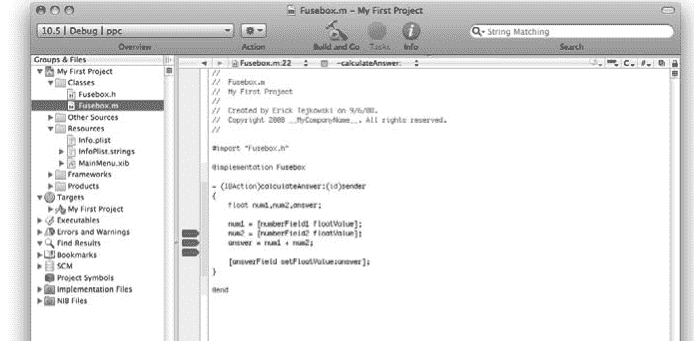

图 3-9：点击编辑器最左侧列以设置断点。

对于这个例子，设置三个断点是个好主意：每次你为变量分配值时（即 `num1`、`num2` 和 `answer`）。

注意，图 3-9 中的断点出现在相关代码行之后。该代码行在检查变量值以查看其结果之前设置变量执行。

#### 单步执行调试器

既然你设置了断点，现在是时候调试项目了：

- 1. 选择 `Build: Build and Debug`。

  Xcode 像往常一样开始构建你的项目，但随后发生了一些变化。Xcode 打开了 Debug 标签页。

  目前，你在调试器中不会看到任何信息。相反，你的项目主窗口来到前台，看起来和以前一样。

- 2. 在应用程序界面中输入数字（例如，3.2 和 4.2），然后点击 Calculate 按钮。

  调试器来到前台，并在 Debug 标签页中显示各种数据。在调试器的左侧，你看到当前正在执行的类和方法的名称。在这种情况下，它是 `Fusebox` 类和 `calculateAnswer` 方法。调试器的底部部分显示 `calculateAnswer` 方法的代码。

  由于你设置了断点，调试器会在遇到第一个断点时停止。这表明调试器接下来将执行的代码行。

- 3. 在调试器的右上角部分，查看你代码中所有变量的当前状态。

  到目前为止，只有此代码已执行：

  ```
  float num1, num2, answer;
  num1 = [numberField floatValue];
  ```

  因此，你可能期望调试器仅显示 `num1` 变量的值。图 3-10 显示了迄今的调试过程。

  如果应用程序在第一个断点停止时你没有看到调试器窗口，请选择 `Run: Debugger`。


图 3-10：当调试器执行代码时，它会显示变量的值。

调试器已经发现了一个问题（参见图 3-10）。`num1` 的值不是你预期的 3.2。相反，它的值是 3.20000005。

- 4. 点击项目工具栏中的 Continue 按钮以继续执行。然后，调试器显示 `num2` 的值 4.19999981，这不是预期的值 4.2。

- 5. 再次点击 Continue 按钮，让调试器跳转到第三个断点。

  调试器现在显示 `answer` 的值 7.39999962，而不是你可能预期的 7.4。

- 6. 再次点击 Continue。

  调试器消失，应用程序重新出现并等待你再次按下 Calculate 按钮。

- 7. 将项目窗口带到前台，并点击项目窗口工具栏中的 Stop 按钮以停止调试器进程。

- 8. 选择 `Run: Deactivate Breakpoints`，以防止调试器在下一次运行时停止。

虽然您的代码显示的数字与运行时在界面中输入的实际数值非常接近，但它们并非精确的值。显然，您需要一种根据某些指南来格式化数字的解决方案。例如，您可能只关心两位小数的精度。

#### 修正代码

不深入技术细节，浮点变量值的十进制部分可以有很多位数字。当 `num1`、`num2` 或它们的和拥有无法用二进制非循环序列表示的小数位时，就会存在舍入和截断问题。这些问题是基于计算机处理浮点数字的方式所固有的现实情况。

为了解决这个问题，一种解决方案是在显示答案之前对其进行格式化。Cocoa 的 `NSNumberFormatter` 类中有几行代码可以解决这个问题：

```
NSNumber *answerFormatter =
[[NSNumberFormatter alloc] init] autorelease];
[answerFormatter
setFormat:@"#,###.00;0.00; (###0)"];
[answerField cell setFormat:answerFormatter];
```

如果您看不懂这一大段令人望而生畏的代码，请不要感到害怕。这一章的主题是 Xcode，而不是像第 6 章那样的 Objective-C 代码。

前两行代码（顺便一提，它们只是出现在两行上的一个函数）创建了一个 `NSNumberFormatter` 对象。`NSNumberFormatter` 对象的目的是调节数字的格式。

接下来，代码向 `answerFormatter` 对象发送 `setFormat` 消息，并传递一个文本字符串。这个字符串指定了这个 `NSNumberFormatter` 对象允许哪些格式。该字符串包含三种格式，每种格式由分号分隔。您不必担心这三个字符串的具体格式，但为了提个醒，第一个定义正数的格式，第二个处理数字为 0 的情况，最后一个格式化负数。

最后，代码将 `NSNumberFormatter` 应用于界面中的 `answerField`。为了帮助您理解这段代码在整个大图景中的位置，以下是 `Fusebox.m` 完整源代码的列表（`NSNumberFormatter` 对象以粗体显示）。请注意，当您添加代码时，最后一个断点会相应移动。


```objective-c
@import "Fusebox.h"

@implementation Fusebox

-(IBAction)calculateAnswer:(id) sender {
    float num1,num2, floatValue;
    num1 = [numberField1 floatValue];
    num2 = [numberField2 floatValue];
    answer = num1 + num2;
    NSNumberFormatter *answerFormatter =
        [[NSNumberFormatter alloc] init] autorelease];

    [answerFormatter
        setFormat:@"##,##.0.00; (#,##.00)"];
    [answerField cell setFormatter:answerFormatter];

    [answerField setFloatValue:answer];

}
@end
```

现在您已经正确格式化了 `answerField`，请选择 Build > Build 并运行（Go to see your changes in action -> 选择“构建” > “构建并运行”以查看您的更改效果，直译保留原意即可，这里意译为：选择 Build > Build 并运行以查看您的更改效果）。您会看到结果，如**图 3-11** 所示。

**图 3-11**：使用 NSFormatter 对象，您可以指定应用程序如何显示浮点数。

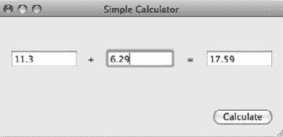

在您离开本章的调试部分之前，使用 Xcode 编写 Cocoa 应用程序时，您可能会遇到一种错误。将 `Fusebox.m` 中代码的最后一行更改为此：

```
[answerField setFloatValue:answer];
```

这次您故意遗漏了末尾的分号（这是一个即使专业开发人员也会犯下的常见错误）。选择 Build: Build 并运行（Go -> “构建”并“运行”）以查看会发生什么。结果是应用程序未按预期运行，并且在相关代码下方出现了一个错误叠加层，如**图 3-12** 所示。在代码左侧发生错误的地方的槽位中，还会出现一个带有白色 X 的圆圈。

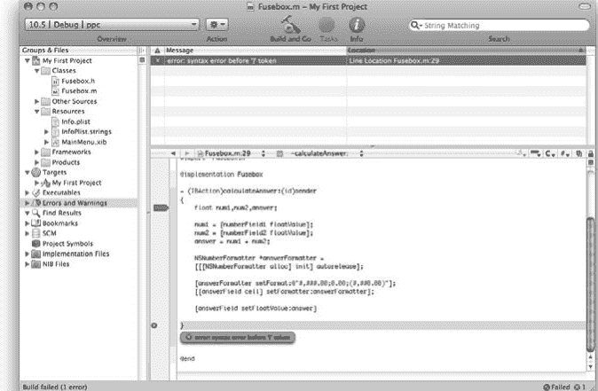

该错误准确地指出了问题的所在。在这种情况下，错误是 `}` 标记之前的语法错误。分号应该正好在 `}` 标记之前。修正代码并保存。

这个演示的要点是表明，当使用 Xcode 编程时，您可能会遇到不同类型的错误。有些错误（如本例所示）发生在构建和调试过程中，Xcode 会显示发生错误的位置。其他 bug 更难以追踪，例如前面的例子，因为应用程序在其他方面是功能正常的。对于这些情况，使用内置调试器来解决问题总是有益的。

### 移除断点

既然您已经完成了项目的调试，您可能希望移除已添加的断点。在 Xcode 中，查看 `Fusebox.m` 文件，并寻找代码编辑器左侧的断点。控制+单击（Control+click）一个断点，并从出现的上下文菜单中选择“移除断点”（remove Breakpoint）。对其余的断点执行相同的操作。**图 3-13** 显示了删除断点之前的上下文菜单。

> **提示** 允许您保留项目中设置的断点。您可以安全地保留它们而不给自己造成任何问题，只要您在不需要它们时停用它们即可。


**图 3-13**：控制+单击（Control+ click）一个断点以移除它。

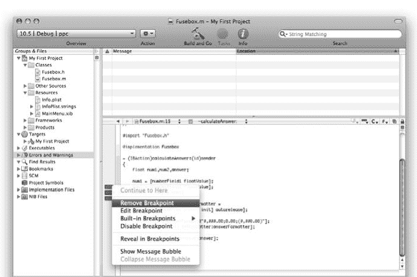

### 去哪里寻求帮助

在某个时候，您将希望获取有关 Xcode 如何工作的更多信息。坦率地说，Apple 通过其内置文档已经为您提供了支持。选择 Help > Xcode Workspace Guide 以查看有关 Xcode 的内置文档。

内置帮助提供了关于 Mac OS X 开发各个方面的文档。它还包含有用的教程，帮助您开始使用 Xcode 进行 Cocoa 编程。

除了标准的帮助之外，Xcode 在代码编辑器中还提供了对 Cocoa 类和框架信息的一键访问。要测试此功能，请执行以下操作：

1. 选择 `Fusebox.m` 源代码。

   Xcode 在代码编辑器中显示该文件。

2. 定位源代码中您想要调查的关键字。

   例如，您可能想要了解 `setFloatValue` 方法。

3. 按住 Option 键，在 `Fusebox.m` 文件中双击 `setFormatter`。

   一个引用窗口打开，列出了 Cocoa 中各种 `setFloatValue` 方法（参见**图 3-14**）。

4. 从菜单中选择一个关键字。

   选择适当的 `setFloatValue` 方法以查看相应的文档。

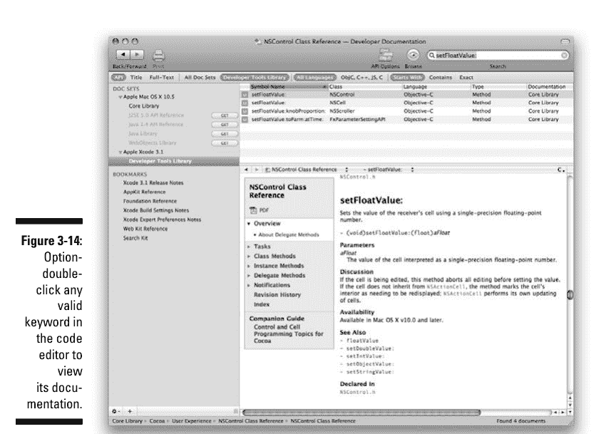

### 构建应用程序

现在您已经配置好项目，修改了其源代码，并浏览了其中的类，您已准备好构建最终的应用程序。选择 Build+ 和 Go。然后，Xcode 将编译、链接并执行生成的应用程序。


您不一定非要构建并运行，尽管这可能是在 Xcode 中最常见的工作方式。您可以通过选择 Build+ Build 来构建项目而不运行它。这会编译、链接并创建目标应用程序，但不执行它。如果您更喜欢使用调试器，请选择 Build+ 和 Debug。**表 3-1** 列出了各种 Build 命令的键盘快捷键。

| 功能 | 键盘快捷键 | 它的作用 |
| :--- | :--- | :--- |
| Build | Cmd+B | 从当前项目构建应用程序 |
| Build and Run | Cmd+R | 构建应用程序然后执行它 |
| Build and Debug | Cmd+Y | 从当前项目构建并启动应用程序，然后启动调试器 |
| Clean | Cmd+Shift+K | 通过移除所有目标代码来清理当前项目 |

在标准菜单项和相应的键盘快捷键中，Xcode 通过工具栏项目窗口中的按钮为您提供对 Build 和 Run 功能的轻松访问。**图 3-15** 显示了此按钮的位置和功能。

每当您点击 Build and Go 工具栏按钮时，它会变成一个停止标志。在构建或调试过程中，您可以停止该进程。有时构建完成需要一段时间。如果您在构建之前忘记做某事，能够停止构建操作会非常方便。这样，您可以避免等待构建完成，并返回工作。

在成功完成构建后，您的新应用程序将出现在 Finder 中项目主文件夹的 Build 文件夹中。然后，您可以在任何使用 Mac OS X 的其他计算机上分发和运行此应用程序，这正是使用 Cocoa 进行编程的主要目标。

### 图 3-15：单击项目窗口工具栏中的“Build”按钮以运行您的项目。

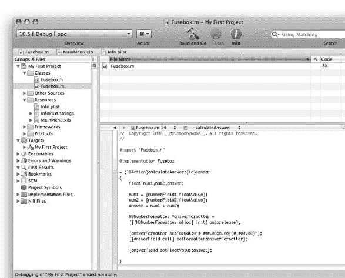

## 第 4 章 Interface Builder（界面构建器）

**本章内容**

- 熟悉 Interface Builder 的操作界面
- 在界面上添加控件
- 编辑控件的属性
- 编辑和创建新菜单
- 实现用于操作界面的代码

Cocoa 开发中第二重要的组件（第一个是 Xcode；参见第 3 章）就是与其同名的 Interface Builder 应用程序，它允许您为 Cocoa 项目构建界面。Interface Builder 让您能够轻松地通过拖放功能为您的软件构建美观的界面——无需编写任何代码。更重要的是，您在 Interface Builder 中创建的界面遵循 Apple 严格的“人机界面指南”（Human Interface Guidelines），因此您有很大机会制作出 Mac 用户（他们可能比较挑剔）既喜欢查看又愿意使用的应用程序。

在本章中，您将参观 Interface Builder，并在过程中检查其功能。为了帮助您适应 Interface Builder，我们将改进您在第 3 章中创建的计算器应用程序。到本章结束时，您的计算器将拥有一个新的菜单、额外的界面元素以及增加的功能。


您可以在 *For Dummies* 网站上找到本章的项目文件，网址为 www.dummies.com/go/cocoafd。

### 参观 Interface Builder

要开始使用 Interface Builder，请复制第 3 章已完成的项目文件夹。请始终确保您的 Cocoa 项目及相关文件存放在可写介质上，这通常是您的硬盘。

将代码复制到硬盘后，请按照以下步骤开始在 Interface Builder 中处理该项目：

1. 打开 `My First Project.xcodeproj` 文件。

   Xcode 启动，项目打开。

2. 在 Xcode 中展开项目的 Resources（资源）文件夹，以显示 `MainMenu.xib` 文件。

3. 在 Xcode 中，双击 `MainMenu.xib` 文件在 Interface Builder 中打开它。

`MainMenu.xib` 是您的计算器项目的界面文件。图 4-1 展示了 `MainMenu.xib` 文件在 Xcode 中的位置。

尽管 Xcode 和 Interface Builder 是两个不同的应用程序，但它们协同工作，为您提供集成的 Cocoa 体验。

**图 4-1：MainMenu.xib 包含您项目的界面外观。**

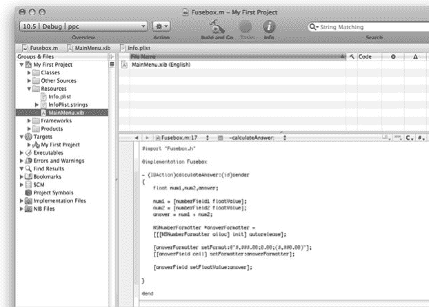

顺带一提，`MainMenu.xib` 中的 XIB 文件扩展名表明这是一种较新的 Interface Builder 项目文件格式，在 Xcode 3 中引入。此前，该文件使用 NIB 扩展名，它是 Next Interface Builder（Next 界面构建器）的缩写。为什么是 NeXT？NeXT 是史蒂夫·乔布斯（Steve Jobs）在回归 Apple 之前担任首长的公司名称。Apple 生产了 Next 操作系统，该系统成为 Mac OS X 的核心。XIB 文件就是那个时代的遗留产物。Cocoa 极客们仍然在使用这些 NIB 文件——旧习难改。您曾尝试过发音 "NeXT" 吗？此外，Cocoa 中类名开头的 AS 代表 NextStep，这是 Cocoa 中源自 NeXT 的另一个历史细节。

当您首次启动 Interface Builder 时，可能会看到多达五个窗口。图 4-2 显示了 Interface Builder 中出现的各种窗口。虽然它不是五个主要窗口之一，但“字符串”（Strings）窗口也可能出现。字符串窗口存在的可能性比其他窗口小，但如果您使用它，请随意选择。本章中您将不使用它。

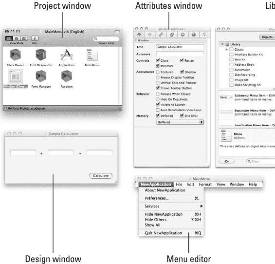

**图 4-2：Interface Builder 有五个主要窗口。**

设计窗口

表 4-1 描述了为什么需要每个窗口，以及如果当前未显示该窗口时如何显示它。

| 表 4-1 Interface Builder 的主要窗口 |
| :--- | :--- | :--- |
| **窗口** | **显示方法** | **用途** |
| 项目窗口 | 在 Xcode 中双击 XIB 文件 | 存储界面文件的组件。 |
| 设计窗口 | 在 XIB 项目窗口中双击 Window（窗口）图标 | 将窗口用作应用程序界面的一部分。 |
| 检查器窗口 | 选择 工具 > 检查器 | 查看和编辑项目中的界面及其他类的属性。 |
| 库 | 选择 工具 > 库 | 将控件从库窗口拖放到设计窗口以创建界面。 |
| 菜单编辑器 | 在 XIB 项目窗口中双击 MainMenu（主菜单）图标 | 创建、删除或编辑应用程序的菜单。 |

使用这五个窗口构成了 Interface Builder 的主要工具。结合使用这些工具，您可以为 Cocoa 应用程序构建完整的界面。但这并非 Interface Builder 能做的全部。您还可以：

- 在项目中创建类。
- 通过单击和拖放将类连接到界面元素。这些连接充当界面与 Xcode 项目之间的桥梁。
- 允许 Interface Builder 处理编写界面部分代码的脏活。只需单击一次，它就能在 Xcode 中生成必要的接口和实现文件，供您稍后添加代码。

#### Interface Builder 项目窗口

NIB 项目窗口是您项目界面的核心。这是存储项目界面组件的地方。NIB 项目窗口具有三种不同的视图，类似于 Finder（访达）：

- **图标：** 将 XIB 文件中的对象显示为大型图标网格。图 4-3 展示了 Interface Builder 项目窗口的图标视图格式。

**图 4-3：使用图标视图快速查看 XIB 文档中的项目。**

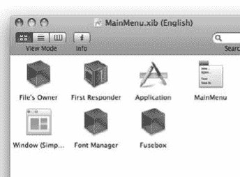

- **列表：** 将 XIB 文件中的对象显示为垂直层次结构。列表视图对于定位窗口中的控件非常有用。当您需要选择嵌入在其他控件中的控件时，它会派上用场（参见图 4-4）。当您想将嵌入的控件移动或复制到另一个对象或控件时，或者想查看上下文中的嵌入控件时，它也很有用。

**图 4-4：使用列表视图查看 XIB 项目的类层次结构。**

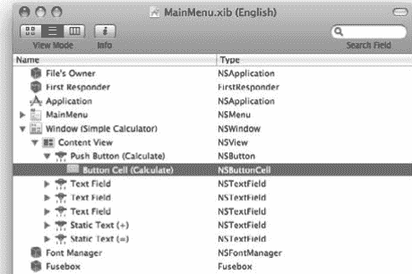

- **列：** 将 XIB 文件中的对象显示为水平层次结构（参见图 4-5）。列视图类似于列表视图，只是它以水平方式显示项目项的层次安排。

**图 4-5：列视图水平显示层次信息。**

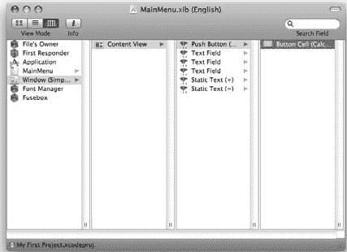

Xcode 为您作为新项目一部分创建的每个新 NIB 文件默认都有六个项目：

- File's Owner（文件所有者）
- First Responder（第一响应者）
- Font Manager（字体管理器）
- Application（应用程序）
- MainMenu（主菜单）
- Window（窗口）

MainMenu 和 Window 是现阶段您需要关注的内容。正如您可能猜到的那样，MainMenu 是编辑界面菜单的地方。Window 是一个窗口对象，您可以将其用于界面中。

#### 设计窗口

设计窗口代表您界面中的一个窗口，也是您添加控件的地方。然后，您的用户使用这些控件来操作您的应用程序。要查看设计窗口：

1. 在 NIB 项目窗口中，双击 Window。

   窗口对象的内容将显示出来，如图 4-6 所示。

2. 窗口打开后，选择一个控件。

   例如，选择 Calculate（计算）按钮。

**图 4-6：设计窗口是布局界面控件的地方。**

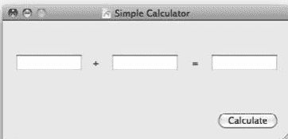

3. 按住 Option 键，并在窗口内移动光标。

   当经过一个控件时，Interface Builder 会显示指南线和数字，告知您所选控件与光标下方控件之间的距离。图 4-7 说明了按钮和答案字段之间的距离。

**图 4-7：选择一个控件并按住 Option 键以显示指南线。**

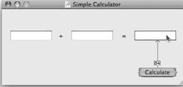

4. 保持按钮选中状态，按住 Option 键并将光标移动到窗口中没有控件的区域。

   您会看到定义所选按钮位置的指南线。图 4-8 显示了按钮在计算器界面中的位置。


您可以通过用鼠标拖动来移动设计窗口中的控件。您也可以选择一个控件并使用方向键移动它。当您在窗口中移动控件时，Interface Builder 会显示指南以帮助您准确放置控件。

图 4-8：按住 Option 键，将光标移出选中的元素，即可查看其坐标。

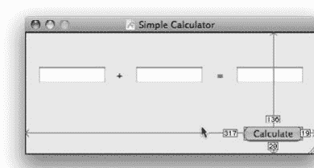

### 资源库窗口

为了创建界面，你需要各种按钮、滑块和其他控件。资源库窗口为你提供这些控件，以便在界面中使用。要查看可用的控件，请遵循以下步骤：

- 1. 选择 **Controls: Library**（控件：资源库）。

资源库窗口会出现，顶部有一排标签页，如图 4-9 所示。

- 2. 点击 **Objects**（对象）标签页，查看可用的控件和其他对象。

- 3. 从资源库顶部列出的框架中选择 **Cocoa**。

资源库窗口按框架组织。选择 Cocoa 会显示可通过 Cocoa 框架使用的控件。

- 4. 搜索控件。

你可以搜索特定的类名，例如 `NSButton`，或者使用描述性术语（如 button）来搜索控件。

表 4-2 描述了资源库窗口中可用的控件集合。

#### 表 4-2 资源库窗口中的对象

| 框架 | 显示这些类型的控件和对象 |
|---|---|
| Cocoa | 窗口、菜单、工具栏、控制器、按钮、单选组、图像井、滑块、进度指示器以及其他对象 |
| Interface Builder Kit | 资源库模板（面向高级用户） |
| Web Kit | 网络视图 |

第 4 章：Interface Builder 71

| 框架 | 显示这些类型的控件和对象 |
|---|---|
| Address Book | 通讯录选择器视图 |
| Automator | 用于将应用程序与 Automator 集成的对象 |


| `DiscRecording` | `MSFormatter`，用于光盘刻录的对象 |
| `Image Kit` | `Image Kit` 浏览器和图像视图 |
| `Open Scripting Kit` | 用于使应用程序可被脚本控制的对象 |
| `PDFKit` | 用于显示 PDF 文档的 `PDFView` 和 `PDFThumbnail` |
| `QuickTime Kit` | 用于播放电影的 `QuickTime Movie` 和用于在捕获视频时显示视频预览的 `QuickTime Capture` 视图 |
| `Quartz Composer` | 用于显示和操作 `Quartz Composer` 组件的对象 |
| `Custom Objects` | 第三方控件或您的自定义控件和对象 |

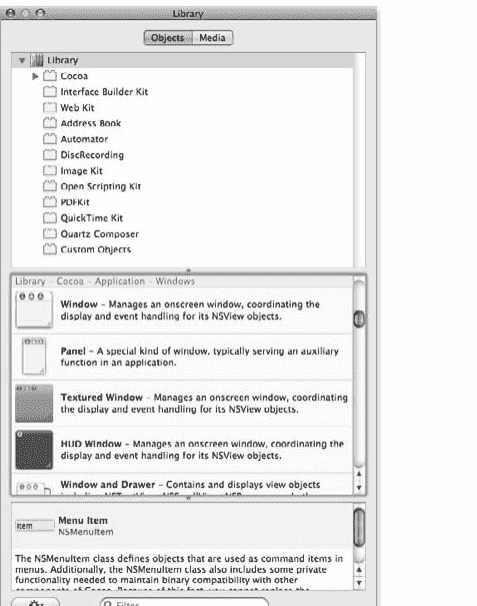

图 4-9：资源库窗口包含您可在界面中使用的各种对象和控件。

`NSMenuItem` 类定义了用作菜单中命令项的对象。此外，`NSMenuItem` 类还包含一些私有功能，以与其他类保持二进制兼容性。

第 9 章将更详细地介绍资源库窗口中的控件。本书各章节也都会涉及资源库窗口的某些方面，因为它是一个重要的窗口！特别是，您最常使用资源库窗口中 Cocoa 部分的控件和对象，因为该集合包含了所有最常见的界面控件。

资源库窗口是创建美观界面的起点和主要工具箱。您将经常使用它。


### 检查器窗口

检查器窗口是另一个重要的窗口，在构建界面时您将频繁使用。检查器窗口显示您在 Builder 中正在处理的任何元素的重要信息。要了解检查器窗口的工作方式，请执行以下步骤：

- 1. **选择 Tools: Inspector**（工具：检查器）。

检查器窗口会出现。检查器窗口的目的是让您有机会查看和编辑 NIB 文件中控件和对象的属性。

- 2. **从您的 XIB 文件中打开一个窗口。**

检查器窗口会显示该窗口的属性（见图 4-10）。检查器窗口有点像变色龙，会随环境改变而改变。如果您打开了一个窗口但其属性未显示在检查器窗口中，请单击该窗口的标题栏。

- 3. **在设计窗口中单击 Calculate（计算）按钮以选中它。**

检查器窗口立即更改为显示该按钮的属性。

- 4. **根据需要修改窗口属性。**

例如，要在检查器窗口中添加按键赋值，请单击 **Key Equiv.** 字段以选中它，然后按 **Return** 键。该字段中会出现一个图标，代表 Return 键（见图 4-11）。

第 4 章：Interface Builder 73

图 4-10：对于窗口，检查器窗口允许您访问各种窗口属性。


图 4-11：选择 Return 以允许用户通过单键访问计算功能。


此赋值有两个效果：

- 它在 Interface Builder 中将 **Calculate** 按钮变为蓝色脉冲颜色，表明它是该窗口中的默认按钮。目的是吸引用户的注意力，因为该按钮触发了用户最可能想在该窗口中执行的功能。

- **Key Equiv.** 赋值使该按钮响应键盘上的 Return 或 Enter 键。现在，用户无需使用鼠标单击按钮，只需按下 Return 或 Enter 键即可进行计算。而且，您仅通过一次点击就获得了所有这些功能。太棒了！

### 菜单编辑器窗口

最后要讨论的窗口是菜单编辑器。菜单编辑器窗口显示应用程序菜单栏的微缩版本。您可以单击菜单以显示其菜单项。修改菜单项的文本或键盘快捷键，或者完全添加新的菜单项，都非常简单。

要为您的应用程序准备菜单，请遵循以下步骤：

- 1. 在 XIB 项目窗口中，双击 **MainMenu**（主菜单）图标。

菜单编辑器会出现。

- 2. 打开 **New Application**（新应用程序）菜单。

- 3. 双击 **About MyFirstProject**（关于 MyFirstProject）菜单项并为其重命名。

例如，将其重命名为 **AboutSimpleCalculator**。您还可以通过单击 **About**（或任何其他菜单）并在信息窗口中进行更改来重命名它。

- 4. 修改 **Hide NewApplication**（隐藏 NewApplication）和 **Quit NewApplication**（退出 NewApplication）菜单。

例如，分别将它们改为 **HideSimpleCalculator** 和 **Quit SimpleCalculator**。图 4-12 显示了在菜单编辑器中修改后的所有三个菜单：About、Hide 和 Quit。


图 4-12：使用菜单编辑器修改菜单项的文本。

- 5. 编辑顶部应用程序菜单项的文本。

图 4-13 显示我将菜单更改为 **Simple Calculator**。

- 6. 选择 **File: Save**（文件：保存）以保存界面更改。

- 7. 按 `⌘+R` 测试界面。

Interface Builder 会隐藏您的 XIB 项目窗口，并显示界面在运行中的应用中呈现的样子。

- 8. 选择菜单项，移动计算器窗口，并在窗口的字段中输入数字。

但是，当您单击 **Calculate** 按钮时，没有任何反应。这是因为您没有使用实际的应用程序。这只是一个界面测试。

虽然 **About SimpleCalculator** 菜单看起来完全正常，但应用程序菜单并未正确显示其名称。相反，它显示 **Cocoa Simulator**，以提醒您查看的是 Interface Builder 的应用程序预览，而不是实际的应用程序。

- 9. 选择 **Cocoa Simulator: Quit Cocoa Simulator** 以返回 Interface Builder。

如果您通过在 Xcode 中运行应用程序来检查它，您将看到在 Interface Builder 中所做的更改。


图 4-13：更改应用程序菜单的名称。


第一部分：开发人员工具

10. 将 Xcode 置于前台，并按 `Command+R` 运行您的应用程序。

有些不对劲，如图 4-14 所示。应用程序菜单仍然卡在 **MyProject** 上。

这里发生了什么？您的应用程序使用其 `Info.plist` 文件中的字符串来提供应用程序菜单的文本，而不是从您在 Interface Builder 中输入的文本获取。真令人费解！

`Info.plist` 是一个包含应用程序信息的文件。您可以在其中找到应用程序的版本号，为应用程序分配图标，并设置应用程序的默认语言，以及其他任务。


图 4-14：尽管在 Interface Builder 中修改了菜单，项目在应用程序菜单中仍显示错误的名称。


11. 按如下方式修改 `Info.plist` 文件：

- a. 在 Xcode 中，展开 **Resources**（资源）组。

- b. 选择 `InfoPlist.strings`。

代码编辑器显示该文件的内容，您可以对其进行编辑。

- c. 将第一行代码更改为：

```
CFBundleName = "SimpleCalculator";
```

12. 在 Xcode 中，按 `Command+R`。

应用程序菜单将以更正后的名称出现。图 4-15 显示了 `InfoPlist` 修改的结果。

13. 点击 Dock 上的 Interface Builder 图标以返回该窗口。

图 4-15：在 Xcode 中调整 Info.plist 字符串文件，以便你的应用程序名称显示在“应用程序”菜单中。


### 构建界面的过程

既然你已经了解了 Interface Builder 的基础知识，是时候开始使用它了。如果你在第二章中构建了界面，你就有一个能相加两个数字的简易计算器。功能有限并不能让计算器变得非常实用。

如果你在第二章中没有构建简易计算器，你可以使用 `My First Project.xcodeproj` 文件。

为了让用户可以选择数学运算，你可以添加一个弹出式菜单。这样你不仅限于加法，还可以创建减法、乘法或除法。这些额外的功能显然使计算器更加实用。

如果你只是将一个新的弹出式按钮拖入你的应用程序界面，并将其连接到控制器类中的一个 outlet（插槽），Xcode 中的头文件将无法获知这一更改。你要么手动修改源文件，要么将新文件与你已创建的文件进行合并。这样做时，你有删除所有现有工作的风险。Interface Builder 提供了针对这一困境的解决方案。当你尝试创建已经存在的头文件和实现文件时，Interface Builder 会询问你更愿意覆盖现有文件（从而删除你之前的工作）还是将新文件与现有文件合并（从而保留你之前的工作）。

图 4-16：为了保留之前的合并记录，请将新的头文件和实现文件与现有文件进行合并。


由于这种特殊考虑，你需要创建文件并将它们添加到 Xcode。如果你的项目中已经存在文件，你可以手动编辑它们或将其与新文件合并：

- 如果你的项目中没有头文件（`.h`）或实现文件（`.m`），请通过选择“文件：编写类文件”来创建它们。

- 如果这些文件已经存在于 Xcode 的项目中，请选择“文件：编写类文件”，并在弹出的对话框中询问时选择合并。当你选择合并文件时，Interface Builder 会启动 `FileMerge` 应用程序，该应用程序处理有时复杂的源代码和头文件合并任务。

如果你对界面进行小幅修改，有时直接在 Xcode 中手动编辑头文件和源代码文件与通过合并流程相比同样简单。

改进现有项目以包括加法、减法、乘法和除法非常简单。我将在下一节中展示如何操作。


#### 添加弹出式菜单

让用户选择功能的一种方式是使用弹出式菜单。请按照以下步骤操作：

1. 在 Interface Builder 中打开一个 XIB 文件。

如果你没有在 Interface Builder 中打开计算器的 `Main.xib`，请从 Xcode 中双击打开它。

2. 双击 XIB 文件窗口中的 Window，打开你界面的窗口。

目前，你的界面在 `numField` 和 `numField2` 之间显示一个加号字段，以表明计算器仅执行加法。

3. 点击加号文本字段将其选中，然后按 Delete 键将其删除。

4. 打开 Library 窗口，搜索 `popup`，将弹出式按钮从 Library 窗口拖到计算器界面中，并点击弹出式按钮以显示其内容。

默认情况下，弹出式菜单有三个菜单项——Item 1、Item 2 和 Item 3。

5. 选择弹出式按钮中的最后一个项目，并选择“编辑：重复”以向弹出式按钮添加新项目。

6. 通过双击项目并更改文本为加法、减法、乘法和除法的数学符号，来编辑每个菜单项的标题。

参见图 4-17。

7. 更改每个菜单项的 Tag 属性。从 0（零）开始，分别将 0、1、2 和 3 分配给加法、减法、乘法和除法。

当你使用计算器时，可以根据 Tag 值识别选中的是哪个弹出式项目。

8. 将弹出式按钮调整到其最小宽度，并将其放置在两个数字字段之间。因为弹出式按钮原本无法完全适合两个字段之间，请调整窗口大小并移动控件，直到按钮合适为止。

图 4-17：将弹出式按钮中的项目更改为代表加法、减法、乘法和除法的数学符号。


#### 添加菜单

除了弹出式按钮之外，让用户能够通过菜单访问不同的数学计算也会很有用。为菜单添加键盘快捷键轻而易举，进而可以让你的用户通过键盘访问弹出式按钮中的数学选项。要创建新的菜单项，请按照以下步骤操作：

1. 从项目窗口打开 `MainMenu.xib` 的菜单编辑器。

2. 从 Library 窗口拖出一个菜单项并放到新的菜单栏上。

3. 将新菜单重命名为 Calculate，并按 Return 键确认新名称。

4. 从 Library 窗口拖出一个菜单项到新的 Calculate 菜单项。

5. 选择三个菜单项中的最后一个，即 Item 3，并按 `Ctrl+D` 重复该项并将其添加到菜单中。

6. 选择第一个菜单项，即 Item 1，并按 `Ctrl+I` 打开检查器窗口。

7. 更改菜单项的属性以匹配图 4-18。将 Title 属性更改为 Add，点击 Key Equiv. 字段，并在键盘上按 `+` 为该菜单项分配快捷键。

默认情况下，会出现一个包含三个项的新菜单。


8. 按照与第 6 步和第 7 步类似的步骤，将新的菜单项更改为图 4-19 所示的样子。

9. 将每个项目的 Key Equiv. 属性更改为相应的符号：`+`、`*` 和 `/`。从 0（零）开始，为每个菜单项分配唯一的 Tag 值。


## 创建控制器类

因为你在更新现有项目，所以该项目已经有一个控制器类（`Fusebox`）。因此，你可以跳过此步骤。通常此步骤是必需的，但这次不需要。如果你不是在更新现有项目，请通过将 `NSObject` 从 Library 窗口拖到项目窗口，并在检查器窗口中更改其类型来创建控制器类。

## 连接界面

完成界面后，你必须将其连接到动作（actions）和插槽（outlets）。请按照以下步骤操作：

1. 在 XIB 项目窗口中，选择 `Fusebox` 对象并按 `⌘+6`。

检查器窗口将出现，显示 `Fusebox` 的插槽和动作。

2. 添加一个 `operationPopup` 插槽，它对应于你项目窗口中的弹出式按钮。

3. 在检查器窗口中，创建一个新动作：`changeOperation:`，确保包含末尾的冒号。

图 4-20 显示了 `Fusebox` 类的新插槽和两个动作。

4. 为了连接你的界面，在 XIB 窗口中从 `Fusebox` 对象按住 Control 键并拖到界面中的新 `popupButton`。在出现的黑色连接列表叠加层中，选择 `operation` 插槽。

5. 双击项目窗口中的 `MainMenu` 项以打开菜单编辑器。

6. 从 Calculate 菜单中选择 Add 菜单项，并从该项按住 Control 键拖到 `Fusebox` 类。从黑色连接列表叠加层中，选择 `changeOperation` 动作。

7. 对于 Calculate 菜单中的每个菜单项，从菜单项按住 Control 键拖到 `Fusebox` 并将其连接到相同的 `changeOperation` 动作。

完成后，检查器窗口的样子如图 4-21 所示。


图 4-20：向 `Fusebox` 添加动作以涵盖 Calculate 菜单中的操作。


图 4-21：将 Calculate 菜单中的各个菜单项连接到新动作。

8. 创建文件并将它们添加到 Xcode。如果文件已存在，请手动编辑它们或将其与新文件合并。

由于你的项目文件已存在于 Xcode 中，因此在此处需要小心操作。你只向 `Fusebox` 控制器添加了一个新动作和一个新插槽，因此手动将它们添加到现有文件中并不容易难，你将在新章节中这样做。

9. 选择“文件：保存”以保存 XIB 文件。

你已完成 Interface Builder 的工作。

#### 在 Xcode 中使用界面

既然你完成了界面改进，你需要返回 Xcode 并添加一些代码。首先，你需要在 `Fusebox.h` 文件中定义几项内容。由于你向控制器添加了一个插槽和一个动作，你也需要在 `Fusebox.h` 中做同样的操作：

## 第一部分：开发工具

1. 修改 `Fusebox.h` 文件，内容如下：

```objectivec
/* Fusebox */
#import <Cocoa/Cocoa.h>
@interface Fusebox : NSObject
{
    IBOutlet id answerField;
    IBOutlet id numberField1;
    IBOutlet id numberField2;
    IBOutlet id operationPopup;
}
-(IBAction)calculateAnswer:(id) sender;
-(IBAction)changeOperation:(id) sender;
@end
```

2. 选择“文件：保存”（File: Save）以保存头文件。

3. 选择 `Fusebox.m` 以编辑其代码。

4. 修改 `calculateAnswer` 函数，添加一个用于跟踪弹出按钮中当前选中项的整数：


```objectivec
int operation;
```

5. 通过向弹出按钮发送 `selectedTag` 消息来确定用户选择了哪一项。

执行此操作时，弹出按钮会返回其当前选中项的标签，将其存储在 `operation` 变量中。弹出按钮中的第一个菜单项的标签为 0（零），因此 `operationPopup` 控件中的所有项目都由索引 0 到 3 覆盖：

```objectivec
operation = [operationPopup selectedTag];
```

6. 在知道用户从 `operationPopup` 中选择了哪一项后，根据该索引执行相应的数学运算：

```objectivec
switch (operation) {
    case 0://加法
        answer = num1 + num2;
        break;
    case 1://减法
        answer = num1 - num2;
        break;
    case 2://乘法
        answer = num1 * num2;
        break;
    case 3://除法
        answer = num1 / num2;
        break;
}
```

完整的 `calculateAnswer` 动作代码如下。

```objectivec
- (IBAction)calculateAnswer:(id)sender {
    float num1,num2,answer;
    int operation;
    num1 = [numberField1 floatValue];
    num2 = [numberField2 floatValue];
    operation = [operationPopup selectedTag];
    switch (operation) {
        case 0://加法
            answer = num1 + num2;
            break;
        case 1://减法
            answer = num1 - num2;
            break;
        case 2://乘法
            answer = num1 * num2;
            break;
        case 3://除法
            answer = num1 / num2;
            break;
    }

    NSNumberFormatter *answerFormatter = [
        [[NSNumberFormatter alloc] init]
        autorelease];

    [answerFormatter setFormat:@"#,##.00;##.00; (#,##.00)"];
    [answerField cell setFormatter:answerFormatter];
    [answerField setFloat:answer];
}
```

7. 为了计算出现在菜单栏中的菜单，向 Fusebox 添加一个新动作：`changeOperation`。

当用户选择特定的菜单项时，代码会将 `operationPopup` 控件更改为与该菜单项中的运算相匹配。例如，如果用户选择“Add”（加法）菜单项，代码会将 `operationPopup` 控件的索引设置为 0（零）。“Subtract”（减法）菜单项会将 `operationPopup` 控件的索引设置为 1，以此类推。代码如下所示：

```objectivec
(IBAction)changeOperation:(id)sender {
    [operationPopup selectItemAtIndex:[sender tag]];
}
```

完整的 `Fusebox.m` 源文件将 `calculateAnswer` 动作和新的菜单项动作合并到一个文件中。为了保持条理清晰，以下是完整的 `Fusebox.m` 文件：

```objectivec
#import "Fusebox.h"

@implementation Fusebox
-(IBAction)calculateAnswer:(id)sender {
    float num1,num2,answer;
    int operation;
    num1 = [numberField1 floatValue];
    num2 = [numberField2 floatValue];

    operation = [operationPopup selectedTag];
    switch (operation) {
        case 0://加法
            answer = num1 + num2;
            break;
        case 1://减法
            answer = num1 - num2;
            break;
        case 2://乘法
            answer = num1 * num2;
            break;
        case 3://除法
            answer = num1 / num2;
            break;
    }

    NSNumberFormatter *answerFormatter = [
        [[NSNumberFormatter alloc] init]
        autorelease];

    [answerFormatter setFormat:@"#,##.00;##.00; (#,##.00)"];
    [answerField setFormatter:answerFormatter];
    [answerField setFloat:answer];
}

-(IBAction)changeOperation:(id)sender {
    [operationPopup selectItemAtIndex:[sender tag]];
}
@end
```

8. 选择“文件：保存” (`File: Save`) 以保存 `Fusebox.m` 文件。

9. 选择“构建：构建并运行” (`Build: Build and Go`) 以查看您的工作成果。

其结果是一个执行加法、减法、乘法和除法的应用程序。您可以通过从界面的弹出按钮中选择、从菜单栏的“Calculate”（计算）菜单中选择，或使用“Calculate”菜单中列出的键盘快捷键来选择数学运算。图 4-22 显示了完成的计算器应用程序。


如果在界面构建过程或代码添加过程中迷失了方向，您可以从 `www.dummies.com/go/cocoafd` 获取完整的项目。完成的项目位于以下目录中：

```text
Chapter 4/End Code/Calculator
```

### 第 5 章

#### 为应用添加润色细节

**本章内容**

- 实现“关于”页面
- 重命名应用程序
- 设置应用程序版本
- 创建和设置应用程序图标
- 分发应用程序

在完成界面构建、代码编写和应用调试后，您将需要对其进行准备并构建为可独立执行的文件以便分发。您可能会认为，在设计和编写应用程序后，它已准备好向世界展示，但在通过 Mac 用户的考验（他们可能要求很高！）并真正准备好公开发布之前，您仍需完成几个步骤。

Mac 用户期望“良好”的 Mac 应用程序具备某些特定元素。在本章中，我将向您展示您可以添加到应用程序的一些最常见功能，以及在将其发布给朋友、家人、同事或公众之前需要调整的设置。

您的大部分开发任务都在 Xcode 和 Interface Builder 中进行。本章中的一些项目可以在 Xcode 和 Interface Builder 中完成。然而，这些并不是苹果为创建 Cocoa 应用程序提供的所有工具。在您的开发者文件夹的“应用程序” (`Applications`) 文件夹中，您可以找到十多种额外的工具和实用程序，它们有助于您创建出色的 Cocoa 软件。本章将展示如何使用其中两个：Icon Composer 用于创建图标，icns Browser 用于管理项目中的图标。随所有 Mac 附带的磁盘工具（Disk Utility）也将在本章中亮相。

#### 添加“关于”面板

每个应用程序菜单中都有一个标题为“关于 My Application”（About My Application）的菜单项，其中 My Application 是您的应用程序的名称。这通常被称为“关于”菜单，点击它会打开“关于”面板。“关于”面板传达关于应用程序的重要信息（想象一下！）。多年来，开发人员自己创建“关于”面板（有时称为“关于”框或“关于”窗口），但苹果已将其使用标准化。根据苹果的指导原则，“关于”面板可以显示应用程序的以下信息：

- **名称或标题**：应用程序的名称
- **图标**：应用程序的图标
- **版本号**：一个数字，如 1.0，表示这是哪个版本
- **版权日期**：声明应用程序受版权保护的年份的版权声明
- **鸣谢**：关于应用程序的其他相关信息，通常包括构建该应用的团队姓名和其他致谢

应用程序默认在“关于”面板中并不包含所有这些元素。您必须将它们添加到“关于”面板中，或者修改项目设置以使其出现在“关于”面板中。图 5-1 显示了默认的“关于”面板，其中包含应用程序名称和版本号，当您创建一个 Cocoa 应用程序时（在本例中，应用程序名为 Utility）。


在修改了适当的设置并向项目中添加了一些项目后，生成的“关于”面板看起来更有趣，对用户也更有用。图 5-2 显示了一个包含“关于”面板基本元素的“关于”面板。

### 第一部分：开发人员工具

这么大的项目肯定需要编写一些代码，对吧？并非如此！只需设置几个参数并添加必要的文件，Cocoa 就会帮你处理剩下的工作！

图 5-2：增强后的“关于”面板外观更加美观，且对用户更有帮助。


自定义“关于”面板所需的大部分设置都在项目的 `Info.plist` 文件中。该文件位于项目的资源（Resource）文件夹内。图 5-3 展示了其在项目窗口中的位置。

`Info.plist` 文件略有特殊。从本质上讲，它只是一个文本文件，但它包含 XML（可扩展标记语言），可以被专用应用程序解析，例如属性列表编辑器（Property List Editor）。该工具位于开发工具文件夹（Developer folder）内的应用程序文件夹（Applications folder）中（属性列表编辑器位于其中的实用工具文件夹（Utilities folder）内）。

图 5-3：`plist` 文件包含应用程序的重要设置。


不过，你不必大费周章，因为 Xcode 也能解析 `Info.plist` 中的数据。Xcode 不会将文件显示为普通的纯文本，而是解析数据并将其显示为层次树（即 XML 的结构形式）。层次中的每个元素由一个键值对组成。你可以双击任何值，并在 Xcode 内部进行修改。

#### 设置图标

“关于”面板顶部显示应用程序的图标，该图标能让你一眼识别出应用程序，但主要起美观作用。为应用程序设置图标后，“关于”面板中的图标也会随之更改。要设置图标，你需要做两件事：

- 1. 通过拖放操作，将图标（扩展名为 `.icns` 的文件）添加到项目窗口中。

通常，图标文件放置在项目的资源（Resources）文件夹中。在本章中，我将向你展示如何使用图标编辑器（Icon Composer）制作图标。

- 2. 在 `Info.plist` 中，在“图标文件”（Icon File）字段中输入图标的名称。

请按照在 Finder 中看到的那样准确输入图标文件的名称。但是，文件扩展名（`.icns`）是可选的。

图 5-4 显示图标文件 `Utility.icns` 已被添加到项目中。


#### 设置名称或标题

接下来，你可能需要更改“捆绑包名称”（Bundle Name），以影响显示在“关于”面板中的应用名称。这通常是“关于”面板中最重要的元素，因为该面板会在你点击“关于本应用程序”（About This Application）菜单项时出现。标题仅用于标识该应用程序。

你可能会被 `Info.plist` 中紧邻“捆绑包名称”的下一个项所吸引，但不要修改它。相反，请在项目目标（target）的信息窗口（Info window）中设置应用程序的名称。默认情况下，项目会将 `Info.plist` 中的“捆绑包名称”赋值为 `${PRODUCT_NAME}`。这意味着名称来自项目的其他位置，因为 `${PRODUCT_NAME}` 是一个变量。当你更改项目目标信息窗口中的值时，`Info.plist` 会在运行时自动反映这些更改。

产品默认名称通常与项目名称相匹配，但不一定如此。要更改产品名称，进而更改显示在“关于”面板中的应用名称，请遵循以下步骤：

- 1. 在项目中找到并展开“目标”（Targets）文件夹。

“目标”文件夹有一个红色的靶心图标，很容易找到。

- 2. 在“目标”文件夹中选择应用程序目标。

该目标将拥有一个你能识别的名称；很可能与项目目标本身的名称相同。图 5-5 显示了所选的目标。


- 3. 点击项目工具栏中的“信息”（Info）按钮，打开信息窗口。
- 4. 在信息窗口中，点击“构建”（Build）选项卡。
- 5. 找到并更改“产品名称”（Product Name）的键值。

“产品名称”位于信息窗口的“打包”（Packaging）部分，如图 5-6 所示。更改“产品名称”将使你的构建应用程序拥有新的名称，且该新名称将反映在“关于”面板中。


#### 显示版本号、版权日期和致谢

除了使用标题来标识应用程序外，在“关于”面板中提供版本号、版权声明和致谢也是一个好主意：

- 版本号帮助用户一眼就知道他们正在使用应用程序的哪个版本，以防他们想知道何时下载新版本。
- 版权日期有助于提醒你作品已受版权保护，同时也提供了一个方便的时间戳。
- “关于”面板中的致谢允许你感谢协助创建应用程序的各个成员。此元素并非严格必需，但有时炫耀一下你的应用程序感觉也不错。

要在“关于”面板中显示应用程序的版本号，请更改 `Info.plist` 中的“捆绑包版本”（Bundle version）键。图 5-7 显示了版本 1.5。


图 5-7：更改“捆绑包版本”键，以影响显示在“关于”面板中的版本号。

你可以使用 `Info.plist` 中的“版权”（Copyright）键在“关于”面板底部显示版权日期。默认情况下，“版权”键不存在，因此你必须添加它。请遵循以下步骤：

- 1. 在 `Info.plist` 中，选择层次结构中的“信息属性列表”（Information Property List）项，如图 5-8 所示。
- 2. 点击“值”（Value）列右侧的按钮，向 `Info.plist` 添加新键。从可能的键列表中选择“版权（可读形式）”（Copyright (Human-Readable)）。
- 3. 将“版权（可读形式）”键的值更改为你希望显示在“关于”面板底部的任何内容。

图 5-9 展示了一个完整的“版权（可读形式）”键。


图 5-8：在 `Info.plist` 中选择“信息属性列表”。


图 5-9：向 `Info.plist` 添加“版权（可读形式）”键，以在“关于”面板底部显示版权信息。

你可以在“关于”面板的模式文本（mode of the About Panel）滚动文本字段中显示各种有趣且有用的致谢内容。你只需向资源文件夹添加一个“致谢”（Credits）文件即可。“致谢”文件可以是富文本文件（`.rtf` 或 `.rtfd`）或 HTML（超文本标记语言）文件。两者都可以显示样式化文本和图像；HTML 可以显示可点击的链接，这对于添加公司网址或支持邮箱很有用。请预先了解，HTML 文件本身不包含图像；相反，它们引用单独的图像文件。因此，如果你计划使用 HTML 来显示图形，请仅使用 HTML 来显示图形。图 5-10 显示了项目中的富文本“致谢”文件。


图 5-10：向项目添加一个文件，以在“关于”面板中显示样式化文本和图形。

## 为你的项目分配图标

用户注意到的你的应用程序的第一个特征之一就是它的图标。当你首次使用 Xcode 构建应用程序时，它会分配一个通用应用程序图标，如图 5-11 所示。


图 5-11：Xcode 为它构建的所有应用程序分配通用图标。


你可以通过向项目添加图标（ICNS）文件并在 `Info.plist` 中设置“图标”（Icon）键，来为你的应用程序分配不同的图标。但在这样做之前，你首先需要有一个图标文件。苹果提供了两个实用工具来帮助你处理图标文件：图标编辑器（Icon Composer）和 ICNS 浏览器（icns Browser）。

### 图标编辑器

图标编辑器是一个用于构建 ICNS 图标文件的工具。你可以使用它将特定图标的各种可能尺寸收集到一个 ICNS 文件中。你可以在此处找到图标编辑器：

```
/Developer/Applications/Icon Composer
```

要创建自己的 ICNS 文件，你需要一个图像处理应用程序，例如 Adobe Photoshop、Photoshop Elements、Pixelmator、GIMP 或 Graphic Converter。然后遵循以下步骤：

- 1. 在你的图像处理应用程序中，创建一个尺寸为 512 x 512 像素的新 RGB（红、绿、蓝）文档。

这就是你用来创建图标图像的文档。

- 2. 使用应用程序中的各种图形工具，创建你想用作图标的图像。

- 3. 如果图像没有占满整个 512 x 512 像素区域，请删除未使用的部分。

- 4. 将结果保存为支持透明度的 PNG 格式。


保持图像未使用部分空白，因为图标可以是透明的。此外，请停用任何背景图层以维持透明度。

PNG 格式支持透明度。图 5-12 显示了用于图标的示例 Photoshop 图像。请注意背景中出现的棋盘格图案，它代表图像的透明部分。当添加到图标编辑器中的图标时，这部分也将是透明的。

当你完成图标艺术的设计与创建后，可以使用图标编辑器构建图标文件：

- 1. 在 Finder 中双击图标编辑器的图标以启动它。

打开一个空的图标模板，如图 5-13 所示。

- 2. 将 PNG 图像从 Finder 拖放到图标编辑器中的 512 x 512 正方形区域内。

图标编辑器会显示一个窗口，询问你是否希望使用此 PNG 图像作为图标中其他所有图像组件，如图 5-14 所示。


图 5-12：别忘了从背景中移除未使用的部分。


图 5-13：图标生成器（Icon Composer）向您展示一个空白的图标模板。

# 第 100 页 第一部分：开发者工具

图 5-14：当您向图标文档中添加图像时，图标生成器会询问您是否希望将该图像用于其他图标尺寸。


3. 选择“复制到所有更小尺寸”，然后点击“导入”按钮。

图标生成器导入图像并将其添加到所有图像尺寸中，如图 5-15 所示。

图 5-15：图标生成器可以自动为您缩放图标尺寸。


5. 选择“文件：导出”，将图标导出为 ICNS 文件。

务必为 Xcode 使用 ICNS 文件格式。

6. 若要使用 ICNS 文件，请将其拖入项目文件夹的“资源”文件夹中。

7. 在 `Info.plist` 文件中选择“Bundle 图标”条目。

我将在本章前面的“设置图标”部分中描述具体方法。

下次构建该项目时，生成的应用程序将使用新添加的 ICNS 文件作为其图标。双击该应用程序以启动它，您也会在程序坞中看到新的图标。

## 管理您的图标

与允许您创建图标文件的图标生成器不同，图标浏览器（icons Browser）应用程序严格来说只是一个图标查看器。使用图标浏览器，您可以查看任何 ICNS 文件的内容，但无法更改这些内容。

图标浏览器对于查找特定应用程序未能正确显示图标的原因非常有用。例如，当以 128 x 128 查看时，您的应用程序可能显示一个外观精美的图标，但在 32 x 32 大小时显示为空。图标浏览器可以帮助您发现哪些图标元素缺失，以便您修正这种情况。

图标浏览器位于此处：

```
/Developer/Applications/icns Browser
```

要了解图标浏览器如何工作，请启动它并选择“文件：打开”以打开您使用图标生成器创建的 ICNS 文件。您将看到类似图 5-16 的内容。请注意，图标文件中的几个元素缺失。

这个 ICNS 文件并不包含 ICNS 文件中的所有元素，因为它是专门为 Mac OS 制作的。此图标文件中的空白元素用于维持与较早版本 Mac OS 的兼容性。作为 Cocoa 程序员，您本来就无法针对较早版本的 Mac OS 进行开发，所以忘掉那些旧技术吧！Mac OS 足够智能，可以将较大的图标缩小用于较小尺寸。您会注意到图标浏览器应用程序有点过时了，因为它不支持 512 x 512 或 256 x 256 的图标。不过，它仍然是一个用于健全性检查的有用工具。


## 创建分发用的磁盘镜像

在使用 Cocoa 构建完一个完整的应用程序后，您无疑希望将其分发给朋友、同事，甚至可能通过互联网分发给全世界。向用户提供应用程序最简单的方法是将其放在磁盘镜像上。磁盘工具（Disk Utility）是伴随 Mac OS 提供的工具，如果您不熟悉它，它位于此处：

```
/Applications/Utilities/Disk Utility
```

要为应用程序创建一个新的磁盘镜像，请执行以下步骤：

1. 启动磁盘工具。

2. 选择“文件 > 新建 > 空白磁盘镜像”。

会打开一个窗口，要求您为新磁盘镜像命名，如图 5-17 所示。

3. 为文件和卷命名，并分配卷大小、卷格式和镜像格式：

   - **另存为：** 您的磁盘镜像的名称。

   - **卷名称：** 当用户双击磁盘镜像时，出现在挂载卷上的名称。

   - **卷格式：** 您可以以多种格式创建磁盘镜像，但一般来说，如果您想向他人分发应用程序，应使用 Mac OS 扩展格式。

# 第 5 章：为您的应用程序添加精饰 103

   - **卷大小：** 确保卷大小足以容纳您的应用程序和您希望包含的任何辅助文件。如果卷大小太大也不必担心，您可以稍后压缩它。事实上，请确保卷大小大于应用程序和辅助文件的大小，以防您稍后想向镜像中添加其他内容。您可以在 Finder 中选择应用程序的父文件夹并选择“文件 > 获取信息”来找到应用程序及其辅助文件的总大小。

   - **加密：** 您可以加密磁盘镜像，但对于大多数用途，您不需要此功能，可以安全地将其设置为“无”。如果您需要防止他人窥视磁盘安全，加密磁盘镜像可以让您为镜像设置密码保护。只有知道密码的人才能打开磁盘镜像。

   - **分区：** “分区”设置允许您将磁盘拆分为多个部分。通常，如果您想让软件以磁盘镜像形式提供，不需要调整此设置。除非您要创建用于刻录 CD 的磁盘母片，否则通常在“分区”弹出菜单中选择“单一分区 — Apple 分区映射”。

   - **镜像格式：** 设置为可读写。这允许您从磁盘镜像中读取和写入数据，如果您以后想向磁盘镜像添加更多文件，这将非常有用。


图 5-17：为磁盘镜像命名并设置其属性。

# 第 104 页 第一部分：开发者工具

4. 点击“创建”。

磁盘工具运转片刻，并在您指定的位置生成所需的磁盘镜像。

5. 在您在步骤 4 中指定的位置找到磁盘镜像并双击它。

如果磁盘镜像尚未自动挂载新的卷，它将进行挂载。

6. 将您的应用程序和任何额外文件复制到新卷中。

7. 当磁盘镜像处于前台时，按 `Cmd+E` 弹出该卷。

8. 返回磁盘工具，通过“文件：打开磁盘镜像”打开磁盘镜像。

磁盘工具打开并挂载该镜像，如图 5-18 所示。

9. 选择“镜像：转换”，将磁盘镜像转换为压缩格式。为新磁盘镜像命名，并从“镜像格式”下拉菜单中选择“压缩”，如图 5-19 所示。

10. 点击“保存”以创建新的磁盘镜像。当磁盘工具完成后，您可以将生成的磁盘镜像上传到 Web 服务器或通过电子邮件发送给他人。


图 5-19：创建一个新的压缩磁盘镜像，以消除原始磁盘镜像中的多余空间。


## 第二部分

Instant Cocoa 与 Objective-C 语言

《第五波》 作者：Rich Tennant


> “你知道的孩子们——你不能随便买任何 Web 编辑软件。”

### 本部分涵盖的内容...

Cocoa 程序员使用一种专门的语言，它是流行 C 语言的一个“大兄弟”，称为 Objective-C。第二部分将从为您提供理解这种外观奇特的语言所需的信息开始。您将看到 Objective-C 语言如何工作，如何处理面向对象编程，以及它与“小妹妹” C 语言有什么共同之处。

在第二部分的剩余部分中，您将通过处理类、窗口以及 Cocoa 框架提供的海量控件，继续扩展您的 Cocoa 界面知识。

## 第 6 章

### Objective-C 基础

本章要点

- 使用面向对象编程

- 了解类、变量和方法之间的区别

- 理解并使用 Objective-C 进行编码

- 使用您自己的类

Objective-C 是大多数开发人员用于编程 Cocoa 应用程序的语言。虽然它不是您可以用于 Cocoa 开发的唯一语言，但它远非最流行的。Objective-C 是流行的 C 编程语言的一个超集，它与 SmallTalk 有着惊人的相似之处（这并非巧合）。如果您已经是一位经验丰富的 C 程序员，您会发现 Objective-C 让您感觉身处熟悉的环境中，只是多了一些“女士”（双关语，指代对象/指针等概念）。如果您不太精通 C 语言但了解另一种编程语言，您可能仍然能弄清楚正在发生的事情。

本章探讨了面向对象编程的基础和 Objective-C 语言。在您掌握 Objective-C 的工作原理后，本章通过构建项目并使用 Objective-C 来帮助您巩固技能。在此过程中，您将了解如何在代码中创建对象。下一章将回顾 Objective-C 中的另一个重要主题：类方法。本章最后讨论了在 Objective-C 中命名事物时应采用的方式。命名方案在 Objective-C 中起着重要作用。正如您所见，本章是一系列小事实的集合。这些知识点构成了一个更大的信息体系，您在每次使用 Objective-C 语言进行 Cocoa 编程时都会用到。

#### 为什么要使用面向对象编程？

Objective-C，正如您可能已经猜到的，通过添加面向对象功能来扩展 C。面向对象编程是一种范式，它要求将相关的数据和功能组合成一个称为对象的构造。

### 110 第二部分：即时 Cocoa 与 Objective-C 语言

由于对象将数据和功能捆绑在一个“包”中，你的编程工作将获得以下几方面好处：

- 设计和编写面向对象的软件变得更加容易。面向对象计算机编程（OOP）中的对象（请注意不要与（OOPS!）混淆）类似于现实世界中的对象。考虑一个日常物品，例如厨房窗户，它具有高度、宽度、玻璃颜色和厚度等属性。同样，像计算机窗口这样的 OOP 对象也具有高度、宽度和颜色等属性。

- 你可以对一个对象（如厨房窗户）执行多种操作。你可以打开它、关闭它、清洗它，甚至可以弄坏它。再次类比，OOP 窗口也是如此。你可以打开它、关闭它，还可以改变其大小。但是，我希望你不要尝试弄坏它。

- 你可以将应用程序的各种元素作为对象进行分类，使它们之间形成某种模块化的关系，从而大大加快应用程序的编程过程。OOP 帮助你构建非常复杂的软件结构，同时仍能让你轻松掌握各项事物。

- 因为 OOP 使你的软件模块化，所以你的软件更容易维护，在损坏时更容易修复，或在以后想要升级时更容易修改。

#### 类别 1 并非对象！

OOP 中的对象，就像现实世界中的对象一样，具有属性和功能。Objective-C 将这些称为实例变量和方法。方法决定了对象具有什么功能，并且它们操作对象的实例变量，即对象的属性。

例如，每个 GUI（图形用户界面）应用程序都使用窗口。窗口对象可能具有描述其高度、宽度和颜色的实例变量。它的方法会对这些实例变量执行某些操作。一个方法可能会改变窗口的高度。另一个方法可能会改变其宽度。还有一个方法可能会改变颜色。

对象的方法就像实例变量的守门人。在 Objective-C 中，其他对象及其方法不能直接访问实例变量。相反，它们必须通过方法来访问实例变量。

#### 声明实例变量

正如名称所暗示的那样，类的实例是归属于类的实例的变量。实例也就是对象的另一个名称。Objective-C 变量，就像许多其他编程语言中的变量一样，是对对象特定状态数据的引用。例如，要声明一个引用按钮控件 `aButton` 的实例变量，你的接口看起来应该是这样：

```objective-c
@interface MyClass : NSObject
    UIButton *aButton;

@end
```

代码是这样工作的：

- `@interface` 开始类声明，`@end` 表示类声明的结束。

- `MyClass` 是类的名称，`NSObject` 是 `MyClass` 继承的父类。`NSObject` 是一个通用的类类型，它是所有类的最终父类。

- 类声明内包含两个括号。你必须在接口文件的这些括号内声明实例变量。

接口文件是你项目中扩展名为 `.h` 的文件，在 C 语言中称为头文件。接口文件通常以导入语句开始，以加载适当的框架。C 程序员会加载库（事实上，在 Objective-C 中也允许使用库）：

```objective-c
@import <Cocoa/Cocoa.h>
```

对象指针并不是唯一可以声明为实例变量的类型。类接口中也可以合法使用所有 C 变量类型：

```objective-c
@interface MyClass : NSObject
    UIButton *aButton;
    int age;
    float percent;

@end
```

### 112 第二部分：即时 Cocoa 与 Objective-C 语言

Objective-C 还有你可能从 C 语言中熟悉的数据类型的新版本和改进版本。例如，C 中的 `bool` 在 Objective-C 中是 `BOOL`，它也可以用来声明实例变量：

```objective-c
@interface MyClass : NSObject {
    UIButton *abButton;
    int age;
    float percent;
    BOOL collapsed;
}
@end
```

#### 声明方法

除了实例变量，你在接口中还能找到方法声明。然而，与实例变量不同，方法声明出现在花括号之后（但在 `@end` 之前）。下面是一个 `doSomething` 方法的声明：

```objective-c
@interface MyClass : NSObject {
    UIButton *abButton;
    int age;
    float percent;
    BOOL collapsed;
}
-(void)doSomething;
@end
```

如果你是从 C 语言转向 Objective-C，你会立刻注意到一些不同之处。Objective-C 中所有方法声明都以破折号（-）开头。之后，你用括号分配一个返回类型（在本例中为 `void`）。返回类型的工作方式与 C 语言中的类似。方法可以返回一个值，也可以像 C 语言一样分配 `void`。在返回类型名称之后。按照惯例，方法名称以小写字母开头。还要注意，`doSomething` 方法没有参数。在下面的例子中，`doSomethingElse` 被声明有一个参数，一个 `NSString`：

```objective-c
@interface MyClass : NSObject {
    UIButton *abButton;
    int age;
    float percent;
    BOOL collapsed;
}
```

### 第 6 章：Objective-C 基础

- (void)doSomething;

- (void)doSomethingElse:(NSString *)aString;

@end

方法名称后跟冒号，然后是括号内的参数数据类型。参数名称出现在声明中，这与你可能习惯的 C 函数声明略有不同，但到目前为止还不太奇怪。

然而，当你开始为方法添加更多参数时，对于 C 程序员来说，事情开始显得非常奇怪。除了拥有名称外，除第一个参数外的每个参数还有一个标签。在下面的例子中，`drawString` 有两个参数：`aString` 和一个 `int`。第二个参数带有标签 `atThisXPosition`。

```objective-c
@interface MyClass : NSObject {
UIButton *aButton;
int age;
float percent;
BOOL collapsed;
}
- (void)doSomething;
- (void)doSomethingElse:(NSString *)aString;
- (void)drawString:(NSString *)aString
atThisXPosition:(int)xPos;
@end
```

对于 C 开发人员来说，这看起来可能非常特别，但你很快就会适应它。你会发现你更喜欢它，因为每个参数都在声明本身中进行了记录。当你添加额外参数时，只需追加一个标签、冒号、括号内的数据类型和参数名称即可。例如，这里是具有三个参数而不是两个的 `drawString` 方法：


```objective-c
@interface MyClass : NSObject {
UIButton *aButton;
int age;
float percent
BOOL collapsed;
}
- (void)doSomething;
- (void)doSomethingElse:(NSString *)aString;
- (void)drawString:(NSString *)aString
atThisXPosition:(int)xPos atThisYPosition:(int)yPos;
@end
```

#### 在接口文件中定义方法

在接口文件中定义类之后，你可以转到实现文件。实现文件的文件扩展名为 `.m`，如 `MyClass.m`。这是你定义类中各种方法的地方。实现文件通常以导入语句开始，以加载接口文件：

```objective-c
#import "MyClass.h"
```

实现和结束行位于导入语句之后，在其中你定义类的方法：

```objective-c
#import "MyClass.h"

@implementation MyClass
@end
```

到目前为止，当你创建新类时，Xcode 已经为你完成了这些工作。然后你定义接口文件中出现的各种方法。遵循前面的接口文件示例，实现文件看起来像这样：

```objective-c
#import "MyClass.h"

@implementation MyClass
-(void)doSomething {

-(void)doSomethingElse:(NSString*)aString {

-(void)drawNSString:(NSString*)NSString
atThisPosition:(int)xPos atThisPosition:(int)yPos {

@end
```

这里定义了每个方法。它们看起来就像接口文件中的声明，但不是以分号结束；而是用花括号开始和结束方法。你将每个方法的代码放在这些花括号之间。再次说明，C 程序员在这里应该觉得比较熟悉，因为 C 语言也这样做（C++、Java，甚至 JavaScript 也是如此）。

## 使用 Objective-C 编程

声明一个类、为其声明添加实例变量和方法，并搭建好实现文件的框架后，是时候编写一些代码了！

### 向对象发送消息

Objective-C 中最基本的概念之一是一个对象能够向另一个对象发送消息的能力。在 Objective-C 中，通常通过向对象发送消息来指示其执行某个方法。Objective-C 使用方括号来表示正在向对象发送消息。


发送消息与其他编程语言中调用函数类似。

对于一个通用对象（命名为 `object`），你可以通过如下方式向其发送一条消息（命名为 `message`）：

```objective-c
[object message];
```

注意两点：

- 该语句的语法使其行为很像英语中的命令。例如，你可能会对出租车司机说：

```objective-c
Driver, go!
```

在 Objective-C 中，同样的命令看起来像这样：

```objective-c
[driver go];
```

- 每行代码都以分号结尾。除了 C 语言中通常省略分号的地方（例如 `if` 语句）外。Objective-C 也要求在每行代码末尾加分号。毕竟 Objective-C 也是 C！

### 传递参数

与传统 C 函数一样，Objective-C 允许你向方法传递参数（也称为实参）。回到出租车的比喻，你可能想告诉司机去哪里：

```objective-c
Driver, go left!
```

在 Objective-C 中，该命令可能看起来像这样：

```objective-c
[driver go:left];
```

对于 C 程序员来说，`go` 方法大致类似于标准 C 函数。但是，如果你添加另一个参数，这种类比就会失效。例如，假设你想向 `go` 方法传递两个参数（`direction` 和 `distance`）：

```objective-c
[driver go:left distance:10];
```

在 Objective-C 中，第一个参数跟随在方法名称（在此情况下为 `go:left`）后的冒号之后。每个后续参数都有一个名称，后跟一个参数（在此实例中为 `distance:10`）。相比之下，类似的 C 函数可能是

```objective-c
go(left,10);
```

在 Objective-C 中，第一个参数的含义通常根据方法名称即可明了。其他参数有名称，帮助你识别其用途。


### 返回值

与 C 函数一样，Objective-C 方法也可以返回值。如果你告诉出租车司机某个方向和距离，你接下来很可能听到的是车费价格。你指示司机做某事。司机回复一个价格。在 Objective-C 中，这与其在 C 中的工作方式非常相似。

```objective-c
price = [driver go:left distance:10];
```

由于某些方法会返回值，Cocoa 程序员喜欢将它们嵌套在其他方法内。假设你基于 `go` 给出租车司机指路，但不一定走很远。在这种情况下，你可能会使用一个地图对象来查找期望的位置，并将其嵌入到 `go` 方法中。

```objective-c
[driver go:left
distance:map startAt:location1
destination:location2];
```

回到本章之前你定义的类，你希望在这些方法中的每一个都编写代码，向同一类中的其他方法发送消息。要在同一类内调用其他方法，请像这样使用 `self`：

```objective-c
- (void)doSomething {
    [self drawString:@"hello" atXPosition:10
          atYPosition:6];
}
```

### 实例化对象

创建类之后，你会希望将其用作对象。当你想创建一个 Objective-C 对象时，你向类发送 `alloc` 消息，如下所示：

```objective-c
MyClass* anInstance = [MyClass alloc];
```

`alloc` 分配内存并创建类。已实例化的对象还必须进行初始化。你通过向实例发送 `init` 方法来完成初始化，如下所示：

```objective-c
[anInstance init];
```

由于 `alloc` 和 `init` 都是通用实例化所必需的，通常习惯将它们嵌入到一条语句中：

```objective-c
MyClass * anInstance = [[MyClass alloc] init];
```

然后，你可以自由地按需操作该对象（`anInstance`）。你可以向实例发送 `drawString:@"hello"`：

```objective-c
[anInstance drawString:@"hello" atThisXPosition:10 atThisYPosition:6];
```

因为你使用 `alloc` 创建了该实例，所以必须使用 `release` 释放该内存：

```objective-c
[anInstance release];
```

### 管理内存

最近版本的 Cocoa 提供了垃圾收集的支持，但历史上 Cocoa 并没有垃圾收集。垃圾收集动态释放你为对象分配的内存。这是一个较新的特性，由于许多示例代码资源都采用旧方式，因此最好理解在没有垃圾收集的情况下 Cocoa 的内存管理。

Cocoa 通过引用计数来跟踪内存。这是一个在后台运行的简单计数器，记录有多少对象分配了内存以及有多少对象释放了内存。当你使用 `alloc` 创建对象时，引用计数增加 1。当你向对象发送 `release` 消息时，计数减少 1。关键在于，在你使用完对象后，引用计数最终可能会变为零。如果计数大于零，你就泄漏了内存。如果引用计数小于零，你释放了一个内存中你仍然需要的对象。当你尝试访问这个已释放的对象时，你的代码将崩溃。

如前几节所示，对象是通过 `alloc` 方法分配的。`alloc` 方法使引用计数增加 1，因此需要一个相应的 `release`。

```objective-c
SomeClass *object = [[SomeClass alloc] init];
// do stuff with someObject here...
[someObject release];
```

到目前为止，这很简单，因为对象的分配和释放都在同一代码块内。当涉及到实例变量时，情况就会变得有点令人头大。虽然在你的方法中按名称访问实例变量是合法的，但通过访问器方法访问它们要明智得多。


由于内存管理问题，如果你不使用访问器方法访问实例变量，事情会迅速变得混乱。如果你不使用访问器方法，你的应用程序很可能会泄漏内存，或者在尝试释放已经释放的对象时崩溃。

例如，假设你有一个类，其中有一个 `NSString` 实例变量 `name`。声明两个方法来访问该实例变量。一个 `getter`（`name`）和一个 `setter`（`setName:`）：

```objective-c
@interface MyClass : NSObject {
    NSString *name;
}
- (NSString *)name;
-(void)setName:(NSString *)aName;
@end
```

然后，在你的实现文件中，像这样定义这些方法：

```objective-c
@implementation MyClass
-(NSString *)name {
    return name;
}
-(void)setName:(NSString *)aName {
    [name retain];
    [aName release];
    name = aName;
}
@end
```

### 第 6 章：Objective-C 基础

`setName` 方法向 `aName` 发送 `retain` 消息。`retain` 方法，就像 `alloc` 一样，使引用计数增加 1。（把 `retain` 想象成 `release` 的反面可能有助于理解。）因此，代码通过 `retain aName` 来保留内存，以便在类的其他地方使用。并且因为你已经用完 `name` 所指的对象，所以你接着 `release name`。该方法赋值 `aName`。遵循这一简单计划可以防止你每次使用 `name` 时泄漏内存，无论 `name` 之前指向什么，新指向的对象已被保留。

如果你到目前为止都跟上了进度，你可能会想知道当对象最终被销毁时会发生什么。`name` 实例变量的引用计数不还是 1 吗？是的！你必须在类的 `dealloc` 方法中释放最后一个残留的 `name`。

```objective-c
- (void)dealloc {
    [name release];
}
```

以下是一些你不必担心保留和释放对象的特殊情况：

- 当你使用类的内置便捷方法之一创建对象时：该对象被称为自动释放（`autoreleased`），这意味着你不需要释放它，因为它将被自动释放。例如，`NSString` 类有一个 `stringWithString` 便捷方法。你可以使用它代替 `alloc` 来创建 `NSString` 对象。你不需要 `alloc` 来创建该对象。并且因为你使用的是便捷方法 `stringWithString`，它是自动释放的，所以无需释放。

- 当对象在代码中自动释放时：例如，如果你看到一个对象带有 `autorelease`，就不需要释放该对象：

```objective-c
SomeClass *someObject = [[SomeClass alloc] init] autorelease];
```

`autorelease` 方法使引用计数减少 1，这抵消了 `alloc` 使引用计数增加 1 的影响。


## 处理你自己的类

由于类构成了 Cocoa 项目的基础，你会经常使用它们。通常，你创建一个类来存储和操作应用程序的数据。Cocoa 将这种类型的类称为模型（Model）。负责显示数据的类是视图（View）。第三种类——控制器（Controller）——在模型和视图之间进行协调。

以下是如何在棋盘（board）术语中创建和使用你自己的类：

- 1. 创建一个类。
- 2. 构建一个接口。
- 3. 添加一个控制器类并将其连接到接口。
- 4. 定义该类的方法。
- 5. 定义该类的一个动作（action）。

若要尝试在 Objective-C 中使用类，请遵循以下步骤：

- 1. 创建一个 Cocoa 项目。

  启动 Xcode 并选择“文件：新建项目”（`File:New Project`）。在弹出的对话框中，从选项列表中选择“Cocoa 应用程序”（`Cocoa Application`），命名该项目，然后创建它。

- 2. 创建一个类。

  你可以在 Xcode 或 Interface Builder 中创建类。对于此类，请使用 Xcode：

  - a. 选择“文件：新建文件”（`File:New File`）。
  - b. 在弹出的窗口中，选择 Objective-C 类并点击“下一步”（`Next`）。
  - c. 在出现的下一个窗格中，为新类的实现文件命名。将其命名为 `Driver.m`，如图 6-1 所示。

这是你将用来创建出租车司机对象的类。当你创建 `Driver` 类时，头文件和实现文件——分别是 `Driver.h` 和 `Driver.m`——将出现在你的项目中。

- 3. 创建一个新的控制器类：

  - a. 在 Xcode 中双击 `mainMenu.xib` 以显示 Interface Builder。
  - b. 在“库”（Library）窗口中，搜索 `object` 并将一个 `NSObject` 项拖到项目窗口中。
  - c. 按下 `Cmd+D`，并在“身份检查器”（Identity Inspector）中将新类命名为 `MyViewController`，如图 6-2 所示。

此类将与你的界面进行通信。

- 4. 创建一个接口：

  - a. 在 Interface Builder 中，打开 NIB 文件中的默认窗口。
  - b. 从“库”窗口中，将一个推送按钮（`NSButton`）、一个复选框和四个标签（Label）控件拖到窗口中，以显示你的窗口。

你使用两个标签控件来显示出租车司机的姓名以及本次行程的司机。另外两个标签控件只是界面的标签（票价和司机）：


**图 6-1：** 创建一个类来表示出租车司机。


**图 6-2：** 在“身份检查器”窗口中将该类命名为 `MyController`。

图 6-3 显示了界面，此时空的标签控件已被选中。


- 5. 为 `MyController` 类添加出口（outlets）。

对于该项目，你需要在 `MyController` 类中定义三个出口：

- a. 在 XIB 项目窗口中，选中 `MyController` 类（图 6-2）。
- b. 按下 `Cmd+6` 以打开“检查器”（Inspector）窗口，并为该类添加三个出口（`distanceCheckbox`、`driverDisplay` 和 `fareDisplay`）。

`driverDisplay` 和 `fareDisplay` 出口让你能够访问界面中的两个标签控件，从而显示票价和司机的姓名。第三个出口（`distanceCheckbox`）允许你查看“距离 > 10 英里”复选框是否被选中。

图 6-4 显示了新的出口。

- 6. 为 `MyController` 类添加一个动作。

为 `MyController` 添加一个动作并将其命名为 `calculateFare:`（注意所需的尾随冒号），如图 6-5 所示。这是“计算票价”按钮触发的动作。当用户点击此按钮时，应用程序将显示出租车司机的姓名，并基于一个参数：距离，来计算票价。如果行程超过十英里，程序返回一种票价。如果行程少于十英里，程序返回另一种票价。


图 6-4：为 `MyController` 类添加三个出口。


图 6-5：为 `MyController` 类添加 `calculateFare:` 动作。

- 7. 将界面连接到 `MyController` 实例。

在将这三个出口和一个动作连接到界面之前，你无法在代码中执行任何操作。

- a. 从 NIB 文件窗口中的 `MyController` 实例按住 Control 键并拖拽到紧邻 Fare 标签的标签上。
- b. 当松开鼠标时，会显示一个小的黑色连接列表叠加层，从中选择 `fareDisplay`。

在项目窗口中选中 `MyController`，按下 `⌘+5` 以查看你建立的那些连接。

- c. 对其他标签控件和看起来像复选框的 `NSButton` 重复相同的过程，将它们分别连接到各自的出口（`driverDisplay` 和 `distanceCheckbox`）。

图 6-6 显示了完成的连接。

- 8. 创建 `MyController` 的文件。


在项目窗口中选中 `MyController` 类，并选择“文件：写入类文件”（`File:Write Class Files`）。`MyController.h` 和 `MyController.m` 文件将被添加到 Xcode 中的项目中。


图 6-6：`MyController` 的出口和动作。

9. 完成后，在 Interface Builder 中选择“文件：保存”（`File:Save`）以保存 NIB 文件。

10. 返回 Xcode 添加代码以使你的项目运行。

你会找到以下四个文件：`Driver.h`、`Driver.m`、`MyController.h` 和 `MyController.m`。参见图 6-7。如果 `Driver` 和 `MyController` 的头文件和实现文件不在 `Classes` 文件夹中，请将它们移动过去。创建它们时，它们会出现在项目中最后选定的文件夹中。这有助于保持条理清晰。

继续以下章节以完成你的项目。


图 6-7：在 Xcode 中移动控制器的头文件和实现文件到 `Classes` 文件夹。

### 定义类

点击 `Driver.h` 文件以查看其内容。`Driver` 类充当模型。向此文件添加以下代码以定义类接口：

```objective-c
#import <Cocoa/Cocoa.h>

@interface Driver : NSObject {
    NSString *firstName;
}
- (int)go:(BOOL)distance;
- (NSString *)firstName;
- (void)setFirstName:(NSString *)name;
@end
```

代码首先包含适当的头文件：

```objective-c
#import <Cocoa/Cocoa.h>
```

Cocoa 框架为你的 Cocoa 应用程序提供基本功能。

然后，代码定义了一个 `Driver` 类，它从 `NSObject` 继承功能：

```objective-c
@interface Driver : NSObject {
    NSString *firstName;
}
@end
```

你在 Cocoa 中使用的大多数类都继承自 `NSObject`。事实上，本书中的所有类都继承自 `NSObject` 超类。`NSObject` 是 Cocoa 编程的主要基类。你可以将 `NSObject` 视为一种包含用于创建对象的方法和变量的通用类。当你创建基于窗口、按钮或其他元素的类时，请使用 `NSObject`。在这个例子中，你定义了一个类（`Driver`），它是一个 `NSObject`。`Driver` 类有一个存储出租车司机姓名的 `firstName` 实例变量。

其余的代码定义了 `Driver` 类的三个方法：

```objective-c
- (int)go:(BOOL)distance;
```

第一个方法 `go` 是当用户希望司机带他到某处时代码执行的内容。`go` 有一个参数：代表距离的布尔值。对于这个例子，想象出租车司机对短途行程（十英里以下）使用一种费率，对长途行程使用另一种费率。由于这种费率方案只包含两种价格，你可以使用布尔变量来确定收取哪种费率。布尔值可以是两个可能的值之一：`YES` 或 `NO`。

剩余的两个方法用于设置和获取出租车司机的姓名。稍后，当你从此类创建实例时，你将使用 `setFirstName` 来分配出租车司机的姓名：

```objective-c
- (void)setFirstName:(NSString *)name;
```

然后，当你想要显示姓名时，你通过 `Driver` 实例的 `firstName` 方法获取它：

```objective-c
- (NSString *)firstName;
```

`@end` 标志着 `Driver` 类声明的结束。

### 实现类

点击 `Driver.m` 文件以查看其代码。向该文件中添加以下代码：

```objective-c
@implementation Driver

- (int)go:(BOOL)distance {
    if (distance)
        return 10;
    else
        return 5;
}

- (NSString *)firstName {
    return firstName;
}

- (void)setFirstName:(NSString *)name {
    [name retain];
    [firstName release];
    firstName = name;
}

- (void)dealloc {
    [firstName release];
    [super dealloc];
}

@end
```

以下是该代码的工作方式：

- 该代码首先导入 `Driver.h` 接口，你的 `Driver` 类声明就在那里。

- 然后，代码定义该类的的方法。所有方法都位于 `@implementation` 和 `@end` 行之间。

- 正如你从头文件中知道的那样，这个类有三个方法。`go` 方法根据 `distance` 参数返回 5 或 10。

`firstName` 方法返回属于实例的 `firstName` 变量的值。

给同一类的变量和方法起相同的名字是完全合法的。

`Driver.m` 文件定义了 `setFirstName` 方法。

这里有点复杂。对于 Cocoa 的新手来说，你可能会认为可以像这样给 `firstName` 赋值：

```objective-c
firstName = name;
```

不幸的是，事情并不那么简单。因为 `name` 参数（它是 `setFirstName` 方法的一部分）指向一个 `NSString` 对象，所以必须小心清理内存。（“辞旧迎新。”）如果 `name` 的值与 `firstName` 的值不同，你必须释放 `firstName` 指针并保留 `name` 指针。这与 Objective-C 中的内存管理有关，正如我在本章前面所描述的那样。

因为 `firstName` 和 `setFirstName` 方法允许你访问 `Driver` 类的 `firstName` 变量，程序员将这些方法称为访问器方法。当你想要访问类内部的变量时，最好提供访问器方法，而不是让用户在你的类内部随意翻找。

`Driver.m` 文件中的最后一个方法是 `dealloc` 方法，它负责释放 `firstName` 指针并解除分配父类。

```objective-c
[firstName release];
[super dealloc];
```

### 使用类

既然你已经定义了一个 `Driver` 类，你可能想知道如何使用它。

在 Xcode 中点击 `MyController.m` 文件，并将代码更改为以下列表中的样子：

```objective-c
#import "MyController.h"
#import "Driver.h"

@implementation MyController

- (IBAction)calculateFare: (id)sender {
    NSString *name = @"Frederick";
    Driver *driver = [[Driver alloc] init];
    
    int fare;

    [driver setFirstName:name];
    [driver setIntegerValue:[driver firstName]];

    fare = [driver go:[distanceCheckbox state]];
    [fareDisplay setIntValue:fare];

    [driver release];
}

@end
```

以下是该代码的工作方式：

- 它声明并给一个 `NSString` 赋值。你的出租车公司很小；它只有一名司机，Frederick：

```objective-c
NSString *name = @"Frederick";
```

在 C 中处理字符串可能会很麻烦。为了解决这个问题，Objective-C 提供了一个方便的方法来分配字面量。只需将 `@` 字符放在字符串前面即可。`@` 字符标志着 Objective-C 中字符串字面量的开始。

- 该代码使用 `alloc` 和 `init` 方法创建一个 `driver` 对象：

```objective-c
Driver *driver = [[Driver alloc] init];

// code here

[driver release];
```

当你使用 `alloc` 和 `init` 方法创建对象时，务必在使用完它们之后释放它们。如果不这样做，就会泄漏内存。

注意对象名称（`driver`）是小写拼写，而类（`Driver`）是大写拼写。请参阅“Objective-C 中的命名”侧边栏以了解如何做到这一点。

- 创建 `driver` 对象后，你可以开始使用它的方法。代码给 `driver` 对象分配一个名字：

```objective-c
[driver setFirstName:name];
```

- 你使用 `go` 方法计算车费：

```objective-c
fare = [driver go:[distanceCheckbox state]];
[fareDisplay setIntValue:fare];
```

- 代码传递第二个参数，基于 `distanceCheckbox` 的当前状态。`go` 方法返回你传递给它的参数的值，你可以使用 `fareDisplay` 出口在界面中显示它。


### 测试

按 `Command+R` 测试你的作品。你会看到类似图 6-8 的内容。


当用户点击界面中的按钮时，`MyViewController` 类的 `calculateFare` 方法创建 `driver` 对象，使用它的方法，并释放它。因此，每次用户点击按钮时，代码都会创建一个新对象，处理它，并释放它。

### Objective-C 中的命名

大多数编程语言都有命名约定，Objective-C 也不例外。虽然这些所谓的规则并非强制要求，但它们具有以下好处：

- 提高代码质量。

- 提供关于代码功能的提示。

- 使你的代码能很好地与键值编码（KVC）和绑定配合使用（第 18 章）。

- 使其他人更容易解读你的代码。

| 类名 | 内置名称 |
| :--- | :--- |
| Objective-C 中的类名以大写字母开头。使用本章前面介绍的类，`Driver` 是类的大写名称。 | `NSString` |
| 这些类中的每一个都以大写字母开头。此外，它们以相同的大写字母 N 和 S 开头。这些类之所以采用这种命名系统，是因为它们是 NEXTSTEP 操作系统的遗留产物，Apple 基于此开发了 Mac OS X。通过这个小小的命名约定，你可以立即分辨出代码中的哪些类是你自己的，哪些来自 Cocoa 框架。 | `NSNumber` |
| Xcode 和 Interface Builder 试图帮助你记住将类名大写。每次你用这两个应用程序中的任何一个创建新类时，它们都会提供一个默认的大写类名。 | `NSArray` |
| 当你使用小写名称表示你的实例时，很容易区分实例和类。当类和实例名称相同时，这特别有用。 | `NSImage` |

**实例名称：** 与类名相反，实例以小写字母开头。例如，在本章早些时候，你像这样创建了一个 `Driver` 类的实例：

```objective-c
Driver *driver = [[Driver alloc] init];
```

实例的名称是 `driver`。你同样创建了一个 `NSString` 的实例：

**文件名：** Cocoa 源代码文件必须遵循规定的命名方案。你已经见证了 Objective-C 类由两个文件组成。例如，`Driver` 类有以下两个文件：

- `Driver.m`：实现文件

- `Driver.h`：接口（或头）文件

# 第 7 章

# MVC 设计

### 本章内容

- 熟悉模型-视图-控制器（MVC）设计模式

- 使用 MVC 构建项目

- 添加视图和控制器

在第 6 章中，你查看了使用 Cocoa 进行面向对象编程的一些基础知识。你研究了如何定义类以及如何用该类创建对象。在此过程中，我承诺这会使编程更简单，更重要的是，更可重用。

当然，你可以整天制作类和对象，但它们实际上是如何组合在一起制作应用程序的？本章将面向对象编程提升到下一个水平，并在抽象层面上展示如何使用所有这些类来设计应用程序。深思熟虑的 Cocoa 程序员不会把一堆类扔在一起，然后指望在另一边得到杰作。相反，Cocoa 程序员会思考应用程序的各个部分如何工作，然后使用著名的模型-视图-控制器（MVC）设计模式来设计应用程序。


通过遵循这种设计模式，你可以构建模块化的应用程序，更容易阅读，并且包含可以在其他应用程序中重用的组件。面向对象编程的一大好处是能够重用代码。通过重用代码，你可以减少编程所需花费的时间，减少代码中的 bug 数量，并最终创建更好的软件。然而，当谈到代码重用时，情况并不总是那么美好。你必须严格调试你的代码并维护单一版本。如果不这样做，你可能会注入一个 bug，该 bug 会在你使用代码的所有应用程序中传播。

## 看看 MVC 设计

MVC 代表 Model-View-Controller（模型-视图-控制器）设计模式。不过，不要被这些术语吓到。它真正的意思是，你可以根据一个特定的*模式*来*设计*你的软件，从而获得最大的回报。如果你还没猜到的话，遵循 MVC 设计模式的应用程序至少具有三个不同的对象：

- **模型（Model）**：一个为应用程序提供数据的对象。

- **视图（View）**：一个在应用程序中显示数据的对象。

- **控制器（Controller）**：一个中介对象，它从模型获取数据并将其传递给视图进行显示。或者，控制器可以获取在视图中更改的数据，并通知模型该数据已更改，以便模型也能随之更改。

举一个现实世界的类比，假设你是一名坐在教室里、面前有黑板和字典的学生：

- 字典是信息的存储，用 MVC 术语来说，即*模型*。

- 黑板是*视图*，是显示信息的地方。

- 你，这名学生，是*控制器*。

有人询问一个单词的定义。你（控制器）查阅字典（模型），并将定义报告给黑板（视图）。

MVC 模式之所以如此出色，是因为在任何时候，你都可以替换其中的任何对象：

- 你可以用不同的模型（一家不同出版社的字典）替换原来的模型（字典）。控制器和视图保持不变，但模型发生了变化。你（控制器）和黑板（视图）继续执行你一直所做的任务。控制器查找一个新单词，视图将其显示出来。

- 你可以用一块白板替换黑板。这次，视图发生了变化，但控制器（你）和模型（字典）保持不变。你在字典（模型）中查找一个单词，并把它显示在白板（视图）上。

- 其他人可以取代你成为控制器。一名新学生可以顶替你。模型（字典）和视图（黑板）没有变化，但一个新的控制器（另一名学生）取代了你的位置。他可以在同一本字典（模型）中查找该单词，并在同一块旧黑板（视图）上显示定义。

采用 MVC 后，字典-黑板-人的模式也可以反向运作。例如，假设黑板（视图）上出现了一个新定义。控制器会看到这个新定义，并知道字典（模型）中尚未包含该定义，因此可以告诉模型需要更新以包含新定义。这里的类比开始有点勉强，但希望你能理解其大意。

通过分离你的 Cocoa 对象执行的任务，你可以使软件更具模块化。这使你可以轻松地重用类。你随时可以把黑板移到另一间完全不同的教室并使用它。同样，你也可以把字典，甚至学生移到另一间教室，它们的功能将与原始教室中基本相同。


遵循 MVC 设计模式，你的 Cocoa 对象也能获得同样的好处。如果你在某个应用程序中有一个有趣或有用的模型，你可以轻松地将它移动到另一个应用程序中使用。同样，如果你在某个应用程序中有一个外观很好的视图，你也可以在其他应用程序中使用它。

在应用程序中使用 MVC 设计模式的另一个巨大好处是，许多 Cocoa 技术依赖于 MVC。通过在你的应用程序中使用 MVC，你可以利用这些其他的 Cocoa 技术。例如，Cocoa 的绑定（bindings）技术要求使用 MVC 设计。通过将 MVC 融入你自己的应用程序，你就可以利用绑定提供的所有好处。有关绑定的更多内容，请参阅第 18 章。

### 使用 MVC 设计构建项目

为了设计一个遵循 MVC 设计模式的应用程序，你需要根据类执行的功能来区分应用程序中的类。例如，假设你想创建一个银行应用程序来跟踪银行账户中的资金。你的设计如下运作：

- 模型类存储账户余额。视图类，即应用程序的界面，向用户显示信息并接受用户的数据输入。控制器位于模型和视图之间。

- 当应用程序想要显示当前余额时，控制器从模型收集信息并将其传递给视图进行显示。

- 当用户在视图中更改某些内容时（例如，通过存款或取款），控制器从界面收集信息并将其传递给模型，以便模型更新信息。然后，以往返的方式，控制器可以向模型询问新的账户余额并将其传递给视图进行显示。

要查看 MVC 设计在 Cocoa 应用程序中的运作方式，请按照以下步骤构建一个项目：

1. 启动 Xcode 并选择 `File > New Project`（文件 > 新建项目）。

   新窗口“New Project”（新建项目）打开（见图 7-1）。


2. 从左侧列中选择 `Application`（应用程序），然后从项目模板列表中选择 `Cocoa Application`（Cocoa 应用程序），并点击 `Choose`（选择）按钮。


3. 为项目命名并点击 `Save`（保存）按钮。

例如，你可以将项目命名为 `Bank Account`（银行账户），如图 7-2 所示。

4. 在 Xcode 项目窗口的 `Groups and Files`（组和文件）列表中，选择 `Classes`（类）文件夹。

当你创建新类时，它会出现在这个文件夹中，因为你是在创建新类之前选择了该文件夹。

5. 选择 `File > New File`（文件 > 新建文件）。

“`New File`”（新建文件）窗口打开，如图 7-3 所示。

6. 从 Cocoa 选项中选择 `Objective-C Class`（Objective-C 类），然后点击 `Next`（下一步）按钮。


7. 为新类命名，然后点击 `Finish`（完成）按钮。

例如，你可以将类文件命名为 `Account.m`，如图 7-4 所示。

8. 打开 `BankAccount.h` 文件并添加以下代码：

```objective-c
#import <Cocoa/Cocoa.h>

@interface Account : NSObject {
    float balance;
}

-(float) balance;
-(void) setBalance: (float) aBalance;

-(void) deposit: (float) anAmount;
-(void) withdraw: (float) withdrawAmount;

@end
```

这段代码将余额定义为一个实例变量，为余额添加访问器方法以便控制器对象可以获取和设置余额，并包含两个用于从账户存款和取款的方法。


# 图 7-4：

为新类文件命名 `Account.m`。

9. 打开 `Account.m` 实现文件并添加以下代码：

```objective-c
#import "Account.h"

@implementation Account

-(float)balance {
 return balance;
}

-(void)setBalance:(float)aBalance {
 balance = aBalance;
}

-(void)deposit:(float)depositAmount {
 balance += depositAmount;
}

-(void)withdraw:(float)withdrawAmount {
 balance -= withdrawAmount;
}

- (id) init
{
 //initialize the superclass and assign it to self
 if (self = [super init]) {
  //now that you know self has been inited,
  //you can work with its instance variables
  balance = 100.0f;
 }
 return self;
}

@end
```

这段代码实现了两个访问器方法以及 `deposit`（存款）和 `withdraw`（取款）方法，并通过给账户初始 $100 来初始化余额。

### 添加视图

你现在可以构建并运行该项目，但它不会做任何特别有趣的事情，因为它只由一个模型和没有界面组成。你仍然需要界面，它在模型-视图-控制器范式充当*视图*。

1. 双击 `MainMain.xib` 以打开 `Interface Builder`（界面构建器）。

2. 在 `Interface Builder` 中，打开 `Library`（库）窗口，并将两个 `Label`（标签）控件和两个 push buttons（按钮）拖到你的界面窗口中。

将其中一个标签控件的文本更改为 `Balance:`（余额：），另一个标签保持空白。图 7-5 显示了选中的空白标签。将两个按钮的文本分别更改为 `Withdraw`（取款）和 `Deposit`（存款）。


3. 选择窗口标题栏并按下 `⌘+1`（或选择 `Tools > Window Attributes` [工具 > 窗口属性]），并更改窗口标题。

图 7-6 显示了属性检查器，窗口标题已更改为 `Bank Account`（银行账户）。

4. 选择 `File > Save`（文件 > 保存）以保存界面，并按下 `⌘+R` 以测试界面。


## 添加控制器

您现在已经创建了一个模型（账户）和一个视图（界面）。为了让这两个对象相互通信，您需要在它们之间设置一个控制器类。您可以回到 Xcode 来实现一个控制器，但就目前而言，直接在 Interface Builder 中操作会更简单。

1. 在 Interface Builder 中，打开“库”窗口并搜索*对象*。将一个新的*NSObject*拖到项目窗口中。

图 7-7 显示了新添加的对象。

2. 在项目窗口中选中新对象，按下 `⌘+6`，并将类名更改为*AccountController*。

这就是本项目中位于模型和视图之间的控制器类。图 7-8 展示了新的控制器类。

3. 在同一个“属性检查器”窗口中，为*AccountController*添加一个输出（outlet）和两个动作（action）。

*display*输出指向您希望显示当前余额的标签（Label）字段。*withdraw*: 和 *deposit*: 动作对应模型中的相同功能。图 7-9 显示了新定义的输出和动作。


图 7-8：将新类命名为 `AccountController`。


图 7-9：为 `AccountController` 添加一个输出和两个动作。

4. 通过将 `Withdraw` 按钮按住 Control 键拖拽到项目窗口中的 `AccountController` 来连接界面。在出现的小黑色连接列表覆盖层中选择 `withdraw:`。

图 7-10 显示了连接过程。

5. 通过将 `Deposit` 按钮按住 Control 键拖拽到项目窗口中的 `AccountController` 来连接界面。在出现的小黑色连接列表覆盖层中选择 `deposit:`。

图 7-11 展示了连接。

6. 将 `AccountController` 按住 Control 键拖拽到界面中的空标签（Label）字段。在出现的小黑色连接列表覆盖层中选择 `display`。

图 7-12 展示了该过程。


图 7-10：将 `Withdraw` 按钮连接到 `AccountController` 中的 `withdraw` 动作。


144 第二部分：即时 Cocoa 与 Objective-C 语言


图 7-11：将 `Deposit` 按钮连接到 `AccountController` 中的 `deposit:` 动作。


图 7-12：将 `AccountController` 连接到空标签字段，并从选项列表中选择 `display`。


7. 要创建控制器的文件，请在项目窗口中选择 `AccountController`，然后选择“文件 > 写入类文件”，将文件保存为 `AccountController`，并点击“保存”按钮，如图 7-13 所示。


图 7-13：写入文件，并将其保存为 `AccountController`。

8. 点击“添加”按钮将文件添加到 Xcode 项目中（见图 7-14）。

9. 按下 `⌘+Q` 退出 Interface Builder，并返回 Xcode。

10. 在 Xcode 中，点击 `AccountController.h` 文件以查看其内容，并找到以下行：

```objective-c
@interface AccountController : /* Specify a superclass  
(eg: NSObject or NSView) */ {
```


图 7-14：将 `AccountController` 添加到银行账户项目中。

11. 通过将其更改为以下内容，为 `AccountController` 类指定一个父类：

```objective-c
@interface AccountController : NSObject {
```

12. 在接口文件中添加一个 `Account` 实例变量（`account`）：

```objective-c
@interface AccountController : NSObject {
IBOutlet id display;
Account *account;
}
- (IBAction)deposit :(id)sender;
- (IBAction)withdraw : (id) sender ;
@end
```

13. 打开 `AccountController.m` 文件，其中已有两个动作：

```objective-c
#import "AccountController.h"
@implementation AccountController
- (IBAction)deposit :(id)sender {
}

- (IBAction)withdraw : (id) sender {
}
@end
```

14. 通过添加 `deposit` 和 `withdraw` 的代码来实现这两个动作。同时，在该文件中添加一个 `awakeFromNib` 方法和一个 `dealloc` 方法。

在 `awakeFromNib` 中，您可以创建一个账户对象并将其分配给账户实例变量（`account`）。然后，通过将显示值设置为账户余额来更新界面中的显示。

在这个示例中，存款金额将始终为 $20（或您希望的任何面额），取款金额将始终为 $5。

```objective-c
#import "AccountController.h"
@implementation AccountController
-(void)awakeFromNib {
account = [[Account alloc] init];
[display setFloatValue:[account balance]];
}

- (IBAction)deposit :(id) sender {
[account deposit:20.00f];
[display setFloatValue:[account balance]];
}

- (IBAction)withdraw: (id) sender {
  [account withdraw:5.00f];
  [display setFloatValue:[account balance]];
}

- (void)dealloc {
  [account release];
  [super dealloc];
}

@end
```

15. 在 Xcode 中，选择“运行 -> 前往”以测试您的工作成果。

图 7-15 显示了已完成的应用程序。


当运行应用程序时，`AccountController` 基于 `Account` 类创建一个新对象，并在视图中显示当前余额，该余额已由 `Account` 初始化为 100。当您点击“存款”按钮时，您向账户对象发送一条存款消息并更新界面。同样，当您点击“取款”按钮时，代码会向账户对象发送一条取款消息并更新界面。

希望您开始欣赏这种应用程序设计模式的优点。由于模型、视图和控制器都被分离开来，您可以在其他项目中重用这些类。假设您需要创建一个用于跟踪另一种账户类型的新应用程序。您无需重新创建 `Account` 类，只需使用现有的 `Account` 类即可。

如果将来某天您必须彻底改变您的记账模型，您可以移除 `Account` 类并用一个新类替换它。其余的代码和界面可以保持不变。所有这些好处都源于使用模型-视图-控制器（Model-View-Controller）设计模式。

## 第 8 章

## 带视图的窗口

### 本章内容

- 打开、关闭和隐藏窗口
- 将窗口定位在屏幕的任何位置
- 跟踪打开的窗口
- 更改窗口的外观
- 调整窗口大小
- 透过窗口看（透明性）
- 使用工作表（sheets）和代理（delegates）

基于图形用户界面（GUI）的应用程序中最重要的是元素是窗口。事实上，窗口的重要性使得来自雷德蒙德的家伙们（微软）用它来命名他们的操作系统。应用程序中的窗口就像您用来收集想法、显示信息和记录输入的纸片。

Cocoa 中的窗口同样重要。Mac OS X 继续着使 Mac OS 闻名的精美窗口传统，但 Cocoa 在过去理念的基础上进行了构建，并通过令人兴奋的新功能加以改进。在本章中，您将研究 Cocoa 应用程序中一些最常见的窗口功能。在此过程中，您将创建两个项目来演示这些功能。

### 处理窗口

由于窗口构成了几乎所有界面的基础，您在项目中会经常使用它们。您需要执行的一些最常见功能包括：

- 打开和关闭窗口
- 移动窗口
- 将窗口添加到“窗口”菜单

在接下来的部分中，您将发现如何完成所有这些任务以及更多。

#### 打开和关闭窗口

当您在 Cocoa 项目中处理窗口时，通常会使用 Interface Builder 来设计它们。此外，如果您在 Interface Builder 中设计应用程序界面时保留一个窗口处于打开状态，那么当应用程序运行时，该窗口会自动打开。因此，如果您正在构建单窗口应用程序，甚至可能不需要发出打开窗口的命令。

假设 `theWindow` 是项目中的一个输出。在代码中关闭窗口就像下面这样简单：

```objective-c
[theWindow close];
```

`close` 方法会将窗口从视图中隐藏。如果您希望关闭窗口时同时从内存中释放该窗口，请也使用 `setReleasedWhenClosed` 方法：

```objective-c
[theWindow setReleasedWhenClosed: YES];
[theWindow close];
```

以这种方式关闭窗口后，窗口便消失了。其内容已从内存中移除。它不复存在。这意味着如果想再次看到该窗口，您必须完全创建一个新的窗口对象。如果窗口已从内存中释放，您必须像这样创建一个新的窗口：

```objective-c
theWindow = [[NSWindow alloc] init];
```

然后，为了显示该窗口，向其发送 `makeKeyAndOrderFront` 消息，如下所示：

```objective-c
[theWindow makeKeyAndOrderFront: self];
```

#### 隐藏和显示窗口

如果您更喜欢保留窗口而不是将其从内存中删除，可以将其隐藏而不是关闭。隐藏窗口也是一个简单的任务。假设您的对象类中有一个名为 `theWindow` 的输出。该输出代表您界面中的一个窗口。要隐藏该窗口，`hideWindow` 动作可能如下所示：

```objective-c
- (IBAction)hideWindow: (id) sender
{
```

`NSWindow` 类的 `orderOut` 方法将窗口从视图中隐藏。该窗口在内存中仍然存在，只是不再可见。若要了解窗口是否可见，可以检查 `isVisible` 方法的返回值：


```
- (IBAction)hideWindow: (id) sender
{
    if ([theWindow  isVisible])
        [theWindow  orderOut:sender];
}
```

若要使窗口重新出现，请使用 `orderFront` 方法，但首先要检查窗口是否已经可见：

```
- (IBAction)showWindow: (id) sender
{
    if (![theWindow  isVisible])
        [theWindow  orderFront:sender];
}
```

如果你希望某个特定窗口出现在屏幕上并充当主窗口，从而拦截键盘按键，请使用 `makeKeyAndOrderFront` 方法。你可能会在 `awakeFromNib` 方法中使用此方法，以强制将主窗口置于前台：

```
- (void)awakeFromNib {
    [theWindow  makeKeyAndOrderFront:nil];
}
```

### 定位窗口

定位窗口是另一个你需要执行的重要任务。在你试图操控窗口之前，首先需要了解其当前的屏幕位置。使用 `NSWindow` 类的 `frame` 方法可以获取窗口的原点和大小。`frame` 方法返回一个 `NSRect` 结构，其中包含 `NSPoint` 和 `NSSize` 元素，分别描述窗口的原点和大小：

```
typedef  struct  _NSRect  {
    NSPoint  origin;
    NSSize  size;
} NSRect;
```

一旦知道了窗口的原点，重新定位它就变得轻而易举。首先，定义一个你喜欢的原点，然后调用 `setFrameOrigin` 方法应用新的原点。这段代码将窗口向右移动 20 个像素：

```
- (IBAction)moveRight: (id) sender
{
    NSRect theFrame = [theWindow frame];
    NSPoint theOrigin = theFrame.origin;
    theOrigin.x = theOrigin.x + 20;
    [theWindow setFrameOrigin: theOrigin];
}
```

要将窗口定位在屏幕中央，请使用便捷的 `center` 方法。这段代码将窗口居中显示在屏幕上：

```
- (IBAction)centerWindow: (id) sender
{
    [theWindow center];
}
```

### 跟踪窗口

大多数 Cocoa 应用程序都有一个“窗口”菜单，帮助用户跟踪打开的窗口。通常，此菜单列出打开的文档窗口。`“窗口”`菜单的一大优点是 Cocoa 会自动为你处理它。如果你的窗口具有以下属性，Cocoa 会自动将其添加到“窗口”菜单中：

- 拥有标题栏
- 可调整大小
- 可以成为主窗口

你可以通过更改其中任何属性来将窗口排除在“窗口”菜单之外。

> 如果你有一个窗口遵循上述每条规则，但仍希望将其排除在“窗口”菜单之外，请使用 `setExcludedFromWindowsMenu:` 方法。`awakeFromNib` 方法是使用此调用的好时机，因为该方法在应用程序启动且从 NIB 文件加载窗口资源时生效。

```
- (void)awakeFromNib {
    [theWindow setExcludedFromWindowsMenu:nil];
}
```

## 让窗口为你工作

要了解这些窗口功能如何工作，请执行以下操作：

1. 启动 Xcode 并创建一个新的 Cocoa 应用程序项目：
   1. 双击 Finder 中的 Xcode 图标以启动它。
   2. 选择 文件 → 新建项目。
   3. 在出现的窗口中，选择 Cocoa 应用程序并单击 确定。

2. 在 `MainMenu.xib` 文件中创建一个新窗口。
   1. 双击项目中资源组里的 `MainMenu.xib` 文件，在 Interface Builder 中打开该文件。
   2. 在 XIB 项目窗口中，如果默认窗口未打开，请双击以打开它。
   3. 按 `⌘+I` 打开 属性 窗口，并将窗口命名为 `MenuWindow`。

3. 向 `MenuWindow` 添加三个按钮，如图 8-1 所示，并分别标记为“隐藏窗口”、“左移”和“居中窗口”。
有关添加按钮的更多信息，请参见第 2 章。


4. 向项目中添加一个对象：
   1. 从 库 窗口中将一个 对象 项拖到项目窗口中。
   2. 将该对象命名为 `MyWindowController`。

5. 双击新的 `MyWindowController` 实例，并在 检查器 窗口中为该实例添加出口（outlets）和动作（actions）。
   1. 添加这些出口：`theMenuWindow`、`theShowButton` 和 `theWindow`。
   2. 添加这些动作：`centerWindow`、`moveRight` 和 `showWindow`。
有关添加出口和动作的详细信息，请参见第 2 章。

6. 通过从每个按钮控制-拖动到 `MyWindowController` 实例，然后在 检查器 窗口中单击 连接，将三个新动作连接到 `MenuWindow` 中的按钮。

7. 将两个与窗口相关的出口连接到对应的窗口：从 `MyWindowController` 实例控制-拖动到 `MainMenu.xib` 文件窗口中的每个窗口，然后在 检查器 窗口中单击 连接，以连接到适当的出口。

8. 将 `theShowButton` 出口连接到 `MenuWindow` 中的顶部按钮。

9. 双击 `MyWindowController` 实例，选择“类” → “为 `MyWindowController` 创建文件”，并为该实例添加头文件和实现文件。

10. 返回 Xcode，并在 `MyWindowController.m` 文件中添加此代码以实现三个按钮的功能：

```
#import "MyWindowController.h"
@implementation MyWindowController

- (IBAction)centerWindow: (id)sender
{
	[theWindow center];
}

- (IBAction)moveRight: (id)sender
{
	NSRect theFrame = [theWindow frame];
	NSPoint theOrigin = theFrame.origin;
	theOrigin.x = theOrigin.x + 20;
	[theWindow setFrameOrigin:theOrigin];
}

- (IBAction)showWindow: (id)sender
{
	if ([theWindow isVisible])
	{
		[theWindow orderOut:sender];
		[theShowButton setTitle:@"Show Window"];
	}
	else
	{
		[theWindow orderFront:sender];
		[theShowButton setTitle:@"Hide Window"];
	}
}

- (void)awakeFromNib {
	[theWindow makeKeyAndOrderFront:nil];
	[theMenuWindow makeKeyAndOrderFront:nil];
}

@end
```

11. **选择 构建** **`⌘B`** 并运行以测试项目。

### 更改窗口外观

美貌可能只在于肤浅，但在使用你的应用程序时，吸引眼球的界面是必不可少的。在本节中，你将探索一些可用于美观界面的可能窗口设置。这些功能也增强了应用程序的功能，因此你不仅拥有美貌，还拥有一定实力。

#### 为不同任务使用不同的窗口

标准的 Mac 窗口样式具有灰色背景，如图 8-2 所示。然而，这并非窗口唯一的外观。Apple 对窗口外观有严格的指导原则，这些原则在在线 `developer.apple.com` 上著名的 人机界面指南 文档中有详细说明。Apple 指南的基本要旨是，相同任务的窗口应该看起来一样。文档窗口是一种样子。工具栏窗口是另一种样子。单窗口应用程序中的窗口应该是又一种样子。设计界面窗口时务必遵循 Apple 的指南，因为用户期望窗口在不同应用程序中看起来和行为都一样。

在 Interface Builder 中打开 Cocoa 应用程序的默认 XIB 文件。你可以通过以下步骤更改窗口的外观：

1. **在 Interface Builder 中打开默认窗口。**
在 XIB 项目窗口中双击它。

2. **按 `⌘+1` 打开 检查器 窗口。**
在 检查器 窗口的 属性 部分中，你会发现窗口的 纹理 复选框。


3. 切换 纹理 复选框以更改窗口的外观。
如果 检查器 未显示纹理属性，请单击窗口的工具栏以显示适用于该窗口的 检查器。

此时窗口具有纹理外观（见图 8-3）。


除了新的外观，**纹理化** 属性还会改变设置了该属性的窗口行为。非纹理化窗口允许从标题栏拖动，而纹理化窗口则可以在窗口内除了控件边界以外的任何位置通过点击并拖动来进行移动。

当你第一次看到纹理化窗口酷炫的金属质感外观时，你会受到启发，想要让每个应用程序中的窗口都采用这种风格。毕竟，苹果公司在其许多应用程序（如 iTunes 和 iPhoto）中就是这么做的。


在你开始将眼前所有窗口都设置为纹理化外观之前，请记住苹果指南建议仅当涉及硬件时才使用纹理化窗口。这解释了为什么你在许多涉及硬件（以某种方式）的苹果应用程序（如 iMovie 和 iPhoto）中能看到这种样式。虽然纹理化窗口看起来很诱人，但请尽量只在必要时使用它们。你的用户会感谢你的。

### 窗口尺寸调整

当你在代码中需要知道窗口大小时，使用 `frame` 方法，用法与此前本章中相同。它提供对窗口位置和尺寸的访问。要在代码中更改窗口大小，使用 `setFrame` 方法。你可以使用以下代码将窗口宽度调整为当前宽度的一半：

```c
- (IBAction)halfAsWide: (id) sender
{
    CGRect theFrame = [theWindow frame];
    theFrame.size.width = theFrame.size.width/2;
    [theWindow setFrame:theFrame display:YES];
}
```

如果你想缩放窗口而不强制用户点击该窗口上的缩放按钮，你只需调用窗口的 `zoom` 方法即可。

```c
[theWindow zoom];
```

### 设置窗口标题

有时你会想要更改显示在窗口标题栏上的标题。使用 `setTitle` 方法执行此操作非常简单：

```c
[theWindow setTitle:@"My New Window Title"];
```


当然，你也可以在 Interface Builder 的检视器窗口中设置窗口标题。

如果窗口标题是文档名称，请改用 `setTitleWithRepresentedFilename` 方法而非 `setTitle`。该方法会将文件路径转换为适合查看的窗口标题：

```c
[theWindow setTitleWithRepresentedFilename:theFileName];
```

### 可透视的窗口

Cocoa 窗口有一个 alpha 设置，允许你设置窗口的半透明程度。要看到这种魔法效果，使用 `NSWindow` 的 `setAlpha` 方法，传入一个介于 0.0 和 1.0 之间的值。值为 1.0 表示窗口完全可见；值为 0.0 显示一个完全透明的窗口。以下这行代码使窗口 50% 透明：

```c
[theWindow setAlphaValue:0.5];
```

图 8-4 展示了 `setAlpha` 值为 0.5 和 1.0 的窗口之间的区别。


### 附窗（Sheets）之下

除了你迄今使用过的普通窗口，Cocoa 还提供了一种特殊的动画窗口——附窗（sheet）。附窗在某种程度上是一种寄生窗口，因为它需要一个宿主（即父窗口）才能弹出。由于其功能与另一个窗口直接关联，它会凭空出现在其父窗口顶部，如 图 8-5 所示。你很可能已经熟悉附窗，因为许多常用应用程序都使用它们——尤其是在处理文件时。

除了打开时看起来很整洁外，附窗还服务于一个有用的目的。由于它们附着于父窗口，因此指示了任务的一个特定范围：即父窗口的范围。换句话说，如果一个附窗出现，你可以确定在关闭附窗之前，你在其中执行的任何操作都与父窗口相关。这是一个细微但重要的区别。


附窗以特定方式行为——模态（modally）：它接管一个窗口，在用户关闭它之前，不允许用户在父窗口中执行任何其他操作。通常，用户必须做出某种决定后附窗才能被关闭。

实现附窗需要一些特殊的准备。要了解其工作原理，请启动 Xcode 并创建一个新的 Cocoa 应用程序。在项目窗口中，双击 `MainMenu.xib` 在 Interface Builder 中打开界面，然后执行以下步骤向项目添加附窗：

- 1. 将面板从库（如 图 8-6 所示）拖到你的 `MainMenu.xib` 文件窗口中。
- 2. 更改面板设置。通过选择 工具->检视器 打开检视器窗口，并取消勾选新面板的所有“样式”和“控件”设置，如 图 8-7 所示。还将新面板的标题更改为 Sheet。
- 3. 打开项目中的默认窗口（名为 Window），并向窗口添加一个 push button；然后，从第 1 步打开新面板，并向其中也添加一个 push button。
在运行时，默认窗口中的按钮会导致面板作为附窗打开。附窗中的按钮会导致附窗关闭。图 8-8 展示了按钮在其各自窗口中的外观。


- 4. **向项目添加一个新对象。**
将对象类从库拖到 XIB 窗口（如 图 8-9 所示），并将其命名为 `MySheetController`。如果你在库中查找对象类有困难，可以通过库窗口底部的搜索字段进行搜索。

- 5. **向对象添加出口（outlets）和动作（actions）。**
按 `⌘+6` 打开身份检视器，并在身份检视器的类出口（Class Outlets）部分为 `MySheetController` 类添加两个出口。为了跟随示例，将两个出口分别命名为 `theWindow` 和 `theSheet`。同样，为 `MySheetController` 类添加两个动作，并将动作重命名为 `openSheet` 和 `closeSheet`。图 8-10 展示了检视器窗口的外观。

- 6. **连接出口和动作：**
  - a. *从 `MySheetController` 实例按住 Control 键拖拽到主窗口，并将其连接到 `theWindow` 出口。*
  - b. *从 `MySheetController` 实例按住 Control 键拖拽到 `MainMenu.xib` 中的面板，并将其连接到 `theSheet` 出口。*
  - c. *从主窗口中的按钮按住 Control 键拖拽到 `MySheet Controller` 实例，并将其连接到 `openSheet` 动作。*
  - d. *从 Sheet 面板中的按钮按住 Control 键拖拽到 `MySheet Controller` 实例，并将其连接到 `closeSheet` 动作。*


**图 8-10：**
向控制器添加出口和动作。

- 7. **创建类文件。**
  - a. *在项目窗口中点击 `MySheetController`，选择 类->编写文件，并保存为 `MySheetController`。*
  - b. *确保选中“创建 .h 文件”复选框，如 图 8-11 所示。*
  - c. *点击保存按钮。*


**图 8-11：**
编写类文件。

- 8. **将新文件添加到 Xcode 项目。**
当你为 `MySheetController` 编写文件时，Interface Builder 会询问你是否要将文件添加到当前的 Xcode 项目（参见 图 8-12）。切换目标项目的复选框并点击添加按钮。

- 9. **退出 Interface Builder 并返回 Xcode，你会发现新文件。**


**图 8-12：** 将新的类文件添加到 Xcode 项目。

- 10. **调整头文件。**

  通过添加 **NSObject** 来更改接口定义，在 `MySheetController.h` 文件中像这样（更改的行以粗体显示）：

```c
#import <Cocoa/Cocoa.h>

@interface MySheetController : NSObject {
IBOutlet id theSheet;
IBOutlet id theWindow;
}
- (IBAction)closeSheet: (id) sender;
- (IBAction)openSheet: (id) sender;
@end
```

- 11. **更改 MySheetController.m 文件。**

  该文件看起来像这样（更改的行以粗体显示）：

```c
#import "MySheetController.h"

@implementation MySheetController

- (IBAction)closeSheet: (id) sender
{
[theSheet orderOut:nil];
[NSApp endSheet:theSheet];
}

- (IBAction)openSheet: (id) sender
```

```objectivec
- (void)openSheet {
    NSWindow *theSheet = [[NSWindow alloc] init];
    NSWindow *theWindow = [self window];

    [NSApp beginSheet:theSheet
      modalForWindow:theWindow
      modalDelegate:self
      didEndSelector:NULL
      contextInfo:nil];
}

- (void)closeSheet {
    NSWindow *theSheet = [self window];
    NSWindow *theWindow = [theSheet sheetParent];

    [theWindow orderOut:self];
    [NSApp endSheet:theSheet forWindow:theWindow];
}
```

`openSheet` 方法使用 `NSApp` 的 `beginSheet` 类方法来显示面板。`closeSheet` 方法使用 `orderOut` 方法隐藏面板，并使用 `endSheet` 处理面板。

1. 选择 `Build -> Build and Go`（构建并运行），以查看项目的实际运行情况。

这个面板演示特意保持简单，以便你可以看到如何在自己的项目中显示面板。你可以通过向面板添加控件，并根据预期效果将这些控件连接到出口（outlets）和动作（actions），从而增强面板的功能。

### 通过委托权限来响应窗口事件

Cocoa 有一个有趣的构造——*委托*（delegates）——它允许一个类接管为你处理特定事件的任务。就像你可能会在工作场所授权给另一个人一样，你可以将类处理特定事件发生时的权限委托出去。

例如，你可以让一个类充当窗口事件（如 *miniaturizing*，也称为 *minimizing*，即小型化/最小化）的委托。因此，每当窗口小型化时，你的委托类都会做出相应的响应。

在 Interface Builder 中打开 `MainMenu.xib` 文件，并执行以下步骤以查看委托如何工作：

1. **将委托状态分配给** `MySheetController`：

   - *从* `Window` *控制拖拽到* 项目窗口中的 `MySheetController`。当你松开鼠标时，会出现一个黑色的连接列表覆盖层，列出选项（见图 8-13）。

   - *从列表中选中* Delegate（委托）。`MySheetController` 类被分配了委托状态。

2. 关闭 Interface Builder 并返回 Xcode。

3. 将以下委托方法添加到 `MySheetController.m` 文件中：

```objectivec
- (void)windowDidMiniaturize: (NSNotification *)notification {
    NSBeep();
}
```

4. 选择 **Build & Run**（构建并运行）以测试代码更改。

`windowDidMiniaturize` 方法是苹果为你预定义的一个特殊委托方法。你可以通过在内置帮助中搜索特定类来查看有哪些可用的委托。例如，搜索 `NSWindow` 可以看到响应窗口事件的委托。

在上面的例子中，每当用户小型化窗口时，应用程序就会播放系统蜂鸣声。如果你希望在窗口小型化之前执行某些操作，这里有一个对应的委托方法：

```objectivec
- (void)windowWillMiniaturize: (NSNotification *)notification {
    NSBeep();
}
```

许多内置类都具有此类你可以使用的委托方法。`NSWindow` 拥有超过 24 个委托方法。


# 第 9 章

# 使用界面控件

### 本章内容

- 使用按钮控件

- 在项目中使用单选按钮和滑块控件

- 在选项卡视图中工作

- 动画化进度指示器

- 在表格中显示数据

Mac OS 长期以来以其图形用户界面而闻名，这可能源于人们喜欢使用与真实世界相关的隐喻来与计算机交互。Interface Builder 是创建这些隐喻的工具。使用它，你通过添加用户将用来控制应用程序的不同元素来构建你的界面。由于它们在控制应用程序，Cocoa 将这些元素称为 *controls*（控件）。

Cocoa 提供了一套丰富的界面控件供你在自己的应用程序中使用。通过拖放和几行代码，你可以向项目中添加各种有用的控件。本章将指导你了解 Interface Builder 中界面控件的基础知识。你将通过将这些控件添加到小项目中来学习如何使用每个控件。

到本章结束时，你将对控件有足够的经验，从而能够独立探索。Cocoa 框架非常庞大，没有什么比实践和实验更能为你编程做好准备的。

# 按钮控件

也许最普遍的界面控件就是按钮。从银行的自动取款机到你家门口的门铃，按钮几乎是通用的硬件组件。甚至你的鼠标和键盘也有按钮界面。因为如此多的人认识按钮并知道如何在真实世界中使用它们，所以在虚拟世界中它们也很受欢迎也就合乎情理了。

Cocoa 为你的界面提供了许多种有用且吸引人的按钮。Cocoa 中的所有按钮都是 `NSButton` 类型。大多数 `NSButton` 控件看起来和行为方式都是你预期的那样，但有些可能会改变你对什么构成按钮的看法。

本节将介绍 Cocoa 中可供你使用的不同类型的按钮。要开始处理按钮，请遵循以下步骤：

1. **启动 Project Builder 并创建一个新的 Cocoa 应用程序。**

2. **双击 MainMenu.xib 文件以在 Interface Builder 中打开它。**

3. **打开 NIB 文件窗口中找到的窗口。**

4. **选择 Tools: Library，并在 Library 的搜索框中输入 Button，以在 Interface Builder 中找到所有 `NSButton` 控件。**

图 9-1 显示了包含各种按钮的 Library。


> **图 9-1：**
>
> Library 为你的界面提供了多种按钮。

尽管图 9-1 中的每个按钮外观和行为不同，但它们都是 NSButton 类的示例。这意味着，例如，你可以将推钮（push button）拖到你的界面中，稍后再将其转换为方形按钮。你将在本节余下的部分看到这些按钮之间的差异。

## 推钮

作为 NSButton 最具辨识度的形式，推钮几乎是所有应用程序的标准配置。推钮的工作原理很简单：用户点击按钮，你的程序做出响应。最常见的按钮可能是“确定”（OK）和“取消”（Cancel）按钮，但也可以使用按钮来执行几乎任何任务。要向界面添加推钮，只需将其从 Library 拖到项目中的窗口即可。默认的推钮有一个居中的文本标签，如图 9-2 所示。你可以通过双击按钮或修改 Inspector 窗口中的 Title 条目来更改按钮中的文本（图 9-2 中也显示了 Inspector 窗口）。（Inspector 窗口根据上下文更改其标题，因此其标题现在为 Button Attributes。）


除了 *Title*（标题）属性外，**NSButton** 控件还有许多你可以自定义的属性。其中一个你将经常使用的是 *Key Equiv*（键盘等效）（见图 9-3）。点击此框并输入一个按键，该按键的作用就好像用户用鼠标点击了按钮一样。代表该键的符号随后会出现在 *Key Equiv.* 字段中。一个常见的键盘等效键是 *Return*（回车），这意味着用户可以通过按键盘上的 **Return**（或 **Enter**）来触发推钮。当你将其设置为响应 **Return** 键时，⏎ 将出现在 *Key Equiv.* 框中，按钮在运行时会自动呈现脉动彩色外观（但在 Interface Builder 中设计时不会）。按钮的颜色将是 aqua（青色）或 graphite（石墨色），具体取决于用户在 **System Preferences**（系统偏好设置）中选择了哪种外观设置。这种彩色外观暗示用户该按钮执行其所在窗口的默认操作。例如，当窗口有 OK 和 Cancel 按钮时，OK 通常是默认按钮。这给用户提供了提示，表明 OK 很可能是他们想要点击的按钮。

除了外观外，**NSButton** 在点击时还可以播放声音。请遵循以下步骤使你的按钮在点击时播放声音：

1. **查找要播放的声音。**

点击 **Library** 窗口顶部的 **Media**（媒体）选项卡。你会找到所有熟悉的系统声音。你还可以将喜欢的音频文件拖入 **Xcode** 项目窗口（是的，**Xcode**，而不是 **Interface Builder**），然后这些声音会出现在 **Library** 窗口的 **Media** 部分中。


**图 9-3：**

将 *Key Equiv* 属性设置为 **Return** 以使按钮脉动。

## 2. 在 Interface Builder 中你应用程序的界面窗口里，点击你想修改的 NSButton 并打开检查器窗口。在声音字段中，输入你想播放的声音文件名称，或从下拉列表中选择。

或者，你可以将声音文件从 Library 窗口的媒体标签页直接拖拽到你想播放声音的按钮上方。声音文件名会自动出现在检查器窗口的声音字段中，就像你手动输入的一样。

图 9-4 展示了一个播放青蛙系统声音的按钮。

## 3. 在 Interface Builder 中按下 ⌘+R 以测试你的工作。当你按下 ⌘+R 时，会播放青蛙声。


### 圆形按钮

圆形按钮是推按钮的紧密相关控件。顾名思义，圆形按钮具有圆形外观，这是圆形按钮与推按钮的主要区别。除了文本，圆形按钮还可以显示图标。例如，圆形按钮的一种常见用途是作为箭头按钮。

要设置按钮上显示的图标，请执行以下步骤：

1. **将圆形按钮从 Library 拖拽到你界面的主窗口中。**

2. **在按钮属性窗口的图像下拉列表中选择一个图像，用作按钮的图标。**

3. **设置按钮图像的对齐方式。**

Interface Builder 提供了许多不同的默认系统图标供你使用。例如，图 9-5 显示了 NSRefreshTemplate 图像名称。**注意：** 按钮的垂直对齐效果看起来不太好。步骤 3 将修复这个问题。

相反，你也可以将图像文件添加到 Xcode 的项目窗口中（再次强调，是 **Xcode**，而不是 Interface Builder）。新图像会自动出现在 Interface Builder 的选择列表中。


在检查器窗口中，点击位置按钮中的第二个按钮。按钮上的图像现在会垂直居中，如图 9-6 所示。分段位置按钮的其他元素改变按钮图像相对于按钮上文本的对齐方式。分段显示一个图标，为你提供一种视觉指示，说明该分段如何对齐按钮图像。

## 复选框


图 9-6：按钮图像现在垂直居中了。


到目前为止，你已经查看了用户通过点击来执行操作的按钮。不过，并非所有按钮都需要触发操作。例如，复选框按钮的行为可能更为被动。它不是触发某个操作，而是可能仅指示一种二元状态，例如切换功能的开/关，或回答是/否问题。然而，复选框也可以像按钮一样工作，因为它也具备像推按钮一样触发操作的能力。图 9-7 展示了一个复选框控件。

你可以通过从 Interface Builder 的 Library 窗口中拖拽一个复选框来将其添加到界面中。在检查器窗口中，你可以设置复选框的默认状态、标题以及其他外观特征。

使用复选框控件时，你的代码通常会检查控件的状态并执行相应的操作。为了说明这一点，下面这段代码检查复选框控件输出 `$prefsCheckbox$` 的状态，并据此采取行动：

```cpp
if (prefsCheckbox.state)
// 保存偏好设置
else
// 不保存偏好设置
```


**图 9-7：** 复选框按钮显示设置的当前状态。

## 方形和圆角斜角按钮

斜角按钮是可供你使用的另一种按钮样式。它们有两种变体：方形和圆角。除了斜角外观外，它们与标准推按钮和圆形按钮的不同之处在于，它们通常用于同时显示文本和图标。此外，它们还可以执行推按钮无法实现的其他功能。

要在你的应用程序中添加斜角按钮，请在 Interface Builder 的 Library 窗口中搜索 **Bevel Button**，然后将其拖拽到你的界面中。

你可以像使用标准按钮一样使用斜角按钮，在用户点击它时触发操作。除了这种简单的按钮行为外，斜角按钮还可以模拟其他控件。就像复选框一样，斜角按钮可以通过显示凹陷外观来指示状态。斜角按钮还可以像菜单一样工作，通过从选项列表中进行选择来显示。图 9-8 显示了方形和圆角斜角按钮，分别给每个按钮分配了预置的 **NSEveryone** 和 **NSFolderBurnable** 图像。


图 9-8：斜角按钮可以显示文本和图标。

## 单选控制

单选控件是按钮的一种特殊形式，它为用户提供多个选项。当用户选择其中一个选项时，其他单选按钮将被取消选中。由于你通常同时使用多个单选按钮，惯例是使用由单选按钮组成的 NSMatrix，而不是几个设置为单选样式的独立按钮。NSMatrix 是一个单元格的集合。NSMatrix 中的每个单元格都包含一个单选按钮。

按照以下步骤将单选按钮添加到你的界面：

1. **将单选组控件从 Library 窗口拖出。**

   Interface Builder 会向你的窗口添加一组（或一组组）单选按钮。

   图 9-9 显示了当你从 Library 窗口拖出单选按钮控件时，出现在你窗口中的 NSMatrix。

2. **双击单元格并编辑标题文本。**

   标题文本变得可编辑，直到你在界面的其他地方点击或按回车键。

   你也可以通过使用检查器窗口来更改 NSMatrix 元素的标题。


图 9-9：单选按钮通常作为 NSMatrix 的一部分出现。

3. 点击界面中的 `NSMatrix` 并向 `NSMatrix` 添加更多单选控件。通过选择 **工具··检查器** 打开矩阵属性检查器窗口，并更改单元格部分的 **行数** 字段，如图 9-10 所示。

图 9-10 显示了一个具有三行且标题已编辑的 `NSMatrix`。


图 9-10：在该控件的矩阵属性检查器窗口中向 NSMatrix 添加行。

4. 通过从控制器向 NSMatrix 控件 **按住控制键并拖拽**，将 **NSMatrix** 连接到 **控制器** 类的输出。

将输出连接到 NSMatrix 时，请务必从控制器类向整个矩阵（而不是矩阵的某个元素）按住控制键并拖拽。如果你从控制器向 NSMatrix 按住控制键拖拽时某个元素被高亮显示，请移动光标，直到整个 NSMatrix 周围出现深色轮廓（参见图 9-11）。


获得到 `NSMatrix` 的输出后，你可以使用 `NSMatrix` 的 `selectedRow` 方法在代码中查明用户选择了哪个元素。`selectedRow` 方法返回一个整数，指示当前选中行的索引。行号从顶部开始，第一行的索引为 0。为了说明，下面是一个示例操作，它检查 `colorRadios` 的 `selectedRow`。根据索引，它在控制台中显示一条消息，告诉你选择了哪种颜色：

```objc
- (IBAction) doSomething: (id) sender
{
    switch ( [colorRadios selectedRow] )
    {
        case 0:
            NSLog(@"User chose red.");
            break;
        case 1:
            NSLog(@"User chose green.");
            break;
        case 2:
            NSLog(@"User chose blue.");
            break;
    };
}
```

### 滑块控件

滑块是用于表示值范围的控件。该控件允许用户通过移动（或滑动）滑块旋钮来在该范围内选择一个值。`NSSlider` 是 Cocoa 中滑块功能背后的类。同样地，`NSSlider` 控件出现在“资源库”窗口中，如图 9-12 所示。

滑块有多种样式。它们可以水平或垂直分布，甚至可以呈圆形排列。它们还可以显示刻度线。图 9-13 展示了滑块可能具有的不同样式组合。

滑块有两种工作模式：连续模式和非常量模式。当你在检查器 `Inspector` 窗口中勾选 `NSSlider` 的连续 `Continuous` 属性时，该滑块会在用户每次移动它时触发其动作。相反，当你取消勾选连续属性时，滑块仅当用户松开鼠标时才触发其动作。


由于滑块表示一个值范围，因此它们具有最小值和最大值。它们还有一个当前值，代表滑块按钮在最小值和最大值范围内的位置。你可以在检查器窗口中设置这些值。

如果你想在代码中找出滑块的当前值，可以这样做：

```objc
float x = [theSlider floatValue];
```

你还可以通过使用 `setFloatValue` 方法来设置滑块的当前位置：

```objc
[theSlider setFloatValue:3.14];
```

然而，你并不局限于使用 `setFloatValue` 方法。由于 `NSSlider` 继承了 `NSControl` 等类，你可以使用 `NSControl` 的方法来操作滑块。`setFloatValue` 只是 `NSControl` 的一个方法，还有其他方法，你可以在内置文档中查看。例如，如果你不关心包含小数点的滑块值，可以使用 `NSControl` 的 `setValue` 方法：

```objc
[theSlider setIntValue:5];
```

## 标签视图

如果你需要减少杂乱或空间有限，标签视图是为你准备的。`NSTabView` 是应用程序套件 `Application Kit` 中为你提供界面标签视图的类。顾名思义，标签视图是一个由多个标签组成的视图，点击标签时显示视图的特定面板。图 9-14 展示了一个包含四个标签的标签视图。每个面板可以容纳任意数量的其他控件。当用户点击某个标签时，来自所有其他标签的控件都会消失，而选中标签的控件则会显示出来。


要使用标签视图，请遵循以下步骤：

1. 从“资源库”窗口拖入一个标签视图控件到你的界面中。

2. 单击标签视图一次，并在“标签视图属性”检查器窗口中更改“标签” `Tabs` 字段中的数字，以向标签视图添加标签，如图 9-15 所示。


3. 通过单击标签顶部的文本一次，并更改“标签视图项属性”检查器窗口中的“标签” `Label` 字段，来更改每个标签顶部的标签，如图 9-16 所示。

4. 向每个标签添加控件。

选择一个标签，然后拖动所需的控件到该标签。对其他标签重复此操作，直到你填充好标签视图。


当应用程序运行时，你可能想知道用户选择了哪个标签。`NSTabView` 控件可以拥有任意数量的标签，这些标签都是 `NSTabViewItem` 类的实例。标签视图中的每个标签项都有一个对应的索引，从 0 开始。要找出用户选择的标签索引，你必须首先确定哪个 `NSTabViewItem` 被选中。然后将该标签项传递给 `indexOfTabViewItem` 以获取标签的索引。

```objc
NSInteger selectedTabViewItem;
selectedTabViewItem = [theTabView
    indexOfTabViewItem:[theTabView
    selectedTabViewItem]];
NSLog(@"selectedTabViewItem = %d", selectedTabViewItem);
```

在此代码片段中，`NSLog` 将文本输出发送到控制台。要查看 Xcode 的调试控制台，请选择“运行”➜“控制台”。图 9-17 显示了打开的控制台窗口。


## 在进度条上取得进展

任何使用过电脑的人都知道，某些功能——例如在 iMovie 中创建大型电影或在 iTunes 中解压一堆 MP3 文件——需要较长的处理时间。随着耗时操作的进行，细心的程序员会显示某种形式的反馈，让用户知道电脑正在处理某事。在 Cocoa 中，使用 `NSIndicator` 控件来实现这一点。要在项目中添加 `NSIndicator` 控件，请在 Interface Builder 的“资源库”窗口中搜索**指示器** `Indicator`，然后拖一个到你的界面中。

`NSIndicator` 可以显示两种类型的进度条：

- **不定型：** 当你知道过程将持续多久时，显示不定型进度指示器，例如在硬盘上搜索文件时。不定型进度指示器有两种不同的外观——一种看起来像理发店旋转灯柱，另一种则旋转。

- **定型：** 当你知道过程完成所需的时间时，使用定型进度指示器，例如当你重复执行一项任务十次时。

图 9-18 中的窗口显示了每种类型的 `NSIndicator`。

**图 9-18：**

不定型 `NSIndicator` 看起来像理发店旋转灯柱或在圆圈中旋转。定型 `NSIndicator` 逐步显示操作的进度。


要使用不定型 `NSIndicator` 控件，调用 `startAnimation` 方法。这会使旋转灯柱移动。以下示例在动作中调用 `startAnimation` 方法，使用不定型进度 `indeterminateProgress` 出口：

```objc
- (IBAction)startIndeterminateProgress:(id)sender {
	[theIndeterminateProgress startAnimation:sender];
}
```

当你完成需要处理的任何内容后，可以使用 `stopAnimation` 方法来停止动画：

```objc
- (IBAction)stopIndeterminateProgress:(id)sender {
	[theIndeterminateProgress stopAnimation:sender];
}
```

对于定型 `NSIndicator`，你使用 `setDoubleValue:` 方法设置控件的值。此代码片段将指示器设置为中间位置，假设控件的最小值和最大值分别为 0 和 100：

```objc
[theDeterminateProgress setMinValue: 0.0];
[theDeterminateProgress setMaxValue: 100.0];
[theDeterminateProgress setDoubleValue: 50.0];
```

### 表格控件

你可以添加到应用程序中最通用的控件之一是表格控件。不幸的是，它也是使用最棘手的控件之一。使用 `NSTableView`，你可以显示具有各种显示选项的数据表或列表。你可以在“资源库”窗口中找到 `NSTableView` 控件，如图 9-19 所示。


要在 Cocoa 项目中开始使用 `NSTableView`，请遵循以下步骤：

1. 启动 Xcode，选择“文件：新建项目” `File: New Project` 创建一个新项目，并将项目命名为 `SimpleTable`。

2. 双击 `MainMenu.xib` 文件在 Interface Builder 中打开它，并从“资源库”窗口拖入一个 `NSTableView` 控件到你界面的默认窗口中。

3. 分配第一列的标识符。

双击第一列顶部文本下方的空白处以选中第一列。将其标识符设置为 `launchedApplications.NSApplicationName`，如图 9-20 所示。


**图 9-20：**

为第一列分配标识符。

这样做的原因是 `NSWorkspace` 为 `launchedApplications` 字典中的元素定义了键。此键代表应用程序的名称。使用这样的键可以大大简化你的代码。

4. 分配第二列的标识符。

双击 `NSTableView` 两次，直到你选中其第二列。将其标识符设置为 `launchedApplications.NSApplicationPath`，如图 9-21 所示。

5. 添加一个控制器：

   - 从“资源库”窗口拖入一个新的对象控件到 XIB 项目窗口。

   - 将新对象命名为 `MyDataController`。

   - 向这个新对象添加一个名为 `tableView` 的出口，如图 9-22 所示。

## 第二部分：即时 Cocoa 与 Objective-C 语言

### 186


6. 连接控制器。

从 `MyDataController` 类按住 Control 键并拖动到你的界面中 `NSTableView` 的中心，然后从出现的黑色连接列表覆盖层中的选项列表中选择 `tableView`。

务必拖动到控件的中心。`NSTableView` 位于另一个名为 `NSScrollView` 的控件内部。当你慢慢按住 Control 键拖动到控件中心时，你会看到焦点环首先高亮外部的 `NSScrollView`，然后是 `NSTableView`，这正是你所需要的。


7. 连接数据源。

从 `NSTableView` 按住 Control 键并拖动到 `MyController` 类。从出现的黑色连接列表覆盖层中选择 `dataSource` 插座。表格控件必须有一个数据源类为其提供数据。

8. 在 Interface Builder 项目窗口中选择 `MyDataController`，并选择“文件：写出类文件”以创建 `MyDataController` 的类文件。

9. 在出现的保存对话框中点击“保存”，然后在随后出现的对话框中将该类添加到当前的 Xcode 项目中。

10. 返回 Xcode 并选择 `MyDataController.h` 文件。

11. 用以下内容替换 `MyDataController.h` 中的代码：

```objective-c
#import <Cocoa/Cocoa.h>

@interface MyDataController : NSObject
{
IBOutlet id tableView;
NSMutableArray *_launchedApps;
NSWorkspace *_workSpace;
}
@end
```

代码首先声明了 `tableView` 插座和一个指向 `*_launchedApps` 数组的指针。该数组保存所有当前运行应用程序的名称。`*_workSpace` 变量有助于你稍后检索应用程序的名称和路径。

12. 选择 `MyDataController.m` 文件，并将以下代码添加进去：

```objective-c
#import "MyDataController.h"

@implementation MyDataController
```

- (void)awakeFromNib {

  _workSpace = [NSWorkspace sharedWorkspace];

  _launchedApps = [_workSpace launchedApplications];

  [tableView reloadData];

}

- (int)numberOfRowsInTableView: (NSTableView *)tableView {

  return [_launchedApps count];

}

- (id)tableView: (NSTableView *)tableView

  objectValueForTableColumn: (NSTableColumn *)tableColumn

  row: (int)row {

  return [[_workSpace valueForKeyPath: [tableColumn identifier]] atIndex:row];

}

- (void)dealloc {

  [super dealloc];

}

@end

以下是代码的功能说明：

- `awakeFromNib` 方法通过填充 `_launchedApps` 数组来启动源代码。它使用 `NSWorkspace` 对象来查找当前正在运行的应用程序的名称。

- 接下来是 `numberOfRowsInTableView` 方法。由于表格中的行数与 `_launchedApps` 数组中的元素数量相匹配，因此你返回数组的大小。

- `objectValueForTableColumn` 方法负责向 `NSTableView` 返回数据。为了区分两列，此方法将请求列的标识符传递给 `valueForKeyPath` 方法。由于 `_launchedApps` 实际上是一个字典对象数组，如果你想要适合显示的内容，就需要从字典中提取信息。第一列显示运行应用程序的名称，第二列显示其路径。

在不添加任何其他代码的情况下，这个表格将显示你计算机上正在运行的应用程序。表格背景为白色，文字为黑色。


为了让界面稍微美观一点，你可以为表格中行的背景着色。返回 Interface Builder 并选择界面中的 `NSTableView`。选择“交替行”复选框，如图 9-23 所示。


**图 9-23**：添加交替行颜色只需选择一个复选框即可。

图 9-24 展示了表格视图在运行时看起来的样子。正在运行的应用程序名称因你使用的计算机和启动此应用程序时正在运行的应用程序而异。

**图 9-24**：完成的表格列出了计算机上当前正在运行的应用程序。


## 第 10 章

## Cocoa 数据类型

### 本章内容

- 使用 `NSNumber` 类

- 处理数组

- 理解 Cocoa 的布尔类型

- 查明今天是星期几

计算机擅长的一项主要任务是操纵数据。无论你是需要计算国家债务，还是跟踪扑克俱乐部成员的电话，计算机程序都可以轻松处理信息处理任务。Cocoa 改进了你在 C 中处理数据的各种方式。

本章带你了解一些 Cocoa 特有的数据类型。Foundation 框架定义了这些数据类型。你可以继续使用你在 C 中熟悉的数据类型，但在看到 Cocoa 提供的功能之后，你可能会完全不再考虑那些旧的 C 类型。

## 处理数字

当使用 Objective-C 编程时，你可以使用所有标准的 C 数值数据类型进行计算。然而，如果你想将这些值与 Cocoa 的数组对象一起使用，你会陷入困境。为此，Cocoa 提供了 `NSNumber` 类。它的一个伟大用途是将数字封装在 Cocoa 对象中，以便与其他对象（如 `NSArray`）一起使用。`NSArray` 类是随 Foundation 套件提供的数组类。你将在本章后面听到更多关于它的信息。

要根据值为 42 的整数创建一个 `NSNumber` 对象，请使用类似以下的代码：


```objective-c
NSNumber *n = [NSNumber numberWithInt:42];
```

以下是根据各种数值类型创建 `NSNumber` 的方法：

- `numberWithDouble`
- `numberWithFloat`
- `numberWithInt`
- `numberWithLong`
- `numberWithUnsignedShort`

要从 `NSNumber` 中检索值，请使用众多 `NSNumber` 访问器方法之一。其中一些包括：

- `doubleValue`
- `floatValue`
- `intValue`
- `longValue`
- `unsignedShortValue`

如果你想比较两个 `NSNumber` 实例的值，请使用 `isEqualToNumber` 方法。由于 `NSNumber` 是一个对象，你不能选择 C 中“if(num1==num2)”的简洁性。下面的示例展示了如何比较名为 `num1` 和 `num2` 的两个 `NSNumbers`：

```objective-c
if ([num1 isEqualToNumber:num2]) {
    NSLog(@"Numbers are equal");
} else {
    NSLog(@"Numbers are not equal");
}
```

## 处理数组

你将遇到的最常见的编程任务之一是处理数据列表。为了完成这项任务，Cocoa 程序员使用 `NSArray` 和 `NSMutableArray`，它们是数据列表的存储单元。当你需要跟踪信息列表时，例如书架上书籍的标题、你家人中的成员或当前打开的窗口数量，你可以使用数组。使 Cocoa 数组独特的是，与传统的 C 数组不同，它们可以存储对象的引用。

### NSArray

`NSArray` 类对于在同一个地方存储一组对象非常有用。

为了演示，下面是一种使用 `NSString` 对象创建并填充数组的方法：

```objective-c
NSArray *theArray;
NSString *name1;
NSString *name2;
NSString *name3;
NSString *name4;

//assign values to the four names
name1 = @"Maria";
name2 = @"Mercedes";
name3 = @"Leopold";
name4 = @"Frederick";

//create and populate the array
theArray = [NSArray arrayWithObjects:name1, name2,
                                     name3, name4, nil];
```

请注意，`arrayWithObjects` 方法允许你通过列出该数组中的对象来创建 `NSArray`。最后一个对象必须始终是 `nil` 以表示数组的结束。

如果你想知道该数组中有多少个项，请使用 `count` 方法：

```objective-c
int i = [theArray count];
```

然后，你可以使用该数组的大小根据索引检索该数组内的对象。此代码片段显示了你刚刚创建的数组中的每个项目：

```objective-c
NSLog(@"object1 = %@",[theArray objectAtIndex:0]);
NSLog(@"object2 = %@",[theArray objectAtIndex:1]);
NSLog(@"object3 = %@",[theArray objectAtIndex:2]);
NSLog(@"object4 = %@",[theArray objectAtIndex:3]);
```


别忘了索引总是从零开始的。

将所有内容整合起来，代码如下所示：

```objectivec
int i;
NSArray *theArray;
NSString *name1;
NSString *name2;
NSString *name3;
NSString *name4;

// assign values to the four names
name1 = @"Maria";
name2 = @"Mercedes";
name3 = @"Leopold";
name4 = @"Frederick";

// create and populate the array
theArray = [NSArray arrayWithObjects:name1, name2, name3, name4, nil];

NSLog(@"object1 = %@", [theArray objectAtIndex:0]);
NSLog(@"object2 = %@", [theArray objectAtIndex:1]);
NSLog(@"object3 = %@", [theArray objectAtIndex:2]);
NSLog(@"object4 = %@", [theArray objectAtIndex:3]);

i = [theArray count];
NSLog(@"theArray count = %d", i);
```

输出结果看起来像这样：

```text
2008-07-28 04:45:54.518 CocoaData2[944]  object1=Maria
2008-07-28 04:45:54.520 CocoaData2[944]  object2=Mercedes
2008-07-28 04:45:54.520 CocoaData2[944]  object3=Leopold
2008-07-28 04:45:54.520 CocoaData2[944]  object4=Frederick
2008-07-28 04:45:54.520 CocoaData2[944]  theArray count = 4
```

### NSMutableArray

`NSArray` 类的一个缺点是，一旦创建后你就无法更改它。如果你不能更改某些东西（例如数组），那么它就是*不可变的*。相反，那些可以更改的则是*可变的*数组。因此，Cocoa 还提供了 `NSMutableArray`。要创建一个 `NSMutableArray`，你可以使用其 `arrayWithCapacity` 方法：

```objectivec
NSMutableArray *theArray = [NSMutableArray arrayWithCapacity:0];
```

因为你随时可以扩展或缩小 `NSMutableArray` 数组的大小，所以使用零个项目的空间来创建数组是安全的。


使用 `NSMutableArray`，你可以在创建它之后更改数组中的元素。这使得它更适合维护动态的信息列表：

- **向 NSMutableArray 添加项目：** 使用 `addObject` 方法：

  ```objectivec
  [theArray addObject:name1];
  [theArray addObject:name2];
  [theArray addObject:name3];
  ```

- **从数组中移除项目：** 使用 `removeObjectAtIndex` 方法。此方法从数组中移除一个对象，并在过程中调整数组大小。例如，要移除第二个名称（位于 `index 1`），可以使用如下代码：

  ```objectivec
  [theArray removeObjectAtIndex:1];
  ```

- **插入一个对象：** 使用 `insertObject` 方法。该方法将一个对象插入数组，并随之调整数组大小。此示例将第二个名称（`name2`）重新插入到数组中：

  ```objectivec
  [theArray insertObject:name2 atIndex:1];
  ```

- **用另一个对象替换数组中的元素：** 使用 `replaceObjectAtIndex:withObject:` 方法。此代码片段将数组中的第二个名称替换为 name3：

  ```objectivec
  [theArray replaceObjectAtIndex:1 withObject:name3];
  ```

因为 `NSMutableArray` 继承自 `NSArray`，你可以使用本节前面介绍的方法来查找数组的大小并查询特定元素。

## 处理布尔数据类型

布尔数据类型表示只能处于两种状态且仅限两种状态的信息。例如，开/关开关以布尔方式运行，因为你只有两个选项。是/否问题的运作方式类似。Objective-C 拥有自己的布尔数据类型：`BOOL`。除了通常的 `TRUE` 和 `FALSE` 值外，Objective-C 使用 `YES` 和 `NO`。此代码片段展示了你通常使用 `BOOL` 变量的一些方式：

```objectivec
BOOL answerWasFound;

answerWasFound = FindTheAnswer();

if (answerWasFound)
// 或者
if (answerWasFound == YES)
```

除了使用 Objective-C `BOOL` 类型的值 `YES` 或 `NO` 之外，出于另一个原因这也很重要：它可以与 Cocoa 中的其他对象协同工作。再次强调，数组和其他类型的集合对象期望其元素本身也是对象。如果你想在 Cocoa 中创建一个布尔值的 `NSArray`，你会将 `BOOL` 类型传递给 `NSNumber` 的 `numberWithBool` 类方法：

```objectivec
// create an NSNumber with a BOOL
n = [NSNumber numberWithBool:YES];

// add the NSNumber to an array
[theArray addObject:n];
```

## 处理日期

`NSCalendarDate` 类为你提供了许多处理日期和时间的选项。你执行的最常见的任务之一是查找当前日期或时间。你可以用一行代码通过 `NSCalendarDate` 类方法来完成这一点：

```objectivec
NSDate *theDate = [NSCalendarDate date];
```

获取此日期后，你可以轻松将其转换为适合显示的 `NSString`。只需使用 `description` 方法以标准国际格式显示日期。在此示例中，`NSLog` 在控制台显示日期：

```objectivec
NSLog(@"theDate = %@", [theDate description]);
```

这会产生类似这样的结果：

```text
theDate = 2008-08-05 05:08:13 -0500
```

`description` 方法对于快速粗略的日期显示来说是合适的，但有时你希望以更用户友好的格式显示日期。`descriptionWithCalendarFormat` 方法可以帮助你构建一个包含日期或时间的 `NSString`。`descriptionWithCalendarFormat` 方法有三个参数。第一个参数是你进行简单日期工作时唯一需要担心的参数。该参数是一个 `NSString`，以你希望的格式表示日期。

Cocoa 在格式化日期显示方面给你提供了很大的灵活性。例如，以下代码片段将日期格式化为你在美国可能预期的样子：

```objectivec
NSLog(@"theDate = %@",
      [theDate descriptionWithCalendarFormat:@"%A, %B %d, %Y (%I:%M)" timeZone:nil locale:nil]);
```

这会导致日期格式如下：

```text
theDate = Monday, August 04, 2008 (10:15)
```

传递给 `descriptionWithCalendarFormat` 方法的那个看起来奇怪的字符串决定了你想显示日期的哪些元素。Apple 将这些奇怪的字符称为日期转换说明符。每个说明符是一个单字母代码，对应日期的某个方面。在前面的示例中，`%A` 代表星期几的名称，在这种情况下是星期一。接下来是 `%B`，它代表月份的名称（在这种情况下是八月）。你可以继续将这些说明符串联起来，直到构建出你喜欢的日期格式。表 10-1 详细列出了某些更常见的说明符。

| 表 10-1 | 日期格式说明符 |

| :--- | :--- |

| **代码** | **它代表什么** |

| %B | 月份名称 |

| %m | 作为整数的月份 |

| %e | 作为整数的日期 |

| %d | 作为两位整数的日期 |

| %A | 星期几名称 |

| %I | 小时 |

| %M | 分钟 |

| %S | 秒 |

| %Y | 年份 |

**第二部分：即时 Cocoa 和 Objective-C 语言**

# 第三部分

# 综合应用：深入 Cocoa 编程

# 第五波

作者：Rich Tennant


# 在本部分中……

你已经了解了开发者工具的工作原理，掌握了 Objective-C 语言，甚至已经构建了自己的应用程序。现在是时候更上一层楼了。

第三部分将你的 Cocoa 技能提升到新的高度。你将通过创建具有各种功能的程序来发现如何添加每个酷炫的 Cocoa 应用程序中都具有的功能，这些功能范围从文本和图形到音频和视频。每个 Mac 用户都期望应用程序能处理文件，因此第三部分也涵盖了这一点。

# 第 11 章

### 文本

### 本章内容

- 显示文本
- 更改文本样式
- 编辑文本
- 将文本保存到文件
- 打开并显示文本文件

自第一台 Macintosh 计算机以来，Apple 就在设计、布局和排版方面引领着消费级计算机世界。Mac OS X 通过提供你将在计算机显示器上看到的最美观的文本之一，延续了这一传统。Cocoa 让程序员可以即时访问 OS X 的这些精彩功能。

本章向你展示了如何为了多种目的处理文本。首先，你在窗口中显示一些文本。然后，你操纵这些文本，扭曲其大小并改变其色调。接下来，你会发现将专业文本编辑功能添加到你的应用程序中是多么简单，只需很少或没有代码。最后，你将界面中的文本保存到文件以便日后调用。风格化的文本是许多类型应用程序的一个很棒的功能，Cocoa 为你提供了一大堆操纵这些文本的工具。

# 处理文本

Cocoa 有许多不同的控件用于在应用程序中处理文本。一些文本控件将文本作为标签显示；其他控件允许像文字处理器那样的完全编辑。Interface Builder 提供了几种用于处理文本的控件，但它们通常继承自两种控件之一：

- `NSTextField`：显示静态或动态文本。使用此控件显示一行文本。
- `NSTextView`：Cocoa 中文本字段的明星。这个家伙可以处理多行文本。当你想到文字处理器时，就想到 `NSTextView`。

本章重点介绍 `NSTextView` 控件，因为它的功能最为丰富。如果你能够熟练使用它，就可以轻松处理用于显示文本的其他控件。

### 构建界面

要开始处理文本，你需要一个项目和用户界面。请按照以下步骤准备本章示例的项目：

1. 在 Xcode 中创建一个项目。
2. 在 Xcode 的 Resources 文件夹中，双击 `MainMenu.xib` 文件。
3. 在 Interface Builder 中，如果 Window 窗口尚未打开，请从 XIB 项目窗口中打开 Window 窗口。向窗口中添加一个 `NSTextView`。

你可以通过滚动或在 Library 窗口中搜索 `NSTextView` 或简单的 TextView 来找到 `NSTextView`，如图 11-1 所示。


4. 向界面中添加两个 `NSButton` 复选框控件。

一个复选框用于切换 `NSTextView` 中标尺的显示。另一个复选框使文本颜色更改仅影响选中的文本。你可以通过在 Library 窗口中搜索 Check Box 来找到复选框控件。通过双击每个控件并输入新标签来更改复选框的标题。图 11-2 显示了带有新标题的复选框。选择顶部复选框的 Selected 属性，以便仅在应用程序启动时激活 Apply to Selection。此外，由于 `NSTextView` 的标尺在应用程序启动时不可见，请在 Button Attributes Inspector 中取消选择底部 Rulers 复选框的 Selected 属性。

5. 从 Library 中拖拽两个 `NSColorWell` 控件和两个 `NSTextField` 标签到界面中。

你可以通过在 Library 窗口中搜索 Color Well 来找到 `NSColorWell` 控件。要为 `NSColorWell` 控件添加标签，请拖拽两个 `NSTextField` 控件到窗口中。Library 中提供了多个 `NSTextField` 控件。搜索 Label 以找到此处所需的那个。Label 控件是一种属性设置为用户不可编辑文本显示的 `NSTextField`。一个 `NSColorWell` 决定 `NSTextView` 中文字的颜色。另一个代表视图的背景颜色。图 11-3 显示了完成的界面。

**图 11-2：** 向窗口中添加两个 `NSButton` 复选框。


**图 11-3：** 向窗口中添加两个 Color Well 控件和两个标签。

## 添加控制器类

正如你可能预期的那样，下一步是创建一个控制你界面的类：

1. **在 Interface Builder 的 Library 窗口中，搜索 `NSObject` 类并将其添加到 XIB 项目窗口。**

2. **选中新对象，按 ⌘+6 打开 Identity Inspector（身份检查器）。**

   默认情况下，类为 `NSObject`。

3. **更改类名。**

   为了跟随示例，将类命名为 `MyTextController`。图 11-4 显示了结果。

4. **为该类添加输出（outlets）。**

   在同一个 Identity Inspector 中为新的类定义以下输出：

   - `applyCheckbox`
   - `backgroundColorWell`
   - `textColorWell`
   - `textView`

你可能会注意到列表中缺少了一个 NSButton 复选框。这是因为你不需要在代码中通过名称引用它。相反，它是通过动作（action）来实现其功能的。

5. 向 `MyTextController` 类添加以下动作：

   - `setBackgroundColor:`
   - `setTextColor:`
   - `toggleRuler:`


**图 11-4：** 创建一个新的类作为控制器。

## 连接界面

要将你界面的组件连接到新的 `Controller` 类，请执行以下步骤：

1. **将 `MyTextController` 的输出连接到界面中的控件。**

   从 XIB 窗口的 `MyTextController` 对象按住 Control 键拖拽到每个控件（依次进行），从出现的黑色连接列表覆盖层中选择相应的输出。图 11-5 显示了 `appleCheckbox` 输出连接到 Apply to Selection 复选框。

2. **将 `MyTextController` 对象的动作连接到两个 ColorWells 和标尺复选框。**

   要连接它们，请从每个控件按住 Control 键拖拽到 `MyTextController` 对象。图 11-6 显示了 `toggleRuler` 动作已连接到其开关。

3. **在项目窗口中选中 `MyTextController` 类，并选择 File→Write Class Files 以创建类文件并将其添加到 Xcode 中的项目中。**


### 添加代码

现在你已经组装好本章的界面，是时候退出 Interface Builder 并在 Xcode 中添加一些代码了。首先，你需要指定 **MyTextController** 将使用哪个父类。请按照以下步骤操作：

1. 在 **`MyTextController.h`** 中，更改这一行：

```objc
@interface MyTextController : /* Specify a superclass
(eg: NSObject or NSView) */ { 
```

变为：

```objc
@interface MyTextController : NSObject { 
```

本项目中的 NSColorWell 控件在用户点击时显示标准的 Color 面板。根据用户点击的是哪个 NSColorWell，它分别改变窗口中 NSTextView 的文本颜色或背景颜色。

2. **在 `MyTextController.m` 中的 `setBackgroundColor` 和 `setTextColor` 动作中添加代码以修改两个 Color 面板：**

```objc
@implementation MyTextController
- (IBAction)setBackgroundColor:(id)sender {
    [textView setBackgroundColor:[backgroundColorWell
    color]];
}

- (IBAction)setTextColor:(id) sender {
    if ([[applyCheckbox state]) {
        [textView setTextColor:[textColorWell color]
        range:[textView selectedRange]];
    }
    else {
        [textView setTextColor:[textColorWell color]];
    }
}
```

设置背景和文本颜色与使用 NSTextView 视图的 `setBackgroundColor` 和 `setTextColor` 方法一样简单。如果 `applyCheckbox` 的状态为 YES，`setTextColor` 方法将设置当前选中文本的颜色，将范围作为其中一个参数传入。这允许你选择想要着色的文本部分。

3. **为了让两个 ColorWells 默认显示特定颜色，请在 Interface Builder 中设置它们，或者在 `awakeFromNib` 函数中通过编程方式设置。**

例如，以下代码将默认颜色设置为白色背景和黑色文本：

```objc
- (void)awakeFromNib
{
    //set the NSColorWells to preset colors
    [textColorWell setColor:[NSColor blackColor]];
    [backgroundColorWell setColor:[NSColor
    whiteColor]];
}
```

NSTextView 控件除了颜色外，还可以执行各种其他出色的文本操作。其中一个很棒的功能是标尺。

4. **在 Xcode 中，向 `toggleTheRuler` 动作添加以下代码以添加一个完整的标尺：**

```objc
- (IBAction)toggleTheRuler:(id) sender
{
    [textView toggleRuler:[sender state]];
}
```

5. **选择 Build::Build and Go** 以查看你的成果。

图 11-7 说明了在 `NSTextView` 中使用标尺的情况。


**图 11-7：** 只需一行代码，你就可以添加一个标尺！

## 以简单方式设置样式！

你可以通过编程方式操纵 `NSTextView` 继续向此项目添加样式功能。这对于某些项目可能非常有用，但对于其他项目，在 `NSTextView` 中设置文本样式有更简单的方法。如果你正在应用程序中寻找传统的文字处理程序样式，Cocoa 可以提供！

请按照以下步骤设置文本样式：

1. 在 Xcode 中，点击工具栏中的 **Build and Go** 按钮以启动应用程序。

2. 选择 Format::Font::**Show Fonts**。

是的，没错……Cocoa 已经为你实现了一个字体菜单。你不需要添加一行代码，也不需要像在 Interface Builder 中做任何更改。就是那么简单！

3. **在文本视图中选择一种字体并在输入时使用它。**

图 11-8 显示了通过字体菜单打开后的字体面板。

你很快就会意识到，字体菜单中的所有项目都有效。不需要编写代码。也不需要进行连接。没有比这更简单的了。由于许多类型的应用程序都使用字体菜单，Apple 决定为你包含此功能。这样，你就可以在项目中添加标准化的字体菜单，而无需担心如何实现它。别忘了标尺。当你显示标尺时，许多字体菜单项也显示在标尺所占区域上方。图 11-9 显示了标尺上方的样式菜单。

此时，你应该开始看到 Cocoa 的强大之处。Apple 在 Cocoa 中包含的高层类确保了你的项目在提供用户期望的全套功能的同时，保持外观和感觉的一致性。


图 11-8：Cocoa 免费提供字体。


图 11-9：哇！标尺也配备了字体格式化功能。

## 操作文本

在本章中，到目前为止，我已经向你展示了如何创建形式重于内容（style over substance）。在 `NSTextView` 中处理文本的其他重要方面是编辑、复制、粘贴和更改其文本的能力。

### 粘贴板操作

每个 Mac OS X 应用程序都有一个共同的功能，即访问粘贴板（或剪贴板）。与字体菜单一样，Cocoa 也处理了编辑菜单；你不需要做任何事情来实现它。编辑菜单就是有效的！OS X 中的编辑菜单提供了你可能预期的典型剪切、复制和粘贴功能，并且还实现了完整的拼写检查和查找功能。图 11-10 显示了拼写检查器。


编辑菜单未启用其撤销（Undo）和重做（Redo）菜单项。修复这个问题很简单：

- 1. 在 Xcode 中，双击 `MainMenu.xib` 文件在 Interface Builder 中打开它。
- 2. 打开你的界面窗口，并双击 NSTextView。确保是双击；单击仅选中其滚动视图容器。
- 3. 按下 ⌘+I 打开文本视图属性检查器窗口。
- 4. 在信息窗口的属性部分，选中撤销复选框，如图 11-11 所示。

现在，你的用户可以撤销他们在文本视图中执行的任何操作。你通过点击一个复选框就成功添加了这种有用的功能。


### 手动编辑

有时，你可能希望不使用粘贴板而改变 `NSTextView` 中的文本。你可能想要执行的最常见的编辑任务是更改显示在 `NSTextView` 中的文本。你可以通过使用 `NSString` 类的 `setString` 方法来完成此任务。创建一个 `NSString` 并为其赋值一个字符串：

```objective-c
NSString* someString = @"Cocoa says Hello!";
```


注意字符串前面的 @ 字符。@ 字符是一个 Objective-C 运算符，告诉编译器分配一个具有指定值的常量 `NSString` 对象。

有了 `NSString` 之后，在 `NSTextView` 中显示它就很简单了：

```objective-c
[myTextView setString:someString];
```

要查看它是如何工作的，请遵循以下步骤：

- 1. 在 Xcode 中，向 `MyTextController.h` 文件添加以下行以声明 `displayAsString` 方法。

```objective-c
- (IBAction) displayAsString: (id) sender;
```

- 2. 在 `MyTextController.m` 中定义 `displayAsString` 方法。

代码创建一个字符串 `someString`，然后告诉 `textView` 将其字符串设置为 `someString`：

```objective-c
- (IBAction)displayAsString:(id)sender
{
  NSString* someString = @"Cocoa says hello!";
  [textView setString:someString];
}
```

- 3. 双击 `MainMenu.xib` 文件，在 Interface Builder 中打开项目的界面。
- 4. 向你的界面中的窗口添加一个 NSButton。
- 5. 在检查器窗口中将按钮的标题属性更改为显示 NSString。
- 6. 从按钮控制+拖动到 `MyTextController` 实例，并在打开的黑色连接列表覆盖层中将其连接到 `displayAsString:` 操作。

请注意，Interface Builder 在打开界面时读取了 `MyTextController.h` 文件，现在 `MyTextController` 中有一个名为 `displayAsString:` 的可用操作。

替换特定文本是你可能想要执行的另一个任务。要替换 NSTextView 中的部分文本，你必须首先定义一个 `NSRange` 变量。此范围描述了你想要替换的字符串的哪一部分。在前面的示例中，你使用了字符串 "Cocoa says hello! "。如果你想将 hello 更改为 goodbye，你首先找到该单词在字符串中的位置。因为编号从 0 开始，hello 的第一个字母是字符串中的第 11 个字符。此外，hello 的长度为 5。因此，要为 hello 制作一个 `NSRange`，你可以使用像这样的代码：

```objective-c
NSRange theRange;
theRange = NSMakeRange(11, 5);
```

要将 hello 替换为 goodbye，调用 NSTextView 的 `replaceCharactersInRange` 方法：

```objective-c
[textView replaceCharactersInRange:theRange
withString:@"Goodbye" ];
```

除了编辑文本，有时你还希望以编程方式选择 NSTextView 中的文本部分。例如，假设你想执行全选操作。创建一个表示文本整个长度的 `NSRange`，然后调用 NSTextView 的 `setSelectedRange` 方法来选择文本：

```objective-c
NSRange theRange;
theRange = NSMakeRange(0, [[textView string] length]);
[myTextView setSelectedRange:theRange];
```

## 为雨天保存文本

最终，你的用户将希望保存他们辛勤工作的文本。Cocoa 允许你以两种方式保存文本：

- **纯文本：** 纯文本是不带任何格式化的文本。你在 HTML 和 XML 文档以及纯文本文件中看到这种类型的文本（例如，在 TextEdit 应用中按下 ⌘+Shift+T 时）。如果你只关心文件中的文本数据而不关心其格式化，请使用纯文本格式。
- **富文本：** 富文本传达关于格式化的信息。你可能会从流行的 Microsoft 应用程序（如 Word）中识别出富文本格式。富文本文件格式将格式化数据（如字体、颜色和样式）与实际的文本数据一起保存在文件中。如果你正在构建文字处理器或类似类型的应用程序，其中格式化很重要，请使用富文本格式。

要查看这两种文件格式如何与 Cocoa 配合使用，请遵循以下步骤：

- 1. 在 Xcode 中，向 `MyTextController.h` 文件添加以下代码行以定义两个新操作：

```objective-c
- (IBAction)saveRichTextFile: (id) sender;
- (IBAction)saveTextFile: (id) sender;
```

- 2. 导航到 `MyTextController.m` 文件并实现这两个操作：

```objective-c
- (IBAction)saveTextFile: (id) sender
{
    NSSavePanel *savePanel = [NSSavePanel savePanel];
    [savePanel setRequiredFileType:@"txt"];
    [savePanel setTitle:@"Save as Plain Text"];
    if ([[savePanel runModal] == NSOKButton])
    {
        [[myTextView string] writeToFile:[savePanel filename] atomically:YES
        encoding:NSUTF8StringEncoding error:NULL];
    }
}

- (IBAction)saveRichTextFile: (id) sender
{
    NSSavePanel *savePanel = [NSSavePanel savePanel];
    [savePanel setRequiredFileType:@"rtf"];
    [savePanel setTitle:@"Save as Rich Text"];
    if ([savePanel runModal] == NSOKButton) {
        [[myTextView RTFFromRange:
        NSMakeRange(0, [ [myTextView string]
        length])]]
        writeToFile:[savePanel filename] atomically:YES];
    }
}
```

- 3. 在 Interface Builder 中打开 **`MainMenu.xib`** 文件。


### 4. 向你的界面中现有的 `Window` 对象添加两个 `NSButton` 控件，并在 `Inspector` 窗口中将它们的 `Title Attributes` 更改为：

- 保存纯文本
- 保存富文本

图 11-12 显示了这些新按钮。

### 5. 从界面中的每个 `NSButton` 控制+拖动到 `MainMenu.xib` 中的 `MyTextController` 实例，然后当你释放鼠标时，使用出现的黑色连接列表覆盖层为该按钮分配相应的操作。


这两个操作的代码工作方式相似，但有几点例外：

- 两个操作都显示一个 `SavePanel`，以便用户选择要保存的文件的名称和目的地。
- 这两个方法在显示的 `SavePanel` 的文件类型和标题上有所不同，并且纯文本文件需要编码。

要显示该面板，每个方法都使用这行代码：

```objective-c
if ([theSavePanel runModal] == NSOKButton)
```

`SavePanel` 的 `runModal` 方法负责显示模态窗口。模态窗口是指用户被强制进入某种操作模式——在继续之前，他们必须做出决定（保存文件或停止操作）。

当用户点击文件并在 `SavePanel` 中点击保存按钮时，`SavePanel` 的 `runModal` 函数会返回一个值。你不需要担心它返回的具体数值，Cocoa 提供了常数 `NSOKButton`，表示用户点击了保存按钮。以下代码示例检查保存按钮。相反，你可以通过使用该按钮的相应常数来检查取消按钮：

```objective-c
if ([theSavePanel runModal] == NSCancelButton)
```

如果用户在 `SavePanel` 中点击保存，代码会将 `TextView` 中的文本写入纯文本或富文本文件。

对于纯文本文件，这意味着使用 `NSString` 类的 `writeToFile` 方法：

```objective-c
[[textView string] writeToFile: [savePanel filename]
 atomically: YES encoding: NSUTF8StringEncoding
 error: NULL];
```

你使用 `[textView string]` 方法从文本视图获取文本作为 `NSString`。文本文件通过 `writeToFile` 方法保存，传入四个参数：

- 用户在 `SavePanel` 中输入的文件名称。
- 一个名为 `atomically:` 的布尔值。如果你将 `atomically` 参数传入 `YES`，`writeToFile` 方法首先将数据写入临时文件，并在写入操作完成后重命名该文件。如果其值为 `NO`，`writeToFile` 将数据直接写入由 `filename` 方法返回的文件。将 `atomically` 参数设置为 `YES`。
- 一个编码：编码最好设置为 `UTF8`，因为它涵盖了英语以外的语言。
- 如果出现问题，需要一个错误例程：`error` 参数可以设置为 `NULL`，因为在此演示中我不会捕获错误。

代码列表中的第二个方法将文件保存为富文本文件。其中大部分代码与纯文本版本相同，只有一个重大例外。不再使用 `NSString` 类的 `string` 方法从文本视图中获取文本，而是使用富文本的 `RTFFromRange` 方法。这会产生这样的效果：保留其样式信息（粗体、大小、颜色等）以获取文本：

```objective-c
[[textView RTFFromRange:
        NSMakeRange(0, [[textView string] length])]
   writeToFile: [theSavePanel filename]
   atomically: YES];
```

`RTFFromRange` 方法的唯一参数是一个 `NSRange` 值，指示你想要从文本视图获取的文本部分。要获取所有文本，你需要向该方法提供文本的起始点和要抓取文本的长度。在此情况下，你从位置 0（零）开始，获取文本视图中所有文本的长度：

```objective-c
NSMakeRange(0, [[textView string] length])
```

从 `TextView` 获得 `NSString` 后，`writeToFile` 对于纯文本文件的工作方式相同，但有一个小注意事项。当你使用 `writeToFile` 方法时，生成的纯文本文件具有 `.txt` 文件扩展名，而富文本文件具有 `.rtf` 扩展名。

#### 获取文本

你很可能需要经常执行的另一个重要任务是打开文本文件。要打开并读取文本文件，你的代码应该执行以下操作：

- 显示一个 `OpenPanel`，以便用户选择要打开的文件。
- 从文件中读取文本数据。
- 在 `NSTextView` 中显示该数据。

要添加打开和查看纯文本及富文本文件的功能，请在界面中添加几项内容：

1. 在 Xcode 中，向 `MyTextController.h` 文件添加以下代码行，以定义这两个操作：

```objective-c
- (IBAction)openRichTextFile:(id) sender;
- (IBAction)openTextFile:(id) sender;
```

2. 导航到 `MyTextController.m` 文件并实现这两个操作：

```objective-c
- (IBAction) openTextFile: (id) sender
{
    NSOpenPanel *theOpenPanel = [NSOpenPanel openPanel];
    if ( [theOpenPanel runModal] == NSOKButton)
    {
        NSString *theFileName = [theOpenPanel filename];
        NSString *theFileContents = [NSString stringWithContentsOfFile:theFileName];
        [textView setString:theFileContents];
    }
}

- (IBAction)openRichTextFile: (id) sender
{
    NSOpenPanel *theOpenPanel = [NSOpenPanel openPanel];
    if ( [theOpenPanel runModal] == NSOKButton)
    {
        NSString *theFileName = [theOpenPanel filename];
        NSData *theRTFData = [NSData dataWithContentsOfFile:theFileName];
        [textView replaceCharactersInRange:
              NSMakeRange(0, [textView string] length)]
              withRTF:theRTFData];
    }
}
```

3. 在 Interface Builder 中打开 `MainMenu.xib` 文件。

4. 在 XIB 项目窗口中现有的窗口对象上，添加两个额外的 `NSButton` 控件，然后在检查器窗口中将它们的 Title Attributes 更改为 `Open Plain Text` 和 `Open Rich Text`。

图 11-13 显示了新按钮。


5. 从界面中的每个 `NSButton` 控制拖拽到 `MainMenu.xib` 中的 `MyText Controller` 实例，然后当你释放鼠标时，使用出现的黑色连接列表覆盖层将该按钮的相应操作分配给它。

与本章前面保存文本文件的示例不同，打开文本文件需要使用 `NSOpenPanel` 类。打开文件的工作方式与 `NSSavePanel` 非常相似。在打开文本文件的两个方法中，你没有像之前对 `NSSavePanel` 那样设置显示在 `NSOpenPanel` 中的标题（使用 `setTitle:`）。你当然可以这样做。

与 `NSSavePanel` 一样，你使用 `runModal` 方法显示 `NSOpenPanel`：

```objective-c
NSOpenPanel *theOpenPanel = [NSOpenPanel openPanel];
```

如果用户选择文本文件并点击确定以打开它，`runModal` 返回 `NSOKButton`：

```objective-c
if ([theOpenPanel runModal] == NSOKButton)
```

从那里，你打开文本文件，读取其内容，并在 `NSTextView` 中显示它们。对于纯文本文件，使用 `NSString` 的 `stringWithContentsOfFile` 方法读取文本文件是一个简单的过程：

```objective-c
NSString *theFileName = [theOpenPanel filename];
NSString *theFileContents = [NSString
stringWithContentsOfFile:theFileName];
```

要在 `NSTextView` 中显示文本，你只需要一行代码：

```objective-c
[theTextView setString:theFileContents];
```

在你完成对 `NSString` 对象的操作后，别忘了释放它们：

```objective-c
[theFileName release];
[theRTFData release];
```

读取富文本文件需要做一些额外的工作，但并不多。不再使用 `NSString` 从富文本文件中读取文本，你必须使用 `NSData` 对象。调用 `NSData` 类的 `dataWithContentsOfFile` 方法，从文件中加载带样式的文本到 `NSData` 对象中：

```objective-c
NSData *theRTFData = [NSData dataWithContentsOfFile:theFileName];
```

要在文本视图中显示它，请使用 `replaceCharactersInRange` 方法：

```objective-c
[theTextView replaceCharactersInRange:
    NSMakeRange(0, [theTextView string] length))
    withRTF:theRTFData];
```

`replaceCharactersInRange` 方法接受两个参数：

- `NSRange`：你希望在 `NSTextView` 中显示文本的位置
- `NSData`：你从文件中读取的富文本数据

要测试你的代码，请在 Xcode 中选择 `Build -> Build and Go`。

# 第 12 章

## 图形

### 本章内容

- 定义颜色
- 创建自定义视图
- 绘制矩形和椭圆
- 绘制不规则形状
- 创建文本
- 显示图像

从文字处理器中精美的字体到闪亮的 Finder 界面，Mac OS 一直以其出色的图形显示效果而自豪。Mac OS X 也不例外。凭借其先进的 Quartz 图形引擎，Mac OS X 能够生成令人惊叹的图形。Cocoa 让你能够直接访问 Mac OS X 的这些强大功能。

本章涵盖在 Cocoa 中处理图形的基础知识。你会创建一个用于显示图形的自定义视图，并使用各种颜色、形状和图像在其上进行绘制。你甚至还会编写代码来改变图形的不透明度，从而赋予它们备受追捧的透明效果。

### Cocoa 与图形艺术

在深入图形处理之前，你需要熟悉几个重要的 Cocoa 数据类型：`NSPoint`、`NSRect`、`NSSize` 和 `NSColor`。在 Cocoa 中进行任何形式的图形编程都需要使用它们，因此它们是一个很好的起点。

#### 点（Points）

与几何学一样，Cocoa 使用点（points）来指定方形网格上的位置。在 Cocoa 中处理点时，你需要使用 `NSPoint` 结构体。`NSPoint` 是一个由两个浮点数组成的结构体（分别为 *x* 和 *y*）。Mac OS 的图形引擎 *Quartz* 将视图的左下角定义为原点 (0,0)。当你向右移动时，*x* 值增加。当你向上移动时，*y* 值增加。


左下角的原点可能与你习惯的其他编程环境不同，那些环境通常将原点设在左上角。这种左下角布局源自 PostScript，OS X 底层的 PDF（便携式文档格式）图形模型正是基于 PostScript 建立的。

以下结构展示了 Quartz 框架如何定义一个点：

```
typedef struct _NSPoint {
    float x;
    float y;
} NSPoint;
```

结构体中的 *x* 和 *y* 部分是你想要表示的点的坐标。若要使用 `NSPoint` 变量，首先必须像声明其他变量或结构体那样声明它：

```
NSPoint thePoint;
```

然后，使用 `NSMakePoint` 函数为 `NSPoint` 结构体的 *x* 和 *y* 成员赋值。下面的示例在位置 (100,100) 创建一个 `NSPoint`：

```
thePoint = NSMakePoint(100,100);
```

#### 矩形和大小（Rects and sizes）

与 `NSPoint` 结构体密切相关的是 `NSRect` 结构体。`NSRect`（*Rect* 是 *rectangle* 的缩写）是一个由 `NSPoint`（矩形的*原点*）和 `NSSize`（矩形的大小）组成的结构体：

```
typedef struct _NSRect {
    NSPoint origin;
    NSSize size;
} NSRect;
```

要理解其工作原理，你还需要了解 `NSSize` 结构体：

```
typedef struct _NSSize {
    float width;
    float height;
} NSSize;
```

因此，`NSRect` 实际上是一个由四个浮点数值组成的结构体：两个用于 `NSPoint`，两个用于 `NSSize`。`NSPoint` 部分描述了 `NSRect` 的起始位置，而 `NSSize` 变量描述了 `NSRect` 的维度。

若要创建一个 `NSRect`，首先声明 `NSRect` 变量：

```c
NSRect theRect;
```

然后使用 `NSMakeRect` 函数初始化该变量。`NSMakeRect` 接受四个参数：`x`、`y`、`width` 和 `height`。例如，以下代码创建一个原点在 (100,100)、尺寸为 50 x 50 的 `NSRect`：

```c
theRect = NSMakeRect(100,100, 50, 50);
```

稍后，如果你想查找 `theRect` 的原点或大小，可以使用如下代码：

```c
float theOriginX, theOriginY;
float theSizeW, theSizeH;

theOriginX = theRect.origin.x;
theOriginY = theRect.origin.y;

theSizeW = theRect.size.width;
theSizeH = theRect.size.height;
```

#### 颜色（Colors）

Cocoa 的 AppKit 包含了 `NSColor` 数据类型，以帮助你处理图形项目中的颜色。你有两种处理颜色的方法。

##### 使用便捷颜色

创建和定义 `NSColor` 对象最简单的方法是使用其中一种颜色便捷方法。你会立即认出每个 `NSColor` 便捷方法所代表的颜色，因为它们都有通俗易懂的名称。例如，若要创建一个存储黑色值的 `NSColor` 对象，可以使用如下代码：

```objective-c
//声明一个指向 NSColor 对象的指针
NSColor *aColor;

// 将黑色赋值给它
aColor = [NSColor blackColor];
```

你可能已经猜到，这种技巧也适用于许多其他颜色（blueColor、redColor 等）。表 12-1 列出了你可以使用的常见颜色。

**表 12-1 预设颜色组件**

| **预设组件** | **产生的颜色** |

| :--- | :--- |

| blackColor | 黑色 |

| blueColor | 亮蓝色 |

| brownColor | 棕色 |

| clearColor | 透明/无色 |

| cyanColor | 浅蓝色 |

| darkGrayColor | 深灰色（加拿大人称之为 dark grey） |

| grayColor | 中灰色 |

| greenColor | 亮绿色 |

| lightGrayColor | 浅灰色（你期望的是别的吗？） |

| magentaColor | 粉紫色……或者是紫粉色 |

| orangeColor | 橙色 |

| purpleColor | 紫色 |

| redColor | 亮红色 |

| whiteColor | 白色 |

| yellowColor | 明亮灿烂的黄色 |

##### 使用依赖设备的色彩空间


最终，你会需要一些便捷方法未涵盖的颜色。在这种情况下，你必须求助于 AppKit 中一些更高级的颜色方法。AppKit 有三种你可以用来创建颜色的色彩空间：

- **依赖设备（或设备）：** 当你使用*设备颜色*时，无法确保在不同设备上始终看到相同的颜色。你对这种颜色可能最为熟悉，因为大多数家用电脑显示器和打印机都显示这种颜色。将两台电脑显示器并排放置，你很快就会发现有它们产生的颜色并不一致。当然，对于浏览网页、玩游戏甚至创建图形来说，这已经足够好了。对于许多家庭打印任务也能正常工作。然而，对于专业打印、颜色校正及类似的颜色任务来说，它并不理想。

- **不依赖设备（或校准）：** 计算机和打印机制造商开始创建硬件和软件解决方案来校准其设备。其理念是，无论你使用什么设备，都能获得相同类型的输出。校准旨在考虑你特定设备的特性，并对其进行调整以产生准确的颜色。

- **命名：** 这种色彩空间用于更精细的颜色处理。在这本书中你可以忽略它。

依赖设备的色彩空间有三种颜色空间。色彩空间只是“创建颜色的方式”的一种委婉说法。通常，你通过混合特定基础颜色的不同比例来创建颜色。你可以在依赖设备颜色中使用的三种混合方案是：

- `DeviceRGB`：红色、绿色、蓝色和 alpha 分量

- `DeviceCMYK`：青色、品红色、黄色、黑色和 alpha 分量

- `DeviceWhite`：白色和 alpha 分量

在本章的剩余部分，你只需要关注 `DeviceRGB`，因为它是显示器上显示图形的最佳选择。显示器发出的颜色是通过混合不同量的红、绿、蓝光产生的，因此称为 RGB。当你在 RGB 中混合颜色时，颜色会趋近于白色。另一方面，CMYK 用于彩色打印。当你在 CMYK 中混合颜色时，颜色会趋近于黑色。一旦你掌握了 `DeviceRGB` 色彩空间，使用 `DeviceCMYK` 和 `DeviceWhite` 色彩空间也就轻而易举了。暂时忘掉它们并不会让你遗漏任何内容，因为本章仅涉及显示器上的颜色，而不涉及打印机。

现在，是时候进入代码了。你使用 `colorWithDeviceRed` 函数定义自己的 RGB（红、绿、蓝）颜色。该函数接受四个浮点数作为参数。这四个数字对应三个颜色通道（红、绿、蓝）和 alpha 通道。每个参数的值可以在 0.0 到 1.0 之间；1.0 表示该特定颜色通道完全开启。alpha 参数决定颜色的不透明程度。值为 1.0 表示完全不透明，值为 0.0 表示完全透明。


这种编号方案与熟悉应用程序（如网页和 Photoshop 文档）中使用的颜色形成对比，后者的数值通常在 0 到 255 之间。为了与 Cocoa 的做法对应，将每个颜色分量的值加 1，然后除以 256。例如，如果你想将 RGB 值为 (127,63,255) 的 Photoshop 颜色转换为 `NSColor` 的 RGB 值，请执行此简单计算：

127 + 1 = 128/256 = 0.5

63 + 1 = 64/256 = 0.25

255 + 1 = 256/256 = 1.0

要在 `DeviceRGB` 颜色空间中创建一个 `NSColor` 对象，可以使用如下代码：

```objective-c
//Declare a pointer to an NSColor object
NSColor* theColor;
//create the object
//and assign the color black to it
theColor = [NSColor colorWithDeviceRed:(float)0.0
green:(float)0.0 blue:(float)0.0
alpha:(float)1.0];
```

请注意，红色、绿色和蓝色参数均设置为 0.0，这将产生黑色。如果你想要创建一个红色对象，可以使用如下代码：

```objective-c
//create the object
//and assign the color red to it
theColor = [NSColor colorWithDeviceRed:(float)1.0
green:(float)0.0 blue:(float)0.0
alpha:(float)1.0];
```

红色参数的值为 1.0，而绿色和蓝色组件的值为 0.0。通过调整 alpha 值，你可以创建同一种颜色的不同色调。本章后面在“用线条和形状绘画”一节中，我将更详细地讨论颜色。

创建颜色对象后，在使用它之前，唯一需要做的其他事情就是使用 `set` 函数。这将把绘图笔设置为你所需的颜色：

```objective-c
[theColor set];
```

是的，就是这么简单。再次说明，你将在本章剩余部分的代码示例中更清楚地看到 Cocoa 颜色的工作原理。

## 构建图形界面

要开始编写你的图形杰作代码，你需要一个用于显示图形的界面：

1. 启动 Xcode 并选择 `File New Project` 创建一个新的 Cocoa 项目，如图 12-1 所示。

2. 展开 Resources 文件夹并双击 `MainMenu.xib` 文件，以便在 Interface Builder 中打开它。

3. 在 Interface Builder 中，通过选择 Tools Library 并搜索 Custom View 来打开 Library 窗口，如图 12-2 所示。

4. 从 Library 中将一个 Custom View 控件拖到项目界面主窗口中。


图 12-1：创建一个新的 Cocoa 项目。


**图 12-2：** 定位 Custom View 控件。

5. 在界面中选中新的控件，按 ⌘+6 打开 **Identity Inspector** 并重命名该类。

例如，你可以将其命名为 *MyCanvas*，如图 12-3 所示。


**图 12-3：** 将控件重命名为 MyCanvas。

6. 按 ⌘+3 更改视图的自动调整大小（Autosizing）设置。

自动调整大小属性会影响当用户调整父窗口大小时视图的行为。

7. 在自动调整大小方块内双击，以激活水平和垂直箭头，如图 12-4 所示。

在自动调整大小方块内激活水平和垂直箭头后，当用户调整大小时，视图会随着父窗口拉伸。

8. 在界面中选择 `MyCanvas` 视图。

9. 选择 `File → Write Class Files`，以创建并将头文件和实现文件添加到你的 Xcode 项目中。

10. 回到 Xcode，更改 `MyCanvas.h` 中的这一行：

```objective-c
@interface MyCanvas : /* Specify a superclass (eg: NSObject or NSView) */ {
```

改为这一行：

```objective-c
@interface MyCanvas : NSView {
```

在 `MyCanvas.m` 中，你主要关注 `drawRect` 方法。这是你放置绘制命令以绘制到 `MyCanvas` 视图的地方。`MyCanvas.m` 文件没有定义 `drawRect` 方法，所以你需要添加它。


11. 将 `drawRect` 方法添加到 `MyCanvas.m` 文件：

```objective-c
- (void)drawRect:(NSRect)rect {
    // Drawing code here.
}
```

绘制代码出现在这个方法中。`drawRect` 函数负责通过自动从应用程序的事件循环刷新视图来重绘你的 `Custom View`。

## 用线条和形状绘画

当你的界面和自定义视图准备好显示图形时，你现在可以添加一些代码来使其实际显示内容。在绘制某些东西之前，你必须定义*某些东西*是什么。当谈到在 Cocoa 中定义形状时，路径是关键。

### 从贝塞尔路径开始

如果你曾玩过连线游戏，你已经很好地理解路径是如何工作的了。*路径*是一组点的集合，它们共同构成形状的轮廓。例如，方形路径有四个点，八边形路径有八个点，等等。Cocoa 使用 `NSBezierPath` 类型来表示路径。通常，你通过声明一个指向 `NSBezierPath` 的指针来开始处理路径：

```objective-c
NSBezierPath *thePath;
```

然后你创建一个路径。你的路径可能形成正方形、圆形或其他形状。因为你想要创建不同的形状，Cocoa 为你提供了几种创建路径的方法。

你将创建的最常见的路径之一是矩形形状。为此，你可以使用 `NSBezierPath` 类的 `bezierPathWithRect` 方法。`bezierPathWithRect` 方法接收一个 `Rect`（定义其起点和大小）作为其唯一参数。因为 `drawRect` 函数传入描述 `MyCanvas` 对象尺寸的 `Rect`，你可以轻松地在 `MyCanvas` 周围创建一个矩形路径：

```objective-c
- (void)drawRect:(NSRect)rect {
    
    NSBezierPath *thePath;
    thePath = [NSBezierPath bezierPathWithRect:rect];
}
```

类似地，你可以使用 `bezierPathWithOvalInRect` 方法并在限定框内创建椭圆路径，并将你要用作限定框的 `rect` 传递给它：

```objective-c
- (void)drawRect:(NSRect)rect {
    // Drawing code here.
    NSBezierPath *thePath;
    thePath = [NSBezierPath bezierPathWithOvalInRect:rect];
    }
```

在其他时候，你可能不希望将你的 `Rect` 限制在 `MyCanvas` 的大小。在这些情况下，只需创建一个 `Rect` 结构并将其传递给 `NSBezierPath` 函数。以下示例在视图的右下角创建一个 50 × 50 的圆形路径：

```objective-c
NSRect theRect;
theRect = NSMakeRect(0, 0, 50, 50);

NSBezierPath *thePath;
thePath = [NSBezierPath bezierPathWithOvalInRect:theRect];
```


仅仅因为你有贝塞尔路径并不意味着你已经开始绘制了。贝塞尔路径严格定义了你稍后将填充或描边的路径。

### 填充路径

创建路径后，用你选择的颜色填充它是一件简单的事情。向路径发送 `fill` 消息，你就完成了！

```objective-c
[thePath fill];
```

当然，你想先创建并设置一个颜色。例如，要用黑色填充整个视图背景，你的代码可能如下所示：

```objective-c
- (void)drawRect:(NSRect)rect {
    //create a path
    NSBezierPath *thePath = [NSBezierPath
        bezierPathWithRect:rect];
    
    //create a black color object
    NSColor *theColor = [NSColor blackColor];
    
    //set the color
    [theColor set];
    
    //fill the path with the current color (black)
    [thePath fill];
}
```

图 12-5 显示了此代码的结果。


**图 12-5：** 用纯色填充整个视图。

你可以使用相同的策略来填充一个不覆盖 Custom View 整个背景的 `NSRect`。例如，要在视图顶部绘制一个白色矩形，使用此代码：

```objective-c
- (void)drawRect: (NSRect)rect {
    //create and define an NSRect
    NSRect theRect = NSMakeRect(70, rect.size.height-235, 120, 230);

    //define a rectangular path
    thePath = [NSBezierPath bezierPathWithRect:theRect];

    //define a white color object
    NSColor *theColor = [NSColor whiteColor];

    //set the color
    [theColor set];

    //fill the path with white
    [thePath fill];
}
```

将黑白放在一起，你会看到类似图 12-6 中显示的结果。


你不仅限于填充矩形路径。还记得你本章早些时候创建的椭圆形路径吗？现在是它发挥作用的好时机。通过创建三个椭圆路径并分别用红色、黄色和绿色填充，你可以创建一个简单的交通灯图像。将此代码添加到 `drawRect` 函数的末尾：

```objective-c
/****************************
//		DRAW THE LIGHTS
****************************
//create oval path
theRect = NSMakeRect(100, rect.size.height-220, 60, 60);
thePath = [NSBezierPath bezierPathWithOvalInRect:theRect];

//fill oval in green
theColor = [NSColor colorWithDeviceRed:(float)0.0
							green:(float)1.0 blue:(float)0.0
						alpha:(float)1.0];
[theColor set];
[thePath fill];

//create oval path
theRect = NSMakeRect(100, rect.size.height-150, 60, 60);
thePath = [NSBezierPath bezierPathWithOvalInRect:theRect];
```

//填充黄色椭圆

theColor = [NSColor colorWithDeviceRed:(float)1.0

green:(float)1.0 blue:(float)0.0

alpha:(float)1.0];

[theColor set];

[thePath fill];

//创建椭圆路径

theRect = NSMakeRect(100, rect.size.height-80, 60, 60);

thePath = [NSBezierPath bezierPathWithOvalInRect:theRect];

//填充红色椭圆

theColor = [NSColor colorWithDeviceRed:(float)1.0

green:(float)0.0 blue:(float)0.0

alpha:(float)1.0];

[theColor set];

[thePath fill];
```

图 12-7 展示了结果。


**图 12-7：** 添加几个圆形椭圆，创建一个简单交通信号灯的图像。

## 绘制路径

你不必填充遇到的所有路径。你也可以*描边*一条路径，其效果是在路径周围绘制轮廓。描边路径与填充路径一样简单：

```objective-c
[thePath stroke];
```


你还可以结合填充和描边以产生不同的效果。这样做时，请确保在填充函数之后执行描边函数，以便轮廓绘制在已填充路径的上方。例如，假设你想为其中一个交通信号灯绘制一个黑色圆环。你的代码可能如下所示：

```objective-c
//描边黑色椭圆
theColor = [NSColor blackColor];
[theColor set];
[thePath stroke];
```

这段代码在灯周围绘制了一条细轮廓。如果你更喜欢较粗的轮廓，请使用路径的 `setLineWidth:` 函数。默认线宽为 1，因此任何更大的值都会产生更粗的线条：

```objective-c
[thePath setLineWidth: 5];
```

要在每盏灯周围绘制轮廓，请通过添加**加粗**代码来调整你的 `drawRect:` 函数：


```OBJECTIVE-C
- (void)drawRect:(NSRect)rect
{
... 代码省略 ...

//**************************************
//       绘制灯光
//**************************************
//创建椭圆路径
theRect = NSMakeRect(100, rect.size.height-220, 60, 60);
thePath = [NSBezierPath bezierPathWithOvalInRect:theRect];

//填充绿色椭圆
theColor = [NSColor colorWithDeviceRed:(float)0.0
                                green:(float)1.0
                                blue:(float)0.0
                                alpha:(float)1.0];
[theColor set];
[thePath fill];

//描边黑色椭圆
theColor = [NSColor blackColor];
[theColor set];
[thePath setLineWidth: 5];
[thePath stroke];

//创建椭圆路径
theRect = NSMakeRect(100, rect.size.height-150, 60, 60);
thePath = [NSBezierPath bezierPathWithOvalInRect:theRect];
//填充黄色椭圆
theColor = [NSColor colorWithDeviceRed:(float)1.0
                                green:(float)1.0 blue:(float)0.0
                                alpha:(float)1.0];
[theColor set];
[thePath fill];
//描边黑色椭圆
theColor = [NSColor blackColor];
[theColor set];
[thePath setLineWidth: 5];
[thePath stroke];
//创建椭圆路径
theRect = NSMakeRect(100, rect.size.height-80, 60, 60);
thePath = [NSBezierPath bezierPathWithOvalInRect:theRect];
//填充红色椭圆
theColor = [NSColor colorWithDeviceRed:(float)1.0
                                green:(float)0.0 blue:(float)0.0
                                alpha:(float)1.0];
[theColor set];
[thePath fill];
//描边黑色椭圆
theColor = [NSColor blackColor];
[theColor set];
[thePath setLineWidth: 5];
[thePath stroke];
}
@end
```

图 12-8 展示了代码更改后的结果。

### 创建花哨的路径

到目前为止，你一直在处理矩形和椭圆路径。然而，路径不必局限于这两种简单形状。路径可以简单或复杂，完全取决于你的需求。


假设你想在交通信号灯图形旁边显示一个停车标志。停车标志是八边形。要创建停车标志形状的路径，只需创建八个 `NSPoint` 变量，并用代表停车标志形状的坐标点填充它们。由于追踪复杂路径中的各个点可能会变得繁琐，Cocoa 允许你相对于路径中的最后一个点来定义路径。这样，你可以用实际坐标定义起点，并将路径的其余部分相对于该点进行定义。


> 如果你以后想将该路径移动到另一个位置，只需要修改一个点——即第一个点。路径的其余部分将跟随第一个点移动，无需进行其他代码更改。

以下代码创建了一个停车标志形状路径的点。此代码使用相对于第一个点的坐标：

```OBJECTIVE-C
/************************************************************************/
//          绘制停车标志
/************************************************************************/

    // 创建八边形（停车标志）的八个点
    NSPoint pt1,pt2,pt3,pt4,pt5,pt6,pt7,pt8;

    //定义这些点
    pt1 = NSMakePoint(300, rect.size.height-220);
    pt2 = NSMakePoint(100, 0);
    pt3 = NSMakePoint(50, 50);
    pt4 = NSMakePoint(0, 100);
    pt5 = NSMakePoint(-50, 50);
    pt6 = NSMakePoint(-100, 0);
    pt7 = NSMakePoint(-50, -50);
    pt8 = NSMakePoint(0, -100);
```

第一个点相对于视图的原点。后面七个点中的每一个，其值都相对于列表中前一个点。

以下是如何使用相对点创建路径的方法：

- 1. **为路径定义相对点位置。**

  请遵循以下准则：

  - *正 x 值*：路径向右移动。
  - *负 x 值*：路径向左移动。
  - *正 y 值*：路径向上移动。
  - *负 y 值*：路径向下移动。

- 2. **定义路径上的各个点后，使用 `NSBezierPath` 类的 `bezierPath` 类方法创建 `NSBezierPath`。**

```OBJECTIVE-C
// 创建停车标志路径
NSBezierPath *stopSign = [NSBezierPath bezierPath];
```

- 3. **将点添加到路径中。**

  对于第一个点，使用 `moveToPoint` 函数。对于后续的点，使用 `relativeLineToPoint` 函数，因为你应该将这些点相对于第一个点进行定位：

```OBJECTIVE-C
[stopSign moveToPoint:pt1];
[stopSign relativeLineToPoint:pt2];
[stopSign relativeLineToPoint:pt3];
[stopSign relativeLineToPoint:pt4];
[stopSign relativeLineToPoint:pt5];
[stopSign relativeLineToPoint:pt6];
[stopSign relativeLineToPoint:pt7];
[stopSign relativeLineToPoint:pt8];
```

- 4. **使用 `closePath` 函数闭合路径：**

```OBJECTIVE-C
[stopSign closePath];
```

- 5. **路径定义完成后，你可以对其应用常见的颜色、填充和描边命令。**

  例如，要将停车标志填充为红色并用白色描边，请使用如下代码：

```OBJECTIVE-C
// 绘制路径
[[NSColor redColor] set];
[stopSign fill];

// 绘制路径
[[NSColor whiteColor] set];
[stopSign setLineWidth: 5];
[stopSign stroke];
```

本节中的代码组合起来，产生的结果如图 12-9 所示。


## 绘制文本

除了形状和路径外，Cocoa 在图形中显示文本方面也相当擅长。在开始绘制文本之前，你需要将该文本加载到一个 `NSString` 变量中。例如，要为停车标志添加 ***STOP*** 字样，请遵循以下步骤：

- 1. 创建 `NSString` 变量：

```
NSString *theString;
theString = @"STOP";
```

- 2. 确定要在视图中显示文本的位置，并将该位置存储在一个 `NSPoint` 中：

```
NSPoint theTextPos;
theTextPos = NSMakePoint(275, rect.size.height-150);
```

- 3. 使用 `drawAtPoint` 方法绘制字符串，并传入 `NSPoint`：

```
[theString drawAtPoint:theTextPos withAttributes:nil];
```

这行代码在由 `NSPoint` 确定的位置绘制文本。当你运行该示例时，可能会像图 12-10 所示的那样对结果感到失望。***STOP*** 字符串显示为非常小的字体，且字母为黑色，这是默认的文字设置。


图 12-10：到目前为止，这看起来并不太像一个停车标志。

显然，你需要定义字体的外观。为了实现这一点，请在 `drawAtPoint` 函数的 `withAttributes` 参数中传递非 nil 的值。`withAttributes` 参数接受一个 `NSDictionary`，因此你需要声明并创建一个这样的对象。

`NSMutableDictionary` 是用于存储项目集合的容器；在这种情况下，它是文本属性集合的容器。`NSMutableDictionary` 是 `NSDictionary` 的子类，因此它可以替代 `NSDictionary` 使用。可变对象是指在你创建它之后某时仍可以更改的对象。不可变对象是指在你创建它之后无法更改的对象。可变对象（例如 `NSMutableDictionary`）的名称中包含 mutable（可变）。不可变对象（例如 `NSDictionary`）则不包含。

按照以下步骤定义你的字体：

- 1. 创建一个 `NSMutableDictionary`：

在此情况下，由于你使用的是预定义的一组属性，因此可以使用不可变字典。

```objective-c
NSMutableDictionary *theAttributes;
//create the NSDictionary object
theAttributes = [[NSMutableDictionary alloc] init];
```

- 2. 添加代表某些文本属性的对象到 `NSMutableDictionary` 中。

例如，要将字体设置为 62 号的 Helvetica（赫尔维提卡字体），请使用类似以下的代码：

```objc
[theAttributes setObject:
    [NSFont fontWithName: @"Helvetica" size: 62]
          forKey: NSFontAttributeName];
```

- 3. 设置文本的颜色。

此代码向 `NSDictionary` 添加了白色文本颜色属性：

```objc
[theAttributes setObject:
    [NSColor whiteColor] forKey:
        NSForegroundColorAttributeName];
```

- 4. 当你完成向 `NSDictionary` 对象添加文本属性后，将该字典对象传递给 `drawAtPoint` 函数的 `withAttributes` 参数：

```objc
[theString drawAtPoint:theTextPos withAttributes:
    theAttributes];
```

- 5. 释放 `NSDictionary`：

```objc
[theAttributes release];
```

在停车标志上绘制字符串的组合代码如下所示。注意，`theTextPos` 的第一个参数值为 267 而不是 275，这是为了适应较大的 Helvetica 字体。

```objc
//**********************************
//      DRAW STOP SIGN TEXT
//**********************************

//Define a string
NSString *theString;
theString = @"STOP";

//Position the text
NSPoint theTextPos;
theTextPos = NSMakePoint(267, rect.size.height-150);

//Create the NSDictionary object
NSMutableDictionary *theAttributes;
theAttributes = [[NSMutableDictionary alloc] init];

//Add attributes to the NSDictionary
[theAttributes setObject:
    [NSFont fontWithName: @"Helvetica" size: 62]
          forKey: NSFontAttributeName];

[theAttributes setObject:  
    [NSColor whiteColor] forKey:
    NSForegroundColorAttributeName];

//Draw the text
[theString drawAtPoint:theTextPos withAttributes:
    theAttributes];

//Dispose of the NSDictionary
[theAttributes release];
```

你可以在图 12-11 中查看结果。


## 显示图像

最终，你会厌倦自己创建图形，而希望改为显示图像文件。在 Cocoa 应用程序中显示图像文件最简单的方法是直接将文件添加到项目中。例如，如果你从访达（Finder）中将 `face.jpg` 图像拖放到 Xcode 中，你的项目可能如图 12-12 所示。


图 12-12：将图像从访达拖入你的项目以方便访问。

要在视图中绘制此图像，你只需要添加几行代码：

- 1. **创建一个 `NSPoint` 来保存你希望显示图像的坐标。**

此代码为视图的左下角创建了一个 `NSPoint`：

```objectivec
NSPoint theImagePos;
theImagePos = NSMakePoint(0, 0);
```

- 2. **创建一个 `NSImage` 对象并将图像加载到其中。**

```objectivec
NSImage* theImage;
theImage = [NSImage imageNamed:@"face.jpg"];
```

- 3. **通过调用 `dissolveToPoint` 函数在视图中显示图像。**

```objectivec
[theImage dissolveToPoint: theImagePos
    fraction:(1.0)];
```

图 12-13 展示了 `dissolveToPoint` 函数的实际效果。

`dissolveToPoint` 函数的 `fraction` 参数代表图像的透明度。你使用的 `fraction` 值越小，图像就越透明。值 1.0 表示不透明；值 0.0 表示完全透明。图 12-14 展示了不同透明度设置的效果。


要查看透明度是如何工作的，请将以下代码添加到你的 `drawRect` 函数末尾：

```objective-c
NSPoint theImagePos;
theImagePos = NSMakePoint(0, 0);

NSImage* theImage;
theImage = [NSImage imageNamed:@"face.jpg"];

int i;
for (i=3; i<7; i++)
{
    [theImage dissolveToPoint: theImagePos
        fraction:(i*0.1)];
    theImagePos.x = theImagePos.x + 130;
}

theImagePos = NSMakePoint(0, 130);
for (i = 7; i<=10; i++)
{
    [theImage dissolveToPoint: theImagePos
        fraction:(i*0.1)];
    theImagePos.x = theImagePos.x + 130;
}
```

> **在这个示例中，你使用了字面量值 130 来定位屏幕上的元素。这仅仅是为了演示目的，使代码更易于阅读，但在实际环境中不要这样做。相反，应根据视图的高度和宽度来确定数值。**


# 第 13 章

## 管理你的文件

### 本章内容


# 在 Cocoa 中使用文件路径

## 打开文件

## 获取文件信息

## 在界面中显示文件图标

## 复制、移动、创建和删除文件和文件夹

## 创建文件夹

Apple 出品的几乎所有设备都配备某种存储设备。无论是你旧款 iPod 中的硬盘、台式 Macintosh 中的超级光驱，还是 MacBook Air 中的闪存，所有存储设备都有一个共同特征——它们都存储数据。为了促进这种存储，Mac OS X 操作系统使用了一种分层的文件系统。

Cocoa 拥有大量的函数，你可以使用它们来简化文件操作任务。只需几行代码，就可以轻松打开、复制、移动和删除硬盘上的任何文件或文件夹（假设你拥有该文件或文件夹的相应权限）。本章将向你展示如何做到这一点。

### 关于 Mac OS X 中的文件和文件夹

Mac OS X 有几种类型的文件。你肯定对最基本的文件类型——`document` 非常熟悉。每次你在最喜欢的文字处理软件中保存工作时，都会使用文档文件。当你想查看文档时，只需使用文字处理软件重新打开它即可。

然而，文档并不是你的 Mac 上唯一的文件类型。另一种重要的文件类型是 `application`。你也可能对这种文件类型非常熟悉，因为你使用应用程序浏览网络、发送电子邮件、绘图或使用 Xcode 进行编程。事实上，Cocoa 编程的整个目的就是为了创建应用程序。Cocoa 应用程序存在于一个特殊的 `目录` 或 `捆绑包` 中，访达将其视为单个文件。应用程序捆绑包包含包含应用程序可执行文件和辅助文件的目录及单个文件。这里的想法是，应用程序可以将其资源（如图片、音频和数据）存储在应用程序的同一捆绑包中。辅助文件与应用程序一起保存，同时从用户隐藏它们。这样，用户就不太可能删除对应用程序运行至关重要的文件。许多文档也以捆绑包的形式存在，例如 iMovie 和 iDVD 项目、TextEdit 的 RTFD 文件以及 iPhoto 库文件。

为了帮助你整理文档和应用程序，Mac OS X 以分层的文件夹结构组织文件。文件夹是文件的容器。文件夹可以容纳文档、应用程序，甚至其他文件夹。一些文件夹包含你的操作系统；其他文件夹则是你自己创建和修改的。


电脑极客也将文件夹称为目录。本章交替使用“文件夹”和“目录”这两个术语。极客们不满足于保持简单，还将应用程序称为可执行文件。这两个术语是同义词，因此当某人说“将可执行文件放入目录”时，你完全可以确定他也可以指“将应用程序放入文件夹”。为了进一步混淆命名问题，你还会听到术语“包”和“捆绑包”被用来指代相同的事物。在访达中控制点击一个捆绑包，你会发现一个“显示包内容”菜单项。选择它会打开该捆绑包（作为文件夹）以显示其内容。

多年来，Macintosh 用户一直通过双击文件夹图标来打开文件夹，从而愉快地浏览硬盘上的文件。随着 Mac OS X 的到来，大多数 Mac 用户通过终端首次体验了命令行，而终端使用了由路径构成的怪异且令人畏惧的世界。路径是一种文本方法，用于描述文件或文件夹在驱动器上的位置。例如，Mac OS X 字体文件夹位于以下位置：

```
/Library/Fonts
```

每当你看到 `/` 字符时，请将其视为文件夹或目录。上述示例揭示了 Fonts 文件夹位于 Library 文件夹中。如果你的用户名是 Fred，你的主文件夹位于此路径：

```
/Users/Fred
```

这两个路径示例假设你正在描述启动驱动器上的文件夹或文件（假设 `/Users` 文件系统挂载点位于启动卷上）。启动驱动器包含你当前正在使用的操作系统。如果你的机器连接了其他驱动器，位于该机器上的文件或文件夹的路径由 `Volumes` 和驱动器名称组成。例如，如果你有一个 `VacationPhoto.jpg` 图像文件位于 Drive2 磁盘上，其路径如下所示：

```
/Volumes/Drive2/VacationPhoto.jpg
```

## 打开和使用文件

本章的项目 File Demo 将显示用户选择的任何文件或文件夹的重要信息。您会熟悉这些信息，因为它们都会出现在 Finder 的“显示简介”窗口中。

### 构建界面

界面由一个按钮和几个 `NSTextField` 控件组成。用户点击按钮以选择一个文件或文件夹，之后应用程序会在各个 `NSTextField` 控件中显示该文件或文件夹的信息。要创建此项目的界面，请执行以下步骤：

- 1. 在 Xcode 中创建一个新的 Cocoa 项目，将其命名为 File Info，然后在其打开后，展开其 Resources 文件夹并双击 `MainMenu.xib` 文件以在 Interface Builder 中打开它。
- 2. 在 Interface Builder 中，在 XIB 项目窗口中打开默认窗口，并从 Library 窗口添加六个 `NSTextField Label` 控件和一个 Wrapping Label 控件。


您可以通过在 Library 窗口的搜索栏中搜索 Label 来定位这些控件。

包装标签类型与其他标签类似，只是它被预设为多行标签。多行有助于显示较长的文件路径。

从包装标签开始，这七个标签显示所选文件或文件夹的以下信息：

- 文件路径
- 文件名
- 文件是否存在：如果存在则显示“是”，如果不存在则显示“否”
- 文件目录：如果选择的是文件夹则显示“是”，否则显示“否”
- 文件创建日期
- 文件修改日期
- 文件大小（以字节为单位）
- 3. **将每个 `NSTextField` 的 _Title_ 属性更改为空白（即删除每个字段中的所有文本）。**

您将使用这些控件来显示文件或文件夹的信息。

- 4. **向窗口添加另外七个 `NSTextField` _Label_ 控件，并在 Identity Inspector 窗口中将每个新 _Labels_ 的 _Title_ 属性更改为与上一步描述匹配。**

图 13-1 显示了此时带有全部 14 个 `NSTextField` 控件的界面外观。请注意，包装标签比其他标签更高，以便为显示长文件路径留出空间。每个 `NSTextField` 周围有很多手柄，用于显示每个 `NSTextField` 的位置，尽管其中一半当前未显示任何内容。

- 5. **向窗口添加一个 `NSButton` 控件，并使用 Identity Inspector 窗口将该按钮的 _Title_ 属性更改为 _Select File or Folder_。**

图 13-2 显示了该按钮现在的外观。

- 6. **向窗口添加一个 `NSImageView` _Image Well_，并使用 Inspector 窗口将其大小调整为 128 x 128。**

`image well` 是本章稍后显示文件图标的地方。您可能需要移动 `File Path` 标签及其关联的文本字段以为 image well 腾出空间。图 13-3 显示了添加了 image well 的界面。


### 创建控制器类

当界面就位后，您需要创建一个控制器类。请执行以下步骤：

- 1. 从 Library 窗口将一个 `NSobject` 拖到 XIB 项目窗口以添加一个新的控制器。
- 2. 按 `⌘+6` 打开 Identity Inspector，并将类名更改为 `File Info Controller`，如图 13-4 所示。

## 第三部分：融会贯通：深入 Cocoa 编程


图 13-4：

将该对象命名为 FileInfo Controller。

- 3. **向 `FileInfoController` 类添加八个 outlet。**

这八个 outlet 应具有描述性名称，以说明每个 outlet 的用途。您将把其中七个连接到 `NSTextFields`。第八个 outlet 连接到 `NSImageView`。按照图 13-5 所示，将它们命名为 `fileCreatedDisplay`, `fileDirDisplay`, `fileExistsDisplay`, `fileIconDisplay`, `fileModifiedDisplay`, `fileNameDisplay`, `filePathDisplay`, 和 `fileSizeDisplay`。

- 4. **在 Identity Inspector 窗口中向该类添加一个 action，并将其命名为 `selectTheFile:`**
- 5. **将界面连接到 `FileInfoController` 的 outlets：**

    - a. *从 `FileInfoController` 实例 `Control+` 拖拽到界面主窗口中的每个 `NSTextField`。在 `Control+` 拖拽操作后出现的黑色连接列表覆盖层中选择相应的 outlet。*
    - b. *从 `FileInfoController` `Control+` 拖拽到 `NSImageView` 控件。将 `NSImageView` 连接到 `fileIconDisplay` outlet。*
- 6. **将界面连接到 `FileInfoController` 的 action。**

从界面中的 `NSButton` `Control+` 拖拽到 `MainMenu.xib` 文件窗口中的 `FileInfoController` 实例。将 `NSButton` 连接到 `selectTheFile` action（参见图 13-6）。


图 13-5：

向该类添加

八个

outlets。


图 13-6：

将您界

面中的

按钮连接

到

selectTThe

File action。

- 7. 创建 `FileInfoController` 类的文件：

    - a. 在 XIB 项目窗口中，点击 `FileInfoController` 类。
    - b. 选择 `File→Write Class Files` 以创建 `FileInfoController` 的文件并将其添加到 Xcode 项目中。
- 8. 在 Xcode 中，为 `FileInfoController.h` 文件指定 `NSObject` 超级类。

将此行：

```objective-c
@interface FileInfoController :/* Specify a superclass (eg: NSObject or NSView) */{
```

改为：

```objective-c
@interface FileInfoController : NSObject {
```

### 芝麻开门……呃，面板

当界面构建完成后，您可以在 Xcode 中添加一些代码使界面具备功能。别忘了这个项目的目标——选择一个文件并报告关于它的信息。要显示特定文件或文件夹的信息，您使用 Cocoa 的 `OpenPanel` 类。使用 `OpenPanel` 类，您可以显示一个打开对话框，允许用户选择文件或文件夹。

当您使用 `OpenPanel` 时，通常遵循以下四个基本步骤：

- 1. 创建 `OpenPanel` 的实例。
- 2. 设置 `OpenPanel` 实例的属性。
- 3. 向用户显示 `OpenPanel` 并等待用户对其进行操作：选择文件并点击确定或取消操作。
- 4. 对用户选择的文件执行功能。

要查看 `OpenPanel` 在 Cocoa 中是如何工作的，请执行这四个步骤。

- 1. 创建 `OpenPanel` 实例。

    您通过与其他在 Cocoa 中创建对象相同的方式来实现：

    `NSOpenPanel *openPanel = [NSOpenPanel openPanel];`

- 2. 通过调用其一个或多个方法来更改 `OpenPanel` 的属性。

    例如，要更改 `OpenPanel` 的标题，使用 `setTitle` 方法。

    `[openPanel setTitle:@"Choose a File or Folder"];`

`OpenPanel` 的 `setTitle` 方法是 `NSWindow` 超级类提供的方法。由于 `OpenPanel` 是 `NSWindow` 的子类，它可以利用 `NSWindow` 的方法。

`OpenPanel` 类当然也有自己的方法。例如，您可能需要告诉 `OpenPanel` 用户可能打开或选择哪些文件。默认情况下，`OpenPanel` 允许用户选择他们想要的任何文档或应用程序，但他们不能选择文件夹。您可以通过添加对 `OpenPanel` 的 `setCanChooseDirectories` 方法的调用来解决这种情况。该方法接受一个参数：布尔值。如果您传递 `YES`，用户可以在 `OpenPanel` 中选择文件夹。如果您传递 `NO`（或者如果您根本不使用这个 `setCanChooseDirectories` 方法），用户就不能在 `OpenPanel` 中选择文件夹。

```objective-c
[openPanel setCanChooseDirectories:YES];
```

### 3. 显示 OpenPanel。

在显示 `OpenPanel` 时，您有几个选项。最基础的显示方法是使用其 `runModal` 方法，该方法在完成后返回一个整数。

```objective-c
NSInteger i = [openPanel runModal];
```

这行代码的结果是对话框，如图 13-7 所示。


4. 了解用户在 `OpenPanel` 中执行了什么操作。

要确定用户是在 `OpenPanel` 中点击了“确定”还是“取消”，你必须检查 `runModal` 的返回值。如果用户点击了“确定”，返回值是 `NSOKButton`，这是 Cocoa 提供的一个常量。如果用户取消了打开操作，返回值则是 `NSCancelButton`。

```objc
NSInteger i = [openPanel runModal];
if (i == NSOKButton)
{
    NSLog(@"The user clicked OK!");
}
```

与其创建一个新变量仅仅为了检查返回值，不如将 `runModal` 命令包裹在 `if` 语句中，这样更简单：

```objc
if ([openPanel runModal] == NSOKButton)
{
    NSLog(@"The user clicked OK!");
}
```

### 查找文件的路径、名称等信息

在发现用户在 `OpenPanel` 中点击了“确定”之后，你需要找出用户选择了哪个文件或文件夹。通过使用 `OpenPanel` 类的 `filename` 方法，你可以获取该文件或文件夹的路径，其形式为 `NSString`：

```objc
NSString *theFilePath = [openPanel filename];
```

要在界面上显示路径，请调用 `filePathDisplay` 出口的 `setStringValue` 方法：

```objc
[filePathDisplay setStringValue:theFilePath];
```

除了文件路径外，你还可以使用 `NSFileManager` 类获取关于文件的各种有趣信息。请遵循以下步骤：

- **使用 `defaultManager` 类方法创建一个新的 `NSFileManager` 对象：**

```objc
NSFileManager *theManager = [NSFileManager defaultManager];
```

- **调用各种 `NSFileManager` 方法来获取文件信息：**

  - 要获取所选文件的文件名，请使用 `displayNameAtPath` 方法。由于该方法返回一个 `NSString`，你可以嵌套调用以便在界面上显示。在这种情况下，使用 `fileNameDisplay` 出口进行显示：

```objc
[fileNameDisplay setStringValue:[theManager displayNameAtPath:theFilePath]];
```

  - **_若要了解文件是否存在，_** 请使用 `NSFileManager` 的 `fileExistsAtPath` 方法：

```objc
if ([theManager fileExistsAtPath:theFilePath]) {
    [fileExistsDisplay setStringValue:@"YES"];
} else {
    [fileExistsDisplay setStringValue:@"NO"];
}
```

  - **_若要判断所选文件是否为目录，_** 请使用 `fileExistsAtPath` 方法的替代版本。替代版本有两个参数：文件的路径和一个指向 `Boolean` 的指针。在此调用执行完成后，如果第一个参数中的文件是一个目录，则 `Boolean` 值将保持为 `YES`：

```objc
if ([theManager fileExistsAtPath:theFilePath isDirectory:&isFolder]) {
    [fileExistsDisplay setStringValue:@"YES"];
} else {
    [fileExistsDisplay setStringValue:@"NO"];
}
```


你还可以使用 `fileAttributesAtPath` 方法了解关于文件的大量信息：

```objc
NSDictionary *theFileAttributes = [theManager fileAttributesAtPath:theFilePath traverseLink:YES];
```

请注意，`fileAttributesAtPath` 方法返回一个 `NSDictionary`。`NSDictionary` 是一种保存不同值集合的数据结构。这个 `NSDictionary` 返回关于文件或文件夹的数据集合，包括以下内容：

- 文件大小：文件或文件夹的大小，以字节为单位
- 创建日期：文件或文件夹被创建的日期
- 修改日期：文件或文件夹最后一次被修改的日期


使用 `NSDictionary` 而不是 `NSMutableDictionary`，因为你不需要更改该字典中的数据。你只是填充 `NSDictionary` 以便读取其内容。

要从 `NSDictionary` 对象中提取这些数据，请使用 `NSFileManager` 实例的 `objectForKey` 方法：

```objc
NSNumber *theFileSize;
NSDate *theModificationDate;
NSDate *theCreationDate;

if (theFileSize = [theFileAttributes objectForKey:NSFileSize]) {
    [fileSizeDisplay setIntValue:(int)theFileSize];
}
if (theModificationDate = [theFileAttributes objectForKey:NSFileModificationDate]) {
    [fileModifiedDateDisplay setStringValue:(NSString*)theModificationDate];
}
if (theCreationDate = [theFileAttributes objectForKey:NSFileCreationDate]) {
    [fileCreatedDisplay setStringValue:(NSString*)theCreationDate];
}
```

## 查看文件图标

图标是 Finder 的另一个很棒的功能。如果没有图标，你就不得不回到 DOS 等纯文本界面的黑暗时代了。天哪！幸运的是，在 Cocoa 中处理图标很容易。但在从文件获取图标之前，你必须创建一个 `NSFileWrapper`。`NSFileWrapper` 是一个在内存中存储文件数据的对象。在这个例子中，你将使用它来将文件图标加载到内存中。

- 使用此路径初始化并创建 `NSFileWrapper` 实例：

```objc
NSFileWrapper *theFileWrapper = [[[NSFileWrapper alloc] initWithPath:theFilePath] autorelease];
```

- 使用 `NSFileWrapper` 的 `icon` 方法从文件中提取图标。此调用返回一个 `NSImage`，然后你可以将其显示在界面的 `NSImageView` 中。

```objc
NSImage *theIcon = [theFileWrapper icon];
```

- 例如，要以 128 x 128 的尺寸查看图标，请在显示之前使用 `setImageScaling` 将图标拉伸至 `NSImageView` 的大小：

```objc
[fileIconDisplay setImageScaling:NSScaleToFit];
[fileIconDisplay setImage:theIcon];
```

# 第 13 章：管理你的文件

`NSScaleToFit` 仅是你可以放在此参数中的几个缩放值之一。要查看其他值，请按住 Option 键并双击 `NSScaleToFit` 以查看此调用的在线文档。

在放置好图标代码后，`selectTheFile` 操作的完整代码列表如下：

```objc
- (IBAction) selectTheFile: (id) sender
{
    NSOpenPanel *openPanel = [NSOpenPanel openPanel];
    [openPanel setTitle:@"Choose a File or Folder"];
    [openPanel setCanChooseDirectories:YES];

    if ([openPanel runModal] == NSOKButton)
    {
        NSString *theFilePath = [openPanel filename];

        //display the file path
        [filePathDisplay setStringValue:theFilePath];

        NSFileManager *theManager = [NSFileManager defaultManager];
        [fileNameDisplay setStringValue:[theManager displayNameAtPath:theFilePath]];

        //does the file really exist at this path?
        if ( [theManager fileExistsAtPath:theFilePath ] ) {
            [fileExistsDisplay setStringValue:@"YES"];
        }
        else {
            [fileExistsDisplay setStringValue:@"NO"];
        }

        //is it a directory?
        BOOL isFolder;
        if ( [theManager fileExistsAtPath:theFilePath isDirectory:&isFolder ] && isFolder ) {
            [fileDirDisplay setStringValue:@"YES"];
        }
        else {
            [fileDirDisplay setStringValue:@"NO"];
        }

        //GET FILE ATTRIBUTES
        NSNumber *theFileSize;
        NSDate *theModificationDate;
        NSDate *theCreationDate;

        NSDictionary *theFileAttributes =
            [theManager fileAttributesAtPath:theFilePath traverseLink:YES];

        if (theFileSize = [theFileAttributes objectForKey:NSFileSize]) {
            [fileSizeDisplay setIntValue:(int)theFileSize];
        }

        if (theModificationDate = [theFileAttributes objectForKey:NSFileModificationDate]) {
            [fileModifiedDisplay setStringValue:(NSString*)theModificationDate];
        }

        if (theCreationDate = [theFileAttributes objectForKey:NSFileCreationDate]) {
            [fileCreatedDisplay setStringValue:(NSString*)theCreationDate];
        }

        //display an icon
        NSFileWrapper *theFileWrapper
        = [[[NSFileWrapper alloc] initWithPath:theFilePath] autorelease];
        NSImage *theIcon = [theFileWrapper icon];
        [fileIconDisplay setImageScaling:NSScaleToFit];
        [fileIconDisplay setImage:theIcon];
    }
}
```


- 选择 **Build** -> **Build and Go** 来测试你的工作。

图 13-8 显示了结果。


## 从文档读取和写入文档

你的硬盘上有许多类型的文件。每种文件类型都有其自身的格式，无论是文本、图形、字体还是音频。Cocoa 内置了处理常见文件格式的函数。例如，Cocoa 擅长处理各种文本文档。请参阅第 11 章以了解处理文本文件的详细信息。

图形是 Cocoa 的另一项强项。无论是查看 PICT 文件、保存 JPEG 文件，还是将视图转换为 PDF，Cocoa 及其底层的 Mac OS X QuickTime 引擎都能满足你的需求。你可以在第 12 章中找到有关处理图形文件的信息。

多媒体是 Mac OS 的另一个亮点。第 16 章讨论了在应用程序中使用音频和视频文件。在那里，你将找到查看 QuickTime 电影文件以及播放各种音频文件所需的代码。

## 处理文件和文件夹

复制和移动文件是你可能希望在不应用程序中执行的重要功能。要将这些功能添加到你的项目中，请遵循以下步骤：

1. 在界面构建器中打开你的 `MainMenu.xib` 文件。
2. 在你的主窗口中添加两个新的 `NSButton`，并更改它们的标题。

为了跟随示例，请将其中一个按钮的 Title 属性更改为 Copy File to Desktop。正如你可能猜测的那样，当用户单击此按钮时，他们可以选择一个文件。然后应用程序会复制该文件，将其放置到桌面上。

将另一个 `NSButton` 的 Title 属性更改为 Move File to Desktop。

3. 在 Identity Inspector 窗口中，为 `FileInfoController` 类添加一个新的操作。

为了跟随示例，将该操作命名为 `copyTheFile`。

4. 将操作连接到按钮。

要做到这一点，请按住 Control 键并从按钮拖拽到 NIB 文件中的 `FileInfoController` 实例。

5. 保存你的界面并返回到 Xcode。

6. 在 Xcode 中，将新操作添加到 `FileInfoController.h` 文件中，将它们放置在 `selectTheFile` 操作之后。

resulting 头文件看起来像这样，新操作以粗体显示：

```objective-c
/* FileInfoController */
#import <Cocoa/Cocoa.h>

@interface FileInfoController : NSObject {
    IBOutlet id fileCreatedDisplay;
    IBOutlet id fileDirDisplay;
    IBOutlet id fileExistsDisplay;
    IBOutlet id fileIconDisplay;
    IBOutlet id fileModifiedDisplay;
    IBOutlet id fileNameDisplay;
    IBOutlet id filePathDisplay;
    IBOutlet id fileSizeDisplay;
}
- (IBAction)selectTheFile: (id) sender;
- (IBAction)copyTheFile: (id) sender;
- (IBAction)moveTheFile: (id) sender;
- (IBAction)createAFolder: (id) sender;
@end
```

## 复制文件和文件夹

要复制或文件夹，你需要两样东西：

- **源路径：** 你希望复制的文件的文件路径
- **目标路径：** 你希望文件副本所在位置

你可以从本章前面介绍的 `OpenPanel` 类中获取源文件。你可以类似地使用 `SavePanel` 来指定目标位置，但这次你希望结果文件出现在哪里：桌面上。因此，你可以创建一个指向桌面上新文件的路径。

要做到这一点，请遵循以下步骤：

1. **使用 Foundation 类中的 `NSHomeDirectory` 函数获取对桌面文件夹的访问权限。**

```objective-c
NSString *theDestination = [ [ NSHomeDirectory()
stringByAppendingPathComponent:@"Desktop"]
stringByAppendingPathComponent:theFileName ];
```

2. **使用 `stringByAppendingPathComponent` 方法拼接路径的额外部分。**

3. 使用 `NSFileManager` 类的 `copyPath` 方法复制文件，传入源路径、目标路径，并将 handler 设为 nil：

```objective-c
[theManager copyPath:theFilePath
toPath:theDestination handler:nil];
```

最终的 `copyTheFile` 操作看起来像这样：

```objective-c
- (IBAction)copyTheFile:(id)sender
{
NSOpenPanel *theOpenPanel = [NSOpenPanel openPanel];
[theOpenPanel setTitle:@"Choose a File or Folder to copy"];
[theOpenPanel setCanChooseDirectories:YES];
if ([[theOpenPanel runModal] == NSOKButton)
{
NSString *theFilePath = [theOpenPanel filename];
NSFileManager *theManager = [NSFileManager defaultManager];
NSString *theFileName = [theManager displayNameAtPath:theFilePath];

NSString *theDestination = [ [NSHomeDirectory()
stringByAppendingPathComponent:@"Desktop"]
stringByAppendingPathComponent:theFileName ];
[theManager copyPath:theFilePath
toPath:theDestination handler:nil];
}
}
```

## 移动文件和文件夹

移动文件和复制文件一样简单。实际上，代码与 `copyTheFile` 操作完全相同，除了有一行不同。使用 `movePath` 方法而不是 `copyPath` 方法。`moveTheFile` 操作的代码看起来像这样：

```objective-c
- (IBAction)moveTheFile:(id)sender
{
NSOpenPanel *theOpenPanel = [NSOpenPanel openPanel];
[theOpenPanel setTitle:@"Choose a File or Folder to move"];
[theOpenPanel setCanChooseDirectories:YES];

if ([theOpenPanel runModal] == NSOKButton) {
    NSString *theFilePath = [theOpenPanel filename];
    NSFileManager *theManager = [NSFileManager defaultManager];
    NSString *theFileName = [theManager displayNameAtPath:theFilePath];
    NSString *theDestination = [ [NSHomeDirectory() stringByAppendingPathComponent:@"Desktop"] stringByAppendingPathComponent:theFileName ];
    [theManager movePath:theFilePath toPath:theDestination handler:nil];
}
}
```

## 删除文件和文件夹

有时你会想要从硬盘中删除文件。为了避免用另一个相同的代码示例让你感到厌烦，我会直接告诉你，删除文件的代码与 `copyTheFile` 和 `moveTheFile` 类似，除了最后一个命令。在 `NSFileManager` 文档中查找 `removeFileAtPath` 方法。这样做可以让你练习在文档中查找调用，并给你充分的时间思考为什么要使用此调用。


删除一个文件，它就消失了！永久地。确保你的用户知道将发生删除操作，并始终给他们提供退出选项。做到这一点的一种方式是一个警告：

```objective-c
NSOpenPanel *theOpenPanel = [NSOpenPanel openPanel];
[theOpenPanel setTitle:@"Choose a File or Folder to Delete"]; 
[theOpenPanel setCanChooseDirectories:YES];

if ([theOpenPanel runModal] == NSOKButton) {
    NSString *theFilePath = [theOpenPanel filename];
    NSFileManager *theManager = [NSFileManager defaultManager];

    NSInteger n;
    n = NSRunAlertPanel (NSLocalizedString(@"Are you sure you want to delete the file?",nil), 
    NSLocalizedString(@"You cannot undo this deletion.", nil),
    NSLocalizedString(@"Yes", nil),
    NSLocalizedString(@"No", nil),
    nil);

    if (n == NSAlertDefaultReturn) {
        [theManager removeFileAtPath:theFilePath
        handler:nil];
    }
}
```

该代码使用 `NSOpenPanel` 询问用户要删除哪个文件。在创建 `theFilePath` 和 `theManager` 对象后，代码通过调用 `NSRunAlertPanel` 函数显示一个 Alert 面板。`NSRunAlertPanel` 接受五个参数，分别对应 Alert 的标题、Alert 上的消息、默认按钮上的文本、替代按钮上的文本，以及第三个按钮的文本，这次你通过传递 `nil` 来忽略它。如果 `NSRunAlertPanel` 返回 `NSAlertDefaultReturn` 值，这对应于 Alert 中的默认按钮，则代码使用 `removeFileAtPath` 方法删除文件。

## 创建文件夹

要在你的硬盘上创建一个文件夹，请使用 `NSFileManager` 的 `createDirectoryAtPath` 方法。你需要传递两个参数：

- 第一个参数是你希望创建文件夹的路径。
- 第二个参数允许你设置文件夹的各种属性。你很少会使用这个第二个参数，所以可以简单地将其设置为 `nil`。

为了展示 `createDirectoryAtPath` 方法的作用，请遵循以下步骤：

1. **将以下代码添加到 `FileInfoController.m` 中，以在桌面上创建一个名为 `MyNewFolder` 的文件夹：**

```objective-c
- (IBAction) createAFolder: (id) sender
{
NSString *theDestination = [ [NSHomeDirectory()
 stringByAppendingPathComponent:@"Desktop"]
 stringByAppendingPathComponent:@"MyNewFolder"
 ];
[theManager createDirectoryAtPath:theDestination
attributes:nil];
}
```

如果你使用了 `createAFolder` 操作，别忘了在头文件中定义它：

```objc
– (IBAction) createAFolder: (id) sender;
```

**2. 为 `FileInfoController` 添加一个操作，并将其连接到 Interface Builder 中的一个新 `NSButton`。**

图 13-9 展示了完成的界面。

有时，直接在 Xcode 的项目和 Interface Builder 的 `.nib` 文件中添加操作和出口（outlets）是最简单的方法，而不是依赖这两个应用程序之间的相互通信。

**3. 为了测试你的工作，回到 Xcode 并按下 ⌘+R。**


# 第 14 章

## 使用 Cocoa 打印

### 本章内容

- 理解 Cocoa 中的打印过程
- 调整页面设置
- 运行打印任务
- 打印到 PDF 文件


虽然 Cocoa 在屏幕上显示图形和文本的能力是世界级的，但这并不意味着 Apple 忘记了打印功能。Apple 数十年来一直作为推动 PostScript 和激光打印等技术采用的创新力量而闻名，并继续这一传统，通过为 Cocoa 添加易于实现的打印功能。本章向你展示了如何为你的 Cocoa 应用程序添加打印功能。虽然打印在过去对程序员来说是一个棘手的话题，但 Cocoa 使得在你的项目中实现一些复杂的打印功能变得简单。你会爱上 Apple 作为开发者为你提供的一致性，而你的用户也会爱上你的应用程序实现的专业打印结果。

要开始处理打印，请复制本章的起始源代码到你的硬盘。（要下载代码，请访问 www.dummies.com/go/cocoa.fd。）本章的打印项目基于第 12 章末尾完成的项目。因为你可以使用任何视图进行打印，所以你可以使用第 12 章中的图形视图作为你的可打印画布。

### Cocoa 中的打印工作原理

为了帮助你实现能够满足所有打印需求的良好结果，Cocoa 提供了一组用于在 Mac OS X 中打印的重要类。你将这些类组合在一起为你的应用程序添加打印功能：

- **`NSView`**：向页面打印就像在 `NSView` 中绘制文本和图形一样简单。本章的示例基于第 12 章中的图形示例。
- **`NSPageLayout`**：这个类负责显示“页面设置”面板。通常，当用户选择“文件” → “页面设置”时，应用程序会显示此面板。你的用户将调用“页面设置”面板来选择打印页面的方向。他们还可以在该面板中设置纸张大小。当用户完成调整 `NSPageLayout` 对象的打印属性后，`NSPageLayout` 对象会将结果保存在一个 `NSPrintInfo` 对象中。
- **`NSPrintInfo`**：`NSPrintInfo` 是一个存储类，保存打印的设置和选项。`NSPrintInfo` 存储来自“页面设置”面板的设置，以及出现在 `NSPrintPanel` 中的页数、边距和其他项目。
- **`NSPrintPanel`**：当你从大多数应用程序中选择“文件” → “打印”时，你会看到 `NSPrintPanel` 的一个示例。`NSPrintPanel` 负责管理打印任务的设置。`NSPrintPanel` 将其设置存储在 `NSPrintInfo` 对象中。
- **`NSPrintOperation`**：这个类负责创建打印的页面。它显示“打印”面板并执行打印任务。

为了帮助你设想 Cocoa 中打印过程的工作原理，以下是相关步骤的简要说明：

1. 向视图绘制文本和图形。
   这种绘制可以发生在任何视图中，无论是图形应用程序中的视图、文字处理程序，甚至是窗口的背景。Cocoa 可以从所有这些地方进行打印。
2. 用户选择“文件” → “页面设置”。
   你的应用程序显示“页面”面板。
3. 用户选择打印任务的格式和比例。
   图 14-1 显示了“页面”面板的样子。
4. 用户关闭面板。
   你的应用程序将设置存储在一个 `PrintInfo` 对象中。
5. 用户选择“文件” → “打印”。
   你的应用程序显示“打印”面板，用户在那里调整打印任务的设置。图 14-2 显示了一个典型的“打印”面板。当用户完成准备打印任务时，他可以通过点击“取消”来关闭面板，或通过点击“确定”来开始打印任务。
6. 用户打印视图。
   你的应用程序使用存储在 `PrintInfo` 对象中的“页面”和“打印”面板设置来设置打印操作。视图的 `drawRect` 负责绘制图形或文本，就像在屏幕上一样。


### 调整页面设置

你打印旅程的第一步从“页面”面板开始，你的用户可以在这里选择项目任务的刻度和格式。

如果你可以访问多台打印机，你还可以选择一个“针对格式”选项以获得可打印区域的尺寸。这些尺寸有助于你避免在边缘被裁剪。


打开本章的 Xcode 项目。双击 `MainMenu.xib` 文件在 Interface Builder 中打开此项目的界面 XIB 文件。XIB 文件打开后，请按照以下步骤向项目中添加打印控制器：

1. **创建一个新的控制器类：**
   a. *打开 Library 窗口并搜索 `NSobject`。*
   b. *将新对象拖到项目窗口中。*
   c. *按 ⌘+6 并将新的 `NSobject` 命名为 `MyPrintController`。*

图 14-3 显示了新命名的对象。


图 14-3：`MyPrint Controller` 对象承担打印任务。

2. **为 `MyPrintController` 添加一个出口和两个操作。**
   a. 按 ⌘+6 打开 Identity Inspector 窗口，并为 `MyPrintController` 类添加一个 `View` 出口。
   b. 通过点击 Identity Inspector 的 Class Actions 部分下方的 + 按钮，为控制器添加两个操作。
   c. 将这些操作命名为 `printOnePage:` 和 `showPagePanel:`。

`showPagePanel` 操作负责显示“页面”面板并存储其设置。`printOnePage` 操作显示“打印”面板，然后执行打印任务。

图 14-4 显示了 `MyPrintController` 的出口和操作。

3. **将 `MyPrintController` 实例连接到用户界面。**
   a. 从 `MyPrintController` 实例 Control-drag 到主窗口中的视图。在出现的小黑色连接列表覆盖层中，选择 `canvasView` 出口。


   b. *将这两个操作连接到该项目的菜单项：从 MainMenu 菜单栏中的 Page Setup 菜单项 Control-drag 到 `MyPrintController` 实例。在出现的小黑色连接列表覆盖层中，选择 `MyPrintController` 中的 `showPagePanel` 操作。对 Print 菜单项和 `printOnePage` 操作重复此步骤。*

图 14-5 显示了 Identity Inspector 窗口中的 `MyPrintController` 出口和操作连接。

4. **创建 `MyPrintController` 的文件。**
   在 XIB 项目窗口中选择 `MyPrintController`。选择 *File* ‡ *Write Class Files* 以将头文件和实现文件添加到你在 Xcode 中的项目中。

5. **通过选择 *File* ‡ *Save* 保存你的界面项目，并通过选择 *Interface Builder* ‡ *Quit* 退出 *Interface Builder***。

6. **返回 Xcode 并选择 `MyPrintController.h` 文件以查看其内容。将你的 `MyPrintController.h` 文件修改为如下内容：**

```objc
/*  MyPrintController  */

#import  <Cocoa/Cocoa.h>

@interface MyPrintController : NSObject
{
IBOutlet  id canvasView;
NSPrintInfo  *thePrintInfo;
}
```


除了将 `MyPrintController` 定义为 `NSObject` 之外，唯一的其他添加就是下面这一行：

```objc
NSPrintInfo *thePrintInfo;
```

这一行声明了一个指向 `NSPrintInfo` 对象的指针，作为实例变量，帮助你存储用户在“页面设置”和“打印”面板中所做的设置。

### 7. 选择 `MyPrintController.m` 文件，并将其代码修改为如下所示

```objc
#import "MyPrintController.h"

@implementation MyPrintController

- (IBAction) showPagePanel:(id) sender {
	int i;
	thePrintInfo = [NSPrintInfo sharedPrintInfo];
	NSPageLayout *pageLayout = [NSPageLayout
		pageLayout];
	i = [pageLayout runModalWithPrintInfo: (NSPrintInfo *)thePrintInfo];
}

@end
```

代码的运行逻辑如下：

- 1. `showPagePanel` 方法首先使用 `NSPrintInfo` 值填充 `thePrintInfo` 变量，该值由所有应用程序共享。
- 2. 代码创建一个 `NSPageLayout` 实例，并使用 `runModalWithPrintInfo` 方法将其显示出来。

通过将 `thePrintInfo` 传递给 `runModalWithPrintInfo` 方法，当用户关闭“页面设置”面板时，该面板会在 `thePrintInfo` 中保留其设置。

目前，这段代码是可以运行的，但并不是特别有趣。你可以运行它，然后选择“文件”→“页面设置”来查看并操作“页面设置”面板中的设置。

### 设置打印任务并打印视图

若要添加打印功能，你只需要实现上一节中 `MyPrintController` 中定义的 `printOnePage` 操作即可。在 Xcode 中点击 `MyPrintController.m` 文件，并将其代码修改为如下所示

```objc
#import "MyPrintController.h"

@implementation MyPrintController

- (IBAction)showPagePanel:(id)sender {
    int i;
    thePrintInfo = [NSPrintInfo sharedPrintInfo];
    NSPageLayout *pageLayout = [NSPageLayout pageLayout];
    i = [pageLayout
         runModalWithPrintInfo:(NSPrintInfo *)
             thePrintInfo];
}

- (IBAction)printOnePage:(id)sender
{
    thePrintInfo = [NSPrintInfo sharedPrintInfo];
    NSPrintOperation *thePrintOperation;

    thePrintOperation =
        [NSPrintOperation printOperationWithView:
         myCanvasView printInfo:thePrintInfo];

    [thePrintOperation setShowPanels: YES];
    [thePrintOperation runOperation];
}

@end
```

`printOnePage` 方法以这种方式处理运行“打印”面板并执行打印任务：

- 1. 它使用类方法 `printOperationWithView` 创建一个 `NSPrintOperation` 实例。
- 2. 你向 `printOperationWithView` 方法传递要打印的视图和一个 `NSPrintInfo` 实例。
- 3. `printOperationWithView` 方法返回一个 `NSPrintOperation` 实例。
- 4. （可选，但在大多数应用程序中很常见）如果你希望显示“打印”面板，请调用 `setShowPanels`，并传入布尔值 `YES`。
- 5. `NSPrintOperation` 对象的 `runOperation` 方法执行打印任务。

Cocoa 会为你处理其余的一切，包括关闭“打印”面板和打印视图。

## 打印到除打印机以外的位置


到目前为止，你实现了一些相当乏味的内容。打印虽然很好，但它已经成为所有应用程序和操作系统的一个标准需求，并不是什么特别令人兴奋的功能。谈到打印时，Cocoa 的真正亮点在于其直接打印到 PDF（便携式文档格式）文件的能力。与其将视图打印到标准打印机，你不妨让 Cocoa 将其保存为 PDF 格式的文件。PDF 是发布和打印文档的标准格式。过去，你在即时创建 PDF 内容时不得不依赖第三方解决方案。而在 Cocoa 中，只需在项目中添加几行代码即可实现。

在开始为项目添加 PDF 功能之前，你应该知道你已经拥有了一种形式的 PDF 打印：用户点击“打印”面板底部的 PDF 按钮即可实现。

如果你不喜欢用户必须打开“打印”面板才能打印到 PDF 这种麻烦的方式，下面是一个更优雅的解决方案：

- 1. 打开本章项目中的 `MainMenu.xib` 文件。

- 2. 通过从“库”窗口拖拽，在现有界面中添加一个新的按钮。

图 14-6 展示了界面的外观。


图 14-6：添加一个新按钮，用户点击它可将内容打印为 PDF 文件。

- 3. 为 `MyPrintController` 类添加一个新的操作。

在 XIB 项目窗口中点击 `MyPrintController`，按 ⇧+6 打开“身份检查器”窗口，并添加一个新的 `printToPDF` 操作，如图 14-7 所示。


图 14-7：为 MyPrint Controller 类添加一个新的 `printToPDF` 操作。


- 4. 将新操作连接到界面。

在你的界面中按住 Control 键并拖拽从新按钮到 XIB 项目窗口中的 `MyPrintController` 实例。从出现的小黑色连接列表覆盖层中选择 `printToPDF`。

- 5. 返回 Xcode，将新的 `printToPDF` 操作添加到 `MyPrintController.h` 文件中：

```objc
/* MyPrintController */

#import <Cocoa/Cocoa.h>

@interface MyPrintController : NSObject
{
IBOutlet id myCanvasView;
NSPrintInfo *thePrintInfo;
}

- (IBAction)printOnePage:(id) sender;
- (IBAction)showPagePanel:(id) sender;
- (IBAction)printToPDF:(id) sender;
@end
```

- 6. 在 `MyPrintController.m` 文件中添加以下代码以实现 `printToPDF` 方法：

```objc
- (IBAction)printToPDF:(id) sender
{
NSRect theRect;
NSData *theData;

theRect = [myCanvasView bounds];
theData = [myCanvasView dataWithPDFInsideRect:
theRect];
[theData
writeToFile: [@"~/Desktop/MyView.pdf"
stringByExpandingTildeInPath]
atomically: YES];
}
```

为了简单起见，该方法会在桌面上创建一个 PDF 文件。

1. 代码首先获取包围视图的 `NSRect` 的边界。

2. 利用这些边界，`dataWithPDFInsideRect` 为你提供可用于文件的原始 PDF 数据。

3. `writeToFile` 方法将数据保存到文件中。

你可以使用流行的 PDF 查看器查看生成的 PDF，例如 Apple 预览应用程序、Adobe Acrobat Reader，或像 Safari 这样的 Web 浏览器。


尽管该方法并没有确切地使用打印类，但你总是可以从“打印”面板中打印项目。因此，PDF 是打印章节的一部分。

# 第 15 章

## Cocoa 在互联网中的应用

**本章内容**

- 使用 Cocoa 加载网站

- 从互联网下载文件

- 用几行代码发送电子邮件

个人计算的最近二十年见证了网络技术的爆炸式增长。因此，绝大多数个人电脑用户都使用互联网，许多人每天使用。在用户可以访问互联网的众多通讯手段中，万维网和电子邮件是两大最突出的工具，人人都在使用。

在本章中，你将探索这个狂野而粗犷的互联网世界，看看它如何应用于 Cocoa 应用程序。本章首先向你展示如何在自己的项目中加载网页、下载文件以及渲染 HTML（超文本标记语言）。稍后，你还将为你的应用程序添加电子邮件功能。到本章结束时，你将拥有一个功能齐全的项目，能够执行一些重要的互联网功能。虽然它不一定是你希望用于下一个畅销杀手级应用程序的类型，但它可以作为未来项目的实用参考。

## 与 Web 交互

就在十多年前的那段时间，很少有人熟悉互联网或万维网。如今，连你的狗都有一个域名、一个电子邮件地址和一个 MySpace 账户了。电脑用户已经消化了互联网提供的所有内容，并在此过程中成为了精明的消费者。他们期望能够即时连接到世界上任何网站。幸运的是，Cocoa 为你想到了这一点。或许，Web 上最受欢迎的两项任务是查看网页和下载文件。只需几行代码，Cocoa 就使你能够在自己的应用程序中提供这些重要的互联网功能。

## 在浏览器中加载网页

将 URL（统一资源定位符）加载到 Web 浏览器中，是你想要执行的最常见的与互联网相关的任务之一。这对于引导用户查看在线文档、获取应用程序最新版本的下载页面，甚至访问你的基于 Web 的商店购买软件都非常有用。

由于查看网页是一项如此频繁的操作，Cocoa 提供了一个类来处理繁琐的工作：`NSWorkspace`。`NSWorkspace` 类让用户可以轻松地访问各种实用工具。每个应用程序都有且只有一个 `NSWorkspace` 对象。通过调用 `NSWorkspace` 实例的 `openURL:` 方法，你可以使用默认的 Web 浏览器加载并查看 URL。

若要使用应用程序的 `NSWorkspace` 实例，更重要的是其 `openURL:` 方法，请使用类似这样的代码：

```objectivec
[[NSWorkspace sharedWorkspace] openURL:theURL];
```

这段代码片段通过调用 `NSWorkspace` 的 `sharedWorkspace` 类方法来实现。接下来，只需调用 `openURL:` 方法并传入一个有效的 URL（形式为 `NSURL`）即可。`NSURL` 类允许你使用 Cocoa 对象封装传统的 URL。你可以使用硬编码的 URL 定义一个 `NSURL`：

```objectivec
NSURL *theURL = [NSURL URLWithString:@"http://www.wiley.com"];
```

如果你希望用户在应用程序界面的 `NSTextField`（带有 `theURLField` 出口变量）中提供 URL，你可能需要这样做：

```objectivec
NSURL *theURL = [NSURL URLWithString:[theURLField stringValue]];
```

由于 `openURL:` 返回一个布尔值，你可以判断命令是否成功执行。例如，如果你创建一个 `loadWebPage:` 动作，代码可能如下所示：

```objectivec
- (IBAction)loadWebPage:(id)sender {
    NSURL *theURL = [NSURL URLWithString:[theURLField stringValue]];
    
    if ([[NSWorkspace sharedWorkspace] openURL:theURL]) {
        NSLog(@"URL Loaded");
    }
}
```

如果 `openURL:` 方法如预期那样执行，代码会在屏幕上显示一条 `URL Loaded` 消息。

## 下载文件

你可能想要添加到 Cocoa 应用程序中的另一个重要功能是不使用浏览器即可从互联网下载文件。你可以将下载功能用于多种场景：

- 提供即时的一键访问，以便在网络上获取应用程序的最新版本。

- 从你的网站下载并显示 HTML 帮助文件。

- 从网络检索一个列出你应用程序当前版本的文件。

Cocoa 使提供所有这些功能甚至更多功能变得轻而易举。只需两行代码，你就可以从网络将文件下载到你的硬盘。此示例加载 *For Dummies* 主页：

```objectivec
NSURL *theURL = [NSURL URLWithString:@"http://www.dummies.com"];
NSData *pageData = [theURL resourceDataUsingCache:YES];
```

就像本章前面提到的浏览器代码一样，你首先定义一个 `NSURL`。在此示例中，URL 硬编码为 www.dummies.com。虽然硬编码在某些目的下可能足够，但有时你会希望在创建 URL 的方式上更加灵活。由于 `URLWithString:` 参数是一个 `NSString`，你可以使用任何常规的 `NSString` 函数，包括从界面中检索 URL。


别忘了，`NSURL` 不一定非要指向网络上的某个文件。它也可以指向你本地硬盘上的文件。例如，你可以使用 `NSURL` 的 `initFileURLWithPath:` 方法，基于其路径构建指向本地文件的 URL。请查看 Xcode 中内置的 Cocoa 文档，以查看 `NSURL` 方法的完整列表。

创建并定义 `NSURL` 后，调用其 `resourceDataUsingCache:` 方法开始将文件下载到内存中。在上面的代码片段中，`pageData` 指向内存中的数据。接下来，将该数据从内存传输到硬盘上的文件就是一件简单的事了。例如，如果你想将一个简单的 HTML 文档保存到桌面，调用 `NSData` 类的 `writeToFile:` 方法。

如果你向 `writeToFile:` 方法传入相对路径（例如，`~/Downloads/download.html`），你必须使用 `stringByExpandingTildeInPath` 方法将其扩展为完整的 URL：

```objectivec
if ([pageData writeToFile:[@"~/Downloads/download.html"
    stringByExpandingTildeInPath]
    atomically:YES]) {
    NSLog(@"download successful");
}
```

这种下载并保存到磁盘的方法的一个缺点是它同步工作。在你的应用程序完成文件下载之前，不会做任何其他事情。对于小文件下载，这可能足够，但较大的下载会变得麻烦。解决方案是使用 `loadResourceDataNotifyingClient:usingCache:` 方法代替 `resourceDataUsingCache:`：

```objectivec
[theURL loadResourceDataNotifyingClient:self
    usingCache:YES];
```

此方法允许你在下载文件的同时执行其他功能。如果你实现了 `URLResourceDidFinishLoading:` 方法，Cocoa 会在下载完成时通知你，从而给你访问数据的机会。例如，要将下载内容保存为桌面上的 HTML 文件，请像这样实现 `URLResourceDidFinishLoading:` 方法：

```objectivec
- (void)URLResourceDidFinishLoading:(NSURL *)sender {
    NSData *pageData = [sender resourceDataUsingCache:YES];
    if ([pageData writeToFile:[@"~/Downloads/download.html"
        stringByExpandingTildeInPath] atomically:YES]) {
        NSLog(@"download successful");
    }
    else {
        NSLog(@"download failed");
    }
}
```

仅仅因为在这个示例中你下载并保存了 HTML 文件，并不意味着你仅限于下载 HTML。你可以下载任何类型的文件。例如，要下载 JPG 图像，只需更改 URL 和目标文件的名称以表明它是一个 JPG 文件：

```objectivec
NSURL *theURL = [NSURL
    URLWithString:@"http://purplee.net/images/cocoa_cover.jpg"];
...
```

```objectivec
if ([pageData writeToFile:[@"~/Downloads/download.jpg"
    stringByExpandingTildeInPath]
    atomically:YES])
...
```

## 构建 Web 浏览器

你可以使用本章前面的代码从网络下载 HTML 文件并使用 Cocoa 控件显示它。这是可行的，但需要大量工作。幸运的是，WebKit 框架让你能够非常轻松地加载和显示 Web 内容。实际上如此简单，你甚至无需编写一行代码即可实现。

WebKit 的核心是 `WebView` 控件，它内置了一系列 Web 相关功能的方法，这些功能你在典型的 Web 浏览器中也能找到：

- 加载网页

- 在历史记录中后退一页

- 在历史记录中前进一页

- 重新加载网页

- 停止加载网页

- 打印网页

这些功能听起来是否熟悉？它们应该是熟悉的，因为它们不仅是大多数 Web 浏览器的标配，而且也被 Apple 自家的 Safari Web 浏览器使用。Safari 使用与你使用 WebKit 时可用的完全相同的渲染功能。由于这些功能非常常见，WebKit 让它们即取即用，无需编写一行代码。

要查看 WebKit 框架的工作方式，请在 Xcode 中创建一个新的 Cocoa 应用程序项目（参见第 2 章）。然后，按照以下步骤将 WebKit 框架添加到项目中：

1. 控制键点击项目窗口中的 Frameworks 组，如图 15-1 所示，然后从菜单中选择 Add > Existing Frameworks。

2. 导航至 `/System/Library/Frameworks/WebKit.framework` 并点击 Add 按钮，如图 15-2 所示。

   WebKit 框架启用了强大的 `WebView` 控件。由于大多数项目不使用该框架，因此它不是标准 Cocoa 项目的一部分。难以置信的是，在 Xcode 中你只需要做这些！

3. 双击 Xcode 项目中的 `MainMenu.xib` 文件，以便在 Interface Builder 中打开它。


**图 15-1：**  

向 Xcode 项目添加一个框架。


**图 15-2：**  

选择 WebKit 框架以使用 WebView 控件。

4. **在界面上添加一个 `WebView` 控件。**

你可以在库窗口中通过搜索 `WebView` 来找到它。

5. **在界面上添加一个文本字段控件。**

在库窗口中搜索“text field”或 `NSTextField` 来定位文本字段。这个字段就是用户输入 Web 地址的地方，就像在 Web 浏览器中一样。

如果你想显示一个默认的 Web 站点，请双击该控件并输入一个 Web 地址。


6. **在界面上添加两个按钮；双击每个按钮，将按钮上显示的文本分别改为“Back”和“Forward”。**

你可以使用喜欢的任意按钮样式。在图 15-3 中，我使用了 Textured Button 控件。完成后的界面如图 15-3 所示。

7. **将文本字段控件连接到 `WebView`。**

按住 Control 键从文本字段拖动到 `WebView` 控件。从出现的黑色连接列表覆盖层中选择 `takeURLStringFrom` 消息，如图 15-4 所示。`takeURLStringFrom` 消息意味着 `WebView` 控件将根据文本字段中的文本加载 URL。


8. **将按钮连接到 WebView。** 按住 Control 键分别从两个按钮拖动到 WebView 控件。从出现的黑色连接列表覆盖层中分别选择 `goBack` 和 `goForward`。这两个方法会在 WebView 的历史记录中向前或向后翻页一页，就像其他任何 Web 浏览器中的后退和前进按钮一样。


## 按 ⌘+R 在 Interface Builder 中测试应用程序

如前所述，Interface Builder 允许你测试界面，但这一次很特别。通常 Interface Builder 只是展示完成的界面看起来是什么样，但实际上什么也不做。但这次不同，Interface Builder 展示了一个功能完整的应用程序，因为所有功能都由内置的 WebKit 框架提供。

## 返回 Xcode 并选择“Build”→“Build and Go”来测试你的工作

结果看起来像图 15-5，而你甚至没有写一行代码。太棒了！


## 从 Cocoa 应用程序中发送电子邮件

下载并显示 Web 页面只是 Cocoa 众多网络技能之一。Cocoa 同样擅长电子邮件。只需几行简单的代码，你就可以在首选的电子邮件客户端中创建一条电子邮件消息。再多加几行代码，你甚至可以负责发送电子邮件。应用程序中的电子邮件功能对多种用途非常有用：

- 在关于框中提供联系电子邮件
- 让用户有机会自动向你发送错误报告
- 在现有客户端中格式化电子邮件消息
- 发送垃圾邮件，但你应该不敢那样做，对吧？你敢吗？！我希望没有！

在本节中，你将向本章前面创建的演示项目添加电子邮件功能。

### 从你喜欢的客户端发送电子邮件

当你在互联网上点击电子邮件链接时，你的 Web 浏览器会指示你的电子邮件客户端打开一条新消息，通常还会为你填好收件人和主题字段。向 Cocoa 应用程序添加这种功能很简单。事实上，如果你之前按照说明在浏览器中加载 URL，那么你已经在创建电子邮件消息的路上走得很远了。

创建电子邮件消息和在浏览器中加载 URL 的主要区别在于 URL 的格式。浏览器中的典型 URL 看起来像这样：

```
http://www.wiley.com
```

而电子邮件 URL 看起来像这样：

```
mailto:yourFriend@email.com
```

除此之外，你对这两种 URL 的处理方式是相同的。要创建一封发给你朋友的电子邮件，只需将该朋友的电子邮件 URL 传递给 `NSWorkspace` 类的 `openURL` 方法。例如，要给朋友发送电子邮件，使用如下代码：

```
NSURL *theURL =
[NSURL URLWithString:@"mailto:yourFriend@email.com"];
if ( [[NSWorkspace sharedWorkspace] openURL:theURL] )
NSLog(@"Email Loaded");
```

如果你懂 HTML，你可能已经猜到可以为电子邮件地址添加其他属性。如果你想在电子邮件中添加主题，只需在电子邮件 URL 末尾加上以 `?subject=` 开头的内容，如下所示：

```
mailto:yourFriend@email.com?subject=Important Message
```

如果你一次想给多个朋友发送电子邮件，请列出额外的地址，每个地址之间用逗号分隔：

```
mailto:yourFriend@email.com, anotherFriend@email.com?subject=Important Message
```

你也可以通过简单的电子邮件 URL 来抄送（CC）和密送（BCC）其他朋友。以下电子邮件 URL 向 `yourFriend@email.com` 发送一封带有“Important Message”主题标题的电子邮件。同样的消息也会发送给你的另一位朋友（`otherFriend@mail.com`）：

```
mailto:yourFriend@mail.com?subject=Important Message
&cc=otherFriend@mail.com
```

根据需求继续将新参数附加到电子邮件 URL 地址的末尾。请记住，始终在每个参数前加上问号。将此 URL 传递给 `NSWorkspace` 的 `openURL` 方法，以启动你的电子邮件客户端并根据你的规格创建一封新电子邮件。或者，你可以如 图 15-6 所示，在 WebKit Web 浏览器中输入一个 mailto 地址。


电子邮件客户端使用问号字符作为分隔符，因此你不能在 URL 中原样使用它。相反，如果你想在主题中包含 `?`，你必须使用十六进制字符编码。例如，要发送主题为 *Ready?* 的电子邮件，请将问号转换为其十六进制等价物，并按如下方式修改 mailto URL：

```
mailto:yourFriend@mail.com?subject=Ready%3F
```


图 15-6：创建电子邮件就像在浏览器中加载 Web 页面一样简单。

### 从你自己的应用程序中发送电子邮件

给用户一种通过电子邮件联系你的方式是一个有用的功能，但有时这可能不适合你的需求。原因可能包括以下几点：

- 你正在创建电子邮件应用程序。
- 你无法保证用户安装了电子邮件客户端。
- 你不希望通过使用额外的电子邮件客户端来回复。

Cocoa 提供了从你自己的应用程序中发送电子邮件的机会。然而，在你开始*批量*发送电子邮件之前，你需要执行一个预备步骤。电子邮件功能通常不是伴随普通 Cocoa 项目的框架的一部分。相反，Apple 将电子邮件功能存储在 Message 框架中。要在项目中使用电子邮件，你必须首先将 Message 框架添加到项目中：

1. 选择 **Project** : > Add Frameworks 以添加 Message 框架。
2. 在出现的对话框中，选择 `Message.framework`，你可以在 `System` 目录中找到它：

```
/System/Library/Frameworks
```

添加框架后，它将出现在项目窗口中，如图 15-7 所示。


配置好 `Message.framework` 后，你现在可以发送电子邮件了。用 Cocoa 发送电子邮件如此简单，你会惊讶的：

1. **创建一组代表电子邮件消息不同部分的 NSString：**

```objectivec
NSString *theEmailDest = @"youFriend@email.com";
NSString *theSubject = @"Important Message";
NSString *theBody = @"Hello there!";
```

2. **调用 `NSMailDelivery` 类的 `deliverMessage` 方法。**

因为 `deliverMessage` 是一个类方法，所以在不使用之前不需要创建 `NSMailDelivery` 对象。`deliverMessage` 方法具有消息、电子邮件主题和收件人等参数。此外，它返回一个布尔值，告知你交付是否发生。

```objectivec
if ( [NSMailDelivery
deliverMessage:theBody subject:theSubject
to:theEmailDest] )
    NSLog(@"Email Sent");
else
    NSLog(@"Email Not Sent");
```

就这么简单！

## 向项目添加电子邮件功能

要查看所有这些出色的电子邮件功能，返回到本章前面创建的项目。在 Interface Builder 中打开 `MainMenu.xib` 文件并执行以下步骤：

1. **向界面添加两个新按钮并为它们添加标签。**

例如，分别将它们标记为“Send Email with Client”和“Send Email Manually”。

2. **向界面添加一个 `NSTextField`。在 `NSTextField` 旁边添加一个文本标签，让用户知道这是输入目的地电子邮件地址的地方。**

图 15-8 展示了该界面。

3. **向项目中添加一个控制器。**

将 `NSObject` 从库窗口拖到 `XIB` 项目窗口中。按 `⌘ + 6`，然后在身份检查器窗口中将类名更改为 `InternetController`。

4. **向该类添加一个输出接口（outlet）和两个动作（action）。**

在检查器窗口中，添加一个 `emailField` 输出接口，以便你可以检索用户输入的电子邮件地址。然后向该类添加两个新动作，分别命名为 `sendEmailManually` 和 `sendEmailWithClient`。图 15-9 显示了身份检查器窗口，其中展示了 `InternetController` 类的动作。

5. **将界面连接到 `InternetController` 类：**

- a. *按住 Control 键并拖动 `Send Email with Client` 按钮，将其拖到 `XIB` 项目窗口中的 `InternetController` 类上。在弹出小的黑色连接列表覆盖层中，将按钮连接到 `sendEmailWithClient` 动作。*
- b. *按住 Control 键并拖动 `Send Email Manually` 按钮，将其拖到 `InternetController` 类上。将按钮连接到 `sendEmailManually` 动作。*
- c. 按住 Control 键并拖动，将 `emailField` 输出接口连接到界面上：从 `InternetController` 拖到界面主窗口中的 `NSTextField`。
- d. 点击 `Identity Inspector` 窗口中的 `Connect` 以建立连接。

6. 点击 `InternetController` 类，然后选择 `File ⇄ Write Class Files`，以便在 Xcode 中创建并添加类文件。

7. 返回 Xcode 并更改 `InternetController.h` 中的这一行：

```objectivec
@interface InternetController : /* Specify a superclass (eg: NSObject or NSView) */ {
```

改为这一行：

```objectivec
@interface InternetController : NSObject {
```


**图 15-9：** 为电子邮件功能向 Internet Controller 类添加两个动作和一个输出接口。

8. 将以下代码添加到 `InternetController.m` 中：

注意代码开头处增加了 `#import <Message/MessageKit.h>` 语句（原文此处似有误，实际下文代码为 Message/NSMailDelivery.h，但根据上下文“permits use of the Message Framework”对应导入 MessageKit 或特定框架，此处严格翻译原意，即允许使用 Message 框架）：

*注：原文文本中提到 `#import <Message/NSMailDelivery.h>`，但前一句描述为“Message Framework”。此处忠实于原文代码块和说明。*

注意代码开头增加了 `#import <Message/NSMailDelivery.h>` 语句；该语句允许使用 Message 框架：

```objectivec
#import "InternetController.h"
#import <Message/NSMailDelivery.h>

@implementation InternetController
- (IBAction)sendEmailWithClient:(id)sender
{
    NSString *theURLString = @"mailto:";
    theURLString =
        [theURLString stringByAppendingString: [emailField stringValue]];
    NSURL *theURL = [NSURL URLWithString:theURLString];
    if ( [[NSWorkspace sharedWorkspace] openURL:theURL] )
        NSLog(@"Email Loaded");
}

- (IBAction)sendEmailManually:(id) sender
{
    NSString *theEmailDest = [emailField stringValue];
    NSString *theSubject = @"Important Message";
    NSString *theBody = @"Hello there!";

    if ( [NSMailDelivery deliverMessage:theBody
          subject:theSubject to:theEmailDest] )
        NSLog(@"Email Sent");
    else
        NSLog(@"Email Not Sent");
}
@end
```

9. 要查看你辛勤工作的成果，请选择 **Build ⌘B** 并选择 **Go**。

如果你的项目成功发送了电子邮件，你会在控制台窗口中看到 *Email Sent* 消息。你可以通过选择 **Run ⌘C Console** 在 Xcode 中查看控制台。

# 第 16 章

## 多媒体

### 本章内容

- 播放系统声音和音频文件
- 构建音频播放器项目
- 使用 Cocoa 播放电影
- 加载并使用数十种其他媒体格式

处理文本和创建文件对于你的应用程序来说是很有用的功能，但它们并不总是最让人兴奋的功能。另一方面，多媒体*确实*令人兴奋。Cocoa 延续了 Macintosh 提供高质量多媒体功能供你在项目中使用这一悠久传统。

在本章中，你将发现为你的应用程序添加复杂的多媒体功能有多容易。首先，你通过创建一个简单应用程序来探索音频，该应用程序可以从多个来源播放音频文件。然后，你深入真正的乐趣所在——电影！通过构建一个电影播放器应用程序，你将看到向你的 Cocoa 项目添加动态 QuickTime 内容有多容易。只需更改一行代码，你还将看到如何显示（或隐藏）QuickTime 电影之外的许多其他媒体类型。

## 聆听音频

Macintosh 长期以来一直是音频爱好者喜爱的机器。Cocoa 延续了这一传统，提供了一套完整的工具，让你可以用自己的应用程序制作音频。Cocoa 提供的一些可能性包括

- 播放位于你的应用程序包内的声音
- 播放位于 Mac OS X 系统文件夹中的声音
- 播放来自你硬盘任意位置的声音

除了播放位于多种位置的各种音频文件外，Cocoa 还可以播放许多不同的音频文件格式。在过去，你必须了解各种文件格式才能使用它们。Cocoa 免除了这种必要性，让你可以在不了解相关知识的情况下播放常见的音频文件格式，如 AIFF、MP3 和 WAVE。

### 播放系统声音

Cocoa 在 `NSSound` 类中提供了一种方便的方法来播放声音。

要使用 `NSSound` 类播放音频，通常遵循一个简单的三步过程：

1. 基于 `NSSound` 类创建一个对象。
2. 将音频文件加载到 `NSSound` 对象中。
3. 播放音频。

你通常将前两步甚至全部三步合并为一行代码。加载音频文件最简单的方法是使用其文件名。例如，将一个 AIFF 文件（在此示例中为 `banjo.aiff`）拖入你的 Cocoa 项目。然后使用 `soundNamed` 类方法将其作为 `NSSound` 对象加载：

```objectivec
NSSound *theSound = [NSSound soundNamed:@"banjo"];
```

> **提示** 你可以省略文件扩展名。

除了加载你拖入项目的音频文件外，你还可以加载位于 Mac OS X 三个声音目录之一的声音，位置如下：

```
/System/Library/Sounds
/Library/Sounds
~/Library/Sounds
```

例如，假设你想播放 Mac OS X 附带的著名 Sosumi 警报声。代码与前面的示例相同，只是名称发生了变化：

```objectivec
NSSound *theSound = [NSSound soundNamed:@"Sosumi"];
```

加载声音后，播放它就是一件微不足道的事：

```objectivec
[theSound play];
```

为了进一步简化，你可以将所有内容合并为一行播放声音的代码：

```objectivec
[[NSSound soundNamed:@"Sosumi"] play];
```

### 加载和播放声音文件

对于某些应用程序，播放位于你的项目中或库声音文件夹中的声音是不够的。假设你希望你的应用程序播放用户选择的任何声音。要完成此任务，请遵循以下步骤：

1. 使用 `soundUnfilteredFileTypes` 类方法创建一个数组，并用 Cocoa 识别的所有声音文件类型填充它：

```objectivec
NSArray *audioFileTypes = [NSSound soundUnfilteredFileTypes];
```

如果你好奇 Cocoa 识别（并且可以播放）哪些类型的声音，你可以通过循环遍历 `audioFileTypes` 数组中的元素并在控制台通过 `NSLog` 显示每个元素来在控制台中显示它们。以下代码片段列出了 `NSSound` 支持的文件扩展名。注意，该列表对大小写敏感，因此你可能会看到同一文件类型的多个实例（例如，`mp3`, `MP3`, `Mp3`）：


```objectivec
int i;
for (i=0; i<[theFileType object count]; i++)
    NSLog([theFileTypes objectAtIndex:i]);
```

图 16-1 显示了用户可以打开的声音文件类型的可用列表。


## 2. 显示 NSOpenPanel，并将该面板中用户的选项限制为你的数组中的文件类型。

在这种情况下，因为你使用了第 1 步中的 `soundUnfilteredFileTypes`，它用所有可能的声音文件类型填充了数组，所以你并没有限制声音文件类型。将用户在 `NSOpenPanel` 中可以打开的文件数量限制为一个文件：

```objectivec
NSOpenPanel *theOpenPanel = [NSOpenPanel openPanel];
[theOpenPanel setAllowsMultipleSelection:NO];
result = [theOpenPanel runModalForTypes:theFileTypes];
```

## 3. 使用 NSSound 的 initWithContentsOfFile 方法加载用户在 NSOpenPanel 中选择的声音（由 theFileName 表示）。

因为你将用户限制为只能打开一个音频文件，所以它的路径位于 `NSOpenPanel` 返回的数组的第一个元素中。

```objectivec
theFiles = [theOpenPanel filenames];
theFileName = [theFiles objectAtIndex:0];
NSSound *theSound = [[NSSound alloc] initWithContentsOfFile:theFileName byReference:YES];
```

## 4. 照常播放声音：

```objectivec
[theSound play];
```

前面的示例将用户在 `NSOpenPanel` 中的选择限制为仅一个音频文件。根据你的应用程序的需求，你可能允许用户在 `NSOpenPanel` 中选择多个音频文件。要做到这一点，你需要首先允许在 `theOpenPanel` 中进行多重选择：

```objectivec
[theOpenPanel setAllowsMultipleSelection:YES];
```

当用户在 `NSOpenPanel` 中点击确定按钮后，循环遍历结果 `theFiles` 数组中的所有选定音频文件：

```objectivec
theFiles = [theOpenPanel filenames];
int i;
for (i=0; i<[theFiles count]; i++) {
    theFileName = [theFiles objectAtIndex:i];
    //do something with the file located at this path:
    theFileName
}
```


### 构建一个简单的音频播放器

要了解音频在项目中如何播放，请按照以下步骤操作：

- 1. **在 Xcode 中创建一个新的 Cocoa 项目**，方法是选择 文件→新建项目。项目打开后，双击 *MainMenu.xib* 文件，在界面构建器中编辑界面。

- 2. **在界面构建器中，向界面的主窗口添加三个 NSButton 控件。** 调整窗口大小，并将三个按钮的 **标题** 属性分别更改为 **播放应用声音**、**播放系统声音** 和 **播放声音文件**，使其看起来像图 16-2 所示。

第一个按钮播放应用包中的一部分声音。第二个按钮播放位于系统文件夹中的声音。第三个按钮播放用户选择的声音文件。


- 3. **在检查器窗口的属性部分，取消选中窗口的关闭和大小复选框。**

图 16-3 显示了这两个属性的位置。通过取消选中关闭复选框，窗口左上角不再显示关闭按钮。由于这是一个单窗口演示应用程序，当用户关闭窗口时可能会感到困惑，并且他们无法重新打开该窗口。

通过取消选中大小复选框，用户无法在运行时调整窗口大小。如果允许用户调整窗口大小，你就必须通过改变按钮和窗口的属性来适应这种行为。相反，禁止调整窗口大小会更容易。

图 16-3：取消选中音频播放器窗口的关闭和大小属性。


- 4. 创建一个 *MyAudioController* 类。

    - a. 打开 *资源库*，搜索 *对象*，然后将一个 *NSObject* 子类实例拖到 *项目窗口*。

    - b. 按 *⌘+6* 并将 *类名* 更改为 *MyAudioController*，如图 *16-4* 所示。

图 16-4：基于 *NSObject* 创建一个新的对象。


- 5. **选择 `MyAudioController` 类并通过选择 工具：身份检查器 打开身份检查器。通过点击 类操作 部分底部的 + 按钮，向 `MyAudioController` 类添加三个操作。** 将这些操作命名为 `playAppSound:`、`playSoundFile:` 和 `playSystemSound:`。

- 6. **在 Xcode 中创建头文件和实现文件。** 选择 `MyAudioController` 类，并选择 文件：编写类文件。暂时不用担心在界面构建器中连接操作；你稍后可以做。

- 7. **返回 Xcode，从 Finder 中拖出一个 AIFF 文件到项目中。** 确保该 AIFF 文件是 `banjo.aiff`，或者修改代码以匹配你选择的任何文件名。

- 8. **导航到 `MyAudioController.m` 文件并添加以下代码：**

```objectivec
#import "MyAudioController.h"

@implementation MyAudioController

- (IBAction)playAppSound: (id) sender
{
    //play a sound file that is part of the project
    NSSound *theSound = [NSSound soundNamed:@"banjo"]; 
    [theSound play];
}

- (IBAction)playSoundFile: (id) sender
{
    int result;
    NSArray *theFiles;
    NSString *theFileName;

    //fill an array with all
    //of the file types that Cocoa can use
    NSArray *theFileTypes = [NSSound
    soundUnfilteredFileTypes];

    //display the sound file types in the console
    int i;
    for (i=0; i<[theFileTypes count]; i++)
        NSLog([theFileTypes objectAtIndex:i]);

    //create and display an open panel
    NSOpenPanel *theOpenPanel = [NSOpenPanel
    openPanel];

    //permit users to open only one file at a time
    [theOpenPanel setAllowsMultipleSelection:NO];
    result = [theOpenPanel
        runModalForTypes:theFileTypes];

    if (result == NSOKButton) {
        //which files did the user select - only one
        //in this case
        theFiles = [theOpenPanel filenames];
        //get the path to the chosen file
        theFileName = [theFiles objectAtIndex:0];
        //create, load, and play the audio file
        NSSound *theSoundFile = [[NSSound alloc]
            initWithContentsOfFile:theFileName
            byReference:YES];
        [theSoundFile play];
    }
}

- (IBAction)playSystemSound: (id) sender
{
    //play a sound file that accompanies the operating
    //system
    NSSound *theSound = [NSSound
        soundNamed:@"Sosumi"];
    [theSound play];
}
@end
```

注意：播放 `banjo.aiff` 声音文件的代码省略了 `.aiff` 文件扩展名。省略文件扩展名既是一种便利，也是一种要求！

你可能会认出列表中大部分代码。`playAppSound` 和 `playSystemSound` 方法具有相同的代码。它们从项目包或包含声音的系统文件夹之一加载声音。另一方面，`playSoundFile` 方法允许用户打开任何声音文件进行播放。

### 添加停止功能

如果你想停止音频文件的播放，请调用基于 `NSSound` 类的 `theSound` 对象的 `stop` 方法：

```objectivec
[theSound stop];
```

然而，如果你想将此功能添加到新按钮中，需要对代码进行一些小的更改。因为停止功能将位于 `MyAudioController` 类的新方法或动作中，并且需要访问在其他动作中创建的 `NSSound` 对象，所以你应该做的第一个更改是将 `NSSound` 实例声明为类的成员。`NSSound` 声明不应该像前一个代码列表那样在 `playSoundFile` 方法中。因此，要实现停止功能，请按照以下步骤操作：

- 1. **像这样修改 `MyAudioController.h` 文件：**

```objectivec
/* MyAudioController */

#import <Cocoa/Cocoa.h>

@interface MyAudioController : NSObject
{
    NSSound *theSoundFile;
}
- (IBAction)playAppSound: (id) sender;
- (IBAction)playSoundFile: (id) sender;
- (IBAction)playSystemSound: (id) sender;
- (IBAction)stopSoundFile: (id) sender;
@end
```

关于接口文件需要注意两点：

- 在头文件中定义了新的 `stopSoundFile` 动作。

- `MyAudioController` 被定义为 `NSObject` 子类。

- 2. **返回 `MyAudioController.m` 实现文件，并更改 `playSoundFile` 方法中的倒数第二行代码。**

这行代码创建了一个 `NSSound` 对象，并加载 `theFileName` 文件的内容。

```objectivec
theSoundFile = [[NSSound alloc] initWithContentsOfFile
           :theFileName byReference: YES];
```

- 3. **在你发出 `play` 命令后，记得因为你是用 `alloc` 方法创建它的，所以要 `release` 这个 `SoundFile`。**

```objectivec
[theSoundFile play];
[theSoundFile release];
```

- 4. **在 `MyAudioController.m` 中实现 `stopSoundFile` 动作。**

此方法停止了 `playSoundFile` 开始的任何音频播放。当然，除非音频已经在播放，否则你不想停止播放。要了解声音文件当前是否正在播放，请使用 `NSSound` 类的 `isPlaying` 方法。完整的 `stopSoundFile` 方法如下所示。

```objectivec
- (IBAction) stopSoundFile: (id) sender
{
    if ([theSoundFile isPlaying])
    [theSoundFile stop];
}
```

### 将动作连接到界面

顺便说一下，你不需要在界面构建器中创建动作。如果你在 Xcode 中声明动作，它们同样是有效的。不过，你仍然需要在界面构建器中将动作连接到其期望的界面元素，所以现在就这么做：

- 1. **双击 Xcode 项目中资源组内的 MainMenu.xib 文件**，返回到界面构建器。

- 2. **在界面构建器的 XIB 项目窗口中，选择** *MyAudioController*。

- 3. **选择 文件读取类文件** 并在提示时选择 *MyAudioController.h*。

界面构建器检查头文件是否有任何更改。由于你在 Xcode 中添加了一个新的 `stopSoundFile` 动作，界面构建器更新了 `MainMenu.xib` NIB 文件，如图 16-5 所示添加了新动作。

- 4. **通过将按钮从资源库窗口拖出并标记为 *Stop Sound File*，将新按钮添加到界面的主窗口中。**

图 16-6 显示了结果。


**图 16-5：** 如果你在 Xcode 中添加动作或输出接口，界面构建器可以在头文件中找到它们并相应地更新 NIB 文件。


5. **将新按钮连接到 `stopSoundFile` 操作。**

从新按钮按住 Control 键并拖拽至 XIB 项目窗口中的 `MyAudioController` 实例。从打开的黑色连接列表覆盖层中选择 `stopSoundFile`。

6. **从其他三个按钮按住 Control 键并拖拽至 `MyAudioController` 类，并将每个按钮连接到其对应的操作。**

7. **选择 文件 > 保存 以保存 MainMenu.xib 文件。**

8. **返回 Xcode，选择 构建 > 构建并运行 以测试你的工作。**

在测试时，使用“播放声音文件”按钮启动播放一个持续时间较长的音频文件。在文件播放期间，点击“停止声音文件”按钮以停止播放。

## 使用 Cocoa 观看电影

除非你与世隔绝，否则你知道 Mac OS X 在播放其他类型的多媒体内容方面非常出色。*QuickTime* 是一个跨平台的多媒体引擎，使用户能够查看、编辑和创建各种多媒体内容。在各种多媒体格式中，最重要的就是 QuickTime 电影。通过使用 Cocoa 中的 QTKit 框架，可以很容易地为应用程序添加电影播放功能。

为了在项目处理 QuickTime 内容，Cocoa 为你提供了五个重要的类：

- **`QTMovie`**：你想查看、编辑或创建的电影。

- **`QTTrack`**：电影由一个或多个轨道组成。`QTTrack` 帮助你处理电影中的单个轨道。

- **QTMedia**：电影中的每个轨道由媒体组成。**QTMedia** 允许你获取和设置轨道中的媒体信息。

- **QTDataReference**：QuickTime 功能多样，允许你从文件、互联网甚至直接从内存中加载电影。**QTDataReference** 是当你需要这种级别的访问权限时使用的 QuickTime 类。

- **QTMovieView**：你用来播放 **QTMovie** 的电影播放器。

由于 QTKit 框架非常庞大，并且在某些情况下比较高级，我只展示两个类：**QTMovie** 和 **QTMovieView**。使用这两个类，你可以加载电影并在一个功能齐全的播放器中显示它。

### QTMovie

**QTMovie** 是一个代表 QuickTime 电影的类。**QTMovie** 可以从文件、统一资源定位符 (URL)、数据引用甚至粘贴板 (Clipboard) 中加载电影。在这一节中，我向你展示如何使用 **QTMovie** 类的 `movieWithFile` 类方法从文件加载电影。

在本章前面，你使用 `NSOpenPanel` 加载了一个声音文件。然后你使用该 `NSOpenPanel` 的结果通过传统文件路径打开文件。你可以对电影采用类似的方法，但你需要通过筛选用户在 `NSOpenPanel` 中可以选择的文件类型来稍微扩展功能。为此，你必须向 `NSOpenPanel` 的 `runModalForType` 方法传递一个数组：

1. 创建一个数组，定义用户可以打开哪些文件类型。


数组中的最后一项始终是 `nil`。例如，要为 `.mov` 和 `.mp4` 文件定义数组，你的代码可能如下所示：

```objc
NSArray *fileTypes = [NSArray arrayWithObjects:@"mov",
@"mp4", nil];
```

2. 将数组传递给 `runModalForType`:

```objc
if ([openPanel runModalForTypes:fileTypes] ==
NSOKButton) {
// 加载电影的代码放在这里
}
```

3. 将文件路径传递给 `movieWithFile` 类方法以创建 `QTMovie`。

```objc
QTMovie *movie = [QTMovie movieWithFile:theFilePath
error:nil];
```

### QTMovieView

加载电影后，使用 `QTMovieView` 类来播放它。你可以在 Interface Builder 的库窗口中找到 `QTMovieView` 控件（见图 16-7），通过库窗口底部的搜索栏搜索“Movie View”。


`QTMovieView` 有几个你可以手动在 Interface Builder 中设置的属性——见图 16-8——或者通过代码以编程方式设置。


以下是你可以在 Interface Builder 中设置的属性：

- 显示颜色：控制未加载电影时 `QTMovieView` 的颜色。默认颜色是黑色，但你可以将其更改为你想要的任何颜色。
- 显示控制器：切换显示内置的 QuickTime 控制器，该控制器在你将电影加载到 `QTMovieView` 控件时出现在底部。如果你曾在 Web 浏览器或 QuickTime 播放器应用程序中查看过 QuickTime 电影，你会熟悉 QuickTime 控制器。该控制器允许用户使用一组熟悉的按钮来控制 QuickTime 内容的播放。除了开始和停止播放外，你还可以快进和快退电影的部分片段，并在播放期间调整音量。图 16-9 展示了一个典型的 QuickTime 电影控制器。
- 可编辑：默认情况下，可编辑的值是 `NO`（即在检查器窗口中未选中）。QuickTime 控制器会出现，如图 16-9 所示。当你在 Interface Builder 的检查器窗口中选中“可编辑”复选框将可编辑设置为 `YES`，然后在代码中加载电影时，你会看到如图 16-10 所示的控制器。

可编辑属性会导致 `QTMovieView` 显示一个略有不同的 QuickTime 控制器。你可以将这种类型的控制器用于不同的目的，例如选择电影的某一部分。正如你在图 16-11 中看到的那样，按住 Shift 键点击允许你在 `QTMovieView` 中选择电影的部分或全部。
- 音量：切换音量按钮控件的显示，该控件出现在 `QTMovieView` 的左边缘。当你通过在检查器窗口中点击“音量”复选框将此属性设置为 `YES` 时，音量按钮显示。当为 `NO`（未选中）时，音量按钮不显示。


图 16-9：标准的 QuickTime 控制器提供简单的播放界面元素。


图 16-10：

可编辑属性在播放和编辑界面元素之间切换。


图 16-11：

在 QMovieView 中按住 Shift 键点击控制器以选择电影中的某部分。

在 Interface Builder 中设置好所需的 `QMovieView` 属性后，在 Xcode 中添加一些代码来播放电影。假设你已经使用 `QTMovie` 类将电影加载到内存中，通过添加以下代码在 `QMovieView` 中显示该电影：

```cpp
[moviePlayer setMovie:theMovie];
```

你可以使用代码设置播放的许多其他方面。除了你在 Interface Builder 中找到的属性外，你还可以在播放期间设置电影的音量。音量 1.0 表示*最大*音量，由系统最大音量级别定义。因此，音量 0.5 是系统最大音量级别的一半。

```
[*moviePlayer* setVolume:1.0];
```

或者，如果你愿意，可以静音声音：

```
[*moviePlayer* setMuted:YES];
```

### 构建一个简单的电影播放器

查看 Cocoa 中电影播放工作原理最简单的方法是构建一个播放器。按照以下步骤操作：

1. 启动 Xcode，通过选择 文件 > 新建项目 创建一个新的 Cocoa 应用程序项目。在 Xcode 中双击 `MainMenu.xib` 文件，使用 Interface Builder 打开它。
2. 从 `MainMenu.xib` 文件窗口，打开你的界面的主窗口，然后选择 工具 > 检查器 打开窗口的检查器。
3. 在检查器窗口中，将窗口的 *标题* 字段更改为合适的名称。从库窗口中添加一个 `QTMovieView` 控件和一个 `NSButton`（如图 16-12 所示）。


4. 为此界面创建一个控制器类。

从库窗口中拖拽一个 `NSObject` 到 XIB 项目窗口。按下 ⌘+6 并将新对象命名为 `MyMovieController`。图 16-13 展示了新的类。


5. 在检查器窗口中为新控制器类添加一个出口和一个操作。

将出口命名为 `moviePlayer`，将操作命名为 `loadMovie`。
6. 将 `MyMovieController` 实例连接到界面：

   - a. 从新的 `MyMovieController` 实例按住 Control 键并拖拽至你之前添加到窗口的 `QTMovieView`。
   - b. 在出现的黑色连接列表覆盖层中选择 `moviePlayer` 出口。
   - c. 从按钮按住 Control 键并拖拽至 `MyMovieController`，并将其连接到 `loadMovie` 操作。
7. 设计完界面后，在 XIB 项目窗口中选择 `MyMovieController` 实例，并选择 文件⥫编写类文件。编写类文件并将其添加到 Xcode 项目中。
8. 在 Xcode 中，将 `MyMovieController.h` 接口文件中的代码更改为如下所示：

```objc
#import <Cocoa/Cocoa.h>

@interface MyMovieController : NSObject {
    IBOutlet id moviePlayer;
}
- (IBAction)loadMovie:(id)sender;
@end
```

9. 在 `MyMovieController.m` 实现文件中添加以下代码：

```objective-c
#import "MyMovieController.h"
#import <QTKit/QTKit.h>

@implementation MyMovieController
- (IBAction) loadMovie:(id) sender {
    NSOpenPanel *openPanel = [NSOpenPanel openPanel];
    [openPanel setTitle:@"Choose a Movie"];
    [openPanel setCanChooseDirectories:NO];

    NSArray *fileTypes = [NSArray arrayWithObjects:@"mov", @"mp4", nil];

    if ([openPanel runModalForTypes:fileTypes] == NSOKButton)
    {
        NSString *theFilePath = [openPanel filename];
        [moviePlayer setMovie:[QTMovie
            movieWithFile:theFilePath error:nil]];
    }
}
@end
```

代码首先定义了一个用户可以打开的文件类型数组。在这种情况下，你限制用户只能打开 .mov 和 .mp4 电影文件：

```objective-c
NSArray *theFileTypes = [NSArray
    arrayWithObjects:@"mov", @"mp4", nil];
```

然后，代码呈现一个标准的 `NSOpenPanel`，用户可以在其中选择电影文件。当他们选择一个文件后，代码将电影加载到一个 `QTMovie` 中：

```objective-c
NSString *theFilePath = [openPanel filename];
[moviePlayer setMovie:[QTMovie
    movieWithFile:theFilePath error:nil]];
```

10. 选择 `Build::Build and Go` 来测试该项目。

## 当电影不仅仅是电影

播放电影很有用，但 QuickTime 还能做更多事情。大家都知道传统电影是一系列电影画面加声音的序列，但很少有人知道在 QuickTime 中，这只是电影的一种类型。QuickTime 将所有媒体类型都视为电影。

例如，如果你将自己喜欢的音频文件作为 QuickTime 电影打开，QuickTime 会忠实地播放该音频文件。由于音频文件没有视觉组件，因此除了控制器外，无需显示 `QTMovieView` 的任何部分。图 16-14 展示了一个加载到 `QTMovieView` 中的音频文件。


你可以加载到 `QTMovie` 中的一些可能的媒体文件类型如下：

- 音频：AIFF、MP3、M4A、WAV
- 视频：MOV、AVI、MPEG-1
- 图形：JPEG、TIFF、PNG、BMP
- 3D：QTVR
- 动画：Flash

为了给用户加载其他媒体类型的选项，只需将它们添加到本章前面“构建简单的音频播放器”部分中的 `FileTypes` 数组中。例如，如果你想提供加载 QuickTime 电影或 TIFF 文件的选项，请更改代码如下：

```objective-c
NSArray *theFileTypes = [NSArray arrayWithObjects:@"mov", @"tiff", nil];
```

Cocoa（以及随后的 QuickTime）平等地对待这两种文件类型：作为 `QTMovie`。这意味着你可以加载和播放（或者加载和显示，如果是图像）许多种类的媒体，而无需特殊代码。这是 QuickTime 最强大的功能之一，所以经常使用它！图 16-15 展示了加载了图像的 `QTMovie` 的 `QTMovieView`。


图 16-15：QuickTime 也可以显示图像。

# 第四部分

# 高级 Cocoa 主题


## 在本部分……

Cocoa 使你能够轻松地编程简单的工程，但它能处理其他任务吗？当然可以！第四部分将带你超越简单的 Cocoa 编程，进入超级极客的领域。你将了解如何编写使用多个窗口的应用程序，以及如何利用 Mac OS X 命令行的强大功能。第四部分以对如何在 Cocoa 应用程序中利用功能强大的 Core Data 框架的讨论而结束。

# 第 17 章

# 基于文档的应用程序

- 构建基于文档的工程
- 构建你的界面
- 添加代码

在整个书中，你创建了简单的单窗口应用程序来查看 Cocoa 各个方面的运行情况。当你熟悉 Cocoa 时，单窗口应用程序对于测试你的技能来说是足够的。但当你熟练地操作 Cocoa 之后，你会想要独自开拓领域，创建一个货真价实的应用程序。创建演示工程是一回事，但创建完整的应用程序则是另一回事。

当你创建一个应用程序时，你不仅要考虑管理单个窗口。许多应用程序采用基于文档的方法，即用户创建一个文档并向其中添加某种内容。如果你曾经使用过文字处理程序或绘图程序，你可能熟悉这种类型的应用程序。在基于文档的应用程序中，用户还可以保存文档、稍后打开它或打印它。所有这些功能在自行实现时都需要大量的工作。幸运的是，Xcode 通过提供一个功能齐全的基于文档的工程作为你自己基于文档的应用程序的起点来帮助你。

本章指导你完成构建基于文档的应用程序所需的步骤。沿途，你将实现许多不同的功能，而不需要做太多工作。

## 创建一个基于文档的工程

要开始处理基于文档的应用程序，请在 Xcode 中按以下步骤创建新工程：

1. 选择 File::New Project，在左侧选择 Application，在右侧选择 Cocoa Document-Based Application，如图 17-1 所示。


2. 点击 Choose 按钮，并将新工程保存到你以后可以找到的位置。

当新工程打开时，你会注意到它与本书其他地方的其他工程有很大的不同。这个工程包含一个 `MyDocument` 类，如图 17-2 所示。


3. 点击 `MyDocument.h` 文件以查看其内容：

```objective-c
#import <Cocoa/Cocoa.h>

@interface MyDocument : NSDocument
{
}
@end
```

接口文件将 `MyDocument` 定义为 `NSDocument` 类的子类。这是你添加插座（outlets）和操作（actions）的地方。

4. 点击 `MyDocument.m` 文件以查看其内容：

```objective-c
#import "MyDocument.h"

@implementation MyDocument

- (id)init
{
    self = [super init];
    if (self) {
        // Add your subclass-specific initialization here.
        // If an error occurs here, send a [self release] message and return nil.
    }
    return self;
}

- (NSString *)windowNibName
{
    // Override returning the nib file name of the document
    // If you need to use a subclass of NSWindowController or if your document supports multiple NSWindowControllers, you should remove this method and override -makeWindowControllers instead.
    return @"MyDocument";
}

- (void)windowControllerDidLoadNib:(NSWindowController *) aController
{
    [super windowControllerDidLoadNib:aController];
    // Add any code here that needs to be executed once the windowController has loaded the document's window.
}
```


```objective-c
- (NSData *)dataOfType:(NSString *)typeName error:(NSError **)outError
{
    // Insert code here to write your document to data of the specified type. If the given outError != NULL, ensure that you set *outError when returning nil.

    // You can also choose to override -fileWrapperOfType:error:, -writeToURL:ofType:error:, or -writeToURL:ofType:forSaveOperation:originalContentsURL:error: instead.

    // For applications targeted for Panther or earlier systems, you should use the deprecated API -dataRepresentationOfType:. In this case you can also choose to override -fileWrapperRepresentationOfType: or -writeToFile:ofType: instead.

    if (outError != NULL) {
        *outError = [NSError errorWithDomain:NSOSStatusErrorDomain code:unimpErr userInfo:NULL];
    }
    return nil;
}

- (BOOL)readFromData:(NSData *)data ofType:(NSString *)typeName error:(NSError **)outError
{
    // Insert code here to read your document from the given data of the specified type. If the given outError != NULL, ensure that you set *outError when returning NO.

    // You can also choose to override -readFromFile&wrapper:ofType:error: or -readFromURL:ofType:error: instead.

    // For applications targeted for Panther or earlier systems, you should use the deprecated API -loadDataRepresentation:ofType:. In this case you can also choose to override -readFromFile:ofType: or -loadFileWrapperRepresentation:ofType: instead.
}
```

### 第 17 章：基于文档的应用

5. 按下 `⌘+R` 以构建并运行项目。

当项目启动时，你会看到一个单一的文档窗口，如图 17-3 所示。


6. 选择“文件”>“新建”以创建新文档。

该应用程序创建新文档并将其添加到“窗口”菜单中。你可以继续创建新的窗口，只要你愿意。

请注意，该应用程序还有许多其他功能，例如完整的菜单套件和“关于”面板，这些在第 5 章中你是需要手动添加到项目中的。然而，在此阶段，你尚无法保存或打开文档，因为你尚未实现该功能。

#### 为基于文档的项目构建界面

你需要决定想要创建哪种类型的基于文档的应用程序。它可以是文字处理器、图形应用程序或支票簿程序。在本章中，你将创建一个简单的文本编辑器。

请按照以下步骤操作：

1. 返回 Xcode，双击 `MyDocument.nib` 文件以在 Interface Builder 中打开它。会打开一个通用文档（参考图 17-3）。

2. 设计此项目的界面：

   - 删除位于文档窗口中心的文本标签。
   - 从库窗口中向 `MyDocument.nib` 中的文档窗口添加一个 `NSTextView` 控件。
   - 根据你的喜好调整 `NSTextView` 的大小。

图 17-4 展示了新的界面。


图 17-4：文本编辑器界面。

3. 为 `MyDocument` 类添加一个出口（outlet）。

   a. 在项目窗口中选择 File's Owner，并按下 `⌘+6` 以打开 Identity Inspector（身份检查器），其标签为 My Document Identity。

   b. 在 Identity Inspector 中添加一个新出口，并将其命名为 `myTextView`，如图 17-5 所示。

你将使用此出口来获取和设置文档中 `NSTextView` 的文本。


4. 通过将 File's Owner 图标拖拽到文档窗口中的 `NSTextView`，连接 `myTextView` 出口到界面中的 `NSTextView`（按住 Control 键拖拽）。


确保你连接的是 `NSTextView` 而不是其父级 Scroll View（滚动视图）。`NSTextView` 控件嵌入在一个 `NSScrollView` 控件中（如你可能猜到的那样，它负责处理滚动）。你可能需要将鼠标拖向文本视图的顶部，使其被高亮显示。

图 17-6 展示了出口连接。


5. 选择“文件”>“保存”以保存 NIB 文件，然后返回 Xcode。出口已添加到 `MyDocument.h` 文件中。

6. 在“组与文件”列表中展开 **Target** 组，并选择默认应用程序。

7. 点击窗口工具栏中的“信息”（Info）按钮，以打开 **Target Info**（目标信息）窗口。

8. 点击 **Properties**（属性）选项卡以显示此应用程序中文档类型的列表，并点击信息窗口底部的 + 按钮。

9. 添加富文本（rich text）作为应用程序可以使用的新型文档类型，如**图 17-7**所示：

   a. 在 *Extensions*（扩展名）框中，输入 *rtf*（不带引号）。
   b. 在 *MIME Types*（MIME 类型）字段中，输入 *text/rtf*。
   c. 在 *OS Types*（操作系统类型）框中，在 *OS Types* 字段中输入“RTF”（这次请使用双引号，接着是 *RTF*、一个空格，然后是另一个闭双引号）。
   d. 在 *Class*（类）字段中输入 *MyDocument*，并选择 *Binary*（二进制）作为 *Store Type*（存储类型）。

如果你将图标文件（扩展名为 `.icns`）添加到项目中并在图标列中定义它，你的应用程序在保存此文件类型时将使用自定义图标。第 5 章详细介绍了如何为应用程序分配图标。


你可以选中默认的 DocumentType 条目并按下 Delete 键来将其删除。


#### 添加代码

现在你已经在 Interface Builder 中设置了界面和类，并在 Xcode 中添加了 RTF 文档类型，你可以向项目中添加一些代码。创建项目时，`MyDocument.h` 和 `MyDocument.m` 文件默认已添加到文档中。你需要向这两个文件中添加代码以使应用程序正常工作。

在 Xcode 中，通过输入以下代码在 `MyDocument.h` 接口文件中添加一个出口和一个 `NSData` 指针：

```objectivec
#import <Cocoa/Cocoa.h>

@interface MyDocument : NSDocument
{
    IBOutlet id myTextView;
    NSData *fileContents;
}
@end
```

`NSData` 对象保存你的富文本文件的内容。`IBOutlet` 是你已经在 Interface Builder 中添加到 File’s Owner 的出口。

2. **导航到 `MyDocument.m` 实现文件并将其代码更改为如下所示：**

```objectivec
#import "MyDocument.h"

@implementation MyDocument
- (id)init
{
    self = [super init];
    if (self) {
        // 在此处添加你的子类特定的初始化代码。
        // 如果此处发生错误，发送 [self release] 消息并返回 nil。
    }
    return self;
}

- (NSString *)windowNibName
{
    return @"MyDocument";
}

- (void)windowControllerDidLoadNib:(NSWindowController *)aController
{
    [super windowControllerDidLoadNib:aController];
    [myTextView replaceCharactersInRange:NSMakeRange(0,[[myTextView string] length])
        withRTF:fileContents];
}

- (NSData *)dataOfType:(NSString *)typeName
  error:(NSError **)outError
{
    [fileContents release];
    fileContents = [[myTextView RTFFromRange:NSMakeRange(0,[[myTextView string] length])] retain];
    return fileContents;
}

- (BOOL)readFromData:(NSData *)data ofType:(NSString *)typeName error:(NSError **)outError
{
    fileContents = [data retain];
    return YES;
}

- (void)dealloc {
    [fileContents release];
    [super dealloc];
}

@end
```

此文件中的主要更改位于 **dataOfType**、**readFromData** 和 **windowControllerDidLoadNib** 中：

- **dataOfType** 方法负责保存文件。**dataOfType** 方法本身并不直接处理文件操作。相反，它返回应用程序应保存到文件中的数据。应用程序实际上负责其余的工作！

- **readFromData** 和 **windowControllerDidLoadNib** 方法负责打开富文本文件的任务。**readFromData** 方法接收来自文件的传入数据，并告知应用程序操作是否成功。然后，**windowControllerDidLoadNib** 方法负责在名为 `fileContents` 的 `NSData` 实例中显示文本。

3. **按下 `⌘+R` 以测试你的工作。** 你可以像使用 TextEdit 或 Microsoft Word 创建的那样打开和保存富文本文件。当你打开一个文件时，你的应用程序会在新窗口中显示其内容。请注意，应用程序的其他菜单也可以正常工作。你可以通过按下 `⌘+W` 关闭窗口，甚至可以对文档使用拼写检查。

使用 Cocoa 文档项目的优点在于，Cocoa 为你处理了大量的工作。你不需要做太多工作即可实现大量功能。除了对你来说更简单外，Cocoa 也让你的用户更容易操作。通过使用 Cocoa 基于文档的应用程序提供的默认行为，你的用户将对它们的操作方式感到熟悉。

### 第 18 章：Cocoa 绑定

**本章内容**

- 理解绑定
- 处理带绑定的项目
- 使用 KVC 和 KVO 使你的绑定生效
- 向现有项目添加绑定

每当以传统方式创建 Cocoa 应用程序时，你都会实现一个管理数据的 Model（模型）类、一个用户交互的界面，以及一个将两者联系起来的 Controller（控制器）类。这一切都很好，但 Objective-C 允许你完全绕过 Controller 类，从而为你节省了大量的编码工作和麻烦。

绑定允许你将界面中的项目直接连接到 Model 类中的数据。这很方便，因为 Objective-C 处理保持界面更新的任务，更重要的是，你不必这样做。这意味着你的编码工作量更少，产生错误的几率也更低。

本章解释了什么是绑定以及为什么使用它们。然后，它描述了绑定背后的一些技术（即 KVC 和 KVO）。KVC 和 KVO 是两种互补的技术，你可以使用它们来通用获取和设置实例变量的值。最后，你创建一个使用绑定而非代码来控制应用程序中界面的项目。


绑定是一个高级主题，内容也很丰富，因此，你需要进行一些自己的探索，才能掌握复杂多变的绑定世界。本章仅涵盖了绑定能做什么的皮毛。你可以将界面中的各种元素绑定到类中的许多不同键，以影响应用程序运行时的行为。

## 什么是绑定？

模型-视图-控制器（MVC）设计模式是编写 Cocoa 应用程序的首选方法（参见第 7 章）。该设计如此出色的原因之一在于它将数据（*Model*）与界面（*View*）分离开来。在数据和界面之间，存在一个中间对象，即 *Controller*。当控制器更改视图时（例如，当用户进行一笔交易时），你必须编写代码。例如，以下这行代码会在用户向账户存款或取款时更改显示（一个连接到 `NSTextField` 的出口）：

```text
[display setFloatValue: [account balance]];
```

这段代码也出现在 *awakeFromNib* 方法中，以便该字段在启动时显示初始值。在使用 MVC 设计时，你需要在三个不同的位置设置文本字段。

想象一下，当你的应用程序开始扩展时，所有这些编码工作会变得多么繁琐。很快，事情可能会变得非常杂乱无章。你可能需要根据应用程序的状态切换特定控件的启用状态。或者，也许你需要在其他字段中显示数值。每次你通过代码更改界面时，你的工作量（以及由此产生的意大利面代码）都会成倍增加。肯定会有更好的方法。确实有——绑定！

*Bindings*（绑定）是 Cocoa 中的一项技术，由一些类组成，帮助你保持数据和界面的同步。不需要每次用户在银行账户应用程序中更改余额值时都更新界面，你可以告诉界面将余额值绑定到 `NSTextField`。然后，每当你的应用程序更改余额值时，界面就会自动更新。你可以消除 MVC 设计中需要更新界面的三个实例。而且，因为你使用了一个出口来更新界面，所以也可以移除该出口！


绑定可以帮助你大幅精简代码。代码越少，通常意味着 bug 越少。

## 使用绑定开始项目

要查看绑定是如何工作的，请启动 Xcode 并创建一个新项目：

-   1.  选择“文件”>“新建项目”，在左侧选择“Application”，在右侧选择“Cocoa Application”，如 *图 18-1* 所示。点击“选择”按钮，并为新项目命名，你可以随意命名。我将其命名为与第 7 章项目相同的名称：Bank Account。


-   2.  选择“文件”>“新建文件”，选择“Cocoa”，然后选择“Objective-C Class”，如 *图 18-2* 所示。点击“下一步”按钮，将新类命名为 `AccountController`，并创建 `AccountController.m` 和 `AccountController.h` 文件。为了简化问题，你不需要单独的 Account 类。`AccountController` 类负责跟踪余额。


**图 18-2：**

向项目中添加一个新类。

-   3.  在你第 2 步创建的 **AccountController.h** 文件中，输入以下代码：

```objectivec
#import <Cocoa/Cocoa.h>

@interface AccountController : NSObject {
float balance;
}
- (IBAction)deposit:(id)sender;
- (IBAction)withdraw: (id) sender;

- (float) balance;
- (void)setBalance: (float) aBalance;
@end
```


接口文件包含一个实例变量，`balance`。紧随其后的是两个用于向账户存款和取款的操作。还有两个用于设置和获取余额值的方法。


此应用程序的行为与采用 MVC 设计的银行账户应用程序完全相同（参见第 7 章），但你编写的代码量要小得多。

如果你可以直接查询实例变量 `balance` 的值，为什么要费心创建访问器方法（`balance` 和 `setBalance`）呢？这是一个好问题！我将在下一节中回答这个问题。

## 让绑定发挥作用：KVC 和 KVO

KVC（键值编码）和 KVO（键值观察）是一种约定，允许你通过名称获取、设置和观察类的属性。

在典型的类中，你可能会使用这样的访问器方法来检索实例变量：

```objectivec
theBalance = [account balance];
```

使用 KVC，你可以改为像这样检索该值：

```objectivec
theBalance = [account valueForKey:@"balance"];
```

你通过键的名称而非直接访问其访问器方法来通用性地检索值。这可能看起来没有意义，但正是它使得绑定能够工作。当你调用 `valueForKey` 时，Cocoa 会尝试查找一个与键同名的方法。因此，它会搜索直到找到你定义的访问器方法，并从中检索值：

```objectivec
- (float) balance;
```

使用 KVC，你也可以通过键来通用性地设置值。例如，要设置余额，你可以这样做：

```objectivec
[account setValue:115 forKey:@"balance"];
```

这次 Cocoa 搜索的是 `setBalance` 方法。然后，它使用该访问器方法将 `balance` 的值设置为 115。

```objectivec
- (void) setBalance: (float) theBalance;
```


将 `setX` 用作 setter 方法的名称，其中 `X` 是实例变量的大写名称。你可能不明白为什么要遵循此约定，但绑定依赖于它，所以请按照这种方式命名你的访问器！

因此，Cocoa 提供了一种通过键名获取和设置实例变量值的方法。如果你遵循 KVC 的约定，你也可以通过键名观察变量的值。KVO 允许你的应用程序基于键名注册观察值。然后，每当该键的值发生变化时，你的应用程序就会收到值变化的通知。例如，如果你希望注册表观察 `balance` 变量，你可以做类似这样的事情（也许在 `awakeFromNib` 中）：

```objectivec
[account addObserver:self forKeyPath:@"balance" options:0 context:NULL];
```

账户类现在是 `balance` 变量的观察者。不要担心 `options` 和 `context` 参数。它们是为高级用户准备的，当你达到那个级别时，你会明白它们的含义。现在，将 `options` 设置为零，将 `context` 设置为 `NULL`。每当变量的值发生变化时，该类作为观察者会收到一条消息，通知它值已改变。在那里，你的代码会执行某些操作以做出响应。但是，这条消息会在哪里到达？它会到达 `observeValueForKeyPath:` 方法中，该方法你必须实现，如下所示：

```objectivec
-(void)observeValueForKeyPath: (NSString *)keyPath
  ofObject: (id)object  change: (NSDictionary *)
       change
   context: (void *)context {
}
```

由于 `observeValueForKeyPath` 是通用的，并且针对所有被观察的值触发，你必须检查 `keyPath`，以确定传入的值是否是你关心的那个：

```objectivec
if ( [keyPath isEqualToString:@"balance"] ) {
   //do something here with regards to the value of balance
}
```

KVC 和 KVO 如此重要的原因是，绑定技术使用它们来施展其“魔法”。这并不意味着你不能在绑定之外在自己的应用程序中使用 KVC 和 KVO。你可以！而且当你这样做时，你也会免费获得绑定支持。

## 实现绑定

要查看所有这些 KVC 和 KVO 内容是如何工作的，请返回你在“使用绑定开始项目”部分开始的项目。你的 `AccountController` 接口有两个操作，用于当用户点击界面中的某个按钮时，它还有两个访问器方法：`balance` 和 `SetBalance`（遵循 KVC 命名约定）。如果你不确定如何命名 KVC，请参见上一节。

在你的 Xcode 项目中点击 `AccountController.m` 文件并添加以下代码：

```objectivec
#import "AccountController.h"
@implementation AccountController
(void)awakeFromNib {[self setBalance: 100];}
(IBAction)deposit:(id)sender {[self setBalance: [self balance]+20];}
(IBAction)withdraw:(id)sender {[self setBalance: [self balance]-5];}
(float)balance { return balance;}
(void)setBalance:(float)aBalance { balance = aBalance;}
@end
```

代码如下工作：

- 该类以 `awakeFromNib` 开始，在那里你将 `balance` 的值设置为 `100` 作为初始余额。
- 代码定义了两个操作，当用户点击界面中的两个按钮（`deposit` 和 `withdraw`）之一时执行。
- 定义了访问器方法。

非常标准的内容。但是，你需要用于更新界面的 MVC 设计的所有那些代码呢？它不见了！那是因为 Cocoa 绑定为你处理了这些繁琐的工作。

现在，是时候在界面构建器中设置绑定了：

1. **双击 `MainMenu.xib`，在界面构建器中打开它。**
2. **创建一个界面，其中包含两个 `NSTextField` 控件（在“Library”窗口中称为 `Labeled`）和两个按钮。**

如果需要帮助创建界面，请参阅第 7 章。图 18-3 展示了包含两个控件和按钮的界面。

### 图 18-3：创建界面。


3. 选择 **File** → Read Class Files，并选择 `AccountController.h` 文件，如图 18-4 所示。

当您读取界面文件时，表面上似乎没有任何变化，但在幕后，Interface Builder 正在读取该界面文件，并已经知晓该类的信息。

4. 通过选择 **Tools** → Library，在 Interface Builder 中打开 **Library**（库）窗口，并搜索 `Object`。将一个新对象拖到项目窗口中，如图 18-5 所示。

5. 按 ⌘+6 打开 **Inspector**（检查器）窗口，并将 Class（类）更改为 `AccountController`。添加 `deposit:` 和 `withdraw:` 操作。

请参见图 18-6。


### 图 18-4：读取 AccountController.h 文件。


图 18-5：将 Object 从 Library 拖到项目窗口中。

图 18-6：将 Object 的类更改为 Account Controller 并添加两个操作。

6. **通过按住 Control 键并拖动，将界面中的两个按钮连接到项目窗口中 `AccountController` 类中对应的两个操作，从而将这两个操作连接到界面中的相应按钮。**

图 18-7 展示了建立到 `deposit` 操作的连接过程。


7. **选择界面中空的 `NSTextField` 控件并按 ⌘+4，为该控件打开 Bindings Inspector（绑定检查器）。Bindings Inspector 的标题为 Text Field Bindings（文本字段绑定）。**

图 18-8 展示了 Bindings Inspector。

8. **展开 Bindings Inspector 中的 Value（值）部分。从弹出菜单中选择 `Account Controller`，在 Model Key Path（模型键路径）字段中输入 `balance`，然后按回车键。**

Bindings Inspector 会立即为您选中 Bind To:（绑定到：）复选框，并设置几个复选框（如 Allows Editing Multiple Values Selection 和 Raises for Not Applicable Keys），如图 18-9 所示。恭喜！您刚刚设置了您的第一个绑定。

### 第 18 章：Cocoa 绑定

339


### 图 18-8：选择空白文本字段并打开 Bindings Inspector。


### 图 18-9：从弹出菜单中选择 Account Controller，并在 Model Key Path 中输入 balance。

9. 保存 `MainMenu.xib` 并返回 Xcode，您可以通过选择 Build → Build and Go 来测试您的工作成果。

结果看起来类似于图 18-10。


10. 点击 Deposit（存款）按钮，存入 20 美元。

余额增加，如图 18-11 所示。


通过完成这些繁琐的步骤，您的应用程序现在可以在界面中显示正确的余额值，而您并没有编写任何实际在界面中设置该值的代码。相反，通过将余额值绑定到文本字段，Cocoa 在幕后通过 KVO 观察该值。当值发生变化时，绑定机制会更新显示。之所以它能知道该值的变化，完全归功于您遵循 KVC 命名约定实现了访问器方法。

这可能看起来不是很令人印象深刻，但随着您的应用程序规模扩大，它所节省的时间是巨大的。并且您在这个过程中可以避免所有种类的带有 bug 的代码。

## 第 19 章：Core Data

### 本章内容

- 发现 Core Data 的强大之处
- 创建您的 Core Data 项目
- 定义您的模型
- 构建您的界面

在您获得了一些为 Macintosh 编程应用程序的经验后，您很快就会发现自己在反复执行某些相同的任务上花费了不成比例的大量时间。其中一个特别让您感到重复繁琐的方面就是处理数据。许多应用程序都帮助用户管理数据。例如，一个食谱应用程序可以帮助用户整理配料、食谱步骤和特殊烹饪说明等信息。其他应用程序——例如 iTunes——可能帮助用户组织、排序和管理音乐和视频等媒体文件。

这么多帮助用户处理数据的应用程序并不让人惊讶。计算机极其擅长管理数据，而且数量巨大。然而，令人惊讶的是，程序员通常必须亲自完成编写代码来处理所有这些数据的繁重工作——直到现在。在本章中，我将向您展示 Cocoa 如何通过 Core Data 轻松地将数据管理添加到您的项目中。

### Core Data 到底有什么了不起？

Core Data 是 Cocoa 编程领域的一位相对新成员，但请不要因为它的年轻和不成熟而不敢释放它的才能。`Core Data` 是一个由十几个预制类组成的框架，允许您轻松地为应用程序添加数据管理功能。而且很多时候，Core Data 甚至不需要您编写一行代码就可以做到这一点！

Core Data 在很多方面都很方便：

- Core Data 帮助您以结构化的方式定义数据。
- Core Data 为您处理了许多繁琐（且枯燥）的编程工作，因此您不需要做这些工作。
- Core Data 可以自动为您保存和打开数据文件。
- Core Data 甚至可以直接为您构建一个功能性的界面。
- 您可能甚至不需要写任何代码就可以利用它！

当您编写供个人使用的 Cocoa 应用程序时，有时您只需要一个快速且粗糙的解决方案来满足您的需求。在这些情况下，您可能并不介意界面如何工作，或者 Cocoa 项目还需要哪些额外应用。您关心的只是应用程序的功能性。

Core Data 为您的 Cocoa 项目提供了对所有这些各种应用程序固有的强大功能的即时访问。数据管理是广泛范围内的应用程序的重要方面，Core Data 可以帮助您更顺利地实现目标并更快地完成工作。

Core Data 不仅擅长为您协调数据。它还帮助您编写更清洁、更有结构的软件。此外，它通常可以在您不编写任何代码的情况下做到这一点。代码越少意味着 bug 越少。支持也越少。头痛也越少。没错，Core Data 甚至具有阿司匹林那样的治愈力量！最后这部分我在开玩笑，但您会被 Core Data 如何协助您的编程工作所惊讶到，以至于您可能可以少去一两次药店。

### 创建 Core Data 项目

要开始在 Cocoa 应用程序中使用 Core Data，请按照以下步骤操作：

1. **创建一个新的 Cocoa 应用程序项目。**

   启动 Xcode 并选择 **File** → New Project。

2. **在项目模板列表中，选择左侧的 Application，然后选择右侧的 Core Data Application，如图 19-1 所示，然后点击 Choose 按钮。**

这里请小心。您会看到列出了三种类型的 Core Data 模板。目前，您不必担心 Core Data Document-Based Application 模板。此应用程序只使用一个窗口，因此基于文档的应用程序对您没有帮助。


3. **将项目命名为 Core Data，然后点击 Save 按钮完成新项目的创建。**

Core Data 项目看起来与其他 Cocoa 项目非常相似，具有 Classes、Resources 和 Frameworks 文件夹，正如您在其他项目中看到的那样。然而，Core Data 项目还有一个额外的文件夹：Models。Models 文件夹默认包含一个数据模型。您将使用此模型来设计应用程序的数据存储。如果需要，您可以稍后添加其他模型，但目前您只需要这一个。图 19-2 展示了新项目中的数据模型文件。其名称取决于您为项目选择的名称。

## 定义模型

虽然这在技术上并不完全正确，但将您的核心数据模型视为数据库会很有帮助。更具体地说，数据模型包含了对应用程序将要管理的数据的定义。就像创建新数据库一样，您使用 Xcode 的数据模型器来定义组成数据模型的各种数据元素。在这一章中，请想象一个帮助您跟踪书籍收藏的应用程序。图书应用程序可能会帮助您跟踪信息，例如：

- 标题
- 作者
- 页数
- 类别：虚构或非虚构
- 简介
- ISBN

在 Core Data 术语中，该应用程序中的一本书是一个`实体`，而关于书的信息（标题、作者等……）是一个`属性`，或者更具体地说是一个`属性`。Xcode 数据模型器帮助您定义实体、属性及其关系。

要为图书应用程序创建数据模型，请按照以下步骤操作：

1. **打开 Models 文件夹并选择默认数据模型以显示数据模型器。**

如果您想要更多的操作空间，可以双击该模型，在单独的窗口中打开数据模型器。

数据模型器由四个窗格（不是面板）组成：实体列表、属性列表、显示实体和属性信息的窗格（当前显示“无选择”），以及底部一个看起来像坐标纸的大窗格。请参阅图 19-2。

当模型中有实体和属性时，数据模型器底部那个看起来像坐标纸的区域为您提供数据模型的可视化表示。


2. **单击 Entity 窗格底部的 + 按钮以创建新实体。**

新实体将出现在 Entity 窗格中，如图 19-3 所示。


3. **通过在 Entity 窗格中双击其名称或在数据模型器的最右侧窗格中更改其名称，将实体名称更改为 `Book`。**

如您可能已经猜到的那样，`Book` 实体用于跟踪您的书籍。

4. **分别创建 Author 和 Category 实体。**


书的作者和类别都可以被视为书的属性，实际上您可以这样定义。然而，在此应用程序中，将 `Category` 和 `Author` 都定义为实体（参见图 19-4）。这样，您可以稍后更改作者姓名和类别，而无需更改收藏中每本书的作者和类别。


如果三个实体重叠在看起来像坐标纸的窗格上，请单击并拖动每个实体以移动它们，以便您能更好地查看。


**图 19-4：** 创建 `Author` 和 `Category` 实体。

5. **选择 `Book` 实体，然后单击 `Property` 窗格底部的 `+` 按钮以向 `Book` 实体添加属性。**

属性有三种类型：`attributes`（属性）、`fetched properties`（获取属性）和 `relationships`（关系），当您点击 `Property` 窗格中的 `+` 按钮时，这些都会出现在弹出的菜单中。目前，您只需要关注 `attributes` 属性类型。

6. **将新属性命名为 `title`，并使其成为非可选的 `String` 类型。**

取消选择 `title` 属性的 **Optional** 复选框，并从 `Type` 下拉列表中选择 `String`，如图 19-5 所示。`title` 属性将书的名字存储为字符字符串，这就是为什么您选择了 `string` 类型。与实体名称不同，属性名称不首字母大写（例如，使用 `title`，而不是 `Title`）。


**图 19-5：** 向 `Book` 实体添加一个新的 `title` 属性。

7. **向 `Book` 实体添加一个 `pages` 属性，并从 `Type` 下拉列表中选择 `Integer 16`。**

`pages` 属性跟踪书的页数。`Integer 16` 数据类型代表 16 位整数，足够大以存储高达 65,536 的值。对于大多数书籍，这个数字应该就足够了——即使是 *《战争与和平》*！图 19-6 显示了具有两个属性 `title` 和 `pages` 的 `Book` 实体。


8. **添加第三个属性，`synopsis`，并赋予其 `String` 类型。**

这个新属性跟踪书的简介。该属性使用 `String` 类型，因为您想要存储一个文本字符串。

9. **添加第四个属性，`isbn`，并将其指定为 `String` 类型。**

图 19-7 显示了 `Book` 实体及其四个属性。`isbn` 属性是一个字符串，而不是整数，因为一些用户可能会输入带有连字符分隔数字的 ISBN，从而使其成为字符字符串。此外，一些书籍没有 ISBN，并且可能使用需要文本数据的不同的编号系统。

10. **从左侧的 `Entity` 窗格中选择 `Author` 实体，并添加一个名为 `name` 的属性，分配 `String` 类型。取消其 `Optional` 复选框。**


11. **从左侧的 `Entity` 窗格中选择 `Category` 实体，并添加一个名为 `name` 的属性，分配 `String` 类型。取消其 `Optional` 复选框。**

图 19-8 显示了完成的 `Category` 实体。

12. **选择 `Book` 实体，在 `Property` 窗格中为其添加关系 `author`，从其 `Destination` 弹出菜单中选择 `Author`，并选择 `To-Many Relationship` 复选框。**

像属性一样，关系名称是小写的。

关系是与属性不同的属性类型。关系不是像属性那样存储数据，而是定义两个实体之间的链接。要查找作者的名字，`Book` 实体链接到 `Author` 实体。选择 `To-Many Relationship` 复选框，因为一些书有多个作者。箭头在 `author` 一端也有两个头。

`Book` 实体现在与 `Author` 实体链接，显示它们之间的关系。见图 19-9。


13. **向 `Book` 实体添加第二个关系并将其命名为 `category`。从其 `Destination` 弹出菜单中选择 `Category`，并选择 `To-Many Relationship`。**

`category` 关系从 `Category` 实体获取类别信息。

**`Book`** 实体现在与 **`Category`** 实体链接，如图 19-10 所示。因为一本书可能属于多个类别，所以选择了 `To-Many Relationship` 复选框。由于是一对多关系，箭头有两个头。


您可以在这里结束数据建模，但还有一个小细节需要处理。`Book` 实体通过关系知道 `Author` 和 `Category` 实体，但 `Author` 和 `Category` 实体不知道 `Book` 实体。因此，返回数据模型器，并按照以下步骤分配反向关系：

1. **向 `Author` 实体添加关系 `books`。** 从其 **`Destination`** 弹出菜单中选择 **`Book`**，并选择 **`To-Many Relationship`** 复选框。

如图 19-11 所示，一个双头箭头将 `Author` 实体连接到 `Book` 实体，因为一个作者可能写过多本书。

单头箭头表示两个实体之间是一对一的关系。双头箭头表示一对多的关系。


2. **在 `books` 关系中，从 `Inverse` 弹出菜单中选择 `Author`。**

由于 `Book` 和 `Author` 实体相互指向，数据模型器通过合并两个箭头来帮助您整理事项，如图 19-12 所示。箭头的一端有两个头。另一端有一个头。`Book` 实体与 `Author` 实体是一对一关系（一本书由一个作者撰写），但 `Author` 实体与 `Book` 实体是一对多关系（一个作者可以写很多书）。


**图 19-12：** 反转关系。

3. **添加一个关系，`books`，到 `Category` 实体，从其目标弹出菜单中选择 `Book`，选择“多关系”复选框，并从反向弹出菜单中选择 `Category`。**

现在 `Category` 和 `Book` 实体之间建立了双向关系，如图 19-13 所示。一本书可以属于多个类别，一个类别可以包含多本书，因此箭头的两端都有箭头符号。


**图 19-13：** 通过反向关系将 `Category` 实体与 `Book` 实体关联起来。

4. **为 `Author` 实体和 `Category` 实体添加一个属性，将这两个属性的类型都设置为 `String`，将两个属性都命名为 `name`，并取消选中这两个属性的 `Optional` 复选框。**

参见图 19-14。


**图 19-14：** 为 `Author` 和 `Category` 实体都添加一个 `name` 属性。

至此，你已经完成了这个书籍应用程序的数据模型构建，请保存项目。现在是构建界面的时候了。

### 构建界面

这里就是你所有辛勤工作得到回报的地方！当然，你可以自己创建一个界面，添加按钮和表格直到天荒地老，但何必费那个劲呢？`Xcode` 可以为你完成所有繁重的工作！没错，你没看错。`Xcode` 实际上可以仅基于数据模型就为你创建一个完整的界面！更棒的是，它甚至还可以为界面添加完整的功能。请按照以下步骤操作：

1. **在 `Xcode` 中，将项目窗口移动到屏幕的右侧。**

你需要额外的空间，因为你需要同时使用 `Xcode` 和 `Interface Builder`。

2. **双击 `Resources` 文件夹中的 `MainMenu.xib` 以打开 `Interface Builder`，然后在 `Interface Builder` 中打开项目的主界面窗口，使其可见。**

`Interface Builder` 打开并显示默认界面文件中的典型项目。

将窗口拖动到屏幕的一侧，以便你能同时看到它和 `Xcode` 项目窗口。

3. **返回 `Xcode`，按住 `Option` 键并将 `Book` 实体从看起来像方格纸的面板拖到 `Interface Builder` 中的界面窗口。**

这一步可能有点难掌握，如果第一次没成功也不要焦虑。你可以拖动 `Book` 实体的图形表示，而不是实体面板中的那个。

4. **返回 `Interface Builder`，在新核心数据实体界面窗口中选择“主/详情视图”，如图 19-15 所示。**

5. **选中搜索字段、详情字段和添加/移除复选框，然后单击“下一步”按钮。**

6. **接受默认值（见图 19-16）并单击“完成”按钮。**

7. **再次返回 `Xcode`，按住 `Option` 键并将 `Category` 实体从看起来像方格纸的面板拖到 `Interface Builder` 中的界面窗口。**


**图 19-15：** 选择主/详情视图并选中所有复选框。


**图 19-16：** 单击“完成”按钮以完成 `Book` 实体的界面。

8. **在 `Interface Builder` 中，在新核心数据实体界面窗口中选择“主/详情视图”。选中详情字段和添加/移除复选框，如图 19-17 所示；单击“下一步”。这次，保留搜索字段复选框未选中。为了在界面中腾出更多空间，这省略了搜索字段。**


**图 19-17：** 单击“下一步”按钮以完成 `Category` 实体的界面。

9. **取消选中 `Books` 复选框并保留 `Name` 复选框选中。单击“完成”按钮以将 `Category` 实体添加到界面中。**

10. **返回 `Xcode`，按住 `Option` 键将 `Author` 实体拖到 `Interface Builder` 中的界面窗口。**

11. **返回 `Interface Builder`，在新核心数据实体界面窗口中选择“主/详情视图”并单击“下一步”。再次选中所有复选框，除了搜索字段复选框。**

12. **取消选中 `Books` 复选框并保留 `Name` 复选框选中。单击“完成”按钮以将 `Author` 实体添加到界面中。**

13. **根据你的偏好重新排列界面。图 19-18 显示了一个示例界面。你可能需要调整窗口大小并移动各项以使所有元素都能适应。**


**图 19-18：** 重新排列界面以使所有元素都能适应。

14. **保存界面并退出 `Interface Builder`。**

15. **在 `Xcode` 中，选择 `Build → Build and Go` 来测试你的辛勤工作。**

你会看到一个像图 19-19 所示的可运行的应用程序。


**图 19-19：** 完整的应用程序。

完成后的应用程序拥有令人惊叹的一系列功能：

- 它显示了一个完整可运行的界面。

- 你可以删除作者和类别。

- 你可以添加和移除一本书，并为该书分配作者和类别。

- 应用程序在关闭时保存所有数据。

- 下次运行应用程序时，它会重新加载所有数据。

- 它完全支持撤销功能，这要是自己添加可不算件小事。

- 书籍列表可以完全基于标题、ISBN、页数和简介进行搜索。

- 它甚至还有拼写检查功能！

这是一项了不起的成就，而且不仅如此，你甚至没有编写一行代码就实现了它。太出色了！

当然，这可能不是你想要的界面，但它确实为创建应用程序的自定义界面提供了巨大的起步优势。这个界面还给你提供了大量关于 `Core Data` 如何与界面以及特别是绑定进行协作的线索。在这个项目中，绑定负责更新界面以匹配数据模型。你可以在第 18 章中阅读更多关于绑定的内容。

请注意，界面项目窗口现在包含了代表这三个实体的新控制器对象。另外，如果你选中其中一个控制器并按 `⌘+5`，你可以查看所有导致界面与数据模型相互作用的绑定。你只需自己研究这些绑定，就可以了解很多关于 `Core Data` 工作原理的信息。

# 第五部分

# 十项贴士

**第五浪** 作者：`Rich Tennant`

# 雪景玻璃球数据存储

©`RICH TENNANT`


# 本部分简介...

为了帮助你获得更充实的体验，第五部分提供了重要提示，这些提示可以加速你的 `Cocoa` 开发，同时也提供了 `Cocoa` 代码、演示和援助的网络资源位置。

# 第 20 章

# 让 `Cocoa` 编程更轻松的十项提示

### 本章内容

- 使用键盘快捷键

- 阅读文档

- 使用 `Class Browser`

- 调整窗口数量

- 使用拖放

- 使用 `init` 和 `awakeFromNib`

- 不要忘记超类的方法

- 使用 `Cocoa` 坐标定位项目

- 在 `Interface Builder` 中使用指南线

- 重用代码

当你熟悉 `Objective-C` 和 `Cocoa` 框架时，你不可避免地会遇到各种想要记住的技巧和窍门。本章试图减少你发现其中一些技巧和窍门所需等待的时间。

## 使用键盘快捷键

加速 `Cocoa` 编程的最简单方法之一是利用 `Xcode` 和 `Interface Builder` 中提供的众多键盘快捷键。表 20-1 列出了 `Xcode` 和 `Interface Builder` 共享的一些常见键盘快捷键。

**表 20-1：`Xcode` 和 `Interface Builder` 共享的键盘快捷键**

| **快捷键** | **功能** |
| :--- | :--- |
| `⌘+S` | 保存文件 |
| `⌘+O` | 打开文件 |
| `⌘+M` | 将窗口最小化到 Dock |
| `⌘+?` | 显示 `Xcode` 或 `Interface Builder` 的帮助 |
| `⌘+N` | 在 `Xcode` 中创建新文件或是在 `Interface Builder` 中创建新 NIB 文件 |
| `⌘+Q` | 退出应用程序 |
| `⌘+R` | 运行项目或界面 |

除了常规的键盘快捷键，你可以通过使用专业人士的键盘快捷键来辅助你的 `Cocoa` 编程。表 20-2 列出了一些能带来显著优势的键盘快捷键。

**表 20-2：专业人士使用的键盘快捷键**

| **快捷键** | **功能** |
| :--- | :--- |
| `Option-双击关键字` | 在 `Xcode` 中，在 `Xcode` 文档中查找关键字的定义 |
| `⌘+Z` | 每当发生错误时回溯时间。`Xcode` 和 `Interface Builder` 提供多次撤销功能 |
| `⌘+Shift+F` | 在 `Cocoa` 文档中查找搜索词的所有实例 |
| `Control-点击` | 在 `Xcode` 或 `Interface Builder` 中的任何位置 `Control-点击`（如果你有多按钮鼠标，则为右键点击）以显示包含大量上下文敏感功能的菜单 |

## 阅读文档

说起来似乎有些老生常谈，但加速 `Cocoa` 编程的最佳途径是阅读手册。一些文档解释了开发工具的工作原理；其他文档则详细说明了各种类

## 使用类浏览器

除了使用 `Xcode` 自带的标准文档外，你还可以使用类浏览器（`Class Browser`）来浏览 `Cocoa` 中的各种类，尽管类浏览器并非 `Cocoa` 专用。在 `Xcode` 中选择“项目”•“类浏览器”，即可显示类浏览器窗口。类浏览器以结构化的方式显示 `Cocoa` 中的所有类。你可以单击访问 `Cocoa` 类在接口文件中的定义。

## 调整窗口数量

根据你的需求设置最适合的工作环境，是提升 `Cocoa` 编程体验的另一种快速方式。`Xcode` 支持以不同数量的窗口运行，你可以根据自己的舒适度设置窗口数量。

在本书中，我使用偏好设置窗口中“常规布局”部分的默认设置。有些人不喜欢将 `Xcode` 的各个组件都放在一个窗口中，而是喜欢稍微展开一点。对于这类人，`Xcode` 提供了一些其他设置，强制将不同的 `Xcode` 功能显示在不同的窗口中。

选择“`Xcode`”•“偏好设置”，并点击工具栏上的“常规”按钮，以调整窗口数量设置。

## 使用拖放

拖放长期以来一直是麦金塔操作系统的一个吸引人特性。`Xcode` 和界面构建器（`Interface Builder`）沿袭了这一传统，提供了许多不同的拖放功能。


你可以通过将文件拖放到项目窗口中，从访达（`Finder`）向 `Xcode` 添加文件。这些文件包括源代码文件、框架、图像文件、HTML（超文本标记语言）文档、富文本文档以及 `.icns` 图标文件。

在 `Xcode` 中创建类时，你可以通过将那些类的头文件从 `Xcode` 拖放到界面构建器 `NIB` 文件窗口中，让 `XIB` 文件知晓这些类的存在。

在界面构建器中，拖放或许是**最重要**的界面操作。你使用拖放来创建整个界面。

## 初始化与唤醒！

当你的应用程序加载其 `NIB` 文件时，`Cocoa` 会创建该文件中的对象并调用 `init` 方法。接着，你的应用程序设置界面的出口（outlets）并调用 `awakeFromNib` 方法。因为应用程序在 `init` 方法之后设置出口，所以你不能在 `init` 方法中使用任何依赖出口的方法。由于 `awakeFromNib` 在出口设置完成后加载，所以你可以使用依赖出口的代码。

作为一条基本规则，尝试将初始化代码添加到对象的 `init` 方法中。如果它不能正常工作或产生编译器错误，请将该初始化代码移动到该对象的 `awakeFromNib` 方法中。当你熟悉了 `Cocoa` 编程后，你就知道何时使用哪个方法了。

## 记住父类

面向对象编程的一大特性是其具有层次结构。这带来了一个绝佳的益处——*继承*。因为 `Cocoa` 中的每个类（除了 `NSObject`）都是其上方类层次结构中某个其他类（或类组）的子类，所以每个类拥有的方法都比其特定类型列出的方法更多。这对于一些初学者来说起初可能会感到困惑。

考虑这个例子。`Cocoa` 中的 `NSTextField` 和 `NSTextView` 控件看起来应该具有相似的工作方式，因为它们都显示文本。然而，通过快速查看文档，你会发现它们是非常不同的控件。`NSTextView` 控件没有设置其文本的方法。`NSTextView` 的文档显示它是 `NSText` 的子类。另一方面，`NSText` 确实有一个用于设置视图文本的方法：`setString`。你可能会被诱导使用 `setString` 方法配合 `NSTextField` 控件。这是一个很好的猜测，但它是错误的。

与 `NSTextView` 类似，`NSTextField` 控件也没有直接设置其文本的方法。因为它是 `NSControl` 类的子类，你可以使用该类的 `setStringValue` 方法。这里的教训是：如果你期望某个控件具有某种方法但它没有，请检查该类的某个父类，看看其中是否有你需要的功能。

## 使用 Cocoa 坐标定位项目

从其他框架迁移到 `Cocoa` 的程序员可能会惊讶地发现，`Cocoa` 基于不同的坐标系进行所有坐标测量。许多框架将视图的左上角定义为原点，而 `Cocoa` 绘图则将左下角指定为原点。你可能还记得这种布局是你高中三角学课中的第一象限。

如果你熟悉 `PDF`（可移植文档格式）和 `PostScript`，可以跳过这条提示。你已经生活在颠倒的世界中了。`PDF` 和 `PostScript` 使用与 `Mac OS X` 相同的坐标系——这绝非巧合。`NeXT` 基于 `Display PostScript` 构建了其图像模型。`Mac OS X` 也使用此模型。

## 在界面构建器中使用参考线

在构建界面时，苹果坚持要求你遵循许多人机交互规则，以确保最佳体验。人机交互规则多到有时难以全部理清。为了帮助你，界面构建器提供了一个很棒的特性，即参考线。当你将控件拖放到界面上时，界面构建器会在界面中显示线条，帮助你根据人机交互指南对齐控件并放置它们。

注意这些界面建议！它们让你轻松遵循 `Mac OS X` 中严格的界面指南，帮助你创建符合苹果标准的软件。这样做产生的软件对更多人来说更易使用。如果你遵循自己的规则，肯定会出现抱怨。麦金塔用户期望特定的用户体验。如果你偏离了这一体验，你的用户不会满意。

建议阅读位于苹果开发者网站上的《苹果风格指南》。该指南描述了界面规则，并帮助你了解在应用程序的帮助和其他文档中应使用哪些术语。

## 重用你的代码

面向对象编程的指导原则是代码重用，`Cocoa` 也不例外。事实上，许多程序员声称 `Cocoa` 代码是周围最具可重用的代码之一，因为 `Cocoa` 程序员通过模型-视图-控制器（`MVC`）范式将形式与功能分离。

要重用 `NIB` 文件，只需将其拖放到 `Xcode` 中的项目中即可。要重用一个类，请将其实现文件（`.m`）和头文件（`.h`）拖放到 `Xcode` 中的项目中。就是这么简单！

# 第 21 章

## Cocoa 开发者的十大优秀网站

### 本章内容

- Apple 开发者连接
- Borkware Quickies
- Cocoa is My Girlfriend
- Theocacao
- Call Me Fishmeal
- Domain of the Bored
- Dan Wood 及其博客
- Apple 论坛
- Cocoa Dev Central
- CocoaDev

互联网是 `Cocoa` 开发者的虚拟宝箱。在网络上，你可以找到数十个提供 `Cocoa` 源代码、演示项目、教程、指令甚至个人协助的网站。本章涉及十个重要的网站，它们通过提供帮助和见解，改善你的 `Cocoa` 体验，告诉你如何在 `Cocoa` 中最有效地编程。你还会找到专业 `Cocoa` 开发公司以及个人网站链接。

这些网站中的许多也支持 `RSS` 源，因此你可以设置订阅，避免手动检查网站的新信息。

## Apple 开发者连接

`developer.apple.com`

寻找 `Cocoa` 信息时，首先访问苹果开发者连接是显而易见的明智之举。苹果的网站提供在线文档（除了 `Xcode` 内置文档外）、教程、参考材料以及大量示例源代码。此外，苹果还托管了多个用户论坛，你可以在那里向专业人士提问，或者阅读其他开发者发布到论坛上的数千个问题的答案。如果你只访问一个用于获取 `Cocoa` 帮助的网站，那就是它。

## Borkware Quickies

`www.borkware.com/quickies`

`Borkware Quickies` 网站提供了数十个有用的代码片段，主要涉及 `Cocoa`。这些片段很少提供额外的讨论；这没关系！在这里你会找到片段工作原理的简短描述，该网站在预判大多数使用 `Cocoa` 的开发者常见的疑问和需求方面做得很好。如果你在苹果文档中迷失了方向，请尝试 `Borkware Quickies`，你可能会惊讶地发现它已经记录了你正好需要的解决方案。

## Cocoa Is My Girlfriend

`www.cimgf.com`

`Cocoa Is My Girlfriend` 是一个由 `Marcus Zarra` 和 `Matt Long` 撰写的与 `Cocoa` 相关的博客。这个博客有几个优点。首先，帖子总是有趣且写得很好。加上大多数条目都非常实用。作者通常会解释他们是如何弄清楚某些与 `Cocoa` 相关的事物是如何工作的。你可以一同体验这个过程。

## Theocacao

`theocacao.com`

另一篇 `Cocoa` 博客，由 `Scott Stevenson` 运营。`Scott` 非常活跃于 `Cocoa` 社区，因此如果你在某个会议或开发者聚会上听到他演讲，不必感到惊讶。他的博客也报道这些活动，因此即使你无法出席这些活动，也不会错过任何重要内容。该博客还深入探讨热门的 `Cocoa` 话题，提供与 `Cocoa` 杰出人物的访谈，并偶尔发表一些个人感想。

## Call Me Fishmeal

`wilshipley.com/blog`

`Wil Shipley` 在 `Cocoa` 社区中广为人知，这主要归功于他在开发 `Cocoa` 软件方面的卓越商业成功，以及他作为 `Omni Group` 的创始人之一（该集团是 `NeXT` 早期的重要开发者之一，也是自 `OS X` 发布以来主要开发者之一）的身份。他的网站提供 `Wil` 对各种主题的思考，包括 `Cocoa`、`Macintosh`、`iPhone` 开发、赛车、微软、软件设计和产品设计等。他是一个观点鲜明的人，但你可以看出他的言论总是经过深思熟虑，并且他对自己的立场非常坚定。该博客上较受欢迎的 `Cocoa` 栏目之一是“`Pimp My Code`”系列，其中 `Wil` 接受读者提交的代码，然后解释如何修复和/或改进这些代码。观看专业人士如何处理现实生活中的代码非常有趣。

## Domain of the Bored

`boredzo.org/blog`

副标题为“`Peter Hosey` 的个人网页博客”，这个博客包含大量的 `Cocoa` 内容。在深入解释 `Cocoa` 概念和关于他开发的 `Growl` 框架的开发经历的轶事之间，`Peter` 的网站绝对不容错过。你需要在他的网站上挖掘一些内容，但最终会得到一些实用的宝贵信息。他还喜欢宣扬 `Macintosh` 平台以及其他类型的编程，所以你在这里永远不会感到无聊。

## Dan Wood: The Eponymous Weblog

`http://gigliwood.com/weblog`

`Dan Wood` 基于他开发软件的现实经验，提供了许多有用的 `Cocoa` 讨论。有时他会谈论他发布产品的经验，其他时候则探讨软件本地化。无论话题如何，你离开他的网站时都会成为一名更好的程序员。

## Apple Forums

`www.cocoabuilder.com`

该网站提供了 `Apple` 关于 `Cocoa` 和 `Xcode` 开发论坛的存档。通过快速搜索，你可以即时访问来自全球 `Cocoa` 开发人员的数千篇帖子。这些帖子主要以提问和寻求帮助的形式存在，回复通常来自 `Cocoa` 专业人士。回答有时很简短，但信息总是非常准确。如果 `Cocoa` 开发者想到过某事，它迟早（甚至很可能多次）会出现在这个网站上。

## Cocoa Dev Central

`cocoadevcentral.com`

`Cocoa Dev Central` 托管了数十篇 `Cocoa` 教程。这些教程内容深入且制作精良。除了拥有精美打磨的外观外，这些教程易于跟随，并涵盖了在其他地方不一定能找到的主题。教程通常面向初学者，但专业人士也能在这里找到有益的内容。

## CocoaDev

`cocoadev.com`

`CocoaDev` 是一个非常实用的网站，涵盖了 `Cocoa` 开发的许多不同方面。在这里，你可以找到关于 `Cocoa` 编程的各种建议，格式简洁明了（女士们，只有事实！）。该网站拥有庞大的用户基础，因此你可以确信这些建议来自各种各样的开发者。你还可以在该网站找到一个巨大的 `Cocoa` 博客列表。

# 索引

- 关于 Bundle，95
- 关于菜单，90
- 关于我的应用程序，90
- 关于面板
  - 版权日期，95–96
  - 致谢信息，96–97
  - 图标，92
  - 信息，90
  - 设置名称或标题，92
  - 版本号，94–95
- 访问者方法，128
- `AccountController` 类
  - 添加操作，141–142
  - 添加出口，141–142
  - 添加到项目，331–332
  - 更改对象类为，336–337
  - 连接界面，143
  - 创建文件，145
  - 命名，141–142
  - 运行应用程序，147
  - 指定父类，146
- 操作
  - 添加，31, 122
  - 连接到界面，35, 81–83, 304–305
  - 定义，31
- `ADC`（Apple Developer Connection），8, 368
- `addObject` 方法，195
- 地址簿，71
- Adobe Photoshop，98, 225
- `AIFF` 文件，296, 301, 313
- 一体化布局（`Xcode`），44
- `alloc` 方法，117–118, 129
- 动画，183
- `AppKit`，224
- `AppKit` 框架，9
- Apple Developer Connection（`ADC`），8, 368
- Apple 论坛，370
- Apple 分区映射，103
- 应用程序包，248
- 应用程序项，68
- 应用程序菜单，75–77
- 应用程序模板，20–21
- 应用程序
  - *另见* 应用程序，基于文档的
  - 添加代码，36–37
  - 构建，37–39, 60
  - 构建界面，23–25
  - 代码复用，366
  - 版权日期，95–96
  - 创建磁盘映像，102–105
  - 六步创建，17–19
  - 创建界面，23–25
  - 致谢，96–97
  - 调试，37–39
  - 创意，19–20
  - 信息，90
  - 概述，247–248
  - 准备菜单，74–77
  - 发送电子邮件，288–289
  - 设置图标，92
  - 设置名称或标题，93–94
  - 从项目开始，20–22
  - 版本号，94–95
- 应用程序，基于文档的
  - 添加代码，325–327
  - 构建和运行，321
  - 创建界面，322–325
  - 创建新文档，321
  - 创建新项目，317–318
  - 界面，322–325
  - 位置，318
  - `MyDocument` 类，318–321
  - 概述，317
  - 运行，321
- `applyCheckbox` 出口，204
- 参数，115
- 数组
  - *另见* 数据类型
  - 添加项，195
  - 插入对象，195
  - 可变的，194–195
  - `NSArray`，193–194
  - `NSMutableArray`，193–194
  - 概述，192–195
  - 移除项，195
  - 替换元素，195
- `arrayWithObjects` 方法，193
- `aString` 参数，113
- 属性，344–347
- 属性检查器，140
- 属性窗口，65–66
- 音频
  - *另见* 音频播放器
  - 加载声音文件，297–298
  - 概述，295–296
  - 播放系统声音，296–297
- 音频播放器（`Cocoa` 项目）
  - 添加停止功能，302–303
  - 属性，299
  - 按钮，299
  - 连接操作到界面，304–305
  - 界面，299
  - `MyAudioController` 类，300–302
- `audioFileTypes` 数组，297
- `Automator`，71
- `AVI` 文件，313
- `awakeFromNib` 方法，151–152, 188, 330, 335
- `backgroundColorWell` 出口，204
- `balance` 方法，334–340
- Bank Account 应用程序（`Cocoa` 项目）
  - 添加代码，138–139
  - 添加控制器，141–147
  - 添加标签，140
  - 添加视图，139–140
  - 创建新类，136–137
  - 实现文件，139
  - 命名，136–137
  - 新类命名，138
  - 选择应用程序，136
  - 设置绑定，335–340
  - 应用程序标题，140
- 斜切按钮，174–175
- 贝塞尔路径，230–231
- `bezierPathWithOvalInRect` 方法，231
- `bezierPathWithRect` 方法，230
- 绑定
  - 定义，330
  - 实现，334–340
  - 键值编码，333–334
  - 键值观察，333–334
  - 概述，329
  - 在 Interface Builder 中设置，335–340
  - 使用此功能开始项目，331–332
- `blackColor`，224
- 空白磁盘映像，102
- 博客
  - Call Me Fishmeal，369
  - Cocoa Is My Girlfriend，368
  - Dan Wood: Eponymous Weblog，370
  - Domain of the Bored，369
  - Theococoa，369
- `blueColor`，224
- `BMP` 文件，313
- 书籍应用程序（`Cocoa` 项目）
  - 分配关系，351–353
  - `Author` 实体，346–353
  - `Book` 实体，345–353
  - 构建界面，354–358
  - `Category` 实体，346–353
  - 创建数据模型，344–350
  - 创建新项目，342
  - `isbn` 属性，347–348
  - Models 文件夹，343
  - 命名，342–343
  - `pages` 属性，347
  - `synopsis` 属性，347–348
  - 模板，342–343
  - `title` 属性，346–347
- Bookware Quickie，368
- `BOOL` 数据类型，112
- 布尔数据类型，195–196
- 断点
  - *另见* 调试
  - 添加，52–53
  - 禁用，54
  - 移除，57–58
- `brownColor`，224
- 浏览器
  - 构建，283–287
  - 按钮，286
  - 功能，283
  - 界面，285
  - 加载网页，280–281
  - 文本字段控件，285
- 构建和调试功能，53, 60
- 构建功能，60
- 构建并前往工具栏，60–61
- 构建并运行功能，60
- 内置文档，58–59
- 包，248
- Bundle Version 键，95
- `Button` 控件，28
- 按钮
  - 斜切，174–175
  - 更改，27
  - 复选框，171–173
  - 标签，26
  - 库，168–169
  - 概述，167–168
  - 推送，169–171
  - 单选控件，175–177
  - 圆形，171–173
- `calculateAnswer` 操作
  - 定义，31
  - 修改，84–85
- 计算器（`Cocoa` 项目）


- 添加操作，31
- 添加断点，52–53
- 将类添加到界面，31–33
- 向应用程序添加代码，36–37
- 向界面添加控件，26–28
- 添加菜单，80–81
- 向类添加出口，30
- 添加弹出式菜单，78–79
- 应用程序模板，21
- 构建，37–39
- 构建界面，23–25
- 更改其中的代码，45–48
- 将类连接到界面，33–35
- 连接界面，81–83
- 创建类，29–30
- 创建 Controller 类，81
- 创建项目，20–21
- 调试，37–39, 51–58
- 文件注释，49
- 修复代码，55–57
- 创意，19–20
- 项目命名，21–22
- 移除断点，57–58
- 选择位置，22
- 文本字段，27
- 应用程序标题，23–24
- 连接界面，29–33
- 校准颜色，225
- Call Me Fishmeal（博客），369
- `center` 方法，151–152
- `changeOperation` 操作，82, 85
- 类浏览器，363
- 类方法，119
- 类模型，48
- 类
  - *另见* 按名称查找特定类
  - 添加操作，31, 122
  - 添加出口，30, 122
  - 添加到界面，31–32
  - 连接到界面，33–35
  - 创建，29–30, 119–125
  - 创建文件，124
  - 创建界面，121–122
  - 定义，125–127
  - 图形模型，48
  - 实现，127–128
  - 名称，130
  - 打印，267–268
  - 使用，128–129
- Clean 命令，60
- `clearColor`，224
- `close` 方法，150
- 关闭窗口，150
- CMYK 颜色空间，225
- Cocoa
  - *另见* Cocoa 应用程序；Cocoa 编程技巧
  - 框架，9
  - Interface Builder，13–15
  - 面向对象编程，9
  - 概述，8–9
  - 可复用代码，9
  - 在库窗口中查看，70
  - Xcode，10–13
- Cocoa 应用程序
  - 添加代码，36–37
  - 构建，37–39, 60
  - 构建界面，23–25
  - 代码复用，366
  - 版权日期，95–96
  - 创建磁盘映像，102–105
- Mac OS X Cocoa 编程傻瓜指南
### Cocoa 应用程序（续）
- 六步创建法，17–19
- 版权信息，96–97
- 调试，37–39
- 创意构思，19–20
- 相关信息，90
- 菜单准备，74–77
- 发送电子邮件，288–289
- 设置图标，92
- 设置名称或标题，93–94
- 从项目开始，20–22
- 版本号，94–95
- Cocoa Dev Central，370
- Cocoa Is My Girlfriend (博客)，368
### Cocoa 编程技巧
- 类浏览器 (Class Browser)，363
- 坐标系，365
- 文档，内置，362–363
- 拖放，363–364
- `init` 方法，364
- 界面构建器 (Interface Builder) 指南，365–366
- 键盘快捷键，361–362
- 超类，364–365
- 窗口数量，363
- Cocoa Simulator，75
- CocoaBuilder.com，370
- CocoaDev，370
- 代码编辑器，76
### codes
- 添加，36–37, 206–208
- 修改，45–47
- 修复，55–57
- 重用，366
- 颜色面板，207
- 色彩空间，225
- `colorRadios`，177
### colors
- 校准色，225
- 便捷色，223–224
- 设备色，224
- 设备无关色，225
- 预置色，224
- `colorWithDeviceRed` 函数，225
- 列视图（项目窗口），67–68
- 注释，49
- 紧凑布局（Xcode），44
- 连接，33–35
- 控制台窗口，44–45
- Control + 拖拽操作，33–34
### controller
- 添加，141–147
- 概述，134
- 控制器类，创建，81, 120, 251–254
### controls
- 添加，26–28
- 斜面按钮，174–175
- 按钮，167–173
- 复选框，173–174
- 概述，167
- 进度条，182–183
- 推钮，169–171
- 单选控件，175–177
- 圆角按钮，171–173
- 滑块控件，178–179
- 标签页视图，179–182
- 表格，184–189
- 在库窗口中查看，70–71
- 便捷颜色，223–224
- 坐标系，365
- 版权 (人类可读) 键，95–96
- 版权日期，90, 95–96
- `copyTheFile` 操作，261, 263
### Core Data
- 优点，342
- 构建界面，354–358
- 创建项目，342–343
- 定义模型，344–353
- Models 文件夹，343
- 命名项目，342–343
- 概述，336–338
- `createDirectoryAtPath` 方法，265–266
- 版权信息，90, 96–97
- 自定义对象，71
- `cyanColor`，224
- Dan Wood: Eponymous Weblog，370
- `darkGrayColor`，224
### data types
- 数组，192–195
- 布尔值，195–196
- 日期，196–197
- 数字，191–192
- `datatypeType` 方法，327
- `dataWithContentsOfFile` 方法，219
- `dataWithPDFInsideRect` 方法，278
- 日期转换说明符，197
- 日期，196–197
- Deactive Breakpoints 命令，54
- `dealloc` 方法，119
- Debug 选项卡，53
- 调试
  - 添加断点，52–53
  - 与构建应用程序相关，37–39
  - 修复代码，55–57
  - 移除断点，57–58
  - 运行时错误，51
  - 步骤，51, 53–55
  - 语法错误，51
- 默认布局（Xcode），44–45
- 代理对象，165–166
- `deliverMessage` 方法，291
- `descriptionMethod`，196
- `descriptionWithCalendarFormat` 方法，196–197
- 设计窗口
  - 功能，66
  - 启动，66
  - 概述，65–66
  - 查看，68–69
- 确定性进度指示器，182–183
- 设备颜色，224
- DeviceCMYK 色彩空间，225
- DeviceRGB 色彩空间，225
- DeviceWhite 色彩空间，225
- 目录，248
- DiscRecording，71
- 磁盘映像
  - 创建，102–105
  - 加密，103
  - 映像格式，103
  - 分区，103
  - 卷格式，102
  - 卷名称，102
  - 卷大小，103
- 磁盘工具，102–105
- 显示颜色属性，308
- `displayAsString` 方法，211–212
- `dissolveToPoint` 函数，243–244
- 文档，247
- 文档，内置，58–59, 362–363
- 基于文档的应用程序
  - 添加代码，325–327
  - 构建和运行，321
  - 创建，317–321
  - 创建界面，322–325
  - 创建新文档，321
  - 创建新项目，317–318
  - 界面，322–325
  - 位置，318
  - MyDocument 类，318–321
    - 概述，317
    - 运行，321
- DocumentType 条目，325
- Domain of the Bored (博客)，369
- `doubleValue` 方法，192
- 下载，281–283
- `drawAsString` 方法，113
- `drawAtPoint` 方法，239
- 绘制文本，239–242
- `drawRect` 函数，230, 235, 245, 269
- Driver 类
  - 创建，120
  - 定义，125–127
  - 实现，127–128
  - 测试，130
  - 使用，128–129
### E
- 可编辑属性，308
### e-mail
- 向项目添加功能，291–294
- 从客户端发送，288–289
- 从 Cocoa 应用程序发送，286–294
- 从自有应用程序发送，290–291
- URL，288
- `emailField` 出口，293
- 编码，216
- 加密，103
- 实体，344–346
### errors
- 常规错误，216
- 运行时错误，51
- 语法错误，51, 57
- 可扩展标记语言 (XML)，91
### F
- 收藏，50
- 收藏栏（Xcode），50
- 文件目录，249
- 文件信息窗口，49
- 文件路径，249
- `fileAttributesAtPath` 方法，257–258
- `fileContents` 实例，327
- FileInfoController 类，252–254, 262–263, 266
- FileMerge 应用程序，78
- 文件名，249
### files. See also folders
- 注释，49
- 控制器类，251–254
- 复制，262–263
- 创建日期，249
- 删除，264–265
- 目标路径，262
- 下载，281–283
- 图标，258–260
- 界面，249–251
- 修改日期，249
- 移动，263–264
- 打开和使用，249–261
- 概述，247–248
- 路径，256–258
- 读取，261
- 字节大小，249
- 源路径，262
- 写入，261
- File’s Owner 项，68
- `fill` 函数，235
- First Responder 项，68
- `firstName` 方法，128
- Flash 动画，313
- `float` 变量，46, 55
- `floatValue` 方法，46, 192
### folders
- 复制，262–263
- 创建，265–266
- 删除，264–265
- 目标路径，262
- 移动，263–264
- 概述，247–248
- 源路径，262
- 字体管理器项，68
- 字体，208–209
- Foundation 框架，9
- Foundation Kit，191
- `fraction` 参数，243
- 框架，9
### Fusebox class
- 添加操作，36–37
- 添加出口，30
- 添加到界面，31–33
- 修改其中代码，45–48, 84–87
- 连接到界面，33–35, 81–83
- 创建，29
- 文件注释，49
- 模型，48
### G
- 垃圾回收，117–119
- `getter` 方法，118
- GIMP，98
- `goBack` 函数，286
- `goForward` 函数，286
- Graphic Converter，98
### graphics
- 贝塞尔路径，230–231
- 颜色，223–227
- 显示，242–245
- 绘制路径，234–236
- 绘制文本，239–242
- 填充路径，231–234
- 界面，227–230
- 路径，230–239
- 点，221–222
- 矩形，222–223
- 文本，239–242
- `grayColor`，224
- `greenColor`，224
- 组，45
- Groups & Files 文件夹，22
### H
- 头文件，36, 77–78, 111
- 帮助功能，58–59
- 隐藏新应用程序菜单，74
- `hideWindow` 操作，150
- 隐藏窗口，150–151
- HTML (超文本标记语言)，96–97
- 人机界面指南，63, 155
### Index
### I
- `iOutet`，326
### ICNS (图标) 文件
- 添加到项目窗口，92
- 分配给项目，97
- 构建，98–101
- 创建，98
- 管理，101–102
- `icns` 浏览器，101–102
- Icon Composer，98–101
- Icon File 字段，92
- 图标视图（项目窗口），66–67
### icons
- 分配给项目，97
- 构建，98–101
- 创建，98
- 管理，101–102
- 在关于面板中设置，92
- 查看，258–260
- 集成开发环境 (IDE)，41
- 身份检查器，32
- 图像编辑器，98
- Image Kit，71
- 图像井，250–251
- iMovie，157
- 实现文件，36, 78
- `import` 语句，114
- 不定进度指示器，182–183
- `indexOfTabViewItem`，181
- Info.plist 文件，76–77, 91
- 信息属性列表，95–96
- 继承，364
- `init` 方法，129, 364
- `initFileURLWithPath` 方法，281
- `initWithContentsOfFile` 方法，298
- `insertObject` 方法，195
### Inspector window
- 功能，66
- 启动，66, 71–73
- 打开，23
- 使用其调整窗口大小，24–25
- `instance`. See objects
### instance variables
- 声明，111–112
- 概述，110
- `int` 参数，113
- 整数值，37
- 集成开发环境 (IDE)，41
### interface. See also interface controls
- 添加类到，31–33
- 添加控件到，26–28
- 添加菜单，80–81
- 添加出口，30
- 添加弹出式菜单，78–79
- 构建，23–25
- 更改窗口标题，23
- 客户端，29–30
- 将操作连接到，35, 304–305
- 将类连接到，33–35
- 连接到操作，35, 81–83
- 连接到出口，81–83
- 连接，33–35
- 创建，121–122
- 创建控制器类，81
- 创建头文件，77–78
- 创建实现文件，78
- 基于文档的应用程序，322–325
- 文件，249–251
- 图形，227–230
- 调整窗口大小，24
- 保存，35
- 在 Xcode 中使用，83–87
- 连接（wiring），205–206
### Interface Builder. See also interface
- 在其中添加控制器，141–147
- 属性窗口，65–66
- 构建 Web 浏览器，283–287
- 设计窗口，68–70
- 检查器窗口，71–73
- 启动，64
- 库窗口，70–71
- 菜单编辑器，74–77
- 概述，13–15, 63
- 项目窗口，66–68
- 在其中设置绑定，335–340
- 在其中测试浏览器，286
- 窗口，65
- Interface Builder Kit，70
### interface controls
- 添加，26–28
- 斜面按钮，174–175
### I
- 接口控件（续）
  - 按钮，167–173
  - 复选框，173–174
  - 概述，167
  - 进度指示器，182–183
  - 推子按钮，169–171
  - 单选控件，175–177
  - 圆形按钮，171–173
  - 滑块控件，178–179
  - 标签页视图，179–182
  - 表格，184–189
- 接口文件，36, 111, 114
- 互联网
  - 下载文件，281–283
  - 在浏览器中加载网页，280–281
  - 概述，279
- InternetController 类
  - 添加代码，294
  - 连接到接口，292–293
  - 创建，292
  - 为其创建文件，293
- `intValue` 方法，192
- iPhoto，157
- `isVisible` 方法，151
### J
- JPEG 文件，313
### K
- Key Equiv. 字段，72–73, 80, 170
- 键盘快捷键，361–362
- KVC（Key-Value Coding，键值编码），333–334
- KVO（Key-Value Observing，键值观察），333–334
### L
- Label 控件，27, 335
- `launchedApplications`，185
- 布局设置（Xcode），44
- Library 窗口
  - 按钮，168–169
  - 控件，70–71
  - 功能，66
  - 启动，25
  - 概述，133
  - 现实世界类比，134–135
  - 视图，134
- `loadResourceDataNotifyingClient` 方法，282
- `loadWebPage` 动作，280
- `longValue` 方法，192
### M
- Mac OS 扩展格式，102
- Mac OS X，7–8
- `magentaColor`，224
- MainMenu 项，68
- MainMenu.xib
  - 使用它构建界面，23–25
  - 在其中创建窗口，153
  - 打开，64
  - 概述，22–23
- `makeKeyAndOrderFront` 方法，151
- `matrix`，175–177


Media 标签页，25

内存管理，117–119

菜单编辑器

- 功能，66
- 启动，66
- 概述，65–66
- 为应用程序准备菜单，74–77
- 创建菜单项，80–81

Message Framework，290

消息，发送，37, 115

方法，110, 112–113. 另见按名称索引的具体方法

最小化窗口，165–166

`minutes`，197

模态窗口，215

`model`，134

Model-View-Controller（MVC）设计模式

- 添加控制器，141–147
- 添加视图，139–140
- 绑定，330
- 使用它构建项目，135–139
- 控制器，134
- 模型，134
- 概述，133
- 现实世界类比，134–135
- 视图，134

月名，197

`.mov` 文件，306

`moveTheFile` 动作，263

电影播放器（Cocoa 项目）

- 添加动作，311
- 添加代码，311–312
- 添加输出，311
- 添加 QTMovieView 控件，310
- 将 MyMovieController 连接到接口，311
- 创建，310–312
- 创建控制器类，310
- 创建接口，310

电影

- 类，305–306
- 概述，304–305
- 播放器，310–312
- QTMovieView 类，307–310
- QuickTime，313–314

MP3 文件，313

`.mp4` 文件，306

MPEG-1 文件，313

多媒体

- 构建音频播放器，299–305
- 构建电影播放器，310–312
- 加载声音文件，297–298
- 播放声音文件，297–298
- 播放系统声音，296–297
- QTMovie，306
- QTMovieView，307–310

可变数组，194–195

可变对象，240

MVC 设计模式。见 Model-View-Controller 设计模式

My Application，90

MyAudioController 类

- 添加代码，301–302
- 添加停止功能，302–303
- 将动作连接到接口，304–305
- 创建，300

MyClass 类，111

MyController 类

- 添加动作，122
- 添加输出，122
- 创建，120
- 为其创建文件，124–125
- 命名，121
- 将接口连接到该类，124
- 将接口连接到实例，124

MyDataController 类

- 添加输出，185–186
- 连接数据源，187
- 连接到接口，187
- 创建，185
- 为其创建文件，187
- 实现文件，187–188

MyDocument 类，319–321

MyMovieController 类

- 添加动作，311
- 添加代码，311–312
- 添加输出，311
- 连接到接口，311
- 创建，311

MyPrintController 类

- 添加动作，271
- 添加输出，271
- 添加 printToPDF 动作，275–278
- 修改头文件，272–273
- 修改实现文件，273
- 连接到接口，271–272
- 创建，270
- 为其创建文件，272

MySheetController 类

- 添加动作，162
- 添加输出，162
- 修改实现文件，164–165
- 连接输出和动作，162–163
- 创建，162
- 为其创建文件，163

MyTextController 类

- 添加动作，205
- 添加代码，206–208
- 添加输出，204
- 创建，204
- 文件格式，213–214
- 命名，204
- 将接口连接到该类，205–206

`myTextView` 输出，322

MyWindowController 类

- 添加动作，153–154
- 为应用程序添加代码，154–155
- 添加输出，153–154
- 命名，153

### N

- 应用程序名称，90, 93–94
- 名称变量，118
- 命名字色空间，225
- 新应用程序菜单，74
- 新文件窗口，136
- 新文件向导，29
- 新项目窗口，20–21, 136
- NeXT 操作系统，65
- NIB（NeXT Interface Builder，NeXT 界面构建器），65. 另见 NIB 项目窗口
- NIB 项目窗口
  - 列视图，67–68
  - 功能，66
  - 图标视图，66–67
  - 项目，68
  - 启动，66
  - 列表视图，67
  - 概述，65–66
- `NSAlertDefaultReturn`，265
- `NSApplicationName`，185
- `NSArray` 类，191, 193–194
- `NSButton` 控件，168–169, 203, 212, 249–250
- `NSCalendarDate` 类，196
- `NSCancelButton`，256
- `NSColor` 对象，223, 225
- `NSColorWell` 控件，203
- `NSControl`，179
- `NSData` 控件，219
- `NSDictionary`，240–242
- `NSFileManager` 方法，256–258
- `NSFileWrapper`，258
- `NSHomeDirectory` 函数，262
- `NSImage` 对象，243
- `NSIndicator`，182–183
- `NSLayout` 类，268
- `NSLog`，181
- `NSMailDelivery` 类，291
- `NSMakePoint` 函数，222
- `NSMatrix`，175–177
- `NSMutableArray` 类，194–195
- `NSMutableDictionary`，240–241
- `NSNumber` 类，191–192
- `NSNumberFormatter` 类，55–56
- `NSObject` 类，48, 111, 292
- `NSOKButton`，216, 256
- `NSOpenPanel` 类，218, 298
- `NSPageLayout` 类，268, 273
- `NSPoint` 结构，221–222, 237, 243
- `NSRange` 参数，219
- `NSRect` 结构，222–223
- `NSRunAlertPanel` 函数，265
- `NSScaleToFit`，259
- `NSScrollView`，187
- `NSSlider` 控件，178–179
- `NSSound` 类，296–297
- `NSString` 类，118, 129, 196
- `NSTableView` 控件，184
- `NSTabView` 控件，181
- `NSTabViewItem` 控件，181
- `NSTextField` 控件，201, 249–250, 280, 335, 364–365
- `NSTextView` 控件，201, 202–204, 322–323, 364–365
- `NSURL` 类，280
- `NSView` 类，267
- `NSWindow` 类，255
- `NSWorkspace`，185, 280
- `numberOfRowsInTableView` 方法，188
- 数字，191–192
- `numberWithDouble` 方法，192
- `numberWithFloat` 方法，192
- `numberWithInt` 方法，192
- `numberWithLong` 方法，192
- `numberWithUnsignedShort` 方法，192

## O

- Objective-C 语言
  - 进行编码，115–119
  - 创建类，29, 119–125
  - 声明实例变量，111–112
  - 声明方法，112–113
  - 定义方法，114
  - 实例化对象，117
  - 管理内存，117–119
  - 方法，110
  - 在其中命名，130
  - 对象，110
  - 概述，9, 109
  - 传递参数，115–116
  - 返回值，116
  - 向对象发送消息，115
- 面向对象编程（OOP），9, 109–110
- 对象
  - 自动释放，119
  - 列视图，66
  - 拖入接口，34–35
  - 图标视图，66
  - 不可变，240
  - 实例变量，110
  - 实例化，117
  - 列表视图，66
  - 方法，110
  - 可变，240
  - 向其发送消息，37, 115
  - 在 Library 窗口中查看，70–71
- Objects 标签页，25
- `objectValueForTableColumn` 方法，188
- Omni Group，369
- 一键访问，72–73
- 在线资源
  - Apple Developer Connection，368
  - Apple Forums，370
  - Bookware Quickie，368
  - Call Me Fishmeal，369
  - Cocoa Dev Central，370
  - Cocoa Is My Girlfriend，368
  - CocoaDev，370
  - Dan Wood: Eponymous Weblog，370
  - Domain of the Bored，369
  - 概述，367
  - Theocacao，369
- OOP（面向对象编程），9, 109–110
- Open Scripting Kit，71
- 打开窗口，150
- OpenPanel 类，254–256
- `openSheet` 方法，165
- `openURL` 方法，280–281
- `operationPopup` 输出，81–82
- `orangeColor`，224
- `orderOut` 方法，151
- Other Sources 组文件夹，47
- 输出
  - 添加，30, 122, 252–253
  - 连接到接口，81–83
  - 连接，33–35

### P

- 页面面板，268–269
- `pageData`，281
- 面板，添加到项目，160–165
- 参数，传递，115–116
- 父级，159
- 分区，103
- 剪贴板，210–211
- 路径
  - Bezier，230–231
  - 定义，248
  - 显示，256–258
  - 绘制，234–236
  - 填充，231–234
  - 相对点，238–239
  - 停车标志形状，237–239
  - 描边，234–235
- PDF（Portable Document File，便携式文档格式），打印为，275–278
- PDFKit，71
- Photoshop，98, 225
- Pimp My Code 系列（博客），369
- Pixellmator，98
- 纯文本，213
- `playAppSound` 动作，301
- `playSoundFile` 动作，301
- `playSystemSound` 动作，301
- PNG 文件，98, 313
- 点，221–222
- 弹出式菜单，78–79
- 便携式文档格式（PDF），打印为，275–278
- 窗口定位，151–152
- PostScript，222
- 首选项，自定义，43–45
- `prefIsCheckbox`，173
- PrintInfo 对象，268–269
- 打印
  - 类，267–268
  - 概述，267–268
  - 页面设置，268–269
  - 打印为 PDF，275–278
  - 步骤，268–269
- `printOnepage` 方法，271, 274–275
- `printOperationWithView` 方法，275
- Product Name 键值，94

## 编程技巧

- 类浏览器，363
- 坐标系，365
- 文档，内置，362–363
- 拖放，363–364
- `init` 方法，364
- 界面构建器指南，365–366
- 键盘快捷键，361–362
- 超类，364–365
- 窗口计数，363

## 进度指示器

- 182–183

## 项目，音频播放器

- 添加停止功能，302–303
- 属性，299
- 按钮，299
- 将操作连接到界面，304–305
- 界面，299
- MyAudioController 类，300–302

## 项目，银行账户

- 添加代码，138–139
- 添加控制器，141–147
- 添加标签，140
- 添加视图，139–140
- 创建新类，136–137
- 实现文件，139
- 命名，136–137
- 新类命名，138
- 选择应用程序，136
- 设置绑定，335–340
- 应用程序标题，140

## 项目，图书应用

- 分配关系，351–353
- 作者实体，346–353
- 图书实体，345–353
- 构建界面，354–358
- 类别实体，346–353
- 创建数据模型，344–350
- 创建新项目，342
- 模型文件夹，343
- 命名，342–343
- isbn 属性，347–348
- 页数属性，347
- 简介属性，347–348
- 模板，342–343
- 标题属性，346–347

## 项目，计算器

- 添加操作，31
- 添加断点，52–53
- 将类添加到界面，31–33
- 将代码添加到应用程序，36–37
- 将控件添加到界面，26–28
- 添加菜单，80–81
- 将出口添加到类，30
- 添加弹出菜单，78–79
- 应用程序模板，21
- 构建，37–39
- 构建界面，23–25
- 在其中的代码更改，45–48
- 将类连接到界面，33–35
- 连接界面，81–83
- 创建类，29–30
- 创建 Controller 类，81
- 创建项目，20–21
- 调试，37–39, 51–58
- 文件注释，49
- 修复代码，55–57
- 创意理念，19–20
- 项目命名，21–22
- 移除断点，57–58
- 为其选择位置，22
- 文本字段，27
- 应用程序标题，23–24
- 连接界面，29–33

## 项目，核心数据

- 分配关系，351–353
- 构建界面，354–358
- 创建数据模型，344–350
- 创建新项目，342
- 模型文件夹，343
- 命名，342–343
- 模板，342–343

## 项目，电影播放器

- 为其添加操作，311
- 添加代码，311–312
- 为其添加出口，311
- 添加 QMovieView 控件，310
- 将 MyMovieController 连接到界面，311
- 创建，310–312
- 创建控制器类，310
- 创建界面，310

## 项目，MVC 设计

- 添加代码，138–139
- 添加控制器，141–147
- 添加标签，140
- 添加视图，139–140
- 创建新类，136–137
- 实现文件，139
- 命名，136–137
- 新类命名，138
- 选择应用程序，136
- 应用程序标题，140

## 项目窗口

- 列视图，67–68
- 功能，66
- 图标视图，66–67
- 项目，68
- 启动，66
- 列表视图，67
- 概述，65–66

## 项目

- 参见 带绑定的项目；特定项目条目
- 在其中添加注释，49
- 在其中添加电子邮件功能，291–294
- 在其中添加面板，160–165
- 为其分配图标，97
- 绑定，331–332
- 在其中的代码更改，46–47
- 创建，20–21
- 调试，51–58
- 命名，21–22
- 为其选择位置，22

## 带绑定的项目

- 实现，334–340
- 键值编码，333–334
- 键值观察，333–334
- 概述，329
- 在界面构建器中设置，335–340
- 以之开始项目，331–332

## 属性

- 344–346

## 属性列表编辑器

- 91

## `purpleColor`

- 224

## 推送按钮控件

- 26

## 推送按钮

- 169–171

## O

### QTMedia 类

- 306

### QTMovie 类

- 305, 306, 314

### QTMovieView 类

- `color` 属性，308
- 控制器，308
- `editable` 属性，308
- 概述，307
- `volume` 属性，308–310

### QTTrack 类

- 305

### QTVR 文件

- 313

### Quartz Composer

- 71

### Quartz 图形引擎

- 221–222

### 快速模型

- 48

### QuickTime

- 313–314

### QuickTime Kit

- 71

### 退出 NewApplication 菜单

- 74

## R

### 单选控件

- 175–177

### `readFromData` 方法

- 327

### 矩形

- 222–223

### `redColor`

- 224

### 引用计数

- 117

### 相对点

- 237

### `release` 消息

- 117

### `removeFileAtPath` 方法

- 264–265

### `removeObjectAtIndex` 方法

- 195

### `replaceCharactersInRange` 方法

- 219

### `replaceObjectAtIndex` 方法

- 195

### 调整窗口大小

- 24–25


### resourceDataUsingCache 方法
- 281–282

### 资源，在线
- Apple 开发者连接，368
- Apple 论坛，370
- Bookware Quickie，368
- Call Me Fishmeal，369
- Cocoa Dev Central，370
- Cocoa Is My Girlfriend，368
- CocoaDev，370

## S

### 资源，在线（续）
- Dan Wood: 同名网络日志，370
- 无聊领域，369
- 概述，367
- Theocacao，369

### retain 方法
- 119

### 获取文本
- 216–219

### Return 键
- 72–73

### 可复用代码
- 9, 366

### RGB 色彩空间
- 225

### 富文本
- 96, 213

### 圆形按钮
- 171–173

### 圆角层级按钮
- 174–175

### RTFFromRange 方法
- 216

### runModal 方法
- 215, 256

### runModalWithPrintInfo 方法
- 273

### runOperation 方法
- 275

### 运行时错误
- 51

### 另存为对话框
- 21

### SavePanel
- 215

### 秒
- 197

### selectedRow 方法
- 177

### selectedTag 消息
- 84

### selectTheFile 操作
- 259, 262

### sendEmailManually 操作
- 292

### sendEmailWithClient 操作
- 292

### setAlpha 方法
- 158

### setBackgroundColor 操作
- 205, 207

### setBalance 方法
- 334–340

### setCanChooseDirectories 方法
- 255

### setDoubleValue 方法
- 183

### setExcludeFromWindowsMenu 方法
- 152

### setFirstName 方法
- 128

### setFloatValue 方法
- 59, 179

### setFormat 消息
- 55

### setFormatter 方法
- 59

### SetFrame 方法
- 157

### setFrameOrigin 方法
- 151–152

### setIntValue 方法
- 179

### setLineWidth 函数
- 235

### setName 方法
- 118–119

### setReleasedWhenClosed 方法
- 150

### setStringValue 方法
- 256–258

### setter 方法
- 118

### setTextColor 操作
- 205, 207

### setTitle 方法
- 157, 255

### setTitleWithRepresentedFileName 方法
- 158

### sharedWorkspace 类
- 280

### 子窗口
- 159–165

### Show 控制器属性
- 308

### 显示窗口
- 150–151

### showPagePanel 方法
- 271, 273

### 滑块控件
- 178–179

### 声音字段
- 171

### 声音文件
- 170–171

### soundUnfilteredFileTypes 类
- 298

### 源代码文件
- 36

### 方形斜角按钮
- 174–175

### startAnimation 方法
- 183

### status 0 消息
- 44–45

### stopAnimation 方法
- 183

### 创建停止标志形状路径
- 237–239

### stopSoundFile 操作
- 302–305

### stringByExpandingTildeInPath 方法
- 282

### 字符串窗口
- 65

### stringWithString 方法
- 119

### stroke 函数
- 235

### 超类
- 48, 364–365

### 语法错误
- 51, 57

### 播放系统声音
- 296–297

## T

### 选项卡视图
- 179–182

### 表格控件
- 184–189

### TabViewItem
- 181

### Tag 属性
- 79

### takeURLStringFrom 消息
- 285

### 目标文件夹
- 93

### 终端
- 248

### 文本
- 添加代码，206–208
- 添加样式，208–210
- 构建界面，202–204
- 控制器类，204–205
- 控件，201
- 绘制，239–242
- 操纵，210–213
- 手动编辑，211–213
- 粘贴板操纵，210–211
- 纯文本，213
- 获取，216–219
- 富文本，213
- 保存，213–216
- 样式函数，208–209
- 连接界面，205–206

### 文本字段
- 27, 285

### textField 出口
- 204

### 纹理复选框
- 155–156

### textView 出口
- 204

### Theocacao（博客）
- 369

### theURLField 出口
- 280

### TIFF 文件
- 313

### 应用程序标题
- 90, 93–94

### Title 属性
- 23

### toggleButton 操作
- 205

### 跟踪窗口
- 152

## W

### Web Kit
- 70

### 网页，加载
- 280–281

### 开发人员网站
- Apple 开发者连接，368
- Apple 论坛，370
- Bookware Quickie，368
- Call Me Fishmeal，369
- Cocoa Dev Central，370
- Cocoa Is My Girlfriend，368
- CocoaDev，370
- Dan Wood: 同名网络日志，370
- 无聊领域，369
- 概述，367
- Theocacao，369

### WebKit 框架
- 283–284

### webView 控件
- 将按钮连接到，286
- 将文本字段控件连接到，285

### 星期名称
- 197

### whiteColor
- 224

### 窗口属性
- 23

### 窗口计数
- 363

### 窗口项目
- 68

### windowControllerDidLoadNib 方法
- 327

### windowDidMiniaturize 方法
- 166

### 窗口
- 添加按钮，153
- 更改外观，155–157
- 关闭，150
- 创建，153–155
- 事件，165–166
- 隐藏，150–151
- 跟踪，152
- 最小化，165–166
- 模态，216
- 打开，150
- 概述，149
- 定位，151–152
- 调整大小，24–25, 157
- 设置标题，157
- 设置透明度，158
- 子窗口，159–165
- 显示，150–151
- 纹理属性，155–157
- withAttributes 参数

## U

### unsignedShort 方法
- 192

### URL（统一资源定位符）
- 280

### URLResourceDidFinishLoading 方法
- 282

### URLWithString 参数
- 281–283

### UTF8
- 216

## V

### 版权（人类可读）键的值
- 95

### valueForKey 方法
- 333

### valueForKeyPath 方法
- 188

### 值，返回
- 116

### 版本号
- 90, 94–95

### 视图
- 134, 139

### Volume 属性
- 308–310

## W

### Web 浏览器
- 构建，283–287
- 按钮，286
- 功能，283
- 界面，285
- 加载网页，280–281
- 文本字段控件，285

## Xcode 工作区指南，58
- writeToFile 方法，215, 278, 281
- WYSIWYG（所见即所得）界面，14

### X
- Xcode
  - 向类添加出口，31
  - 构建应用程序，60–61
  - 更改项目中的代码，45–47
  - 类模型，48
  - 创建类，31
  - 自定义偏好设置，43–45
  - 文件注释，49
  - 帮助功能，58–59
  - 启动，20
  - 布局设置，43–44
  - 概述，10–12, 42
  - QuickModel，48
  - 在其中使用界面，83–87
  - 使用收藏夹，50
  - 处理项目文件，45–47
  - 工作区指南，58
- Xcode 开发工具
  - 优势，8
  - 下载，7–8
- XIB 文件，65
- XML（可扩展标记语言），91

### Y
- 年，197
- yellowColor（黄色），224

### Z
- Zarra, Marcus，368
- zoom（缩放）方法，157

# 商业、职业与个人理财
- 会计入门，第 4 版*  
  978-0-470-24600-9
- 簿记练习册入门†  
  978-0-470-16983-4
- 商品期货入门  
  978-0-470-04928-0
- 在中国经商入门  
  978-0-470-04929-7
- 电子邮件营销入门  
  978-0-470-19087-6
- 求职面试入门，第 3 版*†  
  978-0-470-17748-8
- 个人理财练习册入门*†  
  978-0-470-09933-9
- 房地产执照考试入门  
  978-0-7645-7623-2
- 六西格玛入门  
  978-0-7645-6798-8
- 小企业工具包入门，第 2 版*†  
  978-0-7645-5984-6
- 电话销售入门  
  978-0-470-16836-3

# 商务生产力与 Microsoft Office
- Access 2007 入门  
  978-0-470-03649-5
- Excel 2007 入门  
  978-0-470-03737-9
- Office 2007 入门  
  978-0-470-00923-9
- Outlook 2007 入门  
  978-0-470-03830-7
- PowerPoint 2007 入门  
  978-0-470-40591-1
- Project 2007 入门  
  978-0-470-03651-8
- QuickBooks 2008 入门  
  978-0-470-18470-7
- Quicken 2008 入门  
  978-0-470-17473-9
- Salesforce.com 入门，第 2 版  
  978-0-470-04893-1
- Word 2007 入门  
  978-0-470-03658-7

# 教育、历史、参考与考试准备
- 非裔美国人历史入门  
  978-0-7645-5469-8
- 代数入门  
  978-0-7645-5325-7
- 代数练习册入门  
  978-0-7645-8467-1
- 艺术史入门  
  978-0-470-09910-0
- ASVAB（美国军队职业适应性测验）入门，第 2 版  
  978-0-470-10671-6
- 英国军事史入门  
  978-0-470-03213-8
- 微积分入门  
  978-0-7645-2498-1
- 加拿大历史入门，第 2 版  
  978-0-470-83656-9
- 几何练习册入门  
  978-0-470-79940-5
- SAT I 入学考试入门，第 6 版  
  978-0-7645-7193-0
- Series 7 考试入门  
  978-0-470-09932-2
- 世界历史入门  
  978-0-7645-5242-7

# 美食、园艺、爱好与家居
- 桥牌入门，第 2 版  
  978-0-471-92426-5
- 钱币收藏入门，第 2 版  
  978-0-470-22275-1
- 烹饪基础入门，第 3 版  
  978-0-7645-7206-7
- 素描入门  
  978-0-7645-5476-6
- 礼仪入门，第 2 版  
  978-0-470-10672-3
- 园艺基础入门*†  
  978-0-470-03749-2
- 编织图案入门  
  978-0-470-04556-5
- 无麸质生活入门†  
  978-0-471-77383-2
- DIY 绘画入门  
  978-0-470-17533-0

# 健康、自助、育儿与宠物
- 愤怒管理入门  
  978-0-470-03715-7
- 焦虑与抑郁练习册入门  
  978-0-7645-9793-0
- 节食入门，第 2 版  
  978-0-7645-4149-0
- 狗狗训练入门，第 2 版  
  978-0-7645-8418-3
- 骑马入门  
  978-0-470-09719-9
- 不孕症入门*  
  978-0-470-11518-3
- 冥想入门（附 CD-ROM），第 2 版  
  978-0-471-77774-8
- 创伤后应激障碍入门  
  978-0-470-04922-8
- 幼犬入门，第 2 版  
  978-0-470-03717-1
- 甲状腺功能入门，第 2 版*  
  978-0-471-78255-6
- 1 型糖尿病入门*†  
  978-0-470-17811-9

# 互联网与数字媒体
- AdWords 入门  
  978-0-470-15252-2
- eBay 商务全合一桌面参考入门  
  978-0-7645-8438-1
- iPod & iTunes 入门，第 5 版  
  978-0-470-17474-6
- 博客入门，第 2 版  
  978-0-470-23017-6
- eBay 入门，第 5 版*  
  978-0-470-04529-9
- MySpace 入门  
  978-0-470-09529-4
- 数码摄影全合一桌面参考入门，第 3 版  
  978-0-470-03743-0
- 播客入门  
  978-0-471-74898-4
- 畅销 eBay 列表入门  
  978-0-471-78912-3
- 数码摄影入门，第 5 版  
  978-0-7645-9802-9
- Facebook 入门  
  978-0-470-26273-3
- 搜索引擎优化入门，第 2 版  
  978-0-471-97998-2
- 数码单反相机与摄影入门，第 2 版  
  978-0-470-14927-2
- 互联网入门，第 11 版  
  978-0-470-12174-0
- 第二人生（Second-Life）入门  
  978-0-470-18025-9
- 在线投资入门，第 5 版  
  978-0-7645-8456-5
- 开启 eBay 生意入门，第 3 版  
  978-0-470-14924-9

# 图形、设计与网页开发
- Adobe Creative Suite 3 设计高级版全合一桌面参考入门  
  978-0-470-11724-8
- 创建网页入门，第 8 版  
  978-0-470-08030-6
- Photoshop CS3 入门  
  978-0-470-11193-2
- Adobe Web Suite CS3 全合一桌面参考入门  
  978-0-470-12099-4
- Dreamweaver CS3 入门  
  978-0-470-11490-2
- Photoshop Elements 5 入门  
  978-0-470-09810-3
- AutoCAD 2008 入门  
  978-0-470-11650-0
- Flash CS3 入门  
  978-0-470-12100-9
- SolidWorks 入门  
  978-0-7645-9555-4
- 建立网站入门，第 3 版  
  978-0-470-14928-7
- Google SketchUp 入门  
  978-0-470-13744-4
- Visio 2007 入门  
  978-0-470-08983-5
- InDesign CS3 入门  
  978-0-470-11865-8
- 网页设计入门，第 2 版  
  978-0-470-78117-2
- 创建网页全合一桌面参考入门，第 3 版  
  978-0-470-09629-1
- Photoshop CS3 全合一桌面参考入门  
  978-0-470-11195-6
- DIY 网站入门  
  978-0-470-16903-3
- DIY 网络商店入门  
  978-0-470-17443-2

# 语言、宗教与灵性


- 阿拉伯语入门  
  978-0-471-77270-5
- 意大利语动词入门  
  978-0-471-77389-4
- 西班牙语入门，音频套装  
  978-0-470-09585-0
- 中文入门，音频套装  
  978-0-470-12766-7
- 日语入门  
  978-0-7645-5429-2
- 圣经入门  
  978-0-7645-5296-0
- 法语入门  
  978-0-7645-5193-2
- 拉丁语入门  
  978-0-7645-5431-5
- 天主教主义入门  
  978-0-7645-5391-2
- 德语入门  
  978-0-7645-5195-6
- 葡萄牙语入门  
  978-0-471-78738-9
- 历史上的耶稣入门  
  978-0-470-16785-4
- 希伯来语入门  
  978-0-7645-5489-6
- 俄语入门  
  978-0-471-78001-4
- 伊斯兰教入门  
  978-0-7645-5503-9
- 英语入门（西班牙语版）  
  978-0-7645-5427-8
- 西班牙语短语入门  
  978-0-7645-7204-3
- 灵性入门，第 2 版  
  978-0-470-19142-2
- 意大利语入门，音频套装  
  978-0-470-09586-7
- 西班牙语入门  
  978-0-7645-5194-9

# 网络与编程

- ASP.NET 3.5 入门  
  978-0-470-15952-2
- Java 入门，第 4 版  
  978-0-470-08716-9
- 计算机网络入门，第 8 版  
  978-0-470-05620-2
- C# 2008 入门  
  978-0-470-19109-5
- Microsoft® SQL Server® 2008 全合一桌面参考入门  
  978-0-470-17954-3
- SharePoint 2007 入门  
  978-0-470-09941-4
- 黑客入门，第 2 版  
  978-0-470-05235-8
- 计算机网络全合一桌面参考入门，第 2 版  
  978-0-7645-9939-2
- 无线家庭网络入门，第 2 版  
  978-0-471-74940-0
- 家庭网络入门，第 4 版  
  978-0-470-11806-1

# 操作系统与计算机基础

- iMac 入门，第 5 版  
  978-0-7645-8458-9
- 笔记本电脑入门，第 2 版  
  978-0-470-05432-1
- Linux 入门，第 8 版  
  978-0-470-11749-4
- MacBook 入门  
  978-0-470-04859-7
- Mac OS X Leopard 全合一桌面参考入门  
  978-0-470-05434-5
- Mac OS X Leopard 入门  
  978-0-470-05433-8
- Mac 计算机入门，第 9 版  
  978-0-470-04849-8
- PC 入门，第 11 版  
  978-0-470-12784-4
- Windows® 家庭服务器入门  
  978-0-470-18592-6
- Windows Server 2008 入门  
  978-0-470-18043-3
- Windows Vista 全合一桌面参考入门  
  978-0-471-74941-7
- Windows Vista 入门  
  978-0-471-75421-3
- Windows Vista 安全入门  
  978-0-470-11805-4

# 体育、健身与音乐

- 冰球教练入门  
  978-0-470-83685-9
- 足球教练入门  
  978-0-471-77381-8
- 健身入门，第 3 版  
  978-0-7645-7851-9
- 橄榄球入门，第 3 版  
  978-0-470-12536-6
- GarageBand 入门  
  978-0-7645-7323-1
- 高尔夫入门，第 3 版  
  978-0-471-76871-5
- 吉他入门，第 2 版  
  978-0-7645-9904-0
- 音乐人家庭录音入门，第 2 版  
  978-0-7645-8884-6
- iPod & iTunes 入门，第 5 版  
  978-0-471-17474-6
- 乐理入门  
  978-0-7645-7838-0
- 拉伸运动入门  
  978-0-470-06741-3


# 明智选择 @ dummies.com ®

- 查找完整的 Dummies 系列书目列表
- 阅读大量免费的在线文章
- 注册免费订阅每周发送至您邮箱的 eTips
- 查看哪些其他产品冠以 Dummies 之名
- 直接从 Dummies 书店购物
- 参加每月抽奖赢取新奖品！


* 另提供加拿大独立版本  
† 另提供英国独立版本

凡是售书处均有供应。如需更多信息或直接订购：美国顾客请访问 www.dummies.com 或致电 1-877-762-2974；英国顾客请访问 www.wiley.co.uk 或致电 (0) 1243 843291；加拿大顾客请访问 www.wiley.ca 或致电 1-800-567-4797。

# 用“傻瓜”系列图书做更多事

为大众打造的产品！


DVD • 音乐 • 游戏 • 自己动手（DIY）

消费电子 • 软件 • 手工

爱好 • 厨具 • 等等！

请查看 www.dummies.com 上的“傻瓜”产品商店，获取更多信息！

WILEY

# Cocoa 炙手可热！为 Mac OS X、iPhone™ 和 iPod® Touch 开发应用

现在是投身 Cocoa 开发的最佳时机，因为 Cocoa 不仅是 Apple 开发软件的首选框架，也是你为 Mac OS X 和 iPhone 创建软件的最佳方式。这本书为你打下了 Cocoa 和 Objective-C 独特语法的坚实基础。你将了解 Cocoa 框架的新特性，并分步骤创建应用程序。

* **X 标记起点** — 查看 Xcode 如何作为 Apple 开发者工具的主要组件，支撑你的应用程序
* **客观审视** — 研究 Objective-C 语言的基础知识以及 Cocoa 界面的元素
* **锦上添花** — 用音频、视频、互联网功能、风格化文本等装点你的应用
* **图形化表达** — 创建拥有 Mac 闻名的令人惊艳图形效果的应用程序
* **高端 Cocoa** — 查看如何构建多文档应用，甚至让 Xcode 为你构建界面

前往 www.dummies.com/go/cocoafd 查找书中示例的项目文件

**Erick Tejkowski** 还在上小学时，就开始协助教导老师在 Apple 计算机上操作。作为一名专业开发者，他为风格迥异的客户设计过软件，包括 Chicken of the Sea、Energizer、Nextel、Edys-Dreyers、Rigid Medical 和 Leap Pad。


### 翻开本书，你会发现：

* 构建良好界面的技巧
* 如何操作 Cocoa 中的数字、数组、布尔值和日期
* 文件管理的建议
* 更轻松 Cocoa 编程的十条提示
* 如何通过关键值编码简化操作
* 在 Internet 上如何使用 Cocoa
* 如何为应用添加绑定
* 构建基于文档的应用程序的步骤

前往 dummies.com 了解更多！

For Dummies®

WILEY 的知名印务品牌

$34.95 美国 / $41.99 中国 / £22.99 英国

ISBN 978-0-470-43289-1

9780470432891
