# Mac OS X Cocoa 食谱：佛蒙特食谱

基于流行的 Vermont Recipes 网站，该网站帮助新一代 Cocoa 开发者学习如何编写 Cocoa 程序。


送给爸爸妈妈，一位注册会计师和一位电气工程师，他们引导我走上了正确的道路。

# 致谢

六年之后，我仍然非常感激那些曾帮助我完成第一版《Mac OS X Cocoa 菜谱》的人。本书作为第二版，建立在第一版的基础之上，他们持续提供了支持、鼓励和知识，如果没有这些支持，我就无法在第二版中添加所有新内容。再次感谢我的家人，以及来自 Apple、Peachpit、Stepwise 以及 Macintosh 开发者社区的所有朋友。特别感谢 Michael Tsai 提供了出色的技术审查。

## 目录

- 引言
- 关于 Vermont Recipes
- 为什么选择 Cocoa?
- 为什么选择 Objective-C?
- 命名规范
- 第 4 步：验证添加标签按钮
- 第 5 步：实现并验证导航按钮
- 第 6 步：实现并验证日期选择器
- 第 7 步：实现并验证搜索字段
- 第 8 步：构建并运行应用程序
- 第 9 步：保存并存档项目
- 结论

## 食谱 5：配置主菜单

- 第 1 步：创建 `VRAApplicationController` 类
- 第 2 步：在帮助菜单中添加“关于”菜单项
- 第 3 步：添加日记菜单以控制日记窗口
- 第 4 步：在子菜单中添加日记搜索菜单项
- 第 5 步：添加食谱信息菜单项以打开食谱窗口抽屉
- 第 6 步：构建并运行应用程序
- 第 7 步：保存并存档项目
- 结论

## 食谱 6：控制文档的行为

- 第 1 步：组织项目代码
- 第 2 步：将应用程序限制为单个日记文档
- 第 3 步：为日记文档添加错误处理
- 第 4 步：为国际化准备本地化字符串
- 第 5 步：构建并运行应用程序
- 第 6 步：保存并存档项目
- 结论

## 食谱 7：完善文档的可用性

- 第 1 步：设置文档窗口的最小最大尺寸
- 第 2 步：设置文档窗口的初始位置和大小
- 第 3 步：设置文档窗口的标准缩放大小
- 第 4 步：自动保存文档窗口的位置和大小
- 第 5 步：自动保存日记窗口中分割符的位置
- 第 6 步：自动保存食谱文档的工具栏配置
- 第 7 步：自动保存日记文档的内容
- 第 8 步：备份日记文档
- 第 9 步：实现“恢复到已保存的内容”菜单项
- 第 10 步：构建并运行应用程序
- 第 11 步：保存并存档项目
- 结论

## 食谱 8：打磨应用程序

- 第 1 步：添加“另存为 PDF”菜单项
- 第 2 步：使用交替“显示食谱信息”和“隐藏食谱信息”菜单项
- 第 3 步：使用动态标签和“标记所有”菜单项
- 第 4 步：使用动态标签和“标记所有”按钮
- 第 5 步：使用 Blocks 进行通知
- 第 6 步：添加帮助标签
- 第 7 步：添加辅助功能
- 第 8 步：提供默认的文档终止机制
- 第 9 步：支持意外终止
- 第 10 步：应用程序显示语言国际化
- 第 11 步：添加应用程序和文档图标
- 第 12 步：允许应用程序在 Leopard 下运行
- 第 13 步：构建并运行应用程序
- 第 14 步：保存并存档项目
- 结论

## 食谱 9：添加打印支持

- 第 1 步：在 Interface Builder 中创建打印面板辅助视图
- 第 2 步：在 Xcode 中创建辅助视图控制器
- 第 3 步：将详细视图控制器添加到打印面板
- 第 4 步：保存自定义打印设置
- 第 5 步：创建一个用于打印文档的打印视图
- 第 6 步：打印页眉和页脚
- 第 7 步：实现缩放
- 第 8 步：构建并运行应用程序
- 第 9 步：保存并存档项目
- 结论

## 食谱 10：添加偏好窗口

- 第 1 步：在 Interface Builder 中设计并构建偏好窗口
- 第 2 步：在 Xcode 中创建偏好控制器
- 第 3 步：配置通用标签项
- 第 4 步：配置食谱标签项
- 第 5 步：配置厨师视图项
- 第 6 步：构建并运行应用程序
- 第 7 步：保存并存档项目
- 结论

## 食谱 11：添加 Apple Help


- 第 1 步：为 Snow Leopard 实现基于 HTML 的帮助包 .......................... 484
- 第 2 步：添加主题、任务和导航页面 ....................................... 495
- 第 3 步：为主题页面添加 AppleScript 链接 ...................................... 502
- 第 4 步：使用 HelpViewer 协议 .......................... 503
- 第 5 步：添加关键字和摘要 ................................... 506
- 第 6 步：在警报、对话框和面板中添加帮助按钮 ................... 509
- 第 7 步：高级帮助功能 ....................................... 510
- 第 8 步：为 Leopard 及之前的版本实现帮助书 ................... 511
- 第 9 步：构建并运行应用程序 ................................................. 517
- 第 10 步：保存并存档项目 ................................................. 517
- 结论 ................................................................................. 517

## 食谱 12：添加 AppleScript 支持 ................................................ 519

- 第 1 步：创建术语字典并添加标准套件 ................ 520
- 第 2 步：添加 Vermont Recipes 套件并带新属性扩展应用程序类 ................................................................ 525
- 第 3 步：添加字典文档类并在应用程序中添加属性以访问它 ................................................................ 537
- 第 4 步：添加文本套件和文档文本属性 ......................... 542
- 第 5 步：添加日记条目类并在日记文档中添加元素以访问它 ................................................................. 545
- 第 6 步：添加用于获取和设置日记条目值的的属性 .......................... 555
- 第 7 步：为文档类添加当前日记条目属性 ................................ 563
- 第 8 步：支持创建新日记条目的 make 命令 ................... 564
- 第 9 步：为日记条支持删除命令 ................................ 573
- 第 10 步：添加自定义动词优先排序命令 ..................................................... 574
- 第 11 步：添加自定义对象优先命令——加密与解密 ....................... 578
- 第 12 步：继续 ................................................................................ 580
- 第 13 步：构建并运行应用程序 ................................................... 581
- 第 14 步：保存并存档项目 ..................................................... 582
- 结论 ................................................................................................ 582

## 食谱 13：部署应用程序 ................................................................ 585

- 第 1 步：构建发布版应用程序 ................................................................. 586
- 第 2 步：测试应用程序 ...................................................................... 587
- 第 3 步：提供文档 ............................................................................ 589
- 第 4 步：提供支持 ............................................................................ 590
- 第 5 步：分发应用程序 ................................................................. 591
- 第 6 步：推广应用程序 ....................................................... 595
- 结论 ................................................................................................ 596

## 第 3 部分：展望 ....................................................................... 597

- 食谱 14：添加新技术 ........................................................ 599
- 第 1 步：切换到属性 ............................................................ 599
- 第 2 步：切换到绑定 ............................................................ 603
- 第 3 步：切换到垃圾回收 ....................................................... 609
- 结论 ................................................................................ 611

## 引言

《OS X Cocoa 食谱》是一本使用 Objective-C 编程语言开发 应用程序的指南。第一版是针对 OS X 10.2 Jaguar 编写的，本版涵盖了自 Jaguar 以来发布的许多功能。要使用本书创建的应用程序，你需要安装 Snow Leopard。由于本书并不适用于 PowerPC Mac，你的开发机必须是 Intel 的 Mac。虽然本书介绍了 Snow Leopard 的新功能，但它也适用于 OS X 10.5 Snow Leopard。

本书书名为《Cocoa 食谱》，是因为它的起源于一个名为 Stepwise 的网站，这是一个深度的 Cocoa 教程，许多如今的 Cocoa 开发者都起点于此。

本书采用了一种务实、直击要点、实操且循序渐进的方法，通过使用 Objective-C 语言和 Cocoa 框架从头到尾构建应用程序。它详细解释了代码的作用以及其工作原理，仅在理解编程语言和框架需要时才介绍理论知识。本书的重点在于尽可能让应用程序正确运行。

## 关于《Cocoa 食谱》

《Cocoa 食谱》与其他 Cocoa 书籍和教程的区别在于，它一心想要创建一个完整的、集成的应用程序。它按照现实生活中的方式来处理 Cocoa 应用程序的工作：从起点开始，经过你会遵循的步骤，并在终点结束。它没有通过大量孤立的示例来展示不同的功能，也没有脱离语境地讨论狭窄特性。本书的一个优势在于，你将学习如何组织应用程序的文件，以及如何处理在更碎片化的演示中容易被忽略的全局交互。

第二版比第一版更进一步。在第一版出版时，关于 Cocoa 的信息相对很少，书中花了大量空间编写用户界面元素的代码。随着时间的推移，Apple 的文档以及第三方书籍和网站已经涵盖了这些主题。因此，第二版不再关注这些细节，而是在编写应用程序需要时进行提及。

在完成《Cocoa 食谱》后，你将能够按照相同的步骤编写你自己的全功能应用程序。可以将《Cocoa 食谱》看作是一场盛宴的详细食谱，并根据你的喜好享用其他前菜、配菜和甜点的 Cocoa 编程书籍。

书中的方案针对具有一定编程经验的人群。

本书假设读者对 C 和 Objective-C 编程语言有一定基础，并至少对面向对象编程概念略有了解。这两点都可以通过阅读一两本广泛流行的关于 C 和面向对象编程的入门编程书籍来获得，正如本书第 1 节概述的那。你不需要对 Cocoa 的前身 NextStep、OpenStep 和 Rhapsody 有先验经验，也不需要任何 Unix 知识。你不需要了解 Java 或 C++，甚至有人认为 C++ 的知识反而是一种阻碍，因为你必须学习的内容过于繁杂。

你对 Objective-C 进行有限的接触就足够了。Objective-C 无非是带有少量面向对象扩展的标准 C。一旦你掌握了 C 语言中使用到的特性，你可以在一两天内学会 Objective-C 的扩展。对于 Cocoa 来说，必须学习一种新编程语言并不是某些人所认为的那种障碍。

## 为什么选择 Cocoa？

Apple 在最初推出 Mac OS X 时，可以理解地强调了 Carbon 开发，以鼓励现有的经典（Classic）应用程序从 Mac OS 9 快速迁移到 Mac OS X。Carbon 应用环境虽然复杂，但允许那些对 Mac OS 知识有长期投入的人能够轻松地将他们的应用程序带到 Mac OS X，同时保持与 Mac OS 8 和 9 的兼容性。Apple 的策略取得了成效，几乎每一个主要的 Macintosh 应用程序都迅速变成了 Mac OS X 的原生形式。

Apple 很快将 Cocoa 定位为未来“真正的” Mac OS X，并在宣布停止对 Carbon 用户界面方面的支持时巩固了这一决定。该公司已反复敦促新 Mac X 应用程序的开发者使用 Cocoa 框架进行开发。这些是成熟且强大的应用框架，基于多年 NextStep 和 OpenStep 的经验以及对 Cocoa 的完善。它们整合了 Mac OS X 的几乎所有功能以及其用户界面的独特外观。

经验丰富的开发者报告说，Cocoa 框架大幅地缩短了开发时间。这部分是因为这些框架是完整的，为你提供了海量功能，而无需你付出任何精力。Apple 的 Cocoa 工程师热于演示你如何使用 Cocoa 框架构建一个功能相当强大的文本编辑器——带有带有滚动视图的多窗口、可用的字体面板、复制和粘贴、拖放、撤销和重做、打字时拼写检查以及其他实用功能——而这一切只需通过在 Interface Builder 中组装预构建的功能，无需编写单行代码。

另一个让 Cocoa 开发如此高效的因素是 Cocoa 使用了在许多其他环境中未发现强大设计模式。例如，许多 Cocoa 类采用了委托（delegation）的概念，当发生重大事件（例如用户尝试关闭窗口）时，系统会自动调用委托对象的方法。你自己自己编写委托方法，或者决定完全不实现它，这允许你决定你的应用程序应该响应以及如何响应。这些钩子（hooks）大量地散落在 Cocoa 框架中，让你根据运行时存在的条件，通过执行额外的操作或对系统建议的操作执行否决操作来定制应用程序的行为。你通常不需要构建内置的 Cocoa AppKit 类就能获得这些其他强大功能的益处。许多 Cocoa 类还会发布通知（notifications），以便你的任何对象都可以在事件在系统中发生时获知，并对其进行妥善处理。学习构成 Cocoa 框架的数百个类中的这些以及其他特性至关重要。虽然它们带来了显著的学习曲线，但这些特性以及像协议（protocols）和分类（categories）等特性有助于带来极高效的开发体验。

最初，Cocoa 的类分为两组：应用程序（Application）和基础（Foundation）。Foundation 专注于基本数据类型、系统功能以及与用户界面无关的其他事项。AppKit 则集中于用户界面和其他应用程序功能（如文档）。自 Mac OS X 引入多年来，更多的 Objective-C 类被加入其中，以至于开发者已不再同意哪些类应该被正确地认为是 Cocoa 的一部分，哪些类是恰好用 Objective-C 而非过程化 C 编写的非 Cocoa 类。这种区别对于纯粹主义者来说不再重要了，因为用 C 编写的系统级和 Carbon API 与新的 Objective-C 类一样，可以在程序代码中自由混合，而无任何困难。开发者继续将 Cocoa 框架仅视为以 Foundation 和 AppKit 及其相关设计模式为中心代码的方便简写。

许多 Foundation 类抽象了操作系统，使得例如在高级层级处理文件和网络变得容易，而不会丢失对低层方法任何能力的访问。其他编程特性是始终所需要的，例如面向对象的集合类和数据类型。例如，`NSString` 类在整个 Cocoa 中用于处理基于字符的数据，带来了对 Unicode 文本处理的自动支持、转换为不同的文本编码，以及国际化和本地化的支持。

AppKit 提供了实现窗口、各种用户控件、菜单以及你提供完整用户界面所需的所有其他功能的类。如果你愿意，可以对所有这些进行子类化创建自定义控件和视图。AppKit 还提供了支持编写完全集成的文档型应用程序的基础类，包括 `NSApplication`、`NSDocument` 和 `NSWindowController`，你将在《Vermont Recipes》中学习关于它们的很多。

## 为什么选择 Objective-C？

你可以使用其他编程语言进行 Cocoa 开发，例如 Objective-C++、Ruby、Python 甚至 AppleScript，但大多数开发者更倾向于 Objective-C。曾几何时，开发者质疑使用运行时系统（runtime system）来分发消息 Objective-C 与 Carbon 和系统级 API 相比，对于许多用途是否足够快。这些关于速度的辩论随着快速计算机的出现已很大程度上消失了，尽管在性能分析证明需要优化速度的极少数情况下，仍有合理的理由为了速度而优化代码。最近推出的 Objective-C 2.0 包含了在某些情况下提高执行速度的新特性，例如对于。

完全基于 Objective-C。如果你已经熟悉 C，那么 Objective-C 是一个令人惊讶的容易学习的语言，因为事实上它是带有少量的面向对象扩展的标准 C。然而，学习 Objective-C 有更实质的理由。Objective-C 对标准 C 的动态面向对象扩展是灵活且强大的，使得设计使用更传统的编程语言（如 C++）难以或无法实现的应用程序成为可能。动态意味着 Objective-C 方法在运行时由你的代码控制进行绑定，因此你不需要在编译时预测用户的操作细节并锁定你的响应。相反，你可以使用内省（introspection），在运行时询问任何 Objective-C 对象的能力（例如，它是否实现了特定方法）。你可以这样做如将方法选择器（selectors）赋值给变量并在运行时保留它们以便通过名称执行，以响应当前条件。

学习 Objective-C 的开发者经常报告，他们经历了一个神奇的“啊哈！”时刻，那时他们对语言的理解变得清晰，宽阔的可能突然变得可见。

Vermont Recipes 遵循 Objective-C 的命名规范，这些规范随着 NeXTstep 及其后续版本发展而来的。这些规范中的某些——特别是访问器方法的命名——实际上是为了利用 Cocoa 开发和运行时环境的内置功能而强制要求的。另一些是在 Objective-C 和 Cocoa 社区中或或少被接受的编程习惯，因为它们让其他开发者更容易阅读你的代码。以下是最常见的规则。

- 为获取实例变量值的方法命名为与其所访问的变量相同的名称。例如，方法 `myName` 获取变量 `methodName` 的值。
- 为设置变量值的方法命名以 `set` 开头，后跟变量的首字母大写的名称。例如，方法 `setName:` 设置变量 `methodName` 的值。
- 方法和实例名称以小写字母开头；例如，
- 类（class）、分类（category）和协议（protocol）名称以大写字母开头；例如，`MyDocument`。
- 类、导出或全局变量名称、通知名称和定义类型使用两个或三个不同的字母开头，以避免污染全局命名空间并与其他软件发生命名冲突。例如，对某些 Vermont Recipes 类使用 `VR`，对大多数 Apple Cocoa 类使用 `NS`。

有关 Cocoa 命名规范的更多信息，请阅读 Apple 的《Cocoa 编码指南》，可以在电脑的 Xcode 开发者窗口中找到。

Apple 非式地保留了在命名私有方法和导出函数时使用前缀下划线 (_)。同样使用这种命名规范的开发者（某些人这样做）面临覆盖 Apple 框架中私有方法的风险，导致不幸的后果。Apple 还将前下划线用于私有实例变量，但编译器会缓存你代码中的实例命名冲突。

Objective-C 的新手也应该注意标识方法的正确方法。只有当方法的所有参数标签以及分隔它们的冒号都包含在内时，一个 Objective-C 方法才能被唯一地识别并与命名相似的方法区分开来（某些方法没有参数，因此没有冒号）。这些内容共同构成了方法的名称和签名。


# Cocoa 应用开发工具与环境

Cocoa 应用现在几乎统一地使用 Apple 的主要工具 `Xcode` 和 `Interface Builder` 进行编写和构建。`Xcode` 是原始 Mac OS X 集成开发环境 (IDE) `Project Builder` 的对应物。它处理编辑、编译、调试和链接代码等任务，全部在一个平台内完成。

## Interface Builder 的角色

Cocoa 初学者可能会认为 `Interface Builder` 仅仅是一个方便的交互式图形用户界面 (GUI) 设计工具，而 `Xcode` 是构建应用程序的工具。这种认知是不准确的。在本书中，你仍将学习如何使用 `Xcode` 创建新项目并编写其代码。`Interface Builder` 主要用作构建和测试 GUI 的工具，而不是生成大量代码。`Interface Builder` 的“Read Class Files”（读取类文件）和“Reload All Class Files”（重载所有类文件）命令有时用于在源代码中添加、删除或修改 outlet 和 action 后，更新 `Interface Builder` nib 文件的内部结构。但 `Interface Builder` 很少通过其“Write Class Files”（写入类文件）命令生成代码，通常仅用于新类的初始元素的原型设计。

你会发现 `Interface Builder` 生成的 nib 文件是 Cocoa 应用不可或缺的一部分。nib 文件比简单的设计工具更全面地嵌入了应用程序的用户界面。例如，`Interface Builder` 允许你使用直观的图形技术告诉代码哪些控件连接到特定的实例变量（或 outlet），以及代码中的哪些方法、动作是由特定控件触发的。

nib 文件并不是布局模板的集合，也不是要与你的应用程序代码一起编译的生成代码（像其他开发系统的界面设计工具那样）。事实上，它是一组 Cocoa 应用加载、解包并运行的归档对象。通过这一点，`Interface Builder` 允许你编写与特定用户界面更加分离的代码，因此更具移植性并能适应新界面。例如，你可能可以使用 `Interface Builder` 来更改用户界面，即使你没有其源代码；反之，你可以在不编译应用程序的情况下对用户界面文件进行原型设计和测试。

我没有找到关于 `.nib` 文件代表什么的权威解释。它当然是用于识别一类 `Interface Builder` 文件的扩展名，但它意味着什么呢？即使是 1990 年出版的 NeStep 1.0 版本原始 NeXT Concepts 书，也将这些文件称为接口文件或 `.nib` 文件。那个时代的老兵报告说，nib 代表 NeXT Interface Builder。

## 开发工具的演进

关于这些开发者工具的最后一点说明：`Xcode` 和 `Interface Builder` 都经历了快速变化，没有迹象表明速度会放慢。Apple 在每次发布时都会添加新功能，跟上这些变化至关重要。阅读每个新版本的 Release Notes 和其他文档是非常重要的。你有充分理由利用所有这些新技术。

自开始以来，Objective-C、Cocoa 和开发者工具已经走了很远的路。在我看来，最显著的新技术是 Bindings（绑定）和垃圾回收（garbage collection）。我提到的第三项——64 位架构（它在 Snow Leopard 中实现）也很重要。其他的可能列出 properties、blocks、Core Data 和 Core Animation。

我提到的前两项技术 Bindings 和垃圾回收在大多数情况下是可选的。你可以使用旧或新技术来开发应用程序，且几乎察觉不到区别。这两项新技术带来的优势完全对你有利。它们大大减少了你必须编写的代码量，并在某些方面简化了你的代码。

然而，存在一个问题。开发者需要了解旧技术。对于 Bindings 和另一项新功能 properties，新技术在底层使用了旧技术。事实上，有很好的理由继续这样做。对于垃圾回收，你可能会遇到边界情况或其他必须编写引用计数代码的情况。当你编写一个必须与使用任何内存模型的客户端应用程序工作的共享框架时，尤其如此。尽管 64 位架构的使用并非真的可选，但你仍然需要将基于旧的概念和代码转换为 64 位兼容代码。

因此，Vermont Recipes 从开始使用旧技术，但在范围内都是 64 位的。

# 书籍结构与示例代码

本书第一版的主题是一个通用的应用程序，它实现了许多应用程序和窗口中常见的特性；这些包括多文档和多窗口；各种控件、菜单、标签视图和抽屉（drawers）；以及标准的拖放编辑技术。它并不是一个为了任何特定目的而设计的专注应用程序，例如音乐符号工具或支票簿平衡程序。相反，它仅仅作为常见用户界面元素的展示，演示如何构建它们，以及它们在完成后如何工作。本规范将在本书过程中随时进行修改以添加新功能。

如果你不想手动输入所有代码，可以从书的网站（`www.peachpit.com/cocoareipes`）下载 Vermont Recipes 项目文件来跟随书中进行操作。这些文件中标记了对描述其内容的配方的引用。如果你是一个非线性思维者，可以从项目文件开始，并在书中查找相关的解释。

下载内容大部分以压缩 zip 文件的形式提供。每个配方都有一个单独的文件，包含了书中描述到该处的代码。下载其中一个文件后，你将在下载文件夹或桌面上找到一个名称类似于 `Vermont Recipes 2.0.0 - Recipe 09` 的文件，扩展名为 `.zip`。双击解压后，将其中包含的 `Vermont Recipes` 项目文件夹拖到你存放开发文件的地方（例如，你的家目录下的 Documents 文件夹），打开该文件夹，并双击 `Vermont Recipes.xcodeproj` 文件在 `Xcode` 中打开它。

你也可以下载完成后的应用程序并在电脑上运行，以查看书中涵盖的所有功能以及更多。完成后的应用程序有两个版本，一个针对 Leopard，另一个针对 Snow Leopard。

# 语言基础：Objective-C 与 C

这是一本关于如何使用 Cocoa 框架为 Mac OS X 编写软件的书。从典型的 Cocoa 开发者通过 Cocoa 头文件观察来看，Cocoa 框架完全是用 Objective-C 编程语言编写的。同样，作为本书核心的应用程序几乎完全用 Objective-C 编写。尽管 Objective-C 的灵感源于 Smalltalk 语言的面向对象概念，但实际上，Objective-C 是 C 语言基础上嫁接了极少量面向对象的语法。Objective-C 是 C 语言的严格超集，这意味着 Objective-C 编译器可以编译所有的 C 程序。随着学习的深入，你会发现必须在 Objective-C 程序中频繁使用普通的 C 语法。

要使用这些，你必须已经熟悉 C 语言和 Objective-C。你可以使用其他语言（如 C++、Ruby、Python 甚至 AppleScript）来编写 Cocoa 应用程序。然而，作为 Cocoa 开发者，你所依赖的头文件、文档以及几乎所有的示例代码都是用 Objective-C 编写的，为了能读写 Objective-C 代码，你需要学会如何读写 C 语言。

此书不会教你 C 语言甚至 Objective-C 的精髓。对于这些，你需要查阅其他书籍。不过，本书在开头有一个简短的章节，概述了你在开始之前需要学习的关于 C、Objective-C 和 Cocoa 框架的知识，以及你如何以最小的精力获取这些知识。

配方通常附带一份配料清单，在按照烹饪步骤操作之前必须准备好这些材料。清单通常很短且直接。这里没有理由背离这一传统。

## 用具

- 1 台运行 Mac OS X 10.6 Snow Leopard 的基于 Intel 的 Macintosh 电脑

我熟悉的大多数食谱书中并没有详细论述所需的设备和用具。它们不太可能提到你需要冰箱、炉灶和搅拌机，尽管它们通常会提到更特殊的要求，如对流烤箱。它们假设你的橱柜和用具抽屉已经摆满了锅、碗、勺子、铲子等，尽管它们可能会提到压力锅等不寻常的物品。

Vermont Recipes 的要求比这些更简单也更专门：你需要一台电脑。不仅仅是任何电脑，而是 Macintosh 电脑。同样不仅仅是任何 Macintosh 电脑，而是一台基于 Intel 的 Macintosh 电脑。而且必须运行 Mac OS X 10.6，即 Snow Leopard。

Snow Leopard 是 Mac OS 操作系统的最新版本。与 Mac OS X 的某些重大发布相比，Snow Leopard 旨在作为一次大转型。这听起来可能很奇怪，因为 Snow Leopard 被广泛描述为对现有功能的完善，而不是增加新功能。尽管如此，Snow Leopard 代表了对过去的巨大突破，因为它无法在配备 PowerPC 的 Macintosh 电脑上运行。向 Intel 处理器的过渡在很久以前已经完成，但 Apple 在销售后很一段时间内支持旧硬件。最后，Snow Leopard 标志着 Apple 对 PowerPC 支持的结束。你必须有一台基于 Intel 的 Macintosh 电脑才能使用 Apple 的新操作系统。

由于 Snow Leopard 代表未来，而未来已来，Vermont Recipes 专注于为 Snow Leopard 编写软件。你将在配方 1 中了解到，这意味着你必须在 Snow Leopard 下构建应用程序。Leopard 编译器和链接器所依赖的 Leopard SDK 并不包含在 Snow Leopard 中引入的任何新功能。由于你无法在 Leopard 下构建应用程序，而 Leopard 是最后一个运行在 PowerPC 硬件上的 Mac OS X 版本，你别无选择，只能在基于 Intel 的 Mac 上工作。

尽管如此，你可以在 Leopard、Mac OS X 的旧版本以及 Snow Leopard 下编写应用程序。在未来的很长一段时间内，世界上会有 PowerPC 电脑，而能够运行的最新、先进的 Mac OS X 版本将是 Mac OS X 10.5。现在我面前就有两个 Leopard 版本，就在我面前两台基于 Intel 的 Mac 的映衬下。与 Leopard 相比，Snow Leopard 只是昙花一现。它会持续一会，然后在几年后 Mac OS X 10.7 问世时消失。但 Leopard 将一直运行到我的今天。

## 配料

### Objective-C

Objective-C 是 C 语言的严格超集，这意味着 Objective-C 编译器可以编译所有的 C 程序。随着学习的深入，你会发现必须在 Objective-C 程序中频繁使用普通的 C 语法。

要使用这些，你必须已经熟悉 C 语言和 Objective-C。你可以使用其他语言（如 C++、Ruby、Python 甚至 AppleScript）来编写 Cocoa 应用程序。然而，作为 Cocoa 开发者，你所依赖的头文件、文档以及几乎所有的示例代码都是用 Objective-C 编写的，为了能读写 Objective-C 代码，你需要学会如何读写 C 语言。

此书不会教你 C 语言甚至 Objective-C 的精髓。对于这些，你需要查阅其他书籍。不过，本书在开头有一个简短的章节，概述了你在开始之前需要学习的关于 C、Objective-C 和 Cocoa 框架的知识，以及你如何以最小的精力获取这些知识。

Objective-C 的灵感源于 Smalltalk 语言的面向对象概念，但实际上，Objective-C 是 C 语言基础上嫁接了极少量面向对象的语法。这是一本关于如何使用 Cocoa 框架为 Mac OS X 编写软件的书。从典型的 Cocoa 开发者通过 Cocoa 头文件观察来看，Cocoa 框架完全是用 Objective-C 编程语言编写的。同样，作为本书核心的应用程序几乎完全用 Objective-C 编写。

下载内容大部分以压缩 zip 文件的形式提供。每个配方都有一个单独的文件，包含了书中描述到该处的代码。下载其中一个文件后，你将在下载文件夹或桌面上找到一个名称类似于 `Vermont Recipes 2.0.0 - Recipe 09` 的文件，扩展名为 `.zip`。双击解压后，将其中包含的 `Vermont Recipes` 项目文件夹拖到你存放开发文件的地方（例如，你的家目录下的 Documents 文件夹），打开该文件夹，并双击 `Vermont Recipes.xcodeproj` 文件在 `Xcode` 中打开它。

Objective-C 是 C 语言的严格超集，这意味着 Objective-C 编译器可以编译所有的 C 程序。你需要一台电脑。不仅仅是任何电脑，而是 Macintosh 电脑。同样不仅仅是任何 Macintosh 电脑，而是一台基于 Intel 的 Macintosh 电脑。而且必须运行 Mac OS X 10.6，即 Snow Leopard。

为了更好地理解 Cocoa 设计模式（例如代理模式），请阅读 Apple 的《Objective-C Runtime Programming Guide》、《Objective-C Runtime Reference》以及针对 Mac OS v10.5 的《Objective-C Runtime Release Notes》。

Objective-C 2.0 为 Objective-C 引入了许多新功能。过去，你总是能一眼看出这是 Objective-C 代码，因为有所有那些独特的方括号，它们有时会嵌套，甚至是深层嵌套。现在情况不再如此，因为 Objective-C 2.0 允许使用点符号表示法（dot notation）来代替方括号。点符号表示法几乎不是 Objective-C 2.0 中最重要的新功能。和许多人一样，我认为点符号表示法视为一个并不存在问题的解决方案，因此你在这书中不会看到任何 Objective-C 的点符号表示法。

你将在这里看到 Objective-C 2.0 的许多其他新功能，所以你应该去了解一下。Objective-C 2.0 中除了点符号表示法外，还有许多新功能是可选的，例如属性（properties）和垃圾回收（garbage collection）。它们通过消除对冗长繁琐的内存管理代码和访问器方法的需要，使得编写 Objective-C 变得简单得多。然而，你偶尔会遇到无法使用新技术的情况，因此你将学会如何编写传统的 Objective-C 1.0 代码。在书中，第 2 节使用这些新的 Objective-C 2.0 功能编写，在第 3 节你将学习如何更改代码以使用它们。

Snow Leopard 引入了一个不属于 Objective-C 2.0 的新语言特性。它是对 C 语言的一项建议新增，因此可以在 C 和 Objective-C 中共同使用。指的是块（blocks）。你将在书中看到几个块的示例。

# 框架

## 配料

- 1 包 Cocoa 框架，加入了一些 Carbon 和系统框架进行调味

Cocoa 框架的广度和强大再怎么强调都不为过。自 NeXT 时代以来，它们已经持续开发了多年。通过 AppKit、Foundation 以及多年添加的几个更专门的 Objective-C 框架，Cocoa 提供了一套全面的 API，用于开发你可能遇到的任何种类型的应用程序。

在你第一次参加 WWDC 时（在 Mac OS 开发者预览时代），Apple 发放了一张描绘 AppKit 和 Foundation 的海报图。我把我的那张挂起来了，现在还留着。不过，它在我的衣柜里，因为它没有显示出十年后 Cocoa 中现存的一半类。

当你参加 Macintosh 编程会议（如 Apple 自己的年度全球开发者大会 WWDC）时，你会不断地听到“免费（for free）”这个词。Cocoa 提供了“免费”的功能，而且 Cocoa “免费”地提供了这些功能。这是事实。

在我看来，Cocoa 框架背后的理念之一是：你应该能够编写应用程序，而无需进入底层（bare metal），在底层中，即使是简单的事情也很难做到，但当你需要时，你应该被允许进入底层。这种二元对立的第一部分是 Cocoa 的“免费”部分。你不需要编写数百行代码来创建一个按钮；你只需要写一行，如果你使用 Interface Builder，甚至连一行都不用写。在 Mac OS X 中，各种类型的按钮都有标准的形状、大小、位置、颜色和行为，你不应该自己写代码来创建一个。Cocoa 框架为你“免费”地提供了这些。

Cocoa 中“免费”的概念也适用于更高的层次。Cocoa 文本系统就是一个著名的例子。你可以在 Interface Builder 中不编写任何代码就为你的应用程序添加一个文字处理器——可能只需要一两行。这包括 Unicode 支持；控制段落样式、制表符、行间距等的多个标尺；拼写和语法检查；替换；转换；以及语音。想想一下：一个按钮和一个文字处理器所花费的工作量是一样的。

讽刺的是，所有这些“免费”都是付出了高昂代价的：你必须学习。这比学习 Objective-C 编程语言的任务要消耗得多。高成本部分源于框架的庞大体积。也源于你可以“免费”所做的各种各样的事情。Cocoa 框架并不强迫你使用一种按钮。有十几种不同类型的按钮供你选择，并有自定义它们每个方面的手段。

幸运的是，抵消这一点的是非凡的凝聚力。Cocoa 框架以对许多框架不懈的奉献而闻名。

## 开发者工具

### 配料

- 1 盒开发者工具

今天每个人几乎都使用开发者工具来编写应用程序。它们包含在 Mac OS 安装盘中。你只需要安装它们即可。

这本书并不是关于开发者工具的，所以我不会对它们说太多。在示例 1 中，我将为你介绍 `Xcode` 以及你编写代码的基本技术。在示例 2 中，我将为你介绍 `Interface Builder` 以及你如何使用它设计用户界面。


# 要学习 Xcode，请从《Tour of Xcode》开始

它带你浏览 Xcode 程序，包括一个工作流教程、一个推荐阅读章节以及一个如何使用内置文档查看器查找和阅读文档的章节。《Xcode Workspace Guide》更详细地介绍了 Xcode 窗口结构以及你设置 Xcode 以适应个人开发风格的不同方法。《Xcode Project Management Guide》解释了 Xcode 项目的元素，你在其中创建并跟踪代码与资源。《Xcode Build Setting Reference》是一个重要的参考，在你设置项目时参考它，以正确设置大量的构建设置。《Xcode Build System》是一个非常有用的辅助，解释了你如何输入构建设置以及 Xcode 环境的其他方面。无论你是单人开发者还是在大团队中工作，你都应该考虑使用源代码管理系统（SCM）来在编写代码时跟踪代码和资源。你可以参考《Xcode Source Management Guide》获取详情。对于调试，请阅读《Xcode Debugging Guide》。对于性能测试，Xcode 提供了两个基础工具：Instruments 和 Shark。在《Instruments User Guide》和《Shark User Guide》中了解它们。

对于 Interface Builder，请参考《Interface Builder Guide》。

最后，Apple 甚至提供了如何将你的应用程序交付给最终用户的指导。《Software Delivery Guide》虽然已经有点过时了，但有很多实用的建议。《PackageMaker User Guide》在 Apple 传统的拖拽安装技术不再适用时，提供了较新的创建安装包的说明。

你可以使用这里描述的工具和材料，在 Mac OS X 上编写极其多样的软件。你们大多数人可能正专注于编写一个应用程序，而这正是本书介绍的主题。

但你不需要为了编写其他类型的软件而配备一套不同的“厨房”。Apple 的开发者工具允许你构建库、框架、插件、硬件驱动程序以及许多其他类型的软件，而所有操作都使用相同的工具和相同的工作环境。

如果你正在开发一个包含几个不同部分的产品，你可以配置 Apple 的开发者工具，将它们集成到一个开发环境中。在最简单的层次，例如，你可以轻松安排使用单一的构建文件夹（build folder），其中存放你产品所有部分的中间构建文件和最终构建文件。默认情况下，每个软件组件的构建文件夹都在其自己的项目文件夹中，这就是在书中设置 Vermont Recipes 项目的方式。然而，在我作为独立开发者的工作中，我习惯于将所有内容都放在一个集中的构建文件夹中，我的框架和辅助应用程序将与主应用程序一起构建。这允许我设置项目依赖关系，使得一个组件的每次构建都会自动重新构建其依赖的任何其他部分。

Xcode 允许你更进一步一大步，在一个单一的综合项目中合并多个子项目、配置和目标。在本书涵盖的 Vermont Recipes 项目中，你创建了两个配置和三个目标。

关于工具和材料的话就够了。是时候开始工作了。

Vermont Recipes 基于单一应用程序，该程序贯穿全书，以为我将要讨论的所有 Cocoa 特性提供一致且熟悉的基础。当你沿着食谱（recipes）进行并探索 Cocoa 的无数功能时，一步步为应用程序添加新功能，你永远不会对某项特定任务的底层产生怀疑，因为它们是你亲手构建的。通过遵循食谱中勾勒的线性路径，你将看到如何从头开始组装出一个可以运行且功能完整的应用程序。一旦你走完整个 Vermont Recipes，你就能按照类似的过程根据自己的规范构建一个完整的应用程序。

在第 2 节中，你将构建应用程序，直到它几乎拥有普通应用程序所需的所有功能，但“食谱”功能还没有什么实质内容。你将拥有一个“关于”（About）菜单栏，带有所有保存的菜单和菜单项以及一些自定义菜单项；一个带有工具栏、标签页视图（tab view）和抽屉（drawer）的拆分视图窗口，但没有其他内容；一个带有少量控件的可运行的“厨师日记”（Chef's Diary）；创建、保存和重新打开文档以及恢复到文档保存版本的能力；无限撤销和重做；以及可以双击的应用程序和文档图标。此外，你将有一个“好设置”窗口、一个 Apple 帮助书籍、AppleScript 支持以及辅助功能——以及更多内容。现在是回顾介绍中的 Vermont Recipes 应用程序规范的好时机，提醒自己你即将构建什么。

该应用程序是在几个食谱中创建的。在处理这些食谱的过程中，你将熟悉用于 Cocoa 开发的工具 Xcode 和 Interface Builder 的基本操作。

在第一个食谱中，你在 Xcode 中创建一个新项目，设置初始代码文件、nib 文件和其他资源，以及为你的项目设置正确的文件夹结构。然后你在第二个食谱中转向 Interface Builder，开始布局应用程序图形用户界面（GUI）的基本功能，你甚至还生成了一小段代码。在第三个食谱中，你返回 Xcode，通过设置 Xcode 和 Interface Builder 偏好设置，并配置使应用程序在预期执行环境中运行所需的所有属性和构建设置来完成项目设置。在第四个食谱中，你开始编写驱动用户界面和应用程序实质性功能的代码。在随后的食谱中，你实现了任何实用应用程序的几个最基础的功能。当你完成第 2 节后，你将拥有一个运行的 Cocoa 应用程序。食谱功能将留给你完成，但“厨师日记”以及应用程序的所有其他功能将完成。

Vermont Recipes 应用程序是一个基于 Cocoa AppKit 的文档型应用程序。与大多数 Cocoa 文型应用程序一样，它采用了模型-视图-控制器（MVC）范式，该范式源于 Smalltalk-80 语言，Cocoa 的 Objective-C 对 C 的扩展基于此。这是主流的 Cocoa 应用程序设计，体现了 Apple 为典型 Cocoa 应用程序推荐的方法，并确保了 Cocoa 开发的简单高效。

# 使用 Xcode 创建项目

Xcode 是 Mac OS X 集成开发环境（IDE）的核心。Apple 在每台新的 Macintosh 计算机和零售版 Mac OS 操作系统中免费提供它。使用它来构建 Cocoa 应用程序和其他软件产品。通过 Xcode，你可以访问代码编辑器、调试器、编译器、链接器和其他工具。你可以使用 Terminal 中的命令行单独运行这些工具，许多开发者确实是这样做，但本书侧重于 Xcode，是因为它具有极大的便利性和强大。

## 亮点

- 创建和设置 Xcode 项目
- 设置 Xcode 偏好设置
- 使用 Xcode 文本编辑器
- 创建 Credits（贡献）文件
- 编辑 Infoplist 文件
- 设置本地化字符串

本书基于 Mac OS X v10.6 Snow Leopard（雪豹）和 Xcode 3.2。Xcode 3.2 需要 Snow Leopard，并且像 Apple 大多数雪豹应用程序一样，它不会在 PowerPC 计算机上运行。本书假设在整个过程中，你都在运行雪豹的 Intel 版 Macintosh 计算机上开发。尽管如此，Xcode 3.2 仍然可以构建适用于 32 位和 64 位架构的通用应用程序。Vermont Recipes 2 将在 Mac OS v10.5 Leopard（豹子）下运行。

从 Leopard 开始，Apple 开发者工具可以安装在任何地方，只要你知道安装在哪里，就能找到它们。默认情况下，它位于启动卷的根目录，与标准的 Applications 文件夹并列。我发现现在 Finder 侧边栏中放置 Developer 链接可以快速打开。它们位于 Developer。

1. 启动 Xcode。
2. 创建新项目。“欢迎 Xcode”窗口包含你可以用于创建新项目、遵循入门教程或访问 Apple Developer 网站的按钮。它还包含一个项目列表。该列表是暂时的，但当你有多个项目时，它可以作为一个方便的入口。一旦你熟悉了操作，就可以取消勾选“启动 Xcode 时显示此窗口”复选框。现在点击“Create a project”按钮，或者通过传统方式选择 File > New Project 来操作。

Vermont Recipes 2 应用程序并不是这种简单的形式。相反，它能够创建多个文档并打开多个窗口。本食谱引导你修改模板以使用支持多文档、多窗口应用程序的 Cocoa 功能。你在食谱中学学会的技术符合标准的开发规范。

Apple 的《文档型应用程序概述》（Document-Based Applications Overview）是一个经典的文档，涵盖了编写任何类型的文档型应用程序必须执行的操作，从简单到中等再到复杂。自创建以来，随着 OS X 的更新，Apple 一直在更新它。在处理本食谱时阅读它，以补充在这里学到的知识。

你在本食谱中创建的新项目不仅仅是任何文档型应用程序，事实上，是一个基于 Core Data 的文档型应用程序。然而，你不会在书中实现项目的 Core Data 功能，因为 Core Data 是一个高级课题。Apple 特别建议初学者在掌握它所依赖的其他技术之前，不要尝试使用 Core Data。忽略模板安装的 Core Data 相关文件。你学到的是如何编写一个非 Core Data 的应用程序。当你准备好使用 Core Data 实现应用程序的食谱功能时，很好的资源是 Marcus S. Zarra 写的《Core Data: Apple's API for Persisting Data on Mac OS X》（Pragmatic Bookshelf, 2009）。

3. “新项目”窗口打开。这是一个标准的 iTunes 风格窗口，左侧有一个源列表，列出了基本类别，右侧有两个较大的窗格，用于呈现与所选类别相关的其他额外选项。通过源列表，你可以选择要构建的产品类型，例如框架或插件。选择默认的应用程序（Application）。
4. 使用右侧的窗格，选择要构建的应用程序类型，例如命令行工具。选择默认的 Cocoa Application（Cocoa Application）。
5. 使用右侧底部的窗格，为所选类型的应用程序选择各种选项。这些设置控制了 Xcode 在创建新项目时自动插入的方法存根（method stubs），以及 Xcode 为某些类型的应用程序创建的特殊文件。在后台，Xcode 会从开发者工具安装的多个模板中进行选择。

目前，你已经从 Vermont Recipes 应用程序规范知道它将使用 Core Data 进行数据库式存储。同时勾选“创建基于文档的应用程序”（Create document-based application）和“使用 Core Data 进行存储”（Use Core Data for storage）复选框。

此外，勾选包含 Spotlight 导入（Include Spotlight importer），这样你的应用程序通过支持 Spotlight 搜索来成为“良好的公民”。当你勾选“使用 Core Data 进行存储”复选框时，Xcode 会启用此设置（图 1.1）。

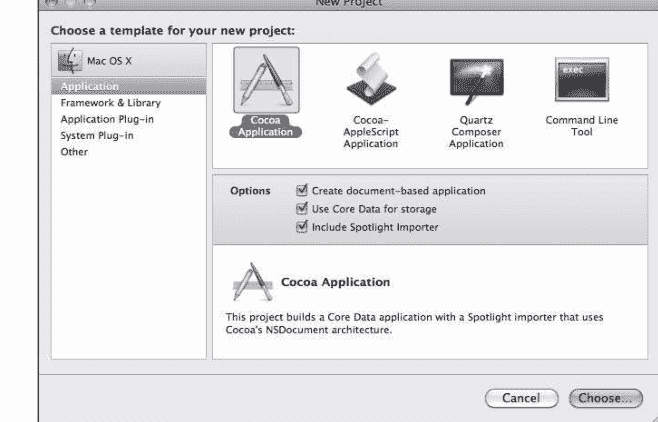

> 图 1.1 设置 Xcode 的新项目窗口。

6. 点击“选择”（Choose）按钮。
7. 在标准保存面板的“另存为”（Save As）字段中，输入你的新项目名称 Vermont Recipes。项目的默认位置是你的“文档”（Documents）文件夹，但你也可以将其放在任何地方。我个人的偏好是将 Xcode 项目放在子文件夹中，这样我的文档文件夹就不会那么杂乱，开发项目也更有组织。遵循我的做法，如果保存面板是折叠的，点击展开按钮将其展开，并反复使用“新建文件夹”（New Folder）按钮在文档文件夹中创建层级文件夹，路径为：`~/Documents/Projects/Cocoa/Vermont Recipes 2.0.0`。
8. 点击“保存”（Save）按钮。Xcode 会在 Vermont Recipes 2.0.0 文件夹中创建一个名为 Vermont Recipes 的子文件夹作为你的新项目，并打开 Vermont 项目窗口，以便你开始设置。

Xcode 项目窗口是另一个多窗格窗口。快速浏览一下这里包含什么。左侧的窗格是“组与文件”（Groups & Files）窗格。它看起来像 Finder 风格的文件夹和文件列表，但你很快就会理解，它本身就是一种组织工具，与 Finder 中项目文件的组织方式大多没有关系。查看其区别，对比 Xcode 项目窗口中的 Models（模型）和 Resources（资源）组与 Xcode 为你从 Finder 中创建的项目窗口中的组。

1. 切换到 Finder 并打开你的新项目文件夹。首先导航到父文件夹，如果你按照我嵌套的方式设置了层级，那么父文件夹就是新的 Vermont Recipes 2.0.0 文件夹，即新的 Vermont Recipes 项目文件夹。打开它（图 1.2）。

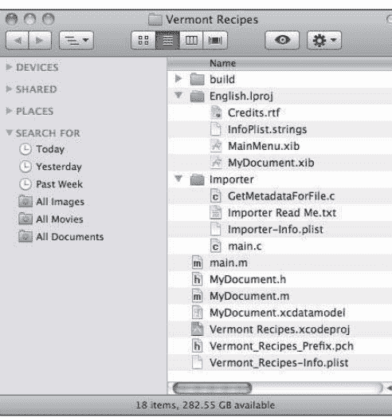

> 图 1.2 Finder 中的 Vermont Recipes 项目文件夹。

目前，假设你放在 Vermont 项目文件夹内的每个文件或文件夹都旨在成为项目本身的一部分，因此不要在 Finder 中删除或重命名任何内容，也不要使用 Finder 添加任何内容。你稍后将学习如何向项目添加文件和文件夹。然而，你可以在项目文件夹之外的整个 Vermont Recipes 2.0.0 文件夹中放置任何你喜欢的内容。这是一个存储项目信息的好地方，例如待办事项、规范大纲以及相关网站的链接。

将项目窗口置于 Xcode 窗口周围，以便你方便地探索和比较（图 1.3）。

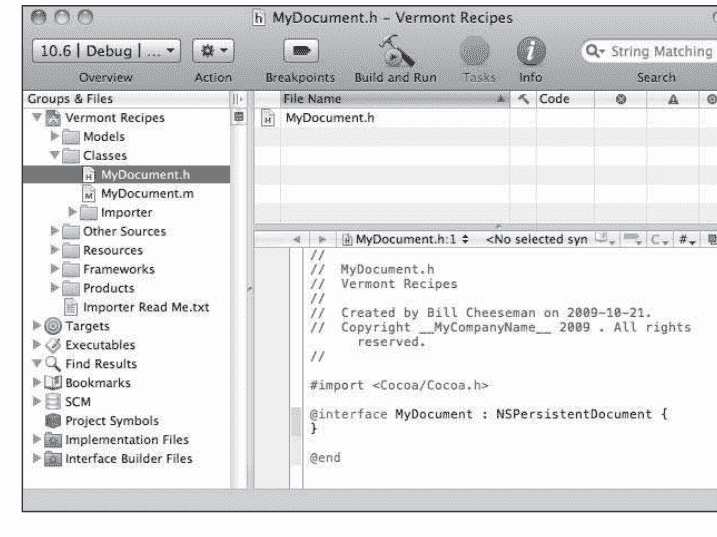

点击 Xcode 项目窗口中的展开三角形来展开该组。它看起来像一个文件夹，但在 Finder 项目窗口中并没有名为 Models 的文件夹。在 Xcode 窗口中，展开的 Models 组包含一个名为 MyDocument.xdatodel 的文件。在 Finder 窗口中，你看到一个同名文件，但它位于窗口的顶部。

这说明了 Xcode 组织方式的一个特点。大多数项目文件位于 Finder 项目窗口的顶部，而 Xcode 窗口的“组与文件”窗格提供了你很快会发现非常方便的组织方式。事实上，你可以自由地在 Xcode 项目窗口中创建新组并移动它们，而不会影响包含在 Finder 中的位置。“组与文件”窗格的组织仅仅是一种便利，你可以随心所欲地更改。然而，默认组织是基于 Xcode 工程师团队多年来开发者反馈的丰富经验，所以你可能想暂时保持原样。

Finder 项目窗口中除了文件外还有一些文件夹。如果你处于英语地区，其中一个命名为 English.lproj。如果你在其他地区，它的名称会有不同。当你对应用程序进行本地化以供其他语言使用时，你的本地化合约将添加多个 lproj 文件夹，每个对应一个本地化。本书在全文指的是 English.lproj 文件夹，但它们的工作方式都是相同的。

3. 现在打开“组与文件”窗格中的 Resources（资源）组。如果你看不到文件的全名，请将垂直分割线向右移动。你在 Resources 组中看到了几个文件，其中只有 Vermont Recipes-Info.plist 显示在 Finder 窗口的顶部。

其他文件在哪里？要找到答案，点击 Xcode 项目窗口中其中一个文件 MainMenu.xib 的展开三角形。展开后，你会看到一个名为 English 的项。这对应于 Finder 窗口中的 English.lproj 文件夹。在 Finder 窗口中打开该文件夹，你会看到 Resources 组中列出的四个文件。这些文件 Credits.rtf 用于用户阅读，因此针对特定语言。在本地化应用程序中，展开的 Resources 组会显示每个本地化的项，每个对应 Finder 窗口中的一个 lproj 文件夹。要编辑 Resources 组中的 InfoPlist.strings 条目，双击 English 项。试一下。当项目只有一个本地化时，你可以只需双击该项而无需展开它。

Resources 组的最后一项 Importer-Info.plist 对应 Importer 文件夹中的同名文件。

4. 除了 English 文件夹外，Finder 项目窗口中还有两个文件夹：build（构建）文件夹和 Importer（导入）文件夹。默认情况下，Xcode 在构建项目时会将中间、调试和发布文件放在 build 文件夹中。Importer 文件夹包含两个不在应用程序代码文件，以及你已经看到的 Importer-Info.plist 文件。这两个代码文件位于 Xcode 项目窗口中 Classes（类）组的 Importer 子组中。

Finder 项目窗口中的剩余项是三个代码文件：`main.m`、`MyDocument.h` 和 `MyDocument.m`，以及一个名为 `Vermont_Recipes_Prefix.pbx` 的特殊文件。你稍后会在 Xcode 项目窗口中找到它们。

5. 在关闭 Finder 项目窗口之前，注意 Vermont Recipes.xcodeproj 文件。这是你任何开始新工作会话时双击打开项目的文件。在桌面或收藏文件夹中放置一个指向它的文件的别名（alias）可能会方便访问，或者你可以使用 Xcode 的文件 > 打开最近项目（File > Open Recent Project）菜单。
6. 关闭 Finder 项目窗口。你很少需要再次打开它。
7. 继续探索 Xcode 项目窗口。`Classes`（类）组是你花费大部分时间的地方。现在将其展开。使用你稍之前注意的头文件和实现文件：`MyDocument.h` 和 `MyDocument.m`。选择 `MyDocument.h`，它的内容将出现在窗口右侧的项目窗格中。双击它，它将在一个单独的编辑窗口中打开（图 1.4）。

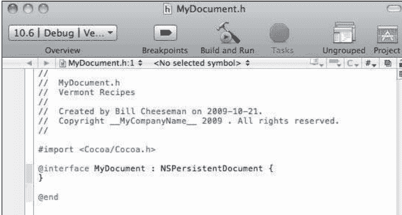


你还会看到一个 **Importers**（导入器）子组，你可以展开它查看 Finder 项目窗口中 `Importers` 文件夹中的某些文件。你可以在 Xcode 项目窗口中嵌套组以保持条目整齐，而不会影响它们在 Finder 中的位置。

8. 你在其他组中花费的时间会少得多，但可以探索一下它们以了解其内容。**Other Sources**（其他源）组包含 `main.m`，这是一个让你的应用程序运行起来的小型文件。在 Vermont Recipes 中你不需要修改它，但在某些情况下，编辑它是很有用的。**Frameworks**（框架）组的 **Linked Frameworks**（已链接框架）子组包含了你的产品所链接的所有框架的引用。**Other Frameworks**（其他框架）子组有时是一种便利，让你能够使用 Xcode 的搜索功能来读取与你的头文件相关的系统头文件。头文件有时会提供你在其他地方都找不到的用法信息，因此在此处保留导入框架头文件的引用是有帮助的，这可以让你不必深挖到 System 文件夹中去寻找。

9. **Targets**（目标）组包含你构建的每个项目的条目。许多项目只包含单一个目标，但更复杂的项目可以包含大量目标，例如你在这里看到的 Vermont Recipes Spotlight Importer。展开 targets 以查看每个目标的几个构建阶段（build phases）。

   你稍后将学习更多关于构建阶段的内容（图 1.5）。

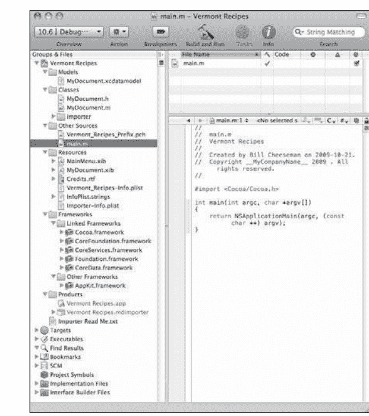

图 1.5

完全展开的 Groups & Files。

快速浏览 Xcode 的偏好设置。现在你不需要更改其中的任何内容，但理解 Xcode 出箱时的设置情况以及它提供的选项是非常重要的。

从 Xcode 应用程序菜单中选择 Preferences（偏好设置）。会打开一个熟悉的窗口，工具栏上有 13 个按钮。

你可以在 **General**（通用）面板中配置你的整个工作空间。在过去的几年里，我一直倾向于关闭“Open counterparts in same editor”（在同一编辑器中打开对应文件）设置，因为我发现将任何类的头文件和实现文件并排放置非常方便，确保我实现了我声明的实例变量和方法。我不再这样做了。当你开始学习 Objective-C 和 Cocoa 框架时，你可能会发现保持头文件和实现文件打开很有帮助。可能还会发现“Reopen projects on Xcode launch”（在 Xcode 启动时重新打开项目）和“Restore state of auxiliary windows”（恢复辅助窗口状态）很有帮助，因为你可能一段时间只处理这个项目。

**Sense**（感知）面板控制 Xcode 的索引以及它预测常用方法名称并在你输入时自动补全它们的能力。你应该对所有项目保持索引开启以便方便搜索。你可能发现会在 Editor Function（编辑器函数）弹出菜单中显示声明（show declarations）很有用，这让你轻松地从头文件或实现文件中声明的方法列表中选择特定方法，以及方法详情。我有自己的一套组织文件的方法，我通过位置或名称来记忆方法，所以我关闭了字母排序（alphabetical order）。通过在两个弹出菜单中都选择 Never（从不）来关闭它，但大多数情况下你会觉得代码补全具有干扰性且分散注意力，这将节省你以前为了获得该功能而花费的时间。

使用 **Building**（构建）面板设置一个存放所有项目文件的公共位置。默认情况下，每个项目在项目文件夹中都有自己的构建文件夹。我更倾向于为我的所有项目设置一个单一的、位于 `~/Documents/Projects/Cocoa` 的共享构建文件夹。我的很多工作涉及具有共享依赖的项目，将所有构建产物放在中心位置会让这变得简单得多。它也简化了我对进行中工作的存档，因为每当我压缩和存档代码时，就不需要从项目中移除构建文件夹。刚开始时，你会发现如果你将构建文件夹放在 Vermont Recipes 文件夹中（会有不问题）。在 Build Results 部分中，我通常将“Open builds”设置为 Always（始终），这样我就可以观察构建的过程（图 1.6）。

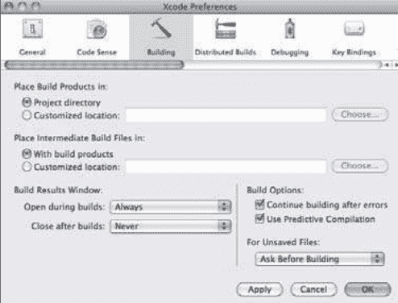

> 图 1.6 Xcode 偏好设置中的 Building 面板。

在 **Indentation**（缩进）面板中，我总是通过勾选“Wrap lines in editor”（在编辑器中折行）复选框来开启 Wrapping（折行），因为我不希望水平滚动来阅读代码中的长语句。如果你更改了此设置，请点击 Apply（应用）按钮；它会立即生效。现在“Indent lines by”（通过以下数量缩进行）设置已启用，并且默认被选中并设置为 4 个空格。在我看来这是一个问题，因为默认的制表符和缩进宽度也被设置为 4 个空格。为了清楚地看出某行是多行折行语句的延续，请将“Indent wrapped lines by”（对折行行缩进）更改为 6 个空格。你可以轻松地检测出多行折行语句，因为第一行之后的所有行都比代码块中缩进的行多缩进一点（图 1.7）。

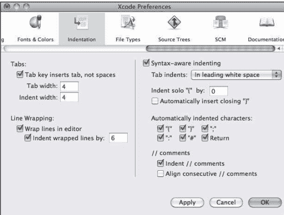

在 **Documentation**（文档）面板中，你通常连接互联网，重要的是勾选“Check for and install updates”（检查并安装更新）复选框。目前 Apple 定期更新文档而不进行通知。开启此设置后，你将在后台接收更新文档。

Xcode 模板通常会为你生成几个文件，帮助你开始新项目。这些文件中的一些包含文件、项目、开发者和日期的信息，并提供保护你知识产权所需的版权声明。Xcode 会通过扫描你的计算机为你提取大部分相关信息，但你可能仍然想编辑某些内容。

当你使用模板创建项目时，模板通常会包含一个 WindowController 子类的头文件和实现文件，例如 PersistentDocument。你的新子类在 `MyDocument.h` 中声明，在 `MyDocument.m` 中实现，这两个文件都在你的项目窗口中。你将在此步骤编辑它们的内容。

每个基于文档的应用程序都必须继承 NSDDocument。文档子类控制应用程序的数据。它在 MVC 模式中被认为是一个控制器类。你必须继承 NSDDocument 以提供对数据模型对象的访问，并提供方法告诉窗口控制器数据已发生变化，以便更新用户界面。你的文档子类通常通过控制你创建并链接到文档的对象来实现这一点。

Cocoa 还有一个 NSDController 类，但除非你需要比默认功能更多的功能，否则不需要继承它。NSDController 管理一组文档和文档类型。需要自定义 NSDController 的行为时，有时可以使用应用程序代理（application delegate）而不是继承它。在 Vermont Recipes 中，你将继承它来添加和管理额外的文档类型。

阅读 Apple 的 NSDClass 参考文档以了解它声明的方法详情。

-1. 展开 Classes 组，点击 `MyDocument.h` 文件进行选择。你在 Xcode 项目窗口的右上侧窗格中看到它的名称和关于它的信息，并在右下角的编辑窗格中看到它的内容。你可以直接在窗口中编辑文件内容。向左扩展垂直分割线，并移动其水平分割线，为编辑大文件留出足够空间。

然而，我个人的倾向是在单独的窗口中编辑文件，因为我有两个大显示器，这让我有空间同时比较和编辑多个文件，每个文件都有自己的窗口。在独立窗口中打开文件的简单方法是在“组与文件”（Groups & Files）面板中双击该文件，或者 Control-点击（或右键点击）并从上下文菜单中选择“在独立编辑器中打开”（Open in Separate Editor）。另一种打开新窗口的方法是打开“文件”菜单，按住 Option 键查看替代项目，然后选择“在独立编辑器中打开”。

- 2. 如果 `MyDocument.h` 头文件顶部的信息不是你想要的，请对其进行编辑。Xcode 非常擅长从系统中的各个地方提取信息，包括用于版权声明的公司名称。

模板必须为新类提供一个名称，但它只能提供一个通用名称，因为它不知道你正在做什么。它将你的文档类命名为 `MyDocument`，并将头文件和实现文件命名为相同的名称。这没什么想象力，描述性也不够，因为你的应用程序最终会创建多种类型的文档。在这一步中，将文档类的名称更改为 `RecipesDocument`。更改类名将导致后续层级中涵盖的若干影响。

使用标准的 Macintosh 编辑技术，在第一行文本中选择 `MyDocument` 并将其更改为 `RecipesDocument`，这样全名就变成了 `RecipesDocument.h`。在第 5 中，你将在“组与文件”面板中更改文件本身的名称以匹配，同时更改其他几个文件的名称。

接下来，在第二行的应用程序名称 `Vermont Recipes` 之后添加 `2.0.0`，使其变为 `Vermont Recipes 2.0.0`。事实上，它就是 `Vermont Recipes` 应用程序的 2.0.0 版本。如果你的应用程序证明具有很长的使用寿命，它可能会在多年内经历许多版本，例如 `2.0.1` 和 `3.9.9`。当 Xcode 屏幕上显示多个版本时，在文件顶部有一个版本号可能会让你觉得很方便。

更改第四行的版权声明。暂时戴上我的律师帽子并摆出专业姿态，我建议你输入你的名字 `Bill Cheeseman` 作为版权所有者。我还喜欢在 `Copyright` 单词之后插入国际版权符号——圆圈小写 `c`。最后，将版权日期更改为 `2000-2009`。我在 2000 年到 2002 年间编写了 `Vermont Recipes 1` 的大部分代码，并在2009 年添加了 `Vermont Recipes 2` 的大部分新代码。

现在唯一需要编辑的代码是 `@interface` 指令后的名称。将其从 `MyDocument` 更改为 `RecipesDocument`。`@interface` 指令声明类的名称。虽然可以在文件中声明多个类并给文件一个完全无关的名称，但更常见的做法是每个文件声明一个类，并给类和文件赋予相同的名称。

- 3. 对实现文件顶部的信息进行相应更改。在独立窗口中打开 `MyDocument.m` 实现文件，这样你可以同时看到它的内容和头文件的内容。编辑实现文件顶部的信息，以对应你对头文件所更改。保持 `.m` 文件扩展名不变，以区分此实现文件与带有 `.h` 的头文件。确保将 `#import` 预处理器指令更改为 `#import "RecipesDocument.h"`（带有引号），以便预处理器能够找到你构建项目时的头文件。还将将 `@implementation` 指令更改为 `RecipesDocument`，以匹配头文件中 `@interface` 指令中的类名。

- 4. 看一下实现文件的其余部分。它包含了三个 Objective-C 方法的代码存根：`-init`、`-windowNibName` 和 `-windowControllerDidLoad`。这是当你选择“基于文档的应用程序”时，Xcode 选择的模板提供的这些代码。模板没有在头文件中声明这些方法，因为它们已经在 Cocoa 框架的头文件中声明了。Cocoa 框架中声明的许多方法在 Cocoa 中没有实现，或者仅以默认方式实现，而你被期望提供自定义实现。在这种情况下，大多数开发者不会在自己的头文件中重新声明该方法，尽管如果你愿意这样做，也没有什么能阻止你你。

其中一个方法 `-windowNibName` 返回 `NSString` 对象 `@"MyDocument"`。如果你让该语句保持不变，应用程序在启动时将无法加载文档的 nib 文件，因为稍后你将更改 nib 窗口的名称。将返回 `@"MyDocument"` 的语句改为返回 `@"RecipesDocument"`。你将在第 6 步中删除此方法，但现在为了一致性，你应该进行此更改。

- 5. 为了完全一致，也要更改基于文档应用程序模板创建的第三个代码文件 `main.m` 顶部的信息。在“组与文件”面板中找到它，展开“其他源”（Other Sources）组。

- 6. 关闭 `MyDocument` 头文件、实现文件以及 `main.m`，这样在你更改前两个文件的文件名时它们就不会占路。你将在第 6 步中返回它们进行更多编辑。

首先，通过更改文件名，后续你对头文件和实现文件内容的更改。虽然不要求头文件和实现文件与它们所代表的类名对应，但如果名称匹配，理解复杂的项目会变得更容易。在 Xcode 项目中更改文件名是一项细致的任务。你必须始终找到项目中所有需要更改名称的地方，并且必须拼写正确。

这项任务相当无聊，但如果你留到以后可能还需要更多更改，将会更加麻烦。如果只需要更改头文件和实现文件，这将很容易。然而，支持 Core Data 的基于文档应用程序模板还有许多相同名称的文件。模板为你创建这些文件的便利性被手动更改它们的必要性所抵消了。

在 Xcode 项目中更改文件名通常遵循这种模式。在这种情况下你无法避免这项工作，因为模板提供了原始名称而没有询问你。然而，教训是预先仔细考虑你的文件命名，因为更改它们是一个痛苦且容易出错的过程。

- 1. 你不能简单地双击“组与文件”面板中的文件名来选择进行编辑，就像你通常编辑文件内部文本时那样，因为该手势会导致 Xcode 打开文件本身让你编辑其内容。相反，在 Finder 中，单击一次文件名，停留足够长以便 Xcode 不将其解释为双击，然后再次点击。或者，Control-点击“组与文件”面板中的 `MyDocument.h` 头文件并从上下文菜单中选择“重命名”。当文件名可以编辑时，它变为 `RecipesDocument.h`，然后按回车键或点击其他地方提交更改。要验证文件名是否真的已更改，打开 Finder 窗口查看，该头文件现在是 `RecipesDocument.h`。

- 2. 还有几个文件需要重命名。通常，我们在 Xcode 项目窗口中更改文件名，而不是在 Finder 窗口中（正如你刚刚处理头文件时那样）。

尽管如此，我发现自己偶尔会无意中使用 Finder 更改文件名，你可能也会这样做。从这种无害的错误中恢复是很容易的。要看如何操作，现在使用 Finder 更改 `MyDocument.m` 实现文件的名称为 `RecipesDocument.m`。

你已完成，点击 Xcode 项目窗口，你会发现“分组与文件”（Groups & Files）窗格中 MyDocument.m 文件的名称没有自动更改以匹配 Finder 中的名称。相反，它变为了橙色，这表明 Xcode 再也找不到 MyDocument.m 文件了。

要让 Xcode 指向重命名后的文件，请使用名称并选择“显示信息”（Get Info），然后点击“选择”（Choose）来定位它。如果你在 Finder 中重命名后移动了文件，请选择项目（Project）> 添加到项目（Add to Project），在打开面板中导航到它的新位置，选择它并点击“添加”（Add）。项目中已存在的文件会变灰，但位置错误的文件是可以选择的。

如果你使用“添加到项目”菜单项并点击“添加”，打开面板会关闭，并出现若干你可以在将文件添加到项目之前可以配置的设置。勾选“将项目拷贝到目标组文件夹（如果需要）”(Copy items into destination group's folder (if needed))是一个好主意。然而，如果文件已经在正确的文件夹中只是被重命名了，你可以取消勾选。除非你之前动过这个表单，否则它的其他设置将是正确的。点击“添加”，你会发现 Recipes.m 实现文件现在已包含在“分组与文件”的“类”组中。

选择并按 Delete 键删除对 MyDocument.m 的橙色引用。

- 3. 使用 Xcode 项目窗口重命名剩余的 MyDocument 文件。在“模型”（Models）组中，将 `MyDocument.xcdatamodel` 改为 `RecipesDocument.xcdatamodel`。在“资源”（Resources）组中，将 `MyDocument.xib` 更改为 `Recipes Window.xib`。

- 4. Xcode 中还有一个地方必须更改名称（你将在 Interface Builder 中找到另一个地方，见菜谱 2.）。你无法通过扫描文件名来找到它。在“资源”（Resources）组中，打开 `Vermont_Recipes-Info.plist`。这是一个属性列表，一个 XML 格式的文本文件，它会在 Xcode 内置的属性编辑器窗口中打开。在这个窗口中点击时要小心，因为你很容易在不经意间更改设置。

点击“文档类型”（Document types）收起三角形进行展开；然后是每个子项目：Item 0 (Binary)、Item 1 (SQLite) 和 Item 2 (XML)。在每一项中，找到左侧的 Cocoa NSDictionary Class 键，双击右侧对应的值项进行编辑，并将值从 MyDocument 更改为 RecipesDocument。完成后，关闭 `Vermont_Recipes-Info.plist` 文件。你将在第 9 步中再次访问它。

现在重新打开重命名的 Recipes.m 实现文件，对模板提供的方法实现进行一些更多更改。

Vermont Recipes 2 应用程序规范要求一个复杂的 Core Data 文档型应用程序，具有多个文档和窗口。在菜谱的开始，你学到，当你创建项目时选择的基于文档的应用程序模板假设你正在编写一个单文档、单窗口应用程序。现在是时候对模板提供的方法进行更改了，这些方法是 Apple 为多文档、多窗口应用程序推荐的。

由基于文档的应用程序模板提供的 MyDocument.m 实现文件（你已将其重命名为 Recipes.m）最初包含三个覆盖 NSPersistenceDocument 类或其子类方法的方法。这些方法由 Cocoa 框架在适当的时间自动调用。从某种意义上说，你对这些方法的重写是被动的。你很少或从不自己调用这些方法；如果你修改了它们以便让 Cocoa 调用它们，它们将执行自定义任务或提供你的应用程序特有的自定义信息。例如，`-windowNibName` 方法应该返回你为文档主窗口 nib 文件命名的名称。


这三个方法是构建具有这些方法最小能力的窗口所必须覆盖的方法；你可以在不更改模板提供的文档和 nib 文件名称、且不编写任何自己的代码的情况下，构建并运行 Vermont Recipes 应用程序。你会发现它在此点之前是可以正常工作的。例如，如果你启动应用程序，它会自动打开主文档窗口。如果你选择“文件”>“新建”，它会打开另一个相同的文档窗口。

如果你对现有模板感到满意，那么这本书将会很短。事实上，你将在 Vermont Recipes 中对它进行许多更改。在这一步中，你删除了两个提供的方法：`-windowNibName` 和 `-windowControllerDidLoadNib`；它们都与视图的加载和使用 nib 文件有关。这是你在这书中编写的第一行实际代码。

第一个方法覆盖了 `NSObject` 的 `-windowNibName` 方法。它的唯一目的是返回文档 nib 文件的名称（不带 nib 扩展名），这是你通过重写你的覆盖方法所提供的。在模板中，由 `MyDocument` 提供的方法。为了一致，你在第 5 步中将其更改为 `RecipesWindow`，如果你计划在 Vermont Recipes 应用程序中使用此方法。`NSPersistentDocument` 的父类 `NSDocument` 使用名称 `-windowNibName` 来为文档实例化窗口控制器。在简单的基于文档的应用程序中，你不编写窗口控制器的自定义版本；相反，使用所示的 `NSWindowController` 类。

然而，由于 Vermont Recipes 应用程序要求一个多文档、多窗口应用程序，你在此删除 `-windowNibName` 方法，并覆盖 `NSDocument` 的 `-makeWindowControllers`。在 `-makeWindowControllers` 中，你实例化一个或多个你设计的自定义窗口控制器，以处理 Vermont Recipes 应用程序更复杂的特性。在 `-makeWindowControllers` 中创建的每个窗口控制器都会添加到文档维护的列表：`-addWindowController:` 方法。

你也删除了模板提供的 `-windowControllerDidLoadNib:` 方法。

1.  打开 `RecipesDocument.m` 实现文件。在 `#import "RecipesDocument.h"` 一行下方立即添加此行：

    ```objc
    #import "PickerController.h"
    ```

2.  完整删除 `-windowNibName` 和 `-windowControllerDidLoadNib` 方法。

3.  用此 `-makeWindowControllers` 替换删除的方法：

    ```objc
    - (void)makeWindowControllers {
        RecipesPickerController *controller = [[RecipesPickerController alloc] initWithName:@"RecipesWindow"];
        [self addWindowController:controller];
        [controller release];
    }
    ```

每当用户打开文档时（例如通过启动应用程序或选择“文件”>“新建”），Cocoa 都会调用此方法。方法体的第一条语句将窗口控制器的内存分配和初始化合并在一个语句中。第二条语句将窗口控制器插入数组。第三条语句释放了刚刚创建的对象；你不再需要它，因为 `addWindowController:` 方法保留了它。从它被放入数组开始，数组接管了它。

`makeWindowControllers` 方法的一个重要特性是它通过在第一条语句中传递文件名（不带文件扩展名）来初始化新控制器。模板提供的 `-windowNibName` 方法最初负责告诉 Cocoa 加载哪个 nib 文件，但你刚刚删除了它。新的 `-makeWindowControllers` 方法现在遵循相同的角色，提供 nib 文件名。区别在于你可以通过添加额外的语句来修改它，以便文档打开额外的窗口和你的 nib 文件。

展望未来，你将在菜谱 3 中学到，让窗口指定其关联的文件通常更好。为了这种方法做准备，你通过调用其 `-init` 方法而不是 `-initWithName:` 来初始化窗口控制器，并且稍后将在窗口控制器中实现 `-init` 方法以便调用 `-initWithName:`。现在，为了保持简单，保持 `-makeWindowControllers` 方法不变。如果你在 Apple 的 `NSDocument` 参考文档中查找 `-addWindowController:` 方法的描述，你会看到 `NSViewController` 的 `-setDocument:` 方法的引用。`setDocument:` 的描述揭示了 `-addWindowController:` 会自动调用它以设置窗口控制器回文档的链接。由于文档和窗口控制器之间存在这些相互链接，它们能够向彼此发送消息。窗口控制器可以向文档发送消息。

用户在应用程序的用户界面中执行操作，如果文档发生了某些变化（例如，通过 AppleScript 命令），文档可以通过其窗口控制器发送消息，告诉窗口控制器更新用户界面。文档与窗口控制器之间这种往复的通信可以被视为 MVC 设计模式的一半，因为文档是通往 MVC 模型的网关。你将在食谱 2 中使用 Interface Builder 实现窗口控制器与窗口（即 MVC 视图）之间的另一半通信。

在这个简单的 `-makeWindowControllers` 方法中，你遇到了一系列其他需要解释的 Objective-C 和 Cocoa 技术。然而，在这个简短的介绍中，请无条件地相信它能够正常工作即可。一旦你让应用程序初步建立起来并运行，你将在食谱 3 中停下来，回顾你所完成的成果。

4.  关闭 `RecipesDocument.m` 实现文件以将其移开。

在一个非常简单的单文档应用程序中，`NSWindowController` 可以在后台执行其工作而无需子类化。然而，在多文档、多窗口应用程序中，你通常需要窗口控制器提供更强大的功能。如果由 `RecipesDocument` 类直接负责控制所有窗口及其内容，该类将变得异常复杂。如果每个窗口都有自己的窗口控制器，那么组织和维护应用程序将变得更容易。

在像 Vermont 这样复杂的文档型应用程序中，你会在自己的 nib 文件中实例化每个文档窗口，并创建一个自定义窗口控制器子类，作为每个 nib 文件的所有者。在这一步中，你创建了 `RecipesWindowController`，它是 `NSWindowController` 的子类，用于处理应用程序的主数据库窗口。稍后在食谱 2 中，你将修改 `RecipesWindow` nib 文件（该文件是由文档型应用程序模板以 `MyDocument.xib` 名称创建的），使这个新的 `WindowController` 子类成为 nib 文件的所有者。

## NSWindowController 类

在采用 MVC 设计模式的文档型 Cocoa 应用程序中，控制器类尤为重要。

从某种意义上说，控制器是 MVC 元素中最不标准的，因为它必须保持一组独特的模型和视图同步，并告诉它们如何执行应用程序的独特功能。控制器代表文档管理窗口及其视图。代表应用程序数据的模型类不应该知道 GUI 和视图类，因为窗口、标签视图和控件也不应该知道它们所代表的具体数据。对于非常简单的应用程序，你不需要为 `NSWindowController` 创建子类，但在典型的文档型应用程序中，你通常需要这样做。

只有控制器知道模型和视图是如何相互作用的。文档（本身也是一个控制器，正如你之前学到的那样）会在数据发生变化时告诉窗口控制器（可能用户回滚到了文档的保存状态，或从“编辑”菜单执行了撤销或重做，或者 AppleScript 修改了某些数据），然后控制器告诉视图更改以反映新数据。同样，视图会在用户更改控件状态时告诉窗口控制器（可能用户勾选或取消勾选了某个复选框），窗口控制器告诉文档（另一个控制器）让模型更新其数据存储。由于这些原因，你为控制器类编写的自定义代码通常比为模型或视图的代码得多。

现代软件工程提供了许多理由，说明应用程序的数据和用户界面应该以这种方式划分到单独的类中。这主要与保持概念清晰以及便于维护和修改有关。

但也有与 Mac OS X 工作方式相关的特定原因。特别是，GUI 并不是 Macintosh 应用程序的唯一接口。还有脚本接口。使用 AppleScript 的用户可以命令应用程序更改其数据，而无需触碰控件。这样做时，脚本不需要知道任何关于 GUI 的信息；它可以直接（且通常应该）与应用程序模型进行通信，并且可能不需要打开窗口即可完成。通过将模型与视图分离，并依赖窗口控制器来处理，可以使应用程序保持灵活性。正如你所看到的，在子类中，`RecipesWindowController` 声明了相关方法。

## NSWindowController 类（继续）

在 Xcode 环境中，你通过子类来创建功能。`RecipesWindowController` 子类声明了相关接口。

为了使这个新的 `WindowController` 子类成为 nib 文件的所有者。在更改 nib 文件的所有者时，你会发现 `RecipesDocument` 不需要它了。阅读 Apple 的 `NSWindowController` 参考以了解有关它声明的内容。

1.  在 Xcode 中选择“文件”>“新建文件”来选择模板。
2.  “新建文件”窗口与步骤 1 中遇到的类似，左侧是选择分类的面板，右侧是选择模板的面板。
3.  点击左侧的 Cocoa；然后点击右侧面板的“Objective-C class”模板。在下侧面板中，使用“Subclass of”下拉菜单创建 `NSWindowController` 的子类（图 1.8）。
4.  点击“下一步”按钮。在下一个“新建文件”助手中，在“File Name”字段输入 `RecipesController`，这样它就是 `RecipesController.m`。勾选“File Name”下方的复选框，这将创建一个同名的 `.h` 扩展头文件（图 1.9）。
5.  点击“完成”按钮，在 Vermont Recipes 项目及其 target 中创建新文件。在 Xcode 项目窗口中，你会看到这两个新文件。如果它们不在“Groups & Files”面板的 Classes 组中，将它们拖到那里。
6.  打开新的头文件和实现文件。你会看到 `@interface` 和 `@implementation` 指令已设置，类名为 `RecipesController`，与文件名匹配。
7.  按照你在步骤 4 中建立的模式，编辑头文件顶部的标识信息。你可能只需要为引用 Vermont Recipes 添加 2.0.0。
8.  模板没有插入任何方法。暂时保持这些文件为空。
9.  关闭 `RecipesController` 头文件和实现文件窗口。此时不需要保存它们，尽管 Xcode 可能会提示你保存。未保存的文件在“Groups & Files”面板中颜色比正常深，作为一个持续的提醒。当你构建项目或关闭主项目窗口时，会再次提醒你保存。如果你是那种谨慎的人，可以在关闭每个文件之前选择“文件”>“存储”。

# 第 8 步：编辑 Credits 文件

基于文档的应用程序模板在项目创建时创建了其他几个需要编辑的文件。从 `Credits.rtf` 文件开始，该文件包含了用户在应用程序菜单中选择“关于 Vermont Recipes”时看到的信息。

1.  在 Xcode 窗口的“Groups & Files”栏中展开 Resources，然后点击或双击 `Credits.rtf` 文件以打开进行编辑。

你会发现它包含几个标题，标题下方带有幽默的占位符，你可以在此处识别出对应用程序做出贡献的人员。

许多开发者会删除这些文本，并代之输入一段应用程序的简短描述。例如，从 Xcode 应用程序菜单中选择“关于 Xcode”。打开的“关于”窗口包含了 Xcode 的图标、名称、版本，以及从 Xcode 软件包内其他来源获取的版权信息，以及关于 Xcode 组件版本的信息。Xcode 是从它的 `Credits` 文件中获取这些组件信息的。

由于我负责 Vermont Recipes，因此我为所有事情感谢自己，这似乎也不为意外。我还要感谢 Stepwise 团队，因为他们对原始 Vermont Recipes 项目的成功做出了重要贡献；并感谢 Michael Tsai 作为第二版技术编辑所付出的卓越工作。

在 `Credits.rtf` 中输入以下文本，替换文件的默认内容。由于它是富文本格式 (RTF) 文件，你可以进行一些简单的格式设置，例如将标题加粗。

> Vermont Recipes 2 基于适用于 Mac OS X 的 Cocoa Recipes——《The Vermont Recipes (Second Edition, Peachpit Press, 2010)》。欲知更多信息，请访问 www.peachpit.com。
>
> **工程：**
> Bill Cheeseman
> Quechee Software
> www.quecheesoft.com
>
> **人机界面设计：**
> Bill Cheeseman
>
> **测试：**
> Bill Cheeseman
> Michael Tsai
>
> **文档：**
> Bill Cheeseman
>
> **特别感谢：**
> Stepwise 团队
> Michael Tsai

这段文本太长，无法放入较小的窗口中。当你在本食谱的结束处构建并运行应用程序时，你会发现 Cocoa 会自动将其安装在一个滚动文本视图中，以便用户阅读全部内容。

你并不非得使用 RTF，但模板提供的 `Credits.rtf` 文件确实使用了它。Cocoa 还支持使用 HTML 文件进行更精细的格式设置。你可以通过上下文菜单在 RTF 文件中使用链接，并且你在单独的 `Credits.html` 文件中插入的任何 HTML 链接在应用程序的“关于”窗口中也将变为可用。如果你为产品准备了网站，你应该在“关于”窗口包含包含链接。

如果两者都存在，`Credits.html` 将优先于 `Credits.rtf`。在文件中保留 RTF 版本是必要的，以防万一你努力编写了一个可以在 Mac OS X 10.0 Cheetah 下运行的应用程序，因为 Cheetah 不支持 HTML Credits 文件。出于怀旧，我习惯在我的应用程序中保留 RTF 版本。

使用与第 7 步创建新窗口控制器文件相同的技巧创建一个新的 `Credits.html`。不要在初始“New File”的 Cocoa 类中选择“Objective-C”模板（你在第 7 步中那样做），而是选择 Other 类别和 Empty File 模板。这是一个空文件。点击“下一步”，在“Name”字段中输入 `Credits.html`，点击“Choose”将文件位置更改为项目的 `English.proj` 文件夹，然后点击“完成”。在 Xcode 窗口中，你可能需要拖动新的 `Credits.html` 或双击它进行编辑。将你修改后的 `Credits.rtf` 文件的内容复制并粘贴到新的 HTML 文件中，就完成了。

你可以使用你最喜欢的制作工具创建一个华丽的“关于”窗口，但在 Vermont Recipes 中，它只需提供简单的格式设置，并为该出版商 Peachpit Press 以及我的公司 Quechee Software 添加可点击的链接。按所示插入 HTML 格式标签，然后保存文件。

```html
<p>Vermont Recipes 2 is based on <i>Cocoa Recipes for Mac OS X—the Vermont Recipes</i> (Second Edition, Peachpit Press, 2010). For more information, visit <a href="http://www.peachpit.com">www.peachpit.com</a>.</p>

<p><b>工程：</b> Bill Cheeseman<br>Quechee Software<br><a href="http://www.quecheesoft.com">www.quecheesoft.com</a><br><b>人机界面设计：</b> Bill Cheeseman</p><p><b>测试：</b> Bill Cheeseman, Michael Tsai</p><p><b>文档：</b> Bill Cheeseman</p><p><b>特别感谢：</b> Stepwise 团队, Michael Tsai</p>
```

如果你现在构建并运行应用程序，“关于”窗口就可以工作了。你会发现两个问题：在顶部附近，窗口会声称这是 Vermont Recipes 的 1.0 版本，且你期望在底部看到的版权声明将缺失。你将在第 9 步中修复这些问题。

# 第 9 步：编辑 Xcode 项目

当你在第 2 步探索项目窗口时，你在“Groups & Files”栏中看到的文件之一是 `Vermont_Recipes-Info.plist`。你在第 5 步结束时对其内容进行了一处更改。在这一步中，你将检查文件的剩余内容并编辑某些条目。这是一个枯燥的过程，但你在每个新项目中都必须这样做。Xcode 将 `Vermont_Recipes-Info.plist` 保存在构建的应用程序包中，通用名称为 `Info.plist`。由于这个原因，习惯上将其称为 `Info.plist`。当从零开始构建简单的应用程序时，你可以在项目中使用通用名称。然而，基于文档的应用程序模板赋予了它更具体的名称，以将其与项目中的另一个 `Info.plist` 文件 `Importer-Info.plist` 区分。项目构建设置中的一个字段告诉 Xcode 应该将这些文件中的哪一个保存为应用程序的主 `Info.plist`，正如你在第 12 步中看到的。


Info.plist 文件采用 XML 属性列表格式，包含人类可读文本的键值对。它应该以 UTF-8 编码保存。你通常在 Xcode 内置的属性列表编辑器中编辑条目。你也可以在任何文本编辑器中编辑文件，但带有 XML 标签的纯文本形式需要更多工作来维护正确的语法。Apple 定义了多种属性列表格式用于开发应用程序。Cocoa 使用 Info.plist 有多种用途，包括：提供应用程序运行时在菜单栏中显示的简短应用程序名称；告诉系统应用程序文档图标的位置；提供 Finder 的“显示简介”窗口、“关于”窗口以及其他对话框中使用的版本、版权和其他字符串；指定 Finder 在双击应用程序图标之一打开时使用的文档类型。Xcode 还将你的应用程序的类型代码和创建者代码放在编译后的应用程序包中的 `PkgInfo` 文件中。

- 在 Xcode 中打开 `Vermont_Recipes-Info.plist` 文件进行编辑。在 Info.plist 窗口中，你看到由基于文档的应用程序模板提供的超过 12 多个条目。其中一些是适当的，你不会更改它们。另一些是占位符，需要为 Vermont Recipes 应用程序进行自定义（图 1.10）。

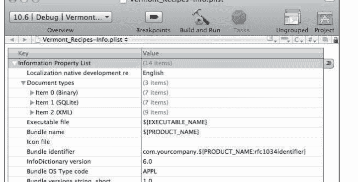

图 1.10

在 Xcode 属性列表编辑器中打开的 Info.plist。

- 2. 在 Xcode 菜单栏中选择 `View > Property List Type`。你在子菜单中看到四种类型的属性列表文件，当前设置为 Info.plist 格式。这是正确的，保持原样即可。

- 3. 在 Info.plist 的任何地方 Control-click 以打开上下文菜单。显示 `Raw Keys/Values`（显示原始键/值），左列中的所有键都会变为你在代码中使用的技术名称。例如，“Document types”键变为 `CFBundleDocumentTypes`（这是一个 Core Foundation 设置），而“Main nib file name”变为 `NSMainNibFile`（这是一个 Cocoa 设置）。我建议使用原始键。

- 点击三角形展开左列的 `CFBundleTypes`，并展开 Binary、XML 和 SQLite 所有类型。如果你在第 5 步重命名 `NSObjectClass` 时没有探索它们，现在请探索其中之一，包括它的可子条目。这些条目控制应用程序保存数据的重要功能。你将获得更多它们的信息。

对于具有大型且复杂存储需求的已发布 Core Data 应用程序，Apple 建议使用 SQLite 类型以获得最高效率。Binary 类型适用于存储需求适且访问速度是首要考虑因素的文档。对于开发，你应该使用 XML 类型，因为它是可读的，你可以检查工作。

在 Vermont Recipes 中，你将使用 SQLite 类型而不是 Binary 类型。选择 Binary 类型条目并删除。

暂时保留 XML 文类型以便开发。将整个 Item 1 (XML) 向上移动，使其成为 `CFBundleDocumentTypes` 键下的第一个。它变成了 Item 0 (XML)。除非另有说明，否则 Cocoa 会自动打开列表中的第一个类型。在向公众发布 Vermont 2 之前删除 XML 类型，如果你决定允许用户以 XML 格式保存，将其移回列表底部。

b. 选中 Item (XML) 文档类型并显示其子条目，点击 Item 0 (XML) 条目右侧的大纲按钮。会出现一个一个新的子条目，并带有一个打开的组合框，显示可用键的列表。选择 `LSItemContentTypeTypes`。

c. 展开 `LSItemContentTypeTypes` 以显示 Item 0；然后按 Tab 键到其 Values 字段，暂时输入 `public.xml`。这是一个统一类型标识 (UTI)，它已成为 Mac OS X 将文档与打开它们的应用程序关联的机制中的关键特性。

d. 《信息属性列表键引用》(Information Property List Key Reference）建议，当你使用 `LSItemContentTypeTypes` 时，应该包含 `NSEExportableTypes`。因此，选择 `LSItemContentTypeTypes` 条目；点击其旁边的 `(+)` 按钮添加一个新的空白条目；从组合框中选择 `NSEExportableTypes`；并输入 `public.xml` 作为其值。如果 `NSEExportableTypes` 未出现在组合列表中，请手动在 Key 字段中输入它，使用右键菜单将条目更改为 Array，创建一个新的 Item 0，并输入 `public.xml` 作为其值。

这些指南实际上具有误导性。当 UTI 是 Apple 声明的公共类型时，你不需要导出内容。你稍后会回到这里并将其更改为私有 UTI，那时你必须导出它。目前将其保持为 `public.xml`。

e. 《信息属性列表键引用》还建议你包含 `LSHandlerRank` 键条目；因此，选择 `NSEExportableTypes` 条目；点击其旁边的 `(+)` 按钮添加一个新的空白条目；从组合框中选择 `LSHandlerRank`；并在 Values 列的弹出菜单中选择 `Alternate`。这意味着 Launch Services 将不会使用 Vermont Recipes 2 打开你电脑上的其他 XML 文件，因为 Vermont Recipes 2 并不拥有 XML 文档类型。

f. 应该删除 `LTypesPackage` 条目。`CFBundleTypeName` 条目应设置为 "Vermont Recipes Database."。保留 `CFBundleIconFile` 条目，但

g. 在 Item 1 (SQLite) 文档条目中重复步骤 4a.-f，并使用 `public.database` 作为其新的 `LSItemContent-Types` 和 `NSEExportableTypes` 条目中 Item 0 的值。

- 5. 你还没有应用程序图标，所以将 `CFBundleBundle` 条目留空。

- 6. 移动到 `CFBundleIdentifier`。应用程序标识符以反向 DNS 字符串的形式存在，它是 Mac OS X 将文档与所有它们的应用程序关联的机制中的另一个关键特性，在很大程度上取代并在 Snow Leopard 中替换了 Mac OS 9 及更早版本的旧创建者机制。

模板指定的标识符包含一个占位符。要编辑标识符，输入 `com`，后跟一个点，然后是公司名称或你用于标识产品来源的任何其他名称，再次跟一个点，最后是应用程序名称的引用。在模板指定的默认标识符中，产品名称引用采用变量扩展的形式：`$[PRODUCT_NAME:rfc1034identifier]`。当你创建项目时，`PRODUCT NAME` 变量已自动设置为 `Vermont Recipes`。对 `rfc1034identifier` 的引用会导致 Xcode 将空格替换为连字符，以符合 UTI 的要求。

这是一个反向域名系统 (DNS) 名称，用于在 Macintosh 社区内唯一地标识你的应用程序。Apple 不需要维护一个注册表来监管你标识符的唯一性，因为商号、商标和其他法律可能保护你的公司名称，且标识符包含了由你控制的产品名称。

我认为 Vermont Recipes 属于 Quechee Software，我已经在佛蒙特州州卿卿处注册了 Quechee Software。因此，你应该按照此格式输入标识符：

```
com.quecheesoftware.$[PRODUCT_NAME:rfc1034identifier].
```

该标识符在构建的应用程序中输出为 `com.quecheesoftware.VermontRecipes`。

- 模板中 `CFBundleShortVersionString` 的值为 `1.0`。你现在正在编写 Vermont Recipes 的第 2 版本，所以将值更改为 `2.0.0`。这将导致“关于”（About）窗口显示应用程序版本为 2.0.0，而不是你在第 8 步看到的错误的 1.0。它还将出现在 Finder 的“显示简介”（Get Info）窗口和其他地方。

版本号中用点分隔的三个数字从左到右分别代表主发布版本、次要发布版本和维护发布版本。传统上，大多数开发者只在发布版本大于 0 时显示发布版本，例如 2.0.1。然而，目前的 Apple 文档表明，在所有情况下这三个版本号都是“必须的”，即使是像 2.0.0 这样的主版本。参见 Apple 在《信息属性列表键引用》中对 `CFBundleShortVersionString` 设置的描述及其“文档修订历史”部分。

正如该键名称所示，它不是一个数字而是一个字符串。因此，你可以在值中包含信息。许多开发者会包含惯用代码，表示这是开发 (d)、alpha (a)、beta (b) 或发布候选 (rc) 版本。如果你选择遵循这种做法，`2.0.0d1` 或 `2.0.0a1` 可能适用于 Vermont Recipes，因为 beta 标记通常保留给功能列表已冻结的应用程序。然而，Apple 在《信息属性列表键引用》中对该设置的描述强烈建议它应仅用于标识应用程序已发布的迭代版本。因此，随本书发布的所有 Vermont Recipes 版本都使用简单的三位数字格式 `2.0.0`，通过依赖 `CFBundle` 条目来区分预发布版本。

- 注意 `CFBundle` 条目。模板将其设置为 `1`。它出现在应用程序的“关于”窗口中，跟在短版本字符串后面的，括号内，例如 `2.0.0 (1)`。虽然有许多使用此键的方法，但我建议每次对应用程序进行较小的更改时都递增它。例如，在一个大型组织中，可以使用它来标记内部发布版本。在 Vermont Recipes 中，你将在每个配方开始时增加它，这样“关于”窗口就能一眼看出哪个配方负责你正在运行的版本。

当你更新应用程序的主版本字符串后，你可以继续增加新的 bundle 版本。这样你就可以通过单个变量跟踪应用程序的每个版本，而无需测试短版本字符串。但在本配文中，我们将 Vermont Recipes 2 的 bundle 版本保持为 1。

- 下一个要更改的条目是 `CFBundleSignature`。它和 `CFBundlePackageType` 持有应用程序的文件和创建者代码。每一个值都是一个 4 字节值，由四个字符常量组成，写为表示整数值的四个字符。当你构建应用程序时，它们被编码在应用程序包 Contents 文件夹中的一个文件 `PkgInfo` 中。

`CFBundlePackageType` 条目应设置为 `APPL`（代表应用程序），但将 `CFBundleSignature` 值更改为 `VRa2`。这是一个我随口编的值。当然，VR 代表 Vermont Recipes，而在思考中，a 代表 application。最后的数字是主版本号。Vermont Recipes 1 的创建者代码是 `VRa1`，多年前我就向 Apple 注册了它以确保其唯一性。我最近注册了 `VRa2` 作为 Vermont 的创建者。

Recipe 2. 通常情况下，你应该为应用程序的新主版本继续使用相同的创建代码（creator code），但我为 Vermont Recipes 2.0 更改了它，因为该应用程序与 Vermont Recipes 1 有本质区别。

Macintosh 应用程序的创建代码（或签名）基于旧技术，但在从 Leopard 开始的 Mac X 版本中，它仍然起着作用，特别是在旧版应用程序中。Snow Leopard 在将文档与应用程序关联时不再尊崇创建代码，而是依赖于较新的技术。尽管如此，你仍应该向 Apple 注册你在应用程序中使用的每个创建代码，直到 Apple 停止接受注册。访问 `http://developer.apple.com/datatype/`。限制条件将在网页上描述。如果你的创建代码已被其他开发者占用，你将收到错误消息。如果注册成功，Apple 将通过电子邮件通知你。

- 10. Apple 的《信息属性列表参考》（Information Property List Reference）中的“Cocoa 应用程序推荐键”部分指出，每个应用程序的 Info.plist 文件中都需要额外的设置。基于文档的应用程序模板不会自动提供这些设置，因此你必须手动添加。如果你不添加它们，你的应用程序将使用默认值正常运行，或使用你可能添加到 InfoPlist.strings 文件中的项目（将在步骤 10 中讨论）。我建议除了 Apple 的警告外，将它们包含在 Info.plist 文件中。

顺序无关，因此将它们添加到列表末尾。要这样做，首先选择当前项目 `NSPrincipalClass`，点击该条目右侧的添加 `(+)` 按钮。`NSPrincipalClass` 下将添加一个条目，并弹出一个组合框显示可用的内置设置列表。重复此过程以添加以下每个设置：

- a. 添加 `CFDisplayName` 键并输入值 `Vermont Recipes`。你将在步骤 10 中与其他值一起本地化此值。

- b. 添加 `LSHasLocalizedDisplayName` 键。现在，保持 Value 列中的复选框未选中，以表示值为 0 或 false。

- c. 添加 `NSHumanReadableCopyright` 键并输入值 `Copyright ©2000–2009 Bill Cheeseman. All Rights Reserved.`。版权符号（圆圈内的字母 c）在美国键盘上是 Option-G。2000–2009 中的破折号在排版用法中应为破折号（—）。在美国键盘上，按住 Option 并输入连字符 (-)。此版权字符串出现在应用程序“关于”（About）窗口的底部；在 Snow Leopard 中，由于 Finder 现在是一个 Cocoa 应用程序，它出现在 Finder“显示信息”（Get Info）窗口的“新版权”字段中。你将在步骤 10 中将其本地化。

许多开发者（包括 Apple）传统上会在“All Rights Reserved”短语之前使用转义序列 `\n` 插入一个换行符。这会让“关于”窗口底部的版权条目看起来更好。但在 Snow Leopard 中，你不应该包含换行符，因为它会让 Finder“显示信息”中的版权字段看起来很奇怪。

- d. 添加 `AppleScriptEnabled` 键。现在，保持其复选框未选中。你将在 Recipe 12 中实现 AppleScript 支持。

- 11、《信息属性列表键参考》指出 `CFBundleGetInfoPlist` 键在 Snow Leopard 中已过时，被 `NSHumanReadableCopyright` 取代。在 Snow Leopard 中，Finder 的“显示信息”窗口使用已输入的 `NSHumanReadableCopyright` 值显示通知，而不是像在 Leopard 中那样使用 `CFBundleGetString`。然而，Vermont Recipes 2 同时在 Leopard 和 Snow Leopard 下运行，因此你应该添加一个 `CFBundleGetString` 字符串。

使用之前描述的程序，添加 `CFBundleGetString` 键并输入值 `Vermont Recipes 2.0.0 Copyright ©2000–2009 Bill Chees.`。这与 `NSHumanReadableCopyright` 的值的区别仅在于，许多开发者（包括 Apple）传统上在“All Rights Reserved”短语中插入应用程序名称和版本。考虑到应用程序内部的 `NSHumanReadableCopyright` 条目，你可以使用该值。

- 12. 《信息属性列表键》指出 `CFBundleGetInfoPlist` 键在 Snow Leopard 中已过时，被 `NSHumanReadableCopyright` 取代。在 Snow Leopard 中，Finder 的“显示信息”窗口使用你已经输入的 `NSHumanReadableCopyright` 值显示通知，而不是像在 Leopard 中那样使用 `CFBundleGetString`。然而，Vermont Recipes 2 在 Leopard 和 Snow Leopard 下运行，因此你应该添加一个 `CFBundleGetString` 字符串。

使用之前描述的程序，添加 `CFBundleGetString` 键并输入值 `Vermont Recipes 2.0.0 Copyright ©2000–2009 Bill Chees.`。这与 `NSHumanReadableCopyright` 值的区别仅在于，许多开发者（包括 Apple）传统上在“All Rights Reserved”短语中插入应用程序名称和版本。考虑到应用程序内部的 `NSHumanReadableCopyright` 条目，你可以使用该值。

## 步骤 10：编辑 InfoPlist.strings 文件

在 InfoPlist.strings 的 `CFBundleName` 条目中使用一个像 New Hampshire Recipes 这样的占位名称，然后编译并运行应用程序——现在应用程序的名称会在菜单栏中显示为 New Hampshire Recipes。

+ 3. 跳过一行并输入 `CFBundleDisplayName = "Vermont Recipes";`（包括末尾的分号）；并添加此注释：/* 在 Finder 等处的本地化“长型”应用程序名称 */。此条目仅当你的应用程序支持应用程序包的本地化显示名称时才有效。如果支持，你也应该本地化 `CFBundleName` 条目。如果不支持，请删除 `CFBundleDisplayName` 条目。如果用户在 Finder 中更改了应用程序名称，系统将覆盖此处提供的名称。


## 第 4 步：配置 InfoPlist.strings 文件（续）

4. 跳过一行并输入 `NSHumanReadableCopyright = "Copyright ©2000–2009 Bill Cheeseman. All Reserved.";`，随后跟上此注释：`/* “关于”窗口的本地化版权声明 */`。这与你在第 9 步在 `Info.plist` 文件中创建的版权字符串完全相同，当然，这是因为你正在开发的这本书是用英文编写的。在 Snow Leopard 中，它会出现在 Finder 的“显示信息”窗口以及应用程序的“关于”窗口中。本地化承包商将为其他本地化者翻译此字符串。

5. 跳过一行并输入 `CFBundleGetString = "Vermont Recipes 2.0.0. Copyright © 2000–2009 Bill Cheeseman"`，或者你在第 9 步中选择用于此键值的任何值，随后跟上此注释：`/* Finder“显示信息”窗口的本地化应用程序名称、版本和版权声明 */`。此字符串出现在 Leopard 中 Finder 的“显示信息”窗口中。本地化承包商必须为其他本地化者翻译它（图 1.11）。

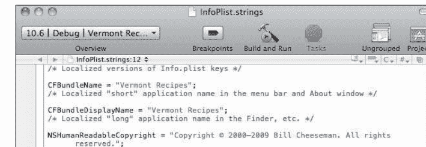

6. 如果你在第 9 步的 `CFBundleShortVersionString` 键中选择包含文本和数字，你可能也需要对其进行本地化。跳过一行并输入 `CFBundleShortVersionString =`，随后跟上你在第 9 步中使用的字符串的英文版本，并用引号括。不要忘记末尾的分号。

Recipe 1 也完成了。为了完整起见，在结束之前你将再向项目添加一个文件。

## 第 11 步：创建 Localizable.strings 文件

应用程序中包含的每个本地化版本都应该为项目添加一个 `Localizable.strings` 文件。它包含了键值对，指定你在代码中使用的任何可本地化字符串的字符串值。Interface Builder nib 文件中的字符串可以使用该 nib 文件进行本地化，因此它们不需要包含在 `Localizable.strings` 文件中。

如果你只有一个文件，`Localizable.strings` 是该文件的约定名称。应用程序可以包含许多具有其他名称和 `.strings` 扩展名的类似文件。特定语言的所有字符串文件都属于该语言的 `lproj` 文件夹。这些文件以纯文本形式的属性列表键值对形式存在，并附有协助本地化承包商的注释。在这里，你将为 `English.lproj` 文件夹创建一个 `Localizable.strings` 文件。

以本地化形式指定字符串非常简单，你应该始终这样做。在应用程序代码中任何通常会使用如 `this is a string` 语句来提供用户可见文本的地方，你应该改用 `LocalizedString()` 宏，或者如果你有除 `Localizable.strings` 以外命名的字符串，则使用 Foundation 框架中定义的 `LocalizedStringFromTable()` 宏。这些是便利方法，调用应用程序主包上 `NSBundle` 的 `-localizedForKey:value:` 方法。在 `LocalizedString()` 宏中，你传递两个参数，指定键和一个说明你正在做什么的注释字符串。该注释在运行时不使用，仅存在于支持你的本地化承包商。它应该在 `Localizable.strings` 文件或类似文件中被作为注释描述并重复。在 `LocalizedStringFromTable()` 宏中，你传递三个参数，分别指定键、存放该键及其配对值的 strings 文件名以及一个注释字符串。

通常情况下，当你的应用程序交给本地化承包商时，他们会为另一种语言添加一个新的 `lproj` 文件夹。除其他操作外，他们会在 `Localizable.strings` 文件的副本以及你提供的任何其他字符串文件中放置它，使用相同的键但翻译后的值。他们还使用 Interface Builder 本地化应用程序的 nib 文件，并提供本地化的图像、声音以及可能的其他资源，因为当你使用这些宏时，Cocoa 会自动使用与特定计算机设置的语言对应的 `lproj` 文件夹中的资源。

当你向代码中插入 `NSLocalizedString()` 宏或 `NSLocalizedStringFromTable()` 宏时，都应该记得返回 `Localizable.strings` 文件及类似文件，提供匹配的合适键值对和注释。坦率地说，Apple 提供了 `genstrings` 命令行工具来自动化此过程。启动 Terminal 应用程序并输入 `genstrings` 以获取帮助。类似的命令行工具 `ibtool` 用于本地化 nib 文件。稍后，你将学习如何在项目中使用脚本构建阶段在每次构建项目时运行 `genstrings` 并自动填充你的 `Localizable.strings` 文件。

除了你已经放在 `InfoPlist.strings` 中的字符串外，你没有其他需要本地化的字符串了。尽管如此，现在创建一个空的 `Localizable.strings` 文件以备日后可能之用。

1. 在 Xcode 项目文件激活状态下，选择 `File > New File`。

2. 在 New File 窗口中，选择 `Other` 及其 `Empty File` 模板，然后点击 `Next`。

3. 在下一个文件窗口中，将文件命名为 `Localizable.strings`，选择 `English.lproj` 文件夹作为位置，勾选 target，然后点击 `Finish`。在 Xcode 项目窗口中，将 `Localizable.strings` 文件移动到 `Resources` 组 `InfoPlist.strings` 文件旁边。

4. 如果你想，打开新的空的 `Localizable.strings` 文件并输入一个描述性标题，例如 `/* Localizable strings for Vermont */`。

## 第 12 步：设置项目属性

即使你不对属性和设置进行任何更改，Vermont Recipes 项目也可以构建运行，但你应该养成为每个项目设置属性和设置的习惯。选项非常多，而且对用户体验有很大影响。

1. 选择 Vermont Recipes 项目（Xcode 项目窗口 Groups & Files 窗的第一行），点击工具栏上的 Info 按钮或使用上下文菜单 `Get Info`。打开项目“Vermont Recipes”信息。

   a. 点击 General 标签页。假设你使用的是 Snow Leopard，将 Project Format 下拉菜单设置为“Xcode 3.2-compatible”。预计不需要在 Xcode 3.1 或旧版本中编辑或构建项目，因此你可以充分利用 Xcode 3.2 项目格式中实现的任何改进（图 1.12）。

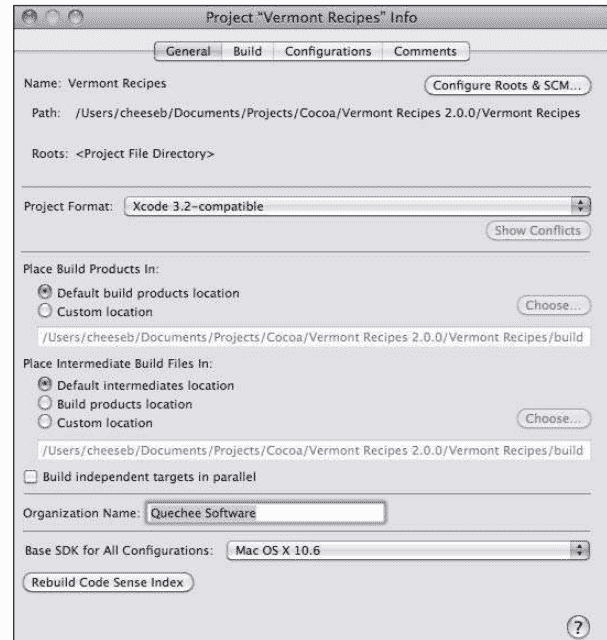

### 文档

### Xcode 偏好设置与设置

当你为任何非简单的产品设置 Xcode 项目时，拥有所有可用设置的完整参考文档是非常关键的。这就是你需要的文档：`Xcode Setting Reference`。你应该在 Xcode 文档窗口中将其标记。

有很多相关的文档，从概述到高技术：《Working with Xcode Build Settings》、《Xcode Build System Guide》、《SDK Compatibility Guide》、《Runtime Configuration Guidelines》、《Information Property List Key Reference》，以及 `Xcode User Default Reference`。

你可能会发现阅读相关的开发工具很有帮助，特别是编译器。有关最新更改的信息，请阅读 `GCC 4 Release Notes` 和 `LLVM-GCC Release Notes`。还有许多关于编译器和其他工具的长篇文档。

阅读 `Uniform Type Identifiers` 以了解有关 UTI 的详情。

将构建产物和中间构建文件的位置保持默认值，这意味着这些位置可以通过你在步骤 3 中设置的通用项目偏好设置来控制。你可以在这里为特定项目设置不同的位置，但对于 Vermont Recipes 来说没有必要这样做。

“所有配置的基 SDK（Base SDK for All Configurations）”设置默认设置为 Mac OS X 10.6 (Snow Leopard)。通过此设置，你的应用程序可以包含在 Snow Leopard 中首次实现的新功能。Vermont Recipes 2 将包含一些 Snow Leopard 中已有的功能，因此请保持设置不变。这对你来说意义不大，但该设置控制着 `SDKROOT`。将其设置为特定 Mac OS X SDK 的路径（例如 Mac OS X v10.6），可以允许 Xcode 在该 SDK 的框架、头文件和库中搜索声明，并将 `MAC_OS_VERSION_MAX_ALLOWED` 预处理器宏设置为与操作系统相同的版本。

如果你觉得项目的索引出了问题，请回到“通用（General）”面板并点击底部的“重新构建代码感知索引（Rebuild Code Sense Index）”。

- 点击“构建（Build）”选项卡。不要被长长而困惑的构建设置列表吓倒，在你不清楚自己在做什么之前，不要更改任何设置。你最终会理解，对于这些设置中的大部分，如果你更改不当，可能会造成很大的损害（图 1.13）。

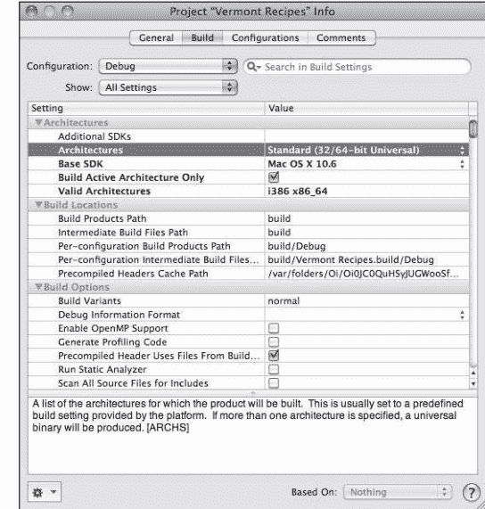

构建面板中的设置会被项目所有的目标构建设置继承，你稍后将探索这些内容。因此，在这里更改适用于项目每个目标都应保持相同的设置是非常方便的。稍后，你可以在特定目标的构建面板中进行任何特定于目标的更改。

默认情况下，构建面板中的标题和值是描述性的。通过上下文菜单，你可以一次性更改所有行的“设置（Setting）”列以显示实际名称，并更改“值（Value）”列以显示实际定义。例如，你刚刚看到的名为“Base SDK”的设置（默认设置为 Mac OS X 10.6）可以改为 `SDKROOT` 以显示其名称。这在你编写脚本构建阶段时非常有用，因为你必须使用名称而不是它们的描述性标题。Base SDK 的值显示为 Mac OS X 10.6，而定义显示为 `osx10.6`。当你使用变量设置值（例如搜索路径）时，定义尤为重要，因为当显示定义时，你可以看到定义的变量。

通过构建面板顶部的“配置（Configuration）”弹出菜单，你可以分别为 Debug（调试）和 Release（发布）配置更改设置。这些和其他配置是在“配置（Configurations）”面板中创建的。在 Debug 配置中使用与 Release 配置不同的设置通常是非常重要的。

若要快速查看特定配置中哪些设置已偏离默认值，请从“显示（Show）”弹出菜单中选择“在此级定义的设置（Settings Defined at This Level）”。你还可以创建并显示自定义设置。在“所有设置（All Settings）”视图中查找特定设置或一组命名相似的设置时，如果你记得名称，请使用搜索字段。

当选中任何设置时，底部面板中会出现完整的描述。

现在，只更改项目的构建设置之一。此更改应同时应用于 Debug 和 Release 配置，因此请在配置弹出菜单中选择“所有配置（All Configurations）”，在显示弹出菜单中选择“所有设置（All Settings）”，向下滚动到“部署（Deployment）”部分并选择“Mac OS X 目标（Mac OS X Deployment Target）”。它默认设置为操作系统版本 Mac OS X 10.6，但你希望 Vermont Recipes 2 在作为 Snow Leopard 的 Leopard 下运行。弹出菜单需要选择 Mac OS X 10.5。现在，Vermont Recipes 将拒绝在 Mac OS X v10.4 及更高版本下运行，但可以在 Leopard 和 Snow Leopard 下加载并运行。你设置了部署版本，即 `MAC_OS_X_VERSION_MIN_REQUIRED` 预处理器宏。你稍后将学会如何确保 Vermont Recipes 2 中在 Leopard 下不支持的功能在 Leopard 下运行应用程序时不会产生问题。

你稍后还会更改许多其他设置。现在，请注意，如果你在 Intel 上进行构建，构建的应用程序将无法 PowerPC 上运行。你稍后会修复它的。关闭项目。

- 2. 现在，在 Finder 中打开 Vermont Recipes 项目文件夹，并将其中的文件夹拖到垃圾桶。构建文件夹是 Xcode 在你构建应用程序时放置构建的 Debug 版本应用程序以及许多相关文件的地方。你不需要浪费空间保存它们，因为它们可以从项目文件重新生成。

   a. 选择“构建（Build）”选项卡。你会看到在步骤 9 中操作的相同设置。

   b. 选择“属性（Properties）”面板。属性面板的用处在于它能让你在一个地方轻松地看到最重要的设置（图 1.14）。

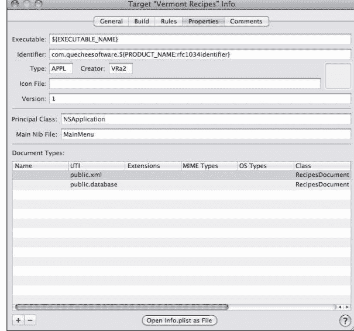

点击属性面板底部的“打开 Info.plist”按钮。`Vermont Recipes-Info.plist` 文件将打开。目标“Vermont Recipes” Info 窗口显示的目标与你在步骤 9 中操作的相同。关闭“Vermont Recipes” Info 窗口。

## 步骤 13：构建并运行应用程序

为了庆祝步骤 1 的结束，构建并运行你的新应用程序。它可能不会做什么，但看到你取得了真正的进展会让你鼓舞。

构建和运行应用程序再简单不过了。只需点击 Xcode 工具栏上的构建并运行图标。如果你留了一些未保存的文件，Xcode 会立即提醒你。点击“全部保存（Save All）”并等待片刻。

突然，Vermont Recipes 文窗口打开，菜单栏出现在屏幕顶部，通用应用程序图标出现在 Dock 中。许多菜单项已经可以使用。在应用程序菜单中选择 Vermont Recipes 以查看文本视图中的你的作品、滚动文本以及底部的版权声明。

恭喜！你刚刚成为一名 Cocoa 开发者。

## 步骤 14：保存并存档项目

养成每个配谱结束时关闭项目并保留一份备份的习惯。我发现定期对过程中的工作进行压缩很有用。这样，如果我把下一组更改搞乱了，就可以回溯。你真的应该使用源码控制管理（SCM）系统来完成此，但现在请使用 Finder。

1. 在运行的 Vermont Recipes 应用程序中，从应用程序菜单选择退出（Quit）。

2. 点击 Xcode 项目窗口标题栏上的关闭框。如果你喜欢，可以退出 Xcode。

3. 在 Finder 中打开 Vermont Recipes 项目文件夹，并将其中的文件夹拖到垃圾桶。

4. 向上导航一级，如果那是你项目的父文件夹，则进入 Vermont Recipes 2.0.0 文件夹。选择 Vermont Recipes 子文件夹并使用 Finder 文本菜单的压缩“Vermont Recipes”命令创建一个 zip 文件。为了将其与项目后期版本的备份区分，将 `Vermont Recipes.zip` 重命名为类似 `Vermont Recipes 2.0.0 - Recipe 1.zip` 的名称。

将 zip 文件的副本保存到另一块磁盘上，将其刻录到 CD 或 DVD 中保存，或者如果你有 MobileMe 账户，可以将其保存到你的远程 iDisk 上，以防万生火灾。正在使用的 Vermont Recipes 项目文件夹将保留在原处，供你开始接下来的食谱 2 的工作。

# 结论

在涉足 Macintosh Cocoa 应用开发的世界的过程中，你已经取得了巨大的进展。你创建了一个新项目。你向其中填充了用于运行应用程序和创建文档的代码文件，用于显示和控制图形用户界面的 `nib` 文件，以及定义应用程序行为和外观的其他资源文件。你甚至构建并运行了该应用程序。

但是，要将该应用程序变为用户实用的工具，你仍然有很多工作要做。在下一个食谱中，你将通过添加所需的视觉道具来搭建舞台，为你的用户完成实际工作所需的所有控件和菜单项形成背景。

## 文档

## Xcode

Apple 提供了若干关于 Xcode 及相关开发工具的介绍性和总结性文档。在转向更详细的技术文档之前，请阅读：《工具与语言入门》（Getting Started with Tools & Languages）、《Mac OS X 技术概览》附录 C 中的“Xcode”部分，以及《Xcode 漫览》（A Tour of Xcode）。

对于关注 Xcode 最新版本中新功能的文档，请阅读《Xcode 新特性》（What's New in Xcode）、《Xcode 发布说明》（Xcode Release Notes）以及《Mac OS X 新特性》中的“Xcode 3.0”部分。

关注开发工具新版本的发布说明至关重要。在 Xcode 的帮助菜单中可以找到 Xcode 3.x 版本的发布说明全集。

《Xcode 安装指南》（Xcode Installation Guide）为你提供了关于设置 Xcode 的信息。

如需更详细的技术信息，请阅读《Xcode 项目管理指南》（Xcode Project Management Guide）和《Xcode 工作空间指南》（Xcode Workspace Guide）。

食谱 3 中引用了关注 Xcode 偏好设置、构建设置和构建阶段的其他技术出版物。

## 食谱 2

## 使用 Interface Builder 设计并构建 GUI


# Interface Builder 应用概述

Interface Builder 应用的名字（通常简称 IB）暗示它是一个用于构建应用程序图形用户界面（GUI）的工具。它不仅于此，更多。它是一个界面设计工具，你用它创建应用程序窗口和视图的外观。它是一个测试工具，允许你在编写任何代码之前运行界面。它还是界面对象存档（如窗口、视图和菜单）的生成器，这些对象已准备好被归档并连接供应用程序运行时使用。使用 Interface Builder，你无需编写任何代码即可设置应用程序用户界面元素的许多默认值和行为。

## 重点内容

- 创建和设置 Interface Builder nib 文件
- 创建工具栏和工具栏项
- 创建拆分视图（`split view`）
- 使用弹簧和支撑（`Springs and Struts`）控制视图的缩放行为
- 创建表格（`table view`）
- 创建标签视图（`tab view`）
- 创建抽屉

在为 Vermont Recipes 应用设计 GUI 的过程中，你会发现你在 Interface Builder 中创建 nib 文件包含了大量与应用程序用户界面的信息和功能，让你无需编写大量的代码。通过 Interface Builder，你可以绘制并预加载 Cocoa、视图和其他类和对象，以及它们与其方法之间的连接；并对它们归档，以便在运行时直接加载到你的应用程序中。这与其他许多平台的 GUI 设计工具采用的方法不同，例如，它们可能会生成文本代码段，以便在构建应用程序时稍后编译。这与 Mac OS 9 及更早版本中使用的 `ResEdit`（用于创建作为应用程序资源的编码布局模板）所采用的方法不同。

虽然可以不使用 Interface Builder 从代码构建 Cocoa 应用程序的 GUI，但很难想象理由要去这样一个繁琐且易出错的任务。Apple 在《资源编程指南》（Resource Programming Guide）的“Nib Files”主题中特别建议不要这样做。

你即使无法访问源代码，也可以检查并编辑旧版 Macintosh 应用程序 nib 文件的内容。然而，从猎豹版（Leopard）开始，Apple 提供了将 nib 文件编译为某种格式的能力，在没有原始文件的情况下，人类无法读取或更改。还有一种具有不同文件扩展名 `.nib` 的新类型 nib 文件，但大多数开发者继续称它们为 nib 文件。

## nib 文件的核心作用

当你开始为应用程序编写代码时，你会发现 nib 文件内部信息之所以重要的原因之一。许多看似必重要的项目在 Xcode 源文件中被省略了。例如，你在代码中声明了实例变量，但你没有编写代码告诉应用程序实例变量指向哪些控件。同样，你在代码中实现了方法，但你没有编写代码告诉应用程序特定控件调用了哪个动作。

Interface Builder 的 nib 文件提供了这些被省略的信息。当你为应用程序设计 GUI 时，你通常会在 Xcode 中编写代码来创建出口（`outlets`）和动作（`actions`），然后使用 Interface Builder 的图形界面将它们连接到对象。出口是在代码中声明的变量，你将其连接到 nib 文件中的对象。你指定要连接对象的哪些实例变量。同样，动作是你在代码中实现的方法。再次，你使用 Interface Builder 建立从控件到动作消息目标对象的连接，然后指定当用户点击控件时调用目标对象的哪个动作方法。每当用户点击控件时，Cocoa 都会在运行时自动调用正确的方法。请阅读“出口和动作”侧边栏以获取更多信息。你还使用 Interface Builder 设置许多控件的默认值和属性。同样受 Interface Builder 支持的较新技术（如 Cocoa 绑定，`Cocoa Bindings`）使得开发过程变得更加简单。

当你使用 Interface Builder 创建出口、动作、连接、绑定以及 GUI 的其他功能时，信息被存储在 nib 文件中。nib 文件是应用程序不可或缺的一部分，其中的信息在运行时用于将一切整合在一起。

通常建议为应用程序中的每个主要窗口创建一个单独 nib 文件。你也可以为复杂窗口中的窗格创建单独的 nib 文件。这使得你的应用程序可以在需要时延迟加载它们。你的应用程序启动得更快，因为它需要加载的数据更少。

## 出口和动作（Outlets and Actions）

你在本食谱中看到 Interface Builder 在某种程度上依赖电气比喻。对象拥有出口，你通过出口与要插入的对象进行连线。Interface Builder 曾使用插座符号来识别出口。

在程序员术语中，出口是在类头文件中声明的实例变量或属性。通常，如文档类或窗口控制器之类的类会声明多个出口来标识它需要通信的对象，包括控件以及任何对象。该实例变量或属性只是指向对象的指针。在代码中，你通过在类型声明之前添加 `IBOutlet` 来标识它。这告诉 Interface Builder 这是一个出口，以便 Interface Builder 更新自身以与你的代码保持同步。

你使用 Interface Builder 为用户对象连接电路，将每个控件连接到目标对象的特定动作方法，以便在用户使用控件时调用。这实现了目标-动作（`Target-Action`）设计模式，另一种 Cocoa 核心的设计模式。通常，控件连接到窗口控制器中实现的动作方法。在代码中，将方法的返回类型声明为 `void`。对于 Xcode 来说这等同于 `void`，但它告诉 Interface Builder 这是一个动作方法，以便 Interface Builder 保持与你的代码同步。

## 文件所有者 (File’s Owner)

在 Interface Builder nib 文件中，“文件所有者”图标是拥有该 nib 文件的任何对象的代理。

之所以使用代理是因为 nib 文件的所有者无法在 nib 文件内部被实例化。这是一个鸡生还是蛋的问题：运行中的应用程序必须加载 nib 文件，但若要实现这一点，“文件所有者”必须在运行的应用程序中已经存在。因此，你必须通过编程创建它。

每个应用程序都有一个主 nib 文件，其所有者是应用程序对象 `NSApplication`。应用程序 `Info.plist` 中的 `MainNibFile` 键标识了 Cocoa 应用程序的主 nib 文件。应用程序在启动时加载其主 nib 文件。在典型的应用程序中，主 nib 文件是菜单 nib 文件，它负责应用程序的菜单栏，可能还负责其他界面对象。

正如你在“食谱 1”中所学到的，当应用程序启动或用户每次调用新文档时，系统会使用硬编码的 Cocoa 在运行时通过编程实例化新文档。你通过两种方式编写文档子类代码。在一个简单的应用程序中，文档直接加载 nib 文件，在这种情况下文档就是“文件所有者”。在更复杂的应用程序中，文档实例化一个窗口控制器，再由它加载 nib 文件。在这种情况下，窗口控制器就是“文件所有者”。无论何种方式，nib 文件的所有者在加载 nib 文件之前必须作为一个实例化的对象存在于内存中。从这个意义上说，所有者位于存档窗口的 nib 文件外部。

“文件所有者”与 nib 文件中实例化对象（如窗口）之间必须存在通信手段。出于此目的，“文件所有者”代表所有者对象。在设计用户界面时，当在它与其他对象之间绘制必要的连接时，会使用它的图标。当在运行时加载 nib 文件时，Cocoa 会利用 nib 文件中指向“文件所有者”代理的连接信息，负责实例化指向真实文件所有者对象的连接。

# 第 1 章：探索并修改文档窗口的 nib 文件

在开发周期的早期，为应用程序的主文档窗口设计并构建用户界面的基本元素是非常方便的。这让你有机会通过以最终应用程序用户将看到的相同形式将其显示在屏幕上，从而开始测试你的应用程序规范。Interface Builder 能够在你编写大量代码之前，在交互式测试模式下运行界面的能力，这对于验证你对可用性的假设通常有用。在此阶段，将 Interface Builder 作为原型设计工具，你可以轻松地进行调整和微调 GUI。

## 步骤 1：打开项目并更新版本号

首先，打开 `Vermont Recipes 2.0.0` 文件夹，这是你在食谱 1 结束时保存项目文件夹的目录。将你之前留存的压缩项目留在原处，打开工作中的 `Vermont Recipes` 子文件夹。在其中，双击 `Vermont Recipes.xcodeproj` 文件以启动 Xcode 并打开项目窗口。

你首先需要处理应用程序的一项管理事务。回想食谱 1，你决定在每个食谱的开始时增加 `CFBundleVersion` 设置。在 `Groups & Files` 窗格的 `Resources` 组中打开 `Vermont_Recipes-Info.plist` 文件，将 `CFBundleVersion` 键的值从 `1` 改为 `2`，保存并关闭文件。当你打开此食谱的“关于”窗口时，你会看到应用程序版本显示为 `2.0.0 (2)`。

## 步骤 2：打开并探索 nib 文件

现在你准备好查看 nib 文件了。虽然可以在 Xcode 中未打开项目的情况下在 Interface Builder 中处理 nib 文件，但更好的做法是同时在 Xcode 中打开项目。你可以在处理用户界面的同时对代码进行调整，Xcode 和 Interface Builder 会在后台协作，使你在两个应用程序中的工作保持同步。

在 Xcode 中，展开 `Groups & Files` 窗格中的 `Resources` 组，并双击 `RecipesWindow.nib`。Interface Builder 会启动并打开该 nib 文件。或者，启动 Interface Builder 并使用它打开 nib 文件。

会出现两个窗口和两个调板。nib 文件的文档窗口标题为 `RecipesWindow.xib - English`（图 2.1）。这是你进入 nib 文件的主要入口。它最初包含标记为 `File’s Owner`、`First Responder`、`Application` 和 `Window` 的图标。

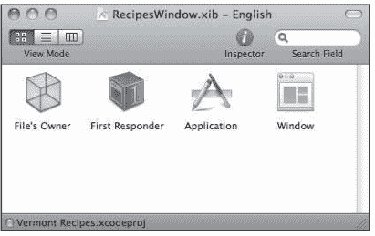

**图 2.1** 图标模式下的 `RecipesWindow.xib` 文档窗口。

用于应用程序的主食谱文档窗口显示在附近的屏幕上。此窗口与在 Interface Builder 中打开编辑的视图和菜单对象一样，是设计表面。在此情况下命名为 `Window`，它包含一个写有“Your document contents.”句子的文本字段。

库窗口（Library window）是一个在 Interface Builder 为活动应用程序时可见的调板（**图 2.2**）。你可以从这里将视图、控件和其他对象拖到设计表面并到 nib 文件的文档窗口中。如果你关闭了库窗口，可以使用 `Tools > Library` 重新打开它。

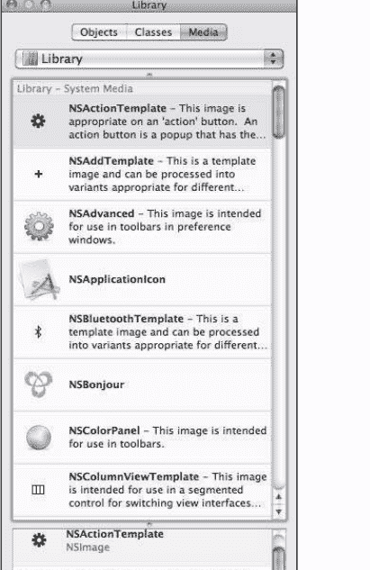

库窗口中的部分模板图像及用途：

- `NSActionTemplate` — 此图像适用于“动作”按钮。动作按钮是一个具有...的弹出窗口。
- `NSAddTemplate` — 这是一个模板图像，可以处理成适用于不同的...变体。
- `NSAdvanced` — 此图像旨在用于偏好窗口中的工具栏。
- `NSApplicationIcon`
- `NSBluetoothTemplate` — 这是一个模板图像，可以处理成适用于不同的...变体。
- `NSBonjour`
- `NSColorPanel` — 此图像旨在用于工具栏。
- `NSColumnViewTemplate` — 此图像旨在用于切换视图的分段选择控制...
- `NSActionTemplate`
- `NSImage`

**图 2.2** 库窗口。

动作按钮（`action button`）是一个组，其内容与相关控件的右键菜单内容相同。这是一种切换图像，可以处理成适用于不同情况的变体。例如，让我们在选中的表格视图行中插入一个。在没有这种处理的情况下，此图像是不恰当的。

最后，检查器窗口（Inspector window）是另一个调板。和库窗口一样，每当你激活另一个应用程序时，它就会隐藏。它包含一个工具栏，允许你选择几个不同检查器之一。如果你关闭了它，可以通过点击文档窗口工具栏中的信息（Information）按钮或选择 `Tools > Inspector` 来重新打开它并显示其最近的内容。你可以通过选择（例如 `Tools > Size Inspector`）来显示特定的检查器。你使用各种检查器有许多目的，包括设置控件的初始属性、设置其 Core Animation 效果、设置其大小和缩放行为、设置其绑定或连接，并通过（例如）指定特定的类或定义它的自定义标签来定义其身份。

当你在文档窗口或设计表面上选择不同的项目时，检查器的内容会自动更改，以便为特定的窗口、视图、控件或其他对象设置值。现在试一下。点击设计表面上显示为“Your document contents here”的文本字段，查看检查器的标题变为类似 `Text Field Connections` 的内容。然后点击文档窗口中的 Window 图标或窗口设计面的标题栏，查看检查器的标题变为类似 `Window Connections` 的内容。

在文档窗口仍被选中的情况下，点击工具栏中的 Attributes（属性）按钮。现在你正在查看属性检查器（Attributes inspector）（图 2.3）。属性检查器包含一组针对视图或控件的设置。这些设置大部分对应于实例变量或方法。当你在 Interface Builder 中选择不同的项目时，检查器会更新以显示所选项目的属性。

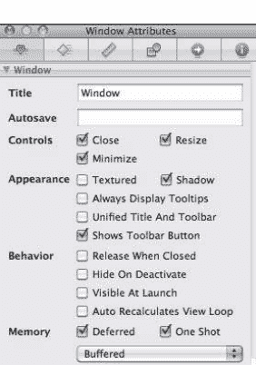

**图 2.3** 属性检查器。

## 步骤 3：探索默认对象与连接

探索 Interface Builder 为你设置的默认对象。其完整含义稍后可见。首先点击设计表面上的窗口标题栏选择它。在窗口检查器中，点击工具栏上的 Connections（连接）按钮（它是圆圈中的右指向箭头；如果指针悬停在其上方，会出现帮助标签）。你看到有输出、接收的动作和引用输出的三个列表。其中两个（代理输出和窗口引用）被高亮，且它们都指示连接到所有者。在使用 Vermont Recipes 时选择的模板提供了此连接。将鼠标悬停在任一选中输出上，查看食谱 nib 的文档窗口。你会看到在鼠标悬停时 File Owner 被高亮。在检查器中，点击 File Owner 之前的清除（x）按钮。你破坏了代理输出。点击代理输出右侧的空圆并拖到文档窗口中的 File Owner 代理。当你释放鼠标按钮时，检查器会更新以显示你重新连接了代理输出。代理连接意味着在此时，窗口对象将其某些功能连接到你的食谱 nib 所有者。你稍后将了解由 File Owner 代理代表的对象。委托是一个重要的 Cocoa 设计模式，你将学习更多。

## 步骤 4：修改文件所有者类为 RecipesController

点击文档窗口中的“文件所有者”代理。窗口连接检查器（Window Connection inspector）会自动变为“我的连接”（My Connections）检查器。你永远不需要关闭并重新打开检查器来查看另一个对象的信息。

如果你足够敏锐，就会意识到你发现了另一个必须更改原名为 `MyDocument` 的文档引用的地方。Interface Builder 在自动跟踪 Xcode 项目中代码更改方面非常智能，但它无法确定你的意图——当你更改了头文件中的类名，甚至更改了头文件本身的名称时，是否是为了更改 nib 文件的身份以匹配它。

你在“食谱 1”中了解到，复杂的多文档、多窗口应用程序应该使用 `NSViewController` 的自定义子类来处理文档与其窗口之间的通信。为了适应这一点，你创建了 `RecipesController` 类的头文件和实现文件。你在创建 Vermont Recipes 项目时选择的文档应用程序模板将 `MyDocument` 类设为 nib 文件的所有者，因此你现在必须将其所有者改为 `RecipesController` 类。在“食谱 1”中，你已经预见到了这一变化并正确地命名了 nib 文件。

点击检查器工具栏中的“身份”（Identity）按钮进行编辑（圆圈内的 *i*）。你在 MyDocument 身份检查器的顶部看到，它仍然认为 nib 文件的所有者类是 `MyDocument`。要更改它，下拉菜单，根据需要向上向下滚动，然后选择 `RecipesController`。或者，在文本框中输入 `RecipesW`，观察 Interface Builder 如何自动补全名称，因为它知道你不是在输入 `RecipesDocument`。检查器的名称会立即更改，识别其为食谱窗口控制器（图 2.5）。


> 图 2.5 食谱窗口控制器检查器。


nib 文件已经识别了你新的 `RecipesController` 类，因为 Interface Builder 在与 Xcode 项目保持同步方面做得很好。如果你发现 Interface Builder 与项目不同步，请选择“文件 > 重新加载所有类”；或“读取类文件”，并在打开面板中，导航到 Vermont Recipes 项目文件夹，选择缺失的头文件，并点击“打开”。

稍后我们将更详细地学习 Cocoa 中 nib 文件所有者的概念。现在，只需将其视为在运行时加载 nib 文件的对象。在这种情况下，当用户启动完成的 Vermont Recipes 应用程序时，应用程序告诉主食谱文档打开，并

# 步骤 1：探索并修改文档的 nib 文件

`RecipesWindowController` 对象加载此 nib 文件，以便为文档窗口设置用户界面。

- 5. 文档窗口中还有一些你现在应该探索的附加功能。开始在搜索字段中输入 `RecipesWindowController`。在你完成输入之前，Interface Builder 自动补全了名称。窗口从图标视图切换到大纲视图。“文件所有者”代理是唯一显示的条目，并指定 `RecipesWindowController` 类为文件所有者。点击搜索字段中的“清除 (x)”按钮以清除文本，窗口将恢复到图标视图。

使用文档窗口工具栏左端的分段控件，你可以一直以图标视图或浏览器视图模式工作。这通常比图标视图更有用，特别是当你的 nib 填充了数十个视图和控件时。

要查看它是如何工作的，选择大纲视图并点击左侧的三角形。窗口展开显示“内容视图”（Content View）。工具栏包含一个搜索字段，使用户可以在此找到食谱和配料。它包含一个信息按钮，用于打开和关闭抽屉。你很快会添加一个打印按钮。其他的你自然会想到（图 2.6）。

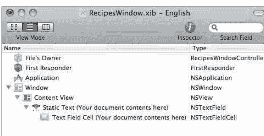

> 图 2.6 大纲模式下的 Recipes.xib 文

| 名称 | 类型 |
| :--- | :--- |
| 文件所有者 | RecipesWindowController |
| 第一响应者 | FirstResponder |
| 应用程序 | NSApplication |
| 窗口 | NSWindow |
| 内容视图 | NSView |
| 静态文本（文档内容） | NSTextField |
| 文本字段（文档内容） | NSTextFieldCell |

## 文档

## Cocoa 视图

要了解更多关于通用 Cocoa 视图的知识，请阅读 Cocoa 指南。

要了解本食谱描述的特定视图，请阅读以下 Apple 文档：Cocoa 编程主题、抽屉和应用程序菜单以及弹出列表编程主题。对于分屏视图，请阅读 Leopard 和 Snow Leopard 的 AppKit 发布说明，这两者包含了大量关于分屏视图但未录入其他文档的信息。

本食谱深入讨论了两个 Cocoa AppKit 类。有关这些类的更多信息，请阅读 `NSTableView` 类参考和 `NSDrawer` 类文档。

你可以通过从 Interface Builder 库窗口拖动实例化的对象（如窗口和视图）到 nib 中。在接下来的系列步骤中，你将学习如何使用库将多个视图添加到现有窗口中。在这一步中，你将保持这些视图为空，为稍后在食谱中添加的控件做好准备。

作为使用 Interface Builder 向窗口添加视图的第一个练习，请为窗口添加一个工具栏。在第 7 步之前，延迟向工具栏填充自定义工具项，直到你已经向窗口添加了其他几个视图。

在继续之前，删除文本字段“Your document contents here.”。点击该文本选中它，然后按 Delete 键。

- 1. 通过查看资源库（Library）窗口开始添加工具栏的过程。它包含了大量信息，并提供了几种设备来帮助你找到所需的内容。

顶部的标签行允许你选择如 `NSAlert` 之类的类。你可以通过将任何一个这些类拖入设计表面来实例化该类中的某一个对象。你也可以通过将图像拖入设计表面来实例化媒体，例如一个信息按钮图像。现在选择 Classes（类）和 Media（媒体）标签来查看。

- 2. 选择对象（Objects）。你可以在下方看到一个对象列表，从菜单对象开始，经过大量滚动后，以 QuickTime View 对象结束。Interface Builder 提供了丰富的重建视图和控制对象，但这些可能会让人有些无从下手。

- 3. 幸运的是，这些类被分成了不同的类别。使用资源库窗口顶部的弹出菜单选择 Library > Cocoa > Application > Toolbars。或者，向下拖动水平分割线，弹出菜单就会变成大纲视图，你可以在其中同时看到多个条目。你在中间窗格中看到一个更易管理的视图对象列表，包括 Toolbar 对象本身以及若干工具栏项对象。选择 Toolbar 对象。在选中的视图和资源库的底部，你都能看到一段简短描述，明确了这就是你需要的视图。当你对可用内容更加熟悉时，可以使用上下文菜单或窗口底部的操作按钮来减少窗口中显示的大小和数量，同时在底部的窗格中查看完整的描述。

- 4. 将一个 Toolbar 对象从资源库窗口拖出，并将其放置在设计表面的顶部附近。不要纠结于放置的确切位置，因为 Toolbar 已经知道它必须位于窗口顶部并覆盖窗口的整个宽度。你将在下一步中看到，对于那些没有预设位置或大小的视图，在它们被添加到设计表面之后，通过拖动和调整调整其大小来正确设置视图的位置和大小要容易得多。

当你将小的 Toolbar 图像拖入窗口时，它会放大为一个全尺寸工具栏，你会看到它已经填充了 Colors、Fonts、Print 和 Customize 按钮（图 2.7）。

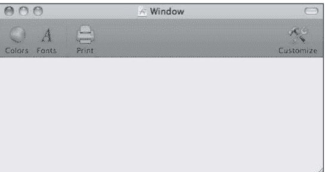

图 2.7 添加工具栏后的设计表面。

- 5. 通过将 Toolbar 对象释放到设计表面，你开始创建每个 Macintosh 窗口典型的用户界面层级结构。然而，该层级的细节和结构并不显而易见，因为窗口中的许多视图被隐藏或遮挡了。要查看完整层级并访问每个子视图进行编辑，请进入 nib 文件的文档视图并选择大纲视图模式。点击 Window 的展开三角形来展开它。你会发现窗口包含两个视图：你添加的新的 Toolbar 对象和模板提供的标准 Content View 对象。点击 Toolbar 的展开三角形进行展开，你会看到七个工具栏项对象，包括你将工具栏拖入窗口时看到的四个按钮，以及为了在工具栏中定位这些按钮而需要的三个不可见的分割符和空白项。如果你更倾向于浏览器视图，可以打开并查看如何方便地在每个层级选择视图对象并立即查看其所有子项。

Toolbar 对象是 Interface Builder 在资源库 Objects 格中提供的视图对象的典型。当你将一个视图对象拖入设计表面时，你会发现它实例化时所有功能已就绪。对于第一次遇到 Interface Builder 的开发者来说，这种感觉就像魔法一样。他们本能地觉得会更倾向于编写代码来创建用户界面。抑制这种冲动！当 Interface Builder 在 nib 文件中为你归档这些对象时，就像是 Interface Builder 为你编写了代码、将其编译并存储在 nib 文件中。Interface Builder 不会出错，而且知道某个特定视图所需的大或全部实现细节。通过 Interface Builder，你可以以比手写代码更快的速度为你的窗口构建视图。

- 6. 你现在准备好使用 Cocoa 模拟器了，这是 Interface Builder 的一个功能，允许你在无需编写任何代码的情况下运行为你的应用程序准备的用户界面功能。当然，模拟器仅限于你构建到 nib 文件中的那些功能。在此前提下，模拟器将你的窗口显示在屏幕上，与你运行完成的应用程序时完全一致，因此你可以练习窗口及其视图的内置行为。正如你将在下一步中看到的，它甚至允许你练习在 Interface Builder 中添加和自定义的行为。允许你在设计界面对象的同时对其进行测试是 Interface Builder 最具价值的功能之一。这并不是关乎它们的正确性，而是关乎测试你设计的易用性和用户友好性。

运行 Cocoa 模拟器。选择 File > Simulate Interface。Builder 的窗口消失了，取而代之的是你自己的配方窗口，它带有标题栏及其标准按钮（如缩放按钮）、带有内置按钮的新工具栏，以及窗口右下角的调整大小控件。

显著的是，几乎所有的这些界面元素都可以工作。尝试一下它们。移动任意两个窗格之间的分割线向左或向右或向上或向下以改变相对大小。

你会看到它从上到下包含了：模板为每个窗口提供的标准 Content View 对象、你刚刚拖入窗口的 Split 对象，以及 Interface Builder 提供的两个 Custom View 对象。

- 要编辑分屏视图的属性，请点击窗口大纲中的 Split View 条目。检查器位于屏幕右侧，显示有关分屏视图的信息。点击检查器工具栏中的 Split Attributes 按钮，或选择 Tools > Attributes Inspector。你可以从属性检查器中的 Style 弹出菜单看到，默认情况下，Interface Builder 使用 Pane splitter，这是一条中间带有分隔符的宽条。为了跟上 Apple 领先的 iTunes GUI，请选择“Thin divider”。文档窗口中分屏视图的图形表示立即显示分隔符现在变成了一条细线。

将指针悬停在检查器中的弹出菜单上，查看描述当前选择的帮助标签。该帮助标签还标识了你可以通过程序获取此属性的 Cocoa 方法。在分割线符的情况下，它是 `-(NSplitViewStyle)dividerStyle`。你知道它声明在 `NSplitView` 中，正如你看到的库窗口中的 Vertical Split View。你必须查找与此方法配合使用的常量，这一点你以后会学会。它们是 `NSplitLayerViewThick` 和 `NSplitViewStyleThin`。Interface Builder 为你提供了一个方便的 GUI 来设置界面值，否则你将不得不使用 Cocoa 方法或函数进行程序设置。你经常会发现在文档中查找方法及其常量，以确切了解特定 Interface Builder 设置的作用。这些 Interface Builder 帮助标签让你易于搜索相关的方法文档。

- 在文档窗口中调整分屏视图的位置和大小，使其填满整个窗口内容。

在窗口中选择复杂对象可能是困难的。例如，如果你点击左侧或右侧自定义视图占据的区域，你选择的是自定义视图而不是持有自定义视图的分屏视图。如果你不小心选择了其中一个自定义子视图并干扰了它在分屏视图中的位置，请选择 Edit > Undo，重置分屏视图并重试。要选择并拖动像分屏视图这样的容器视图，你可以使用多种技术中的任何一种。例如，在整个复合对象周围拖动一个矩形，它周围就会出现手柄。或者点击一次子视图，然后 Option-click 或 Shift-click 另一个。在文档窗口模式下，双击 Split Item。对于 Vertical Split View 对象，你也可以点击垂直分割线来选择整个对象。但最实用的技术是在设计表面的任何对象上 Shift-Control-click。

此手势会弹出上下文菜单，列出指针下的整个对象层次，允许你选择其中任何一个。

一旦选中分屏视图，将其向右拖动。只要按住鼠标按钮，指针就会变成打开手光标，信号你可以拖动下方的视图。小心不要将视图拖入工具栏或窗口边缘之外。Interface Builder 将其位于内容区域的左上角，并在靠近时轻松地吸附到该位置，窗口顶部和左边缘会出现虚线，显示吸附的目标。当你将分屏视图拖向角落时，你可能会注意到其他指南短暂出现。Interface Builder 提供这些指南来帮助你根据 Apple 的人类交互指南放置视图。

通过将分屏视图的右下角手柄拖到窗口的右下角来调整其大小。光标会变为一个小图标，表示你可以对角线拖动角落。当你拖动时，视图的当前尺寸会以小叠加层的形式出现，以便在你想要视图达到特定尺寸时使用。

向左拖动分割线，直到左窗格宽度约为窗口宽度的四分之一。Interface Builder 会自动调整自定义视图的大小。

- 6. 最后，设置分屏视图的行为，使用户调整窗口大小时，分屏视图继续填充窗口。

在文档窗口中选中分屏视图，打开 Split View Size 检查器并查看 Autosizing 部分（图 2.9）。图中的内部正方形代表所选视图的框架，外部正方形代表其父视图的框架。连接两个正方形的线和内部正方形内部的线被称为弹簧和支柱。在旧版本的 Interface Builder 中，弹簧实际上被描成像弹簧一样的线。


图 2.9 Split View Size。

在继续之前，阅读“Springs and Struts”侧边栏以完整了解 Interface Builder 的自动调整功能。

# Springs and Struts

很容易误解弹簧和支柱的工作原理。现在掌握它，否则你将在以后调整窗口使其正常工作时浪费大量时间。

内部和外部正方形之间的线条是刚性支柱，由它们的方块端点标记指示。点击支柱在实线和虚线之间切换。当支柱为实线时，它是启用的，即使父视图调整大小，该边缘也保持固定。当支柱为虚线时，它是禁用的，父视图调整大小时，所选视图与其父视图之间的边缘发生无约束的变化。

现在在水平维度上遍历排列组合，将指针保持在 Autosizing 部分，以便看到它是如何工作的。在垂直维度上也是同样的。

- 禁用水平弹簧和两个支柱。所选视图（内部正方形）宽度保持固定，因为它的弹簧被禁用了。所选视图与其父视图（外部正方形）之间的边缘在两侧自由变化。
- 启用左边缘的支柱，禁用弹簧和右支柱。所选视图宽度保持固定，因为它没有弹簧，但现在左边缘是固定的。所选视图相对于父视图的左边缘固定位置。
- 同时启用左支柱和右支柱，禁用弹簧。由于所选视图由于弹簧而具有固定宽度，右支柱被忽略了。这是一个不一致的状态。它的行为类似于上一个排列组合，就像右支柱仍然被禁用一样。
- 禁用左支柱，保持弹簧禁用但右支柱启用。所选视图宽度保持固定，因为它没有弹簧，但现在右边缘是固定的。所选视图相对于父视图的右边缘固定位置。
- 启用弹簧和两个支柱。两个边缘都保持固定，所选视图固定在父视图的左右边缘上。因为弹簧第一次被启用，所以所选视图随父视图一起调整大小。
- 禁用右支柱，保持左侧和弹簧启用。所选视图相对于父视图的左边缘固定。所选视图向右调整，同时右边缘发生变化，因为所选视图的宽度是灵活的，且右边缘没有相对于父视图的右边缘固定。所选视图和右边缘共享灵活性，随着父视图调整大小，都会按比例变化。
- 同样禁用左支柱，仅启用弹簧。所选视图同时向左和向右调整，同时左右边缘都发生变化，因为这三者按比例共享灵活性。

开始在垂直拆分视图对象的自动调整图中四个边缘启用支撑，并在两个维度上启用弹簧。要启用弹簧和支撑，只需点击它们，使图中所有的虚线变为实线即可。这样做的效果是固定所选视图（拆分视图，由内正方形表示）四边边缘及其父容器视图（窗口内容视图，由外正方形表示）对应边缘的尺寸，同时让拆分视图在两个维度上都能自由调整大小。由于你已经设置拆分视图的边缘与文档窗口及其内容视图的边缘对齐，因此当用户调整大小时，拆分视图将完全填充内容视图及其窗口。

接下来，设置拆分视图左右窗格的自动调整行为，使左窗格在窗口缩放时保持固定宽度，就像 iTunes 和 Finder 中的左窗格那样。你很快会发现，如果不写一些代码这是不行的，但你仍然应该进行这个练习，以理解自动调整的工作原理。你会解决这个问题的。

选择左侧的自定义视图。在视图尺寸检查器中，启用顶部、左侧和底部的支撑以及垂直弹簧，同时禁用水平弹簧和右侧支撑。左窗格现在锚定在容器拆分视图的顶部和底部边缘，同时高度是灵活的，这样它在窗口缩放时就会垂直方向填充拆分视图。同时，它被设置为锚定在容器拆分视图的左边缘，且水平宽度保持固定，为右窗格留下了灵活的右边缘——这正是你想要的行为。

最后，设置拆分视图右窗格的自动调整行为。选择它并启用所有的弹簧和支撑。右窗格可以在水平和垂直方向上自由调整大小，而它的四个边缘都相对于拆分视图的左边缘锚定，它应该保持与该边缘的间隔等于固定宽度左窗格的宽度。

- 7. 现在测试拆分视图的配置。

不要犯在 Interface Builder 中通过缩放文档窗口来测试的错误。如果你这样做，窗口的大小会改变，但窗口内视图的尺寸保持不变。Interface Builder 是一个设计工具，如果你认为窗口比拆分视图大或小，在缩放窗口时按住 Command 键，其所有视图将根据当前生效的弹簧和支撑设置随窗口缩放，但 Interface Builder 仍然认为你想要永久更改它们的尺寸。

要在不更改任何设置的情况下测试拆分视图的行为，选择 File > Simulate Interface 来启动 Cocoa 模拟器。窗口在 Cocoa 模拟器中的出现方式与完成后的 Vermont Recipes 应用程序中的显示完全一致。拖动窗口的缩放控件使窗口变大，你会看到拆分视图随之调整大小。

遗憾的是，正如预料的那样，细的分隔线没有留在原处以保持左窗格的原始固定宽度。这是预期中的。在大多数情况下，拆分视图的窗格应该随着容器的缩放而按比例调整。如果你想固定其中一个，你必须编写少量的代码。


- CocoaKit 中的大多数视图都带有内置的钩子（hooks），你可以使用这些钩子在用户对视图进行任何更改时做出响应。通过某些钩子，Cocoa 会在 Cocoa 屏幕上绘制用户的更改之前立即运行你的代码，以便你能够更改 Cocoa 绘制的内容，或者为该更改做其他准备工作。通过其他钩子，Cocoa 会在 Cocoa 绘制完用户的更改后立即运行你的代码。甚至还有钩子可以完全阻止用户更改的发生。

这些钩子有几种形式。其中两种是代理方法（delegate methods）和通知（notifications）。Cocoa 将通知发送到通知中心，任何对象都可以注册以观察它。代理方法则更具体。只有一个对象可以实现特定的代理方法，如果确实这样做了，那么当用户更改视图时，只有该对象会接收消息。接收对象必须实现该代理方法，并且它必须被指定为发送对象的代理。通知和代理方法通常包含关于发布通知或发送代理方法的对象的信息，以便观察者或代理能够针对响应采取复杂的、感知上下文的操作。

`NSSplitView` 类声明了一个名为 `-splitView:resizeSubviewsWithOldSize:` 的代理方法，它非常适合在用户缩放窗口时固定拆分视图左侧窗格宽度的任务。当用户缩放窗口时，该代理方法会被反复调用，因此效果是平滑且连续的。它在 Leopard 和 Snow Leopard 中可用，所以你将在这里实现它。很快，你将实现一个在 Snow Leopard 中引入的新方法，专门用于更容易地固定拆分视图的窗格。

你在实现 `-splitView:resizeSubviewsWithOldSize:` 代理方法时的策略是：计算拆分视图宽度与其旧宽度之间的差异，然后将整个差异应用于右窗格，因为左窗格（以及分隔线）的宽度保持不变。

如果你只阅读 Apple 的 `NSSplitView` 类引用，可能会认为代理方法无法获取有关右窗格旧宽度的必要信息。文档对该代理方法的描述是：“在用户调整大小之前 `NSSplitView` 的尺寸由 `oldSize` 指示”，但它没有说明去哪里找到拆分视图内两个子视图的旧尺寸。该怎么办？

每当你不确定某个方法的作用且文档没有详尽说明时，请查看头文件。在 Vermont 项目中，展开 Frameworks 组及其 Other Frameworks 子组，然后展开 `AppKit.framework` 及其 Headers 文件夹。你会看到 AppKit 所有内置框架的列表。向下滚动到 `NSSplitView` 并双击它在单独窗口中打开头文件。按 `Command-F` 搜索 `resizeSubviewsWithOldSize`。当你找到声明时，你会看到一条注释说：“给定拆分视图已调整大小但尚未调整尺寸，以及拆分视图的原尺寸，调整子视图以适应新尺寸。”

这就是你的答案：传入代理方法的拆分视图已设置了新尺寸，但其视图的尺寸尚未调整。该方法的名称准确描述了这一点，表明它从拆分视图的旧尺寸开始，并让你调整子视图。换句话说，参数拆分视图的子视图尚未调整，因此包含旧尺寸。将容器视图的新宽度与旧宽度之间的差异加到右窗格的旧宽度，并将右窗格的帧设置为新宽度，就可以了。

在 Xcode 中，打开 `RecipesViewController` 的实现文件，并在末尾紧接 `@end` 指令之前添加此方法：

```objc
(void)splitView:(NSSplitView *)splitView
 resizeSubviewsWithOldSize:(NSSize)oldSize {
 NSView *rightPane = [[splitView subviews] objectAtIndex:1];
 NSRect rightFrame = [rightPane frame];
 rightFrame.size.width += [splitView frame].size.width - oldSize.width;
 [rightPane setFrame:rightFrame];
 [splitView adjustSubviews];
}
```

确保正确拼写代理方法的名称，包括大小写。如果你将其命名为 `-splitview:resizeSubviewsWithOldSize:`，将无法工作，因为 Cocoa 并没有声明一个 Subviews 中的 S 大写的代理方法。Cocoa 永远不会调用你拼写错误的代理方法。这是一个常见的错误，除非你遵循调试的第一条规则：检查拼写（包括大小写），否则非常难发现。

最后一条语句调用了 `NSSplitView` 的 `-adjustSubviews` 方法，以便在用户调整大小时，在垂直方向上填充拆分视图。你不需要为子视图的 `frame height` 赋值特定值。你之所以必须将子视图的宽度设置为计算出的值，是因为你按比例对它们进行了调整。在没有被拆分的垂直维度上，这并不是问题。

- 9. 你必须再做一件事来保持拆分视图左侧面板的宽度不变。将 `RecipesWindowController` 设计为拆分视图的代理。这非常容易。每当你的代理方法不起作用时，首先检查的（检查拼写之后）是代理输出（outlet）是否已连接。在 Interface Builder 中，选择拆分视图，打开 Split View 节点检查器（Connections inspector），从代理输出旁边的空圆拖动到 nib 文件文档中的文件代理（File's proxy）。保存 nib 文件。

- 10. Snow Leopard（雪豹系统）引入了一个新的 `NSSplitView` 代理方法 `-splitView:shouldAdjustSizeOfSubview:`，专门为了让你在调整大小时更容易地冻结你的某个面板。它的目的是省去研究如何实现 `-splitView:resizeSubviewsWithOldSize:` 代理方法的麻烦。你已经实现了该代理方法，它在 Snow Leopard 中可以工作，且在 Snow Leopard 中仍然有效，因此你不需要在 Vermont Recipes 中实现这个新的代理方法。尽管如此，本书侧重于 Snow Leopard，因此你也将实现这个新方法。

按照惯例，任何包含“返回”术语的代理方法都会返回 YES 或 NO 的布尔值。新的 Snow Leopard 代理方法 `-splitView:shouldAdjustSizeOfSubview:` 也符合这一惯例。为了冻结拆分视图的子视图之一，你实现了该代理方法，使其在第二个参数包含应被冻结的子视图时返回 NO。代理方法返回 NO 允许 Cocoa 执行该操作；返回 YES 则允许其执行（调整大小）。

将此代理方法添加到 `RecipesWindowController.m` 实现文件中：

```objc
(BOOL)splitView:(NSSplitView *)splitView
shouldAdjustSizeOfSubview:(NSView *)view {
  if ([splitView isVertical] &&
      view == [[splitView subviews] objectAtIndex:0]) {
    return NO;
  }
  return YES;
}
```

## 步骤 3：添加垂直拆分视图

编写测试的目的是为了区分你打算通过此代理方法处理的垂直拆分视图与你想忽略的水平拆分视图。由于两种拆分视图都存在于食谱窗口中，当用户调整窗口大小时，此代理方法对两者都会被调用。通过测试该方法的任何调用中的 `splitView` 参数是否为垂直拆分视图，你避免了对水平拆分视图返回 NO。相反，你对它返回 YES，从而允许水平拆分视图的面板按比例调整大小，就像所有拆分视图默认执行的那样。

如果此调用是针对垂直拆分视图的，你还会测试被调用的子视图在子视图数组中的索引是否为 0。如果是，对于左侧面板，你返回 NO 以防止其调整大小。如果是右侧面板，执行将跳过 `if` 句，代理方法返回 YES，允许右侧面板调整大小。

如果你在食谱窗口中添加另一个垂直拆分视图——例如，在你稍后将添加的某个标签页中——这些测试可能无法正常工作。如果你不想修复该垂直拆分视图中索引为 0 的面板，你必须定义一个额外的测试来区分这两个拆分视图。实现此点的最通用方法是为你打算处理的拆分视图添加一个输出（outlet），在 Interface Builder 中连接它，并在此代理方法中测试 `splitView` 是否等于该输出。如果你是一个防御性编程程序员，你会那样做，但现在先放轻松吧，只需给自己做个标记，如果以后添加了另一个垂直拆分视图再修复它。

- 11. 你现在解决了一个问题。你实现了两个达到相同目标的代理方法。这是低效的，更糟糕的是，理论上存在导致运行时错误的风险。当 Vermont Recipes 在 Leopard 上运行时，`-splitView:shouldAdjustSizeOfSubview:` 代理方法在 Leopard 中并未声明。它是在 Snow Leopard 中引入的，因此在 Leopard 下根本不会被调用。然而，当 Vermont Recipes 在 Snow Leopard 下运行时，这两个方法都会被调用。

要修复这个问题，你需要在 `-splitView:resizeSubviewsWithOldSize:` 方法的开头插入一条语句，以检测它是否运行在 Snow Leopard 下。如果是，则防止重复代码执行。修改方法如下：

```objc
(void)splitView:(NSSplitView *)splitView
resizeSubviewsWithOldSize:(NSSize)oldSize {
    if (floor(AppKitVersionNumber) <= AppKitVersionNumber10_5) {
        NSView *rightPane = [[splitView subviews] objectAtIndex:1];
        NSRect rightFrame = [rightPane frame];
        rightFrame.size.width += [splitView frame].size.width - oldSize.width;
        [rightPane setFrame:rightFrame];
    }
    [splitView adjustSubviews];
}
```

你在方法开头添加的测试基于所使用的 Cocoa 版本……

- 12. 测试你的工作。你无法通过选择 File > Simulate 来测试左侧面板的自动调整行为，因为模拟器没有考虑你编写的代码。相反，在 Xcode 中构建并运行应用程序。当应用程序启动并打开窗口时，调整窗口。你最终发现调整窗口时，左侧面板的宽度保持不变。

## 步骤 4：添加水平拆分视图

类似 iTunes 的单视图用户界面非常流行，在垂直拆分视图的右侧面板中有一个水平拆分视图。这允许你实现我一直称的“主-详情视图”（master-detail view），在其中用户在左侧面板做出基本选择，然后在右侧上方面板做出子选择，最后在右侧下方的面板查看此选择的详情。

- 1. 使用 Interface Builder 窗口顶部的弹出菜单选择 Library > Cocoa > Views & Cells > Layout Views。

- 2. 从 Library 窗口拖出一个 Split View 对象并将其放到垂直拆分视图右侧面板的任何位置。

- 3. 将 Split View 属性检查器中的 Style 保持为“Pane splitter”（面板分割器）。Apple 的 iTunes、Mail 和 Xcode 应用程序也是这样做，因为这为用户在一个面板完全折叠时提供了划分和拖动它的手段。

- 4. 调整位置并调整水平拆分视图的大小，以填充垂直拆分视图的右侧面板。

- 5. 在 Split View Size 检查器中设置水平拆分视图的弹簧和支撑（springs and struts），使它们都被启用。这将强制拆分视图调整大小，使其始终填充垂直拆分视图的面板。由于同样的原因，所有子视图的弹簧和支撑也应该被启用。

## 步骤 5：添加标签视图 (Tab View)

现在为食谱窗口添加另一个视图，这次是在水平拆分视图的底部面板添加标签视图。Vermont Recipes 2 中的每份食谱都包含多个部分，例如配料和说明。与其将它们一次性全部挤进一个窗口，不如让用户在不同的标签视图之间切换来限制显示的信息——仅显示与当前任务相关的内容——从而减少杂乱并为未来的扩展留出空间。

到为止，你应该已经熟悉操作流程了。

- 1. 使用库（Library）窗口的弹出菜单返回 Library > Cocoa > Views & Cells > Layout Views 下视图列表。

- 2. 将 Tab View 对象拖动到垂直拆分视图右侧的水平拆分视图底部面板的任何位置。该图像将展开为一个完整的标签视图，顶部有两个标签。

- 3. 在 nib 文件的文档视图中，以大纲模式（outline mode）检查视图层级。当你完全展开 Recipes View 条目时，你会看到 Tab View 对象位于水平拆分视图的第二个（或底部）自定义视图（Custom View）中，而它又位于垂直拆分视图的第二个（或右侧）自定义视图中。你看到 Tab View 中的每个 Tab View Item（无论是选中的标签视图项还是其他标签视图项）都包含一个视图对象（View Object）。

- 4. 重新定位并调整标签视图的大小，使其完全填充水平拆分视图的底部面板。侧边和底部边缘应紧贴底部面板边缘，但你应该让标签的顶部对齐到面板下方不处的虚线水平网格线。稍后我们将根据 Apple 的《用户界面指南》回顾标签的放置，但现在你想将视觉杂乱降至最低，因为已经是一个复杂的窗口（图 2.10）。

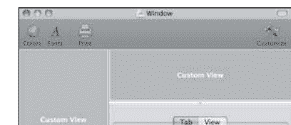

> **图 2.10** 添加了标签视图的文档窗口。

- 5. 设置 Tab View 的弹簧和支撑点（springs and struts），使得标签视图在调整窗口大小的同时，其边缘锚定在右侧拆分视图的框架上。在 Tab View Size 检查器中，启用所有四个支撑点和两个...

- 6. 忘记设置新视图或控件的自动调整大小行为是非常容易的。作为一种预防措施，养成每次向窗口添加视图或控件时都使用 Cocoa Simulator（模拟器）调整窗口大小的习惯，这不仅可以确保它运行正常，还能看到你遗漏了什么。

选择 File > Simulate Interface，并调整窗口大小。如预期，标签视图在水平和垂直维度上都会持续调整大小，以填充水平拆分视图的底部面板。

当你看到拆分视图的左侧面板现在会改变宽度而不是保持固定时，请不要惊讶。你在步骤 3 中已经学过，Cocoa Simulator 不会执行添加到窗口控制器上的代理方法。若要看到左侧面板的宽度保持不变，而右侧面板及其标签视图改变大小，你必须在 Xcode 中构建并运行应用程序。

## 步骤 6：添加抽屉 (Drawer)

Vermont Recipes 应用程序规范中要求的功能之一是识别数据库中包含的食谱来源。在准备食物时不需要这些信息，因此当用户浏览数据库寻找灵感或信息时，应该能够方便地访问。它可以放置在你刚刚添加的视图的标签页中，但为了保持一致性，你应该计划让标签视图的标签专注于食物准备。用户可能想在查看任何标签视图时查看食谱的来源。

用于此目的的完美用户界面元素是抽屉（drawer）。抽屉是一个独立的窗口，需要时从主窗口后面滑出，就像抽屉从桌子或柜子里拉出来一样。设计理念是，抽屉应该包含与窗口信息相关的信息，但不是窗口功能的核心，且不需要一直可见。

在 Mac OS X 中，抽屉从主窗口的侧面、顶部或底部滑出。无论父窗口移动、调整大小还是隐藏，它始终附在父窗口上。它没有标题栏，也没有关闭、缩放或最小化按钮。通常，当用户点击父窗口中专门用于该目的的按钮时，它滑入或滑出。

创建一个空的抽屉，稍后再添加子视图和控件。

- 1. 首先，给现有的文档对象一个独特的名称。在文档窗口中选择 Window 对象，选择其用于编辑的标签，并从 Window 更改为 Recipes Window。

新标签只影响窗口对象，而不影响应用程序用户界面中的窗口标题。你也可以通过选择重命名的 Recipes Window 对象、选择 Window Attributes 检查器，并在 Title 字段中输入 Vermont Recipes 来更改窗口标题。如果你这样做，你会看到 Interface Builder 中的文档窗口标题变为了 Vermont Recipes。但是，不要这样做，因为基于文档的应用程序在代码中控制其文档窗口，会忽略你在 Interface Builder 中给窗口指定的标题。这样做是因为窗口的标题栏应该显示用户给文档的任何内容。每个文档窗口可能有不同的标题，如果用户尚未保存，则显示 Untitled（未命名）。

- 2. 现在你准备好添加抽屉了。首先返回 Interface Builder 的库窗口。在旧版本的 Interface Builder 中，库中包含一个可以拖拽的独立抽屉对象。

选择视图连接（View Connections）检查器。你会看到它有一个名为 `contentView` 的引用出口（referencing outlet），它是从 `Drawer` 对象连接而来的。这与你刚才检查 `Drawer` 对象时看到的 `Drawer` 和 `Drawer Content View` 对象之间的连接是同一个，但你现在是从另一端查看它。出口（outlet，可以说是一个向出的引用）与引用出口（referencing outlet，是一个传入的引用）之间是有区别的。当你激活视图连接检查器并将指针悬停在此连接上时，文档窗口中的 `Drawer` 对象图标会高亮。这正是你所想要的，所以你不需要在这里进行任何更改。


- 5. 在文档窗口中选择新的 `Window` 对象（而不是重命名后的 `Recipes` 对象）。即使你没有给任何窗口命名，你也可以通过双击它们来区分它们。现在双击新的 `Window` 对象，它会打开一个空窗口。这就是你从库（Library）窗口拖入 `Window` 和 `Drawer` 项目时创建的窗口对象。它的图标名为 `Window`。确保它在文档窗口中被选中，选中它并选择窗口连接（Window Connections）检查器。你会发现此窗口没有任何连接。当你刚才创建它时，它有一个来自 `Drawer` 对象并名为 `parentwindow` 的引用出口，但你已将其更改指向 `Recipes` 对象。

由于你不再需要这个新的 `Window` 对象，且它的连接已被移除，请在文档窗口中选择它（确保选对了），并按 Delete 键。

- 6. 为了确保一切都符合预期，在文档窗口中选择 `Recipes` 对象并选择它的窗口连接检查器。你会看到代理出口（delegate outlet）和窗口引用出口，这些你在第 1 步中就记得。你还看到了刚才创建的来自 `Drawer` 的 `parentwindow` 引用出口的另一端。一切看起来都是正确的。

## 步骤 7：添加工具栏项目以打开和关闭抽屉

现在已经准备好了几个视图，你可以准备好创建第一个真正的控件以及关联的操作了。首先在工具栏右侧添加一个工具栏项目来打开和关闭你的抽屉。

1. 在文档窗口中，双击工具栏。下方会打开一个标记为“允许的工具栏项目”（Allowed Toolbar Items）的面板（图 2.12）。该面板包含了用户在自定义工具栏时可以安装的所有工具栏项目或按钮。工具栏本身代表默认集合，不需要包含所有允许的项目。你需要向允许集合中添加一个工具栏项目，并且它也应该包含在默认集合中，这样用户就可以随时打开和关闭抽屉。

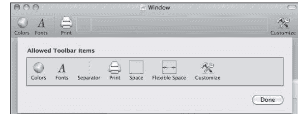

图 2.12 允许的工具栏项目面板。

2. 为新的工具栏项目留位置，从默认集中移除该工具栏项目。将其从工具栏拖到桌面即可删除。注意不要从“允许的工具栏项目”面板中拖走，因为你希望在工具栏中使用它时仍然可用。

自定义窗口的工具栏并不是一种常规的用户活动，不需要在默认工具栏中拥有它自己的按钮。用户始终可以通过视图的“自定义工具栏”菜单项来自定义工具栏。如果任何用户想在工具栏中使用它，它仍然会在允许集合中可用。

3. 在库窗口中选择媒体（Media）标签页，向下滚动直到找到 `NSInfo` 图像，它由蓝圈中的小写字母组成。雪豹系统带了大量用于应用程序的图像。

4. 从窗口拖动 `NSInfo` 图像并将其释放到“允许的工具栏项目”面板。它现在是此窗口的一个允许的工具栏项目。

5. 双击新工具栏图像的标签 `NSInfo`，将其更改为 `Recipe Info`。

6. 你已经创建了第一个控件；准备好实现你的第一个操作了。在文档窗口中 Control-点击（右键点击）`Drawer` 对象。会弹出一个头显示设备（HUD）窗口，其中列出了其他内容以及三个收到的操作：`"close;"`、`"open;"` 和 `"toggle;"`。这些对应于 Cocoa 的 `NSDrawer` 类中声明的三个操作方法：`-close:`、`-open:` 和 `-toggle:`。你稍会学习更多关于操作方法的知识，但现在你只需要知道，当操作消息被声明了同名方法的类对象接收时，会触发该方法的执行。你的新 `Recipe Info` 工具栏项目要在抽屉关闭时打开它，在打开时关闭它，所以看起来 `toggle:` 操作是应该使用的那个。

停顿一下在文档中验证这一点。首先查找适当操作方法的好地方是 `NSDrawer` 类参考。在 Xcode 中，选择 Help（帮助）> Documentation（文档）。在文档窗口中，搜索 `Drawer` 并打开 `Drawer` 类参考。Apple 的所有类参考文档开头都有一个名为“Tasks”（任务）的部分，`Drawer` 的“Tasks”部分包含一个名为“打开和关闭抽屉”的主题。你可以在那里找到 `-toggle:` 方法的描述，它看起来是合适的。

现在建立连接。从图像 HUD 中 `toggle:` 操作旁边的空圈开始，拖动到“允许项目”面板中名为 `Recipe Info` 的图像上。HUD 显示 `Recipe Info` 工具栏项目已连接到 `Drawer` 对象中的 `toggle:` 操作。当用户点击 `Recipe Info` 按钮时，它将向其目标（抽屉）发送 `toggle:` 消息，导致抽屉的 `-toggle:` 方法被执行。抽屉的打开或关闭取决于消息发送时它的状态。

## 步骤 8：构建并运行应用程序

就像你在食谱 1 结束时做的那样构建并运行应用程序。这应该是你在完成每个食谱后的习惯，作为一名 Cocoa 开发者，在项目发生每次重大更改后也应该这样做。你经常会发现自己犯了错误或者某些功能无法工作。现在发现它们要好得多，这样你可以在项目自上次构建和运行以来没有发生太大变化时找到并修复问题。此时你需要回顾的新材料会更少。

点击 Xcode 项目窗口工具栏中的“构建并运行”图标。如果提示有未保存的更改，点击“全部保存”，并等待片刻。

当食谱窗口（图 2.13）打开且菜单栏出现在屏幕顶部时，检查你的更改是否生效。检查拆视图（split view）窗格是否工作正常（具有一个固定宽度的窗格），以及标签视图是否像 Cocoa 模拟器中那样工作。点击几次工具栏上的“食谱信息”项目，测试抽屉的打开和关闭。

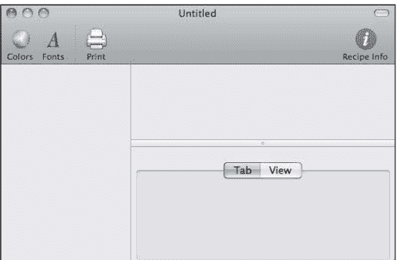

图 2.13 食谱 2 中显示的窗口。

同时检查菜单栏。许多菜单项都可以正常工作，包括“文件 > 新”，它会打开第二个文档窗口。

## 步骤 9：保存并归档项目

良好的管理习惯要求你在每次发生重大更改后保存并归档项目。退出运行中的应用程序，关闭 Xcode 项目窗口，如果提示保存则进行保存。丢弃构建文件夹，压缩项目文件夹，并将生成的 zip 文件副本保存到你的归档中，命名类似于 `Vermont Recipes 2.0-0 - Recipe 2.zip`。工作中的 Vermont Recipes 项目文件夹留在原处，为食谱 3 做好准备。

# 结论

现在是此停一下的好地方。你已经学习了许多关于 Interface Builder 的知识，以及如何使用它为应用程序的实际工作——图形用户界面搭建舞台。随着书籍的进行，你将添加更多的控件、菜单和菜单项、视图和窗口，并学习如何存储和检索数据，以及使用 Cocoa 的其他功能创建一个完整且实用的应用程序。

## 文档

## Interface Builder

正如本食谱所明确的，Interface Builder 主要是一个图形用户界面设计工具。苹果认为应用程序与应用程序之间的设计一致性是 Macintosh 用户体验的标志。因此，当你发现 Interface Builder 的功能设计是为了方便用户遵循《苹果人类机界面指南》（HIG）时，并不会感到意外。广为人知的 HIG 甚至链接在 Interface Builder 的“帮助”菜单中，让你找不到任何未能遵守指南的借口。

关于使用 Interface Builder 功能的详细技术说明，请参阅《Interface Builder 用户指南》。它也链接在 Interface Builder 的“帮助”菜单中，命名为“Interface Helper”。更短的介绍包含在《资源编程指南》的“Nib Files”部分中，以及《Mac X 技术概览》附录 C 的“Interface Builder”部分中。

一如既往，请参考发布说明和其他材料获取有关 Interface Builder 最新版本的信息。这些包括了一长系列发布说明，如《Interface Builder 3.0 Release Notes》、《Interface Builder 3.1 Release Notes》和《Interface Builder 3.1.1 Release Notes》。截至本文写作时，还没有 Interface Builder 3.2 的发布说明，但请关注。

还有许多更多技术性或专门的文档，包括《国际化编程主题》文档中的“为你的 Nib 文件准备本地化”部分。正如《Interface Builder 插件编程》中所解释的，你可以为自己的自定义控件创建 Interface Builder 界面。

## 食谱 3

## 创建简单的文本文档

在本食谱以及随后的几个食谱中，你将开始编写一些真正的代码。在这个过程中，你将学习更多关于如何使用 Xcode 代码编辑器（你作为 Cocoa 开发者大部分时间都会花在这里面），并学习 Interface Builder。你还学习了构建代码文件的常用技术，以便它们随时间推移更易阅读和维护。

你将创建一个具有简单数据存储要求的辅助文档，作为这些课程的载体。你在开始时就收到了警告，因为 Core Data 是一个高级主题，你很快将转向更简单的任务，以便为最终返回 Core Data 做准备。你在本食谱中学学的技巧可以用于任何应用程序，以设置一个带有窗口的辅助文档。作为额外奖励，辅助文档的窗口包含一个文本视图，你将学习创建一个具有强大编辑和格式化功能的文本编辑器。

在本食谱中，你将学习如何利用 Cocoa 文本系统创建富文本格式（RTF）文档，如何设置拆视图以便在单独的窗格中读取和编辑文本文档的部分，以及如何将辅助文档的数据写入磁盘并从磁盘读取它。在随后的食谱中，你将转向关于添加控件以及使其工作所需的连线的新课程，关于配置应用程序的主菜单，以及关于完善用户界面。在此过程中，你将学到几乎几乎任何 Mac X 应用程序的一个基础功能：撤销（undo）和重做（redo）。

## 重点内容

- 创建辅助文档
- 使用 Xcode 快照
- 在 Xcode 中创建新类
- 在 Interface Builder 中创建新类
- 分配和初始化类型标识符（Type Identifiers）
- 添加并配置 Cocoa 文本视图
- 子类 `NSDocumentController`
- 使用统一类型标识符（Uniform Type Identifiers）识别文档类型和所有权
- 将数据写入磁盘并从磁盘读取

首先，通过为你在本食谱中创建的新简单文档添加规范，补充原始的 Vermont Recipes 应用程序规范。你将在食谱中创建一个辅助文档，作为为了让厨师记录经历的工具。它实现了一个食谱应用程序中独特但实用的功能：一个厨师可以记录经历的自由日记。在用户界面中，你可以将新文档命名为 Chef's Diary。为了开发目的，你将其命名为 `DiaryDocument`。Chef's Diary 是一个从新手学习烧烤到五星级厨师都可以记录笔记的地方。像任何日记一样，它是按时间顺序组织的，每个条目的标题是创建的时间。为了帮助用户以后在日记中查找信息，条目是可以搜索的。此外，它允许用户为任何条目添加标签，以支持基于标签的搜索。文档存储文本，文本包括与条目相关的日期标签。一旦保存，它就是一个 RTF 文档，因此支持丰富的格式功能。可以使用支持 RTF 的应用程序（如 TextEdit、Pages 和 Microsoft Word）打开并编辑。

文档数据由自由 RTF 文本组成，厨师可能会编写无限的内容。标准的 Macintosh 滚动视图允许你在输入新条目时查看之前的条目，即两个滚动视图，分别位于带有移动分割器的水平拆视图的每个窗格中。

这将是一个功能强大的文字处理器，但你不需要为创建大部分选项做任何特殊处理。这些选项在 Interface Builder 中已准备就绪。尽管如此，你将在食谱 4 的窗口底部放置几个控件。规范要求带有日期的标题和可搜索的标签，因此添加它们的按钮将是：一个“添加条目”按钮用于插入格式化的当前日期时间，一个“标签”按钮用于在条目标题后插入一个或多个标签。跳转到上一个下一个条目以及跳转到第一个和最后一个条目的按钮将非常有用。此外，通过包含一个按日期跳转到特定条目的控件来补充滚动条和导航按钮。最后，包含一个按标签查找条目的搜索字段。

在开始工作之前，对这些进行一些完善。由于日记是按时间顺序的，将新条目添加到底部是合理的，紧跟在最后之后。一种让用户按日期跳转到其他条目的良好方法是包含一个完全交互的日期选择器。该控件应始终显示当前滚动到视图中的条目的日期和时间，并在用户浏览日记时自动更新。更改控制器的日期和时间应将文本视图滚动到相应的条目并选择其标题。如果用户输入的日期时间没有条目怎么办？简单显示晚于目标日的最早条目，或者文档中没有晚于目标日的最新条目。

要实现厨师日记（Chef's Diary），你必须创建一个 `DiaryDocument` 类和一个窗口控制器类名为 `DiaryViewController`。此外，你必须创建另一个 nib 文件并命名为 `DiaryWindow`，并在其中设计一个包含视图和控件的窗口，用于显示和编辑日记。最后，你必须实现存储和检索由文档控制的数据的方法。

你将首先在本食谱中设置基础架构，包括创建代码文件和 nib 文件。你还将添加文本视图以及使其运行的所有代码。你将在食谱 4 中为文档窗口添加控件并让它们工作起来。在食谱 5 中，你将配置菜单栏。最后，在食谱 6 中，你将确保只能有一个厨师日记。通过所有这些操作，你将学习到一些基础 Cocoa 技术，例如引用计数内存管理以及控件和菜单项的验证。

## 第 1 步：在 Xcode 中创建 DiaryDocument 类

在食谱 1 的第 7 步中，你已经学习了如何使用 Xcode 创建新类。现在按照相同的步骤创建新的 `DiaryDocument` 类。`DiaryDocument` 是 Cocoa 的 `NSDocument` 类的子类，而不是像 `RecipesDocument` 那样是 `NSPersistentDocument`。这是因为 `DiaryDocument` 不依赖 Core Data 来管理其数据。由于 `NSPersistentDocument` 本身也是 `NSDocument` 的子类，因此 `DiaryDocument` 和 `RecipesDocument` 填充了相似的角色，并响应继承自 `NSDocument` 的许多相同方法。

记住，`NSDocument` 及其子类在 MVC 设计模式中扮演着特殊控制器的角色——具体来说，`NSDocument` 是一个模型控制器（model-controller）。它与 `NSViewController` 协同工作，在持有日记数据的模型与用户读取和编辑数据的窗口之间进行双向通信。创建 `DiaryDocument` 后，你创建 `DiaryWindowController` 类和 `DiaryWindow` nib 文件，其中包含一个用于显示和操作日记数据的窗口。`DiaryViewController` 是日记视图控制器。

1. 开始打开 Vermont Recipes 2.0.0 文件夹，这是你在食谱 2 结束时保存项目文件夹的地方。将压缩的项目存档保留在原处，打开 Vermont Recipes 子文件夹。在其中，双击 `Vermont Recipes.xcodeproj` 文件以启动 Xcode 并打开项目窗口。

2. 再次，你首先需要处理一项管理工作，增加 `Info.plist` 文件中的 `CFBundleVersion` 值。你可以通过打开 Resources 组中的 `Vermont_Recipes-Info.plist` 文件来实现，但有一种稍微简单的方法。在 Targets 组中选择 Recipes 目标，然后点击工具栏上的 Info 按钮。然后只需双击感兴趣的目标，即 Vermont Recipes 目标。然后选择 Properties 标签页，将 Version 字段中的值从 2 改为 3，然后关闭 Target Info 窗口。当在本食谱结束时编译并运行应用程序后打开 About 窗口时，你将看到应用程序版本显示为 2.0.0 (3)。

3. 在 Xcode 中，选择 File > New File 创建一个模板。

4. 在新窗口的左侧窗格中点击 Cocoa Class；然后点击右上侧面板中的“Objective-C class”图标。在右下面板中，使用“Subclass of” 下拉菜单创建 `NSDocument` 的子类。

5. 点击 Next 按钮。在新窗口中，在 File Name 字段中输入 `DiaryDocument` 以将其命名为 `DiaryDocument.m`。勾选创建 `DiaryDocument.h` 头文件的复选框。

6. 点击 Finish 在 Recipes 项目和你的 Recipes 目标创建新文件。如果两个新文件不在 Groups & Files 窗格的 Classes 组中，将它们拖到那里并释放到 `RecipesDocument` 文件下方。

7. 大多数开发者发现，一旦项目变得复杂，在 Classes 组中创建子组是非常方便的。在多文档应用程序中，我通常会创建一个名为 Documents 的子组和另一个名为 Window Controllers 的子组。

为了遵循这一做法，选择 Classes 组并选择 Project > New Group。Classes 组顶部会出现一个名为 New Group 的组，并且它的名称被选中以便编辑。输入 Documents 并按 Enter 键提交新名称。选择所有四个文档代码文件并将它们拖到 New Documents 组中。它们现在显示于该子组内部，当你不处理它们时，可以折叠组来隐藏它们。

8. 重复过程创建一个新的 Window Controllers 子组。将其置于新 Documents 组下方，并将两个窗口控制器文件拖入（图 3.1）。在第 3 步中，你将创建两个新的 `DiaryWindowController` 代码文件并将它们添加到 Window Controllers 子组中。

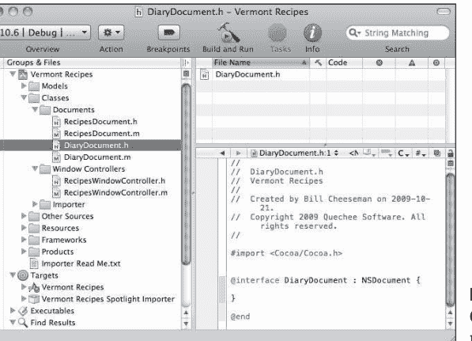

9. 展开 Documents 组，打开 `DiaryDocument` 头文件和实现文件，并按照食谱 1 第 4 步中所做的编辑每个文件顶部的标识信息。


- 9. 模板在 `DiaryDocument.m` 实现文件中插入了三个方法实现。你将在第 7 步中使用其中两个 `-dataFormat:error:` 和 `-readFromData:ofType:error:` 将日记文档中的 RTF 文本存储到磁盘并从磁盘检索它。

第三个模板方法 `-windowNibName` 你在食谱 1 的第 4 步中很熟悉，那里你将其更改为返回 `@RecipesWindow` 而不是。应用程序表明日记文档与食谱文档不同，它在单一窗口中显示其内容。日记知道它需要创建一个窗口控制器，但仅此而已。nib 文件的选择是留给窗口控制器的实现细节。你将在第 3 步创建窗口控制器时编写必要的初始化代码。

- 10. 关闭 `DiaryDocument` 头文件和实现文件。你现在将短暂离开学习何时创建代码快照以便返回状态。在第 3 步中你将返回日记文档并创建窗口控制器。

你还必须告诉编译器哪里找到 WindowController 头文件。在 `#DiaryDocument.h` 之后插入此行：

```objective-c
#import "WindowController.h"
```

`-makeControllers` 方法的第一句与你在食谱 1 中为食谱写的 `-makeControllers` 第一句不同。在这里，为控制器分配内存后调用了它的 `-init` 方法，而在食谱 1 中你调用了 `RecipesWindowController` 的 `-initWith:` 方法并提供了 nib 文件的名称。

将删除的 `-windowName` 方法替换为此新的 `-makeControllers` 方法：

```objective-c
(void)makeControllers {
    DiaryWindowController *controller = [[DiaryWindowController alloc] init];
    [self add:controller];
    [controller release];
}
```

## 步骤 2：保存项目快照

你已经开始养成每个食谱结束时备份工作的良好习惯，但你可能也想在中间阶段跟踪你的更改。此外，将现在的代码与一小时前或一天的代码进行对比通常很有用，仅作为你所做更改的提醒。

Xcode 提供了一种简单方法来实现。在任何时候，选择 File > Make Snapshot。没有弹出对话框，你不需要命名任何东西或考虑保存到哪里，也不会被确认对话框中断。在 Xcode 第一次使用花几秒钟设置快照存储后，它就会发生，而且非常很快。

快照存储位于你的 Application Support 文件夹中的磁盘镜像，路径为 `~/Library/Application Support/Developer/Shared/SnapshotRepository.sparseimage`。由于它是稀疏镜像（sparseimage），它会根据其内容自动调整大小。

Xcode 快照（snapshot）并不是为了取代源代码管理（SCM）设施。相反，它是一种在你尝试可能行不通的开发路径时，跟踪项目状态的方法。通过允许轻松恢复，快照让你能够并排比较快照中的代码。它的目的在于提供任何方法来检查项目的近期更改，并回到实验开始点，而不是为了防止驱动器故障或意外删除而保存文件。实际上，它是一个项目范围内的撤销和重做机制。只有你在自己电脑上的工作会与团队中的其他开发者共享，或者在你用两台电脑开发时与另一台电脑共享。

快照保存了你在项目根目录中保存的所有状态。默认情况下，项目根目录就是项目目录。你可以将其更改为包含相关项目的上级目录。你目前没有相关项目，因此项目根目录处于默认设置，即 Vermont Recipes 文件夹。如果你想更改，可以打开项目的信息窗口，选择 General（通用）选项卡，并点击 Configure Routes & SCM 按钮。

- 1. 在 Xcode 中，确保项目中的所有内容都已保存，然后选择 File > Make Snapshot（文件 > 创建快照）。如果你没有保存所有内容，Xcode 会提示你进行保存。你收到的唯一反馈是 Xcode 在设置快照时，File 会保持亮亮状态。

- 2. 选择 File > Snapshots（文件 > 快照）。打开 Vermont Recipes - Snapshots 窗口。它顶部有一个工具栏，带有创建另一个快照、删除快照、将项目状态恢复到快照保存的状态以及显示或隐藏文件的按钮。工具栏正下方会立即出现一个快照，这可能会变成很长的快照列表。Xcode 会根据你正在的操作自动命名快照，并添加时间戳。在底部面板中，你可以找到更改快照名称和输入注释以帮助记住该快照代表内容的字段。

- 3. 通过选择 Name 字段中默认名称的文本、提供时间戳并输入 Recipe 3 Step 1 来更改此快照的名称。

- 4. 在 Comments（注释）字段中，在添加 DiaryDocument 之后、添加 DiaryWindowController 之前输入（图 3.2）。

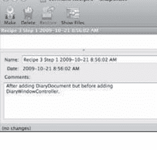

图 3.2 有一个快照的 Snapshots 窗口。

- 5. 执行实验以查看 Show Feature（显示功能）是如何工作的。

- a. 选择 `DiaryDocument.h` 文件，然后在编辑面板或窗口中在 `#import` 指令下方插入行 `REMOVE THIS LINE` 并保存文件。

- b. 选择 File > Snapshots。

- c. 在 Snapshots 窗口中，选择 Recipe 3 Step 1 Snapshot 并点击 Show Files（显示文件）按钮。

在向右扩展的新窗格中，你会看到列出的 Files Changed（已更改文件）。它识别出 `DiaryDocument.h` 是自你拍摄快照以来唯一更改的文件。如果你更改了更多文件，所有文件都将列在右侧。如果你拍摄了更多快照，它们都将列在左侧，你可以选择其中任何两个来比较差异。

- d. 在 Files Changed 列表中选择 `DiaryDocument.h`。

在 Files Changed 列表下方出现了一个新窗格，并排显示 `DiaryDocument.h` 的快照。你插入的行被高亮显示为更改（图 3.3）。如果你做了其他更改，它们也会被高亮显示。

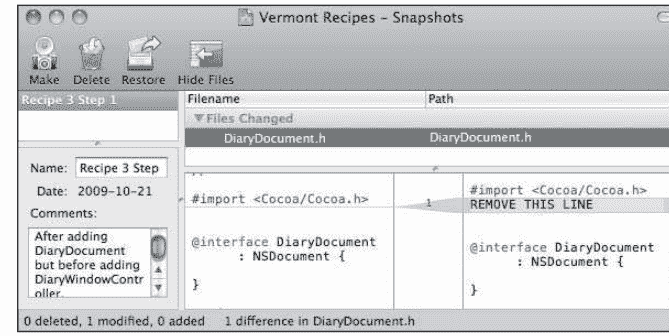

> 图 3.3

扩展以显示更改的 Snapshots 窗口。

- e. 在左侧的快照中，选择 Recipe 3 Step 1 并点击 Restore（恢复）按钮。比较窗格关闭，`DiaryDocument.h` 的引用从已更改文件列表中消失，如果你之前打开了 `DiaryDocument.h` 窗口，你会看到刚才添加的行也从文件中消失了。快照在列表中仍被选中，但列表底部添加了一个带有时间戳的新快照 Pre-Restore（恢复前）。你不需要保留这个 Pre-Restore 快照。选择它并点击删除按钮，只留下 Recipe 3 Step 1 快照。

- f. 关闭 Snapshots 窗口并擦除 `DiaryDocument.h` 的内容。你插入的行 `REMOVE THIS LINE` 现在已经消失了。

因为操作非常简单，你应该养成每一步都拍摄快照的习惯。

# 步骤 3：在 Interface Builder 中创建 DiaryWindowController 类及其 Nib 文件

你可以遵循步骤 1 中使用的相同步骤创建新的 `DiaryWindowController` 类，但你应该借此机会学习如何在 Interface Builder 中创建新类并将其合并到 Xcode 项目中。你可以同时创建 `DiaryWindowController` 的 nib 文件。这展示了 Xcode 和 Interface Builder 之间代码集成的另一个维度。

在 Recipe 1 的步骤 7 中，你创建了 `RecipesWindowController` 类来控制 Vermont Recipes 主窗口并将控制器设置为窗口 nib 文件的 File's Owner（文件所有者）。因此，你的 `RecipesDocument` 不再需要自己的 nib 文件。文档类与应用程序视图之间除了如何与其窗口控制器通信外应该没有任何关系。

同样的原理也适用于 `DiaryWindowController` 和 `DiaryDocument`。

- 1. 启动 Interface Builder。在 New File（新建文件）窗口中，在左侧面板选择 Cocoa，在右侧面板选择 Window。点击 Choose，打开一个无标题窗口。设置 File's Owner 代理，然后选择 Identity inspector（身份检查器）。你看到 File's Owner 是 `NSObject`。要创建 `DiaryWindowController` 类，转到 Interface Builder 的 Library（库）窗口，选择 Classes 标签，滚动到 `NSViewController` 并选择它。在底部的 Lineage（血缘）视图中，你可以看到 `NSViewController` 的层级结构。

你想在层级结构的顶部再创建一个 `DiaryWindowController`，作为 `NSViewController` 的子类。点击 Library 窗口底部的 Action 菜单，或者在现有类列表中对 `NSViewController` 进行 Control-点击（右键）。你看到第一项是 New subclass（新建子类）。选择它。

- 2. 在 New subclass 对话框中，在“Add subclass of NSViewController named”字段中……输入 `DiaryWindowController`，勾选“Generate source files”（生成源文件）复选框，并点击 OK。

打开一个标准文件对话框，Save As（另存为）名称已设置为 `DiaryViewController.m`。Language 下拉菜单设置为 Objective-C，并勾选了“Create .h file”。导航到 Vermont 项目文件夹并点击 Save（保存）。

出现另一个对话框，询问是否要将新文件添加到 Vermont 项目。在查看此对话框之前，在 Finder 中打开项目。在这里你看到新的 `DiaryViewController` 头文件和实现文件已经创建并保存。然而，它们不在 Xcode 项目中。

- 3. 返回 Interface Builder 中仍打开的 Add Files to Project 对话框。选择 Vermont Recipes target 并点击 Add。眼角处，你看到 Library 中的 Classes 滚动了一下，查看时，你发现一个新类 `DiaryWindowController` 已添加到列表中并被选中。在底部的 Lineage 视图中，你看到 `NSViewController` 顶部有一个新的子类 `DiaryWindowController`（图 3.4）。

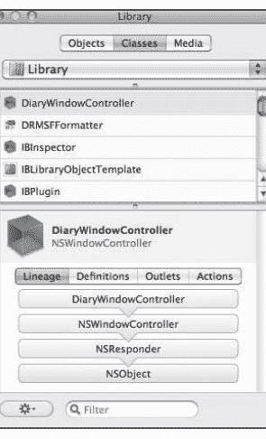

> 图 3.4 创建 DiaryWindowController 后的 Library 窗口。

- 6. 现在切换到 Xcode 项目窗口。在那里，在 Groups & Files 格中，可能在 Vermont Recipes 项目组的底部，你会找到 `DiaryWindow.h` 和 `DiaryWindow.m`。将它们都拖入你在第 1 步中创建的 Classes 组下的新建 Controllers 子组中。

- 7. 回到 Interface Builder 中的对象检查器（Object inspector），打开 Class 下拉框，并向下滚动直到找到 `DiaryViewController`。找到它后，选择它，你的新 `DiaryViewController` 对象现在就是该 nib 文件的所有者（File's Owner）。

- 8. 为了让 `DiaryViewController` 类发挥作用，你还需要建立两个连接。选择文件代理所有（File's proxy owner）并打开 Diary Controller 连接。要连接找到窗口，从它旁边的标记（一个空圆）拖动到 nib 文件窗口中的 Window 图标。选择 nib 文件窗口中的 Window 图标，打开窗口连接检查器（Window Connections），从代理输出（delegate outlet）的标记拖动到文件代理所有。

你连接的窗口和代理输出分别代表了在 `NSViewController.h` 和 `NSWindow.h` 中声明的实例变量。在本教程的后续部分，你将创建自己的一些输出并使用相同的技术连接它们。

- 9. 该 nib 文件仍有标题且未保存，请保存它。选择 File > Save As，在 Save As 字段中输入 `DiaryWindow`，并将 File Type（文件类型）设置为“Interface Cocoa (XIB 3.x)”。阅读“Nib File Formats”侧边栏关于各种 nib 文件的信息。记住，nib 文件应该保存在 English.lproj 文件夹中，或者如果你是为其他区域开发，则存在另一个 lproj 文件夹中。你只需要导航到 Vermont Recipes 文件夹下的 English.lproj 子文件夹并点击 Save 即可。

会出现一个熟悉的窗口，询问你是否想要将该 nib 文件添加到 Vermont Recipes 项目中。在关闭它之前，在 Finder 中查看项目的 `English.lproj` 子文件夹，你会发现新的 `Diary-Window` nib 文件已经创建并保存。

- 10. 回到该窗口将 nib 文件添加到 Xcode 项目。勾选 Vermont Recipes 目标复选框并点击 Add。nib文件的名称变为 `DiaryWindow - English`。

- 11. 再次切换到 Xcode 项目文件夹。现在 `DiaryWindow` nib 文件已列出，可能在 Vermont Recipes 项目组的底部。将 nib 文件拖入 Resources 组，并将其放在 `RecipesWindow.xib` 之下。

## Nib 文件格式

长期以来，Interface Builder 一直将其数据保存在所谓的 nib 文件中。多年来，该格式更改了几次，仔细选择你使用的格式非常重要。

对于 Vermont Recipes 来说，选择是简单的，因为你正在 Snow Leopard 中构建，而它需要 Leopard 或更高版本才能运行。nib 格式在 Interface Builder 3.0 中为 Leopard 或更高版本引入，这也是你在这种情况下应该使用的格式。尽管其扩展名是 `.nib`，但开发者仍将其称为 nib 文件。它的发明是为了在开发项目时与 Xcode 提供更紧密的集成。当你构建应用程序时，nib 文件会被编译为具有 `.nib` 扩展名的文件。与早期版本不同，没有访问你项目文件的用户无法读取和编辑它们。

如果你在 Leopard 中为 Mac OS X 10.4 构建并编辑，你将使用 3.x nib 格式而不是 nib 格式。如果你在 Tiger 中编辑并构建，你将使用 2.x nib 格式。更多信息请参阅《Interface Builder Guide》。

除非你在为 Interface Builder 编写插件，否则你不需要了解更多关于 nib 知识。当你对应用程序进行本地化时，你的承包商可以以编辑格式获取这些 nib 文件，因为它们通常包含许多面向用户的字符串，因此需要翻译。

- 12. 展开 Classes 组下的 Window Controllers 子组，打开 `DiaryWindowController` 的头文件和实现文件，并像你在教程 1 第 4 步中所做的那样编辑它们的信息。你必须在文件名处插入 `// Vermont Recipes 2.0.0`。Interface Builder 留出这一行为空，是因为你在将文件添加到 Vermont Recipes 模板之前已经创建了它。

- 13. 你现在必须添加一个方法实现来初始化窗口控制器。在第 1 步的末尾，你在 `DiaryDocument` 子类中重写了 `-makeWindows` 方法。它调用了你在教程 1 文档中使用的 `-initwithWindowName` 方法，或者在分配的 diary 窗口控制器中代替 `-initwithWindowName` 方法，以将加载何种 nib 文件的决定从从文档中移除，并将该任务分配给窗口控制器。你现在必须通过在 `DiaryWindowController` 中提供 `-init` 的合适实现来后续。如果不这样做，应用程序将调用继承的 `-init` 版本，可能一直追溯到 `NSObject` 的 `-init` 版本。继承的 `-init` 方法对 diary 窗口控制器及其实例变量一无所知，窗口将不会打开，因为窗口控制器不知道如何找到它的 nib 文件。

现在在 diary 窗口控制器中实现 `-init` 方法，以便它可以加载 diary 窗口 nib 文件并打开 diary 窗口。首先，以最简单的方式实现，以便理解：

```objective-c
- (id)init {
  self = [self initWithNibName:@"DiaryWindow"];
  return self;
}
```

在 Cocoa 中初始化一个新分配的对象受许多限制。要理解这些限制，阅读 Apple 的《The Objective-C 2.0 Programming Language》中的“Allocating and Initializing Objects”部分非常重要。

## 对象初始化与指定初始化器（继续）

这确保了类的变量被初始化为适当的值，并且层次结构中上方的所有中间类都经过了初始化，同时也避免了循环初始化引用。

通常，直接或间接继承自 `NSObject` 的类会声明一个 `-init` 方法，以及替代的更复杂的初始化方法，这些方法带有参数以设置类中声明的变量的初始值。参数最多的初始化方法——即能够设置大部分对象初始状态的方法——通常是**指定初始化器**（designated initializer）。只有指定初始化器会实际设置实例变量的值；其他方法通过调用指定初始化器来完成它们的工作。


开发者有义务在头文件中通过注释标识指定初始化器，以确保该类的客户端开发者知道应该调用哪种初始化方法。

现在你已经理解了基础知识，请重写 `-init` 方法以使用更常用的技术：

```objcc
+ (id)init
  if ((self = [self initWithWithNibName:"DiaryWindow"])) {
    // 在此处插入任何初始化代码。
    return self;
  }
```

这个新版本的 `-init` 通过标准的 C 语言技术实现了代码的简洁。一些开发者认为这很狡猾，或者至少是很聪明，但这种用法得到了悠久历史的认可。

第一条语句中位于双括号内的部分并不寻常。它与你最初对 `-init` 的简单实现中的第一条语句完全相同，将 `-initWithWithWindowNibName` 的结果赋值给 `self`。它使用的是赋值运算符 (`=`)，而不是相等运算符 (`==`)。这有时会引起混淆，因为该表达式同时也用作该语句的布尔测试。

赋值语句被括在括号中，表示赋值的结果是关注点。该结果要么是赋值给 `self` 的新初始化对象的指针，要么是 `nil`。无论哪种，Objective-C 都能将结果分别解释为布尔值 `YES` 或 `NO`。为了更好地理解正在发生什么，你们开发者很少这样做：

```objcc
if ((self = [self initWithWindowNibName:"DiaryWindow"]) != nil) {
```

或者像这样：

```objcc
self = [self initWithWindowNibName:"DiaryWindow"];
if (self != nil) {
```

测试 `nil` 结果的目的是判断执行额外的初始化代码是否安全，因为这些代码可能依赖于 `self` 有值。你现在没有要插入的初始化代码，所以让留空 `if` 即可。

外层括号代表了对正确语法近乎刻板的坚持，这要求每个语句中的测试必须放在括号内。我通常会包含两层括号，以此提醒这是一个赋值操作结合布尔测试。大多数开发者为了简单起见使用单层括号，除非你设置了编译器的严格标志（pedantic flag），否则这是有效的。

- 14. 暂时关闭 `DiaryWindowController` 的头文件和实现窗口。你稍后会为其添加更多方法。
- 15. 使用你在第 2 步中学到的技术创建一个快照。如果你还没有保存在此步中创建的所有文件，Xcode 将要求你保存。将快照重命名为 `Recipe 3 Step 3`，并输入注释 `After adding DiaryWindowController and DiaryWindow.x`。我不会再次提醒你制作快照，所以请记住在每个步骤结束时这样做。

## 第 4 步：为日记窗口添加滚动文本视图

在本谱开头对“厨师日记”（Chef’s Diary）的详细规范中，提供了一个带有两个滚动文本视图的窗口，这些视图嵌入在带有可移动分割符的拆分视图窗格中。你在第 3 步中使用 Interface Builder 创建了窗口控制器和 nib 文件。在这一步中，你继续在 Interface Builder 中添加拆分视图和滚动文本视图。

- 1. 在 Interface Builder 中打开新的 `DiaryWindow` nib 文件。
- 2. 在主 nib 文件窗口中选择窗口图标，然后检查窗口属性检查器（Window Attributes inspector）。不需要给窗口命名，因为你将在代码中提供名称。为了避免混淆，最好最好在窗口属性检查器中重命名默认的 `Window`。其他设置对于通用窗口来说已经合适了，提供了标题栏中的关闭、最小化按钮，以及右下角的缩放控制。然而，取消勾选 `Shows Toolbar Button` 复选框，因为日记窗口没有工具栏。Cocoa 足够智能，不会在没有工具栏的窗口显示工具栏按钮，但这再次是一个好主意。
- 3. 选择窗口图标。在尺寸检查器（Size inspector）中，设置窗口的大小。
- 4. 在标识检查器（Identity inspector）中，更改窗口的类。
- 5. 在库（Library）中，导航到 `Library > Views & Cells`。将 `Scroll View` 拖入顶部窗格。
- 6. 在窗口属性检查器中，将 `Style` 设置为“Horizontal”。
- 7. 依次选择每个滚动视图，选择滚动视图属性检查器（Scroll View Attributes inspector）并更改一个设置。
- 9. 选择嵌入拆分视图顶部窗格滚动视图中的文本视图。要实现这一点，你需要点击两次。如果你最初选中的是窗口或拆分视图，那么点击顶部窗格的点击会选中嵌入的滚动视图。你必须再次点击（靠近窗格顶部）来选中嵌入的文本视图。你可以通过查看检查器（Inspector）当前的标题来判断选中了哪一个。选择文本视图最简单的方法是使用 Shift-Control-click 并从菜单中选择它。

选中嵌入的文本视图后，打开视图属性（View Attributes）检查器（图 3.6）。这些设置几乎包含了你在文本编辑器中要求的所有功能，而且所有这些功能都是免费提供的，无需你编写任何代码。它甚至包含了你在 Apple TextEdit 应用中看到的相同标尺。一个特别令人惊讶的功能是富文本（Rich Text）复选框。只需保持勾选状态，《厨师日记》就能获得所有的格式化能力。你看到的设置反映了功能与易用性之间的良好平衡，因此保持原样即可。

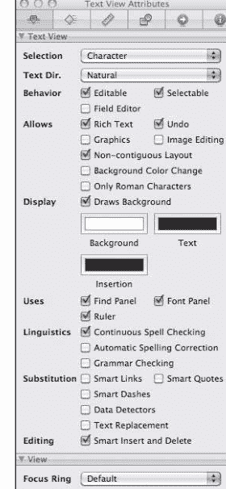

图 3.6 文本视图属性检查器。

- 10. 现在拆分视图及其嵌入子视图已经就绪，是时候设置它们的自动调整大小行为了。
    - a. 从最内嵌入子视图开始，即顶部和底部窗格中的文本视图。选择其中一个并进入文本视图检查器。你会发现所有的弹簧（springs）和支撑（struts）都已启用，这意味着文本视图的大小在水平和垂直方向上都是灵活的，它的四个边缘都锁定在包含它的滚动视图边缘。两个文本视图都是完美的。
    - b. 现在转向包含它的滚动视图，它们嵌入在拆分视图的顶部和底部窗格中。选择其中一个，你会立即发现自动调整设置是错误的。当用户调整窗口大小或上下移动分割线以调整各个窗格的大小时，滚动视图应该始终填充拆分视图的上部或底部窗格。启用所有滚动视图中的弹簧和支撑。
    - c. 最后，转向最外层的拆分视图，它嵌入在窗口中。拆分视图尺寸（Split View Size）检查器显示它的弹簧和支撑也是错误的。同样，启用所有它们。
    - d. 测试新视图的自动调整大小行为。选择 File > Simulate Interface。连续调整文档大小，你会看到拆分视图连续调整以匹配，填充整个窗口（底部你很快将添加控件的空间除外）。

窗口底部的空间保持固定高度，而不是像食谱 2 中拆分视图左侧窗格那样按比例调整。这是因为窗口底部的空间不是拆分视图的一部分。事实上，当你上下移动分割线时，拆分视图的两个窗格确实按比例调整，一直到达拆分视图的底部和顶部。当你调整窗口大时，它保持在原。退出 Cocoa 模拟器。

- 11. 拆分文本视图通常应该只显示一个窗格，让用户向上或向下移动分割线，仅在需要时查看另一个窗格。在 Interface Builder 的文档窗口中，按 Command-drag 将分割线拖到拆分视图底部。

## 步骤 5：创建 VRDocumentController 类和新菜单项

你还没有安排文档内容的存储。然而，在处理此之前，缺少一个重要的功能。你还没有提供任何创建新日记文档或打开其窗口的方法。

你从食谱 1 中知道，Cocoa 基于文档的应用程序模板自动提供了一种创建应用程序主文档类型新文档的机制。在 Vermont 食谱中，主文档类型是食谱数据库，由 `RecipesDocument`、`RecipesWindowController` 和 `RecipesWindow` nib 文件控制，所有这些都是模板以 `MyDocument` 的名称提供给你的。应用程序的文件（File）菜单在模板提供的 MainMenu nib 中带有一个标准的“新建”（New）菜单项，你在食谱 1 中看到可以使用它来随意地打开新的食谱文档窗口。启动应用程序时，会自动打开第一个新食谱文档。

在设计一种创建新的《厨师日记》文档并打开其窗口的方法之前，先探索如何实现。

仅仅通过将类本身作为方法的接收者来实现。文档甚至进一步警告不要保存指向共享文档控制器的引用，而是告诫你始终使用 `+sharedDocumentController` 方法。

尽管 Cocoa 框架包含了单例类的其他示例，但 `NSDocumentController` 的之处在于，每当你启动应用程序时，它会自动实例化每一个基于文档的实例。由于这发生在应用程序生命周期的早期阶段，如果你想对其进行子类化，必须特别小心以确保抢先占位。

在“基于文档的应用程序概述”的“创建 NSDocumentController 的子类”部分，Apple 提供了两种方法来确保 `+sharedDocumentController` 方法始终返回你的 `NSDocumentController` 子类。一种是在应用程序的主 nib 文件中实例化它（在 Vermont Recipes 和大多数应用程序中，该文件是 `MainMenu` 文件）。应用程序在启动过程的早期就会加载主 nib 文件；另一种是通过实现 `UIApplication` 的 `-FinishLaunching:` 代理方法并编写代码来创建你的控制器子类实例。应用程序在调用此代理方法之前，永远不会创建自己的共享文档控制器。无论通过哪种方式，当你的代码调用 `+sharedDocumentController` 时，它将始终返回已实例化的子类，而不是创建一个新的 `NSDocumentController` 对象。子类类型与父类类型不同（`NSDocumentController` 是 `id`）正是为了支持子类化。

现在是时候创建 `NSDocumentController` 的子类了，将其命名为 `VRDocumentController`。创建 VRDocumentController 的头文件和实现文件，并在 Main Menu nib 文件中实例化新的文档控制器。

- 使用 Xcode 创建文件。此时，你已经知道如何选择 Choose New File。在 New File 窗口中，在左侧窗格选择 `Cocoa Class`，在右上面板选择 `Objective-C class`，使用 `Subclass of` 下拉菜单选择 `NSObject`。菜单没有包含 `DocumentController`，因为子类化 `DocumentController` 相对罕见。你稍后会在头文件中更改此项。点击 Next。
- 在下一个窗口中，在 `File Name` 字段输入 `VRDocumentController` 以创建 `VRDocumentController.m`，并勾选“Also create VRDocumentController.h”复选框。选择 `Location` 为 Vermont Recipes 项目文件夹；选择要添加到 Vermont Recipes 的项目；勾选 Vermont Recipes target 复选框；然后点击 Finish。

将新文件拖到 Groups & Files 窗格中 Classes 组的适当位置。我通常将概念上独立于任何子组的重要文件放在 Classes 组的顶部。

## 步骤 5（续）：创建 VRDocumentController 类和新菜单项

- c. 打开两个 `VRDocumentController` 文件，并按照 Recipe 1 第 4 步的模式更改顶部的标识信息。
- d. 在 `VRDocumentController.h` 头文件附近的 `@interface` 指令中，将 `VRDocumentController` 的父类从 `NSObject` 更改为 `NSDocumentController`。
- e. 保存两个文件。

- 2. 在 MainMenu nib 文件中实例化单例 `VRDocumentController` 对象。在 Builder 中打开 `MainMenu.xib`。然后，在 Library 窗口中，选择 Classes 选项卡并滚动到部。在那里，与你的 `Document` 和 `RecipesWindowController` 类一起，你看到了 `VRDocumentController` 类。将其拖入 `MainMenu.xib` 窗口。现在，当用户启动 Vermont 应用程序时，它将加载 `MainMenu` nib 文件和已实例化的 `VRDocumentController` 子类。现在，子类方法将返回该子类（图 3.7）。

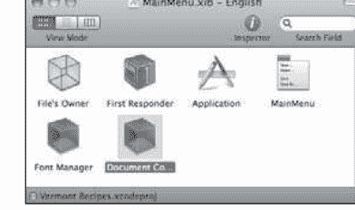

> 图 3.7 添加了文档控制器的 MainMenu.xib 文件。

- 3. 返回 `VRDocumentController` 代码文件，添加一个自定义方法来打开新的厨师日记（Chef’s Diary）文档。将其命名为 `-newDiaryDocument:`。使用与内置 `-newDocument` 方法描述中的逻辑逻辑来实现。
    - a. 在 `VRDocumentController.h` 头文件中输入该方法的声明：
        - `- (IBAction)newDiaryDocument:(id)sender;`
    - b. 在 `VRDocumentController.m` 实现文件中输入该方法的实现：

```objcc
- (IBAction)newDiaryDocument:(id)sender {
    DiaryDocument *diary = [self makeUntitledDocumentOfType:DIARY_DOCUMENT_IDENTIFIER error:NULL];
    if (diary != nil) {
        [self addDocument:diary];
        [diary makeWindowControllers];
        [diary show];
    }
}
```

第一条语句调用了继承自父类 `NSDocumentController` 的 `-makeDocumentOfType:error` 方法。你新方法 `-newDiaryDocument:` 中的第一条语句将字符串 `@"com.queechesoftware.vermontrecipes.diary"` 传递给 `-makeUntitledDocumentOfType`。你可能需要在应用程序的其他部分使用相同的字符串，但很容易引入拼写错误。如果这样做，编译器不会注意到，但你以后将面临困难的调试任务。解决这个问题的方法是使用 C `#define` 预处理器指令在文件顶部定义它。这样你只需要输入一次。

在 `VRDocumentController.m` 实现文件的顶部附近，两个 `#import` 指令下方，添加以下内容：

```objcc
#define DIARY_DOCUMENT_IDENTIFIER @"com.queechesoftware.vermontrecipes.diary"
```

然后修改 `-newDiaryDocument:` 方法中的第一条语句使用该定义，如下（见下一页图 3.8）：

```objcc
DiaryDocument *diary =
  [self makeUntitledDocumentOfType:DIARY_DOCUMENT_IDENTIFIER
  error:NULL];
```

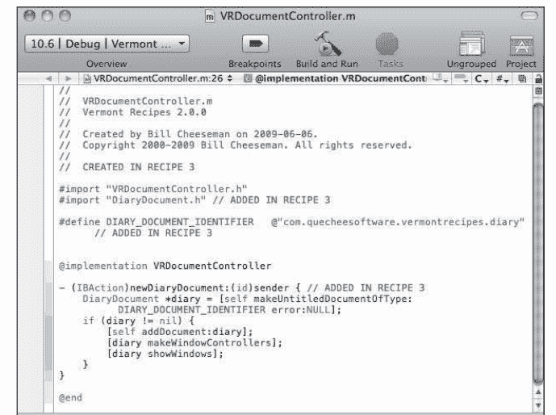

图 3.8 带有新方法的 VRDocumentController.m 实现文件。

- 4. 最后，准备好创建一个用户界面元素，将你的动作方法发送到文档控制器，以创建一个厨师日记文档并打开其窗口。执行此操作的常用 UI 元素是 File 菜单中的第二个“New”菜单项，以此命名以区别于现有的“Existing New”菜单项。Xcode 遵循这一模式，在 File 菜单顶部有 `New Project` 和 `New File` 项目。现在就做，以体验一下。

你可以在 Interface Builder 中对应用程序的菜单栏进行操作。在 Recipe 5 中你将对其进行更多操作。

- a. 打开 MainMenu nib 文件，然后双击 MainMenu 图标打开菜单栏的模拟图。
- b. 点击模拟图中的 File 菜单选中它。
- c. 双击 New 菜单项选中它进行编辑，并将其更改为 New Recipes File: 动作，将其连接到 Menu Items 检查器中的 First Responder proxy（代理响应者）。
- d. 在 Library 窗口的 Objects 格中，选择 `Library > Cocoa > Application > Menus`。将一个 Menu 项拖入 MainMenu 窗口，并紧接着放置在 Open 菜单文件中 New Recipes file 项目下方。双击它并将其标题更改为 New Chef's Diary。
- e. 从 New Chef's Diary 项目按住 Control 键拖动到 MainMenu nib 文件的窗口。在 Received Actions HUD（接收动作显示器）中，选择 `newDiaryDocument:` 动作。

你本完全可以直接将动作直接连接到 Document Controller 图标，因为该动作是在那里实现的。相反，使用 First Responder 让你以后在恢复应用程序架构时更加自由——例如，通过从 nib 文件中删除 `VRDocumentController` 子类并以其他方式实例化。

- f. 保存 nib 文件。
- 5. 编译并运行应用程序，以测试你到为止创建的内容。点击 Xcode 窗口工具栏中的 Build and Run 图标。如果你确定有未使用的更改，请点击 Save All，并等待片刻。


# 打开 File 菜单

打开 `File` 菜单，你会看到两个 `New` 菜单项：`New Recipes File` 和 `New Chef's Diary`。你现在必须停下来了，因为你还没有设置 `Info.plist` 文件来识别 `newDocument` 类。接下来你将编辑 `Info.plist` 文件，然后进行全方位测试。

## 步骤 6：将日记文档添加到 Info.plist 文件

你在 Recipe 1 的第 9 步中设置了应用程序的 `Info.plist` 文件，其中包含了食谱主文档类型的条目。现在你必须为日记文档向 `Info.plist` 文件中添加条目。为日记文档创建一个唯一的统一类型标识符（Uniform Type Identifier），告诉 Finder 和其他应用程序 Vermont Recipes 拥有这种类型的文档。因此，在桌面上双击保存的日记文档图标将启动 Vermont Recipes 并在其日记窗口中打开文档。

1. 首先在 Recipe 1 的 `Info.plist` 文件创建的 `CFBundleDocumentTypes` 中添加关于 `DiaryDocument` 类的信息。

   a. 在 Xcode 中打开 `Vermont_Recipes-Info.plist` 文件，使用属性列表编辑窗口中的右键菜单选择 `Show Raw Keys/Values`（显示原始键/值）。

   b. 展开 `CFBundleDocumentTypes` 项目并选择数组中的第二个也是最后一个项目 `Item 1`。对其点击右键菜单并选择右侧的 `Add Row (+)` 按钮。会出现一个键为 `"2 (.)"` 的新行。展开它，你会发现包含两个字典元素，键分别为 `CFBundleTypeName` 和 `LSHHandlerRank`。键中的空括号通过存在具有对应值的 `CFBundleTypeName` 键来解释。你需要更改这些条目并添加几个额外的键。

   c. 在选中并展开 `Item 2` 的状态下，你将看到一个带外轮廓图标的按钮，延伸到 `Item 2` 右侧的边距。点击该按钮在子条目列表顶部添加一个新的子条目。在 `Key` 列打开的组合框中选择 `CFBundleTypeRole` 作为其键，然后在 `Value` 列的弹出菜单中选择 `Editor`。选择 `Editor` 作为应用程序的角色意味着 Vermont Recipes 能够在读取此类应用时创建该类型的应用程序。

   d. 选中 `CFBundleTypeName` 条目并输入 `Vermont Recipes Diary` 作为其值。

   e. 选择 `LSHHandlerRank` 条目并将其值从 `Default` 更改为 `Owner`。这表示 Vermont Recipes 是用户双击由其创建的日记文件时应该打开的应用程序。

   f. 点击 `LSHHandlerRank` 条目右侧的 `Add (+)` 按钮，选择 `LSItemContentTypes` 作为新子条目的键。展开它，为条目 0 输入值 `com.quecheoftware.vermontrecipes.diary`。稍后你将定义该类型符合 `public.rtf`，并将其导出以便 Finder 和其他应用程序识别。

你在 `Info.plist` 文件的 `UExportedTypeDeclarations` 条目中声明导出的 UTI。该条目是一个包含多个键的字典。

- a. 首先选择 `Info.plist` 的最后一个条目 `NSPrincipalClass`，点击添加 `(+)` 按钮在其下方创建一个新条目。选择 `UExportedTypeDeclarations` 作为键，并通过添加子条目来展开它。

- b. 创建第一个子条目，选择 `UTypeConformsTo` 作为键。在 `Item 0` 的值中输入 `public.rtf`。

- c. 在 `UExportedTypeDeclarations` 的 `Item 0` 中创建第二个子条目，选择 `UTypeDescription` 作为键。输入 `Vermont Recipes Diary` 作为值。对于此类类型的任何文档，Finder 会在其显示简介（Get Info）窗口的字段中显示此。

- d. 创建第三个子条目，选择 `UTypeIdentifier` 作为键。输入 `com.quecheesoftware.vermontrecipes.diary` 作为值。Finder 和其他应用程序将此识别为每个 Vermont Recipes 文档的导出声明，并且它们能够将其他值与每个此类文档关联。例如，它们将知道 Vermont Recipes 文档符合 `public.rtf` 类型。

- e. 最后，创建第四个子条目，选择 `UTypeTagSpecification` 作为键。展开它并创建一个子条目。你必须手动输入此条目的键。输入 `public.filename-extension` 作为键，并将 `vrdary` 作为值。这告诉 Vermont Recipes 在使用其通过“另存为”菜单创建的每个文档文件时，将 `vrdary` 添加为文件扩展名。如果你需要，可以添加标签，例如 MIME 类型（图 3.10）。

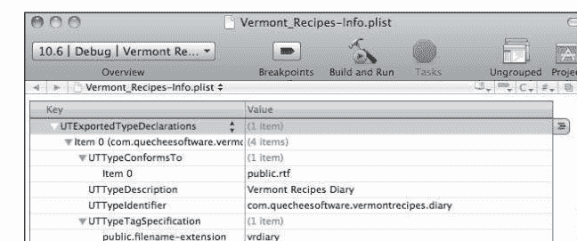

显示新导出文档类型的 `Info.plist` 文件。

4. ⚠️ 你添加到 `Info.plist` 文件的键之一会显示给用户，因此它必须添加到 `InfoPlist.strings` 文件中以允许进行本地化。`UTTypeDescription` 字段持有值 `Vermont Recipes Diary`，Finder 会在简介窗口的字段中显示它。

在 `InfoPlist.strings` 底部添加此条目：

```
"Vermont Recipes Diary" = "Vermont Recipes Diary";
```

对 `Vermont Recipes Database` 的 `UTTypeDescription` 执行相同的操作。在 `InfoPlist.strings` 中刚刚添加的 `Vermont Recipes Diary` 条目上方，添加此条目：

```
"Vermont Recipes Database" = "Vermont Recipes Database";
```

如果你在英语环境下开发，字符串文件使用字符串本身作为键（如你在这里所做的）是常见的。在完成的应用程序中，它会被转换为哈希表，速度不是问题。即使在英语环境下，你也可以通过为键提供不同的值来看到它的作用。将 `Vermont Recipes Diary` 键的值输入 `New Hampshire Recipes Diary`。当你构建并运行应用程序并保存日记文档时，Finder 的信息窗口报告其类型为 `New Hampshire Recipes Diary`。

5. 现在你可以进行一些测试了。构建并运行应用程序。打开“文件”菜单并选择“Chef’s Diary”菜单项。打开一个新窗口，其中包含一个空的 RTF 文本视图。

坐好了，大惊喜要来了。点击窗口中的文本视图并开始输入。它起作用了！信不信，你在几乎没有写任何代码的情况下创建了一个非常强大的文本编辑器。探索一下用它可以做什么。

首先，输入一些文本，然后按回车键并添加额外的文本，以创建填充文本视图所需的所有行文本。只要插入点到达面板的底部，就会出现垂直滚动条，你可以使用它向上滚动。如果你删除某些行，或者拖动窗口的调整大小控件使窗口变高，一旦最后一行文本进入视野，滚动条就会再次消失。

选择一行文本，然后选择 **格式 > 字体 > 粗体**。“格式”菜单有效，选中的行显示为粗体。在另一行中选择一个单词或短语，并选择 **格式 > 字体 > 下划线**。它同样有效。选择 **格式 > 字体**，并在系统面板中选择一个有趣的字体，例如为 New Leopard 添加的 `New Chalkster` 字体。选择另一行并选择 **格式 > 文本 > 右对齐**。选择 **格式 > 文本 > 显示标尺**。标准的系统标尺出现了，并控制着它的工作。

输入一些内容，然后选择 **编辑 > 撤销输入**。你会发现撤销和重做像固定文本编辑应用程序一样工作。选择一行，选择 **编辑 > 剪切**，然后设置插入点并选择 **编辑 > 粘贴**。你看到剪切和粘贴如预期工作。双击一行并将其拖到桌面，会创建一个剪贴文件。拖放操作也如预期。

选择 **编辑 > 查找 > 查找**。在对话框中，输入一个出现在文本中的单词并点击“查找”，如预期。选择 **编辑 > 拼写检查**，然后选择 **语法 > 显示拼写和语法**。拼写检查如预期。测试“编辑”菜单中的“替换”、“转换”和“语音”菜单项。它们都如预期工作。

有些事情尚未正常工作。例如，向上拖动日记窗口中的分割线以暴露分屏视图的下面板。你可以点击它并输入以文本，但通过一点实验很快就能确定这并不是同一个文本存储的另一个视图（图 3.11）。选择 **文件 > 另存为**。通常的保存面板打开，但当你尝试保存文档时，一个错误提示报告无法保存文档。

| 无标题 | 样式 | 间距 | |
|---|---|---|---|
| 1 | 2 | 3 | 4 |
| 5 | 6 | 7 | 8 |
| 9 | 10 | 11 | 12 |

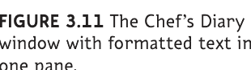

## 步骤 7：读取和写入日记数据

Chef’s Diary 窗口的作用是处理所有的持久化需求。应用程序不需要用户显式提交编辑，用户输入时模型会持续更新数据。用户的体验将像任何文字处理器一样无缝。用户可以编辑一段时间，然后选择“文件 > 保存”来保存进度，再次编辑，而无需通过按回车或点击“完成编辑”来提交数据。

文本系统深奥、复杂、灵活且极其强大，但同时也可以简单地使用。在这里，你只需使用简单日记所需的功能。阅读“Cocoa文本系统”侧边栏以获取介绍。

## Cocoa文本系统

Cocoa 文本系统通过一个大的类包提供了模型、视图和控制器。说你除了告诉文本系统与特定的文本存储关联多少布局管理器、文本容器和文本视图之外几乎无所事事也略微夸张。设计上一切通过代理方法工作，你几乎不需要子类文本系统的任何类。

- `NSTextStorage` 是 `NSMutableAttributedString` 的子类，因此它主要由文本和其他格式属性组成。因此，它被认为是文本系统的模型。除了可变字符串外，它包含布局器的列表和其他信息。

- `NSTextManager` 控制文本容器中字形的布局（后所述）。因此，它是一个 MVC 控制对象。它控制文本容器内的换行以及许多类似的行为。

- `NSTextContainer` 提供将文本布局的屏幕空间。它是矩形的，但你可以通过子类化来提供不同的形状。它也被认为是一个 MVC 控制对象。

- `NSTextView` 是用户在其中输入和阅读文本、进行选择并执行编辑操作的 MVC 视图。

## Cocoa 系统（续）

在编写 Cocoa 程序时，你通常会从这个列表的任一末端入手。如果你使用 Interface Builder，只需从库（Library）窗口拖入一个文本视图（text view），通常就不需要考虑其他组件。Interface Builder 会为你构建好文本视图底层的类网络，并且它开箱即用。你通常会保留对文本视图的引用，并在代码中需要时使用。

如果你使用 Xcode 通过代码构建文本视图，你通常会从初始化一个文本存储（text storage）对象开始，接着是它的布局管理器（layout manager），然后是它的文本容器（text container），最后是它的文本视图，并将所有这些对象连接在一起。你通常会保留对文本存储对象的引用，并使用它来获取其他内容。事实上，其他组件通常在你实例化它们并将它们添加到文本存储对象后就会被释放，随后由该文本存储对象拥有所有它们。

如果需要构建任何比 Interface Builder 中创建的简单独立文本视图更复杂的内容，你通常会使用后一种方法。例如，你可以编写创建主文本系统组件的组合，允许单个文本自动流跨分页符或列边界，或者出现在拆分窗口的多个面板中。一个文本存储可以有多个布局管理器，而一个布局管理器可以有多个文本容器，每种组合都会导致不同的功能组合和相互关系。

这是一个 `NSTextStorage` 对象——本质上是一个带有格式的字符串——用于存放日记文本。`NSTextStorage` 通过 `NSMutableAttributedString` 继承自 `NSAttributedString`。它不仅包含格式化字符串，还实现了链接到构成 Cocoa 文本系统的其他对象的方法，包括文本视图。打开窗口时实例化的视图有自己的文本存储和相关对象，这些对象处理用户输入与文本之间所有的协调工作。你只需要声明几个实例变量，实现一或两个代理方法（delegate method），并实现在磁盘上存储和检索数据的必要方法即可。

不需要创建一个单独的模型类来将日记文档相关的代码与你已经创建的 `DiaryDocument` 类中的控制函数隔离开。Cocoa 文本系统以 `NSTextStorage` 类的形式为你提供了模型。你只需要在 `DiaryDocument` 类中编写少量的代码与 `NSTextStorage` 对象进行通信。

1. 打开 `DiaryDocument.h` 头文件，在 `@interface` 声明的大括号之间声明 `diaryDocTextStorage` 实例变量：

```objective-c
NSTextStorage *diaryDocTextStorage;
```

2. 在头文件中声明访问器方法以获取和设置 `diaryDocTextStorage` 实例变量中持的值：

```objective-c
- (void)setDiaryDocTextStorage:(NSTextStorage *)textStorage;
- (NSTextStorage *)diaryDocTextStorage;
```

3. 打开 `DiaryDocument.m` 实现文件并实现访问器方法：

```objective-c
- (void)setDiaryDocTextStorage:(NSTextStorage *)textStorage {
  if (diaryDocTextStorage != textStorage) {
    [diaryDocTextStorage release];
    diaryDocTextStorage = [textStorage retain];
  }
}

- (NSTextStorage *)diaryDocTextStorage {
  return [[diaryDocTextStorage retain] autorelease];
}
```

更多信息请阅读“实例变量和访问方法”章节。

## 实例变量和访问方法

应用程序设置 `diaryDocTextStorage` 实例变量值的一种方法是直接赋值给实例本身。

然而，为了尽可能将应用程序的底层实现与获取/设置其值的代码隔离开，你应该添加访问器方法。通过这样做，你获得了更改应用程序内部构造的自由，而无需修改头文件中访问器方法的声明。通过这种方式，你避免了在修改实现细节时强制要求使用该头文件的客户端重新编译。你只需要修改实现文件中访问器方法的实现以适应底层的变化即可。使用访问方法是 Cocoa 中的常见做法。

## 实例变量和访问方法（续）

由于其他原因，Cocoa 实际上是编写为通过特定的约定来使用访问方法的。为了充分利用 Cocoa 提供的益处，你应该始终遵守这些约定。总结来说，一个获取实例变量值的访问方法名称应与变量名相同，但首字母大写并加上前缀；例如，对于名为 `width` 的实例变量，访问方法应该是 `width` 和 `setWidth:`。你可以通过将实例变量声明为私有，让客户端只依赖访问方法。尽管如此，Objective-C 的一个特性是实例变量在头文件中是可见可访问的，尽管有编译器指令。如果你想玩得更高级，可以在实现文件中声明单独的分类（category）来让客户端完全感知你的方法，但这是一种高级技术，并不适用于实例变量。

大多数引用控件而非数据值的实例变量只有 getter。你不需要 setter，因为你不会在代码中创建控件的副本。你需要 getter，因为你会频繁访问控件以获取其可见状态或更改其外观。你可以通过它们的实例变量引用它们。你将采取一种迂谨的方法为它们声明访问方法。

## 第 7 步：读取和写入日记文本数据

在 `DiaryDocument` 中，文本可能会变得非常长，因此复制操作可能会消耗大量时间。你使用 `retain` 而不是 `copy`，任何使用此 setter 的文本存储操作将非常快。

然而，在你编写其余代码时必须保持警惕，以确保不会通过使用单个文本对象来违反计划。记住，MVC 设计模式中的控制器被拆分为两个相互紧密工作的控制器。其中一个继承自 `NSDocument` 的子类被认为是模型控制器（model-controller），专门管理模型与视图之间的通信；另一个继承自 `NSWindowController` 的子类被认为是视图控制器（view-controller），专门管理模型与视图之间的通信。在你继续处理此步骤中的文本时，在脑海中保持这些角色是非常重要的。

在你刚刚编写的方法中，你看到了模型控制器的运行。概念上，`-setDiaryTextStorage:` setter 方法从某处获取文本对象并将其放入由 `DiaryDocument` 类中声明的 `diaryTextStorage` 指向的模型中。在反方向，`-diaryTextStorage` getter 方法从模型获取 `diaryDocTextStorage` 实例变量的值并提供给需要它的人。在某些情况下，正如你很快将看到的，放入模型的数据源和从模型中检索的数据终点是文档保存和打开时访问的磁盘存储。

在后台，视图访问同一个文本存储对象，因此用户在文本视图中输入的更改同时供文档可用，而无需移动任何位。

4. 现在你已经在 `DiaryDocument` 类的模型控制器侧编写了 getter 和 setter 方法，你必须在 `DiaryWindowController` 类的视图控制器侧编写方法，以便文档可以获取用户输入的内容并将其存储在磁盘上，并发送给用户


它已从磁盘检索。请注意，你不需要设置（setter）访问器方法，因为文本视图已经在 Interface Builder 中设置好了，你永远不需要再次设置它。

首先，你需要一种访问文本视图的方法来获取它的文本存储（text storage）对象，就像你已经为文档创建了访问文本存储对象的方法一样。在你在第 4 步创建视图时，你没有为分屏视图（split view）或其任何部分创建出口（outlet），你现在必须这样做。

由于分屏视图包含两个文本视图，任务变得复杂了。应用程序要求分屏视图的两个窗格都显示同一份日记的内容，目前先处理顶部窗格的文本视图。你将在第 8 步修复底部窗格。

打开 `DiaryViewController.h` 头文件，在 `@interface` 的大括号之间声明 `diaryView` 变量：

```objc
@property NSTextView diaryView;
```

5. 同时为实例变量声明一个获取（getter）访问器方法：

```objc
- (NSTextView *)diaryView;
```

6. 打开 `DiaryViewController.m` 文件，并使用你用于获取 `diaryTextStorage` 访问器的相同模式实现该访问器方法：

```objc
{
    return [[diaryView retain] autorelease];
}
```

7. 在 `DiaryWindow` nib 文件中连接到分屏视图顶部窗格中的文本视图。要实现这一点，首先在 `DiaryWindow Controller` 中选择文件所有（File Owner）。从 `DiaryWindow` 连接检查器中 `diaryView` 出口旁边的标记处拖动到日记窗口中滚动分屏视图顶部窗格的文本视图。连接文本视图可能会有些困难，因为滚动视图和分屏视图挡了路。文本视图位于日记窗口分屏视图顶部窗格的最上方区域，方便你将其连接到上面。

8. 处理完这些后，你就可以开始处理核心问题了。

考虑用户在以下两种根本情况下打开文档窗口的情况：(1) 创建一个新的空窗口，预期在其中输入新文本并将其保存到磁盘；以及 (2) 从磁盘打开文档，预期读取现有文本，并可能对其进行编辑后保存回磁盘。你的应用程序可以通过实现 Cocoa 框架中为此目的声明的两种方法之一来响应这两种情况。你需要在 `DiaryViewController` 中重写其中一个方法，以设置日记窗口的文本视图。

传统上，开发者通过重写 `-awakeFromNib` 方法来实现此，该方法会在 nib 文件存储的每个对象在 nib 文件完成加载并连接其所有对象后立即被调用。然而，Apple 工程师非正式地建议开发者在实现窗口控制器子类时，重写 `-windowDidLoad` 方法。每个窗口控制器在调用 `-awakeFromNib` 之后都会调用它，但没有其他类型的对象会调用它，因此你不需要担心在单个 nib 文件加载时它被多次调用。如果你重写了这两个方法中的一个或两个，Cocoa 会在用户每次通过打开 `DiaryWindow` nib 时调用你的实现。你应该遵循工程师的建议并重写 `-windowDidLoad`。

仍然在 `DiaryWindowController.m` 实现文件中，实现 `-windowDidLoad` 方法：

```objc
(void)windowDidLoad {
    NSTextStorage *docTextStorage = [[self document] diaryDocTextStorage];
    if (docTextStorage == nil) {
        [[self document] setDiaryDocTextStorage:[[self view] textStorage]];
    } else {
        [[self view] layoutManager] replaceTextStorage:docTextStorage];
    }
}
```

`-windowDidLoad` 方法在 `NSViewController` 中适当的时间声明并实现，但它的实现没有执行任何操作。就像 Cocoa 框架中实现的许多方法一样（它们什么都不做或执行某些简单的默认操作），`-windowDidLoad` 旨在让子类重写。Cocoa 类有时只声明方法并将其实现为存根方法（stubs）。这种类被称为抽象类，你必须实现一个具体的子类来使功能运行。其他类（如 `NSViewController`）本身是具体类，但它们包含一些你可能重写（或在某些情况下必须重写）抽象方法。

在你对 `-windowDidLoad` 的重写中，你开始将文档的文本存储对象赋值给 `docTextStorage` 变量。这只是为了方便，以便你可以在后续语句中引用文档的文本对象，而不是输入较长的引用。

在 `if` 测试中，你测试 `docTextStorage` 的值以检查它是否为 `nil`。当用户打开一个新的空窗口且关联文档尚未从其中读取任何文本时，它为 `nil`。如果它不是 `nil`，那么你知道 `-windowDidLoad` 方法被调用了，因为用户打开了磁盘上的现有文件并将其文本读取到文档的文本存储对象中。稍后我们将看到文档如何从磁盘读取文本。

如果测试显示用户刚刚打开了一个新的空窗口，你假设用户正准备开始输入，向新文本视图关联的文本存储对象添加内容。因此，与窗口关联的文档需要指向文本存储的引用以便写入磁盘。你只需将文档的文本存储设置为日记视图的文本存储。

在测试的 `else` 分支中，用户已从磁盘读取文本到文档的文本存储对象中。因此，你将文本视图布局管理器中的空文本存储对象替换为局部变量 `docTextStorage` 持有的文档文本存储对象。你很快就会看到文档的检索机制如何读取文本并将其放在文档的文本存储中。

然而，Cocoa 还提供了其他存储特殊形式数据的机制，包括用于存储和检索 RTF 文本的方法。当你使用 RTF 方法时，任何支持 RTF 的应用程序（如 TextEdit）都可以读取和编辑 Vermont Recipes 用于保存日记的 RTF 文件。

在 `DiaryDocument.m` 实现中，删除模板插入的解释如何处理 `-dataOfType:error` 和 `-readDataOfType:error:` 的注释。然后按照如下方式实现它们：

```objc
(NSData*)NSString *typeName error:(NSError **))outerError{
    SRange range = NSMakeRange(0,[self diaryDocTextStorage length]);
    NSData *data = [[self diaryDocTextStorage] RTFFRange:range
    documentAttributes:nil];
    if ((data == nil) && (error != NULL)) {
        *outerError = [NSError errorWithDomain:NSCocoaErrorDomain code:NSFileWriteUnknownError userInfo:nil];
    }
    return data;}
```

```objc
(BOOL)readData:(NSData*)data dataType:(NSString*)typeName
error:(NSError **)outError {
    NSTextStorage *textStorage = [[NSTextStorage alloc]
    WithRTF:data documentAttributes:NULL];
    if ((textStorage == nil) && (outError != NULL)) {
        *outError = [NSError errorWithDomain:NSCocoaErrorDomain code:FileReadUnknownError userInfo:nil];
        return NO;
    }
    [self diaryDocText = textStorage];
    [textStorage release];
    return YES;
}
```

当用户选择“文件 > 另存为”或执行其他保存日志文档的标准操作时，Cocoa 会调用你重写的 `-dataType:error:` 方法。

在 `-dataType:error:` 方法的第一语句中，你调用了 Cocoa 的许多有用函数之一 `NSRange()`，创建一个 `NSRange` 值并将其赋值给范围变量。`NSRange` 不是一个 Cocoa 对象，而是一个由两个值组成的 C 结构体，在这种情况下，第一个值是你之前写的 `-diaryDocTextStorage` 方法返回的文本的第一个字符，接着是范围内的字符数。你当然想存储所有字符，创建一个从索引 0 处的第一个字符开始并包含 `diaryDocTextStorage` 中包含的字符串长度的范围。`NSAttributedString` 的 `-length` 方法计算其未格式化字符串中的字符数。

记住 `NSTextStorage` 是 `NSMutableAttributedString` 的子类，也是 `NSAttributedString` 的子类。因此，实例化 `NSTextStorage` 对象并调用它继承自 `NSAttributedString` 方法是正确的。

在第二条语句中，你调用了 `NSAttributedString:RTFFFrom:documentAttributes:` 方法，该方法返回一个 `NSData` 对象，如果不为 `nil` 则将其作为方法的返回值。`NSTextStorage` 没有实现 `-attributedString`，因为它是一个属性字符串。Cocoa 会获取 `NSData` 并将其保存到磁盘，无需你进行额外操作。

在第三条语句中，如果 `-RTFFFrom:documentAttributes:` 返回 `nil` 且 `outError` 参数不为 `NULL`，你通过 `-dataType:error:` 方法的最后一个参数按引用返回 `NSError` 对象。如果尝试写入文档内容失败，Cocoa 将显示一个错误警报。Cocoa 采用的 `NSError` 机制将在食谱 6 中详细说明。

`-dataObjectType:error:` 方法有两个你目前不会用到的特性。其中是 `of` 参数。当 Cocoa 调用该方法时，它在该参数中放置一个字符串值，代表从你在第 6 步中创建的 Info.plist 文档类型条目获取的文档类型。对于日志文档，这是 `com.quechesoftware.veremontdiary`。你对方法的实现可以使用该值或忽略它，取决于你是否需要对类型做出决定。Cocoa 使用 `-initWithRTF:documentAttributes:` 方法的 `document Attributes` 参数来为具有属性的文档存储文档属性。传递 `nil`，因为此文档没有名称。

当用户选择“文件 > 打开”或采取其他标准操作从磁盘打开日志文档时，Cocoa 会自动调用你重写的 `-readData:ofType:error:` 方法。

第一语句为 `NSTextStorage` 对象分配内存，并使用继承自 `NSAssignedAttribute` 的 `-initWithText:documentAttributes:` 方法对其初始化。然后它将结果赋值给 `textStorage` 变量。如果发生错误，结果不为 `nil`。在这种情况下，方法将 `textStorage` 的值赋值给文档的 `diaryDocText`，替换其之前的值。在你实例化 `textStorage` 对象时分配的内存随后被释放，因为在将其值赋值给文档的 `diaryDocText` 后不再需要该局部变量。方法返回 `YES` 以表示成功。

如果发生错误，`textStorage` 局部变量为 `nil`。在这种情况下，方法通过 `-readData:ofType:error:` 方法的第三个参数按引用返回 `NSError` 对象并返回 `NO`。

Cocoa 的基于文档的应用程序机制在文档窗口及其文件加载之前从磁盘读取文本。因此，文档必须挂起在其 `diaryDocStorage` 实例变量的文本上，直到窗口准备好。记住，基于文档的应用程序机制在文档从磁盘读取文本后，调用你实现的窗口控制器的 `-windowDidLoad` 方法，并设置文本以查看文档的文本存储。

10. 你在这一步中做了很多工作，并且能够存储和检索日志对应用程序至关重要，因此现在测试一下它。

构建并运行应用程序。选择“文件 > 新建厨师日志”打开日志窗口，并在顶部窗格中输入一个或两个单词。注意窗口的关闭按钮指示文档包含未保存的更改。接下来，选择“文件 > 另存为”或“文件 > 保存”，或直接点击窗口的关闭按钮。如果你点击关闭按钮，会出现一个标准的表，询问你是想保存文档还是取消关闭操作。选择“保存”。出现一个标准的保存面板。在“另存为”字段中，默认出现 Untitled（无标题），已被选中，以便你可以方便地更改，随后是你在 Info.plist 文件中指定的 `vardiary` 文件扩展名。导航到桌面，勾选“隐藏扩展名”复选框，并点击保存。片刻后，文件图标出现在桌面，名称为你分配的名称和 `vrdiary` 文件扩展名。由于你没有为此文档类型提供图标，Cocoa 提供了通用图标。如果你在访达的视图选项中开启了“显示图标预览”，文件扩展名 `vrdiary` 将出现在图标本身上。

关闭日志窗口，然后选择“文件 > 打开”。在打开面板中，导航到桌面，选择该文件并点击打开。日志窗口显示了你在顶部窗格中输入的文本。注意窗口的关闭按钮指示文档包含未保存的更改。接下来，选择“文件 > 另存为”或“文件 > 保存”，或直接点击窗口的关闭按钮。如果你点击关闭按钮，会出现一个标准的表，询问你是想保存文档还是取消关闭操作。选择“保存”。出现一个标准的保存面板。在“另存为”字段中，默认出现 Untitled，已被选中，以便你可以方便地更改，随后是你在 Info.plist 文件中指定的 `vardiary` 文件扩展名。导航到桌面，勾选“隐藏扩展名”复选框，并点击保存。片刻后，文件图标出现在桌面，名称为你分配的名称和 `vrdiary` 文件扩展名。

## 步骤 8：配置分视图

你在本食谱中仅剩下一个任务：让分视图工作。这是一个简单的任务。在第 7 步中，你学习了如何在布局管理器中替换文本视图的存储。

开始在 `DiaryWindowController.h` 头文件中为文本视图设置实例变量，并为其声明访问器方法。在 `@interface` 指令的括号之间，在 `diaryView` 下方声明：

```objc
IBOutlet NSTextView *otherDiaryView;
```

在 `diaryView` 下方为 `otherDiaryView` 声明 getter 访问方法：

```objc
+ (NSTextView *)otherDiaryView;
```

在 `DiaryWindowController.m` 实现文件中，实现它：

```objc
+ (NSTextView *)otherDiaryView {

  return [[otherDiaryView retain] autorelease];

}
```

返回你在 `DiaryWindowController.m` 实现文件中实现的 `-windowDidLoad` 方法。在编写给文档和上方视图引用同一个文本对象的代码之后添加此语句：

```objc
[[self otherDiaryView] layoutManager replaceTextStorage:[self diaryView] textStorage];
```

现在一个文本对象被文档、上方视图和下方视图共同使用。

在 Interface Builder 中将新的 `otherDiaryView` 输出连接到底部窗格，就像你在第 7 步中连接 `diaryView` 到顶部窗格一样。

现在既然可以测试分视图，构建并运行应用程序是一个有用的练习。打开一个空日志视图，拖动分割线到中间位置以便看到两个，并在上方窗格中输入。无论你打字有多快，你都能看到相同的文本同时出现在下方面板。这是一个好消息，但遗憾的是，你还没有成功。点击下方窗格，按回车键开始新行，并输入其他内容。在你的输入出现在上方窗格之前，有明显的延迟。

问题在于，上部面板并没有立即感知到你对共享文本存储对象做了更改。在 Cocoa 中，你经常会遇到这种情况。为了处理这些情况，有一种标准机制可以通过信号通知这些视图它们需要显示。`NSTextView` 实现了这样一个方法 `-setNeedsDisplayInRect:avoidAdditionalLayout:`。该方法配合明智地使用适当的代理方法，解决了该问题。

`NSText` 提供了许多应用程序可以使用这些方法来响应用户的操作。其中一种常用且非常适用于这种情况的方法是 `-textChange:`。如果每个日记窗口的文本视图（text view）的代理实现了此代理方法，那么当用户输入或更改文本的格式属性时，文本视图会反复调用该方法。

首先，将 `DiaryController` 对象设置为每个文本视图的代理。也许最简单的方法是将 nib 文件的文档窗口设置为视图，并展开 `Window` 对象，直到你在自定义视图中看到文本视图。然后，Control-点击顶部的文本视图以打开其 HUD，并从它的代理输出口（delegate outlet）拖动到文件所有者（File's Owner）。在底部的文本视图上重复此过程。

然后，将此代理方法添加到 `DiaryWindowController.m` 的实现中：

```
- (void)textChange:(NSNotification *)notification {
  if ([notification object] == [self diaryView]) {
    [self otherDiaryView
    setNeedsDisplayInRect:[self otherDiaryView] visibleRect]
    avoidAdditionalLayout:NO];
  } else {
  [[self diaryView
  setNeedsDisplayInRect:[self diaryView] visibleRect]
    avoidAdditionalLayout:NO];
}
```


许多代理方法都有一个参数，即一个通知对象。通知对象始终包含一个对象，并且经常也包含一个 `userInfo` 对象。两者都包含了你可以在代理方法实现中使用的信息，以帮助它完成工作。此代理仅包含一个对象，文档说明该对象是当用户对其进行更改时触发该代理方法的文本视图的引用。你使用这个参数来确定用户编辑的是上窗格还是下窗格，并告诉另一个文本视图它需要立即显示自己。

在这两种情况下，需要更新的矩形区域都是文本视图的可见区域（`visibleRect`）。文本视图可能非常大，你不希望为了正确设置格式而进一步拖慢程序的运行速度。对于大多数文本视图，这意味着文本视图从其开始到根据滚动条当前设置出现在文本视图底部的部分所延伸的部分。

你向 `avoidAdditionalLayout` 参数传递了 `NO`，因为你希望两个窗格中的文本都能得到正确的格式化和布局。

## 第 9 步：构建并运行应用程序

就像你每天结束时做的那样，构建并运行应用程序以测试你创建的内容。

你已经知道可以打开一个新的日记窗口、更改它、保存、关闭它、重新打开、再次更改、再次保存，甚至保存它的另一个版本。你应该尝试通常对文档可以执行的所有操作，以确保它运行正常。在对已保存文档进行一些更改后，选择“文件 > 恢复到保存”。使用文件菜单中的“最近打开”菜单项。使用编辑菜单中的“撤销”和“重做”菜单项。几乎所有功能运行正常。

在窗口的两个窗格中尝试不同的输入和格式化组合，以确保文本和其他更改在两个地方同时出现（图 3.12）。

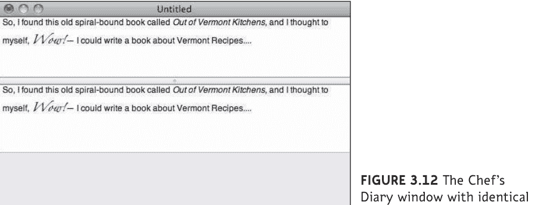

最后，尝试各种 RTF 文件，无论是在 Vermont Recipes 中还是任何其他支持 RTF 的应用程序中创建的。

## 第 10 步：保存并归档项目

现在你已经完成了这一步，并对目前一切的运行情况感到满意，请删除你积累的所有快照。你正准备归档项目，没有必要让你的硬盘被旧的快照占满。

退出正在运行的应用程序，关闭 Xcode 项目窗口（如果提示需要的话）。丢弃构建文件夹，压缩项目文件夹，并将生成的 zip 文件副本另存为 *Vermont Recipes 2.0.0 - Recipe 3.zip*。工作中的 Vermont Recipes 项目文件夹保留原处，为 Recipe 4 做好准备。

## 总结

你已经向创建一个功能完备的“厨师日记”迈出了重要的一步。在接下来的两个食谱中，你将在日记窗口底部添加几个控件，以及一个菜单和几个菜单项，以给用户提供操作控件的方法。当然，你还将把新的控件和菜单项连接起来以使一切正常工作。你会惊讶于使用这个“厨师日记”将多么强大。

你不太可能在你写的每个应用程序中都创建一个类似于“厨师日记”的文本编辑器，但对 Cocoa 文本系统的基本理解将证明是异常地有用的。此外，用于保存和检索“厨师日记”内容的技巧让你很好地了解了如何保存和检索任何文档的数据。

## 文档

食谱 3 涵盖了与文档创建和磁盘存储相关的主题。在探索这些主题时，你学习了几个相关技术，包括统一类型标识符和文本视图。在你完成此及其他食谱后，阅读 Apple 关于相同主题的文档是一个好主意。

## 类引用和协议文档

Cocoa AppKit 和 Foundation 中的每个类都有它们自己的“类引用”文档，在其中你可以找到该类的简要描述及其功能，随后是一个标记为“任务”的组织目录。有时，通用描述很长且详细，包含了你在任何地方都能找到的价值信息。它还包括继承信息以及关于该类的其他信息。类中的每个方法都会单独描述，简要说明其功能和如何使用，并包含参数描述、返回值、与相关方法的交叉引用以及声明它的头文件名称。请仔细注意每个类的继承信息。Cocoa 框架充分利用了 Objective-C 的面向对象能力。如果你忘记每个类都继承自其父类，你将会忽略类的主要功能。你应该阅读你遇到的每个类的类引用文档。这是熟悉 Cocoa 框架范围的最佳方法。

## 文档（续）

你还应该查看每个类的头文件。它们有时包含关于类使用的详细注释，这些在文档中是找不到的。偶尔，你甚至会在头文件中发现完全没有说明的方法。对于食谱 3，你应该按照遇到这些类的顺序阅读以下内容：

- `NSDocument` 类引用
- `NSWindowController` 类引用
- `NSObject` 类引用
- `NSTextView` 类引用
- `NSTextDelegate` 类引用
- `NSDocument` 类引用
- `NSTextStorage` 类引用
- `NSAttributedString` 类引用
- `NSAttributedString Application Kit Additions Reference`
- `NSMutableAttributedString` 类引用

## 通用文档

Apple 发布了大量的指南和概述文档，解释如何完成特定的任务。其中一些是介绍性的，而另一些则详细介绍了所有可用选项。你应该阅读以下关于食谱 3 所涵盖主题的文档：

- 基于文档的应用程序概述
- 文本系统概述
- 文本系统存储层概述
- Cocoa 文本界面编程指南
- 运行时配置指南
- 统一类型标识符概述
- 使用 AppKit 标识符简化数据处理

## 发布说明

你应该阅读 Mac OS X 每个大版本的 Cocoa AppKit 和 Foundation 发布说明，特别是最近的发行。它们通常包含关于类和特定方法的详细用法信息，这些信息从未出现在其他文档中。

对于食谱 3 所涵盖的技术，Leopard 和 Snow 的 Application Kit 发布说明包含了关于统一类型标识符的丰富信息。

# 在文档窗口中添加控件

在食谱 3 中，你创建了一个强大的文本编辑器，并安排了将其内容保存到磁盘并重新读取，以便用户能够维护重要烹饪事件的日记记录。你完善了原始的 Vermont Recipes 规范，在日记窗口底部提供了几个控件，以帮助更新和使用日记。在本食谱中，你将添加这些控件并将它们连接起来。

控件是每个应用程序中常见的元素。它们从简单的推按钮到像日期选择器这样复杂的设备不一。你创建它们并让它们运行的基本技术对于所有控件都是相似的。

在本食谱中，你开始创建两个简单的推按钮，用于插入新日记条目的标题并为现有条目添加标签。接下来，你创建了四个带有图形的导航按钮，使用户能够滚动到上一条或下一条日记条目，以及第一个和最后一个条目。最后，你创建了两个复杂控件——日期选择器和一个搜索字段，用于在日记中进行更复杂的导航。

除了学习如何创建控件外，你在这个食谱中学习了如何在 Cocoa 文本系统中对文本进行编程操作。

## 亮点

- 创建简单的推按钮
- 在窗口中设置制表顺序（关键视图循环）
- 编写动作方法并使用 `sender` 参数
- 使用 `NSLog()` 函数进行调试
- 使用格式化字符串
- 显示 Unicode 字符
- 在 Cocoa 文本系统中操作文本
- 在 Cocoa 文本系统中控制撤销和重做
- 验证（并启用）按钮和其他控件
- 使用 Objective-C 选择器
- 创建和使用 Objective-C 正式协议
- 创建带有图片的推按钮
- 创建日期选择器
- 在 Cocoa 中使用日期
- 创建搜索字段

## 第 1 步：为日记窗口添加控件

食谱 3 开头对 Chef's Diary 的详细规范要求窗口底部空间提供几个控件。在这步中，你首先使用 Interface Builder 向窗口添加控件（图 4.1）。在子步骤中，你将连接其中的每一个控件以执行特定任务。

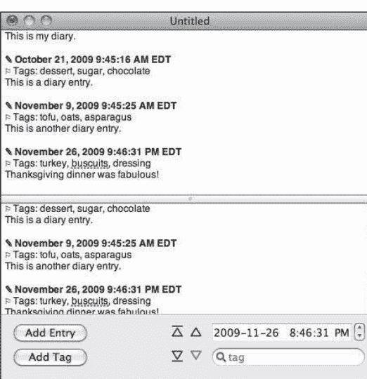

1. 从打开食谱 3 结束时的 Vermont Recipes 文件夹开始，将当时归档的压缩项目文件夹留在原处。打开工作项目文件夹中的 Vermont Recipes `xcode` 文件以启动 Xcode 并打开项目窗口。

通过在 Targets 组中选择 Vermont target，打开其信息窗口并选择 Properties 选项卡，增加 `CFBundleVersion` 值的值。将 Version 字段中的值从 3 更改为 4，保存并关闭信息窗口。在本食谱末尾构建并运行应用程序后打开 About 窗口，你将看到应用程序的版本显示为 **2.0 (4)**。

2. 在 Interface Builder 中打开 `DiaryWindow.nib`。

3. 在 Library 窗口中，导航到 `Library > Cocoa > Views & Cells > Buttons`，并将两个 Push Button 拖到日记窗口底部的空白区域。将它们叠放在窗口左侧。

利用临时出现的指南帮助将它们放置在正确的位置。这些指南符合 Apple 人机交互指南的要求，让你能够轻松构建符合 Mac 用户预期的用户界面。底部的按钮应该吸附到定义窗口左侧和底部边缘的指南上。顶部按钮应该吸附到定义窗口左边缘及其上方间距的指南上。如果你需要更多空间，按住 Command 拖动分视图的底部。

4. 双击顶部按钮选择其标题进行编辑，或者在 Cell Attributes 检查器的 Title 字段中点击并输入 Add Entry。

5. 使用相同的技术，将底部按钮重命名为 Add Tag。

6. 如果你仔细观察，会发现顶部按钮的标题稍微有点长，无法适应按钮的默认宽度，Interface Builder 在你输入时会自动加宽以留出空间。选择底部按钮，根据需要拖动其左右边缘，直到出现指南显示它已与顶部按钮的左右边缘对齐。

重复上述操作两次，直到你有四个按钮排列成一个正方形，且边缘相互接触。这些按钮是相同的，包括弹簧和支撑柱的设置。

1. 选择所有四个正方形按钮。你可以通过点击其中一个并按住 Shift 键点击另外三个来实现，但拖动选择矩形直到所有四个按钮都被选中更为简单。拖动该组，直到引导线显示它位于搜索字段和日期选择器左侧的距离。正方形按钮组的高度与搜索字段以及日期选择器的高度并不完全匹配。选中这四个正方形按钮后，按向上和向下方向键微调该组，直到它看起来居中对齐。

2. 现在到了有趣的部分。这四个正方形按钮将包含包含指示其功能的图形元素。如果你应用类似于 DVD 或 CD 播放器上的上下箭头，用户一眼就能理解它们，但你可以在哪里找到那样的图像呢？对于软件开发者来说，这是一个长久的问题，他们很少有人拥有足够的艺术天赋来绘制有效的图形。请参阅“如何获取图形图像”侧边栏获取一些建议。

### 如何获取图形图像

Mac OS X 如此迷人的原因之一是桌面、工具栏、Dock 以及屏幕随处可见的那些精美图标和其他图形。遗憾的是，对我们大多数人来说，它们并不容易获得。编码技能和艺术天赋似乎并不经常随软件包一起提供。

当你写完一个极其出色的程序并准备将其推向市场时，该怎么办？火柴人画和几何图无法作为营销工具。

简短的答案是雇人。对于任何渴望在市场上大放异彩的开发者来说，这也是现实的答案。

对于我们其他人，还有其他方法。一种很有前景的方法是使用 Apple 自己的图像。Apple 已开始通过 Interface Builder 库窗口的 Media 选项卡提供系统图像以及供开发者使用的图像。遗憾的是，目前库窗口还没有包含许多系统图像。Media 选项卡似乎更侧重于让你通过 Media 选项卡访问你自己的图像或系统中的图像。

此外，许多网站都提供供你使用的免费图像。根据我的口味，其中大多数图像都太可爱了。但也有一些非常棒。在这个领域内寻找解决方案绝对值得你花时间。是否有提供出售图像的网站呢？

对于按钮，几何图形通常运行得非常好。Vermont Recipes 应用程序日记窗口中的导航按钮就是一个例子。几乎每个人都熟悉 DVD 或 CD 播放器按钮上的图形图像。它们由简单的三角形和线条组成。任何拥有适当应用程序的人都可以创建它们。

对按钮图像的要求非常直观。Mac OS 正在缓慢进入分辨率无关时代，在这种背景下，基于像素的图像是不恰当的。小的像素图像在屏幕正常分辨率下看起来很好，但一旦放大，像素化效果会让它变得难看。因此，Apple 的文档坚持要求使用可缩放矢量图形作为按钮图像。在这种情况下有效的文件格式是可缩放 PDF。

遗憾的是，许多容易绘制可缩放矢量图像的应用程序（如 Adobe Photoshop）相当昂贵。我不是这个领域的专家，但我搜索过网络。我敦促你也这样做。似乎有很多免费或廉价的应用可以很好提供帮助。

对于这个配谱中的导航按钮，我恰好有 Omni-Group 的 OmniGraffle，仅仅是因为我已经有了。它有一个非常易用的矢量图形界面，你可以将你的创作保存为可缩放的 PDF。Graphletopia (www.graffletopia.com) 上提供了大量的图像集。然而，对于这个配谱，是我自己画的。毕竟，一个三角形和一个水平线似乎并不超出能力范围。

请查看 Apple 的《分辨率无关指南》获取更多信息。

1. 对于此书，我创建了自己的图像。为了遵循这些指令，请从书籍网站下载 Vermont Recipes 并在项目文件夹中找到这四个图像。它们被命名为 `ArrowBottom.pdf`、`ArrowDown.pdf`、`ArrowTop.pdf` 和 `ArrowUp.pdf`。将它们每一个都拖入你的 Vermont Recipes 项目文件夹中，让它们位于文件夹的顶层。如果你无法访问书籍网站，请找到任何 PDF 图像并将它们重命名以匹配你的箭头名称。它们应该是可缩放的矢量 PDF。

2. 在代码中，在 Groups & Files 菜单中选择 Resources，然后选择 Project > Add to Project。在 Open 面板中，导航到项目文件夹，选择所有四个图像并点击 Add。按照你之前多次操作的那样设置第二个工作表并点击 Add。这四个箭头图像出现在 Resources 组中。

3. Resources 组变得有点挤，因此在内部创建一个新组，并将四个箭头图像放在新的子组中。实现此点的一种方法是选择所有四个图像，然后使用它们上的右键菜单并选择 Group。会为你创建一个新的子组，并带有默认名称以便编辑。输入 Images。Group 命令已为你将四个箭头图像放在了组中。

4. 返回 Interface Builder 并选择左上角的正方形按钮。在 Button Attributes 检查器中，打开 Image 弹出菜单。

分屏视图中顶部和底部窗格的视图很有趣。我建议用户不应该能够从顶部的文本视图通过标签切换到底部的文本视图，因为底部视图在视觉上是折叠的。对于按下 `Control-Tab` 以跳出顶部文本视图的用户来说，看起来似乎什么都没有发生，再次按下 `Control-Tab` 就会选中“添加条目”按钮。两个视图都显示文本存储对象，即使它们都处于展开状态，用户也不需要从顶部视图切换到底部视图。但如果用户恰好在底部窗格中输入，它的下一个按键视图应该是“添加条目”按钮，就像顶部窗格的下一个按键视图是“添加条目”按钮一样。

选择日记窗口。在窗口连接中，从 `initialFirstResponder` outlet 旁边的标记拖到日记窗口分屏视图顶部窗格的上方。当文本视图出现在窗口时，你就选择了嵌入滚动视图中的文本视图。

接下来，选择分屏视图顶部窗格中的文本字段，从 `nextKeyboardView` outlet 拖到“添加条目”按钮。对分屏视图底部窗格中的文本字段执行相同的操作，并将 nib 文件的窗口设置为大纲或浏览器模式，以便于选择底部文本视图，而无需重新调整日记窗口中分割线的位置。依次选择中的每个剩余控件，将其 `nextKeyboardView` outlet 连接到下一个控件，最后回到顶部文本。对每个控件执行此操作的另一种方法是 Control-drag 从一个控件拖动到下一个控件，并在 HUD 中选择其 `nextKeyboardView` outlet。

24. 保存 nib 文件，然后运行 Cocoa 模拟器以确保在调整窗口大小时新控件的行为正常。

## 步骤 2：实现“添加条目”推送按钮

你在食谱 2 的步骤 7 中学习了如何将动作方法连接到按钮上，以便按钮在用户点击时做出响应。为自定义动作方法创建存根并进行挂接很容易。这一步和下一步的难点在于弄清如何编写 `-addEntry:` 和 `-addTag:` 动作方法的体。从“添加条目”按钮开始。

1. 在 Xcode 中打开 `DiaryViewController.h` 头文件。在 `@end` 指令上方添加此动作方法：

```objc
- (IBAction)addEntry:(id)sender;
```

打开 `DiaryWindowController.m` 源文件。在现有的 `-otherDiaryView` 和 `-windowDidLoad` 方法定义之间插入以下 `-addEntry` 动作方法的存根定义。

```objc
- (IBAction)addEntry:(id)sender {
}
```

每个动作方法的签名遵循相同的模式，正如你在食谱 3 的步骤 5 中编写 `-newDiaryDocument:` 动作方法时看到的那样。`IBAction` 返回类型是 `void` 的同义词，它通知 Interface Builder 这是一个动作方法。每个动作方法接收一个参数 `sender`，通常类型化为 `id` 以获得最大的灵活性。


当你编写动作方法的体时，你可以自由忽略 `sender` 参数的值，但它可以非常有用。开发者经常忘记动作方法中可以使用 `sender` 参数。他们会费尽心思去构建一个发送动作消息的对象的引用，而实际上 `sender` 本来就在那里等待被使用。例如，你可以确定 `sender` 是按钮还是菜单项，如果它是一个复杂的控件，则在发送动作方法后其组成单元格的设置是什么。

### 2. 在 Interface Builder 中打开 `DiaryWindow.nib` 文件

Control-drag 将日记窗口中的“添加条目”按钮拖到 `DiaryWindow.nib` 文件窗口中的 First Responder 代理，然后在 HUD 的 Received Actions（接收到的动作）部分选择 `addEntry` 动作。“添加条目”按钮现在已连接。在应用程序运行时点击它将执行 `-addEntry:` 动作方法。

完成后保存 nib 文件。

### 3. 验证动作方法连接

可以使用几种技术来验证动作方法是否连接正确。其中一种是在动作方法的体中调用 Cocoa 的 `NSLog()` 函数。

选择 `Run > Console` 并调整调试器控制台的位置，以便在应用程序运行时看到它。然后编译并运行应用程序，选择 `File > Chef's Diary` 并点击“添加条目”按钮。如果动作连接正确，你会在调试器控制台中看到一条消息，显示日期和时间、应用程序名称以及关于它的加密信息，以及你在 `NSLog()` 函数调用中指定的消息。

如果使用 `sender` 参数值来识别你点击了什么，而不是在字符串中硬编码，那么 `NSLog()` 函数调用将更有用。你将在食谱 5 中向菜单栏添加“添加条目”项目，如果你实际上选了“添加条目”菜单项，控制台却说点击了“添加条目”按钮，那将令人困惑。将 `NSLog()` 函数更改为调用此：

```objc
NSLog(@"Add Entry; sender is %@-%@", sender, [sender title]);
```

现在调试器控制台显示按钮的标题以及它的类。这对于菜单项同样有效，因为菜单项也响应 `-title` 消息。

`NSLog()` 函数第一个参数中的字符串被称为格式字符串，因为它可以可选地包含占位符。在运行时，后续参数的值将按顺序替换占位符。格式字符串中的两个占位符（`%@`）在运行时由 `sender` 对象及其标题填充。`%@` 占位符仅用于对象值，包括 `NSString` 对象。不同的数据类型有不同的占位符。请收藏 Apple 的《String Programming Guide for Cocoa》中的“String Format Specifiers（字符串格式说明符）”部分，它列出了所有用的占位符。

### 4. 编写 `-addEntry:` 方法体

现在你可以编写 `-addEntry:` 的体了。考虑它应该实现什么功能。在编写动作方法时，考虑 MVC 设计。关于日记结构的细节（例如日记被组织成具有日期时间字符串格式标题的条目，以及用于标记条目的特殊字符）属于 MVC 模型。你应该将与相关的方法放在 `DiaryDocument` 类中。这些方法是 `-entryTitleForDate:` 和 `-entryTitleInsertForDate:`。在编写动作方法的过程中，你调用 `-entryTitleInsertForDate:` 来获取完整的插入对象并添加到日记中。

你滚动到新条目的标题并选择它。这些视觉变化应该发生在用户正在编辑的面板中。在整个 `-addEntry:` 方法中，你使用 `keyView` 作为引用文本的方便方式。

Cocoa 文本系统的文档建议你通过更改底层的文本存储对视图的内容执行程序化操作。与 `NSTextView` 不同，它实现了许多可以更改视图内容而无需你直接处理文本存储的方法，例如 `-insertText:`；但你在这里不能使用这些方法，因为它们被设计为仅在用户打字时使用。

在 `-addEntry:` 中，你通过其视图对象获取文本存储对象，该对象在 *NSTextView Class Reference* 中被描述为 Cocoa 文本系统的前端。Apple 的 *Text System Overview* 甚至认为，大多数开发者可以使用 `NSTextView` API 完成所有工作。你本可以轻松地调用 `DiaryDocument` 中的 `-diaryDocStorage` 访问器方法来获取文本存储对象，但 MVC 原则明确，使用不需要让窗口控制器了解文档实现特定细节的方法是优的。

你通过调用稍后将编写的另一个方法 `-entryTitleInsertForDate:` 来设置 `titleString` 变量。

下一个代码块使用 `NSMutableAttributedString` 的 `-replaceCharactersInRange:withString:`（由 `NSTextStorage` 继承）在厨师日记的末尾插入条目标题。

在此操作之前的 `shouldChangeTextInRange:replacementString:` 调用会测试是否允许更改文本存储的内容。在更改文本视图中显示的文本之前，你应该始终运行此操作，即使你确定更改文本是适当的。你或 Apple 可能会在某些未预料到的情况下覆盖 `shouldChangeTextInRange:replacementString:` 并返回 NO。默认情况下，只有当文本视图被指定为非本地时才返回 NO。

这两个方法与 Cocoa 文本系统中的许多方法一样，使用 `NSRange` 参数值来标识要更改的字符范围。你在其他语句中也需要这个范围，例如将文本视图滚动到新插入的标题。你在测试之前将其定义为一个位于现有文本（如果有）末尾的零长度范围，并将其存储在局部变量 `endRange` 中。

随后该方法会修改 `endRange`，以反映你现在已将标题字符串添加到文档末尾的事实。它使用这个新范围对标题应用 `NSBoldFontMask` 特性。你从粗体特性中排除了末尾的换行符，以确保用户在添加标题后开始打字时不是粗体。

### 步骤 2：实现“添加条目”按钮

接下来的方法使用标准的文本系统技术，使用户插入新日记条目的操作变为可撤销。到为止，你一直假设文本视图会自动执行撤销和重做，因为你在 Interface Builder 的“文本视图属性”检查器中选中了“撤销”复选框。你的假设是正确的，但仅限于用户执行内置文本操作时。当你实现一个不是 `NSTextView` 内置打字功能部分的自定义文本操作时，你必须自己注意撤销和重做。

每当你实现一个方法（例如这里的 `-addEntry:` 方法）并赋予用户在文本视图中执行自定义操作的能力时，你必须用调用 `-shouldChangeTextInRange:replacementString:` 和 `-didChangeText` 的代码括起来。这确保了所有预期的通知都能发送，所有预期的代理方法都能被调用，并确保了操作是可撤销和可重做的。

撤销和重做菜单项的标题应该反映撤销或重做操作的性质。你通过向撤销管理器的 `-setActionName:` 方法传递字符串 `"Add Entry"` 来实现，并使用 `NSLocalizedString()` 宏确保你的本地化可以翻译该字符串以便用于其他区域。在英语区域，菜单项标题将是“Undo Add Entry”（撤销添加条目）和“Redo Add Entry”（重做添加条目）。

在最后一个代码块中，将标题滚动到视图。如果用户在系统偏好设置->键盘->“键盘快捷键”选项卡中将“全键盘访问”设置为“所有控制”，你还将把当前焦点框设置在顶部的文本视图上，除非它已经在底部面板。这尊重了用户的预期，即点击“添加条目”按钮后可以立即在新条目标题下方开始打字，即使窗口中的其他视图（如搜索字段）具有键盘焦点。

### 5. 编写 `-keyDiaryView` 方法

在 `-addEntry:` 的开头编写 `-keyDiaryView` 方法：这是一个非常短的方法，其代码可以直接写内联。然而，你会在多个地方需要它，因此它是独立方法的良好候选者。

在 `DiaryWindowController.h` 头文件的末尾插入此声明：

```objc
- (NSTextView *)keyDiaryView;
```

在 `DiaryWindowController.m` 实现文件中，如下定义它：

```objc
- (NSTextView *)keyDiaryView {
    return ([[self window] firstResponder] == [self otherDiaryView]) ? [self otherDiaryView] : [self diaryView];
}
```

如果用户当前在日记窗口的底部打字，此方法返回 `otherDiaryView`。如果窗口中的任何其他视图具有键盘焦点，它返回主文本视图 `diaryView`，它位于文档内容的顶部面板。

### 6. 向 `DiaryDocument` 类添加方法

接下来，向 `DiaryDocument` 类添加 `-entryTitleInsertForDate:` 方法及其两个辅助方法。它们属于 `DiaryDocument` 而不是 `DiaryWindowController`，因为它们提供了关于文档结构和内容的信息。

在 `DiaryDocument.h` 头文件中，如下声明它们：

```objc
- (NSString *)entryMarker;
- (NSString *)entryTitleForDate:(NSDate *)date;
- (NSString *)entryTitleInsertForDate:(NSDate *)date;
```

在 `DiaryDocument.m` 实现文件中，如下定义它们：

```objc
- (NSString *)entryMarker {
    return DIARY_MARKER;
}

- (NSString *)entryTitleForDate:(NSDate *)date {
    NSString *dateString;
    if (FoundationVersionNumber < 10.5) {
        NSDateFormatter *formatter = [[NSDateFormatter alloc] init];
        [formatter setStyle:NSFormatterLongStyle];
        [formatter setTimeStyle:NSFormatterLongStyle];
        dateString = [formatter stringFromDate:date];
        [formatter release];
    } else {
        dateString = [NSDateFormatter localizedStringFromDate:date style:NSFormatterLongStyle timeStyle:NSFormatterLongStyle];
    }
    return dateString;
}

- (NSString *)entryTitleInsertForDate:(NSDate *)date {
    NSTextStorage *storage = [self diaryTextStorage];
    NSString *leadingWhitespaceString;
    if ([storage length] == 0) {
        leadingWhitespaceString = @"";
    } else if ([[storage string] hasSuffix:@"\n"]) {
        leadingWhitespaceString = @"\n";
    } else {
        leadingWhitespaceString = @"\n\n";
    }
    NSString *formatString = @"%@%@ %@\n";
    return [NSString stringWithFormat:formatString, leadingWhitespaceString, [self entryMarker], [self entryTitleForDate:date]];
}
```

```markdown
#define DIARY_MARKER @"\u270E" // Unicode LOWER RIGHT PENCIL
```

两种技术都会根据你指定的日期和时间样式设置字符串。这些样式控制字符串中出现哪些日期和时间元素，以及是使用短格式还是长格式。程序会尊重用户在“系统偏好设置”中“语言与文本”面板设置的本地设置以及当前的日期和时间格式偏好。

第三个方法 `-entryTitleInsertForDate:` 设置了 `leadingWhitespaceString` 变量。然后，它将标记和条目组合成一个适用于插入到“厨师日记”的组合字符串。`leadingWhitespaceString` 字符串用于确保在新的条目标题之前有一个空行。如果该字段当前为空，当然，在初始条目的标题之前不应该有空格。如果不是为空，应用程序规范会在文本视图的末尾添加一个新标题。如果文本视图中的最后一个字符是换行符，则再添加一个换行符；否则，则添加两个换行符。这确保了空行可以将新条目与之前的条目隔离开来。

该方法随后使用了 `NSString` 的 `+stringWithFormat:` 类方法。这是一个你将非常频繁使用的工具方法，用于组合格式化字符串。它接受任意数量的参数，其中第一个参数是类似于 `NSLog()` 函数中使用的格式化字符串。其余参数生成对象或其他类型的数据，并将它们放入嵌入在格式字符串文本中的相应占位符中。在这里，你定义了一个带有三个占位符和一些空格的格式字符串。在将格式字符串赋值给本地变量 `formatString` 后，你将它和其他信息传递给 `+stringWithFormat:` 方法。

检查该字符串。第一个占位符是 `%@`（你刚刚在 `NSLog()` 函数中见过它）。在这里，你将 `leadingWhitespaceString` 对象放置在占位符中，即使它是一个空字符串。

第二个占位符是 `%@`，它与第一个占位符由空格分隔，该空格将出现在最终字符串中。你将第二个占位符替换为条目标题标记字符，该字符是你之前定义的 `NSString` 对象，它持有 Unicode `LOWER RIGHT PENCIL`（右下铅笔）字符，代码点 `0x270E`。这是你将使用的特殊字符，用于标记日记窗口中每个日记条目的开始。

停一下考虑这个第二个占位符。如果你在 Leopard 系统下构建“佛蒙特食谱”，你可能会将格式字符串写为 `"%@ %C\n"`，并将 `DIARY_MARKER` 定义为十六进制数字 `0x270E` 而不是字符串。此时第二个占位符将是 `%C` 而不是 `%@`。在 Apple 的《Cocoa 字符串编程指南》的“格式说明符”中查找（你刚才标记了），你会发现 `%C` 占位符设计用于持有 16 位的 Unicode 代码点。

在 Snow Leopard 下构建应用程序，你不需要使用 `%C` 和 Unicode 字符的数值代码点。Snow Leopard 中的 Xcode 3.2 默认使用 C 编程语言的 C99 方言编译代码，而 C99 允许你使用转义序列定义 Unicode 字符字符串，例如：`\u270E`。编译后的 C99 对象代码在 Snow Leopard 和 Snow Server 上运行良好。事实上，如果你将项目配置为使用 C99 方言，你甚至可以使用转义序列来构建应用程序。

找到 Unicode 字符的简单方法是使用 Apple 的“字符检视器”。通过打开“系统偏好设置”中“键盘”面板的“键盘”选项卡，并选择“在菜单栏显示键盘与字符检视器”设置，将其添加到菜单栏。在许多应用程序中，你可以通过“编辑 > 表情符号与符号”来打开它。从应用程序中选择它，或从“视图”下拉菜单中选择“代码表”，然后滚动到 Unicode 代码 `00002700` (Dingbats)。

格式字符串中的第三个占位符是另一个 `%@` 占位符。在这里，你用刚刚编写的 `-entryTitleForDate:` 方法返回的标题字符串替换它。

格式字符串末尾包含序列 `\n`。这个转义序列也出现在 `leadingWhitespaceString` 变量中。它将标准的换行控制字符插入字符串中。你可以直接使用 `\r` 作为回车控制符，或使用 `\r\n` 作为标准的 Windows 换行控制字符序列。当你使用此字符串为文本创建属性插入时，Cocoa 会自动将这些序列中的每一个解释为在文本视图中开始新段落的信号。你应该养成一致使用其中一个的习惯，因为你必须搜索它。

### 验证结果

如果你现在构建并运行应用程序，你会发现“添加条目”按钮的工作完全符合预期。试一试。打开一个新的“厨师日记”窗口并点击“添加条目”。标题开头出现了一个粗体标题。末尾出现了一个小铅笔图像。多输入一些文本，然后再次点击“添加条目”。另一个标题出现在末尾，与之前的文本由一个空行隔开。选择“撤销添加条目”和“重做添加条目”，查看撤销和重做功能有效。

尝试不同的操作序列。打开一个新的“厨师日记”窗口，点击“添加条目”。然后保存文档并再次点击“添加条目”。选择“撤销添加条目”，第二个条目消失了，文档被标记为“干净”，因为现在回到了保存时的状态。再次打开“编辑”菜单，你会看到“撤销添加条目”菜单项。选择它，第一个标题被移除，文档被标记为“脏”，因为现在与你保存时的文档有所不同。选择“重做添加条目”，标题被重新插入，文档被标记为“干净”，因为你现在回到了保存点。你刚刚撤销了过去保存屏障之后的一个操作。这种功能在 Mac OS X 10.4 Tiger 中引入，现在已成为标准。某些应用程序（如 Xcode）会弹出警报询问是否要撤销保存屏障，但大多数应用程序并不这样做。


- 8. 在操作文本视图的过程中，你可能会发现一个关于保存屏障的不一致之处。在“厨师日记”窗口中输入一些文本，保存文档，再次输入一些文本。现在选择“编辑 > 撤销输入”。你在保存点之前之后的所有文本都会一次性被移除，选择“编辑 > 重做输入”则恢复所有内容。

要理解基于文档的应用程序在创建、打开或保存文档时的消息流，请参阅“基于文档的应用程序概述”中“文档架构中的消息流”章节的图表。这些图包含了你可以重写的方法列表。另请参阅“文档架构中的自动保存”章节。

TextEdit 示例代码的另一个问题是，窗口控制器的数组调用了一个中间方法 `-breakUndoCoalescing`，该方法是专门为了让这种技术生效而编写的。该中间方法反过来调用 `NSText` 的 `-breakUndoCoalescing` 方法。通常情况下，避免让文档了解任何关于窗口控制器实现的信息更好。

为了避免日记文档中出现这个问题，请利用 Cocoa 文本系统，通过文档的 `NSTextStorage` 对象来定位其关联的所有 `NSLayoutManager`，并调用它们的 `-breakUndoCoalescing` 方法。

在 `DiaryDocument.m` 文件中实现这些方法：

```objc
- (void)saveToURL:(NSURL *)absoluteURL ofType:(NSString *)typeName forSaveOperation:(NSSaveOperationType)saveOperation delegate:(id)delegate didSaveSelector:(SEL)didSaveSelector contextInfo:(void *)contextInfo {
    NSNumber *saveOperationNumber = [NSNumber numberWithInt:saveOperation];
    [saveOperationNumber retain];
    [super saveToURL:absoluteURL ofType:typeName forSaveOperation:saveOperation delegate:self didSaveSelector:@selector(document:didSave:contextInfo:) contextInfo:saveOperationNumber];
}
```

```objc
- (void)document:(NSDocument *)document didSave:(BOOL)didSave contextInfo:(void *)contextInfo {
    NSSaveOperationType saveOperation = [(NSNumber *)contextInfo intValue];
    [(NSNumber *)contextInfo release];
    if (didSave && (saveOperation != NSAutosaveOperation)) {
        for (NSLayoutManager *manager in [self diaryDocTextStorage].layoutManagers) {
            for (NSTextContainer *container in manager.textContainers) {
                [[container textView] breakUndoCoalescing];
            }
        }
    }
}
```

这是你第一次接触到常见的 Cocoa 设计模式：指向临时代理的回调选择器。第一个方法的 `delegate` 参数允许你指定任何对象作为该方法的临时代理。在这里，通常情况下，你将 `self` 指定为临时代理。这种关系仅用于回调方法，且仅持续到回调方法被调用为止。

`didSaveSelector:` 参数允许你标识用于回调方法的选择器，你必须在临时代理（即 `self`）中实现它。当某些事件发生时，Cocoa 会自动调用由选择器标识的回调方法。文档描述了触发回调方法的事件，并指定了回调所需的签名。`-saveToURL:ofType:forSaveOperation:delegate:didSaveSelector:contextInfo:` 的文档说明在保存操作成功完成后会调用该回调方法。

在这里，`-saveToURL:ofType:forSaveOperation:delegate:didSaveSelector:contextInfo:` 只做了一件事：调用父类的该方法实现，将 `self` 指定为临时代理，并将 `document:didSave:contextInfo:` 作为回调选择器。调用 `super` 会启动保存操作。它还使用 `@selector()` 编译器指令指定了回调。此外，它将 `saveOperation` 参数（一个类型为 `NSSaveOperationType` 的整数）封装在一个 `NSNumber` 对象中，并传递给 `contextInfo` 参数中的回调方法。在传递给回调方法之前，你保留了这个 `NSNumber` 对象。

回调方法是执行重要操作的地方。首先，它测试 `didSave` 参数，因为你不想在操作成功时不执行撤销合并。接下来，它从 `contextInfo` 中提取该 `saveOperation` 值，并检查它是否为自动保存操作。如果保存操作已完成且不是自动保存，该方法将嵌套循环遍历文档文本对象中所有的 `NSLayoutManager` 对象、所有的 `NSTextContainer` 对象，最后是所有的 `NSTextView` 对象（对应视图）。它对测试的每个视图都调用 `-breakUndoCoalescing`。此逻辑涵盖了所有可能的文本系统安排，因此它对窗口控制器或应用程序界面没有任何假设。

尝试现在这样做：输入一些文本，保存文档，输入更多文本，并选择撤销。添加的文本在文档保存后会被移除。再次选择撤销，文本会回来。两次撤销是离散的步骤。文档被标记为“脏”取决于最后保存的时间。这在使用“保存”或“另存为”菜单项时工作正常。

# 步骤 2：实现 PUSH 按钮

# 步骤 3：实现 Tag 按钮

按钮的工作方式如下：一个异常是特殊字符标记条目的列表不同；另一个异常是列表是紧跟在标题之后的。

标签列表实际上是一个以特殊字符开始的段落，后面跟着空格、冒号以及用户输入的单词或短语。厨师日记不是包含记录和字段的数据库。这是一个简单的 RTF 对象，标签可以像其他文本一样被编辑。特殊字符用于标识条目和标签，以便程序化地定位它们。在标签列表中输入实际标签由用户简单地输入。

在 Vermont 菜谱中，单个标签可以用任何空格或标点符号分隔，这主要是为了简化代码。

（注：原文后部分存在大量重复的无意义占位文本，此处已根据“不要重复输出原文”的原则进行精简处理。）

现在你已经准备好编写几个方法中的第一个，用于获取《厨师日记》中条目标题和标签标题的范围。你从当前条目开始，它定义为当前插入点所在的条目。在这个方法以及其他尚未编写的类似方法中，当前的插入点将作为索引从文本存储对象传递给方法。

在 `Diary.h` 头文件中，在文件末尾、`@end` 指令之前声明 `-currentEntryTitleRangeForItemIndex:`：

```objc
- (NSRange)currentEntryTitleRangeForIndex:(NSInteger)index;
```

在 `Diary.m` 实现文件中，如下定义它：

```objc
- (NSRange)currentEntryTitleRangeForIndex:(NSInteger)index {
    if ([[self diaryDocTextStorage] length] == 0)
        return NSMakeRange(NSNotFound, 0);

    index = [self adjustedIndexIfMarkerAtIndex:index];

    NSInteger markerIndex = [[[self diaryDocTextStorage] string] rangeOfString:[self entryMarker] options:NSBackwardsSearch range:NSMakeRange(0, index)].location;

    return [self rangeOfLineFromMarkerIndex:markerIndex];
}
```

第一语句处理了一个边缘情况。如果文本存储对象当前为空，它就不包含条目标题，因此你创建并返回一个长度为 0、位置为 `NSNotFound` 的范围。这符合 Cocoa 系统的约定：搜索为空的结果返回位置为 `NSNotFound` 的范围。这同时也简化了方法的代码返回，消除了测试空文本存储的需要。

第二语句处理另一个边缘情况。从用户的角度来看，如果插入点当前位于条目字符上——即在条目标记之前且在同一行——那么它就是该字符所标记的条目。换句话说，这就是当前条目。你通过定义范围使其 `location` 成员紧随条目标记，从而向文本系统强制执行这种约定。结果是反向搜索会立即找到它。这也适用于正向搜索，防止方法找到插入点处的标记，并允许它找到下一个条目的后续标记。你将在稍后编写的工具方法 `-adjustedIndexIfMarkerAtIndex:` 中实现这一点。

最后，该方法采用了一种高效的策略来定位当前条目的条目标记。你很快将在用于搜索下一个和上一个标题的方法中遵循类似的策略。简之，你首先从插入点（`index` 参数）开始向后搜索，寻找找到第一个条目标记。如果你没有找到，就说明当前选择位于日记开头的某个无标题前缀中，并退出以指示未找到标题。如果你找到了条目标记，则从该点开始正向搜索，寻找找到的第一个换行符，或者如果没有找到换行符则寻找文件末尾。换行符或文件末尾定义了条目标题的长度。当从 `-currentEntryTitleRangeForIndex:` 方法返回范围值时，`location` 成员表示标题标记的位置，`length` 成员计算标记以及标题中直到（但不包含）换行符之前的所有字符数。你必须排除换行符，这样即使范围结束于文件末尾而非换行符，你也可以使用该范围。

你通过两个步骤执行此策略。首先，你调用一个重要的 Cocoa 方法 `-rangeOfString:options:range:` 来寻找前一个条目标记。然后，你调用一个稍后会使用的工具方法 `-rangeOfLineFromMarkerIndex:` 来寻找条目标记后的第一个换行符，或者在没有换行符时寻找文本对象内容的末尾。该工具方法将其转换为一个包含条目标题的范围，你从 `-currentEntryTitleRangeForIndex:` 返回该范围。该方法专门处理未找到前一个条目标记的情况，因为你会预期得到一个 `location` 标记为 `NSNotFound` 的范围。应用程序将其解释为没有当前条目；插入点的结束位置被认为位于日记第一条目之前的序言中。

你使用 `NSString` 的 `-rangeOfString:options:range:` 方法执行前一个条目标记的搜索。这个强大的文本系统方法经过了高度优化，速度非常快。你搜索的是 `DIARY_TITLE_MARKER`，使用你刚刚编写的 `-entryMarker`。在步骤 2 中定义该宏为包含代码点 `0x270E` 的 Unicode 字符的字符串，这是一个代表铅笔的符号。

如果找到了条目标记，`-currentEntryTitleRangeForIndex:` 方法从条目标记开始正向搜索，寻找定义条目标题结束的换行符。它使用 `-rangeOfLineFromMarkerIndex:` 工具方法来实现，你稍后将编写它。

### 3. 现在编写被 `-currentEntryTitleRangeForIndex:` 使用的两个工具方法。`-adjustedIndexIfMarkerAtIndex:`

在 `DiaryDocument.h` 头文件中对 `-currentEntryTitleRangeForIndex:` 方法的声明：

```objc
- (NSInteger)adjustedIndexIfMarkerAtIndex:(NSInteger)index;
```

在 `DiaryDocument.m` 实现文件中输入方法的定义：

```objc
- (NSInteger)adjustedIndexIfMarkerAtIndex:(NSInteger)index {
    return ((index < [[self diaryDocTextStorage] length]) &&
            [[[self diaryDocTextStorage] string] characterAtIndex:index] == [[self entryMarker] characterAtIndex:0])
           ? index + 1 : index;
}
```

方法首先测试 `index` 是否小于文本存储的总长度。

如果插入点位于日记末尾，该测试返回 `NO`，防止方法将索引增加到无效值。如果插入点位于日记末尾，情况也是如此。

方法然后测试 `index` 是否小于存储的总长度，如果是，则增加索引。这实现了这种约定：如果插入点位于标记且在同一行，则它被视为当前条目。如果位置不是 `NSNotFound`，方法返回索引。

## 4. 现在在第一个方法之后使用次要方法。

在 `DiaryDocument.h` 头文件中声明该方法：

```objc
- (NSRange)rangeOfLineFromMarkerIndex:(NSInteger)markerIndex;
```

在 `Diary.m` 实现文件中如下定义它：

```objc
- (NSRange)rangeOfLineFromMarkerIndex:(NSInteger)markerIndex {
    if (markerIndex == NSNotFound)
        return NSMakeRange(NSNotFound, 0);

    NSRange searchRange = [[[self diaryDocTextStorage] string] rangeOfString:@"\n" options:0 range:NSMakeRange(markerIndex, [[self diaryDocTextStorage] length] - markerIndex)];

    if (searchRange.location == NSNotFound)
        return NSMakeRange(markerIndex, [[self diaryDocTextStorage] length] - markerIndex);

    return NSMakeRange(markerIndex, searchRange.location - markerIndex);
}
```

### 5. 现在你可以编写 `-nextEntryTitleRangeForIndex:` 方法，它和 `-currentEntryTitleRangeForIndex:` 一样实现 `-currentEntryTagRangeForIndex:` 和 `-addTag:` 方法之前是需要的。你可以在下载的项目文件中找到它。

### 6. 现在编写 `-currentEntryTagRangeForIndex:` 方法。它更复杂，因为在确定当前条目是否有标签标题之前，必须搜索条目的开始和结束。为了实现这一点，它调用了你刚刚编写的 `-currentEntryTitleRangeForIndex:` 和 `-nextEntryTitleRangeForIndex:` 方法。你可以在下载的项目文件中找到它。

`-currentEntryTagRangeForIndex:` 方法的另一个区别在于，如果当前条目中不存在现有标签列表，它必须返回应该插入标签列表的位置。在这种情况下，返回一个位置位于当前标题字符串末尾且长度为 0 的范围。在你正要编写的 `-addTag:` 动作方法中，你将测试长度是否为 0，以此选择是插入新的标签列表，还是简单地将插入点移动到现有标签列表的末尾，以便用户可以开始输入标签。

- `-addTag:` 动作方法会调用另一个你尚未编写的实用方法 `-insertionPointIndex:`：你已经读过几次你刚刚编写的几个，如 `-currentEntryTitleRangeForIndex:`；它们将具有键盘焦点的文本视图中的当前插入点作为它们的索引参数。请编写一个现在获取当前插入点的方法。它属于 `DiaryWindowController` 类，因为它与 MVC 视图有关。

在 `DiaryViewController.h` 头文件的末尾，插入此声明：

```objc
- (NSInteger)insertionPointIndex;
```

在 `DiaryViewController.m` 的实现文件中定义它：

```objc
- (NSInteger)insertionPointIndex {
    return [[[[self keyView] selectedRanges] objectAtIndex:0] rangeValue].location;
}
```

在 Cocoa 文本系统中，插入点是一个长度为 0 的选择范围。然而，当用户点击“添加标签”按钮时，完全可能选中一个单词或短语，或者是文本系统支持多选的几个单词或短语。因此，你必须实现一种约定，定义应用程序将什么视为插入点，以及在插入新标签标题时将如何表现。新标签的位置在应用程序规范中定义，因此它不能替换用户的当前选择。插入点只需要为了知道从哪里开始搜索标题标记和标签标记。

在此方法中，你将文本视图选择范围数组中第一个选择的位置视为插入点。根据 `NSTextView` 参考文档，Cocoa 系统保证 `-selectedRanges` 总是返回一个包含至少一个元素的数组，因此你不需要对这些情况进行测试。

- 最后，你已经准备好编写 `-addTag:` 动作方法了。这影响到 MVC 视图，因此它属于 `DiaryViewController` 类。你可以在食谱 4 的下载文件中找到它。

- `-addTag:` 动作方法开始定义三个局部变量：`key`、`storage` 和 `tagString`，遵循了 `-addEntry:` 的模式。`tagString` 变量使用了 `DIARY_TAG_MARKER` 宏，该宏在这一步开始时定义了 Unicode 白旗字符，代码点为 `0x2690`。


该方法调用了你完成编写的 `-currentEntryTagRangeToIndex:` 方法，并将当前插入点传递给它。如果它的位置值为 `NSNotFound`，方法将返回而不执行任何操作，因为这意味着插入点目前位于一个无标题序言中。应用程序规范规定无标题序言不能包含标签列表。你不希望动作方法在按钮被点击或菜单项被选中时无所事事，因为这会让用户感到困惑。你很快就会安排在这种情况下禁用“添加标签”。尽管如此，你仍应该在方法中保留此行作为兜底。

接下来的几行测试 `-currentEntryTagRangeToIndex:` 方法返回的范围长度。如果长度为 0，则当前条目中不存在现有标签标记，你应该在 `Location` 处插入一个新的空标签。你使用在第 2 步 `-addEntry:` 动作方法中使用的技术来实现此，并包含撤销支持和生成相应的通知。编辑菜单将包含“撤销添加”和“重做添加”菜单项。如果长度不为 0，则当前条目中已有一个标签，你不需要再添加一个。

最后，无论你是添加新标签还是当前条目中已存在标签，该方法都会将具有键盘焦点的文本视图滚动到新的或现有的标签标题，并妥善放置插入光标，以便用户可以开始输入新标签。

- 9. 与每个新动作方法一样，你必须记得在 Interface Builder 中连接它。打开 `DiaryWindow` nib 文件，按住 Control 拖动日记窗口中的“添加标签”按钮到文件窗口中的第一响应者（First Responder）。在 HUD 中，选择 `addTag:`。

- 10. 你现在应该构建并运行应用程序以测试组合“添加条目”和“添加标签”。打开厨师日记窗口并点击“添加条目”按钮。紧接着点击“添加标签”按钮。在新条目标题后的行中，你会看到一个白旗字符和“Tags”一词；插入点位于其后，这样你可以输入类型，如甜点、开胃菜或类似的内容。然后按回车键并写下真实的或虚构的经历，可以使用你喜欢的段落。然后再次点击“条目”和“添加标签”，最后点击“添加条目”。现在进行实验。点击其中一个条目的中间并点击“添加条目”。日记末尾会出现一个新条目，如果末尾移出了视野，它会滚动到任何条目的中间，然后点击“添加标签”。如果该条目已经有了标签标题，插入点将移动到其末尾，让你输入另一个标签。

现在点击日记的开头，第一个条目标题标记之前。输入一些文本，为日记创建一个无标题序言，然后按回车键，并点击新文本。注意“添加标签”按钮仍然保持启用状态，但当你点击它时，什么都不会发生。现在删除厨师日记窗口中的所有文本。“添加标签”按钮仍然启用。再次点击“添加标签”，仍然没有任何发生。你将在第 4 步中安排在这两种情况之一禁用“添加标签”按钮。

## 第 4 步：验证标签

良好的用户界面设计需要，在其他方面，避免让用户困惑。一个潜在的困惑来源是用户界面元素在某些情况下可以启用或禁用，这些包括工具栏项目和菜单项。在这种情况下，当插入点位于无标题序言时你应该禁用它们。应用程序规范禁止无标题序言包含标签列表。在所有其他情况下，它应该是启用的。

你通过向按钮发送 `setEnabled:` 消息并传递 `YES` 或 `NO` 来启用或禁用它。这种简单的方法是声明一个 outlet 并在 Interface Builder 中连接它，然后你在正确的时间发送消息。

# 协议（续）

协议的一个用途是实现非常类似于某些面向对象语言中存在的多重继承的功能。例如，如果你检查 Foundation 中的 `NSCopying` 协议，你会发现它声明了一个方法，任何支持拷贝的对象都必须实现该方法。许多的 Cocoa 类都采纳了 `NSCopying` 协议。通过这种方式，它们能够让编译器确保你尝试拷贝的对象已经实现了所需的方法。其他协议声明了更大集合的必要方法。如果在子类或分类（category）中声明这些方法，则它们只能在类层次级中使用；而将它们声明为协议则意味着它们可以在任何地方使用。

协议有两种：正式协议（formal）和非正式协议（informal）。它们都没有实现部分，因为协议的客户端会实现协议所声明的方法。

正式协议使用 `@protocol` 指令进行声明。客户端类通过导入其头文件并在 `@interface` 指令的末尾的尖括号中包含其协议名称（或用逗号分隔的名称列表）来采纳它。在你的一个类中采纳正式协议可以保证你的类实现了该协议的所有必要方法，如果没有实现，编译器将会报错。从 Objective-C 2.0 开始，正式协议可以使用 `@optional` 指令将方法声明为可选的。默认情况下，方法是强制的，可以使用 `@required` 指令将其声明为强制的。采纳正式协议的类或分类不需要在其接口中包含该协议方法的声明，因为在 `@interface` 指令中采纳协议已经保证了所有这些方法都必须实现。

正式协议像类和其他导出的符号一样，应该有一个二或三字母的大写前缀，以确保它不会与你从 Apple 或第三方导入的框架中具有同名的协议发生冲突。协议有其自己的独立命名空间，不同于类使用的全局命名空间，但仍然存在命名冲突的风险。请参阅 Apple《Cocoa 编码指南》中的“命名（Coding Naming）”部分。

非正式协议通常声明为 `NSObject` 的一个分类，且没有实现部分。要使用它声明的方法，客户端类或分类只需实现其所声明的方法中它需要的部分即可，就像实现任何分类的方法一样。这里没有特殊的类型检查来验证你是否正确地做了这一点。事实上，正是由于非正式协议缺乏类型检查，Apple 才开始在正式协议中引入方法委托（delegating）。

`NSUserInterfaceValidations` 协议的基础概念是：控制器类中的单个方法包含了所有必要的代码，用于判断是否启用或禁用控制器管辖范围的所有 UI 元素。该方法是 `NSUserInterfaceValidations` 协议中声明的解决方案 `-validateUserInterfaceItem:`，它将由你来实现。将该方法命名为 `-validateUserInterfaceItem:` 并声明你的控制器符合了其他 Cocoa 部分所感知的协议是非常关键的。

`-validateUserInterfaceItem:` 方法的参数是一个符合条件的用户界面项，例如工具栏条目、菜单项或经过验证的控件。在方法体中，你通过其动作方法（或罕见地通过其标签 tag）来确定特定项的标识。该项必须符合相关的 `NSValidatedUserInterfaceItem` 协议或符合你声明的自定义验证协议。从技术上讲，符合 `NSValidatedUserInterfaceItem` 协议保证了该项实现了 `-action` 和 `-tag` 方法。在实践中，符合该协议也意味着该项实现了一个 `-setEnabled:` 方法，并被意用于使用此处描述的技术进行验证。然后，你指定该项应该启用或禁用的条件。如果应用程序当前状态使得该项应该启用，则安排方法返回 `YES`；如果应该禁用，则返回 `NO`。你不需要为连续传递给协议方法的每个项声明或连接输出（outlets）。

例如，对于“添加标签（Add Tag）”按钮，你对 `-validateUserInterfaceItem:` 方法的实现首先断言项的动作是否为 `addTag:` 动作。如果是，方法将测试日记窗口活动文本视图中的插入点是否在日记条目内。如果是，方法返回 `YES`；如果不是，返回 `NO`。如果该项的动作不是 `addTag:` 动作，方法将返回 `YES`，以便窗口中的所有其他项都能被启用。你必须这样做，因为协议方法可能会在窗口中你想要验证的其他项上被调用。

诀窍在于知道何时以及如何调用 `-validateUserInterfaceItem:` 协议方法。如果你实现了 `-validateMenuItem:` 和更具专门性的 `-validateToolbarItem:` 方法，Cocoa 会自动验证两种用户界面项：菜单项和工具栏条目。Cocoa 处理此类按钮的控件的方式与此不同。你仍然必须实现 `-validateUserInterfaceItem:` 或更专门的验证方法，但 Cocoa 不会自动调用它们。每当窗口需要对控件进行验证时，你必须手动调用它们。

为了理解验证是如何工作的，请考虑 `-validateMenuItem:` 和 `-validateToolbarItem:`：如果你实现了这些方法，Cocoa 会自动调用它们，就像你所实现的代理方法会被自动调用一样。当 `NSMenu` 对象的更新方法被调用时，菜单项会被验证；当 `NSToolbar` 对象的 `validateVisibleItems` 方法或 `NSToolbarItem` 的 `validate` 方法被调用时，工具栏项会被验证。对于菜单项，每当用户打开菜单并触发其 `-update` 方法时就会发生验证。对于工具栏，验证发生在 `NSWindow` 对象的更新方法调用工具栏的 `validateVisibleItems` 方法时，这发生在循环的每次迭代中。如果你的验证花费了太多时间，可以覆盖这些方法以提高效率。你可以调用 `NSMenu` 的 `-setAutoEnableItems` 和 `NSToolbarItem` 的 `-setAutoValidation` 来开启或关闭菜单项的自动验证。最后一点是要理解，如果你实现了 `-validateUserInterfaceItem:` 但没有实现 `-validateMenuItem:` 和 `-validateToolbarItem:`，那么菜单和工具栏的验证将回退到 `-validateUserInterfaceItem:`。这非常重要，因为它允许当你的应用程序具有响应相同动作的控件和菜单项时，将验证逻辑放在单个方法 `-validateUserInterfaceItem:` 中，正如你将在食谱 5 中所做的，通过添加 Tag 菜单项并复制某些控件的动作，这些动作将由你实现的同一个 `-validateUserInterfaceItem:` 方法进行验证。

在这里，你首先开始声明协议 `VRValidatedControl` 和 `VRControlValidations`。协议名称必须是唯一的。Objective-C 编程语言指出，它们与类不同，没有全局可见性，并且存在于自己的命名空间中。尽管如此，你应该使用两个或三个大写字母作为前缀来命名，以减少与从 Apple 或第三方导入的框架发生命名冲突的风险。在这里，你使用了 `VR`，代表 Vermont Recipes。`VRValidatedControl` 声明了一个方法 `-validate`。你将其标记为 `@required`，因为每个有效的控件都必须实现此方法。`VRControlValidations` 协议声明了一个可选方法 `-validateControl:`。然后，你实现一个名为 `ValidatedDiaryButton` 的 `NSButton` 子类，并确保它遵循 `VRValidatedControl` 协议。遵循协议意味着按钮实现了 `-validate` 方法。你实现 `-validate` 来调用控制器的 `-validateControl:` 方法（如果你实现了该方法），如果没有实现，则回退到控制器的 `-validateUserInterfaceItem:` 协议方法。最后，在窗口控制器中，你实现 `-validateUserInterfaceItem:` 来执行判断控件应该启用还是禁用的测试，并在窗口更新的运行循环每次迭代中，对每个有效控件调用它。

控制器可以实现 `-validateControl:` 而不是 `-validateUserInterfaceItem:`，但对于主厨窗口（Chef's window），你会有许多与验证按钮执行相同操作的菜单项。

- 通过实现该协议方法，将其输入 `DiaryWindowController.m` 源文件，紧接现有的 `-windowDidLoad` 方法之后。你不需要在头文件中声明它，因为它已经在 `NSUserInterfaceValidations` 协议中声明过了。

```objc
- (BOOL)validateUserInterfaceItem:(id <NSValidatedUserInterfaceItem>)item {
    SEL action = [item action];
    if (action == @selector(addTag:)) {
        return ([[self document] currentEntryTitleRangeForIndex:[self insertionIndex]].location != NSNotFound);
    }
    return YES;
}
```

你很快就会安排在循环中调用此方法，针对窗口中每个遵循 `VRValidatedControl` 协议的视图。窗口中的某些控件将遵循该协议。每当该方法被调用时，特定用户界面项的引用都会通过 `item` 参数传递给它。参数的类型为 `id`，允许对任何类型的控件进行验证。在步骤 6 中，你实际上将验证日记窗口的日期选择器，它不是按钮。

`item` 必须遵循 `NSValidatedUserInterfaceItem` 协议，因为在类型声明中使用了角括号引用该协议。每个遵循 `VRValidatedControl` 协议的项都符合此条件，因为你很快就会声明该协议继承自 `NSValidatedUserInterfaceItem` 协议。

你测试项的值以确定其动作是否为 `addTag:`：如果是，这就是发送相同动作的 Add Tag 项，因此根据 `currentEntryTitleRangeForIndex:` 返回的范围中 `location` 成员是否为 `NSNotFound` 来返回 `YES` 或 `NO` 的布尔值。如果此项不是 Add Tag 按钮，方法将通过 `if` 子句并在所有其他情况下返回 `YES`，因为目前至少窗口中的所有按钮都将显示为启用备用状态。你很快会添加额外的 `if` 子句来测试其他验证按钮。一个典型的 `-validateUserInterfaceItem:` 方法可能会有很多 `if` 子句。

这不是你第一次遇到 Objective-C 选择器（selector），但它之前没有被单独作为该语言的一项独立特征。每当你在 Interface Builder 中连接用户元素并选择动作时，都会看到选择器。选择器是类型为 `SEL` 的语言元素。在 `NSControl` 类参考中查找 `-action` 方法，你会发现它返回一个类型为 `SEL` 的值。要测试此动作是否为特定的选择器，你使用 `@selector` 编译指令，传入你感兴趣的选择器或动作。如你所见，选择器仅仅是方法的签名，包括所有标记参数标签的冒号，它唯一地标识了此动作。选择器不是字符串标签，但你可能想要显示一个选择器，例如在调试目的的 `NSLog()` 函数调用中，应使用 `NSStringFromSelector()` 函数。

- 因为 `DiaryWindowController` 类现在实现了 `-validateUserInterfaceItem:` 协议方法，你应该更改其头文件以通告这一事实。在 `DiaryWindowController.h` 中，将 `@interface` 指令更改为：

```objc
@interface DiaryWindowController <NSUserInterfaceValidations> {
}
```

如你所见，你通过将协议名称放在 `@interface` 指令末尾的角括号内声明对正式协议的遵循。这被称为协议列表。要声明对多个协议的遵循，请在协议列表中用逗号分隔它们。

3. 接下来，实现调用 `-validateUserInterfaceItem:` 协议方法的方法。在 Vermont Recipes 中，这是一个自定义的 `-updateWindow` 方法。将其放在现有的 `-windowDidLoad` 方法之后。

在 `DiaryWindowController` 头文件中，如下声明它：

```objc
- (void)updateWindow;
```

在 `DiaryWindowController` 源文件中，如下实现它：

```objc
- (void)updateWindow {
    for (id view in [[self window] contentView].subviews) {
        if ([view conformsToProtocol:@protocol(VRValidatedControl)]) {
            [view validate];
        }
    }
}
```

该方法使用 Objective-C 2.0 中的新快速枚举语法遍历窗口内容视图中的所有子视图。在循环的每次迭代中，它测试当前视图是否遵循 `VRValidatedControl` 协议。通过使用 `@protocol` 指令为 `-conformsToProtocol:` 目的指定协议，这与 `@selector` 指令类似。窗口中的大多数视图并不遵循该协议，包括添加记录（Add Entry）按钮。因此它们被跳过了。

当循环中检查 Set Tag 时，它通过了测试。它遵循你即将使其遵循的协议。该方法调用此控件的 `-validate` 协议方法，该方法负责启用或禁用控件的工作。

4. 接下来，安排在适当的时机调用 `-updateWindow` 方法——即窗口更新时。为了实现这一点，在 `-updateWindow` 方法之前实现 `-windowDidUpdate:` 代理方法，如下：

```objc
- (void)windowDidUpdate:(NSNotification *)notification {
    [self updateWindow];
}
```

实现一个单独的 `-updateWindow` 方法似乎是多此一举，因为它的主体本可以直接放在 `-windowDidUpdate:` 方法中。随着时间的推移，你可能会发现有时你不仅从代理方法，还需要从其他方法调用 `-updateWindow` 方法，因此现在将其设为一个独立的方法会很方便。

5. 如果 Set Tag 没有遵循 `VRValidatedControl` 协议，那么这一切都不起作用。Objective-C 通过检查类 `@interface` 是否在协议列表中包含角括号中的协议来测试对正式协议的遵循情况。Cocoa 并不检查类是否实际响应协议所需的方法；如果遵循协议的类实现这些方法，那是程序员的责任。


为了让验证工作运行，你必须声明并实现 `NSButton` 的子类，并声明该子类遵循 `VRValidatedControl` 协议。新子类——命名为 `ValidatedDiaryButton`——只需要实现一个方法，即 `-validate` 方法。它从 `NSButton` 继承所需的其他方法 `-action` 和 `-setEnabled`。

该子类仅与日记窗口相关，因此在 `DiaryWindowController.h` 头文件中声明并实现它是合适的。在 `DiaryWindowController.h` 头文件中，如下声明它：

```objc
@interface ValidatedDiaryButton : NSButton <ValidatedControl> {
}
@end
```

它没有声明 `-validate` 方法，因为它遵循了 `VRValidatedControl` 协议，该协议声明了该方法，从而保证了它的实现。

在 `DiaryWindowController.m` 实现文件的末尾，`@end` 指令之后，如下实现它：

```objc
@implementation ValidatedDiaryButton
-(void)validate {
    id validator = [NSAPTarget targetForAction:[self action] to:[self target] from:self];
    if ((validator == nil) || ![validator respondsToSelector:[self action]]) {
        [self setEnabled:NO];
    } else if ([validator respondsToSelector:@selector(validateControl:)]) {
        [self setEnabled:[validator validateControl:self]];
    } else if ([validator respondsToSelector:@selector(validateUserInterfaceItem:)]) {
        [self setEnabled:[validator validateUserInterfaceItem:self]];
    } else {
        [self setEnabled:YES];
    }
}
@end
```

如果你稍后决定向窗口添加任何需要验证且是 `NSButton` 的子类的按钮（例如 `NSPopUpButton`），你将不得不将它们也声明为经过验证的子类。你也可以以相同的方式添加其他控件。例如，在步骤 6 和 7 中，你将以这种方式验证日记窗口的日期选择器和搜索字段，尽管它们并不是 `NSButton` 的子类。

### 6. 在声明这种验证技术背后的协议之前，还有一件事要处理

此时，`Set Tag` 按钮仍然认为它的类是 `NS`，这不符合协议。你必须将它的类改为 `ValidatedDiaryButton`。

首先，编译应用程序。然后，在 Interface Builder 中，选择日记窗口中的 `Set Tag` 按钮。在按钮信息检查器中，从 Class 下拉菜单选择 `ValidatedDiaryButton`。保存 nib 文件，并再次编译你的应用程序。

### 7. 最后，你就可以准备声明协议了

这可能让你感到大失所望，因为其实没什么复杂的。

在 `DiaryWindow.h` 头文件的末尾，就在 `-ValidatedDiaryButton` 声明上方，插入这两个协议声明：

```objc
@protocol VRValidatedControl <NSValidatedUserInterface>
@required
- (void)validate;
@end
```

```objc
@protocol VRControlValidations
@optional
- (BOOL)validateControl:(id <VRValidatedControl>item);
@end
```

### 8. 运行应用程序并测试 `Add Tag`

当你打开一个新的日记窗口时，该按钮是禁用的，这是正确的，因为在插入点之前没有条目标题。现在输入几个字符，按下 Return 键，并点击 `Add Entry`。`Add Tag` 按钮立即变为可用，因为插入点现在位于新日记条目的标题标记之后，因此处于当前条目中。点击 `Add Tag`，会出现一个新的新的日记标签列表。使用鼠标按钮或键盘上的方向键将插入点移动到条目标题标记之前，`Add Tag` 按钮会立即禁用。

## 步骤 5：实现并验证导航按钮

按照你处理 `Add Tag` 按钮的方法来处理四个导航按钮。首先编写返回目标条目标题范围的方法。为每个按钮编写一个单独的操作方法，以便将标题滚动到视图并选中它。最后，对按钮进行类化，以利用你刚刚编写的验证协议。

你已经在步骤 3 中实现了导航按钮底层的两个范围方法：`-currentEntryTitleRangeIndex` 和 `-nextEntryTitleRangeIndex`。现在请实现第三个：`-firstEntryTitleRange`、`-lastEntryTitleRange` 和 `-previousEntryTitleRangeIndex`，以及所有的四个操作方法。

### 1. 在 `DiaryDocument` 类中声明并实现这三个新的范围方法

你将在 Recipe 4 的下载项目文件中找到它们。

这三个方法遵循了与 `-currentEntryTitleRangeIndex` 相同的策略。前两个方法将整个文本存储定义为搜索范围，因此它们不需要索引参数。`-firstEntryTitleRange` 方法从日记开始处搜索，而 `-lastEntryTitleRange` 则从末尾反向搜索。第一个条目标记可以找到目标条目的位置。最后一个方法 `-previousEntryTitleRangeIndex` 通过调用 `-currentEntryTitleRange` 并反向搜索上一个标记来找到当前条目。

### 2. 接下来，编写四个导航操作方法

每个方法都带有 `goto` 作为方法名的一部分，参考 `App-PDFView` 类中的几个方法。它们都使用相应的范围方法获取目标范围，并将其滚动到视图中。它们还将键盘焦点交给适当的文本视图，以防用户在点击导航按钮时搜索字段正拥有焦点。

作为操作方法，导航方法应属于 `DiaryWindowController`。你将在 Recipe 4 的下载项目文件中找到它们。

### 3. 连接操作方法

在 Diary Window nib 文件中，按住 Control 键从日记窗口左上角的导航按钮拖到 nib 文件窗口中的 `Responder` 代理；然后从 HUD 的 `Received Actions` 部分中选择 `gotoFirstEntry:` 操作。或者，Control-点击（右键点击）左上角的导航按钮，然后从 HUD 的 `Sent Actions` 部分中 `gotoFirstEntry:` 操作旁边的标记拖到 `First Responder` 代理；或者 Control-点击 `First Responder` 代理，并并在 HUD 的 `Received Actions` 部分中选择 `gotoFirstEntry:` 操作。

对其他三个导航按钮执行相同的操作，将左下角的按钮连接到 `gotoLastEntry:` 操作，右上角的按钮连接到 `gotoPreviousEntry:` 操作，右下角的按钮连接到 `gotoNextEntry:` 操作。

### 4. 四个导航按钮现在可以工作了，但当它们无可做时应该是禁用的

当日记中没有条目时，所有按钮都应该禁用；当没有条目或在当前条目之后，右上和右下角的按钮也应该禁用。否则，将目标条目的标题滚动到视图中始终是有用的，即使它已经在视图中，选中它也能吸引用户的注意力。

你已经在步骤 4 中为日记窗口设置了验证机制。你只需要额外做两件事就能让导航按钮受该机制控制。

首先，将四个导航按钮的类设置为 `ValidatedDiaryButton`。要做到这一点，依次选择每一个按钮，并在按钮检查器中从 Class 下拉菜单中选择 `ValidatedDiaryButton`。

其次，为 `validateInterfaceItem:` 方法添加几个子句。

```objc
- (BOOL)validateInterfaceItem:(id <VRValidatedControl>)item {
    SEL action = [item action];
    if (action == @selector(add:)) {
        return [self document currentTitleRange] != NSNotFound;
    } else if (action == @selector(gotoFirstEntry:)) {
        return [self document firstEntryTitleRange] != NSNotFound;
    } else if (action == @selector(gotoLastEntry:)) {
        return [self document lastEntryTitleRange] != NSNotFound;
    } else if (action == @selector(gotoPreviousEntry:)) {
        return [self document previousEntryTitleRangeIndex] != NSNotFound;
    } else if (action == @selector(gotoNextEntry:)) {
        return [self document nextEntryTitleRange] != NSNotFound;
    }
    return YES;
}
```

如果检查的按钮不是连接到 `add:`，方法将检查它是否连接到 `gotoFirstEntry:`。如果不是，它将继续执行 `else if`。当确定是其中一个导航按钮时，它会搜索目标范围。最后，如果找到了目标则返回布尔值 YES，否则返回 NO。如步骤 4 所示，对所有其他按钮返回 YES 以确保它们可用。

### 5. 运行应用程序并测试导航按钮

向日记添加多个条目。然后以各种方式点击导航按钮并观察。通过观察验证它们是否按设计启用或禁用。

## 步骤 6：实现并验证日期选择器

Cocoa 日期选择器控件在应用程序中有有两个用途。

首先，日期选择器比四个导航按钮更具区分性。导航按钮局限于第一个、最后一个、上一个和下一个条目。即使是经验丰富的厨师也会产生比这多的日记条目。由于每个条目都以创建日期命名，日期选择器是导航到特定条目的完美控件。在本步骤中，你编写代码让日期选择器导航到等于或晚于输入日期的第一个或最早条目。也就是说，日期选择器的设置定义了用户想要的最旧条目。在没有比日期选择器设置更新的特殊情况下，它导航到最新的条目。

其次，日期选择器作为当前条目的标题，这样用户就可以一眼看出当前是哪个条目，即使其标题已经滚动出窗口顶部。当用户浏览日记时，它会自动更新以显示当前条目。只有在用户没有使用日期选择器导航时，它才这样做。当日期选择器在使用时，它显示用户设置的日期。当用户将键盘焦点返回给文本视图时，它会恢复显示当前条目的日期。

当日期选择器未使用且没有当前条目时（即文本视图为空或插入点位于无标题序言中），日期选择器默认显示当前日期。

首先实现日期选择器的动作方法，然后转向它作为当前日记条目标题的角色。

### 1. Cocoa NSDPicker 类继承自 NSControl，因此它响应 NSControl 的 `-action` 方法

通过模仿其他 gotoTo 方法的模式，实现 `-gotoToDatedEntry:` action 方法。它将需要调用一个新的范围方法，该方法将在稍后文中介绍。

在 `DiaryWindowController.h` 文件中，在最后一个其他的 gotoTo 方法之后声明动作方法：

```objc
- (IBAction)gotoToDatedEntry:(id)sender;
```

在 `DiaryWindowController.m` 源文件中，在最后一个 goto 方法之后按如下定义：

```objc
- (IBAction)gotoToDatedEntry:(id)sender {
    NSTextView *keyView = [self keyKeyboardView];
    NSRange targetRange = [self firstEntryTitleRangeOrDate:[sender dateValue]];
    if (targetRange.location != NSNotFound) {
        [keyView scrollRangeToVisible:targetRange];
        [keyView setSelectedRange:targetRange];
    }
}
```

只有两个功能使它与其他 goto 方法不同：你必须编写的 `-firstEntryTitleAtOrDate:`，以及它不会将键盘焦点返回给文本视图。

后一点对于可用性至关重要。日期选择器应该保持控制状态，直到用户显式点击文本视图。这允许用户在不中断的情况下继续更改日期选择器上的设置。

### 2. 编写 `-firstEntryTitleAtOrAfterDate:` 范围方法

与其他范围方法一样，它属于 `DiaryDocument`。

在 `DiaryDocument.h` 头文件中，如下跟在 `-nextEntryTitleForToIndex:` 之后声明它：

```objc
- (NSRange)firstEntryTitleAtOrAfterDate:(NSDate *)date;
```

在 `DiaryDocument.m` 实现文件中，在相同的相对位置声明它，如下：

```objc
- (NSRange)firstEntryTitleAtOrAfterDate:(NSDate *)targetDate {
    NSDate *date;
    NSRange tempRange;
    NSRange returnRange = [self firstEntryTitleRange];
    if (returnRange.location == NSNotFound)
        return NSMakeRange(NSNotFound, 0);
    do {
        date = [self dateFromEntryTitleRange:returnRange];
        tempRange = [self nextEntryTitleRangeToIndex:returnRange.location + returnRange.length];
        if (tempRange.location == NSNotFound) break;
        if ((date == nil) || ([date timeIntervalSinceDate:targetDate] < 0))
            returnRange = tempRange;
    } while ([date timeIntervalSinceDate:targetDate] < 0);
    return returnRange;
}
```

该方法首先声明 `date`、`tempRange` 和 `returnRange` 变量。它调用 `-firstEntryTitleRange` 将 `returnRange` 设置为日记中的第一个条目，返回一个位置为 `NSNotFound` 的不包含任何条目的范围。然后进入循环，使用 `-nextEntryTitleRangeToIndex` 查找后续条目，直到标题耗尽或找到一个比目标日期更晚的。它调用你尚未编写的 `-dateFromEntryTitleRange` 将每个标题转换为可能的 `NSDate` 对象。它会忽略格式不正确的标题（由 `nil` 日期指示）。当标题耗尽或找到一个比目标日期更晚的标题时，它返回最后一个有效日期的范围。

### 3. 编写 `-dateFromEntryTitleRange` 方法

一旦完成此操作，`-gotoToDoEntry:` 动作的支持方法将编写完成。

在 `DiaryDocument` 头文件中，紧跟在 `-firstEntryTitleRangeAtAfterDate:` 方法之后声明：

```objc
- (NSDate *)dateFromEntryTitleRange:(NSRange)range;
```

在 `DiaryDocument` 实现文件的相同相对位置按如下定义：

```objc
- (NSDate *)dateFromEntryTitleRange:(NSRange)range {
    if ((range.location == NSNotFound) || (range.length < 2)) return nil;
    range.location += 2;
    range.length -= 2;
    NSString *dateString = [[[self diaryView] textStorage] string] substringWithRange:range];
    NSFormatter *formatter = [[NSFormatter alloc] init];
    [formatter setStyle:NSFormatterLongStyle];
    [formatter setTextStyle:NSFormatterLongStyle];
    NSDate *date = [formatter dateFromString:dateString];
    [formatter release];
    return date;
}
```


该方法返回从范围参数中的标题名称派生的日期。如果传入的范围值是 `NotFound` 范围，或者长度小于 2，则返回 `nil`。测试列表基于事实：所有条目都以条目标记字符和空格开头；如果没有这些，标题将无法包含日期。此测试是必要的，以确保如果用户删除了除初始标记字符以外的所有标题字符串，紧随其范围操作也不会导致错误。

该方法调整传入的范围，以消除对领先标题标记和空格的考虑。

标题的其余应该是 `NSDateFormatter-LongStyle` 的日期字符串，但用户可能对其进行了编辑，使其不再代表 Cocoa 可以解释的日期。幸运的是，如果 `NSFormatter-dateFromString:` 无法读取字符串，将返回 `nil`。在分配并初始化一个新的格式器并设置其日期时间和样式后，方法 `-dateFromString:` 会释放格式器并将日期作为 `NSObject` 返回。

- 4. `-goToDatedEntry:` 动作现在可以工作了，除非你在 Interface Builder 中连接了它。然而，你应该采取措施在日记中没有条目时禁用日期选择器。首先，你应该在日记中没有条目时禁用日期选择器。

8. 在 Interface Builder 中打开 DiaryWindow nib 文件。从日记窗口中的日期选择器（date picker）按住并拖到 DiaryWindow 文件窗口中的 First Responder 代理，然后在 HUD 的 Received Actions（接收动作）部分中选择 `gotoDatedEntry:` 动作。现在日期选择器已连接。在应用程序运行时，更改其任何值（例如秒）都会执行该动作方法。这在日期选择器中会产生高度的交互感，因为如果你按住增加或减少按钮连续更改值，每当通过一个阈值，选择就会改变一次。

9. 运行应用程序并测试日期选择器。这需要耐心，因为它在每个条目之间间隔一点点时间时效果最好。花点时间添加三个或四个间隔至少几秒钟的条目。然后随机点击不同的条目，确认日期选择器已更改以反映当前条目标题的日期和时间。然后点击日期选择器中的秒单元格，点击增加和减少按钮来向前调整时间。在你执行此操作时，观察日记文本中的选中状态。它会根据“选择日期选择器设置的日期之后的第一个条目”的原则在各个标题之间移动。

## 步骤 7：实现并验证搜索字段

Vermont Recipes 应用在 Edit 菜单中有一个通用的 Find（查找）命令，这感谢于基于 Cocoa 的应用程序模板。尝试一下它。它可以找到日记窗口中的任何文本，无论该文本位于条目的标题、标签标题还是正文中。

但这并不是 Vermont Recipes 应用需要的唯一基于文本的搜索。你付出了很大努力在日记窗口中提供了一个标签列表。现在是时候允许用户单独搜索标签来利用它了。

标签背后的想法是，每个条目都用单词或非常短的短语来描述条目的内容。有趣的标签示例有 dessert（甜点）和 appetizers（开胃菜）。在这一步中，你将在日记窗口底部实现搜索字段，使其仅在条目的正文中查找，并选中和高亮标签，以便你能够看到它们在日记中滚动。例如，要找到所有标记为 dessert 标签的条目，请在搜索字段中输入 `dessert`。假设多个条目具有该标签，第一个 dessert 标签将滚动到视野中并短暂高亮。在搜索字段中反复按 Return 键将滚动到每个连续的 dessert 标签实例并对其进行高亮。当你上下滚动滚动条时，所有实例都保持显示。

1. 首先，为搜索字段添加占位符文本。在 Interface Builder 中，选择搜索字段并进入 Search Field Attributes（搜索字段属性）检查器。在 Placeholder（占位符）字段中输入 `tag`。当该字段没有键盘焦点时，该词将灰色显示在搜索字段中，提醒用户搜索字段是根据标签过滤日记。当用户点击搜索字段开始输入标签时，占位符文本会自动消失。

2. 编写 `-findTag:` 动作方法。对于搜索字段，动作方法必须搜索并显示找到的文本。

在 `DiaryViewController` 头文件中，在现有动作方法之后声明该动作方法，如下：

```objectivec
- (void)findTag:(id)sender;
```

在相应的源文件中，如下实现它：

```objectivec
- (void)findTag:(id)sender {

    NSTextView *key = [self keyDiaryView];

    NSString *tagString = [self stringValue];

    NSArray *tagRangeArray = [[self document] foundTagRangeArrayForTag:tagString];

    if ([tagRangeArray count] > 0) {

        [key setSelectedRanges:tagRangeArray];

        static INTEGER highlightIndex = 0;

        static NSUInteger tagStringLength = 0;

        if (tagStringLength != [tagString length]) {

            highlightRange = [[tagRangeArray objectAtIndex:highlightIndex] rangeValue];

        }

        tagStringLength = [tagString length];

        highlightIndex = (highlightIndex < [tagRangeArray count] - 1 ? highlightIndex + 1 : 0);

        [key scrollRangeToVisible:highlightRange];

        [key showFindIndicatorForRange:highlightRange];

    }

}
```

`-findTag:` 动作方法使用了许多你已经见过并用于处理文本的技巧。

它首先通过你之前编写的 `-keyDiaryView` 方法确定两个文本字段中的哪具有键盘焦点。然后通过在参数（在此例中为搜索字段）上调用 `-stringValue` 方法来读取搜索字段的文本以确定目标标签。它使用的算法非常简单：没有标签分隔符。你输入到搜索字段中的每个字符都被视为你正在查找的标签的一部分，包括空格和标点符号。

该方法设置了对文中所有标签的从头到尾搜索，寻找标签标记字符和紧随其后的标签标记 `Tags:`：它只在标签列表中查找。为了做到这一点，它调用你将在 `DiaryDocument` 类中编写另一个范围方法 `-foundTagArrayForTag:`：正如你将在方法中看到的，它调用了你稍后编写的两个辅助方法 `-firstTagRange` 和 `-nextTagRangeForIndex:`：实际搜索使用了 `NSString` 的函数和高效的 `-rangeOfString:options:range:` 方法，你已经遇到过它。在搜索循环中，每个标签列表中找到的第一个的范围被添加到可变数组 `tagRangeArray` 中。

在代码的最后部分，标签的范围被 `NSTextView` 的 `-setSelectedRanges:` 方法使用，该方法会在它们出现在文本的任何地方选中并高亮它们。接下来，其中一个选中的标签将被滚动到视野中，并通过生成的引眼动画进行高亮。

```objc
NSUInteger markerIndex = [[self diaryDocTextStorage string]
    rangeOfString:[self tagMarker] options:0
    range:NSMakeRange(0, [self diaryDocStorage length])].location;
return [self rangeOfInterestFromMarkerIndex:markerIndex];

- (NSRange)nextTagRangeForResult:(NSUInteger)index {
    if ([self diaryDocStorage length] == 0)
        return NSMakeRange(NSNotFound, 0);

    NSUInteger markerIndex = [[self diaryDocStorage string]
        rangeOfString:[self tagMarker] options:0
        range:NSMakeRange(index, [self diaryDocStorage length] - index)].location;
    return [self rangeOfInterestFromMarkerIndex:markerIndex];
}
```


这些与你已经编写的返回条目范围的方法相似，即 `-firstEntryTitleRange` 和 `-nextEntryTitleRangeForResult`；它们应该不需要进一步解释。

### 步骤 5：验证搜索字段

不要忘记验证搜索字段。这与你为日期选择器设置验证完全相同，不同在于日记是否包含任何标签列表。在 `DiaryViewController` 中声明并实现 `ValidatedDiarySearchfield`，将其作为 `NSSearchField` 的子类，并声明它符合 `ValidControl` 协议。在 Interface Builder 中将此子类设置为搜索字段的类。最后，在 `-validateUserInterItem:` 测试的结尾，为你写的 `-findTag:` action 添加一个从句，检查是否找到了 `-firstTagRange`。

### 步骤 6：连接搜索字段

在 Interface Builder 中打开 `DiaryWindow` nib。按住 Control 并将日记窗口中的搜索字段拖到 `DiaryWindow` nib 文件的 First Responder 代理，并在 HUD 的 Received Actions 部分选择 `findTag:` 动作。该字段现在已连接。

### 步骤 7：测试搜索字段

运行应用程序并测试搜索字段。开始时，你可以使用 Entry 和 Add Tag 按钮创建几个条目并为它们添加标签。要添加带有这些标签的三个条目：尝试为第一个条目输入 `ho`；为第二个条目输入 `ho hum`；第三个条目输入 `ho ho ho`。然后在搜索字段中输入 `ho`。第一个条目中的 `ho` 标签会通过动画高亮一下，每个条目中 `ho` 标签的第一个实例保持选中状态。连续按几次 Return 键。所有的 `ho` 标签都保持选中状态，每次按 Return 键，动画高亮都会出现在另一个条目的 `ho` 标签上。如果你用文本行将条目隔开，则每个 `ho` 标签在变亮之前都会滚动到视图。

## 步骤 8：构建并运行应用程序

构建并运行应用程序，再次测试你创建的内容。再仔细也不无妨。尽管你在执行此食谱时已经运行了多次，但退后一步仔细审视整个食谱的产出结果总是有用的。

本食谱练习了使用 Cocoa 文本系统的一些特性。你只触及了表面，但已经对如何程序化地搜索和编辑文本有了了解。使用 Add Entry 和 Add Tag 按钮为厨师日记添加多个条目并用关键词标记它们。为了测试大量文本下日记的性能，复制一个大型 EditText 文件并将其粘贴到每个日记条目中。然后尝试导航按钮、日期选择器和搜索字段，查看它们的性能。确保执行撤销和重做操作。

## 步骤 9：保存并存档项目

退出应用程序，关闭 Xcode 项目窗口，并在提示时进行保存。丢弃构建文件夹，压缩项目文件夹，并将生成的 zip 文件副本保存到你的存档中，命名为 `Vermont Recipes 2.0.0 - Recipe 4.zip`。工作的 Vermont Recipes 项目文件夹留在原处，为食谱 5 做准备。

# 结论

在这个食谱中，你完成了厨师日记。更重要的是，你学习了如何向窗口添加各种类型的控件，以及如何连接它们使它们能够正常工作。这是编写任何应用程序的重要部分。

在下一个食谱中，你将为菜单栏添加一个菜单和几个菜单项，然后连接它们以为用户提供操作某些控件的替代方法。你还将创建一个 Recipe Info 菜单项，复制主 Vermont Recipes 窗口中 Recipe 工具栏项的作用。你将发现，得益于你在本食谱中验证控件的工作，菜单项验证几乎是自动完成的。

## 文档

阅读以下关于食谱 4 涵盖主题的文档。

### 类引用和协议文档

- Foundation Functions Reference (`NSLog`)
- `NSFormatter` Class Reference
- `NSUndoManager` Class Reference
- `NSString` Class Reference
- `NSControl` Class Reference
- `NSUserInterfaceValidations` Protocol Reference
- `ValidatedUserInterfaceItem` Protocol Reference
- `UIWindowDelegate` Protocol Reference
- `Date` Class Reference
- `NSDatePicker` Class Reference

### 通用文档

- Human Interface Guidelines
- Resolution Independence Guidelines
- Window Programming Guide (Using Keyboard Interface Control in Windows)
- Attributed Strings Programming Guide
- String Programming Guide for Cocoa (Searching, Comparing, and Sorting Strings)
- Data Formatting Programming Guide for Cocoa
- Undo Architecture
- Document-Based Applications Overview (Message Flow in the Document Architecture)
- Control and Cell Programming Topics for Cocoa
- User Interface Validation
- Coding Guidelines for Cocoa (Code Naming Basics)
- Date and Time Programming Guide for Cocoa

# 食谱 5

## 配置主菜单

除了游戏世界之外，几乎每一个 Macintosh 应用程序都有主菜单。当处于激活状态时，它出现在屏幕顶部的菜单栏中。你已经看到，当你创建一个新项目时，在 MainMenu nib 文件中它自带了基于文档的应用程序模板。

在本食谱中，你学习了如何向窗口添加各种控件，以及如何连接它们使它们能够正常工作。这是编写任何应用程序的重要部分。

在下一个食谱中，你将为菜单栏添加一个菜单和几个菜单项，然后连接它们以为用户提供操作某些控件的替代方法。你还将创建一个 Recipe Info 菜单项，复制主 Vermont Recipes 窗口中 Recipe 工具栏项的作用。你将发现，得益于你在本食谱中验证控件的工作，菜单项验证几乎是自动完成的。

### 步骤 1：创建 VRApplicationController 类

为步骤 2 准备，创建一个新类 `VRApplicationController`，将其实例指定为应用程序的代理。创建一个代理类是非常常见的，正如你以后将学到的，它允许你在不子类化 `NSA` 的情况下自定义 Cocoa 的行为，但 Cocoa 倾向于尽可能使用代理。`UIApplication` 声明了许多代理方法，几乎所有的应用程序都会在自定义代理类中实现它们。

我更倾向于称之为应用程序控制器，因为除了担任代理之外，它还具有多个用途。由于 `RecipesDocument` 和 `DiaryDocument` 类专门专注于应用程序模型与视图之间关系的“文档端”，而 `VRApplicationController` 作为一个专门的控制器，专注于整个应用程序与其窗口之间关系的“应用端”。例如，你将在应用程序的帮助菜单中调用一个菜单命令来打开 Vermont Recipes。由于帮助菜单始终可用，使用应用程序控制器中的 action 方法是合适的，正如你在步骤 2 中做的那样。

1. 保留已存档的食谱 4 项目文件夹不动，打开 Vermont Recipes 子文件夹。

在 Vermont Recipes 目标信息窗口的属性面板中，将版本从 4 增加到 5，这样在关于窗口中就会显示版本为 2.0 (5)。

| 亮点 |
| --- |
| 创建应用程序控制器和代理 |
| 在应用程序中使用资源 |
| 向菜单栏添加菜单和菜单项 |
| 多关于 action 方法和 sender 参数 |
| 验证菜单项（启用和禁用） |
| 使用和操作 Cocoa 响应者链 |

3. 打开新的 `VRApplicationController` 头文件和实现文件，根据你在食谱 1 第 4 步中应用的模型更改顶部的标识信息。完成后，保存头文件和实现文件。

4. 进入 Interface Builder 的 Library（库）窗口，选择 Classes（类）选项卡。在底部附近，你可以找到新的 `VRApplicationController` 类。将其拖动到 MainMenu nib 文件窗口，并放置在食谱 3 第 6 步中添加的 `Document Controller` 对象旁边。与 nib 文件中的每个对象一样，当 Vermont Recipes 启动时，`VRApplicationController` 的实例和 `VRAuthController` 的实例将被实例化。这是合理的，因为只要应用程序运行，这两个对象都是需要的。你将在第 2 步和第 4 步中使用新的应用程序。

## 步骤 2：在帮助菜单中添加“关于我们”菜单项

在经典 Mac OS 时代，习惯做法是在包含应用程序和其他辅助文件的文件夹中包含一个独立的 read-me 文件。该说明文档解释了是谁编写了应用程序、如何安装它、它的功能以及向哪里汇款。现在，在 Mac OS X 中，应用程序以应用程序包的形式出现，这是一个伪装成单个文件的文件夹。你以前放在应用程序文件夹中与应用程序并列的文件可以放在应用程序包内部，这样它就不可能与其所有者分离。某些开发者通过在安装光盘上放置一个指向应用程序旁边的别名文件，让应用程序的 read-me 文件在应用程序外部可用。这样，新用户无需启动应用程序即可知道它的功能。

为了让用户即使在应用程序运行时也能轻松访问 read-me 文件，你可以为主菜单添加一个菜单项，使用户可以随时打开该文件。你在此步骤中学习学会的技术也可以适用于其他文件，例如快速启动文档和版本历史文档。

1. 使用 TextEdit 或任何可以保存 RTF 文本的文字处理器创建 read-me 文件。每台 Macintosh 电脑上都安装了 TextEdit，因此你知道用户能够通过双击别名或在你的应用程序中选择“帮助 > Read Me”来打开 read-me 文件。

在 TextEdit 中打开一个新的空白文档，并编写和格式化 Vermont Recipes Read Me 文档的内容。专注于对用户有用，特别是初次用户。在这里，我们只提供一份非常短的文档，旨在传达基本信息并说明过程（图 5.1）。

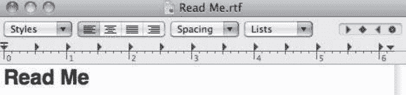

# Read Me

Vermont Recipes 2
Version 2.0.0

Copyright 2000-2009 Bill Cheeseman. All rights reserved.

Vermont Recipes 2 基于 Cocoa Recipes for Mac OS X—The Vermont Recipes (Second Edition, Peach Press, 2009)。欲更多信息，请访问 www.peachlist.com。

图 5.1
Vermont Recipes Read Me 文档。

将文件保存到 Vermont 项目文件夹下的 `English.lproj` 文件夹中，格式为富文本（Rich Text Format），命名为 Read Me。你也可以将其保存为 PDF 格式，因为每个 Mac 都配备了 Preview（预览），它可以读取 PDF 文件。

在 Xcode 中，选择 Groups & Files 窗格中的 Resources 组，选择 Project > Add Project，导航到 `English.lproj` 文件夹，选择 `Read Me.rtf` 并点击 Add。在下一个表格中，按照你之前在食谱中所做的方法设置一切，并点击 Add。Read Me 文件出现在 Resources 组中。

2. 编写动作方法。你已经在食谱 3 的第 6 步中学习了基础知识，在那里你编写了 `-newDiaryDocument:` 动作方法来打开新的厨日记文档，并在食谱 4 中编写了几个动作方法。所有动作方法都有相同的签名，方法名除外。将此方法命名为 `-showReadMe:`：

在 `VRApplicationController.h` 头文件中，输入此声明：

```objc
- (IBAction)showReadMe:(id)sender;
```

在 `VRApplicationController.m` 实现文件中，输入此实现：

```objc
- (IBAction)showReadMe:(id)sender {
    NSString *path = [[NSBundle mainBundle] pathForResource:@"Read Me" ofType:@"rtf"];
    if (path != nil) {
        [[NSWorkspace sharedWorkspace] openFile:path];
    }
}
```


第一条语句使用 Cocoa 的 `+[NSBundle mainBundle]` 类方法针对应用程序包。如果你学习 `NSBundle` 类引用，你会发现 Cocoa 的 `NSBundle` 类实现了许多方法，可以让你访问包的内容，包括作为当前应用程序包的包 `+mainBundle`。例如，这些方法让你的应用程序可以使用应用程序包 Resources 文件夹中包含的任何资源，如图像、声音、字体，在本情况下是测试文件。第一条语句使用这些方法之一 `-pathResource:ofType:` 来获取一个包含“Read Me”文件路径的字符串，并将其赋值给变量 `path`。此方法会在用户“语言与系统”设置指定的特定语言 `.proj` 文件夹中搜索。

如果在 Resources 文件夹中未找到命名文件或类型不同怎么办？`-pathResource:ofType:` 方法返回 `nil`，这是一种常用技术，表示未找到任何内容或发生了某种错误。（等待，OCR 文本为 "n1"，根据上下文修正为 "nil"）。

*自我纠正：OCR 文本为 "n1"，在 Objective-C 上下文中显然是 "nil"*

# Cocoa 响应者链（续）

指定一个特定对象为消息的目标（target），让 Cocoa 为你寻找目标。应用程序本身负责执行该任务，并使用你在第 4 步中看到的方法。`NSApplication` 的 `-targetForAction:to:from:`

“响应者链”（responder chain）术语是一个算法的简写，该算法定义了视图、控件和其他对象的层次结构，Macintosh 用户期望这些对象响应应用程序用户界面中的操作。Cocoa 会根据定义良好的路径将每条消息从对象链中的每个对象进行传递，尝试寻找合适的接收者。该链通常从当前窗口中具有键盘焦点的视图或控件开始。如果该对象刚打开，它可能是初始响应者；如果用户已经在窗口中操作并点击了其他视图，它也可能是窗口内的其他视图或控件。例如，如果用户在文本字段中选择某些文本并选择“编辑 > 复制”，Cocoa 首先查看文本字段，并立即发现它可以处理 `-copy` 消息。文本字段做出响应。

如果聚焦的视图不识别该消息，Cocoa 不会放弃，而是搜索一个后续响应者链，该链包含了聚焦视图的视图、窗口本身、文档的代理（如果有）、其窗口控制器以及它；如果另一个窗口（如调色板）具有键盘焦点，则是主视图的响应者链；应用程序本身；以及（如果有的话）路径上的对象都继承了从 Cocoa `Responder` 类中参与响应的能力，该类声明了 `-nextResponder` 方法。例如，在上面的示例中，用户选择“窗口 > 缩放”编辑，Cocoa 可能会发现文本字段不知道如何处理 `zoom` 消息。在代码层面上，它没有声明 `-performZoom:` 动作方法。Cocoa 从一个后续响应者到下一个后续响应者搜索响应者链，直到到达窗口对象。窗口知道如何缩放，因此它执行了操作。同样，如果用户按下 Command-Q，Cocoa 在响应者链中搜索声明了 `-terminate:` 动作方法的对象，最终在到达应用程序对象时找到了它。应用程序退出。

第一个识别出消息的对象被称为“第一响应者”（first responder）。默认情况下，搜索在此处停止，消息被发送并执行。为了让你能够在 Interface Builder 中使用这种机制，每个文件窗口都包含一个“第一响应者”代理（First Responder proxy），它代表响应者链中的目标。这种机制极其有用，因为它为设计和实现动态且功能强大的用户界面过程提供了简单性和灵活性。作为开发者，你指尖可用所有这些力量，而无需编写大量代码。

正如侧边栏解释的，响应者链的参与者之一是应用程序的代理（如果有的话）。尽管应用程序代理位于响应者链的最末端——这是 Cocoa 寻找 `-show:method` 的最后一个位置——但当你连接了应用程序代理的输出口（outlet）后，Cocoa 正是在那里找到了该方法。

Cocoa 使用响应者链来决定启用或禁用连接到第一响应者代理的任何菜单项。这发生在用户点击菜单时、菜单打开之前。如果响应者链中的某个对象对操作有响应，则菜单项被启用；否则，被禁用。

这种机制对于那些只有在特定窗口激活时才使用的菜单项非常完美。响应者链始终包含活动文档及其活动窗口、窗口控制器和窗口代理。

这种机制适用于 `ApplicationController`，影响整个应用程序的菜单项应该几乎处于启用状态，而 `ApplicationController` 总是被实例化并始终在响应者链中。

## 第 3 步：添加日记菜单以控制日记窗口

Macintosh 应用程序在菜单栏中复制窗口控件的一些功能是很常见的。现在通过主师日记窗口中的“添加条目”（Add Entry）和“标签”（Tag）按钮以及四个导航按钮来安排这种操作。创建一个“日记”菜单，前两个菜单项标题与“添加条目”和“标签”按钮相同，后四个项包含源自四个导航按钮 `goto` 动作方法的名称。

良好的界面设计规定，当厨日记窗口未激活时，这些菜单项应被禁用。即使窗口已关闭或在后台运行，菜单本身也应该是启用的。这允许用户打开菜单并看到菜单项（即使它们是禁用的），以帮助理解应用程序是如何工作的。

- 将日记菜单及其菜单项添加到菜单栏。
- 打开 MainMenu nib 文件，在 Interface Builder 的 Library 中选择 Objects 标签页，并选择 Library > Cocoa > Application > Menus。将一个 `Submenu Menu` 对象拖到 nib 中应用程序菜单栏的占位符上。将其放置在 View 和 Window 标题之间，使出现插入标记，然后将其拖入菜单栏。

双击新菜单的占位符标题 `Menu` 以选中进行编辑，并输入 `Diary`。全名 `Chef's Diary` 会占据过多的空间。点击 `Diary` 菜单打开它，双击其菜单项 `Menu`，将其标题更改为 `Add Entry`。从库中拖出一个 `Menu Item` 对象并掉到 `Add Entry` 项下方。重命名新菜单项为 `Add Tag`。

接下来，将一个 `Separator Menu Item` 拖到菜单底部，后面是另一个 `Menu item`。接着，按住 Option 键并向下拖动 `List item`，直到光标上出现 Alt (+) 标记，然后松开。重复两次，总共创建四个 `Item` 菜单项。如你所见，你可以通过 Option 拖动现有菜单项来复制菜单项。将这四个 `Item` 菜单项分别重命名为 `First Entry`、`Last Entry`、`Previous Entry` 和 `Next Entry`。

- 思考为什么这些选择对于日记窗口是合适的。
- 现在你准备好验证菜单项了，请保存 MainMenu 和 DiaryWindow 文件，然后编译并运行应用程序。

在《Vermont 食谱》中，请遵循 Interface Builder 和 Safari 的模式。

1. 首先，使用步骤 3 中相同的技巧创建新的菜单项。

使用 Interface Builder 的 Library（库）窗口打开 MainMenu 文件，将一个 `Menu Item`（菜单项）对象拖到菜单文件的应用程序菜单草稿上。将其放置在 Edit（编辑）菜单下 Find（查找）子菜单的顶部。将其命名为 `Diary Tag Search`...（在美式键盘上按下 Option-分号输入省略号字符）。然后在 `Diary Tag Search` 菜单项下方立即放置一个 `Separator Menu Item`（分隔符菜单项）。

2. 这个菜单应该有一个快捷键。选择 `Diary Tag Search` 项目。在 `Menu Item Attributes`（菜单项属性）检查器中，点击 `Key Equiv.`（等键）字段以便进行编辑，按住 Command 和 Option 键，然后按 F 键。`Command-Option-F` 快捷键的符号将出现在 `Key Equiv.` 字段和菜单栏草稿中。

请注意，你没有按住 Shift 键来输入大写的 F。如果你这样做了，你将创建一个 `Command-Shift-Option-F` 快捷键，而这并不是你想要的。

3. 为了复用你在 Recipe 4 中编写的 `-findTag:` 动作，首先 Control-拖动该菜单项到 `First Responder`（第一响应者）代理上，并保存 nib 文件。正如你在步骤 2 和 3 中学到的，当日记窗口激活时选择该菜单项将执行该动作方法。

4. 然而，你还没有完成 `-findTag:` 动作方法。如果你编译并运行应用程序，打开日记窗口并选择 Edit > Find > Diary Tag Search，什么都不会发生。

在这种情况下，将调试器控制台窗口（debugger console window）作为调试辅助是一个好主意。在 Xcode 中，选择 Run > Console，并将控制台窗口放置在你能看到的地方。当你再次选择 `Diary Tag Search` 菜单项时，你在控制台中看到一条长错误消息，告诉你是发送了一个未识别的选择器 `[NSString stringWith]`。查看 `-findTag:` 动作方法，你会发现它的第一个语句之一通过调用 `[sender stringValue]` 获取要搜索的标签。

当 `sender` 是一个搜索字段控件时，向其发送 `-stringValue` 是允许的。`NSSearchField` 响应 `-stringValue` 消息，返回代表用户输入的搜索词的 `NSString`。但现在，由于 `sender` 是 `NSMenuItem`，它不响应 `-stringValue`。

问题在于，新的 `Diary Tag Search` 菜单项并不是为了执行搜索，这才是你为 `-findTag:` 设计的。相反，该菜单的作用应该是让搜索字段成为日记窗口的第一响应者，如果日记窗口尚未打开，则打开日记窗口，以便用户可以输入搜索词。

在 `DiaryViewControllerm` 的实现文件中，通过在方法开头添加这三行代码来修改 `-findTag:` 方法：

```objc
if ([sender isKindOfClass:[NSMenuItem class]]) {
    [[self window] makeFirstResponder:[self searchField]];
} else
```

在方法的末尾插入一个大括号 ( `}` ) 来关闭旧视图。

你可以这样测试 `sender` 是否响应 `-stringValue` 方法：

```objc
if ([sender respondsToSelector:@selector(stringValue)]) {
```

然而，当你一个月后回过头来看代码时，这会变得相当晦涩（难以理解）。你向 `-findTag:` 方法中添加此分支是为了为新菜单项提供备用帮助，如果你专门针对 `NSMenuItem` 类使用，你的目的会更清晰。

这是将键盘焦点移动到不同视图的标准 Cocoa 技术。有时，你向方法传递 `nil` 是为了让窗口本身成为第一响应者。这将提交旧第一响应者的值并触发许多 delegate 方法。但在这里，你想将键盘焦点交给一个特定的控件，即搜索字段。

5. 你必须完成最后一项任务才能让 `-findTag:` 方法作为 `Diary Tag Search` 菜单项的动作方法工作。你必须为搜索字段实现一个 outlet（输出）和一个访问方法（accessor method）；否则该方法将无法编译，因为 `self`（窗口控制器）没有 `-searchField` 方法。

你已经创建了 outlets。在 `DiaryViewController` 头文件中，在 `@interface` 指令的大括号之间、现有 `datePicker` outlet 之后添加此 outlet 声明：

```objc
IBOutlet NSSearchField *searchField;
```

在 `-datePicker` 访问方法下方声明其访问方法：

```objc
- (NSSearchField *)searchField;
```

在 `DiaryViewController.m` 实现文件中如下实现它：

```objc
- (NSSearchField *)searchField {
    return [[searchField retain] autorelease];
}
```

在 Interface Builder 的 `DiaryWindow` nib 文件中，通过 Control-拖动从 `File's Owner` 代理到搜索字段，并在 HUD 的 Outlets 部分选择 `searchField` 来连接这个新 outlet。

6. 新的 `Diary Tag Search` 菜单项现在可以工作了。此外，正如你在步骤 3 中学到的，它已经通过了验证。编译并运行应用程序，打开 Chef's Diary 窗口，尝试选择 Edit > Find > Diary Tag Search。你无法选择它，因为当日记窗口没有标签列表时它是禁用的。你在 Recipe 4 的步骤 7 中安排了这种行为，当时你向 `-validateInterfaceItem` 协议添加了一个 else 子句，以测试 `t-firstTagRange` 方法是否找到了标签列表。在一个带有标签的新条目上点击 Add Entry 和 Add Tag。现在再次选择 Edit > Find > Diary Tag Search。该菜单项现在是启用状态的，当你选择它时，搜索将获得键盘焦点，你可以立即开始输入。

7. 问题及其解决方案非常简单，它们展示了响应链（responder chain）的重要性。为了了解为什么，关闭日记窗口。问题是当日记窗口关闭时，`Diary Tag Search` 菜单项是禁用的。解决方案是在应用程序类中也实现它。同名动作的存在不会产生冲突。相反，响应链的设计恰恰是为了处理这种情况。当日记窗口打开时，`DiaryViewController` 在响应链中。当用户选择 Edit > Find > Diary Tag Search 时，菜单项是启用的，因为找到了窗口中的动作方法。响应链中更远处的应用程序控制器中的另一个动作方法并不重要，因为 Cocoa 在找到窗口中的方法后就会停止查找。当日记窗口关闭时，响应链一直延伸到应用程序控制器。这足以在窗口关闭时启用菜单项，选择菜单项将执行应用程序控制器中实现的版本。

在应用程序控制器中实现动作方法之前，解决 `-validateInterfaceItem` 方法中的一个小问题，它目前存在的方式在日记中没有标签时会禁用 `Diary Tag Search` 菜单项和搜索字段。这与“可以在日记窗口关闭时启动标签搜索”的想法是不一致的，因为打开的日记窗口可能是空的。选择 `Diary Tag Search` 会打开日记窗口，但不会将焦点交给搜索字段，因为搜索字段在没有标签时是禁用的。这会让用户感到困惑，因此即使在日记中没有标签也让搜索字段可用。Safari 中类似的搜索菜单也是这样工作的；如果窗口中没有显示网站，它是启用的。这不符合逻辑；搜索标签的结果将为空，这与搜索未找到的搜索词的情况相同。

要消除在日记窗口打开时对 `Diary Tag Search` 菜单项和搜索字段的验证，请从 `-validateInterfaceItem` 方法删除最后一个 else 子句。

现在你准备好在 `VRAApplicationController` 类中实现第二个 `-findTag:` 动作方法。在 `VRAApplicationController.h` 头文件中声明它，位于现有 `-showReadMe:` 动作方法之后，如下：

```objc
- (IBAction)findTag:(id)sender;
```

在 `VRAApplicationController.m` 中实现它：

```objc
- (IBAction)findTag:(id)sender {
    [[VRDocumentController sharedDocumentController] newDiaryDocument:sender];
    NSWindow *keyWindow = [NSApp keyWindow];
    if ([keyWindow isKindOfClass:[DiaryWindowController class]]) {
        DiaryWindowController *keyWindowController = [keyWindow windowController];
        [keyWindowController makeFirstResponder:[keyWindowController searchField]];
    } else {
        NSBeep();
    }
}
```


第一条语句向每个基于文档的应用程序实现的 `sharedDocumentController` 对象发送了 `-newDiaryDocument:` 消息。你在“Recipe 3”的第 5 步中编写了 `-newDiaryDocument:` 动作方法。在这里，你同时将 `-findTag:` 动作方法的发送者与 `-newDiaryDocument:` 动作方法写在一起，当你从一个动作方法调用另一个动作方法时，应该始终这样做。这条语句会打开日记窗口，或者如果它已经打开，则将其移动到最前面。

其余语句测试了日记窗口是否真的打开并变为活动状态。如果是，该方法会将搜索框设为第一响应者。要测试日记窗口是否打开，你需要获取应用程序的窗口（根据定义，它是当前具有键盘焦点的日记窗口），并使用你之前使用的 `-isKindOfClass:` 方法确保它的控制器是 `DiaryWindowController`。如果是，你就可以使用刚才第一次遇到的 `-makeFirstResponder:` 方法让搜索框成为窗口的第一响应者。如果 `-findTag:` 方法由于某种原因未能打开日记窗口，该方法会调用电脑蜂鸣，这是一个常见但未提供信息的信号，告知用户出了某些问题。

调用 `-makeFirstResponder:` 的语句完全可以写成调用 `DiaryWindowController` 版本的 `-findTag:` 动作方法，并将 `sender` 作为参数传递。因为从该行开始，它将执行你写的子句中的第一个分支，而该分支本身就会调用 `-makeFirstResponder:`。这就是为什么每当你从一个方法调用另一个方法时，强制传递 `sender` 参数值很重要。调用另一个 `-findTag:` 动作方法有两个优势：它强制两个动作方法在设置第一响应者方面的行为保持一致，并且提醒读者应用程序控制器的动作方法在日记窗口控制器中有一个对应的方法。保持两个类的行为同步是非常重要的。如果你更改了窗口控制器的动作方法版本，应用程序控制器会自动获得相同的行为。你现在应该替换这条语句：

```objc
[keyController findTag:sender];
```

### 9. 导入缺失的类头文件

如果你现在尝试构建项目，Xcode 将报错说它从未听过 `VRDocumentController` 和 `DiaryViewController` 类。要解决这个问题，请在 `VRAApplicationController.m` 实现文件顶部第一个 `#import` 语句之后添加这两行：

```objc
#import "VRDocumentController.h"
#import "DiaryViewController.h"
```

“日记标签搜索”菜单项现在按照本步骤开始时的规范工作。它在所有正确的时间被启用或禁用，并且无论你在日记窗口打开还是关闭时调用它，它都会将搜索框标记为第一响应者。

## 第 5 步：添加食谱信息菜单项以打开食谱窗口的抽屉

在这一步中，你向“窗口”菜单添加一个食谱信息命令，以完成在“Recipe 2”第 6 步中食谱窗口工具栏上添加的食谱信息按钮。当食谱窗口激活时，用户可以使用食谱信息菜单项来打开和关闭抽屉，而不是使用工具栏。用户可能希望关闭工具栏以留出更多空间，因此在菜单栏中复制食谱信息按钮的功能是有必要的。

1. 首先，打开 `MainMenu.nib` 文件，并在菜单栏的模拟图中打开“窗口”菜单。它已经包含了模板中的三个菜单项：最小化、缩放和全部置顶。当应用程序运行时，底部还有一些菜单项，这是 Cocoa 在你打开窗口时动态添加的。

2. 在库窗口中选择 Tabs，并选择 `Library > Cocoa > Application > Menu`。将一个菜单项拖到“窗口”菜单中，释放到 Zoom 菜单项下方，并将其重命名为 Recipe Info。同时从窗口中拖出一个分隔符菜单项，将其释放到 Zoom 和 Recipe Info 之间。

3. 将新的 Recipe Info 菜单项连接到你的动作上。你已经从“Recipe 3”的第 6 步中知道 `NSResponder` 的 `-toggle:` 动作方法就是你需要的。按住 Control 键从 Recipe Info 菜单项拖动到 MainMenu 文档窗口中的 First Responder。在 HUD 中，向下滚动找到 toggle 并选择它。

遗憾的是，如果你现在构建并运行应用程序，你会发现即使食谱窗口处于激活状态，Recipe Info 菜单项仍然保持禁用状态。你到此为止的工作表明这是一个响应者问题。`-toggle:` 方法在 `Drawer` 类中实现，但文档中没有指示抽屉默认是响应链的一部分。当你打开“窗口”菜单且 Cocoa 寻找响应链时，它找不到 `-toggle:` 方法，因此禁用了 Recipe Info 项目。

窗口工具栏上的 Recipe Info 按钮之所以能工作，是因为你没有依赖响应链。相反，你将按钮直接连接到了实现 `-toggle:` 方法的抽屉上。这之所以有效是因为按钮和抽屉在同一个文件中。现在，对于菜单项，你必须从存放菜单栏的 MainMenu 文件开始，你无法拖到独立的 `RecipesWindow` 文件来将菜单项连接到抽屉。

在通常情况下，有几种常用的解决此问题的方案。你从第 3 步的工作中知道，你应该关注 `RecipesWindowController` 类，因为食谱信息菜单项只有在食谱窗口处于激活状态时才应该被启用。先考虑几种可能性；然后确定一个最优雅的解决方案。

**将所有内容放在一个文件中。** In a sense, what you've encountered is a fundamental restriction.

* 通过编写一次代码，来避免以后每次想将任何动作连接到抽屉中的对象时都要编写中间方法的麻烦。当你以后向抽屉中添加 UI 元素时，它们实现的任何动作方法只需通过连接到第一响应者即可工作。

使这种机制工作的关键在于 Cocoa 的 `-setNextResponder:` 方法。然而，在使用时要小心，无论你如何使用该方法将对象插入响应链并就此停止，你可能会破坏链，并有效地断开你插入新对象之后的连接。与其费力测试特定对象是否有需要重新连接的下一个响应者，不如养成习惯：始终临时保存下一个响应者，在插入后立即重新连接它。如果下一个响应者原本为 nil，那么将 nil 赋给下一个下一个响应者是无害的。但如果它不是 nil，你已经节省了大量的调试时间。

修改响应者链的传统编写位置是在你实现 Cocoa 的 `-awakeFromNib` 方法。当应用程序加载 nib 文件时，它会首先初始化 nib 文件的所有者并处理一些清理工作。在此过程中，无法保证 nib 文件中的所有对象都已实例化，或者所有的连接都已建立，因此你不应该将依赖于文件对象和连接的方法放在所有者的初始化方法中。一旦所有对象及其连接准备就绪，Cocoa 就会调用所有者的 `-awakeFromNib` 方法。你可以在子类中安全地重写它，并调用继承的 `-setNextResponder:` 方法。对于窗口控制器，Apple 工程师非正式地建议开发者重写 `-windowDidLoad` 而不是 `-awakeFromNib`，因为 `-awakeFromNib` 可能会被多次调用。你在 Recipe 3 的第 7 步在 `DiaryViewController` 中实现 `-windowDidLoad` 时学到了这一点。

这次，在 `RecipesWindowController` 中重写 `-windowDidLoad` 方法。你需要声明它，因为 `ViewController` 已经在其头文件中声明过它。将此方法的实现添加到 `RecipesWindowController.m` 的实现中：

```objc
- (void)windowDidLoad {
    NSResponder *oldNextResponder = [self nextResponder];
    NSResponder *newNextResponder = [[[self window] drawers] objectAtIndex:0];
    [self setNextResponder:newNextResponder];
    [newNextResponder setNextResponder:oldNextResponder];
}
```

我将局部变量命名为 `nextResponder` 和 `oldNextResponder` 以强调它们在切片操作中的作用并使代码更通用。如果你之后再次向响应者链中插入另一个对象，你可以逐字复制此方法的体，只需更改第一个语句中获取要插入对象的代码部分。

第一条语句将窗口控制器的当前下一个响应者保存在局部变量 `oldNextResponder` 中。你将在第四条语句中将其赋给抽屉即 `newNextResponder`。`oldNextResponder` 可以是任何对象，只要它是 `NSResponder` 的子类并有资格参与响应者链。它甚至可以是 `nil`。

第二条语句从窗口 `-drawers` 方法返回的数组中获取抽屉，并将其保存在局部变量 `newNextResponder` 中。

局部变量被类型为 `NSResponder*`，以便代码可以迁移到另一个方法而无需强制你更改对象类型。你也可以在这里将其类型为 `NSResponder*`。

第三条语句将窗口控制器的下一个响应者替换为抽屉 `newNextResponder`，将其插入到响应者链中。

第四条语句将无论 `oldNextResponder` 是什么都赋给抽屉 `newNextResponder` 上，现在它是窗口控制器的下一个响应者。这恢复了响应者链的完整性。

4. 再次，你不需要执行任何操作来确保 Recipe Info 菜单项被正确验证。当食谱被关闭或未激活时，它会被禁用，因为在这些情况下，`RecipesViewController` 和抽屉不在响应者链中。

5. 编译并运行应用程序进行测试。在食谱窗口激活状态下，选择 Window > Recipe Info，抽屉就会打开。再次选择，抽屉就会关闭。选择食谱窗口或在其前面打开 Chef's Diary 窗口，Recipe Info 菜单项将被禁用。

## 第 6 步：构建并运行应用程序

在这个食谱中，你在每一步结束时都构建并运行了应用程序以确保功能正常。最后还剩下在食谱结束时构建并运行它，以确认并回顾你所做的工作。

选择 Help > Read Me，Read Me 文件会在 TextEdit 中打开。即使在没有打开 Vermont 窗口的情况下这也有效。在制作此过程中，你学到可以设计一个类既作为应用程序控制器又作为应用程序的代理。将应用程序设置为代理的副作用是将其放入应用程序的响应者链。因此，你只需通过将菜单项连接到 MainMenu 文件中的第一响应者，就能将具有应用程序范围作用的菜单项连接到应用程序控制器中的动作方法。每当你需要在菜单栏上添加应用程序范围的菜单项时，这都将用到。

打开 Chef's Diary 窗口并选择 Diary > Add Entry。当窗口激活时，该菜单项是启用的，当你选择它时会添加新条目。在实现此功能时，你学到任何仅在相关窗口打开时才可用的项目都应该连接到窗口控制器的动作方法。窗口控制器仅在在其窗口激活时才在响应者链中。当窗口未激活时，菜单项会被禁用，因为 Cocoa 在响应者链中找不到它的动作方法。再次，要让菜单项工作，只需将其连接到 MainMenu nib 文件中的第一响应者代理。Add Tag 菜单项和导航菜单项也类似。

Diary Tag Search 菜单在日记窗口打开和关闭时都可以工作，因为你不仅在日记窗口的控制器中在应用程序控制器中实现了它的动作方法。应用程序控制器始终在响应者链中，因此动作方法始终是启用的。执行哪个版本的动作方法取决于日记窗口是打开还是关闭，这决定了先遇到哪个版本的方法。

最后，打开食谱窗口并选择 Window > Recipe Info。窗口的抽屉会打开，当你再次选择菜单项时它会关闭。在实现此功能时，你学到某些用户对象（如抽屉）默认不在响应者链中。这使得通过将菜单项连接到 Main nib 中的第一响应者代理来调用它们的动作方法成为可能。

## 第 1 步：组织项目代码

在添加本配方中将实现的所有额外方法之前，对代码进行组织是一个好主意。代码已经变得相当庞大，如果你不对其施加某些组织原则，它就有变得难以管理甚至无法触达的危险。

到此为止，书中解释的唯一组织原则是类本身的大型结构。Cocoa 框架分为两个主要组：Foundation 和 AppKit，它们具有不同的功能。它们在《Cocoa 基础指南》中描述：Foundation 类侧重于与图形用户界面无关的数据和数据操作，而 AppKit 类侧重于与图形用户界面相关的视图和功能。这些类的名称和继承关系是根据它们所工作的性质来定义的。Vermont Recipes 中的类通过遵循 Cocoa 框架强制要求的结构，参与了这一组织原则，主要是因为它们是内置 Cocoa 类的子类。

随着单个类变得越来越大，为类中的方法建立结构是非常重要的。Cocoa 和 Objective-C 提供了三种对任何类进行排序的技术。一种是被称为 *category* 的 Objective-C 语言特性。另一种是 *pragma* 标记，它利用了被称为 *pragma* 的 C 语言特性。第三种是 *lovely comment*，这不需要过多讨论。开发者经常使用这三种技术。它们允许你将相似或相关的方法组合在一起，并为每个组提供一个描述性的名称。

### 分类

从分类开始。分类向特定类添加了单独声明的方法。分类的 `@interface` 指令像其他类一样为类命名，但会在括号中添加该分类的名称。分类中的方法的工作方式与它们在类的主体中声明和实现时完全相同。分类的一个重要用途是帮助将大型类的方法组织成更易管理和理解的段落，并用分类名称描述其目的或功能。

这种机制起到了什么作用，是简单的穿插在代码中的注释无法等同达到的呢？其一是，将分类声明及其方法放置在单独的文件中是容易又方便的。你必须使用 `#import` 控制行来通知构建系统去哪里查找类声明，但分类的 `@interface` 指令和名称提供了一个易于理解的地方，可以将一个潜在的大文件拆分成小块并赋予它们有用的名称。

另一个相关的有时更重要的用途是，分类允许你在实现文件中声明类的一些方法，并将其与类的 `@implementation` 指令及其方法定义放在一起。这在框架中特别有用，因为开发者通常分发框架的文件，但不分发实现文件。这种技术允许开发者在很大程度上对框架的客户端隐藏内部方法。客户端不应该依赖于这种方式声明的私有方法，从而让框架的开发者能够创建使用不同私有机制的新版本。除非你为 Apple 工作，否则你无法访问 `NSApplication` 的实现文件，但可以肯定的是，实现文件中包含一个或多个此类所示形式的 `@interface` 指令：

```objc
@interface NSApplication(PrivateMethods)
```


分类的另一个用途是让开发者更容易一眼看出类的结构。打开 `NSApplication.header` 窗口中的函数菜单，你会看到所有加粗的分类声明。这使得扫描分组在任何一个分类中的方法变得简单得多。

`NSApplication` 总共声明了八个分类：`NSWindowsMenu`、`NSFullboardAccess`、`NSServicesMenu`、`NSServicesRequests`、`NSServicesHandling`、`NSStandardAccessPanel`、`NSApplicationLayerDirection` 和 `NSDprecated`。

这些分类中，`NSServicesRequests` 是另一个类（即 `NSObject`）的分类。在另一个类的头文件中为 `NSObject` 声明分类是非常常见的。`NSApplication` 声明了三个与标准服务菜单相关的分类，但其中一个包含与许多类都很有用的方法。因为它们在 `NSApplication` 中被声明为 `NSObject` 的分类，所以它们是每个继承自 `NSObject` 的类的工具库的一部分。同时，将分类声明放在 `NSApplication` 头文件中，清楚地表明这些方法与功能——服务菜单——相关，而该功能从根本上与 `NSApplication` 密切相关。

目前，你为 Vermont Recipes 编写的类都没有声明分类。应用程序的大多数类继承自现有的 Cocoa 类，应用程序的大多数方法都符合 Cocoa 类和分类的现有结构。最终，当你实现 AppleScript 支持时，你会声明一些与 AppleScript 相关的分类，这是一种方便（尽管不是必须）的技术，用于将 AppleScript 支持方法与 Vermont Recipes 头文件中其他方法隔离开。

分类是 Objective-C 语言的一种特性，在其他编程语言中并不常见。分类可以以多种方式使用。

在最有趣的用法中，分类允许你扩展和增强任何类的功能，即使你无法访问其源代码，也可以通过向类添加新方法或重新实现它已经实现的方法来实现。当你想要给现有类添加几个方法时，如果你可以访问其源代码，分类可能是其子类化的良好替代方案。在分类中实现的新方法对基类的所有子类都可用，且它们在运行时与在基类中实现的方法不可区分。然而，你不能添加新的实例变量，而且当你在分类中重新定义现有方法时，你无法像子类化基类那样通过向 `super` 发送消息来访问原始方法。

一个类的分类通常在其他类的头文件和实现文件中声明和实现，通常分类中的方法与该类的功能相关。

### #pragma mark 语句

一种用于组织和标记类内代码段的更简单技术是 `#pragma mark` 语句。Pragmas 被 C 预处理器识别为执行依赖于实现的动作的指令。这里感兴趣的 pragma 是 `#pragma mark` 语句。它在某种程度上是向你的代码中插入标题的简单机制。更重要的是，`#pragma mark` 语句通过在菜单中插入标记为函数菜单提供服务。函数菜单自动包含文件中声明或实现的每个类、协议、分类、函数和方法的名称，以及 `#define` 指令和类型声明。它是按字母顺序还是按名称在代码中出现的顺序排列，取决于 Xcode 的偏好。你可以在打开菜单时按住 Option 键选择另一种设置。函数菜单是快速导航到特定方法或其他代码元素的非常方便的方式。但是，就像代码本身一样，它可以变得很长且混乱。这里讨论的 `#pragma mark` 语句不仅作为代码中的标题，还将与其关联的文本作为菜单中的标记，以便将菜单项分组。

在第 1 步中，你在所有已声明类的接口和实现部分插入了 `#pragma mark` 语句。类中方法的组织以及 `#pragma mark` 语句的文本和样式是我认为方便的。你可以自由使用你认为有效的组织原则和命名规范。

所有 `#pragma mark` 语句在输入后立即生效。你不需要保存或构建项目。因此，一旦输入，你就可以看到函数菜单中的每个标记。

1. 在开始之前，更新项目版本，就像你在每个配方中所做的那样。留在归档的 Recipe 5 项目文件夹不动，打开工作的 Vermont Recipes 子文件夹。

在 Vermont Recipes 目标窗口的属性面板中，将版本从 5 增加到 6，这样应用程序的版本将显示为 2.0.0 (6)。

2. 首先打开 `DiaryWindowController.m` 实现文件，它实现的方法比你写的任何类都多。在下面描述的位置插入 `#pragma mark` 语句：

```objc
// 在 -init 方法之前
#pragma mark INITIALIZATION
```

```objc
// 在 -diaryView 方法之前
#pragma mark ACCESSOR METHODS
```

在 `-addEntry` 方法之前：
`#pragma mark ACTION METHODS`

在 `-windowDidLoad` 方法之前：
`#pragma mark OVERRIDE METHODS`

在 `-textDidChange` 方法之前：
`#pragma mark DELEGATE METHODS`

在 `-updateWindow` 方法之前：
`#pragma mark USER INTERFACE VALIDATION`

在 `-keyDiaryView` 方法之前：
`#pragma mark USER UTILITY METHODS`

在 `-currentEntryTagRange` 方法之前：
`#pragma mark DIARY ENTRY TAG METHODS`

在经过验证的控件子类的三个 `@implementation` 指令中的每一个之前：
`#pragma mark -`

打开函数菜单（图 6.1），看到一个由单个连字符组成的标记被显示为菜单分隔符。

```
+ @implementation DiaryWindowController
- INITIALIZATION
- set
- ACCESSOR METHODS
- -diaryView
- -otherDiaryView
- -textField
- -searchField
- ACTION METHODS
- -addEntry
- -getFirstEntry
- -getLastEntry
- -getPreviousEntry
- -setTextEntry
- -getSelectedEntry
- -reloadData
- DELEGATE METHODS
- -textDidChange
- -windowDidLoad
- INTERFACE VALIDATION
- -updateWindow
- -viewDidLoad
- -updateDate
- -updateDatePickerValue
- UTILITY METHODS
- -diaryViewPointIndex
- -insertionPointIndex
- -validate

@implementation ValidDiaryButton
- -validate
@implementation ValidDiaryDatePicker
- -validate
@implementation ValidDiarySearchField
- -validate
```

图 6.1. 函数菜单显示了来自 `DiaryWindowController.m` 实现文件中的标记。

3. 在 `DiaryWindowController.h` 头文件中的相应位置插入标记。不需要宏、初始化和委托方法组，因为它们没有出现在头文件中。

在头文件中声明的两个协议之前，插入用于菜单分隔符的 `#pragma mark` 语句。它们在实现文件中没有对应的存在项。

按照相同的计划，在所有其他头文件和实现文件中插入 `#pragma mark` 语句。我不会详细列出它们，但你可以在食谱 6 的下载项目文件中看到它们。

除了 `#pragma mark` 语句外，你在代码文件中放置的某些单词会导致这些单词以及注释的剩余部分出现在函数菜单中。由于注释的剩余部分也会出现在菜单中，因此使用短注释是一个好主意，类似于通常与 `#pragma mark` 语句配合使用的短标记。这些单词必须与此处显示的完全一致，带有大小写和结尾的颜色：`MARK`、`TODO`、`FIXME`、`!!!` 以及 `???`。图 6.2 显示了根据你在第 2 步中编写的代码，此类注释是如何出现在函数菜单中的。

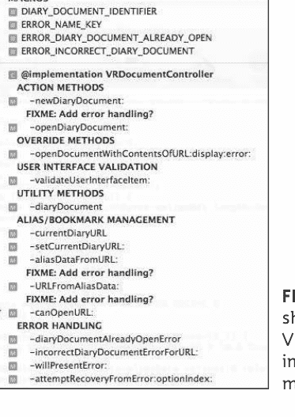

图 6.2. 函数菜单显示了在第 2 和第 3 步添加方法后来自 `VRDocumentController.m` 实现文件的注释。

## 步骤 2：限制应用于单个日记文档

现在你已经整理了 Vermont Recipes 代码，回到 Chef's Diary 文档。尽管该文档功能齐全，但你需要调整它的行为，使用户始终与单个日记文档工作。

要实现此功能，请应用当前日记文档的概念。用户在开始时完全自由地为文档命名任何名称并将其保存到任何位置，用户以后仍然可以自由地重命名和移动。然而，无论该文档叫什么名字、位于何处，在用户明确表示其他之前，它就是唯一的 Vermont Recipes Chef's Diary。

作为第一个要求，应用程序至少必须防止用户同时打开多个文档。但还需要更多要求。用户始终可以在 Finder 中移动、重命名或复制文件，应用程序的“另存为”菜单允许用户创建副本。安排应用程序在用户默认设置或偏好中记录用户首次为日记文档选择的名称以及首次保存的位置。名称和位置保存在别名或书签中，以便当文档被重命名或移动时，应用程序可以跟踪它。通过这种方式，用户只需选择菜单即可随时打开文档，而无需记住文档的名称或位置或去寻找它。如果用户创建了副本文档——例如——应用程序将阻止用户打开除用户默认设置中记录为当前日记文档之外的任何日记文档，除非用户提供了切换到不同日记文档的意图确认。

考虑实现当前 Chef's Diary 概念所需的用户界面功能。从未创建过 Chef's Diary 的用户将能够使用“新建 Chef's Diary”菜单创建一个。这意味着该菜单项默认必须是启用的，正如现在所是。如果已经创建了 Chef 文档并当前正打开，则应禁用“新建 Chef's Diary”菜单项，以防止用户创建另一个。一旦用户保存了文档，“新建 Chef's Diary”菜单项的名称应更改为“打开 Chef's Diary”。之后，该菜单项应始终保持启用，以便在文档当前关闭时打开它，或在它已打开时将文档窗口置于顶。

指定单个文档的其他应用程序通常要求用户使用名称和固定位置保存它。名称通常是模糊的，例如 Apple iWeb 应用程序中的 domain。其位置通常是大多数用户无法直接访问的位置，例如 Application Support 文件夹，因此用户不会被重命名、移动或创建它的想法所诱惑。然而，这种方法并非万无一失，它可能会导致升级到新电脑的用户遇到困难。相反，应该允许用户在任何地方以任何名称保存 Chef's Diary，就像大多数基于文档的应用程序一样。最后，用户应该允许在无需记住名称或位置的情况下重新打开文档。文件的名称和位置等持久化状态信息保存在 Cocoa 的默认设置中，这就是 Recipes 所采用的。为了利用 Mac OS 文件系统即使文件被移动或重命名也能跟踪文件的内置功能，你在应用程序默认设置中保存了一个别名记录，即书签。目前，向用户提供的选择不同作为当前日记的用户界面只有“另存为”项。

你在本食谱中开发的功能可能类似于使用了 Mac OS X 10.4 引入的 `NSDocument` 内置 `-fileURL` 和 `-setFileURL` 方法，包括此处使用的 `-currentDiaryURL` 和 `setCurrentDiaryURL` 方法。然而，Document 方法的文档说明不足以确保它们可以依赖你所做的一切。

1. 如果当前打开了日记文档且尚未保存，从开始禁用“新建 Chef's Diary”菜单项。这是该菜单项被禁用的唯一情况。一旦文档保存，菜单项的标题将变为“打开 Chef's Diary”，其动作将更改为新的 `-openDiaryDocument:` 动作。“打开 Chef's Diary”菜单项应始终保持启用，以便在文档关闭时打开它，或在已打开时将其置于顶。

实现此菜单项方法的正确位置是在 `VRDocumentController` 类中，该类管理应用程序所有的文档，并实现了菜单项的操作方法。`NSDocumentController` 基类已经通过实现 `-validateUserInterfaceItem:` 方法（针对“新建文档”、“打开文档”和“最近”等菜单项）遵循了 `NSUserInterfaceValidations` 协议。你通过重写该方法来验证“新建厨师日记/打开厨师日记”菜单项。

从该协议的一个简单、初级版本开始，仅考虑日记窗口已经打开且尚未保存的情况。在 `VRDocumentController.m` 实现文件中，实现此方法，并在其上方紧写上 `#pragma mark` 语句：

```objectivec
#pragma mark validateUserInterfaceItem

- (BOOL)validateUserInterfaceItem:(id <NSValidatedUserInterfaceItem>)item {
    SEL action = [item action];

    if ((action == @selector(newDiaryDocument:))
        || (action == @selector(openDiaryDocument:))) {
        for (NSDocument *thisDocument in [self documents]) {
            if ([thisDocument isKindOfClass:[DiaryDocument class]]) {
                return NO;
            }
        }
    }

    return [super validateUserInterfaceItem:item];
}
```


# 文档验证与日记文档管理

## `-validateUserInterfaceItem:` 方法详解

记住，`-validateUserInterfaceItem:` 方法会被反复调用，每当用户打开应用程序的某个菜单时，菜单中的每个菜单项都会调用一次。它在菜单项显示之前被调用，因此仍有时间更改菜单项的外观或标题。

这个 `-validateUserInterfaceItem:` 方法的简单版本首先获取通过 `item` 参数传递的菜单项的动作，然后测试该项的动作是否为 `newDiaryDocument:` 或 `openDiaryDocument:` 选择器。你还没有实现 `-openDiaryDocument:` 方法这没关系；该测试分支会被求值为 `false`。如果动作满足其中任一测试，该方法将检查控制器的已打开文档数组，通过测试任何已打开文档的类是否为 `DiaryDocument` 或 `DiaryDocument` 的子类。如果是，该方法将返回 `NO`，禁用菜单项，使用户无法创建另一个日记文档；否则，返回 `YES`，启用菜单项。如果当前项不是感兴趣的菜单项，该方法将调用 `[super validateUserInterfaceItem:item]`，以便 `NSDocumentController` 基类能够验证它负责的菜单项。

你可能还记得第一次实现 `-validateUserInterfaceItem:` 协议方法时，你在最后返回了 `YES` 而没有让父类执行验证，因为在这种情况下父类没有实现该协议方法。如果文档指示父类实现了某些方法，那么在重写该协议方法时，记住父类的实现是非常重要的。否则，通常由父类验证的菜单项将不会被验证。

如果你现在编译并运行应用程序并选择 `File > New Chef's Diary`，你会发现该菜单项是启用的。选择它，会打开一个厨师文档。现在再次尝试选择 `File > New Chef's Diary`，你会发现菜单项是禁用的。不保存直接关闭文档并再次选择 `File > New Chef's Diary`，菜单项将再次变为可用。

在这一步的稍后部分，你将返回此协议方法并对其进行修改，以处理一个窗口反映用户已保存的日记文档的情况。但首先，必须处理允许用户保存它的所需方法。

## 2. 创建用户偏好设置存储机制

你将创建一个方法，在用户保存新日记文档时向用户偏好设置（user defaults）写入一个值，这样应用程序就能记住用户实际上创建并保存了一个日记文档。这些信息是必要的，以便应用程序能够决定是否将“新建厨师日记”菜单项的标题改为“打开厨师日记”，并将其动作更改为 `openDiaryDocument:` 选择器。

应用程序写入的值应该是保存文件的引用，其格式应允许应用程序在用户选择 `File > Open Chef's Diary` 时定位并重新打开它。如果应用程序无法通过用户偏好设置找到文件，则应该显示一个对话框，要求用户查找文件。为了最大地增加应用程序在用户移动或重命名文件后找到该文件的概率，请将该值作为 Leopard 中的别名记录（alias record）或在 Snow Leopard 中的书签（bookmark）写入用户偏好设置。如果找不到厨师日记且用户通过取消操作对对话框做出响应，则在用户偏好设置中存储 `nil` 或删除该值，这样下次用户打开文件时，菜单项标题将恢复为“新建厨师日记”。

创建此机制的第一步是编写一个方法，将标准文件 URL 转换为 `NSData` 对象，在 Leopard 中代表别名记录，在 Snow Leopard 中代表书签。通常习惯为此目的使用 `NSData` 对象，因为保存和检索 `NSData` 对象很容易。应用程序使用该方法将 `NSData` 对象写入用户偏好设置。稍后，供应用程序从偏好设置中检索别名记录或书签后使用，你将编写一个方法将 `NSData` 对象转换回适用于打开文档的文件 URL。应用程序将测试用户偏好设置的值是否为 `nil`，以决定如何设置菜单项的当前标题及其动作。

如果你计划对厨师日记使用此机制，你可以在 `DiaryDocument` 类中实现它。然而，在 Vermont Recipes 中，你尚未指定如何处理新食谱，并且你可能也想为它使用相同的机制。这些是通用方法。因此，你应该在 `VRDocumentController` 中实现它们，因为在那里可以使用。

请注意，`-aliasDataFromURL:` 方法名使用的是 alias（别名）术语而非 bookmark（书签）。新的 NSURL 书签功能旨在复刻 Mac 用户长期以来与别名相关的功能，预计它们在日常开发术语中仍将继续被称为别名，这似乎是合理的。

### 编写 `-URLFromAliasData:` 方法

在你脑中思考别名和书签时，编写相应的方法将别名记录或书签数据转换回文件 URL。

请记住，如果应用程序运行在 Snow Leopard（雪豹）下，此方法必须能够将旧式的 Alias Manager 记录数据和 Snow Leopard 书签数据都转换为有效的 URL。用户可能在 Leopard 下运行程序保存了应用程序的用户数据，然后将电脑升级到了 Snow Leopard。当用户在 Snow Leopard 下运行应用程序时，它必须能够 user defaults 中读取数据，无论该数据是 Alias Manager 记录形式还是书签形式。

在 `VRDocumentController` 头文件的末尾这样声明 `-URLFromAliasData:` 方法：

```objc
#pragma mark ALIAS/BOOKMARK MANAGEMENT

- (NSURL *)URLFromAliasData:(NSData *)aliasData;
```

在 `VRDocumentController` 实现文件中这样定义：

```objc
- (NSURL *)URLFromAliasData:(NSData *)aliasData {
    if (aliasData == nil) return nil;

    NSURL *returnURL = nil;

    if (floor(NSFoundationVersionNumber) > NSFoundationVersionNumber10_5) {
        BOOL isStale;
        returnURL = [NSURL URLByResolvingBookmarkData:aliasData
                                            options:0
                                      relativeToURL:nil
                                 bookmarkIsStale:&isStale
                                             error:NULL];
        if (returnURL == nil) {
            return returnURL;
        }
    }

    AliasHandle aliasHdl = NULL;
    PtrToHand([aliasData bytes], (Handle *)&aliasHdl, [aliasData length]);

    if (aliasHdl != NULL) {
        FSRef fsRef;
        Boolean wasChanged;
        OSErr err = FSResolveAlias(NULL, aliasHdl, &fsRef, &wasChanged);
        DisposeHandle((Handle)aliasHdl);

        if (err == noErr) {
            returnURL = [(NSURL *)CFURLCreateFromFSRef(NULL, &fsRef) autorelease];
        }
    }

    return returnURL;
}
```

`-URLFromAliasData:` 方法首先检查 Snow Leopard 是否正在运行。如果是，它会调用新的 Snow Leopard 方法 `+URLByResolvingBookmarkData:options:relativeToURL:bookmarkIsStale:error:`，前提是 alias 参数持有的是 Snow Leopard 书签数据。如果这成功转换了数据并返回；如果未运行 Snow Leopard，或者 Snow Leopard 方法因为 alias 头部持有 Carbon Alias Manager 记录数据而返回 `nil`，则 `-URLFromAliasData:` 方法将使用旧式的 Alias Manager 技术进行转换并返回结果。如果没有任何操作成功生成 URL，该方法返回 `nil`。

`CFURLCreateFromFSRef()` 函数的结果作为一个自动释放的 `NSURL` 对象返回。这是必要的，因为该函数名中包含 `create` 术语，正如其文档所述，它遵循 Core Foundation 规则。该规则规定你拥有返回的 Core Foundation 对象（一个 CFRef 对象），因此你有责任释放它。由于 CFURL 与 NSURL 是无缝桥接（toll-free bridged），如果你将 `CFURLRef` 转换为 `NSURL` 对象，就可以自由使用 Cocoa 的 `autorelease` 方法。

该函数和 Leopard 方法都会通过引用返回一个值，告诉你别名或书签需要更新，例如，用户移动或删除了它指向的原始项目。在 Leopard 中，这是 `wasChanged` 值；在 Snow Leopard 中，它是 `isStale` 值。`-URLFromAliasData:` 方法忽略了这两个参数值，因为应用程序将其用作一种转换方法。相反，在稍后，当你编写打开现有日记文档的方法时，你将用 `-URLFromAliasData:` 返回的 URL 与用户尝试打开的对象的 URL 进行比较，如果它们不同，你将更新用户数据以反映日记文档的位置。

### 1. 保存文档时写入用户偏好设置

接下来，确定用户保存日记文档的文件 URL，使用 `-aliasDataFromURL:` 方法将其转换为别名记录或书签数据，并将别名记录或书签写入 user defaults。

在了解用户何时保存文档时，你必须考虑到 `NSDocument` 在保存文档时遵循的策略。该策略在 Apple 文档的《基于文档的应用程序概述》（Document-Based Applications Overview）中“文档架构中的消息流”章节的“保存文档”子节中有详细列出。需要注意的是，`NSDocument` 会将文档写入临时位置，然后将其移动到最终位置。虽然 `NSDocument` 在此过程中调用的几个方法都以文件 URL 作为参数，但你必须小心使用使用最终 URL 的方法，而不是临时文件 URL。此外，你必须使用一个 `NSDocument` 用于在对应位置保存文件的三个保存操作中（`NSSaveOperation`、`NSSaveAsOperation` 和 `NSSaveToOperation`）始终被调用的方法。

符合所有这些的方法是 `-saveToURL:ofType:forSaveOperation:error:`。它在保存文档的过程中始终被调用。重写它，使用其 `absoluteURL` 参数创建别名或书签，并将其保存到你的数据中。

在 `DiaryDocument.m` 实现中，在你覆盖 `-dataOfType:error:` 方法之后立即插入你的方法实现：

```objc
- (BOOL)saveToURL:(NSURL *)absoluteURL ofType:(NSString *)typeName forSaveOperation:(NSSaveOperationType)saveOperation error:(NSError **)error {
    BOOL success = [super saveToURL:absoluteURL ofType:typeName forSaveOperation:saveOperation error:error];

    if (success && saveOperation != NSSaveOperation) {
        NSString *diaryAlias = [VRDocumentController aliasFromURL:absoluteURL];
        [[NSUserDefaults standardUserDefaults] setObject:diaryAlias forKey:VRDiaryAliasKey];
    }

    return success;
}
```

在这里，如果保存操作成功，重写方法首先测试保存操作是否为自动保存，因为你不需要在自动保存时更新 user defaults。如果保存操作是其他类型之一，方法将调用你刚刚编写的 `aliasDataFromURL:` 方法，将 `NSDocument` 写入的 `absoluteURL` 值转换为适用于存储在 user defaults 中的对象。

想起你最初将 `-aliasDataFromURL:` 方法放在 `VRDocumentController` 中，因为你可能也为食谱文档使用它。由于它在 `VRDocumentController` 中声明，你必须在 `DiaryDocument` 中导入它。在 `DiaryDocument.m` 实现文件的顶部，`#import` 指令附近插入以下内容：

```objc
#import "VRDocumentController.h"
```

## 5. 创建访问器方法管理当前日记 URL

你将频繁地在用户默认设置（user defaults）中读取和写入文档的 URL，因此创建一对方法来执行操作是一个很好的主意。将它们命名为 `-currentDiaryURL` 和 `-setCurrentDiaryURL:`。它们看起来像访问器方法，而且确实是访问方法。你通常可能认为访问方法是对象的实例变量或属性，但情况并不总是如此。

在 `VRDocumentController.h` 头文件中，在 Alias/Bookmark Management（别名/书签管理）部分的开头如下声明它们：

```objc
- (NSURL *)currentDiaryURL;
- (void)setCurrentDiaryURL:(NSURL *)absoluteURL;
```

在 `VRDocumentController.m` 实现文件中定义它们：

```objc
- (NSURL *)currentDiaryURL {
    NSData *aliasData = [[NSUserDefaults standardUserDefaults] objectForKey:VRDefaultDiaryDocumentAliasKey];
    return [self URLFromAliasData:aliasData];
}

- (void)setCurrentDiaryURL:(NSURL *)absoluteURL {
    NSData *aliasData = [self aliasDataFromURL:absoluteURL];
    [[NSUserDefaults standardUserDefaults] setObject:aliasData forKey:VRDefaultDiaryDocumentAliasKey];
}
```

`-currentDiaryURL` getter 方法从用户默认设置中获取别名数据，并使用你之前在考虑别名和书签时编写的方法 `-URLFromAliasData:` 将其转换为 URL。

现在回到你刚刚编写的 `-saveToURL:ofType:forSaveOperation:error:` 方法，并使用你的 `-setCurrentDiaryURL:` setter 方法。将 if 块中的两个语句替换为此语句：

```objc
[[VRDocumentController sharedDocumentController] setCurrentDiaryURL:absoluteURL];
```

## 6. 实现 `-openDiaryDocument:` 动作方法

现在既然应用程序已经记录了用户保存日记文档的位置和名称，你应该允许用户在任何新的烹饪体验需要注释时，使用这些信息来打开它。通过编写前面已经多次提到的 `-openDiaryDocument:` 动作方法，然后将“New Chef's Diary”菜单项的标题改为“Open Chef's Diary”，将其动作更改为 `-openDiaryDocument:`。

在 `VRDocumentController.h` 头文件中，在现有的 `-newDiaryDocument:` 之后输入此声明：

```objc
- (IBAction)openDiaryDocument:(id)sender;
```

在 `VRDocumentController.m` 实现文件中，输入此定义：

```objc
- (IBAction)openDiaryDocument:(id)sender {
    NSDocument *diaryDocument = [self diaryDocument];

    if (diaryDocument != nil) {
        [[[diaryDocument windowControllers] objectAtIndex:0] window] makeKeyAndOrderFront:sender];
    } else {
        NSURL *fileURL = [self currentDiaryURL];

        if (fileURL != nil) {
            DiaryDocument *diary = [self makeDocumentWithContentsOfURL:fileURL
                                                             ofType:DIARY_DOCUMENT_IDENTIFIER
                                                              error:NULL];
            // FIXME: Add error handling.
            if (diary != nil) {
                [self addDocument:diary];
                [diary makeWindowControllers];
            }
        }
    }
}
```


-openDiaryDocument: 动作方法首先尝试在假设厨师日记已打开的情况下获取它。这是通过调用 `-diaryDocument` 实现的，这是一个你很快将使用它来遍历文档控制器打开文档列表的简单方法。如果它已打开，返回值为 `diaryDocument` 对象而不是 nil，在这种情况下，该方法只需使用非常有用的 `window` 方法 `-makeKeyAndOrderFront:` 将文档窗口置到最前，其功能正如其名。

否则，动作方法尝试使用你之前编写的 `-currentDiaryURL` 获取日记 URL。如果结果不是 nil，它将使用 `NSDocumentController` 的 `-makeDocumentWithContentsOfURL:ofType:error:` 方法从 URL 内容创建文档；然后将文档添加到文档控制器的打开文档列表中，创建其窗口控制器，将控制器添加到其内部窗口控制器列表中，并打开窗口。

### 7. 编写前面提到的 `-diaryDocument` 方法以遍历文档控制器的打开文档列表。

在 `VRDocumentController.h` 头文件中声明它：

```objc
#pragma mark UTILITY METHODS

-(NSDocument*)diaryDocument;
```

在 `VRDocumentController.m` 实现文件中实现它：

```objc
#pragma mark UTILITY METHODS

- (NSDocument *)diaryDocument {

    for (NSDocument *thisDocument in [self documents]) {

        if ([thisDocument isKindOfClass:[DiaryDocument class]]) {

            return thisDocument;

        }

    }

    return nil;

}
```

该方法只是将 for 循环封装在一个单独的方法中，因此可以在其他几个方法中通过简单的方法调用执行该操作。你很快将在修改 `-validateUserInterfaceItem` 时再次使用它。

### 8. 在实现了 `-newDiaryDocument:` 和 `-openDiaryDocument:` 动作方法后，你可以为菜单项分配适当的标题和动作。

菜单项的标题和动作都取决于应用程序的用户默认设置中日记别名条目是否为空。如果用户默认设置没有别名记录或书签，因此尝试检索它时返回 nil，则菜单项的标题应该是“New Chef's Diary”，且其动作选择器（selector）应该是 `newDiaryDocument:`。如果存在条目，则标题应改为“Open Chef's Diary”，动作选择器应更改为 `openDiaryDocument:`。

标题和动作都可以在这一步中之前编写的 `-validateUserInterfaceItem` 方法中设置。验证不仅限于启用或禁用菜单项。删除 `VRDocumentController.m` 实现文件中现有的 `validateUserInterfaceItem:` 方法，并替换为以下新版本：

```objc
- (BOOL)validateUserInterfaceItem:(NSMenuItem *)item {

    SEL action = [item action];

    if (action == @selector(newDiaryDocument:)) {

        NSURL *fileURL = [self currentDiaryURL];

        if (fileURL != nil && [self canOpenURL:fileURL]) {

            [item setTitle:NSLocalizedString(@"Open Chef's Diary",
                @"menu title for Open Chef's Diary")];

            [item setAction:@selector(openDiaryDocument:)];

        } else {

            [item setTitle:NSLocalizedString(@"New Chef's Diary",
                @"menu title for New Chef's Diary")];

            [item setAction:@selector(newDiaryDocument:)];

        }

    }

    return ([self diaryDocument] == nil || (action == @selector(openDiaryDocument:))) &&
           [super validateUserInterfaceItem:item];

}
```

新版本的 `validateUserInterfaceItem` 了原始版本遵循的策略。它测试的不是文档是否已经打开，而是它是否存在以及可以打开。新版本的 if 块首先尝试使用 `-currentDiaryURL` getter 方法从用户默认设置获取厨师日记文档的 URL。然后它调用你需要编写的方法 `-canOpenURL:` 来判断它是否存在且不在废篓中。如果是，它将菜单项设置为 Open Chef's Diary 并将动作选择器设置为 `newDiaryDocument:`。如果不是，它将菜单项标题设置为 New Chef's Diary 并通过编程设置动作选择器，不需要在 Interface Builder 中连接它们。

最后，它通过根据情况返回 YES 或 NO 来启用或禁用菜单项。这是通过调用你编写的判断文档是否已打开的 `-diaryDocument` 方法实现的。原始版本也执行了相同的任务，但 for 循环是内联的。新版本还测试了菜单项的标题现在是否为 Open Chef's Diary。

### 9. 现在，编写你刚刚使用的 `-canOpenURL:` 方法。

在 `VRDocumentController.h` 头文件中，如下声明它：

```objc
- (BOOL)canOpenURL:(NSURL *)absoluteURL;
```

在实现文件中，按照如下方式实现它：

```objc
- (BOOL)canOpenURL:(NSURL *)absoluteURL {

    if (absoluteURL != nil) {

        Boolean isInTrash = true;

        DetermineIfPathIsEnclosedByFolder(
            kAppropriateDisk, kTrashFolderType,
            (const UInt8 *)[[NSFileManager defaultManager]
                fileSystemRepresentationWithPath:[absoluteURL path]],
            false, &isInTrash);

        if (NSFoundationVersionNumber10_5) {

            return [[NSFileManager defaultManager]
                fileExistsAtPath:[absoluteURL path]] && !isInTrash;

        }

    } else {

        return [[absoluteURL
            checkResourceIsReachableAndReturnError:NULL]
            && !isInTrash];

    }

    return NO;

}
```

该方法主要用于处理一种情况：原始的《厨师日记》文档已保存但目前处于垃圾桶中。Vermont Recipes 将此意味着用户已处理完该文档，并打算创建一个新的空白《厨师日记》。虽然用户可以通过从垃圾桶中移除文件来恢复它，但只要它在垃圾桶中，应用程序就应该将其视为不存在。

遗憾的是，Cocoa 的文件处理程序并不那么有区分性。即使文件在垃圾桶中，它们也会乐于报告该文件的存在。如果你研究如何判断一个文件是否在垃圾桶中，你会惊讶地发现，在 Snow Leopard（雪豹）中，Cocoa 并不知道如何这样做。相反，根据邮件列表，你必须调用在 Mac OS X 10.4 Tiger 中引入的 Core Services 函数，几乎没有人知道使用 `DetermineIfPathIsEnclosedByFolder()`。不过，它在《Folder Manager Reference》中有相关记载，这是一段关于如何判断文件是否在垃圾桶的代码片段。`-canOpenURL:` 方法使用此函数来设置 `isInTrash` 变量。

然后，根据运行在 Leopard 还是 Snow Leopard 上，`-canOpenURL:` 方法调用适当的方法来确定文件是否存在，只有当文件存在且不在垃圾桶中时才返回 YES。在 Leopard 中，它调用 `NSFileManager` 的 `-fileExistsAtPath:` 方法；在 Snow Leopard 中，它调用 `NSURL` 的 `-checkResourceIsReachableAndReturnError:` 方法。

### 10. 还有一个最后一个方法需要编写。

你已经写了 `-openDiaryDocument:` 方法，它在用户选择“Chef's Diary”菜单项时被调用。然而，还有其他打开文档的方法，例如在应用程序的文件菜单中选择“打开”（Open）和“最近使用”（Recent）菜单项、选择 Finder 的“文件 > 打开”菜单项、在 Finder 中双击文件图标，以及在 Finder 和 Dock 栏的图标上找到文件。所有这些技术最终都会调用 `NSDocumentController` 的 `-openDocumentWithContentsOfURL:display:error:` 方法，有些通过 `NSDocumentController` 的 `-openDocument:` action 方法，有些则在用户在 Finder 中打开文档时向 App 发送打开文档的消息（'odoc'）。

正如方法名称所示，默认情况下，`-openDocumentWithContentsOfURL:display:error:` 方法执行了你在 `-openDiaryDocument:` 方法中手动完成的事务，例如调用 `-makeDocumentWithContentsOfURL:ofType:error:`、`-addDocument:`、`-makeWindowControllers` 以及 `-showWindows`。然而，就像你在操作中做的那样，当用户使用这些其他技术打开文档（例如在 Finder 中双击其图标）时，你需要实现规范，即每次只打开一个日记文档。

通过在 `VRDocumentController.m` 实现文件中重写 `-openDocumentWithContentsOfURL:display:error:` 来实现此重写方法：

```objc
- (id)openDocumentWithContentsOfURL:(NSURL *)absoluteURL
                          display:(BOOL)displayDocument
                           error:(NSError **)outError {

    NSDocument *diaryDocument = [self documentForURL:absoluteURL];

    if (diaryDocument != nil) {

        [[[diaryDocument windowControllers] objectAtIndex:0] window
            makeKeyAndOrderFront:nil];

        return diaryDocument;

    } else if ([self diaryDocument] != nil) {

        if (outError != NULL) {

            *outError = [NSError errorWithDomain:NSCocoaErrorDomain
                code:NSUserCancelledError userInfo:nil];

        }

        return nil;

    } else {

        NSURL *currentDiaryURL = [self currentDiaryURL];

        if (currentDiaryURL == nil || [absoluteURL isEqual:currentDiaryURL]) {

            diaryDocument = [super openDocumentWithContentsOfURL:absoluteURL
                                                          display:displayDocument
                                                           error:outError];

            if (diaryDocument != nil) {

                if (currentDiaryURL == nil) {

                    [self setCurrentDiaryURL:diaryDocument.fileURL];

                }

                return diaryDocument;

            }

        } else {

            if (outError != NULL) {

                *outError = [NSError errorWithDomain:NSCocoaErrorDomain
                    code:NSUserCancelledError userInfo:nil];

            }

            return nil;

        }

    }

    return nil;

}
```

## 第 2 步：将应用程序限制为日记


## 步骤 3：为日记文档添加错误处理

在尝试之前，将你已经创建的任何《厨师日记》文档拖入垃圾桶。现在打开 Vermont Recipes 的文件菜单。你会发现菜单项是“新的《厨师日记》”，并且它是启用的。选择“文件 > Chef's Diary”。一个新的《厨师日记》文档被创建，其窗口随之打开。窗口的标题文件名是“无标题”（Untitled），如果你执行过多次，后面会跟一个数字，这得益于基于文档应用程序的内置功能。输入一些占位文本并选择“文件 > 另存为”。在面板中，将 `One` 输入为文件名，选择桌面作为存储位置，并点击“保存”。桌面上出现了一个你刚刚命名的为 `One` 的文档。对它使用 Finder 的“显示简介”命令，并取消勾选“隐藏扩展名”。现在你可以看到文件的文件名及其扩展名：`Two.vrdiary`。文档的标题是 `One`，即你刚刚给文档起的名称，同样得益于基于文档应用程序内置的功能。

打开“文件”菜单。你会发现第二个菜单现在变成了“打开厨师日记”，并且它是启用状态。点击主 Vermont 窗口将其置顶，并使日记窗口移到后台。现在选择“文件 > 打开厨师日记”，日记文档就会跳到前面。关闭日记文档并再次选择“文件 > 打开厨师日记”。日记文档重新打开。在桌面上点击并双击它的图标，它会再次打开。

现在是第一部分。关闭日记文档。在 Finder 中将其重命名并拖入到（例如）你的“图片”文件夹。在 Vermont Recipes 中，选择“文件 > 打开厨师日记”，它如你所预期那样重复了操作，且日记的标题正确显示为 `Two`。关闭它，将文件从“图片”文件夹拖到废纸篓，但不要清空废纸篓。现在当你打开 Vermont Recipes 菜单时，第二个菜单是“新建厨师日记”。将文件从废纸篓拖回桌面，你就可以通过选择“文件 > 打开厨师日记”再次打开它。现在打开它。

接下来，在日记文档窗口打开的情况下，选择“文件 > 保存”，并将打开的文档以另一个名称 `Three` 保存到桌面上。关闭日记文档，然后选择“文件 > 打开厨师日记”。这次，你创建的新文档 `Three.vrdiary` 已经在用户默认设置（user defaults）中指定为当前日记文档。关闭它并双击桌面上的图标，它会重新打开。

你可以编辑旧版本的日记文档 `Two.vrdiary` 作为备份或存档文件。但如果由于某种原因你丢失了 `Three.vrdiary` 文件或对它不满意，你将如何回到使用 `Two.vrdiary` 作为当前日记文档呢？无法从 Vermont Recipes 中打开它，因为“打开厨师日记”菜单项打开的是新的 `Three.vrdiary` 文件。尝试在 Finder 中双击 `Two.vrdiary` 文档的图标。看到 Finder 的打开动画且 Vermont Recipes 激活了，但 `Two.vrdiary` 并没有打开。幸运的是，你预料到了这种行为，并且已经在代码中插入了一个 `TODO:` 来提醒你这需要你的工作。你将在下一步添加该功能，通过弹出一个对话框，询问用户是否要将旧日记文档设置为当前厨师日记文档。最终，在后面的配方中，你将设置应用程序的偏好设置，以便指定由 Vermont Recipes 创建的任何日记文档，可能以及任何现 RTF 文件作为当前厨师日记文档。

你有两个独立的错误情况需要处理。为了方便起见，首先，你将同时处理它们。总体方法是：编写两个方法来创建并返回针对遇到的特定错误专门配置的 `NSError`，每个错误对应一个。你在 `-openDocumentWithContentsOfURL:display:error:` 方法中调用这些方法来填充 `error` 参数。其次，重写 `NSDocumentController` 的 `-willPresentError:` 方法，你将用新的错误对象替换 Cocoa 通常会呈现的默认错误对象。最后，对于第二个错误，你将实现 `NSErrorRecovering` 协议中声明的 `-attemptRecoveryFromError:index:` 方法，给用户纠正该错误的机会。

从编写这些方法的简单实现开始。不久后，你将舍弃它们并编写更复杂但实用的版本。

首先，替换 `-openDocumentWithContentsOfURL:display:error:` 方法中的两个错误语句，这样你就不再通过使用 `NSError` 的 `errorWithDomain:code:userInfo:` 方法提供的 `NSErrorCannotOpenFile` 错误代码来触发默认错误并返回，而是返回一个新的自定义错误。其中一个错误将由你即将编写的 `-diaryDocumentAlreadyOpenError` 方法生成，另一个将由你即将编写的 `-incorrectDiaryDocumentErrorForURL:` 方法生成。第一个替换语句是：

```objc
*outError = [self diaryDocumentAlreadyOpenError];
```

第二个替换语句是：

```objc
*outError = [self incorrectDiaryDocumentErrorForURL:fileURL];
```

接下来，编写两个新方法中的第一个。它们都构造并返回一个使用 `NSError` 中定义的键的带有 `userInfo` 字典的 `NSError` 对象。在 `VRDocumentController.h` 头文件中如下声明第一个方法：

```objc
#pragma mark ERROR HANDLING

- (NSError *)diaryDocumentAlreadyOpenError;
```

在 `VRDocumentController.m` 实现文件中如下定义它：

```objc
#pragma mark ERROR HANDLING

- (NSError *)diaryDocumentAlreadyOpenError {
    NSString *errorDescription =
        NSLocalizedString(@"The Chef's diary is already open.",
                          @"description text for diary document already open error");

    NSDictionary *errorInfo = [NSDictionary dictionaryWithObject:errorDescription forKey:NSLocalizedDescriptionKey];
    return [NSError errorWithDomain:NSURLErrorDomain code:NSURLErrorCannotOpenFile userInfo:errorInfo];
}
```

这是第二个方法。在 `VRDocumentController.h` 头文件的末尾如下声明它：

```objc
- (NSError *)incorrectDiaryDocumentErrorForURL:(NSURL *)fileURL;
```

在 `VRDocumentController.m` 实现文件中如下定义它：

```objc
- (NSError *)incorrectDiaryDocumentErrorForURL:(NSURL *)fileURL {

    NSString *fileName;

    if (floor(NSFoundationVersionNumber) > NSFoundationVersionNumber_10_5) {
        fileName = [[fileURL path] lastPathComponent];
    } else {
        fileName = [fileURL lastPathComponent];
    }

    NSString *errorDescription = [NSString stringWithFormat:
        NSLocalizedString(@"The document %@ is not the current Chef's Diary document.",
                          @"description text for incorrect diary document error"),
        fileName];

    NSDictionary *errorInfo = [NSDictionary dictionaryWithObject:errorDescription forKey:NSLocalizedDescriptionKey];
    return [NSError errorWithDomain:NSURLErrorDomain code:NSURLErrorCannotOpenFile userInfo:errorInfo];
}
```

方法中的最后一个语句与在本步骤开始最初插入 `-openDocumentWithContentsOfURL:display:error:` 中的语句几乎相同。唯一的区别是它在 `userInfo` 参数中传递了一个包含 `nil` 的本地 `errorInfo` 字典。其余语句构造 `errorInfo` 字典，首先创建一个自定义的本地化 `errorDescription` 字符串并将其插入 `errorInfo` 字典中。

第二个方法将用户尝试打开的文档 URL 作为参数，因为它最终将使用此 URL 给用户一个创建新厨师日记的机会。目前，它仅使用名称在错误描述中显示。它的名称（包括扩展名）是从 `NSURL` 的 `-lastPathComponent` 方法获取（该方法在 Snow Leopard 中是新的），或者如果应用程序在 Leopard 下运行，则从类似的 `NSString` 方法 `-lastPathComponent` 获取。

如果你构建并运行应用程序，现在运行一个生成了其中一个错误的操作，你将不会在错误警告框中看到你的新错误描述。相反，你将看到在你开始自定义错误消息之前 `NSDocumentController` 提供的相同无意义的错误描述。这是因为 Cocoa 将新描述埋在错误对象的一个“底层”字典中，而将原始字符串保留在错误对象的顶层。在没有你的代码帮助的情况下，Cocoa 只呈现顶层错误描述。Cocoa 的错误处理系统是分层的，构建一层层包含来自低级信息的错误对象。例如，任何 `NSCocoaErrorDomain` 对象都可能包含一个来自 `POSIXErrorDomain` 域的底层错误对象。为了呈现自定义的错误警告框，你必须使用 `NSDocumentController` 和 `NSError` 提供的材料来构造它。

为了构造并显示新的自定义错误对象，实现 `NSDocumentController` 的 `-willPresentError:` 方法。同名的方法在 `NSError` 和 `NSResponder` 中都有声明，且 `NSApplication` 声明了一个工作方式类似的代理方法 `-application:willPresentError:`。这些方法允许你在应用程序的许多不同地方呈现警告框。在这种情况下，在 `VRDocumentController` 中实现 `-willPresentError:` 以将其保持在捕获错误的同一个文件中。在 `VRDocumentController.m` 实现的末尾添加此试用性实现：

```objc
- (NSError *)willPresentError:(NSError *)error {
    if ([[error domain] isEqualToString:NSURLErrorDomain]) {
        switch ([error code]) {
            case NSURLErrorCannotOpenFile: {
                NSError *underlyingError = [[error userInfo] objectForKey:NSUnderlyingErrorKey];
                if (underlyingError) return underlyingError;
            }
        }
    }
    return [super willPresentError:error];
}
```

`-willPresentError:` 方法由 `NSDocumentController` 的 `-openDocumentWithContentsOfURL:display:error:` 方法调用，后者遇到错误并返回 `nil`。Cocoa 将你构造的错误对象传递给 `-willPresentError:` 方法。该方法测试是否为 `NSURLErrorDomain`，如果是，则测试其错误代码。你以后可能想处理其他错误代码，因此使用 `switch` 语句而不是 `if` 语句来测试错误代码。如果是 `NSURLErrorCannotOpenFile`，方法开始执行。

目前，方法尝试从传入的 `userInfo` 字典获取包含错误描述字符串的底层错误。如果错误对象包含底层错误，方法将返回它。Cocoa 的错误处理系统完成剩余工作将其呈现给用户。方法返回父类的实现，以确保任何其他错误都能呈现给用户。

你采取的尝试方法并不是处理此错误最简单的方法。这种方法有效，并且当你不喜欢 `NSDocumentController` 错误描述的措辞时是合适的。但你现在应该回到按照书本操作，以学习标准的做法。

不要自定义默认错误原因，而是接受它但添加一个自定义错误原因。`NSDocumentController` 会自动将你提供的任何失败原因字符串添加到错误描述中，并在错误警告框中以粗体形式呈现两个句子。描述本应仅是错误的描述（文档无法打开），而不包含失败原因（厨师日记已打开，或你尝试打开的文档不是正确的日记文档）。为了方便你同时获取合并字符串和单独的失败原因字符串，你可能需要它们，`NSError` 提供了 `-localizedDescription` 和 `-localizedFailureReason` 方法。令人困惑的是，`-localizedDescription` 返回的是合并后的句子，而不是与 `NSLocalizedDescriptionKey` 关联的单个句子。

从修改 `-diaryDocumentAlreadyOpenError` 方法开始。删除该方法的现有体，并替换为如下所示的新语句：

```objc
- (NSError *)diaryDocumentAlreadyOpenError {
    NSString *errorFailureReason =
        NSLocalizedString(@"The Chef's diary is already open.",
                          @"failure reason text for diary document already open error");
    NSDictionary *errorInfo =
        [NSDictionary dictionaryWithObjectsAndKeys:
         errorFailureReason, NSLocalizedFailureReasonErrorKey,
         nil];
    return [NSError errorWithDomain:NSCocoaErrorDomain code:NSFileReadUnknownError userInfo:errorInfo];
}
```

接下来，修改 `-incorrectDiaryDocumentErrorForURL:` 方法。删除声明和定义 `fileName` 变量的代码，因为默认的错误描述字符串已经显示了传入文件 URL 中指定的错误文件名称。同时删除定义 `errorDescription` 变量的语句。例如，添加一条语句来定义一个新的局部变量 `errorFailureReason`，其赋值为本地化字符串“It is not the current Chef's Diary document.”。最后，删除创建 `errorInfo` 字典的语句，将其替换为更适合添加额外键值的版本。以下是修改后的方法：

```objc
- (NSError *)incorrectDiaryDocumentErrorForURL:(NSURL *)fileURL {
    NSString *errorFailureReason =
        NSLocalizedString(@"It is not the current Chef's Diary document.",
                          @"failure reason text for incorrect diary document error");
    NSDictionary *errorInfo =
        [NSDictionary dictionaryWithObjectsAndKeys:
         errorFailureReason, NSLocalizedFailureReasonErrorKey,
         nil];
    return [NSError errorWithDomain:NSCocoaErrorDomain code:NSFileReadUnknownError userInfo:errorInfo];
}
```

同时修改 `-willPresentError:`：简单地删除访问底层错误的语句，并返回传入的错误对象。以下是修改后的方法：

```objc
- (NSError *)willPresentError:(NSError *)error {
    return [super willPresentError:error];
}
```


```objc
- NSError *willPresentError:(NSError *)error {
    if ([[error domain] isEqualToString:NSLErrorDomain]) {
        switch ([error code]) {
            case NSSErrorCannotOpenFile: {
                return error;
            }
        }
    }
    return [super willPresentError:error];
}
```

现在构建并运行应用程序，再次打开当前的 Chef's Diary，并尝试打开 `Backup.vdiary`。错误警框显示：“The Backup.vdiary could not be opened. It is not the current Chef's Diary.”（图 6.4）。这好多了！

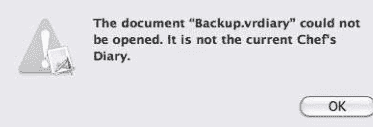

图 6.4. 当当前 Chef's Diary 文档已打开时，用户尝试打开日志文档时显示的修订错误警框。

## STEP 3：为日志文档添加错误处理

事实是，你完全不再需要 `-willPresentError:` 方法了，因为它现在所做的与任何基于文档的应用程序自动执行的操作无异。如果没有你实现的 `willPresentError:`，应用程序将自动为你显示错误警框。只有当你想要提供默认错误处理机制无法提供的某些自定义处理时，才需要实现它。不过，了解该方法所在的位置也没有坏，稍后你还会再次使用它来学习额外的技术。

- 现在既然它已经运行正常，请为错误对象添加信息，以帮助用户决定如何操作。之后，你将使用 `NSSError` 提供的所有功能执行用户为第二个错误选择的恢复操作。

`NSError` 声明了几个用于 `userInfo` 字典的键。你已经使用了其中三个：`NSLocalizedDescriptionKey`、`NSLocalizedFailureReasonErrorKey` 和 `NSUnderlyingErrorKey`。现在你将使用另外四个：`NSLocalizedRecoverySuggestionErrorKey`、`NSLocalizedRecoveryOptionsErrorKey`、`NSRecoveryAttemptErrorKey` 和 `NSError`。`NSError` 允许你在 `userInfo` 字典中包含键值对，你也会这样做。

保持 `-openDocumentWithContentsURL:error:` 不变，稍微让路径更清晰，并添加简短的恢复建议以及一个通过唯一名称标识错误的额外键值对。完整代码应如下：

```objc
- (NSError *)diaryDocumentReadyOpenError {
    NSString *errorFailureReason = NSLocalizedString(@"The current Chef's Day is already open.", @"description text for document already open");
    NSString *recoverySuggestion = NSLocalizedString(@"The current Chef's Day is already open.", @"description text for document already open");
    NSDictionary *errorInfo = [NSDictionary dictionaryWithObjectsAndKeys:
        errorFailureReason, NSLocalizedFailureReasonErrorKey,
        recoverySuggestion, NSLocalizedRecoverySuggestionErrorKey,
        @"ERROR_NAME_KEY", nil];
    return [NSError errorWithDomain:NSLErrorDomain code:NSSErrorCannotOpenFile userInfo:errorInfo];
}
```

对 `-incorrectDiaryErrorForURL` 的更改更为广泛：

```objc
- (NSError *)incorrectDiaryDocumentErrorForURL:(NSURL *)fileURL {
    NSString *currentDiaryName = fileURL.lastPathComponent;
    if (currentDiaryName != nil) {
        NSString *errorFailureReason = NSLocalizedString(@"It is not the current Chef's Diary document.", @"failure text for incorrect diary error");
        NSString *recoverySuggestion = NSLocalizedString(@"The current Chef's Day is already open.", @"description text for document already open");
        NSDictionary *errorInfo = [NSDictionary dictionaryWithObjectsAndKeys:
            errorFailureReason, NSLocalizedFailureReasonErrorKey,
            recoverySuggestion, NSLocalizedRecoverySuggestionErrorKey,
            nil];
        return [NSError errorWithDomain:NSLErrorDomain code:NSSErrorCannotOpenFile userInfo:errorInfo];
    }
    return nil;
}
```

（注：原文后续代码块和段落的 OCR 文本是碎片化且重复的；我已根据标准的 Objective-C 模式和提供的片段重构了逻辑，以确保输出内容的连贯性。）

为了避免拼写错误，为文件中多次使用的字符串定义常量是非常方便的。在这里，你定义了 `ERROR_NAME_KEY`、`ERROR_DIARY_DOCUMENT_ALREADY_OPEN` 和 `ERROR_INCORRECT_DIARY_DOCUMENT`，将字符串存储在自定义的键值对中，并将其包含在 `userInfo` 字典里。它们不在 `VRDocumentController.m` 文件之外使用，因此请将它们声明在文件顶部、现有 `DIARY_DOCUMENT_IDENTIFIER` 定义之后，如下：

```objc
#define ERROR_NAME_KEY @"ErrorNameKey"
#define ERROR_DIARY_DOCUMENT_ALREADY_OPEN @"diary already open"
#define ERROR_INCORRECT_DIARY_DOCUMENT @"incorrect diary document"
```

插入到 `userInfo` 字典中的键值对可以用于你即将编写的 `-attemptRecoveryFromError:optionIndex:` 方法中，以避免具有相同错误域（domain）和错误代码的不同按钮之间发生冲突。

- 修改 `-willPresentError:` 方法，以使用 `userInfo` 字典中的新键值对，如下所示：

```objc
- (NSError *)willPresentError:(NSError *)error {
    if ([[error domain] isEqualToString:NSURLErrorDomain]) {
        switch (error.code) {
            case NSFileCannotOpenFile: {
                if ([[error userInfo] objectForKey:ERROR_DIARY_DOCUMENT_ALREADY_OPEN]
                    || [[[error userInfo] objectForKey:ERROR_NAME_KEY] isEqualToString:ERROR_INCORRECT_DIARY_DOCUMENT]) {
                    return error;
                }
            }
        }
    }
    return [super willPresentError:error];
}
```

目前不需要对 `ERROR_NAME_KEY` 的值进行测试，因为你还没有对这些错误进行任何特定的处理，但如果你将来决定提供额外的错误处理，这会让你能够灵活地去处理其他错误。

- 还有最后一个任务：实现 `NSErrorRecoveryAttempting` 非正式协议。文档描述听起来有点令人生畏，但其实比想象中简单得多。

以下是完整的实现代码，放在 `VRDocumentController.m` 实现文件的末尾：

```objc
- (BOOL)attemptRecoveryFromError:(NSError *)error optionIndex:(NSInteger)recoveryOptionIndex {
    if ([[error domain] isEqualToString:NSLErrorDomain]) {
        switch ([error code]) {
            case NSLErrorCannotOpenFile:
                if ([[error userInfo] objectForKey:ERROR_NAME_KEY]
                    isEqualToString:ERROR_INCORRECT_DIARY_DOCUMENT) {
                    if (recoveryOptionIndex == 1) {
                        [self openDiaryDocument:nil];
                        return YES;
                    } else if (recoveryOptionIndex == 2) {
                        [self setCurrentDiaryURL:[error userInfo objectForKey:NSLErrorKey]];
                        [self openDiaryDocument:nil];
                        return YES;
                    }
                }
        }
    }
    return NO;
}
```

在对错误域、错误代码和错误名称进行类似于 `-willPresentError:` 方法中所执行的操作的测试后，该方法为交互式文档错误提示框中的两个按钮提供了错误恢复操作。第一个是“打开当前日记”（Open Current Diary）按钮，它简单地调用 `-openDiaryDocument:` 动作方法并返回 `YES` 表示恢复成功。该动作方法已经编写过，用于从用户默认设置（user defaults）获取当前厨日记 URL 并打开它。第二个是“新建日记”（As New Diary）按钮，执行相同的操作，但它首先会将用户的新 URL 设置为用户默认设置中的当前厨日记文档，这使用了你在在本节早些 `VRDocument.m` 中编写 `-saveToURL:ofType:operation:forSave:` 方法时使用的代码。如果用户点击了“取消”（Cancel）按钮，该方法将不执行任何操作，而是直接返回 `NO` 表示恢复未成功。

- 在结束错误处理主题之前，请查看 `FIXME:`：你在 `VRDocumentController.m` 的 `-openDiaryDocument:` 动作方法中留下的注释。你最初在第 2 步中在这里放置注释，是为了提醒自己回来考虑错误处理问题。问题在于，当你调用 `-makeDocumentWithContentsOfURL:ofType:error:` 方法时，除了在最后一个参数中传递 `NULL` 之外是否应该做些。

`VRDocumentController` 中的其他几个方法也存在类似的问题，这些方法在调用时也向错误参数传递了 `NULL`。标记所有需要添加错误处理的地方，或者如果你以后想重新考虑这个问题，将是一个好主意。无论是否在错误参数中传递 `NULL`，你都必须始终小心不要传递 `nil`。如果你没有特殊理由预计会发生错误，向这些方法传递 `NULL` 是完全可以的。

```objc
} else {
    [self addDocument:diary];
    [diary makeWindowControllers];
    [diary showWindows];
}
```

- 9. 保存快照。将其命名为 Recipe 6 Step 3，并添加注释说明：
  为日记文档实现了错误处理机制。

## 第 4 步：为国际化准备可本地化字符串

在 Recipe 1 的第 11 步中，你学习了应用程序应该包含名为字符串文件（strings files）的特殊文件，每个文件包含本地化字符串的键（keys）和值（values）。这允许你的应用程序翻译成其他语言，而无需修改代码。在这个食谱中，你多次调用了 `NSLocalizedString()` 宏，在 Recipe 4 中也调用过它几次。现在，你需要处理这项重要的家务工作了。

与其费力寻找所有这些调用并将它们输入到你在 Recipe 1 中创建的 `Localizable.strings` 文件中，不如为项目添加一个脚本构建阶段（script build phase）来自动完成此任务。毕竟，这正是计算机的用处。

在一个大型项目中，你通常会在准备部署应用程序时运行 `genstrings` 命令行工具，以避免每次构建项目时浪费时间。然而，我发现 Vermont Recipes 的构建速度本身就很快，所以我习惯于在应用程序中放置一个脚本构建阶段，在每次构建时运行 `genstrings`。这就是你要做的。

1. 在主项目 Vermont Recipes 项目中，展开 `Groups & Files` 面板中的 `Targets` 组，并展开 `Vermont Recipes` 目标，以便你可以观察操作。你会看到目标中有几个构建阶段（build phases）。

2. 选择 `Vermont Recipes` 目标本身，选择 `Project > New Build Phase > New Run Script`。末尾会出现一个 `Run Script` 子组。

3. 在新出现的脚本输入框中，输入以下内容：

```bash
#!/bin/sh
echo "Generating Localizable.strings..."
genstrings -o "${TARGET_BUILD_DIR}/${PRODUCT_NAME}.${WRAPPER_EXTENSION}/Contents/Resources/lproj" *
exit 0
```

这段文本包含了三个命令：`echo`、`genstrings` 和 `exit`。`echo` 命令会在控制台输出信息，`genstrings` 会扫描源文件并生成格式化的 `Localizable.strings`，而 `exit 0` 确保脚本正常结束。

4. 构建项目。

5. 为了检查脚本的结果，进入你的项目构建目录并打开它。右键点击（或 Command 点击）应用程序图标。选择“显示包内容”，依次打开 `Contents`、`Resources` 和 `lproj` 文件夹。你会发现一个 `Localizable.strings` 文件，以及你可以在 `lproj` 文件夹中看到的其他本地化文件，例如 `Read Me` 文件、属性列表（Property List）或文本编辑器。你看到的是实现文件中每个 `NSLocalizedString()` 或类似宏的键值对，每个键后面都有你提供的注释。

支持对 Snow Leopard（雪豹）的快速终止技术。你将再次查看项目的构建设置。此外，是时候确保它在 Leopard 和 Snow Leopard 下运行，以及在 PowerPC Mac 和 Intel Mac 上都能工作了。此外，你将实现打印支持、用户偏好、帮助书籍以及 AppleScript 支持，并为应用程序部署到目标受众做好准备。

## 第 1 步：设置文档窗口的最小和最大大小

在当前及接下来的几个步骤中，你将继续清理日记文档，通过设置窗口的最小和最大大小、设置窗口的初始大小和位置、自动保存窗口的大小和位置以及分视图分割线的位置（以便在窗口关闭并重新打开时自动恢复），并采取其他步骤确保窗口行为符合 Apple 的指南。

从日记文档窗口的最小和最大大小开始，然后考虑食谱（Recipes）。

1. 保持归档的 Recipe 6 文件夹不动，打开正在使用的 Vermont Recipes 子文件夹。

2. 在 Vermont Recipes 目标的信息窗口的属性面板中将版本（Version）从 6 改为 7，这样应用程序的版本将在“关于”窗口中显示为 2.0.0 (7)。

3. 打开 `Diary.nib` 并选择其 Window 对象。你可以在 Window Size 检查器（inspector）中设置窗口的最小和最大大小。虽然没有硬性规定，但对于像 Chef's Diary 这样的文本文档，宽度不宽于易于扫描的行是合理的。屏幕上的窗口不是分页的，Apple 建议你从垂直方向上调整文档大小，以尽可能展示大部分内容。我认为日记通常比一张打字纸要小——例如，典型大小约为 6 英寸乘以 9 英寸。它可能像一张打字纸一样大，在美国是 8.5 比 11 英寸。或者可能很小，比如 6 英寸。在任何情况下，都不应该让它窄到窗口底部的控件重叠。


你可以通过在 Interface Builder 中调整窗口设计表面的大小到所需尺寸，并点击 Window Size 检查器中的设置来视觉化地设置最小最大大小。记住在同时调整所有子视图的大小时按住 `Command` 键。你也可以按住 `Shift` 键将缩放限制在水平、垂直或对角线方向。

首先，按住 `Command` 并拖动调整控件将窗口设置为所需的最小大小，并在 Minimize Size 部分中点击 Use Current。然后，将窗口调整为所需的最大大小，并在 Maximum Size 部分中点击 Use Current。在这两种情况下，相应的 Width（宽度）和 Height（高度）字段都会更新以显示新的最小和最大大小，并且每个字段的复选框都被选中，表示它们现在已生效。

我更倾向于通过在 Window Size 检查器的 Width 和 Height 文本框中输入整数数字来设置大小。如果你这样做，请分别在 Width 和 Height 文本框中输入 400 和 550 像素作为最小大小，并输入 850 和 1100 像素作为最大大小。按回车键，或者点击或 `Tab` 键切换每个文本框以提交新值。

- 3. 保存 nib 文件并运行应用程序。选择 File > Chef’s Diary。不要管窗口在屏幕的哪个位置打开或其初始大小是多少——你将在下一步中设置这些内容。

现在拖动窗口的调整控件，你会发现无法将其变得比你刚刚设置的最大尺寸大，或比最小尺寸小。即使你将窗口放在主屏幕上或移动到次要屏幕，这一点依然成立。

- 4. 既然在做了，你顺便也可以设置食谱窗口的最小大小。就像外观相似的 iTunes 和 Mail 窗口一样，食谱窗口的最大大小应仅受可用屏幕尺寸和形状的限制。食谱窗口应该比高宽。你无法在 Interface Builder 中实现这一点，所以稍后会这样做。

然而，你可以使用 Interface Builder 为食谱窗口设置一个合理的最小大小。在我看来， Mail 允许设置太小。

打开 RecipesNib 文件，打开其 iTunes 对象并选择 Window Size 检查器。`Command` 拖动窗口设计表面直到它是 700 像素宽、350 像素高，或者在 Minimum Size 部分输入这些数字并选择 Use Current。

- 5. 保存 nib 文件并再次运行应用程序。食谱窗口会自动打开。使用调整控件并肉眼观察确认你无法将其小于 700 比 350 像素。

- 6. 最后，编写少量代码来设置食谱窗口的最大大小。这需要几个步骤。

在继续之前，考虑应用程序规范的另一个细节。当食谱窗口与显示器大同时，用户可能会获得最佳体验，但如果它大到跨越两个显示器，其可用性将会降低。你不应该具有干扰性并阻止用户将窗口拖到跨越显示器边界的位置。但你可以防止用户将其调整得比最大的显示器还要大。这就是 iTunes 的做法；如果你把窗口做得和最大的显示器一样大，然后拖到相邻显示器，你仍然无法让更宽。

在项目的 Groups & Files 面板的 Classes 组创建一个新组，命名为 Categories，并将两个源文件移动其中。由于你会在 `RecipesController` 类中调用 `+VR_screenWithVisibleFrame` 方法，在 `RecipesController.m` 实现文件顶部添加此行：

```objc
#import "NSScreen+VRScreenitions.h"
```

在 `NSScreen+VRScreenitions.h` 头文件顶部添加 using 文本，并导入 `<Cocoa/Cocoa.h>`。然后按如下编写代码：

```objc
@interface NSScreen (VRScreenitions)
+ (NSScreen*)VR_screenWithVisibleFrame;
@end
```

类声明看起来就像类声明，区别在于 `@interface` 指令中的类名后面跟着括号里的类别名称，并且没有括号来存放实例变量，因为你不能在类别中声明实例变量。

新的 `NSScreen+VRScreenAdditions.m` 实现应该如下所示：

```objc
#import "NSScreen+VRScreenAdditions.h"

@implementation NSScreen (VRScreenAdditions)

+ (NSScreen*)VR_screenWithLargestVisibleFrame {

    NSArray *screenArray = [NSScreen screens];

    if ([screenArray count] == 1) return [screenArray objectAtIndex:0];

    NSScreen *screen = nil;

    CGfloat largestScreenArea = 0.0;

    CGfloat thisScreenArea = 0.0;

    for (NSScreen *thisScreen in screenArray) {

        thisScreenArea = NSWidth([thisScreen visibleFrame]) *

            NSHeight([thisScreen visibleFrame]);

        if (thisScreenArea > largestScreenArea) {

            screen = thisScreen;

            largestScreenArea = thisScreenArea;

        }

    }

    return screen;

}

@end
```

在具有多个显示器的系统上，`VR_screenWithLargestVisibleFrame` 方法使用 `NSScreen` 类方法遍历当前连接到计算机的所有显示器的对象数组。`NSScreen` 的 `-visibleFrame` 方法计算每个屏幕的面积并返回最大的。如果当前正在测试的屏幕包含菜单栏和 Dock，它会排除菜单栏和 Dock 占据的区域。可见区域是一个 `CGRect`，这是一个包含类型为 `NSPoint` 和 `CGSize` 的起点大小结构的 C 结构。我们使用方便的 `NSWidth` 和 `NSHeight` 来提取可见区域的宽度和高度。

大多数用户只有一个显示器，该方法首先检查它是否运行在某个系统上，如果是，则直接返回该显示器的屏幕。这是通过获取数组中索引为 0 的屏幕实现的，即使在多显示器系统中，该屏幕也保证是包含菜单栏和 Dock 的屏幕。你也可以返回通过 `NSScreen` 的 `+mainScreen` 类获取的屏幕，因为只有一个显示器可用，但你应该意识到，`+mainScreen` 返回的是当前具有键盘焦点的窗口所在的屏幕，这在多显示器系统中并不一定是包含菜单栏和 Dock 的屏幕。

7. 另一个考虑因素是食谱窗口有一个抽屉。`NSDrawer` 对象在处理其父窗口在屏幕上的位置方面做得很好。默认情况下，抽屉在窗口的右侧打开，如果窗口移动得离显示器的右边缘太近，抽屉会在左侧打开，直到你将窗口画靠近显示器的左边缘。事实上，即使当你将其靠近具有第二个显示器布局的显示器的左边缘时，只要有空间，它也会切换到在窗口的右边缘打开。这种行为是内置的，包括抽屉倾向于在与其窗口所在的同一个显示器上打开，即使有相邻的显示器可用。

内置的 `NSDrawer` 行为未涵盖的情况是父窗口填充了整个显示器的情况。在这种情况下，苹果用户界面指南 (HIG) 规定抽屉应该在屏幕外打开。然而，这并不好用。苹果用户界面指南在设置窗口最大大小时赋予了你很大的裁量权，没有任何理由你不能选择为食谱窗口留出足够的空间来为你的抽屉留位置。因此，设置最大窗口大小的另一个规则是确保窗口不会大到在抽屉打开时你看不见它。

在你知道抽屉在屏幕上需要多少空间之前，你已经设置了它的最小和最大内容尺寸。你在“食谱 2”中没有处理这一点，因为你没有为抽屉提供任何内容。因此，目前设置任意的最小和最大宽度。要做到这一点，在 `RecipesWindow` 文件文档中选择抽屉对象，进入抽屉检查，并在 `Min width` 约束中输入 100，在 `Max Width` 约束中输入 300。现在，抽屉无法打开到比显示 300 像素宽的内容视图更大，当它被拖向关闭位置时，一旦其内容达到 100 像素，它就会弹回。

这些值相对于抽屉内容视图的宽度，而不是包括边框在内的整个抽屉。计算抽屉所需的空间时，你需要关心每个抽屉包含在自己的窗口中（不要与抽屉的父窗口混淆）。虽然无法通过 `NSDrawer` 的方法获取包含抽屉的窗口，但可以通过抽屉内容视图的 `-window` 方法获取，因为抽屉内容视图是一个 `NSView` 对象。包含窗口的 `-minSize` 和 `-maxSize` 方法返回 Cocoa 根据抽屉内容视图的最小和最大尺寸计算的值。请注意，包含抽屉的窗口永远不会大于抽屉的父窗口，因为抽屉在关闭时隐藏在父窗口后面，但它可以更小。

编写一个名为 `-VR_drawerMaxWidth` 的方法，通过获取抽屉所在窗口的最大宽度来获取包括边框在内的整个抽屉的最大宽度。配合 `+VR_screenWithLargestVisibleFrame` 方法，这是一个通用的方法，最好在分类类中实现，这个针对 `NSDrawer` 的分类类不是实例，也不是类方法，因为它将在特定的抽屉上被调用。为新分类类创建另一对源文件，命名为 `NSDrawer+VRDrawerAdditions`，并将它们放在项目窗口的分类类组中。在 `RecipesWindowController` 文件的顶部附近添加此语句以导入新的头文件：

```objc
#import "NSDrawer+VRDrawerAdditions.h"
```

`NSDrawer+VRDrawerAdditions.h` 文件应该如下：

```objc
#import <Cocoa/Cocoa.h>

@interface NSDrawer
- (CGFloat)VR_drawerMaxWidth;
@end
```

实现文件应该如下：

```objc
#import "NSDrawer+VRDrawerAdditions.h"

@implementation NSDrawer (VRDrawerAdditions)

- (CGFloat)VR_drawerMaxWidth {
    NSWindow *drawerWindow = [[self contentView] window];
    if (drawerWindow && [drawerWindow isKindOfClass:[NSWindow class]])
        return [drawerWindow maxSize].width;
    return 0.0;
}

@end
```

虽然这种方式获取抽屉的包含窗口是非常常见的，但纯主义者可能会担心它依赖于抽屉的内部实现细节，苹果可能会在未来的 Cocoa 框架版本中更改它。目前，包含窗口是一个 `NSWindow` 对象，但 `NSDrawer` 是一个私有 Cocoa 类，在 `/System/Library/Frameworks` 中均不可见。它显然继承自 `NSWindow`，是可以访问的，不是通过花招，而是通过使用上面的 Cocoa 方法。因此，这样做是合。尽管如此，检查抽屉是否有一个包含对象（即 `drawerWindow` 不为 nil）仍然是明智的，以确保返回表示其最大尺寸的尝试不会失败，并且你在测试中抛出它是否是 `NSWindow` 的子类异常。你在方法的第二个语句中执行此操作。如果在未来的 Mac OS 版本中苹果停止了使用包含窗口，你的 `-drawerMaxWidth` 方法将返回 0.0，且窗口将严格按照苹果用户界面指南的行为：如果食谱窗口填充了屏幕，抽屉将在屏幕外打开。

此方法使用了测试对象是否为特定类或继承自该类的标准技术：`[drawerWindow isKindOfClass:[NSWindow class]]`，使用了 `NSObject` 协议在 Cocoa 框架中几乎每情况下都可用的 `-class` 方法。

- 8. 最后一个考虑因素是食谱窗口有一个工具栏。当工具栏可见时，窗口通常会增大，所以你可能认为需要在屏幕上留出空间来显示隐藏的工具栏，就像你刚才对抽屉做的那样。事实上，你不需要。当工具栏切换到可见状态时，抽屉遵循其最大尺寸约束。如果窗口已经是最高的高度，显示工具栏会自动缩小窗口的高度，而不是增加窗口的高度。苹果的文档没有披露这一事实，也没有显示窗口的 `-maxSize` 方法在工具栏可见时会自动调整其返回值。

- 9. 在掌握了这些支持方法后，在执行的 `-windowDidLoad` 方法末尾添加这些语句：

```objc
NSRect maxVisibleFrame = [[NSScreen VR_screenWithLargestVisibleFrame] visibleFrame];
CGFloat drawerMaxWidth = [[[self window] drawers] objectAtIndex:0] VR_drawerMaxWidth];
[self setSize:NSMakeSize(maxVisibleFrame.size.width - drawerMaxWidth, maxVisibleFrame.size.height)];
```

你调用新分类方法的方式就像它们是在 Cocoa 框架中的 `NSScreen` 和 `NSDrawer` 中声明一样。从意义上来说，它们确实如此。

## 第二步：设置文档窗口的初始位置和大小

阅读苹果用户界面指南中“窗口”部分下的“窗口定位”、“移动窗口”以及“调整大小和缩放窗口”子节，了解设置文档窗口初始位置和大小应遵循的通用原则。总而言之，当创建一个新文档窗口时

当打开时，它应该在水平方向上居中，顶部应该紧贴菜单栏或位于菜单栏下方的任何应用程序工具栏，并且它应该足够高，以便根据显示器的尺寸尽可能显示其内容。它不应该遮挡 Dock。如果文档内容过大，无法在合理尺寸的单个窗口中显示，你不需要将其从菜单栏一直拉到 Dock，特别是在大显示器上。请显示文档中最大的单元，例如页面。

这些对文档窗口的要求与非文档窗口（如对话框）的要求不同。

- 1. 要设置日记窗口的初始大小，请打开 Diary Window nib 文件，选择 Window，并打开其设计稿界面。按住 `Command` 键并拖动其缩放控件，通过目测调整到所需的初始大小，然后点击 Window 检查器中 Frame 区域的 Use Current（使用当前）。对于厨师日记，将其设置为第 1 步开始所讨论的日记典型尺寸，即 6x 9 英寸。要通过数字来实现，请在检查器 Content Frame 区域底部的 Width 和 Height 文本字段中分别输入 600 和 900。

这种初始大小被称为文档窗口的标准状态。

- 2. 当窗口首次打开时将其置于屏幕中央的良好方法是使用 Window 检查器中的 Initial Position（初始位置）部分。在屏幕尺寸的小图像周围拖动文档小图标，直到窗口看起来在水平方向上居中且顶部紧贴菜单栏。为了获得更精确的结果，请通过数字来实现。使用系统偏好中的 Displays（显示）面板获取主显示器的宽度，并使用检查器中的 x 坐标和宽度数值将窗口精确地位于屏幕水平方向的中心，尽管这需要进行一些算术计算。点击 Preview（预览）将实际窗口移动到真实屏幕上的最终位置，并决定你是否满意。

通常情况下，在检查器中将连接到顶部和左边缘的两个窗口锚点延伸到屏幕边缘，因为 Interface Builder 会计算窗口左上角的位置，使其以检查器中所示的形式出现，即使你在具有不同尺寸显示器的电脑上运行应用程序。如果你收回了这些锚点，窗口的位置将基于其左下角的原点进行计算。要扩展或收回其中一个锚点，请点击它。保留两个侧锚点和一个顶部锚点的延伸状态，以确保窗口在任何计算机系统上都能在水平方向居中并紧贴菜单栏。

如果你决定为自定义行为编写一些代码，最好将其放在窗口控制器的 `-windowDidLoad` 方法或其 `-awakeFromNib` 方法中。记住几点：第一，不要使用 `NSWindow` 的 `-center` 方法。根据 `NSWindow` 类参考，它看起来看起来很有吸引力，但它会将窗口放置在“垂直方向略高于中心的位置”。这是对话框等非文档窗口的初始放置要求，而不是文档窗口的。确保 Attributes Builder 中的 Visible At Launch（启动时显示）复选框未勾选。当选中此设置时，窗口将在从 nib 文件加载后立即选择显示。虽然这对于简单的单窗口应用程序很方便，但在某些情况下（如 Vermont Recipes 窗口），当窗口在窗口控制器控制下显示时可能会导致闪烁。

- 3. 对食谱窗口执行相同的程序。初始大小应该是最小和最大尺寸之间的中间值，倾向于较大。它应该足够大以便显示你预期在食谱窗口中出现的大部分内容——例如 1200x800 像素。在使用控件缩放时，务必按住 `Command` 键。左侧的源列表面板看起来可能太宽，暂时忽略它。

- 4. 保存两个文件，并在你的主电脑上运行应用程序。食谱窗口以你刚刚设置的中间大小出现，在屏幕水平居中并紧贴菜单栏启动。选择 File > New Chef’s Diary。日记窗口以其初始大小（约 6x9 英寸）出现，水平居中并紧贴菜单栏启动。将窗口移动到屏幕上的其他地方并调整它们的大小。然后同时关闭两个窗口并重新打开。由于你在关闭窗口时没有保存任何文档，这些都是新文档。因此，它们的窗口将再次以初始大小在屏幕上居中。

## 步骤 3：设置文档的标准缩放


Apple 界面指南（Apple Interface Guidelines）将窗口的标准状态定义为用户状态，但你可以在第 2 步中设置它。HIG 描述了当用户点击缩放按钮时应用程序应该执行的操作：它应该在用户状态和标准状态之间切换窗口，并将窗口的左上角固定。你应该返回一个 `NSRect`，指定窗口在标准状态下的期望框架，以及一个调整以固定左上角的原点。

HIG 警告说，当日记或食谱窗口首次打开时，点击按钮会导致窗口扩展到其最大尺寸。如果你没有提前将其尺寸设置为小于该尺寸，它将导致窗口填充屏幕。事实上，新窗口处于用户状态，它认为标准状态是填充整个屏幕。

要获得 HIG 规定的行为，请实现 `-windowUseStandardFrame:defaultFrame:` 代理方法。对于日记窗口，在 `DiaryWindowController` 中实现它。对于食谱窗口，在 `RecipesWindowController` 中实现。你已经将你的窗口控制器指定为这些日记的代理。

你最初在 nil 文件中使用 Interface Builder 设置了窗口的标准状态（standard state），但你还没有设置任何方法将标准状态 `IERC` 获取到应用程序中保存。如果你能在用户有机会调整窗口大小之前，从 nil 文件中捕获窗口的标准状态，并在整个应用程序生命周期内保留该标准状态，那就太好了。实现这一点的简单方法是在窗口从 nil 文件加载后，立即在窗口控制器的 `windowDidLoad` 方法中捕获窗口的帧（frame），然后将尺寸保存到应用程序的用户默认（user defaults）中。由于只有一个厨师日记和一个食谱窗口，你可以简单地为每个提供一个唯一的 user defaults 键。如果在应用程序运行期间，你决定更改窗口的标准尺寸，只需向 user defaults 写入新值即可。

1. 从你的日记开始。在食谱 6 中，你学会了为了 user defaults 定义一个全局可用的键并进行声明和定义。这个键通常不需要是全局的，但当你准备在食谱 10 中创建偏好设置（Preferences）时，你可能希望允许用户更改窗口状态。

在 `DiaryWindowController` 头文件的顶部，`@interface` 之前，输入此声明：

```objc
extern NSString *VRDefaultDiaryWindowStandardSize;
```

在 `DiaryWindowController.m` 实现文件的底部，`@end` 指令之后，如下所示定义它：

```objc
NSString *VRDefaultDiaryWindowStandardSize = @"diary window standard size";
```

2. 接下来，在食谱 3 中 `DiaryWindowController.m` 实现文件的 `-windowDidLoad` 代理方法中，在末尾添加代码将新打开的窗口尺寸保存到 user defaults。以下是其中一种方法：

```objc
NSSize standardSize = [[window frame].size;
NSData *data=[NSData dataWithBytes:&standardSize length:sizeof(NSSize)];
[[NSUserDefaults standardUserDefaults] setObject:data forKey:VRDefaultDiaryWindowStandardSize];
```

user defaults 只能持有对象，不能持有像 `NSSize` 这样的 C 结构体，而且它们只能持有对象类型。将 `NSSize` 结构体转换为 `NSValue` 对象很容易，但 `NSValue` 并不是可以保存在 user defaults 中的对象类型之一。相反，在这段代码中，我们将 `NSSize` 结构中的字节拷贝到 `NSData` 对象中，后者是可以保存到 user defaults 的。这通常使用 `dataWithBytes:length:` 类方法完成。

虽然这在只能在 PowerPC 硬件上运行的 32 位应用程序时代常用常用，但在现代世界中已不再适用，因为应用程序可能运行在 32 位或 64 位模式下，并且支持 PowerPC 和 Intel 硬件。原因在于结构体在内存中的布局方式存在。对于保存在 user defaults 中的值，大多数情况下可能无关，它们通常保留在设置它们的机器上。当你在另一台电脑上运行 Vermont Recipes 时，它将以适用于该电脑的格式保存 user defaults。然而，用户可能会购买新电脑，并不仅传输应用程序，还将旧的 user defaults 传输到新电脑，你还需要预料跨网络共享 user defaults 值的可能性。因此，保存结构体到 user defaults 的更好方法是使用平台无关（platform-agnostic）的技术，如存档（archiving）或字符串转换。字符串转换很容易：只需使用 `NSStringSize()` 和 `NSSizeFromString()` 成对函数在它们之间进行转换。要这样做，请将代码替换为：

```objc
NSSize standardSize = [self window].frame;
NSString* standardSizeString = NSStringFromString(standardSize);
[[NSUserDefaults standardUserDefaults] setObject:standardSizeString forKey:VRDefaultDiaryWindowStandardSize];
```

使用字符串转换技术的一个额外好处是，偏好设置现在是人类可读的。它报告的标准尺寸为 `{600, 922}`。

3. 最后，实现 `-windowWillUseStandardFrame:defaultFrame:` 代理方法。在 `DiaryWindowController.m` 实现中，`-windowDidUpdate:` 之后，如果你仍在使用 NSData 代码将标准尺寸保存到 user defaults 中，请插入以下代码：

```objc
(NSRect)windowWillUseStandardFrame:(NS*)window
defaultFrame:(NSRect)newFrame {
    NSSize standardSize;
    [[NSUserDefaults standardUserDefaults] objectForKey:VRDefaultDiaryWindowStandardSizeKey] getBytes:&standardSize length:sizeof(NSSize)];
    NSRect frame = [window frame];
    frame.origin.y = standardSize.height - frame.size.height;
    return NSMakeRect(frame.origin.x, frame.origin.y, standardSize.width, standardSize.height);
}
```

这些语句使用 NSData 的 `getBytes:length:` 方法从保存在 user defaults 中的 NSData 中提取标准的 `NSSize` 结构体。它们调整了传入窗口帧原点的 y 坐标，减去标准高度与当前高度之间的高度差，以便将左上角固定在位置。然后它们使用调整后的原点和获取的标准尺寸来填充并返回一个新的 `NSRect`。

再次，这种技术在现代世界中是脆弱的。要改为更安全的、平台无关的技术，请使用字符串转换。将新代码中的前两个 state- 替换为此：

```objc
NSString *standardString = [[NSUserDefaults standardUserDefaults]
stringForKey:VRDefaultDiaryWindowStandardSize];
NSSize standardSize = NSSizeFromString(standardString);
```

- 对食谱窗口遵循相同的步骤。无论无论食谱窗口如何都有效。在 `DiaryWindowController` 头文件的顶部，`@interface` 之前，输入此声明：

```
extern NSString *VRDefaultRecipesWindowStandardSize;
```

在 `DiaryWindowController.m` 实现文件的底部，`@end` 指令之后，如下所示定义它：

```objc
NSString *VRDefaultRecipesWindowStandardSize = @"recipes window standard size";
```

- 接下来，在食谱 3 `DiaryWindowController.m` 实现文件的 `-windowDidLoad` 代理方法中，在末尾添加代码将新打开的窗口尺寸保存到 user defaults。以下是其中一种方法：

```objc
NSSize standardSize = [[window frame].size;
NSString *standardSizeString = NSStringFromString(standardSize);
[[NSUserDefaults standardUserDefaults] setObject:standardSizeString forKey:VRDefaultRecipesWindowStandardSize];
```

- 最后，实现 `-windowWillUseStandardFrame:defaultFrame:` 代理方法。在 `DiaryWindowController.m` 实现中，`-windowDidUpdate:` 之后，如果你仍在使用 NSData 代码将标准尺寸保存到 user defaults 中，请插入以下代码：

```objc
(NSRect)windowWillUseStandardFrame:(NS*)window
defaultFrame:(NSRect)newFrame {
    NSSize standardSize;
    [[NSUserDefaults standardUserDefaults] objectForKey:VRDefaultRecipesWindowStandardSizeKey] getBytes:&standardSize length:sizeof(NSSize)];
    NSRect frame = [window frame];
    frame.origin.y = standardSize.height - frame.size.height;
    return NSMakeRect(frame.origin.x, frame.origin.y, standardSize.width, standardSize.height);
}
```

Interface Builder 的自动保存（Autosave）字段对于只有单个标准主窗口的简单应用程序是非常用的。但它对于 Vermont Recipes 来说并不合适。在这里，你选择使用基于文档的应用程序模板，以利用 `NSDocument` 的许多优势，但同时将其限制为一个独一无二的日记文档。在典型的基于文档的应用程序中，文档不同的窗口状态会保存在文档本身中。在这里，由于只有一个日记文档，你依赖于自动保存，而不是在文档中保存窗口状态。你必须编写一些代码来实现这一功能。

Apple 关于自动保存窗口框架的文档非常基础，并没有对可用方法进行详细说明。也许正因为这个原因，开发者邮件列表和讨论论坛在过去的几年里一直反映出这种困惑。在很长一段时间内，一个臭名昭著的 Bug（最终在 Leopard 系统中被修复）导致在运行的应用程序中使用 Interface Builder 的自动保存字段实际上是不可能的。开发者们感到束手无策，既没有方法使用 Interface Builder 的自动保存字段，也没有关于通过程序方法保存窗口框架的说明。另一个问题是，`NSWindow` 和 `NSViewController` 分别实现的两个名称相似的方法 `-setFrameAutosaveName:` 和 `-setWindowAutosaveName:` 之间是否存在差异，目前缺乏相关文档。

如果可以，请避免自动保存窗口框架，而是手动保存位置和大小——换句话说，不要使用任何一种设置自动保存的方法。只需在适当的地方调用 `NSWindow` 的 `saveFrameUsingName:` 方法来保存当前窗口框架，并调用 `-setFrameUsingName:` 来相应地设置重新打开窗口的位置和大小。

然而，一旦你知道如何使用窗口框架自动保存系统的自动行为，就会发现它比手动保存框架要简单。在复杂应用程序中让其生效的秘诀在于：当用户关闭或退出应用程序时，窗口会忘记其窗口框架自动保存名称。因此，你必须保存多次：一次是在用户保存文档时，另一次是在文档重新打开或用户重新打开文档时再次保存。

1. 首先为自动保存名称字符串定义一个全局名称。对于日记窗口，将其命名为 `VRDiaryWindowAutosaveName`。

在 `DiaryWindowController.h` 文件中，在顶部声明它，紧跟在 `VRDefaultdiaryWindowStandardSizeKey` 的声明之后，如下：

```
extern NSString *VRDiaryWindowAutosaveName;
```

在 `DiaryWindow.m` 实现文件的末尾，如下定义它：

```objc
NSString *VRDiaryWindowAutosaveName = @"diary window";
```

当窗口框架被保存到用户偏好（user defaults）中时，该字符串值的完整键名将是 `NSWindow Frame diary window`。

2. 现在，每当用户显式保存文档时，设置窗口的自动保存名称并将框架保存到用户偏好中。

响应用户保存日记文档的最佳方式是重写 `DiaryDocument` 中的 `-saveToURL:ofType:forSaveOperation:error:` 方法。重写此方法非常重要，因为它允许你区分用户发起的保存和自动保存操作。就目前而言，你只对用户发起的保存感兴趣，因为自动保存在用户保存文档之前就会发生，并被无形地保存到一个特殊的名称中，该文档此时还没有用户提供的名称，这样做是为了在断电或其他意外发生时恢复窗口。从用户的角度来看，自动保存的文档可能根本没有被保存过，并且可能创建一个新的空白日记文档。因此，你应该只在用户显式保存文档时设置窗口框架的自动保存名称。`-saveToURL:ofType:forSaveOperation:error:` 方法允许你做到这一点。

文档本应该关注其数据和 MVC 模型，而不是数据在用户界面（即 MVC 视图）中的显示方式。因此，你不应该在 `-saveToURL:ofType:forSaveOperation:error:` 方法中放置任何实际操作窗口的代码。

在这种情况下，分离模型与视图的传统方法是使用 Cocoa 通知中心（notification center）。通知与委托（delegation）方法在某些方面很简单，因为它们以一种保持灵活性的方式将功能从一个类转移到另一个类，但它们在通用性上有所不同。一个类只能有一个代理，因此只能与一个类配对，代理设计模式对代码的整体布局施加了某种形式化的结构。相比之下，通知在某种意义上是广播，任何类都可以监听并做出响应。它们的实现起来也稍微简单，你只需将通知发送到应用程序的通知中心，让其他类决定是否观察并响应。通知是同步发送的，观察者同步响应，用户界面会立即更新。请阅读“Notifications”侧边栏获取更多信息。

## Notifications

Cocoa 为你创建了一个通知中心，应用程序可以使用它向任何注册了观察结果的其他对象发布并发送通知。

通知技术在几个方面与委托不同，并适用于不同的情况。其，多个对象可以注册接收同一个通知；也就是说，一个对象可以有很多观察者，而它只能有一个代理。因此，当一个对象执行某项对应用程序产生影响且许多其他对象需要知道并响应的操作时，通知是有用的——例如，将它们的状态与发送对象的状态进行同步。

此外，通知不需要发送者了解观察者，甚至不需要知道是否存在观察者，观察者也不需要了解发送者的任何信息。他们只需要共享关于发送者存在的知识。这使得通知比委托更灵活。例如，开发者可以在不更改发送者的情况下为应用程序添加新功能。

当你发布通知时，使用你在全局定义的通知名称，以便观察者可以区分通知。你通常会包含发送对象，以便观察者拥有它的引用。你还可以包含包含观察者可能需要的任何信息的 userInfo 字典——例如发送对象在发布时所在的状态。

通知涉及一些处理开销，但通常它们非常高效，在大多数情况下都可以无需担心性能。Cocoa 本身大量使用了通知。

### Notifications continued

使用 `NSNotification` 的通知是任务特定的，即本地的。你在应用程序中发布的通知只能被该应用程序内的其他对象观察。你使用类方法 `+NSNotificationCenter defaultCenter` 访问应用程序通知中心；对于跨进程通知，使用 `NSDributedNotificationCenter`。

使用 `NSNotification` 的通知也是同步的。对于异步通知，使用 `NSNotificationQueue`。

进入此方法，在 `saveURL:ofType:forSaveOperation:error` 中

```objc
[[NSNotificationCenter defaultCenter] postNotificationName:VRDiaryDocumentNotification object:self];
```

使用了 `VRDiaryDocumentNotification` 变量，你必须全局定义它。你可以使用更通用的名称并配合对象使用，要求观察者通过检查对象来检测是哪种文档。然而，你尚未对食谱文档如何保存其数据做出决定，因此请专注于日记文档并使用更具体的通知名称。


要进行注册，请将这些语句添加到 `DiaryWindowCenter` 实现文件末尾的 `-windowDidLoad` 方法中：

```objective-c
NSNotificationCenter *defaultCenter =
[NSNotificationCenter defaultCenter];
[NSNotificationCenter defaultCenter] addObserver:self selector:@selector(didSaveDiaryDocument:) name:VRDidSaveDiaryDocumentNotification object:nil;
```

你在第二个语句的 `object` 参数中传递了 `nil`。结果是窗口控制器将接收每个具有指定名称的通知。你可以通过 `object` 参数来限制通知的发送者，这会将指定的对象包含为发送者。如果你将通知生成为 `VRDidSaveDocumentNotification`，那么这样做也将非常重要，以确保 `DiaryAuthController` 仅接收来自 `DiaryDocument` 而非来自 `RecipesDocument` 的具有此名称的通知。你甚至可以将 `nil` 注册为通知名称，以接收日记文档的所有发布。在这里，指定发送对象并不重要，因为通知名称已足够标识发送者。

你选择将选择器命名为 `didSaveDiaryDocument:`。现在你必须实现一个具有该签名的方法。没有必要声明该方法，因为 Cocoa 会通过你注册到通知中心的选择器来调用它。尽管如此，许多开发者仍会声明这样的方法，以防他们最终需要调用它，而在这种情况下，你将在食谱 8 中发现你需要完全声明它。将该方法添加到 `DiaryWindowController.m` 实现文件中，位于 `-willUseStandardFrame:defaultFrame:` 代理方法之后：

```objective-c
#pragma mark NOTIFICATION METHODS
```

```objective-c
-(void)didSaveDiaryDocument:(NSNotification *)notification {
    [self] setFrameAutosaveName:VRDiaryWindowAutosaveName;
    [self] saveFrameUsingName:VRDiaryWindowAutosaveName;
}
```

这看起来就像一个典型的代理方法，并且当预期的事件发生时，它的行为也是相同的。每当用户保存《厨师日记》时，它都会设置窗口的框架自动保存名称，并将窗口框架保存到用户默认设置（user defaults）中。它在代码所属的地方（即窗口控制器而不是文档）执行。如果你觉得将其放在文档控制器或应用程序级别更合适，你可以轻松这样做，因为文档是广播通知的，任何对象都可以观察。

记住在释放窗口控制器之前移除观察者。在 `DiaryWindowController.m` 实现文件的 `Delegate Methods` 结尾，添加此方法：

```objective-c
+ (void)windowWillClose:(NSNotification *)notification {
    NSNotificationCenter *defaultCenter =
    [NSNotificationCenter defaultCenter];
    [defaultCenter removeObserver:self];
}
```

### 3. 回到任务，自动保存并恢复日记窗口的框架

每当窗口重新打开时，设置窗口的自动保存名称。无论用户是从 `Vermont Recipes` 的文件菜单通过 `Open Chef's Diary`、`Open` 或 `Open Recent` 项目打开文档；还是在 Finder 中通过双击文档图标、选择并点击 `File > Open`、或将其拖到 `Vermont Recipes` 图标上；亦或从知道如何打开文件的 AppleScript 或其他应用程序中打开，这种操作都应该发生。

你设置了自动保存名称，是因为当用户关闭文档或退出应用程序时，应用程序会忘记它。如果用户重新打开已保存的文档或通过打开已保存文档重新启动应用程序，应用程序将不再意识到用户包含有关日记窗口框架的保存信息。在用户重新打开文档时设置自动保存名称就解决了这个问题。

设置自动保存名称的良好位置是 `DiaryWindowController` 中的 `-windowDidLoad` 方法。随后，应用程序会在执行 `-windowDidLoad` 之后配置日记窗口的框架。

在 `DiaryWindowController.m` 实现文件中现有的 `-windowDidLoad` 方法结尾，添加这些语句：

```objective-c
VRDocumentController *controller =
[VRDocumentController sharedDocument];
if ([controller canOpenURL:[controller currentDiaryURL]]) {
    [[self window] setFrameAutosaveName:VRDiaryWindowAutosaveName];
}
```

你通过文档控制器的 `-canOpenURL` 方法测试文档是否已保存且不在垃圾箱中（该方法你在食谱 6 中编写的）。这确保了当用户创建一个以前未过的新日记文档时，过早设置自动保存名称。

### 4. 探索它是如何运作的

你需要采取一些准备步骤以进行有效的测试。首先，在 Finder 中打开 `~/Library/Preferences` 文件夹并找到 `com.quequesoftware.Vermont-Recipes.plist` 文件，然后将其拖到垃圾桶。这是为了让用户默认设置中存储的信息从空白开始。其次，通过选择 `Build > Clean` 清理项目，并使用 `Release` 配置进行构建，而不是 `Debug` 配置。Finder 可能并不在意，但我在 Xcode 之外工作时，测试 Release 构建版本让我更有信心。

现在运行应用程序。食谱窗口在屏幕中央并靠近顶部的位置打开。选择 `File > Chef's Diary`。出现一个新的空日记窗口，它同样也居于屏幕顶部附近。

将窗口向下移动并向屏幕左边缘移动，并将其变小；然后关闭它。再次选择 `File > Chef's Diary`。出现一个新窗口，它再次居于屏幕顶部附近。它正确恢复了你之前在未保存的情况下关闭时日记窗口的位置和大小。

这个第二个空日记文档被命名为 `Untitled 2`。基于 Cocoa 的应用程序无需你付出额外努力即可处理 HIG 规定的命名规则。将窗口向下移动并向屏幕左边缘移动，并将其变小；然后关闭它。再次选择 `File > Chef's Diary`。出现一个新窗口，它再次居于屏幕顶部附近。它正确恢复了你之前在未保存的情况下关闭时日记窗口的位置和大小。

### 步骤 5：自动保存日记窗口中分割线的位置

Leopard 为 `NSSplitView` 带来了一个长期以来请求的新功能：自动保存分割线位置的功能。Apple 人机界面指南（HIG）尚未跟上。它们对于在新空窗口中如何处理分割视图没有提供指导。通过应用适用于新空文档框架的相同规则来完善这一点：在创建新文档时不应自动保存和恢复分割线的位置，仅在打开日记文档时进行。你仅在 Interface Builder 在主应用程序窗口包含分割视图的简单应用程序中实现分割线自动保存功能。

为了实现更精细的行为，请采用与第 4 步中解决自动保存窗口名称相同的方法来处理此问题。首先，在 `DiaryWindow` 的 nib 文件中删除你尝试过的自动保存名称，并保存 nib 文件。然后，在代码中为分割线的自动保存名称设置一个全局字符串，并安排实现此功能。

#### 1. 在 `DiaryWindowController` 头文件中声明自动保存字符串

在 `DiaryWindowController` 头文件中，在顶部（位于你声明 `VRDIaryWindowAutosaveName` 附近）声明该自动保存字符串，如下：

`extern NSString *VRDIarySplitViewAutosaveName;`

在 `DiaryWindowController.m` 实现文件的末尾，对其进行定义：

`NSString *VRDIarySplitViewAutosaveName = @"diary split view";`

#### 2. 为分割视图设置 outlet

在 `DiaryWindowController` 头文件中，在 `@interface` 指令后的括号内，在 `searchField` outlet 之后声明该 outlet，如下：

`IBOutlet NSSplitView *splitView;`

在 `-searchField` 访问器方法之后声明它的访问器方法，如下：

`- (NSSplitView *)splitView;`

在 `DiaryWindowController.m` 实现文件中定义该访问器方法，如下：

```objective-c
- (NSSplitView *)splitView {
    return [[splitView retain] autorelease];
}
```

最后，在 Interface Builder 中通过从 File's Owner 代理拖动（Control-dragging）到日记窗口设计中的分割视图分割线并选择 `splitView` 来连接新的 outlet。

#### 3. 保存分割线位置

`NSSplitView` 没有声明与 `NSObject` 的 `-saveFrameUsingName:` 方法类似的方法。然而，`NSSplitView` 的 `-adjustSubviews` 承担了类似的作用。

作为窗口功能，你不希望在用户创建新的空文档时保存自动保存名称。相反，请等待用户保存文档并在并在时进行编辑。在你刚刚在 `DiaryWindowController.m` 实现文件中编写的 `-didSaveDiaryDocument:` 通知方法末尾，添加这两条语句：

```objective-c
[[self splitView] setAutosaveName:VRDIarySplitViewAutosaveName];
[[self splitView] adjustSubviews];
```

#### 4. 验证保存机制

第一条语句保存了自动保存名称，但它并没有将分割视图分割线的当前状态保存到默认设置（defaults）。如果你什么都不做，那么当用户重新打开窗口时，分割线的状态将无法恢复。只有当用户在保存文档后恰好重新移动分割线时，分割线的位置才会被保存。你可以通过编程重新移动分割线来强制保存分割线的位置，但视觉效果会令人分散。通过实验显然，`NSSplitView` 的 `adjustSubviews` 方法完成了所需的分割线位置保存，且没有干扰。

这会将分割视图的位置保存在用户默认设置中，格式为一个包含字符串的数组，每个字符串编码了分割视图窗格的框架以及 YES 或 NO 字，取决于窗格是否被折叠。YES 或 NO 的含义仅在 `NSSplitView.h` 头文件中记录。完整的键为 `NSSplitView Frames diary split split view`。

```objective-c
[[self splitView] setAutosaveName:VRDIarySplitViewAutosaveName];
```

#### 5. 测试分割视图行为

执行你在第 4 步中执行的相同测试，以分割视图的行为符合预期。

### 步骤 6：自动保存食谱文档的工具栏配置

在 Recipe 2 的第 2 步中，你为食谱窗口添加了一个工具栏并进行了设置，使用户可以通过添加和删除工具栏项来自定义工具栏。你不会在书中完成食谱窗口的，但只要你考虑到自动保存，现在自动保存工具栏的任何自定义配置都是一个好主意。如果不这样做，此自定义工具栏在用户下次启动应用程序时将恢复为默认配置，你将面临一个困惑且不快乐的用户。

这对于自动保存来说真的非常简单。在 Interface Builder 中打开 `RecipesWindow` nib 文件，选择工具栏，并在工具栏属性检查器（Toolbar Attributes inspector）中勾选 Autosaves Configuration 复选框。保存 nib 文件，重新构建并运行应用程序，然后进行测试。运行一次，选择 View > Customize Toolbar，并移除或添加几个工具栏项。完成后，退出并重启应用程序。自定义的工具栏配置再次出现。如果你在设置自动保存功能之前进行过此测试，工具栏将恢复为默认配置。

### 步骤 7：自动保存日记内容

你的用户将感谢你让日记文档定期保存其内容。大多数人保存工作的频率远没有他们要求的那么频繁，并且迟早会在停电或其他意外中丢失重要数据。

你通过调用 `NSDocumentController` 方法 `-setAutosaveDelay:` 为应用程序的所有文档开启周期性自动保存，将自动保存设置为大于零的时间间隔。自动保存延迟默认为0，这意味着自动保存已关闭。`NSDocumentController` 和 `NSDocument` 都声明了许多你可以根据需要用于自定义自动保存的方法——例如，通过提供特定类型的文档或防止某些特定文档进行自动保存。

当开启自动保存时，应用程序会注意到用户何时更改了文档内容，并等待指定的时间间隔。如果用户没有显式保存文档，Cocoa 将将其保存在特殊位置下的特殊位置。默认情况下，位置是 `~/Library/Autosave Information`，但如果你有理由，可以更改它。日记文档第一次自动保存时，名称是日记文档本身以及一个书签和一个时间戳。用户保存文档时也会发生自动保存；对于日记文档，当用户保存文档时，分割视图分割线的位置会被保存到用户默认设置。当用户显式保存时，自动保存的文档和属性列表文件将被删除。

从用户的来看，一个自动保存但从未保存过的文档完全没有被保存。如果应用程序崩溃或非正常终止——例如因为停电——就会发生有用的操作。当应用程序下次启动时，Cocoa 会自动将文档内容恢复到最后保存的状态并打开它们。无需解释；窗口在用户启动应用程序时会自动打开。

当恢复自动保存文档的内容时，除非你做了一些工作，否则只有内容会被恢复。窗口框架以及对于日记文档来说的分割视图分割线的位置此时不会被恢复。在第 4 和第 5 步中，你安排在用户保存文档时将这些界面保存到默认设置。一旦基础自动保存工作运行，我们将继续实现这些自动保存方法，在恢复内容的同时恢复窗口的位置和大小。

#### 1. 在 `VRApplicationController` 中开启自动保存

从 ApplicationController 开始，你在 Recipe 5 中创建了它来实现应用程序范围菜单项的动作方法。那时你注意到 `VRApplicationController` 也可以作为应用程序的代理，并且你在 Interface Builder 中连接了它的代理输出。现在你准备好利用它作为代理的能力了。

`NSApplication` 声明了许多代理方法，让你有机会自定义应用程序响应各种事件的方式。常见的事件之一是启动应用程序。在应用程序完成启动过程并准备好使用时，执行许多设置操作是非常方便的。为了实现这一点，你在应用程序的代理中实现了 `NSapplicationDidFinishLaunching:` 代理方法。这是一个开启文档自动保存的好地方，因为它是一个应用程序范围的功能。

在 `VRApplicationController.m` 实现文件中，在末尾添加此方法：

```objective-c
#pragma mark DELEGATE METHODS

-(void)applicationDidFinishLaunching:(NSNotification *)notification {
    [[VRDocumentController sharedDocumentController] setAutosavedDelay:5.0];
}
```

这会导致应用程序在用户对内容进行任何更改之前的 5 秒自动保存日志文档或食谱文档，除非用户在间隔过期前显式保存了更改，或者采取了其他不适合自动保存的操作（例如关闭文档）。5 秒钟似乎有些过头，但对于测试开发非常方便。你最终会将自动保存间隔转换为用户可以设置的偏好，就像 TextEdit 和许多其他应用程序那样样。

#### 2. 测试崩溃恢复

做一个小小实验，看看当应用程序崩溃或断电时会发生什么。不需要去外面把树压倒在你的电源线线上，只需在对文档进行一些更改并让其自动保存后，强制退出应用程序即可。

要执行此操作，请在 Xcode 中启动应用程序——以 Debug 模式启动也可以的。创建一个新的日志文档，并在其中输入一些文本。大约 5 秒后，点击 Xcode 编辑窗口工具栏上的红色 Tasks（任务）按钮或 Build Results（构建结果）窗口。这将杀死应用程序，等同于强制退出或拔掉电源。

现在重新启动应用程序。日志窗口会自动打开，你刚刚输入的文本完好无损。窗口标题显示这是一份未保存的文档，但你的更改已经恢复。

关闭窗口，当弹出提示询问是否要保存更改时，点击“不保存”（Don’t Save）。选择 File > New Chef’s Diary，将打开一个新的空白日志窗口。这是正常的，因为你 own关闭窗口时没有保存恢复的文档。

#### 3. 恢复窗口状态与分割线位置

你可以在这里停止。除了你之后将实现的用户可设置偏好外，文档自动保存显然可以工作。然而，尝试一个类似的实验，你会发现你还需要多做一些工作。

和之前一样，在新的空白日志中输入一些文本。这次，同样缩小窗口并将其移动到屏幕的其他地方，将分割线拖动到窗口中间。然后，在 5 秒多钟后，点击红色 Tasks 按钮杀死应用程序。重新启动它，窗口再次打开并带有新文本。窗口处于居中状态，位于屏幕顶部并保持其初始大小，而不是你拔掉电源时它所在的位置。同样，分割线也不在你拔掉电源时的位置。

为了获得一致的用户体验，恢复自动保存的文档不仅应该恢复用户过的文本，还应该恢复用户上次操作它时窗口的大小、位置以及分割线的位置。这不是一个全新的空白文档，而是一份已存在的文档，尽管用户从未保存过它。


## 4 实现自动保存名称设置

为了实现所需目标，你必须编写一些代码。首先，你必须在第 4 和第 5 步中设置窗口框架自动保存名称和分割视图名称，并保存这些值。之前，你在用户保存文档时设置了自动保存名称并将值保存到用户默认设置。现在，你必须在系统每次自动保存文档时这样做。其次，稍后，你还必须安排在打开文档时再次设置自动保存名称，即使它之前没有保存，如果它是在自动保存恢复操作中打开并准备显示自动保存的更改。正如你所知的，应用程序崩溃后会忘记自动保存名称，因此你当用户重新启动应用程序时必须重置它们。

由于你决定为用户发起的保存和自动保存操作设置自动保存名称，你可以合并在第 4 和第 5 步中编写的代码来同时处理两者。然而，通过维护独立的代码路径，你保留了自定义自动保存行为的自由。

从修改 `DiaryDocument.m` 实现文件中的 `-saveURL:ofType:forSaveOperation:error:` 方法开始，该方法是你最初在食谱 6 中编写并在第 4 步中修改的。将 `if` 块拆分为若干部分以测试保存操作是否成功，然后根据这是用户发起的操作还是自动保存操作，发布适当的通知。

```
if (success) {
    if (saveOperation == NSAutosaveOperation) {
        [[NSNotificationCenter defaultCenter] postNotificationName:VRIDAutosaveDiaryDocumentNotification object:self];
    } else {
        [[DocumentController sharedDocument] setCurrentDiaryURL:absoluteURL];
        [[NSNotificationCenter defaultCenter] postNotificationName:VRIDSaveDiaryDocumentNotification object:self];
    }
}
```

## 5 创建自动保存通知变量

你必须为此目的创建一个 `VRIDAutosaveDiaryDocumentNotification` 字符串变量。在 `DiaryDocument.h` 头文件的顶部，现有通知变量之后，添加以下内容：

```
extern NSString *VRIDAutosaveDiaryDocumentNotification;
```

在 `DiaryDocument.m` 实现文件的末尾，添加以下内容：

```
NSString *VRIDAutosaveDiaryDocumentNotification = @"did autosave diary document notification";
```

## 6 注册窗口控制器为观察者

在 `DiaryViewController.m` 实现文件中，在现有的 `-windowDidLoad` 方法末尾添加一条语句，将窗口控制器注册为新通知的观察者，如下：

```
[[NSNotificationCenter defaultCenter] addObserver:self
                                         selector:@selector(didAutosaveDiaryDocument:)
                                             name:VRIDAutosaveDiaryDocumentNotification
                                           object:nil];
```

你已经在 `-windowWillClose:` 方法中处理了移除自己作为观察者的情况。

## 7 实现通知处理方法

最后，通过实现由通知触发的 `-didAutosaveDiaryDocument:` 方法完成通知的实际工作。将此方法添加到 `DiaryViewController.m` 实现文件中，紧跟在 `-saveDiaryDocument:` 方法之后：

```
- (void)didAutosaveDiaryDocument:(NSNotification *)notification {
    [[self window] setFrameAutosaveName:VRWindowName];
    [[self splitView] setAutosaveName:VRDiarySplitViewAutosaveName];
    [[NSUserDefaults standardUserDefaults] synchronize];
}
```

*（注：第七步中的代码块在源码中是碎片化的，已根据上下文重建）*

此通知的工作与 `-saveDocument:` 方法是类似的。与 `-saveDocument:` 的区别在于你可以在这里调用 `synchronize`。为了确保值在意外崩溃时生存，这是一个合适的时间。

立即写入这些值的另一个原因是便于测试。开发者的列表中充满了自动保存偶尔有效的投诉。结果不一致的原因可能是自动保存依赖于调用 `synchronize`。显式调用它会产生完全一致的结果。

## 8 在文档恢复时重置自动保存名称

剩下的工作是在用户重新启动应用程序且系统打开文档时再次设置这些自动保存名称。技巧是只有在崩溃后恢复时才这样做。你无法在 `DiaryViewController` 的 `-windowDidLoad` 方法中进行这种区分；因为 `NSDocument` 中没有 `-isRestoredDocument` 来区分用户打开文档和应用程序恢复自动保存文档。

实现此操作的一种方法是在 `DocumentController` 中重写 `ViewController` 的 `-reopenDocumentForURL:withContentsForURL:error:` 方法。在基于文档应用程序的“文档中的自动保存”章节中，Apple 将此标识为为了自定义恢复过程需要重写的方法。

然而，在这种情况下，使用另一个恢复过程的钩子——`NSDocument` 的 `-initForURL:withContentsOfURL:ofType:error:` 方法更容易。这是一个普通的初始化方法，系统在打开自动保存的内容时调用以初始化文档。它的简单之处在于系统已经为你确定了这是一个 `DiaryDocument`；否则，如果你使用 `-reopenDocumentForURL:withContentsOfURL:error:` 方法，你必须自己测试该条件。

在 `DiaryDocument.m` 实现文件的顶部重写 `-initForURL:withContentsOfURL:ofType:error:` 方法，如下：

```
#pragma mark INITIALIZATION

- (id)initForURL:(NSURL *)absoluteDocumentURL
   withContentsOfURL:(NSURL *)absoluteDocumentContentsURL
                ofType:(NSString *)typeName
                error:(NSError **)outError {
    if ((self = [super initForURL:absoluteDocumentURL
                     withContentsOfURL:absoluteDocumentContentsURL
                                  ofType:typeName
                                  error:outError])) {
        isRestoringAutosavedDocument = YES;
    }
    return self;
}
```

你在重写方法中所做的仅是设置了实例变量 `isRestoringAutosavedDocument` 为 `YES`。你必须声明该实例变量以及用于它的写入访问器方法。通常，在初始化方法中，你不应该调用 setter 访问器方法，而应该直接设置实例变量的值，因为某些 setter 方法具有副作用，这些副作用在初始化期间可能是不恰当的。你稍后将使用 setter 将实例变量重置为 `NO`。

在 `DiaryDocument.h` 头文件中，在 `diaryDocTextStorage` 实例变量之后声明新的实例变量，如下所示：

```
BOOL isRestoringAutosavedDocument;
```

在头文件的 Accessor Methods 部分的末尾，声明这两个访问器方法：

```
- (void)setIsRestoringAutosavedDocument:(BOOL)flag;
- (BOOL)isRestoringAutosavedDocument;
```

在这里，你在 getter 和 setter 中都包含了 `is`。Apple 的《Cocoa 编码指南》对 `is` 的使用含糊两可的，它们没有列出所有可能的情况。指南建议，如果你没有在实例变量名中使用 `is`，那么你应该在 setter 的名称中也省略它，但尽管如此，在 getter 中包含它通常有助于澄清你正在获取的是形容词的值而不是名词。在这里，你通过用 `is` 命名实例变量来避免了歧义，并且适用于 getter 和 setter 应该反映实例变量名称的常规规则。

如果你感兴趣，关于 `is` 的另一个讨论出现在《Key-Value Coding 编程指南》的“Accessor Search Implementation Details”中。在“Default Search Pattern for forKey:”下，Apple 详细说明了当程序使用键值编码（KVC）时 Cocoa 如何搜索访问器方法或实例变量。KVC 首先按顺序搜索名为 `get<Key>`、`-<key>` 或 `-is<Key>` 的 getter 方法。如果没有找到 getter，它会搜索名为 `_<key>`、`_is<key>`、`<key>` 或 `is<key>` 的实例变量。类似的规则也适用于 setter。在几乎任何情况下，在实例变量、getter 和 setter 中包含 `is`，或者包含其中任何一个或都不包含，都是合法的。

在 `DiaryDocument.m` 实现文件中定义它们：

```
- (void)setIsRestoringAutosavedDocument:(BOOL)flag {
    isRestoringAutosavedDocument = flag;
}

- (BOOL)isRestoringAutosavedDocument {
    return isRestoringAutosavedDocument;
}
```

现在，很容易修改 `DiaryWindowController` 的 `-windowDidLoad` 方法，以处理除正常文档打开操作之外的自动保存文档内容的恢复。只需将方法末尾的 `if` 测试更改为包含对你新的 `isRestoringAutosavedDocument` 实例变量的测试，并将实例变量重置为 `NO`，因为它已经完成了任务。这里是修改后的 `if`：

```
if ([[controller openURL:[controller currentDiaryURL]] || [[self document] isRestoringAutosavedDocument]]) {
    [[self document] setFrameAutosaveName:VRDiaryWindowAutosaveName];
    [[self splitView] setAutosaveName:VRDiarySplitViewAutosaveName];
    [[self document] setIsRestoringAutosavedDocument:NO];
}
```

之后，Cocoa 会根据自动保存的值重新配置窗口的位置的大小以及分割线的位置，并显示窗口。

你在这里没有调用 `-synchronize`，就像你没有在 `-didSaveDocument:` 方法中调用它一样：你只在 `-didAutosaveDiaryDocument:` 中调用了它，因为那里你正在为崩溃做准备。你可以在任何地方调用 `-synchronize`，但代价是增加访问次数。我倾向于让 Cocoa 在特殊情况之外在后台定期调用它。

## 9 添加恢复提示对话框

恢复自动保存的日记现在可以工作了。然而，它运行时并没有向用户解释发生了什么。当用户在崩溃或停电后重新加载应用程序时，恢复的文档在屏幕上的窗口中打开，它只是直接出现了。没有给用户任何消息，标题也没有区别。这正是 TextEdit 的行为，例如，Microsoft Word 的行为也一样，只是窗口标题包含了“(Recovered)”。HIG 在这方面没有提供指导。

根据我的个人经验，恢复的文档可能会让用户感到意外，特别是如果从停电已经过去了一段时间的话——我住的地方停电通常持续很长时间。除非用户故意打开，否则应用程序通常不会打开厨师日记，为什么这次突然自动打开了？我认为当这种情况发生时，你应该提前显示一个提示框，但给用户一个在感到困扰时关闭提示的机会。

要做到这一点，请在自动保存文档恢复过程中使用不同的钩子。只需使用 `-initForURL:withContentsOfURL:ofType:error:` 方法，因为它可以让你在恢复过程的早期、在恢复的文档显示之前进入。现在你想在过程完成且恢复的文档几乎在屏幕上可见时进入。要做到这一点，重写你之前考虑过的 controller `-reopenDocumentForURL:withContentsOfURL:error:` 方法。

在 `VRDocumentController.m` 实现文件中，在 `-openDocumentWithContentsOfURL:display:` 方法之后，插入此方法：

```
- (BOOL)reopenDocumentForURL:(NSURL *)absoluteDocumentURL
         withContentsOfURL:(NSURL **)absoluteDocumentContentsURL
                    error:(NSError **)outError {
    BOOL success = [super reopenDocumentForURL:absoluteDocumentURL
                              withContentsOfURL:absoluteDocumentContentsURL
                                         error:outError];
    if (success) {
        if ([[self document] isKindOfClass:[DiaryDocument class]]) {
            [[NSNotificationCenter defaultCenter] postNotificationName:VRDidRestoreAutosavedDocumentNotification object:self];
        }
    }
    return success;
}
```

这与你之前的操作类似。重要的区别在于如何判断是何种文档正在被恢复。

声明并定义新的通知字符串。在 `DiaryController.h` 头文件的顶部，在现有的 `VRDocumentAlias` 之后添加此声明。

在 `VRDocumentController.m` 实现文件的底部，定义通知字符串：

```
NSString *VRDidRestoreAutosavedDocumentNotification = @"did restore autosaved document notification";
```

在 `DiaryWindowController.m` 实现文件的 `-windowDidLoad` 方法末尾插入此语句来注册观察通知：

```
[[NSNotificationCenter defaultCenter] addObserver:self
                                         selector:@selector(didRestoreAutosavedDocument:)
                                             name:VRDidRestoreAutosavedDocumentNotification
                                           object:nil];
```

你已经在 `-windowWillClose:` 方法中处理了移除 `DiaryWindowController` 作为观察者的情况。

最后，实现响应通知的方法。在这个方法中，你以附加到恢复文档窗口上的形式显示一个信息提示框。这是显示提示框的标准方法，你可能会多次使用。

在 `DiaryWindowController.m` 实现文件的 Notification Methods 部分，在 `-didSaveDocument:` 之后定义通知方法，如下：

```
- (void)didRestoreAutosavedDocument:(NSNotification *)notification {
    NSUserDefaults *defaults = [NSUserDefaults standardUserDefaults];
    if (![defaults objectForKey:DEFAULT_ALERT_RESTORE_DIARY_DOCUMENT_SUPPRESSED_KEY]) {
        [self alertDidRestoreAutosavedDocument]
            beginSheetModalForWindow:[self window]
                           modalDelegate:self
                          didEndSelector:@selector(alertDidRestoreAutosavedDocumentDidEnd:returnCode:contextInfo:)
                             contextInfo:NULL];
    }
}
```

如果用户在用户默认设置中设置了 `DEFAULT_ALERT_RESTORE_DIARY_DOCUMENT_SUPPRESSED_KEY` 的布尔值，则通知方法将不会显示提示框。你还没有编写让用户这样做的代码，但现在可以定义宏了：在 `DiaryWindowController.m` 实现文件的顶部，在 `@implementation` 指令上方插入此：

```
#pragma mark MACROS

#define DEFAULT_ALERT_RESTORE_DIARY_DOCUMENT_SUPPRESSED_KEY @"document suppressed"

#pragma mark -
```

显示提示框有几种方法，使用 `NSAlert` 的 `-beginSheetModalForWindow:modalDelegate:didEndSelector:contextInfo:` 方法，你可能会最经常使用它。它使用了你在配方 4 中看到的相同设计模式，在那个配方中你实现了 `-saveToURL:ofType:forSaveOperation:delegate:didSaveSelector:contextInfo:` 方法以及类似的方法。通过使用回调选择器和临时模态委托代理来处理用户在忽略警告框后所做的任何操作。在这里，按照通常的做法，你将自己指定为模态代理。你指定回调选择器为 `alertDidRestoreAutosavedDocumentDidEnd:returnCode:contextInfo:`，并将你编写该方法。

首先，创建警告框。大多数示例代码是内联的，即在显示警告框的同一个方法中创建。我更倾向于在独立的方法中创建警告框，它们聚集在源文件的末尾，这样我可以方便地一次检查所有警告框的措辞和格式，以确保风格一致。我会将回调方法与它们放在一起。


在 `DiaryWindowController.header` 文件中，在 `DiaryWindowClass` 接口的 `@end` 指令之前（在几个协议和子类声明之前），声明此方法：

```objc
#pragma ALERTS

- (NSAlert *)alertDidRestoreAutosavedDiaryDocument;
```

在 `DiaryWindowController.m` 实现文件的 `DiaryWindowController` 类定义处

这是创建警框的标准技术。你分配、初始化并自动释放一个 `NSAlert`；然后设置它的消息文本、信息文本以及通过 `NSAlert` 类提供的其他功能，例如你在这里看到的抑制按钮（suppression button）功能。通常，你会设置警框中使用的所有按钮的名称。由于此警框纯粹用于信息的，它只需要一个 OK 按钮，如果你没有指定其他按钮，`NSAlert` 会默认提供该按钮。最后，你返回该警框供 `-didRestoreAutosavedDiaryDocument:` 作为 `-beginSheetModalWindow:modalDelegate:didEndSelector:contextInfo:` 消息的接收者使用。

最后，实现回调方法。将其命名为 `-alertDidRestoreAutsavedDiaryDocumentEnd:returnCode:contextInfo:`。使用代理回调设计模式声明方法的每个类引用都描述了回调方法所需的格式，但你可以自由地命名为任何名称，以便为类似的方法允许多个回调选择器。在 `DiaryViewController.m` 实现文件中，紧接 `-didRestoreAutosavedDiaryDocument` 之后定义回调，如下：

```objc
(void)alertDidRestoreAutosavedDiaryDocumentEnd:(NSAlert *)alert returnCode:(NSInteger)returnCode contextInfo:(void*) {
    UserDefaults *defaults=[UserDefaults standardUserDefaults];
    [defaults setBool:[alert suppressionButton] state]
    forKey:DEFAULT_ALERT_RESTORE_DIARY_DOCUMENT_SUPPRESSED_KEY];
    [defaults synchronize];
}
```

在大多数回调方法中，你会测试用户点击了哪个按钮来忽略警框并采取相应的行动。由于这个信息警框只有一个 OK 按钮，你不需要对其进行任何操作。但是，如果用户选择了抑制按钮，你必须将抑制按钮的状态保存给用户。这样，下一次在崩溃或断电后恢复自动保存的日记文档时，通过你写入 `-didRestoreAutosavedDiaryDocument:` 通知中的测试，信息警框将不再显示。

你强制立即将默认值写入磁盘以便于测试。否则，如果你在忽略对话框后强制退出应用程序，抑制按钮的状态可能不会写入用户默认设置（user defaults），警框在下次测试时可能会再次出现。

11. 自己处理自动保存和恢复日记文档的内容。

在测试之前，你必须采取两个准备步骤以获得意义的结果：确保你已从之前保存日记的文件夹中的 `~/Library/Autosave Information` 移除任何之前自动保存的属性列表文件（plist）和自动保存的日记，并从用户偏好设置文件夹移除 `com.quesoftware.Vermont-Recipes.plist`。

然后启动应用程序并创建一个新的日记文档；移动它、调整其大小、重新调整分视图分割的位置，并在其中输入一些文本或创建一个新的日记条目。等待至少5秒后，使用 Xcode 中红色的任务按钮杀死应用程序。然后重新启动应用程序观察发生了什么。在保存日记文档之前测试，在保存一个之后再次测试。在不选择抑制按钮的情况下测试，以及选择抑制按钮的情况下测试。

## 食谱 7：优化文档的易用性

查看图 7.1 中的抑制警框。

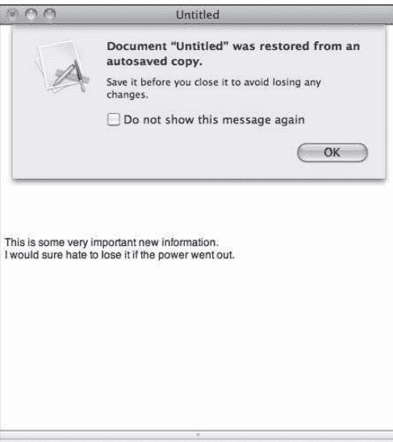

**图 7.1** 当恢复自动保存的文档时显示的警框。

## 步骤 8：备份日记文档

与自动保存日记文档的内容密切相关的是自动备份日记文档。

自动保存文档的内容在很大程度上是一个不可见的过程。自动保存的文档通常对用户隐藏，用户永远不会刻意打开它。每当用户保存或删除文档时，自动保存的文档就会被删除。它只在应用程序崩溃或被意外杀死时才会出现。

相比之下，文档的备份是可见的，并一直持续到用户删除它或创建另一个备份。它的目的是供用户打开，例如当用户对最近的更改不满意并倾向于回到之前保存的版本时。

默认情况下，基于文档的应用程序不保存文档备份。然而，让它们成为用户最后一次保存文档时的文档备份是非常容易的。文档保存过程通常是原子的，这意味着磁盘上的旧文档会被保留，同时将一个保存的副本写入磁盘。默认情况下，旧文件随后会被自动删除。

你可以轻松地安排保留旧文件。（注：原文此处存在重复段落，已按要求处理翻译逻辑）。

## 步骤 9：实现“恢复到已版本”（Revert to Saved）

在步骤 7 中，你编写了代码来自动保存日记并在崩溃或断电后恢复其之前保存的内容。在步骤 8 中，你编写了自动备份文档的代码，以便用户在保存更改后检索其内容。还有一个类似的操作等待编码：“恢复到已版本”菜单项。

目前，该菜单项工作不正常。它默认连接到内置的 `NSDocument` 操作 `-revertDocumentSaved`；但如果你在保存日记文档并输入一些文本后选择“文件 > 恢复到已版本”，应用程序将会崩溃。更糟糕的是，菜单项在错误的条件下是启用的。你必须编写一些代码来解决这个问题。

1. 从菜单项验证问题开始。你已经学习了如何验证菜单项，但在处理此菜单项之前，你必须知道在哪里验证它。在“基于文档的应用程序概述”的“基于文档的应用程序中关键对象的角色”部分，你了解到与当前焦点窗口相关的文档在用户保存、打印、恢复和关闭文档时会接收响应动作方法（responder action methods）。如果你在主菜单中选择“恢复到已版本”项，并在菜单项检查器中发现 `revertDocumentSaved:` 操作已连接到第一响应者代理（First Responder proxy）。因此，你必须在 `DiaryDocument` 类中实现一个验证方法来处理它。

基于文档的应用程序概述还提供了一个关键线索，解释了为什么“恢复到已版本”菜单项目前在不适当的情况下被验证。当没有打开 Chef 窗口时，该菜单项被正确禁用了。

为了验证此菜单项，在 `DiaryDocument.m` 实现文件中实现 `-validateUserInterfaceItem` 协议方法，紧随新的 `-keepBackupFile` 方法之后，如下：

```objc
#pragma mark MENU ITEM VALIDATION

- (BOOL)validateUserInterfaceItem:(id <NSValidatedUserInterfaceItem>)item {
    SEL action = [item action];
    if (action == @selector(revertDocumentToSaved:)) {
        VRDocumentController *controller = 
            [VRDocumentController sharedDocumentController];
        NSURL *currentDiaryURL = [controller currentDiaryURL];
        return [self canOpenURL:currentDiaryURL]
            && [self isDocumentEdited];
    }
    return [super validateUserInterfaceItem:item];
}
```

这种标准的用户界面项验证是在你在食谱 4 中学习过的。应用程序在打开菜单时会自动调用此方法。在这里，你通过返回 YES 来验证“恢复到已保存的内容”（Revert to Saved）菜单项，且只有在这种情况下，日记文档才能打开并包含未保存的编辑。第一个条件是使用你在食谱 6 的 `VRDocumentController` 中编写 `-canOpenURL:` 方法测试的。只有当文档已保存且不在垃圾箱中时，该方法才返回 YES。第二个条件是使用 `NSDocument` 的内置方法 `-isDocumentEdited` 测试的，该方法在 `NSDocument` 类文档中说明：如果接收者有未保存的更改，则返回 YES，否则返回 NO。

如果你构建并运行应用程序，你会发现当创建一个新的空白日记文档时，“恢复到已保存的内容”菜单项不再可用。如果存在之前保存过的日记文档但它在垃圾箱中，该项同样不可用。如果你只使用 `-currentDiaryURL` 方法测试已保存文档是否存在，而没有使用 `-canOpenURL:` 方法检查它是否在垃圾箱中，那么该项本应该是可用的。

2. 现在尝试让“恢复到已保存的内容”菜单项工作。这是一个很难攻克的难题，因为这个过程并没有在你自然会首先查找的地方进行详尽说明。通过对相关类引用的推索，并查阅 `NSDocument` 头文件以及 Mac OS X 10.4 Tiger 的发布说明，你将发现真正的路径。

根据“基于文档的应用程序概述”以及你对 Interface Builder 中 MainMenu nib 的检查，你已经知道“恢复到已保存的内容”菜单项触发的动作是 `-revertDocumentSaved`；并且它实现在 `NSDocument` 中。在 `NSDocument` 类引用中查找该动作方法：`-revertToContentsOfURL:ofType:error:`。`NSDocument` 类引用说明，该方法负责处理未保存的更改，并通过读取位于指定 URL 的文件或包来替换文档内容。太棒了！这正是你需要的。然而，它对日记文档不起，而且类引用中没有关于该方法如何实现的任何信息。

是时候开始那种熟悉的、有时又枯燥的信息搜索了。在 Xcode 的文档窗口中搜索开发者文档，除非运气好，否则进展不会很大。Google 找到了一些开发者感到沮丧的例子，但没有实用的信息。下一步是检查 `NSDocument` 头文件。在这里你大有收获。该头文件有大量的注释，而对 `-revertToContentsOfURL:ofType:error:` 方法的注释揭示了它调用了 `-readFromURL:ofType:error:` 以及许多其他方法。此外，相应的可用性宏表明 `-revertToContentsOfURL:ofType:error:` 方法从 Mac OS X 10.4 开始可用。

转向 Mac OS Developer Release Notes：Cocoa Application Framework (10.5 及早期版本) 并搜索 `-revertToContentsOfURL:ofType:error:` 方法。在 Tiger AppKit 发布说明中，你会发现几个章节，详细描述了 Tiger 及更高版本中基于文档的应用程序的内部机制。这些注释也明确了 Apple 期望你遵循的策略概纲。通常，Apple 建议调用以 `-save...` 和 `-revert...` 开头的方法，但建议以 `-write...` 和 `-read...` 开头的方法是“你根据需要重写的主要方法”。

综合以上这些，看起来你可能考虑重写 `-readFromURL:ofType:error:`。它以 `-read...` 开头，根据发布说明，它是重写的候选方法。此外，`NSDocument` 头文件中的注释说“此方法的默认实现创建一个 `NSFileWrapper` 并使用 `[self readFromFileWrapper:fileWrapper:type:typeName:outError]`”。可能有其他方法可以实现你的目标，例如重写 `-readFromData:`；沿着这条路径直到它带你到达哪里。

在你对 `-readFromURL:ofType:error:` 方法的重写中，你必须使用替代方案来替换默认使用的的文件封装技术。Vermont 食谱中的日记文档在 `NSTextStorage` 对象中持有 RTF 数据，该对象继承自 `NSMutableAttributedString`。为什么不使用 `NSMutableString` 中读取 URL 的方法之一呢？毕竟，它们可以处理 RTF 数据。试一下。

扫描 `NSMutableString` 类引用，你遇到了 `-readFromURL:options:documentAttributes:error:` 方法。它听起来很有前景。特别是，你注意到在这种情况下，它会将文件内容附加到文档中当前的数据内容，并警告说“当使用此方法处理现有内容时，最好显式地清除内容”。这有趣地让人联想起 `-revertToContentsOfURL:ofType:error:` 的描述，该方法说明在用磁盘上的内容替换内容之前，会丢弃所有未保存的文档修改。你正处于正确的轨道上。

将此方法添加到 `DiaryDocument.m` 实现文件中，位于 `-keepBackupFile:` 之后：

```objc
- (BOOL)readFromURL:(NSURL *)absoluteURL ofType:(NSString *)typeName
    error:(NSError **)outError {
    if ([self isRevertingToSavedDocument]) {
        NSMutableAttributedString *emptyString =
            [[[NSMutableAttributedString alloc] initWithString:@""] autorelease];
        [self diaryTextStorage setAttributedString:emptyString];
        NSError *error = nil;
        BOOL success = [self diaryTextStorage readFromURL:absoluteURL
            options:nil documentAttributes:nil error:&error];
        if (!success) [self presentError:error];
        return success;
    } else {
        return [super readFromURL:absoluteURL ofType:typeName
            error:outError];
    }
}
```

第一个方法检查应用程序当前是否正在恢复，使用一个你尚未编写的访问方法。`-readFromURL:options:documentAttributes:error:` 方法在 Cocoa 的其他情况下被调用，因此如果不是恢复操作，你必须调用父类的实现以允许其他操作发生。

如果是恢复操作，该方法首先通过将其文本存储设置为无属性的空字符串来丢弃文档现有的 RTF 内容，正如文档要求的那样。它调用了 `NSMutableAttributedString` 的 `-readFromURL:options:documentAttributes:error:` 方法。对于不在意的文档和属性传递 `nil`，并使用早些描述的技巧处理任何错误。然后返回之前保存的文档内容是否成功读取。

3. 接下来，实现 `-isRevertingToSavedDocument` 获取方法及其实例变量和设置方法。你之前处理 `-isRestoringAutosavedDocument` 获取方法时也是同样的操作。

在 `DiaryDocument.h` 头文件中，在 `isRestoringAutosavedDocument` 实例变量之后插入此声明：

```objc
BOOL isRevertingToSavedDocument;
```

在 `isRestoringAutosavedDocument` 方法之后声明访问方法：

```objc
- (void)setIsRevertingToSavedDocument:(BOOL)flag;
- (BOOL)isRevertingToSavedDocument;
```

在 `DiaryDocument.m` 实现文件中实现它们：

```objc
- (void)setIsRevertingToSavedDocument:(BOOL)flag {
    isRevertingToSavedDocument = flag;
}

- (BOOL)isRevertingToSavedDocument {
    return isRevertingToSavedDocument;
}
```

选择“文件 (File) > 另存为 (Save As)”并将日记文档保存到桌面。再次打开“文件”菜单，发现“恢复到已版本 (Revert to Saved)”菜单项仍处于禁用，因为你在保存后没有对其内容进行任何更改。

你现在不需要关闭它。相反，在窗口中多输入一些文本。窗口会立即标记为“已修改 (dirty)”。如果你等待大约 5 秒，桌面上会出现该文档的自动保存副本。窗口仍然被标记为“已修改”。

现在选择“文件 > 恢复到已版本”。你会发现菜单终于启用了，因为你对保存的日记文档做了未保存的更改。会弹出一个提示，询问你是否要恢复到保存的版本并丢弃更改。点击“恢复”，窗口的内容将立即恢复到上一次用户手动保存时的内容。此外，窗口被标记为“洁净 (clean)”。桌面上的自动保存文档图标也被移除了。

## 第 10 步：构建并运行应用程序

在这个配方的过程中你已经多次构建并运行应用程序，以测试每个完成的功能。但在配方结束时这样做始终是一个好主意，可以帮助你观察全局并发现不一致之处和缺失的功能。

再次从头开始。从 `~/Library/Autosaved Information` 或任何保存日记文档的文件夹中删除残留的自动保存文件。从 `~/Library/Preferences` 删除 `com.quecheoftware.Vermont-Recipes.plist` 文件。删除你定期保存的任何已日记文件。为了保险起见，清空垃圾桶。


# 构建并启动应用程序

缺少了什么？系统地检查菜单，从左到右、从上到下。应用程序 Builder 中的“设置 (Preferences)”菜单项不起作用。它没有连接到 Interface Builder 中的动作方法，并且在你打开应用程序菜单时它是禁用的。你将在配方 10 中实现“设置”。“文件”菜单中的“打印 (Print)”菜单项则没有。它在 Interface Builder 中连接了动作方法，但当你选择它时，会在调试器控制台中看到一条长而详细的错误信息，简而言之，你对一个方法进行了子类化，“是子类的职责但尚未被重写”。你将在配方 9 中实现打印功能。检查其余菜单及其菜单项，在到达“帮助 (Help)”菜单之前你没有发现其他漏洞。选择“帮助 > Vermont Recipes 帮助”，你会看到一个对话框报告“Vermont Recipes 不提供帮助”。你将在配方 11 中修复它。

非常明显，其余菜单项都在正常工作。玩“编辑”菜单底部的“拼写和语法 (Spelling and Grammar)”、“替换 (Substitutions)”和“转换 (Transformations)”菜单特别有趣。它们赋予了你强大的功能，而包含它们几乎不需要费吹精力。

# 第 11 步：保存并存档项目

退出运行中的应用程序，关闭 Xcode 项目窗口，如果提示则保存。丢弃构建文件夹，压缩项目文件夹，并将生成的 zip 文件副本保存到存档中，命名为 `Vermont Recipes 2.0.0 - Recipe 7.zip`。运行中的 Vermont Recipes 项目文件夹留在原地，为配方 8 做好准备。

# 结论

尽管 Vermont Recipes 现在已经完成了许多用户可用的功能，但还有更多工作要做。你在本配方的引言中预见了一些重要功能，例如对雪豹（Snow Leopard）强制终止技术的支持。你还必须确保应用程序在 Leopard 和 Snow Leopard 下运行正常，并且在 PowerPC Mac 和 Intel Mac 上都能运行。

你应该为应用程序添加许多其他功能，包括对辅助功能 (accessibility)的支持，并且你应该为应用程序的一些控件添加帮助标签。

你将在下一个配方配方 8 中处理这些和其他事项，该配方专注于完善应用程序。在第 2 部分的后续配方中，你将实现打印支持、设置窗口、帮助书籍以及 AppleScript 支持，并为应用程序部署到目标受众做好准备。

# 文档

阅读以下关于配方 7 所涵盖主题的文档。

## 类引用与协议文档

- `NSScreen` 类引用
- `NSDraw` 类引用
- `NSWindow` 类引用
- `NSWindowDelegate` 协议引用
- `NSUserDefaults` 类引用
- `NSNotification` 类引用
- `NSNotificationCenter` 类引用
- `NSToolbar` 类引用
- `NSApplicationDelegate` 协议引用
- `NSDocument` 类引用
- `UIAlert` 类引用

## 通用文档

- Objective-C 编程语言（分类与扩展）
- Cocoa 编码规范
- Apple 人机界面 Builder指南（Windows）
- Interface Builder 用户指南（移动和调整窗口大小）
- 窗口编程指南（窗口的大小与放置）
- Cocoa 工具栏编程主题（计算工具栏高度）
- 抽屉 (Drawers)
- Cocoa 二进制数据编程主题
- Cocoa 通知编程主题
- 基于文档的应用程序概述（文档架构中的自动保存）
- Mac OS X 开发者发布说明：Cocoa 应用程序框架 (10.5 及早期版本)

# 配方 8：完善应用程序

在配方 7 中，你通过使窗口符合 Apple 人机界面指南 (HIG) 的要求优化了日记文档的可用性。在本配方中，你将根据 HIG 的要求完善 Vermont Recipes 应用程序的各种功能，并通过其他方式对其进行润色。

此配方涉及多项任务。路线图如下：配方从对应用程序菜单栏的少量添加和改进开始。然后添加帮助以给用户提供……它将根据 HIG 的要求完善 Vermont Recipes 应用程序的各种功能，你也将通过其他方式对其进行润色。（注：此处已修正文本重复）。

## 亮点

- 配方从对应用程序菜单栏的少量添加和改进开始。
- 然后添加帮助以给用户提供……
- 它将根据 HIG 的要求完善 Vermont Recipes 应用程序的各种功能，你也将通过其他方式对其进行润色。
- PDF 菜单包含多个与 PDF 相关的选项，并且是可以自定义的。
- 因为可以从 Apple 获取 TextEdit 1.6 的示例代码，你对其并进行了少量修改。
- 为了让 Leopard 下的“另存为”菜单项生效，你必须整合 Apple 的长版本示例代码并针对 Leopard 进行修改。
- 长版本的示例代码不在 TextEdit 应用程序中，而是在附带的 readme 文件中。
- 查看此代码，你会发现 PDF 功能与 Cocoa 打印是紧密相关的。
- 1. 首先执行每个配方开始时执行的仪式，增加构建版本。打开 `Vermont Recipes 2.0.0` 文件夹（你在配方 7 结束时保存项目文件夹的地方），保留存档的配方 7 项目文件夹，并打开 `Vermont Recipes` 子文件夹。

在 Vermont Recipes 目标信息窗口的属性面板将版本从 7 更改为 8，这样应用程序的版本就会在“关于 (About)”窗口中显示为 2.0.0 (8)。

2. 在 `DiaryDocument.h` 头文件中，在 Accessor Methods（访问方法）部分之后声明此动作方法：

```objc
#pragma mark ACTION METHODS
- (IBAction)saveDocumentAsPDFTo:(id)sender;
```

在 `DiaryDocument.m` 实现文件中定义它：

```objc
#pragma mark ACTION METHODS
- (IBAction)saveDocumentAsPDFTo:(id)sender {
    NSSavePanel *savePanel = [NSSavePanel savePanel];
    NSWindow *window = [[self windowControllers] objectAtIndex:0] window];
    if (floor(NSAppKitVersionNumber) > NSAppKitVersionNumber10_5) {
        [self printDocumentWithSettings:[NSDictionary dictionaryWithObjectsAndKeys:NSPrintSaveJob, NSPrintJobDisposition, nil] showPrintPanel:NO delegate:nil didPrintSelector:NULL contextInfo:NULL];
    } else {
        [savePanel setRequiredFileType:@"pdf"];
        [savePanel setSelectHiddenExtension:YES];
        [savePanel beginSheetForDirectory:nil file:nil modalForWindow:window modalDelegate:self didEndSelector:@selector(savePanelDidEnd:returnCode:contextInfo:) contextInfo:NULL];
    }
}

- (void)savePanelDidEnd:(NSSavePanel *)sheet returnCode:(int)returnCode contextInfo:(void *)contextInfo {
    if (returnCode == NSOKButton) {
        [self printDocumentWithSettings:[NSDictionary dictionaryWithObjectsAndKeys:NSPrintSaveJob, NSPrintJobDisposition, [sheet filename], NSPrintSavePath, nil] showPrintPanel:NO delegate:nil didPrintSelector:NULL contextInfo:NULL];
        if ([sheet isExtensionHidden]) {
            [[NSFileManager defaultManager] setAttributes:[NSDictionary dictionaryWithObjectsAndKeys:[NSNumber numberWithBool:YES], NSFileExtensionHidden, nil] ofItemAtPath:[sheet filename] error:NULL];
        }
    }
}
```

在动作方法的 `if` 子句的第一个分支中（该分支仅在 Snow Leopard 系统下执行），你只需调用 `-printDocumentWithSettings:showPrintPanel:delegate:didPrintSelector:contextInfo:`，这与 TextEdit 示例代码完全一致。你将第一个参数以外的所有参数都设置为 `NO`、`nil` 或 `NULL`，表示你不想显示打印面板。操作仅此而已。

生成 PDF 文件的关键在于第一个参数。《Mac OS X Snow Leopard 发布说明：Cocoa 框架》在名为“文档打印中对‘另存为...’的新支持”的章节解释了该方法在 Snow Leopard 中具有新行为。具体来说，如果你在传递给第一个参数的字典中包含了带有 `NSPrintJobDisposition` 的 `SaveJob` 值，但不包含路径或 URL 值，那么 `NSDocument` 就会显示标准的保存面板，邀请你另存为 PDF。

其余的所有代码仅是为了让 Leopard 系统下的“另存为 PDF”项正常工作。在这个分支中，你必须设置并显式打开“另存为”面板，因为 `-printDocumentWithSettings:showPrintPanel:delegate:didPrintSelector:contextInfo:` 方法仅在 Leopard 下才能为你完成此操作。`-beginSheetForDirectory:file:modalForWindow:modalDelegate:didEndSelector:contextInfo:` 要求你在临时代理（通常是 `self`）上实现一个回调函数。你通过实现 `-savePanelDidEnd:returnCode:contextInfo:` 并使用 `NSSavePanel` 类引用中描述的强制签名来完成。此方法仅在应用程序运行于 Leopard 时才会被调用。

3. 添加菜单项并在 Interface Builder 中连接它。在菜单栏界面打开“文件”（File）菜单。从库（Library）窗口拖出一个“Menu Item”对象并将其放到“文件”菜单中“另存为”（Save As）项下方，然后将其标题更改为 Save As PDF...（这三个点是省略号，通过输入 `Option-分号` 插入）。像 TextEdit 那样将 `As` 大写。HIG（人类界面指南）指出，菜单项应使用标题大小写，在“保存”菜单项中 `As` 是大写的，“另存为 PDF”中也是如此。从新建的“另存为 PDF”项按 Control 键拖拽到 nib 文件文档中的第一响应者（First Responder）代理上。在 HUD 中，选择 `saveDocumentAsPDFTo:` 动作。然后是 nib 文件（图 8.1）。

| 新食谱文件 | X |
| :--- | :--- |
| 新厨师日记 | |
| 打开 | X |
| 最近 | |
| 关闭 | |
| 保存 | X |
| 另存为... | X |
| 恢复到已保存 | |
| 页面设置... | X |
| 打印... | X |

图 8.1 “文件”菜单中新的“另存为 PDF”项。

食谱 8：完善应用程序

4. 你还没有完成。编译并运行应用程序以找出原因，因为在 TextEdit 示例代码或 read-me 文件中并没有解释这一点。创建一个新的“厨师日记”文档并在其中输入几个字符。然后选择“文件 > 导出 PDF”。它不起作用，并且你在调试器控制台中看到一条错误消息，指示你负责重写 `-printOperationWithSettings:error:` 方法。看起来你得更深入地与 Cocoa 的打印 API 打交道了。

`NSDocument` 类引用指出，`-printOperationWithSettings:showPrintPanel:delegate:didPrintSelector:contextInfo:` 方法的默认实现会调用 `-printOperationWithSettings:error:` 方法。类引用说明，后者的实现（这是 Cocoa 框架中声明并实现的许多方法之一）什么都不做。正如文档所述，你必须重写它。文档建议你将传入的字典添加到文档 `printInfo` 的副本中。参考 TextEdit 的做法，在 `DiaryDocument.m` 的末尾添加以下方法：

```objc
- (NSPrintOperation *)printOperationWithSettings:(NSDictionary *)printSettings error:(NSError **)outError {
    NSPrintInfo *tempPrintInfo = [self printInfo];
    if ([printSettings count] > 0) {
        tempPrintInfo = [[tempPrintInfo copy] autorelease];
        [tempPrintInfo addEntriesFromDictionary:printSettings];
    }
    NSPrintOperation *op = [NSPrintOperation printOperationWithView:[[[self windowControllers] objectAtIndex:0] keyView] printInfo:tempPrintInfo];
    if ((op == nil) && (outError != NULL)) {
        *outError = [NSError errorWithDomain:NSCocoaErrorDomain code:NSUserCancelledError userInfo:nil];
    }
    return op;
}
```

正如类引用建议的，该方法在检查设置字典至少包含一个设置后，将传入的设置字典添加到文档 `printInfo` 的副本中。它创建了一个打印操作并返回它。我们在这里不涉及 Cocoa 打印 API 的复杂细节，例如打印操作的作用。目前，只需知道此处调用的 `-printOperationWithView:printInfo:` 方法使应用程序能够提取日记视图的内容并将其转换为 PDF。

该方法从窗口控制器索引为 0 的 `DiaryViewController` 获取 `-printOperationWithView:printInfo:` 方法第一个参数所需的日记视图。

编译并运行应用程序，按照之前重写 `-printOperationWithSettings:error:` 之前的步骤进行。这次，当你选择“文件 > 导出为 PDF”并点击保存面板中的“保存”时，应用程序将成功保存厨师日记的 PDF 版本（见图 8.2）。

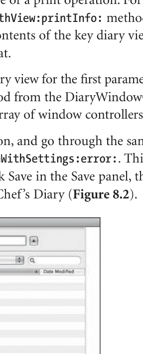

如果你在厨师日记中输入了很多文本，你会发现它处理分页的能力并不好。例如，最后一页的文本是垂直居中的，而不是对齐到页面顶部。当你以后更多使用 Cocoa 打印 API 时，应该考虑重新审视 `-printOperationWithView:printInfo:` 方法，以便在将厨师日记打印到真实打印机时能够工作。那时你也可以处理 PDF 文件的分页和其他格式问题。

在步骤 8 中，你返回“另存为 PDF”菜单项，添加对默认字典名称“厨师日记”的支持。这将涉及对 `-saveDocumentAsPDFTo:` 方法的大量重写。

## 步骤 2：交替使用显示食谱信息和隐藏食谱信息菜单项

在配方 5 的第 5 步中，你为应用程序的“窗口”菜单添加了一个“食谱信息”（Recipe Info）菜单项。选择它可以打开食谱窗口的抽屉，再次选择则关闭抽屉。

该菜单项没有指示抽屉的当前状态。无论抽屉是打开还是关闭，它的标题都是“食谱信息”。这并不清晰，特别是当抽屉已打开、食谱信息已经显示出来时。按照惯例，切换用户界面中某个状态的菜单项应该指示其当前状态；Apple 人机界面指南（HIG）在这一点上非常强调，在指南中明确建议你避免这种歧义性，这出现在“切换菜单项”（Toggled Menu Items）章节。例如，虽然我当时没有提到，但你在配方 2 的第 2 步为食谱窗口添加工具栏时，Main 文件中内置的“显示工具栏”（Show Toolbar）菜单项可以工作，并且每次你选择它时，它会自动从“显示工具栏”变为“隐藏工具栏”。另一种指示状态的常用技术是在状态开启时在菜单项前添加一个复选框，但对于切换显示的用户界面项来说，“显示/隐藏”模型更为合适。

在本配方中，你将增强“食谱信息”菜单项，使其能够像“显示工具栏”菜单项一样，每当你点击它时，标题都会从“显示食谱信息”切换到“隐藏食谱信息”，反之亦然。


- 在开始之前，先考虑一下这个菜单项是否真的属于“窗口”菜单。它是否应该放在“视图”菜单中？HIG 在两个章节中回答了这个问题：“视图菜单”和“窗口菜单”。这些章节告诉你，“视图”菜单应该包含影响“用户如何查看窗口内容”的命令，而“窗口”菜单应该包含“用于选择文档窗口进行查看或管理特定文档窗口”以及“组织、选择和管理窗口”的命令。如果你感到困惑，你并不孤单。

参考示例以获取帮助。示例使用 Finder 表明“显示工具栏”、“显示路径栏”和“显示状态栏”属于“视图”菜单，而当前的 Finder 还包含了“侧边栏”。这些元素的共同点是，每个用户界面元素都是窗口的一部分，抽屉也是如此。此外，Finder 的侧边栏与 Preview 中“视图”菜单下具有“显示”菜单项的侧边栏一样，在界面设计上是可选的方案。综合来看，“显示食谱信息”菜单项应该放在“视图”菜单中。

打开 `MainMenu.nib` 文件。在菜单栏设计界面上，点击“窗口”菜单的标题打开菜单。将“食谱信息”菜单项从“窗口”菜单拖出，并悬停在“视图”标题上。耐心等待，片刻后，“视图”菜单打开了。将“食谱信息”菜单项放在“视图”菜单的顶部。

回到“窗口”菜单并删除一个分隔符。选择它并按 `Delete` 键。从库窗口拖出一个新的分隔符项，将其释放到“食谱信息”菜单项上方。

最后，验证“食谱信息”菜单项是否仍然连接。选择它，然后打开“菜单项连接”检查器。确保切换操作仍然连接到第一响应者代理。

- 2. 现在更改菜单项的名称。双击“食谱信息”菜单项进行选中编辑，并将其标题更改为“显示食谱信息”。

- 3. 顺便添加一个键盘快捷键，类似于 Apple 为“显示工具栏”菜单项提供的 `Command-Option-T` 快捷键。`Command-Option-R` 效果会很好。

在添加键盘快捷键之前，你应该始终检查 HIG 以确保它没有被 Apple 预留，并且没有违反 Apple 对可用快捷键的任何规则。HIG 中的“键盘快捷键参考”包含一个表格，列出了所有受这些约束影响的快捷键。你还应该查看辅助功能概览中“辅助快捷键”章节里通用访问功能预留的快捷键表格。最后，阅读 Mac OS 快捷键 Apple 支持文章 HT1343。通过检查这些文档，你会发现 `Command-Option-R` 是可用的。

选择“显示食谱”菜单项。在“菜单项属性”检查器中，点击等效左侧的文本字段，同时按下 `Command`、`Option` 和 `R` 键。文本字段中会出现 `Command-Option-R` 的符号。按回车键或点击字段外部以提交快捷键。

- 4. 现在编写一些代码，根据“食谱信息”抽屉的当前状态，将菜单栏标题设置为“显示食谱信息”或“食谱信息”。你在食谱 6 中学习过如何做到这一点，当时你在 `VRDocumentController` 中实现 `-validateUserInterfaceItem` 时创建了“新厨师日记”和“打开厨师日记”菜单项标题。在那里，你了解到必须在菜单项中实现 `-validateUserInterfaceItem` 方法——即实现动作方法的类。

“食谱信息”或“隐藏食谱”菜单项指向抽屉，而 `NSDrawer` 实现了菜单项发送到该目标的动作 `-toggle:`。因此，你必须在抽屉类中实现 `-validateUserInterfaceItem:` 方法。要做到这一点，你必须对 `NSDrawer` 进行子类化，因为你无法访问它的实现文件。

你已经创建了几个新类，所以你知道这很简单。首先，通过在项目窗口的“组与文件”面板中创建一个新组来保持项目窗口整洁，可以使用右键菜单或 `Project > New Group`。命名为 Views & Respondents。如果视图和响应者有许多共同点，将它们放在一起是合理的。选择新组，通过右键菜单选择 `Add > New File`。创建一个头文件和一个实现文件，并将它们命名为 `RecipeDrawer`。

- 5. 编辑 `RecipeDrawer.h` 中的 `@interface`，使 `RecipeDrawer` 继承自 `NSDrawer`，并添加 `NSInterface` 以声明它符合协议。

```objc
@interface RecipeDrawer : NSDrawer<NSInterface>
```

- 6. 在实现文件中，定义 `-validateUserInterfaceItem` 方法：

```objc
#pragma mark INTERFACE VALIDATION

-(BOOL)validateUserInterfaceItem:(id)item {
    SEL action = [item action];
    if ([item isKindOfClass:[NSMenuItem class]]
        && action == @selector(toggle:)) {
        if ([self state] == NSDrawerClosed) {
            [(NSMenuItem *)item setTitle:LocalizedString("Show Recipe\nInfo")];
        } else {
            [(NSMenuItem *)item setTitle:LocalizedString("Hide Recipe\nInfo")];
        }
    }
    return YES;
}
```

你在之前的食谱中写过类似的方法，因此不需要过多解释。然而，你应该注意测试传入的项是否为菜单。

- 7. 最后的要求是更改 `RecipesWindow.nib` 文件中抽屉的类，从 `NSDrawer` 改为 `RecipeDrawer`。在 `RecipesWindow.nib` 文件中选择 Drawer，并使用类弹出菜单更改其类。

- 8. 构建并运行应用程序。食谱窗口如常打开。打开“视图”菜单，你会看到“显示食谱信息”项及其键盘快捷键。它是启用的，因为抽屉在响应链中并实现了切换动作。为了确保万无一失，创建一个厨师日记并再次打开“视图”菜单。“显示食谱信息”以及“隐藏工具栏”和“自定义工具栏”菜单项都是禁用的，因为食谱窗口及其抽屉已从响应链中移除。关闭厨师日记或将食谱窗口置于前台。

选择 `View > 显示食谱信息`。抽屉打开。选择 `View > 隐藏食谱信息`。是的，菜单项名称变成了“食谱信息”，抽屉关闭。双击 `Command-Option-R` 快捷键，抽屉打开并关闭。为了保险起见，点击工具栏上的食谱信息按钮。抽屉打开并关闭。

### 步骤 3：使用动态的“添加标签”和“标记所有”菜单项

创建交替菜单项的另一种方法，这次是在用户控制下，而不是响应应用程序状态的变化。当用户按住修饰键（例如 `Option` 键）时，菜单项会有备用名称和动作。Apple 人机界面指南将这些称为动态菜单。在本步骤中，你将允许用户通过按住 `Option` 键将日记菜单中的“添加标签”菜单项更改为“标记所有”菜单项。

这种情况发生了多次。例如，在 Finder 中，打开“文件”菜单，然后按下 `Option` 键。按住该键时，五个菜单项的名称会发生变化。例如，“关闭窗口”变为“关闭所有”。

1. 备用菜单项和按钮名称“全部标记”应该执行不同的功能，当然，首先要添加一个新的动作方法。它从上到下扫描日记，寻找尚未关联标签列表的条目，并一次性为所有条目添加标签。

在 `DiaryWindowController.h` 头文件中，在现有 `-addTag:` 方法之后声明新的动作方法，如下：

```objc
- (IBAction)tagAll:(id)sender;
```

在 `DiaryWindowController.m` 实现文件中实现它：

```objc
- (IBAction)tagAll:(id)sender {
    NSTextView *keyView = [self diaryView];
    NSTextStorage *storage = [keyView textStorage];
    NSString *tagString = [[self document] tagInsert];
    NSRange thisEntryRange = [[self document] firstEntryTitleRange];
    if (thisEntryRange.location == NSNotFound) return;
    NSRange tagRange;
    do {
        tagRange = [[self document]
            currentEntryTagRangeForIndex:thisEntryRange.location
            + thisEntryRange.length];
        if (tagRange.length == 0) {
            if ([keyView shouldChangeTextIn:tagRange
                replacementString:tagString]) {
                [storage replaceCharactersIn:tagRange
                    withString:tagString];
                tagRange.length = [tagString length];
                [storage applyFontTraits:NSBoldFontMask
                    range:tagRange];
                [keyView didChangeText];
                [[keyView undoManager] setActionName:
                    NSLocalizedString("@Tag All", "name of undo action for Tag All")];
            }
        }
        thisEntryRange = [[self document]
            nextEntryTitleForIndex:thisEntryRange.location
            + thisEntryRange.length];
    } while (thisEntryRange.location != NSNotFound);

    [[self window] makeFirstResponder:keyView];
    [keyView scrollRangeToVisible:tagRange];
    [keyView setSelectedRange:NSMakeRange(tagRange.location
        + tagRange.length, 0)];
}
```

`-tagAll:` 动作方法与 `-addTag:` 方法非常相似。唯一的区别在于，它不是根据插入点的位置在当前条目中按需插入标签，而是从条目开始，根据移动的索引在每个日记条目中按需添加标签。

- 切换到 Interface Builder，并设置发送你新动作消息的备用菜单项。

设置备用菜单项的第一部分——将其添加到菜单栏、命名并连接到其动作——是熟悉的。打开 `MainMenu.nib`，在菜单栏设计界面上打开“日记”菜单。在“日记”菜单上画一个菜单项，并将其拖到“添加标签”菜单项上。双击新的菜单项名称并将其标记为“全部标记”。从新的“全部标记”项拖动到 `MainMenu.nib` 文档窗口中的第一响应者代理，并选择 `tagAll:` 动作。

现在将其变为一个真正的备用菜单项。选择新的“全部标记”菜单项。在菜单属性检查器的部分，勾选 `Alternate` 复选框。这告诉 Interface Builder，“全部标记”菜单项是上一个项“添加标签”的备用项。在菜单栏设计界面选中“全部标记”菜单项时，点击检查器中等效键部分的左侧字段，并按下键盘上的 `Option` 键。按下 `Enter` 键或跳出该字段以提交输入。保存 nib 文件。

这在 `NSMenuItem` 类参考的 `-setAlternate:` 方法中有记录，如果你倾向于不使用 Interface Builder，可以使用代码。如果菜单项具有相同的等效键但不同的修饰键，Cocoa 会将一个菜单项视为另一个的备用项。在这里，两个菜单项都使用空字符串作为等效键，但它们的修饰键不同；具体而言，“全部标记”菜单项使用 `Option` 键作为修饰键，而“添加标签”项没有修饰键。由于这些安排，当你按住修饰键时，Cocoa 显示“添加标签”，当你按住 `Option` 键时显示“全部标记”。当你选择其中任何一个时，都会发送相应的动作。

3. 不要忘记处理验证以启用或禁用备用菜单项。在 `DiaryWindowController.m` 实现文件中，现有的 `-validateUserInterfaceItem:` 方法中，在 `addTag:` 方法相似代码之后添加以下内容：

```objc
} else if (action == @selector(tagAll)) {
    return ([[document] firstEntryTitleRange].location != NSNotFound);
```

如果没有条目，无法添加标签，菜单项将被禁用。如果至少有一个条目，你就可以添加标签。为了验证，你不需要搜索日记来检查是否所有条目都有标签。

4. 你已经准备好查看它是否有效了。编译并运行应用程序。点击打开日记使其保持显示，你会发现由于没有打开日记文档，所有菜单项都是禁用的。按下 `Option` 键，备用的“添加标签”会变为“全部标记”。这样就对了。

创建一个新的日记文档，但保持为空。再次打开日记。再次打开，你会发现由于没有打开日记文档，所有菜单项都是禁用的。按下 `Option` 键，备用的“添加标签”会变为“全部标记”。这样就对了。

### Blocks

Blocks API 是 Snow Leopard 中新增的特性，基于 blocks 的方法现在出现在整个 Cocoa 框架中。在某些情况下，旧的非 blocks 方法在 Snow Leopard 中被标记为已弃用，因此在 Snow Leopard 应用程序中你应该使用基于 blocks 的对应方法。Apple 已经将 blocks 开源，并建议将其作为 C 标准的补充。信息很明确：Blocks 已经到来了。它们将长期存在，你必须学会与它们共处。

我怀疑对于某些人来说，这种过渡将并不容易。Blocks 的语法与 C 函数指针相似，初看之下确实相当吓人。Cocoa 中的 blocks（包括此这一个）倾向于通过这种方式来鼓励初学者：为了学习 Objective-C 和 Cocoa 框架，你并不真的需要了解 C 的精细之处。这在大多数情况下是正确的，但事实一直是，Cocoa 的某些地方总会有方法需要你学习 C 几乎所有晦奥的方面。现在，函数指针语法和新的 block 语法加入了这一行列。

在 Objective-C 中，blocks 是对象，可以在代码中创建并将它们赋值给变量，或者作为函数和方法的参数使用。Blocks 通过拷贝当前上下文中局部变量的值来捕获局部状态，并且可以在需要时改变状态。它们可以作为数据的形式进行传递和重用。这种语法——即参数值的使用、在 block 内部使用其他操作，以及将 blocks 集成到代码的其他部分——看起来与熟悉的 Objective-C 用法非常不同，尽管在 Objective-C 代码中，blocks 被视为普通的 Objective-C 对象。我在这里不详细阐述语法。请阅读 Apple 的《编程主题》以及《Introduction to Blocks and Grand Central Dispatch》一书中的“Block Objects”部分，以获取最权威的信息。

在 Objective-C 上下文中，block 是一个声明方式类似于 C 函数指针的对象，但用脱字符符号（`^`）代替了星号（`*`）。例如，在第 4 步使用的基于 blocks 的方法中，方法处理程序的 block 参数声明如下：参数看起来像：

```objc
(KeyEvent*)block
```

这可以被称为匿名 block。如果你倾向于给它命名，可以这样声明变量：

```objc
(KeyEvent*) (*myHandler)(KeyEvent*)block
```

第一部分 `KeyEvent*` 表明该 block 返回一个 `NSEvent` 对象。下一部分 `(*myHandler)` 识别出这是一个未命名 block 或命名为 `Handler` 的 block。第三部分 `KeyEvent*` 表明该 block 接收一个未命名的参数，即另一个 `NSEvent` 对象。如果此 block 有额外的参数，它们将在参数列表中用逗号分隔。

### 第 4 步：使用动态标签并标记所有按钮

### Blocks（续）

`^` 运算符标记了 block 表达式的开始。当你将 block 作为函数或方法的参数时，构成 block 主体的代码通常以内联形式写在大花括号中。

在 Objective-C 中，blocks 可以在代码中传递，且 block 类型可以声明为 `typedef`。Blocks 起始于栈上，但你可以通过发送 `-copy` 消息将它们移动到堆上。为了正确的内存管理，你必须平衡每一次 `-copy` 和 `-retain` 调用，对应一次 `-release` 调用。


Blocks 在使用上下文信息的代码中特别有用，例如回调（`callbacks`）和自定义迭代（`iterations`）。Cocoa 框架中的基于 blocks 方法经常这样做，Apple 也采纳了强调这种用法的命名规范。例如，你在食谱 4 中使用的基于 blocks 的方法引用了监控器（`monitor`）和处理器（`handler`）。几个新的 Leopard 方法接受一个调用的完成处理程序（`completion handler`），它取代了旧方法中的模态代理回调（`modal delegate callback`）。其他方法使用 blocks 来遍历、搜索或排序像 `NSArray` 这样的集合。

开发者社区似乎对 blocks 非常着迷。最近出现了大量文章，其中一些列在食谱 8 结尾的“文档”侧边栏中。一旦你习惯了它们，blocks 可能会让你的代码更简单，并让你的应用程序的一些操作运行更快。

blocks 有一个你在这一步会遇到的尴尬方面：它们不仅在 Leopard 下运行可以工作，而且如果你的应用程序包含了基于 blocks 的代码，应用程序在 Leopard 下甚至无法启动。目前，Apple 记录这一行为。你无法通过绕过基于 blocks 代码进行分支处理来解决这个问题，正如你之前数次这样做，以避免调用仅存在于 Snow 中的方法那样。

其原因是 blocks 使用了一个在 Leopard 上不可用的运行时库，如果你在启动应用程序时动态加载器没有找到这个运行时库，应用程序的图标会在 Dock 中跳动几次然后消失。系统警报会通知用户应用程序意外退出，控制台中会出现一条晦涩的错误信息。

在 Leopard 下运行基于 blocks 应用程序的标准方法是从编译后的二进制文件中移除所有基于 blocks 代码。要做到这一点，你必须使用所谓的可用块（`availability blocks`），并将基于 blocks 代码编译到独立的二进制文件中，然后确保该独立二进制文件仅在 Snow Leopard 下启动应用程序时才加载。此方法的一种是构建应用程序的两个版本：一个针对 Leopard 用户，一个针对 Snow Leopard 用户。

一旦你发布了应用程序，这种解决方案将难以管理，但市场上已有示例。更好的解决方案是将所有基于 blocks 代码放在单独的包（`bundle`）中，将其包含在应用程序包中，并安排在应用程序运行于 Snow Leopard 下运行时加载它。这是一种超出本书范围的高级技术，尽管做起来并不算困难。当然，最简单的解决方案是……

在 `DiaryWindowController` 的头文件中如下所示声明它，放在实例变量的末尾：

```objc
id eventMonitor;
```

在 `Accessor Methods` 部分的末尾声明其访问器方法，如下：

```objc
- (void)setMonitor:(id)eventMonitor;
- (id)eventMonitor;
```

在 `DiaryWindowController.m` 实现文件中按所示定义访问器方法：

```objc
- (void)setMonitor:(id)monitor {
    eventMonitor = monitor;
}

- (id)eventMonitor {
    return eventMonitor;
}
```

这些访问器没有实现你在“食谱 3”（`Recipe 3`）中首次遇到的标准内存管理技术。尽管 `NSEvent` 类引用中对 `+localMonitorForEventsMatchingMask:handler:` 方法的描述没有说明，但通常情况下你不需要保留（`retain`）和释放（`release`）事件监听器。这些信息隐藏在在你没有任何答案时应该始终查看的地方：在本例中，就是头文件 `NSEvent.h`。

### 4. 安装事件监听器

现在，在 `DiaryWindowController.m` 实现文件的 `-windowDidLoad` 方法末尾安装事件，添加以下内容：

```objc
#if MAC_OS_X_VERSION_REQUIRED > MAC_OS_X_VERSION_10_6
[self setEvent:[NSEvent localMonitorForEventsMatchingMask:NSFlagsChangedMask handler:(NSEvent *incomingEvent) {
    [self toggleTagButtonForModifierFlags:incomingEvent modifierFlags];
    return incomingEvent;
}]];
#endif
```

这段代码使用了块（`blocks`），因此你使用可用性宏 `MAC_OS_X_VERSION_REQUIRED` 将其包含在编译器指令中。结果是当你当前配置构建应用程序目标时，这段代码不会被包含，因为你将应用程序目标的 Mac OS 部署目标（`MACOSX_DEPLOYMENT_TARGET`）构建设置为 Mac OS X 10.5 (10.5)。

上述条件未满足，因为如果你在目标的 `Info` 窗口的构建设置选项卡中设置了部署目标，`MAC_OS_X_MIN_REQUIRED` 宏将自动设置为与之匹配。因此，应用程序将在 Leopard 下运行，但当你运行 Snow Leopard 时，动态按钮将无法工作。几秒钟后，你将为 Snow Leopard 设置第二个目标，并将其部署设置为 Mac OS 10.6 Snow Leopard。该目标的应用程序在 Leopard 下不会运行，但在 Snow Leopard 下运行时，动态按钮将可以工作。

如果你以前从未见过基于块的方法，那么传递给 `handler:` 参数的参数看起来可能非常奇怪。它是一个块。在头文件中，块参数的声明如下：`(NSEvent* (^NSEvent*))block`。在 `NSEvent` 类引用中，它被描述为“事件处理程序块对象”，它被传递给事件。在这里，它返回一个 `NSEvent`，在一种情况下，它就是它收到的同一个 `incomingEvent`。

这段代码有两个方面非常重要。块的第一行包含了每当监听器观察到器向 Vermont Recipes 的键盘事件时都会执行的代码。换句话说，在 `windowDidLoad` 方法消失很久之后，块仍然一直存在并继续执行其工作。块代码提取了刚刚观察到的传入事件（`incomingEvent`）的修饰键标志（`modifier flags`）值，并将其传递给你刚刚编写的 `toggleAddTagButtonModifierFlags` 方法。如果修饰键标志匹配你指定的，该方法将更改 Add 按钮的标题和动作。你可以直接在内联块中放置 `toggleAddTagButtonModifierFlags:` 方法中的所有语句，但你将它们放在单独的方法中，是因为你需要复用它。

其次，块返回了 `incomingEvent`。如果你没有以这种方式返回事件对象，它将无法传递给可能期待它的其他代码，且事件在方法外部将不会被注意到。这将是一场灾难，因为用户对任何修饰键的所有按下都将被阻塞。通过返回 `nil` 来阻塞特定事件有时是有用的，你可以用不同的事件来执行一些非常奇的事情。但通常，你应该像这里这样返回未经修改的事件。

`+localMonitorForEventsMatchingMask:handler:` 方法是 Leopard 和 Snow Leopard 新方法之一，扩展了你处理事件的功能。在 Snow Leopard 中，你可以轻松地监控并响应其他应用程序中的事件，这开启了许多可能性。通过 `+eventWithGEvent:` 和 `+eventWithEventRef:` 方法，你可以轻松地使用 Core Graphics 和 Carbon API，包括 Quartz Event Taps。

要查看你可以用 Event Taps 做什么，请下载我最近编写的免费开发者工具 Event Taps Testbench，地址为：http://prefabsoftware.com/eventtaptesttestbench/

### 移除事件监听器

当你完成事件监听器后，应该移除它。在这里，事件监听器在日记窗口整个生命周期内都需要，因此在 `-windowDidClose` 代理方法中移除。在 `DiaryWindow.m` 实现的代理方法末尾插入此方法：

```objc
- (void)windowDidClose:(NSNotification *)notification {
    if (floor(NSAppKitVersionNumber) > NSAppKitVersionNumber10_5) {
        if ([self eventMonitor])
            [NSEvent removeMonitor:[self eventMonitor]];
    }
}
```

再次，`NSEvent.h` 头文件表明你不需要释放事件监听器。

包含外层的 `if` 是因为 `-removeMonitor:` 方法是在 Snow Leopard 中引入的。该方法不会包含在可用性宏中因为它包含任何块代码。它在 Leopard 下永远不会被调用。

### 设置菜单代理

在测试新的动态按钮之前，必须构建一个部署目标设置为 Snow Leopard 的应用程序版本，这样你编写的基于块的代码才会被编译进程序。

你无法使用 Interface Builder 为应用程序菜单设置 `DiaryWindowController` 的代理（`delegate`），因为菜单位于 MainMenu 文件中，而 `DiaryWindowController` 却在另一个 nib 文件中。你必须通过编程的方式来实现这一点。在 `DiaryWindowController.m` 实现文件的 `-windowDidLoad` 方法的末尾，在 Snow Leopard 的可访问性宏内部添加以下代码：

```objc
for (NSMenuItem *menuItem in [[NSApplication mainMenu] itemArray]) {
    [[menuItem submenu] setDelegate:self];
}
```

这利用了这样一个事实：由 `NSApplication` 控制的主菜单包含一个菜单项数组，并且每个菜单项都拥有一个子菜单，该子菜单是应用程序的主菜单之一（例如编辑菜单）。通过遍历所有菜单项，并将窗口控制器设置为每个菜单栏项的代理，你就可以完成该任务。

为了避免在 Snow Leopard 下编译此代码时出现编译器警告，你必须声明 `DiaryWindowController` 遵循 `NSMenuDelegate` 协议。要这样做，请编辑 `DiaryWindowController.h` 头文件，使 `@interface` 声明看起来如下：

```objc
@interface DiaryWindowController : NSWindowController <NSUserInterfaceValidations, NSMenuDelegate>
```

当窗口关闭时，你应该将代理关系设为 `nil`，以消除在窗口关闭且窗口控制器不再可用后，可能尝试向代理发送消息的风险。在你刚刚编写 `-windowWillClose` 代理方法的末尾，再次在测试 Snow Leopard 的 if 块内部添加此代码：

```objc
for (NSMenuItem *menuItem in [[NSApplication mainMenu] itemArray]) {
    [[menuItem submenu] setDelegate:nil];
}
```

最后，在 `DiaryWindowController.m` 实现文件的 `Delegates` 部分末尾添加 `-menuDidClose` 代理方法：

```objc
- (void)menuDidClose:(NSMenu *)menu {
    if (floor(NSAppKitVersionNumber) > NSAppKitVersionNumber10_5) {
        [self toggleAddTagButtonForModifierFlags:[NSEvent modifierFlags]];
    }
}
```

这使用了 Snow Leopard 中的一个新的类方法 `+[NSEvent modifierFlags]`。它在执行时从事件流中返回修饰符标志（`modifier flags`）当前的状态。当用户关闭应用程序的任何菜单时，将此值传递给 `-toggleAddTagButtonForModifierFlags:`。如果按下了 Option 键，按钮将变为“全部标记”（`Tag All`）按钮。

### 8. 再次测试

再次测试。这次，当你按住 Option 键并关闭任何菜单项时，“添加”按钮会立即变为“全部标记”按钮。当用户同时打开菜单并按住 Option 键时，这种情况不会发生，但如果用户在菜单关闭后继续按住 Option 键，它就会发生。这比让人疑惑为什么 Option 键似乎不再改变按钮的另一种身份要好得多。

## 第 5 步：使用 Blocks 处理通知

在 Recipe 7 中，日记文档使用通知（`notifications`）来告知日记窗口控制器用户保存文档、应用程序自动保存文档以及应用程序在崩溃或断电后恢复文档的情况。准确来说，日记文档向默认通知中心发布了这些事件的通知，日记窗口控制器注册观察这些通知并在到达时执行操作。

现在你已经在这个配谱中学习了一些关于 Snow Leopard 中基于块（`blocks-based`）的新方法，你可以利用 Snow Leopard 引入的基于块的通知注册方法 `-addObserverForName:object:queue:usingBlock:`。这不需要完全重写你在 Recipe 7 中编写的代码。发布通知的代码和处理它们的代码保持不变。唯一的变化在于你如何注册观察它们以及在完成任务后注销它们。

与 Snow Leopard 中许多其他基于块的方法一样，在这种情况下使用块允许你将稍后执行的代码与设置它的代码写在一起。你仍然可以像这里这样将稍后执行的代码留存在独立的方法中，但你以内联（`inline`）的方式调用这些方法。最终，当你的应用程序不再需要支持 Snow Leopard 之前的 API 时，你可以将独立方法的体移动到内联块声明中以简化代码。

基于块的 `-addObserverForName:object:queue:usingBlock:` 方法实际上要求你写比旧方法多一点代码。你需要将其赋值给实例变量，并使用该实例变量来移除观察者。作为这些额外努力的回报，你在某些情况下获得了更精确的观察者移除，并且提高了代码的局部性和可读性。

### 1. 声明实例变量与访问器

从实例变量和访问器方法开始。这与你在第 4 步中为 `eventMonitor` 实例变量编写的代码相同。在 `DiaryWindowController.h` 头文件中 `eventMonitor` 声明之后声明三个新的实例变量，如下：

```objc
id didSaveDiaryDocumentObserver;
id didAutosaveDiaryDocumentObserver;
id didRestoreAutosavedDiaryDocumentObserver;
```

在 `Access Methods` 部分末尾声明它们的访问器方法，如下：

```objc
- (void)setSaveDiaryDocumentObserver:(id)observer;
- (id)saveDiaryDocumentObserver;

- (void)setAutosavedDiaryDocumentObserver:(id)observer;
- (id)autosavedDiaryDocumentObserver;

- (void)setRestoreAutosavedDiaryDocumentObserver:(id)observer;
- (id)restoreAutosavedDiaryDocumentObserver;
```

在 `DiaryWindowController.m` 实现文件中如下所示定义访问器方法：

```objc
- (void)setSaveDiaryDocumentObserver:(id)observer {
    didSaveDiaryDocumentObserver = observer;
}

- (id)saveDiaryDocumentObserver {
    return didSaveDiaryDocumentObserver;
}

- (void)setAutosavedDiaryDocumentObserver:(id)observer {
    didAutosavedDiaryDocumentObserver = observer;
}

- (id)autosavedDiaryDocumentObserver {
    return didAutosavedDiaryDocumentObserver;
}

- (void)setRestoreAutosavedDiaryDocumentObserver:(id)observer {
    didRestoreAutosavedDiaryDocumentObserver = observer;
}

- (id)restoreAutosavedDiaryDocumentObserver {
    return didRestoreAutosavedDiaryDocumentObserver;
}
```

### 2. 注册观察者

现在注册观察者。你在 Recipe 7 的第 4 和 7 步中编写的注册是在 Leopard 下运行时需要的。基于块的方法是在 Snow Leopard 中引入的。你必须再次使用可用性宏来确保构建的 Snow Leopard 版本不包含基于块的代码。在这种情况下，两个版本的应用程序都具有通知功能，但 Snow Leopard 版本将使用新方式。

在 `DiaryWindowController.m` 实现文件的 `-windowDidLoad` 方法末尾，为 `defaultCenter` 局部变量的声明和现有的注册语句插入此可用性宏：

```objc
#if MAC_OS_X_VERSION_MIN_REQUIRED <= MAC_OS_X_VERSION_10_5
// Leopard 注册代码
#else
// Snow Leopard 基于 Block 的注册代码
#endif
```

在现有注册语句之后，添加这个新的 `else` 块。


```objective-c
#else
    [self setDidSaveDocumentObserver:defaultCenter
        addObserverForName:VRDidSaveDiaryDocumentNotification
        object:nil
        queue:nil
        usingBlock:^(NSNotification *notification) {
            [self didSaveDocumentObserver:];
        }];
    [self setDidAutosaveDiaryDocumentObserver:defaultCenter
        addObserverForName:VRDidAutosaveDiaryDocumentNotification
        object:nil
        queue:nil
        usingBlock:^(NSNotification *notification) {
            [self didAutosaveDiaryDocument:notification];
        }];
    [self setDidRestoreAutosavedDiaryDocumentObserver:[defaultCenter addObserverForName:VRDidRestoreAutosavedDiaryDocumentNotification object:nil queue:nil
        usingBlock:^(NSNotification *notification) {
            [self didRestoreAutosavedDiaryDocument:notification];
        }]];
#endif
```

这三个对基于 block 的注册方法 `-addObserverForName:object:queue:usingBlock:` 的调用——每一个调用都会将该方法返回的观察者赋值给你创建的三个实例变量之一。`name` 和 `object` 参数的值与旧式方法调用中使用的相同，且具有相同的作用。队列管理器（queue manager）允许你在 `NSOperation` 对象中异步运行 block。对于目前的用途，同步执行是合适的，因此你在此参数中传递了 `nil`。

每个类中的 block 参数值包含对你在“Recipe 7”中编写相应通知方法的调用，例如 `-didSaveDiaryDocument:`，并向其传递一个 `NSNotification` 对象。你可以将相应通知方法的体保留在 block 中，但由于你需要为 Leopard 系统准备独立的通知方法，请将它们保留为独立的方法。

然而，需要进行一次清理。在“Recipe 7”的第 4 步中，你提到没有声明 `-didSaveDiaryDocument` 及其两个兄弟方法，因为你声明的是它们的选择器（selectors）而不是作为消息发送它们。在这里，在 `DiaryWindowController.h` 头文件中，你确实作为消息发送了它们。因此，你必须在 Action 方法部分添加这些声明：

- `- (void)didSaveDiaryDocument:(NSNotification *)notification;`
- `- (void)didAutosaveDiaryDocument:(NSNotification *)notification;`
- `- (void)didRestoreAutosavedDiaryDocument:(NSNotification *)notification;`

最后，这个由 `-addObserverForName:object:queue:usingBlock:` 方法返回神秘观察者对象是什么？Apple 的文档并没有真正说明。在 Objective-C 的语文中，它是一个符合 `NSObject` 协议的对象。

### 3. 最后，注销或移除观察者。

在“Recipe 7”中，你在 `-windowDidClose:` 代理方法的末尾添加了对通知中心 `-removeObserver:` 方法的调用，并将 `self`（即窗口控制器）作为要移除的观察者传递。这种对 `-removeObserver:` 方法的使用非常常见。无论观察者注册了多少个通知，它都会移除该观察者对象。对于 Leopard 系统，还有一个观察者子集的更具体的移除方法 `-removeObserver:name:object:`。

在这里，你也使用了 `-removeObserver:` 方法；但要移除基于的观察者，你必须为每个观察者调用一次，并在参数中传递观察者。这就是你必须将观察者保留在实例变量的原因之一。

在 `DiaryWindowController` 实现的 `-windowDidClose:` 方法末尾，在调用默认通知中心的 `-removeObserver:` 方法之前插入以下内容：

```objective-c
if (floor(NSFoundationVersionNumber) <= NSFoundationVersionNumber10_s) {
```

然后，在调用 `-removeObserver:` 之后，添加此 `else` 分支：

```objective-c
} else {
    [defaultCenter removeObserver:
        [self saveDiaryDocumentObserver];
    [defaultCenter removeObserver:
        [self removeAutosavedDiaryDocumentObserver];
    [defaultCenter removeObserver:
        [self restoreAutosavedDiaryDocumentObserver];
}
```

### 4. 构建并运行应用程序以进行测试。

执行你在“Recipe 7”第 4 步中执行的相同测试。结果应该是相同的，事实也如此。

## 第 6 步：添加帮助标签

在这一步中，你实现了一种几乎完全依赖 Interface Builder 为用户提供帮助的简单方法。具体来说，你为应用程序中的许多视图和控件添加了帮助标签。

帮助标签（有时被开发者称为工具提示，tooltips）是短文本，在用户将指针悬停在视图一会后，它们会在指针附近的小黄色框中出现。并不是所有视图都支持帮助标签，你不应该为用途自而易见的控件提供帮助标签。它们出现前的停顿是为了避免干扰正在快速操作的熟练用户。它们在一段时间后也会消失，这也是保持它们简短的一个良好理由。

1. 打开 `DiaryWindow` nib 文件。选择窗口底部左上角的导航按钮，打开 Validated Diary Button 身份检查器（inspector）。在检查器底部附近的折叠式 Tool Tip 面板中，输入 `Go to first entry`（跳转到第一个条目）。

这段文字符合《Apple 人类界面指南》“用户协助”子章节列出的帮助标签的所有要求。它用词简练；它专注于其界面元素的单一任务；它使用句首大写并以句号结尾，因为它是一个完整的句子（句子片段是可以接受的，它们不以句号结尾）；并且告诉用户使用该界面元素将实现什么。

2. 选择左下角的导航按钮，并在 Tool Tip 面板中输入 `Go to last entry`（跳转到最后一个条目）。

3. 选择右上角的导航按钮并输入 `Go to previous entry`（跳转到上一个条目）。

4. 选择右下角的导航按钮并输入 `Go to next entry`（跳转到下一个条目）。

5. 选择日期选择器并输入 `Go to oldest entry after date`（跳转到日期后的最早条目）。

6. 选择搜索字段输入 `Search entries by tag`（按标签搜索条目）。

7. 保存 nib 文件，构建并运行应用程序。将指针悬停在其中一个界面元素上，片刻之后，你会看到帮助标签出现。保持指针位置。

8. 正如 HIG 所述，标准的界面元素（如标签）不需要帮助标签。因为你在第 4 步中的工作，当用户按住 Option 键时它会变成 Tag All。但用户如何知道这一点呢？一个问题是，如果不尝试 Option 键，就无法发现它们。只要你想帮助用户学习 Tag All 功能，就可以为 Tag 菜单项添加相同的帮助标签。由于备用菜单项与按钮不同，实际上是两个不同的菜单项，你完全可以在 Interface Builder 中完成。

打开 MainMenu ，并在设计表面上打开菜单。选择 Add Tag 菜单项，并在 Main 的 Tool Tip 部分输入“项目标识检查器（Item Identity inspector），按 Option 键可以标记所有条目”。不要在“全部标记全部”（Alternate Tag All）菜单项上设置工具提示。

现在，用户将指针悬停在“添加标签”（Add Tag）菜单项上，会出现相同的工具提示（图 8.10）。

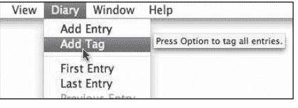

图 8.10 与动态“添加标签”菜单项相关的帮助标签。

9. 工具栏项目可以拥有帮助标签。你应该在食谱窗口/工具栏的“食谱信息”（Recipe Info）工具栏项目上添加一个。根据我的经验，工具栏项目是否打开或关闭抽屉或侧边栏并不明显，除非应用程序的工具栏项目名称描述了其功能，或者其图标描绘了挂在窗口上的抽屉或侧边栏，例如 OmniOutliner 中的“工具”（Utilities）工具栏项目或预览中的“显示”（Show）工具栏项目。

在 Vermont Recipes 中，“食谱信息”工具栏项目既不包含如何打开和关闭抽屉的图形，而是将此信息放入帮助标签中。HIG（人机交互指南）明确规定，用单个帮助标签解释切换效果的两个部分是完全正确的。

打开食谱窗口的 min 文件，双击“食谱信息”工具栏项目。“允许的工具栏”（Allowed Toolbar）项目会打开面板（sheets）。在其中，点击“食谱信息”项目以选中它。在工具栏项目标识检查器的工具提示（Tool Tip）部分中，输入“打开或关闭食谱信息抽屉”。保存 nib 文件。

当你编译并运行应用程序，并将指针悬停在“食谱信息”按钮上时，帮助标签就会出现（图 8.11）。

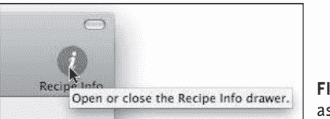

图 8.11 与“食谱信息”工具栏项目相关的帮助标签。

## 步骤 7：添加辅助访问功能

Apple 在 Mac OS X 10.2 Jaguar 中引入了其辅助访问技术。它源于 1998 年联邦《劳动力投资法案》第 508 条及其关于残障人士获取信息技术的要求。符合第 508 条是向政府以及许多州机构和教育机构销售计算机和其他类产品的先决条件。辅助访问被构建在每个标准的 Mac OS X 用户界面元素中，无论它们是使用 Carbon 还是 Cocoa 框架编写的。只要你的应用程序使用内置的 Cocoa 用户界面元素，要使其完全支持辅助访问，你需要的工作就相对较少。

对于自定义控件，你必须使用 `NSAccessibility` 非正式协议程序化地提供辅助访问支持，如 Apple 的《Cocoa Accessibility编程指南》所述。这被称为“访问启用”（access enabling），或者通俗地说对自定义控件进行“访问器化”（accessorizing）。这样做超出了本书的范畴。尽管如此，对于 Vermont Recipes 中的标准用户界面元素，你需要在 Interface Builder 中做几件事，并在某种程度上在代码中完成。

某些属性是应用特定的，因此无法构建到 Cocoa 的标准用户界面元素中。Interface Builder 为其中四种提供了支持：用户界面元素的描述、其帮助链接、元素之间的文本以及元素标题。信息可以朗读给在系统偏好设置“通用访问”面板的“视觉”（Seeing）中开启了 VoiceOver 的用户。

帮助字段允许你为 VoiceOver 提供更详细的听觉帮助标签。例如，你在步骤 6 中添加到其中一个按钮的帮助标签是“转到第一个条目”。这段文字没有提到指针位于日记窗口中，因为其位置是可见的。在辅助访问帮助字段中，你可能会输入“转到第一个日记”，增加对日记的引用，以便为无法依赖视觉信息的用户明确这一点。当 VoiceOver 工具程序中“详细信息”（Verbosity）面板的“提示”（Hints）选项卡中的“当元素有标签时”（When...）弹出菜单设置为“朗读帮助标签”（Speak Help Tag）时，会读出更详细的 VoiceOver 帮助文本，而不是不详细的帮助标签。当勾选“为项目项朗读指令”复选框时，VoiceOver 会朗读这些带有标签的元素的辅助访问帮助。

辅助访问帮助会被朗读，而不是不详细的帮助标签。你必须为这些用户界面元素提供描述。

关于何时提供描述以及如何编写的规则非常晦奥，通常需要反复尝试才能正确。规则列在《Cocoa 编程指南》的“应用程序访问启用”章节中。最重要的点是记住，当你使用这些属性来描述元素时，VoiceOver 会自动添加元素的类型。例如，当指针在“添加条目”按钮上时，VoiceOver 会读出“添加条目”，当它在“添加标签”按钮上时，可能会读出“禁用的添加按钮”。如果元素没有标题，务必提供描述。如果用户界面存在标题属性且没有歧义，那么你完全不需要提供描述。在发布应用程序之前，对你的 VoiceOver 行为进行审核至关重要。

如果元素没有标题，请务必为其提供描述。良好的例子是未绘制的调色板和使用图像代替文本的按钮。为图像提供描述非常重要，Snow Leopard 为 `NSImage` 添加了 `setAccessibilityDescription:` 方法。此外，Snow Leopard 还增加了文件支持，让你将应用程序的所有图像描述及其本地化存放在命名为 `Accessibility-ImageDescriptions.strings` 的文件中，而不是为每个图像单独输入。

在 Snow Leopard 中，你还可以为图形而非文本的菜单和菜单项提供描述。

本身没有标题的元素通常与屏幕上的独立标签关联，通常是一个静态文本字段。视觉用户能识别相邻的标签是未标题元素或元素组的标题。你应该为了辅助访问将这些标签定义为标题，以便视觉障碍的用户可以通过 VoiceOver 获取相同的信息。你可以在 Interface Builder 中完成这一点，也可以对于所有这些辅助访问功能通过向应用程序添加少量代码来实现。在代码中（但在 Interface Builder 中），你还可以通过向标题元素添加 `NSAccessibilityServesTitleUIElementsAttribute` 属性并指向其所有相关元素，将标题元素反向链接到界面元素，从而实现连接，但这种回传连接在实践中很少建立。

另一种可以在 Interface Builder 中提供的属性是：链接（link）属性。这允许你将窗口某部分的用户界面元素（例如左侧面板中源列表中的元素）链接到相关的所有元素（例如右侧详细面板中显示的元素）上。同样，视觉用户能看到这种关系，但你必须采取积极措施使其变得可访问。

如果你想通过程序化而非使用 Interface Builder 为应用程序中的用户界面元素添加此处提到的属性，请使用 AppKit 的 Accessibility 协议中声明的 `accessibilitySetOverrideValue:forAttribute:` 方法。这样，你就可以避免为单个用户界面元素创建子类。此方法仅适用于非用户设置的属性，并且它应该被限制在此描述的四个基于布局的属性。你必须小心对在辅助访问层级中实际代表用户界面元素的对象使用该方法。例如，在按钮的情况下，你使用的是 `NSButtonCell` 而不是 `NSButton`。辅助访问层级与熟悉的视图层级不同之处在于，辅助访问会忽略某些元素，因为它们对用户是不可见的。

有几种工具可以帮助你理解应用程序的辅助访问层级，并评估其符合辅助访问要求的其他方面。两个是 Apple 免费的 Accessibility Inspector 和 Accessibility Verifier 工具，它们在安装开发者工具时会被安装。另一个是我自己的 UI Browser，这是 Prefab Software 的一款商业产品。你可以在 http://absoftware.com/uibrowser 下载 UI Browser 的 30 天免费预览版。

要测试这里讨论的辅助访问描述和帮助属性，请在“系统偏好设置”的通用访问选项卡中开启 VoiceOver。这里有很多配置设置可用。你应该进入 VoiceOver 实用程序的“详细程度”（Verbosity）页面，并在“通用”（General）选项卡中将“默认详细程度”（Default Verbosity）设置为“高”（High）。这是默认设置，设置后，当 VoiceOver 遇到大多数用户界面元素时，会读出它们的名称、状态和类型。你可以使用 VoiceOver 键（Control 和 Option——通常被称为 VO 键）结合方向键来移动 VoiceOver 光标在元素之间移动。然而，对于视力测试者来说，在测试期间，进入 VoiceOver 实用程序的“导航”面板并将“鼠标”弹出菜单设置为“移动 VoiceOver 光标”以便使用按钮，可能会觉得这样更方便。当光标（一个矩形轮廓）包含该元素时，该元素即“在 VoiceOver 光标中”。听取的最佳方法是将 VoiceOver 光标移动到用户界面元素上，然后按下 VO-F3（即 Control 和 Option 键配合 F3 功能键）获取描述，按下 VO-Shift-H 获取帮助标签，或按下 VO-Shift-N 获取指令。这些信息会被读出并显示在屏幕上（图 8.12）。

> 你在一个按钮上。要点击此按钮，请按 Control-Option-Space。帮助标签是：添加日记标签。按 Option 键标记所有条目。

图 8.12 VoiceOver 显示“添加标签”按钮的使用说明。


由于 `Option` 键是 `VO` 键之一，同时按下 `VO` 键与先按 `Option` 再按 `Control` 是有区别的。配合 `Shift` 和 `F3`、`H` 或 `N` 按会读出“添加标签”按钮的值，而先按 `Option` 键稍等一下再按其他键，会导致“添加标签”按钮变为“标记所有”按钮，然后读出“标记所有”的值。

是时候将这一理论付诸实践了。

1. **Vermont Recipes** 辅助支持最明显的候选对象是厨师日记（Chef’s Diary）窗口底部的导航按钮。它们是不带标题的图形按钮。当你将 VoiceOver 光标移动到这些按钮之一上时，它会说“禁用按钮（dimmed button）”。如果你添加一个日记条目以启用前往第一个和最后一个条目的两个按钮，它只会说“按钮（button）”。这并没有帮助。

   在 Interface Builder 中，选择引导用户进入第一个条目的导航按钮。在验证日记按钮（`Validated Diary Button`）检查器的“辅助访问”（Accessibility）部分的“帮助”（Help）字段中，输入 `Go to first diary entry.`（带句号）。在“描述”（Description）字段中，输入 `first entry`（不带句号）。

2. 选择引导用户进入最后一个条目的导航按钮。在验证日记按钮（`Validated Diary Button`）检查器的“辅助访问”部分的“帮助”（Help）字段中，输入 `Go to last diary entry.`（带句号）。在“描述”（Description）字段中，输入 `last entry`（不带句号）。

3. 选择引导用户进入上一个条目的导航按钮。在验证日记按钮（`Validated Diary Button`）检查器的“辅助访问”部分的“帮助”（Help）字段中，输入 `Go to previous diary entry.`（带句号）。在“描述”（Description）字段中，输入 `previous entry`（不带句号）。

4. 选择引导用户进入下一个条目的导航按钮。在验证日记按钮（`Validated Diary Button`）检查器的“辅助访问”部分的“帮助”（Help）字段中，输入 `Go to next diary entry.`（带句号）。在“描述”（Description）字段中，输入 `next entry`（不带句号）。

5. 选择日期选择器。在验证日记日期选择器（`Validated Diary Date Picker`）检查器的“辅助访问”部分的“帮助”（Help）字段中，输入 `Go to oldest date after.`（带句号）。在“描述”（Description）字段中，输入 `entry date`（不带句号）。

6. 选择搜索字段。在验证日记搜索字段（`Validated Diary Search Field`）身份检查器的“辅助访问”部分的“帮助”（Help）字段中，输入 `Search entries by tag.`（带句号）。在“描述”（Description）字段中，输入 `tag search`（不带句号）。

7. 选择“添加”（Add）按钮，并在辅助访问帮助字段中输入 `Add diary entry.`（带句号）。你没有为此按钮提供帮助标签，因为它的标题对于视力用户来说是自言易懂的，但在 VoiceOver 上下文中，解释此按钮用于添加日记条目可能是很有用的。

   然而，如之前所示，除非界面元素也是帮助标签，否则辅助访问帮助不会读出。你没有为“添加条目”按钮提供帮助标签，因为该按钮的标题对视力用户来说是完全描述性的。为了给 VoiceOver 用户提供更好的体验，你现在可能想为视力用户添加一个帮助标签。在“提示”（Tool Tip）字段中，输入 `Add entry.`（带句号）。

   不要在“描述”（Description）字段中输入任何内容，因为“添加条目”按钮有一个文本标题。

8. 你不应该使用 Interface Builder 为“添加标签”按钮添加辅助访问信息，这与你不使用 Interface Builder 为其插入帮助标签的原因相同：当用户按下 `Option` 键时，“添加标签”按钮会变为“标记所有”，但此功能在 Leopard 下运行时不可用。所有的新代码都在 `DiaryViewController` 实现文件的 `-toggleAddTagButtonForModifierFlags:` 方法中。它将帮助标签设置为 `Tag all entries.`，并在按下 `Option` 时将辅助访问帮助设置为 `Tag all entries.`（两种情况下都带句号），并在释放 `Option` 键以及窗口首次加载时将它们设置为 `Add tag` 和 `Add diary tag`。

   从编辑 `-toggleAddTagButtonForModifierFlags:` 方法开始。在 `if` 子句第一个分支末尾，移除在按下 `Option` 时将 tooltip 设置为 nil 的 `-setToolTip` 语句，并将其替换为以下两个语句：

   ```objc
   [[self addTagButton] setToolTip:LocalizedString(@"Tag all entries.",
   @help tag text for Tag button)]
   [[self addTagButton] cell accessibilityOverrideValue:
   LocalizedString(@"all diary entries.",
   @accessibility tag text for Tag All button")
   forAttribute:NSAccessibilityHelpAttribute];
   ```

   第一个替换语句设置了帮助标签的值，第二个语句设置了“标记所有”按钮的帮助标签的值。

   “最小尺寸”（Minimum Size）部分中的字段。再次运行 Cocoa 模拟器，那看起来应该是正确的了。关闭模拟器并移除导航按钮上的边框。

   现在你准备好连接日期选择器和搜索字段的标题（title）属性了。首先，删除它们身份检查器（identity inspectors）中的任何描述。然后，按住 `Control` 键将日期选择器拖动到“当前输入日期”（Current Entry Date）标签（**图 8.13**）。当你松开鼠标键时，在 HUD 中选择 Accessibility（Accessibility）标题属性（**图 8.14**）。现在，辅助功能已经知道该标签是日期选择器的标题。对搜索字段执行同样的操作连接到它的标签。

   | 添加条目 | △ △ |
   | --- | --- |
   | 添加标签 | ▽ ▽ | 静态文本（当前输入日期）：11:00:00 AM 查找标签：tag |

   **图 8.13** 将日期选择器连接到它的标签。

   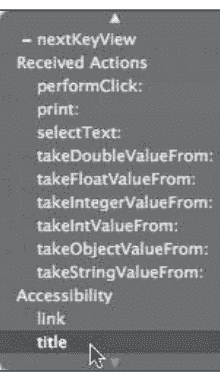

   **图 8.14** 设置日期选择器的 Accessibility 标题属性。

   保存文件，编译并运行应用程序以测试新的标题属性。创建一个日记文档，并在系统偏好设置的“通用”面板的“辅助”（Seeing）选项卡中开启 VoiceOver。然后，将光标移动到日记窗口中的搜索字段上。VoiceOver 会说话并显示 `查找标签：搜索文本字段`。你连接的标题属性正在起作用。

   现在，将光标移动到日期选择器上。这次，VoiceOver 没有读出标题属性。这是设计如此，推测日期选择器的内容是复杂的。将内容和标题放在一起可能会让人目不暇接，而且会花费大量时间。保留标题属性连接，以防 Apple 未来决定添加对日期选择器标题属性的支持。

9. 到此为止。对于菜单项的帮助标签（help tags），并不十分信任，而且无论日记菜单的命令全都是文本的。

   现在是测试你的处理程序的好时机了。保存文件，编译并运行应用程序。在系统偏好设置中开启 VoiceOver（或按下 `Command-F5`）。创建一个厨师日记文档或打开现有文档。然后，将光标移动到日记窗口底部各种用户界面元素上。移动时，VoiceOver 会读出提供的辅助信息。将光标停留在元素上一下，听听 VoiceOver 提供的辅助指令。按下 `VO-Shift-F3`、`VO-Shift-H` 和 `VO-Shift-N`，注意每个组合提供的不同信息。这些是残障用户常用的键盘快捷键，你想要确保它们完全正确。

   始终以这种方式在 VoiceOver 中审核应用程序的性能。作为一个可能出现错误的示例，考虑一下如果你没有添加标题属性，而是保留了辅助描述（accessibility description）属性，VoiceOver 将如何处理搜索字段。当你将光标移动到搜索字段上时，VoiceOver 会宣布“tag search field text field”。那是双重冗余。VoiceOver 会先读出 `tag` 词，因为那是你放在搜索字段中的占位符文本。它会读出你提供的辅助描述，`tag search`。最后，它会读出用户界面元素的类型，`search field`。如果你没有添加标题属性，建议你通过在 Interface Builder 中删除辅助描述来解决这个问题。

   最后，测试“添加标签”（Add Tag）按钮及其备用方案“全部标记”（Tag All）。如果你按照之前的说明，同时按下 `VO` 键或在按下 `Control` 键之前按下 `Option` 键，你会发现这工作得完美。

## 第 8 步：提供默认日记文档名称

目前为止，应用程序一直鼓励用户以任何名称保存新的日记文档。保存面板没有提供任何指导。当用户从菜单中选择“保存”或“另存为”时，它打开时保存字段中显示的是默认名称 `Untitled`（未命名文档）。这种默认行为当然是符合 HIG（用户界面指南）的。

然而，日记文档是独一无二的。在 Recipe 6 的第 2 步中，你实现了“当前厨师日记”的概念，这种文档只能存在一个。允许用户以任何名称保存它（如《比尔厨房历险》Bill's Misadventures in the Kitchen）尊重了用户的选择自由，但许多用户可能更倾向于根据文档的性质提供一个具体且合适的建议。在这一步中，你在保存面板中提供了默认名称 `Chef's Diary`（厨师日记），同时允许用户输入任何其他名称。这在应用程序运行于 Snow Leopard 时有效，但在 Leopard 下则不行。

为此，你在 `DiaryDocument` 中重写了 `NSDocument-prepareSavePanel:` 方法。这在《基于文档的应用程序概述》中有所解释，你已经参考过多次该文档，以确定导致创建、保存或打开文档的事件链。“文档架构中的消息流”部分中的“保存文档”子节解释说，该方法在保存过程过程的早期就会被调用，在打开保存面板之前，“以便为子类提供自定义保存面板的选项”。这实际上是在任何基于文档的应用程序中自定义保存面板的标准技术——例如，如果你想为标准的保存面板添加辅助面板。

在这种情况下，你只需要提供一个默认名称。令人惊讶的是，你无法在 Cocoa 中实现这一点。必要的方法 `-setFieldNameStringValue:` 是在 Snow Leopard 中引入的。

1. 将以下方法添加到 `DiaryDocument` 的实现文件中，紧接 `-saveToURL:ofType:forSaveOperation:error:` 方法上方。你还没有……（此处文本截断）

   ```objc
   VRDocumentController *controller =
   [VRDocumentController sharedDocumentController];
   NSString *defaultFileName = NSLocalizedString(@"Chef's Diary",
       @default name of Chef's Diary document);
   #if MAC_OS_X_VERSION_MIN_REQUIRED > MAC_OS_X_VERSION_10_6
   if (controller canOpenURL:[controller currentDiaryURL]) {
       defaultPDFFileName = [[controller currentDiaryURL]
       lastComponent] stringByDeletingPathExtension];
       if (defaultPDFFileName) [savePanel
       NameFieldStringValue:defaultPDFFileName];
       [savePanel setAllowedFileTypes:[NSArray arrayWithObject:@"pdf"]];
       [savePanel setCanSelectHiddenExtension:YES];
       [savePanel beginSheetModalForWindow:window
       completion:(NSInteger)result {
           if (result == NSOKButton)
               [self printDocumentWithSettings:NSDictionary
               dictionaryWithObjectsAndKeys:NSPrintSaveJob,
               PrintJobDisposition,savePanel URL];
               PrintJobSavingURL,nil, showPrintPanel:NO
               delegate:nil didPrintSelector:NULL
               contextInfo:NULL;
           if (savePanel isExtensionHidden)
               [[NSFileManager defaultManager]
               setAttributes:[NSDictionary
               dictionaryWithObjectsAndKeys:[NSNumber
               withBool:YES,NSFileExtensionHidden, nil]
               ofItemAtPath:[savePanel URL] path] error:NULL];
       };
   #else
   if (controller canOpenURL:[controller currentDiaryURL]) {
       defaultPDFFileName = [[controller currentDiaryURL]
       lastComponent] stringByDeletingPathExtension];
       [savePanel setRequiredFileType:@"pdf"];
       [savePanel setCanSelectHiddenExtension:YES];
       [savePanel beginSheetForDirectory:file:defaultPDFFileName
       modalForWindow:window modalDelegate:self didEndSelector:
       @selector(savePanelDidEnd:returnCode:contextInfo:) contextInfo:NULL];
   #endif
   ```

   对于 Snow Leopard，这使用了 TextEdit 示例代码随附的 readme 文件长版本中公开的技术，但有以下四点不同：

   首先，它测试文件之前是否被保存过且不在垃圾桶中。如果结果为假，它将本地变量 `defaultPDFFileName` 设置为 `Chef's Diary`；否则，它将本地变量设置为不带文件扩展名的文件名。

   其次，它调用了 `-setAllowedFileTypes:`，因为 `-setRequiredFileType:` 在 Snow Leopard 中已废弃。

   第三，它使用了一个新的 Snow Leopard 方法，因为旧版本在 Snow Leopard 下已被废弃。它使用了 `NSStringSavePath` 的 `pinkJobSavingURL`。它还调用了 `-NSSavePanel` 而不是 `-NSSavePanelURL -setAttributes:ofAtPath:error:`，因为该方法在 Snow Leopard 中没有提供基于 URL 的对应方法。

   最后，它使用了另一个基于 block 的 Snow Leopard 方法 `-beginModalForWindow:completionHandler:`。如前所述，基于 block 的方法中的完成处理模式允许你编写内联回调语句以便稍后执行，这些语句与它们安装的方法有明确关联。为了理解其含义，请对比此基于 block 的语句与你在 `#else` 分支中执行相同任务的方式。在分支中，你声明了一个临时代理，并在其中写了一个回调方法 `-savePanelDidEnd:returnCode:contextInfo:`。该方法仅在运行 Leopard 版本的 Vermont 时才会执行。在 Snow Leopard 下，block 取代了它的位置。

   Leopard 版本的动作方法还将 `Chef's Diary` 显示为 PDF 文件的建议名称`-setNameFieldName:` 方法在 Leopard 中不可用，但此处不需要它，你调用的是 `-beginSheetForDirectory:file:modalForWindow:modalDelegate:didEndSelector:contextInfo:`。它的 `file:` 参数允许你设置建议文件名。

2. 构建并运行应用程序；创建一个新的空日记文档；选择“文件 > 另存为 PDF”。这次，保存面板建议将 `Chef's Diary.pdf` 作为保存文件名。稍后当你在 Leopard 下运行时测试时，你会发现它运行良好。


## 步骤 9：添加对突然终止的支持

Apple 一直在寻找改进系统性能的方法。为此，它在 Snow Leopard 中增加了名为“突然终止”（sudden termination）的功能。如果这让你想起了间谍猎人和谋杀之谜，那确实如此。其核心思想是，如果用户退出应用程序或注销时应用程序立即关闭，整体用户体验将得到提升。某些应用程序需要长时间来处理事务，此时需要快速的“致命一击”（coup de grâce）。

突然终止允许应用程序快速退出，而无需等待其保存状态。然而，如果应用程序有必须保存的重要数据，它可以禁用突然终止。这是通过将应用程序的 `Info.plist` 中的 `NSSupportSuddenTermination` 键设置为 YES 实现的。

当启用突然终止时，系统可能随时终止应用程序。应用程序必须准备好在终止之前保存其状态和资源。这可以通过实现 `applicationWillTerminate:` 和 `application:willQuit:` 方法来实现。

在某些情况下，应用程序可能临时禁用突然终止以执行关键任务。这是通过调用 `disableSuddenTermination` 和 `enableSuddenTermination` 实现的。

`UserDefaults` 和 `NSDocument` 开箱即用即可处理。前者在用户做出更改时会禁用突然终止，同样，后者在数据写入磁盘时会重新启用。此外，对于承诺延迟向剪贴板提供的数据，会延迟突然终止，直到所有数据提供完毕。在像 Vermont Recipes 这样的应用程序中，你应该将 `Info.plist` 键设置为 YES，并扫描你的应用程序操作，寻找除了 `UserDefaults`、`NSDocument` 等已涵盖的操作之外，哪些地方是明智之举应该暂时关闭突然终止的。

如果你启用了突然终止，请注意在任何顺序的 `-NSDocument close]` 或 `applicationWillTerminate:` 代理方法中所执行的操作。通常，你不应该使用这两个方法在应用程序退出时执行操作，因为根据定义，它们正在执行退出操作。

1. 向 `Vermont_Recipes-Info.plist` 文件添加 `NSSupportSuddenTermination` 键。这尚未在内置键列表中，所以你需要手动输入。将其值设置为 YES。此键在 Leopard 中不存在，因此 Leopard 会忽略它。

2. 审查应用程序的操作，查看除了已执行的操作外，是否有任何操作需要延迟突然终止。

日记窗口控制器安装了多个观察者。它们在窗口关闭时通过 `-DiaryWindowController dealloc]` 被移除。如果用户注销时日记窗口已打开且没有未保存的更改，则在被杀死时将没有机会移除它们。不过这应该不是问题，因为默认通知中心是应用程序的一部分。在应用程序被杀死后不再存在。

对项目代码的审查没有发现其他可能在应用程序突然终止时产生的问题。

3. 保存快照。制作 Recipe 8 步骤 9，添加注释说明：“添加了突然终止支持”。

## 步骤 10：国际化应用程序显示名称

在 Recipe 1 的步骤 9 和 10 中，你配置了应用程序的 `Info.plist` 和 InfoPlist 字符串文件的各种设置。其中两个值得关注：`CFBundleDisplayName` 和 `LHasLocalizedDisplayName`。在 Recipe 1 中，你将 `CFBundleDisplayName` 设置为应用程序名称 Vermont Recipes，在 `Vermont_Recipes-Info.plist` 中。

InfoPlist.strings 文件。然而，在 `Vermont_Recipes-Info.plist` 文件中，你将 `LHasLocalizedDisplayName` 留在了默认值 0（或 false）上。这些设置与 Finder 及其他应用程序在使用人类可读的名称引用此应用程序时所使用的“长”应用程序有关。

如果你的应用程序显示名称具有描述性，你应该允许其显示名称进行本地化。*Vermont Recipes* 中的专有名词 *Vermont* 在其他语言中可能保持不变，但 *Recipes* 是一个描述准备烹饪菜肴或执行任何复杂过程（如编写应用程序）的普通单词。对于主语言不是英语的用户来说，如果他们看到 *Recipes* 的本地单词，会对你的应用程序感到更加亲切。

苹果《文件系统概述》（File System Overview）中的“显示名称”部分解释说，所有应用程序都应该支持各种功能的显示名称，不仅包括应用程序名称，还包括文档名称、字体以及出现在保存和打开面板中的类型名称。它将显示名称描述为根据用户中心设置生成的名称——具体在本例中，是系统偏好设置“语言与文本”面板中的“语言”设置。

在这一步中，你只需处理应用程序的显示名称，因为它设置在 `Vermont_Recipes-Info.plist` 和 `InfoPlist.strings` 文件中。虽然 Finder 和其他应用程序向用户展示可更改的应用程序名称，但底层文件系统继续使用你在 `CFBundle` 设置中提供的固定名称。例如，Cocoa 中的文件系统路由程序使用的是固定的应用程序包名，而不是显示名称。这就是为什么苹果的文档警告不要在代码中使用显示名称来指定文件、路径或 URL。

应用程序的显示名称可以在代码中获取，并用于在你的应用程序的 Manager 及其他地方进行显示。你使用 `-NSFileManager displayNamePath:]` 方法来获取显示名称；如果用户没有在 Finder 中更改应用程序名称，此方法将从应用程序的 `InfoPlist.strings` 文件中检索本地化的显示名称。你应该始终在显示名称之前立即获取一份显示名称的最新副本，因为自你上次显示它以来，用户可能更改了偏好设置或在 Finder 中重命名了应用程序。系统赋予任何用户编辑过的应用程序名称更高的优先级，高于 `InfoPlist.strings` 文件中设置的值。

在“Recipe 1”中，当 `LHasLocalizedDisplayName` 设置的值为 `false` 时，你并没有实际上关闭系统的显示名称功能；你只是让它的效率降低了。为了提高应用程序使用本地化显示名称时的性能，苹果指示你应该始终通过勾选框将 `Vermont_Recipes-Info.plist` 文件中的 `LHasLocalizedDisplayName` 键值设置为 `true`。现在就去做吧。

## 步骤 11：添加应用程序和文档图标

没有应用程序图标和文档图标的应用程序是不完整的。系统会在桌面、Dock、Finder 的“显示信息”（Get Info）窗口以及各种警告和对话框中显示图标。此外，应用程序通常会在其“关于”（About）窗口中显示其图标。

这不是关于如何使用图形应用程序创建适合图标的图像的教程，因此你必须利用任何可用的资源创建、寻找或购买自己的图形作为图标。你可能会发现使用绘图程序、扫描仪或数字相机来获取它们，并使用图像编辑应用程序对其进行编辑非常方便。多种原生 Mac OS 应用程序可供此目的。阅读《用户界面指南》（Human Interface Guidelines）中的“图标”（Icons）部分以获取图标正确设计的指导。“创建图标”（Creating Icons）子节提供了几个关于如何创建它们的提示。注意第一条提示：“为了获得美观的图标，请让专业设计师来创建。”

为了为 *Vermont Recipes* 图标获取合适的图形，我将一本古董版 Vermont 菜谱的封面和其中一页扫描到 Adobe Photoshop 中。作为一名律师，我自然确保了它的版权已经过期。我还扫描了一个真实的古董勺子作为应用程序图标。我将每张图像放置在 1024x1024 像素或更大的画布上，根据需要调整图像大小，在图像周围留出足够的空白空间以允许裁剪。


应用程序的显示名称可以在代码中获取，并用于在你的应用程序的 Manager 及其他地方进行显示。你使用 `-NSFileManager displayNamePath;` 方法来获取显示名称；如果用户没有在 Finder 中更改应用程序名称，此方法将从应用程序的 `InfoPlist.strings` 文件中检索本地化的显示名称。你应该始终在显示名称之前立即获取一份显示名称的最新副本，因为自你上次显示它以来，用户可能更改了偏好设置或在 Finder 中重命名了应用程序。系统赋予任何用户编辑过的应用程序名称更高的优先级，高于 `InfoPlist.strings` 文件中设置的值。

在“Recipe 1”中，当 `LHasLocalizedDisplayName` 设置的值为 `false` 时，你并没有实际上关闭系统的显示名称功能；你只是让它的效率降低了。为了提高应用程序使用本地化显示名称时的性能，苹果指示你应该始终通过勾选框将 `Vermont_Recipes-Info.plist` 文件中的 `LHasLocalizedDisplayName` 键值设置为 `true`。现在就去做吧。

## 第 11 步：添加应用程序和文档图标

没有应用程序图标和文档图标的应用程序是不完整的。系统会在桌面、Dock、Finder 的“显示信息”窗口以及各种警告和对话框中显示图标。此外，应用程序通常会在其“关于”窗口中显示其图标。

这不是关于如何使用图形应用程序创建适合图标的图像的教程，因此你必须利用任何可用的资源创建、寻找或购买自己的图形作为图标。你可能会发现使用绘图程序、扫描仪或数字相机来获取它们，并使用图像编辑应用程序对其进行编辑。多种原生 Mac OS 应用程序可供此目的。阅读《用户界面指南》（*Human Interface Guidelines*）中的“图标”（Icons）部分以获取图标正确设计的指导。“创建图标”（Creating Icons）子节提供了几个关于如何创建它们的提示。注意第一条提示：“为了获得美观的图标，请让专业设计师来创建。”

为了为 Vermont Recipes 图标获取合适的图形，我将一本古董版 Vermont 菜谱的封面和其中一页扫描到 Adobe Photoshop 中。作为一名律师，我自然确保了它的版权已经过期。我还扫描了一个真实的古董勺子作为应用程序图标。我将每张图像放置在 1024x1024 像素或更大的画布上，根据需要调整图像大小，在图像周围留出足够的空白空间以允许裁剪。

通过滑块查看图标调整大小的过程有多平滑。同时，使用弹出菜单在不同背景下对其进行检查和调整大小。确保应用程序图标在黑色背景下看起来正常（例如 Finder 的 Cover Flow 视图使用的背景）尤为重要。没有亮色边框的图标可能会丢失某些元素。你的应用程序图标可以工作，勺子图标有一个反射边缘，尽管图形设计师可以对其进行一些改进。

1. 选择“文件”>“另存为”，为图标文件命名，指定其位置并点击保存。该文件将自动赋予所需的 `.icns` 扩展名。

2. 你可以双击保存的图标文件以在“预览”中打开并进行检查。

3. 将保存的图标文件的拷贝到项目文件夹的根目录。对于 Vermont Recipes，将应用程序命名为 `VRApplicationIcon.icns`，将文档图标命名为 `VRDiaryDocument.icns` 和 `VRRecipesDocument.icns`。这些文件放在项目根目录，而不是 `English.lproj` 文件夹，因为图标是不本地化的。

4. 现在在 `Vermont_Recipes-Info.plist` 中创建适当的条目。当你最初在 Recipes 1 和 3 中设置 Info.plist 文件时，你将图标条目留空了，所以现在必须提供它们。

打开 `Vermont_Recipes-Info.plist` 文件，在已有的 `CFBundleIcon` 条目中输入 `VRApplicationIcon`。你可以选择带有文件扩展名的 `VRApplicationIcon.icns`，但没有必要。

5. 通过打开 Vermont Recipes 目标（Target）Info 检查器并选择属性（Properties）选项卡，来验证这已成为应用程序。你会看到 `Icon File` 条目现在指示 `VRApplicationIcon` 是图标文件，并且在右侧的图像槽中看到了它的图像。你本可以可以直接在这里输入它，而不是在 `Vermont_Recipes-Info.plist` 文件中输入（图 8.15）。


> 图 8.15 Vermont Recipes 图标。

6. 当你仍留在目标属性（Target Properties）选项卡时，转到目标 Info 窗口底部的 `DocumentTypes` 部分，向右滚动找到 `Icon File` 列。在 `RecipesDocument` 类型的两个条目中，输入 `VRRecipesIcon`。在 `DiaryDocument` 类型的两个条目中，输入 `VRDiaryIcon`。同样，你可以包含文件扩展名，但没有必要。

7. 再次打开 `Vermont_Recipes-Info.plist` 文件，验证它们已成为文档图标。你会看到 `CFBundleDocumentTypes` 数组中对应 `CFBundleTypeIcon` 键的每个项目在 `Value` 列中都显示了相应图标的名称。你本可以直接在 `Vermont_Recipes-Info.plist` 文件中输入这些键和值（图 8.16，图 8.17）。


图 8.16 Vermont Recipes 食谱文档图标。


图 8.17 Vermont Recipes 主厨日记文档图标。

8. 你还需要在 `Vermont_Recipes-Info.plist` 文件的 `UTEExportedTypeDeclarations` 数组中添加一个图标引用。为 `UTTypeIconFile` 键添加条目，并将其值设置为 `VRDIaryIcon`。同样，文件扩展名是可选的。对于你创建并应用拥有的任何自定义文档类型，你应该导出所有的 `UTExportedTypeDeclarations` 键。不要为其他文档类型添加条目，因为 Vermont Recipes 并不拥有它们。

9. 构建并运行应用程序。你在所有预期的地方都能看到新的应用程序图标。例如，它出现在 Dock 中，当你打开“关于”窗口时也能看到它。当你保存一个主厨日记文档时，一个新的文档图标也会出现。

如果你没有看到日记文档图标，而是看到一个印有 `VRDIARY` 文件扩展名的白色文档图像，你可能将文档保存在了之前开启过图标预览的文件夹中。图标预览会优于文档图标。可以通过在 Finder 中选择“查看”>“显示查看选项”，取消勾选“显示图标预览”复选框来关闭图标预览模式，查看文档图标。

10. 收集在此步骤中创建的所有 Photoshop、PNG 和图标文件，并将它们保存到与 Vermont 项目并行的文件夹中。如果你将来修改 Vermont Recipes 应用程序，你可能想要对图标进行更改。如果必须从头重新创建将太遗憾了。

## 步骤 12：允许应用程序在 Leopard 下运行

你一直在 Mac OS X 10.6 Snow Leopard 下开发 Vermont Recipes，由于 Snow Leopard 仅运行在基于 Intel 的 Macintosh 电脑上，因此应用程序规范要求它能够在正在使用的 Mac OS X 10.5 Leopard 硬件上运行。由于 Leopard 可以运行在 PowerPC 和 Intel 电脑上，因此它也应该能够在 PowerPC Mac 上运行。

除非你更改了某些设置，否则应用程序无法在 PowerPC Mac 上运行。要修复此，你必须在 `Valid Architectures`（或 `VALID_ARCHES`）设置中添加相应的架构。可用选项在 *XCode Build Setting Reference* 中有记录。搜索 `VALID_ARCHES` 找到它们。你需要的是 `ppc`。

记住，新的 Vermont Recipes SL 目标仅在 Snow Leopard 上运行，PowerPC 硬件无法运行 Snow Leopard。因此，在项目 Info 窗口中添加 `ppc` 架构是没有意义的，因为 Vermont Recipes 和 Vermont Recipes SL 都会都会它。在 Vermont Recipes 目标的 info 窗口中添加它也没有意义。

打开 Vermont Recipes 目标的 Info 窗口，选择 Release（发布）配置，并在 Build（构建）选项卡中，双击 Valid Architectures（有效架构，或 `VALID_ARCHS`）。会弹出一个列表，列出现有的值（图 8.20）。为每个架构点击 Add (+) 按钮，然后点击 OK。该设置的值现在是字符串 `"ppc i386 x86_64"`，各个架构之间用空格分隔，Vermont Recipes 的发布配置将能够在 Leopard 操作系统上的 PowerPC 设备上运行，也可以在 Intel 设备上运行。如果你在 Intel 设备上使用 Snow Leopard 下开发该应用程序，则无需在 Debug 配置中添加 ppc。

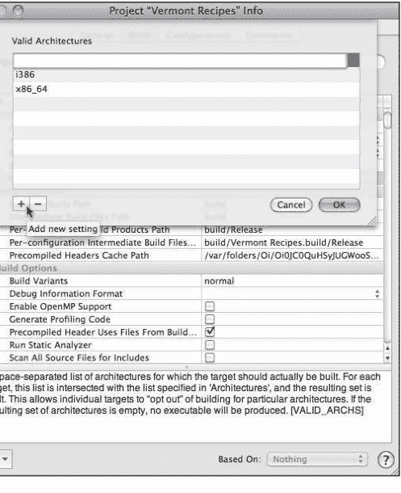

图 8.20

添加 ppc 架构之前的项目构建设置。

如果你像我一样，拥有一台支持 64 位的 Power Mac，建议在 Valid Architectures 中添加 `ppc64`。遗憾的是，Snow Leopard 中的 Xcode 不允许你为 64 位 PowerPC 架构进行构建。这可能并不重要，因为所有迹象表明，64位 PowerPC 架构通常不会提供足够的可靠速度提升，以至于值得尝试。

在再次尝试在 PowerPC Mac 上的 Leopard 上运行应用程序之前，在你最初开始时……你应该修复 nib 文件中的几个问题。

1. 在 Recipe 2 中，当你首次使用 Interface Builder 设置应用程序的 GUI 时，你没有注意 Vermont Recipes 预期运行的环境。根据你的 nib 文件设置，你可能在一段时间后注意到，从你构建项目开始就会生成一个警告。通常情况下，Xcode Build 窗口每次构建时都会报告“No issues”（无问题）。但在那些清理了项目或在构建前修改了 nib 文件设置的情况下，Build Results（构建结果）窗口可能会在随后的构建中报告一个警告，其效果为“‘Pane Splitter’（面板分割器）分割样式在 10.6 之前的 Mac OS X 版本不支持。”如果你将其中一个 nib 文件设置为在 Leopard 和 Snow Leopard 下均运行，则会此此警告。

事实上，你现在应该将所有的 nib 文件都设置为在 Leopard 和 Snow Leopard 下运行。你还应该修复 Pane Splitter 问题以及另一个具有相同性质的问题。

打开 MainMenu nib；然后在 Interface Builder 中选择 Window > Document Info。你会发现，默认情况下，你在 Recipe 1 中创建的模板中的 nib 文件将新 nib 文件的部署目标（deployment target）设置为 Mac OS X 10.6，开发目标（development target）设置为 Interface Builder 3.0。

你计划为 Mac OS X 10.5 以及 Leopard 发布 Vermont Recipes。Interface Guide（界面指南）中的“Testing and Validation”（测试与验证）部分指出，nib 文件的部署目标应与 Xcode 项目的部署目标匹配。Vermont Recipes 的 Xcode 项目部署目标是 Mac OS X 10.5。显然，Interface Builder 并没有自动匹配其部署目标，尽管文档似乎表明在某些情况下它会将 MainMenu nib 的部署目标更改为 Mac OS X 10.5。

Main Menu 文件的开发目标（Development Target）应列为 Interface Builder 3.2，在我写这些话时，Interface Builder 已经更新到 3.2 版本，而且从开始我就建议在 Snow Leopard 上进行所有的 Vermont 开发。如果尚未设置，请将 MainMenu nib 的开发目标更改为 Default - Interface Builder 3.2。

窗口底部没有出现错误标记，因此 Main Menu nib 文件没有问题。保存并关闭它。

接下来，打开 RecipesWindow nib 文件并选择 Window > Document Info。这里的部署目标也应设置为 Mac OS X 10.5，开发目标设置为 Default - Interface Builder 3.2。当你设置部署目标时，窗口底部的表格报告了与我在某些构建中看到的相同的警告：“‘Pane Splitter’（面板分割器）分割样式在 10.6 之前的 Mac OS X 版本不支持。”这看起来当 Vermont Recipes 在 Leopard 下运行时，“‘Pane Splitter’分割线将无法工作。


接下来，打开 `DiaryWindow` nib 文件，并将部署目标设置为 10.5，开发目标设置为 Default - Interface Builder 3.2。你在底部的表格中列出了两个问题。“Pane Splitter”问题出现在此文件中，因为搜索字段显然使用了 Leopard 不支持的单行模式。

# 菜谱 8 章：完善应用程序 (POLISH THE APPLICATION)

如果你在 Recipe 4 中创建导航按钮的图像时，它们不是 24x24 像素或更小，你会在 Interface Builder 的 Document Info 窗口中看到与导航按钮相关的“Clipped Content”（内容裁剪）问题。你没有看到它们，是因为你将图像和视图的大小都缩放到了 24 像素。如果你使用比视图更大的图像运行应用程序，图像会在调整窗口大小时发生变形（图 8.21）。

此实现文件尚未包含垂直拆分视图的访问器方法，现在创建这些方法，复制日记窗口拆分控制器的实例变量和访问器方法，但将其命名为 `verticalSplitView`。不要忘记在 Interface Builder 中连接 `IBOutlet`。需要添加到 `-windowDidLoad` 方法的语句如下：

```
if (floor(NSAppKitNumber) > NSAppKitNumber10_5) {
    [self divider:NSSplitViewDividerPaneSplitter];
}
```

该应用程序符合 Snow Leopard（雪豹）下的 HIG（人机交互指南），并解决了 Leopard（猎豹）下的已知问题。

- 现在为发布版本构建应用程序，以便在 PowerPC 电脑上的 Leopard 上进行测试。务必使用 `Overview` 弹出菜单将 `Vermont Recipes` 目标设置为活动目标，并将 `Release` 设置为活动目标。如果你没有运行 Leopard 的 PowerPC Mac，那么你只能对此信之不疑，但对于实际应用，你应该始终设办法在所有可以使用的硬件上进行测试。

这一次，当你将应用程序移动到 PowerPC Mac 时，它的图标出现时没有带圈的斜杠的标记。在它的 Info 窗口中，其类型报告为 `Application (Universal)`（图 8.22）。

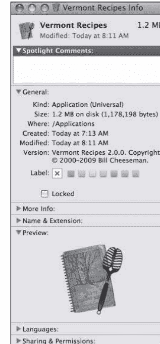

> 图 8.22 启用 Leopard 支持后的 Vermont Recipes Info 窗口。

在 PowerPC 电脑的 Leopard 上启动应用程序。它启动并默认打开配方窗口。一切看起来都符合预期。创建一个新的厨日记（Chef’s Diary）窗口。日记窗口中的“Add Tag”按钮不是动态的，当你按住 Option 键时它不会变为“Tag All”，但日记菜单中的“Add Tag”菜单项仍然是动态的。

# 第 13 步：构建并运行应用程序

这一次有两个应用程序需要构建和运行。一个应该从 `Vermont Recipes SL` 目标构建，并在运行 Snow Leopard 的 Intel 芯片 Mac 上进行测试。另一个应该从 `Vermont Recipes` 目标构建，并在三个不同的平台上进行测试：运行 Leopard 的 PowerPC Mac、运行 Leopard 的 Intel Mac 以及运行 Snow Leopard 的 Intel Mac。不推荐用于 Snow Leopard，因为旨在在 Snow Leopard 上运行的 `Vermont Recipes` 版本具有额外的功能和更高效的代码。尽管如此，运行 Leopard 的用户完全可能在不立即安装 Snow Leopard 版 Vermont Recipes 的情况下升级到 Snow Leopard，因为它必须在 Snow Leopard 和 Leopard 上都能正常运行。

为了获得有效的测试体验，请从 `~/Library/AutSave Information` 以及保存 Vermont Recipes 文档的位置删除任何遗留文件，并从 `Preferences` 文件夹删除删除文件。

在所有适当平台上测试 Vermont Recipes 的每个版本时，请运行你在此配方中添加的所有新功能，包括“Save As PDF”菜单项、交替出现的“Save Recipe Info”和“Hide Recipe”菜单项、动态的“Add Tag”和“Tag All”菜单项及按钮、崩溃后的自动保存和恢复恢复、帮助标签、VoiceOver 支持以及保存新日记文档的默认名称。

# 第 14 步：保存并归档项目

退出运行中的应用程序。关闭 Xcode 项目窗口，丢弃生成文件夹，压缩项目文件夹，并将生成的 zip 文件副本保存到你的存档中，命名为如 `Vermont Recipes 2.0.0 - Recipe 8.zip`。工作中的 Vermont Recipes 项目文件夹保留原位，为第 9 个配方准备。

# 结论

厨日记及其支持的 GUI 和菜单结构现在已经完成，除了配方文档外，该应用程序的状态非常好。你可能没有注意到它已经支持的所有常见 Macintosh 应用程序功能。例如，由于厨日记基于标准的 RTF 格式，Quick Look 和 Spotlight 已经可以工作。尝试一下它们吧。

为了证明给自己看，启动 Vermont Recipes，创建一个新的日记文档，添加几个日记条目和大量标签。还要输入一些包含独特单词的文本进行搜索，例如 `Rumpeltstiltskin`、`Lubber Fiend` 和 `antidisestablishmentmentarianism`。然后保存并关闭文件，为了保险，彻底退出 Vermont Recipes。

在 Finder 中选择该文件并按空格键。打开 Quick Look 预览窗口，显示文件的内容之一。

取消选择文件，然后按 Command-空格键。打开搜索字段。输入 `Lubber Fiend`。在我的电脑上，`Chef’s Diary.viary` 文件出现在找到文档列表的第二项，位于文件的自动保存恢复之后。（惊讶的是，列表中还出现了其他几个文件，全部来自 OmniObjectMeter 示例文件。）

在你认为 Vermont Recipes 是一个完成品之前，已经没什么要做的了——除了配方文档。在接下来的配方中，你将添加几乎每个应用程序都应该具备的内容，例如打印支持、偏好窗口、帮助书籍和 AppleScript 支持。然后，在第 2 节结束时，你将准备部署应用程序。

## 文档

阅读以下关于配方 8 涵盖的主题的文档。

### 类引用和协议文档

- `NSDocument` 类引用
- `NSPrintOperation` 类引用
- `NSMenuItem` 类引用
- `NSMenu` 类引用
- `NSMenuDelegate` 类引用
- `NSEvent` 类引用

## 文档（续）

### 类引用和协议文档（续）

- `NSNotificationCenter` 类引用
- `NSAccessibility` 协议引用
- `NSProcessInfo` 类引用（突发终止）
- `NSavePanel` 类引用

## 通用文档

- Mac OS X SnowLeopard Release Notes
- Mac OS X SnowLeopard Release Notes Foundation
- Mac OS X Developer Notes: 10.5 and Earlier
- Technical Note TN206: 确保向后兼容
- 辅助功能指南 (Accessibility Guidelines)
- 辅助功能概述 (Accessibility Overview)
- 文件系统概述 (File System Overview)
- Interface Builder 用户指南
- 属性列表键 (Property List Key)
- 统一类型标识符 (Uniform Type Identifiers)
- Xcode 设置

## 第三方评论

- Basic Blocks--www.Friday.com/bbum/2009-08-29/basic-blocks/
- Blocks Tips & Tricks--www.Friday.com/bbum/2009-08-29/blocks-tips-tricks/
- Beginners Guide to Blocks in Cocoa--www.degitus.org/dev/2009/08/30/beginners-guide-to-blocks-in-cocoa/
- Practical Blocks--mikeakeash.com/?page=pyblog/Friday-2009-08-14-practical-blocks

# 配方 9：添加打印支持

与涵盖许多主题的 8 不同，这个配方专注于打印。

Cocoa 打印在 Mac OS X 10.5 Leopard 中发生了巨大的变化，包括 API 和用户界面。主要的 Cocoa 文档《Printing Programming Topics》尚未更新以反映这些变化，因此详细信息还必须参考 leopard notes 中的 Mac OS Developer Notes: Cocoa Application Framework 中对打印 API 的讨论。

从用户的角度来看，最大的变化之一是熟悉的页面设置面板对许多应用程序不再需要了。打印面板现在提供了方便的一站服务，让你在单个面板中完全控制打印体验的所有方面，包括以前在页面设置面板中设置的所有功能。此外，Leopard 和 Snow 中的打印面板现在对打印预览提供了完全支持。

对于允许用户为每个文档保存特定打印设置的应用程序（例如 TextEdit），页面设置面板可能仍然适用。尽管如此，页面设置面板中的设置也可以包含在打印面板中，通过少量代码你就可以按文档保存它们。厨日记不需要页面设置面板，因为它是独特的文档。你将相应的打印设置保存在应用程序的用户默认设置中，这样用户每次打印文档时这些设置都会生效，除非用户更改它们。

在这里，通常会选择诸如打印机等项目、一组默认为“标准”（Standard）的命名预设、打印份数、是打印所有页面还是特定范围、纸张大小、打印方向以及其缩放因子。对于这些内容，例如纸张大小和方向，以前只出现在“页面设置”面板中。下方是辅助视图区域，它显示了由系统甚至单个打印机提供的设置组。辅助视图区域中的设置由“功能”弹出菜单控制。该菜单可以选择性地包含针对特定应用程序的一个或多个自定义辅助视图。当提供单个自定义视图时，系统会在打开“打印”面板时默认显示它，并且它通常以应用程序命命名。左侧是打印文档的预览。预览允许你翻阅所有待打印的页面，其外观会交互式地显示你对设置所做的每处更改。打印面板的底部还有一个包含额外功能的区域，包括在 PDF 弹出菜单中保存*数字纸张*的许多选项。有关典型打印面板的示例，请查看 TextEdit 打印面板（图 9.1）。


**图 9.1** Leopard 系统下的 TextEdit 打印面板。

打印面板中的一个关键元素出现在设置区域中央的“功能”弹出菜单。在许多应用程序（包括 TextEdit）中，默认菜单项显示应用程序的名称，几个特定的应用程序设置出现在其下方一个名为“辅助视图”的区域中。弹出菜单包含许多其他菜单项，用于显示各种设置组的内置视图，例如布局和纸张处理。打印机提供其中一些设置，因此当你选择不同的打印机时，它们会发生变化。你上一次尝试时，“文件”菜单中的“打印”菜单项不起作用。“打印”菜单项已正确连接到 `NSDocument` 的内置 `-printDocument:` 动作方法。然而，当你在文档处于激活状态并选择“文件 > 打印”时，控制台显示了错误，且文档没有打印。

再次尝试打印文档。创建一个新的日记文档，在里面写些内容，然后选择“文件 > 打印”。奇迹地，文档打印了！解释很简单：之前生成的错误消息报告“printOperationWithSettings: 是一个子类但尚未被重写”。在食谱 8 中，你应该在“另存为”菜单项中重写它。作为一个意外的收获，你可以使用一个相当完整的打印面板打印文档（图 9.2）。

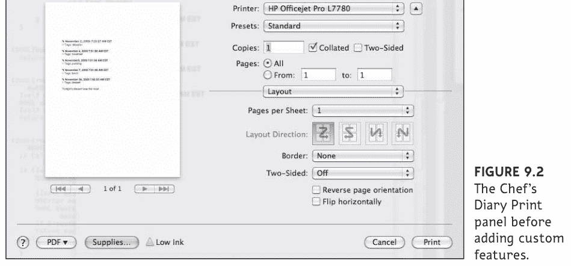

如果你读过《Cocoa 编程主题》中的“打印文档”章节，你可能会好奇这是如何运作的。该文档告诉你，你必须重写 `NSDocument` 的 `-showPrintPanel:` 方法来创建并运行打印操作。阅读“类引用”，你会发现该方法在 OS X 10.4 就已经被废弃了。根据类引用，`-printDocument:` 会自动调用 `-printDocumentWithSettings:showPrintPanel:delegate:didPrintSelector:context`，而该方法又调用你在食谱 8 中重写的 `-printOperationWithSettings:` 方法。根据类引用，`-printOperationWithSettings:` 默认什么都不做，你必须重写它来打印文档。

然而，这个食谱到此结束了。你还有很多工作要做。其一，打印面板设置区域中的“功能”弹出菜单是“布局”视图。许多应用程序的打印面板省略了辅助视图，如果你不需要在打印时使用独特的应用程序功能，那是没问题的。但是，这里用户在打印时可能喜欢一些自定义功能。例如，它可能包含许多条目，用户可能只想打印其中一部分。因此，你将为打印面板添加一个自定义辅助视图。它将允许用户打印整个文档、仅打印当前条目或仅打印选中的文本。它还允许用户在打印时提取标签列表，并包含页眉、页脚以及其他自定义功能。

打印文档看起来与屏幕上的文档一样。它包含了你输入条目和标签列表的文本，但不包含页眉或页脚，也不打印页码。在这个食谱中添加了这些或其他功能。你使用“另存为”命令保存的 PDF 文档并没有反映这些设置，但你可以通过选择打印面板弹出菜单中的“存储为 PDF”来保存包含这些设置的 PDF 版本。

在 Cocoa 中控制打印设置的关键是 `print info` 对象。当用户更改打印面板中的设置时，新设置会反映在 `print info` 对象中。当用户点击“打印”时，你在本食谱中编写的 `NSView` 子类将使用 `print info` 对象中的信息来格式化视图内容以供打印。在本食谱中，你为文档实现了全自定义打印。

## 步骤 1：在 Interface Builder 中创建打印辅助视图

首先，为文档创建一个辅助视图。当用户在“功能”菜单中选择它时，它将在打印面板中可见。辅助视图中的界面元素是为文档定制的。允许用户打印整个文档、仅限当前条目或仅选中的文本。这种划分文档的方式与打印页面范围的概念不符，因此你从主打印面板中删页面范围设置。尽管用户可以在预览中看到页码，但不像字处理应用程序，它并不显示页码。标签列表默认关闭，因为它们主要用于实时搜索。页眉和页脚默认开启。页脚包含时间戳，允许用户选择日期是打印日期还是最后保存日期。

1. 保持项目文件夹不变，打开工作目录。将属性面板中的版本从 8 增加到 9，这样应用程序窗口就会显示版本 2.0.0 (9)。

2. 创建简单辅助视图的最简单方法是使用 Interface Builder。在 Xcode 中，选择“文件 > 新文件”。在新建文件对话框中，在左侧列表中选择“用户界面”。在右侧面板中，选择“View XIB”（图 9.3）。

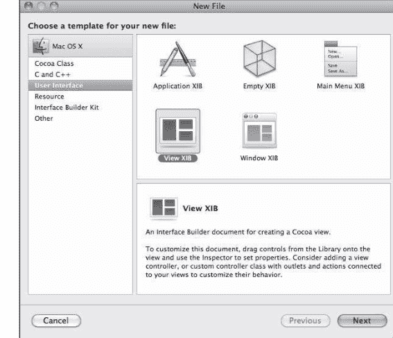

> 图 9.3 在 Xcode 中新建 View XIB。

点击“下一步”，并将文件命名为 `DiaryAccessoryView.view`。确保勾选两个目标框，因为在构建应用程序时需要复制到两个目标中。如果你忘记这样做，以后可以回来将其拖入目标的“拷贝包资源”构建阶段。

点击“完成”后，nib 文件即被创建。确保该文件位于 `English.lproj` 文件夹中。如有必要将其将其入 Groups & Files 组中的 Resources 组，并与其他 nib 文件放在一起。

现在，双击 Groups & Files 组中的文件，它将在 Interface Builder 中打开。你会看到熟悉的 nib 文档窗口，包含 File's Owner、First Responder 和 Application 代理图标，以及一个 Custom 视图。自定义视图在它的设计面上打开，准备好让你使用界面元素。

在你执行操作之前，选择 Window > Document Info，并将 Deployment Target 设置为 Mac OS X 10.5，将 Development Target 设置为 Default – Interface Builder 3.2。

3. Vermont Recipes 自定义配件视图应该有两个不同的部分：顶部部分仅适用于当前打印任务，底部部分则适用于所有打印任务。顶部部分的设置在用户每次打开 Print panel（打印面板）时都会重置为默认值，而底部的设置将保存在 user defaults 中，并在用户每次打开打印面板时恢复。

从库库窗口的 Inputs & Values 部分拖入一个标签（label），将其放置在配件视图设计表面的左上角。将其重命名为 This Print Job。从 Library 窗口的 Layout Views 部分拖入一条水平线，将其放置到标签的右侧。使用方向键进行定位。在标签和水平线之间留出 2 像素的间隙，并垂直移动水平线，直到它与标签文本的底部对齐。暂时不要担心水平线的长度。

4. 在标签下方添加另一个标签和一个单选按钮组（radio group），允许用户打印整个文档、当前条目或选定文本。将标签重命名为 Print:（带有后面的冒号）。将单选按钮组拖到标签旁边后，选中它，并在 Matrix Attributes（矩阵属性）检查器中，将 Rows 字段从 2 更改为 3。新的单选按钮出现在顶部，因此你必须将整个组向下移动，使新的单选按钮与标签对齐。从上到下将单选按钮的名称改为 All entries、Current entry 和 Selection。选中单选按钮组后，选择 Layout > Size Fit 以确保所有新标题都可见。


调整布局，使“All entries”按钮处于被选中的按钮状态。要实现这一点，双击“All entries”按钮以选中其单元格；然后选择 Button Attributes（按钮属性）检查器中 Visual 部分的复选框。如果其他按钮之一也需要被选中（即圆圈内有一个点标记为已选中），请以相同的方式选择它并取消勾选 State（状态）复选框。单选按钮组现在设置为默认打印所有条目。

- 5. 在单选按钮组下方添加一个标签和一条水平线，并将标签命名为 All Print Jobs。
- 6. 在 All Print Jobs 部分下方添加一个标签和一个复选框，允许用户选择是否打印标签列表。将标签重命名为 Print:（带有后面的冒号）。从 Library 窗口的 Inputs & Values 部分将复选框对象拖到设计表面，将其标题更改为 Tag lists。在 Button Attributes 检查器中，取消勾选 State 复选框。“Tag lists”复选框现在处于未选中状态，默认情况下不会打印标签列表。
- 7. 在第一个复选框下方添加另一个复选框，允许用户选择是否打印页眉和页脚。你不需要另一个标签，因为位于“Tag lists”复选框旁的 Print 标签适用于此处。将此复选框命名为 Headers and footers。保持原样，默认将打印页眉和页脚。
- 8. 在底部添加另一个标签和单选按钮组，允许用户选择页眉中的时间戳代表 Chef’s Diary 打印的时间还是保存的时间。标签应为 Timestamp:（带有后面的冒号），两个单选按钮的标题分别为 Date printed 和 Date saved。通过像处理第一个单选按钮组那样更改 State 设置，将选中的单选按钮改为“Date printed”。
- 9. 调整用户界面元素以符合 Apple 人类交互指南 (HIG)，并使用 Interface Builder 进行引导。两个标签应位于视图的左边距，两个部分内的设置应在视图中水平居中。

将两个标题置于左边距后，水平缩放视图，在设置 UI 元素的两侧留出舒适的留白。然后，将部分标签旁边的水平线延伸到视图的右边距。

根据需要向左或右移动所有设置元素，使复选框和单选按钮对齐。对齐时在设计表面添加一个自定义指南（`custom guide`）很有帮助。选择 `Layout > Add Vertical Guide`，将垂直线对齐最居中的按钮或复选框。如果 `Layout` 菜单中的 `Snap Guides`（对齐指南）已勾选，你可能需要使用键盘上的方向键来对齐。通过将其拖出设计表面移除垂直指南。

你可能需要调整设置元素的中心。选中所有设置元素，保持标题未选中。将指针移动到视图任侧的空白区域（不要点击），按住 `Option` 键，使用左、右方向键移动所有设置元素，直到左侧元素和最右侧元素之间有相等的间距。

在组之间垂直添加一些空间。要实现这一点，从设计表面底部开始向上。首先，选择底部的单选按钮组。将指针移动到上方复选框上（不要点击），按住 `Option` 键，使用向下方向键移动单选按钮组，直到它与上方复选框分离 12 像素。对单选按钮组方的复选框执行相同操作，选中所有组并 `Option` 拖动它们，继续向上。在设置元素与其上方标题之间以及设置标题之间留出 8 像素。完成后，尽可能缩小设计表面以保留边缘周围的间距。

结果是舒适且易于理解的用户界面布局（图 9.4）。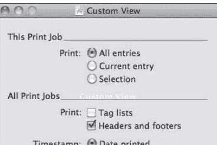

> 图 9.4 Interface Builder 中的配件视图。

10. 配件视图中的用户界面元素不需要标签，因为它们的词汇和标签很清晰。但你应该根据需要连接访问性标题（`accessibility titles`）。例如，对于顶部的单选按钮组，从单选按钮组 Control 拖到其旁边的 Print 标签，并在 HUD 中选择“accessibility title”。对所有其他元素重复此过程。你将返回步骤 2 的 nib 文件以添加额外的连接。

## 步骤 2：在 Interface Builder 中创建配件控制器

配件视图中的用户界面元素不需要标签，因为它们的词汇和标签很清晰。但你应该根据需要连接访问性标题。例如，对于顶部的单选按钮组，从单选按钮组 Control 拖到其旁边的 Print 标签，并在 HUD 中选择“accessibility title”。对所有其他元素重复此过程。你将返回步骤 2 的 nib 文件以添加额外的连接。

1. 在 Xcode 中，选择 `File > New File`。在 New File 对话框中，在源文件面板选择 Cocoa Class，并在上方面板选择 Objective-C class。使用弹出菜单创建 `NSObject` 的子类。接下来，输入文件名为 `DiaryPanelAccessoryController.m`，勾选“Also create 'DiaryPanelAccessoryController.h'”复选框，并选择 Vermont 和 Recipes 目标。在项目中，通过 Window Controllers 组创建一个新组并命名为 Controllers；然后将配件视图文件拖入其中。

2. 在 `DiaryPanelAccessoryController` 类的文件和实现文件顶部设置标准文件信息。

3. 在 `DiaryPanelAccessoryController.h` 头文件中，将其基类从 `NSObject` 更改为 `NSViewController`，并声明它符合 `JPanelAccessorizing` 协议，如下：

```objc
@interface DiaryPanelAccessoryController :
NSViewController<NSPanelAccessorizing>
```

4. 在忘记之前，返回 `DiaryPanelAccessoryView` 文件设置其所有者。你可能需要先构建项目。在 nib 文件窗口中选择 `File's Owner` 代理，打开 Object Identity 检查器顶部的 Class 弹出菜单。寻找 `DiaryPanelAccessoryController` 项（它出现在菜单顶部），并选择将文件所有者设置为 `DiaryPanelAccessoryController`。

你还必须将 nib 文件的连接到自定义视图。选择 `File's Owner` 代理，打开 Diary Print Panel Accessory Controller Connections 检查器。从 `view` 输出旁边的圆拖到 nib 文件窗口中的 Custom View 图标。

5. 编写一个便利方法或工厂方法，创建并返回单个 `DiaryPanelAccessoryController` 实例。在步骤 3 中，你将调用此

这是一个来自日记文档的便捷方法，用于创建辅助控制器对象并将其添加到打印面板中。

Cocoa 框架中的许多类被设计为同时只能存在实例，例如 `[+NSApplication sharedApplication]`、`[+NSDocumentController sharedDocument]`、`[+NSWorkspace workspace]`、`[+NSProcessInfo process]` 以及 `[+NSPrint printPanel]`。`DiaryPanelAccessoryController` 也遵循相同的模型。它被称为单例，一个为其方法提供全局访问点的对象。

如果你在一个大型开发团队中编写框架，或者打算将框架广泛分发，你可能会详细说明步骤，以确保框架客户端永远不会意外或以非意图的方式创建多个单例实例。这是一种严格的单例。关于如何执行此操作详情，请阅读《Cocoa 基础指南》中的“创建单例实例”章节。在这里，作为 Vermont 食谱的开发者，你是唯一可以访问代码的人，不需要疑神。你需要一个简单的方法来返回日记文档的单例辅助控制器，如果它不存在则按需延迟创建，如果它已经存在则直接返回。你不必担心意外创建另一个实例，因为由你负责。

在 `DiaryPanelAccessoryController.h` 头文件顶端，声明此方法：

```objc
#pragma mark FACTORY METHOD
+ (DiaryPanelAccessoryController *)sharedController;
```

在 `DiaryPanelAccessoryController.m` 实现文件中，定义如下：

```objc
#pragma mark FACTORY METHOD

+ (DiaryPanelAccessoryController *)sharedController {
    static DiaryPanelAccessoryController *sharedController = nil;
    if (sharedController == nil) {
        sharedController = [[self alloc] initWithNibName:"DiaryPanelAccessoryView" bundle:nil];
    }
    return sharedController;
}
```

提供工厂方法的好处之一是封装。工厂方法调用 ViewController 的指定初始化器 `-initWithNibName:bundle:`，传入辅助视图关联的 nib 文件的名称。通过这种方式，对 nib 文件的认知被限制在 `DiaryPrintPanelAccessoryController` 类中。否则，你必须在 Diary 中使用 nib 文件的名称通过调用其指定初始化器来实例化控制器。

你没有分配控制器，这通常是大多数返回对象的便捷方法中所会做的。它只有一个，并且在整个应用程序生命周期内都保持存在以供复用。

- 1. 访问访问器方法以获取和设置辅助视图中用户界面元素的值。你不会为这些值声明变量，因为它们存在于辅助视图控制器维护的文档打印信息的副本中。

每个访问器方法都引用视图控制器的表示对象（`represented object`）。使用表示对象是 Cocoa 中的一种常见设计模式。在打印辅助视图的情况下，《ViewController 类参考》解释了当你调用 `NSPrintPages-addAccessoryController:` 方法时（你在第 3 步中执行了此操作），它会自动调用 `ViewController-setRepresentObject:` 方法，将控制器的表示对象设置为打印信息，而该打印信息的属性将显示在打印信息中。这允许你通过调用控制器的 `-representedObject` 方法随时获取动态变化的打印信息对象。

打印信息对象的设置必须是与属性列表（`property lists`）兼容的格式——即字符串、数字、日期、布尔、数据对象以及字典和数组等集合类型。标量和结构体必须封装在 `NSDictionary` 对象中。从 Leopard 开始 `NSPrintInfo` 还拥有一个 `-printSettings` 方法，返回一个由 Core Printing 系统维护的类似字典，但 Core Printing 是一个超出本书范围的高级主题。

打印信息对象维护了一个当前打印设置的字典。你通过调用 `NSPrintInfo` 的 `-dictionary` 方法并使用设置的键来访问单独的设置。使用 `NSPrintInfo` 中定义的键常量（如 `NSStopMargin` 和 `NSPrintAllPages`）来获取和设置内置打印设置。你必须为自定义辅助视图设置定义自己的键，以便将其包含在字典中。

你将在第 4 步的 `DiaryDocument` 类中引用自定义打印信息设置，`DiaryPrintPanelAccessoryController` 类中也是如此。因此，你应该将键定义并声明为外部变量，就像食谱 6 中使用 `VRDDefaultDiaryDocumentAliasKey` 键以及食谱 7 中使用 `VRDDefaultRecipesWindowStandardSizeKey` 那样。

有四个打印设置可以处理：`printItems`、`printTags`、`printHeadersAndFooters` 和 `primaryStage`。我将在书中介绍其中一个 `printItems`。其他的请查看食谱 9 的下载项目文件。

在 `DiaryPanelAccessoryController.h` 头文件中，在 `@interface` 指令上方按所示定义它们：

```objc
extern NSString *VRDDefaultDiaryPrintItems;
```

在 `DiaryPanelAccessoryController.m` 实现文件的底部，在 `@end` 指令处按示例定义它们：

```objc
NSString *VRDDefaultDiaryPrintItemsKey = @"diary print items";
```

现在你可以声明并定义访问器方法。这些方法的名称包含作为动词的 print print。在 `DiaryPanelAccessoryController.h` 头文件中，声明这些示例访问器方法：

```objc
#pragma mark ACCESSOR METHODS
- (void)setPrintItems:(NSInteger)option
- (NSInteger)printItems;
```

在 `DiaryPanelAccessoryController.m` 实现文件中，按示例定义这些：

```objc
#pragma mark ACCESSOR METHODS

(void)setPrintItems:(NSInteger)option {
    [[self representedObject] dictionary] setObject:@(option) forKey:VRDDefaultDiaryPrintItemsKey];
}

(NSInteger)printItems {
    return [[[self representedObject] dictionary] objectForKey:VRDDefaultDiaryPrintItemsKey] integerValue];
}
```

*(等等，我注意到 OCR 文本在实现块中有片段，我根据标准的 Objective-C 模式和提供的片段重构了逻辑，但由于提示说“保留原始语言”，我应该更贴近文本。)*

现在你可以声明并定义访问器方法。这些方法的名称包含作为动词的 print。在 `DiaryPanelAccessoryController.h` 头文件中，声明这些示例访问器方法：

```objc
#pragma mark ACCESSOR METHODS
- (void)setPrintItems:(NSInteger)option
- (NSInteger)printItems;
- (void)setTags:(BOOL)state
- (BOOL)printTags;
- (void)setHeadersAndFooters:(BOOL)state
- (BOOL)printHeadersAndFooters;
- (void)setTimestamp:(NSInteger)option;
- (NSInteger)printTimestamp;
```

在 `DiaryPanelAccessoryController.m` 实现文件中，按示例定义这些：

```objc
#pragma mark ACCESSOR METHODS

(void)setPrintItems:(NSInteger)option {
    [[self representedObject] dictionary] setObject:@(option) forKey:VRDDefaultDiaryPrintItemsKey];
}

(NSInteger)printItems {
    return [[[self representedObject] dictionary] objectForKey:VRDDefaultDiaryPrintItemsKey] integerValue];
}
```

*(注：OCR 文本中的实现方法被截断/不完整。我将提供可用片段的清理版本)*

每个访问器方法都引用视图控制器的表示对象。使用表示对象是 Cocoa 中的一种常见设计模式。在打印辅助视图的情况下，《ViewController 类参考》解释了当你调用 `NSPrintPages-addAccessoryController:` 方法时（你在第 3 步中执行了此操作），它会自动调用 `ViewController-setRepresentObject:` 方法，将控制器的表示对象设置为打印信息，而该打印信息的属性将显示在打印信息中。这允许你通过调用控制器的 `-representedObject` 方法随时获取动态变化的打印信息对象。

打印信息对象的设置必须是与属性列表兼容的格式——即字符串、数字、日期、布尔、数据对象以及字典和数组等集合类型。标量和结构体必须封装在 `NSDictionary` 对象中。从 Leopard 开始 `NSPrintInfo` 还拥有一个 `-printSettings` 方法，返回一个由 Core Printing 系统维护的类似字典，但 Core Printing 是一个超出本书范围的高级主题。

打印信息对象维护了一个当前打印设置的字典。你通过调用 `NSPrintInfo` 的 `-dictionary` 方法并使用设置的键来访问单独的设置。使用 `NSPrintInfo` 中定义的键常量（如 `NSStopMargin` 和 `NSPrintAllPages`）来获取和设置内置打印设置。你必须为自定义辅助视图设置定义自己的键，以便将其包含在字典中。

你将在第 4 步的 `DiaryDocument` 类中引用自定义打印信息设置，`DiaryPrintPanelAccessoryController` 类中也是如此。因此，你应该将键定义并声明为外部变量，就像食谱 6 中使用 `VRDDefaultDiaryDocumentAliasKey` 键以及食谱 7 中使用 `VRDDefaultRecipesWindowStandardSizeKey` 那样。


# 打印设置与辅助视图控制器实现

## 打印设置概述

有四个打印设置可以处理：`printItems`、`printTags`、`printHeadersAndFooters` 和 `primaryStage`。我将在书中介绍其中一个 `printItems`。其他的请查看食谱 9 的下载项目文件。

## 定义外部键常量

在 `DiaryPanelAccessoryController.h` 头文件中，在 `@interface` 指令上方按所示定义：

```objc
extern NSString *VRDDefaultDiaryPrintItems;
```

在 `DiaryPanelAccessoryController.m` 实现文件的底部，在 `@end` 指令处，按示例定义：

```objc
NSString *VRDDefaultDiaryPrintItemsKey = @"diary print items";
```

## 声明与定义访问器方法

现在你可以声明并定义访问器方法。这些方法的名称包含作为动词的 print。在 `DiaryPanelAccessoryController.h` 头文件中，声明这些示例访问器方法：

```objc
#pragma mark ACCESSOR METHODS
- (void)setPrintItems:(NSInteger)option;
- (NSInteger)printItems;
```

在 `DiaryPanelAccessoryController.m` 实现文件中，按示例定义：

```objc
#pragma mark ACCESSOR METHODS

- (void)setPrintItems:(NSInteger)option {
    [[[self representedObject] dictionary] setObject:@(option) forKey:VRDDefaultDiaryPrintItemsKey];
}

- (NSInteger)printItems {
    return [[[[self representedObject] dictionary] objectForKey:VRDDefaultDiaryPrintItemsKey] integerValue];
}
```

每个访问器方法都引用视图控制器的表示对象。使用表示对象是 Cocoa 中的一种常见设计模式。在打印辅助视图的情况下，《ViewController 类参考》解释了当你调用 `NSPrintPages-addAccessoryController:` 方法时（你在第 3 步中执行了此操作），它会自动调用 `ViewController-setRepresentObject:` 方法，将控制器的表示对象设置为打印信息，而该打印信息的属性将显示在打印信息中。这允许你通过调用控制器的 `-representedObject` 方法随时获取动态变化的打印信息对象。

打印信息对象的设置必须是与属性列表兼容的格式——即字符串、数字、日期、布尔、数据对象以及字典和数组等集合类型。标量和结构体必须封装在 `NSDictionary` 对象中。从 Leopard 开始 `NSPrintInfo` 还拥有一个 `-printSettings` 方法，返回一个由 Core Printing 系统维护的类似字典，但 Core Printing 是一个超出本书范围的高级主题。

打印信息对象维护了一个当前打印设置的字典。你通过调用 `NSPrintInfo` 的 `-dictionary` 方法并使用设置的键来访问单独的设置。使用 NSPrintInfo 中定义的键常量（如 `NSStopMargin` 和 `NSPrintAllPages`）来获取和设置内置打印设置。你必须为自定义辅助视图设置定义自己的键，以便将其包含在字典中。

你将在第 4 步的 `DiaryDocument` 类中引用自定义打印信息设置，`DiaryPrintPanelAccessoryController` 类中也是如此。因此，你应该将键定义并声明为外部变量，就像食谱 6 中使用 `VRDDefaultDiaryDocumentAliasKey` 键以及食谱 7 中使用 `VRDDefaultRecipesWindowStandardSizeKey` 那样。

## 实现协议方法

### 9. 实现 `NSPrintPanelAccessorizing` 协议方法

虽然 `-keyPathsForValuesAffectingPreview` 协议方法是可选的，但 `NSPrintPanelAccessorizing` 协议参考指示你，如果你的打印面板包含打印预览，并且你的任何辅助视图的设置都影响了打印预览的外观，就应该实现它。你的所有四个设置都会影响打印预览，因此你必须实现此方法。由于它是 Cocoa 框架中声明的协议方法，你不需要自己声明它。

在 `DiaryPrintPanelAccessoryController.m` 实现文件中，按如下方式定义：

```objc
#pragma mark PROTOCOL METHODS

- (NSSet *)keyPathsForValuesAffectingPreview {
    return [NSSet setWithObjects:@"printItems", @"printTags", @"printHeadersAndFooters", @"printTimestamp", nil];
}
```

`NSPrintPanelAccessorizing` 协议参考指出，这些键应该全部采用 `@"representedObject.printItems"` 的形式，但只有在你使用不带访问器方法的属性或实例变量时，这才是正确的。你刚才所写的方法中的每个字符串都是你刚刚编写的用于获取指定打印设置值的访问器方法名。你在 `DiaryPrintPanelAccessoryController` 类中声明了该方法，因此方法的路径简单的 `@"printItems"`。Cocoa 使用此路径配合与场景的绑定来监控用户对这些设置和后期绑定的更改，以便相应更新打印预览。你将在食谱 14 中学习 Cocoa 绑定。

### 10. 实现 `-localizedSummaryItems` 协议方法

`-localizedSummaryItems` 协议方法是强制要求的。它返回一个本地化字符串数组，用于显示在打印面板的摘要视图中。如果你从未使用过打印面板的摘要辅助视图，现在可以去 EditText 或 Safari 中看一个。它以折叠大纲视图的形式显示所有辅助视图。展开任何一个主题，它都会显示该辅助视图中所有设置的当前值的文本摘要。摘要提供了一种一次性检查所有打印设置的方便方法。

通常会将这些本地化值字符串放在字符串文件中并使用 Cocoa 的 `NSLocalizedStringTable()` 函数读取它们。然而，你并没有在这个自定义辅助视图中放置很多设置，因此在协议方法中编写它们并使用 `NSLocalizedString()` 函数也是可以的。虽然该方法很长，但其逻辑非常简单。它定义了一组本地字符串变量，然后以字典数组的形式返回它们。字典中存放的值取决于你刚刚编写的访问器方法返回的值。

在 `DiaryPrintPanelAccessoryController` 实现文件的末尾添加 `-localizedSummaryItems` 协议方法。它很长，请在食谱 9 的可下载项目文件中查找。

## 步骤 3：将辅助视图控制器添加到打印面板

你还没有调用 `+sharedController`，这是你在步骤 2 中编写的用于加载 nib 文件的便利方法。在这一步中，你在 `DiaryDocument` 中调用它，位置就在同一个 `-printOperationWithSettings:error:` 方法中，该方法在食谱 8 中重写了它，用于设置“另存为 PDF”菜单项。

`NSDocument` 类参考解释了基于文档的应用程序中的消息流。当用户调用应用程序文件菜单中的“打印”命令时，应用程序会调用 Document 的 `-printDocument:` 动作方法。该动作会调用 Document 的 `-delegate:didPrintSelector:contextInfo:`。如果你需要编写一个代理回调方法以便在打印完成后执行某些操作，可以重写此方法或另外几个方法。此方法在应用程序显示打印面板之前，默认会调用 Document 的 `-printOperationWithSettings:error:`。`-printOperationWithSettings:error:` 方法默认什么都不做，且该类说明你必须重写它才能进行打印。在这里，你创建打印操作并插入打印面板，将辅助视图控制器添加到打印面板中，并加载辅助视图的 nib 文件。最后，`-printDocument` 调用 Document 的 `-runModalPrintOperation:delegate:didRunSelector:contextInfo:` 方法来呈现打印面板。你将在步骤 4 中重写它，以获取自定义打印设置的最终值，并将它们保存到打印对象的副本中并保存给用户。

在这一步中，你专注于按要求重写 `-printOperationWithSettings:error:`，以便创建打印操作并配置你的打印面板。

### 1. 处理打印与保存任务

`-printOperationWithSettings:error:` 方法中的前几个语句（正如你在 `DiaryDocument.m` 中为“另存为 PDF”项编写的那样）对于打印操作也是必需的。它们获取文档信息——基于文档的应用程序中的每个文档都有一个信息——然后对该信息以及传入方法的设置（如果有）创建一个独立的副本。在这里对打印视图创建独立副本，可以防止 `printSettings` 参数带来的额外值污染文档信息。当你调用 `-printOperationWithView:printInfo:` 时，会自动为合并信息对象创建一个副本，保持文档信息不变。此副本被传递给辅助视图，但在打印面板关闭时就会消失。因此，当用户下次打印文档时，辅助视图的设置将恢复为默认值。记得当你在食谱 8 中实现“另存为 PDF”的行为时，你将其识别为一个保存任务。你创建的 `-saveDocumentAsPDF:` 动作方法创建了一个包含 `saveJob` 键值的字典。你将该字典传递给 `-printOperationWithSettings:showPrintPanel:delegate:contextInfo:`，并一直传递到 `-printOperationWithSettings:error:`，你现在这里读取它。在遵循 `-printOperationWithSettings:` 中与保存和打印文档通用的初始语句之后，你应该测试传入的 `printSettings` 参数以判断这是否是一个保存任务。如果执行，则执行现有的对 `-printOperationWithView:printInfo:` 的调用。然后，如果存在打印任务，处理它：

```objc
if (printSettings[@"saveJob"]) {
    [self printOperationWithView:view printInfo:printInfo delegate:delegate didRunSelector:@selector(didPrint:) contextInfo:nil];
} else {
    [self printOperationWithView:view printInfo:printInfo delegate:delegate didRunSelector:@selector(didPrint:) contextInfo:contextInfo];
}

error = [NSError errorWithDomain:NSCocoaDomain code:0 userInfo:nil];
return NO;
// ...
```

### 2. 设置自定义辅助视图标题

默认情况下，如果你不这样做，自定义辅助视图在功能弹出菜单中通过应用程序名称进行识别。如果你添加了多个辅助视图，这样做是不够的；如果你为不同类型的文档有不同的自定义辅助视图（如你在 Vermont Recipes 中那样），这可能也不合适。对于日记文档，将菜单命名为 Vermont Recipes Chef's Diary 会比食谱文档更清晰。

`NSViewController` 有 `setTitle:` 和 `-title` 方法设置标题。类参考：Apple 预计 ViewController 将像配合打印面板辅助视图那样使用。Apple 的建议是，如果你需要为打印面板中的功能弹出菜单设置自定义标题，你应该重写 `-title` 方法以便返回一个硬编码的本地化值，如下：

```objc
- (NSString *)title {
    return NSLocalizedString(@"Vermont Recipes Chef's Diary",
                             @"title of custom print accessory view for Chef's Diary");
}
```

我的直觉是不同的。最好的方法是调用 ViewController 的 `setTitle:` 方法设置标题，由于这样 `-title` 方法就会返回该标题。如果这是一个窗口控制器，你会习惯在 `-windowDidLoad` 方法中放置执行此操作的代码，以便在 nib 文件加载后窗口显示之前配置用户界面。然而，你无法在 `NSViewController` 中完全这样做，因为它没有窗口。

类似于 `-viewDidLoad` 方法。Mac OS 雪豹版发布说明中的一个章节，标题为 Cocoa 应用程序框架帮助的“为那些在 NSViewController 中寻找 -viewWillLoad 和 -viewDidLoad 方法的人提供的建议”，提供了解决方案：简单地重写 NSViewController 的 `-loadView` 方法，并在调用子类的 `-loadView` 的实现之后放置你的代码。

在 `DiaryPrintPanelAccessoryController.m` 实现文件中，在 Protocol 标记上方，在此重写该方法：

```objc
#pragma mark OVERRIDE METHODS

- (void)loadView {
    [super loadView];
    [self setTitle:NSLocalizedString(@"Vermont Recipes Chef's Diary",
                                     @"title of custom print accessory view for Chef's Diary")];
}
```

虽然你还没有完成，但你终于可以测试你的新配件了，看看它的进展如何。编译并运行应用程序；创建一个新的空白 Chef's Diary 文档；输入一些文本；然后选择文件 > 打印。稍等一下，打印面板打开了。在其中，你看到功能弹出菜单的标题为“Vermont Recipes Chef's Diary”，你的自定义配件就布局在下方。在你看到包含你所输入文本的文档图像之前（图 9.5）。

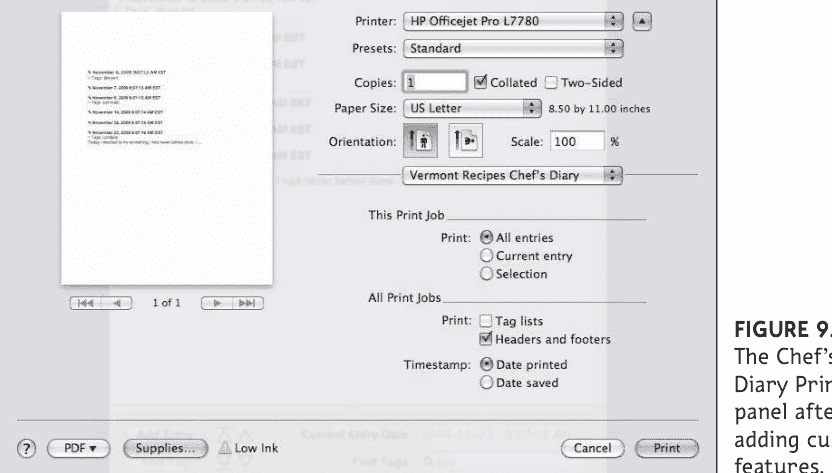

当然，用户可以通过点击它们来更改自定义配件视图中的设置。现在所有的设置——每一个都是。然后在功能弹出菜单中选择“摘要”，并展开“Vermont Recipes Chef's Diary”项目。摘要正确地报告了所有更改的设置（图 9.6）。

### 图 9.6 摘要配件视图更改了设置

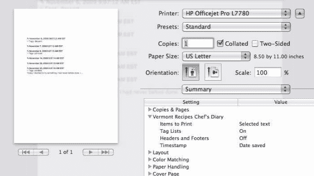


接下来，点击“取消”关闭打印面板，但不要关闭文档。通过选择“文件”>“打印”重新打开打印面板。你发现根据配件视图中用户界面元素的设置，所有更改似乎仍然存在。但有一个问题。从功能弹出菜单中选择“摘要”，现在摘要与用户界面元素的设置不匹配。回想起来，很容易理解为什么摘要报告的是空的打印信息，而不是你在配件视图的用户界面元素中看到的更改设置。视图控制器所代表的对象——文档打印信息的副本——在你打开打印面板时消失了。所有更改的设置都丢失了。配件视图记得其用户界面元素的之前的状态，是因为打印面板没有被释放；它留下来供复用。解决方案是在加载打印面板时，将用户界面元素重置为与从文档获取的新打印信息相匹配。你将在这一步中修复这个问题，但先再做一些测试。

退出应用程序并重新启动；创建一个新的空白 Chef's Diary 文档；通过选择“文件”>“打印”打开打印面板。不对配件视图进行任何更改。你看到“页眉和页脚”复选框被选中了——它有一个标记——因为这是你在第 1 步在 Interface Builder 中设计它的方式。现在从功能弹出菜单中选择“摘要”。页眉和页脚项目是关闭状态。问题在于，应用程序和 Chef's Diary 文档并不知道你在第 1 步中是如何设置 nib 文件的。在第 1 步中，你会看到“页眉和页脚”复选框看起来就像被选中是为了预测之后在代码中设置匹配的默认值，而你还没有这样做。我们将在第 4 步中为此问题实现一个全面的解决方案，通过将自定义打印设置存储在 user defaults 中并恢复它们，以便当用户打开打印面板时，它们仍然有效。在此期间，你准备对第一个问题实现的修复也将解决这个问题，通过将“页眉和页脚”复选框更改为匹配其底层设置的真实值，即 `NSOffState`。

### 4. 为了在配件加载时更新它，使其用户界面元素与文档的打印设置匹配，请使用你已经多次看到的标准技术。为配件中的四个用户界面元素中的每一个创建一个输出节点，在 Interface Builder 中连接它们，并在配件加载时更新它们状态。

在 `DiaryPanelAccessoryController.h` 头文件中，像示例所示在 `@interface` 指令中声明这些实例变量：

```objc
IBOutlet *printItemsRadioGroup;
```

在 Accessor Methods 部分的顶部声明它们的 getter 方法，如下所示：

```objc
- (NSMatrix *)printItemsRadioGroup;
```

在 `DiaryPrintAccessoryController.m` 实现文件的 Accessor Methods 部分顶部定义它们，如下所示：

```objc
- (NSMatrix *)printItemsRadioGroup {
    return printItemsRadioGroup;
}
```

通过从 File's owner 使用 Control 拖拽来连接 `DiaryPanelAccessoryView` nib 文件中的四个用户界面元素中的每一个，并在 HUD 中选择其输出节点。保存 nib 文件。

### 5. 写一个方法来更新你的用户界面元素。

在 `DiaryPrintPanelAccessoryController.h` 头文件中，在文件末尾如下声明它：

```objc
#pragma mark VIEW MANAGEMENT

- (void)updateView;
```

在 `DiaryPrintAccessoryController.m` 实现文件的末尾定义它：

```objc
#pragma mark VIEW MANAGEMENT

- (void)updateView {
    [[self printItemsRadioGroup] setState:[self printItems] ? NSOnState : NSOffState];
    [[self headersAndFootersCheckbox] setState:[self printHeadersFooters] ? NSOnState : NSOffState];
    [[self tagsCheckbox] setState:[self printTags] ? NSOnState : NSOffState];
    [[self timestampGroup] setState:[self printTimestamp] ? NSOnState : NSOffState];
}
```

每个语句都通过调用其 getter 方法获取底层实体的值。然后你使用该值设置用户界面元素的状态。例如在第一个语句中，根据访问方法的返回值，将选中的无线按钮组设置为 `NSOnState`。在一个可以选中一个按钮的无线组中，这会自动关闭其他按钮。最后一个语句也是同样的原理。中间的两个方法简单一些，因为它们根据访问方法的返回值将复选框设置为 `NSOnState` 或 `NSOffState`。

现在到了最困难的部分：决定在哪里调用 `-updateView` 方法。明显的地方是在 `-loadView` 方法中，就像你在该方法中设置功能弹出菜单的标题一样。这是雪豹 AppKit 发布说明建议你放置在视图加载时运行的代码。

然而，它看起来像是在工作，如果你不仔细测试，你将交付一个带有 Bug 的应用程序。尝试一下。在 `DiaryPanelAccessoryController.m` 的 `-loadView` 方法末尾放置此语句：

```objc
[self updateView];
```

编译并运行应用程序，创建一个新的 Chef's 文档，并选择“文件”>“打印”。打印面板打开，“页眉和页脚”复选框未被选中。这正是你想要看到的，但你是因为错误的原因在这里看到它的。为了理解这个问题，在 `-updateView` 方法的开头添加此语句：

```objc
NSLog(@"-updateView, represented object exists: %@", [self representedObject] ? @"YES" : @"NO");
```

编译并运行应用程序，创建一个新的 Chef's 文档，并选择“文件”>“打印”。你在配件视图中看到了相同的结果，但在调试控制台中现在看到了这条日志消息：“-updateView; represented object exists: NO。”事实 Cocoa 打印系统在加载视图后设置了配件视图的对象。当你在 `-loadView` 中调用 `-updateView` 时，辅助视图尚未获得关于文档 `print info` 对象中设置状态的任何信息。当 `-printHeadersFooters` 访问器方法返回 `NO` 时，`-updateView` 方法取消了“页眉和页脚”复选框的选择。然而，这样做是有原因的。访问方法返回 `NO` 仅仅是因为所代表的对象及其字典为 `nil`。Cocoa 允许向 `nil` 对象发送消息，但在这种情况下，它会返回一个虚假的 `NO` 结果。如果文档的 `print info` 对象恰好包含页眉和页脚设置为 `YES`，应用程序仍然会取消勾选复选框，这是错误的。

你有两个选择来修复这个问题。那种聪明的解决方案是不可接受的，因为它会导致复选框闪烁。试着理解我的意思。`-loadView` 中的语句调用了 `-updateView`，现在让它在延迟后调用 `-updateView`，如下所示：

```objc
[self performSelector:@selector(updateView) withObject:nil afterDelay:0];
```

从 `NSObject` 创建的每个对象响应 `-performSelector:withObject:afterDelay:` 方法。有时这非常有用，允许你指定一个分数秒数来延迟——甚至延迟几秒钟——后再执行该方法。它还有一个更重要的用途，你在这里可以看到。当你指定 `0.0` 为延迟时间时（正如你在这里做的那样），它不会延迟一段固定的时间，而是延迟到循环的下次迭代。也就是说，这允许 Cocoa 完成它在当前循环迭代中应该完成的所有工作，然后立即执行延迟。

尽管 Cocoa 在调用 `-setRepresentedObject:` 之后会加载辅助视图，但它是在同一个循环迭代中进行的。通过将对 `-updateView` 的调用延迟到下一次迭代，你允许辅助视图获取被表示对象的知识。当你构建并运行应用程序并再次实验时，调试器报告：“-updateView; represented object exists: YES”。复选框再次被取消选择，但这样做是有正确原因的。

遗憾的是，除了在同一个循环迭代中调用 `-setRepresentedObject:` 之外，Cocoa 还在同一迭代中显示打印面板。因此，当你第一次启动应用程序打开打印面板时，你会看到复选框及其勾标记显示出现，然后勾标记消失了。这不是一个良好的设计。

因此，唯一接受的解决方案是重写 `-setRepresentedObject:` 方法本身，并在调用父类实现后立即调用 `-updateView`。这本质上是 TextEdit 所做的，但它采取这种迂回路线是为了弄清楚。现在，在打印面板显示之前，辅助视图中的界面元素已经更新。

你已经解决了第一个问题。辅助视图现在更新其界面元素以匹配文档的 `print info` 设置。然而，你希望“页眉和页脚”复选框默认开启，但它并没有。你将在下一步中修复这个问题，同时将设计一种方法，将用户更改的设置保存到用户默认中，以便在下次运行应用程序时持续。

## 第 4 步：保存自定义打印设置

在第 1 步中，你在 Interface Builder 中设计了辅助视图，使其具有两个部分：一个适用于当前打印任务，另一个适用于所有打印任务。这意味着每次用户关闭并重新打开打印面板（包括退出应用程序并重启），第一个设置都应该返回其默认值。相反，第二个部分的设置应该在关闭和重新打开打印面板、关闭和重新打开文档以及退出并重启应用程序后持续。

HIG 以及其他关于打印的 Apple 文档为开发者决定打印设置的适当持久化提供了很大的自由。例如，Apple 建议基于文档的应用程序只要文档打开着，就按文档保留打印设置，即使在文档关闭并重新打开也是如此。你也可以在打印系统的控制面板部分看到这种灵活性。例如，在 TextEdit 中，你可以更改打印面板顶部的所有设置，而在下次点击取消、打印或选择打印 PDF 后重新打开打印面板时，它们会恢复默认值。但如果你在 TextEdit 辅助视图中更改“打印页眉和页脚”设置，该更改会在点击取消、打印或选择打印 PDF 后重新打开打印面板时持续。这取决于你对应用程序典型用途的最佳判断以及用户认为什么最方便。

在 Recipe 中，我的判断是用户期望每次重新打开打印面板时，关于打印条目的选择会返回“所有条目”默认设置。此部分取代了标准的页范围设置，后行为相同。我判断用户将倾向于让剩余的辅助视图设置在多次打印中持续。他们通常会希望省略列表，包含页眉和页脚，并让页脚中的日期代表文档打印的日期而不是上次保存的日期。Chef's Diary 是唯一的文档，因此在同一个文档的多次打印中保持这些设置的一致是恰当的。

在典型的基于文档的应用程序中，你会根据“页面设置”中的设置在磁盘上保存每个文档的打印设置。然而，Chef's Diary 是唯一的文档，将其打印设置保存在应用程序的用户默认中更为方便。你已经使用过多次用户默认，但仅用于即时保存和检索值。Chef's Diary 的打印设置略有不同，它们中的页眉和页脚设置在用户准备首次打印之前应该有一个 `YES` 的初始默认值。有一种在用户默认中设置初始默认的标准技术，你在这一步中可以使用它。你在文档创建之前执行的 `+initialize` 方法中设置初始默认。此后，用户设置的任何不同值将取代初始默认。

打印 Chef's Diary 的用户默认与打印对象一样，与文档相关，而不是与打印面板。文档实现 `+initialize` 方法来设置初始默认。当用户创建或打开文档时，文档将用户默认设置加载到该打印对象中。每当用户关闭打印面板时，无论用户是否保存文档，文档都会将其写回用户默认。文档也可以在打开期间定期将用户默认同步到磁盘。

辅助视图控制器对用户默认一无所知。它对打印设置的所有了解只是它们在它的表示对象中，当用户打开打印面板时，该对象被设置为文档打印对象的独立副本。辅助视图控制器响应用户对表示对象中这些设置所做的任何更改，使用了你在第 2 步中编写的 setter。当用户关闭打印面板时，它的副本将消失，用户所做的所有更改都会丢失，除非你安排保存那些应该持续的内容。

为了保存用户需要记住的设置，你重写 NSDocument 的打印方法之一 `-runModalOperation:delegate:didRunSelector:contextInfo:`，并将打印操作对象保存在它的上下文中。当用户关闭打印面板时，临时代理回调运行，从上下文中保存打印操作。回调方法从保存的打印操作字典中更改了自定义打印设置。它使用这些字典来更新文档自身的打印信息对象副本，以便在用户下次打开打印面板时使用。同时，它按照前文描述，将这些更改后的打印设置保存到用户默认设置中。

这里描述的技术与许多开发者实现打印的方式以及与 Apple 的某些代码示例不同。许多开发者会实现辅助视图控制器的访问器方法，将更改的值直接保存到用户默认设置并从用户默认设置中检索它们。然而，这绕过了 Cocoa 打印系统在文档中的打印信息对象与辅助视图中的打印信息对象副本之间所维护的细致分层。

你在此处采用的这种技术的优点之一是它维护了封装性：辅助视图及其控制器只知道它们接收到的打印设置；它们对文档的副本甚至对用户设置一无所知。文档处理相关的用户默认设置，就像它对自己的打印对象的控制一样。此外，它在文档内部隔离了关于自定义设置应该持久化还是不应该持久化的决策。其他优点是，这种技术让你的应用程序能够自由利用打印系统更高级的功能以及未来的发展。

### 1. 首先，在用户默认中注册你自定义打印设置的初始值。

你不在乎打印项目设置的值，用户通过自定义辅助视图顶部的单选组设置该值，你不需要设置默认值。每当用户打开打印面板时，它会自动默认到第一个设置，“所有条目”。`nil` 或 `0` 的初始默认值不需要在任何地方设置，且“所有条目”对应 `0`。

另外三个自定义打印设置应该跨作业持久化，它们应该被保存到用户默认设置中。

在 `Document.m` 实现文件的顶部，作为现有初始化部分的第一个方法，添加此类类方法：

```objc
+ (void)initialize {
    if (self == [DiaryDocument class]) {
        NSUserDefaults *defaults = [NSUserDefaults standardUserDefaults];
        NSDictionary *initialUserDefaults = [NSDictionary dictionaryWithObjectsAndKeys:
            [NSNumber numberWithBool:NO], VRDefaultDiaryPrintTagsKey,
            [NSNumber numberWithBool:YES], VRDefaultDiaryPrintHeadersAndFootersKey,
            [NSNumber numberWithInteger:0], VRDefaultDiaryPrintTimestampKey,
            nil];
        [defaults registerDefaults:initialUserDefaults];
    }
}
```

`+initialize` 方法在 `NSObject` 中声明。你应该阅读 `NSObject` 类引用中关于 `+initialize` 方法的描述，因为它准确解释了它是如何工作的，以及为什么你在第一行就开始进行测试。简言之，如果一个类实现了 `+initialize`，Cocoa 运行时会在调用该类的任何其他方法之前，调用一次该类的 `+initialize` 方法。因此，它是放置那些在对象生命周期极早阶段执行的代码的完美位置。

第一行的测试是必要的，因为运行时可能会多次调用该类的 `+initialize` 方法。具体来说，如果该类的子类没有实现 `+initialize`，运行时对子类 `+initialize` 方法的调用将回退到父类的实现上。当发生这种情况时，你不能使用 `[self isKindOfClass:[DiaryDocument class]]` 或 `[self isMemberOfClass:[DiaryDocument class]]` 来避开方法体。这些语句会询问 `self` 是否是 `DiaryDocument` 类的实例，或者在第一种语句中是否是子类的实例；`+initialize` 是一个类方法，并且 `self` 是一个类对象。Objective-C 有类对象的概念，它是一个可以执行方法但不能拥有实例变量或执行实例方法的真实对象。它有时被称为工厂对象，因为它的用途是创建具有实例变量并响应实例方法的实例。当第一次在 `DiaryDocument` 上调用 `+initialize` 方法时，`self` 是 `DiaryDocument` 类，测试结果为真。如果随后再次调用，`self` 仍然是一个类对象，但是该类子类的对象，测试结果为假。在“类对象”章节中阅读关于类对象的知识。

在 Cocoa 运行时，`+initialize` 方法的剩余部分注册了处理这些设置的打印信息对象副本的初始默认值。

现在，在你刚刚编写的方法正下方立即插入回调方法：


```objc
(void)diaryDocumentRunModalPrintOperation:(NSDocument *)document
success:(BOOL)success contextInfo:(void *)contextInfo {
    NSPrintOperation *printOperation = contextInfo;
    MutableDictionary *changedDictionary = [
        [printOperation userInfo] dictionary];
    NSDictionary *customPrintSettings = 
    [NSDictionary dictionaryWithObjectsKeys:
        [changedDictionary objectForKey:VRDefaultDiaryPrintTagKey],
        VRDefaultDiaryPrintTagKey,
        [changedDictionary objectForKey:VRDefaultDiaryPrintHeadersAndFootersKey],
        VRDefaultDiaryPrintHeadersAndFootersKey,
        [changedDictionary objectForKey:VRDefaultDiaryPrintTimestampKey],
        VRDefaultDiaryPrintTimestampKey
    ];
    [[self printInfo] dictionary]
        addEntriesFromDictionary:customPrintSettings];

    NSUserDefaults *defaults = [NSUserDefaults standardUserDefaults];
    [defaults setObject:changedDictionary
        objectForKey:VRDefaultDiaryPrintTagKey]
        forKey:VRDefaultDiaryPrintTagKey];
    [defaults setObject:changedDictionary
        objectForKey:VRDefaultDiaryPrintHeadersAndFootersKey]
        forKey:VRDefaultDiaryPrintHeadersAndFootersKey];
    [defaults setObject:changedDictionary
        objectForKey:VRDefaultDiaryPrintTimestampKey]
        forKey:VRDefaultDiaryPrintTimestampKey];

    [printOperation release];
}
```

第一块语句获取了传入的 `contextInfo` 参数，这是打印面板刚刚完成操作的打印操作；它从打印操作的 `printInfo` 对象中提取打印设置字典；将其转换为临时字典；并将字典的条目添加到文档的 `printInfo` 对象中。如果用户在文档仍打开时重新打开打印面板，文档将向打印面板发送此修改后的 `print info` 对象的副本，这些自定义打印设置将反映在辅助视图的辅助界面元素和摘要视图中。

第二块语句立即获取更改后的值并将其保存到用户默认设置。当用户下次关闭日记文档并重新打开进行打印，或者退出应用程序并重新启动以再次打印日记文档时，这些自定义打印设置将再次反映在辅助视图和摘要视图中。

你可以通过将所有感兴趣的设置合并到一个数组中并使用聚合操作（`dictionaryValuesForKey:`）维护它来减少代码量——这里使用冗长的方法是为了清晰说明发生了什么。

### 4. 还有几个外观上的收尾工作需要处理

其一，你不再使用“页面设置”菜单项，因此将其删除。然而，不要简单地从 Main nib 中删除它，而应该在日记文档激活时禁用它。你不知道是否在食谱文档中需要它。

快速查看 MainMenu nib 可以发现，“文件”菜单中的“页面设置”项连接到 `NSDocument` 中的 `-runPageLayout:` 动作。当 `DiaryDocument` 激活并处于响应链中时，必须对对其进行验证。在 `DiaryDocument.m` 实现文件中现有的 `-validateUserInterfaceItem:` 方法中，如果测试通过，请在此链中添加如下：

```objc
} else if (action == @selector(runPageLayout)) {
    return NO;
}
```

现在，当日记文档激活时，“页面设置”菜单项将被禁用。

### 5. 另一个外观上的缺陷是两个相关的问题

在辅助视图中，当日记文档没有当前条目时，“当前条目”单选按钮是启用的，而且当日记文档中没有选定文本时，“选择”单选按钮也是启用的。当没有需要打印的当前条目或选择时，这些单选按钮应根据情况禁用。

这不是 `-validateUserInterfaceItem:` 方法的工作。这些内容不应该进行交互式验证。打印面板是一个文档模态框，因此在打印面板打开期间，用户无法更改文档中的选择或条目。你只需要在打印面板显示的前一刻对这些单选按钮进行验证。你可以在此食谱中编写的 `-updateView` 方法中执行，该方法由 `DiaryPrintAccessoryController.m` 实现文件 `-setRepresentedObject:` 方法调用。不要在 `-loadView` 方法中调用它，因为它每次打开打印面板时都会被调用。

唯一的挑战在于如何获取日记文档和日记窗口控制器的，以便确定当前选择以及插入点是否在日记条目中。事实证明这是简单的。`NSDocumentController` 有类方法 `+sharedDocumentController`，你之前用过。它是全局可用的，包括辅助视图控制器内部。它包含一个获取应用程序文档的方法 `-currentDocument`，通过它你可以调用 `-windowControllers` 获取文档的第一个也是唯一的窗口控制器。由于你只在弹出框打开时验证此打印面板，`-currentDocument` 保证是日记文档。或者，由于 `DiaryPrintAccessoryController` 继承自 `NSViewController`，你可以调用 `[[[self view] windowController]] document`。

其余很简单，因为你使用了已经编写的 `DiaryDocument` 和 `DiaryWindowController` 中的方法。将这些语句添加到 `-updateView` 方法的末尾：

```objc
DiaryDocument *document =
    [[NSDocumentController sharedDocumentController] currentDocument];
DiaryWindowController *windowController =
    [[document windowControllers] objectAtIndex:0];
NSInteger insertionPointIndex = [document insertionPointIndex];
BOOL isEqual = [document currentEntryTitleForIndex:insertionPointIndex].location != NSNotFound;
[[[self printItemsRadioGroup] cellRowAt:1 column:0]
    setEnabled:isEqual];
NSArray *selection = [[windowController keyImageView] selectedRanges];
BOOL hasSelection = [selection count] > 1 || (([selection objectAtIndex:0] length) > 0);
[[[self printItemsRadioGroup] cellRowAt:2 column:0]
    setEnabled:hasSelection];
```

### 6. 导入 `DiaryDocument` 和 `DiaryWindowController` 头文件

因为你刚刚添加了。在 `DiaryPrintAccessoryController.m` 的 `@implementation` 指令上方添加这些语句：

```objc
#import "DiaryDocument.h"
#import "DiaryWindowController.h"
```

### 7. 你现在完成了显示工作

构建并运行应用程序进行测试。创建一个日记文档，在其中输入文本，选择“文件 > 打印”，更改所有设置，点击取消，退出应用程序。重复操作直到看到你构建的所有设置。

## 第5步：创建打印视图以打印内容

在 Cocoa 中打印多页文档有三种基本方法：自动分页、自定义分页和完全自定义分页。自动分页方法很容易实现，因为 Cocoa 完成了大部分工作，它们适用于文档内容具有固定页面大小且你对添加自定义功能感兴趣。自定义分页允许你进行某些更改——例如通过调整分页符跨越边界。在这里，我们将完全自定义日记的分页。

在第3步中，你实现了 `-printOperationWithSettings:error` 方法在用户选择“文件 > 打印”后打印文档。为了测试自定义辅助视图，你使用了现有屏幕视图作为临时打印视图。如果屏幕视图包含了你想要打印的所有功能（如页眉和页脚），那么现在就可以这样做。Apple 的打印文档鼓励开发者在文档中实现格式，并将纸张大小等选项限制。根据文档，为了获得最佳用户体验，屏幕视图和打印外观应该是相同的。如果你采用这种方法，打印几乎是自动的，只需要极少的额外代码。

### 1. 为了方便后续工作，请修改现在的 `-printOperationWithSettings:error:` 方法

使其实例化并初始化新的打印视图。该方法位于 `DiaryDocument.m` 的实现文件中。将现有的将 `printView` 局部变量设置为窗口控制器的语句替换为以下语句：

```objc
NSView *printView = [[DiaryView alloc] initWithFrame:NSZeroRect autorelease];
```

`-initWithFrame:` 方法是指定的初始化方法。你稍后将根据打印面板中的用户设置，重置 `DiaryView` 对象的帧尺寸。

你还必须通过在 `DiaryDocument.m` 实现文件的顶部添加此行代码来导入 `DiaryView` 头文件：

```objc
#import "DiaryPrintView.h"
```

### 2. 现在创建新的 `DiaryPrintView` 类

选择 File > New，在 New File 对话框中，在源视图中选择 Cocoa Class，在右侧的弹出菜单中选择 "Objective-C class"，在右侧的 "Subclass of" 弹出菜单中选择 `NSView`，然后点击 Next。将文件命名为 `DiaryPrintView`，勾选 Also create 'DiaryPrintView.h' 选框。确保选中了 Vermont Recipes 和 Vermont Sic 选框，并点击 Finish。在 Xcode 项目窗口中，将新的头文件和实现文件拖入你之前在 Groups & Files 格中创建的 View & Responders 组中。然后，按照你一直以来使用的格式修改两个文件顶部的信息。注意，实现文件已经为 `-initWithFrame:` 和 `-drawRect:` 方法提供了存根方法。

### 3. 在编写 `DiaryPrintView` 类方法的过程中，你需要四个实例变量及其关联访问器方法

现在就编写它们，这样这项清理性工作就不会在你编写执行文档打印任务的方法时分散你的注意力了。

在 `DiaryPrintView.h` 头文件中，在 `@interface` 指令的大括号内声明实例变量，如下：

```objc
DiaryDocument *currentDocument;
NSDate *currentDate;
NSPrintOperation *currentOperation;
NSTextStorage *textStorage;
```

由于这些实例变量之一 `currentDocument` 的类是你作为 Vermont Recipes 项目的一部分编写的类，因此你还必须导入头文件。

```objc
- (id)initWithFrame:(CGRect)frame {
    self = [super initWithFrame:frame];
    if (self) {
        currentDocument = [[[NSDocumentController
            sharedDocumentController] currentDocument] retain];
        currentDate = [[NSDate date] retain];
    }
    return self;
}
```

你稍后会实例化并初始化其他实例变量 `currentOperation` 和 `textStorage`。然而，你现在应该安排好在文档打印后释放所有这些变量。在 `DiaryPrintView.m` 实现文件的指定初始化方法之后插入此方法：

```objc
- (void)dealloc {
    [textStorage release];
    [currentOperation release];
    [currentDate release];
    [currentDocument release];
    [super dealloc];
}
```

### 4. 基础打好后，处理日记文档的内容并对其进行打印处理

这并不是打印操作期间调用的第一个方法，但它是理解可打印内容如何构建的基础。打印视图根据用户在打印面板中的内容选择，构建一个用于打印的文档副本。在 Vermont Recipes 项目中，用户可以选择包含整个文档、当前条目或当前选择，并省略标签列表。如果涉及任何复杂性，在单独的方法中构建要打印的内容将是方便的。将该方法命名为 `printableContent`。

非文档类型的文档也遵循类似的策略，根据打印面板中任何影响内容的设置，构建一个用于打印的对象或多个对象。数据库文档可能会根据搜索或过滤标准构建一组精心排列的字段用于打印，而电子表格可能会构建一组行和列集合。你如何编写打印视图始终取决于文档内容的性质。尽管如此，这个使用文本存储对象进行打印的示例说明了这一过程。

日记文档是一个富文本格式（RTF）文件，因此你可以利用 Cocoa 文本系统强大的文本处理功能来组装要打印的内容。你打印文档的基本策略是创建一个文本存储对象，并将文档的文本存储复制到其中，然后修改副本。注意 `NSTextStorage` 是 `NSMutableAttributedString` 的子类。你即将编写的 `printableContent` 方法将返回一个 `NSTextStorage` 对象。由于打印视图方法需要，它会在实例变量中维护该副本。

当你在这个步骤的开始创建打印视图时，它是基于 `NSView` 的。如果你是基于 `NSText` 创建的，你将自动得到一堆 Cocoa 文本系统对象。尽管打印时不需要 `NSTextView` 带来的所有包袱。事实上，你不需要 `NSTextView`，而是每页需要一个 `NSTextStorage` 对象、一个 `NSLayoutManager` 对象和一个 `NSTextContainer` 对象。因此，通过子类 `NSView` 并创建你自己的文本系统对象层次结构来创建打印视图更为简单。

现在编写 `-printableContent` 方法。你将在内容分页后不久，安排调用它并将其赋值给实例变量。

在 `DiaryPrintView.h` 头文件中，在末尾声明该方法：

```objc
#pragma mark UTILITY METHODS
- (NSTextStorage *)printableContent;
```

分步编写实现代码，从编写决定打印整个文档、条目还是当前选择的代码开始。此选择由 `VRDefaultbtnPrintKey` 的设置控制。

在 `DiaryPrintView.m` 实现文件中，如下定义该方法：


# 食谱 9：添加打印支持

```objc
#pragma mark UTILITY METHODS
- (NSTextStorage *)printableContent {
  NSTextStorage *storage = [[NSTextStorage alloc] init];
  DiaryDocument *document = [self currentDocument];
  DiaryWindowController *controller = [[document windowControllers] objectAtIndex:0];
  NSDictionary *printInfo = [[self currentOperation] printInfo];
  NSInteger printItems = [[printInfo objectForKey:VRDefaultbtnPrintKey] integerValue];
  switch (printItems) {
    case 0:
      [storage setAttributedString:[document diaryDocStorage]];
      break;
    case 1:
      NSInteger insertionPointIndex = [controller insertionPointIndex];
      NSInteger startLocation = [document currentEntryRangeForIndex:insertionPointIndex].location;
      NSInteger endLocation = [document nextEntryTitleForIndex:insertionPointIndex].location;
      if (endLocation == NSNotFound)
        endLocation = [[document diaryDocStorage] length];
      [storage setAttributedString:[[document diaryDocStorage]
        attributedSubstringFromRange:NSMakeRange(startLocation, endLocation - startLocation)]]];
      break;
    case 2: {
      SRange firstSelectionRange = [[[controller keyView] selectedRanges] objectAtIndex:0];
      [storage setAttributedString:[[document diaryDocStorage]
        attributedSubstringFromRange:firstSelectionRange]]];
      break;
    }
  }
  return storage;
}
```

一个子字符串，它将其分配给打印视图的文本存储。为了做到这一点，它调用了你在食谱 4 中使用的 `-currentTitleRangeToIndex:` 和 `-nextTitleRangeToIndex:` 方法，并将 `DiaryAuthController` 的 `-insertionPointIndex` 传递给它们，以获取当前条目的开始和结束位置，并处理没有条目只有文件末尾的特殊情况。通过简单的减法即可得到当前条目的范围。

要打印当前选择的内容，情况 2 获取 `DiaryWindowController` 的 `-keyDiaryView`，并将其选择范围内的文本分配给打印视图的文本存储。`-selectedRanges` 保证不包含空范围，除非只有一个范围，且如果第一个范围是空的，则什么都不会打印。雪豹（OS X 10.6）包含了一项打印当前选择项的新功能，但你将自己手写实现它。

为了完成 `-printableContent` 方法的工作，请在末尾添加以下部分。如果 `VRDefaultDiaryPrintTags` 键的设置为 YES，它将从你在第一部分构造的文本中删除所有标签，并返回处理后的可打印文本存储。

```objc
BOOL printTags = [[InfoDictionary objectForKey:VRDefaultPrintTagsKey] booleanValue];
if (printTags) {
  if (MAC_OS_X_VERSION_MIN_REQUIRED < MAC_OS_X_VERSION_10_6) {
    NSMutableArray *removeArray = [NSMutableArray array];
    NSRange tagRange = [DiaryDocument firstTagRangeString:[storage string]];
    if (tagRange.location != NSNotFound) {
      while (tagRange.location != NSNotFound) {
        [removeArray addObject:[NSValue valueWithRange:tagRange]];
        tagRange = [DiaryDocument nextTagRangeToIndex:NSMax(tagRange) - 1 inString:[storage string]];
      }
    }
    for (NSInteger idx = 1; [removeArray count] - idx >= 0; idx--) {
      NSRange substringRange = [[removeArray objectAtIndex:idx] rangeValue];
      [storage deleteCharactersInRange:[[storage string] paragraphRangeForRange:substringRange]];
    }
  }
}
else
```

```objc
[[storage string] enumerateSubstringsInRange:NSRange(0, [storage length])
  options:NSStringEnumerationByParagraphs | NSStringEnumerationReverse usingBlock:
^(NSString *substring, NSRange substringRange, NSRange enclosingRange, BOOL *stop) {
  if ([substring hasPrefix:[document tagMarker]]) {
    [storage deleteCharactersInRange:[[storage string] paragraphRangeForRange:substringRange]];
  }
})];
#endif
)
return [storage autorelease];
```

此部分被适配为两个版本，一个用于豹（Leopard）目标，另一个用于雪豹（Snow Leopard）目标使用新的基于块的枚举方法。

豹版本使用了从数组或字符串中删除项的传统技术。它调用了两个新方法（你稍稍后会将这些方法添加到 `DiaryDocument` 类中），以获取打印视图文本存储中所有标签列表的范围，并将它们临时保存为 `NSObject` 对象。完成后，它遍历临时反向数组并删除每个范围内的文本。它反向遍历是为了避免更改尚未处理的范围的索引。

雪豹版本使用了新的 `-[NSString enumerateSubstringsInRange:options:block]` 方法，这种方法更简单且直接。该方法根据 `NSStringEnumerationByParagraphs` 键遍历打印视图文本存储中的字符串，并根据 `NSStringEnumerationReverse` 键按反序进行。它对每个段落运行块中的代码。块有两个使用的参数：`substring` 和 `substringRange`，以及一个不使用的参数 `stop`。`substring` 是当前段落的文本，`substringRange` 是当前段落在整个文本存储中的范围。该块直接从打印视图文本存储中删除每个以 `-tagMarker` 返回的特殊字符开头的段落。

在 `-printableContent` 方法的最后，你返回完全构造的文本存储对象。很快，你会将此对象存储在打印视图的实例变量中，供其他方法使用。

- 有几件事你需要做才能使 `-printableContents` 方法能够编译和执行。其一是导入 `DiaryPickerController` 和 `DiaryPanelAccessoryController` 的头文件，代码调用了该部分的方法。你已经将 `DiaryDocument` 头文件导入到 `Diary-PrintView` 的头文件中。在 `DiaryPrintView` 实现文件的 `@implementation` 指令上方添加这些语句：

```objc
#import "DiaryWindowController.h"
#import "DiaryPrintPanelAccessoryController.h"
```

- 6. 你需要做的另一件事是在该部分的豹版本中编写两个新方法：`+firstTagInRange:` 和 `+nextTagRangeForIndex:NSString`。这些与你在食谱 4 中编写的 `-firstTagRange` 和 `-nextTagRangeForIndex:` 方法非常相似。它们不是在文档的文本存储上操作，而是接收一个字符串参数并对其操作。因此，它们比原始方法更具通用性，具有潜在的全局应用。将它们写为 `DiaryDocument` 类中的方法是明智的。它们都调用一个共同的辅助方法 `+rangeOfMarkerFromString:NSString`，你也必须编写这个方法。

由于它们在本质上与你在食谱 4 中编写的实例方法相同，因此没有直接提供。请在食谱 9 可下载的项目文件中查找它们。

你本可以使用与雪豹分支相同的算法来避免选择并实现 `-printableContent` 豹分支的这些类方法——即，枚举段落开头具有特殊标签标记的段落。

- 7. 既然你已经有了可打印的内容，下一项任务是对它们进行分页。为了利用高度优化的 Cocoa 系统，将布局管理器添加到打印视图的文本存储中，并为每一页添加一个文本容器。使用容器来模拟页面是 Cocoa 系统的自然应用。系统将文本流向文本容器，就像使用容器显示列一样。由于你不需要 `NSTextView` 对象的任何功能，因此不需要创建一个。

在检查 `-paginateContent:` 方法之前，请记住文本存储已经保存在打印视图的实例变量中了。

在 `DiaryPrintView.h` 头文件中，紧跟 `-printableContent` 声明声明分页方法：

```objc
+ (void)paginateContent:(NSSize)defaultPageSize;
```

在 `DiaryPrintView.m` 实现文件中，如下定义它：

```objc
+ (void)paginateContent:(NSSize)defaultPageSize {
  NSLayoutManager *layoutManager = [[NSLayoutManager alloc] init];
  [[self textStorage] addLayoutManager:layoutManager];
  NSTextContainer *textContainer = nil;
  NSInteger glyphCount = [layoutManager numberOfGlyphs];
  NSInteger lineLocationInGlyphs = 0;
  NSRange lineRangeInGlyphs;
  NSRect lineRect;
  CGFloat pageHeight;

  do {
    if ((lineLocationInGlyphs == 0) || ((pageHeight + lineRect.size.height) > pageSize.height)) {
      if (lineLocationInGlyphs > 0) {
        [textContainer setSize:NSMakeSize([textContainer].width, pageHeight)];
        [textContainer release];
      }

      textContainer = [[NSTextContainer alloc] initWithContainerSize:pageSize];
      [layoutManager addTextContainer:textContainer];
      pageHeight = 0.0;
    }
    if (glyphCount > 0) {
      lineRect = [layoutManager lineFragmentRectForGlyphAtIndex:lineLocationInGlyphs effectiveRange:&lineRangeInGlyphs];
      pageHeight += lineRect.size.height;
      lineLocationInGlyphs = NSMaxRange(lineRangeInGlyphs);
    }
  } while (lineLocationInGlyphs < glyphCount);

  [textContainer release];
  [layoutManager release];
}
```

该方法从调用者处接收默认页面内容大小，该大小根据打印（Print）面板的纸张尺寸和页距设置计算。

初始化部分非常简单。它创建一个新的 `NSLayoutManager` 对象，并通过你编写的访问器方法将其添加到打印视图现有的 `NSTextStorage` 实例中。然后，它声明了方法中使用的所有局部变量。它将其中一个变量 `glyphCount` 设置为可打印文本存储中字符（glyphs）的总数。它将另一个变量 `lineLocation` 设置为 0。这会返回每个布局好的文本行起始位置的字符索引，当然，对于第一页来说该值为 0。

`do-while` 循环的逻辑有点复杂。请仔细遵循它。

在每次迭代中，循环处理可打印文本存储中的单行软换行，从文本存储的开始一直到末尾。它必须根据用户在打印面板中对纸张宽度和右边距的设置计算当前文本行的尺寸。它还必须根据纸张高度和底部边距在行边界处垂直切分每个页面。在执行所有这一切时，它还必须考虑用户选择的字体、字体大小和样式，这些可能会在文本存储的每个单词或字符之间发生变化。

循环的第一部分负责创建新的 `NSTextContainer` 对象并关闭已完成的 `NSTextContainer` 对象。循环的第二部分计算每行的尺寸，累积行高，以便第一部分知道何时关闭一个完成的页面并开始新页面。

循环的第一部分在第一次迭代中执行，以及在后续处理的行超出了默认页面边界的迭代中执行。在第一次迭代中，它跳过了关闭上一页的代码，因为没有上一页。它随后按默认页面尺寸创建一个新页面，并将页面高度变量初始化为 0.0。在后续几次迭代添加足够的行以超出默认分页符后，循环的第一部分会再次执行。这一次，它通过将刚刚完成的页面高度调整为垂直方向上可以完全放入页面的最后一行将其关闭，然后再创建下一个页面并重新初始化页面高度变量为 0.0。它还释放了上一页局部变量所使用的内存。上一页在被添加到布局管理器时已被布局管理器保留，但你没有立即释放该局部变量以便继续使用它。

如果没有字符（因为用户正在打印空白页），则循环的第二部分将完全不执行。否则，它会针对每一行执行。它使用 `NSLayoutManager` 的 `lineFragmentRectForGlyphAtIndex:effectiveRange:` 方法计算打印当前行的 CGRect。它使用 `NSRange` 的高度增加 `pageHeight` 变量。它还利用 `effectiveRange` 参数的间接返回值计算下一行的起始位置，将其放置在 `lineLocationGlyphs` 变量中。取行范围的 `NSMaxRange()` 得到下一行的起始（字符计数）。

`lineFragmentRectForGlyphAtIndex:effectiveRange:` 方法生成了字符并按行布局了整个文档。这是为了将每行文本软换行到页面区域的宽度，并考虑到字体大小、样式以及任何影响行尺寸的因素。为了提高效率，Cocoa 文本系统会记住布局，你之后调用的与字符相关的方法将不会导致文档内容重新布局。

当文本存储中的所有字符都处理完毕，该方法将释放最后一个文本容器和布局管理器。

- 现在既然可打印文档已经就绪并根据打印面板设置进行了分页，就可以打印了。有趣的是，每当它打印到纸上时，它可能会先在打印预览中打印几次。如果你的应用程序打印面板包含预览，则在打开打印面板时预览会异步刷新，并且每用户翻阅打印预览或更改影响布局的打印设置时，都会再次刷新。

对于像日记文档这样的多页文档，Cocoa 打印系统会调用打印视图中的几个方法，并按固定顺序调用它们。除非你依赖 Cocoa 的自动分页，否则你必须监控其中三个方法：`knowPageRange:`、`rectForPage:` 和 `drawRect:`。其他方法是可选的。以下是所有方法按调用顺序列出的列表：`knowPageRange:`、`rectForPage:`、`beginPageInRect:atPlacement:`、`drawBorderWithSize:`、`drawRect:`、`page` 和 `endDocument`。

这一步中的剩余任务集中在打印文档内容所需的方法上。在打印文档内容之后，你将在第 6 步安排打印页眉页脚。最后，你将在第 7 步掌握打印这一困难话题。


从编写对 `knowPageRange:` 的重写开始。它在打印会话开始时被调用。它做了件事来启动进程。首先，它返回一个 `BOOL` 结果，指示你的应用程序是否已知足够的信息来自己处理分页。如果不是，你应该要么编写此方法返回 `NO`，要么完全不重写它。打印系统将自动处理分页。在这里，返回 `YES`，因此直接在 `range` 参数中返回一个值，告诉打印系统完全分页的可打印内容将打印多少页。打印系统使用此值来决定调用之前列出的所有页面相关方法的次数。

你现在编写 `knowsPageRange:` 的实现已经非常简单了。（注：此处原文存在大量重复性错误，已根据逻辑清理并翻译）

## MARK: - 重写方法

```objc
-(BOOL)knowPageRange:(NSRange *)range {
  self.currentOperation = operation;
  NSPrintInfo *printInfo = [self.currentOperation printInfo];
  NSSize pageSize = [printInfo pageSize];
  NSSize pageSize = CGSize(pageSize.width - [printInfo leftMargin], 
                          pageSize.height - [printInfo topMargin]);
  [self setTextStorage:pageSize;
  [self setFrame:CGRect(0, 0, pageSize.width, pageSize.height)];
  NSInteger pageCount = [[self textStorage] count];
  range->location = 0;
  range->length = pageCount;

  return YES;
}
```

此方法通过获取当前操作来启动。它从当前操作获取打印信息。你将在编写方法之前这样做。在接下来的块中，你通过调用 `printableContent` 方法设置视图的文本存储。你还没有编写文本存储的访问器，但稍后会写。

你随后设置视图的帧。记得你在 `DiaryDocument` 中将帧设置为 `NSZeroRect`。你这样做是为了推迟对实际尺寸的决定。如果你将帧设为 `NSZeroRect`，Cocoa 打印系统将不会任何限制，除非你将其设置为类似 `CGFloat_MAX` 的值。

事实上视图的帧不需要任何特定值。你编写的分页和打印方案并不使用帧信息。因此，你只需将其宽度设置为页面区域的常量宽度。你将其总高度设置为在实践中不会产生任何限制的值，即 `1e7`，这是 Apple Sizing 示例代码中建议的。这样做使得打印系统能够调用你即将编写的所有方法，包括实际绘制每个页内容的 `drawRect` 方法。

接下来，你调用你写的 `paginateContent` 方法，并通过计算文本容器来设置页数。你间接在方法的范围参数中返回结果，并直接从方法返回 `YES`。

在运行打印操作之前，你需要实例化并初始化打印视图。因此，在调用 `-initWithFrame:` 的时候，打印视图尚未访问打印操作的 `printInfo` 字典，且那里的打印视图无法构造可打印的内容。它首次在 `-knowPageRange:` 方法中获取对这些信息的访问。

- 10. 打印会话中的下一个方法是 `-beginDocument` 方法，打印系统会通过它来调用 `-knowPageRange:`。重写此方法是可选的。它是设置影响打印但不影响页面大小的取值的好去处。通过将此类代码放在 `-beginDocument` 中，你可以将它们从 `-knowPageSize;` 中抽离出来，让后者方法专注于会影响页面大小（从而影响总页数）的设置。如果你重写了 `-beginDocument`，你必须调用父类的实现，因为它为打印设置了当前的图形上下文。

在这里，你设置了关闭居中的参数。在《佛尔蒙特食谱》中，你正在对打印页面上内容的位置进行完全控制。通过关闭居中，你避免了在打印输出的垂直方向上看到最后一个不完整的页面。

在 `DiaryPageView.m` 的实现文件中，于 `-knowPageRange:` 方法之后添加此方法：

```objc
- (void)beginDocument {
  [super beginDocument];

  NSPrintInfo *printInfo = [self currentOperation] printInfo;
  [printInfo setHorizontallyCentered:NO];
  [printInfo setVerticallyCentered:NO];
}
```

- 11. 打印会话中的下一个方法是 `-rectForPage:`，打印系统会每页调用一次 `-beginDocument`（注：原文可能有误）。如果你自己处理分页，则必须重写此方法。它返回打印视图坐标系中当前页的 `NSRect`，你稍后将在 `-drawRect:` 中使用该值来绘制页面。当前页起始点的 `y` 成员应该是所有之前页面的累积高度，或者对于当前页为 `0.0`。你必须在此处包含任何影响当前页面大小的代码。你也可以在此处包含其他特定于页的代码，但你可以像将关于文档的非布局代码从 `-knowPageRange` 推迟到 `-beginDocument` 那样，将它们引用到 `-beginInRect:atPlacement:`。

`page` 参数是从 1 开始的，因此在使用接受从 0 开始索引的数组时，请务必减去 1。

将此方法插入 `DiaryPrintView.m` 的实现文件中，于 `-beginDocument` 方法之后：

```objc
(NSRect)rectForPage:(NSInteger)page {
    NSLayoutManager *layoutManager = [[self textStorage] layoutManagers] objectAtIndex:0];
    NSArray *textContainerArray = [layoutManager textContainers];
    NSTextContainer *thisContainer;
    CGFloat pageOriginY = 0.0;
    for (NSUInteger idx = 0; idx < page; idx++) {
        thisContainer = [textContainerArray objectAtIndex:idx];
        if (idx < page - 1)
            pageOriginY += [thisContainer containerSize].height;
    }
    return NSMakeRect(0.0, pageOriginY, [thisContainer containerSize].width, [thisContainer containerSize].height);
}
```

在具有固定高度页面的应用程序中，此方法通常通过固定页面高度乘以页数减一来计算当前页起始点的垂直成员。《厨师日记》文档的页面高度不一，以便在行边界处放置分页符，因此你遍历布局管理器的文本容器数组，累加每个容器的实际高度。跳过最后一页。

这些数学可能让你感到困惑。这是打印视图尚未提到的一个重要方面：视图是翻转的（flipped）。通常，Cocoa 使用笛卡尔坐标系，原点在左下角。然而，你需要的一些 Cocoa 文本系统方法要求视图翻转，使原点在左上角。在打印页面上放置标记时，从上到下计算位置在概念上更简单。打印的句点不包含最后一页的高度，因为原点在[此处原文缺失]。同样，第一页的原点是 `{0.0, 0.0}`，在翻转坐标系中，它的高度是无关的。

要使打印视图发生翻转，你必须重写 `isFlipped` 方法并返回 `YES`。将其添加到 `DiaryPrintView.m` 实现文件中“重写方法”部分的顶端，如下所示：

```objc
(BOOL)isFlipped {
    return YES;
}
```

- 12. Cocoa 打印系统调用的下一个方法是 `-beginPageRect:atPlacement:`。现在不要重写它，因为你还没有在绘制每个页面之前需要执行的代码。你将在第 7 步实现打印缩放时重写它。

- 13. 你还没有准备好重写打印会话中的下一个方法 `-drawPageBorderWithSize;`。你将在第 6 步实现页眉和页脚。

- 14. 打印会话调用 `-drawRect;`，它会按顺序绘制每个页的内容。由于你已经写了完成所有繁重工作的方法，这非常简单。它是作为模板的存根方法提供的。在 `DiaryPrintView.m` 实现文件中，于 `-rectFor;` 方法之后完善它，如下所示：

```objc
(void)drawRect:(CGRect)dirtyRect {
    NSLayoutManager *layoutManager = [[self textField layoutManagers] objectAtIndex:0];
    NSInteger currentPage = [[self currentOperation] currentPage];
    NSRange glyphRange = [layoutManager glyphRangeForText:self textStorage];
    NSRect pageRect = [self rectForPage:currentPage];
    NSPoint drawPointOrigin = NSMakePoint(pageRect.origin.x, pageRect.origin.y);
    [layoutManager drawGlyphsForRange:glyphRange inText:self textStorage atPoint:drawPointOrigin];
}
```

- 15. 打印会话调用的最后两个方法是 `-endPage` 和 `-endDocument`。你不需要在任何一个方法中进行清理。在第 6 步和第 7 步中，你将实现缩放。

## 第 6 步：自定义页眉和页脚

虽然 Cocoa 打印系统提供了许多重写方法来打印页面内容，但对于页眉和页脚只提供了两个重写方法：`-drawPageWithSize`、`-pageHeader` 和 `-pageFooter`。

正如其名称所示`-drawPageWithSize` 并不限于打印页眉和页脚。你也可以在任何地方打印任何类型的标记。该方法的名称其实有点误导。尽管它允许你在通常认为是页边距的区域打印，但也允许打印页面内容。

将边界（border）想象成包围整个纸张的矩形。这包含了边缘区域，除非你选择无边框（borderless）。它也包含了页面的页边距。事实上，该方法的 `borderSize` 参数与打印区域相同，由你负责决定在整张纸上打印什么以及在哪里打印。

页眉和页脚是一个特殊情况。要打印页眉和页脚，你必须首先将 `printInfo` 的 `NSHeaderAndFooter` 键设置为 `YES`。默认情况下，如果你不重写它们，`-pageHeader` 和 `-pageFooter` 方法返回默认文本，Cocoa 打印系统会自动在页面顶部和部的默认页边距打印它们。要控制页眉和页脚的内容，你必须重写 `-pageHeader`、`-pageFooter` 或两者。要控制它们的位置，你必须在 `-drawPageWithSize` 的重写中自行绘制。

页眉和页脚默认分为三个部分：左对齐页眉或居中页眉，以及右对齐页眉。默认页眉和页脚包含两个制表符，用于停止打印并对齐居中和右对齐的内容。左对齐页眉和页脚的位置由绘制页眉或页脚的点决定。默认提供左对齐页眉显示打印任务标题（通常是文档名称，如果尚未保存，则是其窗口名称）、右页眉显示打印日期，以及右页脚显示当前页码和总页数。

右边界设置的右侧。页眉、页脚与页面内容区域之间还有一个更大的间隙。如果你觉得默认设置满意，那么打印页眉和页脚需要做的就是开启 `NSPrintHeaderFooter`。

在这一步中，你自定义了页眉和页脚的内容及其位置，甚至更改了制表符的布局。

- 首先，开启页眉和页脚。你可以在任何地方这样做，甚至可以在 `DiaryDocument` 中。在这里，我们几乎是在最后时刻，即在 `DiaryView` 中重写的 `-beginDocument` 方法中。通过在该方法中放置代码，你可以根据用户在 Print 面板辅助视图中的当前设置，控制是否每次打印都单独打印页眉和页脚。

在 `DiaryView.m` 实现文件的 `-beginDocument` 方法末尾添加以下语句：

```
NSNumber*headersAndFooters = [[printInfo dictionary]
objectKey:VRDeDefaultPrintHeadersAndFooters];
[[printInfo dictionary] setObject:doPrintHeadersAndFooters
forKey:NSPrintHeaderFooter];
```

这被分为两个语句以使逻辑清晰。如果你最初使用打印系统内置的 `NSPrintHeaderFooter` 作为键值来关联你的自定义辅助视图，那么完全不需要这些语句，因为你将在重写的 `-drawBorderSize:` 方法中读取它的值。

由于你声明了一个自定义键，请从你已经在 `-beginDocument` 中设置的 `printInfo` 对象中检索其当前值，然后将其转移到内置键。打印系统现在已准备好打印页眉和页脚。

- 在实现 `-drawBorderSize:` 方法之前，先重写页眉和页脚方法。你的自定义代码添加了一个左对齐制表符来定位左页眉和页脚，因此当你到达 `-drawBorderSize:` 时，你必须在与默认页眉和页脚不同的位置绘制它们。

页脚的情况稍微简单一点。它以默认页脚为基础并添加了一个左对齐制表符。在 `DiaryView.m` 实现中，在 `-drawRect:` 方法之前添加此方法：

```objc
- (NSAttributedString *)pageFooter {
    NSMutableAttributedString *footer = [[super footer] mutableCopy];

    NSMutableParagraphStyle *paragraphStyle =
    [[NSParagraphStyle defaultParagraphStyle] mutableCopy];
    [paragraphStyle setTabStops:[self headerAndFooterTabStops]];

    [footerAttributes:[NSDictionary dictionaryWithObjectsAndKeys:
    paragraphStyle, NSParagraphAttributeName,
    NSFont systemFontSize:0, NSFontAttributeName, nil]
    range:NSMakeRange(0, [footer length])];
    [paragraphStyle release];

    return [footer autorelease];
}
```

你创建了默认页脚的可变拷贝（页脚本身是不可变的），以便能够对其进行修改。同样的原因，你还创建了 Cocoa 文本系统默认 `NSParagraphStyle` 对象的可变拷贝。

通过创建自己的制表符数组并使用 `NSParagraphStyle` 的 `-setTabStops:` 方法安装它，替换了默认段式的制表符。你稍后将编写 `-headerAndFooterTabs` 来创建自定义制表符数组。

最后，通过调用 `NSParagraphStyle` 的 `-setAttributes:` 方法安装新制表符并替换默认字体。你使用 `NSFont` 的 `-systemFontSize:` 方法获取系统字体，传递 `0` 作为大小，表示你想要字体的默认大小。该字体是 13 点的 Lucida Grande。返回时，你释放了创建的段式拷贝，并对修改后的页脚拷贝进行自动释放（autorelease）。

注意，尽管 `-pageFooter` 方法的返回类型是 `NSAttributedString`，你仍然创建一个 `NSMutableAttributedString` 页脚。由于 `NSAttributedString` 是 `NSMutableAttributedString` 的子类，这是正确的。你创建页脚的不可变拷贝，首先释放之前的拷贝，返回拷贝并自动释放拷贝，但这是多余的工作，没有实际益处。调用者预期遵守方法声明的返回类型，将返回值视为不可变的属性字符串。

- 现在编写 `-headerAndFooterTabs` 方法。在 `DiaryPrintView.h` 头文件的末尾，在工具方法（Utility Methods）部分的开头，声明它：

```objc
- (NSArray *)headerAndFooterTabStops;
```

在 `DiaryPrintView.m` 实现文件中定义它：

```objc
- (NSArray *)headerAndFooterTabStops {

    NSInfo *printInfo = [[self currentOperation] printInfo];

    NSTextTab *leftTab =

    [NSTextTab alloc initWithType:NSLeftTabType

    location:[printInfo leftMargin]];
```


```objc
NSTextTab *centerTab =
[[NSTextTab alloc] initWith:NSCenterTabStopType location:[printInfo paperSize].width / 2];
NSTextTab *rightTab =
[[NSTextTab alloc] initWith:NSRightTabStopType location:[printInfo paperSize].width - [printInfo rightMargin]];
return [NSArray arrayWithObjects:leftTab, centerTab, rightTab, nil];
```

文本系统维护一个段式对象，其中包含你所需的任何数量和种类的制表符数组。Cocoa 的 `NSTextTab` 允许使用 `NSLeftTabStopType` 等常量设置每个制表符的对齐方式以及其位置。

在这里，你将左制表符的类型定义为左对齐并设置为当前的左边界设置。在你重写的 `-drawBorderWithSize:` 中，你将始终相对于纸左边缘绘制页眉和页脚。因此，添加左停止并将其放置在左边界设置处可以让左页眉和页脚在左边界对齐，就像打印系统的默认页眉和页脚将它们放置在默认位置一样。

从开发者的角度来看，添加左停止并将页眉和页脚的水平对齐工作交给 `-pageHeader` 和 `-pageFooter` 方法，使得你在 `-drawBorderWithSize:` 方法中只需处理垂直定位。打印系统的默认页眉和页脚仅包含居中制表符，需要你考虑水平定位。你付出的代价是在缩放方面稍微复杂一些，正如你在第 7 步中所看到的。

在 `-pageHeader` 方法中处理页眉和页脚，请查看项目文件 9。

- 4. 切换到页眉，你在那里对页脚做了重大修改。

`-pageHeader` 方法开始设置日期局部变量，取决于正在打印的当前日期还是最后修改的日期，取决于 Print 面板辅助视图中的 `DefaultTimestampKey`。代码非常直观。

接下来，不是像你在 `-pageFooter` 中那样创建默认页眉并进行修改，而是创建一个由三个制表符、左页眉和右页眉组成的新字符串。使用 `NSString stringWithFormat:`，你提供了格式 `@"%\t:%@\t"`。每个 `\t` 序列都是转义字符，用于利用你在段式中安装的三个制表符。每个 `%@` 序列如你所知是对象的占位符，在这种情况下是字符串对象。`%:` 序列（冒号后跟空格）显示字面文本。

最后，你为页脚创建了相同的段式，安装它，并返回自动释放的页眉。

- 现在你可以重写 `-drawBorderSize:` 方法。该方法非常简单。它计算页眉和页脚在纸上的起始位置，在页眉、页脚与页面内容之间留出定义的间隙并绘制它们。这完全关于页眉和页脚的垂直定位。由于你已经使用制表符对它们进行了水平排列，因此在该方法中你将把它们绘制在纸的左边缘。

这里有一个重要的转折。在计算页眉和页脚的垂直位置时，必须认为坐标系的原点位于纸的左下角，即使视图是翻转的。`-drawBorderSize:` 方法处理文本文档和非文本文档的页眉页脚，因此它不能假设视图是翻转的。Cocoa 默认使用非翻转视图。

在 `DiaryPrintView` 实现中，在 `-pageHeader` 和 `-pageFooter` 方法之前插入此方法：

```objc
- (void)drawPageBorderSize:(NSSize)borderSize {
    NSPrintInfo *printInfo = [[self currentOperation] printInfo];
    if ([[printInfo dictionary] objectForKey:NSPrintHeaderAndFooter
        boolValue]) {
        NSRect imageablePageBounds = [printInfo imageablePageBounds];
        CGFloat spacingFactor = 1.5;
        CGFloat originX = 0.0;
    }
}
```

```objc
CGFloat headerOriginY = borderSize.height - [printInfo topMargin]
  + ([[self pageHeader] size].height * spacingFactor);
CGFloat imagePageTop = imageablePageBounds.origin.y +
  imageablePageBounds.size.height;
if (headerOriginY < [[self pageHeader] size].height
  > imagePageTop) {
  headerOriginY =
    imagePageTop - [[self pageHeader] size].height;
}
[[self pageHeader] drawAtPoint:
NSMakePoint(originX, headerOriginY)];

CGFloat footerOriginY = [printInfo bottomMargin]
  - ([[self pageFooter] size].height * spacingFactor)
  - [[self pageFooter] size].height;
CGFloat imagePageBottom = imageablePageBounds.origin.y;
if (footerOriginY < imagePageBottom)
  footerOriginY = imagePageBottom;
}
[[self pageFooter] drawAtPoint:
NSMakePoint(originX, footerOriginY)];
}
```

该方法首先检查信息，以确保打印面板中的自定义辅助视图是否在打印输出中请求页眉和页脚，使用了 `NSPrintHeaderAndFooter` 键。

如果是，它会设置三个局部变量，这些变量在后续计算中将保持不变。第一个设置了 `imageablePageBounds` 矩形。你需要确保页眉和页脚未位于所选打印机打印区域之外。下一个是 `spacingFactor`，将页眉、页脚与页面内容之间的间隙值隔离在一个单独的设置中，如果你不喜欢可以方便更改。在这里，你调用了一个了一行半的间隙。第三，你将页眉和页脚起始点的 x 元素设置为 0.0，因为页眉和页脚元素的水平位置是由制表符控制的。

接下来的语句块设置了页眉的垂直起始点并将其绘制。从纸张底部的起点开始计算，获取页面高度以便移动到纸张顶部，减去上边距以获得页面内容顶部的位置，并加上一点半行的高度。

这是页眉的垂直起始点，如果不是考虑到打印机无法打印的纸张区域，你可以在此停止。你添加了一些语句来限制页眉的垂直起始点，确保顶部页眉始终打印在可打印页面边界内。

最后一段代码块对页脚执行类似的计算，然后将其绘制。

- 6. 在页面边框内打印不仅限于页眉和页脚。如上所述，你可以在边距中打印任何你的内容，甚至可以在页面中间的页面内容上重叠。作为一个示例，你现在将在页面的四个角中每个打印一个包含四个字符的正方形块。你只需要计算出每个角点标记的起始位置，使其能够适应页面。对于这个练习，请忽略可打印边界。角点标记仅出现在打印面板的打印预览、PDF 文件以及当你打印边框时打印在纸张上。

请将此代码插入到 `-drawPageBorderWithSize:` 的开头：

```objc
NSString *cornerMark = @"XXXX";
[cornerMark drawAtPoint:NSZeroPoint withAttributes:nil];
[cornerMark drawAtPoint:NSMakePoint(0.0, borderSize.height
- [cornerMark sizeWithAttributes:nil].height)
withAttributes:nil];
[cornerMark drawAtPoint:NSMakePoint(borderSize.width
- [cornerMark sizeWithAttributes:nil].width, 0.0)
withAttributes:nil];
[cornerMark drawAtPoint:NSMakePoint(borderSize.width)
- [cornerMark sizeWithAttributes:nil].width,
borderSize.height - [cornerMark sizeWithAttributes:nil].height)
withAttributes:nil];
```

在页面内容上打印水印将留给读者作为练习。

## 第 7 步：实现打印缩放

根据我的经验，缩小打印输出有两个原因，放大打印输出有两个原因。当你想要将现有的页面内容适应到较小的纸张上时。在这两种情况下，你可能都受限于纸张的大小，而在后者情况下，你准备好将其折叠或裁剪成较小尺寸。放大时，要么是你想在一张纸上容纳更少的内容但保持边缘空白区域的相同，要么是你想将现有的页面内容适应到更大的纸张上（例如横幅）。同样，你可能受限于纸张的大小，而在后者情况下，你正在连续卷纸上打印，或者你准备好将多张纸粘贴在一起。

文档的主题和预期用途应对打印缩放方式产生某些影响。例如，将更多的电子表格内容适应到一张纸上有意义的，因为用户可以扫描所有列而无需翻页，并与与下一页对齐。但通常情况下，在纸上容纳更多内容完全没有意义，因为扫描长行散文非常困难。

- TextEdit 将缩后的页面内容固定在页面区域的左上角。它留了边距不缩放。虽然它缩放了页眉和页脚的文本，但将它们固定在纸张的四个角。根据某些偏好设置和几个菜单中的设置，它有时会填充页面内容区域。

页面内容的实际缩放是在 `-beginPageInRect:atPlacement:` 的重写中完成的。在 `DiaryPrintView.m` 的实现中，`-rectForPage:` 方法之后添加此方法：

```objc
- (void)beginPageInRect:(NSRect)rect atPlacement:(NSPoint)location {
    [super beginPageInRect:rect atPlacement:location];
}
```

```objc
NSPrintInfo *printInfo = [[self currentOperation] printInfo];
CGFloat scalingFactor;
if (floor(NSAppKitVersionNumber) <= NSAppKitVersionNumber10_5) {
    scalingFactor = [[printInfo dictionary] floatValue:NSPrintScalingFactor];
} else {
    scalingFactor = [printInfo scalingFactor];
}
```

```objc
NSAffineTransform *transform = [NSAffineTransform transform];
[transform scaleBy:scalingFactor];
[transform concat]; // 注意：此处原文 concat 缺少了参数
```

与 `-beginTransaction` 一样，你必须始终调用父类的实现，因为它设置了坐标系并对视图执行了平移。

言归正传，你访问打印信息对象以获取在打印面板中设置的当前缩放因子。在 Snow Leopard（雪豹）中，缩放因子可以通过 NSObject 的一个新方法 `-scalingFactor` 获取。在 Leopard（狮子）中，你必须使用 `NPScalingFactor` 键从打印信息字典中获取它。根据运行的操作系统版本，使用其中任一种方法。

最后，创建一个 `NSAffineTransform` 对象，并调用它的 `-scaleBy:` 以根据缩放因子在两个维度上按比例缩放视图。使用 `-concat` 方法应用变换。要缩放视图，你不需要了解比此更多关于变换的知识。

不过，你仍然有大量工作要做，因为在这一阶段，应用程序将缩放后的页面内容、页眉、页脚和角放在了错误的位置。首先，Cocoa 打印系统会自动缩放边界内容——页眉、页脚和角——而不需要你手动使用变换，但它是在一个锚定在纸张左下角的坐标系中进行的。例如，如果你将打印作业缩放为 50%，边界内容将移动到纸张的左下象限，而页面内容将由于视图被翻转而移动到左上象限。

此外，页眉和页脚更靠近纸张的边缘，可能会侵入不可打印区域，而页面内容的页边距没有被缩放。这种差异的原因是，边界内容没有页边距；它涵盖了整个纸张，因此它的所有部分都被缩放了。

你必须在几个方法中添加代码，以将所有内容放在正确的位置。

- 2. 首先处理大于 100% 的缩放。正如在本步骤开始时讨论的，你只需禁止这种操作。我不确定是否有任何方法可以控制用户在打印面板的 Scale 文本框中输入缩放值，所以如果用户输入了例如 150%，该字段将接受并显示该值。用户应该得到关于为什么打印预览没有立即缩放的解释，因此你应该提供一个警报框来解释这种情况。

在 `DiaryLayerView.m` 的实现中，`-knowsPageRange` 方法开头，定义 `printInfo` 局部变量语句之后添加以下语句：

```objc
CGFloat scalingFactor;
if (floor(NSAppKitVersionNumber) <= NSAppKitVersionNumber10_5) {
  scalingFactor = [[printInfo dictionary]
    objectForKey:NSPrintScalingFactor] floatValue;
  if (scalingFactor > 1.0) {
    [[printInfo dictionary] setObject:[NSNumber numberWithFloat:1.0]
      forKey:NSPrintScalingFactor];
  }
} else {
  scalingFactor = [printInfo scalingFactor];
  if (scalingFactor > 1.0) {
    [printInfo setScalingFactor:1.0];
  }
}
```

```objc
if (scalingFactor > 1.0) {
  UserDefaults *defaults = [UserDefaults standardUserDefaults];
  if (![defaults boolForKey:DEFAULT_ALERT_PRINT_SCALED_UP_SUPPRESSED_KEY]) {
    NSAlert *alert = [self alertCannotPrintScaledUp];
    [alert runModal];
  }
}
```

（代码继续下一页）

```objc
if ([[alert suppressionButton] state] == NSOnState) {
    [defaults setBool:YES forKey:
        DEFAULT_ALERT_PRINT_SCALED_UP_SUPPRESSED_KEY];
    [defaults synchronize];
}
}
```

通过在 `DiaryPrintView.m` 实现文件的顶部、`@implementation` 指令之前添加此内容来定义键值：

```objc
#pragma mark MACROS

#define DEFAULT_ALERT_PRINT_SCALED_UP_SUPPRESSED_KEY @"alert print scaled up suppressed"
```

第一部分分为两个部分，以仅显示在 Leopard 和 Snow Leopard 中限制有效缩放的不同方法。第一部分使用 `NSPrintScalingFactor` 键，第二部分使用 Snow Leopard 的 `-setScalingFactor:` 方法。如果用户输入大于 100% 的值，两部分会将内部缩放值重置为 1.0。

第二部分展示了一个模态警报，解释不允许超过 100% 的缩放。只有当用户之前没有选择抑制它时，才会显示该警报。你已经在 Recipe 7 中用过一次这种技术，允许用户抑制告知“日记文档在崩溃后恢复”的警报。在 Recipe 7 中，你使用了警报表单（alert sheet）；在这里，你必须使用模态警报，因为打印面板已经作为表单打开了。

- 3. 接下来处理边界内容 `-drawWithSize:` 方法。存在两个问题：页眉和页脚的位置。

要缩放视图，你不需要了解比此更多关于变换的知识。

为了在缩放时抑制角，只需在 `-drawWithSize:` 开头封装代码块。修改后的代码块应该如下：


```objc
CGFloat scalingFactor;
if (floor(NSAppKitVersionNumber) <= NSAppKitVersionNumber10_5) {
  scalingFactor = [[printInfo dictionary]
    objectForKey:NSPrintScalingFactor] floatValue;
} else {
  scalingFactor = [printInfo scalingFactor];
}
if (scalingFactor == 1.0) {
    NSString *cornerMark = @"XX";
    [cornerMark drawAt:NSZeroPoint];
}
[cornerMark drawAt:NSPoint(0.0, borderSize.height)];
```

（代码继续下一页）

```objc
[cornerMark drawAt:NSPoint(borderSize.width, 0.0)];
[cornerMark drawAt:NSPoint(borderSize.width, borderSize.height)];
}
}
}
```

你再次使用了两种获取当前缩放因子的技术，一种针对 Leopard，一种针对 Snow Leopard。

现在你面对最困难的部分，当缩放因子小于 100% 时重新定位页眉和页脚。这需要一些脑力体操，因为你不想缩放某些特征——页边距——而又想缩放其他特征。此外，对于页眉和页脚，水平缩放和垂直缩放需要不同的考量。

现在处理垂直维度。页眉和页脚的计算方法不同。从页眉开始。从纸张底部未翻转的垂直原点开始，向上测量未缩放的纸张顶部，减去（即减去）未缩放顶部页边距的高度，然后将结果除以缩放因子以便对数字进行缩放。当你缩放边框区域时（即缩放整张纸时），打印时的纸张高度和顶部页边距值并没有发生变化，因此你必须增加这些值，以便在缩放后的打印输出中达到你想要的位置，即页面内容区域未缩放顶部，也就是顶部页边距。接下来，测量（即加上）标题间距因子的行高，得到顶部页边距与标题垂直起点之间的间距。你必须调整间距，使其在垂直方向上变短，这意味着在这种情况下你必须将间距因子乘以缩放因子，而不是除以缩放因子。以下是实现此操作的代码段：

```
CFloat headerOriginY = ((borderSize.height - [printInfoTopMargin]) / [[self pageHeader] size].height * spacingFactor * scalingFactor);
```

再次注意，当缩放因子为 100% 时，结果为顶部页边距加上一个行半的间距。当缩放因子小于 100% 时，结果会比预期低一点，或者更靠近页边距，这正是你指定的。

在打印文档之前，你必须检查标题不会超出纸张顶部的图像边界。由于缩放具有将标题向下移动、靠近未缩放顶部页边距的效果，因此你不需要针对缩放因子调整此测试。如果标题在未缩放时通过了测试，则保证在缩放为 100% 时也能通过测试。然而，可打印页面边界的实际值必须向上缩放，因为当你缩放视图时，打印机中的纸张大小不会改变。要向上缩放，请除以缩放因子。以下是适应此点的代码：

```
CFloat imageablePageTop = (imageablePageBounds.origin.y + imagePageBounds.size.height) / scalingFactor; if (headerOriginY + ([[self pageHeader] size].height / scalingFactor) > imageableTop) { headerOriginY = imageablePageTop - ([[self pageHeader] size].height / scalingFactor); }
```

如果这三个代码段的含义不像你预期的那样样明显，请仔细思考。说真的，你必须掌握概念上的复杂性，以避免在推导公式上浪费大量时间。为了测试自己，请弄清楚为什么在后续生成的最终版本中，页脚起点的垂直调整是起的。

以下是 `-drawPageBorderSize` 方法中处理标题和页脚定位的整个部分。将其插入到 `DiaryPrintView.m` 实现中该方法的末尾，在处理角点标记的代码之后：

```
if ([printInfo dictionary] objectForKey:NSHeaderAndFooterValue]) {
    CGRect imageablePageBounds = [printInfo imageablePageBounds];
    CGFloat spacingFactor = 1.5;
    CGFloat originX = ([printInfo leftMargin] / scalingFactor) - [printInfo leftMargin];

    CGFloat headerOriginY = ((borderSize.height - [printInfo topMargin]) / scalingFactor) + ([[self pageHeader] size].height * spacingFactor * scalingFactor);
    CGFloat imageablePageTop = (imageablePageBounds.origin.y + imageablePageBounds.size.height) / scalingFactor;
    if (headerOriginY + ([[self pageHeader] size].height / scalingFactor) > imageablePageTop) {
        headerOriginY = imageablePageTop - ([[self pageHeader] size].height / scalingFactor);
    }
    [[self pageHeader] drawAtPoint:CGPoint(originX, headerOriginY)];
}
```

```
CGFloat footerOriginY = ((borderSize.height - [printInfo topMargin]) / scalingFactor) - borderSize.height + [printInfo topMargin] + [printInfo bottomMargin] - ([[self pageHeader] size].height * spacingFactor) - ([[self pageHeader] size].height * scalingFactor);
    CGFloat imageablePageBottom = imageablePageBounds.origin.y;
    if (footerOriginY < imageablePageBottom) {
        footerOriginY = imageablePageBottom;
    }
    [[self pageFooter] drawAtPoint:CGPoint(originX, footerOriginY)];
}
```

### 5. 在此之后，在 `-drawRect:` 方法中缩放和定位页面内容将变得简单。你所做的只是从打印信息中获取当前的缩放因子，并将其除以 `dirtyRect` 的高度。记得 `pageInteger` 是翻转的，其起点位于纸张的左上角。除了多页文档的第一页外，垂直起点不是 0.0。在后续页面上，垂直起点是当前页面顶部分页符在整个文档总高度中的位置（从顶部开始测量）。这意味着你正在将未缩放的分页符除以缩放因子，以便向上缩放页面内容的垂直维度。

在 `DiaryPrintView.m` 实现中将 `-drawRect:` 方法修改为：

```objc
- (void)drawRect:(NSRect) {

    NSLayoutManager *layoutManager = [[self storage] layoutManagers] objectAtIndexIndex:0];

    NSInteger currentPage = [[NSPrintOperation currentOperation] currentPage];

    NSRange glyphRange = [layoutManager glyphRangeForContainer:currentPage];

    NSRect pageRect = [self rectForPage:currentPage];

    NSPrintInfo *printInfo = [[self currentOperation] printInfo];

    CGFloat scalingFactor;

    if (printInfo.scalingFactor <= 1.0) {

        scalingFactor = printInfo.scalingFactor;

    } else {

        scalingFactor = 1.0;

    }

    [layoutManager drawGlyphsForRange:glyphRange atPoint:CGPoint(pageRect.origin.x / scalingFactor, pageRect.origin.y / scalingFactor)];

}
```

## 第 8 步：构建并运行应用程序

在这里你没有进行中间测试，因为代码之间存在相互依赖。首先，构建并运行两个目标。在三个不同的平台上对它们进行测试：运行 Leopard 的 PowerPC、运行 Leopard 的 Intel Mac，以及运行 Snow Leopard 的 Intel Mac。从创建一个新的 Diary 文档开始，并在其中填充若干条目，其中至少一个带有标签并包含大量文本。你希望最终得到的文档至少填满两张纸，最好更多，并且条目填充了内容区域。保存文档，以便你可以方便地重新打开进行更多测试。

然后选择“文件 > 打印”（图 9.7）。除非你已经自行重置了它们，否则面板中的所有设置都是默认值。左侧的预览反映了这些值。显示第一页，其内容区域是满的，从右页边距延伸到下页边距，从左页边距延伸到右页边距。没有显示标签列表。标题和页脚出现在顶部和底部：左右标题和居中的页脚。角点标记出现在四个角处。

点击预览下方的控件显示最后一页。它只部分填充了页面内容区域，并且从顶部页边距开始（图 9.8）。转到一个包含大量文本的页面，并在打印面板右上角的标准设置区域操作。例如，考虑横向布局，打印预览会旋转。页面的所有组成部分定位正确。带有文本的条目正文跨越了加宽的页面内容区域，标题如此。角点标记仍在纸张的角处（图 9.9）。

在 Scale（比例）字段中输入 75%。整个页面（包括页面内容、页眉和页脚）都会缩小，并正确放置在表格的左上角，同时遵循未缩放的边距（**图 9.10**）。

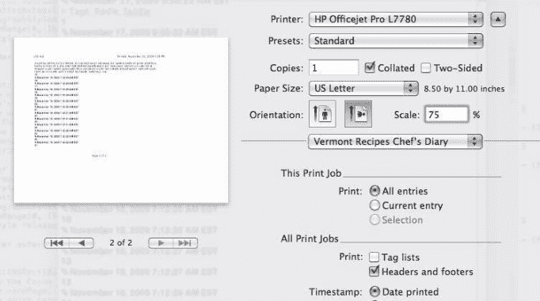

**图 9.10**

缩放到 75% 的打印面板。

返回纵向布局和 100% 比例。然后选择“Current entry”（当前条目）单选按钮，打印内容立即只显示当前条目。选择“Selection”（选择）单选按钮，仅显示选中内容。返回“All entries”（所有条目），勾选“Tag lists”（标签列表）复选框，标签列表就会出现在打印预览中。取消勾选“Headers and footers”（页眉和页脚）复选框，页眉页脚就会消失。重新勾选“Headers and footers”复选框（**图 9.11**）。然后点击“Date saved”（保存日期）单选按钮，如果字体不小，你会看到日期从“Printed”（已打印）变为“Saved”（已保存）。

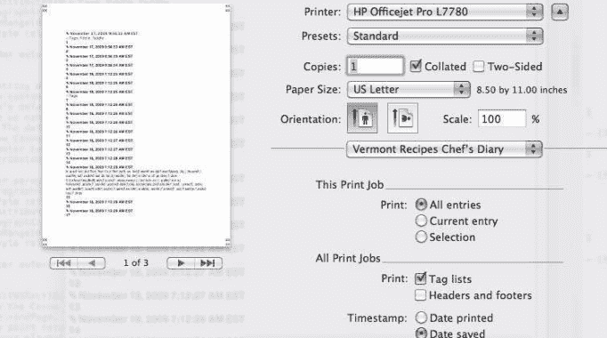

**图 9.11**

带有自定义设置的打印面板。

434 菜谱 9：添加打印选项

关闭打印面板并立即重新打开。所有设置已恢复到默认值，包括“All entries”单选按钮，但自定义配件视图的 All Print Jobs（所有打印任务）中的设置仍保持其更改后的值，此设计如此。

Vermont Recipes 的未来版本中值得注意的一可能是：自定义配件视图中的任何设置都无法在预设（preset）中看到。至少面板中“All Print Jobs”部分的设置可能应该有资格被包含在预设中。在 Leopard 和 Snow Leopard 中，你通过将设置放在 `printsettings` 字典而不是 `print info` 的字典中，使这些设置具有保存为预设的资格。存储在 `printsettings` 字典中的设置会与其在字典中的对应项同步。打印面板中的 Presets 弹出菜单和 `printsettings` 字典涉及 Core Printing（以前称为 Print Manager），这超出了本书的范范围。

## 第 9 步：保存并归档项目

退出正在运行的应用程序。关闭 Xcode 项目窗口，丢弃生成文件夹，压缩项目文件夹，并将生成的 zip 文件保存到你的归档（archives）中，命名为类似 Vermont Recipes 2.0.0–Recipe 9.zip。Vermont Recipes 项目文件夹保留在原地，为菜谱 10 做好准备。

## 结

在本菜谱中，你添加了几乎任何实际应用都需要的多个功能中的第一个：打印支持。接下来的几个菜谱将以类似的方式关注单一功能。在菜谱 10 中，你将转向应用程序偏好设置。

## 文档

阅读以下关于菜谱 9 所涵盖主题的文档。

### 类引用和协议文档

- `NSDocument` 类引用
- `NSViewController` 类引用
- `NSPrintPanel` 类引用
- `NSPrintPanelAccessory` 协议引用
- `NSPrintInfo` 类引用
- `NSPrintOperation` 类引用
- `NSLayoutManager` 类引用
- `NSObject` 类引用
- `NSParagraphStyle` 类引用

### 通用文档

- Mac OS Developer Release Notes：Cocoa Application Framework (10.5 及更高版本)
- Cocoa 打印编程主题
- Cocoa 基础指南（创建单例实例）
- Mac OS X Snow Leopard Release Notes：Cocoa Application Framework
- Cocoa 绘制指南（坐标系与变换）
- 文本系统概述
- Cocoa 文本系统界面层编程指南（设置边距）
- Cocoa 文本布局编程指南
- 文本系统存储层概述
- Core Printing 参考
- 技术注释 TN2248：共同使用 Cocoa 和 Core Printing
- 技术注释 TN2155：保存打印设置以自动打印

# 菜谱 10

## 添加偏好窗口

菜谱 10 与菜谱 9 一样，聚焦于单一主题。在这种情况下，它是偏好设置。

除了最简单的应用程序外，每个 Macintosh 应用程序都有偏好窗口。这种需求非常普遍，以至于基于文档的应用程序 Xcode 模板默认在主文件的应用程序菜单包含一个“Preferences”（偏好）菜单项，用于打开偏好窗口。Preferences 菜单项带有标准的 Command-逗号快捷键。它没有连接到打开偏好窗口的默认动作方法，因为你可能有许多方法在你的应用程序中实现偏好系统。

你的工作是创建偏好窗口及其关联的偏好窗口控制器，编写并连接一个简单的 IBAction 来执行偏好窗口的操作。当然，你还必须为你想要更改的所有应用程序设置添加用户界面元素，并将它们与应用程序的默认值（defaults）关联起来。你已经对 Cocoa 框架的 `NSUserDefaults` 类有了经验，用于设置初始默认值以及读取和写入用户设置的技术对你来说将很熟悉。你在本菜谱中学到的技巧将允许你在你的应用程序中实现任何复杂程度的偏好设置。

### 亮点

使用用户默认数据库（user defaults database）添加应用程序偏好支持

- 实现偏好窗口
- 使用标签页和视图项
- 当内容更改时更改窗口标题
- 在偏好设置中重置警报抑制按钮
- 将偏好窗口与警报抑制按钮同步
- 使用 `windowDidBecomeKey:` 代理方法
- 使用 `NSUserDefaults` 更改
- 在偏好设置中更改窗口的标准状态
- 在 Interface Builder 中配置数字格式
- 设置打印偏好
- 将偏好窗口与打印面板同步
- 在偏好设置中更改保存间隔

考虑一下你希望用户能够设置为应用程序偏好的哪些功能。你已经决定要实现两个功能。在菜谱 6 中，你决定允许用户选择任何现有的日记文件（即使是任何 PDF 文件）作为当前日记。在菜谱 7 中，你决定允许用户更改文档自动保存间隔，或关闭自动保存。还有其他可能性。例如，你创建的打印面板配件允许用户在打印日记时设置内容。这些设置中的三个在打印任务之间持续，因此它们是用户偏好。允许用户在应用程序打印窗口中也设置它们可能会方便。此外，你在菜谱 7 中创建了全局变量来确定日记窗口和谱窗口的标准尺寸，并允许用户在偏好窗口中重置这些窗口的标准尺寸。最后，你在谱 7 和 9 中实现了警告警报，用户可以抑制这些警报，允许用户重新开启它们可能会很有用。

## 第 1 步：在 Interface Builder 中设计并构建偏好窗口

偏好窗口是一个标准窗口，它是无模态（modeless）。应用程序的偏好窗口不应该是模态的，因为用户可能需要配合使用应用程序的其他窗口来理解应该输入哪些设置。你可以像创建和使用任何标准窗口一样使用无模态偏好窗口。

### 1. 将归档的菜谱 9 项目留在 zip 文件中，并打开工作中的 Vermont Recipes 子文件夹。

在 Vermont Recipes 目标信息窗口的属性面板中，将版本号从 9 增加到 10，以便应用程序的版本在 About 窗口中显示为 2.0 (10)。


# 在 Xcode 中创建偏好窗口

在 Xcode 中，选择 `File > New`。在 `New File` 对话框中，在源列表中选择 `User Interface`，在右上面板中选择 `Window XIB`，然后点击 `Next`。在对话框中，将文件命名为 `PreferencesWindow.xib`。确保 `Vermont Recipes` 和 `Window Recipes SL` 都已选中，然后点击。如有必要，将新的 `PreferencesWindow.xib` 文件移动到项目窗口 `Groups & Files` 下的 `Resources` 组中，位于 `DiaryPrintPanelActionBar.xib` 下方。

## 步骤 1：在 Interface Builder 中设计并构建偏好窗口

### 3. 配置 XIB 文件设置
在 Xcode 中双击 `PreferencesWindow.xib` 文件以在 Interface Builder 中打开它。然后选择 `Window > Document Info`。在 `PreferencesWindow.xib` 的信息中，将 `Deployment Target`（部署目标）设置为 `OS X 10.5`，并将 `Development Target`（开发目标）设置为 `Default – Interface Builder 3.2`。

### 4. 设置窗口属性
Apple 人机界面指南 (HIG) 中的“Preferences Windows”部分将偏好窗口描述为非模态对话框。它是不可调整大小的，并且应该禁用缩放和最小化功能。如果它包含工具栏，则工具栏不应该是可自定义的。标题栏中的窗口标题应该是当前选中窗格的名称；如果只有一个窗格，则为应用程序名称加上“Preferences”。当偏好窗口关闭并重新打开时，它应该返回到用户关闭它时选中的同一个窗格，同时应用程序保持运行。打开偏好窗口的菜单命令必须命名为 `Preferences`，它必须位于应用程序菜单中，并且必须有一个 `Command-逗号` 键盘快捷键。当用户在偏好窗口中更改设置时，更改应该立即生效，不需要用户点击 `OK` 或 `Apply` 按钮，也不需要等待用户关闭窗口。

你可以在 Interface Builder 中实现这些要求。在 `Window Attributes`（窗口属性）检查器中，取消 `Controls` 部分的 `Resize`（调整大小）和 `Minimize`（最小化）复选框，以及 `Appearance`（外观）部分的 `Shows Toolbar Button`（显示工具栏按钮）复选框。

### 5. 添加标签视图
HIG 注意到许多应用程序将其偏好窗口的内容分为不同的窗格，代表通过点击工具栏中的按钮来选择的功能。然而，HIG 并不强制使用工具栏，但根据 HIG 的“Tab Views”部分，使用标签视图或分段控件是可以接受的。它们允许与工具栏相同的窗格划分方式，但不需要你聘佣艺术家来设计工具栏项目。此外，当只有两个或三个独立窗格时，标签视图或分段控件看起来比半空空的工具栏更好看。HIG 勉强允许你避免使用工具栏，而使用弹出菜单。你在 Vermont Recipes 中使用了标签视图。

在 Interface Builder 中，从 Library 中 `Cocoa Views Cells` 部分的 `Layout Views` 子部分拖入一个 `Tab View` 对象，并将其放置在设计表面上。

然后调整四边，使边缘（包括标签的顶部边缘）与拖动时出现的辅助线对齐。如果你愿意，HIG 允许你将标签视图的左、底、右边缘延伸到设计表面的边缘，但你必须在标签视图中的用户界面元素与设计表面边缘之间留出 20 像素的边距。

标签视图带有两个标签，但你需要三个。选择标签视图，在 `Tab View Attributes`（标签视图属性）检查器中，将 `Tabs` 字段从 `2` 改为 `3`。双击每个标签编辑标题，从左到右命名为 `General`、`Recipes` 和 `Chef’s Diary`。

选择标签视图，在 `Tab View Connections`（标签视图连接）检查器中，从 `delegate outlet`（代理输出）右侧的圆圈拖到 nib 文件文档窗口中的 `File’s Owner` 代理上。你将在下一步中使用 `NSTabView` 方法。

### 6. 配置 General 窗格
目前，`General` 窗格中唯一所需的用户界面元素是两个复选框，用于开启或关闭当用户尝试将打印文档放大超过 100% 或应用程序恢复自动保存文档时出现的警报。在 Recipe 7 中，当恢复自动保存的 Chef’s Diary 时，你提醒了用户。在 Recipe 9 中，你不允许用户在打印 Chef’s Diary 时超过 100% 缩放，并且当尝试这样做时，你提醒了用户。你在两个警报中都包含了抑制复选框。你将在为 recipes 文档编写的类似警报中执行相同的操作。相同的原则适用于两个文档，因此使用应用程序通用的 `General` 偏好窗格中的复选框开启或关闭这四个警报是有意义的。

偏好窗口中的某些窗格将具有与不同主题相关的控件，在添加这些复选框时考虑到这一点，将其作为窗格的一个离散部分。选中 `General` 标签视图项，从 Library 的 `Inputs & Values` 子部分拖入 `label`（标签）对象并将其放置到标签视图的内容视图，在辅助线处靠近左侧和顶部边缘。你可以通过按住 `Shift` 和 `Control` 并点击它来验证你将其拖到了正确的视图中。你应该看到一个列表，从上到下显示：窗口的内容视图、另一个标签视图，以及新的标签字段。双击标签选择以进行编辑，并输入 `Alerts`。选择文本并按 `Command-B` 将其加粗。

接下来，从 `Inputs & Values` 子部分拖入一个复选框并将其放置在标签视图的内容视图，根据辅助线将其放置在 `Alerts` 标签下方。在 `Button Attributes`（按钮属性）检查器中，取消 `Visual`（视觉）部分的 `State` 复选框，以表示默认情况下警报不会被抑制。双击复选框选择以进行编辑，并命名为 `Don’t alert when attempting to print larger than 100%`。按 `Option` 向下拖动复选框以放置副本，并重命名为 `Don't show alert when restoring from autosaved document`（图 10.1）。

### 7. 配置 Chef’s Diary 窗格
在食谱 7 中，将每个步进器的最小值设置为与关联文本字段关联的数字格式化器中的最小值，宽度为 550，高度为 550。

接下来，从 Library 的布局视图部分拖入一个水平线对象，将其放置在 Chef’s Diary 窗口部分的用户界面元素下方，并延伸到页边距。在下方添加一个部分标签并命名为 `Printing`（打印）。该部分的设置将与日记文档配件视图中的 `All Print` 部分完全相同。打开 `DiaryPanelViewAccessoryView` nib 文件。拖动选择两个对象，即单选按钮和 `All Print` 部分中的两个标签。将它们复制到剪贴板，然后返回 `PreferencesWindow` nib 文件的 Chef’s Diary 窗格，并将它们粘贴到部分标题下方。

再添加一个水平线对象；添加一个新的部分标签并命名为 `Autosaving`（自动保存）。从 Library 的“输入与值”子部分添加一个标签和一个弹出式按钮。为标签输入 `Autosave documents`。双击弹出式按钮打开，并将前三个项目命名为 `Every 15 seconds`、`Every 30 seconds` 和 `Every minute`。按住 `Option` 拖动第三个项目两次以创建两个菜单项，并将它们命名为 `5 minutes`（5分钟）和 `Never`（从不）。选择 `Every 30 seconds` 作为默认。此弹出按钮与 TextEdit 偏好窗口 New Document 窗格中的相同。

最后，在 Chef’s Diary 窗格中添加一个部分以选择当前厨师。如果你需要增大偏好窗口，请适当拖动其调整大小控件；然后选择标签视图，并适当 `Command-拖动` 其底部和右边缘。添加一条水平线、一个标记 `Current Chef’s Diary:` 的标签以及其右侧的文本字段。你可以使用路径控件代替文本字段，但我比较老派。

保持标签和分割线左对齐，但根据 HIG 将用户界面元素在窗口内居中。

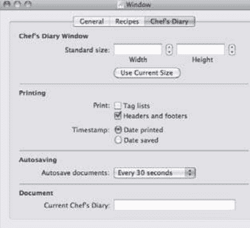

图 10.3 偏好窗口的 Chef’s Diary 窗格。

### 9. 设置辅助功能标题
偏好窗口中的用户界面元素不需要标记，因为它们的文字描述清晰。然而，你应该根据需要连接可访问标题。例如，对于 Recipes 窗格顶部的宽度字段，从文本字段 `Control-拖动` 到其下方的 `Width` 标签，并在 HUD 中选择 `accessibility title`，然后从宽度标签 `Control-拖动` 到 `Standard size` 标签并重复此过程。对其他每个带有标题的设置元素也重复此过程。

### 10. 配置首个响应者和关键视图循环
配置偏好窗口的第一个响应者和其关键视图。你在食谱 4 的第 1 步中学习了初始第一个响应者和关键视图。请记住，在某些情况下，你应该连接关键视图中的所有用户界面元素，而不仅仅是文本字段，以防用户在系统设置的键盘面板的键盘快捷键中将“全键盘访问”设置为“所有控件”。

由于偏好窗口中存在标签视图，产生了一些概念复杂性。由于标签视图位于窗口顶部，它应该是窗口的第一个响应者。你不能将一个标签视图连接到另一个相邻视图，而是使用箭头代替 Tab 键从一个标签项移动到另一个，Cocoa 会自动处理。然而，你应该为每个标签视图项设置一个初始响应者。关键视图应该在标签视图项内的界面元素之间（排除标签视图本身）执行完整的循环。当用户选择其中一个标签后，点击该标签视图内部，将从初始第一个响应者开始，循环遍历标签视图项内的所有其他界面元素，并在再次开始循环之前返回到标签。

首先从设置窗口的初始响应者开始，它应该是标签视图。在 Interface Builder 中通过点击标签页来选择窗口；然后转到连接检查器。从 `initialResponder` 属性内部的小圆圈拖到设计表面的任何一个标签上。现在，标签视图是窗口的第一个响应者。如果你在指针悬停在其中一个标签上时暂停片刻，标签视图项会被选中，但标签本身被指定为窗口的第一个响应者。

点击选择 `General` 标签视图项。进入 `Tab View` 连接检查器，从圆圈拖到顶部的复选框。创建一个从顶部复选框到底部复选框、再从底部复选框返回顶部复选框的完整 `nextKeyView` 连接循环。

在 `Recipe` 和 `Chef's Diary` 视图项中执行相同任务，你就完成了。你完全可以跳过初始响应者和关键视图循环，因为你已经按照严格的从上到下和从左到右的逻辑布局了偏好窗口，Cocoa 会自动设置好正确的关键视图。你至少应该记得使用“所有控件”测试每个窗口的关键视图，以确保你对它满意。

### 11. 设置默认选中标签并保存
在保存 nib 文件之前选择 `General` 标签视图，以便在用户首次运行应用程序时，偏好窗口以该标签选中状态打开。保存 nib 文件。

### 12. 创建快照
选择 `General` 标签视图并保存一个快照。将其命名为 `Recipe 10 Step 1`，并添加注释说明“在 Interface Builder 中创建了偏好窗口”。

在你创建了偏好窗口控制器后，你将返回第 2 步进行连接。

# 第 2 步：在 Xcode 中创建偏好窗口控制器

处理好偏好窗口的用户界面后，你必须子类 `NSWindowController` 来创建一个窗口控制器。将其命名为 `PreferencesWindowController`。在其中，你将实现获取和设置用户界面元素的方法。在此步骤中，你将添加打开偏好的方法。你把该方法连接到 `Preferences` 菜单项，它是应用程序中始终可用的，因此它必须编写在食谱 5 中创建的 `VRApplicationController` 类中。

### 1. 创建控制器文件
在 Xcode 中，选择 `File > New`。在新文件中，从列表中选择 `Cocoa`，并在 `Subclass` 菜单中选择 `NSWindowController`。在下一个对话框中，将文件命名为 `PreferencesWindowController.m`，勾选 `Create 'PreferencesWindowController.h'`，选择两个 target，然后点击 `Finish`。如有必要，将头文件和实现文件放在 Xcode 项目中 `Controllers` 组最后。在两个文件的顶部设置信息。

### 2. 配置 File's Owner
在 Interface Builder 中，选择 `PreferencesWindow` 文档中的 `File's Owner`；然后转到 `Object Identity` 检查器，选择 `PreferencesWindowController` 作为 `Class`。

### 3. 连接 Outlet
从 `File's Owner` 拖到窗口图标，选择 `window` outlet。

### 4. 连接 Delegate
从窗口图标拖到 `File's Owner`，并在 HUD 中选择 `delegate`。

### 5. 实现工厂方法
编写 `+sharedController` 工厂方法。在 `PreferencesWindowController.h` 头文件中声明它：

```objc
#pragma mark FACTORY METHOD

+ (PreferencesWindowController*)sharedController;
```

在 `PreferencesWindowController.m` 实现文件中定义它：

```objc
#pragma mark FACTORY METHOD
+ (PreferencesWindowController*)sharedController {
    static PreferencesWindowController *sharedController = nil;
    if (sharedController == nil) {
        sharedController = [[self alloc] initWithWindowNibName:@"PreferencesWindow"];
    }
    return sharedController;
}
```


这与你在食谱 9 中编写的 `+[DiaryPrintPanelAccessoryController sharedController]` 方法相同。

## 6. 现在编写打开偏好的方法

你将该方法连接到 Preferences 菜单项。

开始将 `PreferencesWindowController.h` 头文件导入 `VRApplicationController.m` 实现文件中，通过在现有 `#import` 指令末尾添加如下：

```objc
#import "PreferencesWindowController.h"
```

然后，在 `VRApplicationController.h` 头文件中，在已有的 action 方法之后声明该方法，如下：

```objc
- (IBAction)showPreferences:(id)sender;
```

在 `VRApplicationController.m` 实现文件中定义它，如下：

```objc
- (IBAction)showPreferences:(id)sender {
  [[PreferencesWindowController sharedController] showWindow:sender];
}
```

构建项目，这样新方法就会出现在 Interface Builder 中。

### 2. 返回 `MainMenu.nib` 文件

进入 Vermont Recipes 应用程序菜单并选择 Preferences（偏好设置）菜单。进入 Menu Item Connections（菜单项连接）检查器，从 Sent Actions 部分选择器（selector）项目右侧的小圆圈拖到 nib 文件文档中的 Responder proxy（响应者代理）上并选择 `showPreferences` 动作。如你所知，控制器位于响应链中，因为它是共享应用对象的代理。保存 nib 文件。

### 3. 回到 Xcode，还有一些细节需要注意

首先，在 `PreferencesWindowController.m` 实现文件中，通过重写 `-windowDidLoad` 方法在用户首次打开窗口时配置窗口的一些功能，如下所示：

```objc
#pragma mark OVERRIDE METHODS

- (void)windowDidLoad {
  NSWindow *window = [self window];
  [window center];
  [window setExcludedFromWindowsMenu:YES];

  NSTabViewItem *selectedTabViewItem = [[[self window] initialFirstResponder] selectedTabViewItem];
  [window setTitle:[selectedTabViewItem label]];
}
```

调用 `NSWindow` 的 `-center` 方法会将偏好设置窗口水平居中，并在垂直方向上位于中心上方一点。根据 HIG（用户界面指南），对于像偏好设置窗口这样的辅助窗口，这是正确的起始位置。

`-setExcludedFromWindowsMenu:` 方法的作用正如其名所示。HIG 没有指示应用程序的偏好设置窗口是否应该列在 Window（窗口）菜单中，只说文档窗口应该包含在内，而面板则不应。除非使用 `-setExcludedFromWindowsMenu:` 反转默认设置（如 TextEdit 所做的那样），否则 Cocoa 会自动包含偏好设置窗口。然而，Apple 的大多数应用程序都将偏好设置窗口包含在 Window 菜单中，所以如果你这样做也不会被过责的。我选择遵循 TextEdit 的示例，因为多面板偏好设置窗口的标题会根据选中的窗格而变化，我发现 Window 菜单中看到这些变化的名称会很困惑。当你需要时，应用程序菜单中的 Preferences 菜单项始终可用。

TextEdit 示例代码调用了 `-setHidesOnDeactivate:NO`，但只有偏好设置窗口基于 `NSPanel`（其默认值为 YES）时这才是必要的。此偏好设置窗口基于 `NSWindow` 的，其默认值为 NO。此外，Window Attributes（窗口属性）检查器包含一个控制此设置的复选框，因此你不需要在任何事件中设置它。

在窗口首次打开时设置窗口标题。HIG 要求多面板偏好设置窗口的标题必须与当前窗格的标题相同。通常情况下，你需要声明并连接一个 `IBOutlet` 来访问标签视图，以便获取其选定标签项的标签。在这里，你已经知道设计了偏好设置窗口，使标签视图成为它的第一响应者。因此调用 `NSWindow` 的 `-initialFirstResponder` 方法更为简单。这需要将返回值转换为 `NSTabView` 来抑制 `NSView` 可能无法响应 `-selectedTabViewItem` 的警告。小心使用这个 `-initialFirstResponder` 快捷方法，对于使用其他用户界面元素作为偏好设置窗口初始响应者的代码来说，它并不健壮。为了安全起见，请在注释中注明标签视图是 Interface Builder 中窗口的初始响应者。

### 9. 最后，你必须构建偏好设置窗口以便在用户选择不同标签项时更改标题

`NSTabView` 声明了几个代理方法，包括 `-tabView:willSelectTabViewItem:`，以满足这种需求。你已经在第 1 步中将偏好设置控制器设置为标签视图的代理，所以现在可以实现该代理方法了。将其添加到 `PreferencesWindowController.m` 实现文件的末尾：

```objc
#pragma mark DELEGATE METHODS

- (void)tabView:(NSTabView *)tabView willSelectTabViewItem:(NSTabViewItem *)tabViewItem {
    [self setTitle:[tabViewItem label]];
}
```

现在，每当用户选择不同的标签项时，窗口标题都会同时自动更新。无论用户是用鼠标点击另一个标签、使用方向键选择另一个标签，还是通过运行 AppleScript 脚本选择另一个标签，都会发生。

### 10. 你可以构建并运行应用程序并打开偏好设置窗口

尝试一下。当你选择 Vermont > Preferences 时，偏好设置窗口会打开。在那里期间，测试键视图循环以确保它符合你的预期，并确保无论你何时以及如何选择不同的标签，窗口的标题都会发生变化。

在后续步骤中，你将依次实现每组偏好设置。

### 保存一个快照

将其命名为 `Recipe 10 Step 2`，并添加注释“Created PreferencesWindowController”。

## 步骤 3：配置 General 标签视图项

General 标签视图包含两个控制全局应用程序设置的复选框。其中一个在设置为 YES 时，会抑制用户尝试将缩放大于 100% 的日记进行打印时会显示的警告提示。另一个在设置为 YES 时，会抑制应用程序恢复自动保存文档时会显示的警告提示。你已经在第 7 和第 9 步中安排了将这些设置保存到应用程序的用户默认值中，但只有当用户在两个地方选择了抑制复选框时才会。一旦用户选择了抑制复选框，就没有办法重新开启警告提示，因为警告不会再次显示。你可以提供一个单独的用户界面元素来重新开启，而偏好设置的 General 窗格是合适的地方。用户只需在 General 窗格中选择复选框，警告就会再次出现。

当你最初设置抑制复选框时，你使用相应的键定义了值。这些宏在定义它们的实现文件中是局部的，因此不能在其他地方使用。为了获取和设置 General 窗格中两个复选框的值，你需要一个 `IBOutlet` 实例变量和一个访问器方法，以及一个动作方法将它们设置到用户默认值。

### 1. 为复选框声明实例变量

在 `PreferencesWindowController.h` 头文件中，在 `@interface` 指令的大括号内输入以下声明：

```objc
IBOutlet NSButton *suppressScaleUpAlertCheckbox;
IBOutlet NSButton *suppressAutosavedDocumentAlertCheckbox;
```

### 2. 在 `PreferencesWindowController.h` 末尾声明访问器方法如下

```objc
#pragma mark ACCESSOR METHODS

- (NSButton *)suppressScaleUpAlertCheckbox;
- (NSButton *)suppressAutosavedDocumentAlertCheckbox;
```

在 `PreferencesWindowController.m` 实现文件的工厂方法部分定义它们如下：

```objc
#pragma mark ACCESSOR METHODS

- (NSButton *)suppressScaleUpAlertCheckbox {
  return suppressScaleUpAlertCheckbox;
}

- (NSButton *)suppressAutosavedDocumentAlertCheckbox {
  return suppressAutosavedDocumentAlertCheckbox;
}
```

### 3. 现在为每个方法编写动作方法

每个动作方法的工作非常简单：当用户点击复选框时，使用相应的键将其新值存储在用户默认值。

在 `PreferencesWindowController.h` 末尾声明动作方法，如下：

```objc
#pragma mark ACTION METHODS

- (IBAction)setDefaultScaleUpAlert:(id)sender;
- (IBAction)setDefaultRestoreAutosavedDocumentAlert:(id)sender;
```

在 `PreferencesWindowController.m` 访问器方法部分之后定义它们，如下：

```objc
#pragma mark ACTION METHODS

- (IBAction)setDefaultScaleUpAlert:(id)sender {
  [[NSUserDefaults standardUserDefaults] setBool:[sender state] forKey:VRDefaultSuppressScaleUpAlertKey];
}

- (IBAction)setDefaultSuppressRestoreAutosavedDocumentAlert:(id)sender {
    [[NSUserDefaults standardUserDefaults] setBool:[sender state] forKey:VRDefaultSuppressRestoreDiaryDocumentAlertKey];
}
```

这两个操作使用了你之前见过的快捷键。它们读取发送者的当前状态——即你刚刚点击的复选框——并将其新值视为 BOOL。它的值可能是 `NSOnState` 或 `NSOffState`，但当它们传递给 `-setBool:forKey:` 方法的参数时，它们实际上被强制转换为 `YES` 或 `NO`。在这里这是安全的，因为该复选框没有被设为混合类型状态。

### 4. 要让操作生效，你必须声明并定义在操作中使用这些新全局键

你需要在之前在食谱 7 和 9 中设置它们的文件中这样做。

从 `VRDefaultSuppressScaleUpAlertKey` 开始。在 `DiaryPrintView.h` 头文件的顶部，`@interface` 指令之前，如下声明它：

```objc
extern NSString *VRDefaultSuppressScaleUpAlertKey;
```

在 `DiaryPrintView.m` 实现文件的底部，`@end` 指令之后，如下定义它：

```objc
NSString *VRDefaultSuppressScaleUpAlertKey = DEFAULT_PRINT_SCALED_UP_SUPPRESSED_KEY;
```

对 `VRDefaultSuppressRestoreDiaryDocumentAlertKey` 键执行相同的操作。在 `DiaryViewController.h` 头文件的顶部，`@interface` 指令之前，如下声明它：

```objc
extern NSString *VRDefaultSuppressRestoreDiaryDocumentAlertKey;
```

在 `DiaryViewController.m` 实现文件的底部，`@end` 指令之后，如下定义它：

```objc
NSString *VRDefaultSuppressRestoreDiaryDocumentAlertKey = DEFAULT_RESTORE_DIARY_DOCUMENT_SUPPRESSED_KEY;
```

在两个定义中，你只是简单复用了食谱 7 和 9 中的宏来设置新全局变量的值。

稍后当你为食谱窗口实现相同的功能时，你可能需要考虑重命名此键。

### 5. 要在偏好设置器的操作方法中使用这些全局变量，你必须导入声明它们的头文件

在 `PreferencesWindowController.m` 实现文件的顶部这样做：

```objc
#import "DiaryPrintView.h"
#import "DiaryViewController.h"
```

### 6. 然而，除非在 Interface Builder 中连接了它们，否则操作方法仍然无法工作

首先构建应用程序，以确保操作方法在 Interface Builder 中可用。然后，从设计表面的每个复选框按住 Control 键拖动到文件文档窗口中的第一响应者，并将其选择为操作方法。

### 7. 还差一个关键步骤——即确保通用面板中的两个复选框在用户每次打开偏好设置窗口时都能反映用户默认设置中的当前值

这很容易做到：只需将复选框的状态设置为用户默认数据库中当前存在的值即可。

但你应该将执行此代码放在哪里？你的直觉可能是放在 `-windowDidLoad` 方法中。然而，该方法只在窗口的 nib 文件加载时被调用，这通常只发生在用户第一次打开窗口时。当用户随后关闭窗口时，nib 文件保持加载状态，并且当用户重新打开窗口时不会再次加载。因此，如果用户在此期间通过警告提示更改了默认设置，重新打开的偏好设置窗口将不会反映该更改。

这是一个通用问题，可能会在很多类似情况下让你遇到困扰。记住，`-awakeFromNib` 和 `-windowDidLoad` 方法只在 nib 文件加载时执行，这并不意味着每次关闭和重新打开 nib 文件都会发生，就像 `-init` 方法不会在每次关闭和重新打开窗口时被调用一样。因此，这些方法通常只用于设置窗口的初始状态，即用户无法更改的值，或者即使更改了、在用户关闭并重新打开窗口后不需要重置的值。

你通常处理这个问题的方法与用户选择另一个标签视图项时重命名窗口的方法相同：实现适当的代理方法。对于这个问题，将是 `-windowDidBecomeKey:` 代理方法。它在用户每次打开偏好设置窗口或 nib 重新加载时被调用。它非常适合这种情况，而且额外的是，当偏好设置窗口已经打开但被带到前景时，它也会被调用。你在第 1 步中已将偏好窗口控制器设为窗口的代理。只需在 `PreferencesWindowController.m` 实现文件的 Delegate Methods 部分末尾添加以下内容：

```objc
- (void)windowDidBecomeKey:(NSNotification *)notification {
    NSUserDefaults *defaults = [NSUserDefaults standardUserDefaults];
    [[self suppressScaleUpAlertCheckbox] setState:[defaults boolForKey:VRDefaultSuppressScaleUpAlertKey]];
    [[self suppressAutosavedDocumentAlertCheckbox] setState:[defaults boolForKey:VRDefaultSuppressRestoreDiaryDocumentAlertKey]];
}
```

这就是最初为复选框设置输出的任务。你不需要为操作方法设置输出，因为操作方法的 `sender` 参数让你能够访问复选框及其当前设置。`-windowDidBecomeKey:` 代理方法对复选框一无所知，所以你需要输出。

### 8. 在连接它们之前，输出将不起作用，所以现在就做吧

在 PreferencesWindow 的 nib 文件中，按住 Control 键从文件所有者代理依次拖动到每个复选框并连接其输出。

### 9. 如果你构建并运行应用程序，通用面板中的两个复选框现在将按预期工作——但在少数情况下除外

如果偏好设置窗口作为警告提示之一打开并可见，则偏好设置窗口中的复选框不会更改其状态。修复此需要让偏好设置窗口通知用户默认设置的任何更改。每当用户默认设置中的设置更改时，`NSUserDefaults` 类都会发布 `NSUserDefaultsDidChangeNotification`。为了帮助你解决这个问题，你可以通过观察此通知实时更新偏好设置窗口。在 `-windowDidLoad` 方法的末尾注册通知，使用你在食谱 7 和 8 中注册通知的相同技术。当你使用 Snow Leopard 的基于 block 的技术注册通知时，这比在 Leopard 中复杂一点，但也更健壮。对于 Snow Leopard，你将需要写更多的代码。从在 `PreferencesWindowController.m` 实现文件的 `-windowDidLoad` 方法末尾添加注册代码开始：


```objc
NSNotificationCenter *defaultCenter = [NSNotificationCenter defaultCenter];
#if MAC_OS_X_VERSION_REQUIRED < MAC_OS_X_VERSION_10_6
[defaultCenter addObject:self
                  selector:@selector(userDidChange:)
                      name:NSUserDefaultsDidChangeNotification
                    object:nil];
#else
[self setUserDidChangeObserver:[defaultCenter
    addObserverWithName:NSUserDefaultsDidChangeNotification
                      object:nil
                       queue:nil
     usingBlock:^(NSNotification *notification) {
        [self userDidChange:notification];
    }];
#endif
```

你不需要声明和定义 `NSUserDefaultsDidChangeNotification` 名称，因为它是由 Cocoa 提供的。你将要执行的代码放在一个单独的方法 `-userDidChange:` 中，因为无论运行在 Leopard 还是 Snow Leopard 上，都需要执行该代码。如果你不支持 Leopard 并使用了基于 block 的注册方法，你可以将单独方法的代码直接移动到 block 中。

编写 `-userDidChange:` 方法。在 `PreferencesWindowController` 头文件的底部声明它，并在 `PreferencesWindowController.m` 实现文件的底部定义它：

```objc
- (void)userDidChange:(NSNotification *)notification {
    NSUserDefaults *defaults = [notification object];
    [[self suppressScaleUpCheckbox] setState:[defaults forKey:VRDefaultScaleUpCheckbox]];
    [[self suppressRestoreAutosavedDocumentAlertCheckbox] setState:[defaults forKey:VRDefaultSuppressRestoreDiaryDocumentAlert]];
}
```

每当观察到 `NSUserDefaultsDidChangeNotification` 通知时，通知方法就会被调用，该通知每当用户默认设置中的设置更改时都会发布。这意味着当未决设置更改时该方法可能会被调用，但并没有害处，因为方法中的两个语句非常快，它们仅仅是将复选框的状态设置为其当前状态。

当发布通知时，真正的工作才开始，因为你关心的两个用户默认设置之一发生了变化。这时，该方法会更改相应复选框的状态，以匹配用户默认设置的新值。

通知方法中的代码与你在 `-windowDidBecomeKey:` 方法中编写的代码几乎相同。唯一的区别是，用户默认数据库作为通知的对象（object）传递给该方法，因此你通过调用 `-object` 直接使用它，而不是像在 `-windowDidBecomeKey` 中那样调用 `NSUserDefaults` 类方法 `+standardUserDefaults`。

接下来，通常你应该在偏好窗口控制器销毁之前移除观察者。在这里实际上并不是必要的，因为偏好窗口控制器是一个单例类，实际上在应用程序的生命周期内不会被销毁。如果你在 Vermont Recipes 的未来版本中更改了这一点，请实现 `-dealloc` 方法。它位于 `PreferencesWindowController` 实现文件的开头，如下所示：

```objc
- (void)dealloc {
    NSNotificationCenter *defaultCenter = [NSNotificationCenter defaultCenter];
    if (floor(NSFoundationVersionNumber) <= NSFoundationVersionNumber10_5) {
        [defaultCenter removeObserver:self];
    } else {
        [defaultCenter removeObserver:[self userDefaultsDidChangeObserver]];
    }
    [super dealloc];
}
```

即使控制器不是单例类，你不应该通过实现 `-windowWillClose` 代理方法来移除观察者。原因从之前对 `-awakeFromNib` 和 `-windowDidLoad` 的讨论中可以很清楚。如果你在窗口关闭时移除观察者，那么当用户重新打开窗口时，观察者将不再存在，因为在这种情况下，注册观察者的 `-windowDidLoad` 不会被调用。

正如你之前一样，可以使用运行时而不是预处理器宏来检测运行的是 Leopard 还是 Snow Leopard，因为 `-removeObserver:` 方法在两个版本的 Mac OS X 中都是可用的。

Snow Leopard 版本的注册和移除代码调用访问方法来获取和设置观察者。接下来设置实例变量和访问方法。在 `PreferencesWindowController.h` 头文件中，在 `@interface` 指令的大括号块开始处声明该实例变量，如下：

```objc
id userDefaultsDidChangeObserver;
```

在头文件的 Accessor Methods 部分开头声明其访问方法，如下：

```objc
- (void)setUserDefaultsDidChangeObserver:(id)observer;
- (id)userDefaultsDidChangeObserver;
```

在实现的 Accessor Methods 部分中定义它们，如下：

```objc
- (void)setUserDefaultsDidChangeObserver:(id)observer {
    userDefaultsDidChangeObserver = observer;
}

- (id)userDefaultsDidChangeObserver {
    return userDefaultsDidChangeObserver;
}
```

现在，偏好窗口“通用”面板中的两个复选框不仅在用户打开偏好窗口时更新，而且每次用户在警告框中选择或取消勾选抑制框时都会更新。效果在用户关闭警告之前不会生效，因为那是用户决定抑制警告的时候。用户默认数据库被更新，`NSUserDefaults` 发布了 `NSUserDefaultsDidChangeNotification` 通知。

**10.** 你现在解决了更新复选框以匹配用户对警告框中抑制按钮更改的问题，但你也应该处理相反的情况。当用户更改“通用”面板中的复选框时，警告框中相应的抑制按钮应该被更新。这对于 `VRDefaultSuppressScaleAlertKey` 设置来说不是问题，因为包含该抑制复选框的警框是应用程序模态，只有当你尝试在警框打开时点击偏好窗口中的复选框时，电脑才会响声。然而，包含 `VRDefaultSuppressRestoredDocumentKey` 复选框的警框仅是文档模态。因此，用户可能在警框打开时打开偏好窗口并更改“通用”面板中相应的复选框。如果抑制警框能随“通用”偏好面板中复选框的任何变化而发生变化，那就太好了，因为用户在偏好窗口中的更改会同步。


你不应该通过实现 `-windowWillClose` 代理方法来移除观察者。原因从之前对 `-awakeFromNib` 和 `-windowDidLoad` 的讨论中可以很清楚。如果你在窗口关闭时移除观察者，那么当用户重新打开窗口时，观察者将不再存在，因为在这种情况下，注册观察者的 `-windowDidLoad` 不会被调用。

就像你之前一样，可以使用运行时（runtime）而不是预处理器宏来检测运行的是 Leopard 还是 Snow Leopard，因为 `-removeObserver:` 方法在两个版本的 Mac OS X 中都是可用的。

...（中间代码定义部分省略）...

现在，偏好窗口“通用”（General）面板中的两个复选框不仅在用户打开偏好窗口时更新，而且每次用户在警告框中选择或取消勾选抑制框时都会更新。效果在用户关闭警告之前不会生效，因为那是用户决定抑制警告的时候。用户默认数据库被更新，`NSUserDefaults` 发布了 `NSUserDefaultsDidChangeChangeNotification` 通知。

+ 10. 你现在解决了更新复选框以匹配用户对警告框中抑制按钮更改的问题，但你也应该处理相反的情况。当用户更改“通用”（General）面板中的复选框时，警告框中相应的抑制按钮应该被更新。这对于 `VRDefaultSuppressScaleAlertKey` 设置来说不是问题，因为包含该抑制复选框的警框是应用程序模态，只有当你尝试在警框打开时点击偏好窗口中的复选框时，电脑才会响声。然而，包含 `VRDefaultSuppressRestoredDocumentKey` 复选框的警框仅是文档模态。因此，用户可能在警框打开时打开偏好窗口并更改“通用”面板中相应的复选框。如果抑制警框能随“通用”偏好面板中复选框的任何变化而发生变化，那就太好了，因为用户在偏好窗口中的更改会同步。

勾选常规（General）面板中的复选框，再次尝试在比例（Scale）字段中输入大于 100% 的数字。这一次，出现了警报。忽略警报，取消勾选常规面板中的复选框并关闭偏好（preferences）窗口；然后从应用程序菜单中选择偏好（Preferences）重新打开它。常规面板打开时，复选框处于选中状态，这是符合预期的取消偏好设置面板中的两个复选框，关闭窗口，取消打印对话框并退出应用程序。

现在测试警报，它会警告你重新打开了一个自动保存的文档。这要复杂得多，因为你必须崩溃应用程序并重新启动才能触发警报。启动 Vermont Recipes，创建或打开 Chef’s Diary，输入一个或两个单词，让它静置超过 5 秒以便自动保存生效。然后点击 Xcode 中红色的任务（Tasks）按钮来杀死应用程序。重新启动它，警报就会出现，通知你文档“Untitled”已从自动保存的副本中恢复。在应用程序菜单中选择偏好（Preferences），并移动偏好窗口，以便你能同时看到它和警报。你能够在警报打开时打开偏好窗口，是因为此警报仅是文档模态（document modal）。在常规面板中，选择警报中的“不显示”抑制按钮时，它立即被选中。取消勾选常规面板中的复选框，警报中的抑制按钮也会立即被取消选中。现在选择警报中的抑制按钮。常规面板中对应的复选框保持不变。忽略警报，常规面板中的复选框将变为取消选中，因为你提交了抑制按钮更改后的值。

## 步骤 4：配置配谱（Recipes）标签视图项

Recipes 标签视图项包含多个用户界面元素，控制配谱窗口的一个单一功能：它的标准状态（standard state）。回想配谱 7，窗口的标准状态是其在窗口属性（Window Attributes）检查器中的初始大小。这是用户打开窗口时系统所假设的尺寸。此后，用户通过拖动窗口的调整大小控件来调整尺寸，设置窗口的当前用户状态。当用户点击缩放按钮时，窗口会在标准状态和用户状态之间切换。

Recipes 标签视图允许用户更改窗口的标准状态。在设置新的标准状态后，缩放窗口会导致其在当前用户状态和新标准状态之间切换。这对于任何使用小型显示器或非常大显示器，且对 Interface Builder 中设置的默认标准状态不满的用户来说可能很有用。

Recipes 标签视图提供了更改标准状态的三种方法：用户可以输入特定值的宽度和高度文本字段、用户可以增加和减少宽度和高度的步进器（steppers），以及一个用户可以点击以将宽度和高度设置为配谱窗口当前尺寸的按钮。如果配谱窗口处于打开状态，当用户使用文本字段或步进器更改宽度或高度时，其尺寸会立即变化。这符合偏好设置更改立即生效的原则，而且非常有用，因为它允许用户直观看到每项新设置的效果。当配谱窗口未打开时，将窗口标准状态设置为当前尺寸的按钮是禁用的。

- 首先，为文本字段和字段构建 `IBOutlet` 实例变量和访问器方法。你需要创建输出点（outlets），以便根据它们关联的默认值以及用户更改它们的时机来设置文本字段和步进器的值。这四个接点需要在 `PreferencesWindowController` 头文件中进行实例变量和访问器声明，并在实现文件中进行定义。这些是标准的样板代码，请在配谱 10 的可下载项目文件中查找。

通过从 File's Owner 代理按 Control 拖动到文本字段或步进器并选择其接点，来连接 `Preferences` 文件中的所有接点。

- 接下来，安排在用户打开偏好窗口时立即在宽度和高度字段中显示配谱窗口的当前标准状态。为了实现这一点，你必须首先获取当前的标准状态。

在配谱 7 中，你通过 Interface Builder 中的窗口尺寸（Window Size）检查器设置了配谱窗口的标准状态，将内容框架（Content Frame）的宽度和高度设置为 1200 比 800 像素。窗口的尺寸为 1200 比 818 像素，比内容框架大，因为内容框架不包含窗口标题栏和工具栏。在 `RecipesWindowController.m` 实现文件的 `-didLoad` 方法中，你通过调用 `NSWindow` 的 `-frame` 方法获取了窗口的框架（frame），并使用框架的 `size` 成员为 `VRDefaultRecipesWindowStandardSize` 设置了用户默认值。这之所以行得通，是因为窗口刚刚从 nib 文件中读入，而你无法预早知道它的标准状态。

然而，现在你需要获取配谱窗口的尺寸显示在偏好窗口中，而用户可能尚未打开配谱窗口。你不想为了在偏好窗口中显示标准状态就过早地加载 Recipes Window 文件。相反，在初始用户默认值（initial user defaults）中程序化设置标准状态，使用与在 nib 文件设置内容框架时相同的数值。你可以保持 nib 文件不变，因为你完全不会使用它的内容框架设置，而是依赖于编码的初始用户默认值。

你已经在配谱 9 中写过 `+initialize` 方法，所以你知道如何这样做。在那个方法中，你为 Diary 文档设置了初始默认值，例如键名为 `VRDefaultDiaryTag`。在这里你需要为配谱窗口的标准状态执行相同的操作，键名为 `VRDefaultRecipesWindowSize`。你不能将此 `+initialize` 方法放在配谱窗口控制器中，因为用户可能会在此之前打开偏好窗口。

```objc
+ (void)initialize {
    [super initialize];
    if ([self == [RecipesWindowController class]]) {
        NSUserDefaults *defaults = [NSUserDefaults standardUserDefaults];
        NSDictionary *initialUserDefaults = [NSDictionary dictionaryWithObjects:
            VRDefaultRecipesWindowSize, @NSSizeMake(1200, 800),
            nil];
        [defaults registerDefaults:initialUserDefaults];
    }
}
```

将上述代码插入到 `RecipesWindowController.m` 实现文件的开头。然后，修改 `RecipesWindowController.m` 实现文件中的 `-didDidLoad` 方法，使其使用配谱窗口的标准状态：

```objc
- (void)didDidLoad {
    [super didDidLoad];
    NSUserDefaults *defaults = [NSUserDefaults standardUserDefaults];
    NSSize defaultWindowSize = NSSizeFromString([defaults stringKey:VRDefaultRecipesWindowSize]);
    NSRect designedWindowFrame = [[self.window] frame];
    NSRect newWindowFrame = NSMakeRect(designedWindowFrame.origin.x,
                                     designedWindowFrame.origin.y + (designedWindowFrame.size.height - defaultWindowSize.height),
                                     defaultWindowSize.width,
                                     defaultWindowSize.height);
    [[self.window] setFrame:newWindowFrame display:YES];
}
```

- 3. 现在你已经设置用户默认值中的配谱标准尺寸，你可以在用户打开偏好窗口时显示宽度和高度。在 `PreferencesViewController.m` 实现文件的 `-windowDidLoad` 方法末尾添加这些语句：

```objc
- (void)windowDidLoad {
    [super windowDidLoad];
    NSUserDefaults *defaults = [NSUserDefaults standardUserDefaults];
    NSSize recipesWindowSize = NSSizeFromString([defaults stringKey:VRDefaultRecipesWindowSize]);
    [self.recipesWidthTextField setIntegerValue:(NSInteger)recipesWindowSize.width];
    [self.recipesHeightTextField setIntegerValue:(NSInteger)recipesWindowSize.height];
    [self.recipesWidthStepper setIntegerValue:(NSInteger)recipesWindowSize.width];
    [self.recipesHeightStepper setIntegerValue:(NSInteger)recipesWindowSize.height];
}
```

绑定到文本字段的格式化器根据你的格式化配置设置自动对其进行格式化并显示。

由于 `VRDefaultRecipesStandardSizeKey` 在配方窗口控制器中声明，你必须在 `PreferencesWindowController.m` 实现文件的顶部导入该控制器的头文件，就像你在 `VApplicationController.m` 实现文件中做的那样，如下：

```objc
#import "RecipesWindowController.h"
```

+ 4. 最后，为了完成这一练习，即允许用户更改配方窗口的标准状态。要做到这一点，你需要为两个文本字段和两个步进器（steppers）连接动作方法。你还需要为“当前大小”（Use Current Size）按钮编写动作方法，你将在文本字段和步进器完成后处理它。

事实证明，你可以将同一个动作方法同时连接到宽度文本字段和宽度步进器，将另一个动作方法同时连接到高度文本字段和高度步进器。先编写动作方法；高度动作方法基本上是相同的。在 `PreferencesWindowWidth.h` 头文件的 Action Methods 部分末尾声明该动作方法，如下所示：

```objc
- (IBAction)setDefaultRecipesWidth:(id)sender;
```

在实现文件中按如下方式定义：

```objc
- (IBAction)setDefaultRecipesWidth:(id)sender {
    NSUserDefaults *defaults = [NSUserDefaults standardUserDefaults];
    NSSize standardSize = NSSizeFromFromString([defaults
    stringForKey:kVRDefaultRecipesWindowStandardSizeKey]);
    standardSize.width = (CGFloat)[sender integerValue];
    [defaults setObject:NSStringFromSize(standardSize)
    forKey:kVRDefaultRecipesWindowSizeKey];
    if ([sender isKindOfClass:[NSStepper class]]) {
        [self recipesWindowWidthTextField] takeIntegerValueFrom:sender];
    } else {
        [self recipesWindowWidthStepper] takeIntegerValueFrom:sender];
    }
}
```

```objc
if ([sender window] isZoomed) {
    [[[VRDocumentController
sharedDocumentController]
NSWindow *recipesWindow = [[[VRDocumentController
sharedDocumentController] recipesDocument
windowControllers] objectAtIndex:0] window];

NSRect newWindowFrame = NSMakeRect([recipesWindow].origin.x,
[recipesWindow].origin.y, standardSize.width,
standardSize.height);
[recipesWindow] setFrame:newWindowFrame display:YES);
```

第一块语句从用户默认设置（user defaults）发送标准大小，将其宽度成员设置为用户在宽度字段中输入的 `NSInteger` 值（转换为 `CGFloat`），并将大小写回用户默认设置。记住，此动作方法将同时连接到文本字段和宽度步进器。`sender` 参数可以是文本字段也可以是步进器。两者都有值，只要保持值同步，那么使用哪一个来更新用户默认设置并不重要。

第二块语句处理宽度文本字段和宽度步进器的同步。如果 `sender` 是步进器（因为用户使用步进器增加或减少宽度），代码向文本字段发送 `NSControl-takeIntegerValue:` 消息，告诉它从步进器获取值。如果 `sender` 是文本字段（因为用户刚刚输入了值），它会向步进器发送相同的消息，告诉它从文本字段获取值。使用 `-takeIntegerValue:` 阐明了你如何在不使用原始数据的情况下同步控件。然而，在这种情况下，由于本地变量 `standardSize` 处理了这些操作，直接使用 `-setIntegerValue:standardsize.width` 清空两个控件可能会更整洁。

第三块语句实际上更改了配方窗口的宽度（如果它已打开），以匹配用户的新值。这让应用程序有一种非常“实时”的感觉，特别是当用户按住步进器箭头时，导致窗口宽度连续增加。你可以使用在步骤 3 中用于相同的 `-userDefaultsDidChange` 通知方法来实现此，以更新“通用”（General）面板中的复选框。在这里，你预计不会有任何外部操作者更改标准窗口状态，因此你通过向配方窗口发送消息将其框架设置为新值并显示来直接更改。

你在最后块代码中引用了 `VRViewController`。请确保通过在 `PreferencesViewController.m` 实现文件的顶部添加此行来导入其头文件：

```objc
#import "VRDocumentController.h"
```


引用 `VRViewController` 是为了调用它的 `-recipesWindow` 方法，该方法尚不存在。现在将其添加到 `VRDocumentController.h` 头文件中，将此声明插入到你在配方 6 中编写的现有 `-diaryDocument` 方法之前：

```objc
- (NSDocument *)recipesDocument;
```

在 `VRDocumentController.m` 实现文件中，按照现有 `-diaryDocument` 方法的模型定义它，如下：

```objc
- (NSDocument *)recipesDocument {
  for (NSDocument *thisDocument in [self documents]) {
    if ([thisDocument isKindOfClass:[RecipesDocument class]]) {
      return thisDocument;
    }
  }
  return nil;
}
```

你还需要将 `RecipesDocument.h` 头文件导入到 `VRDocumentController.m` 实现文件中，如下：

```objc
#import "RecipesDocument.h"
```

现在回到 `PreferencesWindowController` 头文件和实现文件的 Action Methods 部分，为高度文本字段和高度步进器添加动作方法 `-setDefaultRecipesWindowHeight:`。它与宽度动作方法几乎完全相同，你可以在配方 10 的下载项目文件中查找。

不要忘记在 Interface Builder 中连接这两个动作方法。在 `PreferencesNib` 文件中，从宽度文本字段 Control-drag 拖到 `First Responder` 代理并选择相应的动作方法。对宽度步进器执行相同的操作，因为文本字段和步进器都使用同一个动作方法。

5. 现在你可以实现“当前大小”按钮的动作方法。在配方 8 的下载项目文件中查找 `setDefaultWindowSizeFromCurrent:`。

这与宽度和高度动作方法基本上相同，只是它不需要更改窗口大小，因为它使用的是窗口的当前大小。

不要忘记在 Interface Builder 中连接此动作方法。

6. “当前大小”按钮确实存在一个问题：当配方窗口未打开时，它应该是禁用的。你在配方 4 中验证日记窗口中的控件时学会了界面项验证。在这里使用相同的方法。

记住，界面验证涉及声明两个协议 `VRValidatedControl` 和 `VRValidations`，一个或多个符合 `VRValidatedControl` 协议的验证子类。在步骤 4 中，你将这两个协议声明在 `DiaryCameraController.h` 中，因为你在那里使用了它们。将它们放在那里有点短视，因为它们在其他窗口中也会有用。现在你需要在设置窗口中使用它们。

为它们创建一个新文件。在 Xcode 中，选择 `File > New File`。在新对话框中，在源列表中选择 `Cocoa Class`，右上面板选择 `Objective-C protocol`，然后点击 Next。在下一个对话框中，输入 `ValidationProtocols` 作为文件名。Xcode 足够智能，知道协议没有实现部分，因此不会要求你创建一个。确保选中了 Vermont Recipes 和 Vermont LT 项目，然后点击 Finish。在 Vermont 项目窗口的 Groups & Files 窗格中创建一个组并命名为 `Protocols`。然后将 `ValidationProtocols` 头文件移动到其中。

从日记窗口控制器移除协议声明。为了使它们可用，在相应位置导入新的协议头文件。在 `DiaryWindowController.h` 头文件的顶部，添加此行：

```objc
#import "ValidationProtocols.h"
```

你必须在 `DiaryCameraController.h` 头文件中导入它，因为你声明了三个验证控件子类——`ValidatedDiaryButton`、`ValidatedDatePicker` 和 `ValidatedSearchField`——它们都声明符合 `VRValidatedControl` 协议。

```objc
@interface PreferencesWindowController : NSWindow <NSUserInterfaceValidations> {
```

然后，在头文件的末尾添加此符合 `VRValidatedControl` 协议的 `NSButton` 子类的声明：

```objc
#pragma mark -
@interface ValidatedPreferencesButton : NSButton <VRValidatedControl>
@end
```

```objc
@end
```

将其定义在 `PreferencesWindowController.m` 实现文件的末尾，如下：

```objc
#pragma mark -
@implementation ValidatedPreferencesButton

- (void)validate {
  id validator = [NSApp targetForAction:[self action] to:[self target] from:self];
  if ((validator == nil) || ([validator respondsToSelector:[self action]])) {
    [self setEnabled:NO];
  } else if ([validator respondsToSelector:@selector(validateControl:)]) {
    [self setEnabled:[validator validateControl:self]];
  } else if ([validator respondsToSelector:@selector(validateUserInterfaceItem)]) {
    [self setEnabled:[validator validateUserInterfaceItem:self]];
  } else {
    [self setEnabled:YES];
  }
}

@end
```

这与你在食谱 4 中编写的验证控制子类相同。

为了让“使用当前尺寸”（Use Current Size）按钮通过验证，你必须将其转换为 `ValidatedPreferencesButton`。操作方法是在 nib 文件的设计界面上选择该按钮；然后打开 Builder Identity 检查器，并在类（Class）组合选择框中选择 `ValidatedPreferencesButton`。在设置窗口的设计界面上选择“常规”（General）面板，并保存 nib 文件。

最后，添加 `-validateUserInterfaceItem` 方法和相关的 `-updateWindow` 方法。在 `PreferencesWindowController.h` 头文件的 `PreferencesWindowController` 类接口末尾，按如下所示声明 `-updateWindow` 方法：

```objc
#pragma mark USER INTERFACE VALIDATION
- (void)updateWindow;
```

在 `PreferencesWindowController.m` 实现文件的 `PreferencesWindowController` 类接口末尾，按如下所示定义这两个方法：

```objc
#pragma mark USER INTERFACE VALIDATION
- (void)updateWindow {
  for (id thisViewItem in [[NSTabView *][self window] initialFirstResponder] tabViewItems) {
    for (id itemView in [[thisViewItem view] subviews]) {
      if ([itemView conformsToProtocol:@protocol(VRValidatedControl)]) {
        [itemView validate];
      }
    }
  }
}
```

```objc
- (BOOL)validateUserInterfaceItem:(id <NSValidatedUserInterfaceItem>)item {
  SEL action = @selector(setDefaultRecipesWindowSizeFromCurrent:);
  if (action == [[[[VRDocumentController sharedDocumentController] recipesDocument] windowControllers] objectAtIndex:0] window) {
    return (recipesWindow != nil);
  }
  return YES;
}
```

这些与你在食谱 4 中编写的对应方法非常相似。`-updateWindow` 方法有些不同，因为它包含一个标签（tab）。它必须遍历每个标签视图项，然后遍历每个标签视图项视图中的所有子视图。

最后一个要求是实现 `-windowDidUpdate:` 代理方法，并调用 `-updateWindow`。在 `PreferencesWindowController.m` 实现的代理方法（Delegate Methods）部分的末尾，添加此方法：

```objc
- (void)windowDidUpdate:(NSNotification *)notification {
  [self updateWindow];
}
```

7. 你已经准备好测试设置中的食谱（Recipes）面板了。首先，将 Vermont Recipes 设置文件移动到垃圾桶，以便从干净的状态开始。

编译并运行应用程序。然后从应用程序菜单中选择“设置”（Preferences），并在设置窗口中选择“食谱”（Recipes）选项卡。宽度和高度字段显示食谱窗口的标准尺寸为 1200 比 800 像素。当你启动 Vermont Recipes 时，食谱窗口会自动打开，所以你可以看到它实际上是那个大小。将设置窗口移动到其中一个尺寸，以便你可以同时看到它和食谱窗口。

“使用当前尺寸”按钮已启用。关闭食谱窗口，你会发现该按钮变为禁用。选择“文件 > 新食谱文件”（File > New Recipes File）并将设置窗口置于顶层。该按钮再次变为启用。

在宽度字段中输入一个新宽度，800 像素。当你按下 Enter、Return 或 Tab 或点击宽度字段之外时，食谱窗口就会发生变化，宽度变为 800 像素。

按住宽度步进器中的向下箭头。食谱窗口会逐渐变窄。

将食谱窗口置于顶层并反复点击缩放按钮。食谱窗口会在其先的用户状态和新的、更窄的标准状态之间切换。

拖动食谱窗口的调整大小控件，使窗口尽可能小。再次反复点击缩放按钮，窗口会在新的、非常小的用户状态和新的、更窄的标准状态之间切换。

对高度字段字段步进器重复这些测试。

最后，使用食谱窗口的调整大小控件将窗口变得非常大。点击“使用当前尺寸”按钮。宽度和高度字段中显示的值会发生变化，以反映窗口的当前尺寸。反复点击食谱窗口的缩放按钮，什么都不会发生，因为用户状态和标准状态并不相同。再次调整食谱窗口并反复点击缩放按钮。现在，窗口会在新的用户状态和新的、非常大的标准状态之间切换。

关闭食谱窗口并重新打开。它将以新的标准状态打开。

## 步骤 5：配置厨师日记

## PreferencesWindowController.m 实现

`PreferencesWindowController.m` 的实现包含几个部分。我将概述你需要的内容，但你应该为读者实现它。

1. 日记（Diary）面板的第一部分与食谱面板相同。你应该按照你在步骤 4 中所做的方式实现它。

2. 打印（Printing）部分的控件与你在食谱 9 中编写的控件相同。

3. 日记面板的第三部分是你实现食谱窗口尺寸自定义逻辑的地方。

## PreferencesWindowController.h 头文件

`PreferencesWindowController.h` 头文件包含你将实现的方法的声明。

```objc
- (void)updateWindow;
- (void)setDefaultDiaryTags:(id)sender;
- (void)setDefaultDiaryHeadersAndFooters:(id)sender;
- (void)setDefaultDiaryTimestamp:(id)sender;
```

## PreferencesWindowController.m 实现

`PreferencesWindowController.m` 实现文件包含你声明的方法的实现。

```objc
- (void)setDefaultDiaryTags:(id)sender {
  [[NSUserDefaults standardDefaults] setBool:[sender state] forKey:VRDefaultDiaryTagsKey];
}
...（其余内容）
```

```objc
NSDictionary *initialUserDefaults = [NSDictionary
dictionaryWithObjectsAndKeys:
NSStringFromSize(NSSize(1200.0, 800.0)),
VRDefaultRecipesWindowStandardKey,
NSStringFromSize(NSSize(600.0, 900.0)),
VRDefaultDiaryWindowStandardKey,
[NSNumber numberWithBool:NO],
VRDefaultPrintTagsKey,
[NSNumber numberWithBool:YES],
VRDefaultHeadersAndFootersKey,
[NSNumber numberWithInteger:0],
VRDefaultPrintTimestampKey, nil];
[defaults registerDefaults:initialUserDefaults];
}
```

你可以省略 `NO` 和 `0` 的设置，因为 `NSUserDefaults` 的默认值就是这些，但我发现显式地初始化所有相关的默认值更容易维护。

不要忘记将 `DiaryPanelAccessoryController.h` 头文件导入到 `VRApplicationController.m` 实现文件中，以便使用打印默认设置，如下所示：

```objc
#import "DiaryPrintPanelAccessoryController.h"
```

在 `PreferencesWindowController.m` 实现文件的 `-windowDidBecomeKey:` 方法末尾添加 `now` 语句，以便在用户打开设置窗口时显示打印默认设置。打印控件（如“General”复选框）必须在 `-windowDidBecomeKey:` 而不是 `-windowDidLoad` 方法中显示，因为打印控件可以在 `Diary Print` 面板的自定义辅助视图在外部更改。以下是需要添加的语句：

```objc
[self printTagsCheckbox setState:([defaults forKey:VRDefaultDiaryPrintTagsKey]) ? NSOnState : NSOffState];
[self printHeadersAndFootersCheckbox setState:([defaults forKey:VRDefaultDiaryPrintHeadersAndFootersKey]) ? NSOnState : NSOffState];
[self printTimestampRadioGroup setState:NSUserStateatrow:[defaults integerForKey:VRDefaultDiaryPrintTimestampKey] column:0];
```

设置窗口中 `Chef's Diary` 面板的打印部分现在可以工作了，但存在一个问题。在第 3 步中（该步骤也涉及可以在两个地方更改的用户默认设置），需要循环观察 `NSUserDefaultsDidChangeNotification` 通知，以便其中一处的更改能立即反映在屏幕的另一处。为了保持一致性和良好的用户体验，如果你同时打开 `Chef’s Diary` 面板和设置窗口中的 `Chef’s Diary` 区域，你应该在此处也实现相同的行为。我将不再完整地解释如何同步这些设置——这留给读者作为练习。请根据适当的更改执行第 3 步中的任务 9 和 10。可下载的 `Recipe 10` 文件中已包含了必要的代码。

这里有一个当用户在 `Print` 面板中做出更改并关闭它时更新设置窗口的提示：设置控制器已注册以观察 `UserDefaultsDidChangeNotification` 通知，并且你已经写了响应通知并移除观察者的代码。你只需要在用户更改了 `Print` 面板并关闭它时更新 `Chef’s Diary` ，即在现有的 `-UserDefaultsDidChange` 方法中添加三条语句：事实上，如果你已经写了它们，那么只需要复制粘贴这些语句或编写一个方法即可。它们在 `-windowDidBecomeKey` 方法中。


当用户在 `Chef’s Diary` 区域中更改设置时更新 `Print` 面板几乎不需要多少工作。你在设置控制器中编写的在用户更改 `Print` 面板设置时更新设置窗口的大部分代码可以复制并粘贴到日记打印面板辅助控制器中，因为两个复选框和单选组对应方法的实例变量，以及 `UserDefaultsDidChangeObserver` 观察者，在两个文件中命名是相同的。从 `PreferencesViewController` 复制并粘贴以下声明和实现到 `DiaryPrintViewController` 类中：`UserDefaultsDidChangeObserver` 实例变量；`-setUserDefaultsDidChangeObserver` 和 `-userDefaultsDidChangeObserver` 访问方法；以及用于注销观察者的 `-dealloc` 方法。

你只需要在两个地方编写新代码，而且代码已经写好了。在 `DiaryPrintPanelAccessorController` 实现的 `-loadView` 方法末尾，添加这些语句来注册观察者——你可以从 `PreferencesWindowController` 实现的 `-windowDidLoad` 方法中复制它们并粘贴到 `-loadView` 方法中：

```objc
NSNotificationCenter *defaultCenter = [NSNotificationCenter defaultCenter];
#if MAC_OS_X_VERSION_REQUIRED < MAC_OS_X_VERSION_10
[defaultCenter addObserver:self selector:@selector(userDefaultsDidChangeNotification) name:UserDefaultsDidChangeNotification object:nil];
#else
[self setUserDefaultsDidChangeObserver:[defaultCenter addObserverForName:UserDefaultsDidChangeNotification object:nil queue:NSNotification usingBlock:^(NSNotification *notification) {
    [self userDefaultsDidChange:notification];
}]];
#endif
```

## 第 5 步：配置 CHEF’S DIARY 视图项

你必须写的另一个方法是通知方法本身，应添加在 `DiaryPrintPanelAccessoryController` 实现文件的覆盖方法之后：

```objc
#pragma mark NOTIFICATION METHODS
(void)userDefaultsDidChange:(NSNotification *)notification {
    UserDefaults *defaults = [UserDefaults standardUserDefaults];
    [self printTagsCheckbox setState:[defaults forKeyKey:VRDefaultDiaryPrintTagsKey] ? NSOffState : NSOffState];
    [self headersAndFootersCheckbox setState:[defaults forKeyKey:VRDefaultDiaryPrintHeadersAndFootersKey] ? NSOffState : NSOffState];
    [self timestampRadioGroup setState:NSUserStateatrow:[defaults integerForKey:VRDefaultDiaryPrintTimestampKey] column:0];
}
```

再次，你可以从设置窗口中相应的方法中复制此方法的体并粘贴。在 `DiaryPanelAccessController.h` 头文件中声明它：

```objc
#pragma mark NOTIFICATION METHODS
(void)userDefaultsDidChange:(NSNotification *)notification;
```

你现在到了 `Chef’s Diary` 的打印部分。当你在设置窗口更改这些设置时，`Print` 面板会立即识别。

### 3. 接下来，实现 `Chef’s Diary` 区域的自动保存部分。这非常简单。

在 Recipe 7 中，你在 `VRApplicationController` 中实现了 `-applicationDid:` 方法将自动保存延迟设置为 5 秒。这是为了测试开启自动保存并将间隔设置为非常短的时间。现在，你应该让用户能够将间隔设置为 0.0 来关闭自动保存，以及设置更合理的间隔。

与所有用户默认设置一样，你需要一个键来存储间隔值，以及一个连接到 `Chef’s Diary` 部分弹出按钮的操作方法。你还应该在 `VRApplicationController` 的 `+initialize` 方法中设置默认值，并安排设置窗口在用户打开时显示当前设置。

通过键进行定义。此偏好适用于任何所有文档，因此定义它的位置是在 `VRDocumentController` 类中。那是 Cocoa 声明 `-setAutosaveDelay:` 方法的地方。在 `VRDocumentController.h` 头文件的 `@interface` 定义之前添加此声明：

```objc
extern NSString *DefaultAutosaveIntervalKey;
```

在 `VRDocumentController.m` 实现文件的末尾定义它：

```objc
NSString *DefaultAutosaveIntervalKey = @"diary document autosave interval";
```

在设置窗口控制器中编写方法。在 `PreferencesViewController` 头文件的 Action 方法部分最后声明它：

```objc
(IBAction)setDefaultDiaryAutosaveInterval:(id)sender;
```

在实现文件中定义它：

```objc
(IBAction)setDefaultDiaryAutosaveInterval:(id)sender {
    NSTimeInterval interval;
    switch ([sender indexOfSelectedItem]) {
        case 0:
            interval = 15.0;
            break;
        case 1:
            interval = 30.0;
            break;
        case 2:
            interval = 60.0;
            break;
        case 3:
            interval = 300.0;
            break;
        case 4:
            interval = 0.0;
            break;
    }
    [[NSUserDefaults standardUserDefaults] setDouble:interval forKey:VRDefaultDiaryAutosaveIntervalKey];
}
```

用户默认文件被保存为双，是因为 `NSTimeInterval` 类型被声明为 double。

`VRDocumentController.h` 文件已经导入到 `PreferencesWindowController.m` 实现文件中，因此此处可以使用 `VRDefaultDiaryAutosaveIntervalKey` 键。

编译项目并在打开 Interface Builder 时，将 Preferences nib 文件中的动作方法连接到 First Responder 代理。

为了在用户打开偏好窗口时显示设置选项，你需要为弹出菜单准备一个实例变量和访问器方法。在 `PreferencesWindowController.h` 中分别声明实例变量和 getter 方法：

```objc
IBOutlet NSPopUpButton *diaryAutosaveIntervalButton;
- (NSPopUpButton *)diaryAutosaveIntervalButton; // 在食谱 10 中添加
```

在 `PreferencesWindowController.m` 实现文件中如下定义：

```objc
- (NSPopUpButton *)diaryAutosaveIntervalButton {
    return diaryAutosaveIntervalButton;
}
```

编译项目并连接输出。

现在在 `PreferencesWindowController.m` 实现文件的 `-windowDidLoad` 方法中添加以下代码：

```objc
double interval = [defaults doubleForKey:VRDefaultDiaryAutosaveIntervalKey];
NSInteger idx;
if (interval == 15.0) {
    idx = 0;
} else if (interval == 30.0) {
    idx = 1;
} else if (interval == 60.0) {
    idx = 2;
} else if (interval == 300.0) {
    idx = 3;
} else if (interval == 0.0) {
    idx = 4;
}
[self diaryAutosaveIntervalButton selectItemAtIndex:idx];
```

最后，修改现有的 `-applicationDidFinishLaunching:` 代理方法，以便根据用户的偏好设置第一个自动保存间隔：

```objc
(void)applicationDidFinishLaunching:(NSNotification *)notification {
    [[VRViewController sharedController] setAutosaveDelay:[NSUserDefaults standardUserDefaults] doubleForKey:VRDefaultDiaryAutosaveIntervalKey]];
}
```

你完成了。编译并运行应用程序，打开偏好设置并选择“厨师日谱”（Chef's Diary）面板。选中的弹出菜单项是“从不”（Never），因为你没有为自动保存设置初始默认值，它默认为 0.0 秒。因此，你编写的代码将索引设置为 4，即标题为“从不”的菜单项。

没有自动保存功能让我觉得不安全，所以对代码再做一次更改。在 `VRApplication` 的 `+initializeWithDouble:` 中，在调用 `+dictionaryWithObjectsKeys:` 结尾的 `nil` 之前添加对象 `[NSNumber number:30.0]` 和键 `VRDefaultDiaryAutosaveIntervalKey`。

### 4. 厨师日谱面板的最后一部分包含一个文本字段，用户可以在其中设置厨师日谱文档。当第一次打开偏好设置文档时，如果存在厨师日谱文档，该文本字段应该显示文档的完整路径；如果没有，则留空。用户可以输入另一个日谱文档（如备份）的完整路径或任何 PDF 文件的完整路径，将当前厨师日谱更改为其他。

为了显示文件路径，你需要为文本字段准备一个实例变量和 getter。在 `PreferencesViewController.h` 头文件中分别声明如下：

```objc
IBOutlet NSTextField *currentDiaryTextField;
- (NSTextField *)currentDiaryTextField;
```

在 `PreferencesWindowController.m` 实现文件中如下定义 getter：

```objc
- (NSTextField *)currentDiaryDocumentTextField {
    return currentDiaryDocumentTextField;
}
```

编译项目并连接 Preferences nib 文件中的插口（outlet）。

在 `PreferencesWindowController.m` 实现文件的 `-windowDidBecomeKey:` 代理方法末尾添加以下语句，以便在文本字段中显示厨师日谱路径。这必须在 `-windowDidLoad` 方法中完成，因为用户保存厨师日谱时可以早设置当前文档。

```objc
NSString *path = [[VRDocumentController sharedDocumentController] currentDiaryURL];
if (path) [[self currentDiaryDocumentTextField] setStringValue:path];
```

你检查路径是否为 nil，因为如果文件不存在，路径可能是 nil。设置文本文件的字符串值时，如果参数为 nil 会抛出异常。

在 `PreferencesWindowController.m` 实现文件的 `-userDefaultsDidChange` 通知方法末尾添加相同的两个语句。现在，如果用户保存了新的当前日谱文档，即使偏好窗口保持在后台，文本字段也会立即更新。

最后一个任务是编写一个动作（action），允许用户在当前日谱文本文件中输入新路径，并将该路径的文件设置为新的厨师日谱。在 `PreferencesWindowController.h` 头文件的 Action 方法部分末尾如下声明该动作：

```objc
- (void)setCurrentDiaryDocument:(id)sender;
```

在 `PreferencesWindowController` 实现文件的相同部分末尾如下定义它：

```objc
- (void)setCurrentDiaryDocument:(id)sender {
    NSString *path = [sender stringValue];
    BOOL isDirectory;
    BOOL success = [[NSFileManager defaultManager] fileExistsAtPath:path isDirectory:&isDirectory];
    if (success && !isDirectory) {
        NSString *type;
        success = [[NSWorkspace sharedWorkspace] getInfoForFile:path application:&type];
        if ([type isEqualToString:@"diary"] || [type isEqualToString:@"rtf"]) {
            [[VRDocumentController sharedController] setCurrentDiaryURL:[NSURL fileWithPath:path]];
        }
    }
}
```


- 5. 你已经完成了偏好窗口中的厨师日谱面板。编译并运行项目以进行测试。要测试厨师日谱窗口部分，请执行你在步骤 4 结束时执行的相同测试，但使用的是日记窗口而不是配方窗口。要测试“打印”部分，请对配方 9 中面板的“所有打印任务”部分执行相同的测试。

要测试“自动保存”部分，只需选择一个设置；对厨日记进行一些更改，查看自动保存副本出现需要多久。

要测试“文档”部分，确保你已经保存了一个厨日记；然后打开偏好设置窗口并进入厨日记窗格。你应该能在文本字段中看到文档的路径。在字段中输入一个随机字母，使路径无效，然后按回车键。你会看到一个解释错误的警报框。输入一个既不是 Vermont Recipes 日记文档也不是 RTF 文件的现有文件路径，你会看到另一个警报框。糟糕，在你关闭警报框后，该字段恢复了原值。尝试以不同的名称保存一个良好的厨日记文档，使新文件成为当前的厨日记文档。如果你让偏好设置窗口保持显示，那么在你关闭“保存”面板的瞬间，你就会在文本字段中看到路径。关闭新的厨日记，然后将旧厨日记文档的路径输入字段中并按回车键。现在当你选择“文件 > 打开厨日记”时，旧的厨日记会打开，因为你通过在文本字段中输入其路径使其成为了当前的厨日记。

## 步骤 6：构建并运行应用程序

在完成三个窗格中的每一个之后，你都已彻底测试了偏好设置窗口。既然你已经完成了这个配方，再次测试它们仍然值得的，但我没有新的测试建议。尝试把自己放在用户的角度，并尽可能的尝试你能想到的所有错误。希望应用程序能够成功地经受住你的“虐待”。

## 步骤 7：保存并归档项目

删除你积累的所有快照并退出运行中的应用程序。关闭 Xcode 项目窗口，丢弃构建文件夹（`build folder`），压缩项目文件夹，并将生成的 zip 文件保存到你的归档中，命名类似于 `Vermont Recipes 2.0.0 - Recipe 10.zip`。工作中的 Vermont Recipes 项目文件夹保留在原地，为配方 11 做好准备。

# 结论

你为 Vermont Recipes 应用程序完成了一个相当复杂的偏好设置窗口。你履行了早期配方中提出的承诺，提供了一个用户界面来增强应用程序在特定区域的灵活性，例如允许用户设置另一个文档或打开 RTF 文件作为新的当前厨日记。你还设置了一个用户界面，用户可以在其中自定义应用程序的其他功能，这些功能可能很可能是不同用户偏好的主题，例如配方窗口和日记窗口的标准尺寸。

我在本配方中的目标有两个。最重要的一是，我想向你展示实现偏好设置窗口的基础技术。但我也想演示一些在应用程序偏好中并不总是使用的技术，例如让用户做的每处更改立即生效，以便给用户提供即时反馈。一个响应良好的应用程序是更好的应用程序。

在配方 11 中，你将学习如何提供帮助书籍来引导用户使用应用程序的功能。

## 文档

阅读以下关于配方 10 涵盖主题的文档。

### 类引用和协议文档

- `NSUserDefaults` 类引用

### 通用文档

- Cocoa 的 User Defaults 编程主题
- Core Foundation 的 Preferences 编程主题
- Property List 编程指南
- Preference Pane 编程指南
- 技术问答 QA1552: 在 Mac OS X 上启用应用程序菜单的“偏好设置”菜单项
- Sync 服务编程指南（同步偏好设置）

# 配方 11：添加 Apple Help

在 Vermont Recipes 应用程序中，只有一个菜单项没有按预期工作：Vermont Recipes Help 菜单项。现有的 Vermont Recipes Help 命令由 Cocoa 文档型应用程序模板中的 `MainMenu.nib` 文件提供，它是可以工作的，但正如默认情况下的 Cocoa 应用程序一样，它只显示一个警报面板，解释说“Vermont Recipes 无法提供帮助”（图 11.1）。

你可能在正在进行 Beta 测试的应用程序中见过类似的警报框，但这对于一个完工的应用程序来说是不可接受的。至少，最简单的应用程序也应该从“帮助”菜单打开一个 Read 文档，仅仅是因为利用这个机会解释和推广你的应用程序是如此容易。在配方的步骤 2 中，你发现向“帮助”菜单中添加一个“读取”菜单项可以打开你在 TextEdit 中创建的简短 RTF 文档。现在你将执行每个应用程序都应该做的：实现全面的基于 HTML 的 Apple Help，用户可以使用 Apple 的 HelpViewer 进行阅读。

### HIGS

- 为 Snow Leopard 实现帮助书籍包
- 为 Leopard 实现帮助书籍

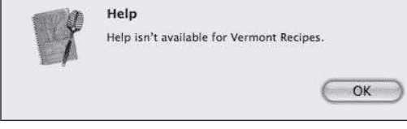

> **图 11.1** 当你没有实现 Apple Help 时，Vermont Recipes Help 命令显示的内容。

本配方是关于 Apple 在 Snow Leopard 中为开发者提供的新帮助书籍结构。这种新结构在 Snow Leopard 之前就存在了，但它仅供 Apple 的应用程序使用。在旧版本的 Mac OS X 中，第三方应用程序的帮助的本地化版本分散在应用程序包的 Resources 文件夹中，每种语言的帮助位于相应的文件夹中，例如 `English.lproj`。在 Snow Leopard 中，Apple 建议将所有本地化帮助书籍都收集到应用程序 Resources 文件夹中的单个帮助包（help bundle）中。新的帮助包有它自己的 Resources 文件夹，而该 Resources 文件夹包含了独立的语言文件夹，存放该语言的帮助文件。你在本配方中创建的帮助书籍在 Snow Leopard 下运行 Vermont Recipes 时可以工作，但在 Leopard 下运行则无效。

在我编写此文档时，Apple Help 的当前 Apple 文档《Apple Help 编程指南》已于 2009 年 5 月更新了这种新结构。然而，由于文档开头是为 Mac OS X 10.4 及更高版本编写的，因此它存在一些内部不一致之处。最明显的是它声明 `AppleTitle` HTML 标签是必需的。实际上，在 Snow Leopard 结构的帮助书中并不是必需的。

Leopard 和 Snow Leopard 版本的 Apple Help 之间最不重要的区别是，HelpViewer 应用程序在 Leopard 中名为 Help Viewer（两个单词），而在 Snow Leopard 中名为 HelpViewer（一个单词）。我将在讨论 Leopard 中的 Apple Help 时通过称为 Help Viewer 来尊重这种区别。

整个帮助书籍（图 11.2）。如果你被迫使用跨平台帮助系统而非 Apple Help，你可以使用 `NSUserInterfaceItemSearching` 协议在 Spotlight 的帮助搜索字段中包含你的帮助系统。

| 搜索 | 菜谱 |
|---|---|
| 菜单项目 | 关于 Vermont Recipes 隐藏 Vermont Recipes 退出 Vermont Recipes 新文件菜谱 |
| 帮助主题 | 菜谱 制作菜谱 显示所有帮助主题 |

> 图形 11.2 带有 Apple Help 的 Vermont Recipes Spotlight 帮助字段。

实现 Apple Help 还可以将你的帮助书籍集成到应用程序的其他元素中——例如，通过在警报和对话框中添加帮助按钮，将用户直接带到帮助书籍的相关章节。适用于 Cocoa 应用程序的 `NSHelpManager` 类中的 Apple Help API 使得实现此功能变得非常简单。

Apple 的查看器支持若干不属于 HTML 标准的功能，这些功能通过使用标准 Web 浏览器忽略的自定义 HTML 标签来实现。在 Mac OS X 中，其中最重要的功能之一是支持 AppleScript。你可以在你的帮助书籍中嵌入 AppleScript 并提供可点击的链接，使用户能够执行各种自动化任务来演示应用程序的使用。即使你的应用程序不是可脚本的，你的帮助书籍也可以包含此类项，例如启动应用程序的链接和在 Finder 中显示它的链接。如果你的应用程序是可脚本的，你可以提供链接，使用户在阅读帮助书籍时执行特定的应用程序功能。你还可以启动电影和播放声音。电影是一个特别引人注目的可能性，因为有几种工具可以录制屏幕活动，以便用户从你的帮助书籍中回放。与其*告诉*他们该做什么，不如*展示*他们该做什么。

从 Snow Leopard 开始，你的帮助书籍文件和文件夹的所有本地化推荐位置是应用程序包中 `Resources` 文件夹下的单个包（bundle）中。在应用程序中使用多个帮助书籍的做法正被废弃。将所有本地化的帮助书籍文件和文件夹收集到一个包中，使其更容易将你帮助书籍的创建和维护与 Xcode 项目隔离开，如果你有一个专门的团队来编写你的帮助书籍，这可能特别方便。

无论你使用新的统一 Snow Leopard 结构，还是使用将本地化帮助书籍散落在应用程序 `Resources` 文件夹中的旧结构，在构建应用程序时将帮助文件添加到程序包中都是关键的。要做到这一点，在将帮助文件添加到构建产品时，开启“为任何添加的文件夹创建文件夹引用”选项，如后文所述。将帮助包放置在应用程序包中，可以确保每当用户通过拖放安装你的应用程序时，它都会自动安装，这符合 Mac OS X 将所有与应用程序相关的内容放在一个地方的哲学。

在这一步中，你创建了一个非常简单的帮助书籍，并使其从 Vermont Recipes 的帮助菜单中可用。你将省略大部分会进入真实帮助书籍的文本，而是侧重于让帮助功能工作的组织和机制。

实现 Apple Help 所需的步骤如下：

- 使用支持 HTML 4.01 标准的 HTML 授权应用程序设计并编写 HTML 内容。
- 组装并组织文件，包括必要的辅助文件，如符合 XHTML 1.0 标准的标题页。
- 使用 Apple 的 Help Indexer 实用程序对帮助进行建立索引。
- 在应用程序的 `Info.plist` 文件中注册帮助书籍。

在这里，你将按照 usual 顺序执行这些步骤，因为这本书是关于创建一个可运行的应用程序，而不是编写有效的帮助内容。在这一步中，你只需花一点时间创建极简的帮助内容，由一个包含图标和标题 *Vermont Recipes Help* 的标题页组成。这一步的其余部分将向你展示如何让用户选择“帮助 > Vermont Recipes Help”时让这些极简内容实际显示在帮助窗口中。在步骤 2 中，你将创建多一点内容，但仅足以有机会添加额外的主题、任务和导航页面，并了解更多 Apple Help 的细节。

1. 保持 zip 文件中归档的 Recipe 10 项目文件夹原封不动，并打开工作中的 Vermont Recipes 子文件夹。

将 Vermont Recipes 目标信息窗口属性中的版本号从 10 增加到 **11**，这样应用程序的版本号就会在“关于”窗口中显示为 **2.0.0** (11)。

2. 帮助书籍的设计、组织和内容完全由你决定，但 *Apple Help Programming Guide* 中列出的少数特定要求外。

如果你想模仿 Apple Snow Leopard 帮助书籍的风格，不需要对它们进行反向工程。相反，你可以详细检查它们及其 HTML 源码，以确切了解 Apple 是如何做的。由于 Apple 不再像以前那样为开发者提供示例帮助书籍，Apple 的帮助包是寻找想法和 HTML 源码的好地方。

对于与特定应用程序关联的通用帮助书籍，Apple 将帮助包放在 Local 作用域的 `Library` 文件夹中。Apple 保留了 Local 作用域和 User 作用域的 Library/Documentation/Help 文件夹供自己使用，因此不要将你的帮助书籍放在那里。Apple 还在这些位置预留了非应用程序的 .help 包，你不应该编辑它们以添加自己的帮助内容。

例如，查看你计算机上位于 `/Library/Documentation/Help` 的 MacHelp.help 包。Control-点击（或右键点击）MacHelp.help 包打开上下文菜单……

最终层级结构为 `VermontRecipesHelp.help/Contents/Resources/English.lproj/`（图 11.6）。你稍后会将包含所有新子文件夹的包添加到项目中。


> 图 11.6 添加内容后的 VermontRecipesHelp.help 包层级结构。

- 开始发布包含文件夹和子文件夹的 English.lproj 子文件夹。使用 Finder 创建命名为 gfx（用于图形）、pgs（用于页面）、sty（用于样式表）和 scant（用于脚本）的子文件夹。这些文件夹将分别存放本地化的图像文件、除标题页以外的单个帮助页面、CSS 样式表以及编译后的 AppleScripts。这些文件的命名符合《Apple 帮助编程指南》中的说明。这些名称并没有什么特殊之处，即使 Apple 的想法也不同，它们将其脚本称为 scpt 而不是 scant。

此外，在 Resources 文件夹中与 English.lproj 子文件夹并列创建一个子文件夹，并命名为 `Shared`。该子文件夹将存放供帮助书所有本地化共享的文件。《Apple 帮助编程指南》建议命名为 shrd 文件夹，但在 Resources 文件夹中长的语言文件夹列表中，它看起来有点奇怪。Apple 的 Snow Leopard 应用程序将其命名为 Shared 文件夹。

从你在配方 8 中保存的位置将 `VApplicationIcon016.png` 和 `VApplicationIcon032.png` 文件拖入你创建的 Resources 文件夹中的 Shared 子文件夹中。16 x 16 像素的图标将用于 HelpViewer 库菜单中的 Vermont Recipes Help 菜单项。32 x 32 像素是帮助书标题页使用的尺寸。在步骤 2 中，你将尝试一些更大的图标尺寸，也将 `VApplicationIcon048.png` 和 `VApplicationIcon064.png` 文件拖入 Shared 子文件夹。

- 4. 接下来，创建帮助书的标题页。为了证明你不需要花哨的 HTML 编辑工具即可创建帮助书，请使用 TextEdit 编写原始 HTML。要使用 TextEdit 编写原始 HTML，你应该在“打开文件时”部分将 TextEdit 的打开和保存偏好设置为“忽略 HTML 文件中的富文本命令”，并在“HTML 保存选项”部分设置为“HTML 4.01 Strict、嵌入 CSS 和 Unicode (UTF-8)”。在创建帮助书标题时，将“文档类型”设置设置为 XHTML 1.0 Strict。

建议在标题页使用 XHTML 1.0 是与执行速度有关。这并不是绝对要求。事实上，Apple 建议在支持非常旧版本的 Mac OS X 的 Snow Leopard 应用程序中不要使用 XHTML 1.0 标准。

在 TextEdit 中，创建一个新文件，并使用 UTF-8 编码将其保存到 VermontRecipesHelp.help 包中的 English.lproj 子文件夹中。将其命名为 `Vermont Recipes Help.html`。这是该书的标题页。

- 5. 在空的 `Vermont Recipes Help.html` 文件中输入 HTML。对于这一步，请保持其内容非常简单，并仅包含足够显示你正在查看的页面的内容，以便你快速将其构建到应用程序中进行测试。

```xml
<?xml version="1.0" encoding="utf-8"?>
<!DOCTYPE HTML PUBLIC "//W3//DTD HTML 1.0 Strict//EN" "http://www.w3.org/TR/xhtml/DTD/xhtml-strict.dtd">
<html xmlns="http://www.w3.org/1999/xhtml">
<head>
  <meta http-equiv="content" content="text/html; charset=utf-8"/>
  <title>Vermont Recipes Help.html</title>
  <meta name="AppleTitle" content="Vermont Recipes Help.html"/>
  <meta name="AppleIcon" content="../Shared/VApplicationIcon016.png"/>
  <meta name="robots" content="anchors"/>
  <link href="style/access.css" rel="stylesheet" media="all"/>
</head>
<body>
  <h3> Vermont Recipes icon</h3>
</body>
</html>
```


这不是一个关于 HTML 的教程，因此我不会解释所有这些 HTML 标签的作用，也不会对你可能添加的其他 HTML 标签提供任何建议。如果你打算编写自己的帮助书，你必须至少理解 HTML 的基础知识。有很多书籍可以参考。否则，请雇人为你编写帮助书。

正如《Apple 编程指南》所解释的，标题页的前三行在 XML 文件中必须位于 `<head>` 标签上方。

将 `<head>` 标签下的标准 HTML 标题元素设置为 Vermont Recipes Help。其他应用程序（如浏览器）使用它来显示页面标题。

你在这里看到的两个 meta 标签——用于 AppleTitle 和 AppleIcon——是自定义的 Apple 帮助标签。它们是旧版标签，用于在 Mac OS X 10.5 Leopard 及更早版本上的帮助书。Apple 在其仅限雪豹系统的应用程序中不再包含它们。

使用 Developer 文件夹中 Applications/Utilities 文件夹下的 Apple Help Indexer（帮助索引器）实用程序对帮助书建立索引。英文帮助书，默认设置已经足够。要使用该实用程序，将 `English.lproj` 子文件夹拖到 Help Indexer 图标上并点击 Create（创建）按钮；然后退出 Help Indexer。索引文件将以 `English.lproj` 的命名保存在 `English.lproj` 子文件夹中，并与 Vermont Recipes Help.html 标题页并列。这是正确的位置，但名称并不理想。在 Finder 中手动将名称从 `English.lprohelpindex` 更改为 `Vermont Recipes.helpindex`。这与你创建的 Info.file 中 `HPDBookIndexPath` 的值相匹配。你本应能够能够在 Help Indexer 窗口的 Help Folder 文本字段中编辑索引文件的路径，但由于一个明显的 bug，该文本字段不允许你滚动长路径字符串来编辑文件名。

每次对内容进行任何更改时，务必重新对帮助书建立索引。
Help Indexer 基于 Snow Leopard 中的 `hiutil` 工具。你可以在 `hiutil(1)` 手页中阅读关于它的技术信息。

- 9. 现在进入 Xcode 窗口，并在左侧的 Groups & Files 面格中选择 Resources 组。从项目窗口工具栏的操作中，选择 Add > Existing Files（添加 > 现有文件），或从菜单栏选择 Project > Add to Project（项目 > 添加到项目）。导航到你创建的 VermontRecipesHelp.help bundle，选择它并点击 Add to the project（添加到项目）。

在下一个面板中，点击 Add 按钮之前，务必选择“Create Folder References for any added folders”（为任何添加的文件夹创建文件夹引用）单选按钮，以强制 Vermont 仅引用你保存位置的 VermontRecipesHelp.help bundle 的顶层，而不将其内容复制到项目文件夹。当你构建项目时，Xcode 将找到该帮助 bundle 并将其拷贝到包中。如果你以后移动了帮助 bundle，将不得不重新添加到项目。如果你将其留在创建的地方，即使添加了额外的文件夹和文件，也不需要将其添加到项目。
直到现在，我一直建议在点击 Add 之前确保 Vermont Recipes 和 Vermont Recipes 目标都被选中。但对于此操作，你应该只选择 Vermont Recipes 目标，取消选择 Vermont Recipes。只有当应用程序在 Snow Leopard 下运行时，你添加的帮助书才会起作用。在步骤 8 中，你将设置 legacy 帮助系统。

- 10. 在项目窗口的 Groups & Files 面格中，将 VermontRecipesHelp.help 拖入 Resources 组（如有必要）。如果在添加帮助 bundle 时已经选择了 Resources 组，则不需要。

- 11. 接下来，必须注册帮助书。在 Cocoa 中，你不应该编写任何代码。但事实上，你必须编写一些代码来支持搜索结果的显示，如步骤 5 所示。现在通过 Info.plist 文件中添加两个条目。一个条目是 `CFBundleFolder`，应设置为 `VermontRecipes-Help`，帮助书类型。另一个条目是 `CFBundleName`，应设置为 `com.quecheoftware.vermontrecipes.help`，这是文件中的 `CFBundleIdentifier`。在 Snow Leopard 之前，帮助文件夹名称通常与帮助书名称相同，例如 Vermont Recipes。从 Snow Leopard 开始，如果你使用帮助 bundle 格式，帮助文件夹必须以 .help 结尾，且帮助书名称必须是你创建的。

- 12. 在主菜单中，Vermont Recipes 项目必须连接到应用程序的 Responder 代理 `showHelp` 方法。Cocoa 文档已经连接了这一点，你不需要担心。

- 13. 构建并运行应用程序，选择 Help > Vermont Recipes。HelpViewer 启动，你的帮助书将出现。当你开始分发应用程序时，这将节省多少成本。

还有另一个功能：Vermont Recipes 帮助书出现在 HelpViewer 的菜单中。HelpViewer 的菜单是工具栏上带有房子图标的按钮。打开它，你可以看到所有应用程序的帮助书。

## 步骤 2：添加 Topic、Task 和 Navigation Pages

没有内容的帮助书是没用的。在这一步中，你完成了标题页、导航页，并添加了几个 topic 页。topic 页和 task 页需要非常的源代码。在这一步中完成 Vermont Recipes，以说明过程。

编程指南描述了每种页面类型。总之，topic 页（也称为概述页）描述应用程序中的概念或主题；task 页列出了执行特定操作的步骤；导航页作为目录，让你以组织的方式跳转到 topic。在相对简单的应用程序中，最好限制导航页的使用，改为通过 topic 页内的链接提供导航。

- 1. 完成 Vermont Recipes.html 标题页。它是导航页，作为目录。遵循 Vermont Recipes Help 的模型。它是导航页，作为目录。（等等，文本说：“title page, Vermont Recipes Help. 它是导航页，作为目录。遵循 Vermont Recipes Help 的模型。”）

等等，查看 OCR：“开始完成 Vermont Recipes.html 标题页。它是导航页，作为目录。遵循 Vermont Recipes Help 的模型。”：
- 1. 完成 Vermont Recipes.html 标题页。它是导航页，作为目录。遵循 Vermont Recipes Help 的模型。

将你创建的 Vermont Recipes Help 标题页中 `body` 元素内的 HTML 源代码替换为：

```html
<div id="headerbox">
  <div id="iconbox">
    
  </div>
  <div id="pagetitle">
    <h1>Vermont Help</h1>
  </div>
</div>
<div id="columnshell">
  <div id="leftcolumn">
    <div class="subhead">
      <p class="subhead" href="pgs/AboutRecipes.html">Vermont Recipes</p>
      <p class="lefttext">Look up recipes and ingredients, create shopping lists, keep a Chef's Diary.</p>
      <p class="subhead" href="pgs/Recipes.html">Recipes</p>
    </div>
  </div>
</div>
```

```html
<p class="lefttext">Review ingredients and utensils, follow instructions to cook a delicious dish.</p>
<p class="subhead" href="/dgs/ShoppingLists.html">Shopping lists</p>
<p class="lefttext">Create and print shopping lists.</p>
<p class="subhead" href="/dgs/ChefsDiary.html">Chef's Diary</p>
<p class="lefttext">Keep a Chef's Diary.</p>
</div>
<div id="rightcolumnpadding">
<div class="rightcolumn">
<div id="contentframe">
  <p class="headboxtopright">FEATURED TOPICS</p>
  <p class="boxlink" href="/dgs/CreatingRecipes.html">Creating recipes</p>
  <p class="boxlink" href="/dgs/ListingIngredients.html">Listing ingredients</p>
  <div class="rule">
  <hr/>
  </div>
  <p><a href="http://www.quecheoftware.com" class="boxlink">www.quecheoftware.com</a></p>
</div>
</div>
</div></</div>>
```

接下来，将 Mail.app 应用程序包中 `Contents/Resources/Mail.help/Contents/Resources/English.lproj/sty` 下 `home_os.css` 文件拷贝到工作中的 VermontRecipesHelp.help 文件夹的 `Resources/English.lproj` 中；同时，在 `<head>` 标签的最后一行更改页面链接为 `<link href="home_os.css" rel="stylesheet" type="css" media="all"/>`，这样当打开帮助时将使用该样式。为了看到更改结果，你可能需要放弃缓存文件以便生成新文件。否则，旧的帮助将继续出现在 HelpViewer 中。要这样做，请打开 /Library/

删除 `Caches` 文件夹并将 `com.apple.helped` 文件夹拖到废纸篓。在构建并运行应用程序之前执行此操作。每当你修改帮助书籍的内容时，可能都需要重新执行此操作。你可能还需要清理项目，并且忘了重新索引帮助书籍的 `English.lproj` 文件夹。

完成后，构建并运行应用程序，选择 **Help > Vermont Recipes Help**。你会看到一个非常 Mac 风格的帮助书籍标题页（图 11.7）。


- 2. 在我看来，标题页上的图标有点小了。在 Recipe 8 中，当你创建应用程序图标时，你创建了一些特殊的尺寸，以备在帮助书籍或应用程序网站上使用。为了在帮助书籍中使用较大的图标，你刚才在 `Vermont Recipes.html` 中编写的 `iconbox` div 元素包含以下语句：

```

```

啊，是的，64 比 32 更好看。

- 3. 接下来，为帮助书籍添加一些主题页。在这种情况下，你需要使用 HTML 锚点链接元素将每个主题页链接到 `pages` 文件夹中的主题页。

就像你在步骤 1 中处理标题页一样，使用 TextEdit 创建一个新文件。使用 UTF-8 编码将其保存到你的 `VermontRecipes.help` 束中 `English.lproj` 子文件夹下的 `pages` 子文件夹中。将其命名为 `AboutVermontRecipes.html`。

向主题页添加以下 HTML 源代码。这是你用于每个主题和任务页的基础模板，只需将每个文件的 `title` 元素和 `pagptitle` div 元素更改为页面名称。我们稍后会添加内容。

```xml
<xml version="1.0" encoding="utf-8"?>
<!DOCTYPE html PUBLIC "-//W3C//DTD HTML 1.0 Strict//EN" "http://www.w3.org/TR/html1/html1-strict.dtd">
<html xmlns="http://www.w3.org/1999/xhtml">
<head>
  <meta http-equiv="content-type" content="text/html; charset=utf-8"/>
  <title>About Vermont Recipes</title>
  <link href="../sty/task.css" rel="stylesheet" type="text/css" media="all"/>
</head>
<body id="apple-pd">
  <div id="header">
    <div id="iconbox">
      
    </div>
  </div>
  <div id="pagetitle">
    <h1>About Vermont Recipes</h1>
  </div>
</body>
</html>
```

创建标题页中链接的其余剩余主题页：`ChefsDiary.html`、`CreatingRecipes.html`、`ListingIngredients.html`、`Recipes.html` 和 `ShoppingLists.html`。确保更改每个文件的 `title` 元素和 `pagetitle` div。

我没有找到任何指定页面标题大小写规则的文档，但快速查看 Mac 帮助和 Apple 应用程序的帮助书籍可以确定，你使用的是句首大写（sentence case）。因此，你应该将剩余主题页的标题输入为：Chef’s Diary`、`Creating recipes`、`Listing ingredients`、`Recipes` 和 `Shopping lists`。

在所有主题页中，你在 `head` 标签之后都有 `link` 元素引用 `task.css` 样式表。现在从 Mail 应用程序包 `Contents/Resources/Mail.help/Contents/Resources/English.lproj/sty` 将其复制到工作目录 `VermontRecipesHelp` 文件夹 `Contents/Resources/English.lproj/sty` 中。它包含了一些与步骤 1 中使用的 `home_os.css` 样式表相同的样式（如 `apple-pd`），但它为主题或任务页添加了一些新样式。

# 步骤 2：添加主题、任务和导航页

现在返回 `AboutVermontRecipes.html` 主题页并添加内容。在你刚刚创建的 `AboutVermontRecipes.html` 主题页的 `<body>` 和 `</body>` 标签之间插入以下 HTML 源代码：

```html
<div id="headerbox">
  <div id="iconbox">
    
  </div>
  <div id="pagitle">
    <h1>About Vermont Recipes</h1>
  </div>
</div>
<div id="introbox">
  <div class="introprimexttext">
    <p class="introprimexttextlongtext">
    通过 Vermont Recipes，你可以收集无限数量的食谱，
    每当你想做一道特殊的菜时，都可以使用强大的工具调出其中一个。
    决定邀请多少位客人，然后根据准确的数量打印定制的购物清单。
    当你准备好时，在炉灶前在 Mac 上打开食谱并开始吧。</p>
  </div>
  <div class="introprimextlongtext">
    <p class="introprimextlongtext">
    通过 Vermont Recipes，你可以收集无限数量的食谱，
    每当你想做一道特殊的菜时，都可以使用强大的工具调出其中一个。
    决定邀请多少位客人，然后根据准确的数量打印定制的购物清单。
    当你准备好时，在炉灶前在 Mac 上打开食谱并开始吧。</p>
  </div>
</div>
```


# 标题页中的配方

在“关于 Vermont Recipes”页面中，点击“在访达中显示 Vermont Recipes”链接。稍等片刻，包含 Vermont 应用程序文件的文件夹将打开，并且该文件会被选中。对我而言，它显示在项目文件夹下 `builder` 文件夹的 `Debug` 文件夹中。对于完成版应用程序的用户，它应该显示在 `Applications` 文件夹中。

你将 `OpnAppBndID.script` 放在帮助书中 `English.proj` 本地化目录下的 `scrpt` 子文件夹中。这是恰当的，因为在某些情况下，脚本可以显示英文的错误消息。如果你为 Vermont Recipes 添加了其他本地化版本，你应该修订脚本副本，以便以相应的语言显示错误消息，然后将其放置在帮助书中该语言文件夹的 `scrpt` 子文件夹中。

你应该意识到，许多脚本并不显示消息，因此不需要本地化。Snow Leopard 增加了在多个语言文件夹之间共享非本地化文件的功能，你可以将此类脚本放置在你在步骤 1 中创建的 `Shared` 文件夹中。要将 `OpnAppBndID.script` 作为共享脚本运行，例如将其放置在 `Resources` 文件夹的 `Shared` 子文件夹中，你需要这样写 HTML 锚点元素：

```html
<p href="x-help-script:com.queesoftware.vermontrecipes.help/Shared/OpnAppBndID.script?reveal,com.queesoftware.vermontrecipes.help">在访达中显示配方<span class="linkarrow"></span></a></p>
```

HTML 语句中的脚本或 `Shared` 引用都不假设路径是相对于 `Resources` 文件夹的，当 HelpViewer 发现没有使用共享文件夹时，会使用用户的语言偏好来搜索正确的语言文件夹。

## 步骤 4：使用 HelpViewer 协议

Snow Leopard 中的 HelpViewer 应用程序实现了一种著名的帮助协议，类似于 `http` 协议。这与你在步骤 3 中使用的 `help-script` 协议不同，在步骤 3 中你创建了一个运行 AppleScript 的链接。使用帮助协议还有其他几种方法：搜索特定术语、链接到锚点、生成锚点列表以及在其他应用程序中打开帮助。你将在此步中实现其中一些。

### 1. 首先实现 `help:search` URL

在 `Recipes.html` 文件的 `<body>` 标签之前添加此 HTML 源码：

```html
<a href="help:search=recipes@com.queesoftware.vermontrecipes.help">找到所有关于"recipes"的引用<span class="linkarrow"></span></a>
```

保存 `Recipes.html` 文件。将 `com.apple.helpd` 移到废纸篓，重新索引帮助书并清理项目。构建并运行应用程序，选择帮助 > Vermont Help，并点击标题页上的 Recipes。你会看到一个带有新搜索链接的页面（图 11.9）。点击“找到所有关于 recipes 的引用”链接。HelpViewer 会生成一个新页面，在“帮助主题”（Help Topics）标题下列出三个 Vermont 帮助页面，并在“支持文章”（Support Articles）标题下列出一个主题（图 11.10）。每个帮助主题都是一个可以点击的链接，会带你到指定的页面。


图 11.9 带有搜索链接的 Recipes 页面。


图 11.10 点击搜索链接生成的生成页面。

### 2. 实现 `help:anchor` URL

在步骤 2 结束时，你在“关于 Vermont”页末尾创建了一个“相关主题”部分，其中包含 Recipes 页面和 Chef’s Diary 页面的链接。你使用指向每个文件的硬编码路径实现了这些链接，例如 `<a href="../ChefDiary.html">Chef's Diary</a>`。硬编码路径本质上是脆弱的。例如，如果你将 `ChefDiary.html` 文件移动到帮助包的子文件夹中，此链接将失效。

`help:anchor` URL 允许你为目标页面指定一个锚点，并在锚点所在的任何地方找到它。这让你能够随心所欲地组织你的帮助书，而不干扰交叉引用。

首先使用标准 HTML 设置锚点。在 `Recipes.html` 中，紧接 `<body>` 标签添加此语句：

```html
<a name="recipespage"></a>
```

现在 Recipes 页面正文锚点是 `recipespage`。

在 `ChefDiary.html` 的 `<body>` 标签之后插入一个类似的锚点，如下：

```html
<a name="chefsdiarypage"></a>
```

现在打开 `Recipes.html` 并编辑末尾的硬编码链接。将 `<a href="../Recipes.html">Recipes` 替换为：

```html
<a href="help:anchor=recipespage@com.queesoftware.vermontrecipes.help">Recipes</a>
```

同样将 `<a href="../ChefDiary.html">Chef's Diary` 替换为：

```html
<a href="help:anchor=chefsdiarypage@com.queesoftware.vermontrecipes.help">Chef's Diary</a>
```

索引锚点需要你在帮助索引器（Help Indexer）中开启“在所有文件中索引锚点信息”设置。该设置默认关闭。在帮助索引器窗口中，点击“显示详细信息”并勾选复选框。

保存所有三个文件。将 `com.apple.helpd` 移到废纸篓，重新索引帮助书并清理项目。构建并运行应用程序，点击帮助 > Vermont Recipes Help，并点击标题页上的 Recipes。在底部的“相关主题”部分，点击指向 Recipes 和 Chef's Diary 的链接，会立即跳转到这些页面，就像以前一样。这一次，HTML 源码更健壮了。

为了方便交叉引用帮助书中的每个页面，你应该养成在创建页面时就为之创建锚点的习惯。回到你所有其他主题页面，现在在 `<body>` 标签之后为它们添加锚点标签。

此外，你真的应该回到标题页 Vermont Recipes Help，将所有硬编码链接改为使用 `help:anchor` URL 的锚点链接。这部分留给你自己处理。

现在使用 `help:openbook` URL 打开另一个帮助书。在此例中，预通过在访达中复制 `ShoppingList.html` 并将其重命名为 `AppleScriptSupport.html`，并将其内部引用从“Shopping lists”更改为“AppleScript support”。为了查看结果，在 Vermont Help 标题页的“特色主题”部分为新的 AppleScript 页面添加链接。在 `Vermont Help.html` 中，在两个其他特色主题附近添加此语句：

```html
<p class="boxlink"><a href="pages/AppleScriptSupport.html">AppleScript support</a></p>
```

现在在 `AppleScriptSupport.html` 中 `<body>` 标签后的语句之后添加此语句：

```html
<p><a href="help:openbook=com.apple.ScriptEditor.help">Open ScriptEditor Help</a></p>
```

保存 `AppleScriptSupport.html` 和 `Vermont Help.html` 文件。然后将 `com.apple.helpd` 移到废纸篓，重新索引帮助书并清理项目。构建并运行应用程序，选择帮助 > Vermont Help，并点击 AppleScript support。在 AppleScript support 页面，点击 ScriptEditor Help 链接。稍等片刻，出现了 ScriptEditor 帮助的标题页。

## 步骤 5：添加关键词和摘要

你可以使用一些技术来增强用户的搜索体验。一种提高了搜索质量，另一种则让用户更容易理解搜索结果。

### 1. 添加关键词

你应该为每个页面添加关键词，以确保即使页面内容没有出现适当的词，搜索也能找到该页面。你不希望在写帮助内容时盯着词典，以确保使用了用户可能考虑的每一个词。相反，为了提高易读性，并单独添加关键词以确保良好的搜索覆盖率。

我发现在编写内容之前添加关键词是有用的。思考用户可能会如何搜索当前的话题是一个很好的热身练习。它帮助我理解问题的范围并编写出更好的内容。如果我最终在内容和关键词列表中都使用了某些词汇，也大益无害。

Apple 甚至建议在关键词列表中包含常见的拼写错误。我觉得这个挑战非常具有挑战性，因为我完全无法预判别人可能产生哪些拼写错误。

虽然想出好的关键词可能很难，但将它们添加到帮助页面非常简单。在 `<head>` 标签之后打开添加此语句：

```html
<meta name="keywords" content="AppleScript, Applescript, script, scripting, scriptable, automation, automatic, automator, workflow, interapplication communication, messaging, OSA, Open Scripting Architecture, command, control, remote, Apple event, AE, Script Editor, AppleScript Editor">
```

我选择 AppleScript 作为示例，是因为我对这个主题非常熟悉，可以很容易想出很多相关术语。甚至通过快速阅读关于 AppleScript 的维基百科文章并浏览我 AppleScript 库中的书籍就能做到。

为其他页面添加关键词就像是对读者的者的练习。

保存 `AppleScriptSupport.html` 文件。将 `com.apple.help` 文件移动到废纸篓，重新索引帮助书籍并创建项目。重新索引对于这项任务尤为重要，因为正是索引过程让搜索引擎可以使用这些关键词。构建应用程序。

不要直接运行应用程序，转到 Finder 并选择“帮助 > Mac 帮助”。在 HelpViewer 的搜索字段中，下拉搜索菜单并选择“搜索所有书籍”。然后输入其中一个关键词 `OSA`，并按回车键。我电脑上的搜索结果列表显示了 8 个帮助主题和 7 篇文章。帮助主题底部包含一个标记为“AppleScript support”的项，旁边是 Vermont Recipes 应用程序。我知道这是我在 AppleScript support 页面添加的关键词的结果，因为我没有在 Vermont 帮助书籍的任何地方用过 `OSA` 这个术语。

现在搜索所有书籍中的 `AppleScript` 术语。在我的电脑上得到了 15 个帮助主题和 7 篇文章。其中一个是“AppleScript support”，但它并没有属于 Vermont Recipes。虽然这没有记录，但 HelpViewer 的搜索限制为 15 次命中。Vermont Recipes 未入选。

构建并运行应用程序，选择“帮助 > Vermont Recipes 帮助”，并在“特色主题”部分点击“AppleScript support”。在 AppleScript support 页面上，点击“打开 AppleScript Editor 帮助”链接。稍等后，会出现 AppleScript Editor 帮助文档的标题页。

### 2. 添加摘要

你可能已经注意到，大多数搜索结果不仅包含帮助页面的名称，还包含关于页面主题较详细的摘要。这种摘要被称为抽象。它对用户来说显然是有用的。当你查看搜索结果时，你可以一眼看出其他页面是关于什么的，它们的摘要通常甚至包含文本中的应用程序名称，以补充应用程序图标传达的信息。但 AppleScript support 的结果没有摘要，如果你不认识该应用程序，你将不知道该帮助页面是关于什么的。

你应该为书中的几乎每一个页面添加摘要。你可以通过在帮助窗口中设置“生成缺失摘要（较慢）”选项来让帮助索引器为你完成工作。它会从帮助页面中选择一个句子并作为摘要。我从未尝试过这样做，因为我想对最终结果有更多的控制。无论如何，目前还不起作用，因为你还没有为 AppleScript support 页面编写任何内容。

通过在关键词语句中添加以下语句，为 `AppleScriptSupport.html` 文件编写你自己的摘要：

```html
<meta name="description" content="Describes the AppleScript in Vermont Recipes.">
```

遗憾的是，除非通过编程注册你的帮助书籍程序，否则摘要不会出现在搜索结果中。《Apple 帮助编程指南》没有说明这一点，它多处暗示注册是通过在你在步骤 1 中添加到应用程序 `Info.plist` 文件中的那两个条目来完成的。虽然对于大多数目的来说这是正确的，但从那时起，你必须通过编程注册帮助书籍才能让摘要出现在搜索结果中。在 Snow Leopard 之前，你可以通过调用 `AHRegisterHelpBook()` 函数来实现。现在，在 Snow Leopard 中，你可以调用新的 `AHRegisterHelpBookWithURL()` 函数，或者在 Cocoa 中，你可以通过使用 `NSHelpManager` 实例化一个 `sharedHelpManager` 对象来实现。目前，请在 `ApplicationController.m` 实现文件的现有的 `-applicationDidFinishLaunching:` 代理方法的末尾执行此操作。你将在步骤 8 中对其进行修改，以支持今天 Leopard 系统下的帮助摘要。

```objc
[NSHelpManager sharedHelpManager];
```

再次，保存 `AppleScriptSupport.html` 文件，将 `com.apple.help` 文件移动到废纸篓，重新索引帮助书籍并清理项目。不要直接运行应用程序，转到 Finder 并选择“帮助 > Mac 帮助”。在 HelpViewer 的搜索字段中，下拉搜索菜单并选择“所有书籍”。然后输入 `OSA` 并按回车键。搜索结果列表像以前一样显示标记为“AppleScript support”的项，旁边是 Vermont Recipes 图标。这一次，它包含一个解释该页面具体内容的摘要。

## 步骤 6：为警告添加帮助按钮

### 在警告、对话框和面板中添加帮助按钮

大多数应用程序在警告、对话框和面板中包含帮助按钮，如果它们不是自言自明的。帮助按钮是一个带有问号的小圈。如果你运行应用程序，选择“文件 > 打印”，并展开面板，你会看到它。帮助按钮打开自定义帮助页面。在这一步中，你首先在打印面板而不是 Mac 帮助中创建一个新的主题页面。在此之前不要将此主题页面链接添加到 Vermont 帮助标题页。复制步骤 4 中的 AppleScript support 页面，将其重命名为 `Printing.html`，并将其内部元素从“Shopping lists”更改为“Printing”。还将帮助锚从 `shoppinglistpage` 更改为 `printingpage`。

确保通过添加以下内容在标题页上引用此页面：

```html
<p class="boxlink"><a href="Printing.html">Printing</a></p>
```

现在打开 `DiaryDocument.m` 实现文件，在 `-printOperationWithSettings:error:` 的主分支末尾添加此语句：

```objc
[printPanel setHelpAnchor:@"printingpage"];
```

打印面板始终有一个帮助按钮，因此 `NSPrintPanel` 不需要单独的方法添加帮助按钮。

### 为用户尝试将打印页面放大超过 100% 时显示的警告添加帮助按钮

再次创建一个新的主题页面。在此之前不要将此主题页面添加到 Vermont 帮助标题页。此主题页面将仅通过警告的帮助按钮访问。在 Finder 中复制 `ShoppingList.html` 并将其重命名为 `AlertScaling.html`。将其内部元素从“Shopping lists”更改为“无法打印大于 100%”。警告的标题与警告的消息文本相同，以帮助用户将页面与警告关联起来。还将帮助锚从 `shoppinglistpage` 更改为 `alertcannotprintsccaledppage`。

打开 `DiarySearchView.m` 实现文件，在 `-alertCannotPrintScaledDuUp` 方法的返回语句之前添加这些语句：

```objc
[alert setShowsHelp:YES];
[alert setHelpAnchor:@"alertcannotprintsccaledppage"];
```


此时应用程序中还有三个警告。为它们中的每个添加帮助按钮的任务留给读者练习。下载的项目包含额外的帮助文件和支持代码。

## 步骤 7：高级帮助功能

Apple Help 有许多更高级的功能在本食谱中并未实现。详细信息请参阅《Apple 帮助编程指南》。它们包括：

- **QuickTime 视频**：包含指向 QuickTime 视频的链接用于演示式帮助。
- **基于互联网的内容**：包含指向远程服务器上帮助内容的链接，以便你无需分发新版本的应用程序即可更新帮助文件。你可以提供仅限互联网的内容、互联网优先的内容或本地优先的内容。
- **分段式帮助页面**：分段帮助允许你在不使用多个文件的情况下，将帮助内容拆分为单独的主题。
- **VoiceOver 摘要**：提供口头的 VoiceOver 摘要，解释 HTML 表格中单元格之间的关系。
- **精确匹配搜索**：创建词汇表以增强指定术语的相关性排名。
- **列表生成**：生成用于索引和“另请阅读”章节的链接列表。
- **语境帮助**：在语境菜单中实现帮助菜单项，或者在用户界面条目上附带复杂的帮助标签，这些标签仅在用户特定请求时才显示。

## 步骤 8：为 Leopard 及更早版本实现帮助书

到目前为止，此配方专门介绍如何为在 Mac OS X 10.6 Snow Leopard（扫雪豹）下运行的应用程序添加帮助书。Snow Leopard 引入了一种新的帮助书包格式，该格式在程序于 Leopard 及更早版本下运行时无法工作。

旧的帮助书格式和 API 在 Snow Leopard 下仍然有效，目前大多数第三方应用程序以及几个 Apple 应用程序使用旧格式，以便它们的帮助书可以在 Leopard 和更早版本的 Mac OS X 下工作。要学习如何使用旧技术实现帮助书，请阅读《使用 Apple Help 提供用户协助》（Providing User Assistance With Apple Help），这是 Apple 遗留文档网站 `http://developer.apple.com/legacy/mac/library/navigation/index.html` 上的文档。它涵盖了 Mac OS X 10.3，但包含了更清楚地解释某些仍然适用于 Mac OS X 10.4 和 10.5 的要求的材料。

在这一步中，你将通过已创建的帮助文件，为 Vermont Recipes 的 Leopard 版本设置一个旧式的帮助书。其结果将是一个带有旧式帮助书的 Vermont Recipes 版本，该帮助书可以在 Leopard 和 Snow Leopard 下运行。

在 Leopard 的旧式帮助书中重用 Snow Leopard 帮助文件的关键在于，该项目现在有两个目标，一个针对 Snow Leopard，一个针对 Leopard。在第 1 步中，你安排了将新的 Snow Leopard 帮助包拷贝到 Vermont Recipes SL 目标中，但它没有拷贝到 Leopard 的 Vermont Recipes 目标中。要验证这一点，请展开 Xcode 项目中的 Vermont Recipes 和 Vermont Recipes 目标。Vermont Recipes SL 目标中的“Copy Bundle Resources”构建阶段包含了 `VermontRecipesHelp.bundle`，但 Vermont Recipes 目标中的“Copy Bundle”构建阶段并不包含。你现在将创建一个旧式的 Vermont Recipes Help 文件夹，加载到 Vermont Recipes 目标的 English.lproj 文件夹中。

还需要额外的步骤。例如，项目目前包含一个应用程序的 Info.plist 文件，名为 `Vermont_Recipes-Info.plist`。这是不行的，因为 `CFBundleHelpBookFolder` 和 `CFBundleHelpBookName` 条目包含仅在 Snow Leopard 下有效的值。你必须为 Leopard 目标创建一个第二个独立的 Info.plist，并更改帮助相关条目的值。

最后，你必须对 Snow Leopard 帮助文件进行适度修改，使其在旧式帮助文件夹中正常工作。

### 1. 创建新的 Leopard 帮助文件夹

你已从项目中维护了 `VermontRecipesHelp.help` 包。对 Leopard 帮助文件夹执行相同的操作。无论你在何处保留 Snow Leopard 帮助包，在其旁边创建一个新文件夹并命名为 Vermont Recipes Help。你稍后将安排将其拷贝到 Leopard 目标的 English.lproj 文件夹中。

然后，将 Snow Leopard 帮助包中 English.lproj 文件夹所有内容的拷贝到 Vermont Recipes Help 文件夹的顶层。

接下来，由于旧式帮助书不支持图形文件，将 Snow Leopard 帮助包中 Shared 文件夹的四个应用程序图标文件的拷贝到新 Vermont Recipes Help 文件夹的 `gfx` 文件夹中。

旧式帮助书没有自己的 Info.plist 文件，因此请保留 Leopard 帮助包的 Info.plist。

现在为 Leopard 版本的 Vermont Recipes Help 构建一个新索引文件。打开新的 Vermont Recipes Help 文件夹，将现有的 `Vermont Recipes.helpindex` 文件拖到废纸篓。将 Vermont Recipes Help 文件夹拖到 Help Indexer 工具上。你现在 Vermont Recipes Help 文件夹中发现了一个名为 `Vermont Recipes Help.helpindex` 的新文件。

### 2. 将新的 Vermont Recipes Help 文件夹添加到项目中

这次，不要将其指定为拷贝到 Vermont Recipes SL 目标，而是指定为**不**拷贝到 Vermont Recipes 目标。

### 5. 构建并运行

你已经准备好为 Leopard 构建并运行 Vermont Recipes 目标。

首先，执行将 `com.apple.help` 文件移动到垃圾桶并重新索引帮助书的“仪式”。Xcode 窗口中的 Overview（概述）弹出菜单仍将 Vermont Recipes 设置为活动目标。选择 Build（构建） > Clean（清理），然后构建并运行应用程序。程序运行时，选择 > Vermont Recipes Help。谢天谢地，Vermont Recipes 的帮助页面出现在 Help Viewer 中了。

### 6. 清理工作

尝试运行程序并希望它能完美工作，但你发现不得不花费大量的精力来完成少量的清理工作。

首先，应用程序图标都没有出现，只显示了占位符。原因很简单：每个文件中的路径指向 `VermontRecipesHelp.help` 束中 Resources 文件夹下与 `English.xcodeproj` 目录的 `Shared` 文件夹，但 Leopard 帮助书中并没有 `Shared` 文件夹——你需要将所有图标移动到 Vermont Recipes Helper 的 `gfx` 子文件夹中。为了解决这个问题，请通过将 Vermont Recipes Help 中每个文件路径中的 `Shared` 替换为 `gfx` 并指定新的嵌套层级。例如，在 `AboutVermontRecipes.html` 文件以及所有其他主题文件中，将 `../Shared/` 改为 `../gfx/`。在 `Vermont Recipes Help.html` 页面中，将 `../Shared` 改为 `gfx`。

其次，About Vermont Recipes 主题页中的“Vermont Recipes in the Finder”AppleScript 链接无效。它依赖于 `x-help-script:` URL，而该 URL 依赖于束标识符，由于缺少 `Info.plist` 文件，Leopard 帮助并不包含该标识符。旧版的 Snow Leopard 帮助 `:runscript` 协议在 Leopard 中仍然有效，因此请切换到它。将 `AboutVermontRecipes.html` 文件中的 AppleScript 更改为：

```html
<a href=":runscript%20Recipes%20Help/script/OpenAppBndID.script='%20string=',com.quecheessoftware.Vermont-Recipes%22">Vermont Recipes in the Finder <span class="linkarrow"></span></a></p>
```

第三，About Vermont Recipes 页面中的 Related links（相关链接）无效。它们面临与 AppleScript 链接相同的问题：依赖于束标识符。请通过使用硬编码链接来修复此问题。将 `AboutVermontRecipes.html` 文件底部的两个 Related links 替换为：

```html
<p class="linkinternal"><a href="Recipes.html"><span class="linkarrow"></span></a></p>
```

```html
<p class="linkinternal"><a href="ChefsDiary.html">Chef's Diary <span class="linkarrow"></span></a></p>
```

最后，Help Viewer 的 Library（库）菜单中的 Vermont Recipes Help 菜单项没有显示应用程序图标，并且以 .html 结尾。这两个问题都可以通过编辑 Vermont Recipes Help 标题页中的 `AppleTitle` 和 `AppleIcon` 标签来轻松解决。将它们更改为：

```html
<meta name="AppleTitle" content="Vermont Recipes Help"/>
<meta name="AppleIcon" content="../gfx/AppleIcon016.png"/>
```

### 程序化注册帮助书

现在还有一段代码你可能想要添加，以防你以后决定通过程序打开特定的帮助书页面。你目前为止添加到应用程序中的大多数 Apple Help 功能在 `Info.plist` 文件中注册帮助书时都能正常工作。然而，如果你想通过程序打开页面，则必须通过程序注册帮助书。你在第 5 步中为 Snow Leopard 做过这样做，即在 `NSController.m` 的 `-applicationDidFinishLaunching:` 方法中添加了 `[NSHelpManager sharedManager]`。对于 Leopard，你必须调用 `AHRegisterHelpBook()` 函数。修改 `-applicationDidFinishLaunching:` 的结尾，使其工作方式如下：

```objc
if (floor(NSAppKitVersionNumber) > NSAppKitVersionNumber10_5) {
    [NSHelpManager sharedManager];
} else {
    CFBundleRef applicationBundleRef = NULL;
    CFURLRef applicationBundleURL = NULL;
    FSRef applicationBundleFSRef;

    applicationBundleRef = CFBundleGetMainBundle();
    if (applicationBundleRef) {
        applicationBundleURL = CFBundleCopyBundleURL(applicationBundleRef);
        if (applicationBundleURL) {
            if (CFURLGetFSRef(applicationBundleURL, &applicationBundleFSRef)) {
                AHRegisterHelpBook(&applicationBundleFSRef);
            }
        }
    }
    if (applicationBundleURL) CFRelease(applicationBundleURL);
}
```


Leopard 分支的代码与《Apple Help Programming Guide》中“Help Book Registration”部分列出的代码几乎完全相同，不同在于该方法使用的是 `AHRegisterHelpBook()`，而不是指南中所示仅限 Leopard 的 `AHRegisterHelpBookWithURL(URL)` 函数。

你现在已经掌握了四个单主题食谱中的三个：你已经为 Vermont Recipes 添加了打印支持、偏好窗口和 Apple Help。在下一个食谱中，你将处理最后一个单主题，即添加 AppleScript 支持。

## 文档

请阅读以下关于食谱 11 中涵盖的主题的后续文档。

### 类参考和协议文档

- `NSHelpManager` 类参考
- `NSUserInterfaceItem` 协议参考
- `NSBundle` 类参考
- `NSBundle Additions` 参考

### 通用文档

- 在线帮助
- Apple Help 编程指南
- 技术问答 QA1022: 我应该将帮助书安装在哪里？Help Viewer 是如何找到它的？

# 食谱 12：添加 AppleScript 支持

这是处理单主题系列中的最后一个。在这个食谱中，你将使用 Cocoa 为 Vermont Recipes 添加 AppleScript 支持。在食谱结束时，你将获得指向剩余领域的提示。

AppleScript 是一种专注于英语句子的语言。虽然对于不认为自己是程序员的人来说很容易，但它是一个强大的自动化工具。AppleScript 是一项成熟的技术，拥有庞大且成熟的用户群体。你应该为你的应用程序提供 AppleScript 支持，并且当你这样做时，必须通过提供正确的术语字典来满足社区的。为应用程序添加 AppleScript 将增加其吸引力并扩大市场。

## 亮点

- 开启 AppleScript
- 创建术语字典（脚本定义）
- Standard Suite
- 添加自定义套件
- 添加 Text Suite
- 为字典添加文档
- 添加属性、类型和命令
- 获取和设置属性
- 支持撤销和重做
- 支持 Standard Suite 命令
- 添加动词优先的自定义命令
- 添加对象优先的自定义命令

此食谱假设你对 AppleScript 有一定的了解。

## 第 1 步：创建术语字典并添加 Standard Suite

AppleScript 在编程和脚本领域是独一无二的，它的术语可以由它支持的每个应用程序重新定义。核心语言包含极少数的类和命令。几乎每个可脚本化的应用程序都会添加额外的类并扩展核心 AppleScript 术语的含义。为了保持一致性和可用性，脚本应用程序开发者应该遵循有关术语和语法的既定指南来保持自律。

术语字典，你可以像在打印版字典中查找单词一样，在其中查找应用程序的术语。

字典列出了可脚本应用程序支持的所有术语套件和类，包括每个类独特的元素和属性。它还列出了应用程序支持的所有命令，包括它们的参数和返回值，以及由应用程序定义的特殊数据类型。此外，字典还包含对每个类、元素、属性、参数、返回值和类型的简要描述。在 Mac OS X 的较新版本中，字典甚至可以包含 HTML 文档和示例脚本，以帮助脚本编写者编写该应用程序的脚本。由于开发者必须编写术语字典以实现 AppleScript 支持，因此文档在项目开发的同时几乎是自动编写的。脚本编写者可以打开字典并使用任何脚本编辑器（如 Apple 的 AppleScript Editor 或 Late Night Software 的 Script Debugger）来查看它，同时使用该编辑器编写脚本（图 12.1）。


使用 Vermont Recipes 中的类和命令来控制 Vermont Recipes 应用程序及其文档。有关更多信息，请访问 Vermont Recipes 网站。

```
sort v : 按日期对文档项目进行排序。
sort list of diary entry - 要排序的条目。
(in order ascending/descending) : 排序顺序（默认为升序）。
crypt v : 加密日记条目的正文。
crypt diary entry : 要加密的条目。
decrypt v : 解密日记条目的正文。
decrypt diary entry : 要解密的条目。
```

图 12.1
在 AppleScript Editor 中查看的 Vermont Recipes 字典。

在 AppleScript 的早期阶段，即使在 Mac OS X 时代，字典也以 aete 文件的形式存在，并以其扩展名为 `scriptSuite` 和 `scriptTerminology` 文件。当你查看应用程序包中的 `Resources` 文件夹时，在如 TextEdit 等当前应用程序中仍然能看到许多此类文件。然而，自 Mac OS X 10.4 Tiger 以来，Cocoa Scripting 已经能够读取字典文件的当前首选格式——即脚本定义文件，或 `sdef` 文件。这些是 XML 文件，因此在任何 XML 编辑器中（或者说在任何简单的纯文本编辑器中）编写它们都很容易。你可以在以下地方找到 `sdef` 文件的示例：

## 第 1 步：创建术语字典并添加标准套件

若干当前的 Apple 应用程序，包括通讯录、Aure、AppleScript Utility、iCal、iChat、iWeb 和 QuickTime Player。你也可以许多第三方应用程序中找到它们，包括 Interarchy、OmniFocus、OmniPlan、Path Finder、QuickKeys、Smile 和 Yojimbo。如果你是为 Leopard 或更高版本开发，应该使用 `sdef` 文件。

在这一步中，你将创建一个包含某些初始内容的 Vermont sdef 文件，然后开启 AppleScript 支持，通过向 `Info.plist` 文件添加两个条目，将应用程序指向该 `sdef` 文件。你可能会惊讶地发现，只需付出少量努力应用程序就可以被脚本化。

1. 将压缩包中的归档 Recipe 11 文件夹留在原处，并打开工作的 Vermont Recipes 子文件夹。在 Vermont Recipes 目标信息窗口的属性面板中，将版本从 11 改为 12，这样应用程序的版本在“关于”窗口中就会显示为 2.0.0 (12)。

2. 现在创建 `sdef` 文件。它是一个纯文本文件，你可以在 Xcode 中作为 Vermont Recipes 项目的一部分创建它。在 Xcode 项目窗口中，选择 `Resources` 组。选择 `File > New File`，在左侧面板选择 `Other`，在右上面板选择 `Empty File`，然后点击 `Next`。现在命名为 `Vermont Recipes.sdef`，同时选择 Vermont Recipes 和 Vermont SL 目标，并点击 `Finish`。将其放置在 `Resources` 组中。

3. 打开新的 `Vermont Recipes.sdef` 文件。默认情况下，它在一个术语查看器中打开，看起来和 AppleScript 中的字典查看器一样，但你无法编辑它。使用右键菜单选择 `Open As > Plain Text File`。这会在 Xcode 窗口的编辑区中作为纯文本文件打开新文件以进行编辑。如果你喜欢在单独窗口中编辑它，请双击。

4. 在每个 `sdef` 文件的顶部输入所需的头信息和一个裸 `dictionary` 元素，例如：

```xml
<?xml version="1.0" encoding="UTF-8"?>
<!DOCTYPE dictionary SYSTEM
  "file://localhost/System/Library/DTDs/sdef.dtd">
<dictionary xmlns:xi="http://www.w3.org/2003/XInclude">
  <xi:include href="file://System/Library/ScriptingDefinitions/CocoaStandard.sdef" xpointer="xpointer/(dictionary/suite)"/>
</dictionary>
```

忽略因打印页面尺寸强制的软换行，这里共有五行，由 XML 声明、定义格式的 DTD 文件标识、定义字典元素开始的 XML 标签、字典元素内的 XInclude 元素以及关闭字典元素的标签组成。

从 Leopard 开始，Cocoa Scripting 允许你使用 `XInclude`（XML 包含）元素来引用外部 XML 元素。在这种情况下，它包含了位于 Leopard 和 Snow Leopard 系统库中 `ScriptDefinitions` 文件夹的官方 `CocoaStandard.sdef` 文件。`CocoaStandard.sdef` 文件定义了 AppleScript 标准，这是一个几乎所有可脚本应用程序支持的命令和类套件。它包含了应用程序、文档和窗口类以及几个命令（如 `open`、`delete` 和 `make`），以及一些常用类型。目前，标准套件是唯一可以通过 `XInclude` 机制包含在应用程序字典中的套件。

在配方的后续部分，你将删除 `XInclude` 元素，而是将整个标准套件复制并粘贴到 `Vermont.sdef` 文件中，这样你就可以对其进行修改。按此顺序删除应用程序不支持的术语或进行其他更改是常见做法。或者，文档指出你可以使用 http://www.w3.org—include 描述的 XML `Xpointer` 删除元素中的元素。目前，字典中的 `XInclude` 元素将满足你的需求。

5. 现在开启 AppleScript 支持并将应用程序指向你新建的 `sdef` 文件。这需要修改 `Info.plist` 文件。由于你现在有两个 `Info.plist` 文件，你必须在两个文件中都进行这些更改。

要开启 AppleScript 支持，如果尚未添加 `NSAppleEnabled (Scriptable)` 条目，请添加该条目，并在 Xcode 的属性列表中勾选选择框将值设置为 `true`。为了标识你的新 `sdef`，添加 `OSAScriptDefinition` 条目并将其值设置为 `Vermont.sdf`。

6. 现在可以获得一点成就感了。启动并运行应用程序，打开 Script Editor。在 Snow Leopard 中，它位于 `/Applications/Utilities` 文件夹。在 Leopard 及更早版本中，它被称为 Script Editor 并位于 `/Applications/AppleScript` 文件夹。

然后在新的 AppleScript 编辑窗口中输入以下脚本：

```applescript
tell "Vermont Recipes"
    get first document whose name begins with "Chef"
```

你不需要点击 `Compile` 按钮，除非你只想检查脚本语法。点击 `Run` 即可编译并运行脚本。

在窗口底部的结果面板中，你看到了结果：对应用程序 "Vermont Recipes" 文 "Chef" 的引用（图 12.2）。


**图 12.2 运行脚本后的 AppleScript Editor**。

恭喜！你编写了你的第一个可脚本应用程序。你刚刚实验的能力是应用程序内置 AppleScript 支持的一部分，也是你通过设置 `sdef` 文件为应用程序提供的标准套件的一部分。当然，完整的 AppleScript 支持并不容易。许多脚本编写者期望实现的功能目前尚未实现。你将在接下来的步骤中添加更多。

7. 在继续之前，如果你不是经验丰富的脚本编写者，请阅读整个标准套件。理解它提供的术语是非常重要的，因为你在第 2 步开始的自定义术语中将不会重复任何内容。此外，你将开始吸收 AppleScript 术语的特征风格，这种风格在近二十年的使用中已经非常成熟。即使是标准套件中的描述和说明文本也规定了你应该遵循的写作和标点。在 AppleScript 社区中，不一致的术语、风格和标点会让人们对你的 AppleScript 实现质量产生怀疑。

在开发期间读取应用程序字典（包括标准套件）的好方法是在 Xcode 项目窗口的 `Resources` 组中找到 `Vermont Recipes.sdef` 文件。选择它，然后使用右键菜单选择“打开方式” > “AppleScript 字典”。如果你想在独立的字典查看器窗口中打开它，请双击它。更简单的方法是将文件拖到 AppleScript 图标上并松开。字典会立即在 AppleScript Editor 中打开，当你回到编辑时，就无需使用 Xcode 的右键菜单将其作为可编辑文本文件查看。你会发现，在本教程接下来的部分，使用这两种技术之一来验证你对 Vermont Recipes.sdef 文件添加的内容是否符合预期。

## 第 2 步：添加 Vermont Recipes Suite 并使用新属性扩展应用程序类

Apple 提供的术语套件——标准套件（Standard Suite）以及将在第 4 步中添加到 Vermont Recipes 字典的文本套件（Text Suite）提供了一系列几乎所有应用程序都有用的术语。大多数应用程序都受益于额外的自定义术语，脚本编写可以使用这些术语来自动化特定应用程序独特功能。通过向 sdef 文件添加一个或多个自定义应用程序套件，你可以向应用程序的字典添加自定义术语。在本教程中，你将添加 Vermont Recipes Suite，并在其中扩展 Standard Suite 的应用程序类，并为其添加一个新的术语版本属性。

Apple 在 sdef(5) 页面中详细记录了 sdef 格式。你可以在 Xcode 文档窗口的搜索字段中输入 `sdef`，或者通过搜索 Mac OS X 10.6 Core Library for the Mac OS Pages 并选择第 5 节中的 sdef(5) 来找到它。或者，在 Xcode 中选择“帮助 > 打开页面”并按名称打开 sdef(5) 页面；但这个版本的格式没有那么好。如果你自愿受虐，可以在终端中输入 `man 5 sdef` 并按回车打开它。掌握此文档至关重要。它将帮助你编写正确的 sdef 文件，并在跟踪 sdef 文件中的错误时提供无价帮助。你还应该阅读《Mac OS Leopard Developer Release Notes: Cocoa Foundation Framework》中的“Scripting”部分。遗憾的是，由于 Apple 过度剔除“遗留”文档，这部分缺失了。Mac OS X 10.5 Leopard 对 sdef 格式增加了许多改进，但这些改进仅记录在发布说明中。

在编辑 sdef 文件时，请准备好偶尔可能会失望。如果你犯了拼写或语法错误，导致 sdef 解析代码无法访问该文件，你将在原本空的字典查看器中看到这条晦涩的信息：“这里什么也见的，请直行。”如果你尝试对一个包含错误 sdef 文件的应用程序运行脚本，AppleScript Editor 会弹出一个警告，告诉该应用程序的字典损坏。你可能会找到关于调试控制台（Debugger Console）的更多信息。阅读《Cocoa Scripting Guide》以了解如何调试你的 sdef 文件。

除了理解 sdef 文件格式的技术规则外，学习脚本如何期望你的应用程序术语被设计也很重要。这不关乎如何编写脚本或设计术语字典，但你应该意识到，如果你的设计很笨拙且术语很别扭，将无法从 AppleScript 社区获得任何帮助。最佳实践在 Apple 的技术公告 TN2106: Scripting Interlines（俗称为 SIG）中进行了详细描述。这是你在设计应用程序术语字典之前应该掌握的文档。此外，由我与 Apple 的一位伟大导师 Cal Sime 合著的一篇非常古老的文章也旧有价值，《The AppleScript Scorecard Guidelines》，MacTech Magazine, 第 14 卷第 2 期 (1998)，可在网上访问：http://www.mtech.com/articles/mactech/Vol.14.02/AppleScriptScorecard/index.html。

在这一步中，你创建 Vermont Recipes Suite。在本教程过程中，你将向它添加各种自定义类、元素、属性、命令、参数和类型。在此过程中，你将学习如何使用 Cocoa Scripting API 提供的多数技术。

每当你更改应用程序的 sdef 文件时，请退出 AppleScript Editor 并重新启动它以查看你的字典或对其运行脚本。AppleScript Editor 会缓存字典信息，如果你不退出它，在使用时将会看到过时信息。即使是我们中的专家也会忘记这一点，因为这会导致在追逐虚拟问题上浪费大量时间。

1. 在 sdef 文件中添加 Vermont Recipes Suite 的定义。在字典元素的末尾、关闭 `<dictionary>` 标签之前输入此元素：

```xml
<suite name="Vermont Recipes Suite" code="VRdy"
description="Classes and commands for
Vermont Recipes application.">
</suite>
```


你为 Vermont Recipes Suite `description` 属性的用词和风格反映了 Standard Suite 中 Apple 的 `description` 属性。它是首字母大写并在句号结尾。为了保持与 Standard Suite 风格一致，你几乎所有的 `description` 属性都应该以此风格编写。

`code` 属性是所谓的四位代码。Apple 保留了所有完全由小写字母和空格组成的代码，因此在你为自定义元素创建的所有字母代码中，应至少包含一个大写字母。当你使用已有的 Apple 代码来复用 Apple 定义的标准元素时，应使用由小写字母和空格组成的代码。你的代码在你的应用程序中应该是唯一的，但它们是否与其他第三方应用程序中的代码相同则并不重要。

务必根据《AppleScript Terminology》和《Apple Event Reference》中现有的 Apple 代码列表检查你发明的每一个代码。避免重复任何这些现有代码。它们是区分大小写的，因此你可以使用不同大小写的相同字符。请注意，当你向字典添加旨在使用现有 Apple 术语的功能时，Apple 鼓励你复用 Apple 代码，并作为 `name` 属性的代码。

### 2. 在向 Vermont Recipes Suite 添加额外的类和命令之前，你现在应该处理一个一个小问题

如果你构建并运行应用程序，然后运行添加到 Vermont Recipes 的脚本，你将在调试控制台中看到类似这样的警告：“2010-01-08 09:55:32.866 Vermont Recipes[2026:a40] .sdf warning for against 'FileType' of command 'save' in suite 'Standard Suite': saveable file format is not a valid type.”抑制这个警告是一个好主意。

显示此警告是因为 sdf 文件中包含的 Standard Suite 定义了 `save` 命令，其具有类型为 `saveable format` 的属性，但 Standard Suite 并没有定义类型为 `name`。《Mac OS X Developer Notes: Cocoa Foundation Framework》解释说，应用程序开发者应该定义应用程序可以保存的文件类型。本教程尚未涵盖 `save` 命令，直到你定义了类型。为了抑制此警告，在 Vermont Recipes Suite 顶部插入此 `enumeration` 元素：

```xml
<enumeration name="saveable file format" code="SDF" description="Dummy saveable format." hidden="true"/>
```

如你所示，你使用 `hidden` 属性防止该元素出现在可读字典中。枚举元素可以包含任意数量的子元素，但这里只需要一个。

### 3. 接下来，扩展 Standard Suite 的应用程序类，以便你可以开始添加自定义属性和命令

在 Leopard 之前，你会通过在套件中重新定义应用程序类来实现，并使用相同的 `code`：

```xml
<class name="application" code="capp" description="The Vermont Recipes top-level object." inherits="application">
<cocoa class="NSApplication"/>
</class>
```

你会复用 Apple 全小写的 Standard Suite 代码 `capp`，因为 Vermont Recipes 应用程序类继承自该类。使用 `inherits` 属性指定应用程序类使得继承关系清晰。`cocoa` 子类告诉应用程序类通过 Cocoa 的 `NSArray` 类支持。

然而，从 Leopard 开始，你应该使用新的 `class-extension` 元素。在 Vermont Recipes suite 中，在 saveable file 枚举之后插入此元素：

```xml
<class-extension extends="application" description="The Vermont Recipes scripting object.">
</class-extension>
```

如你所示，你省略了 `name`、`code` 和 `inherits` 属性以及 `cocoa` 子类，而是依靠新的 `extends` 属性从 Standard Suite 整合所有这些属性。

### 4. 现在你可以开始为应用程序类添加自定义属性

首先，在 sdef 文件中定义一个新的术语版本。在新的应用程序 `class-extension` 元素中添加此 `property` 元素：

```xml
<property name="terminology version" code="VRty" type="integer" access="r" description="The Version of the application's terminology dictionary.">
<cocoa key="terminologyVersion"/>
</property>
```

属性具有 `type` 和 `access` 属性。此属性的类型为整数，字典的术语版本可能是 1、2、3 等，随着应用程序时间推移而修订。你可以将其设为文本属性以 accommodate 一种更复杂的版本方案，但那样比较旧版本和新版本将变得更加困难。默认情况下，属性的访问属性是 `rw`（读写），但不应允许脚本编写者更改术语版本号。在此处，你将其设置为 `r`（只读）。属性的 Cocoa 子元素接受一个键属性，在这里被给为 `terminologyVersion`。你很快就会在代码中将其实现为 `terminologyVersion` 访问器方法。键属性的值必须与方法名完全相同，因为 Cocoa 脚本建模使用键值编码（KVC）来确定调用哪个方法。

### 5. 最后，你必须编写一些支持代码来实现实现术语版本（terminology version）属性

开发者采用多种不同的风格来为应用程序添加 AppleScript 支持代码。

在极端的一端，他们可能会选择将所有的 AppleScript 支持方法与应用程序既有类中的其他方法混合在一起。

在另一个极端——这也是我更倾向的——开发者尽可能地为每项 AppleScript 支持创建单独的代码文件。许多单独的文件包含了对应用程序中现有类的分类（categories）。这样做允许你将应用程序的大部分 AppleScript 支持存放在项目窗口“组与文件”（Groups & Files）面板中单独的 AppleScript 支持组里。应用程序的 AppleScript 支持由另一个团队编写并不罕见，这有助于保持团队之间互不干扰。当为现有的非脚本化应用程序添加 AppleScript 支持时，这也是一种实用的技术。不可避免地，必须向现有类添加某些代码。例如，不能在分类类中添加实例变量，因此如果你在分类中添加了访问器，就必须在现有类中添加任何支持的实例变量。

你将在 *Vermont Recipes* 中使用后一种方法。通过在 Xcode 窗口“组与文件”面板的 `Classes` 组中创建一个新的 AppleScript 支持子组。选择现有的 `Views & Resders` 子组，使用右键菜单选择 `Add > New Group`；将新组命名为 `AppleScript Support`。

然后选择 AppleScript 支持组，再次使用右键菜单选择 `Add > New File`，并按照熟悉的流程创建一对 Cocoa 源文件。在“新文件”（New File）对话框中，在左侧的源列表中选择 `Cocoa Class`，在右侧面板中选择“Objective-C class`，在下方的弹出菜单中选择 `subclass of NSObject`，点击 `Next`，将文件命名为 `VRApplicationController-VRScriptAdditions.m`，勾选创建同名头文件的复框，选择 `Vermont Recipes` 和 `Vermont Recipes SL` 目标，点击 `Finish`，并在两个文件的顶部添加你的常规信息。名称遵循你采用的命名分类文件的模式，以基类名开头，后跟一个加号 (`+`)，然后添加分类名。

### 6. 编写分类代码以支持新的术语编码属性

对于 AppleScript 属性或“一对”关系，你编写的是简单的访问器方法。如果是只读属性，你只需要一个 getter（获取）。如果是读写属性，你需要一个 getter 和一个 setter（设置）。术语属性是：

花点时间思考这个 getter 的名称。记住，一个 getter 以及（对于读写变量）一个 setter 应该符合键值编码（KVC）规范。你可以使用几种命名变体中的任何一种，但文档中描述的常见变体是 `-<key>` 和 `-set<key> `：在这种情况下，键（key）是 `terminologyVersion`，getter 是 `-terminologyVersion`。如果是读写变量，setter 将是 `-terminologyVersion:`。Cocoa 脚本基于 KVC，因此 KVC 合规性至关重要，而且它通常还会提供对 Cocoa 绑定的自动支持，这在 Recipe 14 中会讨论。记住使用 `<key>` 和 `<key>` 的用法，因为这在步骤 5、8 和 9 中将变得更加重要，在那些步骤中，你将使用密切相关的技术实现 AppleScript 元素或“一对多”关系。

在新的分类文件中，通过在已导入文件列表中添加导入指令来导入基类的头文件，如下：

```objc
#import "VRApplicationController.h"
```

将 `@interface` 指令更改为如下，不要带任何大括号：

```objc
@interface VRApplicationController (VRAScriptAdditions)
```

同样将分类实现文件中的 `@implementation` 指令更改为：

```objc
@implementation VRApplicationController (VRAScriptAdditions)
```

回到头文件，声明 `-terminologyVersion` 访问器方法：

```objc
#pragma mark ACCESSOR METHODS
- (NSNumber *)terminologyVersion;
```

在分类实现文件中如下定义它：

```objc
#pragma mark ACCESSOR METHODS
- (NSNumber *)terminologyVersion {
    return [NSNumber numberWithInt:APPLESCRIPT_TERMINOLOGY_VERSION];
}
```

通常情况下，你会通过声明一个名为 `terminologyVersion` 的实例变量、初始化它并返回其值来实现访问器方法。由于这是 `VRApplicationController` 的一个分类，你必须在类的头文件中声明它。然而，该属性实际上并不存在于应用程序的任何一个版本中，因此定义它更整洁。在分类实现文件的顶部，在 `@implementation` 指令之前，插入此定义：

```objc
#define APPLESCRIPT_TERMINOLOGY_VERSION 1
```

当你在未来的某日升级 *Vermont Recipes* 应用程序时，如果你修改了 AppleScript 术语，你将要把版本号增加到 2。

### 7. 每当你实现应用程序类部分的 AppleScript 术语时

由于术语属性是……[注：文本根据逻辑流继续]

### 8. 此时，你有了一个可以工作的术语属性

要测试它，构建并运行应用程序。忘记退出 AppleScript Editor 并重启任何脚本，以清除其现有缓存以便使其识别新属性。然后运行此脚本：

```applescript
tell application "Vermont Recipes"
get terminology version
```


# 步骤 2：为 VERMONT RECIPES SUITE 扩展应用程序类并添加新的术语属性

## 9. 改进与调试支持

在结果面板中，它返回 1。

这可能是步骤 2 的结束，但在继续之前，你还应该添加一些改进。

首先，你会发现现在采取步骤添加一些调试支持会更好。Cocoa 脚本涉及许多不熟悉的结构，调试可能会很困难。你应该遵循 Apple SimpleScripting 1.1 示例代码系列的说明，在你的脚本方法中包含一个 `SLOG` 宏。

在 `Vermont Recipes` 项目创建一个新的源文件，命名为 `AppleScriptLog.h`，并将其放在“组与文件”面板中 `Classes` 组的顶部。它不需要关联的实现文件。你将其导入到包含你想调试的脚本方法的每个代码文件中。使用上下文菜单选择 `Add > New Group`，将组命名为 `Defines`，选择它并再次使用上下文菜单选择 `Add > New File`，在源列表中选择 `Other`，在右侧面板中选择 `Empty`，点击 `Next`，将文件命名为 `AppleScriptLog.h`，将其添加到 `Vermont Recipes` 和 `Vermont Recipes SL` 目标，并点击 `Finish`。

在新的 `AppleScriptLog.h` 文件中输入以下宏：

```c
#define scriptLoggingMasterSwitch ( 1 )

#if scriptLoggingMasterSwitch

#define SLOG(format,...) NSLog(@"SLOG: File=%s line=%d proc=%s format",

strchr("/"))+1, __LINE__, __PRETTY_FUNCTION__,

## __VA_ARGS__)

#else

#define SLOG(format,...)

#endif
```

别忘记将新文件导入到 `VRAApplicationController+VApplicationAdditions.m` 分类实现文件中。在文件顶部，紧接现有的 `import` 指令之后添加此内容：

```objective-c
#import "AppleScriptLog.h"
```

然后在该分类实现文件的 `terminologyVersion` 方法顶部添加这一行：

```objective-c
SLOG("terminologyVersion: %d", [NSNumber numberWithInt:APPLESCRIPT_TERMINOLOGY_VERSION]);
```

现在，当你编译并运行应用程序，并且有一个脚本访问 `terminologyVersion` 属性时，你将在调试器控制台中看到类似这样的消息：“2009-12-23 08:44:03.110 Vermont Recipes[31450:a0f] SLOG: File=VRAApplicationController+VRAScriptAdditions.m line=19 proc=[VRAController(VRAScriptAdditions) terminologyVersion:1.]”。其他情况下，这告诉脚本已找到并精确扩展了 `-terminologyVersion` 方法。一旦你实现了更复杂的 AppleScript 支持，类似的 `SLOG` 消息将告诉你脚本还执行了哪些其他方法、执行顺序以及结果。错误可能会被解释，在糟糕的情况下，如果没有 `SLOG` 消息，你会知道 Cocoa Scripting 根本没有找到你的方法。

我在 Apple 的 `SimpleScripting` 系列中实现的宏存在一个问题：当运行 Vermont Recipes 的发布版本时，会出现 `SLOG` 消息。我认为在应用程序的发布版本中关闭 `SLOG` 消息是理想的，这样好奇的用户就不会被 Console.app 中生成的海量信息所困扰。要关闭这些消息，请先删除 `AppleScript.h` 头文件顶部的 `#define` 指令，保留其余指令。不要像 Apple 指导的那样在头文件中将其定义为值 1（true），而是在项目 Build Info 窗口中、Debug 配置的“GCC 4.2 – Preprocessing”字段 `GCC_PREPROCESSOR_DEFINITIONS_NOT_USED_IN_PRECOMPS`（在预编译头文件中使用的预处理器宏）中将其设置为 1，如下所示：

```
scriptLoggingMasterSwitch=1
```

只需在 Release 配置的构建设置中跳过此项，Xcode 在构建应用程序的 Release 版本时就会忽略它。

有一种更高级的调试技术，我将留你在文档中寻找。它涉及到在系统级别开启 AppleScript 支持。

## 为应用程序的术语字典添加额外的文档

由于 AppleScript 是一种可扩展语言，脚本编写人员需要你的帮助来理解如何为你的应用程序编写脚本。你应该为 sdef 文件中类、命令和其他元素的描述补充一些额外的 HTML 文档。

在术语字典中添加 HTML 文档的能力是 Cocoa Scripting 的一项较新特性。我是第一个发布包含 HTML 文档的可脚本应用程序的开发者，在 http://prefab.com/uactions/ 提供的 30 天免费试用版 `Prefab Actions` 中。虽然目前很少有应用程序包含它，但添加非常容易，因此每个可脚本应用程序都应该包含它。

你已经在图 12.1 中看到了脚本编写者看到的术语字典是什么样的。在这一步中，你添加了图 12.1 中 Vermont Recipes Suite 顶部显示的文本和互联网链接。

但是，首先查看字典中显示 Vermont Recipes Suite 中新术语属性的部分（图 12.3）。我重新排列了字典查看器，仅关注应用程序类的一个属性。这是你通过 sdef 文件基本内容提供的所有文本信息，包括你添加到 sdef 文件中的描述属性。


图 12.3
Vermont Recipes Suite 应用程序类的默认视图。

与完全由 Apple 提供的 Standard Suite 类的显示进行对比（图 12.4）。你可以看到应用程序的元素、Standard Suite 支持的应用程序属性以及它支持的命令。Apple 提供了所有这些信息，包括描述，且都在 Standard Suite 中。


这些图是使用 AppleScript Editor 的偏设置设置了默认值。现在打开 AppleScript Editor 并勾选“在字典查看器中显示继承的项目”复选框。关闭并重新打开 AppleScript Editor 的字典查看器，再次查看 Standard Suite 的应用程序类（图 12.5）。现在你可以在地方看到 Standard Suite 版本和 Vermont Recipes Suite 应用程序类（我省略了命令列表）。这对于好奇脚本能对应用程序类做什么的人非常有帮助，因为不再需要到处寻找 `terminologyVersion` 方法。


应用程序类的视图。

## 步骤 3：添加 DIARY DOCUMENT 类以及在应用程序中访问它的属性

在这一步中，我们为 Vermont Recipes Suite 添加了一个完整的类——diary document 类，它继承自 Standard Suite 的类。新的 diary document 类将为添加全面的脚本支持奠定，你将在步骤 5 中添加新的 diary entry 类。你还在这一步中为扩展的应用程序类添加了 current document 属性，以便脚本直接访问应用程序的当前日记。

diary document 是一个唯一的对象——在应用程序中任何时候只能有一个 diary document。这被称为一对一关系。AppleScript 中，通常通过向类添加属性来提供一对一关系的访问，就像你在这一步中通过为应用程序类添加 current document 属性所做的那样。

你在步骤 5 中创建的 diary entry 类不同之处在于 diary document 可以包含许多 diary entry 对象。这被称为多一关系。AppleScript 中，通常通过向容器添加元素来访问多一关系中的账户对象。在步骤 5 中，我们将为 diary document 类添加一个 diary entries 元素并在代码中将其作为数组支持。

规则并不像本文讨论的那么简单。你将在步骤 6 中了解到，有时创建一个返回对象列表的属性是合适的。在这种情况下；该属性被认为与列表建立了一种一对一的关系，当然，它与列表包含的项目之间也是多多的关系。

处理完理论部分后，你就可以创建日记文档类（diary document class），并在应用程序类创建一个当前日记文档属性，该属性与日记文档对象建立一对一的关系。

### 添加新类

在 Vermont Recipes Suite 中添加一个新类，紧跟在应用程序类扩展元素之后——即在 `<<class-extension>>` 结束标签之后。新类命名为日记文档类，如下所示：

```xml
<class name="diary document" code="dDoc"
description="The Chef's Diary document." inherits="document">
<cocoa class="DiaryDocument"/>
</class>
```

在另一个应用程序中，如果应用程序只支持一种文档，你可能像对应用程序类那样使用了类扩展元素。Vermont Recipes 支持两种类型的文档：食谱文档和日记。你还没有完成所有食谱文档的设置工作，但你知道日记文档有其自己的 Objective-C 子类 `DiaryDocument` 来实现其功能。因此，为日记文档类提供自己的名称和代码是明智的，你还包含了一个 `inherits` 属性以指示它应该获取标准库文档类的所有元素。

### 添加当前日记文档属性

在处理 `sdef` 文件时，向应用程序类扩展元素中添加一个当前日记文档属性。这非常方便，因为脚本可以在不知道其名称的情况下获取日记文档。

在应用程序类扩展元素中的术语版本属性之后添加此属性：

```xml
<property name="current diary document" code="VRcd"
type="diary document" access="r"
description="The Chef's Diary document, if it is an open."
<cocoa key="currentDiaryDocument"/>
<synonym name="current diary" hidden="yes"/>
<synonym name="diary" hidden="yes"/>
</property>
```

你将其 `type` 属性的值设置为 `diary document`。这是对日记文档类的交叉引用。它告诉 Cocoa Scripting，当前日记文档属性是一个对象，其对应的 Objective-C 类是在你刚刚创建的日记文档类中 `cocoa` 元素中指定的，名为 `DiaryDocument`。

你将 `cocoa` 子元素的 `key` 属性设置为 `currentDiaryDocument`，这与你稍后编写的返回当前日记文档的 Objective-C 方法名匹配。

`synonym` 子元素很有意思。大多数类型的元素都可以有同义词（synonyms），脚本编写者在编写脚本时可以用它们来代替 `name` 属性。一旦脚本编译脚本，AppleScript Editor 就会更改脚本，使其包含 `name` 属性的值。如果你是一个脚本编写者，你可能通过输入 `app "TextEdit"` 作为 `application "TextEdit"` 的简写来定期利用同义词功能，AppleScript Editor 会自动将该形式转换为更长的官方名称。由于这些同义词——`current diary` 和 `diary`——被标记为 `hidden` 属性，以避免字典过于混乱，但在你选择随应用程序分发的任何更全面的 AppleScript 文档中，你都应该提到它们，以便用户了解它们的可用性。

同义词在技术层面上也有用。例如，如果你正在升级应用程序，可以为现有元素提供新名称，同时通过将旧名称作为同义词来确保旧脚本的兼容性。旧脚本仍然可以工作，但你通过为旧名称（现在已成为同义词）标记 `hidden` 属性来劝阻新用户使用旧名称。

### 编写访问器代码

现在编写返回新属性的代码。这与你在第 2 步为 `terminology` 属性编写的代码没有太大区别，所以我将让你在 Recipe 12 的可下载项目文件中查找它。如果你愿意，可以将其视为一种挑战，并尝试自己编写。这里有一些提示：在 `VRApplicationControllerScriptAdditions` 分类中编写 `currentDiaryDocument` 访问器方法的声明和定义。这要求你在头文件中添加 `@class` 指令，并在实现文件中添加 `#import` 指令。

最后，不要忘记你必须在 `VRApplicationController` 实现文件的末尾将此属性的键 `currentDiaryDocument` 添加到 `-application:delegateHandlesKey:` 代理方法中。如果不这样做，这个使用当前日记文档属性的脚本将无法工作。按照原始写法，向代理方法添加额外的键有些笨拙。将其修改为这种新形式：

```objc
- (BOOL)application:(NSApplication *)sender
    delegateHandlesKey:(NSString *)key {
    if ([[NSArray arrayWithObjects:@"terminologyVersion",
        @"currentDiaryDocument", nil] containsObject:key]) {
        return YES;
    }
}
```


## 第 3 步：在应用程序中添加日记类和属性以访问它

现在你可以在向应用程序对象添加任何新属性时，随时向逗号分隔的列表中添加额外的键。

### 4. 创建日记类的最后一项任务是为它编写一个 `-objectSpecifier` 方法

这里不是讨论 Mac OS X 中 Apple 事件和 AppleScript 技术原理的地方，因为 Cocoa Scripting 使得大多数开发者没有必要了解这个极其深奥的话题。请相信 Apple 对象在内部是由 `NSObjectSpecifier` 对象表示的。此方法让 Cocoa Scripting 获知该类的包含层级结构。

Cocoa 为此目的为你提供了几个 `NSObjectSpecifier` 的子类。有一个 `NSSpecifier` 类。

现在编写 `-objectSpecifier` 方法。因为它指定的是日记文档，它属于 `DictionaryDocument` 类。然而，你采取了将 AppleScript 放在单独文件中的方法，因此你必须创建一个 `DictionaryDocument+VRAdditions` 对。这与你在第 2 步中创建 `VRApplicationController` 时遵循的过程几乎相同。选择 Xcode 项目中的 AppleScript 支持组。使用右键菜单，选择 `Add > New File` 创建另一个对。在新建文件对话框中，选择源列表中的 `Cocoa Class`，在弹出菜单中选择子类 NSObject，点击继续，将文件命名为 `DiaryDocument+VRAdditions`，勾选创建头文件的选项，点击完成，并在两个文件的顶部添加常规信息。

在新头文件中，导入基类的头文件：

```objc
#import "DiaryDocument.h"
```

将 `@interface` 指令更改为如下内容但不带大括号：

```objc
@interface DiaryDocument (VRAdditions)
```

同样将实现文件中的 `@implementation` 指令更改为：

```objc
@implementation DiaryDocument (VRAdditions)
```

最后，在实现文件的末尾编写 `-objectSpecifier` 方法：

```objc
- (NSSObjectSpecifier *)objectSpecifier {
    NSScriptSpecifier *specifier = [[NSNameSpecifier alloc]
        initWithContainerClassDescription:[NSScriptClassDescription containerForClass:[NSApp class]] nil key:@"orderedDocuments" name:[self lastComponentOfFileName]];
    SLOT(specifier);
    return [specifier autorelease];
}
```

这并不复杂。它创建并返回一个 `NameSpecifier` 实例，并使用容器类描述和其他信息对其进行初始化。记住 `-objectSpecifier` 方法的作用是告知 Cocoa 对象的包含层级结构。当应用程序是容器时，适用特殊规则。当应用程序是容器时，通过调用 `NSApplication` 类的 `classDescriptionForClass:` 方法获取所需的类描述。在应用程序作为容器的特殊情况下，`containerSpecifier` 参数值为 `nil`。将日记文档的键设置为 `@"orderedDocuments"`，因为应用程序对象通过 `-orderedDocuments` 方法返回的数组持有所有打开的文档。最后，通过调用 `NSDocument` 的 `-lastComponentOfFileName` 方法为指定器设置文档名称。由于这是 `DiaryDocument` 的分类，而 `DiaryDocument` 是 `NSDocument` 的子类，因此所有的 `NSDocument` 方法都是可用的。

由于使用了 `SLOT` 宏，还需要导入 `AppleScriptLog.h` 头文件。在 `DiaryDocument+VRAdditions.m` 实现文件的导入列表中添加此指令：

```objc
#import "AppleScriptLog.h"
```

## 第 4 步：添加 Text Suite 和文档文本属性

日记文档仅包含富文本。它不是一个数据库。尽管它在概念上被组织为具有定义结构的独立日记条目，但它并没有固有的结构。它仅仅是一流富文本。

这对于 AppleScript 支持产生了两个结果。首先，脚本编写人员会发现，利用 AppleScript Text Suite（文本套件）中定义良好且成熟的文本处理功能来操作文本是非常用的，该套件支持读取和写入拆分为字符、单词、句子和段落的文本。其次，脚本编写人员需要处理这几个在概念上独立的日记条目，就好像它们是数组中的记录一样。

AppleScript 和 Cocoa Scripting 都擅长实现这两个目标。Cocoa Scripting 的设计使得只要数据是顺序项目的数组或无序项目的集合，你就可以轻松地操作任何数据，即使数据并不是以这种方式组织的。

在这一步中，你实现了第一个目标，即将脚本作为文本添加到日记文档中。在第 5 步中，你将创建一个新的 Objective-C 类 `DiaryEntry`，其严格目的是为了使用 AppleScript 将日记文档处理为具有定义字段的独立日记记录顺序数组。`DiaryEntry` 类将支持 `sdef` 文件中的新日记条目类。

### 1. Text Suite 是 Apple 提供的另一个术语套件，类似于 Standard Suite（标准套件）

目前，Text Suite 与 Standard Suite 的区别在于它的版本不在 `/System/Library/ScriptingDefinitions` 中，因此无法通过 XInclude 机制包含在应用程序字典中。相反，你必须在某处找到它并将其粘贴到你的 `sdef` 文件中。

你可能会遇到的第一个可靠来源是位于你 `/Developer/Examples/Sketch` 文件夹下 `Sketch` 示例项目中的 `Sketch.sdef` 文件。然而，Apple 已正式承认该版本的 Sketch sdef 文件包含一个错误。它使用 `cext` 原样定义富文本类。该代码也被 AppleScript 用于定义文本类，由此导致的术语冲突引发了问题。在《Cocoa Scripting Guide》中，Apple 建议你使用 `richt` 作为富文本类。

不同于 Apple 在 `/System/Library/ScriptingDefinitions` 文件夹中放置了确定的 Text Suite，我建议你使用最新版本的 Text Suite，该版本出现在 Apple 的 ScriptingDefinitions 1.3 示例代码中。你可以通过 Xcode 文档获取。它对富文本类使用了正确的 `richt` 代码，并使用 `TEXT` 作为文档内部文本的代码。

打开 ScriptingDefinitions 1.3 示例代码中的 `Sketch.def` 文件，复制 Text Suite 元素，并将其粘贴到 `VermontRecipes.sdef` 文件中 `Standard XInclude` 元素之后。注意在复制 Text Suite 时不要包含 XML 头部，只包含其元素本身。

为日记文档类添加一个 `document text`（文档文本）属性。脚本编写人员可以使用此编写脚本来获取日记文档的全部文本，例如：`get document text of current diary document`。然后他们就可以使用 Text Suite 的属性来操作结果中的文本，例如：`get paragraph 1 of result`。

首先向 `VermontRecipes.sdef` 文件中的 `cocoa` 元素日记文档类添加以下内容：

```xml
<contents name="document text" code="VRft" type="rich text" description="The full text of the document.">
    <cocoa key="documentText"/>
</contents>
```

注意，这是一个特殊的属性元素，即 `contents` 元素。`contents` 元素在各方面都像属性元素一样，但它有一个额外的效果。如 `sdef(5)` 手页中的示例，它使 `document text` 属性成为一个隐式容器（implied container）。这意味着脚本编写人员在引用 `document text` 属性的属性时，可以选择将其从容器层次结构中省略。一个示例说明了这一点。如果 `document text` 属性是使用 `property` 元素定义的，获取其第一个单词的脚本必须写成：`get word 1 of document text of current diary document`。如果改用 `contents` 元素，脚本编写人员可以选择写成这种简短的形式：`get word 1 of current diary document`。

每个类只能有一个属性是 `contents` 元素。考虑类的属性中（如果有的话）哪一个最适合作为隐式容器是非常重要的。作为文档文本，它应该是一个能够恰当代表对象本身的属性。

关于该属性的另一点是它不包含访问属性（access attribute）。默认值是 `rw`（读写），这意味着将能够设置该属性的值，而不仅仅是读取其值。

为文档属性编写 getter 方法。由于它是一个读写属性，你最终也会写一个 setter 访问器，但我将此推迟到第 6 步，因为它们更复杂。现在，在 `Document+VRAppleScript.h` 头文件中，如下所示声明 getter 访问器方法：

```objc
#pragma ACCESSOR METHODS
-(NSTextStorage *)documentText;
```

在实现文件中，如下定义 getter：

```objc
#pragma mark ACCESSOR METHODS
- (NSTextStorage *)documentText {
    NSTextStorage *storage = [[NSTextStorage alloc] init];
    [storage setAttributedString:[self diaryTextStorage]];
    NSLog(@"documentText: %@", storage);
    return [storage autorelease];
}
```

该方法相对直观。它创建并初始化一个空的 `NSTextStorage` 对象，将其字符串设置为 `DiaryDocument` 类 `-diaryTextStorage` 方法返回的值，并返回它。你可能会想返回文档文本的副本，但返回一个新对象更好。（注：此处原文存在多处逻辑重复，翻译时已去重）。

字体 将 `document text` 属性作为隐式容器的能力从 sdef 中并不直观。这是一个添加 HTML 文档的好机会。在 sdef 属性末尾添加此文档：

```xml
<documentation>
    <html><![CDATA[
        <p>documentdocument text 属性在引用 Text Suite 对象（如单词和段落）时是可选的。</p>
        <p class="label">examples</p>
        <pre>get paragraph 3 of document text of current diary document</pre>
    ]]>
    </html>
</documentation>
```

## 第 5 步：添加日记条目类和元素

你在第 2、3、4 步中学习了 AppleScript 中的一对一关系，即属性。在这一步中，你将创建一个一对多关系，这在 AppleScript 中被称为元素（element）。你为日记文档类添加一个新的 `entries` 元素，并在 `sdef` 文件中创建一个新的日记条目类，以便为元素填充多个条目对象。

阅读时请注意区分“元素”的三种含义。我有时指的是 AppleScript 元素——一种 AppleScript 的一对多关系；有时指的是 sdef 文件中的 XML 元素——一种 XML 语法功能；有时指的是 sdef 文件中的 XML 元素——一种对应 AppleScript 元素的特定 XML 元素。

这是日记条目类系列步骤的开始。在这些步骤中，你将学习如何设置属性值而不仅仅是获取值、从 AppleScript 元素中获取并向其添加项目，以及各种 AppleScript 命令。在这一步中，通过设置一个 AppleScript 元素并提供单个项目。

### 在 sdef 文件中为新的日记条目类添加类元素

将此元素放在日记文档类元素之后：

```xml
<class name="diary entry" code="dent" description="Chef日记中的条目。" plural="diary entries" inherits="item">
    <cocoa class="DiaryEntry"/>
    <synonym name="entry" hidden="yes"/>
</class>
```

你仅为内置的 AppleScript 项目类包含了 `inherits` 属性，这样做是为了让人类可读的字典能够显示这种继承关系。即使没有 `inherits` 属性，该类也会响应项目类的属性、类属性以及 `properties` 属性。

支持日记条目的 Cocoa 类是 `DiaryEntry`，你稍后将编写它。

### 2. 仍在 `sdef` 文件中，在文档文本元素之后向日志文档类添加此元素

```xml
<element type="diary entry">
    <cocoa key="orderedEntries"/>
</element>
```

coco 元素的 key 属性为 `orderedEntries`，它标识了你稍后将编写的 `-orderedEntries` 访问方法。Vermont Recipes 的人类可读字典将使用其复数形式 `diary entries` 来呈现该元素。

### 3. 在创建 `DiaryEntry` 类之前，请考虑必须编写代码以支持 `diary entries` 元素作为一个数组，并且代码访问使用 `orderedEntries` key

你必须注意几个细节，包括编写 `-orderedGetter` 访问方法来获取日记条目列表。你也可以写一个标准的 setter 方法，但通常这是修改 AppleScript 元素效率最低的方法。与其使用 setter 方法，不如使用键值编码（KVC）方法来插入、删除和替换列表中的单个项目。你还应该支持 `make` 命令来创建新对象，并在过程中将其插入到现有元素中适当的位置。在这一步中，你将处理实现中的 getter；你将在第 8 步中处理创建新的日记元素对象和修改数组。

虽然出于效率考虑，你通常不应该使用标准的 setter 方法来修改 AppleScript，但在这一步中你需要为 `orderedEntries` 数组编写一个 setter。这是 `diary entries` 元素的内部实现细节要求的。具体来说，你必须在脚本运行时定期使 `orderedEntries` 数组失效并在延迟性地（lazily）重新创建它，因为当用户编辑日记文档时，必须修订该数组。该 setter 是供你的代码在这种情况发生时内部使用的，而不是为了支持 AppleScript setter 命令。如果你实现了用于修改 AppleScript 元素的索引访问方法（正如你将在第 8 步中所做的那样），当脚本修改元素时，Cocoa 会自动使用这些更高效的索引访问方法，而不是 setter 访问方法。

在典型的可脚本应用程序中，数组中的每个项目都应该是一个对象，包含了脚本访问对象属性所需的所有数据。在 Vermont Recipes 中，单个日记条目完全不包含任何文本。文本已可用 `DiaryDocument` 的 `diaryDocStorage` 实例变量中，在单个条目中重复它是浪费的。相反，每个日记条目是一个非常小的对象，只持有一个 `NSRStructure`，记录日记文档文本存储对象中文本的起始位置和长度。要获取日记条目的文本，你需要从文本存储对象的给定范围内提取文本。

在没有设置代理连接的情况下，你无法使用代理方法，所以现在就设置。日记文档的文本存储对象需要一个代理来帮助它，而日记文档将成为它的代理。在 `DiaryDocument.m` 实现文件的 `-setDiaryDocTextStorage:` 方法末尾添加此简单语句：

```objectivec
[diaryDocTextStorage setDelegate:self];
```

`-setDiaryDocTextStorage:` 方法每次打开日记文档窗口以及从磁盘读取日记文档时都会被调用。

这需要声明 `DiaryDocument` 实现了 `NSTextStorageDelegate` 协议，因此请将 `DiaryDocument.h` 头文件中的 `@interface` 指令修改为：

```objectivec
@interface DiaryDocument : NSObject <NSTextStorageDelegate>
```


先后留 `-textStorageDidEditing:` 代理方法的实现。首先，编写支持数组的代码。

### 4. 声明 `orderedEntries` 实例变量及其访问方法

声明一个 `orderedEntries` 实例变量并编写它的 getter 和 setter 访问方法。`orderedEntries` 实例变量及其访问器的命名比照 `NSObject` 的 `-orderedDocuments` 和 `-orderedWindows`。`orderedEntries` 名称在 `sdef` 文件元素中被指定为 cocoa 元素的 key。由于 Vermont Recipes 需要此数组来支持 AppleScript，其访问器属于 `DiaryDocument+VRAdditions` 类。

然而，不能在分类文件中声明实例变量，因此在 `DiaryDocument.h` 头文件中声明 `orderedEntries` 实例变量。在实例变量末尾添加：

```objectivec
NSMutableArray *orderedEntries;
```

`orderedEntries` 实例变量是一个 `NSMutableArray` 对象。脚本可以随时向它添加或删除对象。

当用户编辑文档后，脚本运行时，它会被延迟创建并初始化，因此你不应该在 `DiaryEntry` 的初始化方法中将其初始化为 nil。在文档创建时，你不需要采取特殊步骤将其设置为 nil，因为表示对象的实例变量会自动设置为 nil。尽管如此，当日记文档关闭时，仍然必须释放内存。在 `-init` 方法之后添加一个 `-dealloc` 方法，如下：

```objectivec
- (void)dealloc {
    [orderedEntries release];
    [super dealloc];
}
```

现在，在 `DiaryDocument+VRAdditions.h` 头文件的 Accessor Methods 部分顶部声明 setter 和 getter，如下：

```objectivec
- (void)setOrderedEntries:(NSMutableArray *)array;
- (NSMutableArray *)orderedEntries;
```

如下所示定义它们：

```objectivec
- (void)setOrderedEntries:(NSMutableArray *)array {
    if (orderedEntries != array) {
        [orderedEntries release];
        orderedEntries = [array retain];
    }
}

- (NSMutableArray *)orderedEntries {
    if (!orderedEntries) {
        [self setOrderedEntries:[self makeOrderedEntries]];
    }
    return [orderedEntries copy];
}
```

setter 的写法与任何其他方法一样。如果你没有实现索引访问方法，那么这足以支持修改 `orderedEntries` 元素的脚本了。然而，它将不如你在第 8 步中将使用的索引访问方法那样高效。

在配书中，你可以将数据以文本流的形式保留，并在每次脚本需要获取日记条目时重新解析它。你完全不需要数组。

当你使用这种替代方法时，你不需要编写访问方法，因为只有当数据存储在数组中，KVC 才能为 AppleScript 元素使用访问方法。相反，你需要编写两个 KVC 方法：`-countOf<Key>` 和 `-objectAtIndex`；这些被称为索引访问器。在日记条目的情况下，你将它们命名为 `-countOrderedEntries` 和 `-objectOrderedEntriesAtIndex`；将 `<Key>` 替换为 `OrderedEntries`。你会编写 `-countOrderedEntries` 方法，使其扫描日记文档中的文本，并返回以条目标记字符开头的段落数量。你将编写 `-objectOrderedEntriesAtIndex` 方法，它执行相同的操作，只是会在指定索引处找到日记标记时停止扫描。然后它将创建并返回一个新的日记条目对象，包含该日记条目的范围。扫描文本的代码与你很快将编写的 `makeOrderedEntries` 方法非常相似，该方法用于创建 Vermont 使用的数组。

我不会在这里重复这些索引访问器使用的特定代码。然而，书籍的可下载项目文件包含一个完成应用的版本，其中索引访问器取代了数组以及 `-orderedEntries` 和 `setOrderedEntries:` 访问方法。它命名为 Vermont Recipes 2.0.0 - Recipe 14 Alternate。要找到其中所有与这种支持 AppleScript 的替代方法相关的更改，请在项目中搜索短语 `RECIPE 14 ALTERNATE`。该项目还包含了不使用数组插入和删除日记条目的替代技术，这在第 8 步中讨论过。

最后，无论你选择使用带有更多访问方法的数组，还是使用不带数组的访问方法，很大程度上取决于性能。两种方法都需要大约相同的代码，因为无论哪种方式，都需要一个方法来解析文本并寻找条目标记字符。根据我的判断（这并非基于系统性测试），在 Vermont Recipes 中使用 getter 访问方法可能更有效，因为只要用户不编辑文本，脚本就可以在不重新创建数组的情况下运行，而且 Cocoa Script 内部用于提取索引项的 `NSArray` 比反复解析文本更高效。

### 5. 创建 `orderedEntries` 数组

在有了这个设计决策后，你现在可以创建 `orderedEntries` 数组了。要做到这一点，编写一个 `makeOrderedEntries` 方法，该方法由 `orderedEntries` 访问方法调用。该方法通过从头尾解析当前日记文档的文本内容创建新的日记条目对象。它将完成的数组返回给调用者。如果文档中没有日记条目，则完成数组为空。

在 `DiaryDocument+VRAppleScriptAdditions.h` 头文件最后声明该方法：

```objectivec
#pragma mark APPLESCRIPT SUPPORT

- (NSMutableArray *)makeOrderedEntries;
```

在 `DiaryDocument+VRAppleScriptAdditions.m` 实现文件中如下所示定义它：

```objectivec
#pragma mark APPLESCRIPT SUPPORT

- (NSMutableArray *)makeOrderedEntries {
    NSMutableArray *array = [NSMutableArray array];
    NSRange thisEntryRange = [self firstEntryTitleRange];
    if (thisEntryRange.location != NSNotFound) {
        NSRange nextEntryRange = [self nextEntryTitleRangeForIndex:
            thisEntryRange.location + thisEntryRange.length];
        while (nextEntryRange.location != NSNotFound) {
            thisEntryRange.length = nextEntryRange.location - thisEntryRange.location;
            DiaryEntry *entry = [[DiaryEntry alloc] initWithRange:thisEntryRange
                forDocument:self];
            [array addObject:entry];
            [entry release];
            nextEntryRange = [self nextEntryTitleRangeForIndex:
                thisEntryRange.location + thisEntryRange.length];
        }
        thisEntryRange.length = [[self diaryDocTextStorage] length] - thisEntryRange.location;
        entry = [[DiaryEntry alloc] initWithRange:
            thisEntryRange forDocument:self];
        [array addObject:entry];
        [entry release];
    }
    return array;
}
```

在之前的配书中，你已经编写了大量使用 `Diary` 类方法的代码来操作日记条目，所以这不需要过多解释。`-makeOrderedEntries` 方法对文本存储对象进行单次扫描，计算遇到的每个日记条目的范围。它为每个条目创建一个新的日记条目对象，并用条目的范围对其初始化。它还传递了 `self` 的引用，以便日记条目对象在需要获取指定范围内的文本时引用文档。通过调用日记条目的 `-initWithRange:forDocument:` 方法创建每个日记条目对象，你很快将在新的 `DiaryEntry` 类中编写该方法。

不要忘记导入你尚未创建的 `DiaryEntry.h` 头文件。将此添加到 `DiaryDocument+VRApplicationAdditions.m` 实现文件顶部导入列表的末：

```objectivec
#import "DiaryEntry.h"
```

### 6. 使 `orderedEntries` 数组失效

当日记文档的内容被编辑时，你没有使 `orderedEntries` 数组失效。为了让代码更易于理解，请编写一个独立的方法 `-invalidateOrderedEntries` 来完成这项工作。在 `DiaryDocument+VRApplicationAdditions.h` 头文件中，紧接新的 `-makeOrderedEntries` 之后声明如下：

```objectivec
- (void)invalidateOrderedEntries;
```

在此实现文件中定义它：

```objectivec
- (void)invalidateOrderedEntries { // ADDED IN RECIPE 12
    [self setOrderedEntries:nil];
}
```

在用户编辑文档时调用 `-invalidateOrderedEntries` 方法外，你还必须在 `DiaryDocument` 的 `-setDocStorage` 方法中调用它。在 `-setDocStorage` 方法末尾添加此语句：

```objectivec
[self invalidateOrderedEntries];
```

这需要导入分类头文件，因此在 `DiaryDocument.m` 实现文件的顶部导入列表中添加：

```objectivec
#import "DiaryDocument+ApplicationAdditions.h"
```

### 7. 实现代理方法

现在你可以编写代理方法，当文档内容通过手动编辑或脚本发生变化时，使 `orderedEntries` 失效。在 `DiaryDocument+ApplicationAdditions.m` 实现文件末尾插入代理方法：

```objectivec
#pragma mark DELEGATE METHODS

- (void)textStorageDidEditing:(NSNotification *)notification {
    [self invalidateOrderedEntries];
}
```

### 8. 创建 `DiaryEntry` 类

最后，你准备好创建 `DiaryEntry` 类了。这涉及几个任务。

从创建新的源文件开始。`DiaryEntry` 类仅用于支持 AppleScript，因此它属于 AppleScript 组。在 Groups & Files 面板中选择该组，选择 File > New File，在源面板中选择 Cocoa Class，使用右键上下文菜单选择 "Objective-C class"，选择 Subclass of NSObject，点击 Next，命名文件为 `DiaryEntry.m`，勾选创建头文件，选择两个标签，点击 Finish 并在顶部添加常规信息。

### 9. 声明实例变量与基本方法

在 `DiaryEntry.h` 头文件中声明两个实例变量如下：

```objectivec
NSRange entryRange;
DiaryDocument *diaryDocument;
```

由于 `DiaryDocument` 类出现在头文件中，在头文件导入列表顶部添加此前向引用：

```objectivec
@class DiaryDocument;
```

你将在 `DiaryEntry.m` 实现文件底部导入 `DiaryDocument.h` 和其他所需的头文件。

在头文件中同时声明类的基本初始化和访问方法：

```objectivec
#pragma mark INITIALIZATION

- (id)initWithRange:(NSRange)range forDocument:(DiaryDocument *)document;

#pragma mark ACCESSOR METHODS

- (NSRange)entryRange;
- (DiaryDocument *)diaryDocument;
```

在实现文件中如下定义所有基本方法：

```objectivec
#pragma mark INITIALIZATION

- (id)init {
    return [self initWithRange:NSMakeRange(0, 0) forDocument:nil];
}

- (id)initWithRange:(NSRange)range forDocument:(DiaryDocument *)document {
    if ((self = [super init])) {
        entryRange = range;
        diaryDocument = [document retain];
    }
    return self;
}

- (void)dealloc {
    [diaryDocument release];
    [super dealloc];
}

#pragma mark ACCESSOR METHODS

- (NSRange)entryRange {
    return entryRange;
}

- (DiaryDocument *)diaryDocument {
    return diaryDocument;
}
```

### 10. 实现 `objectSpecifier`

如你所知，所有从 Cocoa Scripting 使用的类都必须有一个 `-objectSpecifier`，以告知 Cocoa Scripting 它们在应用程序包含层级中的位置。该方法位于 `DiaryEntry.m` 实现文件的末尾：

```objectivec
#pragma mark APPLESCRIPT SUPPORT

- (NSObjectSpecifier *)objectSpecifier {
    NSMutableArray *orderedEntries = [[self diaryDocument] orderedEntries];
    NSInteger idx = [orderedEntries indexOfObject:self];
    if (idx == NSNotFound) return nil;
    NSObjectSpecifier *containerRef = [[self diaryDocument] objectSpecifier];
    NSObjectSpecifier *specifier = [[NSIndexSpecifier alloc]
        initWithContainerClassDescription:containerRef
        key:"orderedEntries" index:idx];
    SLOG("Diary Entry object: %@", specifier);
    return [specifier autorelease];
}
```

这与 `DiaryDocument` 类的 `-objectSpecifier` 方法有些不同，因为 `DiaryEntry` 类的容器不是顶层应用程序对象，而是 `DiaryDocument` 类。此外，它返回的是一个索引指定器而不是名称。


它使用 `NSArray` 的 `-indexOfObjectIdenticalTo:` 方法确定 `orderedEntries` 数组中的条目索引。然后，如果在数组中找到，方法通过调用你之前编写的 `DiaryDocument` 的 `-objectSpecifier` 方法获取其容器的对象指定器。这反过来获取包含的应用程序对象的对象指定器，而该值总是 `nil`。通过这种方式，它返回一个描述其整个层级的指定器。当然，`key:` 参数的值对于 `-orderedEntries` 访问器方法来说是 "orderedEntries"。

+ 11. 导入 `DiaryDocument+VRAdditions.h` 头文件，其中声明了 `-orderedEntries` 方法。你还需要导入一些其他头文件。现在将这些所有内容添加到 `DiaryEntry.m` 实现文件中：

```objc
#import "AppleScriptlog.h"
#import "DiaryDocument.h"
#import "DiaryDocument+VRScriptAdditions.h"
```

+ 12. 这是用于 `DiaryEntry` 类的基础结构和日记条目 AppleScript 元素的。脚本编写可以使用脚本语句 `get diary entry 3 of current diary document` 通过其索引访问文档中的任何日记条目。

在第 6 步中，你将通过为它实现几个 AppleScript 属性来创建新的日记条目类。这将允许脚本编写者获取和设置任何日记条目的名称、数据、标签、正文和文本。在第 7 步中，你将根据插入点的当前位置为日记文档创建一个 `current diary entry` 属性。最后，你将在剩余的步骤中学习创建 AppleScript 命令的各种技术。前两个步骤（第 8 和第 9 步）将完成日记条目元素，教你如何创建一个新的日记条目、将其插入日记条元素中以及将其从日记条元素中删除。在这两个步骤中，你将学习另一种修改日记条元素的方法。

## 第 6 步：添加属性以获取和设置日记条目值

创建日记条目类的原因之一是允许脚本以多种方式获取和设置日记文档的文本。在这一步中，你通过向日记条目类添加属性来实现该功能。你还完成了在第 4 步中开始的任务，允许脚本编写者设置并获取日记文档的全文。

1. 按照常例，首先向 sdf 文件添加元素。按照 `synonym` 子元素，向日记条目类添加这些属性元素：

```xml
<property name="name" code="pnam" type="text"
  description="The title of the entry">
  <cocoa key="name"/>
  <synonym name="title" hidden="yes"/>
</property>
```

```xml
<property name="date" code="dEdt" type="date"
  description="The date of the entry as shown in its title">
  <cocoa key="date"/>
</property>
```

```xml
<property name="tags" code="dEts" description="The tags for the entry">
  <cocoa key="tags"/>
  <type name="text" list="yes"/>
</property>
```

```xml
<property name="body" code="dBt" type="rich text"
  description="The body text of the entry, omitting its date and tags">
  <cocoa key="body"/>
</property>
```

```xml
<property name="entry text" code="dEft" type="rich text"
  description="The full text of the entry, including its date and tags">
  <cocoa key="entryText"/>
</property>
```

该属性是纯文本，而不是富文本。它是 Apple 提供的具有小写代码 `pnam` 的标准属性。每当标准属性符合你的需求时，你应该将其与它的标准代码一起使用，以提高一致性并避免术语泛滥。规范假设日记条目的名称是其创建的日期。然而，由于日记条目仅仅是文本流，用户可以随所欲地违反这条规则，无论是通过输入新名称或运行带有 `set name` 语句的脚本。这样做会产生不利后果。其他方面，如果名称无法解析为有效日期，`date` 属性将返回 `missing` 值。你可以通过将属性标记为只读来解决这个问题，但在这里你给了用户提供任何值的选择。在字典中警告脚本编写者也是有意义的。在 synonym 元素之后为 name 属性添加此文档元素：

```xml
<document>
<![CDATA[
<p>将 `name` 属性设置为一个代表有效日期的值，例如 "January 1, 2010 10:05:49 PM"；否则，`get date` 将返回 `missing` 值。最好使用 `set date` 设置名称。</p>
]]>
</document>
```

`date` 属性持有一个 AppleScript 日期值，在 Cocoa 中由 `NSDate` 类表示。`tags` 属性持有 AppleScript 列表值，在 Cocoa 中由 `NSArray` 类表示。`body` 属性持有 AppleScript 富文本，在 Cocoa 中由 `NSTextStorage` 类表示。

`entry` 属性也是富文本。它是一个容器而不是属性，所以正如你对 `text` 元素所做的那样，在字典中为其添加此内容：

```xml
<document>
<![CDATA[
<p>`entry text` 属性是可选的，指向 Text 对象（如 `words` 和 `paragraphs`）。</p>

<p class="label">examples</p>

<pre><code>get word 1 of entry text of diary document</code></pre>
]]>
</document>
```

2. 声明支持这些属性的 getter 和 setter 方法，所有这些都是读写属性。将这些声明添加到 `DiaryEntry.h` 头文件的 Accessor Methods 部分：

- `(void)setName:(NSString *)name;`
- `(NSString *)name;`
- `(void)setDate:(NSDate *)date;`
- `(NSDate *)date;`
- `(void)setTags:(NSArray *)tags;`
- `(NSArray *)tags;`
- `(void)setBodyText:(id)text;`
- `(NSTextStorage *)bodyText;`
- `(void)setEntryText:(id)text;`
- `(NSTextStorage *)entryText;`

`-bodyText` 和 `-entryText` 返回 `NSTextStorage` 对象，因为它们是基于 Text Suite 的富属性。setter 接收无类型参数，正如在 getter 中讨论的，脚本可能会传递富文本或纯文本。

3. 在 `DiaryEntry.m` 实现文件的末尾定义访问器方法。我将通过教你如何插入 `-name` 方法来引导你。剩下的 getter 留你自己。它们都与 `-name` 方法相似，即使用你之前编写的 `DiaryDocument` 类来计算从文本存储对象中检索的文本范围。它们在 Recipe 12 的下载项目中完整实现。

这里是 `-name` 方法：

```objc
(NSString *)name {
    NSString *entryString = [[[self diaryDocument] diaryDocTextStorage string] substringWithRange:[self entryRange]];
    NSString *nameString;
    NSRange nameRange = [DiaryDocument rangeOfFromMarkerIndex:0 inString:entryString];
    if (nameRange.length <= 2) {
        nameString = (NSString *)NSNull;
    } else {
        nameRange.location += 2;
        nameRange.length -= 2;
        nameString = [entryString substringWithRange:nameRange];
        if (nameString == nil) nameString = (NSString *)NSNull;
    }
    SLOG(@"name: %@", nameString);
    return nameString;
}
```

这首先通过使用 `DiaryEntry` 对象的 `-entryRange` 访问器从文档文本存储中提取完整的文本作为 `NSString`。

这种方法。当你最初决定将每个文本的范围存储在 `DiaryEntry` 对象中，而不是存储文本本身的副本时，你计划支持这种技术。其他的访问器方法将使用类似的技术来获取它们的值。

在这里使用 `NSString` 也是合适的，因为它易于计算条目名称的范围。你可以调整范围以消除开头的条目标记及其随其后的空格字符。

如果条目没有名称，你返回 `[NSNull null]`。从 Leopard 版本的 AppleScript 开始，`+NSNull null` 类方法返回一个真实的对象，而 `nil` 则表示对象的不存在。该方法可以声明为返回 `id`（一种无类型对象）以容纳不是 `NSString` 的 `NSNull` 对象。然而，我发现当指定返回对象的预期类时，代码会更具信息量，而且在这里很容易将 `NSNull` 对象识别为 `NSString`。AppleScript 仍然将其视为一个缺失值（missing value）。

- 4. 下一步，挑战自己编写 `-date` 方法。这里有一个提示：记得 `DiaryDocument` 的 `-dateFromTitleRange:` 方法，那是你很久以前编写的，用于将条目的名称转换为 `NSDate`。如果名称无法转换为有效日期，你需要返回 `[NSNull null]`。

- 5. 剩余的 getter（getters）留给你编写。它们在 Recipe 12 的可下载项目文件中已完整实现。以下是你可以在这里找到的代码的一些解释：

对于 `-tags` 方法，从日记文档文本存储对象的 `tags` 列表中提取每个标签作为字符串；将其添加到数组并返回该数组。使用 `NSString` 的 `-componentsSeparatedByCharacters:` 和 `-stringByTrimmingCharacterSet:` 来协助完成这些任务。

在 `-name`、`-date` 和 `-tags` getter 方法中，你能够以 `NSString` 对象的形式在条目字符串中进行所有计算，因为你并不感兴趣它们作为文本的形式。在 `-bodyText` 中，你返回一个 `NSTextStorage` 对象。你仍然可以使用 `NSString` 计算条目字符串中的位置，并确保调整换行符——名称留一个，如果存在标签列表，标签列表再留一个。然后你通过添加条目在整个日记文档中的偏移量来调整范围。这允许你从全文本存储对象以富文本的形式提取此条目的文本。`-entryText` 方法也类似。

- 6. 现在转向 setter（setter）方法。你使用普通的 Cocoa setter 方法设置 AppleScript 属性。setter 应该应该更改应用程序中对象的值——在这种情况下，是当前的日记文档。因此，它的操作应该是可撤销（undo）的。在为应用程序添加 AppleScript 支持时，这是一个需要记住的重要点。运行更改文档脚本的用户期望能够通过撤销来从任何错误中恢复。AppleScript 支持必须始终尊重用户的撤销（undo）和重做（redo）预期。

事实证明，更改对象、使更改可撤销以及设置有意义的名称的任务可以使用一段可重用的代码块完成。因此，你将其放在一个单独的方法中，该方法接受三个参数：要替换的文本范围、用于替换被替换文本的文本以及撤销操作名称。

先编写此方法。在 `DiaryDocument+VRAppleScript.h` 头文件的结束处声明它：

```objc
#pragma APPLESCRIPT SUPPORT

(void)updateDocumentInRange:(NSRange)range withText:(id)text
undoActionName:(NSString *)actionName;
```

在实现文件的末尾如下定义它：

```objc
#pragma APPLESCRIPT SUPPORT

(void)updateDocumentInRange:(NSRange)range withText:(id)text
undoActionName:(NSString *)actionName {
    NSTextView *keyValue = [[self windowControllers] objectAtIndex:0]contentView;
    NSTextStorage *storage = [self diaryDocTextStorage];
    if ([keyValue should changeTextInRange:range replacementString:text]) {
        if ([text length] == 0) {
            [storage deleteCharactersInRange:range];
        } else {
            if ([text isKindOfClass:[NSAttributedString class]]) {
                [storage replaceCharactersInRange:range withAttributedString:text];
            } else {
                [storage replaceCharactersInRange:range withString:text];
            }
        }
        [keyValue didDidChange];
        [[keyValue undoManager setActionName:actionName];
    }
}
```

你必须将 `DiaryViewController.h` 头文件导入到 `DiaryDocument+VRAppleScriptSupport.m` 实现文件中。将其添加到它的导入列表中：

```objc
#import "DiaryViewController.h"
```

你之前在 Recipe 4 中编写过带有撤销支持的更改 `NSTextStorage` 对象的代码，所以这些都不新奇。在更改文本存储对象之前，你必须通过调用视图的 `-didChangeTextInRange:replacementString:` 方法测试值。然后，如果允许继续，你必须调用视图的 `-didChangeText` 方法来结束更改。然后你就可以设置撤销操作名称。

更改是在这两个方法调用之间处理的。你包含一个删除范围内文本的子句，有点操之过急了。你以后在支持 AppleScript 命令时会需要它。在那里，当你想要删除指定范围内的所有文本时，将传递一个长度为 0 的空对象。在这里，由于你正在替换范围内的文本，传入的文本长度大于 0。

除了提供撤销支持外，此方法在 Vermont Recipes 中还执行了另一个任务。它触发 `-textStorageDidProcessEditing:` 代理方法，该方法会导致日记文档的 `orderedEntries` 数组失效。你注意到某些 setter 方法的 `text` 参数是无类型的。这是因为在编译时无法知道是富文本对象还是纯文本对象。如果是富文本对象，你调用 `NSAttributedString` 的 `-replaceCharactersInRange:with:` 方法。如果是纯文本对象，你调用 `NSString` 的 `-replaceCharactersInRange:with:` 方法。当你使用一个 setter 方法运行脚本时，此方法实际上更改了文档的可视内容，标记文档为脏并设置撤销操作。

- 7. 剩余的 setter 类似的。现在在 `DiaryEntry.m` 实现文件中紧接 `-name` getter 方法之前编写第一个 setter 方法 `-setName`：

```objc
(void)setName:(NSString *)name {
    NSLog(@"setName: %@", name);
    NSString *setNameString = ["" stringByAppendingString:name];
}
```

（代码继续在下一页）


```objc
NSRange nameRange = [[self diaryDocument] rangeOfMarker:[self entryRange].location];
nameRange.length += 1;
NSRange rangeInDocument = NSMakeRange([self entryRange].location + 1, nameRange.length);
NSString *actionName = NSLocalizedString(@"Set Entry Name", @"undo action for AppleScript");
[[self diaryDocument] updateDocumentInRange:rangeInDocument withText:setNameString undoActionName:actionName];
```

- 8. 剩余的 setter 类似，我留给你编写。它们在 Recipe 12 的可下载项目文件中已完整实现。它们都可以使用你编写的 `-updateDocumentInRange:withText:undoActionName:` 方法。添加 `-setDate: -date`、`-setTags: -tags`、`-setBodyText: -bodyText`、`-setEntryText:` 也编写日记文档 `-setDocumentText:` 方法的 setter，你在编写 getter 时推迟了它，同样在 Recipe 12 的可下载项目文件中实现它。

`setBody` 的实现值得讨论 AppleScript 文本处理的一个有趣特性。过去，AppleScript 可以读取和写入样式文本。目前，AppleScript 的样式文本能力很大程度上已经丢失，这是由于在 Mac OS X 几个主要版本的长期过程中，Apple 将 AppleScript 转换为完全支持 Unicode，并将文本处理统一到单一文本数据类型。

你在这里实现 setter 方法允许你以非常有限的方式处理样式。如果你从日记条目中提取富文本，你可以使用

它可以用于设置同一份文档中另一个日记条目的文本，同时保留任何样式（如字体、大小、斜体等）。但你只能在单个 Apple 事件内部或使用 AppleScript 引用进行操作。如果你发送了两个 Apple 事件（例如将文本传递给另一个应用程序时），AppleScript 会将富文本转换为纯文本，导致所有样式丢失。

你可以通过比较这两个脚本的结果来观察这一点。首先构建并运行应用程序，创建两个具有相同内容的日记条目。通过更改字体或大小、添加下划线或进行类似的更改来对第一个条目进行修改。

```
tell application "Vermont Recipes"
  tell document 1
    set richTextRef to a reference to entry text of diary entry 1
    set entry text of diary entry 2 to richTextRef
  end tell
```

当你运行它时，日记条目 2 获得了相同的文本以及相同的样式。这是第二个脚本：

```
tell application "Vermont Recipes"
  tell document 1
    set richToObject to entry text of diary entry 1
    set entry text of diary entry 2 to richToObject
  end tell
```

当你运行这个版本时，日记条目 2 获得了相同的文本，但样式丢失了。

## 第 7 步：为文档类添加“当前日记条目”属性

在第 3 步中，你将当前日记文档属性添加到应用程序类中，以便脚本能够轻松访问日记文档并获取其属性和元素。由于只有一个日记文档，这是一种辅助脚本获取文档的便捷方法，因为它不需要知道日记文档的名称或索引。

同样的思路也可以应用于日记文档中的日记条目。包含插入点的日记条目可以被视为当前日记条目。创建当前日记条目属性不需要你未见过的技术，因此我在此不再详细介绍。它实现在 Recipe 12 的可下载项目文件中。

总而言之，你在 `sdef` 文件的日记文档类中添加了一个只读的 `current diary-entry` 属性元素。你在 `DiaryDocument+VRAppleScriptClasses` 中声明并定义了 `-performDiaryEntry` 访问器，在头文件中添加 `@class` 前向引用，并在实现文件中导入 `DiaryEntry.h` 和 `DiaryWindowController.h`。

## 第 8 步：为新日记条目支持 make 命令

在本教程的剩余部分中，你将处理 AppleScript 命令，你将使用多种不同的 Cocoa Scripting 技术来实现它们。

在第 5 步和第 6 步中，你安排脚本获取并设置用户可能手动输入日记文档的现有日记条目的属性。在此步中，你添加了使用 AppleScript 创建新日记条目的能力。在标准套（Standard Suite）中使用 `make` 命令需要创建一个具有指定值的新日记条目对象，并将其插入到 `entries` 元素中。

在大多数情况下，为 AppleScript 元素（如你想编写的 Vermont Recipes diary entries 元素）中的对象实现 `make` 命令只需要编写一个方法——即稍后描述的符合 KVC 标准的方法，该方法使用 AppleScript 元素将新对象插入数组中。

了解其背后的原理至关重要：当脚本运行 `make` 命令时，Cocoa Scripting 通常会调用内置 Cocoa 类 `NSCreateCommand` 中的 `-performDefaultImplementation` 方法。标准的 `sdef` 文件指定了该类为命令的 Cocoa 类——你可以自己去 `CocoaStandard.sdef` 文件中查找。然后它通过调用其 `-init` 方法创建并初始化新对象，接着该方法调用你符合 KVC 标准的方法将新创建的对象插入数组。你可以在 `NSScriptCommand`（`NSCreateCommand` 的子类）的类引用中阅读 `-performDefaultImplementation` 方法。

你编写的使这一切运行的符合 KVC 标准的方法是基于 `NSKeyValueCoding` 协议的 `-insertObject:inKeyAtIndex:`。如前文所述，在下方它可能是基于 `NSScriptValueCoding` 非正式协议的 `-insertKey:atIndex:` 或 `-insertKey:`，这取决于你是允许脚本编写者指定插入位置，还是由你自己提供位置。

这已经不是你第一次使用角括号来描述 KVC 方法了。因为 `<Key>` 部分是元素访问器方法名称的占位符，在本例中为 `-orderedEntries`。大小写由占位符 `<Key>` 或 `<key>` 决定。因此，在本例中，你编写的符合 KVC 标准的方法是 `-insertObject:inEntriesAtIndex;`；如果你使用 `NSScriptValueCoding` 非正式协议，则是 `-insertOrderedEntries:atIndex;` 或 `-insertOrderedEntries:`。你可以在 `NSKeyValueCoding` 和 `NSScriptValueCoding` 非正式协议的参考文档、《Cocoa Scripting Guide》以及《Key-Value Coding Programming Guide》中阅读这些内容，这些文档解释了如果你实现了符合 KVC 标准的方法，Cocoa Scripting 会自动调用其之一。`NSScriptValueCoding` 非正式协议的使用在 Apple 的 `SimpleScriptingObjects` 示例代码以及 `NSScriptValueCoding.h` 文件的详尽注释中也有说明。

在 Vermont Recipes 中，这种机制将无法工作，因为 `DiaryEntry` 类无法通过 `-init` 验证。`NSCommand` 会对新创建的对象调用 `-init`，结果它无法正确设置新的 `DiaryEntry` 对象。`DiaryEntry` 需要一个更复杂的初始化器，接收日记文档中条目范围的参数以及对日记文档的引用。

为了克服这一困难，Leopard 暴露的 `NSObject -newScriptingObjectClass:forKey:withContentsValue:properties` 方法是 `NSCreateCommand -performDefault` 用于响应 `make` 命令创建新对象的方法。默认情况下，`-newScriptingObjectClass:forKey:withContentsValue:properties` 方法调用 `-init`，但如果 `-init` 不是有效的初始化器，你可以覆盖它调用对象的复杂初始化器。你可以通过下载为 Mac OS X 10.4 Tiger 的 Wareroom 示例代码来看看开发者在 Leopard 出现之前所经历的困难，地址位于 http://www.quecheoft.com/Quechee_Software/Wareroom_Demo.html。该方法还使得解析传递给 `make` 命令的 `properties` 参数变得非常容易。

1. 为日记条目类实现 `copyOf:`，首先在 `DiaryDocument+VRAppleScriptClasses` 方法之后重写 `-updateOrderedEntries` 方法，如下：

```objc
(id)newScriptingObjectClass:(Class)class
forForeignKey:(NSString*) key withContentsValue:(id)contentsValue
properties:(NSDictionary *)properties {
    if (class == [DiaryEntry class]) {
        id fullText;

        NSDate *date = [properties objectForKey:@"date"];
        NSString *titleInsert = [self entryTitleForDate:date];

        id entryText = [properties objectForKey:@"entryText"];
        if (entryText) {
            if ([entryText isKindOfClass:[NSAttributedString class]]) {
                fullText = [[MutableAttributedString alloc]
                    initWithString:titleInsert autorelease];
                fullText appendAttributedString:entryText];
            } else {
                fullText = [NSString stringWithFormat:@%@@@",
                    titleInsert,entryText];
            }
        }

        NSArray *tagsArray = [properties objectForKey:@"tags"];
        NSString *tags;
        if (tagsArray) {
            tags = [[self tagTitleInsert] stringByAppendingString:
                [tagsArray componentsJoinedByString:@", "]];
            tags = [tags substringFromIndex:1];
            tags = [tags stringByAppendingString:@"\n"];
        } else {
            tags = @"";
        }

        id bodyText = [properties objectForKey:@"bodyText"];
        if (!bodyText) bodyText = @"";
        // ... 继续实现
    }
    return nil;
}
```

```
if ([bodyText isKindOfClass:[NSAttributedString class]]) {
fullText = [[NSMutableAttributedString alloc]
initWithString:titleInsert];
if ([tags]) [fullText appendAttributedString:
[[NSAttributedString alloc] initWithString:tags]
autorelease]];
if (bodyText) [fullText appendAttributedString:bodyText];
} else {
fullText = [NSString stringWithFormat:@"%@%@%@",
titleInsert, tags, bodyText];
}
```

```
tempDiaryEntryText = fullText;
Range entryRange = NSRange([self diaryDocTextStorage length], [fullText length]);
DiaryEntry *entry = [[DiaryEntry alloc] initWithRange:entryRange forDocument:self];
```

```
SLOG(@"newScriptingObjectOfClass: %@ forKey: %@ properties: %@",
NSStringFromClass(class), key, contentsValue, properties);
return entry;
return super newScriptingObjectOfClass:class forKey:key withContentsValue:contentsValue properties:properties];
```

这看起来并没有想象中那么令人畏畏。它有很多工作要做，但它是按顺序进行的。

首先，在外部代码块中，它检查要创建的类是否为 `DiaryEntry` 类。如果不是，它调用父类的实现并退出。

然后，它通过名称获取日期属性，一个日记条目的名称理应该是它的日期。当你准备重写 `NSCreateCommand` 的 `performDefaultImplementation` 方法时，你会发现它通过在脚本没有在 properties 子句中包含日期的情况下将当前日期添加到 make 命令的属性中，从而保证了此处日期的可用。

接下来，它获取 `entry` 属性，如果脚本的 `make` 命令通过 properties 子句提供了该属性，则将其与日期结合。在 Vermont Recipes 中，

`make` 命令优先使用 `entryText` 属性，如果找到了，它将忽略任何不一致的 `tags` 和 `bodyText` 属性。

如果命令没有提供 `entryText` 属性，该方法接下来会获取 `tags` 和 `bodyText` 属性并将它们与日期结合。

最后，该方法创建一个新的 `DiaryEntry` 对象，使用指定的初始化方法 `-initWithRange:document:` 对其进行初始化并返回。

注意，返回的对象没有被自动释放（autoreleased）。基本的 Cocoa 内存管理规则是：以某些键（包括 `new`）开头的方法总是返回一个被保留（retained）的对象。该方法的文档没有提醒你这一点，因为你本应该记住它。

在结束之前，构建完新日记条目的完整文本后，该方法将其存储在一个外部静态变量 `tempDiaryEntryText` 中，以便它在稍后可以供 `-insertOrderedEntriesAtIndex:` 方法使用。你可以修改指定的初始化方法以接受文本并将其放在实例变量中供以后使用，但在 Cocoa 中，当值是临时的且不需要其他地方时，使用静态变量是不常见的。确保在文件顶部、`@implementation` 指令之前清除并初始化静态变量，如下：

```
static id tempDiaryEntryText = nil;
```

- 2. 实现 `NSKeyValueCoding` 非正式协议方法。


我之前选择实现 `-insertObject:forKey:AtIndex:` 的子部分，而不是 `-insertKey:atIndex:` 或 `-insertKey:NSKeyValueCoding` 非正式协议方法。`NSKeyValueCoding` 方法和 `NSObject-KeyValueCoding` 方法是替代技术，就像在步骤 5 中讨论的获取日记条目元素的两种技术是替代技术一样。在这里，我依赖 `NSKeyValueCoding` 协议方法是因为它较新，而且《Cocoa Scripting Guide》中的“Main-KVC Compliance”子部分要求你实现 `-insertObject:forKey:AtIndex:` 以及相关的 `NSKeyValueCoding` 方法，这些方法在《Key-Value Coding Programming Guide》中有更详细的描述。优先选择它的另一个原因是文档明确说明它调用了自动值观察（KVO），这对于你的应用程序使用 Cocoa 绑定是至关重要的。尽管替代的 `NSScriptKeyValueCoding` 非正式协议方法专门适用于 AppleScript，并在 Apple 的 SimpleScriptingObjects 示例中被使用和描述，但它们是旧技术，且其文档没有指示它们是否调用了自动 KVO。

`-insertObject:inOrderedEntriesAtIndex:` 方法接收一个索引。这通常源自 `make` 命令的 `at` 参数，该参数允许脚本指定插入位置。在这里，新的日记条目始终插入在末尾，因为日记条目按时间顺序保存。因此，你的实现忽略了任何索引。

将该方法添加到 `DiaryDocument+VRAppleScriptitions.m` 实现文件的 AppleScript 部分末尾：

```objc
#pragma mark METHODS SUPPORTING APPLESCRIPT ELEMENTS
#pragma mark orderedEntries

- (void)insertObject:(id)entry inOrderedEntriesAtIndex:(NSInteger)index {
    LOG("insertObject: %@, inOrderedEntriesAtIndex: %lu\nIGNOR INDEX", entry, (unsigned long)index);
    [[self orderedEntries] insertObject:entry atIndex:[self orderedEntries] count];
}

NSRange entryRange = NSMakeRange([[self diaryDocStorage] length], 0);
NSString *actionName = NSLocalizedString("Insert Entry", @"name of undo action for AppleScript make new diary entry");
[[self updateDocumentEntryRangeWith:tempDiaryEntryText undoActionName:actionName];

tempDiaryEntryText = nil;
```

该方法使用标准的 `NSMutableArray` 技术将新创建的 `DiaryEntry` 对象插入到 `orderedEntries` 数组的末尾。它使用了你在设置属性时使用的技术来更新文档的文本存储对象，提供完全支持并强制更新 `orderedEntries` 数组，以调整所有日记条目中存储的范围。

在方法的末尾，我们将 `tempDiaryEntryText` 变量重置为 `nil`。这并不是真的必要的，但是是审慎的，因为你可能在应用程序的未来版本中使用该变量。

Recipe 12 的下载项目文件为了迭代，包含了注释掉的 `NSKeyValueCoding` 方法实现、`-insertOrderedEntries:` 方法（处理脚本未提供 `at` 参数的情况）以及 `-insertOrderedEntries:at:` 方法（处理脚本提供了 `at` 参数的情况）。Vermont Recipes 忽略。

### 3. 现在对 `Command` 进行子类化，使其正确处理脚本的 `make` 命令在 properties 子句中未提供日期的情况。你通常不需要重写 `NSStringCommand` 或其任何子类，但在必要时这样做没有任何理由。

首先，在 Groups & Files 窗的 AppleScript Support 组中新建一对文件，命名为 `CreateCommand.h` 和 `CreateCommand.m`。你所做的已经足够，不再需要详细的说明了。确保将父类从 `NSObject` 改为 `NSCommand`。

通过将以下内容添加到 `CreateCommand.m` 实现文件中来重写 `-performDefaultImplementation` 方法：

```objc
- (id)performDefaultImplementation {
    FourCharCode classCode = [[self classDescription] appleEvent];
    if (classCode == "dnt") {
        AppleDescriptor *containerDescriptor = [[appleEvent] attributedDescriptorForKeyword:"sub"];
        NSStringObjectSpecifier *containerSpecifier = [NSStringObjectSpecifier objectSpecifierWithDescriptor:containerDescriptor];
        if ([containerSpecifier keyClass] appleEvent == "Doc") {
            DiaryDocument *dictionary = [containerSpecifier objectsByEvaluatingSpecifier:];
            if (diaryDocument != nil) {
                NSMutableDictionary *resolvedKeyDictionary = [self resolvedKeyDictionary];
                if ([resolvedKeyDictionary objectForKey:"date"] == nil) {
                    MutableDictionary *tempDictionary = [MutableDictionary dictionaryWithObjects:[NSDate date] forKey:"date"];
                    [tempDictionary addEntriesFromDictionary:resolvedKeyDictionary];
                    resolvedKeyDictionary = [[tempDictionary copy] autorelease];
                }
                DiaryEntry *diaryEntry = [diaryDocument newScriptingObjectOfClass:[DiaryEntry class] forKey:"diary entry" withContentsValue:nil properties:resolvedKeyDictionary];
            }
        }
    }
    [diaryDocument insertObject:diaryEntry inOrderedEntriesAtIndex:0];
    SScriptObjectSpecifier *containerRef = [diaryDocument objectsSpecifier];
    SScriptObjectSpecifier *specifier = [[NSNameSpecifier alloc] initWithWithContainerClass keyClassDescription containerSpecifier:containerRef key:@"orderedEntries" name:[diaryDocument entryTitleForDate:[resolvedKeyDictionary objectForKey:@"date"]]];
    SLOG(@"CreateCommand performDefaultImplementation, returns specifier:%@", specifier);

    return [super performDefaultImplementation];
}
```

该方法首先获取新对象的类代码，如果该代码不是 sdf 文件中为日记条目类定义的代码，则调用父类的实现。

它获取新 `DiaryEntry` 对象的容器指定器（container specifier）。在 Leopard 之前，在 Cocoa 中只能通过使用私有 Cocoa 方法来完成这一点，而这通常是不被推荐的，因为 Apple 可以随心所欲地删除或更改私有方法。我和和其他人共同说服了 Apple 在 Leopard 中暴露了以前的 `-objectSpecifierWithDescriptor:` 以及相关方法，主要是为了帮助 Core Data 应用程序实现脚本化。

如果日记文档类代码的 sdf 文件中的容器 jDoc 存在，该方法将去获取 `make` 命令属性中的任何日期，如果脚本没有提供日期，则提供当前日期。

最后，该方法调用 `-newScriptingObjectOfClass:forValueForKey:withObject:inOrderedEntriesAtIndex;` 方法，创建一个名称以告知 Cocoa Scripting 它的包含层次结构，并返回指定器。

由于此方法调用了 `-insertObjectinOrderedEntriesAtIndex;`，你必须声明该方法，而你之前没有这样做。它被添加在 `DiaryDocument+VRAScriptSupport.h` 头文件的末尾：

```objc
- (void)insertObject:(id)entry inOrderedEntriesAtIndex:(NSInteger)index;
```

你还必须在 `CreateCommand.m` 实现文件中导入几个头文件：

```objc
#import "AppleScriptLog.h"
#import "DiaryDocument.h"
#import "DiaryDocument+VRAppleScriptAdditions.h"
#import "DiaryEntry.h"
```

最后，你必须告知 Cocoa Scripting，对于 AppleScript 的 `make` 命令，它不应该使用 `NSCreateCommand`，而应该使用你新定义的 `CreateCommand` 类。如果 `CreateCommand` 无法处理该命令，`CreateCommand` 类将负责使用 `NSCreateCommand`。

我的做法是放弃在 Vermont Recipes 的 sdef 文件中使用安装 Standard Suite 的 `Include` 机制。相反，我完全从 `CocoaStandard.sdef` 文件中复制它并粘贴到 `VermontRecipes.sdef` 文件中。我修改了 `make` 命令元素的 `cocoa` 元素，使其指定 `CreateCommand` 为其类，而不是 `NSCreateCommand`。当你需要修改 Standard Suite 时，将整个 Standard Suite 传递到应用程序的 sdef 文件中是一种被认可的技术。

你对日记条目的 AppleScript `make` 命令的实现与其正常用法有几处不同。这并没有问题。AppleScript 作为一种可扩展语言，其本质使得术语（terminology）会根据特定应用程序的特殊性表现出不同的行为。然而，你应该通过向 sdef 文件添加此文档元素来记录这些差异，将其放在日记条目元素开头、紧随 `synonym` 元素之后：

```xml
<document>
<![CDATA[
<p>在创建日记条目时，它始终会被插入到 diary entries 元素的末尾，忽略任何 `<code>at</code>` 参数。如果脚本没有提供不同的日期，`<code>name</code>` 和 `<code>date</code>` 属性将自动设为当前日期。使用 `<code>with properties</code>` 代码可以设置不同的 `<code>date</code>` 并添加 `<code>tags</code>` 和 `<code>body text</code>` 属性。任何 `<code>name</code>` 或 `<code>text</code>` 属性都会被忽略。如果提供了 `<code>entry</code>` 或 `<code>text</code>` 属性，则会被忽略。</p>
<p class="label">示例</p>
<pre><code>make diary entry with properties 
date="Monday, January 18, 2010 5:03 PM", tags:"dessert", body text:"Great!"</code></pre>
</document>
```

一个命令，尽管考虑到 Vermont Recipes 规范，将日记条按倒序排序并没有太大意义。

你已经修改了两个 Cocoa Scripting 中已实现的动词优先型命令，所以这一步对你来说并不特别陌生。基本上，你将编写 `NSScriptCommand` 的子类并重写它的 `-performDefaultImplementation` 方法。

#### 1. 首先，通过编辑 `sdef` 文件开始。对于 `sort` 命令，你需要添加它的命令元素。你还需要添加一个枚举（enumeration）元素来定义你的可选排序顺序参数的类型，它包含两个值之一：升序（ascending）和降序（descending）。AppleScript 控制日记文档。

与面向对象的语言不同，AppleScript 的命令是全局的，这意味着你是在术语集（terminology suite）的顶部实现它们，而不是在类元素内部。可以为单个类元素添加 `responds-to` 元素，以表示该类响应特定的命令。

在 `sdef` 文件中 Vermont Suite 的顶部，在 `saveable`-`sort-order-format` 枚举之后，添加以下元素：

```xml
<enumeration name="sort" code="Vrso">
  <enumerator name="ascending" code="Vrag">
    <description>Ascending sort order.</description>
    <cocoa integer-value="0"/>
  </enumerator>
  <enumerator name="descending" code="Vrdg">
    <description>Descending sort order.</description>
    <cocoa integer-value="1"/>
  </enumerator>
</enumeration>
```

排序顺序枚举使用了在 Tiger 中引入的新技术，该技术允许你为单个枚举元素指定一个值。

以前，你必须为每个枚举器提供一个四字符的代码，并在代码的 C `enum` 声明中回显该代码。现在你可以指定一个整数、布尔值或其他内容，并在 `sdef` 文件中为每个项提供值。在这里，你可以使用整数类型，你的代码将通过更传统的整数枚举值执行相同的操作。

命令元素的 `cocoa` 子元素指定你将创建一个 `SortCommand` 类。**direct-parameter**（直接参数）元素指定它接收一个文档。**parameter**（参数）元素——**command element** 中可以有多个——将在脚本中通过 **order** 中的术语被识别，其类型为 **sort order**，并且它是可选的。**sort order type** 识别具有该名称的枚举。这些元素结合在一起，表示一个排序命令接收一个文档和一个使用 **order** 术语的可选参数，随后可选地跟随一个枚举器之一：**ascending** 或 **descending**。当你像这样实现一个可选参数时，为了脚本编写者的考虑，你应该始终在参数的 **description**（描述）属性中描述默认值。此命令不返回任何结果。

你将文档指定为 **sort** 命令的直接参数，是为了预期将该命令不仅应用于日记文档及其日记条目，还应用于食谱文档及其内容。通过泛化命令并允许它接受任何类型的文档作为直接参数，你最大化了应用程序自定义术语的灵活性，同时最小化了所需的术语数量。当你使用 **sort** 命令时，你将测试以确保接收者确实是日记文档。最终，你预计会为食谱文档添加测试并编写适用于该类型文档的代码。

**sort** 命令还有另一个 `sdef` 要求：你必须在响应它的类中添加一个 **responds-to** 元素。在 **diary entry** 元素的末尾添加此内容：

```xml
<responds-to command="sort">
    <cocoa method=""/>
</responds-to>
```


对于像 `sort` 这样的动词优先命令，你指定的方法是一个空字符串。你不需要指定 `performDefaultImplementation`，因为这是所有基于 `NSStringCommand` 的命令中都被假设的。如果你省略了它，使用 `sort` 命令的脚本将无法工作，除非将直接参数放在括号中并在其之前加上 `get` 命令。当你包含此 `responds-to` 元素时，可以直接编写脚本，例如 `sort diary entries of current diary document`。这种技术目前尚未在 Cocoa Scripting 文档中实现。

最终，你预计会在新的食谱文档元素中添加相同的 `responds-to` 元素，以便可以使用相同的命令进行排序。这类似于 `Create-Command` 类。

- 现在创建 `SortCommand` 类。它在概念上与你在第 8 步中编写的 `Create-Command` 类相似，因此我不在这里完整重复它。它在 Recipe 12 的下载项目文件中已完整实现。

总结来说，创建新的 `SortCommand.h` 和 `SortCommand.m` 源文件，并将它们放在 Xcode 项目“Groups & Files”面板中的“AppleScript Support”组中。将 `@interface` 指令更改为：

```objectivec
@interface SortCommand : NSScriptCommand {

}
```

按照 Recipe 12 的 `SortCommand.m` 实现文件源码所示，重写 `-performDefaultImplementation` 方法。它解析命令的参数，并根据它们的值执行升序或倒序的排序操作。它是通过比较日记 `textStorage` 中两个条目的标题（这些条目应该代表有效日期），并使用 `NSMutableArray` 的几种数组排序方法之一对它们进行排序。Snow Leopard 添加了一些基于 block 的排序方法，如果正在运行 Snow Leopard，则会使用其中一种。该方法随后使用标准技术按正确顺序构建一个新的临时文本存储对象，并用新范围更新 `orderedEntries` 数组。完全支持撤销（Undo）。该方法返回 `nil`，因为命令没有指定食谱。

执行排序的代码是。

## 第 10 步：添加自定义动词优先型命令-排序

注意 `sortOrder` 枚举定义在 `SortCommand.h` 头文件中。

拼图的最后一块是用于 Leopard 的排序操作的比较方法，用于比较任何日记条目。Snow Leopard 版本不需要比较方法，因为它在语句内部定义的 block 中执行比较。然而，对于 Leopard，你需要独立的方法 `-compareDiaryEntry:` 和 `-reverseDiaryEntry:`。它们出现在 Recipe 12 源文件的 `DiaryClass` 中。它们调用 `NSDate` 的 `-timeIntervalSinceDate:` 方法，因为 Vermont 不需要 `NSDate` 的 `-compare:` 方法的毫秒精度。

注意 `SortCommand.m` 实现文件需要一些导入语句。

## 第 11 步：添加自定义对象优先命令-加密和解密

你将在本教程中实现的最后一个命令是对象优先命令：`encrypt` 和 `decrypt`。这些操作适用于对象优先方法，它们应用于单个日记条目并以较小的开销反转其状态。

我在这里很羞愧使用了 ROT13 算法，简单的凯撒密码或替换加密提供没有意义的安全。由于 ROT13 算法是可逆的，你实际上只需要一个命令 `encrypt`，因为再次应用就会解密文本。我实现这两个方法是因为如果你使用了不可逆算法（例如位移字母表非 13 的凯撒密码），你将需要两个方法。

因为这是对象优先命令，你不需要创建 `NSScriptCommand` 的子类。相反，你向 `DiaryEntry` 类添加两个方法：`-handleEncryptCommand:` 和 `-handleDecryptCommand:`。

- 1. 在 `sdef` 文件中新命令元素之后添加命令类元素：

```xml
<command name="VRyddec"
  description="the body text of a diary entry."
  cocoa method="handleEncryptCommand:"/>
  <direct-parameter description="The entry to encrypt">
    <type type="diary entry"/>
  </direct-parameter>
</command>
```

```xml
<command name="decrypt" code="VRdydEdc">
  description="Decrypt the body text of a diary entry."
  <cocoa method="handleDecryptCommand"/>
  <direct-parameter description="The entry to decrypt">
    <type type="diary entry"/>
  </direct-parameter>
</command>
```

每个命令都包含一个日记条目对象的直接参数。`cocoa` 元素的方法指定了要执行的命令。

你还需要两个指定相同方法的 `responds-to` 元素。将它们添加到日记条目类元素的末尾：

```xml
<responds-to command="encrypt">
  <cocoa method="handleEncryptCommand"/>
</responds-to>
```

```xml
<responds-to command="decrypt">
  <cocoa method="handleDecryptCommand"/>
</responds-to>
```

- 2. 编写加密方法，使用 ROT13 算法兼任加密和解密方法。这在 `NSMutableString` 上创建了一个非常好的分类：在任何地方加密你所有的可变字符串。你在食谱 7 中创建了两个分类，`NSScreen+VRScreen-Additions` 和 `Drawer+VRDrawerAdditions`，在这个食谱中又创建了两个，所以我不会再详细介绍这个过程。请查看下载源文件中的 `NSMutableString+VRStringAdditions` 以获取食谱 12 的详情。在这里重现该方法的实现让我觉得很有趣，但将让你自己去弄它是如何工作的。在 `Diary.h` 头文件的结尾声明它：

```objectivec
- (void)VR_rotateStringBy13:(NSMutableString *)string {
  static NSString *alphabet = 
    "ABCDEFGHIQRSTUVWXYZabcdefghijklmnopqrstuvwxyz";
  static NSString *rotation = 
    "NOPQRSTUVWXYZABCDEFGHIJKLmnopqrstuvwxyzabcdefghijklghijklmn";
  NSInteger index;
  for (index = 0; index < [string length]; index++) {
    NSRange indexRange = NSMakeRange(index, 1);
    NSString *indexString = [string substringWithRange:indexRange];
    NSRange lookupRange = [alphabet rangeOfString:indexString];
    if (lookupRange.location != NSNotFound) {
      NSString *lookupString = [rotation substringWithRange:lookupRange];
      [string replaceCharactersInRange:indexRange withString:lookupString];
    }
  }
}
```


别忘记将新分类的头文件导入 `DiaryEntry`。按照目前的写法，该方法并没有尝试保留富文本格式。

- 3. `-handleEncryptCommand:` 和 `-handleDecryptCommand:` 方法以及它们使用的 `-bodyText` 工具方法，在食谱 12 下载项目中 `DiaryEntry` 类的 AppleScript 部分进行了声明和实现。它们只是对指定的日记条目的正文应用 `VR_rotateStringEncoding13` 方法，然后显示加密或解密后的文本，更新 `orderedEntries` 数组（在这种情况下实际上是不必要的），并提供输出。

- 4. 这还缺少了一点。应该有一个脚本，能够在应用加密或解密之前判断文本段落是否已经加密。理想情况下，这应该表现为一个名为 `encrypted` 的布尔属性。它的值必须在退出并重新启动应用程序后依然存在，应该以某种方式与文档一起保存。在 Vermont 食谱中，可以通过在加密段落开头添加未加密的单词 `ENCRYPTED` 并在解密段落时将其来实现，尽管这与日记文档中的许多其他内容一样，会有被手动编辑删除的风险。我没有空间了，所以我把这个留给读者作为练习。它在下载的项目文件中并没有实现。

## 步骤 12：继续进行

你现在已经涵盖了为应用程序添加基础水平 AppleScript 支持所需的大部分内容。但为了让 AppleScript 支持达到完善，还有很多需要学习的内容。例如，我省略了对 AppleScript 错误报告的讨论。

这并不是 AppleScript 支持的全部貌。有了良好的文档，它并不比 Cocoa 中的大多数任务更困难，而且比那些任务更简单。相反，有太多工作需要处理。要做到这一点并彻底，你应该涵盖你应用程序的所有功能，并且应该考虑通过 AppleScript 添加一些应用程序图形用户界面（GUI）无法实现的功能。AppleScript 本身就是一个完整的用户界面。你应该花时间检查应用程序可以执行的每一项操作，考虑是否可以将其纳入 AppleScript 接口以及更多可能。

此外，你必须测试 AppleScript 支持提供的所有功能，并且必须在 AppleScript 可以执行的所有各种方式下进行测试。例如，仅仅满足你的 `get document "Get Rich Quick"` 工作正常是不够的。你还需要测试 `document 1`、`get every document` 以及获取第一段包含 "script" 的 `get first document` 等，以此类推。当我测试我的 Wareroom Demo 项目时，我编写并运行了数百个脚本。

食谱 12 的下载项目包含一个名为 `Vermont Recipes Scripts` 的文件夹。这仅仅是你应该做的工作的一小部分，但你可能会发现这对理解你添加到 Vermont 的 AppleScript 支持在实践中是如何运作非常有帮助。我尝试为你在这个食谱中创建的每个功能提供一个测试脚本。它们根据脚本的性质组织在子文件夹中。

还有一个包含几个无法运行脚本的子文件夹。那个文件夹比其他文件夹更有用，因为它告诉你应该把注意力放在改进应用程序上。正如 AppleScript 字典在你完成某项操作时告诉你的样：“这里什么也没有（Nothing to see here）。”

## 步骤 13：构建并运行

构建并运行应用程序，然后尝试食谱12 文件夹中的所有脚本。将它们组合成更复杂的脚本，使其看起来像工作流。你甚至可以编写从另一个应用程序（如 TextEdit）获取文本并反之亦然的脚本。为了实现这一点，你首先必须在日日志中添加一些数据。为了增加真实性，使用字典。不仅考虑你在这个食谱中创建的内容，还要考虑你可以添加什么来使其更有用。也要考虑它的设计，特别是它的组织方式是否可以更高效或易理解。

## 步骤 14：保存并存档

退出运行中的应用程序。关闭项目窗口，删除构建文件夹，压缩项目文件夹，并将生成的 zip 文件保存为类似 `Vermont Recipes 2.0.0 - Recipe 12.zip` 的名称。工作的 Vermont Recipes 项目文件夹保留原处，以备后用。

## 文档

请阅读以下关于食谱 12 中涵盖主题的文档。

### 类引用与协议文档

- `NSObject` 类引用（包含若干支持 AppleScript 的方法）
- `NSAppleEventDescriptor` 类引用
- `NScriptingComparisonMethods` 协议引用
- `NSScriptKeyValueCoding` 协议引用
- `NScriptObjectSpecifiers` 协议引用
- `NSWindowScripting` 协议引用
- `NSClassDescription` 类引用
- `NSScriptClassDescription` 类引用
- `NSScriptCoercionHandler` 类引用
- `NSScriptCommand` 类引用
- `NSScriptCommandDescription` 类引用
- `NSScriptExecutionContext` 类引用
- `NSScriptSuiteRegistry` 类引用
- `NSScriptCommand` 类引用
- `NSCloneCommand` 类引用
- `NSCloseCommand` 类引用
- `NSCountCommand` 类引用
- `NSCreateCommand` 类引用
- `NSDeleteCommand` 类引用
- `NSExistsCommand` 类引用
- `NSGetCommand` 类引用
- `NSMoveCommand` 类引用
- `NSQuitCommand` 类引用
- `NSSetCommand` 类引用
- `NScriptObjectSpecifier` 类引用
- `NSIndexSpecifier` 类引用
- `NSMiddleSpecifier` 类引用
- `NSNameSpecifier` 类引用
- `NSPositionalSpecifier` 类引用
- `NSPropertySpecifier` 类引用
- `NSRandomSpecifier` 类引用
- `NSRangeSpecifier` 类引用
- `NSRelativeSpecifier` 类引用
- `NSUniqueIDSpecifier` 类引用
- `NSWhoseSpecifier` 类引用
- `NSScriptWhoseTest` 类引用
- `NSLogicalTest` 类引用
- `NSSpecifier` 类引用

### 通用文档

- AppleScript 概述
- AppleScript 语言指南
- Cocoa 与 AppleScript：从顶到尾
- Cocoa 脚本指南
- 技术说明 TN2106：脚本接口指南 (SIG)
- Mac OS X 开发者工具手册页 `sdef(5)`
- Mac OS X Leopard 发布说明：Cocoa Foundation 框架
- AppleScript 发布说明
- AppleScript 术语与 Apple 事件代码引用
- 键编码（Key-Value Coding）编程指南
- `NSScriptKeyValueCoding.h`（头文件注释）

### 示例代码

- SimpleDefinitions（包括 `Sketch.sdef` 中的 Text Suite）
- SimpleScripting
- SimpleScriptingObjects
- SimpleScriptingProperties
- SimpleScriptingVerbs
- SimpleScriptingPlugin

## 食谱 13

## 部署应用程序

通过此食谱，你完成了第 2 部分。你还没有为食谱文档实现任何支持（该文档是 Vermont Recipes 应用程序规范的核心），但“厨师日记”已经完成。就本书而言，你现在有了一个可以运行的应用程序。

如果你只是为了好玩而编写应用程序，那么你已经完成了。如果你想自己使用，应该构建它的发布配置，并按照步骤 1 中的描述将完成的应用程序放在应用程序文件夹中。你就可以进入下一个项目了。

然而，如果你像大多数开发者一样，你有更大的抱负。以某种方式，你希望其他人也能使用这个应用程序。也许你只是把它给几个朋友，或者将其发布在网站上作为免费软件下载。又或许你心中有一个商业模式，并将尝试通过作为共享软件或商业产品进行分发来盈利。

首先，当然，你必须为发布构建应用程序，以便在没有 Apple 开发者工具帮助的情况下运行。之后，你应该在测试、文档编写以及分发格式和媒体上花些精力。此外，如果你计划收费，还应该考虑保护你的知识产权免受盗版、开展营销活动并提供售后支持。

我将在本食谱中涉及所有这些主题，并非详尽阐述，而是通过粗略的概述为你指出一个有用的方向。本食谱中不包含代码。

## 亮点

- 构建发布应用程序
- 测试应用程序
- 编写文档
- 提供支持
- 为分发打包应用程序
- 使用注册和事务处理服务
- 推广应用程序

## 步骤 1：构建发布应用程序

在继续之前，请确保增加版本号。在最新版本的 Xcode 中，构建 Release 配置只需在选择 Build > Build 后打开一次弹出菜单即可简单。如果你对 Release 配置的默认设置很熟悉（在大多数情况下你应该熟悉），只需在 Active Configuration（活动配置）中选择 Release 而不是 Debug，然后构建项目。为了完全确保构建产是正确的，你可能需要在构建之前立即清理项目，以清除任何残留的差异。你不需要更改 Active Architecture（活动架构）设置，因为 Release 配置的构建设置控制着应用程序支持的架构。

Vermont Recipes 还需要多此一步，因为你有 Leopard 和 Snow Leopard 目标。除了选择 Release 配置外，还要选择 `Vermont SL` 为 Active Target（活动目标）并构建项目。当你选择 Active Target 时，Xcode 会自动选择对应的 Executable（可执行文件）。然后从 Release 文件夹中删除构建的应用程序，或者在其名称后添加 (Snow Leopard) 以避免在构建另一个目标时覆盖。然后将 `Vermont Recipes` 设置为 Active Target 并再次构建项目，然后在其名称后添加 (Leopard)。如果你不按操作系统版本进行标记，请确保将构建的两个版本的应用程序保存在不同的文件夹中，并正确标记以便区分。

使用 Finder 的“显示简介”窗口检查每个构建的应用程序。你会看到 Snow Leopard 版本的“类型”是“应用程序 (Intel)，因为 Snow Leopard 不在 PowerPC 电脑上运行。应用程序的 Leopard 版本“类型”是“应用程序 (通用)，因为它可以在带有 PowerPC 和 Intel 硬件的 Snow Leopard 上运行。

签名是在 Mac X 10.5 中引入的。如果你不签名，应用程序仍然可以运行——至少目前如此——但用户启动它时会触发恼人的警告。Apple 建议对所有用于 Mac OS X 10.5 或更高版本的代码进行签名。

## 步骤 2：测试应用程序

你已经在每个食谱结束时测试了 Vermont 应用程序，在很多情况下也是在每个步骤结束时。但你应该进行更多的测试。

在开发期间，可以使用单元测试。我没有在书中介绍单元测试。请阅读 Xcode 单元测试指南和使用 OCUnit 驱动代码以获取更多信息。在开发周期后期，运行发布版本，以便捕获到目前为止未被检测的非致命错误。

当应用程序完成后，你应该在工作环境中对其进行测试，并关注其整体易用性和正确性。在开发过程中，仅通过寻找你对某个特定功能实现中的问题来进行测试是不够的。

市面上有许多商业应用程序可以进行自动化测试。我无法推荐其中任何一个，因为我没有用过。来自 froglogic 的 Squish (http://squish.froglogic.com) 和来自 TestPlant（前 Redstone Software）的 eggPlant (http://www.testplant.com/) 是该市场的老牌参与者。

如果你的应用程序支持 AppleScript，你可以通过编写一组测试脚本来触达你的应用程序执行的所有可脚本化操作，从而进行自动化测试。这对于在夜间进行数千次重复操作以寻找缓慢出现的 bug 别特别有用。使用 AppleScript 进行测试的优势在于，它还可以测试你的 AppleScript 代码实现，而且它可能为你提供改进 AppleScript 支持的方法建议。

即使你的应用程序本身不支持脚本化，你也可以使用 Apple 的 GUI 脚本技术，通过控制应用程序的菜单和按钮等用户界面的元素来实现自动化测试。

此外，你应该邀请其他人类来测试你的应用程序。你的室友、孩子、父母、朋友和邻居可能都会有所帮助。任何一个测试者（你）无疑都有使用电脑的方法。我非常频繁地使用鼠标，除非我是极快的打字员，否则我会避免使用快捷键；而你可能在键盘上进行“盲打”式敲击时会完全使用快捷键。我经常使用菜单栏，而你可能更多地使用上下文菜单。我们所有人都有不同的习惯，我们中的任何一个人都可能忽略其他人很可能会发现的 bug。

长期以来，在网络上发布应用程序的免费版本进行测试已经非常普遍了。当这种做法最初出现时，许多人认为要求他人进行免费测试是种冒昧行为。现在，这种做法已经根深蒂固，很多人下载应用程序的免费版本并报告他们发现的任何 bug。你甚至可以在 Safari Books Online Rough 网站购买此程序的 beta 版本。如果你选择对你的应用程序进行公开测试，我的建议是清晰且显著地将应用程序标记为 beta 版本。这对比你的用户是公平的，而且如果你的应用程序的 beta 版本删除了某人的硬盘，这甚至可能使你免于诉讼。如果你对产品的升级版进行公开 beta 测试，请确保在 beta 测试结束且你发布新版本之前，最后一个稳定版本一直可用。如果你的 beta 测试如此公开，以至于它出现在 VersionTracker 和 MacUpdate 等网站上，请务必控制这些网站发布的关于你产品的描述，特别要非常明确地说明这是一个 beta 版本。这两个网站都提供让开发者免费登录以编写或编辑产品描述的方法。

悲哀的现实是，即使应用程序没有标记为“beta”，它也有 bug。因此，请利用收到的每一份 bug 报告进行额外的测试，并为下一次发布准备修复。虽然有 bug 跟踪系统，但你并不需要比一个良好的列表更复杂的东西。将你所有的客户反馈都视为 beta 测试者的报告对待。

## 步骤 3：提供文档

Mac OS X 应用程序以其用户界面的一致性而闻名，Apple 在许多地方都强烈鼓励这种做法。使用 Cocoa 框架（特别是 AppKit）作为应用程序的基础，并使用 Interface Builder 设计和构建你的界面，可以确保用户从一开始就能习惯使用你的应用程序，因为这将符合《Apple 人机界面指南》中详细说明的既定 Apple 用户界面规范。但不要依赖这些工具，因为它们包含了许多部分。作为开发者，你的工作是熟悉文档以及未记录的约定和做法，并遵循它们，除非你有经过仔细考虑的理由去这么做。

尽管如此，你应该始终提供文档。诚然，许多用户永远不会阅读它，但如果不提供，其他人就会抱怨。他们会缠着你寻求支持。更糟糕，他们可能会转向提供良好文档的竞争产品。

无论你为文档投入多少努力，总会有用户找不到它、不读它、不理解它或发现其中有漏洞。如果你宁愿当隐行士，那就尽管躲着他们——并承担后果。否则，请努力对你的用户做出响应。这是良好的广告，而且倾向于防止不满意的客户产生负面广告。

如果你像我一样是一个独立开发者，且成功尚未让你处于需要或负担得起员工的，你可能不想运行帮助台。你不需要公开你的电话号码——尽管有数千客户，我多年来只接到过两个软件问题的电话。

相反，请在你的“关于”窗口中包含你的电子邮箱地址，或者至少你的网站地址（如果你有的话）。此外，监控所有可能讨论你应用程序的邮件列表。定期运行 Google 搜索也是一个好主意，可以捕捉那些在你平时阅读的邮件列表或博客中讨论你产品的动态。一种特别有效的技巧是为你的应用程序名称及其常见的拼写错误设置 Google 警报，这样你就能更多地发现。

及时在论坛、博客、Twitter 等平台发现讨论。你可以在 http://www.google.com/support/alerts/ 了解 Google 快速报（Google Alerts）。

最重要的是，要及时、礼貌、乐意且详尽地回答电子邮件并回复邮件列表的查询。如果你无法立即提供完整的答案，也请立即回复，并解释需要几天时间才能提供详细答复。我养成了凡事必办的习惯，并因此经常收到感谢。此外，我的应用程序提供 30 天试用期，我可以告诉你，对试用用户的问题提供良好的响应会带来销售。

为你的软件维护一个网站不仅是推广应用程序的好方法，也是提供支持的好方法。请务必在应用程序的“关于”窗口、文档以及你发送的每条与计算机相关的邮件签名档中列出 URL，无论该邮件是否是关于你的产品。网站的创建简单且维护成本低廉。网站当然是一个很好的销售工具，也是让用户下载你的应用程序的方法，但如果你在上面包含额外的文档，它减少你收到的支持信息数量。事实上，请确保你的网站上有一个链接，指向一个页面，你可以在那里根据收到的支持信息更新帮助信息，并考虑在“关于”窗口和帮助文档中建立指向你产品的链接。

在网站上包含交互功能已变得越来越容易。如果你有时间学习如何操作，请不要吝啬。在你的网站上建立一个讨论组并密切监控。回复任何反映问题或误解的消息。如果你有很多想法并想谈论它们，可以运行一个与你的应用程序相关的博客，并为你的读者提供评论方式。密切监控评论并在适当的时候进行回复。

我对 Twitter、Facebook、MySpace、LinkedIn 等没有太大兴趣，但我怀疑，社交网络服务也为提供支持和推广你的软件提供了充足的机会。

## 步骤 4：提供支持

（原文中此处标题缺失，根据上下文补全为“步骤 4：提供支持”，原步骤 5 重新编号为步骤 5）

## 步骤 5：分发应用程序

如果你不把你的应用程序推推出去，就不会有人使用它。但分发并不一定容易。它要求你做出许多选择，甚至可能需要一些艰出的工作。

首先，你必须决定是免费提供、作为共享软件（shareware）提供，还是作为商业软件出售。

免费很容易。把它放在你的网站上供下载即可完事。你甚至都不需要做这一点。相反，你可以在 VersionTracker 或 MacUpdate 上开通免费的开发者账户并将其发布在那里。你不需要采取步骤来防止盗版，因为它是免费的，而且你不在乎谁复制了它。显然，你不需要设置注册密钥或处理信用卡和外汇交易。

但你必须将应用程序放入适合下载和分发的格式中。这可以压缩应用程序包一样简单。将应用程序和其他文件放入桌面上的一个文件夹中，在 Finder 中选择该文件夹，然后选择“文件 > 压缩‘我的应用程序’”。Finder 会立即在文件夹旁边放置一个 `MyApplication.zip` 文件，你可以分发这个 zip 文件。用户通过双击 zip 文件来解压它。

长期以来，Apple 一直建议你通过磁盘镜文件（disk images）分发软件，大多数应用程序都是以磁盘镜像形式提供的。用户通过双击文件在桌面上挂载磁盘镜像，或者如果你遵循 Apple 的建议制作一个支持互联网的磁盘镜像，它在下载时会自动解压并挂载。一旦挂载，它看起来和操作起来就像一个真实的磁盘。磁盘镜像有一些优势。其一，打开并挂载磁盘镜像的应用程序可以设置为在继续之前显示其许可协议并要求用户接受。此外，你可以在磁盘镜像上放置背景图像，使其看起来更专业。许多开发者允许用户将应用程序图标拖到磁盘上代表“应用程序”文件夹的位置，这样用户就不必打开“应用程序”文件夹直接拖过去了。你可以使用 Apple 的磁盘工具（Disk Utility）自己创建磁盘镜像，但你可能更喜欢使用此类此类工具之一，以便更容易设置许可展示和功能。一个很好的工具是 Michael Tsai 开发的 DropDMG（他是他书籍的技术编辑，也是流行应用程序 Spamieve 和 EagleFeiler 的开发者）。DropDMG 可以在 http://c-command.com/dropdmg/ 获取。

使用磁盘镜像背后的理论是，安装应用程序比运行安装程序更简单、更直观，更不用说更信赖。我想，事实更为复杂。安装程序在许多 Apple 粉丝眼中至少带有 Windows  way系统的味道，我不怀疑 Apple 将磁盘镜像视为另一种通过提供更好的易用性来区分 Mac 与 PC 的方式。更近期，市场上出现了一些热议，建议你当你的应用程序需要在不同位置安装支持性软件时，使用安装程序而不是磁盘镜像。《人机交互设计指南》（Human Interface Guidelines）告诉你，“如果你的应用程序包包含了运行程序所需的所有内容，请支持拖放式安装”，但如果文件必须安装在特定位置或需要管理员权限的位置，则应使用安装程序。《软件交付指南》（Software Delivery Guide）对此赞同，尽管它对使用托管安装程序提出了更广泛的标准。尽管 Apple 的《PackageMaker 用户指南》曾采取过相反的立场，但 2009 年的更新已使其保持一致。有人建议，转到 Mac 的 PC 用户会对磁盘镜像和所谓的显而易见的拖放式安装技术感到困惑。也许 Apple 最近对安装程序的友好态度是 Apple 吸引 PC 用户加入平台活动的一部分。

如果你打算作为共享软件或商业软件分发你的应用程序，在将其放入磁盘镜像或安装程序之前，你还需要额外的步骤。你将不得不考虑一种生成和强制注册密钥的机制。你可能会发现为应用程序提供一段免费期作为注册密钥要求的例外是有用的。而且你当然需要创建某种机制将客户的资金转到你的账户。这些都不简单。

我了解到三家可以处理这些问题的服务服务：Digital River 提供的 eSellerate，地址 http://www.esellerate.net/；Kagi，地址 http://www.kagi.com/；以及 FastSpring，地址 http://www.fastspring.com/。探索这三个以及你发现的其他服务，做出你的决定。

这些系统会为你处理剩下的琐碎工作。它们生成注册密钥；处理信用卡、PayPal 和其他交易；处理外汇转换；并定期将你的收益存入银行。它们可能提供许多其他服务。例如，你可以与公司建立一套系统，与合作伙伴或业务伙伴分成收益，并为从你自己的网站推荐你的人提供分成。

为了这一切，公司会从收益中抽取一部分作为费用。费用方案取决于销量，通常会对低销量的开发者倾斜，以鼓励你加入。

我发现使用这些服务之一是一个巨大的收益，即使对于我的应用程序也是如此——这些是销量相对较低的专业化开发者工具。公司抽取的比例是完全合理的。

授予了。除了在用户找不到注册位置时偶尔需要引导一下他们之外，我不需要参与任何工作（答案是：它是由软件自动安装的，并且应用程序已经注册，此外已在注册对话框中告知了用户，并通过电子邮件发送给了你）。我的分得收益每个月都会像闹钟一样自动出现在我的银行账户中。由于我选择了这样做，每当发生销售时，我都会收到公司的一封邮件，并使用自定义的 AppleScript 将报告整合到自定义的 Excel 表格中。如果我不想自己跟踪这些销售情况，公司提供了几种报告选项，让我接收报告，或者可以在公司网站上查看报告。

你可以编写代码来实现至少部分功能，但问题在于，你为什么要自己动手编写所有代码。我怀疑你能自己处理信用卡、PayPal 和外币交易，但例如，PayPal 提供了用于此类操作的 API。当然，你可以坚持通过邮寄接收支票，但如果你真的这样做，你可能会丢失很多销售机会，而且时间成本可能会阻止你编写下一个 Mac OS X 应用程序。

无论使用什么系统来管理销售交易，请务必为你的软件提供一个限制版的试用版本。在注册之前限制某些功能。大多数用户会获得一个功能完整的试用版本，他们可以真实地评估该版本满足其需求的能力。编写一种相对无误的在期限过期后禁用或限制应用程序的方法对你来说不会太大困难。只需确保当你的应用程序发布新版本时，允许用户开始新的试用期。如果潜在客户发现你最新发布版本的试用无法运行，是因为他们三年前尝试过一个早得的版本，这将是非常令人沮丧的。此外，如果你有时间，加入一个预警系统，在试用期结束前几天开始倒计时。知道终点的用户比无法再运行软件的用户更有可能购买。为了稳妥起见，我在应用程序中加入了几个免费的赠送天数，但不宣传它们的存在，给潜在客户一个购买的动力。

不要花费大量时间保护你的应用程序免受盗版的侵害。微软和 Adobe 有巨大的财务动力来防止盗版，但除非你的应用程序销量达到数千份（而你可能已经达到了这一点）。世界上有这么多的人，与其让盗版者偷走你的应用程序，比你投入阻止他们所花费的时间要便宜得多——而且你根本无法成功阻止他们，因为他们中的大多数人是比你更有空闲青少年。

## 步骤 6：推广应用程序

最后，是营销问题。如果他们不知道你的应用程序的存在，他们就不会关注它。

Version Tracker 和 MacUpdate 是发布你产品的必经之地。许多 Mac 用户会关注这些网站寻找最新的佳作和更新，并且当他们购买特定商品时也会搜索这些网站。但你也应该花几个小时来寻找一些与你产品相关的网站。既然你编写了该应用程序，你可能已经熟悉其中的大多数网站，而且有几十个标准的 Mac 网站是你应该包含在任何列表中的。这些网站中的许多一个都列出了用于新闻稿和类似公告的电子邮件地址。撰写一份新闻稿并将其发送给所有这些网站。如果你不知道新闻稿长什么样，就找一些并复制其格式。基本规则是保持前几行简单明了，因为有些网站只发布这些内容，并保持语言清晰、简单、直接。在正几行之后会有一些可以引用的引言，因为在网站上撰写你产品介绍的人不想花费他们宝贵的时间来编写自己的散文。取决于你应用程序的性质以及你之前的声誉，你联系的所有网站中，有些地方会发布关于你新版本的说明，并附上你网站的链接。当你收到下一份报告时，在这些网站上发布公告带来的销售激增将显而易见。

如果你编写了一个针对有行业刊物的市场的特殊用途应用程序，考虑买一个广告。只有你才能决定价格是否太高，问问并无大碍。我不知道《MacTech》杂志、《Macworld》或《MacLife》的广告价格是多少，但如果你认为你的应用程序有潜力从中获利，

你可能会收到来自评论者的查询，索要你应用程序的免费 NFR（非转售版）副本。对于这来说，过度怀疑可能并不划算。正如我之前所说，世界上充满了诚实的人，如果 Joe 告诉他他想在他的网站上评测你的应用程序，你应该相信他（尽管你可能想检查一下他的网站是否存在）。他可能真的会发表评论。即使他没有这样做，他可能根本不会为你的应用程序买单。他和盗版者属于同一类：如果他偷了你的应用程序，他是无关紧要的；但如果他评价它，他就非常有价值——至少，如果是一个好评，那部分是由你控制的，因为软件是你编写的。

如果你的应用程序对经常访问特定邮件列表的人感兴趣，你也应该经常访问该列表。大多数人不喜欢在邮件列表中看到对商业产品的显性推广，但有一种方法可以处理得很微妙，并为列表提供价值。当列表上出现一个你擅长的问题，且你的应用程序可以解决发帖人的问题时，请清晰详尽地回答问题，并适度地提到你的应用程序及其 URL。

# 结论

我希望你发现这本书是有用的且信息量丰富的。在本版中，我的目标是概述创建一个真实的应用程序所需的步骤。但我没有发现还有任何其他书详细阐述如何使用 Objective-C 和 Cocoa 从头到尾编写一个特定的应用程序。

## 第 3 节

## 展望

你现在已经构建了具有完整功能厨师日志（Chef's Diary）的 Vermont Recipes 应用程序。它包含了任何合格应用程序所需的所有主要配置，如用户偏好、打印、帮助书籍和 AppleScript 支持。

然而，如果你选择将 Vermont Recipes 变成真正的数据库应用程序，你面前还有大量工作在等待。剩余的任务中，最重要的之一是掌握苹果的 Core Data API。那仅仅是为了应用程序所需的数据建模和存储功能。为了完成窗口的构建，你还需要使用许多在此窗口中未遇到的 AppKit 类，包括用于食谱窗口左侧面板列表的 `NSOutlineView`，可能是用于食谱窗口右侧顶部面板浏览器视图的 `NSView`，可能是用于底部面板的 `NSTableView`，以及用于窗口抽屉的各种控件。为了给应用程序增添色彩，你无疑想研究 Core Animation。为了提高速度，你可能想探索大中央调度（Grand Central Dispatch）和 Operation。可能性是无限的。

书中（或任何其他书）没有空间涵盖所有的可能性，所以让你自己去吧。你永远不会孤军奋战，因为有大量的苹果文档和第三方书籍可以帮助你前进。我希望这本书带给你一个良好的开始。

在离开你之前，在食谱 14 中，我将涉及一些你应该在自己的开发工作中使用的 Objective-C 和 Cocoa 技术，但在本书中并未涵盖。正如我在开头提到的，几乎所有的 Cocoa 应用程序都使用现代的 Objective-C 和 Cocoa 技术，如属性、Cocoa Binding 和垃圾回收。它们极大地减少了你作为开发者必须工作量，并简化了你的代码。属性通常不需要你编写访问器方法，这些方法通常是枯燥且重复的。

你必须编写的控制器代码。垃圾回收可以为你减轻与引用计数内存管理中涉及的大部分单调工作和潜在错误。

在本书的大部分内容中，我刻意避免了使用这些现代技术，并非出于对古老技术的过时怀旧，而是即使在现代世界，你也必须理解如何使用旧技术。新技术是构建在旧技术之上的，因此你必须理解旧技术，以便进行有效的调试或优化。此外，在某些情况下，你无法使用新技术。例如，你将遇到许多属性无法自动合成的情况，因为你必须在访问器方法（accessor methods）中执行额外工作。你可能会发现在 Interface Builder 中设置复杂的连接是有用的。而且还存在某些无法使用垃圾回收的情况。

## 食谱 14

## 添加新技术

通过这个配方，你将转换 Vermont Recipes 应用程序的核心类之一来结束本书，使其不再使用访问器方法、Interface Builder 连接器和引用计数内存管理，而是使用属性和 Cocoa Bindings。你将在 `DiaryViewController` 中进行这些更改，因为它包含了足够的访问器、连接和内存管理代码，足以演示其中涉及的内容。

### 核心亮点

- 使用属性
- 使用 Cocoa Bindings
- 使用垃圾回收

Apple 建议在你开始开发新的 Cocoa 应用时使用所有这些新技术，因为它们将节省大量的精力，并使代码更简单、更易管理。Apple 建议不要将现有代码转换为这些技术，根据 Apple 对自身转换尝试的经验，这种努力所产生的收益不足以抵消其所需的困难或或时间。在某些情况下，它可能需要对现有代码进行大量的重构。

我在书中使用这些旧技术，因为理解它们的工作原理仍然至关重要，而且有时你仍然必须使用它们。尽管如此，我还是决定违背 Apple 的建议，在这个配方中转换其中一个类，以展示其中涉及的内容。

## 步骤 1：切换到属性

Apple 在 Objective-C 语言 2.0 版本引入的几个语言特性之一被称为*声明属性*（declared properties）。我将不会讨论属性的一个方面，即点语法符号（dot syntax notation），你可以用它代替 Objective-C 传统的方括号符号。在你的新 Cocoa 应用中，应尽可能声明属性而不是访问器方法，并让计算机为你合成它们，而不是在代码中自己实现它们。

通常情况下，访问器方法是简单的方法，用于获取或设置实例变量的值。出于许多原因，使用访问器方法而不是直接访问实例是理想的。例如，它允许你在应用程序的后续版本中更改类中存储数据的底层手段，而无需修改该类的调用者。此外，如果应用程序使用引用计数内存管理，它允许你将作为对象的实例变量的内存管理合并到单一位置，即访问器方法。

在过去，有许多常用的编写 getter 和 setter 访问器方法的方法。在几年前的一场争议后，Apple 已经在最常见的情况下确定了这些模型：

对于 setter：

```
```objc
```


- (void)setArray:(NSArray *)array {
    if (myArray != array) {
        [myArray release];
        myArray = [array retain];
    }
}

这假设 `myArray` 是在类的头文件中声明的实例变量。该方法首先检查实例变量中的当前对象是否与传入方法的数组对象是同一个对象（即相同的内存位置）。如果是，则没有理由执行任何操作，而且释放实例变量当前引用的对象是不安全的，然后将实例变量设置为新传入的对象，并在过程中对其进行保留（retain）。

对于 getter：

```objc
- (NSArray *)myArray {
    return [myArray retain autorelease];
}
```

内存管理在两个访问器方法中是一致处理的。在典型情况下，预期是实例变量中的现有值已被保留，可能在类的指定初始化器中，或者作为之前调用同一个 setter 方法的结果。

setter 在其参数中接收一个对象。如果两个对象是不同的（即它们位于不同的位置），则释放现有的实例变量。如果该对象的引用计数减到 0，这可能会调用对象的 `-dealloc` 方法。然后用新对象替换实例变量的值，该方法对其进行保留，以符合实例变量被保留的预期。

getter 并不返回被保留的实例变量。相反，它再次对其进行保留，并用 `autorelease` 平衡这种保留。这样做的效果是扩展实例变量的生命周期，同时从长远来看让它保持在内存管理状态。调用 getter 方法可以认为有足够的时间通过保留它来抵消待处理的 `autorelease`，从而假设拥有它的所有权，即使其他线程同时读取实例变量。

Apple 建议对此技术进行变体，例如，当速度很重要且你知道 getter 被调用的频率比 setter 高时，或者如果你知道扩展对象的生命周期并不重要时。此外，在适当的情况下，你可能需要在 setter 中调用 `-copy` 或 `-mutableCopy` 而不是 `-retain`。在多线程应用程序中可能需要采取更细致的保存。

Objective-C 2.0 中属性的出现使得大多数情况下没有必要去做那一切。使用属性可以让你免于访问方法的繁琐工作以及随之而来的巨大风险。同时，它赋予 Cocoa 更大的力量来规定 getter 和 setter 的设计，以提高整个应用程序的可靠性。当你声明属性并指示编译器为你合成其访问器方法时，你将某种程度的权限委托 Cocoa 来代表你做出决策。Cocoa 承诺会妥善处理与正确实现访问器方法相关的所有考虑。然而，通过在声明中审慎使用属性，属性仍然保留了你指定合成访问器如何工作的能力。

基本技术是在类、协议或分类的头文件和实现文件中用 `@synthesize` 指令替换你的访问器方法。在 32 位应用程序中，你仍然必须声明实例变量，但现在你不需要了。

我在这里不会涵盖何时以及如何使用各种属性的细节，因为在《Objective-C 编程语言》（The Objective-C Programming Language）的“声明属性”章节中有非常详细的介绍。

### 1. 打开 `UIViewController.h` 头文件
在顶部附近保持所有的实例变量声明不变。但是，删除整个 Accessor Methods 部分并替换为以下内容：

```objc
@property (readonly, nonatomic) UITextView *diaryView;
@property (readonly, nonatomic) UITextView *otherDiary;
@property (readonly, nonatomic) NSDatePicker *datePicker;
@property (readonly, nonatomic) UISearchField *searchField;
```

### 2. 在 `DiaryViewController.m` 实现文件中
删除整个 Accessor Methods 部分并替换为以下内容：

```objc
#pragma mark PROPERTIES

@synthesize diaryView;
@synthesize otherDiary;
@synthesize datePicker;
@synthesize searchField;
@synthesize splitView;
@synthesize addTagButton;
@synthesize eventMonitor;
@synthesize didDiaryDocumentObserver;
@synthesize didAutosavedDiaryDocumentObserver;
@synthesize didRestoreAutosavedDiaryDocumentObserver;
@synthesize restoreAutosavedDiaryDocumentAlert;
@synthesize userDefaultsDidChangeObserver;
```

你可以认为每个属性声明等同于声明了访问器方法，或者对于只读属性，相当于声明了 getter 方法。你的其余代码保持不变，以通常的形式调用 getter 和 setter 方法，就像它们被声明过一样。在其他方面，这使你的代码符合键值编码（KVC）。

前几个属性被声明为 `readonly`，因为没有 setter。后几个属性使用 `assign` 属性，因为你可以通过查看实现文件发现 setter 执行的是简单的赋值操作，而不是更复杂的 retain 或 copy 操作。所有属性都声明为 `nonatomic`，因为我们不担心线程问题，而且 `nonatomic` 更快，因为它不同步线程安全的访问器。

再次，只需一行代码即可为每个对象合成对应的 getter 和 setter 访问器方法。

声明属性并不要求你在实现文件中包含 `@synthesize` 指令。然而，如果你不这样做，就必须编写两个访问器方法，或者是只读属性的 getter 访问器方法。这种灵活性允许你在使用 `@property` 声明的同时，编写自定义访问器方法来执行比上述通常赋值或拷贝操作更多的功能。

### 3. 构建并运行应用程序
打开“厨师日记”（Chef’s Diary）窗口并添加一系列带有标签的日记条目。一切如常运行。

## 步骤 2：切换到 Cocoa Bindings

在第 2 步中，你花费了大量时间在 Interface Builder 中将输出和动作连接到 nib 文件中的视图对象。此外，你编写了许多所谓的“胶水代码”，以确保当用户导航控件时更新数据，并更新控件的状态以反映数据的变化。你仍然在使用 Interface Builder。

Cocoa Bindings 设计旨在帮助你消除大部分胶水代码。使用 Interface Builder，但与其连接检查器拖拽连接，不如使用绑定检查器。

Apple 建议在你从零编写的每个 Cocoa 应用程序中使用 Cocoa Bindings。此外，Apple 建议你可以将现有应用程序迁移到 Cocoa Bindings，并且可以随着时间分阶段进行。Apple 在一个区域提供了你的用户偏好，你可以使用 `UserDefaults` 将其全部移动到 Cocoa Bindings。

在大多数情况下，Cocoa Bindings 利用了 `NSObject` 的预构建子类，你在 nib 文件中实例化它们。在简单情况下，你可以直接绑定到已创建的现有对象（例如窗口控制器）。Cocoa Bindings 依赖键值编码（key-value coding）和键值观察（key-value observing）来协调 MVC 模型和视图。通常，你对单个对象使用 `NSObject`，或对数组和树等集合使用集合控制器之一。

在这一步中，你再次关注 `DiaryWindowController`，将其部分功能转换为使用 Cocoa Bindings。将类或应用程序中的所有内容都转换为绑定是一项艰巨的任务，如果你想尝试，将其留给你。在这里，我将提供两个示例。

### 1. 从“添加条目”（Add Entry）按钮开始，为它创建一个简单的动作绑定

在 Interface Builder 中打开 `DiaryWindow` nib 文件。

选择“添加条目”按钮，然后打开按钮连接检查器。在 Sent Actions 部分，点击 First Responder 中的 x 以断开它与 `-addTag:` 动作方法的连接。如果你在此处停止，“添加条目”按钮将不再工作。

打开绑定检查器，展开 Action Invocation 部分中的 Target 绑定。选择顶部的复选框，然后在旁边的“绑定到”（Bind to）弹出菜单中选择 File's Owner。该日记窗口 nib 文件的 File's Owner 是 `DiaryViewController`。你正在直接绑定到 `DiaryWindowController` 而没有使用 `NSObjectController`。

在 Model Key Path 组合框中，使用菜单进行选择。

在 Selector Name 字段中，输入 `addEntry:`：这是 `-addEntry:` 动作方法的选择器。

取消勾选 Conditionally Sets Enabled（条件启用）复选框。

如果你构建并运行应用程序，现在“添加条目”按钮将像以前一样工作。这个示例并没有展示出 Cocoa Bindings 的任何巨大优势，因为你还没有消除任何胶水代码或对动作方法的需求。你只是从使用连接检查器切换到了使用绑定检查器，将动作方法连接到触发它的用户界面元素。

### 2. 接下来，设置一个更复杂的绑定

从向 `DiaryWindow` nib 文件添加一个 `NSObjectController` 实例开始。在这一步中使用它来自动更新日期选择器，使其显示……的日期（注意：第 627-628 页的剩余 OCR 文本损坏，无法可靠重建）。

前两种方法的设计紧密参考了 `-updatedDatePickerValue` 和 `-gotoDatedEntry` 方法，这些是你在第 4 节的 `DiaryPickerController` 类中编写的。这些方法并不是典型的 getter 和 setter，因为它们并不面向一个实例变量，但 getter 和 setter 并没有硬性规定，而且 Cocoa Bindings 能够识别出这种区别。

将这些方法放在 `DiaryDocument` 类中，从 MVC 的角度来看可能并不完全合适，因为当前日期并没有作为模型数据值存储在文档中，而是根据视图中插入点的当前位置定义的。尽管如此，但从概念上讲，它可以被视为一个模型值，而在这里这样做对于演示 Cocoa Bindings 的用法非常有帮助。这一步的效果与你将这些方法放在 `DiaryWindowController` 中一样，但你将需要对后续几段描述的内容进行微调。

### 5. 现在，你将日期选择器绑定到 Diary Controller
结果是，日期选择器将始终反映当前日期条目的日期——即包含插入点的条目——而当前日期条目将始终反映日期选择器中的日期，即使用户移动了插入点也是如此。此外，当用户更改日期选择器中的日期条目时，插入点将移动到新的日期条目。最后，如果用户对第一个日期条目进行操作或删除最后一个日期条目，日期选择器将启用或禁用。

在设计表面上选择日期选择器控件，打开“Date Picker Bindings”检查器。请注意，这不再是“Validated Date Picker”检查器，因为你刚刚将它的类改回了 `NSDictionary`。

然后展开 `Value` 绑定。勾选顶部的 `Bind` 复选框，并在旁边的“Bind to”弹出菜单中选择 `Diary Controller`。在 `Controller Key` 组合框中输入 `content`，并在 `Model Key` 弹出菜单中选择你的新键之一 `currentEntryDate`。取消勾选 `Allowing Multiple Values Selection`（允许多值选择）复选框和 `Conditionally Sets Enabled`（条件启用）复选框。

对 `Availability` 部分中的 `Enabling` 执行类似的操作。展开它，勾选复选框，从“Bind to”弹出菜单中选择 `Diary Controller`，并在 `Controller Key` 组合框中输入 `content`。这一次，在 `Model Key` 弹出菜单中选择 `hasEntries`。

现在，Diary Controller 在两端都已绑定。它知道内容存在于日记文档中，并且知道如何与日记窗口中的日期选择器交互。

保存 nib 文件以保留更改。

### 6. 在大多数情况下，绑定现在会自动工作，无需更多操作
然而，在这里，你必须额外采取一步，以强制 Diary Controller 在用户在日记窗口中移动插入点时向日期选择器发送 KVO 通知。具体来说，当用户将插入点移动到不同的日记条目时，除非你告诉它，否则 Diary Controller 不会注意到变化。

必须显式触发 KVO 通知的情况通常会让 Cocoa Bindings 的初学者感到困惑，并占据了开发者邮件列表的大量流量。基本上，如果你将一个属性或访问器指定为一个键，并将对象控制器绑定到该属性或访问器所在的对象，Cocoa Bindings 就会自动工作。在这里，Diary Controller 对移动插入点的导航按钮一无所知，更不用说用户使用鼠标或方向键做了。当用户使用这些技术中的任何一种移动插入点时，你必须通知 Diary Controller 这一点。

为了做到这一点，在 `-windowDidUpdate:` 代理方法中，将整个语句完全括在对 Diary Controller 观察的两个键（`currentDate` 和 `hasEntries`）的 `-willChangeForKey:` 和 `-didChangeForKey:` 调用中。修改代理方法使其完整内容如下：

```objc
- (void)windowDidUpdate:(NSNotification *)notification {
    [[document] willChangeForKey:@"currentDate"];
    [[document] willChangeForKey:@"hasEntries"];
    [self updateWindow];
    [[document] didChangeForKey:@"hasEntries"];
    [[document] didChangeForKey:@"currentDate"];
}
```


通常，通过在 setter 访问器中使用 `-willChangeForKey:` 和 `-didChangeForKey:` 调用，可以确保 Cocoa Bindings 感知到由于点击或使用方向键引起的更改。但在这里你将这些调用放在 `DiaryDocument` 中，这样当用户点击另一个日记条目时，日期选择器会立即启用。

# 第 3 步：切换到垃圾回收

垃圾回收在 Leopard 中被引入，作为传统的基于显式 `-retain`、`-release` 和 `-autorelease` 的引用计数内存管理系统的替代方案。对于大多数应用程序，开启垃圾回收无需付出太多精力即可工作，但有很多例外和特殊规则需要特殊的代码。为了确保万无一失，阅读官方文档是不可替代的。

一旦你习惯了传统的引用计数内存管理系统，它就会变成本能。这对于初学者来说一直有点困难，但直到他们使用了一段时间之后，即使只有一点经验，正确处理它也不需要任何思考。有些反对者认为垃圾回收是不需要的。

然而，垃圾回收——这种自动管理内存的诱惑是很难抵拒的。有人说垃圾回收正迅速成为强制性，特别是当你需要需要它的插件或框架时。

尽管你现有的应用程序充斥着 `-retain`、`-release` 和 `-autorelease` 调用，也可以开启垃圾回收。当开启垃圾回收时，这些调用会被简单忽略。

作为 AppleScript 的忠实粉丝，我必须警告你：Mac OS X 10.5 Leopard 中的一个严重 Bug 使 AppleScript 在带垃圾回收的应用程序中几乎无法使用。在 Vermont Recipes 中，仅在 Snow Leopard 目标中开启垃圾回收。

要开启垃圾回收，请在 Vermont Recipes SL 目标信息的 Build 面板中，GCC 4.2 - Code Generation 部分设置 `GCC_ENABLE_OBJC_GC`（Object-C 垃圾回收）字段。你可以选择的选项有 Unsupported（不支持）、Supported（支持）和 Required（强制）。默认值是 Unsupported。该移植性设置主要用于可以包含在许多应用程序中的框架和库，这些库必须对引用计数管理和垃圾回收提供完整支持。对于 Snow leopard Vermont Recipes，请从弹出菜单中选择 Required。

在带垃圾回收的应用程序中，`-dealloc` 方法会被忽略，因为它只有在引用计数对象的引用计数变为 0 时才会被调用。如果一个垃圾回收的应用程序在退出前需要执行其他类型的清理工作，你应该实现 `-finalize` 方法。如果你能找到在对象生命周期其他某个点执行清理的方法，则不建议实现 `-finalize` 方法。这是因为垃圾回收会定期分批地执行其内存管理义务。你的 `-finalize` 方法可能一次性被调用多次，导致应用程序执行时间不时出现明显的停顿，并且可能在你想要移除不再需要的资源很久之后才调用。

在 Vermont Recipes 中搜索所有的 `-dealloc` 方法，查看它们是否有任何除了释放对象或调用父类实现之外还执行了其他操作。结果发现，Vermont Recipes 中有五个 `-dealloc` 方法，其中只有两个执行了比释放对象更多的操作。`-dealloc` 方法位于 `DiaryPrintAccessoryController` 和 `WindowController` 中，它们是通知中心的观察者。幸运的是，在垃圾回收环境中，你不需要移除通知中心观察者。因此，只需保持这些 `-dealloc` 方法不变——它们不会被调用的——或者直接删除它们，而无需将 `-removeObserver` 调用移动到其他地方。在 Snow Leopard 中，你不再需要从垃圾回收环境中移除 KVO 观察者。由于你只在 Vermont Recipes 的 Snow Leopard 目标中开启垃圾回收，因此你不需要为之实现任何 `-finalize` 方法。此外，你已经在 `DiaryWindow` 的 `-windowWillClose:` 方法中移除了两个 KVO 观察者，而不是在它的 `-dealloc` 方法中移除。因此，你完全不需要实现任何 `-finalize` 方法。

你不需要做任何其他事情了。到目前为止，Vermont Recipes 尚未包含任何在垃圾回收应用程序中需要特殊处理的特性。

如果你愿意，现在可以遍历整个应用程序并移除所有现有的 `-retain`、`-release` 和 `-autorelease` 调用，但你没必要这样做，因为它们会被忽略。

# 结论

记住，下一个 Mac OS X 应用程序还没有诞生。它可能甚至还没有被构思。我说这些是为了提醒你，你可能就是那个构思并编写它的人——并从中获益的开发者。但如果你不尝试，这一切就不会发生，所以开始工作吧！构思新点子并不容易，但我们每个人身上都有这种能力。即使只是对旧想法的巧妙改进，只要它足够好，就会有市场。

然而，我应该给你们这个警告：我不认为它会是一个食谱应用程序。在决定新项目之前，务必研究竞争对手。以下是我搜索 Mac OS X 应用程序时发现的内容。那里已经有大量的应用程序了，其中一些非常优秀。我按字母顺序在这里列出它们。对于我遗漏的任何开发者，深表歉意。

- BusyCocks RecipeDB，来自 ToThePoint Software，http://www.busycooks.com/
- The Computer Cookbook，来自 Craig Rhodes，地址 http://www.papax2.com/
- A Cook's Book，来自 3 Cats and a Mac，地址 http://www.3caam.com/products.html
- Computer Cuisine Deluxe，来自 inaka software，地址 http://www.inakasoftware.com/cuisine/index.html
- Connoisseur，来自 Concept Development，地址 http://www.connoisseur.com/
- Cookware Deluxe，来自 DigitalFried，地址 http://www.digitalfried.com/CookWare.html
- iCuist，来自 Cafedic，地址 http://www.cafedic.com/en/overview.html
- Kitchen，来自 epigroove，地址 http://www.epigroove.com/kitchen/
- ShopNCook（多个应用程序），来自 Rufachen，地址 http://www.shopnook.com/
- MacGourmet，来自 Advenio，地址 http://www.advenio.com/macgourmet
- MacGourmet Deluxe，来自 Mariner Software，地址 http://www.marinersoftware.com/sitepage.php?page=130
- Measuring Cup，来自 Shallot Patch，地址 http://www.shallotpatch.com/MeasuringCup/index.html
- myRecipes，来自 MOApp Software，地址 http://www.creativove.com/applications/myrecipes.html
- The Recipe Box，来自 Sonora Graphics，地址 http://www.sonographics.com/recipebox.html
- SousChef，来自 Acacia Tree Software，地址 http://www.acreetree.com/
- Yum，来自 Dare to Creative
- Yummy!，来自 HungrySeow，地址 http://www.hungryseow.com/

`RecipeML` 是一个基于 XML 的食谱语言，在 http://www.recipedata.com/ 中描述，由 Apple 介绍 http://www.apple.com/recipe/。

# 文档

- 垃圾回收
- 通用
- Objective-C 编程
- 绑定
- 键值
- 键值观察
- 教程

# 索引

- 垃圾回收，149
- 通用，155
- 括号，104
- 赋值运算符，10
- 属性，30
- 属性，506
- 属性，509
- 属性，331-34
- 声明，338
- 结构，140
- 继承，138
- 介绍，337
- 接口，338-
- 运行，177
- 属性，340
- 文本，340
- 选项，341
- 标题，164
- 标题，340
- 标题，341
- 标题，343
- 标题，344
- 标题，345
- 内存，126
- 内存，400
- 内存，48
- 内存管理，40
- 搜索，510
- 搜索，511
- 搜索，512
- 属性，149
- 属性，156
- 属性，159
- 属性，167
- 属性，168
- 属性，172
- 属性，198
- 属性，199
- 属性，204
- 属性，205
- 属性，212
- 属性，323
- 属性，324
- 属性，325
- 属性，326
- 属性，327
- 属性，328
- 属性，329
- 属性，331
- 属性，332
- 属性，333
- 属性，334
- 属性，335
- 属性，336
- 属性，337
- 属性，338
- 属性，339
- 属性，340
- 属性，341
- 属性，342
- 属性，343
- 属性，344
- 属性，345
- 属性，346
- 属性，347
- 属性，348
- 属性，349
- 属性，350
- 属性，351
- 属性，352
- 属性，353
- 属性，354
- 属性，355
- 属性，356
- 属性，357
- 属性，358
- 属性，359
- 属性，360
- 属性，361
- 属性，362
- 属性，363
- 属性，364
- 属性，365
- 属性，366
- 属性，367
- 属性，368
- 属性，369
- 属性，370
- 属性，371
- 属性，372
- 属性，373
- 属性，374
- 属性，375
- 属性，376
- 属性，377
- 属性，378
- 属性，379
- 属性，380
- 属性，381
- 属性，382
- 属性，383
- 属性，384
- 属性，385
- 属性，386
- 属性，387
- 属性，388
- 抽象，149
- 抽象，150
- 抽象，151
- 抽象，152
- 抽象，153
- 抽象，154
- 抽象，155
- 抽象，156
- 抽象，157
- 抽象，158
- 抽象，159
- 抽象，160
- 抽象，161
- 抽象，162
- 抽象，163
- 抽象，164
- 抽象，165
- 抽象，166
- 抽象，167
- 抽象，168
- 辅助功能，310
- 配件，124
- 配件，125
- 配件，126
- 配件，127
- 配件，128
- 配件，129
- 配件，130
- 配件，131
- 配件，132
- 配件，133
- 配件，134
- 配件，135
- 配件，136
- 配件，137
- 配件，138
- 配件，139
- 配件，140
- 配件，141
- 配件，142
- 配件，143
- 配件，144
- 配件，145
- 配件，146
- 配件，147
- 配件，148
- 配件，149
- 配件，150
- 配件，151
- 配件，152
- 配件，153
- 配件，154
- 配件，155
- 配件，156
- 配件，157
- 配件，158
- 配件，159
- 配件，160
- 配件，161
- 配件，162
- 配件，163
- 配件，164
- 配件，165
- 配件，166
- 配件，167
- 配件，168
- 按钮，204
- 按钮，205
- 按钮，212
- 调用，149
- 控制器，198
- 控制器，199
- 控制器，370
- 控制器，371
- 控制器，372
- 控制器，373
- 控制器，374
- 控制器，375
- 控制器，376
- 控制器，377
- 控制器，378
- 控制器，379
- 控制器，380
- 控制器，381
- 控制器，382
- 控制器，383
- 控制器，384
- 控制器，385
- 控制器，386
- 控制器，387
- 控制器，388
- 字典，161
- 决策，162
- 描述，167
- 描述，168
- 日期，339
- 实例化，140
- 实例化，141
- 实例化，142
- 实例化，143
- 实例化，144
- 实例化，145
- 实例化，146
- 实例化，147
- 实例化，148
- 实例化，149
- 实例化，150
- 实例化，151
- 实例化，152
- 实例化，153
- 实例化，154
- 实例化，155
- 实例化，156
- 实例化，157
- 实例化，158
- 实例化，159
- 实例化，160
- 实例化，161
- 实例化，162
- 实例化，163
- 实例化，164
- 实例化，165
- 实例化，166
- 实例化，167
- 实例化，168
- 事件，324
- 强制，328
- 强制，329
- 字段，340
- 工厂，374
- 格式，340
- 格式，341
- 格式，342
- 格式，343
- 格式，344
- 格式，345
- 格式，346
- 格式，347
- 格式，348
- 格式，349
- 格式，350
- 格式，351
- 格式，352
- 格式，353
- 格式，354
- 格式，355
- 格式，356
- 格式，357
- 格式，358
- 格式，359
- 格式，360
- 格式，361
- 格式，362
- 格式，363
- 格式，364
- 格式，365
- 格式，366
- 格式，367
- 格式，368
- 格式，369
- 格式，370
- 格式，371
- 格式，372
- 格式，373
- 层次，138
- 层次，139
- 层次，140
- 层次，141
- 层次，142
- 层次，143
- 层次，144
- 层次，145
- 层次，146
- 层次，147
- 层次，148
- 层次，149
- 层次，150
- 层次，151
- 层次，152
- 层次，153
- 层次，154
- 层次，155
- 层次，156
- 层次，157
- 层次，158
- 层次，159
- 层次，160
- 层次，161
- 层次，162
- 层次，163
- 层次，164
- 层次，165
- 层次，166
- 层次，167
- 层次，168
- 安装，325
- 安装，326
- 安装，327
- 实例化，378
- 实例化，379
- 实例化，380
- 实例化，381
- 实例化，382-3
- 语言，140
- 语言，141
- 语言，142
- 语言，143
- 语言，144
- 语言，145
- 语言，146
- 语言，147
- 语言，148
- 语言，149
- 语言，150
- 语言，151
- 语言，152
- 语言，153
- 语言，154
- 语言，155
- 语言，156
- 语言，157
- 语言，158
- 语言，159
- 语言，160
- 语言，161
- 语言，162
- 语言，163
- 语言，164
- 语言，165
- 语言，166
- 语言，167
- 语言，168
- 位置，162
- 位置，163
- 内存，126
- 内存，400
- 内存，48
- 内存管理，40
- 内存管理，48
- 内存管理，377
- 内存管理，378
- 内存管理，379
- 内存管理，380
- 内存管理，381
- 内存管理，382
- 内存管理，383
- 内存管理，384
- 内存管理，385
- 内存管理，386
- 内存管理，387
- 内存管理，388
- 消息，198
- 消息，199
- 模型，140
- 模型，141
- 模型，142
- 模型，143
- 模型，144
- 模型，145
- 模型，146
- 模型，147
- 模型，148
- 模型，149
- 模型，150
- 模型，151
- 模型，152
- 模型，153
- 模型，154
- 模型，155
- 模型，156
- 模型，157
- 模型，158
- 模型，159
- 模型，160
- 模型，161
- 模型，162
- 模型，163
- 模型，164
- 模型，165
- 模型，166
- 模型，167
- 模型，168
- 观察，31
- 观察，32
- 观察，33
- 观察，34
- 观察，35
- 观察，36
- 观察，37
- 观察，38
- 观察，39
- 观察，40
- 观察，41
- 观察，42
- 观察，43
- 观察，44
- 观察，45
- 观察，46
- 观察，47
- 观察，48
- 观察，49
- 观察，50
- 观察，51
- 观察，52
- 观察，53
- 观察，54
- 观察，55
- 观察，56
- 观察，57
- 观察，58
- 观察，59
- 观察，60
- 观察，61
- 观察，62
- 观察，63
- 观察，64
- 观察，65
- 观察，66
- 观察，67
- 观察，68
- 观察，69
- 观察，70
- 观察，71
- 观察，72
- 观察，73
- 观察，74
- 观察，75
- 观察，76
- 观察，77
- 观察，78
- 观察，79
- 观察，80
- 观察，81
- 观察，82
- 观察，83
- 观察，84
- 观察，85
- 观察，86
- 观察，87
- 观察，88
- 观察，89
- 观察，90
- 观察，91
- 观察，92
- 观察，93
- 观察，94
- 观察，95
- 观察，96
- 观察，97
- 观察，98
- 观察，99
- 观察，100
- 观察，101
- 观察，102
- 观察，103
- 观察，104
- 观察，105
- 观察，106
- 观察，107
- 观察，108
- 观察，109
- 观察，110
- 观察，111
- 观察，112
- 观察，113
- 观察，114
- 观察，115
- 观察，116
- 观察，117
- 观察，118
- 观察，119
- 观察，120
- 观察，121
- 观察，122
- 观察，123
- 观察，124
- 观察，125
- 观察，126
- 观察，127
- 观察，128
- 观察，129
- 观察，130
- 观察，131
- 观察，132
- 观察，133
- 观察，134
- 观察，135
- 观察，136
- 观察，137
- 观察，138
- 观察，139
- 观察，140
- 观察，141
- 观察，142
- 观察，143
- 观察，144
- 观察，145
- 观察，146
- 观察，147
- 观察，148
- 观察，149
- 观察，150
- 观察，151
- 观察，152
- 观察，153
- 观察，154
- 观察，155
- 观察，156
- 观察，157
- 观察，158
- 观察，159
- 观察，160
- 观察，161
- 观察，162
- 观察，163
- 观察，164
- 观察，165
- 观察，166
- 观察，167
- 观察，168
- 观察者，141
- 观察者，142
- 观察者，143
- 观察者，144
- 观察者，145
- 观察者，146
- 观察者，147
- 观察者，148
- 观察者，149
- 观察者，150
- 观察者，151
- 观察者，152
- 观察者，153
- 观察者，154
- 观察者，155
- 观察者，156
- 观察者，157
- 观察者，158
- 观察者，159
- 观察者，160
- 观察者，161
- 观察者，162
- 观察者，163
- 观察者，164
- 观察者，165
- 观察者，166
- 观察者，167
- 观察者，168
- 垃圾回收，1
- 垃圾回收，2
- 垃圾回收，3
- 垃圾回收，4
- 垃圾回收，5
- 垃圾回收，6
- 垃圾回收，7
- 垃圾回收，8
- 垃圾回收，9
- 垃圾回收，10
- 垃圾回收，11
- 垃圾回收，12
- 垃圾回收，13
- 垃圾回收，14
- 垃圾回收，15
- 垃圾回收，16
- 垃圾回收，17
- 垃圾回收，18
- 垃圾回收，19
- 垃圾回收，20
- 垃圾回收，21
- 垃圾回收，22
- 垃圾回收，23
- 垃圾回收，24
- 垃圾回收，25
- 垃圾回收，26
- 垃圾回收，27
- 垃圾回收，28
- 垃圾回收，29
- 垃圾回收，30
- 垃圾回收，31
- 垃圾回收，32
- 垃圾回收，33
- 垃圾回收，34
- 垃圾回收，35
- 垃圾回收，36
- 垃圾回收，37
- 垃圾回收，38
- 垃圾回收，39
- 垃圾回收，40
- 垃圾回收，41
- 垃圾回收，42
- 垃圾回收，43
- 垃圾回收，44
- 垃圾回收，45
- 垃圾回收，46
- 垃圾回收，47
- 垃圾回收，48
- 垃圾回收，49
- 垃圾回收，50
- 垃圾回收，51
- 垃圾回收，52
- 垃圾回收，53
- 垃圾回收，54
- 垃圾回收，55
- 垃圾回收，56
- 垃圾回收，57
- 垃圾回收，58
- 垃圾回收，59
- 垃圾回收，60
- 垃圾回收，61
- 垃圾回收，62
- 垃圾回收，63
- 垃圾回收，64
- 垃圾回收，65
- 垃圾回收，66
- 垃圾回收，67
- 垃圾回收，68
- 垃圾回收，69
- 垃圾回收，70
- 垃圾回收，71
- 垃圾回收，72
- 垃圾回收，73
- 垃圾回收，74
- 垃圾回收，75
- 垃圾回收，76
- 垃圾回收，77
- 垃圾回收，78
- 垃圾回收，79
- 垃圾回收，80
- 垃圾回收，81
- 垃圾回收，82
- 垃圾回收，83
- 垃圾回收，84
- 垃圾回收，85
- 垃圾回收，86
- 垃圾回收，87
- 垃圾回收，88
- 垃圾回收，89
- 垃圾回收，90
- 垃圾回收，91
- 垃圾回收，92
- 垃圾回收，93
- 垃圾回收，94
- 垃圾回收，95
- 垃圾回收，96
- 垃圾回收，97
- 垃圾回收，98
- 垃圾回收，99
- 垃圾回收，100
- 垃圾回收，101
- 垃圾回收，102
- 垃圾回收，103
- 垃圾回收，104
- 垃圾回收，105
- 垃圾回收，106
- 垃圾回收，107
- 垃圾回收，108
- 垃圾回收，109
- 垃圾回收，110
- 垃圾回收，111
- 垃圾回收，112
- 垃圾回收，113
- 垃圾回收，114
- 垃圾回收，115
- 垃圾回收，116
- 垃圾回收，117
- 垃圾回收，118
- 垃圾回收，119
- 垃圾回收，120
- 垃圾回收，121
- 垃圾回收，122
- 垃圾回收，123
- 垃圾回收，124
- 垃圾回收，125
- 垃圾回收，126
- 垃圾回收，127
- 垃圾回收，128
- 垃圾回收，129
- 垃圾回收，130
- 垃圾回收，131
- 垃圾回收，132
- 垃圾回收，133
- 垃圾回收，134
- 垃圾回收，135
- 垃圾回收，136
- 垃圾回收，137
- 垃圾回收，138
- 垃圾回收，139
- 垃圾回收，140
- 垃圾回收，141
- 垃圾回收，142
- 垃圾回收，143
- 垃圾回收，144
- 垃圾回收，145
- 垃圾回收，146
- 垃圾回收，147
- 垃圾回收，148
- 垃圾回收，149
- 垃圾回收，150
- 垃圾回收，151
- 垃圾回收，152
- 垃圾回收，153
- 垃圾回收，154
- 垃圾回收，155
- 垃圾回收，156
- 垃圾回收，157
- 垃圾回收，158
- 垃圾回收，159
- 垃圾回收，160
- 垃圾回收，161
- 垃圾回收，162
- 垃圾回收，163
- 垃圾回收，164
- 垃圾回收，165
- 垃圾回收，166
- 垃圾回收，167
- 垃圾回收，168
- 垃圾回收，1
- 垃圾回收，2
- 垃圾回收，3
- 垃圾回收，4
- 垃圾回收，5
- 垃圾回收，6
- 垃圾回收，7
- 垃圾回收，8
- 垃圾回收，9
- 垃圾回收，10
- 垃圾回收，11
- 垃圾回收，12
- 垃圾回收，13
- 垃圾回收，14
- 垃圾回收，15
- 垃圾回收，16
- 垃圾回收，17
- 垃圾回收，18
- 垃圾回收，19
- 垃圾回收，20
- 垃圾回收，21
- 垃圾回收，22
- 垃圾回收，23
- 垃圾回收，24
- 垃圾回收，25
- 垃圾回收，26
- 垃圾回收，27
- 垃圾回收，28
- 垃圾回收，29
- 垃圾回收，30
- 垃圾回收，31
- 垃圾回收，32
- 垃圾回收，33
- 垃圾回收，34
- 垃圾回收，35
- 垃圾回收，36
- 垃圾回收，37
- 垃圾回收，38
- 垃圾回收，39
- 垃圾回收，40
- 垃圾回收，41
- 垃圾回收，42
- 垃圾回收，43
- 垃圾回收，44
- 垃圾回收，45
- 垃圾回收，46
- 垃圾回收，47
- 垃圾回收，48
- 垃圾回收，49
- 垃圾回收，50
- 垃圾回收，51
- 垃圾回收，52
- 垃圾回收，53
- 垃圾回收，54
- 垃圾回收，55
- 垃圾回收，56
- 垃圾回收，57
- 垃圾回收，58
- 垃圾回收，59
- 垃圾回收，60
- 垃圾回收，61
- 垃圾回收，62
- 垃圾回收，63
- 垃圾回收，64
- 垃圾回收，65
- 垃圾回收，66
- 垃圾回收，67
- 垃圾回收，68
- 垃圾回收，69
- 垃圾回收，70
- 垃圾回收，71
- 垃圾回收，72
- 垃圾回收，73
- 垃圾回收，74
- 垃圾回收，75
- 垃圾回收，76
- 垃圾回收，77
- 垃圾回收，78
- 垃圾回收，79
- 垃圾回收，80
- 垃圾回收，81
- 垃圾回收，82
- 垃圾回收，83
- 垃圾回收，84
- 垃圾回收，85
- 垃圾回收，86
- 垃圾回收，87
- 垃圾回收，88
- 垃圾回收，89
- 垃圾回收，90
- 垃圾回收，91
- 垃圾回收，92
- 垃圾回收，93
- 垃圾回收，94
- 垃圾回收，95
- 垃圾回收，96
- 垃圾回收，97
- 垃圾回收，98
- 垃圾回收，99
- 垃圾回收，100
- 垃圾回收，101
- 垃圾回收，102
- 垃圾回收，103
- 垃圾回收，104
- 垃圾回收，105
- 垃圾回收，106
- 垃圾回收，107
- 垃圾回收，108
- 垃圾回收，109
- 垃圾回收，110
- 垃圾回收，111
- 垃圾回收，112
- 垃圾回收，113
- 垃圾回收，114
- 垃圾回收，115
- 垃圾回收，116
- 垃圾回收，117
- 垃圾回收，118
- 垃圾回收，119
- 垃圾回收，120
- 垃圾回收，121
- 垃圾回收，122
- 垃圾回收，123
- 垃圾回收，124
- 垃圾回收，125
- 垃圾回收，126
- 垃圾回收，127
- 垃圾回收，128
- 垃圾回收，129
- 垃圾回收，130
- 垃圾回收，131
- 垃圾回收，132
- 垃圾回收，133
- 垃圾回收，134
- 垃圾回收，135
- 垃圾回收，136
- 垃圾回收，137
- 垃圾回收，138
- 垃圾回收，139
- 垃圾回收，140
- 垃圾回收，141
- 垃圾回收，142
- 垃圾回收，143
- 垃圾回收，144
- 垃圾回收，145
- 垃圾回收，146
- 垃圾回收，147
- 垃圾回收，148
- 垃圾回收，149
- 垃圾回收，150
- 垃圾回收，151
- 垃圾回收，152
- 垃圾回收，153
- 垃圾回收，154
- 垃圾回收，155
- 垃圾回收，156
- 垃圾回收，157
- 垃圾回收，158
- 垃圾回收，159
- 垃圾回收，160
- 垃圾回收，161
- 垃圾回收，162
- 垃圾回收，163
- 垃圾回收，164
- 垃圾回收，165
- 垃圾回收，166
- 垃圾回收，167
- 垃圾回收，168
- `-dealloc`
- `-dealloc`
- `-dealloc`
- `-dealloc`
- `-dealloc`
- `-dealloc`
- `-finalize`
- `-finalize`
- `-finalize`
- `-finalize`
- `-finalize`
- `-finalize`
- `-dealloc`
- `-dealloc`

AppleScript，530
creating sfile，522
creating terminology，520–558
decrypt object-first command，578–580
encrypt object-first command，578–580
features of，519–520
implementing terminology，531
sort verb-first command，574–578
Standard Suite，524
terminology，520–525
terminology suites，325
terminology serialization property，531
to-one-relations，530，545
turning on support，523
AppleScript link，to today page，502–503
applied delegate class，using with menu，394
application icons，333–354
application settings，controlling globally，449
applications. See also Recipes application
associated documents，with 38–59
creator code，41
packing for delivery，7
signature，41
assignment operator (=)，with -3nit method，103–104
autosaved documents. See also documents
restoring，287–292
testing，296–297
autosaving，turning on，285–286
autosaving section，implementing，474–477
autosaving behavior，for split views，107–108

# B

Back up delivery
attempting opening of，247
generating error alert for，242
saving，241
binding，with to 603–609
blocks feature
overview of，321–323
using dynamic buttons，320
bookmarks envers，228
build folder
displaying in Finder Project window，16
managing，19
Building pane，using in Xcode，19
bundle identifier，indicating，117
button images，requirements for，144
Button Size inspector，using，141
buttons
default behavior of，
editing titles of，141
enabling and disabling，168
fixing autosaving behavior of，141

# C

C language
C99 dialect，156
Objective-C as superset of，3–4
resource for，4
%C，using，155–156

C99 dialect，with C language，156
categories
declaring informal protocols，218
NSRequests，217
using with NSScreen，262–263
turning off，turning into，214
Character Viewer，adding to menu bar，156
checkboxes，using accessory views，372–373
Chef’s Diary，107–108. See also current document window; 242–443
adding preferences，capabilities，107
using RIF compiling，and building，121-
completion of，191
Creating controls in section，470
Creating menu item for，114–115
creating VRDocumentController class，111
creating Window Controls subgroup，92
document Dictionary class，91–94
displaying user default settings 471–472
document data，980
dragging horizontal line object，443
formatted text in，121
implementing controls，470
prating customizations，369–370
saving snapshot of，94
selecting，443
setting current section，477
testing Autosaving section，481
testing Document section，481
testing window section，480–481
Chef’s Diary section，opening，112–114
Chef’s Diary tab view. See tab item view
Chef’s Diary，purpose of，121
class extensions，relationship to others，218
class name，declaring，22–23
Class Reference document，137–138
classes
adding methods to，216–218
checking header files for，138
choosing in Interface Builder 3.2，64
extending functionality via protocols，218
relationship to controls，with 217
Classes group
greating subgroups in，92–93
displaying in Xcode Project window，17
Coco views，resources for，63
Cocoa
action messages，86
first responder object，86
responder chain，86
version mechanism，77
Cocoa AppKit，built-in hooks，73
Cocoa Bindings，switching to，603–609
Cocoa design patterns，resource for，4–5
Cocoa frameworks
cability of，6
design patterns，6
resource for，6
Cocoa functionality，providing “free”，5–6

Cocoa Methods，getting help with，74
Cocoa Simulator
testing drawer in，85
using Interface Builder 3.2，65–66
code labeling sections in classes，219–221
code completion，turning off，19
Code Sense，function of，19
common versus #pragma，216，221
controller，role in design pattern，30，126
checking position of，145
copying user interface elements，142
copyright notice
preventing，22
including in InfoPlist，41–42
Core Data，resource for，16
creator code
registering，73
use of，41
UserDefaults.rt file，editing，33–35
querying out of entry，250
current dictionary manager. See also diary document; document behavior
assigning to menu item，234
assigning to title item，234
backing up，220
converting alias to URL，228
converting binary data to URL，228
converting URL to NSData object，225–226
creating alias code，225–226
creating bookmarks，enabling items，235
enabling menu item for，225
fin handling by NSURL，257
implementing protocol method for，124
reading and writing URL in user defaults，232
requirements for，222–223
testing，239–240
testing save operation，231
user interface features，222
VRDocumentController class，224
writing NSData to user defaults，231

data model，261
data-objects，ing versus retention，125–126. See also objects

date picker
binding to Diary Controller，607
connecting，186
validating subclass，183–184
determining aspect of，184–185
drawing to window，141–142
NSDatePicker class，181
and rolling，181
as title for current entry，180
updating displayed value，185
verifying lock of keyboard，185
date string，creating，154–155

delegate console，50
using Add Entry button，148–149
using Find submenu，203
declarations
searching in Xcode，88
showing in Editor pop-up menu，19
delegate，using，599–603
decrypt-first command，also，578–580
default default name，providing，346–349
delegate methods，using. See also notifications
function in controller，30，31
notification object parameter，135
NSplitView
preventing duplicate create，66–77
use with，75
using as hooks in Interface Builder，73
delegate versus notifications，227
delete create，supporting for entries，574

design patterns. See also design
callback selector to temporary delegate，159
Target-Action，86
designated initializer，explained，102
Developer folder
creating link to，11–12
location of，11
dialogs，adding buttons to，509–510
Diary controller，binding date picker to，607
diary document. See also diary document
adding InfoPlist file，115–121
autosaving，287
backing up，297–298
getting and setting text of，555–556
making nib files in，94
scripting as，542–544
storing and document windows，260
retrieving and retrieving，123–133
typing file path for，477–480
diary document name，providing default for，345–349

CreateCommand class，572
delete command，574–573
implementation of make class，573
implementing NSKeyValueCoding，568–569
marking beginning of，155
ranges of，257
restricting，152
subclassing NSEntity，570–572
diary entry，using KVC-class，564–565
diary class，548

adding a class to sobie file，545–546
declaring getter after methods，557–558
declaring setter methods，559–563
implementing make code，566–568
reasons for creation，555
to-relationship，537
using SLOG macro with，541
writing -date method，559
writing KVC methods，550

INDEX 615

diary entry objects，invalidating of，548
diary entry property，to document class，563–564

# Menu

- adding to menu bar，200–201
enabling menu items，from 201–202
validating menu items，from 201–202

- Diary Tag Search menu item
building and running application，205
creating behavior for，205
eliminating validation of，216
fixing XMLWindow class，208
fixing DocumentController class，208
implementing responder search，205
diary window，217
using，213

- diary text，123
diary document. See also current document windows;
associated with applications，38–39
associated documents，with 38–59
creator code，41
packing for delivery，7
signature，41
assignment operator (=)，with -3nit method，103–104
autosaved documents. See also documents
restoring，287–292
testing，296–297
autosaving，turning on，285–286
autosaving section，implementing，474–477
autosaving behavior，for split views，107–108

- adding to menu bar，200–201
enabling menu items，from 201–202
validating menu items，from 201–202

- Diary Tag Search menu item
building and running application，205
creating behavior for，205
eliminating validation of，216
fixing XMLWindow class，208
fixing DocumentController class，208
implementing responder search，205
diary window，217
using，213

- diary text，123
diary document. See also current document windows;
associated with applications，38–39
associated documents，with 38–59
creator code，41
packing for delivery，7
signature，41
assignment operator (=)，with -3nit method，103–104
autosaved documents. See also documents
restoring，287–292
testing，296–297
autosaving，turning on，285–286
autosaving section，implementing，474–477
autosaving behavior，for split views，107–108


# F

工厂方法，为辅助视图编写 controller，375–376
文件路径，为日记输入，477–480
文件 URL
- 将别名记录数据转换为，228
- 将书签数据转换为，228
- 识别，229–230
- 文件名，在 Xcode 项目中更改，24–25
- 参见重命名后的文件

Documents 文件夹，在其中创建构建器，14
drawer。参见食谱 窗口抽屉
- 附加到文档，80
- 确定连接，81
- 解释，80
- 在 Cocoa模拟器中测试，85
- 使用抽屉属性检查器，82
- 使用抽屉构造检查器，82
- 使用抽屉视图对象，82
- 关联抽屉对象，82
- 使用抽屉尺寸检查器，82
- 参见“添加标签”菜单
- 在“全部”菜单中使用标签，320–330
- 在“全部”菜单中使用标签，316–319

# E

echo 注释，相关的，256
编辑，21–22
编辑器函数 弹出菜单，显示
- 在其中声明，19
- 元素，符合，545
- 使用对象优先注释，578–580
用于 English.project 的，15–16
在单独窗口中编辑，22
在废垃圾箱中验证，236
文件所有者
- 设置 Interface Builder，97
- 在 Interface Builder 中使用，60
查找命令，使用，186
查找菜单
- 为其创建快捷键，203
- 为其创建菜单，203
- 属性和动作，204–205
- 使用调试器控制台窗口，203
Finder，无意中使用文件名，24–25
Finder 项目窗口
- 在其中构建，16
- 代码位于其中，16
- 在其中的文件夹，15–16
- 在其中的导入器，16

错误
- 为其构造字符串，250
- 打开，242
- 防止，241
错误代码
- 更改，241
- 使用，242
- 描述，包括，246–248
错误域
- 更改，241
- NSURLErrorDomain，242
错误处理
- 阐明原因，248
FDME，注释，233，252–253
- 层级结构，245
NSRecoveryAttempting 协议，250–251
- 测试，242
- 为字符串定义术语，251
错误本地变量，声明，253–254
错误信息，暗示，242–244
错误对象
- 向其添加信息，248
- 构造并显示，245
- 使用引号的错误字符串，250
创建 errorToDo 字典，244
转义序列，使用 Unicode 字符，156
eSeller 的系统，使用，593
事件监控器
- Finder 对比 Xcode 项目，14–15
第一响应者对象。参见对象
- 为配置配置，444
- 与帮助的读取菜单使用，198–200

Float() 函数，77
文件夹
- 为 Vermont Recipes 访问，14
- 为 Vermont Recipes 创建，14
- 在 Xcode 中创建，145
- 在 Finder 项目窗口中 15–16
- 获取字体，417
- 覆盖页脚方法，416–417
页脚
- 计算垂直位置，419
- 定义左存根栏，417
- 阻塞存根栏，417
- 定制，415–421
- 替换默认字体，417
- 为了缩放重新定位，428–430
- 开启，416

# G

垃圾回收，开启，603–604
通用面板
- 更改复选框，456–457
- 复选框，453
- 更新其中的复选框，456
通用标签页项
- 打印缩放限制的警报，458
- 针对重新放置自动保存文档的警报，459
- 其中的复选框，449–453
- 声明 getter 访问方法，450
- 为复选框声明实例变量，450
- 为“添加标签”按钮安装，324–327
- 移除，327
事件按钮
- 与块和通知使用，331–332
- 在“全部”菜单中使用标签，325
事件
- 监控并响应，326–327
- 相对于自动保存的监控，286

通用标签页项 (续)
- 帮助包，487
- 为复选框注册通知，453–455
帮助按钮
- 添加到警报中，509–510
- 移除访问方法的观察者，450–452
- 添加到对话框，509–510
- 为访问器编写动作方法，并添加到面板，509–510
帮助菜单，向其中添加自读说明，195–198，200
genstring 命令行工具，使用，46，255–256
编写 getter 访问方法，600–661
getter 和 setter，使用 is 在于，291
为实例变量声明 getter 方法，127
帮助标签，333–347
帮助代理，使用 HelpView 视图，应用程序，503–506
Html.file，在其中使用 HTML，491
全局应用程序设置，控制，449
胶水代码，消除 Cocoa 绑定，603
图形图像。所有，添加到项目，144–145
水平拆分视图，调整大小，104
获取，144–353
HTML 格式，34–35
组
- 在其中创建，145
- 创建其子组，92–93
IB (Interface Builder) 应用程序。参见 Interface Builder
iOS，启动，354
分组与文件面板
- 外观，14
- 展开，18
- 绘制图形图像，143–144
- 尺寸限制，353
h 文件扩展名，使用，223
检查类，138
用于恢复文档，288，292
组织，18
可用性，84
头部方法，覆盖，416–417
控制缩放，145
计算垂直偏移，419
定义左停止栏，418
实现文件，参见方法
实现停止，417
字体定制，415–421
Objective-C 方法在其中，23
为了缩放重新定位，228–430
组织，18
设置并绘制垂直顺序，220–421
开启，416
导入预处理器，更改，23
导入文件，在 Finder 项目中显示，289–490
添加导航路径，496–501
缩进包裹的行，19–20
添加标题页，496–498
添加主题页，498–501
索引，在 Xcode 中，19
构建并运行应用程序，501–502
创建标题页，490–391
向其中添加文档，115–121
后期实现，511–517
声明 UTI (统一类型标识符 Uniform Type Identifier)，118–119
标题中的行，491–492
格式，36
元数据标签，492
增加 CFVersion，91
填充 English.lproj 子文件夹，490
打开，36
注册，495
打开上下文菜单打开，36–37
调整图标大小，48
必需键，41
调整标题页，496
用途，36
模拟，486–487
本地化，485
标题页，488
InfoPlist 字符串文件，编辑，42–43
本地化控制器，43–44
通过协议继承，170
第一响应者解释，146
初始化方法，使用 DiaryWindowController，101–103
实例变量
- 为其声明 getter 方法，127
- 为视图设置，134
- 在文本系统中中使用，124–125
Interface Builder
- 动作和属性，55
- 按钮尺寸检查器，141–142
- 选择模板，97
- 创建 DiaryViewController 类，97–98
- 拖拽 Tab 视图，43–440
对比 GUI 设计工具，53–54
启动，97
Library 窗口，97–98
- nib 文件，54–55
在 DiaryNib 文件中打开，104
在 MenuMain.xib 中打开，97
在 nib 文件中打开，97
Option 对话框，142
属性和动作，55
打印辅助面板，370–374
调整日记窗口大小，145–146
IB Text 复选框，107
滚动视图属性，106
在其中选择文本视图，107
设置文件所有者，97
拆分视图属性，106
文本检查器，107
窗口检查器，105
Interface Builder，97
Cocoa，55–66
连接检查器，59
挂接抽屉，82
水平拆分视图，78
标识检查器，61
实现动作，84–85
在检查器中，57–58
实例化对象，63–64
布局视图，67
Library 窗口，64，81
Library 窗口面板，57
列出对象，62
查看 nib 文件，56–59
我的文档连接检查器，60
作为钩子，73
NSDocument 类，81
抽屉中的对象 标签页，81
轮廓视图模式，62
nib 所有者，60
定位拆分视图，68–69
文件图标代理，60
调整拆分视图大小，69
资源，7
响应视图的变化，73
保存项目，87
选择视图对象，68–69
设置自动调整大小行为，72
水平拆分视图的弹簧和弹簧，77
垂直拆分视图的弹簧和弹簧，70–71
测试拆分视图配置，72–73
测试垂直拆分视图，78
撤销拆分视图，65
垂直拆分视图，67–68
抽屉的视图连接检查器，83
视图检查器，72
窗口属性检查器，58
抽屉的窗口对象，83
- 界面编辑器，编辑，22–n国际化。参见本地化
显示名称，351–352
准备本地化字符串，255–256

# K

键视图循环，解释，146
搜索字段的键盘焦点确定，187
键盘面板，访问，156
键盘快捷键，314
搜索体验的关键词，506–509
KVC-content 方法，与日记使用，564–567

KVO 键值观测，与视图使用 controller，375–381


# L

labels
添加到 Recipes 标签页，441
using accessory views，372–373
Leopard: 参见 Snow Leopard
Line Wrapping，开启，19
Linked Frameworks 子组，内容，17
localizable form，指定字符串中的，45
localizable strings，为国际化做准备，225–256
localizable strings，创建，45–46
localizable strings，使用 Iploj，15–16。参见 internationalization
localizable locator methods。参见 accessor methods; action methods
adding to classes，216–218
autocompleting，19
exam header files for，74
getting help with，74
implementation of，152
relationship to protocols，169
using VR_prefix with，263
model
in MVC design pattern中，121–122
separating from MVC design pattern，276
function in InfoPlist. file，43
tuning over applications to，45
localization files，为帮助书籍访问，485
lploj loaders
using localization，15–36
using with localizable strings，45
model–version vs controller，126
model-controller
in accessor method中，126
NSDocument class as Xcode
Models group，在 Xcode 窗口中展开，
MVC design pattern。参见 design patterns
considering for Add Tag button，161
considering for -addEntry: action method，149
controller in中，126
function in document-based中，21
tuning of window controller，31
model in中，121–122
model-controller
separating model from view，276
view-controller，126

# M

.m file extension，与实现文件一起，23
MacHelp.bundle，位置，487–489
macros，使用 localizable，45–46
main menu。参见 Recipe menu item
delegate delegate class，194
archiving project，213
getting string with for RTF text，192
overview of，193–194
Read Me for Help menu，197–200
saving project，213
targeting application package，197
testing，197
VAViewController class，194–195
writing action method，196–197

MainMenu rib file，开启，109
MainMenu.x，在 Interface Builder 中打开，112
make command
implementation for diary entry class，566–568
575–577
using objects in AppleScript elements，564–565
master-detail view，67
menu bar
adding Viewer to，15
adding Data Menu to，200–201
opening menu of，109，115
menu creating，220
Menu Item object，designing to Window，208
adding help tags to，336–337
alternating，316–321
enabling and disabling，200，223
fixing problem with，299–300
testing，304–305
validating，223，319
method implementations，editing，26–29。参见 implementation files

# N

in escape sequence，with format string，156
namespace issue，dealing with，263
navigation buttons
connecting methods，178
declaring and implementing range，178
disabling，179
setting class to DiaryButton，179
testing，180
writing action methods，180
New menu item，creating for Chef’s Diary，
next responders
saving for Recipe menu item，211
searching chain of，199
nib files
adding to Xcode properties，293
ining in Interface Builder，32，56
fixing applications enabled Leopard，361–362
formats，100
in IB (Interface Builder)，54–55
localizing，46
managing DiaryWindowController class，99
ining diary document，94
opening in Interface Builder，97
own in Interface Builder，60
using with Recipe item，209
result
returning for date picker，182–183，185
returning for main menu，197

# INDEX

* With

returning for search field，189
testing for DiaryWindowController，103–104
notification center，with MVC model，276–278
notification method，implementing for autosaved documents，294
notification object，using delegate methods，135
notification strings，declaring for autosaved documents，293–294
notifications。Also delegate methods versus delegation，277
ensuring saving for methods，152
limitation of，277
posting，227
posting for autsave operations，228–289
responding to，278
using as Hooks in Builder，73
using blocks from，330–334
using with General item，453–455
NULL，passing parameter errors，253

# O

object center，binding for，605
object-first commands，and decrypt，578–580
Objective-C basic of，4–5
blocks API，321–323
categories，218
described，3–4
method call，86
receiver，86
runtime，5
use of protocols in，169–170
Objective-C methods，with implementation fields，223
object-oriented programming，resource for，4
objects as delegates，159
initializing，101–103
observers，registering and unregistered，332–334
outlets and actions，using Find，204–205。参见 Target-Action design

# P

page border，printing，241
Page Setup item，removing，396
Page Setup panel，features of，367
page splitter，linking，362
panels，adding button to，500–515
parentheses; (i)，using with，194
PDF files，generating，310
pedantic flag setting，104
placeholders，using，149–156
PNG-24 format，using icon images，354
PowerPC hardware，enabling applications on，357–359
#pragma statement versus comments，216，221
creating for error handling，243
using in current document，224
using in document behavior，219–221
using with autosaved documents，294
preference setting，135
adding to Chef’s document，442–443
best practices for，438–439
formatter settings，441
modulus，438
using segmented controls，439
using tab views，339–440
preferences window centering horizontally，447
configuring first responder，444
controls in，440
separating objects，439
testing title for，448
testing Recipes pane of，469
updating for Print panel，473
user interface elements in，444
using global variables in，451–452
preference window controller，in Xcode，445–449
print object getting from current print operation，411
modifying，393
using with accessory controller，377–378
print operations getting current versions of，410 evensaving，394
Print panel accessory view，370–374
adding view controller to，381–389
ding help button to，509–510
closing，395–394
closing for accessory controller，385
with custom settings，434
features of，367
features pop-up menu，368
with last page of document，333
organizing principle，367–368
Pre-ups menu，435
scaled to，75%，434
set to landscape orientation，433
updating preferences，473
print scaling alert for limit of，458
application-modal alert，426
examining behavior of，422–423
implementing，424–431
reason for，421
repositioning headers and footers，428–430
suppressing corner marks，427–428

INDEX 621

print settings
declaring initialize，392
registering default values of，391
saving，389–397
print view basic of，401–402
creating DrawingView class，399–401
flipping，413–414
instating and initializing，399
print view's frame，setting，411
printable contents，paginating，406–409
project current entry，403–404
current selection，404
custom headers and footers，415–421
customizations to: Chef's Diary，369–370
diary document，369
document content，403
multipage documents，398–409
page border，421
turning off entering in，412
printing settings，displaying user defaults，471–472
project state，tracking of，94–96
project view，contains，15
projects Xcode
properties
declaring，599–603
readonly，602
using，601
protocol list use of angle brackets in，
using interface，174
Protocol Reference document，constructing，137
conforming user interface，174
declaring for Add button，157
connecting user interface，218
use of protocols in，169–170
Objective-C methods，with implementation fields，223
object-oriented programming，resource for，4
objects as delegates，159
initializing，101–103
observers，registering and unregistered，332–334
outlets and actions，using Find，204–205。参见 Target-Action design
R
radio groups，using accessory views，372–373
Read Me file，opening，212
Read item，adding to Help，197–200
read document，utilizing，284–285
Rich Text checkbox，using，107
RTF files
convenience of，117
formatting，–34
using with main menu，195，197
RTF formatting capabilities，availability，107
RTF text，storing and retrieving，130
RTF text view，displaying，120
NDrawObject，265
Recipe window drawer，参见
adding Recipe drawer to，210
containing window for，266
getting measure of，266
Recipe Info，，，85
Recipe Menu item，213
Recipe Info toolbar，features of，84–85
Recipe Markup Language website，612
Recipe window，diary document
changing standard state of，463–465
displaying standard state of，460–462
getting size of，462
setting initial of，269
setting maximum size of，261
toolbar in，267
Redo option，for Add button，157
Redo menu item，using with -defaultty: method，152
release notes，leading，238
Page Setup panel，features of，367
page splitter，linking，362
panels，adding button to，500–515
parentheses; (i)，using with，194
PDF files，generating，310
pedantic flag setting，104
placeholders，using，149–156
PNG-24 format，using icon images，354
PowerPC hardware，enabling applications on，357–359
#pragma statement versus comments，216，221
creating for error handling，243
using in current document，224
using in document behavior，219–221
using with autosaved documents，294
preference setting，135
adding to Chef’s document，442–443
best practices for，438–439
formatter settings，441
modulus，438
using segmented controls，439
using tab views，339–440
preferences window centering horizontally，447
configuring first responder，444
controls in，440
separating objects，439
testing title for，448
testing Recipes pane of，469
updating for Print panel，473
user interface elements in，444
using global variables in，451–452
preference window controller，in Xcode，445–449
print object getting from current print operation，411
modifying，393
using with accessory controller，377–378
print operations getting current versions of，410 evensaving，394
Print panel accessory view，370–374
adding view controller to，381–389
ding help button to，509–510
closing，395–394
closing for accessory controller，385
with custom settings，434
features of，367
features pop-up menu，368
with last page of document，333
organizing principle，367–368
Pre-ups menu，435
scaled to，75%，434
set to landscape orientation，433
updating preferences，473
print scaling alert for limit of，458
application-modal alert，426
examining behavior of，422–423
implementing，424–431
reason for，421
repositioning headers and footers，428–430
suppressing corner marks，427–428


# S

- 销售交易，管理，594
- “另存为 PDF”菜单访问，307
- 添加打印设置字典，312
- 考虑，308
- 在“文件”菜单中显示，310
- 设置默认名称，用于，347–349
- 保存操作，最佳实践，157–158
- “保存”面板，在其中提供默认名称，345–346
- 已保存文档，重新打开，274。另见 documents（文档）
- 缩放图像，控制，145
- Scroll View Attributes，使用 DiaryWindow nib 文件，108
- 滚动文本视图，添加到日记中，104–108。另见 view（视图）
- sdf 文件-关于编辑的建议，225–526
- 咨询 consultation，用于，525
- 创建，522
- 搜索实例，添加属性和关键词，506–509
- 搜索字段
  - 添加占位符文本，187
  - 标签数组，188
  - 连接，190
  - 控制同类实例，188
  - 确定关键因素，187
  - 拖入日记窗口，142
  - 验证与测试，190
- 搜索菜单项，约定，202
- 搜索标签，188–189
- 选择器，在用户界面验证中，174
- Tag item（标签项）
  - 将类更改为 ValidDiaryButton，177
  - 连接到 ValidatedControl 属性，176
  - 写入 set访问器方法，600
  - set 方法，使用它，125–126
- 显示食谱信息菜单项，使用，313–316
- signatures（签名）
  - 动作方法的模式，148
  - 使用方法，41
  - 单例模型，配合辅助视图控制器使用，376
  - 快照功能，配合 Chef’s Dairy 使用，94–96
- Snow on editor（编辑器上的雪）
  - 在其中启用应用程序，357–364
  - 特性，2–3
  - 修复面板滑块问题，
  - 防止代码重复，76–77
  - 重用帮助文件，512
  - 修订帮助文件，512–513
  - 为当前日记文档验证，227，229
- 软件，分发，592
- 排序顺序枚举，配合动词优先命令使用，575–576
- SortCommand 类，控制，577–578

# T

- 标签顺序，控制，146–147
- tab view item（标签视图项）
  - 显示用户默认打印设置，471–472
  - 实现 Autosave Section（自动保存部分），474–477
- 标签视图，配合 Dynamic Add tag 使用，439–440
- Tag item（标签项），使用，316–321
- 标签列表，用于 Add Tag 按钮，160
- 为 Add Tag 按钮抛起的 tag 对象，162
- tags（标签）
  - 在搜索中控制实例，188
  - 功能，186
  - 在文本中搜索，188
  - 分离，160
- Target-Action（目标-动作）设计模式，概述，86。另见 outlets（输出）和 actions（动作）
- Targets group（目标组），内容，17–18

索引 623

- 在 Interface Builder 中选择，97
- 特性，20
- 基于文档的应用程序命名，22
- 为窗口控制器选择，31
- 在使用 Xcode 中，12
- 终止，支持，350–351
- 术语字典（terminology dictionary）
  - 添加 HTML 文档，534，536
  - 创建，520–525
  - 开发期间读取，524–525
- 术语集（terminology suites）
  - 可用性，525
- Text Suite（文本套件），542–544
- text（文本）
  - 从磁盘读取，130–130
  - 在其中搜索标签，188
  - 写入磁盘，130–132
  - 文本存储对象，访问，127

- Text Suite（文本套件）
  - 添加，542–544
  - 特性，543
  - system（系统）
    - 为 NTextStorage 对象分配内存，135
    - 设计，126
    - MVC，122–123
    - 存储文档属性，132
    - 使用访问器方法，124–125
    - 在其中使用 getter 方法，125
    - 使用实例变量，124–125
    - 使用 setter 方法，125–127
  - text view（文本视图）。也滚动文本视图
    - 访问，127
    - 最佳实践，151
    - 连接到外部，127
    - 构建，123
    - 在 Interface Builder 中选择，107
    - 为其设置实例变量，134
    - 验证选择，146
  - Text View Attributes inspector（文本视图属性检查器），带有：
    - DiaryWindow nib 文件，107
  - TextEdit
    - 在其中打开 Read 文件，212
    - 缩放问题，157–158
    - 使用，133
  - toolbar（工具栏）
    - 自定义，84
    - 放置按钮，85
    - 自动保存配置，284–285
    - 工具栏，337
    - 在 Interface Builder 中显示，84
    - 在 Interface Builder 中显示，3.2，64
    - 拖入 Interface Builder 中，3.2，64
    - tooltips（工具提示），添加，334–337
  - topic page（主题页面），在其中添加，502–503
  - Trash（垃圾桶），在其中验证，236
  - Undo（撤销），合并，248
  - Undo 菜单项，动作方法，152
  - Unicode 字符，156
  - 查找，272
  - user interface（用户界面）
    - 复制元素，160
    - 主视图，67
    - 打开，168–172
    - 遵循协议，174
    - 标签，171
    - 使用标签列表，174
    - 在其中使用选择器，174
    - 用户界面支持，590–591
  - userInfo（用户信息）
    - 声明键，248
    - 获取，246
    - 在其中声明，250
  - UTI（统一类型标识）
    - 声明 plist 文件，118–119
    - 特性，116
    - 验证，174
    - 动词优先命令，574–578
  - Vernier Recipes（刻度食谱），创建，22
  - Vernier Recipes 2.0 文件夹，56
  - Vernier Recipes 2.0 在其中，14
  - 版本，229
  - 命名，531
  - 术语消息，532–534
  - 术语验证，535
  - view（视图）
    - 控制器，30
    - 功能，31
    - 视图控制器，126
    - 视图控制器，122–123
    - 视图，91
  - views（视图）
    - 控制，146–147
    - 资源，63
    - 控制，140
- Window Attributes inspector（窗口属性检查器），带有：
  - DictionaryWindow nib 文件，104
- Window Connections（窗口连接），带有：
  - Window 对象，83
  - 声明，31–32
  - 特性，30
  - 初始化 DictionaryController 类，104
- Window menu（窗口菜单）
  - 自动保存，275–282
  - 设置自动保存名称，28
- Window Identity inspector（窗口身份检查器）
  - 字段，105
  - 配合 nib 文件使用，105
- Window frames（窗口帧）
  - 捕捉标准状态，271–274
  - 设置标准大小，272
  - 设置标准状态，271–274
  - 标准状态，459
  - 用户状态，269
- 工作区，配置，18

- Xcode
  - 归档项目，51
  - 构建设置，47
  - 构建并运行应用程序，51
  - Building pane（构建面板），19
  - 在其中选择应用程序类型，13
  - Code Sense（代码感知面板），19
  - 控制索引，196
  - 在其中创建视图控制器，374–381
  - 在其中创建 Dictionary 类，91–94
  - 创建窗口控制器，445–449
  - 在其中创建项目，12
  - 在其中创建窗口控制器，374–381
  - 创建 VRDocument 类，111–112
  - 文档，52
  - Documentation pane（文档面板），20
  - Groups & Files pane（组与文件面板），14
  - Indentation pane（缩进面板），19–20
  - 启动到所有控件，140
  - 项目文件位置，15
  - 组织原则，15
  - 指向重命名文件，25
  - 偏好设置，47
  - 3.x 版本发布说明，52
  - 资源，7
  - 保存项目，571
  - 在其中搜索声明，48
  - 为应用程序设置选项，13
  - 设置偏好设置，18–20
  - 设置新窗口文件，31
  - 快照功能，94–96
  - 模板，102

- Xcode 项目窗口
  - Classes group（类组），17
  - 在其中展开 Models group，15
  - 特性，14
  - Groups & Files pane（组与文件面板），18
  - Importers inspector（导入器检查器）中：
    - Linked Frameworks subgroup（链接框架子组），17
    - 在其中嵌套组，17
    - Other Frameworks subgroup（其他框架子组），17
    - Other Sources group（其他源组），17
  - 在其中重命名文件，25
