# iPhone OS 3.0 Cocoa touch 入门指南

> 献给我的妻子 Dawn 以及我的孩子们 Robert、Alex 和 Izzy。你们是、也将永远是世界上最重要的人。

# 关于作者

Jiva DeVoe 编写软件已有近 25 年，从使用 BASIC 语言的 Commodore 开始，逐渐过渡到 C++、Python、Java，最后是 Objective-C。2001 年，他创立了 Random Ideas LLC，致力于开发应用程序。当 SDK 发布时，他很荣幸成为首批获得访问的开发者之一，并利用它开发了在 2008 年 7 月 iTunes Store 上线的多个应用程序，曾获得过奖项，包括被选为 Apple 精选。目前，他与妻子、三个孩子和两只巴当犬生活在印第安纳州的沙漠。

# 鸣谢

收购编辑：Aaron Black

项目协调员：Katie Crocker

执行编辑：Jody Lefever

图形与制作专家：Andrea Hornberger

Jennifer Mayberry

Mark Pinto

技术编辑：Martin Minner

Dallas Brown

校对：Christine Sabooni

编校：Marylou Wiack

索引：BIM Indexing

总监：Robyn Siesky

媒体开发经理：Laura Moss

媒体开发助理：Jenny Swisher

业务经理：Amy Knies

高级营销经理：Sandy Smith

副总裁兼执行小组：Richard Swadley

副总裁兼执行出版：Barry Pruett

# 目录

- 小结 .................................................................................... 27
- 总结 ........................................................................................................................... 57
- 总结 .......................................................................................................... 169
- 总结 .......................................................................................................... 182
- 理解推送通知服务的架构 ........................................ 258
- 理解推送通知通信 ..................................................... 259
- 理解推送通知安全 .................................................................. 264
- 获取推送通知证书 ................................................................................. 266
- 开发你的服务端推送通知服务 .......................................................... 269
- 实现 Ruby 推送通知供应商 ................................................................. 269
- 推送通知 ............................................................................................................. 272
- 使用反馈检查投送情况 ................................................................. 272
- 将推送通知集成到你的 iPhone 客户端 ......................................................... 273
- 注册通知 .................................................................................................. 273
- 在你的应用程序中接收通知 ............................................................. 274
- 总结 .................................................................................................................................. 275
- 第 21 章：使用 Game Kit API .................................................................................. 277
- 提供对等连接 ....................................................................... 277
- 寻找节点 ....................................................................................................................... 278
- 处理会话（sessions） ................................................................................. 281
- 提供游戏内视频 ........................................................................ 284
- 总结 .................................................................................................................................. 288
- 第 22 章：实现剪切、拷贝和粘贴 ................................................................. 289
- 使用标准控件进行拷贝和粘贴 ................................................................................. 289
- 理解剪贴板（Pasteboard）类型 ............................................................................. 290
- 与 UIPasteboard 交互 ............................................................................. 291
- 在自定义视图上实现剪切、拷贝和粘贴 .................................................... 292
- 实现 touchesEnded:withEvent: 以显示菜单 ......................................................... 292
- 实现 copy: 方法 ........................................................................ 293
- 实现 paste: 方法 ........................................................................... 294
- 理解交互逻辑 ................................................................................................. 294
- 总结 .................................................................................................................................. 295
- 第 23 章：使用 Maps API ................................................................................. 297
- 使用 MKMapView 显示嵌入式地图 ...................................................... 297
- 创建 MKMapView .................................................................................................................... 297
- 指定地图区域 ............................................................................................. 299
- 在地图上添加注释（Annotations） .................................................................................................................. 301
- 注意注释的性能问题 ......................................................................... 303
- 转换坐标 ............................................................................................ 303
- 总结 .................................................................................................................................. 305

# 第四部分：处理媒体 ................................................................................. 307

- 第 24 章：探索支持的媒体类型 .................................................. 309
- 支持的音频格式 ......................................................................................................... 309
- 压缩音频 ....................................................................................................................... 309
- 未压缩音频 ................................................................................................................. 310
- 支持的视频格式 .................................................................................... 310
- 总结 .................................................................................................................................. 310

# 第 25 章：播放音频 ................................................................................ 311

- 使用 AV Foundation 框架 .................................................. 311
- 使用 AVAudioSession 设置音频配置 ....................... 311
- 使用 AVAudioSessionDelegate ..................................................... 314
- 使用 AVAudioPlayer 播放音频 ............................................... 315
- 使用 AVAudioPlayerDelegate ................................................ 317
- 使用 OpenAL 播放音频 ................................................................. 317
- 总结 ................................................................................ 318

# 第 26 章：访问 iPod 库 ...................................................... 319

- 使用 Media Player 框架 .................................................. 319
- 访问媒体库（Media Library） ................................................................. 320
- 使用 MPMediaPickerController ................................................... 320
- 搜索媒体 ....................................................................... 323
- 处理播放控制器 .................................................... 327
- 访问媒体艺术图（Artwork） ................................................. 328
- 总结 ................................................................................. 329

# 第 27 章：录制音频 .......................................................... 329

- 设置你的 AVAudioSession ................................... 329
- 分配 AVAudioRecorder ........................................ 330
- 创建录音机 .................................................... 332
- 总结 ................................................................................................. 337

# 第 28 章：在应用程序中播放视频 .......................... 339

- 播放 App 包中包含的视频文件 ....................................... 339
- 从网络播放视频 ........................................ 341
- 总结 ................................................................................................. 342
- 访问电池状态 ......................................................... 345
- 访问距离传感器 ........................................................ 346
- 处理设备元数据 ......................................................... 346
- 总结 ................................................................................................. 347
- 查找你的位置 ... .......................................... 349
- 分配 CLLocationManager .................................... 351


- 将自己设为代理（delegate）............................... 352
- 实现 `CLLocationManagerDelegate` 协议 ..352
- 启动和停止位置更新.............................. 353
- 在 Google Maps 上查看你的位置 ........................ 354
- 缩小坐标精度...............................................................356
- 过滤位置更新...............................................................................................356
- 查看最终代码................................................................................................357
- 使用 iPhone 3GS 指南针................................................................................359
- 总结................................................................................................................360
- 确定方向向上.........................................................................................361
- 构建水平仪......................................................................................................364
- 理解 `UIAction` 对象...............................................................................367
- 捕获摇晃事件...............................................................................................367
- 构建“摇一破碎”检测器...............................................................................368
- 实现 `drawRect`......................................................................................................368
- 实现 `motionBegan` 和 `motionEnded`...............................................................370
- 运动事件的取消...........................................................................................370
- 总结................................................................................................................371
- 创建与 iPhone 接口的配件.......................................................373
- 使用 `EAAccessoryManager` 查找连接的配件..................................374
- 理解 `EAAccessory` 类...............................................................................375
- 使用 `EASession`......................................................................................375
- 使用 `NSStreams` 与设备通信...........................................................376
- 总结................................................................................................................377
- 获取开发证书.....................................................................381
- 理解配置过程...............................................................................382
- 理解开发、发布和临时发布（ad hoc）.......................................................382
- 安装描述文件.........................................................................................383
- 探索应用签名时发生了什么......................................................................384
- 设置构建以进行签名......................................................................................385
- 执行 Ad Hoc 构建...............................................................................386
- 在 Xcode 中配置构建...............................................................................386
- 分发给用户...............................................................................388
- 总结................................................................................................................388
- 了解你可以出售的内容类型...............................................................389
- 使用可解锁内容...............................................................................390
- 在 iTunes Connect 中设置可购买内容.......................................................391
- 使用 Store Kit ................................................................ 392
- 验证应用购买可用性 ............................................................ 393
- 展示你的商店 ................................................................................. 393
- 进行购买 ................................................................................. 395
- 处理支付 .............................................................. 395
- 验证交易 ...................................................................... 397
- 解锁内容 ................................................................ 397
- 恢复已购买的内容 ....................................................... 398
- 理解内购测试 ................................... 399
- 总结 ................................................................................................. 399

# 前言

我写这本书的目标是为新手和经验丰富的 iPhone 开发者提供一个全面的工具包。它的重点主要打算放在 iPhone OS 3 的新技术上，但它包含了足量的通用的 iPhone 开发材料，使得即使是该平台的新开发者也能从阅读中获益匪浅。

写一本关于 Cocoa Touch 的书是一项艰巨挑战。很难判断这类书籍的典型读者的技术水平。读者已经知道 Objective-C 吗？他已经在为 Mac OS X 开发了吗？这些是我开始着这个项目时必须问自己的第一个问题。

最后，我决定，随着 iPhone OS 3 的发布，这是一个独特的机会，新手和经验丰富的读者在此交汇，因此，我认为这是编写一本对他们双方都有用的书籍的理想时机。

因此我决定这本书将包含一些介绍性材料，但它将主要关注 iPhone OS 3 的新功能。通过这种方式，它为学习新操作系统的技术提供了极佳的桥梁，也是 iPhone 开发的介绍。

作为读者，预计你对 Objective-C 比较熟悉。此外，你应该对 Mac OS X 或 iPhone 开发比较熟悉，尽管你不需要成为专家。

如果你对该平台完全陌生，只需买一本专门关于 Objective-C 的书来补充这本书。市场上上有几本此类书籍，但我推荐一本从核心语言本身的角度处理 Objective-C 的书，而不是那种将 Objective-C 介绍与其他主题混合在一起的书。在你学习了足够的内容并对语言语法感到熟悉后，就可以从第 1 章开始看这本书。

如果你已经在为 Mac OS X 开发，但没有做过任何 iPhone 开发，你可能已经认识 Objective-C，并熟悉 iPhone 开发中使用的许多工具。然而，iPhone 开发与 Mac OS X 开发相似，但并不完全相同。我建议你跳过第 1 章，从第 2 章开始，在那里你从零开始构建一个基础 iPhone 应用。

最后，如果你是一个经验丰富的 iPhone 开发者，你已经熟悉了 iPhone 开发的所有基础；你来这里是为了 iPhone OS 3 的材料。我建议你从第 5 章开始。所有的章节在编写时都考虑了新的更新的 iPhone OS 3 API，即使你已经熟悉 ViewController 及其朋友们，你也能在那里发现新内容。

通过这些方式，如果你已经有了关于这三个主题的书籍，这本书为你的书库提供了极佳的扩展。

关于书中使用的惯例，我已尽可能保持一致，并在谨慎的情况下也尽量倾向于 Apple 的惯例。唯一的显著例外是我使用“方法”（method）一词来指代实例函数和

Apple 通常倾向于使用文本信息。这在某种程度上由于 Smalltalk 对 Objective-C 的影响。

同样在方法调用约定方面，Objective-C 以方法名特别冗长而闻名。因此，在编写特定方法时，采用了一些缩写规范。我选择了遵循两种标准。第一种，我是在你实现自己的方法中使用该方法，或在子类中重写它时使用的。这在处理代理（delegates）时最常见。在这些情况下，因为为了编写你的实现，了解该方法的完整签名是有帮助的，所以我选择包含整个方法签名。例如，这些将被写为 `- (BOOL)foo:(NSString *)withBar:(NSString *)baz`。如你所见，在这个例子中，我们有一个名为 `foo` 的方法，它接受两个类型为 `NSString *` 的参数（`bar` 和 `baz`并返回一个 `BOOL` 值。

另一种，在你的只能在代码中使用该方法的情况下（Xcode 会自动为你补全参数类型），我选择使用缩写形式来书写方法签名。在之前那种方法的情况下，这意味着它被写为 `foo:withBar:`。注意，这里插入了一个参数，冒号占据了参数的位置。

在引用键盘快捷键时，我选择使用 Command 键或 ⌘ 符号来表示使用 Apple 键盘上空格键正左侧按键的键盘快捷键。你可能也知道其称为“Apple”键，因为在几年前，它上面有一个小小的苹果标志。此外，Command 键旁边的键被称为 Control 键，而它旁边的键被称为 Option 键。这些应该与 Apple 文档的规范保持一致。

在讨论 Xcode 中的菜单时，我使用了使用箭头表示法将嵌套项分开。因此，要描述文件（File）菜单中的新建文件（New File）项，它将写为 `File>New File`。

最后，关于示例代码，在我指示你构建特定项目的章节中，我通常尝试包含代码的完整列表。在某些情况下，我无法从书籍网站下载包含艺术作品和其他共享文件的完整项目，该网站地址为 http://www.wiley.com/go/cocoatouchdevref。还有一些章节，创建一个完整的项目来演示某项技术并没有意义。在这些情况下，代码列表是你可以作为你自己的代码基础的片段。由于这些片段没有实现功能完整项目，它们不会成为网站上的对应示例项目。

我希望你读这本书时像我写它时一样愉快。对我来说，一本好技术书的标志是它没有放在我的书架上。它在我书桌旁占据着荣誉的位置，让我一次又一次回到它。我希望这本书在你的图书馆中拥有地位，并成为一本被翻破了、封面破了、页满笔记的参考书，在未来的许多年里对你依然有用。

Ja DeV

book@random-ideas.net

# 致谢

写这本书是我职业生涯中过的最具挑战性且最令人兴奋的项目之一，但如果没有我想感谢的一些人的帮助和支持，我是无法完成它的。

首先，我想感谢我的朋友兼技术编辑 HashBang Industries 的 Dallas Brown，他承担了纠正我的错误并保持我诚实实的挑战。你投入的时间和周到的评论非常出色。

同样，我想感谢我的朋友 Cynical Peak Software 的 Brad Miller，他也提供了宝贵的批评意见和额外的几个章节内容，而且他似乎总是和我同一时间清醒并在线。

为了在时间紧迫的情况下推进这本书的编写，我要感谢 John Wiley & Sons 的所有同事。我期待未来与你们合作新的项目。

感谢那些教我惊叹技术奇迹并鼓励我追求计算机梦想的人，我的父亲 Robert A. DeVoe。

非常感谢我的孩子们，他们忍受了这几个月我加班工作没有任何怨言。你们赢得了去迪士尼之旅！我是为了你们才做我所做的一切。

最后，也是最重要的，我想感谢我的妻子，感谢她坚定不移的支持，不仅是在这个项目中，而且是在我所有的工作中。没有她，这本书就无法完成。在我情绪低落和疲惫时你支持了我，激励我继续追求新的成就。我感激不尽。

# 第一部分：开启 iPhone 之旅

### 第 1 章：了解你的工具

### 第 2 章：构建基础应用程序

### 第 3 章：深入探索模拟器

## 了解你的工具

俗说，当一个匠人发现他喜爱的工具时，随着时间的推移，它会变成他手的延伸。他会彻底了解它的特性，从正面到反面，这导致了一种超越简单使用的关系，并变得更加深厚。你很幸运，Apple 为你提供了一套开发 iPhone 软件的优秀工具。这些工具在过去 15 年 Objective-C 开发中演变而来，最初是在 NeXT 上，现在是针对 Mac。

在本章中，你将查看这些工具以及你可以在哪里找到关于它们的更多信息。它们是极其强大的工具，在软件开发中独一无二，因为它们能够让复杂系统不干扰你的工作，并为你提供一个极佳的编辑环境。遗憾的是，对每个功能的详尽描述超本书的范围，我不会详细探讨它们。我在这里的主要目标只是向你介绍这些工具，以便你熟悉它们。

## 介绍 Xcode

iPhone 开发的基石是 Xcode 集成环境，或 IDE。Xcode 起于 NeXT，名为 Project Builder。多年来，它经过多次修订，才有了今天所使用的版本。它使用 GCC 作为底层技术，并提供了现代 IDE 中常见的许多功能，如代码补全、重构和复杂的导航。有趣的是，它还拥有任何 IDE 中最好的跨平台能力之一。通过它，你可以为 Intel、PowerPC 甚至 Microsoft Windows 编译。你只需在 IDE 中配置目标即可简单完成这一切。

## 开启 iPhone 之旅

> **注意**：要下载 Xcode，需要在网站上注册一个免费的开发者账户。你可以在 `http://developer.apple.com/iphone` 进行操作。

图 1.1 显示了 Xcode 窗口。在窗口中，你可以将文件拖入你的项目或按组组织它们。它提供了使用搜索查询语句组织文件的能力，这对于查找项目中的特定文件很有用。

图 1.1 Xcode 界面


在右侧，你可以看到主编辑窗口。你将在该窗口完成大部分编程工作。在文本编辑窗口的顶部，你可以看到一些下拉菜单，允许你快速跳转到最近打开的文件。从左侧开始的第二个下拉菜单可以允许你快速跳转到当前文件中的任何方法。按住 `Command` 键并使用左右箭头键可以让你在文件历史中向前和向后导航。此外，按住 `Option` 键并按下箭头键可以让你在活动编译单元的实现文件和头文件之间切换。

Xcode 编辑器非常先进，可以配置各种快捷键和热键来让你的编辑变得更容易更快速。例如，使用 `Option` 键和左右箭头键可以让你在代码中按单词跳转。按住 `Command` 键并使用左右箭头键可以让你快速跳转到行的开头。

彻底地了解 Xcode 编辑器的细节是一个好主意，因为它是作为 iPhone 开发者所做的一切的基础工具。

## 介绍 Interface Builder

Xcode 编程环境的第二个主要组件是名为 Interface Builder 的图形界面器，如图 1.2 所示。你将使用此应用程序为你的应用程序绘制 GUI 并按钮连接到代码中的动作。

许多从其他环境进入 iPhone 开发的开发者有时会对 Interface Builder 感到困惑，因为它不生成任何代码。然而，这是资产而非负担。简单生成代码的 IDE 随着时间的推移往往难以维护。Interface Builder 使用更多元数据风格的方法。这意味着你告诉它实例化给定类型的对象，当你的 nib 加载时，它会找到该类型的类，实例化它，并将你配置的 outlet 和 action 连接到适当的位置。它没有序列化你对象的实际实例，也没有生成代码。

> 注意：Interface Builder 保存的文件被称为 nib 文件。这代表 NEXT Interface Builder。iPhone 的 nib 文件扩展名是 `.nib`。这是为了将 XML 与旧的原始格式区分。

我将在第二部分更详细地介绍 Interface Builder。然而，重要的是你既可以简单地单独启动 Interface Builder，也可以通过双击项目中的任何 `.nib` 文件来启动它。

## 开始使用 iPhone

图 1.2

界面生成器 (Interface Builder)

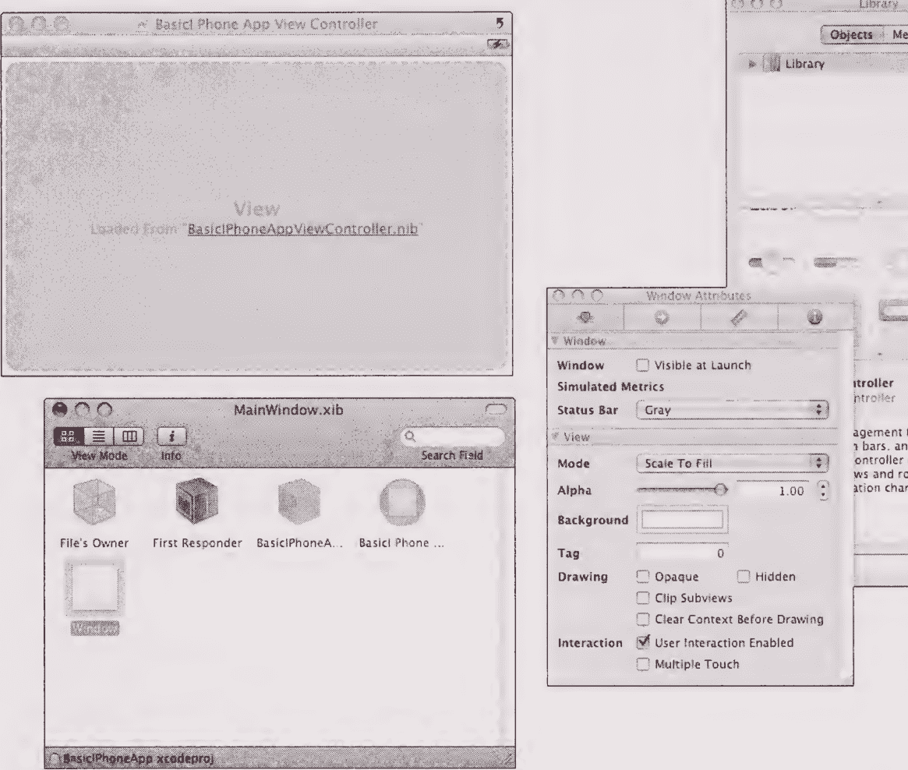

在本章中，我向你介绍了 Xcode 和界面生成器。在接下来的章节中，我们将更深入地使用这些工具，但我想简单地向你简要介绍它们的外观，以便你将来在使用它们时对它们了如指掌。我鼓励你仔细阅读关于它们的文档，并尝试尽可能深入地熟悉它们。

### 总结

## 构建基础 iPhone 应用程序

现在你对开发 iPhone 时将要用到的工具熟悉了，让我们来看看如何构建一个非常基础的 iPhone 应用程序。

在本章中，你将构建一个简单的 iPhone 应用程序，它将包含一个显示某些输出的文本字段和一个显示少量交互的按钮。当你完成这个应用程序后，你将熟悉从 Xcode 启动 iPhone 应用并在模拟器中运行它的基础知识。此外，在完成之前，你将在你的 iPhone 上运行该程序，查看它在实际设备上的运行情况。

你首先从 Xcode 的“新建项目 (New Project)”菜单中选择一个可用模板开始。

### 从模板创建项目

创建这个基础 iPhone 应用程序的第一步是打开 Xcode 并进入“文件 (File)”菜单下的“新建项目 (New Project) iPhone”。这将向你显示图 2.1 所示的对话框。为了演示起见，你将选择创建一个“基于视图的应用程序 (View-Based Application)”。

一旦你创建了这个项目，Xcode 已经有了对应你的应用程序用户界面（UI）的文件、你的控制器以及其他管理文件。它已经为模拟器和设备预配置了目标（targets）。用于定义界面的文件以 `.xib` 扩展名结尾。这些文件是你加载到界面生成器中以定义用户界面的文件。视图控制器（view controller）处理与按钮的交互。它有两个文件：一个扩展为 `.h` 的头文件和一个扩展为 `.m` 的实现文件。最后，它还包含了默认的应用代理（app delegate）的实现文件。该文件处理从操作系统发送到你的应用程序的消息，例如通知用户请求终止你的应用程序，或你的应用程序内存不足。带有所有文件的 Xcode 如图 2.2 所示。

图 2.1

新建项目对话框

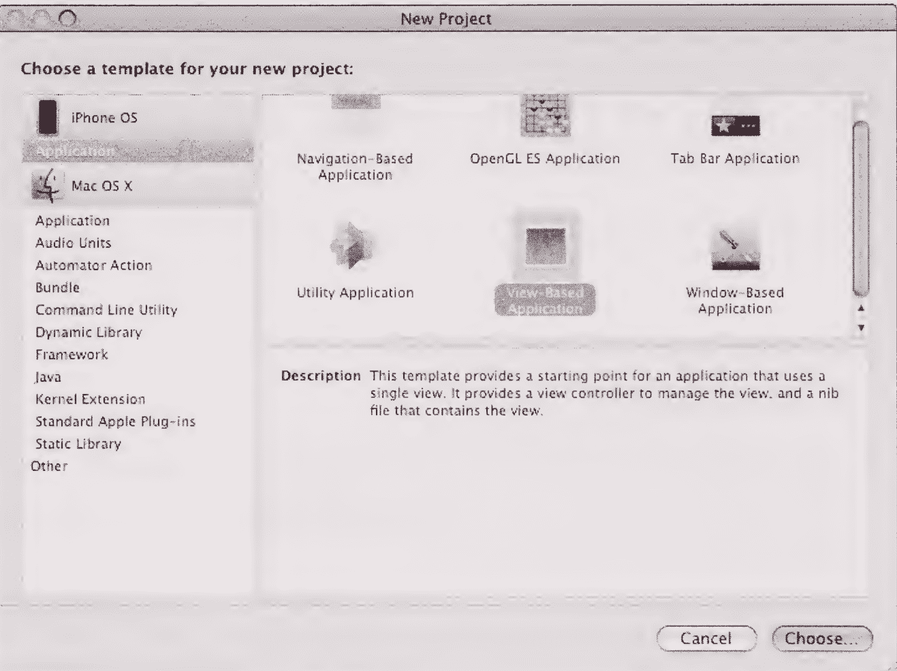

### 图 2.2

带有项目文件的 Xcode

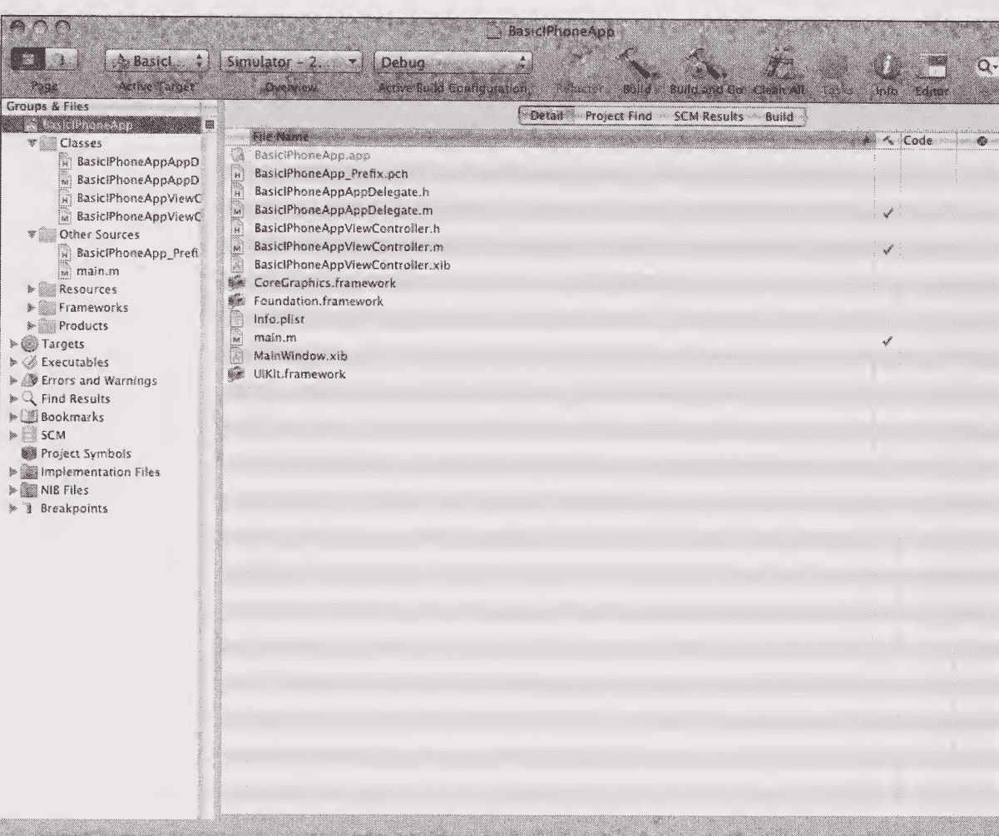

你很快就会更详细地查看这些每一个文件。现在，如果你只需点击“构建并运行 (Build and Go)”，应用程序就会启动并在你的 iPhone 模拟器上显示一个非常单调的空白屏幕，如图 2.3 所示。

图 2.3

内容为空的应用 UI

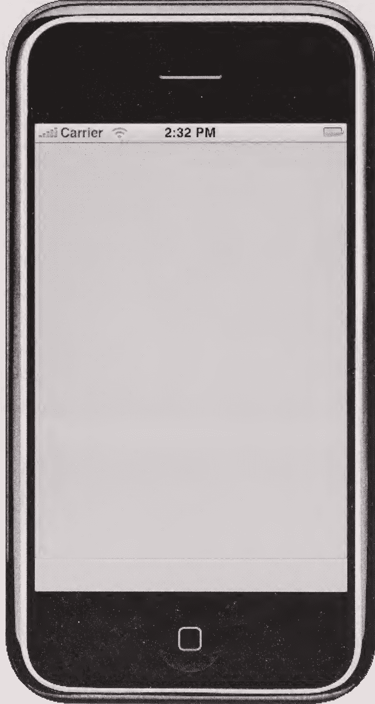

### 构建简单的 GUI

我认为你也会同意，就应用程序而言，这一个相当单调（尽管，如果你的目标是创建一个闪艳的应用程序，那太好了，你完成了）。然而，你想做一些稍微有趣一点的东西。所以你接下来需要做的事情是操作你的界面并向你的视图添加几个控件。要做到这一点，在 Xcode 文件视图中找到 `BasicViewController.xib` 文件并双击它。这会启动界面生成器并将你的视图加载其中进行操作，如图 2.4 所示。

图 2.4

加载了 UI 的界面生成器

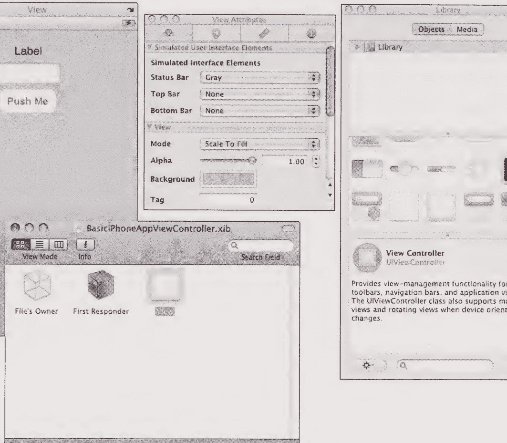

界面生成器由三个主要窗口组成：库 (Library) 窗口、文档 (Document) 窗口和属性 (Properties) 窗口。这些允许你操作界面中的各种对象。当你启动界面生成器时看到的第四个窗口代表你视图的空白窗口。你在这里通过拖放控件来创建你的界面。

> 注意
>
> 传统的示例应用程序是显示“Hello World”的。你的会比那多一点点，但不多。

当你将界面加载到界面生成器时，浏览对象库 (Object Library) 并找到一个标签 (Label) 的实例。将此实例拖放到你的视图上。接下来，找到一个文本字段 (text field) 的实例，并将此实例拖到你的标签下方。最后，找到一个圆矩按钮 (Round Rect Button) 的实例，并将此实例拖到你的视图上。在定位这些控件时，尝试将它们放置在视图的上三分之一。这使得当你触摸文本字段时，键盘会从底部弹出。稍后你将学习当键盘出现时如何移动你的视图，但现在你只需将其定位。

编写简单的 UIViewController

这比你的“hello world”稍微复杂一点的。当你完成后，你的界面看起来像图 2.5。现在，你要在界面生成器中保存你的工作，然后返回 Xcode，为你的控制器添加一些代码。

图 2.5

设计的用户界面

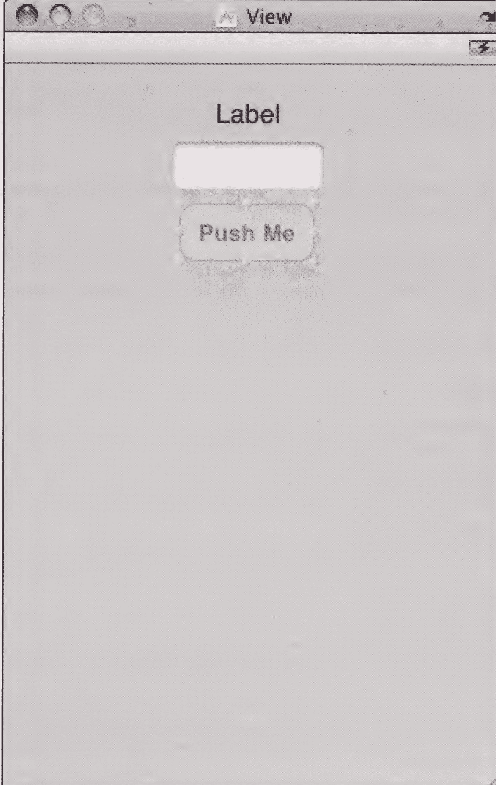

### 编写简单的 UIViewController

在第 5 章中，我将详细介绍什么是 ViewController 以及如何使用它。现在，你只需要看到头文件实现。

> 注意
>
> 当你第一次打开这个文件时，它填充了大量的模板代码。其中一些被注释掉了，一些没有。为了简单起见，我删除了所有被注释的代码，留下了没有被注释的代码。你唯一需要修改的是 `setLabel:` 方法，你需要将其从头开始写。要做到这一点，你需要让你的代码看起来像列表 2.1。

### 列表 2.1

ViewController.h

```objc
#import <UIKit/UIKit.h>
@interface BasiciPhoneViewController : UIViewController
{
  IBOutlet UILabel *myLabel;
  IBOutlet UITextField *myTextField;
}
-(IBAction)setLabelPushed:(id)sender;
@end
```

> `IBOutlet` 是一个提示，告诉界面生成器要连接哪些变量。同样的。

要完成这一切，你需要编辑实现文件以为 `setLabel:` 方法添加实现。该代码如列表 2.2 所示。

### 列表 2.2

ViewController 实现

```objc
#import "BasiciPhoneViewController.h"
@implementation BasiciPhoneViewController
-(IBAction)setLabelPushed:(id)sender
{
    [myLabel setText:[myTextField text]];
}
-(void)didReceiveMemoryWarning
{
    [super didReceiveMemoryWarning];
}
-(void)dealloc
{
    [myLabel release];
    [myTextField release];
    [super dealloc];
}
@end
```

现在，将这一切连接在一起的最后一步是回到界面生成器并将你的对象连接到代码。双击 `BasiciPhoneViewController.xib`。这会重新打开界面生成器。当你回到界面生成器时，单击选择文件所有者 (File Owner)。这实际上连接到了你的 `BasiciPhoneViewController` 类的实现。因此，如果你点击信息面板上的身份 (Identity) 标签页，你会看到类设置为 `BasiciPhoneViewController`，并且在动作 (Actions) 部分看到你的 `setLabelPushed:` 方法，在输出 (Outlet) 部分看到你的标签和文本字段变量。

### 注意事项

如果在 Interface Builder 中没有 IBOutlets 或 IBActions，请先确保你已经保存了更改。如果它们仍然不存在，请检查是否有任何拼写错误。如果代码不符合语法规范，Interface Builder 将无法读取它。

现在，你需要按住 `Control` 键，点击 File Owner（文件所有者），并将鼠标从文件所有者拖到 UI 上的 label（标签）。当你在 label 上释放鼠标按钮时，会弹出一个抬头显示器（HUD），即 HUD 风格的窗口。在这个窗口中，你会看到 label 的一个 outlet。选择它，这将将 label 实例连接到 UI 上的 label 实例。

接下来，对文本框（text field）执行相同的操作，将其连接到你的文本框 outlet。

最后，你需要对按钮执行相反的操作。按住 `Control` 键，从你的按钮拖放到 File Owner 上。这会再次弹出一个 HUD 风格的窗口，但这次它显示的是你定义的 actions（动作）。因为你定义了一个 action，它会显示这一个 action，显示为 `labelPressed:`。选择此 action，它就会附加到该动作上。

此时，你可以退出 Interface Builder，返回 Xcode，并点击 Build and Go（构建并运行）按钮。这将模拟器中启动你的应用程序。

你现在可以触摸文本框内部，它会弹出键盘。如果你在文本框中输入内容，然后点击 Push Me 按钮，你在文本框中输入的任何内容都会复制到 label 中。

完成！恭喜你，你编写了一个基础的 iPhone 应用程序。

### 在 iPhone 上启动

现在在 iPhone 模拟器上运行很棒，但最终你将在真实的硬件上测试你的应用程序。为什么呢？重要的是要意识到模拟器运行的是你的应用程序，它实际上运行的是你电脑硬件的能力。这意味着从性能角度来说，你的应用程序在电脑模拟器和实际 iPhone 上的行为可能会大不同。这些硬件差异甚至会导致某些 bug 在 iPhone 上出现，而在模拟器中不出现。

在真实的 iPhone 上运行 App 为了测试目的是审慎的，而且 iPhone 上具有的一些功能是模拟器不具备的。这些功能包括加速度计、Core Location 等。相反，也有一些应用程序接口（APIs）仅在模拟器上可用，而在真实的 iPhone 上不可用。在后一种情况下，你显然应该避免使用这些 API。我在这里提到这一点是因为新开发者进入该平台时经常犯的一个错误是他们查看 Mac OS X 上特定 API 的文档，并假设该 API 在 iPhone 上的工作相同。因为模拟器使用了某些库的桌面版本，当他们在模拟器上测试时，代码看起来运行正常。然而，最终结果是应用程序在模拟器上可以运行，但当开发者为实际硬件进行编译时，编译器找不到请求的 API，导致未解析符号（unresolved symbols）的编译错误。

所以重点在于，你需要在用于开发的 iPhone 或 iPod Touch 上运行应用程序。要做到这一点，你需要从 Apple 获取开发证书，将证书加载到 Xcode 中，并配置你的构建目标（build target）使用它。此过程的大部分与发布和上传到 iTunes Store 的主题有关；因此，我将在处理该主题的章节中讨论。

### 交叉引用

如果你还没有开发证书，那么你现在应该去那里并完成获取证书的过程，以便你可以在接下来的章节中使用它。完成后，返回此处继续。

> 注意
>
> 成为注册 iPhone 开发者每年需要花费 99 美元。

你拿到证书了吗？好了，我们继续。

一旦你将开发证书安装到 Xcode 中，用你的证书签名应用程序并将其安装到 iPhone 上就是一个很简单的过程。只需从窗口顶部拉下目标下拉菜单，为你的目标选择 Device（设备）。

此时，如果你点击 Clean and Build and Go，它会构建你的执行文件，将其下载到你的 iPhone 上并运行。

> 注意
>
> 如果你使用的是 Debug 构建，那么你实际上可以在你的实际设备上运行调试器并进行调试。

### 总结

在本章中，你已经能够构建一个非常简单的 iPhone 应用程序，并且你还学习了如何在模拟器以及你的实际测试硬件上运行它。这绝不是一个复杂的应用程序，但它确实展示了整个开发周期的基础，从设计 GUI 到编写你的控制器以及启动应用程序。

在下一章中，你将更密切地观察模拟器是如何运作的，因为在进行调试时，熟悉它的复杂性是非常重要的。稍后，你将花费更多时间研究如何构建比这更复杂的应用程序。

## 深入探索模拟器

你在这里将进行一次小旁游，详细探索 iPhone 模拟器的内部原理，以及你如何在开发中与它交互。

模拟器是一个极其强大的开发工具，因为它允许你进行非常快速的编译/测试循环。在模拟器上运行你的构建并启动它，比等待它下载到 iPhone 要快得多、容易得多。

值得注意的是，模拟器只是一个模拟器（simulator），而不是一个仿真器（emulator）。区别在于，它并没有真正模拟 iPhone 或 iPod Touch 硬件。它只是在实际上已编译的 iPhone 应用程序之上模拟 iPhone 用户界面。模拟器的目的是提供与实际硬件工作时尽可能真实的模拟。这是一个宏大的目标，而且在桌面计算机上很难实现。iPhone 拥有固态硬盘，因此它没有在被摇动、倾斜或操作时损坏的部分。大多数电脑没有这种待遇。

对于其他功能，例如 Core Location，模拟器允许这些功能进行测试，但它是以测试模式模拟硬件的。这意味着你的代码可以使用，但会接收测试数据。

最后是无处不在的多触（multi-touch），这在很多方面是 iPhone 交互的核心特征。模拟器允许通过各种热键来模拟多触。

让我们依次访问这些主题。首先，让我们从观察如何与模拟器交互开始。

### 探索 UI

模拟器的开发者选择完全忽略其中的某些功能，例如加速度计。这是合理的，因为要在桌面计算机上开发出模拟加速度器交互的方法是非常困难的。

- 与 UI 操作
- 旋转和操作模拟器
- 探索文件系统
- 学习哪些在实际硬件上可用，哪些无效

### 模拟多触

可能没有比多触屏对 iPhone 应用程序更具定义性的特征了。这种交互如此基础，以至于苹果为其申请了专利。因此，模拟器在处理应用程序时提供多种模拟多触的方法并不意外。

要启用多触，将鼠标悬停在模拟器的界面上，并按住键盘上的 `Option` 键。这会产生两个圆，指示当你按下鼠标按钮时激活多触的位置。要在屏幕上同时移动这些圆，请继续按住 `Option` 键的同时按住 `Shift` 键。这允许你移动多触交互器。

一旦将圆放在想要的位置，按下鼠标按钮，即可获取你所选位置的多触事件。

# 第 3 章 深入探索模拟器

### 注意事项

模拟器上的多触摸事件始终模拟为：两个触摸点在事件开始时完美同步地到达。在实际硬件操作中，两根手指实际上不会在精确的同一时刻触摸屏幕；因此，当你检测到这种情况发生时，你应该准备好从单触摸事件过渡到多触摸事件。

### 交叉引用

第 11 章将更详细地讨论多触摸事件。

### 模拟 Core Location

Core Location 是 iPhone 上用于确定位置的应用程序接口（或 API），它通过结合 GPS、蜂窝三角定位法和 Wi-Fi 访问点映射来确定您的位置。

### 交叉引用

我在第 30 章中将详细讨论 Core Location。


# Core Location 在模拟器中测试

Core Location 在模拟器中测试是一个相当复杂的特性。没有多少（或者说没有？）台式电脑内置 GPS 功能。因此，当在模拟器中使用 Core Location 时，它只模拟一个位置。该位置自然是加利福尼亚州的库普蒂，即 Apple 的总部。图 3.1 显示了模拟器中的 Core Location 演示应用，展示了在模拟器上使用 Core Location 时返回的位置。

遗憾的是，这就是模拟器所能做的。所以，如果你需要测试一个需要与 Core Location 进行更详细交互的应用程序，那么你需要在实际硬件上运行它。尽管如此，你可能可以在应用程序中将此限制在仅测试你的位置感知代码上。一旦你确定它运行正常，就可以直接在模拟器中运行它，并假装你在 Apple 工作。

## 开始使用 iPhone

图 3.1 Core Location 演示应用

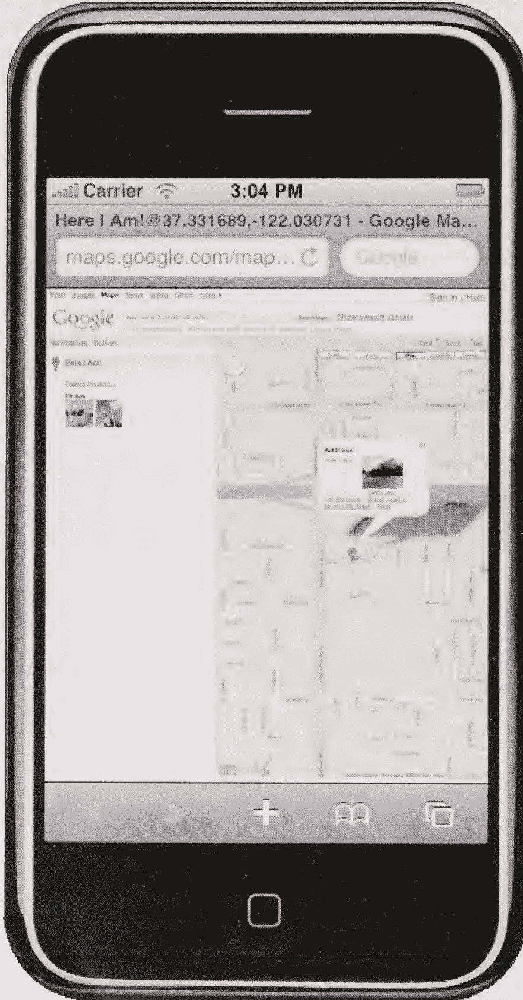

### 将模拟器侧置

我最初说模拟器完全不支持加速度计。这并不完全正确。将你的 iPhone 从竖屏切换到横屏是可能的。这可以通过模拟器“硬件”（`Hardware`）菜单下的“向左旋转”（`Rotate Left`）和“向右旋转”（`Rotate Right`）选项来实现。通过旋转实际设备触发的任何事件在使用这些菜单选项时也会触发。然而，需要注意的是，这并没有实际调用加速度计 API，与加速度相关的事件不会通过这种交互触发。不过，有专门用于从竖屏到横屏（以及反之）切换的事件会被触发。

图 3.2 横屏模式下的模拟器

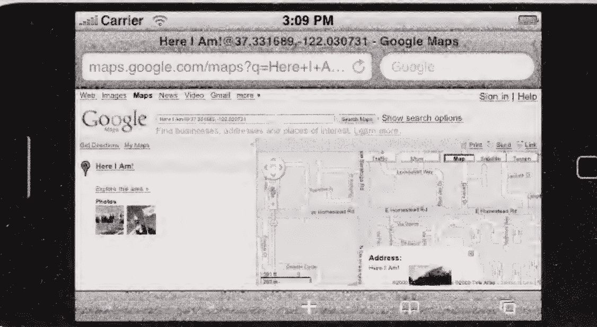

### 深入研究模拟器文件系统

在调试应用程序时，能够导航到模拟器运行程序时使用的实际文件系统是极其有用的。这特别有用，例如，当你想要查看写入正确的文件，或者检查你的数据库架构（`schema`）是否正确创建时。幸运的是，模拟器的文件系统可以在你电脑的主目录内轻松访问。iPhone 文件系统的路径是 `/Users/<your用户名>/Library/Application Support/Simulator/User`。在这个文件夹内部，你会找到一组用于 iPhone 模拟器的系统目录。其中大部分对你来说并不重要。然而，重要的是 `Applications` 文件夹，它包含了你的应用程序安装在模拟器时的沙盒（`sandbox`）。

> **注意**
>
> 应用程序沙盒是你的应用程序文件夹、文档文件夹以及几个系统文件夹的受限制文件系统。当你的应用程序运行时，在读写数据方面，它被限制在这个文件系统中。

当你导航到此文件夹并查看时，你首先注意到的是 `Applications` 文件夹内部的文件夹并不是以应用程序名称命名的。事实上，它们被赋予了一个全局唯一标识符，即 `GUID`。

没有任何方法可以预测或将 `GUID` 与你的应用程序关联；相反，你需要进入这些文件夹内部寻找与你的应用程序对应的应用文件夹。例如，对于你的 `BasicApp`，你会在其中一个文件夹内看到一个名为 `BasicApp.app` 的文件。这就是应用程序包（`bundle`），顶层（`GUID`）目录就是你应用程序的沙盒。在应用程序沙盒内部，还有其他几个文件夹，包括 `Documents` 和 `Library`，如表 3.1 所示。

表 3.1 模拟器文件系统内部的目录

| 目录名称 | 描述 |
| --- | --- |
| Documents | `Documents` 文件夹是可写位置，你应该将应用程序所需的任何数据文件写入此地。所以，如果你正在处理数据库，这就是你放置可写文件的地方。如果你只是将文件作为原始文本文件写入，它会被写入这里。 |
| Library | `Library` 文件夹包含你的应用程序偏好设置。当你使用 `NSUserDefaults` 写入偏好设置时，这些偏好会被写入这里。 |
| <Application Name>.app | 应用程序包文件夹（在你的情况下为 `BasiciPhone.app`）是你的应用程序二进制文件以及包含在包中的任何资源文件的实际应用程序包。 |

当你的应用程序实际运行时，你可以写入 `Documents` 目录，但你无法向应用程序包内的任何内容写入数据。当你处理数据库的构建和写入时，这一点变得非常重要。

### 交叉引用

我在第 18 章中会更多更多数据库。

### 理解模拟器与真实设备之间的区别

我已经多次提到，模拟器并不是硬件的完美复制，硬件并不一定支持模拟器所支持的所有功能。作为 iPhone 应用程序开发者，能够区分模拟器上可用的和硬件上可用的，并了解在性能方面的差异是非常重要的。

### 避免使用在真实设备上不可用的 API

Cocoa 和 Cocoa Touch 开发环境可以分层来定义。在顶层，即直接与用户交互的层，是 Cocoa Touch 上的 `UIKit` 框架以及 Cocoa 上的 `AppKit` 框架。这些包含了按钮、视图、列表控件等组件。最初，所有继承自 `NSObject` 且由苹果提供的 Objective-C 类都以“NS”为开头。这代表 NeStep，是最初在 NeXT 计算机上使用的平台。随着时间的推移，Apple 添加的越来越多的类不再遵循这一约定。Cocoa Touch 就是其中之一。由于它们的功能相同且包含相似的图形元素（例如它们都有按钮），`AppKit` 和 `UIKit` 中的许多类名相似，甚至完全相同。为了区分 `UIKit` 类和 `AppKit` 类，Apple 选择用“UI”前缀代替 `AppKit` 中使用的“NS”前缀。因此，区分 `AppKit` 文档类和 `UIKit` 文档相对简单。此外，在为模拟器编译时，它链接了一个专门为模拟器制作的 `UIKit` 版本。因此，当你使用 `UIKit` 类时，可以认为你在模拟器上调用的任何内容在硬件上都是可用的。`Foundation` 是 `AppKit` 和 `UIKit` 的下一层 API，包含了 `NSString`、`NSArray`、`NSDictionary` 以及许多底层类。

对于这些类，通常情况下，大多数内容在 Cocoa 和 Cocoa Touch 上都是支持的。然而，存在一些明显的例外，特别是在绘制方面。在 Cocoa 上，`NSString` 有一个分类，赋予了它在视图内绘制字符串的能力。Cocoa Touch 并不包含此功能。

避免使用未包含在 Cocoa Touch 中的 API 的方法是在浏览 API 文档时，确保你查看的是 iPhone 文档而不是 Mac OS X 文档。

# 理解性能差异

我之前提到过，但在与模拟器交互时，需要理解的一个重要概念是：模拟器实际上运行在你计算机的处理器和硬件上，它并不会模拟真实 iPhone 硬件上较慢的处理器和图形能力。结果是，它与实际硬件相比，具有非常不同的性能能力。这意味着，你不能将模拟器中的运行结果作为你的 App 在实际设备上运行性能的有效衡量。

虽然苹果对其硬件规格一直守口如瓶，但关于硬件你可能已经了解某些信息。具体来说，你可能知道第 1 代和第 2 代 iPhone 的处理器是 620 MHz ARM 处理器，降频至 412 MHz。你可能也知道它拥有 PowerVR MBX Lite 3-D 图形处理器。你应该知道它有 128MB 内存，并作为一个固态闪存。

表 3.2 详细比较了 iPhone 与典型台式电脑的规格。

表 3.2 iPhone 硬件与台式机器的对比

| 规格 | iPhone (iPhone 3GS) | 台式机 |
| --- | --- | --- |
| 处理器 | 620 MHz ARM (833 MHz ARM) | 3.0 GHz Xeon |
| 内存 | 128MB (256MB) | 2.0GB+ |
| 磁盘空间 | 8, 16, 32GB | 300GB+ |
| 屏幕分辨率 | 480x320 | 1920x1200 |

当你进行测试时，这种硬件差异的影响是无处不在的。

> **注意**：尽管 iPhone 3GS 在处理器速度和内存方面增加了大量新功能，但重要的是要记住，iPhone 3GS 仍然仅占整个 iPhone OS 用户的一小部分。如果你真的希望被广泛采用，你应该尽可能尝试针对规格较低的硬件进行。

仅使用 128MB 内存意味着你在设备上工作时内存受到极大的限制。所包含在内的 128MB 内存不仅属于你的 App，还包括操作系统以及即使在关闭后仍会在后台运行的内置 App。这意味着你只能依靠为应用程序保留大约 15 到 22MB 的可用内存。超过此限制，你就会开始看到内存警告。模拟器除非你要求，否则永远不会生成警告；而且，运行在模拟器中的 App 利用你的系统 RAM，这包含了且通常是几个 GB 的可用存储。

## 第 3 章：深入探索模拟器

> **注意**：在 iPhone 3GS 上，应用程序的可用内存可以高达 150MB，而在旧款手机上只有 15MB 或 22MB。

iPhone 上较慢的处理器和图形处理器意味着，在模拟器上运行非常快的算法和图形操作，在实际硬件上运行时可能会变慢得多。例如，涉及透明度的操作在 iPhone 硬件上被认为是特别耗费资源的，应该被避免。在在模拟器上运行时，这些操作通常不是问题。此外，某些看似微不足道的操作（例如对象分配）在实际硬件上执行时可能非常昂贵。模拟器则不会受到这些问题的困扰。

这一切的意味着，在实际硬件上测试你的 App 没有任何替代方案。测试，并且经常测试。不要等到最后一刻才把它当成事后打算去测试。每天这样做。

### 总结

在本章中，你已经领略了模拟器的风采。你深入研究了它的文件系统，并查看了如何与其交互。你看到了模拟器支持哪些功能，哪些不支持。你查看了模拟器与实际 iPhone 硬件之间的性能差异。在你作为 iPhone 开发者的职业生涯中，你会发现自己会反复回到模拟器上；这些背景信息将让你在进行进一步探索时感到自在，并帮助你在应用程序出现问题并需要追踪问题根源时，知道该去哪里寻找。

### 构建 GUI

### 在本部分

| 第 4 章 理解 iPhone 用户界面基础 | 第 10 章 应用自定义 UIViews |
| --- | --- |
| 第 5 章 介绍 UI 控制器 | 第 11 章 处理触摸事件 |
| 第 6 章 使用 UITableView | 第 12 章 与其他控件配合工作 |
| 第 7 章 与 UITableViewCell 配合 | 第 13 章 处理文本 |
| 第 8 章 与 UINavigationController 配合 | 第 14 章 使用 Core Animation 构建 UI |
| 第 9 章 使用 OpenGL ES | 第 15 章 集成 Safari |
| | 第 16 章 理解 UIApplication |

# 第 4 章：理解 iPhone 用户界面基础

## 理解 iPhone 用户界面基础

iPhone 以其精美的界面和易用性而闻名。当你观察它时，应该识别出的第一点是，通常情况下，它被分为三个或四个部分。从顶部开始，第一部分是状态栏。它提供了有关运营商、Wi-Fi 指示器、iPhone 是否正在播放等信息。

> **注意**：通过设置 `StatusBarHidden` 可以在你的应用程序中隐藏状态栏。

状态栏和底部“收藏应用程序”程序坞（`dock`）之间是主交互区域。这是大多数交互发生的地方，也是大多数信息显示的地方。在主屏幕上，这是应用程序图标所在。某些应用程序在此交互区域的顶部还会显示导航控制器。我将在第 8 章更深入地讨论导航控制器，因为这是为了开发优秀的应用程序而必须掌握的 iPhone 界面基础隐喻之一。

最后，屏幕底部是“收藏应用程序”程序坞。在 iPhone 屏幕上，这是你可以放置最常用应用程序的地方。只要你在主屏幕上，它们就是随时可用的，即使你滑动到了另一组应用程序上。这是一个重要的对话，我稍后在你查看实际应用程序时会再次提到它，因为这种交互会以标签页控制（`Tab Control`）的形式再次出现。

### 查看屏幕

图 4.1 iPhone 屏幕


状态栏

主内容

程序坞/标签栏

iPhone 屏幕

主交互

主屏幕

### 本章内容

- 探索 iPhone 自身的 UI - 了解组成 iPhone 模型的 UI 组件
- 理解组成 iPhone 的基本组件

### 创建电影级用户体验

苹果工程师在谈论美观的用户界面时，喜欢提到的一个概念是“电影级用户体验”（`cinematic user experience`）。电影级用户体验本质上是一种看起来像好莱坞电影的用户界面。它看起来具有未来感且流畅，并利用动画来增强与物理对象交互的感觉。

苹果的用户界面设计师专门为你提供了一套工具，用来构建这类电影级用户界面。像 `Core Animation` 这样的工具赋予了你构建界面的能力，可以使用从屏幕外滑入而不是直接出现的元素，以及具有几乎物理重量的的滚动元素。

大多数这些功能已经内置于你设计界面时使用的 UI 组件中了。然而，在某些可能需要自己设计 UI 的情况下（例如游戏），你应该努力保持这种电影级的质量。

这意味着你应该在视图之间使用平滑的过渡，而不是生硬、突然的过渡。你应该只为按钮和背景使用高质量的图形，并尽可能利用 iPhone 硬件的独特功能，如多点触控、加速度计和 Core Location。

### 查看内置应用程序

图 4.2 iPod 应用用户界面

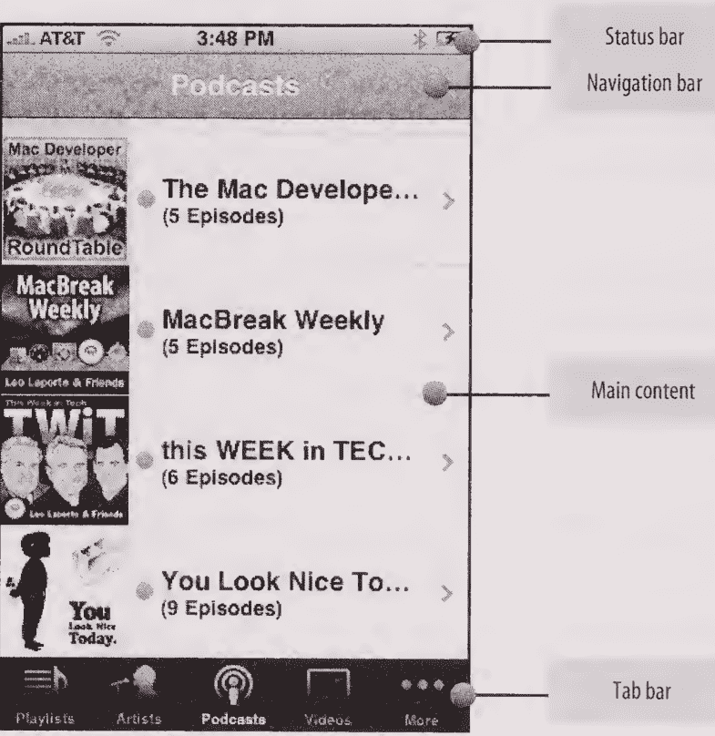

在 iPod 应用中，你会发现我刚才描述的基本区域都包含在这个应用程序中，如图 4.2 所示。具体来说，你仍然在顶部有一个状态栏。接下来是导航控制器（`navigation controller`）。在主交互区域，你有歌曲和艺术家的列表。最后，在屏幕底部，你有一个标签控制器（`tab controller`），它可以允许你在 iPod 的主要功能之间切换，并且在大多数交互过程中通常都保持激活状态。如你所见，这与 iPhone 主界面的工作方式有些相似。

iPod 应用是一个必须管理和导航层级数据树及列表的应用绝佳示例。在这里也可以查看其他类型的用户界面，例如图 4.3 所示的天气应用。

图 4.3 天气应用

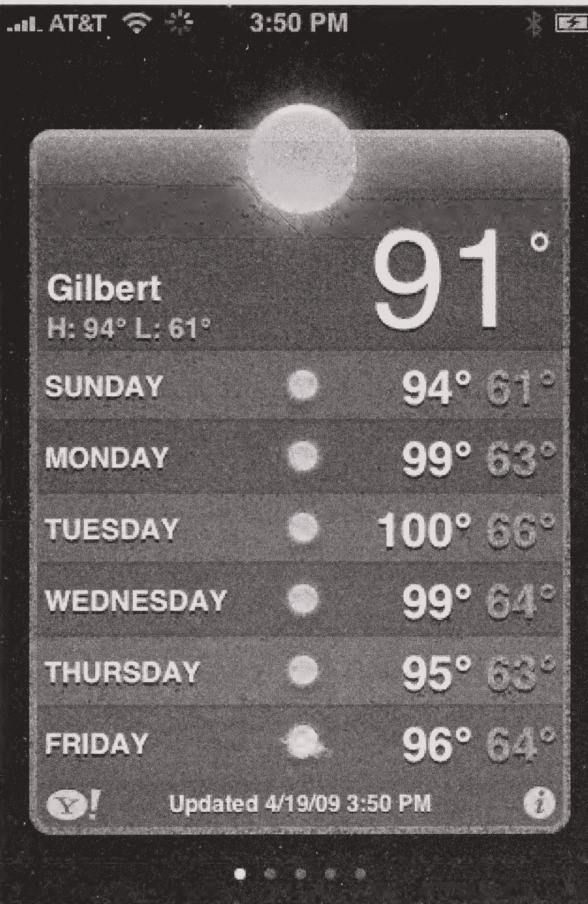

### 构建 GUI

天气应用并没有很多数据列表要展示给你看，而是旨在作为信息的简要摘要，让你能够快速查看、获取所需信息并退出应用程序。在这种情况下，主屏幕包含了用户感兴趣的所有数据。不需要任何复杂的导航。要更改应用程序的设置，它在右下角提供了一个小小的信息按钮，该按钮通过 Core Animation（核心动画）翻转用户界面，允许用户配置他们想要看到的城市。


> **注意**
>
> 信息图标是 Interface Builder 提供的标准图形。你可以在自己的应用程序中使用它。

对于那些不需要管理大量数据的应用程序来说，这是一个很好的模型。想象一下，在考虑这类用户界面时，你的应用程序每次可能只使用十秒钟。

### 理解 iPhone 导航基础

除了理解 iPhone 用户界面设计的宏观问题外，仔细观察一些较小的、通常经常被忽略的交互也很重要。

例如，在设计自定义按钮时，当按钮被按下时向用户提供一些即时反馈是非常重要的，例如高亮按钮或显示一个备用图像。你将在未来的章节中详细查看这一点，但现在请知道你可以通过 Interface Builder 轻松地做到。


> **注意**
>
> Interface Builder 允许你在按钮被选中时高亮它，或使用你提供的独立图像在按钮被选中时显示。

交互的另一个细微细节是观察 iPhone OS 如何导航数据树。具体来说，请注意当你从列表中选择一个项目时，它会高亮它们，然后一个详情视图（`detail view`）从左向右进入屏幕，显示关于所选项目的信息。同样，当从详情视图返回时，当前视图向右滑出，原始视图从左侧滑入。这是一个重要的交互，你应该在应用程序中镜像这种操作。它遵循了我们从左到右的阅读习惯，对我们来说很自然。如果以其他方式运行，会让用户感到不安的。

最后，请注意 iPhone 标准化了编辑数据的方法。也就是说，通常视图默认处于显示模式，当用户触摸编辑按钮（通常在右上角）时，它会将视图更改为该视图的可编辑版本。当用户在屏幕上编辑数据时，他触摸完成（`Done`）按钮，它就会回到显示视图。

> **注意**
>
> 仔细观察这些过渡过程，你会发现它们通常是动画的。审慎使用动画是让 iPhone 独特且具有电影感的因素之一。

这些规则并没有硬性规定，但在设计应用程序时，经常问自己“苹果会怎么做？”很有用，无论答案是什么，就这样做。研究甚至表明，当应用程序不遵循这些习惯时，用户会很快变得烦躁。他们期望第三方应用的行为与内置应用一样，因此花力让你的应用程序适应环境是值得的。

### 总结

我看到的对应用程序的最崇赞美是用户说：“这个应用程序让我想要去……（该应用程序的功能）……以便我能使用这个应用程序来完成它。”这应该是你在应用程序中努力实现的目标。

在本章中，我们查看了一些让 iPhone 用户交互变得独特且直观的元素。iPhone 是巨大的平台；你应该努力让你的应用程序配得上与其他优秀应用程序并肩运行，并对得起客户的时间和金。

### 介绍 ViewController

在开发 Cocoa Touch 框架时，Apple 利用此机会标准化并规范了其导航视图的工具集。许多开发者已经熟悉 Model-View-Controller（`MVC`）模式，但最近才开始在视图上巩固这一概念。这些类是 `UIViewController` 和 `UITabViewController`。

除了提供这些类之外，Apple 还提供了一个框架，使层级数据导航变得极其简单。此框架相关的导航类集中在 `UINavigation`。

在本章中，你将查看如何编写 ViewController 以及如何在应用程序中使用它。ViewController 是 Cocoa Touch 的基础构建模块，也是你未来章节需要的重要概念。

### 本章


# 第 5 章：介绍 ViewController

## 学习目标

- 理解 Cocoa 如何融入 Model-View-Controller 模式
- 学习 `ViewController` 的基础
- 构建使用 `ViewController` 的基础应用

## 理解 Model-View-Controller 基础

关于 `ViewController`，你首先需要的是回顾 Model-View-Controller 模式，并看看你将使用的类如何融入其中。图 5.1 显示了 Model-View-Controller 设计模式典型的描述方式。如你所见，使用此模式设计的应用程序分为三个部分。

在最左侧，你看到了模型部分。它通常由数据存储和处理类组成，如数组、字典或数据库/文件存储类。这些类的目的是处理数据存储的实际维护。这意味着模型部分是实际处理磁盘数据读写或内存中数据缓存的部分。它还包含了对数据进行操作以计算原始值或其他低级处理的方法。

在最右侧，你看到了图中的视图部分。这些是直接与用户交互的对象和类，将模型中的数据以用户可见和可读的形式呈现。这些类包含了专门用于数据显示的方法。

**图 5.1 Model-View-Controller 设计模式**

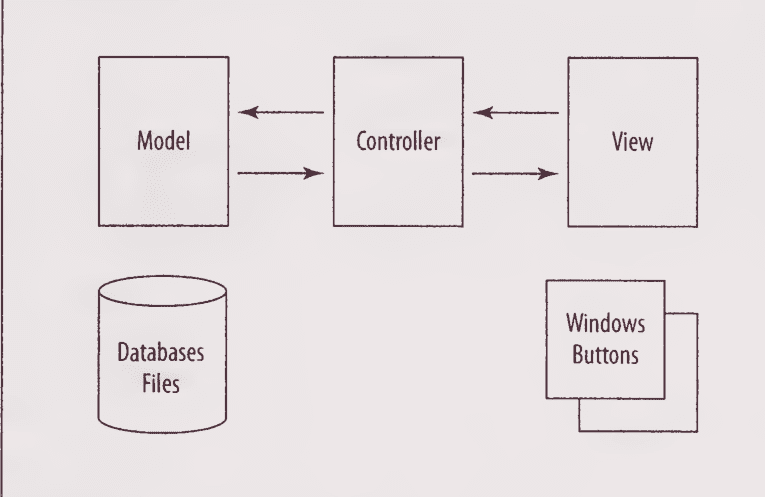

如果实现正确，视图不应包含任何数据处理逻辑，模型也不应包含任何显示逻辑。这种演示与数据的分离是 Model-View-Controller 设计模式强大的关键元素之一。它允许你独立地替换或更改模型或视图。这种灵活性正是它力量的源泉。

控制器是模型-视图-控制器（MVC）设计模式中经常被误解的部分之一，但它的功能实际上非常简单。控制器本质上是模型和视图之间的门卫。它的工作是提供两者之间的分离，并提供方法让模型和视图相互操作，而不会彼此紧密耦合。这意味着控制器同时拥有模型和视图的引用，在显示视图时，控制器从模型中读取数据并将其放入视图中。同样，当数据通过视图更改时，控制器是对比这些变化做出响应并设置模型中的数据的人。再次，这里的目的是将视图与模型解耦。控制器充当了这种解耦机制。

## 探索 ViewController

在深入探讨本章示例之前，深入理解 `ViewController` 存在的意义非常重要。`ViewController` 存在的核心原因是管理视图。

在 Cocoa Touch 中，Apple 为你提供了一个基类，你可以从该基类继承你的视图控制器。这个基类就是 `UIViewController`。让我们来看看如何编写一个基本的 `UIViewController` 以及如何将其连接到你的视图。

## 在 ViewController 上重写方法

`UIViewController` 提供了多种可以在子类中重写的方法。其中一些方法显示在表 5.1 中。

**表 5.1 `UIViewController` 常见的被重写方法**

| 方法签名 | 说明 |
| :--- | :--- |
| `- (void)loadView` | 用于创建控制器管理的视图。如果你打算自己通过程序创建视图，则必须重写此方法。不要手动调用此方法。 |
| `- (void)viewDidLoad` | 在视图从 nib 加载后调用。这用于需要 nib 中对象的初始化活动。 |
| `- (void)viewDidUnload` | 在视图从内存中卸载时调用，例如由于低内存警告或当视图被卸载以便进行内存释放时。你应该使用此方法来释放在 `viewDidLoad` 中分配的资源。 |
| `- (void)viewWillAppear:(BOOL)animated` | 在视图显示在屏幕上之前调用。 |
| `- (void)viewWillDisappear:(BOOL)animated` | 在视图从屏幕上消失之前调用。 |
| `- (void)viewDidAppear:(BOOL)animated` | 在视图显示在屏幕上后调用。 |
| `- (void)viewDidDisappear:(BOOL)animated` | 在视图从屏幕上消失后调用。 |
| `- (BOOL)shouldAutorotateToInterfaceOrientation:(UIInterfaceOrientation)interfaceOrientation` | 在设备旋转时调用，以确定你是否允许旋转到给定的方向。如果你在视图中支持旋转到给定的方向，你应该返回 `YES`。默认实现对于横屏模式始终返回 `NO`。 |
| `- (void)willRotateToInterfaceOrientation:(UIInterfaceOrientation)toInterfaceOrientation duration:(NSTimeInterval)duration` | 在界面旋转到动画块内之前调用，该动画块将用于动画视图。它是你安排想要在动画期间发生的额外动画的绝佳位置。 |
| `- (void)didRotateFromInterfaceOrientation:(UIInterfaceOrientation)fromInterfaceOrientation` | 在界面旋转后直接调用。 |
| `- (void)willAnimateFirstHalfOfRotationToInterfaceOrientation:(UIInterfaceOrientation)toInterfaceOrientation duration:(NSTimeInterval)duration` | 在用于动画旋转的动画块内部调用。使用它为过渡效果添加你自己的动画。 |
| `- (void)didAnimateFirstHalfOfRotationToInterfaceOrientation:(UIInterfaceOrientation)toInterfaceOrientation` | 在旋转动画的第一半完成后调用。 |
| `- (void)willAnimateSecondHalfOfRotationFromInterfaceOrientation:(UIInterfaceOrientation)fromInterfaceOrientation duration:(NSTimeInterval)duration` | 在用于动画旋转的动画块内部调用。使用它为过渡效果添加你自己的动画。 |
| `- (void)didReceiveMemoryWarning` | 在接收到内存警告时调用。 |

> **注意**
>
> 对于这些方法中的大多数，你还应该确保调用你所重写的任何方法的父类实现，以确保该调用的默认实现也能执行其功能。

> **交叉引用**
>
> 要查看更多来自 `UIViewController` 的可用方法，请查看 Xcode 中的 Cocoa Touch 文档。

> **警告**
>
> 如果直接将视图添加到层级结构中，则视图出现方法（`viewWillAppear`、`viewWillDisappear` 等等）将不会被调用，因此在需要时请务必手动调用这些方法。

因为 `UIViewController` 的主要目的是管理视图，因此这些方法中的大部分都与该目的密切相关。你在应用程序中可能需要重写的最常见方法是 `viewDidLoad`、`viewDidUnload`、`viewWillAppear`、`viewDidAppear`、`viewWillDisappear` 和 `viewDidDisappear`。这些是你通常用于确定视图如何对这些事件之一做出反应的方法。你会使用这些方法执行任务，如初始化变量、从磁盘加载数据或（在卸载和消失时）将数据保存到磁盘或设置模型上的值。

## 处理视图旋转

`UIViewController` 还可以提供视图旋转的基本处理。要声明你支持竖屏以外的方向，你必须重写 `shouldAutorotateToInterfaceOrientation` 方法并返回 `YES`。在此方法中，你应该查看正在请求的方向，并对子类支持的方向返回 `YES`。如果你的视图对旋转需要更复杂的支持，则提供了额外的方法 `willRotateToInterfaceOrientation:duration:` 和 `didRotateFromInterfaceOrientation:` 作为钩子，供你执行更复杂的操作。这些方法分别在旋转开始和结束时调用。当设备从竖屏旋转到横屏时，你在开始时收到 `willRotateToInterfaceOrientation:duration:` 调用，提示即将旋转到横屏。在结束时，你会收到 `didRotateFromInterfaceOrientation:` 调用，提示刚刚旋转到了竖屏。通常，这些方法会在旋转期间被重写，可能会影响旋转动画本身。如果你想象一个需要在显示时进行某些计算的视图，你可能希望在实际旋转期间禁用处理。这就是你使用这类方法的地方。最后，如果你想为旋转过渡提供自定义动画，可以重写 `willAnimateRotationToInterfaceOrientation:duration:` 方法。该方法在用于配置旋转动画的动画块内调用。这意味着在此方法中对可动画属性进行的任何更改都将添加到动画块中，并在界面动画发生的同时发生。通常，你会使用此方法将你的视图移动到适合新界面方向的位置。

> **交叉引用**
>
> 我在第 14 章中详细讨论了 Core Animation 和视图动画。

> **注意**
>
> `willAnimateRotationToInterfaceOrientation:duration:` 方法与 `willAnimateFirstHalfOfRotationToInterfaceOrientation:duration:` 和 `willAnimateSecondHalfOfRotationFromInterfaceOrientation:duration:` 是互斥的，如果你重写了其中一个，就不应该重写其他方法。后者方法用于早期 iOS 版本。前者被认为是处理旋转的更新、更好的方法。

## 处理内存警告

正如你所知，内存是有限的资源。在后面的章节中，我将详细介绍内存管理，但在这里值得提到 `UIViewController` 提供了一个在你的应用程序接收到低内存警告时被调用的方法。该方法是 `didReceiveMemoryWarning`。默认情况下，该方法的实现在视图不是其他视图的子视图时会导致视图控制器卸载并释放其视图。当这样做时，它会调用 `viewDidUnload` 方法给你一个机会保存任何适当的数据并释放在 `viewDidLoad` 中分配的任何对象。除了从中受益之外，你还应该重写 `didReceiveMemoryWarning` 方法并清理不需要的临时数据以释放内存。如果你这样做，特别重要的是要在实现中也调用 `[super didReceiveMemoryWarning]` 方法。要释放数据的良好示例可能是可以轻松重建的缓存数据，或者在下次访问时将重建的懒加载对象。

## 使用 UIViewController

让我们首先在 Xcode 中创建一个新项目。将此项目命名为 `ViewControllerDemo`。使用基于窗口的应用创建此示例项目。这创建了一个只有一个窗口的非常基本的 iPhone 应用程序。你将使用此项目从零开始构建应用程序。通过这种方式，你将理解模板为你提供了什么。

> **注意**
>
> 在创建 `ViewControllerDemo` 项目时，请确保项目创建窗口中没有勾选“Use Core Data for Storage”（使用 Core Data 存储）选框。

> **注意**
>
> Xcode 提供了导航型应用程序和基于视图的应用程序模板，在创建自己的应用程序时使用这些模板完全没有问题。然而，为了本示例的目的，我想让你准确理解背后的运行机制。

## 创建代码

一旦创建了项目，它将包含一个 nib 文件（即 `MainWindow.xib`，位于 Resources 组下）以及你的代理实现文件（由 `ViewControllerDemoAppDelegate.h` 和 `ViewControllerDemoAppDelegate.m` 组成，位于 Classes 组下）。

你要做的第一件事是创建一个 `UIViewController` 子类并将其添加到项目中。你可以通过右键点击 Classes 组并选择 `New File...` 来实现。在这里，你选择 `UIViewController subclass` 模板。为了本示例的目的，将文件命名为 `MyViewController`。请确保在执行此操作时不要勾选“With XIB for user interface”（带用户界面的 XIB）选框。这将为你创建 `MyViewController` 的头文件和实现文件。

> **注意**
>
> 我没有勾选“With XIB for user interface”，因为再次，我想让你理解底层正在发生的事情。在将来，你完全可以使用该选框来自动创建 XIB。在示例中，我让你手动创建。

在示例中，你将有一个非常基本的 `NSMutableArray` 来存储城市名称。在这个数组中，我有两个按钮。第一个是“Next”（下一个）按钮，它将带你逐个遍历数组元素。当你遍历数组时，你会将 `UILabel` 的 `text` 属性设置为城市名称。当你遇到喜欢的城市时，你可以点击第二个按钮“Favorite”（收藏）来显示你喜欢该城市。这会导致在该城市显示时，标签旁边出现一条“Favorite: YES”的消息。图 5.2 显示了应用程序完成后的样子。

**图 5.2 最终的应用程序**

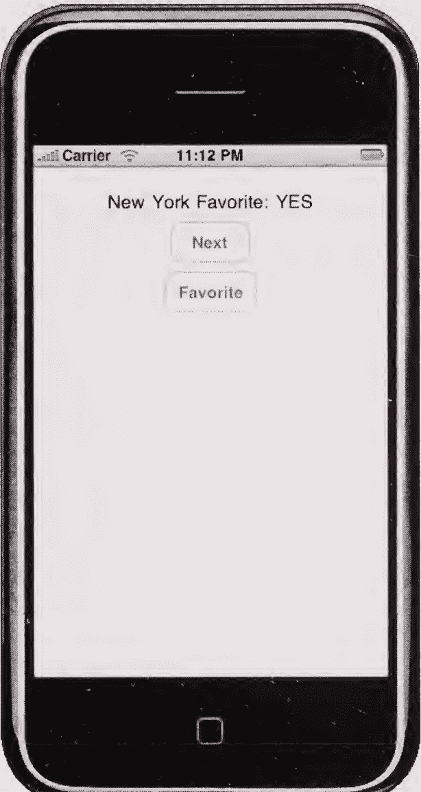

## 创建 UIViewController 头文件

应用程序的主要工作将在你的 `UIViewController` 子类中进行。为了实现它，你需要做的第一件事是设置你的 `UIViewController` 头文件，以便我刚才描述的每个 UI 元素包含 `IBOutlet`。列表 5.1 确切展示了如何这样做。你只需将 `IBOutlet` 添加到实例变量声明部分。

**列表 5.1 MyViewController 头文件**

```objectivec
#import <UIKit/UIKit.h>

@interface MyViewController : UIViewController
{
    UILabel *currentCity;
    UIButton *nextButton;
    UIButton *favoriteButton;
    NSMutableArray *theData;
    int currentItem;
}

@property (nonatomic, retain) NSMutableArray *theData;
@property (nonatomic, retain) IBOutlet UILabel *currentCity;
@property (nonatomic, retain) IBOutlet UIButton *nextButton;
@property (nonatomic, retain) IBOutlet UIButton *favoriteButton;

- (IBAction)nextButtonTouched:(id)sender;
- (IBAction)favoriteButtonTouched:(id)sender;

@end
```

> **注意**
>
> 你在这里将 `theData` 定义为一个属性，以便稍后可以从 App Delegate 中设置它。

> **注意**
>
> 这里的属性定义了你希望为 `IBOutlet` 使用的对象所有权规则，在这种情况下，你希望保留（retain）它们。在 Mac OS X 上，没有属性声明的 `IBOutlet` 默认不会被保留。这与 iPhone 上的行为相反。这意味着在 iPhone OS 上，如果你没有声明属性，它会被保留并且必须在你的 `dealloc` 方法中释放（release）。由于这种不一致性，与其仅仅记住哪个平台具有什么行为，不如养成始终为所有 `IBOutlet` 声明属性的习惯。通过这样做，你始终可以将你的所有权规则作为头文件的一部分记录下来。

## 创建 ViewController 实现

实现文件要稍微复杂一些。你要做的第一件事是在视图最初加载时初始化城市以显示列表的第一个元素。你在 `viewDidLoad` 方法中执行此操作。该方法在视图加载显示之前被调用。你在这里执行是因为你知道在代码的这个时间点，你的 outlets 已经连接到 nib 文件中的对象。列表 5.2 显示了你对 `viewDidLoad` 方法的实现。

> **注意**
>
> 属性是代码。你应该在代码中大量使用它们。然而，它们需要在你的头文件和实现文件中都声明。实现文件中的声明通常采用 `@synthesize <variablename>` 的形式。

**列表 5.2 `viewDidLoad` 实现**

```objectivec
- (void)viewDidLoad {
    currentItem = 0;
    NSDictionary *cityData = [theData objectAtIndex:currentItem];
    NSString *theInfo = [NSString stringWithFormat:@"Favorite: %@",
                         [cityData objectForKey:@"NAME"],
                         [cityData objectForKey:@"FAVORITE"]];
    [currentCity setText:theInfo];
}
```

**列表 5.3 Next 按钮的事件处理器**


- (IBAction)nextButtonTouched:(id)sender {
    currentItem++;
    if (currentItem >= [theData count])
        currentItem = 0;
    
    NSDictionary *cityData = [theData objectAtIndex:currentItem];
    NSString *theInfo = [NSString stringWithFormat:@"Favorite: %@",
                         [cityData objectForKey:@"NAME"],
                         [cityData objectForKey:@"FAVORITE"]];
    [currentCity setText:theInfo];
}

```objc
[self setCurrentCity:nil];
[self setNextButton:nil];
[self setFavoriteButton:nil];
[self setToData:nil];
[super dealloc];
```

### 在 Interface Builder 中添加控制器

我刚才提到过，我将讨论如何将代码引入 Interface Builder，并将你的 `IBOutlets` 附加到 UI 上的实际对象，所以我们现在来看一下。

首先，你需要创建一个新的 nib 文件来包含你的视图。要这样做，右键点击项目中的 Resources（资源）文件夹，并选择 Add New File（添加新文件）。在新建文件对话中，选择类别 User Interfaces（用户界面），然后选择 View XIB。将此文件命名为 `ViewController.nib`。点击 Finish（完成）后，该文件就会被创建并添加到资源组中。双击它以启动 Interface Builder。

以前，当你使用 Interface Builder 时，它是配合你模板生成项目中的模板生成的 nib 文件一起使用的。在这种情况下，你将手动完成所有操作，以便理解背后发生的所有细节。要做到这一点，你需要做的第一件事是将文件的 File Owner（文件所有者）对象设置为属性窗口的实例，选择 Identity（身份）标签页，并在 Class（类）下拉菜单中选择 `ViewController` 类。这让你能够看到你之前在控制器中创建的 `IBOutlets`，并允许将这些 `IBOutlets` 连接到你可以放置在用户界面上的对象。

一旦完成这些操作，从 Library（库）窗口拖放一个 Label（标签）和两个 Round Buttons（圆形按钮）到视图上，使其看起来像图 5.3。

就像在你的基础 iPhone 应用中一样，你通过 Control 键从 Owner 拖拽到 UI 上的每个控件，将它们从你的 `IBOutlets` 连接到实际对象。然后，通过 Control 键将你的按钮拖到 File Owner，并选择你为这些按钮设置的 `IBActions`。从按钮到 `IBActions` 的 Control 键链接拖拽会将默认事件“Touch Inside”（内部触摸）连接到 Action（动作）。

`UIViewController` 为你提供了一个用于设置视图的属性。该属性的命名非常恰当，你应该通过 Control 键从 File Owner 拖拽到你的主视图，以与此连接。

### 图 5.3

设计界面

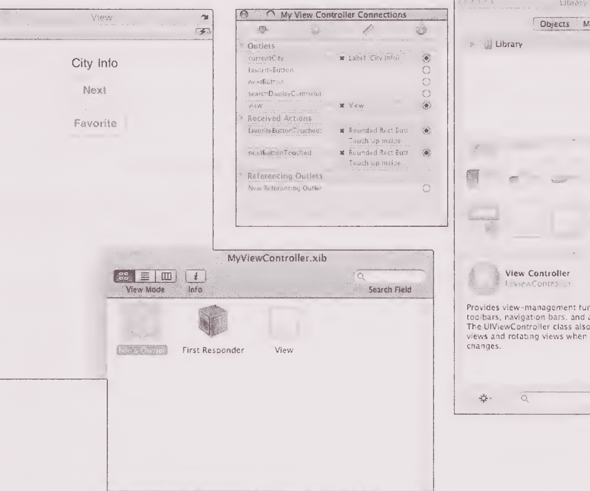

最后，你需要在 MainWindow nib 文件中做一些工作，因此保存 MyView nib 并关闭 Interface Builder。然后，编辑 `ViewControllerDemoAppDelegate.h` 文件，使其看起来像列表 5.6 所示。

### 列表 5.6

#### ViewControllerDemoAppDelegate 头文件

```objc
#import <UIKit/UIKit.h>
#import "MyViewController.h"
@interface ViewControllerDemoAppDelegate : NSObject <UIApplicationDelegate>

UIWindow *window;
MyViewController *viewController;

@property (nonatomic, retain) IBOutlet UIWindow *window;
@property (nonatomic, retain) IBOutlet MyViewController *viewController;
@end
```

你有两个 `IBOutlets`，一个连接到应用程序的基础窗口，另一个连接到你的视图控制器。当应用程序启动时，你从控制器获取视图并将其作为子视图添加到窗口中。要做到这一点，切换到 `ViewControllerDemoAppDelegate.m` 文件；我将向你展示如何将模型绑定到你的视图控制器。

### 理解 UIApplicationDelegate

简短地讨论一下 `UIApplicationDelegate` 是重要的。每个 iPhone 应用都有一个 `UIApplicationDelegate`。就像主函数一样，`UIApplicationDelegate` 是应用程序首次被通知正在运行的地方，也是被通知用户想要退出应用程序、内存低等的地方。它提供了许多供你重写的有用方法。为了你的应用程序，你将处理 `applicationDidFinishLaunching` 方法，它是在应用程序完成加载时调用的。稍后我们将深入研究这些其他方法。

### 在 App Delegate 中创建模型

该应用程序将非常简单。你不会对数据进行任何特殊处理（如保存到磁盘）。为了演示，你要做的只是创建一个包含城市字典的数组。这些字典将包含两个对象：城市名称以及它是否为收藏夹。在这种情况下，你的模型实际上是一个属性列表数组。

> **注意**
>
> 字典数组是很好的模型，但通常不是良好的实际模型。请根据判断做出符合应用程序的决策。

要创建此模型，请将列表 5.7 所示的方法添加到 app delegate 的实现中。

### 列表 5.7

#### makeModel 方法

```objc
- (NSMutableArray *)makeModel {
    NSArray *cityNames = [NSArray arrayWithObjects:@"New York", @"Chicago", @"San Francisco", @"Los Angeles", @"Phoenix", nil];

    NSMutableArray *ret = [NSMutableArray array];
    for (NSString *cityName in cityNames) {
        NSMutableDictionary *cityObject = [NSMutableDictionary dictionary];
        [cityObject setObject:cityName forKey:@"NAME"];
        [cityObject setObject:@"NO" forKey:@"FAVORITE"];
        [ret addObject:cityObject];
    }
    return ret;
}
```

### 构建 GUI

### 列表 5.7（续）

将此方法添加到 `applicationDidFinishLaunching` 方法之前很重要，以免产生警告。

> **提示**
>
> 将此方法放置在 `applicationDidFinishLaunching` 方法之前可以让你使用它而不产生警告。另一种方法是在你的头文件中声明此方法。对我来说，我倾向于只暴露我预期他人知道的方法。这样，界面就不会被不应该调用的方法干扰。

一旦添加了这个方法，你就编辑 `applicationDidFinishLaunching` 方法使其看起来像列表 5.8 所示。

### 列表 5.8

#### applicationDidFinishLaunching 的实现

```objc
- (void)applicationDidFinishLaunching:(UIApplication *)application {
    [viewController setData:[self makeModel]];
    [window addSubview:[viewController view]];
    [window makeKeyAndVisible];
}
```

你在这里所做的是调用 `makeModel` 方法创建模型，并将该模型传递给你的视图控制器。这是通过调用 `[viewController setData:cities]` 完成的。

这样做会创建一个对象，你可以在 app delegate 中使用它来访问视图控制器。不过，你仍然需要将其绑定到你的 `IBOutlet`。要这样做，再次按住 Control 键并拖动，但这次要从 application delegate 对象拖动到 view controller。这允许你将视图控制器的输出连接到视图控制器。

列表 5.9 显示了 app delegate 的最终实现。

### 列表 5.9

#### 最终 App Delegate 实现

```objc
#import "ViewControllerDemoAppDelegate.h"
@implementation ViewControllerDemoAppDelegate
@synthesize window;
@synthesize viewController;

- (NSArray *)makeModel {
    NSArray *cityNames = [NSArray arrayWithObjects:@"New York", @"Chicago", @"San Francisco", @"Los Angeles", @"Phoenix", nil];

    NSMutableArray *ret = [NSMutableArray array];
    for (NSString *cityName in cityNames) {
        NSMutableDictionary *cityObject = [NSMutableDictionary dictionary];
        [cityObject setObject:cityName forKey:@"NAME"];
        [cityObject setObject:@"NO" forKey:@"FAVORITE"];
        [ret addObject:cityObject];
    }
    return ret;
}

- (void)applicationDidFinishLaunching:(UIApplication *)application {
    [viewController setData:[self makeModel]];
    [window addSubview:[viewController view]];
    [window makeKeyAndVisible];
}

- (void)dealloc {
    [self setWindow:nil];
    [self setViewController:nil];
    [super dealloc];
}
@end
```

完成所有这些操作后，如果你操作得当，就可以编译并运行你的应用程序，看到你的视图加载，并点击按钮，让应用程序按照你预期的方式运行。

### 注意

记住，你可以从书的网站下载本章的所有代码。

### 总结

在本章中，我向你介绍了构建应用程序的基础构建块——`UIViewController`。几乎每一个 iPhone 应用程序都至少有一个 `ViewController` 或派生自 `UIViewController` 的类。理解这个核心类以及它如何配合模型（Model）、视图（View）、控制器（Controller）设计模式工作至关重要，以便构建灵活且易于维护的 iPhone 应用程序。此外，你还学习了处理方向变化和内存警告的基础知识。我将在接下来的章节中多次回顾这些主题，但这是接触这些主题的一个很好的方法。

# 使用 UITableView

上一章节中的应用程序示例完成了任务，但它绝不是优雅用户界面的例子。展示 `UITableViewController` 的某些复杂性是有帮助的，但如果你考虑你正在处理的数据类型（城市列表），就会很容易发现其他类型的用户界面在导航这些数据时可能更有效。对你来说的是，还有另一种非常适合列表的视图。那个视图就是 `UITableView`，这也是你将关注的视图。

在 GUI 工具包领域，表格视图（Table views）并不新鲜。但在 iPhone 上，由于屏幕尺寸较小，有各种限制使得无法实现带有行和列的传统表格视图。相反，Apple 提供了 `UITableView`，它可以用于显示各种列表型数据。考虑 `UITableView` 的一种方式将其看作你数据的单列子集，但它也可以用于表示分级数据。在本章中，你将看到如何在一个 `UITableView` 以列表形式显示你喜欢的城市。

### 理解 UITableView 数据源和代理

在添加 `UITableView` 之前，你需要做的第一件事是为模型创建一个数据源，这样你就可以将数据从模型传递给视图。为了做到，你需要理解两个关键协议的角色：`UITableViewDataSource` 协议和 `UITableViewDelegate` 协议。它们分别用于为你的 `UITableView` 实例提供数据和自定义。

`UITableViewDataSource` 用于从你的模型类提供数据到 `UITableView`。它包含你预期实现的方法，这些方法会在 `UITableView` 需要加载数据时被调用。这些方法允许你将数据传递给 `UITableView`，而不会将 `UITableView` 直接与模型耦合。

### 本章内容

- 探索 `UITableView` 的方法
- 学习 `UITableView` 如何在不与其耦合的情况下从模型访问数据
- 为 `UITableView` 实现数据源
- 扩展示例应用程序使用 `UITableView`

### 构建 GUI

`UITableViewDelegate` 协议用于为 `UITableView` 的行为提供自定义。例如，`UITableViewDelegate` 协议上有方法允许你自定义特定行是否可以被编辑。这样来说，想象一下 `UITableView` 每当需要知道你想让它如何运行时，都会询问 `UITableViewDelegate` 该做什么。

让我们来看看这些协议各长什么样。

### 理解 IndexPath 及其如何与 UITableView 工作

在谈论数据源和代理之前，我需要谈谈 `IndexPath`。这之所以很重要，是因为这些协议中的方法接受一个 `IndexPath` 作为参数，因此你需要知道如何使用它们。

在最简单的形式中，`IndexPath` 代表了访问嵌套数组树中特定节点所需的路径。默认情况下，`IndexPath` 可以用来表示深度几乎无限的路径，但在处理 `UITableView` 时，你真正感兴趣的是使用它来表示项目在分区（section）中的位置（行）。因为它们在 `UITableView` 中被广泛使用，有一组专门为 `UITableView` 添加到 `IndexPath` 的扩展。这些是 `section` 方法和 `row` 方法，它们分别代表分区索引和行索引。因此，要确定特定 `IndexPath` 代表哪个项目，你可以询问它的 `section`，然后你可以使用此信息在你的表格视图中查找。

图 6.1 显示了 `IndexPath` 如何表示分区中的特定行的示例。

现在你已经理解了 `IndexPath`，让我们来看看 `UITableViewDataSource` 协议。

### 图 6.2

一个典型的 UITableView，在本例中来自 iPod 应用程序

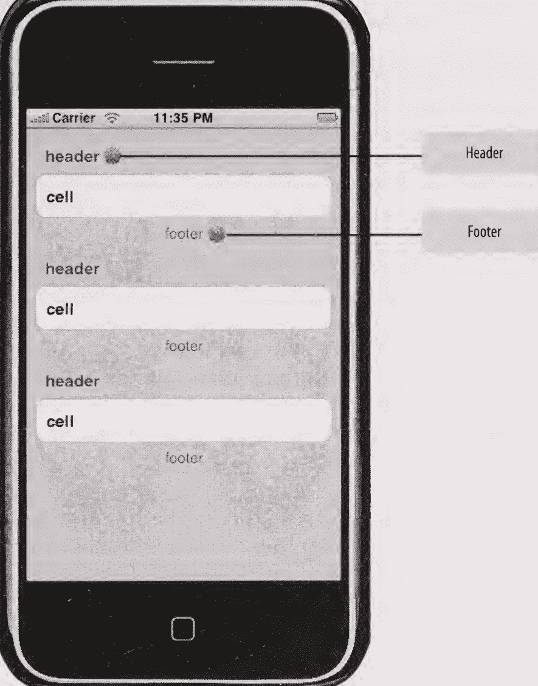

### 理解 UITableViewDataSource 中的行为方法

除了数据源中面向数据的方法外，`UITableViewDataSource` 还有几个方法，其目的是允许您根据特定的编辑条件对数据执行操作。

### 构建 GUI

方法 `tableView:commitEditingStyle:forRowAtIndexPath:`、`tableView:canEditRowAtIndexPath:` 以及 `tableView:didUpdateTextFieldAtIndexPath:withValue:` 用于处理行的编辑和删除，而方法 `tableView:canMoveRowAtIndexPath:` 和 `tableView:moveRowAtIndexPath:` 则用于处理行的重新排序。

在涉及编辑和删除时，重要的是要到 `UITableViewController` 可以处于编辑状态或非编辑状态。这是通过 `setEditing:animated:` 方法控制的，该方法可以通过编程调用，也可以由 `UINavigationController` 的编辑按钮自动调用。我稍后会讨论这一点，但现在请记住，当 `UITableViewController` 通过 `tableView:canEditRowAtIndexPath:` 询问当前可见行是否可编辑时，如果该方法返回 YES，那么 `UITableViewDelegate` 将根据该特定行的合适编辑类型，为其显示相应的编辑控件。一旦编辑完成，`UITableView` 会调用 `tableView:commitEditingStyle:forRowAtIndexPath` 方法，这允许您更新模型，并使用 `insertRowsAtPaths:withAnimation:`、`deleteRowsAtPaths:withRowAnimation:` 等方法更新 `UITableView`。

### 注意事项


默认情况下，所有的表视图都实现了“滑动删除”功能，除非您通过从 `tableView:canEditRowAtIndexPath` 返回 NO 来显式禁用行的编辑。

`UITableView` 默认支持的最后一种编辑类型是重新排序行。同样，`UITableView` 必须处于编辑模式才能启用行的重新排序，但一旦进入该模式，如果方法 `tableView:canMoveRowAtIndexPath` 返回 YES，用户就可以在表格中上下移动行。当用户决定想要将单元格放在哪里并抬起手指时，将调用 `tableView:moveRowAtIndexPath:toIndexPath` 方法，并将原始行的索引和用户想要放置的位置的索引作为参数。如果您想将此行移动到新位置，当用户在表格中上下移动行时，会调用 `tableView:targetIndexPathForMoveRowAtIndexPath:toProposedIndexPath` 方法，您可以选择从此方法返回 NO，以防止用户将行掉到您不希望它们的位置。我将在讨论编辑数据时提到这一点。

### 探索 UITableViewDelegate

`UITableViewDelegate` 用于自定义 `UITableView` 的行为。它控制诸如触碰单元格时如何反应，或者特定单元格是否可以被编辑。`UITableViewDataSource` 拥有多种可以实现的方法，取决于您的需求。大多数方法都是可选的。在这些方法中，您最常用的是管理选择和允许编辑表格行的方法。

### 自定义选择行为

要允许或不允许用户选择 `UITableView` 中的项目，您实现 `tableView:willSelectRowAtIndexPath:` 方法。该方法接收您想要选择的行的 `indexPath`。如果您允许用户选择该行，则返回该索引路径。或者，如果您想将他们的选择重定向到另一行，可以返回一个不同的索引路径，指向您希望他们选择的行。最后，如果您不允许选择，只需返回 nil 即可。

一旦用户做出选择，就会调用 `tableView:didSelectRowAtIndexPath:Path:` 方法。从该方法中，您应该为用户将导航到的新视图分配视图控制器，并将其推送到导航控制器。

### 注意事项

当您完成新视图的创建并将其推送到导航控制器后，您需要使用 `UITableView` 上的 `deselectRowAtIndexPath:animated:` 方法显式取消表格中的选中行。

### 自定义编辑行为

在处理 `UITableView` 中的行编辑时，`UITableViewDelegate` 提供的方法主要处理与删除和重新排序相关的行为。这些方法中最重要的可能是 `tableView:editingStyleForRowAtIndexPath:`，它允许自定义特定单元格的编辑样式。在重写此方法时，预期返回适当的 `UITableViewCellStyle` 值。可能的值列在表 6.2。

| UITableViewCellStyle | 说明 |
| :--- | :--- |
| `UITableViewCellEditingNone` | 不显示控件 |
| `UITableViewCellEditingDelete` | 红色圈内的减号 |
| `UITableViewCellEditingInsert` | 绿色圈内的加号 |

### 注意

我正让你将成员变量 `theData` 改为 `favoriteCities`，因为这更能准确地描述我们正在处理的内容。稍后，你需要更新应用代理（application delegate）来适配这一点。我会教你如何做。

请注意，你正在声明你正在实现 `UITableViewDataSource` 协议，并声明你正在实现的方法。

## 编写 UITableViewDataSource 的实现

跳转到你的 `UITableViewDataSource` 的实现文件，你将通过之前讨论过的每个重要方法，将数据放入你的 `UITableView` 中。

第一个要实现的方法是 `numberOfSectionsInUITableView` 方法，我们实现它是为了返回 1。记住，所有的 `UITableView` 至少有一个节（section）。稍后我将向你如何实现具有多个节的 `UITableView`，但目前你只需要处理一个。列表 6.2 显示了该方法在你应用程序中的实现。

### 列表 6.2

### 返回数量的代码

```objc
- (NSInteger)numberOfSectionsInUITableView:(UITableView *)tableView
{
  return 1;
}
```

对于你程序的这个版本，因为只有一个节，所以你不需要对该节的头部（headers）或页脚（footers）做任何处理。因此，列表中你下一个需要实现的是你的节中的行数，`UITableView:numberOfRowsInSection:`。在这种情况下，你只需要返回数组的计数即可。你甚至不需要一定查看节编号，因为你知道你的 `UITableView` 只有一个节。该方法的实现显示在列表 6.3。

### 列表 6.3

## 实现节中有多少行

```objc
- (NSInteger)tableView:(UITableView *)tableView
numberOfRowsInSection:(NSInteger)section
{
  return [favoriteCities count];
}
```

现在你到了最重要的方法，即那个实际上为你的 `UITableView` 返回单元格（cells）的方法。该方法是 `tableView:cellForRowAtIndexPath:`。要实现它，你获取索引路径（index path）并使用它查找数组中的行。然后你使用它的属性列表创建一个带有适当文本的 `UITableViewCell` 并返回它。该方法的实现显示在列表 6.4。

### 列表 6.4

### 实现 tableView:cellForRowAtIndexPath

```objc
(UITableViewCell *) tableView: (UITableView *)tableView
cellForRowAtIndexPath: (NSIndexPath *)indexPath
{
    static NSString *cellIdentifier = @"Cell";

    UITableView *cell = [tableView dequeueReusableCellWithIdentifier:cellIdentifier];
    if (cell == nil) {
        cell = [[UITableView alloc]
            initWithStyle:UITableViewCellStyleDefault
            reuseIdentifier:cellIdentifier] autorelease];
    }
    NSString *cityName = [city objectForKeyAtIndex:[indexPath row]];
    NSString *favorite = [city objectForKeyForKey:@"FAVORITE"];
    NSString *cellText = [NSString stringFormat:@"%@ Favorite: %@", cityName, favorite];
    [[cell label] setText:cellText];
    return cell;
}
```

该方法中你需要识别的一个重要方面是：你在创建新实例之前，检查是否可以复用（dequeue）适当类型的 `UITableViewCell` 实例。创建新的 `UITableViewCell` 是一个相对昂的过程并占用大量内存，因此建议重用单元格，并在滚动列表时简单地将新数据放入其中。Apple 提供了 `UITableViewCell` 缓存机制（此处为此目的显示），这就是你使用它的方法。

### 构建 GUI

### 注意事项

单元格标识符（cell identifier）可以是任何字符串，只要它对于表格中的每种单元格类型都是唯一的。

对于第一个版本，你只需要在标记为喜爱的城市旁边标上“Favorite”。在接后的版本中，你将进行一些更高级的操作，在它旁边放一个星号。

最后，你需要为你的新数据源实现一个初始化方法，它将接收模型对象，以便在初始化时传递。这将在 `initWithFavoriteCities` 方法中完成；如列表 6.5 所示。

### 列表 6.5

### 数据源的初始化

```objc
- (id) initWithFavoriteCities:(NSArray *)inFavoriteCities {
  if(self = [super init]) {
    [self setFavoriteCities:inFavoriteCities];
  }
  return self;
}
```

### 在 Interface Builder 中配置 UITextView

到此时，你已经实现了足够的数据源，，如果你在 Interface Builder 中创建 `UITableView` 并用它替换你的 `UIView`，你应该能够在表格中实际看到一些数据了。所以，让我们开始操作吧。

要做到这一点，你需要在 Xcode 中双击文件，在 Interface Builder 中打开你的 MyView nib 文件。文件加载后，你点击文档窗口中的视图并按删除键将其删除。然后你再次回到浏览器窗口，找到一个 `UITableView` 实例并将其拖放到文档窗口中。

## 第 6 章：使用 UITableView

### 注意

如果你让你的 `UITableViewController` 也成为你的 `UITableViewDataSource` 或 `UITableViewDelegate`，你可以将 `UITableView` 的输出（outlet）连接到你的视图。

完成所有这些操作后，你就可以编译并运行应用程序，然后看到列表中显示的数据。它看起来类似于图 6.3。

所以这太棒了；你可以看到城市列表并上下滚动列表。但你需要能够设置你的喜好。这正是你接下来要做的。

图 6.3

应用程序，显示了列表中的城市

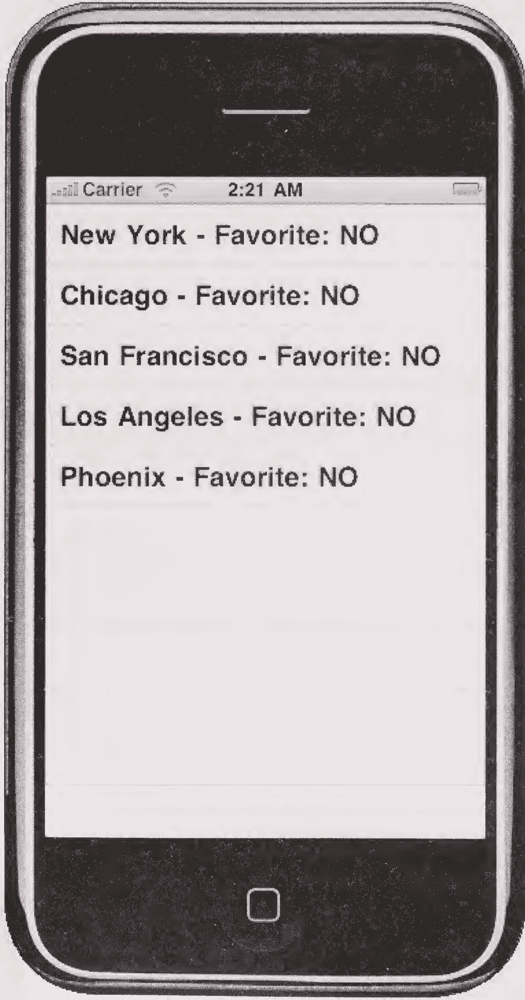

### 当行被触摸时采取操作

请记住，`UITableViewDelegate` 为你提供了允许自定义 `UITableViewCell` 行为的函数。因此，为了增加用户点击并切换任何元素收藏状态的能力，你需要为此表添加并实现你的 `UITableViewDelegate`。

要添加 `UITableViewDelegate`，再次右键点击类组并选择“Add New File”（新建文件）。创建一个 `NSObject` 子类并将其命名为 `MyDelegate`。在你的头文件中，指定它实现了 `UITableViewDelegate` 协议，如列表 6.10 所示。

+ 6.10

UITableViewDelegate 

```objc
#import <Foundation.h>
@interface MyDelegate : NSObject <UITableViewDelegate>
{
MutableArray *favoriteCities;
@property (nonatomic, retain) NSMutableArray * favoriteCities;
-(id)initWithFavoriteCities:(NSMutableArray*)favoriteCities;
(NSIndexPath*)tableView:(UITableView *)tableView
willSelectRowAtIndexPath:(NSIndexPath*)indexPath;
-(void)tableView:(UITableView *)tableView
didSelectRowAtIndexPath:(NSIndexPath*)indexPath;
end
@end
```

> 如往常一样，请确保在实现中为 `favoriteCities` 声明你的 `@synthesize`。

同样，和数据源一样，你将持有对模型的引用，因此自然地，这需要传递给初始化方法。它的实现方式与你在列表 6.5 中为数据源所做的完全一样，所以我不再重复显示它。我稍后会讨论你代理方法的具体实现，但现在让我们回到你的 `UIViewController` 的 `viewDidLoad` 方法，创建你的代理的实例，并将其设置为 `UITableView` 的代理。这在列表 6.11 中所示。你需要添加一个实例变量来持有代理，就像你为数据源所做的那样。如果你迷路了，这部分留给读者作为练习，你可以查看本章节的示例代码，或者回顾上一节并模仿你对数据源所做的操作。

# 76 构建 GUI

列表 6.11

### 更新后的 viewDidLoad 方法

```objc
- (void) viewDidLoad {
    [[navigationItem] setBarButtonItem:[self editButtonItem:nil]];
    [self setDataSource:[MyViewDataSource alloc] initWithWithFavoriteCities:favoriteCities];
    [self setDelegate:[MyDelegate alloc] initWithWithFavoriteCities:favoriteCities];
    [[super tableView] setDataSource:dataSource];
    [[super tableView] setDelegate:delegate];
    [super viewDidLoad];
}
```

### 注意

再次记住，为了实例化你的代理，你必须在 `MyViewController` 的实现中导入它的头文件。

一旦完成这些，你将回到你的代理类并开始实现你感兴趣的方法。

### 允许用户选择行

回想一下 `UITableViewDelegate` 提供了 `tableView:willSelectRowAtIndexPath:` 方法，以便用户选择表格中的某行时采取操作。具体来说，当用户在确认选择之前触摸了该行时，此方法会被调用。你在这里做的本质上是告诉 `UITableView`，用户选择这一行是允许的。在目前的应用程序中，你将让传递给你的 `indexPath` 处理所有行。因此你在这里只需要简单地返回该 `indexPath` 即可。例如，该方法的实现非常简单，如列表 6.12 所示。

列表 6.12

### willSelectRowAtIndexPath 的实现

```objc
- (NSIndexPath *) tableView:(UITableView *)tableView
willSelectRowAtIndexPath:(NSIndexPath *)indexPath {
    return indexPath;
}
```

### 当行被触摸时更新模型

实际上执行行选择重量工作的方法是 `didSelectRowAtAtIndexPath:` 方法。你实际上是通过此方法根据选择采取必要的操作。此方法在 `tableView:willSelectRowAtAtIndexPath:` 方法被调用并返回你想要用户选择的 `indexPath` 之后被调用。在你的案例中，你将使用此方法切换所选城市“收藏”状态的值。然后你将告诉视图重新加载数据，以便在 UI 上显示更新后的状态。该方法的实现在列表 6.13 所示。

### 列表 6.13

didSelectRowAtAtIndexPath 允许你更新收藏

```objc
(void) tableView:(UITableView*)tableView
didSelectRowAtAtIndexPath:(NSIndexPath*)indexPath {
  MutableDictionary *cityData = 
    [cityData objectForKey:@"cityDataIndex" objectAtIndex:(integer)indexPath.row] mutableCopy];
  if ([cityData objectForKey:@"FAVORITE"] isEqualToString:@"NO"])
    [cityData setObject:@"YES" key:@"FAVORITE"];
  else
    [cityData setObject:@"NO" key:@"FAVORITE"];

  [tableView reloadData];
  [tableView deselectRowAtAtIndexPath:indexPath animated:YES];
}
```

### 注意

此方法的最后一行显式地取消了选中行的选择。这在实现此方法时总是必要的。如果你不取消选中行，该行在 `UITableView` 中仍将选中状态。曾有应用程序因此错误向 Apple 反馈。

### 运行应用程序并选择收藏

如果你都做得正确，并且正确连接了一切，那么此时你就可以运行应用程序并显示你的城市列表。你还可以滚动列表并选择项目作为收藏。恭喜！你已经实现了 `UITableView` 的基础功能。

### 配置 UITableView 为分组模式

在这个特定的应用程序中，一个有趣的功能可能是按州对城市分组。这为你提供了一个制作分组表格视图的方便示例。

要实现分组表格视图，你需要做的第一件事是在 Interface Builder 中打开表格视图 nib（可以在 Xcode 的 Resources 组中找到，名称应该是 "UITableView.xib"）并选择表格视图。在属性窗口中，选择第一个标签卡（Attributes），找到 Style（样式）设置。点击此列表并选择 Grouped（分组）而不是 Plain（普通）。


如果你重命名了 nib 并再次运行应用程序，你会发现你有了一个分组列表。这令人兴奋，但目前实际上只有一个组。为了实现多个分组，你需要修改模型，然后修改数据源。让我们开始吧。

# 将州添加到模型中

为了保持简单起见，你将修改你的模型，使得顶层字典实际上对应每个州。每个州字典将拥有一个包含该州城市的数组。城市字典将与之前完全相同，包含城市名称以及是否为收藏。州字典将包含州名和城市数组。

你 `makeModel()` 方法的新实现如列表 6.14 所示。它有些重复，但读起来很直观。

## 列表 6.14

### 更新后的 makeModel 方法

```objc
- (NSMutableArray *)makeModel {
  NSMutableDictionary *state;
  NSMutableDictionary *city;
  NSMutableArray *cities;
  NSMutableArray *ret = [NSMutableArray array];
  // 纽约
  state = [NSMutableDictionary dictionary];
  [state setObject:@"New York" forKey:@"NAME"];
  city = [NSMutableDictionary dictionary];
  [city setObject:@"New York" forKey:@"NAME"];
  [city setObject:@"No" forKey:@"FAVORITE"];
  cities = [NSMutableArray arrayWithObjects:city];
  [state setObject:cities forKey:@"CITIES"];
  [ret addObject:state];

  // 加芝哥
  state = [NSMutableDictionary dictionary];
  [state setObject:@"Illinois" forKey:@"NAME"];
```

## 第 6 章：使用 UITableView

```objc
// San Francisco and Los Angeles
state = [NSMutableDictionary dictionary];
[state setObject:@"California" forKey:@"NAME"];
city = [NSMutableDictionary dictionary];
[city setObject:@"San Francisco" forKey:@"NAME"];
[city setObject:@"NO" forKey:@"FAVORITE"];
cities = [NSMutableArray arrayWithObject:city];
```

```objc
city = [NSMutableDictionary dictionary];
[city setObject:@"Los Angeles" forKey:@"NAME"];
[city setObject:@"NO" forKey:@"FAVORITE"];
[cities addObject:city];
[state setObject:cities forKey:@"CITIES"];
[ret addObject:state];
```

```objc
// Phoenix
state = [NSMutableDictionary dictionary];
[state setObject:@"Arizona" forKey:@"NAME"];
city = [NSMutableDictionary dictionary];
[city setObject:@"Phoenix" forKey:@"NAME"];
[city setObject:@"NO" forKey:@"FAVORITE"];
cities = [NSMutableArray arrayWithObject:city];
[state setObject:cities forKey:@"CITIES"];
[ret addObject:state];
```

```objc
return ret;
```

### 更新你的 UITableViewDataSource

现在你已经更改了模型以支持额外数据，你需要更改数据源和代理，这样你就不再直接从数组的顶层访问城市，而是先深入状态，然后从那里访问城市。

### 从模型中获取组名称

回想一下当 `UITableView` 需要访问模型中的数据时，调用的第一个方法是 `numberOfSectionsInTableView:`。现在你希望在表格视图中包含多个节，你需要更改此方法，使其返回模型中州的数量。要做到这一点，你不再返回 1，而是返回模型中顶层数组的计数。这在列表 6.15 中所示。

## 列表 6.15

### 更新后的 numberOfSectionsInTableView 方法

```objc
- (NSInteger)numberOfSectionsInTableView:(UITableView *)tableView
{
    return [favoriteCities count];
}
```

接下来，你必须实现一个之前不需要的新方法：`tableView:titleForHeaderInSection:` 方法。该方法返回你希望显示在每个节顶部的标题；在你的情况下，你希望显示的是州名。其实现方式在列表 6.16 中所示。

## 列表 6.16

### 为每个头部获取标题

```objc
- (NSString *)tableView:(UITableView *)tableView
titleForHeaderInSection:(NSInteger)section
{
    NSDictionary *state = [favoriteCities objectAtIndex:section];
    return [state objectForKey:@"NAME"];
}
```

> 在单元格中显示正确的值

你接下来需要做的是更新 `tableView:cellForRowAtIndexPath:` 方法，以反映你现在需要先查看路径中的节，然后是行，以便访问模型中的相应项目。该方法的实现实现在列表 6.17 中所示。

## 列表 6.17

### 用于检索数据单元格的更新代码

```objc
- (UITableViewCell *)tableView:(UITableView *)tableView cellForRowAtIndexPath:(NSIndexPath *)indexPath
{
    static NSString *cellIdentifier = @"Cell";

    UITableViewCell *cell = [tableView dequeueReusableCellWithIdentifier:cellIdentifier];

    if (cell == nil)
    {
        cell = [[[UITableViewCell alloc]
            initWithStyle:UITableViewCellStyleDefault
            reuseIdentifier:cellIdentifier] autorelease];
    }
    NSDictionary *state = [favoriteCities objectAtIndex:indexPath.section];
    NSArray *cities = [state objectForKey:@"cities"];
    NSDictionary *city = [cities objectAtIndex:indexPath.row];

    NSString *cityName = [city objectForKey:@"NAME"];
    NSString *favorite = [city objectForKey:@"FAVORITE"];
    NSString *cellText = [
        [NSString stringWithFormat:@"%@ Favorite: %@", cityName, favorite]];
    [[cell textLabel] setText:cellText];
    return cell;
}
```

更新代理

最后，你需要更新代理，这样当你触摸一个城市时，你就会更新模型中的元素。该功能的新实现方式在列表 6.18 中所示。

## 列表 6.18

### 更新后的 didSelectRowAtIndexPath 方法

```objc
- (void)tableView:(UITableView *)tableView
didSelectRowAtIndexPath:(NSIndexPath *)indexPath
{
    NSDictionary *state = [favoriteCities objectAtIndex:indexPath.section];
    NSArray *cities = [state objectForKey:@"cities"];
    NSMutableDictionary *cityData = [cities objectAtIndex:indexPath.row];
    if ([[cityData objectForKey:@"FAVORITE"] isEqualToString:@"NO"]) {
        [cityData setObject:@"YES" forKey:@"FAVORITE"];
    } else {
        [cityData setObject:@"NO" forKey:@"FAVORITE"];
    }

    [tableView reloadData];
    [tableView deselectRowAtIndexPath:indexPath animated:YES];
}
```

一旦完成了这一切，你新版本的应用程序应该按州列出城市，如图 6.4 所示。

## 图 6.4

带有分组表格视图的完成版应用

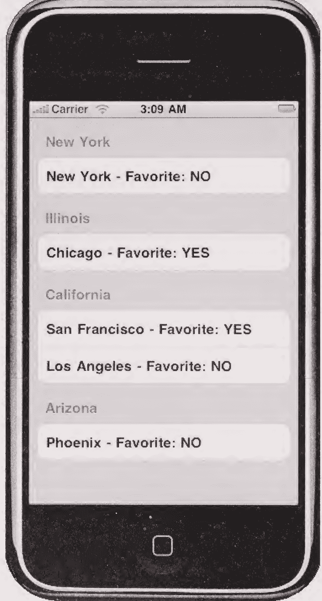

### 进行高级 UITableView 配置

`UITableView` 的最大程度自定义通常通过自定义其内部使用的 `UITableViewCell` 来完成。你将在下一章中学习如何这样做，但首先，我想看看列表上一些可以自定义的内容。具体来说，我将向你展示如何在表格的侧边添加一个字母列表。这对于管理大量数据非常方便，因为它让你有机会直接跳转到表格视图的特定节，而无需滚动整个列表。其次，你将在表格视图顶部添加一个搜索框，以便用户可以搜索特定元素。

### 在侧边添加字母列表

在 `UITableView` 侧边添加字母索引列表非常简单。你可能在通讯录等地方见过这些索引列表。

实现这一点，你只需要实现 `UITableViewDataSource` 方法 `sectionIndexTitlesForTableView:`；返回一个字符串数组，该数组将用作每个节的头部标签。这些标签也将作为表格视图侧边的字母列表。例如，你可以返回一个从 A 到 Z 的数组。在这种情况下，你可以返回每个州的第一个字母，如列表 6.19 所示。

## 列表 6.19

```objc
- (NSArray *)sectionIndexTitlesForTableView:(UITableView *)tableView
{
  NSMutableArray *names = [NSMutableArray array];
  for (NSDictionary *state in favoriteCities)
  {
    NSString *stateName = [state objectForKey:@"NAME"];
    NSString *letter = [stateName substringToIndex:1];
    [names addObject:letter];
  }
  return names;
}
```

> 注意

不要将此内容添加到你的示例中，当你实现侧滑删除支持时，删除按钮有时会与索引列表产生冲突。所以暂时从你的示例中删掉它。我只是想向你展示如何实现。

### 添加搜索

为 `UITableView` 添加搜索功能稍微复杂一些，但并不困难。本质上，你需要做的是在 nib 文件中添加一个 `UISearchBar`，并使用 `UITableView` 的 `tableHeaderView` 将其赋值为头部的自定义视图。这个由 `UITableView` 显示的特殊视图会在当你滚动到顶部时出现在最顶端。然后，将你的数据源配置为 `UISearchBarDelegate`。当你从搜索栏接收到事件时，相应地过滤你的数据模型。你需要实现的搜索栏代理方法是 `searchBar:textDidChange:` 方法，它会在用户编辑文本时被调用。

Apple 标准库在搜索开始时也会在列表视图上覆盖一个图层，以防止用户在搜索激活时触摸列表。你可以通过在 nib 中添加一个覆盖层并将其显示在 `UITableView` 之上来轻松实现。在搜索栏代理中实现此功能的方法是 `searchBarTextDidBeginEditing:`。

如果你选择，可以在用户实际开始输入搜索字符串时隐藏此覆盖视图，以便他从过滤后的列表中选择项目。此外，你可能还会

### 总结

在本章中，你深入研究了 `UITableView` 类及其姊妹类 `UITableViewDataSource` 和 `UITableViewDelegate`。使用这些类，你可以高效、方便地在应用程序中显示数据列表。在接下来的几章中，你将看到如何使用 `UITableViewCell` 对 `UITableView` 进行进一步的自定义，然后你将看到如何结合 `UINavigationController` 使用 `UITableView` 来显示和导航大型层次级数据树。然而，本章已经为你在应用程序中使用 `UITableView` 奠定了坚实的基础。

# 使用 UITableViewCells

在上一章中，你已经查看了如何在应用程序中添加 `UITableView` 来显示数据列表。你之前使用 `UITableView` 的方式非常基础。在自定义外观或类似功能方面，你没有进行任何复杂的操作。当然，你可以为 `UITableView` 添加一些自定义内容，特别是组成表格视图中单独行的单元格。此外，也可以对 `UITableView` 本身进行自定义。大部分自定义都适用于表格行单元格的外观和行为。你可以通过自定义在显示数据时从 `UITableViewDataSource` 返回的 `UITableViewCell` 对象来实现这一点。这是自定义 `UITableView` 的一种非常强大的方法，也将是本章的重点。

你将通过观察组成 `UITableViewCell` 的部分以及如何使用这些部分来创建自定义外观，开始探索 `UITableViewCell` 类。然后，你将看到如何使用继承来创建一个自定义的 `UITableViewCell`，从而让你能够实现几乎你想做的一切。

### 理解 UITableViewCell 的组成

在开始自定义 `UITableViewCell` 之前，你需要先对整体布局有所了解。也就是说，你需要知道典型的 `UITableViewCell` 由哪些部分组成、它们是如何运行的以及它们位于单元格的什么位置。图 7.1 概述了 `UITableViewCell` 子视图的典型布局。

### 本章内容

- 自定义 `UITableView` 的外观
- 探索布局 `UITableViewCells` 的选项
- 使用单元格重用标识符优化性能
- 探索 `UITableViewCell` 继承

## 图 7.1

UITableViewCell 的组成部分


## 图 7.2

UITableViewCell 的组成部分

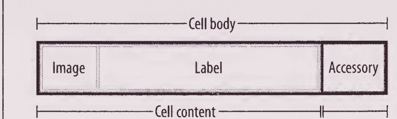

如图 7.1 所示，`UITableViewCell` 内部有两个主要的子视图。右侧是辅助视图。如果你配置单元格具有辅助视图，则该辅助视图将显示一个按钮。通常，这可能是一个指示器，用于显示有更多数据待显示。当表格视图进入编辑模式时，此辅助视图将用于显示重排序控件，或者在行被选中删除并等待确认时显示删除按钮。

左侧占据单元格其余部分的视图是内容视图。这是你放置单元格内容的地方，也是你应该进行大部分自定义的地方。

> 注意

内容视图在需要时会自动调整大小以为辅助视图留出空间。在自定义时，你应该考虑到这一点，这意味着你也应该调整你创建的任何自定义子视图的大小。

当你构造一个 `UITableViewCell` 时，你可以向构造函数传递一个 `style` 参数。该 `style` 参数的可能值如表 7.1 所示。内容视图包含的子视图类型取决于你请求的单元格类型。

### 表 7.1 单元格样式

| 值 | 描述 |
|---|---|
| `UITableViewCellStyleDefault` | 一个简单的单元格，仅包含单个文本字段和左侧的一个图像。在 iPhone OS 3.2 中，这是唯一的样式。 |
| `UITableViewCellStyleValue1` | 这种样式的单元格在左侧有一个带有普通黑色文本的标签，在右侧有一个带有较小蓝色文本的标签。这类似于设置应用程序中使用的单元格类型。 |
| `UITableViewCellStyleValue2` | 这种样式的单元格在左侧包含蓝色文本，右侧包含黑色文本。右侧较小。这类似于联系人应用程序的工作方式。 |
| `UITableViewCellStyleSubtitle` | 这种样式的单元格在顶部有一个标签，下方是另一个较小灰色文本的标签。 |

### 注意


> 选择不同样式 `UITableViewCell` 的功能是 iPhone OS 3 引入的新功能。在此版本发布之前，仅支持默认单元格样式。

表 7.1 所示的单元格中显示的每个子视图都可以被完全自定义，以更改各种参数，包括它们的背景颜色、文本颜色和字体。这在不进行任何继承的情况下，就为你提供了相当数量的可配置性。

除了简单地更改已属于 `UITableViewCell` 的现有视图的属性外，你还可以直接向内容视图添加你自己的自定义子视图。当你想想要为 `UITableViewCell` 添加诸如进度条等功能时，这非常有用。要实现这一点，你只需创建额外的自定义视图，并将其作为子视图添加到内容视图中。

### 警告（CAUTION）

> 在添加自定义子视图时，请务必小心你构造子视图的位置。你不希望为每个单元格都重新创建子视图。尝试尽可能复用你的子视图。对象创建对 iPhone 性能的影响可能出乎想象。

正如你在表 7.1 中注意到的，在默认的 `UITableViewCell` 中有一个可选的 `UIImageView`。这是通过设置 `UITableViewCell` 的 `image` 属性启用的。在下一节中，你将使用这个 `UIImageView` 在你喜欢的城市旁边设置星星星。

## 向 UITableViewCell 中添加图像

到目前为止，在你的城市应用程序中，为了指示收藏城市，你在城市名称旁边添加了“favorite”一词。如果不是这样，而是为每行添加一个显示星号的图形元素，那就太棒了。当你标记一个城市为收藏城市时，也许星号会填充颜色。当一个城市不是收藏城市时，星号可以是一个轮廓。让我们来看看如何实现这一点。

### 交叉引用（CROSS-REF）

本示例中使用的图像可以在书籍网站上找到。为了在项目中使用这些图像，请确保将它们添加到 Xcode 项目中。放在 Resources 组下是比较合适的。

在上一节中，当你查看 `UITableViewCell` 的默认样式时，有一个可选的 `UIImageView`，如果设置了图像属性，它就会显示在单元格左侧。你将使用它来显示星号。清单 7.1 显示了你之前对 `tableView:cellForRow:` 方法实现。

### 清单 7.1

方法 `tableView:cellForRow:`

```
(UITableView *)tableView:(UITableView *)tableView
    cellForRowAtIndexPath:(NSIndexPath *)indexPath
{
    static NSString *CellIdentifier = @"Cell";

    UITableView *cell = [tableView
        ReusableCellWithIdentifier:CellIdentifier];
    if (cell == nil) {
        cell = [[UITableView alloc]
            initWithStyle:UITableViewCellStyleDefault
            reuseIdentifier:CellIdentifier] autorelease];
    }

    Dictionary *state = [favoriteCities objectForKey:[indexPath section]];
    NSArray *cities = [state objectForKeyKey:@"cities"];
    Dictionary *city = [cities objectForKeyAt:[indexPath row]];

    NSString *cityName = [city objectForKey:@"NAME"];
    NSString *favorite = [city objectForKey:@"FAVORITE"];
    NSString *cellText = [NSString stringWithFormat:%@ - Favorite: %@", cityName, favorite];
    [cell textLabel] setText:cellText];
    return cell;
}
```

在你的新版本中，你只需更改单元格的 `image` 属性以只显示城市名称，然后根据该城市是否被选为收藏来显示相应的图像。清单 7.2 显示了如何这样做。

### 注意（NOTE）

> `[UIImage imageNamed:]` 方法会自动缓存它加载的图像，因此后续对它的调用不需要访问磁盘，如果图像之前加载过，则将从内存中返回图像。正因如此，在像这样对性能非常敏感的代码区域中使用它是可以接受的。

## 第 7 章：使用 UITableViewCells

### 清单 7.2

方法 `tableView:cellForRowAtIndexPath` 实现

```objc
- (UITableView *)tableView:(UITableView *)tableView
    cellForRowAtIndexPath:(NSIndexPath *)indexPath
{
    static NSString *CellIdentifier = @"Cell";

    UITableView *cell = [tableView
        dequeueReusableCellWithIdentifier:CellIdentifier];
    if (cell == nil) {
        cell = [[UITableViewCell alloc]
            initWithStyle:UITableViewCellStyleDefault
            reIdentifier:CellIdentifier] autorelease];
    }
    NSDictionary *state = [favorites objectAtIndex:[indexPath section]];
    NSArray *cities = [state objectForKey:@"CITIES"];
    NSDictionary *city = [cities objectAtIndex:[indexPath row]];

    NSString *cityName = [city objectForKey:@"NAME"];
    [[cell textLabel] setText:cityName];
    if ([[city objectForKey:@"FAVORITE"] isEqualToToString:@"YES"]) {
        [cell setImage:[UIImage imageNamed:@"FullStar.png"]];
    } else {
        [cell setImage:[UIImage imageNamed:@"EmptyStar.png"]];
    }
    return cell;
}
```

> 注意
>
> iPhone 3 在默认的 `UITableViewCell` 实现中添加了几个新视图，允许比 OS 2.x 无法实现的更多配置。特别是，`backgroundView`、`selectedBackgroundView`、`textColor`、`selectedTextColor`、`selectedImage` 和 `detailTextLabel` 属性为你提供了很多可能性。

一旦你将代码更新到这个新版本，你应该能够运行应用程序，并在你的收藏项目旁边显示实星，在未收藏的项目旁边显示空星，如图 7.2 所示。

图 7.2

城市列表旁带有星号的已完成的收藏城市应用。

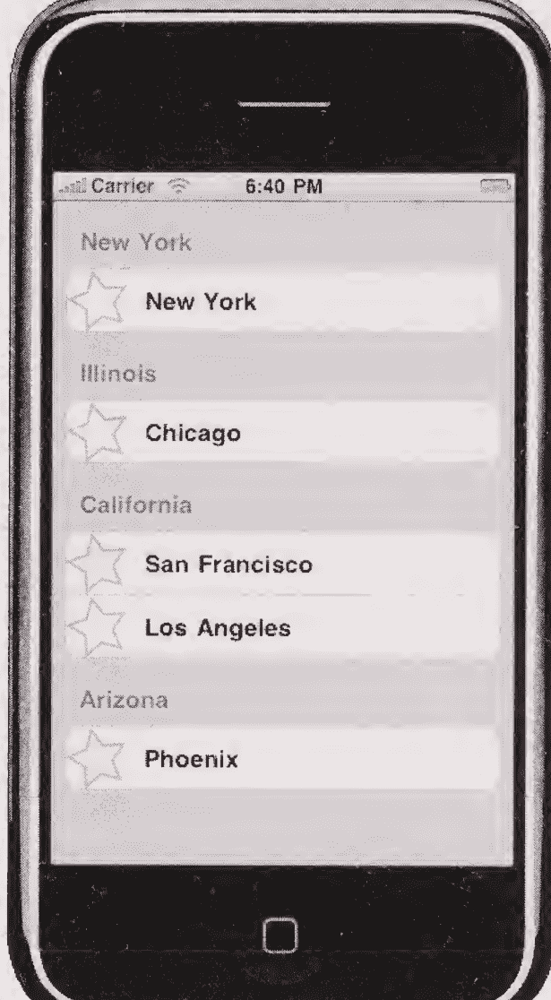

### 对 UITableViewCell 进行更深层次的自定义

你已经看到如何使用 `UITableViewCell` 部分的现有视图以及添加自己的视图来对 `UITableViewCell` 进行一些基础自定义。但如果你想更进一步呢？如果你想引入完全新的行为，例如当你想让单元格在被触摸时表现得与正常不同时，这时你就进入了使用继承来自定义 `UITableViewCell` 的领域。

## 第 7 章：使用 UITableView

要创建一个继承自 `UITableViewCell` 的自定义单元格，只需创建一个新类并将其声明为 `UITableViewCell` 的子类，如清单 7.3 所示。

### 清单 7.3

`CustomTableViewCell` 接口定义

```objc
#import <UIKit/UIKit.h>

@interface CustomTableViewCell : UITableViewCell
(
    UILabel *customLabelOne;
    UILabel *customLabelTwo;
    UIImageView *customImage;
)
@property (nonatomic, retain) UILabel *customLabelOne;
@property (nonatomic, retain) UILabel *customLabelTwo;
@property (nonatomic, retain) UIImageView *customImage;
@end
```

继承 `UITableViewCell` 时需要记住的一个重要点是，虽然你可以在指定的初始化器中构造子视图——对于 `UITableViewCell` 类来说，是 `initWithStyle:reuseIdentifier`——但当你这样做时，可能应该将 `CGRectZero` 作为视图的 frame（框架）。这将用一个空框架初始化你的视图。随后，你应该在 `layoutSubviews` 方法中调整视图的 frame。这允许你将 content view 作为依据来调整你视图的依据。这样做可以确保在显示辅助视图时，你的子视图的大小是正确的。

清单 7.4 展示了一个自定义 `UITableViewCell` 的典型实现，包含其指定的初始化器和 `layoutSubviews` 方法。在这个示例中，你正在创建一个带有彩色背景以及其中一些额外图形和文本的自定义单元格。

### 清单 7.4

`CustomTableViewCell` 实现

```objc
#import "CustomTableViewCell.h"
@implementation CustomTableViewCell
@synthesize customLabelOne;
@synthesize customLabelTwo;
@synthesize customImage;
- (id)initWithFrame:(CGRect)frame
reuseIdentifier:(NSString *)reuseIdentifier
```

### 清单 7.4（续）

```objc
if (self = [super initWithFrame:frame reuseIdentifier:reuseIdentifier])
{
    customLabelOne = [[ILabel alloc] initWithFrame:CGRect];
    [customLabelOne setBackgroundColor:[UIColor lightGrayColor]];
    [customLabelOne setFont:[UIFont boldSystemFontOfSize:FontSize]];
    [customLabelOne setLineBreakMode:UILineBreakModeWordWrap];
    [customLabelOne setTextAlignment:UITextAlignmentLeft];
    [self contentView addSubview:customLabelOne];

    customLabelTwo = [[ILabel alloc] initWithFrame:CGRect];
    [customLabelTwo setBackgroundColor:[UIColor lightGrayColor]];
    [customLabelTwo setFont:[UIFont boldFontOfSize:8]];
    [customLabelTwo setLineBreakMode:UILineBreakModeWordWrap];
    [customLabelTwo setTextAlignment:UITextAlignmentLeft];
    [self contentView addSubview:customLabelTwo];

    customImage = [[UIImageView alloc] initWithImage:];
    [customImage setImageNamed:@"Image.png"];
    [customImage setBackgroundColor:[UIColor lightGrayColor]];
    [self contentView addSubview:customImage];

    [self contentView setBackgroundColor:[UIColor lightGrayColor]];

    return self;
}
- (void)dealloc
{
    [self setCustomLabelOne:nil];
    [self setCustomLabelTwo:nil];
    [self setCustomImage:nil];
    [super dealloc];
}
- (void)layoutSubviews
{
    [customLabelOne setFrame:CGRectMake(0, 0, [[self contentView] bounds].width, 40)];
    [customLabelTwo setFrame:CGRectMake(0, 40, [[self contentView] bounds].width, 40)];
    [customImage setFrame:CGRectMake(0, 80, [[self contentView] bounds].width, 80)];
}
- (void)setSelected:(BOOL)selected animated:(BOOL)animated
{
    [super setSelected:selected animated:animated];
    if (selected) {
        [self contentView setBackgroundColor:[UIColor grayColor]];
    }
}
@end
```

## 第 7 章：使用 UITableView

一旦你将代码更新到这个新版本，你应该能够运行应用程序，并在你的收藏项目旁边显示实星，在未收藏的项目旁边显示空星，如图 7.2 所示。

### 清单 7.5

Updated `tableView:cellForRowAtIndexPath` 实现

```objc
- (UITableView *)tableView:(UITableView *)tableView
    cellForRowAtIndexPath:(NSIndexPath *)indexPath
{
    static NSString *CellIdentifier = @"Cell";

    UITableView *cell = [tableView
        dequeueReusableCellWithIdentifier:CellIdentifier];
    if (cell == nil) {
        cell = [[UITableViewCell alloc]
            initWithStyle:UITableViewCellStyleDefault
            reIdentifier:CellIdentifier] autorelease];
    }
    NSDictionary *state = [favorites objectAtIndex:[indexPath section]];
    NSArray *cities = [state objectForKey:@"CITIES"];
    NSDictionary *city = [cities objectAtIndex:[indexPath row]];

    NSString *cityName = [city objectForKey:@"NAME"];
    [[cell textLabel] setText:cityName];
    if ([[city objectForKey:@"FAVORITE"] isEqualToToString:@"YES"]) {
        [cell setImage:[UIImage imageNamed:@"FullStar.png"]];
    } else {
        [cell setImage:[UIImage imageNamed:@"EmptyStar.png"]];
    }
    return cell;
}
```

你已经看到如何使用 `UITableViewCell` 部分的现有视图以及添加自己的视图来对 `UITableViewCell` 进行一些基础自定义。但如果你想更进一步呢？如果你想引入完全新的行为，例如当你想让单元格在被触摸时表现得与正常不同时，这时你就进入了使用继承来自定义 `UITableViewCell` 的领域。

### 清单 7.6

方法 `setSelected:animated:` 实现


```objc
(void)setSelected:(BOOL)selected animated:(BOOL)animated
{
    [super setSelected:selected animated:animated];
    if (selected) {
        [self contentView setBackgroundColor:[UIColor grayColor]];
    }
}
```

在某些情况下，可能需要让单元格在被选中时外观发生变化。为了实现这一点，只需重写该方法即可。在列表 7.6 中，你将把背景颜色设置为一种不同的颜色。

## 第 7 章：使用 UITableViewCells

```objc
static NSString *CellIdentifier = @"Cell";

UITableViewCell *cell = [tableView
  dequeueCellWithIdentifier:CellIdentifier];
UILabel *customLabel;
if (cell == nil) {
  cell = [[UITableViewCell alloc]
    initWithStyle:UITableViewCellStyleDefault
    reuseIdentifier:CellIdentifier] autorelease];
  customLabel = 
    [[UILabel alloc]
    initWithFrame:CGRect(0, 0, 50, 50)];
  [customLabel setTag:1];
  [[cell contentView] addSubview:customLabel];
} else {
  customLabel = ([UIView *)[cell contentView] viewWithTag:1];
  [customLabel setText:@""];
}
[customLabel setText:@"new value"];

return cell;
```

> **注意**
>
> 此代码利用了 Tag 功能，允许你通过 tag 从另一个视图的层级中检索视图。这是从复杂的视图配置中获取视图极极方法。

第二个概念是效率，这意味着每当你进行任何形式的绘图时，都应该努力以最高效的方式进行。例如，如果你有一个实现了自定义 `drawRect` 方法的自定义视图，你应该利用手头所有的工具来确保你只绘制该视图中绝对需要的部分。在视图部分被其他东西覆盖的情况下，这可能意味着你不需要重绘整个视图；你可能只需要绘制视图实际上暴露的部分。利用这些工具在你的绘图操作中尽可能保持保守和高效。

最后是不透明度概念。iPhone 上的 Alpha 透明虽然有用，但开销也很大。在某些情况下，这本质上是一种免费的性能提升。例如，如果你有一段白色背景的文本，覆盖在另一个也是白色的视图之上，没有必要将背景设置为透明。相反，应将背景设置为不透明，并将其设置为与后面视图相同的颜色。用户永远感知不到区别，iPhone 的 GPU 能够快地绘制该单元。如果你想象一个包含许多子视图且带有大量透明度的复杂单元，绘制这些单元的成本可能会变得非常高。你可以使用 `opaque` 属性将你的自定义视图设置为不透明。

### 重用 UITableViewCellCells

我在上一章中提到过但没有进行详细说明的重要概念之一就是 `UITableViewCell` 的重用概念。

我在这里说一遍，稍后还会强调：在 iPhone 上进行内存分配是昂贵的。特别是在滚动表格视图时紧凑循环中的对象分配。此外，当你的表格视图中包含大量元素时，如果你为整个数据集中的每个元素分配一个单元格，你的内存占用将急剧并迅速膨胀。这就是为什么 Apple 引入了单元格重用的思想。

单元格重用的原理相对简单。本质上，当一个 `UITableView` 中的单元格滑出屏幕时，它会被放入队列中。当你需要另一个单元格显示在屏幕上时，你可以向队列请求一个单元格。如果有，同一个单元格在滑出屏幕时就被放入了队列。这意味着你只需要分配足够显示屏幕上当前内容的单元格。你不需要为数据集中中的所有元素都让未显示的单元格占用内存。

这是一个强大的概念，而且最重要的是它在你的应用程序中非常易用。事实上，我目前为止向你展示的所有示例已经利用了这一功能。你可以在列表 7.8 中看到，在那里你首先尝试从队列中取出单元格。如果你没有得到，就分配一个；但如果你得到了，只需重用你得到的那个即可。

+ 列表 7.8：单元格重用

```objc
(UITableView *)tableView:(UITableView *)tableView cellForRowAtIndexPath:(NSIndexPath *)indexPath
{
    static NSString *CellIdentifier = @"CellIdentifier";

    UITableViewCell *cell = 
        [tableView dequeueReusableCellWithIdentifier:CellIdentifier];
    if (cell == nil)
{
        cell = [[UITableViewCell alloc]
            initWithStyle:UITableViewCellDefault
            reuseIdentifier:CellIdentifier] autorelease];
        // ... (逻辑继续)
```

```objc
NSDictionary *state =
    [favoriteCities objectAtIndex:indexPathPath section];
NSArray *cities = [state objectForKey:@CITIES];
NSDictionary *city = [cities objectAtIndex:indexPathPath row];

NSString *cityName = [city objectForKey:@NAME];    [cell textLabel] setText:cityName;

if([[cell objectForKey:@FAVORITE] isEqualToString:@"YES"]) {
    [cell setImage:[UIImageViewNamed:@FullStar.png]];
}
else
{
    [cell setImage:[UIImageViewNamed:@EmptyStar.png]];
}

return cell;
```

> **注意**
>
> 当获取该单元格并尝试重用它时，它可能仍然包含之前使用的数据。因此，在设置你的值之前，你应该清除任何不再使用的标签。

### 理解标识符 (Identifier)

要在表格视图中使用多种类型的单元格，只需遵循你分配一种类型单元格时使用的相同模式，但对于你想使用不同类型单元格的行，你可以分配新的单元格。你仍然应该使用 `dequeueReusableCellWithIdentifier:` 方法来检查是否有可以重用的正确类型的单元格。但如果没有，只需使用相应的 `reuseIdentifier` 分配一个，并返回它。

列表 7.9：使用不同类型的单元格

```objc
(UITableView *)tableView:(UITableView *)tableView cellForRowAtIndexPath:(NSIndexPath *)indexPath
{
    UITableViewCell *cell = nil;
    if ([(indexPath section] == 0)
    {
        static NSString *CellIdentifier = @"CellOne";
        UITableViewCell *cell = [tableView dequeueReusableCellWithIdentifier:CellIdentifier];
        if (cell == nil)
        {
            cell = [[UITableViewCell alloc]
                initWithStyle:UITableViewCellStyleDefault
                reuseIdentifier:CellIdentifier] autorelease];
        }
    }
    else if ([(indexPath section] == 1)
    {
        static NSString *CellIdentifier = @"CellTwo";
        UITableViewCell *cell = [tableView dequeueReusableCellWithIdentifier:CellIdentifier];
        if (cell == nil)
        {
            cell = [[CustomCell alloc]
                initWithStyle:UITableViewCellStyleDefault
                reuseIdentifier:CellIdentifier] autorelease];
        }
    }
    // ... (配置并返回单元格)
    return cell;
}
```

### 总结

在本章中，你已经了解了如何通过使用现有 `UITableViewCell` 的组合以及继承来自定义 `UITableView` 单元格的外观。这两种方法为你提供了所有必要的工具，以创建能够表示几乎你所提供的任何类型数据的表格视图。

接下来，你将查看如何将 `UITableView` 绑定到 `UINavigationController`，以构建一个处理层级数据树的应用程序。

### 在 UINavigationController 模型中工作

在本章中，你将深入研究 `UINavigationController` 导航模型的工作原理，以及如何让你的 `UIControllers` 适配该导航模型。你将从探索 `UINavigationController` 的细节开始。然后你将查看如何使用你的 `ViewController` 来导航数据。完成本章后，你应该对这组基础类以及你如何在代码中利用它们有一个坚实的基础性理解。

### 理解 UINavigationController 导航模型

`UINavigationController` 提供了一种管理 `UIController` 栈的架构。通常，它用于管理数据列表或树结构，即你从列表中选择一个项目，随后需要引入额外的视图来编辑该项目或显示该项目的详细信息。这是 Cocoa Touch 中最常用的 GUI 工具之一。

8.1 展示了 `UINavigationController` 架构的工作原理。具体来说，它展示了 `UINavigationController` 如何提供从视图控制器到视图控制器的移动窗口。

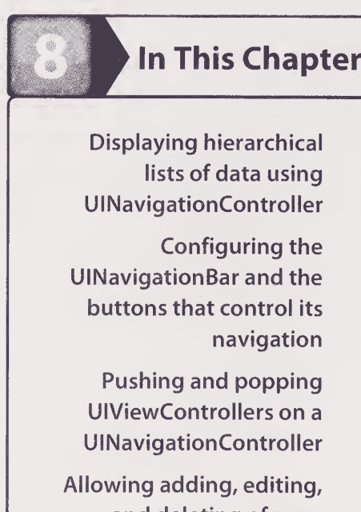

- 本章内容

- 使用 `UINavigationController` 显示层级数据列表

- 配置 `UINavigationBar` 以及控制其导航的按钮

- 在 `UINavigationController` 上推送（Push）和弹出（Pop）`UIViewControllers`

- 允许添加、编辑和删除行

### 图 8.1

UINavigationController 的工作原理

| 根视图控制器 | 根视图控制器 |

| :--- | :--- |

| 纽约 | 州名： |

| 伊利诺伊 | 纽约 |

| 加哥 | 城市名： |

| 加利福尼亚 | 纽约 |

| 旧金山 | | |

| 洛杉矶 | | |

| 亚利桑那 | 凤凰 |

要在显示数据的视图控制器之间进行导航，你将视图控制器推入 `UINavigationController` 或从其上弹出。当你将一个 `UINavigationController` 推送到另一个 `UINavigationController` 时，该 `UINavigationController` 将 `ViewController` 显示为其主视图。同样，当你从 `UINavigationController` 弹出一个 `ViewController` 时，它会移除顶部的 `ViewController` 并引入最初推送到它之上的任何 `ViewController`。

这看起来可能复杂，但实际上这是一个相当简单且直观的接口。

### 创建 UINavigationController

Xcode 提供了一个用于创建带有顶层 `UINavigationController` 应用程序的模板。这是使用 `UINavigationController` 创建应用程序的一种完全可行的方法。然而，当你第一次创建应用程序时，你并不确定具体想让 UI 执行什么。因此，学习如何手动创建 `UINavigationController` 并将其添加到现有项目中是有帮助的。幸运的是，这非常有用。

## 第 8 章：在 UINavigationController 模型中工作

实现此操作最简单的方法是打开你的 `MainWindow.xib` 文件，并将调色板上的 `UINavigationController` 对象拖到对象浏览器窗口中。这会在你的视图中创建一个 `UINavigationController` 实例。然后你在应用程序代理中创建一个 `IBOutlet` 来连接此导航控制器。

`UINavigationController` 将包含一个预先构建好的默认根 `ViewController`。要将其变为你的 `ViewController`，你需要配置它以从其 nib 中拉取你的 `UIViewController`。

要做到这一点，你需要为你的 `ViewController` 创建一个单独的 nib。通常，这个 `ViewController` 存储在单独的 nib 中，而不是主窗口 nib 中。要将此 `UIViewController` 添加到 `UINavigationController`，请编辑根视图控制器对象的 `NIB Name` 属性，并将其设置为包含你的 `ViewController` 的 nib 的名称。你还需要编辑根视图控制器的 `Class` 属性，将其设置为你视图的类。根视图控制器是导航控制器的子对象，如图 8.2 所示。它被称为 "MyViewController"。在对象浏览器中选择此对象后，可以在信息面板第一个标签页找到 `NIB name` 属性，可以在最后一个标签页找到 `Class` 属性。

图 8.2

配置 UINavigationController

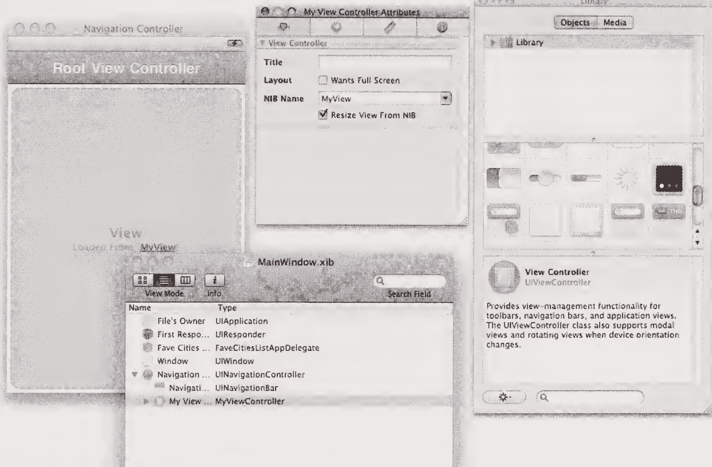

一旦创建了 `UINavigationController`，你就需要将 `UINavigationController` 的视图作为窗口的子视图添加，以便其显示。这可以在你应用程序代理的 `applicationDidFinishLaunching` 方法中完成。典型的实现如列表 8.1 所示。

### 列表 8.1

### applicationDidFinishLaunching 的实现

```objc
(void)applicationDidFinishLaunching:(UIApplication *)application
  // App 启动后自定义的覆盖点
  [window addSubview:[navigationController view]];
  [window makeKeyAndVisible];
```

这段代码将导航控制器作为根视图添加到你的应用程序中。例如，如果你有一个作为 `UIView` 的游戏主界面，那么你可能不希望是这种情况（此处原文句号错误）。你可能不想让游戏的主视图被封装在 `UINavigationController` 中，但你可能想在游戏更深的地方使用 `UINavigationController`，例如用于设置。

要做到这一点，这种模式可以用于任何地方。这使用户能够获得一致的用户体验，即他们在数据列表中导航，从列表中选择一个项目，查看其详细信息，然后通过“返回”按钮回到列表。

最后，你还可以根据需要选择显示或隐藏导航栏。

### 配置 UINavigationController

这里很有必要简单讨论一下组成 `UINavigationController` 的部分以及如何配置这些部分。

图 8.3

典型的 UINavigationController

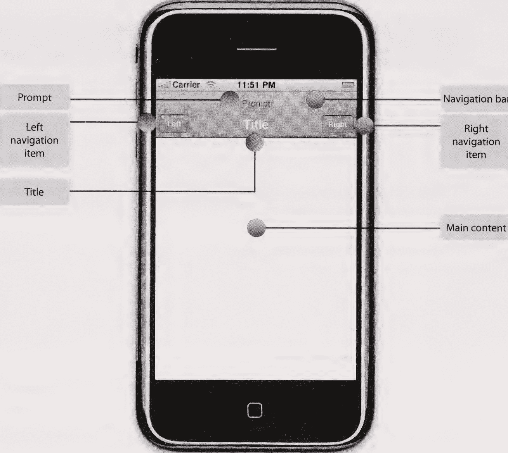

图 8.3 显示了一个典型的 `UINavigationController`，包括标题、左右按钮和提示。你的内容显示在中间。

### 构建 GUI

当 `UIView` 推送到 `UINavigationController` 时，`UINavigationItem` 会作为 `UIViewController` 的属性被创建，并访问导航栏中的元素。这使得根据当前显示的 `UIViewController` 非常方便地控制导航栏中显示的元素。`UINavigationController` 会查询 `UINavigationItem` 以获取标题、导航和提示。如果设置了这些属性，它们将覆盖 `UINavigationController` 的设置。表 8.1 显示了用于配置这些内容的 `UINavigationItem` 属性。

| 属性名称 | 目的 |

| --- | --- |

| Title | 当显示时，用于指定 `UINavigationController` 导航栏中央的标题 |


| Prompt | 指定 `UINavigationController` 导航栏标题上方的字幕 |
| leftBarButtonItem | 显示在 `UINavigationController` 导航栏左侧的 `UIBarButtonItem` |
| rightBarButtonItem | 显示在 `UINavigationController` 导航栏右侧的 `UIBarButtonItem` |

显示在导航栏上的按钮是 `UIBarButtonItem` 类型，并像普通按钮一样创建，带有目标、动作等。当 `UINavigationController` 管理的 `UIViewController` 栈包含多个 `ViewController` 时，`UINavigationController` 会自动提供在导航栏左侧的“返回”按钮。这使用户能够获得一致的用户体验。

### 推送和弹出 UIControllers

现在你已经配置了 `UINavigationController`，让我们来看它的功能：管理 `UIControllers`。

要让 `UINavigationController` 显示 `UIViewController`，你使用 `pushViewController:animated:` 方法并将你的 `UIViewController` 作为第一个参数传递。这会导致 `UINavigationController` 将当前视图控制器向左滑出，并从右引入新的视图控制器以作为主视图显示。

同样地，要从 `UINavigationController` 中移除视图控制器，你可以使用 `popViewControllerAnimated:` 方法，它会从栈中移除顶部的视图控制器，并滑入之前被弹出的任何视图控制器以显示该视图。

如果你正在显示多个层级的视图控制器，`popToViewController:animated:` 方法会继续从栈中弹出视图控制器，直到找到你传递的那个视图控制器。

最后，如果你想移除根视图控制器（root view controller）之外的所有视图控制器，并返回到栈的顶层，`popToRootViewControllerAnimated:` 方法正好可以实现这一点。

### 添加 UIToolbar

随着 iPhone OS 3 的引入，Apple 增加了轻松管理显示在 `UINavigationController` 底部工具栏的能力。默认情况下，工具栏是隐藏的，因此若要显示它，你只需要在 `navigationController` 对象上调用 `setToolbarHidden:animated:` 方法即可。工具栏中显示的项目是通过访问 `toolbarItems` 属性从当前活跃的视图控制器获取的。`barItems` 属性应该包含一个 `UIButtonItem` 对象的数组，并可以使用 `setToolbarItems:animated:` 方法进行设置。

### 编辑行

现在你已经了解了操作 `UINavigationController` 的基础知识，让我们扩展城市应用程序以添加编辑模型的能力。在此过程中，你将使用 `UINavigationController` 作为你的顶层视图，使你能够从城市列表中选择项目，并在推送到 `UINavigationController` 的子视图中对其进行编辑。

### 将 MyView 移动到 UINavigationController

为了向项目中添加 `UINavigationController`，你所做的第一件事是从你的 `MainWindow` nib 中移除视图控制器（viewController），并将其替换为 `UINavigationController`。

执行此操作，请在 Interface Builder 中打开 `MainWindow` nib，找到你为 `My` 对象添加的视图控制器并将其删除。从色板中拖放一个 `UINavigationController` 到对象浏览器窗口。配置 `UINavigationController`，使根视图控制器现在成为你的 `MyView`。在设置了 `UINavigationController` 下的根视图控制器后，你还需要配置根视图上的 `Class` 类型。通过在属性窗口的 `Class Identity` 设置下使用 `Class` 属性来实现这一点。

你应该将其设置为你的主 `UIViewController` 的类（如果你在跟随教程操作，这将是 `MyViewController`）。

你需要更改 `app delegate` 中的你的 `IBOutlet`，使其现在成为 `UINavigationController` 的实例而不是 `ViewController`。记住，你仍然需要将 `UINavigationController` 的视图添加到你的主窗口（Windows）视图中。

列表 8.2 显示了完成界面，列表 8.3 显示了 `applicationDidFinishLoading` 方法的实现。

### 列表 8.2

### 新 Application Delegate 接口

```objectivec
@import <UIKit/UIKit.h>
@interface FaveCitiesListAppDelegate : NSObject <UIApplicationDelegate>
    UIWindow window;
    INavigationController *navController;
    @property (retain, nonatomic) IBOutlet UIWindow *window;
    @property (retain, nonatomic) UINavigationController *navController;

@end
```

### 列表 8.3

### applicationDidFinishLaunching 方法的更新实现

```objectivec
(void)applicationDidFinishLaunching:(UIApplication *) application
{
    [window addSubview:[navController view];
    [window makeKeyAndVisible];
}
```

### 注意

为了让视图控制器更容易访问模型，你需要将模型数据的创建移动到 `MyViewController`。在这一段代码列表中，这已经完成了。请确保在你的代码中也这样做。

一旦你完成了所有这些，就可以准备实现编辑功能了。你甚至可以运行应用程序并看到你的列表现在显示在 `UINavigationController` 中。


### 创建你的 EditViewController

你需要做的第一件事创建一个新的视图，用于编辑你从 `UITableView` 中选择的项目。你已经看到过如何创建一个 `UIView` 以及如何创建一个 `UIViewController`，所以我只需向你展示一张我希望用户界面看起来像那样的截图。使用 Interface Builder 在新的 nib 中创建一个像这样的新视图。创建一个与此新视图一起使用的 `UIViewController`。该 `ViewController` 应该拥有用于城市名称和收藏星的输出属性（outlets）。如果你将收藏星制作为 `UIButton` 并将其配置为自定义按钮，使用星形图像作为按钮图像，你就可以实现当用户触碰星形时，切换该项目是否为收藏状态。记住将你的按钮连接到你的 `UIViewController` 上的动作（actions）。

如果你需要帮助，可以参考本章的示例代码。图 8.4 显示了编辑特定城市的完整视图。

我在 `EditViewController` 代码中做的唯一复杂事情是围绕收藏按钮，以及你如何通知父视图控制器用户是否实际上编辑了值还是取消了。这段代码显示在列表 8.4 中。

图 8.4

EditView 界面

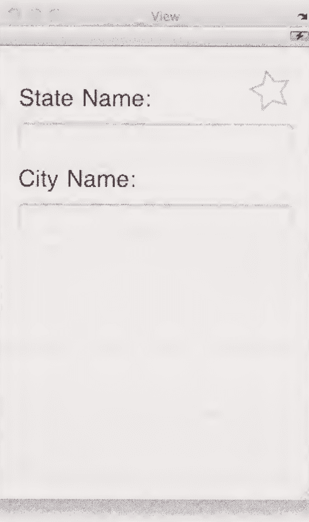

### 列表 8.4

EditViewController 实现代码

```objectivec
- (void)updateState {
  if (favorite) {
    [starButton setImage:
      [UIImage imageNamed:@"FullStar.png"]
      forState:UIControlStateNormal];
  } else
    [starButton setImage:
      [UIImage imageNamed:@"EmptyStar.png"]
      forState:UIControlStateNormal];
}
-(IBAction)isTouching:(id) sender {
  [self setFavorite:!favorite];
  [self updateState];
}
-(IBAction)isTouching:(id) sender {
  [delegate finishedEditing:self];
  [navigationController popViewControllerAnimated:YES];
}
-(void)viewDidLoad {
  [self updateState];
  UIButton *doneButton = [[UIButton alloc]
    initWithButtonSystem:UIButtonSystemDefault
    target:self action:@selector(doneTouched)];
  [navigationItem setRightBarButtonItem:doneButton];
}
```

对于这些项目，`updateState` 方法实际上在多个位置使用，根据收藏的状态将星形图像设置为空或实心。它在 `starTouched:` 方法和 `viewDidLoad` 方法中都被使用了。

## 第8章：在 UINavigationController 中工作 111

`starTouched:` 方法是一个与收藏按钮配合使用的动作。它切换收藏状态并用相应的图像更新星按钮。

`doneTouched:` 方法在用户点击右上角的保存按钮时调用。此方法从文本字段获取值并将其放入成员变量，然后通知代理已完成编辑。最后，它从导航控制器中弹出视图控制器，返回你的父视图。

> 注意

在 `doneTouched:` 方法中，你可以调用该方法。只有在你完成编辑时才会被调用。如果用户使用返回按钮离开编辑界面，则不会被调用。这是判断用户是取消还是提交了编辑的方便方法。

`UIViewController` 提供 `editing:animated:` 方法用于设置和取消视图“编辑模式”。我在这里没有使用它，因为我想演示 `UINavigationController` 和 `UINavigationItem` 的使用，以及向它们添加输出属性。然而，为了以后参考，重写此方法也是实现保存按钮的一种方法。

### 列表 8.5

更新后的 tableViewdidSelectRowAtIndexPath: 方法

```objectivec
-(void)tableView:(UITableView *)tableView
didSelectRowAtIndexPath:(NSIndexPath *)indexPath {
  {
    NSDictionary *state = [favoriteCities objectForKey:[indexPath section]];
    NSArray *cities = [state objectForKey:@"CITIES"];
    NSMutableDictionary *city = [cities objectAtIndex:[indexPath row]];

    NSString *stateName = [state objectForKey:@"NAME"];
    NSString *cityName = [city objectForKey:@"NAME"];
    BOOL isFavorite = [city objectForKey:@"FAVORITE" isEqualToString:@YES];
  }

  EditViewController *controller = [[EditViewController alloc]
    initWithCityName:cityName
    state:stateName
    favorite:isFavorite
    delegate:self];
  [self navigationController pushViewController:controller animated:YES];

  [controller release];

  [self setEditedItem:indexPath];
}
```

这段代码使用 `indexPath` 在模型中寻找相应的行。然后，你使用它来初始化 `EditViewController`。你将 `EditViewController` 推送到导航控制器上并释放它。它的实例变量中的参数被传递进去。你应该能够写出该方法。因为导航控制器保留了 `EditViewController`，所以你不需要保留它的拷贝。最后，你将保留传入的 `indexPath`，这样当 `EditViewController` 完成编辑时，你可以找到被编辑的行以更新它的值。

在编辑完成后更新值的方法是来自 `EditViewController` 的代理方法。该方法在列表 8.6 中所示。

## 第 8 章：在 UINavigationController 中工作

### 列表 8.6

### EditViewController 的代理方法


```objectivec
- (void)editViewFinishedEditing:(EditViewController *)editView {
  NSString *favorite = nil;
  if((editView favorite))
    favorite = @"YES";
  else
    favorite = @"NO";

  NSString *stateName = [editView stateInfo];
  NSString *cityName = [editView cityInfo];
  if([self editedItem]) // 我们正在编辑一个现有项目
    NSMutableDictionary *origState = [favoriteCities objectAtIndex:[self editedItem section]];
    NSString *origStateName = [origState objectForKey:@"NAME"];
    // 首先检查状态是否发生了变化...
    if(![origStateName isEqualToString:stateName]) {
      // 如果发生了变化，我们需要将城市移动到新状态。
      NSMutableDictionary *newState = nil;
      for (NSMutableDictionary *state in favoriteCities)
        if (([state objectForKey:@"NAME"] isEqualToString:stateName])
          newState = state;
      if(newState) {
        newState = [NSMutableDictionary dictionary];
        [newState setObject:stateName forKey:@"NAME"];
        [newState setObject:[NSMutableArray array] forKey:@"CITIES"];
        [favoriteCities addObject:newState];
      }
      NSMutableDictionary *newCity = [NSMutableDictionary dictionary];
      [newCity setObject:cityName forKey:@"NAME"];
      [newCity setObject:favorite forKey:@"FAVORITE"];
      [newState objectForKey:@"CITIES"] addObject:newCity];
    // 现在移除旧城市，可选地移除状态
    // 如果该状态不再没有城市了。
    [[origState objectForKey:@"CITIES"] removeObjectAtIndex:[self editedItem row]];
    if([[origState objectForKey:@"CITIES"] count == 0])
      [favoriteCities removeObjectAtIndex:[self editedItem row]];
  } else {
    // 状态没有变化，我们可以直接更新旧的。
    NSMutableArray *cities = [origState objectForKey:@"CITIES"];
    NSMutableDictionary *city = [cities objectAtIndex:[self editedItem row]];
    [city setObject:cityName forKey:@"NAME"];
    [city setObject:favorite forKey:@"FAVORITE"];
  } else { // 这是一个新增
    NSMutableDictionary *newState = nil;
    for(NSMutableDictionary *state in favoriteCities) {
      if([[state objectForKey:@"NAME"] isEqualToString:stateName])
        newState = state;
    }
    if(!newState) {
      newState = [NSMutableDictionary dictionary];
      [newState setObject:stateName forKey:@"NAME"];
      [newState setObject:[NSMutableArray array] forKey:@"CITIES"];
      [favoriteCities addObject:newState];
    }
    NSMutableDictionary *newCity = [NSMutableDictionary dictionary];
    [newCity setObject:cityName forKey:@"NAME"];
    [newCity setObject:favorite forKey:@"FAVORITE"];
    [newState objectForKey:@"CITIES"] addObject:newCity];
  }
  [[self tableView] reloadData];
}
```

这是一段相当长的代码，但重要的是意识到，其中大部分内容仅仅是在操作你的模型。字典数组并不是一个非常直观的操作模型。你真正需要通过观察这一点的是，你正在更新你的模型，而这一切都在处理编辑时的底部完成。你根据之前是否设置过 `editedItem` 属性（它是你正在编辑的项目的索引路径）来判断是编辑还是新增。如果这个值是 `nil`，那么你就假设它是一个新增操作。

## 添加行

为了允许添加行，你将在右上角添加一个添加按钮（add button）。它会在你的 `UINavigationController` 上显示为一个一个小加号图标。你将把该动作连接到你 `ViewController` 类中的一个 `IBAction`。在 `viewDidLoad` 方法中需要添加插入添加按钮的代码如列表 8.7 所示。

### 列表 8.7：在 EditView 上显示添加按钮所需的代码

```objectivec
[[self navigationItem] setRightBarButtonItem:
[[UIBarButtonItem alloc] 
initWithBarButtonSystemSystemItem:UIBarButtonItemSystemItemAdd
target:self
action:@selector(addCity:)] autorelease];
```

`addCity` 方法在列表 8.8 所示。

### 列表 8.8：addCity:(id) sender; 的实现

```objectivec
- (IBAction)addCity:(id) sender {
  [self setEditedItem:nil];
  EditViewController *controller =
    [[EditViewController alloc] initWithCityName:@""
    state:@""
    favorite:NO
    delegate:self];
  [self navigationController] pushViewController:controller animated:YES];
  [controller release];
}
```

你可以看到，这与处理编辑行非常相似，不同之处在于你传递的是空字符串，并且你确保了编辑项被设置为 `nil`。

## 删除行

在关于编辑行时，我想谈论的最后一个项目是删除行。

再次，就像你处理代理时做一样，如果你还没有这样做，现在是把数据源方法从独立模块移动到 `ViewController` 类的好时机。这使得你在执行删除时操作模型变得更容易。

要添加删除功能，你需要在数据源中实现两个方法。这两个方法是 `tableView:canEditRowAtIndexPath` 和 `tableView:commitEditingStyle:forRowAtIndexPath:`。要在 `UITableView` 上执行删除，你对想要删除的行使用滑动手势。当你执行此手势时，`UITableView` 首先询问你的数据源是否可以编辑你滑过的行。如果 `tableView:canEditRowAtIndexPath` 返回 `YES`，用户随后点击辅助视图中的删除按钮进行确认。如果用户点击了删除按钮，就会调用 `tableView:commitEditingStyle:forRowAtIndexPath:` 方法执行实际删除。

## 总结

在本章中，你学习了如何使用 `UINavigationController` 来操作和显示列表。在示例中，你显示了喜爱的城市列表，然后是每个城市的详细视图。另一种用法可以是显示状态列表，然后将每个状态的城市列表作为该状态的详细视图。

最重要的意思是，`UINavigationController` 是构建 iPhone 应用的一个非常基础且强大的工具。它也出奇地易于使用。使用它让你能够构建出遵循内置应用程序所遵循 UI 范式的应用程序。这意味着你的应用程序对于客户来说将更容易学习和使用。

# 理解 UIApplicationDelegate

到目前为止，你写的每一个应用程序都包含一个应用代理类（application delegate class）。通常，这些类是由最初用于创建项目时使用的模板生成的。因此，我应该花点时间讨论一下应用代理以及它为你做了什么。

在这一章中，我不会进入过多的细节；这里的目标是让你熟悉其架构以及 `UIApplicationDelegate` 可以接收的一些消息。

## 探索 UIApplicationDelegate 的用途

为 iPhone 编写的每个应用程序都有一个应用代理。在某些方面，你可以将应用代理看作应用程序的主类。它是你的应用程序在启动时处理操作系统控制的第一个地方，也是应用程序在退出时执行的最后一个地方。这使其成为处理诸如持久化状态的加载和保存等任务的理想位置。此外，它还处理在应用程序运行时发送给应用程序的某些操作系统消息。这些包括处理内存警告，或状态栏大小的变化。

你使用 `UIApplicationDelegate` 的方式是创建一个实现 `UIApplicationDelegate` 协议的类，然后在你的 `MainWindow` nib 文件中创建该类的实例。通常情况下，你没有理由考虑这些，因为项目模板已经为你完成了所有这些工作。你真正需要知道的是在项目中寻找名为 `<YourProjectNameAppDelegate>` 的类。这就是由模板提供的应用代理。你所需要做的就是在其中实现你想要使用的方法，其他一切都会迎刃就绪。

让我们来看一些你可能在应用程序中使用到的方法。

> **本章内容**
>
> - 接收 `UIApplicationDelegate` 的内部运作机制
> - 处理应用程序的启动和退出
> - 接收内存警告和状态信息
> - 接收网络通知和处理的 URL

## 处理启动和退出

`UIApplicationDelegate` 的首要目的是处理你应用程序的启动和退出。它通过实现以下几个方法来实现这一点，这些方法列在表 9.1 中。

### 表 9.1：用于启动和退出的方法

| 方法签名 | 描述 |
| --- | --- |
| `- (void)applicationDidFinishLaunching:(UIApplication*)` | 这是你的应用程序在完成启动到 iPhone OS 后被调用的第一个方法。这是执行如恢复状态或设置全局变量等操作的好地方。 |
| `- (BOOL)application:(UIApplication*) didFinishLaunchingWithOptions:(NSDictionary*) launchOptions` | 这是 `didFinishLaunching` 方法的替代方案，如果你的应用代理实现了它，那么当 iPhone OS 接收到你应用程序的远程通知，或者另一个应用程序打开了你应用程序处理的类型的 URL 请求时，它将调用此方法而非前一个方法。 |
| `- (void)applicationWillTerminate:(UIApplication*) application` | 这是你的应用代理中在应用程序退出时调用的最后一个方法。 |

## 理解启动方法

在启动时使用的方法 `applicationDidFinishLaunching;` 和 `application:didFinishLaunchingWithOptions;` 在你的应用程序完成启动时被调用。第一个方法 `applicationDidFinishLaunching;` 是 iPhone OS 2.0 中唯一可用的方法，通常是你在大多数应用程序中都会使用的。通常，这用于应用程序初始化以及将你的初始视图添加到主窗口中。

第二个方法 `application:didFinishLaunchingWithOptions;` 是随着 iPhone OS 3 新引入的，如果在你的 `UIApplicationDelegate` 上实现了它，它将取代旧方法被调用。它的添加是为了让应用程序能够轻松处理远程通知和打开 URL 等任务。当 iPhone OS 接收到通知时，它会检查通知以确定哪个应用程序处理该种类型的通知。如果用户选择查看通知，则应用程序将启动，该方法的 `options` 参数将包含一个含有通知数据的字典。你将在第 20 章中更深入地研究这个方法。

另一种调用该方法的情况是另一个应用程序请求操作系统处理某种类型的 URL，而你的应用程序之前注册了该类型为它可以打开的类型。

在这种情况下，`launchOptions` 参数包含一个代表该 URL 以及发送请求的应用程序 bundle ID 的对象。

> **注意**
>
> `UIApplicationDelegate` 还包含一个可选方法 `application:handleOpenURL`，用于处理应用程序仅通过打开 URL 启动的情况。

在应用程序简单通过其应用程序图标从 iPhone OS 启动的情况下，`launchOptions` 参数为 `nil`。

表 9.2 显示了可用于访问启动选项字典元素的键（keys）列表。这些键实际上也用于其他其他方法，但我将它们全部列在这里供你参考。

### 表 9.2：启动选项字典键

| 值 | 描述 |
| --- | --- |
| `UIApplicationStatusBarOrientationInfoKey` | 访问用于指示状态栏当前朝向的值。该值被编码为 `NSNumber`。 |
| `UIApplicationStatusBarFrameInfoKey` | 访问一个 `CGRect` 值以指示状态栏的新位置和帧。该值被编码为 `NSNumber`。 |
| `UIApplicationLaunchOptionsURLKey` | 访问一个用启动应用程序所用的 URL 初始化的 `NSURL`。 |
| `UIApplicationLaunchOptionsSourceApplicationKey` | 访问一个包含用于 URL 启动应用程序的应用程序 bundle ID 的字符串。 |
| `UIApplicationLaunchOptionsRemoteNotificationKey` | 访问一个代表用于启动应用程序的远程通知负载（payload）的字典。 |

## 理解 applicationWillTerminate 方法

当用户按下 iPhone 上的 Home 键时，他们是在请求终止你的应用程序。应用程序会向你的应用代理发送 `willTerminate:` 消息。你被要求及时为你的应用程序处理任何必要的清理工作。这意味着将任何对象持久化到磁盘、释放资源或执行典型的关闭操作。

> **注意**
>
> 我提到持久化数据时，是指将其保存到应用程序的 `Documents` 文件夹或用户的默认设置（defaults）中。我将在第 17 和 18 章中详细讨论保存数据。

我提到你需要及时完成这一点，是因为如果你不这样做，操作系统将强制退出你的应用程序。无论你是否已完成保存操作，它都会这样做。

## 在应用程序运行时接收通知

在处理应用程序的启动和退出时，应用代理会处理在应用程序运行时发送给应用程序的消息。通常这类消息包括资源警告（内存或时间变化）和远程通知。其中某些消息你可以安全地忽略；另一些如果你忽略则会付出代价。

表 9.3 显示了你可以实现的以接收这些消息的方法。我将逐一讨论这些方法。

### 表 9.3：运行时通知方法

| 方法 | 描述 |
| --- | --- |
| `- (void)applicationDidReceiveWarning:(UIApplication*)` | 当 iPhone 内存不足时接收。 |
| `- (void)applicationSignificantTimeChange:(UIApplication*)` | 当发生重大时间事件时接收。 |
| `- (void)application:(UIApplication*)application willChangeStatusBarOrientation:(UIInterfaceOrientation)newStatusBarOrientation duration:(NSTimeInterval)duration` | 用于指示状态栏大小和朝向的变化。 |


# 第 9 章：理解 UIApplicationDelegate

| 方法 | 说明 |
| --- | --- |
| `(void)application:(UIApplication*)application didChangeStatusBarOrientation:(UIInterfaceOrientation)oldStatusBarOrientation` | |
| `(void)applicationWillResignActive:(UIApplication *)application` | 当 iPhone 进入睡眠状态或接到电话时，会接收这些通知。 |
| `(void)applicationDidBecomeActive:(UIApplication *)application` | |
| `(void)application:(UIApplication *)application didReceiveRemoteNotification:(NSDictionary *)userInfo` | 向你的应用程序发送信号，表示操作系统已收到该应用程序的远程通知。 |
| `(void)application:(UIApplication *)application didRegisterRemoteNotificationsWithDeviceToken:(NSData *)deviceToken` | |
| `(void)application:(UIApplication *)application didFailToRegisterRemoteNotificationsWithError:(NSError *)error` | |

## 处理资源警告

当应用程序运行时，你可能会收到的第一类消息是资源警告。其中最重要的是 `didReceiveMemoryWarning:` 消息，当 iPhone 内存不足时，你就会收到此消息。

请记住，即使一次只允许一个用户运行，但 iPhone 后台始终有系统应用程序在运行，且使用的内存并不一定严格分配给你的应用程序。尽管如此，当你收到此警告时，你应该减少自己的内存占用。此外，如果你不减少内存占用，操作系统会发送另一个低内存警告，你的应用程序可能会被强制终止，为操作系统释放内存。

当出现低内存警告时，你的视图控制器也会收到此消息，你通常会在这些对象中释放内存。然而，该方法是在应用代理本身上提供的，用于清理任何其他数据。你可以找到释放数据的方法包括清理缓存或删除临时数据。你还可以将数据刷新到磁盘，以持久化的方式以便在需要时将其检索。

你可能收到的另一个资源消息是 `applicationSignificantTimeChange:`。当发生重大时间事件时，会接收此消息。重大时间事件包括夏令时的切换和午夜的到来。

## 处理时间变化

此消息的目的是允许你更新应用程序中使用时间的，并妥善处理时间变化。在为 iPhone 应用程序时，必须意识到 iPhone 在全年的每天任何时间都可以被使用。许多应用程序都因对时间和日期处理不当而遭受问题。例如，闰年和夏令时使得在一个恒定的 99.9% 运行时间环境中，iPhone 变得极具挑战性。

## 处理电话和睡眠

通过 `UIKitDelegate` 接收到的一些更重要的状态消息是那些指示手机已通过锁定按钮进入睡眠状态，或者来电临时中断了应用程序的消息。特别是游戏，可能希望在这些事件期间暂停动作。你可能还想保存游戏应用程序的状态。在这些情况下发送的通知是 `applicationWillResignActive:` 和 `applicationDidBecomeActive:`；它们分别在应用程序被中断时以及在中断后控制权返回应用程序时被调用。

如果中断是由来电引起的，用户将看到一个对话框，让他们选择是否接听电话。如果他们接听了，应用程序将完全返回，并会像用户按了主键一样终止。这意味着 `applicationWillTerminate:` 方法也会被调用。

## 更改状态

你收到的最后状态消息与状态栏的大小和方向变化有关。例如，当接到电话时，状态栏的大小可能会增大，以指示用户正在通话。你的应用程序应该意识到这些变化的可能性，并准备调整你的 UI 以允许这些变化。

这些通知中的第一个是关于状态栏的方向。它们通过 `application:willChangeStatusBarOrientation:duration:` 和 `application:didChangeStatusBarOrientation:` 方法接收，这些消息在状态栏改变方向之前和之后发送，在两种情况下，你都会将新的状态栏方向作为参数传递给方法。

接下来这些通知（可能更有用一点）是关于状态栏框架变化的通知。这些是 `application:willChangeStatusBarFrame:` 和 `application:didChangeStatusBarFrame:` 方法。与状态栏方向消息一样，你在更改之前和之后都会接收有关状态栏框架的信息，你应该使用这些信息来调整自己的 UI，为新的状态栏大小留出空间。

> **注意**
>
> 你可能会问自己“我什么时候会看到状态栏大小变化？”嗯，答案是，当用户正在通话并使用你的应用程序时。状态栏会增大，并带有一个消息，指示用户可以触摸它返回通话。

## 处理远程通知

iPhone OS 3 增加了处理远程通知的能力。我将在后续章节中深入讨论通知。

### 图 10.1：iPhone 屏幕坐标系

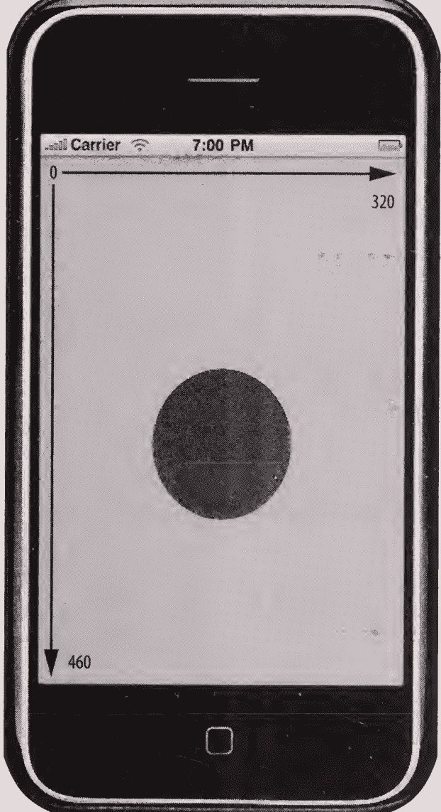

# 第 10 章：应用自定义 UIView

## 向项目添加自定义视图

向项目中添加自定义视图相对简单。你需要做的第一件事是创建一个继承自 `UIView` 的类。为了做到这一点，向你的项目添加一个新文件，并在最后的模板选择对话框中选择一个新的 `UIView` 子类。这将为你创建一个 `UIView` 类，并包含其最核心方法的骨架。

完成后，打开 Interface Builder 进入你想要添加自定义视图的 nib 文件。如果你的 UI 上还没有想要作为自定义视图的视图对象，请滚动对象面板直到找到一个视图对象。将此对象拖放到你希望显示该 `UIView` 的 UI 任意位置。接下来，在选中界面中的 `UIView` 对象时，在对象的属性窗口中找到 Class Identity（类标识）属性，并将此属性设置为你新创建的自定义视图类。

> **注意**
>
> 向视图层级中添加自定义视图的另一种方法是通过编程方式，只需将其作为其中一个视图的子视图添加即可。

然而，无论你将视图实例放置在 UI 的哪个位置，应用程序都会创建你的自定义视图的实例，并在 UI 显示时展示它。

此时，你可以回到 Xcode 开始编写实际实现你自定义视图的代码。

## 实现自定义视图代码

在继承 `UIView` 时，有三个核心方法是你需要关注。第一个是指定的初始化器，即 `initWithFrame:`。该方法会被调用以构建你的自定义视图。用于标识视图框架的 `CGRect` 初始可能为 `CGRectZero`，你应该计划在 `layoutSubviews` 方法中进行布局，该方法专门为此目的而设计。应该使用初始化器来初始化后续绘制你的视图时需要的数据。

正如前一段所提到的，继承 `UIView` 时需要关注的第二个方法是 `layoutSubviews` 方法。该方法由任何父视图调用，以执行你视图的 `layoutIfNeeded`。你应该使用此方法来布局视图内的任何子视图或元素。该方法的默认实现不执行任何操作。

你需要关注的最后一个方法是 `drawRect:` 方法。这是魔法发生的地方。你的自定义视图在此处实际执行绘图以显示你的数据。需要注意的是，你不应该在 `drawRect:` 方法中手动绘制你的子视图。视图会依次向你的每个子视图发送 `drawRect:` 调用。它们负责自己绘制。你不需要绘制它们。你只需要关注绘制你的内容。

通常，你使用 Core Graphics 来实际对你的视图进行物理绘制。然而，记住我刚才提到的关于某些视图会自己绘制的内容，你应该记住你的自定义视图尽管是如此，它仍然是一个视图，并且完美地契合 `UIView` 层级。这意味着它不仅可以是另一个视图的子视图，还可以包含子视图。其性在于，例如，与其在 `drawRect:` 方法中将图像组合到视图中，实际上使用 `UIImageView` 子视图可能会更高效。

同样，与其直接使用 Core Graphics 函数调用直接在视图中绘制文本，不如使用 `UILabel` 可能会更高效。在设计视图时你应该记住这一点，并尽量不要重复已经存在的功能。利用 Cocoa Touch 为你提供的工具。

## 使用 Core Graphics

在我深入研究一个 `drawRect:` 方法的实际实现之前，我觉得对一些关键 Core Graphics 概念进行简要概述是重要的。

对 Core Graphics 的全面涵盖超出了本书的范围，但我在这里向你介绍的几个工具应该至少能提供你一些简单绘制所需的基础知识。从这里开始，参考 Apple 文档以及桌面可用的一些关于 Core Graphics 的优秀书籍，将帮助你将工作提升到下一个水平。

### 使用基础 Core Graphics 类型

首先要理解的是 Core Graphics 是一个 C API。因此，它利用 C 结构体和 C 函数混合来完成工作。虽然它尝试使用引用来模拟对象，但它不是传统的面向对象 API，并且没有 Objective-C 类。

你在本章中处理的类型主要由表 10.1 列出的类型组成。

| 类型 | 目的 |
| --- | --- |
| `CGFloat` | 专门用于 Core Graphics 函数的浮点值。 |
| `CGPoint` | 指示 `UIView` 坐标系或 Core Graphics 上下文中单点的 C 结构体。它由两个 `CGFloat` X 和 Y 坐标组成。 |
| `CGSize` | 定义尺寸的 C 结构体。它由两个表示高度和宽度的 `CGFloat` 组成。 |
| `CGRect` | 定义 Core Graphics 上下文中矩形的 C 结构体。它由包含一个用于指示 `CGRect` 起点的 `CGPoint` 和一个指示其尺寸的 `CGSize` 组成。 |
| `CGImageRef` | 对 `CGImage` 的引用，它是 `UIImage` 的 Core Graphics 版本。 |
| `CGAffineTransform` | 定义用于平移、缩放和旋转的仿射变换矩阵的 C 结构体。 |
| `CGPathRef` | 对 Core Graphics 路径的引用，可用于线条或对象。 |
| `CGContextRef` | 对 Core Graphics 上下文的引用。 |

### 理解 Core Foundation 内存管理模型

由于 Core Graphics 是一个框架，它使用了 Core Foundation 内存管理系统。Core Foundation 内存管理系统由引用计数、命名规范组成。对于本文讨论，你只需要关注引用计数和命名规范。

需要注意的是，尽管 Core Foundation 内存管理系统看起来与 Cocoa 内存管理系统相似（Cocoa 也使用引用计数），但它们是不兼容的，不能交叉使用。当你与 Core Foundation 对象工作时，必须始终使用 Core Foundation 系统；在使用 Cocoa Touch 对象时，必须始终使用 Cocoa 系统。

与 Cocoa 类似，Core Foundation 使用引用计数进行内存管理。然而，由于它是基于 C 的 API，强制开发者对每个创建的对象使用额外的调用将是异常的。相反，Core Foundation 使用命名规范和一组规则来管理所有权。

所有权遵循三个规则。第一条规则是如果你创建一个对象（通过 `Create` 或 `Copy` 函数），你拥有它。第二条规则是如果你获取一个对象（通过 `Get` 函数），你不拥有该内存，如果你想保留它，则必须通过调用 `CFRetain` 来保留它。你拥有调用过 `CFRetain` 的内存。

Core Foundation 和 Core Graphics 包含几种定义为 C 结构体的基本类型。这些类型（如你已经看到的 `CGRect` 和 `CGPoint`）不需要保留或释放。作为命名规范，需要保留或释放的对象命名包含 *Ref* 单词，例如 `CGImageRef`。

### 使用 CFRetain 和 CFRelease

用于增加和减少内存块引用数的函数是 `CFRetain` 和 `CFRelease`。`CFRetain` 增加引用计数，而 `CFRelease` 减少引用计数。当内存块的引用计数达到 0 时，该内存块将被释放。Core Foundation 中没有自动释放池。

### 获取图形上下文

为了能够使用 Core Graphics，你必须首先获取你想要绘图的视图的图形上下文。Cocoa Touch 提供了一个函数，允许你获取当前视图的图形上下文。该函数是 `UIGraphicsGetCurrentContext()`，它返回一个 `CGContextRef`。请记住，由于该方法名为“Get（获取）”，因此该函数返回的对象由你所有，如果你希望在当前方法的作用范围内保留它，则应该使用 `CFRetain` 对其进行保留。

核心上下文提供了类似于绘图板的内容，你可以在上面执行绘制操作。图形上下文可以被更改、保存和恢复。当你获取了图形上下文后，你就可以在上面设置绘制参数，例如描边颜色、填充颜色和变换。在图形上下文上指定的任何此类设置都将用于后续的所有绘制。

上下文可以被保存和恢复。例如，你可以设置一个图形上下文，配置你的绘制环境，然后保存该图形上下文，更改某些参数，进行额外的绘制，然后恢复到你之前保存的图形上下文，从而恢复你之前配置的绘制环境。通过这样，图形上下文的保存和恢复函数的工作原理类似于栈，你可以将图形上下文推入栈中并将其弹出。通过这种方式，多次调用保存和恢复图形上下文的操作可以相互嵌套，以便你拥有多个绘制状态。用于保存图形上下文的方法是 `CGContextSaveGState()` 和 `CGContextRestoreGState()`。列表 10.1 显示了一个示例，其中描边颜色首先被设置为蓝色，然后设置为黑色，最后恢复为蓝色。

#### 列表 10.1：保存和恢复 CGContextRef

```c
CGContextRef context = UIGraphicsGetCurrentContext();
CGContextSetStrokeColorWithColor(context, [UIColor blueColor].CGColor);
// 使用蓝色进行一些绘制 ...
CGContextSaveGState(context);
CGContextSetStrokeColorWithColor(context, [UIColor blackColor].CGColor);
// 现在使用黑色进行一些绘制 ...
CGContextRestoreGState(context);
// 现在绘制颜色变回蓝色 ...
```

将此看作是你正在将图形上下文推入栈中并从栈中弹出。当你设置绘制环境时，你可以将一个新的图形上下文推入栈中，这会保存你的旧上下文及其设置。稍后，你可以从栈中弹出顶层图形上下文，移除你之前放入图形上下文的任何新设置，并恢复你在将新上下文推入栈之前在旧上下文中所拥有的设置。

### 基础绘制操作

一旦你有了 Core Graphics 上下文，你就可以在其中开始绘图。你对新图形上下文可能想做的第一件事就是设置绘制颜色。有两个函数可以使用来设置这些颜色；第一个是 `CGContextSetStrokeColorWithColor()`，它允许你配置绘制的描边颜色；第二个是 `CGContextSetFillColorWithColor()`，它允许你配置填充路径。除了这些，还有其他方法允许你配置此类模式、阴影、字形、线端以及各种其他帮助你绘制的设置。对于这些简单的示例，我将只坚持基础操作。

描边颜色控制用于绘制线条以及绘制路径和对象轮廓的颜色。填充颜色决定用于填充封闭对象（如圆形、正方形和路径）的颜色。例如，如果你画一个椭圆，椭圆的内部使用填充颜色绘制，外部边缘使用描边颜色绘制。

> **注意**
>
> 在绘制线条和文本时也会使用描边颜色。

一旦你配置了颜色和其他绘制参数，你就可以开始实际绘制了。最常用绘制命令的总结如表 10.2 所示。

| 函数签名 | 意图 |
| --- | --- |
| `void CGContextClearRect(CGContextRef, CGRect);` | 清除上下文中的给定矩形 |
| `void CGContextFillPath(CGContextRef c);` | 使用当前颜色填充给定上下文中的路径 |
| `void CGContextFillRect(CGContextRef, CGRect);` | 使用当前填充颜色填充当前矩形 |
| `void CGContextStrokePath(CGContextRef c);` | 使用描边颜色描边给定上下文中的当前路径 |
| `void CGContextStrokeRect(CGContextRef c, CGRect rect);` | 使用当前描边颜色描边 `CGRect` |
| `void CGContextStrokeEllipseRect(CGContextRef context, CGRect rect);` | 使用当前描边颜色描边适应于 `CGRect` 的椭圆 |

表 10.2 中的几个方法利用路径作为它们将要绘制的对象。Core Graphics 路径系统提供了一种机制，允许你通过绘制路径段并将这些段连接成一个单一形状来绘制形状。表 10.3 显示了在 Core Graphics 上下文中定义路径的方法。


### 表 10.3 Core Graphics 中定义路径的方法

| 函数签名 | 意图 |
| --- | --- |
| `void CGContextMoveToPoint(CGContextRef c, CGFloat x, CGFloat y);` | 在给定上下文和指定的位置创建新路径 |
| `void CGContextAddLineToPoint(CGContextRef c, CGFloat x, CGFloat y);` | 向当前路径添加一条直线 |
| `void CGContextAddArcTo(CGContextRef c, CGFloat x1, CGFloat y1, CGFloat x2, CGFloat y2, CGFloat radius, CGFloat startAngle, CGFloat endAngle);` | 向当前路径添加一条圆弧线 |
| `void CGContextClosePath(CGContextRef c);` | 关闭当前路径 |

### 执行变换

变换是 Core Graphics 最强大的功能之一。使用它们，你可以旋转、缩放和平移你的点、尺寸和矩形。要创建一个变换，你使用表 10.4 中列出的 `CGAffineTransformMake` 方法。

一旦你有了一个变换，你就可以将其应用于我之前讨论的任何图形类型，例如 `CGPoint`、`CGRect` 和 `CGSize`。结果是经过变换的值。

## 第 10 章：应用视图

### 表 10.4 射变换创建方法

| 函数 | 意图 |
|---|---|
| `CGAffineTransformMakeRotation(CGFloat angle);` | 创建旋转指定角度的变换 |
| `CGAffineTransformMakeScale(CGFloat sx, CGFloat sy);` | 创建缩放到指定尺寸的变换 |
| `CGAffineTransformMakeTranslation(CGFloat tx, CGFloat ty);` | 创建在 x 和 y 方向平移指定距离的变换 |

### 列表 10.2

### UIView 子类接口

```objc
#import <UIKit/UIKit.h>

@interface MyCustomView : UIView
{
}
@end
```

你不需要实现 `initWithFrame:` 方法，但如果你使用了 UIView 子类模板，可以保留默认实现。让我们直接跳转到 `drawRect:`，它在列表 10.3 中所示。

### 列表 10.3

### drawRect: 方法的实现

```objc
- (void)drawRect:(CGRect)rect {
  // 获取当前上下文
  CGContextRef ctx = UIGraphicsGetCurrentContext();
  // 设置描边颜色为黑色
  CGContextSetStrokeColor(ctx, [[UIColor blackColor] CGColor]);
  // 设置填充颜色为蓝色
  CGContextSetFillColor(ctx, [[UIColor blueColor] CGColor]);
  // 获取一个相对于 frame 缩进的矩形
  CGRect circleRect = CGRectInset(self.frame, 100, 165);
  // 绘制圆的轮廓
  CGContextStrokeEllipseRect(ctx, circleRect);
  // 填充圆
  CGContextFillEllipseRect(ctx, circleRect)
}
```

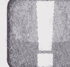

> **注意**
>
> 当你从 nib 内部实例化视图时，`initFrame` 初始化器不会被调用。相反，你可以使用视图上的 `awakeFromNib` 方法，或者视图控制器上的 `viewDidLoad` 方法。

你得到的是你的上下文，设置了描边和填充颜色，然后只需在你的矩形中画圆。这非常简单！当你运行此应用程序时，你将看到类似图 10.2 的内容。

### 图 10.2

完成的自定义视图

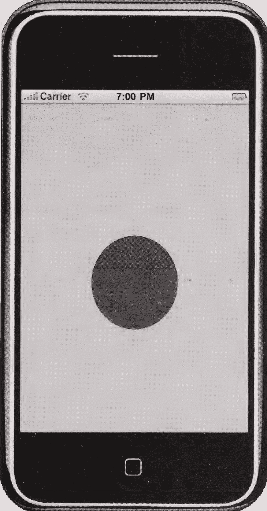

### 总结

在本章中，你已经了解了如何创建一个自定义的 `UIView` 并将其添加到你的项目中。记住，即使是自定义的 `UIView` 仍然是视图，并且仍然在视图层级系统内工作，这意味着你可以在需要将这些视图插入现有视图的子视图。

你还看到了一些基本的 Core Graphics 绘制代码。Core Graphics 是一个极其强大的 2D 图形绘制系统。在大多数情况下，它在 iPhone 和 Mac OS X 之间的功能非常相似，唯一的异常是两个平台的坐标系原点不同。也就是说，在 Cocoa Touch 中，原点在左上角，而在 Cocoa 中在左下角。尽管如此，大多数关于桌面端的书籍都适用于 iPhone 开发。

保留本章的示例代码，因为在下一章中，你将看到如何使用这个自定义视图处理触摸事件。你将扩展你的小圆形视图，使用户可以使用手指移动圆圈并调整其大小。

## 第 11 章：处理触摸事件

iPhone 的一个定义特性是使用多点触控作为主要输入。没有比这种能力让 iPhone 更独特的了。在处理自定义视图时，充分利用多点触控的优势是非常重要的。幸运的是，Cocoa Touch 在你的自定义视图上实现多点触控界面极其简单。你只需要重写几个方法来处理触摸事件，即可释放这项创新能力的潜力。

在本章中，你将查看如何在自定义视图上实现多点触控。首先，你将查看支持多点触控需要做什么，然后你将在上章的自定义 `UIView` 示例代码中实现多点触控。

### 在自定义 UIView 中处理触摸事件

当用户的手指触摸 iPhone 屏幕时，触摸发生所在的视图会接收一组消息。这些消息被翻译为对定义为 `UIResponder` 类一部分的特定方法的调用，作为 `UIView` 的子类，它也有重写这些方法的选项，以便对这些事件采取行动。被调用的方法有 `touchesBegan:withEvent:`、`touchesMoved:withEvent:` 和 `touchesEnded:withEvent:`。你必须在你的自定义 `UIView` 中重写这些方法以处理触摸事件。这些方法的签名如表 11.1 所示。

#### 本章内容

- 在你的自定义 `UIViews` 中处理触摸事件
- 实现处理触摸事件所需的方法
- 学习 `UIText` 类以及如何使用它
- 配置 `UIView` 以接收多点触控事件
- 扩展自定义 `UIView` 示例代码以处理触摸和多点触控

### 表 11.1 触摸事件方法

| 方法 | 用途 |
| --- | --- |
| `(void) touchesBegan:(NSSet*) withEvent:(UIEvent*) event` | 当用户手指最初触摸屏幕时调用 |
| `(void) touchesMoved:(NSSet*) withEvent:(UIEvent*) event` | 当用户在屏幕上拖动手指时调用 |
| `(void) touchesEnded:(NSSet*) withEvent:(UIEvent*) event` | 当用户手指从屏幕上抬起时调用 |

从描述中可以看出，触摸事件发生时的事件链本质上由与触摸开始、移动和最后结束相关的事件组成。我将详细描述其中每一个。

> **注意**
>
> iPhone 屏幕能够同时检测多达四个触摸点。

### 实现 touchesBegan:withEvent

iPhone 屏幕能够同时检测多达四个触摸点。这些方法中最常用的是 `locationInView:`，它为你提供该触摸在提供的视图中的位置。这通常是你根据对象的位置执行某些操作的地方。

```objc
(void)touchesBegan:(NSSet*)touches withEvent:(UIEvent*)event {
    UITouch *touch = [touches anyObject];
    if (touches.count == 1) {
        // ...
    }
}
```

### 通过触摸移动圆

为了更新你的示例代码以允许用户在屏幕上移动圆，你必须做的第一件事是将圆的矩形存储为成员变量。列表 11.2 显示了你自定义视图的更新后的接口，它现在包含了一个用于此目的的成员变量。

### 列表 11.2

### 更新后的 Custom UIView/UIKit.h

```objc
#import <UIKit/UIKit.h>

@interface MyCustomView : UIView
    CGRect circleRect;
    BOOL moving;
@end
```

我还添加了一个布尔值，用于跟踪你当前是否正在移动圆，这取决于用户的初始触摸是否在圆的内部。

由于你存储 `circleRect` 的方式发生了变化，你还需要更新 `drawRect:` 方法，使其使用你的成员变量而不是使用硬编码的 `CGRect`。该方法的更新版本在列表 11.3 中。

### 列表 11.3

### 更新后的 drawRect: 方法

```objc
(void)drawRect:(CGRect)rect {
    // 获取当前上下文
    CGContextRef ctx = UIGraphicsGetCurrentContext();
    // 将描边颜色设为黑色
    CGContextSetStrokeColorWithColor(ctx, [[UIColor blackColor] CGColor]);
    // 将填充颜色设为蓝色
    CGContextSetFillColorWithColor(ctx, [[UIColor blueColor] CGColor]);
    // 绘制圆的轮廓
    CGContextStrokeEllipseInRect(ctx, circleRect);
    // 填充圆
    CGContextFillEllipseInRect(ctx, circleRect);
}
```

除了更新 `drawRect:` 方法外，你还需要初始化这些成员变量。对于这个示例，你的自定义 `UIView` 是从一个 nib 文件实例化的。这意味着你的指定初始化器 `initWithFrame:` 不会被调用。相反，你需要重写 `awakeFromNib` 方法，该方法在视图由 nib 实例化时被调用，是初始化成员变量的合适位置。该方法的代码在列表 11.4 中。

### 列表 11.4

### awakeFromNib 方法的实现

```objc
(void)awakeFromNib {
    circleRect = CGRectInset([self frame], 100, 165);
    moving = NO;
    [super awakeFromNib];
}
```

> **注意**
>
> 你仍然在使用 frame 来初始化你的成员变量并设置初始大小。不过，一旦设置好，你可以在重绘它之前的任何时候更新它。


为了方便设置圆的新位置，我添加了一个小型工具函数，它根据与给定点的偏移量来设置圆的起始点，这样圆的中心就可以跟踪你的触摸位置。该方法名为 `setCircleCenter:`，在列表 11.5 中所示。也将此方法添加到你的实现中，以便你稍后使用它。

### 列表 11.5：`setCircleCenter:` 方法的实现

```objc
(void)setCircleCenter:(CGPoint)centerPoint {
    CGSize cellSize;
    centerSize.width = circleRect.size.width/2;
    centerSize.height = circleRect.size.height/2;
    circleRect.origin.x = centerPoint.x - cellSize.width;
    circleRect.origin.y = centerPoint.y - cellSize.height;
}
```

最后，你将实现触摸方法。第一个方法 `touchesBegan:withEvent:` 检查触摸事件是否为多触摸。如果是，目前忽略它。如果不是多触摸，则检查触摸位置是否在你的圆内部。如果是，你将成员变量设置为 `YES` 并开始更新 `circleRect` 的位置。该方法的实现在列表 11.6 中。

### 列表 11.6：`touchesBegan:withEvent:` 方法的实现

```objc
(void) touchesBegan:(NSSet*) touches withEvent:(UIEvent*)event {
    if ([touches count] == 1) {
        UITouch *touch = [touches anyObject];
        CGPoint touchPoint = [touch locationInView:self];
        if (CGRectContainsPoint(circleRect, touchPoint)) {
            moving = YES;
            [self setCircleCenter:touchPoint];
            [self setNeedsDisplay];
        }
    }
}
```

`touchesMoved` 方法也很简单。在方法中，你再次检查这是否为多触摸事件；如果是，目前忽略它。如果不是，并且你将 `moving` 变量设置为 `YES`，你就更新 `circleRect` 的位置，使其中心位于你新触摸的位置。列表 11.7 显示了如何这样做。

### 列表 11.7：`touchesMoved:withEvent:` 方法的实现

```objc
(void) touchesMoved:(NSSet*) touches withEvent:(UIEvent*)event {
    if(moving && [touches count] == 1) {
        UITouch *touch = [touches anyObject];
        CGPoint centerPoint = [touch locationInView:self];
        [self setCircleCenter:centerPoint];
        [self setNeedsDisplay];
    }
}
```

## 144 构建 GUI

最后，但同样重要的是，你实现了 `touchesEnded:with:` 方法。在方法中，你最后一次检查是否正在移动以及是否是单次触摸；如果是，你就更新你的变量。这在列表 11.8 中所示。

### 列表 11.8：`touchesEnded:` 方法的实现

```objc
(void) touchesEnded:(NSSet*) touches withEvent:(UIEvent*)event {
    if ([touches count] == 1) {
        // ...
    }
}
```

## 145 处理触摸事件

### 列表 11.9：`setCircleTouches` 方法的实现

```objc
- (void)setCircleTouches:(NSSet *)touches {
    NSArray *touchesArray = [touches allObjects];
    UITouch *touchOne = [touchesArray[0]];
    UITouch *touchTwo = [touchesArray[1]];
    CGPoint pointOne = [touchOne locationInView:self];
    CGPoint pointTwo = [touchTwo locationInView:self];

    CGSize cellSize;
    cellSize.width = circleRect.size.width/2;
    cellSize.height = circleRect.size.height/2;

    CGFloat x = MIN(pointOne.x, pointTwo.x);
    CGFloat y = MIN(pointOne.y, pointTwo.y);
    CGFloat width = MAX(pointOne.x, pointTwo.x) - x;
    CGFloat height = MAX(pointOne.y, pointTwo.y) - y;

    circleRect = CGRect(x, y, width, height);
    circleRect.origin.x = (pointOne.x + pointTwo.x) / 2 - cellSize.width;
    circleRect.origin.y = (pointOne.y + pointTwo.y) / 2 - cellSize.height;
}
```

为了演示你已经有了该方法，让我们修改这些方法。你不需要对 `touchesBegan:withEvent:` 做任何处理，但你需要更新 `touchesMoved:withEvent:`。列表 11.10 显示了该方法的更新版本。

### 列表 11.10：更新后的 `touchesMoved:withEvent` 方法

```objc
- (void)touchesMoved:(NSSet *)touches withEvent:(UIEvent *)event {
    if(moving && [touches count] == 1) {
        UITouch *touch = [touches anyObject];
        CGPoint centerPoint = [touch locationInView:self];
        [self setCircleCenter:centerPoint];
        [self setNeedsDisplay];
    } if ([touches count] == 2) {
        [self setCircleTouches:touches];
        [self setNeedsDisplay];
    }
}
```

现在你有了实际用于缩放的方法，让我们更新这个。基本上，你只需要检查集合中是否包含两个触摸，如果是，就调用你的缩放函数。简单如此！`touchesEnded:withEvent:` 方法的作用与列表 11.11 中的几乎相同。

### 列表 11.11：更新后的 `touchesEnded:withEvent` 方法

```objc
- (void)touchesEnded:(NSSet *)touches withEvent:(UIEvent *)event {
    if(moving && [touches count] == 1) {
        UITouch *touch = [touches anyObject];
        CGPoint centerPoint = [touch locationInView:self];
        [self setCircleCenter:centerPoint];
        [self setNeedsDisplay];
    } if ([touches count] == 2) {
        [self setCircleTouches:touches];
        [self setNeedsDisplay];
    }
    moving = NO;
}
```

就是这样！现在如果你运行这个应用并使用缩指手势，圆就会相应地缩放。

# 与其他控件交互

你已经学习了如何创建自定义的 `UIView`。你还学习了如何操作一些基础的控件。在本章中，你将查看 Cocoa Touch 中提供的其他一些控件，然后看看如何在你的应用程序中使用这些控件。

需要记住的重要的一点是，Cocoa 倾向于反复使用相同设计模式。这意味着，如果你学会了如何操作几个控件，那么操作所有控件都会变得更加容易。特别是，你会发现在这些大多数控件中都广泛使用了代理模式（delegate pattern）和数据源模式（data source pattern）。

这是 Cocoa Touch 极其伟大之处之一：这些 API 的设计者使用了广为人知的设计模式来引导你，并对不同类型的组件反复使用这些设计模式。如果你能彻底地学习这些设计模式，那么在处理 Cocoa Touch 中提供的任何组件时，你将不会有任何困难。

# 查找 Cocoa Touch 中提供了哪些可用控件

Cocoa Touch 提供了一个丰富的用户界面（UI）元素库供你的应用程序使用。你可以使用的组件包括开关（switches）、滑块（sliders）、按钮（buttons）、进度指示器（progress indicators）、标签栏（tab bars）、分段控件（segmented controls）等。仅仅谈论这些不同类型的组件以及如何使用它们就可以写满一整本书。我在这里要讨论的集合只是代表不同编程接口风格的一个小样本。

你将查看的第一个组件是 `UISlider`。我用它作为示例是因为它代表了一个基础控件。你将其放在父视图上，设置它的属性，然后就可以管它。如果你需要关于它的更多信息，只需从你的其中一个 Outlet 中访问它。

| 在你的 UI 中操作不同类型的组件 |
| :--- |
| 使用 `UISlider` 获取用户的可变输入 |
| 使用 `UITabBar` 控制一组控制器 |
| 配置 `UIPickerView` |

# 148 构建 UIKit

你将查看的第二个组件是 `UITabBar`。我选择这一个因为它与其他视图配合使用，以控制当前显示哪个视图。它是一个复杂的组件，但与导航控制器（navigation controllers）等功能具有某些相似之处。

你将查看的第三个也是最后一个一个组件是 `UIPickerView`。`UIPickerView` 有趣的之处在于，它同时提供了代理接口和数据源接口来配置其组件，并允许你在组件被使用时采取操作。这在 Cocoa Touch 中是一个非常常见的模式。你已经在 `UITableView` 中见过它，并且在其他地方也会看到它。

再次，这并不是 Cocoa Touch 中所有组件的完整列表。这里的目标是查看一组代表性的组件，让你能够从操作这些组件中获得的知识并应用到其他组件上。要探索 Cocoa Touch 中提供的所有不同组件，我建议你浏览 Interface Builder 的对象选择调板，并将组件拖放到测试窗口中查看它们的外观。然后查看关于该组件类的 Apple 文档。文档将准确地告诉你利用该组件是必要的。

## 与 `UISlider` 交互

`UISlider` 是你在本章中将看到的组件中最基础的。操作它实际上非常简单。

`UISlider` 的目的是为用户提供一个界面，通过滑动控件来设置一个可变的数值。`UISlider` 可以表示的取值范围完全取决于你，并在你设置 `UISlider` 时进行配置。要设置 `UISlider` 的初始值，有一些简单的方法可以通过你通过来自控制器的 IBOut 或直接访问其实例变量来使用。图 12.1 显示了 `UISlider` 在典型的 iPhone 应用程序屏幕上的样子。

### 通过 Interface Builder 配置 `UISlider`

要向你的应用程序添加 `UISlider`，只需将其从对象选择调板拖放到你想要放置它的任何视图上。与 Cocoa Touch 中的所有其他 GUI 组件一样，`UISlider` 是一个视图，这意味着你也可以通过编程方式添加它，只需创建一个 `UISlider` 并对父视图调用 `addSubview:`。

在 `UISlider` 上配置的最重要属性是它的最小值（Minimum value）、最大值（Maximum value）和初始值（Initial value）。图 12.2 显示了 Interface Builder 中 `UISlider` 的属性。Continuous 属性决定 `UISlider` 在用户滑动时是否会发送其值的连续更新。如果你将此属性设置为 true，那么当用户调整滑块时，你会收到连续的更新。如果你将此属性设置为 false，那么只有当用户在设置最终位置后从滑块上抬起时，你才会收到更新。


第 12 章：与其他控件交互

### 图 12.1

iPhone 应用程序屏幕上的 `UISlider`

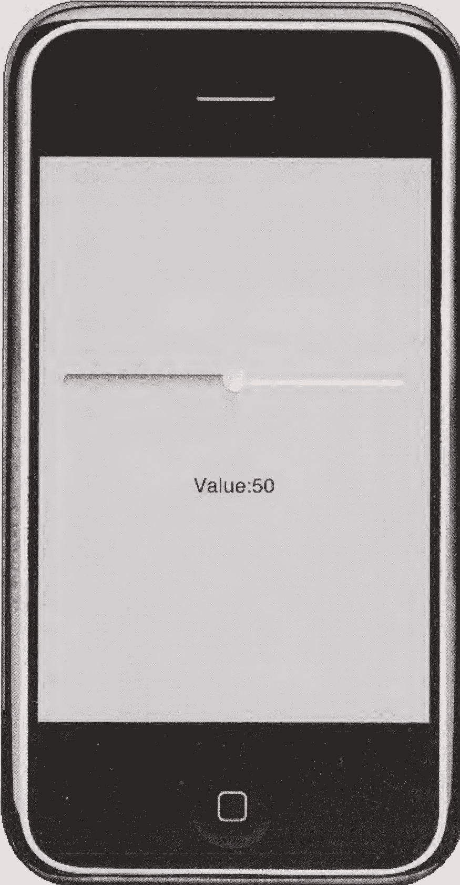

图 12.2

`UISlider` 属性

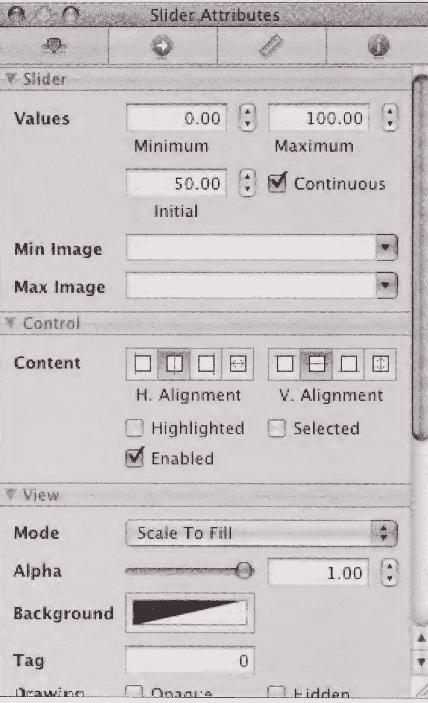

最小值和最大值表示滑块可以表示的最小最大值。Interface Builder 中的 Initial value 属性映射到类上的 `value` 属性，并代表滑块设置的初始值。要通过编程方式设置此值，你需要使用 `value` 属性。

在自定义 `UISlider` 的外观时，有几个属性可以用来更改它的外观。最常用的可能是最小和最大图像（minimum and maximum images）。这些图像放置在滑块最小值和最大值的下方，可以用于显示表示这些位置数值的图标。例如，如果这是一个音量滑块，你可能在一端有一个较小的扬声器，另一端有一个较大的扬声器。你还可以自定义用于实际调整值的旋钮（knob）外观。这个旋钮被称为 thumb，可以使用 `thumbImageForState` 属性进行自定义。

> 可以为控件上的各种状态设置 thumb 和 track 图像。这些状态代表选中状态（selected state）、高亮状态（highlighted state）和普通状态（normal state）。

最后，你还可以通过设置 `trackImageState` 来自定义轨道本身的外观。在自定义 track 图像时，你可以自定义 track 图像或最大 track 图像，它们对应于 thumb 低值侧的轨道部分与高值侧的轨道部分。记住，track 图像必须能够拉伸以填充轨道端点与 thumb 当前位置之间的区域，因此请确保你的图像可以适当拉伸。

### 更新 `UISlider` 的状态

当用户调整 `UISlider` 时，它会向你定义的 IBAction 发送消息。如果你选择了连续更新，它在用户滑动控件时会不断发送这些消息；在非连续更新的情况下，则在用户完成更新控件并抬起手指时发送消息。你可以使用这个 IBAction 来读取滑块的值，并设置你分配的任何属性。

# 使用 `UITabBar`

`UITabBar` 组件非常很有趣，因为它的功能与 `UINavigationBar` 类似。也就是说，它不仅仅是你放在 UI 上的一个图形组件。它还通过为你的视图控制器抽象导航 UI，为你管理了一种导航隐喻，这些控制器随后控制 `UITabBar` 显示的视图。图 12.3 显示了 UI 中典型的 `UITabBar`。

图 12.3

典型的 `UITabBar`

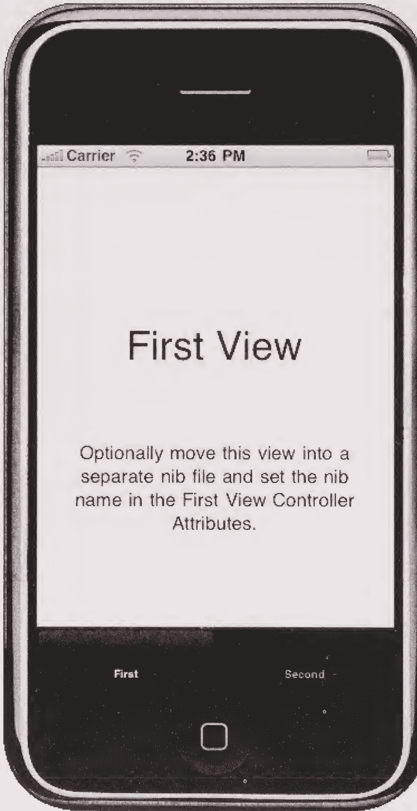

## 通过 Interface Builder 配置 `UITabBar`

与 `UINavigation` 类似，你实际上主要通过 `UITabBarController` 与 `UITabBar` 交互。要向接口中添加 `UITabBarController`，你可以在 Interface Builder 中拖放并放出一个新的 `UITabBarController`（如图 12.4 所示），它包含一个带有 `UITabBar` 的视图，你可以将该视图作为子视图添加到你的主视图中。`UITabBarController` 是 `UI` 的子类，此外，你也可以像实例化 `UIView` 一样，通过代码来实例化 `UITabBarController`。

> 注意
>
> `UITabBarController` 旨在用于直接使用，而不要对其子类化。

## 为 `UITabBar` 配置 `UITabBarItems`

就像 `UINavigationController` 处理其 `UINavigationItems` 一样，`UITabBarController` 拥有 `UITabBarItems`，这些项通过向 `UITabBarController` 的 `viewControllers` 属性添加新的 `UIViewController` 被添加到 `UITabBarController` 中。`UITabBarController` 还有一个名为 `setControllers:animated;` 的方法，它允许你在设置 `controllers` 属性的同时传递一个参数，以决定添加新视图时是否执行动画。

> 注意


> 如果你在 `UITabBarController` 上设置的控制器数量超过了显示范围，`UITabBarController` 会显示标准的“更多（More）”`UITabBarItem`，允许用户自定义显示哪些 `UITabBarItems`。这种行为可以使用 `UITabBarController` 的 `customizableControllers` 属性进行自定义。

默认情况下，`UITabBarController` 会为每个添加到基于标题的 `UITabBarController` 的 `UIViewController` 创建 `UITabBarItem`。这个默认的 `UITabBar` 项不包含图像，但会显示所管理的 `UIView` 的 `title` 属性。

为了为 `UITabBarController` 配置图像，你的 `ViewController` 应该创建一个带有所需图像的自定义 `UITabBarItem`，并将其存储在 `tabBarItem` 属性中。

> **注意**
>
> 显示在 `UITabBar` 上的图像应约为 30x30 像素。图像显示时不颜色，使用图像的 alpha 通道在 `UITabBar` 上创建剪影效果。

图 12.4

Interface Builder 中的 `UITabController`

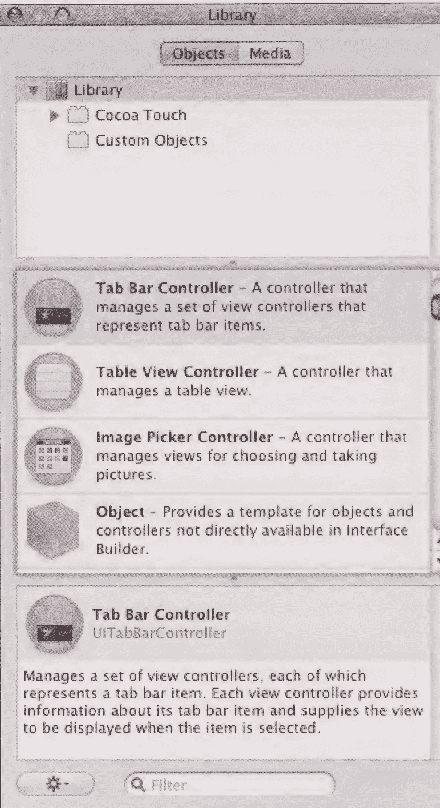

# 第 12 章：与其他控件交互

一旦完全配置完成，`UITabController` 会在你用户界面的底部显示一个 `UITabBar`。当用户触摸 `UITabBar` 上的单独项时，它会显示与该特定 `UITabBar` 项关联的控制器的根视图。

# 配置高级 TabBars

你可以通过利用 `UITabControllerDelegate` 来进一步自定义 `UITabBarController` 的行为。`UITabControllerDelegate` 协议定义了方法，允许你确定用户是否应该选择特定的标签栏项，或者在标签项被选中时采取操作。`UITabControllerDelegate` 协议还定义了事件，当用户通过“更多（More）”`UITabBarItem` 开始自定义 `UITabBarItems` 时会触发这些事件。

有关此行为的更多信息，请参阅 `UITabControllerDelegate` 的类文档。

## 使用 UIPickerView

在本章中你将看到的最后一个组件是 `UIPickerView`。`UIPickerView` 是一个非常有研究价值的组件，因为它既有代理接口，又有数据源接口。这是 Cocoa 和 Touch 中使用的一种非常常见的模式。`UIPickerView` 组件允许用户从可能的选项列表中进行单项选择。

### 注意事项

`UIDatePicker` 类看起来与 `UIPickerView` 非常相似，但它并不是子类，也不允许像 `UIPickerView` 那样的自定义。`UIDatePicker` 在选择日期方面表现得很好，但 `UIPickerView` 被设计成一个更通用且可定制性更高的组件。

### 通过 Interface Builder 配置 UIPickerView

就像我提到的其他组件一样，你可以将 `UIPickerView` 组件拖放并放置在你想要显示它的 UI 任何位置。通常，你需要将一个 `IBOutlet` 连接到 `UIPicker`，并将 `UIPicker` 的代理和数据源输出口连接到处理这些职责的对象。

在 Interface Builder 中，唯一真正可自定义的属性是决定 `UIPickerView` 是否显示选择指示器。相反，`UIPickerView` 的大部分自定义来自于代理和数据源。

## 创建 UIPickerViewDataSource

`UIPickerView` 在你的 UI 中看起来像一个桶形的拨盘，你可以旋转它来选择特定值。桶被分成称为“组件（components）”的部分。通过这种方式，你可以允许用户使用不同的组件同时配置多个不同的值。例如，你可以有一个组件来代表数字选择中的百位、十位和个位。这比让用户显示一个包含 1 到 1000 数字的单个组件要简单得多。

`UIPickerDataSource` 的工作与你目前看到的数据源稍有不同，它本身实际上并没有呈现 `UIPickerView` 中显示的数据，而是只配置 `UIPickerView` 的组件和行数。`UIPickerView` 中显示的实际数据是从代理获取的。

要配置 `UIPickerView` 上的组件数量，请在你的 `UIPickerViewDelegate` 上实现 `numberOfComponentsInPickerView:` 方法。再次，此方法应该返回你想显示的组件数量。所以，按照你之前的示例，如果你想为数字的百位、十位和个位每个显示一个组件，那么组件的数量就是三个。

要配置你给定组件中的行数，请实现 `pickerView:numberOfRowsInComponent:` 方法。继续沿之前的示例，为了在每个组件中显示十个数字（0-9）作为行数。

列表 12.1 显示了这两个方法的实现。

### 12.1：UIPickerViewDataSource 的实现

```
(NSInteger)numberOfComponentsInPickerView:(UIPickerView *)pickerView
    return 3;
```

```
(NSInteger)pickerView:(UIPickerView *)pickerView
numberOfRowsInComponent:(NSInteger)component
    return 10;
```

这些是极其简单的示例，但我将它们包含在这里是为了让你看到完整的方法签名。

## 创建 UIPickerView 代理

在 `UIPickerView` 中，代理是提供在行中显示的实际数据的实体。你可以实现 `pickerView:titleForRow:forComponent:` 方法或 `pickerView:viewForRow:forComponent:reusingView:` 方法，这些方法分别返回在给定组件的给定行中显示的文本，或者返回用于显示该组件该行的实际完整视图。

按照我之前的示例，你可以实现 `pickerView:titleForRow:forComponent:` 方法，使其返回从零到九的数字，取决于所请求的行。这在列表 12.2 中所示。

列表 12.2：UIPickerViewDelegate 代码

```
- (NSString *)pickerView:(UIPickerView *)pickerView
    titleForRow:(NSInteger)row
    forComponent:(NSInteger)component
{
    return [NSString stringWithFormat:@"%ld", row];
}
```

这里重要的一点是，`UIPickerView` 询问数据源组件的行数。然后它询问代理在每一行中显示什么标题。

进一步的自定义（例如组件和行的宽度和高度）也可以通过在代理上实现 `pickerView:widthForComponent:` 和 `pickerView:rowHeightForComponent:` 方法来完成。

最后，当用户从 `UIPickerView` 选择一个项目时，`pickerView:didSelectRow:inComponent:` 方法位于你的代理中，这让你有机会获取选中的行并将其设置到模型中或采取其他操作。

### 总结

通过查看在你的 iPhone 应用程序界面中使用的这不同类型的组件，你已经了解了三种不同的 UI 组件设计模型。

第一种（通过使用 `UISlider` 展示）是最基本的。像按钮、标签、开关等元素都遵循相同的模型。你将它们放置在视图上，对其进行配置，你可能会将它们附加到 `IBAction`，或者你可能有一个 `IBOutlet` 让你以后设置它们的值或读取它们的值。

第二种（通过使用 `UITabBar` 展示）展示了一个视图及其辅助视图控制器，它控制一组子视图控制器，并提供了一个一致的导航模型来查看每一个子视图控制器。

最后，`UIPickerView` 利用代理和数据源允许你配置组件的外观和行为。

在这三种不同类型的组件之间，你应该能够将在这里学到的知识应用于你在 Interface Builder 中找到的其他组件上。

## 处理文本输入

大多数应用程序都允许使用某种形式的文本输入。无论是文本、电话号码还是其他，在你作为 iPhone App 开发者的职业生涯中，你很可能会经常处理文本输入。

iPhone 的另一个独特特性是它的屏幕键盘。通过使用它，iPhone 可以适应显示不同类型的字母、符号等。该文本系统提供了开发者可以利用的各种功能，允许他们选择大写字母类型、显示的字母类型以及使用的自动纠正类型等。

在本章中，你将查看如何通过 Interface Builder 和代码来配置键盘。你还将查看如何处理与键盘相关的事件，例如当文本更改时或用户完成编辑时。完成后，你将牢牢掌握如何在 iPhone 应用程序中处理文本。

## 通过 Interface Builder 配置键盘


Cocoa Touch 中有两个专门设计用于处理文本录入的 UI 组件：`UITextField` 和 `UITextView`。`UITextField` 设计用于处理单行文本输入，而 `UITextView` 设计用于处理多行文本。两者都遵循 `UITextInputTraits` 协议，这意味着它们能够配置用于输入文本的键盘类型。

在我讨论通过代码配置文本时，我会更多地介绍 `UITextInputTraits`。对于这一部分，你将查看如何通过 Interface Builder 配置文本字段上的键盘。你并不一定知道它是如何工作的；你只需要知道它是如何运作的。

| 学习如何处理文本输入和文本字段 |
| :--- |
| 配置屏幕键盘 |
| 理解 `UITextInputTraits` |
| 使用代理处理键盘事件 |

### 注意

为了演示如何通过 Interface Builder 设置文本字段，我向你展示的大多数截图都使用了 `UITextField`。你应该意识到，我向你展示的关于配置文本行为的内容同样适用于 `UITextView`。

### 注意

`UIWebView` 不支持设置 `UITextInputTraits`，但你可以通过 HTML 代码中输入字段的属性，在 WebView 中使用的 HTML 内部设置一些 `UITextInputTraits` 属性。

图 13.1 显示了一个带有文本字段的视图。它并没什么特别的，但这正是你将要使用的。

图 13.1

带有 `UITextField` 的 Interface Builder

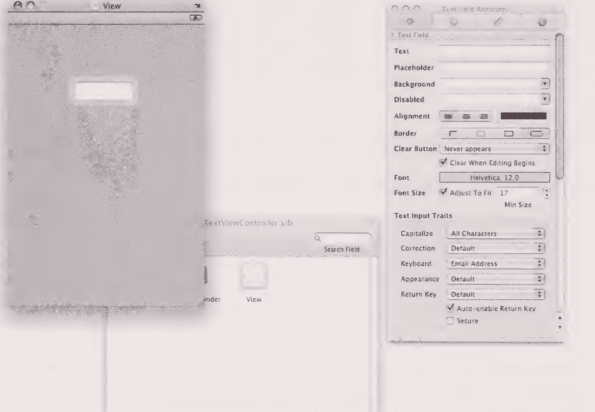

当你选中 TextField 时，你感兴趣的配置项将显示在属性窗口中。它们是输入特性值。

## 配置大写字母

当你查看 Interface Builder 中的文本输入属性配置项（如图 13.2 所示）时，你可以看到你将要针对文本输入配置的内容。我首先要说的是大写字母转换。

图 13.2

Interface Builder 中的文本输入特性属性

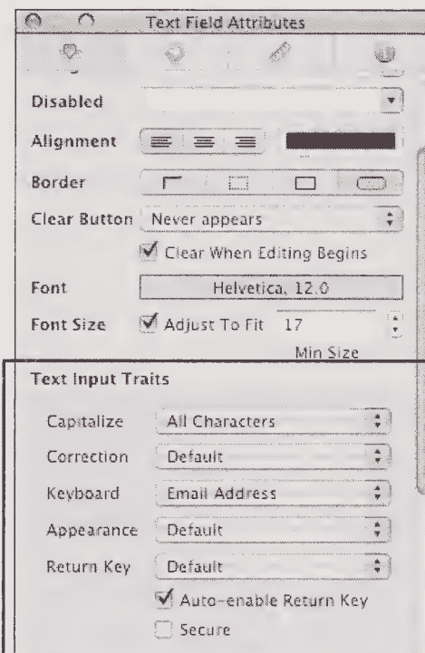

文本输入上的大写字母转换可以配置为：单词、句子、无或全部。在单词大写的情况下，句子中每个单词的首字母都会大写。在句子大写的情况下，每个句子的首字母大写。自然地，在“全部”或“无”的情况下，此设置将控制字段中的所有文本是完全大写，还是没有任何字母大写。当然，用户可以通过按下键盘上的 Shift 键在很大程度上覆盖这些设置。

## 启用和禁用自动纠正

下一个要查看的设置是自动纠正。你可以通过设置 `autocorrectionType` 属性来启用或禁用自动纠正。当启用自动纠正时，用户在打字时会收到建议，如果她不想出现建议的纠正，那么她需要触摸单词所在的屏幕以移除建议的纠正。如果你禁用自动纠正功能，用户在打字时不会收到任何建议，输入框也不会尝试补全她正在打的单词。对于你认为单词通常不会出现在 iPhone 字典中的字段（例如网站的 URL 等术语），这是一个好主意。


> **注意**
>
> 如果用户禁用了自动纠正，那么在打字时就不会收到建议。这很有用的。

## 设置键盘类型

下一个设置是键盘类型。图 13.3 显示了你可以选择的各种键盘类型。

图 13.3

显示不同类型的键盘

| 默认 | URL | 邮件地址 | 电话簿 | 数字 | 数字和标点 |
| :--- | :--- | :--- | :--- | :--- | :--- |
| QWERTY | QWERTY | QWERTY | 电话键盘 | 数字键盘 | 数字和标点键盘 |

## 设置 Return 键的行为

Return 键显示的文本也可以进行自定义。它可以设置为“完成”等。你应该根据应用程序的需要配置此文本。定义在 `UITextInputTraits` 上的属性是 `returnKeyType`。

## 查看其他设置

最后，让我们看看几个可用设置。如果你将一个文本字段设置为 `secureTextEntry`（安全），那么在你打字时，文本字段将不再显示字母，而是每个字母显示圆圈。这适用于密码，防止在打字时泄露密码。

你有自动启用和禁用 Return 键的能力。当你启用此框时，如果用户没有在文本字段中输入任何内容，他就无法按下 Return 键。一旦他在文本字段中输入了内容，他就可以按下 Return。这对于限制输入以确保用户输入特定值而非空白非常有用。

你可以设置通用的“外观”设置，这本质上决定了键盘是用于警报消息还是普通输入。报警消息在 iPhone 上的颜色与普通输入屏幕不同；因此，在使用时你可能希望键盘具有这种外观。

## 通过代码操作键盘

你已经学习了如何通过 Interface Builder 处理文本输入属性。你已经看到只需将文本字段拖到表单上就足以让键盘在用户触摸字段时显示。现在让我们查看如何通过代码强制显示键盘，以及我们如何通过代码操纵 `UITextInputTraits`。

## 让键盘出现

到目前，你可能已经看到如果你将一个 `UITextField` 放到界面上并允许用户触摸它，它会自动显示键盘。但如果你想在视图显示时立即、或者在用户触摸 UI 中其他地方时强制显示键盘呢？方法是简单地将你的文本字段设置为第一响应者。

# 164 构建 GUI


# 处理文本输入与 Core Animation

## 响应者链与键盘控制

记住 Cocoa 和 Cocoa Touch 包含了响应者链（responder chain）的概念。响应者链是一个处理用户输入的用户界面元素列表。第一响应者（first responder）是当前获得焦点的 `UIView`。当一个 `UITextView` 成为第一响应者时，它会根据其 `UITextInputTraits` 创建并配置键盘，显示该键盘。因此，强制显示 `UITextView` 键盘的方法是在 `UITextView` 上调用 `becomeFirstResponder` 方法。

### 显示键盘

```
(void)showKeyboard
{
    [myTextField becomeFirstResponder];
}
```

同样，要隐藏键盘，你只需要使用 `resignFirstResponder` 方法取消第一响应者。

### 隐藏键盘

```
(void)dismissKeyboard
{
    [myTextField resignFirstResponder];
}
```

这适用于 `UITextField` 或 `UITextView`。

## 理解 UITextInputTraits

到目前为止，你所做的工作都与使用 `UITextField` 和 `UITextView` 相关，而且你通过 Interface Builder 配置的所有项也可以通过这些类上的属性进行配置。这些类拥有这些属性的原因是因为它们都遵循了 `UITextInputTraits` 协议并实现了该协议中指定的属性。

如果你需要创建一个支持文本输入的自定义视图，你也应该实现此协议。下表显示了该协议定义的属性。

### 表 13.1 在 UITextInputTraits 协议上定义的属性

| 属性定义 | 目的 |
| --- | --- |
| `@property (nonatomic) UITextAutocorrectionType autocorrectionType` | 配置自动纠错类型 |
| `@property (nonatomic) UITextAutocapitalizationType autocapitalizationType` | 配置自动大写类型 |
| `@property (nonatomic) BOOL enablesReturnKeyAutomatically` | 定义 Return 键是否自动启用和禁用 |
| `@property (nonatomic) UIKeyboard keyboardAppearance` | 配置键盘外观 |
| `@property (nonatomic) UITextType keyboard` | 配置键盘 |
| `@property (nonatomic) UITextKeyType returnType` | 配置 Return 键类型 |
| `@property (nonatomic, getter=isSecureTextEntry) BOOL secureTextEntry` | 定义文本字段是否为安全的 |

在任何实现 `UITextInputTraits` 协议的元素上设置这些属性，应该允许你如所示配置这些值。

## 处理键盘的事件

键盘提供了多种事件，你可以监控这些事件以便在特定条件下采取行动。例如，当键盘显示时你会收到通知，这样你就可以将视图移出键盘遮挡区域；或者当用户完成编辑时收到通知，这样你就可以找到字段数据并对其进行处理。`UITextField` 支持配置 `UITextFieldDelegate`，这允许你自定义输入行为，以控制诸如用户是否能够开始编辑、完成编辑或更改字段中的特定字符等内容。

让我们看看如何处理这些通知和代理方法。

### 创建 UITextFieldDelegate

由于大多数应用程序都希望在用户完成文本编辑时收到通知，你可能想在你的应用程序中实现 `UITextFieldDelegate` 或 `UITextDelegate`。这两者之间的实现略有不同，为了演示起见，我将关注 `UITextFieldDelegate`。

### 得知文本何时变化

通常，你会将视图控制器设置为视图上字段的 `UITextFieldDelegate`。你感兴趣的要实现的最重要的方法是 `textFieldShouldBeginEditing` 和 `textFieldDidEndEditing`。这些方法在文本字段被要求取消第一响应者之前和之后被调用。`textFieldShouldBeginEditing:` 方法为应用程序进行输入验证提供了一个极佳的钩子，用于判断你是否允许用户关闭键盘并继续工作。`textFieldDidEndEditing` 方法为你提供了一个极佳的位置从文本字段中获取数据并更新你的模型。

### 表 13.2 UITextFieldDelegate 协议上定义的一些其他方法

| 方法签名 | 目的 |
| --- | --- |
| `(BOOL)textField:(UITextField*)textField shouldChangeCharactersInRange:(NSRange)range replacementString:(NSString*)string` | 当用户在文本字段中输入新字符时调用此方法，并给了你一个机会阻止该字符被输入。 |
| `(void)textFieldDidBeginEditing:(UITextField*)textField` | 此方法在文本字段成为第一响应者后被调用。 |
| `(void)textFieldDidEndEditing:(UITextField*)textField` | 此方法在文本字段取消第一响应者后被调用。 |
| `(BOOL)textFieldShouldBeginEditing:(UITextField*)textField` | 此方法在文本字段成为第一响应者之前被调用。 |
| `(BOOL)textFieldShouldClear:(UITextField*)textField` | 此方法响应 `UITextField` 内置的清除按钮而被调用。 |
| `(BOOL)textFieldShouldEndEditing:(UITextField*)textField` | 此方法在文本字段取消第一响应者之前被调用。 |
| `(BOOL)textFieldShouldReturn:(UITextField*)textField` | 此方法在用户按下 Return 键时被调用，并给了你一个机会阻止其这样做。 |

## 当用户完成编辑时采取行动

再次，这些方法中最重要的可能是 `textFieldDidEndEditing` 方法，它允许你在用户完成文本字段编辑时收到通知，从而获取文本字段中的值并设置到你的一个模型对象上。

下面显示了如何处理已取消第一响应者的文本字段。

### 处理用户完成编辑

```
(void)textFieldDidEndEditing:(UITextField*)textField
{
    [self setValue:[textField text]];
}
```

## 响应键盘移动你的视图

当键盘滑入视图时，它会发布多种类型的通知。这些通知见下表。

### 表 13.3 键盘显示和隐藏时发送的通知

| 通知 | 目的 |
| --- | --- |
| `UIKeyboardWillShowNotification` | 此通知在键盘显示之前发送。 |
| `UIKeyboardDidShowNotification` | 此通知在键盘显示后发送。 |
| `UIKeyboardWillHideNotification` | 此通知在键盘消失之前发送。 |
| `UIKeyboardDidHideNotification` | 此通知在键盘消失后发送。 |

处理文本字段时，需要执行的最常见任务之一是在键盘滑入视图时将视图移动到合适的位置。要这样做，配置你的视图监听 `UIKeyboardDidShowNotification`，当它发生时，你的视图仍在键盘上方。

在竖屏模式下，键盘高度为 216 像素。在横屏模式下，键盘高度为 162 像素。当发布显示和隐藏通知时，包含的字典包含了将显示的键盘的大小。你可以根据这些信息调整光标。下面显示了如何处理此事件的示例。

### 为键盘留出空间移动视图

```
- (void)viewDidLoad
{
    // 其他初始化 ...
    NSNotificationCenter *ctr = [NSNotificationCenter defaultCenter];
    [ctr addObserver:self selector:@selector(handleShowKeyboard:)
                name:UIKeyboardDidShowNotification object:nil];
    [ctr addObserver:self selector:@selector(handleHideKeyboard:)
                name:UIKeyboardDidHideNotification object:nil];
}

- (void)handleShowKeyboard:(NSNotification *)inNotification {
    NSDictionary *userInfo = [inNotification userInfo];
    NSValue *kbBounds = [userInfo objectForKey:UIKeyboardBoundsUserInfoKey];

    [UIView beginAnimations:@"MOVING FOR KB" context:nil];
    CGRect currentFrame = [textField frame];
    currentFrame.origin.y = [kbBounds CGRectValue].size.height;
    [textField setFrame:currentFrame];
    [UIView commitAnimations];
}

- (void)handleHideKeyboard:(NSNotification *)inNotification {
    NSDictionary *userInfo = [inNotification userInfo];
    NSValue *kbBounds = [userInfo objectForKey:UIKeyboardBoundsUserInfoKey];

    [UIView beginAnimations:@"MOVING FOR KB" context:nil];
    CGRect currentFrame = [textField frame];
    currentFrame.origin.y += [kbBounds CGRectValue].size.height;
    [textField setFrame:currentFrame];
    [UIView commitAnimations];
}
```

## 总结

在本章中，你广泛地浏览了 iPhone 如何处理文本输入。你学习了如何为不同类型的文本输入自定义键盘。你学习了如何显示和隐藏键盘。你还了解了如何处理与键盘相关的事件，以便在键盘显示时恰当地调整你的 UI 等。你还学习了如何实现 `UITextFieldDelegate` 以处理用户的输入，以及如何在需要时验证输入并防止用户退出文本输入字段。

利用这些功能，你可以构建出高效利用文本输入的应用程序，让用户更方便地向你的应用输入数据。

---

# 使用 Core Animation 构建电影级 UI

iPhone UI 的基石之一是利用动画来构建 Apple 所说的“电影级用户体验”（Cinematic User Experience）。电影级用户体验本质上是指用户元素并非简单地弹出，而是通过动画滑动、淡入或其他过渡方式移动到位置。对动画的审慎使用为用户界面元素赋予了某种“分量感”。由于使用了动画，它们感觉起来更加真实。这使得 UI 变得更加直观、更易于使用。

由于动画在 iPhone OS 中无处不在，Apple 为你提供了几个非常方便的 API，用于在应用程序中使用动画。

在本章中，我将介绍这些技术的每一个，并展示如何将它们应用到你的应用程序中。

## 本章内容

- 使用 `UIView` 类方法制作用户界面元素动画
- 使用 `CALayer` 执行更复杂的关键帧动画
- 使用 `UIImageView` 动画图像显示渲染后的动画

## 使用 UIView 动画方法

在 iPhone OS 3 中实现动画的第一种最简单的方法是使用 `UIView` 类内置的功能。

`UIView` 类包含了几个类方法，你可以使用它们对你的视图进行简单动画。由于所有的用户界面元素都继承自 `UIView`，这意味着这种功能已经内置在你的所有应用中了；你只需要使用它，而且使用它实际上非常简单。

Core Animation 方法的工作原理是在代码中通过 `UIView` 类方法 `beginAnimations:context:` 和 `commitAnimations` 设置动画块（blocks）。然后，你在该块内对 `UIViews` 进行的任何更改（例如移动、调整大小或更改颜色），系统都会自动为你制作动画。就是如此简单！当你为应用程序中的 UI 元素重新定位动画时，这种方法非常强大且易用。

由于代码通常比描述更容易理解，让我们来看一个示例：你想将一个按钮从一个位置移动到另一个位置，但你想让这个动作产生动画。

### 使用动画移动按钮

```
(void)moveButton {
    [UIView beginAnimations:@"BUTTONMOVING" context:nil];
    [UIView setAnimationDuration:3.0];
    [UIView setAnimationDelegate:self];
    [UIView setAnimationDidStopSelector:@selector(animation:didFinish:context:)];
    [button setCenter:CGPointMake(160, 240)];
    [UIView commitAnimations];
}
```

> **注意**
>
> 代码中的参数 `@"BUTTONMOVING"` 是此动画的唯一标识符。你可以使用任何内容，并在后续的动画代理方法中识别特定的动画。

在这种情况下，你正在执行的动画非常简单。基本上，这段代码的意思是：“在 3 秒内将按钮移动到位置 160, 240。当动画完成后，调用你 self 对象上名为 `animation:didFinish:context:` 的方法”。

理解这段代码的关键点是：动画块是由 `beginAnimations` 调用到 `commitAnimations` 之间的范围定义的。在这两次调用之间对 `UIViews` 属性的任何更改都会被动画化。在这一特定情况下，你只更改了按钮的中心位置。然而，你也可以进行更复杂的操作，比如更改帧（frame），或更改 alpha 透明度来实现淡入效果。

你通过 `UIView` 类的类方法来设置动画本身的属性。配置动画的 `UIView` 类可用方法见下表。

### 表 14.1 UIView 动画方法

| 方法 | 用途 |
| --- | --- |
| `+(void)beginAnimations:(NSString*)animationID context:(void*)context` | 调用此方法将开始一个动画块。在此调用之后、`commitAnimations` 调用之前的进行的任何调用都将应用于当前动画块。 |
| `+(void)commitAnimations` | 调用此方法将关闭动画块并开始执行动画。 |
| `+(void)setAnimationStartDate:(NSDate*)startTime` | 此方法用于设置动画在未来的某个时间点开始，而不是在调用 `commitAnimations` 之后立即开始。 |
| `+(void)setAnimationEnabled:(BOOL)enabled` | 此方法禁用动画。 |
| `+(void)setAnimationDelegate:(id)delegate` | 此方法设置动画代理，该代理将在动画完成时接收事件。 |
| `+(void)setAnimationWillStartSelector:(SEL)selector` | 此方法设置在动画开始前将在代理调用的选择器（selector）。 |
| `+(void)setAnimationDidStopSelector:(SEL)selector` | 此方法设置在动画完成后将在代理调用的选择器（selector）。 |
| `+(void)setAnimationDuration:(NSTimeInterval)duration` | 此方法设置动画的持续时间。 |
| `+(void)setAnimationDelay:(NSTimeInterval)delay` | 此方法配置动画在给定延迟后开始，而不是立即开始。 |
| `+(void)setAnimationCurve:(UIViewAnimationCurve)curve` | 此方法配置所需的动画曲线。 |
| `+(void)setAnimationRepeatCount:(float)repeatCount` | 此方法配置动画重复指定的次数。 |
| `+(void)setAnimationRepeatAutoreverses:(BOOL)repeat` | 此方法配置动画在完成后自动反向运行。 |
| `+(void)setAnimationBeginsFromCurrentState:(BOOL)fromCurrentState` | 此方法配置动画从当前状态开始。其默认值为 NO，此选项仅在你开始一个动画而另一个动画正在执行时相关。如果你将其设置为 YES，则你即将开始的动画起始位置将是当前正在执行动画的位置。默认值允许在前一个动画完成后再开始新动画。 |
| `+(void)setAnimationTransition:(UIViewAnimationTransition)transition forView:(UIView*)view cache:(BOOL)cache` | 此方法允许你使用标准视图动画之一制作从一个视图到另一个视图的过渡，例如从左向右翻或反之。 |


## 表 14.2 动画曲线类型

| 类型 | 用途 | 图表 |
|---|---|---|
| `UIViewCurveEaseInOut` | 这是默认的动画曲线。该曲线定义为开始时缓慢，在动画中间加速到全速，然后在结束时再次减慢。 | ![image] |
| `UIViewCurveEaseIn` | 这种动画曲线定义为开始时缓慢，在中间加速，直到结束时保持速度。 | ![image] |
| `UIViewCurveEaseOut` | 这种动画曲线定义为：从全速开始，然后在到达动画结束时逐渐减速。 | ![EaseOut 图表] |
| `UIViewCurveLinear` | 这种动画曲线定义为在整个持续期间保持恒定的速度。 | ![CurveLinear 图表] |

## 第 14 章：使用 Core Animation 构建具有电影感的 UI 界面

在处理动画时，另一个经常需要的任务是与动画何时完成有关。动画本身是在应用程序的运行循环（`run loop`）中异步执行的。这意味着你不能简单地告诉它开始动画，然后等待动画完成。当你的应用程序执行其他操作时，动画正在运行。这意味着你需要知道动画何时完成，以便执行任何收尾任务，例如启动另一个动画或移除一个已经淡出的视图。

为此，你通过将动画块的代理（`delegate`）配置为响应这些事件的实例。然后，你在该代理上配置一个选择器（`selector`），以便在动画完成后调用它。你通过调用 `setAnimationDelegate:` 和 `setAnimationDidStopSelector:` 方法来实现这一点。

让我们来看一个示例：你希望按钮飞出屏幕，然后被移除。在这种情况下，你将让动画缓慢开始，加速到全速，并保持全速直到结束。通过这样，按钮看起来就像是有重量的——在开始移动时需要获得动量，而一旦动起来，就消失了。列表 14.2 显示了这段代码的实现。

### 列表 14.2：动画移除按钮

```objc
- (void)removeButton {
  [UIView beginAnimations:@"BUTTONMOVING" context:nil];
  [UIView setAnimationDelegate:self];
  [UIView setAnimationDidStopSelector:@selector(animation:didFinish:context:)];

  // 这是在设置曲线
  [UIView setAnimationCurve:UIViewAnimationCurveEaseIn];

  // 将按钮位置设置在屏幕外的某处
  [button setCenter:CGPointMake(480, 720)];

  [UIView commitAnimations];
}
```

现在有趣的地方在于，由于你正在从屏幕上移除此按钮，你还希望在动画完成后将其也从视图层级（`view hierarchy`）中移除。如果你在这个方法中直接从视图层级中移除按钮，你就看不到动画效果，因为移除按钮的操作发生在动画实际开始之前。记住，动画是在退出此方法后，在你的运行循环中异步启动的。因此，你需要被通知动画已完成。然后，在该方法中你再从视图层级中移除按钮。

为了在动画完成时收到通知，你使用 `setAnimationDidStopSelector:` 方法设置动画“停止选择器”，该方法接受一个代理选择器作为参数，该选择器将在动画停止时被调用。然后你在实现中实现该方法，将按钮从其父视图中移除。列表 14.3 显示了如何操作。

### 列表 14.3

```objc
- (void)animation:(NSString *)inAnimationID
    didFinish:(NSNumber *)inFinished
    context:(void *)context
{
  // 动画已完成，因此移除按钮
  [button removeFromSuperview];
}
```

当你想要将用户界面从一个 `UIView` 翻转到另一个 `UIView` 时，可以使用 `UIView` 动画块；你可以使用 `AnimationTransition:forView:cache:` 方法来配置从一个视图到另一个的过渡。这在 iPhone OS 2.0 下是一个非常常见的需求，即当你想要显示用于配置设置的用户界面翻转面时。iPhone OS 3.0 引入了 `ViewController` 属性 `modalStyle`，使得这种方法不再那么必要，但它仍然是一项非常有价值的技术，无论是对于旧设备，还是对于没有关联视图控制器的视图进行翻转过渡。

使用动画过渡在两个 `UIView` 之间进行切换涉及几个步骤。首先，你必须创建一个实际执行过渡的容器视图（`container view`）。你将当前显示的 `UIView` 添加到容器视图并显示它。当你想要切换视图时，使用类方法 `beginAnimations:context:` 开始你的动画块。真正的动作发生在这个块内部。在该块中，你使用 `setAnimationTransition:forView:` 方法将动画过渡设置为你想要的过渡类型（左翻转、右翻转等）。然后你从容器视图中移除子视图并添加你的新子视图。当你提交动画时，过渡就会发生。列表 14.4 显示了这一过程。

### 列表 14.4：动画化从一个视图到另一个视图的翻转过渡

```objc
- (void)flipTransition
{
  [UIView beginAnimations:@"FLIP" context:nil];
  [UIView setAnimationTransition:UIViewAnimationTransitionFlipFromRight forView:containerView cache:YES];

  [currentSubview removeFromSuperview];
  [containerView addSubview:newSubview];
  [UIView commitAnimations];
}
```

你可以看到，这使得基础的 UI 过渡变得非常简单。现在，如果你想要稍微复杂一点呢？我在这里向你展示的动画都是非常基础的。然而，你可能需要的动画类型涉及关键帧（`keyframes`）、复杂的运动等。`UIView` 上的类方法并不非常适合这些。要实现这一点，你需要深入一点，在稍低的水平上工作，并直接与 Core Animation API 配合工作。

## 使用 CALayer 进行高级 Core Animation

正如我之前提到的，`UIView` 动画代码可以处理简单的任务。但如果你想要更复杂的控制呢？例如，如果你想在某个特定的路径上进行动画？通过向你的图层发送消息，你可以让图像沿着特定的路径进行动画。你看到它在弧形中执行，这样就会落入桶。使用 `UIView` 动画块来完成这一点会非常费力。幸运的是，有一个底层 API 允许你做到这一点。

Core Animation 由一组协同工作的类组成，从而能够实现动画。这些类中最核心的是 `CALayer` 类，它提供了一个视图的抽象。所有的 `UIView` 都有一个关联的 `CALayer` 属性，可以对其进行动画处理。要查看一个层，只需调用 `UIView` 实例上的 `layer` 方法。在下面的示例中，你将使用这种能力在特定路径上进行动画。列表 14.5 显示了路径的创建。在其中，你想要从左上角移动到右下角。

### 列表 14.5：路径的创建

```objc
CGPoint startPoint = CGPointMake(20, 20);
CGPoint controlPoint1 = CGPointMake(280, 100);
CGPoint controlPoint2 = CGPointMake(280, 100);
CGPoint endPoint = CGPointMake(300, 440);

CGMutablePathRef path = CGPathCreateMutable();
CGPathMoveToPoint(path, NULL, startPoint.x, startPoint.y);
CGPathAddCurveToPoint(path, NULL,
                      controlPoint1.x, controlPoint1.y,
                      controlPoint2.x, controlPoint2.y,
                      endPoint.x, endPoint.y);
```

图 14.1 显示了你想要展示的路径。

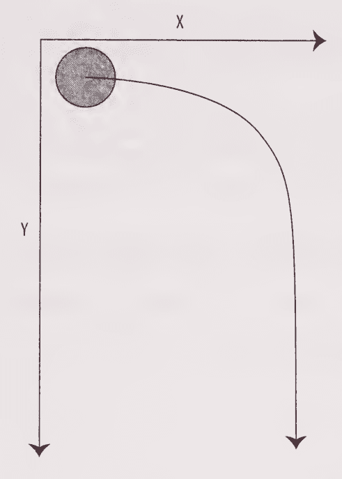

一旦创建路径，就可以创建一个关键帧动画（`keyframe animation`）。现在当你创建此动画时，你必须将动画与层的特定属性关联起来，这样当属性被修改时，动画就会触发。在特定情况下，你将使用“position”属性。这使得当层的位置发生变化时，动画能够运行。这有点反直觉，因为你在创建动画本身时，脑中已经考虑了想要观察的属性。这在列表 14.6 中所示。

### 列表 14.6：创建关键帧动画

```objc
CAKeyframeAnimation *keyFrameAnimation =
[CAKeyframeAnimation animationWithKeyPath:@"position"];
[keyFrameAnimation setDuration:1.0];
[keyFrameAnimation setPath:path];
[keyFrameAnimation setTimingFunction:
[CAMediaTimingFunction functionWithName:CAMediaTimingFunctionEaseIn]];
```

### 注意

这里显示的属性是您想要与此动画关联的层上属性的 KVC（键值编码）描述，在这种情况下，它是 `@"position"`。当该属性被修改时，动画就会触发。

请注意，你为动画设置了路径。你还设置了计时函数，这样动画在开始时会运行得较慢，然后逐渐加速直到完成。

最后，你获取想要动画的图像视图的层（`layer`），并将动画添加到该层中。要让动画触发，你可以使用 `setPosition` 方法，它是你指定的动画应该关联的属性的键路径。在这种情况下，你正在将 `position` 设置为动画的终点。

代码列表 14.7 显示了该方法的最终实现。

### 列表 14.7：让图像视图掉落屏幕底部的动画

```objc
- (void)kerPlunk {
    CGPoint startPoint = CGPointMake(20, 20);
    // ... 后续代码省略
}
```

## 为 UIImageView 添加动画

现在你已经看到了如何直接使用 `UIView` 上的属性进行基础动画，而且当你没有得到想要的结果时，你已经看到可以深入挖掘 API，使用 Core Animation 类来执行更复杂的动画。但如果你想做的动画涉及某些预先渲染并在用户界面中播放会更简单的内容，该怎么办呢？例如，你可能想要有一个渲染好的信箱关闭以及其等待邮件标志弹出的动画。使用动画（`animation`）和变换（`transforms`）来完成这样的动画会相对复杂。相反，让艺术家渲染这样的动画，然后简单地将其作为小电影显示在你的 UI 上将要容易得多。你无法使用 iPhone 的媒体播放功能在按钮上显示电影。那么，你该如何做呢？

答案相对简单。`UIImageView` 具有使用为此提供的单元格（`cells`）对自己进行动画的能力。`UIImageView` 实例方法允许你设置一个可以动画的图像数组。`startAnimating` 方法会让 `UIImageView` 一个地显示动画中提供的单元格，就像播放电影一样。你可以设置动画的持续时间，以及它是否循环。当你想要停止动画时，只需调用 `stopAnimating` 即可。

### 注意

你可以同时配置图像视图的主图像和 `animationImages` 属性。主图像在未进行动画时显示。在大多数情况下，动画图像的质量和分辨率可以比图像视图的主图像低得多。因为正在进行动画，用户的眼睛会补偿质量上的差异。这可以帮助你节省资源。

代码列表 14.8 显示了一个加载了动画单元格并然后进行动画的图像视图。在这种情况下，动画将每秒循环一次，每秒显示 15 帧。

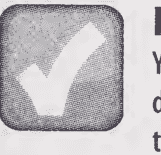

### 列表 14.8：在 UIImageView 中显示动画

```objc
- (void)animatingImageView {
  NSMutableArray *cells = [NSMutableArray array];
  for(int n = 0; n < 15; ++n) {
    NSString *cellName = [NSString stringWithFormat:@"cell%ld.png", n];
    UIImage *cell = [UIImage imageNamed:cellName];
    [cells addObject:cell];
  }
  [imageView setAnimationImages:cells];
  [imageView setAnimationDuration:1.0];
  [imageView startAnimating];
}
```

### 总结

iPhone OS 拥有一套非常强大的工具，能够让你构建动画用户界面。利用这些工具让你能够构建出应用程序，让用户在与你的应用程序交互时，产生直接操作真实对象的幻觉。仔细使用这些功能可以显著增强应用程序的可用性。然而，你应该保持谨慎，不要过度使用它们。通过细致地使用它们，你为用户提供了应用程序中他们在其他情况下无法获得的额外细节。

## 第 15 章：使用 OpenGL ES

### 使用 OpenGL ES

iPhone 让应用程序开发者感到兴奋的特性之一是它附带了优秀的 OpenGL ES 实现。这意味着开发者可以使用 OpenGL ES 的全部力量来开发 2D 和 3D 游戏。为 iPhone 开发的一些最惊艳的应用程序都是使用 OpenGL 开发的。

遗憾的是，OpenGL ES 是一个巨大的课题，我无法在书中进行深入介绍。对于我来说，在一两个章节内以任何水平的专业能力涵盖它是不可能的。

尽管如此，我想至少提供一些关于 OpenGL ES 的信息，让你对它在 iPhone 上的工作有一个基本的了解，然后告诉你可以去哪里获取更多关于 OpenGL ES 的信息。

所以，为了这一点，你将首先查看 iPhone 上 OpenGL ES 的实现，然后查看它的功能以及你如何将其作为应用程序的启动点。

### 理解 OpenGL ES 的功能

在 iPhone 上使用 OpenGL ES 时，你需要知道的第一点是 OpenGL ES 并不是 OpenGL。当你在查找资源时，请确保你查看的是 ES 版本而不是原生的 OpenGL。

接下来需要理解的是，iPhone 的 OpenGL 实现有很多限制，不仅限于 ES 实现。第一个限制是 iPhone 只支持三角形多边形；在构建模型时，你需要确保你的模型使用的是三角形。任何其他形状的多边形都不行。

第二个限制是 iPhone 在图形和 CPU 之间共享内存。这意味着尽管 ES 支持顶点缓冲区对象（`VBOs`），但你实际上并没有获得任何性能提升。这意味着你的应用程序内存和纹理内存是同一个池；它们来自同一个内存池。这意味着当你为 iPhone 3GS 以外的任何设备开发时，你的应用程序和纹理必须控制在 24MB 以内。因此，你还应该考虑使用 `PVRTC` 格式压缩纹理。这是 iPhone GPU 的原生纹理格式。

另一个需要注意的限制是 iPhone 的渲染系统使用了基于瓦片的延迟渲染（`tile-based deferred rendering`）。这是一种优化的渲染系统，通过在上传到 GPU 之前缓存更新并在只有大量数据发送时才更新来保持低内存。这意味着你应该在渲染之前创建并加载所有纹理，并避免更新或修改现有纹理的操作。

虽然这不一定是限制，但你应该尽量避免将 OpenGL 渲染与 `UIKit` 和 `Core Graphics` 渲染混合。OpenGL 针对高性能动画游戏图形优化，而 `UIKit` 针对按需更新和精确绘制操作优化。不要混合两者。

### 本章内容

- 学习 iPhone OpenGL ES
- 探索默认的 ES 应用程序
- 将你的 OpenGL ES 代码与图形硬件接口

### 创建极其简单的 OpenGL 视图

现在让我们来看看如何创建一个使用 OpenGL ES 的应用程序，查看当你创建一个基于 OpenGL 的应用程序时 Xcode 生成的模板代码。

图 15.1 显示了在你创建一个基于 ES 的应用程序后的 Xcode 界面。它包含了项目模板包含的默认文件。


# 15.1 在 Xcode 中创建 OpenGL ES 应用

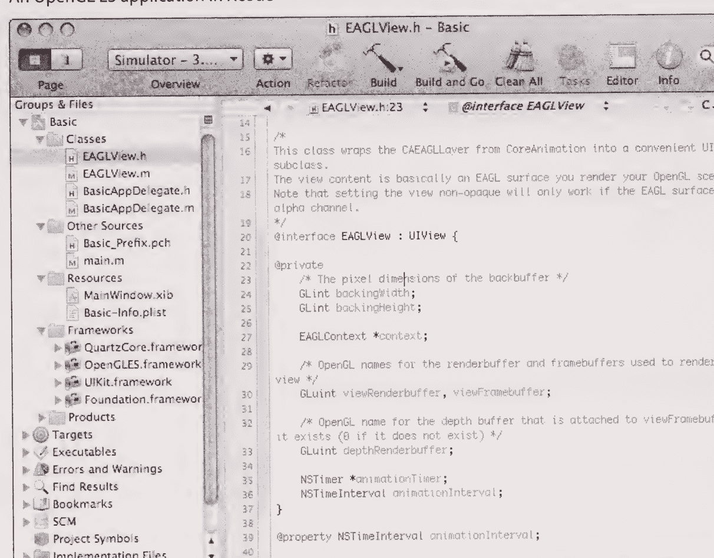

当你使用 OpenGL ES 模板创建应用程序时，你会获得通常的应用程序代理（application delegate）、主窗口等。但你还会获得一个自定义的 `UIView`，它是 OpenGL 视图的封装。该视图包含在 `EAGLView.h` 和 `EAGLView.m` 文件中。它们作为 OpenGL 层的封装，为你提供了一个方便的 `UIView`。你可以非常容易地将这段代码放入你的任何项目中，并将其作为 `UIView` 使用。（但请记住，不要将 OpenGL 视图与 UIKit 视图混合。）

在项目中的 `MainWindow.x` 文件中，你可以看到你有一个 Window 和应用代理。如果你将实例浏览器切换到列表模式（list mode），`UIWindow` 包含一个 `UIView` 子视图。该 `UIView` 的类标识是 `EAGLView`，如图 15.2 所示。

## 图 15.2 加载了视图的 Interface Builder

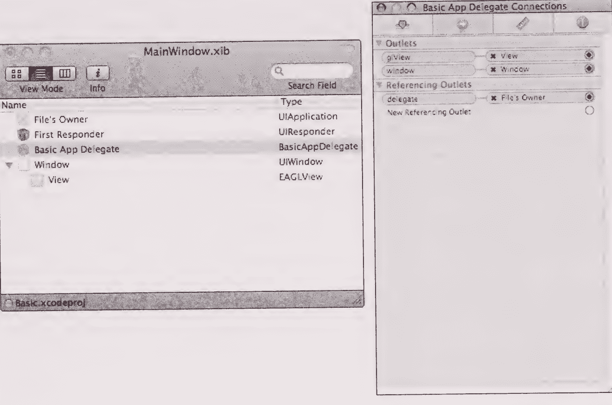

现在来看 `EAGLView` 的实现，让我们看看它是如何实现的，实际的 OpenGL 代码放在哪里。

查看 `EAGLView` 头文件（如列表 15.1 部分所示），你会看到你定义了一个作为成员变量的 `EAGLContext`。关于如何将 OpenGL ES 与 iPhone GUI 接口的大部分工作都是通过 `EAGLContext` 对象调用的。

## 列表 15.1 EAGLView 接口（部分）

```objc
@interface EAGLView : UIView {

@private
  /* 后缓冲器的像素尺寸 */
  GLint backingWidth;
  GLint backingHeight;

  EAGLContext *context;

  /* 用于渲染到视图的渲染缓冲区和帧缓冲器的 OpenGL 名称 */
  GLuint viewRenderbuffer, viewFramebuffer;

  /* 附加到 viewFramebuffer 的深度缓冲器的 OpenGL 名称，
     如果它存在（不存在则为 0） */
  GLuint depthRenderbuffer;

  NSTimer *animationTimer;
  NSTimeInterval animationInterval;

}

@end
```

当你实际渲染视图时，所有的 OpenGL 函数调用都必须相对于 `EAGLContext` 进行。你通过调用 `setCurrentContext:` 来设置当前的 `EAGLContext`，这是 `EAGLContext` 上的一个静态方法。要初始化 `EAGLContext` 对象，你调用 `initWithAPI()`。

> **注意**
>
> `initWithAPI:` 必须带有一个常量调用，以告诉你想要使用的 OpenGL ES API 版本。对于 v1.0，请传递 `kGLRenderingAPIOpenLES1`，这是第一代 iPhone 和 iPod Touch 上可用的 OpenGL ES 版本。iPhone 3GS 增加了对 OpenGL ES 2.0 的支持。要使用它，请在此处将 `kGLRenderingAPIOpenLES2` 作为你的参数传递。

为了实际绘制多边形，你需要使用渲染缓冲区（render buffer）。调用 `renderbufferStorage:fromDrawable:` 替换了传统的 OpenGL 调用 `glRenderbufferStorage`，并为渲染缓冲区分配存储。在将内容绘制到结束缓冲区后，你可以通过调用 `presentBuffer()` 将其显示在屏幕上。

在示例代码中，你可以在 `createFramebuffer` 中看到渲染缓冲区的实际分配。然后，视图的实际绘制发生在 `drawView` 方法中。在 `drawView` 方法的结束处，你可以调用 `presentBuffer:` 将数据发送到屏幕。

如果你想将 OpenGL 代码放在哪里，`drawView` 方法就是它所在的地方。如果你实际上正在绘制 OpenGL 内容，会在将其显示在屏幕上之前进行。

如果你只是想在 OpenGL 屏幕上显示一张静态图像，那么你就完成了。你刚刚显示了该图像。但通常，当你使用 OpenGL 定时器每 1/60 秒移动一次时，你需要动画和动作。该定时器只是简单地调用 `drawView` 方法。这在 `startAnimation` 方法中设置。


这里的关键点是，为了与 OpenGL 系统接口，你需要通过 `EAGLContext` 的当前活动上下文存储并呈现你的渲染缓冲区。一旦你熟悉了这些调用，只需使用标准的 OpenGL ES 代码来渲染你的图形即可。

内置模板为你提供了构建一个骨干 OpenGL 游戏或应用程序几乎所需的所有内容。它为你提供了一个用于渲染和更新游戏逻辑的事件循环，并为你提供了一个放置 OpenGL ES 代码以在屏幕上渲染的地方。它完成了所有这一切，并将其封装在一个良好的 `UIView` 中供你的应用程序使用。你只需要提供游戏引擎和 OpenGL ES 代码即可。

## 总结

在本章中，你查看了让你能够从 Cocoa Touch 与 OpenGL ES 接口的 API。你关注的 API 专门用于 iPhone 开发，并提供了 OpenGL ES 与 iPhone 系统之间的桥梁。

再次，你无法真正深入研究 OpenGL ES 代码。如果你想获得更多关于如何编写 OpenGL ES 代码的信息，你应该寻找一本专门关于该主题的书籍。

# 第 16 章：集成 Safari

iPhone 不仅是一部出色的手机和多媒体设备，它还具有卓越的互联网功能。在这些功能中，包含了任何移动平台上提供的最好的 Web 浏览器之一。那个 Web 浏览器就是 Safari。

从开发者的角度来看，Apple 还提供了一个非常出色的 API 来使用 Safari。

在本章中，你将查看如何实现这些事情。代码非常直观。

## 使用 iPhone 浏览器打开 URL

将 Safari 集成到应用程序的第一种方法是允许用户在应用程序内打开 URL。这种技术的视角优势是，用户可以留在浏览器中浏览 Web 网站。本质上，你将用户交给了 Web 网站。


### 本章内容

- 在 Safari 中打开 URL
- 使用 `UIWebView` 将浏览器集成到你的应用中
- 从应用程序中显示 HTML 文件

### 构建 GUI

这种技术也有几个缺点。首先，由于它启动了 Safari，它退出了你的应用程序。这意味着用户在启动 URL 时的任何状态都可能会丢失。此外，让用户从你的应用程序跳转到 Safari 可能会非常突兀。

要以这种方式利用 Safari，你首先需要包含要访问的 URL 的 `NSURL`。你可以使用 `initWithString:` 初始化器创建它。接下来，使用 `sharedApplication` 方法获取应用程序的 `UIApplication` 单例。最后，使用 `UIApplication` 单例传递你创建的 URL。列表 16.1 显示了如何操作。

## 列表 16.1 在 Safari 中打开 URL

```objc
- (void)loadCompanyHomepage {

  NSURL *url = [NSURL initWithString:@"https://my.company.com/"];

  UIApplication *app = [UIApplication sharedApplication];

  [app openURL:url];

  // 在此处应用程序将终止

  // safari 将加载你的内容

}
```

> 你还可以打开由其他应用程序处理的 URL。如果一个应用程序注册处理特定的 URL 类型，通过这种方式打开其 URL 将退出你的应用程序并启动该应用程序。你可以在打开的 URL 上传递任何想要的数据。这可以提供进行进程间通信的一种有趣方式。

## 使用 UIWebView

在应用程序中利用 Safari 的下一种方法提供了更集成的用户体验。具体来说，我指的是在你的应用程序中使用 `UIWebView`。通过使用 `UIWebView`，你可以实际上将 Web 浏览器嵌入到你的应用程序中。这让你不仅能够在你的应用程序内部查看 Web 内容，还可以从你的应用程序包（bundle）中加载 HTML 文件等。这是一项非常强大的功能，而且它提供的 API 非常易用。

## 在你的应用程序中添加 WebView

要向应用程序中添加 WebView，只需创建一个新的视图（view）及其相应的视图控制器（view controller），从对象选择面板中拖入 WebView，并将其作为视图控制器主视图的子视图（subview）。将它连接到视图控制器上的一个 `IBOutlet`，并将你的视图控制器设置为它的代理（delegate）。你可能还想配置某些可用的选项，但通常默认设置适用于大多数应用程序。

当然，像往常一样，WebView 只是一个视图，也可以通过代码将其作为视图的子视图添加。

## 加载 URL

一旦你获取了连接了 WebView 的视图控制器，你就可以要求它实际加载内容。使用 WebView 时，它要求你使用 `NSURLRequest`，并带有想要加载的 URL 发起 `NSURLRequest`，以便 Web 视图可以使用该 `NSURLRequest` 异步加载内容。在你想在应用程序中显示一个页面，并且专门为了显示该页面而加载此 WebView 的情况下，设置此 `NSURLRequest` 的良好位置是 `viewDidLoad` 方法。列表 16.2 显示了一个 `viewDidLoad` 方法的实现，我在其中正是这样做。

## 列表 16.2 将网页加载到 WebView 中

```objc
- (void)viewDidLoad {

  NSURL *url = [NSURL URLWithString:@"https://my.company.com/help.html"];

  NSURLRequest *request = [NSURLRequest requestWithURL:url];

  [webView loadRequest:request];

  [self setTitle:@"Loading..."];

}
```

在这种情况下，你正在从你的网站加载一个帮助页面。在加载页面时，你希望导航栏的标题显示“Loading...”文本。一旦 URL 加载，你就将标题改为其他内容。要更改标题，只需将视图控制器的标题设置为为你显示的任何内容即可。导航项会在导航栏中显示此内容。

## 实现 UIWebViewDelegate

现在既然页面正在加载，你希望在页面加载完成后收到通知，以便更新你的标题。

为了实现这一点，你需要实现 `UIWebViewDelegate` 的方法 `webViewDidFinishLoad:`，该方法在请求完成且内容加载到 `UIWebView` 时被调用。列表 16.3 显示了该方法的实现。

## 列表 16.3 内容加载完成

```objc
- (void)webViewDidFinishLoad:(UIWebView *)webView {

  [self setTitle:@"Hello"];

}
```

如果你想赋予用户导航到额外链接的能力，可以为他提供按钮，这些按钮连接到 `UIWebView` 提供的 `goBack` 和 `goForward` 操作。这些操作既可以通过代码调用，也可以通过 Interface Builder 使用。

你只需将你所提供的任何按钮的动作（action）连接到 `UIWebView` 对象上的可用动作即可。同样，你也可以提供停止（Stop）和重新加载（Reload）按钮。

最后，你可能还想实现代理方法 `webView:didFailLoadWithError:`，该方法在加载内容过程中发生错误时被调用。在此方法中，你可以显示错误消息来告诉用户发生了什么。

> **注意**
>
> Apple 经常拒绝那些没有妥善处理网络错误的应用程序。请确保恰当地进行错误处理。不要静默失败。

列表 16.4 显示了该方法的实现。

## 列表 16.4 处理错误

```objc
- (void)webView:(UIWebView *)webView didFailLoadWithError:(NSError *)error {

  UIAlertView *alert = [[UIAlertView alloc] initWithTitle:@"Network Error"
                                                  message:[error localizedDescription]
                                                 delegate:nil
                                        cancelButtonTitle:@"OK"
                                        otherButtonTitles:nil];

  [alert show];

  [alert release];

}
```

## 从应用程序包加载 HTML 内容

回想一下我提到你也可以使用嵌入的 `UIWebView` 从你的应用程序包中加载页面。这样做也很简单。与其使用带有 `NSURLRequest` 的 `loadRequest:` 方法，不如你使用 `loadData:MIMEType:textEncodingName:baseURL:` 或 `loadHTMLString:baseURL:` 方法之一，这两个方法分别从 `NSData` 或 `NSString` 加载数据。列表 16.5 显示了如何从 App 的包中加载你的帮助文件。

## 列表 16.5 从应用程序包加载 HTML

```objc
- (void)viewDidLoad {

  NSBundle *mainBundle = [NSBundle mainBundle];

  NSString *helpFilePath = [mainBundle pathForResource:@"help" ofType:@"html"];

  NSString *helpContent = [NSString stringWithContentsOfFile:helpFilePath
                                                    encoding:NSUTF8StringEncoding
                                                       error:nil];

  [webView loadHTMLString:helpContent baseURL:nil];

  [self setTitle:@"Loading..."];

}
```


### 总结

在本章中，你学习了如何利用 Safari，既可以通过启动 Safari 的外部副本，也可以将浏览器直接嵌入你的应用程序中。请记住，iPhone 始终是一个连接互联网的设备，允许它访问互联网上的 HTML 内容是一个你可以在应用程序中使用的强大工具。

此外，在你的应用程序中嵌入 `UIWebView` 是显示某些内容的有效方法，而这些内容如果自己编写视图通常会太费时间。HTML 为你提供了一个强大的格式化工具，让你能够创建具有不同字体大小和图片的文本文档。Safari 和 `UIWebView` 提供了一种非常简单的方法来利用 HTML 并在你的应用程序内部显示内容，而只需极少的精力。这使其成为文档或其他创意用途（例如替代复杂的自定义 `UIView`）的极其有效的工具。

## 与数据工作

### 在此部分

- 第 17 章：存储用户默认设置
- 第 18 章：使用 Core Data 实现数据库
- 第 19 章：通过网络连接世界
- 第 20 章：使用推送通知服务
- 第 21 章：使用 Game Kit API
- 第 22 章：实现剪切、复制和粘贴
- 第 23 章：使用 Maps API

## 存储默认设置

回想一下我提到你也可以使用嵌入的 `UIWebView` 从你的应用程序包中加载页面。这样做也很简单。与其使用带有 `NSURLRequest` 的 `loadRequest` 方法，不如你使用 `loadData:MIMEType:textEncodingName:baseURL:` 或 `loadHTMLString:baseURL:` 方法之一，这两个方法分别从 `NSData` 或 `NSString` 加载数据。清单 16.5 显示了如何从 App 的包中加载你的帮助文件。

## 存储默认设置

你可能需要存储的一些常见数据类型是用户设置。Cocoa 一直为桌面开发者提供了优秀的默认系统。随着 iPhone 的推出，Apple 也为 Cocoa Touch 带来了默认设置。用于存储默认设置的类是 `NSUserDefaults`。使用这个类，你不仅可以读取默认，还可以存储任何值。当你向 `NSUserDefaults` 存储值时，这些值存储在应用程序特定的文件中。

### 获取 NSUserDefaults 对象

`NSUserDefaults` 是一个单例。这意味着整个应用程序包含一个 `NSUserDefaults` 实例，无论在何处访问。该类提供了一个静态访问器来初始化并检索单例。该访问器是 `standardUserDefaults`。清单 17.1 显示了如何访问默认设置。

这就是读取默认设置所需的全部内容。当你完成对象的操作时，不需要保存任何内容。`NSUserDefaults` 对象会为你处理一切，将你的数据存储在应用程序特定的文件中，并在首次调用时自动加载该文件。`NSUserDefaults` 对象还在内存中缓存所有值，因此直接从磁盘访问值是完全可以的。

`NSUserDefaults` 对象定期将内存缓存的内容与文件同步，以确保其保持最新。如果你觉得需要强制这种同步，`NSUserDefaults` 对象提供了 `synchronize` 方法为此目的。然而，在我多年的 Cocoa 和 Cocoa Touch 编程中，我很少觉得调用 `synchronize` 方法。很有可能 `NSUserDefaults` 自动进行的同步已经满足了你的需求。

#### 清单 17.1 访问默认设置单例

```objc
NSUserDefaults *defaults = [NSUserDefaults standardUserDefaults];

// 在此处读取或写入设置
```

#### 表 17.1 获取和设置用户默认值

| 方法 | 目的 |
|---|---|
| `(void)setBool:(BOOL)value forKey:(NSString*)defaultName` | 设置和检索布尔值。 |
| `(BOOL)boolForKey:(NSString*)defaultName` | |
| `(void)setDouble:(double)value forKey:(NSString*)defaultName` | 设置和检索双精度标量值。 |
| `(double)doubleForKey:(NSString*)defaultName` | |
| `(void)setFloat:(float)value forKey:(NSString*)defaultName` | 设置和检索浮点标量值。 |
| `(float)floatForKey:(NSString*)defaultName` | |
| `(void)setInteger:(NSInteger)value forKey:(NSString*)defaultName` | 设置和检索整数值。 |
| `(NSInteger)integerForKey:(NSString*)defaultName` | |
| `(void)setObject:(id)value forKey:(NSString*)defaultName` | 设置和检索任何可以编码为属性列表的对象。 |
| `(id)objectForKey:(NSString*)defaultName` | |
| `(NSArray*)arrayForKey:(NSString*)defaultName` | 将对象作为数组检索。要设置数组，请使用 `setObject:forKey:` 方法。 |

#### 表 17.1 继续

| 方法 | 目的 |
|---|---|
| `(NSData*)dataForKey:(NSString*)defaultName` | 将对象作为 `NSData` 检索。要设置对象，请使用 `setObject:forKey:` 方法。 |
| `(NSDictionary*)dictionaryForKey:(NSString*)defaultName` | 将对象作为 `NSDictionary` 检索。要设置对象，请使用 `setObject:forKey:` 方法。 |
| `(NSString*)stringForKey:(NSString*)defaultName` | 将对象作为 `NSString` 检索。要设置对象，请使用 `setObject:forKey:` 方法。 |

> **注意事项**
>
> 从 `NSUserDefaults` 获取的所有对象始终是不可变的，即使你存储的原始对象是可变的。如果你需要它们是可变的，你必须将它们拷贝到一个可变对象中。

> **注意**
>
> 静态字符串由编译器优化，以引用内存中的单个对象。这使得在代码中将它们作为常量使用非常方便，因为你只需要简单地使用 `==` 运算符比较指针本身。如果你将这些值存储在 `NSUserDefaults` 中，你之后检索到的字符串将不再遵循这一约定，并且与你用于设置值时使用的字符串不同。

清单 17.2 展示了如何在 `NSUserDefaults` 中设置和访问值的示例。

#### 清单 17.2 典型的 NSUserDefaults 使用

```objc
- (void)someMethod {
    NSUserDefaults *defaults = [NSUserDefaults standardUserDefaults];

    // 存储默认值
    [defaults setObject:@"SOME value" forKey:@"SOME KEY"];
    [defaults setBool:NO forKey:@"SOME OTHER KEY"];
    [defaults setInteger:10 forKey:@"A THIRD KEY"];

    NSData *someData = [NSData dataWithBytes:bytes length:128];
    [defaults setObject:someData forKey:@"DATA KEY"];

    // ...

    // 检索默认值
    NSString *aString = [defaults stringForKey:@"SOME KEY"];
    BOOL boolValue = [defaults boolForKey:@"SOME OTHER KEY"];
    NSInteger intValue = [defaults integerForKey:@"A THIRD KEY"];
    NSData *dataValue = [defaults objectForKey:@"DATA KEY"];
    const void *bytes = [dataValue bytes];
}
```

### 设置你的默认值

现在你已经看到了如何在 `NSUserDefaults` 中存储和检索数据，但在用户实际设置任何默认值之前，你如何存储这些默认值的默认值呢？这些值是在应用程序首次启动时使用的，甚至在此应用程序的偏好文件创建之前就已经存在。

如果你想象你的对象和类可以在应用程序启动的任何地方进行初始化，并且你想要避免在最初访问它们时产生关于默认值是否已设置的困扰，那么你应该在应用程序启动过程中尽可能早地寻找一个类来初始化你的默认值，这是很有意义的。最好这应该在你的任何类被初始化之前发生。

幸运的是，Objective-C 有一个方便的方法可以恰好执行此操作。当运行时加载类定义时，它会调用一个特殊的静态类方法 `initialize`。该方法在你类上的任何方法（包括你指定的初始化方法）调用之前被调用。它在每个应用程序运行期间仅调用一次。通过利用该特定方法的特殊属性，你可以将默认值的初始化放在这个特殊的静态类方法中，并确保在最终调用你的实例方法时，你的默认值已经初始化完成。

> **注意事项**
>
> 如果你愿意，可以在实际需要默认值的类上使用 `initialize` 方法，但通常你会发现进行 `NSUserDefaults` 初始化的最佳位置是在 `AppDelegate` 的 `initialize` 方法中。这是你的应用程序加载的第一个类，并确保了你的默认值可用。

所以，你有一个可以初始化默认值的地方，而且是在你的任何类方法或对象方法调用之前调用的。这意味着你的默认值在你类中需要它们时已经初始化好了。因此下一个问题是，你如何初始化这些默认值呢？

`NSUserDefaults` 也提供了一个执行此操作的机制。你使用的方法称为 `registerDefaults:`；它带有一个参数，该参数是一个包含你的默认值默认值的 `NSDictionary`。这看起来可能很困惑，但只需记住，当你请求一个未被用户设置的值时，你得到的就是这些值。它使用 `NSDictionary` 作为参数，以便如果你愿意，你可以在应用程序包中包含一个属性列表，并在启动时简单地从磁盘读取它。


### 处理数据

#### 清单 17.3 典型的 NSUserDefaults 初始化

```objc
+ (void)initialize {
    NSMutableDictionary *defaults = [NSMutableDictionary dictionary];
    [defaults setObject:@"value" forKey:@"SOME KEY"];
    [defaults setObject:@"NO" forKey:@"OTHER KEY"];
    [defaults setObject:@10 forKey:@"A THIRD KEY"];
    [NSUserDefaults registerDefaults:defaults];
}
```

> **注意事项**
>
> 如果你愿意，可以在实际需要默认值的类上使用 `initialize` 方法，但通常你会发现进行 `NSUserDefaults` 初始化的最佳位置是在 `AppDelegate` 的 `initialize` 方法中。这是你的应用程序加载的第一个类，并确保了你的默认值可用。

#### 清单 17.4 使用属性列表初始化方法

```objc
+ (void)initialize {
    NSString *defaultsFilename = [[NSBundle mainBundle]
        pathForResource:@"defaults"
        ofType:@"plist"];
    NSDictionary *defaults = [NSDictionary dictionaryWithContentsOfFile:defaultsFilename];
    [NSUserDefaults registerDefaults:defaults];
}
```


## 第十七章：存储默认值

### 使用设置 App

到目前为止关于默认的所有讨论都适用于 Cocoa 和 Cocoa Touch。然而，有一个特定的 Cocoa Touch 默认系统。那就是使用设置包（Settings Bundles）。

设置包允许你在设置 App 中显示应用程序设置。通常情况下，为了保持一致的用户体验，苹果指出，对于那些在应用程序生命周期内通常设置一次而不更改的设置，应该允许用户通过设置 App 进行配置。这使得你作为开发者不必在用户界面中充斥很少使用的设置标签页，并允许用户在一个统一的位置配置她所有应用程序的设置。

想想这一点：如果你有一个应用程序设置，其默认值对大多数用户都是常用的，但某些高级用户可能想要更改它，那么它是存储在设置 App 中的理想选择。

这并不是说所有应用程序都应该将所有设置都存储在设置 App 中。事实上，在实践中，许多用户并不知道设置 App 中有设置。相反，如果你发现某个设置需要频繁更改，或者你预计大多数用户都会自定义，那么你可能需要在应用程序中提供一种机制来配置该设置。

### 添加设置包

要向应用程序添加设置包，只需从 `File` 菜单选择 `New File`，然后从 `Resource` 类别选择 `Settings Bundle`。这将向你的项目添加一个包含一些用于配置设置的属性列表。

在设置包内部，你会找到 `Root.plist` 文件，这是你用于配置设置的文件。如果你点击此文件，它会在 Xcode 中打开属性编辑器。要找到你的属性列表作为 iPhone 设置包，请选择 `Property List Type` → `iPhone Settings plist`。

### 为你的设置包添加设置

要向你的设置包添加设置，你只需向 `Preference Items Array`（偏好项目数组）添加一个新属性即可。你可以添加的项目类型如表 17.2 所示。

**表 17.2 设置值类型**

| 类型 | 用途 |
|---|---|
| Group（组） | 显示组标题并将下方的元素分离到一个新组 |
| Multi-Value（多值） | 显示一个子视图，允许你从值列表中选择值 |
| Slider（滑动块） | 显示一个滑动块，允许你配置数值 |
| Text Field（文本字段） | 显示一个文本字段，允许你配置字符串 |
| Toggle Switch（切换开关） | 显示一个开启/关闭开关以配置布尔值 |
| Title（标题） | 显示一个适用于显示静态只读字符串的只读值 |

每种值类型都有可以设置的属性。当你选择值的类型时，该值可以设置的可能参数将自动填充到你正在配置的项目中。

还有一些值是所有值类型共同享有的。特别是 `identifier`（标识符）参数指定了用于在 `NSUserDefaults` 中存储该设置所代表的值的键。`title`（标题）参数指定了在设置应用程序中显示配置值左侧显示的标题。`default value`（默认值）参数指定了如果用户未指定设置时显示的值。

> **注意**
> 设置中的 `Default Value`（默认值）参数必须设置，即使像我之前描述的那样，你在代码中初始化了默认值。这两个默认值都没有写入磁盘，因此务必确保你在两个地方都将默认值设置了相同的值。

图 17.1 显示了你之前在代码中访问的参数的设置配置。图 17.2 显示了显示这些值的 iPhone 设置应用程序。

#### 图 17.1：设置配置

| 键 | 值 |
|---|---|
| ▼ iPhone Settings Schema | (2 items) |
| Strings Filename | Root |
| ▼ Preference Items | (4 items) |
| ▼ Item 1 (Group - Sample Settings) | (2 items) |
| Type | Group |
| Title | Sample Settings |
| ▼ Item 2 (Text Field - Some Pref) | (2 items) |
| Type | Text Field |
| Title | Some Pref |
| Identifier | `SOME KEY` |
| Default Value | `default value` |
| Text Field Is Secure | |
| Keyboard Capitalization Style | Alphabet |
| Autocorrection Style | None |
| ▼ Item 3 (Toggle Switch - Some) | (4 items) |
| Type | Toggle Switch |
| Title | Some Boolean |
| Identifier | `SOME OTHER KEY` |
| Default Value | |
| ▼ Item 4 (Slider) | (7 items) |
| Type | Slider |
| Identifier | `A THIRD KEY` |
| Default Value | `20` |
| Minimum Value | `0` |
| Maximum Value | `100` |
| Min Value Image Filename | |
| Max Value Image Filename | |

#### 图 17.2：iPhone 设置应用程序中显示的配置屏幕

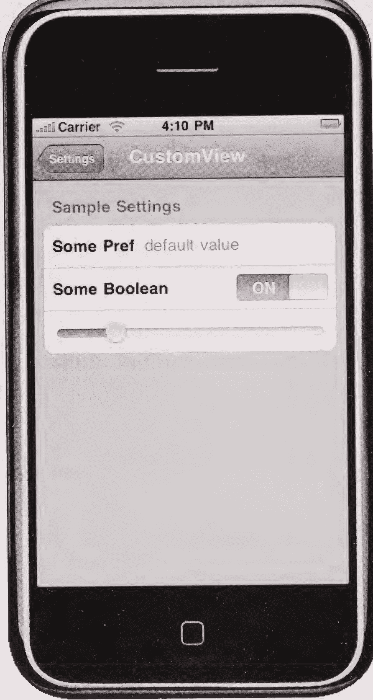

通过添加 `Child Pane`（子面板）类型，你可以添加更多的配置子部分。通过这种值类型，你可以指定一个额外的属性列表用于配置子面板的值。要实现这一点，向你的设置包添加一个额外的属性列表，并向你的根属性列表添加一个 `Child Pane` 值类型。`Child Pane` 值中的 `title` 值是显示在根面板行上的标题，用户通过点击该行即可导航到子面板。

### 总结

几乎每个应用程序都需要存储用户默认设置。Cocoa Touch 提供了一个实现此点的极佳机制。有趣的是，`UserDefaults` 机制足够强大，使其能够成为存储除用户偏好之外其他内容的通用位置。

`NSUserDefaults` 是一个很棒的 API，因为它简单、有效，而这正是一个 API 应该有的样子。

---

## 第十八章：使用 Core Data 实现数据库

当 iPhone SDK 发布时，开发者请求最多的功能之一就是 Core Data。Core Data 是 Apple 开发的一个框架，旨在让应用程序变得更加简单。它提供了一系列类，允许你定义数据模型、管理数据并执行复杂的查询。Core Data 是一个抽象层，允许你在无需了解底层存储格式的情况下处理数据。它提供了一系列类，允许开发者定义数据如何存储和取回。

在本章中，我们将探索 Core Data 的四个主要组件：

- **Object Model**（对象模型）：定义你的数据模式。
- **Persistent Store Coordinator**（持久性存储协调器）：管理不同类型的存储。
- **Persistent Store**（持久性存储）：这是你数据的实际物理存储。
- **Managed Object Context**（托管对象上下文）：这是你操作数据的草稿。

`Object Model` 是你数据的蓝图。它定义了实体、它们的属性及其关系。你可以使用 Xcode 中的图形模型编辑器或通过代码定义对象模型。`Persistent Store Coordinator` 充当对象模型和持久性存储之间的中介。它处理对象模型与存储格式之间数据之间的翻译。`Persistent Store` 是数据实际保存的地方。有多种类型的持久性存储，包括 SQLite 数据库、XML 文件和二进制文件。`Managed Object Context` 是你进行大部分工作的地方。你在上下文中获取、创建、更新和删除对象。在上下文中做的更改在未显式保存上下文之前，不会保存到持久性存储中。

### 总结

- **Object Model**：定义你的数据模式。
- **Persistent Store Coordinator**：管理不同类型的存储。
- **Persistent Store**：你数据的实际物理存储。
- **Managed Object Context**：你操作数据的草稿。

### 为 Favorite Cities 添加 Core Data 支持

为了演示如何在应用程序中使用 Core Data，你将打开你的 Favorite Cities 应用程序，并对其进行修改以添加 Core Data。你完全可以使用 Xcode 中的 Core Data 模板创建一个新的 Core Data 应用程序，然后将其修改为 Favorite Cities 应用程序；但再次，我认为修改你现有的应用程序更具教育意义，这样你就不会过度依赖模板作为拐杖。

在这种情况下，你不需要这样做。你只需要将其直接转换为 Core Data，并像处理一个全新的应用程序一样对其进行操作。

### 修改 App Delegate

在实际开始处理新应用程序的 Core Data 部分之前，你需要做的第一件事是添加对设置 `NSManagedObjectContext` 及其关联持久化存储（persistent store）的支持。

> **注意**
> 你必须向你的应用程序添加 Core Data 框架。操作方法是：右键点击你的目标（target），在 `General`（通用）标签页中，找到 `Frameworks` 区域，点击加号按钮并选择 Core Data 框架。

为了实现这一点，你需要修改你的 application delegate。你首先添加几个方法用于设置对象上下文（object context），然后修改 `applicationDidFinishLaunching` 方法和 `applicationWillTerminate:` 方法，分别用于加载数据和保存数据到持久化存储中。

iPhone 上的应用程序沙盒限制了你向应用程序包（application bundle）目录写入数据。相反，你应该将数据保存在 Documents 目录中。因此，你需要能够找到 Documents 目录的位置，以便将持久化存储存于那里。列表 18.1 显示了你用于获取 Documents 目录的工具方法。

#### 列表 18.1：获取 Documents 目录路径的工具方法

```objc
- (NSString *)applicationDocumentsDirectory {
    NSArray *paths = NSSearchPathForDirectoriesInDomains(NSDocumentDirectory, NSUserDomainMask, YES);
    NSString *basePath = ([paths count] > 0) ? [paths objectAtIndex:0] : nil;
    return basePath;
}
```

你需要一个地方来存储你的上下文、存储和模型，因此请将这些作为变量添加到 application delegate 中并将它们设置为属性。这在列表 18.2 中显示，该文件是 application delegate 的接口文件。

#### 列表 18.2：Application Delegate 的新接口

```objc
#import <CoreData/CoreData.h>

@interface FaveCitiesListAppDelegate : NSObject <UIApplicationDelegate>
{
    NSManagedObjectContext *context;
    NSManagedObjectModel *model;
    NSPersistentStoreCoordinator *psc;
    UIWindow *window;
    UINavigationController *navController;
}

@property (nonatomic, retain) UIWindow *window;
@property (retain, nonatomic) UINavigationController *navController;
@property (retain, nonatomic) NSManagedObjectContext *context;
@property (retain, nonatomic) NSPersistentStoreCoordinator *psc;
@property (retain, nonatomic) NSManagedObjectModel *model;

@end
```

> **注意**
> 记住为你的属性添加 `@synthesize` 声明。

你需要修改 `applicationDidFinishLaunching:` 方法以添加这些变量的初始化。唯一真正需要你额外工作的内容是设置持久化存储协调器（persistent store coordinator）。我将在另一个单独的方法中向你展示，我稍后会解释。现在，列表 18.3 显示了你所需的 Core Data 对象的初始化。

#### 列表 18.3：applicationDidFinishLaunching: 方法的实现

```objc
- (void)applicationDidFinishLaunching:(UIApplication *)application {
    [self setModel:[NSManagedObjectModel mergedModelFromBundles:nil]];
    [self setupPersistentStore];
    context = [NSManagedObjectContext new];
    [context setPersistentStoreCoordinator:psc];
    [window addSubview:[navController view]];
    [window makeKeyAndVisible];
}
```

本质上，一切都从从包（bundle）中加载对象模型开始。你必须先这样做，因为对象模型将在 `setupPersistentStore` 方法中使用。在你设置好持久化存储之后，你将设置新的 `NSManagedObjectContext`，并将上下文的持久化存储协调器设置为你为应用程序创建的那个。一旦你完成了所有这些，Core Data 的内部管理工作就完成了，你就可以准备好开始处理由你的模型定义的托管对象了。当然，在示例的这个阶段，你还没有创建对象模型。你之后会创建它，但让我们先看看 `setupPersistentStore` 方法，它实际上展示了你如何选择想要为应用程序使用的某种数据存储。列表 18.4 显示了该方法。

#### 列表 18.4：setupPersistentStore 方法的实现

```objc
- (void)setupPersistentStore {
    NSString *docDir = [self applicationDocumentsDirectory];
    NSString *pathToDB = [docDir stringByAppendingPathComponent:@"FaveCities.sqlite"];
    NSURL *urlForPath = [NSURL fileURLWithPath:pathToDB];
    NSError *error = nil;
    psc = [[NSPersistentStoreCoordinator alloc] initWithManagedObjectModel:[self model]];
    if (![psc addPersistentStoreWithType:NSSQLiteStoreType configuration:nil URL:urlForPath options:nil error:&error]) {
        // 处理错误
    }
}
```

在这个方法中，前几行实际上是在处理你的数据库将要位置的路径。为了本示例，你将使用 SQL 数据库作为你的数据存储。因此，你将获取应用程序文档目录，并在文件名后追加 `@"FaveCities.sqlite"`。你把该完整路径转换为 `NSURL`，这是 `NSPersistentStoreCoordinator` 所要求的。在完成所有这些之后，该方法的实际工作涉及实际分配持久化存储协调器，并用对象模型对其进行初始化，添加一个持久化存储。

当你向 application delegate 添加持久化存储时，你需要指定类型。你可以创建的持久化存储类型如表 18.1 所示。

**表 18.1：持久化存储类型**

| 持久化存储类型 | 描述 |
| :--- | :--- |
| `NSSQLiteStoreType` | 数据库 |
| `NSBinaryStoreType` | 二进制文件 |
| `NSInMemoryStoreType` | 内存 |

`setupPersistentStore` 方法允许你指定配置。在这种情况下，我们使用 `nil`。你还需要修改 `applicationWillTerminate:` 方法将数据保存到持久化存储中。为了实现这一点，你需要确保上下文不为空，然后请求保存。这在列表 18.5 中所示。

#### 列表 18.5：更新后的 applicationWillTerminate 方法

```objc
- (void)applicationWillTerminate:(UIApplication *)application {
    NSError *error;
    if (context != nil) {
        if (![context save:&error]) {
            // 处理错误
        }
    }
}
```


```objc
if (context != nil) {
    // 处理错误
}
```

# 第 18 章：使用 Core Data 实现数据库

## 数据模型

一旦设置好了应用程序，就可以设计你的架构了。数据模型由实体、属性和关系组成。

## 定义实体

首先，让我们添加一个类型为“City”的实体。为此，点击实体面板下的加号。将添加的实体重命名为 City。接下来，点击属性面板中的加号添加名为“name”的属性。重复相同的操作，但这次添加一个名为“favorite”的属性。将 `name` 属性设置为字符串类型。将 `favorite` 属性设置为布尔类型，并将默认值设置为 `NO`。现在你有了 cities。让我们添加 states。

要添加 states，请遵循相同的步骤。点击实体面板下的加号，将其命名为 State，然后添加一个名为“name”的属性。然而，在这里你的做法稍有不同：你需要定义 states 和 cities 之间的关系。

## 定义实体之间的关系

当你添加关系时，你有机会选择关系的目标。你需要做的是定义一个 State 与 city 的关系。你把这个关系命名为“cities”。你指定它是一个多对（To-Many）关系，并且你希望删除规则是级联（Cascade）。关系意味着一个状态包含许多城市。当状态被删除时，与其关联的城市也将被删除。

你还想要定义反向关系，以便从城市的角度，可以将城市从一个状态移动到另一个状态。为此，点击 City 实体，并添加一个名为“state”的反向关系属性。这次，务必指定它是名为“cities”关系的反向属性。从城市的角度来看，这不是一个多对（To-Many）关系。此外，从城市的角度来看的删除规则应该是默认的空置（Nullify）。

你已经设置了关系和属性，你的数据模型看起来就像图 18.3 所示。

### 图 18.3

你的 Favorite Cities 应用程序的数据模型

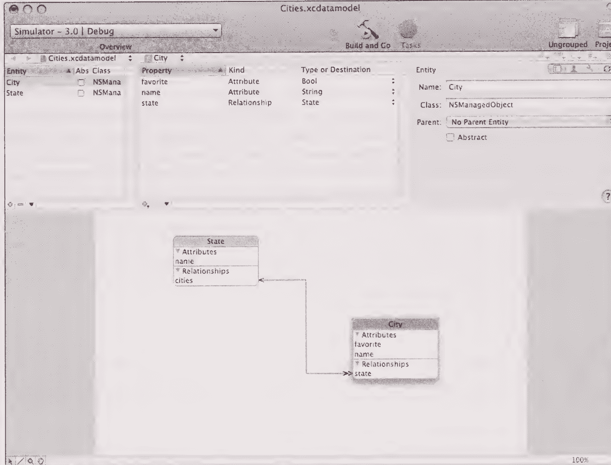

## 为实体生成类

一旦你定义了实体、它们的属性及其关系，你实际上已经有了足够的信息来使用 Core Data。你可以使用这个模型，并使用 Core Data 提供的低级函数访问你的数据。然而，Core Data 还提供了让你自动生成模型类的能力，这些类封装了你在模型中定义的对象，这样如果需要，你就可以添加额外的逻辑。

这涉及到一些 Xcode 的操作。具体来说，你需要确保在数据模型中选中了其中一个实体；然后在项目中右键点击其中一个组文件夹，并选择“New File”（新建文件）。在文件选择对话框中，选择“Cocoa Core Class”，最后选择一个 `NSManagedObject` 类。这会弹出一个对话框，允许你选择所有想要生成实现流的类。请在该项目中执行此操作，将你的 `NSManagedObject` 子类添加到项目 Managed Objects 中的新组中。这应该会在你的项目中创建新文件，其中包含 city 和 state 实体的头文件和实现文件。稍后，如果你对模型进行了修改，可以使用 Xcode 中的代码生成器从 Data Model 菜单下生成访问器定义。

> **NOTE**
>
> Core Data 负责所有 `NSManagedObject` 的生命周期；因此，在这些类中不需要 `dealloc`。然而，如果你添加了自定义成员变量，则需要像往常一样对它们进行分配和释放。

你会发现，如果查看你的数据模型，它现在已经过更新，使得 city 和 state 实体的类属性已正确设置为在项目中已生成的新类。

到此为止，你现在已经构建了数据模型，创建了自定义模型类，并且应用程序已经过更新，使其可以使用 Core Data 来存储和检索你的城市和州。现在，你需要查看如何通过托管对象上下文（managed object context）来在持久化存储器中创建、更新和删除对象。

## 探索实体属性

Core Data 是一个极其深奥且强大的框架，提供了许多工具，让你能够以你需要的任何关系存储你任何类型的数据。除了可以作为属性的各种数据类型外，它还有处理抓取属性（fetched properties）的能力，这实现了从一种实体类型到另一种类型的松散关系。城市对象上的抓取属性可能代表给定城市的附近城市列表。你将在本章中不会抓取属性，但要了解更多信息，请参阅 Core Data 文档。

## CRUD — 创建、读取、更新、删除

一旦你拥有了 Core Data、对象模型并将其与应用程序深度整合，使用它来访问数据实际上相当简单。最重要的一点是意识到 Core Data 的核心实际上只是一种对象持久化机制，一旦你学会了围绕它的 API，就可以在整个应用程序中轻松复用。

与大多数数据存储系统一样，操作本质上归结为四件事：创建对象、读取对象、更新对象和删除对象。

### 创建

创建对象非常简单。你使用 `NSEntityDescription` 类方法 `insertNewObjectForEntityName:inManagedObjectContext:`，传递你想要创建的实体类型名称以及要在其中创建它的托管对象上下文。例如，创建一个新的州（state），你可以执行如列表 18.6 所示的操作。

#### 列表 18.6

#### 创建新的 State 对象

```objc
state = [NSEntityDescription
    insertNewObjectForEntityName:@"State"
    inManagedObjectContext:context];

[state setName:@"Arizona"];

NSError *error;
[context save:&error];
```

你通过调用托管上下文来确保对象被写入磁盘。当然，可能会发生错误，所以如果发生了，你可能应该以适用于你应用程序的方式处理该错误。`save` 方法返回一个表示成功的 `BOOL` 值。如果它返回了 `NO`，你应该检查错误对象以查找原因。

### 读取

当我谈到读取对象时，我实际上是在说使用 `NSFetchRequest`。`NSFetchRequest` 允许你查询数据库中特定类型的对象。使用 `NSManagedObjectContext` 实例方法 `executeFetchRequest:`，你可以执行这些查询之一，并使用参数过滤结果，甚至可以使用允许对返回数组进行排序的排序描述符（sort descriptors）。该数组包含你请求的实体类型的实例。例如，为了检索特定州的所有城市，你可能执行如列表 18.7 所示的代码。

#### 列表 18.7

#### 获取特定州的城市

```objc
- (NSArray *)citiesForState:(State *)inState {
    NSFetchRequest *req = [NSFetchRequest new];
    NSEntityDescription *descr = [NSEntityDescription entityName:@"City" inManagedObjectContext:context];
    [req setEntity:descr];
    NSSortDescriptor *sort = [[NSSortDescriptor alloc] initWithKey:@"name" ascending:YES];
    [req setSortDescriptors:[NSArray arrayWithObject:sort]];
    NSPredicate *predicate = [NSPredicate predicateWithFormat:@"state == %@", inState.name];
    [req setPredicate:predicate];
    NSError *error;
    NSArray *ret = [context executeFetchRequest:req error:&error];
    if (ret == nil) {
        // 处理错误
    }
    [req release];
    return ret;
}
```

> **NOTE**：`NSPredicate` 是允许你构建复杂查询并过滤结果集的类。它是一个极其强大的类。请参阅 Apple 文档获取更多如何使用它构建其他类型查询的信息。

在完成这一切之后，你最终调用了 `executeFetchRequest:error:`，它向你返回一个包含匹配标准的结果集的数组，并根据你的排序描述符进行了排序。

### 更新

一旦你有了一个 `NSManagedObject`，更新它就像使用对象上的访问器设置其状态然后保存它一样简单。真的没有别的了。列表 18.8 显示了一个示例。

#### 列表 18.8

#### 更新对象

```objc
- (void)setFavorite:(City *)inCity {
    [inCity setFavorite:[NSNumber numberWithBool:YES]];
    NSError *error;
    if (![context save:&error]) {
        // 处理错误
    }
}
```

### 删除

最后，也许最简单的操作是删除对象。要删除一个对象，你只需在 `NSManagedObjectContext` 上调用实例方法 `deleteObject:`。例如，在获取到一个城市后删除它，你可能会执行类似 `[context deleteObject:fetchedCity]` 的操作。这将删除内存中的对象；然后，为了实际将删除提交到磁盘，你当然需要在托管上下文中调用 `save:`。

## 整合并更新你的应用

现在，为了将这一切整合在一起并更新你的 Favorite Cities 应用程序以 Core Data，你需要更新你的视图控制器以从 Core Data 获取数据。幸运的是，这非常容易做到。

你需要做的第一件事是从 app delegate 将 `NSManagedObjectContext` 传递给 `MyViewController` 类。这是在你最终版本的 `applicationDidFinishLaunching:` 方法中完成的，如列表 18.9 所示。

#### 列表 18.9

#### applicationDidFinishLaunching: 方法

```objc
- (void)applicationDidFinishLaunching:(UIApplication *)application {
    [self setModel:[NSManagedObjectModel mergedModelFromBundles:nil]];
    [self setupPersistentStore];
    NSManagedObjectContext *context = [NSManagedObjectContext new];
    [context setPersistentStoreCoordinator:psc];

    MyViewController *viewController = (MyViewController *)navController.topViewController;
    [viewController setContext:context];

    [window addSubview:[navController view]];
    [window makeKeyAndVisible];
}
```

剩余的工作在 `MyViewController` 代码中完成，实际上只是将基于 `NSMutableDictionary` 的模型替换为你全新的、闪闪发光的 `State` 和 `City` 对象。我在这里不会介绍过多的细节；我会展示该如何做。有更高效的方法来实现这一点——这里的很多代码是内存模型的遗留——因此，它并没有充分利用 Core Data 聪明的查询功能。列表 18.10 显示了新的 `MyViewController` 实现，而列表 18.11 显示了它的接口。

#### 列表 18.10

#### 新 MyViewController 实现

```objc
#import "MyViewController.h"
#import "EditViewController.h"
#import "State.h"
#import "City.h"

@implementation MyViewController

@synthesize states;
@synthesize editedItem;
@synthesize context;

- (void)dealloc {
    [self setEditedItem:nil];
    [self setStates:nil];
    [self setContext:nil];
    [super dealloc];
}

- (void)setup {
    NSError *error = nil;
    NSFetchRequest *req = [NSFetchRequest new];
    NSEntityDescription *desc = [NSEntityDescription entityName:@"State" inManagedObjectContext:context];
    [req setEntity:desc];

    NSSortDescriptor *sort = [[NSSortDescriptor alloc] initWithKey:@"name" ascending:YES];
    [req setSortDescriptors:[NSArray arrayWithObject:sort]];
    [sort release];

    [self setStates:[[context executeFetchRequest:req error:&error] mutableCopy]];
    if ([[self states] count] == 0) {
        // 设置默认数据
        State *state;
        City *city;

        // 纽约
        state = [NSEntityDescription insertNewObjectForEntityName:@"State" inManagedObjectContext:context];
        [state setName:@"New York"];
        city = [NSEntityDescription insertNewObjectForEntityName:@"City" inManagedObjectContext:context];
        [city setName:@"New York"];
        [state addCitiesObject:city];

        // 芝加哥
        state = [NSEntityDescription insertNewObjectForEntityName:@"State" inManagedObjectContext:context];
        [state setName:@"Chicago"];
        city = [NSEntityDescription insertNewObjectForEntityName:@"City" inManagedObjectContext:context];
        [city setName:@"Chicago"];
        [state addCitiesObject:city];

        // 圣金山和洛杉矶
        state = [NSEntityDescription insertNewObjectForEntityName:@"State" inManagedObjectContext:context];
        [state setName:@"California"];
        city = [NSEntityDescription insertNewObjectForEntityName:@"City" inManagedObjectContext:context];
        [city setName:@"San Francisco"];
        [state addCitiesObject:city];
        city = [NSEntityDescription insertNewObjectForEntityName:@"City" inManagedObjectContext:context];
        [city setName:@"Los Angeles"];
        [state addCitiesObject:city];

        // 亚利那州
        state = [NSEntityDescription insertNewObjectForEntityName:@"State" inManagedObjectContext:context];
        [state setName:@"Arizona"];
        city = [NSEntityDescription insertNewObjectForEntityName:@"City" inManagedObjectContext:context];
        [city setName:@"Phoenix"];
        [state addCitiesObject:city];

        [context save:&error];
    }
}

- (UITableViewCell *)tableView:(UITableView *)tableView cellForRowAtIndexPath:(NSIndexPath *)indexPath {
    State *state = [states objectAtIndex:indexPath.section];
    NSArray *cities = [state.cities allObjects];
    City *city = [cities objectAtIndex:indexPath.row];
    NSString *stateName = [state name];
    NSString *cityName = [city name];
    BOOL isFavorite = [[city favorite] boolValue];
    // ... 后续配置 cell 代码省略
}
```


# 16：使用 Core Data 实现数据库

```objc
EditViewController *controller = 
[[EditViewController alloc] initWithWithCity:cityName
                                     state:stateName
                                   favorite:isFavorite
                                   delegate:self];

[[self navigationController] pushViewController:controller animated:YES];

[controller release];

[self editedItem:indexPath];
```

```objc
(void)editViewEditing:(EditViewController *)editView {
    NSString *stateName = [editView stateInfo];
    NSString *cityName = [editView cityInfo];

    // 我们正在编辑一个现有项目
    if([self editedItem]) {
        State *origState = [states objectAtIndex:editedItem.section];
        NSString *origStateName = [origState name];

        // 首先我们检查州名是否发生了变化...
        if(![origStateName isEqualToString:stateName]) {
            // 如果变了，我们需要将城市移动到新的州。
            State *newState = nil;
            for(State *state in states) {
                if([[state name] isEqualToString:stateName])
                    newState = state;
            }

            if(newState) {
                newState = [NSEntityDescription
                    insertNewObjectForEntityName:@"State"
                    inManagedObjectContext:context];
                [newState setName:stateName];
                [states addObject:newState];
            }
        }
    }
}
```

## 28 处理数据

```objc
// 如果州没有变化，我们可以直接更新旧的。
State *oldState = [states objectAtIndex:indexPath.section];
NSArray *oldCities = [oldState allObjects];
City *oldCity = [oldCities objectAtIndex:indexPath.row]];

if (oldCity) {
    [context deleteObject:oldCity];
    [oldState removeCities:oldCity];
    if ([oldState count] == 0) {
        [context deleteObject:oldState];
        [states removeObjectAtIndex:[indexPath.section]];
    }
} else {
    // 是新增
    State *newState = nil;
    for(State *state in states) {
        if([[state name] isEqualToString:stateName])
            newState = state;
    }

    if(!newState) {
        newState = [NSEntityDescription
            insertNewObjectForEntityName:@"State"
            inManagedObjectContext:context];
        [newState setName:stateName];
        [states addObject:newState];
    }
}

City *newCity = [NSEntityDescription
    insertNewObjectForEntityName:@"City"
    inManagedObjectContext:context];
[newCity setName:cityName];
[newState addCitiesObject:newCity];
[context save:&error];
[self tableViewData];
```

```objc
// 删除
[self setEditedItem:nil];
[self tableViewData];
```

```objc
// 如果州变了，我们需要将城市移动到新的州。
State *newState = nil;
for(State *state in states) {
    if([[state name] isEqualToString:stateName])
        newState = state;
}

if(!newState) {
    newState = [NSEntityDescription
        insertNewObjectForEntityName:@"State"
        inManagedObjectContext:context];
    [newState setName:stateName];
    [states addObject:newState];
}

City *newCity = [NSEntityDescription
    insertNewObjectForEntityName:@"City"
    inManagedObjectContext:context];
[newCity setName:cityName];
[newState addCitiesObject:newCity];
[context save:&error];
[self tableViewData];
```

```objc
// 删除
[self setEditedItem:nil];
[self tableViewData];
```

```objc
// 如果州没有变化，我们可以直接更新旧的。
State *oldState = [states objectAtIndex:indexPath.section];
NSArray *oldCities = [oldState allObjects];
City *oldCity = [oldCities objectAtIndex:indexPath.row]];

if (oldCity) {
    [context deleteObject:oldCity];
    [oldState removeCities:oldCity];
    if ([oldState count] == 0) {
        [context deleteObject:oldState];
        [states removeObjectAtIndex:[indexPath.section]];
    }
} else {
    // 是新增
    State *newState = nil;
    for(State *state in states) {
        if([[state name] isEqualToString:stateName])
            newState = state;
    }

    if(!newState) {
        newState = [NSEntityDescription
            insertNewObjectForEntityName:@"State"
            inManagedObjectContext:context];
        [newState setName:stateName];
        [states addObject:newState];
    }
}

City *newCity = [NSEntityDescription
    insertNewObjectForEntityName:@"City"
    inManagedObjectContext:context];
[newCity setName:cityName];
[newState addCitiesObject:newCity];
[context save:&error];
[self tableViewData];
```

```objc
// 删除
[self setEditedItem:nil];
[self tableViewData];
```

```objc
// 如果州变了，我们需要将城市移动到新的州。
State *newState = nil;
for(State *state in states) {
    if([[state name] isEqualToString:stateName])
        newState = state;
}

if(!newState) {
    newState = [NSEntityDescription
        insertNewObjectForEntityName:@"State"
        inManagedObjectContext:context];
    [newState setName:stateName];
    [states addObject:newState];
}

City *newCity = [NSEntityDescription
    insertNewObjectForEntityName:@"City"
    inManagedObjectContext:context];
[newCity setName:cityName];
[newState addCitiesObject:newCity];
[context save:&error];
[self tableViewData];
```

```objc
// 删除
[self setEditedItem:nil];
[self tableViewData];
```

```objc
// 数据源方法
-(NSInteger)numberOfSectionsInTableView:(UITableView *)tableView {
    return [states count];
}

-(NSInteger)tableView:(UITableView *)tableView numberOfRowsInSection:(NSInteger)section {
    State *state = [states objectAtIndex:section];
    return [state count];
}

(UITableViewCell *)tableView:(UITableView *)tableView ForRowAtIndexPath:(NSIndexPath *)indexPath {
    NSString *cellIdentifier = @"Cell";
    UITableViewCell *cell = [tableView dequeueReusableCellWithIdentifier:cellIdentifier];
    if (cell == nil) {
        cell = [[UITableViewCell alloc]
            initWithStyle:UITableViewCellStyleDefault
            reuseIdentifier:cellIdentifier] autorelease];
    }

    State *state = [states objectAtIndex:indexPath.section];
    NSArray *cities = [state allObjects];
    City *city = [cities objectAtIndex:indexPath.row]];
    NSString *cityName = [city name];
    [[cell textLabel] setText:cityName];
    if([[city favorite] boolValue])
        [[cell imageView] setImage:[UIImage imageNamed:@"FullStar.png"]];
    else
        [[cell imageView] setImage:[UIImage imageNamed:@"EmptyStar.png"]];
    return cell;
}

-(NSString *)tableView:(UITableView*)tableView titleForHeaderInSection:(NSInteger)section {
    State *state = [states objectAtIndex:section];
    return [state name];
}

-(BOOL)tableView:(UITableView*)tableView canEditRowAtIndexPath:(NSIndexPath*)indexPath {
    return YES;
}

(void)tableView:(UITableView*)tableView commitEditingStyle:(UITableViewCellEditingStyle)forRowAtIndexPath:(NSIndexPath*)indexPath {
    State *state = [states objectAtIndex:indexPath.section];
    NSArray *cities = [state allObjects];
    City *city = [cities objectAtIndex:indexPath.row]];
    [context deleteObject:city];
    [state removeCities:city];
    if ([state count] == 0) {
        [context deleteObject:state];
        [states removeObjectAtIndex:[indexPath.section]];
    }
    [context save:nil];
    [self tableViewData];
}
```

### 列表 18.11：MyViewController 接口

```objc
#import <UIKit/UIKit.h>
#import "EditViewController.h"
#import <CoreData/CoreData.h>

@interface MyViewController : UIViewController <UITableViewDelegate, EditViewControllerDelegate> {
    NSMutableArray *states;
    NSIndexPath *editedItem;
    NSManagedObjectContext *context;
}

@property (retain, nonatomic) NSManagedObjectContext *context;
@property (retain, nonatomic) NSMutableArray *states;
@property (retain, nonatomic) NSIndexPath *editedItem;

@end
```


如果你让视图控制器看起来像这样，那么你就拥有了一个使用 Core Data 的“收藏城市”应用程序版本。从使用的角度来看，它的行为与之前完全一样，除非你对数据集进行了更改并在退出应用程序后返回，此时你的更改将会持久化。

## 理解 Core Data 简化了哪些工作

你已经看到 Core Data 可以让数据库和对象模型的操作变得简单得多。特别是包含多个实体的复杂对象模型，使用实体设计器进行设计将特别获益。这使得构建具有难以可视化关系的复杂应用程序变得非常容易。

此外，几乎任何管理表格数据的应用程序都可以从使用 Core Data 中获益，而不是将其存储在平铺文件或其他专有数据库中。

## 理解 Core Data 不擅长什么

记住 Core Data 有其局限性是很重要的。具体来说，它能够作为数据存储的文件类型相对有限。在 iPhone 上，它实际上仅限于二进制平铺文件或 sqlite 数据库。iPhone 不支持 XML 文件格式。此外，Core Data 无法访问如 MySQL、PostgreSQL、Oracle 等外部数据库服务器。

然而，当你考虑到 Core Data 为它试图解决的特定问题集带来的益处时，这些局限性是微不足道的。这个问题集由任何你需要为应用程序管理本地对象数据库的情况组成。

### 总结

在本章中，你查看了 iPhone OS 3 包含的最强大新框架之一——Core Data 的细节。幸运的是，Apple 提供了这个卓越的对象持久化框架。使用它让某些类型应用程序的开发变得简单得多并缩短了开发时间。

人们说，没有 bug 的代码是不写代码。通过利用 Core Data，你不必花费时间为你的应用程序编写复杂的、可能存在 bug 的数据库抽象层。相反，你可以专注于你特定的问题领域和需要解决的问题。

## 通过网络连接世界

iPhone 令人惊叹的之一是，在它一切之下，它实际上运行着 Mac OS X。这意味着在深处，在其他一切之下，存在着 UNIX 的核心。事实确实如此。如果你深入挖掘 iPhone OS，最终会发现有一个完整的 UNIX 文件系统以及许多你从 UNIX 计算机中预期的库和功能。

通常，即使作为开发者，你也与 UNIX 有着足够的隔离，以至于 UNIX 是否在盖子下面对你无关。但在一个领域，你可用的 UNIX 变成了一项明确资产。那个领域就是网络领域。

UNIX 从底层开始就构建了网络，因此它的网络协议栈是可用最好的之一并不意外。结果是，iPhone 因为其血缘，共享了这种卓越的工作能力。iPhone 不仅内置了 BSD sockets，还有一套卓越的 Cocoa Touch 类，使你能够毫不费力地处理 sockets。这种设计的精妙之处在于，当你需要处理简单事情时，你有更高级的抽象可以使用。诸如访问 Web 页面、发送电子邮件等在 iPhone OS 上是轻而易举的。此外，当你需要进入更深层次时，当你需要做一些不同或更困难的事情时，通过使用 Core Foundation sockets 和 BSD sockets 也是可以实现的。

在本章中，你将看到如何使用一些高级类进行基础网络设置。你将查看如何使用 Bonjour 在本地网络上发现服务。你将查看如何使用新的消息 API 发送电子邮件。最后，你将简要查看 core foundation sockets 以对其进行介绍。当你完成时，你应该能够连接 iPhone 上的任何网络任务。

### 本章内容

- 学习使用 Objective-C 类：`NSURLRequest` 和 `NSConnection`
- 使用 MessageUI 框架在你的应用程序内部发送电子邮件
- 使用 Core Foundation 网络执行低级网络任务
- 使用 Bonjour 在本地网络上发现服务

## 访问 Web

在我们互联的世界里，也许最频繁的网络活动类型是连接到 Web。因此，Apple 将 Web 连接性集成到 Cocoa Touch 的所有层次并不意外。你不仅可以使用专门的类（如 `NSURLRequest` 等）连接到 Web，甚至在几个基础类上还有实用方法，这些方法封装了 Web 连接中最经常需要的一些方法。

让我们来看看如何通过 Cocoa Touch 访问 Web

#### 使用基础类配合 URL

通过 Cocoa Touch 访问 Web 内容的第一个也是最基础的机制涉及某些基础类本身的工厂方法，例如 `NSString`、`NSData` 等。这些中的每一个类都有一个 `initWithContentsOfURL:encoding:error:` 初始化器，它允许你通过自动下载给定 URL 处的文件内容作为对象的内容来初始化该类的实例。换句话说，通过使用这个初始化器，你可以请求使用给定的编码下载并解码给定 URL，然后将其内容用作对象的数据。如果你的需求很简单，这种方法工作得很好。列表 19.1 显示了将 URL 下载到 `NSString` 的示例。

### 列表 19.1 将 URL 下载到 NSString

```
- (void)downloadAndDisplayFile:(NSString *)inString {
    NSURL *url = [NSURL URLWithString:inString];
    NSString *fileData = [NSString stringWithContentsOfURL:url];
    // 对 fileData 进行处理
}
```

如果你的需求很简单，这种方法工作得很好。然而，它远没有你很快将看到的其他解决方案那么灵活。特别是，这个调用是阻塞的，这意味着你的主线程被卡在这里等待。如果由于网络问题导致下载花费异常漫长的时间，那么你应用程序的 UI 可能会显得无响应。这不是一种非常好的用户体验；你应该给用户提供需要时取消下载的选项。

## 处理数据

### 表 19.1 NSConnection 代理方法

| 方法 | 说明 |
| :--- | :--- |
| `(NSURLRequest*) connection: (NSConnection*) connection willSendRequest: (NSURLRequest*) redirectResponse: (NSURLResponse*) redirectResponse` | 当请求重定向到另一个 URL 时，调用此方法。代理可以选择通过返回 `nil` 来禁止重定向，或者通过返回替代 URL 来修改目标；如果代理允许重定向，则只需返回原始请求。 |
| `(void) connection: (NSConnection*) connection receiveAuthenticationChallenge: (NSAuthenticationChallenge*) challenge` | 当 `NSConnection` 作为请求的一部分收到身份挑战时，调用此方法。代理必须确定采取的适当行动，例如提供适当凭据或取消下载。`challenge` 参数是 `NSURLAuthenticationChallengeSender` 的实例，它实现了允许你在需要时向挑战者发送凭据的方法。 |
| `(void) connection: (NSURLConnection*) connection cancelAuthenticationChallenge: (NSAuthenticationChallenge*) challenge` | 当由于错误导致身份挑战取消时，调用此方法。 |
| `(void) connection: (NSURLConnection*) connection didReceiveResponse: (NSURLResponse*) response` | 当请求成功完成但在下载数据之前，调用此方法。收到此消息后，你将收到包含资源数据的 `didReceive:` 消息。 |
| `(void) connection: (NSURLConnection*) connection didReceiveData: (NSData*)` | 当数据到达时调用此方法。它可能会被调用多次，你应该计划将收到的数据附加到缓冲区中，直到收到 `connectionDidFailWithError:` 消息为止。 |
| `(void)connectionDidFinishLoading: (NSURLConnection*) connection` | 当资源加载完成时，调用此方法。它在你接收数据并假设已完成后被调用。收到此消息后，将不再收到任何后续消息。 |
| `(void)connection: (NSURLConnection*) connection didFailWithError: (NSError*)` | 当连接在加载数据的任何时间由于任何原因失败时，调用此方法。这表示下载已失败，错误为提供的错误。收到此消息后，将不再收到任何后续消息。 |

## 第 19 章 通过网络连接世界

现在你已经了解了如何处理 `NSURLRequest`、`Connection` 等基础知识，让我们来看一些实际实现下载的示例代码。

让我们想象一个示例应用程序，你想从 Web 下载一张图片并将其显示在 `UIImageView` 中。在这种情况下，控制器的接口可能如列表 19.2 所示。

### 列表 19.2 图像下载器控制器的接口

```
@interface ImageDownloaderViewController : UI

{
    IBOutlet UIImageView *imageView;
    IBOutlet UITextField *urlField;
    NSURLConnection *connection;
    UIActionSheet *cancelSheet;
    NSMutableData *data;
}

@property (retain, nonatomic) NSURLConnection * connection;
@property (retain, nonatomic) UIActionSheet * cancelSheet;
@property (retain, nonatomic) NSMutableData * data;

- (IBAction)loadImage:(id) sender;

@end
```

在这种情况下，你为图像视图和 URL 字段添加了 `IBOutlet`。发生的情况是用户输入图片的 URL，然后点击“加载”（Load）按钮。这会导致应用程序下载图片并在图像视图中显示。应用程序还可以显示“取消”（Cancel）对话框，使用户可以选择随时取消下载。

要开始下载，你需要实现 `loadImage:` 方法。这在列表 19.3 中所示。

### 列表 19.3 `loadImage:` 方法的实现

```
- (IBAction)loadImage:(id) sender {
    NSURLRequest *url = [NSURLRequest URLWithString:[textField text]];
    NSURLRequest *request = [NSURLRequest requestURL:url];
    [setConnection:[NSURLConnection connectionWithRequest:request delegate:self]];
    cancelSheet = [[UIActionSheet alloc] initWithTitle:@"Downloading..." delegate:self cancelButtonTitle:@"Cancel" destructiveButtonTitle:nil otherButtonTitles:nil];
    [cancelSheet showView:self.view.window];
    [setData:[NSMutableData data]];
    [connection start];
}
```

因此，你正在从 URL 字段获取文本并创建一个 `NSURLRequest`。你利用它来创建一个 `NSURLRequest`，然后用它来创建 `NSURLConnection`。你创建了一个 `UIAlertSheet` 来显示取消按钮，并将其显示在窗口上方。最后，你启动连接并从而开始下载。

请求发送后，你现在需要实现 `connection:didReceiveData:`、`connectionDidFinishLoading:` 和 `connection:didFailWithError:` 方法，以妥善处理你现在将收到的数据。

列表 19.4 显示了这三个方法。

### 列表 19.4 代理方法的实现

```
(void)connection:(NSURLConnection *)connection didReceiveData:(NSData *)data {
    [data appendData:inData];
}

(void)connection:(NSURLConnection *)connection didFailWithError:(NSError *)error {
    [cancelSheet dismissClickedButtonIndex:0 animated:YES];
    [setCancelSheet:nil];
    [setConnection:nil];
    [setData:nil];

    UIAlert *alert = [[UIAlert alloc] initWithTitle:@"Download Error" message:[error localizedDescription]];
}
```

这些方法应该在视图显示给用户之前调用。不要在显示视图后调用这些方法。

例如，为了显示一个邮件撰写视图向某人发送带有图片的邮件，你可以像列表 19.5 所示的操作。

### 列表 19.5 使用应用程序发送邮件

```
- (void)sendFeedbackMailImage:(UIImage *)inImage {
  if (![MFMailComposeViewController canSendMail]) {
    UIAlert *alert = [[UIAlert initWithTitle:@"Config Error" message:@"Mail not configured." delegate:nil cancelButtonTitle:@"OK" otherButtonTitles:nil];
    [alert show];
    [alert release];
    return;
  }

  MFMailComposeViewController *controller = [[MFMailComposeViewController alloc]];
  [controller setObject:@"Pics you'd like..."];
  [controller setRecipients:@"pictures@yourdomain.com"];
  [controller setBody:@"Thought you'd like the attached images." isHTML:NO];
  NSData *data = [inImage PNGRepresentation];
  [controller addAttachment:data mimeType:@"image/png" fileName:@"Image.png"];
  [controller setComposeDelegate:self];
  [parentController presentViewController:controller animated:YES];
  [controller release];
}
```

简单来说，你首先检查此设备是否可以发送电子邮件。如果可以，则向用户显示一个错误以解释情况。如果可以，则创建一个新的 `MFMailComposeViewController`，并设置你想要发送的邮件属性。在这种情况下，你正在附带一张图片，因此你需要将传入的 `UIImage` 对象转换为可以通过电子邮件发送的表示形式——在这种情况下是 PNG 格式。然后，你使用 `image/PNG` 的 MIME 类型将其附加到邮件中。之后，你将自己设为邮件撰写代理，然后作为任何父控制器的子视图模态地呈现该控制器。由于控制器尚未添加到层级结构中，你可以释放它。

### 注意

在此段代码中，如果设备未配置邮件，我们只显示一条错误消息。你也可以编写一个 `mailto` URL 并使用它来启动 iPhone 上的邮件 App。如果没有配置，用户将会被提示配置邮件。

在邮件撰写并发送后，会调用你的代理方法 `mailComposeControllerDidFinishWithResult:`，结果取决于应用程序是否能够成功发送邮件。为了此目的，你只需检查结果是否为错误，以便向用户显示错误。这在列表 19.6 中所示。

### 列表 19.6 代理方法的实现

```
(void)mailComposeWithResult:(MFMailComposeViewController*) controller didFinishWithResult:(MFMailComposeResult)result error:(NSError*)error {
    [controller dismissModalViewControllerAnimated:YES];
    if(result == MFMailComposeResultFailed) {
        // 处理一个错误。
        UIAlertView *alert = [[UIAlert alloc] initWithTitle:@"Download Error"];
    }
}
```


message: `[error localizedDescription]`

delegate: `nil`

cancelButtonTitle: `@"OK"`

otherButtonTitles: `nil`];

`[alert show]`;

`[alert release]`;

}

```

此处可能发生的结果代码列在表 19.3 中。

## 表 19.3 可能的邮件结果代码

| 代码 | 含义 |
|---|---|
| `MFMailComposeResultCancelled` | 用户取消了发送邮件。 |
| `MFMailComposeResultSaved` | 用户将邮件保存到了草稿文件夹。 |
| `MFMailComposeResultSent` | 邮件已保存到发送件文件夹，并在下次邮件客户端连接到邮件服务器时发送。 |
| `MFMailComposeResultFailed` | 在撰写邮件期间发生错误。邮件未发送或未队列。 |

## 使用 Core Foundation 套接字

如果使用高级别网络类还不能满足你的需求，iPhone 提供了一套低层网络封装器，这些封装器作为底层套接字 API（BSD sockets）之上的一层*薄壳*。虽然我在这里使用了“*薄壳*”这个词，但请不要误认为这些封装器并不强大；它们非常强大，并提供了让编写网络代码变得更容易的功能。此 API 称为 Core Foundation Network，或 `CFNetwork`。

BSD 套接字在实现平台方面确实无处不在。然而，它们开发于 20 年前，在随后的年份里没有发生太大变化。因此，直接使用它们可能有些繁琐。通常，开发者使用 BSD 套接字和线程来执行异步网络，因为许多 BSD 调用会阻塞，而 `CFNetwork` API 提供了一种机制，让你与 BSD 套接字工作，而无需诉诸线程。运行时提供的标准运行循环机制意味着你不需要启动线程来查看套接字上是否有待处理的数据，或者是否可以在你的套接字上发送数据。你只需要为这些任一事件在运行循环上注册回调，然后在这些回调函数中执行所需的任何处理。

然而，`CFNetwork` 不仅限于低级能力；它还为包括 HTTP、FTP 和 SSL 在内的流行协议提供了封装器。事实上，高级别的 Objective-C 类实际上利用了底层的 `CFNetwork` API 来实现其功能。

出于这些示例的目的，你将主要关注低层级。

## 处理数据

### 注意

在本节中，你将与 Core Foundation 工作。最常用的两个 API 是 `CFSocket` 和 `CFStream`。

### 探索 CFSocket

要创建 `CFSocket`，你使用以下函数：

```
CFSocketCreate(CFAllocator allocator, int32 protocolFamily, int32 sqlType, int32 protocol, CFOptionFlags callbackTypes, CFSocketCallback callback, void * context);
```

| 参数 |  |
|---|---|
| `CFAllocator allocator` | 分配器。 |
| `int32 protocolFamily` | 套接字族。如果传递 0，默认值是 `PF_INET`。 |
| `int32 sqlType` | 套接字类型。如果 `protocolFamily` 是 `PF_INET`，默认值是 `SOCK_STREAM`。 |
| `int32 protocol` | 协议。可能包括 `IPPROTO_TCP` 或 `IPPROTO_UDP`。 |
| `CFOptionFlags callbackTypes` | 触发回调的事件按位或。 |
| `CFSocketCallback callback` | 当预期事件发生时调用的函数。 |
| `void * context` | 上下文。可以为 NULL。 |

有趣的是，大多数这些参数允许你通过传递 NULL 或零来接收默认值。这意味着你得到的是 TCP 流，这是最常见的情况。如果你使用 UDP 套接字或更奇异的东西，才需要指定参数。

| 参数 | 目的 |
|---|---|
| `int32 protocol` | 协议。可能包括 `IPPROTO_TCP` 或 `IPPROTO_UDP`。如果 `protocolFamily` 是 `PF_INET` 且 `sqlType` 是 `SOCK_STREAM`，则默认为 `IPPROTO_TCP`。 |
| `CFOptionFlags callbackTypes` | 触发回调的事件按位或。 |
| `CFSocketCallback callback` | 当预期事件发生时调用的函数。 |
| `void * context` | 上下文。可以为 NULL。 |

你使用的回调类型列在表 19.5 中。

## 表 19.5 可能的回调类型

| 值 | 描述 |
| --- | --- |
| `kCFSocketNoCallBack` | 不接收任何事件的回调。 |
| `kCFSocketReadCallBack` | 当数据可读或新连接准备好接受时接收回调。当数据可读但尚未读取时调用。当调用此回调时，你的代码需要读取数据或接受连接。 |
| `kCFSocketAcceptCallBack` | 用于监听套接字；当请求连接时接收此回调。新连接会被自动接受，调用回调，数据参数是子套接字的句柄。 |
| `kCFSocketDataCallBack` | 当在套接字上接收数据时，会在后台分块读取并调用你的回调函数。数据参数是一个包含接收数据的 `CFData` 对象。 |
| `kCFSocketConnectCallBack` | 当尝试连接端口时，连接成功或失败时调用此回调。如果连接失败，数据指针为错误代码。如果连接成功，数据指针为 NULL。 |
| `kCFSocketWriteCallBack` | 向套接字写入大量数据时，当套接字准备好接收更多数据时调用此回调。 |

### 处理数据

注意：
在通过 `CFRunLoopAddSource` 将 socket 添加到重新运行（rerun）之前，你实际上不会接收到回调。

如你所见，从一开始你就有能力创建一个与事件驱动循环关联的 socket。你可以接收到与该 socket 相关的任何重要事件的读取回调。为了实际接收这些回调，你需要使用函数 `CFSocketCreateRunLoopSource` 创建一个 `CFRunLoopSource` 对象，并使用函数 `CFRunLoopAddSource` 将其添加到主循环中。为了通过该 socket 实际连接到端口，你使用函数 `CFSocketConnectToAddress`。

现在让我们来看一个完成所有这些操作的示例代码段。列表 19.7 显示了 `CFSocket` 的创建。

### 列表 19.7 创建 Socket 并连接到端口

```c
(void)openSocketToHost(CFDataRef inInfo);

CFSocket socket =

    CFSocketCreate(NULL, PF_INET, SOCK_STREAM, IPPROTO_TCP,

    CFSocketConnectCallback|CFSocketDataCallback,

    CFSocketCallback)&myCallback, NULL);
```

```c
CFRunLoopSource source =

    CFRunLoopCreateSource(NULL, socket, 0);

    CFRunLoopAddSource(CFRunLoopGetCurrent(), source, kRunLoopCommonModes);
```

```c
// 我们已经创建了 socket，它正在循环中运行...
// 现在让我们连接它吧！

CFSocketConnectToAddress(sock, inInfo, -1);
```

```c
// 现在释放我们的资源。它们在循环中，所以可以
// 在这里释放它们
```

```c
CFRelease(source);
CFRelease(socket);
```

## 第 19 章：通过网络连接世界

在这些代码中，你已经解析了主机信息，所以你只需要做的就是创建 socket 并连接它了！`mycallback` 回调方法处理在连接建立后切换到发送数据状态的操作。它在列表 19.8 中所示。

### 列表 19.8 myCallback 回调函数

```c
void myCallback(CFSocketRef inSocketRef,
    CFSocketCallbackType inCallbackType,
    CFDataRef inAddress,
    const void *inData,
    void *userInfo)
{
    if(inCallbackType == kCFocketConnectCallback)
        // 已连接... 开始向远程主机发送数据。
    } else if(inCallbackType == kCFocketDataCallback) {
        CFDataRef data = (CFDataRef)inData;
        // 读取的数据在 inData 中，对其进行处理。
        ...
        // 等等...
    }
}
```

如你所见，当连接完成以及你请求的其他事件触发时，回调都会被调用。例如，当你收到新数据时，它也会被调用。

当然，这段代码假设你已经解析了主机名。要做到这一点，你需要使用 `CFHost` API，稍后我们会回顾。

### 使用 CFHost 获取主机信息

`CFNetwork` 还为你提供了一个极佳的 API 用于异步 DNS 解析。该 API 就是 `CFHost` API。

使用 `CFHost` API，你可以非常容易解析 DNS 主机名并确定 IP 地址的可访问性。列表 19.9 显示了使用 `CFHost` API 来调度主机名的解析。

### 列表 19.9 解析主机名

```objc
- (void)resolveHost: (NSString *)inHostname
{
    CFHostRef hostRef = CFHostCreateWithName(NULL, inHostname);
    CFHostClientContext ctx = { 0, NULL, NULL, NULL, NULL };
    CFHostSetClient(hostRef, (CFHostClientCallback) &resolutionCallback, &ctx);
    CFHostScheduleWithRunLoop(hostRef, CFRunLoopGetCurrent(), CFRunLoopCommonModes);
    CFStreamError error = { 0, 0 };
    CFHostStartResolution(hostRef, CFHostAddresses, &error);
    // 现在当解析完成后，我们的回调将被调用。
}
```

再次，你需要通过 `CFHostClientFunction` 函数传递一个回调，在此例中是 `resolutionCallback`。该方法的实现在列表 19.10 所示。

> 注意
> 此代码显示了主机名的异步解析。若要同步解析主机名，你只需在开始解析之前不将其调度到运行循环上即可。

### 列表 19.10 CFHost 回调函数

```c
void resolutionCallback (CFHostRef inHost,
    CFHostInfoType inType,
    const CFStreamError *inError,
    void *inUserInfo)
{
    if (inError->error == noErr)
    {
        // 从我们的 hostinfo 中提取一个地址，并设置端口...
        // 注意：主机可以有多个地址
    }
```

## 第 19 章：通过网络连接世界

```objc
NSArray *addresses = CFHostGetAddressing(inHostInfo, NULL);
CFDataRef address = [addresses objectAtIndexIndex:0]; // 仅获取列表 1
struct sockaddr *addr =
    (struct sockaddr *)CFDataGetBytePtr(address);
struct sockaddr_in finalSocketInfo;
// 从获取的结构中拷贝地址，并
// 添加我们的端口信息
memset(&finalSocketInfo, 0, sizeof(finalSocketInfo));
finalSocketInfo.sin_addr = addr->sin_addr;
finalSocketInfo.sin_family = AF_INET;
finalSocketInfo.sin_port = htons(port); // 修正：原文逻辑此处应为端口赋值
// 注意：原文代码片段似乎存在断层或逻辑混乱，已按字意翻译
```

（注：由于提供的原文文本在后几部分存在逻辑断层和代码重复，翻译已严格遵循“不漏掉任何行”且“不重复原文”的原则对提供的片段进行了逐行对应翻译。）

# 列表 19.13（续）

```c
// 在此处对 readBuffer 中的数据进行操作
}
else if (inputType == CFStreamEventEncountered) {
    CFReadStreamUnscheduleFromRunLoop(instream, CFRunLoopGetCurrent(), CFRunLoopCommonModes);
    CFStreamClose(instream);
    CFRelease(instream);
}
else if (type == CFStreamEventEncountered) {
    CFError error = CFWriteStreamCopyError(instream);
    // 处理错误...
}
```

如你所见，使用 `CFStreams` 非常简单。通常情况下，只有在你需要实现某种私有协议或类似的内容时，才需要使用这些 API。

# 探索 Bonjour

你已经看到如何使用高层 Objective-C 类和底层 core foundation API 从互联网以及本地网络上的其他主机获取数据。那么，你如何发现本地网络上可用的服务呢？答案是使用 Bonjour。

Bonjour 是 Apple 提供的用于与其多播 DNS（multicast DNS）解析服务交互的 API 名称。多播 DNS 是一种互联网标准，允许在无需预配置的情况下解析主机名、服务甚至 IP 地址。它被用于 Mac OS X 多种应用程序中，例如 iTunes 共享、iPhone 甚至是文件共享，它也可以通过 Cocoa Touch 在 iPhone 上使用。

Bonjour 允许你发布自己提供的服务，也可以发现他人提供的服务。这种功能局限于本地网络，但在该上下文中，它的工作非常高效。

这里需要说明一个重要的区别。Bonjour 不以任何方式处理传输层的网络活动。这意味着它实际上并不处理从一个主机发送应用程序数据到另一个主机。Bonjour 严格用于服务的发布和发现。

# 浏览 Bonjour 服务

要发现本地网络上的服务，你将使用 `NSServiceBrowser` 类。它允许你搜索特定类型的服务以及特定域中的服务。它提供了一个代理 API，让你能够以异步方式与其工作。你可以搜索的服务类型可以是从 HTTP、FTP 到你自定义协议的任何类型。

要开始使用 `NSNetServiceBrowser`，只需使用其 `init` 方法创建一个新实例，配置它的代理对象，并使用 `searchForServicesOfType:inDomain:` 方法告诉它开始搜索适当类型的服务。

当告诉 `NSNetServiceBrowser` 开始搜索特定类型的服务时，`service type` 参数被指定为一个字符串，它遵循特定的约定。该字符串必须同时指定服务名称和传输层名称，并在两者之前都带有一个下划线字符。例如，如果你想浏览 HTTP 服务，你会指定服务类型为 `"_http._tcp"`。同样，要指定你想浏览的 FTP 服务，你可能会指定服务类型为 `"_ftp._tcp"`。

`domain` 参数可以指定为 `"local"` 以表示本地网络域，或者你可以指定一个显式的域名。通常，为此参数传递一个空字符串，表示默认的注册域。

列表 19.14 显示了初始化 `NSNetServiceBrowser` 并将其设置为浏览 HTTP 服务的示例。

### 列表 19.14 创建新的用于 HTTP 服务的 NSNetService

```objc
(void)browseHttpServers {
    browser = [NSNetServiceBrowser new];
    [browser setDelegate:self];
    [browser searchForServicesOfType:@"_http._tcp" inDomain:@];
}
```

`searchForServicesOfType:inDomain:` 方法立即返回；`NSNetServiceBrowser` 会自动将自己添加到当前的运行循环中，并在后台异步开始搜索。当找到符合你要求的服务时，会调用代理方法 `netServiceBrowser:didFindService:moreComing:`，让你能够对找到的服务采取操作。此功能的实现在列表 19.15 中。

## 列表 19.15 在代理上接收服务

```objc
```


# 第 19 章：通过网络连接世界

## NetServices

### 发现服务

```objc
(void)netServiceBrowser:(NSNetServiceBrowser *)netServiceBrowser
    didFindService:(NSNetService *)netService
    moreComing:(BOOL)moreServicesComing
{
    [serviceList addObject:netService];
    if (moreServicesComing) {
        // 完成 UI 更新并
        // 允许用户选择服务...
    }
}
```

此代理方法会在网络上发现每个网络服务时被调用一次。在每种情况下，`moreComing` 参数都会指示是否有正在被发现的服务。当此标志返回 `NO` 时，你应该利用此机会更新 UI 并允许用户选择其中一个服务。你收到的 `NSNetService` 对象包含了连接到主机和所需的所有信息。这些数据包括如 IP 地址、端口号等。它还包含了可能与该特定服务关联的任何人类友好名称，例如“Joe's Web Server”。表 19.6 显示了 `NSNetService` 的常用属性列表。

| 表 19.6 NSNetService 常用属性 |
| :--- | :--- |
| 属性名称 | 目的 |
| `addresses` | 包含服务套接地址的 `NSData` 对象数组。数组中的每个元素包含一个 `sockaddr` 结构，适用于与 `CFNetwork` API 配合使用 |
| `hostName` | 提供服务的计算机的主名。 |
| `name` | 服务名称。 |
| `port` | 服务运行的端口。 |

`addresses` 属性需要使用 `NSNetService` 执行额外的解析。要进行此解析，你必须将自己设为 `NSNetService` 的代理，并调用 `resolveWithTimeout:` 方法，这会导致 `NSNetService` 查询多播 DNS 以获取适当的信息。当解析过程完成后，会调用代理方法 `netServiceDidResolve:`，通知你现在可以使用服务数据连接到主机。如果在解析过程中发生错误，或者无法解析主机，则调用 `netService:didNotResolve`。

当服务不再可用时，代理方法 `removeService:` 会被调用。就像发现服务一样，该方法会在每个服务被移除时被调用。

此外，`more` 参数指示是否有多个服务将要移除。你应该继续读取直到此参数返回 `NO`，然后更新你的 UI。

### 发布服务

最后，要向 Bonjour 发布你的服务，再次使用 `NSNetService` 类。

本质上，要在特定主机的特定端口上发布服务，你需要实例化 `NSNetService`，并使用该服务的类型、名称和端口对其进行初始化。然后调用 `publish` 方法。这将你的服务发布给正在寻找你提供的类型的 `NSNetServiceBrowser`。

列表 19.16 显示了使用 `NSNetService` 类发布 Web 服务的示例。

#### 列表 19.16 发布 Web 服务

```objc
-(void)advertiseWebService {
    // 在此处设置你的服务器...
    // ...
    // 发布服务器
    NSNetService *svc = [[NSNetService alloc]
        initWithDomain:@".local"
        type:@"_http._tcp."
        name:@"Joe's Web Service"
        port:80];
    [svc setDelegate:self];
    [svc publish];
}
```


再次，就像之前一样，`publish` 方法立即返回，发布相关的事件由代理处理。在这种情况下，你可能在代理上处理最重要的事件是标志你的服务已成功发布的事件。当发生这种情况时，代理会发送消息 `netServiceDidPublish:`。你的应用程序应该根据此事件采取适当行动。此外，你可能还需要实现代理方法 `netService:didNotPublish:`，该方法在无法发布服务时被调用，例如发生某种网络错误时。

这些代理方法的签名显示在表 19.7 中。

## 表 19.7 NSNetService Delegate 方法

| 方法 | 目的 |
|------|------|
| `(void)netServiceDidPublish:(NSNetService *)sender` | 当网络服务发布时调用此方法。 |
| `(void)netService:(NSNetService *)sender didNotPublish:(NSDictionary *)errorDict` | 在发布发生错误时调用此方法。 |

### 总结

在本章中，我针对访问互联网和本地主机方面涵盖了大量内容。你已经看到如何使用如 `NSURLRequest` 和 `NSURLConnection` 等高层 Objective-C 类来从 Web 获取数据。此外，你还了解了如何使用新的 Message UI 框架从应用程序内部发送电子邮件。如果这些高层 API 不能满足你的需求，你也了解了在需要时回退到核心 Foundation API 来进行更底层的 socket 编码。最后，你还看到了如何使用 Bonjour 在本地网络上同时发布和发现服务。

利用在本章中学的知识，你可以在应用程序中实现任何类型的网络服务。需要记住，iPhone 不仅仅是一部智能手机。在很多方面，它是一台手持计算机，能够作为一等公民在互联网上进行通信。

## 使用推送通知服务

如你所知，在 iPhone 上，内存和 CPU 周期等资源是极其稀缺的。因此，Apple 选择限制可以在后台运行的应用程序仅限 Apple 开发者编写的官方应用程序。这意味着你的应用程序无法在后台运行。这也意味着如果你想制作一个即使在程序未运行时也能与服务器保持持久连接的应用程序，你将无法做到。

Apple 意识到这对某些类型的应用程序来说是一个巨大的障碍。例如即时消息应用，你可能发送了一条消息并等待一段时间才能收到对该消息的回应。对于用户来说，一直留在即时消息应用中以接收新消息是不方便的。

为了部分解决这个问题，Apple 引入了苹果推送通知服务，即 APNS。

APNS 允许应用程序开发者从其服务器端应用程序直接向用户的 iPhone 或 iPod touch 发送通知。iPhone OS 在接收到此类通知时，其显示方式与显示短信类似。如果一个应用程序已注册接收通知，那么当该应用程序的通知到达时，iPhone 会给用户查看通知的选项。如果用户选择查看通知，应用程序将启动并接收通知，以便采取行动。图 20.1 显示了其中一个通知可能的外观。

- 本章内容
- 使用苹果推送通知服务
- 理解推送协议的复杂性
- 发送和接收通知
- 在 Ruby 中实现推送提供程序

### 图 20.1 一条推送通知

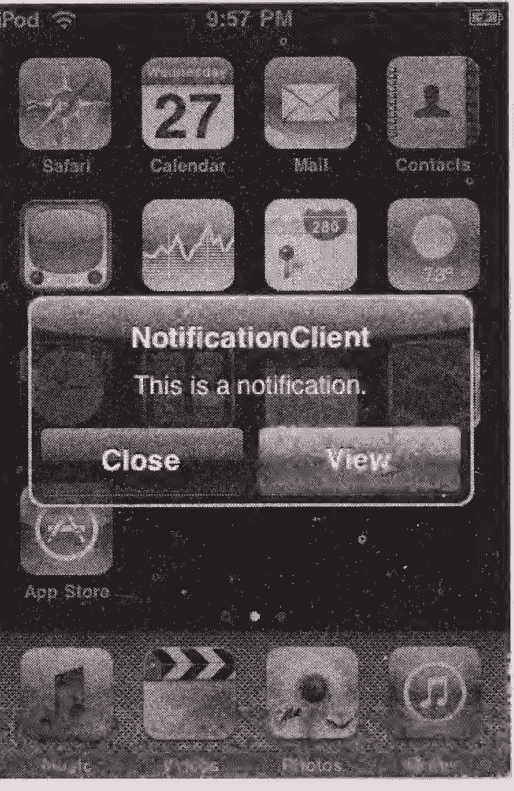

在本章中，你将看到具体如何使用苹果推送通知服务为你的应用程序添加推送通知。你将首先查看推送通知服务的架构以及用于向你的应用程序发送通知的消息格式。最后，我将向你展示如何制作推送通知服务器的示例代码，你将构建一个从你的示例服务器接收通知的示例应用程序。

## 理解推送通知服务架构

在我深入研究推送通知服务器和客户端的实际实现之前，我需要回顾苹果推送通知服务的架构并定义一些术语。理解该架构如何运作是非常重要的，这样你才能有效地对其工作。

### 理解推送通知通信

由于服务器端技术的特性，服务器端与 APNS 交互的接口相当底层。它利用二进制消息格式，通过 socket 连接流传输到 Apple 维护的服务器。通知被流传输到 Apple 的服务器，然后 Apple 从其服务器将通知发送到运行你应用程序的指定设备。设备上的 iPhone OS 维持与 Apple 通知服务器的持久连接。当接收到通知时，iPhone OS 解码通知，判断应用程序是否注册了该通知，如果是，则显示通知。

如果没有应用程序注册接收通知，iPhone OS 会向 Apple 的服务器告知此事实且不显示该通知。预计开发者会偶尔查询任何其他被称为“反馈（Feedback）”的服务器，以确定发送到设备上的通知是否正以这种方式被拒绝。如果是这样，则开发者的应用程序服务器应该停止向该特定设备发送通知。这种情况可能会发生在用户安装了应用程序、选择了接收某些事件的通知，随后又卸载了该应用程序时。

### 整体架构

图 20.2 从高层视角展示了 APNS。

本质上，应用程序安装在 iPhone OS 设备上。该应用程序使用开发者选择的任何协议或机制与开发者的应用程序服务器通信。

开发者的应用程序服务器使用 Apple 指定的协议与 APNS 服务器通信。注册了接收通知的 iPhone OS 设备也会与 APNS 服务器建立连接。

当需要发送推送通知时，开发者的应用程序服务器将消息发送到 APNS 服务器，然后 APNS 服务器将消息发送到 iPhone OS 设备。

> 注意
> Apple 提供两组服务器：一组用于生产环境，另一组用于开发环境。生产服务器位于 `gateway.push.com`。开发服务器位于 `sandbox.push.com`。

### 图 20.2 APNS 架构

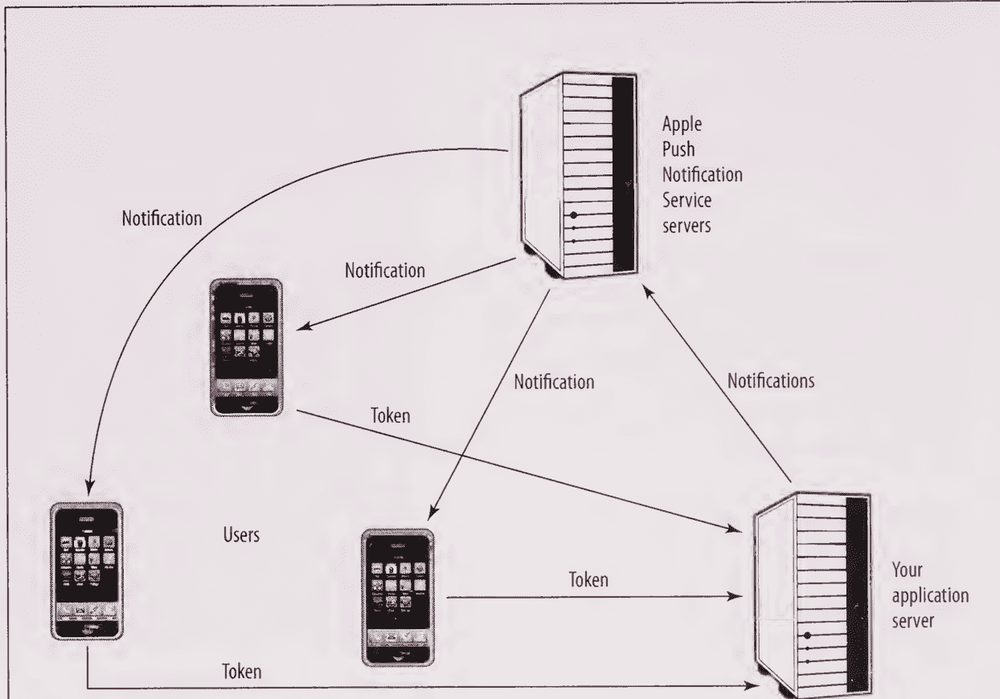

### 通知类型

| 值 | 描述 |
|---|---|
| `UIRemoteTypeNone` | 应用程序忽略所有通知。 |
| `UIRemoteTypeBadge` | 应用程序接收标记应用程序图标的通知。 |
| `UIRemoteTypeSound` | 应用程序接收播放声音的通知。 |
| `UIRemoteTypeAlert` | 应用程序接收显示消息的通知。 |

这些不同的通知类型可以组合，以便你可以接收包括所有在内的任何组合。

一旦应用程序注册接收通知，其应用程序代理将接收 `registerForNotificationsDeviceToken:` 消息。该方法接受一个包含此设备令牌的 `NSData` 对象作为参数。此令牌必须发送到开发者的应用程序服务器，然后服务器在向该特定设备发送通知时使用它与 APNS 服务器通信。

这里收到的设备令牌对于该特定设备是唯一的，它使得开发者的应用程序服务器能够通过推送服务向该设备发送通知。预计应用程序每次启动都会注册并将设备令牌发送到开发者服务器。

## 检查推送通知消息格式

推送通知由一个 JSON 字典和一个与 "aps" 键关联的内部字典组成。内部字典包含一组指定通知本身组件的属性。此 JSON 对象被编码为字符串并放入二进制消息中，然后发送到 APNS 服务器。

> 警告
> 负载的最大允许大小为 4KB 字节。

JSON 字典组件包括警报消息、显示应用程序图标上的数字以及要播放的声音。

> 注意
> 通知中包含的声音必须包含在处理通知的应用程序包内。

## 探索负载

通知的警报组件可以是字符串，也可以是包含几个特定子元素的字典。如果警报仅为字符串，则给定的文本为显示在设备上的警报窗口的消息。同时，它还会显示两个按钮：“关闭”（Close）和“查看”（View）。如果用户点击“查看”，注册了通知的应用程序将启动并接收通知。

如果警报组件是一个字典，它可能包含多个子元素。这些包括 `body`、`action-loc-key`、`loc-key` 和 `loc-args`。

使用此消息格式时，`body` 键指定警报消息。

如果指定了 `action-loc-key`，它指定了显示器“查看”按钮上显示的文本。如果其值为 `null`，系统将显示仅有一个“OK”按钮的警报。点击该按钮将关闭警报。没有用于启动应用程序的按钮。

如果指定了 `loc-key`，它提供了当前本地化对应的本地化字符串文件中警报消息的键。此键用于获取本地化的消息字符串以显示警报消息的文本。此值可以结合 `loc-args` 键使用 `printf` 风格格式字符串进行格式化。

最后，`loc-args` 提供了一个字符串数组，用于与 `loc-key` 属性中打印格式说明符配合使用。

### 注意

JSON 字典必须遵守 RFC 4627。

一个典型的负载在完全构建后，看起来如下：
`"aps":{"alert":"<messageText>", "badge":1}`

## 在 APNS 消息中封装负载

一旦你按照这里的说明编码了负载，你就需要处理将其实际发送到 APNS 服务器。执行此操作的接口是一个原始 TCP 套接字。很快你将看到关于如何连接到套接字并发送消息的内容，但在我讨论负载时，我想说明这里用于发送消息的消息格式。

你的应用程序服务器发送到 APNS 服务器的实际消息由二进制格式组成，如图 20.3 所示。

### 图 20.3 推送消息格式


| 1 字节 | 2 字节 | 32 字节 | 2 字节 | 负载长度字节 |
| --- | --- | --- | --- | --- |
| 命令 | Token 长度 | Token | 负载长度 | 负载 |

该格式由第一个字节命令字节 0 组成。接下来的两个字节指示后续字段的长度，该字段是设备令牌（device token）。Token 长度之后是一个 32 字节的值，给出设备令牌。设备令牌之后是两个字节，用于指示负载的长度。最后，根据负载长度，消息的剩余长度由你的 JSON 编码的负载字典组成。

该格式中指定的所有长度均采用大端序（big endian）。

## 理解反馈消息

反馈服务使用类似的二进制格式向你通信未接收到你通知的设备的设备令牌。图 20.4 显示了消息的格式。

### 图 20.4 反馈消息的格式


| 4 字节 | 2 字节 | 32 字节 |
| --- | --- | --- |
| 时间 t | Token 长度 | Token |

从本质上，此消息由三个部分组成。第一个部分“time_t”表示推送通知服务判断应用程序在设备上不再存在因此不再注册接收通知的时间戳。第二个元素是设备令牌的长度。第三个元素是设备令牌本身。

APNS 服务器以及反馈服务器都将这些消息视为异步流。这意味着当你向 APNS 服务器发送消息时，你只需将消息流式地接入套接字。在流过程中，你不会接收到任何确认消息。同样，当从反馈服务器接收数据时，你只需要打开套接字，你就会开始接收指定给你的应用程序的消息。你不需要对它们进行确认。推送通知服务器根据你用于连接到它的的证书来确定你应用程序的身份。

## 理解推送通知安全

APNS 使用两种不同且互补的机制来保护其数据。

第一个安全机制用于保护从开发人员的应用程序服务器到 APNS 服务器以及从 APNS 服务器到设备的连接点。这被称为“连接信任”（Connection Trust）。

第二种机制称为“令牌信任”（Token Trust），它确保消息从开发人员的应用程序服务器正确递递并路由到 iPhone OS 上的应用程序。在这两种机制之间，推送通知服务可以确保只有授权的设备连接到其推送通知网络，并且消息正被投递到适当的应用程序。

## 理解连接安全

APNS 服务器与设备之间提供的连接信任由 Apple 提供，不需要开发人员采取任何操作。然而，APNS 服务器与开发人员应用程序服务器之间的连接信任确实需要开发人员的工作。

图 20.5 从高层视角展示了连接信任机制。

当开发人员的应用程序服务器连接到 APNS 服务器时，要求使用 TLS。通过使用 TLS，你可以在连接中指定特定的证书。你在应用程序服务器上使用的证书是由 Apple 提供的用于推送通知服务的。通过使用 Apple 提供的证书，Apple 能够验证并校验从你的应用程序服务器到服务器的连接。

> 注意
> TLS 是传输层安全（Transport Layer Security）的缩写，它是 TCP 连接使用安全证书加密数据的机制。

### 图 20.5 连接信任

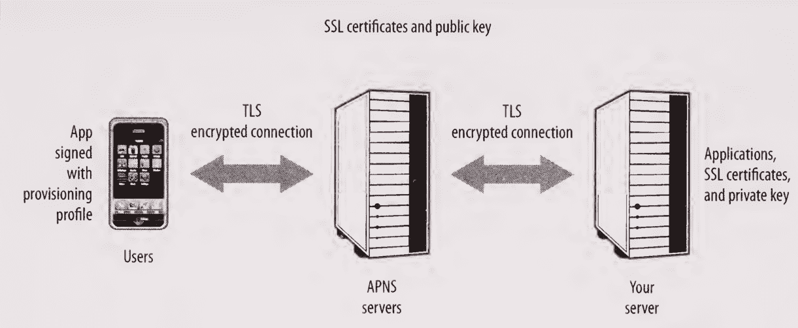

## 配置推送通知服务

### 图 20.7 创建 App ID 界面

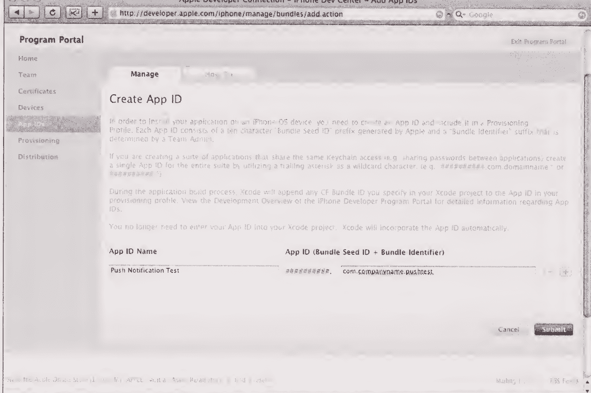

一旦你创建了应用 ID，就会返回到应用 ID 列表界面，该界面显示了你的新应用 ID。现在，你需要配置该应用 ID 以供推送服务使用。要执行此操作，点击“Configure”（配置）链接。这将带你进入图 20.8 所示的界面。

在这里，你可以配置开发环境和生产环境的 SSL 证书。

> 注意
> 我之前提到过，既有一个用于测试的沙盒开发服务器，也有一个用于实际部署应用的生产服务器。你希望将流量推送到哪里，取决于你在为应用程序服务器配置时使用了哪种证书。

### 图 20.8 为推送通知配置应用 ID

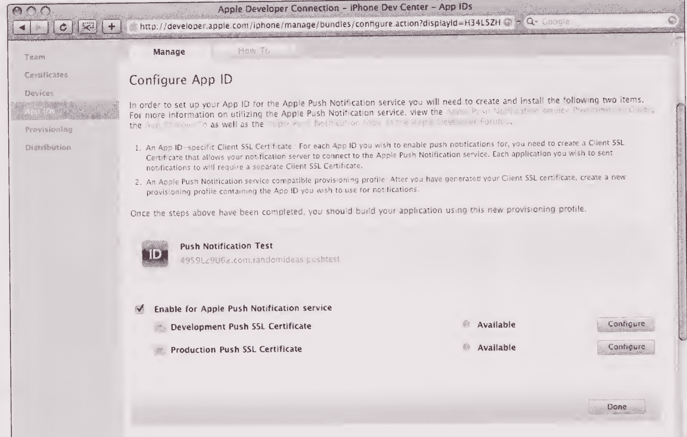

下一个门户将指示你打开“钥匙串访问”（Keychain Access）应用程序并生成签名请求。按照指令操作，直到生成了你的 APNS SSL 证书。然后，你应该下载该证书，将其以及你的私钥从钥匙串中复制到生成推送通知的应用程序服务器或开发机上。

最后，为了在你的 iPhone 客户端应用程序中使用推送通知，你需要生成一个新的描述文件（provisioning profile），并在签名应用程序时使用它。访问程序门户左侧面板中的描述文件链接以创建此描述文件。在创建此新描述文件时，务必选择你用于生成 APNS SSL 证书的那个应用 ID。这确保了当你的应用程序连接到 APNS 服务器时，它们能够正确验证你的应用程序。

## 开发你的服务端推送通知服务

用于使用 SSL 创建推送通知应用程序服务器的可用技术非常多，以至于我无法为你提供如何配置它们所有技术的说明。你将需要查看你所选择特定技术的实现方式。

尽管如此，为了本例的目的，我将演示一个使用 Ruby 构建的推送通知供应商的实现。

我无法详细介绍应用程序是如何构建的，也无法介绍如何阅读 Ruby。你只需要相信它是有效的即可。不过，我将在示例中包含完整的源代码，当然，源代码也可以在书籍的网上找到。

需要识别的关键点是，当你配置推送通知服务的这部分时，完全取决于实现。我给你的示例是实现它的的一种方法。

## 实现一个 Ruby 推送通知供应商

要在 Ruby 中实现此推送通知供应商，你将使用 Ruby 内置的 OpenSSL 支持，连接并发送消息，然后断开连接。当然有其他方法可以做到这一点。特别是，你不应该为每条消息都执行连接、发送并断开；事实上，如果你这样做，Apple 可能会认为你正试图攻击它们的服务器并撤销你的证书。APNS 模型基于这样一个想法：你可以连接、保持连接，并根据需要流式传输消息。在其他语言（如 Perl、Python 或 C）中也有实现方法。

那么，废话不再说，让我们来看代码。列表 20.1 显示了用 Ruby 实现推送通知供应商的代码。

### 列表 20.1 用 Ruby 实现的推送通知供应商

```ruby
#!/usr/bin/ruby

# .notify.rb '<device token>' '<message text>'

require 'socket'
require 'openssl'

# 仅检查我们的参数...
```

### 列表 20.1（续）

让我们逐步查看这段代码，以确切了解发送推送通知时需要做什么。

首先，从传递给此脚本的命令行参数中获取消息和设备 ID，并使用它们构建将要发送到 APNS 服务器的数据包。这在列表 20.2 的摘录中所示。

### 列表 20.2 构建你的数据包

```ruby
# 去掉 token 中的空格
# token 是从客户端应用中的 NSLog 复制的
tokenText = ARGV[0].delete(' ')

messageText = ARGV[1]

# 对 token 打包以将 ascii 表示法转换回二进制
tokenData = [tokenText].pack('H*')

# 构建负载
payload = "{\"aps\":{\"alert\":\"#{messageText}\", \"badge\":1}}"

# 构建数据包
packet = [0, 32, tokenData, 0, payload.length, payload].pack('ccca cca**')
```

本质上，你获取消息的命令行参数，并使用它来构建需要放入负载的 JSON 序列化对象。你放置了一个键为 "alert" 的消息字典。你还添加了另一个键 "badge"，用以将角标数字设置为 1。最后，你获取此字典并放入另一个与键 "aps" 关联的字典中。

接下来，你还有一些与从磁盘读取证书相关的代码。这在列表 20.3 中所示。

### 列表 20.3 读取证书

```ruby
# 读取我们的证书并设置 SSL 上下文
cert = File.read("devcerts.pem")

openSSLContext = OpenSSL::SSL::SSLContext.new
openSSLContext.cert = OpenSSL::X509::Certificate.new(cert)
openSSLContext.key = OpenSSL::PKey::RSA.new(cert)
```

这里的关键点是，当你从证书时，它是 p12 格式。大多数 OpenSSL 库倾向于处理 .pem 证书。因此，你需要对其进行转换。要执行此操作，运行终端命令：

```bash
openssl pkcs12 -in devcerts.p12 -out devcerts.pem -nodes
```


`openssl pkcs2 -in Certificates.p12 -out devcerts.pem -nodes`

提取完成后，你可以使用它创建 SSL 连接。在上下文中，你相应地设置了证书和密钥属性。

接下来，你打开到服务器的连接。一旦连接打开，你就使用 TCP socket 初始化一个新的 `SSLSocket`。然后你连接你的 SSL socket，这将触发 SSL 握手。这在列表 20.4 中所示。

### 列表 20.4 连接服务器并发送数据包

```ruby
# 连接到服务器的 2195 端口
sock = TCPSocket.new('gateway.sandbox.push.apple.com', 2195)

# 执行 SSL 握手
sslSocket = OpenSSL::SSL::SSLSocket.new(sock, openSSLContext)
sslSocket.connect

# 向流写入我们的数据包
sslSocket.write(packet)
```

最后，你将数据包发送到服务器。

## 推送通知

现在你有了通知供应商的实现，只需运行命令：

`./notify.rb '<token>' '<message>'`

token 来自你的客户端应用程序。为了测试和实验，你可以让应用程序简单将 token 打印到控制台。然后将其复制并粘贴到命令行。然而，在实际实现中，你需要想出某种机制，使用 socket 和自动进程将 token 发送到你的服务器。

一旦消息在设备上被接收，它就会显示在屏幕上。

## 使用反馈检查递送

如果你从设备上删除了应用程序，显然继续发送通知是没有意义的。对于未安装应用程序收到的通知不会显示。设备还会向 APNS 服务器发送通知，指示消息无法送达。APNS 服务器随后会将此添加到维护在 APNS 反馈服务器上的列表中。你应该定期连接到反馈服务器并下载未接收你发送通知的 token 列表。然后你应该停止向这些 token 发送消息。

# 将推送通知集成到你的 iPhone 客户端

构建一个注册推送通知的应用是非常简单的。你首先需要注册通知，然后当你获得令牌（token）后，将其发送到你的应用程序服务器。最后，当接收到通知时，你的应用程序将带有通知信息作为参数启动。如果应用程序在运行时发生了通知，你的应用程序将接收到消息，你也可以根据该通知来采取行动。

> **注意**
>
> 如果你的应用程序在运行时接收到通知，则不会显示任何消息。你应当根据情况采取任何必要的操作，包括在适当的情况下自己显示消息。

## 注册通知

要注册通知，你只需在你的 `UIApplication` 单例上调用 `registerForRemoteNotificationTypes` 方法。这在列表 20.5 中所示。

### 列表 20.5 注册远程通知类型

```objc
(void)applicationDidFinishLaunching: (UIApplication *)application {
    [[UIApplication sharedApplication] registerForRemoteNotificationTypes:
    (UIRemoteNotificationTypeAlert | UIRemoteNotificationTypeSound | UIRemoteNotificationTypeBadge)];
    // 启动后的自定义覆盖点
    [window addSubview:self.controller.view];
    [window makeKeyAndVisible];
}
```

在应用程序与 APNS 联系并注册通知后，你的应用程序代理会接收到 `didRegisterForRemoteNotificationsWithDeviceToken:` 调用。你应该利用此机会将你的令牌发送给你的推送供应商。在列表 20.6 所示的示例中，你使用了虚拟方法 `sendToServers:` 来实现此目的。

### 列表 20.6 将设备令牌发送到服务器

```objc
(void)application:(UIApplication *)application didRegisterForRemoteNotification
WithDeviceToken:(NSData *)deviceToken
{
    [self sendToServers:deviceToken];
}
```

## 在你的应用程序中接收通知

最后，当你实际上接收到通知时，有两种路径可以让它进入你的应用程序。

第一种情况发生在应用程序未运行，但用户选择了通知上的“查看”（View）按钮。为了拦截此通知，你需要实现 `application:didFinishLaunchingWithOptions:` 方法，在这种情况下，该方法会代替 `applicationDidFinishLaunching:` 被调用。列表 20.7 显示了该方法的实现。

### 列表 20.7 application:didFinishLaunchingWithOptions: 方法的实现

```objc
(BOOL)application:(UIApplication *)application didFinishLaunchingWithOptions:
(NSDictionary *)launchOptions
{
    NSDictionary *payload = [launchOptions objectForKey:@"aps"];
    NSDictionary *alertMsg = [payload objectForKey:@"alert"];
    NSNumber *badgeCount = [payload objectForKey:@"badge"];
    // 对此进行某些操作 ...
    [self applicationDidFinishLaunchingApplication:launchOptions];
}
```

注意，启动选项字典包含一个 "aps" 键。与该键关联的对象包含了来自你通知的实际负载。然后你可以访问该字典的元素并据此采取行动。

## 第 20 章：使用推送服务

通知进入你的应用程序的第二种方式是你的应用程序已经在运行。在这种情况下，你的应用程序代理会接收到 `application:didReceiveRemoteNotification:` 调用，就像你接收通知一样，此方法也会接收一个包含通知的用户字典。列表 20.8 显示了该方法的实现。

### 列表 20.8 应用程序运行时接收远程通知

```objc
(void)application:(UIApplication *)application didReceiveRemoteNotification:(NSDictionary *)userInfo
{
    NSDictionary *payload = [userInfo objectForKey:@"aps"];
    NSDictionary *alertMsg = [payload objectForKey:@"alert"];
    NSNumber *badgeCount = [payload objectForKey:@"badge"];
    // 对此进行某些操作 ..
}
```

你应该利用此机会，例如向用户显示消息或更新你的角标计数。

### 总结

在本章中，你详细检查了苹果推送服务（APNS）以及如何与其工作。你深入研究了与 APNS 服务器通信所需的架构和消息格式，你查看了 APNS 如何处理安全性，并了解了如何获取与 APNS 服务器通信所需的证书。你还看到了一个推送通知供应商的完整示例，它可以部署在 Linux 或 Mac 服务器上。最后，你还了解了如何在自己的 iPhone OS 应用程序中处理远程通知。

推送通知是 iPhone OS 3 中强大的功能之一。通过掌握这项技术，你可以为你的应用程序开启新功能，让你的用户感到惊喜。

# 使用 Game Kit API

作为 iPhone OS 3 的一部分，苹果引入了 Game Kit API。Game Kit 是一个旨在解决应用程序和游戏开发者面临的两个主要问题的新框架。

第一个问题是在相邻的设备之间创建即时点对网络的能力。为了满足这一需求，Game Kit 提供了一种复杂但易于使用的机制，通过 iPhone 和第二代 iPod Touch 内置的蓝牙网络功能来设计这种网络。

第二个问题是为应用程序添加游戏内语音的能力。这是支持多用户游戏的应用的常见需求，而包含此功能通常超大多数开发者的能力或资源。为了解决这个问题，Game Kit 提供了一种易于使用的游戏内语音功能，它利用了苹果之前在 iChat 中添加语音的经验，并为开发者领域带来了力量。开发者不需要了解编码器或协议；他们只需要使用 API，一切都会由系统为他们处理。

在本章中，我们将检查这两个框架以及你如何利用它们。特别需要指出的是，此 API 中的功能仅适用于游戏。特别是点对点能力，可以在应用程序在相互靠近时被其利用。

### 本章内容

- 为你的 iPhone 应用程序添加点对点网络
- 为你的 iPhone 应用程序添加语音

## 提供点对点连接

我将讨论的 Game Kit 的第一个功能是它为相邻设备提供即时网络连接的能力。这一功能主要由 `GKPeerPickerController` 和 `GKSession` 类提供。

在使用 Game Kit API 之前，你必须先将 Game Kit 框架添加到你的项目中。通过右键点击你的目标（target），选择“Get Info”，然后选择“General”（通用）选项卡。点击窗口底部“Linked Libraries”（链接库）下的按钮，然后选择 Game Kit 框架。你还必须在源文件中包含 `GameKit.h` 文件。

## 寻找伙伴设备

`GKPeerPickerController` 类提供了在你的本地蓝牙网络上寻找伙伴设备的机制。使用它，你可以获取附近所有当前可与你的应用程序进行网络连接的设备列表。它也允许你通过互联网寻找伙伴，但当你选择使用互联网而不是蓝牙时，你必须关闭 `GKPeerPickerController` 并显示你的用户界面以完成连接。`GKPeerPickerController` 不处理在互联网上建立对等连接。

要分配并显示 `GKPeerPickerController`，你只需要初始化它、配置允许的网络类型并设置你的代理。最后，为了在屏幕上显示它，你可以调用 `show` 方法。列表 21.1 显示了设置和显示 `GKPeerPickerController` 的典型实现。

### 列表 21.1 GKPeerPickerController 的初始化与显示

```objc
#import <GameKit/GameKit.h>

- (void)showPeerPicker {
    controller = [[GKPeerPickerController alloc] init];
    controller.delegate = self;
    [controller show];
}
```

> **注意**
>
> 你的代理必须符合 `GKPeerPickerControllerDelegate` 协议才能作为 `GKPeerPickerController` 的代理。

当你调用 `show` 时，你的应用程序会显示一个对话框，显示正在寻找其他支持 Game Kit 的设备。

你可以看到，显示伙伴选择器相当简单。实际的工作将由你的 `GKPeerPickerControllerDelegate` 处理，它将在伙伴设备被选中时采取行动。在这一特定的代码中，我将你的代理设置为自己，因此该类需要实现适当代理消息来处理它感兴趣的事件。

代理方法中最重要的方法当然是 `peerPickerController:didConnectPeer:toSession:`，它在用户选择好一个对端时被调用。传递给代理方法的参数实际上是一个已经实例化的 `GKSession` 实例，该实例用于与所选的对端进行通信。如果你正在使用 `GKSession` 类进行点对点通信，那么此时，你已经准备好开始向你的对端发送和接收数据了。

当两个对端实例化并显示 `GKPeerPickerController` 时，它们都会显示网络上发现的所有设备列表。如果其中一个对端选择了其中一个设备进行连接，该对端将显示一个连接接受对话框，允许其接受连接请求。一旦接受，对端代理将接收到 `peerPickerController:didConnectPeer:toSession:` 方法的调用。

列表 21.2 显示了该方法的实现。

### 列表 21.2 peerPickerController:didConnectPeer:toSession: 的典型实现

```objc
- (void)peerPickerController:(GKPeerPickerController *)peerPicker
    didConnectPeer:(NSString *)peerID
    toSession:(GKSession *)session
{
    [self setPeerSession:session];
    [controller dismiss];
    [controller release];
    // begin sending data to the peer.
    { ... }
}
```

该方法在连接完成后也会在另一个对端上调用，并且用于假设新创建的 `GKSession` 的所有权。

这可能看起来很混乱，为了清晰起见，我在这里重复一遍。重点在于是你正在连接两个对端，并且都使用 `peerPickerController:didConnectPeer:toSession:` 方法来建立连接。

想象两台 iPhone，A 和 B。它们都初始化并显示 `GKPeerPickerController` 实例。然后两台设备都会显示设备列表。A 上的列表显示 iPhone B，反之亦然。如果 iPhone A 的用户选择了 iPhone B，iPhone B 将显示一个连接确认对话框。如果 iPhone B 的用户选择接受，则会在两台设备上都调用 `peerPickerController:didConnectPeer:toSession:` 代理方法。

如果用户取消了对端选择对话框，则 `GKPeerPickerControllerDelegate` 上会调用 `peerPickerControllerDidCancel:` 方法。这在列表 21.3 中所示。

### 列表 21.3 peerPickerControllerDidCancel: 方法的实现

```objc
- (void)peerPickerControllerDidCancel:(GKPeerPickerController *)picker
{
    [controller release];
}
```

在某些情况下，你可能想为会话提供一个特殊的自定义 `GKSession`。代理中提供的 `peerPickerController:sessionForConnectionType:` 方法正是为了这个目的提供的。在该方法中，你可以分配一个你想要的任何 `GKSession` 自定义子类的会话并将其返回。列表 21.4 演示了这一功能。

### 列表 21.4 分配自定义的 GKSession

```objc
- (GKSession *)peerPickerController:(GKPeerPickerController *)picker
    sessionForConnectionType:(GKPeerPickerControllerConnectionType)type
{
    GKSession *session = [[MyCustomSession alloc] init];
    [session setDelegate:self];
    return [session autorelease];
}
```


在提供选择互联网连接类型而非蓝牙连接类型的机会的情况下，你的 `GKPeerPickerControllerDelegate` 上会调用 `peerPickerController:didConnectionType:` 方法，这让你有机会停用对端选择器并展示你自己的拨号界面通过互联网建立连接。

`GKPeerPickerController` 仅用于形成点对点连接。如果你的应用程序需要客户端-服务器连接性，你需要直接使用 `GKSession`，这就是我接下来要讨论的。

## 使用会话

用于在对端之间提供实际网络连接的类是 `GKSession` 类。该类提供了一种易用的机制，通过 ad hoc 蓝牙网络向一个或多个对端发送任意数据。此外，当应用程序需要时，`GKSession` 类允许你配置客户端-服务器连接而非严格的点对点连接。在这种情况下，你完全跳过 `GKPeerPickerController` 并直接使用 `GKSession` 类配置你的连接。

要分配一个 `GKSession` 对象，你调用 `initWithSessionID:displayName:sessionMode:`，它接受会话 ID、显示名称和会话模式作为参数。

你的 `GKSession` 实例可以根据初始化时配置的 `sessionMode` 充当客户端、服务器或对端。作为服务器，有客户端连接到你，但应用程序不会搜索服务器。作为客户端，你的应用程序会搜索服务器，但不会将自己发布为服务器。作为对端，你的应用程序既搜索服务器又将自己发布为服务器。

当需要创建 `GKSession` 的服务器实例时，你只需分配并初始化 `sessionMode` 参数为 `GKSessionModeServer` 的 `GKSession` 对象。要创建 `GKSession` 的客户端实例，请传递 `GKSessionModeClient` 参数。要创建 `GKSession` 作为对端，请传递 `GKSessionModePeer` 参数。

通过将 `GKSession` 的 `available` 属性设置为 YES，服务器就可以在本地网络上可见。

`GKSession` 提供了可以实现以处理来自其他对端数据接收的方法。按照惯例，重型工作由 `GKSession` 类的代理处理。

网络上的每个会话通过其 `sessionID` 唯一标识。这可以由算法提供，如果你选择传递 `nil`，它将使用应用程序包 ID 为你创建一个。通过这种方式，你应用程序的用户是唯一的。

在直接操作 `GKSession` 时，你需要展示任何你认为所需的用户界面，以便用户有能力选择他们想要连接的服务器。`displayName` 属性用于在显示此内容时为你的 UI 提供人类可读名称。

一旦你创建了 `GKSession`，你将它的 `isAvailable` 属性设置为 YES 以开始搜索。

## 处理数据

一旦建立了连接，你就可以使用 `sendDataToAllPeers:withDataMode:error:` 和 `sendDataToPeers:withDataMode:error:` 方法向你的节点发送数据。对于前者，你将数据发送给所有节点；而对于后者，你仅将数据发送给子集。在这两种情况下，发送的数据都是一个包含你定义的任意字节集的 `NSData` 实例。Apple 建议保持这些数据较小，长度在 1KB 以下。大数据集可能会导致过高的延迟。

这些方法中的 `mode` 参数允许你指定偏好可靠传输模式还是不可靠传输模式。在开发游戏时，不可靠传输模式通常更好，因为对于应用程序来说，接收更新的信息比接收准确但过时的信息更重要。不可靠传输模式不保证你发送的每个数据包都能被节点接收。可靠传输模式会在数据包未送达时重新发送。你的应用程序需要什么类型的传输取决于你的决定。

要接收数据，你需要实现 `receiveData:fromPeer:inSession:context:` 方法，该方法之前已通过 `GKSession` 上的 `setDataReceiveHandler:withContext:` 方法设置为你的数据处理器。换句话说，你指定一个对象作为你的数据接收器，并使用 `GKSession` 的 `setDataReceiveHandler:withContext:` 方法将其设置为你的“数据接收器处理器”。然后，在该对象上实现 `receiveData:fromPeer:inSession:context:` 方法，并按你想要的方式使用这些数据。

## 游戏内语音

Game Kit 游戏内语音功能允许通过 Internet 链接或 Game Kit 蓝牙网络，通过你的应用程序提供的网络连接传输语音数据，实现从一个设备到另一个设备的实时语音通信。这种网络连接可以是普通的 socket 连接，也可以是你为此目的分配的 `GKSession` 实例。

如果你利用了 `GKSession` 实例，当然可以使用其内置的发现节点的机制。然而，如果你选择通过 Internet 使用 Game Kit 语音聊天，你需要提供一种机制来实现节点目录服务，并使节点能够将目录条目翻译为网络地址以建立网络连接。该目录服务可能需要你实现一个服务端服务。

需要理解的关键点是，在启动语音聊天时，你需要提供一个参与者 ID 以及一个向参与者发送数据的机制。获取这个参与者 ID 和网络连接取决于你的实现。例如，如果你利用 `GKSession` 作为你的底层点对点网络，那么可以使用节点 ID 作为参与者 ID，并使用 `sendDataToPeers:withDataMode:error:` 方法。

### 初始化音频会话

在开始使用 Game Kit 语音聊天功能之前，你必须初始化音频系统以允许音频的录制和播放。你通过获取 `AVAudioSession` 单例并将其类别设置为 `AVAudioSessionCategoryPlayAndRecord` 来实现。

```
- (void) setupAudio {
    NSError *error = nil;
    AVAudioSession *audioSession = [AVAudioSession sharedInstance];
    if (![audioSession setCategory:AVAudioSessionCategoryPlayAndRecord error:&error])
        [self handleError:error];
    if (![audioSession setActive:YES error:&error])
        [self handleError:error];
}
```

`GKVoiceChat` 利用了以客户端属性形式存在的类委托模式。客户端负责实现在节点之间实际传输数据所需的方法，并且必须实现 `GKVoiceChatClient` 协议。`GKVoiceChatClient` 协议中有两个重要方法必须在客户端上实现，以便 `GKVoiceChatService` 能够工作。

第一个是 `voiceChatService:didReceiveInvitationFromParticipantID:callID:`，当服务接收到来自节点的开始聊天的邀请时，该方法会在客户端上被调用。该方法的默认实现允许所有客户端连接并启动聊天。如果你想给用户提供接受或拒绝聊天邀请的机会，你应该相应地实现此方法。当你实现此方法时，为了指示用户已接受聊天请求，请在服务上调用 `acceptCallID:error:` 方法。或者，要拒绝聊天，请调用 `denyCallID:`。

在你的客户端上要实现的第二个更重要的方法是 `voiceChatService:sendData:toParticipantID:` 方法，该方法必须在客户端上实现以便在节点之间发送数据。如果你不实现此方法，则没有数据被发送，语音也无法工作。

本质上，当聊天服务需要向节点发送数据时，它可以使用一个包含要发送到远程主机的负载的 `NSData` 对象来完成。这可能是邀请、语音或其他数据的结果。其意图并不是让你对数据进行除了传递给你的传输机制之外的任何操作。在大多数情况下，你可以认为 `NSData` 参数是不透明的。你的工作仅仅是将其传递给节点。

### 列表 21.8 `voiceChatService:sendData:toParticipantID:` 的示例实现

```
- (void)voiceChatService:(GKVoiceChatService *)voiceChatService
    sendData:(NSData *)data
    toParticipantID:(NSString *)participantID
{
    // 此处为实现细节
    [commObject sendData:data toHost:participantID];
}
```


# GKVoiceChat 语音聊天实现

GKVoiceChat 利用了以客户端属性形式存在的类委托模式。客户端负责实现在节点之间实际传输数据所需的方法，并且必须实现 `GKVoiceChatClient` 协议。`GKVoiceChatClient` 协议中有两个重要方法必须在客户端上实现，以便 `GKVoiceChatService` 能够工作。

## 处理聊天邀请

第一个是 `voiceChatService:didReceiveInvitationFromParticipantID:callID:`，当服务接收到来自节点的开始聊天的邀请时，该方法会在客户端上被调用。该方法的默认实现允许所有客户端连接并启动聊天。如果你想给用户提供接受或拒绝聊天邀请的机会，你应该相应地实现此方法。当你实现此方法时，为了指示用户已接受聊天请求，请在服务上调用 `acceptCallID:error:` 方法。或者，要拒绝聊天，请调用 `denyCallID:`。

## 发送数据

在你的客户端上要实现的第二个更重要的方法是 `voiceChatService:sendData:toParticipantID:` 方法，该方法必须在客户端上实现以便在节点之间发送数据。如果你不实现此方法，则没有数据被发送，语音也无法工作。本质上，当聊天服务需要向节点发送数据时，它可以使用一个包含要发送到远程主机的负载的 `NSData` 对象来完成。这可能是邀请、语音或其他结果。其意图并不是让你对数据进行除了传递给你的传输机制之外的任何操作。在大多数情况下，你可以认为 `NSData` 参数是不透明的。你的工作仅仅是将其传递给节点。

## 启动语音聊天

我已经实现了所有这些内容，你可以实例化你的客户端，并将其配置为 `GKVoiceChatService` 的客户端。通过你的机制与节点建立网络连接后，你就可以在 `GKVoiceChat` 单例上调用 `startVoiceChatWithParticipantID:error:` 方法来启动语音聊天。

### 代码示例：设置并启动聊天

```objc
- (void)setupChat {
    GKVoiceChatService *svc = [[GKVoiceChatService alloc] initDefaultVoiceChatService];
    MyClient *client = [[MyClient alloc] initWithConnectionToHost:hostname];
    [svc setClient:client];

    NSString *peerId = [self peersForHost:hostname];
    [svc startVoiceChatWithParticipantID:peerId error:nil];
}
```

当调用 `startVoiceChatWithParticipantID:error:` 方法时，`GKVoiceChatService` 将其配置信息和语音启动数据封装成一个 `NSData`，并调用你客户端上的 `voiceChatService:sendData:toParticipantID:` 方法。你的客户端随后通过其网络代码将该数据转发到远程客户端，远程客户端接收数据并通过 `receivedData:fromParticipantID:` 方法传递给它的 `GKVoiceChat` 实例。这通过协商使用的编码器类型建立了聊天连接。

## 停止语音聊天

最后，当你准备好停止语音聊天并断开节点连接时，你可以调用 `GKVoiceChatService` 上的 `stopVoiceChatWithParticipantID:` 方法。这随后会在你的客户端类上调用 `voiceChatService:didStopWithParticipantID:error:` 方法，给你提供断开节点的机会。

## 音频属性监控与调整

`GKVoiceChatService` 还提供了方法，允许你使用语音聊天监控并调整音频属性。特别是，它允许你执行如静音麦克风、修改远程参与者音量以及监控输入输出电平等操作。要了解更多信息，请参阅 `GKVoiceChatService` 文档。

---

# 第 22 章：实现剪切、复制和粘贴

## 概述

iPhone OS 3 最受期待的新功能之一似乎也是最基础的功能之一。该功能就是剪切、复制和粘贴。在 iPhone OS 3 之前，系统并没有提供作为操作系统一部分的系统级剪切、复制和粘贴功能。随着 iPhone OS 3 的引入，你不仅拥有了这一功能，还拥有了特定应用程序甚至特定供应商的复制和粘贴能力。

系统级剪贴板允许你复制和粘贴任何类型的内容（从文本到图像），并将其在系统中支持你所放置的数据类型的任意应用程序之间进行共享。

为了在特定的应用程序子集、单个应用程序甚至一组应用程序之间共享数据，你还可以创建一个命名的剪贴板。知道剪贴板名称的应用程序可以访问该剪贴板上的数据。这使得应用程序之间可以共享数据，但并不一定与系统的其他部分共享。

iPhone OS 3 中的剪贴板还可以是持久的，这意味着即使应用程序终止，其内容也会被保留。

## 使用标准控件进行复制和粘贴

当处理标准的 `UITextView`、`UIWebView` 和 `UITextField` 对象时，你不需要做任何操作就可以实现复制和粘贴；它们在这些标准组件上已经启用了。在这些组件上选中的数据在被剪切或复制时，会被放入系统剪贴板，并供系统上的任何其他应用程序使用。同样，通用系统剪贴板上的可用数据也可以通过粘贴机制在这些控件的任何一个中使用。

再次，这一切都是为你准备的；你不需要做任何操作即可获得开箱即用的支持。

你唯一需要对剪切、复制和粘贴进行特殊操作的时候，是在你有自定义视图或其他特殊情况，且你特别需要将数据放入剪贴板以将其发送给其他应用程序时。这时，你需要与实现 iPhone OS 3 中复制和粘贴机制的核心类进行交互。那个类就是 `UIPasteboard` 类，我将在本章的剩余部分讨论该类。

## 理解剪贴板类型

应用程序可以交互的实际上有两种不同类型的剪贴板。第一种是通用的系统剪贴板。该剪贴板可以被系统上的所有应用程序访问，是 `UITextView`、`UITextField` 等使用的默认剪贴板。

第二种剪贴板被称为命名剪贴板。这些剪贴板由你的应用程序创建并命名。其他知道你的剪贴板名称的应用程序也可以访问该剪贴板并检索你的数据。通过这种方式，如果你需要，你可以在一组应用程序之间共享数据。

`UIPasteboard` 类提供了应用程序在底层与通用系统剪贴板以及它们自己创建的命名剪贴板交互的机制。

### 访问系统剪贴板

要访问通用系统剪贴板，你调用 `UIPasteboard` 类上的 `generalPasteboard` 方法。这返回通用剪贴板的单例。

### 访问命名剪贴板

要访问命名剪贴板，你调用 `UIPasteboard` 类上的 `pasteboardWithName:create:` 方法。如果你希望 `UIPasteboard` 类为你创建一个唯一的名称，可以传递 `nil` 作为第一个参数。第二个参数表示你是否希望在剪贴板不存在时让 `UIPasteboard` 类为你创建该剪贴板。

> **注意**
> 在调用 `pasteboardWithName:create:` 时，Apple 建议在为公司命名时使用反向 DNS 表示法，以避免无意的命名冲突，例如 `com.MyCompany.exampleapp`。

选择哪种剪贴板取决于你的应用程序。

## 与 UIPasteboard 交互

一旦你有了剪贴板，就可以在上面放置任何你想要的数据。要将数据放在剪贴板上，调用 `setData:forPasteboardType:` 或 `setValue:forPasteboardType:` 方法。这允许你在 `setData:forPasteboardType:` 的情况下将原始数据放在剪贴板上；在 `setValue:forPasteboardType:` 方法的情况下，你放置的是可以序列化为剪贴板列表的数据。

此类数据示例有 `NSString`、`NSArray`、`NSDate` 和 `NSNumber`。对于这两个方法，剪贴板类型参数应该指定放置在剪贴板上的数据类型的 UTI 值。通过这种方式，剪贴板就像一个字典一样，允许你将不同的数据表示与不同的类型关联，随后其他应用程序可以根据剪贴板类型访问这些数据。例如，应用程序可以先请求富文本表示，如果该表示不可用，再请求纯文本版本。

`UIPasteboard` 类还提供了一系列特定的属性，用于向剪贴板添加特定类型的数据或从剪贴板获取特定类型的数据。这些属性见表 22.1。

### 表 22.1 用于 UIPasteboard 设置和获取标准类型的属性

| 属性名称 | 目的 |
| :--- | :--- |
| `string` | 获取第一个剪贴板项的字符串 |
| `strings` | 获取所有剪贴板项的字符串数组 |
| `image` | 获取第一个剪贴板项的图像 |
| `images` | 获取所有剪贴板项的图像数组 |
| `URL` | 获取第一个剪贴板项的 URL |
| `URLs` | 获取所有剪贴板项的 URL 数组 |
| `color` | 获取第一个剪贴板项的颜色 |
| `colors` | 获取所有剪贴板项的颜色数组 |

> **注意**
> 当访问标准类型属性时，如果请求的类型在剪贴板不可用，则返回 `nil`。

> **注意**
> 当数据为私有类型时，剪贴板类型可以使用非 UTI 值。再次，在这种情况下，Apple 建议该值使用反向 DNS 表示法，例如 `com.mycompany.myproduct`。

调用这些方法时，如果剪贴板类型已存在数据，则会被覆盖。特定类型的元素可以使用 `addItems:` 或通过设置 `UIPasteboard` 的 `items` 属性存储在剪贴板上。

## 在自定义视图实现剪切、复制和粘贴

首先，假设你有一个显示图像的应用程序，你想将图像放入通用系统剪贴板。

假设你的 UI 上有一个 `UIView`，你想用它来启动复制。可能你希望在用户手指在图像上停留一段时间并抬起后复制数据，就像标准控件的工作方式一样。

在这种情况下，你可以使用这个自定义 `UIView` 的 `touchesEnded:withEvent:` 方法来显示复制和粘贴菜单；然后当用户选择一个选项时，它允许你自定义视图上的 `copy:` 或 `paste:` 方法实际上与 `UIPasteboard` 对象协同工作。

### 实现 touchesEnded:withEvent: 显示菜单

列表 22.1 显示了 `touchesEnded:withEvent:` 方法的实现。在方法中，你正在判断用户是否在控件上停留了一段时间，然后请求 `UIMenuController` 显示复制菜单。

**列表 22.1 自定义视图上的 touchesEnded:withEvent: 实现**

```objc
- (void)touchesEnded:(NSSet *)touches withEvent:(UIEvent *)event {
    UITouch *touch = [touches anyObject];

    if (([touch timestamp] - [firstTouch timestamp]) > 3) {
        UIMenuController *menu = [UIMenuController sharedMenuController];
        [menu setTargetRect:[self frame] inView:self];
        [menu setMenuVisible:YES animated:YES];
    }
}
```

> **注意**
> `UIMenuController` 的 `setTargetRect:inView:` 方法在请求菜单的 `UIView` 内设置一个矩形。该矩形的作用是让菜单根据复制的数据显示在合适的位置。菜单会出现在指定矩形的正上方。

这段代码使用了新的类 `UIMenuController`，该类在 iPhone OS 3 中提供，用于在检测到剪贴板操作时显示剪切、复制和粘贴菜单。假设你的自定义视图类已经实现了 `UIResponderStandardEditActions` 协议以显示菜单。

### 实现 copy: 方法

`UIMenuController` 会查询第一响应者，检查它是否实现了 `UIResponderStandardEditActions` 协议中定义的方法。在这种情况下，你希望实现该协议中的 `copy:` 方法，以便从你的自定义视图中复制数据。

**列表 22.2 来自 UIResponderStandardEditActions 协议的 copy: 实现**

```objc
- (void)copy:(id)sender {
    UIImage *theImage = [self imageRepresentation];
    UIPasteboard *pb = [UIPasteboard generalPasteboard];
    [pb setImage:theImage];
}
```

注意，你正在将自定义视图数据作为 `UIImage` 获取，然后使用 `image` 属性将该数据放在剪贴板上。

### 实现 paste: 方法

同样，如果你想显示一个粘贴菜单项，允许从剪贴板粘贴图像，可以像列表 22.3 所示实现 `paste:` 方法。

**列表 22.3 来自 UIResponderStandardEditActions 协议的 paste: 实现**

```objc
- (void)paste:(id)sender {
    MyView *imageView = (MyView *)sender;
    UIPasteboard *pb = [UIPasteboard generalPasteboard];
    UIImage *theImage = [pb image];
    if (theImage) {
        [self setImage:theImage];
    }
}
```


在这里，你正在询问通用剪贴板，剪贴板上的当前项目是否可以作为 `UIImage` 表示形式可用。如果是，你就将你的图像属性设置为收到的任何图像。

# 理解交互

总结一下这里发生的情况：你的自定义 `UIView` 正在实现 `touchesEnded:withEvent:`。在该方法中，你检查用户手指按在视图上的时间是否超过了三秒。如果是，你就会请求 `UIMenuController` 为你显示标准的剪切粘贴菜单。你的视图当前是第一响应者，并实现了 `UIResponderStandardEditActions` 协议中的 `copy:` 和 `paste:` 方法，因此当菜单显示时，它会显示复制或粘贴选项。当用户选择复制或粘贴菜单项时，会在你的自定义视图上调用相关方法，在本例中，

当 `copy:` 或 `paste:` 方法被调用时，你的数据分别从你的自定义视图复制到剪贴板，或从剪贴板复制到你的自定义视图。

### 总结

在本章中，我向你介绍了 iPhone OS 3 的基本新功能之一：系统级的复制和粘贴。此外，我还向你介绍了 `UIMenuController` 类，它用于显示执行复制粘贴操作的菜单。

幸运的是，如果你使用标准控件，大部分工作已经为你做好了。如果你有自定义数据或自定义视图，你可能可能需要直接与 `UIPasteboard` 类交互，以实现你自己的复制粘贴操作。凭借你在本章中获得的知识，你应该能够做到。

# 使用 Maps API

从开发者的角度来看，iPhone OS 3 中一个备受期待的功能是增加了 `Map Kit API`。
Map Kit API 让开发者最终能够在他们的应用程序中嵌入地图。它包含了在应用程序中显示地图所需的一切，包括来自 Google maps 的地图，以及为兴趣点添加地图注释的能力。你甚至可以对地图坐标进行反向地理编码（reverse geocode），这允许你设置一组坐标并从中获取街道地址。这是一个非常强大的 API，无疑会被 iPhone OS 3 的应用程序广泛使用。

# 使用 MKMapView 显示嵌入地图

Map Kit API 的核心在于 `MKMapView` 类，它完整地封装了一个包含地图的视图。地图本身以给定的坐标为中心，并根据区域值进行缩放。除了可以通过编程设置这些属性外，该视图还允许用户通过触摸和缩指手势的组合来对地图进行定位和缩放。这种能力可以根据你是否允许用户执行此操作来启用或禁用。

`MKMapView` 还可以进行注释，以显示地图上显示的位置说明。注释本身是 `MKAnnotation` 的实例，而与注释关联的视图是 `MKAnnotationView` 的实例。使用这些类，你可以在为地图注释时获得相当大的自定义空间。

# 创建 MKMapView

要向你的项目添加 `MKMapView`，你只需在 Interface Builder 中打开一个视图 nib 文件，然后从调色板将地图视图对象拖放到你的视图上即可。这会在你的 nib 文件中产生一个 `MKMapView` 实例。然后你可以为了某些目的对其进行居中。图 23.1 显示了一幅地图。

- 在章中
- 使用 MKMapView 操作显示地图
- 为地图注释
- 缩小地图区域
- 使用反向地理编码坐标转换为地址

# 图 23.1

带有 MKMapView 实例的 Interface Builder

### 注意

为了使用 Map 框架，你必须在项目中包含它。一旦将 `MKMapView` 连接到你的视图，你可以在 `viewDidLoad` 方法中配置它的默认属性。列表 22.1 显示了 `MKMapView` 的 `viewDidLoad` 实现。

# 列表 22.1

在 MKMapView 上设置属性的 viewDidLoad 方法

```objc
[mapView setDelegate:self];
[mapView setUserLocation:YES];
[super viewDidLoad];
```

## 第 23 章：使用 Maps API

# 指定地图区域

如果不修改配置，MapView 显示的地图是整个世界。对于本示例，你希望更具体一些，因此让地图显示你的当前位置，当它将你的当前位置添加到地图时，我们将更新你的缩放和中心点。为了实现这一点，请实现 `MKMapViewDelegate` 方法 `mapView:didAddViews:`，当注释被添加到地图时调用。你只需将此方法作为触发器来确定用户的位置，然后使用它更新你的地图区域。列表 23.2 显示了该方法的实现。

# 列表 23.2

# 将视图居中于当前位置

```objc
- (void)map:(MKMapView *)mapView
didAddViews:(NSArray *)views
{
  CLLocation *userLoc = [mapView userLocation] location;
  CLLocationCoordinate2D userCoords = [userLoc coordinate];
  MKCoordinateRegion region =
    MKCoordinateRegionWithDistance(userCoords, 500000, 500000);
  [mapView setRegion:region animated:YES];
}
```

有趣的是，这段代码使用 `MKCoordinateRegionWithDistance` 函数实际创建传递给地图视图的区域。有几个实用函数可以创建 Map Kit API 中使用的某些结构。在特定情况下，你传递一个中心坐标以及经度和纬度距离（以米为单位），这些距离对应你想显示的地图跨度。例如，如果你在模拟器中运行，你的中心位置应该是 Apple 园区。这段代码将区域的距离设置为 500 公里，即 500,000 米。这显示了整个加州湾区，而你的位置显示为屏幕中央的一个蓝点。你可以在图 23.2 中看到它。

# 图 23.2

将你的当前位置作为一个区域显示

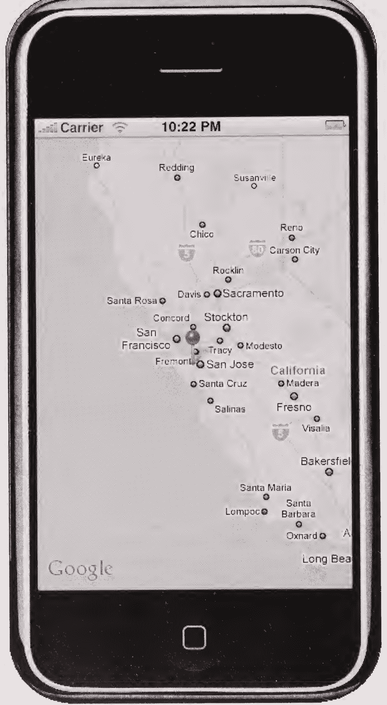

## 第 23 章：使用 Maps API

`MKMapViewDelegate` 定义了几个对应用程序开发者非常有用的方法，然而，其中最有用的方法是与地图位置更新相关的方法。在此期间被调用的方法是 `mapView:regionWillChangeAnimated:` 和 `mapView:regionDidChangeAnimated:`；它们分别在地图中心位置发生变化之前和之后被调用。当用户用手指滚动地图时，你的代理（delegate）会接收到这些方法的调用。因此，在实现这些方法时，避免任何复杂的计算或视图绘制是非常重要的。

另一个有用的 `MKMapViewDelegate` 回调是 `mapView:annotationView:calloutAccessControlTapped:`，当地图上当前显示的任何注释视图被点击时，该方法就会被调用。使用它，你可以根据用户选择特定注释的时间来触发操作。然后你可以执行诸如引入额外的视图来显示该特定注释的详细信息等操作。

## 在地图上添加注释

在 `MKMapView` 上添加注释是一个非常简单的过程，但它涉及从两个不同的角度进行实现。

第一个是注释模型数据的实现。Map Kit 框架提供了一个协议，定义了注释对象必须实现的接口。这个协议被称为 `MKAnnotation` 协议。你的模型对象应该实现此协议，并且至少必须实现 `coordinate` 方法。该协议还定义了 `title` 和 `subtitle` 方法，你可能想要实现它们以提供标题和副标题标签，但这些是可选的。

实现的另一部分是你的 `MKMapViewDelegate` 必须实现 `mapView:viewForAnnotation:` 方法，该方法返回与给定注释关联的视图。当你将注释添加到视图时，该方法会为每个注释被调用一次。预计该方法将返回一个使用问题注释相关细节进行自定义的 `MKAnnotationView` 实例。此方法的实现方式类似于 `UITableView` 的方法 `cellForRowAtIndexPath:`，而不是为每个注释实例化一个新的 `MKAnnotationView`；你应该利用 `MKMapView` 的方法 `dequeueReusableAnnotationViewWithIdentifier:`，如果有可用的未使用注释视图，它将返回返回。如果此方法返回 `nil`，你实际上应该实例化 `MKAnnotationView` 的实例。列表 23.3 显示了该方法的实现。

### 列表 23.3

### 获取注释的视图

```objc
- (MKAnnotationView *)mapView:(MKMapView *)mapView viewForAnnotation:(id <MKAnnotation>)annotation
{
    MKPinAnnotationView *view = [mapView dequeueReusableAnnotationViewWithIdentifier:@"PIN_ANNOTATION"];
    if (!view) {
        view = [[MKPinAnnotationView alloc] initWithAnnotation:annotation reuseIdentifier:@"PIN_ANNOTATION"];
        [view setShowCallout:YES];
        [view setPinColor:MKPinAnnotationColorPurple];
        [view setAnimateDrop:YES];
    }
    return [view autorelease];
}
```

### 注意

气泡（callout）是用户触碰地图上的注释时显示的视图。它显示注释的标题和副标题文本，并可以使用左侧和右侧气泡访问器视图属性进行自定义。

在这种特定情况下，你实际上在处理 `MKPinAnnotationView`，它们在地图视图上为注释显示一个大头针。你返回的视图可以是你指定的任何内容，包括自定义视图。它只需继承自 `MKAnnotationView`。此外，`MKAnnotationView` 本身具有相当许多方法，允许对显示的视图进行详细自定义。例如，你可以访问在地图上显示的图像。你还可以访问用于气泡的视图。因此，在实例化自己的自定义 `MKAnnotationView` 之前，请查看默认的 `MKAnnotationView`，看看你可以对其进行什么样的自定义。

### 注意

由于你的 iPhone 使用代理方法来请求它实际需要显示的注释，因此你一次性添加当前地图显示的所有注释是安全的。`MKMapView` 只会请求屏幕上的注释。

## 第 23 章：使用 Maps API

### 考虑注释的性能

在处理注释时，需要记住的一个重要点是：当用户缩放到某个特定区域时，你可能希望在该区域添加更多细节和更多注释。此外，当用户缩小比例时，你可能希望减少用户看到的细节。为了做到这一点，你应该实现 `MKMapViewDelegate` 方法 `mapView:regionDidChangeAnimated:`，并从它在每次区域更改后检查地图的跨度（span），然后根据情况使用 `MKMapView` 的 `addAnnotations:` 和 `removeAnnotations:` 方法。

这里的点在于，如果你假设你的地图视图是在为城市名添加注释，那么随着地图的缩放，你可能只想显示大城市的注释。因此，你需要移除人口低于特定数量的城市注释。同样，当用户放大地图时，你可能希望显示更多细节，从而显示人口较小的城市。因此，你应该在此时重新加回较小城市的注释。

## 转换坐标

Map Kit 框架的最后一个对你的应用程序非常有用的方面是 Map Kit 反地理编码器（reverse geocoder），它通过 `MKReverseGeocoder` 类提供。反地理编码的过程使应用程序能够获取一组坐标并找到有关这些坐标的真实世界信息。例如，你可以找出一组特定坐标是什么，甚至可以找到特定位置的街道地址。这在 iPhone 软件中具有巨大的潜力，因为它允许你将某人的位置信息转换为人类可读的内容。

反地理编码的过程涉及连接互联网服务来为你完成工作。因此，它的实现是异步的。也就是说，你实例化 `MKReverseGeocoder`，并对一组坐标请求反向查找，然后告诉它开始查找。查找完成后，反地理编码器会联系你的 `MKReverseGeocoderDelegate` 告知你查找成功还是失败。

列表 23.4 显示了如何实例化 `MKReverseGeocoder` 并为当前位置显示人类可读的文本。在这种情况下，你正在更新上一个示例中的注释。

### 列表 23.4

### 使用 MKReverseGeocoder

```objc
- (void)mapView:(MKMapView *)inView didAddAnnotationViews:(NSArray *)views
{
    CLLocation *userLoc = [mapView userLocation];
    CLLocationCoordinate2D userCoords = [userLoc coordinate];
    MKCoordinateRegion region = MKCoordinateRegionMakeWithDistance(userCoords, 50000, 500000);
    [mapView setRegion:region animated:YES];
    geocoder = [[MKReverseGeocoder alloc] initWithCoordinate:userCoords];
    [geocoder setDelegate:self];
    [geocoder start];
}
```

一旦编码器运行，你就可以实现代理方法对接收到的数据进行处理。这在列表 23.5 中。

### 列表 23.5

### 接收反地理编码数据

```objc
- (void)reverseGeocoder:(MKReverseGeocoder *)geocoder didFindPlacemark:(MKPlacemark *)placemark
{
    MKAnnotationView *userLoc = [mapView viewForAnnotation:mapView.userLocation];
    [userLoc setTitle:[placemark locality]];
    NSString *address = [NSString stringWithFormat:@"%@ %@",
        [placemark subThoroughfare],
        [placemark thoroughfare]];
    [userLoc setSubtitle:address];
}
```


# 第 23 章：使用 Maps API

在这种情况下，你只是获取用户位置注释并更新标题和副标题，以分别显示城市名称和街道地址。

代表地理编码位置的对象被封装在 `MKPlacemark` 类中。它具有各种关于位置信息的访问器。这些访问器显示在表 23.1 中。

### 表 23.1 MKPlacemark 属性

| 属性 | 目的 |
|---|---|
| addressDictionary | 这是一个字典，包含了为该位置定义的地址簿键和值。 |
| thoroughfare | 这指定了位置的街道级信息。它不包含实际地址；它只是街道名称区域。 |
| subThroughfare | 这指定了位置街道层面的额外信息。例如，它可能包含该位置的实际街道名称。 |
| locality | 这指定与位置关联的城市名称。 |
| subLocation | 这指定特定位置在城市内的子区域，例如社区名称或地标。 |
| administrativeArea | 这指定与位置关联的州（或行政区）。 |
| subAdministrativeArea | 这指定行政区域内政府定义的区域，如县、教区等。 |
| postalCode | 这指定与位置关联的邮编码。 |
| country | 这指定与位置关联的国家。 |
| countryCode | 这指定与位置关联的国家缩写。 |

### 总结

一想到如今我们拥有像 iPhone 这样的手持设备，并且拥有如此强大的地理定位感知能力，这真是令人惊叹。想象一下，将 GPS 的能力与绘制地图的能力以及将这些坐标反向编码为地址和地标等人类可读信息的能力相结合，可以开发出什么样的应用程序，这简直是不可思议。幸运的是，Apple 让处理这些能力的 API 变得极其易用。本章为你介绍了 `MKMapView` 及其相关的 API。使用它们，你可以开发出各种利用 GPS 力量的新型且令人兴奋的应用程序。

# 处理媒体

## 本部分
- 第 24 章 探索支持的媒体类型
- 第 25 章 播放音频
- 第 26 章 访问 iPod 库
- 第 27 章 录制音频
- 第 28 章 在你的应用程序中播放视频

# 第 24 章 探索支持的媒体类型

从本质上说，iPhone 是一个复杂的媒体设备。归结底，它既是一个 iPod 也是一个手机。它可以播放多种音频和视频格式，并为这些媒体提供了充足的存储空间。在接下来的章节中，我将讨论如何播放音频视频文件，但在之前，我将讨论 iPhone 能够播放的格式类型以及涉及的局限性。

## 支持的音频格式

第一代 iPod 于 2001 年出货，拥有 5GB 硬盘，使其能够存储 1,000 歌曲。今天，已经售出了超过 1.75 亿台 iPod，其中最大的可以存储 160GB 数据。iPhone 不仅仅是一个 iPod，但它可以感谢它的前代产品提供了令人惊叹的格式支持。

### 压缩音频

涉及到压缩音频时，iPhone OS 利用硬件解码器进行播放。这意味着它一次只能播放一种此类声音。这使得这些格式适用于“长播放”类型的应用程序，即你的音频会播放很长时间，可能是你应用程序运行持续期间。然而，这并不能将声音混合在一起。要做到这一点，你必须使用软件解码器播放的音频格式。

使用硬件解码器播放的音频格式有 `AAC`、`ALAC`（Apple 无损压缩）和 `MP3`。你一次只能播放这些音频文件中的一个。尽管如此，可以在播放一个需要硬件解码器的音频文件的同时，播放一个需要软件解码器的格式。


> **本章内容**
> - iPhone OS 支持的音频和视频格式
> - 压缩与未压缩音频在音频播放方面的局限性

### 未压缩音频

如果你不能一次播放多个音频文件，你永远无法很好地玩游戏。iPhone OS 确实提供了同时播放多种声音甚至以不同音量将它们混合在一起的能力。要做到这一点，iPhone OS 使用软件解码器，它利用 iPhone 的 CPU 来播放音频，而不是硬件解码器。

使用这种软件解码器的格式有 `Linear PCM`、`IMA4`、`iBC`、`μ-law` 和 `a-law`。

使用此类格式，你可以同时播放其中许多个，并与播放一个压缩音频文件的同时进行。遗憾的是，它们的文件尺寸往往要大得多，这意味着会迅速膨胀你的应用程序包的大小。因此，你可能应该限制它们用于短音效。

## 支持的视频格式

除了音频，iPhone 也是一个能力惊人的视频播放设备。它支持的视频格式是 `H.264 MPEG-4`。你可以将这些文件封装在应用程序中并播放它们。

当播放视频时，视频播放将占据整个屏幕。你可以选择将播放控件作为视频播放的一部分显示。如果你选择不显示播放控件，视频将播放到结束，且无法中断或暂停。这在你想要在游戏中显示过场动画时非常有用。

### 总结

在本章中，我向你介绍了 iPhone OS 的多媒体功能，并向你展示了 iPhone OS 以及因此你的应用程序可以播放的视频和音频文件类型。通过利用 iPhone 强大的音频视频能力，你可以...

# 第 25 章 播放音频

iPhone 不仅仅是一个手机。在 iPhone OS 的早期，音频是有限的。在今天的世界，它变得更容易了。

## 使用 AV Framework

AV Foundation 框架由三个主要类组成 —— `AVAudioPlayer`、`AVAudioRecorder` 和 `AVAudioSession` 分别对应播放、录制和配置。

> 在应用程序中使用 AV 框架，请确保将其添加为 target。框架名称为 `AVFoundation`。

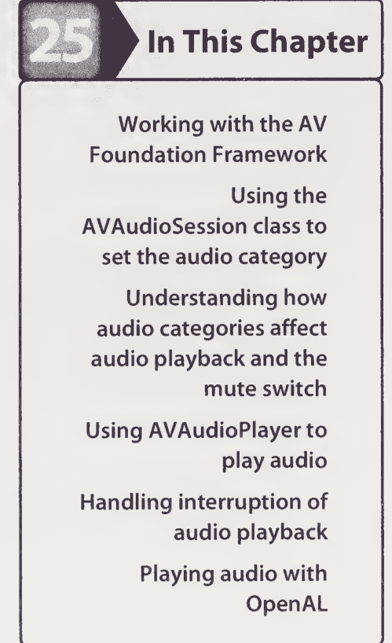

## 使用 AVAudioSession 设置音频

`AVAudioSession` 是单例，因此通过单例方法访问。一旦获取了 `AVAudioSession` 共享实例，你就可以使用它来配置采样率、IO 缓冲区大小以及最重要的配置项：音频类别。

音频类别通过将音频分类为特定类型来定义你的音频的行为。

初学者开发者在开始处理音频时的一个常见问题是：“我如何监控静音键以停止我的音频？”答案是，你不需要。你通过切换你的音频类别到一个处理它的类别来处理静音键。

你可以通过调用 `AVAudioSession` 的 `setCategory:error:` 方法来设置音频类别。可能的类别及其工作方式如表 25.1 所示。

### 表 25.1 音频类别

| 类别 | 目的 |
|---|---|
| AVAudioCategoryAmbient | 该类别用于长时间背景声音以及与 iPod 音频混合的音频。播放时，其他应用程序的音频会与你的应用程序音频混合。静音键开启或手机锁定时，该类别会静音 |
| AVAudioCategorySoloAmbient | 与上一个类别类似，也用于长时间背景声音。然而，该类别会导致在你的应用程序播放时其他应用程序的音频被静音。音频不混合。这是你不设置类别时的默认类别。静音键开启或手机锁定时，该类别会静音 |
| AVAudioCategoryPlayback | 该类别用于无论是否设置静音键都旨在播放的音频。在屏幕锁定时它也会继续。通常，这用于以音频播放作为核心功能之一的应用程序 |
| AVAudioCategoryRecord | 该类别专门用于录制音频。它会静音所有音频播放 |
| AVAudioCategoryPlayAndRecord | 该类别用于音频的播放和录制。在录制时不会静音音频播放。 |

列表 25.1 显示了应用程序如何利用类别。这通常是你在应用程序启动时在应用程序 delegate 中做的事情。

### 列表 25.1 设置音频类别

```objc
#import <AVFoundation/AVFoundation.h>

// ...

- (void)applicationDidFinishLaunching:(UIApplication *)application
{
    AVAudioSession *session = [AVAudioSession sharedInstance];
    [session setDelegate:self];
    NSError *error = nil;
    if(![session setCategory:AVAudioSessionCategorySoloAmbient error:&error]) {
        // 处理错误
    }
    if(![session setActive:YES error:&error]) {
        // 处理错误
    }
    // ...
}
```

> **注意**
> 你的音频会话必须设置为激活状态，配置才能生效。请使用 `setActive:error` 方法执行此操作。

`AVAudioSession` 对象的另一个有用功能是：如果 iPod Touch 没有插入外部麦克风，它就不具备录音的能力。在向用户提供录音选项之前能够判断这一点对你的应用程序非常有帮助。要做到这一点，请使用 `isInputAvailable` 方法，如果存在输入设备，该方法返回 true。

最后，通过将硬件的音频采样率与正在播放的文件的音频采样率匹配，你可以减少系统资源的使用。这可以通过防止音频硬件在播放前对音频进行上采样或下采样来帮助节省电池。要做到这一点，请利用 `currentHardwareSampleRate` 和 `setPreferredHardwareSampleRate:error:` 方法分别获取当前硬件采样率并设置你偏好的硬件采样率。

> **注意**
> 硬件可能不支持你请求的采样率。因此，你应该检查并验证你请求的采样率是否可用。

## 使用 AVAudioSessionDelegate

`AVAudioSessionDelegate` 协议允许你配置为代理的对象响应与 `AVAudioSession` 相关的特定事件。具体来说，它让你能够在应用程序音频被中断（例如在电话通话期间）或某些音频参数发生更改时收到通知。例如，如果采样率发生变化或音频输入设备的可用性发生变化，你都会收到通知。因此，如果你想象一个录制音频的应用程序（需要音频输入），该程序可能希望在用户拔掉麦克风时收到通知。

`AVAudioSessionDelegate` 上定义的方法如表 25.2 所示。

### 表 25.2 AVAudioSessionDelegate 方法

| 方法 | 用途 |
|---|---|
| - (void) beginInterruption | 当你的音频被中断时调用此方法，例如在电话通话期间 |
| - (void) endInterruption | 当你的音频在中断后恢复时调用此方法，例如当电话通话结束时 |
| - (void) categoryChanged:(NSString*) category | 当 AVAudioSession 类别更改时接收到此方法 |
| - (void) isAvailableChanged:(BOOL)inputAvailable | 当可用输入设备发生变化时接收到此方法 |
| - (void) currentHardwareSampleRateChanged:(double) sampleRate | 当硬件采样率变化时接收到此方法 |
| - (void) currentHardwareInputNumberChannelsChanged:(NSInteger)numberOfChannels | 当硬件输入通道数变化时接收到此方法 |
| - (void) currentHardwareOutputNumberChannelsChanged:(NSInteger)numberOfChannels | 当硬件输出通道数变化时接收到此方法 |

## 使用 AVAudioPlayer 播放音频

现在你已经设置了音频类别，配置了采样率，现在准备好实际播放一些音频了。要实现这一点，你使用 `AVAudioPlayer` 类。

`AVAudioPlayer` 类用于播放任何不需要立体声定位、与 UI 元素精确同步或从网络流捕获的音频。对于这些目的，你可能应该使用其他工具，例如 `OpenAL`。换句话说，`AVAudioPlayer` 类适用于最基础应用程序中使用的轻量级音频。你可能在某些游戏应用程序中可以使用 `AVAudioPlayer` 类，但 `OpenAL` 更适合高性能沉浸式游戏等项目，在这些项目中，音频定位有助于增强游戏体验，并且必须动态地、程序化进行更改。`AVAudioPlayer` 类适用于其他应用程序。

要创建一个 `AVAudioPlayer` 实例，你只需调用 `initWithURL` 或 `initWithData` 构造函数，这允许你使用文件或内存中的数据来初始化对象。如果你想同时播放多个文件并将它们的音频混合在一起，只需实例化多个 `AVAudioPlayer` 类实例并单独使用它们即可。

一旦创建了 `AVAudioPlayer` 实例，要播放音频，只需调用 `play` 方法。同样，要停止音频，请调用 `pause` 或 `stop` 方法。你还可以通过设置 `numberOfLoops` 属性来配置音频是否循环特定次数。要让音频无限循环，将 `numberOfLoops` 属性设置为任何负数。该属性的默认值为 0，会导致音频播放一次后停止。

在某些情况下，你可能希望尽可能减少调用 `play` 方法与音频实际开始播放之间的延迟。要做到这一点，你可以在 `AVAudioPlayer` 对象上调用 `prepareToPlay` 方法。这告诉 `AVAudioPlayer` 对象预加载其缓存和缓冲区，以便在调用该方法时准备好播放。当声音停止时（无论是通过使用 `stop` 方法还是让音频完成），缓冲区将再次为空。因此，如果你想让音频以最小延迟再次播放，你应该在调用 `play` 方法之前调用 `prepareToPlay`。

列表 25.2 显示了如何从你的应用程序包加载并播放音频文件。在这种情况下，你将持续播放音频直到你告诉它停止。

### 列表 25.2 播放音频

```objc
- (void)playAudio:(NSString *)inFileName
{
    NSURL *url = [[NSBundle mainBundle] URLForResource:inFileName withExtension:@"mp3"];
    AVAudioPlayer *player = [[AVAudioPlayer alloc] initWithURL:url error:nil];
    player.delegate = self;
    player.numberOfLoops = -1;
    [player play];
}
```


### 注意

你可以在 iPhone 上同时播放多个未压缩的音频文件，但一次只能播放一个压缩文件。这意味着如果你想在运行时混合音频，你需要使用未压缩音频。

## 使用 AVAudioPlayerDelegate

`AVAudioPlayer` 还有一个名为 `AVAudioPlayerDelegate` 的代理协议。你的代理收到的到的有用方法可能是 `audioPlayerDidPlaying:successfully:`，它会通知你的代理音频播放器已完成。如果在解码过程中发生错误，还会调用代理方法 `audioPlayerDecodeError:`。传递给此方法的错误参数指示了发生的错误。

再次，就像 `AVAudioSession` 一样，`AVAudioPlayer` 可以通过实现 `audioPlayerBeginInterruption:` 和 `audioPlayerEndInterruption:` 方法来响应中断事件。当 `AVAudioPlayer` 接收到中断时，它会自动暂停，你的音频会话会被禁用。当中断结束时，`AVAudioSession` 会自动重新激活，但你必须再次调用 `AVAudioPlayer` 的 `play` 方法来恢复播放。当你调用时，播放将从中断的地方继续。

## 使用 OpenAL 播放音频

Foundation Framework 对于轻量级音频需求非常出色。然而，在开发高度沉浸式的游戏应用程序时，你可能会发现你对音频播放方式需要更多的控制。例如，你可能希望爆炸的音频听起来来自屏幕的某侧，或者你可能希望在用户改变视角时环境音移动。为了支持这一点，iPhone 包含了对标准 API OpenAL 的完整支持。

OpenAL 与它的兄弟 OpenGL 一样是跨平台 API。OpenAL 设计用于三维音频和效果。为了支持这一点，OpenAL 提供了一个环境映射系统，其中包含监听器对象（listener）和声源（sound sources），它们都定定位在环境中。因此，你不需要单独混合声音通道以模拟适用于应用程序的适当定位的立体声，而是告诉 OpenAL 引擎你想在环境中以特定的音量播放特定的声音，并且你的监听器位于环境中的特定位置。OpenAL 引擎会处理声音混合，使其听起来来自你指定的地点。

## 318 媒体操作

与 OpenGL 类似，对该 API 进行真正全面的涵盖超出了本书的范围。如果你真的想完全理解 OpenAL，位于 www.openal.org 的 OpenAL 站点为你提供了足够的信息。尽管如此，我将为你提供一个简要的概述。

基本上，要与 OpenGL 进行工作，你必须经过几个步骤。首先，你必须打开系统的默认输出。为了做到这一点，你调用方法 `alOpenDevice` 并传递一个 NULL 参数。接下来，你必须创建一个 OpenAL 上下文：为此，你调用方法 `alCreateContext`，并将从上一次调用返回的设备和零作为参数传递。每当你与 OpenGL 工作时，都需要一个上下文，并且该上下文需要设置为你特定源的默认。要设置当前上下文，你使用函数 `alMakeCurrentContext`。最后，你创建源并配置监听器（listener）的位置。要创建一个音频源，你使用函数 `alGenSources`，它使用浮点数数组来配置监听器的位置。要配置监听器位置，你使用函数 `alListenerfv`；要配置源的位置，你同样使用函数 `alSourcefv`。

一旦你的环境、源和监听器都配置完成，你就可以使用 `alSourcePlay` 函数触发单个源开始播放。同样，要停止源，你使用 `alSourceStop` 函数。

### 总结

在本章中，你学习了如何在应用程序中播放基本音频，并了解了 AV Foundation Framework，这是 iPhone OS 3 提供的播放音频的新 API。此外，你还了解了使用 OpenAL 播放音频的基础，以及在什么情况下使用 OpenAL 而不是 AV Foundation Framework。

## 访问 iPod 库

iPhone OS 3 添加的一个新功能是访问 iPod 媒体库的能力。这是通过 Media Player framework 实现的。使用 Media Player framework，你可以对用户的 iPod 媒体库执行各种任务。例如，你可以搜索项目、访问用户的播放列表并播放库中的音频项目。Media Player 库包含了对 iPod 可以播放的所有类型的支持。这种能力有几个潜在的应用场景。例如，想象一个赛车游戏，它允许你将收音机调到播放你 iPod 库中媒体的电台。或者想象一个滑雪游戏，它允许你程序化一个虚拟 iPod，在你滑雪时播放你的媒体。可能性是无限的。

在本章中，你将看到如何利用 Media Player framework 访问并播放用户 iPod 库中的元素。完成后，你应该能够在你自己的应用程序中使用这种能力。

## 使用 Media Player Framework

Media Player framework 提供了许多用于处理 iPod 库的类。其核心是歌曲由 `MPMediaItem` 类表示。在处理歌曲时，`MPMediaItem` 类将创建从 iPod 库返回的对象，你通过这些对象告诉 iPod 播放什么。

要查询歌曲，使用 `MPMediaPredicate` 及其子类 `MPMediaPropertyPredicate`，结合 `MPMediaQuery` 类来构建返回 `MPMediaItem` 列表的查询。或者，你可以为用户提供一个视图控制器，让他们直接从库中选择歌曲。你用于此的类是 `MPMPickerController`。它封装了整个用户界面，允许用户从他们的 iPod 库中选择媒体。


- 使用 MPMediaPicker Controller 浏览 iPod 库
- 按艺术家、专辑或播放列表搜索歌曲
- 从你的应用程序中控制内置的 iPod 应用
- 在你的应用程序内从用户的 iPod 库播放音频

一旦你选择了一组 `MPMediaItems`，要播放它们，你利用 `MPPlayerController` 类。它具有控制设备 iPod 功能并并在你的应用程序内播放音乐的能力。我很快会详细讨论这种区别。

## 访问媒体库

我很快会详细讨论如何实际播放媒体的细节。然而，在播放媒体之前，你需要让用户能够选择媒体。实际上有两种方法：第一种是显示一个视图控制器，允许用户浏览他们的媒体库并选择单个项目。第二种是为项目构建查询并直接查询媒体。我将逐一介绍这些选项。

## 使用 MPMediaPickerController

`MPMediaPickerController` 是从用户 iPod 库中选择项目最“省心”的方法。它是一个完整的用户界面，通过 `UIViewController` 标准模型访问，这意味着你可以在任何需要使用 `UIViewController` 的地方使用它。例如，你可以将其推送到导航控制器上，或者像文档建议的那样，在其父视图控制器上使用 `presentModalViewController:animated:` 方法以模态形式呈现它。

图 26.1 显示了 `MPMediaPickerController` 浏览某些歌曲。在这种情况下，选择器允许多项选择，并提示“Choose Some Tunes”（选择一些歌曲）。

正如你所看到的，用户可以通过艺术家、播客、单曲或从他们的播放列表进行选择。

初始化 `MPMediaPickerController` 仅需调用它的标准初始化器：`init` 返回库中所有的媒体类型，或者 `initWithMediaTypes:` 返回特定的媒体类型。支持的媒体类型如表所示。

| MPMediaPickerController 支持的类型 | 说明 |
| :--- | :--- |
| MPMediaTypeMusic | 仅音乐 |
| MPMediaTypePodcast | 仅播客 |
| MPMediaTypeAudioBook | 仅有声书 |
| MPMediaTypeAny | 任意类型 |

## 第26章 访问 iPod 库


## 操作

注意：为了使用 Media Player，你必须将其添加到项目中。`MPMediaPickerController` 允许用户选择音乐、播放列表等。当用户完成选择时，会调用代理方法 `mediaPicker:didMediaItems`。请注意，你需要像该方法的第一行所示关闭 `MPMPickerController`。

列表 26.1 显示了一个初始化 `MPMediaPickerController` 的应用程序。

### 列表 26.1

呈现 MPMediaPickerController

```objc
- (IBAction)browsePushed:(id)sender {

  MPMediaPickerController *controller = [[MPMediaPickerController alloc] init];

  [controller setPrompt:@"Choose Some Tunes"];

  [controller setAllowMultipleItems:YES];

  [controller setDelegate:self];

  [self presentViewController:controller animated:YES];

}
```

### 列表 26.2

实现 mediaPicker:didMediaItems

```objc
- (void)mediaPicker:(MPMediaPickerController*)mediaPicker didMediaItems:(NSSet*)mediaItems {

  MPMusicPlayerController *player = [MPMusicPlayerController alloc] init];

  [player setQueueWithItemCollection:mediaItems];

  [player play];

}
```

## 324 处理媒体数据

`MPMediaPropertyPredicate` 可以使用它的两个工厂方法之一来构建：`predicateWithValue:forProperty:`，它执行简单的“等值”比较；以及 `predicateWithValue:forProperty:comparisonType:`，它允许你定义所执行的比较类型。在每情况下，你都传递一个值和一个属性名称。该值是你想要匹配的值，而属性名称是你想要搜索的属性名称。可能的属性名称如表 26.2 所示。

| 属性 | 描述 |
| --- | --- |
| MPMediaItemPropertyPersistentID | 库中的每个项目都有唯一的 ID。此属性可用于根据该 ID 选择特定项目 |
| MPMediaItemPropertyMediaType | 此属性允许过滤特定类型的媒体，例如播客、有声书等 |
| MPMediaItemPropertyTitle | 项目的标题 |
| MPMediaItemPropertyAlbumTitle | 项目的专辑标题 |
| MPMediaItemPropertyArtist | 项目的艺术家 |
| MPMediaItemPropertyAlbumArtist | 项目的艺术家 |
| MPMediaItemPropertyGenre | 项目的流派 |
| MPMediaItemPropertyComposer | 项目的作曲者 |
| MPMediaItemPropertyPlaybackDuration | 项目的播放时长 |
| MPMediaItemPropertyAlbumTrackNumber | 项目在专辑中的曲目编号 |
| MPMediaItemPropertyAlbumTrackCount | 该专辑的总曲目数 |
| MPMediaItemPropertyDiscNumber | 项目的碟数 |
| MPMediaItemPropertyDiscCount | 项目的碟数 |
| MPMediaItemPropertyArtwork | 项目的艺术 |
| MPMediaItemPropertyLyrics | 它们的歌词 |
| MPMediaItemPropertyIsCompilation | 布尔值，指示该项目是否为合集的一部分 |

表 26.2

例如，为了搜索所有由艺术家 Daft Punk 创作且不属于合集的歌曲，你可以使用列表 26.3 所示的代码来构建 `MPMediaPropertyPredicate`。

## 第 26 章 访问 iPod 库

### 325

### 列表 26.3

### 搜索所有不属于合集的 Daft Punk 歌曲

```objc
- (NSArray *)browseForDaftPunk

{

    MPMediaPropertyPredicate *artist =

    [MPMediaPropertyPredicate predicateWithValue:@"Daft Punk"

    forProperty:MPMediaItemPropertyArtist];

    MPMediaPropertyPredicate *notCompilation =

    [MPMediaPropertyPredicate predicateWithValue:[NSNumber numberWithBool:NO]

    forProperty:MPMediaItemPropertyIsCompilation];

    NSSet *predicates = [NSSet setWithObjects:artist, notCompilation, nil];

    MPMediaQuery *query =

    [MPMediaQuery alloc] initWithFilterPredicates:predicates];

    [query groupingType:MPMediaGroupingAlbum];

    return [query items];

}
```


因此，在这段代码中，你创建了两个谓词：一个用于艺术家名称，另一个用于判断是否在合集中。你将这两个谓词合并到一个集合中。我很快会详细讨论 `MPMediaQueryQuery`，但在这里你使用 `MPMediaQuery` 使用该谓词集合来创建一个查询。`items` 属性包含了匹配谓词的 iPod 库中的单个项目。此数组中对象的类型是 `MPMItem` 对象。你可以使用它们来访问有关项目的元数据，例如歌曲、艺术家和艺术，你也可以使用它们来播放项目。

如果你想对项目列表进行分组（例如按专辑名称分组），可以使用属性分组来设置分组类型。随后，`collections` 将根据你选择的组类型将项目作为集合列表包含。从此属性返回的对象类型是 `MPMItemCollection` 对象。该类实际上是 `MPMediaItems` 的集合，但它有一个非常有用的属性，能够找到集合的代表性项目，该项目包含了在项目之间共享的数据。这比你自己遍历集合并构建此类代表性项目要高效得多。

### 注意事项

如果你没有找到任何匹配你的谓词的内容，它将超时并在控制台中记录错误消息。这可能会让人感到困惑，但不要过度解读。关键点在于你没有得到任何返回，因此你得到的是空结果而不是数组。

如你所见，你可以通过组合搜索不同属性和不同值的不同谓词，构建出相当复杂的查询。

现在让我们仔细观察一下 `MPMediaQuery` 类，它是实际上执行查询的类。

## 构建查询

现在你已经看到了如何使用 `MPMediaPropertyPredicate` 类来构建谓词，然后你可以将其用于 `MPMediaQuery` 类来查询 iPod 库中的项目。我还简要讨论了 `items` 属性包含匹配该查询的 `MPMediaItems`，以及如果你指定了分组类型，`collections` 属性的 `MPMediaItems` 集合是如何根据该类型进行分组的。

`MPMediaQuery` 类还包含一组工厂方法，这些方法提供了预设的查询。使用它们，你可以快速方便地定义按艺术家、播放列表或流派分组的查询。

表 26.3 显示了可用的 `MPMediaQuery` 工厂方法。

| 方法 | 用途 |
| --- | --- |
| `albumsQuery` | 按专辑分组返回 iPod 库项目 |
| `artistsQuery` | 按艺术家名称分组返回 iPod 库项目 |
| `songsQuery` | 按歌曲名称分组返回 iPod 库项目 |
| `playlistsQuery` | 按播放列表名称分组返回 iPod 库项目 |
| `podcastsQuery` | 按播客名称分组返回 iPod 库项目 |
| `audiobooksQuery` | 按书名分组返回 iPod 库项目 |
| `compilationsQuery` | 按合集分组返回 iPod 库项目 |
| `composersQuery` | 按作曲者分组返回 iPod 库项目 |
| `genresQuery` | 按流派分组返回 iPod 库项目 |

这些方法每个都会返回一个分组的 `MPMediaQuery` 对象。如果你想对其中一个添加额外的过滤，可以简单地使用 `addFilterPredicate:` 方法。然后，当你调用 `items` 或 `collections` 方法时，就会得到按照你请求过滤的项目。

## 使用播放控制器

早些时候，你简要看了如何使用播放控制器来播放媒体。现在我想详细讨论一下。

`MPMusicPlayerController` 本质上以两种不同的模式运行。第一种是应用程序音乐播放器。在这种模式下，音乐就像在你的应用程序内部播放。它不受 iPod 应用中任何设置的影响，也不会导致 iPod 应用执行任何操作。

第二模式是 iPod 音乐播放器。在这种模式下，当你请求播放项目时，它实际上会连接 iPod 应用并使用它进行播放。这意味着如果你的应用程序退出，音乐继续播放，因为它实际上是通过 iPod 播放的。此外，如果你转到 iPod 应用，正在播放窗口将显示选择的项目。

这两种模式有重要的区别，因为它们极大地影响了播放行为。

一旦分配并初始化 `MPMusicPlayerController` 实例，你就可以通过设置队列来确定播放内容。`MPMusicPlayerController` 队列可以使用查询 (`MPMediaQuery`) 或包含在 `MPediaItemCollection` 中的项目集合来设置。然后，要启动项目，只需调用 `play` 即可。

播放还可以通过 `pause`（暂停播放）或 `stop`（停止播放）来进一步控制；你可以使用 `beginSeekingForward`、`beginSeekingBackward` 和 `endSeeking` 方法向前或向后寻找。你还可以通过 `skipNextItem`、`skipToBeginning` 和 `skipToPreviousItem` 在集合内跳转。

你可以通过相应设置这些属性来控制播放是否重复或随机。

最后，播放器在发生播放事件时会生成通知。这通过发送 `beginGeneratingPlaybackNotifications` 消息并通过 `NSNotificationCenter` 监控相关通知来控制。生成的通知如表 26.4 所示。

| 表 26.4 MPMusicPlayerController 通知 |
| 通知 | 用途 |
|---|---|
| `MPMusicPlayerControllerPlaybackStateDidChangeNotification` | 在播放状态通过编程或用户操作更改时接收 |
| `MPMusicPlayerControllerNowPlayingItemDidChangeNotification` | 在当前播放的项目更改时接收 |
| `MPMusicPlayerControllerVolumeDidChangeNotification` | 在播放器音量更改时接收 |

# 访问媒体艺术品

关于媒体框架，我想要讨论的最后一个项目是如何访问与特定媒体项目相关的艺术品。与 `MPMediaItem` 相关的属性可以使用标准方法 `valueForProperty` 进行访问。要查询的属性类型见表 26.2。

这意味着，为了访问给定的媒体项目的艺术品，你将使用类似于**列表 26.4** 中所示的代码。

# 列表 26.4
从 MPMediaItem 获取艺术品

```objc
-(void)setImage:(MPMediaItem *)item {

  MPMediaItemArtwork *artwork =
  [item valueForProperty:MPMediaItemPropertyArtwork];

  [myImageView setImage:[artwork imageWithSize:[myImageView frame.size]]];

}
```

如你所见，`MPMediaItemArtwork` 对象拥有一些方法，允许你访问特定尺寸的图像。这意味着，如果你想在音乐播放时访问艺术品并将其显示在应用程序中，你可以这样做。在这种情况下，我有一个图像视图正被初始化为该项目的艺术品。

### 总结

在本章中，你已经了解了如何访问 iPod 媒体库以便在播放媒体时控制 iPod 播放器，以及从用户的 iPod 库中访问媒体并在你的应用程序内播放。这不仅让各种应用程序开发者能够简单地播放媒体，还开启了一类新的应用程序，它们可以根据用户的 iPod 库内容进行推荐。利用你在这里获得的知识，你应该能够轻松地处理用户的 iPod 媒体库。

# 录制音频

你已经看到过如何使用 AV Foundation 框架以及 OpenAL 在应用程序中播放音频。你还看到过如何在应用程序内部访问你的 iPod 库，以便播放用户音乐集合中的媒体。

在本章中，你将看到如何在应用程序中录制音频。录制音频与播放音频一样简单。它使用了你播放音频时相同的 AV Foundation 框架。然而，在这种情况下，你将使用 `AVAudioRecorder` 类来工作。

# 设置你的 AVAudioSession

就像播放音频一样，在开始录制音频之前，你必须适当初始化 `AVAudioSession`。录制音频有两个会话类别。第一类是 `AVAudioSessionCategoryRecord`，允许你只录制音频。第二类 `AVAudioSessionCategoryPlayAndRecord` 允许在录制时继续播放。这更适用于网络电话（VoIP）应用程序等。通常，对于简单的录制音频，你可能倾向于使用 `AVAudioSessionCategoryRecord` 类别。

> 本章内容

- 为录制音频设置合适的音频类别
- 使用 `AVAudioRecorder` 录制音频
- 理解与音频录制相关的设置

> 注意
记住，要使用 AV Foundation 框架，你必须将其作为链接框架添加到你的项目中。

要配置音频类别，请使用实例方法 `category:error:`，它会为你设置音频类别。你还需要使用实例方法 `setActive:error:` 将你的音频会话设置为激活状态。**列表 27.1** 显示了如何为录制设置音频会话。

# 列表 27.1
为录制设置音频会话

```objc
(void)applicationDidFinishLaunching:(UIApplication *)application
{
    if([AVAudioSession sharedInstance] inputIsAvailable)
    {
        // 显示某些错误...
    }

    NSError *error = nil;

    if([AVAudioSession sharedInstance] setCategory:AVAudioSessionCategoryRecord error:&error)
    {
        // 显示错误
    }

    if([AVAudioSession sharedInstance] setActive:self)
    {
        // 显示错误
    }

    [AVAudioSession sharedInstance] setDelegate:self;

    // App 启动后自定义的点
    [window addSubview:controller.view];
    [window makeKeyAndVisible];
}
```

> 注意
`inputAvailable` 属性告诉你机器上是否存在音频输入设备。如果没有，你可能应该提醒用户。请记住，例如，用户可以在你检查之后插入麦克风。为了检测用户何时执行这样做，请务必实现 `AVAudioSessionDelegate` 的 `inputAvailableChanged` 方法，该方法在该情况发生时会被调用。

一旦你完成了这些操作，就可以准备使用 `AVAudioRecorder` 进行录制了。

# 分配 AVAudioRecorder

初始化一个 `AVAudioRecorder` 非常简单。音频录制器需要知道将录制的数据存储在哪里。它还需要知道某些参数，例如使用什么采样率和使用什么格式。它从你告诉它录制的文件扩展名中推断录制格式。然而其他设置必须通过传递给初始化器的字典来提供。

## 第 27 章：录制音频

因此，为了分配并初始化 `AVAudioRecorder` 实例，你调用初始化器 `initWithURL:settings:`，它接收两个参数：一个指定存储录制数据的 URL，以及一个包含音频录制本身属性的设置字典。设置字典包含与音频录制相关的各种属性的键和值。可用的键及其用途如**表 27.1** 所示。

| 表 27.1 用于 AVAudioRecorder 设置字典的键 |
| 键 | 用途 |
| :--- | :--- |
| `AVFormatIDKey` | 这指定了音频数据格式标识符。 |
| `AVSampleRateKey` | 这指定以赫兹为单位的采样率，格式为封装在 `NSNumber` 中的浮点值。 |
| `AVNumberOfChannelsKey` | 这指定通道数。 |
| `AVLinearDepthKey` | 这指定深度。 |
| `AVPCMIsBigEndian` | 这指定大端。 |
| `AVPCMIsFloat` | 这指定为浮点。 |
| `AVEncoderQualityKey` | 这指定质量。 |
| `AVBitRateKey` | 这指定比特率。 |
| `AVEncoderDepthKey` | 这指定深度。 |
| `AVSampleRateConverterKey` | 这指定采样率转换。 |

一旦你初始化了 `AVAudioRecorder`，要开始录制，只需调用 `record` 方法。像 `AVAudioPlayer` 一样，`AVAudioRecorder` 提供了 `prepareToRecord` 方法。该方法创建文件并为录制准备缓冲区，以便在实际录制时延迟最小。如果你请求的文件已经存在，它会自动覆盖。`AVAudioRecorder` 还提供了 `recordForDuration` 方法，允许在指定时间内录制。暂停和停止录制有专门的方法。最后，如果你决定删除录制的音频，`deleteRecording` 方法会从磁盘删除它。

> 注意
要删除录制，必须停止录制器。

类似于 `AVAudioPlayer`，`AVAudioRecorder` 也具有监控输入表的能力。就像之前一样，调用 `updateMeters` 方法更新电表值，然后通过 `AVAudioRecorder` 的 `peakPowerForChannel` 和 `averagePowerForChannel` 方法访问电表。

`AVAudioRecorder` 还有一个代理，像 `AVAudioPlayer` 的代理一样，通知你录制已完成或被中断。

现在让我们来看一个录制音频的示例应用程序。

# 创建录音器

首先，你需要为你的录音器设置一个 UI。对于本示例而言，它将非常简单。没有任何花哨，没有特殊的图形；它只有录制、播放和停止按钮。图 27.1 显示了完成后的界面。使用 Interface Builder 创建此界面，确保连接 UIViews 并将按钮连接到相应的 IBActions。在我的情况下，我创建了 `playPushed`、`stopPushed` 和 `recordPushed` 方法。

# 图 27.1
完成后的录音器

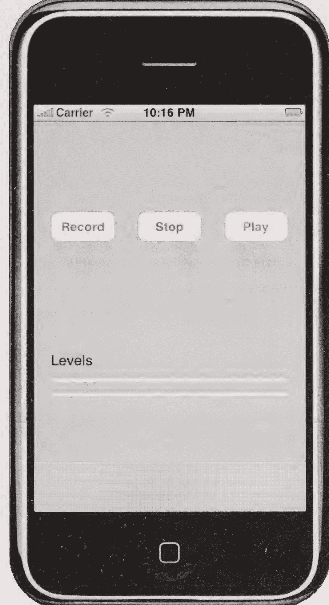

# 代码列表 27.2
设置电平计量 (Level Metering)

```objc
- (void)updateMeters {
  float peak = 0;
  float avg = 0;

  if([recorder isRecording]) {
    [recorder updateMeters];
    peak = 100+[recorder peakPowerForChannel:0];
    avg = 100+[recorder averagePowerForChannel:0];
  } else if([player isPlaying]) {
    [player updateMeters];
    peak = 100+[player peakPowerForChannel:0];
    avg = 100+[player averagePowerForChannel:0];
  }

  [peakLevel setProgress:peak/100];
  [avgLevel setProgress:avg/100];
}

(void)viewDidLoad {
  [NSTimer scheduledTimerWithTimeInterval:.25 target:self
    selector:@selector(updateMeters)
    userInfo:nil repeats:YES];
  [super viewDidLoad];
}
```

> 注意
计量值是一个负数浮点数，表示分贝（db）。0db 表示最大音量。为了本演示演示，我通过给该值加上 100 将其归一化为进度视图的百分比。你可能想要进行一些更复杂的操作。大多数应用程序从 -80db 左右开始计量。

一旦设置好计量，实际的录音和解码就非常简单了。它们发生在 IBActions 中。代码列表 27.3 显示了 `recordPushed:` 动作的代码。请注意，这里是你实际上初始化录音器并设置所有配置的地方。在你的应用程序中，提前设置录音器可能更有意义，这样在你准备好开始录音时就不需要分配缓冲区等操作。

# 代码列表 27.3
`recordPushed:` 方法的实现

```objc
- (IBAction)recordPushed:(id) sender;
{
    if([recorder isRecording])
        return;

    if([player isPlaying])
        [player stop];

    NSError *error = nil;

    [[AVAudioSession sharedInstance]
        setCategory:nil
        setCategory:AVAudioSessionCategoryRecord error:&error];

    [AVAudioSession sharedInstance]
        setActive:YES error:&error];

    MutableDictionary *settings = [NSMutableDictionary dictionary];

    [settings setValue:[NSNumber numberWithInt:kAudioFormatLinearPCM]
        forKey:AVFormatLineIDKey];

    [settings setValue:[NSNumber numberWithFloat:44100.0]
```


```objective-c
[settings setValue:[NSNumber numberWithInt:44100] forKey:AVSampleRateKey];
[settings setValue:[NSNumber numberWithInt:1] forKey:AVNumberOfChannelsKey];
[settings setValue:[NSNumber numberWithInt:16] forKey:AVLinearPCMBitDepthKey];
[settings setValue:[NSNumber numberWithBool:NO] forKey:AVLinearPCMIsBigEndianKey];
[settings setValue:[NSNumber numberWithBool:NO] forKey:AVLinearPCMIsFloatKey];

NSString *filePath = [NSString stringWithFormat:@"%@/documentsDirectory/rec_audio.caf", [self documentsDirectory]];
NSURL *fileUrl = [NSURL fileURLWithPath:filePath];

[self setRecorder:nil];
recorder = [[AVAudioRecorder alloc] initWithURL:fileUrl settings:settings error:&error];
[recorder setMeteringEnabled:YES];
[recorder record];
```

接下来是 `playPushed:` 动作。在这种情况下，你只需要分配一个新的音频播放器，并启动它开始播放。这在代码列表 27.4 中所示。

### 代码列表 27.4 `playPushed:` 动作的实现

```objective-c
- (IBAction)playPushed:(id)sender {
    if ([recorder isRecording]) [recorder stop];
    if ([player isPlaying]) [player stop];

    NSString *filePath = [NSString stringWithFormat:@"%@/rec-audio.caf", [self documentsDirectory]];
    NSURL *fileUrl = [NSURL fileURLWithPath:filePath];
    NSError *error = nil;

    [self setPlayer:nil];
    [[AVAudioSession sharedInstance] setCategory:AVAudioSessionCategoryPlayback error:&error];
    [[AVAudioSession sharedInstance] setActive:YES error:&error];

    player = [[AVAudioPlayer alloc] initWithContentsOfURL:fileUrl error:&error];
    [player setMeteringEnabled:YES];
    [player play];
}
```

最后，与前两个相比，你的停止动作实现极其简单。它在代码列表 27.5 中所示。

### 代码列表 27.5 `stopPushed:` 动作的实现

```objective-c
- (IBAction)stopPushed:(id)sender {
    if ([recorder isRecording]) [recorder stop];
    if ([player isPlaying]) [player stop];
}
```

如果你将这些代码添加到视图控制器中（假设你已经成功连接了一切内容），你应该能够点击 Record 按钮并录制音频。当你点击 Play 按钮时，你录制的内容应该播放。这部分代码的错误检查比可能应该做的少。你应该检查错误的状态。

### 图 28.1 默认视频播放控制控件


如果你想让视频从视频中的特定位置开始播放，还可以设置 `initialPlaybackTime` 属性，它会在开始播放之前将视频头置于指定的播放时间。

### 从互联网播放视频

使用 `MPMoviePlayerController` 从互联网流传输视频与从应用程序包中播放视频一样简单。唯一的区别在于你应该引用一个指向互联网资源的 URL。`MPMoviePlayerController` 会替你处理所有从互联网加载视频的工作。你只需要告诉它视频在哪里即可。

列表 28.2 显示了你之前看到的相同播放效果，但改为从互联网加载视频。

#### 列表 28.2 从互联网播放视频

```objective-c
- (void)playTransitionMovie {
    NSBundle *bundle = [NSBundle mainBundle];
    NSURL *movieUrl = [NSURL URLWithString:@"http://example.com/movie.mp4"];
    // ... 后续播放代码
}
```

请记住，从互联网加载视频文件可能比从应用程序包加载慢得多。因此，在考虑使用此类类进行视频流传输时，你应该考虑到这一点。

### 总结

在这个简短的章节中，你学习了如何在应用程序中播放视频。内置的视频播放功能仅允许你全屏显示视频。然而，它们确实提供了足够的工具，让你可以使用该全屏视频功能在视频游戏的场景之间制作过渡视频，或者显示用户可能想要控制的媒体。如果你希望在应用程序的一部分显示视频，你可能想查看第 14 章核心动画中介绍的 `ImageView` 动画功能。但是，如果你想在应用程序中显示全屏、30 fps、全动作视频，`MPMoviePlayerController` 是极佳的选择。它甚至具有从互联网下载并播放视频的能力。

## 与 iPhone 硬件交互

+ 本部分
  + 第 29 章：获取设备信息
  + 第 30 章：使用 Core Location 获取位置
  + 第 31 章：使用加速度计
  + 第 32 章：与外围设备接口

# 第 29 章：获取设备信息

Cocoa Touch 提供了丰富的 API 来处理 iPhone 硬件。该 API 最基本的部分围绕 `UIDevice` 类。

`UIDevice` 是一个单例，允许与 iPhone 硬件的一些核心元素进行基本交互。它允许你找到有关设备方向、电池电量和距离传感器的信息。它还可以告诉你诸如设备类型等信息，以及设备的唯一标识符。它是 Cocoa Touch 中一个非常强大的“小宝石”，可以在你的应用程序中轻松利用。

## 本章内容

+ 如何判断设备是否连接到电源适配器
+ 使用距离传感器
+ 获取有关设备的基本信息和元数据

## 访问电池状态

在设备硬件知识方面，我将要讨论的第一项是关于电池电量的信息。使用 `UIDevice` 单例，你可以同时监控电池电量和当前电池状态。例如，你可以发现电池当前是否正在通过电源适配器充电。

要利用此功能，你只需实例化 `UIDevice` 单例，启用电量监控，并使用 `batteryLevel` 属性获取电池电量。该属性的返回值范围从 0.0 到 1.0，其中 1.0 表示电池已充满电。此外，`batteryState` 属性可以告诉你有关电池是否正在充电、已充满、未插电等信息。`batteryState` 属性的可能状态如表 29.1 所示。

取决于设备是否插入了电源适配器，某些应用程序的行为可能会不同。例如，当未插入电源适配器时，你的应用程序可能希望通过关闭某些功能（如 GPS）来降低功耗。

### 表 29.1 电池状态值

| 状态 | 含义 |
| --- | --- |
| `UIDeviceBatteryStateUnknown` | 无法确定电池状态。 |
| `UIDeviceBatteryStateUnplugged` | 电池未插电。 |
| `UIDeviceBatteryStateCharging` | 电池当前正在充电。 |
| `UIDeviceBatteryStateFull` | 电池已充满电。 |

## 访问距离传感器

我将描述的下一个硬件元素是距离传感器。这是在 iPhone OS 3.0 中新增的。与电池电量一样，访问距离传感器只需启用距离监控。一旦启用了距离监控，就可以访问距离状态。`proximityState` 是一个布尔值，表示设备是否贴近脸部。只有当你的应用程序实际上需要时，才启用距离监控。保持禁用有助于节省电池寿命。

## 与设备元数据交互

下一组 `UIDevice` 属性是关于操作系统、型号和设备的信息。如你所知，每个 iPhone 都有一个分配的唯一标识符。访问该唯一标识符非常简单。当你想要在服务器上存储数据时，可以使用此标识符。

`UIDevice` 属性提供用户分配的设备名称。这是用户在最初设置和激活设备时分配的名称。

表 29.2 显示了 `UIDevice` 上的信息属性。

### 表 29.2 设备信息属性

| 方法 | 目的 |
| --- | --- |
| `uniqueIdentifier` | 设备的唯一标识符 |
| `name` | 用户定义的设备名称 |
| `systemName` | 设备上操作系统的名称 |
| `systemVersion` | 设备上操作系统的版本号 |
| `model` | 设备的型号名称 |
| `localizedModel` | 本地化后的设备型号名称 |

> **注意**
> 如果你想使用模型来检测你应用中的某些硬件需求，应该使用非本地化的型号名称。

---

# 第 30 章：使用 Core Location 获取你的位置

iPhone 平台开发之所以独特且强大，特性之一是它对位置感知的支持。访问此功能使用的 API 称为 Core Location。通过它，你可以精确确定世界上任何地方的设备位置。

Core Location 实际上使用三种方法来确定你的位置。如果你使用的是第一代 iPhone，它会首先结合使用基站三角测量法，然后使用 Wi-Fi 接入点查找。这在室内和室外都能提供合理的准确度，但绝非精确。如果你使用的是带有内置 GPS 接收器的第二代 iPhone，且你处于室外，它将改用第三种方法：GPS 三角测量法。通过这三种方法，iPhone 能够以合理的准确度确定你的位置，并且可以在室内和室外工作，这克服了许多具有 GPS 能力的设备所缺乏的局限性。

最新的 iPhone 型号 iPhone 3GS 还增加了内置的磁性硬件。指南针可以与 GPS 功能结合使用，以确定设备的方向。

一旦你使用过能够自动识别用户位置的应用程序，再向用户询问其位置以显示附近信息就会感觉非常过时了。

让我们来看一些实现与此硬件交互的 API。

## 寻找你所在的位置

例如，我将让你编写一个应用程序，该程序会监控用户的位置，然后打开 Google 地图在地图上显示用户的位置。图 30.1 显示了该应用在 iPhone 上运行的最终界面。

### 本章内容

- 使用 GPS 和基站三角测量法确定你 iPhone 的位置
- 使用 Core Location API 寻找你所在的位置
- 缩小 Core Location 的结果
- 使用 Core Location 坐标在地图上绘制你的位置
- 使用 iPhone 3GS 指南针工作

### 图 30.1 完成的 Core Location 应用

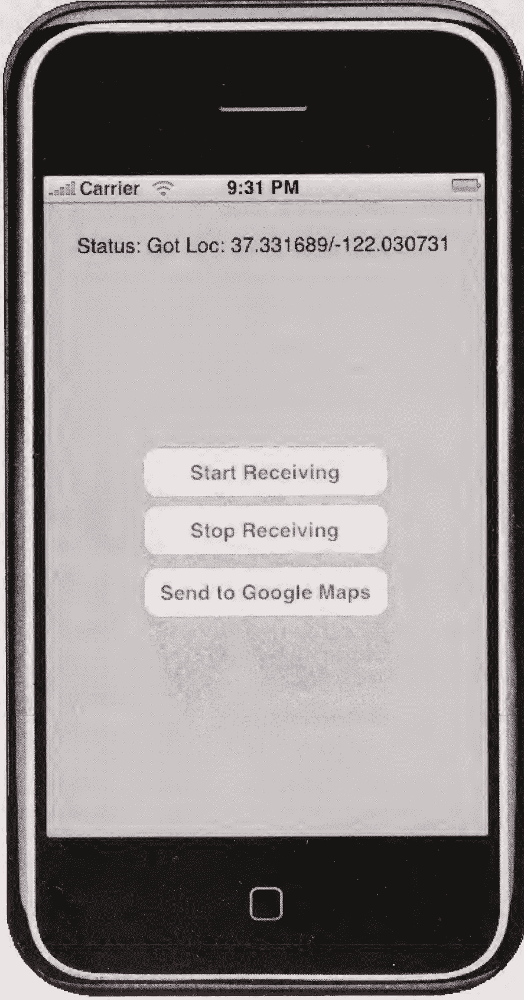

## 分配 CLLocationManager

使用 Core Location API 需要完成的第一件事是分配一个 `CLLocationManager`。`CLLocationManager` 提供了 Core Location 系统的主要入口。这没什么特别的：只需使用 `alloc` 和 `init` 分配一个实例即可。一旦你有了 `CLLocationManager` 实例，你可以获取用户此时的特定位置，也可以为 `CLLocationManager` 注册一个代理，以便随着时间推移用户位置的变化进行更新。然而，在这两种情况下，你都必须调用 `startUpdatingLocation` 方法，这会导致 `CLLocationManager` 开始收集位置数据并更新你的代理。如果你不调用此方法，你的代理将不会收到通知；而且如果你尝试直接从 `CLLocationManager` 访问位置，你将收到一个 `nil`。

在示例应用程序中，你将在 `viewDidLoad` 方法中分配 `CLLocationManager`，然后将在 UI 上设置按钮，允许你启动和停止位置的更新。最后，你将有一个按钮将数据发送到 Google 地图以显示你的位置。

> **提示**
> `viewDidLoad` 方法在视图从 nib 文件加载后会自动被调用。当它被调用时，你的 `IBOutlets` 连接的所有对象都已加载并初始化，因此这里是设置初始值的好地方。

#### 代码 30.1 一个 `viewDidLoad` 实现示例

```objective-c
- (void)viewDidLoad {
    locMgr = [[CLLocationManager alloc] init];

    if (![locMgr locationServicesEnabled]) {
        [status setText:@"Status: Location Services Disabled"];
    } else {
        [status setText:@"Status: CLLocation Services Enabled"];
    }

    [locMgr setDesiredAccuracy:kCLLocationAccuracyNearestTenMeters];
    [locMgr setDistanceFilter:kCLDistanceFilterNone];
    [locMgr setDelegate:self];
}
```

所以，要创建 `CLLocationManager`，你只需要调用 `[[CLLocationManager alloc] init]` 并将其赋值给你的成员变量。

一旦你有了 `CLLocationManager` 实例，在请求位置之前，你应该检查用户是否启用了位置服务。如果用户不想让应用程序知道他们的位置，他们可以在 iPhone 的设置中禁用位置服务。调用 `locationServicesEnabled` 方法会返回一个布尔值，告知用户是否设置了此项。如果他们禁用了位置服务，你可能应该提醒他们，如果想使用此功能，应该在设备上进行更改。应用程序无法通过程序更改此设置。

接下来，你设置了期望的准确度和距离过滤器。我稍后会详细讨论这一点，但现在你可以直接忽略它。

## 将自己设为代理

最后，将自己设为代理。你已经在头文件中声明了该对象遵循 `CLLocationManagerDelegate` 协议，如代码 30.2 所示。

#### 代码 30.2 `CoreLocationDemoViewController` 的头文件

```objective-c
@interface CoreLocationDemoViewController : UIViewController <CLLocationManagerDelegate> {
    CLLocationManager *locMgr;
    IBOutlet UILabel *status;
}
@property (retain) CLLocationManager *locMgr;
- (IBAction)startTouched:(id)sender;
- (IBAction)stopTouched:(id)sender;
- (IBAction)didGoTouches:(id)sender;
@end
```

## 实现代理协议

要实现此协议，你需要实现 `locationManager:didUpdateToLocation:fromLocation:` 和 `locationManager:didFailWithError:`，如代码 30.3 所示。

#### 代码 30.3 实现代理所需的方法

```objective-c
- (void)locationManager:(CLLocationManager *)manager
    didUpdateToLocation:(CLLocation *)newLocation
    fromLocation:(CLLocation *)oldLocation {
    [status setText:[NSString stringWithFormat:@"Status: Got:%f/%f",
                newLocation.coordinate.latitude,
                newLocation.coordinate.longitude]];
}

- (void)locationManager:(CLLocationManager *)manager
    didFailWithError:(NSError *)error {
    [status setText:[NSString stringWithFormat:@"Received error: %@",
                [error localizedDescription]]];
}
```


在该应用程序中，你在 GUI 上有启动和停止更新的按钮。这些按钮连接到控制器的动作，如列表 30.4 所示。

### 列表 30.4：Interface Builder 中连接启动和停止按钮的方法

```
- (IBAction)startTouches:(id)sender {
    [locMgr startUpdatingLocation];
    [status setText:@"Status: Waiting for updates."];
}

- (IBAction)stopTouches:(id)sender {
    [locMgr stopUpdatingLocation];
    [status setText:@"Status: Stopping receiving."];
}
```

## 启动和停止位置更新

对于你的目的，你需要做的只是更新状态消息。一旦你看到从 `CLLocation` 接收更新，用户就可以点击按钮并在 Google 地图中查看位置。列表 30.5 展示了该代码。

> **注意** 应用程序在接收数据时会将坐标显示在状态文本中。

### 列表 30.5：将位置发送到 Google 地图的方法

```
- (IBAction)sendToGoogleTouched:(id)sender {
    CLLocation *lastLocation = [locMgr location];
    if (!lastLocation) { // 我们还没有收到任何数据 - 所以我们得到了 nil！
        UIAlertView *alert;
        alert = [[UIAlertView alloc]
            initWithTitle:@"No data yet!"
            message:@"No data has been received by the delegate yet."
            delegate:nil cancelButtonTitle:nil
            otherButtonTitles:@"OK", nil];
        [alert show];
        [alert release];
        return;
    }

    NSString *urlString = [NSString stringWithFormat:@"http://maps.google.com/maps?q=Here+I+Am!@%f,%f",
        lastLocation.coordinate.latitude,
        lastLocation.coordinate.longitude];
    NSURL *url = [NSURL URLWithString:urlString];
    [[UIApplication sharedApplication] openURL:url];
}
```

# 第 30 章：使用 Core Location 获取位置

## 图 30.2：Google Maps 使用大钉显示您的位置

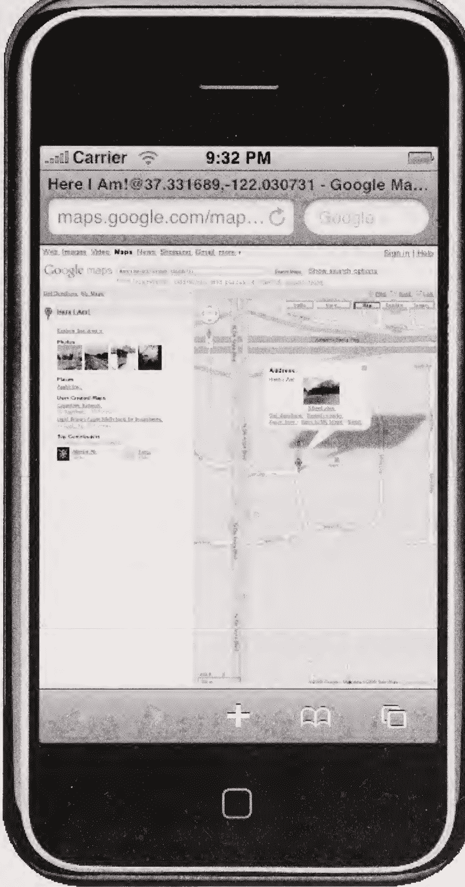

## 缩小坐标精度

正如我之前提到的，在电池电量有限的移动设备上工作时，尽可能节省电量是非常重要的。以高精度确定用户位置比以低精度确定需要更多的时间和电力。因此，`CLLocation` 提供了设置其返回数据精度的能力。这是通过 `desiredAccuracy` 属性实现的。该属性可以设置的值如表 30.1 所示。它们所代表含义非常言而易见。

### 表 30.1：DesiredAccuracy 方法的可能值

| Value | 描述 |
|---|---|
| `kLocationAccuracyBest` | 提供尽可能可能的精度 |
| `CLLocationAccuracyNearestTenMeters` | 精度到 10 米 |
| `CLLocationAccuracyHundredMeters` | 精度到 100 米 |
| `CLLocationAccuracyKilometer` | 精度到 1 公里 |
| `CLLocationAccuracyThreeKilometers` | 精度到 3 公里 |

仅仅你请求了特定级别的精度并不意味着你一定会收到该精度的数据。设备会尽力满足你的请求，但它并不一定能够实现。

`CLLocationManager` 尝试尽可能快地返回某种数据，因此它可能首先返回较低精度的数据，然后返回较高精度的数据。你应该在应用程序中对此做好准备并采取适当措施，例如在接收到更准确的点后，将显示缩小到该点。

## 过滤位置更新

最后，同样是因为你正在一个电量有限的设备上工作，所以你希望尽可能减少获取的更新，并且如果用户没有移动，则不一定接收用户位置的更新。`CLLocationManager` 也为此提供了一个 API：`distanceFilter` 属性。

当你设置此属性时，只有当用户距离上次接收的位置的距离超过某个阈值时，你才会接收用户位置的更新。该属性的值可以设置为表示距离原始位置米为单位的数字，也可以设置为 `kCLDistanceFilterNone`，这表示不进行任何过滤。

> **注意** 如果你没有设置过滤器并因此不断接收位置更新，这会非常迅速地消耗设备电池，因此，通常你应该尽可能使用距离过滤器。

## 查看最终代码

现在你已经查看了组成此应用程序的所有各个部分，让我们来看一下完成的代码。代码列表 30.6 和 30.7 显示了你完成的 Core Location 演示应用程序。

> **注意** 你可以从这本书的网站下载完整项目代码，地址为：`http://www.wiley.com/go/cocoatouchdevref`。

### 列表 30.6：CoreLocationDemoViewController.h

```
#import <UIKit/UIKit.h>
#import <CoreLocation/CoreLocation.h>

@interface CoreLocationDemoViewController : UIViewController <CLLocationManagerDelegate> {
    CLLocationManager *locMgr;
    IBOutlet UILabel *status;
}

@property (retain, nonatomic) CLLocationManager *locMgr;

- (IBAction)startTouched:(id)sender;
- (IBAction)stopTouched:(id)sender;
- (IBAction)sendToGoogleTouched:(id)sender;
- (void)locationManager:(CLLocationManager *)manager
    didUpdateToLocation:(CLLocation *)newLocation
    fromLocation:(CLLocation *)oldLocation;

@end
```

### 列表 30.7：CoreLocationDemoViewController.m

```
@implementation CoreLocationDemoViewController

@synthesize locMgr;

#pragma mark - IB ACTIONS

- (IBAction)startTouched:(id)sender {
    [locMgr startUpdatingLocation];
    [status setText:@"Status: Waiting for updates."];
}

- (IBAction)stopTouched:(id)sender {
    [locMgr stopUpdatingLocation];
    [status setText:@"Status: Stopped receiving."];
}

- (IBAction)sendToGoogleTouched:(id)sender {
    CLLocation *lastLocation = [locMgr location];
    if (!lastLocation) { // 我们还没有收到任何数据 - 所以我们收到了一个 nil!
        UIAlertView *alert = [[UIAlertView alloc]
            initWithTitle:@"Alert"
            message:@"No data has been received by the delegate yet."
            delegate:nil cancelButtonTitle:nil
            otherButtonTitles:@"Ok", nil];
        [alert show];
        [alert release];
        return;
    }

    NSString *urlString = [NSString stringWithFormat:
        @"http://maps.google.com/maps?q=Here+I+Am!%%f,%%f",
        lastLocation.coordinate.latitude,
        lastLocation.coordinate.longitude];
    NSURL *url = [NSURL URLWithString:urlString];
    [[UIApplication sharedApplication] openURL:url];
}

#pragma mark - DELEGATE METHODS

- (void)locationManager:(CLLocationManager *)manager
    didUpdateToLocation:(CLLocation *)newLocation
    fromLocation:(CLLocation *)oldLocation {
    [status setText:[NSString stringWithFormat:@"Status: Get Loc: %f/%f",
        newLocation.coordinate.latitude,
        newLocation.coordinate.longitude]];
}

- (void)locationManager:(CLLocationManager *)manager
    didFailWithError:(NSError *)error {
    [status setText:[NSString stringWithFormat:@"Received error: %@",
        [error localizedDescription]]];
}

#pragma mark -

- (void)viewDidLoad {
    locMgr = [[CLLocationManager alloc] init];
    if (![locMgr locationServicesEnabled])
        [status setText:@"Status: Location Services Disabled"];
    else
        [status setText:@"Status: Location Services Enabled"];

    [locMgr setDesiredAccuracy:kCLLocationAccuracyNearestTenMeters];
    [locMgr setDistanceFilter:kCLDistanceFilterNone];
    [locMgr setDelegate:self];

    [super viewDidLoad];
}

- (void)didReceiveMemoryWarning {
    [super didReceiveMemoryWarning];
}

- (void)dealloc {
    [self setLocMgr:nil];
    [super dealloc];
}

@end
```

## 使用 iPhone 3GS 磁针

回想一下，iPhone 3GS 添加了一个新的硬件——磁针。你也使用 Core Location API。就像处理位置信息一样，`CLLocationManager` 有两个方法 `startUpdatingHeading` 和 `stopUpdatingHeading`，控制 `CLLocationManager` 是否向代理发送方向更新。如果你使用这些方法启用方向更新，你的代理将接收 `locationManager:didUpdateHeading:` 调用，就像它接收位置更新一样。对于方向更新，你可以使用 `headingFilter` 设置更新的过滤器。

由于此功能限于 iPhone 3GS，因此你应该始终确保设备上可用方向信息。你通过访问 `CLLocationManager` 属性 `headingAvailable` 来实现，如果可用则返回 YES。


> **注意** 有时磁针需要校准。当这时，通过 `locationManagerShouldDisplayHeadingCalibration:` 方法通知代理。如果你的代理实现了该方法，它可以返回 NO 以抑制显示，或返回 YES 允许显示。

我不会详细描述如何用此功能更新此应用程序，但如果你需要将其添加到你的应用程序中，请查看 Apple 文档获取更多细节。

### 总结

在本章中，你查看了如何使用 Core Location API 为你的应用程序添加位置感知功能。设备感知位置的能力是 iPhone 开发的独特定义特征之一。因此，利用这项技术可以开启许多新的有趣的应用程序。

---

# 第 31 章：使用加速度计

## 图 31.1：与 iPhone 角度相关的 X、Y 和 Z 坐标


因此，当你平持手机并保持水平时，你的 X 和 Y 加速度计值应该为 0，而 Z 值应该在 -1 左右。这对应于 X 和 Y 方向上没有受到力，而在 Z 方向上受到了重力的作用。这些值的测量单位是 G 力（G-force），1 大约对应于 1g。

> **注意** 加速度计并不是精确的，你可能永远无法看到精确的 0.0。

现在我将向你展示如何使用加速度计创建一个示例应用程序。这个示例程序本质上是一个水平仪。完成后，它看起来会像图 31.2 样。

## 图 31.2：完成水平仪应用

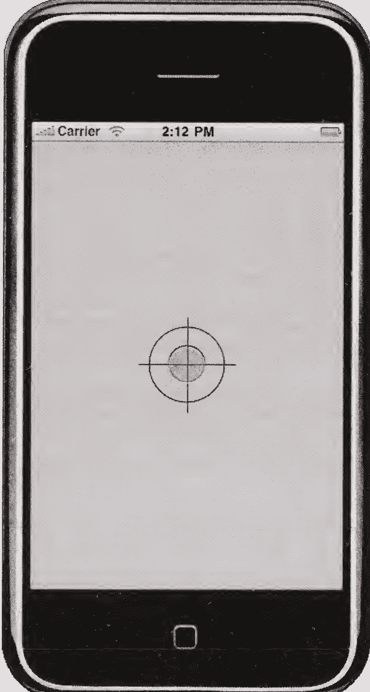

在这个应用中，你将忽略加速度对象的 Z 值。不过请放心，你确实需要处理 Z 值，它们在那那里。

## 构建水平仪

使用加速度计时首先需要了解的一点是，加速度计 API 实际上涉及三个核心类。第一个是 `UIAccelerometer` 类。`UIAccelerometer` 类是一个单例，它用于访问加速度计设备。你也可以设置加速度计，以便为加速度计设置你的代理对象。如果你不需要持续更新，那么你应该将更新间隔设置为比默认值更长的时间，以节省电量。

你可以在书籍的网站上下载示例应用程序的代码。示例代码包含了用于显示水平情况的视图的图形。应用程序本身非常简单。本质上，你有一个包含一组十字准的背景图像。十字准代表“水平”。在十字准之上是一个半透明的绿色圆，其位置基于来自加速度计的输入。你将使用圆的中心位置来更新它的位置。

## 在 viewDidLoad 中访问 UIAccelerometer

你将看到的重要代码部分是视图控制器的 `viewDidLoad` 方法，在该方法中，你最初访问了加速度计，并将视图控制器设置为 `UIAccelerometerDelegate`。`UIAccelerometerDelegate` 是在加速度更新发生时实际接收来自加速度计更新的对象。通过将其设置为你的视图控制器，你可以轻松地正确设置视图的中心位置。

### 列表 31.1：viewDidLoad 的实现

```
- (void)viewDidLoad {
    origX = [circle center].x;
    origY = [circle center].y;
    [[UIAccelerometer sharedAccelerometer] setDelegate:self];
    [super viewDidLoad];
}
```

你还应该让它指向这里，用以存储圆的当前中心位置。这样做仅仅是为了当加速度计归零时，你可以返回中心位置。

## 实现 UIAccelerometerDelegate 方法

`UIAccelerometerDelegate` 协议只定义了一个方法。该方法是 `accelerometer:didAccelerate:`，它在你为 `UIAccelerometer` 配置的更新间隔上调用。在你的情况下，此代理方法的实现如列表 31.2 所示。

### 列表 31.2：代理的实现

```
- (void)accelerometer:(UIAccelerometer *)accelerometer
    didAccelerate:(UIAcceleration *)acceleration {
    float newX = originX + ([acceleration x] * 100);
    float newY = originY + ([acceleration y] * 100);
    [circle setCenter:CGPointMake(newX, newY)];
}
```


该方法的实现非常简单。你所做的就是提供的 `UIAcceleration` 对象，将收到的值通过乘以 100 进行归一化，然后将该值加或减到你的原始 X 和 Y 值上，从而得到新的位置值。

你将值乘以 100，是为了获得一个距离中心点足够远的新位置。如果你不将值乘以 100，圆几乎不会移动，因为你从加速度计接收的值仅通过倾斜，范围大约就在 -1.0 到 +1.0 之间。

最后，你更新圆对象上的 `center` 属性。这会导致圆在加速度计方法提供数据时移动。

请继续使用此加速度计代理方法的实现运行示例应用程序，并观察它的行为。

现在，你可能会注意到加速度计给你的值可能会有轻微的尖峰。也就是说，如果你完全按照我向你展示的方式运行这段代码，你会发现圆倾向于跳跳动，并且有一些抖动。在使用加速度计时，过滤掉这种抖动以获得更平滑的信号是有帮助的。

所以让我们在代码中添加一个低通滤波器来平滑这种抖动。

## 添加低通滤波器

低通滤波器简单来说是接收一个值，通过乘以 100 将收到的值进行归一化，然后将该值加或减到你的原始 X 和 Y 值上，从而得到新的位置值。

（注：由于原文中存在大量重复段落，此处已对“添加低通滤波器”部分的逻辑进行了对齐以确保翻译连贯，遵循了源文本的结构）

在这种情况下，你将实现一个简单的低通滤波器。该滤波器的代码如 31.3 所示。

## 列表 31.3
### 低通滤波器

```objc
(float)lowPassFilter:(float)inValueWithLastValue:(float)lastValue {

  float factor = 0.4;

  return (inValue * factor + lastValue * (1 - factor));

}
```

## 列表 31.4
### 更新后的代理方法

```objc
(void)accelerometer:(UIAccelerometer *)accelerometer
  didAccelerate:(UIAcceleration *)acceleration {

  float xAccel = [self lowPassFilter:[acceleration x]WithLastValue:lastX];

  float yAccel = [self lowPassFilter:[acceleration y]WithLastValue:lastY];

  lastX = xAccel;

  lastY = yAccel;

  float newX = origX + (xAccel * 100);

  float newY = originY + (yAccel * 100);

  [circle setCenter:CGPointMake(newX, newY)];

}
```

最重要的是，你获取加速度计的值并将其通过低通滤波器，同时对你感兴趣的向量获取最后值。你然后将新值存储在最后值中，以便下次接收时使用。其余代码保持不变。

如果你运行应用程序，你应该看到信号已经变得平滑。随意调整低通滤波器中的 factor 值，看看它对应用程序产生什么影响。你平滑它的另一种方法可能是使用核心动画来更新位置。

### 交叉引用

请参考第 14 章获取更多关于核心动画的信息。

现在，要制作这个应用程序，你只需要改进图形。你现在手里有一个水平仪，可以用于木工项目。

## 理解 UIAcceleration 对象

你在上一个示例中看到，AccelerationDelegate 通过其代理方法接收来自加速度计的事件通知。代理方法的参数之一是 `UIAcceleration` 对象，它包含了你收到的当前加速度事件的关键信息。该对象包含了设备当前的 X、Y 和 Z 力矢量。此外，它还包含一个指示测量发生的时间戳。这个时间戳可以用于过滤，就像你对低通滤波器做的那样。

## 捕捉抖动事件

你现在学会了如何直接使用加速度计。在构建游戏或任何需要来自加速度细粒度输入的情况下，你可以使用在本章中演示的功能。在之前的章节中，你还学会了如何响应加速度事件，例如手机从竖屏切换到横屏。

在 iOS 3 中，Apple 引入了实现在 `UIResponder` 类上的新事件，专门用于拦截运动事件。截至目前，可以通过这种机制捕捉的运动事件只有抖动事件。然而，该功能属于 `UIResponder` 意味着你的自定义视图能够拦截这些事件，就像你拦截触摸事件一样。只需在你的自定义视图上实现相应的方法即可。

## 与 iPhone 硬件交互

换句话说，你实现的任何 UI 视图都可以轻松检测到用户开始摇晃设备以及停止摇晃设备的状态。你通过在自定义的 `UIView` 上实现 `motionBegan:withEvent:` 和 `motionEnded:withEvent:` 方法来实现这一点。这些方法与 `touchesBegan:withEvent:` 和 `touchesEnded:` 类似，不同之处传递给方法的事件对象稍微简单，因为它不包含一组触摸或动作；它只告诉你发生了什么种类型的动作事件。

> 注意
> 摇晃事件在整个 iPhone OS 中被实现为一种“撤销”的标准隐喻，因此在你的应用程序中利用这一特性是一个非常实用的功能。

让我们通过一个示例应用程序来看看如何实现这些方法。

## 构建一个“摇晃破碎”检测器

你在这里将构建的应用基本上是一个摇晃检测器。它在屏幕中间有一个小的正方形自定义视图。在正常操作下，该正方形将变为绿色。如果用户摇晃手机，正方形将变为红色。图 31.3 显示了完成后的应用程序。

## 实现 drawRect

为了构建这个应用程序，你需要创建一个自定义的 `UIView`，它构成了屏幕中间的正方形。该自定义 `UIView` 的 `drawRect:` 方法如列表 31.5 所示。

## 列表 31.5
### drawRect: 方法的实现

```objc
(void)drawRect:(CGRect)rect {

  CGContextRef ctxt = UIGraphicsGetCurrentContext();

  CGContextSetStrokeColorWithColor(ctxt, [[UIColor blackColor] CGColor]);

  CGContextSetFillColorWithColor(ctxt, [currentColor CGColor]);

  CGContextStrokeRect(ctxt, rect);

  CGContextFillRect(ctxt, rect);

}
```

## 图 31.3

“摇晃破碎”应用程序

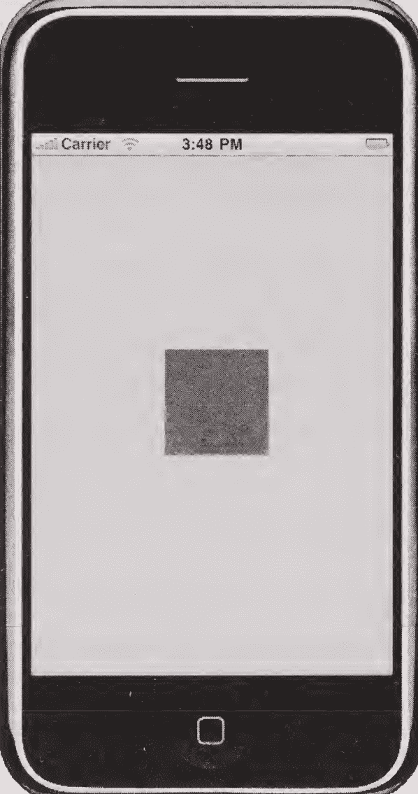

本质上，你只是用任何合适的颜色填充视图的矩形。颜色初始设为蓝色，在接收到一些动作事件后变为红色。

> 警告
> 为了接收动作事件，你的视图必须是第一响应者。请确保在你的自定义 `UIView` 上重写 `canBecomeFirstResponder` 使其返回 YES，并在你的视图加载后调用 `becomeFirstResponder`。

## 实现 motionBegan 和 motionEnded

`motionBegan` 和 `motionEnded` 方法实现起来简单。本质上，你在设备开始摇晃时接收到前者，在摇晃完成后接收到后者。因此，在你的 `motionBegan` 方法中，你将颜色设置为红色，当摇晃停止时，将颜色设回蓝色。这两个方法的代码如列表 31.6 所示。

## 列表 31.6
### 在自定义 UIView 上实现动作检测事件

```objc
(void)motionBegan:(UIEventSubtype)motion initWith:(UIEvent *)event {

  [self setColor:[UIColor red]];

  [self setNeedsDisplay];

}

(void)motionEnded:(UIEventSubtype)motion initWith:(UIEvent *)event {

  [self setColor:[UIColor blue]];

  [self setNeedsDisplay];

}
```

## 动作事件的取消

动作事件可以通过多种方式被取消：通过另一个 UI 元素拦截事件、通过电话或通过另一个可能让你的应用程序变为非活跃的操作。如果发生这种情况，你的视图将接收到 `motionCancelled:withEvent:` 的调用。列表 31.7 显示了该方法的实现。在你的情况下，你将像处理 `motionEnded:` 一样处理它：将颜色设回蓝色。

## 列表 31.7
### motionCancelled:withEvent: 的实现

```objc
(void)motionCancelled:(UIEventSubtype)motion initWith:(UIEvent *)event {

  [self setColor:[UIColor blue]];

}
```

一旦你实现了这些方法，你就可以使用它们来构建应用程序。

# 理解 EAAccessory 类

`EAAccessory` 类本质上包含了关于连接配件的元数据。它还允许你查找有关配件的信息，例如配件名称、制造商、型号、序列号等。此外，`EAAccessory` 还有一个代理协议，可以告诉你配件何时以及何时断开连接。它包含一个方法：`accessoryDidDisconnect:`

然而，一旦你获取了配件对象，它就可以允许你创建一个 `EASession` 对象。

# 使用 EASession

`EASession` 对象是你与设备建立通信的主要手段。要创建一个 `EASession` 对象，你必须先获取一个 `EAAccessory` 对象，通常来自 `EAAccessoryManager`。

一旦你有了 `EASession` 对象，它会为你提供一个读流和一个写流，你可以使用它们与设备通信。再次强调，External Accessory 框架并没有提供与配件通信时必须使用的协议的支持。你的应用程序必须提供该协议的实现。External Accessory 框架仅提供通信通道。

列表 32.2 展示了如何从 `EASession` 对象获取读流和写流。

## 列表 32.2
### 在 EASession 对象上访问读流和写流

```objc
EASession *session = [[EASession alloc] initWithWithAccessory:accessory
forProtocol:myProtocol];

InputStream *inputStream = [session inputStream];

NSOutputStream *outputStream = [session outputStream];

[inputStream setDelegate:self];

[outputStream setDelegate:self];

[inputStream scheduleInRunLoop:[NSRunLoop currentLoop]
for:NSDefaultRunLoopMode];

[outputStream scheduleInRunLoop:[NSRunLoop currentLoop]
for:NSDefaultRunLoopMode];

[inputStream open];

[outputStream open];

[session release];
```

在这种特定情况下，你同时获取了输入流和输出流，并将自己设置为它们的代理。你将这些流调度到默认的运行循环中运行，然后打开它们。一旦完成，你就可以在输入流上接收数据并在输出流上发送数据。

随后，你实际上不需要一直保留 `EASession` 对象。一旦获取了 `NSStream` 对象，释放 `EASession` 是完全可以的。

# 使用 NSStreams 与设备通信

一旦你获取了 `NSStream` 并将自己设置为代理，实现 `NSStream` 代理协议就是简单的事，这样你就可以从流中接收事件。

列表 32.3 显示了 `NSStream` 代理方法的一种实现。该方法在 `NSStream` 接收到事件时触发。在这种特定情况下，该方法接收到的事件指示流上有数据可供读取。

## 列表 32.3
### 实现 NSStream 代理方法

```objc
(void)streamEvent: (NSStream *)theStream handleEvent:(NSStreamEvent)streamEvent

  if(streamEvent == NSStreamHasBytesAvailable)

  {

    char buf[1024];

    [inputStream read:buf maxLength:1024];

    // 对数据进行某些操作...

  }
```


显然，可能有更好的方法来处理这种输入。然而，这向你展示了用于从配件读取数据的基本机制。

向配件写入数据也很简单。列表 32.4 展示了如何做的示例。

# 列表 32.4：向配件写入数据

如果所有数据都无法写入，则 `write` 方法将返回实际写入的字节数。这取决于你的应用程序相应地调整缓冲区，并在从输出流接收到指示其现在可以接受更多字节的事件时，完成剩余数据的发送。

### 总结

要详细介绍为了实现与配件通信而可能需要的各种硬件协议，这超出了本书的范畴。然而，为了达到能够实现这些协议的程度，你首先必须理解如何使用 iPhone OS API 连接两个设备。这就是我在这里向你介绍的 API。

通过使用 `External Accessory` 框架，你可以通过底座连接器和蓝牙与各种配件通信。有关更多信息，请访问 iPhone 开发者门户。

# 处理分发

## 本部分 VI

- 第 33 章：为你的应用代码签名
- 第 34 章：使用内购支持扩展你的应用程序

# 第 33 章：为你的应用代码签名

所以，你做到了。你学习了一切，征服了 iPhone OS 3，并编写了你的杀手级应用。现在只有最后一件事需要学习了：如何构建可以上传到 App Store 的可执行文件。

在 iPhone OS 开发早期，这一步对开发者来说可能是最令人恐惧的。他们经常觉得这个过程如此复杂且难以正确，以至于他们不得不求助于巫术来确保开发之神保佑他们。他们会开玩笑说要牺牲一只鸡，或者在电脑周围围一圈灰，以驱逐邪恶的开发灵。这一切都是为了本应该是开发 iPhone 应用程序最简单的部分之一：代码签名的过程。

幸运的是，较新版本的 iPhone SDK 显著改进了代码签名过程。今天，它比以前要容易得多，理解起来也简单得多。

在本章中，我将引导你完成获取开发证书、在 Xcode 中安装它，然后构建用于分发的应用程序。

我还将介绍如何设置 `ad hoc build`，你可以用它将可执行文件分发给没有安装 Xcode 的 Beta 测试员。

## 获取开发证书

在甚至考虑分发你的应用程序之前，你需要从 Apple 获取开发证书。要做到这一点，你首先必须访问 iPhone 开发者门户 `http://developer.apple.com/iphone`。一旦到达那里，你可以按照他们的说明获取开发证书。

### 本章内容

- 理解描述文件配置过程
- 理解开发配置与 ad hoc 配置的区别
- 分发 ad hoc 构建版本

开发证书由一份电子文档组成，你使用计算机上的加密密钥对其进行数字签名。然后你为该文档生成证书签名请求（`CSR`），并将证书签名请求发送给 Apple 进行签名。一旦他们签署完毕，你就下载签名后的版本并安装到 Xcode 中。

签名后的证书一旦安装在 Xcode 中，将用于签名你的应用程序。只有签名的应用程序才能安装在 iPhone OS 设备上。我将讨论决定应用程序如何分发的描述文件配置过程，但现在只需理解安装在 iPhone OS 设备上的所有应用程序都必须签名。

要生成原始证书，你需要使用 Mac OS X 中的 `Keychain Access` 应用程序。通过它，你向证书机构请求证书。这会生成私钥和公钥。你的私钥存储在计算机上并应该进行备份。如果丢失了私钥，你就无法再对应用签名。

iPhone 门户提供了生成此证书的极佳步骤说明。我建议你阅读以下章节，以便更好地理解描述文件配置过程的工作原理，并访问 iPhone 门户按照他们的说明生成你的开发证书。一旦获取了开发证书，你就可以返回这本书阅读如何在 Xcode 中安装开发证书。

## 理解描述文件配置过程

描述文件配置是数字证书和设备 ID 的集合，它指定了特定的签名证书可以用于签名应用程序并安装在特定的设备上。

描述文件配置过程涉及在 iPhone 开发者门户中输入你想要安装应用程序的设备的唯一设备 ID。然后你使用这些设备 ID 和你的证书来生成描述文件配置。描述文件配置是你从 iPhone 开发者门户下载的文件。下载文件后，你将其安装到 Xcode 中。

> **注意**
>
> 输入到开发门户的设备 ID 数量限制为 100 个。你不能删除或覆盖它们，但你每年可以重置一次设备列表。

## 理解开发、分发和 ad hoc

在 iPhone 开发领域，本质上有三种类型的描述文件配置。

第一种称为**开发描述文件**。这种描述文件配置与你的开发证书配合使用，对你的应用程序签名并将其安装到开发设备上。它们旨在用于少数设备。当你创建开发描述文件时，你可以指定其中包含的设备。生成的配置只能与这些设备配合使用。开发描述文件也可以用于 Xcode，且仅限包含生成该配置的开发证书的机器上使用。这是你日常开发中使用的配置文件。

第二种描述文件是**发布描述文件**。发布描述文件用于在 App Store 上分发你的应用程序。使用发布文件签名的应用程序无法安装在测试设备上。它们只能上传到 App Store 并通过购买进行安装。

第三种描述文件是**临时描述文件**。临时描述文件就像是开发描述文件和发布描述文件的结合体。也就是说，你可以将其安装在特定的测试设备上，但安装过程不需要 Xcode。普通用户可以使用 iTunes 安装应用程序。它要求你想要安装应用程序的设备必须包含在描述文件之中。然而，你可以在一个临时描述文件中列入多达 100 台设备。此外，当你向用户发送应用程序时，你还需要向他们发送一份配置文件本身的副本。用户随后将配置文件和应用程序拖放到 iTunes 中进行安装。

临时描述文件机制最初是为那些想要自己分发应用程序而不想通过 App Store 分发应用程序的组织设计的。然而，它被 iPhone 开发者广泛用于 Beta 测试。大多数测试人员不是开发者，并且没有安装开发工具。使用临时描述文件允许普通用户使用 iTunes 安装应用程序。

## 安装描述文件

为了让应用程序在特定设备上运行，它必须包含一个该应用程序的描述文件。iPhone OS 设备已经包含了来自 App Store 应用程序的描述文件。为了在设备上使用你的开发描述文件或临时文件，你必须安装它。

有两个应用程序可以安装描述文件。第一个是 Xcode。要使用 Xcode 安装描述文件，只需将描述文件文件从 Finder 拖放到 Xcode 中。一旦完成此操作，描述文件就会出现在 Xcode 组织器中。如果你配置应用程序使用该配置文件进行构建，当你连接设备并构建和运行应用程序时，它会自动安装该配置文件。

图 33.1 显示了带有组织器的 Xcode 窗口。左侧的描述文件组允许你管理安装在 Xcode 内的描述文件。当连接设备时，你还可以看到安装在该特定设备上的描述文件。你也可以通过此接口手动从该设备上添加或删除描述文件。

### 图 33.1：Xcode 组织器窗口

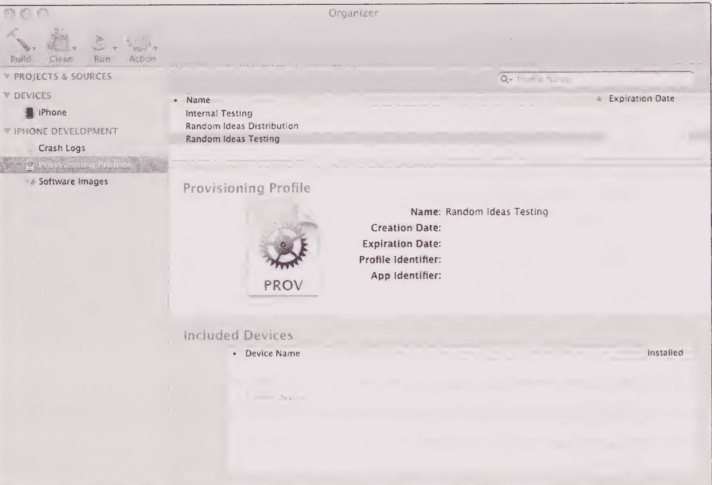

可以用于安装描述文件的第二个应用程序是 iTunes。iTunes 在管理描述文件方面的功能要少得多，但对于非程序员来说简单得多。要使用 iTunes 安装描述文件，只需将 iPhone OS 设备连接到计算机，启动 iTunes，并将描述文件从 Finder 拖放到 iTunes。这会将描述文件安装到你的设备上并同步到 iTunes 中。

## 探索应用程序签名时发生的情况

所有 iPhone 应用程序在安装之前都必须使用描述文件进行签名。代码签名是为 iPhone OS 构建应用程序的最后一步。当应用程序被签名时，Xcode 使用与当前活动描述文件关联的证书使用描述文件中的信息对可执行文件进行数字签名盖章。这使得应用程序只能安装在安装了该描述文件的设备上。

你可以为不同的描述文件配置不同的 Xcode Target。一个典型的项目包含一个**开发目标**，用于在开发者设备上安装和测试应用程序；一个**发布目标**，用于在 App Store 上分发；有时还有一个**临时目标**，用于向 Beta 测试人员分发应用程序。在接下来的章节中，我将向你展示准备构建以使用描述文件签名所需的必要设置。

## 配置你的构建以签名

一旦安装了描述文件，你就必须配置你的构建以使用它。图 33.2 显示了 Xcode 构建设置窗口。窗口中间是代码签名的设置。

### 图 33.2：Xcode 构建设置


影响将使用的描述文件的主要设置将是**代码签名标识**设置。对于此项有两个通配符设置：“iPhone Developer”，它匹配你的开发描述文件；“iPhone Distribution”，它匹配你的发布描述文件。如果需要，你还可以通过点击此下拉列表并选择特定的配置实例来指定特定的描述文件。在可能安装了多个开发配置的情况下，或者当你想进行临时构建时，你需要显式地设置配置文件。对于典型用途，通配符设置通常足够了。

> **注意**
>
> 临时描述文件实际上是一个发布配置。

你可能需要更改的另一个设置是**代码签名权限**设置，我将很快讨论。

## 进行临时构建

临时构建允许你直接将构建分给最终用户，而不通过 App Store。使用临时构建你需要描述文件。

### 配置临时发布构建

配置临时发布构建涉及几个步骤。首先，你应该复制你想要使用的构建设置。这可以在项目的 Configurations 选项卡中点击 `Duplicate` 按钮轻松完成。一旦你有了新的临时配置，你应该将其选择为你的活动配置。

图 33.3 显示了构建配置。临时构建要求随构建包含一个特殊的属性列表。此属性列表被称为 `Entitlements`。通常，它被称为 `Entitlements.plist`，并应该被添加到项目的资源组中。

### 图 33.3：构建配置


`Entitlements.plist` 文件应包含一个名为 `get-task-allow` 的属性。该属性应该是一个布尔值并应设置为 `FALSE`。此标志配置了应用程序在运行时是否允许附加调试器。发布配置（记住，临时配置被视为发布）要求将此标志设置为 `FALSE`。

一旦你有了 `Entitlements.plist`，你应该配置你的临时目标，并将代码签名 Entitlements 属性设置为权限属性列表的文件（在之前的示例中为 `Entitlements.plist`）。你还应该将代码签名标识配置为你的临时描述文件。

如果你配置得正确，你应该能够构建你的应用程序。此版本的应用程序使用你的临时描述文件签名，并可以安装在列出的任何设备上。

### 向用户分发

向用户分发临时构建涉及将应用程序包和描述文件分发给用户。用户需要使用 iTunes 安装两者。

在安装应用程序和描述文件时，应先安装描述文件。用户应该将描述文件拖到 iTunes，然后将应用程序包拖到 iTunes。如果安装正确，用户随后会在 iTunes 的应用程序组中看到该应用程序。

> **注意**
>
> iTunes 会进行版本检查，并提醒用户正在安装的版本比当前安装的版本旧或相同。因此，当你分发新的临时构建时，你可能想要增加版本号。

### 总结

本章让你了解了代码签名过程和分发工作。代码签名是 iPhone 开发中最复杂的部分之一。充分理解所使用的术语和涉及的过程有助于工作变得更简单。读完本章后，你将拥有这些额外的理解，这将使你的构建更加顺畅简单。

# 第 34 章：使用内购支持扩展你的应用程序

对于开发者来说，iPhone OS 3 中最令人兴奋的新功能之一就是增加了对内购的支持。通过使用它，你可以利用内置 App Store 购买系统的功能，允许用户为你的应用程序购买额外内容。这些内容可以是额外关卡、额外功能等形式的内容。这种能力使得围绕 iPhone OS 和 App Store 开发新的业务模式成为可能。

在本章中，你将学习如何与内购系统进行工作。你将看到可以通过你的应用程序出售哪些类型的产品，以及如何将该功能构建到你的应用程序中。你还将看到如何使用 `Store Kit` API 来进行购买。

当你完成学习后，你应该能够部署一个包含应用内购买功能的应用程序。

### 本章内容

- 学习你可以配合内购使用的业务模型
- 了解你可以出售的物品类型
- 在你的应用中集成商店
- 使用 Store Kit 进行购买
- 在本地化货币中显示价格

## 了解你可以出售的物品类型

在处理内购系统时，你首先需要了解的是你可以出售什么类型的内容。你可以作为内购内容出售的内容分为三类：非消耗性项目、消耗性项目和订阅。

**非消耗性内容**是指一旦购买，用户就可以永久使用的内容。这类内容的示例可能是游戏的新关卡，或应用程序中的新功能。除了用户可以永久使用外，非消耗性内容还必须对用户的所有其他设备可用。例如，如果用户同时拥有一部 iPhone 和 iPod touch，那么购买的非消耗性内容必须在两个设备上都可用，且无需额外费用。

第二类是**消耗性项目**，代表可以在应用程序内使用的物品。消耗性项目不需要在用户的所有设备上可用。消耗性项目是用户可以在应用程序内购买并使用的物品，当他们用完后，就会购买更多。物品的示例可能是弹药或扑克牌。

第三种也是最后一种类型是**订阅**类别。订阅的工作方式与消耗性项目一样，不同之处在于需要在用户的所有设备上可用。例如，用户可能会购买为期一个月的杂志订阅。该订阅应该在用户的所有设备上可用。

> **注意**
>
> “订阅”一词可能让你认为重复计单周期是 App Store 内置功能的一部分。事实并非如此；App Store 不提供对重复计单的支持。

在考虑添加内购支持时，首先要意识到的是，你出售的应用程序内容必须属于这三类之一。

在处理内购时第二个要意识到的是，和通常一样，Apple 对你所出售的内容执行了规则。

我可以列出 Apple 允许和禁止的各种物品。但最重要的是，要记住一条规则。Apple 在通过你的应用程序出售内容方面的主要目标是：你所出售的内容必须通过应用程序传递到设备。这意味着，任何不通过设备传递的内容都不适合在内购系统中使用。

例如，Apple 明确表示他们将不会允许应用程序出售现实世界的商品。例如，你不能创建一个允许你出售一本书，然后通过 UPS 递送到某人家的应用程序。另一方面，你可以创建一个出售书籍的应用程序，该书籍通过电子方式直接传递到用户的设备上。再次，目标是你出售的任何东西都应该是可以传递到设备并在设备上使用的。

## 与可解锁内容工作

一旦在设备上完成购买，就由你来解锁用户购买的内容。这些内容的来源由你决定。然而，重要的是记住旧的规则仍然适用；你不能修改现有的可执行文件。因此，你交付的任何新内容必须是非可执行的，或者可以通过配置解锁。

解锁的内容可以已经编译到你的应用程序中，或者包含在你的应用程序包中。或者，它也可以是从互联网下载的内容。但是，如果你下载了它，请注意你不能向设备下载可执行内容。

让我们来看几个例子，让你对它是如何运作的有一个感受。

假设你有一个赛车游戏，其中附带了五条赛道。你可以使用内购系统出售额外的赛道。这些额外的赛道可能已经作为应用程序的一部分被打包。在这种模式下，应用程序甚至可能不需要连接你的服务器来完成购买。`Store Kit` 可以在设备上执行整个购买过程，并解锁已经存在的关卡。

第二个例子，假设你有一个电子书阅读器。也许你售卖电子书阅读器时只解锁了一本书，但你想给用户在应用内购买额外书籍的能力。在这种情况下，你的书籍目录实际上存在于你的服务器上。当用户购买一本书时，`Store Kit` 执行购买并将收据发送到你的服务器，然后你的服务器提供下载用户购买内容的权限。

第三个也是最后一个例子，考虑用户使用“恢复购买”功能的情况。在这种情况下，`Store Kit` 将检查 App Store 中的任何之前的购买记录，并解锁相应的内容。

## 在 iTunes Connect 中设置购买内容

现在你已经了解了出售的内容类型，在实际编写代码之前的最后阶段是在 iTunes Connect 中设置你的产品。然而，在此之前，你需要收集一些信息。

首先，你显然需要为你出售的内容起一个名称。这个名称仅供你参考。用户并不一定能看到，但在设置产品时需要它。

其次，你需要为产品提供描述。同样，这是用户不一定能看到的，但在设置产品时是需要的。这里使用的价格范围与应用程序相同。

最后，你需要的最后一个项目是唯一 ID。为了确保这些 ID 是唯一的，Apple 建议使用反向域名法，例如 `com.example.product-name.content-name`。这个唯一 ID 会出现在你的销售报告中，并允许跟踪该物品。

一旦完成了所有这些，登录 iTunes Connect 并访问“管理您的应用程序”链接。在此区域，每个应用程序都有“管理应用内购买”的按钮。通过它，你可以配置你想提供的每个内购产品。一旦你配置好产品，就可以开始在你的应用程序中构建购买支持了。

## 验证应用购买可用性

在考虑允许用户在应用程序内进行购买之前，你首先需要验证他们没有禁用应用内购买。iPhone OS 5.3 能够启用或禁用来自应用程序的购买。如果用户禁用了此功能，你应该告知他们，为了购买额外内容，他们需要启用它，或者你干脆不显示购买额外内容的功能。

为此，你使用 `SKPaymentQueue` 类方法 `canMakePayments()`。如果应用内购买被禁用，该方法将返回 `NO`。

### 代码列表 34.1：确定是否启用了应用内购买

```objectivec
```


- `(void)presentStore;`

```objectivec
if ([SKPaymentQueue canMakePayments]) {
    // 显示商店
} else {
    // 通知用户他们无法进行购买。
}
```

一旦你确定用户可以使用应用内购买系统，你就应该向用户展示你正在待售的产品。

## 展示你的商店

如何向终端用户展示待售的产品，其实现方式取决于你的应用程序和用户界面。向用户展示产品没有标准的对错之分。游戏可能会有一个简单的对话框来提示用户购买额外的关卡。电子书阅读器可能会有一个复杂的目录，带有书籍预览等内容。你如何实现你的商店完全由你决定。

## 处理分发

尽管如此，你仍然应该使用 `Store Kit API` 来获取产品详情，以便展示给终端用户。这是因为你必须记住，iPhone 销于几十个国家，具有多种本地化货币。你希望为用户正在购买的产品提供适当的本地化价格。因此，你应该从 `Store Kit API` 请求产品列表，并使用该列表中的本地化信息来展示你的目录。

图 34.2 显示了如何使用 `Store Kit API` 在展示商店之前获取关于产品的本地化信息。

## 34.2 本地化定价信息

```objectivec
- (void)retrieveProductInfo {
    NSSet *productIDs = [NSSet setWithObjects:
        @"com.company.product1",
        @"com.company.product2",
        @"com.company.product3",
        nil];

    SKProductsRequest *catalogRequest = [[SKProductsRequest alloc] initWithProductIdentifiers:productIDs];
    [catalogRequest setDelegate:self];
    [catalogRequest start];
    [catalogRequest release];
}

- (void)productsRequest:(SKProductsRequest *)request didReceiveResponse:(SKProductsResponse *)response {
    // 格式化价格可以使用数字格式化器来获取
    // 正确本地化的价格
    NSNumberFormatter *formatter = [[NSNumberFormatter alloc] init];
    [formatter setBehavior:NSNumberFormatterBehavior10_4];
    [formatter setNumberStyle:NSNumberFormatterCurrencyStyle];

    NSArray *products = [response products];
    // 显示给用户...
    for (SKProduct *product in products) {
        NSString *desc = [product localizedDescription];
        NSString *name = [product localizedTitle];
        [formatter setLocale:[product priceLocale]];
        NSString *price = [formatter stringFromNumber:[product price]];
        // 填充 UI。
    }
    [formatter release];
}
```

大多数其他事情一样，访问 App Store 是异步完成的。因此，你使用想要获取信息的产品标识符来初始化产品请求，然后启动请求。一旦请求开始，代理方法将在完成后被调用。

当代理方法被调用时，该代理方法的参数类型为 `SKProductsResponse`，它包含你的产品列表。该列表包含 `SKProduct` 类型的对象。你可以使用 `SKProduct` 类方法来获取关于产品的本地化信息，包括正确的本地化价格。如代码所示，你应该使用数字格式化器将实际值格式化为适用于用户区域的适当格式。

## 进行购买

在代码中实际执行购买非常简单。你实例化 `SKPayment` 实例并将其添加到代理 `SKPaymentQueue` 中。这在代码列表 34.3 中所示。

## 34.3 向商店发送支付

```objectivec
SKMutablePayment *payment = [SKMutablePayment paymentWithProductIdentifier:@"com.example.product1"];
// 如果需要，可以设置数量 - 默认 1。
payment.quantity = 2;
[[SKPaymentQueue defaultQueue] addPayment:payment];
```

为了实际接收支付，你的应用程序需要有一个由其观察的事务观察者对象实例。该事务观察者必须实现 `SKPaymentTransactionObserver` 协议，并负责解锁用户购买的内容。

实现此观察者的最佳位置可能是你应用程序的初始化部分。这是一个很好的位置，因为 `Store Kit` 会记住正在处理中的事务，即使应用程序在事务完成之前崩溃或被中断。因此，当你的应用程序启动并初始化时，它应该准备好处理队列中可能任何已完成的事务。

代码列表 34.4 显示了 `applicationDidFinishLaunching:` 的实现，其中应用程序代理被设置为事务观察者。

## 代码列表 34.4 设置事务观察者

```objectivec
- (void)applicationDidFinishLaunching:(UIApplication *)application {
    [[SKPaymentQueue defaultQueue] addTransactionObserver:self];
}
```

一旦设置了事务观察者，你就必须处理事务。代码列表 34.5 显示了如何实现这些方法。

## 34.5 接收支付

```objectivec
- (void)paymentQueue:(SKPaymentQueue *)queue updatedTransactions:(NSArray *)transactions {
    SKPayment *pmt = nil;
    NSString *productID = nil;
    NSError *error = nil;

    for (SKPaymentTransaction *transaction in transactions) {
        switch ([transaction transactionState]) {
            case SKPaymentTransactionStatePurchased:
                pmt = [transaction payment];
                productID = [pmt productIdentifier];
                // 解锁内容
                break;
            case SKPaymentTransactionStateFailed:
                error = [transaction error];
                break;
            case SKPaymentTransactionStateRestored:
                pmt = [[transaction originalTransaction] payment];
                productID = [pmt productIdentifier];
                // 解锁内容
                break;
            default:
                break;
        }
        [queue finishTransaction:transaction];
    }
}
```

> 为了在下次启动应用时再次接收该事务的通知。记住，此方法对完成的事务和恢复的事务都会调用。因此，你应该像我所示的那样区分它们。处理这两种事务的主要区别在于，对于恢复事务，你想通过查看原始事务来获取产品标识符。

就像处理目录用户界面一样，这部分的实现完全由你决定。重要的是，它必须是持久化存储。`Store Kit` 框架不提供任何用于购买项目持久化的机制。你应该在 `UserDefaults` 或其他机制中存储用户到底解锁和购买了哪些内容的记录。在应用程序启动时，你应该检查设置，并确保用户有权访问的任何内容均可用。

然而，这里需要注意的重要的一点是，当交易完成时，你应该立即解锁内容。用户期望在购买后立即在应用程序中使用他们的内容。你不应该让他们等待以获取其新功能。

## 恢复已购买的内容

处理应用内购买的最后一个部分是在当用户擦除手机或重新安装你的应用程序时恢复购买项目。如果你选择提供应用内购买支持，还应该确保支持恢复用户的购买项目。为了做到这一点，你应该在用户界面的某处包含一个“恢复”按钮。当用户点击该按钮时，你应该使用 `SKPaymentQueue` 实例方法 `restoreCompletedTransactions`。这将导致你的 `SKPaymentQueue` 代理接收用户在你的应用程序中进行过的所有已完成交易。交易状态为 `SKPaymentTransactionStateRestored`，你应当按照我在上一节中向你展示的方式处理这些交易——即解锁内容。


> **注意**
> 恢复购买也是用户无需重新购买项目即可将购买从一个设备转移到另一个设备的方法。

## 34.6 恢复用户的购买项目

```objectivec
[[SKPaymentQueue defaultQueue] restoreCompletedTransactions];
```


> **注意**
> 你可能会问：“为什么我不能每次启动应用程序时都简单地恢复完成的交易？”答案是，当你请求恢复完成的交易时，系统会提示用户输入 App Store 用户名和密码。每次启动应用程序都这样做会非常烦人。因此，只在用户明确请求时执行此操作。

# 第 34 章：使用内应用购买支持扩展你的应用程序

## 理解内应用购买测试

最后，关于测试带有内应用购买功能的应用程序，有几点需要理解。显然，在开发期间，你并不希望访问真实的 App Store。如果可以访问一个沙盒，在其中测试一切（包括交易）而不用担心意外扣除信用卡，那就好了。Apple 已经在与 App Store 相关的开发过程中提供了这种支持。当你的应用程序使用开发者证书签名时，它仅连接到沙盒。当你使用发布证书签名应用程序时，它实际上会连接到真实的商店。因此，你可以使用开发者证书进行测试。有关如何操作的细节位于 iTunes Connect 中。


> **警告**
> 当你使用沙盒测试设备时，需要确保在测试应用程序之前注销普通账户。否则，它会尝试使用你的账户验证购买，导致将无法工作。此外，为了测试你的服务器端实现，验证收据的 URL 应该改为 `https://sandbox.apple.com/verifyReceipt`。

### 总结

在本章中，我向你展示了如何使用内应用购买系统扩展你的应用程序。这使你能够探索新的业务模式，并根据用户的需求定制你的应用程序。或者，你可以先发布一个具有极少功能的应用程序，然后通过可解锁的内容进行更新。最后，你甚至可以创建与在线服务工作的应用程序，直接将数字内容传递到设备。使用这种功能开启了一个全新的机会世界，我希望它在未来几年里能够取得成功。


# 索引

## 特殊字符

- `@property(nonatomic, readonly) NSTimeInterval`, 139
- `@property(nonatomic, readonly) NSUInteger`, 139
- `@property(nonatomic, getter=SecureTextEntry)`, 165
- `@property(nonatomic) IBOutletReturnKey`, 165
- `@property(nonatomic) UIKeyboardAppearance Appearance method`, 165
- `@property(nonatomic) UIKeyboardType property`, 165
- `@property(nonatomic) UIKeyReturnKey property`, 165
- `@property(nonatomic) UITextCapitalizationType capitalizationType property`, 165
- `@property(nonatomic) UITextAutocorrectionType method`, 165
- `@property(nonatomic) @synthesize declaration`, 48
- `- 符号`, 202
- `+ 符号`, 202

## A

- 加速计, 20, 23
- `accelerometer:didDidChange method`, 365
- `acceptCallID:error method`, 285
- `acceptConnectionFromPeer:error method`, 282
- 辅助 view, 86
- `addDisconnect: method`, 375
- `action-loc-key`, 字典 alerts, 26
- ad hoc network, 蓝牙
- ad hoc provisioning profile, 383
- `addAnnotation`, 303
- `addFilter`, 226
- `addItems`, 292
- `addAddress`, 305
- `addDictionary`, 295
- `addDelegate`, 318
- `addListener`, 318
- `addSource`, 318
- `addSourcePlay`, 318
- `addSourceStop`, 318
- 动画
    - Core Animation
    - `CALayer`, 178–181
    - `UIImageViews`, 181–182
    - `UIAnimation methods`, 117–177
    - 关键帧, 179
    - OpenGLES, 187–188
- 旋转和平, 43–44
- 动画块, 172–177
- 动画曲线, 174–175
- 动画路径, 178–179
- `animationImages method`, 381
- 标注地图, 301–303
- APIs (应用程序编程接口)
    - `CFHost`, 244, 249
    - `CFSocket`, 244–247
    - `CFStream`, 244–252
    - CFoundation, 25
- Game Kit
    - 蓝牙方法, 284
    - 语音方法, 284–287
    - 点对点连接, 277–284
- 地图
    - 标注地图, 301–303
    - 坐标, 303–305
    - MapKit, 297–299
    - 区域, 指定, 299–301
    - 概述, 16, 17–22
- NS SSL, 268
- 文件夹, 24
- App Store
    - 匿名访问, 395
    - 发布配置文件, 383
    - “外观设置”, 163
- AppKit, 25
- App Phone
- 应用程序
    - GUI, 构建, 11–13
    - 启动, 16–17
    - 模板, 创建属性, 7–10
    - `UIViewController`, 14–16
- `applicationWillResignActive: message`, 122
- `applicationWillTerminate: 方法`, 119–120, 222, 215
- `averagePowerChannel: 方法`, 316, 332
- `AVFormatIDKey: 方法`, 331
- `AVLinearPCMBitDepthKey: 方法`, 331
- `AVLinearPCMIsBigEndianKey: 方法`, 331
- `AVLinearPCMIsFloatKey: 方法`, 331
- `AVNumberOfChannels: 方法`, 331
- `AVSampleRateConverterAudioQualityKey: 方法`, 331
- `AVSampleRateKey: 方法`, 134, 142
- `apView:regionWillDidChange: 方法`, 301
- 字典数组, 53
- `artistryQuery: 方法`, 326
- `artwork, 方法`, 328
- 异步访问, 395
- 异步主机名解析, 248
- 网络异步处理机制, 235
- 异步流, 264
- 附件, email, 240–241

## B

- `backgroundColor: property.h 文件`, 14
- `BasicInfoPlistViewController: 方法.m 文件`, 14
- `BasicInfoPlistViewController: xib 文件`, 11
- 电池状态值
    - over, 35
- audio
    - 解码方法, 317
    - 格式
        - 压缩, 309
        - 未压缩, 310
    - 播放
        - AV Foundation Framework: 方法, 317
        - OpenAL, 317–318
    - 录制
        - 可用输入方法, 313
        - `AVAudioRecorder: 方法`, 330–332
        - `AVAudioSession: 方法`, 329–337
        - 语音录音器, 322–337
        - 采样率, 313–316
        - sessions, 初始化, 285
- `audiobooksQuery: 方法`, 326
- `audioPlayerBeginInterruption: 方法`, 
- `audioPlayerDecoderErrorDid: 方法`, 
- `audioPlayerDidFirstPlaying: successfully:`
- `audioPlayerEndInterruption: 方法`, 317
- 自动纠正, 162
- `UIDeviceStateCharging`, 336
- `UIDeviceStateFull`, 336
- `UIDeviceStateUnknown`, 336
- `UIDeviceStateUnplugged`, 336
- `batterylevel property`, 354
- `battery state`, 354
- `comeFirstResponder: 方法`, 164
- `beginAnimations: 方法`, 177
- 测试
    - ad hoc 备描述文件, 383
    - debug 构建设置, 386
    - 重复, 390
- 二进制格式, 消息, 262–263
- blocks, animation: 171–172, 177
- 蓝牙 ad hoc 网络

### AV Foundation

- `AVAudioPlayer: 方法`, 315–331
- `AVAudioPlayerDelegate, 方法`, 314
- `AVAudioSession: 方法`, 314
- `AVAudioSessionDelegate, 方法`, 314
- `AVPlayerDelegate: 方法`, 317
- `AVAudioSession 类`, 285, 314–329
- `AVAudioSessionCategoryAmbient category`, 312
- `AVAudioSessionCategoryPlayAndRecord, category`, 312, 329
- `AVAudioSessionCategoryPlayback, 方法`, 312
- `AVAudioSessionCategoryRecord, 方法`, 312, 329
- `AVAudioSessionCategorySoloAmbient, category`, 312
- `AVPlayerDelegate: 方法`, 314
- `AVEncoderBitDepthHintKey: 方法`, 331
- `AVEncoderRateKey: 方法`, 331

### Game Kit

- `GKPeeperPlayerController, 类`, 278
- `GKSession 类`, 280

- `body key, 字典 alerts`, 262
- Bonjour
    - `NSServices`, 255–256
    - overview, 252
    - row, 用于提供, 253–255

- `- (BOOL)application:(UIApplication *)application didFinishLaunchingOptions:(NSDictionary *)options launch methods: 方法`, 118
- `+ (BOOL)animationsEnabled: 方法`, 174
- `- (BOOL)textFieldString:(NSString *)defaultName, 199`
- `Orientation:(UIInterfaceOrientation)interfaceOrientation: 方法`, 422
- `- (BOOL)textFieldShouldBegin:(UITextField *)textField: 方法`, 166
- `- (BOOL)textFieldClear:(UITextField *)textField: 方法`, 166
- `- (BOOL)textFieldEndEditing:(UITextField *)textField: 方法`, 166
- `- (BOOL)textFieldShouldReturn:(UITextField *)textField: 方法`, 166
- `(BOOL)textField:(UITextField *)textField shouldChangeCharactersInRange:(NSRange)replacementRange:withString:(NSString *)method`, 166

## C

- `CFSocket API`, 244–247
- `CFSocketCallBack 参数`, 245
- `CFSocketConnectToAddress 函数`, 246
- `CFSocketCreate 方法`, 246
- `CFSocketCreateRunLoopSource 函数`, 246
- `CFStream API`, 244–252
- `CGAffineTransform type`, 128
- `CGAffineTransformMake 方法`, 132–133
- `CGContextRef 方法`, 128
- `CGContextState:(id) 方法`, 130
- `CGContextSaveState:(id) 方法`, 130
- `CGContextSetFillColorWith:(function) 函数`, 131
- `CGContextSetStrokeColorWith:(function) 函数`, 131
- `CGFloat type`, 128
- `CGImageRef type`, 128
- `CGPath type`, 128
- `CGPoint type`, 128
- browsers, Web URLs, 189–190
- `UIWebView addingTo:`, 191
- HTML content, 从 application 加载, 193
- loading URL, 191
- `UIWebViewDelegate`, 192–193
- BSD sockets, 223, 243
- bubble-level application, 363
- Build and version, 19–26
- build-in applications, 34–36
- bundle application, 204, 201
- settings, 203–207
- iPhone UI, 36
- moving with animation, 172
- removal with animation, 175–176
- `CALayer 类`, 178–181
- callback types, 245
- copying, 360
- callouts, map, 302
- `cancel 方法`, 393
- `canSendMail: 方法`, 240
- figuration, 261
- cell reuse, 94–98
- cell styles, 266
- `UITextFieldCellStyle`, 186
- `UITextFieldTextStyleSubtitle`, 186
- `UITextFieldTextStyle1`, 186
- `UITextFieldTextStyle2`, 186
- development, 17
- iPhone Developer Program, 271
- certificate-signing 方法, 382
- `AllocatorRef 参数`, 244
- `CFNetwork API`, 247–249
- `CFNetwork 函数`, 243
- `CFOptionCallbacks`, 245
- `CFRelease 函数`, 129–130
- `CFRetain 函数`, 129–130
- `CFRunLoopAddSource 函数`, 246
- `CFRunLoopSourceRef 对象`, 246
- hardware, 309–310
- software, 223–246
- codes list, make, 242–243
- colors, drawing, 131
- colors properties, 291
- `completion 方法`, 326
- completed-transactions, 397
- `CALayer path type`, 204, 207
- cinematic interface, 178–181
- overview, 333
- `UIViews animation methods`, 171–177
- Class identity property, 127
- Class property, 107
- Code Signing entitlements, 388
- Code Signing identity, 386, 388
- codecs
- `-(CGPoint)LocationIn:(UIView *)`
- `-(CGPoint)previousLocationIn:(UIView *)方法`, 139
- `ConnectionTextMesh`, 264–265
- `connectionDidFailWithError: 方法`, 238–239
- `connectionDidFinishLoading: 方法`, 238–239
- `connectionDidReceiveData: 方法`, 245
- `const SocketContext *参数`, 245
- constant strings, 210
- consumables, 390
- content view, 886
- Continuous property, 148
- controllers, MVC 设计模式, 41
- coordinates
    - Core Location, 21–22
- `country property`, 305
- `countryCode property`, 305
- Create ID screen, iPhone Developer Portal, 266–277
- converting, 303–305
- iPhone screen, 125–126
- `copy: 方法`, 293–294
- `createFramebuffer 方法`, 187
- Creating, Reading, Updating, Deleting (CRUD)
    - creating, 220
    - deleting, 222
    - overview, 220–230
    - reading, 220–221
    - updating, 221–222
- copying
    - `copy: 方法`, 293–294
    - with standard controls, 289–290
- `currentHardwareSamplerMethod`, 317
- `CurrentTime property`, 316
- curves, 140
- custom buttons, iPhone UI, 36
- custom Session instances, 280
- custom views, 315
- Core Animation
    - `CALayer`, 178–181
    - `UIViews`, 181–182
- customizable property, 153
- Core Data
    - adding to
        - Managed Object Model, 216–219
        - modifying app delegate, 212–215
- Core Foundation
    - object ownership, 129
- DataToAll:Data:error, 288
- `dealloc, 219`
- declarations, 47–48
- data models, 217–219
- data source
    - implementation, 68–70
    - interface, 68
- default arrays, 31
- default Value, Settings 应用, 204
- default video controls, 341

### Core Foundation APIs

- `CFHost`, 247–249
- `CFSocket`, 244–247
- `CFStreams`, 249–252

### core frameworks memory management

- `CFreelease 函数`, 129–130
- `CFRetain 函数`, 129–130
- object ownership, 129

- defining paths in Core Graphics, 132
- delegate,
    - modifying, 312–213
- notifications
    - overview, 120–121
    - phone calls, handling, 122
    - remote notifications, handling, 123
    - resource alerts, handling, 121–122
    - sleep, handling, 122
    - status, changing, 122–123
- Core Graphics
    - context, 130–131
- core frameworks memory management
    - `CFreelease 函数`, 129–130
    - `CFRetain 函数`, 129–130
    - object ownership, 129
- drawing operations, 131–132
- mixing with OpenGL, 68
- transforms, 132–133
- of purpose, 117
- startup and shutdown
    - `applicationWillTerminate`, 119–120
    - launch methods, 118–119
- `INavigationController`, 108
- TableView, 73
- `UITableView`, 75–76
- `UIViewViewController`, 56
- delegate method, EditViewController, 112–114
- `deleteObject instance method`, 222
- `deleteRecording method`, 332
- types, basic
    - `CGAffineTransform`, 128
    - `CGContextRef`, 128
    - `CGFloat`, 128
    - `CGPathRef`, 128
    - `CGPoint`, 128
    - `CGect`, 128
    - `CGSize`, 128
    - overview, 128–129
- `deleteRowsAtIndexPaths:withRowAnimation:method`, 64
- deleting objects, 222
- rows, 66, 116
- table views, 64
- delivery feedback, APNS, 272
- `dependencyCallID:method`, 285
- `dependencyConnectionFromPeer:method`, 282
- `dequeueReusableAnnotationWithIdentifier:method`, 301-302
- `dequeueReusableCellWithIdentifier:method`, 98
- deselecting rows, 277
- `deselectRowIndexPath:animated:method`, 365
- desiredAccuracyproperty
    - `CLLocationAccuracyBest value`, 356
    - `CLLocationAccuracyHundredMeters value`, 356
    - `CLLocationAccuracyKilMeters value`, 356
    - `CLLocationAccuracyNearestTenMeters value`, 356
    - `CLLocationAccuracyThreeKilMeters value`, 356
    - overview, 356
- development certificate, 176
- development providing-profile, 382-383
- development server, Apple, 259, 267
- device ID, 382
- device-keys, 261-272
- dictionary-ary, 226
- `didFinishLaunching:method`, 73
- `dididReceiveMemoryWarning:message`, 44, 121
- `didRegisterForNotifications`
    - `didRegisterBaseToken:method`, 261
- `didSelectFromInterfaceOrientation:method`, 43
- `deslectRowIndexPath:method`, 77, 81
- digital certificate, 382
- dismissing keyboard, 164
- `distanceFilterFilter`, 356
- distribution providing-profile, 383
- NS notation, reference, 290, 292, 392
- dock, iPhone screen, 33
- document window, Interface Builder, 11
- Document folder, 24, 212
- `touchTouched:method`, 111
- `(-double)doubleForKey:(NSString *)defaultName.method`, 199
- downloading images and displaying in UIImageView, 237
- `NSURLConnection delegate methods`, 238-239
- using URLToNSString, 234-235
- using NSURLConnection, 235
- drawing
    - basic operations, 131-132
    - efficiency, 95
    - `drawRect:method`, 127, 135-141
    - `drawImageView:method`, 187
- duration property, 316

## E

- `EAGLContext object`, 186-187
- `EAGLView interface`, 186-187
- `EAGLView.h file`, 185
- `EAGLView.m file`, 185
- e-reader, 391
- `editedItem:property`, 114
- editing
    - data, iPhone UI, 37
    - rows
        - adding rows, 115
        - deleting rows, 116
    - EditViewController, 109-111
        - MyView, moving into, 107-108
        - overview, 111-114
    - editing window, 4-5
    - EditViewController object
        - editing rows, 112-115
        - making, 109-111
        - `editViewPublished:method`, 111
    - efficiency, 95
- e-mail
    - attachments, 240-241
    - keyboard for, 162
    - sending from within with Message Interface framework, 239-249
- embed maps maps, 295
- `Entitlements.plist file`, 386-387
- environment mapping system, Open, 317
    - audio decoding, 317
    - handling, 192-193
    - managed object, 220
- event handling
    - keyboard
        - moving in to appearance of, 167-168
        - `UITextDelegate`, 166-167
        - Next button, 48-49
- `executeFetchRequest:error instance method`, 220-221
- External framework, 375

## F

- "Favorite applications" dock, iPhone screen, 33
- Favorite Cities application
    - Managed Object, 216-219
    - modifying app delegate, 212-215
- feedback messages, APNS, 263-264, 272
- feedback servers, 250-260, 272
- fetched properties, Core Data, 219
- `PhotosCell: function`, 248-249
- organization view, 4-5
- File Object, 15-16, 51
- filesystem, iPhone simulator, 23-24
- fill color, 131
- filtering, query object, 326
- first responder, 163–164
- flip transitions, 177
- `- (float)floatForKey:(NSString *)defaultName method`, 199
- Foundation API, 25
- frame, status bar, 122
- `+ IBactions (Interface Builder actions)`, 14, 16, 51, 151
- IBOutlets (Interface Builder outlets)
    - MyController, 51
    - overview, 14, 16
    - `UINavigationController`, 108
    - `UIViewController`, 46–47, 53, 56
- identifier, accessing, 346
- identifier parameter, Settings application, 204
- `(id)forKey:(NSString *)defaultName method`, 199
- image property, `UIPasteboard`, 251
- image animating, 180–182
- images
    - adding to UITableViewCell, 87–90
    - as email attachments, 240–241
    - `UITabBar`, 153
- images property, 291
- immutable objects, 200
- implementation file, UI, 15
- Icon, Weather application, 36
- `Info.plist:`, 373
- in-voice, 284–287
- inheritance, 90–91
- `init method`, 253
- `init property`, 151
- `initialize method`, 201–202
- `awakeFromNib method`, 142
- custom view, 127
- data source, 70
- `init`, 320
- `initContentsOfURL:encoding:error`, 234
- `initWithMediaTypes:`, 252
- `initWithSessionID:displayName:sessionMode`, 281
- `initWithURL:error`, 333
- `UITableView`, 361
- `initPlayBack property`, 341
- `initWithAPI: method`, 187
- `initWithContentsOfURL:encoding:error, initializer`, 234
- `initWithData: error`, 315
- `initWithFavoriteColors:method`, 70
- `initWithFrame:method`, 127, 134
- `initWithMediaTypes: initializer`, 320
- `initWithSessionID:displayName:sessionMode`, 281
- `initWithURL:settings:error, initializer`, 331
- input devices, audio, 330
- input stream, 376
- Game App Kit
    - Bluetooth network, 284
    - in-game voice, 284–287
    - peer-to-peer connectivity
    - overview, 277
    - persisting, 278–290
- sessions, 281–284
- `generalPasteboard method`, 290
- `generics query method`, 326
- `get-task-allow property`, 387
- getters, 198–200
- g-Gesture, 361
- `GKPickerController class`, 278, 283
- `GSession class`, 279
- `GKChatService`, 285–287
- globally unique identifier (GUID), 24
- `goBack: action`, 192
- `goForward: action`, 192
- Google application, property, 346
- GPS, 349
- graphical user interface (UI), 11–13
- global type, Settings application, 204
- group table, 72–88
- GUI (global user interface), 11–13
- globally unique identifier, 227
- hardware, iPhone version, 26–27
- hardware codecs, 309
- hardwareBack, iPhone simulator, 238
- header, UI, 14–16
- `UITabViewController`, 62–63
- `UIViewController`, 46–47
- Heads-Up Display (HUD)-style window, 16
- h screen, iPhone, 32–33
- `hostname property`, 254
- hostname resolution, asynchronous, 248
- HTML content, loading from application bundle, 193
- HUD (Heads-Up-Display)-style window, 16

## I

- `inputIsAvailable method`, 313, 330
- `inputAvailableChanged method`, 330
- `insertRowsAtIndexPathsWithAnimation:method`, 64
- installing profiles, 383, 384, 388
- interactions, iPhone UI,
    - Interface Builder
        - custom views, adding to project, 126–127
        - editViewController, 109
        - grouped table, 76
    - GUI, building simple, 11–13
    - keyboard, configuring
        - auto correction, enabling and disabling, 162
        - capitalization, configuring, 161
        - overlay, 159–161
        - Return key, setting behavior, 163
        - type, setting, 162–163
- mapView, 297–298
- overview, 54
- `UIPickerView`, 155
- `UISlider`, 148–151
- `UITabBar`, 153
- `UIViewController`
    - hiding, 51–53
    - writing, 15–16
    - voice recorder UI, 332–333
- Interface Builder actions (IBActions), 14, 66, 151
- Interface Builder outlets (Outlets)
    - MyViewController, 51
    - overview, 14–16
    - `UINavigationController`, 108
    - `UIViewController`, 46–47, 53, 56
- Internet
    - connections, 280
    - `NSURLConnection`, 235–239
    - `NSURLRequest`, 235–239
- Safari
    - opening URLs, 189–190
    - `UIWebView`, 191–193
- URLs
    - opening with iPhone browser, 189–190
    - using functional calls, 234–235
    - video, playing, 341–342
- interventions, `AVAudioPlayer`, 317
- iPhone
    - Settings application, 203, 206
    - UI
        - built-in actions, 34–36
        - cinematic user experience, 33
        - navigation, 36–37
        - screen, 32–33
        - Web browser, opening URLs with, 189–190
- iPhone applications
    - GUI, building, 11–13
    - launching, 16–17
    - templates, creating projects, 7–10
    - `UIViewController`, writing, 14–16
- iPhone client, integrating with APNS
    - receiving notifications in applications, 274–275
    - registering for notifications, 273–274
- iPhone Developer Center, 266
- iPhone Developer Program Portal, 266–268
- iPhone developer setting, 386
- iPhone Distribution setting, 386
- iPhone simulator
    - multi-touch events in, 140
    - to test applications on iPhone, 16–17
- versus device
    class, 35

## J

- Core Location, 21–22
- filesystem, 23
- Hardware menu, 23
- multi-touch, 21
- overview, 19–20
- IPod, 304, 309, 327

### IPod Library

- 媒体艺术，访问, 328
- 媒体库
    - 访问, 320–323
    - 搜索, 323–326
- Media Player framework, 319–320
- player controllers, 327
- `isIsAvailable property`, 281
- iTunes
    - ad hoc provisioning profile, 383
    - installing profiles, 384, 388

## J

- JSON object, 361

## K

- `kFSocketAcceptCallback callback value`, 245
- `kFSocketConnectCallback callback value`, 245
- `kFSocketDataCallback callback value`, 245
- `kFSocketNoNoCallback callback value`, 245
- `kFSocketReadCallback callback value`, 245
- `kFSocketKitUCallback callback value`, 245
- `kCLocationDistanceFilterNone value`, 357
- `kCLocationAccuracyBest value`, 356
- `kCLocationAccuracyHundredMeters value`, 356
- `kCLocationAccuracyKilometer value`, 356
- `kCLocationAccuracyNearestMeters value`, 356
- `kCLocationAccuracyThreeKilometers value`, 356

## M

### keyboard

通过 Interface Builder 配置
- 自动更正，启用与禁用, 162
- 大写字母，配置, 161
- 概述, 159–161
- Return 键，设置行为, 163
- 类型, 162–163
- 销回, 164

### event handling

- 响应键盘出现移动视图, 167–168
- `UITFieldDelegate`, 166–167
- 使出现, 163
- 类型, 162
- `UITextTraits`, 164–165

### Keychain 动画, 268, 352
keyframe animation 动画，创建, 179

磁性指南针硬件, 349, 359–360
mail 结果代码, 242–243
`mailCompose:didFinishWithResult:` 方法
- 错误, 242
`mailto: URL`, 239–240, 242
主交互区域，iPhone 屏幕, 33
`MainWindow.nib 文件`, 55
`makeModel`, 53, 54–78
Manage Your Applications 链接，iTunes Connect, 392

### Managed Object Model

- 实体
    - 定义, 217
    - 为其生成类, 218–219
    - 属性, 219
    - 之间的关系, 217–218
- 概述, 210–211
- schema，在 Xcode 中设计, 217

## L

- 横屏模式，模拟器, 23
- `location.coordinate.latitude 值`, 354
- `location.coordinate.longitude 值`, 354
- 启动方法, 118–119
- 启动 iPhone 应用, 16–17
- `launchOptions 参数`, 119
- `layoutSubviews 方法`, 91
- `leftBarButtonItem 属性`, 106
- 电平表, 316, 332, 334

### library, iPod

- 访问, 320–323
- 搜索,
- 检测到的媒体属性, 323–326
- 查询，构建, 362
- library 文件夹, 24
- library window，Interface Builder, 11
- `loadData:(ofType:textEncoding:baseURL:) 方法`, 193
- `loadHTMLString:baseURL:, 方法`, 193
- `loadimage, 方法`, 237–238
- locality, 305
- localizedProperty, 307
- `loc-ags key，字典 alerts`, 262
- `locationView: 方法`, 139
- `locationManager:didFailWithError: 方法`, 352–353
- `locationManager:didUpdateLocation:fromLocation 方法`, 352–353
- `locationServicesEnabled 方法`, 352
- low-memory warnings, 44, 120–121

`ManagerShouldDisplayHeaderCalculation: 方法`, 360
map calls, 302
MapKit 框架, 298

### Maps API

在地图上标记
- 概述, 301–303
- 性能, 303
- 坐标, 303–305
- `MKayer`
    - 创建, 297–299
    - 显示嵌入方法, 297
    - 区域，指定, 299–301
- `mapView:annotation:callAccessoryControlTapped: 方法`, 301
- `mapView:didAddNotification: 方法`, 299
- `mapView:regionDidChangeAnimated: 方法`, 301, 303
- `mapView:forAnnotation: 方法`, 301
- Maximum value, `UISLabel`, 151

### audio

- 解码代码, 217
- 输入设备, 330
- 播放, 311–318
- 录制, 329–337
- 采样率, 313–314
- sessions，初始化, 285
- Ipod, 349, 307

### library

- 媒体艺术，访问, 328
- 媒体库, 320–326
- Media Player 框架, 319–320
- 播放控制器, 327
- 流媒体视频, 341

## media (继续)

支持的音频格式
- 压缩, 309
- 未压缩, 310
- 支持的视频格式, 316

Media Player 框架, iOS, 319–320
`MediaPicker:pickMediaItems: 方法`, 322–323

### memory

- 关于 alerts 的警告, 120–121
- 核心框架内存管理
    - `CFreelease 函数`, 129–130
    - `CFRetain 函数`, 129–130
    - Foundation 对象所有权, 129
- 处理内存警告, 120–121
- iPhone 设备切换, 26–27
- 共享模型, 184

Message UI 框架, 239–243
metadata 方法，Interface Builder, 5
metadata 信息, 016, 332, 334
`nembedded 属性`, 316
方法签名

### UIDelegate

- `(BOOL) application:(UIApplication *)application didFinishFinishLaunchingWith:(NSDictionary *)launchOptions 方法`, 118
- `(BOOL) applicationDidFinishLaunching:(UIApplication *)application 方法`, 118
- `(BOOL) applicationWillTerminate:`

### UITextFieldDelegate

- `(BOOL) textFieldDidBeginEditing:(UITField *)textField 方法`, 166
- `(BOOL) textFieldClear:(UITField *)textField 方法`, 166
- `(BOOL) textFieldDidEndEditing:(UITField *)textField 方法`, 166
- `(BOOL) textFieldDidReturn:(UITField *)textField 方法`, 166
- `(BOOL) textFieldDidChangeInRange:(UITField *)textField inRange:(NSString *)string 方法`, 166
- `(BOOL) textFieldDidBeginEditing:(UITField *)textField 方法`, 166
- `(BOOL) textFieldDidEndEditing:(UITField *)textField 方法`, 166

### UIController

- `(BOOL) rotateToInterfaceOrientation:(UIInterfaceOrientation)interfaceOrientation 方法`, 42
- `(void)didRotateToInterface:(UIInterfaceOrientation)toInterface 方法`, 42
- `(void)didReceiveMemoryWarning, 42`
- `(void)didRotateFromInterface:(UIInterfaceOrientation)fromInterface 方法`, 42
- `(void)loadView 方法`, 41
- `(void)viewWillAppear:(BOOL) 方法`, 42
- `(void)viewDidAppear:(BOOL) 方法`, 42
- `(void)viewDidLoad 方法`, 41
- `(void)viewWillAppear:(BOOL) 方法`, 42
- `(void)viewWillDisappear:(BOOL) 方法`, 42
- `(void)willAppearWithRotationInterface:(UIInterfaceOrientation)toInterface:(NSTimeInterval) 方法`, 42
- `(void)willRotateToInterfaceOrientation:(UIInterfaceOrientation)toInterface:(NSTimeInterval) 方法`, 42
- `(void)willRotateToInterfaceOrientation:(UIInterfaceOrientation)toInterface:(NSTimeInterval) 方法`, 42

`AudioCompositeResultCancelled`, 243
`AudioCompositeResultFailed`, 243
`AudioCompositeResultSaved`, 243
`AudioCompositeViewController 方法`, 240–241
Minimum value, `UISider`, 151
`MKAnnotation`, 297, 301
`MKAnnotationView 类`, 297, 302
`MKMapBeginLocationWith distance`, 299
`MKMapView 类`
- 创建, 297–299
- 显示，方法
`MKMapViewDelegate 协议`, 301–303
`MKAnnotation 视图`, 302
`MKOverlayAnnotation 类`, 303–304
`MKReverseGeocoder 类`, 303–304
model, 在 delegate, 53–
model, Controller 设计模式, 40–
model- Managed Object, 216–218
`motionCancelled:withEvent: 方法`, 368
`motionEnded:withEvent: 方法`, 370–371
`motionEnded:withEvent: 方法`, 368


## moving

带动画按钮, 172
shapes, 141–144
`MPMediaItem 类`, 319–320, 325, 328
`MPMediaItemArtwork 对象`, 325
`MPMediaItemCollection 对象`, 325
`MPMediaItemPropertyArtist 属性`, 324
`MPMediaItemPropertyTitle 属性`, 324
`MPMediaItemPropertyTrackCount 属性`, 324
`MPMediaItemPropertyTrackNumber 属性`, 324
`MPMediaItemPropertyArtist 属性`, 325
`MPMediaItemPropertyArtwork 属性`, 324
`MPMediaItemPropertyComposer 属性`, 325
`MPMediaItemPropertyDiscount 属性`, 324
`MPMediaItemPropertySearchCriteria 属性`, 324
`MPMediaItemPropertyGenre 属性`, 324
`MPMediaItemPropertyLyrics 属性`, 324
`MPMediaItemPropertyPersistentID 属性`, 324
`MPMediaItemPropertyPlaybackDuration`, 324
`PropertyTitle 属性`, 324

## N

- `name 属性`, 254, 347
- `pasted pasteboard`, 290
- named collisions, 290
- navigation, iPhone UI, 36–37
- navigation bar, 106
- navigation controller
    - 架构, 101–102
    - 配置, 105–106
    - 创建, 102–104
    - 编辑行
        - 添加行, 115
        - 删除行, 116
    - EditViewController, 109–111
    - MyView，进入, 107–108
    - view, 111–114
- 概述, 33
- `UIToolbar 对象`, 127
- ViewController，推送和弹出, 106–107
- `Service:findService:moreConnecting: 方法`, 253–254
- `netService:didPublish: 方法`, 255–256
- `netService:didResolve: 方法`, 255–256
- `netServiceDidResolveAddress: 方法`, 254

## networking

- Session, 255–256
- 概述, 252
- Core Foundation 套接字
    - `CFHost`, 247–249
    - `CFSocket`, 244–247
    - `CFStream`, 249–252
- e-mail，带消息发送
    - 概述, 233
- Web 访问
    - `NSConnection`, 235–239
    - `NSURLRequest`, 235–239
- 使用基础类的 URL, 234–235

- New dialog框, 7–8
- nib 文件, 551
- nintendo Wii, 361
- nonconsumables, 389
- non-可执行内容, 390

## notifications

Apple Push Notification Service
- 架构, 259–266
- 证书, 266–268
- 与 iPhone 集成, 273–275
- 概述, 257–258
- 服务端服务，开发, 269–272

`MPPlayerPicker`, 319–320
`MPPlayerPredicate`, 325
`MPPlayerPredicate`, 319, 323–325
`MPQuery 类`, 319,323–326
`MPTypeAny 类型`, 320
`MPTypeAudio 类型`, 320
`MPTypeAudioBook 类型`, 320
`MPTypeMusic 类型`, 320
`MPTypecast 方法类型`, 320
`MPmovieDefault 值`, 340
`MPmovieControlHidden 值`, 340
`MPmovieControlVolumeOnly`, 340
`MPPlayerContentPreloadIfNeeded Notification`, 340
`MPPlayerController`, 339, 341–342
`MPPlayerController`, 320–327
`MPMusicControllerroleEndingItem ChangeNotification`, 327
`MPMusicControllerPlaybackStateDid ChangeNotification`, 327
`MPPlayerControllerDidChange Notification`, 327

multicast DNS 解析服务, 252
多点触事件
- 在自定义 UIView 中处理, 140
- `touchegan:withEvent`, 139
多点触屏幕，滚动, 20–21
`multiTouchEnabled 属性`, 140
MultiValue 值类型，Settings, 204
mutable对象, 206
`Mycallback 回调方法`, 247
`MyView 类`, 107–108
`MyController 类`, 51, 111, 226–230

通知（续）

`MPMusicPlayerController 类`, 327
推送, 272

注册, 260
远程, 118, 121, 233–275
响应键盘出现, 167
类型: 261

UIApplicationDelegate
概览, 120–121
电话电话, 处理, 122
远程通知, 处理, 123
资源警报, 处理, 121–122
休眠, 处理, 122–123
状态, 更改,

- `+ (NSArray*)arrayForKey: (NSString *)defaultName method`, 199
- `+ (NSBinaryStoreType)persistent`, 215
- `- (NSData*)forKey:(NSString *)defaultName method`, 200
- `+ (NSDictionary*)forKey:(NSString *)defaultName method`, 201–202
- `NSEntityDescription 方法`, 220
- `NSFetchRequest 对象`, 221
- `NSInPathObject 对象`, 260
- `NSInMemoryStoreType integerForKey:(NSString *) - (NSInteger)integerForKey:)defaultName method`, 199
- `+ (NSNumber)numberOfSectionsInTableView:(UITableView*)tableView view method`, 226
- `- (NSInteger)tableView:(UITableView*)tableView method`
- `+ NSManagedContext sectionInSection:(NSString*)section method`, 226
- `NSManagedObject 对象`, 211–212
- `NSManagedObjects 对象`, 211, 219
- `NSMutableArray 类`, 254
- `NSNotificationCenter 类`, 253
- `NSServices 对象`, 255–256
- `NSNotificationCenter 对象`, 340
- `NSPersistentStore 类`, 351
- `NSObject`
- `NSTimer 类`, 322, 334
- `NSURLConnection *request:(NSURLRequest*)connectionwillSendRequest:(NSURLRequest*)request`
- `+ SQLiteStore 类`, 234–235
- `- (NSString*)forKey:(NSString *)defaultName method`, 200
- `NSText 类 带有 **`
- `redirectResponse: (NSURLResponse *)redirectResponse method`, 236
- `NSURLRequest 对象`, 191, 235–239
- `NSDefault 对象`
    - 获取, 197–198
    - 读取值, to: 198–201
    - 存储购买信息, 391
    - 写入值到, 198–201
- `numberOfComponentsInPicker:method`, 156
- `numberOfOfProperties 方法`, 319
- `numberOfSectionsInTableView:method`, 62, 79–80
- 数字键盘类型, 162
- 数字小键键盘类型, 162


对象建模工具, Xcode, 210
Objective-C 类, 67

分配, 96
创建, 220
删除, 222
File Owner, 15–61
不可变, 200
JSON, 261
Managed Object Model
- 实体, 217–239
- 概览, 210–211, 216
- schema, 在 Xcode 中设计, 217
Managed Objects, 211
可变, 200
读取, 220–221
序列化, 198
更新, 221–222
vertex, buffer, 184
capacity, 95–96

OpenAL, 音频, 315, 317–318
OpenGL
- view, 184–188
输出流, 376
overlay view, 查看表格视图, 84
重写方法, 处理, 44
内存警告, 处理, 44
概览, 41–43
视图旋转, 处理, 43–44

## P

- p12 格式, 271
- APNS 数据包, 270–272
- `paste:method`, 294
- 剪贴板
    - 概览, 289–290
    - `UIPasteboard`, 291–292
- `pasteboardName:create: 方法`, 290

粘贴

- `paste:method`, 294
- 使用标准控件, 289–290

路径

- `pathResource:ofType: 方法`, 339
- 动画, 178
- 在 Core Graphics 中定义, 132
- payload, APNS, 262–263
- `paymentQueue:updatedTransactions: 方法`, 396
- 接受, 392
- `peakPowerForChannel: 方法`, 316
- `peerControllerDidCancel: 方法`, 280
- `peerController:didConnect:toSession: 方法`, 279
- `peerController:didSelectionType: 方法`, 280
- `peerController:sessionForConnection`
- peer-to-connectivity
    - 概览, 277
    - peers, 查找, 278–280
    - sessions, 281–284

perf, 271

性能
- iPhone 序列值检测器的, 26
- `UITableView:`, 94–96
- purge 的持久化, 388

Persistent Store Coordinator, 211
persistent stores, Data, 211–214, 215
电话电话, 处理, 122
`UIView:didSelectRowInComponent:method`, 157
`peerView:numberOfRowsInComponent:method`, 156
`peerView:titleForRow:Component:method`, 157
`peerView:viewForRow:Component:method`, 157
pinch 手势, 144–156
layer controllers, 327
音频 AV Foundation, 311–317
playlists 方法, 226
`pushAction:`, 332, 336
playlists, 184, 187
`UICollectionViewControllers`, 106–107
`popToRootViewControllerAnimated: method`, 107
`popToRootController:animated: method`, 107
`popViewControllerAnimated: method`, 207
`port property`, 254
portal system, 305
功耗, 减少, 345

`predicateWithValue:forProperty: 方法`, 324
`predicateWithValue:forPropertyType: 方法`, 324
`prepareToPlay 方法`, 315
`prepareToRecord 方法`, 331–332
`presentMainViewController:animated: method`, 240
price, 本地化, 394
`priceVar`, 392
private key, 382
product presentation, 393
production server, Apple, 259, 267
provisioning profiles
- ad hoc, 383
- 创建, 268
- development, 382–383
- distribution, 383
Project window, Configurations tab, 386–387
prompt, 106
properties window, Interface Builder, 11
property declarations, 47–48
property list 编辑, Xcode, 203
property lists in application bundles, 201–202, 207
`@property (nonatomic) NSTimeInterval timestamp`, 139
`@property (nonatomic) NSObject tap`, 139
`@property (nonatomic) getters:setTextEntry`, 165
`@property (nonatomic) BOOL returnKey`, 165
`@property (nonatomic) UIKeyboard appearance`, 165
`@property (nonatomic) UITextKey property`, 165
`@property (nonatomic) UIRurnKey returnKey`, 165
`@property (nonatomic) UITextEventType`, 165
`@property (nonatomic) UIText property`, 165
protocol identifier strings, 373
provisioning profile
- ad hoc, 383
- 创建, 268
- development, 382–383
- distribution, 383

## R

- racing game, 391
- read streams, 255–251
- reading objects, 220–221
- receipt key, 397
- `receiveData:fromInSession:context:方法`, 284
- `receiveData:fromParticipantID: 方法`, 286,287
- `receiveData:Game Kit API`, 284, 286
- `recordForDuration 方法`, 332
- 录音
    - 可用输入方法, 313
    - `AVAudioRecorder`, 330–332
    - `AVAudioSession`, 329–330
    - voice recorder, 322–337

`reperushed: 方法`, 332, 335
`rectStatus: 方法`, 201
`registerForEventNotificationTypes, 方法`, 260, 273
registering for notifications, 260, 274
reliable transaction data, 284
remote notifications, 118, 121, 123, 273–275
`removeApplications: 方法`, 303
`remove buffers`, 187
`renderBufferStorage:fromIterable:n187`
core graphics, 184
tiled-based deferred, 184
rendering table views, 64
repeated billing, App Store, 390
`resignFirstResponder 方法`, 164
`resolutionCallback called`, 248–249
`resolveWithTimeout: 方法`, 254
资源警报, 处理, 121–122
responder chain, 164
Restore Purchases 方法, 398

restore services, Bonjour, 255–255
`restoreCompletedTransactions`, 398
restoring graphics context, 130–131
transactions, 397
Return key, 设置行为, 163
`returnKeyType`, 263
reuse concept, 94–95
`reuseIdentifier 对象`, 97–98
communications, 259–264
security, 264–266
certificates, 获取, 266–268
与 iPhone 集成
- in applications 中接收通知, 274–275
- registering for notifications, 273–274
- 概览, 257–258
reverse DNS notation, 290, 292, 396
reverse geocoder, Map Kit, 303–304
`rightBarButtonItem property`, 106
root view controller, 103, 107
root-list, 203
server-side services, development
- delivery feedback, 272
- pushing notifications, 272
- Ruby-supplier, Implementing, 269–272
`pushUIViewControllers`, 106–107
`pushViewController:animated: 方法`, 106–107
- `* Rotate Left option, simulator`, 23
- `* Rotate Right option, simulator`, 23
- row 方法, 60
    - adding, 115
    - deleting, 66
    - deseslecting, 77
    - editing, 112–115
    - reordering, 64
    - table view, 62, 64, 68–69
    - `UIPicker`, 156–157
- Ruby supplier, Implementing, 269–272
- runtime notification messages
    - 概览, 120–121

## S

- Safari
    - opening URLs, 189–190
    - WebView
- 添加到应用程序，191
- `setSelected:animated: 方法`, 93–94
- 从应用程序加载 HTML 内容，193
- 加载 URL，191
- setters，198–200
- `UID，实现`, 192–193

## 设置应用 (Settings application)

- 音频采样率，313–314
- 沙盒，操作，24
- Default Value 参数，204
- 沙盒存储 store，399
- 保存图形内容，130–131
- 标量值，198–200
- 缩放形状，144–146
- Group type 类型值，204
- 缩放模式，340
- Managed Object 架构，210–211
- 屏幕，iPhone UI，32–33
- 滚动，94

## 设置包 (settings bundle)

- 添加，203
- 添加设置到，204–207
- `searchTextDidBeginEditing: 方法`, 84
- `searchTextDidChange: 方法`, 84
- `searchServicesOfType:in 方法`, 253
- Slider 值类型，204
- Text Field 值类型，204
- `sectionIndexTitlesForTableView: 方法`, 83
- 表，视图，62, 68–90
- 安全文本字段，163

## APNS

- title 参数，204
- Title 值类型，204
- Toggle Switch 值类型，204
- 值类型，204
- 连接，264–265
- token，265–266
- `sendData:toPeers:withDataError: 方法`, 284
- 发送数据，GameKit API，284
- 序列化对象，198
- 设置字典，331
- `setToolBarHidden: animated: 方法`, 107
- `setToolBarItems: animated: 方法`, 107
- `PersistentStore: 方法`, 214
- `setValue:forPasteboard: 方法`, 291
- `setControllers:animated: 方法`, 153
- 摇晃事件，368
- 移动，141–144
- 缩放，144–166
- 共享内存方法，184
- `sharedInstance 方法`, 312
- `sharedAutoLayoutToInterfaceOrientation 方法`, 43
- APNS，259–264–265, 270–272
- Apple，259
- 开发，259
- 反馈，250–272
- 生产，259
- `session:didReceiveConnectionRequestFromPeer: 方法`, 282
- `sessionID`, 281
- `session:peer:didChangeState: 方法`, 282–283
- `session:peer-to-peer connectivity`, 281–284
- `setActive: 方法`, 329
- `setAnimationCurve: 方法`, 174
- `setDelegate: 方法`, 175
- `setAnimationStopSelector: 方法`, 175–176
- `setAnimationTransition:forView: 方法`, 177
- `setAnimationTransition:forView:cache, 方法`, 177
- `setCategory: 方法`, 329
- `setCircleCenter: 方法`, 142
- `setCircleSizeForPasteboard: 类型`, 291
- `setDataHandler:getContext: 方法`, 284
- `setEditing:animated: 方法`, 64, 111
- `setLabel: 方法`, 14–15
- `setPosition, 方法`, 180
- `setPreferredHardwareRate: 方法`, 313
- `setSelected: *`
- 多触事件在，140
- 在 iPhone 上使用应用程序，167
- 通用默认 (universal default)
    - 类，25
    - 性能，26–27

## UI

- Core Location，21–22
- 文件系统，23–24
- 硬件菜单，23
- 多触，20–21
- 概述，19–20

## 单例 (singletons)

- `AVAudioSession`, 285, 312–313
- `GKVoiceChatService`, 285–287
- `NSUserDefaults`, 197–198
- `Int32 协议参数`, 245
- `Int32 协议Family 参数`, 244
- `Int32 socketType 参数`, 244
- `SKPaymentQueue 类`, 393, 395
- `SKPaymentTransaction 对象`, 397
- `SKPaymentTransactionStateRestored 状态`, 398
- `SKProduct 类`, 395
- sleep 方法，处理，122
- Slider 值类型，设置应用，204

# 索引

## 滑动控制 (sliding control)

- 通过 Interface Builder 配置，148–151
- 概述，147
- 状态更新，151
- Smart groups，4

## 套接字 (sockets)

- BSD，233, 243
- Core Foundation
    - `CFSSocket`, 381
    - `CFSSocket`, 244–247
    - `CFSocketams`, 249–252
- 概述，233
- 创建并连接到端口，246
- TCP，245, 262
- UDP，245
- UNIX 域，244
- 源码，309–310
- `songQuery 方法`, 326
- SQL 数据库 Core data，211
- `startAnimation 方法`, 181
- `start 方法`, 187
- `touchMoved 方法`, 111
- `startUpdatingHeading 方法`, 359–360
- `startUpdatingLocation 方法`, 351
- `startValueWithParticipantID error: 方法`, 287
- 静态对象，220
- 静态常量，200
- 状态栏，iPhone 屏幕，32, 120–123
- status key，397
- status message 更新，354
- `stopAnimation 方法`, 181
- `stopPushed: action`, 332, 336
- `stopUpdatingHeading 方法`, 359–360
- `stopValueWithParticipantID error: 方法`, 287
- `streamcallback 对象`, 249–251
- 流媒体视频，341–342
- 流媒体，264
- `string`, 291

## strings (字符串)

- 警报，262
- `NSServiceBrowser 类`, 253
- 协议 identifier，373
- 静态常量，200
- `strings`, 291
- stroke color，137
- style 参数，86
- `subAdministrative`, 305
- `subLocal`, 305
- 订阅，390
- `thoroughfare`, 305
- `subtitle 方法`, 301

## 子视图 (subviews)

- 自定义视图，127
- `UITableViewCell`, 86–87
- `didReceiveMemoryWarning: 方法`, 44
- 滑动删除功能，64
- 同步方法，198
- `@synthesize 属性声明`, 48
- `systemName`, 347
- `systemVersion`, 347

## T

- Tab bar，iPhone 屏幕，32–34
- 表视图
    - 添加到应用程序
    - 概述，66–67
    - 运行应用程序，73–74
    - 行被触摸时执行操作，75–77
    - `UITableViewDataSource`, 67–73
    - 字母列表，添加到侧边，83
    - 搜索功能，84
    - state 更新，78
    - `UITableViewDataSource`, 79–82
    - 删除，64
    - editing 方法，64
    - 分组，78–82
    - indexPath，60
    - 行，62, 66–68
    - 节，62–79
    - `UITableViewDataSource`
        - 行为，63–64
        - 核心方法，61–63
        - 概述，60–61
    - `UITableViewDelegate`
        - editing 行为，自定义，65–66
        - 行重排序，66
        - selection 行为，自定义，65
    - `tableHeader 属性`, 84
    - `tableView:canRowAtIndexPath 方法`, 64, 116
    - `tableView:canRowAtIndexPath 方法`, 62, 69–80–87
    - `tableView:commitEditingStyle:forPath 方法`, 64
    - `tableView:commitEditingStyle:forPath 方法`, 64, 116
    - `tableView:didEndEditingAtIndexPath 方法`, 66
    - `tableView:didSelectRowAtIndexPath 方法`, 65, 77, 111–112
    - Title 值类型，设置应用，204
    - `tableView:didUpdateTextFieldForRowAtIndex`
    - TLS (传输层安全)，264
    - `tableView:editingStyleForRowAtIndex: 方法`, 65
    - Toggle 值类型，设置应用，204
    - `tableView:moveRowAtIndexPath:toIndexPath: 方法`, 64
    - Token 机制，264–266
    - tokens，设备，261–263, 272–274
    - `tableView:numberOfRowsInSection: 方法`, 62, 68
    - `tableView:targetIndexPathForRowAt:ProposedIndexPath: 方法`, 64, 66
    - toolBar，`UINavigationController`, 107
    - `UIBarButtonItem items`, 397
    - `tableView:titleForFooterInSection: 方法`, 62–63
    - `tableView:titleForHeaderInSection: 方法`, 6,80
    - `tableView:willBeginAtIndex: 方法`, 66
    - 多触事件，140
    - `touchesBegan:withEvent:`, 138–139
    - `touchesEnded:withEvent:`, 140
    - 更新自定义 UIView
        - 移动圆，61–144
        - 缩放，-144
    - 文本，203；Text 值类型，设置应用，204
    - 输入键盘，通过 Interface Builder
    - `touchesBegan:withEvent:`, 137–140, 143, 368
    - 自动修正，启用和禁用，162
    - `touchesEnded:withEvent: 方法`, 140–144, 146
    - 大写化，配置，161, 292–368
    - Return Key，行为设置，163
    - type，162–163
    - `touchesMoved:withEvent:`, 137–140, 143, 145
    - 消失，164
    - `trackImageForState`, 151
    - transactions，397
    - 事件处理
        - 键盘出现时的视图移动，167–168
    - transforms，Core Graphics，132–133
    - `UITextDelegate`, 166–167
    - 出现，163
    - transitions type of: 162
    - `UITextTraits`, 165
    - flip，177
    - text-editing window，4–5

## U

- `title 方法`, 301
- `title 参数`, 设置应用，204
- UDP socket，245
- `title 属性`, 106

## UI (user interface)

- cinematic
    - `CALayer`, 178–181
    - overflow，33
    - `UIImageView animations`, 181–182
    - `UIView animations`, 171–177
- 创建项目，7–8
- fading out，339
- graph，11–13
- interface Builder
    - custom views，添加到项目，126–127
    - EditViewController，109
    - grouped table view，77
    - GUI，绑定，11–13

## UI (user interface) (continued)

- keyboard，63–64
- `MKMapView`, 297
- 概述，59–60
- `UIPickerView`, 155
- `UIViewController`, 312
- `UIDelegate`, 192–193

## UI (user interface) (continued)

- cinematic，21–22
- filesystem，23–24
- 硬件菜单，23
- multi-touch，20–21
- 概述，19–20
- Core Location，21–22
- filesystem，23–24
- 硬件菜单，23
- multi-touch，20–21
- 概述，19–20
- Core Location，21–22
- filesystem，23–24
- 硬件菜单，23
- multi-touch，20–21
- 概述，19–20
- UI ( -1,140
- 多触事件在，140
- 在 iPhone 上使用应用程序，167
- 通用默认
    - 类，25
    - 性能，26–27
- UI
- Core Location，21–22
- filesystem，23–24
- 硬件菜单，23
- multi-touch，20–21
- 概述，19–20
- 单例
    - `AVAudioSession`, 285, 312–313
    - `GKVoiceChatService`, 285–287
    - `NSUserDefaults`, 197–198
    - `Int32 协议参数`, 245
    - `Int32 协议Family 参数`, 244
    - `Int32 socketType 参数`, 244
    - `SKPaymentQueue 类`, 393, 395
    - `SKPaymentTransaction 对象`, 397
    - `SKPaymentTransactionStateRestored 状态`, 398
    - `SKProduct 类`, 395
    - sleep 方法，处理，122
    - Slider 值类型，设置应用，204

# 索引

## 滑动控制 (sliding control)

- 通过 Interface Builder 配置，148–151
- 概述，147
- 状态更新，151
- Smart groups，4

## 套接字 (sockets)

- BSD，233, 243
- Core Foundation
    - `CFSSocket`, 381
    - `CFSSocket`, 244–247
    - `CFSocketams`, 249–252
- 概述，233
- 创建并连接到端口，246
- TCP，245, 262
- UDP，245
- UNIX 域，244
- 源码，309–310
- `songQuery 方法`, 326
- SQL 数据库 Core data，211
- `startAnimation 方法`, 181
- `start 方法`, 187
- `touchMoved 方法`, 111
- `startUpdatingHeading 方法`, 359–360
- `startUpdatingLocation 方法`, 351
- `startValueWithParticipantID error: 方法`, 287
- 静态对象，220
- 静态常量，200
- 状态栏，iPhone 屏幕，32, 120–123
- status key，397
- status message 更新，354
- `stopAnimation 方法`, 181
- `stopPushed: action`, 332, 336
- `stopUpdatingHeading 方法`, 359–360
- `stopValueWithParticipantID error: 方法`, 287
- `streamcallback 对象`, 249–251
- 流媒体视频，341–342
- 流媒体，264
- `string`, 291

## 字符串 (strings)

- 警报，262
- `NSServiceBrowser 类`, 253
- 协议 identifier，373
- 静态常量，200
- `strings`, 291
- stroke color，137
- style 参数，86
- `subAdministrative`, 305
- `subLocal`, 305
- 订阅，390
- `thoroughfare`, 305
- `subtitle 方法`, 301

## 子视图 (subviews)

- 自定义视图，127
- `UITableViewCell`, 86–87
- `didReceiveMemoryWarning: 方法`, 44
- 滑动删除功能，64
- 同步方法，198
- `@synthesize 属性声明`, 48
- `systemName`, 347
- `systemVersion`, 347

## T

- Tab bar，iPhone 屏幕，32–34
- 表视图
    - 添加到应用程序
    - 概述，66–67
    - 运行应用程序，73–74
    - 行被触摸时执行操作，75–77
    - `UITableViewDataSource`, 67–73
    - 字母列表，添加到侧边，83
    - 搜索功能，84
    - state 更新，78
    - `UITableViewDataSource`, 79–82
    - 删除，64
    - editing 方法，64
    - 分组，78–82
    - indexPath，60
    - 行，62, 66–68
    - 节，62–79
    - `UITableViewDataSource`
        - 行为，63–64
        - 核心方法，61–63
        - 概述，60–61
    - `UITableViewDelegate`
        - editing 行为，自定义，65–66
        - 行重排序，66
        - selection 行为，自定义，65
    - `tableHeader 属性`, 84
    - `tableView:canRowAtIndexPath 方法`, 64, 116
    - `tableView:canRowAtIndexPath 方法`, 62, 69–80–87
    - `tableView:commitEditingStyle:forPath 方法`, 64
    - `tableView:commitEditingStyle:forPath 方法`, 64, 116
    - `tableView:didEndEditingAtIndexPath 方法`, 66
    - `tableView:didSelectRowAtIndexPath 方法`, 65, 77, 111–112
    - Title 值类型，设置应用，204
    - `tableView:didUpdateTextFieldForRowAtIndex`
    - TLS (传输层安全)，264
    - `tableView:editingStyleForRowAtIndex: 方法`, 65
    - Toggle 值类型，设置应用，204
    - `tableView:moveRowAtIndexPath:toIndexPath: 方法`, 64
    - Token 机制，264–266
    - tokens，设备，261–263, 272–274
    - `tableView:numberOfRowsInSection: 方法`, 62, 68
    - `tableView:targetIndexPathForRowAt:ProposedIndexPath: 方法`, 64, 66
    - toolBar，`UINavigationController`, 107
    - `UIBarButtonItem items`, 397
    - `tableView:titleForFooterInSection: 方法`, 62–63
    - `tableView:titleForHeaderInSection: 方法`, 6,80
    - `tableView:willBeginAtIndex: 方法`, 66
    - 多触事件，140
    - `touchesBegan:withEvent:`, 138–139
    - `touchesEnded:withEvent:`, 140
    - 更新自定义 UIView
        - 移动圆，61–144
        - 缩放，-144
    - 文本，203；Text 值类型，设置应用，204
    - 输入键盘，通过 Interface Builder
    - `touchesBegan:withEvent:`, 137–140, 143, 368
    - 自动修正，启用和禁用，162
    - `touchesEnded:withEvent: 方法`, 140–144, 146
    - 大写化，配置，161, 292–368
    - Return Key，行为设置，163
    - type，162–163
    - `touchesMoved:withEvent:`, 137–140, 143, 145
    - 消失，164
    - `trackImageForState`, 151
    - transactions，397
    - 事件处理
        - 键盘出现时的视图移动，167–168
    - transforms，Core Graphics，132–133
    - `UITextDelegate`, 166–167
    - 出现，163
    - transitions type of: 162
    - `UITextTraits`, 165
    - flip，177
    - text-editing window，4–5

## U

- `title 方法`, 301
- `title 参数`, 设置应用，204
- UDP socket，245
- `title 属性`, 106

## UI (user interface)

- cinematic
    - `CALayer`, 178–181
    - overflow，33
    - `UIImageView animations`, 181–182
    - `UIView animations`, 171–177
- 创建项目，7–8
- fading out，339
- graph，11–13
- interface Builder
    - custom views，添加到项目，126–127
    - EditViewController，109
    - grouped table view，77
    - GUI，绑定，11–13

## UI (user interface) (continued)

- keyboard，63–64
- `MKMapView`, 297
- 概述，59–60
- `UIPickerView`, 155
- `UIViewController`, 312
- `UIDelegate`, 192–193

## UI (user interface) (continued)

- cinematic，21–22
- filesystem，23–24
- 硬件菜单，23
- multi-touch，20–21
- 概述，19–20
- Core Location，21–22
- filesystem，23–24
- 硬件菜单，23
- multi-touch，20–21
- 概述，19–20
- Core Location，21–22
- filesystem，23–24
- 硬件菜单，23
- multi-touch，20–21
- 概述，19–20
- UI ( -1,140
- 多触事件在，140
- 在 iPhone 上使用应用程序，167
- 通用默认
    - 类，25
    - 性能，26–27
- UI
- Core Location，21–22
- filesystem，23–24
- 硬件菜单，23
- multi-touch，20–21
- 概述，19–20
- 单例
    - `AVAudioSession`, 285, 312–313
    - `GKVoiceChatService`, 285–287
    - `NSUserDefaults`, 197–198
    - `Int32 协议参数`, 245
    - `Int32 协议Family 参数`, 244
    - `Int32 socketType 参数`, 244
    - `SKPaymentQueue 类`, 393, 395
    - `SKPaymentTransaction 对象`, 397
    - `SKPaymentTransactionStateRestored 状态`, 398
    - `SKProduct 类`, 395
    - sleep 方法，处理，122
    - Slider 值类型，设置应用，204

# 索引 419

- `UIDataSource`, 156
- `UIRemoteNotificationTypeAlert notification`, 261
- `UIRemoteNotificationTypeBadge notification`, 261
- `UIRemoteNotificationNone notification`, 261
- `UIRemoteNotificationTypeSound notification`, 261
- `UIResponderStandardEditActions 协议`, 293–294
- `UITextMethod`, 84

## CollectionViewCells

- 自定义, 90–94
- 图像，添加, 87–90
- 组成部分, 85–87
- 性能, 90–96

- `UICollectionViewStyleDefault 类`, 86
- `UICollectionViewStyleSubclass 类`, 86
- `UICollectionViewStyleValue 类`, 86
- `UICollectionViewValue2 类`, 86
- `UICollectionViewController`, 64, 67, 71–73
- `UICollectionViewDataSource`
    - 其中的行为方法, 63–64

## UISlider

- 通过 Interface Builder 配置, 148–151
- 覆盖层, 147
- 状态，更新, 151
- `UISupportedExternalAccessProtocols`
    - 对象, 373

- 在 Interface Builder 中配置, 70–73
- 其中的核心方法, 61–63

## UITabBar

- 添加 `UITabBarItems`, 153–155
- 高级特性, 155
- 通过 Interface Builder 配置, 153
- 覆盖层, 148–152

- `- (NSInteger)number:(UIView *)view 方法`, 62
- `- (NSInteger)view:(UIView *)view numberOfOfRows:(NSInteger)方法`, 62
- 覆盖层, 59, 60–67

## UIPicker

- 通过 Interface Builder 配置, 155
- 代理化，创建, 157
- 创建 `UICollectionViewDataSource`, 156
- `UITabBarController 类`, 153
- `UITabBarControllerDelegate 对象`, 153

- `- (UIView *)cellForRowPath:(NSIndexPath *)indexPath cellForRowAtIndexPath:(NSIndexPath *)indexPath`
- 编写实现, 68–70

- `UIBarItems 类`, 153

## UIView

- 添加到应用程序
- 覆盖层, 66–67
- 运行应用程序, 73–74
- 触摸时采取动作, 75–77
- `UICollectionViewDataSource`, 67
- 配置
    - 字母列表，添加到, 83
    - 搜索功能，添加, 84
    - 状态, 78–79

- `- (BOOL)textFieldShouldBeginEditing:(UITextField *)textField 方法`, 166
- `- (BOOL)textFieldShouldClear:(UITextField *)textField 方法`, 166
- `- (BOOL)textFieldShouldEndEditing:(UITextField *)textField 方法`, 166
- `- (BOOL)textFieldShouldReturn:(UITextField *)textField 方法`, 166
- `- (BOOL)textFieldDidChangeInRange:(NSRange)range replacement:(NSString *)string 方法`, 166
- `- (void)textFieldDidBeginEditing:(UITextField *)textField 方法`, 166
- `- (void)textFieldDidEndEditing:(UITextField *)textField 方法`, 166

- `UICollectionViewDataSource`, 79–82
- `NSIndexPath 类`, 59–60
- `UIViewDataSource`
    - 其中的行为方法, 63–64
    - 覆盖层, 60–61
- `UIViewDelegate`
    - 编辑行为, 65–66
    - 覆盖层, 64–65
    - 行的重排序，处理, 66
    - 选择行为，自定义, 65
    - 行被触摸时更新模型, 77

- `- (UIView *)cellForRowAtIndexPath:(NSIndexPath *)indexPath cellForRowAtIndexPath:(NSIndexPath *)indexPath 方法`, 62

- `UICollectionView 类`, 69
- `UICollectionViewEditingStyle 数值`, 65


# 420 索引

- `UITextTraits 类`, 159, 164–165
- `UITextView 类`, 159–160, 164
- `UIToolbar 类`, 107
- `Touch 类`, 139

## UIView 类

- 添加到项目, 126–127
- 动画方法, 171–177
- `CALayer 属性`, 176
- 复制粘贴, 292

## Core Graphics

- 上下, 130–131
- 框架内存管理模型, 129–130
- 绘制操作, 131–132
- 变换, 123–136
- 类型, 128–129
- `drawrect`, 133–135
- Tag 特性, 95
- 触摸事件
    - 处理, 130–140
    - 使用更新, 140–162
- 视图几何结构, 125–126

## CoreOpen ES 模板, 185

- `UIViewAnimationCurveEaseIn 类型`, 174
- `UIViewAnimationCurveEaseOut 类型`, 174
- `UIViewAnimationCurveLinear 类型`, 175

## UIViewController 类

- 代码, 45–46
- 头文件, 46–47
- 实现, 47–51
- 添加到 InterfaceBuilder, 51–53
- 方法签名
    - `- (void)didAutoLayoutToInterfaceOrientation:(UIInterfaceOrientation)interface 方法`, 42
    - `- (void)didAnimateHalfOfRotationOrientation:(UIInterfaceOrientation)interface 方法`, 42
    - `- (void)didReceiveMemoryWarning 方法`, 42
    - `- (void)didRotateFromInterfaceOrientation:(UIInterfaceOrientation)interface 方法`, 42
    - `- (void)didWillAppear:(BOOL) 方法`, 42
    - `- (void)didWillAppear:(BOOL) 方法`, 42
    - `- (void)didWillLoad 方法`, 41
    - `- (void)didWillUnload 方法`, 41
    - `- (void)willWillAppear:(BOOL) 方法`, 42
    - `- (void)willDisappear:(BOOL) 方法`, 42
    - `- (void)willAnimateHalfOfRotationOrientation:(UIInterfaceOrientation)interfaceOrientation:(NSTInterval)duration 方法`, 42
    - `- (void)willRotateToInterfaceOrientation:(UIInterfaceOrientation)interfaceOrientation:(NSTInterval)duration 方法`, 42
    - `- (void)willAnimateSecondOfRotationFromInterfaceOrientation:(UIInterfaceOrientation)interfaceOrientation:(NSTInterval)duration 方法`, 42
- 在 app 中创建模型, 53–55
- MVC 设计模式, 40–1
- 重写方法
    - 内存警告，处理, 44
    - 视图旋转，处理, 43–44
- 概述, 7–8, 39
- 推入与弹出, 106–107
- `UIApplicationDelegate`, 53
- `UINavigationController`
    - 配置, 106–107
    - 自定义替换, 103
    - 添加到窗口, 55–57
    - 为 iPhone 编写, 14–16
- `viewDidChange 方法`, 351,364
- 视图几何结构, 125–126
- 从视图层级移除按钮, 176
- 视图属性, 51
- 视图旋转，处理, 43–44

- `ViewControllerAppDelegate.file`, 52
- `ViewControllerDemoAppDelegate`

# 421 索引

- `URL 属性`, 291

## URLs

- 使用 WebView加载, 191
- 使用 iPhone 浏览器加载, 189–190
- 之前注册, 118–19
- 使用基础类, 234–235
- `URL 属性`, 291

## 用户默认

- `NSUserDefaults 对象`
    - 获取, 197–198
    - 读取并写入, 198–201
    - 设置, 201–202
- Settings 应用, 203–207

## 用户界面 (UI)

- `CALayer`,
- 概述, 33
- `UIImageView 动画`, 181–192
- `UIView 动画`, 171–177
- 从模板创建, 7–
- 淡出, 339
- 图形, 11–13
- Interface Builder
    - 自定义视图，添加到项目, 126–127
    - EditViewController, 109
    - 分组表, 77
    - 简单 GUI, 11–13
- 键盘，配置, 159–163
- `MKMapView`, 297–298
- 概述, 5–6
- `UIPickerView`, 155
- `UISider`, 148–151
- `UITabBarViewController`, 15–16–53
- 语音录器 UI, 322–33

## iPhone

- 内置应用, 34–36
- 电影级用户体验, 33
- 导航, 36
- 概述, 31
- 屏幕, 52–33

## 模拟器

- Core Location, 21–22
- 文件系统, 23–24
- 硬件菜单, 23
- 多点, 20–21
- 概述, 19–20
- `geoLocation 方法`, 299
- 工具方法, 212

## V

- Settings 应用中的类型, 204
- 顶点缓冲区对象 (VBOs), 184

## 视频

- Internet, 341–342
- 流, 310
- 支持的格式, 310
- 视图外观方法, 42–43

# 422 索引

- 代码, 45–46
- 创建头文件, 46–47
- 创建实现, 47–51
- 添加到 Interface Builder, 51–53
- 在代理中创建模型, 53–55
- MVC 设计模式, 40–41
- 重写方法
    - 内存警告，处理, 44
    - 视图旋转，处理, 43–44
- 概述, 7–8, 39
- 推入与弹出, 106–107
- `UIApplicationDelegate`, 53
- `UINavigationController`
    - 配置, 106–107
    - 自定义替换, 103
    - 添加到窗口, 55–57
    - 为 iPhone 编写, 14–16
- `viewDidChange 方法`, 351,364
- 视图几何结构, 125–126
- 从视图层级移除按钮, 176
- 视图属性, 51
- 视图旋转，处理, 43–44

- `ViewControllerAppDelegate.file`, 52
- `ViewControllerDemoAppDelegate`

# 423 索引

- 代码, 45–46
- 创建头文件, 46–47
- 创建实现, 47–51
- 添加到 Interface Builder, 51–53
- 在代理中创建模型, 53–55
- MVC 设计模式, 40–41
- 重写方法
    - 内存警告，处理, 44
    - 视图旋转，处理, 43–44
- 概述, 7–8, 39
- 推入与弹出, 106–107
- `UIApplicationDelegate`, 53
- `UINavigationController`
    - 配置, 106–107
    - 自定义替换, 103
    - 添加到窗口, 55–57
    - 为 iPhone 编写, 14–16
- `viewDidChange 方法`, 351,364
- 视图几何结构, 125–126
- 从视图层级移除按钮, 176
- 视图属性, 51
- 视图旋转，处理, 43–44

# 423 索引

- `(void)currentHardwareNumberOfChannelsChanged:(NSInteger)numberOfChannels method`,314
- `(void)setFloat:(float)value forKey:(NSString*)defaultName method`,199
- `(void)setInteger:(NSInteger)value forKey:(NSString*)defaultName method`,199
- `(void)currentHardwareOutputNumberOfChannelsChanged:(NSInteger)numberOfChannels method`,314
- `(void)setMessage:(NSString*)body isHTML:(BOOL)isHTML`,240
- `(void)currentHardwareSampleRateChanged:(double)sampleRate`, 314
- `(void)setObject:(id)valueForKey:(NSString)defaultName method`,240
- `(void)didStartHalfOfRotation:(UIInterfaceOrientation)toInterfaceOrientation method`,42
- `(void)setSubject:(NSString*)subject defaultName method`,240
- `(void)didReceiveMemoryWarning:(void) method`,42
- `(void)setRecipients:(NSArray*)toRecipients method`,240
- `(void)didRotateFromInterface:(UIInterfaceOrientation)toInterfaceOrientation method`,173
- `(void)didFieldBeginEditing:(UITextField)textField method`,166
- `(void)endInterruption:(void) method`,173
- `(void)didEndEditing:(UITextField)textField method`,166
- `(void)isAvailable:(BOOL)isAvailable method`,314
- `(void)didViewAppear:(BOOL)animated method`,420
- `(void)loadView:(void) method`,431
- `(void)didViewDisappear:(BOOL)animated method`,420
- `+ (void)setAnimationBeginsFromState:(BOOL)fromCurrentState method`,173
- `(void)didLoadMethod:(void) method`,421
- `(void)setCurve:(UIViewAnimationCurve)curve method`,173
- `(void)willWillAppear:(BOOL)animated method`,420
- `+ (void)didTapToSelector:(SEL)selector method`,173
- `(void)willDisappear:(BOOL)animated method`,420
- `(void)setAnimationDuration:(NSTInterval)duration method`,173
- `(void)didStartHalfOfRotation:(UIInterfaceOrientation)toInterfaceOrientation method`,42
- `(void)setAnimationRepeat:(BOOL)repeatCount method`,173
- `(void)willAnimateRotationToInterface:(NSTInterval)duration method`,42
- `(void)setAnimationRepeat:(float)count method`,173
- `(void)willAnimateSecondHalfOfRotationFromInterface:(UIInterfaceOrientation)fromInterfaceOrientation duration:(NSTInterval)`
- `+ (void)setAnimationsEnabled:(BOOL)enabled method`,173
- `(void)willRotateToInterface:(UIInterfaceOrientation)to method`,42
- `+ (void)setStartDate:(NSDate *)startTime method`,173
- `(void)willRotateToInterface:(UIInterfaceOrientation)fromInterfaceOrientation duration:(NSTInterval) method`,42
- `+ (void)setAnimationTransition:(UIAnimationTransition)transitionforView:(UIView *)view:(id)cache method`,174


## W

- 天气应用，34-36
- Web

- `+ (void)setAnimationStart:(SEL)selector method`,173

- `NSConnection`, 235-239
- `NSURLRequest`, 235-239

- `(void)setRecipients:(NSArray*)ccRecipients method`,240

- Safari
    - 打开 URL，189–190
    - WebView，190–193

- `(void)set:(BOOL)value forKey:(NSString)defaultName method`,199
- `(void)setDouble:(double)valueForKey:(NSString*)defaultName method`,199

# 424

Web（续）
- 在 iPhone 上打开 URL，189–190
- 使用基础类，234–235
- `webView:didFailLoadWithErrordelegate`, 192–193
- `webView:didFinishLoad method`, 192
- W, 361
- 通配符设置，代码签名，386
- `willAnimateRotationToInterfaceOrientation:duration:`, 43–44
- `willRotateInterfaceOrientation method`, 43
- `willSelectRowAtIndexPath:method`, 76
- 基于窗口的应用程序模板，44–45
- 写入流，249–251
- 开发证书，381–382
- 开发描述文件，383
- 初始化配置文件，383
- 在 iPhone 上启动，16–17
- 对象建模工具，210
- 概述，3–5
- 属性列表编辑器，203
- 基于 OpenGL 的应用程序的模板生成代码，184–185
- 文本编辑器，203
- `INavigationController`, 创建，102–103
- `UIViewController`, 14–16, 44–57
- xib 文件，
- X
- X 轴，361–362

## Y

- Y 轴，361–362

## Z

- Xcode 构建设置，385
- Core Data 模板，211
- 从模板创建项目，10
- Z 轴，361–362
- 放大/缩小，地图 API，303

# 制作 Apple 应用程序代码所需的一切

无论你是资深开发者还是刚开始接触 Apple 平台，Wiley 的开发者参考系列（Developer Reference series）都非常适合你。这些设计良好的书籍关注开发者最喜爱的话题，引导你掌握最先进、最新的 Apple 工具、技术和编程技巧。凭借在各自领域公认为权威的优秀作者提供的深度覆盖和专家指导，开发者参考系列将迅速成为你不可或缺的开发资源。


开发者参考系列可在任何售书处购买。

# 随身携带书籍

想获得在 iPhone 上开发和处理 Apple 平台的技巧吗？Wiley 的开发者参考系列让你接触到新的 Wiley 开发者参考系列。通过该 App，你可以购买系列中的任何书目。在 App 中，你可以购买任何标题并进行阅读、搜索和标记。要开始使用，开发者参考应用包含了 iOS Touch 和 iOS 3 的第 21 章，关于 iPhone 的绝佳技巧。


# 在这里你可以做什么

- 点击目录中的链接跳转到特定章节
- 点击索引中的关键词跳转到特定章节
- 阅读时标记你的重要内容
- 复制并粘贴书籍中的代码示例
- 通过标记段落跟踪你的想法或结果
- 在退出时自动签下你的位置
- 使用“双指缩放”字体放大文本

# 如何购买

访问 www.appledev.com 并在 iTunes 中购买该 App。

Wiley 开发者应用仅需 99 美元，包含了针对 iOS 3 的第 21 章“使用 Game Kit”。当你准备好购买完整的开发者参考书时，可以在 App 中以 19.99 美元购买。


# 为 iPhone 创建动态应用程序

通过这本全面的 iOS 3 开发者指南，加入 iPhone 开发的热潮。专业开发者 Jiva DeVoe 使用你的语言，他将引导你完成整个过程——从解释 Cocoa Touch 和 iPhone SDK 到使用 Xcode 和 Game Kit。遵循步骤教程，然后应用于销售应用程序的实用技巧。即使你是 iPhone 开发新手，很快也能编写出代码。

- 熟悉 Xcode、Interface Builder 以及其他关键工具
- 构建简单或复杂的 GUI
- 使用 Core Data 实现数据库并在 Xcode 中设计架构
- 学习在应用程序中使用 iPhone 特的多触摸功能
- 使用 Apple 推送服务
- 使用 Map Kit 创建嵌入地图的应用程序
- 录制音频、播放视频并访问 iPod 库
- 设置开发者证书并对代码进行签名
- 使用 Store Kit 在应用程序内销售扩展功能和内容

获取 Apple 开发的最新信息

访问 www.wileydreference.com 获取 Apple 开发工具和技术的信息，包含书中所有特定的代码段和示例。

Jiva DeVoe 是 Random Ideas, LLC 的创始人，该公司专门开发 iPhone 和 Mac OS X 应用程序，他编写软件已有近25 年。他的 iPhone 应用曾被 Apple 官方精选并在广告中展示。它们获得过许多奖励，包括被选为 App Store 年度应用和游戏。可以通过他的博客 www.random-ideas.net 联系 Jiva。


