# 密码破译者和数学家艾伦·图灵

## 第1章：崭露头角的天才

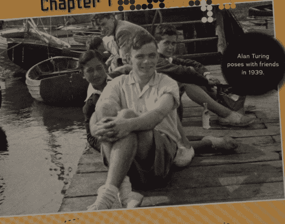

数学家艾伦·图灵证明了思想可以像武器一样强大。他将自己的数学和科学才能与报效国家的热情结合起来，找到了帮助英国及其盟国赢得第二次世界大战（1939—1945）的方法。

艾伦于1912年6月23日出生在英格兰伦敦。艾伦的父母很快返回印度，艾伦的父亲在那里为政府工作。艾伦和弟弟没有与父母同住。兄弟俩与家庭朋友住在一起，在英格兰长大。

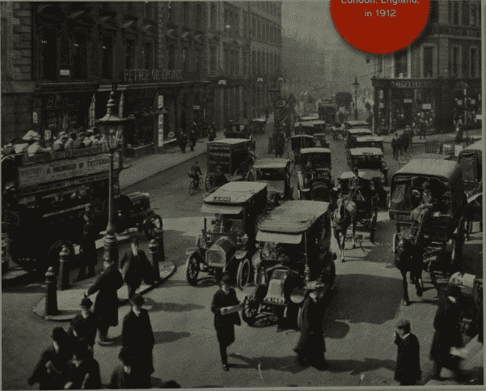

1912年的英格兰伦敦

艾伦九岁时开始就读于苏塞克斯郡的黑兹尔赫斯特寄宿学校。他在那里生活学习。艾伦热爱数学和科学，大部分空闲时间都在思考这些科目。他甚至自己做化学实验。但他的能力常常不被老师和同学认可。


艾伦的弟弟约翰也曾在黑兹尔赫斯特上学。

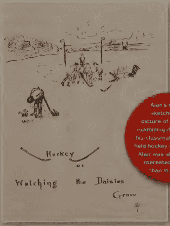

艾伦尤其对植物着迷。艾伦的母亲画了一幅素描，画中他本该和黑兹尔赫斯特的同学一起打曲棍球，却凝视着雏菊。艾伦还喜欢读埃德温·坦尼·布鲁斯特写的《每个孩子都应该知道的自然奇观》。这是一本著名的科学书，涵盖了生物之间的相似之处和差异。

艾伦的母亲对儿子如此喜欢科学并不高兴。科学在当时不被认为是年轻英国绅士应该学习的合适课程。当时的学校重视拉丁语和英国文学等科目。她担心他离开黑兹尔赫斯特后无法进入好学校。

### 难教的学生

他的母亲没有理由担心。十三岁时，艾伦被谢伯恩学校录取，这是一所备受推崇的英国学府。在那里，他继续独自钻研对科学的兴趣。他读了阿尔伯特·爱因斯坦的广义相对论。该理论是爱因斯坦关于引力如何运作的观点。他说物体会根据其质量大小弯曲时空。引力就是这些弯曲的结果。尽管该理论性质复杂，但艾伦关于这一主题的笔记证明他理解了它。

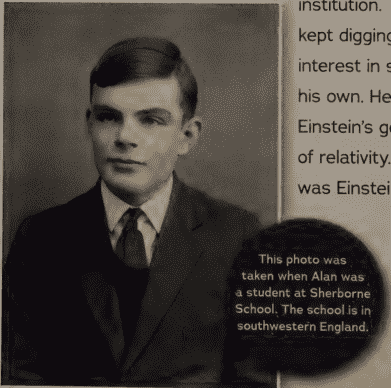

艾伦显然很聪明。但他的老师们没有看到这一点。他们称他的学业马虎草率，而且他在某些科目上落后太多，几乎不被允许参加期末考试。

### 证明自己

但艾伦参加了考试。他通过考试并从谢伯恩学校毕业。然后他去了剑桥大学国王学院。那里的老师更能接受他对数学和科学的兴趣。他开始思考更复杂的数学概念，例如**统计学**。不学习时，图灵通过划船、帆船和跑步来清空头脑。

1934年毕业后，图灵留在学院担任**研究员**——在学院工作的学者。他研究**概率**论。这一数学分支涉及随机事件发生的可能性。1936年，图灵因在概率论方面的工作获得剑桥大学史密斯奖。


图灵在国王学院期间跑步娱乐，也参加比赛。

## 第2章：密码破译

有一天，图灵外出跑步时，想到了一个他必须写下来的想法。他认为也许有可能建造一台能自行解决数学问题的计算机器。

图灵想象他的机器阅读一组解决数学问题的指令。这些指令会写在一段纸带上。纸带上有方格。有些方格是空白的。其他方格标有1或0等字符。机器会读取纸带上的数字，并能够计算难题的答案。

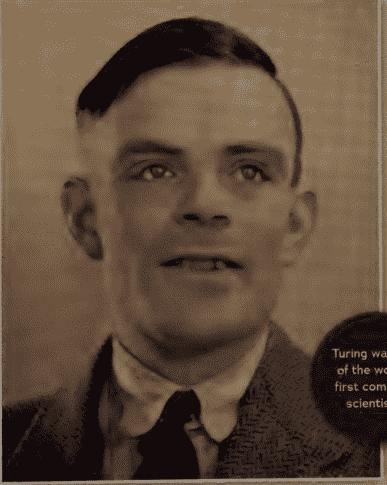

图灵设想的机器是一个思想实验。他并不认为它真的能被建造出来。他独自工作，没有意识到其他数学家也在研究类似的想法。

1936年，图灵发表了一篇关于数学问题的论文。为了解决这个问题，他写到了一台计算机器。这篇论文首次解释了如何为这样的机器编程。他当时并不知道，这篇论文将在数学界具有开创性。

### 为战争做准备

发表论文的同一年，图灵开始

### 计算机先驱

图灵关于计算机器指令的想法是现代计算机语言的基础。大多数计算机语言会被机器翻译成一系列1和0，称为二进制代码。通过读取二进制代码的顺序，计算机可以遵循复杂的指令。


就读于新泽西州的普林斯顿大学。他学习了数学，后来又学习了**密码学**。他对密码学的兴趣源于20世纪30年代令人恐惧的时事。

普林斯顿大学是美国历史最悠久的大学之一，于1746年开始招收学生。

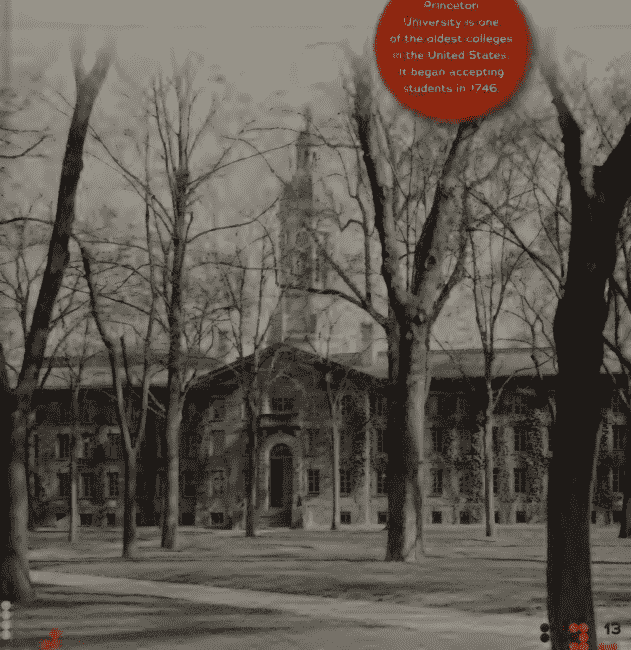

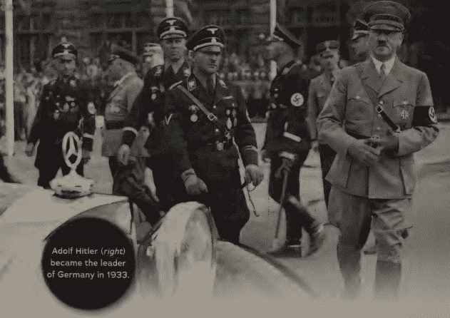

阿道夫·希特勒（右）于1933年成为德国的领导人。

图灵在国王学院和普林斯顿学习期间，阿道夫·希特勒上台成为德国的独裁者。希特勒和纳粹党计划通过军事力量向其他国家扩张。英国很可能与德国开战。与欧洲和世界各地的许多人一样，图灵也感到害怕。但他知道，密码学知识在战争中可能很有用。

1938年，图灵从普林斯顿毕业。普林斯顿大学向他提供了一个职位，他本可以留在美国。但他选择回到剑桥，随后开始在政府密码学校工作。这其实不是一所学校，而是一个创立于第一次世界大战（1914–1918）期间的秘密密码破译组织，负责收集敌方情报以保护英国的安全。

德国人对其军事信息进行**加密**，防止敌人读到这些信息并了解其计划。1938年，波兰的一个数学家团队设计了一台名为Bomba的机器。它能**解密**密码，让数学家们解锁并读取德国军方编写的整条加密信息。只要德国人每天创建信息时遵循某种固定模式，它就能正常工作。

没过多久，德国人改变了密码的生成方式，Bomba无法再破解它们。但Bomba仍将被证明是有用的。它将成为图灵在第二次世界大战期间密码破译工作的重要组成部分。

### 技术谈

> “图灵基本上发明了软件的概念。真正重要的发明其实是软件。”
>
> ——弗里曼·戴森，物理学家

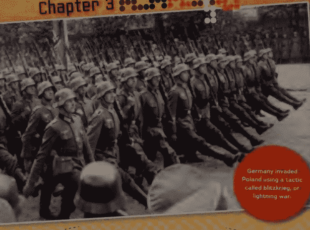

## 制造Bombe

1939年9月1日，德国入侵波兰。两天后，法国和英国对德宣战。第二次世界大战爆发了。图灵在数学和密码学方面的工作突然变得紧迫起来，成为战时行动的重要组成部分。

英国及其盟国（包括美国）希望破译德国的信息，以防止突袭。但德国人拥有一件秘密武器：恩尼格玛机。这台由德国工程师发明的机器能够加密出人类密码破译者无法破解的密码。

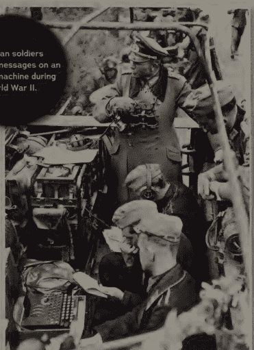

恩尼格玛机看上去与打字机相似——在计算机问世之前，人们使用这种带键盘的机器来写字。它有一个键盘和几个旋转轮。当信息在键盘上输入时，旋转轮会转动并变换字母，从而将信息打乱。这台机器能够以如此多的不同方式打乱字母，破译者根本不可能逐一尝试。而且设置每天都会更改，以生成一种全新的密码。

## 猜测游戏

图灵掌握了一些关于如何破解恩尼格玛密码的线索。

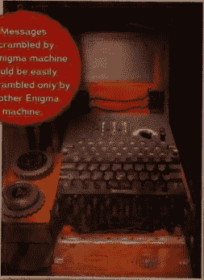

他知道德国人发送的信息中有一些单词和短语非常常见。例如，许多信息都与天气有关。像*wettervorhersage*（天气预报）这样的常用词可以被破译。这些词被称为“线索（crib）”。一条线索可以帮助解锁信息中的其余文本。

通过研究截获的德国情报，图灵还发现，恩尼格玛机绝不会把某个字母加密成它本身。在被打乱的信息中，这个字母总会变成另一个不同的字母。德国人故意让机器以这种方式工作，认为这样会使信息更难被还原。但知道“字母永远不会被编码成它本身”这一点，正是图灵用来构造线索的依据。

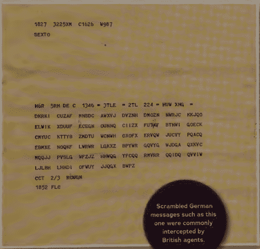

```
1827 3225?M 41626? 4981
SEXTO

HÖR? D?R? D?C - 1346 - ?TL? - 2?L 224 - H?W X?...
DKSR? CUZ?F? B?DC? - ?D?D? D?Z?H D?ON?K JCK?GO
E?W?K XDJ?F E?G?N O?N?Q C?L?X F?D?R BT?W G?E?CK
C?Y?K K?T?F G?D?P W?C?H? Q?X?F E?Y?U V?C?Y P?C?Q
E?B?E N?Q?K L?W?R L?G?KZ BP?WR G?Y?G W?G?A Q?X?Y
R?O?J P?S?L W?Z?J? H?H?G Y?C?Q R?N?R Q?I?Q? Q?S?H
L?L?H L?H?D Q?F?W J?G?X Q?W?T

CCT 2/3 R?G?N
1852 F?L?
```

> “像这样被打乱的德国信息常常被英国特工截获。”

这些线索帮助图灵对恩尼格玛密码的破解方法做出有根据的猜测。这些零散的信息帮助他在脑海中形成了一个数学解决方案。但仅凭这些还不足以破解密码。

## 破解密码

破解恩尼格玛密码的主要障碍在于存在的可能性数量太多，破译者无法一一测试。但图灵相信，机器可以完成人类无法完成的事。

他基于波兰的Bomba建造了一台名为Bombe的机器。Bombe由转子和开关组成，相当于36台恩尼格玛机同时工作。这些部件快速运转，测试成千上万种不同的字母组合。

### Bombe

Bombe是一台巨大的机器。它大约7英尺（2.1米）宽、6.5英尺（2米）高，重约1吨（0.9公吨）。它使用了12英里（19公里）长的线路，包含九万七千个零件。

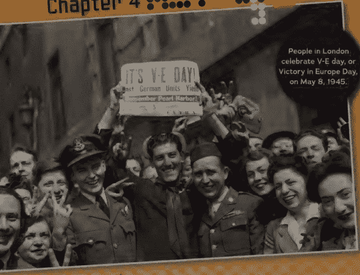

1945年5月8日，伦敦民众庆祝欧洲胜利日（VE Day）。

## 战后

1945年，第二次世界大战以德国的失败告终。Bombe在这场战争的结果中发挥了重要作用。被Bombe破译的信息揭示了敌军的动向和计划。一些专家认为，如果没有图灵的Bombe，战斗还会再多持续两年。他们估计，将会有两百多万人在战争中丧生。

英国认可了图灵的贡献。他被授予大英帝国勋章官佐（OBE）称号。战后，他继续在自己的领域工作。在伦敦的国家物理实验室，图灵设计了“自动计算引擎”（ACE）。这是首个能够存储数字程序的计算机设计。

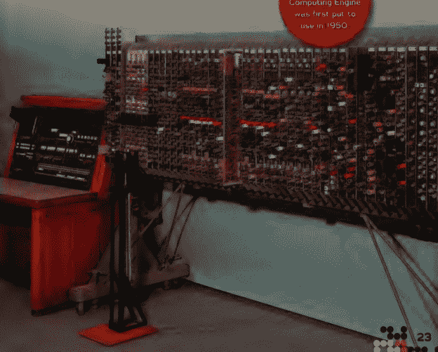

图灵的自动计算引擎于1950年首次投入使用。

## 图灵测试

1948年，图灵成为曼彻斯特大学计算机器实验室的副主任。在那里，他提出了关于计算机软件和人工智能的想法，并创造了图灵测试来研究人工智能。

图灵测试是一项实验，目的是判断计算机的人工智能是否真的能独立思考。一名担任裁判的人会在电脑屏幕上收到信息，有的来自另一个人，有的来自计算机。如果裁判至少有一半时间误以为计算机生成的信息来自人类，那么就可以认为这台计算机具有智能。图灵测试的各种形式至今仍被用来评判计算机的思维能力。

### 技术谈

> “如果一台计算机能欺骗人类，让人类相信它是人，那么它就配得上‘智能’这个称号。”
>
> ——艾伦·图灵

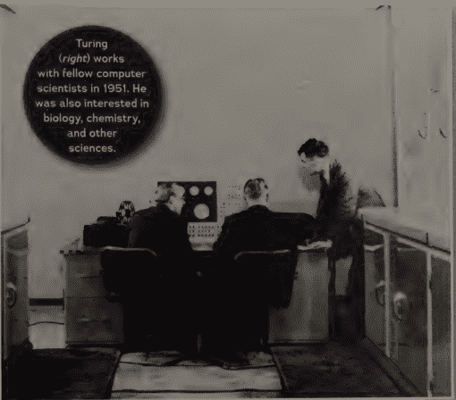

## 最后的贡献

1952年，图灵将注意力转向生物学以及事物的生长方式。他对这个领域的兴趣可以追溯到童年时期，那时他曾对植物非常着迷。成年后，他提出了新的想法，用数学方式解释生物体中的图案是如何形成的。他发表了一篇论文阐述这些想法，重点研究了雏菊。

大约在这段时间，图灵的工作被打断了。在20世纪50年代的英国，身为同性恋是违法的。图灵是同性恋。1952年，他因身为同性恋这一罪名被定罪。他失去了安全许可，不能再为政府从事密码学工作。

## 离世与荣誉

1954年6月，图灵因氰化物中毒去世。许多人认为他是自杀，但他的死也可能是意外。图灵经常在家中的实验中使用氰化物，他可能是误吞了毒药，或是误吸了毒气。

图灵去世后，英国政府承认，他当年因一项罪名被定罪时曾遭到不公正对待。

### 技术谈

> “我相信，到[二十]世纪末，词语的用法和受过教育者的普遍看法将会发生如此大的变化，以至于人们谈论机器思考时，不必担心遭到反驳。”
>
> ——艾伦·图灵


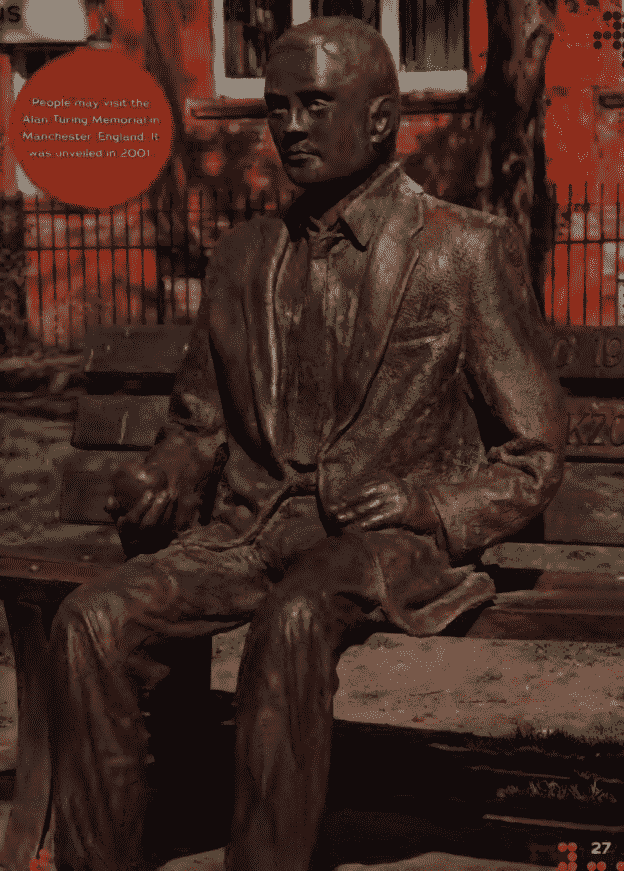

人们在英国曼彻斯特的“艾伦·图灵纪念碑”前祈祷。该纪念碑于2001年揭幕。

2009年，英国首相戈登·布朗代表政府向图灵正式道歉。2013年，伊丽莎白二世女王正式赦免了他的刑事定罪。

图灵因其工作持续受到尊敬和推崇。他帮助世界免遭纳粹侵略，并激发了数学、科学和技术领域的新思想。

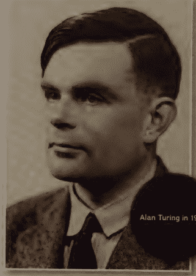

## 时间线

- **1912年**——艾伦·图灵出生。
- **1934年**——图灵从国王学院毕业。
- **1938年**——图灵从普林斯顿大学毕业。
- **1939年**——第二次世界大战爆发。
- **1945年**——第二次世界大战结束。
- **1950年**——图灵提出图灵测试。
- **1952年**——图灵因同性恋被定罪后失去安全许可。
- **1954年**——图灵去世。
- **2009年**——英国首相正式向图灵道歉。
- **2013年**——伊丽莎白二世女王正式赦免图灵。

## 资料来源注释

- 15. 乔尔·阿肯巴赫，《〈模仿游戏〉没有告诉你的图灵最大成就》，*华盛顿邮报*，2015年2月20日，http://www.washingtonpost.com/national/health-science/what-imitation-game-didnt-tell-you-about-alan-turings-greatest-triumph/2015/02/20/ffd2016b-6b06-11e4-9423-f3d0a1ec335c_story.html?utm_term=bfb1ad33b44c。
- 24. S. 巴里·库珀，《艾伦·图灵：“我正在建造一个大脑。”半个世纪后，它的后继者击败了卡斯帕罗夫》，*卫报*（美国版），2012年5月14日，https://www.theguardian.com/uk-the-northerner/2012/may/14/alan-turing-gary-kasparov-computer。
- 26. 《Quora问题：智能机器能模仿意识吗？》，*新闻周刊*，2016年12月25日，http://www.newsweek.com/quora-question-can-machines-become-sentient-535030?amp=1。

## 词汇表

- **密码学**：研究信息编码或解码的科学
- **破译**：将代码转换为普通文本
- **加密**：将普通文本转换为代码
- **研究员**：在学院工作的学者
- **概率**：某事发生的可能性
- **统计学**：对大量数值数据进行科学研究的学科

## 更多信息

### 图书

- 特里·伯罗斯。*密码、暗号与制图学：数学走向战争*。明尼阿波利斯：勒纳出版公司，2018年。探索数学如何在战场上使用。
- 斯图尔特·A. 卡伦。*二战间谍与特工*。明尼阿波利斯：勒纳出版公司，2018年。进一步了解第二次世界大战期间的密码与秘密。
- 瑞安·纳格尔豪特。*艾伦·图灵：破译密码大师*。纽约：PowerKids出版社，2016年。进一步了解图灵在第二次世界大战期间的工作以及计算机发展方面的工作。

### 网站

- **艾伦·图灵事实与传记**  
    http://www.facts-about.org.uk/famous-people-facts-starting-with-a/alan-turing.htm  
    进一步了解艾伦·图灵的生平。
- **学数学**  
    http://www.thirteen.org/get-the-math  
    访问此网站，进一步了解数学及其实际用途。
- **美国国家安全局——密码机图片库**  
    https://www.nsa.gov/resources/everyone/digital-media-center/image-galleries/cryptologic-museum/machines  
    查看Bombe（图灵炸弹机）和其他编码机的图片。

## 索引

- 自动计算引擎，23
- Bomba（波兰炸弹机），15、20
- Bombe（图灵炸弹机），16、20–23
- 计算机器，10–12
- 计算机器实验室，24
- crib（已知明文提示），18–19、21
- 氰化物，26
- 阿尔伯特·爱因斯坦，8–9
- 伊丽莎白二世（女王），28
- 恩尼格玛密码机，17–20
- 政府密码学校，15
- 黑兹尔赫斯特，6–8
- 阿道夫·希特勒，4
- 国王学院，9、14
- 国家物理实验室，23
- 大英帝国勋章官佐勋衔，23
- 波兰，15–16
- 普林斯顿大学，13–14
- 舍伯恩学校，8–9
- 史密斯奖，9
- 剑桥大学，9
- 曼彻斯特大学，24
- 第一次世界大战，15
- 第二次世界大战，5、16、22

## 关于作者

希瑟·E. 施瓦茨已为儿童创作了六十多本非虚构类图书。她一直乐于研究并了解那些对自己所做的事情充满热情的人，比如艾伦·图灵。

牡蛎湾-东诺里奇公共图书馆  
东主街89号  
纽约州牡蛎湾 11771  
(516) 922-1212

7120-0(5/18)

2018年5月25日


你是否曾希望自己能成为英雄来帮助自己的国家？艾伦·图灵小时候就对数学和科学着迷。后来，图灵的数学技能帮助英国赢得了第二次世界大战。

图灵的父母和老师认为，他最好放弃数学，转而学习更符合绅士身份的人文学科，比如文学和拉丁语。但他坚持了下来，到1939年第二次世界大战爆发时，他已准备好迎接国家面临的最大挑战：纳粹德国。图灵运用自己高深的数学知识来破译德国秘密信息。他的思想不仅帮助英国扭转了战争局势——还为现代计算和人工智能的许多方面奠定了基础。

## STEM 开拓者：人物小传

- 航空航天工程师艾普丽尔·埃里克森
- 另类实境游戏设计师简·麦戈尼格尔
- 动物学家和活动家珍·古道尔
- 宇航员和物理学家萨莉·莱德
- 宇航员埃伦·奥乔亚
- 宇航员梅·杰米森
- 天体物理学家和太空倡导者尼尔·德格拉斯·泰森
- 密码破译者和数学家艾伦·图灵
- 计算机工程师鲁奇·桑格维
- 计算机科学家简·巴蒂克
- 环保活动家旺加里·马塔伊
- 环境科学家蕾切尔·卡森
- Facebook创始人兼互联网企业家马克·扎克伯格
- Flickr联合创始人兼网络社区创建者卡特里娜·费克
- 遗传学家安吉拉·阿伦茨
- 谷歌网络安全专家帕里萨·塔布里兹
- 谷歌眼镜与机器人技术创新者塞巴斯蒂安·特伦
- GoPro发明者尼克·伍德曼
- 发明家、工程师和物理学家尼古拉·特斯拉
- iPod与电子产品远见者托尼·法德尔
- 火星科学实验室工程师戴安娜·特鲁希略
- 数学家和计算机科学家格蕾丝·霍珀
- 《我的世界》创作者马库斯·“Notch”·佩尔松
- NASA程序员凯瑟琳·约翰逊
- NASA数学家凯瑟琳·约翰逊
- 任天堂电子游戏设计师宫本茂
- 核物理学家吴健雄
- 编程先驱阿达·洛芙莱斯
- 科学教育家和倡导者比尔·奈
- 太空工程师和科学家玛格丽特·汉密尔顿
- SpaceX与特斯拉汽车工程师埃隆·马斯克
- 超级水枪发明者朗尼·约翰逊
- 理论物理学家布赖恩·格林
- 理论物理学家斯蒂芬·霍金
- 城市生物学家丹妮尔·李
- 疫苗创新者与太空科学家
- YouTube创始人陈士骏、查德·赫利和贾德·卡林

