# 代码破解者：激发创意、重塑评估，并培养一批编程忍者！

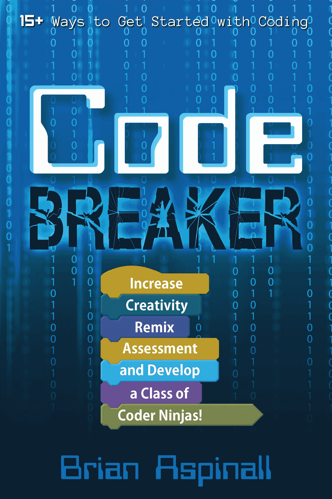

“Brian Aspinall 为编程注入了人性的色彩，帮助读者理解——它不仅仅是为电脑极客设计的，还可以以有意义的方式在所有年级中实施，帮助我们以不同的方式看待世界。”

** — George Couros，《创新者思维》作者 **

“Brian Aspinall 通过各种实用的案例，充满激情地为在所有课堂中推广编程和计算思维辩护其必要性。这不仅关乎编写几行代码或放置代码块，更关乎让学生使用 `Scratch` 和 `Minecraft` 等现代工具，以新颖且有趣的方式思考课程。这本书是写给每一个曾问过‘我为什么要关心编程？’的人的。在读完那个关于‘拉便的宝宝’的故事后，你将明白原因了！”

** — Matthew Oldridge，演讲者、作家及数学教育工作者**

“对于任何希望将编程深度融入课程、而不仅仅局限于[#编程小时](https://twitter.com/hashtag/HourofCode)的人来说，这本书都是必读之作。Brian 不仅对我们如何在课堂上看待编程提供了独特的视角，还分享了关于如何在学习中创新使用编程的深刻见解，这种创新超越了学术上的成功或帮助学生为‘找工作’做准备。书中巧妙地穿插了富有创意的课程，这是一本将激发并引导任何渴望为课堂学习注入更多创造力的人的书。”

** — Michael Cohen，演讲者、创新顾问及《设计驱动教育》（Educated by Design）作者 **

“Brian Aspinall 创建了一项宝贵的资源，它不仅能帮助教育者加深对计算机编程的理解，还证明了所有教育者如何利用计算思维的概念来塑造他们的教学法和教学实践，从而促进学生的学习。”

** — Laura Fleming，图书馆媒体专家，《创造世界》作者 **

“对于任何想了解更多关于在课堂教学编程的原理以及如何开始的老师来说，这本书是必读的。通过教学计划案示例和他与学生的个人故事，Brian Aspinall 详细解析了如何在数学、几何、代数、科学和语言艺术等许多学科领域中使用编程原则。我特别喜欢他采访其他课堂教师的章节，他们成功地教授了幼儿园年纪的学生编程！多年来，我一直佩服 Brian 的能力和决心，他能够说服老师们编程在任何课程中的重要性。阅读他的教学历程、那些影响他的人，以及他对今天课堂应 true true，是一是一种享受。”

** — Sylvia Duckworth，演讲者、技术教练及《教育者速记》（Sketchnotes for Educators）作者 **

“当我想到课堂编程时，脑海中浮出的第一个名字就是 Brian Aspinall。这本小书是你可以与他人分享的绝佳工具！技巧、故事以及更多内容让这本书不容错过！”

** — Todd Nesloney，获奖教育工作者，《孩子值得》（Kids Deserve It）合著者 **

“老师们渴望在课堂上开始学习编程，而这是一份完美的快速简易的指南！Aspinall 为我们介绍了创客教育的基础理论，并引导读者学习了有电脑和无电脑的入门编程课程。”

** — Colleen Graves，《创客空间项目大书》和《为邪恶天才天才准备的 20 个 Makey-Makey 项目》合著者 **

“Brian Aspinall 是一位典范的计算机科学老师，也是全球计算机科学界受重视的成员。在编程，尤其是关于编程周围的教学法方面，我一直认为 Brian 是我的首选专家。Brian 的书《破译者》为任何对教学编程、已经在教编程，或者广义上对教学感兴趣的人提供了一个非常有价值的背景。这本书探讨了更重要的问题‘为什么要编程？’，而不仅仅是作为另一本关于如何编程的书。我承认我不是个老读者，但 Aspinall 的书读起来非常简单且引人入胜。当你深入 Brian 的教学哲学时，那些引人入胜的部分会完全符合逻辑。在书中，Brian 创造了‘课堂参与度’一词（与课堂管理相比），这种为学生创造真正投入的环境的理念是全书的核心。深入读读，你将窥见 Aspinall 如何对教学产生兴趣的，以及他在教学和学习方面演进的方法。这本书通过他对话式的语调和幽默的叙述，让读者感觉自己与 Brian 一行在旅程中。我的意思是，这本书是从一个学生对便便的痴迷导致他精通几何和编程的故事开始的。”

“我已经关注 Brian 有一段时间了，并非常喜欢他的作品。我很高兴能视他为同事、榜样和朋友。Brian 一直平易近人，并愿意就与他的（以及我的）激情相关的讨论进行交流。他的书为他的教学方法以及作为一名优秀教育者的演变提供了完美的概述，这并不意外。这本书充满启发性，就像作者一样。他的热情从纸面上溢出来，当你阅读时，你会感到自己作为老师和学生正在发生转变。Brian 的编程世界观带我们离开了许多人对编程的分析性的、机器人式的思考，进入了为什么编程和问题解决在教育中如此重要的人性、逻辑层面。赞感谢 Brian 让他通过写作展现了真实的自我。无论你对编程感兴趣，还是仅仅对教学法以及让学生参与学习过程的观点感兴趣，这都是一本必读之作。”

** — Steven Isaacs，老师、Minecraft 导师及 Minefaire 制作， **

## 增加创造力，重塑评估，培养一班编程忍者！

### Brian Aspinall

关于作者

向出色的 Meagan Gillmore **[致敬](https://twitter.com/hashtag/ShoutOut)**！你拥有一项将人们的思想付诸印刷的独特天赋。我感激不尽。

# 前言

还记得我们以前经常去图书馆获取信息吗？在很多方面，我想我们现在仍然这样做。重点是，我们生活在一个获取便捷的时代。基于知识的问题答案存储在数据库中，只需点击按钮即可快速检索。

过去并非总是这样。我们中的一些人记得互联网之前的世界。我们中的许多人已经忘记了。但即使在信息时代到来，早在 20 世纪 60 年代，教育工作者就开始通过运动活动教授孩子们编程。瑞吉·艾米利亚（Reggio Emilia）通过基于游戏的学习启发了数百万人，而我个人的英雄之一西摩尔·帕帕特（Seymour Papert）曾用机器人乌龟教授几何。

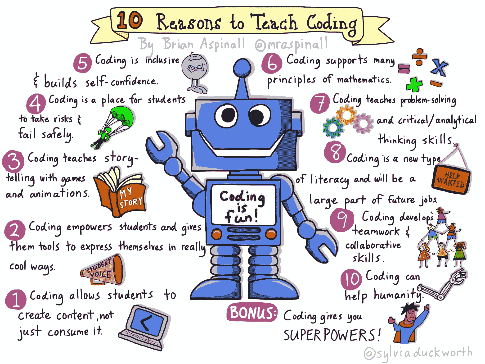

我是许多人所说的自学型编程人员。我记得 20 世纪 90 年代初，在观看父亲编写网页软件后，学习 `HTML` 和 `JavaScript` 的美好时光。

在那个年代的末期，千年虫（Y2K）几乎毁掉了一切。对于安大略省北部的一家大型矿业公司来说，我的叔叔进行了批判性思考，并编写了软件将他们从回到过去。想象一下，一个价值数百万的企业运行在一个人的想法和创意之上，只为了不让跳动的计算机时钟翻回到 1900 年。在开启新世纪的核心，是一个人、一台机器、一个想法。尽管他并不炫耀这段经历，但这个庞大的组织在那些修正后的代码行上运行非常顺畅。他甚至没有要求升职。

# 第一章

## 臭臭的清晰

一个正在拉便的宝宝向我展示了我想要的教学方式。

那是我教 8 级班的第一年，这并不完全是我的理想工作。作为世纪世纪 90 年代的青少年，我喜欢学习基础的 `HTML`，并在加拿大安大略省的温莎大学获得了计算机科学本科学士学位。当我从同样位于温莎大学的师范学院毕业时，我希望在高中教授数学和计算机科学，但像许多新毕业生一样，我抓住了当地任何可用的工作。那不是高中、不是数学或计算机科学，但那是一份工作。

但我无法戒掉编程的“瘾”。我决定成为老师，部分是因为我在儿童暑期科技营担任导师的经历。我想在学校期间与学生们分享同样的热情，于是我办了一个课后计算机编程俱乐部。学生们学习使用 `Scratch` 编程，这是由麻省理工学院（MIT）的 Mitch Resnick 开发的程序。今天看来，每个对教孩子编程感兴趣的人都在使用 `Scratch`，但在 21 世纪 00 年代中期，那是“编程小时”（Hour of Code）等活动发起之前的几年。该软件必须安装在每台电脑上，因为它不像现在这样是基于 Web 的。我要学习的内容和学生们一样多！我在大学期间用过 `Java`，并教过 `HTML`，但我从未像在 `Scratch` 中那样将代码块连接在一起。我在该程序的经验上可能有所欠缺，但我用热情弥补了这一点。我全身投入教授学生循环和变量，他们很快就学会了。

许多同事并没有那么兴奋。他们并没有明确阻挠我办俱乐部；他们只是对将计算机编程作为教学工具表示怀疑。

也许我也有一点点怀疑。我的性格不适合工作单或死记硬背。我在计算机科学课程上表现得很好，部分是因为我从来不需要记忆语法。尽管如此，我知道标准的教学实践倾向于记忆和死记硬背。我也知道，要向某些人展示编程的价值需要创造力。

我的一个学生 Jaime 在他决定编写他的第一个游戏时，展示了这种至关重要的联系。他将其命名为“拉便的宝宝”。这个游戏涉及一个婴儿在屏幕上移动并不断发射粪便导弹，但它远不止是一个博人取笑的段子：它是我们几何课程的应用。要让宝宝向左移动，学生必须将 `X` 变量改为负数。让宝宝向上或向下需要改变 `Y` 变量。在宝宝发射粪便导弹之前，必须先绘制出正确的 `X` 和 `Y` 坐标。在游戏中，我在纸上教导的概念在屏幕上变得生动了——尽管是用粪便的形式！


## 特色文章

#### 喧闹！为原住民编写一个概率游戏


###### [`brianaspinall.com/hubbub-coding-a-aboriginal-game-of-chance`](http://brianaspinall.com/hubbub-coding-a-aboriginal-game-of-chance)


最棒的部分是 Jaime 玩得开心，他可能并没有意识到自己正在掌握几何技能并满足了学校的课程预期。但我清楚。我看到了他的作品，看到了我想要成为的那种老师。我想让学生将课程预期视为技能，我希望他们像这个学生制作游戏一样获得这些技能——通过发挥创造力、承担风险、犯错并接受反馈。设计了“拉便的宝宝”的学生看到了世界中的模式，并将所看到的应用于为解决真实问题创造真正的解决方案。

看着 Jaime 编写他的第一个游戏，让我想起了我 11 年级的媒体研究老师 Boudreau 女士，她曾让我为一个关于流行偶像的演示制作网站，而作业原本要求我做一张海报。那时，我想最大的困难将是说服她一个关于图帕克（Tupac Shakur）的网站是适合的。我可能永远无法确切她对我的音乐口味怎么想，但我知道她让我以创意的方式探索我的兴趣这一决定，为我开启了这个学生游戏的道路。因为 Boudreau 女士答应了我，我知道我不能拒绝 Jaime 和他的“拉便的宝宝”游戏。学习，就像游戏的内容一样，是混乱的！


## 特色文章

#### 使用 Python 掷硬币


###### [`brianaspinall.com/coding-probability-simulators-with-python-csforall`](http://brianaspinall.com/coding-probability-simulators-with-python-csforall)


这个学生是我最大的老师之一。他激励我去学习更多关于计算思维和编程如何在课堂以及跨学科中使用的知识，以及它如何造学生学生终生。

我希望这本书能帮助你看到计算思维的理论如何应用到你的课堂，无论你是否像我一样是一个计算机科学极客。我希望你能够思考并反思你自己的教学法，或许也可以对其提出挑战。`Hello World` 并不是一本操作手册。你是你，我是我。我不了解你的学生。在我的课堂上有效的方法在你的课堂上可能无效，这没关系。你可能也有一些东西可以教给我。伟大的老师是那些不断学习的人。

小时候，我的爷爷（Poppa）是我最喜欢的老师之一。他教我如何混合化学品，如何改变变量并观察不同的结果。这种发现发现的方法在许多方面与编程相似：尝试、观察、再次尝试、失败、再次尝试、成功。我希望数学课也能那样。爷爷还是一名地质学家，他教我如何识别旁黄和其他矿物。他这种亲身实践的学习方法至今仍指导着我的发现与教学实践。

你即将读到的故事基于我观察到、感知以及获得的信息。任何错误都是我个人的。让我们一起开启这段旅程吧。


## 特色文章

#### 孩子们应该编程的 10 个理由


###### [`brianaspinall.com/10-reasons-kids-should-learn-to-code`](http://brianaspinall.com/10-reasons-kids-should-learn-to-code)


# 第 2 章：翅膀与帕珀特

这里有一个秘密：这本书并不属于我。

当然，我的名字在上面，作为作者以及诸类的。但你即将读到的任何内容并非纯粹的原创。像所有老师一样，我我也是一名学生。我有机会学习计算机科学和教学（教学是一门艺术吗？是一门科学吗？两者都是？这种争论有帮助吗？）。在分享更多关于我个人的教学方法——包括为什么我认为我们应该教学生计算思维、技术在课堂中的作用等等——之前，我需要解释一些塑造了我对教育理解的理论。别担心——我会写得很短的。


## 特色文章

#### 编程剪刀石头布


###### [`brianaspinall.com/coding-rock-paper-scissors-to-teach-probability`](http://brianaspinall.com/coding-rock-paper-scissors-to-teach-probability)


在过去的十几年里，教育理论发生了重大的转变。许多学习空间已经从安静的排排变成了喧闹的中心。我们曾认为，管理良好的教室就是安静的教室。包括我在内的好几个人正在质疑这一假设。我不认为这些态度以及由此产生的教学方式，有助于培养出我们希望学生成为的那种学习者：冒险承担者、合作者和批判性思维的思考者。事实上，我认为这些“传统的”（如果找不到更好的词的话）教学方法实际上在阻碍这种学习者的培养。

在教育需要如何改变的这一信念上，我并不孤单，我的想法也不新鲜。理论家们几十一直在讨论这些观点了。

考虑一下让·皮亚杰（Jean Piaget），他是 20 世纪最有影响力的儿童心理学家之一，“建构主义”之父。我们中的许多人必须在教育课程中学习过他的理论，这非常有道理！他的理论试图描述个体（尤其是儿童）如何根据他们对世界的经验与对世界的想法之间的互动，来为世界赋予意义。其他人的建构主义理论研究了个人与社会的互动如何影响他们对世界的理解；这通常被称为“社会建构主义”。皮亚杰在很大程度上关注个体和遗传组成。他想知道个体与自身的互动如何影响他们对现实的理解。他对这个问题如此着迷，以至于通过观察自己的孩子来帮助发展他的理论。

我非常看重皮亚杰理论中的许多点。例如，他强调了游戏在教育中的作用。他关于我们如何回应知识的观点也很有帮助。他谈到了知识的“同化”（assimilation）与知识的“顺化”（accommodation）之间的区别。当我们同化知识时，我们将新学到的新事物整合进目前对世界的理解中，但并不改变我们理解世界的框架。顺化则不同。我们学习了新事物，但我们改变了自己的世界框架来适应这些新信息。结果，我们对世界的观点随着我们学习的内容不断变化，使我们将失败视为学习和成长的机会。这可以帮助我们冒险并创造性地思考，因为我们知道失败不会粉碎我们的世界的认知。我试着鼓励我的学生这样思考。

但我对皮亚杰理论在课堂中的某些其他应用并不那么热情。他花费大量时间关注儿童的个体发展，甚至将其分为不同的阶段。这些阶段可能帮助父母和老师更好地理解儿童的进展，识别他们在哪些方面擅长，哪些方面可能需要帮助。我们在课堂设计和教学的许多领域都能看到“儿童分阶段完成某些任务”这一信念的影响。例如，我们按年龄对学生进行分组。我们对他们在进入下一个年龄水平之前应该完成的内容有预期。在教育中，我们总是在为发生的事情做准备。

尽管皮亚杰的理论很有深度，我不禁在想这些基准设定是否让人们陷入了一刀切的模式。如果我们承认孩子是具有自身优缺点的个体，建构主义在简单的年龄划分之外似乎不再合理。

但我非常感激皮亚杰，因为他的理论对西摩尔·帕珀特（Seymour Papert）产生了深远影响，许多人被认为是现代人工智能之父。他于 1980 年（他去世的那一年）出版的书《脑风暴》（Mindstorms）是关于教育和帮助学生热爱学习的宝。帕珀提出了一种名为“构造主义”（constructionism）的理论，该理论认为，人们在制造——构建世界上事物时学得最好。为了实现这一点，儿童需要对自己的学习拥有一定的控制权。

Papert 认为教育应该是具体的，学生应该看到教室里的概念如何应用到教室外的生活中。他认为计算机是教授这一点的良好工具。他开发了 `Logo Turtle`，这是一个用户通过输入命令来创建线条图形的程序。如果这听起来和 `Scratch`（一种允许儿童通过组合文本块来创建角色的编程程序）很像，请不要感到惊讶。Papert 曾在 `MIT` 工作过——而那里正是 Mitch Resnick 开发 `Scratch` 的地方。

但 Papert 对计算机实验室的使用感到悲哀——将计算机以及学生对计算机的使用限制在一个特定的地点。他认为这仅仅是在用新技术应用旧的教学方法。在许多方面，他都是超前时代的。在随后的几年里，他对于有许多人采纳他的想法如此缓慢或似乎误解了这些想法而感到遗憾。但确实有人理解了它们。


其中一员就是 Jeannette Wing，她是 `MIT` 毕业生，微软公司研究副总裁。2006 年，她引入了 `computational thinking`（计算思维）这一术语，即人类思维与机器力量之间的协同。她指出，计算机的普及使得每个人学习以这种方式思考变得必要。她说，这类似于印刷机对教育的影响。那项技术让每个人学会阅读、写字和做基础数学计算变得至关重要。“计算思维是每个人的一项基本技能，”她写道。


## 特色文章

#### 什么是计算思维？


###### [`brianaspinall.com/what-is-computational-thinking`](http://brianaspinall.com/what-is-computational-thinking)


但 Wing 强调，教授计算思维等同于教授计算机编码。编码是计算思维的应用。人类可能会使用计算机来表达他们的计算思维，但她说，计算思维并不是关于计算机如何思考的——它实际上是关于人类如何思考。

Wing 概述了计算思维的许多特征。它是关于概念化的，因此它不仅仅是编码或编程。她说这是一项基本技能，而不是一种死记硬背的技能。通过 `fundamental`（基本），她的意思是每个人在社会中良好运作必须掌握的技能。`Rote`（死记硬背）是记忆或表达该技能的一种。Wing 写道，计算思维是工程和数学的核心，但她强调所有人都需要学会以这种方式思考。她说，这些想法比表达它们的产物或工具（在这种情况下是计算机）更重要。

Wing 的写作对象是学术界读者，但她希望这些想法能够在学术界之外扎根并产生影响。她特别希望教师能理解这些概念并将它们传给学生。

作为一名老师，在学习到 Wing 的文章或 `MIT` 为使用 `Scratch` 教孩子们编程而所做的工作之前，我就开始看到 Wing 想法的价值了。她的工作描述了我早已认为真实存在的东西，我正试图——并继续尝试——将其带入自己的教学和课堂中。

# 第 3 章

## 我看来是怎样的

现在我们已经涵盖了其他人的教学哲学，我想向你们介绍一下我的。以下是我的观点：

我相信我们需要改变看待教学的方式。但这并不意味着我们需要下载每一个应用，参与每一个 `#edchat`(https://twitter.com/hashtag/edchat)，并在 Instagram 上发布每一堂课作业。仅仅因为你改变了在教室里使用的技术，并不意味着你改变了对自己在教室里角色的思考。事实上，我越是思考改变我的课堂实践，我考虑技术得就越少。

“等一下！”我能听到你们在抗议。“Brian，你不是学过计算机科学吗？这本书书不就是关于这个的吗？”是的，我学过计算机科学。计算机技术帮助激励我成为一名老师。在准备课件之前，我已经在编程了。我在思考改变课堂视角时，我不怎么考虑技术的原因之一就在于此：我不需要。技术是我生活中如此寻常的一部分，我并不会意识地去考虑它。借用一个老问题：鱼能意识到自己是湿的吗？我沉浸在技术之中。

但回答你们的第二个问题：这本书不仅仅是关于技术的。这本书是关于改变我们看待 `teaching`（教学）的方式，有时这意味着意味着学习并使用新技术。

让我解释一下我通过讨论如何谈论编码来表达的意思。有很多资源可以帮助老师将编码整合到课程中，并教学生如何编码。这太棒了——事实上，这本书的末尾就有一些！但在你们跳到那些页面之前，我们需要考虑我们为什么要教孩子写代码。

我们老师自己经常自相矛盾。如今我们不喜欢“工业化教育”。我们更倾向于将教室分成学习中心和小组，而不是让学生坐在成排里。我们也在远离工作单和死记硬背。毕竟，逻辑是这样的：教学在某种程度上是关于为学生适应现实世界做准备，而那个世界包含了工作。这些工业化教学策略大部分是为了帮助学生在工厂获得工作。由于工作已经发生了变化，我们需要改变教学方式。我们需要用新技能让学生去适应新工作。

我们说应该教学生如何编码。互联网连接着一切——从字面上讲确实如此，正如不断发展的物联网所示。拥有了编码技能，学生可以获得好工作并在劳动力市场中具有竞争力。你看到我们做了什么吗？本质上，什么都没做。我们仍然认为教学的最终目标是帮助孩子找工作。我们教学的原因没有改变，改变的只是我们使用的材料。我们说我们学生自主学习，发挥创造力。然后我们给他们提供完全相同的设备，并告诉自己这种方法本身就让我们成为了富有创造力、进步的老师。这和我们给所有学生提供同样的笔记本和铅笔真的有什么区别呢？

# [`brianaspinall.com/coding-a-story-probability-quick-write-prompts`](http://brianaspinall.com/coding-a-story-probability-quick-write-prompts)


我们需要用同样的方式来教孩子编程。诚然，物联网意味着更多工作将需要编程能力。但大多数学生不会成为专业的程序员——就像大多数学生不会成为职业写作家一样。这没关系。他们仍然应该学习编程。他们仍然应该学习一种不同的思维方式，向他人传达自己的想法，并学习他人的想法。

如果我们想帮助孩子以不同的方式（也许是更好的方式）思考，我们需要鼓励他们拥有成长型思维。这意味着我们需要鼓励他们适应变化、承担风险，并从错误中学习，而不是因为犯了错就认为自己是失败者。他们必须学会沟通与协作。他们必须学会面对恐惧，而不是受困其中。我们还应该提醒自己，即使是那些成绩良好的学生也可能陷入一种拒绝成长的恐惧心态中。

### 让我们来看看两个学生

学生 A 喜欢学校，并且擅长“扮演学校”。她参与课堂讨论，并在考试的挑战中茁壮成长。学校对学生 A 来说是很得的，但她也付出了努力。事实上，她每场考试至少都会提前学习三个晚上，并在从学校回家后立即完成作业。

为什么？因为学生 A 是由成绩驱动的，她希望被告诉该做什么来达标。对她来说，获得好分等同于成功。学生 A 知道如何获得那个分数，并且她感到很成功。

学生 A 不承担风险也不进行批判性思考，因为她已经完全弄清楚了获得高分需要具备什么。偏离这条路径是不安全的，会使她的高分面临风险。留在这条路上是安全的选择。

学生 B 不喜欢学校，而且心不在焉。事实上，如果学生 B 的成绩单上恰好能拿到一个 B，那将是一个罕见的庆祝理由。这背后可能有许多原因。也许学生 B 从未被教过如何正确参加考试，所以这种以考试为中心的体系告诉学生 B 他很笨。这只是让学生 B 更容易逃避学校。他不完成作业，但这并不意味着他没有考虑过。事实上，学生 B 对失败的恐惧——感觉失败是他的唯一选择——经常让他彻夜难眠。为什么？因为学生 B 也是由分数驱动的，但他不知道如何优秀来获得那些好分。对于学生 B 来说，获得好分也等同于成功，但他不知道如何在测试和考试中表现良好。他不进行批判性思考，因为他认为学生 A 拥有所有答案，如果她已经知道了答案，他的意见就变得不重要。学生 B 不会承担风险。这不安全。

这两个学生带回了截然不同的成绩单，但他们有一个共同点——害怕尝试新事物和成长。

我们都知道有许多因素导致学生成为学生 A 或学生 B——家庭生活、母语、学习障碍、身体残疾、班级规模、学校文化和管理层等等。让我们极其诚实地说：教学中一个残酷的真相是，我们能看到所有这些因素的影响，但并不能总是对它们的成因做很多改变。我们无法和学生一起回家，但我们可以控制自己的教室。我们可以鼓励学生成长。我建议我们从改变对控制和课堂管理的思维方式开始。

教室并不是由墙壁、天花板、课桌和课程组成的。教室是由人组成的。我们要求管理人。

人会发出噪音。人会犯错。我们需要停止认为`受控`的教室就是安静的教室，而`不受控`的教室就是嘈杂的教室。教室里的音量不是衡量教师质量的标尺。嘈杂的教室不等于糟糕老师；安静的教室也不等于好老师。

作为老师，我们都希望学生符合我们的预期。我们希望他们表现良好，并促使自己做得更好。我也希望他们想要做得更好。我希望那些不情愿写作的学生能去写，而不是因为害怕搞砸或让我失望而逃避。我希望他们写，是因为他们知道我已经相信他们的能力。他们想让我开心，但不是因为害怕惹我生气。他们知道，他们写或不写的内容不会改变我对他们作为学生能力的信念。他们是投入学习的学生。


## 特色文章

#### 编写一个加拿大交互式地图


## [`brianaspinall.com/coding-an-interactive-map-of-canada`](http://brianaspinall.com/coding-an-interactive-map-of-canada)


也许我们需要将`classroom management`（课堂管理）改为`classroom engagement`（课堂参与）。我们老师的目标应该是帮助学生投入学习。这通过通过协作和讨论来实现——即发出噪音。有时这意味着观察学生工作，并对他们正在做的事提问。这意味着让他们向我们展示他们在做什么，而不仅仅由我们告诉他们该做什么。

学生的参与度很难衡量，尤其是按照目前大多数评估的方式进行时。


## 特色文章

#### 使用 Python 编写分形艺术


## [`brianaspinall.com/creating-fractal-art-using-python-ctmindset`](http://brianaspinall.com/creating-fractal-art-using-python-ctmindset)


例如，我们经常用学生快速记忆事实的能力来衡量知识。在这种观点下，更好的学生是那些能快速检索信息的学生。在这种观点下，一个好的数学学生不仅仅是背了所有乘法表的人。一个好的学生是能够非常、非常快地给出所有正确答案的人。速度是他们脱颖出的关键。

我们必须在让学生简单背诵内容和帮助他们创作内容之间找到平衡。在那个中间地带，我们必须为学生提供生成他们自己的解决方案的机会。

我们需要停止试图让孩子们适应我们的世界，相反，要拥抱他们的世界。


## 特色文章

### 使用 Makey Makey 玩打鼠游戏！


[`brianaspinall.com/makey-makey-whack-a-mole`](http://brianaspinall.com/makey-makey-whack-a-mole)


# 第 4 章：一窥我的课堂

我曾使用编程活动和计算思维的概念来教授各种学科。我们经常使用计算思维的逻辑；我们只是没有意识到自己正在做这一点。

我写了一些关于计算思维如何进入我的课程的故事。我想说，这些发生是因为我自己的知识和技能，但更多时候，是学生鼓励我尝试这样做。警告：这些并不是完善的教案。我不是一个完美的老师，这些故事反映了这一点。但我希望它们能给你提供一些灵感，关于你如何将这些概念带入课堂，以及你的学生如何鼓励你将这些想法推得远。

## 数学

计算机科学是关于学习不同的语言。第一个活动展示了如何使用计算机科学来教授读写和计算能力。记住，编码只是计算机科学的一个片段。我喜欢计算机科学是因为它可以帮助学生练习计算思维。计算思维关于分解问题并以算法、逻辑推理、调试、分析、模拟和解决问题的方式思考，这一切都可以在没有技术的情况下完成。

### 指数、数字模式与编码

*   核心概念：指数、模式、十进制、二进制、运算顺序

*   任务：向学生解释一个八位的二进制字符串是一个“字节（byte）”。

*   例如，`10111011`——每个数字都是一个位（bit）；八位是一个字节（四位是一个半字节/nibble）。

*   计算机理解机器语言（1 和 0），并必须将其转换为“人类”语言。

*   向学生展示 ASCII 表格示例。

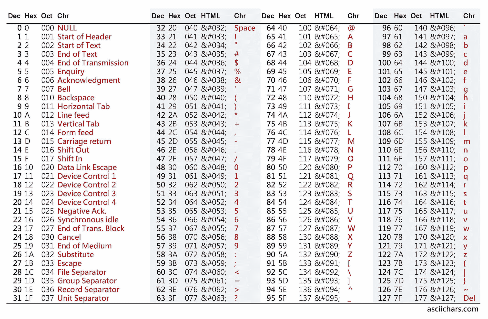

#### ASCII 表 [`www.asciichars.com`](http://www.asciichars.com)

*   为学生提供这张“代码”表或你创建的表格，让他们在下方的框中将位“分块”成八位一组的字符串（即一个字节）。

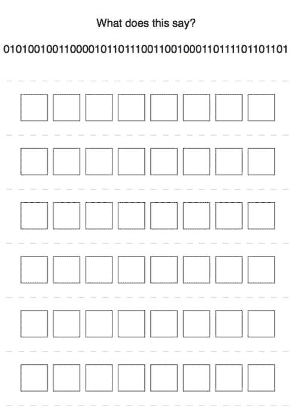

他们的工作是遵循指令——即你的课程——并将每个八位字节转换为十进制值。他们将在 ASCII 图表中查找十进制值并找到对应的字母字母。我们正在解的是一个六字母的单词（*Random*）。是的，它是区分大小写的。

一旦你对如何将二进制转换为十进制有了了基础的理解，你就可以创建一些非常独特的学习机会。你可以通过在学校里或 QR 后面隐藏二进制代码来创建寻宝游戏。也许你可能想通过将二进制“代码”融入故事让读者破译，来支持叙事性写作。

学习指数可能是困难的。这种方法可能提供一些脚手架和差异化学习的机会。你可能希望为不同的学生提供不同的二进制代码。我最喜欢这类活动的一点是，数学是完成更多事情、更伟大事情所需的技能。仅仅解决一道数学题并不是重点。数学通向其他东西。

### 使用 Scratch 教授数学

数学教科书通常以相互孤立的线索和主题教授概念。像 `Scratch` 这样的编程工具可以帮助数学课程变得“螺旋式”，让它展示数学不同领域之间是如何联系的。

`Scratch` 非常适合用于此。它基于几何原理开发，允许学生在屏幕上移动*角色*（sprites，他们在程序中创建的图形化角色），在变量中存储信息，并使用数感进行计算。

以下是我用 `Scratch` 和其他编程活动教授不同数学课程的一些方法：

### 因数

当我开始教数学时，我经常会给学生布置包含大量问题的练习题。那是我被教要那样做的。但我开始注意到一些模式，你可能在你的教室里也见过这种情况。有些学生立刻理解概念并完成所有的作业。另一些学生从未做完所有问题。

在教学生如何找到合数的因数时，我经常看到这种情况。我经常给学生给出以这些短语开头的问题，例如，“列出（某数）的因数”，或“(某数）的因数是什么？”这些问题在问学生相同的问题。

反思之后，我决定我愿意让他们告诉我寻找一个数字因数的步骤。毕竟，如果学生能够解释如何找到一个数的因数，他们就能找到任何给定数的因数。

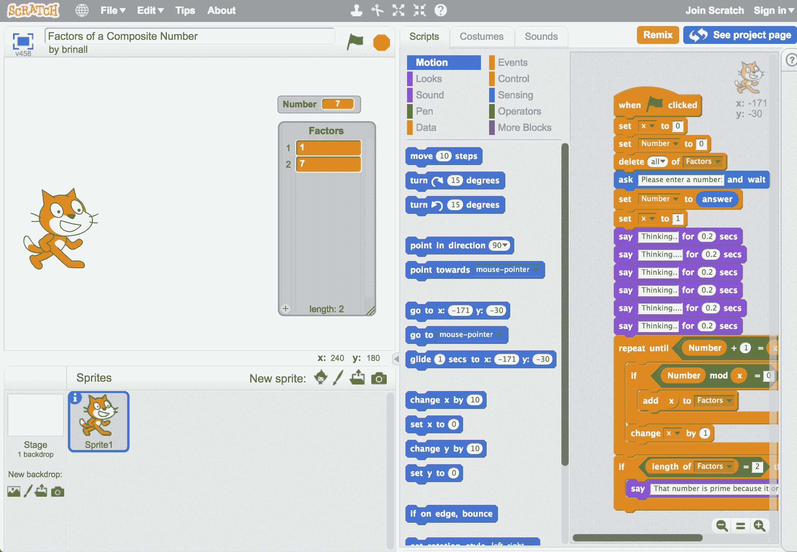

困难的地方在于：我们可以很容易在网上查到如何找到一个数的因数。一旦我们在全班写好了程序，我挑战他们将每一行代码输入到 `Scratch`，看看我们是否可以构建出一个可以寻找因数的应用程序。

这项任务为学生提供了许多切入点，让他们按照自己的水平工作。差异化学习被构建在设计中。有些学生制作了符合最低要求的程序，但另一些人扩展了范围。一个学生复制了代码，因为她想让她的程序找到最大公因数。她的程序甚至告诉我 11 是质数。

顺便提一下，让学生写出解决问题的过程在语言课上同样有效。

### 几何

我们在因数方面的经验促使我将计算思维引入几何单元。这些活动对于位置和移动特别有效。

你可以全班创建一个伪代码。它看起来像这样：


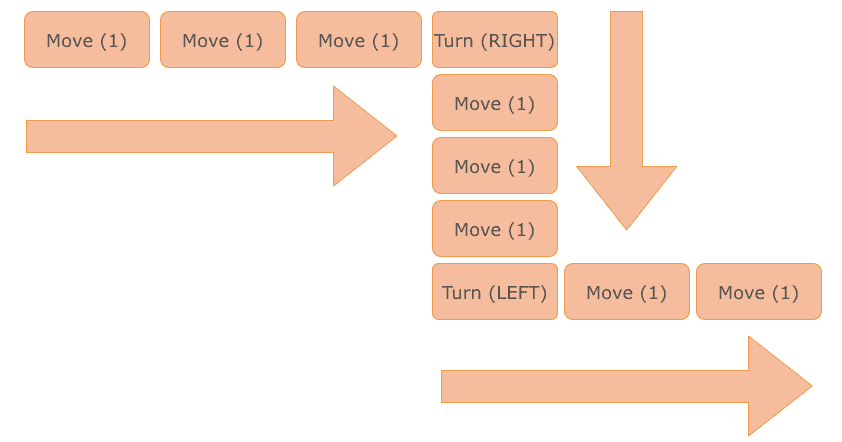

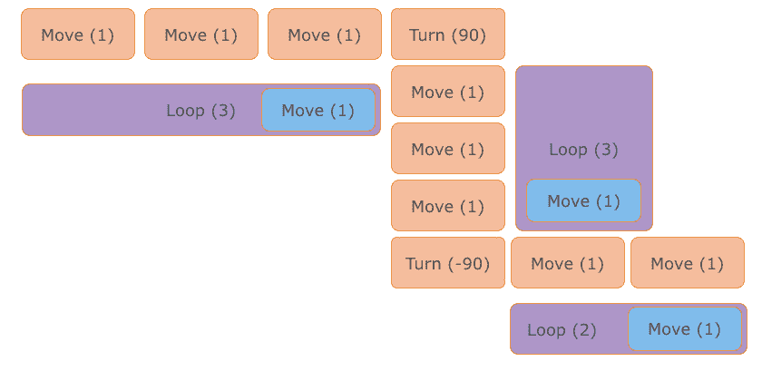

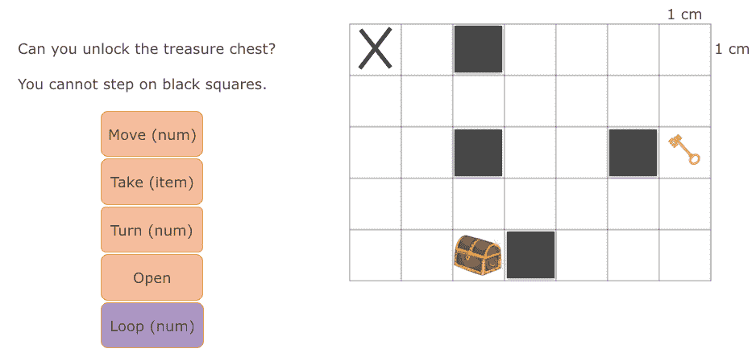

在制作全班使用的块代码语言之后，你可以利用几何原理创建独特任务。你可以挑战学生互相“编码”。让他们分成小组，指定一个学生作为机器人，作为编码员。编码员的工作是引导机器人（FriendBot）通过教室或走廊里的障碍赛。挑战他们编写让 FriendBot 向校长传递信息。

这项任务的替代方案可能包括让学生使用网格纸创建游戏。让学生有机会创建他们水平的内容来挑战朋友。

最终，目标是将位置和移动视为一种算法。

### 概率

我总是很难教授实验概率和理论概率。

在职业生涯早期，我会分发硬币并让孩子做一个 T 图表。我们掷一次硬币并记录结果。我们掷两次并记录结果。然后我们掷三次并记录结果。没有人会有百分之五十的结果，因为我们只掷了三次。然后我会要求学生掷硬币几十次并记录他们的结果。

我的目标始终是让他们通过这个过程构建他们自己的概率知识。现实中，这节课把教室变成了一个嘈杂的丛林，纸张在教室里飞舞。学生们假装在意，但并没有投入到活动中。直到一个学生提出编写一个`coin-flipping simulator`的想法，我的心态才发生了转变。我把任务交给了他，告诉他如果能办成，他就会成为一个超级明星。

在接下来的几天里，他大部分数学课时间都在忙我们今天所说的“激情项目”。他的父母报告说他在家里也在做这个项目。但直到他和朋友们在当天上课前来到学校展示最终项目时，我才意识到他对这个项目有多投入。他向我保证模拟器可以运行，我问他想用它做什么。

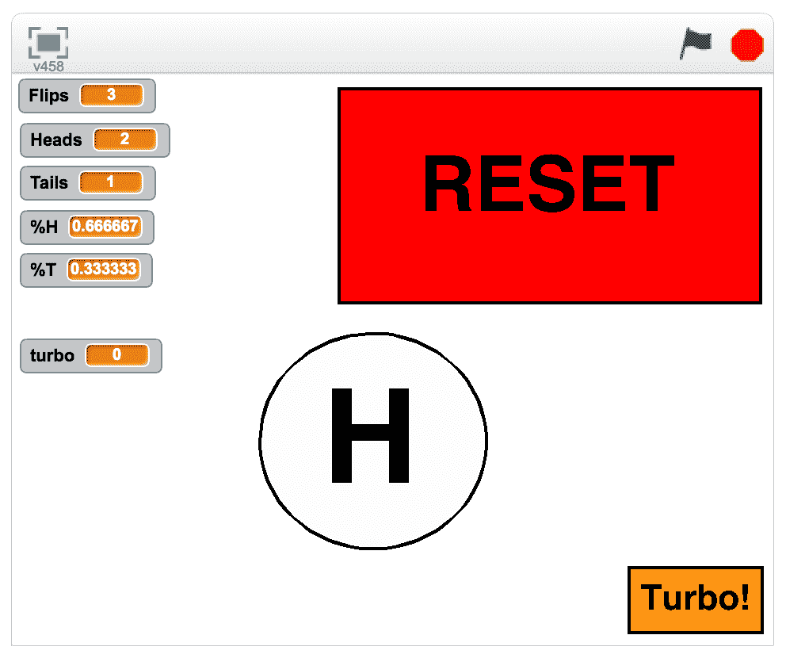

“让我们把硬币抛掷百万次吧，”他用一种坏坏的语气说道。

“好，好，”我用同样黑暗的语气回答道，“就这么。”

我把`SMARTBoard`电脑留给了他的模拟器，我们开始观察它的运行。这个故事最显著的地方在于，这些男孩对一项数学作业竟然如此投入。他们一有机会就偷看一眼。他们在休息时间留在教室，甚至在放学后留下来。遗憾的是，他的硬币抛掷器到一天结束时只完成了大约`700,000`次抛掷。但结果在小数点后第九位都是五五开的。我惊讶地看着他们，开始解释`Law of Large Numbers`。

我的解释是多的。

“行了行了，我们懂，”他们说着就回家了。


# 代数与我的世界

我们通常通过站在教室面前并在屏幕上投影图像来教授代数中的增长模式。我们利用图像来帮助讨论方程。

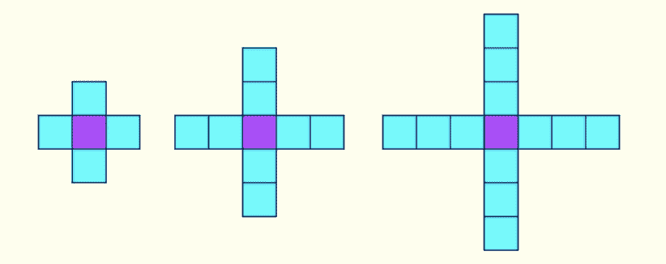

从传统意义上说，我希望学生能用语言解释这种模式是如何增长的。`Figure 1`有五个瓷砖。`Figure 2`有九块。`Figure 3`有十三块。使用这些数据，我们可以创建一个代数方程来确定每个图中有多少块瓷砖。

| 项数 | 项值 |
| :--- | :--- |
| 1 | 5 |
| 2 | 9 |
| 3 | 13 |

## 模式规则：4n + 1

问题在于：我旧式的教学法试图强迫学生像我一样看到这种增长模式。事实上，如果他们没有创建这个取值表，我会把他们的作业判为错误。

直到一个学生建议每个图实际上是一个金字塔而不是平面的，我才改变了想法。当我的受到震撼时，你能听到大脑细胞发生移动的声音。然后，那个学生建议他使用`Minecraft`按照他所看到的方式来构建这个增长模式。我立刻感到羞愧。这种模式可以以无限种方式扩展。如果学生的看法和我的不同，那没关系。我觉得，由于没有让学生通过不同的视角向我展示这个概念，我似乎辜负了之前的学生。

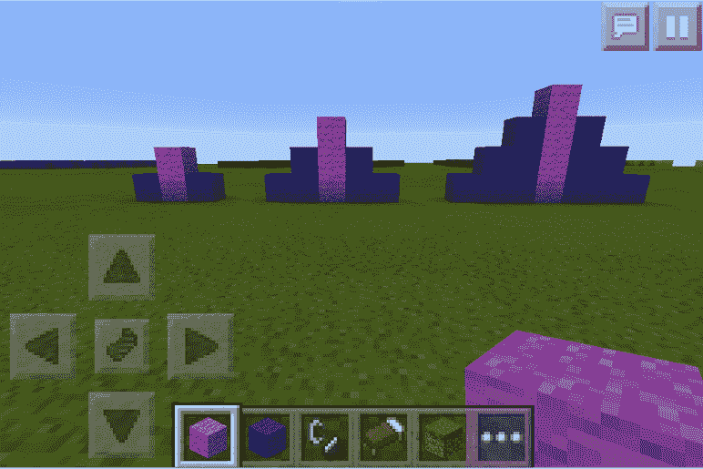

这个概念也帮助我以更深层的方式教授了空间感。我问那个学生中间的立方体是否还是金字塔中的常量，就像在平面图像中那样。我本应该预料到发生什么的。

我立刻冲回家，希望改变第二天的计划。我很快意识到，所有学习者都应该有机会按照自己的意愿设计、构建和扩展增长模式——只要他们能生成取值表和代数方程即可。我们花了大约一周时间设计了`Minecraft`游戏，孩子们在游戏中建造包含不同增长模式的城堡。玩家在进入下一个房间之前必须解决增长模式并找到正确的符号。迷宫般的场景让所有学生都能学习，因为它们自然就是为教学支架和差异化学习而设计的。

# 科学

故事中真正的老师是我的八级学生。作为一名科学老师，我一直喜欢教授`particle theory`。诚然，我并不总是用最有趣的方式来处理这个话题。我以前让学生记忆这些标准。我确定你们中的某些人可以跟我一起说：

- 粒子之间有间隙。
- 粒子之间互相吸引。
- 粒子始终在运动。
- 粒子在加热时会加速并分散。

这些都是些很常规的内容。但有一天，我见证了一个学生经历了我见过的最完美的“顿悟”时刻。当我们查看教科书时，我提到了那些波浪线，并暗示这意味着运动。我永远不会忘记接下来发生的事情。

“你是说那些粒子在动吗？”后排一个男生大喊道。

这一次，我又感到羞愧。多年来，我一直在误读`particle theory`，因为我假设孩子们知道教科书上的波浪线意味着粒子在运动。并不是的。我再次被提醒，孩子们看待世界的方式往往不同。

我让他编写代码来表示`particle theory`，而不是记忆一个列表。我希望他通过编码过程的结果来学习这个列表。

毕竟，如果他能模拟出受热后加速并分散的运动粒子，我们就大成功了。

我之前提到过`Scratch`如何利用几何原理工作，它如何帮助连接一个学科内的各个侧领域。它对于展示完全不同的学科之间如何相互关联非常有帮助。

考虑这个学生的模拟器。学生通过使用随机坐标在`Cartesian grid`上绘制点来移动粒子（科学）。

这才是跨学科的典范！

# 语言艺术

条件语句，也称为`Boolean logic`，是计算机科学的基础组成部分。它们也是我们编写过程的重要部分。这里是在小学课堂教授条件语句的一种好方法。

## 刷牙的“传统”过程

- 拿上你的牙刷。
- 拿上牙膏并在刷子上挤上小的一点。
- 将牙刷倾斜 45 度角反复刷刷，从大磨牙开始。
- 对所有其他牙齿重复第三步。
- 打开水龙头。
- 用杯子接水。
- 关闭水龙头。
- 喝水。在口中漱水。
- 吐掉牙膏。
- 清洁洗手池。

将这个过程取出来并将其拆分为模块。每个模块都是一个独立的小程序，你可以据此对小组进行脚架式教学。这里的目标是全班编写刷牙的算法。每个小组提供一个教学模块。每个模块都依赖于其他模块才能运行。

为了进一步挑战学生并教他们公平性，可以问一个额外的问题：“如果没有牙膏怎么办？”（在某人写出如何刷牙的过程之前，需要很多条件。其中之一就是牙膏。）

```
If (HaveToothpaste) -> BrushTeeth()
// BrushTeeth 是一个模块
Else (GetToothpaste)
// GetToothpaste 是一个模块
```

这个示例需要两个不同的模块或过程。扩展它们看起来像这样：

```
GetToothpaste(
  if(HaveNeighbors) -> GoToNeighborsHouse()
  // 另一个模块或过程
  else(
    if(HaveVehicle) -> DriveToStore()
    // 另一个模块或过程
  )
)
```

某些模块比其他模块更容易编写。起初用算法思维可能会困难，但做得越多，它就会变得越自然。例如，流行的棋类游戏《富翁》充满了算法。

```
if (PassGo) -> Collect $200
if (InJail)
  if(RollDoubles) -> GetOutOfJail
  else(StayInJail)
```

如果你以前没听我提过这些，请让我重复一遍：计算机科学不仅仅是编码，而编码也不应该局限于计算机课。

我意识到在某些学校里，计算机课是一门独立的课程，而且你们中的某些人只想听我关于教学编码的建议。因此，以下是我对教授编码的一些想法。我创建了一个包含四个阶段的连续模型：`BOSC`。

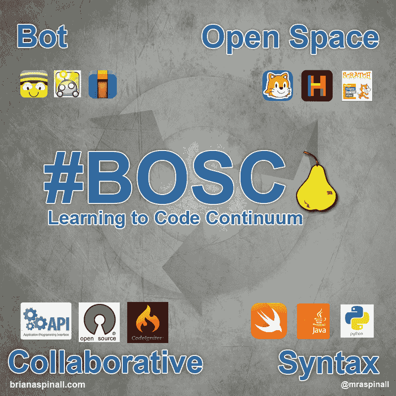

## B: 机器人编码 (Bot coding)

在机器人编码阶段，教师和学生学习块代码。他们通过运行游戏和教程让物体从一个点移动到另一个点以完成任务。关卡是脚本化的，没有开放空间，只有一组用于移动机器人的块代码指令。机器人编码是建模数学概念（如估计距离和跨网格移动）极佳之处。

## O: 开放空间编码 (Open-space coding)

在此类别中，编码者熟悉块代码并理解如何将其连接起来。使用`ScratchJr`、`Hopscotch`和`Scratch`等工具，编码者使用块代码创建游戏、故事和模拟。可能性是无限的，但编码模块受限于应用程序内部的功能。

## S: 语法编码 (Syntax coding)

与开放空间编码类似，用户从空白开始，并开始进行批判性思考、解决问题并使用语法编写应用程序。这一阶段的编码者正在学习语言。他们正在让编码语言能够独立运行起来。这为他们提供了更多创造性的机会。

## C: 协作编码 (Collaborative coding)

这一阶段的编码者对语法、计算思维和逻辑推理有坚实的理解。他们使用现有的框架和`APIs`（应用程序接口）对现有应用程序进行改进。这些编码者还利用开源资源并构建应用程序。简单来说，他们是编码忍者。

# 第 5 章：其他老师是如何做的

在本书中，我多次讨论了合作，以及学生和教师之间相互学习是多么重要。考虑到这一点，我加入了一些来自其他老师的故事，关于他们是如何将这些概念融入课堂的。我从这些教育工作者身上学到了很多，我希望你们也是如此。

## 一级编码专家

Jessica Konecny ([@MrsKonecny](https://twitter.com/MrsKonecny)) 在加拿大安大略省的查塔姆教一年级。她总是愿意尝试新事物。当她开始和学生探索编码时，我立刻产生了兴趣。我教八年级，所以我想知道在小学阶段教编码是什么样的。以下是 Jessica 在邮件采访中告诉我的：

### 是什么让你决定在一年级班级尝试编码的？

我们学校讨论了很多编码的好处，我们让八年级的学生举办了一个工作坊，教我们如何使用`Minecraft`。我是因为 Twitter 才决定尝试编码的。当时有一周专门用于[`#HourOfCode`](https://twitter.com/hashtag/HourOfCode)。


## 特色贴文

### 离线编码小时 (Unplugging the Hour of Code) 第二部分


[`brianaspinall.com/unplugging-the-hour-of-code-part-2`](http://brianaspinall.com/unplugging-the-hour-of-code-part-2)


### 你观察到了什么结果？

学生在编码过程中非常投入。他们更愿意犯错并调试问题，而不是放弃。我一些在数学上很吃力的学生能够展现出很强的空间意识，而这通常是一个困难的话题。学生中出现了一些他们自然会去寻求帮助的“专家”。

### 你让学生在物理空间内使用连接块进行编码。能告诉我是那是怎样的吗？

在 Twitter 上搜索[`#HourOfCode`](https://twitter.com/hashtag/HourOfCode)时，我看到了另一位一年级老师[@avivaloca](https://twitter.com/avivaloca)使用`Lightbot`应用程序的照片。我把它下载到平板电脑上，在那周里，我把它放在了`HoverCam`下方，我们全班一起解决了关卡。我们开始时让学生一次尝试一个，然后使用白色白字板让全班学生单独进行编码，然后再检查自己的作品。那是非常棒的一周！学生们非常喜欢这个应用，许多人把它安装在了家里的设备上。虽然很成功，但当时我不知道如何将其应用到课程中，所以我们一周后就停止了。

我们最近在数学中开始了一个几何单元，包含了`2D`和`3D`形状，以及带有方向的空间意识。我们在科学课也开始了一个结构单元，讨论了如何制作稳定的结构。这时`Lightbot`强势回归了！小组利用每个关卡的图片用插拔块制成结构。然后他们将代码写在便利贴上。最后，学生构建了`Lightbot`结构，编写了代码并单独检查了作品。现在我们正在完成制作自己的稳定结构，并编写指令以两种不同的方式点亮特定的方块。学生在自己的水平上展示了知识，我们涵盖了数学和科学。

### 你认为学生会取得什么进展？

通过`Lightbot`，我们计划向学校的其他班级展示我们的作品。我们还在 Twitter 上发布我们的进度，这带来了新的联系和极好的反馈。我们的目标是为家长举办一个编码之，让他们看到我们的作品。

下一个目标是使用`ScratchJr`让我们的故事动画化，并增强我们的社会观点。

### 最后，关于这个项目和方法，还有什么其他想让我们知道的信息吗？

在尝试这个之前，我对编码一无所知。我通过试错来学习，这对我的班级来说是非常棒的体验。经常，他们会教我更快或更简单的方法来操作程序。

在一次类似于 P.A. Day 教育营的会议后，我决定和我的班级一起尝试编程。在这次会议上，我们让学校的学生来教我们如何编程，并讨论了“编程小时”（`Hour of Code`）的想法。我完全不知道编程到底是什么，所以我认为最好还是花点时间学习一下。我们从`Hopscotch`开始，因为它可以在平板电脑上使用，而且适合该年龄段。

### 结果你观察到了什么？

第一次尝试`Hopscotch`时，我给了学生有机会自己或与伙伴一起探索并解决问题。第二次使用`Hopscotch`时，有些学生已经变成了“专家”。我注意到学生们会分享他们的学习经验，进行协作，并尝试共同解决问题。许多学生把这个应用安装在自己的设备上，并在家里和学校观看 YouTube 视频来帮助他们创建新的代码。

### 你让学生编写应用程序来绘制 3D 数学形状。能谈谈这吗？

我们从创建 2D 形状开始。我们对于在创建代码时了解角度度数和边数的重要性进行了非常深入的讨论。我们还注意到在创建某些形状时会出现一种模式，通过创建循环可以减少代码量。在掌握了 2D 形状后，我挑战他们尝试创建 3D 形状。理当然，他们令我惊叹。他们通合作解决问题，并在这一挑战中坚持不懈。数学讨论和协作是不可思议的。有些学生甚至想到了拿出量角来帮助处理角度。我们发现创建 3D 形状有不同的方法、不同的代码和策略。我非常喜欢他们意识到解决问题的方法远不止一种时！

### 你预见你的学生会将此应用到何种程度？

我想下一步将是尝试通过 Twitter 寻找其他使用`Hopscotch`的班级，这样我们就可以互相分享和挑战。我还在想，我们可以尝试使用`Hopscotch`来制作翻译。我还想让他们在下一步使用`Scratch`，在那里他们可以学习制作应用。他们掌握概念的速度非常快。这非常令人兴奋。

### 最后，关于这个项目和学习方法，还有什么想让我们知道的其他信息吗？

我认为我从这次经历中中学的最重要的事情之一是：在数学中使用技术可以帮助平衡学术竞争环境。我的教室里有 10 名拥有`IEPs`（个人化教育计划）的学生，通过使用这种技术，你无法识别出谁在数学方面需要特殊照顾。这种编程体验也为那些以前由于某种原因不分享想法或意见的学生提供了发声的机会。它赋予了他们力量。这次冒险对我学生和我自己来说都是是一次极佳的学习经历。我很享受和他们一起成为学生。对于任何考虑过和学生一起尝试编程的人，我的建议是：“不要想，尽管去做！”放弃控制的欲望，拥抱成为共同学习者的机会。

Val 的故事证明了任何人、任何年龄的人都可以学习编程。它还提到一个我们在讨论 21 世纪学习时经常谈的话题——公平和学生声音。公平意味着每个人都得到他们需要的——而不是意味着每个人都得到相同的东西。这对于学生来说可能是一个很难理解的概念；他们通常知道自己与别人不同。Val 的学生在数学上需要不同的支持来学习内容。个人化教育计划可能很有用，但系统有时会让所有学生都难以感到被包容。编程让所有学生共同参与。它帮助每个人都有了说话的工具，让他们的声音被听到。


## 特色文章

### 使用 Twine 编写非线性故事


[`brianaspinall.com/coding-non-linear-stories-with-twinethreads`](http://brianaspinall.com/coding-non-linear-stories-with-twinethreads)


## 五岁孩子的无技术编程

我不仅从自己的同事那里学习教学。我有幸听取了来自世界各地教育者的见解。

在上一章节中，我讨论了如何利用编程概念，让学生通过互相“编码”来教他们位置知识。这里有一个教师如何将类似概念应用于教幼儿语言的例子。

Melissa Dann ([@meld70](https://twitter.com/meld70)) 是澳大利亚墨尔本的一位学备班老师，她已经开始和她五岁的学生一起探索编程概念。她给我发了一封邮件，反思她的教学实践。在得到她的许可后，我将其完整地复制在下面：

你好，Brian，

这是关于我的教室里教五岁孩子编程的简要概述。（顺便提醒一下，我们已经在学校待十二周了——太不可议了！）

**游戏：机器人与程序员**

孩子们成对工作。一个孩子是机器人，另一个孩子是程序员。

语言发展是这项活动的重要部分。程序员可以要求机器人行走、转身、跳跃、蹦跳等。程序员不能要求他们的机器人做任何危险的事情。程序员必须说“请”，否则机器人将不会反应。这类似于“西蒙说”（Simon Says）游戏，除非命令前面有“西蒙说”，否则孩子们不会做出反应，而说“请”只是良好的礼貌。

```
程序员：走 10 步。
机器人：你没有说“机器人，请”。
程序员：请走 10 步。
机器人：1，2...10。
程序员：请转一分之一。
机器人：哪个方向？
程序员：（使用旋转盘，转旋转盘）那边，右边。（指向右边）
机器人：请转一圈。
程序员：请向后走 4 步。
机器人：1,2,3,4
程序员：请走 5 加 3 步。
机器人：那是几步？（程序员和机器人用手指数数，5 加 3。）
```

在第一次玩这个游戏后，很明显我们需要一种方法来决定转身的幅度，例如`¼转`、`½转`。因此我们制作了带有四分之一、二分之一和全圈转的旋转盘，这显示了左和右。这仍然是一个困难的概念，但我正在坚持。我们还在周五开始使用`Bee-Bot`，旋转盘非常有帮助，因为每次按下`Bee-Bot`上的转向按钮都是四分之一。

我们还在操场上玩过，这导致了更多位置语言的使用。

观察孩子对子之间的互动很有趣。就像所有活动一样，有些小组非常专注，有些则不然。有一组非常调皮，直到孩子们交换角色，他们才变得专注得多。其中一个先当程序员的孩子发现当程序员很难，无法思考出要求伙伴做的事情；因此注意力不集中。但当他们交换角色后，他们非常喜欢当机器人。

对我来说，这是一次非常棒的学习经历，我一直在考虑把它写成博客——但我以前从未写过专业的博客。

感谢你的鼓励和支持。

祝好！

梅丽莎（Melissa）的故事是一个极佳的例子，展示了老师如何利用学生在教室外生活中的内容来在教室内授课。此外，它真的可以带学生走出教室——这种变化我认为即使是我们老师也欣赏！这项活动展示了计算机编程如何作为一种语言，同时培养孩子的语言能力并磨练他们的团队协作能力。我认为它还可以被调整用于帮助教授其他语言，如法语或西班牙语。这也会使它适用于年较大的孩子。

# 第 6 章

## 坚毅、毅与阿尔茨海默症：为什么编程至关重要

在书的开头，我说过一个拉臭的婴儿向我展示我想成为的那种老师。

但有时，成为一名鼓励学生进行批判性和创造性思维、并愿意与他们一起学习和犯错的老师，会让我想要像婴儿一样蜷起来，让别人来替我做那些辛苦的工作。这太太累了。


当我需要鼓励来继续做一名超越死记硬背和常规评估的老师时，当我需要动力来鼓励学生在挑战性情况下承担风险、进行批判性思考并解决问题时，我会转向谷歌地图的街景功能，输入一个熟悉的地址。我点击滑块，看着图像掠过，直到停在一张 2009 年拍摄的照片上。

当屏幕上出现一位我遇到过的最伟大老师之一的照片时，我通常努力让自己不哭出来。

照片中的男人望向街道，仿佛正期待着对着镜头拍照，但我确定他从未预料到自己的影像会被捕捉并存档在网上。事实上，我甚至不知道他是否能描述那天开过的那辆卡车，或者告诉你身后那栋旧砖房农场的门牌——98。

但当我看到那个戴着蓝色棒球帽、牛仔裤、穿着毛衣的老年人时，我看到了一个坚毅的巨人。那个人是我去世的波波爷爷（Poppa），我和哥哥都这样称呼他。在童年和青少年时期的大部分时间里，我和哥哥会在三月的学校假期去多伦多和祖父母在一起。我们在温莎乘坐火车，祖父母会在多伦多的联合车站接我们。

波波是一位退休的地质学家和高中科学老师。他会向我们展示岩石和矿物，我们还会混合化学品。化学反应就在我们眼前发生。有些人会称之为创客空间（makerspace），或者至少是一项加强了我们在科学课上所学知识的额外作业。对我们来说，这仅仅是与波波爷爷度过的时光。

在那张街景照片拍摄几年前，波波被诊断出患有阿尔茨海默症。这个诊断结果毁灭了我。我知道他将失去交流的能力。我们的科学课将发生改变。

事实证明，他会继续教我。我观察他，试图理解这种正在摧毁他大脑的疾病。那就像我坐在动物园里，研究阿尔茨海默症。


## 特色文章

### 学习编程网球


[`brianaspinall.com/tennis-for-one`](http://brianaspinall.com/tennis-for-one)


有一天，我看到他试图拆掉房子前门廊上的暴雨窗。我强调一下“尝试”这个词——三十年来他一直毫不费力地完成这件事。但这次不同。因为疾病的原因，他不记得应该使用什么正确的工具。他在寻找合适的螺丝时挣扎。他没有正确的螺丝刀或批头，他的大脑无法告诉他需要哪种。

我看着他在这项任务上挣扎了十五分钟。我也看到他坚持解决问题。当他笨拙地摆弄螺丝刀和螺丝时，即使阿尔茨海默症侵蚀着他的大脑，他依然紧紧抓着内心的坚毅。

他的生活就是我们在教科书中讨论的所有理论，以及我想带入教学的哲学理念的范例：观察我们周围世界的问题，并坚持找到它们的解决方案。

无论他是否有意为之，他都在教我永不放弃，这也是我希望我的学生通过编程学到的课程。

当波波爷爷第一次拆掉家里的暴雨窗时，他从未想过一张他站在窗前的照片会被储存在网络上，或者在他去世多年后我仍然能从中获得慰藉。但多亏了几位程序员，事实如此，我也确实如此。世界已经发生了根本性的变化；我们现在以如此不同的方式相互交流和互动。我们改变技术，技术也改变我们。

在生活的困难中坚持下去的需求没有改变。它不会改变。我们的学生面临生活中最大的挑战和问题无法通过一个应用程序来解决。但他们在使用新兴技术时学会思考的方式可以帮助他们找到解决方案。

我的波波爷爷提醒了我为什么我热爱技术，以及为什么我希望学生用技术进行创造。这并不是因为它帮助我教课或解决家庭问题的方式，而是因为它给了我与人交流更丰富的方式。没有什么比我们与他人互动的方式更能改变我们的思考方式了。

# TEDx 演讲


### [`brianaspinall.com/tennis-for-one`](http://brianaspinall.com/tennis-for-one)

#### 超越死记硬背

### 教育

### 课堂黑客

### 其他资源

#### Minecraft

[`www.houcuriosity.com/minecraft`](http://www.houcuriosity.com/minecraft)

#### 增强现实课程

[`www.houcuriosity.com/submit-an-2`](http://www.houcuriosity.com/submit-an-2)

#### 编程视频

[`www.houcuriosity.com/coding`](http://www.houcuriosity.com/coding)

#### 入门 Makey Makey

[`www.houcuriosity.com/makey-makey`](http://www.houcuriosity.com/makey-makey)

#### 入门 Micro

[`www.houcuriosity.com/microbit`](http://www.houcuriosity.com/microbit)

## 参考文献

- Berry, Miles. *Computing in the National Curriculum. A Guide for Primary Teachers*. Bedford: Computing at School, 2013.
- Bers, Marina Umaschi, Louise Flannery, Elizabeth R. Kazak, and Amanda Sullivan. 2014. “Computational thinking and tinkering: Exploration of an early curriculum.” *Computers & Education*, 72: 145–57.
- Drake, Susan. 2014. “Designing across the curriculum for “sustainable well-Being”: A 21st century approach.” *Essay in Sustainable Well-Being: Concepts, issues, and educational practice*, edited by Frank Deer, Thomas Falkenberg, Barbara McMillan, and Laura Sims, 57–76. Winnipeg, MB: Education for Sustainable Well-Being (ESWB) Press.
- Gadanidis, George. 2015. “作为数学教育改革特洛伊木马的编程。”《数学与科学教学计算机杂志》，34(2): 155–73.
- Gadanidis, George. 2015. *《年轻数学家的编程》*. 加拿大安大略省伦敦：西斯特恩大学。
- Gao, Xin, and Jennifer Grisham-Brown. 2011. “使用真实性评估报告幼儿语言、读写能力和前数学能力能力的问责制数据。”《国际教育研究》，4(2)。doi:10.5539/ies.v4n2p41.
- Graf, Edith Aurora, and Meirav Arieli-Attali. 2015. “设计和开发针对初级数学的复杂思维评估。”《理论与实践》，54(3): 195–202。doi:10.1080/00405841.2015.1044365.
- Hargreaves, Eleanore. 1997. “针对英语作为额外语言儿童的数学评估。”《教育评估：原则、政策与实践》，4(3): 401–12。doi:10.1080/0969594970040306.
- Harlen, Wynne, and Jan Winter. 2004. “学习性评估的发展：从科学和数学的案例中学习。”《语言测试》，21(3): 390–408。doi:10.1191/0265532204lt289oa.
- Jeltova, Ida, Damian Birney, Nancy Fredine, Linda Jarvin, Robert J. Sternberg, and Elena L. Grigorenko. 2011. “使教学和评估对多样化学生的进步做出反应：数学教学中的小组管理动态评估。”《学习障碍杂志》，44(4): 381–95。doi:10.1177/0022219411407868.
- Kafai, Yasmin B., and Quinn Burke. “计算机编程回到学校。”《菲尔德 Delta Kappan》，95(1) (2013): 63–65.
- Kazakoff, Elizabeth R., and Marina Umaschi Bers. “输入你的机器人，输出你的机器人：早期儿童通过编程机器人进行序列化学习。”《教育计算研究杂志》，50(4) (2014): 553–73。doi:10.2190/ec.50.4.f.
- Kazakoff, Elizabeth R., Amanda Sullivan, and Marina U. Bers. “课堂强化型机器人与编程研讨会对早期儿童序列化能力的影响。”《早期儿童教育杂志》，41(4) (2012): 245–55。doi:10.1007/s10643-012-0554-5.
- Levine, Rachel. *《强调三元模型和语言能力的基于课程的动态评估：考察这种测试方法在小学数学课堂中的实用性》*. 博士论文，2009。(订单号 3349141)。可自 ProQuest Education Journals。(305047877)。获取自 [`http://search.proquest.com/docview/305047877?accountid=15115`](http://search.proquest.com/docview/305047877?accountid=15115)。
- Liang, Xin. “评估使用、自我效能感与数学成就：芬兰、加拿大和美国 PISA 2003 数据的比较分析。”《教育评估与研究》，23(3) (2010): 213–29。获取自 [`http://search.proquest.com/docview/868061586?accountid=15115`](http://search.proquest.com/docview/868061586?accountid=15115)。
- Morten Misfeldt, Stine Ejsing-Duun. “通过编程学习数学：一种探讨与陷阱的工具方法。”Konrad Krainer; Nada Vondrová. CERME 9—欧洲数学教育研究协会第九届大会，2015 年 2 月，捷克共和国布拉格。页码 2524–2530，欧洲数学教育研究协会第九届大会论文。
- Morgan, Candia, Anna Tsatsaroni, and Stephen Lerman. 2002. “评估话语中的数学教师立场与实践。”《英国教育社会学杂志》，23(3): 445–61。获取自 [`http://search.proquest.com/docview/206172116?accountid=15115`](http://search.proquest.com/docview/206172116?accountid=15115)。
- Nguyen, Diem M, Yi-Chuan Hsieh, and Donald G Allen. 2006. “基于网络的评估与实践对学生数学学习的影响。”《数学与科学教学计算机杂志》，25(3): 251–79。获取自 [`http://search.proquest.com/docview/22063095?accountid=15115`](http://search.proquest.com/docview/22063095?accountid=15115)。
- “21 世纪能力：讨论基础。”2016. 安大略省教育部。[`http://www.edugains.ca/resources21CL/About21stCentury/21stCenturyCompetencies.pdf`](http://www.edugains.ca/resources21CL/About21stCentury/21stCenturyCompetencies.pdf)。
- “安大略省课程大纲 1–8 年级：数学。”2005. 安大略省教育部。[`http://www.edu.gov.on.ca/curriculum/elementary/math18curr.pdf`](http://www.edu.gov.on.ca/curriculum/elementary/math18curr.pdf)。
- Papert, Seymour. 1993. “乌龟几何：一种为学习而设计的数学。《头脑风暴：儿童与强大的思想》。”纽约：Basicbooks。
- Resnick, Mitchel, John Maloney, Andrés Monroy-Hernández, Natalie Rusk, Evelyn Eastmond, Karen Brennan, Amon Millner, 等. 2009. “‘数字流练性应该意味着设计、创造和混剪，而不仅仅是浏览、聊天和互动。”《ACM 学报》，52(11): 60–67。”
- Sammons, Kay, 等。1992. “将数学课堂中的教学与评估联系。”《算术教师》，39(6): 11。获取自 [`http://search.proquest.com/docview/20877165`](http://search.proquest.com/docview/20877165)。
- Smith, Carmen Petrick, and Maureen D. Neumann. 2014. “画出 Scratch！增强几何理解。”《数学杂志》，21(3): 185–8。
- Sneider, Cary, Chris Stephenson, and Larry Flick. 2014. “教师工具包：探索科学框架与计算思维。”《科学范围》，03(03): 10–15。
- Suurtamm, Christine, and Martha J. Koch. 2014. “转型背景下安大略数学教师的评估实践中的困境。”《教育评估与问责》，26(3): 263–87。doi:10.1007/s11092-014-9195.
- Suurtamm, Christine, Martha Koch, and Ann Arden. 2010. “安大略数学课堂的教师评估实践。”《教育评估：原则、政策与实践》，17(4): 399–417。获取自 [`http://search.proquest.com/docview/8219567?accountid=15115`](http://search.proquest.com/docview/8219567?accountid=15115)。
- Thomas, Cathy Newman, Delinda Van Garderen, Amy Scheuermann, and Eun Ju Lee. 2015. “应用通用学习设计框架来缓解数学的语言需求。”《阅读与写作杂志》，31(3): 207–34。获取自 [`http://search.proquest.com/docview/168361180?accountid=15115`](http://search.proquest.com/docview/168361180?accountid=15115)。
- Wallace, Matthew. 2011. “发展评估实践：职前数学教师作为学习者的经历及其作为教育工作者的评估实践的演变。”博士论文。(订单号 3499583)。可自 ProQuest Education Journals。(94432414)。获取自 [`http://search.proquest.com/docview/94432414?accountid=15115`](http://search.proquest.com/docview/94432414?accountid=15115)。
- Watson, Anne. 2006. “数学非正式评估中的某些困难。”《教育评估：原则、政策与实践》，13(3): 289–303。
- Wing, Jeannette. 2006. “计算思维。”《ACM 学报》，49(3): 33–35。
- Yin, Yue, Judith Olson, Melfried Olson, Hannah Solvin, and Paul R. Brandon. 2015. “比较网络化数学课堂中使用形成性评估的两种版本的教师专业发展。”*教育技术研究期刊*, 47(1): 41–70。检索自 [`search.proquest.com/docview/1646385125?accountid=15115`](http://search.proquest.com/docview/1646385125?accountid=15115)。

# 更多内容

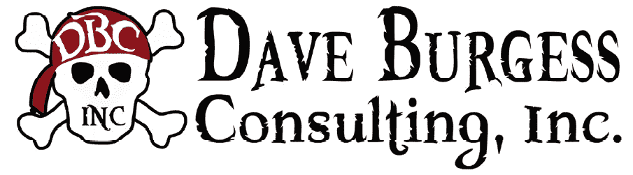

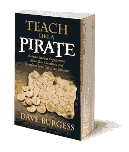

## 像海盗一样教学

### 提高学生参与度，激发创造力并改变你的教育工作生活

#### 作者 Dave Burgess ([@BurgessDave](https://twitter.com/BurgessDave))

*像海盗一样教学*是一部《纽约时报》畅销书，它引发了一场全球性的教育革命。它既是一份点燃职业激情的启发性宣言，又是一份实用的路线图，充满了能够显著提高学生参与度的动态策略。该书已被翻译成多种语言，其核心理念与那些渴望设计极具创意的课程并将学校转变为改变学生生活的体验的教育工作者产生了共鸣。

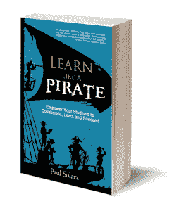

## 像海盗一样学习

### 赋能学生协作、领导并取得成功

#### 作者 Paul Solarz ([@PaulSolarz](https://twitter.com/PaulSolarz))

如今的职场市场要求学生准备好为自己的生活和职业负责。如果我们只教他们如何获得及格分数，而不让他们具备掌握自己教育的能力，那就是对他们不负责。在*像海盗一样学习*中，Paul Solarz 解释了如何设计课堂体验，鼓励学生在一个充满刺激、激励和支持的环境中承担风险并探索热情，在这个环境中重点是进步而非成绩。发现学生主导的课堂如何帮助学生茁壮成长，并发展为自主、自信且能够独立做出明智负责决策的公民。

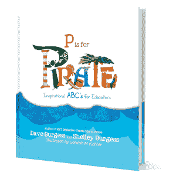

## P 代表海盗

### 给教育工作者的启发性 ABC

#### 作者 Dave and Shelley Burgess ([@Burgess_Shelley](https://twitter.com/Burgess_Shelley))

教学是一场延伸想象力并每天都需要创造力的冒险！在*P 代表海盗*中，夫妻 Dave 和 Shelley Burgess 鼓励并启发教育工作者让他们的课堂变成有趣且令人兴奋的学习场所。他们通过利用多年的个人经验并吸纳 70 多位教育工作者的见解，作者提供了丰富的想法，让学习和教学比以往任何时候都更加充实。

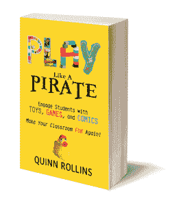

## 像海盗一样游戏

### 使用玩具、游戏和漫画吸引学生


#### 作者 Quinn Rollins ([@jedikermit](https://twitter.com/jedikermit))

是的！学校可以同时具有趣味性和教育性。在*像海盗一样游戏*中，Quinn Rollins 提供了实用且引人入胜的策略和资源，让你轻松地将趣味融入课程中。无论你教的是哪个年级，你都能找到灵感和创意，帮助你以令人难忘的方式吸引学生。

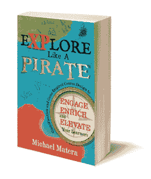

## 像海盗一样探索

### 通过游戏化和游戏灵感课程设计来参与、丰富并提升你的学习者

#### 作者 Michael Matera ([@MrMatera](https://twitter.com/MrMatera))

你准备好将你的教室变成一个在协作和创造中蓬勃发展的世界了吗？那么，跟随课堂游戏设计师兼教育家 Michael Matera 一起启航吧，探索基于游戏的学习的可能性和力量。在*像海盗一样探索*中，Matera 将担任经验丰富的导师，帮助你将游戏中最具激励性的技巧应用到课堂。你将学习与现有课程兼容并增强（而非取代）的游戏化策略，并发现这些迷人的方法如何应用于任何年级或学科。

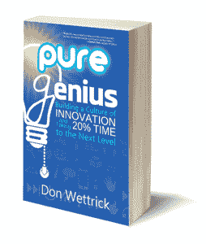

## 纯粹天才

### 构建创新文化并将“20%时间计划”推向新高度

#### 作者 Don Wettrick ([@DonWettrick](https://twitter.com/DonWettrick))

长期以来，学校一直是无聊的堡垒、创造力的杀手，并且过度习惯于服从和从众。在*纯粹天才*中，Don Wettrick 解释了协作——与专家、学生和其他教育工作者的合作——如何帮助你创造有趣的、甚至是改变生活的学习机会。Wettrick 的书为教育工作者提供了灵感并配备了一套在任何学校教授创新的系统蓝图。

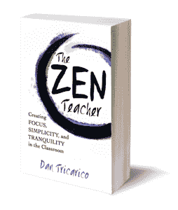

## 禅意教师

### 在教室中创造专注、简单与平静

#### 作者 Dan Tricarico ([@TheZenTeacher](https://twitter.com/TheZenTeacher))

老师拥有影响甚至改善未来的巨大力量。在*禅意教师*中，教育家、博主和演讲者 Dan Tricarico 提供了实用、易用的技巧，帮助老师处于最佳状态——不匆忙且全神贯注——以便他们最大化表现并提高生活质量。在这个入门指南中，Dan Tricarico 解释了什么是禅修——这与宗教无关，与你茁壮成的能力有关。

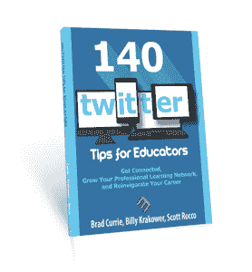

## 给教育工作者的 140 个 Twitter 技巧

### 建立联系，扩展你的专业网络并重振你的职业

#### 作者 Brad Currie, Billy Krakower 和 Scott Rocco ([@bradmcurrie](https://twitter.com/bradmcurrie), [@wkrakower](https://twitter.com/wkrakower), [@ScottRRocco](https://twitter.com/ScottRRocco))

无论你对教育或如何让工作做得更好有任何疑问，你都能在 Twitter 上找到想法、资源以及一个准备好帮助你的活跃专业人士网络。在*给教育工作者的 140 个 Twitter 技巧*中，Evolving Educators 的主持人持人和创始人 Brad Currie、Billy Krakower 和 Scott Rocco 提供了分步说明，帮助你掌握 Twitter 基础，建立在线粉丝并成为 Twitter 巨星。

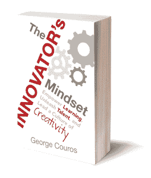

## 创新者思维

### 赋能学习，释放人才并领导创意文化

#### 作者 George Couros ([@gcouros](https://twitter.com/gcouros))

传统的教育体系要求学生压抑问题并顺从地遵循既定课程。但我们作为教育工作者的工作是为学生提供新的、更好的机会。现在是承认，服从不能培养创新、鼓励批判性思维或激发创造力了——而这些正是学生成功所需的技能。在*创新者思维*中，George Couros 鼓励教师和行政人员赋能学习者去好奇、探索并成为前瞻性的领导者。

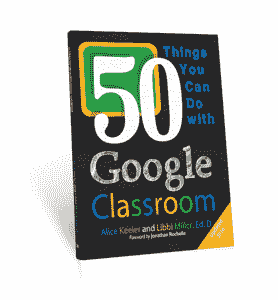

## Google Classroom 可以做的 50 种事

#### 作者 Alice Keeler 和 Libbi Miller ([@AliceKeeler](https://twitter.com/AliceKeeler), [@MillerLibbi](https://twitter.com/MillerLibbi))

在教室中引入新技术可能具有挑战性，但如果学生想要为未来做好充分准备，这是必经之路。Alice Keeler 和 Libbi Miller 通过提供对 `Google Classroom App` 的全面概述，缩短了学习曲线。`Google Classroom` 作为教育版 Google 应用（GAfE）的一部分，专门设计用于通过简化数字化流程来帮助教师节省时间。《Google Classroom 可以完成的 50 件事》一书配有截图，提供了许多创意和分步骤的操作说明，帮助教师实施这一强大的工具。

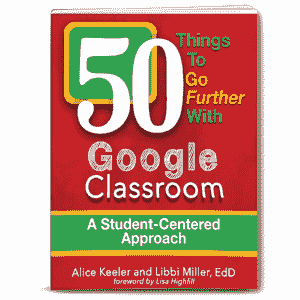

# Google Classroom 进阶指南：50 个方法

### 以学生为中心的方法

#### Alice Keeler 和 Libbi Miller ([@alicekeeler](https://twitter.com/alicekeeler), [@MillerLibbi](https://twitter.com/MillerLibbi))

如今的技术使教育者能够摆脱传统的教室——在那种教室里，教师主导，学生独立工作，每个人都在做同样的事情。在《Google Classroom 进阶指南：以学生为中心的方法》中，作者兼教育者 Alice Keeler 和 Libbi Miller 提供了灵感和资源，帮助你创建一个数字化丰富、参与感强且以学生为中心的环境。他们向你展示了如何利用 `Google Classroom` 实现个性化学习的力量。

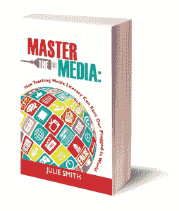

# 精通媒体

### 传授媒体素养如何拯救我们连接网络的世界

#### Julie Smith ([@julnilsmith](https://twitter.com/julnilsmith))

《精通媒体》是为了帮助教师和家长教育下一代而写的，它解释了媒体背后的历史、目的和传递的信息。其目的并不是让孩子们远离电子设备，而是帮助他们做出明智的选择，理解真理与谎言的区别，并辨别感知与现实。批判性思维能带来更明智的决策——这也是为什么媒体素养可以拯救世界的原因。

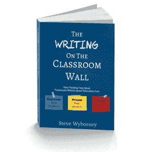

# 教室墙上的文字

### 发表你对教育最热情的信念如何赋能你的学生、推动你的成长并引导终身学习

#### Steve Wyborney ([@SteveWyborney](https://twitter.com/SteveWyborney))

在《教室墙上的文字》中，Steve Wyborney 解释了发布和讨论“大思想”（Big Ideas）如何引导更深层次的学习。你将了解到为什么分享你的想法会让它们变得敏锐和精炼。你还会受到鼓励，知道你分享的大思想不必深奥也能对学习产生深远的影响。事实上，Steve 解释说，你的某些想法掉下墙去也没关系。最重要的是分享它们。

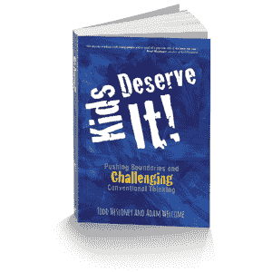

# 孩子们值得这一切！

### 突破边界并挑战传统思维

#### Todd Nesloney 和 Adam Welcome ([@TechNinjaTodd](https://twitter.com/TechNinjaTodd), [@awelcome](https://twitter.com/awelcome))

在《孩子们值得这一切！》中，Todd 和 Adam 鼓励你放远思考，让学习变得有趣且有意义。他们高科技、高触感且极具参与感的实践将激励你去承担风险、打破现状，并成为学生的捍卫者。顺便说，你可能会重新发现你最初成为教育者的原因。

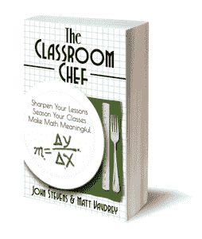

# 教室主厨

### 精炼你的课程。调味你的课堂。让数学变得意义。

#### John Stevens 和 Matt Vaudrey ([@Jstevens009](https://twitter.com/Jstevens009), [@MrVaudrey](https://twitter.com/MrVaudrey))

在《教室主厨》中，数学老师和教学教练 John Stevens 和 Matt Vaudrey 分享了他们的秘方、食材和技巧，用于提供吸引学生并帮助他们“理解”数学的课程。你可以直接使用这些想法和方法，或者更好地对其进行调整，创造你自己的诱人教育晚餐。作者分享的信息是，只要有想象力和准备，每位教师都能成为教室主厨。

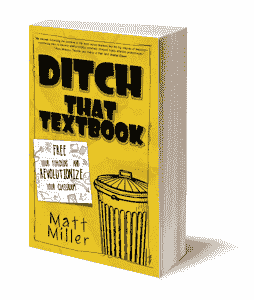

# 抛弃教科书

### 释放你的教学并彻底改变你的课堂

#### Matt Miller ([@jmattmiller](https://twitter.com/jmattmiller))

教科书是几个世纪以来教育的象征。它们一到达学生的课桌，往往就过时了。“按教科书办事”意味着顺从和缺乏创造力。是时候抛弃那些教科书——以及那些关于学习的教科书假设了！在《抛弃教科书》中，教师兼博主 Matt Miller 鼓励教育者抛弃毫无意义、平的教学学习实践。他赋予他们在旧有的标准教学方法基础上进行进化和改进。《抛弃教科书》是一个支持系统、工具箱和宣言，帮助教育者释放教学并彻底改变课堂。

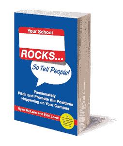

# 你的学校很棒……告诉大家吧！

### 热情地推销并推广你校园发生的积极事物

#### Ryan McLane 和 Eric Lowe ([@McLane_Ryan](https://twitter.com/McLane_Ryan), [@EricLowe21](https://twitter.com/EricLowe21))

你的学校每天都在发生很棒的事情。问题是：墙之外没人知道这些事。在《你的学校很棒……告诉大家吧！》中，校长 McLane 和 Eric Lowe 提供了七多个可操作的建议，以及易于遵循的说明和视频教程链接。这份实用指南将使你能够利用社交媒体创建有效且易于管理的沟通策略。学习如何让你的学生和社区保持联系，并对发生的事情感到兴奋。


# 我们需要多少水？

### 应对任何变化并在变革中生存的五个成功原则

#### Pete Nunweiler 与 Kris Nunweiler

在《我们需要多少水？》中，Pete Nunweiler 识别了五个关键要素——信息、计划、动力、支持和领导力——这是任何目标、生活转型或挑战成功的要素。Pete 将这些元素称为“成功之水”，正如我们喝的水一样，你需要它们才能在今天快速节奏的世界中生存。如果你在工作或家里感到压力、崩溃或不确定，请停下来寻找脱水的迹象。学习如何寻找、获取和使用这些“成功之水”——以便与你的团队和家庭成员分享。


# 即时关联

### 将今天的经历融入明天的课程

#### Denis Sheeran ([@MathDenisNJ](https://twitter.com/MathDenisNJ))

每天，全球的学生都会问一个问题：“我什么时候会在生活中用到这些？”在《即时关联》中，作者兼主题演讲家 Denis Sheeran 使你能够根据对学生重要的经历和事件创建有趣的课程。学习如何帮助你的学生看到现实世界与课堂知识之间有意义的联系——正因为这样，学习才会深入人心。


# 启动

### 使用设计思维激发创造力并挖掘每个学生的创造潜力

John Spencer 和 A.J. Juliani ([@spencerideas](https://twitter.com/spencerideas), [@ajjuliani](https://twitter.com/ajjuliani))

当学生将自己定义为制造者、发明者和创造者时，他们身上会发生变化。他们发现了强大的技能——解决问题的能力、批判性思维和想象力——这些技能将帮助他们塑造世界的未来……我们的未来。在*LAUNCHLAUNCH*一书中，John Spencer 和 A.J. Juliani 提供了一种可以融入到每个年级、每个课程的流程……即使你不认为自己是一个“创意型教师”。如果你敢于创新，并将创造力视为一项基本技能，你将赋予学生改变世界的能力——从现在开始。

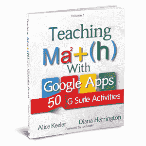

# 使用 Google Apps 教学数学

### 50 个 G Suite 活动方案 

#### Alice Keeler 和 Diana Herrington 著 ([@AliceKeeler](https://twitter.com/AliceKeeler), [@mathdiana](https://twitter.com/mathdiana))

Google Apps 为教师提供了比以往任何时候都更有意义的学生互动的机会，而 G Suite 则赋予学生成为创造性、批判性思考者的能力，并在探索和学习过程中进行协作。在《使用 Google Apps 教学数学》中，教育工作者 Alice Keeler 和 Diana Herrington 展示了五十种不同的方法，利用易用技术将数学课带入 21 世纪。

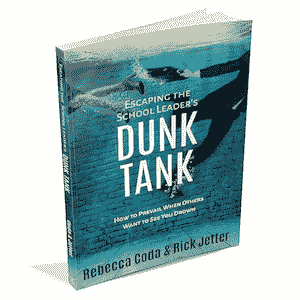

# 逃离校长的水水桶

### 当他人想看你落水时如何胜出

#### Rebecca Coda 和 Rick Jetter 著 ([@RebeccaCoda](https://twitter.com/RebeccaCoda), [@RickJetter](https://twitter.com/RickJetter))

没有任何学校领导者能免于水水桶——歧视、糟糕的政治、报复或自我驱动型同事的影响。在《逃离校长的水水桶》中，Rebecca Coda 和 Rick Jetter 分享了真实故事和深刻的见解，为学校领导者提供生存所需的实用知识和情感工具，更好的是，避免被“击落”。

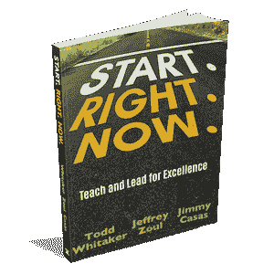

# 现在。就开始。

### 为了追求卓越而教学与领导

#### Todd Whitaker, Jeff Zoul 和 Jimmy Casas 著 ([@ToddWhitaker](https://twitter.com/ToddWhitaker), [@Jeff_Zoul](https://twitter.com/Jeff_Zoul), [@casas_jimmy](https://twitter.com/casas_jimmy))

在创作《现在。就开始。》之前的工作中，Todd Whitaker、Jeff Zoul 和 Jimmy Casas 研究了全国各地的教育工作者，并发现了卓越的四个关键行为：卓越的领导者和老师知道道路、展示道路、走道路并每天成长。如果你准备好迈向卓越的第一步，这本励人书籍将带你走上正确的道路。

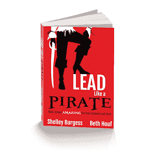

# 像海盗一样领导

### 为你的学生和员工让学校变得惊艳

#### Shelley Burgess 和 Beth Houf 著 ([@Burgess_Shelley](https://www.twitter.com/Burgess_Shelley), [@BethHouf](https://twitter.com/BethHouf))

在《像海盗一样领导》中，教育领导者 Shelley Burgess 和 Beth Houf 勾勒了领导学校或学区所需的品格特质。你将学如何在教室和学校中发现已存在的宝藏——以及如何挖掘你教育工作者最好的一面。这本书将装备并鼓励你在为学生、员工、家长和社区让学校变得惊艳的道路上坚持不懈。

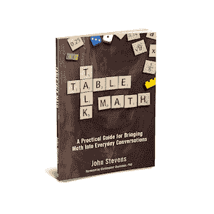

# 餐桌上的数学对话

### 将数学引入日常对话的实用指南

#### John Stevens 著 ([@Jstevens009](https://twitter.com/Jstevens009))

让数学成为家庭日常对话的一部分是帮助孩子和青少年学会热爱数学的有力方法。在《餐桌上的数学对话》中，John Stevens 为家长（以及老师！）提供了发起真实的、基于数学的对话的想法，让孩子们注意到并对周围世界所有的数字、模式和方程产生好奇。

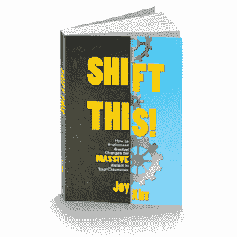

# 转变这个！

### 如何在课堂中实施渐进式变化产生巨大影响

#### Joy Kirr 著

建立一种不以成绩和家庭作业为中心，而关注个人责任和个性化学习的学生主导的文化，似乎是一项艰巨的任务——尤其是当你认为必须一次性完成它时。但当变化一点一点发生时，重大的改变是可能的、可持续的，甚至是容易的。在《转变这个！》中，教育工作者兼演讲者 Joy Kirr 解释了如何进行渐进式的转变——在你的思维、教学和课堂设计方法上——这些转变将对你的课堂产生巨大影响。今天就开始第一次转变吧！

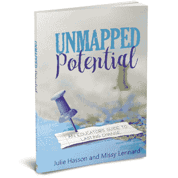

# 未测的潜力

# 教育工作者的持久改变指南

#### Julie Hasson 和 Missy Lennard 著 ([@PPrincipals](https://twitter.com/PPrincipals))


无论你处于教育生涯的哪个阶段，你很可能曾在一个时候感到力不从心和工作过度。也许你现在就有这种感觉。如果是这样，你并不孤单。但更重要的消息是，情况可以变得更好！你只需要一张正确的地图来引导你。《未测的潜力》提供了建议和实用策略，帮助你成为你想成为的那种教育工作者。

## 

# 打破教师神话

## 帮助作为教育工作者蓬勃发展的 6 个真相

#### Aaron Hogan 著 ([@aaron_hogan](https://twitter.com/aaron_hogan))

完美教师的神话延续了不切实际的期望并让老师陷入失败。作者兼教育工作者 Aaron Hogan 致力于打破完美教师的神话，通过赋予教育工作者策略帮助他们走出生存。

## 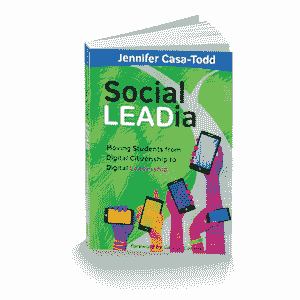

# Social LEADia

### 引导学生从数字公民转向数字领导

#### Jennifer Casa-Todd 著 ([@JCasaTodd](https://twitter.com/JCasaTodd))

为学生的未来做好准备从现在开始。在我们的网络社会中，学生需要学习如何利用社交媒体连接人、热情和机会以成长并做出贡献。《Social LEADia》提供了见解和有趣的故事，帮助你将学校和家庭的焦点从数字公民转向数字领导。

## 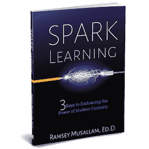

# 激发学习

### 拥抱学生好奇心的三个关键

#### Ramsey Musallam 著 ([@ramusallam](https://twitter/))

受其受欢迎的 TED 演讲“激发学习的三个规则”启发，这本书结合了大脑科学研究、经典的教学方法和 Ramsey 的个人故事，赋予你通过激发探索并利用其益处来改进学生的学习体验。如果你想让学生参与更有趣、更有效的学习，这本书适合你。

## 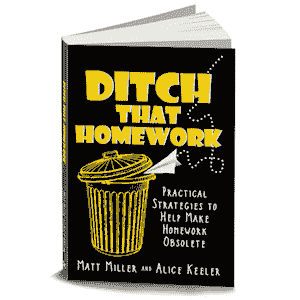

# 丢掉作业

### 帮助让作业过时的实用策略

#### Matt Miller 和 Alice Keeler 著 ([@jmattmiller](https://twitter.com/jmattmiller), [@alicekeeler](https://twitter.com/alicekeeler))

在《丢掉作业》中，Matt Miller 和 Alice Keeler 讨论了作业的优缺点、老师为什么布置作业，以及如果没有作业会变成什么样。在评估研究并分享家长和老师见解的同时，作者们为放弃作业并代之以更有效、更个性化的学习方法提供了说服力的论据。

## 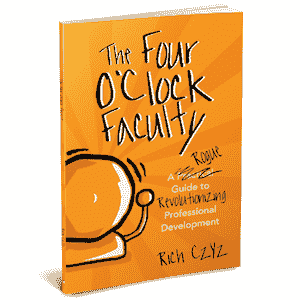

# 四点教师

## 变革职业发展的叛逆指南

#### Rich Czyz 著 ([@RACzyz](https://twitter.com/RACzyz))

作者 Rich Czyz 致力于彻底改变所有教育者的专业学习模式。在《四点钟学院》（*The Four O’Clock Faculty*）中，Rich 了让专业发展（PD）变得有意义、高效且最重要的是与个人相关的方法。这本书是一本实用指南，揭示了为什么有些专业发展如此糟糕，以及你可以做什么来改变这种模式，从而改善你自己和你的同事。

## 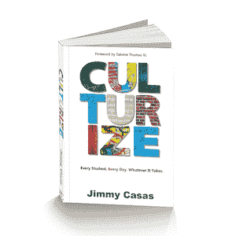

# Culturize

### 每个学生。每天。不惜一切代价。

#### 作者 Jimmy Casas ([@casas_jimmy](https://twitter.com/casas_jimmy))

在《Culturize》中，作者兼教育领袖 Jimmy Casas 分享了关于培养一个学习者社区的见解，这个社区体现了我们世界迫切需要的人性特质，如善良、诚实和同心。他的故事揭示了在满足并超越 21 世纪学习学术标准的同时，如何磨炼这些“软技能”。

# 关于作者


**Brian Aspinall** 是一位教育者、三届 TEDx 演讲者、编码员和顾问。他曾与政府部门、工会、大学、学区和学校团队以及公司合作过，是数字技能教育领域国际认可的思想领袖。

作为编程和计算思维教学卓越教学总理奖的获得者，Brian 赋能教育者利用现代教学工具和技术在课堂上取得更多成就。

他对 STEM 教育的热情、领导力以及提升能力的方法，使他成为全北美备受青睐的演讲者，并荣幸入选加拿大首批 Minecraft、Micro:BiT 和 Makey Makey 大使！

Brian 从 20 世纪 90 年代初就开始开发应用程序，当时他的高中校长付钱让他开发学校的第一个网站。遗憾的是，那个网站和那所高中都不复存在了。

要了解更多关于 Brian Aspinall 及其作品的信息，请访问：

[`www.MrAspinall.com`](http://www.MrAspinall.com)

[`www.BrianAspinall.com`](http://www.BrianAspinall.com)

或者，直接在推特上关注他：[@mraspinall](https://twitter.com/mraspinall)
