# 代码大全：软件构建的实践手册 第二版


组稿编辑：Linda Engelman 和 Robin Van Steenburgh
项目编辑：Devon Musgrave
索引编制：Bill Myers
主要桌面出版：Carl Diltz

正文部件号 X10-53130

献给我的妻子阿什莉（Ashlie），她与计算机编程没有太大关系，但她在无数方面丰富了我余下的人生，其方式之多，我难以言表。

## 更多对《代码大全》的赞誉

> “关于编程风格和软件构建的出色指南。”
> ——马丁·福勒，《重构》

> “Steve McConnell 的《代码大全》……为程序员提供了一条通往智慧的捷径……他的书读起来很有趣，而且你永远不会忘记他是在以来之不易的个人经验说话。”
> ——Jon Bentley，《编程珠玑》第2版

> “这简直是迄今为止我读过的关于软件构建的最好的一本书。每个开发人员都应该拥有一本，并每年从头到尾读一遍。连续九年每年阅读之后，我仍然从这本书中学到新东西！”
> ——John Robbins，《Microsoft .NET 和 Microsoft Windows 应用程序调试》

> “当今的软件*必须*健壮且富有韧性，而安全的代码始于纪律严明的软件构建。十年过去，仍然没有比《代码大全》更权威的作品。”
> ——Michael Howard，Microsoft Corporation 安全工程；《编写安全的代码》合著者

> “对编写设计良好的程序所涉及的战术问题进行了全面考察。McConnell 的著作涵盖了架构、编码标准、测试、集成以及软件工艺本质等众多不同主题。”
> ——Grady Booch，《对象解决方案》

> “软件开发者的终极百科全书是 Steve McConnell 的《代码大全》。副标题为‘软件构建实用手册’，这本 850 页的书名副其实。它宣称的目标是缩小‘行业大师和教授’（如 Yourdon 和 Pressman）的知识与常见商业实践之间的差距，并‘帮助你在更短的时间内编写更好的程序，少一些头疼的问题’……每个开发人员都应该拥有一本 McConnell 的书。其风格和内容都极为务实。”
> ——Chris Loosley，《高性能客户端/服务器》

> “Steve McConnell 的开创性著作《代码大全》是详细讨论软件开发方法的最容易理解的作品之一……”
> ——Erik Bethke，《游戏开发与制作》

> “一座关于设计和生产优秀软件过程中更广泛问题的有用信息和建议的宝库。”
> ——John Dempster，《实验室计算机：生理学家和神经科学家的实用指南》

> “如果你真的想提高编程技能，你应该读 Steve McConnell 的《代码大全》。”
> ——Jean J. Labrosse，《嵌入式系统构建模块：完整且立即可用的 C 语言模块》

> “Steve McConnell 写出了一本独立于计算机环境的最佳软件开发书籍之一……《代码大全》。”
> ——Kenneth Rosen，《Unix 完全参考手册》

> “每隔很长一段时间，你就会遇到一本能省去经验教育、让你少受多年磨砺的书……我无法充分表达这本书究竟有多好。《代码大全》对于一个杰作来说是个相当平淡的书名。”
> ——Jeff Duntemann，《PC 技术》

> “Microsoft Press 出版了我认为是关于软件构建的权威书籍。这本书应该放在每一位软件开发者的书架上。”
> ——Warren Keuffel，《软件开发》

> “每一位程序员都应该读读这本杰出的书。”
> ——T. L. (Frank) Pappas，《计算机》

> “如果你立志成为一名专业程序员，这可能是你做过的最明智的 35 美元投资。先别急着读完这篇书评：赶紧去买一本吧。McConnell 所声明的目标是缩小行业大师知识与常见商业实践之间的差距……令人惊叹的是他做到了。”
> ——Richard Mateosian，《IEEE Micro》

> “任何从事软件开发的人都应该将《代码大全》作为必读书。”
> ——Tommy Usher，《C 用户杂志》

> “我愿意比平时更勇敢地说，毫不犹豫地推荐 Steve McConnell 的《代码大全》。……我的那本在工作时一直放在我键盘最近的地方，取代了 API 参考手册。”
> ——Jim Kyle，《Windows 技术杂志》

> “这本写得很好但篇幅庞大的巨著，可以说是关于软件实现实践方面有史以来最好的一本单卷著作。”
> ——Tommy Usher，《嵌入式系统编程》

> “这是迄今为止我读过的最好的软件工程书籍。”
> ——Edward Kenworth，《.EXE 杂志》

> “这本书值得成为经典，应该成为所有开发人员以及负责管理他们的人的必读书。”
> ——Peter Wright，《Program Now》


你对这本书怎么看？我们想听听你的意见！微软希望听到你对本出版物的反馈，以便我们不断改进图书和学习资源。请访问以下网址参与简短的在线调查：www.microsoft.com/learning/booksurvey/


因此，程序员可能难以找到良好的编程信息来源。

本书中描述的技术填补了入门和高级编程教材之后的空白。在你读完 *Introduction to Java*、*Advanced Java* 和 *Advanced Advanced Java* 之后，你读什么书来学习更多关于编程的知识？你可以阅读关于英特尔或摩托罗拉硬件细节、Microsoft Windows 或 Linux 操作系统功能的书籍，或另一种编程语言——你无法在没有对这些细节的良好参考的情况下使用一种语言或在某个环境中编程。但这是为数不多的讨论编程本身的书籍之一。最有益的编程辅助手段是无论你使用什么环境或语言都可用的实践。其他书籍通常忽视了这些实践，这就是为什么本书集中于它们。

本书中的信息提炼自许多来源，如下所示。获得你将在本手册中找到的信息的唯一其他方法就是翻阅一座书山和几百本技术期刊，然后再加上大量的实际经验。如果你已经做过所有这些，你仍然可以从本书将信息集中在一处便于查阅中受益。


## 本手册的关键优势

无论你的背景如何，本手册都可以帮助你在更少的时间内编写更好的程序，并且头痛更少。

***完整的软件构建参考***  本手册讨论了构建的一般方面，如软件质量和思考编程的方式。它深入到构建的细节，如构建类的步骤、使用数据和控制结构的内在细节、调试、重构以及代码调优技术和策略。你不需要从头到尾阅读它来学习这些主题。该书旨在让你轻松找到感兴趣的具体信息。


- **即用型检查清单** — 本书包含数十个检查清单，可用于评估你的软件架构、设计方法、类和例程的质量、变量命名、控制结构、布局、测试用例等等。

- **最新技术信息** — 本手册描述了当前可用的一些最新技术，其中许多尚未普及到日常使用中。由于本书汲取了实践与研究的双重精华，它所描述的技术将在未来多年内持续有价值。

- **更广阔的软件开发视角** — 本书将让你有机会超越日常“救火”式的忙碌，去思考什么方法有效、什么方法无效。很少有实践中的程序员有时间通读数百本著作和期刊文章，而本书正是将这些知识浓缩而成。书中汇集的研究成果和真实世界经验将启发并激发你对项目的思考，使你能够采取战略性行动，避免反复陷入同样的困境。

- **拒绝夸大宣传** — 有些软件书籍只有 1 克的真知灼见，却裹着 10 克的浮夸之词。本书则对每种技术的优缺点进行均衡的讨论。你最了解自己特定项目的需求。本书提供客观的信息，帮助你在具体情况下做出明智的决策。

- **概念适用于大多数常见语言** — 本书描述了一些技巧，帮助你充分利用所使用的语言，无论是 C++、C#、Java、Microsoft Visual Basic，还是其他类似的语言。

- **大量代码示例** — 本书包含近 500 个关于优秀与糟糕代码的示例。我之所以提供如此多的示例，是因为就我个人而言，我从示例中学习效果最好。我相信其他程序员也是如此。

    示例使用了多种语言，因为掌握多门语言往往是专业程序员职业生涯的分水岭。一旦程序员意识到编程原则超越了任何特定语言的语法，通往真正能提升质量和生产力的知识大门就会敞开。

    为了尽可能减轻多语言带来的阅读负担，除非特定讨论需要，我避免使用晦涩的语言特性。你无需理解代码片段中的每一个细微差别，也能领会其要点。如果你专注于示例所阐述的观点，你会发现无论使用哪种语言，你都能读懂这些代码。我还对示例的重要部分添加了注释，希望能让你的阅读更加轻松。

- **获取其他信息来源的途径** — 本书汇集了大量关于软件构建的现有知识，但并非最终定论。在各章节中，“补充资源”部分会介绍其他相关书籍和文章，供你在深入研究自己感兴趣的主题时阅读。

- **配套网站** — 在配套网站 cc2e.com 上提供了更新后的检查清单、书籍、杂志文章、网页链接以及其他内容。要访问与《代码大全（第2版）》相关的信息，请输入 cc2e.com/ 后跟一个四位数代码，左侧页边距处显示了一个示例。这些网站引用贯穿全书。

## 为何编写本手册

软件工程界早已认识到，需要能够汇集有效开发实践知识的手册。美国计算机科学与技术委员会的一份报告指出，软件开发质量和生产力的最大提升将来自于对现有有效软件开发实践知识的整理、统一和传播（CSTB 1990, McConnell 1997a）。该委员会得出结论，传播这些知识的策略应建立在软件工程手册的概念之上。

## 构建这一主题曾被忽视

曾几何时，人们认为软件开发与编码是一回事。但随着软件开发生命周期中不同活动的被识别，该领域一些最优秀的人才将时间花在分析和争论项目管理、需求、设计和测试的方法上。学术界对这些新领域的研究热潮，使代码构建沦为软件开发中不受重视的“穷亲戚”。

关于构建的讨论也因一种观点而受阻，即认为将构建视为一项独立的软件开发*活动*，就意味着必须将其视为一个独立的*阶段*。实际上，软件活动和阶段之间并不需要以任何特定的关系设定，无论其他软件活动是按阶段、按迭代还是其他方式执行，讨论构建这项活动本身都是有价值的。

## 构建的重要性

构建之所以被研究人员和作家忽视的另一个原因，是一种错误的观念，即认为与其他软件开发活动相比，构建是一个相对机械的过程，改进空间不大。这种观点与事实相去甚远。

代码构建通常占小型项目工作量的 65%，占中型项目的 50%。在小型项目中，构建导致的错误约占 75%；在中型和大型项目中，这一比例约为 50% 到 75%。任何占据错误来源 50% 到 75% 的活动，显然都蕴含着巨大的改进机会。（第 27 章包含这些统计数据的更多细节。）

一些评论者指出，尽管构建错误在总错误中占比很高，但构建错误的修复成本往往低于需求和架构所导致的错误，因此他们暗示构建错误就显得不那么重要了。说构建错误修复成本低是正确的，但这具有误导性，因为不修复这些错误的代价可能高得惊人。研究人员发现，小规模的编码错误恰恰是史上最昂贵的软件错误之一，造成的损失高达数亿美元（Weinberg 1983, SEN 1990）。显然，修复成本低并不意味着修复的优先级就该低。

具有讽刺意味的是，当焦点偏离构建时，构建却是唯一一项保证会进行的活动。需求可以被臆测而不去开发；架构可以简化而不去设计；测试可以缩短或跳过而不去全面规划和执行。但只要有程序存在，就必然有构建，这使得构建成为了一个独特且富有成果的领域，能够有效改进开发实践。

## 市面上没有同类书籍

鉴于构建的显著重要性，当我构思本书时，确信一定已经有人写过关于有效构建实践的书籍。关于如何有效编程的书，其需求似乎是显而易见的。但我发现，关于构建的书寥寥无几，而且即便有，也只是涉及该主题的某些方面。有些书写于 15 年甚至更早以前，使用了 ALGOL、PL/I、Ratfor 和 Smalltalk 等相对冷门的语言。有些由不从事生产代码开发的教授撰写。这些教授写的是适用于学生项目的技术，但他们对这些技术在全规模开发环境中的实际效果往往知之甚少。还有一些书则大力鼓吹作者最新推崇的方法论，却忽略了那些经过时间考验、已被证明有效的大量成熟实践。

> 当艺术评论家聚在一起时，他们谈论形式、结构和意义。当艺术家聚在一起时，他们谈论在哪里能买到便宜的松节油。
> ——巴勃罗·毕加索

总之，我找不到任何一本书，哪怕是尝试去汇集来自专业经验、行业研究和学术工作的实用技术体系。相关的讨论需要更新，以涵盖当前编程语言、面向对象编程和前沿的开发实践。很明显，一本关于编程的书，需要由既深谙理论前沿，又有足够生产代码经验以理解实践现状的人来撰写。我


将本书构想为一份关于代码构造的完整讨论——从一位程序员到另一位程序员。

## 作者的话

我欢迎您就本书讨论的话题、错误报告或其他相关事宜与我联系。请通过 stevemcc@construx.com 与我联系，或访问我的网站 www.stevemcconnell.com。

华盛顿州贝尔维尤
2004年阵亡将士纪念日

## Microsoft 学习技术支持

我们已尽一切努力确保本书的准确性。Microsoft Press 通过以下网址为书籍提供勘误：

http://www.microsoft.com/learning/support/

如需直接连接 Microsoft 知识库并就您可能遇到的问题或疑问进行查询，请访问：

http://www.microsoft.com/learning/support/search.asp

如果您对本书有评论、问题或建议，请通过以下任一方式发送给 Microsoft Press：

邮寄地址：

Microsoft Press
收件人：Code Complete 2E 编辑
One Microsoft Way
Redmond, WA 98052-6399

电子邮件：

mspinput@microsoft.com

## 致谢

一本书从来不是由一个人单独写成的（至少我的书不是）。第二版更是集体合作的成果。

我想感谢为本书大量内容提供审阅意见的人们：Håkon Agustsson、Scott Ambler、Will Barns、William D. Bartholomew、Lars Bergstrom、Ian Brockbank、Bruce Butler、Jay Cincotta、Alan Cooper、Bob Corrick、Al Corwin、Jerry Deville、Jon Eaves、Edward Estrada、Steve Gouldstone、Owain Griffiths、Matthew Harris、Michael Howard、Andy Hunt、Kevin Hutchison、Rob Jasper、Stephen Jenkins、Ralph Johnson 及其在伊利诺伊大学的软件架构小组、Marek Konopka、Jeff Langr、Andy Lester、Mitica Manu、Steve Mattingly、Gareth McCaughan、Robert McGovern、Scott Meyers、Gareth Morgan、Matt Peloquin、Bryan Pflug、Jeffrey Richter、Steve Rinn、Doug Rosenberg、Brian St. Pierre、Diomidis Spinellis、Matt Stephens、Dave Thomas、Andy Thomas-Cramer、John Vlissides、Pavel Vozenilek、Denny Williford、Jack Woolley 和 Dee Zsombor。

数百名读者对第一版提出了评论，更多人对第二版提出了个人评论。感谢所有抽出时间分享他们对本书不同版本的反应的读者。

特别感谢正式审阅整部手稿的 Construx Software 审阅者：Jason Hills、Bradley Honsinger、Abdul Nizar、Tom Reed 和 Pamela Perrott。考虑到在他们开始工作之前已有多少双眼睛审阅过本书，我真的很惊讶他们的审阅如此彻底。还要感谢 Bradley、Jason 和 Pamela 对 **cc2e.com** 网站的贡献。

与本书项目编辑 Devon Musgrave 合作是一件特别愉快的事。我曾与许多优秀的编辑合作过其他项目，而 Devon 尤其令人印象深刻，细心且易于合作。谢谢你，Devon！感谢 Linda Engelman 推动第二版的出版；没有她，这本书就不会问世。还要感谢 Microsoft Press 的其他工作人员，包括 Robin Van Steenburgh、Elden Nelson、Carl Diltz、Joel Panchot、Patricia Masserman、Bill Myers、Sandi Resnick、Barbara Norfleet、James Kramer 和 Prescott Klassen。

我想缅怀出版第一版的 Microsoft Press 工作人员：Alice Smith、Arlene Myers、Barbara Runyan、Carol Luke、Connie Little、Dean Holmes、Eric Stroo、Erin O'Connor、Jeannie McGivern、Jeff Carey、Jennifer Harris、Jennifer Vick、Judith Bloch、Katherine Erickson、Kim Eggleston、Lisa Sandburg、Lisa Theobald、Margarite Hargrave、Mike Halvorson、Pat Forgette、Peggy Herman、Ruth Pettis、Sally Brunsman、Shawn Peck、Steve Murray、Wallis Bolz 和 Zaafar Hasnain。

## 致谢

感谢为第一版做出重大贡献的审阅者：Al Corwin、Bill Kiestler、Brian Daugherty、Dave Moore、Greg Hitchcock、Hank Meuret、Jack Woolley、Joey Wyrick、Margot Page、Mike Klein、Mike Zevenbergen、Pat Forman、Peter Pathe、Robert L. Glass、Tammy Forman、Tony Pisculli 和 Wayne Beardsley。特别感谢 Tony Garland 的详尽审阅：时隔 12 年，我比以往任何时候都更欣赏 Tony 的数千条审阅意见是多么非凡。

## 清单

- Requirements 42
- Architecture 54
- Upstream Prerequisites 59
- Major Construction Practices 69
- Design in Construction 122
- Class Quality 157
- High-Quality Routines 185
- Defensive Programming 211
- The Pseudocode Programming Process 233
- General Considerations In Using Data 257
- Naming Variables 288
- Fundamental Data 316
- Considerations in Using Unusual Data Types 343
- Organizing Straight-Line Code 353
- Using Conditionals 365
- Loops 388
- Unusual Control Structures 410
- Table-Driven Methods 429
- Control-Structure Issues 459
- A Quality-Assurance Plan 476
- Effective Pair Programming 484
- Effective Inspections 491
- Test Cases 532
- Debugging Reminders 559
- Reasons to Refactor 570
- Summary of Refactorings 577
- Refactoring Safely 584
- Code-Tuning Strategies 607
- Code-Tuning Techniques 642

## 表格

- Table 3-1 Average Cost of Fixing Defects Based on When They’re Introduced and Detected 29
- Table 3-2 Typical Good Practices for Three Common Kinds of Software Projects 31
- Table 3-3 Effect of Skipping Prerequisites on Sequential and Iterative Projects 33
- Table 3-4 Effect of Focusing on Prerequisites on Sequential and Iterative Projects 34
- Table 4-1 Ratio of High-Level-Language Statements to Equivalent C Code 62
- Table 5-1 Popular Design Patterns 104
- Table 5-2 Design Formality and Level of Detail Needed 116
- Table 6-1 Variations on Inherited Routines 145
- Table 8-1 Popular-Language Support for Exceptions 198
- Table 11-1 Examples of Good and Bad Variable Names 261
- Table 11-2 Variable Names That Are Too Long, Too Short, or Just Right 262
- Table 11-3 Sample Naming Conventions for C++ and Java 277
- Table 11-4 Sample Naming Conventions for C 278
- Table 11-5 Sample Naming Conventions for Visual Basic 278
- Table 11-6 Sample of UDTs for a Word Processor 280
- Table 11-7 Semantic Prefixes 280
- Table 12-1 Ranges for Different Types of Integers 294
- Table 13-1 Accessing Global Data Directly and Through Access Routines 341
- Table 13-2 Parallel and Nonparallel Uses of Complex Data 342
- Table 16-1 The Kinds of Loops 368
- Table 19-1 Transformations of Logical Expressions Under DeMorgan’s Theorems 436
- Table 19-2 Techniques for Counting the Decision Points in a Routine 458
- Table 20-1 Team Ranking on Each Objective 469
- Table 20-2 Defect-Detection Rates 470
- Table 20-3 Extreme Programming’s Estimated Defect-Detection Rate 472
- Table 21-1 Comparison of Collaborative Construction Techniques 495
- Table 23-1 Examples of Psychological Distance Between Variable Names 556
- Table 25-1 Relative Execution Time of Programming Languages 600
- Table 25-2 Costs of Common Operations 601

## 表格

- Table 27-1 Project Size and Typical Error Density 652
- Table 27-2 Project Size and Productivity 653
- Table 28-1 Factors That Influence Software-Project Effort 674
- Table 28-2 Useful Software-Development Measurements 678
- Table 28-3 One View of How Programmers Spend Their Time 681

## 图表

Figure 1-1 Construction activities are shown inside the gray circle. Construction focuses on coding and debugging but also includes detailed design, unit testing, integration testing, and other activities. 4

Figure 1-2 This book focuses on coding and debugging, detailed design, construction planning, unit testing, integration, integration testing, and other activities in roughly these proportions. 5

Figure 2-1 The letter-writing metaphor suggests that the software process relies on expensive trial and error rather than careful planning and design. 14

Figure 2-2 It’s hard to extend the farming metaphor to software development appropriately. 15

Figure 2-3 The penalty for a mistake on a simple structure is only a little time and maybe some embarrassment. 17

Figure 2-4 More complicated structures require more careful planning. 18

Figure 3-1 The cost to fix a defect rises dramatically as the time from when it’s introduced to when it’s detected increases. This remains true whether the project is highly sequential (doing 100 percent of requirements and design up front) or highly iterative (doing 5 percent of requirements and design up front). 30

Figure 3-2 Activities will overlap to some degree on most projects, even those that are highly sequential. 35

Figure 3-3 On other projects, activities will overlap for the duration of the project. One key to successful construction is understanding the degree to which prerequisites have been completed and adjusting your approach accordingly. 35

Figure 3-4 The problem definition lays the foundation for the rest of the programming process. 37

Figure 3-5 Be sure you know what you’re aiming at before you shoot. 38

Figure 3-6 Without good requirements, you can have the right general problem but miss the mark on specific aspects of the problem. 39

Figure 3-7 Without good software architecture, you may have the right problem but the wrong solution. It may be impossible to have successful construction. 44

Figure 5-1 The Tacoma Narrows bridge—an example of a wicked problem. 75


## 图表

图 5-2
程序中的设计层次。系统（1）首先组织为子系统（2）。子系统进一步划分为类（3），类划分为例程和数据（4）。每个例程的内部也需要设计（5）。82

图 5-3
具有六个子系统的系统示例。83

图 5-4
子系统间通信不受任何限制时会发生什么的一个示例。83

图 5-5
只要有几条通信规则，就能显著简化子系统之间的交互。84

图 5-6
这个计费系统由四个主要对象组成。为便于示例，这些对象已被简化。88

图 5-7
抽象允许你对复杂概念采用更简单的视角。90

图 5-8
封装不仅允许你对复杂概念采用更简单的视角，还禁止你查看该复杂概念的任何细节。你所见即所得——这就是你得到的一切！91

图 5-9
良好的类接口就像冰山一角，将类的大部分内容隐藏起来。93

图 5-10
G. Polya 提出了一种数学问题求解方法，该方法同样适用于解决软件设计中的问题（Polya 1957）。109

图 8-1
西雅图 90 号州际公路浮桥的一部分在暴风雨中沉没，原因是浮箱没有加盖，灌满水后，桥体过重而无法浮起。在施工过程中，防范小事的重要性可能超出你的想象。189

图 8-2
定义软件中处理脏数据的部分和处理干净数据的部分，可以有效地让大多数代码免除检查坏数据的责任。204

图 9-1
类构建的细节不尽相同，但活动通常按此处所示的顺序进行。216

图 9-2
这些是构建例程的主要活动，通常按所示顺序执行。217

图 9-3
在设计例程时会执行所有这些步骤，但不一定按照任何特定顺序。225

图 10-1
“存活时间长”意味着一个变量在许多语句中保持存活。“存活时间短”意味着它只在少数语句中存活。“跨度”指对变量的引用彼此之间有多靠近。246

图 10-2
顺序数据是按既定顺序处理的数据。254

图 10-3
选择数据允许你使用其中一部分或另一部分，但不能同时使用两者。255

图 10-4
迭代数据是重复的。255

图 13-1
每种数据类型使用的内存量以双线表示。324

图 13-2
一个有助于我们思考重新链接指针所涉及步骤的示意图示例。329

图 14-1
如果代码被良好地分组组织，围绕相关部分绘制的框不会重叠。它们可能是嵌套的。352

图 14-2
如果代码组织不当，围绕相关部分绘制的框会重叠。353

图 17-1
递归是对抗复杂性的宝贵工具——当用于解决合适问题时。394

图 18-1
顾名思义，直接访问表允许你直接访问感兴趣的表元素。413

图 18-2
消息按任意顺序存储，每条消息通过消息 ID 进行标识。417

图 18-3
除消息 ID 外，每种消息都有自己的格式。418

图 18-4
索引访问表不是直接访问，而是通过中间索引进行访问。425

图 18-5
阶梯法通过判断每个条目命中“阶梯”的层级来分类。它命中的“台阶”决定其类别。426

图 19-1
使用数轴排序进行布尔测试的示例。440

图 20-1
关注软件质量的一个外部特性，可能对其他特性产生正面影响、负面影响，或没有影响。466

图 20-2
缺陷最多的软件既不是由最快的开发方法产生的，也不是由最慢的开发方法产生的。475

图 22-1
随着项目规模增大，开发人员测试占总开发时间的比例会减小。程序规模的影响在第 27 章“程序规模如何影响构建”中有更详细的描述。502

图 22-2
随着项目规模增大，构建期间所犯错误的比例会下降。然而，即使在最大的项目中，构建错误仍占所有错误的 45%–75%。521

图 23-1
尝试用几种不同方式重现错误，以确定其确切原因。545

图 24-1
小变更往往比大变更更容易出错（Weinberg 1983）。581

图 24-2
你的代码不必因为现实世界混乱而变得混乱。应将你的系统设想为理想代码、从理想代码到混乱现实世界的接口，以及混乱现实世界的组合。583

图 24-3
改进生产代码的一种策略是，在接触写得不好的遗留代码时对其进行重构，以便将其移到“通往混乱现实世界的接口”的另一侧。584

图 27-1
沟通路径的数量与团队人数的平方成正比增加。650

图 27-2
随着项目规模增大，错误通常更多来自需求和设计。有时它们仍主要来自构建（Boehm 1981, Grady 1987, Jones 1998）。652

图 27-3
构建活动在小项目中占主导地位。较大的项目需要更多的架构、集成工作和系统测试才能成功。需求工作未在此图中显示，因为需求工作量不像其他活动那样直接与程序规模成函数关系（Albrecht 1979; Glass 1982; Boehm, Gray, and Seewaldt 1984; Boddie 1987; Card 1987; McGarry, Waligora, and McDermott 1989; Brooks 1995; Jones 1998; Jones 2000; Boehm et al. 2000）。654

图 27-4
软件构建工作量与项目规模近似呈线性关系。其他类型的工作随项目规模增大而非线性增加。655

图 28-1
本章涵盖与构建相关的软件管理主题。661

图 28-2
项目早期做出的估算本质上是不准确的。随着项目推进，估算可以变得更加准确。应在整个项目期间定期重新估算，并利用每项活动中学到的经验，改进对下一项活动的估算。673

图 29-1
华盛顿大学的橄榄球体育场增建部分在施工期间倒塌，原因是其强度不足以在建造过程中支撑自身。完工后它可能已经足够坚固，但施工顺序错误——这是一个集成错误。690

图 29-2
阶段式集成之所以也被称为“大爆炸”集成，是有充分理由的！691

图 29-3
增量集成有助于项目积累动力，就像雪球滚下山坡一样。692

图 29-4
在阶段式集成中，你一次集成大量组件，以至于很难知道错误在哪里。错误可能存在于任何组件或任何组件间的连接中。在增量集成中，错误通常要么在新组件中，要么在新组件与系统之间的连接中。693

图 29-5
在自顶向下集成中，先添加顶部的类，最后添加底部的类。695

图 29-6
除了严格地自上而下进行之外，你也可以按垂直切片自顶向下集成。696

图 29-7
在自底向上集成中，先集成底部的类，最后集成顶部的类。697

图 29-8
除了纯粹地从下到上进行之外，你也可以按部分自底向上集成。这模糊了自底向上集成与本章后面描述的面向特性集成之间的界限。698

图 29-9
在三明治集成中，首先集成顶层类和广泛使用的底层类，把中间层类留到最后。698

图 29-10
在面向风险的集成中，首先集成预计最麻烦的类；之后再实现较容易的类。699

图 29-11
在面向特性的集成中，按构成可识别特性的组来集成类——通常一次集成多个类，但并非总是如此。700

图 29-12
在 T 形集成中，先构建并集成系统的一个纵深切片，以验证架构假设；然后构建并集成系统的横向广度部分，为开发其余功能提供框架。701

图 34-1
程序可以分为抽象层次。良好的设计能让你将大部分时间只专注于上层，而忽略下层。846


## Part I
### 奠定基础

在本部分中：

- 第 1 章：欢迎来到软件构造（第 3 页）
- 第 2 章：软件开发更丰富理解的隐喻（第 9 页）
- 第 3 章：量 twice，cut once：上游先决条件（第 23 页）
- 第 4 章：关键构造决策（第 61 页）

## 第 1 章：欢迎来到软件构造


### 相关主题

- 谁应该阅读本书：前言
- 阅读本书的好处：前言
- 书籍撰写原因：前言

你知道“construction”在软件开发之外是什么意思。“Construction”是“construction workers”在建造房屋、学校或摩天大楼时所做的工作。当你年轻时，你用“construction paper”建造东西。在常见用法中，“construction”指的是建造的过程。建造过程可能包括一些规划、设计和检查工作的方面，但大多数情况下，“construction”指的是创造某物的动手部分。

### 1.1 什么是软件构造？

开发计算机软件可能是一个复杂的过程，在过去 25 年里，研究人员已确定了许多进入软件开发的不同活动。它们包括

- 问题定义
- 需求开发
- 构造规划
- 软件架构，或高层设计
- 详细设计
- 编码和调试
- 单元测试
- 集成测试
- 集成
- 系统测试
- 纠正性维护

如果你从事过非正式项目，你可能会认为这个列表代表了大量的官僚程序。如果你从事过过于正式的项目，你知道这个列表代表了大量的官僚程序！在过少和过多正式化之间取得平衡是很难的，这将在本书后面讨论。

如果你自学编程或主要从事非正式项目，你可能没有区分创建软件产品所涉及的许多活动。在思维上，你可能将所有这些活动都归为“编程”。如果你从事非正式项目，你想到创建软件时的主要活动很可能就是研究人员所指的“构造”活动。

这种直觉上的“构造”概念相当准确，但它缺乏视角。将构造放在与其他活动的上下文中，有助于在构造期间保持对正确任务的关注，并适当强调重要的非构造活动。图 1-1 说明了构造与其他软件开发活动相关的地位。

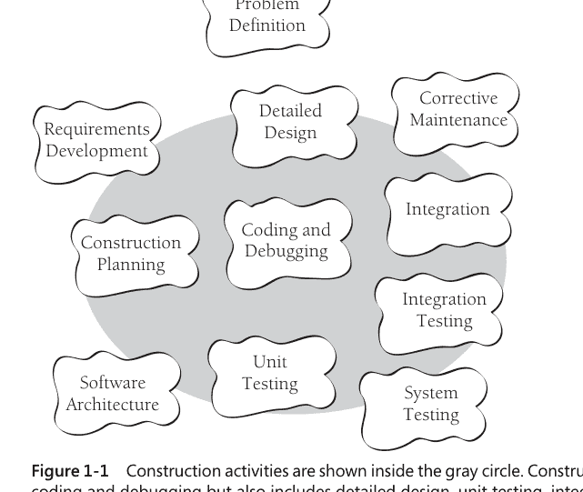

图 1-1 构造活动显示在灰色圆圈内。构造侧重于编码和调试，但也包括详细设计、单元测试、集成测试和其他活动。


正如图所示，构造主要是编码和调试，但也涉及详细设计、构造规划、单元测试、集成、集成测试和其他活动。如果这是一本关于软件开发所有方面的书籍，它将对开发过程中的所有活动进行平衡讨论。然而，由于这是一本构造技术的手册，它对构造给予了失衡的强调，并且只涉及相关主题。如果这本书是一只狗，它会依偎在构造旁边，对设计和测试摇尾巴，并对其他开发活动吠叫。

构造有时也被称为“编码”或“编程”。“编码”并不是最好的词，因为它意味着将预先存在的设计机械地翻译成计算机语言；构造一点也不机械，并且涉及大量的创造力和判断力。在整本书中，我将“编程”与“构造”互换使用。

与图 1-1 的软件开发平面地球视图相比，图 1-2 显示了本书的圆地球视角。

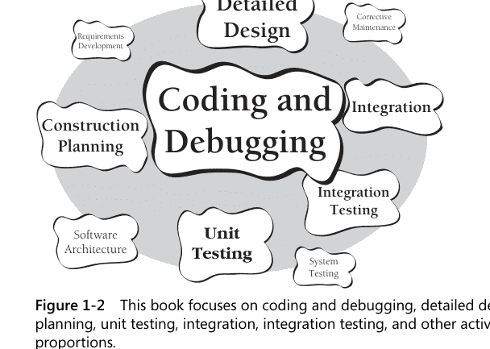

图 1-2 本书重点关注编码和调试、详细设计、构造规划、单元测试、集成、集成测试以及其他活动，大致按这些比例进行。

图 1-1 和图 1-2 是构造活动的高层视图，但细节呢？以下是构造中涉及的一些具体任务：

- 验证基础工作已经完成，以便构造能够成功进行
- 确定你的代码将如何被测试
- 设计和编写类和例程
- 创建和命名变量和命名常量
- 选择控制结构并组织语句块
- 单元测试、集成测试和调试你自己的代码
- 审查其他团队成员的低层设计和代码，并让他们审查你的代码
- 通过仔细格式化和注释来润色代码
- 集成单独创建的软件组件
- 调优代码以使其更快并使用更少的资源

要获得更完整的构造活动列表，请查看目录中的章节标题。

由于构造中有如此多的活动，你可能会说，“好吧，Jack，哪些活动不属于构造？”这是一个公平的问题。重要的非构造活动包括管理、需求开发、软件架构、用户界面设计、系统测试和维护。每项活动都会影响项目的最终成功程度，就像构造一样——至少对于需要超过一两个人并且持续时间超过几周的任何项目而言。你可以找到每项活动的优秀书籍；其中许多列在全书“附加资源”部分以及本书末尾第 35 章“在哪里找到更多信息”中。

### 1.2 为什么软件构造很重要？

既然你正在阅读本书，你可能同意提高软件质量和开发人员生产率很重要。今天许多最令人兴奋的项目大量使用软件。互联网、电影特效、医疗生命支持系统、太空项目、航空、高速金融分析和科学研究只是几个例子。这些项目和更传统的项目都可以从改进实践中受益，因为许多基础是相同的。

如果你同意一般来说改进软件开发很重要，那么作为本书读者的你面临的问题是，为什么构造是一个重要的关注点？

原因如下：

交叉引用 有关项目规模与构造所占时间百分比之间关系的详细信息，请参阅第 27.5 节中的“活动比例与规模”。

**构造是软件开发的重要组成部分** 根据项目规模，构造通常占项目总时间的 30% 到 80%。任何占用如此多项目时间的东西都必然会影响项目的成功。

**构造是软件开发的核心活动** 需求和架构是在构造之前完成的，以便你能有效地进行构造。系统测试（严格意义上的独立测试）在构造之后进行，以验证构造是否正确完成。构造处于软件开发过程的中心。

交叉引用 有关程序员之间差异的数据，请参阅第 28.5 节中的“个体差异”。

**专注于构造，个人程序员的生产率可以极大提高** Sackman、Erikson 和 Grant 的经典研究表明，在构造期间，个人程序员的生产率相差 10 到 20 倍（1968 年）。自他们的研究以来，他们的结果已被许多其他研究证实（Curtis 1981，Mills 1983，Curtis 等人 1986，Card 1987，Valett 和 McGarry 1989，DeMarco 和 Lister 1999，Boehm 等人 2000）。本书帮助所有程序员学习最好的程序员已经使用的技术。

**构造的产品，源代码，通常是软件的唯一准确描述** 在许多项目中，程序员可用的唯一文档就是代码本身。需求规范和设计文档可能会过时，但源代码始终是最新的。因此，源代码的质量必须是尽可能高的。源代码改进技术的持续应用使得鲁布·戈德堡装置与详细、正确、因此具有信息量的程序之间的区别。这样的技术最有效地在构造期间应用。


**构造是唯一保证会完成的活动** 理想的软件项目在构造开始前会进行仔细的需求开发和架构设计。理想的项目在构造后会进行全面、统计控制的系统测试。然而，不完美的现实世界项目通常会跳过需求和设计，直接进入构造。他们会放弃测试，因为他们有太多错误需要修复并且时间已用完。但无论项目多么仓促或计划多么糟糕，你都不能放弃构造；这是橡胶接触地面的地方。因此，改进构造是改进任何软件开发工作的方式，无论其多么简略。


### 1.3 如何阅读本书

本书设计为可以从头到尾通读，也可以按主题阅读。如果你喜欢通读书籍，你可以直接进入第 2 章“更丰富理解软件开发的隐喻”。如果你想获取具体的编程技巧，你可以从第 6 章“工作类”开始，然后根据交叉引用前往你感兴趣的其他主题。如果你不确定这些内容是否适用于你，请从第 3.2 节“确定你正在处理的软件类型”开始。

## 关键点

- 软件构建是软件开发中的核心活动；构建是唯一保证在每个项目中都会发生的活动。
- 构建中的主要活动是详细设计、编码、调试、集成以及开发者测试（单元测试和集成测试）。
- 构建的其他常用术语是“编码”和“编程”。
- 构建的质量在很大程度上影响着软件的质量。
- 最终而言，你对如何进行构建的理解决定了你作为程序员的好坏，而这正是本书其余部分的主题。

气体动理论基于“台球”模型。人们认为气体分子具有质量并像台球一样发生弹性碰撞，并且从该模型中发展出了许多有用的定理。

光的波动理论很大程度上是通过探索光与声音之间的相似性而发展起来的。光和声音都有振幅（亮度、响度）、频率（颜色、音高）等共同属性。声音和光的波动理论之间的比较如此富有成效，以至于科学家们花费了大量精力寻找一种能够像空气传播声音那样传播光的介质。他们甚至给它起了名字——“以太”——但他们从未找到这种介质。在某些方面如此富有成效的类比在这种情况下却具有误导性。

总体而言，模型的力量在于它们生动且可以作为概念整体被把握。它们提示属性、关系和额外的研究领域。有时模型会提示具有误导性的研究领域，在这种情况下隐喻被过度延伸了。当科学家们寻找以太时，他们就过度延伸了他们的模型。

正如你所预期的那样，有些隐喻比其他隐喻更好。一个好的隐喻是简单的，与其他相关隐喻联系良好，并且能够解释大部分实验证据和其他观察现象。

考虑一个重石在绳子上来回摆动的例子。在伽利略之前，一个亚里士多德主义者看着摆动的石头会认为重物自然地从较高位置移动到较低位置的静止状态。亚里士多德主义者会认为石头真正做的是困难地下落。当伽利略看到摆动的石头时，他看到了一个摆。他认为石头真正做的是几乎完美地重复同样的运动一次又一次。

两种模型的暗示能力截然不同。将摆动的石头视为下落物体的亚里士多德主义者会观察石头的重量、被抬高的高度以及它静止所需的时间。对于伽利略的摆模型，突出的因素是不同的。伽利略观察了石头的重量、摆动的半径、角位移以及每次摆动所需的时间。伽利略发现了亚里士多德主义者无法发现的规律，因为他们的模型使他们关注不同的现象并提出不同的问题。

隐喻以与它们促进科学问题更深入理解相同的方式促进对软件开发问题的更大理解。在 1973 年的图灵奖演讲中，查尔斯·巴赫曼描述了从占主导地位的地球中心宇宙观到太阳中心宇宙观的转变。托勒密的地球中心模型在没有严重挑战的情况下持续了 1400 年。然后在 1543 年，哥白尼提出了日心说理论，即太阳而不是地球是宇宙的中心。这种思维模型的改变最终导致了新行星的发现，将月球重新分类为卫星而非行星，以及对人类在宇宙中地位的不同理解。

> 隐喻的价值不容低估。隐喻具有所有人都理解的预期行为的优点。不必要的沟通和误解减少了。学习和教育更快。实际上，隐喻是一种内化和抽象概念的方式，让人可以说，“当然，正确的隐喻更有用。另一个隐喻是错的！”虽然这是自然的反应，但它过于简单。科学史不是从“错误”隐喻到“正确”隐喻的一系列转换。它是从“更差”的隐喻到“更好”的隐喻的一系列变化，从不包容到更包容，从在某一领域具有启发性到在另一领域具有启发性。

事实上，许多已被更好模型取代的模型仍然有用。工程师仍然通过使用牛顿动力学解决大多数工程问题，即使从理论上讲，牛顿动力学已被爱因斯坦理论取代。

软件开发是一个比大多数其他科学更年轻的领域。它尚未成熟到拥有标准隐喻的程度。因此，它有大量互补和冲突的隐喻。有些更好，有些更差。你对隐喻的理解程度决定了你对软件开发的理解程度。

### 2.2 如何使用软件隐喻


软件隐喻更像是一盏探照灯，而不是一张路线图。它不会告诉你答案在哪里；它告诉你如何寻找答案。隐喻更像是一种启发式方法，而不是算法。

算法是一组用于执行特定任务的明确定义指令。算法是可预测的、确定的，并且不受偶然影响。算法告诉你如何从 A 点到 B 点，没有绕路，没有去 D、E 和 F 点的岔路，也没有停下来闻玫瑰香或喝杯咖啡。

启发式方法是一种帮助你寻找答案的技术。它的结果受偶然影响，因为启发式方法只告诉你如何寻找，而不是寻找什么。它不会告诉你如何直接从 A 点到 B 点；它甚至可能不知道 A 点和 B 点在哪里。实际上，启发式方法就像穿着小丑服的算法。它更不可预测，更有趣，并且没有 30 天退款保证。

以下是去某人家里的算法：沿 167 号公路向南行驶至普亚卢普。取 South Hill Mall 出口并沿山上行驶 4.5 英里。在杂货店旁的路口右转，然后左转第一个路口。驶入左侧大棕色房屋的车道，地址为北雪松街 714 号。

> **交叉引用** 有关如何在设计软件中使用启发式方法的详细信息，请参阅第 5.1 节中的“设计是一种启发式过程”。

以下是去某人家里的启发式方法：找到我们寄给你的最后一封信。开车到回邮地址所在的城镇。到达城镇后，问别人我们家在哪里。每个人都认识我们——有人会很乐意帮助你。如果你找不到人，就从公共电话打电话给我们，我们会来接你。

算法和启发式方法之间的区别很微妙，两者也有些重叠。就本书而言，两者之间的主要区别是与解决方案的间接程度。算法直接给出指令。启发式方法告诉你如何为自己发现指令，或者至少在哪里寻找它们。

如果有指示能准确告诉你如何解决编程问题，那肯定会使编程更容易，结果更可预测。但编程科学尚未达到这种先进程度，也可能永远不会达到。编程中最具挑战性的部分是概念化问题，而编程中的许多错误是概念性错误。由于每个程序在概念上都是独特的，因此很难或不可能创建一套通用的指示来在每种情况下都导向解决方案。因此，知道如何一般性地解决问题至少与知道特定问题的特定解决方案一样有价值。

如何使用软件隐喻？用它们来为你的编程问题和流程提供洞察。用它们帮助你思考编程活动，并帮助你想象更好的做事方式。你将无法看着一行代码说它违反了本章中描述的某个隐喻。然而，随着时间的推移，使用隐喻来阐明软件开发过程的人将被视为对编程有更好理解的人，并且比不使用它们的人更快地生产出更好的代码。


### 2.3 常见的软件隐喻

软件开发周围涌现了大量令人困惑的隐喻。David Gries 说编写软件是一门科学（1981）。Donald Knuth 说它是一门艺术（1998）。Watts Humphrey 说它是一个过程（1989）。P. J. Plauger 和 Kent Beck 说它就像开车，尽管他们得出了几乎相反的结论（Plauger 1993, Beck 2000）。Alistair Cockburn 说它是一场游戏（2002）。Eric Raymond 说它像一个集市（2000）。Andy Hunt 和 Dave Thomas 说它像园艺。Paul Heckel 说它像拍摄《白雪公主和七个小矮人》（1994）。Fred Brooks 说它像耕作、猎杀狼人，或者与恐龙一起淹没在沥青坑里（1995）。哪些是最好的隐喻呢？

## 软件书写：编写代码

最原始的软件开发隐喻源自“编写代码”这个说法。写作隐喻暗示开发程序就像写一封随意的信——你坐下来，拿着笔、墨水和纸，从头写到尾。它不需要任何正式的规划，你在写作过程中边写边想。

许多想法都源自写作隐喻。Jon Bentley 说你应该能坐在炉火旁，拿着一杯白兰地、一支好雪茄和你心爱的猎犬，像欣赏一本好小说一样享受“文学化程序”。Brian Kernighan 和 P. J. Plauger 将他们关于编程风格的书命名为《编程风格要素》（1978），取名自写作风格书《风格要素》（Strunk and White 2000）。程序员经常谈论“程序可读性”。


对于个人的工作或小型项目，写信隐喻还算适用，但对于其他目的，它早早退场——它没有完整或充分地描述软件开发。写作通常是一个人的活动，而软件项目很可能涉及许多具有不同职责的人。当你写完一封信时，你把它塞进信封寄出去。你无法再更改它，而且从任何实际目的来说，它已经完成了。软件则不是那么难改变，而且几乎从不会完全完成。在一个典型的软件系统中，多达 90% 的开发工作发生在初始发布之后，典型情况是三分之二（Pigoski 1997）。在写作中，原创性受到高度推崇。在软件构建中，试图创造真正原创的作品往往不如专注于重用以前项目中的设计思想、代码和测试用例来得有效。简而言之，写作隐喻暗示了一个过于简单和僵化、不利于健康的软件开发过程。

> 计划扔掉一个（版本）；无论如何，你都会这么做。
> ——Fred Brooks

> 如果你计划扔掉一个，你会扔掉两个。
> ——Craig Zerouni

不幸的是，写信隐喻被地球上最流行的软件书籍之一——Fred Brooks 的《人月神话》（Brooks 1995）——延续了下来。Brooks 说：“计划扔掉一个（版本）；无论如何，你都会这么做。”这让人联想到一堆半写的草稿被扔进废纸篓的画面，如图 2-1 所示。

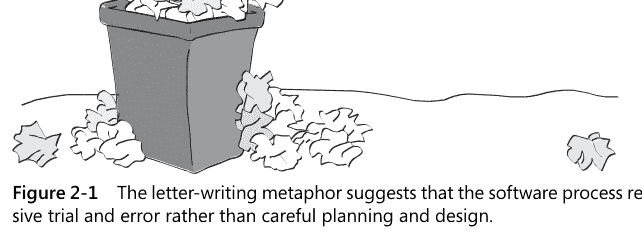

图 2-1 写信隐喻暗示软件过程依赖于昂贵的试错，而不是仔细的规划和设计。

计划扔掉一个（版本）在给你姨妈写一封礼貌的问候信时可能很实际。但是将“编写”软件的隐喻扩展到计划扔掉一个，对软件开发来说是一个糟糕的建议，因为一个大型系统的成本已经相当于一座 10 层办公楼或一艘远洋邮轮。如果你能负担得起坐在你最喜欢的木马上无限次旋转木马，那么抓住铜环很容易。诀窍是在第一次时就抓住它——或者在最便宜的时候抓住几次机会。其他隐喻更好地阐明了实现这种目标的方式。

## 软件耕作：培育系统

与僵化的写作隐喻相反，一些软件开发人员说你应该把创建软件想象成播种和种植庄稼。你设计一小块，编写一小块，测试一小块，然后一点一点地将其添加到系统中。通过采取小步骤，你最大限度地减少了在任何时候可能遇到的麻烦。

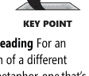

有时一个好的技术被用糟糕的隐喻来描述。在这种情况下，尽量保留技术，并提出一个更好的隐喻。在这种情况下，增量技术是有价值的，但耕作隐喻很糟糕。

进一步阅读 关于不同的耕作隐喻（应用于软件维护）的示例，请参阅《Rethinking Systems Analysis and Design》（Weinberg 1988）中的“On the Origins of Designer Intuition”一章。

“一次做一点”的想法可能和庄稼的生长方式有些相似，但农业类比很薄弱且信息量不足，很容易被下面几节描述的更好的隐喻所取代。很难将耕作隐喻扩展到“一次做一点”这个简单的想法之外。如果你接受了耕作隐喻，如图 2-2 所示，你可能会发现自己谈论给系统计划施肥、间苗详细设计、通过有效的土地管理提高代码产量，以及收割代码本身。你会谈论轮作 C++ 而不是大麦，让土地休耕一年以增加硬盘中的氮供应。

软件耕作隐喻的弱点在于它暗示你不能直接控制软件如何开发。你在春天播下代码种子。只要《农民年鉴》和“大南瓜”愿意，秋天你就会有一个大丰收的代码。


图 2-2 很难将耕作隐喻恰当地扩展到软件开发。

## 软件牡蛎养殖：系统累积

有时人们谈论“成长”软件时，实际上指的是软件的“累积”（accretion）。这两个隐喻密切相关，但“累积”是更有洞察力的形象。“Accretion”，以防你手边没有字典，意思是任何通过逐渐的外部添加或包含而发生的生长或尺寸增加。“Accretion”描述了牡蛎制造珍珠的方式，即逐渐添加少量碳酸钙。在地质学中，“accretion”意味着通过水携带沉积物的沉积，土地缓慢增加。在法律术语中，“accretion”意味着通过水携带沉积物的沉积，沿水体岸边的土地增加。

交叉引用 关于如何将增量策略应用于系统集成的详细信息，请参见第 29.2 节“集成频率——分阶段还是增量？”

这并不意味着你必须学会如何用水携带的沉积物制造代码；它意味着你必须学会如何一次少量地添加到你的软件系统中。与“accumulation”密切相关的其他词是“incremental”（增量）、“iterative”（迭代）、“adaptive”（自适应）和“evolutionary”（演化）。增量设计、构建和测试是一些最强大的软件开发概念。

在增量开发中，你首先制作最简单的、能够运行的系统版本。它不必接受真实的输入，不必对数据执行真实的操作，不必产生真实的输出——它只需要是一个足够坚固的骨架，能够在开发过程中支撑真正的系统。它可能为你确定的每个基本功能调用虚拟类。这个基本开端就像牡蛎用一小粒沙子开始一颗珍珠。

在形成骨架之后，你一点一点地加上肌肉和皮肤。你将每个虚拟类改为真实类。而不是让你的程序...


假装接受输入，你就插入真正接受输入的代码。不要让你的程序假装产生输出，你就插入真正产生输出的代码。你一次只添加一点点代码，直到你拥有一个完全可工作的系统。

支持这种方法的轶事证据令人印象深刻。弗雷德·布鲁克斯在1975年建议先造一个然后丢弃，他说在他撰写里程碑式著作《人月神话》之后的十年里，没有什么比增量开发更能从根本上改变他自己的实践或其有效性（1995）。汤姆·吉尔布在他的突破性著作《软件工程管理原理》（1988）中提出了同样的观点，该书引入了演化交付，并为当今大部分敏捷编程方法奠定了基础。众多当前的方法论都基于这一思想（Beck 2000, Cockburn 2002, Highsmith 2002, Reifer 2002, Martin 2003, Larman 2004）。

作为一种隐喻，增量隐喻的优势在于它不会过度承诺。它比农业隐喻更难被不恰当地延伸。用牡蛎形成珍珠的形象来可视化增量开发，或累积，是一个很好的方法。

## 软件构造：构建软件


“构建”软件的形象比“编写”或“生长”软件更有用。它与软件累积的思想相兼容，并提供了更详细的指导。构建软件意味着各种规划、准备和执行阶段，其种类和程度取决于所构建的内容而有所不同。当你探索这种隐喻时，你会发现许多其他相似之处。

建造一座四英尺高的塔需要稳定的手、平坦的表面和10个完好的啤酒罐。建造一座大100倍的塔不仅仅需要100倍的啤酒罐。它需要完全不同类型的规划和建造。

如果你要建造一个简单的结构——比如一个狗舍——你可以开车去木材店买一些木材和钉子。到下午结束时，你就会为菲多准备好一个新房子。如果你忘记提供门，如图2-3所示，或犯了其他错误，这不是大问题；你可以修复它，甚至可以从头开始。唯一浪费的是一个下午的时间。这种松散的方法也适用于小型软件项目。如果你为1000行代码使用了错误的设计，你可以重构或完全重新开始，而不会损失太多。


图2-3 在简单结构上犯错的代价只是少量的时间和也许一些尴尬。

如果你要建造一栋房子，建造过程更复杂，糟糕设计的后果也更严重。首先你必须决定要建造什么类型的房子——这在软件开发中类似于问题定义。然后你和一位建筑师必须提出一个总体设计并获得批准。这类似于软件架构设计。你绘制详细的蓝图并聘请承包商。这类似于详细的软件设计。你准备建筑场地，浇筑地基，搭建房屋框架，给它装上外墙和屋顶，并进行管道和布线。这类似于软件构造。当房子大部分完工时，园林绿化工人、油漆工和装饰师会进来，让你的房产和你建造的家发挥最佳效果。这类似于软件优化。在整个过程中，各种检查员会来检查场地、地基、框架、布线和其他可检查项目。这类似于软件评审和检查。

更大的复杂性和规模意味着在两种活动中都有更大的后果。在建造房屋时，材料成本相对昂贵，但主要开销是人工。拆除一面墙并将其移动六英寸的费用之所以昂贵，并不是因为你浪费了很多钉子，而是因为你必须为人们花费额外的时间来移动墙壁付费。你必须使设计尽可能好，如图2-4所示，这样你就不会浪费时间去修复本可以避免的错误。在构建软件产品时，材料甚至更便宜，但人工成本同样高昂。更改报表格式与在房子里移动一面墙一样昂贵，因为在两种情况下，主要成本组成部分都是人们的时间。


**图2-4** 更复杂的结构需要更仔细的规划。

这两种活动还有什么其他相似之处？在建造房屋时，你不会试图建造那些可以买到现成的东西。你会购买洗衣机和烘干机、洗碗机、冰箱和冷冻箱。除非你是一个机械奇才，否则你不会考虑自己建造它们。你还会购买预制橱柜、台面、窗户、门和卫生间设施。如果你要构建一个软件系统，你会做同样的事情。你会大量使用高级语言特性，而不是编写自己的操作系统级代码。你也可能会使用预建的容器类、科学函数、用户界面类和数据库操作类的库。通常没有意义去编码那些你可以买到现成的东西。

然而，如果你正在建造一栋豪华房屋，配有顶级家具，你可能会定制橱柜。你可能会让洗碗机、冰箱和冷冻箱内置，看起来像其余的橱柜。你可能会定制形状和尺寸不寻常的窗户。这种定制在软件开发中有相似之处。如果你正在构建一个一流的软件产品，你可能会为了更好的速度或准确性而自己构建科学函数。你可能会自己构建容器类、用户界面类和数据库类，以使你的系统具有无缝、完全一致的外观和感觉。

建筑构造和软件构造都受益于适当的规划水平。如果你按错误的顺序构建软件，它就很难编码，很难测试，很难调试。它可能需要更长的时间才能完成，或者项目可能因为每个人的工作都太复杂，因此在合并时过于混乱而崩溃。

仔细规划并不一定意味着详尽规划或过度规划。你可以规划结构支撑，然后稍后再决定是否铺设硬木地板或地毯，墙壁涂什么颜色，使用什么屋顶材料等等。规划良好的项目提高了你以后改变细节的能力。你对所构建的软件类型越有经验，你就能越理所当然地处理细节。你只想确保规划足够多，以使缺乏规划不会在以后造成重大问题。

构造类比也帮助解释了为什么不同的软件项目受益于不同的开发方法。在建筑中，如果你建造的是仓库或工具棚，与建造医疗中心或核反应堆相比，你会使用不同水平的规划、设计和质量保证。你会为建造学校、摩天大楼或三居室住宅使用不同的做法。同样，在软件中，你通常会使用灵活、轻量级的开发方法，但有时你需要严格、重量级的方法来实现安全目标和其他目标。

在软件中进行更改又带来了与建筑构造的另一个相似之处。移动一面承重墙六英寸的成本高于移动一面房间之间的隔断墙。同样，在程序中进行结构性更改的成本高于添加或删除外围功能。

最后，构造类比为极其庞大的软件项目提供了洞见。因为极大结构失败的惩罚是严重的，所以结构必须过度设计。建筑商仔细制作和检查他们的计划。他们加入安全裕度；为更强的材料多付10%的费用比让摩天大楼倒塌要好。时间安排受到了极大关注。当帝国大厦建造时，每辆送货卡车都有15分钟的交付时间裕度。如果卡车不在正确的时间到位，整个项目就会被延迟。

同样，对于极其庞大的软件项目，需要比仅仅大型项目更高层次的规划。卡珀斯·琼斯报告说，一个包含100万行代码的软件系统平均需要69种文档（1998）。此类系统的需求规格说明书通常长达4000-5000页，而设计文档很容易是需求的两到三倍之多。一个人不太可能能够理解如此规模项目的完整设计——甚至阅读它。更大的准备程度是合适的。

我们构建的软件项目在经济规模上可与帝国大厦相媲美，需要同等规模的技术和管理控制。

建筑构造隐喻可以在多种其他方向上扩展，这就是该隐喻如此强大的原因。软件开发中常见的许多术语都源于建筑隐喻：软件架构、脚手架、构造、基础类、以及拆散代码。你可能会听到更多。

进一步阅读 有关扩展构造隐喻的一些良好评论，请参阅“什么支撑屋顶？”（Starr 2003）。


## 应用软件技术：智力工具箱


善于开发高质量软件的人花费数年时间积累了数十种技术、技巧和魔法咒语。这些技术不是规则；它们是分析工具。优秀的工匠知道工作中合适的工具是什么以及如何正确使用它。程序员也是如此。你对编程了解得越多，你的思维工具箱中就装满了越多的分析工具，以及何时使用它们和如何正确使用的知识。

交叉引用 有关设计中选择和组合方法的详细信息，请参阅第 5.3 节，“设计构建块：启发式。”

在软件领域，顾问有时会告诉你完全放弃其他方法而采用某种软件开发方法。这很不幸，因为如果你 100% 接受任何单一方法论，你就会以该方法论的视角看待整个世界。在某些情况下，你会错过使用更适合当前问题的其他方法的机会。工具箱隐喻有助于将所有方法、技术和技巧保持在适当的视角中——在适当的时候准备好使用。

## 组合隐喻


由于隐喻是启发式的而非算法式的，因此它们不是相互排斥的。你可以同时使用增生隐喻和构造隐喻。你可以使用写作，如果你愿意的话，你可以将写作与驾驶、猎杀狼人或与恐龙一起在沥青坑中溺水结合起来。使用任何能激发你自己思考或能很好地与团队其他成员沟通的隐喻或隐喻组合。

使用隐喻是一件模糊的事情。你必须扩展它们才能从它们提供的启发式洞察中受益。但如果你过度扩展或朝错误的方向扩展，它们会误导你。就像你可能误用任何强大的工具一样，你也可以误用隐喻，但它们的力量使它们成为你智力工具箱中有价值的一部分。

## 附加资源

cc2e.com/0285

在关于隐喻、模型和范式的通俗书籍中，基石之作是托马斯·库恩的著作。

Kuhn, Thomas S. The Structure of Scientific Revolutions, 3d ed. Chicago, IL: The University of Chicago Press, 1996. 库恩关于科学理论如何出现、演变并在达尔文式的循环中屈服于其他理论的著作，在 1962 年首次出版时震动了科学哲学。它清晰简短，充满了科学中隐喻、模型和范式兴衰的有趣例子。

Floyd, Robert W. “The Paradigms of Programming.” 1978 Turing Award Lecture. Communications of the ACM, August 1979, pp. 455–60. 这是对软件开发中模型的有趣讨论，Floyd 将库恩的思想应用于该主题。

## 要点

- 隐喻是启发式，而非算法。因此，它们往往有点粗糙。
- 隐喻通过将其与其他你已知的活动联系起来，帮助你理解软件开发过程。
- 有些隐喻比其他隐喻更好。
- 将软件构造视为类似于建筑构造，表明需要仔细准备，并阐明了大型项目与小型项目之间的差异。
- 将软件开发实践视为智力工具箱中的工具，进一步表明每个程序员都有许多工具，并且没有单一工具适合所有工作。 为每个问题选择合适的工具是成为有效程序员的关键之一。
- 隐喻不是相互排斥的。使用最适合你的隐喻组合。

## 第 3 章

## 量两次，切一次：上游前提条件

## 目录

- 3.1 前提条件的重要性： 第 24 页
- 3.2 确定你正在处理的软件类型： 第 31 页
- 3.3 问题定义前提条件： 第 36 页
- 3.4 需求前提条件： 第 38 页
- 3.5 架构前提条件： 第 43 页
- 3.6 上游前提条件花费的时间： 第 55 页

## 相关主题

- 关键构造决策： 第 4 章
- 项目规模对构造和前提条件的影响： 第 27 章
- 质量目标与构造活动之间的关系： 第 20 章
- 管理构造： 第 28 章
- 设计： 第 5 章

在开始建造房屋之前，建筑商会查看蓝图，检查是否已获得所有许可证，并勘测房屋的地基。建筑商准备建造摩天大楼的方式、建造住宅区的方式以及建造狗舍的方式各不相同。无论项目是什么，准备工作都是根据项目的具体需求量身定制的，并在施工开始前认真完成。

本章描述了为软件构造做准备所需的工作。与建筑施工一样，项目的成败很大程度上在施工开始前就已决定。如果地基没有打好或规划不足，你在施工期间能做的最好的事情就是将损害降到最低。

木匠的说法“量两次，切一次”与软件开发的构造部分高度相关，后者可能占项目总成本的 65% 左右。最糟糕的软件项目最终会进行两到三次或更多次的构造。在软件中，项目最昂贵的部分做两次，就像在任何其他工作中一样，是一个糟糕的主意。

尽管本章为成功的软件构造奠定了基础，但它并未直接讨论构造。如果你感到饥肠辘辘或你已经精通软件工程生命周期，请从第 5 章“构造中的设计”开始寻找构造的精华。如果你不喜欢构造的前提条件，请回顾第 3.2 节“确定你正在处理的软件类型”，以了解前提条件如何适用于你的情况，然后查看第 3.1 节中的数据，该节描述了不做前提条件的成本。

### 3.1 前提条件的重要性

> 交叉引用 关注质量也是提高生产率的最佳方式。详细信息请参阅第 20.5 节，“软件质量的一般原则。”

构建高质量软件的程序员的共同点是他们使用高质量实践。 这种实践强调在项目的开始、中间和结束时强调质量。

如果你在项目结束时强调质量，你就强调系统测试。测试是许多人想到软件质量保证时想到的东西。然而，测试只是完整质量保证策略的一部分，而且不是最有影响力的部分。测试无法检测到诸如构建错误产品或以错误方式构建正确产品之类的缺陷。 这种缺陷必须在测试之前解决——在构造开始之前。


如果你在项目中间强调质量，你就强调构造实践。这种实践是本书大部分内容的重点。

如果你在项目开始时强调质量，你就会为高质量产品进行规划、要求和设计。如果你一开始就为庞蒂亚克 Aztek 设计，你可以测试它多少次，它永远也变成不了劳斯莱斯。你可能会建造最好的 Aztek，但如果你想要劳斯莱斯，你必须从一开始就计划建造它。在软件开发中，你在定义问题、指定解决方案和设计解决方案时进行此类规划。

由于构造处于软件项目的中间，到你进行构造时，项目的早期部分已经为成功或失败奠定了基础。然而，在构造期间，你至少应该能够确定你的情况有多好，并且如果你看到失败的黑云在地平线上逼近，你可以后退。本章的其余部分详细描述了为什么适当的准备很重要，并告诉你如何确定自己是否真的准备好开始构造。


## 前期准备是否适用于现代软件项目？

> 所采用的方法应基于对最新、最优方案的选择，而不是基于无知。它还应当大量融合陈旧而可靠的方法。
> ——哈兰·米尔斯

有些人断言，在现代软件项目中，架构、设计和项目规划等上游活动并无用处。总体而言，这类断言无论过去还是现在的研究，或当前数据，都不太支持。（详见本章其余部分。）反对前期准备的人通常会举出一些做得很糟糕的前期准备案例，然后指出这类工作没有效果。然而，上游活动是可以做好的，而且从20世纪70年代至今的行业数据表明，如果在切实开始构建之前完成了适当的准备活动，项目将会运行得最好。


准备工作的首要目标是降低风险：一个好的项目规划者会尽早清除主要风险，以便项目主体尽可能顺利地进行。到目前为止，软件开发中最常见的项目风险是需求不佳和项目规划不佳，因此准备工作往往侧重于改进需求和项目计划。

构建前的准备工作并非一门精确的科学，降低风险的具体方法必须因项目而异。不同项目的细节可能差异很大。更多相关内容，请参见第3.2节。

## 准备不充分的原因

你可能会认为，所有专业的程序员都知道准备的重要性，并在投入构建之前检查前期准备是否已经满足。不幸的是，事实并非如此。

延伸阅读 关于培养这些技能的专业发展计划，请参阅《专业软件开发》（McConnell 2004）第16章。

准备不充分的一个常见原因是，被分配从事上游活动的开发人员缺乏执行任务的专业能力。规划项目、创建令人信服的商业案例、制定全面而准确的需求，以及创建高质量架构所需的技能绝非微不足道，但大多数开发人员没有接受过如何执行这些活动的培训。当开发人员不知道如何做上游工作时，“多做上游工作”的建议听起来就像胡说八道：如果工作本身一开始就没有做好，做再多也不会有什么用处！解释如何执行这些活动超出了本书的范围，但本章末尾的“其他资源”部分提供了许多获取该专业知识的选项。

有些程序员确实知道如何执行上游活动，但他们不准备，因为他们无法抗拒尽快开始编码的冲动。如果你也有这种冲动，我有两个建议。建议1：阅读下一节的论证。它可能会告诉你一些你没想到的事情。建议2：注意你遇到的问题。只需要几个大型程序就能让你明白，提前规划可以避免很多压力。让亲身经历作为你的向导。

程序员不做准备的最后一个原因是，管理者对花时间在构建前期准备上的程序员是出了名的不体谅。像Barry Boehm、Grady Booch和Karl Wiegers这样的人25年来一直在大力强调需求和设计的重要性，你可能期望管理者们早就开始明白软件开发不仅仅是编码。

延伸阅读 关于这个主题的许多有趣变体，请阅读Gerald Weinberg的经典著作《计算机编程心理学》（Weinberg 1998）。

然而，几年前，我在一个国防部项目中工作时，该项目正专注于需求开发，当时负责该项目的陆军将军前来视察。我们告诉他，我们正在开发需求，主要是与客户沟通、捕获需求并勾勒设计。他坚持要看代码。我们告诉他还没有代码，但他在一个100人的工作区里走来走去，决心抓到某个人在编程。看到这么多人不在办公桌前，或者在处理需求和设计，这位身材高大、圆滚滚、嗓门洪亮的人很沮丧，最后指着我旁边的工程师吼道：“他在干什么？他一定是在写代码！”事实上，那位工程师正在处理一个文档格式化工具，但将军想找到代码，觉得看起来像代码，希望工程师在写代码，所以我们告诉他那就是代码。

这种现象被称为WISCA或WIMP综合征：“萨姆为什么不在写任何代码？”或者“玛丽为什么不在编程？”

如果你项目的经理假装自己是准将，命令你立即开始编码，你很容易回答：“是，长官！”（有什么坏处呢？那位老家伙肯定知道自己在说什么。）这是一个糟糕的回应，你有几个更好的选择。首先，你可以断然拒绝按照无效的命令工作。如果你和老板的关系以及你的银行账户都足够健康，让你能够这样做，祝你好运。

第二种可疑的替代方案是假装在编码，实际上并没有。在桌角放一份旧程序清单。然后不管老板是否批准，继续开发你的需求和架构。你会更快地完成项目，结果质量也更高。有些人觉得这种方法在道德上有问题，但从老板的角度来看，无知便是福。

第三，你可以教育你的老板了解技术项目的细微之处。这是一个好方法，因为它增加了世界上开明老板的数量。下一小节将阐述在构建之前花时间进行前期准备的详细理由。

最后，你可以另找一份工作。尽管经济起伏不定，优秀的程序员始终供不应求（BLS 2002），当有大量更好的选择时，生命太短暂，不值得在一个不明智的编程作坊里工作。

## 在构建前进行前期准备的绝对有说服力且万无一失的论证

假设你已经去过问题定义之山，与需求之人同行了一英里，在架构之泉脱去了脏衣服，并在准备的纯净之水中沐浴。那么你就会知道，在实现一个系统之前，你需要理解系统应该做什么以及应该如何做。


作为技术员工，你的部分工作是教育周围非技术人员了解开发过程。本节将帮助你应对那些尚未明白过来的经理和老板。这是一个关于在开始编码、测试和调试之前完成需求和架构——把关键方面做对——的详细论证。学会这个论证，然后和老板坐下来，推心置腹地谈谈编程过程。

### 诉诸逻辑

在高效编程中，一个关键理念是准备工作很重要。在开始一个大项目之前，你应该先规划项目，这是合情合理的。大项目需要更多规划；小项目需要较少规划。从管理角度看，规划意味着确定项目所需的时间、人员数量和计算机数量。从技术角度看，规划意味着理解你要构建什么，以免浪费金钱构建错误的东西。有时用户一开始并不完全确定自己想要什么，因此要弄清他们真正想要什么，可能需要付出比理想情况更多的努力。但这比构建错误的东西、扔掉并重新开始要便宜。

### 诉诸类比

构建软件系统就像任何其他需要人员和资金的项目一样。如果你在盖房子，你会在开始钉钉子之前绘制建筑图纸和蓝图。在浇筑混凝土之前，你会让蓝图经过审查和批准。在软件领域，拥有技术计划同样重要。


惠普、IBM、休斯飞机公司、TRW 以及其他组织的科研人员发现，如果在建设开始前就清除错误，返工的成本比在流程的最后阶段、在系统测试或发布后进行时低 10 到 100 倍（Fagan 1976；Humphrey, Snyder, and Willis 1991；Leffingwell 1997；Willis et al. 1998；Grady 1999；Shull et al. 2002；Boehm and Turner 2004）。


总体而言，原则是尽可能在错误引入时就发现它。缺陷在软件食物链中停留的时间越长，对下游造成的损害越大。由于需求最先完成，需求缺陷有更长的潜在存在时间，也更昂贵。上游插入软件中的缺陷往往比下游插入的缺陷影响更广。这也使得早期缺陷更昂贵。


表 3-1 显示了根据缺陷引入时间和发现时间修复缺陷的相对费用。

**表 3-1 根据缺陷引入和检测时间修复缺陷的平均成本**

| 引入时间 | 需求 | 架构 | 建设 | 系统测试 | 发布后 |
|---|---|---|---|---|---|
| 需求 | 1 | 3 | 5–10 | 10 | 10–100 |
| 架构 | — | 1 | 10 | 15 | 25–100 |
| 建设 | — | — | 1 | 10 | 10–25 |

来源：改编自“Design and Code Inspections to Reduce Errors in Program Development”（Fagan 1976），Software Defect Removal（Dunn 1984），“Software Process Improvement at Hughes Aircraft”（Humphrey, Snyder, and Willis 1991），“Calculating the Return on Investment from More Effective Requirements Management”（Leffingwell 1997），“Hughes Aircraft’s Widespread Deployment of a Continuously Improving Software Process”（Willis et al. 1998），“An Economic Release Decision Model: Insights into Software Project Management”（Grady 1999），“What We Have Learned About Fighting Defects”（Shull et al. 2002），以及 Balancing Agility and Discipline: A Guide for the Perplexed（Boehm and Turner 2004）。

表 3-1 中的数据表明，例如，在架构创建时修复一个架构缺陷的成本为 1000 美元，而在系统测试期间修复该缺陷的成本可能为 15,000 美元。图 3-1 说明了同样的现象。

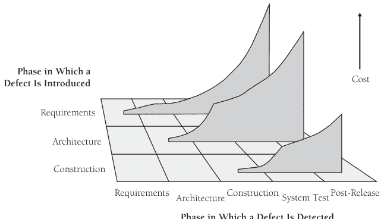

**图 3-1** 缺陷修复成本会随着从引入到检测的时间间隔增加而急剧上升。无论项目是高度顺序的（在前期完成 100% 的需求和设计）还是高度迭代的（在前期完成 5% 的需求和设计），这一现象都成立。


平均项目仍然将大部分缺陷纠正工作集中在图 3-1 的右侧，这意味着调试和相关的返工约占典型软件开发周期时间的 50%（Mills 1983；Boehm 1987a；Cooper and Mullen 1993；Fishman 1996；Haley 1996；Wheeler, Brykczynski, and Meeson 1996；Jones 1998；Shull et al. 2002；Wiegers 2002）。数十家公司发现，简单地将缺陷纠正工作提前而不是推迟，可以将开发成本和进度缩短两倍或更多（McConnell 2004）。这是一个强有力的激励，促使你尽早发现和修复问题。

## 老板准备度测试

当你认为你的老板理解在进入建设之前先处理先决条件的重要性时，请尝试下面的测试以确保。

以下哪些陈述是自我实现的预言？

- 我们最好马上开始编码，因为我们将有大量调试工作要做。
- 我们没有为测试规划太多时间，因为我们不会发现太多缺陷。
- 我们已经调查了需求和设计，以至于我无法想到在编码或调试期间会遇到任何重大问题。

所有这些陈述都是自我实现的预言。目标是最后一个。

如果你仍然不确定先决条件是否适用于你的项目，下一个部分将帮助你做出决定。

### 3.2 确定你正在从事的软件类型

Capers Jones，Software Productivity Research 的首席科学家，通过总结 20 年的软件研究指出，他和他的同事在超过 700 种不同的编程语言的项目中看到了 40 种不同的需求收集方法、50 种软件设计变体和 30 种测试方法（Jones 2003）。

不同类型的软件项目需要不同的准备与建设之间的平衡。每个项目都是独特的，但项目往往会落入一般的开发风格。表 3-2 显示了三种最常见的项目类型，并列出了通常最适合每种项目类型的实践。

**表 3-2 三种常见软件项目类型的典型良好实践**

|  | 业务系统 | 任务关键型系统 | 嵌入式生命关键型系统 |
| --- | --- | --- | --- |
| 典型应用 | Internet 网站<br>Intranet 网站<br>库存管理<br>游戏<br>管理信息系统<br>工资系统 | 嵌入式软件<br>游戏<br>Internet 网站<br>打包软件<br>软件工具<br>Web 服务 | 航电软件<br>嵌入式软件<br>医疗设备<br>操作系统<br>打包软件 |
| 生命周期模型 | 敏捷开发（极限编程、Scrum、时间盒开发等）<br>演进式原型 | 分阶段交付<br>演进式交付<br>螺旋开发 | 分阶段交付<br>螺旋开发<br>演进式交付 |
| 规划和管理 | 增量项目规划<br>按需测试和 QA 规划<br>非正式变更控制 | 基础前期规划<br>基础测试规划<br>按需 QA 规划<br>正式变更控制 |  extensive 前期规划<br> extensive 测试规划<br> extensive QA 规划<br>严格的变更控制 |
| 需求 | 非正式需求规范 | 半正式需求规范<br>按需需求评审 | 正式需求规范<br>正式需求检查 |
| 设计 | 设计和编码合并 | 架构设计<br>非正式详细设计<br>按需设计评审 | 架构设计<br>正式架构检查<br>正式详细设计<br>正式详细设计检查 |
| 建设 | 结对编程或个人编码<br>非正式签入流程或无签入流程 | 结对编程或个人编码<br>非正式签入流程<br>按需代码评审 | 结对编程或个人编码<br>正式签入流程<br>正式代码检查 |
| 测试和 QA | 开发者自行测试代码<br>测试先行开发<br>几乎没有或没有独立测试组测试 | 开发者自行测试代码<br>测试先行开发<br>独立测试组 | 开发者自行测试代码<br>测试先行开发<br>独立测试组<br>独立 QA 组 |
| 部署 | 非正式部署流程 | 正式部署流程 | 正式部署流程 |

在实际项目中，你会发现对本表中三个主题的无限变体；然而，表中的一般性是发人深省的。业务系统项目往往受益于高度迭代的方法，其中规划、需求和架构与建设、系统测试和质量保证活动交织进行。生命关键型系统往往需要更顺序的方法——需求稳定性是确保超高可靠性所需的一部分。

### 迭代方法对先决条件的影响

一些作者断言，使用迭代技术的项目根本不需要关注先决条件，但这种观点是错误的。迭代方法往往会降低上游工作不足的影响，但并不能消除它。考虑表 3-3 中不关注先决条件的项目的例子。一个项目按顺序进行，仅依靠测试来发现缺陷；另一个项目迭代进行，并在进展中发现缺陷。第一种方法将大部分缺陷纠正工作推迟到项目结束，使得成本更高，如表 3-1 所述。迭代方法在项目过程中分阶段吸收返工，这使得总成本更低。本表和下一表中的数据仅用于说明目的，但两种一般方法的相对成本得到了本章前面所述研究的充分支持。

**表 3-3 跳过先决条件对顺序和迭代项目的影响**

| 项目完成状态 | 方法 #1：无先决条件的顺序方法（工作成本） | 方法 #1：无先决条件的顺序方法（返工成本） | 方法 #2：无先决条件的迭代方法（工作成本） | 方法 #2：无先决条件的迭代方法（返工成本） |
| --- | --- | --- | --- | --- |
| 20% | $100,000 | $0 | $100,000 | $75,000 |
| 40% | $100,000 | $0 | $100,000 | $75,000 |
| 60% | $100,000 | $0 | $100,000 | $75,000 |
| 80% | $100,000 | $0 | $100,000 | $75,000 |
| 100% | $100,000 | $0 | $100,000 | $75,000 |
| 项目结束返工 | $0 | $500,000 | $0 | $0 |
| 总计 | $500,000 | $500,000 | $500,000 | $375,000 |
| 总计总计 |  | $1,000,000 |  | $875,000 |

缩短或消除先决条件的迭代项目在两个方面与同样做法的顺序项目不同。首先，平均缺陷纠正成本会更低，因为缺陷往往更接近插入软件的时间被检测到。然而，缺陷仍会在每次迭代的后期被检测到，纠正它们需要对软件的部分进行重新设计、重新编码和重新测试——这使得缺陷纠正成本高于所需水平。


其次，采用迭代方法时，成本会分阶段在整个项目期间逐步吸收，而不是集中在最后。当一切尘埃落定后，总成本会相似，但感觉不会那么高，因为费用是在项目进行过程中以小额分期支付，而不是在最后一次性支付。

正如表 3-4 所示，关注先决条件可以降低成本，无论你使用迭代还是顺序方法。迭代方法通常因多种原因而是更好的选择，但如果迭代方法忽视了先决条件，其成本可能显著高于那些密切关注先决条件的顺序项目。

## 表 3-4 关注先决条件对顺序和迭代项目的影响

| Project completion status | Approach #3: Sequential Approach with Prerequisites |  | Approach #4: Iterative Approach with Prerequisites |  |
|---|---:|---:|---:|---:|
|  | Cost of Work | Cost of Rework | Cost of Work | Cost of Rework |
| 20% | $100,000 | $20,000 | $100,000 | $10,000 |
| 40% | $100,000 | $20,000 | $100,000 | $10,000 |
| 60% | $100,000 | $20,000 | $100,000 | $10,000 |
| 80% | $100,000 | $20,000 | $100,000 | $10,000 |
| 100% | $100,000 | $20,000 | $100,000 | $10,000 |
| End-of-Project Rework | $0 | $0 | $0 | $0 |
| TOTAL | $500,000 | $100,000 | $500,000 | $50,000 |
| GRAND TOTAL | $600,000 |  | $550,000 |  |


> **KEY POINT**

正如表 3-4 所建议的那样，大多数项目既不是完全顺序的也不是完全迭代的。事先指定 100% 的需求或设计在实践中不可行，但大多数项目会在早期识别至少最关键的需求和架构元素中发现价值。

> **Cross-Reference** 有关如何根据项目规模调整开发方法，请参阅第 27 章“项目规模如何影响构建”。

一个常见的经验法则是计划事先指定约 80% 的需求，为后续指定额外需求预留时间，然后在项目进展过程中实践系统化的变更控制，只接受最有价值的新需求。另一种替代方案是事先只指定最重要的 20% 的需求，并计划以小批量增量开发其余软件，在进行过程中指定额外的需求和设计。图 3-2 和图 3-3 反映了这些不同的方法。

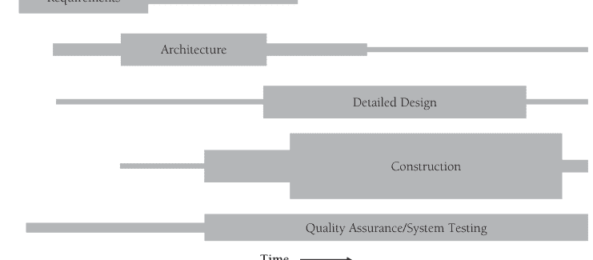

图 3-2 即使在高度顺序的项目中，大多数项目的活动也会在一定程度上重叠。

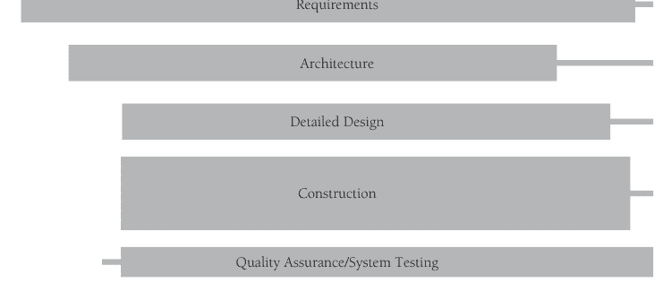

图 3-3 在其他项目中，活动会在整个项目期间重叠。成功构建的关键之一是了解先决条件已完成到何种程度，并据此调整你的方法。

## 选择迭代与顺序方法

事先需要满足的先决条件的程度将因表 3-2 中所示的项目类型、项目正式程度、技术环境、员工能力以及项目业务目标而异。你可能在以下情况下选择更顺序的（预先）方法

- 需求相对稳定。
- 设计简单且相当清楚。
- 开发团队熟悉应用领域。
- 项目风险不大。
- 长期可预测性很重要。
- 在下游更改需求、设计和代码的成本可能很高。

你可能在以下情况下选择更迭代的（边做边来）方法

- 需求尚未明确或你预计由于其他原因它们会不稳定。
- 设计复杂、具有挑战性或两者兼有。
- 开发团队不熟悉应用领域。
- 项目风险很大。
- 长期可预测性不重要。
- 在下游更改需求、设计和代码的成本可能很低。

软件就是这样，迭代方法比顺序方法有用得多。你可以通过使先决条件更正式或更不正式、更完整或更不完整来适应你的具体项目，如你所愿。有关大型和小型项目（也称为正式和非正式项目）的不同方法的详细讨论，请参阅第 27 章。

对构建先决条件的净影响是，你应首先确定哪些构建先决条件最适合你的项目。一些项目在先决条件上花费的时间太少，这会使构建暴露于不必要的高的破坏性变更率，并阻止项目取得稳定进展。一些项目前期做得太多；它们固执地坚持已被下游发现所否定需求和计划，这也可能在构建期间阻碍进展。

现在你已经研究了表 3-2 并确定了适合你的项目的先决条件，本章的其余部分将描述如何确定每个具体的构建先决条件是否已被“prereq’d”或“prewrecked”。

### 3.3 问题定义先决条件

> 如果“盒子”是约束和条件的边界，那么诀窍是找到盒子……不要想着跳出盒子——找到盒子。
> —Andy Hunt 和 Dave Thomas

在开始构建之前你需要满足的第一个先决条件是对系统应解决的问题的明确陈述。这有时被称为“产品愿景”、“愿景声明”、“使命声明”或“产品定义”。在这里它被称为“问题定义”。由于本书是关于构建的，本节不会告诉你如何撰写问题定义；它会告诉你如何识别是否已撰写问题定义，以及已撰写的问题定义是否会为构建奠定良好的基础。

问题定义在不参考任何可能解决方案的情况下定义问题是什么。它是一个简单的陈述，也许一两页，并且应该听起来像一个问题。“我们跟不上 Gigatron 的订单”听起来像一个问题，是一个好的问题定义。“我们需要优化我们的自动化数据录入系统以跟上 Gigatron 的订单”是一个糟糕的问题定义。它听起来不像问题；它听起来像解决方案。

如图 3-4 所示，问题定义在详细需求工作之前，详细需求工作是对问题的更深入调查。

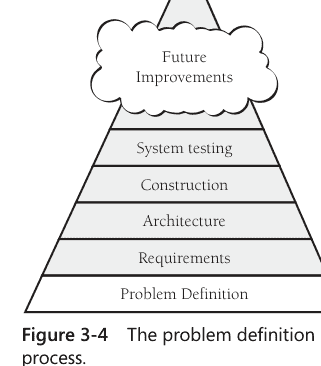

图 3-4 问题定义为整个编程过程奠定了基础。

问题定义应使用用户语言，并从用户角度描述问题。通常不应以技术计算机术语陈述。最佳解决方案可能不是计算机程序。假设你需要一份显示你年度利润的报告。你已经有显示季度利润的计算机化报告。如果你被锁定在程序员思维中，你会认为向已能做季度报告的系统添加年度报告应该很容易。然后你会付钱给程序员编写和调试一个计算年度利润的耗时程序。如果你没有被锁定在程序员思维中，你会付钱给你的秘书通过用袖珍计算器把季度数字加起来一分钟就创建年度数字。

此规则的例外适用于问题出在计算机上时：编译时间太慢或编程工具有 bug。然后以计算机或程序员术语陈述问题是合适的。

如 图 3-5 所示，如果没有好的问题定义，你可能会花费精力解决错误的问题。


**图 3-5** 在开枪前确保你知道瞄准目标。

未能定义问题的惩罚是，你可能会浪费大量时间解决错误的问题。这是一个双重惩罚，因为你也没有解决正确的问题。

### 3.4 需求先决条件

需求详细描述了软件系统应该做什么，并且是通向解决方案的第一步。需求活动也被称为“需求开发”、“需求分析”、“分析”、“需求定义”、“软件需求”、“规范”、“功能规范”和“规范”。

## 为什么要有正式需求？

明确的需求集因以下几个原因而重要。

明确的需求有助于确保用户而不是程序员驱动系统的功能。如果需求是明确的，用户可以审阅并同意它们。如果不是，程序员通常会在编程期间做出需求决策。明确的需求可以防止你猜测用户想要什么。

明确的需求也有助于避免争论。你在开始编程之前确定系统的范围。如果你与其他程序员对程序应该做什么有分歧，你可以通过查看书面需求来解决。

关注需求有助于将系统在开发开始后的变更降到最低。如果你在编码期间发现编码错误，你更改几行代码，工作继续进行。如果你发现需求错误，你必须更改设计以满足变更后的需求。你可能不得不丢弃旧设计的一部分，并且由于它必须适应已编写的代码，新设计所需的时间会比最初更长。你还必须丢弃

code and test cases affected by the requirement change and write new code and test cases. Even code that’s otherwise unaffected must be retested so that you can be sure the changes in other areas haven’t introduced any new errors.


正如表 3-1 所报告，来自众多组织的数据表明，在大型项目中，在架构阶段发现的需求错误，其修复成本通常是需求阶段发现时的 3 倍。如果在编码阶段发现，成本是 5–10 倍；在系统测试阶段，10 倍；发布后，则高得惊人，为需求开发阶段发现时的 10–100 倍。在行政成本较低的小型项目中，发布后的乘数更接近 5–10 而非 100（Boehm and Turner 2004）。无论哪种情况，这都不是你希望从工资中扣除的钱。

充分指定需求是项目成功的关键，或许甚至比有效的构建技术更重要。 （参见图 3-6。）已有许多好书写过如何很好地指定需求。因此，接下来的几节不会告诉你如何做好需求的指定工作，而是告诉你如何判断需求是否做得好，以及如何最大化利用你已有的需求。

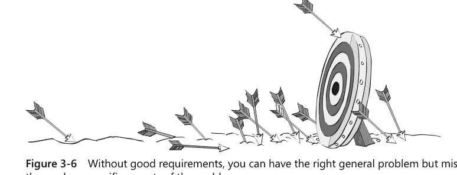

图 3-6 如果没有良好的需求，你可能抓住了问题的总体方向，但在问题的具体方面却会失之毫厘。

## 稳定需求的神话

> 需求就像水。
> 冻结时更容易在其上建造。
> —匿名

稳定需求是软件开发的圣杯。有了稳定需求，项目可以按部就班地从架构到设计再到编码再到测试，过程井然有序、可预测且平静。这是软件的天堂！你有可预测的开销，而且永远不必担心某个功能因为用户在调试结束前才想到它，而导致实现成本增加 100 倍。

希望客户一旦接受了需求文档后就不再需要更改是合理的。然而在典型的项目中，客户在代码编写之前无法可靠地描述所需内容。问题不在于客户是低等生命。正如你对项目了解得越多就越理解它一样，他们对项目了解得越多就越理解它。开发过程帮助客户更好地理解自身需求，这也是需求变更的主要来源（Curtis, Krasner, and Iscoe 1988; Jones 1998; Wiegers 2003）。严格遵循需求的计划实际上是不回应客户的计划。

通常会有多少变更？IBM 及其他公司的研究发现，平均项目在开发期间需求变更约为 25%（Boehm 1981, Jones 1994, Jones 2000），这占典型项目返工量的 70 至 85%（Leffingwell 1997, Wiegers 2003）。

也许你认为庞蒂亚克 Aztek 是有史以来最伟大的汽车，属于扁平地球协会，并每四年朝圣一次新墨西哥州罗斯威尔的外星人着陆点。如果你是这样想的，那就继续相信你的项目需求不会变更吧。另一方面，如果你已经不再相信圣诞老人和牙仙，或者至少不再承认这一点，你可以采取几个步骤来最小化需求变更的影响。

## 在构建期间处理需求变更

以下是你在构建期间可以做的事情，以最大化利用不断变化的需求：

- **使用本节末尾的需求检查表来评估需求的质量** 如果你的需求还不够好，就停止工作，回溯，并在继续之前将其修正。没错，在这个阶段停止编码感觉像是落后了。但如果你从芝加哥开车到洛杉矶，当你看到通往纽约的路标时，停下来看一下道路地图是浪费时间吗？不是。如果你没有朝正确的方向前进，就停下来检查你的路线。
- **确保每个人都知道需求变更的成本** 客户在想到新功能时会兴奋不已。在兴奋中，他们的血液变稀并流向延髓变得欣喜若狂，忘记了你们为讨论需求而开的会议、签署仪式以及已完成的需求文档。处理这种功能中毒的人最简单的方法是说：“哎呀，这听起来是个好主意。由于它不在需求文档中，我会制定一份修订后的进度表和成本估算，以便你决定是否现在做还是以后做。”“进度表”和“成本”这两个词比咖啡和冷水澡更令人清醒，许多“必须有”的功能很快就会变成“想要有”。


如果你的组织对先做需求的重要性不够敏感，请指出需求阶段的变更比以后的变更便宜得多。利用本章的“在构建前做先决条件的绝对令人信服且万无一失的论据”。

交叉引用 有关处理设计和代码变更的详细信息，请参阅第 28.2 节“配置管理”。

## 建立变更控制程序

如果客户的兴奋持续存在，请考虑建立一个正式的变更控制委员会来审查此类拟议变更。客户改变主意并意识到需要更多功能是可以的。问题在于他们频繁提出变更，导致你无法跟上。有内置的变更控制程序会让每个人都高兴。你很高兴，因为你知道你只需要特定时间处理变更。你的客户很高兴，因为他们知道你有处理他们意见的计划。

交叉引用 有关迭代开发方法的详细信息，请参阅第 5.4 节中的“迭代”和第 29.3 节“增量集成策略”。

## 使用能够适应变更的开发方法

一些开发方法最大化了你响应不断变化需求的能力。演进式原型方法帮助你在派出力量构建系统之前探索系统的需求。演进式交付是一种分阶段交付系统的方法。你可以建一点，从用户那里获得一点反馈，调整一点设计，做一些更改，再建一点。关键是使用短的开发周期，以便你能快速响应用户。

进一步阅读 有关支持灵活需求的开发方法的详细信息，请参阅《Rapid Development》（McConnell 1996）。

## 放弃项目

如果需求特别糟糕或不稳定，而且上述建议都不可行，请取消项目。即使你实际上无法取消项目，也要想想取消它会是什么样子。想想情况要糟糕到什么程度你才会取消它。如果有一种情况你会放弃它，至少问问自己你的情况与那种情况有多大区别。

交叉引用 有关正式项目和非正式项目之间差异的详细信息（通常由项目规模差异引起），请参阅第 27 章“项目规模如何影响构建”。

## 关注项目的商业案例

许多需求问题在你回溯到项目的商业原因时就会消失。需求在作为“功能”考虑时似乎是个好主意，但在评估“增量商业价值”时却可能显得糟糕透顶。记住考虑其决策商业影响的程序员物有所值——尽管我很乐意以现金形式收到这条建议的佣金。


## Checklist: Requirements

需求检查清单包含了一系列关于项目需求的自问问题。本书不会告诉你如何做好需求开发，这个清单也不会告诉你如何去做。把清单用作构建时的 sanity check，以确定你所站立的地面是否坚实——你在需求里氏量表上的位置如何。

并非所有检查清单问题都适用于你的项目。如果你正在进行一个非正式项目，你会发现有些问题甚至不需要考虑。你会发现其他问题需要考虑但不需要正式回答。如果你正在进行一个大型、正式的项目，则可能需要考虑每一个问题。

### Specific Functional Requirements

具体功能需求

- 系统的所有输入是否都已指定，包括其来源、准确性、取值范围和频率？
- 系统的所有输出是否都已指定，包括其目的地、准确性、取值范围、频率和格式？
- 所有输出格式是否都已指定，例如网页、报表等？
- 所有外部硬件和软件接口是否都已指定？
- 所有外部通信接口是否都已指定，包括握手、错误检查和通信协议？
- 用户希望执行的所有任务是否都已指定？
- 每个任务中使用的数据和每个任务产生的数据是否都已指定？

### Specific Nonfunctional (Quality) Requirements

具体非功能性（质量）需求

- 从用户角度来看，所有必要操作的预期响应时间是否已指定？
- 其他时间方面的考虑是否已指定，例如处理时间、数据传输速率和系统吞吐量？
- 安全级别是否已指定？
- 可靠性是否已指定，包括软件失败的后果、需要防止失败的重要信息，以及错误检测和恢复的策略？
- 最小机器内存和可用磁盘空间是否已指定？
- 系统的可维护性是否已指定，包括其适应特定功能变化、运行环境变化以及与其他软件接口变化的能力？
- 是否包含成功和失败的定义？

### Requirements Quality

需求质量

- 需求是否用用户的语言编写？用户是否认为如此？
- 每个需求是否避免与其他需求冲突？
- 可接受的竞争属性之间的权衡是否已指定——例如鲁棒性与正确性之间？
- 需求是否避免指定设计？
- 需求是否在相当一致的详细程度上？是否应更详细地指定任何需求？是否应更少详细地指定任何需求？
- 需求是否清晰到可以交给独立团队进行构建仍能被理解？开发人员是否认为如此？
- 每个条目是否与问题及其解决方案相关？每个条目是否都可以追溯到其在问题环境中的来源？
- 每个需求是否可测试？是否可能通过独立测试来确定每个需求是否已得到满足？
- 对需求的所有可能变更是否都已指定，包括每个变更的可能性？

### Requirements Completeness

需求完整性

- 在开发开始前信息不可用时，不完整区域是否已指定？
- 需求是否在以下意义上是完整的：如果产品满足每个需求，它将被接受？
- 你是否对所有需求都感到满意？你是否已消除那些不可能实现却只是为了取悦客户或老板而包含的需求？

### 3.5 Architecture Prerequisite

3.5 架构先决条件

Cross-Reference For more information on design at all levels, see Chapters 5 through 9.

交叉引用 有关各层面设计的更多信息，请参阅第 5 章至第 9 章。

软件架构是软件设计的高层部分，是容纳更详细设计部分的框架（Buschmann et al. 1996; Fowler 2002; Bass, Clements, Kazman 2003; Clements et al. 2003）。架构也被称为“系统架构”、“高层设计”和“顶层设计”。通常，架构描述在一个单一文档中，称为“架构规范”或“顶层设计”。有些人会在架构和高层设计之间做出区分

### Typical Architectural Components

典型架构组件

许多组件是良好系统架构的共同点。如果你自己构建整个系统，你在架构上的工作将与你在更详细设计上的工作重叠。在这种情况下，你至少应该考虑每个架构组件。如果你正在处理由他人架构的系统，你应该能够在没有血猎犬、鹿猎帽和放大镜的情况下找到重要组件。在任何情况下，以下是需要考虑的架构组件。

#### Program Organization

程序组织

> 如果你不能向六岁小孩解释某件事，你自己其实并不真正理解它。
> 
> —*Albert Einstein*

系统架构首先需要一个概述，用宽泛的术语描述系统。没有这样的概述，你将很难从一千个细节甚至十几个单独的类中构建出连贯的画面。如果系统是一个小小的 12 片拼图，你的一岁孩子可以在吃糊状芦笋的间隙把它拼好。12 个子系统的拼图更难拼凑，如果你拼不起来，你就不会理解你正在开发的类如何为系统做出贡献。

在架构中，你应该找到证据表明最终组织方案的替代方案已被考虑，并找到选择最终组织方案而非其替代方案的原因。当一个类的角色在系统中似乎没有被明确构思时，工作会令人沮丧。通过描述组织替代方案，架构提供了系统组织的理由，并表明每个类都经过了仔细考虑。对设计实践的一项回顾发现，设计 rationale 对于维护的重要性至少与设计本身一样重要（Rombach 1990）。

架构应定义程序中的主要构建块。根据程序的大小，每个构建块可能是一个单独的类，也可能是一个由许多类组成的子系统。每个构建块是一个类，或者是一组协同工作于高层功能的类或例程，例如与用户交互、显示网页、解释命令、封装业务规则或访问数据。需求中列出的每个功能都应至少由一个构建块覆盖。如果一个功能被两个或多个构建块声称，它们的声称应相互合作，而非冲突。

每个构建块负责的内容应定义良好。构建块应只有一个责任区域，并且应尽可能少地了解其他构建块的责任区域。通过最小化每个构建块对其他构建块的了解，你将设计信息本地化到单个构建块中。

每个构建块的通信规则应定义良好。架构应描述该构建块可以直接使用哪些其他构建块、可以间接使用哪些构建块，以及根本不应使用哪些构建块。

#### Major Classes

主要类

Cross-Reference For details on class design, see Chapter 6, “Working Classes.”

交叉引用 有关类设计的详细信息，请参阅第 6 章“Working Classes”。

架构应指定要使用的主要类。它应确定每个主要类的职责以及该类将如何与其他类交互。它应包括类层次结构、状态转换和对象持久性的描述。如果系统足够大，它应描述类如何组织成子系统。

架构应描述已考虑的其他类设计，并给出偏好所选组织的理由。架构不需要指定系统中的每个类。目标是 80/20 法则：指定构成系统 80% 行为的 20% 的类（Jacobson, Booch, and Rumbaugh 1999; Kruchten 2000）。

#### Data Design

数据设计

Cross-Reference For details on working with variables, see Chapters 10 through 13.

交叉引用 有关变量操作的详细信息，请参阅第 10 章至第 13 章。

架构应描述要使用的主要文件和表设计。它应描述已考虑的替代方案并证明所做选择的合理性。如果应用程序维护一个客户 ID 列表，而架构师选择使用顺序访问列表来表示 ID 列表，文档应解释为什么顺序访问列表优于随机访问列表、栈或哈希表。在构建期间，此类信息让你深入了解架构师的思路。在维护期间，同样的见解是无价的帮助。没有它，你就像在看一部没有字幕的外语电影。

数据通常应仅由一个子系统或类直接访问，除非通过访问类或例程以受控和抽象的方式访问数据。这在第 5.3 节“Hide Secrets (Information Hiding)”中更详细地解释。

架构应指定所用任何数据库的高层组织和内容。架构应解释为什么单个数据库优于多个数据库（或反之亦然），解释为什么数据库优于平面文件，识别可能访问相同数据的其他程序的可能交互，解释在数据上创建了哪些视图，等等。

#### Business Rules

业务规则

如果架构依赖于特定的业务规则，它应识别这些规则并描述它们对系统设计的影响。例如，假设系统需要遵循一条业务规则，即客户信息不应


## 用户界面设计

用户界面通常在需求阶段就被确定。如果没有，则应在软件架构中进行说明。架构应规定 Web 页面格式、GUI、命令行界面等主要元素。用户界面的精心架构决定了一个程序是备受喜爱还是从未被使用。

架构应模块化，以便可以在不影响程序的业务规则和输出部分的情况下替换新的用户界面。例如，架构应使剔除一组交互式界面类并插入一组命令行类变得相当容易。这种能力通常很有用，尤其是命令行界面在单元或子系统级别的软件测试中很方便。

用户界面的设计值得单独一本书的篇幅讨论，但超出了本书的范围。

## 资源管理

架构应描述管理稀缺资源（如数据库连接、线程和句柄）的计划。内存管理是架构需要处理的另一个重要领域，尤其是在内存受限的应用领域，如驱动程序开发和嵌入式系统。架构应估算名义情况和极端情况下使用的资源。在简单情况下，估算应显示所需资源远在预期实现环境的承受能力之内。在更复杂的情况下，应用程序可能需要更主动地管理自己的资源。如果需要，资源管理器应像系统的其他任何部分一样精心设计。

## 安全

架构应描述设计级和代码级安全的方法。如果尚未构建威胁模型，则应在架构阶段构建。编码准则应考虑到安全影响，包括处理缓冲区的策略、处理不可信数据（用户输入的数据、Cookie、配置数据和其他外部接口）的规则、加密、错误消息中包含的详细程度、保护内存中秘密数据等其他问题。

> **进一步阅读** 有关软件安全的精彩讨论，请参阅 *Writing Secure Code*，第 2 版（Howard and LeBlanc 2003）以及 *IEEE Software* 2002 年 1 月刊。

## 性能

如果性能是关注点，性能目标应在需求中指定。性能目标可以包括资源使用，在这种情况下，目标还应指定资源之间的优先级，包括速度与内存与成本。

架构应提供估算并解释架构师为何认为目标是可以实现的。如果某些领域有风险无法达到目标，架构应说明这一点。如果某些领域需要使用特定的算法或数据类型才能达到性能目标，架构应说明这一点。架构还可以为每个类或对象包含空间和时间预算。

## 可扩展性

可扩展性是指系统满足未来需求的能力。架构应描述系统将如何应对用户数量、服务器数量、网络节点数量、数据库记录数量、数据库记录大小、事务量等方面的增长。如果系统预计不会增长且可扩展性不是问题，架构应明确说明这一假设。

## 互操作性

如果系统预计要与其他软件或硬件共享数据或资源，架构应描述将如何实现这一点。

## 国际化/本地化

“国际化”是为程序支持多种区域做好技术准备的活动。国际化通常被称为“I18n”，因为“internationalization”中的第一个和最后一个字符是“I”和“N”，中间有 18 个字母。“本地化”（因同样原因称为“L10n”）是将程序翻译以支持特定本地语言的活动。

交互式系统的架构应关注国际化问题。大多数交互式系统包含数十或数百个提示、状态显示、帮助消息、错误消息等。应估算字符串使用的资源。如果程序要商业使用，架构应显示已考虑典型的字符串和字符集问题，包括使用的字符集（ASCII、DBCS、EBCDIC、MBCS、Unicode、ISO 8859 等）、使用的字符串类型（C 字符串、Visual Basic 字符串等）、在不更改代码的情况下维护字符串，以及将字符串翻译成外语对代码和用户界面的影响最小。架构可以决定在代码中需要的地方内联使用字符串，将字符串保存在类中并通过类接口引用它们，或将字符串存储在资源文件中。架构应说明选择了哪个选项以及原因。

进一步阅读 有关设计系统以提高性能的更多信息，请参阅 Connie Smith 的 *Performance Engineering of Software Systems*（1990）。

## 输入/输出

输入/输出（I/O）是架构中应关注的另一个领域。架构应指定预读、回读或即时读取方案。并且应描述 I/O 错误检测的级别：字段、记录、流或文件级别。

## 错误处理


错误处理正成为现代计算机科学中最棘手的问题之一，你不能随意处理。一些人估计，程序代码的 90% 都是为异常、错误处理情况或 housekeeping 编写的，这意味着只有 10% 是为名义情况编写的（Shaw in Bentley 1982）。由于有如此多的代码用于处理错误，应在架构中明确说明一致处理它们的策略。

错误处理通常被视为编码约定级别的问题，如果被处理的话。但由于它具有系统范围的影响，最好在架构级别处理。以下是一些需要考虑的问题：

- 错误处理是纠正性的还是仅仅是检测性的？如果是纠正性的，程序可以尝试从错误中恢复。如果只是检测性的，程序可以继续处理，好像什么都没发生，或者可以退出。在任何情况下，它都应通知用户它检测到了错误。
- 错误检测是主动的还是被动的？系统可以主动预见错误——例如，通过检查用户输入的有效性——也可以被动地仅在无法避免时才响应它们——例如，当用户输入的组合产生数值溢出时。它可以清理道路或清理混乱。同样，在任何情况下，选择都具有用户界面影响。
- 程序如何传播错误？一旦检测到错误，它可以立即丢弃导致错误的数据，可以将错误视为错误并进入错误处理状态，或可以等待所有处理完成后再通知用户检测到错误（在某处）。
- 处理错误消息的约定是什么？如果架构未指定单一、一致的策略，用户界面将看起来像不同部分的不同界面的令人困惑的通心粉和干豆拼贴。为了避免这种外观，架构应为错误消息建立约定。
- 异常将如何处理？架构应说明代码何时可以抛出异常、在何处捕获它们、如何记录它们、如何记录它们等。


> 跨引用 处理错误参数的一致方法也是错误处理策略的另一个方面，应在架构层面加以解决。例如，参见第 8 章，“防御性编程”。

- 在程序内部，错误在什么层级被处理？你可以在检测点处理它们，将其交给错误处理类处理，或将其沿调用链向上传递。
- 每个类对验证其输入数据的责任级别是什么？每个类是否负责验证自己的数据，还是有一组类负责验证系统的所有数据？任何层级的类都可以假设它们接收到的数据是干净的吗？
- 你想使用环境的内置异常处理机制还是构建自己的机制？环境具有某种错误处理方法并不意味着它是最适合你需求的方法。

## 容错

> 进一步阅读 有关容错的良好介绍，请参阅 2001 年 7 月的 IEEE Software 期刊。除了提供良好的介绍外，文章还引用了该主题的许多重要书籍和重要文章。

架构还应指明预期的容错类型。容错是一组技术，通过检测错误、在可能的情况下从中恢复、如果不能则遏制其不良影响，从而提高系统的可靠性。

例如，系统可以通过以下几种方式使对一个数字开平方根的计算具有容错性：

- 系统在检测到故障时可能会回退并重试。如果第一个答案是错误的，它将回退到一切正常时的点并从那里继续。
- 系统可能具有辅助代码以在检测到主代码中的故障时使用。在示例中，如果第一个答案似乎是错误的，系统将切换到替代的平方根例程并使用它。
- 系统可能使用投票算法。它可能有三个使用不同方法的平方根类。每个类计算平方根，然后系统比较结果。根据系统内置的容错类型，它随后使用三个结果的平均值、中位数或众数。
- 系统可能会用一个对系统其余部分具有良性影响的假值替换错误值。

其他容错方法包括当系统检测到错误时使其转变为部分运行状态或功能降级状态。它可以关闭自身或自动重新启动。这些示例必然是简化的。容错是一个迷人而复杂的话题——不幸的是，它超出了本书的范围。

## 架构可行性

设计人员可能会担心系统满足其性能目标、符合资源限制或得到实现环境充分支持的能力。架构应证明系统在技术上是可行的。如果任何方面的不可行可能使项目无法进行，架构应说明这些问题是如何通过概念验证原型、研究或其他方式进行调查的。这些风险应在全面建设开始前得到解决。

## 过度设计

健壮性是指系统在检测到错误后仍能继续运行的能力。通常，架构指定的系统比需求指定的系统更健壮。一个原因是，由许多仅具有最小健壮性的部分组成的系统，其整体健壮性可能低于要求。在软件中，链条的强度不取决于其最弱的环节，而取决于所有弱环节的乘积。架构应明确指出程序员应倾向于过度设计还是倾向于做能工作的最简单的事情。

指定过度设计的方法尤为重要，因为许多程序员出于职业自豪感，会自动过度设计他们的类。通过在架构中明确设定期望，你可以避免出现某些类异常健壮而其他类仅勉强合格的现象。

## 买与建决策

> 跨引用 有关可商业获得的软件组件和库的类型列表，请参阅第 30.3 节中的“代码库”。

构建软件的最激进解决方案是根本不构建它——而是购买它或免费下载开源软件。你可以购买 GUI 控件、数据库管理器、图像处理器、图形和图表组件、Internet 通信组件、安全和加密组件、电子表格工具、文本处理工具——列表几乎无穷无尽。在现代 GUI 环境中编程的最大优势之一就是你自动获得的功能量：图形类、对话框管理器、键盘和鼠标处理器、能自动与任何打印机或显示器配合工作的代码等等。

如果架构未使用现成的组件，它应解释自定义组件预期如何超越现成的库和组件。

## 复用决策

如果计划要求使用现有软件、测试用例、数据格式或其他材料，架构应解释复用软件将如何被使其符合其他架构目标——如果它将被使其符合。

## 变更策略

由于构建软件产品对程序员和用户来说都是一个学习过程，产品在其开发过程中很可能发生变化。变化源于易变的数据类型和文件格式、功能变更、新特性等等。变化可能是可能源于计划增强功能的新能力，也可能是未进入系统第一个版本的能力。因此，软件架构师面临的主要挑战之一是使架构足够灵活以适应可能的变化。

> 跨引用 有关系统化处理变更的详细信息，请参阅第 28.2 节，“配置管理”。

> 设计缺陷通常很微妙，并且随着新功能或用法的增加而演化，早期假设被遗忘。
> ——Fernando J. Corbató

架构应清楚地描述处理变更的策略。架构应表明可能的增强功能已被考虑，并且最可能的增强功能也是最容易实现的。如果输入或输出格式、用户交互风格或处理需求可能发生变化，架构应表明所有变化都已得到预期，并且任何单一变化的影响将仅限于少数几个类。架构对变更的计划可以简单到在数据文件中加入版本号、为将来使用保留字段，或设计文件以便可以添加新表。如果使用代码生成器，架构应表明预期变化在代码生成器的能力范围内。

> 跨引用 有关延迟承诺的完整解释，请参阅第 5.3 节中的“有意识地选择绑定时间”。

架构应指明用于延迟承诺的策略。例如，架构可能规定使用表驱动技术而不是硬编码的测试。它可能规定表的<|message|>


你可能知道在开发过程中架构是如何被改变的。每一次改变都应与整体概念干净地契合。架构不应该看起来像美国国会拨款法案，附带为每个代表的家乡选区提供猪肉桶、浪费性工程的附加条款。

架构的目标应明确陈述。针对可修改性为主要目标的系统设计，与针对无妥协性能为目标的设计会不同，即使两者系统功能相同。

架构应描述所有主要决策的动机。要警惕“我们一直都是这样做的”这种理由。有一个故事说，Beth 想按照她丈夫家族传下来的获奖的焖烤牛肉配方来做焖烤牛肉。她丈夫 Abdul 说，他的母亲教他撒上盐和胡椒，切掉两端，放进平底锅，盖上盖子，然后煮。Beth 问：“为什么要切掉两端？”Abdul 说：“我不知道。我一直都是这样做的。让我问问我母亲。”他打电话给她，她说：“我不知道。我一直都是这样做的。让我问问你祖母。”她打电话给他的祖母，祖母说：“我不知道你为什么要那样做。我那样做是因为它太大放不进我的平底锅。”

良好的软件架构在很大程度上与机器和语言无关。 admittedly，你不能忽视构建环境。然而，通过尽可能独立于环境，你可以避免过度设计系统或做在构建阶段能做得更好的工作的诱惑。如果程序的目的是锻炼特定的机器或语言，则此准则不适用。

架构应在欠规范和过度规范之间取得平衡。架构的任何部分都不应得到超出其应得的关注，或被过度设计。设计者不应以牺牲另一部分为代价关注某一部分。架构应在不镀金的情况下解决所有需求（不包含不需要的元素）。

架构应明确识别有风险的区域。它应解释为什么它们有风险，以及已采取哪些步骤来最小化风险。

架构应包含多个视图。房屋的计划将包括立面图、平面图、框架图、电气图以及房屋的其他视图。软件架构描述也受益于提供系统的不同视图，以发现错误和不一致，并帮助程序员充分理解系统的设计（Kruchten 1995）。

最后，你不应对架构的任何部分感到不安。它不应包含任何只是为了取悦老板的东西。它不应包含任何你难以理解的东西。你将是实现它的人；如果它对你来说没有意义，你怎么能实现它？

## Checklist: Architecture

以下是良好架构应解决的问题清单。该清单并非旨在成为架构的全面指南，而是作为一种务实的方式来评估你在软件食物链程序员端所得到的营养含量。以此清单作为你自己的清单的起点。与需求清单一样，如果你正在进行非正式项目，你会发现一些甚至不需要考虑的项目。如果你正在进行大型项目，大多数项目都将有用。

### Specific Architectural Topics

- [ ] 程序的整体组织是否清晰，包括良好的架构概述和理由？
- [ ] 主要构建块是否定义良好，包括其职责范围以及与其他构建块的接口？
- [ ] 需求中列出的所有功能是否都由既不多也不少的构建块合理覆盖？
- [ ] 最关键的类是否已描述并得到论证？
- [ ] 数据设计是否已描述并得到论证？
- [ ] 数据库组织和内容是否已指定？
- [ ] 是否已识别所有关键业务规则并描述了它们对系统的影响？
- [ ] 是否描述了用户界面设计的策略？
- [ ] 用户界面是否模块化，以便对其的更改不会影响程序的其余部分？
- [ ] 是否描述并论证了处理 I/O 的策略？
- [ ] 是否为稀缺资源如线程、数据库连接、句柄、网络带宽等描述并论证了资源使用估计和资源管理策略？
- [ ] 架构的安全需求是否已描述？
- [ ] 架构是否为每个类、子系统或功能区域设定了空间和速度预算？
- [ ] 架构是否描述了如何实现可扩展性？
- [ ] 架构是否解决了互操作性？
- [ ] 是否描述了国际化/本地化策略？
- [ ] 是否提供了连贯的错误处理策略？
- [ ] 是否定义了容错方法（如果需要）？
- [ ] 系统所有部分的技術可行性是否已建立？
- [ ] 是否指定了过度工程的方法？
- [ ] 是否包含了必要的买与建决策？
- [ ] 架构是否描述了如何使重用代码符合其他架构目标？
- [ ] 架构是否设计为能够适应可能的更改？

### General Architectural Quality

- [ ] 架构是否涵盖了所有需求？
- [ ] 是否有任何部分被过度架构或架构不足？对此领域的期望是否明确列出？
- [ ] 整个架构在概念上是否连贯？
- [ ] 顶层设计是否独立于用于实现的机器和语言？
- [ ] 是否提供了所有主要决策的动机？
- [ ] 作为将实现系统的程序员，你是否对架构感到满意？

### 3.6 Amount of Time to Spend on Upstream Prerequisites

Cross-Reference 你花费在先决条件上的时间将取决于你的项目类型。有关如何将先决条件调整到特定项目的详细信息，请参阅本章前文的第 3.2 节，“Determine the Kind of Software You're Working On”。

花费在问题定义、需求和软件架构上的时间根据项目需求而变化。通常，运行良好的项目将约 10 到 20% 的工作量和约 20 到 30% 的进度安排用于需求、架构和前期规划（McConnell 1998, Kruchten 2000）。这些数字不包括详细设计的时间——那是构建的一部分。

如果需求不稳定，并且你正在进行大型正式项目，你可能需要与需求分析师合作，以解决在构建早期发现的需求问题。留出时间与需求分析师协商，并让需求分析师在你拥有可用的需求版本之前修改需求。

如果需求不稳定，并且你正在进行小型非正式项目，你可能需要自行解决需求问题。留出时间来充分定义需求，以便其波动性对构建的影响最小。

Cross-Reference 有关处理构建期间需求变化的方法，请参阅本章第 3.4 节中“Handling Requirements Changes During Construction”。

如果任何项目——正式或非正式——的需求不稳定，请将需求工作视为其自身项目。在完成需求后，再估计项目的其余时间。这是一种合理的方法，因为在你不知道要构建什么之前，没有人能合理地期望你估计你的进度。这就像你被叫去做房屋工作的一名承包商。你的客户说：“这项工作要花多少钱？”你合理地问：“你希望我做什么？”你的客户说：“我不能告诉你，但要花多少钱？”你合理地感谢客户浪费你的时间然后回家。

对于建筑来说，很明显客户在告诉你将要构建什么之前要求投标是不合理的。你的客户不会希望你在建筑师完成蓝图之前就带着木材、锤子和钉子出现并开始花他们的钱。然而，人们往往比理解二乘四和石膏板更少理解软件开发，所以你合作的客户可能不会立即理解为什么你想将需求开发计划为一个单独的项目。你可能需要向他们解释你的理由。

在为软件架构分配时间时，使用与需求开发类似的方法。如果软件是你以前从未工作过的类型，请为在新领域设计的不可预测性留出更多时间。确保你创建良好架构所需的时间不会占用你在其他领域进行良好工作所需的时间。如有必要，也将架构工作计划为一个单独的项目。

## Additional Resources

cc2e.com/0344

以下是关于需求的更多资源：

cc2e.com/0351

## Requirements

以下是几本对需求开发提供更多细节的书籍：

Wiegers, Karl. *Software Requirements*, 2d ed. Redmond, WA: Microsoft Press, 2003. 这是一本实用、面向从业者的书籍，描述了需求活动的方方面面，包括需求获取、需求分析、需求规范、需求验证和需求管理。

Robertson, Suzanne and James Robertson. *Mastering the Requirements Process*. Reading, MA: Addison-Wesley, 1999. 这是 Wiegers 书籍的良好替代品，适合更高级的需求从业者。

Gilb, Tom. *Competitive Engineering*. Reading, MA: Addison-Wesley, 2004. 这本书描述了 Gilb 的需求语言，被称为“Planguage”。该书涵盖了 Gilb 对需求工程、设计和设计评估以及演进式项目管理的特定方法。这本书可以从 Gilb 的网站 www.gilb.com 下载。

cc2e.com/0358


*IEEE Std 830-1998. IEEE Recommended Practice for Software Requirements Specifications.* Los Alamitos, CA: IEEE Computer Society Press. 本文是 IEEE-ANSI 编写软件需求规格说明书的指南。它描述了规格说明书中应包含的内容，并展示了几种备选大纲。

Abram, Alain, et al. *Swebok: Guide to the Software Engineering Body of Knowledge.* Los Alamitos, CA: IEEE Computer Society Press, 2001. 本文对软件需求知识体系进行了详细描述。也可从 *www.swebok.org* 下载。

其他不错的替代书籍包括以下：

Lauesen, Soren. *Software Requirements: Styles and Techniques.* Boston, MA: Addison-Wesley, 2002.

Kovitz, Benjamin L. *Practical Software Requirements: A Manual of Content and Style.* Manning Publications Company, 1998.

Cockburn, Alistair. *Writing Effective Use Cases.* Boston, MA: Addison-Wesley, 2000.

## Software Architecture

过去几年出版了大量关于软件架构的书籍。以下是其中最好的一些：

Bass, Len, Paul Clements, and Rick Kazman. *Software Architecture in Practice*, 2d ed. Boston, MA: Addison-Wesley, 2003.

Buschman, Frank, et al. *Pattern-Oriented Software Architecture, Volume 1: A System of Patterns.* New York, NY: John Wiley & Sons, 1996.

Clements, Paul, ed. *Documenting Software Architectures: Views and Beyond.* Boston, MA: Addison-Wesley, 2003.

Clements, Paul, Rick Kazman, and Mark Klein. *Evaluating Software Architectures: Methods and Case Studies.* Boston, MA: Addison-Wesley, 2002.

Fowler, Martin. *Patterns of Enterprise Application Architecture.* Boston, MA: Addison-Wesley, 2002.

Jacobson, Ivar, Grady Booch, and James Rumbaugh. *The Unified Software Development Process.* Reading, MA: Addison-Wesley, 1999.

*IEEE Std 1471-2000. Recommended Practice for Architectural Description of Software-Intensive Systems.* Los Alamitos, CA: IEEE Computer Society Press. 本文是 IEEE-ANSI 创建软件架构规格说明书的指南。

揭示章节：“A Typical Day using PSP/TSP,” “A Typical Day using Extreme Programming,” “A Crisis Day using PSP/TSP,” 和 “A Crisis Day using Extreme Programming。” 第 5 章论述如何利用风险平衡敏捷性，提供了在敏捷方法和计划驱动方法之间选择的精辟指导。第 6 章“Conclusions”也十分平衡，并提供了极佳的视角。附录 E 是关于敏捷实践的经验数据的宝库。

Larman, Craig. *Agile and Iterative Development: A Manager’s Guide*. Boston, MA: Addison Wesley, 2004. 这是一本关于灵活、演进式开发风格的深入研究入门。它概述了 Scrum、极限编程、统一过程和 Evo。

## Checklist: Upstream Prerequisites

- Have you identified the kind of software project you’re working on and tailored your approach appropriately?
- Are the requirements sufficiently well defined and stable enough to begin construction? (See the requirements checklist for details.)
- Is the architecture sufficiently well defined to begin construction? (See the architecture checklist for details.)
- Have other risks unique to your particular project been addressed, such that construction is not exposed to more risk than necessary?

## Key Points

- The overarching goal of preparing for construction is risk reduction. Be sure your preparation activities are reducing risks, not increasing them.
- If you want to develop high-quality software, attention to quality must be part of the software-development process from the beginning to the end. Attention to quality at the beginning has a greater influence on product quality than attention at the end.
- Part of a programmer’s job is to educate bosses and coworkers about the software-development process, including the importance of adequate preparation before programming begins.
- The kind of project you’re working on significantly affects construction prerequisites—many projects should be highly iterative, and some should be more sequential.
- If a good problem definition hasn’t been specified, you might be solving the wrong problem during construction.
- If good requirements work hasn’t been done, you might have missed important details of the problem. Requirements changes cost 20 to 100 times as much in the stages following construction as they do earlier, so be sure the requirements are right before you start programming.
- If a good architectural design hasn’t been done, you might be solving the right problem the wrong way during construction. The cost of architectural changes increases as more code is written for the wrong architecture, so be sure the architecture is right, too.
- Understand what approach has been taken to the construction prerequisites on your project, and choose your construction approach accordingly.

## Chapter 4

## Key Construction Decisions

### Contents

- 4.1 Choice of Programming Language: page 61
- 4.2 Programming Conventions: page 66
- 4.3 Your Location on the Technology Wave: page 66
- 4.4 Selection of Major Construction Practices: page 69

### Related Topics

- Upstream prerequisites: Chapter 3
- Determine the kind of software you’re working on: Section 3.2
- How program size affects construction: Chapter 27
- Managing construction: Chapter 28
- Software design: Chapter 5, and Chapters 6 through 9

一旦你确信为建设奠定了适当的基础，准备工作就会转向更具体的建设决策。第 3 章“Measure Twice, Cut Once: Upstream Prerequisites”讨论了蓝图和施工许可的软件等价物。你可能对这些准备工作没有太多控制权，因此该章的重点是评估建设开始时你所拥有的资源。本章重点关注个人程序员和技术负责人直接或间接负责的准备工作。它讨论了软件等价物，即如何为你的工具带选择特定工具，以及在前往工地之前如何装载卡车。

如果你觉得已经读够了关于建设准备的内容，可以跳到第 5 章“Design in Construction”。

### 4.1 Choice of Programming Language

> By relieving the brain of all unnecessary work, a good notation sets it free to concentrate on more advanced problems, and in effect increases the mental power of the race. Before the introduction of the Arabic notation, multiplication was difficult, and the division even of integers called into play the highest mathematical faculties. Probably nothing in the modern world would have more astonished a Greek mathematician than to learn that ... a huge proportion of the population
> 
> *of Western Europe could perform the operation of division for the largest numbers. This fact would have seemed to him a sheer impossibility.... Our modern power of easy reckoning with decimal fractions is the almost miraculous result of the gradual discovery of a perfect notation.*
> 
> –Alfred North Whitehead

系统将要实现的编程语言应该引起你的极大兴趣，因为你将从建设开始到结束都沉浸其中。

研究表明，编程语言的选择以多种方式影响生产率和代码质量。

程序员使用熟悉的语言比使用不熟悉的语言更有效率。来自 Cocomo II 估算模型的数据显示，使用过三年或更长时间的语言的程序员比具有同等经验但对语言不熟悉的程序员生产率高约 30%（Boehm et al. 2000）。IBM 的一项早期研究发现，对编程语言有丰富经验的程序员生产率超过经验最少者的三倍以上（Walston and Felix 1977）。（Cocomo II 更谨慎地分离了单个因素的影响，这解释了两项研究结果的不同。）


使用高级语言的程序员比使用低级语言的程序员实现更好的生产率和质量。诸如 C++、Java、Smalltalk 和 Visual Basic 等语言被认为将生产率、可靠性、简洁性和可理解性提高了 5 到 15 倍，相比之下低级语言如汇编和 C（Brooks 1987, Jones 1998, Boehm 2000）。当你不必每次 C 语句按预期工作时都举行颁奖典礼时，你就能节省时间。此外，高级语言比低级语言更具表达力。每行代码所表达的内容更多。表 4-1 显示了几种高级语言的源代码语句与等效 C 代码的典型比率。比率越高，表示所列语言中的每一行代码完成的工作就比 C 中的每一行代码更多。

## Table 4-1 Ratio of High-Level-Language Statements to Equivalent C Code

| Language | Level Relative to C |
|---|---|
| C | 1 |
| C++ | 2.5 |
| Fortran 95 | 2 |
| Java | 2.5 |
| Perl | 6 |
| Python | 6 |
| Smalltalk | 6 |
| Microsoft Visual Basic | 4.5 |
| Source: Adapted from *Estimating Software Costs* (Jones 1998), *Software Cost Estimation with Cocomo II* (Boehm 2000), and “An Empirical Comparison of Seven Programming Languages” (Prechelt 2000). |


某些语言比其他语言更擅长表达编程概念。你可以将自然语言如英语和编程语言如 Java 和 C++ 之间进行类比。在自然语言的情形下，语言学家 Sapir 和 Whorf 假设语言的表达能力与思考某些思想的能力之间存在关系。Sapir-Whorf 假说认为，你思考一个思想的能力取决于是否知道能够表达该思想的词汇。如果你不知道这些词，就无法表达该思想，甚至可能无法形成它（Whorf 1956）。

程序员可能同样受到其语言的影响。编程语言中用于表达你的编程思想的词汇无疑决定了你如何表达思想，甚至可能决定了你能表达哪些思想。

编程语言对程序员思维的影响证据很常见。一个典型的故事是这样的：“我们在用 C++ 编写新系统，但我们的大多数程序员对 C++ 经验不多。他们来自 Fortran 背景。他们写的代码能在 C++ 中编译，但他们实际上是在写伪装的 Fortran。他们把 C++ 拉伸来模拟 Fortran 的糟糕特性（如 goto 和全局数据），并忽略了 C++ 丰富的面向对象能力。”这种现象在业界已有多年报道（Hanson 1984, Yourdon 1986a）。

## 语言描述

一些语言的发展历史很有趣，它们的通用能力也是如此。以下是当今最常用语言的描述。

### Ada

Ada 是一种基于 Pascal 的通用、高级编程语言。它是在国防部的指导下开发的，特别适合实时和嵌入式系统。Ada 强调数据抽象和信息隐藏，并强制你区分每个类和包的公共部分和私有部分。“Ada”这个名字是为了纪念数学家 Ada Lovelace 而选择的，她被认为是世界上第一位程序员。如今，Ada 主要用于军事、航天和航空电子系统。

### 汇编语言

汇编语言，或“汇编器”，是一种低级语言，其中每个语句对应一条机器指令。因为语句使用特定的机器指令，所以汇编语言特定于某个处理器——例如特定的 Intel 或 Motorola CPU。汇编被视为第二代语言。大多数程序员除非在执行速度或代码大小上追求极限，否则会避免使用它。

### C

C 是一种与 UNIX 操作系统最初关联的通用、中级语言。C 具有一些高级语言特性，如结构化数据、结构化控制流、机器独立性和丰富的运算符。它也被称作“可移植汇编语言”，因为它大量使用指针和地址，具有位操作等低级构造，并且类型检查较弱。

C 于 1970 年代在贝尔实验室开发。最初为 DEC PDP-11 设计并使用——其操作系统、C 编译器和 UNIX 应用程序都用 C 编写。1988 年发布了 ANSI 标准以规范 C，该标准于 1999 年修订。C 在 1980 年代和 1990 年代是微型计算机和工作站编程的事实标准。

### C++

C++ 是一种以 C 为基础的面向对象语言，于 1980 年代在贝尔实验室开发。除了与 C 兼容外，C++ 还提供类、多态性、异常处理、模板，并且比 C 提供更强大的类型检查。它还提供一个广泛而强大的标准库。

### C#

C# 是一种通用、面向对象的语言和编程环境，由微软开发，其语法与 C、C++ 和 Java 相似，并提供大量有助于在微软平台上开发的工具。

### Cobol

Cobol 是一种类英语的编程语言，最初于 1959–1961 年为国防部使用而开发。Cobol 主要用于商业应用，至今仍是使用最广泛的语言之一，仅次于 Visual Basic 的流行度（Feiman and Driver 2002）。Cobol 多年来不断更新，以包含数学函数和面向对象能力。缩写“Cobol”代表 COmmon Business-Oriented Language。

### Fortran

Fortran 是第一种高级计算机语言，引入了变量和高层循环的概念。“Fortran”代表 FORmula TRANslation。Fortran 最初于 1950 年代开发，并经历了多次重大修订，包括 1977 年的 Fortran 77，增加了块结构化的 if-then-else 语句和字符字符串操作。Fortran 90 增加了用户定义数据类型、指针、类以及对数组的一套丰富操作。Fortran 主要用于科学和工程应用。

环境。正如 David Gries 指出的那样，你的编程工具不必决定你如何思考编程（1981）。Gries 在“用一种语言编程”与“编程到一种语言”之间做了区分。用语言“编程”的程序员将他们的思想限制在语言直接支持的构造上。如果语言工具很原始，程序员的思想也会很原始。

用语言“编程到”的程序员首先决定他们想要表达哪些思想，然后确定如何使用特定语言提供的工具来表达这些思想。

## 编程 *到* 语言的示例

在 Visual Basic 的早期，我感到沮丧，因为我想在正在开发的产品中将业务逻辑、UI 和数据库分开，但在语言中并没有内置的方法来实现这一点。我知道如果我不小心，随着时间的推移，我的一些 Visual Basic“窗体”最终会包含业务逻辑，一些窗体会包含数据库代码，一些则两者都不包含——我最终将无法记住代码位于何处。我刚刚完成了一个 C++ 项目，该项目在分离这些问题方面做得很差，我不想在另一种语言中再次经历那些头痛的 déjà vu。

因此，我采用了一种设计约定，即 .frm 文件（窗体文件）仅允许从数据库检索数据并将数据存储回数据库。它不允许将该数据直接通信给程序的其他部分。每个窗体都支持一个 IsFormCompleted() 例程，由调用例程用来确定已激活的窗体是否已保存其数据。IsFormCompleted() 是窗体被允许拥有的唯一公共例程。窗体也不允许包含任何业务逻辑。所有其他代码必须包含在关联的 .bas 文件中，包括对窗体中条目的有效性检查。

Visual Basic 并没有鼓励这种方法。它鼓励程序员尽可能多地将代码放入 .frm 文件中，并且不便于 .frm 文件回调到关联的 .bas 文件。

这个约定非常简单，但随着我深入项目，我发现它帮助我避免了许多本会在没有约定时编写复杂代码的情况。我本会加载窗体但将其隐藏，以便调用其中的数据有效性检查例程，或者我本会将代码从窗体复制到其他位置，然后在多个位置维护并行代码。IsFormCompleted() 约定也保持了简单。因为每个窗体都以完全相同的方式工作，我永远不必猜测 IsFormCompleted() 的语义——它每次使用时含义都相同。


## 质量保证

- 程序员会在编写代码之前为其代码编写测试用例吗？
- 无论是先写还是后写，程序员都会为其代码编写单元测试吗？
- 程序员会在提交代码之前在调试器中逐步执行其代码吗？
- 程序员会在提交代码之前集成测试其代码吗？
- 程序员会相互审查或检查彼此的代码吗？

## 工具

- 你是否已选择了版本控制工具？
- 你是否已选择了语言和语言版本或编译器版本？
- 你是否已选择了诸如 J2EE 或 Microsoft .NET 之类的框架，或明确决定不使用框架？
- 你是否已决定是否允许使用非标准语言特性？
- 你是否已识别并获取了你将使用的其他工具——编辑器、重构工具、调试器、测试框架、语法检查器等等？

## 关键点

- 每种编程语言都有其优势和劣势。要意识到你所使用的语言的具体优势和劣势。
- 在开始编程之前建立编程规范。之后几乎不可能更改代码以使其符合规范。
- 存在的构建实践比你在任何单个项目上能使用的要多。 consciously 选择最适合你项目的实践。
- 问问自己，你所使用的编程实践是对你所使用的编程语言的回应还是受其控制。记住要编程到语言中，而不是在语言中编程。
- 你在技术浪潮上的位置决定了哪些方法会有效——甚至可行。确定你在技术浪潮上的位置，并相应地调整你的计划和期望。

## 第二部分：创建高质量代码

**本部分包含：**

| 章节 | 页码 |
| --- | --- |
| 第 5 章：构造中的设计 | 73 |
| 第 6 章：工作类 | 125 |
| 第 7 章：高质量例程 | 161 |
| 第 8 章：防御性编程 | 187 |
| 第 9 章：伪代码编程过程 | 215 |

确保第 3.5 节中讨论的架构先决条件已得到满足。甚至更多的设计工作是在单个类和例程的层面上完成的，描述于第 6 章“工作类”和第 7 章“高质量例程”中。

如果你已经熟悉软件设计主题，你可能只想在第 5.1 节关于设计挑战的部分和第 5.3 节关于关键启发式的部分中浏览重点内容。

### 5.1 设计挑战

> **交叉引用** 启发式过程与确定性过程之间的区别在第 2 章“软件开发更丰富的理解的隐喻”中进行了描述。

“软件设计”一词指的是将计算机软件规范转变为可运行软件的方案的构想、发明或设计。设计是将需求与编码和调试联系起来的活动。良好的顶层设计提供了一个结构，可以安全地容纳多个低层设计。良好的设计在小型项目上有用，在大型项目上不可或缺。

设计也以众多挑战为标志，这些挑战在本节中进行了概述。

### 设计是一个棘手的问题

> 软件设计师从需求陈述中以理性、无错误的方式推导出其设计的图片是相当不现实的。没有任何系统是这样开发的，而且可能永远不会有。甚至教科书和论文中展示的小程序开发也是不真实的。它们已被修改和润色，直到作者向我们展示了他希望自己做过的事情，而不是实际发生的事情。
>
> ——David Parnas 和 Paul Clements

Horst Rittel 和 Melvin Webber 将“棘手”问题定义为只能通过解决它或解决其一部分来明确定义的问题（1973 年）。这种悖论本质上意味着，你必须“解决”问题一次才能清楚地定义它，然后再次解决它以创建一个可行的解决方案。这一过程在软件开发中已是几十年的老生常谈（Peters and Tripp 1976）。

在我所在的地区，一个戏剧性的例子就是塔科马纳罗兹大桥的原始设计。在大桥建造时，设计桥梁的主要考虑因素是它必须足够坚固以支撑其计划的载荷。在塔科马纳罗兹大桥的情况下，风造成了意外的、左右谐波涟漪。1940 年一个狂风大作的日子，涟漪失控增长，直到大桥坍塌，如图 5-1 所示。

这是一个很好的棘手问题的例子，因为在桥梁坍塌之前，其工程师们并不知道空气动力学需要考虑如此之多。只有通过建造桥梁（解决问题的过程）他们才能了解到问题中额外的考虑因素，从而让他们建造另一座仍然屹立的桥梁。


**图 5-1** 塔科马纳罗兹大桥——棘手问题的例子。

你在学校开发的程序与你在专业上开发的程序之间的主要区别之一是，学校程序解决的设计问题很少，如果有的话，是棘手的。学校中的编程作业旨在让你从起点直线走向终点。你可能想把一个给你编程作业，然后在你完成设计后就更改作业，并在你即将交出完成程序时再次更改作业的老师涂上焦油并用羽毛覆盖。但这种过程正是专业编程中的日常现实。

### 设计是一个粗糙的过程（即使它产生整洁的结果）

最终的软件设计应该看起来组织良好、干净，但用于开发设计的过程远不如最终结果那么整洁。

> **进一步阅读** 对于这一观点的更深入探讨，请参阅“理性设计过程：如何以及为何要伪装它”（Parnas and Clements 1986）。

设计是粗糙的，因为你会走很多错误步骤，走很多死胡同——你会犯很多错误。事实上，犯错误就是设计的意义所在——在设计中犯错误并纠正设计比在编码后发现同样的错误并不得不纠正完整的代码要便宜得多。设计是粗糙的，因为好的解决方案通常与差的解决方案只有细微差别。

设计也是粗糙的，因为很难知道你的设计何时“足够好”。需要多少细节？多少设计应该用正式的设计符号完成，多少应该留到键盘上完成？什么时候完成？由于设计是开放式的，对这个问题的最常见回答是“当你没时间了的时候”。

### 设计是关于权衡和优先级

在理想的世界里，每个系统都可以瞬间运行，消耗零存储空间，使用零网络带宽，从不包含任何错误，并且构建成本为零。在现实世界中，设计师工作的重要部分是权衡竞争的设计特征，并在这些特征之间取得平衡。如果快速响应率比最小化开发时间更重要，设计师会选择一种设计。如果最小化开发时间更重要，好的设计师会设计出不同的设计。

### 设计涉及限制

设计的意义部分在于创造可能性，部分在于限制可能性。如果人们有无限的时间、资源和空间来建造物理结构，你会看到令人难以置信的庞大建筑，每个鞋子一个房间，数百个房间。这就是没有人为施加限制的软件可能会变成的样子。建造建筑物时有限资源的限制迫使解决方案简化，最终改善了解决方案。软件设计的目标也是如此。

### 设计是非确定性的

如果你让三个人去设计同一个程序，他们很容易带着三种截然不同的设计回来，每种设计都可能完全可以接受。剥猫皮可能有不止一种方法，但设计计算机程序通常有数十种方法。

### 设计是一个启发式过程


由于设计是非确定性的，设计技术往往是启发式——“经验法则”或“有时有效的尝试方法”——而不是保证产生可预测结果的可重复过程。设计涉及试错。一种在某项工作或某项工作的某个方面效果很好的设计工具或技术可能在下一个项目上效果不佳。没有一种工具适合所有情况。

### 设计是涌现的

总结设计的这些属性的一个简洁方法是说设计是“涌现的”。设计并不是完全成形地直接从某人的大脑中产生。它们通过设计评审、非正式讨论、编写代码本身的经验以及修改代码的经验而演变和改进。


进一步阅读 软件并不是唯一随时间变化的结构类型。物理结构也会演化——请参阅《建筑如何学习》（Brand 1995）。

几乎所有系统在初始开发期间都会经历一定程度的设计变更，然后在扩展到后续版本时通常会发生更大程度的变更。变更是否有益或是否可接受的程度取决于所构建软件的性质。

### 5.2 关键设计概念

良好的设计取决于对少数关键概念的理解。本节讨论复杂性的作用、设计的理想特征以及设计层次。

## 软件的首要技术要务：管理复杂性

交叉引用 有关复杂性如何影响设计以外的编程问题的讨论，请参阅第 34.1 节“征服复杂性”。

要理解管理复杂性的重要性，有用的是参考 Fred Brooks 的里程碑论文《没有银弹：软件工程的本质与偶然性》（1987）。

### 偶然困难与本质困难

Brooks 认为，软件开发之所以困难，是因为存在两类不同的问题——本质的和偶然的。在提到这两个术语时，Brooks 借鉴了可以追溯到亚里士多德的哲学传统。在哲学中，本质属性是事物必须具备的属性，否则就不是该事物。一辆车必须有发动机、车轮和车门才是一辆车。如果缺少这些本质属性中的任何一个，它就不是真正的汽车。

偶然属性是事物恰好拥有的属性，与事物是否就是其本身无关的属性。一辆车可以有 V8 发动机、涡轮增压四缸发动机或其他类型的发动机，仍然是一辆车，无论这个细节如何。一辆车可以有两扇门或四扇门；它可以有细轮或镁合金轮。所有这些细节都是偶然属性。你也可以把偶然属性看作是附带的、自由裁量的、可选的和偶然的。

交叉引用 偶然困难在早期浪潮开发中比在后期浪潮开发中更为突出。详情请参阅第 4.3 节“你在技术浪潮中的位置”。

Brooks 观察到，软件中的主要偶然困难早已被解决。例如，与笨拙语言语法相关的偶然困难在从汇编语言演进到第三代语言的过程中在很大程度上被消除，此后其重要性逐步下降。与非交互式计算机相关的偶然困难在分时操作系统取代批处理系统时得到解决。集成编程环境进一步消除了因工具协同工作不佳而产生的编程工作低效率。

Brooks 认为，对软件剩余的 *本质* 困难的进展注定会更慢。原因在于，从本质上讲，软件开发包括[content]

进一步阅读 软件并不是唯一随时间变化的结构类型。物理结构也会演化——请参阅《建筑如何学习》（Brand 1995）。

几乎所有系统在初始开发期间都会经历一定程度的设计变更，然后在扩展到后续版本时通常会发生更大程度的变更。变更是否有益或是否可接受的程度取决于所构建软件的性质。

### 5.2 关键设计概念

良好的设计取决于对少数关键概念的理解。本节讨论复杂性的作用、设计的理想特征以及设计层次。

## 软件的首要技术要务：管理复杂性

交叉引用 有关复杂性如何影响设计以外的编程问题的讨论，请参阅第 34.1 节“征服复杂性”。

要理解管理复杂性的重要性，有用的是参考 Fred Brooks 的里程碑论文《没有银弹：软件工程的本质与偶然性》（1987）。

### 偶然困难与本质困难

Brooks 认为，软件开发之所以困难，是因为存在两类不同的问题——本质的和偶然的。在提到这两个术语时，Brooks 借鉴了可以追溯到亚里士多德的哲学传统。在哲学中，本质属性是事物必须具备的属性，否则就不是该事物。一辆车必须有发动机、车轮和车门才是一辆车。如果它没有这些本质属性中的任何一个，它就不是真正的汽车。

偶然属性是事物恰好拥有的属性，与事物是否就是其本身无关的属性。一辆车可以有 V8 发动机、涡轮增压四缸发动机或其他类型的发动机，仍然是一辆车，无论这个细节如何。一辆车可以有两扇门或四扇门；它可以有细轮或镁合金轮。所有这些细节都是偶然属性。你也可以把偶然属性看作是附带的、自由裁量的、可选的和偶然的。

交叉引用 偶然困难在早期浪潮开发中比在后期浪潮开发中更为突出。详情请参阅第 4.3 节“你在技术浪潮中的位置”。

Brooks 观察到，软件中的主要偶然困难早已被解决。例如，与笨拙语言语法相关的偶然困难在从汇编语言演进到第三代语言的过程中在很大程度上被消除，此后其重要性逐步下降。与非交互式计算机相关的偶然困难在分时操作系统取代批处理系统时得到解决。集成编程环境进一步消除了因工具协同工作不佳而产生的编程工作低效率。

Brooks 认为，对软件剩余的 *本质* 困难的进展注定会更慢。原因在于，从本质上讲，软件开发包括梳理一个高度复杂、相互交织的概念集合的全部细节。本质困难源于必须与复杂、无序的现实世界进行接口；准确、完整地识别依赖关系和异常情况；设计出不能只是近似正确而必须完全正确的解决方案；等等。即使我们能发明一种使用与我们试图解决的现实世界问题相同术语的编程语言，编程仍然会很困难，因为确定现实世界究竟如何运作的挑战依然存在。随着软件解决越来越大的现实世界问题，现实世界实体之间的相互作用变得越来越复杂，这反过来又增加了软件解决方案的本质难度。

所有这些本质困难的根源都是复杂性——既有偶然的，也有本质的。

### 管理复杂性的重要性

当软件项目调查报告项目失败的原因时，它们很少将技术原因确定为项目失败的主要原因。项目最常因需求不佳、规划不佳或管理不善而失败。但当项目确实因主要技术原因而失败时，原因通常是复杂性失控。软件被允许变得如此复杂，以至于没有人真正知道它在做什么。当项目达到无人完全理解在某一区域的代码更改会对其他区域产生什么影响的程度时，进展就会停滞。

管理复杂性是软件开发中最重要的技术主题。在我看来，它如此重要，以至于软件的首要技术要务必须是 *管理复杂性*。

复杂性并不是软件开发的新特征。计算先驱 Edsger Dijkstra 指出，计算是唯一一种单个大脑必须跨越从一位到几百兆字节的距离的职业，比例为 1 到 10⁹，即九个数量级（Dijkstra 1989）。这个巨大的比例令人震惊。Dijkstra 是这样说的：“与那个数量级的语义层次相比，平均数学理论几乎是平坦的。通过唤起对深层概念层次的需求，自动计算机向我们提出了我们历史上前所未有的全新的智力挑战。” 当然，自 1989 年以来软件变得更加复杂，Dijkstra 的 1 到 10⁹ 的比例今天很容易变成 1 到 10¹⁵。

> 构建软件设计有两种方法：一种是使其如此简单，以至于 *显然* 没有缺陷，另一种是使其如此复杂，以至于没有 *明显* 的缺陷。
> —C. A. R. Hoare


> 你陷入复杂性过载的一个症状是，你发现自己固执地应用一种明显无关的方法，至少对任何外部观察者来说是如此。这就像机械上无能的人的汽车坏了——于是他往电池里加水并清空烟灰缸。
> —P. J. Plauger

Dijkstra 指出，没有人的颅内空间足够容纳现代计算机程序（Dijkstra 1972），这意味着我们作为软件开发人员不应该试图一次性把整个程序塞进颅内；我们应该尝试以一种方式组织程序，使我们能够安全地一次专注于其一部分。目标是最小化在任何一个时间点你必须思考的程序量。你可以把这看作是心理杂耍——程序要求你同时保持在空中的心理球越多，你就越有可能掉落一个球，从而导致设计或编码错误。

在软件架构层面，通过将系统划分为子系统来降低问题的复杂性。人类更容易理解几个简单的信息，而不是一个复杂的信息。所有软件设计技术的目标都是将复杂问题分解为简单部分。子系统越独立，你就越能安全地一次专注于一小部分复杂性。仔细定义的对象将关注点分离，使你能够一次专注于一件事。包在更高级别的聚合上提供同样的好处。

保持例程简短有助于降低你的心理工作量。用问题域的术语而不是低级实现细节的术语编写程序，并在最高抽象级别工作，可以减轻大脑的负担。

归根结底，补偿人类固有局限性的程序员编写的代码更容易被自己和他人理解，并且错误更少。

### 如何攻击复杂性

过于昂贵、无效的设计源于三个来源：

- 对简单问题的复杂解决方案
- 对复杂问题的简单、错误解决方案
- 对复杂问题的 inappropriate、复杂解决方案

正如 Dijkstra 所指出的，现代软件本质上是复杂的，无论你多么努力，最终都会遇到一些固有于现实世界问题本身的复杂性水平。这表明管理复杂性需要双管齐下的方法：

- 最小化任何人脑在任何一个时间点必须处理的本质复杂性量。
- 防止偶然复杂性不必要地蔓延。


一旦你理解所有其他技术目标都从属于管理复杂性，许多设计考虑就会变得简单明了。


# 设计的期望特性

> 当我在解决一个问题时，我从不考虑美。我只想着如何解决问题。但当我完成后，如果解决方案不美观，我就知道它错了。
> —R. Buckminster Fuller

交叉引用 这些特性与通用软件质量属性相关。有关通用属性的详细信息，请参阅第 20.1 节，“软件质量的特性”。

高质量的设计具有若干通用特性。如果你能实现所有这些目标，你的设计将非常出色。某些目标会与其它目标相矛盾，但这正是设计的挑战——从相互竞争的目标中创造出一套良好的权衡。设计质量的一些特性也是一个好程序的特性：可靠性、性能等等。其它则是设计的内部特性。

以下是内部设计特性的列表：

**最小复杂度** 设计的首要目标应该是出于前面所述的所有原因而最小化复杂度。避免制作“巧妙”的设计。巧妙的设计通常难以理解。相反要制作“简单”和“易于理解”的设计。如果你的设计不允许你在沉浸于程序的某一特定部分时安全地忽略大部分其它部分，那么设计就没有发挥其作用。

**易于维护** 易于维护意味着为维护程序员而设计。不断想象维护程序员会对你编写的代码提出什么问题。把维护程序员当作你的受众，然后设计系统使其自解释。

**松耦合** 松耦合意味着设计时将程序不同部分之间的连接保持在最低限度。使用良好的抽象原则、类接口、封装和信息隐藏来设计类，使其相互连接尽可能少。最小的连接性在集成、测试和维护期间可减少工作量。

**可扩展性** 可扩展性意味着你可以在不破坏底层结构的情况下增强系统。你可以在不影响其它部分的情况下更改系统的一部分。最可能的变化对系统造成的创伤最小。

**可重用性** 可重用性意味着设计系统使其部分可以在其它系统中重用。

**高扇入** 高扇入是指使用给定类的类数量很高。高扇入意味着系统已设计为在系统较低层充分利用实用类。

**低至中等扇出** 低至中等扇出意味着给定类使用其它类的数量较低至中等。高扇出（超过约七个）表明一个类使用了大量其它类，因此可能过于复杂。研究人员发现，无论是考虑从一个例程内部调用的例程数量还是从一个类内部的情况，低扇出原则都有益处（Card and Glass 1990；Basili, Briand, and Melo 1996）。

**可移植性** 可移植性意味着设计系统使其可以轻松地移动到另一个环境。

**精简性** 精简性意味着设计系统使其没有多余的部分（Wirth 1995, McConnell 1997）。伏尔泰说，一本书的完成不是因为不能再添加任何东西，而是因为不能再去掉任何东西。在软件中，这尤其正确，因为额外的代码必须被开发、评审、测试，并在其它代码被修改时被考虑。软件的未来版本必须与额外的代码保持向后兼容。致命的问题是“很容易，那么放入它会伤害什么？”

**分层** 分层意味着尝试保持分解层级分层，以便你可以在任何单一层级查看系统并获得一致的视图。设计系统使其可以在一个层级查看，而无需深入其它层级。

交叉引用 有关处理旧系统的更多信息，请参阅第 24.5 节，“重构策略”。

例如，如果你正在编写一个必须使用大量旧的、设计不良的代码的现代系统，请编写新系统的一层，负责与旧代码的接口。设计该层使其隐藏旧代码的低质量，向更新的层提供一致的服务集。然后让系统的其余部分使用这些类而不是旧代码。在这种情况下，分层设计的益处是：（1）它将不良代码的混乱性隔离开来，（2）如果你最终被允许抛弃旧代码或重构它，你不需要修改任何新代码，除了接口层。

交叉引用 一种特别有价值的标准化的方式是使用设计模式，讨论见第 5.3 节“寻找通用设计模式”中的“Look for Common Design Patterns”。

**标准技术** 系统越依赖异乎寻常的组件，对初次尝试理解它的人来说就越令人望而生畏。尝试通过使用标准化、常见的方法使整个系统具有熟悉的感觉。

report engine，等等。在此层级的主要设计活动是决定如何将程序划分为主要子系统，并定义每个子系统被允许如何使用每个其它子系统。在任何超过几周的项目中通常都需要在此层级进行划分。在每个子系统内部，可能使用不同的设计方法——选择最适合系统每个部分的方案。在图 5-2 中，此层级的设计标记为 2。

在此层级特别重要的是关于各个子系统如何通信的规则。如果所有子系统都可以与所有其它子系统通信，你将失去将它们分开的全部好处。通过限制通信使每个子系统有意义。

假设例如你定义了一个具有六个子系统的系统，如图 5-3 所示。当没有规则时，热力学第二定律就会发挥作用，系统的熵会增加。熵增加的一种方式是，如果对子系统之间通信没有任何限制，通信将以不受限制的方式发生，如图 5-4 所示。

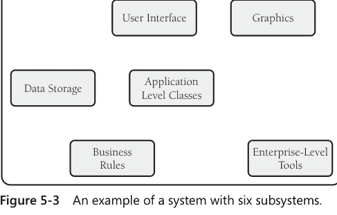

图 5-3 一个具有六个子系统的系统示例。

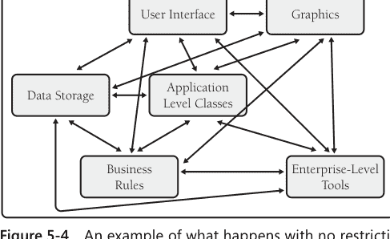

图 5-4 没有对子系统间通信限制时会发生的情况示例。

正如你所见，每个子系统最终都会直接与每个其它子系统通信，这引发了一些重要问题：

- 要更改图形子系统中的某些内容，开发人员需要至少了解系统中有多少个不同的部分？
- 当你尝试在另一个系统中重用业务规则时会发生什么？
- 当你想要为系统放置一个新的用户界面时，会发生什么，比如用于测试目的的命令行 UI？
- 当你想要将数据存储放在远程机器上时会发生什么？

你可以把子系统之间的线想象成有水流过的水管。如果你想伸手进去取出一个子系统，那个子系统会有些水管连着它。你要断开和重新连接的水管越多，你就会变得越湿。你希望架构你的系统，使其如果取出一个子系统在别处使用，你不会有太多水管需要重新连接，而且这些水管很容易重新连接。

只要事先考虑，所有这些问题都可以用很少的额外工作来解决。仅在“需要知道”的基础上允许子系统之间通信——而且最好有一个充分的理由。如果有疑问，及早限制通信然后稍后放宽，比及早放宽然后在你编写了数百个系统间调用之后再试图收紧要容易得多。图 5-5 显示了几个通信准则如何改变图 5-4 中描绘的系统。

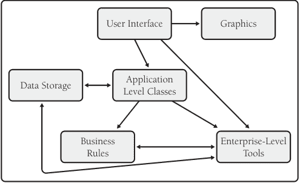

**图 5-5.** 借助几个通信规则，你可以显著简化子系统交互。

为了保持连接易于理解和维护，在子系统关系上偏向简单。最简单的关系是让一个子系统调用另一个子系统中的例程。更复杂的关系是让一个子系统包含另一个子系统的类。最复杂的关系是让一个子系统中的类继承自另一个子系统中的类。


一条很好的通用规则是：系统级图（如图 5-5）应该是无环图。换言之，程序中不应存在任何循环关系，比如类 A 使用类 B、类 B 使用类 C、类 C 又使用类 A。

对于大型程序和程序族，子系统级的设计会产生显著影响。如果你认为自己的程序足够小，可以跳过子系统级设计，那么至少要有意识地作出这个决定。

## 常见子系统

有些类型的子系统会反复出现在不同的系统中。下面是一些常见的类型。

交叉参考：有关把业务逻辑表达为表格以简化逻辑的更多内容，请参见第 18 章“表驱动方法”。

### 业务规则

业务规则是你编码到计算机系统中的法律、法规、政策和程序。如果你在编写薪资系统，可能需要把美国国税局（IRS）关于允许的预扣额和预估税率的规定编码进去。薪资系统的额外规则可能来自工会合同，其中具体说明了加班费率、带薪休假和节日工资等。如果你在编写汽车保险费率报价程序，规则可能来自政府关于强制责任险保障的规定、精算费率表或承保限制。

### 用户界面

创建一个子系统来隔离用户界面组件，这样用户界面就可以在不损害程序其余部分的情况下演变。大多数情况下，用户界面子系统会使用几个附属子系统或类，用于 GUI 界面、命令行界面、菜单操作、窗口管理、帮助系统等。

### 数据库访问

你可以隐藏访问数据库的实现细节，使程序的大部分不必担心操纵底层结构的繁琐细节，并能按照数据在业务问题层面的使用方式来处理数据。隐藏实现细节的子系统提供了宝贵的抽象层次，降低了程序的复杂度。它们把数据库操作集中在一个地方，减少了处理数据时出错的机会。它们还使更改数据库设计结构变得容易，而无需改动程序的大部分。

### 系统依赖

将操作系统依赖打包进一个子系统，原因与打包硬件依赖相同。例如，如果你正在为 Microsoft Windows 开发程序，为什么要把自己局限于 Windows 环境呢？把 Windows 调用隔离在一个 Windows 接口子系统中。如果以后想把程序迁移到 Mac OS 或 Linux，唯一需要改动的就是接口子系统。接口子系统可能过于庞大，难以由你独自实现，但这类子系统在若干商业代码库中都很容易获得。

## 第 3 级：划分为类

进一步阅读：要深入讨论数据库设计，请参见《敏捷数据库技术》（Ambler 2003）。

这一级的设计包括识别系统中的所有类。例如，数据库接口子系统可以进一步划分为数据访问类、持久化框架类以及数据库元数据。图 5-2 中的第 3 级展示了一个第 2 级子系统可能如何被划分为类，并意味着第 2 级中显示的另外三个子系统也会被分解为类。

在指定每个类的同时，也会明确该类与系统其余部分交互的具体方式。特别是，类的接口会被定义。总的来说，这一级的主要设计活动是确保所有子系统都被分解到足够详细的程度，以便你能把它们的各个部分实现为单独的类。

交叉参考：有关高质量类特征的详细信息，请参见第 6 章“工作类”。

将子系统划分为类，通常对任何持续时间超过几天的项目都是必要的。如果项目很大，这种划分明显不同于第 2 级的程序分区。如果项目非常小，你可以直接从第 1 级的整个系统视图进入第 3 级的类视图。

### 类与对象

面向对象设计中的一个关键概念是区分对象和类。对象是程序运行时存在的任何特定实体。类是在程序清单中看到的静态事物。对象是运行程序时看到的具有特定值和属性的动态事物。例如，你可以声明一个类 Person，有姓名、年龄、性别等属性。在运行时，你会得到 nancy、hank、diane、tony 等对象——即该类的具体实例。如果你熟悉数据库术语，这与“模式”和“实例”之间的区别相同。你可以把类想成饼干模具，把对象想成饼干。本书非正式地使用这些术语，基本上可以互换使用类和对象。

## 第 4 级：划分为例程

这一级的设计包括把每个类划分为例程。第 3 级定义的类接口会定义其中一些例程。第 4 级的设计会详细说明类的私有例程。当你检查类内部例程的细节时，可以看到许多例程是简单的方框，但少数由按层次组织的例程组成，它们需要更多的设计。

完整定义类的例程，常常会让你更好地理解类接口，并因此使接口发生相应变化——也就是说，需要回到第 3 级修改。

这一级的分解和设计通常留给程序员个人决定，而且对任何需要超过数小时的项目都是必需的。它不需要正式地完成，但至少需要在脑海里完成。

## 第 5 级：内部例程设计

例程级的设计包括安排各个例程的详细功能。内部例程设计通常由负责单个例程的程序员个人完成。该设计包括编写伪代码、在参考书中查找算法、决定如何组织例程中的代码段落，以及编写编程语言代码等活动。这一级的设计总是会进行的，尽管有时是在无意识中草率完成，而不是有意识且良好地完成。在图 5-2 中，这一级的设计标注为 5。

### 5.3 设计构建块：启发式方法

软件开发人员往往希望答案是简单明了的：“做 A、B、C，那么每次都会得到 X、Y、Z。”我们以学会那些能产生预期效果的神秘步骤为傲，而当指令不像宣传的那样奏效时，我们就会烦躁不安。这种对确定性行为的渴望非常适合细节繁复的计算机编程，因为那种对细节的严格关注决定了一个程序的成败。但软件设计就完全是另一回事了。

由于设计是非确定性的，熟练运用一套有效的启发式方法，是良好软件设计的核心活动。以下小节描述了许多启发式方法——这些思考设计的方式有时会带来良好的设计洞见。你可以把启发式方法视为“试错法”中各种尝试的指南。你以前无疑遇到过其中一些。因此，后续小节将根据“软件的首要技术使命：管理复杂度”来描述每一种启发式方法。

### 寻找现实世界对象

> 不要先问系统做什么；而要问它作用于什么！  
> ——*伯特兰·迈耶*

识别设计备选方案的首选也最流行的方法，是“按部就班”的面向对象方法，其重点是识别现实世界对象和合成对象。

使用对象进行设计的步骤如下：
- 识别对象及其属性（方法和数据）。
- 确定可以对每个对象做什么。
- 确定每个对象被允许对其他对象做什么。
- 确定每个对象中对其他对象可见的部分——哪些部分是公开的，哪些部分是私有的。
- 定义每个对象的公共接口。

> **交叉参考**：有关使用类进行设计的更多细节，请参见第 6 章“工作类”。


这些步骤不一定按顺序执行，而且经常会重复。迭代很重要。下面对这些步骤进行了总结。

## 识别对象及其属性

计算机程序通常基于现实世界的实体。例如，你可以基于现实世界的员工、客户、工时卡和账单来构建一个计费系统。图 5-6 显示了这样一个计费系统的面向对象视图。

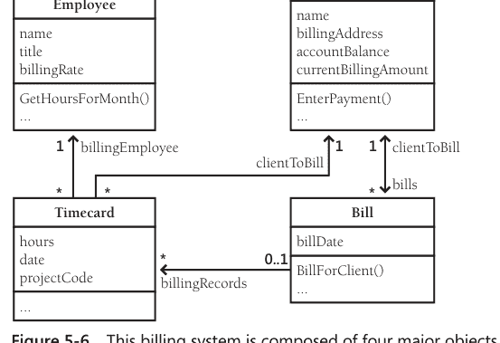

图 5-6 该计费系统由四个主要对象组成。对象在此示例中已进行了简化。

识别对象的属性并不比识别对象本身更复杂。每个对象都有与计算机程序相关的特征。例如，在计费系统中，员工对象具有姓名、职称和计费费率。客户对象具有姓名、账单地址和账户余额。账单对象具有账单金额、客户姓名、账单日期等等。

图形用户界面系统中的对象将包括窗口、对话框、按钮、字体和绘图工具。对问题域的进一步研究可能会产生比一对一映射到现实世界对象更好的软件对象选择，但现实世界对象是一个很好的起点。

## 确定可以对每个对象执行的操作

可以对每个对象执行各种操作。在图 5-6 所示的计费系统中，员工对象的职称或计费费率可能会发生变化，客户对象的姓名或账单地址可能会更改，等等。

## 确定每个对象可以对其他对象执行的操作

这一步就是字面意思。对象之间可以执行的两种通用操作是包含和继承。哪些对象可以包含哪些其他对象？哪些对象可以从哪些其他对象继承？在图 5-6 中，工时卡对象可以包含员工对象和客户对象，而账单可以包含一个或多个工时卡。此外，账单可以表明客户已被开具账单，而客户可以对账单进行付款。更复杂的系统将包括额外的交互。

交叉引用 有关类和信息隐藏的详细信息，请参阅第 5.3 节中的“隐藏秘密（信息隐藏）”。

## 确定每个对象的哪些部分对其他对象可见

一个关键的设计决策是确定对象的哪些部分应设为公开，哪些应保持私有。此决定必须同时针对数据和方法做出。

## 定义每个对象的接口

定义每个对象的正式、语法、编程语言级别的接口。对象向所有其他对象公开的数据和方法称为对象的“公共接口”。对象通过继承向派生对象公开的部分称为对象的“受保护接口”。请考虑这两种接口。

当你完成实现顶层面向对象系统组织的步骤后，你将以两种方式进行迭代。你将对顶层系统组织进行迭代，以获得更好的类组织。你还将对已定义的每个类进行迭代，推动每个类的设计达到更详细 levels。

## 形成一致的抽象

抽象是能够在安全忽略其某些细节的情况下与概念互动的能力——在不同层级处理不同的细节。每当你处理一个聚合时，你就是在处理一个抽象。如果你将一个对象称为“房子”而不是玻璃、木材和钉子的组合，你就是在做抽象。如果你将一群房子称为“城镇”，你就是在做另一个抽象。

基类是允许你专注于一组派生类共同属性并在处理基类时忽略特定类的细节的抽象。良好的类接口是一种抽象，它允许你专注于接口而无需担心类的内部工作方式。面向良好设计的例程的接口在更低的细节层级提供相同的益处，而面向良好设计的包或子系统的接口在更高的细节层级提供该益处。

从复杂性角度来看，抽象的主要好处是它允许你忽略无关的细节。大多数现实世界对象本身就是某种抽象。正如刚才提到的，房子是窗户、门、外墙、布线、管道、隔热材料以及它们特定组织方式的抽象。门反过来又是矩形材料、铰链和门把手特定排列的抽象。而门把手又是黄铜、镍、铁或钢特定形成的抽象。

人们持续使用抽象。如果你每次使用前门时都必须处理单个木纤维、清漆分子和钢分子，你每天几乎都无法进出房子。正如图 5-7 所示，抽象是我们处理现实世界复杂性的一种重要方式。


**图 5-7** 抽象允许你对复杂概念采取更简单的看法。

软件开发人员有时会在木纤维、清漆分子和钢分子级别构建系统。这使得系统过于复杂，在智力上难以管理。当程序员未能提供更大的编程抽象时，系统本身有时就无法通过前门。

优秀的程序员在例程接口级别、类接口级别和包接口级别创建抽象——换句话说，门把手级别、门级别和房子级别——这支持更快更安全的编程。

## 封装实现细节

封装在抽象结束的地方接手。抽象说：“你被允许在高细节级别查看对象。”封装说：“此外，你不被允许在任何其他细节级别查看对象。”

继续使用住房材料类比：封装是一种说法，即你可以查看房子的外部，但不能靠近到分辨门的细节。你被允许知道有门，并且被允许知道门是开着还是关着，但你不被允许知道门是由木材、玻璃纤维、钢还是其他材料制成的，而且你当然不被允许查看每个单独的木纤维。

正如图 5-8 所示，封装通过禁止你查看复杂性来帮助管理复杂性。第 6.2 节中题为“良好的封装”的部分提供了封装在类设计中应用的更多背景。

> **交叉引用** 有关类设计中抽象的更多详细信息，请参阅第 6.2 节中的“良好抽象”。


图 5-8 封装说，不仅你被允许对复杂概念采取更简单的看法，你不被允许查看复杂概念的任何细节。你所看到的就是你所得到的——这就是你能得到的一切！

## 继承——当继承简化设计时

在设计软件系统时，你经常会发现对象与其它对象非常相似，只是存在一些差异。例如，在一个会计系统中，你可能同时拥有全职和兼职员工。与两种员工相关的绝大多数数据是相同的，但有些数据不同。在面向对象编程中，你可以定义一种通用的员工类型，然后将全职员工定义为通用员工，只是存在一些差异，并将兼职员工也定义为通用员工，只是存在一些差异。当对员工的操作不依赖于员工类型时，该操作就好像员工只是通用员工一样被处理。当操作取决于员工是全职还是兼职时，操作会被不同地处理。

定义此类对象之间的相似性和差异性称为“继承”，因为特定的兼职和全职员工从通用员工类型继承特征。

继承的好处是它与抽象的概念协同工作。抽象以不同细节级别处理对象。回想一下门在某一层级是某些种类分子的集合，在下一层级是木纤维的集合，在下一层级是防止窃贼进入你房子的东西。木材具有某些特性——例如，你可以用锯切割它或用木胶粘合它——而二乘四木方或雪松瓦片具有木材的一般特性以及它们自己的特定特性。

继承简化了编程，因为你编写一个通用例程来处理依赖于门一般属性的任何事情，然后编写特定例程来处理对特定种类门的特定操作。某些操作，例如 


无论门是实心门、室内门、室外门、纱门、法式门还是滑动玻璃门，`Open()`或`Close()`都可能适用。语言在运行时之前无需知道所面对的是哪种门就能支持`Open()`或`Close()`等操作的能力，被称为“多态”。C++、Java 以及 Microsoft Visual Basic 的后续版本等面向对象语言都支持继承和多态。

继承是面向对象编程中最强大的工具之一。用得好时它能带来巨大好处，用得草率时则可能造成巨大损害。详情参见 6.3 节中的“继承（“是一个”关系）”。

## 隐藏秘密（信息隐藏）

信息隐藏是结构化设计和面向对象设计共同的基础之一。在结构化设计中，“黑盒”的概念就来源于信息隐藏。在面向对象设计中，它催生了封装和模块化的概念，并与抽象的概念相关联。信息隐藏是软件开发中开创性的思想之一，因此本小节将深入探讨它。

信息隐藏首次引起公众注意是在 David Parnas 于 1972 年发表的论文《论将系统分解为模块的标准》中。信息隐藏的特征在于“秘密”这一思想，即软件开发人员将设计和实现决策隐藏在某个地方，不让程序的其余部分知晓。

在《人月神话》20 周年纪念版中，Fred Brooks 总结道，他对信息隐藏的批评是第一版书中少数几个错误之一。“帕纳斯是对的，而我在信息隐藏问题上错了，”他宣称（Brooks 1995）。Barry Boehm 报告说，信息隐藏是消除返工的有力技术，并指出它在增量式、高变化的环境中尤其有效（Boehm 1987）。

信息隐藏对于软件的首要技术使命而言是一种特别强大的启发式方法，因为从它的名字开始，贯穿其所有细节，它都在强调隐藏复杂性。

### 秘密与隐私权

在信息隐藏中，每个类（或包或例程）以其对其它所有类隐藏的设计或构造决策为特征。秘密可能是一个容易发生变化的领域、文件的格式、数据类型的实现方式，或者一个需要与程序其余部分隔离的领域，以便该领域中的错误造成的损害尽可能小。类的职责是保持这些信息的隐藏，并保护其自身的隐私权。对系统的小改动可能会影响类内多个例程，但不应该波及到类接口之外。

> 力求类接口完整且最小化。
> ——Scott Meyers

设计类的一个关键任务是决定哪些特性应当在类外部可见，哪些应当保持秘密。一个类可能使用 25 个例程，但只公开其中 5 个，其余 20 个在内部使用。一个类可能使用多种数据类型，却不公开关于它们的任何信息。类设计的这一方面也被称为“可见性”，因为它涉及类的哪些特性在类外部“可见”或“暴露”。

类接口应尽可能少地揭示其内部工作方式。如图 5-9 所示，类很像一座冰山：八分之七在水下，你只能看到水面之上的八分之一。

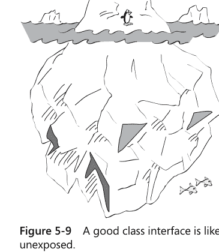

图 5-9 良好的类接口就像冰山的一角，让类的大部分不被暴露。

设计类接口是一个迭代过程，就像设计的其它任何方面一样。如果第一次没有把接口设计正确，就再试几次，直到它稳定下来。如果它不稳定，你就需要尝试不同的方法。

### 信息隐藏的示例

假设你有一个程序，其中每个对象都应有一个唯一的 ID，存储在一个名为 `id` 的成员变量中。一种设计方法是使用整数作为 ID，并将目前分配的最高 ID 存储在一个名为 `g_maxId` 的全局变量中。当每个新对象被分配时，也许在每个对象的构造函数中，你可以简单地使用 `id = ++g_maxId` 语句，这将保证唯一 ID，并且会在每个创建对象的地方添加绝对最少的代码。那会出什么问题呢？

很多地方都可能出错。如果你想为特殊目的保留 ID 范围怎么办？如果你想使用非顺序 ID 来提高安全性怎么办？如果你想能够重用已销毁对象的 ID 怎么办？如果你想添加一个断言，当分配的 ID 超过你预期的最大数量时触发怎么办？如果你通过在整个程序中散布 `id = ++g_maxId` 语句来分配 ID，你就必须修改与这些语句中的每一条相关的代码。而且，如果你的程序是多线程的，这种方法也不是线程安全的。

新 ID 的创建方式是一个你应该隐藏的设计决策。如果你在整个程序中使用 `++g_maxId` 这样的写法，你就暴露了创建新 ID 的方式，即简单地递增 `g_maxId`。相反，如果你在整个程序中使用 `id = NewId()` 语句，你就隐藏了关于新 ID 如何创建的信息。在 `NewId()` 例程内部，你可能仍然只有一行代码，`return ( ++g_maxId )` 或其等价形式，但如果你以后决定为特殊目的保留某些 ID 范围或重用旧 ID，你就可以在 `NewId()` 例程内部做出这些更改——而无需改动几十或上百条 `id = NewId()` 语句。无论 `NewId()` 内部的修订变得多么复杂，它们都不会影响程序的任何其它部分。

现在假设你发现需要将 ID 的类型从整数改为字符串。如果你在整个程序中散布了像 `int id` 这样的变量声明，那么你使用 `NewId()` 例程也无济于事。你仍然需要遍历程序并做出几十或上百处更改。

另一个需要隐藏的秘密是 ID 的类型。通过暴露 ID 是整数这一事实，你会鼓励程序员对它们执行 >、<、= 等整数运算。在 C++ 中，你可以使用简单的 `typedef` 将 ID 声明为 `IdType`——一种解析为 `int` 的用户定义类型——而不是直接将它们声明为 `int` 类型。或者，在 C++ 和其它语言中，你可以创建一个简单的 `IdType` 类。同样，隐藏一个设计决策会对更改所影响的代码量产生巨大差异。


信息隐藏在设计的所有层面都很有用，从使用命名常量而不是字面量，到创建数据类型，再到类设计、例程设计和子系统设计。

### 两类秘密

信息隐藏中的秘密分为两大类：

- 隐藏复杂性，这样除非你特别关注它，否则你的大脑不必处理它
- 隐藏变化来源，这样当变化发生时，影响被局限在局部

复杂性来源包括复杂的数据类型、文件结构、布尔测试、涉及复杂算法等等。变化来源的全面列表将在本章后面描述。

### 信息隐藏的障碍

在少数情况下，信息隐藏确实不可能实现，但大多数信息隐藏的障碍是习惯性使用其它技术所形成的心智障碍。

**信息的过度分布**

信息隐藏的一个常见障碍是整个系统中信息的过度分布。你可能在整个系统中硬编码了字面量 100。使用 100 作为字面量会使对它的引用分散化。更好的做法是将信息隐藏在一个地方，也许在一个常量 `MAX_EMPLOYEES` 中，其值只在一个地方更改。

过度信息分布的另一个例子是整个系统中与人类用户的交互交错散布。如果交互模式发生变化——比如说从 GUI 界面改为命令行界面——几乎所有的代码都必须修改。更好的做法是将用户交互集中在一个类、包或子系统中，你可以更改它而不影响整个系统。

另一个例子是全局数据元素——例如一个程序范围内访问的、最多 1000 个元素的员工数据数组。如果程序直接使用该全局数据，那么关于该数据项实现的信息——例如它是一个数组且最多有 1000 个元素这一事实——就会散布在整个程序中。如果程序只通过访问例程使用该数据，那么只有访问例程会知道实现细节。

**循环依赖**

信息隐藏的一个更微妙的障碍是循环依赖，例如类 A 中的例程调用类 B 中的例程，而类 B 中的例程又调用类 A 中的例程。要避免这种依赖环。它们使系统难以测试，因为除非另一个类至少部分就绪，否则你无法测试类 A 或类 B。

**类数据被误认为全局数据**

如果你是一个认真的程序员，有效信息隐藏的障碍之一可能是将类数据视为全局数据并避而远之，因为你希望避免与全局数据相关的问题。虽然通往编程地狱的道路是由全局变量铺成的，但类数据带来的风险要小得多。

全局数据通常面临两个问题：例程操作全局数据时不知道其它例程也在操作它；例程知道其它例程在操作全局数据，但不知道它们到底对它做了什么。类数据不会面临这两个问题中的任何一个。对数据的直接访问被限制在组织成一个类中的少数例程中。这些例程知道其它例程会操作该数据，并且它们确切知道是哪些其它例程。

**进一步阅读：** 本节部分内容改编自“Designing Software for Ease of Extension and Contraction”（Parnas 1979）。

**交叉参考：** 有关通过类接口访问全局数据的更多信息，请参见 13.3 节中的“使用访问例程代替全局数据”。


当然，这整场讨论都假设你的系统使用了设计良好的小型类。如果你的程序被设计成使用包含大量例程的巨大类，类数据与全局数据之间的区别将开始模糊，类数据也会面临许多与全局数据相同的问题。

> **交叉参考** 代码级性能优化在第25章“代码调优策略”和第26章“代码调优技术”中讨论。

*感知到的性能损失* 信息隐藏的最后一个障碍可能是试图在架构层面和编码层面避免性能损失。你不需要在任何一个层面担心。在架构层面，这种担心是不必要的，因为为信息隐藏而架构系统与为性能而架构系统并不冲突。如果你同时考虑信息隐藏和性能，你就可以实现这两个目标。

更常见的担心是在编码层面。担心的是间接访问数据项会因额外的对象实例化层级、例程调用等而招致运行时性能损失。这种担心为时过早。在你能够测量系统性能并找出瓶颈之前，为代码级性能优化做准备的最佳方式是创建一个高度模块化的设计。当你之后检测到热点时，你可以优化单个类和例程，而不会影响系统的其余部分。

## 信息隐藏的价值


信息隐藏是为数不多的在实践中有无可争议价值证明的理论技术之一，这一点早已得到证实（Boehm 1987a）。多年前就发现，使用信息隐藏的大型程序比不使用信息隐藏的程序容易修改4倍（Korson and Vaishnavi 1986）。此外，信息隐藏是结构化设计和面向对象设计两者基础的一部分。

信息隐藏具有独特的启发性力量，一种激发有效设计解决方案的独特能力。传统的面向对象设计提供了以对象建模世界的启发性力量，但对象思维不会帮助你避免将ID声明为 *int* 而不是 *IdType*。面向对象的设计者会问：“ID应该被当作一个对象吗？”根据项目的编码标准，回答“是”可能意味着程序员必须编写构造函数、析构函数、复制运算符和赋值运算符；为所有这些编写注释；并将其置于配置控制之下。大多数程序员会决定：“不，为一个ID创建整个类不值得。我就用 *int* 好了。”

注意刚刚发生了什么。一个有用的设计替代方案——即仅仅隐藏ID的数据类型——甚至没有被考虑。如果设计者转而问“ID的什么方面应该被隐藏？”他很可能决定将其类型隐藏在简单的类型声明后面，用 *IdType* 替代 *int*。在这个例子中，面向对象设计与信息隐藏之间的区别比显式规则和条例的冲突更微妙。面向对象设计会像信息隐藏一样认可这个设计决策。相反，区别在于启发性——思考信息隐藏会激发和促进面向对象思考所不能激发和促进的设计决策。

信息隐藏在设计类的公共接口时也很有用。类设计的理论与实践之间的差距很大，在许多类设计者中，决定将什么放入类的公共接口等同于决定哪个接口使用起来最方便，这通常会导致尽可能多地暴露类的内容。据我所见，有些程序员宁愿暴露类的所有私有数据，也不愿多写10行代码来保持类的秘密完整。

问一问“这个类需要隐藏什么？”切中了接口设计问题的核心。如果你可以在不泄露类的秘密的情况下将函数或数据放入类的公共接口，那就这么做。否则，不要。

询问需要隐藏什么有助于在各级别做出良好的设计决策。它促进了在构建级别使用命名常量而不是字面量。它有助于在类内部创建良好的例程和参数名称。它指导系统级别的类和子系统分解与互连的决策。

养成问“我应该隐藏什么？”的习惯。你会惊讶于多少棘手的设计问题在你眼前化解。


## 识别可能变化的区域

> **进一步阅读**
> 本节描述的方法改编自“为易于扩展和收缩而设计软件”（Parnas 1979）。

一项对伟大设计师的研究发现，他们共有的一个特质是预见变化的能力（Glass 1995）。适应变化是优秀程序设计中最具挑战性的方面之一。目标是隔离不稳定的区域，使变化的影响限于一个例程、类或包内。以下是你在为这类扰动做准备时应遵循的步骤。

1. **识别似乎可能变化的事项。** 如果需求做得很好，它们会包含潜在变更列表以及每项变更的可能性。在这种情况下，识别可能的变化很容易。如果需求没有涵盖潜在变化，请参阅下面关于任何项目中可能发生变化的区域的讨论。

2. **分离可能变化的事项。** 将第1步中识别出的每个易变组件分隔到它自己的类中，或与可能在相同时间发生变化的其他易变组件放在一个类中。

3. **隔离似乎可能变化的事项。** 设计类间接口使其对潜在变化不敏感。设计接口使变化仅限于类内部，外部不受影响。任何使用被更改类的其他类都不应察觉到变化已经发生。类的接口应该保护其秘密。

用枚举类型实现会更好，其值为 ErrorType_None、ErrorType_Warning 和 ErrorType_Fatal。

你可以为状态变量的使用增加至少两个层次的灵活性和可读性：

- 不要使用布尔变量作为状态变量。请改用枚举类型。向状态变量添加新状态很常见，而向枚举类型添加新类型只需要重新编译，而无需修改检查该变量的每一行代码。
- 使用访问例程而不是直接检查变量。通过检查访问例程而不是变量，你可以实现更复杂的状态检测。例如，如果你想检查错误状态变量和当前函数状态变量的组合，如果测试隐藏在例程中会很容易做到，而如果它是一个在整个程序中硬编码的复杂测试则很难做到。

### 数据大小约束

当你声明一个大小为100的数组时，你向世界暴露了世界不需要看到的信息。捍卫你的隐私权！信息隐藏并不总是像整个类那么复杂。有时它简单到使用一个诸如 MAX_EMPLOYEES 的命名常量来隐藏100。

### 预见不同程度的变化

在考虑系统的潜在变化时，设计系统应使变化的影响或范围与变化发生的概率成比例。如果一个变化很可能发生，请确保系统能轻松适应它。只有极不可能发生的变化才被允许对系统中多个类产生剧烈影响。优秀的设计师也会考虑预见变化的成本。如果一个变化不是非常可能但容易预先规划，你应该比面对一个不太可能发生且难以规划的变化时更认真地考虑预见它。

> **交叉参考** 本节预见变化的方法不涉及提前设计或提前编码。关于这些实践的讨论，请参见第24.2节中的“程序包含似乎将来某天可能需要的代码”。

> **进一步阅读** 本讨论借鉴了“关于程序族的设计和开发”（Parnas 1976）中描述的方法。

识别可能变化区域的一个好技术是首先识别程序中可能对用户有用的最小子集。该子集构成系统的核心，且不太可能变化。接下来，定义系统的最小增量。它们可以小到看似微不足道。当你考虑功能变化时，务必也要考虑质的变化：使程序线程安全、使其可本地化等等。这些潜在改进领域构成系统的潜在变化；使用信息隐藏原则设计这些领域。通过首先识别核心，你可以看到哪些组件是真正的附加组件，然后从那里推断并隐藏改进。


## 保持耦合松散

耦合描述了类或例程与其它类或例程关联的紧密程度。目标是创建类和例程，它们与其它类和例程的关系是小而直接、可视且灵活的，这被称为“松耦合”。耦合的概念同样适用于类和例程，因此在接下来的讨论中我将使用“模块”一词来指代类和例程。

模块之间良好的耦合是足够松散的，使得一个模块可以被其它模块轻松使用。模型火车车厢是通过相对的挂钩连接的，推在一起时挂钩会扣住。连接两节车厢很容易——你只需把车厢推在一起即可。想象一下，如果你必须把东西拧在一起，或者连接一束电线，或者只能把某些种类的车厢连接到某些其它种类的车厢，会有多困难。模型火车车厢的耦合之所以有效，是因为它尽可能简单。在软件中，使模块之间的连接尽可能简单。

尽量创建对其它模块依赖很少的模块。让它们像商业伙伴一样分离，而不是像连体婴儿一样附着。像 `sin()` 这样的例程是松耦合的，因为它所需的一切知识都通过一个表示角度的值作为参数传入。像 `InitVars( var1, var2, var3, ..., varN )` 这样的例程则耦合更紧密，因为传递了所有变量，调用模块几乎知道 `InitVars()` 内部发生了什么。两个类依赖于对同一全局数据的共同使用则耦合得更紧密。

### 耦合准则

以下是评估模块之间耦合时可使用的几个准则：

- **Size.** Size 指的是模块之间连接的数量。就耦合而言，小即美，因为连接到一个接口更小的模块所需的工作更少。接受一个参数的例程与调用它的模块耦合得更松，而接受六个参数的例程则耦合更紧。拥有四个定义良好的公共方法的类与使用它的模块耦合得更松，而暴露 37 个公共方法的类则耦合更紧。

- **Visibility.** Visibility 指的是两个模块之间连接的显著程度。编程不像在中情局工作；你不会因为狡猾而获得认可。它更像广告；你会因为尽可能让你的连接显而易见而获得大量认可。在参数列表中传递数据就是建立明显的连接，因此是好的。修改全局数据以便另一个模块可以使用该数据就是一种狡猾的连接，因此是坏的。对全局数据连接进行文档记录使其更明显，稍好一些。

- **Flexibility.** Flexibility 指的是改变模块之间连接的难易程度。理想情况下，你希望它更像你电脑上的 USB 连接器，而不是裸线和电烙铁。灵活性在很大程度上是其它两个准则的产物。

## 寻找常见的设计模式

设计模式提供了可用于解决软件中最常见问题的现成解决方案的核心。一些软件问题需要从第一性原理推导出的解决方案。但大多数问题与过去的问题相似，可以使用相似的解决方案或模式来解决。常见的模式包括 Adapter、Bridge、Decorator、Facade、Factory Method、Observer、Singleton、Strategy 和 Template Method。Erich Gamma、Richard Helm、Ralph Johnson 和 John Vlissides 合著的《Design Patterns》一书（1995 年）是对设计模式的权威描述。

模式提供了完全自定义设计所不具备的几个好处：

- **Patterns reduce complexity by providing ready-made abstractions** 如果你说，“这段代码使用 Factory Method 来创建派生类的实例”，你项目上的其它程序员将理解你的代码涉及一套相当丰富的相互关系和编程协议，所有这些在你引用 Factory Method 设计模式时都会被调用。

  Factory Method 是一种模式，它允许你在 Factory Method 之外无需跟踪各个派生类即可实例化特定基类的任何派生类。有关 Factory Method 模式的良好讨论，请参阅 *Refactoring*（Fowler 1999）中的“Replace Constructor with Factory Method”。

  你不必为其它程序员拼出每一行代码，他们就能理解你在代码中发现的设计方法。

- **Patterns reduce errors by institutionalizing details of common solutions** 软件设计问题包含细微差别，这些细微差别只有在问题被解决一次或两次（或三次、四次……）后才会完全显现。因为模式代表了解决常见问题的标准化方法，它们体现了多年尝试解决这些问题所积累的智慧，也体现了人们在解决这些问题时所犯的错误尝试的修正。

  使用设计模式在概念上类似于使用库代码而不是自己编写。确实，每个人都写过几次自定义 Quicksort，但你的自定义版本第一次尝试就完全正确的几率有多大？同样，许多设计问题与过去的问题足够相似，以至于你最好使用预建的设计解决方案，而不是创建新颖的解决方案。

- **Patterns provide heuristic value by suggesting design alternatives** 熟悉常见模式的设计师可以轻松地浏览模式列表并问“哪种模式适合我的设计问题？” 循环浏览一组熟悉的替代方案，要比从零开始创建自定义设计解决方案容易得多。而且，由熟悉的模式产生的代码也比完全自定义的代码更容易被代码阅读者理解。

- **Patterns streamline communication by moving the design dialog to a higher level** 除了复杂性管理的好处外，设计模式还可以加速设计讨论，允许设计师在更高粒度的层面上思考和讨论。如果你说“我无法决定在这种情况下应该使用 Creator 还是 Factory Method”，你就用很少的词传达了很多信息——只要你和你的听众都熟悉这些模式。想象一下，如果你深入 Creator 模式的代码和 Factory Method 模式的代码的细节，然后比较和对比这两种方法，需要多长时间。

### Table 5-1 Popular Design Patterns

| Pattern | Description |
|---|---|
| Abstract Factory | 支持通过指定集合的类型但不指定每个特定对象的类型来创建相关对象的集合。 |
| Adapter | 将一个类的接口转换为不同的接口。 |
| Bridge | 以这样的方式构建接口和实现，使得其中一个可以变化而另一个不变。 |
| Composite | 由一个包含其自身类型其它对象的对象组成，这样客户端代码可以与顶层对象交互，而不必关心所有详细对象。 |
| Decorator | 在不为每种可能的职责配置创建特定子类情况下，动态地将职责附加到对象。 |
| Facade | 为否则不会提供一致接口的代码提供一致接口。 |
| Factory Method | 在 Factory Method 之外无需跟踪各个派生类即可实例化派生自特定基类的类。 |
| Iterator | 一个服务器对象，按顺序提供对集合中每个元素的访问。 |
| Observer | 通过使一个对象负责通知相关对象集合中任何成员的变化来使多个对象保持同步。 |
| Singleton | 为只有一个且仅一个实例的类提供全局访问。 |
| Strategy | 定义一组可以动态互换的算法或行为。 |
| Template Method | 定义算法的结构，但将部分详细实现留给子类。 |

如果你以前从未见过设计模式，对 Table 5-1 中的描述的反应可能是“是的，我已经知道这些想法的大部分了。”这种反应正是设计模式有价值的重要原因。模式对大多数有经验的程序员来说都很熟悉，为它们分配可识别的名称支持关于它们的高效和有效沟通。


模式的一个潜在陷阱是强行将代码套用某种模式。在某些情况下，稍微调整代码以符合公认的模式会提高代码的可理解性。但如果代码需要调整的幅度过大，强行使其看起来像标准模式有时反而会增加复杂度。

模式的另一个潜在陷阱是“特性癖”（feature-itis）：使用某种模式是因为想尝试这种模式，而不是因为该模式是合适的设计解决方案。

总体而言，设计模式是管理复杂性的有力工具。你可以在本章末尾列出的任何优秀书籍中阅读更详细的描述。

## 其他启发式方法

前面的章节描述了主要的软件设计启发式方法。下面还有一些其他的启发式方法，虽然可能不那么常用，但仍然值得一提。

### 追求高内聚

内聚（Cohesion）源于结构化设计，通常与耦合在同一语境下讨论。内聚指的是一个类中的所有例程或一个例程中的所有代码在多大程度上支持一个核心目的——即这个类的专注程度。包含紧密相关功能的类被称为具有高内聚性，启发式目标是尽可能增强内聚。内聚是管理复杂性的有用工具，因为类中的代码越支持核心目的，你的大脑就越容易记住代码所做的所有事情。

在例程层面思考内聚，数十年以来一直是一种有用的启发式方法，至今仍然适用。在类层面，内聚这一启发式方法在很大程度上已被更广泛的“良好定义的抽象”启发式方法所涵盖，这在本章前面和第6章中已讨论过。抽象在例程层面同样有用，但在这个细节层面上，它与内聚的地位更加对等。

### 构建层次结构

层次结构是一种分层的信息结构，其中概念最一般或最抽象的表征位于层次结构的顶部，而越来越详细、专门化的表征位于层次结构的较低层。在软件中，层次结构体现在类层次结构中，并且，如图5-2中的第4层所示，也体现在例程调用层次结构中。

至少两千年来，层次结构一直是管理复杂信息集的重要工具。亚里士多德曾用层次结构来组织动物界。人们经常使用大纲来组织复杂信息（例如本书）。研究人员发现，人们通常认为层次结构是组织复杂信息的自然方式。当他们画一座房子这样的复杂物体时，他们会分层地画。先画房子的轮廓，然后是窗户和门，接着是更多细节。他们不会一块砖一块砖、一片瓦一片瓦、一颗钉子一颗钉子地画房子（Simon 1996）。

层次结构是实现“软件的首要技术使命”的有用工具，因为它们让你只关注当前关心的细节层级。细节并不会完全消失；它们只是被推到了另一个层级，这样你可以选择在需要时思考它们，而不是一直考虑所有细节。

### 将类契约形式化

交叉引用：有关契约的更多信息，请参阅第8.2节中的“使用断言来记录和验证前置条件与后置条件”。

在更细的层面上，将每个类的接口视为与程序其余部分之间的契约，可以产生很好的洞见。通常，契约类似于：“如果你承诺提供数据x、y、z，并承诺它们具有特征a、b、c，那么我承诺在约束8、9、10内执行操作1、2、3。”类的客户端向类做出的承诺通常称为“前置条件”，而对象向其客户端做出的承诺称为“后置条件”。

契约对于管理复杂性很有用，因为至少在理论上，对象可以安全地忽略任何非契约行为。在实践中，这个问题要困难得多。

### 分配职责

另一个启发式方法是仔细思考如何将职责分配给对象。询问每个对象应负责什么，类似于询问它应该隐藏什么信息，但我认为前者能产生更广泛的答案，这赋予了该启发式方法独特的价值。

### 为测试而设计

一种能产生有趣设计洞见的思考方式是，问自己：如果为了便于测试而设计，系统会是什么样子？你是否需要将用户界面与其余代码分开，以便可以独立地对其进行测试？你是否需要组织每个子系统，使其对其他子系统的依赖最小化？为测试而设计往往会导致更形式化的类接口，这通常是有益的。

### 避免失败

土木工程教授亨利·彼得罗夫斯基（Henry Petroski）写了一本有趣的书，*设计范式：工程中错误与判断的案例史*（Petroski 1994），记录了桥梁设计失败的历史。彼得罗夫斯基认为，许多引人注目的桥梁倒塌事件之所以发生，是因为人们关注之前的成功，而没有充分考虑可能的失效模式。他得出结论：如果设计师们仔细考虑了桥梁可能失效的方式，而不仅仅是复制其他成功设计的属性，像塔科马海峡大桥这样的失败本可以避免。

过去几年中，各种知名系统备受关注的安全漏洞让我们很难不同意，我们应该设法将彼得罗夫斯基的设计失败洞见应用于软件领域。

### 有意识地选择绑定时间

绑定时间指的是特定值绑定到变量的时间。早期绑定的代码往往更简单，但也往往灵活性较差。有时你可以通过问如下问题获得好的设计洞见：如果我更早地绑定这些值会怎样？如果我更晚地绑定这些值会怎样？如果我在代码中直接初始化这个表会怎样？如果我在运行时从用户那里读取这个变量的值会怎样？

交叉引用：有关绑定时间的更多信息，请参阅第10.6节“绑定时间”。

### 建立集中控制点

P.J. 普劳格（P.J. Plauger）表示，他主要关心的是“唯一正确位置原则——对于任何非平凡的代码，应该有一个唯一正确的位置可以查找，也应该有一个唯一正确的位置可以进行可能的维护更改”（Plauger 1993）。控制可以集中在类、例程、预处理器宏、`#include`文件——甚至命名常量也是集中控制点的一个例子。

降低复杂性的好处在于，你需要查找的地方越少，改动起来就越容易、越安全。

### 考虑使用蛮力

一个强大的启发式工具是蛮力。不要低估它。一个有效的蛮力解决方案，胜过无效的优雅解决方案。让优雅的解决方案发挥作用可能需要很长时间。例如，在描述搜索算法的历史时，高德纳（Donald Knuth）指出，尽管二分搜索算法的第一个描述发表于1946年，但又过了16年，才有人发表了一个能正确搜索所有大小列表的算法（Knuth 1998）。二分搜索更优雅，但蛮力的顺序搜索通常已经足够。

> 心存疑虑时，就用蛮力。
> ——巴特勒·兰普森

### 画图

图表是另一个强大的启发式工具。一图胜千言——某种程度上是这样。实际上，你想要省略那一千字中的大部分，因为使用图片的一个要点是，图片可以在更高的抽象层次上表示问题。有时你需要详细处理问题，但有时你又希望能在更通用的层面上工作。

### 保持设计模块化

模块化的目标是让每个例程或类都像一个“黑盒”：你知道输入是什么，也知道输出是什么，但不知道内部发生了什么。一


black box 具有如此简单的接口和如此明确定义的功 能，以至于对于任何特定的输入，你都可以准确预测相应的输出。

模块化的概念与信息隐藏、封装和其他设计启发式相关。但有时思考如何从一组黑盒子组装系统会提供信息隐藏和封装所不提供的见解，因此这个概念值得放在你的后备箱里。

## 设计启发式的总结

> 更令人担忧的是，同样的程序员完全有能力以两种或三种方式自行完成同样的任务，有时是无意识的，但经常只是为了换个花样，或提供优雅的变化。
> —A. R. Brown 和 W. A. Sampson

以下是主要设计启发式的总结：

- Find Real-World Objects
- Form Consistent Abstractions
- Encapsulate Implementation Details
- Inherit When Possible
- Hide Secrets (Information Hiding)
- Identify Areas Likely to Change
- Keep Coupling Loose
- Look for Common Design Patterns

以下启发式有时也很有用：

- Aim for Strong Cohesion
- Build Hierarchies
- Formalize Class Contracts
- Assign Responsibilities
- Design for Test
- Avoid Failure
- Choose Binding Time Consciously
- Make Central Points of Control
- Consider Using Brute Force
- Draw a Diagram
- Keep Your Design Modular

## 使用启发式的指南

软件设计的方法可以从其他领域设计的方法中学习。关于问题求解启发式的原始书籍之一是 G. Polya 的 *How to Solve It*（1957）。Polya 的通用问题求解方法侧重于数学中的问题求解。图 5-10 是他的方法的总结，改编自其书中的类似总结（重点为他所标）。

1. **理解问题。** 你必须 *理解* 问题。

    *未知是什么？数据是什么？条件是什么？* 是否可能满足条件？条件是否足以确定未知？还是不足？或冗余？或矛盾？

    画一个图。引入合适的记号。分离条件的各个部分。你能写下来吗？

2. **制定计划。** 找到数据与未知之间的联系。你可能被迫考虑辅助问题，如果你找不到中间联系。你最终应该提出解决方案的 *计划*。

    *你见过这个问题吗？* 或者你见过在略有不同形式下的相同问题？ *你知道相关的問題吗？* 你知道可能有用的定理吗？

    *看看未知！* 并尝试思考一个具有相同或相似未知的熟悉问题。 *这里有一个与你的问题相关且已解决的问题。* *你能用它吗？* 你能用它的结果吗？你能用它的方法吗？你是否应该引入一些辅助元素以使其使用成为可能？

    你能重新表述问题吗？你能以另一种方式重新表述它吗？回到定义。

    如果你无法解决所提出的问题，先尝试解决一些相关问题。你能想象一个更容易接近的相关问题吗？一个更一般的问题？一个更特殊的问题？一个类似的问题？你能解决问题的部分吗？只保留条件的部分，丢弃另一部分；未知 then 被确定到什么程度，它如何变化？你能从数据中推导出有用的东西吗？你能想到其他适合确定未知的數據嗎？你能改变未知或数据，或两者如果必要，以使新的未知和新数据更接近彼此吗？

    你使用了所有数据吗？你使用了整个条件吗？你是否考虑了问题中涉及的所有基本概念？

3. **执行计划。** *执行* 你的计划。

    执行你的解决方案计划， *检查每一步。* 你能清楚地看到这一步是正确的吗？你能证明它是正确的吗？

4. **回顾。** 检查解决方案。

    你能 *检查结果吗？* 你能检查论证吗？你能以不同方式推导出结果吗？你能一眼看出吗？

    你能将结果或方法用于其他问题吗？

图 5-10 G. Polya 发展了一种数学问题求解方法，对软件设计中的问题求解也很有用（Polya 1957）。

最有效的指导之一是不要固守单一方法。如果用 UML 图示设计不起作用，就用英文写出来。写一个简短的测试程序。尝试完全不同的方法。思考一个暴力解决方案。继续用铅笔勾勒和草拟，你的大脑会跟上。如果一切都失败了，离开问题。字面意义上出去散步，或在返回问题前想想其他事情。如果你已尽力而仍无进展，暂时将它从脑海中排除往往比单纯坚持更能快速产生结果。

你不必一次解决整个设计问题。如果你卡住了，记住需要做出决定，但认识到你目前还没有足够的信息来解决那个具体问题。为什么要在设计最后 20% 的地方苦战，而它下次循环时很容易就能落位？为什么要在对设计的有限经验基础上做出糟糕的决定，而你可以在之后拥有更多经验时做出好的决定？有些人如果在设计周期后没有达成闭环会感到不安，但在你创建了几个设计而不提前解决问题的情况下，之后就不会在信息更多之前留下问题未解决显得自然了（Zahniser 1992, Beck 2000）。

### 5.4 设计实践

前一节侧重于与设计属性相关的启发式——你希望完成的設計看起来是什么样。本节描述设计实践启发式，你可以采取的步骤通常会产生良好的结果。

### 迭代

你可能有过这样的经历：从编写程序中学到了很多，以至于你希望能带着第一次编写时获得的见解重新编写它。同样现象适用于设计，但设计周期更短，下游影响更大，因此你可以负担得起多次快速通过设计循环。


设计是一个迭代过程。你通常不是从 A 点只到 B 点；你是从 A 点到 B 点再回到 A 点。

当你循环通过候选设计并尝试不同方法时，你会同时查看高层和低层视图。从处理高层问题中获得的大局观将帮助你将低层细节置于适当位置。从处理低层问题中获得的细节将为高层决策提供坚实的现实基础。顶层和底层考虑之间的拉扯是健康的动态；它创造了一个比完全自上而下或自下而上构建的结构更稳定的应力结构。

许多程序员——事实上许多人——在高层和低层考虑之间转换时有困难。在系统的一个视图与另一个视图之间切换在精神上很费力，但对创建有效设计至关重要。为了有趣的练习来增强你的思维灵活性，请阅读 Conceptual Blockbusting（Adams 2001），描述在章节末尾的“附加资源”部分。

交叉引用重构是尝试代码中不同替代方案的安全方式。更多内容请参见第 24 章，“重构。”

当你提出一个看起来足够好的第一个设计尝试时，不要停！第二次尝试几乎总是比第一次更好，而且你在每次尝试中学到的东西可以改善你的整体设计。在尝试了一千种不同的灯泡灯丝材料仍无成功后，据报道托马斯·爱迪生被问到他是否觉得时间被浪费了，因为他什么也没发现。“胡说，”爱迪生据说回答道。“我发现了一千种行不通的东西。”在许多情况下，用一种方法解决问题会产生见解，从而让你能够用甚至更好的另一种方法解决问题。

### 分而治之

正如 Edsger Dijkstra 所指出的，没有人的颅骨足够大以容纳复杂程序的所有细节，这同样适用于设计。将程序分成不同的关注领域，然后逐一处理这些领域。如果你在一个领域遇到死胡同，就迭代！

增量细化是管理复杂性的强大工具。正如 Polya 在数学问题求解中推荐的那样，理解问题，制定计划，执行计划，然后回顾你做得如何（Polya 1957）。

### 自上而下和自下而上的设计方法

“自上而下”和“自下而上”可能听起来有点老式，但它们为面向对象设计的创建提供了宝贵的见解。自上而下设计从高层次抽象开始。你定义基类或其他非特定设计元素。随着设计的开发，你增加细节级别，识别派生类、协作类和其他详细设计元素。

自下而上设计从具体开始，朝着一般性发展。它通常通过识别具体对象，然后从这些具体对象中概括对象聚合和基类来开始。

有些人激烈争论从一般性开始并朝着具体性发展是最好的，有些人争论你不能在没有解决重要细节之前真正识别一般设计原则。以下是双方的论点。


## 自上而下的论证

自上而下方法的指导原则是这样一个想法：人脑一次只能集中在一定量的细节上。如果你从通用类开始，逐步将其分解为更专业的类，你的大脑就不会被迫同时处理太多细节。

分而治之的过程在几个方面是迭代的。首先，它是迭代的，因为你通常不会在一次分解后就停止。你会继续进行好几个层次。其次，它是迭代的，因为你通常不会满足于第一次尝试。你以一种方式分解程序。在分解的各个阶段，你会面临关于如何划分子系统、如何布局继承树以及如何形成对象组合的选择。你做出一个选择，看看会发生什么。然后你重新开始，以另一种方式分解它，看看是否更好。经过几次尝试后，你会对什么可行以及原因有一个很好的认识。

你应该把程序分解到什么程度？继续分解，直到看起来编写下一层比分解它更容易为止。工作到你对设计的明显和简单程度感到有些不耐烦为止。那时，你就完成了。如果不清楚，就再多做一些。如果解决方案现在对你来说哪怕只是稍微有点棘手，那么以后任何在上面工作的人都会觉得很困难。

## 自下而上的论证

有时自上而下的方法过于抽象，很难开始。如果你需要处理更具体的东西，可以尝试自下而上的设计方法。问问自己：“我知道这个系统需要做什么？”毫无疑问，你可以回答这个问题。你可能会识别出一些可以分配给具体类的低级职责。例如，你可能知道系统需要格式化特定报告，为该报告计算数据，居中其标题，将报告显示在屏幕上，将报告打印到打印机上，等等。在识别出几个低级职责后，你通常会开始感到足够舒适，可以再次从上往下看。

在某些其他情况下，设计问题的[content]

## 自上而下的论证

自上而下方法的指导原则是这样一个想法：人脑一次只能集中在一定量的细节上。如果你从通用类开始，逐步将其分解为更专业的类，你的大脑就不会被迫同时处理太多细节。

分而治之的过程在几个方面是迭代的。首先，它是迭代的，因为你通常不会在一次分解后就停止。你会继续进行好几个层次。其次，它是迭代的，因为你通常不会满足于第一次尝试。你以一种方式分解程序。在分解的各个阶段，你会面临关于如何划分子系统、如何布局继承树以及如何形成对象组合的选择。你做出一个选择，看看会发生什么。然后你重新开始，以另一种方式分解它，看看是否更好。经过几次尝试后，你会对什么可行以及原因有一个很好的认识。

你应该把程序分解到什么程度？继续分解，直到看起来编写下一层比分解它更容易为止。工作到你对设计的明显和简单程度感到有些不耐烦为止。那时，你就完成了。如果不清楚，就再多做一些。如果解决方案现在对你来说哪怕只是稍微有点棘手，那么以后任何在上面工作的人都会觉得很困难。

## 自下而上的论证

有时自上而下的方法过于抽象，很难开始。如果你需要处理更具体的东西，可以尝试自下而上的设计方法。问问自己：“我知道这个系统需要做什么？”毫无疑问，你可以回答这个问题。你可能会识别出一些可以分配给具体类的低级职责。例如，你可能知道系统需要格式化特定报告，为该报告计算数据，居中其标题，将报告显示在屏幕上，将报告打印到打印机上，等等。在识别出几个低级职责后，你通常会开始感到足够舒适，可以再次从上往下看。

在某些其他情况下，设计问题的主要属性是由底部决定的。你可能必须与接口要求决定设计大块部分的硬件设备进行接口。

在进行自下而上组合时，请注意以下几点：

- 问问自己你知道系统需要做什么。
- 从这个问题中识别出具体的对象和职责。
- 识别出共同的对象，并使用子系统组织、包、对象内的组合或继承进行分组，以最合适的方式进行。
- 继续进行下一层，或回到顶部再次尝试自上而下。

## 实验性原型设计

有时你不能真正知道设计是否可行，直到你更好地理解某些实现细节。你可能不知道特定数据库组织是否可行，直到你知道它是否能满足性能目标。你可能不知道特定子系统设计是否可行，直到你选择了将要使用的特定 GUI 库。这些是软件设计本质“棘手性”的例子——在至少部分解决它之前，你无法完全定义设计问题。

解决这些问题的一种低成本通用技术是实验性原型设计。词语“原型设计”对不同的人意味着很多不同的东西（McConnell 1996）。在这种情况下，原型设计意味着编写回答特定设计问题所需的绝对最小量的一次性代码。

当开发人员不严谨地编写回答问题所需的绝对最小代码时，原型设计效果很差。假设设计问题是：“我们选择的数据库框架是否能支持我们需要的事务量？”你不需要编写任何生产代码来回答这个问题。你甚至不需要知道数据库的具体细节。你只需要知道足够的信息来近似问题空间——表数量、表中的条目数量等等。你可以编写非常简单的原型代码，使用名为 Table1、Table2 和 Column1、Column2 的表，用垃圾数据填充表，并进行性能测试。

当设计问题不够具体时，原型设计也效果很差。像“这个数据库框架是否可行？”这样的设计问题没有为原型设计提供足够的指导。像“在假设 X、Y 和 Z 下，这个数据库框架是否能支持每秒 1,000 次事务？”这样的设计问题为原型设计提供了更坚实的基础。

原型设计的最后一种风险出现在开发人员不将代码视为一次性代码时。我发现，如果人们相信代码最终会进入生产系统，他们就不可能编写回答问题所需的绝对最小代码。他们最终会实现系统而不是原型。通过采取一旦问题得到回答代码就会被丢弃的态度，你可以最大限度地降低这种风险。避免此问题的一种方法是使用与生产代码不同的技术创建原型。你可以用 Python 原型化 Java 设计，或用 Microsoft PowerPoint 模拟用户界面。如果你确实使用生产技术创建原型，一个实用的标准可以帮助的是要求原型代码的类名或包名前缀为 prototype。这至少会让程序员在尝试扩展原型代码之前三思（Stephens 2003）。

在有纪律地使用时，原型设计是设计师对抗设计棘手性的主力工具。在没有纪律地使用时，原型设计会增加一些自身的问题。

## 协作设计

交叉引用 有关协作开发的更多细节，请参阅第 21 章“协作构建”。

在设计中，两个头脑通常比一个更好，无论这两个头脑是正式组织还是非正式组织。协作可以采取多种形式：

- 你非正式地走到同事的办公桌前，询问是否可以一起讨论一些想法。
- 你和同事一起坐在会议室里，在白板上绘制设计替代方案。
- 你和同事一起坐在键盘前，在你使用的编程语言中进行详细设计——也就是说，你可以使用第 21 章“协作构建”中描述的结对编程。
- 你安排会议，与一个或多个同事一起讨论你的设计想法。
- 你安排一次正式检查，具有第 21 章中描述的所有结构。
- 你没有与可以审查你工作的人合作，所以你做一些初步工作，将其放入抽屉，一周后回来。你会忘记足够多的内容，以至于应该能够对自己进行相当好的审查。
- 你向公司以外的人寻求帮助：将问题发送到专业论坛或新闻组。

如果目标是质量保证，我倾向于推荐最有结构的审查实践，即正式检查，原因如第 21 章所述。但如果目标是促进创造力并增加产生的设计替代方案的数量，而不仅仅是查找错误，则较少结构化的方法效果更好。在你确定了特定设计后，根据项目的性质，切换到更正式的检查可能是合适的。

## 设计多少才够？

> 我们试图通过匆忙地进行设计过程来解决问题，以便在项目结束时留出足够的时间来发现因我们匆忙进行设计过程而犯的错误。
> ——Glenford Myers

有时在编码开始前只勾勒出最基本的架构。其他时候，团队创建的设计详细程度如此之高，以至于编码变得主要是机械练习。在开始编码之前，你应该做多少设计？

一个相关的问题是设计应多正式。你需要正式的、精美的设计图，还是白板上几张画的数字快照就足够了？


在开始全面编码之前决定要做多少设计，以及在记录该设计时使用多少形式的规范，这很难说是一门精确的科学。团队的经验、系统的预期生命周期、期望的可靠性水平以及项目和团队的规模都应予以考虑。表5-2总结了这些因素各自如何影响设计方法。

**表5-2 — 设计形式与所需详细程度**

| 因素 | 构建前设计中所需的详细程度 | 文档形式 |
|---|---|---|
| 设计/构建团队在应用领域有丰富经验。 | 低详细度 | 低形式化 |
| 设计/构建团队经验丰富，但在应用领域缺乏经验。 | 中等详细度 | 中等形式化 |
| 设计/构建团队缺乏经验。 | 中到高详细度 | 低到中等形式化 |
| 设计/构建团队的人员流动率中等到较高。 | 中等详细度 | — |
| 应用属于安全关键型。 | 高详细度 | 高形式化 |
| 应用属于任务关键型。 | 中等详细度 | 中到高形式化 |
| 项目规模较小。 | 低详细度 | 低形式化 |
| 项目规模较大。 | 中等详细度 | 中等形式化 |
| 软件预期生命周期较短（数周或数月）。 | 低详细度 | 低形式化 |
| 软件预期生命周期较长（数月或数年）。 | 中等详细度 | 中等形式化 |

在任何一个特定项目中，可能会有两个或更多上述因素同时起作用，而且在某些情况下，这些因素可能会给出相互矛盾的建议。例如，你可能有一个经验丰富的团队在开发安全关键型软件。在这种情况下，你很可能倾向于选择更高水平的设计详细度和形式化。在这种情况下，你需要权衡每个因素的重要性，并做出关于什么最重要的判断。

如果设计层级由每个人自行决定，那么当设计下降到你已经做过的工作任务，或是此类任务的简单修改或扩展时，你很可能已经可以停止设计并开始编码了。

如果我在开始编码之前无法决定要对设计进行多深入的研究，我倾向于偏向更详细的方向。最大的设计错误来源于这样的情况：我以为已经做得足够深入，但后来发现其实还不够深入，没有意识到还有额外的设计挑战。换句话说，最大的设计问题往往不是来自那些我知道很难并为它们做出了糟糕设计的领域，而是来自那些我以为很简单、根本没有做任何设计的领域。我很少遇到因为做了太多设计工作而吃尽苦头的项目。

> > 我从未见过有谁愿意阅读17000页的文档，如果真有这样的人，我会杀了他，把他赶出房间。
> > — *Joseph Costello*

另一方面，偶尔我也会看到因为过多的设计*文档*而受苦的项目。格雷欣法则指出“程序化的活动往往会排挤非程序化的活动”（Simon 1965）。过早地急于润色设计描述就是该法则的一个很好的例子。我更愿意将80%的设计精力用于创建和探索多种设计替代方案，20%用于生成不那么精美的文档，而不是将20%用于创建平庸的设计替代方案，80%用于润色那些并不很好的设计的文档。

## 记录你的设计工作

传统的记录设计工作的方法是把设计写成正式的设计文档。然而，你还可以用许多其他替代方式来记录设计，这些方式非常适合小型项目、非正式项目或需要用轻量级方法记录设计的项目：

**将设计文档插入代码本身**  在代码注释中记录关键的设计决策，通常是在文件或类头部。当你将这种方法与诸如JavaDoc之类的文档提取器结合使用时，可以确保设计文档随时可供处理某段代码的程序员参考，并提高程序员保持设计文档合理更新的可能性。

> > 坏消息是，我们认为我们永远找不到点金石。我们永远不会找到一个能够让我们以完全理性的方式设计软件的过程。好消息是，我们可以假装做到了。
> > — *David Parnas and Paul Clements*

**在设计讨论和决策记录到Wiki上**  将你的设计讨论以书面形式放在项目Wiki上（即，项目中的任何人使用Web浏览器即可轻松编辑的网页集合）。这将自动记录你的设计讨论和决策，但代价是需要额外打字而不是口头交流。你还可以使用Wiki来添加数码照片，以补充文本讨论、支持设计决策的网站链接、白皮书和其他材料。如果你的开发团队在地理上是分散的，这种技术尤其有用。

**撰写电子邮件摘要**  在设计讨论之后，采用指定某人撰写讨论摘要的做法——尤其是决定的内容——并发送给项目团队。将电子邮件的副本存档在项目的公共电子邮件文件夹中。

## 使用数码相机

记录设计的一个常见障碍是在一些流行的绘图工具中创建设计图非常繁琐。但文档选择并不局限于“以格式精美、正式的表示法记录设计”和“根本不记录设计”这两个选项。

用数码相机拍摄白板上的图纸，然后将这些图片嵌入到传统文档中，这是一种低投入的方式，只需做使用绘图工具所需工作的约1%，就能获得保存设计图纸的大约80%的收益。

## 保存设计挂图

没有任何法律说你的设计文档必须适合标准的信纸大小。如果你把设计图画在大张的挂图纸上，你可以简单地将这些挂图归档在方便的位置——或者更好的是，把它们张贴在项目区域周围的墙壁上，这样人们可以方便地参考并在需要时更新它们。

## 使用CRC（类、职责、协作者）卡片

另一种低技术含量的记录设计的方法是使用索引卡。设计人员每张卡片上写下类名、类的职责以及协作者（与该类协作的其他类）。然后设计小组使用这些卡片进行工作，直到他们对已创建的良好设计感到满意为止。此时，你可以简单地将这些卡片保存起来供将来参考。索引卡便宜、不令人生畏、便于携带，而且它们鼓励小组互动（Beck 1991）。

## 在适当的详细程度创建UML图

一种流行的设计图解技术称为统一建模语言（UML），它由对象管理组织定义（Fowler 2004）。本章前面的图5-6是UML类图的一个例子。UML为设计实体和关系提供了丰富的正式化表示形式。你可以使用非正式的UML版本来探索和讨论设计方法。从最简略的草图开始，只有在最终确定设计解决方案后才添加细节。因为UML是标准化的，它有助于在交流设计思想时达成共同理解，并且可以加快在小组中考虑设计替代方案的过程。

这些技术可以以各种组合的方式使用，所以你可以根据项目不同，甚至在同一项目的不同领域，自由混合搭配这些方法。

### 5.5 对流行方法论的评论

软件设计的历史上充满了狂热鼓吹相互冲突设计方法的人。我在20世纪90年代初出版《代码大全》第一版时，设计狂热者主张在开始编码之前要一丝不苟地完成每一个设计细节。那个建议毫无道理。


> 那些把软件设计宣扬为一种纪律性活动的人，花费大量精力让我们都感到愧疚。我们永远无法做到足够结构化或足够面向对象，以便在这一生中达到涅槃。我们都因为在本应易受影响的年龄学习了Basic而背负着某种原罪。但我敢打赌，我们大多数人都是比纯粹主义者所愿意承认的更好的设计师。
> ——P.J. 普劳格

当我撰写这个版本时（2000年代中期），一些软件大师主张根本不做任何设计。“前期大设计就是BDUF，”他们说。“BDUF是不好的。在开始编码之前不做任何设计反而更好！”

十年间，钟摆从“设计一切”摆向了“什么都不设计”。但BDUF的替代方案并不是没有前期设计，而是“少量前期设计”（LDUF）或“足够的前期设计”——ENUF。

你怎么知道多少才算够？这是一个判断问题，没有人能完美地做出判断。但尽管你不能有把握地知道确切的设计量，有两种设计量每次都会出错：设计每一个最后的细节，或者根本不设计任何东西。那些在两个极端上的极端主义者所主张的这两种立场，结果却是仅有的两种永远错误的立场！

正如P.J. 普劳格所说：“你在应用一种设计方法时越是教条，你能解决的实际问题就越少”（Plauger 1993）。将设计视为一个棘手、凌乱、启发式的过程。不要满足于你想到的第一个设计。协作。追求简单。在需要时进行原型开发。迭代、迭代、再迭代。你会对自己的设计感到满意。

## 附加资源

cc2e.com/0520

软件设计是一个资源丰富的广阔领域。挑战在于识别哪些资源最有用。以下是一些建议。

### 软件设计（一般性）

韦斯菲尔德，马特. *面向对象思维过程*，第2版. SAMS，2004. 这是一本介绍面向对象编程的通俗易懂的书。如果你已经熟悉面向对象编程，你可能会需要更高级的书；但如果你刚刚开始涉足面向对象，这本书介绍了基本的面向对象概念，包括对象、类、接口、继承、多态、重载、抽象类、聚合与关联、构造函数/析构函数、异常等。

里尔，阿瑟·J. *面向对象设计启发式*. 雷丁，马萨诸塞州：Addison-Wesley，1996. 这本书通俗易读，专注于类层面的设计。

普劳格，P. J. *有目的的编程：软件设计论文集*. 恩格尔伍德克利夫斯，新泽西州：PTR Prentice Hall，1993. 我从这本书中学到的优秀软件设计技巧，不亚于我从任何其他书中学到的。普劳格精通各种各样的设计方法，他非常务实，而且是一位伟大的作家。

迈耶，伯特兰. *面向对象软件构造*，第2版. 纽约，纽约州：Prentice Hall PTR，1997. 迈耶对硬核面向对象编程进行了有力的倡导。

雷蒙德，埃里克·S. *UNIX编程艺术*. 波士顿，马萨诸塞州：Addison-Wesley，2004. 这是一部以UNIX视角审视软件设计的、研究深入的作品。第1.6节特别简洁，用12页解释了17条UNIX关键设计原则。

拉曼，克雷格. *应用UML和模式：面向对象分析与设计及统一过程导论*，第2版. 恩格尔伍德克利夫斯，新泽西州：Prentice Hall，2001. 这本书广受欢迎，是统一过程背景下面向对象设计的入门介绍。它还讨论了面向对象分析。

### 软件设计理论

帕纳斯，大卫·L.，和保罗·C. 克莱门茨. “一个理性的设计过程：如何及为何要伪装它.” *IEEE软件工程学报* SE-12，第2期（1986年2月）：251–57. 这篇经典文章描述了程序实际设计方式与你有时希望它们被设计方式之间的差距。其要点在于，没有人真正经历过理性、有序的设计过程，但朝着这个目标努力最终会带来更好的设计。

我尚未见到任何关于信息隐藏的全面论述。大多数软件工程教科书都只是简要地讨论它，通常是在面向对象技术的背景下。下面列出的三篇帕纳斯论文是这一思想的开创性阐述，可能仍是关于信息隐藏的最佳资源。

帕纳斯，大卫·L. “关于将系统分解为模块时应采用的标准.” *ACM通讯* 5，第12期（1972年12月）：1053-58.

帕纳斯，大卫·L. “设计易于扩展和收缩的软件.” *IEEE软件工程学报* SE-5，第2期（1979年3月）：128-38.

帕纳斯，大卫·L.，保罗·C. 克莱门茨，和D. M. 韦斯. “复杂系统的模块化结构.” *IEEE软件工程学报* SE-11，第3期（1985年3月）：259-66.

### 设计模式

伽马，埃里希，等. *设计模式*. 雷丁，马萨诸塞州：Addison-Wesley，1995. 这本“四人组”所著的书是设计模式领域的奠基之作。

沙洛维，艾伦，和詹姆斯·R. 特罗特. *设计模式解析*. 波士顿，马萨诸塞州：Addison-Wesley，2002. 这本书包含了对设计模式的通俗易懂的介绍。

## 标准

IEEE标准1016-1998，《软件设计描述推荐实践》。该文档包含IEEE-ANSI软件设计描述标准。它描述了软件设计文档中应包含的内容。

IEEE标准1471-2000，《软件密集型系统架构描述推荐实践》。加利福尼亚州洛斯阿拉米托斯：IEEE计算机学会出版社。该文档是创建软件架构规范的IEEE-ANSI指南。

## 检查清单：构建中的设计

### 设计实践

- 你是否进行了迭代，从多个尝试中选出最佳，而不是接受第一个尝试？
- 你是否尝试过用几种不同的方式分解系统，看看哪种方式效果最好？
- 你是否既自顶向下又自底向上地处理设计问题？
- 你是否对系统中高风险或不熟悉的部分进行了原型开发，只编写了回答具体问题所需的最少量一次性代码？
- 你的设计是否经过他人的正式或非正式评审？
- 你是否已经将设计推进到实现看起来显而易见的程度？
- 你是否使用适当的技术记录了你的设计工作，例如Wiki、电子邮件、挂图、数码照片、UML、CRC卡或代码中的注释？

### 设计目标

- 设计是否充分解决了在架构层面确定并推迟处理的问题？
- 设计是否分层为多个层次？
- 你是否满意程序被分解为子系统、包和类的方式？
- 你是否满意类被分解为例程的方式？
- 类是否被设计为彼此间交互最少？
- 类和子系统是否被设计为可在其他系统中复用？
- 程序是否易于维护？
- 设计是否精简？其所有部分是否都是严格必要的？
- 设计是否使用了标准技术，并避免了奇异、难以理解的内容？
- 总体而言，设计是否有助于同时最小化偶然复杂性和本质复杂性？

### 关键要点

- 软件的首要技术使命是*管理复杂性*。将设计聚焦于简单性会极大地促进这一点。
- 简单性通过两种通用方式实现：最小化任何人每次必须处理的本质复杂性，以及防止偶然复杂性不必要地扩散。
- 设计是启发式的。对任何单一方法论的教条式遵守都会损害创造力，并损害你的程序。
- 好的设计是迭代的；你尝试的设计可能性越多，最终的设计就越好。
- 信息隐藏是一个特别有价值的概念。问“我应该隐藏什么？”就能解决许多困难的设计问题。
- 本书之外还有大量有用且有趣的设计信息。这里呈现的观点只是冰山一角。


## 第6章 使用类

### 目录

- 6.1 类基础：抽象数据类型（ADT）：第126页
- 6.2 良好的类接口：第133页
- 6.3 设计与实现问题：第143页
- 6.4 创建类的理由：第152页
- 6.5 与语言相关的问题：第156页
- 6.6 超越类：包：第156页

### 相关主题

- 构建中的设计：第5章
- 软件架构：3.5节
- 高质量的子程序：第7章
- 伪代码编程过程：第9章
- 重构：第24章

在计算机时代的初期，程序员以语句为单位来思考编程。在整个20世纪70年代和80年代，程序员开始以子程序为单位来思考程序。到了21世纪，程序员则以类为单位来思考编程。


类（class）是数据和子程序的集合，这些数据和子程序共同承担一项内聚且定义良好的职责。类也可以是一组子程序的集合，即使其中不涉及共同数据，也提供一组内聚的服务。成为一名高效程序员的关键在于，在处理任何一段代码时，最大化你能够安全忽略的程序部分。类正是实现这一目标的主要工具。

本章汇集了创建高质量类的一些精要建议。如果你尚未熟悉面向对象的概念，本章可能过于深入。请确保你已经阅读过第5章“构建中的设计”，然后从6.1节“类基础：抽象数据类型（ADT）”开始，循序渐进地阅读其余各节。如果你已经熟悉类的基础知识，可以略读6.1节，再深入阅读6.2节关于类接口的讨论。本章末尾的“更多资源”部分包含入门读物、进阶读物以及针对特定编程语言的资源指引。

### 6.1 类基础：抽象数据类型（ADT）

抽象数据类型（abstract data type）是数据以及作用于这些数据的操作的集合。这些操作既向程序的其他部分描述数据，也允许程序的其他部分修改数据。“抽象数据类型”中的“数据”一词是广义的。一个ADT可以是一个图形窗口及所有影响它的操作，可以是一个文件及文件操作，可以是一个保险费率表及对其进行的操作，也可以是其他类似的东西。

**交叉引用：** 先考虑ADT再考虑类，是“针对语言编程”与“在语言中编程”的一个例子。参见4.3节“你在技术浪潮中的位置”和34.4节“针对你的语言编程，而不是在语言中编程”。

理解ADT是理解面向对象编程的基础。不理解ADT，程序员创建的类就只是名义上的“类”——实际上，它们只不过是为关系松散的数据和子程序的集合提供的便捷容器。理解了ADT，程序员就能创建出最初更容易实现、日后也更容易修改的类。

传统上，编程书籍在讲到抽象数据类型时往往会变得相当数学化。它们倾向于做出诸如“我们可以把抽象数据类型看作一个数学模型，并在此基础上定义一组操作”这样的陈述。这类书给人的感觉是，抽象数据类型除了用来助眠之外，好像永远不会真正用到。

这种对抽象数据类型干巴巴的解释完全没抓住要点。抽象数据类型之所以令人兴奋，是因为你可以用它们来操作现实世界的实体，而不是低层实现实体。你不需要在链表中插入一个节点，而是可以向电子表格中添加一个单元格，可以向窗口类型列表中添加一种新的窗口类型，也可以向火车模拟中添加一节客车车厢。发挥在问题域而非低层实现域中工作的力量吧！

### 需要ADT的示例

为了便于开始，这里先给出一个能体现ADT价值的例子。我们有了可以讨论的例子之后再深入细节。

假设你正在编写一个程序，用多种字体、字号和字体属性（如粗体和斜体）控制文本在屏幕上的输出。程序中的一部分操作文本的字体。如果使用ADT，你就会有一组字体子程序与它们所操作的数据——字体名称、字号和字体属性——捆绑在一起。这些字体子程序和数据的集合就是一个ADT。

如果不使用ADT，你将会采用临时（ad hoc）方法来操作字体。例如，如果需要改为12磅字号，恰好它对应16像素高，你可能会写出如下代码：

```
currentFont.size = 16
```

如果你已经建立了一批库子程序，代码可能会稍微更具可读性：

```
currentFont.size = PointsToPixels( 12 )
```

或者你可以为该属性提供一个更具体的名称，例如：

```
currentFont.sizeInPixels = PointsToPixels( 12 )
```

但你无法同时拥有 `currentFont.sizeInPixels` 和 `currentFont.sizeInPoints`，因为如果这两个数据成员同时存在，`currentFont` 将无法知道应该使用哪一个。而且如果你在程序的多处修改字号，整个程序中将散布大量相似的代码行。

如果需要将字体设为粗体，你可能会写出类似下面的代码，它使用了逻辑或运算符和一个十六进制常量 `0x02`：

```
currentFont.attribute = currentFont.attribute or 0x02
```

如果运气好，你会有比那更整洁的写法；但采用临时方法，你能得到的最好结果也就是类似这样：

```
currentFont.attribute = currentFont.attribute or BOLD
```

或者也许是这样：

```
currentFont.bold = True
```

与字号的例子一样，其局限性在于客户端代码必须直接控制数据成员，这限制了 `currentFont` 的使用方式。

如果你以这种方式编程，程序中许多地方很可能出现相似的代码行。

### 使用ADT的优点

问题不在于临时方法是糟糕的编程实践，而在于你可以用一种更好的编程实践来取代它，并获得以下这些好处：

- **可以隐藏实现细节。** 隐藏字体数据类型的信息意味着，如果该数据类型发生变化，你可以只在一处修改，而不会影响整个程序。例如，如果你没有把实现细节隐藏在ADT中，那么将粗体的第一种表示方式改为第二种表示方式时，你就需要修改程序中所有设置粗体的地方，而不是只修改一处。隐藏信息还能保护程序的其他部分，假如你决定将数据存储在外部存储而不是内存中，或者用另一种语言重写所有字体操作子程序。

- **修改不会影响整个程序。** 如果字体需要变得更丰富、支持更多操作（例如切换到小型大写字母、上标、删除线等），你可以在程序的一处进行修改，而不会影响程序的其他部分。

- **可以让接口提供更多信息。** 像 `currentFont.size = 16` 这样的代码是有歧义的，因为16既可能是以像素为单位，也可能是以磅为单位。上下文并不会告诉你到底是哪个。把所有类似的操作收集到一个ADT中，你就可以用磅、或者用像素来定义整个接口，或者明确区分两者，这有助于避免混淆。

- **改进性能更容易。** 如果需要提升字体性能，你只需重新编写几个定义良好的子程序，而无需翻遍整个程序。

- **程序的正确性更加显而易见。** 你可以用更简单的任务来替代更繁琐的验证工作：不需要再费力验证像 `currentFont.attribute = currentFont.attribute or 0x02` 这样的语句是否正确，而只需要验证对 `currentFont.SetBoldOn()` 的调用是否正确。对于第一条语句，可能出错的地方包括错误的结构名、错误的字段名、错误的操作（用 `and` 代替了 `or`），或错误的属性值（用 `0x20` 代替了 `0x02`）。而在第二种情况下，对 `currentFont.SetBoldOn()` 的调用唯一可能出错的是它调用了错误的子程序名，因此更容易判断其是否正确。

- **程序变得更具自文档性。** 你可以通过将 `0x02` 替换为 `BOLD` 或 `0x02` 所代表的其他名称来改进像 `currentFont.attribute = currentFont.attribute or 0x02` 这样的语句，但这与 `currentFont.SetBoldOn()` 这样的子程序调用的可读性无法相比。


伍德菲尔德（Woodfield）、邓斯莫尔（Dunsmore）和沈（Shen）开展了一项研究：让研究生和高年级计算机科学本科生回答关于两个程序的问题，一个按功能划分为8个子程序，另一个按抽象数据类型划分为8个子程序（1981年）。使用抽象数据类型程序的学生，得分比使用功能版本的学生高出30%以上。

- **不必在程序中到处传递数据。** 在刚才的例子中，你必须直接修改 `currentFont`，或者把它传递给每个操作字体的子程序。如果使用抽象数据类型，你就不必在整个程序中到处传递 `currentFont`，也不必将其变成全局数据。ADT具有一个包含 `currentFont` 数据的结构。只有作为ADT一部分的子程序才能直接访问这些数据。不属于ADT的子程序则不必关心这些数据。

- **可以使用真实世界的实体，而不是低层实现结构。** 你可以定义处理字体的操作，使程序的大部分仅仅以字体为操作对象，而不是以数组访问、结构定义以及 `True` 和 `False` 为操作对象。


在这种情况下，要定义一种抽象数据类型，你需要定义几个控制字体的例程——也许就像这样：

```
currentFont.SetSizeInPoints( sizeInPoints )
currentFont.SetSizeInPixels( sizeInPixels )
currentFont.SetBoldOn()
currentFont.SetBoldOff()
currentFont.SetItalicOn()
currentFont.SetItalicOff()
currentFont.SetTypeFace( faceName )
```


这些例程内部的代码可能很短——很可能类似于你之前在处理字体问题的临时方案中看到的代码。区别在于，你已经将字体操作隔离到一组例程中。这为程序其余部分操作字体提供了更好的抽象层级，同时也为应对字体操作的变化提供了一层保护。

## 更多 ADT 示例

假设你正在编写控制核反应堆冷却系统的软件。你可以通过为冷却系统定义以下操作，将其视为一种抽象数据类型：

```
coolingSystem.GetTemperature()
coolingSystem.SetCirculationRate( rate )
coolingSystem.OpenValve( valveNumber )
coolingSystem.CloseValve( valveNumber )
```

具体环境将决定实现这些操作所需的代码。程序其余部分可以通过这些函数与冷却系统交互，而不必担心数据结构实现的内部细节、数据结构限制、变更等。

下面是更多抽象数据类型及其可能操作的示例：

| 巡航控制 | 搅拌机 | 油箱 |
|---|---|---|
| 设置速度 | 开启 | 加满油箱 |
| 获取当前设置 | 关闭 | 排空油箱 |
| 恢复先前速度 | 设置速度 | 获取油箱容量 |
| 停用 | 启动“瞬间粉碎” | 获取油箱状态 |
|  | 停止“瞬间粉碎” |  |
| 列表 | 灯 | 栈 |
| 初始化列表 | 开启 | 初始化栈 |
| 在列表中插入条目 | 关闭 | 将条目压入栈 |
| 从列表中移除条目 |  | 将条目从栈中弹出 |
| 读取列表中的下一个条目 |  | 读取栈顶 |

## 帮助屏幕集

- 添加帮助主题
- 移除帮助主题
- 设置当前帮助主题
- 显示帮助屏幕
- 移除帮助显示
- 显示帮助索引
- 返回上一个屏幕

## 菜单

- 启动新菜单
- 删除菜单
- 添加菜单项
- 移除菜单项
- 激活菜单项
- 停用菜单项
- 显示菜单
- 隐藏菜单
- 获取菜单选择

## 文件

- 打开文件
- 读取文件
- 写入文件
- 设置当前文件位置
- 关闭文件

## 电梯

- 向上移动一层
- 向下移动一层
- 移动到指定楼层
- 报告当前楼层
- 返回起始楼层

## 指针

- 获取指向新内存的指针
- 释放现有指针指向的内存
- 更改已分配的内存量

从研究这些示例中，你可以得出若干指导原则；这些指导原则将在以下小节中阐述：

## 构建或使用典型的底层数据类型时，应将其作为 ADT，而不是底层数据类型

大多数关于 ADT 的讨论都侧重于将典型的底层数据类型表示为 ADT。从这些示例可以看出，你可以将栈、列表、队列以及几乎所有其他典型数据类型表示为 ADT。

你需要问的问题是：“这个栈、列表或队列表示什么？”如果栈表示一组员工，请将该 ADT 视为员工，而不是栈。如果列表表示一组计费记录，请将其视为计费记录，而不是列表。如果队列表示电子表格中的单元格，请将其视为单元格的集合，而不是队列中的通用条目。请尽可能使用最高的抽象层级。

## 将文件等常见对象视为 ADT

大多数语言都包含一些你可能熟悉但未必视为 ADT 的抽象数据类型。文件操作就是一个很好的例子。在写入磁盘时，操作系统让你免于将读/写磁头定位到特定物理地址、在旧磁盘扇区耗尽时分配新扇区、以及解读晦涩的错误代码等烦恼。操作系统提供了第一层抽象，以及该层的 ADT。高级语言则提供了第二层抽象，以及更高层的 ADT。高级语言使你免受生成操作系统调用和操作数据缓冲区等繁琐细节的困扰。它允许你将一块磁盘空间视为“文件”。

你可以类似地对 ADT 分层。如果你想在一个层上使用提供数据结构级操作（如压栈和弹栈）的 ADT，那没问题。你可以在该层之上创建另一个层，在真实世界问题的层面上工作。

**将简单的数据项也视为 ADT** 你不必拥有一种令人望而生畏的数据类型，才有理由使用抽象数据类型。示例列表中的 ADT 之一是只支持两种操作——开启和关闭——的灯。你可能会认为将简单的“开”和“关”操作隔离到它们自己的例程中是种浪费，但即使是简单的操作也能从 ADT 的使用中受益。将灯及其操作放入 ADT 中，可以使代码更具自文档性、更容易修改，将更改的潜在后果限制在 `TurnLightOn()` 和 `TurnLightOff()` 例程中，并减少你必须传递的数据项数量。

**对 ADT 的引用应独立于其存储介质** 假设你有一个非常大的保险费率表，它总是存储在磁盘上。你可能会倾向于将其称为“费率文件”，并创建类似 `RateFile.Read()` 的访问例程。然而，当你将其称为文件时，你暴露了比实际需要更多的数据信息。如果以后你修改程序，使得该表存储在内存中而不是磁盘上，那么将其称为文件的代码将变得不正确、具有误导性并令人困惑。请尽量使类和访问例程的名称独立于数据的存储方式，而是引用抽象数据类型本身，例如保险费率表。这样，你的类和访问例程名称就会像 `rateTable.Read()` 或简化为 `rates.Read()`。

## 在非面向对象环境中使用 ADT 处理多个数据实例

面向对象语言为处理一个 ADT 的多个实例提供了自动支持。如果你只在面向对象环境中工作过，并且从未需要自己处理多个实例的实现细节，那你真是太幸运了！（你也可以跳到下一节“ADT 与类”。）

如果你在 C 等非面向对象环境中工作，你将不得不手动构建对多个实例的支持。一般来说，这意味着要为 ADT 提供创建和删除实例的服务，并设计 ADT 的其他服务，使它们能够处理多个实例。

字体 ADT 最初提供了以下服务：

```
currentFont.SetSize( sizeInPoints )
currentFont.SetBoldOn()
currentFont.SetBoldOff()
currentFont.SetItalicOn()
currentFont.SetItalicOff()
currentFont.SetTypeFace( faceName )
```

多个实例。对于复杂应用程序，这种系统范围的状态依赖意味着你必须在使用 Font 函数的整个代码中跟踪当前字体实例。复杂性往往会蔓延开来，对于任何规模的应用程序，都存在更好的替代方案。

在抽象数据类型内部，你会有大量处理多个实例的选项；但在外部，如果你使用的是非面向对象语言，以上这些就概括了你的选择。

## ADT 与类

抽象数据类型构成了类概念的基础。在支持类的语言中，你可以将每种抽象数据类型实现为独立的类。类通常还涉及继承和多态性的额外概念。一种理解类的方式是：抽象数据类型加上继承和多态。

### 6.2 良好的类接口

创建高质量类的第一步，也可能是最重要的一步，就是创建良好的接口。这包括为接口所代表的内容创建良好的抽象，并确保细节隐藏在抽象之后。

### 良好的抽象

正如第 5.3 节中“形成一致的抽象”所描述的，抽象是以简化形式查看复杂操作的能力。类接口提供了隐藏在接口背后的实现抽象。类的接口应提供一组显然属于一起的例程。

你可能有一个实现员工的类。它会包含描述员工姓名、地址、电话号码等的数据。它会提供服务来初始化和使用员工。下面是一个可能的样子。

交叉参考：本书中的代码示例使用一种强调多种语言风格相似性的编码约定进行格式化。有关该约定的详细信息（以及关于多种编码风格的讨论），请参阅第 11.4 节的“混合语言编程注意事项”。

```
C++ Example of a Class Interface That Presents a Good Abstraction
class Employee {
public:
    // public constructors and destructors
    Employee();
    Employee(
        FullName name,
        String address,
        String workPhone,
        String homePhone,
        TaxId taxIdNumber,
        JobClassification jobClass
    );
    virtual ~Employee();
```


// public routines
FullName GetName() const;
String GetAddress() const;
String GetWorkPhone() const;
String GetHomePhone() const;
TaxId GetTaxIdNumber() const;
JobClassification GetJobClassification() const;
...
private:
...;
}

内部而言，该类可能还有额外的例程和数据来支持这些服务，但类的使用者不需要知道任何关于它们的信息。类接口抽象非常好，因为接口中的每个例程都在朝着一致的目标努力。

一个呈现糟糕抽象的类是包含一组杂项函数的类。下面是一个例子：


```
C++ Example of a Class Interface That Presents a Poor Abstraction
class Program {
public:
...
// public routines
void InitializeCommandStack();
void PushCommand( Command command );
Command PopCommand();
void ShutdownCommandStack();
void InitializeReportFormatting();
void FormatReport( Report report );
void PrintReport( Report report );
void InitializeGlobalData();
void ShutdownGlobalData();
...
private:
...;
}
```

假设一个类包含用于操作命令栈、格式化报表、打印报表以及初始化全局数据的例程，很难看出命令栈与报表例程或全局数据之间有什么联系。类接口没有呈现一致的抽象，因此类内聚性很差。例程应该重新组织到更专注的类中，每个类在其接口中提供更好的抽象。

如果这些例程是 Program 类的一部分，它们可以被修改以呈现一致的抽象，如下所示：

```
**C++ Example of a Class Interface That Presents a Better Abstraction**
```cpp
class Program {
public:
    ...
    // public routines
    void InitializeUserInterface();
    void ShutDownUserInterface();
    void InitializeReports();
    void ShutDownReports();
    ...
private:
    ...
};
```
```

该接口的清理假设其中一些原始例程被移至其他更合适的类，而一些则被转换为私有例程，由 *InitializeUserInterface()* 和其他例程使用。

对类抽象的这种评估基于类的公共例程集合——即类的接口。类内部的例程并不仅仅因为整体类做得好就必然呈现良好的单独抽象，但它们也需要被设计为呈现良好的抽象。有关此方面的指导，请参阅第 7.2 节“在例程级别进行设计”。

追求良好的抽象接口产生了创建类接口的若干指导原则。

## 在类接口中呈现一致的抽象级别
思考类的一种好方法是将其视为实现第 6.1 节中描述的抽象数据类型的一种机制。每个类应实现一个且仅一个 ADT。如果你发现一个类实现了多个 ADT，或者你无法确定该类实现了什么 ADT，那么就需要将该类重新组织为一个或多个定义良好的 ADT。

下面是一个类呈现不一致接口的例子，因为其抽象级别不统一：

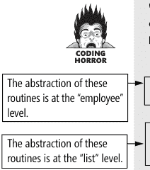

```
**C++ Example of a Class Interface with Mixed Levels of Abstraction**
```cpp
class EmployeeCensus: public ListContainer {
public:
    ...
    // public routines
    void AddEmployee( Employee employee );
    void RemoveEmployee( Employee employee );

    Employee NextItemInList();
    Employee FirstItem();
    Employee LastItem();
    ...
private:
    ...
};
```
```

该类呈现了两个 ADT：Employee 和 ListContainer。这种混合抽象通常出现在程序员使用容器类或其他库类进行实现时，却没有隐藏使用库类的事实。问问自己，容器类被使用的事实是否应成为抽象的一部分。通常这是一个实现细节，应该对程序的其余部分隐藏，如下所示：

# C++ Example of a Class Interface with Consistent Levels of Abstraction

```
class EmployeeCensus {
public:
    ...
    // public routines
    void AddEmployee( Employee employee );
    void RemoveEmployee( Employee employee );
    Employee NextEmployee();
    Employee FirstEmployee();
    Employee LastEmployee();
    ...
private:
    ListContainer m_EmployeeList;
    ...
};
```

现在所有这些例程的抽象都处于“员工”级别。

该类使用 ListContainer 库这一事实现在被隐藏了。

程序员可能会争辩说，从 ListContainer 继承很方便，因为它支持多态，允许外部搜索或排序函数接受 ListContainer 对象。这一论点未能通过继承的主要测试，即“继承是否仅用于‘是’关系？”从 ListContainer 继承意味着 EmployeeCensus “是”一个 ListContainer，这显然是不正确的。如果 EmployeeCensus 对象的抽象是它可以被搜索或排序，那么这应该作为类接口中明确且一致的一部分被纳入。

如果你把类的公共例程看作防止水进入潜艇的气闸，那么不一致的公共例程就是类中的漏水面板。漏水面板可能不会像敞开的气闸那样迅速进水，但如果给它们足够的时间，它们仍会使船沉没。实践中，当混合抽象级别时就会发生这种情况。随着程序的修改，混合的抽象级别使程序越来越难以理解，并逐渐退化直至无法维护。


## 确保你理解类所实现的抽象
有些类相似到足以让你必须小心理解类接口应捕获哪种抽象。我曾经参与过一个需要以表格格式编辑信息的程序。我们希望使用一个简单的网格控件，但当时可用的网格控件不允许我们为数据输入单元格着色，因此我们决定使用一个提供该功能的电子表格控件。

电子表格控件比网格控件复杂得多，向网格控件的 15 个例程提供了约 150 个例程。由于我们的目标是使用网格控件，而不是电子表格控件，我们指派一名程序员编写一个包装类来隐藏我们实际上使用电子表格控件作为网格控件这一事实。程序员抱怨不必要的开销和官僚主义，离开了，几天后带着一个忠实暴露电子表格控件全部 150 个例程的包装类回来了。

这不是我们需要的。我们想要一个网格控件接口，将幕后使用更复杂的电子表格控件这一事实封装起来。程序员本应只暴露 15 个网格控件例程，外加第 16 个支持单元格着色的例程。通过暴露全部 150 个例程，程序员造成了如果我们将来想更改底层实现，我们可能需要支持 150 个公共例程的可能性。程序员未能实现我们所寻求的封装，同时也为自己制造了不必要的额外工作。

根据具体情况，正确的抽象可能是电子表格控件或网格控件。当你需要在两种相似的抽象之间做出选择时，确保你选择了正确的那个。

## 成对提供服务及其相反操作
大多数操作都有对应的、相等且相反的操作。如果你有一个打开灯的操作，你很可能需要一个关闭灯的操作。如果你有一个向列表添加项目的操作，你很可能需要一个从列表中删除项目的操作。如果你有一个激活菜单项的操作，你很可能需要一个停用该项的操作。在设计类时，检查每个公共例程以确定是否需要其补充。不要 gratuitously 创建相反操作，但要检查是否需要一个。

## 将无关信息移至另一个类
在某些情况下，你会发现一个类的半数例程操作半数类数据，而另一半例程操作另一半数据。在这种情况下，你实际上有两个类伪装成一个。将它们拆分！

## 在可能时使接口具有程序性而非语义性
每个接口都由程序性部分和语义性部分组成。程序性部分由编译器可以强制执行的接口的数据类型和其他属性组成。接口的语义部分由关于接口如何被使用的假设组成，这些假设无法由编译器强制执行。语义接口包括诸如“RoutineA 必须在 RoutineB 之前被调用”或“如果 dataMember1 在传递给 RoutineA 之前未初始化，RoutineA 将崩溃”之类的考虑。语义接口应在注释中记录，但尽量使接口对文档的依赖最小化。接口中任何无法由编译器强制执行的方面都可能被误用。寻找方法将语义接口元素转换为程序性接口元素，例如使用 Asserts 或其他技术。


交叉引用 关于如何在代码修改过程中保持代码质量的更多建议，请参见第24章“重构”。

## 警惕接口抽象在修改过程中被侵蚀

在类的修改和扩展过程中，你经常会发现一些额外功能是需要的，但这些功能与原始类接口并不完全契合，而且似乎很难用其他方式实现。例如，在Employee类中，你可能会发现该类演变成这样：

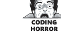

```
C++ Example of a Class Interface That's Eroding Under Maintenance
class Employee {
public:
    ...
    // public routines
    FullName GetName() const;
    Address GetAddress() const;
    PhoneNumber GetWorkPhone() const;
    ...
    bool IsJobClassificationValid( JobClassification jobClass );
    bool IsZipCodeValid( Address address );
    bool IsPhoneNumberValid( PhoneNumber phoneNumber );
    
    SqlQuery GetQueryToCreateNewEmployee() const;
    SqlQuery GetQueryToModifyEmployee() const;
    SqlQuery GetQueryToRetrieveEmployee() const;
    ...
private:
    ...
};
```

早期代码示例中原本清晰的抽象，已经演变成一组仅松散相关的功能大杂烩。员工与检查邮政编码、电话号码或职位分类合法性的例程之间没有任何逻辑联系。暴露SQL查询细节的例程处于比Employee类低得多的抽象层次，并且破坏了Employee抽象。

## 不要添加与接口抽象不一致的公有成员

每次向类接口添加例程时，都要问：“这个例程与现有接口所提供的抽象一致吗？”如果不一致，请寻找其他方法进行修改，并保持抽象的完整性。

## 将抽象与内聚性一并考虑

抽象与内聚的概念密切相关——呈现良好抽象的类接口通常具有强内聚性。具有强内聚性的类往往呈现良好的抽象，尽管这种关系并不那么强。

我发现，专注于类接口所呈现的抽象，往往比专注于类内聚性更能洞察类设计。如果你发现某个类内聚性较弱，且不确定如何纠正，不妨问问自己：该类是否呈现了一致的抽象。

## 良好的封装

如5.3节所述，封装是比抽象更强的概念。抽象通过提供模型来帮助你忽略实现细节，从而有助于管理复杂度。封装则是强制执行者，即使你想查看细节，也会阻止你这样做。

这两个概念是相关联的，因为没有封装，抽象往往会崩溃。以我的经验，要么你同时拥有抽象和封装，要么两者都没有，没有中间地带。

**最小化类和成员的可访问性** 最小化可访问性是旨在鼓励封装的规则之一。如果你想知道某个特定例程应该是公有的、私有的还是受保护的，一种学派认为你应该倾向于可用的最严格隐私级别（Meyers 1998, Bloch 2001）。我认为这是很好的指导原则，但更重要的指导原则是：“什么最能保持接口抽象的完整性？”如果暴露该例程与抽象一致，那么暴露它很可能是可以的。如果你不确定，隐藏得多通常比隐藏得少更好。

**不要公开暴露成员数据** 公开暴露成员数据违反了封装，并限制了你对抽象的控制。正如Arthur Riel指出的，一个*Point*类如果暴露

```
float x;
float y;
float z;
```

就违反了封装，因为客户端代码可以自由地摆弄*Point*的数据，而*Point*甚至不一定知道其值何时被更改（Riel 1996）。然而，一个*Point*类如果暴露

```
float GetX();
float GetY();
float GetZ();
void SetX( float x );
void SetY( float y );
void SetZ( float z );
```

则保持了完美的封装。你无法知道底层实现是以*float*形式存储x、y和z，还是*Point*以*double*存储这些项并在需要时转换为*float*，又或者*Point*将数据存储在月球上，再通过外层空间卫星取回。

**避免将私有实现细节放入类接口中** 有了真正的封装，程序员将完全无法看到实现细节。它们既在比喻意义上被隐藏，也在字面上被隐藏。在流行的语言中，包括

> 区分设计良好的模块与设计不佳的模块的最重要因素，是模块向其他模块隐藏其内部数据和其他实现细节的程度。
> 
> ——Joshua Bloch

**交叉引用** 有关封装的更多内容，请参见5.3节“封装实现细节”。

现在你可以将实现细节放入*EmployeeImplementation*类中，该类只对*Employee*类可见，而对使用*Employee*类的代码不可见。

如果你已经为项目编写了大量没有使用这种方法代码，你可能会认为不值得花力气将大量现有代码改造为使用这种方法。但当你阅读暴露了实现细节的代码时，你可以忍住仔细检查类接口*私有*部分以寻找实现线索的冲动。

**不要对类的使用者做假设** 类的设计和实现应遵守类接口所暗示的契约。除了接口中记录的内容之外，它不应假设该接口将如何使用或不如何使用。下面这样的注释表明类对使用者的了解超出了应有的程度：

```
— initialize x, y, and z to 1.0 because DerivedClass blows
— up if they're initialized to 0.0
```

**避免使用友元类** 在少数情况下，例如状态模式中，友元类可以被规范地使用，从而有助于管理复杂度（Gamma et al. 1995）。但总的来说，友元类违反了封装。它们扩大了你在任何时刻需要思考的代码量，从而增加了复杂度。

**不要仅仅因为例程只使用公有例程，就将其放入公有接口** 例程只使用公有例程这一事实并不是重要的考量。相反，要问暴露该例程是否与接口所呈现的抽象一致。

**更重视阅读期便利而非编写期便利** 代码的阅读次数远多于编写次数，即使在初始开发阶段也是如此。以牺牲阅读期便利为代价来换取编写期便利的技术是一种虚假的经济。这一点尤其适用于类接口的创建。即使一个例程并不完全符合接口的抽象，有时你也忍不住会想向接口添加一个对当前正在处理的特定类客户端很方便的例程。但添加该例程是走上滑坡的第一步，最好不要迈出这一步。

> 如果你必须查看底层实现才能明白发生了什么，那它就算不上抽象。
> 
> ——P. J. Plauger

**要非常、非常警惕语义层面的封装违反** 曾经我以为，当我学会了避免语法错误，就可以高枕无忧了。我很快发现，学会避免语法错误只不过为我购买了一张通往全新编码错误剧场的门票，其中大多数错误比语法错误更难以诊断和纠正。

语义封装与语法封装的难度相似。在语法层面，只需将类的内部例程和数据声明为*私有*，就能相对容易地避免窥探另一个类的内部运作。而要实现


语义封装则完全是另一回事。以下是类的使用者可能在语义上破坏封装的一些方式：

- 不调用类 A 的 *InitializeOperations()* 例程，因为你已知类 A 的 *PerformFirstOperation()* 例程会自动调用它。
- 在调用 *employee.Retrieve(database)* 之前不调用 *database.Connect()* 例程，因为你已知 *employee.Retrieve()* 函数会在没有现成连接时自行连接数据库。
- 不调用类 A 的 *Terminate()* 例程，因为你已知类 A 的 *PerformFinalOperation()* 例程已经调用过它。
- 在 *ObjectA* 离开作用域之后，仍然使用由 *ObjectA* 创建的指向 *ObjectB* 的指针或引用，因为你已知 *ObjectA* 将 *ObjectB* 保存在静态存储中，*ObjectB* 仍然有效。
- 使用类 B 的 *MAXIMUM_ELEMENTS* 常量，而不是使用 *ClassA.MAXIMUM_ELEMENTS*，因为你已知两者相等。


上述每个例子的问题都在于，它们使客户端代码依赖的不是类的公共接口，而是其私有实现。任何时候，如果你发现自己需要查看类的实现才能弄清如何使用这个类，你就不是在针对接口编程；而是在*透过*接口编程，直接面向实现。如果你在透过接口编程，封装就被破坏了，而封装一旦开始瓦解，抽象也随之不远了。

如果你仅凭类的接口文档无法弄明白如何使用这个类，正确的做法*不是*去拉取源代码查看实现。这样做虽有主动性，但判断不佳。正确的做法是联系该类的作者，说“我搞不清楚如何使用这个类。”类作者的正确做法*不是*当面回答你的问题。类作者的正确做法是检出类接口文件，修改类接口文档，重新检入文件，然后说“看看你现在是否能明白它是如何工作的。”你希望这种对话发生在接口代码本身中，以便为将来的程序员保留下来。你不希望这种对话只发生在你自己的头脑中，因为那会把微妙的语义依赖烘焙进使用该类的客户端代码里。你也不希望这种对话只发生在人与人之间，那样只会让你的代码受益，而不能惠及他人。

### 警惕过于紧密的耦合

“耦合”指的是两个类之间连接的紧密程度。一般来说，连接越松散越好。以下是一些源于这一概念的通用指导原则：

- 最小化类和成员的可见性。
- 避免*友元*类，因为它们紧密耦合。

对于成员，考虑该类是否应该分解为多个更小的类（Riel 1996）。如果数据成员是整数和字符串之类的原始数据类型，可以更偏向7±2的高端；如果数据成员是复杂对象，则应更偏向7±2的低端。

## 继承（“is a”关系）

继承是指一个类是另一个类的特化。继承的目的在于通过定义一个基类来指定两个或多个派生类的共同元素，从而创建更简单的代码。这些共同元素可以是例程接口、实现、数据成员或数据类型。继承通过将代码和数据集中到基类中，帮助避免在多个位置重复代码和数据。

当你决定使用继承时，需要做出若干决策：

- 对于每个成员例程，该例程对派生类可见吗？它将有默认实现吗？默认实现可以被覆盖吗？
- 对于每个数据成员（包括变量、命名常量、枚举等），该数据成员对派生类可见吗？

以下小节详细说明如何做出这些决策：

### 通过公有继承实现“is a”关系

当程序员决定通过继承现有类来创建新类时，他是在说新类是旧类的一个更特化的版本。基类设定了派生类如何运作的预期，并对派生类如何运作施加约束（Meyers 1998）。

如果派生类不打算完全遵守基类定义的同一接口契约，继承就不是正确的实现技术。可以考虑包含（containment），或在继承层次结构的更高层进行修改。

### 为继承而设计并编写文档，或者禁止继承

继承会增加程序的复杂度，因此它是一种危险的技术。正如 Java 大师 Joshua Bloch 所说：“为继承而设计并编写文档，否则就禁止继承。”如果一个类并非为被继承而设计，应将其成员在 C++ 中设为非虚、在 Java 中设为 final，或在 Microsoft Visual Basic 中设为不可覆盖，从而使其不能被继承。

### 遵循里氏替换原则（LSP）

在一篇面向对象编程的开创性论文中，Barbara Liskov 认为，除非派生类确实是基类更具体的版本，否则你不应从基类继承（Liskov 1988）。Andy Hunt 和 Dave Thomas 对 LSP 的总结如下：“子类必须能通过基类接口被使用，而使用者无需知道区别”（Hunt and Thomas 2000）。

> 使用 C++ 进行面向对象编程时，唯一条最重要的规则是：公有继承意味着“is a”。请牢记这条规则。
> ——Scott Meyers

换句话说，基类中定义的所有例程在每一个派生类中使用时，含义都应该相同。

如果你有一个基类 *Account*，派生类有 *CheckingAccount*、*SavingsAccount* 和 *AutoLoanAccount*，那么程序员应该能够在 *Account* 的任何子类型上调用任何从 *Account* 派生的例程，而不必关心某个账户对象具体属于哪个子类型。

如果程序是按照里氏替换原则编写的，继承就是一种降低复杂度的强大工具，因为程序员可以专注于对象的通用属性，而不必担心细节。如果程序员必须时刻思考子类实现中的语义差异，那么继承就是在增加复杂度，而非降低复杂度。假设程序员必须这样想：“如果我在 *CheckingAccount* 或 *SavingsAccount* 上调用 *InterestRate()* 例程，它返回的是银行支付的利息；但如果我在 *AutoLoanAccount* 上调用 *InterestRate()*，我必须改变符号，因为它返回的是消费者向银行支付的利息。”根据 LSP，在这个例子中 *AutoLoanAccount* 不应继承自 *Account* 基类，因为 *InterestRate()* 例程的语义与基类 *InterestRate()* 例程的语义不同。

### 确保只继承你想要继承的内容

派生类可以继承成员例程的接口、实现，或两者兼有。表 6-1 展示了例程可以被实现和覆盖的各种变体。

**表 6-1 — 继承例程的变体**

|  | 可覆盖 | 不可覆盖 |
|---|---|---|
| **实现：提供默认实现** | 可覆盖例程 | 不可覆盖例程 |
| **实现：未提供默认实现** | 抽象可覆盖例程 | 不使用（将例程保留未定义又不允许覆盖是毫无意义的） |

如表所示，继承例程有三种基本类型：

- *抽象可覆盖例程*意味着派生类继承例程的接口，但不继承其实现。
- *可覆盖例程*意味着派生类继承例程的接口和默认实现，并允许覆盖默认实现。
- *不可覆盖例程*意味着派生类继承例程的接口及其默认实现，但不允许覆盖例程的实现。


当你选择通过继承来实现一个新类时，请仔细思考你希望对每个成员例程采用哪种继承。要警惕仅仅因为继承了接口就继承实现，也要警惕仅仅因为想继承实现就继承接口。如果你想使用某个类的实现但不需要其接口，请使用包含（containment）而不是继承。

## 不要“重写”不可重写的成员函数

C++ 和 Java 都允许程序员“某种程度地”重写不可重写的成员例程。如果基类中的函数是私有的，派生类可以创建一个同名函数。对于阅读派生类代码的程序员来说，这样的函数可能会造成混淆，因为它看起来应该是多态的，但实际上不是；它只是同名而已。这条指导原则的另一种表述方式是：“不要在派生类中重用基类不可重写例程的名字。”

## 将公共接口、数据和行为尽可能上移到继承树的高处

将接口、数据和行为上移得越高，派生类就越容易使用它们。多高才算过高？让抽象来指引你。如果你发现将某个例程上移会破坏更高层对象的抽象，就不要这样做。

## 警惕只有一个实例的类

只有一个实例可能表明设计混淆了对象与类。考虑是否可以直接创建一个对象而不是一个新类。派生类的变化能否用数据来表示，而不是作为一个独立的类？单例模式（Singleton pattern）是这条指导原则的一个显著例外。

## 警惕只有一个派生类的基类

当我看到一个基类只有一个派生类时，我会怀疑某个程序员一直在“预先设计”——试图预见未来的需求，而通常并未完全理解那些未来需求是什么。为未来工作做准备的最佳方式，不是设计“将来某天可能会用到”的额外基类层次，而是让当前的工作尽可能清晰、直接和简单。这意味着不要创建任何超出绝对必要的继承结构。

## 警惕那些在派生例程中重写一个例程却什么都不做的类

这通常表明基类的设计存在错误。例如，假设你有一个 Cat 类和一个 Scratch() 例程，并且最终你发现有些猫被去除了爪子，无法抓挠。你可能会想创建一个从 Cat 派生的名为 ScratchlessCat 的类，并重写 Scratch() 例程使其什么都不做。这种方法会带来几个问题：

- 它通过改变 Cat 类接口的语义，违反了 Cat 类所呈现的抽象（接口契约）。
- 当你将其扩展到其他派生类时，这种方法很快就会失控。如果你发现一只没有尾巴的猫怎么办？或者一只不抓老鼠的猫？或者一只不喝奶的猫？最终你会得到像 ScratchlessTaillessMicelessMilklessCat 这样的派生类。

随着时间的推移，这种方法会产生难以维护的代码，因为祖先类的接口和行为对后代类的行为几乎没有任何暗示或说明。

解决这个问题的地方不在基类，而在最初的 Cat 类。创建一个 Claws 类并将其包含在 Cat 类中。根本问题在于“所有猫都会抓挠”这一假设，因此要从源头解决问题，而不是在终点简单地包扎一下。

## 避免过深的继承树

面向对象编程提供了大量管理复杂性的技术。但每一个强大的工具都有其危险之处，一些面向对象技术往往会增加复杂性而非降低复杂性。

Arthur Riel 在其杰出的著作《面向对象设计启发式规则》（Object-Oriented Design Heuristics, 1996）中建议将继承层次限制在最多六级。Riel 的建议基于“神奇数字 7±2”，但我认为这过于乐观了。根据我的经验，大多数人很难同时在脑中处理超过两到三层的继承。“神奇数字 7±2”或许更适合用作基类子类总数的限制，而不是继承树层数的限制。

研究发现，过深的继承树与错误率的增加显著相关（Basili, Briand, and Melo 1996）。任何曾经尝试调试复杂继承层次的人都知道原因。过深的继承树会增加复杂性，而这恰恰与继承应达成的目标相反。请牢记首要的技术使命。确保你使用继承是为了避免重复代码并最小化复杂性。

## 优先使用多态而非大量的类型检查

频繁重复的 case 语句有时表明继承可能是更好的设计选择，尽管这并不总是正确的。下面是一个经典的代码示例，它强烈呼唤更面向对象的方法：

```
C++ Example of a Case Statement That Probably Should Be Replaced by Polymorphism
switch ( shape.type ) {
    case Shape_Circle:
        shape.DrawCircle();
        break;
    case Shape_Square:
        shape.DrawSquare();
        break;
    ...
}
```

在这个示例中，对 shape.DrawCircle() 和 shape.DrawSquare() 的调用应该被替换为一个名为 shape.Draw() 的单一例程，无论形状是圆形还是方形都可以调用它。

另一方面，有时 case 语句用于区分真正不同类型的对象或行为。下面是一个在面向对象程序中合适的 case 语句示例：

## 可能不应被多态替换的 C++ case 语句示例

```
switch ( ui.Command() ) {
    case Command_OpenFile:
        OpenFile();
        break;
    case Command_Print:
        Print();
        break;
    case Command_Save:
        Save();
        break;
    case Command_Exit:
        ShutDown();
        break;
    ...
}
```

在这种情况下，可以创建一个基类及其派生类，并为每个命令提供一个多态的 DoCommand() 例程（如 Command 模式）。但在像这样简单的场景中，DoCommand() 的含义会被稀释得毫无意义，而 case 语句才是更易理解的解决方案。

让所有数据都是私有的，而不是受保护的。正如 Joshua Bloch 所说：“继承破坏了封装”（2001）。当你继承一个对象时，你获得了对该对象受保护例程和数据的特权访问。如果派生类确实需要访问基类的属性，请提供受保护的访问器函数（accessor functions）来代替。

## 多重继承

继承是一种强力工具。它就像用链锯而不是手动横切锯来砍树。只要小心使用，它会非常有用，但在不遵守适当预防措施的人手中，它就很危险。

> 关于 C++ 中多重继承，有一个无可争辩的事实：它打开了一个复杂性“潘多拉魔盒”，而这些复杂性在单一继承下根本不存在。
> ——斯科特·迈耶斯（Scott Meyers）

如果继承是链锯，那么多重继承就是一把 20 世纪 50 年代的链锯——没有锯片护罩，没有自动停机装置，发动机还很难伺候。有时候这种工具有价值；但在大多数情况下，你最好把它留在车库里，这样它就不会造成任何损害。

尽管一些专家推荐广泛使用多重继承（Meyer 1997），但根据我的经验，多重继承主要用于定义“混入类”（mixin）——用于向对象添加一组属性的简单类。混入类之所以被称为混入类，是因为它们允许属性“混入”派生类。混入类可能是 *Displayable*、*Persistent*、*Serializable* 或 *Sortable* 这样的类。混入类几乎总是抽象的，并且不打算独立于其他对象进行实例化。

混入类需要使用多重继承，但只要所有混入类彼此真正独立，它们就不会遇到与多重继承相关的经典菱形继承问题。它们还通过将属性“分块”在一起，使设计更易于理解。程序员理解一个对象使用 *Displayable* 和 *Persistent* 混入类，要比理解该对象使用 11 个更具体的例程容易得多，而如果没有混入类，实现这两个属性就需要这些例程。

Java 和 Visual Basic 认识到混入类的价值，允许接口的多重继承，但只允许单一类继承。C++ 同时支持接口和实现的多重继承。程序员只有在仔细考虑替代方案并权衡对系统复杂性和可理解性的影响之后，才应使用多重继承。

## 为什么继承有这么多规则？


本节提出了许多关于如何避免继承问题的规则。所有这些规则背后的信息是：*继承往往与你作为程序员所肩负的首要技术使命相悖，即管理复杂性*。为了控制复杂性，你应该对继承抱有强烈的偏见。以下是何时使用继承、何时使用包含的总结：

**交叉引用** 关于复杂性的更多内容，请参阅第 5.2 节的“软件的首要技术使命：管理复杂性”。

- 如果多个类共享公共数据但不共享行为，请创建一个这些类可以包含的公共对象。
- 如果多个类共享公共行为但不共享数据，请从定义这些公共例程的公共基类派生它们。
- 如果多个类共享公共数据和公共行为，请从定义公共数据和公共例程的公共基类继承。
- 当你希望基类控制你的接口时，使用继承；当你希望自己控制接口时，使用包含。


# 成员函数与数据

> **交叉引用** 有关例程的更广泛讨论，请参阅第 7 章“高质量例程”。

以下是实现成员函数和成员数据时应遵循的几条准则。

**尽可能减少类中的例程数量** 对 C++ 程序的一项研究发现，类中每类的例程数量越多，其故障率越高（Basili、Briand 和 Melo 1996）。然而，发现其他竞争因素更为重要，包括继承树深度、类内调用的例程数量众多，以及类之间的强耦合。在最小化例程数量与这些其他因素之间进行权衡评估。

**禁止你不想要的隐式生成的成员函数和运算符** 有时你会发现想要禁止某些函数——也许你想禁止赋值，或者不允许构造对象。你可能会认为，由于编译器会自动生成运算符，因此你只能允许访问。但在这种情况下，你可以通过将构造函数、赋值运算符或其他函数或运算符声明为 *private* 来禁止这些用法，这将阻止客户端访问它。（将构造函数设为私有是定义单例类的标准技术，本章后面会讨论。）

**尽量减少类调用的不同例程的数量** 一项研究发现，类中的故障数量与类内部调用的总例程数量在统计上相关（Basili、Briand 和 Melo 1996）。同一项研究还发现，一个类使用的类越多，其故障率往往越高。这些概念有时被称为“扇出”。

> **延伸阅读** 关于迪米特法则的良好论述可在 *Pragmatic Programmer*（Hunt and Thomas 2000）、*Applying UML and Patterns*（Larman 2001）以及 *Fundamentals of Object-Oriented Design in UML*（Page-Jones 2000）中找到。

**尽量减少对其他类的间接例程调用** 直接连接已经很危险。间接连接——例如 *account.ContactPerson().DaytimeContactInfo().PhoneNumber()*——往往更危险。研究人员提出了一条称为“迪米特法则”（Lieberherr and Holland 1989）的规则，其基本内容是对象 A 可以调用其自身的任何例程。如果对象 A 实例化了对象 B，它可以调用对象 B 的任何例程。但它应避免对由对象 B 提供的对象调用例程。在上面的 *account* 示例中，这意味着 *account.ContactPerson()* 是可以的，但 *account.ContactPerson().DaytimeContactInfo()* 则不行。

这是一个简化的解释。有关更多细节，请参阅本章末尾的附加资源。

**总体而言，尽量减少类与其他类协作的程度** 尝试尽量减少以下所有内容：
- 实例化的对象种类数量
- 对已实例化对象进行的不同的直接例程调用数量
- 对由其他已实例化对象返回的对象进行的例程调用数量

# 构造函数

以下是专门适用于构造函数的一些准则。构造函数的准则在各语言中相当相似（至少在 C++、Java 和 Visual Basic 中如此）。析构函数差异更大，因此你应查阅本章“附加资源”部分列出的资料以获取有关析构函数的信息。

**如果可能，在所有构造函数中初始化所有成员数据** 在所有构造函数中初始化所有数据成员是一种廉价的防御性编程实践。

**通过使用私有构造函数强制单例属性** 如果你想定义一个类只允许实例化一个对象，可以通过隐藏该类的所有构造函数，然后提供一个静态的 `GetInstance()` 例程来访问类的唯一实例来实现。以下是其工作原理的示例：

> **延伸阅读** 在 C++ 中执行此操作的代码会类似。有关详细信息，请参阅 *More Effective C++*，第 26 条（Meyers 1998）。

```
**Java Example of Enforcing a Singleton with a Private Constructor**

```java
public class MaxId {
    // constructors and destructors
    private MaxId() {
        ...
    }
    ...

    // public routines
    public static MaxId GetInstance() {
        return m_instance;
    }
    ...

    // private members
    private static final MaxId m_instance = new MaxId();
    ...
}
```
```

私有构造函数仅在 *static* 对象 *m_instance* 初始化时被调用。在这种方法中，如果你想引用 *MaxId* 单例，只需引用 *MaxId.GetInstance()* 即可。

**除非另有证明，否则优先使用深拷贝而非浅拷贝** 关于复杂对象，你将做出的主要决策之一是是否实现对象的深拷贝或浅拷贝。对象的深拷贝是对对象成员数据的逐成员拷贝；浅拷贝通常只是指向或引用单个引用拷贝，尽管“深”和“浅”的具体含义各不相同。

创建浅拷贝的动机通常是为了提高性能。尽管创建大型对象的多个拷贝在美学上可能令人反感，但它很少会造成任何可测量的性能影响。少量对象可能会导致性能问题，但程序员在猜测哪些代码真正导致问题方面 notoriously 不擅长。（有关详细信息，请参阅第 25 章“代码调优策略”。）

> 这里是私有构造函数。

> 这里是提供对单一实例访问的公共例程。

> 这里是单一实例。

由于为可疑的性能提升而增加复杂性是一种糟糕的权衡，因此关于深拷贝与浅拷贝的良好方法是除非另有证明，否则优先使用深拷贝。

深拷贝比浅拷贝更简单地编码和维护。除了对象本身包含的代码外，浅拷贝还添加了用于计数引用、确保安全对象拷贝、安全比较、安全删除等的代码。此代码可能容易出错，除非有令人信服的理由创建它，否则应避免它。

如果你发现确实需要使用浅拷贝方法，Scott Meyers 的 *More Effective C++*，第 29 条（1996）对 C++ 中的问题进行了极好的讨论。Martin Fowler 的 *Refactoring*（1999）描述了从浅拷贝转换为深拷贝以及从深拷贝转换为浅拷贝所需的具体步骤。（Fowler 将它们称为引用对象和值对象。）

### 6.4 创建类的原因

如果你相信你读到的所有内容，你可能会认为创建类的唯一原因是建模现实世界对象。实际上，创建类的原因远不止于此。以下是创建类的良好原因列表。

**建模现实世界对象** 建模现实世界对象可能不是创建类的唯一原因，但它仍然是一个很好的原因！为你的程序建模的每种现实世界对象类型创建一个类。把对象所需的数据放入类中，然后构建服务例程来模拟对象的行为。有关 ADT 的讨论，请参阅第 6.1 节中的示例。

**建模抽象对象** 创建类的另一个好理由是建模 *抽象对象*——一个不是具体现实世界对象但为其他具体对象提供抽象的对象。一个很好的例子是经典的 *Shape* 对象。*Circle* 和 *Square* 确实存在，但 *Shape* 是对其他特定形状的抽象。

在编程项目中，抽象并不是像 *Shape* 那样现成的，因此我们必须更加努力地提出干净的抽象。从现实世界实体中提炼抽象概念的过程是非确定性的，不同的设计者会抽象出不同的一般性。例如，如果我们不知道几何形状如圆、方形和三角形，我们可能会提出更不寻常的形状，如南瓜形状、芜菁形状和 Pontiac Aztek 形状。提出合适的抽象对象是面向对象设计中的主要挑战之一。

**降低复杂度** 创建类的最重要原因是降低程序的复杂度。创建一个类来隐藏信息，这样你就不需要思考它。当然，在编写类时你需要思考它。但在编写完成后，你应该能够忘记细节并在没有任何内部工作原理知识的情况下使用该类。创建类的其他原因——最小化代码大小，


交叉引用 创建类和例程的原因重叠。请参阅第 7.1 节。

交叉引用 有关识别现实世界对象的更多信息，请参阅第 5.3 节中的“查找现实世界对象”。


提高可维护性和提高正确性也是很好的理由，但如果没有类的抽象能力，复杂的程序在智力上将无法管理。

- **隔离复杂性** 各种形式的复杂性——复杂的算法、大型数据集、错综复杂的通信协议等等——都容易出错。如果出现错误，如果它没有散布在代码中而是局限在类内部，就更容易找到。修复错误而产生的更改不会影响其他代码，因为只需要修复一个类——其他代码不会被触及。如果你找到了更好、更简单或更可靠的算法，如果它已被隔离到一个类中，更换旧算法会更容易。在开发过程中，尝试几种设计并保留效果最好的设计会更容易。

- **隐藏实现细节** 隐藏实现细节的愿望是创建类的一个很好的理由，无论细节是像错综复杂的数据库访问那样复杂，还是像特定数据成员是存储为数字还是字符串那样平凡。

- **限制更改的影响** 隔离可能发生变化的区域，以便更改的影响仅限于单个类或少数几个类的范围。设计时应使最有可能发生变化的区域最容易更改。可能发生变化的区域包括硬件依赖、输入/输出、复杂数据类型和业务规则。

  > **交叉引用** 有关使用全局数据相关问题的讨论，请参阅第 13.3 节“全局数据”。

- **隐藏全局数据** 如果你需要使用全局数据，可以通过类接口隐藏其实现细节。通过访问例程使用全局数据，与直接使用全局数据相比具有多种好处。你可以在不更改程序的情况下更改数据的结构。你可以监控对数据的访问。使用访问例程的纪律也鼓励你思考数据是否真的全局；通常会变得明显，“全局数据”实际上只是对象数据。

- **简化参数传递** 如果你在多个例程之间传递参数，这可能表明需要将这些例程分解为一个共享该参数作为对象数据的类。简化参数传递本身并不是目标，但传递大量数据表明不同的类组织可能更有效。

  > **交叉引用** 有关信息隐藏的详细信息，请参阅第 5.3 节中的“隐藏秘密（信息隐藏）”。

- **建立控制中心** 在一个地方控制每个任务是一个好主意。控制有多种形式。表格中条目的数量是一种形式。设备——文件、数据库连接、打印机等等——的控制是另一种形式。使用一个类从数据库读取和写入是集中控制的一种形式。如果数据库需要转换为平面文件或内存数据，更改将只影响一个类。集中控制的思想与信息隐藏相似，但它具有独特的启发式力量，使其值得添加到你的编程工具箱中。

## 促进可重用代码

放入结构良好的类中的代码比嵌入在更大的类中的相同代码更容易在其他程序中重用。即使代码段仅在程序中的一个地方被调用，并且作为较大类的一部分是可以理解的，如果该代码段可能在另一个程序中使用，也应将其放入自己的类中。


NASA 的软件工程实验室研究了十个积极追求重用的项目（McGarry, Waligora, and McDermott 1989）。在面向对象和面向功能的方法中，初始项目都无法从以前的项目中获取太多代码，因为以前的项目没有建立足够的代码库。随后，使用功能设计的项目能够从以前的项目中获取约 35% 的代码。使用面向对象方法的项目能够从以前的项目中获取超过 70% 的代码。如果你可以通过提前规划避免编写 70% 的代码，就去做吧！

> **交叉引用** 有关实现所需最小功能量的更多信息，请参阅第 24.2 节中“程序包含看起来可能某天会需要的代码”。

值得注意的是，NASA 创建可重用类的核心方法不涉及“为重用而设计”。NASA 在项目结束时识别重用候选。然后他们在主要项目结束时或作为新项目的第一步进行特殊项目，以完成使类可重用的工作。这种方法有助于防止“镀金”——创建不需要的功能并不必要地增加复杂性。

## 为程序族规划

如果你预计程序会被修改，将你预计会更改的部分隔离出来并放入自己的类中是一个好主意。然后你可以修改这些类而不影响程序的其余部分，或者你可以放入全新的类。不仅思考一个程序会是什么样子，而且思考整个程序族可能是什么样子，是预见整个类别更改的有力启发式方法（Parnas 1976）。

几年前我管理一个团队，他们编写了一系列供客户销售保险的程序。我们必须根据特定客户的保险费率、报价报告格式等定制每个程序。但程序的许多部分是相似的：输入潜在客户信息的类、将信息存储在客户数据库中的类、查找费率的类、计算团体总费率的类等等。团队将程序分解为每个因客户而异的部分都放在自己的类中。初始编程可能需要三个月左右，但当我们获得新客户时，我们只需为新客户编写几个新类并将其放入其余代码中。几天的工作——瞧！——定制软件！

## 应避免的类

虽然类总体上是好的，但你可能会遇到一些陷阱。以下是应避免的类。

- **打包相关操作** 在你无法隐藏信息、共享数据或规划灵活性的情况下，你仍然可以将一组操作打包成合理的组，例如三角函数、统计函数、字符串操作例程、位操作例程、图形例程等等。类是将相关操作组合的一种方式。你也可以使用包、命名空间或头文件，具体取决于你使用的语言。

- **完成特定的重构** 第 24 章“重构”中描述的许多特定重构会产生新的类——包括将一个类转换为两个类、隐藏委托、移除中间人以及引入扩展类。这些新类可能是出于更好地实现本节中所述的任何目标的愿望而产生的。

- **避免创建上帝类** 避免创建无所不知的类，即无所不知、无所不能的类。如果一个类花费时间从其他类检索数据，使用 Get() 和 Set() 例程（即深入它们的业务并告诉它们该做什么），请问这种功能是否更适合组织到这些其他类中而不是上帝类中（Riel 1996）。

  > **交叉引用** 这种类型的类通常称为结构。有关结构的更多信息，请参阅第 13.1 节“结构”。

- **消除无关的类** 如果一个类仅包含数据而没有行为，请问自己它是否真的是一个类，并考虑将其降级，使其成员数据仅成为一个或多个其他类的属性。

- **避免以动词命名的类** 一个类如果只有行为而没有数据，通常并不是真正的类。考虑将像 DatabaseInitialization() 或 StringBuilder() 这样的类转换为其他类上的例程。

## 创建类的理由总结

以下是创建类的有效理由的总结列表：

- 模拟现实世界对象
- 模拟抽象对象
- 降低复杂性
- 隔离复杂性
- 隐藏实现细节
- 限制更改的影响
- 隐藏全局数据


- 简化参数传递
- 制定控制中心点
- 促进可重用代码
- 为程序族做规划
- 封装相关操作
- 实现特定的重构

### 6.5 语言特定问题

不同编程语言中对类的处理方式存在有趣的差异。考虑在派生类中重写成员例程以实现多态的情况。在 Java 中，所有例程默认都可以被重写，且必须声明为 *final* 才能防止派生类重写它。在 C++ 中，例程默认不可被重写。必须在基类中将例程声明为 *virtual* 才能被重写。在 Visual Basic 中，例程必须在基类中声明为 *overridable*，并且派生类应使用 *overrides* 关键字。

以下是根据语言而显著不同的与类相关的主要领域：

- 继承树中被重写的构造函数和析构函数的行为
- 异常处理条件下的构造函数和析构函数的行为
- 默认构造函数（无参数构造函数）的重要性
- 析构函数或终结器被调用的时间
- 是否明智地重写语言内置的运算符，包括赋值和相等
- 对象创建和销毁时或声明并超出作用域时内存的处理方式

这些问题的详细讨论超出了本书的范围，但“附加资源”部分指出了良好的语言特定资源。

### 6.6 超越类：包

**交叉引用** 有关类与包区别的更多内容，请参阅第 5.2 节“设计层次”中的“Levels of Design”。

类目前是程序员实现模块化的最佳方式。但模块化是一个大话题，超出了类的范围。在过去几十年中，软件开发很大程度上是通过增加我们需要处理的工作单元的粒度而取得进展。我们第一个拥有的聚合是语句，其

## 封装

- 该类是否将对其成员的访问降到最低？
- 该类是否避免暴露成员数据？
- 该类是否在编程语言允许的范围内尽可能地将其实现细节隐藏于其他类？
- 该类是否避免对使用者做出假设，包括其派生类？
- 该类是否独立于其他类？是否松耦合？

## 继承

- 继承是否仅用于建模“is a”关系——即派生类是否遵循 Liskov 替换原则？
- 类文档是否描述了继承策略？
- 派生类是否避免“重写”不可重写的例程？
- 共同的接口、数据和行为是否尽可能高地放置在继承树中？
- 继承树是否足够浅？
- 基类中的所有数据成员是否为 private 而非 protected？

## 其他实现问题

- 该类是否包含七个或更少的数据成员？
- 该类是否将对其他类的直接和间接例程调用降到最低？
- 该类是否仅在绝对必要时与其它类协作？
- 所有成员数据是否在构造函数中初始化？
- 该类是否设计为使用深拷贝而非浅拷贝，除非有经过测量的理由创建浅拷贝？

## 语言特定问题

- 你是否调查了你特定编程语言中类的语言特定问题？

## 附加资源

## 类的一般性

Meyer, Bertrand. *Object-Oriented Software Construction*, 2d ed. New York, NY: Prentice Hall PTR, 1997. 本书包含对抽象数据类型深入的讨论并解释了它们如何构成类的基础。第 14–16 章深入讨论了继承。Meyer 在第 15 章中提出了支持多继承的论点。

Riel, Arthur J. *Object-Oriented Design Heuristics*. Reading, MA: Addison-Wesley, 1996. 本书包含大量改进程序设计的建议，主要在类层面。我多年避免这本书，因为它看起来过于空谈！然而本书正文只有约 200 页。Riel 的写作通俗易懂。内容聚焦且实用。

## C++

Meyers, Scott. *Effective C++: 50 Specific Ways to Improve Your Programs and Designs*, 2d ed. Reading, MA: Addison-Wesley, 1998.

Meyers, Scott, 1996, *More Effective C++: 35 New Ways to Improve Your Programs and Designs*. Reading, MA: Addison-Wesley, 1996. Meyers 的两本书都是 C++ 程序员的经典参考。书籍引人入胜，有助于培养对 C++ 细微之处的语言律师式欣赏。

## Java

Bloch, Joshua. *Effective Java Programming Language Guide*. Boston, MA: Addison-Wesley, 2001. Bloch 的书提供了大量 Java 特定的建议，同时也介绍了更通用、良好的面向对象实践。

## Visual Basic

以下书籍是 Visual Basic 中类的良好参考：

Foxall, James. *Practical Standards for Microsoft Visual Basic .NET*. Redmond, WA: Microsoft Press, 2003.

Cornell, Gary, and Jonathan Morrison. *Programming VB .NET: A Guide for Experienced Programmers*. Berkeley, CA: Apress, 2002.

Barwell, Fred, et al. *Professional VB.NET*, 2d ed. Wrox, 2002.

## 第 7 章

## 高质量例程

## 目录

- 7.1 创建例程的有效理由：页 164
- 7.2 例程层面的设计：页 168
- 7.3 良好的例程名称：页 171
- 7.4 例程可以有多长？：页 173
- 7.5 如何使用例程参数：页 174
- 7.6 使用函数时的特殊考虑：页 181
- 7.7 宏例程和内联例程：页 182

## 相关主题

- 例程构造步骤：第 9.3 节
- 工作类：第 6 章
- 通用设计技术：第 5 章
- 软件架构：第 3.5 节

第 6 章描述了创建类的细节。本章聚焦于例程，聚焦于区分良好例程与不良例程的特征。如果你更想先阅读影响例程设计的问题，再深入细节，请务必先阅读第 5 章“构造中的设计”，然后再回来看本章。第 8 章“防御性编程”中也讨论了一些高质量例程的重要属性。如果你更感兴趣的是阅读创建例程和类的步骤，第 9 章“伪代码编程过程”可能是更好的起点。

在深入高质量例程的细节之前，先明确两个基本术语会很有用。什么是“例程”？例程是一个可为单一目的调用的独立方法或过程。示例包括 C++ 中的函数、Java 中的方法、Microsoft Visual Basic 中的函数或子过程。对于某些用途，C 和 C++ 中的宏也可以被视为例程。你可以将创建高质量例程的许多技术应用于这些变体。

什么是高质量例程？这是一个更难的问题。也许最简单的答案是展示高质量例程不是什么。以下是一个低质量例程的示例：

```
```cpp
void HandleStuff( CORP_DATA & inputRec, int crntQtr, EMP_DATA empRec,
    double & estimRevenue, double ytdRevenue, int screenX, int screenY,
    COLOR_TYPE & newColor, COLOR_TYPE & prevColor, StatusType & status,
    int expenseType )
{
int i;
for ( i = 0; i < 100; i++ ) {
    inputRec.revenue[i] = 0;
    inputRec.expense[i] = corpExpense[ crntQtr ][ i ];
}
UpdateCorpDatabase( empRec );
estimRevenue = ytdRevenue * 4.0 / (double) crntQtr;
newColor = prevColor;
status = SUCCESS;
if ( expenseType == 1 ) {
    for ( i = 0; i < 12; i++ )
        profit[i] = revenue[i] - expense.type1[i];
}
else if ( expenseType == 2 ) {
    profit[i] = revenue[i] - expense.type2[i];
}
else if ( expenseType == 3 ) {
    profit[i] = revenue[i] - expense.type3[i];
}
```
```

这个例程有什么问题？这里有一个提示：你应该能找到至少 10 个不同的问题。一旦你列出自己的清单，再看下面的清单：

- 例程名称不好。*HandleStuff()* 没有告诉你例程做什么。
- 例程未被记录。（文档的主题超出了单个例程的边界，并在第 32 章“自文档化代码”中讨论。）
- 例程布局不好。代码在页面上的物理组织对其逻辑组织几乎没有提示。布局策略被随意使用，例程的不同部分使用不同的风格。比较 *expenseType == 2* 和 *expenseType == 3* 处的风格。（布局在第 31 章“布局和风格”中讨论。）
- 例程的输入变量 *inputRec* 被修改。如果它是输入变量，其值不应被修改（在 C++ 中应声明为 *const*）。如果变量的值本应被修改，变量就不应命名为 *inputRec*。
- 例程读写全局变量——它从 *corpExpense* 读取并向 *profit* 写入。它应通过更直接的方式与其它例程通信，而不是通过读写全局变量。


### 7.1 创建例程的有效理由

以下是创建例程的有效理由列表。这些理由在某些方面有所重叠，并且并非旨在构成正交集合。


### 降低复杂度
创建例程最重要的原因就是降低程序的复杂度。创建例程来隐藏信息，这样你就不需要去思考它。当然，在编写例程时你需要思考它。但在编写完成后，你应该能够忘记细节并使用例程，而无需了解其内部工作原理。创建例程的其他原因——最小化代码大小、提高可维护性和提高正确性——也是很好的理由，但如果没有例程的抽象能力，复杂程序在智力上将无法管理。

一个表明例程需要从另一个例程中拆分出来的迹象是内部循环或条件语句的深度嵌套。通过将嵌套部分提取出来并放入自己的例程中，降低包含例程的复杂度。

### 引入中间的、可理解的抽象
将一段代码放入一个命名良好的例程中，是记录其目的的最佳方法之一。与其阅读如下一系列语句：

```
if ( node <> NULL ) then
    while ( node.next <> NULL ) do
        node = node.next
        leafName = node.name
    end while
else
    leafName = ""
end if
```

你可以阅读如下这样的语句：

```
leafName = GetLeafName( node )
```

新的例程非常简短，几乎只需要一个好的名字来做文档说明。名字引入了比原来的八行代码更高的抽象层次，这使得代码更易读、更容易理解，并降低了原本包含该代码的例程内部的复杂度。

### 避免重复代码
创建例程最流行的原因无疑是为了避免重复代码。事实上，在两个例程中创建相似的代码意味着分解存在错误。将重复代码从两个例程中提取出来，将通用版本的公共代码放入基类中，然后将两个专门的例程移入子类。或者，你也可以将公共代码迁移到自己的例程中，然后让两者都调用放入新例程的部分。代码集中在一处，你节省了重复代码所占用的空间。修改会更容易，因为你只需要修改一处代码。代码会更可靠，因为你只需要检查一处以确保代码正确。修改会更可靠，因为你避免了在错误地假设已做出相同修改的情况下进行连续且略有不同的修改。

### 支持子类化
覆盖一个短小、结构良好的例程所需的新的代码，比覆盖一个长且结构不良的例程要少得多。如果你保持可覆盖的例程简单，也会降低子类实现中出错的几率。

### 隐藏序列
隐藏事件处理的顺序是一个好主意。例如，如果程序通常先从用户获取数据，然后从文件获取辅助数据，那么获取用户数据的例程和获取文件数据的例程都不应依赖于另一个例程先执行。另一个序列的例子可能是当你有两行代码读取栈顶并递减 *stackTop* 变量时。将这两行代码放入 *PopStack()* 例程中，以隐藏这两个操作必须执行的顺序假设。隐藏该假设会比将其烘焙到系统各处的代码中更好。

### 隐藏指针操作
指针操作往往难以阅读且容易出错。通过将它们隔离在例程中，你可以专注于操作的意图而不是指针操作的机制。此外，如果操作只在 one 处完成，你可以更有把握地认为代码是正确的。如果你发现比指针更好的数据类型，你可以更改程序，而不会对本应使用指针的代码造成创伤。

### 提高可移植性
使用例程可以隔离不可移植的功能，明确识别并隔离未来的可移植性工作。不可移植的功能包括非标准语言特性、硬件依赖、操作系统依赖等。

### 简化复杂的布尔测试
详细理解复杂的布尔测试对于理解程序流程很少是必要的。将此类测试放入函数中会使代码更易读，因为 (1) 测试的细节被移开了，(2) 描述性的函数名概括了测试的目的。

为测试提供自己的函数强调了其重要性。它鼓励付出额外努力使测试的细节在其函数内部可读。结果是，代码的主要流程和测试本身都变得更清晰。简化布尔测试是降低复杂性的一个例子，这在前面已经讨论过。

### 提高性能
你可以在一处而不是多处优化代码。代码集中在一处将使分析以查找低效之处变得更容易。将代码集中到例程中意味着一次优化会使使用该例程的所有代码受益，无论是直接使用还是间接使用。代码集中在一处使得用更高效的算法或更快速、更高效的语言重写例程成为可能。

## 为了确保所有例程都很小？

不需要。有这么多将代码放入例程的好理由，这个理由是不必要的。事实上，一些任务在单个大型例程中执行得更好。（例程的最佳长度在第 7.4 节“例程可以有多长？”中讨论）

交叉引用 有关信息隐藏的详细信息，请参阅第 5.3 节中的“隐藏秘密（信息隐藏）”。

## 看似过于简单而不适合放入例程的操作


创建有效例程的最强心理障碍之一是对为简单目的创建简单例程的抵触。为包含两三行代码而构建整个例程似乎是小题大做，但经验表明一个好的小型例程会有多么有帮助。

小型例程提供了几个优点。其中之一是提高可读性。我曾经在程序的大约十几个地方有以下单行代码：

```
Pseudocode Example of a Calculation
points = deviceUnits * ( POINTS_PER_INCH / DeviceUnitsPerInch() )
```

这不是你读过的最复杂的代码行。大多数人最终会弄明白它将设备单位中的测量值转换为点中的测量值。他们会看到十几个行都做了同样的事情。然而，它本可以更清晰，所以我创建了一个命名良好的例程在一处执行转换：

```
Pseudocode Example of a Calculation Converted to a Function
Function DeviceUnitsToPoints ( deviceUnits Integer ): Integer
    DeviceUnitsToPoints = deviceUnits *
    ( POINTS_PER_INCH / DeviceUnitsPerInch() )
End Function
```

当例程被替换为内联代码时，十几个代码行看起来都或多或少像这样：

```
Pseudocode Example of a Function Call to a Calculation Function
points = DeviceUnitsToPoints( deviceUnits )
```

这一行更易读——甚至接近自文档化。

这个例子暗示了另一个将小型操作放入函数中的原因：小型操作往往会变成更大的操作。我在编写例程时并不知道，但在某些条件下并且在某些设备激活时，DeviceUnitsPerInch() 返回 0。这意味着我必须考虑除零的情况，这又增加了三行代码：


## 维护时扩展的计算伪代码示例

```
Function DeviceUnitsToPoints( deviceUnits: Integer ) Integer;
    if ( DeviceUnitsPerInch() <> 0 )
        DeviceUnitsToPoints = deviceUnits *
            ( POINTS_PER_INCH / DeviceUnitsPerInch() )
    else
        DeviceUnitsToPoints = 0
    end if
End Function
```

如果那段原始代码仍然分散在十几个地方，测试就会被重复十几次，总共会新增 36 行代码。一个简单的例程将 36 行新代码减少到了 3 行。

## 创建例程的原因总结

以下是创建例程的有效原因的总结列表：

- 降低复杂度
- 引入一个中间的、可理解的抽象
- 避免重复代码
- 支持子类化
- 隐藏序列
- 隐藏指针操作
- 提高可移植性
- 简化复杂的布尔测试
- 提高性能

此外，许多创建类的原因也是创建例程的良好理由：

- 隔离复杂度
- 隐藏实现细节
- 限制更改的影响
- 隐藏全局数据
- 制定控制中心点
- 促进可重用代码
- 实现特定的重构

### 7.2 在例程级别进行设计

凝聚性这个概念是在 Wayne Stevens、Glenford Myers 和 Larry Constantine 1974 年发表的一篇论文中引入的。其他更现代的概念，包括抽象和封装，往往在类级别提供更多见解，并且事实上在很大程度上取代了类级别的凝聚性，但凝聚性仍然作为个体例程级别的工作马设计启发式而蓬勃发展。

对于例程而言，凝聚性指的是例程中操作之间的相关程度。一些程序员更喜欢术语“强度”：例程中操作的相关程度有多强？像 *Cosine()* 这样的函数是完全凝聚的，因为整个例程致力于执行一个功能。像 *CosineAndTan()* 这样的函数凝聚性较低，因为它试图做不止一件事。目标是让每个例程只做好一件事并且不做其他任何事。

回报是更高的可靠性。对 450 个例程的一项研究发现，50% 的高度凝聚例程没有缺陷，而只有 18% 的低凝聚例程没有缺陷（Card, Church, and Agresti 1986）。另一项对另外 450 个例程的研究（这只是个不寻常的巧合）发现，耦合与凝聚比率最高的例程比比率最低的例程错误多 7 倍，且修复成本高 20 倍（Selby and Basili 1991）。

关于凝聚性的讨论通常会提到几种凝聚性级别。理解概念比记住具体术语更重要。将这些概念用作帮助思考如何使例程尽可能凝聚的辅助工具。

*功能凝聚*是最强最好的一种凝聚，发生在例程执行且仅执行一个操作时。高度凝聚例程的例子包括 *sin()*、*GetCustomerName()*、*EraseFile()*、*CalculateLoanPayment()* 和 *AgeFromBirthdate()*。当然，这种对它们凝聚性的评估假设例程做了它们名字所说的事情——如果它们做了其他任何事情，它们就凝聚性较差且命名不良。

通常认为以下几种凝聚性不如理想：

- *顺序凝聚*存在于例程包含必须按特定顺序执行、从步骤到步骤共享数据、并且单独完成时不构成完整功能的运算时。

  顺序凝聚的一个例子是给定出生日期计算员工年龄和退休时间的例程。如果例程先计算年龄然后使用该结果计算员工的退休时间，则它具有顺序凝聚。如果例程计算年龄然后在完全独立的计算中计算退休时间，该计算恰好使用相同的出生日期数据，则它只有通信凝聚。

  > **交叉引用** 有关凝聚性的一般讨论，请参阅第 5.3 节中的“追求强凝聚”。


如何使例程功能凝聚？你将创建单独的例程来根据出生日期计算员工年龄以及根据出生日期计算退休时间。计算退休时间的例程可以调用计算年龄的例程。它们都将具有功能凝聚。其他例程可以调用其中一个例程或两个例程。

通信凝聚发生在例程中的操作使用相同的数据并且在其他方面没有关联时。如果一个例程打印摘要报告然后重新初始化传递给它的摘要数据，则该例程具有通信凝聚：这两个操作仅因使用相同数据而相关。

为了使该例程的凝聚性更好，摘要数据应重新初始化在它被创建附近的地方，而这不应该在报告打印例程中。将操作拆分为单独的例程。第一个打印报告。第二个重新初始化数据，靠近创建或修改数据的代码。由最初调用通信凝聚例程的高层例程调用这两个例程。

时间凝聚发生在操作被组合到一个例程中是因为它们都在同一时间完成。典型的例子是 Startup()、CompleteNewEmployee() 和 Shutdown()。一些程序员认为时间凝聚是不可接受的，因为它有时与糟糕的编程实践相关，例如在 Startup() 例程中有一堆杂乱的代码。

为了避免这个问题，将时间例程视为其他事件的组织者。例如，Startup() 例程可能读取配置文件、初始化临时文件、设置内存管理器并显示初始屏幕。为了使其最有效，让时间凝聚的例程调用其他例程来执行特定活动，而不是直接执行操作本身。这样就很清楚例程的目的是编排活动而不是直接执行它们。

这个例子提出了选择描述例程在正确抽象级别的名称的问题。你可以决定将例程命名为 ReadConfigFileInitScratchFileEtc()，这将意味着例程只有偶然凝聚。如果将其命名为 Startup()，则很清楚它具有单一目的并且具有功能凝聚。

剩余的凝聚类型通常是不可接受的。它们会导致组织不良、难以调试且难以修改的代码。如果一个例程的凝聚性很差，最好投入精力重写以获得更好的凝聚性，而不是投资于对问题的精确诊断。然而，了解要避免的内容是有用的，所以以下是不可接受的凝聚类型：

- **过程凝聚**发生在例程中的操作按指定顺序完成时。一个例子是获取员工姓名、然后地址、然后电话号码的例程。这些操作的顺序之所以重要，只是因为它与用户在输入屏幕上被要求提供数据的顺序相匹配。另一个例程获取员工数据的其余部分。该例程具有过程凝聚，因为它将一组操作按指定顺序放置，并且操作不需要出于任何其他原因组合在一起。

  为了获得更好的凝聚性，将单独的操作放入它们自己的例程中。确保调用例程具有单一、完整的任务：`GetEmployee()` 而不是 `GetFirstPartOfEmployeeData()`。你可能还需要修改获取其余数据的例程。在你实现任何例程的功能凝聚之前，通常需要修改两个或多个原始例程。

- **逻辑凝聚**发生在几个操作被塞进同一个例程中，并且其中一个操作由传入的控制标志选择。它被称为逻辑凝聚，因为例程的控制流或“逻辑”是将操作联系在一起的唯一东西——它们都在一个大的 `if` 语句或 `case` 语句中——而不是因为操作在其他任何意义上在逻辑上相关。考虑到逻辑凝聚的定义属性是操作不相关，更好的名字可能是“非逻辑凝聚”。

  一个例子是 `InputAll()` 例程，根据传递给例程的标志输入客户姓名、员工考勤信息或库存数据。其他例子是 `ComputeAll()`、`EditAll()`、`PrintAll()` 和 `SaveAll()`。这类例程的主要问题是你不需要传递标志来控制另一个例程的处理。与其有一个根据传递给它的标志执行三种不同操作的例程，不如拥有三个例程，每个例程执行一种不同的操作更清晰。如果操作使用一些相同的代码或共享数据，代码应移至低层例程，并且例程应打包到一个类中。

  然而，如果例程的代码仅由一系列 `if` 或 `case` 语句和对其他例程的调用组成，创建逻辑凝聚例程通常是可以的。在这种情况下，如果例程的唯一功能是分派命令并且不执行任何处理本身，这通常是一个良好的设计。这种例程的技术术语是“事件处理程序”。事件处理程序通常用于交互环境，如 Apple Macintosh、Microsoft Windows 和其他 GUI 环境。

- **偶然凝聚**发生在例程中的操作彼此之间没有任何明显关系时。其他好名字是“无凝聚”或“混乱凝聚”。本章开头的低质量 C++ 例程具有偶然凝聚。将偶然凝聚转换为任何更好的凝聚类型是困难的——你通常需要进行更深层次的重新设计和重新实现。

> **交叉引用** 尽管例程的凝聚性可能更好，但更高层面的设计问题是系统是否应使用 `case` 语句而不是多态性。有关此问题的更多信息，请参阅第 24.3 节中的“用多态性替换条件语句（尤其是重复的 case 语句）”


这些术语都不是神奇的或神圣的。学习思想而不是术语。通常几乎总能写出具有功能内聚的例程，因此将注意力集中在功能内聚上以获得最大收益。

### 7.3 良好的例程命名

交叉引用：有关命名变量的详细信息，请参阅第 11 章“变量名称的力量”。

一个好的例程名称能清晰地描述例程所做的一切。以下是创建有效例程名称的指导原则：

### 描述例程所做的一切

在例程的名称中，描述所有输出和副作用。如果一个例程计算报表总计并打开输出文件，ComputeReportTotals() 并不是该例程的充分名称。ComputeReportTotalsAndOpenOutputFile() 是一个充分的名称但太长且愚蠢。如果你的例程具有副作用，你将会有许多冗长、愚蠢的名称。解决办法不是使用描述性较差的例程名称；解决办法是编程时使事情直接发生而不是通过副作用。

### 避免无意义、含糊或模棱两可的动词

有些动词是弹性的，被拉伸到涵盖几乎任何含义。像 HandleCalculation()、PerformServices()、OutputUser()、ProcessInput() 和 DealWithOutput() 这样的例程名称并不能告诉你例程做什么。最多，这些名称告诉你例程与计算、服务、用户、输入和输出有关。例外情况是当动词“handle”以处理事件的特定技术含义使用时。


有时例程唯一的问题是其名称模棱两可；例程本身可能设计得很好。如果将 HandleOutput() 替换为 FormatAndPrintOutput()，你就能很好地了解例程的作用。

在其他情况下，动词含糊是因为例程执行的运算含糊。例程存在目的上的弱点，而弱名称是症状。如果是这种情况，最好的解决方案是重构该例程以及任何相关例程，使它们都有更强目的和更强的名称，能准确描述它们。


### 不要仅凭数字区分例程名称

一位开发者将所有代码写在一个大函数中。然后他每隔 15 行就创建一个名为 Part1、Part2 等的函数。之后，他创建了一个调用每个部分的顶层函数。这种创建和命名例程的方法尤其恶劣（我希望也很罕见）。但程序员有时会使用数字来区分像 OutputUser、OutputUser1 和 OutputUser2 这样的例程名称。这些名称末尾的数字并不能表明例程所代表的不同抽象，因此这些例程命名不良。

### 使例程名称尽可能长

研究表明，变量名称的最佳平均长度为 9 到 15 个字符。例程往往比变量更复杂，它们的好名称往往更长。另一方面，例程名称通常附加到对象名称上，这本质上免费提供了名称的一部分。总体而言，创建例程名称时应强调使其尽可能清晰，这意味着你应使其名称根据需要长或短以使其可理解。

> **为函数命名，使用返回值的描述**  一个函数返回一个值，函数应以其返回的值命名。例如，`cos()`、`customerId.Next()`、`printer.IsReady()` 和 `pen.CurrentColor()` 都是很好的函数名称，能精确地表明函数返回的内容。

> **为过程命名，使用强动词后跟对象**  具有功能内聚的过程通常对对象执行操作。名称应反映过程所做的事情，而对对象的操作意味着动词加对象的名称。`PrintDocument()`、`CalcMonthlyRevenues()`、`CheckOrderInfo()` 和 `RepaginateDocument()` 都是良好过程名称的示例。

在面向对象的语言中，你无需在过程名称中包含对象的名称，因为对象本身已包含在调用中。你使用像 `document.Print()`、`orderInfo.Check()` 和 `monthlyRevenues.Calc()` 这样的语句调用例程。像 `document.PrintDocument()` 这样的名称是冗余的，并且在传递到派生类时可能变得不准确。如果 Check 是从 Document 派生的类，`check.Print()` 似乎清楚地是在打印支票，而 `check.PrintDocument()` 听起来可能是在打印支票簿登记簿或月度报表，但听起来不像是在打印支票。

> **精确使用反义词**  为反义词使用命名约定有助于一致性，从而有助于可读性。像 *first/last* 这样的反义词对是通常被理解的。像 `FileOpen()` 和 `_lclose()` 这样的反义词对不对称且令人困惑。以下是一些常见反义词：
>
> - add/remove
> - begin/end
> - create/destroy
> - first/last
> - get/put
> - get/set
> - increment/decrement
> - insert/delete
> - lock/unlock
> - min/max
> - next/previous
> - old/new
> - open/close
> - show/hide
> - source/target
> - start/stop
> - up/down

> **为常见操作建立约定**  在某些系统中，区分不同类型的操作很重要。命名约定通常是最简单、最可靠的指示这些区别的方法。
>
> 我参与的一个项目中的代码为每个对象分配唯一的标识符。我们没有为命名返回对象标识符的例程建立约定，因此我们有以下例程名称：
>
> ```
> employee.id.Get()
> dependent.GetId()
> supervisor()
> candidate.id()
> ```
>
> *Employee* 类公开了其 id 对象，该对象又公开了其 Get() 例程。*Dependent* 类公开了 GetId() 例程。*Supervisor* 类将 id 作为其默认返回值。*Candidate* 类利用了 id 对象的默认返回值为 id 这一事实，并公开了 id 对象。到项目中期时，没有人能记住哪个例程应在哪个对象上使用，但那时已经编写了太多代码无法回头使一切保持一致。因此，团队中的每个人都不得不花费不必要的脑力来记住在哪个类上使用哪种语法来检索 id。检索 id 的命名约定本可以消除这种烦恼。

### 7.4 例程可以有多长？

在前往美国的途中，朝圣者们争论例程的最佳最大长度。争论了整个旅程后，他们抵达普利茅斯岩并开始起草《五月花公约》。他们仍然没有解决最大长度问题，由于他们在签署公约之前不能登陆，他们放弃了并且没有包含它。其结果是此后一直存在关于例程可以有多长的无休止争论。

理论上最好的最大长度通常被描述为一个屏幕或一到两页程序清单，大约 50 到 150 行。在这种精神下，IBM 一次将例程限制为 50 行，TRW 将其限制为两页（McCabe 1976）。现代程序往往包含大量极短的例程混合着少数较长的例程。然而，长例程远未灭绝。在完成本书之前不久，我在一个月内访问了两个客户现场。一个现场的程序员正在与一个约 4,000 行代码长的例程作斗争，另一个现场的程序员正在试图驯服一个超过 12,000 行长的例程！

多年来关于例程长度的研究堆积如山，其中一些适用于现代程序，一些则不适用：


- Basili 和 Perricone 的一项研究发现例程大小与错误呈负相关：随着例程大小的增加（最高 200 行代码），每行代码的错误数量减少（Basili and Perricone 1984）。
- 另一项研究发现例程大小与错误无关，即使结构复杂度和数据量与错误相关（Shen et al. 1985）。


- 一项1986年的研究发现，小型例程（32行或更少的代码）与更低的成本或缺陷率无关（Card, Church, and Agresti 1986; Card and Glass 1990）。证据表明，较大的例程（65行或更多代码）每行代码的开发成本更低。
- 一项对450个例程的实证研究发现，小型例程（少于143条源代码语句，包括注释）每行代码的错误比大型例程多23%，但修复成本比大型例程低2.4倍（Selby and Basili 1991）。
- 另一项研究发现，当例程平均为100到150行代码时，代码需要修改的次数最少（Lind and Vairavan 1989）。
- IBM的一项研究发现，最容易出错的例程是那些超过500行代码的例程。超过500行后，错误率往往与例程的大小成正比（Jones 1986a）。

那么这一切对面向对象程序中的例程长度问题意味着什么？面向对象程序中有很大一部分例程将是访问器例程，它们会非常短。时不时地，一个复杂算法会导致一个更长的例程，在这种情况下，应允许例程自然增长到100–200行。（一行指的是源代码中非注释、非空白的行。）数十年的证据表明，这种长度的例程并不比更短的例程更容易出错。应该让例程的内聚性、嵌套深度、变量数量、决策点数量、解释例程所需的注释数量以及其他与复杂度相关的考虑因素来决定例程的长度，而不是强加一个长度限制本身。

话虽如此，如果你想编写超过约200行的例程，请务必小心。那些报告较大例程成本降低、错误率降低或两者兼有的研究，都没有区分大于200行的不同大小；而且当你超过200行代码时，必然会遇到可理解性的上限。

### 7.5 如何使用例程参数


例程之间的接口是程序中最容易出错的区域之一。Basili和Perricone（1984）的一项被广泛引用的研究发现，39%的错误都是内部接口错误——即例程之间通信的错误。以下是一些尽量减少接口问题的指南：

> 交叉引用：关于记录例程参数的详细信息，请参见第32.5节“注释例程”。关于参数的格式化，请参见第31.7节“布局例程”。

### 按输入-修改-输出的顺序放置参数

不要随机或按字母顺序排列参数，而应首先列出仅输入的参数，其次是输入和输出参数，第三是仅输出参数。这种排序隐含了例程内部发生的操作顺序——输入数据、修改数据、然后发送结果。以下是Ada中的参数列表示例：

> Ada使用 in 和 out 关键字来明确输入和输出参数。

### Ada中按输入-修改-输出顺序排列参数的示例

```ada
procedure InvertMatrix(
    originalMatrix: in Matrix;
    resultMatrix: out Matrix
);
...

procedure ChangeSentenceCase(
    desiredCase: in StringCase;
    sentence: in out Sentence
);
...

procedure PrintPageNumber(
    pageNumber: in Integer;
    status: out StatusType
);
```

这种排序约定与C库中将被修改的参数放在第一位的约定相冲突。对我来说，输入-修改-输出的约定更有意义，但如果你始终以某种方式对参数排序，你仍然是在为代码的读者服务。

### 考虑创建你自己的 in 和 out 关键字

其他现代语言不像Ada那样支持 in 和 out 关键字。在这些语言中，你仍然可以使用预处理器来创建你自己的 in 和 out 关键字：

### 在C++中定义你自己的 In 和 Out 关键字的示例

```cpp
#define IN
#define OUT
void InvertMatrix(
    IN Matrix originalMatrix,
    OUT Matrix *resultMatrix
);
...

void ChangeSentenceCase(
    IN StringCase desiredCase,
    IN OUT Sentence *sentenceToEdit
);
...

void PrintPageNumber(
    IN int pageNumber,
    OUT StatusType &status
);
```

在这种情况下，IN 和 OUT 宏关键字用于文档目的。要使参数的值能被被调用例程修改，参数仍然需要作为指针或引用参数传递。

### Java中错误使用输入参数的示例

```java
int Sample( int inputVal ) {
    inputVal = inputVal * CurrentMultiplier( inputVal );
    inputVal = inputVal + CurrentAdder( inputVal );
    ...
    return inputVal;
}
```

此时，inputVal 不再包含输入时的值。

在这段代码片段中，inputVal 具有误导性，因为当执行到达最后一行时，inputVal 不再包含输入值；它包含一个部分基于输入值计算而来的值，因此它被错误命名了。如果以后你需要在其他地方修改例程以使用原始输入值，你可能会使用 inputVal 并认为它包含原始输入值，但实际上它并不包含。

如何解决这个问题？你可以通过重命名 inputVal 来解决吗？可能不行。你可以把它命名为类似 workingVal 的名字，但这是一个不完整的解决方案，因为这个名字无法表明变量的原始值来自例程外部。你可以把它命名为一个荒谬的名字，比如 inputValThatBecomesWorkingVal，或者干脆放弃，把它命名为 x 或 val，但这些方法都很弱。

更好的方法是显式使用工作变量，以避免当前和未来的问题。以下代码片段演示了这一技巧：

### Java中正确使用输入参数的示例

```java
int Sample( int inputVal ) {
    int workingVal = inputVal;
    workingVal = workingVal * CurrentMultiplier( workingVal );
    workingVal = workingVal + CurrentAdder( workingVal );
    ...
    ...
    return workingVal;
}
```

如果你需要在这里或其他地方使用 inputVal 的原始值，它仍然可用。

引入新变量 workingVal 澄清了 inputVal 的角色，并消除了在错误时间错误使用 inputVal 的可能性。（不要把这个推理当作字面意义上将变量命名为 inputVal 或 workingVal 的理由。一般来说，inputVal 和 workingVal 对于变量来说是糟糕的名字，这些名字仅在本例中用来明确变量的角色。）

将输入值赋给一个工作变量强调了值的来源。它消除了参数列表中的变量被意外修改的可能性。在C++中，可以使用关键字 const 由编译器强制执行这种实践。如果你将参数指定为 const，则不允许在例程内修改其值。

> 交叉引用：关于接口假设的详细信息，请参见第8章“防御性编程”的引言。关于文档的详细信息，请参见第32章“自文档化代码”。

### 记录关于参数的接口假设

如果你假设传递给例程的数据具有某些特征，请在做出假设时将其记录下来。在例程本身和调用例程的地方记录你的假设并不是白费力气。不要等到写完例程后再回头写注释——你不会记得所有的假设。甚至比注释假设更好的做法是，使用断言将它们放入代码中。

你应该记录哪些关于参数的接口假设？

- 参数是仅输入、被修改还是仅输出
- 数字参数的单位（英寸、英尺、米等）
- 如果未使用枚举类型，状态码和错误值的含义
- 期望值的范围
- 不应出现的特定值


### 将例程的参数数量限制在七个左右

七是人们对事物理解的一个神奇数字。心理学研究发现，人们通常无法同时记住超过大约七个信息块（Miller 1956）。这一发现已被应用于大量学科，因此可以稳妥地推测，大多数人在同一时间无法记住超过大约七个例程参数。

在实践中，你能将参数数量限制到什么程度，取决于你的语言如何处理复杂数据类型。如果你使用支持结构化数据的现代语言编程，你可以传递一个包含13个字段的复合数据类型，并将其视为一个心理上的“数据块”。如果你使用更原始的语言编程，你可能需要单独传递全部13个字段。

> 交叉引用：关于如何思考接口的详细信息，请参见第6.2节中的“良好抽象”。

如果你发现自己总是传递超过几个参数，那么你的例程之间的耦合就太紧密了。设计例程或例程组以减少耦合。如果你将相同的数据传递给许多不同的例程，请将这些例程分组到一个类中，并将频繁使用的数据视为类数据。

### 考虑为参数采用输入、修改和输出的命名约定

如果你发现区分输入、修改和输出参数很重要，请建立一种能够识别它们的命名约定。你可以使用 i_、m_ 和 o_ 作为前缀。如果你觉得需要更详细的表达，可以使用 Input_、Modify_ 和 Output_ 作为前缀。


# *传递例程为保持其接口抽象所需的变量或对象*

关于如何将对象的成员传递给例程，有两种对立的观点。假设你有一个对象，通过10个访问例程暴露数据，而被调用例程需要其中三个数据元素来完成其工作。

第一种观点的支持者认为，只应传递例程所需的三个特定元素。他们认为这样做可以将例程之间的连接保持在最低限度；降低耦合；并使它们更易于理解、复用等。他们说，将整个对象传递给例程违反了封装原则，因为可能将全部10个访问例程暴露给被调用例程。

第二种观点的支持者则认为，应该传递整个对象。他们认为，如果被调用例程能够灵活地使用对象的其他成员而无需改变例程接口，那么接口可以保持更稳定。他们还说，传递三个特定元素违反了封装，因为暴露了例程正在使用哪些特定数据元素。

我认为这两条规则都过于简单化，忽略了最重要的考量：*例程的接口呈现了什么抽象？* 如果抽象是例程期望你拥有三个特定数据元素，并且这三个元素恰好由同一个对象提供只是一种巧合，那么你应该分别传递这三个特定数据元素。然而，如果抽象是你始终拥有那个特定对象，而例程将对该对象执行某种操作，那么当你暴露这三个特定数据元素时，确实就破坏了这种抽象。

如果你正在传递整个对象，并且发现自己创建对象、用被调用例程所需的三个元素填充它，然后在调用例程后把这些元素从对象中取出来，这就表明你应该传递三个特定元素而不是整个对象。（通常，为调用例程而“准备”或在调用例程后“清理”的代码，表明该例程设计不佳。）

如果你发现自己频繁修改例程的参数列表，而且每次参数都来自同一个对象，那就表明你应该传递整个对象而不是特定元素。

# 使用命名参数

在某些语言中，你可以显式地将形参与实参关联起来。这使参数的使用更具自文档性，并有助于避免因参数不匹配而导致的错误。以下是 Visual Basic 中的一个示例：

```
Visual Basic Example of Explicitly Identifying Parameters
Private Function Distance3d(
    ByVal xDistance As Coordinate, _
    ByVal yDistance As Coordinate, _
    ByVal zDistance As Coordinate _
)
    ...
End Function
...
Private Function Velocity(
    ByVal latitude as Coordinate, _
    ByVal longitude as Coordinate, _
    ByVal elevation as Coordinate _
)
    ...
    Distance = Distance3d( xDistance := latitude, yDistance := longitude, _
        zDistance := elevation )
    ...
End Function
```

当你拥有比一般情况更长的同类型参数列表时，这种技术尤其有用，因为这增加了在编译器无法检测的情况下插入参数不匹配的机会。在许多环境中，显式关联参数可能有些过度，但在安全关键型或其他高可靠性环境中，额外确保参数按你预期匹配可能是值得的。

# 确保实参与形参匹配

形参（也称为“哑参数”）是在例程定义中声明的变量。实参是实际例程调用中使用的变量、常量或表达式。

一个常见错误是在例程调用中放入错误类型的变量——例如，在需要浮点数时使用了整数。（只有在像 C 这样弱类型语言中，且未启用完整编译器警告时，这才是个问题。C++ 和 Java 等强类型语言没有这个问题。）当参数仅用于输入时，这很少是问题；通常编译器会在将实参传递给例程之前将其转换为形参类型。如果有问题，通常你的编译器会给出警告。但在某些情况下，特别是当参数同时用于输入和输出时，你可能会因为传递了错误类型的参数而吃大亏。

养成检查参数列表中参数类型并注意编译器关于参数类型不匹配警告的习惯。

### 7.6 函数使用中的特别注意事项

诸如 C++、Java 和 Visual Basic 等现代语言同时支持函数和过程。函数是返回值的例程；过程是不返回值的例程。在 C++ 中，所有例程通常都被称为“函数”；然而，返回类型为 `void` 的函数在语义上是过程。函数与过程之间的区别既是语义上的，也是语法上的，而语义应作为你的指导。

### 何时使用函数，何时使用过程

纯粹主义者认为，函数应只返回一个值，就像数学函数那样。这意味着函数只应接受输入参数，并通过函数本身返回其唯一的值。函数应始终以其返回的值来命名，如 `sin()`、`CustomerID()` 和 `ScreenHeight()`。另一方面，过程可以接受输入参数、修改参数和输出参数——每种参数的数量都可以任意。

一种常见的编程实践是让一个函数以过程的方式操作并返回状态值。从逻辑上讲，它作为过程工作，但因为返回一个值，所以正式地它是一个函数。例如，你可能有一个名为 `FormatOutput()` 的例程，与 `report` 对象一起使用，如下所示：

```
if ( report.FormatOutput( formattedReport ) = Success ) then ...
```

在这个示例中，`report.FormatOutput()` 作为一个过程操作，因为它有一个输出参数 `formattedReport`，但它在技术上是函数，因为例程本身返回一个值。这是使用函数的有效方式吗？为这种方法辩护时，你可以坚持认为函数返回值与例程的主要目的（格式化输出）或例程名称 `report.FormatOutput()` 无关。从这个意义上说，即使它在技术上是函数，其操作方式也更像过程。如果一致地使用这种技术，用返回值来表示过程成功或失败并不会造成混淆。

另一种方法是创建一个将状态变量作为显式参数的过程，它鼓励这样的代码片段：

```
report.FormatOutput( formattedReport, outputStatus )
if ( outputStatus = Success ) then ...
```

我更喜欢第二种编码风格，不是因为我对函数和过程的区别固执己见，而是因为它将例程调用与状态值的测试清晰分开。将调用和测试合并为一行代码会增加语句的密度，并相应增加其复杂度。下面这种函数的使用方式也很好：

```
outputStatus = report.FormatOutput( formattedReport )
if ( outputStatus = Success ) then ...
```

简而言之，如果例程的主要目的是返回函数名所指示的值，则使用函数；否则，使用过程。

# 设置函数的返回值

使用函数会产生函数返回错误返回值的风险。这通常发生在函数有多个可能路径，而其中一条路径未设置返回值时。为降低这种风险，请执行以下操作：

**检查所有可能的返回路径**  创建函数时，在脑中执行每条路径，以确保函数在所有可能情况下都返回一个值。一个好的实践是在函数开头将返回值初始化为默认值——这为未设置正确返回值的情况提供了安全网。

**不要返回指向局部数据的引用或指针**  例程一旦结束，局部数据超出作用域，指向局部数据的引用或指针将无效。如果对象需要返回有关其内部数据的信息，应将信息保存为类成员数据。然后应提供访问器函数，返回成员数据项的值，而不是指向局部数据的引用或指针。

### 7.7 宏例程与内联例程

> **交叉引用** 即使你的语言没有宏预处理器，你也可以自己构建一个。详细信息请参见第30.5节“构建你自己的编程工具”。

通过预处理器宏创建的例程需要一些独特的考量。以下规则和示例适用于在 C++ 中使用预处理器。如果你使用的是其他语言或预处理器，请根据你的情况调整这些规则。

**将宏表达式完全加括号**  由于宏及其参数会被展开成代码，因此要小心确保它们按你希望的方式展开。一个常见问题在于创建像下面这样的宏：

```
C++ Example of a Macro That Doesn’t Expand Properly

```cpp
#define Cube( a ) a*a*a
```
```

如果你向此宏传递 *a* 的非原子值，它将无法正确执行乘法。如果你使用表达式 *Cube(x+1)*，它会展开为 *x+1 * x + 1 * x + 1*，由于乘法和加法运算符的优先级，这不是你想要的结果。一个更好但仍有瑕疵的宏版本如下：

```
C++ Example of a Macro That Still Doesn’t Expand Properly

```cpp
#define Cube( a ) (a)*(a)*(a)
```
```


这已经很接近了，但仍然不行。如果在包含优先级高于乘法的运算符的表达式中使用 Cube()，那么 (a)*(a)*(a) 会被拆开。为了防止这种情况，请将整个表达式用括号括起来：

## 可正常工作的宏的 C++ 示例

```
#define Cube( a ) ((a)*(a)*(a))
```

## 用花括号包裹多语句宏

宏可以包含多个语句，但如果你把它当作单个语句来使用，就会有问题。下面是一个会遇到麻烦的宏示例：


### 多语句宏（无法正常工作）的 C++ 示例

```
#define LookupEntry( key, index ) \
    index = (key - 10) / 5; \
    index = min( index, MAX_INDEX ); \
    index = max( index, MIN_INDEX );
...

for ( entryCount = 0; entryCount < numEntries; entryCount++ )
    LookupEntry( entryCount, tableIndex[ entryCount ] );
```

这个宏会遇到麻烦，因为它不能像普通函数那样工作。如所示，在 for 循环中，宏唯一被执行的部分是宏的第一行：

```
index = (key - 10) / 5;
```

为了避免这个问题，请用花括号包围宏：

### 多语句宏（可正常工作）的 C++ 示例

```
#define LookupEntry( key, index ) { \
    index = (key - 10) / 5; \
    index = min( index, MAX_INDEX ); \
    index = max( index, MIN_INDEX ); \
}
```

使用宏作为函数调用的替代品通常被认为是危险的且难以理解——是不良的编程实践——因此只有在特定情况需要时才应使用这种技术。

## 将展开为代码的宏命名为类似例程的名称，以便必要时可以用例程替换

C++ 中命名宏的惯例是使用全部大写字母。但是，如果宏可以被例程替换，则应改用例程的命名约定来命名。这样，你就可以在宏和例程之间相互替换，而无需更改除涉及到的例程之外的任何内容。

遵循这一建议会带来一些风险。如果你经常将 ++ 和 -- 作为副作用使用（作为其他语句的一部分），那么当你使用那些你以为是例程的宏时，你会吃大亏。考虑到副作用的其他问题，这也是避免使用副作用的另一个原因。

## 宏例程使用的局限性

像 C++ 这样的现代语言为使用宏提供了许多替代方案：

- *const* 用于声明常量值
- *inline* 用于定义将以内联代码编译的函数
- *template* 用于以类型安全的方式定义标准操作，如 *min*、*max* 等
- *enum* 用于定义枚举类型
- *typedef* 用于定义简单的类型替换


> 正如 C++ 的设计者比雅尼·斯特劳斯特鲁普所指出的：“几乎每个宏都展示了编程语言、程序或程序员身上的某个缺陷……使用宏时，你应该预料到调试器、交叉引用工具和分析器等工具提供的服务会较差”（Stroustrup 1997）。宏对于支持条件编译很有用——参见第 8.6 节“调试辅助工具”——但谨慎的程序员通常只在万不得已时才使用宏来替代例程。

## 内联例程

C++ 支持 *inline* 关键字。内联例程允许程序员在编写代码时将其视为一个例程，但编译器通常会在编译时将例程的每个实例转换为内联代码。其理论是 *inline* 有助于生成避免例程调用开销的高效代码。

***谨慎使用内联例程*** 内联例程会破坏封装，因为 C++ 要求程序员将内联例程的实现代码放在头文件中，这会让每个使用该头文件的程序员都能看到它。

内联例程在每次被调用时都需要生成完整的例程代码，对于任何大小的内联例程来说，这都会增加代码量。这本身可能会带来问题。

出于性能原因而使用内联的底线，与任何其他出于性能动机的编码技术的底线相同：剖析代码并衡量改进。如果预期的性能提升不值得费心剖析代码来验证改进，那么它也不足以证明代码质量下降是合理的。

cc2e.com/0792

交叉参考：这是一份关于例程质量的考虑因素清单。关于构建例程所用步骤的列表，请参阅第 9 章第 215 页的清单“伪代码编程过程”。

## 清单：高质量例程

## 宏观问题

- 创建例程的理由是否充分？
- 例程中所有适合拆分成独立例程的部分，是否都已拆分成独立例程？
- 例程的名称是否是一个强有力的、清晰的“动词+宾语”名称（对于过程而言），或者是对函数返回值的描述？
- 例程的名称是否描述了例程所做的所有事情？
- 是否为常见操作建立了命名约定？
- 例程是否具有很强的功能内聚性——只做一件事并且做好？
- 例程是否具有松散耦合——例程与其他例程的连接是否小、紧密、可见且灵活？
- 例程的长度是否由其功能和逻辑自然决定，而不是由人为的编码标准决定？

## 参数传递问题

- 例程的参数列表从整体上看，是否呈现出一致的接口抽象？
- 例程的参数顺序是否合理，包括是否与类似例程的参数顺序一致？
- 接口假设是否已文档化？
- 例程是否只有七个或更少的参数？
- 是否每个输入参数都被使用了？
- 是否每个输出参数都被使用了？
- 例程是否避免将输入参数用作工作变量？
- 如果例程是函数，它在所有可能的情况下是否都返回有效值？

## 要点

- 创建例程最重要的原因是提高程序在智力上的可管理性，而且你还可以因许多其他正当理由创建例程。节省空间是次要原因；更好的原因是提高可读性、可靠性和可修改性。
- 有时，最需要独立成例程的操作反而是一个简单的操作。
- 你可以将例程分类为各种内聚类型，但你可以让大多数例程实现功能内聚，这是最好的。
- 例程的名称是其质量的标志。如果名称不好但表达准确，例程可能设计不佳。如果名称不好且不准确，它就没有告诉你程序在做什么。无论哪种情况，不好的名称意味着程序需要修改。
- 只有在函数的主要目的是返回由函数名描述的特定值时，才应使用函数。
- 谨慎的程序员会小心使用宏例程，并且仅在万不得已时才使用。

## 第 8 章

## 防御式编程

## 目录

- 8.1 保护程序免受无效输入的影响：第 188 页
- 8.2 断言：第 189 页
- 8.3 错误处理技术：第 194 页
- 8.4 异常：第 198 页
- 8.5 用屏障隔离程序，将错误造成的破坏限制在一定范围内：第 203 页
- 8.6 调试辅助工具：第 205 页
- 8.7 确定在生产代码中保留多少防御式编程：第 209 页
- 8.8 对防御式编程保持防御：第 210 页

## 相关主题

- 信息隐藏：第 5.3 节中的“隐藏秘密（信息隐藏）”
- 为变更而设计：第 5.3 节中的“识别可能变更的区域”
- 软件架构：第 3.5 节
- 构建中的设计：第 5 章
- 调试：第 23 章


防御式编程并不意味着你要为自己的编程进行辩护——“它确实有效！”这个想法源于防御性驾驶。在防御性驾驶中，你采取的心态是你永远不确定其他司机会做什么。这样，你就可以确保如果其他司机做出危险举动，你不会受到伤害。即使可能是其他司机的错，你也要承担保护自己的责任。在防御式编程中，主要思想是，如果一个例程收到了坏数据，它不会受到伤害，即使坏数据是另一个例程的错。更一般地说，它是认识到程序会遇到问题和修改，而聪明的程序员会相应地开发代码。

本章描述了如何保护自己免受无效数据、那些“永远不会”发生的事件以及其他程序员错误的冷酷无情世界的伤害。如果你是一位经验丰富的程序员，你可以跳过下一节关于处理输入数据的内容，直接从 8.2 节开始，该节回顾了断言的使用。


### 8.1 保护程序免受无效输入的影响

在学校里，你可能听说过这样一种说法：“垃圾进，垃圾出。”这句话本质上就是软件开发版的“买者自负”（caveat emptor）：让使用者自己当心。


对于生产级软件来说，“垃圾进，垃圾出”还不够好。一个好的程序无论接收什么输入，都绝不会输出垃圾。好的程序应该做到“垃圾进，无输出”“垃圾进，错误信息输出”或“不允许垃圾进入”。按照当今的标准，“垃圾进，垃圾出”是程序草率、不安全的标志。

处理垃圾输入通常有三种方法：

- **检查所有来自外部来源的数据的值** 当从文件、用户、网络或其他外部接口获取数据时，要检查以确保数据在允许范围内。确保数值在容差范围内，字符串足够短以便处理。如果字符串旨在表示受限范围的值（例如金融交易ID或类似内容），请确保该字符串对其预期目的是有效的；否则拒绝它。如果你正在编写安全应用程序，尤其要警惕可能攻击系统的数据：尝试的缓冲区溢出、注入的SQL命令、注入的HTML或XML代码、整数溢出、传递给系统调用的数据等等。

- **检查所有例程输入参数的值** 检查例程输入参数的值与检查来自外部来源的数据本质上是相同的，只不过数据来自另一个例程而不是外部接口。第8.5节“为程序设置路障，控制错误造成的损害”中的讨论提供了一种实用的方法来确定哪些例程需要检查其输入。

- **决定如何处理错误输入** 一旦检测到无效参数，你会怎么做？根据具体情况，你可以从十几种不同的方法中选择，这些方法将在本章后面的第8.3节“错误处理技术”中详细描述。

防御式编程作为本书中描述的其他质量改进技术的辅助手段是很有用的。防御式编码的最佳形式是首先不要引入错误。使用迭代设计、在编写代码之前编写伪代码、在编写代码之前编写测试用例，以及进行详细设计审查，这些都有助于防止引入缺陷。因此，它们应该比防御式编程获得更高的优先级。幸运的是，你可以将防御式编程与其他技术结合使用。

如图8-1所示，防范看似微小的问题可能带来比你想象的更大的影响。本章其余部分将介绍检查外部来源数据、检查输入参数和处理错误输入的具体选项。


图8-1 西雅图90号州际公路浮桥的一部分在暴风雨中沉没，原因是浮箱没有加盖，箱内充满水，桥变得过重而无法漂浮。在施工期间，防范小问题的重要性超乎你的想象。

### 8.2 断言

断言是一种在开发期间使用的代码——通常是一个例程或宏——它允许程序在运行时进行自我检查。当断言为真时，意味着一切都在按预期运行。当断言为假时，意味着它在代码中检测到了意外错误。例如，如果系统假设客户信息文件永远不会超过50,000条记录，程序可能会包含一个断言，即记录数小于或等于50,000。只要记录数小于或等于50,000，断言就会保持沉默。然而，如果遇到超过50,000条记录，它就会大声“断言”程序中存在错误。


断言在大型、复杂的程序和高可靠性程序中尤其有用。它们使程序员能够更快速地排除不匹配的接口假设、代码修改时悄悄引入的错误等。

断言通常接受两个参数：一个布尔表达式，描述应该为真的假设；以及一个消息，用于在假设不为真时显示。如果变量 denominator 被预期为非零，那么Java断言看起来是这样的：

**Java断言示例**

```java
assert denominator != 0 : "denominator is unexpectedly equal to 0.";
```

这个断言断言 *denominator* 不等于0。第一个参数 *denominator != 0* 是一个布尔表达式，其值为 *true* 或 *false*。第二个参数是在第一个参数为 *false*——即断言为假——时要打印的消息。

使用断言来记录代码中做出的假设，并排除意外情况。断言可用于检查如下假设：

- 输入参数的值落在其预期范围内（或输出参数的值如此）
- 例程开始执行（或结束执行）时，文件或流处于打开（或关闭）状态
- 例程开始执行（或结束执行）时，文件或流位于开头（或结尾）
- 文件或流以只读、只写或读写方式打开
- 输入专用变量的值不会被例程改变
- 指针非空
- 传入例程的数组或其他容器至少能容纳X个数据元素
- 表已被初始化为包含真实值
- 例程开始执行（或结束时）容器为空（或满）
- 高度优化、复杂的例程的结果与较慢但编写清晰的例程的结果一致

当然，这些只是基础，你自己的例程会包含更多特定的假设，你可以使用断言来记录它们。

通常，你不希望用户在生产代码中看到断言消息；断言主要用于开发和维护期间。断言通常在开发时编译进代码，在生产时从代码中编译排除。在开发期间，断言可以排除相互矛盾的假设、意外情况、传给例程的错误值等。在生产期间，可以将它们从代码中编译排除，这样断言就不会降低系统性能。

### 构建你自己的断言机制

交叉参考 构建你自己的断言例程是“深入”语言编程而非仅仅“在”语言中编程的一个很好的例子。关于这一区别的更多细节，请参见第34.4节“深入你的语言编程，而非局限于其中”。

许多语言都内置了对断言的支持，包括C++、Java和Microsoft Visual Basic。如果你的语言不直接支持断言例程，编写它们也很容易。标准的C++ assert宏不提供文本消息。下面是一个改进的ASSERT示例，以C++宏实现：

**C++断言宏示例**

```cpp
#define ASSERT( condition, message ) { \
    if ( !(condition) ) { \
        LogError( "Assertion failed: ", #condition, message ); \
        exit( EXIT_FAILURE ); \
    } \
}
```

### 使用断言的指南

- **对预期会发生的条件使用错误处理代码；对绝不应该发生的条件使用断言** 断言检查的是绝不应该发生的条件。错误处理代码检查的是非正常情况，这些情况可能不常发生，但已经被编写代码的程序员预料到，并且需要由生产代码来处理。错误处理通常检查错误的输入数据；断言检查代码中的错误。

如果用错误处理代码来处理异常情况，错误处理将使程序能够优雅地响应错误。如果断言因异常情况而触发，纠正措施并不仅仅是优雅地处理错误——而是修改程序的源代码、重新编译并发布新版本的软件。

把断言看作可执行的文档是一种很好的思路——你不能依赖它们来让代码工作，但它们可以比编程语言注释更主动地记录假设。

- **避免将可执行代码放入断言中** 将代码放入断言会增加编译器在关闭断言时消除该代码的可能性。假设你有如下断言：


Cross-Reference 你可以将此视为将多个语句放在一行上所带来的众多问题之一。更多示例，请参阅第 31.5 节中的“Using Only One Statement per Line”。

```
Visual Basic Example of a Dangerous Use of an Assertion
Debug.Assert( PerformAction() ) ' Couldn't perform action
```

此代码的问题在于，如果你不编译断言，就不会编译执行该操作的代码。将可执行语句放在各自的行上，将结果赋给状态变量，并测试状态变量即可。这里是一个安全使用断言的示例：

```
Visual Basic Example of a Safe Use of an Assertion
actionPerformed = PerformAction()
Debug.Assert( actionPerformed ) ' Couldn't perform action
```

Further Reading 有关前置条件和后置条件的更多内容，请参阅 Object-Oriented Software Construction (Meyer 1997)。

## Use assertions to document and verify preconditions and postconditions

前置条件和后置条件是程序设计和开发方法“设计 by contract”（Meyer 1997）的一部分。当使用前置条件和后置条件时，每个例程或类都与程序的其余部分形成契约。

前置条件是例程或类的客户端代码在调用该例程或实例化该对象之前承诺为真的属性。前置条件是客户端代码对所调用代码的义务。

后置条件是例程或类在执行结束时承诺为真的属性。后置条件是例程或类对其使用者代码的义务。

断言是记录和验证前置条件和后置条件的有用工具。可以使用注释来记录前置条件和后置条件，但与注释不同，断言可以动态检查前置条件和后置条件是否为真。

在以下示例中，断言用于记录 Velocity 例程的前置条件和后置条件。

```
Visual Basic Example of Using Assertions to Document Preconditions and Postconditions
Private Function Velocity ( _
    ByVal latitude As Single, _
    ByVal longitude As Single, _
    ByVal elevation As Single _
) As Single

' Preconditions
Debug.Assert( -90 <= latitude And latitude <= 90 )
Debug.Assert( 0 <= longitude And longitude < 360 )
Debug.Assert( -500 <= elevation And elevation <= 75000 )
...
• Postconditions
Debug.Assert ( 0 <= returnVelocity And returnVelocity <= 600 )

• return value
Velocity = returnVelocity
End Function
```

如果变量 *latitude*、*longitude* 和 *elevation* 来自外部源，则应通过错误处理代码检查和处理无效值，而不是通过断言。如果变量来自受信任的内部源，并且例程的设计基于这些值在其有效范围内这一假设，则断言是合适的。

**For highly robust code, assert and then handle the error anyway** 对于任何给定的错误条件，例程通常会使用断言或错误处理代码，而不会同时使用两者。一些专家认为只需要其中一种就足够了（Meyer 1997）。

但现实世界的程序和项目往往过于混乱，无法仅依赖断言。在一个大型、长期存在的系统中，不同的部分可能在 5-10 年或更长时间内由不同的设计者设计。设计者会在时间上分离，跨越多个版本。他们的设计会在系统的不同开发阶段关注不同的技术。设计者会在地理上分离，尤其是如果系统的某些部分是从外部来源获取的。程序员会在系统的不同生命周期阶段遵循不同的编码标准。在一个大型开发团队中，一些程序员不可避免地会比其他人更尽责，一些代码会被比其他代码更严格地审查。一些程序员会比其他人更彻底地进行单元测试。随着测试团队在不同地理区域工作，并且由于业务压力导致每次发布的测试覆盖率各不相同，你也不能指望进行全面、系统级的回归测试。

在这种情况下，可以同时使用断言和错误处理代码来解决相同的错误。例如，在 Microsoft Word 的源代码中，应该始终为真的条件会被断言，但此类错误也会通过错误处理代码进行处理，以防断言失败。对于像 Word 这样极其庞大、复杂、寿命长的应用程序，断言很有价值，因为它们有助于尽可能多地找出开发时期的错误。但该应用程序非常复杂（数百万行代码），并且经历了许多代的修改，因此在软件发布之前检测和纠正所有可预见的错误是不现实的，因此必须在系统的生产版本中也处理错误。

> **Cross-Reference** 有关鲁棒性的更多信息，请参阅本章稍后第 8.3 节中的“Robustness vs. Correctness”。

以下是 Velocity 示例中可能的工作方式：

## Visual Basic Example of Using Assertions to Document Preconditions and Postconditions

```
Private Function Velocity ( _
    ByRef latitude As Single, _
    ByRef longitude As Single, _
    ByRef elevation As Single _
) As Single

* Preconditions
Debug.Assert ( -90 <= latitude And latitude <= 90 )
Debug.Assert ( 0 <= longitude And longitude < 360 )
Debug.Assert ( -500 <= elevation And elevation <= 75000 )
...
* Sanitize input data. Values should be within the ranges asserted above,
* but if a value is not within its valid range, it will be changed to the
* closest legal value
If ( latitude < -90 ) Then
    latitude = -90
ElseIf ( latitude > 90 ) Then
    latitude = 90
End If
If ( longitude < 0 ) Then
    longitude = 0
ElseIf ( longitude > 360 ) Then
...
```

Here is the assertion code.

Here is the code that handles bad input data at run time.

### 8.3 Error-Handling Techniques

断言用于处理代码中不应该发生的错误。你如何处理你期望发生的错误？根据具体情况，你可能希望返回中性值，替换下一条有效数据，返回上次的相同答案，替换最接近的合法值，将警告消息记录到文件中，返回错误代码，调用错误处理例程或对象，显示错误消息，或关闭程序——或者你可能希望使用这些响应的组合。

以下是这些选项的更多细节：

## Return a neutral value

有时，对坏数据的最佳响应是继续运行并简单地返回一个已知无害的值。数值计算可能会返回 0。字符串操作可能会返回空字符串，或指针操作可能会返回空指针。视频游戏中绘图例程如果得到颜色输入值错误，可能会使用默认的背景或前景色。但是，用于向癌症患者显示 X 射线数据的绘图例程却不希望显示“中性值”。在这种情况下，你最好关闭程序，而不是显示不正确的患者数据。

## Substitute the next piece of valid data

在处理数据流时，某些情况需要简单地返回下一条有效数据。如果你从数据库读取记录并遇到损坏的记录，你可能会简单地继续读取直到找到有效记录。如果你每秒从温度计读取 100 次读数，并且一次没有得到有效读数，你可能会简单地再等待 1/100 秒并进行下一次读数。

## Return the same answer as the previous time

如果温度计读取软件一次没有得到读数，它可能会简单地返回上次的值。根据应用程序，温度在 1/100 秒内可能不会有太大变化。在视频游戏中，如果检测到将屏幕的一部分涂成无效颜色的请求，你可能会简单地返回之前使用的相同颜色。但如果你在自动取款机上授权交易，你可能不希望使用“上次的相同答案”——那将是上一个用户的银行账号！

## Substitute the closest legal value

在某些情况下，你可能会选择返回最接近的合法值，如前面 Velocity 示例中所示。当从校准仪器读取数据时，这通常是一个合理的方法。例如，温度计可能在 0 到 100 摄氏度之间校准。如果你检测到小于 0 的读数，你可以替换为 0，这是最接近的合法值。如果你检测到大于 100 的值，你可以替换为 100。对于字符串操作，如果报告的字符串长度小于 0，你可以替换为 0。我的汽车在倒车时使用这种错误处理方法。由于我的速度表不显示负速度，当我倒车时它只显示速度为 0——最接近的合法值。

## Log a warning message to a file

当检测到坏数据时，你可能会选择将警告消息记录到文件中然后继续。这种方法可以与其他技术结合使用，例如替换最接近的合法值或替换下一条有效数据。如果使用日志，请考虑是否可以安全地公开它，或者是否需要加密或以其他方式保护它。

## Return an error code

你可能会决定只有系统的某些部分会处理错误。其他部分不会在本地处理错误；它们只会报告检测到错误，并信任调用层次结构中更高层的某个其他例程会处理错误。通知系统其他部分发生错误的特定机制可能是以下任何一种：

- 设置状态变量的值
- 将状态作为函数的返回值返回
- 使用语言内置的异常机制抛出异常

在这种情况下，具体的错误报告机制不如关于系统哪些部分将直接处理错误，哪些部分只报告错误发生的决定重要。如果安全是一个问题，请确保调用例程始终检查返回代码。


## 调用错误处理例程/对象

另一种方法是将在全局错误处理例程或错误处理对象中集中错误处理。这种方法的优点是错误处理责任可以集中化，这可以使调试更容易。权衡之处在于整个程序将知道这种集中能力并与其耦合。如果你以后想在另一个系统中重用系统中的任何代码，你将不得不把错误处理机制与重用的代码一起拖走。

这种方法有一个重要的安全含义。如果你的代码遇到缓冲区溢出，那么攻击者可能已经破坏了处理程序例程或对象的地址。因此，一旦应用程序运行期间发生缓冲区溢出，就不再安全使用这种方法。

## 在遇到错误的地方显示错误消息

这种方法最大限度地减少了错误处理开销；然而，它确实有将用户界面消息传播到整个应用程序的潜在风险，这在你需要创建一致的用户界面时、在你试图清楚地将 UI 与系统其余部分分离时，或在你试图将软件本地化为不同语言时，会造成挑战。另外，要注意不要向潜在的系统攻击者透露太多信息。攻击者有时会利用错误消息来发现如何攻击系统。

## 以在本地最有效的方式处理错误

某些设计要求所有错误都在本地处理——使用哪种特定的错误处理方法由设计和实现遇到错误的系统部分的程序员决定。

这种方法为个人开发人员提供了很大的灵活性，但它造成了系统整体性能可能无法满足其正确性或健壮性要求的重大风险（稍后会详细介绍）。根据开发人员最终如何处理特定错误，这种方法也有可能将用户界面代码传播到整个系统，这使程序暴露于显示错误消息相关的所有问题。

## 关闭系统

某些系统在检测到错误时就会关闭。这种方法在安全关键型应用中有用。例如，如果控制治疗癌症患者的辐射设备的软件接收到辐射剂量的错误输入数据，其最佳错误处理响应是什么？它应该使用上次的值吗？它应该使用最接近的合法值吗？它应该使用中性值吗？在这种情况下，关闭是最好的选择。我们宁愿重新启动机器，也不愿冒交付错误剂量的风险。

类似的方法可用于提高 Microsoft Windows 的安全性。默认情况下，即使其安全日志已满，Windows 也会继续运行。但你可以配置 Windows 在安全日志满时停止服务器，这在安全关键环境中可能是合适的。

### 8.4 异常

异常是代码可以将错误或异常事件传递给调用它的代码的一种特定方式。如果某个例程中的代码遇到无法处理的意外情况，它会抛出异常，本质上是举手投降并大喊：“我不知道该如何处理这个问题——我真希望有人知道如何处理它！” 没有错误上下文感知的代码可以将控制权返回给系统中的其他部分，这些部分可能更有能力解释错误并做一些有用的事情。

异常也可以用来理顺单个代码段中纠缠的逻辑，例如第 17.3 节中的“使用 try-finally 重写”示例。异常的基本结构是例程使用 throw 抛出异常对象。调用层级中某个其他例程中的代码将在 try-catch 块中捕获该异常。

流行语言在实现异常方面各不相同。表 8-1 总结了其中三种的主要差异：

## 表 8-1 流行语言对异常的支持

| 异常属性 | C++ | Java | Visual Basic |
|---|---|---|---|
| Try-catch 支持 | yes | yes | yes |
| Try-catch-finally 支持 | no | yes | yes |
| 可以抛出什么 | Exception 对象或派生自 Exception 类的对象；对象指针；对象引用；string 或 int 等数据类型 | Exception 对象或派生自 Exception 类的对象 | Exception 对象或派生自 Exception 类的对象 |
| 未捕获异常的影响 | 调用 std::unexpected()，默认调用 std::terminate()，默认调用 abort() | 如果异常是“已检查异常”，则终止执行线程；如果异常是“运行时异常”，则无影响 | 终止程序 |
| 抛出的异常必须在类接口中定义 | No | Yes | No |
| 捕获的异常必须在类接口中定义 | No | Yes | No |

> 将异常作为其正常处理的一部分使用的程序会遭受经典意大利面条代码的所有可读性和可维护性问题。
> —Andy Hunt 和 Dave Thomas

异常与继承有一个共同的属性：谨慎使用时，它们可以降低复杂性。鲁莽使用时，它们会使代码几乎无法跟踪。本节包含有关实现异常的好处并避免与其通常相关困难的建议。

## 使用异常通知程序的其他部分不应被忽略的错误

异常的主要好处是它们能够以无法被忽略的方式发出错误条件信号（Meyers 1996）。处理错误的其它方法会造成错误条件可能在代码库中未被检测到的传播。异常消除了这种可能性。

## 仅在真正异常的情况下才抛出异常

异常应保留给真正异常的情况——换句话说，对于不能通过其他编码实践解决的情况。异常的使用情况与断言类似——对于不仅不频繁而且本不应该发生的事件。

异常代表了在一种方面处理意外情况的强大方式与另一方面增加复杂性之间的权衡。异常通过要求调用例程的代码知道在被调用的代码内部可能抛出哪些异常，从而削弱了封装性。这增加了代码复杂性，这与第 5 章“设计在构建中”所指的软件的首要技术要务：管理复杂性相悖。

## 不要使用异常来推卸责任

如果错误条件可以在本地处理，就在本地处理它。如果可以在本地处理错误，就不要在代码段中抛出未捕获的异常。

## 避免在构造函数和析构函数中抛出异常，除非在同一位置捕获它们

当在构造函数和析构函数中抛出异常时，异常处理的规则会变得非常复杂。在 C++ 中，例如，析构函数只有在对象完全构造后才会被调用，这意味着如果构造函数内的代码抛出异常，析构函数将不会被调用，从而可能导致资源泄漏（Meyers 1996，Stroustrup 1997）。异常在析构函数内的类似复杂规则也适用。

语言律师可能会说记住这些规则是“微不足道的”，但作为凡人的程序员会难以记住它们。更好的编程实践是简单地避免这种代码带来的额外复杂性，而不要一开始就编写这种代码。

交叉引用 有关保持一致接口抽象的更多信息，请参阅第 6.2 节中的“良好抽象”。

## 在正确的抽象级别抛出异常

例程应在接口中呈现一致的抽象，类也应如此。抛出的异常是例程接口的一部分，就像特定数据类型一样。


当你选择将异常传递给调用者时，请确保异常的抽象级别与例程接口的抽象级别一致。以下是不要这样做的示例：

### 抽象级别不一致时抛出异常的糟糕 Java 类示例

```
class Employee {
  ...
  public TaxId GetTaxId() throws EOFException {
    ...
  }
  ...
}
```

以下是抽象级别不一致的异常声明。

GetTaxId() 代码将低层级的 EOFException 异常传回给其调用者。它没有接管该异常本身；它通过将低层级异常传递给调用者来暴露其实现的一些细节。这实际上使例程客户端的代码耦合的不是 Employee 类的代码，而是抛出 EOFException 异常的 Employee 类之下的代码。封装被破坏了，智力上的可管理性开始下降。

相反，GetTaxId() 代码应返回与它所属的类接口一致的异常，如下所示：

### 抽象级别一致时抛出异常的良好 Java 类示例

```
class Employee {
  ...
  public TaxId GetTaxId() throws EmployeeDataNotAvailable {
    ...
  }
  ...
}
```

以下是有助于保持抽象级别一致的异常声明。

GetTaxId() 内部的异常处理代码很可能会将 io_disk_not_ready 异常映射到 EmployeeDataNotAvailable 异常，这是可以的，因为这足以保留接口抽象。

## 在异常消息中包含导致异常的所有信息

每个异常都发生在特定的情况下，这些情况在代码抛出异常时被检测到。这些信息对于阅读异常消息的人来说非常宝贵。请确保消息包含理解为何抛出异常所需的信息。如果异常因数组索引错误而被抛出，请确保异常消息包含数组的上下限以及非法索引的值。

## 避免空的 catch 块

有时诱惑你将你不知道如何处理的异常搁置一旁，就像这样：


### 忽略异常的糟糕 Java 示例

```
try {
    ...
    // lots of code
    ...
} catch ( AnException exception ) {
}
```

这种方法表明要么 try 块内的代码是错误的，因为它无缘无故地引发了异常，要么 catch 块内的代码是错误的，因为它没有处理有效的异常。确定问题的根本原因，然后修复 try 块或 catch 块。

你偶尔可能会发现罕见的情况，即低层级的异常在调用例程的抽象级别上真的不代表异常。如果是这种情况，至少要记录为什么空的 catch 块是合适的。你可以用注释或通过向文件记录消息来“记录”这种情况，如下所示：

### 忽略异常的良好 Java 示例

```
try {
    ...
    // lots of code
    ...
} catch ( AnException exception ) {
    LogError( "Unexpected exception" );
}
```

## 了解你的库代码抛出的异常

如果你使用的是不需要例程或类定义其抛出异常的语言，请确保你知道你使用的任何库代码抛出的异常是什么。未能捕获库代码生成的异常会与未能捕获你自己生成的异常一样迅速导致程序崩溃。如果库代码没有记录其抛出的异常，请创建原型代码来测试库并找出异常。

## 考虑构建一个集中式异常报告器

确保异常处理一致的一种方法是使用集中式异常报告器。集中式异常报告器为有关有哪些类型的异常、应如何处理每个异常、异常消息的格式等知识提供中央存储库。

以下是一个简单的异常处理程序的示例，它只是打印诊断消息：

> **进一步阅读：** 有关此技术的更详细解释，请参阅 *Practical Standards for Microsoft Visual Basic .NET*（Foxall 2003）。

### 集中式异常报告器的 Visual Basic 示例，第 1 部分

```
Sub ReportException( _
    ByVal className As String, _
    ByVal thisException As Exception _
)
    Dim message As String
    Dim caption As String

    message = "Exception: " & thisException.Message & "." & ControlChars.CrLf & _
        "Class:  " & className & ControlChars.CrLf & _
        "Routine: " & thisException.TargetSite.Name & ControlChars.CrLf
    caption = "Exception"
    MessageBox.Show( message, caption, MessageBoxButtons.OK, _
        MessageBoxIcon.Exclamation )
End Sub
```

你会用如下代码使用这个通用异常处理程序：

### 集中式异常报告器的 Visual Basic 示例，第 2 部分

```
Try
    ...
Catch exceptionObject As Exception
    ReportException( CLASS_NAME, exceptionObject )
End Try
```

ReportException() 的这个版本中的代码很简单。在实际应用中，你可以使代码尽可能简单或复杂，以满足你的异常处理需求。

如果你决定构建一个集中式异常报告器，请务必考虑集中式错误处理所涉及的一般问题，这些问题在第 8.3 节“调用错误处理例程/对象”中进行了讨论。

## 标准化项目对异常的使用

为了使异常处理尽可能具有智力上的可管理性，你可以通过以下几种方式标准化对异常的使用：

- 如果你使用的是像 C++ 这样允许你抛出各种对象、数据和指针的语言，请标准化你将具体抛出什么。为了与其他语言兼容，考虑只抛出派生自 Exception 基类的对象。

- 考虑创建你自己的项目特定异常类，它可以作为项目中所有抛出的异常的基类。这有助于集中和标准化日志记录、错误报告等。

- 定义代码被允许使用 *throw-catch* 语法进行本地错误处理的特定情况。

- 定义代码被允许抛出不会在本地处理的异常的特定情况。

- 确定是否会使用集中式异常报告器。

- 定义构造函数和析构函数中是否允许异常。

> **交叉引用** 有关众多替代错误处理方法，请参阅本章前文第 8.3 节“错误处理技术”。

## 考虑异常的替代方案

几种编程语言已支持异常 5-10 年或更长时间，但关于如何安全使用它们几乎没有形成常规的智慧。

一些程序员只是因为他们的语言提供了这种特定的错误处理机制就使用异常来处理错误。你应该始终考虑完整的错误处理替代方案集：本地处理错误、使用错误代码传播错误、将调试信息记录到文件、关闭系统或使用其他方法。仅仅因为你的语言提供了异常处理就用异常处理错误，是编程语言而不是编程到语言的经典例子。有关该区别的详细信息，请参阅第 4.3 节“你在技术浪潮中的位置”以及第 34.4 节“编程到你的语言，而不是在其中”。

最后，考虑你的程序是否真的需要处理异常。 正如 Bjarne Stroustrup 指出的，有时对严重运行时错误的最佳响应是释放所有已获取的资源并中止。让用户使用正确的输入重新运行程序（Stroustrup 1997）。

### 8.5 用屏障保护你的程序以遏制错误造成的损害

屏障是一种损害控制策略。原因与船舶船体设有隔离舱室的原因类似。如果船撞上冰山并撞开船体，那个舱室会被封闭，船的其余部分不受影响。它们也类似于建筑物中的防火墙。建筑物的防火墙可防止火势从建筑物的一部分蔓延到另一部分。 （屏障过去被称为“防火墙”，但现在“防火墙”一词通常指阻止敌对网络流量。）

为防御性编程目的设置屏障的一种方法是指定某些接口作为“安全”区域的边界。检查跨越安全


为有效性划定区域，并且当数据无效时做出合理的响应。图8-2说明了这一概念。

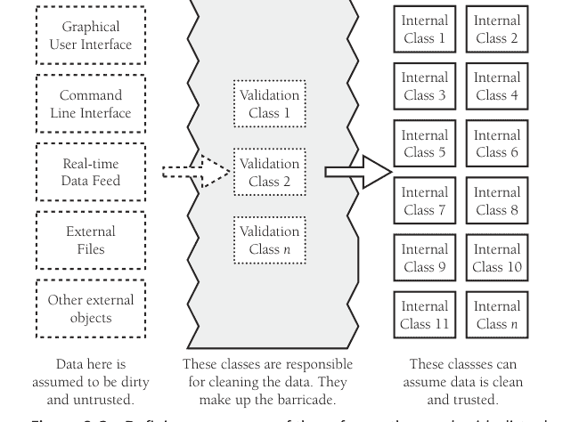

图8-2 将软件中处理脏数据的部分与处理干净数据的部分区分开来，是一种有效的方式，可让大部分代码免于承担检查坏数据的责任。

同样的方法也可以用在类这一层。类的公有方法假定数据是不安全的，它们负责检查数据并对其进行清洗。一旦数据被类的公有方法接受，类的私有方法就可以假定数据是安全的。

另一种理解此方法的方式是将其视为一种手术室技术。数据在获准进入手术室之前必须先经过消毒。手术室内的任何东西都被认为是安全的。关键的设计决策在于确定哪些东西放入手术室，哪些东西挡在外面，以及门放在哪里——哪些例程被视为安全区域内，哪些在区域外，哪些负责清洗数据。最简单的做法通常是在外部数据到达时即进行清洗，但数据往往需要在多个层面进行清洗，因此有时需要多层消毒。

## 在输入时将输入数据转换为正确类型

输入通常以字符串或数字的形式到达。有时该值会映射为布尔类型，如“yes”或“no”。有时该值会映射为枚举类型，如Color_Red、Color_Green和Color_Blue。在程序中长期携带类型可疑的数据会增加复杂度，并增加有人通过输入“Yes”这样的颜色值来让程序崩溃的机会。应在输入后尽快将输入数据转换为适当的形式。

## 屏障与断言的关系

屏障的使用使断言与错误处理之间的区别变得清晰明了。屏障之外的例程应使用错误处理，因为对数据作任何假设都是不安全的。屏障内的例程应使用断言，因为传递给它们的数据在穿越屏障之前应该已经被清洗。如果屏障内的某个例程检测到坏数据，那是程序错误，而非数据错误。

屏障的使用还说明了在架构层面决定如何处理错误的价值。决定哪些代码在屏障内、哪些在屏障外，属于架构层面的决策。

### 8.6 调试辅助工具

防御式编程的另一个关键方面是使用调试辅助工具，它能够成为快速检测错误的强大盟友。

## 不要自动将生产环境的约束应用于开发版本

延伸阅读 关于使用调试代码支持防御式编程的更多信息，请参阅《Writing Solid Code》（Maguire 1993）。

程序员一个常见的盲点是，认为生产版软件的限制同样适用于开发版。生产版本必须运行得快；开发版本或许可以运行得慢。生产版本必须节约资源；开发版本或许可以奢侈地使用资源。生产版本不应向用户暴露危险操作；开发版本则可以有一些没有安全网的额外操作。

我曾参与开发的一个程序大量使用了四重链表。链表代码容易出错，而且链表经常遭到破坏。我添加了一个菜单选项来检查链表的完整性。

在调试模式下，Microsoft Word 在空闲循环中包含一段代码，每隔几秒检查一次 Document 对象的完整性。这有助于快速检测数据损坏，并使错误诊断更加容易。

在开发过程中，应愿意用速度和资源消耗来换取那些能让开发更顺利的内置工具。


## 尽早引入调试辅助工具

调试辅助工具引入得越早，它们发挥的作用就越大。通常情况下，你只有在被某个问题反复困扰几次之后，才会下功夫编写调试辅助工具。不过，如果你在第一次遇到问题后就编写该工具，或者使用以前项目中的工具，它将在整个项目中持续发挥作用。

## 使用进攻式编程

交叉引用 关于处理意外情况的更多细节，请参见第15.2节的“case语句使用技巧”。

异常情况应该以这种方式处理：在开发阶段让它们显而易见，而在生产代码运行时则可恢复。Michael Howard 和 David LeBlanc 将这种方法称为“进攻式编程”（Howard and LeBlanc 2003）。

假设你有一个 case 语句，预期只处理五类事件。在开发阶段，默认分支应该用于产生一个警告，比如“嘿！这里还有另一种情况！修复程序！”但在生产阶段，默认分支应该做一些更优雅的事情，比如向错误日志文件写入一条消息。

> 一个死掉的程序通常比一个残缺的程序造成的损害要小得多。
> ——Andy Hunt 和 Dave Thomas

以下是一些你可以进行进攻式编程的方式：

-   确保断言会让程序中止。不要允许程序员养成就按一下回车键来绕过已知问题的习惯。要让问题足够痛苦，以至于它会被修复。
-   将分配的任何内存完全填充，以便能够检测内存分配错误。
-   将分配的任何文件或流完全填充，以清除任何文件格式错误。
-   确保每个 case 语句的 default 或 else 子句中的代码会硬失败（即中止程序），或者难以被忽略。
-   在对象被删除之前，用垃圾数据填充它。
-   将程序设置为把错误日志文件通过电子邮件发送给自己，这样你就可以看到发布软件中正在发生的错误类型——如果你正在开发的软件类型适合这样做的话。

有时最好的防守就是进攻。在开发阶段硬失败，这样在生产阶段就能更温和地失败。

## 计划移除调试辅助工具

如果你编写的代码仅供自己使用，那么将所有的调试代码保留在程序中可能没问题。如果你编写的是商业代码，那么体积和速度上的性能损失可能是无法接受的。要计划避免在程序中反复添加和移除调试代码。以下是几种做法：

交叉引用 关于版本控制的细节，请参见第28.2节“配置管理”。

## 使用版本控制工具和构建工具，如 ant 和 make

版本控制工具可以从相同的源文件构建出程序的不同版本。在开发模式下，你可以将构建工具设置为包含所有调试代码。在生产模式下，你可以将其设置为排除不想出现在商业版本中的任何调试代码。

## 使用内置的预处理器

如果你的编程环境带有预处理器——例如 C++ 就有——你就可以通过一个编译器开关轻松地包含或排除调试代码。你可以直接使用预处理器，或者编写一个与预处理器定义配合工作的宏。下面是一个直接使用预处理器编写代码的示例：

要包含调试代码，请使用 #define 定义符号 DEBUG。要排除调试代码，则不要定义 DEBUG。

## 使用预处理器直接控制调试代码的 C++ 示例

```
#define DEBUG
...
#if defined( DEBUG )
// debugging code
...
#endif
```

这个主题有几种变体。除了简单地定义 DEBUG，你还可以给它赋一个值，然后测试这个值，而不是测试它是否已定义。这样你就可以区分不同级别的调试代码。你可能希望某些调试代码始终存在于程序中，所以用 #if DEBUG > 0 这样的语句包围它。其他调试代码可能仅供特定目的使用，所以你可以用 #if DEBUG == POINTER_ERROR 这样的语句包围它。在其他地方，你可能想设置调试级别，因此可以使用 #if DEBUG > LEVEL_A 这样的语句。

如果你不喜欢让 #if defined() 散布在整个代码中，可以编写一个预处理器宏来完成同样的任务。下面是一个示例：

## 使用预处理器宏控制调试代码的 C++ 示例

```
#define DEBUG
#if defined( DEBUG )
#define DebugCode( code_fragment )  { code_fragment }
#else
#define DebugCode( code_fragment )
#endif
...
DebugCode(
    statement 1;
    statement 2;
    ...
    statement n;
);
...
```

根据是否定义了 DEBUG，这段代码会被包含或排除。


与使用预处理器的第一个示例类似，这种技术可以以多种方式进行修改，使其比完全包含所有调试代码或完全排除所有调试代码更为精细。

## 编写自己的预处理器

如果某种语言不包含预处理器，编写一个用于包含和排除调试代码的预处理器是相当容易的。建立一种用于标识调试代码的约定，并让你的预编译器遵循该约定。例如，在 Java 中，你可以编写一个预编译器来响应关键字 //#BEGIN DEBUG 和 //#END DEBUG。编写一个脚本来调用预处理器，然后编译处理后的代码。从长远来看，你将节省时间，并且不会错误地编译未预处理的代码。

交叉引用 有关预处理器的更多信息以及编写自己的预处理器的信息来源，请参阅第 30.3 节中的“宏预处理器”。

## 使用调试存根

在许多情况下，你可以调用一个例程来进行调试检查。在开发期间，该例程在控制返回调用方之前可能会执行多个操作。对于生产代码，你可以用一个存根例程替换复杂的例程，该存根例程仅立即将控制返回给调用方，或在返回控制之前执行一两个快速操作。这种方法只会带来很小的性能损失，并且比编写自己的预处理器更快。保留开发版本和生产版本的例程，以便在未来的开发和生产过程中在两者之间切换。

交叉引用 有关存根的详细信息，请参阅第 22.5 节中的“构建脚手架以测试单个例程”。

你可能从一个设计用于检查传递给它的指针的例程开始：

```
C++ Example of a Routine That Uses a Debugging Stub
void DoSomething(
    SOME_TYPE *pointer,
    ...
) {

    // check parameters passed in
    CheckPointer( pointer );
    ...
}
```

这一行调用例程来检查指针。

在开发期间，CheckPointer() 例程将对指针执行完整检查。它会很慢但有效，可能看起来像这样：

```
C++ Example of a Routine for Checking Pointers During Development
void CheckPointer( void *pointer ) {
    // perform check 1--maybe check that it’s not NULL
    // perform check 2--maybe check that its dogtag is legitimate
    // perform check 3--maybe check that what it points to isn’t corrupted
    ...
    // perform check n--...
}
```

该例程检查传递给它的任何指针。在开发期间，它可以执行你能承受的尽可能多的检查。

当代码准备好用于生产时，你可能不希望与此指针检查相关的所有开销。你可以替换前面的例程并换入此例程：

```
C++ Example of a Routine for Checking Pointers During Production
void CheckPointer( void *pointer ) {
    // no code; just return to caller
}
```

该例程只是立即返回给调用方。

这并不是对所有可以计划移除调试辅助工具的方法的详尽调查，但它应该足以让你了解在你的环境中会起作用的一些方法。

### 8.7 确定在生产代码中保留多少防御性编程

防御性编程的一个悖论是，在开发期间，你希望错误是显而易见的——你宁愿它很烦人，也不愿冒着忽视它的风险。但在生产期间，你希望错误尽可能不引人注意，让程序恢复或优雅地失败。以下是决定在生产代码中保留哪些防御性编程工具以及排除哪些工具的指导原则：

- **保留检查重要错误的代码** 决定程序的哪些区域可以承受未检测到的错误，哪些区域不能。例如，如果你正在编写电子表格程序，你可以承受程序的屏幕更新区域出现未检测到的错误，因为错误的唯一主要惩罚只是屏幕混乱。你不能承受计算引擎出现未检测到的错误，因为此类错误可能导致某人的电子表格出现细微的错误结果。大多数用户宁愿忍受混乱的屏幕，也不愿因错误的税务计算而受到 IRS 的审计。

- **移除检查琐碎错误的代码** 如果错误的后果确实微不足道，请移除检查它的代码。在前面的示例中，你可能会移除检查电子表格屏幕更新的代码。“移除”并不意味着物理上移除代码。它意味着使用版本控制、预编译器开关或其他技术在不包含该特定代码的情况下编译程序。如果空间不是问题，你可以保留错误检查代码，但让它不显眼地将消息记录到错误日志文件中。

- **移除导致硬崩溃的代码** 正如我提到的，在开发期间，当程序检测到错误时，你希望错误尽可能明显，以便你可以修复它。通常，实现这一目标的最佳方法是让程序在检测到错误时打印调试消息并崩溃。这甚至对次要错误也很有用。

    在生产期间，你的用户需要在程序崩溃并丢失工作之前有机会保存工作，他们可能愿意容忍一些异常，以换取程序运行足够长的时间让他们这样做。用户不欣赏任何导致他们工作丢失的东西，无论它对调试和最终提高程序质量有多大帮助。如果你的程序包含可能导致数据丢失的调试代码，请将其从生产版本中取出。

- **保留有助于程序优雅崩溃的代码** 如果你的程序包含检测潜在致命错误的调试代码，请保留允许程序优雅崩溃的代码。例如，在火星探路者号上，工程师有意保留了一些调试代码。探路者着陆后发生了一个错误。通过使用保留的调试辅助工具，JPL 的工程师能够诊断问题并将修订后的代码上传到探路者号，探路者号完美地完成了任务（1999 年 3 月）。

- **为技术支持人员记录错误** 考虑在生产代码中保留调试辅助工具，但更改其行为以使其适合生产版本。如果你已在代码中加载了在开发期间停止程序的断言，你可以考虑在生产期间将断言例程更改为将消息记录到文件，而不是完全消除它们。

- **确保你保留的错误消息对用户友好** 如果你在程序中保留内部错误消息，请验证它们是否使用对用户友好的语言。在我早期的一个程序中，我接到一个用户的电话，她报告说她收到了一条消息，上面写着“你有一个坏的指针分配，狗屎！”幸运的是，她很有幽默感。一种常见且有效的方法是通知用户出现“内部错误”，并列出用户可用于报告该错误的电子邮件地址或电话号码。

### 8.8 对防御性编程保持防御

> 任何东西太多都是坏的，但威士忌太多刚刚好。
> ——马克·吐温

过多的防御性编程本身就会产生问题。如果你以每种可能的方式在每个可能的地方检查作为参数传递的数据，你的程序将会臃肿缓慢。更糟糕的是，防御性编程所需的额外代码增加了软件的复杂性。为防御性编程安装的代码并不会免于缺陷，你在防御性编程代码中发现缺陷的可能性与在任何其他代码中一样大——如果你随意编写代码，可能性更大。思考你需要在何处保持防御，并相应地设定你的防御性编程优先级。

## 检查清单：防御性编程

### 一般

- 例程是否能保护自己免受不良输入数据的影响？
- 你是否使用断言来记录假设，包括前置条件和后置条件？
- 断言是否仅用于记录不应该发生的条件？
- 架构或高级设计是否指定了一套特定的错误处理技术？
- 架构或高级设计是否指定错误处理应偏向健壮性还是正确性？
- 是否已创建屏障以遏制错误的有害影响并减少必须关心错误处理的代码量？
- 代码中是否使用了调试辅助工具？
- 调试辅助工具是否以无需太多麻烦即可激活或停用的方式安装？
- 防御性编程代码的数量是否合适——既不过多也不过少？
- 你是否使用了进攻性编程技术以使错误在开发期间难以被忽视？

### 异常

- 你的项目是否定义了标准化的异常处理方法？
- 你是否考虑过使用异常的替代方案？
- 如果可能，错误是否在本地处理而不是抛出非本地异常？
- 代码是否避免在构造函数和析构函数中抛出异常？
- 所有异常是否都在抛出它们的例程所适用的适当抽象级别上？
- 每个异常是否都包含所有相关的异常背景信息？
- 代码是否没有空的 catch 块？（或者如果空的 catch 块确实合适，是否已记录？）


## 安全性问题

- 检查错误输入数据的代码是否检查了缓冲区溢出、SQL 注入、HTML 注入、整数溢出以及其他恶意输入？
- 是否检查了所有错误返回码？
- 是否捕获了所有异常？
- 错误消息是否避免提供有助于攻击者侵入系统的信息？

## 补充资源

cc2e.com/0875

请查看以下防御式编程资源：

### 安全性

Howard, Michael, and David LeBlanc. *编写安全代码*（第2版）。Redmond, WA: Microsoft Press, 2003。Howard 和 LeBlanc 涵盖了信任输入的安全隐患。这本书令人大开眼界，因为它展示了程序可能被攻破的诸多方式——其中一些与构建实践有关，而另一些则无关。这本书涵盖了需求、设计、代码和测试问题的完整范围。

### 断言

Maguire, Steve. *编写可靠的代码*。Redmond, WA: Microsoft Press, 1993。第2章对断言的使用进行了精彩讨论，包括几个在知名微软产品中使用断言的有趣示例。

Stroustrup, Bjarne. *C++ 编程语言*（第3版）。Reading, MA: Addison-Wesley, 1997。第24.3.7.2节描述了在 C++ 中实现断言的多种变体，包括断言与前条件和后条件之间的关系。

Meyer, Bertrand. *面向对象软件构造*（第2版）。New York, NY: Prentice Hall PTR, 1997。这本书包含了关于前条件和后条件的权威讨论。

### 异常

Meyer, Bertrand. *面向对象软件构造*（第2版）。New York, NY: Prentice Hall PTR, 1997。第12章详细讨论了异常处理。

Stroustrup, Bjarne. *C++ 编程语言*（第3版）。Reading, MA: Addison-Wesley, 1997。第14章详细讨论了 C++ 中的异常处理。第14.11节出色地总结了处理 C++ 异常的21条技巧。

Meyers, Scott. *更有效的 C++：改善程序与设计的35种新方法*。Reading, MA: Addison-Wesley, 1996。第9–15条描述了 C++ 中异常处理的众多细微之处。

Arnold, Ken, James Gosling, and David Holmes. *Java 编程语言*（第3版）。Boston, MA: Addison-Wesley, 2000。第8章讨论了 Java 中的异常处理。

Bloch, Joshua. *Effective Java 编程语言指南*。Boston, MA: Addison-Wesley, 2001。第39–47条描述了 Java 中异常处理的细微之处。

Foxall, James. *Microsoft Visual Basic .NET 实用标准*。Redmond, WA: Microsoft Press, 2003。第10章描述了 Visual Basic 中的异常处理。

## 关键要点

- 生产代码应以比“垃圾进，垃圾出”更复杂的方式处理错误。
- 防御式编程技术使错误更容易发现、更容易修复，并且对生产代码的破坏性更小。
- 断言有助于及早发现错误，尤其是在大型系统、高可靠性系统和快速变化的代码库中。
- 如何处理错误输入的决定是一个关键的错误处理决策，也是一个关键的高层设计决策。
- 异常提供了一种在与代码正常流程不同维度上处理错误的手段。如果谨慎使用，它们是程序员智力工具箱中的宝贵补充，并且应与其他错误处理技术进行权衡比较。
- 适用于生产系统的约束不一定适用于开发版本。你可以利用这一点，在开发版本中添加有助于快速清除错误的代码。

## 第9章

## 伪代码编程过程

### 目录

- 9.1 构建类与例程的步骤概述：第216页
- 9.2 专家级伪代码：第218页
- 9.3 使用 PPP 构建例程：第220页
- 9.4 PPP 的替代方案：第232页

### 相关主题

- 创建高质量的类：第6章
- 高质量例程的特征：第7章
- 构建中的设计：第5章
- 注释风格：第32章

尽管你可以把整本书看作是对创建类和例程的编程过程的扩展描述，但本章将各个步骤置于上下文中。本章侧重于小型编程——即构建单个类及其例程的具体步骤，这些步骤对所有规模的项目都至关重要。本章还描述了伪代码编程过程（PPP），它可以减少设计和文档期间的工作量，并提高两者的质量。

如果你是经验丰富的程序员，可以略读本章，但请务必查看步骤概述，并回顾第9.3节中使用伪代码编程过程构建例程的技巧。很少有程序员能充分发挥该过程的全部威力，而它能带来许多好处。

PPP 并不是创建类和例程的唯一方法。本章末尾的第9.4节描述了最流行的替代方案，包括测试优先开发和契约式设计。

### 9.1 构建类与例程的步骤概述

类的构建可以从多个方向入手，但通常是一个迭代过程：为类创建总体设计，枚举类中的具体例程，构建具体例程，然后整体检查类的构建。如图9-1所示，类的创建可能是一个混乱的过程，原因与设计是一个混乱的过程相同（原因在第5.1节“设计挑战”中描述）。

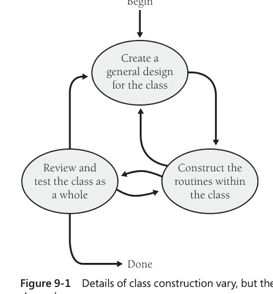

图9-1 类构建的细节各不相同，但活动通常按此处所示的顺序进行。

### 创建类的步骤

构建类的关键步骤如下：

- **为类创建总体设计。** 类设计包含许多具体问题。定义类的具体职责，定义类将隐藏哪些“秘密”，并精确定义类接口将捕获何种抽象。确定该类是否将从另一个类派生，以及是否允许其他类派生自该类。确定类的关键公共方法，并识别和设计该类使用的任何非平凡数据成员。根据需要多次迭代这些主题，以创建类的直接设计。这些考虑因素以及许多其他问题将在第6章“可用的类”中更详细地讨论。

- **构建类中的每个例程。** 一旦在第一步中确定了类的主要例程，就必须构建每个具体例程。每个例程的构建通常会揭示对额外例程的需求，无论是次要还是主要例程，而创建这些额外例程所产生的问题通常会波及整体类设计。

- **整体审查和测试类。** 通常，每个例程在创建时就会进行测试。当整个类开始运行时，应整体审查和测试类，以发现无法在单个例程级别测试的任何问题。

### 构建例程的步骤

类中的许多例程将简单且易于实现：访问器例程、对其他对象例程的传递等。其他例程的实现将更加复杂，而这些例程的创建受益于系统化的方法。创建例程所涉及的主要活动——设计例程、检查设计、编写例程代码和检查代码——通常按图9-2所示的顺序执行。

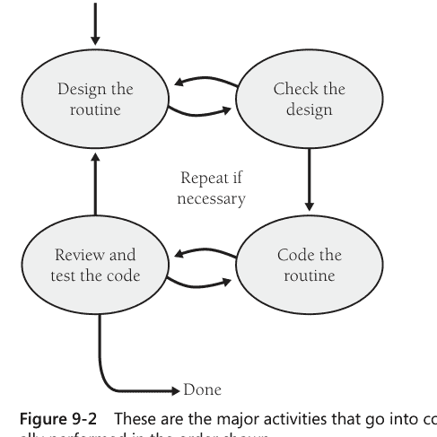

图9-2 这些是构建例程时要进行的主要活动。它们通常按所示顺序执行。

专家们已经开发了许多创建例程的方法，而我个人最喜欢的方法是伪代码编程过程，下一节将对此进行描述。


### 9.2 专业人士的伪代码

“伪代码”一词指的是一种非正式的、类英语的表示法，用于描述算法、例程、类或程序将如何工作。伪代码编程过程（Pseudocode Programming Process，简称 PPP）定义了一种使用伪代码来简化例程内代码创建的具体方法。

由于伪代码类似英语，你自然会认为，任何能整理你思路的类英语描述都与其他描述有着大致相同的效果。但在实践中，你会发现有些伪代码风格比其他风格更有用。以下是有效使用伪代码的指南：

- 使用精确描述具体操作的类英语语句。
- 避免使用目标编程语言中的语法元素。伪代码允许你在比代码本身稍高的层次上进行设计。当你使用编程语言结构时，就会降低到较低的层次，失去了在较高层次进行设计的主要好处，而且还给自己套上了不必要的语法限制。
- 在意图层次编写伪代码。描述方法的意义，而不是方法将如何在目标语言中实现。
- 在足够低的层次编写伪代码，使得从它生成代码几乎可以自动完成。如果伪代码层次太高，可能会掩盖代码中有问题的细节。要不断细化伪代码，直到它看起来不如直接编写代码来得容易。

交叉参考 关于在意图层次进行注释的详细信息，请参阅第 32.4 节的“注释的种类”。

伪代码一旦写好，你就围绕它构建代码，伪代码就会变成编程语言注释。这消除了大部分注释工作。如果伪代码遵循上述指南，注释将是完整而有意义的。

下面是一个伪代码设计示例，它几乎违反了上述所有原则：

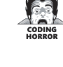

```
Example of Bad Pseudocode
increment resource number by 1
allocate a dlg struct using malloc
if malloc() returns NULL then return 1
invoke OSrsrc_init to initialize a resource for the operating system
*hRsrcPtr = resource number
return 0
```

这段伪代码的意图是什么？由于写得不好，很难说清楚。这个所谓的伪代码之所以糟糕，是因为它包含了目标语言的编码细节，如 *hRsrcPtr（特定的 C 语言指针表示法）和 malloc()（一个特定的 C 语言函数）。这段伪代码关注的是代码将如何编写，而不是设计的含义。它陷入了编码细节——例程返回 1 还是 0。如果你从它能否变成好的注释的角度来思考这段伪代码，你就会开始明白它并没有多大帮助。

下面是同一操作的一个完善得多的伪代码设计：

### 优秀伪代码示例

```
Keep track of current number of resources in use
If another resource is available
  Allocate a dialog box structure
  If a dialog box structure could be allocated
    Note that one more resource is in use
    Initialize the resource
    Store the resource number at the location provided by the caller
  Endif
Endif
Return true if a new resource was created; else return false
```

这段伪代码比第一段好，因为它完全用英语编写，没有使用目标语言的任何语法元素。在第一个示例中，伪代码只能用 C 语言实现。而在第二个示例中，伪代码不限制语言的选择。第二段伪代码也是在意图层次编写的。第二段伪代码是什么意思？你可能比理解第一段更容易理解它。

尽管第二段伪代码是用清晰的英语编写的，但它足够精确和详细，可以很容易地用作编程语言代码的基础。当伪代码语句转换为注释后，它们将很好地解释代码的意图。

以下是使用这种伪代码风格可以预期获得的好处：

- 伪代码使审查更容易。你可以不检查源代码就审查详细设计。伪代码使低层设计审查更容易，并减少了对代码本身进行审查的需要。
- 伪代码支持迭代细化的思想。你从高层设计开始，将设计细化为伪代码，再将伪代码细化为源代码。这种以小步骤进行的连续细化，让你在设计推进到更低细节层次时能够检查设计。结果是，你可以在最高层次捕获高层错误，在中层捕获中层错误，在最低层次捕获低层错误——任何错误都不会变成问题，也不会污染更详细层次的工作。

伪代码使修改更容易。几行伪代码比一页代码更容易修改。你更愿意修改蓝图上的线条，还是拆掉一堵墙，把木料钉到别处？在软件中，这种效果没有这么直观，但在产品最容易改变的时候修改产品，这一原则是相同的。项目成功的关键之一是在“价值最低阶段”捕获错误，也就是投入精力最少的阶段。与完成全部编码、测试和调试之后相比，在伪代码阶段投入的精力要少得多，因此尽早捕获错误在经济上是合理的。

伪代码最大限度地减少了注释工作。在典型的编码场景中，你先编写代码，然后再添加注释。而在 PPP 中，伪代码语句变成了注释，因此删除注释实际上比保留注释要做更多的工作。

伪代码比其他形式的设计文档更容易维护。使用其他方法时，设计与代码是分离的，当其中一方改变时，两者就会不一致。而使用 PPP 时，伪代码语句成为代码中的注释。只要内联注释得到维护，伪代码对设计的记录就是准确的。


作为详细设计的工具，伪代码很难被超越。一项调查发现，程序员偏爱伪代码，因为它简化了用编程语言进行的构建，因为它能帮助他们发现不够详细的设计，还因为它易于文档化、易于修改（Ramsey, Atwood, and Van Doren 1983）。伪代码并不是详细设计的唯一工具，但伪代码和 PPP 是值得放入程序员工具箱的有用工具。试试它们吧。下一节将告诉你如何使用。

### 9.3 使用 PPP 构建例程

本节描述了构建例程所涉及的活动，即：

- 设计例程。
- 编写例程代码。
- 检查代码。
- 清理未尽事项。
- 根据需要重复以上步骤。

### 设计例程

一旦你确定了类的例程，构建该类中任何较复杂例程的第一步就是设计它。假设你想编写一个例程，根据错误代码输出错误消息，并且假设你将该例程命名为 ReportErrorMessage()。以下是 ReportErrorMessage() 的非正式规格说明：

ReportErrorMessage() 将错误代码作为输入参数，并输出与该代码对应的错误消息。它负责处理无效的错误代码。如果程序以交互方式运行，ReportErrorMessage() 会向用户显示消息。如果程序以命令行模式运行，ReportErrorMessage() 会将消息记录到消息文件中。输出消息后，ReportErrorMessage() 返回一个状态值，指示操作是成功还是失败。

本章其余部分将使用该例程作为贯穿示例。本节其余部分描述如何设计该例程。

交叉参考 关于检查先决条件的详细信息，请参阅第 3 章“三思而后行：上游先决条件”和第 4 章“关键构建决策”。

### 检查先决条件

在对例程本身做任何工作之前，先检查例程的任务是否定义良好，并且能很好地融入整体设计。确保该例程确实被项目需求所调用，至少是间接调用。

### 定义例程要解决的问题

详细说明例程要解决的问题，以便能够创建该例程。如果高层设计足够详细，这项工作可能已经完成。高层设计至少应指明以下内容：

- 例程将要隐藏的信息
- 例程的输入
- 例程的输出
- 调用例程之前保证为真的前置条件（输入值在特定范围内、流已初始化、文件已打开或关闭、缓冲区已填满或已刷新等）
- 例程在将控制权交还给调用者之前保证为真的后置条件（输出值在指定范围内、流已初始化、文件已打开或关闭、缓冲区已填满或已刷新等）

交叉参考 关于前置条件和后置条件的详细信息，请参阅第 8.2 节中的“使用断言记录和验证前置条件和后置条件”。

以下是在 ReportErrorMessage() 示例中如何解决这些问题：

- 该例程隐藏两个事实：错误消息文本和当前处理方式（交互式或命令行）。
- 没有为该例程保证的前置条件。
- 该例程的输入是一个错误代码。
- 需要两种输出：第一种是错误消息，第二种是 ReportErrorMessage() 返回给调用例程的状态。
- 该例程保证状态值将为 Success 或 Failure。


## 为例程命名

为例程命名看似微不足道，但好的例程名称是优秀程序的一个标志，而且并不容易想出来。一般来说，例程应该有一个清晰、无歧义的名称。如果你很难想出一个好名字，这通常表明例程的目的不明确。含糊不清、模棱两可的名字就像竞选中的政客。听起来好像在说些什么，但仔细一看，你就搞不清它是什么意思。如果你能让名字更清晰，就这么做。如果模棱两可的名字源于模棱两可的设计，请注意这个警告信号。退一步改进设计。

在示例中，*ReportErrorMessage()* 是无歧义的。它是一个好名字。

## 决定如何测试例程

在编写例程时，想想如何测试它。这对你进行单元测试时有用，也对独立测试你的例程的测试人员有用。

在示例中，输入很简单，因此你可能计划用所有有效的错误代码和各种无效代码来测试 *ReportErrorMessage()*。

## 研究标准库中可用的功能

提高代码质量和生产率的最大方法就是重用好的代码。如果你发现自己在为一个看似过于复杂的例程设计而苦恼，请问该例程的功能是否全部或部分已经在你使用的语言、平台或工具的库代码中可用。请问该代码是否可在你公司维护的库代码中找到。许多算法已经被发明、测试、在行业文献中讨论过、评审过并改进过。与其花费时间去发明别人已经写过博士论文的东西，不如花几分钟查看一下已有的代码，确保你没有做不必要的工作。

## 思考错误处理

思考例程中可能出现的所有问题。思考错误输入值、其他例程返回的无效值等等。

例程可以通过多种方式处理错误，你应该有意识地选择如何处理错误。如果程序的架构定义了程序的错误处理策略，你只需计划遵循该策略。在其他情况下，你必须决定哪种方法最适合特定例程。

## 思考效率

根据你的情况，你可以用两种方式之一来处理效率。在第一种情况下，在绝大多数系统中，效率并不是关键。在这种情况下，确保例程的接口得到良好的抽象，其代码可读，以便在需要时以后可以改进它。如果封装良好，你可以用更好的算法或快速、精简的低级语言实现替换缓慢、占用资源高的高级语言实现，而不会影响其他例程。

在第二种情况下——在少数系统中——性能至关重要。性能问题可能与稀缺的数据库连接、有限的内存、有限的句柄、雄心勃勃的时序约束或其他稀缺资源有关。架构应指明每个例程（或类）允许使用多少资源以及其操作应多快。

设计你的例程，使其能够满足资源和速度目标。如果资源或速度似乎更关键，请设计以资源换取速度或反之亦然。在例程的初始构建期间，对其进行足够的调优以满足其资源和速度预算是可以接受的。

除了采用针对这两种一般情况建议的方法外，在单个例程级别上处理效率通常是徒劳的。大的优化来自于完善高级设计，而不是单个例程。你通常只在高级设计最终不支持系统的性能目标时才使用微优化，而你不会在整个程序完成之前知道这一点。在知道需要之前，不要浪费时间去寻找增量改进。

**交叉引用** 有关命名例程的详细信息，请参阅第 7.3 节“好的例程名称”。

**延伸阅读** 对于一种以先编写测试用例为重点的另一种构建方法，请参阅 *Test-Driven Development: By Example*（Beck 2003）。

## 研究算法和数据类型

如果功能在可用库中不可用，它可能仍在算法书中有所描述。在你从头开始编写复杂代码之前，请查看算法书，看看是否已有现成的内容。如果你使用预定义算法，请确保正确地将其适配到你的编程语言。

## 编写伪代码

完成前面的步骤后，你可能没有写下太多内容。这些步骤的主要目的是建立一种在实际编写例程时有用的心理定位。

完成初步步骤后，你可以开始以高级伪代码的形式编写例程。继续使用你的编程编辑器或集成环境来编写伪代码——伪代码将很快用作编程语言代码的基础。

从一般开始，逐步走向更具体的。例程最一般的部分是描述例程 supposed to do 的头部注释，因此首先写出例程目的的简洁陈述。写下该陈述将有助于你澄清对例程的理解。编写通用注释时遇到困难是一个警告，表明你需要更好地理解例程在程序中的作用。一般来说，如果很难总结例程的作用，你可能应该假设有些问题。下面是一个描述例程的简洁头部注释的示例：

### 例程头部注释示例

```
This routine outputs an error message based on an error code supplied by the calling routine. The way it outputs the message depends on the current processing state, which it retrieves on its own. It returns a value indicating success or failure.
```

写完通用注释后，填充例程的高级伪代码。下面是此示例的伪代码：

### 例程伪代码示例

```
This routine outputs an error message based on an error code supplied by the calling routine. The way it outputs the message depends on the current processing state, which it retrieves on its own. It returns a value indicating success or failure.

set the default status to "fail"
look up the message based on the error code

if the error code is valid
    if doing interactive processing, display the error message
    interactively and declare success

    if doing command line processing, log the error message to the
    command line and declare success

if the error code isn't valid, notify the user that an internal error
has been detected

return status information
```

再次注意，伪代码是以相当高的层次编写的。它当然不是用编程语言编写的。相反，它用精确的英语表达例程需要做什么。

## 思考数据

你可以在流程的多个不同点设计例程的数据。在此示例中，数据很简单，数据操作并不是例程的主要部分。如果数据操作是例程的主要部分，在思考例程逻辑之前思考主要数据是有价值的。在设计例程逻辑时，关键数据类型的定义很有用。

## 检查伪代码

一旦你写了伪代码并设计了数据，花一分钟时间回顾一下你写的伪代码。退一步思考，你将如何向别人解释它。

请别人查看它或听你解释它。你可能会认为让别人查看 11 行伪代码是愚蠢的，但你会感到惊讶。伪代码可以使你的假设和高层次的错误比编程语言代码更明显。人们也更愿意审阅几行伪代码，而不是审阅 35 行 C++ 或 Java。


确保你对例程的作用及其实现方式有轻松且舒适的理解。如果你不能在概念上、在伪代码层面理解它，你又有什么机会在编程语言层面理解它呢？如果你不理解它，还有谁会理解呢？

交叉引用 有关迭代的更多内容，请参阅第 34.8 节，“Iterate, Repeatedly, Again and Again.”

## 在伪代码中尝试几个想法，并保留最好的（迭代）

在开始编码之前，尽可能多地在伪代码中尝试各种想法。一旦开始编码，你会情感上投入到代码中，更难放弃糟糕的设计并重新开始。

总体思路是在伪代码中迭代例程，直到伪代码语句变得足够简单，你可以在每条语句下方填入代码，并将原始伪代码保留为文档。你第一次尝试的某些伪代码可能足够高层，需要进一步分解。务必进一步分解它。如果你不确定如何编码某件事，就继续使用伪代码，直到你确定为止。不断完善和分解伪代码，直到写它比写实际代码更像是在浪费时间。

## 编写例程

一旦你设计好例程，就构建它。你可以以近乎标准顺序执行构建步骤，但也请根据需要灵活调整。图 9-3 显示了构建例程的步骤。

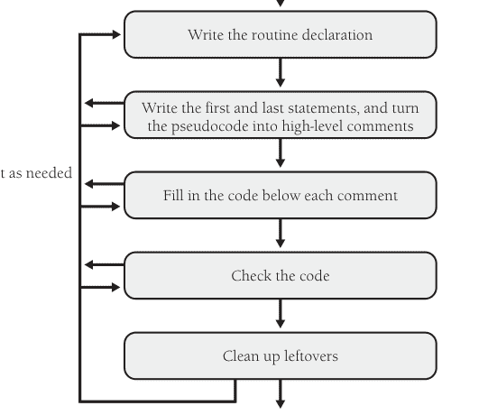

图 9-3 你会在设计例程时执行所有这些步骤，但不一定按任何特定顺序。

### 编写例程声明

编写例程接口语句——C++ 中的函数声明、Java 中的方法声明、Microsoft Visual Basic 中的函数或子过程声明，或你语言所要求的任何形式。将原始头部注释转换为编程语言注释。将其保留在你已编写的伪代码上方。以下是示例例程在 C++ 中的接口语句和头部：

这是已被转换为 C++ 风格注释的头部注释。

这是接口语句。

**C++ Example of a Routine Interface and Header Added to Pseudocode**

```cpp
/* This routine outputs an error message based on an error code supplied by the calling routine. The way it outputs the message depends on the current processing state, which it retrieves on its own. It returns a value indicating success or failure. */

Status ReportErrorMessage(
    ErrorCode errorToReport
)
set the default status to "fail"
look up the message based on the error code

if the error code is valid
    if doing interactive processing, display the error message interactively and declare success

    if doing command line processing, log the error message to the command line and declare success

if the error code isn’t valid, notify the user that an internal error has been detected

return status information
```

这是一个记录接口假设的好时机。在本例中，接口变量 error 很直接且为其特定用途而类型化，因此无需记录。

### 将伪代码转换为高级注释

通过编写第一条和最后一条语句来保持进展：C++ 中的 { 和 }。然后将伪代码转换为注释。以下是示例中的外观：

**C++ Example of Writing the First and Last Statements Around Pseudocode**

```cpp
/* This routine outputs an error message based on an error code supplied by the calling routine. The way it outputs the message depends on the current processing state, which it retrieves on its own. It returns a value indicating success or failure. */

Status ReportErrorMessage(
    ErrorCode errorToReport
) {
// set the default status to "fail"
// look up the message based on the error code
// if the error code is valid
    // if doing interactive processing, display the error message
    // interactively and declare success

    // if doing command line processing, log the error message to the
    // command line and declare success

// if the error code isn't valid, notify the user that an
// internal error has been detected

// return status information
}
```

从这里往下的伪代码语句已被转换为 C++ 注释。

此时，例程的特征已显现。设计工作已完成，即使看不到任何代码，你也能感受到例程的工作方式。你应该觉得将伪代码转换为编程语言代码将是机械的、自然的且容易的。如果不是，请继续在伪代码中设计，直到设计感觉坚实为止。

交叉引用 这是一个写作隐喻在小范围内适用得很好的例子。对于在更大范围内应用写作隐喻的批评，请参阅第 2.3 节中的“Software Penmanship: Writing Code”。

### 在每条注释下方填入代码

在每条伪代码注释下方填入代码。这个过程很像写学期论文。首先写大纲，然后为大纲中的每一点写一段。每条伪代码注释描述了一块或一段代码。就像文学段落的长度一样，代码段落的长度根据所表达的思想而变化，其质量取决于思想的生动性和焦点。

在本例中，前两条伪代码注释产生了两行代码：

**C++ Example of Expressing Pseudocode Comments as Code**

```cpp
/* This routine outputs an error message based on an error code supplied by the calling routine. The way it outputs the message depends on the current processing state, which it retrieves on its own. It returns a value indicating success or failure. */

Status ReportErrorMessage(
    ErrorCode errorToReport
) {
    // set the default status to "fail"
    Status errorMessageStatus = Status_Failure;

    // look up the message based on the error code
    Message errorMessage = LookupErrorMessage( errorToReport );

    // if the error code is valid
        // if doing interactive processing, display the error message
        // interactively and declare success

        // if doing command line processing, log the error message to the
        // command line and declare success

    // if the error code isn't valid, notify the user that an
    // internal error has been detected

    // return status information
}
```

这是代码的开始。变量 *errorMessage* 被使用，因此需要声明它。如果你是在事后添加注释，两行注释对应两行代码几乎总是过度设计。然而，在这种方法中，重要的是注释的语义内容，而不是它们注释了多少行代码。注释已经存在，它们解释了代码的意图，所以保留它们。

其余注释下方的代码需要填入：

**C++ Example of a Complete Routine Created with the Pseudocode Programming Process**

```cpp
/* This routine outputs an error message based on an error code
supplied by the calling routine. The way it outputs the message
depends on the current processing state, which it retrieves
on its own. It returns a value indicating success or failure.
*/

Status ReportErrorMessage(
    ErrorCode errorToReport
) {
    // set the default status to "fail"
    Status errorMessageStatus = Status_Failure;

    // look up the message based on the error code
    Message errorMessage = LookupErrorMessage( errorToReport );

    // if the error code is valid
    if ( errorMessage.ValidCode() ) {
        // determine the processing method
        ProcessingMethod errorProcessingMethod = CurrentProcessingMethod();

        // if doing interactive processing, display the error message
        // interactively and declare success
        if ( errorProcessingMethod == ProcessingMethod_Interactive ) {
            DisplayInteractiveMessage( errorMessage.Text() );
            errorMessageStatus = Status_Success;
        }

        // if doing command line processing, log the error message to the
        // command line and declare success
        else if ( errorProcessingMethod == ProcessingMethod_CommandLine ) {
            CommandLineMessageLog;
            if ( messageLog.Status() == CommandLineStatus_Ok ) {
                messageLog.AddToMessageQueue( errorMessage.Text() );
                messageLog.FlushMessageQueue();
                errorMessageStatus = Status_Success;
            }
        }
```

> 从这里往下，每个注释的代码已被填入。

> 这段代码是进一步分解为新例程的良好候选：*DisplayCommandLine-Message()*。


```text
else {
    // can't do anything because the routine is already error processing
}
else {
    // can't do anything because the routine is already error processing
}

// if the error code isn't valid, notify the user that an
// internal error has been detected
else {
    DisplayInteractiveMessage(
        "Internal Error: Invalid error code in ReportErrorMessage()"
    );
}

// return status information
return errorMessageStatus;
}
```

每条注释都对应一行或多行代码。每个代码块都根据注释形成一个完整的思想。注释被保留下来，以提供对代码更高层次的解释。所有变量都在首次使用的位置附近声明和定义。每条注释通常应扩展为大约 2 到 10 行代码。（由于此示例仅用于说明目的，代码扩展量低于你在实践中通常应遇到的数量。）

现在再看一下第 000 页的规格说明和第 000 页的初始伪代码。最初的五句话规格说明扩展为 15 行伪代码（取决于你如何计数），而后者又扩展为一个整页的例程。尽管规格说明很详细，但创建例程仍然需要在伪代码和代码中做大量的设计工作。这种低层次的设计是“编码”并非一项简单任务的原因之一，也是本书主题如此重要的原因。

### 检查代码是否应进一步分解

在某些情况下，你会看到初始伪代码的某一行下方出现代码爆炸式增长。此时，你应该考虑采取两种行动方案之一：

- 将注释下方的代码分解为一个新例程。如果你发现一行伪代码扩展出的代码超出了预期，就将这些代码分解到它自己的例程中。编写调用该例程的代码，包括例程名称。如果你很好地使用了 PPP，新例程的名称应该很容易从伪代码中得出。完成最初创建的例程后，你可以深入新例程，并对其再次应用 PPP。
- 递归应用 PPP。与其在一行伪代码下方写几十行代码，不如花时间将原始伪代码行分解为更多行伪代码。然后继续在每个新伪代码行下方填充代码。

> **交叉引用** 有关重构的更多信息，请参见第 24 章“重构”。

## 检查代码

> **交叉引用** 有关检查架构和需求中错误的详细信息，请参见第 3 章“量两次，切一次：上游前置条件”。

在设计并实现例程之后，构造它的第三个重要步骤是检查所构造的内容是否正确。你在这一阶段遗漏的任何错误要到以后测试时才能发现。到那时发现并修正它们的成本更高，所以你应该在这一阶段尽可能多地找出所有错误。

由于多种原因，问题可能直到例程完全编码后才出现。伪代码中的错误可能在详细实现逻辑中变得更加明显。在伪代码中看起来优雅的设计可能在实现语言中变得笨拙。处理详细实现可能会暴露出架构、高层设计或需求中的错误。最后，代码可能有一个老式的、混杂的编码错误——人无完人！出于所有这些原因，在继续之前请先审查代码。

### 在头脑中检查例程的错误

对例程的第一次正式检查是心智上的。前面提到的清理和非正式检查步骤是两种心智检查。另一种是逐条路径地心智执行。心智执行例程很困难，而这种困难正是保持例程短小的原因之一。确保你检查了正常路径、端点以及所有异常情况。既可以自己完成，这被称为“桌面检查”，也可以与一个或多个同行一起进行，这被称为“同级评审”“走查”或“审查”，具体取决于你如何进行。


业余爱好者和专业程序员之间最大的区别之一，源于从迷信走向理解。这里的“迷信”一词并不是指程序让你毛骨悚然或在月圆时产生额外错误。它指的是用对代码的感觉代替理解。如果你经常怀疑编译器或硬件出错，那你仍处于迷信的境界。多年前进行的一项研究发现，所有错误中只有大约百分之五是硬件、编译器或操作系统错误（Ostrand and Weyuker 1984）。如今，这个百分比可能更低。已经进入理解境界的程序员总是首先怀疑自己的工作，因为他们知道自己造成了 95% 的错误。理解每一行代码的作用及其存在的原因。没有任何东西仅仅因为看起来能运行就是正确的。如果你不知道它为什么能运行，它很可能实际上不能运行——只是你尚未知道而已。

底线：一个能运行的例程还不够。如果你不知道它为什么能运行，就去研究它、讨论它，并尝试替代设计，直到你明白为止。


### 编译例程

审查例程之后，进行编译。等到这么晚才编译似乎效率不高，因为代码在几页前就已经完成了。诚然，如果早些编译例程，让计算机检查未声明的变量、命名冲突等，你或许能省些功夫。然而，直到过程后期才编译，你会在几个方面受益。主要原因是，当你编译新代码时，一个内心的秒表开始滴答作响。第一次编译后，你会加大压力：“再编译一次就能搞定。”“就再多编译一次”的综合征会导致仓促、易错的变化，从长远来看反而花费更多时间。通过在你确信例程正确之前不编译，来避免这种急于完成的心态。

本书的重点是展示如何超越那种草草拼凑代码并运行看是否有效的循环。在你确定程序正确之前编译往往是一种黑客心态的症状。如果你没有陷入“黑客式编译”循环，那么在你觉得合适的时候编译即可。但要注意，大多数人都有一种被“黑客式、编译式和修正式”地通向可用程序的倾向。

以下是一些让你的例程编译发挥最大效用的指南：

- 将编译器的警告级别设置为尽可能挑剔的级别。只需让编译器检测，你就能发现数量惊人的微妙错误。
- 使用验证器。像 C 这类语言执行的编译器检查可以通过使用 lint 等工具来补充。即使是不编译的代码，如 HTML 和 JavaScript，也可以通过验证工具来检查。
- 消除所有错误消息和警告的根源。注意这些消息告诉你关于代码的什么信息。大量警告通常表明代码质量低，你应该努力理解收到的每一条警告。实际上，你一遍又一遍看到的警告会产生两种可能的影响：你忽略它们，它们掩盖其他更重要的警告；或者它们只是变得令人厌烦。通常，重写代码以解决根本问题并消除警告是更安全、更不痛苦的做法。

### 在调试器中单步执行代码

一旦例程编译通过，将其放入调试器并逐行单步执行。确保每一行都按你预期的方式执行。通过遵循这个简单的做法，你可以发现许多错误。

> **交叉引用** 有关详细信息，请参见第 22 章“开发人员测试”。另请参见第 22.5 节中的“构建脚手架以测试单个类”。

### 测试代码

使用你在开发例程时计划或创建的测试用例测试代码。你可能需要开发脚手架来支持你的测试用例——也就是说，用于在测试时支持例程但不在最终产品中出现的代码。脚手架可以是一个用测试数据调用你的例程的测试工具例程，也可以是由你的例程调用的桩。

> **交叉引用** 有关详细信息，请参见第 23 章“调试”。

### 从例程中移除错误

一旦检测到错误，就必须将其移除。如果你正在开发的例程此时有错误，那么它很可能会一直有错误。如果你发现一个例程异常多错，就重新开始。不要在它周围打补丁——重写它。打补丁通常表明理解不完整，并且现在和将来都会带来错误。为一个有问题的例程创建全新设计是值得的。很少有比重写一个有问题的例程并再也不在其中发现错误更令人满足的事情了。


## 清理残留

当你完成对代码问题的检查后，检查其是否具备本书所述的一般特征。你可以采取以下几个清理步骤，以确保例程的质量符合你的标准：

- 检查例程的接口。确保所有输入和输出数据都已考虑在内，并且所有参数都被使用。更多细节请参阅第 7.5 节，“如何使用例程参数。”
- 检查总体设计质量。确保例程只做一件事并且做得好，与其他例程松耦合，并且采用防御性设计。详情请参阅第 7 章，“高质量例程。”
- 检查例程的变量。检查是否存在不准确的变量名、未使用的对象、未声明的变量、初始化不当的对象等。详情请参阅关于使用变量的章节，第 10 章至第 13 章。
- 检查例程的语句和逻辑。检查是否存在差一错误、无限循环、不当嵌套和资源泄漏。详情请参阅关于语句的章节，第 14 章至第 19 章。
- 检查例程的布局。确保你已使用空白来阐明例程、表达式和参数列表的逻辑结构。详情请参阅第 31 章，“布局和风格。”
- 检查例程的文档。确保被翻译成注释的伪代码仍然准确。检查算法描述、接口假设和不明显依赖的文档、以及对不清晰编码实践的论证等。详情请参阅第 32 章，“自文档化代码。”
- 删除冗余注释。有时伪代码注释与注释所描述的代码是冗余的，尤其是在 PPP 被递归应用时，注释只是位于对一个命名良好的例程的调用之前。

## 根据需要重复步骤

如果例程的质量较差，请退回到伪代码。高质量编程是一个迭代过程，因此不要犹豫再次循环进行构造活动。

### 9.4 PPP 的替代方案

在我看来，PPP 是创建类和例程的最佳方法。以下是其他专家推荐的一些不同方法。你可以将这些方法用作 PPP 的替代方案或补充。

**测试先行开发** 测试先行是一种流行的开发风格，其中在编写任何代码之前先编写测试用例。这种方法在第 22.2 节“先测试还是后测试？”中有更详细的描述。关于测试先行编程的一本好书是 Kent Beck 的 *Test-Driven Development: By Example*（Beck 2003）。

**重构** 重构是一种开发方法，通过一系列语义保持的转换来改进代码。程序员使用坏代码模式或“坏味道”来识别需要改进的代码段。第 24 章，“重构”，详细描述了这种方法，而该主题的一本好书是 Martin Fowler 的 *Refactoring: Improving the Design of Existing Code*（Fowler 1999）。

**契约式设计** 契约式设计是一种开发方法，其中每个例程都被认为具有前置条件和后置条件。这种方法在第 8.2 节“使用断言来记录和验证前置条件和后置条件”中有所描述。关于契约式设计的最佳信息来源是 Bertrand Meyers 的 *Object-Oriented Software Construction*（Meyer 1997）。

**黑客？** 一些程序员试图通过黑客方式来实现工作代码，而不是使用像 PPP 这样系统化的方法。如果你曾经发现自己把例程写进了死胡同，不得不重新开始，那就是 PPP 可能更有效的一个迹象。如果你发现自己在编写例程时中途失去了思路，那就是 PPP 会有益的另一个迹象。你是否曾经只是忘记编写类的某个部分或例程的某个部分？如果你使用 PPP，这几乎永远不会发生。如果你发现自己盯着电脑屏幕不知道从哪里开始，那是 PPP 会让你的编程生活更轻松的明确信号。

**交叉引用** 这个列表的目的是检查你是否遵循了一套良好的步骤来创建例程。有关关注例程本身质量的清单，请参阅第 7 章第 185 页的“高质量例程”清单。

### CHECKLIST: 伪代码编程过程

- 你是否检查了前提条件是否已满足？
- 你是否定义了类将解决的问题？
- 高层设计是否足够清晰，能够为类及其每个例程取一个好名字？
- 你是否考虑过如何测试类及其每个例程？
- 你是否主要从稳定接口和可读实现的角度考虑效率，还是主要从满足资源和速度预算的角度考虑效率？
- 你是否检查了标准库和其他代码库中是否有适用的例程或组件？
- 你是否查阅了参考书籍以寻找有用的算法？
- 你是否使用详细的伪代码设计了每个例程？
- 你是否在脑海中检查过伪代码？它是否易于理解？
- 你是否注意到了会让你回到设计的警告（使用全局数据、似乎更适合另一个类或另一个例程的操作等）？
- 你是否准确地将伪代码翻译成代码？
- 你是否递归地应用了 PPP，在需要时将例程分解为更小的例程？
- 你是否在做出假设时记录了这些假设？
- 你是否删除了最终证明是冗余的注释？
- 你是否选择了多次迭代中的最佳方案，而不是仅仅在第一次迭代后就停止？
- 你是否彻底理解了你的代码？它是否易于理解？

## 关键要点

- 构造类和构造例程往往是一个迭代过程。在构造特定例程时获得的见解往往会回溯到类的设计中。
- 编写良好的伪代码需要使用可理解的英语，避免特定于单一编程语言的特性，并在意图层面进行编写（描述设计做什么而不是如何做）。
- 伪代码编程过程是详细设计的有用工具，使编码变得容易。伪代码直接翻译成注释，确保注释准确且有用。
- 不要满足于你想到的第一个设计。在伪代码中迭代多个方法，并在开始编写代码之前选择最佳方法。
- 在每一步检查你的工作，并鼓励他人也检查。如此一来，你将在最便宜的层级、最少投入努力时发现错误。

## 第 10 章
## 使用变量的一般问题

## 目录

- 10.1 数据素养：页 238
- 10.2 使变量声明变得简单：页 239
- 10.3 初始化变量的准则：页 240
- 10.4 作用域：页 244
- 10.5 持久性：页 251
- 10.6 绑定时间：页 252
- 10.7 数据类型与控制结构之间的关系：页 254
- 10.8 让每个变量仅用于一个目的：页 255

## 相关主题

- 命名变量：第 11 章
- 基本数据类型：第 12 章
- 不寻常的数据类型：第 13 章
- 格式化数据声明：第 31.5 节“布局数据声明”
- 记录变量：第 32.5 节“注释数据声明”

在构造过程中填补需求和架构中的小空白是正常且 desirable 的。将蓝图绘制到每一个细节都完全指定的微观程度是不高效的。本章描述了一个螺丝钉式的构造问题：使用变量的来龙去脉。

如果你是一名经验丰富的程序员，本章的信息对你尤其有价值。在你完全意识到替代方案之前就开始使用危险的做法，然后即使在你学会了避免方法后仍因习惯而继续使用，这很容易发生。一名经验丰富的程序员可能会发现第 10.6 节关于绑定时间的讨论以及第 10.8 节关于让每个变量仅用于一个目的的讨论特别有趣。如果你不确定自己是否符合“经验丰富的程序员”的资格，请参加下一节的“数据素养测试”并找出答案。


在本章中，我使用“变量”一词来指代对象以及整数和数组等内置数据类型。“数据类型”一词通常指的是内置数据类型，而“数据”一词则指对象或内置类型。

### 10.1 数据素养


创建有效数据的第一步是知道要创建哪种类型的数据。丰富的数据类型储备是程序员工具箱的关键部分。关于数据类型的教程超出了本书的范围，但“数据素养测试”将帮助你确定自己在这些方面还需要学习多少。

### 数据素养测试

在每个看起来熟悉的术语旁边写上 1。如果你认为自己知道某个术语的含义但不确定，就给自己 0.5 分。完成后将分数相加，并根据下方的评分表解读你的得分。

- ____ 抽象数据类型
- ____ 数组
- ____ 位图
- ____ 布尔变量
- ____ B-树
- ____ 字符变量
- ____ 容器类
- ____ 双精度
- ____ 延展流
- ____ 枚举类型
- ____ 浮点数
- ____ 堆
- ____ 索引
- ____ 整数
- ____ 链表
- ____ 命名常量
- ____ 字面量
- ____ 局部变量
- ____ 查找表
- ____ 成员数据
- ____ 指针
- ____ 私有
- ____ 逆向突触
- ____ 引用完整性
- ____ 栈
- ____ 字符串
- ____ 结构化变量
- ____ 树
- ____ typedef
- ____ 联合
- ____ 值链
- ____ 变体
- ____ 总分

以下是你可以大致解读分数的方式：

- 0–14  你是一名初级程序员，可能正在学校学习计算机科学的第一年，或自学第一门编程语言。你可以通过阅读下一小节列出的书籍之一学到很多东西。本书这一部分中许多技术描述都是面向高级程序员的，在你阅读这些书籍之一后会获得更多收获。
- 15–19  你是一名中级程序员，或是一名经验丰富的程序员但忘记了很多。虽然许多概念对你来说都很熟悉，但你同样可以从阅读下面列出的书籍中受益。
- 20–24  你是一名专家程序员。你可能已经把下面列出的书籍放在书架上了。
- 25–29  你对数据类型的了解比我还多。考虑写一本自己的计算机书。 （寄给我一本！）
- 30–32  你是个自命不凡的骗子。“延展流”、“逆向突触”和“值链”这些术语并不指数据类型——是我编造的。请阅读第33章“个人品格”中的“智力诚实”部分！

### 关于数据类型的额外资源

以下书籍是关于数据类型的良好信息来源：

Cormen, H. Thomas, Charles E. Leiserson, Ronald L. Rivest. *Introduction to Algorithms*. New York, NY: McGraw Hill. 1990.

Sedgewick, Robert. *Algorithms in C++, Parts 1-4*, 3d ed. Boston, MA: Addison-Wesley, 1998.

Sedgewick, Robert. *Algorithms in C++, Part 5*, 3d ed. Boston, MA: Addison-Wesley, 2002.

### 10.2 使变量声明变得简单

交叉引用 有关变量声明布局的详细信息，请参阅第31.5节中的“Laying Out Data Declarations”。有关记录它们的详细信息，请参阅第32.5节中的“Commenting Data Declarations”。

本节描述了你可以采取的措施来简化声明变量的任务。确实，这是一个很小的任务，你可能会认为它太小，不值得在本书记一节。然而，你花费大量时间创建变量，养成正确的习惯可以在项目的生命周期中节省时间和挫败感。

### 隐式声明

某些语言具有隐式变量声明。例如，如果你在 Microsoft Visual Basic 中使用变量而未声明它，编译器会根据你的编译器设置自动为你声明它。

隐式声明是任何语言中最危险的功能之一。如果你用 Visual Basic 编程，你就知道试图弄清楚为什么 acctNo 没有正确的值，然后注意到 acctNum 是被重新初始化为 0 的变量是多么令人沮丧。如果你的语言不需要你声明变量，就很容易犯这种错误。


如果你使用的是需要声明变量的语言，你必须犯两个错误程序才会咬你。首先你必须把 acctNum 和 acctNo 都放入例程的主体中。然后你必须在例程中声明这两个变量。这是一个更难犯的错误，它几乎消除了同义词变量问题。要求你显式声明数据的语言本质上是在要求你更谨慎地使用数据，这也是它们的主要优势之一。如果你使用的是具有隐式声明的语言，该怎么办？以下是一些建议：

### 关闭隐式声明

某些编译器允许你禁用隐式声明。例如，在 Visual Basic 中你会使用 Option Explicit 语句，这会强制你在使用变量之前声明所有变量。

### 声明所有变量

当你输入新变量时，立即声明它，即使编译器不需要你这样做。这并不能捕捉所有错误，但会捕捉其中一些。

### 使用命名约定

为常见的后缀如 Option Explicit 和 No 建立命名约定，这样你就不会在想使用一个变量时使用了两个变量。

### 检查变量名

使用编译器或另一个实用程序生成的交叉引用列表。许多编译器列出例程中的所有变量，让你能够同时发现 acctNum 和 acctNo。它们还会指出你声明了但未使用的变量。

> 交叉引用 有关缩写标准化的详细信息，请参阅第11.6节中的“General Abbreviation Guidelines”。

### 10.3 变量初始化的准则


不当的数据初始化是计算机编程中最肥沃的错误来源之一。制定避免初始化问题的有效技术可以节省大量调试时间。

不当初始化的问题源于变量包含一个你不期望它包含的初始值。这可能有多种原因：

- 变量从未被赋过值。它的值是程序启动时其内存区域中恰好存在的位。
- 变量中的值已过时。变量在某个时间点被赋过值，但该值不再有效。
- 变量的一部分已被赋过值，而另一部分未被赋过值。

> 交叉引用 有关基于数据初始化和使用模式的测试方法，请参阅第22.3节中的“Data-Flow Testing”。

最后一个主题有几种变体。你可以初始化对象的某些成员但不是全部。你可以忘记分配内存，然后初始化“变量”未初始化指针指向的内容。这意味着你实际上是在选择计算机内存的随机部分并为其分配某个值。它可能是包含数据的内存。它可能是包含代码的内存。它可能是操作系统。指针问题的症状可能以每次都不同的完全令人惊讶的方式表现出来——这就是调试指针错误比调试其他错误更困难的原因。

以下是避免初始化问题的准则：

**在声明时初始化每个变量**  在声明时初始化变量是一种廉价的防御性编程形式。它是对初始化错误的良好保险。下面的示例确保 *studentGrades* 在每次调用包含它的例程时都会被重新初始化。

```
**C++ Example of Initialization at Declaration Time**

```cpp
float studentGrades[ MAX_STUDENTS ] = { 0.0 };
```
```

**在首次使用变量附近初始化每个变量**  某些语言，包括 Visual Basic，不支持在声明时初始化变量。这可能导致以下编码风格，即声明被集中在一起，然后初始化也被集中在一起——所有这些都远离变量的首次实际使用。

> **交叉引用** 检查输入参数是防御性编程的一种形式。有关防御性编程的详细信息，请参阅第8章“Defensive Programming。”


```
**Visual Basic Example of Bad Initialization**

```text
' declare all variables
Dim accountIndex As Integer
Dim total As Double
Dim done As Boolean

' initialize all variables
accountIndex = 0
total = 0.0
done = False

' code using accountIndex
...

' code using total
...

' code using done
While Not done
    ...
```


更好的做法是，在尽可能靠近变量首次使用的位置初始化变量：

```
**Visual Basic Example of Good Initialization**

```vb
Dim accountIndex As Integer
accountIndex = 0
• code using accountIndex
...

Dim total As Double
total = 0.0
• code using total
...

Dim done As Boolean
done = False
• code using done
While Not done
    ...
```
```

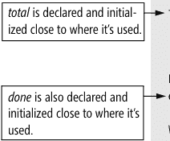

第二个示例在几个方面优于第一个示例。当第一个示例执行到使用 *done* 的代码时，*done* 可能已被修改。如果你最初编写程序时情况并非如此，后续修改可能会使之变成这样。第一种方法的另一个问题是，把所有初始化语句堆在一起会给人一种印象：所有变量在整个例程中都会被使用——而事实上 *done* 只在结尾处使用。最后，随着程序被修改（即使只是为了调试，程序也会被修改），可能会在使用 *done* 的代码周围构建循环，而 *done* 将需要重新初始化。在这种情况下，第二个示例中的代码几乎不需要修改，第一个示例中的代码则更容易产生恼人的初始化错误。

> **交叉引用**：更多关于将相关操作放在一起的细节，请参阅第 10.4 节“作用域”。

这就是就近原则（Principle of Proximity）的一个例子：将相关操作放在一起。同样的原则也适用于：将注释放在其所描述的代码附近，将循环设置代码放在循环附近，在直线型代码中将语句分组，以及许多其他方面。

*理想情况下，应在每个变量首次使用的位置附近声明并定义它*。声明确立变量的类型，定义则为变量赋予一个具体的值。在支持这种做法的语言（如 C++ 和 Java）中，变量应在首次使用的位置附近声明和定义。理想情况下，每个变量应在声明的同时定义，如下所示：

```
**Java Example of Good Initialization**

```java
int accountIndex = 0;
// code using accountIndex
...
```
```

total 在靠近其使用位置处初始化。

```
double total = 0.0;
// code using total
...
```

done 同样在靠近其使用位置处初始化。

```
boolean done = false;
// code using done
while ( ! done ) {
...
```

> 交叉引用：更多关于将相关操作放在一起的细节，请参阅第 14.2 节“顺序无关的语句”。

## 尽可能使用 final 或 const

在 Java 中将变量声明为 final，或在 C++ 中将其声明为 const，可以防止变量在初始化后被赋值。final 和 const 关键字可用于定义类常量、仅输入参数，以及任何希望在初始化后保持值不变的局部变量。

## 特别注意计数器和累加器

变量 i、j、k、sum 和 total 通常是计数器或累加器。一个常见错误是忘记在计数器或累加器下次使用之前将其重置。

## 在构造函数中初始化类的成员数据

正如例程的变量应在每个例程内初始化一样，类的数据应在构造函数中初始化。如果在构造函数中分配了内存，就应该在析构函数中释放。

## 检查是否需要重新初始化

问问自己：该变量是否需要重新初始化？也许是因为例程中的循环多次使用该变量，或者因为该变量在例程调用之间保留其值，需要在两次调用之间重置。如果需要重新初始化，请确保初始化语句位于被重复执行的代码部分之内。

## 命名常量只初始化一次；用可执行代码初始化变量

如果你使用变量来模拟命名常量，可以在程序开头编写代码对它们初始化一次。为此，请在 Startup() 例程中初始化它们。在可执行代码中，在靠近真正变量的使用位置处初始化它们。最常见的程序修改之一，就是把原来只调用一次的例程改为多次调用。在程序级 Startup() 例程中初始化的变量，在第二次执行该例程时不会被重新初始化。

## 使用自动初始化所有变量的编译器设置

如果你的编译器支持这种选项，将编译器设置为自动初始化所有变量，是“依赖编译器”这一主题的一个简单变体。然而，依赖特定的编译器设置，在将代码迁移到另一台机器和另一个编译器时可能会引发问题。确保你记录了自己对编译器设置的使用；否则，依赖特定编译器设置的假设很难被发现。

## 善用编译器的警告消息

许多编译器会警告你使用了未初始化的变量。

交叉引用：关于检查输入参数的更多内容，请参阅第 8.1 节“保护程序免受无效输入影响”，以及第 8 章“防御式编程”的其余部分。

## 检查输入参数的有效性

另一种有价值的初始化形式是检查输入参数的有效性。在将输入值赋给任何对象之前，请确保这些值是合理的。

## 使用内存访问检查器检查坏指针

在某些操作系统中，操作系统代码会检查无效的指针引用；在另一些操作系统中，你只能靠自己。不过，你不必完全靠自己，因为你可以购买内存访问检查器来检查程序的指针操作。

## 在程序开头初始化工作内存

将工作内存初始化为已知值有助于暴露初始化问题。可以采用以下几种方法之一：

- 你可以使用程序运行前内存填充器，用可预测的值填充内存。值 0 在某些用途下很合适，因为它能确保未初始化的指针指向低内存，因而在使用这些指针时相对容易发现它们。在 Intel 处理器上，0xCC 是一个很好的值，因为它是断点中断的机器码；如果你在调试器中运行代码，并试图执行数据而不是代码，你会被大量断点淹没。0xCC 的另一个优点是，它在内存转储中很容易识别，而且很少因为正当原因被使用。另外，Brian Kernighan 和 Rob Pike 建议使用常量 0xDEADBEEF 作为内存填充值，这个值在调试器中很容易识别（1999）。
- 如果你使用内存填充值，可以偶尔更改用于填充内存的值。对程序进行一些变动，有时会暴露出那些在环境背景一成不变时隐藏的问题。
- 你可以让程序在启动时初始化其工作内存。使用程序运行前内存填充器的目的是暴露缺陷，而这种技术的目的是掩盖缺陷。每次用相同的值填充工作内存，可以保证程序不会受到启动内存中随机变化的影响。

### 10.4 作用域

“作用域”是一种思考变量知名度的方法：它有多知名？作用域，或称可见性，指的是变量在整个程序中被知晓并可被引用的程度。作用域有限或很小的变量只在程序的一小块区域内为人所知——例如，只在某个小循环中使用的循环索引。作用域很大的变量在程序的许多地方为人所知——例如，在整个程序中使用的员工信息表。

不同的语言以不同的方式处理作用域。在一些原始语言中，所有变量都是全局变量。因此你无法控制变量的作用域，这可能会引发很多问题。在 C++ 及类似语言中，变量可以在一个块（用花括号括起来的一段代码）、一个例程、一个类（可能还包括其派生类）或整个程序内可见。在 Java 和 C# 中，变量还可以在包或命名空间（一组类的集合）内可见。

以下各节提供适用于作用域的指导原则。

## 将变量引用局部化

变量各次引用之间的代码是一个“脆弱性窗口”。在这个窗口中，可能会添加新代码，无意中改变该变量；阅读代码的人也可能会忘记该变量本应包含的值。把变量引用聚集在一起，使其局部化，总是一个好主意。

将变量引用局部化的想法不言自明，但它也很适合进行正式度量。度量变量引用紧密程度的一种方法是计算变量的“跨度”。下面是一个例子：

```
Java Example of Variable Span
 a = 0;
 b = 0;
 c = 0;
 a = b + c;
```

在本例中，a 的第一次引用与第二次引用之间有两行，因此 a 的跨度为 2。b 的两次引用之间有一行，因此 b 的跨度为 1；c 的跨度为 0。下面是另一个例子：

```
Java Example of Spans of One and Zero
 a = 0;
 b = 0;
 c = 0;
 b = a + 1;
 b = b / c;
```

延伸阅读：关于变量跨度的更多信息，请参阅《Software Engineering Metrics and Models》（Conte、Dunsmore 和 Shen，1986 年）。

在本例中，b 的第一次引用与第二次引用之间有一行，跨度为 1；b 的第二次引用与第三次引用之间没有行，跨度为 0。

平均跨度由各个跨度求平均值得到。在第二个示例中，对于 b，（1+0）/2 等于平均跨度 0.5。当你把变量引用保持在一起时，阅读代码的人可以一次专注于一个部分。如果引用相隔很远，你就迫使读者在程序中来回跳转。因此，将变量引用保持在一起的主要优点是提高程序的可读性。


## 尽可能缩短变量的“存活”时间

与变量作用域相关的一个概念是变量的“存活时间”，即变量保持存活的语句总数。变量的生命周期始于首次被引用的语句；其生命周期结束于最后一次被引用的语句。

与作用域不同，存活时间不受变量在首次和最后引用之间使用次数的影响。如果变量首次在第 1 行被引用，最后在第 25 行被引用，则其存活时间为 25 条语句。如果这两行是唯一使用它的行，则其平均作用域为 23 条语句。如果变量在第 1 行到第 25 行的每一行都被使用，则其平均作用域为 0 条语句，但其存活时间仍为 25 条语句。图 10-1 说明了作用域和存活时间。

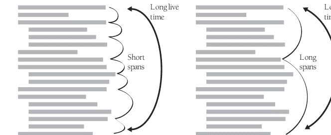

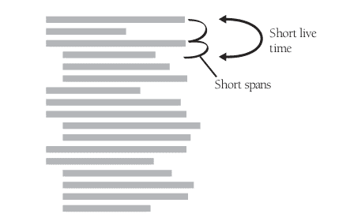

图 10-1 “长存活时间”意味着变量在许多语句期间保持存活。“短存活时间”意味着它仅在少数几条语句中存活。“作用域”指的是对变量的引用有多接近。

与作用域一样，关于存活时间的目标是保持数值尽可能低，即尽可能缩短变量的存活时间。与作用域一样，保持数值较低的基本优势在于它减少了脆弱窗口。你减少了

在你打算更改它的地方之间错误地或无意地更改变量的可能性。

保持存活时间短的第二个优势是它能让你准确地了解你的代码。如果一个变量在第 10 行被赋值为一个值，直到第 45 行才再次使用，两次引用之间的空间本身就暗示该变量在第 10 行和第 45 行之间被使用。如果变量在第 44 行被赋值为一个值，并在第 45 行使用，则不会暗示变量的其他用途，并且当你思考该变量时，可以集中在较小的代码段上。

短的存活时间还能降低初始化错误的风险。随着你修改程序，直线代码往往会变成循环，而你往往会忘记在循环远处进行的初始化。通过让初始化代码和循环代码更接近，你可以降低修改引入初始化错误的可能性。

短的存活时间使你的代码更具可读性。读者一次需要记住的代码行越少，你的代码就越容易理解。同样，存活时间越短，在编辑和调试时，你需要保留在屏幕上的代码就越少，以便查看变量的所有引用。

最后，短的存活时间在将大型例程拆分为更小型例程时很有用。如果对变量的引用保持紧密，就更容易将相关的代码段重构为自己的例程。

## 衡量变量的存活时间

你可以通过计算变量首次和最后引用之间的行数来形式化存活时间的概念，包括首次和最后两行。以下是存活时间过长的示例：

```
Java Example of Variables with Excessively Long Live Times
1  // initialize all variables
2  recordIndex = 0;
3  total = 0;
4  done = false;
   ...
26 while ( recordIndex < recordCount ) {
27  ...
28      recordIndex = recordIndex + 1;
   ...
64 while ( !done ) {
   ...
69  if ( total > projectedTotal ) {
70      done = true;
Last reference to recordIndex.
Last reference to total.
Last reference to done.
```

以下是此示例中变量的存活时间：

*recordIndex*      ( line 28 - line 2 + 1 ) = 27
*total*            ( line 69 - line 3 + 1 ) = 67
*done*             ( line 70 - line 4 + 1 ) = 67
Average Live Time  ( 27 + 67 + 67 ) / 3 = 54

下面重写了该示例，使变量引用更接近：

## Java Example of Variables with Good, Short Live Times

```
25  recordIndex = 0;
26  while ( recordIndex < recordCount ) {
27  ...
28      recordIndex = recordIndex + 1;
...
62  total = 0;
63  done = false;
64  while ( !done ) {
...
69      if ( total > projectedTotal ) {
70          done = true;
```

recordIndex 的初始化从第 3 行移至下方。

total 和 done 的初始化从第 4 行和第 5 行移至下方。

以下是此示例中变量的存活时间：

*recordIndex*      ( line 28 - line 25 + 1 ) = 4
*total*            ( line 69 - line 62 + 1 ) = 8
*done*             ( line 70 - line 63 + 1 ) = 8
Average Live Time  ( 4 + 8 + 8 ) / 3 ≈ 7

> 进一步阅读 有关“存活”变量的更多信息，请参阅 *Software Engineering Metrics and Models*（Conte, Dunsmore, and Shen 1986）。

直观上，第二个示例比第一个更好，因为变量的初始化更接近变量的使用位置。两个示例之间平均存活时间的差异是显著的：平均 54 与平均 7 提供了良好的定量支持，支持对第二段代码的直觉偏好。

是否有硬性数字可以将良好的存活时间与不良的存活时间区分开？良好的作用域与不良的作用域？研究人员尚未产生该定量数据，但可以安全地假设最小化作用域和存活时间是一个好主意。

如果你尝试将作用域和存活时间的概念应用于全局变量，你会发现全局变量具有巨大的作用域和存活时间——这是避免全局变量的众多充分理由之一。

## 最小化作用域的一般准则

以下是你可以用来最小化作用域的一些具体准则：

交叉引用 有关在变量使用附近初始化变量的详细信息，请参阅本章前文第 10.3 节“初始化变量的准则”。

# 将循环中使用的变量在循环之前立即初始化，而不是在包含循环的例程开头初始化

这样做可以提高你在修改循环时记住对循环初始化进行相应修改的机会。后来，当你修改程序并在初始循环外再加一个循环时，初始化将在每次通过新循环时生效，而不是仅在第一次通过时生效。

交叉引用 有关这种变量声明和定义风格的更多信息，请参阅第 10.3 节中“理想情况下，在变量首次使用附近声明和定义每个变量”。

# 不要在值使用之前很久就为变量赋值，而是在值使用前立即赋值

你可能经历过试图弄清楚变量的值是在哪里赋值的挫败感。你能做得越多来明确变量从何处接收其值越好。像 C++ 和 Java 这样的语言支持以下类型的变量初始化：

```
C++ Example of Good Variable Declarations and Initializations
int receiptIndex = 0;
float dailyReceipts = TodaysReceipts();
double totalReceipts = TotalReceipts( dailyReceipts );
```

交叉引用 有关保持相关语句在一起的更多详细信息，请参阅第 14.2 节“语句顺序无关紧要”。

# 对相关语句进行分组

以下示例展示了汇总每日收据的例程，并说明了如何将对变量的引用放在一起以便更容易定位。第一个示例说明了违反这一原则的情况：

```
C++ Example of Using Two Sets of Variables in a Confusing Way
void SummarizeData(...) {
...
GetOldData( oldData, &numOldData );
GetNewData( newData, &numNewData );
totalOldData = Sum( oldData, numOldData );
totalNewData = Sum( newData, numNewData );
PrintOldDataSummary( oldData, totalOldData, numOldData );
PrintNewDataSummary( newData, totalNewData, numNewData );
SaveOldDataSummary( totalOldData, numOldData );
SaveNewDataSummary( totalNewData, numNewData );
...
}
```

请注意，在此示例中，你必须同时跟踪 oldData、newData、numOldData、numNewData、totalOldData 和 totalNewData——仅此一项就有六个变量

使用两组变量的语句。


短片段。下一个示例展示了如何将该数量减少到每个代码块内仅三个元素：

## C++ 示例：更易理解地使用两组变量

```
void SummarizeData( ... ) {
  GetOldData( oldData, &numOldData );
  totalOldData = Sum( oldData, numOldData );
  PrintOldDataSummary( oldData, totalOldData, numOldData );
  SaveOldDataSummary( totalOldData, numOldData );
  ...
  GetNewData( newData, &numNewData );
  totalNewData = Sum( newData, numNewData );
  PrintNewDataSummary( newData, totalNewData, numNewData );
  SaveNewDataSummary( totalNewData, numNewData );
  ...
}
```

使用 oldData 的语句。

使用 newData 的语句。

当代码被拆分后，两个代码块都比原始代码块更短，各自包含的变量也更少。它们更容易理解，而且如果你需要将这段代码拆分到独立例程中，更短且变量更少的代码块有助于形成定义更清晰的例程。

## 将相关语句组拆分为独立例程

在其他条件相同的情况下，较短例程中的变量往往比长例程中的变量具有更小的跨度和生存期。通过将相关语句拆分为独立、较小的例程，可以缩小变量的作用域。

> 交叉引用：有关全局变量的更多信息，请参见 13.3 节“全局数据”。

## 从最严格的可见性开始，仅在必要时扩大变量作用域

最小化变量作用域的一部分是使其尽可能地局部化。将原本作用域很大的变量缩小，比将原本作用域很小的变量扩大要困难得多——换句话说，将全局变量改为类变量，比将类变量改为全局变量更难。将受保护的数据成员改为私有数据成员，也比反向修改更难。因此，如有疑问，应优先选择尽可能小的变量作用域：特定循环内的局部变量、单个例程内的局部变量，然后是类私有、受保护、包（如果你的编程语言支持），最后才考虑全局。

## 关于最小化作用域的评论

许多程序员最小化变量作用域的方式取决于他们对“便利性”和“心智可管理性”问题的看法。一些程序员将许多变量设为全局变量，因为全局作用域让变量访问更便捷，程序员不必费心处理参数列表和类作用域规则。在他们看来，随时访问变量的便利性胜过了所涉及的风险。

交叉引用：最小化作用域的思想与信息隐藏的思想相关。详情请参见 5.3 节中的“隐藏秘密（信息隐藏）”。

另一些程序员则倾向于尽可能让变量局部化，因为局部作用域有助于心智可管理性。你能隐藏的信息越多，同一时间需要记住的内容就越少。需要记住的内容越少，犯错的可能性就越小——因为你不太会忘记需要记住的众多细节之一。


“便利性”哲学与“心智可管理性”哲学之间的差异，归根结底是编写程序与阅读程序之间的侧重点不同。最大化的作用域或许确实让程序易于编写，但一个任何例程都可以随时使用任何变量的程序，比使用分解良好的例程的程序更难理解。在这样的程序中，你不能只理解一个例程；你必须理解该例程与之共享全局数据的所有其他例程。这类程序难以阅读、难以调试，也难以修改。

交叉引用：有关使用访问例程的详细信息，请参见 13.3 节中的“使用访问例程代替全局数据”。

因此，你应该将每个变量声明为对需要看到它的最小代码段可见。如果你能将变量的作用域限制在单个循环或单个例程内，那很好。如果不能将作用域限制在一个例程内，就将可见性限制在单个类中的例程。如果不能将变量的作用域限制在对该变量最负责的类内，就创建访问例程来与其他类共享该变量的数据。你会发现，即使有需要，也很少需要使用裸全局数据。

### 10.5 持久性

“持久性”是数据生存期的另一种说法。持久性有几种形式。有些变量会持续存在：

- 持续到特定代码块或例程的生命周期结束。在 C++ 或 Java 的 for 循环内声明的变量就是这种持久性的例子。
- 只要你允许，它们就一直存在。在 Java 中，使用 new 创建的变量会一直存在，直到被垃圾回收。在 C++ 中，使用 new 创建的变量会一直存在，直到你删除它们。
- 持续到程序的生命周期结束。大多数语言中的全局变量符合这一描述，C++ 和 Java 中的静态变量也是如此。
- 永久存在。这些变量可能包括你在程序执行的间隔中存储在数据库中的值。例如，如果你有一个交互式程序，用户可以在其中自定义屏幕颜色，你可以将他们的颜色存储在文件中，然后每次程序加载时再读回这些颜色。

持久性的主要问题出现在你假设一个变量的持久性比其实际持久性更长时。这个变量就像冰箱里的那罐牛奶。它本应能保存一周。有时它保存了一个月，有时它五天就变酸了。变量同样难以预测。如果你在变量正常生命周期结束后尝试使用它的值，它还会保留原来的值吗？有时变量中的值已经“变酸”，你知道自己犯了错误。其他时候，计算机会在变量中留下旧值，让你误以为自己正确使用了它。

以下是你可以采取的几个步骤来避免这类问题：

- 在程序中使用调试代码或断言来检查关键变量的值是否合理。如果值不合理，显示一条警告，提示你查找不恰当的初始化。
- 使用完变量后，将变量设置为“不合理的值”。例如，你可以在删除指针后将其设置为 null。
- 编写假设数据不具有持久性的代码。例如，如果变量在退出例程时具有某个值，不要假设下次进入例程时它仍具有相同的值。如果你使用的是保证值保持不变的语言特定特性，例如 C++ 和 Java 中的 static，则不适用此规则。
- 养成在使用所有数据之前立即声明并初始化它们的习惯。如果你看到数据在使用时附近没有初始化，就要保持警惕！

交叉引用：调试代码很容易包含在访问例程中，更多内容请参见 13.3 节中的“访问例程的优点”。

### 10.6 绑定时间

一个对程序维护和可修改性具有深远影响的初始化主题是“绑定时间”：变量与其值绑定在一起的时间（Thimbleby 1988）。它们是在编写代码时绑定？编译时？加载时？程序运行时？还是其他时间？

尽可能使用最晚的绑定时间可能对你有利。一般来说，绑定时间越晚，你在代码中构建的灵活性就越大。下一个示例展示了在最早可能的时间（编写代码时）进行绑定：

```
Java Example of a Variable That’s Bound at Code-Writing Time
titleBar.color = 0xFF; // 0xFF is hex value for color blue
```

值 0xFF 在编写代码时绑定到变量 titleBar.color，因为 0xFF 是硬编码到程序中的字面值。像这样的硬编码几乎总是一个坏主意，因为如果这个 0xFF 发生变化，它可能会与代码中其他地方使用的、必须与此值相同的 0xFF 失去同步。

下面是一个稍晚一些的绑定示例，发生在代码编译时：


Java 编译时绑定的变量示例
```
private static final int COLOR_BLUE = 0xFF;
private static final int TITLE_BAR_COLOR = COLOR_BLUE;
...
titleBar.color = TITLE_BAR_COLOR;
```

TITLE_BAR_COLOR 是一个命名常量，编译器在编译时将其替换为值的表达式。如果你的语言支持它，这几乎总是比硬编码更好。它提高了可读性，因为 TITLE_BAR_COLOR 比 0xFF 更能说明所表示的内容。它使更改标题栏颜色变得更容易，因为一次更改即可涵盖所有出现的位置。而且它不会带来运行时的性能损失。

以下是绑定时间更晚、在运行时绑定的示例：

```
Java Example of a Variable That's Bound at Run Time
titleBar.color = ReadTitleBarColor();
```

ReadTitleBarColor() 是一个在程序执行时读取值的例程，可能从 Microsoft Windows 注册表文件或 Java 属性文件读取。

代码比硬编码值时更易读、更灵活。你无需更改程序即可更改 titleBar.color；只需更改 ReadTitleBarColor() 读取的源内容即可。这种方法常用于交互式应用程序，用户可以自定义应用程序环境。

绑定时间还有另一种变化，涉及 ReadTitleBarColor() 例程何时被调用。该例程可以在程序加载时调用一次、每次创建窗口时调用，或每次绘制窗口时调用——每种替代方案代表了更晚的绑定时间。

总之，在此示例中，变量可以绑定到值的时机如下。 （在其他情况下，细节可能略有不同。）

- 编码时（使用魔术数字）
- 编译时（使用命名常量）
- 加载时（从外部源读取值，例如 Windows 注册表文件或 Java 属性文件）
- 对象实例化时（例如每次创建窗口时读取值）
- 即时（例如每次绘制窗口时读取值）

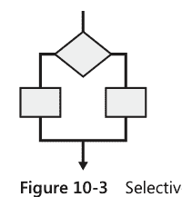

图 10-3 选择性数据允许你使用其中一个，但不能同时使用两者。

交叉引用 有关循环的详细信息，请参阅第 16 章“控制循环”。

## 迭代数据转换为程序中的 for、repeat 和 while 循环结构

迭代数据是重复多次的相同类型的数据，如图 10-4 所示。通常，迭代数据存储为容器中的元素、文件中的记录或数组中的元素。你可能有一个从文件中读取的社保号码列表。迭代数据将与用于读取数据的迭代代码循环相匹配。

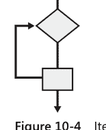

图 10-4 迭代数据是重复的。

你的实际数据可以是顺序、选择性和迭代类型数据的组合。你可以将简单的构建块组合起来描述更复杂的数据类型。

### 10.8 为每个变量仅使用一个目的


以几种微妙的方式使用变量实现多个目的是可能的。你最好不要这种微妙性。

### 仅为一个目的使用每个变量

有时诱人地在两个不同位置为两种不同活动使用一个变量。通常，变量对于其中一种用途命名不当或使用“临时”变量用于两种情况（通常使用无帮助的名称 x 或 temp）。以下是临时变量用于两个目的的示例：

### C++ 使用一个变量实现两个目的的示例——不良实践

```
// Compute roots of a quadratic equation.
// This code assumes that (b*b-4*a*c) is positive.
temp = Sqrt( b*b - 4*a*c );
root[0] = ( -b + temp ) / ( 2 * a );
root[1] = ( -b - temp ) / ( 2 * a );
...

// swap the roots
temp = root[0];
root[0] = root[1];
root[1] = temp;
```

交叉引用 例程参数也应仅用于一个目的。有关使用例程参数的详细信息，请参阅第 7.5 节“如何使用例程参数”。

问题：前几行中的 temp 与最后几行中的 temp 有什么关系？答案：这两个 temp 没有关系。在两个实例中使用相同的变量会让人觉得它们相关，而实际上并非如此。为每个目的创建唯一的变量会使你的代码更易读。以下是改进方法：

### C++ 使用两个变量实现两个目的的示例——良好实践

```
// Compute roots of a quadratic equation.
// This code assumes that (b*b-4*a*c) is positive.
discriminant = Sqrt( b*b - 4*a*c );
root[0] = ( -b + discriminant ) / ( 2 * a );
root[1] = ( -b - discriminant ) / ( 2 * a );
...

// swap the roots
oldRoot = root[0];
root[0] = root[1];
root[1] = oldRoot;
```

### 避免具有隐藏含义的变量

变量被用于多个目的的另一种方式是变量的不同值意味着不同的含义。例如：

- 变量 pageCount 中的值可能表示打印的页数，除非它等于 -1，在这种情况下它表示发生了错误。
- 变量 customerId 可能表示客户编号，除非其值大于 500,000，在这种情况下你减去 500,000 得到拖欠账户的编号。
- 变量 bytesWritten 可能是写入输出文件的字节数，除非其值为负，在这种情况下它表示用于输出的磁盘驱动器编号。

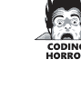


避免具有此类隐藏含义的变量。这种滥用的技术名称是“混合耦合”（Page-Jones 1988）。变量被拉伸到两个工作上，这意味着变量对于其中一项工作来说类型错误。在 pageCount 示例中，pageCount 通常表示页数；它是一个整数。当 pageCount 为 -1 时，它表示发生了错误；整数正在兼任布尔值！

即使双重用途对你来说很清楚，对其他人来说也不会如此。通过使用两个变量保存两种信息所获得的额外清晰度会让你惊讶。没有人会责怪你额外的存储。


### 确保所有声明的变量都被使用

使用变量实现多个目的的相反情况是根本不使用它。Card、Church 和 Agresti 的一项研究发现，未引用的变量与更高的故障率相关（1986）。养成检查所有声明的变量是否都被使用的习惯。一些编译器和实用程序（如 lint）会将未使用的变量报告为警告。

cc2e.com/1092

交叉引用 对于适用于特定数据类型而非一般问题的检查表，请参阅第 12 章“基本数据类型”第 316 页的检查表。有关命名变量的问题，请参阅第 11 章“变量名的力量”第 288 页的检查表。

## 检查表：使用数据的一般考虑

### 初始化变量

- 每个例程是否检查输入参数的有效性？
- 代码是否在首次使用附近声明变量？
- 代码是否在声明时初始化变量，如果可能？
- 如果无法同时声明和初始化，代码是否在首次使用附近初始化变量？
- 计数器和累加器是否已正确初始化，并在必要时每次使用时重新初始化？
- 在重复执行的代码中，变量是否已正确重新初始化？
- 代码是否在没有任何编译器警告的情况下编译？（并且你是否打开了所有可用的警告？）
- 如果你的语言使用隐式声明，你是否已补偿由此引起的问题？

### 使用数据的其他一般问题

- 所有变量是否具有尽可能小的范围？
- 对变量的引用是否尽可能靠近在一起，既在对变量的每次引用之间，也在总生命周期内？
- 控制结构是否对应于数据类型？


- 声明的所有变量是否都在使用？
- 所有变量是否都在适当的时间绑定——也就是说，你是否在晚期绑定的灵活性和晚期绑定带来的复杂性之间做出了有意识的平衡？
- 每个变量是否只有一个且唯一的目的？
- 每个变量的含义是否明确，没有隐藏含义？

## 关键点

- 数据初始化容易出错，因此使用本章描述的初始化技术来避免因意外初始值引起的问题。
- 尽量缩小每个变量的作用域。让对变量的引用保持集中。使其局限于例程或类。避免全局数据。
- 让处理相同变量的语句尽可能靠近。
- 早期绑定倾向于限制灵活性但最小化复杂性。晚期绑定倾向于增加灵活性，但以增加复杂性为代价。
- 每个变量仅用于一个且唯一的目的。

## 第11章：变量名的力量

### 目录

- 11.1 选择良好名称的考虑：page 259
- 11.2 为特定类型的数据命名：page 264
- 11.3 命名约定的力量：page 270
- 11.4 非正式命名约定：page 272
- 11.5 标准化前缀：page 279
- 11.6 创建可读的简短名称：page 282
- 11.7 应避免的命名种类：page 285

### 相关主题

- 例程名称：Section 7.3
- 类名称：Section 6.2
- 使用变量的一般问题：Chapter 10
- 格式化数据声明：“Laying Out Data Declarations” in Section 31.5
- 文档化变量：“Commenting Data Declarations” in Section 32.5

良好的名称对有效编程的重要性不言而喻，但我从未读过一篇讨论涵盖了创建良好名称所需的大量考虑因素中的超过一小部分。许多编程书籍只用几段话讨论如何选择缩写，讲几句老生常谈，然后让你自生自灭。我打算做相反的事：用比你能用得上的信息更多的内容来淹没你！

本章的指导原则主要适用于命名变量——对象和原始数据。但它们也适用于命名类、包、文件和其他编程实体。有关命名例程的详细信息，请参阅第7.3节“Good Routine Names。”

### 11.1 选择良好名称的考虑

你不能像给狗起名字那样给变量起名字——因为它很可爱或听起来好。不同于狗和它的名字是不同的实体，变量和变量名本质上是同一件事。因此，变量的好坏很大程度上取决于它的名字。谨慎选择变量名。

下面是一个使用糟糕变量名的代码示例：


```
Java Example of Poor Variable Names
x = x - xx;
xxx = fido + SalesTax( fido );
x = x + LateFee( x1, x ) + xxx;
x = x + Interest( x1, x );
```

这段代码在做什么？x1、xx 和 xxx 有什么含义？fido 指什么？假设有人告诉你这段代码根据未付余额和新购买的商品计算总客户账单。你会使用哪个变量来打印仅针对新购买商品的客户账单？

下面是同一段代码的版本，使这些问题更容易回答：

```
Java Example of Good Variable Names
balance = balance - lastPayment;
monthlyTotal = newPurchases + SalesTax( newPurchases );
balance = balance + LateFee( customerID, balance ) + monthlyTotal;
balance = balance + Interest( customerID, balance );
```

鉴于这两段代码的对比，好的变量名是可读的、可记忆的且合适的。你可以使用一些通用的经验法则来实现这些目标。

### 最重要的命名考虑


命名变量时最重要的考虑是，名称必须完全且准确地描述变量所代表的实体。想出好名字的有效技巧是用文字说明变量代表什么。通常该陈述本身就是最好的变量名。它易于阅读，因为不包含晦涩的缩写，并且是无歧义的。因为它是实体的完整描述，所以不会与其它东西混淆。而且它易于记忆，因为名称与概念相似。

对于代表美国奥运代表团人数的变量，你会创建名称 numberOfPeopleOnTheUsOlympicTeam。代表体育场座位数的变量将是 numberOfSeatsInTheStadium。代表现代奥运会中某国队获得的最大得分的变量将是 maximumNumberOfPointsInModernOlympics。包含当前利率的变量最好命名为 rate 或 interestRate 而不是 r 或 x。你明白了。

注意这些名称的两个特点。首先，它们很容易辨认。事实上，它们根本不需要辨认，因为可以直接阅读。但其次，其中一些名称很长——长到不切实际。我稍后会谈到变量名长度的问题。

表11-1显示了几个变量名的示例，好的和坏的：

**Table 11-1 Examples of Good and Bad Variable Names**

| Purpose of Variable | Good Names, Good Descriptors | Bad Names, Poor Descriptors |
|---|---|---|
| Running total of checks written to date | runningTotal, checkTotal | written, ct, checks, CHKTTL, x, x1, x2 |
| Velocity of a bullet train | velocity, trainVelocity, velocityInMph | velt, v, tv, x, x1, x2, train |
| Current date | currentDate, todaysDate | cd, current, c, x, x1, x2, date |
| Lines per page | linesPerPage | lpp, lines, l, x, x1, x2 |

名称 currentDate 和 todaysDate 是好的名称，因为它们完全且准确地描述了“当前日期”的概念。事实上，它们使用了显而易见的词语。程序员有时会忽略使用普通词语，而这通常是最简单的解决方案。因为它们太短且没有描述性，cd 和 c 是糟糕的名称。current 很差，因为它没有告诉你什么东西是当前的。date 几乎是一个好名字，但在最终分析中它是一个糟糕的名字，因为所涉及的日期不是任意日期，而是当前日期；date 本身并无此指示。x、x1 和 x2 是糟糕的名称，因为它们总是糟糕的名称——x 传统上代表未知量；如果你不想让你的变量成为未知量，请想出更好的名字。

名称应尽可能具体。像 x、temp 和 i 这样通用到可用于多个目的的名称不如它们本可以那样具有信息性，通常是坏名字。


### 问题导向

好的助记名称通常针对问题而不是解决方案。好的名称倾向于表达“是什么”多于“怎么做”。一般来说，如果一个名称指的是计算的某个方面而不是问题本身，那就是怎么做而不是是什么。避免这种名称，而使用指代问题本身的名称。

员工数据记录可以称为 inputRec 或 employeeData。inputRec 是计算机术语，指计算概念——输入和记录。employeeData 指的是问题域而不是计算宇宙。同样，对于指示打印机状态的位字段，bitFlag 是更计算机化的名称，而 printerReady 则不是。在会计应用中，calcVal 比 sum 更计算机化。

### 最佳名称长度

名称的最佳长度似乎介于 *x* 和 *maximumNumberOfPointsInModernOlympics* 之间。太短的名称传达的信息不足。像 *x1* 和 *x2* 这样名称的问题在于，即使你能发现 *x* 是什么，你也不会知道 *x1* 和 *x2* 之间的关系。太长的名称难以输入，并且会掩盖程序的视觉结构。


Gorla、Benander 和 Benander 发现，当变量名称平均为 10 到 16 个字符时，调试程序所需的努力最小化了（1990）。名称平均为 8 到 20 个字符的程序几乎一样容易调试。这一指导原则并不意味着你应该尝试让所有变量名都为 9 到 15 或 10 到 16 个字符长。它确实意味着，如果你浏览代码并看到许多较短的名称，你应该检查以确保名称清晰到所需的程度。

你可能会通过采用《金发姑娘和三只熊》的方法来命名变量而获得好处，如表11-2所示。

**Table 11-2 Variable Names That Are Too Long, Too Short, or Just Right**

| Too Long | Too Short | Just Right |
|---|---|---|
| numberOfPeopleOnTheUsOlympicTeam | n, np, ntm | numTeamMembers, teamMemberCount |
| numberOfSeatsInTheStadium | n, ns, nsisd | numSeatsInStadium, seatCount |
| maximumNumberOfPointsInModernOlympics | m, mp, max, points | teamPointsMax, pointsRecord |

### 作用域对变量名称的影响

> **Cross-Reference** Scope is discussed in more detail in Section 10.4, “Scope.”

短变量名总是坏的吗？不，并非总是如此。当你给变量一个像 *i* 这样短的名称时，长度本身就说明了变量——即变量是一个临时值，其操作范围有限。

阅读此类变量的程序员应该能够假设其值不会在几行代码之外使用。当你将变量命名为 *i* 时，你是在说：“这个变量是一个普通的循环计数器或数组索引，在这几行代码之外没有意义。”

W. J. Hansen 的一项研究发现，较长的名称对很少使用的变量或全局变量更好，较短的名称对局部变量或循环变量更好


(Shneiderman 1980)。然而，短名称会带来许多问题，一些谨慎的程序员会出于防御性编程的策略而完全避免使用它们。

## 对全局命名空间中的名称使用限定符

如果您有位于全局命名空间中的变量（命名常量、类名等），请考虑是否需要采用一种约定来划分全局命名空间并避免命名冲突。在 C++ 和 C# 中，您可以使用 namespace 关键字来划分全局命名空间。

**使用 namespace 关键字划分全局命名空间的 C++ 示例**

```cpp
namespace UserInterfaceSubsystem {
...
// lots of declarations
...
}

namespace DatabaseSubsystem {
...
// lots of declarations
...
}
```

如果您在 UserInterfaceSubsystem 和 DatabaseSubsystem 中都声明了一个 Employee 类，您可以通过编写 UserInterfaceSubsystem::Employee 或 DatabaseSubsystem::Employee 来标识您想要引用的类。在 Java 中，您可以通过使用包来实现同样的效果。

在不支持命名空间或包的语言中，您仍然可以使用命名约定来划分全局命名空间。一种约定是要求全局可见的类以子系统助记符为前缀。用户界面员工类可能变成 uiEmployee，而数据库员工类可能变成 dbEmployee。这最大限度地降低了全局命名空间冲突的风险。

## 变量名中的计算值限定符

许多程序都有包含计算值的变量：总数、平均值、最大值等。如果您用像 Total、Sum、Average、Max、Min、Record、String 或 Pointer 这样的限定符修改名称，请将修饰符放在名称的末尾。

这种做法有几个优点。首先，变量名称中最重要的部分，即赋予变量大部分含义的部分，位于前面，因此更突出且先被阅读。其次，通过建立这种约定，您可以避免可能产生的混淆，如果您在同一程序中使用 totalRevenue 和 revenueTotal。名称在语义上是等价的，而约定会防止它们被当作不同的名称使用。第三，像 revenueTotal、expenseTotal、revenueAverage 和 expenseAverage 这样的名称集合具有令人愉悦的对称性。而像 *totalRevenue*、*expenseTotal*、*revenueAverage* 和 *averageExpense* 这样的名称集合则不令人感到有序。最后，一致性提高了可读性并简化了维护。

计算值放在名称末尾规则的一个例外是 *Num* 限定符的惯用位置。放在变量名称开头时，*Num* 指的是总数：*numCustomers* 是客户总数。放在变量名称末尾时，*Num* 指的是索引：*customerNum* 是当前客户的编号。*numCustomers* 末尾的 *s* 也是意义差异的另一个提示。但是，由于使用 *Num* 经常会造成混淆，最好通过使用 *Count* 或 *Total* 来指代客户总数，使用 *Index* 来指代特定客户，从而完全避开这个问题。因此，*customerCount* 是客户总数，而 *customerIndex* 指的是特定客户。

## 变量名中的常见反义词

> **交叉引用** 有关例程名称中类似的反义词列表，请参阅第 7.3 节中的“精确使用反义词”。

精确使用反义词。使用反义词的命名约定有助于一致性，从而提高可读性。像 *begin/end* 这样的配对很容易理解和记忆。偏离常用语言反义词的配对往往难以记忆，因此令人困惑。以下是一些常见反义词：

- begin/end
- first/last
- locked/unlocked
- min/max
- next/previous
- old/new
- opened/closed
- visible/invisible
- source/target
- source/destination
- up/down

### 11.2 命名特定类型的数据

除了命名数据的一般考虑之外，在命名特定类型的数据时也会出现特殊考虑。本节描述了针对循环变量、状态变量、临时变量、布尔变量、枚举类型和命名常量的具体考虑。

### 命名循环索引

> **交叉引用** 有关循环的详细信息，请参阅第 16 章“控制循环”。

由于循环是计算机编程中常见的特性，因此出现了命名循环变量的指导方针。*i*、*j* 和 *k* 是惯用的名称：

**简单循环变量名称的 Java 示例**

```java
for ( i = firstItem; i < lastItem; i++ ) {
    data[ i ] = 0;
}
```

如果变量要在循环外部使用，则应赋予比 *i*、*j* 或 *k* 更有意义的名称。例如，如果您正在从文件中读取记录并且需要记住已读取的记录数，像 *recordCount* 这样的名称就很合适：

**良好描述性循环变量名称的 Java 示例**

```java
recordCount = 0;
while ( moreScores() ) {
    score[ recordCount ] = GetNextScore();
    recordCount++;
}

// lines using recordCount
```

如果循环超过几行，很容易忘记 *i* 代表什么，这时最好给循环索引一个更有意义的名称。由于代码经常被更改、扩展并复制到其他程序中，许多经验丰富的程序员完全避免使用像 *i* 这样的名称。

循环变长的一个常见原因是它们是嵌套的。如果您有多个嵌套循环，请为循环变量分配更长的名称以提高可读性。

**嵌套循环中良好循环名称的 Java 示例**

```java
for ( teamIndex = 0; teamIndex < teamCount; teamIndex++ ) {
    for ( eventIndex = 0; eventIndex < eventCount[ teamIndex ]; eventIndex++ ) {
        score[ teamIndex ][ eventIndex ] = 0;
    }
}
```

精心选择的循环索引变量名称避免了索引串扰的常见问题：说 *i* 时实际意思是 *j*，说 *j* 时实际意思是 *i*。它们还使数组访问更清晰：*score[ teamIndex ][ eventIndex ]* 比 *score[ i ][ j ]* 更具信息性。

如果您必须使用 *i*、*j* 和 *k*，不要将它们用于除简单循环的循环索引之外的任何用途——该约定已过于确立，打破它用于其他方式会令人困惑。避免此类问题的最简单方法是简单地为 *i*、*j* 和 *k* 思考出更有描述性的名称。

### 命名状态变量

状态变量描述程序的状态。以下是命名指导原则：

**为状态变量想一个比 flag 更好的名称** 最好将标志视为状态变量。标志的名称中永远不应包含 flag，因为这并不能让您了解标志的作用。为了清晰，标志应分配值，并且其值应使用枚举类型、命名常量或充当命名常量的全局变量进行测试。以下是一些名称不好的标志示例：


**晦涩标志的 C++ 示例**

```cpp
if ( flag ) ...
if ( statusFlag & 0x0F ) ...
if ( printFlag == 16 ) ...
if ( computeFlag == 0 ) ...

flag = 0x1;
statusFlag = 0x80;
printFlag = 16;
computeFlag = 0;
```

语句如 *statusFlag = 0x80* 除非您编写了代码或有文档说明 *statusFlag* 是什么以及 *0x80* 代表什么，否则不会让您了解代码的作用。以下是更清晰的等效代码示例：

**状态变量更好使用的 C++ 示例**

```cpp
if ( dataReady ) ...
if ( characterType & PRINTABLE_CHAR ) ...
if ( reportType == ReportType_Annual ) ...
if ( recalcNeeded == True ) ...

dataReady = true;
characterType = CONTROL_CHARACTER;
reportType = ReportType_Annual;
recalcNeeded = false;
```

显然，*characterType = CONTROL_CHARACTER* 比 *statusFlag = 0x80* 更有意义。同样，条件 *if ( reportType == ReportType_Annual )* 比 *if ( printFlag == 16 )* 更清晰。第二个示例表明您也可以使用枚举类型以及预定义命名常量来采用这种方法。以下是您如何使用命名常量和枚举类型来设置示例中使用的值：

**在 C++ 中声明状态变量**

```cpp
// values for CharacterType
const int LETTER = 0x01;
const int DIGIT = 0x02;
const int PUNCTUATION = 0x04;
const int LINE_DRAW = 0x08;
```


```c
const int PRINTABLE_CHAR = ( LETTER | DIGIT | PUNCTUATION | LINE_DRAW );

const int CONTROL_CHARACTER = 0x80;

// values for ReportType
enum ReportType {
    ReportType_Daily,
    ReportType_Monthly,
    ReportType_Quarterly,
    ReportType_Annual,
    ReportType_All
};
```

当你发现自己需要“琢磨”某段代码时，不妨考虑重命名其中的变量。琢磨谋杀悬案没问题，但你不应该需要去琢磨代码。你应该能直接读懂代码。

## 命名临时变量

临时变量用于保存计算的中间结果，作为临时占位符，以及保存一些辅助性数值。它们通常被命名为temp、x或其他含糊且不具有描述性的名称。一般来说，临时变量表明程序员尚未完全理解问题。此外，由于这些变量被正式赋予了“临时”地位，程序员往往会比其他变量更随意地对待它们，从而增加了出错的可能性。

对“临时”变量要保持警惕。通常确实需要临时保存一些值。但无论如何，程序中的大多数变量都是临时的。把其中一些称为临时变量，可能表明你并不确定它们的真正用途。请看下面的例子：

```c
C++ Example of an Uninformative “Temporary” Variable Name
// Compute roots of a quadratic equation.
// This assumes that (b^2-4*a*c) is positive.
temp = sqrt( b^2 - 4*a*c );
root[0] = ( -b + temp ) / ( 2 * a );
root[1] = ( -b - temp ) / ( 2 * a );
```

将表达式sqrt( b^2 - 4 * a * c )的值存入变量是没问题的，尤其因为它后面会在两个地方用到。但名字temp无法告诉你这个变量做了什么。更好的做法如下例所示：

```c
C++ Example with a “Temporary” Variable Name Replaced with a Real Variable
// Compute roots of a quadratic equation.
// This assumes that (b^2-4*a*c) is positive.
discriminant = sqrt( b^2 - 4*a*c );
root[0] = ( -b + discriminant ) / ( 2 * a );
root[1] = ( -b - discriminant ) / ( 2 * a );
```

这本质上是一样的代码，但通过使用一个准确、有描述性的变量名而得到了改进。

## 命名布尔变量

以下是命名布尔变量时可以使用的一些指导原则：

*牢记典型的布尔变量名* 下面是一些特别有用的布尔变量名：

- **done** 使用 *done* 来表示某事是否已完成。该变量可以表示一个循环是否结束，或其他操作是否完成。在事情完成前将 *done* 设为 *false*，完成后设为 *true*。
- **error** 使用 *error* 来表示是否发生了错误。当没有错误发生时，将变量设为 *false*；当发生错误时，设为 *true*。
- **found** 使用 *found* 来表示是否已找到某个值。当未找到该值时，将 *found* 设为 *false*；一旦找到，设为 *true*。在数组中搜索某个值、在文件中搜索员工ID、在工资单列表中搜索某个工资金额等场景下，都可以使用 *found*。
- **success 或 ok** 使用 *success* 或 *ok* 来表示操作是否成功。当操作失败时，将变量设为 *false*；当操作成功时，设为 *true*。如果可以，用更具体的名称替换 *success*，以精确描述成功意味着什么。如果程序在处理完成时即算成功，你可以改用 *processingComplete*。如果程序在找到某个值时才算成功，你可以改用 *found*。

*给布尔变量取能暗示真或假的名字* 像 *done* 和 *success* 这样的名字是好的布尔变量名，因为状态要么是 *true* 要么是 *false*；事情完成了或者没有完成；成功了或者没有成功。另一方面，像 *status* 和 *sourceFile* 这样的名字则是糟糕的布尔变量名，因为它们并不明显地表示 *true* 或 *false*。如果 *status* 是 *true*，那意味着什么？意味着某物有状态吗？任何事物都有状态。*true* 表示某物的状态是正常的吗？或者 *false* 表示没有出错？对于像 *status* 这样的名字，你无法分辨。

为了获得更好的效果，用 *error* 或 *statusOK* 之类的名字替换 *status*，并用 *sourceFileAvailable* 或 *sourceFileFound*，或任何能代表该变量含义的名字替换 *sourceFile*。

有些程序员喜欢在布尔变量名前加上 *Is*。这样变量名就变成了一个问题：*isdone?* *isError?* *isFound?* *isProcessingComplete?* 用 *true* 或 *false* 回答问题就是该变量的值。这种方法的一个好处是它对含糊的名字无效：*isStatus?* 完全没有意义。缺点则是它降低了简单逻辑表达式的可读性：*if ( isFound )* 比 *if ( found )* 略难读一些。

## 命名常量

> **交叉参考** 关于使用命名常量的详细信息，请参见第12.7节“命名常量”。

命名常量时，应该命名常量所代表的抽象实体，而不是常量所指的数字。*FIVE* 是一个糟糕的常量名（无论它代表的值是否为5.0）。*CYCLES_NEEDED* 是一个好名字。*CYCLES_NEEDED* 可以等于5.0或6.0。*FIVE = 6.0* 则会显得荒谬。同理，*BAKERS_DOZEN* 是一个糟糕的常量名；*DONUTS_MAX* 是一个好常量名。

### 11.3 命名约定的力量

有些程序员抵制标准和约定——这并非没有道理。一些标准和约定僵化且低效，会破坏创造力和程序质量。这很不幸，因为有效的标准是你手中最强大的工具之一。本节讨论为什么、何时以及如何为变量命名创建你自己的标准。

### 为什么要有约定？

约定能带来几个具体的好处：

- 它们让你可以更理所当然地依赖某些决策。通过做一个全局决策而非许多局部决策，你可以专注于代码更重要的特征。
- 它们帮助你在项目间传递知识。名称上的相似性使你更容易、更自信地理解陌生变量应该做什么。
- 它们帮助你在新项目中更快地学习代码。你不必去了解Anita的代码是这样的、Julia的是那样的、Kristin的又是另一种样子，而是可以面对一套更一致的代码。
- 它们减少名称泛滥。没有命名约定，你很容易用两个不同的名字称呼同一个事物。例如，你可能把总点数既称为 *pointTotal* 又称为 *totalPoints*。你在写代码时可能不觉得困惑，但对于后来阅读它的新程序员来说，这可能会造成极大的困惑。
- 它们弥补语言的弱点。你可以用约定来模拟命名常量和枚举类型。约定可以区分局部、类和全局数据，并可以为编译器不支持的类型包含类型信息。
- 它们强调相关条目之间的关系。如果你使用对象数据，编译器会自动处理这一点。如果你的语言不支持对象，你可以通过命名约定来补充。像 *address*、*phone* 和 *name* 这样的名字并不表明这些变量是相关的。但假设你决定所有雇员数据变量都以 *Employee* 前缀开头，那么 *employeeAddress*、*employeePhone* 和 *employeeName* 就毫无疑义地表明这些变量是相关的。编程约定可以弥补你所使用语言的弱点。


关键在于，任何约定通常都比没有约定好。约定可以是任意的。命名约定的力量并非来自所选的具体约定，而来自约定本身的存在，它为代码增加了结构，让你少操心一些事情。

### 何时应该制定命名约定

关于何时应该建立命名约定，并没有硬性规定，但以下几种情况采用约定是值得的：

- 当多个程序员在一个项目上工作时
- 当你打算把程序交给另一位程序员进行修改和维护时（这几乎总是会发生）
- 当你的程序由组织中的其他程序员评审时
- 当你的程序太大，无法一次在脑中装下全部内容，而必须分块思考时
- 当程序的寿命足够长，你可能会把它搁置几周或几个月后再重新开始时
- 当项目中有许多常见的不寻常术语，而你希望有标准的术语或缩写用于编码时

拥有某种命名约定总是有益处的。上述考虑应帮助你确定在特定项目中使用约定的程度。

### 正式程度

> **交叉参考** 关于小型和大型项目在正式程度上的差异，请参见第27章“程序规模如何影响构建”。

不同的约定有不同的正式程度。非正式约定可能简单到“使用有意义的名称”。下一节将描述其他非正式约定。一般来说，你所需要的正式程度取决于参与程序开发的人数、程序的规模以及程序的预期寿命。对于很小的、一次性项目，严格约定可能是不必要的额外负担。对于参与人数较多的大型项目，无论是初期还是在整个程序生命周期内，正式约定对可读性都是不可或缺的辅助。


### 11.4 非正式命名约定

大多数项目使用相对非正式的命名约定，如本节所述。

### 语言无关约定的准则

以下是创建语言无关约定的一些准则：

**_区分变量名和例程名_** 本书使用的约定是以小写字母开头变量和对象名，以大写字母开头例程名：variableName vs. RoutineName()。

**_区分类和对象_** 类名与对象名之间的对应关系——或类型与其类型变量之间的对应关系——可能会变得棘手。存在几种标准选项，如以下示例所示：

```
Option 1: Differentiating Types and Variables via Initial Capitalization
Widget widget;
LongerWidget longerWidget;
```

```
Option 2: Differentiating Types and Variables via All Caps
WIDGET widget;
LONGERWIDGET longerWidget
```

```
Option 3: Differentiating Types and Variables via the "t_" Prefix for Types
t_Widget Widget;
t_LongerWidget LongerWidget;
```

```
Option 4: Differentiating Types and Variables via the "a" Prefix for Variables
Widget aWidget;
LongerWidget aLongerWidget;
```

```
Option 5: Differentiating Types and Variables via Using More Specific Names for the Variables
Widget employeeWidget;
LongerWidget fullEmployeeWidget;
```

这些选项各有优缺点。选项 1 是 C++ 和 Java 等区分大小写语言中的常见约定，但一些程序员不习惯仅凭大小写来区分名称。事实上，仅在名称首字母的大小写上不同的名称似乎提供了太少的“心理距离”和两个名称之间太小的视觉区分。

如果任何语言都不区分大小写，则选项 1 的方法无法在混合语言环境中一致应用。例如，在 Microsoft Visual Basic 中，`Dim widget As Widget` 会生成语法错误，因为 *widget* 和 *Widget* 被视为相同的标记。

选项 2 在类型名和变量名之间创建了更明显的区分。出于历史原因，全大写用于在 C++ 和 Java 中表示常量，然而，该方法在混合语言环境中会遇到与选项 1 相同的问题。

选项 3 在所有语言中都能足够好地工作，但一些程序员出于美学原因不喜欢前缀的想法。

选项 4 有时被用作选项 3 的替代方案，但它会改变类的每个实例的名称，而不是仅改变一个类名。

选项 5 需要在变量的基础上进行更多思考。在大多数情况下，被迫为变量想出特定名称会导致更易读的代码。但有时 *widget* 确实只是一个普通的 *widget*，在这些情况下，你会发现自己想出不太明显的名称，比如 *genericWidget*，这些名称可能更难读。

简而言之，每个可用选项都涉及权衡。本书中的代码使用选项 5，因为在阅读代码的人不一定熟悉不太直观的命名约定时，它是最易理解的。

**标识全局变量** 一个常见的编程问题是全局变量的误用。如果你给所有全局变量名加上 `g_` 前缀，例如，程序员看到变量 `g_RunningTotal` 时就会知道它是一个全局变量并相应对待。

**标识成员变量** 标识类的成员数据。明确该变量不是局部变量，也不是全局变量。例如，你可以用 `m_` 前缀标识类成员变量以表示它是成员数据。

**标识类型定义** 类型命名约定有两个目的：它们明确标识名称为类型名，并避免与变量的命名冲突。为满足这些考虑，前缀或后缀是一个不错的方法。在 C++ 中，惯例是使用全大写字母作为类型名——例如，`COLOR` 和 `MENU`。 （此约定适用于 *typedefs* 和 *structs*，不适用于类名。）但这会造成与命名预处理器常量的混淆的可能性。为了避免混淆，你可以为类型名加上 `t_` 前缀，例如 `t_Color` 和 `t_Menu`。

**标识命名常量** 命名常量需要被标识，以便你可以判断是否将变量赋值为另一个变量的值（其值可能更改）或来自命名常量。在 Visual Basic 中，你还有函数值的额外可能性。Visual Basic 不要求函数名使用括号，而在 C++ 中即使没有参数的函数也使用括号。

命名常量的一个方法是使用像 c_ 这样的前缀作为常量名。这会给你像 c_RecsMax 或 c_LinesPerPageMax 这样的名称。在 C++ 和 Java 中，惯例是使用全大写字母，可能用下划线分隔单词，RECSMAX 或 RECS_MAX 和 LINESPERPAGEMAX 或 LINES_PER_PAGE_MAX。

### 标识枚举类型的元素

枚举类型的元素需要被标识，原因与命名常量相同——以便轻松判断名称是用于枚举类型而不是变量、命名常量或函数。标准方法适用：你可以使用全大写或 e_ 或 E_ 前缀作为类型本身的名称，并使用基于特定类型的 Color_ 或 Planet_ 等前缀作为类型的成员。

### 标识在不强制执行的语言中仅输入的参数

有时输入参数会被意外修改。在 C++ 和 Visual Basic 等语言中，你必须明确指出是否希望修改后的值返回给调用例程。这在 C++ 中用 *, & 和 const 限定符表示，或在 Visual Basic 中用 ByRef 和 ByVal 表示。

在其他语言中，如果你修改了输入变量，它无论你是否喜欢都会被返回。这在传递对象时尤其如此。例如，在 Java 中，所有对象都是“按值”传递的，因此当你将对象传递给例程时，对象的内容可以在被调用例程中被更改（Arnold, Gosling, Holmes 2000）。

在这些语言中，如果你建立一种命名约定，即仅输入参数被赋予 const 前缀（或 final、不可修改或类似的），你就会知道当你看到带有 const 前缀的变量出现在等号左侧时发生了错误。如果你看到 constMax.SetNewMax(...)，你就会知道这是个错误，因为 const 前缀表示该变量不应该被修改。

交叉引用 用命名约定增强语言以弥补语言本身的局限性是编程到语言中而非仅仅在语言中编程的例子。有关编程到语言的更多细节，请参阅第 34.4 节，“Program into Your Language, Not in It.”

### 格式化名称以增强可读性

提高可读性的两种常见技术是使用大小写和间隔字符来分隔单词。例如，GYMNASTICSPOINTTOTAL 比 gymnasticsPointTotal 或 gymnastics_point_total 可读性差。C++、Java、Visual Basic 和其他语言允许使用混合大小写字符。C++、Java、Visual Basic 和其他语言也允许使用下划线（_）分隔符。

请勿混合使用这些技术；这会使代码难以阅读。然而，如果你真诚地尝试一致地使用这些可读性技术中的任何一种，它会改善你的代码。人们曾就诸如名称中的第一个字符是否应大写（TotalPoints vs. totalPoints）等细微问题进行过热烈、激烈的争论，但只要你和你的团队保持一致，就不会有太大区别。本书使用初始小写，因为 Java 实践的强大以及为了在多种语言中实现风格相似性。


## 语言特定约定的指南

遵循你所使用语言的命名约定。大多数语言都有描述风格指南的书籍。以下各节提供了 C、C++、Java 和 Visual Basic 的指南。

### C 约定

以下几种命名约定专门适用于 C 编程语言：

- c 和 ch 是字符变量。
- i 和 j 是整数索引。
- n 是某物的数量。
- p 是指针。
- s 是字符串。
- 预处理器宏使用 ALL_CAPS。这通常也扩展到 typedef。
- 变量和例程名称使用 all_lowercase。
- 下划线（_）字符用作分隔符：letters_in_lowercase 比 lettersinlowercase 更易读。

这些是通用、UNIX 风格和 Linux 风格 C 编程的约定，但在不同环境中 C 约定是不同的。在 Microsoft Windows 中，C 程序员倾向于使用匈牙利命名约定的形式以及变量名的混合大小写。在 Macintosh 上，C 程序员倾向于为例程使用混合大小写名称，因为 Macintosh 工具箱和操作系统例程最初是为 Pascal 接口设计的。

### C++ 约定

以下是围绕 C++ 编程发展起来的约定：

- i 和 j 是整数索引。
- p 是指针。
- 常量、typedef 和预处理器宏使用 ALL_CAPS。
- 类和其他类型名称使用 MixedUpperAndLowerCase。
- 变量和函数名称第一个单词使用小写，后续每个单词的首字母大写——例如，variableOrRoutineName。
- 下划线不作为名称内的分隔符使用，除非名称全部大写以及某些特定前缀（如用于标识全局变量的前缀）。

进一步阅读：关于 C 编程风格的经典书籍是 C Programming Guidelines（Plum 1984）。

进一步阅读：关于 C++ 编程风格的更多内容，请参阅 The Elements of C++ Style（Misfeldt, Bumgardner, and Gray 2004）。

与 C 编程一样，该约定远非标准，不同环境已在不同的约定细节上达成标准。

### Java 约定

与 C 和 C++ 相比，Java 风格约定自语言开始以来已得到很好的确立：

- *i* 和 *j* 是整数索引。
- 常量使用 *ALL_CAPS* 并用下划线分隔。
- 类和接口名称每个单词的首字母大写，包括第一个单词——例如，*ClassOrInterfaceName*。
- 变量和方法名称第一个单词使用小写，后续每个单词的首字母大写——例如，*variableOrRoutineName*。
- 下划线不作为名称内的分隔符使用，除非名称全部大写。
- 访问器方法使用 *get* 和 *set* 前缀。

### Visual Basic 约定

Visual Basic 并未真正建立明确的约定。下一节推荐了 Visual Basic 的约定。

### 混合语言编程考虑

在混合语言环境中编程时，命名约定（以及格式约定、文档约定和其他约定）可以针对整体一致性和可读性进行优化——即使这意味着违背其中一种语言的约定。

例如，在本书中，所有变量名都以小写开头，这与常规 Java 编程实践以及部分但非全部 C++ 约定一致。本书将所有例程名称格式化为首字母大写，这遵循 C++ 约定。Java 约定是方法名以小写开头，但为了整体可读性，本书在所有语言中使用以大写开头的例程名。

### 示例命名约定

上述标准约定倾向于忽略过去几页中讨论的命名若干重要方面——包括变量作用域（私有、类或全局）、区分类、对象、例程和变量名称，以及其他问题。

命名约定指南在跨越数页时看起来可能很复杂。然而，它们不必过于复杂，你可以将其适应你的需求。变量名包含三种信息：

- 变量的内容（它代表什么）
- 数据类型（命名常量、原始变量、用户定义类型或类）
- 变量的作用域（私有、类、包或全局）

表 11-3、11-4 和 11-5 提供了从前面介绍的指南中改编的 C、C++、Java 和 Visual Basic 的命名约定。这些特定约定不一定推荐，但它们让你了解非正式命名约定包含的内容。

### 表 11-3 C++ 和 Java 的示例命名约定

| Entity | Description |
|---|---|
| *ClassName* | 类名使用混合大小写并以大写字母开头。 |
| *TypeName* | 类型定义，包括枚举类型和 typedef，使用混合大小写并以大写字母开头。 |
| *EnumeratedTypes* | 除上述规则外，枚举类型始终以复数形式表示。 |
| *localVariable* | 局部变量使用混合大小写并以小写字母开头。名称应独立于底层数据类型，并应指代变量所代表的内容。 |
| *routineParameter* | 例程参数的格式与局部变量相同。 |
| *RoutineName()* | 例程使用混合大小写。（好的例程名称在第 7.3 节中讨论。） |
| *m_ClassVariable* | 在类内对多个例程可用的成员变量以 *m_* 为前缀。 |
| *g_GlobalVariable* | 全局变量以 *g_* 为前缀。 |
| *CONSTANT* | 命名常量使用 *ALL_CAPS*。 |
| *MACRO* | 宏使用 *ALL_CAPS*。 |
| *Base_EnumeratedType* | 枚举类型以其基本类型的助记符为前缀，该助记符以单数形式表示——例如，*Color_Red*、*Color_Blue*。 |

### 表 11-7 语义前缀

| Semantic Prefix | Meaning |
|---|---|
| *lim* | 需要处理的数组元素的上限。*lim* 不是有效索引。像 *last* 一样，*lim* 用作 *first* 的对应项。与 *last* 不同，*lim* 表示数组的非包含上界；*last* 表示最后一个合法元素。通常，*lim* 等于 *last* + 1。 |
| *m* | 类级变量 |
| *max* | 数组或其他类型列表中的绝对最后一个元素。*max* 指的是数组本身而不是对数组的操作。 |
| *min* | 数组或其他类型列表中的绝对第一个元素。 |
| *p* | 指针 |

语义前缀以小写或混合大小写格式表示，并根据需要与 UDTs 以及其他语义前缀组合。例如，文档中的第一段将命名为 Pa 以显示它是段落，first 以显示它是第一段：firstPa。对段落集合的索引将命名为 iPa；cPa 是计数，即段落的数量；firstPaActiveDocument 和 lastPaActiveDocument 是当前活动文档中的第一段和最后一段。

### 标准化前缀的优势


标准化前缀为你提供了命名约定的所有一般优势以及其他一些优势。由于许多名称是标准的，你在任何单个程序或类中需要记住的名称更少。

标准化前缀为命名中往往不精确的几个领域增加了精确性。min、first、last 和 max 之间的精确区别特别有帮助。

标准化前缀使名称更紧凑。例如，你可以使用 cPa 表示段落计数而不是 totalParagraphs。你可以使用 iPa 标识段落数组的索引而不是 indexParagraphs 或 paragraphsIndex。

最后，标准化前缀允许你在编译器不一定能检查的抽象数据类型中使用时准确检查类型：paReformat = docReformat 很可能错误，因为 pa 和 doc 是不同的 UDTs。

使用标准化前缀的主要陷阱是程序员除了前缀之外没有为变量提供有意义的名称。如果 iPa 不明确地指定段落数组的索引，就很容易不使名称更有意义，比如 iPaActiveDocument。为了可读性，闭合循环并想出一个描述性名称。


### 11.6 创建可读的短名称


在某些方面，使用短变量名的愿望是早期计算时代的残余。汇编器、通用 Basic 和 Fortran 等较老的语言将变量名限制为 2-8 个字符，迫使程序员创建短名称。早期计算与数学及其在求和和其他方程式中使用 i、j、k 等术语的联系更为紧密。在 C++、Java 和 Visual Basic 等现代语言中，你可以创建几乎任意长度的名称；你几乎没有理由缩短有意义的名称。

如果情况确实要求你创建短名称，请注意，有些缩短名称的方法比其他方法更好。你可以通过删减不必要的单词、使用简短的同义词以及使用几种缩写策略之一来创建好的短变量名。最好熟悉多种缩写技术，因为没有哪种单一技术在所有情况下都能很好地发挥作用。

### 通用缩写指南

以下是创建缩写的一些指南。其中有些相互矛盾，所以不要试图同时使用它们。

- 使用标准缩写（常用且列在词典中的缩写）。
- 删除所有非开头的元音。（*computer* 变为 *cmptr*，*screen* 变为 *scrn*。*apple* 变为 *appl*，*integer* 变为 *intgr*。）
- 删除虚词：*and*、*or*、*the* 等。
- 使用每个单词的第一个字母或前几个字母。
- 统一在每个单词的第一个、第二个或第三个（视情况而定）字母后截断。
- 保留每个单词的首字母和尾字母。
- 使用名称中每个有意义的单词，但最多不超过三个单词。
- 删除无用的后缀——*ing*、*ed* 等。
- 保留每个音节中最明显的发音。
- 确保不改变变量的含义。
- 迭代使用这些技术，直到你将每个变量名缩写为 8 到 20 个字符，或达到你的语言所限定的变量名字符数。

### 语音缩写

有些人提倡根据单词的发音而不是拼写来创建缩写。因此，*skating* 变成 *sk8ing*，*highlight* 变成 *hilite*，*before* 变成 *b4*，*execute* 变成 *xqt*，等等。在我看来，这太像是让人们去解读个性化车牌了，我不推荐这样做。作为练习，请弄清楚以下名称的含义：

*ILV2SK8    XMEQWK    S2DTM8O    NXTC    TRMN8R*

### 关于缩写的评论

在创建缩写时，你可能会陷入几个陷阱。以下是一些避免误区的规则：

**不要通过删除一个字符来缩写单词** 多输入一个字符只需很少的额外工作，而节省一个字符几乎无法证明可读性下降的合理性。这就像日历上的“Jun”和“Jul”。你得非常匆忙才会把 June 拼成“Jun”。对于大多数删除一个字母的情况，很难记住你是否删除了那个字符。要么删除多个字符，要么完整拼出单词。

**一致地使用缩写** 始终使用相同的缩写。例如，始终使用 *Num* 或始终使用 *No*，但不要两者都用。同样，不要在某些名称中缩写一个词而在其他名称中不缩写。例如，不要在某些地方使用完整的词 *Number*，而在其他地方使用缩写 *Num*。

**创建你可以读出来的名称** 使用 *xPos* 而不是 *xPstn*，使用 *needsComp* 而不是 *ndsCmptg*。应用电话测试——如果你无法在电话中向某人读出你的代码，就重新命名你的变量，使其更具区分度（Kernighan 和 Plauger，1978 年）。

**避免导致误读或误发音的组合** 若要表示 B 的末尾，选择 *ENDB* 而非 *BEND*。如果你使用了良好的分隔技术，就不需要这个指南，因为 *B-END*、*BEnd* 或 *b_end* 不会被误发音。

**使用同义词词典解决命名冲突** 创建短名称的一个问题是命名冲突——缩写后结果相同的名称。例如，如果你被限制为三个字符，并且需要在程序的同一区域使用 *fired* 和 *full revenue disbursal*，你可能会不小心把两者都缩写为 *frd*。

避免命名冲突的一个简单方法是使用具有相同含义的不同单词，因此同义词词典很方便。在这个例子中，可以用 *dismissed* 替代 *fired*，用 *complete revenue disbursal* 替代 *full revenue disbursal*。三字母缩写变为 *dsm* 和 *crd*，从而消除了命名冲突。

**在代码中使用翻译表记录极短的名称** 在只允许非常短名称的语言中，包含一个翻译表，以提醒变量助记符的含义。将表作为注释放在代码块的开头。以下是一个例子：

```
**Fortran Example of a Good Translation Table**

C *****************************************************************
C    Translation Table
C
C    Variable    Meaning
C
C    XPOS        x-Coordinate Position (in meters)
C    YPOS        Y-Coordinate Position (in meters)
C    NDSCMP      Needs Computing (=0 if no computation is needed;
C                              =1 if computation is needed)
C
C    PTGTTL      Point Grand Total
C    PTVLMX      Point Value Maximum
C    PSCRMX      Possible Score Maximum
C *****************************************************************
```

你可能会认为这种技术已经过时了，但就在 2003 年年中，我还与一个客户合作过，他们有数十万行用 RPG 编写的代码，受到 6 字符变量名限制的约束。这类问题仍然时不时出现。

**在项目级“标准缩写”文档中记录所有缩写**
代码中的缩写会带来两个一般性风险：

- 代码的读者可能不理解缩写。
- 其他程序员可能会使用多个缩写来指代同一个词，这会造成不必要的混乱。

为了应对这两个潜在问题，你可以创建一个“标准缩写”文档，记录项目中使用的所有代码缩写。该文档可以是文字处理文档或电子表格。在非常大的项目中，它可以是数据库。该文档检入版本控制，每当有人在代码中创建新缩写时，就检出该文档。文档中的条目应按完整单词排序，而不是按缩写排序。

这看起来可能开销很大，但除了少量的启动开销之外，它实际上只是建立了一种机制，帮助项目有效地使用缩写。它通过记录所有使用中的缩写，解决了上述两个一般风险中的第一个。程序员不能在不付出将“标准缩写”文档从版本控制中检出、输入缩写、再检入这一系列开销的情况下创建新缩写，这是一件好事。这意味着，除非某个缩写非常常见，值得费心记录，否则不会创建它。

这种方法通过降低程序员创建冗余缩写的可能性来应对第二个风险。想要缩写某个单词的程序员会检出缩写文档并输入新缩写。如果程序员想要缩写的单词已经有一个缩写，程序员会注意到这一点，然后使用现有缩写，而不是创建新的。


这条指南所说明的一般问题是编写时便利性与阅读时便利性之间的差异。这种方法显然造成了编写时的不便，但在系统的整个生命周期中，程序员花在阅读代码上的时间远比编写代码多。这种方法提高了阅读时的便利性。当一个项目尘埃落定时，它很可能也提高了编写时的便利性。

*请记住，名称对代码的读者比对作者更重要* 阅读你至少六个月没见过的自己的代码，并注意哪些地方你必须费劲才能理解名称的含义。下定决心改变导致这种困惑的做法。

### 11.7 应避免的名称类型

以下是一些关于应避免的变量名称的指南：

*避免误导性的名称或缩写* 确保名称没有歧义。例如，FALSE 通常是 TRUE 的反义词，但作为“Fig and Almond Season”（无花果和杏仁季节）的缩写会很糟糕。

*避免含义相似的名称* 如果你可以交换两个变量的名称而不损害程序，那么你需要重命名这两个变量。例如，input 和 inputValue、recordNum 和 numRecords、以及 fileNumber 和 fileIndex 在语义上如此相似，以至于如果你在同一段代码中使用它们，很容易混淆它们，并引入一些微妙且难以发现的错误。

交叉引用 类似变量名之间这种差异的技术术语是“心理距离”。有关详细信息，请参阅第 23.4 节中的“‘心理距离’如何提供帮助”。

*避免含义不同但名称相似的变量* 如果你有两个名称相似但含义不同的变量，请尝试重命名其中一个或更改你的缩写。避免使用像 clientRecs 和 clientReps 这样的名称。它们彼此只差一个字母，且这个字母很难注意到。名称之间至少要有两个字母的差异，或者将差异放在开头或结尾。clientRecords 和 clientReports 比原始名称更好。


## 避免使用发音相似的名称，例如 wrap 和 rap

同音词会在你尝试与他人讨论代码时会造成阻碍。我对极限编程（Beck 2000）的一大不满就是它过度巧妙地使用了 Goal Donor 和 Gold Owner 这两个术语，口头说出来几乎无法区分。你最终会进行这样的对话：

> 我刚和 Goal Donor 说过话——
>
> 你说的是“Gold Owner”还是“Goal Donor”？
>
> 我说的是“Goal Donor。”
>
> 什么？
>
> GOAL—DONOR!
>
> 好吧，Goal Donor。你不用大喊，goldarn it。
>
> 你说的是“Gold Donut？”

记住，电话测试同样适用于发音相似的名称，就像适用于奇怪缩写名称一样。

## 避免在名称中使用数字

如果名称中的数字确实很重要，请使用数组而不是单独的变量。如果数组不合适，那么数字就更加不合适。例如，避免使用 *file1* 和 *file2*，或 *total1* 和 *total2*。你几乎总能想出比在名称末尾加上 1 或 2 更好的区分两个变量的方法。我不能说永远不要使用数字。一些现实世界实体（例如 Route 66 或 Interstate 405）本身就包含数字。但在创建包含数字的名称之前，请考虑是否有更好的替代方案。

## 避免在名称中使用拼写错误的单词

记住单词应该如何拼写已经够难了。要求人们记住“正确”的拼写错误简直是强人所难。例如，为了节省三个字符，将 *highlight* 拼写为 *hilite* 会让读者很难记住 *highlight* 是如何被拼错的。是 *hilite*？*hilite*？*hilght*？*hilit*？*jai-a-lai-it*？谁知道呢？

## 避免使用英语中常被拼错的单词

Absence、accumulate、ascend、calendar、conceive、deferred、definite、independence、occasionally、preferred、receipt、supersede 以及许多其他单词在英语中常被拼错。大多数英语手册都包含常用拼写错误单词的列表。避免在变量名称中使用此类单词。

## 不要仅通过大小写来区分变量名称

如果你正在使用 C++ 等区分大小写的语言，你可能会想使用 *frd* 表示 *fired*，*FRD* 表示 *final review duty*，而 *Frd* 表示 *full revenue disbursal*。避免这种做法。虽然名称是唯一的，但每个名称与其特定含义的关联是任意且令人困惑的。*Frd* 完全可以与 *final review duty* 关联，而 *FRD* 与 *full revenue disbursal* 关联，而没有任何逻辑规则可以帮助你或他人记住哪个是哪个。

## 避免使用多种自然语言

在跨国项目中，强制所有代码使用单一自然语言，包括类名、变量名等。阅读另一位程序员的代码可能具有挑战性；阅读另一位程序员用东南火星语编写的代码是不可能的。

一个更微妙的问题出现在英语变体中。如果项目在多个英语国家进行，请标准化一种英语版本，这样你就不会不断疑惑代码应该写“color”还是“colour”，“check”还是“cheque”，等等。

## 避免使用标准类型、变量和例程的名称

所有编程语言指南都包含该语言的保留和预定义名称列表。偶尔阅读该列表以确保你没有踩到你正在使用的语言的脚趾。例如，以下代码片段在 PL/I 中是合法的，但你使用它就是不可原谅的傻瓜：


```text
if if = then then then = else;
else else = if;
```

## 不要使用与变量所代表内容完全无关的名称

在程序中到处撒上 margaret 和 pookie 之类的名称几乎可以保证没有其他人能够理解它。避免使用你男朋友的名字、妻子的名字、你最喜欢的啤酒的名字或其他巧妙的（也就是愚蠢的）名称作为变量，除非程序真的与你的男朋友、妻子或最喜欢的啤酒有关。即使如此，你也明智地认识到这些都可能改变，因此通用的名称 boyfriend、wife 和 favoriteBeer 更优！

## 避免使用难以阅读的字符的名称

请注意，有些字符看起来如此相似，以至于很难区分。如果两个名称的唯一区别是这些字符之一，你可能很难区分这些名称。例如，尝试圈出以下每组中不属于的那一个名称：

```text
eyeChartI   eyeChart1   eyeChartI
TTLCONFUSION   TTLCONFUSlON   TTLCONFUSION
hard2Read   hardZRead   hard2Read
GRANDTOTAL   GRANDTOTAL   6RANDTOTAL
ttl5   ttlS   ttlS
```

难以区分的配对包括（1 和 l），（1 和 I），（. 和 ,），（0 和 O），（2 和 Z），（; 和 :），（S 和 5），以及（G 和 6）。

交叉引用 有关使用数据的考虑，请参阅第 10 章“使用变量的一般问题”第 257 页的清单。

这些细节真的很重要吗？确实如此！Gerald Weinberg 报告说，在 20 世纪 70 年代，Fortran FORMAT 语句中使用了逗号而不是句点。结果是科学家错误计算了航天器的轨迹并丢失了一颗空间探测器——损失高达 16 亿美元（Weinberg 1983）。

## CHECKLIST: Naming Variables

### General Naming Considerations

- [ ] 名称是否完全准确地描述了变量所代表的内容？
- [ ] 名称是否指的是现实世界问题而不是编程语言解决方案？
- [ ] 名称是否足够长，以至于你不必费力猜测？
- [ ] 如果有，计算值限定符是否在名称末尾？
- [ ] 名称是否使用 Count 或 Index 而不是 Num？

### Naming Specific Kinds of Data

- [ ] 循环索引名称是否有意义（如果循环超过一两行长或嵌套，则使用 i、j 或 k 以外的名称）？
- [ ] 所有“临时”变量是否都已重命名为更有意义的名称？
- [ ] 布尔变量的名称是否使其为真时的含义清晰？
- [ ] 枚举类型名称是否包含指示类别的前缀或后缀——例如 Color_ 用于 Color_Red、Color_Green、Color_Blue 等？
- [ ] 命名常量是否以它们所代表的抽象实体命名，而不是它们所指的数字？

### Naming Conventions

- [ ] 惯例是否区分局部、类和全局数据？
- [ ] 惯例是否区分类型名称、命名常量、枚举类型和变量？
- [ ] 惯例是否在不强制执行的语言中标识例程的仅输入参数？
- [ ] 惯例是否尽可能与该语言的标准惯例兼容？
- [ ] 名称是否格式良好以提高可读性？

### Short Names

- [ ] 代码是否使用长名称（除非有必要使用短名称）？
- [ ] 代码是否避免只节省一个字符的缩写？
- [ ] 所有单词的缩写是否一致？
- [ ] 名称是否可发音？
- [ ] 是否避免了可能被误读或误读的名称？
- [ ] 短名称是否在翻译表中记录？

### Common Naming Problems: Have You Avoided...

- [ ] ...误导性的名称？
- [ ] ...含义相似的名称？
- [ ] ...仅相差一两个字符的名称？
- [ ] ...发音相似的名称？
- [ ] ...使用数字的名称？
- [ ] ...故意拼写错误以使其更短的名称？
- [ ] ...英语中常被拼错的名称？
- [ ] ...与标准库例程名称或预定义变量名称冲突的名称？
- [ ] ...完全任意的名称？
- [ ] ...难以阅读字符的名称？

## Key Points

- 良好的变量名称是程序可读性的关键要素。特定类型的变量如循环索引和状态变量需要特定的考虑。
- 名称应尽可能具体。足够模糊或通用以用于多个目的的名称通常是坏名称。
- 命名惯例区分局部、类和全局数据。它们区分类型名称、命名常量、枚举类型和变量。
- 无论你正在进行何种类型的项目，你都应采用变量命名惯例。你采用的惯例类型取决于程序的大小和参与人员数量。
- 在现代编程语言中，缩写很少需要。如果你确实使用缩写，请在项目词典中跟踪缩写或使用标准化的前缀方法。
- 代码被阅读的次数远多于被编写的次数。确保你选择的名称优先考虑阅读时的便利性而非编写时的便利性。


### 12.1 一般情况下的数字

> **交叉引用** 有关使用命名常量而非魔术数字的更多细节，请参阅本章稍后的第 12.7 节“命名常量”。

以下是使您对数字的使用更不易出错的几项准则：

### 避免“魔术数字”

魔术数字是在程序中间出现而没有解释的字面数字，例如 *100* 或 *47524*。如果您使用的语言支持命名常量，请改用它们。如果不能使用命名常量，在可行时使用全局变量。

避免魔术数字可带来三个好处：

- 可以更可靠地进行更改。如果您使用命名常量，就不会遗漏其中一个 *100* 或更改到指代其他内容的 *100*。
- 可以更轻松地进行更改。当条目最大数量从 *100* 变为 *200* 时，如果您使用的是魔术数字，您必须找到所有的 *100* 并将其更改为 *200*。如果您使用 *100+1* 或 *100-1*，您还必须找到所有的 *101* 和 *99* 并将其更改为 *201* 和 *199*。如果您使用命名常量，您只需在一个地方将常量的定义从 *100* 改为 *200*。
- 您的代码更具可读性。当然，在表达式

  ```
  for i = 0 to 99 do ...
  ```

  中，您可以猜测 99 指的是条目的最大数量。但表达式

  ```
  for i = 0 to MAX_ENTRIES-1 do ...
  ```

  就不会有任何疑问。即使您确定某个数字永远不会改变，使用命名常量也能带来可读性上的好处。

### 如有需要，使用硬编码的 0 和 1

值 *0* 和 *1* 用于递增、递减以及从数组的第一元素开始循环。*0* 在

```text
for i = 0 to CONSTANT do ...
```

中是可以的，而 *1* 在

```text
total = total + 1
```

中也是可以的。一个经验法则是，程序体中出现的唯一字面量应该是 *0* 和 *1*。任何其他字面量都应替换为更具描述性的内容。

### 预防除零错误

每次使用除法符号（大多数语言中为 /）时，都要考虑表达式的分母是否为 0 的可能性。如果存在这种可能性，请编写代码以防止除零错误。

### 使类型转换显而易见

确保阅读您代码的人在不同数据类型之间发生转换时能够意识到这一点。在 C++ 中您可以写

```
y = x + (float) i
```

在 Microsoft Visual Basic 中您可以写

```
y = x + CSng( i )
```

这种做法也有助于确保转换是您想要发生的——不同的编译器执行不同的转换，否则您只能碰运气。

交叉引用 有关此示例的变体，请参阅第 12.3 节中的“避免相等性比较”。

### 避免混合类型比较

如果 x 是浮点数而 i 是整数，则测试

```
if ( i = x ) then ...
```

几乎肯定无法正常工作。到编译器弄清楚比较中要使用哪种类型、将其中一种类型转换为另一种类型、进行一堆舍入并确定答案时，您的程序能运行就已经很幸运了。手动进行转换，以便编译器可以比较两种相同类型的数字，并且您确切知道正在比较的内容。

### 注意编译器的警告

许多现代编译器会在同一表达式中使用不同数值类型时提醒您。注意！每个程序员都曾被要求帮助某人追踪一个棘手的错误，而编译器早已警告过该错误。顶级程序员会修复代码以消除所有编译器警告。让编译器做工作比自己做要容易得多。


### 12.2 整数

使用整数时请牢记以下注意事项：

### 检查整数除法

使用整数时，7/10 不等于 0.7。它通常等于 0，或负无穷，或最接近的整数，或——你明白了。它的值因语言而异。这同样适用于中间结果。在现实世界中 10 * (7/10) = (10*7) / 10 = 7。在整数算术的世界中并非如此。10 * (7/10) 等于 0，因为整数除法 (7/10) 等于 0。解决此问题的最简单方法是重新排列表达式，使除法最后进行：(10*7) / 10。

### 检查整数溢出

进行整数乘法或加法时，您需要了解可能的最大整数。最大无符号整数通常为 2³²-1，有时为 2¹⁶-1，或 65,535。问题出现在您将两个产生大于最大整数的数字相乘时。例如，如果您将 250 * 300 相乘，正确答案是 75,000。但如果最大整数为 65,535，您得到的结果可能为 9464，因为发生了整数溢出（75,000 - 65,536 = 9464）。表 12-1 显示了常见整数类型的范围。

**表 12-1 — 不同整数类型的范围**

| 整数类型 | 范围 |
|---|---|
| 有符号 8 位 | -128 through 127 |
| 无符号 8 位 | 0 through 255 |
| 有符号 16 位 | -32,768 through 32,767 |
| 无符号 16 位 | 0 through 65,535 |
| 有符号 32 位 | -2,147,483,648 through 2,147,483,647 |
| 无符号 32 位 | 0 through 4,294,967,295 |
| 有符号 64 位 | -9,223,372,036,854,775,808 through 9,223,372,036,854,775,807 |
| 无符号 64 位 | 0 through 18,446,744,073,709,551,615 |

防止整数溢出的最简单方法是思考算术表达式中的每个项并尝试想象每个项可能达到的最大值。例如，如果在整数表达式 *m = j * k* 中，*j* 的最大预期值为 200，*k* 的最大预期值为 25，则 *m* 的最大预期值为 200 * 25 = 5,000。在 32 位机器上这是可以的，因为最大整数为 2,147,483,647。另一方面，如果 *j* 的最大预期值为 200,000，*k* 的最大预期值为 100,000，则 *m* 的最大预期值为 200,000 * 100,000 = 20,000,000,000。这是不可以的，因为 20,000,000,000 大于 2,147,483,647。在这种情况下，您必须使用 64 位整数或浮点数来容纳 *m* 的最大预期值。

还要考虑程序的未来扩展。如果 *m* 永远不会大于 5,000，那很好。但如果您预计 *m* 在几年内稳步增长，请将此因素考虑在内。

### 检查中间结果的溢出

方程末尾的数字并不是您唯一需要担心的内容。假设您有以下代码：

**Java 示例：中间结果溢出**

```java
int termA = 1000000;
int termB = 1000000;
int product = termA * termB / 1000000;
System.out.println("(" + termA + " * " + termB + ") / 1000000 = " + product);
```

如果您认为 *Product* 赋值与 *(1,000,000 * 1,000,000) / 1,000,000* 相同，您可能会期望得到答案 *1,000,000*。但代码必须先计算 *1,000,000 * 1,000,000* 的中间结果，然后才能除以最后的 *1,000,000*，这意味着它需要一个大到 *1,000,000,000,000* 的数字。猜猜结果如何？

`( 1000000 * 1000000 ) / 1000000 = -727`

如果您的整数最大为 2,147,483,647，中间结果对于整数数据类型来说就太大了。在这种情况下，本应为 1,000,000,000,000 的中间结果是 727,379,968，因此除以 1,000,000 后，您得到 -727，而不是 1,000,000。

您可以以处理整数溢出相同的方式处理中间结果的溢出，通过切换到长整数或浮点类型。

### 12.3 浮点数


使用浮点数的主要考虑因素是，许多分数十进制数无法使用数字计算机上的 1 和 0 精确表示。像 1/3 或 1/7 这样的非终止小数通常只能表示到 7 或 15 位精度。在我版本的 Microsoft Visual Basic 中，1/3 的 32 位浮点表示等于 0.33333330。它精确到 7 位。这对于大多数目的来说足够准确，但有时足以误导您。

以下是使用浮点数的一些具体准则：

交叉引用 有关描述解决这些问题的方法的算法书籍，请参阅第 10.1 节中的“数据类型附加资源”。

### 避免对具有极大不同数量级的数字进行加法和减法

对于 32 位浮点变量，1,000,000.00 + 0.1 可能产生 1,000,000.00 的答案，因为 32 位提供的有效位数不足以涵盖 1,000,000 和 0.1 之间的范围。同样，5,000,000.02 - 5,000,000.01 可能为 0.0。

解决方案？如果您必须对包含如此巨大差异的数字序列求和，请先对数字进行排序，然后从最小值开始相加。同样，如果您需要求无穷级数之和，请从最小项开始——本质上是倒序求和。这并不能消除舍入问题，但能最大程度地减少它们。许多算法书籍都有处理此类情况的建议。

> 1 等于 2 对于足够大的 1 值是成立的。
> —匿名

### 避免相等性比较

应该相等的浮点数并不总是相等。主要问题是，通往同一数字的两种不同路径并不总是导致相同的数字。例如，0.1 加 10 次很少等于 1.0。以下示例显示了两个本应相等但不相等的变量 nominal 和 sum。

**Java 示例：浮点数的不良比较**

```java
double nominal = 1.0;
double sum = 0.0;

for ( int i = 0; i < 10; i++ ) {
    sum += 0.1;
}

if ( nominal == sum ) {
    System.out.println( "Numbers are the same." );
}
else {
    System.out.println( "Numbers are different." );
}
```

变量 nominal 是一个 64 位实数。

sum 是 10*0.1。它应该是 1.0。

这里是不良的比较。


## 预期舍入误差

舍入误差问题与数量级差异极大的数字问题并无不同。涉及的同样是这个问题，许多相同的技术也有助于解决舍入问题。此外，这里还有解决舍入问题的常见具体方案：

- 更改为精度更高的变量类型。如果你使用的是单精度浮点数，请更改为双精度浮点数，依此类推。
- 更改为二进制编码十进制（BCD）变量。BCD 方案通常速度较慢且占用更多存储空间，但它可以防止许多舍入误差。如果您使用的变量代表美元和美分或其他必须精确平衡的数量，这尤其有价值。
- 从浮点型更改为整型变量。这是自行实现的 BCD 变量方法。你可能需要使用 64 位整数来获得所需的精度。这种技术要求你自己跟踪数字的小数部分。假设你原本使用浮点数来跟踪美元，以美分为美元的小数部分表示。这是用美元和美分处理的一种正常方式。当你切换到整数时，你必须使用整数来跟踪美分，并使用 100 美分的倍数来跟踪美元。换句话说，你将美元乘以 100 并将美分保留在变量的 0 到 99 范围内。这乍一看可能很荒谬，但就速度和准确性而言，这是一种有效的解决方案。你可以通过创建一个隐藏整数表示并支持必要数值操作的 DollarsAndCents 类来使这些操作更容易。

## 检查语言和库对特定数据类型的支持

某些语言，包括 Visual Basic，具有 Currency 等数据类型，可专门支持对舍入误差敏感的数据。如果你的语言有提供此类功能的内置数据类型，请使用它！

> Cross-Reference 通常将转换到 BCD 的性能影响很小。如果您担心性能影响，请参阅第 25.6 节，“代码调优方法的总结。”

### 12.4 字符和字符串

本节提供了使用字符串的一些提示。第一个适用于所有语言中的字符串。

## 避免魔术字符和字符串

魔术字符是字面字符（例如 'A'），魔术字符串是字面字符串（例如 "Gigamatic Accounting Program"），它们出现在程序的各处。如果你使用的语言支持命名常量的使用，请改用它们。否则，使用全局变量。避免字面字符串有几个原因：

- 对于经常出现的字符串，如程序名称、命令名称、报表标题等，你可能在某个时候需要更改字符串的内容。例如，“Gigamatic Accounting Program”可能会在以后的版本中更改为“New and Improved! Gigamatic Accounting Program”。

> Cross-Reference 使用魔术字符和字符串的问题与第 12.1 节“一般数字”中讨论的魔术数字的问题相似。

- 国际市场变得越来越重要，而且将字符串分组到字符串资源文件中进行翻译，比在程序中*就地*翻译要容易得多。
- 字符串字面量往往占用大量空间。它们用于菜单、消息、帮助屏幕、输入表单等。如果太多，它们会失控并导致内存问题。在许多环境中，字符串空间不是问题，但在嵌入式系统编程和其他存储空间非常宝贵的应用中，如果字符串与源代码相对独立，则更容易实现字符串空间问题的解决方案。
- 字符和字符串字面量是晦涩的。注释或命名常量可以阐明你的意图。在下一个示例中，0x1B 的含义并不清楚。使用 ESCAPE 常量可以使含义更明显。

## C++ 使用字符串进行比较的示例

```
if ( input_char == 0x1B ) ...
if ( input_char == ESCAPE ) ...
```

Bad!

Better!

*注意差一错误* 因为子字符串可以像数组一样被索引，所以要注意差一错误，这些错误会读取或写入字符串末尾之外的位置。

*了解你的语言和环境如何支持 Unicode* 在某些语言（如 Java）中，所有字符串都是 Unicode。在其他语言（如 C 和 C++）中，处理 Unicode 字符串需要自己的一套函数。Unicode 与其他字符集之间的转换通常是与标准和第三方库通信所必需的。如果某些字符串不会是 Unicode（例如在 C 或 C++ 中），请尽早决定是否使用 Unicode 字符集。如果决定使用 Unicode 字符串，请决定在哪里以及何时使用它们。

*在程序生命周期的早期决定国际化和本地化策略* 国际化和本地化相关的问题是主要问题。关键考虑因素是决定是否将所有字符串存储在外部资源中，以及是为每种语言创建单独的构建，还是在运行时确定特定语言。

*如果你知道只需要支持单一字母语言，请考虑使用 ISO 8859 字符集* 对于只需要支持单一字母语言（例如英语）且不需要支持多种语言或表意语言（例如书面中文）的应用程序，ISO 8859 扩展 ASCII 型标准是 Unicode 的一个不错的替代方案。

*如果需要支持多种语言，请使用 Unicode* Unicode 为国际字符集提供了比 ISO 8859 或其他标准更全面的支持。

*在字符串类型之间决定一致的转换策略* 如果你使用多种字符串类型，一种常见的有助于保持字符串类型不同的做法是在程序内部以单一格式保留所有字符串，并在尽可能接近输入和输出操作的位置将字符串转换为其他格式。

## C 中的字符串

C++ 的标准模板库字符串类消除了 C 中字符串的传统问题。对于直接使用 C 字符串的程序员，这里有一些避免常见陷阱的方法：

*注意字符串指针和字符数组之间的区别* 字符串指针和字符数组的问题源于 C 处理字符串的方式。请注意它们之间的区别有两种方式：

- 对包含字符串且涉及等号的任何表达式保持怀疑态度。C 中的字符串操作几乎总是使用 strcmp()、strcpy()、strlen() 和相关例程完成的。等号通常意味着某种指针错误。在 C 中，赋值不会将字符串字面量复制到字符串变量。假设你有如下语句

```
StringPtr = "Some Text String";
```

在这种情况下，“Some Text String”是指向字面文本字符串的指针，赋值只是将指针 StringPtr 设置为指向该文本字符串。赋值不会将内容复制到 StringPtr。

- 使用命名约定来指示变量是字符数组还是字符串指针。一个常见的约定是使用 ps 作为指向字符串的指针的前缀，使用 ach 作为字符数组的前缀。虽然它们并不总是错误，但你应该对涉及 ps 和 ach 前缀的表达式保持怀疑态度。

*将 C 风格字符串声明为长度 CONSTANT+1* 在 C 和 C++ 中，C 风格字符串的差一错误很常见，因为很容易忘记长度为 n 的字符串需要 n + 1 字节的存储空间，并且忘记为 null 终止符（字符串末尾设置为 0 的字节）留出空间。避免此类问题的一种有效方法是使用命名常量声明所有字符串。这种方法的一个关键是，你每次都以相同的方式使用命名常量。将字符串声明为长度 CONSTANT+1，然后在代码的其余部分使用 CONSTANT 来引用字符串的长度。以下是一个示例：


# C 示例：良好的字符串声明

```
/* Declare the string to have length of "constant+1".
Every other place in the program, "constant" rather
than "constant+1" is used. */
char name[ NAME_LENGTH + 1 ] = { 0 }; /* string of length NAME_LENGTH */
...
/* Example 1: Set the string to all 'A's using the constant,
NAME_LENGTH, as the number of 'A's that can be copied.
Note that NAME_LENGTH rather than NAME_LENGTH + 1 is used. */
for ( i = 0; i < NAME_LENGTH; i++ )
name[ i ] = 'A';
...
/* Example 2: Copy another string into the first string using
the constant as the maximum length that can be copied. */
strncpy( name, some_other_name, NAME_LENGTH );
```

字符串被声明为长度为 NAME_LENGTH +1。

对字符串使用 NAME_LENGTH 进行操作...

...以及这里。

如果你没有处理此事的约定，你有时会将字符串声明为长度为 NAME_LENGTH 并对其进行操作时使用 NAME_LENGTH-1；有时你会将字符串声明为长度为 NAME_LENGTH+1 并对其进行操作时使用长度 NAME_LENGTH。每次使用字符串时，你都必须记住自己是如何声明它的。

当你每次都以相同的方式使用字符串时，你就不必记住每个字符串是如何处理的，并且消除了因忘记单个字符串的细节而导致的错误。采用约定可以最大限度地减少思维负担和编程错误。

交叉引用 有关初始化数据的更多详细信息，请参阅第 10.3 节“初始化变量的指南”。

# 初始化字符串为空以避免无限字符串

C 通过查找空终止符来确定字符串的结尾，即字符串末尾设置为 0 的字节。不管你认为字符串有多长，C 在找到 0 字节之前都找不到字符串的结尾。如果你忘记在字符串末尾放置一个空字符，你的字符串操作可能不会按你期望的方式运行。

你可以通过两种方式避免无限字符串。首先，在声明时将字符数组初始化为 0：

# C 示例：字符数组的良好声明

```
char EventName[ MAX_NAME_LENGTH + 1 ] = { 0 };
```

其次，当你动态分配字符串时，使用 calloc() 而不是 malloc() 将其初始化为 0。calloc() 分配内存并将其初始化为 0。malloc() 分配内存但不初始化它，因此当你使用 malloc() 分配的内存时，你只能碰运气。

**在 C 中使用字符数组而不是指针** 如果内存不是限制——而且通常不是——请将所有字符串变量声明为字符数组。这有助于避免指针问题，并且当你做错事时编译器会给出更多警告。

**使用 `strncpy()` 而不是 `strcpy()` 来避免无限字符串** C 中的字符串例程分为安全版本和危险版本。更危险的例程如 `strcpy()` 和 `strcat()` 会一直继续，直到遇到空终止符为止。它们更安全的伴侣，`strncpy()` 和 `strncmp()`，接受最大长度参数，因此即使字符串无限延伸，你的函数调用也不会。

### 12.5 布尔变量

逻辑或布尔变量很难被误用，并且深思熟虑地使用它们可以使你的程序更清晰。

**使用布尔变量来记录你的程序** 而不是仅仅测试布尔表达式，你可以将表达式赋给一个变量，使测试的含义不言而喻。例如，在下一个片段中，`if` 测试的目的是否检查完成、错误条件或其他内容并不清楚：

```
Java Example of Boolean Test in Which the Purpose Is Unclear
if ( ( elementIndex < 0 ) || ( MAX_ELEMENTS < elementIndex ) ||
     ( elementIndex == lastElementIndex )
   ) {
   ...
}
```

在下一个片段中，使用布尔变量使 `if` 测试的目的更清晰：

```
Java Example of Boolean Test in Which the Purpose Is Clear
finished = ( ( elementIndex < 0 ) || ( MAX_ELEMENTS < elementIndex ) );
repeatedEntry = ( elementIndex == lastElementIndex );
if ( finished || repeatedEntry ) {
   ...
}
```

**使用布尔变量简化复杂测试** 通常，当你必须编写复杂测试时，需要多次尝试才能正确。当你稍后尝试修改测试时，很难理解测试最初在做什么。逻辑变量可以简化测试。在前面的示例中，程序实际上是在测试两个条件：例程是否已完成以及是否正在处理重复条目。通过创建布尔变量 *finished* 和 *repeatedEntry*，你使 `if` 测试更简单：更易读、更不易出错、更易修改。

这里是另一个复杂测试的示例：


```
**Visual Basic Example of a Complicated Test**
```vb
If ( ( document.AtEndOfStream() ) And ( Not inputError ) ) And _
   ( ( MIN_LINES <= lineCount ) And ( lineCount <= MAX_LINES ) ) And _
   ( Not ErrorProcessing() ) Then
       do something or other
...
End If
```
```

示例中的测试相当复杂，但并不罕见。它给读者带来了沉重的思维负担。我猜你甚至不会尝试理解 *if* 测试，而会看它并说：“如果我真的需要，我稍后再弄清楚。” 请注意这个想法，因为当其他人阅读你的代码并包含此类测试时，他们也会做同样的事情。

以下是添加布尔变量以简化测试的代码重写：

```
**Visual Basic Example of a Simplified Test**
```vb
allDataRead = ( document.AtEndOfStream() ) And ( Not inputError )
legalLineCount = ( MIN_LINES <= lineCount ) And ( lineCount <= MAX_LINES )
If ( allDataRead ) And ( legalLineCount ) And ( Not ErrorProcessing() ) Then
    do something or other
End If
```
```

> 这是简化的测试。

这个第二版本更简单。我猜你会毫不费力地阅读 `if` 测试中的布尔表达式。

***如有必要，创建自己的布尔类型*** 某些语言，如 C++、Java 和 Visual Basic 有预定义的布尔类型。其他语言，如 C，则没有。在 C 这样的语言中，你可以定义自己的布尔类型。在 C 中，你可以这样做：

```
**C Example of Defining the *BOOLEAN* Type Using a Simple *typedef***
```c
typedef int BOOLEAN;
```
```

或者你可以这样做，它同时提供了定义 *true* 和 *false* 的额外好处：

```
**C Example of Defining the *Boolean* Type Using an Enum**
```c
enum Boolean {
    True=1,
    False=(!True)
};
```
```

将变量声明为 *BOOLEAN* 而不是 *int* 使其预期用途更明显，并使你的程序更具自文档性。

### 12.6 枚举类型

枚举类型是一种数据类型，允许用英语描述一类对象的每个成员。枚举类型在 C++ 和 Visual Basic 中可用，通常在你知道变量的所有可能值并希望用文字表达时使用。以下是 Visual Basic 中枚举类型的一些示例：

```
**Visual Basic Examples of Enumerated Types**
Public Enum Color
    Color_Red
    Color_Green
    Color_Blue
End Enum

Public Enum Country
    Country_China
    Country_England
    Country_France
    Country_Germany
    Country_India
    Country_Japan
    Country_Usa
End Enum

Public Enum Output
    Output_Screen
    Output_Printer
    Output_File
End Enum
```

枚举类型是陈旧方案的有力替代方案，在这些方案中你明确地说“1 代表红色，2 代表绿色，3 代表蓝色……”。这种能力提出了使用枚举类型的几个准则：

*为可读性使用枚举类型* 而不是编写像

```
if chosenColor = 1
```

这样的语句，你可以编写更易读的表达式，如

```
if chosenColor = Color_Red
```

每当你看到数字字面量时，都要问是否可以用枚举类型替换它。

枚举类型对于定义例程参数尤其有用。谁知道这个函数调用的参数是什么？


更适合使用枚举类型的例程调用的 C++ 示例

```
int result = RetrievePayrollData( data, true, false, false, true );
```

相比之下，下面这个函数调用的参数更容易理解：

```
C++ Examples of a Routine Call That Uses Enumerated Types for Readability

int result = RetrievePayrollData(
    data,
    EmploymentStatus_CurrentEmployee,
    PayrollType_Salaried,
    SavingsPlan_NoDeduction,
    MedicalCoverage_IncludeDependents
);
```

## 使用枚举类型提高可靠性

对于少数语言（尤其是 Ada）而言，枚举类型能让编译器执行比整数和常量更彻底的类型检查。对于命名常量，编译器无法知道唯一合法的值是 `Color_Red`、`Color_Green` 和 `Color_Blue`。编译器不会反对 `color = Country_England` 或 `country = Output_Printer` 这样的语句。如果你使用枚举类型，将变量声明为 `Color`，编译器将只允许该变量被赋值为 `Color_Red`、`Color_Green` 和 `Color_Blue`。

## 使用枚举类型提高可修改性

枚举类型使你的代码易于修改。如果你发现“1 代表红色，2 代表绿色，3 代表蓝色”的方案中有缺陷，你必须遍历代码并更改所有的 1、2、3 等。如果使用枚举类型，你只需将新元素添加到类型定义中并重新编译，即可继续向列表中添加元素。

## 使用枚举类型作为布尔变量的替代

通常，布尔变量不足以表达它需要表达的含义。例如，假设你有一个例程，如果成功执行任务则返回 `true`，否则返回 `False`。后来你可能会发现自己实际上有两种 `False`：第一种表示任务失败且影响仅限于例程自身；第二种表示任务失败并导致需要向程序其余部分传播的致命错误。在这种情况下，使用包含 `Status_Success`、`Status_Warning` 和 `Status_FatalError` 的枚举类型比使用包含 `true` 和 `false` 的布尔类型更有用。这种方案可以轻松扩展，以处理成功或失败类型的更多区分。

## 检查无效值

当你在 `if` 或 `case` 语句中测试枚举类型时，请检查无效值。使用 `case` 语句中的 `else` 子句来捕获无效值：


### 检查枚举类型中无效值的良好 Visual Basic 示例

```
Select Case screenColor
    Case Color_Red
        ---
    Case Color_Blue
        ---
    Case Color_Green
        ---
    Case Else
        DisplayInternalError( False, "Internal Error 752: Invalid color." )
End Select
```

以下是对无效值的测试。

定义枚举的第一个和最后一个条目用作循环上限。将枚举中的第一个和最后一个元素定义为 `Color_First`、`Color_Last`、`Country_First`、`Country_Last` 等，可以让你编写一个遍历枚举元素的循环。你使用显式值来设置枚举类型，如下所示：

### 在枚举类型中设置第一个和最后一个值的 Visual Basic 示例

```
Public Enum Country
    Country_First = 0
    Country_China = 0
    Country_England = 1
    Country_France = 2
    Country_Germany = 3
    Country_India = 4
    Country_Japan = 5
    Country_Usa = 6
    Country_Last = 6
End Enum
```

现在，`Country_First` 和 `Country_Last` 值可以用作循环上限：

### 遍历枚举元素的良好 Visual Basic 示例

```
* compute currency conversions from US currency to target currency
Dim usaCurrencyConversionRate( Country_Last ) As Single
Dim iCountry As Country
For iCountry = Country_First To Country_Last
    usaCurrencyConversionRate( iCountry ) = ConversionRate( Country_Usa, iCountry )
Next
```

在枚举类型中保留第一个条目作为无效值。当你声明枚举类型时，将第一个值保留为无效值。许多编译器将枚举类型中的第一个元素赋值为 0。将映射到 0 的元素声明为无效，有助于捕获未正确初始化的变量，因为它们更可能是 0 而不是其他无效值。

以下是采用这种方法时 `Country` 声明的外观：

```
Visual Basic Example of Declaring the First Value in an Enumeration to Be Invalid
Public Enum Country
    Country_InvalidFirst = 0
    Country_First = 1
    Country_China = 1
    Country_England = 2
    Country_France = 3
    Country_Germany = 4
    Country_India = 5
    Country_Japan = 6
    Country_Usa = 7
    Country_Last = 7
End Enum
```

精确地在项目编码标准中定义 `First` 和 `Last` 元素的使用方式，并一致地使用它们。在枚举中使用 `InvalidFirst`、`First` 和 `Last` 元素可以使数组声明和循环更具可读性。但它可能造成混淆：枚举中的有效条目是从 0 开始还是从 1 开始？枚举的第一个和最后一个元素是否有效？如果使用这种技术，项目的编码标准应要求所有枚举一致地使用 `InvalidFirst`、`First` 和 `Last` 元素以减少错误。

警惕为枚举元素分配显式值的陷阱。有些语言允许你为枚举中的元素分配特定值，如下面的 C++ 示例所示：

```
C++ Example of Explicitly Assigning Values to an Enumeration
enum Color {
    Color_InvalidFirst = 0,
    Color_First = 1,
    Color_Red = 1,
    Color_Green = 2,
    Color_Blue = 4,
    Color_Black = 8,
    Color_Last = 8
};
```

在此示例中，如果你声明了一个 `Color` 类型的循环索引并尝试遍历颜色，你将会遍历无效值 3、5、6 和 7，以及有效值 1、2、4 和 8。

## 如果你的语言没有枚举类型

如果你的语言没有枚举类型，你可以使用全局变量或类来模拟它们。例如，你可以在 Java 中使用这些声明：

> **交叉引用** 在我写作本书时，Java 还不支持枚举类型；当你读到本书时，它可能已经支持了。这是 4.3 节“你在技术浪潮中的位置”中讨论的“技术滚动浪潮”的一个很好的例子。

**模拟枚举类型的 Java 示例**

```java
// set up Country enumerated type
class Country {
    private Country() {}
    public static final Country China = new Country();
    public static final Country England = new Country();
    public static final Country France = new Country();
    public static final Country Germany = new Country();
    public static final Country India = new Country();
    public static final Country Japan = new Country();
}

// set up Output enumerated type
class Output {
    private Output() {}
    public static final Output Screen = new Output();
    public static final Output Printer = new Output();
    public static final Output File = new Output();
}
```

这些枚举类型使你的程序更具可读性，因为你可以使用公共类成员（如 *Country.England* 和 *Output.Screen*）而不是命名常量。这种创建枚举类型的特定方法也是类型安全的；因为每种类型都声明为一个类，编译器将检查无效赋值，如 *Output output = Country.England*（Bloch，2001）。

在不支持类的语言中，你可以通过对枚举的每个元素规范地使用全局变量来实现相同的基本效果。

### 12.7 命名常量

命名常量类似于变量，区别在于一旦赋值，就不能更改常量的值。命名常量使你可以用名称而不是数字来引用固定数量，例如最大员工数——例如 *MAXIMUM_EMPLOYEES* 而不是 1000。

使用命名常量是一种“参数化”程序的方式——将程序中可能变化的一个方面放入一个参数中，你只需在一个地方更改该参数，而不必在整个程序中修改。如果你曾经将数组声明得足够大，以应付你预想的最大需求，然后却因为空间不足而耗尽内存，你就会体会到命名常量的价值。


当数组大小发生变化时，你只需更改用来声明数组的常量的定义。这种“单点控制”在很大程度上有助于使软件真正“柔软”：易于使用和更改。

## 在数据声明中使用命名常量

使用命名常量有助于提高数据声明以及需要知道其所操作数据大小的语句的可读性和可维护性。在下面的示例中，你使用 `LOCAL_NUMBER_LENGTH` 来描述员工电话号码的长度，而不是字面量 7。

```
**Good Visual Basic Example of Using a Named Constant in a Data Declaration**

```vb
Const AREA_CODE_LENGTH = 3
Const LOCAL_NUMBER_LENGTH = 7
...
Type PHONE_NUMBER
    areaCode( AREA_CODE_LENGTH ) As String
    localNumber( LOCAL_NUMBER_LENGTH ) As String
End Type
...

' make sure all characters in phone number are digits
For iDigit = 1 To LOCAL_NUMBER_LENGTH
    If ( phoneNumber.localNumber( iDigit ) < "0" ) Or _
       ( "9" < phoneNumber.localNumber( iDigit ) ) Then
        ' do some error processing
    ...
```
```

这是一个简单的例子，但你大概可以想象一个程序，其中关于电话号码长度的信息需要在很多地方使用。

在创建程序时，员工都住在同一个国家，所以他们的电话号码只需要七位数字。随着公司扩张并在不同国家设立分支机构，你将需要更长的电话号码。如果你进行了参数化，只需在一个地方进行更改：命名常量 `LOCAL_NUMBER_LENGTH` 的定义中即可。

正如你所预料的那样，使用命名常量已被证明极大地有助于程序维护。作为一条通用规则，任何将可能发生变化的事物的控制集中起来的技术，都是减少维护工作量的良好技术（Glass 1991）。

## 避免使用字面量，即使是“安全的”

在下面的循环中，你认为 12 代表什么？

```
**Visual Basic Example of Unclear Code**

```vb
For i = 1 To 12
    profit( i ) = revenue( i ) - expense( i )
Next
```
```

> **Further Reading** 有关单点控制价值的更多细节，请参阅 *Software Conflict*（Glass 1991）第 57–60 页。

由于代码的特定性质，看起来代码可能是在遍历一年中的 12 个月。但你确定吗？你敢拿你的《蒙提·派森》收藏来打赌吗？

在这种情况下，你不需要使用命名常量来支持未来的灵活性：一年中月份数量在不久的将来发生变化的可能性不大。但如果代码的写法对它的目的留下任何一丝疑虑，就用一个命名良好的常量来澄清它，像这样：

```
Visual Basic Example of Clearer Code
For i = 1 To NUM_MONTHS_IN_YEAR
    profit(i) = revenue(i) - expense(i)
Next
```

这样更好，但为了完成这个例子，循环索引也应该命名得更具信息性：

```
Visual Basic Example of Even Clearer Code
For month = 1 To NUM_MONTHS_IN_YEAR
    profit(month) = revenue(month) - expense(month)
Next
```

这个例子看起来相当不错，但我们可以通过使用枚举类型再进一步：

```
Visual Basic Example of Very Clear Code
For month = Month_January To Month_December
    profit(month) = revenue(month) - expense(month)
Next
```

有了这个最终示例，循环的目的就不会有任何疑问。即使你认为某个字面量是安全的，也要改用命名常量。要像狂热者一样根除代码中的字面量。使用文本编辑器搜索 2、3、4、5、6、7、8 和 9，以确保你没有意外使用它们。

Cross-Reference 有关模拟枚举类型的详细信息，请参阅上一节第 12.6 节中的“如果你的语言没有枚举类型”。

如果你的语言不支持命名常量，可以使用适当作用域的变量或类来模拟命名常量。通过使用与前面 Java 示例中模拟枚举类型时建议的方法类似的方法，你可以获得命名常量的许多优势。典型的作用域规则适用：按顺序优先使用局部作用域、类作用域和全局作用域。

一致地使用命名常量 在一个地方使用命名常量而在另一个地方使用字面量来表示同一实体是危险的。一些编程实践注定会出错；这就像拨打一个 800 号码然后让错误送到你家门口。如果你需要更改命名常量的值，你会更改它并认为自己已经完成了所有必要的更改。你会忽略硬编码的字面量，你的程序会出现神秘的缺陷，而找到它们会比拿起电话大喊求助困难得多。

### 12.8 数组

数组是最简单、最常见的结构化数据类型。在某些语言中，数组是唯一的结构化数据类型。数组包含一组所有类型相同且可通过数组索引直接访问的项。以下是使用数组的一些提示。


**确保所有数组索引都在数组的边界内**  以一种方式或另一种方式，所有与数组相关的问题都是由数组元素可以随机访问这一事实造成的。最常见的问题是程序试图访问超出边界的数组元素。在某些语言中，这会产生错误；在其他语言中，它只是产生奇怪且意外的结果。

**考虑使用容器而不是数组，或将数组视为顺序结构**  计算机科学中最聪明的人之一建议数组永远不应被随机访问，而应仅按顺序访问（Mills and Linger 1986）。他们的论点是，数组中的随机访问类似于程序中的随机 goto：此类访问往往不守纪律、容易出错且难以证明正确。他们建议使用集合、栈和队列等元素按顺序访问的结构，而不是使用数组。


在一个小型实验中，Mills 和 Linger 发现以这种方式创建的设计导致变量更少，变量引用更少。设计相对高效，并导致高度可靠的软件。

在你自动选择数组之前，考虑使用可以按顺序访问的容器类——集合、栈、队列等——作为替代方案。

> **Cross-Reference** 使用数组和循环的问题相似且相关。有关循环的详细信息，请参阅第 16 章“控制循环”。

**检查数组的端点**  正如思考循环结构中的端点很有帮助一样，通过检查数组的端点可以捕获大量错误。问问自己代码是否正确访问了数组的第一个元素，还是错误地访问了第一个元素之前或之后的元素。最后一个元素呢？代码会不会出现差一错误？最后，问问自己代码是否正确访问了数组的中间元素。

**如果数组是多维的，确保其下标按正确的顺序使用**  说 *Array[i][j]* 而实际意思是 *Array[j][i]* 很容易，所以花时间仔细检查索引是否按正确的顺序排列。在角色不立即清晰的情况下，考虑使用比 *i* 和 *j* 更有意义的名称。

### *注意索引串扰*

如果你使用嵌套循环，很容易写成 Array[j] 而实际意思是 Array[i]。交换循环索引称为“索引串扰”。检查是否存在此问题。更好的是，使用比 i 和 j 更有意义的索引名称，使其更难在开始时犯串扰错误。

### *在 C 中，使用 ARRAY_LENGTH() 宏来处理数组*

你可以通过定义一个看起来像这样的 ARRAY_LENGTH() 宏来为数组工作构建额外的灵活性：

```
C Example of Defining an ARRAY_LENGTH() Macro
#define ARRAY_LENGTH( x )  (sizeof(x)/sizeof(x[0]))
```

当你对数组进行操作时，而不是为数组大小的上界使用命名常量，使用 ARRAY_LENGTH() 宏。这里有一个例子：

```
C Example of Using the ARRAY_LENGTH() Macro for Array Operations
ConsistencyRatios[] =
{ 0.0, 0.0, 0.58, 0.90, 1.12,
1.24, 1.32, 1.41, 1.45, 1.49,
1.51, 1.48, 1.56, 1.57, 1.59 };
...
for ( ratioIdx = 0; ratioIdx < ARRAY_LENGTH( ConsistencyRatios ); ratioIdx++ );
...
```

这里就是宏的使用位置。

这种技术对于无量纲数组特别有用，如本例中的数组。如果你添加或减去条目，就不必记住更改描述数组大小的命名常量。当然，该技术也适用于有量纲的数组，但如果你使用这种方法，就不总是需要为数组定义设置额外的命名常量。

### 12.9 创建你自己的类型（类型别名）


程序员定义的数据类型是语言可以赋予你以澄清对程序的理解的最强大的功能之一。它们保护你的程序免受不可预见的变化，并使其更易于阅读——所有这些都不需要你设计、构建或测试新的类。如果你使用 C、C++ 或其他允许用户定义类型的语言，就利用它们吧！

*Cross-Reference* 在许多情况下，创建类比创建简单数据类型更好。有关详细信息，请参阅第 6 章“工作类”。

为了欣赏类型创建的强大功能，假设你正在编写一个程序，将 x、y、z 系统中的坐标转换为经度、纬度和海拔。你认为可能需要双精度浮点数，但更愿意先用单精度浮点数编写程序，直到你完全确定。你可以通过使用 typedef 语句专门为坐标创建一个新类型


C 或 C++ 或另一种语言中的等价物。下面是在 C++ 中设置类型定义的方法：

```
**C++ Example of Creating a Type**
```cpp
typedef float Coordinate;  // for coordinate variables
```
```

此类型定义声明了一个新的类型 *Coordinate*，其功能上与类型 float 相同。要使用新类型，你可以像使用预定义类型 *float* 一样声明变量。下面是一个示例：

```
**C++ Example of Using the Type You’ve Created**
```cpp
Routine1( ... ) {
    Coordinate latitude;     // latitude in degrees
    Coordinate longitude;    // longitude in degrees
    Coordinate elevation;    // elevation in meters from earth center
    ...
}
...

Routine2( ... ) {
    Coordinate x;    // x coordinate in meters
    Coordinate y;    // y coordinate in meters
    Coordinate z;    // z coordinate in meters
    ...
}
```
```

在此代码中，变量 *latitude*、*longitude*、*elevation*、*x*、*y* 和 *z* 都被声明为 *Coordinate* 类型。

现在假设程序发生了变化，你发现最终还是需要使用双精度变量来表示坐标。由于你专门为坐标数据定义了一个类型，你所要做的只是更改类型定义。而且你只需要在一个地方更改它：在 *typedef* 语句中。下面是更改后的类型定义：

```
**C++ Example of Changed Type Definition**
```cpp
typedef double Coordinate;  // for coordinate variables
```
```

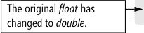

下面是第二个示例——这次是 Pascal。假设你正在创建一个工资系统，其中员工姓名最长为 30 个字符。你的用户告诉你，没有人的名字会超过 30 个字符。你会在整个程序中硬编码数字 30 吗？如果你这样做，你对用户的信任就比我对我的用户的信任要高得多！更好的做法是为员工姓名定义一个类型：

```
**Pascal Example of Creating a Type for Employee Names**
```pascal
Type
    employeeName = array[ 1..30 ] of char;
```
```

当涉及字符串或数组时，通常明智的做法是定义一个命名常量来表示字符串或数组的长度，然后在类型定义中使用该命名常量。你会在程序的许多地方使用该常量——这只是你使用它的第一个地方。下面是它的样子：

### Pascal Example of Better Type Creation

```
Const
  NAME_LENGTH = 30;
  ...
Type
  employeeName = array[ 1..NAME_LENGTH ] of char;
```

这里是命名常量的声明。

这里是命名常量的使用位置。

更强大的示例将创建自己的类型与信息隐藏的思想结合起来。在某些情况下，你想要隐藏的信息是关于数据类型的信息。

C++ 中的坐标示例在信息隐藏方面已经走了一半。如果你始终使用 Coordinate 而不是 float 或 double，你就有效地隐藏了数据的类型。在 C++ 中，这就是语言为你提供的全部信息隐藏能力。对于其余部分，你或你代码的后续使用者必须有纪律地不去查找 Coordinate 的定义。C++ 给你的是比喻上的，而不是字面上的信息隐藏能力。

其他语言，如 Ada，则更进一步，支持字面上的信息隐藏。下面是 Coordinate 代码片段在声明它的 Ada 包中会是什么样子：

### Ada Example of Hiding Details of a Type Inside a Package

```
package Transformation is
  type Coordinate is private;
  ...
```

此语句将 Coordinate 声明为包的私有类型。

下面是 Coordinate 在另一个使用它的包中的样子：

### Ada Example of Using a Type from Another Package

```
with Transformation;
...
procedure Routine1(...) ...
  latitude: Coordinate;
  longitude: Coordinate;
begin
  -- statements using latitude and longitude
...
end Routine1;
```

请注意，*Coordinate* 类型在包规范中被声明为 *private*。这意味着程序中唯一知道 *Coordinate* 类型定义的部分是 *Transformation* 包的私有部分。在一个由一组程序员组成的开发环境中，你可以只分发包规范，这会使在另一个包上工作的程序员更难查找 *Coordinate* 的底层类型。信息将被字面地隐藏。像 C++ 这样要求你在头文件中分发 *Coordinate* 定义的语言会破坏真正的信息隐藏。

这些示例说明了创建自己的类型的几个原因：

- **To make modifications easier**  创建新类型的工作量很小，但能给你很大的灵活性。
- **To avoid excessive information distribution**  硬编码类型会将数据类型细节分散到程序各处，而不是集中在一个地方。这是第 6.2 节中讨论的信息隐藏原则集中化的一个例子。
- **To increase reliability**  在 Ada 中，你可以定义诸如 *type Age is range 0..99* 之类的类型。编译器随后会生成运行时检查，以验证任何 Age 类型的变量始终在 0..99 范围内。
- **To make up for language weaknesses**  如果你的语言没有你想要的预定义类型，你可以自己创建它。例如，C 没有布尔或逻辑类型。这种缺陷很容易通过自己创建类型来弥补：
  
  ```c
  typedef int Boolean;
  ```

### Why Are the Examples of Creating Your Own Types in Pascal and Ada?

Pascal 和 Ada 已经走上了剑龙的道路，并且通常取代它们的语言更易用。然而，在简单类型定义方面，我认为 C++、Java 和 Visual Basic 代表了三步前进、一步后退的情况。像

```
currentTemperature: INTEGER range 0..212;
```

这样的 Ada 声明包含重要的语义信息，而像

```
int temperature;
```

这样的语句则没有。再进一步，类型声明

```
type Temperature is range 0..212;
...
currentTemperature: Temperature;
```

允许编译器确保 *currentTemperature* 仅分配给具有 *Temperature* 类型的其他变量，并且提供这种额外安全边际所需的额外编码非常少。

当然，程序员可以创建一个 *Temperature* 类来强制执行 Ada 语言自动强制执行的相同语义，但从一行代码创建简单数据类型到创建类的步骤是一个很大的跨越。在许多情况下，程序员会创建简单类型，但不会付出额外努力去创建类。

### Guidelines for Creating Your Own Types

> **Cross-Reference** 在每种情况下，考虑是否创建类可能比简单数据类型更好。详情请参阅第 6 章“Working Classes。”

在创建自己的“用户定义”类型时，请牢记以下准则：

***Create types with functionally oriented names***  避免类型名称引用类型底层计算机数据的种类。使用引用新类型所代表的现实世界问题部分的类型的名称。在之前的示例中，定义创建了坐标和名称的良好命名类型——现实世界的实体。同样，你可以为货币、付款代码、年龄等创建类型——现实世界问题的方面。

要警惕创建引用预定义类型的类型名称。像 *BigInteger* 或 *LongString* 这样的类型名称引用计算机数据而不是现实世界问题。创建自己的类型的主要优势在于它在你的程序和实现语言之间提供了一层绝缘。引用底层编程语言类型的类型名称会在该绝缘层上打孔。它们与使用预定义类型相比没有多大优势。而面向问题的名称则为你带来易于修改和自文档化的数据声明。

***Avoid predefined types***  如果类型可能发生变化，请避免在 *typedef* 或类型定义之外使用预定义类型。创建面向功能的新的类型很容易，而在程序中使用硬连线类型更改数据则很困难。此外，使用面向功能的类型的声明部分地记录了用它们声明的变量。像 *Coordinate x* 这样的声明比像 *float x* 这样的声明告诉你更多关于 x 的信息。尽可能多地使用自己的类型。

***Don’t redefine a predefined type***  更改标准类型的定义会造成混淆。例如，如果你的语言有一个预定义类型 *Integer*，不要创建自己的类型也叫 *Integer*。阅读你代码的人可能会忘记你重新定义了该类型，并假设他们看到的 *Integer* 是他们习惯看到的 *Integer*。

***Define substitute types for portability***  与你不应该更改标准类型定义的建议相反，你可能希望为标准类型定义替代类型，以便在不同的硬件平台上使变量表示完全相同的实体。例如，你可以定义一个类型 *INT32* 并使用它


与其使用 int，不如使用 INT，或使用类型 LONG64 而非 long。最初，这两种类型之间的唯一区别就是大小写。但是当你将程序迁移到新的硬件平台时，你可以重新定义大写版本的类型，使其能够匹配原始硬件上的数据类型。

请确保不要定义容易与预定义类型混淆的类型。可以定义 INT 而不是 INT32，但最好在你定义的类型和语言提供的类型之间建立清晰的区分。

*考虑创建类而不是使用 typedef* 简单的 typedef 可以在很大程度上隐藏变量底层类型的信息。然而，在某些情况下，你可能希望通过创建类来实现额外的灵活性和控制。详情请参见第 6 章“Working Classes。”

cc2e.com/1206

交叉引用 对于适用于一般数据问题而非特定类型数据问题的检查清单，请参见第 10 章“General Issues in Using Variables”第 257 页的检查清单。对于命名变量时需要考虑的事项的检查清单，请参见第 11 章“The Power of Variable Names”第 288 页的检查清单。

## CHECKLIST: Fundamental Data

### Numbers in General

- [ ] 代码是否避免了魔数？
- [ ] 代码是否预见了除零错误？
- [ ] 类型转换是否显而易见？
- [ ] 如果在同一表达式中使用了两种不同类型的变量，该表达式的求值结果是否如你所愿？
- [ ] 代码是否避免了混合类型比较？
- [ ] 程序是否在没有任何警告的情况下编译通过？

### Integers

- [ ] 使用整数除法的表达式是否按预期工作？
- [ ] 整数表达式是否避免了整数溢出问题？

### Floating-Point Numbers

- [ ] 代码是否避免了对大小差异很大的数字进行加法和减法运算？
- [ ] 代码是否系统地防止了舍入误差？
- [ ] 代码是否避免了对浮点数进行相等性比较？

### Characters and Strings

- [ ] 代码是否避免了魔字符和字符串？
- [ ] 字符串引用是否没有出现差一错误？
- [ ] C 代码是否将字符串指针和字符数组区别对待？
- [ ] C 代码是否遵循将字符串声明为长度为 CONSTANT+1 的惯例？
- [ ] C 代码在适当时是否使用字符数组而不是指针？
- [ ] C 代码是否将字符串初始化为 NULL 以避免无限字符串？
- [ ] C 代码是否使用 strncpy() 而不是 strcpy()？以及 strncat() 和 strncmp()？

### Boolean Variables

- [ ] 程序是否使用额外的布尔变量来记录条件测试？
- [ ] 程序是否使用额外的布尔变量来简化条件测试？

### Enumerated Types

- [ ] 程序是否使用枚举类型代替命名常量，以提高可读性、可靠性和可修改性？
- [ ] 当变量的使用无法完全用 true 和 false 捕捉时，程序是否使用枚举类型代替布尔变量？
- [ ] 使用枚举类型的测试是否检查了无效值？
- [ ] 枚举类型的第一个条目是否保留为“invalid”？

### Named Constants

- [ ] 程序是否对数据声明和循环限制使用命名常量而不是魔数？
- [ ] 命名常量是否已一致使用——在某些地方用作命名常量，在其他地方未用作字面量？

### Arrays

- [ ] 所有数组索引是否都在数组的范围内？
- [ ] 数组引用是否没有出现差一错误？
- [ ] 多维数组的所有下标是否顺序正确？
- [ ] 在嵌套循环中，是否使用了正确的变量作为数组下标，避免了循环索引串扰？

### Creating Types

- [ ] 程序是否对可能发生变化的每种数据类型使用不同的类型？
- [ ] 类型名称是否面向类型所代表的现实世界实体，而非面向编程语言类型？
- [ ] 类型名称是否足够描述性以帮助记录数据声明？
- [ ] 你是否避免了重新定义预定义类型？
- [ ] 你是否考虑过创建新类而不是简单地重新定义类型？

### Key Points

- 处理特定数据类型意味着记住每种类型的许多单独规则。利用本章的检查清单确保你已考虑了常见问题。
- 创建自己的类型可以使你的程序更易于修改且更具自文档性，前提是你的语言支持该功能。
- 当你使用 *typedef* 或其等价物创建简单类型时，请考虑是否应该创建新类而不是。

## Chapter 13

## Unusual Data Types

### Contents

- 13.1 Structures: page 319
- 13.2 Pointers: page 323
- 13.3 Global Data: page 335

### Related Topics

- Fundamental data types: Chapter 12
- Defensive programming: Chapter 8
- Unusual control structures: Chapter 17
- Complexity in software development: Section 5.2

一些语言除了第 12 章“Fundamental Data Types”中讨论的数据类型外，还支持奇特的数据类型。第 13.1 节描述了在某些情况下你仍可能使用结构而不是类的情形。第 13.2 节描述了使用指针的利弊。如果你曾经遇到过使用全局数据相关的问题，第 13.3 节解释了如何避免此类困难。如果你认为本章描述的数据类型不是你在现代面向对象编程书籍中通常读到的类型，你是对的。这就是为什么本章名为“Unusual Data Types。”

### 13.1 Structures

术语“structure”指的是由其他类型构建而成的数据。因为数组是特例，它们在第 12 章中单独处理。本节涉及用户创建的结构化数据——C 和 C++ 中的 structs 以及 Microsoft Visual Basic 中的 Structures。在 Java 和 C++ 中，类有时也充当结构的作用（当类完全由公共数据成员组成且没有公共例程时）。

你通常希望创建类而不是结构，以便利用类提供的隐私和功能，而不仅仅是结构支持的公共数据。但有时直接操作数据块是有用的，因此以下是使用结构的一些原因：

#### Use structures to clarify data relationships

结构将相关项目分组捆绑在一起。有时弄清程序的难点在于弄清哪些数据与哪些其他数据相关。这就像去一个小镇问谁和谁有关系。你会发现每个人似乎都和每个人有点关系，但又不是真的，你永远得不到一个好的答案。

如果数据经过精心结构化，弄清什么与什么相关就容易得多。以下是未经过结构化的数据示例：

**Visual Basic Example of Misleading, Unstructured Variables**

```vb
name = inputName
address = inputAddress
phone = inputPhone
title = inputTitle
department = inputDepartment
bonus = inputBonus
```

由于此数据未结构化，看起来所有赋值语句都属于一起。实际上，name、address 和 phone 是与单个员工相关的变量，而 title、department 和 bonus 是与主管相关的变量。代码片段没有提示存在两种类型的数据。在下面的代码片段中，使用结构使关系更清晰：

**Visual Basic Example of More Informative, Structured Variables**

```vb
employee.name = inputName
employee.address = inputAddress
employee.phone = inputPhone

supervisor.title = inputTitle
supervisor.department = inputDepartment
supervisor.bonus = inputBonus
```

在使用结构化变量的代码中，很清楚某些数据与员工相关，其他数据与主管相关。

#### Use structures to simplify operations on blocks of data

你可以将相关元素组合成一个结构并对该结构执行操作。对结构进行操作比对每个元素执行相同操作更容易。它也更可靠，且代码行数更少。

假设你有一组属于一起的数据项——例如人事数据库中关于员工的数据。如果数据未组合成结构，仅仅复制该组数据就可能涉及大量语句。以下是 Visual Basic 中的示例：


## Visual Basic 示例：笨拙地复制一组数据项

```
newName = oldName
newAddress = oldAddress
newPhone = oldPhone
newSsn = oldSsn
newGender = oldGender
newSalary = oldSalary
```

每次你想要传输员工的信息时，你都必须使用这一整组语句。如果你以后添加一个新的员工信息项——例如，numWithholdings——你必须找到所有包含赋值块的地方并添加一个 newNumWithholdings = oldNumWithholdings 的赋值。

想象一下在两个员工之间交换数据会有多糟糕。你不需要想象——这里就是：


## Visual Basic 示例：以困难的方式交换两组数据

```
* swap new and old employee data
previousOldName = oldName
previousOldAddress = oldAddress
previousOldPhone = oldPhone
previousOldSsn = oldSsn
previousOldGender = oldGender
previousOldSalary = oldSalary

oldName = newName
oldAddress = newAddress
oldPhone = newPhone
oldSsn = newSsn
oldGender = newGender
oldSalary = newSalary

newName = previousOldName
newAddress = previousOldAddress
newPhone = previousOldPhone
newSsn = previousOldSsn
newGender = previousOldGender
newSalary = previousOldSalary
```

更简单的方法是声明一个结构化变量：

## Visual Basic 示例：声明结构

```
Structure Employee
    name As String
    address As String
    phone As String
    ssn As String
    gender As String
    salary As Long
```

```
End Structure
Dim newEmployee As Employee
Dim oldEmployee As Employee
Dim previousOldEmployee As Employee
```

现在你可以用三条语句交换旧员工和新员工结构中的所有元素：

```
Visual Basic Example of an Easier Way to Swap Two Groups of Data
previousOldEmployee = oldEmployee
oldEmployee = newEmployee
newEmployee = previousOldEmployee
```

如果你想添加一个 numWithholdings 这样的字段，你只需将其添加到 Structure 声明中。上述三条语句以及程序中任何类似的语句都不需要修改。C++ 和其他语言也有类似的功能。

> Cross-Reference For details on how much data to share between routines, see "Keep Coupling Loose" in Section 5.3.

## 使用结构简化参数列表

你可以通过使用结构化变量来简化例程参数列表。该技术与刚才展示的类似。与其单独传递每个所需元素，你可以将相关元素分组到一个结构中，并将整个 enchilada 作为一个组结构传递。以下是没有结构笨拙地传递一组相关参数的示例：

```
Visual Basic Example of a Clumsy Routine Call Without a Structure
HardWayRoutine( name, address, phone, ssn, gender, salary )
```

而这是一个使用包含第一个参数列表元素的结构化变量优雅地调用例程的示例：

```
Visual Basic Example of an Elegant Routine Call with a Structure
EasyWayRoutine( employee )
```

如果你想在第一种调用中添加 numWithholdings，你必须在代码中查找并更改对 HardWayRoutine() 的每次调用。如果你向 Employee 添加一个 numWithholdings 元素，你完全不需要更改 EasyWayRoutine() 的参数。

> Cross-Reference For details on the hazards of passing too much data, see "Keep Coupling Loose" in Section 5.3.

你可以将这种技术推向极端，将程序中的所有变量放入一个大而多汁的变量中，然后到处传递它。谨慎的程序员避免将数据捆绑超过逻辑上必要的程度。此外，谨慎的程序员避免在只需要结构中的一两个字段时将结构作为参数传递——他们只传递所需的特定字段。这就是信息隐藏的一个方面：某些信息隐藏在例程中，某些信息对例程隐藏。信息是按需传递的。

## 使用结构减少维护

由于你在使用结构时将相关数据分组，因此更改结构需要在整个程序中进行更少的更改。这在与结构更改在逻辑上无关的代码段中尤其如此。由于更改往往会产生错误，更少的更改意味着更少的错误。如果你的 *Employee* 结构有一个 *title* 字段并且你决定删除它，你不需要更改任何使用整个结构的参数列表或赋值语句。当然，你必须更改任何专门处理员工职称的代码，但这在概念上与删除 *title* 字段相关，很难被忽略。

结构化数据的最大优势在于与 *title* 字段在逻辑上没有任何关系的代码段。有时程序中的语句在概念上引用的是一个数据集合而不是单个组件。在这种情况下，单个组件，例如 *title* 字段，只是被引用因为它们是集合的一部分。此类代码段在逻辑上没有理由专门处理 *title* 字段，并且在你更改 *title* 时很容易被忽略。如果你使用结构，忽略此类代码段是可以的，因为代码引用的是相关数据的集合而不是每个组件。

### 13.2 指针


指针的使用是现代编程中最容易出错的领域之一，以至于像 Java、C# 和 Visual Basic 这样的现代语言都不提供指针数据类型。使用指针本质上很复杂，并且正确使用它们需要你对编译器的内存管理方案有极好的理解。许多常见的安全问题，尤其是缓冲区溢出，都可以追溯到指针的错误使用（Howard and LeBlanc 2003）。

即使你的语言不需要你使用指针，对指针的良好理解也会帮助你理解编程语言的工作原理。适量的防御性编程实践会更有帮助。

## 理解指针的范式

从概念上讲，每个指针都由两部分组成：内存中的一个位置以及如何解释该位置内容的知识。

## 内存中的位置

内存中的位置是一个地址，通常以十六进制表示。在 32 位处理器上，地址将是一个 32 位值，例如 0x0001EA40。指针本身仅包含此地址。要使用指针指向的数据，你必须转到该地址并解释该位置内存的内容。如果你查看该位置的内存，它只是一组位。它必须被解释才有意义。

## 如何解释内容的知识

如何解释内存中某个位置内容的知识由指针的基础类型提供。如果一个指针指向一个整数，这实际上意味着编译器将指针给出的内存位置解释为一个整数。当然，你可以有一个整数指针、一个字符串指针和一个浮点指针都指向同一个内存位置。但只有其中一个指针正确地解释了该位置的内容。

在思考指针时，有助于记住内存本身没有固有的解释。只有通过使用特定类型的指针，特定位置的位才被解释为有意义的数据。

图 13-1 显示了同一内存位置的几种视图，以几种不同的方式解释。

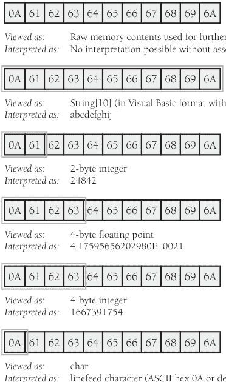

**Figure 13-1**  The amount of memory used by each data type is shown by double lines.

在图 13-1 的每种情况下，指针都指向包含十六进制值 0x0A 的位置。使用的字节数超出 0A 取决于内存如何被解释。内存内容的使用方式也取决于内存如何


## 关于指针的通用技巧

对于许多类型的缺陷，定位错误是最容易的部分，而纠正它则是困难的部分。指针错误不同。指针错误通常是由于指针指向了不应该指向的地方。当你给一个错误的指针变量赋值时，你会将数据写入不应该写入的内存区域。这被称为“内存损坏”。有时内存损坏会产生可怕的、火爆的系统崩溃；有时它会改变程序另一部分计算的结果；有时会导致你的程序不可预测地跳过例程；有时它根本不会做任何事情。在最后一种情况下，指针错误是一个定时炸弹，等待在你向最重要的客户展示程序前五分钟毁掉你的程序。指针错误的症状往往与指针错误的原因无关。因此，纠正指针错误的大部分工作是定位原因。

成功使用指针需要双管齐下的策略。首先，避免一开始就引入指针错误。指针错误如此难以找到，以至于额外的预防措施是合理的。其次，尽可能在编码后尽快检测指针错误。指针错误的症状如此不稳定，以至于需要额外的措施使症状更可预测是合理的。以下是实现这些关键目标的方法：


- **将指针操作隔离在例程或类中** 假设你在程序的多个地方使用了一个链表。与其每次使用时都手动遍历列表，不如编写访问例程，如 `NextLink()`、`PreviousLink()`、`InsertLink()` 和 `DeleteLink()`。通过最大限度地减少访问指针的位置，你最大限度地减少了在程序中犯下粗心错误并花费永远时间寻找的可能性。由于代码与数据实现细节相对独立，你也有更大的机会在其他程序中重用它。编写指针分配的例程是集中控制你的数据的另一种方式。

- **同时声明和定义指针** 在声明变量附近为其分配初始值通常是良好的编程实践，而在处理指针时它更有价值。以下是不该做的示例：


**C++ 坏指针初始化示例**

```cpp
Employee *employeePtr;
// lots of code
...
employeePtr = new Employee;
```

- 2. 将前 4 个字节设置为狗牌值，然后返回指向其后内存的指针。

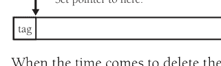

- 3. 当需要删除指针时，检查标签。

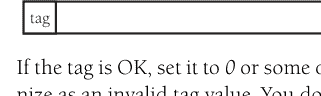

- 4. 如果标签正常，将其设置为 0 或其他你和你的程序识别为无效标签值的值。你不希望该值在内存被释放后被误认为有效标签值。出于同样的原因，将数据设置为 0、0xCC 或其他非随机值。

- 5. 最后，删除指针。

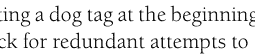

在你分配的内存块开头放置一个狗牌，允许你在无需维护已分配内存块列表的情况下检查对内存块重复释放的尝试。在内存块末尾放置狗牌允许你检查是否覆盖了超出预期使用位置的内存。你可以在块的开头和结尾使用标签来实现这两个目标。

你可以将这种方法与前面建议的合理性检查结合使用——检查指针是否在 StartData 和 EndData 之间。为了确保指针指向合理的位置，而不是检查可能的内存范围，检查指针是否在已分配指针的列表中。

你可以在删除变量前只检查一次标签字段。损坏的标签就会告诉你，在该变量的生命周期中，其内容在某个时间点被损坏了。然而，你检查标签字段的次数越多，就越接近问题的根源检测到损坏。

- **添加显式冗余** 使用标签字段的替代方案是重复使用某些字段。如果冗余字段中的数据不匹配，你就知道内存已被损坏。如果直接操作指针，这可能会导致大量开销。然而，如果你在例程中隔离指针操作，它只会在少数地方增加重复代码。

- **为清晰使用额外的指针变量** 绝对不要吝啬指针变量。其他地方也提到，变量不应用于多个目的。对于指针变量尤其如此。弄清楚某人对链表做了什么已经够难了，还要弄清楚为什么一个通用的 genericLink 变量被反复使用，或者 pointer->next->last->next 指向什么。考虑以下代码片段：

**C++ 传统节点插入代码示例**

```cpp
void InsertLink(
    Node *currentNode,
    Node *insertNode
) {
    // insert "insertNode" after "currentNode"
    insertNode->next = currentNode->next;
    insertNode->previous = currentNode;
    if ( currentNode->next != NULL ) {
        currentNode->next->previous = insertNode;
    }
    currentNode->next = insertNode;
}
```

这一行是不必要地难以理解。

这是插入链表节点的传统代码，理解起来不必要地困难。插入新节点涉及三个对象：当前节点、当前节点之后当前跟随的节点，以及要插入它们之间的节点。代码片段明确承认只有两个对象：insertNode 和 currentNode。它迫使你弄清楚并记住 currentNode->next 也参与其中。如果你试图在不使用当前节点原本跟随的节点的情况下绘制正在发生的事情，你会得到类似这样的结果：

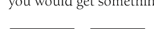

更好的图示会识别所有三个对象。它看起来像这样：


以下是明确引用涉及的三个对象的代码：

**C++ 更易读的节点插入代码示例**

```cpp
void InsertLink(
    Node *startNode,
    Node *newMiddleNode
) {
    // insert "newMiddleNode" between "startNode" and "followingNode"
    Node *followingNode = startNode->next;
    newMiddleNode->next = followingNode;
    newMiddleNode->previous = startNode;
    if ( followingNode != NULL ) {
        followingNode->previous = newMiddleNode;
    }
    startNode->next = newMiddleNode;
}
```

这段代码片段多了一行代码，但没有第一个片段的 `currentNode->next->previous`，更容易跟随。

- **简化复杂的指针表达式** 复杂的指针表达式难以阅读。如果你的代码包含像 p->q->r->s.data 这样的表达式，想想必须阅读该表达式的人。以下是一个特别糟糕的例子：

**C++ 难以理解的指针表达式示例**

```cpp
for ( rateIndex = 0; rateIndex < numRates; rateIndex++ ) {
    netRate[ rateIndex ] = baseRate[ rateIndex ] * rates->discounts->factors->net;
}
```

像本例中指针表达式这样复杂的表达式会导致代码必须被推敲而不是被阅读。如果你的代码包含复杂表达式，将其赋给一个命名良好的变量以阐明操作的意图。以下是改进后的示例版本：

**C++ 简化复杂指针表达式示例**

```cpp
quantityDiscount = rates->discounts->factors->net;
for ( rateIndex = 0; rateIndex < numRates; rateIndex++ ) {
    netRate[ rateIndex ] = baseRate[ rateIndex ] * quantityDiscount;
}
```

通过这种简化，你不仅获得了可读性的提升，而且可能还会在循环内简化指针操作时获得性能提升。像往常一样，你必须在押上任何钱之前测量性能收益。

- **画一张图** 指针的代码描述会变得令人困惑。通常画一张图会有所帮助。例如，链表插入问题的图可能看起来像图 13-2 所示。

**交叉引用** 图 13-2 中的图示可以成为你程序外部文档的一部分。有关良好文档实践的详细信息，请参阅第 32 章“自文档化代码”。

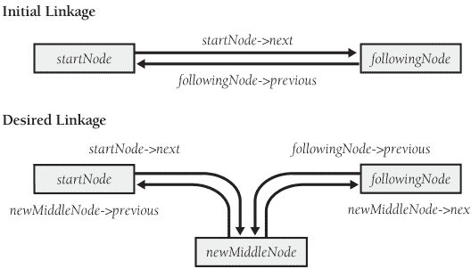

**图 13-2** 一个有助于我们思考重新链接指针所涉及步骤的图片示例。


# 按正确顺序删除链表中的指针

在处理动态分配的链表时常见的一个问题是先释放列表中的第一个指针，然后就无法访问到列表中的下一个指针。为了避免这个问题，请确保在释放当前指针之前，你已经拥有指向列表中下一个元素的指针。

# 分配一块内存储备伞

如果你的程序使用动态内存，你需要避免突然耗尽内存的问题，从而导致你的用户及其数据迷失在 RAM 空间中。给程序提供一个容错余地的一种方法是预先分配一块内存储备伞。确定你的程序需要多少内存来保存工作、清理并优雅退出。在程序开始时分配该量的内存作为储备伞，并保持不动。当你耗尽内存时，释放储备伞，清理并关闭。

进一步阅读 有关在 C 中安全处理指针的优秀讨论，请参阅《Writing Solid Code》（Maguire 1993）。

# 销毁你的垃圾

指针错误很难调试，因为指针指向的内存变得无效的时间点不是确定的。有时在指针被释放很久之后，内存内容看起来仍然有效。其他时候，内存会立即发生变化。

你可以通过在内存块被释放之前用垃圾数据覆盖它们，使与使用已释放指针相关的错误更一致。如同许多其他操作一样，如果你使用访问例程，你可以自动执行此操作。在 C++ 中，每次你删除一个指针时，你可以使用如下代码：

### C++ 示例：强制已释放内存包含垃圾数据

```
memset( pointer, GARBAGE_DATA, MemoryBlockSize( pointer ) );
delete pointer;
```

当然，这种技术要求你维护一个指针大小的列表，可以通过 MemoryBlockSize() 例程检索，我将在后面讨论。

# 删除或释放指针后将其设为 null

一种常见的指针错误是“悬空指针”，即使用已被 delete 或 free 的指针。指针错误难以检测的一个原因是，有时错误不会产生任何症状。通过在释放指针后将其设为 null，你并不会改变可以读取悬空指针指向的数据这一事实。但你确实确保了向悬空指针写入数据会产生错误。它可能会是一个丑陋、讨厌、灾难性的错误，但至少你会发现它，而不是别人发现它。

前一个示例中 delete 操作之前的代码也可以增强以处理此问题：

### C++ 示例：删除指针后将其设为 Null

```
memset( pointer, GARBAGE_DATA, MemoryBlockSize( pointer ) );
delete pointer;
pointer = NULL;
```

### 在删除变量之前检查坏指针

将指针 `delete()` 或 `free()` 后再次 `delete` 或 `free` 是毁掉一个程序的最佳方法之一。不幸的是，很少有语言能检测这种问题。

将已释放的指针设为 null 也允许你在再次使用或尝试删除它之前检查指针是否设为 null；如果你不将已释放的指针设为 null，你就不会有这个选项。这提示了对指针删除代码的另一个补充：

```
### C++ 示例：在删除前断言指针不为 Null

```cpp
ASSERT( pointer != NULL, "Attempting to delete null pointer." );
memset( pointer, GARBAGE_DATA, MemoryBlockSize( pointer ) );
delete pointer;
pointer = NULL;
```
```

### 跟踪指针分配

保留你已分配的指针的列表。这允许你在处置指针之前检查指针是否在列表中。以下是标准指针删除代码如何修改以包含该功能的示例：

```
### C++ 示例：检查指针是否已被分配

```cpp
ASSERT( pointer != NULL, "Attempting to delete null pointer." );
if ( IsPointerInList( pointer ) ) {
    memset( pointer, GARBAGE_DATA, MemoryBlockSize( pointer ) );
    RemovePointerFromList( pointer );
    delete pointer;
    pointer = NULL;
}
else {
    ASSERT( FALSE, "Attempting to delete unallocated pointer." );
}
```
```

### 编写覆盖例程以集中你的避免指针问题的策略

正如这个示例所示，每次指针被 `new` 或 `delete` 时，你可能会产生相当多的额外代码。本节中描述的一些技术是互斥的或冗余的，你不希望在同一个代码库中使用多个冲突的策略。例如，如果你维护自己的有效指针列表，就不需要创建和检查狗牌值。

通过为常见的指针操作创建覆盖例程，你可以最大限度地减少编程开销并降低错误发生的几率。在 C++ 中，你可以使用这两个例程：

- **SAFE_NEW** 此例程调用 `new` 分配指针，将新指针添加到已分配指针列表中，并将新分配的指针返回给调用例程。它还可以在此处仅检查一次 `new` 的空返回（即“内存不足”错误），这简化了程序其他部分中的错误处理。

SAFE_DELETE 此例程检查传递给它的指针是否在已分配指针列表中。如果在列表中，它会将指针指向的内存设为垃圾值，从列表中移除指针，调用 C++ 的 delete 操作符释放指针，并将指针设为 null。如果指针不在列表中，SAFE_DELETE 会显示诊断消息并停止程序。

以宏形式实现，SAFE_DELETE 例程如下所示：

```
### C++ 示例：为指针删除代码添加包装器
#define SAFE_DELETE( pointer ) { \
    ASSERT( pointer != NULL, "Attempting to delete null pointer."); \
    if ( IsPointerInList( pointer ) ) { \
        memset( pointer, GARBAGE_DATA, MemoryBlockSize( pointer ) ); \
        RemovePointerFromList( pointer ); \
        delete pointer; \
        pointer = NULL; \
    } \
    else { \
        ASSERT( FALSE, "Attempting to delete unallocated pointer." ); \
    } \
}
```

交叉引用 有关规划移除用于调试的代码的详细信息，请参阅第 8.6 节中的“Plan to Remove Debugging Aids”。

在 C++ 中，此例程会删除单个指针，但你也需要实现一个类似的 SAFE_DELETE_ARRAY 例程来删除数组。

通过将内存处理集中在这两个例程中，你还可以使 SAFE_NEW 和 SAFE_DELETE 在调试模式与生产模式下表现不同。例如，当 SAFE_DELETE 在开发期间检测到尝试释放空指针时，它可能会停止程序，但在生产期间它可能只是记录错误并继续处理。

你可以轻松地将此方案改编为 C 中的 calloc 和 free 以及使用指针的其他语言。

# 使用非指针技术

指针比平均水平更难理解，它们容易出错，并且往往需要机器相关、不可移植的代码。如果你能想到一种合理可行的指针替代方案，节省一些麻烦并改用它。

# C++-Pointer Pointers

进一步阅读 有关在 C++ 中使用指针的更多提示，请参阅《Effective C++，第 2 版》（Meyers 1998）和《More Effective C++》（Meyers 1996）。

C++ 引入了一些与使用指针和引用相关的特定问题。以下小节描述了适用于 C++ 中使用指针的准则：

### 理解指针和引用的区别

在 C++ 中，指针 (*) 和引用 (&) 都间接引用一个对象。对不熟悉的人来说，唯一的区别似乎是纯粹的装饰性区别，即字段的引用方式为

*object->field vs. object.field.* 最显著的区别是，引用必须始终引用一个对象，而指针可以指向 null，并且引用所引用的内容在引用初始化后不能更改。

### 对“传引用”参数使用指针，对“传值”参数使用 const 引用

C++ 默认按值而非按引用传递参数给例程。当你按值将对象传递给例程时，C++ 会创建对象的副本，并在对象传回调用例程时再次创建副本。对于大型对象，这种复制会消耗时间和资源。因此，在将对象传递给例程时，你通常希望避免复制对象，这意味着你希望按引用而非按值传递它。

有时，你希望具有 *传引用* 的 *语义* —— 即传递的对象不应被修改 —— 同时具有 *传值* 的 *实现* —— 即传递实际对象而非副本。

在 C++ 中，对此问题的解决方法是使用指针进行传引用，而——术语可能听起来很奇怪——对传值使用“*const* 引用”！这里有一个示例：

```
### C++ 示例：按引用和按值传递参数
void SomeRoutine(
    const LARGE_OBJECT &nonmodifiableObject,
    LARGE_OBJECT *modifiableObject
);
```

这种方法还提供了额外的好处，即在被调用例程内提供语法区分，以区分应视为可修改的对象和不应修改的对象。在可修改对象中，对成员的引用将使用 *object->member* 记法，而对于不可修改对象，对成员的引用将使用 *object.member* 记法。

这种方法的局限性在于传播 *const* 引用的困难。如果你控制自己的代码库，使用 *const*  whenever possible 是良好的纪律（Meyers 1998），你应该能够将按值传递参数声明为 *const* 引用。对于库代码或其他你不控制的代码，使用 *const* 例程参数时会遇到问题。退一步的立场仍然是使用引用作为只读参数但不声明它们为 *const*。采用这种方法，你不会获得编译器检查对例程的不可修改参数的修改尝试的全部好处，但至少你会获得 *object->member* 和 *object.member* 之间的视觉区分。

### 使用 auto_ptrs

如果你还没有养成使用 *auto_ptrs* 的习惯，就养成吧！通过在 *auto_ptr* 超出作用域时自动删除内存，*auto_ptrs* 避免了与常规指针相关的许多内存泄漏问题。在 Scott Meyers 的《More Effective C++》中，第 9 条包含了一个关于 *auto_ptr* 的良好讨论（Meyers 1996）。


*了解智能指针* 智能指针是常规指针或“哑”指针（Meyers 1996）的替代品。它们的操作方式与常规指针类似，但它们提供了对资源管理、复制操作、赋值操作、对象构造和对象销毁的更多控制。所涉及的问题是 C++ 特有的。*More Effective C++*，第 #28 条，包含完整的讨论。

## C 指针指针

以下是一些专门适用于 C 语言的指针使用技巧：

- **使用显式指针类型而不是默认类型** C 允许你使用 *char* 或 *void* 指针来指向任何类型的变量。只要指针指向，语言本身并不关心它指向什么。如果你为指针使用显式类型，编译器就可以警告你指针类型不匹配和不适当的解引用问题。如果不这样做，就不能。只要能做到，就使用特定的指针类型。

  该规则的推论是，在需要进行类型转换时使用显式类型转换。例如，在下面的片段中，很清楚正在分配一个类型为 NODE_PTR 的变量：

  **C 示例：显式类型转换**

  ```c
  NodePtr = (NODE_PTR) calloc( 1, sizeof( NODE ) );
  ```

- **避免类型转换** 避免类型转换与去演艺学校或避免总是扮演“恶人”无关。它与避免将一种类型的变量挤进另一种类型的变量的空间有关。类型转换关闭了编译器检查类型不匹配的能力，因此在你的防御性编程盔甲上造成了一个漏洞。需要大量类型转换的程序可能存在需要重新审视的架构缺陷。如果可能，请重新设计；否则，尽量避免使用类型转换。

- **遵循参数传递的星号规则** 在 C 中，只有在赋值语句中参数前面有星号 (*) 时，才能从例程中传回参数。许多 C 程序员很难判断 C 何时允许将值传回调用例程。只要在为其赋值时参数前面有星号，就很容易记住值会被传回调用例程。无论在声明中堆叠多少个星号，如果你想传回一个值，赋值语句中必须至少有一个星号。例如，在下面的片段中，分配给 *parameter* 的值不会传回调用例程，因为赋值语句没有使用星号：

  **C 示例：参数传递不起作用**

  ```c
  void TryToPassBackAValue( int *parameter ) {
      parameter = SOME_VALUE;
  }
  ```

  在这里，分配给 parameter 的值会被传回，因为 parameter 前面有一个星号：

  **C 示例：参数传递会起作用**

  ```c
  void TryToPassBackAValue( int *parameter ) {
      *parameter = SOME_VALUE;
  }
  ```

- **使用 sizeof() 来确定内存分配中变量的大小** 使用 sizeof() 比在手册中查找大小更容易，而且 sizeof() 对你自己创建的结构也有效，这些结构不在手册中。由于 sizeof() 在编译时计算，因此不会带来性能损失。它是可移植的——在不同环境中重新编译会自动更改 sizeof() 计算的值。而且维护成本很低，因为你可以更改已定义的类型，而分配会随之自动调整。

### 13.3 全局数据

**交叉引用：** 有关全局数据与类数据之间差异的详细信息，请参阅第 5.3 节中的“将类数据误认为全局数据”。

全局变量可在程序的任何位置访问。该术语有时也被随意地用来指代作用域比局部变量更广的变量——例如在类内任何位置都可访问的类变量。但在单个类内可访问并不意味着变量就是全局的。

大多数有经验的程序员都认为使用全局数据比使用局部数据风险更大。大多数有经验的程序员也认为从多个例程访问数据非常有用。


即使全局变量并不总是产生错误，但它们几乎从不是编程的最佳方式。本节的其余部分将充分探讨所涉及的问题。

### 全局数据的常见问题

如果你不加区别地使用全局变量，或者你觉得不能使用它们会受到限制，那么你可能还没有完全领会信息隐藏和模块化的价值。模块化、信息隐藏以及相关的良好设计的类使用可能不是揭示的真理，但它们在使大型程序易于理解和维护方面大有帮助。一旦你领会了这一点，你就会希望编写的例程和类与全局变量和外部世界尽可能少地产生联系。

人们指出了使用全局数据的许多问题，但这些问题归结为少数几个主要问题：

- **对全局数据的无意更改**

  你可能在一个地方更改全局变量的值，却错误地认为它在其他地方保持不变。这种问题被称为“副作用”。例如，在此示例中，theAnswer 是一个全局变量：

  theAnswer is a global variable.

  GetOtherAnswer() changes theAnswer.

  averageAnswer is wrong.

  **Visual Basic 示例：副作用问题**

  ```vb
  theAnswer = GetTheAnswer()
  otherAnswer = GetOtherAnswer()
  averageAnswer = (theAnswer + otherAnswer) / 2
  ```

  你可能认为调用 GetOtherAnswer() 不会改变 theAnswer 的值；如果它改变了，第三行的平均值就会错误。而且，事实上 GetOtherAnswer() 确实改变了 theAnswer 的值，因此程序存在需要修复的错误。

- **全局数据的奇异而令人兴奋的别名问题**

  “别名”是指用两个或多个不同的名称调用同一个变量。当全局变量被传递给例程，然后例程既作为全局变量又作为参数使用它时，就会发生这种情况。以下是使用全局变量的例程：

  

  **Visual Basic 示例：容易出现别名问题的例程**

  ```vb
  Sub WriteGlobal( ByRef inputVar As Integer )
      inputVar = 0
      globalVar = inputVar + 5
      MsgBox( "Input Variable: " & Str( inputVar ) )
      MsgBox( "Global Variable: " & Str( globalVar ) )
  End Sub
  ```

  以下是调用该例程并将全局变量作为参数传递的代码：

  **Visual Basic 示例：使用参数调用例程，从而暴露别名问题**

  ```vb
  WriteGlobal( globalVar )
  ```

  由于 inputVar 初始化为 0，WriteGlobal() 将 5 加到 inputVar 上得到 globalVar，因此你会期望 globalVar 比 inputVar 大 5。但令人惊讶的结果是：

  **Visual Basic 中别名问题的结果**

  ```text
  Input Variable: 5
  Global Variable: 5
  ```

  这里的微妙之处在于 globalVar 和 inputVar 实际上是同一个变量！由于 globalVar 被调用例程传递给 WriteGlobal()，它被两个不同的名称引用或“别名”。因此 MsgBox() 行的效果与预期大不相同：它们两次显示同一个变量，即使它们引用的是两个不同的名称。

- **全局数据的可重入代码问题**

  可以由多个控制线程进入的代码变得越来越常见。多线程代码造成了全局数据不仅在例程之间共享，而且在同一程序的不同副本之间共享的可能性。在这种环境下，你必须确保全局数据即使在多个程序副本同时运行时也保持其含义。这是一个重要问题，你可以通过本节后面建议的技术来避免它。

- **全局数据阻碍代码重用**

  要将一个程序的代码用于另一个程序，你必须能够将其从第一个程序中提取出来并插入第二个程序。理想情况下，你可以取出单个例程或类，插入到另一个程序中，然后继续进行。

  全局数据使情况复杂化。如果你要重用的类读取或写入全局数据，你就不能简单地将其插入新程序。你必须修改新程序或旧类，使它们兼容。如果你走高尚路线，你会修改旧类，使其不使用全局数据。这样做，下次你需要重用该类时就可以毫不费力地插入它。如果你走低路线，你会修改新程序以创建旧类需要使用的全局数据。这就像病毒一样；全局数据不仅影响原始程序，而且还会传播到使用旧程序任何类的新程序中。

- **全局数据的初始化顺序不确定问题**

  在某些语言中，尤其是 C++，不同“翻译单元”（文件）之间数据的初始化顺序未定义。如果一个文件中的全局变量的初始化使用了在另一个文件中初始化的全局变量，那么除非你采取明确步骤确保两个变量按正确顺序初始化，否则第二个变量的值就无法保证。

  Scott Meyers 在 *Effective C++*，第 #47 条（Meyers 1998）中描述了一个解决此问题的变通方法。但该解决方案的棘手程度代表了使用全局数据引入的额外复杂性。

- **全局数据破坏模块化和智力可管理性**

  创建超过几百行代码的程序的本质是管理复杂性。你在智力上管理大型程序的唯一方法就是将其分解成部分，以便一次只思考一部分。模块化是你将程序分解成部分的最强大的工具。

  全局数据破坏了你模块化的能力。如果你使用全局数据，你能一次集中在一个例程上吗？不能。你必须集中在一个例程上以及使用相同全局数据的每个其他例程上。虽然全局数据并不——

  


它虽不至于完全破坏程序的模块化，但会削弱它，这足以成为你为问题寻找更好解决方案的理由。

## 使用全局数据的原因

数据纯粹主义者有时会争辩说，程序员绝不应该使用全局数据，但如果对这个词作广义理解，大多数程序都会使用“全局数据”。数据库中的数据是全局数据，配置文件（如 Windows 注册表）中的数据也是如此。命名常量是全局数据，只是不是全局变量。

只要加以规范使用，全局变量在以下几种情况下是有用的：

- **保留全局值** 有时你会遇到在概念上适用于整个程序的数据。这可能是一个反映程序状态的变量——例如，交互模式与命令行模式，或正常模式与错误恢复模式。也可能是整个程序都需要的信息——例如，程序中每个例程都要使用的数据表。

**交叉引用：** 关于命名常量的更多细节，请参阅第 12.7 节“命名常量”。

- **模拟命名常量** 尽管 C++、Java、Visual Basic 以及大多数现代语言支持命名常量，但有些语言（如 Python、Perl、Awk 和 UNIX shell 脚本）仍然不支持。当你的语言不支持命名常量时，可以用全局变量来代替。例如，你可以用设置为 1 和 0 的全局变量 `TRUE` 和 `FALSE` 来替换字面量值 1 和 0，也可以用 `LINES_PER_PAGE = 66` 来替换每页行数 66。使用这种方法，以后修改代码会更容易，而且代码往往更易读。这种对全局数据的规范使用，是“在语言中编程”与“针对语言编程”之间区别的典型例子，更多讨论见第 34.4 节“针对语言编程，而非在语言中编程”。

- **模拟枚举类型** 在 Python 等不直接支持枚举类型的语言中，你也可以使用全局变量来模拟枚举类型。

- **简化极其常用数据的使用** 有时你会遇到某个变量被大量引用，以至于它出现在你编写的每个例程的参数列表中。与其把它放到每个参数列表中，不如将它设为全局变量。然而，在某个变量看起来处处都被访问的情况下，它实际上很少被如此广泛地访问。通常，它只是被一组有限的例程访问，你可以将这些例程与它们所使用的数据一起封装到一个类中。稍后将详细讨论这一点。

- **消除流浪数据** 有时你将数据传递给某个例程或类，仅仅是为了让它能再传递给另一个例程或类。例如，你可能会有一个在每一个例程中都要用到的错误处理对象。当调用链中间的某个例程不使用该对象时，这个对象就被称为“流浪数据”。使用全局变量可以消除流浪数据。

## 仅在万不得已时使用全局数据

在你诉诸于使用全局数据之前，考虑几种替代方案：

- **一开始将每个变量设为局部变量，只有在确实需要时才设为全局变量** 一开始将所有变量设为各个例程的局部变量。如果发现其他地方也需要它们，在将其设为全局变量之前，先把它们设为私有或受保护的类变量。如果最终发现必须设为全局变量，那就这么做，但必须是在你确定非做不可的时候。如果你一开始就把变量设为全局，你就永远不会把它改为局部；而如果你一开始设为局部，或许永远不需要设为全局。

- **区分全局变量和类变量** 有些变量是真正全局的，因为整个程序都会访问它们。另一些实际上是类变量，只在某一组例程中被大量使用。在大量使用某个类变量的那组例程中，你可以以任何方式访问它。如果类之外的例程需要使用它，请通过访问例程来提供该变量的值。不要像访问全局变量那样直接访问类值——即使你的编程语言允许这样做。这条建议无异于在说：“模块化！模块化！模块化！”

- **使用访问例程** 创建访问例程是绕开全局数据问题的核心方法。下一节将详细讨论。

## 使用访问例程替代全局数据


用全局数据能做的任何事情，用访问例程都能做得更好。使用访问例程是实现抽象数据类型和实现信息隐藏的核心技术。即使你不想使用完整的抽象数据类型，你仍然可以使用访问例程来集中控制你的数据，并保护自己免受变更的影响。

### 访问例程的优点

使用访问例程有多个优点：

- **你可以集中控制数据。** 如果之后你发现了更合适的结构实现，不必在引用该数据的每个地方修改代码。变更不会波及整个程序，而只局限于访问例程内部。

- **你可以确保对该变量的所有引用都受到防护。** 如果你使用诸如此类的语句将元素压入栈中：`stack.array[ stack.top ] = newElement`，很容易忘记检查栈溢出而犯下严重错误。如果你使用访问例程——例如，`PushStack( newElement )`——你可以将栈溢出检查写入 `PushStack()` 例程中。每次调用该例程时，检查都会自动完成，你便无需再为此操心。

> **交叉引用：** 关于设防的更多细节，请参阅第 8.5 节“为你的程序设防，以限制错误造成的损害”。

- **你会自动获得信息隐藏的一般好处。** 访问例程是信息隐藏的一个例子，即使你并不是出于这个原因而设计它们。你可以更改访问例程的内部实现，而不必改变程序的其余部分。访问例程允许你重新装修房屋的内部，却保持外部不变，这样你的朋友仍然认得它。

- **访问例程很容易转换为抽象数据类型。** 访问例程的一个优点是，你可以创建一个抽象层次，而直接使用全局数据时则更难做到。例如，访问例程让你可以编写 `if PageFull()` 这样的代码，而不是编写 `if lineCount > MAX_LINES`。这个小小的改动在代码中记录下了 `if lineCount` 测试的意图。这虽然只是可读性方面的一点点提升，但持续关注此类细节，正是精美软件与草草拼凑代码之间的差别所在。

### 如何使用访问例程

以下是访问例程理论与实践的简要说明：将数据隐藏在一个类中。使用 *static* 关键字或同等机制声明该数据，以确保只存在该数据的一个实例。编写可以查看和修改这些数据的例程。要求类外部的代码使用访问例程，而不是直接操作数据。

例如，如果你有一个描述程序整体状态的全局状态变量 *g_globalStatus*，你可以创建两个访问例程：*globalStatus.Get()* 和 *globalStatus.Set()*，它们各司其职。这两个例程访问隐藏在类中的一个变量，该变量替代了 *g_globalStatus*。程序的其余部分可以通过访问 *globalStatus.Get()* 和 *globalStatus.Set()* 来获得原先全局变量的全部好处。

如果你的语言不支持类，你仍然可以创建访问例程来操作全局数据，但你必须通过编码规范来强制对全局数据的使用加以限制，而不是依赖编程语言内置的强制机制。

以下是一些详细的指导原则，用于在语言没有内置支持的情况下，使用访问例程来隐藏全局变量：

- **要求所有代码通过访问例程访问数据** 一个良好的惯例是，要求所有全局数据以 `g_` 前缀开头，并进一步要求，除了该变量的访问例程之外，任何代码都不得访问带 `g_` 前缀的变量。所有其他代码都通过访问例程访问数据。

- **不要把所有的全局数据都扔进同一个桶里** 如果你把所有全局数据堆成一大堆并为它们编写访问例程，你消除了全局数据的问题，但你会错失信息隐藏和抽象数据类型的一些优点。只要你在编写访问例程，就花点时间思考


关于每个全局变量属于哪个类，然后将数据及其访问例程与该类中的其他数据和例程打包在一起。

-   **使用锁定来控制对全局变量的访问** 与多用户数据库环境中的并发控制类似，锁定要求在全局变量的值被使用或更新之前，必须先“检出”该变量。变量使用完毕后，再“检入”它。在变量被使用（检出）期间，如果程序的其他部分试图检出它，锁定/解锁例程会显示错误消息或触发断言。

    > **交叉参考** 有关规划程序开发版本和生产版本之间差异的详细信息，请参见第8.6节“计划移除调试辅助”和第8.7节“确定在生产代码中保留多少防御式编程”。

    这种锁定描述忽略了许多为完全支持并发而编写代码的微妙之处。因此，像这样的简化锁定方案在开发阶段最为有用。除非该方案经过非常周全的考虑，否则它可能不够可靠，无法投入生产。当程序投入生产时，代码会被修改为采取比显示错误消息更安全、更得体的措施。例如，当检测到程序的多个部分试图锁定同一个全局变量时，它可能会将错误消息记录到文件中。

    当你使用访问例程来处理全局数据时，这种开发期保护措施相当容易实现；但如果你直接使用全局数据，实现起来就会很笨拙。

-   **在访问例程中构建一个抽象层** 访问例程应构建在问题域的层面上，而不是实现细节的层面上。这种方法不仅能提高可读性，还能防止实现细节发生变化。

    比较表13-1中的语句对：

    **表13-1 —— 直接访问全局数据与通过访问例程访问全局数据**

    | 全局数据的直接使用 | 通过访问例程使用全局数据 |
    |---|---|
    | `node = node.next` | `account = NextAccount( account )` |
    | `node = node.next` | `employee = NextEmployee( employee )` |
    | `node = node.next` | `rateLevel = NextRateLevel( rateLevel )` |
    | `event = eventQueue[ queueFront ]` | `event = HighestPriorityEvent()` |
    | `event = eventQueue[ queueBack ]` | `event = LowestPriorityEvent()` |

    在前三个示例中，要点是抽象的访问例程所传达的信息比通用结构多得多。如果直接使用结构，你同时做了太多事情：既展示了结构本身在做的事（移到链表中的下一个链接），也展示了相对于它所代表的实体在做的事（获取账户、下一位员工或费率等级）。这对一个简单的数据结构赋值来说是很大的负担。将信息隐藏在抽象访问例程后面，可以让代码不言自明，使代码在问题域层面阅读，而不是在实现细节层面。

-   **保持对数据的所有访问都处于同一抽象层次** 如果你使用访问例程对一个结构做一件事，那么对结构做的所有其他事也应使用访问例程。如果用访问例程读取结构，也要用访问例程写入。如果调用`InitStack()`初始化栈，调用`PushStack()`把一项压入栈，就创建了一致的数据视图。如果通过编写`value = array[ stack.top ]`弹出栈，就创建了不一致的数据视图。这种不一致会让其他人更难理解代码。应创建`PopStack()`例程，而不是编写`value = array[ stack.top ]`。

    > **交叉参考** 对事件队列使用访问例程意味着需要创建一个类。详细信息请参见第6章“工作类”。

    在表13-1的语句对示例中，两个事件队列操作是并行出现的。向队列中插入事件会比表中这两个操作更棘手，需要多行代码来查找插入事件的位置、调整现有事件为新事件腾出空间，并调整队列的前端或后端。从队列中移除事件也同样复杂。在编码期间，复杂操作会被放入例程，而其他操作会保留为直接数据操作。这会造成一种丑陋的、非并行的结构使用方式。现在比较表13-2中的语句对：

    **表13-2 —— 复杂数据的并行与非并行使用**

    | 复杂数据的非并行使用 | 复杂数据的并行使用 |
    |---|---|
    | `event = EventQueue[ queueFront ]` | `event = HighestPriorityEvent()` |
    | `event = EventQueue[ queueBack ]` | `event = LowestPriorityEvent()` |
    | `AddEvent( event )` | `AddEvent( event )` |
    | `eventCount = eventCount - 1` | `RemoveEvent( event )` |

    尽管你可能认为这些指导原则仅适用于大型程序，但访问例程已经证明了它们是避免全局数据问题的有效方法。额外的好处是，它们使代码更具可读性，并增加了灵活性。

## 如何降低使用全局数据的风险

在大多数情况下，全局数据实际上是某个类的类数据，而这个类尚未被很好地设计或实现。在少数情况下，数据确实需要是全局的，但可以将其访问包装在访问例程中，以尽量减少潜在问题。在极少数剩余情况下，你确实需要使用全局数据。在这些情况下，你可以把遵循本节指导原则想象成打疫苗，以便在国外旅行时能喝水：它们有点痛苦，但能提高保持健康的几率。

> **交叉参考** 关于全局变量命名约定的详细信息，请参见第11.4节“识别全局变量”。

-   **制定一种让全局变量显而易见的命名约定** 只要明确标识你正在使用全局数据，就能避免一些错误。如果你将全局变量用于不止一种目的（例如，既作为变量，又作为命名常量的替代品），请确保你的命名约定能够区分不同类型的用途。

-   **创建一份注释良好的全局变量清单** 一旦命名约定表明某个变量是全局的，进一步指出该变量的作用会很有帮助。全局变量清单是使用你程序的人可以拥有的最有用的工具之一。

-   **不要使用全局变量保存中间结果** 如果需要为全局变量计算新值，应在计算结束时将最终值赋给全局变量，而不是用它保存中间计算结果。

-   **不要把所有数据都放进一个怪物对象中并到处传递，假装自己没有使用全局数据** 把所有东西都放进一个巨大的对象中，虽然避免了全局变量，可能满足了法律条文，但这纯粹是额外开销，不会产生真正封装的任何好处。如果你使用全局数据，就公开地使用。不要试图用臃肿的对象来掩饰它。

## 更多资源

以下是一些涉及非常规数据类型的更多资源：

Maguire, Steve. *编写稳固代码*. Redmond, WA: Microsoft Press, 1993. 第3章出色地讨论了使用指针的危险，并提供了许多避免指针问题的具体技巧。

Meyers, Scott. *高效C++*, 第2版. Reading, MA: Addison-Wesley, 1998; Meyers, Scott. *更高效C++*. Reading, MA: Addison-Wesley, 1996. 正如书名所示，这些书包含了许多改进C++程序的具体技巧，包括安全有效地使用指针的指导原则。*更高效C++*尤其出色地讨论了C++的内存管理问题。

## 检查表：使用非常规数据类型的考虑事项

### 结构体

-   你是否使用了结构体，而不是裸变量，来组织和处理相关数据组？
-   你是否考虑过创建类来替代使用结构体？

### 全局数据

-   除非绝对需要全局变量，否则所有变量是否都是局部变量或类作用域变量？
-   变量命名约定是否区分局部数据、类数据和全局数据？
-   是否所有全局变量都有文档记录？


- [ ] 代码是否没有伪全局数据——包含各种数据的大型对象，这些数据被传递给每个例程？
- [ ] 是否使用访问例程而不是全局数据？
- [ ] 访问例程和数据是否组织在类中？
- [ ] 访问例程是否提供了超出底层数据类型实现的抽象级别？
- [ ] 所有相关的访问例程是否处于同一抽象级别？

## Pointers

- [ ] 指针操作是否被隔离在例程中？
- [ ] 指针引用是否有效，还是指针可能悬空？
- [ ] 代码在使用指针之前是否检查指针的有效性？
- [ ] 在使用指针引用的变量之前，是否检查了该变量的有效性？
- [ ] 指针在被释放后是否被设为 null？
- [ ] 代码是否使用了所有必要的指针变量以提高可读性？
- [ ] 链表中的指针是否按正确的顺序释放？
- [ ] 程序是否分配了备用降落伞内存，以便在内存耗尽时能够优雅地关闭？
- [ ] 指针是否仅在没有其他方法可用时才作为最后手段使用？

## Key Points

- 结构可以帮助使程序更不复杂、更易于理解和维护。
- 每当你考虑使用结构时，请考虑类是否会更好。
- 指针容易出错。通过使用访问例程或类以及防御性编程实践来保护自己。
- 避免全局变量，不仅仅因为它们很危险，而且因为你可以用更好的东西替换它们。
- 如果你无法避免全局变量，就通过访问例程来使用它们。访问例程提供了全局变量所提供的一切，还有更多。

## Part IV: Statements

In this part:

- Chapter 14: Organizing Straight-Line Code .................... 347
- Chapter 15: Using Conditionals ................................... 355
- Chapter 16: Controlling Loops .................................... 367
- Chapter 17: Unusual Control Structures ........................... 391
- Chapter 18: Table-Driven Methods ................................. 411
- Chapter 19: General Control Issues ............................... 431

## Chapter 14: Organizing Straight-Line Code

### Contents

- 14.1 Statements That Must Be in a Specific Order: page 347
- 14.2 Statements Whose Order Doesn’t Matter: page 351

### Related Topics

- General control topics: Chapter 19
- Code with conditionals: Chapter 15
- Code with loops: Chapter 16
- Scope of variables and objects: Section 10.4, “Scope”

This chapter turns from a data-centered view of programming to a statement-centered view. It introduces the simplest kind of control flow: putting statements and blocks of statements in sequential order.

Although organizing straight-line code is a relatively simple task, some organizational subtleties influence code quality, correctness, readability, and maintainability.

### 14.1 Statements That Must Be in a Specific Order

The easiest sequential statements to order are those in which the order counts. Here’s an example:

```
Java Example of Statements in Which Order Counts
data = ReadData();
results = CalculateResultsFromData( data );
PrintResults( results );
```

Unless something mysterious is happening with this code fragment, the statement must be executed in the order shown. The data must be read before the results can be calculated, and the results must be calculated before they can be printed.

The underlying concept in this example is that of dependencies. The third statement depends on the second, the second on the first. In this example, the fact that one statement depends on another is obvious from the routine names. In the following code fragment, the dependencies are less obvious:

```
Java Example of Statements in Which Order Counts, but Not Obviously
revenue.ComputeMonthly();
revenue.ComputeQuarterly();
revenue.ComputeAnnual();
```

In this case, the quarterly revenue calculation assumes that the monthly revenues have already been calculated. A familiarity with accounting—or even common sense—might tell you that quarterly revenues have to be calculated before annual revenues. There is a dependency, but it’s not obvious merely from reading the code. And here, the dependencies aren’t obvious—they’re literally hidden:

```
Visual Basic Example of Statements in Which Order Dependencies Are Hidden
ComputeMarketingExpense
ComputeSalesExpense
ComputeTravelExpense
ComputePersonnelExpense
DisplayExpenseSummary
```

Suppose that ComputeMarketingExpense() initializes the class member variables that all the other routines put their data into. In such a case, it needs to be called before the other routines. How could you know that from reading this code? Because the routine calls don’t have any parameters, you might be able to guess that each of these routines accesses class data. But you can’t know for sure from reading this code.


When statements have dependencies that require you to put them in a certain order, take steps to make the dependencies clear. Here are some simple guidelines for ordering statements:

**Organize code so that dependencies are obvious**

In the Microsoft Visual Basic example just presented, ComputeMarketingExpense() shouldn’t initialize the class member variables. The routine names suggest that ComputeMarketingExpense() is similar to ComputeSalesExpense(), ComputeTravelExpense(), and the other routines except that it works with marketing data rather than with sales data or other data. Having ComputeMarketingExpense() initialize the member variable is an arbitrary practice you should avoid. Why should initialization be done in that routine instead of one of the other two? Unless you can think of a good reason, you should write another routine, InitializeExpenseData(), to initialize the member variable. The routine’s name is a clear indication that it should be called before the other expense routines.

**Name routines so that dependencies are obvious**

In the Visual Basic example, ComputeMarketingExpense() is misnamed because it does more than compute marketing expenses; it also initializes member data. If you’re opposed to creating an additional routine to initialize the data, at least give ComputeMarketingExpense() a name that describes all the functions it performs. In this case, ComputeMarketingExpenseAndInitializeMemberData() would be an adequate name. You might say it’s a terrible name because it’s so long, but the name describes what the routine does and is not terrible. The routine itself is terrible!

**Cross-Reference:** For details on using routines and their parameters, see Chapter 5, “Design in Construction.”

**Use routine parameters to make dependencies obvious**

Again in the Visual Basic example, since no data is passed between routines, you don’t know whether any of the routines use the same data. By rewriting the code so that data is passed between the routines, you set up a clue that the execution order is important. The new code would look like this:

```
Visual Basic Example of Data That Suggests an Order Dependency
InitializeExpenseData( expenseData )
ComputeMarketingExpense( expenseData )
ComputeSalesExpense( expenseData )
ComputeTravelExpense( expenseData )
ComputePersonnelExpense( expenseData )
DisplayExpenseSummary( expenseData )
```

Because all the routines use expenseData, you have a hint that they might be working on the same data and that the order of the statements might be important.

In this particular example, a better approach might be to convert the routines to functions that take expenseData as inputs and return updated expenseData as outputs, which makes it even clearer that the code includes order dependencies.

```
Visual Basic Example of Data and Routine Calls That Suggest an Order Dependency
expenseData = InitializeExpenseData( expenseData )
expenseData = ComputeMarketingExpense( expenseData )
expenseData = ComputeSalesExpense( expenseData )
expenseData = ComputeTravelExpense( expenseData )
expenseData = ComputePersonnelExpense( expenseData )
DisplayExpenseSummary( expenseData )
```

Data can also indicate that execution order isn’t important, as in this case:

```
Visual Basic Example of Data That Doesn’t Indicate an Order Dependency
ComputeMarketingExpense( marketingData )
ComputeSalesExpense( salesData )
ComputeTravelExpense( travelData )
ComputePersonnelExpense( personnelData )
DisplayExpenseSummary( marketingData, salesData, travelData, personnelData )
```

Since the routines in the first four lines don’t have any data in common, the code implies that the order in which they’re called doesn’t matter. Because the routine in the fifth line uses data from each of the first four routines, you can assume that it needs to be executed after the first four routines.


### 用注释记录不清晰的依赖关系

首先，尽量编写没有顺序依赖的代码。其次，尽量让代码中的依赖关系显而易见。如果你仍然担心某个顺序依赖不够明确，那就把它记录下来。记录不清晰的依赖关系是记录编码假设的一个方面，而这对编写可维护、可修改的代码至关重要。在 Visual Basic 示例中，类似这样的注释会很有帮助：

**Visual Basic 示例：隐藏但通过注释阐明的顺序依赖语句**

```text
' 计算费用数据。以下每个例程都会访问
' 成员数据 expenseData。DisplayExpenseSummary
' 应该最后调用，因为它依赖于其他例程
' 计算出的数据。
InitializeExpenseData
ComputeMarketingExpense
ComputeSalesExpense
ComputeTravelExpense
ComputePersonnelExpense
DisplayExpenseSummary
```

这段代码没有使用让顺序依赖变得显而易见的技术。与其依赖注释，不如依靠这些技术；但如果你在维护严格控制代码，或由于其他原因无法改进代码本身，那么请使用文档来弥补代码的不足。

### 使用断言或错误处理代码检查依赖关系

如果代码足够关键，你可以使用状态变量、错误处理代码或断言来记录关键的顺序依赖关系。例如，在类的构造函数中，你可以将类成员变量 `isExpenseDataInitialized` 初始化为 `false`。然后在 `InitializeExpenseData()` 中，将 `isExpenseDataInitialized` 设置为 `true`。这样，每个依赖 `expenseData` 已初始化的函数都可以在继续对 `expenseData` 执行其他操作之前，检查 `isExpenseDataInitialized` 是否已被设置为 `true`。根据依赖关系的范围大小，你可能还需要诸如 `isMarketingExpenseComputed`、`isSalesExpenseComputed` 之类的变量。

这种技术会引入新的变量、新的初始化代码和新的错误检查代码，而这些都会带来额外的出错可能。应权衡这种技术的优点与其带来的额外复杂性和二次错误概率增大的缺点。

### 14.2 顺序无关的语句

你可能会遇到一些情况，看起来几条语句或几个代码块的顺序完全无关紧要。一条语句并不依赖于另一条语句，在逻辑上也不一定跟在另一条之后。但顺序会影响可读性、性能和可维护性；在没有执行顺序依赖的情况下，你可以使用次要标准来决定语句或代码块的顺序。指导原则是“就近原则”：将相关操作放在一起。

### 让代码从头到尾阅读

一般原则是，让程序可以从上到下阅读，而不是来回跳转。专家们一致认为，从上到下的顺序对可读性的贡献最大。仅仅在运行时让控制流从上到下是不够的。如果阅读你代码的人必须搜索整个程序才能找到所需信息，你就应该重新组织代码。下面是一个例子：

```cpp
C++ 示例：跳来跳去的糟糕代码
MarketingData marketingData;
SalesData salesData;
TravelData travelData;

travelData.ComputeQuarterly();
salesData.ComputeQuarterly();
marketingData.ComputeQuarterly();

salesData.ComputeAnnual();
marketingData.ComputeAnnual();
travelData.ComputeAnnual();

salesData.Print();
travelData.Print();
marketingData.Print();
```

假设你想弄清楚 `marketingData` 是如何计算的。你必须从最后一行开始，追踪所有对 `marketingData` 的引用，一直回溯到第一行。`marketingData` 只在其他少数几个地方被使用，但你必须记住在第一次和最后一次引用之间，`marketingData` 在每个位置是如何被使用的。换句话说，你必须查看并思考这段代码中的每一行，才能弄清楚 `marketingData` 是怎么计算出来的。当然，这个例子比你在真实规模系统中看到的代码要简单得多。下面是同一段代码，但组织得更好：

```cpp
C++ 示例：良好、顺序化、可从上到下阅读的代码
MarketingData marketingData;
marketingData.ComputeQuarterly();
marketingData.ComputeAnnual();
marketingData.Print();

SalesData salesData;
salesData.ComputeQuarterly();
salesData.ComputeAnnual();
salesData.Print();

TravelData travelData;
travelData.ComputeQuarterly();
travelData.ComputeAnnual();
travelData.Print();
```

交叉引用：关于“活跃”变量更技术性的定义，见第 10.4 节“衡量变量的活跃期”。

这段代码在很多方面都更好。对每个对象的引用都靠得很近，也就是“局部化”了。对象处于“活跃”状态的代码行数很少。也许最重要的是，这段代码看起来可以被拆分成分别处理营销、销售和旅行数据的独立例程。而第一段代码片段完全没提示这种分解是可能的。

### 将相关语句分组

交叉引用：如果你遵循伪代码编程过程，你的代码会自动按相关语句分组。有关该过程的详细信息，请参见第 9 章“伪代码编程过程”。

把相关语句放在一起。它们可能因为操作同一份数据、执行相似任务或彼此依赖执行顺序而相关。

测试相关语句是否良好分组的一个简单方法是，打印出你的例程清单，然后在相关语句周围画上方框。如果语句顺序得当，你会得到类似图 14-1 的图形，其中方框不会重叠。

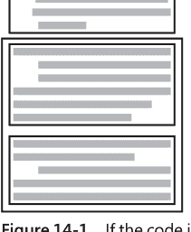

图 14-1 如果代码被良好地组织成分组，围绕相关部分画出的方框不会重叠。它们可能是嵌套的。

交叉引用：关于将变量操作放在一起的更多内容，见第 10.4 节“作用域”。

如果语句顺序不当，你会得到类似图 14-2 的图形，其中方框会重叠。如果你发现方框重叠，请重新组织代码，让相关语句更好地分组。

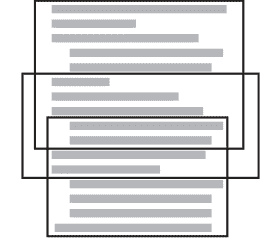

图 14-2 如果代码组织不佳，围绕相关部分画出的方框会重叠。

一旦你将相关语句分组，可能会发现它们彼此紧密相关，但与前后语句没有有意义的关系。在这种情况下，你也许应该将紧密相关的语句重构到它们自己的例程中。

## 检查清单：组织直线代码

- 代码是否让语句之间的依赖关系一目了然？
- 例程的名称是否让依赖关系一目了然？
- 例程的参数是否让依赖关系一目了然？
- 注释是否描述了任何原本不清晰的依赖关系？
- 是否使用了维护变量来检查关键代码段中的顺序依赖？
- 代码是否可以从上到下阅读？
- 相关语句是否分组在一起？
- 相对独立的语句组是否被移入它们自己的例程？

## 要点

- 组织直线代码的最强原则是顺序依赖。
- 应通过良好的例程名称、参数列表、注释以及——如果代码足够关键——维护变量，让依赖关系显而易见。
- 如果代码没有顺序依赖，应让相关语句尽可能靠近。

## 第 15 章 使用条件语句

### 目录

- 15.1 *if* 语句：第 355 页
- 15.2 *case* 语句：第 361 页

### 相关主题

- 驯服深层嵌套：第 19.4 节
- 一般控制问题：第 19 章
- 带循环的代码：第 16 章
- 直线代码：第 14 章
- 数据类型与控制结构的关系：第 10.7 节

条件语句是控制其他语句执行的控制语句；其他语句的执行“以”诸如 *if*、*else*、*case* 和 *switch* 等语句为条件。虽然从逻辑上讲，把 *while* 和 *for* 等循环控制也称作条件语句是合理的，但按惯例它们被分开处理。第 16 章“控制循环”将讨论 *while* 和 *for* 语句。

### 15.1 *if* 语句

根据你使用的语言，你可能会用到多种 *if* 语句中的某几种。最简单的是纯 *if* 或 *if-then* 语句。*if-then-else* 稍微复杂一些，而 *if-then-else-if* 链则是最复杂的。

#### 纯 *if-then* 语句

在编写 *if* 语句时，请遵循以下准则：


**先写代码的正常路径，再写异常情况** 编写代码时，要让代码的正常路径清晰可见。确保罕见情况不会掩盖正常执行路径。这对可读性和性能都很重要。

**确保在相等性判断上分支正确** 使用 `>` 而不是 `>=`，或使用 `<` 而不是 `<=`，类似于在访问数组或计算循环索引时出现差一错误。在循环中，要仔细思考端点以避免差一错误；在条件语句中，要仔细思考相等的情况以避免差一错误。


> **交叉参考** 如需了解处理易出错处理代码的其他方法，请参阅第19.4节的“减少深层嵌套技术小结”。

### 将正常情况放在*if*之后，而不是放在*else*之后

把你通常期望处理的情况放在前面。这符合将决策产生的代码尽可能靠近决策本身的一般原则。下面是一个进行了大量错误处理、沿途随意检查错误的代码示例：

**Visual Basic 示例：随意处理大量错误的代码**

```vb
OpenFile( inputFile, status )
If ( status = Status_Error ) Then
    errorType = FileOpenError
Else
    ReadFile( inputFile, fileData, status )
    If ( status = Status_Success ) Then
        SummarizeFileData( fileData, summaryData, status )
        If ( status = Status_Error ) Then
            errorType = ErrorType_DataSummaryError
        Else
            PrintSummary( summaryData )
            SaveSummaryData( summaryData, status )
            If ( status = Status_Error ) Then
                errorType = ErrorType_SummarySaveError
            Else
                UpdateAllAccounts()
                EraseUndoFile()
                errorType = ErrorType_None
            End If
        End If
    Else
        errorType = ErrorType_FileReadError
    End If
End If
```

- 错误情况。
- 正常情况。
- 正常情况。
- 错误情况。
- 正常情况。
- 错误情况。
- 正常情况。

这段代码难以理解，因为正常情况和错误情况都混在一起。很难找到代码通常执行的路径。此外，由于错误条件有时在*if*子句中处理，而不是在*else*子句中处理，因此很难弄清正常情况对应哪个*if*测试。在下面重写的代码中，正常路径始终放在最前面，所有错误情况都放在最后。这样更容易找到并阅读正常情况。

**Visual Basic 示例：系统性地处理大量错误的代码**

```vb
OpenFile( inputFile, status )
If ( status = Status_Success ) Then
    ReadFile( inputFile, fileData, status )
    If ( status = Status_Success ) Then
        SummarizeFileData( fileData, summaryData, status )
        If ( status = Status_Success ) Then
            PrintSummary( summaryData )
            SaveSummaryData( summaryData, status )
            If ( status = Status_Success ) Then
                UpdateAllAccounts()
                EraseUndoFile()
```

- 正常情况。
- 正常情况。
- 正常情况。
- 正常情况。

**考虑*else*子句。** 如果你认为需要一个简单的*if*语句，请考虑是否实际上需要的是*if-then-else*语句。通用汽车公司的一项经典分析发现，50%到80%的*if*语句本应有*else*子句（Elshoff 1976）。

一种选择是编写*else*子句——必要时使用空语句——以表明已经考虑了*else*情况。仅为了表明已考虑该情况而编写空的 else 子句可能有些过头，但至少要把*else*情况考虑进去。当你有一个没有*else*的*if*测试时，除非原因很明显，否则请使用注释解释为什么不需要*else*子句，如下所示：

**Java 示例：有用的带注释的*else*子句**

```java
// if color is valid
if ( COLOR_MIN <= color && color <= COLOR_MAX ) {
    // do something
    ...
}
else {
    // else color is invalid
    // screen not written to --- safely ignore command
}
```

**测试*else*子句的正确性。** 在测试代码时，你可能会认为只需要测试主子句*if*。然而，如果可能的话，一定要测试*else*子句。

**检查*if*和*else*子句是否颠倒。** 在编写*if-then*语句时，一个常见错误是将本应跟在*if*子句后面的代码与本应跟在*else*子句后面的代码互换，或者将*if*测试的逻辑搞反。请检查你的代码是否出现这种常见错误。

### *if-then-else*语句链

在不支持*case*语句——或者仅部分支持*case*语句——的语言中，你常常会发现自己编写一串*if-then-else*测试。例如，对字符进行分类的代码可能会使用这样的链：

> **交叉参考** 有关简化复杂表达式的更多详细信息，请参阅第19.1节“布尔表达式”。

**C++ 示例：使用*if-then-else*链对字符进行分类**

```cpp
if ( inputCharacter < SPACE ) {
    characterType = CharacterType_ControlCharacter;
}
else if (
    inputCharacter == ' ' ||
    inputCharacter == ',' ||
    inputCharacter == '.' ||
    inputCharacter == '!' ||
    inputCharacter == '(' ||
    inputCharacter == ')' ||
```

```cpp
else if ( IsPunctuation( inputCharacter ) ) {
    characterType = CharacterType_Punctuation;
}
else if ( IsDigit( inputCharacter ) ) {
    characterType = CharacterType_Digit;
}
else if ( IsControl( inputCharacter ) ) {
    characterType = CharacterType_ControlCharacter;
}
```

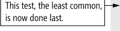

**确保覆盖所有情况。** 编写一个最终的`else`子句，其中包含错误消息或断言，以捕获你未计划到的情况。这个错误消息是给你而不是给用户看的，所以措辞要恰当。以下是如何修改字符分类示例以执行“其他情况”测试：

> **交叉参考** 这也是一个很好的例子，说明如何使用*if-then-else*测试链来代替深层嵌套的代码。有关此技术的详细信息，请参阅第19.4节“控制危险的深层嵌套”。

**C++ 示例：使用默认情况捕获错误**

```cpp
if ( IsLetter( inputCharacter ) ) {
    characterType = CharacterType_Letter;
}
else if ( IsPunctuation( inputCharacter ) ) {
    characterType = CharacterType_Punctuation;
}
else if ( IsDigit( inputCharacter ) ) {
    characterType = CharacterType_Digit;
}
else if ( IsControl( inputCharacter ) ) {
    characterType = CharacterType_ControlCharacter;
}
else {
    DisplayInternalError( "Unexpected type of character detected." );
}
```

**如果你的语言支持其他结构，请用它们替换*if-then-else*链。** 少数语言——例如 Microsoft Visual Basic 和 Ada——提供了`case`语句，支持字符串、枚举和逻辑函数。请使用它们——它们比*if-then-else*链更容易编写，也更容易阅读。使用 Visual Basic 中的`case`语句对字符类型进行分类的代码如下：

**Visual Basic 示例：使用`case`语句代替*if-then-else*链**

```vb
Select Case inputCharacter
    Case "a" To "z"
        characterType = CharacterType_Letter
    Case " ", ",", ".", "!", "(", ")", ":", ";", "?", "-"
        characterType = CharacterType_Punctuation
    Case "0" To "9"
        characterType = CharacterType_Digit
    Case FIRST_CONTROL_CHARACTER To LAST_CONTROL_CHARACTER
        characterType = CharacterType_Control
    Case Else
        DisplayInternalError( "Unexpected type of character detected." )
End Select
```

### 15.2 case 语句

`case`或`switch`语句是一种因语言而异很大的结构。C++和Java仅对一次取一个值的序数类型支持`case`。Visual Basic支持对序数类型使用`case`，并有强大的简写符号来表示范围和值组合。许多脚本语言根本不支持`case`语句。

以下各节介绍有效使用`case`语句的指导原则：

### 选择最有效的 case 排序方式

在`case`语句中组织各种 case 的方式有很多种。如果你有一个小型`case`语句，只有三个选项和三行对应代码，那么使用什么顺序并不重要。如果你有一个很长的`case`语句——例如，在事件驱动程序中处理数十个事件的`case`语句——顺序就很重要了。以下是一些可能的排序方式：

**按字母顺序或数字顺序排列 case。** 如果各个 case 的重要性相同，按 A-B-C 顺序排列可提高可读性。这样，特定的 case 就很容易从一组中挑出来。

**把正常情况放在最前面。** 如果你有一个正常情况和几个例外情况，请把正常情况放在最前面。用注释说明这是正常情况，其他情况不常见。

**按频率排列 case。** 把最常执行的 case 放在最前面，最不常执行的放在最后。这种方法有两个优点。第一，人类读者可以轻松找到最常见的情况。读者浏览列表寻找特定 case 时，很可能对最常见的情况之一感兴趣，把常见情况放在代码顶部可以加快搜索速度。

### 使用 case 语句的技巧

以下是一些使用`case`语句的技巧：

> **交叉参考** 有关简化代码的其他技巧，请参阅第24章“重构”。

**保持每个 case 的操作简单。** 让每个 case 相关的代码简短。每个 case 后面的简短代码有助于使`case`语句的结构清晰。如果某个 case 执行的操作很复杂，就编写一个例程并从 case 中调用该例程，而不是把代码直接放入 case 中。

**不要为了使用`case`语句而编造虚假变量。** `case`语句应用于易于分类的简单数据。如果你的数据不简单，请改用*if-then-else*链。虚假变量会令人困惑，你应该避免使用它们。例如，不要这样做：


## 创建伪 case 变量的 Java 示例——不良实践

```
action = userCommand[ 0 ];
switch ( action ) {
    case "c":
        Copy();
        break;
    case "d":
        DeleteCharacter();
        break;
    case "f":
        Format();
        break;
    case "h":
        Help();
        break;
    default:
        HandleUserInputError( ErrorType.InvalidUserCommand );
}
```

控制 case 语句的变量是 action。在此例中，action 是通过剥离 userCommand 字符串的第一个字符创建的，而该字符串是由用户输入的。

> Cross-Reference 与此建议相反，有时你可以通过将复杂的表达式赋给一个命名良好的布尔变量或函数来提高可读性。详情请参阅第 19.1 节中的“Making Complicated Expressions Simple”。

这段惹麻烦的代码来自错误的一方，并招致问题。一般来说，当你制造一个变量用于 case 语句时，真实数据可能不会按你期望的方式映射到 case 语句。在此示例中，如果用户输入 copy，case 语句会剥离第一个 "c" 并正确调用 Copy() 例程。另一方面，如果用户输入 cement overshoes、clambake 或 cellulite，case 语句也会剥离 "c" 并调用 Copy()。case 语句的 else 子句中对错误命令的测试效果不会很好，因为它只会遗漏错误的第一个字母，而非错误的命令。

与其编造一个伪变量，此代码应使用 if-then-else-if 链来检查整个字符串。代码的良好重写如下所示：

## 使用 if-then-else 而非伪 case 变量的 Java 示例——良好实践

```
if ( UserCommand.equals( COMMAND_STRING_COPY ) ) {
    Copy();
}
else if ( UserCommand.equals( COMMAND_STRING_DELETE ) ) {
    DeleteCharacter();
}
else if ( UserCommand.equals( COMMAND_STRING_FORMAT ) ) {
    Format();
}
else if ( UserCommand.equals( COMMAND_STRING_HELP ) ) {
    Help();
}
...
else {
    HandleUserInputError( ErrorType_InvalidCommandInput );
}
```

## 仅在检测合法默认值时使用 default 子句

你有时可能只剩下一种情况，并决定将其作为 default 子句编码。尽管有时很诱人，但这是愚蠢的。你会失去 case 语句标签提供的自动文档化，并且会失去使用 default 子句检测错误的能力。

此类 case 语句在修改时会崩溃。如果你使用合法的默认值，添加新 case 非常简单——只需添加 case 和对应的代码即可。如果你使用伪默认值，修改会更困难。你必须添加新 case，可能使其成为新的默认值，然后更改之前用作默认值的 case，使其成为合法的 case。最好一开始就使用合法的默认值。

## 使用 default 子句检测错误

如果 case 语句中的 default 子句未用于其他处理且不应该发生，请在其中放置诊断信息：

```
Java Example of Using the Default Case to Detect Errors—Good Practice
switch ( commandShortcutLetter ) {
    case "a":
        PrintAnnualReport();
        break;
    case "p":
        // no action required, but case was considered
        break;
    case "q":
        PrintQuarterlyReport();
        break;
    case "s":
        PrintSummaryReport();
        break;
    default:
        DisplayInternalError( "Internal Error 905: Call customer support." );
}
```

这类信息在调试和生产代码中都很有用。大多数用户更喜欢“内部错误：请联系客户支持”这样的信息，而不是系统崩溃，或更糟糕的是，看起来正确但在用户老板检查时才发现的细微错误结果。

如果 default 子句用于除错误检测之外的其他目的，则意味着每个 case 选择器都是正确的。仔细核对以确保进入 case 语句的每个值都合法。如果发现一些不合法的值，请重写语句，使 default 子句能够检查错误。

## 在 C++ 和 Java 中，避免从 case 语句末尾跌落

C 类语言（C、C++ 和 Java）不会自动跳出每个 case。相反，你必须显式编码每个 case 的结束。如果不编码 case 的结束，程序会跌落到底部并执行下一个 case 的代码。这可能导致一些特别恶劣的编码实践，包括以下可怕的示例：


> Cross-Reference 此代码的格式使其看起来比实际更好。有关如何使用格式使好代码看起来好、坏代码看起来坏的详情，请参阅第 31.3 节中的“Endline Layout”以及第 31 章“Layout and Style”的其余部分。

```
C++ Example of Abusing the case Statement
switch ( InputVar ) {
    case "A": if ( test ) {
        // statement 1
        // statement 2
    case "B":    // statement 3
        // statement 4
        ...
    }
    ...
    break;
    ...
}
```

这种做法很糟糕，因为它混合了控制结构。嵌套的控制结构本就难以理解；重叠的结构几乎不可能理解。对 case 'A' 或 case 'B' 的修改将比脑外科手术更困难，很可能在任何修改生效之前，case 都需要清理。你最好一开始就做对。一般来说，避免从 case 语句末尾跌落是个好主意。

## 在 C++ 中，明确无误地标识 case 语句末尾的跌落

如果你有意编写代码以使 case 末尾跌落，请明确注释发生的位置并解释为何需要这样编码。

```
C++ Example of Documenting Falling Through the End of a case Statement
switch ( errorDocumentationLevel ) {
    case DocumentationLevel_Full:
        DisplayErrorDetails( errorNumber );
        // FALLTHROUGH -- Full documentation also prints summary comments

    case DocumentationLevel_Summary:
        DisplayErrorSummary( errorNumber );
        // FALLTHROUGH -- Summary documentation also prints error number

    case DocumentationLevel_NumberOnly:
        DisplayErrorNumber( errorNumber );
        break;

    default:
        DisplayInternalError( "Internal Error 905: Call customer support." );
}
```

这种技术的使用频率大约与你找到一个宁愿要一辆二手 Pontiac Aztek 也不愿要一辆新 Corvette 的人一样频繁。一般来说，从一个 case 跌落到另一个 case 的代码是修改时出错的诱因，应避免使用。

### CHECKLIST: Using Conditionals

#### *if-then* Statements

- ☐ 代码的标称路径是否清晰？
- ☐ *if-then* 测试是否在相等时正确分支？
- ☐ *else* 子句是否存在且有文档？
- ☐ *else* 子句是否正确？
- ☐ *if* 和 *else* 子句是否使用正确——未颠倒？
- ☐ 正常情况是否跟随 *if* 而非 *else*？

#### *if-then-else-if* Chains

- ☐ 复杂的测试是否封装在布尔函数调用中？
- ☐ 最常见的情况是否先测试？
- ☐ 是否覆盖了所有情况？
- ☐ *if-then-else-if* 链是否是最佳实现——优于 *case* 语句？

#### *case* Statements

- ☐ case 是否按有意义的顺序排列？
- ☐ 每个 case 的操作是否简单——必要时调用其他例程？
- ☐ *case* 语句是否测试真实变量，而非专门为使用和滥用 *case* 语句而编造的伪变量？
- ☐ default 子句的使用是否合法？
- ☐ default 子句是否用于检测和报告意外情况？
- ☐ 在 C、C++ 或 Java 中，每个 case 的末尾是否有 *break*？


## 关键要点

- 对于简单的 *if-else* 语句，要注意 *if* 和 *else* 子句的顺序，尤其是当它们处理大量错误时。确保正常情况清晰明了。
- 对于 *if-then-else* 链和 *case* 语句，选择一种能最大程度提高可读性的顺序。
- 为了捕获错误，请在 *case* 语句中使用默认子句，或在 *if-then-else* 链中使用最后一个 *else*。
- 并非所有控制结构都一样。请为每一段代码选择最合适的控制结构。

## 第16章

## 控制循环

### 目录

- 16.1 选择循环种类：第367页
- 16.2 控制循环：第373页
- 16.3 由内而外轻松创建循环：第385页
- 16.4 循环与数组的对应关系：第387页

### 相关主题

- 驯服深层嵌套：第19.4节
- 一般控制问题：第19章
- 带有条件语句的代码：第15章
- 直线代码：第14章
- 控制结构与数据类型的关系：第10.7节

“循环”是一个非正式术语，指任何一种迭代控制结构——即任何使程序重复执行一块代码的结构。常见的循环类型包括 C++ 和 Java 中的 for、while 和 do-while，以及 Microsoft Visual Basic 中的 For-Next、While-Wend 和 Do-Loop-While。使用循环是编程中最复杂的方面之一；知道如何以及何时使用每种循环是构建高质量软件的决定性因素。

### 16.1 选择循环种类

在大多数语言中，你会用到几种循环：

- 计数循环执行特定次数，例如每个员工执行一次。
- 持续求值循环事先不知道会执行多少次，而是在每次迭代时检查是否已完成。例如，只要还有钱就继续运行，直到用户选择退出，或直到遇到错误。
- 无限循环一旦开始就永远执行下去。你可以在嵌入式系统中找到这种循环，如心脏起搏器、微波炉和定速巡航控制器。
- 迭代器循环对容器类中的每个元素执行一次其操作。

循环种类的首要区别在于灵活性——是执行指定次数，还是在每次迭代时检查是否完成。

循环种类的另一个区别在于完成测试的位置。你可以将测试放在循环的开头、中间或结尾。这一特性决定了循环是否至少执行一次。如果在开头测试，循环体不一定会执行；如果在结尾测试，循环体至少执行一次；如果在中间测试，测试之前的循环部分至少执行一次，但测试之后的循环部分不一定会执行。

灵活性和测试位置决定了作为控制结构应选择哪种循环。表16-1列出了几种语言中的循环种类，并描述了每种循环的灵活性和测试位置。

**表16-1 循环的种类**

| 语言 | 循环种类 | 灵活性 | 测试位置 |
|---|---|---|---|
| Visual Basic | *For-Next* | 固定 | 开头 |
|  | *While-Wend* | 灵活 | 开头 |
|  | *Do-Loop-While* | 灵活 | 开头或结尾 |
|  | *For-Each* | 固定 | 开头 |
| C、C++、C#、Java | *for* | 灵活 | 开头 |
|  | *while* | 灵活 | 开头 |
|  | *do-while* | 灵活 | 结尾 |
|  | *foreach*\* | 固定 | 开头 |

* 仅在 C# 中可用。在撰写本文时，计划在其他语言（包括 Java）中使用。

### 何时使用 *while* 循环

新手程序员有时会认为 *while* 循环是持续求值的，并且只要 *while* 条件变为假，无论循环中正在执行哪条语句，循环都会立即终止（Curtis et al. 1986）。虽然它没有那么灵活，但 *while* 循环仍是一种灵活的循环选择。如果你事先不知道希望循环迭代多少次，请使用 *while* 循环。与某些新手的想法相反，循环出口测试在每次循环中只执行一次，关于 *while* 循环的主要问题是要决定在循环开头还是结尾进行测试。

### 在开头测试的循环

对于在开头测试的循环，你可以在 C++、C#、Java、Visual Basic 和大多数其他语言中使用 while 循环。在其他语言中，你可以模拟 while 循环。

### 在结尾测试的循环

你偶尔会遇到这样的情况：需要一个灵活的循环，但该循环至少需要执行一次。在这种情况下，你可以使用在结尾测试的 while 循环。你可以在 C++、C# 和 Java 中使用 do-while，在 Visual Basic 中使用 Do-Loop-While，也可以在其他语言中模拟结尾测试的循环。

### 何时使用中途退出循环

中途退出循环（loop-with-exit loop）是一种退出条件出现在循环中间，而不是开头或结尾的循环。Visual Basic 明确支持中途退出循环，你可以使用 C++、C 和 Java 中的结构化构造 while 和 break 来模拟它，也可以在其他语言中使用 goto 来模拟。

### 正常的中途退出循环

中途退出循环通常由循环开头、循环体（包括退出条件）和循环结尾组成，如以下 Visual Basic 示例所示：

**Visual Basic 通用的中途退出循环示例**

```
Do
    ...
    If ( some exit condition ) Then Exit Do
    ...
Loop
Statements.
More statements.
```

中途退出循环的典型用途是：当在循环开头或结尾进行测试需要编写“循环半”（loop-and-a-half）代码时使用。下面是一个 C++ 示例，说明了一种有理由使用中途退出循环但实际未使用的情况：

**C++ 重复代码在维护中会崩溃的示例**

```
// Compute scores and ratings.
score = 0;
GetNextRating( &ratingIncrement );
rating = rating + ratingIncrement;
while ( ( score < targetScore ) && ( ratingIncrement != 0 ) ) {
    GetNextScore( &scoreIncrement );
    score = score + scoreIncrement;
    GetNextRating( &ratingIncrement );
    rating = rating + ratingIncrement;
}
```

这些代码行出现在这里...  
...并在此处重复出现。


中途退出循环是一种单入口、单出口的结构化控制构造，也是首选的循环控制方式（Software Productivity Consortium 1989）。事实证明，它比其他种类的循环更易于理解。一项针对学生程序员的研究将这种循环与在开头或结尾退出的循环进行了比较（Soloway, Bonar, and Ehrlich 1983）。当使用中途退出循环时，学生在理解测试中的得分高出 25%，该研究的作者得出结论：与其他循环结构相比，中途退出结构更贴近人们对迭代控制的思考方式。

在实际应用中，中途退出循环尚未被广泛使用。关于它是否是生产代码的良好实践，目前仍无定论。在结论明确之前，中途退出循环是你的程序员工具箱中的一门好技术——只要小心使用即可。

### 异常的中途退出循环

另一种用于避免“循环半”的中途退出循环如下所示：


**C++ 使用 goto 进入循环中间——不良实践示例**

```
goto Start;
while ( expression ) {
    // do something
    ...

Start:

    // do something else
    ...
}
```

乍一看，这似乎与前面的中途退出循环示例类似。它用于这样的模拟场景：// do something 在第一次循环时不需要执行，而 // do something else 需要执行。这是一个单入口、单出口的控制构造：进入循环的唯一方式是通过顶部的 goto，退出循环的唯一方式是通过 while 测试。这种方法有两个问题：一是使用了 goto，二是这种写法很不寻常，容易令人困惑。

在 C++ 中，你可以在不使用 goto 的情况下实现相同的效果，如下例所示。如果你使用的语言不支持 break 命令，你可以用 goto 来模拟一个。

break 之前和之后的代码块已经交换。

**C++ 不使用 goto 重写代码——更佳实践示例**

```
while ( true ) {
    // do something else
    ...
```


```
if ( !( expression ) ) {
    break;
}

// do something
...
}
```

## 何时使用 for 循环

进一步阅读 有关使用 for 循环的更多良好准则，请参阅《编写坚实的代码》（Maguire 1993）。

当你需要一个执行指定次数的循环时，for 循环是一个不错的选择。你可以在 C++、C、Java、Visual Basic 和大多数其他语言中使用 for。

对于不需要内部循环控制的简单活动，使用 for 循环。当循环控制涉及简单的递增或简单的递减时使用它们，例如遍历容器中的元素。for 循环的要点是你在循环顶部设置好它，然后就忘记它。你不需要在循环内部做任何事情来控制它。如果存在需要跳出循环的条件，请改用 while 循环。

同样，不要显式更改 for 循环的索引值来强制其终止。改用 while 循环。for 循环适用于简单用途。大多数复杂的循环任务更适合由 while 循环处理。

## 何时使用 foreach 循环

foreach 循环或其等价形式（C# 中的 foreach，Visual Basic 中的 For-Each，Python 中的 for-in）对于对数组或其他容器的每个成员执行操作非常有用。它的优点是消除了循环维护算术运算，从而消除了循环维护算术运算中出现错误的可能性。以下是这种循环的示例：

```
C# Example of a foreach Loop
int [] fibonacciSequence = new int [] { 0, 1, 1, 2, 3, 5, 8, 13, 21, 34 };
int oddFibonacciNumbers = 0;
int evenFibonacciNumbers = 0;

// count the number of odd and even numbers in a Fibonacci sequence
foreach ( int fibonacciNumber in fibonacciSequence ) {
    if ( fibonacciNumber % 2 == 0 ) {
        evenFibonacciNumbers++;
    }
    else {
        oddFibonacciNumbers++;
    }
}

Console.WriteLine( "Found {0} odd numbers and {1} even numbers.",
    oddFibonacciNumbers, evenFibonacciNumbers );
```

## 使用 while( true ) 实现无限循环

你可能有一个不终止运行的循环——例如，固件中的循环，如心脏起搏器或微波炉。或者你可能有一个仅在响应事件时才终止的循环——“事件循环”。你可以用多种方式编写这种无限循环。用类似 for i = 1 to 99999 的语句伪造无限循环是一个糟糕的选择，因为特定的循环限制模糊了循环的意图——99999 可能是合法值。这种伪无限循环在维护时也可能失效。

while( true ) 惯用法被认为是在 C++、Java、Visual Basic 和其他支持类似结构的语言中编写无限循环的标准方法。一些程序员更喜欢使用 for( ; ; )，这是一种被接受的替代方案。

## 在适当时优先使用 for 循环

for 循环将循环控制代码打包在一个地方，这使得循环易于阅读。当修改软件时，程序员常犯的一个错误是在 while 循环顶部更改循环初始化代码，却忘记更改底部的相关代码。在 for 循环中，所有相关代码都在循环顶部集中在一起，这使得正确的修改更容易。如果可以适当使用 for 循环而不是其他类型的循环，就使用它。

## 不要在 while 循环更合适时使用 for 循环

在 C++、C# 和 Java 中，灵活的 for 循环结构的一个常见滥用是将 while 循环的内容随意塞进 for 循环头部。以下示例展示了 while 循环被塞进 for 循环头部的情况：


### C++ Example of a while Loop Abusively Crammed into a for Loop Header

```
// read all the records from a file
for ( inputFile.MoveToStart(), recordCount = 0; !inputFile.EndOfFile();
    recordCount++ ) {
    inputFile.GetRecord();
}
```

C++ 的 for 循环相对于其他语言中的 for 循环的优势在于它对初始化和终止信息可以使用的类型更灵活。这种灵活性固有的弱点是，你可以将与控制循环无关的语句放入循环头部。

将 for 循环头部保留给循环控制语句——初始化循环、终止循环或使其趋向终止的语句。在刚才显示的示例中，循环体中的 inputFile.GetRecord() 语句使循环趋向终止，但 recordCount 语句不这样做；它们是与控制循环进度无关的维护语句。将 recordCount 语句放入循环头部而将 inputFile.GetRecord() 语句排除在外会产生误导；它造成了 recordCount 控制循环的错误印象。

如果你想在这种情况下使用 for 循环而不是 while 循环，请将循环控制语句放入循环头部，其余全部排除。以下是正确使用循环头部的方法：

```
C++ Example of Logical if Unconventional Use of a for Loop Header
recordCount = 0;
for ( inputFile.MoveToStart(); !inputFile.EndOfFile(); inputFile.GetRecord() ) {
    recordCount++;
}
```

此示例中循环头部的内容都与循环控制相关。inputFile.MoveToStart() 语句初始化循环，!inputFile.EndOfFile() 语句测试循环是否已完成，inputFile.GetRecord() 语句使循环趋向终止。影响 recordCount 的语句不会直接使循环趋向终止，适当地未包含在循环头部。while 循环对于这项工作可能仍然更合适，但至少这段代码逻辑地使用了循环头部。顺便说一下，以下是使用 while 循环时代码的写法：

```
C++ Example of Appropriate Use of a while Loop
// read all the records from a file
inputFile.MoveToStart();
recordCount = 0;
while ( !inputFile.EndOfFile() ) {
    inputFile.GetRecord();
    recordCount++;
}
```

## 处理循环中间部分

以下小节描述了如何处理循环中间部分：

使用 { 和 } 来括起循环中的语句 每次都使用代码大括号。它们在运行时不会花费速度或空间，它们有助于可读性，并且有助于在代码被修改时防止错误。它们是一种良好的防御性编程实践。

避免空循环  在 C++ 和 Java 中，可以创建空循环，即循环所做的工作与检查工作是否完成测试写在同一行。以下是示例：

```
C++ Example of an Empty Loop
while ( ( inputChar = dataFile.GetChar() ) != CharType_Eof ) {
    ;
}
```

在此示例中，循环为空，因为 while 表达式包含两件事：循环的工作——inputChar = dataFile.GetChar()——以及循环是否应终止的测试——inputChar != CharType_Eof。如果重新编码循环，使其所做的工作对读者明显，循环会更清晰：

```
C++ Example of an Empty Loop Converted to an Occupied Loop
do {
    inputChar = dataFile.GetChar();
} while ( inputChar != CharType_Eof );
```

新代码占用三行而不是一行和一个分号，这是合适的，因为它做了三行工作而不是一行和一个分号的工作。

## 将循环维护工作保持在循环的开头或结尾

循环维护工作是像 i = i + 1 或 j++ 这样的表达式，其主要目的不是做循环的工作而是控制循环。在此示例中，维护工作在循环末尾完成：

```
C++ Example of Housekeeping Statements at the End of a Loop
nameCount = 0;
totalLength = 0;
while ( !inputFile.EndOfFile() ) {
    // do the work of the loop
    inputFile >> inputString;
    names[ nameCount ] = inputString;
    ...
    // prepare for next pass through the loop--housekeeping
    nameCount++;
    totalLength = totalLength + inputString.length();
}
```

以下是维护语句。

作为一般规则，你在循环前初始化的变量就是你在循环的维护部分中操作的变量。

## 使每个循环只执行一个功能

仅仅因为一个循环可以同时做两件事，并不足以证明将它们放在一起的理由。循环应像例程一样，每个循环只做一件事并且做好它。如果使用两个循环而不是一个循环似乎效率低下，就将代码写成两个循环，注释说明它们可以为了效率而合并，然后等待基准测试显示程序的该部分存在性能问题后再将两个循环改为一个。

> Cross-Reference For more on optimization, see Chapter 25, "Code-Tuning Strategies," and Chapter 26, "Code-Tuning Techniques."


# 退出循环

以下小节介绍如何处理循环的结束：

**确保循环能够结束** 这是根本。在脑海中模拟循环的执行过程，直到你确信它在所有情况下都能结束。要考虑常规情况、边界情况以及每一种异常情况。

**让循环终止条件显而易见** 如果你使用 `for` 循环，并且不随意改动循环索引，也不使用 `goto` 或 `break` 跳出循环，那么终止条件就会显而易见。同样，如果你使用 `while` 或 `repeat-until` 循环，并把所有控制都放在 `while` 或 `repeat-until` 子句中，终止条件也会一目了然。关键在于把控制放在一个地方。

**不要为了终止循环而乱动 for 循环的循环索引。** 有些程序员会修改 `for` 循环索引的值，让循环提前终止。下面是一个例子：

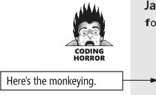

```
Java Example of Monkeying with a Loop Index
for ( int i = 0; i < 100; i++ ) {
    // some code
    ...
    if ( ... ) {
        i = 100;
    }
    // more code
    ...
}
```

这个示例的目的是通过在某种条件下将 `i` 设置为 100 来终止循环，100 大于 `for` 循环范围 0 到 99 的末尾。实际上，所有优秀的程序员都会避免这种做法；这是业余水平的标志。当你建立 `for` 循环时，循环计数器是不可触碰的。改用 `while` 循环可以更好地控制循环的退出条件。

**避免依赖循环索引最终值的代码** 在循环结束后使用循环索引的值是一种不好的写法。循环索引的最终值会因语言和实现的不同而不同。循环正常终止和异常终止时，该值是不同的。即使你碰巧不用思考就知道最终值是多少，下一个阅读代码的人很可能需要思考一下。更好的做法是，在循环内适当的位置将该最终值赋给一个变量，这样代码更具自文档性。

下面的代码误用了索引的最终值：

```
C++ Example of Code That Misuses a Loop Index’s Terminal Value
for ( recordCount = 0; recordCount < MAX_RECORDS; recordCount++ ) {
    if ( entry[ recordCount ] == testValue ) {
        break;
    }
}
// lots of code
...
if ( recordCount < MAX_RECORDS ) {
    return( true );
}
else {
    return( false );
}
```

这就是对循环索引最终值的误用。在这个片段中，第二次测试 recordCount < MaxRecords 使得循环看起来要遍历 entry[] 中的所有值，如果找到等于 testValue 的那个值就返回 `true`，否则返回 `false`。我们很难记住索引是否在循环结束后被递增，因此很容易犯差一错误。最好编写不依赖索引最终值的代码。下面是如何重写这段代码：

```
C++ Example of Code That Doesn’t Misuse a Loop Index’s Terminal Value
found = false;
for ( recordCount = 0; recordCount < MAX_RECORDS; recordCount++ ) {
    if ( entry[ recordCount ] == testValue ) {
        found = true;
        break;
    }
}
// lots of code
...
return( found );
```

第二个代码片段使用了一个额外的变量，并让对 recordCount 的引用更加局部化。与使用额外布尔变量时的常见情况一样，最终的代码更加清晰。

## 考虑使用安全计数器

安全计数器是一个变量，每次循环迭代时递增它，用来判断循环是否执行了太多次。如果程序中某个错误将是灾难性的，你可以使用安全计数器来确保所有循环都能结束。下面这个 C++ 循环就可以很好地使用安全计数器：

```
```cpp
// C++ Example of a Loop That Could Use a Safety Counter
do {
    node = node->Next;
    ...
} while ( node->Next != NULL );
```
```

下面是添加了安全计数器后的相同代码：

```
```cpp
// C++ Example of Using a Safety Counter
safetyCounter = 0;
do {
    node = node->Next;
    ...
    safetyCounter++;
    if ( safetyCounter >= SAFETY_LIMIT ) {
        Assert( false, "Internal Error: Safety-Counter Violation." );
    }
    ...
} while ( node->Next != NULL );
```
```

安全计数器并非万灵药。如果一个个地引入到代码中，安全计数器会增加复杂度，并可能导致额外的错误。由于它们并非用于每个循环，当你修改程序中使用安全计数器的部分中的循环时，可能会忘记维护安全计数器代码。然而，如果安全计数器作为项目范围内的关键循环标准被引入，你就会学会期待它们的存在，安全计数器代码将来产生错误的倾向也不会比任何其他代码更高。

## 提前退出循环

许多语言都提供了一种手段，让循环能够以完成 *for* 或 *while* 条件之外的某种方式终止。在这里的讨论中，*break* 是 C++、C 和 Java 中 *break* 的通用术语；也指 Visual Basic 中的 *Exit-Do* 和 *Exit-For*；还指类似的构造，包括在不直接支持 *break* 的语言中用 goto 模拟的构造。*break* 语句（或等效语句）使循环通过正常退出通道终止；程序从循环后面的第一条语句继续执行。

*continue* 语句与 *break* 类似，因为它也是一个辅助的循环控制语句。不过，*continue* 不会导致循环退出，而是让程序跳过循环体，从循环的下一次迭代开始继续执行。*continue* 语句相当于一个 *if-then* 子句的简写形式，该子句会阻止循环剩余部分的执行。

**考虑在 while 循环中使用 break 语句，而不是布尔标志** 在某些情况下，向 *while* 循环中添加布尔标志来模拟从循环体内退出，会使循环难以阅读。有时，只需使用 *break* 而不是一系列 *if* 测试，就可以减少循环内的几层缩进，并简化循环控制。

> 下面是安全计数器代码。

将多个 *break* 条件放入单独的语句，并把它们放在产生 *break* 的代码附近，可以减少嵌套，使循环更易读。

**警惕循环中散布大量 break** 一个循环中包含大量 *break* 可能表明对循环结构或其在周围代码中的作用思考不清。*break* 过多会增加一种可能性：这个循环可以更清晰地表达为一系列循环，而不是一个具有多个出口的循环。

根据 *Software Engineering Notes* 上的一篇文章，1990 年 1 月 15 日导致纽约市电话系统瘫痪 9 小时的软件错误，是由一个多余的 *break* 语句造成的（SEN 1990）：

这个 *break* 原本是针对 *if* 的，但它却跳出了 *switch*。

```
**C++ Example of Erroneous Use of a *break* Statement Within a *do-switch-if* Block**
```
do {
  ...
  switch
    ...
    if () {
      ...
      break;
      ...
    }
    ...
} while ( ... );
```
```

多个 *break* 不一定表示错误，但它们出现在循环中是一个警告信号，就像煤矿里的金丝雀，本应大声歌唱，却在竭力喘气。

**将 continue 用于循环顶部的测试** *continue* 的一个良好用途是在顶部测试条件后，让执行移过循环体。例如，如果循环读取记录、丢弃一种记录并处理另一种记录，你可以在循环顶部放置一个如下所示的测试：

```
**Pseudocode Example of a Relatively Safe Use of *continue***
```
while ( not eof( file ) ) do
  read( record, file )
  if ( record.Type <> targetType ) then
    continue

  -- process record of targetType
  ...
end while
```
```

以这种方式使用 *continue* 可以避免使用 *if* 测试，因为那样会有效地缩进整个循环体。另一方面，如果 *continue* 出现在循环的中部或末尾，则改用 *if*。


如果你的语言支持带标签的 break 结构，请使用它。Java 支持使用带标签的 break 来避免纽约市电话中断事件中遇到的那类问题。带标签的 break 可用于退出 for 循环、if 语句或任何用花括号括起来的代码块（Arnold, Gosling, and Holmes 2000）。

下面是一个针对纽约市电话代码问题的可能解决方案，这里将编程语言从 C++ 改为 Java，以展示带标签的 break：

**在 do-switch-if 块内更好地使用带标签的 break 语句的 Java 示例**

```java
do {
    ...
    switch
        CALL_CENTER_DOWN:
        if () {
            ...
            break CALL_CENTER_DOWN;
            ...
        }
        ...
} while ( ... );
```

> 带标签的 break 的目标是明确无歧义的。

请谨慎使用 break 和 continue。使用 break 会让循环无法被当作黑盒来处理。只用一个语句来控制循环的退出条件，是简化循环的有力方法。使用 break 会迫使阅读你代码的人查看循环内部来理解循环控制，从而使循环更难理解。

只有在考虑过其他替代方案之后，才应使用 break。你无法确定 continue 和 break 究竟是善还是恶的结构。一些计算机科学家认为它们是结构化编程中的合法技术；另一些则认为不然。由于你通常无法确定 continue 和 break 是对是错，可以使用它们，但要怀着可能犯错的心态。这其实是一个简单的准则：如果你无法为某个 break 或 continue 辩护，那就不要使用它。

## 检查端点

一个单独的循环通常有三个值得关注的情况：第一个情况、任意选定的中间情况，以及最后一个情况。当你创建循环时，要在脑中遍历第一个、中间和最后一个情况，确保循环没有差一错误。如果有任何不同于第一个或最后一个情况的特殊情况，也要检查这些情况。如果循环包含复杂的计算，拿出计算器手动核验这些计算。

Ada 的设计者决定让 for 循环索引在循环外部无效；试图在 for 循环之外使用它会在编译时产生错误。

C++ 和 Java 在某种程度上实现了同样的思想——它们允许在循环内声明循环索引，但并不强制要求。在第 378 页的示例中，recordCount 变量可以声明在 for 语句内部，从而将其作用域限制在 for 循环内，如下所示：

**在 for 循环内声明循环索引变量的 C++ 示例**

```cpp
for ( int recordCount = 0; recordCount < MAX_RECORDS; recordCount++ ) {
    // looping code that uses recordCount
}
```

原则上，这种技术应允许代码在多个循环中重新声明 recordCount，而不会有误用两个不同 recordCount 的风险。这种用法会产生如下所示的代码：

**在 for 循环内声明循环索引并安全重用它们的 C++ 示例——也许吧！**

```cpp
for ( int recordCount = 0; recordCount < MAX_RECORDS; recordCount++ ) {
    // looping code that uses recordCount
}
// intervening code
for ( int recordCount = 0; recordCount < MAX_RECORDS; recordCount++ ) {
    // additional looping code that uses a different recordCount
}
```

这种技术有助于说明 recordCount 变量的用途；但是，不要依赖编译器来强制 recordCount 的作用域。《C++ 程序设计语言》（Stroustrup 1997）第 6.3.3.1 节指出，recordCount 的作用域应限于其所在循环。然而，当我用三种不同的 C++ 编译器检查这一功能时，却得到了三种不同的结果：

- 第一个编译器在第二个 for 循环中标记 recordCount 为多个变量声明，并生成了一个错误。
- 第二个编译器接受了第二个 for 循环中的 recordCount，但允许它在第一个 for 循环之外使用。
- 第三个编译器允许 recordCount 的两种用法，但不允许任一用法在其声明的 for 循环之外使用。

正如许多更晦涩的语言特性通常出现的情况一样，编译器实现可能会有所不同。

## 循环应该多长？

循环长度可以用代码行数或嵌套深度来衡量。以下是一些指导原则：

**让循环短到可以一眼看完** 如果你通常是在显示器上查看循环，而显示器显示 50 行，这就给你加上了 50 行的限制。专家建议循环长度限制在一页以内。然而，当你开始领会编写简单代码的原则时，你很少会写出超过 15 或 20 行的循环。

交叉引用：有关简化嵌套的细节，请参见第 19.4 节“管理危险的深层嵌套”。

**将嵌套限制在三层以内** 研究表明，当嵌套超过三层时，程序员理解循环的能力会显著下降（Yourdon 1986a）。如果你需要超过这个层数，可以通过将循环的一部分拆分为一个例程或简化控制结构，使循环在概念上更短。

**将长循环的内部代码移入例程** 如果循环设计良好，循环内部的代码通常可以移入一个或多个从循环内部调用的例程。

**让长循环特别清晰** 长度会增加复杂性。如果你编写的是短循环，可以使用风险较高的控制结构，例如 *break* 和 *continue*、多个出口、复杂的终止条件等。如果你编写的是较长的循环，并担心读者理解困难，那么应让循环只有一个出口，并让退出条件绝对清晰。

### 16.3 轻松创建循环——从内到外

如果你有时在编写复杂循环时遇到困难——大多数程序员都会如此——你可以使用一种简单的技巧，第一次就把它做对。以下是大致过程。从一个案例开始。用字面量编写该案例。然后缩进它，在其外围放一个循环，再用循环索引或计算表达式替换字面量。如有必要，再在外面放一个循环，并替换更多的字面量。只要有必要，就继续这个过程。完成后，添加所有必要的初始化。由于你从简单案例开始，并向外泛化，你可以把这种方式视为从内到外进行编码。

交叉引用：从内到外编写循环与第 9 章“伪代码编程过程”中描述的过程类似。

假设你正在为一家保险公司编写程序。该公司的人寿保险费率因人的年龄和性别而异。你的任务是编写一个例程，计算一组人的总人寿保险保费。你需要一个循环，从列表中取出每个人的费率并将其加到一个总数上。以下是具体做法。

首先，用注释写出循环体需要执行的步骤。当你不考虑语法、循环索引、数组索引等细节时，更容易写清楚需要做什么。

**步骤 1：从内到外创建循环（伪代码示例）**

```text
-- get rate from table
-- add rate to total
```

其次，在不实际编写整个循环的情况下，尽可能将循环体中的注释转换为代码。在本例中，获取一个人的费率并将其加到总数上。使用具体、明确的数据，而不是抽象概念。

> *table* 尚未有任何索引。

**步骤 2：从内到外创建循环（伪代码示例）**

```text
rate = table[ ]
totalRate = totalRate + rate
```

该示例假设 *table* 是保存费率数据的数组。你暂时不必担心数组索引。*rate* 是保存从费率表中选择的费率数据的变量。同样，*totalRate* 是保存费率总和的变量。

接下来，为 *table* 数组添加索引：

**步骤 3：从内到外创建循环（伪代码示例）**

```text
rate = table[ census.Age ][ census.Gender ]
totalRate = totalRate + rate
```

该数组按年龄和性别访问，因此使用 *census.Age* 和 *census.Gender* 作为数组索引。该示例假设 *census* 是一个结构，其中保存了待计算费率的那组人的信息。

下一步是在现有语句周围构建一个循环。由于该循环应计算组中每个人的费率，因此循环应按人员来索引。

**步骤 4：从内到外创建循环（伪代码示例）**

```text
For person = firstPerson to lastPerson
    rate = table[ census.Age, census.Gender ]
    totalRate = totalRate + rate
End For
```

这里你只需在现有代码外围加上 *for* 循环，然后将现有代码缩进并放入 *begin-end* 对中。最后，检查并确保依赖于 *person* 循环索引的变量已被泛化。在本例中，*census* 变量随 *person* 变化，因此应适当地对其进行泛化。


APL 更简单且不易出错。它仅使用三个操作数，而 Java 片段使用 17 个。它没有循环变量、数组索引或可能编码错误的控制结构。

此示例的一个要点是，你做一些编程来解决问题，还有一些编程来用特定语言解决它。你用来解决问题语言会极大地影响你的解决方案。

## CHECKLIST：循环

## 循环选择和创建
- 是否在适当的情况下使用 `while` 循环而不是 `for` 循环？
- 循环是否从内向外创建？

## 进入循环
- 循环是否从顶部进入？
- 初始化代码是否直接位于循环之前？
- 如果循环是无限循环或事件循环，是否干净地构造，而不是使用 `for i = 1 to 9999` 之类的权宜之计？
- 如果循环是 C++、C 或 Java `for` 循环，循环头是否保留用于循环控制代码？

## 循环内部
- 循环是否使用 `{` 和 `}` 或其等价物来包含循环体并防止因不当修改而产生的问题？
- 循环体中是否有内容？它是否非空？
- 家务处理是否在循环开始或结束时分组？
- 循环是否执行一个且仅一个功能，就像一个定义良好的例程一样？
- 循环是否足够短，可以一次全部查看？
- 循环嵌套是否不超过三层？
- 长的循环内容是否已移入其自己的例程？
- 如果循环很长，是否特别清晰？

## 循环索引
- 如果循环是 for 循环，其内部代码是否避免篡改循环索引？
- 是否使用变量来保存重要的循环索引值，而不是在循环外部使用循环索引？
- 循环索引是序数类型还是枚举类型——而不是浮点数？
- 循环索引是否有有意义的名称？
- 循环是否避免索引串扰？

## 退出循环
- 循环是否在所有可能条件下结束？
- 循环是否使用安全计数器——如果你已制定了安全计数器标准？
- 循环的终止条件是否明显？
- 如果使用 break 或 continue，它们是否正确？

## 关键点
- 循环很复杂。保持它们简单有助于阅读你代码的人。
- 保持循环简单的技术包括避免奇特的循环类型、最小化嵌套、使入口和出口清晰，以及将家务代码放在一个地方。
- 循环索引受到大量滥用。清晰地命名它们，并仅将其用于一个目的。
- 仔细思考循环，以验证它在每种情况下是否正常运行，并在所有可能条件下终止。

## 第 17 章

## 不寻常的控制结构

### 目录
- 17.1 例程的多重返回：页 391
- 17.2 递归：页 393
- 17.3 `goto`：页 398
- 17.4 不寻常控制结构的视角：页 408

### 相关主题
- 通用控制问题：第 19 章
- 直线代码：第 14 章
- 带有条件语句的代码：第 15 章
- 带有循环的代码：第 16 章
- 异常处理：第 8.4 节

一些控制结构存在于一种模糊的黄昏地带，同时处于领先边缘和被否定和证伪的状态——通常同时处于两者！这些结构并非在所有语言中都可用，但在提供它们的语言中，只要谨慎使用就可以有用。

### 17.1 例程的多重返回

大多数语言都支持某种从例程中途退出例程的手段。*return* 和 *exit* 语句是控制结构，使程序能够随时从例程退出。它们导致例程通过正常退出通道终止，将控制权返回给调用例程。这里的 *return* 一词用作 C++ 和 Java 中的 *return*、Microsoft Visual Basic 中的 *Exit Sub* 和 *Exit Function* 以及类似结构的通用术语。以下是使用 *return* 语句的指导原则：


**在提高可读性时使用 return**  在某些例程中，一旦你知道答案，就想立即将其返回给调用例程。如果例程定义为在检测到错误后不需要任何进一步清理，那么不立即返回意味着你必须编写更多代码。

以下是一个在例程中的多个位置返回是合理的良好示例：

此例程返回一个 Comparison 枚举类型。

### C++ 例程多重返回的良好示例

```
Comparison Compare( int value1, int value2 ) {
    if ( value1 < value2 ) {
        return Comparison_LessThan;
    }
    else if ( value1 > value2 ) {
        return Comparison_GreaterThan;
    }
    return Comparison_Equal;
}
```

其他示例就不那么明确了，如下一小节所示。

### 使用 guard clauses（提前返回或退出）简化复杂的错误处理

必须在执行其名义操作之前检查大量错误条件的代码可能导致深度缩进的代码并可能掩盖名义情况，如下所示：

这是名义情况的代码。

### 掩盖名义情况的 Visual Basic 代码

```
If file.validName() Then
    If file.Open() Then
        If encryptionKey.valid() Then
            If file.Decrypt( encryptionKey ) Then
                * lots of code
                ...
            End If
        End If
    End If
End If
```

将例程的主体缩进在四个 if 语句内部在美学上很丑陋，尤其是如果最内层的 if 语句内有大量代码。在这种情况下，如果先检查错误情况，为代码的正常路径扫清道路，代码的流程有时会更清晰。以下是它可能的样子：

### 使用 Guard Clauses 使名义情况更清晰的简单 Visual Basic 代码

```
* set up, bailing out if errors are found
If Not file.validName() Then Exit Sub
If Not file.Open() Then Exit Sub
If Not encryptionKey.valid() Then Exit Sub
If Not file.Decrypt( encryptionKey ) Then Exit Sub

* lots of code
...
```

这种简单代码使这种技术看起来像是一个整洁的解决方案，但生产代码在检测到错误条件时通常需要更广泛的家务处理或清理。以下是更现实的示例：

```
更现实的 Visual Basic 代码，使用 Guard Clauses 使名义情况更清晰
* set up, bailing out if errors are found
If Not file.validName() Then
    errorStatus = FileError_InvalidFileName
    Exit Sub
End If

If Not file.Open() Then
    errorStatus = FileError_CantOpenFile
    Exit Sub
End If

If Not encryptionKey.valid() Then
    errorStatus = FileError_InvalidEncryptionKey
    Exit Sub
End If

If Not file.Decrypt( encryptionKey ) Then
    errorStatus = FileError_CantDecryptFile
    Exit Sub
End If

* lots of code
...
```

这是名义情况的代码。

对于生产规模的代码，Exit Sub 方法在处理名义情况之前会产生大量代码。然而，Exit Sub 方法确实避免了第一个示例中的深度嵌套，而且，如果第一个示例中的代码扩展以显示设置 errorStatus 变量，Exit Sub 方法会更好地将相关语句保持在一起。尘埃落定后，Exit Sub 方法确实更具可读性和可维护性，只是优势并不大。

### 最小化每个例程中的返回次数

当阅读例程底部时，如果你不知道它可能在上方某个位置返回，就更难理解该例程。因此，谨慎使用返回——仅在它们提高可读性时使用。

### 17.2 递归

在递归中，例程自行解决问题的很小一部分，将问题分解为更小的部分，然后调用自身来解决每个较小的部分。当问题的很小部分很容易解决且很大部分很容易分解为更小的部分时，通常会使用递归。

递归并不经常有用，但在谨慎使用时它会产生优雅的解决方案，如在此示例中，排序算法很好地使用了递归：


我注意到您提供的待翻译文本区域中只有 `...` 占位符，并没有实际需要翻译的英文内容。请您补充需要翻译的英文文本，我将严格按照 Markdown 格式要求（粗体、斜体、内联代码、代码块、链接、列表、表格、引用块等）为您进行高质量的中文翻译。


你可以从这个例子中得出三个教训。首先，计算机科学教材用递归的例子并不是在为世界做好事。其次，更重要的是，递归是一个比其在计算阶乘或斐波那契数时令人困惑的使用所暗示的更强大的工具。第三，最重要的是，在使用递归之前，你应该考虑递归的替代方案。你可以用栈和迭代做任何递归能做的事。有时一种方法效果更好；有时另一种方法更好。在选择之前考虑两者。

### 17.3 goto

cc2e.com/1785

你可能会认为关于 goto 的争论已经灭绝了，但快速浏览一下像 SourceForge.net 这样的现代源代码仓库就会显示，goto 仍然活着并且很好，并且深藏在你公司的服务器中。此外，goto 争论的现代等价物仍以各种形式出现，包括关于多重返回、多重循环退出、命名循环退出、错误处理和异常处理的争论。

## 反对 gotos 的论点

反对 goto 的一般论点是，没有 goto 的代码是更高质量的代码。引发最初争议的著名信件是 Edsger Dijkstra 的《Go To Statement Considered Harmful》，发表于 1968 年 3 月的《Communications of the ACM》。Dijkstra 观察到代码的质量与程序员使用的 goto 数量成反比。在随后的工作中，Dijkstra 认为不包含 goto 的代码更容易被证明是正确的。

包含 goto 的代码难以格式化。缩进应用于显示逻辑结构，而 goto 会影响逻辑结构。然而，使用缩进来显示 goto 及其目标的逻辑结构是困难的或不可能的。

使用 goto 会破坏编译器优化。一些优化依赖于程序的控制流位于少数语句内。无条件 goto 使流程更难分析并降低编译器优化代码的能力。因此，即使引入 goto 在源语言级别产生效率，它也可能通过妨碍编译器优化而降低整体效率。

goto 的支持者有时认为它们使代码更快或更小。但包含 goto 的代码很少是最快或最小的。Donald Knuth 的精彩经典文章《Structured Programming with go to Statements》给出了几个使用 goto 会使代码更慢更大情况的例子（Knuth 1974）。

在实践中，使用 goto 导致违反了代码应严格自上而下流动的原则。即使 goto 在谨慎使用时不令人困惑，一旦引入 goto，它们就会像白蚁穿过腐烂的房子一样在代码中蔓延。如果允许任何 goto，坏的就会随好的一起进来，所以最好不要允许任何。

总体而言，Dijkstra 信件发表后的二十年经验表明，生产 *goto*- 充斥的代码是愚蠢的。在文献调查中，Ben Shneiderman 得出结论，证据支持 Dijkstra 的观点，即我们最好不要使用 *goto*（1980 年），许多现代语言，包括 Java，甚至没有 goto。

## 支持 *gotos* 的论点

支持 *goto* 的论点以倡导其在特定情况下的谨慎使用而不是无差别使用为特征。大多数反对 goto 的论点针对的是无差别使用。*goto* 争议在 Fortran 是最流行的语言时爆发。Fortran 没有体面的循环结构，在缺乏关于如何用 goto 编写循环的良好建议的情况下，程序员编写了很多意大利面条代码。这种代码无疑与低质量程序的产生相关，但它与谨慎使用 *goto* 来弥补现代语言能力差距关系不大。

一个放置良好的 *goto* 可以消除重复代码的需要。重复代码会导致如果两组代码被不同地修改就会出现问题。重复代码会增加源文件和可执行文件的大小。在这种情况下，*goto* 的坏影响被重复代码的风险所抵消。

> **交叉引用** 有关在分配资源的代码中使用 *gotos* 的详细信息，请参阅本节中的“Error Processing and gotos”。另请参阅第 8.4 节“Exceptions”中关于异常处理的讨论。

*goto* 在分配资源、对其资源执行操作然后释放资源的例程中很有用。有了 *goto*，你可以在代码的一个部分中进行清理。*goto* 降低了你在检测到错误时忘记在每个地方释放资源的可能性。

在某些情况下，*goto* 可以产生更快更小的代码。Knuth 1974 年的文章引用了几个 *goto* 产生合法收益的案例。

良好的编程并不意味着消除 *gotos*。有条理的分解、细化和控制结构的选取在大多数情况下会自动导致无 *goto* 程序。实现无 *goto* 代码不是目标而是结果，专注于避免 *gotos* 并没有帮助。

> 证据表明，只有故意混乱的控制结构会降低[程序员]的性能。这些实验几乎没有为任何特定的控制流结构化方法的有益效果提供证据。
> 
> —B. A. Sheil

几十年的 *gotos* 研究未能证明其有害性。在文献调查中，B. A. Sheil 得出结论，不切实际的测试条件、糟糕的数据分析和不确定的结果未能支持 Shneiderman 等人关于代码中错误数量与 goto 数量成正比的说法（1981）。Sheil 并没有走得那么远，以至于得出使用 goto 是个好主意——而是说反对它们的实验证据并不确定。

最后，*goto* 已被纳入许多现代语言，包括 Visual Basic、C++ 和 Ada 语言，后者是有史以来最精心设计的编程语言。Ada 是在双方关于 *goto* 争论的论点都已充分发展之后开发的，在考虑了问题的各方面后，Ada 的工程师决定包含 *goto*。

## 虚假的 goto 争论

大多数 goto 讨论的主要特征是对问题的肤浅方法。“gotos 是邪恶的”一方的论者提出一个使用 goto 的琐碎代码片段，然后展示重写该片段而不使用 goto 是多么容易。这主要证明了不用 goto 编写琐碎代码是多么容易。

“我不能没有 gotos”一方的论者通常提出一个消除 goto 会导致额外比较或代码行重复的情况。这主要证明了使用 goto 会导致一次比较更少——在今天的计算机上不是显著的收益。

大多数教科书也没有帮助。它们提供了一个重写某些代码而不使用 goto 的琐碎例子，好像这涵盖了主题。以下是来自此类教科书的琐碎代码的伪装例子：

```
C++ Example of Code That’s Supposed to Be Easy to Rewrite Without gotos

do {
    GetData( inputFile, data );
    if ( eof( inputFile ) ) {
        goto LOOP_EXIT;
    }
    DoSomething( data );
} while ( data != -1 );
LOOP_EXIT:
```

这本书很快用无 goto 的代码替换了这段代码：

```
C++ Example of Supposedly Equivalent Code, Rewritten Without gotos

GetData( inputFile, data );
while ( ( !eof( inputFile ) ) && ( ( data != -1 ) ) ) {
    DoSomething( data );
    GetData( inputFile, data )
}
```

这个所谓的“琐碎”例子包含一个错误。在 data 等于 -1 进入循环的情况下，转换后的代码检测到 -1 并在执行 DoSomething() 之前退出循环。原始代码在检测到 -1 之前执行 DoSomething()。试图展示不用 goto 编程是多么容易的编程书错误地转换了自己的例子。但那本书的作者不应该感到太糟糕；其他书也犯了类似的错误。即使是专业人士也很难转换使用 goto 的代码。

以下是忠实翻译的无 goto 代码：


C++ Example of Truly Equivalent Code, Rewritten Without gotos
do {
    GetData( inputFile, data );
    if ( !eof( inputFile ) ) {
        DoSomething( data );
    }
} while ( ( data != -1 ) && ( !eof( inputFile ) ) );

即使代码翻译正确，示例仍然是虚假的，因为它展示了 goto 的平凡用法。对于有经验的程序员来说，选择 goto 作为首选控制形式的情况并非如此。

到现在这个时间点，再对 goto 的理论争论添加任何有价值的内容都很困难。然而，通常没有涉及的是，程序员在充分了解无 goto 替代方案的情况下，选择使用 goto 来增强可读性和可维护性的情况。

以下各节介绍了某些有经验的程序员主张使用 gotos 的情况。讨论提供了带有 gotos 的代码示例和重写后不使用 gotos 的代码示例，并评估了这两个版本之间的权衡。

## Error Processing and gotos

编写高度交互的代码需要非常注意错误处理，并在发生错误时清理资源。以下代码示例清除一组文件。该例程首先获取要清除的文件组，然后查找每个文件，打开它，重写它并删除它。该例程在每一步都检查错误。

Visual Basic Code with gotos That Processes Errors and Cleans Up Resources
- 此例程清除一组文件。
Sub PurgeFiles( ByRef errorState As Error_Code )
Dim fileIndex As Integer
Dim fileToPurge As Data_File
Dim fileList As File_List
Dim numFilesToPurge As Integer

MakePurgeFileList( fileList, numFilesToPurge )

errorState = FileStatus_Success
fileIndex = 0
While ( fileIndex < numFilesToPurge )
    fileIndex = fileIndex + 1
    If Not ( FindFile( fileList( fileIndex ), fileToPurge ) ) Then
        errorState = FileStatus_FileFindError
        GoTo END_PROC
    End If


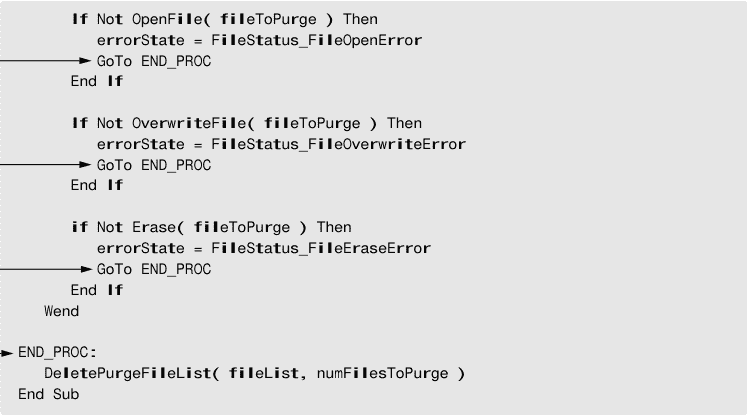

此例程是经验丰富的程序员决定使用 *goto* 的典型情况。当例程需要分配和清理数据库连接、内存或临时文件等资源时，也会出现类似情况。在这些情况下，*gotos* 的替代方案通常是重复代码以清理资源。在这种情况下，程序员可能会权衡 *goto* 的弊端与重复代码维护的麻烦，并决定 *goto* 是较小的恶。

你可以用几种方法重写之前的例程以避免 *gotos*，这两种方法都涉及权衡。可能的重写策略如下：

**Rewrite with nested if statements**  要使用嵌套 if 语句重写，请嵌套 *if* 语句，使每个语句仅在前一个测试成功时执行。这是消除 *gotos* 的标准、教科书式编程方法。下面是使用标准方法重写例程的方法：

> **Cross-Reference** 此例程也可以使用 *break* 且不使用 *gotos* 重写。有关该方法的详细信息，请参阅第 16.2 节中的“Exiting Loops Early”。

### Visual Basic Code That Avoids *gotos* by Using Nested *ifs*

```vb
' This routine purges a group of files.
Sub PurgeFiles( ByRef errorState As Error_Code )
    Dim fileIndex As Integer
    Dim fileToPurge As Data_File
    Dim fileList As File_List
    Dim numFilesToPurge As Integer

    MakePurgeFileList( fileList, numFilesToPurge )

    errorState = FileStatus_Success
    fileIndex = 0
    While ( fileIndex < numFilesToPurge And errorState = FileStatus_Success )

        fileIndex = fileIndex + 1
```

> *While* 测试已更改以添加对 *errorState* 的测试。

```
If FindFile( fileList( fileIndex ), fileToPurge ) Then
    If OpenFile( fileToPurge ) Then
        If OverwriteFile( fileToPurge ) Then
            If Not Erase( fileToPurge ) Then
                errorState = FileStatus_FileEraseError
            End If
        Else ' couldn't overwrite file
            errorState = FileStatus_FileOverwriteError
        End If
    Else ' couldn't open file
        errorState = FileStatus_FileOpenError
    End If
Else ' couldn't find file
    errorState = FileStatus_FileFindError
End If
Wend
DeletePurgeFileList( fileList, numFilesToPurge )
End Sub
```

此行距离调用它的 If 语句有 13 行之遥。

对于习惯于不使用 gotos 编程的人来说，这种代码可能比 goto 版本更容易阅读，如果你使用它，就不必面对 goto goon squad 的审问。

Cross-Reference 有关缩进和其他编码布局问题的更多详细信息，请参阅第 31 章“Layout and Style”。有关嵌套级别的详细信息，请参阅第 19.4 节“Taming Dangerously Deep Nesting。”

这种嵌套 if 方法的主要缺点是嵌套级别很深，非常深。要理解代码，你必须同时在脑海中保留整个嵌套 if 集合。此外，错误处理代码与调用它的代码之间的距离太远：例如，将 errorState 设置为 FileStatus_FileFindError 的代码距离调用它的 if 语句有 13 行。

使用 goto 版本时，没有任何语句距离调用它的条件超过四行。而且你不必同时在脑海中保留整个结构。你基本上可以忽略任何之前成功的条件，而专注于下一个操作。在这种情况下，goto 版本比嵌套 if 版本更具可读性和可维护性。

## Rewrite with a status variable

要使用状态变量重写，也称为状态变量，创建一个指示例程是否处于错误状态的变量。在这种情况下，例程已经使用 errorState 状态变量，因此你可以使用它。

### Visual Basic Code That Avoids gotos by Using a Status Variable

```
* This routine purges a group of files.
Sub PurgeFiles( ByRef errorState As Error_Code )
    Dim fileIndex As Integer
    Dim fileToPurge As Data_File
    Dim fileList As File_List
    Dim numFilesToPurge As Integer

    MakePurgeFileList( fileList, numFilesToPurge )

    errorState = FileStatus_Success
    fileIndex = 0
```

```
```vb
While ( fileIndex < numFilesToPurge ) And ( errorState = FileStatus_Success )

    fileIndex = fileIndex + 1

    If Not FindFile( fileList( fileIndex ), fileToPurge ) Then
        errorState = FileStatus_FileFindError
    End If
    If ( errorState = FileStatus_Success ) Then
        If Not OpenFile( fileToPurge ) Then
            errorState = FileStatus_FileOpenError
        End If
    End If
    If ( errorState = FileStatus_Success ) Then
        If Not OverwriteFile( fileToPurge ) Then
            errorState = FileStatus_FileOverwriteError
        End If
    End If
    If ( errorState = FileStatus_Success ) Then
        If Not Erase( fileToPurge ) Then
            errorState = FileStatus_FileEraseError
        End If
    End If
Wend
DeletePurgeFileList( fileList, numFilesToPurge )
End Sub
```
```

> *While* 测试已更改以添加对 *errorState* 的测试。

> 测试状态变量。

> 测试状态变量。

> 测试状态变量。

状态变量方法的优点是它避免了第一次重写中深深嵌套的 *if-then-else* 结构，因此更容易理解。它还将 *if-then-else* 测试后的操作放置得比嵌套 if 方法更接近测试，并且完全避免了 *else* 子句。

理解嵌套 if 版本需要一些心理体操。状态变量版本更容易理解，因为它紧密模拟了人们思考问题的方式。你找到文件。如果一切正常，你打开文件。如果一切仍然正常，你重写文件。如果一切仍然正常...

这种方法的缺点是使用状态变量并不是应有的常见做法。充分记录其使用情况，否则一些程序员可能不明白你在做什么。在本例中，使用命名良好的枚举类型大大有所帮助。

## Rewrite with try-finally

某些语言，包括 Visual Basic 和 Java，提供 *try-finally* 语句，可用于在错误条件下清理资源。

要使用 *try-finally* 方法重写，请将否则需要检查错误的代码包含在 *try* 块中，并将清理代码放在 *finally* 块中。*try* 块指定异常处理的范围，*finally* 块执行任何资源清理。无论是否抛出异常，无论 *PurgeFiles()* 例程是否捕获任何抛出的异常，*finally* 块始终会被调用。


## goto 和在 else 子句中共享代码

一些程序员会在以下情况下使用 goto：当你有两个条件测试和一个 else 子句，并且想在其中一个条件和 else 子句中执行代码时。这里有一个可能让人想使用 goto 的例子：


```
C++ Example of Sharing Code in an else Clause with a goto
if ( statusOk ) {
    if ( dataAvailable ) {
        importantVariable = x;
        goto MID_LOOP;
    }
}
else {
    importantVariable = GetValue();

MID_LOOP:

// lots of code
...
}
```

这是一个很好的例子，因为它在逻辑上很曲折——按原样几乎不可能阅读，而且在不使用 goto 的情况下很难正确重写它。如果你认为可以轻松地在不使用 goto 的情况下重写它，请让别人审查你的代码！几位专家程序员都错误地重写了它。

你可以以几种方式重写代码。你可以复制代码，将公共代码放入例程中并从两个地方调用它，或重新测试条件。在大多数语言中，重写后的版本会比原版稍大、稍慢，但会非常接近。除非代码在真正热的循环中，否则请在没有 goto 的情况下重写它。Rubin 生成的信件比信件本身更有趣。在五个月的时间里，《Communications of the ACM》（CACM）发表了提供 Rubin 原始七行程序不同版本的信件。这些信件在为 goto 辩护和谴责 goto 之间平均分配。读者提出了大约 17 种不同的重写方法，重写后的代码完全涵盖了避免 goto 的方法谱系。CACM 的编辑指出，这封信引发的回应远远超过了 CACM 页面上考虑过的任何其他问题。

后续信件请参阅

- Communications of the ACM 30, no. 5 (May 1987): 351–55.
- Communications of the ACM 30, no. 6 (June 1987): 475–78.
- Communications of the ACM 30, no. 7 (July 1987): 632–34.
- *Communications of the ACM* 30, no. 8 (August 1987): 659–62.
- *Communications of the ACM* 30, no. 12 (December 1987): 997, 1085.

Clark, R. Lawrence, “A Linguistic Contribution of GOTO-less Programming,” *Datamation*, December 1973. 这篇经典论文幽默地主张用“come from”语句取代“go to”语句。它也被重印在 1974 年 4 月版的 *Communications of the ACM* 中。

## Checklist: Unusual Control Structures

### return

- ☐ 每个例程是否仅在必要时使用 *return*？
- ☐ 返回是否增强了可读性？

### Recursion

- ☐ 递归例程是否包含停止递归的代码？
- ☐ 例程是否使用安全计数器来保证例程停止？
- ☐ 递归是否仅限于一个例程？
- ☐ 例程的递归深度是否在程序栈大小设定的限制范围内？
- ☐ 递归是否是实现该例程的最佳方式？它是否比简单迭代更好？

### goto

- ☐ goto 是否仅作为最后手段使用，并且仅用于使代码更易读和可维护？
- ☐ 如果出于效率原因使用 goto，效率提升是否已测量并记录？
- ☐ goto 是否限制为每个例程一个标签？
- ☐ 所有 goto 是否都向前跳转，而不是向后？
- ☐ 所有 goto 标签是否都被使用？

## Key Points

- 多个 *returns* 可以增强例程的可读性和可维护性，并有助于防止深度嵌套的逻辑。它们仍然应该谨慎使用。
- 递归为一小类问题提供了优雅的解决方案。也请谨慎使用它。
- 在少数情况下，gotos 是编写可读且可维护代码的最佳方式。此类情况很少见。仅在最后手段时使用 gotos。


# 第18章
# 基于表的 方法

## 目录
- 18.1 使用基于表方法时的一般考虑：页 411
- 18.2 直接访问表：页 413
- 18.3 索引访问表：页 425
- 18.4 阶梯式访问表：页 426
- 18.5 其他表查找示例：页 429

## 相关主题
- 信息隐藏：“隐藏秘密（信息隐藏）”在第 5.3 节
- 类设计：第 6 章
- 使用决策表替换复杂逻辑：在第 19.1 节
- 用表查找替换复杂表达式：在第 26.1 节

基于表的方法是一种方案，允许你通过在表中查找信息而不是使用逻辑语句（if 和 case）来计算它。几乎任何你可以用逻辑语句选择的东西，你都可以用表来代替。在简单情况下，逻辑语句更容易、更直接。随着逻辑链变得更复杂，表变得越来越有吸引力。

如果你已经熟悉基于表的方法，本章可能只是复习。在这种情况下，你可以查看第 18.2 节中的“灵活消息格式示例”，作为一个很好的例子，说明面向对象的设计并不仅仅因为它是面向对象的就一定比其他类型的设计更好，然后你可以继续阅读第 19 章中关于一般控制问题的讨论。

### 18.1 使用基于表方法的一般考虑


在适当的情况下使用，基于表的代码比复杂逻辑更简单，更容易修改，且更高效。假设你想将字符分类为字母、标点符号和数字；你可能会使用如下的复杂逻辑链：

```
Java Example of Using Complicated Logic to Classify a Character
if ( ( ( 'a' <= inputChar ) && ( inputChar <= 'z' ) ) ||
    ( ( 'A' <= inputChar ) && ( inputChar <= 'Z' ) ) ) {
    charType = CharacterType.Letter;
}
else if ( ( inputChar == ' ' ) || ( inputChar == ',' ) ||
    ( inputChar == '.' ) || ( inputChar == '!' ) || ( inputChar == '(' ) ||
    ( inputChar == ')' ) || ( inputChar == ':' ) || ( inputChar == ';' ) ||
    ( inputChar == '?' ) || ( inputChar == '-' ) ) {
    charType = CharacterType.Punctuation;
}
else if ( ( '0' <= inputChar ) && ( inputChar <= '9' ) ) {
    charType = CharacterType.Digit;
}
```

如果你改用查找表，你会将每个字符的类型存储在按字符代码访问的数组中。上面所示的复杂代码片段将被以下内容替换：

```
Java Example of Using a Lookup Table to Classify a Character
charType = charTypeTable[ inputChar ];
```

这段片段假设 charTypeTable 数组已在之前设置好。你将程序的知识放入其数据中而不是放入其逻辑中——放入表中而不是放入 if 测试中。

## 使用基于表方法的两个问题


当你使用基于表的方法时，你必须解决两个问题。首先你必须解决如何在表中查找条目的问题。你可以使用某些数据直接访问表。例如，如果你需要按月份分类数据，键入月份表是直接的。你可以使用索引 1 到 12 的数组。

其他数据太笨拙，无法直接用于查找表条目。例如，如果你需要按社会安全号码分类数据，你不能直接使用社会安全号码作为表键，除非你能负担得起在表中存储 999-99-9999 个条目。你被迫使用更复杂的方法。以下是查找表中条目的方法列表：

- 直接访问
- 索引访问
- 阶梯式访问

这些访问方式的每一种将在本章后面的小节中更详细地描述。


如果你使用基于表的方法，必须解决的第二个问题是应该在表中存储什么。在某些情况下，表查找的结果是数据。如果是这样，你可以将数据存储在表中。在其他情况下，表查找的结果是一个动作。在这种情况下，你可以存储描述该动作的代码，或在某些语言中，你可以存储实现该动作的例程的引用。在这两种情况下，表变得更复杂。

### 18.2 直接访问表

像所有查找表一样，直接访问表取代了更复杂的逻辑控制结构。它们之所以称为“直接访问”，是因为你不需要通过任何复杂的步骤就能在表中找到所需的信息。如图 18-1 所示，你可以直接挑选出想要的条目。

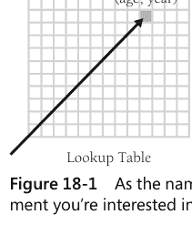

查找表

图 18-1 如名称所示，直接访问表允许你直接访问感兴趣的表元素。

### 每月天数示例

假设你需要确定每个月的天数（为了论证起见，忽略闰年）。一种笨拙的方法，当然是写一个大的 if 语句：

```
Visual Basic Example of a Clumsy Way to Determine the Number of Days in a Month
If ( month = 1 ) Then
    days = 31
ElseIf ( month = 2 ) Then
    days = 28
ElseIf ( month = 3 ) Then
    days = 31
ElseIf ( month = 4 ) Then
    days = 30
ElseIf ( month = 5 ) Then
    days = 31
ElseIf ( month = 6 ) Then
    days = 30
ElseIf ( month = 7 ) Then
    days = 31
```

### 保险费率示例

假设你正在编写一个计算医疗保险费率的程序，并且费率因年龄、性别、婚姻状况以及是否吸烟而变化。如果你必须为费率编写逻辑控制结构，你会得到类似这样的东西：


```
Java Example of a Clumsy Way to Determine an Insurance Rate
if ( gender == Gender.Female ) {
    if ( maritalStatus == MaritalStatus.Single ) {
        if ( smokingStatus == SmokingStatus.NonSmoking ) {
            if ( age < 18 ) {
                rate = 200.00;
            }
            else if ( age == 18 ) {
                rate = 250.00;
            }
            else if ( age == 19 ) {
                rate = 300.00;
            }
            ...
            else if ( 65 < age ) {
                rate = 450.00;
            }
        }
        else {
            if ( age < 18 ) {
                rate = 250.00;
            }
            else if ( age == 18 ) {
                rate = 300.00;
            }
            else if ( age == 19 ) {
                rate = 350.00;
            }
            ...
            else if ( 65 < age ) {
                rate = 575.00;
            }
        }
    }
    else if ( maritalStatus == MaritalStatus.Married )
    ...
}
```

逻辑结构的缩写版本应该足以让你了解这种事情会变得多么复杂。它没有显示已婚女性、任何男性，或 18 到 65 岁之间的大多数年龄。你可以想象当你编程整个费率表时会变得多么复杂。

你可能会说，“好吧，但为什么你要对每个年龄进行测试？为什么不直接把费率放在每个年龄的数组中？”这是一个好问题，一个明显的改进是将费率放入每个年龄的单独数组中。

更好的解决方案是把费率放入所有因素的数组中，而不仅仅是年龄。以下是你在 Visual Basic 中声明数组的方法：

### Visual Basic 示例：声明数据以设置保险费率表

```
Public Enum SmokingStatus
    SmokingStatus_First = 0
    SmokingStatus_Smoking = 0
    SmokingStatus_NonSmoking = 1
    SmokingStatus_Last = 1
End Enum

Public Enum Gender
    Gender_First = 0
    Gender_Male = 0
    Gender_Female = 1
    Gender_Last = 1
End Enum

Public Enum MaritalStatus
    MaritalStatus_First = 0
    MaritalStatus_Single = 0
    MaritalStatus_Married = 1
    MaritalStatus_Last = 1
End Enum

Const MAX_AGE As Integer = 125

Dim rateTable ( SmokingStatus_Last, Gender_Last, MaritalStatus_Last, _
    MAX_AGE ) As Double
```

交叉引用 基于表方法的一个优点是你可以将表的数据放在文件中并在运行时读取。这允许你在不更改程序本身的情况下更改诸如保险费率表之类的内容。有关该想法的更多信息，请参阅第 10.6 节“绑定时间”。

一旦声明了数组，你必须想办法向其中放入数据。你可以使用赋值语句，从磁盘文件读取数据，计算数据，或做任何适当的事情。在设置好数据后，当你需要计算费率时，你就万事俱备了。前面显示的复杂逻辑被以下简单的语句取代：

### Visual Basic 示例：以优雅的方式确定保险费率

```
rate = rateTable( smokingStatus, gender, maritalStatus, age )
```

这种方法具有用表查找取代复杂逻辑的一般优点。表查找更易读，更容易更改。

### 灵活消息格式示例

你可以使用表来描述逻辑太动态而无法在代码中表示的情况。对于字符分类示例、每月天数示例和保险费率示例，你至少知道如果


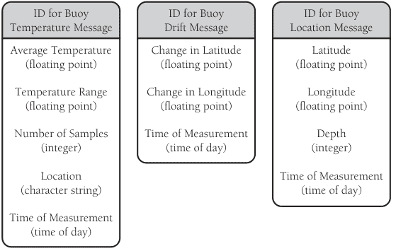

**图 18-3** 除了消息 ID 之外，每种消息都有自己的格式。

## 基于逻辑的方法

如果你采用基于逻辑的方法，你可能会逐条读取每条消息，检查 ID，然后调用一个专门用于读取、解释和打印每种消息的例程。如果有 20 种消息，你就有 20 个例程。你还会有谁知道多少个低级例程来支持它们——例如，你会有 *PrintBuoyTemperatureMessage()* 例程来打印浮标温度消息。面向对象的方法也不会好多少：你通常会使用一个抽象的消息对象，并为每种消息类型创建一个子类。

每当任何消息的格式发生变化时，你就必须更改负责该消息的例程或类的逻辑。在前面详细的消息中，如果平均温度字段从浮点型更改为其他类型，你就必须更改 *PrintBuoyTemperatureMessage()* 的逻辑。 （如果浮标本身从“浮点”更改为其他东西，你就必须换一个新浮标！）

在基于逻辑的方法中，消息读取例程由一个循环组成，用于读取每条消息、解码 ID，然后根据消息 ID 调用 20 个例程中的一个。以下是基于逻辑方法的伪代码：

> **交叉引用** 此低级伪代码的使用目的与你用于例程设计的伪代码不同。有关伪代码设计的详细信息，请参阅第 9 章“伪代码编程过程。”

```
While more messages to read
    Read a message header
    Decode the message ID from the message header
    If the message header is type 1 then
        Print a type 1 message
    Else if the message header is type 2 then
        Print a type 2 message
    ...
    Else if the message header is type 19 then
        Print a type 19 message
    Else if the message header is type 20 then
        Print a type 20 message
```

伪代码被缩写了，因为你无需看到全部 20 种情况就能理解其思路。

## 面向对象的方法

如果你使用的是死板的面向对象方法，逻辑会被隐藏在对象继承结构中，但基本结构会同样复杂：

```
While more messages to read
    Read a message header
    Decode the message ID from the message header
    If the message header is type 1 then
        Instantiate a type 1 message object
    Else if the message header is type 2 then
        Instantiate a type 2 message object
    ...
    Else if the message header is type 19 then
        Instantiate a type 19 message object
    Else if the message header is type 20 then
        Instantiate a type 20 message object
    End if
End While
```

无论逻辑是直接编写还是包含在专门的类中，20 种消息中的每一种都有自己的打印消息的例程。每个例程也可以用伪代码表示。以下是读取并打印浮标温度消息的例程的伪代码：

```
Print "Buoy Temperature Message"

Read a floating-point value
Print "Average Temperature"
Print the floating-point value

Read a floating-point value
Print "Temperature Range"
Print the floating-point value

Read an integer value
Print "Number of Samples"
Print the integer value

Read a character string
Print "Location"
Print the character string

Read a time of day
Print "Time of Measurement"
Print the time of day
```

这只是其中一种消息的代码。其他 19 种消息都需要类似的代码。而且如果添加了第 21 种消息，要么需要添加第 21 个例程，要么需要添加第 21 个子类——无论哪种方式，新的消息类型都需要更改代码。

## 表驱动方法

表驱动方法比之前的方法更经济。消息读取例程由一个循环组成，该循环读取每个消息头，解码 ID，在 *Message* 数组中查找消息描述，然后每次调用同一个例程来解码消息。使用表驱动方法，你可以用表而不是硬编码到程序逻辑中来描述每条消息的格式。这使得最初编码更容易，生成的代码更少，并且在不更改代码的情况下更容易维护。

要使用此方法，首先列出消息种类和字段类型。在 C++ 中，你可以这样定义所有可能字段的类型：

### C++ 示例：定义消息数据类型

```cpp
enum FieldType {
    FieldType_FloatingPoint,
    FieldType_Integer,
    FieldType_String,
    FieldType_TimeOfDay,
    FieldType_Boolean,
    FieldType_BitField,
    FieldType_Last = FieldType_BitField
};
```

与其为 20 种消息中的每一种硬编码打印例程，不如创建一个少数几个例程来打印每种主要数据类型——浮点数、整数、字符字符串等。你可以用表描述每种消息的内容（包括每个字段的名称），然后根据表中的描述解码每条消息。描述一种消息的表条目可能如下所示：

### 定义消息表条目的示例

```text
Message Begin
    NumFields 5
    MessageName "Buoy Temperature Message"
    Field 1, FloatingPoint, "Average Temperature"
    Field 2, FloatingPoint, "Temperature Range"
    Field 3, Integer, "Number of Samples"
    Field 4, String, "Location"
    Field 5, TimeOfDay, "Time of Measurement"
Message End
```

此表可以硬编码在程序中（在这种情况下，所示的每个元素都将被分配给变量），也可以在程序启动时或之后从文件中读取。

一旦消息定义被读入程序，而不是将所有信息嵌入到程序的逻辑中，你就将其嵌入到数据中。数据往往

承认，这段包含六种情况的例程比打印浮标温度消息所需的单个例程更长。但这是你唯一需要的例程。你不需要为另外 19 种消息再提供 19 个其他例程。此例程处理六种字段类型并处理所有种类的消息。

此例程还展示了实现这种表查找的最复杂方式，因为它使用了 case 语句。另一种方法是以创建抽象类 `AbstractField`，然后为每种字段类型创建子类。你不需要 case 语句；你可以调用适当类型对象的成员例程。

以下是 C++ 中设置对象类型的示例：

### C++ 示例：设置对象类型

```cpp
class AbstractField {
  public:
    virtual void ReadAndPrint( string, FileStatus & ) = 0;
}

class FloatingPointField : public AbstractField {
  public:
    virtual void ReadAndPrint( string, FileStatus & ) {
    ...
    }
}

class IntegerField ...
class StringField ...
...
```

此代码片段为每个类声明了一个成员例程，该例程具有字符串参数和 `FileStatus` 参数。

下一步是声明一个数组来保存对象集合。该数组是查找表，其外观如下：

### C++ 示例：设置用于保存每种类型对象的表

```cpp
AbstractField* field[ Field_Last ];
```

设置对象表的最后一步是将特定对象的名称分配给 `Field` 数组：

### C++ 示例：设置对象列表

```cpp
field[ Field_FloatingPoint ] = new FloatingPointField();
field[ Field_Integer ] = new IntegerField();
field[ Field_String ] = new StringField();
field[ Field_TimeOfDay ] = new TimeOfDayField();
field[ Field_Boolean ] = new BooleanField();
field[ Field_BitField ] = new BitField();
```

此代码片段假定 *FloatingPointField* 以及赋值语句右侧的其他标识符是 *AbstractField* 类型的对象的名称。将对象分配给数组中的元素意味着你可以通过引用数组元素而不是直接使用特定类型的对象来调用正确的 *ReadAndPrint()* 例程。

一旦例程表设置好，你就可以通过访问对象表并调用表中的一个成员例程来处理消息中的字段。代码如下所示：

### C++ 示例：在表中查找对象和成员例程

```
fieldIdx = 1;
while ( ( fieldIdx <= numFieldsInMessage ) and ( fileStatus == OK ) ) {
    fieldType = fieldDescription[ fieldIdx ].FieldType;
    fieldName = fieldDescription[ fieldIdx ].FieldName;
    field[ fieldType ].ReadAndPrint( fieldName, fileStatus );
}
```

这只是对消息中每个字段的簿记。

这是通过在对象表中查找来根据字段类型调用例程的表查找。

还记得包含 *case* 语句的原始 34 行表查找伪代码吗？如果用对象表替换 *case* 语句，这就是提供相同功能所需的所有代码。令人难以置信的是，这也是替换基于逻辑方法中全部 20 个单独例程所需的所有代码。而且，如果消息描述是从文件中读取的，除非有新的字段类型，否则新消息类型不需要代码更改。

你可以在任何面向对象的语言中使用此方法。它比冗长的 *if* 语句、*case* 语句或大量子类更不易出错、更易维护且更高效。

设计使用继承和多态并不意味着它是一个好的设计。前面“面向对象方法”部分中描述的死板面向对象设计需要与死板函数式设计一样多的代码——甚至更多。那种方法使解决方案空间变得更复杂，而不是更简单。本例中的关键设计见解既不是面向对象也不是函数式——而是使用经过深思熟虑的查找表。

## 篡改查找键

在前面三个示例中，你可以直接使用数据作为表键。即，你可以不加修改地使用 *messageID* 作为键，就像你可以在天数-月份示例中使用 *month*，在保险费率示例中使用 *gender, maritalStatus,* 和 *smokingStatus* 一样。

你总是希望直接对表进行键查找，因为它简单且快速。有时，数据却不配合。在保险费率示例中，*age* 就表现不佳。原始逻辑对 18 岁以下的人使用一种费率，对年龄


18到65岁，以及65岁以上人群使用一个费率。这意味着对于0到17岁及66岁以上的人群，你不能直接用年龄作为键来查询一个只为几个年龄段存储一组费率的表。

这就引出了“调整表查找键”的主题。你可以通过几种方式来调整键：

**重复信息，使键直接生效** 一种让年龄直接作为费率表键的简单方法，是为0到17岁的每个年龄都复制一份18岁以下费率，然后用年龄直接查表。对于66岁及以上也可以这样做。这种方法的好处是表结构本身简单明了，表访问也很直接。如果你需要为17岁及以下添加特定年龄的费率，只需修改表即可。缺点是重复数据会浪费空间，并增加表中出错的可能性——仅仅因为表中包含冗余数据。

**变换键，使其直接生效** 第二种让年龄直接作为键的方法是对年龄应用一个函数，使其工作良好。在这种情况下，该函数需要将所有0到17岁的年龄映射为一个键，比如17，并将所有66岁以上的年龄映射为另一个键，比如66。这个特定范围足够规整，你可以使用*min()*和*max()*函数来进行转换。例如，你可以使用表达式

```
max( min( 66, Age ), 17 )
```

来创建一个范围从17到66的表键。

创建转换函数要求你识别要用作键的数据中的规律，而这并不总是像使用*min()*和*max()*例程那么简单。假设在这个例子中，费率是按五年年龄段而非一年年龄段划分的。除非你想把数据重复五次，否则你不得不想出一个函数，将年龄正确地除以5，并使用*min()*和*max()*例程。

**将键变换隔离到独立例程中** 如果必须调整数据才能使其作为表键使用，请将把数据转换为键的操作放入独立的例程中。例程消除了在不同位置使用不同转换的可能性。当转换发生变化时，它使修改更加容易。一个合适的例程名称，如*KeyFromAge()*，也能阐明数学操作的目的并起到文档作用。

如果你的环境提供了现成的键变换工具，请使用它们。例如，Java提供了*HashMap*，可用于关联键/值对。

### 18.3 索引访问表

有时，简单的数学变换不足以将年龄等数据转换为表键。某些此类情况适合使用索引访问方案。

使用索引时，你用主数据在索引表中查找一个键，然后用索引表中的值去查找你感兴趣的主数据。

假设你经营一个仓库，库存大约100种物品。再假设每种物品都有一个四位数的零件编号，范围从0000到9999。在这种情况下，如果你想用零件编号直接作为键来查询描述每种物品某方面信息的表，你需要设置一个包含10,000个条目（从0到9999）的索引数组。该数组除了与仓库中100种物品对应的100个条目外，其余都是空的。如图18-4所示，这些条目指向一个条目数远少于10,000的物品描述表。

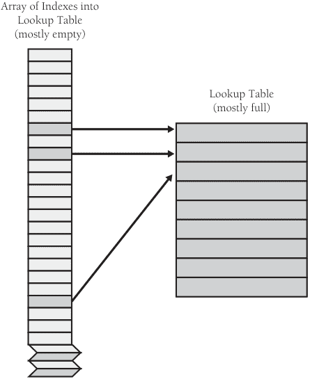

**图18-4.** 索引访问表不是被直接访问，而是通过一个中间索引来访问。

索引访问方案有两个主要优点。首先，如果主查找表中的每个条目都很大，那么创建一个有很多浪费空间的索引数组，比创建一个有很多浪费空间的主查找表要节省大量空间。例如，假设主表每个条目占用100字节，索引数组每个条目占用2字节。假设主表有100个条目，而用于访问它的数据有10,000个可能值。在这种情况下，你需要在有10,000个条目的索引和有10,000个条目的主数据成员之间做出选择。如果使用索引，总内存使用量为30,000字节。如果放弃索引结构而在主表中浪费空间，总内存使用量则为1,000,000字节。

第二个优点，即使使用索引不节省空间，操作索引入门有时也比操作主表条目更廉价。例如，如果你有一个包含员工姓名、入职日期和薪资的表，你可以创建一个按员工姓名访问表的索引，一个按入职日期访问表的索引，以及第三个按薪资访问表的索引。

索引访问方案的最后一个优点是表查找通常具有的可维护性。以表编码的数据比嵌入代码中的数据更容易维护。为了最大化灵活性，应将索引访问代码放在独立例程中，并在需要从零件编号获取表键时调用该例程。当需要修改表时，你可能决定切换索引访问方案或完全改用其他表查找方案。如果你没有在程序中到处散布索引访问代码，访问方案会更容易更改。

### 18.4 阶梯式访问表

另一种表访问方式是阶梯法。这种访问方式不如索引结构直接，但它不会浪费那么多数据空间。

阶梯式结构的一般思想（如图18-5所示）是，表中的条目适用于数据范围，而非不同的数据点。


图18-5 阶梯法通过确定每个条目命中的“阶梯”层级来对其进行分类。它命中的“台阶”决定其类别。

例如，如果你在编写一个评分程序，“B”条目的范围可能是75%到90%。以下是某天你可能需要编程实现的成绩范围：

| ≥ 90.0% | A |
| < 90.0% | B |
| < 75.0% | C |
| < 65.0% | D |
| < 50.0% | F |

对于表查找来说，这是一个不太好处理的范围，因为你不能使用简单的数据转换函数将分数映射到字母A到F。索引方案也会很笨拙，因为数字是浮点数。你可能考虑将浮点数转换为整数，在这种情况下这是一个有效的设计选项，但为了说明问题，这个示例将继续使用浮点数。

要使用阶梯法，你将每个范围的上限放入一个表中，然后编写一个循环来检查分数与每个范围上限的关系。当你找到分数首次超过某个范围上限的点时，你就知道成绩是什么了。使用阶梯技术时，必须小心处理范围的端点。以下是用Visual Basic编写的代码，基于此示例为一组学生分配成绩：

```
**Visual Basic 阶梯式表查找示例**

```vb
' 设置评分表数据
Dim rangeLimit() As Double = { 50.0, 65.0, 75.0, 90.0, 100.0 }
Dim grade() As String = { "F", "D", "C", "B", "A" }
maxGradeLevel = grade.Length - 1
...

' 根据学生得分分配成绩
gradeLevel = 0
studentGrade = "A"
While ( studentGrade = "A" ) and ( gradeLevel < maxGradeLevel )
    If ( studentScore < rangeLimit( gradeLevel ) ) Then
        studentGrade = grade( gradeLevel )
    End If
    gradeLevel = gradeLevel + 1
Wend
```
```

虽然这是一个简单的示例，但你可以轻松地将其推广到处理多个学生、多种评分方案（例如，不同作业的不同分数段对应不同成绩）以及评分方案的调整。

与其他表驱动方法相比，这种方法的一个优点是它非常适合不规则数据。评分示例比较简单，因为虽然成绩是在不规则的区间上分配的，但这些数字很“整齐”，以5和0结尾。阶梯法同样适用于不以5和0整齐结尾的数据。你可以在统计工作中将阶梯法用于如下概率分布：

| 概率 | 保险索赔金额 |
|---:|---:|
| 0.458747 | $0.00 |
| 0.547651 | $254.32 |
| 0.627764 | $514.77 |
| 0.776883 | $747.82 |
| 0.893211 | $1,042.65 |


| 概率 | 保险理赔金额 |
|---|---|
| 0.957665 | $5,887.55 |
| 0.976544 | $12,836.98 |
| 0.987889 | $27,234.12 |
| ... |  |

像这些丑陋的数字一样，任何试图将其整齐地转换为表键的函数都无济于事。阶梯式方法就是答案。

这种方法也享有表驱动方法所具有的一般优势：灵活且可修改。如果评分示例中的评分范围发生变化，程序可以通过修改 RangeLimit 数组中的条目轻松进行调整。你可以轻松地将程序的成绩分配部分泛化，使其接受成绩表和相应的截止分数。程序的成绩分配部分不必使用以百分比表示的分数；它可以使用原始分数而不是百分比，程序也不必做太多改动。

在使用阶梯式技术时，请考虑以下几个细微之处：

## 注意端点

确保你已涵盖每个阶梯范围顶端的情形。运行阶梯式搜索，使其找到映射到除最上层范围之外的任何范围的项目，然后让其余项目落入最上层范围。有时这需要为最上层范围的顶部创建一个人为值。

要小心不要把 < 误认为 <=。确保循环能正确地以落入顶层范围的值终止，并且范围边界能被正确处理。

## 考虑使用二分搜索而不是顺序搜索

在评分示例中，分配成绩的循环会顺序遍历评分限制列表。如果列表更大，顺序搜索的成本可能会变得难以承受。如果是这样，你可以用准二分搜索来替换它。这是一种“准”二分搜索，因为大多数二分搜索的目的是找到一个值。在这种情况下，你并不期望找到该值；你期望找到该值的正确类别。二分搜索算法必须正确确定该值应放置的位置。还请记住将端点作为特殊情况处理。

## 考虑使用索引访问而不是阶梯式技术

第 18.3 节中描述的类似索引访问方案可能是阶梯式技术的良好替代方案。阶梯式方法中所需的搜索会累积，如果执行速度是问题，你可能愿意用额外索引结构占用的空间来换取更直接访问方法带来的时间优势。

显然，这种替代方案并非在所有情况下都是好的选择。在评分示例中，你可能可以使用它；如果你只有 100 个离散的百分点，建立索引数组的内存成本不会是禁止性的。另一方面，如果你有前面列出的概率数据，你就无法建立索引方案，因为你无法用像 0.458747 和 0.547651 这样的数字作为键来访问条目。

在某些情况下，任何几种选项都可能有效。设计的要点是为你的情况选择几种好选项中的一种。不要太担心选择最好的一个。正如微软杰出工程师 Butler Lampson 所说，追求一个好的解决方案并避免灾难，比试图找到最佳解决方案更好（Lampson 1984）。

*将阶梯式表查找放入其自己的例程* 当你创建一个将 *StudentGrade* 等值转换为表键的转换函数时，将其放入其自己的例程中。

### 18.5 表查找的其他示例

本书的其他章节中出现了表查找的另外几个示例。它们是在讨论其他技术时使用的，并且上下文并不特别强调表查找本身。你可以在以下位置找到它们：

- 在保险表中查找费率：第 16.3 节，“轻松创建循环——从内部到外部”
- 使用决策表替换复杂逻辑：第 19.1 节中的“使用决策表替换复杂条件”。
- 表查找期间的内存分页成本：第 25.3 节，“各种各样的脂肪和糖浆”
- 布尔值的组合（A 或 B 或 C）：第 26.1 节中的“用表查找替换复杂表达式”
- 预先计算贷款还款表中的值：第 26.4 节，“表达式”。

交叉引用 有关选择设计替代方案的良好方法的更多信息，请参阅第 5 章，“设计在构建中”。

## CHECKLIST: 表驱动方法

- 你是否考虑过将表驱动方法作为复杂逻辑的替代方案？
- 你是否考虑过将表驱动方法作为复杂继承结构的替代方案？
- 你是否考虑过将表的数据存储在外部并在运行时读取它，以便可以在不更改代码的情况下修改数据？
- 如果表不能通过直接的数组索引访问（如 *age* 示例中），你是否已将访问键计算放入例程中，而不是在代码中重复索引计算？

## 关键点

- 表提供了复杂逻辑和继承结构的替代方案。如果你发现自己对程序的逻辑或继承树感到困惑，请问自己是否可以通过使用查找表来简化。
- 使用表的一个关键考虑因素是决定如何访问表。你可以通过直接访问、索引访问或阶梯式访问来访问表。
- 使用表的另一个关键考虑因素是决定到底要将什么放入表中。

## 第 19 章

## 一般控制问题

## 目录

- 19.1 布尔表达式：页 431
- 19.2 复合语句（块）：页 443
- 19.3 空语句：页 444
- 19.4 驯服危险的深层嵌套：页 445
- 19.5 编程基础：结构化编程：页 454
- 19.6 控制结构与复杂性：页 456

## 相关主题

- 直线代码：第 14 章
- 带条件代码：第 15 章
- 带循环代码：第 16 章
- 不寻常的控制结构：第 17 章
- 软件开发中的复杂性：第 5.2 节中的“软件的主要技术要务：管理复杂性”

除非讨论控制涉及几个在思考控制结构时出现的一般问题，否则讨论是不完整的。本章的大部分信息都是详细且实用的。如果你是为了控制结构的理论而不是为了这些艰苦的细节而阅读，请集中在第 19.5 节中关于结构化编程的历史视角以及第 19.6 节中控制结构之间的关系。

### 19.1 布尔表达式

除了最简单的控制结构，即按顺序执行语句之外，所有控制结构都依赖于布尔表达式的求值。

## 使用 true 和 false 进行布尔测试

在布尔表达式中使用标识符 true 和 false，而不是使用 0 和 1 等值。大多数现代语言都有布尔数据类型并提供 true 和 false 的预定义标识符。它们使事情变得容易——它们甚至不允许你将除 true 或 false 以外的其他值赋给布尔变量。没有布尔数据类型的语言要求你有更多的纪律来使布尔表达式可读。以下是问题的示例：


## Visual Basic 使用模糊标志表示布尔值的示例

```
Dim printerError As Integer
Dim reportSelected As Integer
Dim summarySelected As Integer
...
If printerError = 0 Then InitializePrinter()
If printerError = 1 Then NotifyUserOfError()

If reportSelected = 1 Then PrintReport()
If summarySelected = 1 Then PrintSummary()

If printerError = 0 Then CleanupPrinter()
```

如果使用像 0 和 1 这样的标志是常见做法，有什么问题呢？从阅读代码来看，函数调用是在测试为真时执行还是为假时执行并不清楚。代码片段本身没有任何内容告诉你 1 代表真而 0 代表假，还是相反。甚至不清楚值 1 和 0 是否被用来表示真和假。例如，在 If reportSelected = 1 行中，1 很容易代表第一份报告，2 代表第二份，3 代表第三份；代码中没有任何内容告诉你 1 代表真或假。很容易写成 0 而实际意思是 1，反之亦然。

对布尔表达式的测试使用名为 true 和 false 的术语。如果你的语言不直接支持此类术语，请使用预处理器宏或全局变量创建它们。上面的代码示例在此使用 Microsoft Visual Basic 的内置 True 和 False 重写：

> 交叉引用 有关使这些相同测试的更好方法，请参阅下一个代码示例。

## 好的，但不算好的 Visual Basic 使用 True 和 False 进行测试而不是数值值的示例

```
Dim printerError As Boolean
Dim reportSelected As ReportType
Dim summarySelected As Boolean
...
If ( printerError = False ) Then InitializePrinter()
If ( printerError = True ) Then NotifyUserOfError()

If ( reportSelected = ReportType_First ) Then PrintReport()
If ( summarySelected = True ) Then PrintSummary()

If ( printerError = False ) Then CleanupPrinter()
```

使用 True 和 False 常量使意图更清晰。你不必记住 1 和 0 代表什么，也不会意外地颠倒它们。此外，在


重写代码后，很清楚原始 Visual Basic 示例中的某些 1 和 0 并不是用作布尔标志。`If reportSelected = 1` 这一行根本不是布尔测试；它测试的是第一个报表是否被选中。

这种方法告诉读者你正在进行布尔测试。用 1 代替 0 比用 true 代替 false 更容易写错，而且你避免在代码中到处传播魔术数字 0 和 1。以下是关于在布尔测试中定义 true 和 false 的一些提示：

## 隐式地将布尔值与 true 和 false 进行比较

你可以通过将表达式视为布尔表达式来编写更清晰的测试。例如，写

```
while ( not done ) ...
while ( a > b ) ...
```

而不是

```
while ( done = false ) ...
while ( (a > b) = true ) ...
```

使用隐式比较可以减少阅读代码的人需要记住的术语数量，结果表达式读起来更像日常英语。之前的例子可以用更好的风格重写如下：

## 隐式测试 True 和 False 的更好 Visual Basic 示例

```
Dim printerError As Boolean
Dim reportSelected As ReportType
Dim summarySelected As Boolean
...
If ( Not printerError ) Then InitializePrinter()
If ( printerError ) Then NotifyUserOfError()

If ( reportSelected = ReportType_First ) Then PrintReport()
If ( summarySelected ) Then PrintSummary()

If ( Not printerError ) Then CleanupPrinter()
```

> Cross-Reference For details, see Section 12.5, "Boolean Variables."

如果你的语言不支持布尔变量而你必须模拟它们，你可能无法使用此技术，因为 true 和 false 的模拟不总是可以用像 `while ( not done )` 这样的语句进行测试。

## 使复杂表达式变简单

你可以采取以下几个步骤来简化复杂表达式：

## 将复杂测试分解为使用新布尔变量的部分测试

与其创建一个包含半打术语的庞大测试，不如将中间值赋给术语，以便执行更简单的测试。

***将复杂表达式移入布尔函数*** 如果测试经常重复或分散了程序主要流程的注意力，请将测试代码移入函数并测试函数的值。例如，这里有一个复杂的测试：

**Visual Basic Example of a Complicated Test**

```vb
If ( ( document.AtEndOfStream ) And ( Not inputError ) ) And _
   ( ( MIN_LINES <= lineCount ) And ( lineCount <= MAX_LINES ) ) And _
   ( Not ErrorProcessing() ) Then
   ' do something or other
   ...
End If
```

如果你对测试本身不感兴趣，阅读这个丑陋的测试会很困难。通过将其放入布尔函数，你可以隔离测试，让读者在不重要时忘记它。下面是如何将 *if* 测试放入函数的方法：

> **Cross-Reference** For details on the technique of using intermediate variables to clarify a boolean test, see “Use boolean variables to document your program” in Section 12.5.

**Visual Basic Example of a Complicated Test Moved into a Boolean Function, with New Intermediate Variables to Make the Test Clearer**

```vb
Function DocumentIsValid( _
    ByRef documentToCheck As Document, _
    lineCount As Integer, _
    inputError As Boolean _
    ) As Boolean

    Dim allDataRead As Boolean
    Dim legalLineCount As Boolean

    allDataRead = ( documentToCheck.AtEndOfStream ) And ( Not inputError )
    legalLineCount = ( MIN_LINES <= lineCount ) And ( lineCount <= MAX_LINES )
    DocumentIsValid = allDataRead And legalLineCount And ( Not ErrorProcessing() )

End Function
```

此示例假设 *ErrorProcessing()* 是一个布尔函数，表示当前处理状态。现在，当你阅读代码的主要流程时，就不必阅读复杂的测试了：

**Visual Basic Example of the Main Flow of the Code Without the Complicated Test**

```vb
If ( DocumentIsValid( document, lineCount, inputError ) ) Then
   ' do something or other
   ...
End If
```

如果你只使用一次测试，你可能认为将其放入例程不值得。但将测试放入一个命名良好的函数可以提高可读性，使你更容易看到代码在做什么，这本身就是一个充分的理由。


新的函数名向程序中引入了一个抽象，它在代码中记录了测试的目的。这比用注释记录测试更好，因为代码更有可能被阅读，也更有可能保持最新。

Cross-Reference For details on using tables as substitutes for complicated logic, see Chapter 18, "Table-Driven Methods."

## 使用决策表替换复杂条件

有时你有一个涉及多个变量的复杂测试。使用决策表来执行测试而不是使用 if 或 case 会很有帮助。决策表查找最初更容易编码，只有几行代码且没有棘手的控制结构。这种复杂性的最小化减少了出错的机会。如果你的数据发生变化，你可以更改决策表而无需更改代码；你只需要更新数据结构的内容。

## 以正向方式形成布尔表达式

> I ain't not no undummy.
> —Homer Simpson

并非少数人对非短的非正向字符串没有不理解的困难——也就是说，大多数人对大量否定难以理解。你可以做几件事来避免程序中复杂的否定布尔表达式：

## 在 if 语句中，将否定转换为肯定并在 if 和 else 子句中翻转代码

这里是一个以否定方式表达的测试的例子：

这里是负面的 not。

```
Java Example of a Confusing Negative Boolean Test
if ( !statusOK ) {
    // do something
    ...
}
else {
    // do something else
    ...
}
```

你可以将其更改为以下以肯定方式表达的测试：

此行的测试已被反转。

此块中的代码已被切换...

...与此块中的代码。

```
Java Example of a Clearer Positive Boolean Test
if ( statusOK ) {
    // do something else
    ...
}
else {
    // do something
    ...
}
```

Cross-Reference The recommendation to frame boolean expressions positively sometimes contradicts the recommendation to code the nominal case after the if rather than the else. (See Section 15.1, "if Statements.") In such a case, you have to think about the benefits of each approach and decide which is better for your situation.

第二个代码片段在逻辑上与第一个相同，但更易于阅读，因为否定表达式已被更改为肯定。

或者，你可以选择一个不同的变量名，它会反转测试的真值。在示例中，你可以用 ErrorDetected 替换 statusOK，当 statusOK 为 false 时它为 true。

## 应用 DeMorgan 定理来简化包含否定的布尔测试

DeMorgan 定理让你利用表达式与其通过双重否定而含义相同版本的逻辑关系。例如，你可能有一个包含以下测试的代码片段：

```
Java Example of a Negative Test
if ( !displayOK || !printerOK ) ...
```

这在逻辑上等价于以下内容：

```
Java Example After Applying DeMorgan’s Theorems
if ( !( displayOK && printerOK ) ) ...
```

在这里你不必翻转 if 和 else 子句；最后两个代码片段中的表达式在逻辑上等价。要将 DeMorgan 定理应用于逻辑运算符 and 或逻辑运算符 or 以及一对操作数，你否定每个操作数，交换 and 和 or，并否定整个表达式。表 19-1 总结了 DeMorgan 定理下的可能变换。

Table 19-1 Transformations of Logical Expressions Under DeMorgan’s Theorems

| Initial Expression | Equivalent Expression |
|---|---|
| not A and not B | not ( A or B ) |
| not A and B | not ( A or not B ) |
| A and not B | not ( not A or B ) |
| A and B | not ( not A or not B ) |
| not A or not B* | not ( A and B ) |
| not A or B | not ( A and not B ) |
| A or not B | not ( not A and B ) |
| A or B | not ( not A and not B ) |

* This is the expression used in the example.


## 使用圆括号澄清布尔表达式

交叉参考：有关使用圆括号澄清其他类型表达式的示例，请参见第31.2节中的“圆括号”。

如果你有一个复杂的布尔表达式，与其依赖语言的求值顺序，不如使用圆括号来明确你的意图。使用圆括号可以减轻读者的负担，他们可能不了解你的语言如何精妙地求值布尔表达式。如果你够聪明，就不会依赖自己或读者对求值优先级的深入记忆——尤其是当你需要在两种或更多语言之间切换时。使用圆括号不像发电报：不是按字符收费的——多余的字符是免费的。

下面是一个圆括号过少的表达式：

```
Java Example of an Expression Containing Too Few Parentheses
if ( a < b == c == d ) ...
```

这个表达式一开始就令人困惑，而且更令人困惑的是，不清楚编码者是想测试 `( a < b ) == ( c == d )` 还是 `( ( a < b ) == c ) == d`。下面的表达式版本仍然有点令人困惑，但圆括号有助于理解：

```
Java Example of an Expression Better Parenthesized
if ( ( a < b ) == ( c == d ) ) ...
```

在这种情况下，圆括号有助于提高可读性和程序的正确性——编译器不会以这种方式解释第一段代码片段。如有疑问，请加上圆括号。

交叉参考：许多面向程序员的文本编辑器都有匹配圆括号、方括号和花括号的命令。有关编程编辑器的详细信息，请参见第30.2节中的“编辑”。

## 使用简单的计数技巧来平衡圆括号

如果你难以判断圆括号是否平衡，这里有一个简单的计数技巧。先说“零”。然后从左到右移动表达式。遇到左圆括号时说“一”。每次遇到另一个左圆括号，就将你所说的数字加一。每次遇到右圆括号，就将你所说的数字减一。如果在表达式末尾，你回到了0，那么你的圆括号就是平衡的。

```
Java Example of Balanced Parentheses
Read this. if ( ( ( a < b ) == ( c == d ) ) && !done ) ...
Say this. 0 1 2 3 2 3 2 1 0
```

在这个示例中，你以0结束，所以圆括号是平衡的。在下一个示例中，圆括号不平衡：

```
Java Example of Unbalanced Parentheses
if ( ( a < b ) == ( c == d ) ) && !done ) ...
  | |   |   |   | |
0 1 2   1 2   1 0   -1
Read this.
Say this.
```

在到达最后一个右圆括号之前出现的0，提示在该点之前缺少一个圆括号。在表达式的最后一个圆括号之前，你不应该得到0。

### 完全用圆括号括起逻辑表达式

圆括号很廉价，而且有助于提高可读性。养成习惯，将逻辑表达式完全用圆括号括起来是一种好的做法。

## 了解布尔表达式如何求值

许多语言在布尔表达式的求值中都有一种隐含的控制形式。某些语言的编译器会在组合各项并求值整个表达式之前，先对布尔表达式中的每一项进行求值。其他语言的编译器则采用“短路”或“惰性”求值，只求值必要的部分。当根据第一个测试的结果，你可能不希望执行第二个测试时，这一点尤其重要。例如，假设你在检查数组的元素，并且进行了以下测试：

```
Pseudocode Example of an Erroneous Test
while ( i < MAX_ELEMENTS and item[ i ] <> 0 ) ...
```

如果对整个表达式求值，在最后一次循环中你会遇到错误。变量i等于maxElements，所以表达式item[ i ]等同于item[ maxElements ]，这是一个数组索引错误。你可能会争辩说这无关紧要，因为你只是在查看值，而不是修改它。但这是草率的编程实践，可能会让阅读代码的人感到困惑。在许多环境中，它还会产生运行时错误或保护违规。

在伪代码中，你可以重构测试，使错误不会发生：

```
Pseudocode Example of a Correctly Restructured Test
while ( i < MAX_ELEMENTS )
  if ( item[ i ] <> 0 ) then
  ...
```

这是正确的，因为除非i小于maxElements，否则不会对item[ i ]求值。

许多现代语言提供了从一开始就防止此类错误发生的机制。例如，C++使用短路求值：如果`and`（与）的第一个操作数为false，则不会求值第二个操作数，因为整个表达式无论如何都会是false。换句话说，在C++中，对于

```
if ( SomethingFalse && SomeCondition ) ...
```

唯一被求值的部分是SomethingFalse。一旦SomethingFalse被确定为false，求值就会停止。

使用`or`（或）运算符时，求值也会类似地短路。在C++和Java中，对于

```
if ( somethingTrue || someCondition ) ...
```

唯一被求值的部分是somethingTrue。一旦somethingTrue被确定为true，求值就会停止，因为如果表达式的任何部分为true，整个表达式始终为true。由于这种求值方法，以下语句是一个良好且合法的语句。

## Java示例：因短路求值而有效的测试

```
if ( ( denominator != 0 ) && ( ( item / denominator ) > MIN_VALUE ) ) ...
```

如果在对整个表达式求值时denominator等于0，第二个操作数中的除法将产生除零错误。但由于只有第一部分为true时才会求值第二部分，当denominator等于0时，它永远不会被求值，因此不会发生除零错误。

另一方面，由于`&&`（与）从左到右求值，下面逻辑上等价的语句无法正常工作：

## Java示例：短路求值无法挽救的测试

```
if ( ( ( item / denominator ) > MIN_VALUE ) && ( denominator != 0 ) ) ...
```

在这种情况下，`item / denominator`在`denominator != 0`之前被求值。因此，这段代码会发生除零错误。

Java通过提供“逻辑”运算符进一步使情况复杂化。Java的逻辑`&`和`|`运算符保证所有项都将被完整求值，无论是否无需完整求值就能确定表达式的真假。换句话说，在Java中，以下写法是安全的：

## Java示例：因短路（条件）求值而有效的测试

```
if ( ( denominator != 0 ) && ( ( item / denominator ) > MIN_VALUE ) ) ...
```

但以下写法是不安全的：

## Java示例：因短路求值无法保证而失效的测试

```
if ( ( denominator != 0 ) & ( ( item / denominator ) > MIN_VALUE ) ) ...
```


不同的语言使用不同类型的求值方式，语言实现者往往会在表达式求值上随意发挥，因此请查阅你所使用的特定语言版本的文档，以了解你的语言使用哪种求值方式。更好的是，由于阅读你代码的人可能不像你那样敏锐，请使用嵌套测试来阐明你的意图，而不是依赖求值顺序和短路求值。

## 按数轴顺序编写数值表达式

组织数值测试，使其遵循数轴上的点。通常，你可以将数值测试构造为如下比较形式：

```
MIN_ELEMENTS <= i and i <= MAX_ELEMENTS
```

```
i < MIN_ELEMENTS or MAX_ELEMENTS < i
```

其思想是将元素从左到右、从小到大排列。在第一行中，MIN_ELEMENTS和MAX_ELEMENTS是两个端点，所以它们位于两端。变量i应在它们之间，所以i位于中间。在第二个示例中，你测试i是否在范围之外，所以i位于测试的两端外侧，而MIN_ELEMENTS和MAX_ELEMENTS位于内侧。这种方法很容易映射为图19-1中比较的视觉图像：

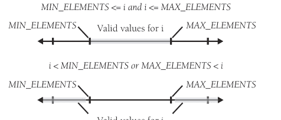

图19-1 使用数轴顺序进行布尔测试的示例。

如果你只将i与MIN_ELEMENTS比较，i的位置会根据测试成功时i所在的位置而变化。如果i应该更小，你会得到这样的测试：

```
while ( i < MIN_ELEMENTS ) ...
```

但如果i应该更大，你会得到这样的测试：

```
while ( MIN_ELEMENTS < i ) ...
```


rather than

```
while ( bufferPtr ) ...
```

Like the recommendation for characters, this one goes against the established C convention, but the gain in readability justifies it.

## Common Problems with Boolean Expressions

Boolean expressions are subject to a few additional pitfalls that pertain to specific languages:

In C-derived languages, put constants on the left side of comparisons

C-derived languages pose some special problems with boolean expressions. If you have problems mistyping = instead of ==, consider the programming convention of putting constants and literals on the left sides of expressions, like this:

```
C++ Example of Putting a Constant on the Left Side of an Expression—An Error the Compiler Will Catch
if ( MIN_ELEMENTS = i ) ...
```

In this expression, the compiler should flag the single = as an error since assigning anything to a constant is invalid. In contrast, in the following expression, the compiler will flag this only as a warning, and only if you have compiler warnings fully turned on:

```
C++ Example of Putting a Constant on the Right Side of an Expression—An Error the Compiler Might Not Catch
if ( i = MIN_ELEMENTS ) ...
```

This recommendation conflicts with the recommendation to use number-line ordering. My personal preference is to use number-line ordering and let the compiler warn me about unintended assignments.

In C++, consider creating preprocessor macro substitutions for &&, ||, and == (but only as a last resort)

If you have such a problem, it’s possible to create #define macros for boolean and and or, and use AND and OR instead of && and ||. Similarly, using = when you mean == is an easy mistake to make. If you get stung often by this one, you might create a macro like EQUALS for logical equals (==).

Many experienced programmers view this approach as aiding readability for the programmer who can’t keep details of the programming language straight but as degrading readability for the programmer who is more fluent in the language. In addition, most compilers will provide error warnings for usages of assignment and bitwise

In Java, know the difference between a==b and a.equals(b)  In Java, a==b tests for whether a and b refer to the same object, whereas a.equals(b) tests for whether the objects have the same logical value. In general, Java programs should use expressions like a.equals(b) rather than a==b.

### 19.2 Compound Statements (Blocks)

A “compound statement” or “block” is a collection of statements that are treated as a single statement for purposes of controlling the flow of a program. Compound statements are created by writing { and } around a group of statements in C++, C#, C, and Java. Sometimes they are implied by the keywords of a command, such as For and Next in Visual Basic. Guidelines for using compound statements effectively follow:

> **Cross-Reference** Many programmer-oriented text editors have commands that match braces, brackets, and parentheses. For details, see “Editing” in Section 30.2.

- **Write pairs of braces together**  Fill in the middle after you write both the opening and closing parts of a block. People often complain about how hard it is to match pairs of braces or begin-and-end pairs, and that’s a completely unnecessary problem. If you follow this guideline, you will never have trouble matching such pairs again.

Write this first:

```
for ( i = 0; i < maxLines; i++ )
```

Write this next:

```
for ( i = 0; i < maxLines; i++ ) {  }
```

Write this last:

```
for ( i = 0; i < maxLines; i++ ) {
    // whatever goes in here ...
}
```

This applies to all blocking structures, including if, for, and while in C++ and Java and the If-Then-Else, For-Next, and While-Wend combinations in Visual Basic.

- **Use braces to clarify conditionals**  Conditionals are hard enough to read without having to determine which statements go with the if test. Putting a single statement after an if test is sometimes appealing aesthetically, but under maintenance such statements tend to become more complicated blocks, and single statements are error-prone when that happens.

Use blocks to clarify your intentions regardless of whether the code inside the block is 1 line or 20.

### 19.3 Null Statements

In C++, it’s possible to have a null statement, a statement consisting entirely of a semicolon, as shown here:

```
C++ Example of a Traditional Null Statement
while ( recordArray.Read( index++ ) ) != recordArray.EmptyRecord() )
;
```

The while in C++ requires that a statement follow, but it can be a null statement. The semicolon on a line by itself is a null statement. Here are guidelines for handling null statements in C++:

> Cross-Reference The best way to handle null statements is probably to avoid them. For details, see “Avoid empty loops” in Section 16.2.

- Call attention to null statements Null statements are uncommon, so make them obvious. One way is to give the semicolon of a null statement a line of its own. Indent it, just as you would any other statement. This is the approach shown in the previous example. Alternatively, you can use a set of empty braces to emphasize the null statement. Here are two examples:

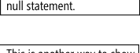

```
C++ Examples of a Null Statement That’s Emphasized
while ( recordArray.Read( index++ ) ) != recordArray.EmptyRecord() ) {}
while ( recordArray.Read( index++ ) ) != recordArray.EmptyRecord() ) {
;
}
```


- Create a preprocessor DoNothing() macro or inline function for null statements
The statement doesn’t do anything but make indisputably clear the fact that nothing is supposed to be done. This is similar to marking blank document pages with the statement “This page intentionally left blank.” The page isn’t really blank, but you know nothing else is supposed to be on it.

Here’s how you can make your own null statement in C++ by using #define. (You could also create it as an inline function, which would have the same effect.)

```
C++ Example of a Null Statement That’s Emphasized with DoNothing()
#define DoNothing()
...
while ( recordArray.Read( index++ ) ) != recordArray.EmptyRecord() ) {
  DoNothing();
}
```

In addition to using DoNothing() in empty while and for loops, you can use it for unimportant choices of a switch statement; including DoNothing() makes it clear that the case was considered and nothing is supposed to be done.

- **Consider whether the code would be clearer with a non-null loop body**  Most of the code that results in loops with empty bodies relies on side effects in the loop-control code. In most cases, the code is more readable when the side effects are made explicit, as shown here:

```
**C++ Examples of Rewriting Code More Clearly with a Non-Null Loop Body**
```cpp
RecordType record = recordArray.Read( index );
index++;
while ( record != recordArray.EmptyRecord() ) {
    record = recordArray.Read( index );
    index++;
}
```
```

This approach introduces an additional loop-control variable and requires more lines of code, but it emphasizes straightforward programming practice rather than clever use of side effects. Such emphasis is preferable in production code.

### 19.4 Taming Dangerously Deep Nesting


Excessive indentation, or “nesting,” has been pilloried in computing literature for 25 years and is still one of the chief culprits in confusing code. Studies by Noam Chomsky and Gerald Weinberg suggest that few people can understand more than three levels of nested ifs (Yourdon 1986a), and many researchers recommend avoiding nesting to more than three or four levels (Myers 1976, Marca 1981, and Ledgard and Tauer 1987a). Deep nesting works against what Chapter 5, “Design in Construction,” describes as Software’s Primary Technical Imperative: Managing Complexity. That is reason enough to avoid deep nesting.


It’s not hard to avoid deep nesting. If you have deep nesting, you can redesign the tests performed in the if and else clauses or you can refactor code into simpler routines. The following subsections present several ways to reduce the nesting depth:

- **Simplify a nested if by retesting part of the condition**  If the nesting gets too deep, you can decrease the number of nesting levels by retesting some of the conditions. This code example has nesting that’s deep enough to warrant restructuring:


```
**C++ Example of Bad, Deeply Nested Code**
```cpp
if ( inputStatus == InputStatus_Success ) {
    // lots of code
    ...
    if ( printerRoutine != NULL ) {
```


**交叉引用** 重新测试部分条件以降低复杂度与重新测试状态变量类似。该技术在第 17.3 节“错误处理和 goto”中有所演示。

```cpp
// lots of code
---
if ( SetupPage() ) {
    // lots of code
    ---
    if ( AllocMem( &printData ) ) {
        // lots of code
        ---
    }
}
}
}
```

此示例是为了展示嵌套层级而构造的。// *lots of code* 部分旨在暗示该例程的代码量足以跨越数个屏幕或跨越打印代码列表的页面边界。以下是修改为使用重新测试而非嵌套的代码：

```cpp
**C++ Example of Code Mercifully Unnested by Retesting**
if ( inputStatus == InputStatus_Success ) {
    // lots of code
    ---
    if ( printerRoutine != NULL ) {
        // lots of code
        ---
    }
}

if ( ( inputStatus == InputStatus_Success ) &&
     ( printerRoutine != NULL ) && SetupPage() ) {
    // lots of code
    ---
    if ( AllocMem( &printData ) ) {
        // lots of code
        ---
    }
}
```

这是一个特别现实的示例，因为它表明你不能免费降低嵌套层级；为了换取降低的嵌套层级，你必须忍受更复杂的测试。然而，从四层减少到两层的改进对可读性来说是巨大的提升，值得考虑。

***通过使用 break 块简化嵌套 if***  另一种替代方法是在描述中定义一段将作为块执行的代码。如果块中间的某个条件失败，执行将跳到块的末尾。

```cpp
**C++ Example of Using a break Block**
do {
    // begin break block
    if ( inputStatus != InputStatus_Success ) {
        break; // break out of block
    }
```

```
// lots of code
...
if ( printerRoutine == NULL ) {
    break; // break out of block
}

// lots of code
...
if ( !SetupPage() ) {
    break; // break out of block
}

// lots of code
...
if ( !AllocMem( &printData ) ) {
    break; // break out of block
}

// lots of code
...
} while (FALSE); // end break block
```

这种技术不常见，只有当你的整个团队熟悉它并且团队已将其作为公认的编码实践采纳时才应使用。

*将嵌套 if 转换为一组 if-then-else*  如果你批判性地思考嵌套 if 测试，你可能会发现可以将其重新组织以使用 if-then-else 而不是嵌套 if。假设你有如下的繁茂决策树：

```
Java Example of an Overgrown Decision Tree
if ( 10 < quantity ) {
    if ( 100 < quantity ) {
        if ( 1000 < quantity ) {
            discount = 0.10;
        }
        else {
            discount = 0.05;
        }
    }
    else {
        discount = 0.025;
    }
}
else {
    discount = 0.0;
}
```

此测试在多方面组织不佳，其中之一是测试是冗余的。当你测试 quantity 是否大于 1000 时，你不需要再测试它是否大于 100 且大于 10。因此，你可以重新组织代码：

```
Java Example of a Nested if Converted to a Set of if-then-elses
if ( 1000 < quantity ) {
    discount = 0.10;
}
else if ( 100 < quantity ) {
    discount = 0.05;
}
else if ( 10 < quantity ) {
    discount = 0.025;
}
else {
    discount = 0;
}
```

这个解决方案之所以更容易，是因为数字整齐递增。以下是数字不那么整齐时如何重写嵌套 if 的示例：

```
Java Example of a Nested if Converted to a Set of if-then-elses When the Numbers Are "Messy"
if ( 1000 < quantity ) {
    discount = 0.10;
}
else if ( ( 100 < quantity ) && ( quantity <= 1000 ) ) {
    discount = 0.05;
}
else if ( ( 10 < quantity ) && ( quantity <= 100 ) ) {
    discount = 0.025;
}
else if ( quantity <= 10 ) {
    discount = 0;
}
```

这段代码与前一段代码的主要区别在于 else-if 子句中的表达式不依赖于之前的测试。这段代码不需要 else 子句也能工作，并且测试实际上可以按任意顺序执行。代码可以由四个 if 组成且没有 else。else 版本更可取的唯一原因是它避免了不必要的重复测试。

## 将嵌套 if 转换为 case 语句

你可以用 case 语句重新编码某些类型的测试，特别是那些使用整数的测试，而不是使用 if 和 else 的链。你不能在某些语言中使用这种技术，但在可以使用的语言中它是一种强大的技术。以下是 Visual Basic 中重新编码示例的方法：

```
Visual Basic Example of Converting a Nested if to a case Statement
Select Case quantity
    Case 0 To 10
        discount = 0.0
    Case 11 To 100
        discount = 0.025
```

```vb
Case 101 To 1000
    discount = 0.05
Case Else
    discount = 0.10
End Select
```

这个示例读起来像一本书。当你将其与几页前多个缩进的两个示例进行比较时，它似乎是一个特别干净的解决方案。

***将深度嵌套的代码分解为自己的例程***  如果深度嵌套发生在循环内部，你通常可以通过将循环内部部分放入自己的例程来改善这种情况。如果嵌套是由于条件和迭代共同造成的，这种方法尤其有效。保留主循环中的 *if-then-else* 分支以显示决策分支，然后将分支内的语句移至其自己的例程。以下代码需要通过此类修改来改进：

```cpp
C++ Example of Nested Code That Needs to Be Broken into Routines
while ( !TransactionsComplete() ) {
    // read transaction record
    transaction = ReadTransaction();

    // process transaction depending on type of transaction
    if ( transaction.Type == TransactionType_Deposit ) {
        // process a deposit
        if ( transaction.AccountType == AccountType_Checking ) {
            if ( transaction.AccountSubType == AccountSubType_Business )
                MakeBusinessCheckDep( transaction.AccountNum, transaction.Amount );
            else if ( transaction.AccountSubType == AccountSubType_Personal )
                MakePersonalCheckDep( transaction.AccountNum, transaction.Amount );
            else if ( transaction.AccountSubType == AccountSubType_School )
                MakeSchoolCheckDep( transaction.AccountNum, transaction.Amount );
        }
        else if ( transaction.AccountType == AccountType_Savings )
            MakeSavingsDep( transaction.AccountNum, transaction.Amount );
        else if ( transaction.AccountType == AccountType_DebitCard )
            MakeDebitCardDep( transaction.AccountNum, transaction.Amount );
        else if ( transaction.AccountType == AccountType_MoneyMarket )
            MakeMoneyMarketDep( transaction.AccountNum, transaction.Amount );
        else if ( transaction.AccountType == AccountType_Cd )
            MakeCDDep( transaction.AccountNum, transaction.Amount );
    }
    else if ( transaction.Type == TransactionType_Withdrawal ) {
        // process a withdrawal
        if ( transaction.AccountType == AccountType_Checking )
            MakeCheckingWithdrawal( transaction.AccountNum, transaction.Amount );
        else if ( transaction.AccountType == AccountType_Savings )
            MakeSavingsWithdrawal( transaction.AccountNum, transaction.Amount );
        else if ( transaction.AccountType == AccountType_DebitCard )
            MakeDebitCardWithdrawal( transaction.AccountNum, transaction.Amount );
    }
}
```

新例程中的代码只是从原始例程中提取出来并形成新的例程。 （此处未显示新例程。）新代码有几个优点。首先，两级嵌套使结构更简单、更容易理解。其次，你可以在一个屏幕上阅读、修改和调试较短的 while 循环——它不需要跨越屏幕或打印页边界。第三，将 ProcessDeposit() 和 ProcessWithdrawal() 的功能放入例程中获得了模块化的所有其他一般优势。第四，现在很容易看出代码可以被分解为 case 语句，这将使其更易于阅读，如下所示：

## C++ Example of Good, Nested Code After Decomposition and Use of a case Statement

```
while ( !TransactionsComplete() ) {
    // read transaction record
    transaction = ReadTransaction();

    // process transaction depending on type of transaction
    switch ( transaction.Type ) {
        case ( TransactionType_Deposit ):
            ProcessDeposit(
                transaction.AccountType,
                transaction.AccountSubType,
                transaction.AccountNum,
                transaction.Amount
            );
            break;

        case ( TransactionType_Withdrawal ):
            ProcessWithdrawal(
                transaction.AccountType,
                transaction.AccountNum,
                transaction.Amount
            );
            break;

        case ( TransactionType_Transfer ):
            MakeFundsTransfer(
                transaction.SourceAccountType,
                transaction.TargetAccountType,
                transaction.AccountNum,
                transaction.Amount
            );
            break;

        default:
            // process unknown transaction type
            LogTransactionError("Unknown Transaction Type", transaction );
            break;
    }
}
```


***采用更面向对象的方法***  在面向对象的环境中，简化此特定代码的一种直接方法是创建一个抽象的 *Transaction* 基类，以及用于 *Deposit*、*Withdrawal* 和 *Transfer* 的子类。

**使用多态性的良好 C++ 代码示例**

```cpp
TransactionData transactionData;
Transaction *transaction;

while ( !TransactionsComplete() ) {
    // read transaction record
    transactionData = ReadTransaction();

    // create transaction object, depending on type of transaction
    switch ( transactionData.Type ) {
        case ( TransactionType_Deposit ):
            transaction = new Deposit( transactionData );
            break;

        case ( TransactionType_Withdrawal ):
            transaction = new Withdrawal( transactionData );
            break;

        case ( TransactionType_Transfer ):
            transaction = new Transfer( transactionData );
            break;

        default:
            // process unknown transaction type
            LogTransactionError("Unknown Transaction Type", transactionData );
            return;
    }
    transaction->Complete();
    delete transaction;
}
```

在任何规模的系统中，*switch* 语句都将被转换为使用工厂方法，该方法可以在需要创建 *Transaction* 类型对象的地方重复使用。如果此代码在这样的系统中，此部分将变得更简单：

**使用多态性和对象工厂的良好 C++ 代码示例**

```cpp
TransactionData transactionData;
Transaction *transaction;

while ( !TransactionsComplete() ) {
    // read transaction record and complete transaction
    transactionData = ReadTransaction();
    transaction = TransactionFactory.Create( transactionData );
    transaction->Complete();
    delete transaction;
}
```

就记录而言，*TransactionFactory.Create()* 例程中的代码是对来自前一示例 *switch* 语句的代码的简单改编：

```
C++ Example of Good Code for an Object Factory

Transaction *TransactionFactory::Create(
    TransactionData transactionData
    ) {

    // create transaction object, depending on type of transaction
    switch ( transactionData.Type ) {
        case ( TransactionType_Deposit ):
            return new Deposit( transactionData );
            break;

        case ( TransactionType_Withdrawal ):
            return new Withdrawal( transactionData );
            break;

        case ( TransactionType_Transfer ):
            return new Transfer( transactionData );
            break;

        default:
            // process unknown transaction type
            LogTransactionError( "Unknown Transaction Type", transactionData );
            return NULL;
    }
}
```

*重新设计深层嵌套的代码*  一些专家认为，*case* 语句几乎总是表示面向对象编程中因子化不良的代码，并且很少或从不需要使用 [Meyer 1997]。这种从调用例程的 case 语句转换到具有多态方法调用的对象工厂的转换就是一个例子。

更一般地说，复杂的代码表明你对程序的理解还不够充分，无法使其变得简单。深层嵌套是一个警告信号，表明需要分离出一个例程或重新设计复杂代码的部分。它并不意味着你必须修改该例程，但如果你不修改，你应该有充分的理由。

# 减少深层嵌套的技术总结

以下是你可以用来减少深层嵌套的技术列表，以及本书中讨论这些技术的章节参考：

- 重新测试条件的一部分 [本节]
- 转换为 *if-then-elses* [本节]
- 转换为 *case* 语句 [本节]
- 将深层嵌套代码因子化为其自己的例程 [本节]
- 使用对象和多态分派 [本节]
- 重写代码以使用状态变量 [第 17.3 节]
- 使用 guard 子句退出例程并使代码的正常路径更清晰 [第 17.1 节]
- 使用异常 [第 8.4 节]
- 完全重新设计深层嵌套代码 [本节]

### 19.5 编程基础：结构化编程

“结构化编程”一词源于 Edsger Dijkstra 在 1969 年软件工程 NATO 会议上发表的里程碑论文《Structured Programming》 [Dijkstra 1969]。到结构化编程兴衰之时，“结构化”一词已被应用于每个软件开发活动，包括结构化分析、结构化设计和结构化瞎搞。各种结构化方法并没有共同的主题，只是它们都是在“结构化”一词能为其增添额外光泽的时代创建的。

结构化编程的核心是一个简单的想法：程序应仅使用一进一出控制结构 [也称为单入口、单出口控制结构]。一进一出控制结构是一段代码只有一个可以开始的地方和只有一个可以结束的地方。它没有其他入口或出口。结构化编程与结构化、自顶向下设计不同。它仅适用于详细编码层面。

结构化程序以有序、纪律严明的方式进展，而不是不可预测地跳来跳去。你可以从上到下阅读它，并且它以大致相同的方式执行。较不纪律严明的方法会导致源代码提供程序在机器中如何执行的较不有意义、较不可读的图景。可读性越低，理解越少，最终程序质量越低。

结构化编程的核心概念至今仍有用，并适用于使用 break、continue、throw、catch、return 等的考虑。

# 结构化编程的三个组成部分

接下来的几节描述了构成结构化编程核心的三个构造。

# 序列

序列是一组按顺序执行的语句。典型的顺序语句包括赋值和对例程的调用。以下是两个示例：

> Cross-Reference For details on using sequences, see Chapter 14, “Organizing Straight-Line Code.”

```
Java Examples of Sequential Code
// a sequence of assignment statements
a = "1";
b = "2";
c = "3";

// a sequence of calls to routines
System.out.println( a );
System.out.println( b );
System.out.println( c );
```

# 选择

Cross-Reference For details on using selections, see Chapter 15, "Using Conditionals."

选择是一种控制结构，导致语句被选择性执行。if-then-else 语句是常见示例。if-then 子句或 else 子句被执行，但不会同时执行。其中一个子句被“选择”执行。

case 语句是选择控制的另一个示例。C++ 和 Java 中的 switch 语句以及 Visual Basic 中的 select 语句都是 case 的示例。在每种情况下，其中一个 case 被选中执行。从概念上讲，if 语句和 case 语句是相似的。如果你的语言不支持 case 语句，你可以用 if 语句模拟它们。以下是两个选择示例：

```
Java Examples of Selection
// selection in an if statement
if ( totalAmount > 0.0 ) {
    // do something
    ---
}
else {
    // do something else
    ---
}

// selection in a case statement
switch ( commandShortcutLetter ) {
    case "a":
        PrintAnnualReport();
        break;
    case "q":
        PrintQuarterlyReport();
        break;
    case "s":
        PrintSummaryReport();
        break;
    default:
        DisplayInternalError( "Internal Error 905: Call customer support." );
}
```

# 如何衡量复杂度

Further Reading The approach described here is based on Tom McCabe’s influential paper “A Complexity Measure” (1976).

你可能对使例程更复杂或更不复杂的原因有直觉感受。研究人员试图将他们的直觉感受形式化，并提出了几种衡量复杂度的办法。也许最有影响力的数值技术是 Tom McCabe 的方法，其中复杂度通过计算例程中的“决策点”数量来衡量。表 19-2 描述了计数决策点的方法。

# 表 19-2 计数例程中决策点的技术

|  |  |
|---|---|
| 1. | 从例程的直线路径开始计 1。 |
| 2. | 对以下每个关键字或其等价物加 1：if while repeat for and or |
| 3. | 对 case 语句中的每个 case 加 1。 |

这里有一个示例：

```
if ( ( (status = Success) and done ) or
    ( not done and ( numLines >= maxLines ) ) ) then ...
```

在此片段中，你从 1 开始计数，if 计 2，and 计 3，or 计 4，and 计 5。因此，此片段总共包含五个决策点。

# 对复杂度测量的处理

在你计数决策点后，你可以使用该数字来分析例程的复杂度：

- 0–5 例程可能没问题。
- 6–10 开始思考简化例程的方法。
- 10+ 将例程的一部分拆分为第二个例程并从第一个例程调用它。

将例程的一部分移到另一个例程中并不会降低程序的整体复杂度；它只是移动了决策点。但它减少了你在任何时候需要处理的复杂度量。由于重要的目标是最小化你需要在脑中处理的项目数量，减少给定例程的复杂度是值得的。

10 个决策点的最大值不是绝对限制。将决策点数量用作警告标志，表明例程可能需要重新设计。不要将其用作僵化的规则。包含许多 case 的 case 语句可能长于 10 个元素，并且根据 case 语句的目的，拆分它可能是愚蠢的。


## 其他类型的复杂度

延伸阅读 关于复杂度指标的精彩讨论，参见《软件工程度量与模型》（Conte, Dunsmore, and Shen 1986）。

McCabe 复杂度度量并不是唯一合理的度量，但它是计算文献中讨论最多的度量，并且当你处理用户请求时尤其有帮助，这进而会影响可用性这一外部特性。关键在于，某些质量特性是为了让用户更轻松而被强调，而另一些则是为了让程序员更轻松。试着弄清哪些是哪种，以及这些特性在何时、如何相互作用。

试图最大化某些特性，不可避免地会与最大化其他特性的努力相冲突。从一组相互竞争的目标中找到最优解，是使软件开发成为一门真正工程学科的活动之一。图20-1展示了关注某些外部质量特性会如何影响其他特性。在软件质量的内部特性之间也可以发现类似的关系。

这张图表最有趣的方面是，关注某个特定特性并不总是意味着要与另一特性进行权衡。有时一个特性会损害另一个，有时一个特性会帮助另一个，有时一个特性既不会损害也不会帮助另一个。例如，正确性是指完全按照规格说明运行的特性。健壮性是指在未预期条件下仍能继续运行的能力。关注正确性会损害健壮性，反之亦然。相比之下，关注适应性有助于健壮性，反之亦然。

这张图仅展示了质量特性之间的典型关系。在任何特定项目中，两个特性之间的关系可能与其典型关系不同。思考你的具体质量目标，以及每一对目标是相互促进还是相互对抗，是很有用的。


| 关注下列因素对右侧因素的影响 | 正确性 | 可用性 | 效率 | 可靠性 | 完整性 | 适应性 | 准确性 | 健壮性 |
|---|---|---|---|---|---|---|---|---|
| 正确性 | ↑ |  | ↑ | ↑ |  |  | ↑ | ↓ |
| 可用性 |  | ↑ |  |  |  | ↑ | ↑ |  |
| 效率 | ↓ |  | ↑ | ↓ | ↓ | ↓ | ↓ |  |
| 可靠性 | ↑ |  |  | ↑ | ↑ |  | ↑ | ↓ |
| 完整性 |  |  | ↓ | ↑ | ↑ |  |  |  |
| 适应性 |  |  |  |  | ↓ | ↑ |  | ↑ |
| 准确性 | ↑ |  | ↓ | ↑ |  | ↓ | ↑ | ↓ |
| 健壮性 | ↓ | ↑ | ↓ | ↓ | ↓ | ↑ | ↓ | ↑ |

帮助它 ↑
损害它 ↓

图20-1 关注软件质量的一个外部特征可能会对其他特征产生正面、负面或根本没有影响。

### 20.2 提高软件质量的技术

软件质量保证是一个有计划、有系统的活动计划，旨在确保系统具有期望的特性。虽然开发高质量产品的最佳方式似乎是关注产品本身，但在软件质量保证中，你还需要关注软件开发过程。软件质量计划的一些要素将在以下小节中描述：

**软件质量目标** 提高软件质量的一个有力技术是从上一节描述的外部与内部特性中设定明确的质量目标。如果没有明确的目标，程序员可能会优化与你期望的目标不同的特性。设定明确目标的力量将在本节后面更详细地讨论。

**明确的质量保证活动** 质量保证中的一个常见问题是，质量被视为次要目标。事实上，在一些组织中，快速而粗糙的编程是常态而非例外。像Global Gary这样的程序员，其代码充斥着缺陷，却能快速“完成”程序，他们得到的奖励比像High-Quality Henry这样的程序员更多；后者编写优秀的程序，并确保在发布前是可用的。在这样的组织中，程序员不将质量作为第一要务就不足为奇了。组织必须向程序员表明质量是优先事项。将质量保证活动明确化能使这一优先性变得清晰，程序员也会相应地做出回应。

## 测试策略

执行测试可以详细评估产品的可靠性。质量保证的一部分是结合产品需求、架构和设计来制定测试策略。许多项目中的开发人员依赖测试作为质量评估和质量改进的主要方法。本章的其余部分会更详细地说明，测试本身要单独承担这一负担是过于沉重的。

交叉引用 有关测试的详细信息，请参见第22章“开发者测试”。

## 软件工程指南

指南应控制所开发软件的技术特性。此类指南适用于所有软件开发活动，包括问题定义、需求开发、架构、构建和系统测试。从某种意义上说，本书中的指南就是一套用于构建的软件工程指南。

交叉引用 关于适用于构建的一类软件工程指南的讨论，请参见第4.2节“编程约定”。

## 非正式技术评审

许多软件开发人员在将工作交给正式评审之前，会先自己评审。非正式评审包括对设计或代码进行桌面检查，或与几位同行一起走查代码。

## 正式技术评审

管理软件工程过程的一部分是在“成本最低”的阶段发现问题——即投入最少、问题修正成本最低的时候。为了实现这一目标，开发人员使用“质量门”，即定期的测试或评审，以确定某一阶段的产品质量是否足以支持进入下一阶段。质量门通常用于需求开发与架构之间、架构与构建之间、构建与系统测试之间的过渡。“门”可以是检查、同行评审、客户评审或审计。

交叉引用 评审和检查将在第21章“协作构建”中讨论。

“门”并不意味着架构或需求需要100%完成或冻结；它意味着你将使用“门”来确定需求或架构是否足够好以支持下游开发。“足够好”可能意味着你已经勾勒出最关键的20%的需求或架构，或者意味着你已经用极其详细的细节规定了95%——你应该瞄准天平哪一端，取决于你具体项目的性质。

交叉引用 有关开发方法随项目类型变化而异的更多细节，请参见第3.2节“确定你正在开发的软件类型”。

## 外部审计

外部审计是一种特殊的技术评审，用于确定项目状态或正在开发的产品的质量。审计团队从组织外部引入，并向委托审计的人（通常是管理层）报告其发现。

## 开发过程

延伸阅读 有关将软件开发视为一个过程的讨论，请参见《专业软件开发》（McConnell 1994）。

到目前为止提到的每个要素都明确地与软件质量保证有关，并且隐含地与软件开发过程有关。包含质量保证活动的开发工作比不包含这些活动的开发工作能生产出更好的软件。其他并非明确的质量保证活动的过程也会影响软件质量。

**交叉引用** 有关变更控制的详细信息，请参见第28.2节“配置管理”。

- *变更控制程序* 实现软件质量的一大障碍是失控的变更。失控的需求变更会破坏设计和编码。失控的设计变更会导致代码与需求不符、代码存在不一致，或者花费更多时间修改代码以适应不断变化的设计，而不是推进项目。失控的代码变更本身会导致内部不一致，并且无法确定哪些代码已经过全面审查和测试，哪些没有。变更的自然效应是破坏稳定性并降低质量，因此有效处理变更是实现高质量水平的关键。

- *结果度量* 除非对质量保证计划的结果进行度量，否则你无法知道计划是否有效。度量会告诉你计划是成功还是失败，并且允许你以受控的方式调整过程，看看如何改进。你还可以度量质量属性本身——正确性、可用性、效率等——这样做很有用。有关度量质量属性的详细信息，请参见*软件工程原理*（Gilb 1988）第9章。


- *原型开发* 原型开发是开发系统关键功能的现实模型。开发人员可以原型化用户界面的一部分来确定可用性，原型化关键计算来确定执行时间，或者原型化典型数据集来确定内存需求。一项对16个已发表和8个未发表的案例研究的调查，将原型开发与传统规格说明开发方法进行了比较。比较结果显示，原型开发可以带来更好的设计、更符合用户需求以及改进的可维护性（Gordon 和 Bieman 1991）。

## 设定目标

明确地设定质量目标是实现高质量软件的一个简单而明显的步骤，但它很容易被忽视。你可能会想，如果设定了明确的质量目标，程序员真的会努力去实现它们吗？答案是，是的，如果他们知道目标是什么并且目标合理，他们就会。程序员无法对一套每天变化或无法实现的目标做出回应。

Gerald Weinberg 和 Edward Schulman 进行了一项有趣的实验，以研究设定质量目标对程序员绩效的影响（1974年）。他们让五个程序员团队处理同一个程序的五个版本。五个团队都获得了同样的五个质量目标，但每个团队被要求优化一个不同的目标。一个团队被要求最小化所需内存，另一个被要求产生尽可能清晰的输出，还有一个被要求构建


最易读的代码，另一组被要求使用最少的语句数量，最后一组被要求尽可能在最短时间内完成程序。表20-1显示了每个团队在每项目标上的排名。

## 表20-1 各团队在各项目标上的排名

| 团队被要求优化的目标 | 最小内存使用 | 输出最易读 | 代码最易读 | 代码最少 | 最短编程时间 |
|---|---|---|---|---|---|
| 最小内存 | 1 | 4 | 4 | 2 | 5 |
| 输出可读性 | 5 | 1 | 1 | 5 | 3 |
| 程序可读性 | 3 | 2 | 2 | 3 | 4 |
| 代码最少 | 2 | 5 | 3 | 1 | 3 |
| 最短编程时间 | 4 | 3 | 5 | 4 | 1 |
| 来源：改编自《计算机编程中的目标与绩效》（Weinberg 和 Schulman，1974）。 |


这项研究的结果非常显著。五个团队中有四个在被要求优化的目标上获得了第一名，另一个团队在其目标上获得了第二名。没有一个团队能在所有目标上都表现出色。

令人惊讶的启示是，人们确实会按照你要求的方式去做。程序员有很高的成就动机：他们会朝着指定的目标努力，但他们必须被告知目标是什么。第二个启示是，正如预期的那样，目标之间相互冲突，通常不可能在所有目标上都表现良好。

### 20.3 质量技术的相对有效性

各种质量保证实践并非具有相同的有效性。人们对许多技术进行了研究，它们检测和移除缺陷的有效性是已知的。本节将讨论质量保证实践“有效性”的这一方面及其他几个方面。

## 缺陷检测百分比

> 如果建造者像程序员编写程序那样建造房屋，那么第一只前来的啄木鸟就会毁灭文明。
> ——杰拉尔德·温伯格

有些实践比其他实践更擅长检测缺陷，而不同的方法会发现不同类型的缺陷。评估缺陷检测方法的一种方式是，计算它们在项目当时存在的总缺陷中所检测到的缺陷百分比。表20-2显示了若干常见缺陷检测技术所检测到的缺陷百分比。

## 表20-2 缺陷检测率

| 移除步骤 | 最低率 | 众数率 | 最高率 |
|---|---:|---:|---:|
| 非正式设计评审 | 25% | 35% | 40% |
| 正式设计检查 | 45% | 55% | 65% |
| 非正式代码评审 | 20% | 25% | 35% |
| 正式代码检查 | 45% | 60% | 70% |
| 建模或原型设计 | 35% | 65% | 80% |
| 个人代码桌面检查 | 20% | 40% | 60% |
| 单元测试 | 15% | 30% | 50% |
| 新功能（组件）测试 | 20% | 30% | 35% |
| 集成测试 | 25% | 35% | 40% |
| 回归测试 | 15% | 25% | 30% |
| 系统测试 | 25% | 40% | 55% |
| 小规模beta测试（<10个站点） | 25% | 35% | 40% |
| 大规模beta测试（>1,000个站点） | 60% | 75% | 85% |

> 来源：改编自*编程生产力*（Jones 1986a）、《软件缺陷移除效率》（Jones 1996）和《关于对抗缺陷我们学到了什么》（Shull 等人，2002）。


这些数据揭示的最有趣的事实是，任何单一技术的众数率都不会超过75%，并且这些技术的平均众数率约为40%。此外，对于最常见的缺陷检测类型——单元测试和集成测试——众数率仅为30%–35%。典型的组织使用以测试为主的缺陷移除方法，只能实现约85%的缺陷移除效率。领先的组织使用更多样化的技术，能够达到95%或更高的缺陷移除效率（Jones 2000）。

这强烈地暗示，如果项目开发人员追求更高的缺陷检测率，他们就需要组合使用多种技术。Glenford Myers的一项经典研究证实了这一结论（1978b）。Myers研究了一组专业经验最少7年、平均11年的程序员。使用一个包含15个已知错误的程序，他让每位程序员使用以下一种技术来查找错误：

- 针对规格说明执行测试
- 结合源代码针对规格说明执行测试
- 使用规格说明和源代码进行走查/检查


迈尔斯发现，检测到的程序缺陷数量差异巨大，从发现1.0个到9.0个不等。平均发现5.1个缺陷，约占已知缺陷的三分之一。

单独使用时，没有哪种方法比其他方法具有统计学上的显著优势。然而，人们发现的错误种类如此之多，以至于任意两种方法的组合——包括让两个独立小组使用同一方法——都会使发现的缺陷总数增加近两倍。NASA软件工程实验室、波音公司和其他公司的研究报告指出，不同的人往往会发现不同的缺陷。在通过检查发现的错误中，只有约20%是由不止一位检查人员发现的（Kouchakdjian、Green 和 Basili，1989；Tripp、Struck 和 Pflug，1991；Schneider、Martin 和 Tsai，1992）。

Glenford Myers指出，在发现某些类型的错误方面，人工流程（例如检查和走查）往往优于基于计算机的测试，而对于其他类型的错误则情况相反（1979）。这一结果在后来的研究中得到证实，该研究发现代码阅读能检测出更多接口缺陷，而功能测试能检测出更多控制缺陷（Basili、Selby 和 Hutchens，1986）。测试大师Boris Beizer报告说，除非使用覆盖率分析器，否则非正式测试方法通常只能达到50%–60%的测试覆盖率（Johnson，1994）。


总而言之，缺陷检测方法组合使用比单独使用效果更好。Jones也提出同样观点，他观察到累积缺陷检测效率显著高于任何单一技术的效率。单独使用测试的有效性前景较为黯淡。Jones指出，单元测试、功能测试和系统测试的组合通常只能实现不到60%的累积缺陷检测率，而这通常不足以满足生产软件的需求。

这些数据也可以用来理解，为什么开始采用如极限编程这样有纪律的缺陷移除技术的程序员，其缺陷移除水平会比以往更高。如表20-3所示，极限编程中使用的整套缺陷移除实践，在一般情况下预计能达到约90%的缺陷移除效率，在最佳情况下达到97%，远高于行业平均的85%缺陷移除率。尽管有些人将这种有效性归因于极限编程实践之间的协同效应，但实际上这只是使用这些特定缺陷移除实践的可预期结果。其他实践组合也可以同样有效甚至更好，而决定使用哪些具体的缺陷移除实践来达到所需的质量水平，是有效项目规划的一部分。

| 移除步骤 | 最低率 | 众数率 | 最高率 |
|---|---:|---:|---:|
| 非正式设计评审（结对编程） | 25% | 35% | 40% |
| 非正式代码评审（结对编程） | 20% | 25% | 35% |
| 个人代码桌面检查 | 20% | 40% | 60% |
| 单元测试 | 15% | 30% | 50% |
| 集成测试 | 25% | 35% | 40% |
| 回归测试 | 15% | 25% | 30% |
| **预期累积缺陷移除效率** | **~74%** | **~90%** | **~97%** |

**表20-3. 极限编程的预计缺陷检测率**

## 发现缺陷的成本

有些缺陷检测实践的成本比其他实践更高。在其他条件相同的情况下，最经济的实践是每个发现缺陷的成本最低。“其他条件必须相同”这个限定条件很重要，因为每个缺陷的成本不仅受到特定缺陷检测技术经济性的影响，还受到发现的缺陷总数、每个缺陷被发现的阶段以及其他因素的影响。


大多数研究发现，检查比测试成本更低。软件工程实验室的一项研究发现，代码阅读每小时检测到的故障比测试多约80%（Basili 和 Selby，1987）。另一个组织发现，使用测试检测设计缺陷的成本是使用检查的六倍（Ackerman、Buchwald 和 Lewski，1989）。IBM后来的一项研究发现，使用代码检查发现每个错误只需3.5个工作人员小时，而通过测试发现每个错误则需要15–25小时（Kaplan，1995）。

## 修复缺陷的成本

发现缺陷的成本只是成本等式的一部分，另一部分是修复缺陷的成本。乍一看，缺陷被发现的方式似乎并不重要——修复它总是需要相同的成本。

> **交叉引用** 关于缺陷在系统中停留越久变得越昂贵的细节，请参见3.1节中的“诉诸数据”。若想深入了解错误本身，请参见22.4节“典型错误”。

事实并非如此，因为缺陷在系统中停留的时间越长，移除它的成本就越高。因此，更早发现错误的检测技术会带来更低的修复成本。更重要的是，有些技术（如检查）一步就能同时发现缺陷的症状和原因；其他技术（如测试）则只能发现症状，但需要额外工作来诊断和修复根本原因。结果是，一步式技术总体上比两步式技术便宜得多。


微软的应用部门发现，使用代码检查（一种一步式技术）发现并修复一个缺陷需要3小时，而使用测试（一种两步式技术）则需要12小时（Moore 1992）。Collofello 和 Woodfield 报告了一个由400多名开发人员构建的70万行程序（1989）。他们发现，代码审查的成本效益是测试的数倍——投资回报率为1.38，而测试为0.17。

归根结底，一个有效的软件质量计划必须包含适用于开发所有阶段的多种技术组合。以下是为实现高于平均水平的质量而推荐的组合：

-   对所有需求、所有架构以及系统关键部分的设计进行正式检查
-   建模或原型设计
-   代码阅读或检查
-   执行测试

### 20.4 何时进行质量保证

> **交叉参考** 上游活动（例如需求和架构）的质量保证可能超出本书的范围。本章末尾的“其他资源”一节介绍了一些书籍，您可以从中了解更多相关信息。

正如第3章（“三思而后行：上游前置条件”）所指出的，错误越早被引入软件，它在软件其他部分中就纠缠得越深，清除它的代价也就越高。需求中的缺陷会在设计中产生一个或多个相应的缺陷，而这些缺陷又会在代码中产生许多相应的缺陷。需求错误可能导致额外的架构或错误的架构决策。额外的架构会产生额外的代码、测试用例和文档。或者，需求错误可能导致架构、代码和测试用例被丢弃。正如在浇筑混凝土地基之前，最好先解决房屋蓝图中的缺陷一样，在需求和架构错误影响后续活动之前发现它们也是一个好主意。

此外，需求或架构中的错误往往比构建错误影响更广。一个单一的架构错误可能影响多个类和数十个例程，而一个单一的构建错误不太可能影响超过一个例程或类。因此，尽早发现错误也是具有成本效益的。

缺陷会在各个阶段渗入软件。因此，你应该在早期阶段以及项目的整个剩余过程中强调质量保证工作。在项目开始时，就应将其纳入计划；在项目进行中，它应成为项目技术核心的一部分；在项目结束时，它应验证最终产品的质量，为项目画上句号。


在较小规模上，同样的效应也成立。在1985年的一项研究中，166名专业程序员根据同一份规格说明编写程序。最终的程序平均有220行代码，编写时间略低于5小时。有趣的结果是，耗时处于中位数的程序员所编写的程序错误数量最多。而耗时高于或低于中位数的程序员所编写的程序错误数量显著较少（DeMarco 和 Lister 1985）。图20-2 展示了这些结果。

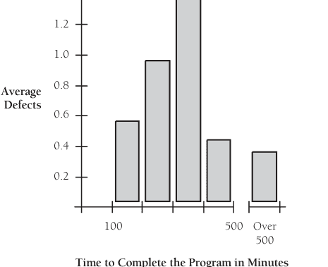

完成程序所需时间（分钟）

## 图 20-2 无论是最快还是最慢的开发方法，所产生的软件缺陷都不是最多的

最慢的两个组达到与最快组大致相同的缺陷率所花时间约为最快组的五倍。编写无缺陷软件并不一定比编写有缺陷软件花费更多时间。如图所示，它甚至可能花费更少。

诚然，在某些类型的项目中，质量保证需要花费金钱。如果你是为航天飞机或医疗生命支持系统编写代码，所需的可靠性程度会使项目更加昂贵。

与传统的编码-测试-调试循环相比，明智的软件质量计划能够节省资金。它将资源从调试和重构中重新分配到上游质量保证活动。上游活动对产品质量的影响比下游活动更大，因此你在上游投入的时间能在下游节省更多时间。最终效果是缺陷更少、开发时间更短、成本更低。在接下来的三章中，你将看到更多关于软件质量一般原则的示例。

### 21.1 协作式开发实践概述

“协作式构建”指的是结对编程、正式检查、非正式技术评审、文档阅读，以及其他开发人员共同负责创建代码和其他工作产品的技术。在我的公司，“协作式构建”一词由 Matt Peloquin 于2000年左右创造。这个词似乎在同一时期也被其他人独立创造。

所有协作式构建技术，尽管存在差异，都基于以下理念：开发人员对自己工作中的一些问题点视而不见，其他人没有相同的盲点，而且让其他人审视开发人员的工作是有益的。软件工程研究所的研究发现，开发人员平均每小时会在设计中引入1到3个缺陷，在代码中引入5到8个缺陷（Humphrey 1997），因此消除这些盲点是高效构建的关键。


## 协作式构建补充其他质量保证技术


协作式构建的主要目的是提高软件质量。如第20章“软件质量全景”所述，软件测试单独使用时的有效性有限——单元测试的平均缺陷检测率仅为约30%，集成测试为35%，小规模beta测试为35%。相比之下，设计和代码检查的平均有效性分别为55%和60%（Jones 1996）。协作式构建的次要好处是缩短开发时间，从而降低开发成本。


早期关于结对编程的报告表明，它可以达到与正式检查相似的代码质量水平（Shull 等人，2002）。全面实施结对编程的成本可能高于单独开发的成本——高出约10%–25%——但开发时间的减少似乎约为45%，在某些情况下，这可能是对单独开发的决定性优势（Boehm 和 Turner 2004），尽管相对于已产生类似结果的检查并非如此。

技术评审的研究时间比结对编程长得多，正如案例研究和其他资料所述，其结果令人印象深刻：

-   IBM 发现，每进行一小时的检查，可避免约100小时的相关工作（测试和缺陷修正）（Holland 1999）。
-   雷神公司通过一项以检查为重点的举措，将缺陷修正（返工）成本从约占总项目成本的40%降至约20%（Haley 1996）。


-   惠普报告称，其检查计划每年估计节省2150万美元（Grady 和 Van Slack 1994）。
-   帝国化学工业发现，维护一个由约400个程序组成的组合的成本，仅为维护一组未经过检查的类似程序成本的约10%（Gilb 和 Graham 1993）。
-   一项针对大型程序的研究发现，每花一小时进行检查，平均可避免33小时的维护工作，而且检查的效率最高可达测试的20倍（Russell 1991）。
-   在一个软件维护组织中，引入代码评审之前，55%的单行维护更改存在错误。引入评审后，只有2%的更改存在错误（Freedman 和 Weinberg 1990）。若考虑所有更改，引入评审后，95%的更改首次即正确。引入评审前，首次正确的不到20%。
-   一组11个程序由同一组人开发，并全部发布到生产环境。前五个未经评审开发，平均每100行代码有4.5个错误。另外六个经过检查，平均每100行代码仅0.82个错误。评审将错误减少了80%以上（Freedman 和 Weinberg 1990）。
-   Capers Jones 报告称，在他研究过的所有实现99%或更高缺陷移除率的软件项目中，都使用了正式检查。此外，缺陷移除效率低于75%的项目无一使用正式检查（Jones 2000）。

这些案例中的许多都说明了软件质量的一般原则，即减少软件缺陷数量也能缩短开发时间。


多项研究表明，协作实践除了能比测试更有效地捕获错误之外，还能发现与测试不同类型的错误（Myers 1978; Basili, Selby, and Hutchens 1986）。正如 Karl Wiegers 指出的那样：“人工评审者可以发现不清晰的错误消息、不充分的注释、硬编码的变量值，以及应当合并的重复代码模式。测试做不到这一点。”（Wiegers 2002）。另一个次要效果是，当人们知道自己的工作将受到评审时，他们会更仔细地审查自己的工作。因此，即使测试有效进行，评审或其他形式的协作也是全面质量计划中不可或缺的一部分。


# 协作式构建在企业文化和编程专业知识方面提供指导

> 非正式的评审程序在计算的普遍文化中通过口口相传延续了多年，直到在印刷品中才得到承认。对评审的需求对最好的程序员来说是如此明显，以至于他们很少在印刷品中提及，而最差的程序员则认为自己如此优秀，以至于他们的工作不需要评审。
> 
> —Daniel Freedman 和 Gerald Weinberg

软件标准可以写下来并分发，但如果没有人谈论它们或鼓励他人使用它们，就不会被遵循。评审是向程序员提供关于其代码反馈的重要机制。代码、标准以及使代码符合标准的原因都是评审讨论的良好主题。

除了关于他们如何遵循标准的反馈外，程序员还需要关于编程更主观方面的反馈：格式、注释、变量名、局部和全局变量使用、设计方法、我们在这里的做法等等。经验尚浅的程序员需要更有知识的人的指导，而更有知识的程序员往往很忙，需要被鼓励花时间分享他们所知道的。评审为更有经验和经验较少的程序员之间就技术问题进行沟通提供了场所。因此，评审既是培养未来质量改进的机会，也是培养当前质量改进的机会。

一个使用正式检查的团队报告称，检查很快就使所有开发人员达到了最佳开发人员的水平（Tackett and Van Doren 1999）。

## 集体所有权适用于所有形式的协作式构建

> **交叉引用** 跨越所有协作式构建技术的概念是集体所有权的思想。在某些开发模型中，程序员拥有他们编写的代码，并且存在正式或非正式的限制来修改他人的代码。集体所有权增加了对工作协调的需求，尤其是配置管理。详情请参阅第 28.2 节，“配置管理”。

在集体所有权下，所有代码都由团队而不是个人拥有，可以由团队的各个成员访问和修改。这会产生几个宝贵的益处：

- 多双眼睛看到代码和多名程序员在代码上工作，从而产生更好的代码质量。
- 某人离开项目的影响会减轻，因为多个人熟悉代码的每个部分。
- 缺陷修复周期总体上更短，因为任何几名程序员都可能根据可用情况被分配来修复错误。

一些方法，例如极限编程，建议正式配对程序员并随着时间的推移轮换他们的工作分配。在我的公司，我们发现程序员不需要正式配对就能实现良好的代码覆盖。随着时间的推移，我们通过正式和非正式技术评审的结合、必要时的结对编程以及缺陷修复分配的轮换来实现交叉覆盖。

# 协作在构建之前和之后同样适用

本书是关于构建的，因此本章的重点是详细设计和代码的协作。然而，本章中关于协作式构建的大多数评论也适用于估算、计划、需求、架构、测试和维护工作。通过研究本章末尾的参考资料，您可以将协作技术应用于大多数软件开发活动。

### 21.2 结对编程

在结对编程时，一名程序员在键盘上输入代码，另一名程序员则观察错误并从战略上思考代码是否被正确编写以及是否编写了正确的代码。结对编程最初由极限编程普及（Beck 2000），但现在使用范围更广（Williams and Kessler 2002）。

### 结对编程成功的关键

结对编程的基本概念很简单，但其使用仍然受益于一些指导原则：

**用编码标准支持结对编程** 如果一对中的两个人花时间争论编码风格，结对编程将不会有效。尝试标准化第 5 章“构建中的设计”所指的编程的“偶然属性”，以便程序员能够专注于手头的“本质”任务。

**不要让结对编程变成观看** 没有键盘的人应该是编程中的积极参与者。那个人正在分析代码，提前思考下一步将编写什么代码，评估设计并计划如何测试代码。

**不要强迫对简单的事情进行结对编程** 一个对最复杂的代码使用结对编程的团队发现，花 15 分钟在白板上进行详细设计然后单独编程更有效（Manzo 2002）。尝试过结对编程的大多数组织最终会确定只对部分工作使用结对，而非全部工作（Boehm and Turner 2004）。

**定期轮换配对和工作分配** 在结对编程中，与其他协作开发实践一样，收益来自于不同程序员学习系统的不同部分。定期轮换配对分配以鼓励交叉授粉——一些专家建议每天更换配对（Reifer 2002）。

**鼓励配对相互匹配节奏** 一个合作伙伴走得太快会限制另一个合作伙伴的好处。速度更快的合作伙伴需要放慢速度，或者应该拆分配对并重新配置不同的合作伙伴。

**确保两个合作伙伴都能看到显示器** 即使看似平常的问题，如能够看到显示器和使用过小的字体，也会造成问题。

**不要强迫不喜欢彼此的人结对** 有时性格冲突会阻止人们有效地结对。强迫关系不和的人结对是毫无意义的，因此要对性格匹配敏感（Beck 2000, Reifer 2002）。

**避免让所有新手结对** 结对编程效果最好的是至少一个合作伙伴以前结对过（Larman 2004）。

**指定团队领导** 如果你的整个团队想以 100% 的结对方式进行编程，你仍然需要指定一个人来协调工作分配、对结果负责并作为项目外部人员的联系点。

### 结对编程的好处

结对编程产生众多好处：

- 它在压力下比单独开发更能经受住考验。配对鼓励彼此在有压力写快速又脏的代码时仍保持代码质量高。
- 它提高代码质量。代码的可读性和可理解性往往会上升到团队中最佳程序员的水平。
- 它缩短进度。配对往往更快地编写代码且错误更少。项目团队在项目结束时花费更少的时间来纠正缺陷。
- 它产生所有其他协作式构建的一般好处，包括传播企业文化、指导初级程序员以及促进集体所有权。

### 检查清单：有效的结对编程

- 你是否有编码标准，以便结对程序员专注于编程而不是哲学性的编码风格讨论？
- 两个合作伙伴是否都在积极参与？
- 你是否避免对所有内容进行结对编程，而是选择真正能从结对编程中受益的任务？
- 你是否定期轮换配对分配和工作分配？
- 配对在节奏和性格方面是否匹配良好？
- 是否有团队领导作为管理和其他项目外部人员的焦点？


### 21.3 正式检查

检查是一种已被证明在发现缺陷方面极其有效，并且与测试相比相对经济的特定类型的评审。检查由 Michael Fagan 开发，并在 IBM 使用了数年后，Fagan 发表了使其公开的论文。虽然任何评审都涉及阅读设计或代码，但检查在几个关键方面与普通的评审不同：

**延伸阅读** 如果你想阅读关于检查的原始文章，请参阅“Design and Code Inspections to Reduce Errors in Program Development”（Fagan 1976）。

- 检查清单将评审人员的注意力集中在过去曾出现问题的领域。
- 检查侧重于缺陷检测，而非纠正。
- 评审人员会在检查会议前做好准备，并带着他们发现的问题清单到达。
- 为所有参与者分配了不同的角色。
- 检查的组织者不是被检查的工作成果的作者。
- 组织者接受过专门的检查组织培训。
- 只有当所有参与者都已充分准备时，才会举行检查会议。
- 在每次检查中都会收集数据，并将其反馈到未来的检查中以改进检查。
- 除非检查的是项目计划或其他管理材料，否则一般管理层不会参加检查会议。技术领导者可能会参加。

## 从检查中可以期待什么结果？


单个检查通常能发现约 60% 的缺陷，这高于其他技术，除了原型设计和高容量 Beta 测试。这些结果已在多个组织中多次得到证实，包括 Harris BCSD、National Software Quality Experiment、Software Engineering Institute、Hewlett Packard 等等（Shull et al 2002）。

设计和代码检查的结合通常能消除产品中 70–85% 或更多的缺陷（Jones 1996）。检查能及早识别出易出错的类，Capers Jones 报告称，与较不正式的评审实践相比，它们可使每千行代码的缺陷减少 20–30%。设计师和编码员通过参与检查学会改进工作，检查可使生产率提高约 20%（Fagan 1976, Humphrey 1989, Gilb and Graham 1993, Wiegers 2002）。在一个使用检查进行设计和代码的项目中，检查将占用约 10–15% 的项目预算，并通常会降低整体项目成本。

检查也可以用于评估进度，但评估的是技术进度。这通常意味着回答两个问题：技术工作是否正在进行？技术工作是否做得好？这两个问题的答案都是正式检查的副产品。

## 检查期间的角色

检查的一个关键特征是每个参与者都有不同的角色要扮演。以下是这些角色：

**组织者** 组织者负责保持检查以足够快以提高生产率但又足够慢以尽可能发现最多错误的速度进行。组织者必须具备技术能力——不一定是被检查的特定设计或代码的专家，但能够理解相关细节。此人管理检查的其他方面，例如分发待评审的设计或代码、分发检查清单、设置会议室、报告检查结果以及跟进检查会议中分配的行动项目。

**作者** 编写设计或代码的人在检查中扮演相对次要的角色。检查的一个目标是确保设计或代码能够自证其说。如果被检查的设计或代码最终不清楚，作者将被分配使其更清晰的任务。否则，作者的职责是解释设计或代码中不清楚的部分，并偶尔解释为什么看起来像错误的东西实际上是可以接受的。如果评审人员对项目不熟悉，作者还可能在检查会议准备期间介绍项目的概述。

**评审员** 评审员是任何对设计或代码有直接兴趣但不是作者的人。设计评审员可能是将实现该设计的程序员。测试员或更高级别的架构师也可能参与其中。评审员的角色是发现缺陷。他们通常在准备期间发现缺陷，并且随着设计或代码在检查会议上被讨论，团队应发现更多缺陷。

**记录员** 记录员在检查会议期间记录检测到的错误和行动项目的分配。作者或组织者都不应担任记录员。

**管理层** 通常不建议将管理层纳入检查。软件检查的要点是它是一次纯粹的技术评审。管理层的在场会改变互动：人们会觉得他们而不是评审材料正在接受评估，这会使焦点从技术转向政治。然而，管理层有权了解检查结果，并会准备检查报告以让管理层了解情况。

同样，在任何情况下都不应将检查结果用于绩效评估。不要杀死下金蛋的鹅。检查中检查的代码仍在开发中。绩效评估应基于最终产品，而不是未完成的工作。

总体而言，检查不应少于三名参与者。少于三人就不可能拥有单独的组织者、作者和评审员，而这些角色也不应合并。传统建议是将检查限制在约六人，因为再多的话，团队就变得太大而难以管理。研究人员普遍发现，拥有超过两到三名评审员似乎并不会增加发现的缺陷数量（Bush and Kelly 1989, Porter and Votta 1997）。然而，这些总体发现并不一致，结果似乎因被检查材料的种类而异（Wiegers 2002）。请注意你的经验，并相应地调整你的方法。

## 检查的通用流程

检查包含几个不同的阶段：

**计划** 作者将设计或代码交给组织者。组织者决定谁将评审材料以及检查会议何时何地举行；然后组织者分发设计或代码和一个聚焦检查员注意力的清单。材料应打印并带行号，以便在会议期间加快错误识别。

**概述** 当评审人员不熟悉他们正在评审的项目时，作者可以花费大约一个小时描述设计或代码所创建的技术环境。进行概述往往是一种危险的做法，因为它可能导致对被检查设计或代码中不清楚的点的掩盖。设计或代码应自证其说；概述不应为其代言。

**准备** 每位评审员单独工作，仔细审查设计或代码是否存在错误。评审员使用清单来激发和指导他们对评审材料的检查。

对于用高级语言编写的应用代码评审，评审员可以以每小时约 500 行代码的速度准备。对于用高级语言编写的系统代码评审，评审员只能以每小时约 125 行代码的速度准备（Humphrey 1989）。最有效的评审速度差异很大，因此请记录你组织中的准备速度，以确定在你的环境中最有效的速度。

一些组织发现，当每位评审员被分配一个特定的视角时，检查会更有效。评审员可能会被要求从维护程序员、客户的观点为检查做准备，

交叉引用 有关可用于改进代码质量的检查清单列表，请参阅第 xxix 页。


或者设计者，例如。关于基于视角的评审的研究尚未全面，但它表明基于视角的评审可能会比一般评审发现更多错误。

检查准备的另一种变化是为每位评审员分配一个或多个需要检查的场景。场景可以涉及评审员被分配回答的具体问题，例如“是否有任何需求未被此设计满足？”场景也可能涉及评审员被分配执行的具体任务，例如列出特定设计元素所满足的具体需求。你也可以指派一些评审员从前往后、从后往前或从内到外阅读材料。

## 检查会议

主持人选择除作者以外的人来复述设计或阅读代码（Wiegers 2003）。所有逻辑都将被解释，包括每个逻辑结构中的每个分支。在此演示过程中，记录员在发现错误时记录错误，但一旦错误被识别为错误，讨论就会立即停止。记录员记录错误的类别和严重程度，然后检查继续进行。如果你在保持讨论的集中方面遇到问题，主持人可能会敲铃以引起大家的注意并使讨论回到正轨。

设计或代码被审视的速度不应过慢也不应过快。如果太慢，注意力会下降，会议将不会富有成效。如果太快，团队可能会忽略本应发现的错误。最佳检查速率因环境而异，就像准备速率一样。保留记录，以便随着时间的推移确定您环境的最佳速率。其他组织发现，对于系统代码，每小时 90 行代码的检查速率是最佳的。对于应用程序代码，检查速率可以快到每小时 500 行代码（Humphrey 1989）。每小时约 150–200 条非空白、非注释源语句的平均值是一个不错的起点（Wiegers 2002）。

会议期间不要讨论解决方案。团队应专注于识别缺陷。一些检查组甚至不允许讨论缺陷是否真的是缺陷。他们假设如果有人困惑到认为它是缺陷，那么设计、代码或文档就需要澄清。

会议通常不应超过两小时。这并不意味着你必须在两小时时假装火灾警报以让每个人都离开，但 IBM 和其他公司的经验表明，评审员一次最多只能集中注意力约两小时。出于同样的原因，在同一天安排多次检查是不明智的。

## 检查报告

在检查会议后一天内，主持人会制作检查报告（电子邮件或等效文件），列出每个缺陷，包括其类型和严重程度。检查报告有助于确保所有缺陷都得到纠正，并且用于制定强调组织特定问题的检查表。如果你收集有关所花费时间和随时间发现的错误数量的数据，你可以用硬数据回应有关检查有效性的质疑。否则，你只能说检查似乎更好。这对认为测试似乎更好的人来说不会那么有说服力。你还能够判断检查在你的环境中是否不起作用，并相应地修改或放弃它们。数据收集也很重要，因为任何新方法都需要证明其存在的合理性。

## 返工

主持人将缺陷分配给某人，通常是作者，进行修复。被指派者解决清单上的每个缺陷。

## 跟进

主持人负责确保在检查期间分配的所有返工工作都得到执行。根据发现的错误数量和这些错误的严重程度，你可能会通过让评审员重新检查整个工作产品、让评审员仅重新检查修复部分，或允许作者在没有任何后续检查的情况下完成修复来进行后续跟进。

## 第三小时会议

尽管在检查期间参与者不允许讨论所提出问题的解决方案，但他们中有些人可能仍想讨论。你可以在正式检查结束后举行一次非正式的第三小时会议，让感兴趣的各方讨论解决方案。

## 微调检查

一旦你熟练掌握“按书本”进行检查，通常可以找到几种改进方法。不要随意引入更改。“仪器化”检查过程，以便你知道你的更改是否有益。

公司经常发现，删除或合并任何阶段的成本都高于节省的成本（Fagan 1986）。如果你想在不衡量更改效果的情况下更改检查流程，不要这样做。如果你已经衡量了流程，并且知道你的更改流程比这里描述的更好，那就继续吧。

在进行检查时，你会注意到某些类型的错误发生的频率高于其他类型。创建一个检查表，提醒评审员注意这些类型的错误，以便他们关注这些错误。随着时间的推移，你会发现一些不在检查表上的错误类型；将其添加到检查表中。你可能会发现初始检查表上的某些错误不再出现；将其删除。经过几次检查后，你的组织将拥有一个根据其需求定制的检查检查表，并且它可能还会有一些关于程序员需要更多培训或支持的麻烦区域的线索。将你的检查表限制在一页或更少。更长的检查表在检查所需的详细程度上很难使用。

## 检查中的自我

### 进一步阅读

有关无我编程的讨论，请参阅 *The Psychology of Computer Programming*, 2d ed.（Weinberg 1998）。

检查本身的目的是发现设计或代码中的缺陷。它不是为了探索替代方案或争论谁对谁错。最重要的是，它不是为了批评设计或代码的作者。作者的体验应该是积极的，显然团队参与改进了程序，并且对所有参与者来说都是学习经历。它不应让作者相信团队中的某些人是混蛋，或者是时候找新工作了。诸如“任何懂 Java 的人都知道，从 0 到 num-1 循环比从 1 到 num 更有效”之类的评论完全不合适，如果出现这种情况，主持人应明确指出其不恰当性。

由于设计或代码正在受到批评，而作者可能对其有某种依恋，作者自然会感受到指向代码的部分热度。作者应预期听到对一些并非真正缺陷的缺陷的批评，以及对一些似乎有争议的缺陷的批评。尽管如此，作者应承认每个 alleged 缺陷并继续进行。承认批评并不意味着作者同意批评的内容。作者不应试图为正在审查的工作辩护。审查后，作者可以私下思考每个要点并决定其是否有效。

评审员必须记住，作者对如何处理缺陷负有最终责任。享受发现缺陷是可以的（并且在审查之外，享受提出解决方案），但每个评审员都必须尊重作者最终决定如何解决错误的权利。

## 检查与《代码大全》

我在使用检查来编写《代码大全》第二版时有过个人经历。对于本书的第一版，我最初写了一个粗略的草稿。在让每个章节的粗略草稿在抽屉里放一周或两周后，我冷读该章节并纠正我发现的错误。然后我将修订后的章节分发给大约十几位同行进行审查，其中一些人进行了相当彻底的审查。我纠正了他们发现的错误。经过几周后，我再次自行审阅并纠正了更多错误。最后，我将手稿提交给出版商，在那里它由校对编辑、技术编辑和校对员审查。该书印刷了十多年，读者在那段时间发送了大约 200 项更正。

你可能会认为经过所有这些审查活动后，书中不会剩下太多错误。但事实并非如此。为了创建第二版，我使用了第一版的正式检查来确定第二版中需要解决的问题。由三到四名评审员组成的团队根据本章所述的指南进行准备。令我有些惊讶的是，我们的正式检查发现了第一版文本中数百个错误，这些错误此前从未通过任何大量的审查活动被发现。


如果我对正式检查的价值还有任何怀疑，在编写《Code Complete》第二版的过程中获得的经验消除了这些怀疑。

## 检查总结

检查清单鼓励集中注意力。检查过程之所以系统，是因为它有标准的清单和标准角色。它也是自优化的，因为它使用正式的反馈循环来改进清单并监控准备和检查率。凭借对过程的这种控制和持续优化，检查很快就成为一种强大的技术，无论它如何开始。

进一步阅读 有关 SEI 对开发成熟度的概念的更多细节，请参阅《Managing the Software Process》（Humphrey 1989）。

软件工程研究所（SEI）定义了一个能力成熟度模型（CMM），用于衡量组织软件开发过程的有效性（SEI 1995）。检查过程展示了最高级别的样子。该过程是系统且可重复的，并使用度量反馈来改进自身。你可以将同样的思想应用于本书中描述的许多技术。当推广到整个开发组织时，这些思想归根结底就是将组织提升到最高质量和生产率水平所需的东西。

## CHECKLIST: Effective Inspections

- 你是否有清单来引导评审人员关注过去出现问题的地方？
- 你是否将检查集中在缺陷检测而不是纠正上？
- 你是否考虑过分配视角或场景来帮助评审人员集中准备工作？
- 评审人员在检查会议前是否有足够的时间准备，并且每个人都已准备好？
- 每位参与者是否有明确的角色——主持人、评审员、记录员等等？
- 会议是否以富有成效的速度进行？
- 会议是否限制在两小时内？
- 所有检查参与者是否都接受过进行检查的具体培训，主持人是否接受过调解技能的特殊培训？
- 是否在每次检查中收集错误类型的数据，以便你能根据组织情况定制未来的清单？
- 是否收集准备和检查率的数据，以便你能优化未来的准备和检查？
- 是否跟进每次检查中分配的行动项目，无论是由主持人亲自跟进还是通过重新检查？
- 管理层是否理解不应参加检查会议？
- 是否有后续计划来确保修复正确完成？

### 21.4 其他协作式开发实践

其他类型的协作尚未积累到像检查或结对编程那样多的实证支持，因此这里的介绍深度较浅。本节涵盖的协作包括步行评审、代码阅读和狗与小马表演。

### Walk-Throughs

步行评审是一种流行的评审方式。该术语定义松散，至少部分流行可以归因于人们可以将几乎任何类型的评审称为“步行评审”。

由于该术语定义过于宽泛，很难确切地说步行评审是什么。当然，步行评审涉及两个人或更多人讨论设计或代码。它可能像在白板旁的即兴头脑风暴一样非正式；也可能像由艺术部门准备的幻灯片演示和向管理层发送正式总结的预定会议一样正式。从某种意义上说，“无论在哪里有两三个人聚集在一起”，那里就有步行评审。步行评审的倡导者喜欢这种定义的宽松性，所以我只指出所有步行评审共有的几点，其余细节留给你：

- 步行评审通常由正在评审的设计或代码的作者主持和调解。
- 步行评审关注技术问题——这是一次工作会议。
- 所有参与者在步行评审前都会通过阅读设计或代码并寻找错误来准备。
- 步行评审是资深程序员向初级程序员传授经验和企业文化的机会。也是初级程序员提出新方法并挑战陈旧、可能过时的假设的机会。
- 步行评审通常持续 30 到 60 分钟。
- 重点是错误检测，而不是纠正。
- 管理层不参加。
- 步行评审概念灵活，可以根据使用它的组织的具体需求进行调整。

### What Results Can You Expect from a Walk-Through?

如果使用得当且有纪律，步行评审可以产生与检查类似的结果——也就是说，它通常可以发现程序中 20% 到 40% 的错误（Myers 1979, Boehm 1987b, Yourdon 1989b, Jones 1996）。但总体而言，步行评审被发现明显不如检查有效（Jones 1996）。


如果使用不当，步行评审弊大于利。其有效性的低端 20% 并不值得，而且至少有一个组织（波音计算机服务公司）发现代码同行评审“极其昂贵”。波音发现很难让项目人员持续一致地应用步行评审技术，并且当项目压力增加时，步行评审几乎变得不可能（Glass 1982）。

在过去 10 年里，我对步行评审变得更加批评，这源于我在公司咨询业务中看到的情况。我发现当人们对技术评审有糟糕的经历时，几乎总是与步行评审等非正式做法有关，而不是正式检查。评审本质上是一次会议，而会议很昂贵。如果你要承担召开会议的开销，那么值得将会议结构化为正式检查。如果你要评审的工作产品不值得正式检查的开销，那么它也不值得会议的开销。在这种情况下，你最好使用文档阅读或其他更少互动的方法。

检查似乎比步行评审更有效地消除错误。那么为什么有人会选择使用步行评审呢？

如果你有一个大型的评审小组，步行评审是一个不错的评审选择，因为它能让许多不同的观点作用于正在评审的项目。如果参与步行评审的每个人都能确信解决方案是正确的，那么它可能没有重大缺陷。

如果涉及其他组织的评审人员，步行评审也可能更可取。检查中的角色更加正式化，需要一些练习才能有效执行。以前没有参加过检查的评审人员处于劣势。如果你想征求他们的贡献，步行评审可能是最佳选择。


检查比步行评审更专注，通常回报更好。因此，如果你为组织选择评审标准，首先选择检查，除非你有充分的理由不这样做。

### Code Reading

代码阅读是检查和步行评审的替代方案。在代码阅读中，你阅读源代码并寻找错误。你还会对代码的定性方面发表评论，例如其设计、风格、可读性、可维护性和效率。


NASA 软件工程实验室的一项研究发现，代码阅读检测到约每小时 3.3 个缺陷。测试检测到约每小时 1.8 个错误（Card 1987）。代码阅读在项目生命周期内发现的错误比各种测试多 20% 到 60%。

像步行评审的想法一样，代码阅读的概念定义松散。代码阅读通常涉及两个人或更多人独立阅读代码，然后与代码作者会面讨论。代码阅读的流程如下：

- 为会议做准备，代码作者向代码阅读者分发源代码清单。清单包含 1000 到 10,000 行代码；4000 行是典型值。
- 两人或更多人阅读代码。使用至少两人以鼓励评审员之间的竞争。如果你使用超过两人，请衡量每个人的贡献，以便你知道额外人员贡献了多少。
- 评审员独立阅读代码。估计速率为每天约 1000 行。
- 当评审员完成阅读代码后，代码阅读会议由代码作者主持。会议持续一到两个小时，重点关注代码阅读者发现的问题。没有人尝试逐行走查代码。会议甚至不是严格必要的。
- 代码作者修复评审员发现的问题。


代码阅读与检查和步行评审的区别在于，代码阅读更侧重于对代码的个人评审，而非会议。其结果是每个评审员的时间都集中在发现代码中的问题上。花在会议上的时间更少，在会议中每个人只贡献部分时间，并且大量精力用于调解群体动态。花在推迟会议以等待小组中的每个人都能空出两小时的时间更少。代码阅读在评审人员地理分散的情况下尤其有价值。

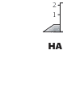

AT&T 对 13 次评审的研究发现，评审会议本身的重要性被高估了；90% 的缺陷是在评审会议准备期间发现的，只有约 10% 是在评审期间发现的（Votta 1991, Glass 1999）。


## 做秀式评审

做秀式评审是向客户演示软件产品的评审。为政府合同开发的软件中，客户评审很常见，这些合同通常规定要对需求、设计和代码进行评审。做秀式评审的目的是向客户表明项目进展正常，因此它是一种管理评审而非技术评审。

不要依赖做秀式评审来提高产品的技术质量。为这些评审做准备可能会对技术质量产生间接影响，但通常更多时间花在制作漂亮的演示幻灯片上，而不是花在提高软件质量上。要提高技术质量，请依靠正式检查、走查或代码阅读。

## 协同构建技术比较

各种协同构建技术之间有何差异？表21-1总结了每种技术的主要特征。

表21-1 协同构建技术比较

| 属性 | 结对编程 | 正式检查 | 非正式评审（走查） |
|---|---|---|---|
| 明确定义的参与者角色 | 是 | 是 | 否 |
| 关于如何履行这些角色的正式培训 | 可能有，通过指导 | 是 | 否 |
| 谁“驱动”协作 | 操作键盘的人 | 主持人 | 通常是作者 |
| 协作的焦点 | 设计、编码、测试和缺陷纠正 | 仅缺陷检测 | 各不相同 |
| 重点评审工作——查找最常见的错误类型 | 非正式（若有的话） | 是 | 否 |
| 跟踪以减少不良修复 | 是 | 是 | 否 |
| 由于向单个程序员提供详细的错误反馈而减少未来错误 | 偶然 | 是 | 偶然 |
| 通过分析结果提高流程效率 | 否 | 是 | 否 |
| 对非构建活动有用 | 可能 | 是 | 是 |
| 典型缺陷发现百分比 | 40–60% | 45–70% | 20–40% |

结对编程不像正式检查那样有几十年的数据支持其有效性，但初步数据表明它与正式检查大致相当，而且轶事报告也是正面的。

如果结对编程和正式检查在质量、成本和进度方面产生相似的结果，那么二者之间的选择就变成个人风格问题，而不是技术实质问题。有些人喜欢独自工作，只在检查会议时才偶尔打破独行模式。另一些人则更喜欢花更多时间直接与他人合作。在这两种技术之间的选择可以由团队中特定开发者的工作风格偏好来驱动，团队内部的小组也可以被允许选择他们希望以哪种方式完成大部分工作。你还应该在项目中因地制宜地使用不同技术。

## 补充资源

以下是关于协同构建的更多资源：

### 结对编程

Williams, Laurie 和 Robert Kessler。*《结对编程详解》*。Boston, MA: Addison Wesley, 2002. 这本书详细说明了结对编程的来龙去脉，包括如何处理各种性格搭配（例如专家与新手、内向与外向）以及其他实施问题。

Beck, Kent. *《解析极限编程：拥抱变化》*. Reading, MA: Addison Wesley, 2000. 这本书简要介绍了结对编程，并展示了如何将其与其他相互支持的技术（包括编码标准、频繁集成和回归测试）结合使用。

Reifer, Donald. “如何充分利用极限编程/敏捷方法，” *《XP/Agile Universe 2002 论文集》*. New York, NY: Springer, pp. 185–196. 该论文总结了极限编程和敏捷方法的工业经验，并提出了结对编程的成功关键。

### 正式检查

Wiegers, Karl. *《软件同行评审：实用指南》*. Boston, MA: Addison Wesley, 2002. 这本写得不错的书描述了各种评审的来龙去脉，包括正式检查和其他不太正式的做法。它研究充分，注重实用，且易于阅读。

Gilb, Tom 和 Dorothy Graham. *《软件检查》*. Wokingham, England: Addison-Wesley, 1993. 这本书对约20世纪90年代初的检查进行了深入讨论。它注重实用，并包含案例研究，描述了若干组织在建立检查项目方面的经验。

Fagan, Michael E. “设计和代码检查以减少程序开发中的错误。” *《IBM系统杂志》* 15, no. 3 (1976): 182–211.

Fagan, Michael E. “软件检查的进展。” *《IEEE软件工程学报》*, SE-12, no. 7 (1986年7月): 744–51. 这两篇文章由检查方法的创始人撰写，包含了运行检查所需了解的核心内容，包括所有标准检查表格。

## 相关标准

*IEEE Std 1028-1997，软件评审标准*

*IEEE Std 730-2002，软件质量保证计划标准*

## 关键要点

- 协同开发实践往往能比测试发现更高比例的缺陷，并且发现缺陷的效率更高。
- 协同开发实践往往能发现与测试不同类型的错误，这意味着你需要同时使用评审和测试来确保软件质量。
- 正式检查使用检查表、准备、明确定义的角色和持续的过程改进来最大化错误检测效率。它们往往比走查发现更多缺陷。
- 结对编程的典型成本与正式检查大致相同，并产生相似质量的代码。当需要缩短进度时，结对编程尤其有价值。有些开发者更喜欢结对工作而非独自工作。
- 正式检查可应用于工作产品，如需求、设计、测试用例，以及代码。
- 走查和代码阅读是正式检查的替代方案。代码阅读在有效利用每个人的时间方面提供了更大的灵活性。

## 第22章

## 开发者测试

### 目录

- 22.1 开发者测试在软件质量中的作用：第500页
- 22.2 推荐的开发者测试方法：第503页
- 22.3 测试技巧锦囊：第505页
- 22.4 典型错误：第517页
- 22.5 测试支持工具：第523页
- 22.6 改进你的测试：第528页
- 22.7 保存测试记录：第529页

### 相关主题

- 软件质量全景：第20章
- 协同构建实践：第21章
- 调试：第23章
- 集成：第29章
- 构建的先决条件：第3章

测试是最流行的质量改进活动——这一做法得到了大量工业界和学术界研究以及商业经验的支持。软件可以通过多种方式进行测试，其中一些通常由开发者执行，另一些则更常见于专业测试人员：

- *单元测试*是执行由单个程序员或程序员团队编写的完整类、例程或小程序，并在与更完整系统隔离的情况下进行测试。
- *组件测试*是执行涉及多个程序员或编程团队工作的类、包、小程序或其他程序元素，并在与更完整系统隔离的情况下进行测试。
- *集成测试*是执行由多个程序员或编程团队创建的两个或多个类、包、组件或子系统的组合。这种测试通常在有两个类可以测试时就开始，一直持续到整个系统完成。

- *回归测试*是重复执行先前已执行的测试用例，目的是发现在之前通过同一组测试的软件中的缺陷。
- *系统测试*是在最终配置下执行软件，包括与其他软件和硬件系统的集成。它测试安全性、性能、资源损失、时序问题以及其他在较低集成级别无法测试的问题。

在本章中，“测试”指由开发者进行的测试，通常包括单元测试、组件测试和集成测试，但有时也可能包括回归测试和系统测试。许多其他类型的测试由专业测试人员执行，开发者很少执行，包括beta测试、客户验收测试、性能测试、配置测试、平台测试、压力测试、可用性测试等等。本章不再讨论这些类型的测试。


测试通常分为两大类：黑盒测试和白盒（或玻璃盒）测试。“黑盒测试”指的是测试者无法看到被测试项目内部工作的测试。当你测试自己编写的代码时，这显然不适用！“白盒测试”指的是测试者了解被测试项目内部工作的测试。这就是你作为开发者测试自己代码时使用的那种测试。黑盒测试和白盒测试都各有优缺点；本章重点讨论白盒测试，因为这是开发者执行的测试类型。

一些程序员将“测试”和“调试”这两个术语混用，但谨慎的程序员会区分这两种活动。测试是检测错误的一种手段。调试是诊断和纠正已检测到错误的根本原因的一种手段。本章专门讨论错误检测。错误纠正将在第23章“调试”中详细讨论。

测试的整体主题远大于构建期间测试这一主题。系统测试、压力测试、黑盒测试以及面向测试专家的其他主题，将在本章末尾的“补充资源”一节中讨论。

### 22.1 开发者测试在软件质量中的作用

> **交叉引用** 关于评审的详细信息，请参见第21章“协同构建”。

测试是任何软件质量计划的重要组成部分，而且在许多情况下它是唯一的部分。这很不幸，因为各种形式的协同开发实践已被证明比测试能发现更高比例的错误，而且每个错误发现成本不到测试的一半（Card 1987, Russell 1991, Kaplan 1995）。单独的测试步骤（单元测试、组件测试和集成测试）通常各自发现不到50%的现有错误。组合测试步骤往往发现不到60%的现有错误（Jones 1998）。


> 程序不会像人一样通过与有 bug 的程序待在一起而感染 bug，程序员必须主动植入它们。
> —Harlan Mills

如果你在“芝麻街”上列出一组软件开发活动并问：“这些东西中哪一个不一样？”答案会是“测试”。测试对大多数开发者来说是一个难以接受的活动，原因有几个：

- 测试的目标与其它开发活动的目标背道而驰。目标是发现错误。一个成功的测试是让软件崩溃的测试。而其它所有开发活动的目标都是防止错误并让软件不至于崩溃。
- 测试永远无法完全证明错误的不存在。如果你已经大量测试并发现了成千上万个错误，这意味着你已经找到了所有错误，还是意味着还有成千上万个错误等待发现？错误的不存在同样可能意味着测试用例无效或不完整，也可能意味着软件完美无缺。
- 测试本身并不能提高软件质量。测试结果是质量的指标，但本身并不能改善质量。试图通过增加测试量来提高软件质量，就像试图通过更频繁地称体重来减肥一样。你在上秤前吃了什么决定了你会称出多少体重，而你使用的软件开发技术决定了测试会发现多少错误。如果你想减肥，不要买新的体重秤；改变饮食。如果你想改进软件，不要只做更多测试；要开发得更好。
- 测试要求你假设自己会在代码中发现错误。如果你假设不会，你可能真的不会，但只是因为你建立了一个自我实现的预言。如果你执行程序希望它没有错误，就很容易忽略你发现的错误。在一项已成为经典的研究中，Glenford Myers 让一组经验丰富的程序员测试一个包含 15 个已知缺陷的程序。平均每位程序员只发现了 15 个错误中的 5 个。最好的只发现了 9 个。未检测到错误的主要原因是错误的输出没有被仔细检查。错误是可见的，但程序员没有注意到它们（Myers 1978）。


你必须希望在自己的代码中发现错误。这种希望看起来可能是不自然的，但你应该希望是你在发现错误，而不是别人。

一个关键问题是，在一个典型的项目中，开发者测试应该花费多少时间？一个常被引用的数字是项目时间的 50% 都花在所有测试上，但这具有误导性。首先，那个数字结合了测试和调试；单独的测试花费的时间更少。其次，那个数字代表的是通常花费的时间，而不是应该花费的时间。第三，该数字包括独立测试以及开发者测试。

如图 22-1 所示，根据项目的规模和复杂性，开发者测试大概应占总项目时间的 8% 到 25%。这与已报告的大量数据一致。

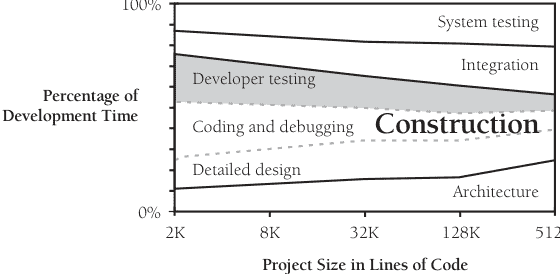

**Figure 22-1** 随着项目规模的增加，开发者测试占总开发时间的比例会变小。程序规模的影响在第 27 章“程序规模如何影响构建”中有更详细的描述。

第二个问题是，开发者测试的结果该如何处理？最直接的是，你可以用结果来评估正在开发产品的可靠性。即使你从未纠正测试发现的缺陷，测试也能描述软件的可靠性。结果的另一个用途是，它们可以并且通常确实指导对软件的修正。最后，随着时间的推移，通过测试发现的缺陷记录有助于揭示最常见的错误类型。你可以利用这些信息来选择合适的培训课程，指导未来的技术评审活动，并设计未来的测试用例。

## Testing During Construction

测试的广阔世界有时会忽略本章的主题：“白盒”或“玻璃盒”测试。你通常希望设计一个类使其成为黑盒——类的使用者无需深入接口之外就能知道类的作用。然而在测试类时，将其视为玻璃盒是有利的，即同时查看类的内部源代码以及其输入和输出。如果你知道盒子里有什么，就能更彻底地测试该类。当然，你在测试类时也会有与编写它时相同的盲点，因此黑盒测试也有其优势。

在构建期间，你通常会编写一个例程或类，在脑中检查它，然后进行评审或测试。无论你的集成或系统测试策略如何，你都应该在将其与其他任何组件组合之前彻底测试每个单元。如果你编写了多个例程，你应该一次测试一个。例程单独测试并没有更容易，但调试起来要容易得多。如果你一次性把几个未经测试的例程组合在一起并发现错误，任何一个例程都有可能是罪魁祸首。如果你一次只添加一个例程到一组之前已测试的例程中，你就知道任何新错误都是由新例程或与新例程的交互引起的。调试工作会更轻松。

协作式构建实践提供了测试无法匹敌的诸多优势。但测试问题的部分原因在于测试往往没有做到最好。开发者可以执行数百次测试，但代码覆盖率仍然只有部分。良好的测试覆盖率感觉并不意味着实际的测试覆盖率是足够的。对基本测试概念的理解可以支持更好的测试并提高测试的有效性。

### 22.2 Recommended Approach to Developer Testing

系统化的开发者测试方法能在最小的努力下最大化你检测各类错误的能力。务必覆盖以下内容：

- 为每个相关需求进行测试，以确保需求已得到实现。在需求阶段或尽可能早地规划此步骤的测试用例——最好是在开始编写待测试单元之前。考虑对需求中常见的遗漏进行测试。安全级别、存储、安装程序和系统可靠性都是测试的合理对象，且在需求阶段经常被忽视。
- 为每个相关设计关注点进行测试，以确保设计已得到实现。在设计阶段或尽可能早地规划此步骤的测试用例——在开始对待测试的例程或类的详细编码之前。
- 使用“基测试”在测试需求和设计的测试用例基础上增加详细的测试用例。添加数据流测试，然后添加充分执行代码所需的剩余测试用例。至少，你应该测试每一行代码。基测试和数据流测试将在本章后面描述。
- 使用一份清单，列出你在当前项目中或在以往项目中犯过的错误类型。

与产品一起设计测试用例。这有助于避免需求和设计中的错误，而这些错误往往比编码错误更昂贵。计划尽早测试并发现缺陷，因为尽早修复缺陷成本更低。

### Test First or Test Last?

开发者有时会疑惑，是在代码编写后编写测试用例更好，还是在编写代码前编写（Beck 2003）。缺陷成本增加图——见第 30 页的图 3-1——表明先编写测试用例会将缺陷插入代码的时间与缺陷被检测并移除的时间间隔降到最低。这只是先写测试用例的众多原因之一：

- 在编写代码前编写测试用例并不比在代码后编写花费更多精力；它只是重新排序了测试用例编写的活动。


- 当你先编写测试用例时，你能在更早阶段发现缺陷，并且可以更容易地纠正它们。
- 先编写测试用例会迫使你在编写代码之前至少稍微思考一下需求和设计，这往往能产生更好的代码。
- 先编写测试用例能在代码编写之前更早地暴露需求问题，因为很难为糟糕的需求编写测试用例。
- 如果你保存了你的测试用例，而你应该这样做，那么你仍然可以在之后进行测试，除了先进行测试之外。

总的来说，我认为测试先行的编程是过去十年中出现的最有益的软件实践之一，是一种良好的通用方法。但它并不是测试的万能药，因为它受制于开发者测试的一般局限性，这些局限性在下文描述。

## 开发者测试的局限性

请注意开发者测试的以下局限性：

- *开发者测试往往是“干净的测试”* 开发者倾向于测试代码是否正常工作（干净的测试），而不是测试代码在哪些方面会出错（脏的测试）。不成熟的测试组织往往每 1 个脏测试就有约 5 个干净测试。成熟的测试组织往往每 1 个干净测试就有 5 个脏测试。这种比例不会通过减少干净测试来逆转；而是通过创建 25 倍多的脏测试来实现（Boris Beizer 引自 Johnson 1994）。


- *开发者测试往往对测试覆盖率持乐观态度* 平均程序员认为他们实现了 95% 的测试覆盖率，但他们通常在最佳情况下也只能实现约 80% 的测试覆盖率，最差情况下约 30%，平均情况下约 50-60%（Boris Beizer 引自 Johnson 1994）。

- *开发者测试往往跳过了更复杂的测试覆盖类型* 大多数开发者认为“100% 语句覆盖”这种测试覆盖类型是足够的。这是一个好的开始，但远远不够。更好的覆盖标准是达到所谓的“100% 分支覆盖”，即每个谓词项至少被测试一次真值和一次假值。第 22.3 节“测试技巧包”提供了更多关于如何实现这一点的细节。

这些观点并不会降低开发者测试的价值，但它们确实有助于将开发者测试置于适当的视角中。开发者测试虽然很有价值，但不足以单独提供充分的质量保证，应辅以其他实践，包括独立测试和协作构建技术。

### 22.3 测试技巧包

为什么不可能通过测试来证明程序是正确的？要使用测试来证明程序有效，你需要测试程序的每一种可能的输入值以及每一种可能的输入值组合。即使对于简单的程序，这种工作也会变得极其难以承受。假设，例如，你有一个程序接收姓名、地址和电话号码并将它们存储在文件中。这无疑是一个简单的程序，比任何你真正担心其正确性的程序都要简单得多。假设进一步，每个可能的姓名和地址长度为 20 个字符，并且它们可以使用 26 个可能的字符。这将是可能的输入数量：

| 输入 | 可能的输入数量 |
|---|---|
| 姓名 | 26^20（20 个字符，每个有 26 种可能选择） |
| 地址 | 26^20（20 个字符，每个有 26 种可能选择） |
| 电话号码 | 10^10（10 位数字，每位有 10 种可能选择） |
| 总可能性 | = 26^20 * 26^20 * 10^10 ≈ 10^66 |

即使在这种相对较小的输入量下，你也有一个带 66 个零的可能测试用例。举例来说，如果诺亚从方舟下来并以每秒一万亿个测试用例的速度开始测试这个程序，他到今天也还不到 1% 的进度。显然，如果你增加更现实的数据量，穷举测试所有可能性的任务将变得更加不可能。

### 不完全测试

> Cross-Reference 判断是否覆盖了所有代码的一种方法是使用覆盖率监视器。详情请参阅本章稍后的第 22.5 节“测试支持工具”中的“覆盖率监视器”。

由于穷举测试在实践上是不可能的，测试的艺术在于挑选最有可能发现错误的测试用例。在 10^66 个可能的测试用例中，只有少数几个可能揭示出其他用例不会披露的错误。你需要集中精力挑选几个能告诉你不同信息的用例，而不是挑选一堆重复告诉你相同信息的用例。

在计划测试时，消除那些不能告诉你任何新信息的测试——即在其他相似数据未产生错误时，很可能也不会产生错误的新的数据上的测试。各种人提出了各种高效覆盖的方法，其中几种方法在以下各节中讨论。

### 结构化基测试

尽管名字听起来很复杂，结构化基测试是一个相当简单的概念。想法是，你需要至少测试程序中的每个语句一次。如果语句是逻辑语句——例如 if 或 while——你需要根据 if 或 while 内部表达式的复杂程度来变化测试，以确保语句得到充分测试。确保覆盖所有基础的最简单方法是计算程序中的路径数，然后开发出能够遍历程序中每条路径的最小测试用例数。

你可能听说过“代码覆盖”测试或“逻辑覆盖”测试。它们是测试程序中所有路径的方法。由于它们覆盖了所有路径，因此与结构化基测试相似，但它们不包括用最小的测试用例集覆盖所有路径的想法。如果你使用代码覆盖或逻辑覆盖测试，你可能会创建比用结构化基测试覆盖相同逻辑所需的更多的测试用例。

Cross-Reference 此过程类似于第 19.6 节“如何衡量复杂度”中衡量复杂度的过程。

你可以通过以下简单方法计算基测试所需的最小用例数：

1. 从例程的直线路径开始计 1。
2. 对以下每个关键字或其等价物各加 1：if、while、repeat、for、and、or。
3. 对 case 语句中的每个 case 各加 1。如果 case 语句没有默认 case，再加 1。

这里有一个例子：

### 计算 Java 程序路径数的简单示例

```
Statement1;
Statement2;
if ( x < 10 ) {
  Statement3;
}
Statement4;
```

对例程本身计“1”。

对 if 计“2”。

在此实例中，你从 1 开始，对 if 计数一次，总计为 2。这意味着你至少需要两个测试用例来覆盖程序中的所有路径。在此示例中，你需要以下测试用例：

- if 控制的语句被执行（x < 10）。
- if 控制的语句未被执行（x >= 10）。

示例代码需要更现实一些，才能让你准确了解这种测试的工作方式。这种情况下的现实性包括包含缺陷的代码。

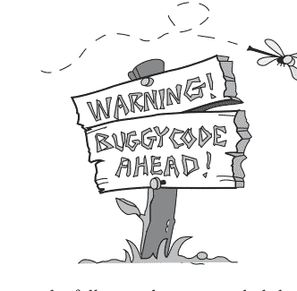

### 计算 Java 程序基测试所需用例数的示例

以下列表是一个稍微复杂一点的示例。这段代码在整章中被使用，包含一些可能的错误。

对例程本身计“1”。

对 for 计“2”。

对 if 计“3”。

对 if 计“4”并对 && 计“5”。

对 if 计“6”。

```
1  // Compute Net Pay
2  totalWithholdings = 0;
3
4  for ( id = 0; id < numEmployees; id++ ) {
5
6     // compute social security withholding, if below the maximum
7     if ( m_employee[ id ].governmentRetirementWithheld < MAX_GOVT_RETIREMENT ) {
8         governmentRetirement = ComputeGovernmentRetirement( m_employee[ id ] );
9     }
10
11    // set default to no retirement contribution
12    companyRetirement = 0;
13
14    // determine discretionary employee retirement contribution
15    if ( m_employee[ id ].WantsRetirement &&
16        EligibleForRetirement( m_employee[ id ] ) ) {
17        companyRetirement = GetRetirement( m_employee[ id ] );
18    }
19
20    grossPay = ComputeGrossPay ( m_employee[ id ] );
21
22    // determine IRA contribution
23    personalRetirement = 0;
24    if ( EligibleForPersonalRetirement( m_employee[ id ] ) ) {
25        personalRetirement = PersonalRetirementContribution( m_employee[ id ],
26            companyRetirement, grossPay );
27    }
28
29    // make weekly paycheck
30    withholding = ComputeWithholding( m_employee[ id ] );
31    netPay = grossPay - withholding - companyRetirement - governmentRetirement -
32            personalRetirement;
33    PayEmployee( m_employee[ id ], netPay );
```


```
34
35 // add this employee's paycheck to total for accounting
36 totalWithholdings = totalWithholdings + withholding;
37 totalGovernmentRetirement = totalGovernmentRetirement + governmentRetirement;
38 totalRetirement = totalRetirement + companyRetirement;
39 }
40
41 SavePayRecords( totalWithholdings, totalGovernmentRetirement, totalRetirement );
```

在这个例子中，你需要一个初始测试用例，再加上五个关键字各一个用例，总共六个。这并不意味着随便六个测试用例就能覆盖所有情况。它只是意味着最少需要六个用例。除非精心构造这些用例，否则它们几乎肯定无法覆盖所有情况。诀窍在于，在计算所需用例数量时，要关注你所用到的那些关键字。代码中的每个关键字都代表一个要么为真要么为假的条件；请确保每个条件为真的情况至少有一个测试用例，每个条件为假的情况也至少有一个测试用例。

下面是一组覆盖此例所有情况的测试用例：

| 用例 | 测试描述 | 测试数据 |
|------|-----------|-----------|
| 1 | 正常用例 | 所有布尔条件均为真 |
| 2 | 初始 for 条件为假 | numEmployees < 1 |
| 3 | 第一个 if 为假 | m_employee[id].governmentRetirementWithheld >=MAX_GOVT_RETIREMENT |
| 4 | 第二个 if 为假，因为 and 表达式的第一部分为假 | not m_employee[id].WantsRetirement |
| 5 | 第二个 if 为假，因为 and 表达式的第二部分为假 | not EligibleForRetirement( m_employee[id] ) |
| 6 | 第三个 if 为假 | not EligibleForPersonalRetirement( m_employee[id] ) |

注意：本章后续将用更多测试用例扩展此表。

如果例程比这个复杂得多，仅为了覆盖所有路径而需要的测试用例数量就会快速增加。较短的例程往往具有较少的待测试路径。没有大量 and（与）和 or（或）的布尔表达式，其需要测试的变化也更少。易于测试是保持例程简短、布尔表达式简单的另一个好理由。

既然你已经为该例程创建了六个测试用例，满足了结构化基础测试的要求，是否可以认为该例程已被充分测试？很可能不行。

这种测试只能保证所有代码都将被执行，并不考虑数据的变化。

## 数据流测试

把上一节和这一节放在一起看，可以得到另一个例子，说明控制流和数据流在计算机编程中同等重要。

数据流测试基于这样的理念：数据使用的出错倾向至少与控制流相当。Boris Beizer 声称，至少一半的代码由数据声明和初始化组成（Beizer 1990）。

数据可以处于以下三种状态之一：

- **已定义**  数据已被初始化，但尚未被使用。
- **已使用**  数据已被用于计算、作为例程的参数，或用于其他用途。
- **已失效**  数据曾被定义，但已在某种程度上解除定义。例如，如果数据是指针，也许指针已被释放。如果是 for 循环索引，也许程序已离开循环，此时编程语言不再定义 for 循环索引在循环外的值。如果是指向文件中某条记录的指针，也许文件已被关闭，记录指针不再有效。

除了“已定义”“已使用”和“已失效”这些术语之外，还需要一些术语来描述在对变量进行某种操作之前或之后立即进入或退出例程的情况：

- **已进入**  控制流在变量被操作之前立即进入例程。例如，工作变量在例程顶部被初始化。
- **已退出**  控制流在变量被操作之后立即离开例程。例如，返回值在例程末尾被赋给某个状态变量。

### 数据状态的组合

数据状态的正常组合是：变量被定义，被使用一次或多次，也许还会被失效。请警惕以下模式：

- **已定义-已定义**  如果必须定义一个变量两次，值才能最终稳定下来，那你需要的不是更好的程序，而是更好的计算机！即使算不上真正的错误，这也是浪费且容易出错的。

- **已定义-已退出**  如果变量是局部变量，定义后未使用就退出是没有意义的。如果它是例程参数或全局变量，则可能没问题。
- **已定义-已失效**  先定义变量然后又使其失效，表明该变量要么是多余的，要么本该使用该变量的代码缺失了。
- **已进入-已失效**  如果变量是局部变量，这就是问题。如果它既没有被定义也没有被使用，就不需要被失效。另一方面，如果它是例程参数或全局变量，只要该变量在失效前已在别处定义，这种模式就没问题。
- **已进入-已使用**  如果变量是局部变量，这同样是个问题。变量必须先定义再使用。另一方面，如果它是例程参数或全局变量，只要该变量在使用前已在别处定义，这种模式就没问题。
- **已失效-已失效**  变量不应需要失效两次。变量不会复活。一个“复活”的变量说明编程草率。对指针而言，双重失效也是致命的——让计算机死机的最佳方法之一，就是将一个指针失效（释放）两次。
- **已失效-已使用**  在变量失效后使用它属于逻辑错误。如果代码似乎仍然能工作（例如，指针仍指向已释放的内存），那只是偶然。根据墨菲定律，代码会恰好在造成最大混乱的时候停止工作。
- **已使用-已定义**  先使用然后再定义变量，可能是问题，也可能不是，取决于变量在使用前是否也有定义。当然，如果你看到“已使用-已定义”模式，就值得检查一下此前是否有定义。

在开始测试前，检查这些异常的数据状态序列。检查完异常序列之后，编写数据流测试用例的关键是覆盖所有可能的“定义-使用”路径。你可以按不同彻底程度来完成，包括：

- 所有定义。测试每个变量的每次定义——也就是变量获得值的每个位置。这是一种较弱的策略，因为如果你试图执行每一行代码，默认就会做到这一点。
- 所有“定义-使用”组合。测试在一个位置定义变量、在另一个位置使用变量的每种组合。这比测试所有定义更强的策略，因为仅执行每一行代码并不能保证每种“定义-使用”组合都会被测试到。

如上一节所述，结构化基础测试为从第 507 页开始的例程提供了六个测试用例。对每个“定义-使用”对进行数据流测试还需要更多测试用例，其中一些已被现有测试用例覆盖，另一些则没有。下面列出了所有在结构化基础测试生成的用例之外、需要增加测试用例的数据流组合：

| 用例 | 测试描述 |
|------|-----------|
| 7 | 在第 12 行定义 *companyRetirement*，并在第 26 行首次使用它。之前的任何测试用例未必覆盖该路径。 |
| 8 | 在第 15 行定义 *companyRetirement*，并在第 31 行首次使用它。之前的任何测试用例未必覆盖该路径。 |
| 9 | 在第 17 行定义 *companyRetirement*，并在第 31 行首次使用它。之前的任何测试用例未必覆盖该路径。 |

在你多次完成列出数据流测试用例的过程后，你会逐渐知道哪些用例有用，哪些已被覆盖。卡住时，把所有“定义-使用”组合列出来。这看起来可能工作量很大，但它一定能让你看到在基础测试方法中没有被顺带覆盖的任何用例。

## 等价类划分

**交叉引用** 本章末尾“补充资源”部分列出的书籍中对等价类划分有更深入的讨论。

一个好的测试用例能够覆盖可能输入数据的很大一部分。如果两个测试用例恰好暴露出完全相同的错误，那么你只需要其中之一。“等价类划分”这一概念就是这种想法的形式化，有助于减少所需测试用例的数量。

在从第 507 页开始的代码清单中，第 7 行是使用等价类划分的好地方。需要测试的条件是 *m_employee[ ID ].governmentRetirementWithheld < MAX_GOVT_RETIREMENT*。该条件有两个等价类：一个是 *m_employee[ ID ].governmentRetirementWithheld* 小于 *MAX_GOVT_RETIREMENT* 的类，另一个是它大于或等于 *MAX_GOVT_RETIREMENT* 的类。程序的其他部分可能还有其他相关的等价类，这意味着你需要测试 *m_employee[ ID ].governmentRetirementWithheld* 的两个以上可能值，但就程序的这一部分而言，只需要两个。

当你已经用基础测试和数据流测试覆盖了程序之后，思考等价类划分不会给你带来太多新的洞见。但当你从外部审视一个程序（依据规格说明而非源代码）时，或者当数据很复杂，而且这些复杂性并未全部反映在程序逻辑中时，它尤其有用。


|  |  |
|---|---|
| 3 | Case 3 定义为使 *m_employee[ ID ].governmentRetirementWithheld < MAX_GOVT_RETIREMENT* 的假条件位于边界的假侧。因此，Case 3 测试用例将 *m_employee[ ID ].governmentRetirementWithheld* 设置为 *MAX_GOVT_RETIREMENT + 1*。该测试用例也已生成。 |
| 10 | 为边界上的直接情况增加一个额外的测试用例，其中 *m_employee [ ID ].governmentRetirementWithheld = MAX_GOVT_RETIREMENT.* |

## 复合边界

边界分析也适用于最小和最大允许值。在此示例中，可能是最小或最大 *grossPay, companyRetirement,* 或 *PersonalRetirementContribution*，但由于这些值的计算超出了例程的范围，因此此处不再讨论它们的测试用例。

一种更微妙的边界条件是边界涉及变量组合时。例如，如果两个变量相乘，当两者都是大正数时会发生什么？大负数？0？如果传递给例程的所有字符串都异常长会怎样？

在运行示例中，你可能想看看当一个大型员工组的每个成员都有一个大薪水时会发生什么——比如说，一组程序员每人 250,000 美元。 （我们可以一直希望！）这需要另一个测试用例：

| Case | Test Description |
|------|-------------------|
| 11 | 一组员工，每人都有一个大薪水（“大”取决于正在开发的具体系统）——为了举例，我们说 1000 名员工，每人薪水为 250,000 美元，其中没有人缴纳过社会保障税，并且所有人都希望进行退休扣缴。 |

在同一思路下但在另一侧的测试用例将是一组员工，每人的薪水为 $0.00：

| Case | Test Description |
|------|-------------------|
| 12 | 一组 10 名员工，每人的薪水为 $0.00。 |

## 错误数据的类别

除了猜测错误出现在边界条件周围之外，你还可以猜测并测试其他几种错误数据的类别。典型的错误数据测试用例包括

- 数据太少（或无数据）
- 数据太多
- 错误类型的数据（无效数据）
- 数据大小错误
- 未初始化的数据

如果你遵循这些建议，会想到的一些测试用例已经涵盖。例如，“数据太少”由 Case 2 和 12 涵盖，很难为“数据大小错误”提出任何内容。错误数据的类别尽管如此仍会产生几个额外的用例：

| Case | Test Description |
|---|---|
| 13 | 100,000,000 名员工的数组。测试数据太多。当然，太多是多少会因系统而异，但为了举例，假设这远远太多。 |
| 14 | 负薪水。错误类型的数据。 |
| 15 | 负的员工数量。错误类型的数据。 |

## 良好数据的类别

当你尝试在程序中查找错误时，很容易忽视名义情况可能包含错误。通常，基础测试部分中描述的名义情况代表一种良好数据。以下是其他值得检查的良好数据种类。检查每种数据都可以揭示错误，具体取决于正在测试的项目。

- 名义情况——中等、预期值
- 最小正常配置
- 最大正常配置
- 与旧数据的兼容性

最小正常配置对于测试不仅仅是一个项目，而是一组项目很有用。它在精神上类似于许多最小值的边界条件，但不同之处在于它从正常预期集中创建最小值集。一个例子是在测试电子表格时保存一个空电子表格。对于测试文字处理器，就是保存一个空文档。在运行示例的情况下，测试最小正常配置将增加以下测试用例：

| Case | Test Description |
|---|---|
| 16 | 一组一名员工。用于测试最小正常配置。 |

最大正常配置是最小的相反。它在精神上类似于边界测试，但同样，它从预期值集中创建最大值的集合。这方面的一个例子是保存一个与产品包装上宣传的“最大电子表格大小”一样大的电子表格。或打印最大尺寸的电子表格。对于文字处理器，就是保存最大推荐大小的文档。在运行示例的情况下，测试最大正常配置取决于最大正常员工数量。假设为 500，你将增加以下测试用例：

| Case | Test Description |
|------|-------------------|
| 17 | 一组 500 名员工。用于测试最大正常配置。 |

最后一种正常数据测试——测试与旧数据的兼容性——在程序或例程是旧程序或例程的替代品时发挥作用。新例程应使用旧数据产生与旧例程相同的结果，除非旧例程有缺陷。这种版本之间的连续性是回归测试的基础，其目的是确保更正和增强在保持之前质量水平的同时不会倒退。在运行示例的情况下，兼容性标准不会增加任何测试用例。

## 使用便于手工检查的测试用例

假设你正在为名义薪水编写测试用例；你需要一个名义薪水，而获得它的方法是输入你手指碰到的任何数字。我试试：

1239078382346

好吧。这是一个相当高的薪水，实际上有一点超过一万亿美元，但如果我修剪它使其更现实一些，我得到 $90,783.82。

现在，进一步假设测试用例成功——也就是说，它发现了一个错误。你怎么知道它发现了一个错误？好吧，显然，你知道答案是什么以及它应该是什么，因为你通过手工计算出了正确答案。然而，当你尝试用像 $90,783.82 这样难看的数字进行手工计算时，你犯手工计算错误的可能性与在程序中发现错误的可能性一样大。另一方面，像 $20,000 这样整齐、均匀的数字使数字运算变得轻而易举。0 很容易输入计算器，而乘以 2 是大多数程序员无需使用手指和脚趾就能完成的事情。

你可能会认为像 $90,783.82 这样难看的数字更有可能揭示错误，但它与同等类中的任何其他数字一样不可能。

### 22.4 典型错误

本节致力于这样一个命题：你对敌人——错误——了解得越多，测试就越好。

## 哪些类别包含最多的错误？


自然会假设缺陷在源代码中均匀分布。如果你平均每 1000 行代码有 10 个缺陷，你可能会假设包含 100 行代码的类中会有 1 个缺陷。这是一个自然的假设，但它是错误的。

Capers Jones 报告说，IBM 在 IMS 系统中进行的重点质量改进计划确定了 425 个类中的 31 个为易出错类。这 31 个类被修复或完全重新开发，在不到一年的时间内，IMS 的客户报告缺陷减少了十倍。总维护成本减少了约 45%。客户满意度从“不可接受”提高到“良好”（Jones 2000）。

大多数错误往往集中在少数高度缺陷的例程中。以下是错误与代码之间的一般关系：


- 八十 percent 的错误出现在项目 20 percent 的类或例程中（Endres 1975, Gremillion 1984, Boehm 1987b, Shull et al 2002）。
- 五十 percent 的错误出现在项目 5 percent 的类中（Jones 2000）。

这些关系可能看起来并不重要，直到你认识到一些推论。首先，项目 20% 的例程贡献了 80% 的开发成本（Boehm 1987b）。这并不一定意味着成本最高的 20% 与缺陷最多的 20% 相同，但它很有启发性。


其次，无论高度缺陷例程贡献的成本比例的确切比例如何，高度缺陷例程都极其昂贵。在 20 世纪 60 年代的一项经典研究中，IBM 对其 OS/360 操作系统进行了分析，发现错误并非均匀分布在所有例程中，而是集中在少数例程中。这些易出错的例程被发现是“编程中最昂贵的实体”（Jones 1986a）。它们每 1000 行代码包含多达 50 个缺陷，修复它们通常花费的是开发整个系统所需时间的 10 倍。（成本包括客户支持和现场维护。）


交叉引用 另一类容易包含大量错误的例程是过于复杂的例程。有关识别和简化例程的详细信息，请参阅第 19.6 节中的“降低复杂性的通用准则”。

第三，昂贵例程对开发的影响是显而易见的。正如老话所说，“时间就是金钱”。其推论是“金钱就是时间”，如果你能通过避免麻烦的例程将成本削减近 80%，你也能大幅缩短进度。这清楚地说明了软件质量的通用原则：提高质量会改善开发进度并降低开发成本。

第四，避免麻烦例程对维护的影响同样清晰。维护活动应集中于识别、重新设计并从头重写那些被确定为易出错的例程。在前面提到的 IMS 项目中，在替换易出错的类之后，IMS 版本的生产率提高了约 15%（Jones 2000）。

## 按分类的错误

交叉引用 有关本书中所有清单的列表，请参阅书目目录后的列表。

一些研究人员尝试按类型对错误进行分类并确定每种错误发生的程度。每位程序员都有一个特别麻烦的错误清单：差一错误、忘记重新初始化循环变量等等。本书中提供的清单提供了更多细节。

Boris Beizer 结合了多项研究的数据，得出了一个异常详细的错误分类法（Beizer 1990）。以下是他的结果摘要：

- 25.18% 结构
- 22.44% 数据
- 16.19% 已实现的功能
- 9.88% 构造
- 8.98% 集成
- 8.12% 功能需求
- 2.76% 测试定义或执行
- 1.74% 系统、软件架构
- 4.71% 未指定

Beizer 将其结果报告到小数点后两位，但关于错误类型的研究总体上是 inconclusive 的。不同研究报告的错误种类差异很大，而报告类似错误的研究得出的结果也差异很大，差异达到 50%，而不是百分之几的差异。

鉴于报告的差异很大，将多项研究的结果像 Beizer 那样合并可能不会产生有意义的数据。但即使数据没有定论，其中一些也是有启发性的。以下是可以从数据中得出的一些建议：


**大多数错误的范围相当有限** 一项研究发现，85% 的错误可以在不修改超过一个例程的情况下得到纠正（Endres 1975）。

**许多错误超出了构造的范畴** 研究人员进行了一系列 97 次访谈，发现错误最常见的三个来源是薄弱的应用领域知识、波动且相互冲突的需求，以及沟通和协调的 breakdown（Curtis, Krasner, and Iscoe 1988）。

> 如果你看到蹄印，想想马——不是斑马。操作系统可能没有损坏。而数据库可能完全没问题。
> —Andy Hunt and Dave Thomas

**大多数构造错误是程序员的过错** 多年前进行的一对研究发现，在报告的总错误中，大约 95% 由程序员造成，2% 由系统软件（编译器和操作系统）造成，2% 由其他软件造成，1% 由硬件造成（Brown and Sampson 1973, Ostrand and Weyuker 1984）。今天使用的系统软件和开发工具比 1970 年代和 1980 年代多得多，因此我最好的猜测是，今天由程序员造成的错误比例甚至更高。


**文书错误（拼写错误）是问题的一个令人惊讶的常见来源** 一项研究发现，36% 的所有构造错误都是文书错误（Weiss 1975）。一项对近 300 万行飞行动力学软件的 1987 年研究发现，18% 的所有错误都是文书错误（Card 1987）。另一项研究发现，4% 的所有错误是消息中的拼写错误（Endres 1975）。在我的一段程序中，一位同事仅通过将可执行文件中的所有字符串通过拼写检查器运行就发现了几个拼写错误。注重细节很重要。如果你怀疑这一点，请考虑一下历史上最昂贵的三个软件错误——成本分别为 16 亿美元、9 亿美元和 2.45 亿美元——都涉及在之前正确的程序中更改一个字符（Weinberg 1983）。

**误解设计是程序员错误研究中的一个反复出现的主题** Beizer 的汇编研究，姑且不论，发现 16% 的错误源于对设计的误解（Beizer 1990）。另一项研究发现，19% 的错误源于设计被误解（Weiss 1975）。花时间彻底理解设计是值得的。这种时间不会立即产生回报——你不一定看起来像是在工作——但它会在项目的生命周期中得到回报。

**大多数错误很容易修复** 大约 85% 的错误可以在不到几个小时内修复。大约 15% 的错误可以在几个小时到几天内修复。大约 1% 需要更长时间（Weiss 1975, Ostrand and Weyuker 1984, Grady 1992）。这一结果得到了 Barry Boehm 的观察的支持，即大约 20% 的错误消耗了约 80% 的修复资源（Boehm 1987b）。通过在上游进行需求和设计评审，避免尽可能多的困难错误。尽可能高效地处理大量的小错误。

*最好衡量你自己组织对错误的经验* 本节引用的结果多样性表明，不同组织的人有极其不同的经验。这使得将其他组织的经验应用到你自己的组织中变得困难。一些结果违背了常识；你可能需要用其他工具补充你的直觉。一个好的第一步是开始衡量你的开发过程，以便你知道问题出在哪里。

## 因构造不良导致的错误比例

如果对错误进行分类的数据是不确定的，那么将错误归因于各种开发活动的数据也是如此。一点是肯定的：构造总是会导致大量错误。有时人们认为构造引起的错误比需求或设计引起的错误更便宜修复。修复单个构造错误可能更便宜，但证据不支持关于总成本的这种说法。

以下是我的结论：


- 在小型项目中，构造缺陷构成了所有错误的绝大部分。在一项对小型项目（1000 行代码）的编码错误研究中，75% 的缺陷源于编码，10% 源于需求，15% 源于设计（Jones 1986a）。这种错误分解代表了许多小型项目的典型情况。
- 无论项目规模如何，构造缺陷至少占所有缺陷的 35%。尽管在大型项目中构造缺陷的比例较小，但它们仍至少占所有缺陷的 35%（Beizer 1990, Jones 2000）。一些研究人员甚至在非常大的项目中报告了 75% 范围内的比例（Grady 1987）。总体而言，应用领域理解得越好，整体架构就越好。然后错误往往集中在详细设计和编码中（Basili and Perricone 1984）。
- 构造错误虽然比需求和设计错误更便宜修复，但仍然昂贵。Hewlett-Packard 两项非常大型项目的调查发现，平均构造缺陷的修复成本是平均设计错误的 25–50%（Grady 1987）。当考虑到构造缺陷的更大数量时，修复构造缺陷的总成本是归因于设计缺陷的成本的一到两倍。

图 22-2 大致说明了项目规模与错误来源之间的关系。


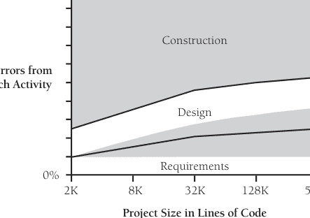

图 22-2 随着项目规模的增大，建设阶段犯错的比例下降。然而，即使在最大规模的项目中，建设错误也占所有错误的 45–75%。

## 你应该预期找到多少错误？

你应该预期找到的错误数量取决于你使用的开发流程的质量。以下是可能的范围：


- 行业平均经验是交付软件每 1000 行代码约有 1–25 个错误。软件通常是使用各种技术的拼凑方式开发的（Boehm 1981, Gremillion 1984, Yourdon 1989a, Jones 1998, Jones 2000, Weber 2003）。错误数量只有此数十分之一的情况很少见；错误数量多 10 倍的情况往往不会被报道。 （它们可能根本就从未完成！）

- 微软应用部门在内部测试期间经历的缺陷约为每 1000 行代码 10–20 个，在发布的产品中约为每 1000 行代码 0.5 个缺陷（Moore 1992）。实现这一水平的技术是第 21.4 节“其他类型的协作开发实践”中描述的代码阅读技术的组合以及独立测试。

- Harlan Mills 开创了“洁净室开发”，该技术能够在内部测试期间实现低至每 1000 行代码 3 个缺陷，在发布的产品中实现每 1000 行代码 0.1 个缺陷的水平（Cobb and Mills 1990）。少数项目——例如航天飞机软件——通过使用正式的开发方法、同行评审和统计测试的系统，实现了在 500,000 行代码中 0 个缺陷的水平（Fishman 1996）。


- Watts Humphrey 报告称，使用团队软件流程（TSP）的团队已实现约每 1000 行代码 0.06 个缺陷的水平。TSP 专注于培训开发人员首先不创建缺陷（Weber 2003）。

TSP 和洁净室项目的成果证实了软件质量的一般原则的另一个版本：构建高质量软件比构建并修复低质量软件更便宜。一个完全检查过的、80,000 行的洁净室项目的生产率为每工作月 740 行代码。完全检查过的代码的行业平均水平更接近每工作月 250–300 行，包括所有非编码开销（Cusumano et al 2003）。成本节约和生产率提升来自于 TSP 或洁净室项目几乎没有时间用于调试。没有调试时间？这确实是一个值得追求的目标！

## 测试本身的错误


你可能有过这样的经历：软件被发现有错误。你对代码中可能出错的部分有一些初步的猜测，但所有代码看起来似乎都是正确的。你运行了几个额外的测试用例来尝试细化错误，但所有新的测试用例都产生了正确的结果。你花了几个小时反复阅读代码并手工计算结果。它们都检查通过了。经过几个小时后，有件事让你重新检查测试数据。 Eureka！错误在测试数据中！浪费数小时追踪测试数据中的错误而不是代码中的错误，感觉是多么愚蠢！


这是常见的经历。测试用例往往与被测试的代码一样甚至更可能包含错误（Weiland 1983, Jones 1986a, Johnson 1994）。原因很容易找到——尤其是当开发人员编写测试用例时。测试用例往往是临时创建的，而不是通过仔细的设计和构建过程创建的。它们通常被视为一次性测试，并以与一次性丢弃的东西相称的谨慎程度来开发。

你可以采取以下几种措施来减少测试用例中的错误数量：

**检查你的工作** 像开发代码一样仔细地开发测试用例。这种谨慎当然包括仔细检查你自己的测试。像对待生产代码一样，逐行在调试器中逐步执行测试代码。测试数据的走查和检查是合适的。

**在开发软件时规划测试用例** 对测试的有效规划应从需求阶段开始，或在你获得程序任务时就开始。这有助于避免基于错误假设的测试用例。

**保留你的测试用例** 花点时间好好对待你的测试用例。将其保存用于回归测试和版本 2 的工作。如果你知道你要保留它们而不是丢弃它们，那么付出努力是很容易证明的。

**将单元测试插入测试框架** 首先编写单元测试的代码，但在完成每个测试时将其集成到系统范围的测试框架中（如 JUnit）。拥有集成的测试框架可以防止前面提到的丢弃测试用例的倾向。

### 22.5 测试支持工具

本节概述了你可以在商业上购买或自行构建的测试工具类型。它不会命名具体的产品，因为它们到你阅读时可能已经过时。请参考你喜欢的程序员杂志以获取最新的具体信息。

### 构建用于测试单个类的脚手架

术语“脚手架”来自建筑施工。脚手架是为了让工人能够到达原本无法到达的建筑物部分而建造的。软件脚手架的唯一目的是使代码易于执行。

> **进一步阅读** 有关脚手架的几个良好示例，请参阅 Jon Bentley 在 *Programming Pearls*, 2d ed.（2000）中的论文“A Small Matter of Programming”。

一种脚手架是被伪造的类，以便它可以被正在测试的另一个类使用。这种类称为“模拟对象”或“存根对象”（Mackinnon, Freemand, and Craig 2000; Thomas and Hunt 2002）。类似的方法也可以用于低级例程，它们被称为“存根例程”。你可以根据需要使模拟对象或存根例程更或少地逼真。在这些情况下，脚手架可以

- 立即返回控制权，未采取任何操作。
- 测试输入给它的数据。
- 打印诊断消息，也许是输入参数的回显，或将消息记录到文件中。
- 从交互式输入获取返回值。
- 无论输入如何都返回标准答案。
- 消耗分配给真实对象或例程的时钟周期数。
- 作为真实对象或例程的慢速、臃肿、简单或不太准确的版本运行。

另一种脚手架是调用正在测试的真实例程的假例程。这称为“驱动程序”或，有时称为“测试夹具”。这种脚手架可以

- 使用固定的输入集调用对象。
- 提示交互式输入并用其调用对象。
- 从命令行（在支持的操作系统中）获取参数并调用对象。
- 从文件读取参数并调用对象。
- 在多次调用对象时遍历预定义的一组输入数据。

交叉引用 测试工具和调试工具之间的界限是模糊的。有关调试工具的详细信息，请参阅第 23.5 节“调试工具——显而易见的和不那么显而易见的”。

cc2e.com/2268

最后一种脚手架是虚拟文件，即真实文件的缩小版本，具有与全尺寸文件相同的组件类型。小型虚拟文件提供了几个优点。因为它很小，你可以知道其确切内容，并且可以合理确定文件本身没有错误。而且因为你专门为测试而创建它，你可以设计其内容，使其使用中的任何错误都很明显。

显然，构建脚手架需要一些工作，但如果在类中检测到错误，你可以重用脚手架。而且存在许多工具可以简化模拟对象和其他脚手架的创建。如果你使用脚手架，类也可以在不受与其他类交互影响的风险下进行测试。脚手架在涉及微妙算法时特别有用。很容易陷入这样的困境：因为被执行的代码嵌入在其他代码中，每个测试用例的执行需要几分钟。脚手架允许你直接执行代码。你花费的几分钟来构建脚手架以执行深埋的代码，可以节省数小时的调试时间。

你可以使用任何可用的众多测试框架为你的程序提供脚手架（JUnit、CppUnit、NUnit 等）。如果你的环境不受现有测试框架之一支持，你可以在类中编写几个例程，并在要测试的文件中包含一个 main() 脚手架例程，即使被测试的例程并非旨在独立存在。main() 例程可以从命令行读取参数并将它们传递给被测试的例程，以便你可以在将其与其他程序集成之前单独执行该例程。当你集成代码时，保留文件中的例程和用于测试它们的脚手架代码，并使用预处理器命令或注释停用脚手架代码。由于它被预处理掉了，它不会影响可执行代码，并且由于它位于文件底部，在视觉上也不会碍事。保留它不会造成任何伤害。它在你需要时就在那里，而且不会浪费移除和归档它所需的时间。

### Diff 工具

交叉引用 有关回归测试的详细信息，请参阅第 22.6 节“重新测试（回归测试）”中的“Retesting (Regression Testing)”。

如果有自动化工具来检查实际输出与预期输出，回归测试或重新测试会容易得多。检查打印输出的一种简单方法是将其重定向到文件，并使用文件比较工具如 diff 将新输出与之前发送到文件的预期输出进行比较。如果输出不相同，你就检测到回归错误。

### 测试数据生成器

cc2e.com/2275

你也可以编写代码来系统地执行程序的选定部分。几年前，我开发了一种专有的加密算法并编写了一个文件加密程序来使用它。该程序的意图是将文件编码，以便它可以


只有使用正确的密码才能解码。加密不仅仅是表面改变了文件；它改变了文件的全部内容。程序能否正确解码文件至关重要，否则文件就会被毁坏。

我建立了一个测试数据生成器，全面测试程序的加密和解密部分。它生成字符随机、大小随机（从0K到500K）的文件；生成长度随机（从1到255）的随机字符密码。对于每个随机案例，它生成随机文件的两份副本，加密其中一份，重新初始化自身，解密副本，然后逐字节比较解密后的副本与未更改的副本。如果有任何字节不同，生成器会打印重现该错误所需的全部信息。

我将测试用例的权重偏向我的文件的平均长度30K，这比最大长度500K短得多。如果我没有将测试用例的权重偏向较短长度，文件长度将在0K到500K之间均匀分布，平均测试文件长度将是250K。较短的平均长度意味着，与使用均匀随机长度相比，我可以测试更多的文件、密码、文件结束条件、特殊文件长度以及其他可能产生错误的情况。

结果令人欣慰。仅运行了大约100个测试用例后，我就发现了程序中的两个错误。这两个错误都源于可能在实际中永远不会出现的特殊情况，但无论如何它们都是错误，我很高兴能找到它们。修复这些错误后，我运行了程序数周，加密和解密了超过100,000个文件而没有出现任何错误。鉴于我测试的文件内容、长度和密码范围，我可以自信地断言该程序是正确的。

以下是从这个故事中得到的教训：

- 设计良好的随机数据生成器可以生成你无法想到的异常测试数据组合。
- 随机数据生成器可以比你更全面地测试你的程序。
- 你可以随时间逐步完善随机生成的测试用例，使它们强调符合实际范围的输入。这把测试集中在用户最可能使用的区域，从而最大化这些区域的可靠性。
- 模块化设计在测试中会得到回报。我能够将加密和解密代码抽取出来，独立于用户界面代码使用，使编写测试驱动程序的工作变得简单直接。
- 如果被测代码日后需要修改，你可以复用测试驱动程序。在我纠正了最初的两个错误后，立即就可以重新开始测试。

## 覆盖率监视器

cc2e.com/2282


Karl Wiegers 报告称，在不测量代码覆盖率的情况下进行测试，通常只会执行约50–60%的代码（Wiegers 2002）。覆盖率监视器是一种跟踪哪些代码被执行、哪些代码未被执行的工具。覆盖率监视器对系统性测试特别有用，因为它能告诉你一组测试用例是否充分执行了代码。如果你运行了全套测试用例，而覆盖率监视器显示某些代码仍未被执行，你就知道需要更多的测试。

## 数据记录器/日志记录

有些工具可以监视你的程序，并在发生故障时收集程序的状态信息——类似于飞机用来诊断坠机结果的“黑匣子”。强大的日志记录有助于错误诊断，并在软件发布后支持有效的服务。

你可以通过将重要事件记录到文件来构建自己的数据记录器。记录错误发生前的系统状态以及确切错误条件的详细信息。这个功能可以编译进代码的开发版本，并从发布版本中编译掉。或者，如果你使用自修剪存储，并精心设计错误消息的位置和内容，也可以在发布版本中包含日志记录功能。

## 符号调试器

交叉引用：调试器的可用性因技术环境的成熟度而异。关于这一现象的更多信息，请参见第4.3节“你在技术浪潮中的位置”。

符号调试器是代码走查和审查的技术补充。调试器能够单步逐行执行代码，跟踪变量的值，并始终以与计算机相同的方式解释代码。在调试器中逐步执行一段代码并观察其运行过程，价值巨大。

在调试器中走查代码，在很多方面与让其他程序员在评审中逐步检查你的代码是一样的。无论是你的同行还是调试器，都没有你所有的那些盲点。使用调试器的额外好处是，它不像团队评审那样耗费人力。在各种输入数据集下观察代码执行，是确保你实现了预期代码的良好保证。

一个好的调试器甚至是学习语言的好工具，因为你可以精确地看到代码的执行方式。你可以在高级语言代码视图和汇编代码视图之间来回切换，看看高级语言代码如何被翻译成汇编代码。你可以观察寄存器和堆栈，了解参数是如何传递的。你可以查看编译器优化过的代码，了解执行了哪些类型的优化。这些好处与调试器的预期用途——诊断已经检测到的错误——没有多大关系，但对调试器的创造性使用会带来远超其原始使命的收益。

## 系统扰动器

另一类测试支持工具旨在扰动系统。许多人都有过这样的经历：程序100次运行中有99次正常，但第100次用相同数据运行却失败了。问题几乎总是某个位置未能初始化变量，并且通常难以重现，因为100次中有99次未初始化的变量恰好为0。

这类测试支持工具具有多种功能：

- **内存填充**：你需要确保没有任何未初始化的变量。有些工具在运行程序之前用任意值填充内存，这样未初始化的变量就不会被意外地设置为0。在某些情况下，内存可能会被设置为特定值。例如，在x86处理器上，值`0xCC`是断点中断的机器语言代码。如果你用`0xCC`填充内存，并且发生错误导致你执行了不应执行的内容，你就会在调试器中遇到断点并检测到错误。
- **内存搬移**：在多任务系统中，有些工具可以在程序运行时重新排列内存，以便你确信没有编写任何依赖数据位于绝对位置而非相对位置的代码。
- **选择性内存故障**：内存驱动程序可以模拟低内存条件，在这种条件下程序可能会耗尽内存、在内存请求时失败、在失败前授予任意数量的内存请求，或者在授予一个请求之前遭遇任意数量的请求失败。这对于测试使用动态分配内存的复杂程序尤其有用。
- **内存访问检查（边界检查）**：边界检查器监视指针操作，以确保指针行为正常。这种工具对于检测未初始化或悬空指针很有用。

## 错误数据库

一个强大的测试工具是已报告错误的数据库。这样的数据库既是管理工具又是技术工具。它允许你检查重复出现的错误，跟踪检测和纠正新错误的速率，并跟踪打开和关闭的错误的状态及其严重性。关于错误数据库中应保存哪些信息的详细信息，请参见第22.7节“保存测试记录”。


### 22.6 改进你的测试

改进测试的步骤与改进任何其他流程的步骤相似。你必须清楚地知道该流程的确切作用，以便可以对其进行轻微变化并观察变化的效果。当你观察到具有积极效果的变化时，你会修改流程，使其变得更好一些。以下各节将介绍如何对测试执行此操作。

### 测试计划

> **交叉引用** 测试计划的一部分是将计划正式化为书面形式。如需了解有关测试文档的更多信息，请参阅第 32 章末尾的“其他资源”部分。

有效测试的关键之一是从项目开始就计划测试。将测试的重要性置于与设计或编码同等水平意味着会为其分配时间，会将其视为重要事项，并且它将成为高质量的流程。测试计划也是使测试流程可重复的一个要素。如果无法重复，就无法改进它。

### 重新测试（回归测试）

假设你已经彻底测试了一个产品并且没有发现任何错误。假设产品在某一区域被更改，你希望确保它仍然通过更改前通过的所有测试——即更改没有引入任何新缺陷。旨在确保软件没有倒退或“回归”的测试称为“回归测试”。

除非你能在更改后系统地重新测试它，否则几乎不可能生产出高质量的软件产品。如果你每次更改后都运行不同的测试，就无法确定是否引入了新缺陷。因此，回归测试必须每次运行相同的测试。有时随着产品的成熟会添加新测试，但旧测试也会保留。

### 自动化测试


管理回归测试的唯一可行方法是将其自动化。人们在多次运行相同的测试并多次看到相同的测试结果时会变得麻木。很容易忽略错误，这就违背了回归测试的目的。测试专家 Boris Beizer 报告说，手动测试中的错误率与被测试代码中的错误率相当。他估计在手动测试中，只有大约一半的测试被正确执行（Johnson 1994）。

测试自动化的好处包括以下内容：

- 自动化测试出错的可能性比手动测试低。
- 一旦你将测试自动化，它就可以在项目剩余时间内以很少的额外工作量随时使用。
- 如果测试被自动化，它们可以频繁运行以查看是否有任何代码签入破坏了代码。测试自动化是测试密集型实践的基础，例如每日构建和冒烟测试以及极限编程。
- 自动化测试提高了你在最早可能的时间点发现给定问题的机会，这往往可以最大程度地减少诊断和纠正问题所需的工作量。
- 自动化测试为大规模代码更改提供了安全网，因为它们增加了快速检测修改过程中插入的缺陷的机会。
- 自动化测试在新的、波动的技术环境中尤其有用，因为它们能更早地发现环境的变化而不是更晚。

用于支持自动化测试的主要工具提供测试脚手架、生成输入、捕获输出，并将实际输出与预期输出进行比较。前一节讨论的各种工具将执行这些功能中的一些或全部。

> **交叉引用** 有关技术成熟度与开发实践之间关系的内容，请参阅第 4.3 节“你在技术浪潮中的位置”。

### 22.7 保留测试记录


除了使测试流程可重复之外，你还需要衡量项目，以便能够确定更改是否改善或恶化了它。以下是你可以收集来衡量项目的几种数据：

- 缺陷的行政描述（报告日期、报告人、标题或描述、构建号、修复日期）
- 问题的完整描述
- 重现问题的步骤
- 问题的建议变通方法
- 相关缺陷
- 问题的严重程度——例如，致命、烦人或外观
- 缺陷的来源：需求、设计、编码或测试
- 编码缺陷的子分类：差一错误、错误赋值、错误数组索引、错误例程调用等
- 修复所更改的类和例程
- 缺陷影响的代码行数
- 找到缺陷所需的时间
- 修复缺陷所需的时间

收集数据后，你可以计算一些数字来确定你的项目是变得更糟还是更健康：

- 每个类中的缺陷数量，按从最差类到最佳类排序，可能按类大小标准化
- 每个例程中的缺陷数量，按从最差例程到最佳例程排序，可能按例程大小标准化
- 每个发现的缺陷平均测试工时
- 每个测试用例平均发现的缺陷数
- 每个修复的缺陷平均编程工时
- 测试用例覆盖的代码百分比
- 每个严重程度分类中的未解决问题数量

### 个人测试记录

除了项目级测试记录之外，你可能还会发现跟踪个人测试记录很有用。这些记录可以包括你最常犯错误的清单，以及你花费在编写代码、测试代码和纠正错误上的时间记录。

## 其他资源

cc2e.com/2203

联邦广告真实法迫使我披露，还有几本其他书籍比本章更深入地涵盖了测试。这些专门讨论测试的书籍讨论了系统和黑盒测试，而本章尚未讨论这些内容。它们还更深入地探讨了开发人员主题。它们讨论了正式方法，例如因果图以及建立独立测试组织的利弊。

### 测试

Kaner, Cem, Jack Falk, and Hung Q. Nguyen. Testing Computer Software, 2d ed. New York, NY: John Wiley & Sons, 1999. 这可能是目前关于软件测试的最佳书籍。它最适用于将分发给广泛客户群的应用程序的测试，例如高流量网站和盒装应用程序，但也普遍有用。

Kaner, Cem, James Bach, and Bret Pettichord. Lessons Learned in Software Testing. New York, NY: John Wiley & Sons, 2002. 这本书是 Testing Computer Software, 2d ed. 的良好补充。它分为 11 章，列出了作者学到的 250 条经验教训。

Tamres, Louise. Introducing Software Testing. Boston, MA: Addison-Wesley, 2002. 这是一本面向需要了解测试的开发人员的易于理解的测试书籍。尽管书名如此，该书对测试细节进行了深入探讨，即使是经验丰富的测试人员也觉得有用。

Whittaker, James A. *How to Break Software: A Practical Guide to Testing.* Boston, MA: Addison-Wesley, 2002. 这本书列出了测试人员可以用来使软件失败的 23 种攻击方法，并使用流行的软件包为每种攻击方法提供了示例。你可以将这本书用作测试信息的主要来源，或者由于其方法独特，你也可以将其用作补充其他测试书籍的资料。

Whittaker, James A. “What Is Software Testing? And Why Is It So Hard?” *IEEE Software*, January 2000, pp. 70–79. 这篇文章是对软件测试问题的良好介绍，并解释了有效测试软件相关的一些挑战。

Myers, Glenford J. *The Art of Software Testing.* New York, NY: John Wiley, 1979. 这是关于软件测试的经典书籍，至今仍在印刷（尽管价格相当昂贵）。本书内容很直接：自我评估测试；程序测试的心理学和经济学；程序检查、演练和评审；测试用例设计；类测试；高阶测试；调试；测试工具和其他技术。它篇幅短小（177 页）且易读。开头的测验让你开始像测试人员一样思考，并展示了代码片段可以被破坏的多种方式。

### 测试脚手架

Bentley, Jon. “A Small Matter of Programming” in *Programming Pearls*, 2d ed. Boston, MA: Addison-Wesley, 2000. 这篇论文包含了几个很好的测试脚手架示例。

Mackinnon, Tim, Steve Freeman, and Philip Craig. “Endo-Testing: Unit Testing with Mock Objects,” *eXtreme Programming and Flexible Processes Software Engineering - XP2000* Conference, 2000. 这是最初讨论使用模拟对象支持开发人员测试的论文。

Thomas, Dave and Andy Hunt. “Mock Objects,” *IEEE Software*, May/June 2002. 这是对使用模拟对象支持开发人员测试的高度可读的介绍。

www.junit.org. 该网站为使用 JUnit 的开发人员提供支持。类似资源可在 cppunit.sourceforge.net 和 nunit.sourceforge.net 上找到。

### 测试先行开发

Beck, Kent. *Test-Driven Development: By Example.* Boston, MA: Addison-Wesley, 2003. Beck 描述了“测试驱动开发”的来龙去脉，这是一种以先编写测试用例然后编写代码以满足测试用例为特征的开发方法。尽管 Beck 的语气有时带有传教士色彩，但建议是合理的，而且书短小精悍。该书有一个包含真实代码的广泛运行示例。


## 关键要点

- 开发人员进行的测试是完整测试策略中的关键部分。独立测试也很重要，但超出了本书的范围。
- 在编写代码之前编写测试用例所需的时间和精力与在代码之后编写测试用例相同，但它能缩短缺陷检测-调试-纠正周期。
- 即使考虑到可用的众多测试类型，测试也只是良好软件质量计划的一部分。高质量的开发方法，包括最大限度地减少需求和设计中的缺陷，至少同样重要。协作式开发实践在检测错误方面也至少与测试一样有效，并且这些实践检测的是不同种类的错误。
- 你可以通过使用基测试、数据流分析、边界分析、坏数据类和好数据类来确定性地生成许多测试用例。你还可以用错误猜测生成额外的测试用例。
- 错误倾向于聚集在少数易出错的类和例程中。找到那些易出错的代码，重新设计它，并重写它。
- 测试数据往往比被测试的代码具有更高的错误密度。由于寻找此类错误会浪费时间而不会改善代码，因此测试数据错误比编程错误更令人恼火。通过像编写代码一样仔细地开发你的测试来避免它们。
- 自动化测试总体上很有用，对于回归测试来说是必不可少的。
- 从长远来看，改进测试流程的最佳方法是使其规范化、对其进行度量，并利用所学到的知识来改进它。

## 第23章

## 调试

### 目录

- 23.1 调试问题的概述：页码 535
- 23.2 查找缺陷：页码 540
- 23.3 修复缺陷：页码 550
- 23.4 调试中的心理因素：页码 554
- 23.5 调试工具——显而易见的和不那么显而易见的：页码 556

### 相关主题

- 软件质量格局： 第20章
- 开发人员测试： 第22章
- 重构： 第24章

> 调试的难度是最初编写代码的两倍。因此，如果你尽可能巧妙地编写代码，那么根据定义，你就聪明不到足以调试它。
> —Brian W. Kernighan

调试是识别错误根源并纠正它的过程。它与测试形成对比，测试是最初检测错误的过程。在某些项目中，调试占用了总开发时间的 50% 左右。对许多程序员来说，调试是编程中最困难的部分。

调试不必是最困难的部分。如果你遵循本书中的建议，你将有更少的错误需要调试。你将拥有的大多数缺陷都是轻微的疏忽和拼写错误，只需查看源代码列表或在调试器中逐步执行代码即可轻松找到。对于剩余的更难的错误，本章将介绍如何使调试比通常情况下容易得多。

### 23.1 调试问题的概述

已故的海军少将 Grace Hopper，COBOL 的联合发明者，总是说软件中的“bug”一词可以追溯到第一台大型数字计算机 Mark I（IEEE 1992）。程序员将电路故障追溯到一只大飞蛾进入计算机的事实，从那时起，计算机问题就被归咎于“bugs”。在软件之外，“bug”一词至少可以追溯到托马斯·爱迪生，他据说早在 1878 年就使用过它（Tenner 1997）。

“bug”这个词是一个可爱的词，并唤起这样的图像：


然而，软件缺陷的现实是，错误并不是在你忘记用杀虫剂喷洒代码时偷偷溜进你代码的生物。它们是错误。软件中的错误意味着程序员犯了错误。错误的后果不像上面所示的可爱图片那样。它更可能是一张这样的便条：


在本书记载的上下文中，技术准确性要求代码中的错误被称为“错误”、“缺陷”或“故障”。

### 调试在软件质量中的作用

与测试一样，调试并不是提高软件质量本身的方法；它是一种诊断缺陷的方法。软件质量必须从一开始就建立起来。构建高质量产品的最佳方法是仔细开发需求、良好设计并使用高质量的编码实践。调试是最后的手段。

### 调试性能的差异

为什么要谈论调试？难道每个人都知道如何调试吗？


不是每个人都知道如何调试。对经验丰富的程序员的研究发现，经验丰富的程序员找到同一组缺陷所需的时间与缺乏经验的程序员相比大约相差 20 倍。此外，一些程序员找到的缺陷更多，并且更准确地进行更正。以下是经典研究的结果，该研究检查了具有至少四年经验的专业程序员调试包含 12 个缺陷的程序的有效性：

|  | 最快的三名程序员 | 最慢的三名程序员 |
|---|---|---|
| 平均调试时间（分钟） | 5.0 | 14.1 |
| 平均未找到的缺陷数 | 0.7 | 1.7 |
| 纠正缺陷时平均产生的缺陷数 | 3.0 | 7.7 |
| 来源："Some Psychological Evidence on How People Debug Computer Programs" (Gould 1975) |  |  |

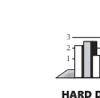

调试最好的三名程序员能够在大约三分之一的时间内找到缺陷，并且在纠正时插入的新缺陷只有最差的三名程序员的约五分之二。最好的程序员找到了所有缺陷，并且在纠正它们时没有插入任何新缺陷。最差的程序员错过了 12 个缺陷中的 4 个，并在纠正找到的 8 个缺陷时插入了 11 个新缺陷。

但这项研究并不能真正说明全部情况。在第一次调试后，最快的三名程序员的代码中仍有 3.7 个缺陷，最慢的仍有 9.4 个缺陷。两组都还没有完成调试。我想知道如果我将相同的查找和错误修复比率应用于额外的调试周期会发生什么。我的结果在统计学上无效，但仍然很有趣。当我将相同的查找和错误修复比率应用于连续的调试周期，直到每组剩余的缺陷少于半个时，最快组需要总共三次调试周期，而最慢组需要 14 次调试周期。考虑到较慢组的每个周期几乎是较快组每个周期的三倍长，根据我对这项研究的非科学外推，最慢组完全调试其程序所需的时间约为最快组的 13 倍。这种巨大差异已被其他研究证实（Gilb 1977, Curtis 1981）。

交叉引用 有关质量与成本之间关系的详细信息，请参阅第 20.5 节“软件质量的一般原则”。

除了提供有关调试的见解外，证据还支持软件质量的一般原则：提高质量可降低开发成本。最好的程序员找到了最多的缺陷，最快地找到了缺陷，并且最经常进行正确的修改。你不必在质量、成本和时间之间做出选择——它们是相辅相成的。

### 缺陷作为机会

拥有缺陷意味着什么？假设你不希望程序存在缺陷，这意味着你并不完全了解程序的作用。不知道程序的作用的想法令人不安。毕竟，如果你创建了程序，它应该听从你的指挥。如果你不知道自己正告诉计算机做什么，你就离仅仅尝试不同的东西直到看起来有效——即通过试错编程——只有一步之遥。而如果你是通过试错编程，缺陷是不可避免的。你不需要学习如何修复缺陷；你需要学习如何首先避免它们。

然而，大多数人或多或少都有失误，你可能是一名出色的程序员，只是犯了轻微的疏忽。如果是这种情况，你程序中的错误为你提供了学习许多事物的强大机会。你可以：

# 了解你正在工作的程序

你有东西需要学习，因为如果你已经完全了解它，它就不会有缺陷。你早就纠正它了。

# 了解你犯的错误类型

如果你编写了程序，你就插入了缺陷。并不是每天都有聚光灯以惊人的清晰度暴露弱点，但这样的日子是一个机会，所以要利用它。一旦你找到错误，就问问自己你是如何以及为什么犯下它的。你本可以更快地找到它吗？你本可以如何预防它？代码中是否还有其他类似的错误？你能在它们引起自身问题之前纠正它们吗？

# 从必须阅读它的人的角度了解你的代码质量

你必须阅读你的代码才能找到缺陷。这是批判性审视你的代码质量的机会。它容易阅读吗？如何改进？利用你的发现来重构当前代码或改进你接下来编写的代码。

# 了解你解决问题的方法

你解决调试问题的方法是否让你有信心？你的方法有效吗？你能快速找到缺陷吗？还是你的调试方法很弱？你是否感到痛苦和沮丧？你是否随机猜测？你需要改进吗？考虑到许多项目在调试上花费的时间，如果你观察自己的调试方式，你绝对不会浪费时间。花时间分析和改变你的调试方式可能是减少开发程序所需总时间的最快方法。

# 了解你如何修复缺陷

除了学习你如何找到缺陷外，你还可以学习你如何修复它们。你是否通过应用 goto 创可贴和特殊情况化妆来进行最简单的更正，从而改变症状而不是问题？还是你进行系统性更正，要求准确诊断并为问题的核心开出处方？

总而言之，调试是你自身改进的极其丰富的土壤。所有构建道路在此交叉：可读性、设计、代码质量——你能想到的所有方面。这就是构建良好代码会得到回报的地方，尤其是如果你做得足够好，以至于你不必经常调试。

进一步阅读 有关将帮助你了解自己容易犯的错误类型的实践的详细信息，请参阅 A Discipline for Software Engineering（Humphrey 1995）。


## 一种无效的方法

遗憾的是，大学里的编程课程几乎从不教授调试。如果你在大学学过编程，也许有过一节专门讲调试的课。虽然我接受的计算机科学教育非常优秀，但我得到的调试建议无非是“在程序中加入打印语句来查找缺陷”。这远远不够。如果其他程序员的受教育经历与我相似，那么大量程序员都不得不自行重新摸索调试的概念。多么浪费！

## 魔鬼的调试指南

在但丁对地狱的构想中，最底层是撒旦本人的居所。到了现代，撒旦同意与那些没学会有效调试的程序员共享最底层。他通过迫使程序员使用下面这些常见的调试方法来折磨他们：

> 程序员不总是利用现有数据来约束自己的推理。他们会进行一些小的、不合理的修补，而且常常不撤销错误的修补。
> ——艾里斯·维西（Iris Vessey）

- **靠猜测查找缺陷** 为了找到缺陷，在程序中随机散布打印语句，然后检查输出以确定缺陷所在。如果通过打印语句找不到缺陷，就尝试修改程序中的内容，直到似乎能行为正常为止。不要备份程序的原始版本，也不要记录你所做的修改。当你不完全确定程序在做什么时，编程会更有趣。多囤点可乐和糖果，因为你将在终端前度过一个漫长的夜晚。

- **不要浪费时间试图理解问题** 问题很可能是微不足道的，你不需要完全理解就能修复它。找到它就够了。

- **用最显而易见的修复方式修复错误** 通常只需修复你看到的具体问题就好，而不是浪费大量时间做一个会影响整个程序的大而全的修改。这是一个绝佳的例子：

```
x = Compute( y )
if ( y = 17 )
    x = $25.15      -- Compute() doesn’t work for y = 17, so fix it
```

当你可以直接在显而易见的地方为它写一个特例时，谁还需要为了这个关于值 17 的疑难问题而深入 Compute() 内部呢？

## 靠迷信调试

撒旦将地狱的一部分租给了那些靠迷信调试的程序员。每个团队里总有一个程序员会遇到没完没了的问题：恶魔般的机器、神秘的编译器缺陷、月圆时才出现的隐藏语言缺陷、糟糕的数据、丢失重要更改、像被附了体一样错误保存程序的编辑器——你能想到的都有。这就是“靠迷信编程”。

如果你编写的程序出了问题，那是你的错。不是计算机的错，也不是编译器的错。程序每次运行时并不会做出不同的事。它不是自己写出来的；是你写的，所以要为之负责。


即使某个错误乍看起来并不是你的错，但假设它是你的错，对你绝对有利。这种假设有助于你调试。当你主动寻找代码中的缺陷时，找到它已经够难了；如果你认为自己的代码没有错误，那就更难了。假设错误是你自己的问题，还能提高你的可信度。如果你声称错误来自别人的代码，其他程序员会认为你已经仔细排查过问题。如果你假设错误是自己的，就可以避免日后发现这确实是你的缺陷时，不得不公开收回自己先前言论的尴尬。

### 23.2 查找缺陷

调试包括查找缺陷和修复缺陷。找到缺陷并理解它，通常占整个工作量的 90%。

幸运的是，你不必与撒旦达成契约，也能找到一种比随机猜测更好的调试方法。通过思考问题来调试，远比靠“蝾螈之眼、青蛙耳粉”之类的偏方来调试更有效、更有趣。

假设你被要求侦破一桩谋杀案。哪种方式更有趣：挨家挨户走遍整个县，核对每个人在 10 月 17 日晚上的不在场证明；还是找到几条线索，推断出凶手的身份？大多数人会选择推断凶手身份，大多数程序员也会觉得这种智力性的调试方法更令人满足。更妙的是，高效的程序员调试时所用时间仅为低效程序员的二十分之一，而且他们并不是在胡乱猜测如何修复程序。他们使用的是科学方法——也就是科学探究所必需的发现与验证过程。

### 调试的科学方法

以下是使用经典科学方法时所要经历的步骤：

1. 通过可重复的实验收集数据。
2. 形成能够解释相关数据的假设。
3. 设计实验来证明或推翻该假设。
4. 证明或推翻该假设。
5. 根据需要重复上述步骤。


科学方法与调试有许多相似之处。下面是一种查找缺陷的有效方法：

1. 稳定错误。
2. 定位错误的根源（“故障”）。
   a. 收集产生缺陷的数据。
   b. 分析已收集的数据，形成关于缺陷的假设。
   c. 确定如何证明或推翻该假设，可以通过测试程序或检查代码。
   d. 使用步骤 2(c) 中确定的程序来证明或推翻该假设。
3. 修复缺陷。
4. 测试修复。
5. 查找类似错误。

第一步与科学方法的第一步类似，因为它依赖于可重复性。如果能够稳定缺陷，也就是说，让缺陷稳定地出现，那么诊断起来就会更容易。第二步则运用了科学方法的各个步骤。你收集暴露缺陷的测试数据，分析生成的数据，并对错误的根源做出假设。然后设计一个测试用例或用代码检查来评估假设，之后要么宣布成功（假设得到证实），要么酌情重新再来。当你证明了假设之后，就可以修复缺陷、测试修复效果，并在代码中查找类似的错误。

让我们结合一个例子来看每个步骤。假设你有一个员工数据库程序，它会出现间歇性错误。该程序本应按字母顺序打印员工名单及其个人所得税预扣金额。以下是部分输出：

```
Formatting, Fred Freeform      $5,877
Global, Gary                   $1,666
Modula, Mildred                $10,788
Many-Loop, Mavis               $8,889
Statement, Sue Switch          $4,000
Whileloop, Wendy               $7,860
```

错误在于 Many-Loop, Mavis 和 Modula, Mildred 的顺序不对。

### 稳定错误

如果缺陷不能稳定地复现，几乎不可能诊断。让间歇性缺陷可预测地出现，是调试中最具挑战性的任务之一。

不能可预测地出现的错误，通常是初始化错误、时序问题或悬空指针问题。如果某个求和计算时而正确、时而错误，那么参与计算的某个变量很可能没有被正确初始化——大多数时候它只是碰巧从 0 开始。如果问题是一种奇怪且不可预测的现象，并且你正在使用指针，那么几乎可以肯定你有一个未初始化的指针，或者在指针所指向的内存被释放后仍然使用了该指针。

稳定错误通常不仅仅是找到一个能产生错误的测试用例，还需要把测试用例缩减到仍能产生错误的最简形式。简化测试用例的目标是让它足够简单，以至于改变其任何一方面都会改变错误的行为。然后，通过谨慎地改变测试用例，并在受控条件下观察程序的行为，你就能诊断问题。如果你所在的组织有独立的测试团队，有时让测试用例变得简单是团队的工作。但大多数时候，这是你的工作。

为了简化测试用例，你再次运用科学方法。假设有 10 个因素组合在一起产生了这个错误。先形成一个关于哪些因素与产生错误无关的假设。然后更改这些被认为无关的因素，重新运行测试用例。如果仍然出现错误，就可以排除这些因素，测试也就简化了。接下来可以尝试进一步简化测试。如果没有出现错误，就说明这个具体假设被推翻了，而你比之前知道了更多信息。也许某个细微不同的更改仍然会产生错误，但你至少知道了一个不会产生错误的具体更改。

在员工预扣税示例中，程序第一次运行时，Many-Loop, Mavis 排在 Modula, Mildred 后面。然而，当程序第二次运行时，列表却正常了：

| | |
| --- | --- |
| Formatting, Fred Freeform | $5,877 |
| Global, Gary | $1,666 |
| Many-Loop, Mavis | $8,889 |
| Modula, Mildred | $10,788 |
| Statement, Sue Switch | $4,000 |
| Whileloop, Wendy | $7,860 |

直到输入 Fruit-Loop, Frita 后它也出现在错误的位置，你才想起 Modula, Mildred 也是在被输入之后紧接着就出现在了错误的位置。这两件事的奇怪之处在于，它们都是单独输入的。通常，员工是按组输入的。

交叉引用：有关安全使用指针的详细信息，请参见 13.2 节“指针”。


你提出假设：问题与录入一名新员工有关。如果这是真的，再次运行程序应该会把 Fruit-Loop, Frita 放在正确的位置。以下是第二次运行的结果：

```
Formatting, Fred Freeform      $5,877
Fruit-Loop, Frita              $5,771
Global, Gary                   $1,666
Many-Loop, Mavis               $8,889
Modula, Mildred                $10,788
Statement, Sue Switch          $4,000
Whileloop, Wendy               $7,860
```

这次成功的运行支持了该假设。为了确认它，你想尝试一次添加几名新员工，一次一个，看看他们是否会以错误的顺序出现，以及第二次运行时的顺序是否会改变。

## 定位错误的来源

定位错误的来源也需要使用科学方法。你可能会怀疑缺陷是特定问题的结果，比如一次偏移错误。然后你可以改变你怀疑导致问题的参数——边界以下一个、边界上一个、边界以上一个——并确定你的假设是否正确。

在运行的示例中，问题的来源可能是当你添加一名新员工时发生的一次偏移缺陷，而添加两名或更多员工时不会发生。检查代码后，你没有发现明显的一次偏移缺陷。退而求其次，你使用一名新员工运行测试用例，看看这是否是问题所在。你添加 Hardcase, Henry 作为一名单独的员工并假设他的记录会乱序。以下是你发现的情况：

```
Formatting, Fred Freeform      $5,877
Fruit-Loop, Frita              $5,771
Global, Gary                   $1,666
Hardcase, Henry                $493
Many-Loop, Mavis               $8,889
Modula, Mildred                $10,788
Statement, Sue Switch          $4,000
Whileloop, Wendy               $7,860
```

Hardcase, Henry 的行正好在它应该在的位置，这意味着你的第一个假设是错误的。问题并非仅仅由一次添加一名员工引起。它要么是一个更复杂的问题，要么是完全不同的东西。

再次检查测试运行输出，你注意到 Fruit-Loop, Frita 和 Many-Loop, Mavis 是唯一包含连字符的名字。Fruit-Loop 在她首次录入时顺序错误，但 Many-Loop 不是吗？虽然你没有原始录入的打印件，但在原始错误中 Modula, Mildred 看起来顺序错误，但她在 Many-Loop 旁边。也许 Many-Loop 顺序错误而 Modula 没问题。

你再次提出假设：问题源于带连字符的名字，而不是单独录入的名字。

但这如何解释问题只在员工首次录入时出现这一事实？你查看代码，发现使用了两种不同的排序例程。一种在录入员工时使用，另一种在保存数据时使用。仔细查看员工首次录入时使用的例程显示，它本不打算完全排序数据。它只是把数据大致排序以加快保存例程的排序速度。因此，问题是数据在排序前就被打印出来了。带连字符名字的问题出现是因为粗略排序例程无法处理标点字符等细节。现在，你可以进一步细化假设。

你最后一次提出假设：带标点字符的名字在保存之前不会被正确排序。

你后来通过额外的测试用例证实了这一假设。

## 查找缺陷的技巧

一旦你稳定了错误并细化了产生它的测试用例，找到其来源可能很简单，也可能具有挑战性，这取决于你编写代码的好坏。如果你很难找到缺陷，可能是因为代码写得不好。你可能不想听到这个，但这是事实。如果你遇到困难，请考虑以下技巧：

**利用所有可用数据来提出你的假设**  在创建关于缺陷来源的假设时，要在假设中考虑尽可能多的可用数据。在示例中，你可能注意到 *Fruit-Loop, Frita* 顺序错误，并提出假设名字以“F”开头的名字排序不正确。这是一个糟糕的假设，因为它没有考虑到 *Modula, Mildred* 顺序错误或名字第二次排序正确这一事实。如果数据与假设不符，不要丢弃数据——问问为什么不符，并创建新的假设。

示例中的第二个假设——问题源于带连字符的名字，而不是单独录入的名字——最初似乎也没有解释名字第二次排序正确这一事实。在这种情况下，第二个假设导致了一个更精细的假设，证明是正确的。假设一开始不能解释所有数据是可以的，只要你不断细化假设，使其最终能够解释。

**细化产生错误的测试用例**  如果你找不到错误的来源，尝试比你已经做的更进一步细化测试用例。你可能能够改变你认为已经假设的一个参数，专注于其中一个参数可能会带来关键的突破。

交叉引用 有关单元测试框架的更多信息，请参阅第 22.4 节中的“将单元测试插入测试框架”。

## 在单元测试套件中演练代码

缺陷在小段代码中比在大型集成程序中更容易找到。使用你的单元测试在隔离状态下测试代码。

## 使用可用工具

有许多工具可用于支持调试会话：交互式调试器、挑剔的编译器、内存检查器、语法定向编辑器等等。合适的工具可以使困难的工作变得简单。例如，在一个难以找到的错误中，程序的一个部分覆盖了另一部分的内存。这个错误很难通过常规调试实践来诊断，因为程序员无法确定程序在何处错误地覆盖内存。程序员使用内存断点来监视特定的内存地址。当程序写入该内存位置时，调试器停止代码，有问题的代码就暴露出来了。

这是一个例子，说明一个问题在分析上难以诊断，但在应用了合适的工具后变得非常简单。

## 以几种不同的方式重现错误

有时尝试与错误产生情况相似但不完全相同的情况是有启发的。将这种方法视为三角定位缺陷。如果你能从一个点对它进行修复，从另一个点对它进行修复，你就能更好地确定它确切的位置。

如图 23-1 所示，以几种不同的方式重现错误有助于诊断错误的原因。一旦你认为已经识别出缺陷，运行一个接近产生错误的案例但本身不应产生错误的情况。如果它确实产生错误，你还没有完全理解问题。错误通常源于因素的组合，仅用一个测试用例来诊断问题通常无法诊断根本问题。


图 23-1 尝试以几种不同的方式重现错误以确定其确切原因。

## *生成更多数据以生成更多假设*

选择与你已知错误或正确的测试用例不同的测试用例。运行它们以生成更多数据，并使用新数据增加可能的假设列表。

## *利用否定测试的结果*

假设你提出了一个假设并运行一个测试用例来证明它。假设进一步，测试用例反驳了假设，因此你仍然不知道错误的来源。你确实知道了一些以前不知道的东西——即缺陷不在你认为的区域。那缩小了你的搜索范围和剩余可能的假设集合。

## *为可能的假设集思广益*

不要将自己限制在你想到的第一个假设上，尝试想出几个。起初不要分析它们——只是在几分钟内尽可能多地想出。 然后查看每个假设并思考哪些测试用例可以证明或反驳它。这种心理练习有助于打破由于过于专注于单一推理路线而导致的调试僵局。

## *在桌边放一个笔记本，并列出要尝试的事情*

程序员在调试会话中卡住的一个原因是他们走得太远进入死胡同。列出要尝试的事情，如果一种方法不起作用，就转向下一个方法。

## *缩小代码的可疑区域*

如果你一直在测试整个程序或整个类或例程，改而测试更小的一部分。使用打印语句、日志或跟踪来识别哪个代码段产生错误。

如果你需要更强大的技术来缩小代码的可疑区域，系统地删除程序的部分并查看错误是否仍然发生。如果没有，你就知道它在你取走的部分。如果有，你就知道它在你保留的部分。

不要随意删除区域，分而治之。使用二分搜索算法来聚焦你的搜索。第一次尝试删除大约一半的代码。确定缺陷在哪一半，然后再将该部分分割。再次确定哪一半包含缺陷，再次将该部分减半。继续直到找到缺陷。

如果你使用许多小型例程，你可以通过注释掉对例程的调用来简单地切除代码段。否则，你可以使用注释或预处理器命令来删除代码。

如果你使用调试器，你不一定必须删除代码片段。你可以在程序中途设置断点并以这种方式检查缺陷。如果你的调试器允许你跳过对例程的调用，通过跳过某些例程的执行并查看错误是否仍然发生来消除嫌疑人。使用调试器的过程与物理删除程序片段的过程类似。


**警惕之前出现过缺陷的类和例程**。之前有缺陷的类很可能继续出现缺陷。过去问题频发的类比从未有缺陷的类更可能包含新缺陷。请重新检查容易出错的类和例程。

**检查最近更改的代码**。如果你遇到一个难以诊断的新错误，它通常与最近更改的代码有关。可能是全新的代码，也可能是对旧代码的修改。如果找不到缺陷，请运行旧版本的程序，看是否会出现该错误。如果不会，你就知道错误在新版本中，或由新版本交互引起。仔细检查新旧版本之间的差异。查看版本控制日志以了解最近更改了哪些代码。如果无法做到，请使用 diff 工具比较旧的、可正常工作的源代码与新的、有问题的源代码之间的变化。

**扩大可疑代码区域**。人们很容易聚焦于一小段代码，并确信“缺陷一定在这一段”。如果在该段中找不到，请考虑缺陷可能不在此段。扩大你怀疑的代码区域，然后使用前面描述的二分查找技术对其中的片段进行聚焦。

**增量集成**。如果一次只向系统添加一个部分，调试会很容易。如果向系统添加某一部分后遇到新错误，请移除该部分并单独测试它。

**检查常见缺陷**。使用代码质量检查清单来激发你对可能缺陷的思考。如果你遵循第21.3节“正式检查”中描述的检查实践，你将拥有针对你环境中常见问题的微调检查清单。你也可以使用本书中出现的检查清单。参见书目录之后的“检查清单列表”。

**与他人讨论问题**。有些人称之为“忏悔式调试”。你常常在向他人解释问题的过程中发现自己的缺陷。例如，如果你在解释薪水示例中的问题，你可能会这样说：

> 嘿，Jennifer，你有空吗？我遇到一个问题。我有一份本应排序的员工薪水列表，但有些名字顺序不对。第二次打印出来时是好的，但第一次不对。我检查了是否是新名字，但我试了一些可行的名字。我知道第一次打印时它们应该是排序的，因为程序在输入所有名字时排序，并在保存时再次排序——等等——不，它没有在输入时排序。没错，它只是大致排序。谢谢，Jennifer，你帮了大忙。

Jennifer 一句话也没说，而你解决了问题。这种结果很典型，这种方法也是解决困难缺陷的有力工具。

## *暂时搁置问题*

有时你过于专注以至于无法思考。你有多少次停下来喝杯咖啡，却在去咖啡机的路上想出了问题？或者在午餐时？或者在回家路上？或者第二天早上洗澡时？如果你在调试中毫无进展，尝试了所有选项后，就让它休息一下。去散散步。做点别的事情。今天回家吧。让你的潜意识从问题中梳理出解决方案。

暂时放弃的辅助好处是减轻与调试相关的焦虑。焦虑的出现是时候休息一下的明确信号。

## 暴力调试

暴力调试是调试软件问题时一种常被忽视的方法。所谓“暴力”，我指的是一种可能单调、艰难且耗时，但*保证*能解决问题的方法。哪些具体方法能保证解决问题取决于具体情境，但这里有一些通用候选：

- 对损坏的代码进行完整的设计和/或代码审查。
- 丢弃该代码段，从头重新设计和/或编码。
- 丢弃整个程序，从头重新设计和/或编码。
- 使用完整的调试信息编译代码。
- 以最挑剔的警告级别编译代码，并修复所有挑剔的编译器警告。
- 挂上单元测试框架，并单独测试新代码。
- 创建自动化测试套件并整夜运行。
- 在调试器中手动逐步执行一个大循环，直到达到错误条件。
- 在代码中插入 print、display 或其他日志语句。
- 使用不同的编译器编译代码。
- 在不同的环境中编译并运行程序。
- 使用特殊的库或执行环境来链接或运行代码，这些环境在代码被错误使用时会产生警告。
- 复制最终用户的完整机器配置。
- 以小片段集成新代码，并在集成时对各片段进行充分测试。

### 为快速而粗糙的调试设置最长时间

对于每种暴力调试方法，你的反应很可能是：“我做不到——工作量太大了！”关键在于，只有当它比你所谓的“快速而粗糙的调试”花费更多时间时，才算工作量太大。人们总是倾向于快速猜测，而不是系统地插桩代码，让缺陷无处藏身。我们每个人心中的赌徒宁愿采用一种可能五分钟内找到缺陷的高风险方法，也不愿采用一种半小时内必定找到缺陷的稳妥方法。风险在于，如果五分钟的方法不奏效，你就会变得固执。以“简单”方式找到缺陷成了一种原则问题，于是几小时毫无成效地过去，接着是几天、几周、几个月……你有多少次花了两个小时调试只花了30分钟编写的代码？这是一种糟糕的劳动分配，与其调试糟糕的代码，不如重写它。

当你决定寻求速胜时，为快速尝试设置一个最长时间限制。如果超过了时间限制，那就接受这样的想法：这个缺陷比你最初想象的更难诊断，然后以更费力的方式把它揪出来。这种方法让你能够立刻解决简单的缺陷，而在稍长时间后解决困难的缺陷。

### 列出一份暴力调试方法清单

在开始调试一个困难错误之前，问自己：“如果我在调试这个问题时陷入困境，是否有什么方法能保证我修复该问题？”如果你能确定至少一种能修复问题的暴力调试方法——包括重写相关代码——那么在有更快替代方案的情况下，你浪费数小时或数天的可能性就会降低。

## 语法错误

语法错误问题正像猛犸象和剑齿虎一样走向灭绝。编译器的诊断信息越来越好，而你必须花两小时在 Pascal 代码列表中查找放错位置分号的日子几乎一去不复返。以下是一份指南清单，可用于加速这一濒危物种的灭绝：

**不要相信编译器消息中的行号**。当编译器报告一个神秘的语法错误时，立即查看错误位置之前和之后的代码——编译器可能误解了问题，或者只是诊断信息不佳。一旦你找到真正的缺陷，尝试确定编译器将消息放在错误语句上的原因。更好地理解你的编译器可以帮助你发现未来的缺陷。

**不要相信编译器的消息**。编译器试图准确告诉你哪里出错了，但编译器是爱掩饰的小捣蛋鬼，你常常必须体会言外之意才能知道它的真正含义。例如，在 UNIX C 中，整数除以 0 时，你可能会收到一条显示“floating exception（浮点异常）”的消息。使用 C++ 的标准模板库（STL）时，你可能会收到一对错误消息：第一条消息是使用 STL 时的真正错误；第二条消息是编译器说：“错误消息太长，打印机无法打印；消息已被截断。”你大概也能想出许多自己的例子。

**不要相信编译器的第二条消息**。有些编译器在检测多个错误方面比其他的更好。有些编译器在检测到第一个错误后变得过于兴奋，甚至会飘飘然、过度自信；它们喋喋不休地输出几十条毫无意义的错误消息。另外一些编译器则更为冷静；它们虽然在检测到错误时肯定会有成就感，但会克制自己，不再吐出不准确的消息。当你的编译器生成一连串级联错误消息时，如果你不能很快找到第二条或第三条错误消息的来源，不用担心。修复第一个错误并重新编译。

**分而治之**。将程序分成多个部分以帮助检测缺陷的思路对于语法错误尤其有效。如果遇到棘手的语法错误，移走部分代码并重新编译。你要么不会收到错误（因为错误在你移走的部分中），要么收到相同的错误（意味着你需要移走另一个部分），要么收到不同的错误（因为你已经诱使编译器产生一条更有意义的错误消息）。

> **交叉引用** 语法导向编辑器的可用性是早期浪潮与成熟浪潮编程环境的一个特征。详情请参见第4.3节“你在技术浪潮中的位置”。

**查找放错位置的注释和引号**。许多编程文本编辑器会自动格式化注释、字符串字面量和其他语法元素。在更原始的环境中，放错位置的注释或引号可能会使编译器出错。为了找到多余的注释或引号，在 C、C++ 和 Java 代码中插入以下序列：

```
/**/**/
```

这段代码短语将终止注释或字符串，这有助于缩小未终止的注释或字符串所隐藏的空间。

### 23.3 修复缺陷

调试的难点在于找到缺陷。修复缺陷则是容易的部分。但正如许多容易的任务一样，正因为容易，所以尤其容易出错。至少有一项研究发现，缺陷修正第一次出错的可能性超过50%（Yourdon 1986b）。以下是一些降低出错概率的指南：


**在修复之前先理解问题**。《调试魔鬼指南》说得对：让你的生活变得艰难并腐蚀程序质量的最好方法，就是在没有真正理解问题的情况下修复它。在修复问题之前，确保你从核心上理解它。同时使用应该重现错误的用例和不应该重现错误的用例来对缺陷进行三角定位。坚持不懈，直到你足够理解该问题，能够每次都准确预测它的发生。


## 写作系统的学与写

关于写作系统的学与写，是一个非常宏大的话题，三两句话说不清楚。结合多年的工作经验，下面我分几个部分来做一些分享，不一定正确，仅供大家参考。

### 第一部分：为什么要学写作系统？

写作系统是一种将零散想法转化为完整作品的方法论。在信息爆炸的时代，每个人都面临着注意力碎片化的挑战。如果没有一套有效的写作系统，我们很容易陷入“想得多、写得少”的困境。学习写作系统，本质上是在学习如何与自己的思维对话，如何将内心的混沌梳理成清晰的表达。

### 第二部分：什么是好的写作系统？

一个好的写作系统应该具备三个特征：稳定性、灵活性和可迭代性。稳定性意味着无论何时何地，你都能快速进入写作状态；灵活性是指系统能够适应不同类型的写作任务，从朋友圈文案到长篇报告；可迭代性则要求系统本身能够随着你的成长而进化，不断吸收新的方法和工具。

### 第三部分：如何搭建自己的写作系统？

搭建写作系统可以从四个维度入手：输入管理、积累机制、输出流程和反馈闭环。输入管理解决的是“读什么、怎么读”的问题；积累机制关注如何建立自己的素材库和知识图谱；输出流程涉及从提纲到初稿再到修改的完整路径；反馈闭环则是让作品获得外部评价并持续优化的过程。

### 第四部分：写作系统的实践技巧。

在实践中，我推荐大家采用“最小可行系统”的策略。不要一开始就追求完美的工具链，而是先用手边的工具跑通整个流程。哪怕只是用备忘录记录灵感、用文档软件汇总素材、用聊天工具发送给自己做草稿，也能形成基本的闭环。等习惯养成后，再逐步引入更专业的工具。

结语：写作系统的最终目的，不是为了束缚你，而是为了解放你。当一切流程都变得自然而然，你就能把更多的精力投入到真正重要的思考中去。希望每一位写作者都能建立属于自己的系统，在写作的道路上行稳致远。

-   大多数时候，这些修复不会起作用。问题看起来像是初始化缺陷造成的。初始化缺陷本质上就是不可预测的，所以今天客户45的金额差了3.45美元，并不能说明明天会怎样。明天可能差10,000.02美元，也可能完全正确。这就是初始化缺陷的本质。

-   这种代码无法维护。当代码为了绕过错误而进行了特殊处理，这些特殊处理会成为代码最显著的特征。3.45美元不会永远是3.45美元，以后还会出现其他错误。代码会被再次修改以处理新的特殊情况，而针对3.45美元的特殊处理不会移除。代码会越来越被各种特殊情况像藤壶一样附满。最终，附着的累赘会重到代码无法承受，然后代码沉入海底——这倒是它该去的地方。

-   它用计算机来做本应手工完成的事情。计算机擅长可预测的、系统化的计算，但人类更擅长创造性地修正数据。与其去折腾代码，不如用修正液和打字机来处理输出，这样更明智。

## 只出于充分的理由才修改代码

与修复症状相关的是随机修改代码直到看似工作的技术。典型的思路是这样：“这个循环似乎有个缺陷。可能是差一错误，那我就放一个 -1 试试。嗯，不行，那我就改成 +1。嗯，好像可以了。我就说修好了。”

尽管这种做法很流行，但并不可取。随机修改代码就像转动庞蒂亚克Aztek的轮胎来修复发动机问题一样。你什么也学不到；只是在瞎折腾。通过随机改变程序，你实际上在说：“我不知道这里发生了什么，但我会试试这个改动，希望它能奏效。”不要随机修改代码。那是巫毒编程。你在不理解的情况下改动越大，你对它能否正确工作的信心就越低。

在做出改动之前，要确信它会有效。如果改动没有解决问题，你应该感到惊讶。这种错误应该让你产生自我怀疑、重新评价自己，并深刻反省。这种事情应该很少发生。

## 一次只做一处修改

一次只做一处修改时，修改本身就够棘手的了。如果同时做两处修改，可能会引入一些看起来与原始错误相像的微妙错误。这会让你陷入尴尬的境地：不知道是你没有纠正错误，是纠正了错误但又引入了一个类似的新错误，还是你没有纠正错误并且还引入了一个类似的新错误。保持简单：一次只做一处修改。

交叉引用：有关自动化回归测试的详细信息，请参见第22.6节的“重新测试（回归测试）”。

## 检查你的修复

自己检查程序，请别人帮你检查，或者和别人一起走查。运行你用来诊断问题的同一组三角测试用例，确保问题的所有方面都已解决。如果你只解决了部分问题，你会发现自己还有工作要做。

重新运行整个程序，检查你的修改带来的副作用。检查副作用最简单、最有效的方法是通过JUnit、CppUnit或等效工具中的自动化回归测试套件运行程序。

## 添加一个能暴露缺陷的单元测试

当你遇到一个测试套件未暴露的错误时，添加一个测试用例来暴露该错误，以免以后重新引入。

## 寻找类似缺陷

当你发现一个缺陷时，寻找其他类似的缺陷。缺陷往往成群出现，关注你所犯缺陷类型的好处之一是你能够纠正所有该类型的缺陷。寻找类似缺陷要求你彻底理解问题。注意警示信号：如果你不知道如何寻找类似缺陷，这表明你还没有完全理解问题。

### 23.4 调试中的心理因素

延伸阅读：对于调试以及软件开发其他许多领域中心理问题的精彩讨论，参见《计算机编程心理学》（Weinberg 1998）。

调试和其他软件开发活动一样对智力要求很高。你的自尊心告诉你你的代码很好，即使你已经看到它有缺陷，也认为它没有缺陷。你必须精确地思考——形成假设、收集数据、分析假设并系统地拒绝它们——这种形式对许多人来说是不自然的。如果你既在编写代码又在调试它，你必须快速在设计所需的流动、创造性思维与调试所需的严格批判性思维之间切换。在阅读代码时，你必须与代码的熟悉感作斗争，并警惕只看到你期望看到的内容。

## “心理定势”如何导致调试盲目性

当你在程序中看到一个标记“Num”时，你看到了什么？你看到“Numb”拼错了吗？还是看到了“Number”的缩写？很可能你看到了“Number”的缩写。这就是“心理定势”现象——看到你期望看到的东西。这个标志说什么？


人们看到他们期望看到的东西。考虑以下情况：

-   学习while循环的学生通常期望循环被持续求值；也就是说，他们期望循环在while条件变为假时立即终止，而不是只在循环的顶部或底部终止（Curtis et al. 1986）。他们期望while循环的行为与自然语言中的“while”相同。


-   一个无意中同时使用变量SYSTSTS和SYSSTSTS的程序员认为自己使用的是同一个变量。直到程序运行了数百次，并有一本书包含了错误结果后，他才发现问题（Weinberg 1998）。

-   一个程序员在看像这样的代码：

```
if ( x < y )
    swap = x;
    x = y;
    y = swap;
```

有时会看成这样的代码：

```
if ( x < y ) {
    swap = x;
    x = y;
    y = swap;
}
```

人们期望新现象与他们以前见过的相似现象类似。他们期望新的控制结构与旧结构一样工作；编程语言中的while语句与现实生活中的“while”一样工作；变量名也与以前一样。你看到你期望看到的东西，因此忽略了差异，就像前一句话中“language”这个单词的拼写错误一样。

心理定势与调试有什么关系？首先，它说明了良好编程实践的重要性。良好的格式、注释、变量名、例程名以及其他编程风格元素有助于构建编程背景，使可能的缺陷表现为变异并突显出来。

心理定势的第二个影响体现在发现错误时选择要检查的程序部分。研究表明，最有效的调试程序员在调试期间会从心理上切掉与调试无关的程序部分（Basili, Selby, and Hutchens 1986）。总的来说，这种做法使优秀的程序员能够缩小搜索范围并更快地发现缺陷。然而，有时包含缺陷的程序部分被错误地切掉了。你花时间仔细搜索一段代码寻找缺陷，却忽略了包含缺陷的部分。你在岔路口走错了方向，需要原路返回才能再次前进。第23.2节中关于查找缺陷的讨论中提出的一些建议就是为了克服这种“调试盲目性”。


## “心理距离”如何提供帮助

交叉参考：关于创建不会令人困惑的变量名的详细信息，请参见第 11.7 节“应避免的命名种类”。

心理距离可以定义为区分两个事物的难易程度。如果你在看一长串单词，并且被告知它们都是关于鸭子的，你可能会轻易把“Queck”误认为“Quack”，因为这两个词看起来很像。这两个词之间的心理距离很小。而你把“Tuack”误认为“Quack”的可能性就要小得多，尽管差别同样只是一个字母。“Tuack”与“Quack”的相似程度低于“Queck”与“Quack”，因为单词的首字母比中间字母更显眼。

表 23-1 列出了变量名之间心理距离的示例：

**表 23-1 变量名之间心理距离的示例**

| 第一个变量 | 第二个变量 | 心理距离 |
|---|---|---|
| stoppt | stcppt | 几乎不可见 |
| shiftrn | shift rn | 几乎为零 |
| dcount | bcount | 小 |
| claims1 | claims2 | 小 |
| product | sum | 大 |

调试时，请做好准备应对相似变量名之间以及相似例程名之间因心理距离不足而引发的问题。在编写代码时，选择差异较大的名字，以避免此类问题。

### 23.5 调试工具——显而易见与非显而易见的

交叉参考：测试工具和调试工具之间的界限是模糊的。更多关于测试工具的内容请参见第 22.5 节，更多关于软件开发工具的内容请参见第 30 章。

借助现成的调试工具，你可以完成许多细致且绞尽脑汁的调试工作。能够将最后一根木桩钉入缺陷吸血鬼心脏的工具尚不存在，但每年可用的调试能力都会有所提升。

### 源代码比较器

当你针对错误修改程序时，像 Diff 这样的源代码比较器很有用。如果你做了多处修改，需要撤销其中一些又记不太清，比较器可以精确定位差异，帮你唤起记忆。如果你在新版本中发现了一个不记得旧版本中有的缺陷，可以比较文件来确定发生了什么变化。

### 编译器警告信息


最简单也最有效的调试工具之一就是你自己的编译器。

**将编译器的警告级别设置为最高、最严格的程度，并修复它报告的错误** 忽略编译器错误是草率的行为。关掉警告以至于根本看不到它们，则更加草率。孩子们有时会以为，闭上眼睛看不见你，就能让你消失。在编译器上设置开关关闭警告，只是意味着你看不到错误。这并不能让错误消失，就像闭上眼睛并不能让大人消失一样。

要假设编写编译器的人比你更了解你的语言。如果他们向你发出警告，通常意味着你有机会学到关于这门语言的新东西。努力去理解警告的真正含义。

**将警告视为错误** 有些编译器允许你将警告视为错误。使用这个特性的一个原因是，它能提高警告的表面重要性。就像把手表调快五分钟会让你误以为时间已经过去了五分钟一样，将编译器设置为把警告视为错误，会让你更认真地对待它们。将警告视为错误的另一个原因是，它们常常会影响程序的编译方式。当你编译并链接程序时，警告通常不会阻止链接，但错误通常会。如果你想在链接之前检查警告，就设置那个把警告视为错误的编译器开关。

**为编译时设置建立项目级标准** 制定一项标准，要求团队中的每个人都使用相同的编译器设置来编译代码。否则，当你尝试集成由不同人员用不同设置编译的代码时，会收到大量错误消息，陷入集成的噩梦。如果你使用项目标准的 make 文件或构建脚本，这一点很容易执行。

### 扩展语法和逻辑检查

你可以使用额外的工具来比编译器更彻底地检查代码。例如，对于 C 语言程序员，lint 工具会一丝不苟地检查未初始化变量的使用（本意是 == 却写成 =）以及类似的细微问题。

### 执行性能分析器

你可能不会把执行性能分析器当作调试工具，但花几分钟研究程序分析结果，就能发现一些令人惊讶（且隐蔽）的缺陷。

例如，我曾怀疑某个程序中的内存管理例程是性能瓶颈。内存管理最初是一个小模块，使用线性有序的指针数组。我用哈希表替换了线性有序数组，期望执行时间至少减少一半。但在对代码进行性能分析后，我发现性能完全没有变化。我更仔细地检查了代码，发现一个缺陷在分配算法中浪费了大量时间。瓶颈不是线性搜索技术，而是这个缺陷。我根本不需要优化搜索。检查执行性能分析器的输出，以确认你的程序在每个区域花费的时间是合理的。

### 测试框架/脚手架

> **交叉参考：** 关于脚手架的详细信息，请参见第 22.5 节中的“构建脚手架以测试各个类”。

正如第 23.2 节“查找缺陷”中提到的，把有问题的代码片段提取出来，编写测试代码并单独执行，往往是让容易出错的程序暴露缺陷的最有效方式。

### 调试器

多年来，商用调试器一直在稳步发展，今天可用的功能足以改变你的编程方式。优秀的调试器允许你设置断点，在执行到达特定行、第 n 次到达特定行、全局变量发生变化或变量被赋予特定值时中断。它们允许你逐行执行代码，可以单步进入或跳过例程。它们允许程序反向执行，回退到缺陷产生的地方。它们允许你记录特定语句的执行情况——类似于在程序中各处散落“我在这里！”这样的打印语句。

优秀的调试器允许全面检查数据，包括结构化和动态分配的数据。它们让你轻松查看指针链表或动态分配数组的内容。它们对用户自定义数据类型很智能。它们允许你对数据做临时查询、赋予新值，并继续执行程序。

你可以查看编译器生成的高级语言或汇编语言代码。如果你使用多种语言，调试器会自动为每段代码显示正确的语言。你可以查看例程调用链，快速查看任何例程的源代码。你可以在调试器环境中更改程序的参数。

如今最好的调试器还会记住每个程序的调试参数（断点、正在监视的变量等），这样你就不必为每个调试的程序重新创建它们。

系统调试器在系统层面而不是应用层面运行，因此不会干扰被调试程序的执行。当你调试对时序或可用内存量敏感的程序时，它们至关重要。

> > 交互式调试器是“不需要的东西”的绝佳例子——它鼓励试错式的乱改，而不是系统化的设计，同时也会掩盖那些勉强够格从事精确编程的边缘人员。
> >
> > ——哈兰·米尔斯

鉴于现代调试器提供的强大功能，你可能会惊讶于居然有人批评它们。但计算机科学界一些最受尊敬的人士建议不要使用调试器。他们建议动用自己的头脑，完全避开调试工具。他们的论点是，调试工具是拐杖，通过思考来发现问题比依赖工具更快、更准确。他们认为应该由你在脑中执行程序来找出缺陷，而不是依赖调试器。

无论经验证据如何，反对调试器的基本论点都不成立。一种工具可能被滥用，并不意味着就该被弃用。你不会因为可能服用过量就不吃阿司匹林。你也不会因为可能割伤自己就不用电动割草机割草。任何其他强大的工具都可能被正确使用或滥用，调试器也是如此。


调试器不能替代良好的思考。但在某些情况下，思考也不能替代一个好的调试器。最有效的组合是良好的思考加上一个好的调试器。

## 清单：调试提醒

### 查找缺陷的技巧

- 利用所有可用数据来提出假设。
- 完善产生错误的测试用例。
- 在单元测试套件中运行代码。
- 使用可用的工具。
- 用几种不同的方式重现错误。
- 生成更多数据以产生更多假设。
- 利用负面测试的结果。
- 集思广益，寻找可能的假设。
- 在办公桌上放一个记事本，列出要尝试的事项。
- 缩小代码中可疑区域的范围。
- 对之前出现过缺陷的类和例程保持警惕。
- 检查最近更改的代码。
- 扩大代码中可疑区域的范围。


- ☐ 你是否假设错误都是你的责任？
- ☐ 你是否使用科学方法来稳定间歇性错误？
- ☐ 你是否使用科学方法来查找缺陷？
- ☐ 与每次都使用相同的方法相比，你是否使用多种不同的技术来查找缺陷？
- ☐ 你是否验证修复是否正确？
- ☐ 你是否使用编译器警告信息、执行分析、测试框架、脚手架和交互式调试？

## Additional Resources

以下资源也涉及调试：

Agans, David J. *Debugging: The Nine Indispensable Rules for Finding Even the Most Elusive Software and Hardware Problems.* Amacom, 2003. 本书提供了可在任何语言或环境中应用的通用调试原则。

Myers, Glenford J. *The Art of Software Testing.* New York, NY: John Wiley & Sons, 1979. 本经典书籍的第7章专门讨论调试。

Allen, Eric. *Bug Patterns In Java.* Berkeley, CA: Apress, 2002. 本书阐述了调试 Java 程序的方法，其概念上与本章所述非常相似，包括“调试的科学方法”，区分调试与测试，以及识别常见的错误模式。

以下两本书在标题上似乎仅适用于 Microsoft Windows 和 .NET 程序，但它们都包含关于调试的一般讨论、使用断言以及有助于首先避免错误的代码实践：

Robbins, John. *Debugging Applications for Microsoft.NET and Microsoft Windows.* Redmond, WA: Microsoft Press, 2003.

McKay, Everett N. and Mike Woodring. *Debugging Windows Programs: Strategies, Tools, and Techniques for Visual C++ Programmers.* Boston, MA: Addison-Wesley, 2000.

## Key Points

- 调试是软件开发成败的关键方面。最佳方法是使用本书中描述的其他技术来首先避免缺陷。然而，改进你的调试技能仍然值得你的时间，因为良好与较差的调试表现之间的差异至少为10比1。
- 系统化地查找和修复错误的方法对成功至关重要。集中你的调试工作，使每次测试都能让你更进一步。使用调试的科学方法。
- 在修复程序之前，先理解根本问题。对错误来源的随机猜测和随机的修正会使程序状况比开始时更糟。
- 将编译器警告设置为尽可能严格的级别，并修复其报告的错误。如果忽略明显的错误，就很难修复微妙的错误。
- 调试工具是软件开发的强大辅助。找到它们并使用它们，同时记住同时使用你的大脑。

## Chapter 24

## Refactoring

### Contents

- 24.1 Kinds of Software Evolution: page 564
- 24.2 Introduction to Refactoring: page 565
- 24.3 Specific Refactorings: page 571
- 24.4 Refactoring Safely: page 579
- 24.5 Refactoring Strategies: page 582

### Related Topics

- Tips for fixing defects: Section 23.3
- Code-tuning approach: Section 25.6
- Design in construction: Chapter 5
- Working classes: Chapter 6
- High-quality routines: Chapter 7
- Collaborative construction: Chapter 21
- Developer testing: Chapter 22
- Areas likely to change: “Identify Areas Likely to Change” in Section 5.3

> All successful software gets changed.
> 
> —Fred Brooks

Myth: 一个管理良好的软件项目会进行有条不紊的需求开发，并定义程序职责的稳定列表。设计遵循需求，并且精心完成，以便编码可以线性进行，从开始到结束，这意味着大部分代码可以一次编写、测试，然后被遗忘。根据神话，代码只有在软件维护阶段才会被显著修改，而这只发生在系统初始版本交付之后。


Reality: 代码在其初始开发期间会发生实质性演变。在初始编码期间看到的许多变化至少与维护期间看到的变化一样剧烈。编码、调试和单元测试消耗了典型项目30到65％的精力，具体取决于项目的规模。 （有关详细信息，请参阅第27章“程序规模如何影响构建”。）如果编码和单元测试是直接的过程，它们在项目总精力中消耗的不会超过20-30％。然而，即使在管理良好的项目中，需求也会以每月约一到四％的速度变化（Jones 2000）。需求变化不可避免地会导致相应的代码变化——有时是实质性的代码变化。

另一个现实：现代开发实践增加了在构建期间代码变化的可能性。在旧的生命周期中，重点——成功与否——是避免代码变化。更现代的方法远离编码可预测性。当前的方法更以代码为中心，在项目的生命周期中，你可以期望代码比以往任何时候都更演变。

### 24.1 Kinds of Software Evolution

软件演变类似于生物演变，因为有些突变是有益的，而许多突变是有害的。良好的软件演变会产生开发过程模仿从猴子到尼安德特人再到我们作为软件开发者的当前崇高状态的上升的代码。然而，演化力量有时也会以相反的方式冲击程序，使程序陷入退化螺旋。

软件演变种类之间的关键区别在于程序的质量在修改下是改善还是退化。如果你用逻辑胶带和迷信来修复错误，质量就会下降。如果你将修改视为收紧程序原始设计的契机，质量就会提高。如果你发现程序质量正在下降，这就像我之前提到的矿井里沉默的金丝雀一样。它是一个警告，表明程序正在朝着错误的方向演变。

软件演变种类之间的第二个区别是在构建期间进行的更改与在维护期间进行的更改之间的区别。这两种演变在几个方面有所不同。构建期间的更改通常由原始开发者进行，通常在程序尚未完全被遗忘之前。系统尚未上线，因此完成更改的压力只是进度压力——不是500个愤怒的用户想知道为什么他们的系统宕机了。出于同样的原因，构建期间的更改可以更自由——系统处于更动态的状态，犯错的惩罚很低。这些情况意味着软件演变的方式与软件维护期间所发现的方式不同。

## Philosophy of Software Evolution

> There is no code so big, twisted, or complex that maintenance can’t make it worse.
> —Gerald Weinberg

程序员对软件演变的方法中的一个常见弱点是它作为一种无意识的过程进行。如果你认识到开发期间的演变是一个不可避免且重要的现象并为其规划，你就可以利用它为自己谋利。

演变既危险又是一个接近完美的机会。当你必须进行更改时，努力改进代码，以便未来的更改更容易。你在开始编写程序时所知道的永远不如之后所知道的多。当你有机会修改程序时，利用你所学到的知识来改进它。以进一步的更改为目标来编写你的初始代码和更改。


软件演变的 Cardinal Rule 是演变应提高程序的内部质量。以下各节描述了如何实现这一点。

### 24.2 Introduction to Refactoring

实现软件演变 Cardinal Rule 的关键策略是重构，Martin Fowler 将其定义为“对软件的内部结构进行更改，以使其更容易理解并更便宜地修改，而不改变其可观察行为”（Fowler 1999）。现代编程中“重构”一词源于 Larry Constantine 在结构化编程中最初使用“因子化”一词，这指的是尽可能地将程序分解为其组成部分（Yourdon and Constantine 1979）。

## Reasons to Refactor

有时代码在维护下退化，有时代码一开始就不是很好。在任何一种情况下，这里有一些警告信号——有时称为“气味”（Fowler 1999）——表明需要重构：

**Code is duplicated** 重复的代码几乎总是代表设计一开始没有完全因子化的失败。重复代码会让你准备好进行并行修改——每当你在一个地方进行更改时，你必须在另一个地方进行并行更改。它还违反了 Andrew Hunt 和 Dave Thomas 所指的“DRY 原则”：不要重复自己（2000）。我认为 David Parnas 说得最好：“复制粘贴是设计错误”（McConnell 1998b）。

**A routine is too long** 在面向对象编程中，超过一屏的例程很少需要，通常代表试图将结构化编程的脚强行塞进面向对象的鞋子。

我的一个客户被分配了拆分遗留系统最长例程的任务，该例程长达12,000多行。通过努力，他能够将最大例程的大小减少到仅约4,000行。

改进系统的一种方法是增加其模块化——增加数量良好的、命名良好的例程，这些例程只做一件事并且做得很好。当更改导致你重新审视代码段时，利用这个机会检查该段中例程的模块化。如果例程在将其一部分制作成单独例程后会更干净，请创建单独的例程。

**A loop is too long or too deeply nested** 循环内部往往是转换为例程的良好候选，这有助于更好地因子化代码并降低循环的复杂性。


**_类内聚性差_** 如果你发现一个类承担了各种不相关职责的杂烩，那么该类应该被拆分为多个类，每个类负责一组内聚的职责。

**_类接口没有提供一致的抽象层次_** 即使是起初具有内聚接口的类，也可能失去其原始的一致性。类接口往往会随着时间的推移而演变，这是因为在仓促中进行的修改更注重效率而非接口完整性所致。最终，类接口会变成一个弗兰肯斯坦式的维护怪物，对程序的智力可管理性几乎没有改善。

**_参数列表参数过多_** 结构良好的程序往往具有许多小型、定义明确的例程，不需要庞大的参数列表。过长的参数列表是一个警告信号，表明例程接口的抽象没有经过深思熟虑。

**_类内的更改趋向于被区隔化_** 有时一个类具有两个或多个不同的职责。当这种情况发生时，你会发现自己只更改类的某一部分或另一部分，但很少有更改会影响类的两部分。这表明该类应沿着这些独立的职责线被拆分为多个类。

**_更改需要对多个类进行并行修改_** 我见过一个项目，每当添加一种新的输出类型时，就必须修改约 15 个类的清单。当你发现自己习惯性地对同一组类进行更改时，这表明这些类中的代码可以重新排列，以便更改只影响一个类。在我的经验中，这是一个难以实现的理想，但它仍然是一个很好的目标。

**_继承层次结构需要并行修改_** 每次对一个类创建子类时都发现自己需要对另一个类创建子类，这是一种特殊的并行修改，应该得到解决。

**_case 语句需要并行修改_** 虽然 case 语句本身并不 inherently 糟糕，但如果你发现自己需要在程序的多个部分对类似的 case 语句进行并行修改，你应该问问继承是否会是更好的方法。

**_一起使用相关的数据项没有组织成类_** 如果你发现自己反复操作同一组数据项，你应该问问这些操作是否应该组合成一个独立的类。

**_一个例程使用另一个类的特性多于使用其自身类的特性_** 这表明该例程应该移入另一个类，然后由其旧类调用。

**原始数据类型被重载** 原始数据类型可用于表示无限数量的现实世界实体。如果你的程序使用整数等原始数据类型来表示货币等常见实体，请考虑创建一个简单的 *Money* 类，以便编译器可以对 *Money* 变量进行类型检查，以便你可以对分配给货币的值添加安全检查，等等。如果 *Money* 和 *Temperature* 都是整数，编译器就不会警告你 *bankBalance = recordLowTemperature* 之类的错误赋值。

**一个类没做什么** 有时重构代码的结果是旧类几乎没有什么可做的。如果一个类似乎没有发挥其作用，请问是否应该将该类的所有职责分配给其他类并完全消除该类。

**一系列例程传递临时数据** 发现自己将数据传递给一个例程，只是为了让该例程再传递给另一个例程，这被称为“临时数据”（Page-Jones 1988）。这可能没问题，但问问自己传递特定数据是否与每个例程接口所呈现的抽象一致。如果每个例程的抽象是正确的，传递数据是可以的。如果不是，请找到某种方法使每个例程的接口更一致。

**中间人对象什么也没做** 如果你发现一个类中的大部分代码只是将调用传递给其他类的例程，请考虑是否应该消除中间人，直接调用那些其他类。

**一个类对另一个类过于亲密** 封装（信息隐藏）可能是你使程序在智力上可管理并最小化代码更改的连锁效应最强大的工具。只要你看到一个类比它应该知道的更多地了解另一个类——包括派生类对父类知道太多——就应倾向于更强的封装而不是更弱的封装。

**一个例程名称不佳** 如果一个例程名称不佳，请在定义处更改例程的名称，在所有调用处更改名称，然后重新编译。尽管现在这样做可能很困难，但以后会更困难，所以一旦你注意到这是个问题，就立即处理。

**数据成员是公开的** 在我看来，公开的数据成员总是坏主意。它们模糊了接口与实现之间的界限，并且本质上违反了封装并限制了未来的灵活性。强烈考虑将公开的数据成员隐藏在访问例程之后。

**一个子类只使用了其父类的一小部分例程** 通常这表明该子类之所以创建是因为父类恰好包含它需要的例程，而不是因为子类在逻辑上是超类的后代。考虑通过将子类与其超类的关系从 is-a 关系改为 has-a 关系来实现更好的封装；将该

专家们一致认为，为未来需求做准备的最佳方式不是编写推测性代码；而是尽可能使当前所需代码清晰直接，以便未来的程序员知道它做了什么以及没做什么，并据此进行更改（Fowler 1999, Beck 2000）。

# CHECKLIST: 重构原因

- 代码被重复。
- 一个例程太长。
- 一个循环太长或嵌套太深。
- 一个类内聚性差。
- 一个类接口没有提供一致的抽象层次。
- 一个参数列表参数过多。
- 类内的更改趋向于被区隔化。
- 更改需要对多个类进行并行修改。
- 继承层次结构需要并行修改。
- case 语句需要并行修改。
- 一起使用相关的数据项没有组织成类。
- 一个例程使用另一个类的特性多于使用其自身类的特性。
- 一个原始数据类型被重载。
- 一个类没做什么。
- 一系列例程传递临时数据。
- 一个中间人对象什么也没做。
- 一个类对另一个类过于亲密。
- 一个例程名称不佳。
- 数据成员是公开的。
- 一个子类只使用了其父类的一小部分例程。
- 注释被用来解释困难的代码。
- 使用了全局变量。
- 一个例程在例程调用前使用设置代码或在例程调用后使用清理代码。
- 一个程序包含看起来可能某天会需要的代码。

# 不重构的原因

在日常用语中，“重构”被宽泛地用来指修复缺陷、添加功能、修改设计——本质上作为对代码进行任何更改的同义词。这种对术语含义的常见稀释是不幸的。改变本身并不是美德，但有目的的改变，辅以一茶匙的纪律，可以成为支持程序在维护下质量稳步提升的关键策略，并防止过于熟悉的软件熵死亡螺旋。

### 24.3 特定重构

在本节中，我介绍了一系列重构，其中许多是我通过总结 Refactoring（Fowler 1999）中提供的更详细描述来描述的。然而，我并没有试图使这个目录穷尽。在某种意义上，本书中展示的每一个“坏代码”示例和“好代码”示例都是成为重构的候选。在篇幅的限制下，我专注于我个人发现最有用的重构。

# 数据级重构

以下是改进变量和其他类型数据使用的重构。

**用命名常量替换魔术数字** 如果你正在使用像 3.14 这样的数字或字符串字面量，请用像 PI 这样的命名常量替换该字面量。

**用更清晰或更有信息量的名称重命名变量** 如果变量的名称不清晰，请将其更改为更好的名称。当然，同样的建议也适用于重命名常量、类和例程。

**将表达式内联** 用表达式本身替换被赋值为表达式结果的中间变量。

**用例程替换表达式** 用例程替换表达式（通常是为了使表达式不在代码中重复）。

**引入中间变量** 将表达式赋给一个中间变量，其名称概括了表达式的目的。

**将多用途变量转换为多个单用途变量** 如果一个变量用于多个目的——常见的罪魁祸首是 i、j、temp 和 x——请为每种用途创建单独的变量，每个变量都有更具体的名称。

**对于本地目的使用局部变量而不是参数** 如果一个仅输入的例程参数被用作局部变量，请创建一个局部变量并改用它。


### 将数据原始类型转换为类

如果数据原始类型需要额外的行为（包括更严格的类型检查）或附加数据，请将该数据转换为对象并添加所需的行为。这适用于简单数值类型，如 Money 和 Temperature。它也适用于枚举类型，如 Color、Shape、Country 或 OutputType。

### 将一组类型代码转换为类或枚举

在较旧程序中，经常可以看到如下关联：

```c
const int SCREEN = 0;
const int PRINTER = 1;
const int FILE = 2;
```

与其定义独立常量，不如创建一个类，以便获得更严格类型检查的好处，并在需要时为 OutputType 提供更丰富的语义。创建枚举有时也是创建类的一个良好替代方案。

### 将一组类型代码转换为带子类的类

如果与不同类型关联的各元素可能具有不同行为，请考虑为该类型创建一个基类，并为每个类型代码创建子类。对于 OutputType 基类，你可以创建 Screen、Printer 和 File 等子类。

### 将数组更改为对象

如果你使用的数组中不同元素属于不同类型，请创建一个对象，该对象为数组的每个原有元素设置一个字段。

### 封装集合

如果类返回集合，多个集合实例散布各处可能会造成同步困难。应考虑让类返回只读集合，并提供向集合添加和移除元素的例程。

### 用数据类替换传统记录

创建一个包含记录成员的类。创建类可以让你集中处理与该记录相关的错误检查、持久化及其他操作。

## 语句级重构

以下是改进单个语句使用的重构。

### 分解布尔表达式

通过引入命名良好的中间变量来简化布尔表达式，这些变量有助于说明表达式的含义。

### 将复杂布尔表达式移入命名良好的布尔函数

如果表达式足够复杂，此重构可以提高可读性。如果该表达式不止一次被使用，那么此重构可以免去在多处进行同步修改的需要，并降低使用表达式时出错的可能性。

### 合并条件语句不同部分中重复的片段

如果你在 else 块末尾重复了与 if 块末尾相同的几行代码，请将这些代码移到整个 if-then-else 块之后。

### 使用 break 或 return 代替循环控制变量

如果循环中有一个类似 `done` 的变量用于控制循环，请改用 break 或 return 退出循环。

### 一旦知道答案就立即返回，而不是在嵌套的 if-then-else 语句中给返回值赋值

如果一旦知道返回值便立即退出例程，代码通常最容易阅读且最不容易出错。而先设置返回值、再逐层展开大量逻辑的替代方式则较难理解。

### 用多态替换条件语句（尤其是重复的 case 语句）

结构化程序中原本包含在 case 语句中的大量逻辑，可以改而内置于继承层次结构中，并通过多态例程调用来实现。

### 创建并使用空对象，而不是测试空值

有时空对象会带有与之关联的通用行为或数据，例如将姓名未知的住户称为“occupant”。在这种情况下，考虑将空值处理的责任从客户端代码转移到类中——亦即让 Customer 类将未知住户定义为“occupant”，而不是让 Customer 的客户端代码反复测试客户姓名是否已知，若不知道就替换为“occupant”。

## 例程级重构

以下是在单个例程级别改进代码的重构。

### 提取例程/提取方法

从一个例程中移除内联代码，并将其转换为独立的例程。

### 将例程代码内联化

从例程中取出简单且不言自明的代码，并将该例程的代码内联到其使用位置。

### 将长例程转换为类

如果例程过长，有时将其转换为类，再将原例程进一步拆分为多个例程，可以提高可读性。

### 用简单算法替代复杂算法

用更简单的算法替换复杂算法。

### 添加参数

如果例程需要更多来自调用方的信息，请添加参数以便提供该信息。

### 移除参数

如果例程不再使用某个参数，请移除它。

### 将查询操作与修改操作分离

通常，查询操作不会改变对象的状态。如果像 `GetTotals()` 这样的操作会改变对象状态，请将查询功能与状态更改功能分离，并提供两个独立的例程。

### 通过参数化合并相似例程

两个相似例程可能仅在例程内部使用的常量值上有所不同。将这两个例程合并为一个例程，并将要使用的值作为参数传入。

### 将行为取决于传入参数的例程拆分

如果例程根据输入参数的值执行不同的代码，请考虑将该例程拆分为可单独调用的多个例程，而无需传入该特定输入参数。

### 传递整个对象，而不是特定字段

如果你发现自己经常将来自同一对象的多个值传入例程，请考虑更改例程的接口，使其改为接收整个对象。

### 传递特定字段，而不是整个对象

如果你发现自己仅仅为了传给例程而创建一个对象，请考虑修改该例程，使其接收特定字段而不是整个对象。

### 封装向下转型

如果例程返回对象，通常应返回它所知道的最具体的对象类型。这尤其适用于返回迭代器、集合、集合元素等的例程。

## 类实现重构

以下是在类级别进行改进的重构。

### 将值对象改为引用对象

如果你发现自己创建并维护了大量大型或复杂对象的副本，请改变这些对象的使用方式，使其只保留一个主副本（值对象），其余代码使用对该对象的引用（引用对象）。

### 将引用对象改为值对象

如果你发现自己对小型或简单对象进行了大量引用维护工作，请改变这些对象的使用方式，使所有对象都成为值对象。

### 用数据初始化替换虚例程

如果有一组子类，它们仅因返回的常量值不同而有所差异，那么与其在派生类中重写成员例程，不如让派生类用适当的常量值初始化类，然后在基类中使用通用代码处理这些值。

### 更改成员例程或数据的位置

考虑在继承层次结构中做几项一般性更改。这些更改通常是为了消除派生类中的重复：

- 将例程上移到其超类。
- 将字段上移到其超类。
- 将构造函数体上移到其超类。

另外还有一些更改通常是为了支持派生类中的专门化：

- 将例程下推到其派生类。
- 将字段下推到其派生类。
- 将构造函数体下推到其派生类。

### 将专用代码提取到子类中

如果类中的代码仅由其一部分实例使用，请将该专用代码移到其自己的子类中。

### 将相似代码合并到超类中

如果两个子类有相似代码，请将这些代码合并并移到超类中。

## 类接口重构

以下是有助于改进类接口的重构。

### 将例程移到另一个类

在目标类中创建新例程，并将例程主体从源类移到目标类。然后你可以从旧例程调用新例程。

### 将一个类转换为两个类

如果一个类具有两个或多个不同的职责领域，请将该类拆分为多个类，每个类都有明确界定的职责。

### 消除一个类

如果一个类没有太多实际作用，请将其代码移到其他内聚性更强的类中，并消除该类。

### 隐藏委托

有时，类 A 会调用类 B 和类 C，但实际上类 A 只应调用类 B，而类 B 应该调用类 C。问问自己，对于 A 与 B 的交互，正确的抽象是什么。如果 B 应负责调用 C，就让 B 调用 C。

### 移除中间人

如果类 A 调用类 B，类 B 调用类 C，有时让类 A 直接调用类 C 效果会更好。是否应委托给类 B，取决于怎样才能最好地维护类 B 接口的完整性。


- *用委托替换继承* 如果一个类需要使用另一个类，但又想对其接口拥有更多控制权，可以让父类成为该子类的一个字段，然后暴露一组例程，以提供内聚的抽象。
- *用继承替换委托* 如果一个类暴露了委托类（成员类）的所有公共例程，则应继承该委托类，而不是仅仅使用该类。
- *引入外部例程* 如果一个类需要额外的例程，而你又无法修改该类来提供此例程，则可以在客户端类中创建一个新例程来提供该功能。
- *引入扩展类* 如果一个类需要多个额外的例程，而你又无法修改该类，可以创建一个新类，将不可修改类的功能与额外功能结合起来。具体做法可以是对原始类进行子类化并添加新例程，也可以包装该类并暴露你需要的例程。
- *封装暴露的成员变量* 如果成员数据是公开的，请将其改为私有，并通过例程来暴露该成员数据的值。
- *移除不可变字段的 Set() 例程* 如果某个字段应在对象创建时设置，之后不再更改，应在对象的构造函数中初始化该字段，而不是提供误导性的 Set() 例程。
- *隐藏不打算在类外部使用的例程* 如果去掉某个例程能让类接口更加内聚，则应隐藏该例程。
- *封装未被使用的例程* 如果你发现自己经常只使用类接口的一部分，可以为该类创建一个新接口，只暴露那些必要的例程。确保新接口提供内聚的抽象。
- *如果父类与子类的实现非常相似，则合并它们* 如果子类没有提供太多特化，应将其并入父类。

### 系统级重构

- *为无法控制的数据创建权威来源* 有时，系统中维护的数据无法方便或一致地从需要了解这些数据的其他对象中访问。一个常见的例子是 GUI 控件中维护的数据。在这种情况下，你可以创建一个类来镜像 GUI 控件中的数据，并让 GUI 控件和其他代码都把这个类视为该数据的权威来源。
- *将单向类关联改为双向类关联* 如果有两个类需要使用彼此的功能，但只有一个类知道另一个类的存在，则修改这些类，让它们彼此都知道对方。
- *将双向类关联改为单向类关联* 如果有两个类彼此知道对方的功能，但实际上只有一个类需要了解另一个类，则修改这些类，让一个类知道另一个类，而不是反过来。
- *提供工厂方法而非简单构造函数* 当需要基于类型代码创建对象，或者希望使用引用对象而非值对象时，请使用工厂方法（例程）。
- *用异常替换错误码，反之亦然* 根据你的错误处理策略，确保代码使用的是标准方法。

## 检查清单：重构总结

### 数据层重构

- 用命名常量替换魔数。
- 将变量重命名为更清晰或更具信息量的名称。
- 将表达式内联。
- 用例程替换表达式。
- 引入中间变量。
- 将多用途变量转换为多个单用途变量。
- 为局部目的使用局部变量，而不是参数。
- 将数据基本类型转换为类。
- 将一组类型代码转换为类或枚举。
- 将一组类型代码转换为带有子类的类。
- 将数组改为对象。
- 封装集合。
- 用数据类替换传统记录。

### 语句层重构

- 分解布尔表达式。
- 将复杂的布尔表达式移入一个命名良好的布尔函数中。

- **保持重构的规模较小** 有些重构比另一些更大，而“一次重构”的确切含义有时会有点模糊。保持重构的小规模，以便你充分理解所做修改的所有影响。*重构*（Fowler 1999）中描述的详细重构为如何做到这一点提供了许多很好的示例。
- **一次只做一项重构** 有些重构比其他重构更复杂。除了最简单的重构之外，一次只做一项重构，完成一项重构后重新编译并重新测试，然后再进行下一项。
- **列出你打算采取的步骤** 伪代码编程过程的一个自然延伸是列出将你从 A 点带到 B 点的重构清单。列出清单有助于你把每次修改放在上下文中理解。
- **设立一个“停车场”** 当你进行到某次重构的中途时，有时会发现自己需要另一次重构。而那个重构进行到一半时，又会发现第三个有益的重构。对于那些不是立即需要的改动，建立一个“停车场”，也就是一份清单，列出你希望将来某个时候做、但现在无需做的改动。
- **频繁设置检查点** 在重构过程中，很容易发现代码突然偏离正轨。除了保存开始时的代码外，还要在重构过程中的各个步骤保存检查点，以便在把自己写进死胡同时能够回到一个可运行的程序。
- **利用编译器的警告** 小错误很容易躲过编译器。将编译器设置为最挑剔的警告级别，几乎能在你输入错误的同时就捕获许多错误。
- **重新测试** 对已更改代码的评审应辅以重新测试。当然，这首先取决于是否拥有一套良好的测试用例。回归测试及其他测试主题将在第 22 章“开发者测试”中更详细地描述。
- **添加测试用例** 除了用旧测试重新测试外，还要添加新的单元测试来演练新代码。移除那些因重构而过时的测试用例。
- **评审改动** 如果首次编写时评审很重要，那么在后续修改中评审就更加重要。Ed Yourdon 报告说，程序员首次尝试修改时，出错概率通常超过 50%（Yourdon 1986b）。有趣的是，如果程序员处理的是代码中相当大的部分，而不是仅仅几行，那么出错的可能性会

**交叉参考** 有关评审的详细信息，请参见第 21 章“协作构建”。

### 不适合重构的时机

> 不要只完成功能的一部分，并打算以后通过重构来补全。  
> —John Manzo

> 大规模重构注定是一场灾难。  
> —Kent Beck

- **不要以重构为幌子进行“编码并修复”** 重构最严重的问题在于被误用。程序员有时会说自己在重构，但实际不过是在调整代码，希望找到让它工作的办法。重构指的是对能工作的代码进行不影响程序行为的修改。那些在调整有缺陷代码的程序员并不是在重构，而是在乱改（hacking）。
- **避免以重构代替重写** 有时代码并不需要小改动，而是需要被丢弃，以便重新开始。如果你发现自己正在进行大规模重构，不妨问问自己，是否应该从底层开始重新设计和重新实现这段代码。

### 24.5 重构策略

对任何特定程序有益的重构数量基本上是无限的。重构和其他编程活动一样，也会受到收益递减规律的支配，80/20 法则同样适用。把时间花在能带来 80% 收益的那 20% 的重构上。在决定哪些重构最重要时，请考虑以下指导原则：

- **添加例程时进行重构** 添加例程时，检查相关例程是否组织良好。如果不是，就对它们进行重构。
- **添加类时进行重构** 添加类往往会把现有代码中的问题凸显出来。借此机会重构与你正在添加的类密切相关的其他类。
- **修复缺陷时进行重构** 利用修复缺陷所获得的理解，改进其他可能容易出现类似缺陷的代码。
- **瞄准易出错的模块** 有些模块比其他模块更容易出错、更脆弱。有没有一段代码让你和团队里其他人都感到害怕？那很可能就是容易出错的模块。尽管大多数人的自然倾向是回避这些棘手的代码段，但将它们作为重构目标可能是更有效的策略之一（Jones 2000）。

> **交叉参考** 有关易出错代码的更多内容，请参见 22.4 节“哪些类包含的错误最多？”


当你使用系统时，可以开始将代码跨越“现实世界接口”移入一个更有组织的理想世界。当你开始处理遗留系统时，编写糟糕的遗留代码可能几乎占据整个系统。一个行之有效的策略是，每当你接触一段混乱的代码，就必须将其提升到当前的编码标准，赋予清晰的变量名等等——有效地将其移入理想世界。随着时间的推移，这可以带来代码库的快速改进，如图24-3所示。


**图24-3** 改进生产代码的一种策略是，在接触编写糟糕的遗留代码时对其进行重构，从而将其移动到“混乱现实世界接口”的另一侧。

**检查清单：安全重构**

- 每个更改是否都是系统性更改策略的一部分？
- 在开始重构之前，是否保存了最初的代码？
- 是否保持每次重构都很小？
- 是否一次只进行一项重构？
- 是否列出了重构期间打算采取的步骤？
- 是否有一个搁置清单，以便记住重构过程中出现的想法？
- 每次重构后是否重新测试？
- 如果更改复杂或影响关键任务代码，是否经过审查？
- 是否考虑了具体重构的风险性并相应调整了方法？
- 更改是增强了程序的内部质量而不是降低了它吗？
- 是否避免将重构用作代码修补的掩护，或作为不重写糟糕代码的借口？

### 其他资源

cc2e.com/2464

重构的过程与修复缺陷的过程有很多共同之处。有关修复缺陷的更多信息，请参见第23.3节“修复缺陷”。重构相关的风险与代码调优相关的风险类似。有关管理代码调优风险的更多信息，请参见第25.6节“代码调优方法总结”。

Fowler, Martin. *重构：改善既有代码的设计*。Reading, MA: Addison-Wesley, 1999. 这是重构的权威指南。它详细讨论了本章总结的许多具体重构，以及一些此处未总结的其他重构。Fowler提供了大量代码示例，说明如何逐步执行每个重构。

### 关键要点

- 程序更改在初始开发和初始发布后都是生活中的常态。
- 软件在更改过程中可能改进也可能退化。软件演化的首要规则是内部质量应随代码演化而提高。
- 重构成功的一个关键是学会注意众多表明需要重构的警告信号或坏味道。
- 重构成功的另一个关键是学习众多具体的重构方法。
- 最后一个成功关键是拥有安全重构的策略。有些重构方法比其他方法更好。
- 开发期间的重构是你改进程序的最佳机会，可以做出你希望第一次就做出的所有更改。在开发期间要充分利用这些机会！

## 第25章：代码调优策略

### 目录

- 25.1 性能概述：第588页
- 25.2 代码调优简介：第591页
- 25.3 脂肪和糖蜜的种类：第597页
- 25.4 测量：第603页
- 25.5 迭代：第605页
- 25.6 代码调优方法总结：第606页

### 相关主题

- 代码调优技术：第26章
- 软件架构：第3.5节

本章讨论性能调优的问题——从历史上看，这是一个有争议的问题。20世纪60年代，计算机资源严重受限，效率是首要关注点。随着20世纪70年代计算机变得更加强大，程序员意识到他们对性能的关注在很大程度上损害了可读性和可维护性，代码调优受到的关注减少。20世纪80年代微电脑革命带来的性能限制再次将效率推向前台，但在整个20世纪90年代又逐渐减弱。进入21世纪，电话和PDA等设备中嵌入式软件的内存限制以及解释型代码的执行时间再次使效率成为关键话题。

你可以从两个层面解决性能问题：战略层面和战术层面。本章讨论战略层面的性能问题：性能是什么、它有多重要，以及实现性能的一般方法。如果你已经对性能策略有了很好的掌握，并且正在寻找改进性能的具体代码级技术，请转到第26章“代码调优技术”。然而，在开始任何重大性能工作之前，至少略读本章的信息，以免在应该做其他类型工作时浪费时间进行优化。

### 25.1 性能概述

代码调优是提高程序性能的一种方法。与代码调优相比，你通常可以找到其他方法在更短的时间内、对代码造成更小的损害来更大程度地提高性能。本节介绍这些选项。

**质量特性与性能**

> 以效率之名（未必真正实现效率）犯下的计算之罪，比任何其他单一原因（包括盲目愚蠢）都要多。
> ——W. A. Wulf

有些人戴着玫瑰色眼镜看世界。像你我这样的程序员往往戴着代码色眼镜看世界。我们假设代码做得越好，客户和用户就越喜欢我们的软件。

这种观点也许在现实中有个邮寄地址，但没有街道号码，当然也不拥有任何房产。用户更关心有形的程序特性，而不是代码质量。有时用户对原始性能感兴趣，但仅限于它影响他们工作时。用户往往更关心程序吞吐量，而不是原始性能。按时交付软件、提供干净的用户界面、避免停机往往更重要。

这里举个例子。我每周用数码相机拍至少50张照片。要将照片上传到电脑，相机附带的软件要求我一张一张地选择照片，在一个一次只显示六张照片的窗口中查看。上传50张照片是一个繁琐的过程，需要几十次鼠标点击和大量在六张照片窗口中的导航。忍受了几个月后，我买了一个直接插入电脑的存储卡读卡器，我的电脑把它当作磁盘驱动器。现在我可以使用Windows资源管理器将照片复制到电脑上。过去需要几十次鼠标点击和大量等待的操作，现在只需大约两次鼠标点击、一次Ctrl+A和一次拖放。我真的不在乎存储卡读卡器传输每个文件的时间是其他软件的一半还是两倍，因为我的吞吐量更快了。无论存储卡读卡器的代码是更快还是更慢，它的性能都更好。


性能与代码速度只有松散的联系。你在代码速度上投入多少精力，就意味着没有在其他质量特性上投入精力。要警惕为了加快代码速度而牺牲其他特性。你在速度上的工作可能会损害整体性能，而不是帮助它。

**性能与代码调优**

一旦你选择将效率作为优先事项，无论重点是速度还是大小，在决定从代码层面改进速度或大小之前，你应该考虑几个选项。从以下每个角度思考效率：


- 程序需求
- 程序设计
- 类和例程设计
- 操作系统交互
- 代码编译
- 硬件
- 代码调优

## 程序需求

性能被表述为需求的频率远高于它实际成为需求的频率。Barry Boehm 讲述了 TRW 某系统的故事，该系统最初要求亚秒级响应时间。这一需求导致了高度复杂的设计，并估计成本为 1 亿美元。进一步分析确定，用户 90% 的时间对四秒响应感到满意。修改响应时间需求使整体系统成本降低了约 7000 万美元。（Boehm 2000b）。

在你投入时间解决性能问题之前，请确保你正在解决一个需要解决的问题。

## 程序设计

交叉引用：有关将性能设计到程序中的详细信息，请参阅本章末尾的“附加资源”部分。

程序设计包括单个程序设计的主要要点，主要是程序划分为类的[content]

- 程序需求
- 程序设计
- 类和例程设计
- 操作系统交互
- 代码编译
- 硬件
- 代码调优

## 程序需求

性能被表述为需求的频率远高于它实际成为需求的频率。Barry Boehm 讲述了 TRW 某系统的故事，该系统最初要求亚秒级响应时间。这一需求导致了高度复杂的设计，并估计成本为 1 亿美元。进一步分析确定，用户 90% 的时间对四秒响应感到满意。修改响应时间需求使整体系统成本降低了约 7000 万美元。（Boehm 2000b）。

在你投入时间解决性能问题之前，请确保你正在解决一个需要解决的问题。

## 程序设计

交叉引用：有关将性能设计到程序中的详细信息，请参阅本章末尾的“附加资源”部分。

程序设计包括单个程序设计的主要要点，主要是程序划分为类的方式。某些程序设计使得编写高性能系统变得困难。另一些则使其难以不做到。

考虑一个真实世界的数据采集程序的例子，其高层设计已将测量吞吐量识别为关键产品属性。每次测量包括进行电气测量、校准值、缩放值以及将其从传感器数据单位（如毫伏）转换为工程数据单位（如摄氏度）所需的时间。

在这种情况下，如果不解决高层设计中的风险，程序员就会发现自己试图通过软件优化数学运算来评估 13 次多项式，即包含 14 项的多项式，其中变量的幂次高达 13 次。相反，他们通过不同的硬件和高层设计解决了该问题，该设计使用了数十个 3 次多项式。这种改变无法通过代码调优实现，而且不太可能任何数量的代码调优都能解决该问题。这是一个必须在程序设计层面解决的问题的例子。

交叉引用：有关程序员如何朝着目标努力的详细信息，请参阅第 20.2 节中的“设定目标”。

如果你知道程序的规模和速度很重要，请设计程序的架构，以便你能合理地满足规模和速度目标。设计一个面向性能的架构，然后为各个子系统、功能和类设定资源目标。这将在几个方面有所帮助：

- 设定单个资源目标使系统的最终性能可预测。如果每个功能都满足其资源目标，整个系统将满足其目标。你可以及早识别难以满足其目标的子系统，并将其作为重新设计或代码调优的目标。
- 仅仅使目标明确化这一行为就提高了实现它们的可能性。程序员在知道目标时会朝着目标工作；目标越明确，就越容易朝着目标工作。
- 你可以设定不直接实现效率但从长远来看促进效率的目标。效率通常最好在其他问题的背景下处理。例如，实现高度可修改性可以为满足效率目标提供比明确设定效率目标更好的基础。凭借高度模块化、可修改的设计，你可以轻松地用更高效的组件替换效率较低的组件。


## 类和例程设计

交叉引用：有关数据类型和算法的更多信息，请参阅本章末尾的“附加资源”部分。

设计类和例程的内部结构提供了另一个设计性能的机会。在此级别发挥作用的一个性能关键因素是数据类型和算法的选择，这通常会影响程序的内存使用和执行速度。这就是你可以选择快速排序而不是冒泡排序或选择二分搜索而不是线性搜索的级别。

## 操作系统交互

交叉引用：有关解决缓慢或臃肿的操作系统例程的代码级策略，请参阅第 26 章“代码调优技术”。

如果你的程序使用外部文件、动态内存或输出设备，它很可能正在与操作系统交互。如果性能不佳，可能是因为操作系统例程缓慢或臃肿。你可能不知道程序正在与操作系统交互；有时你的编译器会生成系统调用，或者你的库会调用你永远想不到的系统调用。稍后会详细介绍。

## 代码编译

好的编译器会将清晰的高级语言代码转换为优化的机器代码。如果你选择了合适的编译器，你可能不需要再考虑优化速度。

第 26 章中报告的优化结果提供了大量编译器优化产生比手动代码调优更高效代码的例子。

## 硬件

有时，改善程序性能最便宜也最好的方法是购买新硬件。如果你要为数十万客户全国分发程序，购买新硬件并不是现实的选择。但如果你为少数内部用户开发定制软件，硬件升级可能是最便宜的选择。它节省了初始性能工作的成本。它节省了因性能工作而导致的未来维护问题的成本。它还会提高在该硬件上运行的每个其他程序的性能。

## 代码调优

代码调优是修改正确代码以使其运行更高效的做法，并且是本章其余部分的主题。“调优”指的是影响单个类、单个例程或更常见的是几行代码的小规模更改。“调优”不指大规模设计更改或其他更高级别的提高性能的方法。

你可以在从系统设计到代码调优的每个级别实现显著改进。Jon Bentley 引用了一个论点，即在某些系统中每个级别的改进可以相乘（1982）。由于你可以在六个级别中每个级别实现 10 倍的改进，这意味着潜在的性能提升可达百万倍。虽然这种改进的相乘需要一个程序，其中一个级别的收益独立于其他级别的收益，这很少见，但潜力是鼓舞人心的。

### 25.2 代码调优简介

代码调优的吸引力是什么？它不是提高性能最有效的方法——程序架构、类设计和算法选择通常会产生更显著的改进。它也不是提高性能最简单的方法——购买新硬件或具有更好优化器的编译器更容易。它也不是提高性能最便宜的方法——手工调优代码最初需要更多时间，而且手工调优的代码以后更难维护。

代码调优有几个吸引人的原因。一个吸引力是它似乎违背了自然规律。把一个执行时间为 20 微秒的例程拿出来，修改几行代码，将执行时间减少到 2 微秒，这种感觉令人难以置信地满足。

它也很有吸引力，因为掌握编写高效代码的艺术是成为一名严肃程序员的成人礼。在网球中，你不会因为捡球的方式而获得任何比赛分数，但你仍然需要学习正确的做法。你不能只是弯腰用手捡起来。如果你做得好，你会用球拍头部猛击它，直到它弹到腰部高度，然后再接住它。猛击超过三次，即使第一次没有弹起，也是严重的失误。尽管似乎无关紧要，但你捡球的方式在网球文化中具有一定的地位。同样，除了你和其他程序员之外，没有人关心你的代码有多紧凑。然而，在编程文化中，编写微高效的代码证明了你很酷。

代码调优的问题在于，高效的代码不一定是“更好”的代码。这就是接下来几节的主题。

## 帕累托原则

帕累托原则，也称为 80/20 法则，指出你可以用 20% 的努力获得 80% 的结果。该原则适用于编程以外的许多领域，但它肯定适用于程序优化。


Barry Boehm 报告称，程序的 20% 例程消耗了其 80% 的执行时间（1987b）。在他的经典论文“Fortran 程序的实证研究”中，Donald Knuth 发现通常不到 4% 的程序占其运行时间的 50% 以上（1971）。

Knuth 使用行计数分析器发现了这种惊人的关系，其对优化的启示是明确的。你应该测量代码以找到热点，然后将资源投入到优化使用最多的那少数百分比中。Knuth 分析了他的行计数程序，发现它将一半的执行时间花费在两个循环中。他修改了几行代码，在不到一小时内将分析器的速度提高了一倍。

Jon Bentley 描述了一个案例，其中 1000 行的程序将 80% 的时间花费在五行的平方根例程中。通过将平方根例程的速度提高三倍，他将程序的速度提高了一倍（1988）。帕累托原则也是“用 Python 等解释型语言编写大部分代码，然后将热点重写为 C 等更快的编译语言”的建议的来源。

Bentley 还报告了这样一个案例：一个团队发现操作系统一半的时间被花费在一个小的循环中。他们用微码重写了该循环，使其速度提高了 10 倍，但这并没有改变系统的性能——他们重写的是系统的空闲循环！

设计 ALGOL 语言的团队——现代大多数语言的鼻祖，也是有史以来最具影响力的语言之一——收到了以下建议：“最好是好的敌人。”追求完美可能会妨碍完成。先完成它，然后再使其完美。需要完美的部分通常很小。


## 老婆子的话

关于代码调优，你听到的许多内容都是错误的，包括以下常见的误解：

*减少高级语言中的代码行数会提高生成的机器代码的速度或大小——错误！* 许多程序员顽固地坚持认为，如果他们能用一两行写出代码，就会是最有效率的。考虑以下初始化 10 个元素数组的代码：

```
for i = 1 to 10
  a[ i ] = i
end for
```

你会猜测这些行比下面做同样工作的 10 行代码更快还是更慢？

```
a[ 1 ] = 1
a[ 2 ] = 2
a[ 3 ] = 3
a[ 4 ] = 4
a[ 5 ] = 5
a[ 6 ] = 6
a[ 7 ] = 7
a[ 8 ] = 8
a[ 9 ] = 9
a[ 10 ] = 10
```

如果你遵循“行数越少越快”的老观念，你会猜测第一段代码更快。但在 Microsoft Visual Basic 和 Java 中的测试表明，第二段代码比第一段快至少 60%。以下是数据：

| Language | for-Loop Time | Straight-Code Time | Time Savings | Performance Ratio |
|---|---|---|---|---|
| Visual Basic | 8.47 | 3.16 | 63% | 2.5:1 |
| Java | 12.6 | 3.23 | 74% | 4:1 |

> **Note** (1) Times in this and the following tables in this chapter are given in seconds and are meaningful only for comparisons across rows in each table. Actual times will vary according to the compiler, compiler options used, and the environment in which each test is run. (2) Benchmark results are typically made up of several thousand to many million executions of the code fragments to smooth out sample-to-sample fluctuations in the results. (3) Specific brands and versions of compilers aren’t indicated. Performance characteristics vary significantly from brand to brand and from version to version. (4) Comparisons among results from different languages aren’t always meaningful because compilers for different languages don’t always offer comparable code-generation options. (5) The results shown for interpreted languages (PHP and Python) are typically based on less than 1% of the test runs used for the other languages. (6) Some of the “time savings” percentages might not be exactly reproducible from the data in these tables due to rounding of the “straight time” and “code-tuned time” entries.

这绝不意味着增加高级语言代码的行数总是能提高速度或减小大小。这意味着无论用最少的代码行编写东西在美学上有多大的吸引力，高级语言中的代码行数与程序最终的大小和速度之间都没有可预测的关系。

*某些操作可能更快或更小——错误！* 当谈论性能时，没有“可能”的余地。你必须始终测量性能，以了解你的更改是否有助于或损害你的程序。游戏规则在你每次更改语言、编译器、编译器版本、库、库版本、处理器、机器上的内存量、你穿的衬衫颜色（好吧，不包括这一项）等等时都会改变。在一台机器上使用一套工具时为真，在另一台机器上使用不同的工具时很容易为假。

这一现象表明了为什么不应该通过代码调优来提高性能。如果你希望你的程序具有可移植性，在一个环境中提高性能的技术可能会在其他环境中降低性能。如果你更改编译器或升级，新编译器可能会自动优化代码，就像你手工调优的那样，你的工作就会白费。更糟糕的是，你的代码调优可能会破坏为与直接代码配合而设计的更强大的编译器优化。

当你调优代码时，你就隐含地承诺在每次更改编译器品牌、编译器版本、库版本等时重新分析每个优化的效果。如果你不重新分析，在一个编译器或库版本下提高性能的优化在更改构建环境时很可能会降低性能。

> 我们应该忘记小的效率，大约 97% 的时间：过早优化是万恶之源。
> —Donald Knuth

*你应该边写边优化——错误！* 一种理论是，如果你在编写每个例程时努力编写最快和最小的代码，你的程序就会又快又小。这种方法造成了顾此失彼的情况，程序员因为忙于微优化而忽略了重要的全局优化。边写边优化的主要问题如下：

- 在程序完全工作之前几乎不可能识别性能瓶颈。程序员在猜测哪 4% 的代码占了 50% 的执行时间方面非常糟糕，因此边写边优化的程序员平均会花费 96% 的时间优化不需要优化的代码。这就几乎没有时间去优化真正重要的那 4%。
- 在极少数开发人员正确识别瓶颈的情况下，他们会过度优化已识别的瓶颈并允许其他瓶颈变得关键。同样，最终效果是性能下降。在系统完成后进行的优化可以识别每个问题区域及其相对重要性，以便有效地分配优化时间。

在初始开发期间专注于优化会分散实现其他程序目标的注意力。开发人员沉浸在算法分析和晦涩的争论中，最终对用户贡献的价值并不大。诸如正确性、信息隐藏和可读性等关注点成为次要目标，尽管性能比这些其他关注点更容易在以后改进。事后性能工作通常只影响程序不到 5% 的代码。你是宁愿回去对 5% 的代码做性能工作，还是对 100% 的代码做可读性工作？

简而言之，过早优化的主要缺点是缺乏全局视角。受害者包括最终代码速度、比代码速度更重要的性能属性、程序质量，以及最终软件的用户。如果将通过实现最简单的程序节省的开发时间用于优化运行中的程序，结果将始终是一个比使用无差别优化方法开发的程序运行更快的程序（Stevens 1981）。

偶尔，事后优化不足以满足性能目标，你将不得不对已完成的代码进行重大更改。在这些情况下，小的、局部的优化无论如何都不会提供所需的收益。这种情况下的问题不是代码质量不足——而是软件架构不足。

如果你需要在程序完成之前进行优化，通过将全局视角融入你的流程来最大限度地降低风险。一种方法是为功能指定大小和速度目标，然后在开发过程中优化以满足目标。在规范中设定此类目标是一种在弄清楚你特定的树有多大的同时保持对森林关注的方式。

进一步阅读 有关更多有趣且发人深省的轶事，请参阅 Gerald Weinberg 的《计算机编程心理学》（1998）。

## 一个快速的程序和一个正确的程序一样重要——错误！

程序在需要正确之前几乎从来不需要快速或小。Gerald Weinberg 讲述了一个程序员的故事，他被派往底特律帮助调试一个有问题的程序。程序员与开发该程序的团队一起工作，并在几天后得出结论，情况无望。

在回程航班上，他思考着这种情况，并在飞行结束时意识到问题所在。到飞行结束时，他有了新代码的大纲。他测试了代码几天，准备返回底特律时，收到一封电报说该项目已被取消，因为该程序不可能编写。他还是回到了底特律并说服高管该项目可以完成。

然后他必须说服项目的原始程序员。他们听了他的演示，结束后，旧系统的创建者问道：“你的程序需要多长时间？”

> “这会有所不同，但大约每个输入十秒。”


“Aha! But my program takes only one second per input.” The veteran leaned back, satisfied that he’d stumped the upstart. The other programmers seemed to agree, but the new programmer wasn’t intimidated.

“Yes, but your program *doesn’t* work. If mine doesn’t have to work, I can make it run instantly.”

For a certain class of projects, speed or size is a major concern. This class is the minority, is much smaller than most people think, and is getting smaller all the time. For these projects, the performance risks must be addressed by up-front design. For other projects, early optimization poses a significant threat to overall software quality, *including performance*.

## When to Tune

> Jackson’s Rules of Optimization: Rule 1. Don’t do it. Rule 2 (for experts only). Don’t do it yet—that is, not until you have a perfectly clear and unoptimized solution.
> 
> —M. A. Jackson

Use a high-quality design. Make the program right. Make it modular and easily modifiable so that it’s easy to work on later. When it’s complete and correct, check the performance. If the program lumbers, make it fast and small. Don’t optimize until you know you need to.

A few years ago I worked on a C++ project that produced graphical outputs to analyze investment data. After my team got the first graph working, testing reported that the program took about 45 minutes to draw the graph, which was clearly not acceptable. We held a team meeting to decide what to do about it. One of the developers became irate and shouted, “If we want to have any chance of releasing an acceptable product, we’ve got to start rewriting the whole code base in assembler right now.” I responded that I didn’t think so—that four percent of the code probably accounted for 50 percent or more of the performance bottleneck. It would be best to address that four percent toward the end of the project. After a bit more shouting, our manager assigned me to do some initial performance work (which was really a case of “Oh no! Please don’t throw me into that briar patch!”).

As is often the case, a day’s work identified a couple of glaring bottlenecks in the code. A small number of code-tuning changes reduced the drawing time from 45 minutes to less than 30 seconds. Far less than one percent of the code accounted for 90 percent of the run time. By the time we released the software months later, several additional code-tuning changes reduced that drawing time to a little more than 1 second.

## Compiler Optimizations

Modern compiler optimizations might be more powerful than you expect. In the case I described earlier, my compiler did as good a job of optimizing a nested loop as I was able to do by rewriting the code in a supposedly more efficient style. When shopping for a compiler, compare the performance of each compiler on your program. Each compiler has different strengths and weaknesses, and some will be better suited to your program than others.

Optimizing compilers are better at optimizing straightforward code than they are at optimizing tricky code. If you do “clever” things like fooling around with loop indexes, your compiler has a harder time doing its job and your program suffers. See “Using Only One Statement Per Line” in Section 31.5 for an example in which a straightforward approach resulted in compiler-optimized code that was 11 percent faster than comparable “tricky” code.

With a good optimizing compiler, your code speed can improve 40 percent or more across the board. Many of the techniques described in the next chapter produce gains of only 15–30 percent. Why not just write clear code and let the compiler do the work? Here are the results of a few tests to check how much an optimizer speeded up an insertion-sort routine:

| Language | Time Without Compiler Optimizations | Time with Compiler Optimizations | Time Savings | Performance Ratio |
|---|---:|---:|---:|---:|
| C++ compiler 1 | 2.21 | 1.05 | 52% | 2:1 |
| C++ compiler 2 | 2.78 | 1.15 | 59% | 2.5:1 |
| C++ compiler 3 | 2.43 | 1.25 | 49% | 2:1 |
| C# compiler | 1.55 | 1.55 | 0% | 1:1 |
| Visual Basic | 1.78 | 1.78 | 0% | 1:1 |
| Java VM 1 | 2.77 | 2.77 | 0% | 1:1 |
| Java VM 2 | 1.39 | 1.38 | <1% | 1:1 |
| Java VM 3 | 2.63 | 2.63 | 0% | 1:1 |

The only difference between versions of the routine was that compiler optimizations were turned off for the first compile and turned on for the second. Clearly, some compilers optimize better than others, and some are better without optimizations in the first place. Some Java Virtual Machines (JVMs) are also clearly better than others. You’ll have to check your own compiler, JVM, or both to measure the effect.

### 25.3 Kinds of Fat and Molasses

In code tuning you find the parts of a program that are as slow as molasses in winter and as big as Godzilla and change them so that they are as fast as greased lightning and so skinny they can hide in the cracks between the other bytes in RAM. You always have to profile the program to know with any confidence which parts are slow and fat, but some operations have a long history of laziness and obesity, and you can start by investigating them.

## Common Sources of Inefficiency

Here are several common sources of inefficiency:

### Input/output operations
One of the most significant sources of inefficiency is unnecessary input/output (I/O). If you have a choice of working with a file in memory vs. on disk, in a database, or across a network, use an in-memory data structure unless space is critical.

Here’s a performance comparison between code that accesses random elements in a 100-element in-memory array and code that accesses random elements of the same size in a 100-record disk file:

| Language | External File Time | In-Memory Data Time | Time Savings | Performance Ratio |
|---|---|---|---|---|
| C++ | 6.04 | 0.000 | 100% | n/a |
| C# | 12.8 | 0.010 | 100% | 1000:1 |

According to this data, in-memory access is on the order of 1000 times faster than accessing data in an external file. Indeed with the C++ compiler I used, the time required for in-memory access wasn’t measurable.

The performance comparison for a similar test of sequential access times is similar:

| Language | External File Time | In-Memory Data Time | Time Savings | Performance Ratio |
|---|---|---|---|---|
| C++ | 3.29 | 0.021 | 99% | 150:1 |
| C# | 2.60 | 0.030 | 99% | 85:1 |

Note: The tests for sequential access were run with 13 times the data volume of the tests for random access, so the results are not comparable across the two types of tests.

If the test had used a slower medium for external access—for example, a hard disk across a network connection—the difference would have been even greater. The performance looks like this when a similar random-access test is performed on a network location instead of on the local machine:

| Language | Local File Time | Network File Time | Time Savings |
|---|---|---|---|
| C++ | 6.04 | 6.64 | -10% |
| C# | 12.8 | 14.1 | -10% |

Of course, these results can vary dramatically depending on the speed of your network, network loading, distance of the local machine from the networked disk drive, speed of the networked disk drive compared to the speed of the local drive, current phase of the moon, and other factors.

Overall, the effect of in-memory access is significant enough to make you think twice about having I/O in a speed-critical part of a program.

### Paging
An operation that causes the operating system to swap pages of memory is much slower than an operation that works on only one page of memory. Sometimes a simple change makes a huge difference. In the next example, one programmer wrote an initialization loop that produced many page faults on a system that used 4K pages.

```
Java Example of an Initialization Loop That Causes Many Page Faults
for ( column = 0; column < MAX_COLUMNS; column++ ) {
    for ( row = 0; row < MAX_ROWS; row++ ) {
        table[ row ][ column ] = BlankTableElement();
    }
}
```

This is a nicely formatted loop with good variable names, so what’s the problem? The problem is that each element of table is about 4000 bytes long. If table has too many rows, every time the program accesses a different row, the operating system will have to switch memory pages. The way the loop is structured, every single array access switches rows, which means that every single array access causes paging to disk.

The programmer restructured the loop this way:

```
Java Example of an Initialization Loop That Causes Few Page Faults
for ( row = 0; row < MAX_ROWS; row++ ) {
    for ( column = 0; column < MAX_COLUMNS; column++ ) {
        table[ row ][ column ] = BlankTableElement();
    }
}
```

This code still causes a page fault every time it switches rows, but it switches rows only MAX_ROWS times instead of MAX_ROWS * MAX_COLUMNS times.

The specific performance penalty varies significantly. On a machine with limited memory, I measured the second code sample to be about 1000 times faster than the first code sample. On machines with more memory, I’ve measured the difference to be as small as a factor of 2, and it doesn’t show up at all except for very large values of MAX_ROWS and MAX_COLUMNS.

### System calls
Calls to system routines are often expensive. They often involve a context switch—saving the program’s state, recovering the kernel’s state, and the reverse. System routines include input/output operations to disk, keyboard, screen, printer, or other device; memory-management routines; and certain utility routines. If perfor-


性能问题不容忽视，需要查明系统调用的开销有多大。如果开销很高，可以考虑以下方案：

-   编写自己的服务。有时你只需要某个系统例程提供的一小部分功能，完全可以使用更底层的系统例程来构建自己的实现。自写的替代方案通常更快、更小，也更贴合你的需求。
-   避免调用系统。
-   与系统供应商合作，提升调用速度。大多数供应商都希望改进产品，也乐于了解自身系统中性能不佳的部分。（他们起初可能显得有些不悦，但实际上对此非常感兴趣。）

在我于第25.2节“何时优化”中描述的代码调优工作中，程序使用了一个继承自商业 *BaseTime* 类的 *AppTime* 类。（这些类名已被修改，以免泄露真实来源。）*AppTime* 对象是该应用中最常见的对象，我们实例化了成千上万个 *AppTime* 对象。几个月后，我们发现 *BaseTime* 在其构造函数中将自己初始化为系统时间。但就我们的用途而言，系统时间根本不相关，这意味着我们毫无必要地生成了数千次系统级调用。只需重写 *BaseTime* 的构造函数，将 *time* 字段初始化为 0 而不是系统时间，便带来了我们所有其他优化加起来才有的性能提升。

*解释型语言*：解释型语言往往会带来显著的性能损失，因为它们必须在创建和执行机器码之前处理每一条编程语言指令。在我为本章和第26章进行的性能基准测试中，我观察到了表25-1所描述的不同语言之间的性能近似关系。

## 表 25-1   编程语言的相对执行时间

| 语言 | 语言类型   | 相对于C++的执行时间 |
|---|---|---|
| C++ | 编译型     | 1:1 |
| Visual Basic | 编译型     | 1:1 |
| C#     | 编译型     | 1:1 |
| Java   | 字节码     | 1.5:1 |
| PHP    | 解释型     | >100:1 |
| Python | 解释型     | >100:1 |

如您所见，C++、Visual Basic 和 C# 的性能都差不多。Java 也相差无几，但往往比其他语言稍慢。PHP 和 Python 是解释型语言，这些语言编写的代码运行速度往往比 C++、Visual Basic、C# 和 Java 编写的代码慢 100 倍甚至更多。对于本表中提供的大致数值，需要审慎看待。对于任何特定的代码片段，C++、Visual Basic、C# 或 Java 的性能可能是其他语言的两倍快，也可能是其一半慢。（您可以在第26章的详细示例中自行验证。）

***错误*** 导致性能问题的最后一个根源是代码中的错误。这些错误可能包括：让调试代码保持开启状态（例如将跟踪信息记录到文件）、忘记释放内存、数据库表设计不当、轮询不存在的设备直至其超时，等等。

在我参与开发的一个 1.0 版本应用程序中，某个特定操作比其他类似操作慢得多。项目里流传着不少神话般的解释来说明这个操作为何如此缓慢。我们在没有完全搞懂这一特定操作为何如此慢的情况下发布了 1.0 版本。然而，在着手 1.1 版本的工作时，我发现该操作使用的数据库表竟然没有建立索引！仅仅为表建立索引，就将某些操作的性能提升了 30 倍。为常用表定义索引并非优化，只是良好的编程实践而已。

## 常见操作的相对性能开销

虽然不能不经测量就断定某些操作比其他操作开销更大，但确实有某些操作往往更昂贵。当您寻找程序中的性能瓶颈时，可以参考表25-2，对程序中影响速度的部分做一些初始的推测。

**表 25-2   常见操作的开销**

| 操作                             | 示例                      | C++ | Java |
|---|---|---|---:|
| *基线（整数赋值）*                 | *i = j*                   | *1* | *1* |
| **例程调用**                       |                           |     |     |
| 调用无参数例程                    | *foo()*                   | 1   | 不适用 |
| 调用无参数私有例程                | *this.foo()*              | 1   | 0.5 |
| 调用带1个参数的私有例程           | *this.foo(i)*             | 1.5 | 0.5 |
| 调用带2个参数的私有例程           | *this.foo(i,j)*           | 2   | 0.5 |
| 对象例程调用                      | *bar.foo()*               | 2   | 1 |
| 派生例程调用                      | *derivedBar.foo()*        | 2   | 1 |
| 多态例程调用                      | *abstractBar.foo()*       | 2.5 | 2 |
| **对象引用**                       |                           |     |     |
| 一级对象解引用                    | *i = obj.num*             | 1   | 1 |
| 二级对象解引用                    | *i = obj1.obj2.num*       | 1   | 1 |
| 每增加一级解引用                  | *i = obj1.obj2.obj3...*   | 无法测量 | 无法测量 |

## 表 25-2 常见操作的开销（续）

| 操作                                | 示例                      | C++ | Java |
|---|---|---|---|
| **整数运算**                         |                           |     |     |
| 整数赋值（局部变量）               | i = j                     | 1   | 1 |
| 整数赋值（继承变量）               | i = j                     | 1   | 1 |
| 整数加法                            | i = j + k                 | 1   | 1 |
| 整数减法                            | i = j - k                 | 1   | 1 |
| 整数乘法                            | i = j * k                 | 1   | 1 |
| 整数除法                            | i = j \ k                 | 5   | 1.5 |
| **浮点运算**                         |                           |     |     |
| 浮点赋值                            | x = y                     | 1   | 1 |
| 浮点加法                            | x = y + z                 | 1   | 1 |
| 浮点减法                            | x = y - z                 | 1   | 1 |
| 浮点乘法                            | x = y * z                 | 1   | 1 |
| 浮点除法                            | x = y / z                 | 4   | 1 |
| **超越函数**                         |                           |     |     |
| 浮点平方根                          | x = sqrt(y)               | 15  | 4 |
| 浮点正弦                            | x = sin(y)                | 25  | 20 |
| 浮点对数                            | x = log(y)                | 25  | 20 |
| 浮点 e^y                            | x = exp(y)                | 50  | 20 |
| **数组**                             |                           |     |     |
| 用常量下标访问整数数组            | i = a[5]                  | 1   | 1 |
| 用变量下标访问整数数组            | i = a[j]                  | 1   | 1 |
| 用常量下标访问二维整数数组       | i = a[3, 5]               | 1   | 1 |
| 用变量下标访问二维整数数组       | i = a[j, k]               | 1   | 1 |
| 用常量下标访问浮点数组            | x = z[5]                  | 1   | 1 |
| 用整数变量下标访问浮点数组       | x = z[j]                  | 1   | 1 |
| 用常量下标访问二维浮点数组       | x = z[3, 5]               | 1   | 1 |
| 用整数变量下标访问二维浮点数组   | x = z[j, k]               | 1   | 1 |
| 注意：本表中的测量结果对本地机器环境、编译器优化以及特定编译器生成的代码高度敏感。C++ 和 Java 之间的测量结果不具直接可比性。 |                           |     |     |

自《代码大全》第一版以来，这些操作的相对性能已经发生了显著变化，因此，如果您仍抱着十年前关于性能的旧观念来进行代码调优，可能需要更新您的想法。

大多数常见操作的开销大致相近——例程调用、赋值、整数运算和浮点运算都差不多。超越数学函数的开销则极其昂贵。多态例程调用比其他类型的例程调用开销略高。

表25-2，或者您自己制作的类似表格，是解锁第26章所述所有速度提升方法的关键。在所有情况下，提升速度都源于用更便宜的操作替换昂贵的操作。第26章提供了具体操作示例。

### 25.4 测量

因为程序中的一小部分通常会消耗不成比例的大量运行时间，所以需要测量代码以找出热点。一旦找到热点并进行优化后，应再次测量代码以评估改进程度。性能的许多方面都违反直觉。本章前面的例子——10行代码比1行代码明显更快更小——就是代码可能带给您惊喜的一个例证。


经验对优化帮助也不大。一个人的经验可能来自旧机器、旧语言或旧编译器——一旦其中任何一项发生变化，所有假设都可能失效。除非测量效果，否则永远无法确定一项优化的成效。

多年前，我编写过一个程序，用于对矩阵中的元素求和。原始代码如下所示：

**C++ 示例：直接对矩阵元素求和的代码**

```cpp
sum = 0;
for ( row = 0; row < rowCount; row++ ) {
    for ( column = 0; column < columnCount; column++ ) {
        sum = sum + matrix[ row ][ column ];
    }
}
```

这段代码很直接，但矩阵求和例程的性能至关重要，而且我知道所有的数组访问和循环测试必然开销不小。依据计算机科学课程的知识，每当代码访问二维数组时，它都要执行昂贵的乘法和加法运算。对于一个 100×100 的矩阵，这意味着总共 10,000 次乘法和加法，再加上循环开销。通过


### 进一步阅读

Jon Bentley 也报告过类似的经历：改用指针后性能下降了约 10%。而同样的转换在另一种场景下却使性能提升了 50% 以上。参见“Software Exploratorium: Writing Efficient C Programs”（Bentley 1991）。

我推理认为，改用指针表示法后，可以通过递增指针，用 10,000 次相对廉价的递增操作替代 10,000 次昂贵的乘法运算。我仔细地将代码转换为指针表示法，得到了如下结果：

### C++ 示例：尝试优化矩阵元素求和代码

```
sum = 0;
elementPointer = matrix;
lastElementPointer = matrix[ rowCount - 1 ][ columnCount - 1 ] + 1;
while ( elementPointer < lastElementPointer ) {
    sum = sum + *elementPointer++;
}
```

尽管这段代码不如第一段代码那样易读，尤其是对于非 C++ 专家而言，但我对自己感到无比满意。对于一个 100×100 的矩阵，我计算出自己节省了 10,000 次乘法和大量循环开销。我高兴极了，于是决定测量一下速度提升的程度——这在当时并不是我一贯的做法——以便更定量地自我嘉奖。

> 没有任何程序员能够在没有数据的情况下预测或分析出性能瓶颈在哪里。无论你认为瓶颈在何处，最终你都会惊讶地发现它其实在别处。
> ——Joseph M. Newcomer

你知道我发现了什么吗？毫无提升。不管矩阵是 100×100、10×10，还是任意大小，都没有任何改善。我失望极了，于是深入检查了编译器生成的汇编代码，想弄明白为什么我的优化没有生效。出乎意料的是，原来我并不是第一个需要遍历数组元素的程序员——编译器的优化器早已将数组访问转换为指针操作。我由此认识到：在不进行性能测量的情况下，你通常唯一能确定的优化结果，就是你把代码弄得更难读了。如果效率的提升不值得通过测量来验证，那么也不值得为了性能上的赌博而牺牲代码的清晰性。

## 测量必须精确

交叉引用：关于性能分析工具的讨论，请参见第 30.3 节的“代码调优”。

性能测量必须精确。用秒表计时，或者默数“一只大象、两只大象、三只大象”来计时，都不够精确。性能分析工具很有用，你也可以使用系统时钟以及记录计算操作经过时间的例程。

无论你是使用他人的工具还是自己编写代码进行测量，都要确保你测量的仅仅是所调优代码的执行时间。请使用分配给程序的 CPU 时钟滴答数，而不是一天中的时间。否则，当系统从你的程序切换到另一个程序时，你的某个例程会因执行另一个程序所花费的时间而受到不公正的惩罚。同样，尽量剔除测量开销和程序启动开销，这样原始代码和调优尝试都不会受到不公正的惩罚。

|  |  |  |
|---|---:|---:|
| 移除函数调用，将所有代码内联 | 0:45 | 53% |
| 用汇编语言重写整个例程 | 0:22 | 51% |
| **最终结果** | **0:22** | **98%** |

注意：此表中优化效果的稳步提升并不意味着所有优化都能生效。我没有展示那些使运行时间翻倍的所有尝试。在我尝试的优化中，至少有三分之二没有效果。

### 25.6 代码调优方法总结

在考虑代码调优是否有助于提升程序性能时，你应该采取以下步骤：

1. 使用设计良好、易于理解和修改的代码进行软件开发。
2. 如果性能不佳，
   a. 保存一个可用的代码版本，以便你能回到“最后一个已知的良好状态”。
   b. 测量系统，找出热点。
   c. 确定性能不佳是否源于设计、数据类型或算法的不足，并判断代码调优是否合适。如果代码调优不合适，则返回第 1 步。
   d. 对第 (c) 步中识别出的瓶颈进行调优。
   e. 每次只测量一项改进的效果。
   f. 如果某项改进没有提升代码性能，则恢复到第 (a) 步保存的代码。（通常，超过一半的调优尝试只会带来可忽略的性能提升，甚至导致性能下降。）
3. 从第 2 步开始重复。

## 其他资源

本节包含与性能提升相关的一般性资源。关于具体代码调优技术的更多资源，请参见第 26 章末尾的“其他资源”部分。

### 性能

Smith, Connie U. 和 Lloyd G. Williams. *Performance Solutions: A Practical Guide to Creating Responsive, Scalable Software*. Boston, MA: Addison-Wesley, 2002. 本书涵盖了软件性能工程，这是一种在开发的所有阶段将性能构建到软件系统中的方法。书中大量使用了各类程序的示例和案例研究，并包含针对 Web 应用的具体建议，尤其关注可扩展性。

cc2e.com/2592

Newcomer, Joseph M. “Optimization: Your Worst Enemy.” May 2000, www.flounder.com/optimization.htm. Newcomer 是一位经验丰富的系统程序员，他以生动的细节描述了无效优化策略的各种陷阱。

### 算法与数据类型

cc2e.com/2599

Knuth, Donald. *The Art of Computer Programming*, vol. 1, *Fundamental Algorithms*, 3d ed. Reading, MA: Addison-Wesley, 1997.

Knuth, Donald. *The Art of Computer Programming*, vol. 2, *Seminumerical Algorithms*, 3d ed. Reading, MA: Addison-Wesley, 1997.

Knuth, Donald. *The Art of Computer Programming*, vol. 3, *Sorting and Searching*, 2d ed. Reading, MA: Addison-Wesley, 1998.

这是原计划扩展到七卷的系列丛书的前三卷。它们可能让人有些望而生畏。除了算法的英文描述外，书中还使用数学符号或 MIX（一种面向虚构的 MIX 计算机的汇编语言）来描述算法。这些书在大量主题上提供了详尽的细节，如果你对某个特定算法有浓厚兴趣，你不会找到比这更好的参考资料了。

Sedgewick, Robert. *Algorithms in Java, Parts 1-4*, 3d ed. Boston, MA: Addison-Wesley, 2002. 本书四个部分涵盖了解决各种问题的最佳方法综述。其主题包括基础、排序、查找、抽象数据类型实现以及高级主题。Sedgewick 的 *Algorithms in Java, Part 5*, 3d ed. (2003) 涵盖了图算法。Sedgewick 的 *Algorithms in C++, Parts 1-4*, 3d ed. (1998)、*Algorithms in C++, Part 5*, 3d ed. (2002)、*Algorithms in C, Parts 1-4*, 3d ed. (1997) 和 *Algorithms in C, Part 5*, 3d ed. (2001) 结构类似。Sedgewick 是 Knuth 的博士生。

cc2e.com/2506

## 检查清单：代码调优策略

### 整体程序性能

- [ ] 你是否考虑过通过更改程序需求来提升性能？
- [ ] 你是否考虑过通过修改程序设计来提升性能？
- [ ] 你是否考虑过通过修改类设计来提升性能？
- [ ] 你是否考虑过通过避免操作系统交互来提升性能？
- [ ] 你是否考虑过通过避免 I/O 来提升性能？
- [ ] 你是否考虑过使用编译型语言而非解释型语言来提升性能？
- [ ] 你是否考虑过使用编译器优化来提升性能？
- [ ] 你是否考虑过切换到不同的硬件来提升性能？
- [ ] 你是否只在万不得已时才考虑代码调优？

### 代码调优方法

- [ ] 在开始代码调优之前，你的程序是否完全正确？
- [ ] 在开始代码调优之前，你是否测量过性能瓶颈？
- [ ] 你是否测量了每次代码调优更改的效果？
- [ ] 你是否撤回了未产生预期改进的代码调优更改？
- [ ] 针对每个瓶颈，你是否尝试了不止一种改进方案——也就是说，你是否进行了*迭代*？

## 关键点

- 性能只是整体软件质量的一个方面，而且通常不是最重要的。精细调优的代码也只是整体性能的一个方面，而且通常不是最关键的。程序架构、详细设计以及数据结构与算法的选择，通常比代码本身的效率对程序执行速度和大小的影响更大。
- 定量测量是最大化性能的关键。它首先用于找出性能改进真正有意义的区域，其次用于验证优化确实提升了软件性能，而不是使其退化。
- 大多数程序将大部分时间花在少数代码上。在测量之前，你无法知道这些代码是哪些。
- 通过代码调优实现期望的性能改进，通常需要多次迭代。
- 在初次编码阶段为性能工作做准备的最佳方式，是编写清晰、易于理解和修改的代码。


## 第26章：代码调优技术

### 目录

- 26.1 逻辑：第610页
- 26.2 循环：第616页
- 26.3 数据转换：第624页
- 26.4 表达式：第630页
- 26.5 子程序：第639页
- 26.6 用低级语言重写：第640页
- 26.7 万变不离其宗：第643页

### 相关主题

- 代码调优策略：第25章
- 重构：第24章

代码调优在计算机编程历史上的大部分时间里都是一个热门话题。因此，一旦你决定需要改进性能，并且希望从代码层面进行优化（同时牢记第25章“代码调优策略”中的警告），你就有大量技术可供使用。

本章聚焦于提升速度，并包含一些让代码变小的建议。性能通常同时指速度和大小，但尺寸的缩减更多来自重新设计类和数据结构，而非调优代码。代码调优指的是小规模的改动，而不是大规模设计的变更。

本章中很少有技术具有足够普遍的适用性，能让你直接将示例代码复制到自己的程序中。这里讨论的主要目的是展示一些你可以根据自身情况调整的代码调优方法。

本章描述的代码调优改动，在表面上可能与第24章描述的重构类似，但重构是改善程序内部结构的改动（Fowler 1999）。本章中的改动或许更应被称为“反重构”。它们远非“改善内部结构”，而是以牺牲内部结构为代价来换取性能提升。这是由定义决定的。如果这些改动不损害内部结构，我们便不会将其视为优化，而是会默认使用它们，并将其视为标准编码实践。

**交叉参考：** 代码调优是启发式方法。有关启发式方法的更多内容，请参见第5.3节“设计构建模块：启发式方法”。

有些书籍将代码调优技术表述为“经验法则”，或引用研究表明特定调优会产生预期效果。但你很快会看到，“经验法则”这一概念并不适用于代码调优。唯一可靠的经验法则是，在自身环境中测量每次调优的效果。因此，本章呈现了一份“值得尝试的方法”清单，其中许多在你的环境中无效，但有一部分确实效果显著。

### 26.1 逻辑

**交叉参考：** 有关使用语句逻辑的其他细节，请参见第14–19章。

编程很大一部分涉及逻辑操作。本节描述如何利用逻辑表达式来获得优势。

#### 已知结果时停止测试

假设你有一条语句，如下所示：

```
if ( 5 < x ) and ( x < 10 ) then ...
```

一旦你确定 x 大于 5，就不再需要执行测试的后半部分。

**交叉参考：** 有关短路求值的更多内容，请参见第19.1节“了解布尔表达式如何求值”。

某些语言提供一种称为“短路求值”的表达式求值形式，这意味着编译器生成的代码会在得知答案后立即自动停止测试。短路求值是 C++ 标准运算符和 Java“条件”运算符的一部分。

如果你的语言不原生支持短路求值，你就必须避免使用 `and` 和 `or`，而改为添加逻辑。使用短路求值，上述代码变为：

```
if ( 5 < x ) then
    if ( x < 10 ) then ...
```

在你知道答案后不再测试这一原则，也同样适用于许多其他情况。搜索循环是一个常见场景。如果你正在扫描一个输入数字数组以查找负值，且你只需要知道是否存在负值，一种方法是检查每个值，并在找到负值时设置 `negativeFound` 变量。搜索循环如下所示：

#### 按频率排序测试

排列测试，使成本最低且最可能为真的测试最先执行。正常情况应能轻松通过；如果存在低效之处，则应在处理不常见情况时体现。此原则适用于 case 语句和 if-then-else 链。

下面是一个文字处理器中响应键盘输入的 Select-Case 语句：

**Visual Basic 示例：逻辑测试排序不当**

```
Select Case inputCharacter
    Case "+", "-"
        ProcessMathSymbol( inputCharacter )
    Case "0" To "9"
        ProcessDigit( inputCharacter )
    Case ",", ".", ":", ";", "!", "?"
        ProcessPunctuation( inputCharacter )
    Case " "
        ProcessSpace( inputCharacter )
    Case "A" To "Z", "a" To "z"
        ProcessAlpha( inputCharacter )
    Case Else
        ProcessError( inputCharacter )
End Select
```

该 case 语句中的各分支顺序大致与 ASCII 排序顺序相近。然而，在 case 语句中，其效果通常等同于写了一大组 if-then-else，因此如果你收到输入字符“a”，程序会先测试它是否为数学符号、数字、标点符号或空格，之后才确定它是字母字符。如果你知道输入字符的大致频率，就可以把最常见的分支排在前面。以下是重排后的 case 语句：

**Visual Basic 示例：逻辑测试排序得当**

```
Select Case inputCharacter
    Case "A" To "Z", "a" To "z"
        ProcessAlpha( inputCharacter )
    Case " "
        ProcessSpace( inputCharacter )
    Case ",", ".", ":", ";", "!", "?"
        ProcessPunctuation( inputCharacter )
    Case "0" To "9"
        ProcessDigit( inputCharacter )
    Case "+", "-"
        ProcessMathSymbol( inputCharacter )
    Case Else
        ProcessError( inputCharacter )
End Select
```

由于最常见的分支通常在优化后的代码中更早命中，最终效果是执行的测试更少。以下是采用典型字符混合比例时，此优化的结果：

| 语言 | 未优化时间 | 代码调优后时间 | 节省时间 |
|---|---|---|---|
| C++ | 0.220 | 0.260 | -18% |
| Java | 2.56 | 2.56 | 0% |
| Visual Basic | 0.280 | 0.260 | 7% |

注意：基准测试采用以下输入混合比例：78%的字母字符、17%的空格和5%的标点符号。

Microsoft Visual Basic 的结果符合预期，但 Java 和 C++ 的结果却出乎意料。显然，这是因为 C++ 和 Java 中 switch-case 语句的结构方式——每个值必须单独枚举，而不能使用范围，因此 C++ 和 Java 代码未能像 Visual Basic 代码那样从该优化中获益。这一结果强调了不要盲目遵循任何优化建议的重要性——具体的编译器实现会显著影响结果。

你可能会认为，Visual Basic 编译器为一组执行与上述 case 语句相同测试的 if-then-else 生成的代码会相似。请看看这些结果：

| 语言 | 未优化时间 | 代码调优后时间 | 节省时间 |
|---|---|---|---|
| C++ | 0.630 | 0.330 | 48% |
| Java | 0.922 | 0.460 | 50% |
| Visual Basic | 1.36 | 1.00 | 26% |

结果大相径庭。在相同次数的测试下，Visual Basic 编译器在未优化情形下耗时约为前者的五倍，在优化情形下约为四倍。这表明编译器为 case 方法生成的代码与为 if-then-else 方法生成的代码不同。

使用 if-then-else 时的改进比使用 case 语句时更一致，但这喜忧参半。在 C++ 和 Visual Basic 中，case 语句方法的两个版本都快于 if-then-else 方法的两个版本；而在 Java 中，两个版本都更慢。结果的这种差异暗示了第三种可能的优化，将在下一节中描述。


## 比较相似逻辑结构的性能

上面描述的测试可以使用 case 语句或 if-then-else 语句执行。根据环境，任一方法可能效果更好。以下是前两个表格的数据重新整理，以呈现比较 if-then-else 和 case 性能的“代码调优”时间：

| Language | case | if-then-else | Time Savings | Performance Ratio |
|---|---|---|---|---|
| C# | 0.260 | 0.330 | -27% | 1:1 |
| Java | 2.56 | 0.460 | 82% | 6:1 |
| Visual Basic | 0.260 | 1.00 | 258% | 1:4 |

这些结果违背任何合乎逻辑的解释。在一种语言中，case 明显优于 if-then-else，而在另一种语言中，if-then-else 明显优于 case。在第三种语言中，差异相对较小。你可能会认为因为 C# 和 Java 的 case 语句语法相似，它们的結果会相似，但事实上它们的结果正好相反。

这个例子清楚地说明了执行任何“经验法则”或“逻辑”代码调优的困难——衡量结果几乎没有可靠的替代方案。

## 用表格查找替代复杂表达式

Cross-Reference For details on using table lookups to replace complicated logic, see Chapter 18, “Table-Driven Methods.”

在某些情况下，表格查找可能比遍历复杂的逻辑链更快。复杂链的目的通常是对某物进行分类，然后根据其类别采取行动。作为抽象示例，假设你想根据某物属于 A、B、C 三个组中的哪一个来为其分配类别编号：


这个复杂的逻辑链分配类别编号：

```
**C++ Example of a Complicated Chain of Logic**
```cpp
if ( ( a && !c ) || ( a && b && c ) ) {
    category = 1;
}
else if ( ( b && !a ) || ( a && c && !b ) ) {
    category = 2;
}
else if ( c && !a && !b ) {
    category = 3;
}
else {
    category = 0;
}
```
```

你可以用更易修改且性能更高的查找表来替换此测试：

```
**C++ Example of Using a Table Lookup to Replace Complicated Logic**
```cpp
// define categoryTable
static int categoryTable[ 2 ][ 2 ][ 2 ] = {
    // !b!c  !bc  b!c  bc
       0,   3,   2,   2,   // !a
       1,   2,   1,   1    // a
};
---
category = categoryTable[ a ][ b ][ c ];
```
```

虽然表的定义难以阅读，但如果记录良好，其可读性不会比复杂逻辑链的代码更差。如果定义发生变化，表将比之前的逻辑更容易维护。以下是性能结果：

| Language | Straight Time | Code-Tuned Time | Time Savings | Performance Ratio |
|---|---|---:|---:|---:|
| C++ | 5.04 | 3.39 | 33% | 1.5:1 |
| Visual Basic | 5.21 | 2.60 | 50% | 2:1 |

## 使用延迟求值

我的一位前室友是个伟大的拖延者。他用“人们感到急于做的事情很多其实根本不需要做”来为自己的懒惰辩解。他声称，如果等得足够久，不重要的事情就会被拖延到消失，他就不会浪费时间去做它们。

延迟求值基于我室友使用的方法。如果程序使用延迟求值，它会避免在工作需要之前做任何工作。延迟求值类似于即时策略，在最接近需要时才做工作。

> 这个表定义有些难以理解。任何能使表定义可读的注释都有帮助。

假设，例如，你的程序包含一个 5000 个值的表，在启动时生成整个表，然后在程序执行时使用它。如果程序只使用表中很小比例的条目，那么在需要时计算它们而不是一次性全部计算可能更有意义。一旦条目被计算出来，它仍然可以存储以供将来参考（也称为“缓存”）。

### 26.2 循环

Cross-Reference For other details on loops, see Chapter 16, “Controlling Loops.”

由于循环会被执行多次，程序中的热点通常位于循环内部。本节中的技术使循环本身更快。

### 解开关

开关是指在每次执行时在循环内部做出决策。如果决策在循环执行期间不会改变，你可以通过在循环外部做出决策来解开关循环。通常这需要把循环倒转过来，把循环放在条件内部而不是把条件放在循环内部。以下是解开关前的循环示例：

```
C++ Example of a Switched Loop
for ( i = 0; i < count; i++ ) {
    if ( sumType == SUMTYPE_NET ) {
        netSum = netSum + amount[ i ];
    }
    else {
        grossSum = grossSum + amount[ i ];
    }
}
```

在此代码中，测试 if ( sumType == SUMTYPE_NET ) 在每次迭代中都会重复，即使每次循环时它都相同。你可以按以下方式重写代码以获得速度提升：


```
C++ Example of an Unswitched Loop
if ( sumType == SUMTYPE_NET ) {
    for ( i = 0; i < count; i++ ) {
        netSum = netSum + amount[ i ];
    }
}
else {
    for ( i = 0; i < count; i++ ) {
        grossSum = grossSum + amount[ i ];
    }
}
```

### Visual Basic Example of a Jammed Loop

```vb
For i = 0 to employeeCount - 1
    employeeName( i ) = ""
    employeeEarnings( i ) = 0
Next
```

以下是节省情况：

| Language | Straight Time | Code-Tuned Time | Time Savings |
|---|---|---:|---:|
| C++ | 3.68 | 2.65 | 28% |
| PHP | 3.97 | 2.42 | 32% |
| **Visual Basic** | **3.75** | **3.56** | **4%** |

*Note: Benchmarked for the case in which employeeCount equals 100.*

与之前一样，结果在各语言之间差异显著。

循环阻塞有两个主要危害。首先，已阻塞的两个部分的索引可能会改变，使得它们不再兼容。其次，你可能无法轻松合并循环。在合并循环之前，请确保它们相对于代码的其余部分仍按正确的顺序。

### 展开

循环展开的目标是减少循环的维护工作量。在第 25 章中，一个循环被完全展开，并显示 10 行代码比 3 行更快。在那种情况下，从 3 行展开到 10 行的循环被展开，以便所有 10 次数组访问都是单独完成的。

虽然完全展开循环是一种快速的解决方案，并且在处理少量元素时效果很好，但在元素数量很大或事先不知道元素数量时并不实用。以下是一个通用循环的示例：

> 通常，你可能会为这类工作使用 *for* 循环，但为了优化，你必须转换为 *while* 循环。为清晰起见，这里显示了一个 *while* 循环。

### Java Example of a Loop That Can Be Unrolled

```java
i = 0;
while ( i < count ) {
    a[ i ] = i;
    i = i + 1;
}
```

要部分展开循环，你在每次通过循环时处理两个或更多个情况，而不是一个。这种展开会损害可读性，但不会损害循环的通用性。以下是展开一次的循环：

```
if ( i <= count - 1 ) {
    a[ count - 1 ] = count - 1;
}
if ( i == count - 2 ) {
    a[ count -2 ] = count - 2;
}
```

以下是第二次展开循环的结果：

| Language | Straight Time | Double Unrolled Time | Time Savings |
|---|---|---|---|
| C++ | 1.75 | 1.01 | 42% |
| Java | 1.01 | 0.581 | 43% |
| PHP | 5.33 | 3.70 | 31% |
| Python | 2.51 | 2.79 | -12% |
| Note: Benchmarked for the case in which count equals 100. |

结果表明，进一步展开循环可能会带来进一步的时间节省，但不一定如此，正如 Java 的测量所示。主要关注点是你的代码变得多么繁琐。当你查看之前的代码时，你可能不会认为它看起来非常复杂，但当你意识到它最初几页前是一个五行的循环时，你就可以欣赏性能与可读性之间的权衡。

### 最小化循环内部的工作

编写有效循环的一个关键是最小化循环内部完成的工作。如果可以在循环外部评估语句或语句的一部分，以便仅在循环内部使用其结果，请这样做。这是良好的编程实践，在某些情况下会提高可读性。

假设你在热点循环内有一个复杂的指针表达式，看起来像这样：

```
C++ Example of a Complicated Pointer Expression Inside a Loop
for ( i = 0; i < rateCount; i++ ) {
    netRate[ i ] = baseRate[ i ] * rates->discounts->factors->net;
}
```

在这种情况下，将复杂的指针表达式赋给一个命名良好的变量可以提高可读性，并且通常会提高性能。

```
C++ Example of Simplifying a Complicated Pointer Expression
quantityDiscount = rates->discounts->factors->net;
for ( i = 0; i < rateCount; i++ ) {
    netRate[ i ] = baseRate[ i ] * quantityDiscount;
}
```


额外变量 *quantityDiscount* 使 *baseRate* 数组被乘以数量折扣因子来计算净费率这一点变得清晰。原始循环中的表达式根本没有说明这一点。将复杂的指针表达式放到循环外部的变量中还可以避免在每次循环遍历时指针被解引用三次，从而带来以下节省：

| Language | Straight Time | Code-Tuned Time | Time Savings |
|---|---:|---:|---:|
| C++ | 3.69 | 2.97 | 19% |
| C# | 2.27 | 1.97 | 13% |
| Java | 4.13 | 2.35 | 43% |

Note: Benchmarked for the case in which *rateCount* equals 100.

除了 Java 编译器之外，节省的幅度都算不上值得炫耀，这意味着在初始编码时，你可以使用更易读的技术，而不必担心代码速度，直到以后。

### Sentinel Values

当你有一个带复合测试的循环时，通常可以通过简化测试来节省时间。如果循环是搜索循环，一种简化测试的方法是使用哨兵值，即你放在搜索范围末尾之后的值，并且保证能终止搜索。

使用哨兵可以改进的复合测试的经典例子是搜索循环，它同时检查是否找到了所寻求的值以及是否用完了值。以下是代码：

```
C# Example of Compound Tests in a Search Loop
found = FALSE;
i = 0;
while ( ( !found ) && ( i < count ) ) {
    if ( item[ i ] == testValue ) {
        found = TRUE;
    }
    else {
        i++;
    }
}

if ( found ) {
    ...
}
```

> Here’s the compound test.

在这段代码中，循环的每次迭代都会测试 !found 和 i < count。!found 测试的目的是确定是否找到了所需元素。i < count 测试的目的是避免跑过数组末尾。在循环内部，每个 item[] 的值都会单独测试，因此循环每次迭代实际上有三次测试。

在这种搜索循环中，你可以将三次测试合并为每次迭代只测试一次，通过在搜索范围末尾放置一个“哨兵”来停止循环。在这种情况下，你只需将要查找的值赋给搜索范围末尾之后的元素即可。记住在声明数组时要为该元素留出空间。然后检查每个元素，如果直到找到你放在末尾的那个才找到元素，你就知道要找的值实际上不存在。以下是代码：

Remember to allow space for the sentinel value at the end of the array.

```
C# Example of Using a Sentinel Value to Speed Up a Loop
// set sentinel value, preserving the original value
initialValue = item[ count ];
item[ count ] = testValue;

i = 0;
while ( item[ i ] != testValue ) {
    i++;
}

// check if value was found
if ( i < count ) {
    ...
}
```

当 item 是整数数组时，节省可以非常显著：

| Language | Straight Time | Code-Tuned Time | Time Savings | Performance Ratio |
|---|---:|---:|---:|---:|
| C# | 0.771 | 0.590 | 23% | 1.3:1 |
| Java | 1.63 | 0.912 | 44% | 2:1 |
| Visual Basic | 1.34 | 0.470 | 65% | 3:1 |

Note: Search is of a 100-element array of integers.

Visual Basic 的结果尤其显著，但所有结果都很好。然而，当数组类型发生变化时，结果也会发生变化。当 item 是单精度浮点数数组时，结果如下：

| Language | Straight Time | Code-Tuned Time | Time Savings |
|---|---:|---:|---:|
| C# | 1.351 | 1.021 | 24% |
| Java | 1.923 | 1.282 | 33% |
| Visual Basic | 1.752 | 1.011 | 42% |

Note: Search is of a 100-element array of 4-byte floating-point numbers.

As usual, the results vary significantly.

哨兵技术可以应用于几乎任何使用线性搜索的情况——包括链表和数组。唯一的注意事项是，你必须仔细选择哨兵值，并且必须小心如何将哨兵值放入数据结构中。

### Putting the Busiest Loop on the Inside

当你有嵌套循环时，考虑你希望哪个循环在外层，哪个在内层。以下是可以改进的嵌套循环示例：

```
Java Example of a Nested Loop That Can Be Improved
for ( column = 0; column < 100; column++ ) {
    for ( row = 0; row < 5; row++ ) {
        sum = sum + table[ row ][ column ];
    }
}
```

改进循环的关键在于外层循环执行的次数远多于内层循环。每次循环执行时，都必须初始化循环索引，在每次循环遍历时递增它，并在每次遍历后检查它。循环执行的总次数为外层循环 100 次，内层循环 100 * 5 = 500 次，总共 600 次迭代。仅通过交换内外循环，你可以将总迭代次数改为外层循环 5 次，内层循环 5 * 100 = 500 次，总共 505 次迭代。分析上，你预计通过交换循环可节省约 (600 – 505) / 600 = 16%。以下是性能测量的差异：

| Language | Straight Time | Code-Tuned Time | Time Savings |
|---|---:|---:|---:|
| C++ | 4.75 | 3.19 | 33% |
| Java | 5.39 | 3.56 | 34% |
| PHP | 4.16 | 3.65 | 12% |
| Python | 3.48 | 3.33 | 4% |

结果差异很大，这再次表明在确定优化是否会有帮助之前，你必须在特定环境中测量其效果。

### Strength Reduction

降低强度意味着用更便宜的操作（如加法）替换昂贵的操作（如乘法）。有时循环内会有依赖于循环索引乘以某个因子的表达式。加法通常比乘法更快，如果你可以通过在每次循环迭代时累加该量来计算相同数字，而不是通过乘法，代码通常会运行得更快。以下是使用乘法的代码示例：

```
Visual Basic Example of Multiplying a Loop Index
For i = 0 to saleCount - 1
    commission(i) = (i + 1) * revenue * baseCommission * discount
Next
```

这段代码很直接但代价昂贵。你可以重写循环，使其累积倍数而不是每次都计算。这将操作的强度从乘法降低到加法。

```
Visual Basic Example of Adding Rather Than Multiplying
incrementalCommission = revenue * baseCommission * discount
cumulativeCommission = incrementalCommission
For i = 0 to saleCount - 1
    commission(i) = cumulativeCommission
    cumulativeCommission = cumulativeCommission + incrementalCommission
Next
```

乘法很昂贵，这种改动就像制造商的优惠券，给循环的成本打折。原始代码每次递增 i 并将其乘以 revenue * baseCommission * discount——先乘以 1，然后乘以 2，然后乘以 3，等等。优化后的代码将 incrementalCommission 设为 revenue * baseCommission * discount。然后在每次循环遍历时将 incrementalCommission 加到 cumulativeCommission 上。第一次遍历时已加一次；第二次遍历时已加两次；第三次遍历时已加三次；等等。效果与将 incrementalCommission 乘以 1，然后乘以 2，然后乘以 3 等相同，但成本更低。

关键是原始乘法必须依赖于循环索引。在这种情况下，循环索引是表达式中唯一变化的部分，因此该表达式可以更经济地重新编码。以下是重写在一些测试用例中的帮助程度：

| Language | Straight Time | Code-Tuned Time | Time Savings |
|---|---:|---:|---:|
| C++ | 4.33 | 3.80 | 12% |
| Visual Basic | 3.54 | 1.80 | 49% |

Note: Benchmark performed with saleCount equals 20. All computed variables are floating point.

### 26.3 Data Transformations

数据类型变化可以成为减少程序大小和提高执行速度的有力帮助。数据结构设计超出了本书的范围，但对特定数据类型的实现进行适度更改也可以提高性能。以下是一些调整数据类型的方法。


## 使用整数而非浮点数

交叉参考：有关使用整数和浮点数的详细信息，请参阅第12章“基本数据类型”。

整数加法和乘法通常比浮点运算更快。例如，将循环索引从浮点数改为整数就能节省时间：


```
Visual Basic Example of a Loop That Uses a Time-Consuming Floating-Point Loop Index
Dim x As Single
For x = 0 to 99
    a( x ) = 0
Next
```

将这个循环与一个显式使用整数类型的类似 Visual Basic 循环进行对比：

```
Visual Basic Example of a Loop That Uses a Timesaving Integer Loop Index
Dim i As Integer
For i = 0 to 99
    a( i ) = 0
Next
```

这能带来多大差异？以下是该 Visual Basic 代码以及 C++ 和 PHP 中类似代码的测试结果：

| 语言 | 未优化时间 | 代码调优时间 | 节省时间 | 性能比率 |
|---|---|---|---|---|
| C++ | 2.80 | 0.801 | 71% | 3.5:1 |
| PHP | 5.01 | 4.65 | 7% | 1:1 |
| Visual Basic | 6.84 | 0.280 | 96% | 25:1 |

## 尽可能使用最少的数组维度

交叉参考：有关数组的详细信息，请参阅第12.8节“数组”。

传统观点认为，多维数组代价高昂。如果你能将数据结构化为一维数组，而不是二维或三维数组，或许就能节省一些时间。假设你有如下初始化代码：

```
Java Example of a Standard, Two-Dimensional Array Initialization
for ( row = 0; row < numRows; row++ ) {
    for ( column = 0; column < numColumns; column++ ) {
        matrix[ row ][ column ] = 0;
    }
}
```

当这段代码以 50 行 20 列运行时，在我当前的 Java 编译器下，其耗时是数组重构为一维数组后的两倍。修改后的代码如下所示：

```
Java Example of a One-Dimensional Representation of an Array
```java
for ( entry = 0; entry < numRows * numColumns; entry++ ) {
    matrix[ entry ] = 0;
}
```
```

以下是结果汇总，并加入了其他几种语言的类似结果：

| 语言 | 未优化时间 | 代码调优时间 | 节省时间 | 性能比率 |
|---:|---:|---:|---:|
| C++ | 8.75 | 7.82 | 11% | 1:1 |
| C# | 3.28 | 2.99 | 9% | 1:1 |
| **Java** | **7.78** | **4.14** | **47%** | **2:1** |
| PHP | 6.24 | 4.10 | 34% | 1.5:1 |
| Python | 3.31 | 2.23 | 32% | 1.5:1 |
| Visual Basic | 9.43 | 3.22 | 66% | 3:1 |

注意：Python 和 PHP 的时间与其他语言的时间不具直接可比性，因为它们的运行迭代次数不到其他语言的 1%。

这种优化的结果在 Visual Basic 和 Java 中非常出色，在 PHP 和 Python 中良好，但在 C++ 和 C# 中表现平平。当然，C# 编译器未优化的用时轻松领先于其他语言，所以也不能对它过于苛求。

这一结果的大幅差异再次表明，盲目遵循任何代码调优建议都是有风险的。除非你在自己的具体环境中尝试这些建议，否则永远无法确定其效果。

## 尽量减少数组引用

除了尽量减少对二维或三维数组的访问之外，减少对数组的访问本身也往往是有利的。如果一个循环反复使用数组的某个元素，那么这个循环就很适合应用这项技术。下面是一个不必要的数组访问示例：

```
C++ Example of Unnecessarily Referencing an Array Inside a Loop
```cpp
for ( discountType = 0; discountType < typeCount; discountType++ ) {
    for ( discountLevel = 0; discountLevel < levelCount; discountLevel++ ) {
        rate[ discountLevel ] = rate[ discountLevel ] * discount[ discountType ];
    }
}
```
```

## 独立的并行索引结构

有时，操作某种数据类型的索引比操作数据类型本身更高效。如果数据类型中的条目很大或难以移动（例如在磁盘上），那么对索引引用进行排序和搜索比直接处理数据更快。如果每个数据条目都很大，你可以创建一个由键值和指向详细信息的指针组成的辅助结构。如果数据结构条目与辅助结构条目之间的大小差异足够大，有时即使数据条目必须存储在外部，你也可以将键条目保存在内存中。所有搜索和排序都在内存中完成，而且只要知道你想要的条目的确切位置，你只需要访问一次磁盘。

## 使用缓存

缓存是指以某种方式保存少量值，使你能比不常用的值更容易地检索最常用的值。例如，如果程序随机从磁盘读取记录，某个例程就可能使用缓存保存最常读取的记录。当例程收到对记录的请求时，它会检查缓存中是否有该记录。如果有，就直接从内存而不是磁盘返回记录。

除了缓存磁盘上的记录外，你还可以在其他领域应用缓存。在 Microsoft Windows 字体校对程序中，性能瓶颈在于获取每个显示字符的宽度。缓存最近使用的字符宽度大约使显示速度提高了一倍。

你也可以缓存耗时计算的结果——尤其是当计算参数很简单时。例如，假设你需要根据直角三角形的两条直角边长度计算斜边长度。该例程的直接实现如下所示：

## 适合缓存的例程的 Java 示例

```
double Hypotenuse(
    double sideA,
    double sideB
) {
    return Math.sqrt( ( sideA * sideA ) + ( sideB * sideB ) );
}
```

如果你知道相同的值会被反复请求，可以通过以下方式缓存这些值：

## 通过缓存避免昂贵计算的 Java 示例

```
private double cachedHypotenuse = 0;
private double cachedSideA = 0;
private double cachedSideB = 0;

public double Hypotenuse(
    double sideA,
    double sideB
) {
    // check to see if the triangle is already in the cache
    if ( ( sideA == cachedSideA ) && ( sideB == cachedSideB ) ) {
        return cachedHypotenuse;
    }
    // compute new hypotenuse and cache it
    cachedHypotenuse = Math.sqrt( ( sideA * sideA ) + ( sideB * sideB ) );
    cachedSideA = sideA;
    cachedSideB = sideB;
    return cachedHypotenuse;
}
```

该例程的第二个版本比第一个更复杂，占用更多空间，因此必须有足够高的速度要求才值得这样做。许多缓存方案会缓存多个元素，因此还有更多开销。以下是这两个版本之间的速度差异：

| 语言 | 未优化时间 | 代码调优时间 | 节省时间 | 性能比率 |
|---|---|---|---|---|
| C++ | 4.06 | 1.05 | 74% | 4:1 |
| Java | 2.54 | 1.40 | 45% | 2:1 |
| Python | 8.16 | 4.17 | 49% | 2:1 |
| Visual Basic | 24.0 | 12.9 | 47% | 2:1 |
| 注意：所示结果假设缓存每设置一次就被命中两次。 |

缓存能否成功，取决于访问缓存元素、创建未缓存元素以及在缓存中保存新元素的相对成本。成功还取决于缓存信息的请求频率。在某些情况下，成功可能还取决于硬件完成的缓存。一般来说，生成新元素的成本越高，同一信息被请求的次数越多，缓存的价值就越大。访问缓存元素和在缓存中保存新元素的成本越低，缓存的价值就越大。与其他优化技术一样，缓存会增加复杂性，并且容易出错。

### 26.4 表达式

交叉参考：有关表达式的更多信息，请参阅第19.1节“布尔表达式”。

程序中的大量工作是在数学或逻辑表达式中完成的。复杂的表达式往往代价高昂，因此本节将介绍一些降低其开销的方法。

## 利用代数恒等式

你可以利用代数恒等式用较便宜的操作替代昂贵的操作。例如，以下表达式在逻辑上是等价的：

```
not a and not b
not (a or b)
```

如果你选择第二个表达式而不是第一个，就可以节省一次 not 操作。

虽然省去一次 not 操作带来的节省可能微不足道，但这一原则本身却很有力量。Jon Bentley 曾描述过一个测试 sqrt(x) < sqrt(y) 的程序（1982年）。因为只有当 x < y 时 sqrt(x) 才小于 sqrt(y)，所以你可以用 x < y 来取代第一个测试。考虑到 sqrt() 例程的开销，你会预期节省效果非常显著，事实也确实如此。以下是结果：

| 语言 | 未优化时间 | 代码调优时间 | 节省时间 | 性能比率 |
|---|---|---|---|---|
| C++ | 7.43 | 0.010 | 99.9% | 750:1 |
| Visual Basic | 4.59 | 0.220 | 95% | 20:1 |
| Python | 4.21 | 0.401 | 90% | 10:1 |

## 使用强度削减

如前所述，强度削减是指用较便宜的操作替换昂贵的操作。以下是一些可能的替换方式：

- 用加法替换乘法。
- 用乘法替换幂运算。
- 用三角恒等式替换三角函数例程。
- 用 long 或 int 替换 longlong 整数（但要注意使用原生长度整数与非原生长度整数相关的性能问题）
- 用定点数或整数替换浮点数。
- 用单精度数替换双精度浮点数。
- 用移位操作替换整数乘以 2 和除以 2 的运算。


假设你需要计算一个多项式的值。如果你对多项式生疏了，它们就是看起来像 Ax² + Bx + C 的东西。字母 A、B 和 C 是系数，x 是一个变量。计算 n 阶多项式的通用代码如下所示：

**Visual Basic Example of Evaluating a Polynomial**

```
value = coefficient( 0 )
For power = 1 To order
    value = value + coefficient( power ) * x ^ power
Next
```

如果你在考虑强度降低，你会带着怀疑的眼光看待指数运算操作符。一个解决方案是在每次循环遍历时用乘法替换指数运算，这与前几节中强度降低的案例类似，其中乘法被替换为加法。以下是降低强度的多项式求值方法：

**Visual Basic Example of a Reduced-Strength Method of Evaluating a Polynomial**

```
value = coefficient( 0 )
powerOfX = x
For power = 1 to order
    value = value + coefficient( power ) * powerOfX
    powerOfX = powerOfX * x
Next
```

如果你正在处理二阶多项式——即最高次项为平方的多项式——或更高阶多项式，这会产生明显的优势：

| Language | Straight Time | Code-Tuned Time | Time Savings | Performance Ratio |
|---|---|---|---|---|
| Python | 3.24 | 2.60 | 20% | 1:1 |
| Visual Basic | 6.26 | 0.160 | 97% | 40:1 |

如果你认真对待强度降低，你仍然不会喜欢那两个浮点乘法。强度降低原则表明，你可以通过累积幂而不是每次都相乘来进一步降低循环中操作的强度：

**Visual Basic Example of Further Reducing the Strength Required to Evaluate a Polynomial**

```
value = 0
For power = order to 1 Step -1
    value = ( value + coefficient( power ) ) * x
Next
value = value + coefficient( 0 )
```

由于 log() 通常是一个昂贵的例程——比类型转换或除法昂贵得多——你会期望将对 log() 函数的调用减少一半会使例程所需的时间减少约一半。以下是测量的结果：

| Language | Straight Time | Code-Tuned Time | Time Savings |
|---|---|---|---|
| C++ | 9.66 | 5.97 | 38% |
| Java | 17.0 | 12.3 | 28% |
| PHP | 2.45 | 1.50 | 39% |

在这种情况下，关于除法和类型转换相对重要性的有根据的猜测以及 50% 的估计相当接近。考虑到本章所述结果的可预测性，我在此案例中的预测准确性只证明了即使是瞎子松鼠偶尔也会找到坚果。

## Be Wary of System Routines

系统例程很昂贵，并且提供的精度通常被浪费。典型的系统数学例程，例如，被设计为在 ±2 英尺的目标范围内将宇航员送上月球。如果你不需要那种精度的程度，你也不需要花费时间去计算它。

在前面的例子中，Log2() 例程返回一个整数值，但使用浮点 log() 例程来计算它。这对于整数结果来说是过度设计，所以在我的第一次尝试之后，我编写了一系列整数测试，它们在计算整数 log2 时完全准确。以下是代码：

**C++ Example of a Log-Base-Two Routine Based on Integers**

```
unsigned int Log2( unsigned int x ) {
    if ( x < 2 ) return 0 ;
    if ( x < 4 ) return 1 ;
    if ( x < 8 ) return 2 ;
    if ( x < 16 ) return 3 ;
    if ( x < 32 ) return 4 ;
    if ( x < 64 ) return 5 ;
    if ( x < 128 ) return 6 ;
    if ( x < 256 ) return 7 ;
    if ( x < 512 ) return 8 ;
    if ( x < 1024 ) return 9 ;
    ...
    if ( x < 2147483648 ) return 30;
    return 31 ;
}
```

该例程使用整数运算，从不转换为浮点，并完全超越了两个浮点版本：

| Language | Straight Time | Code-Tuned Time | Time Savings | Performance Ratio |
|---|---|---|---|---|
| C++ | 9.66 | 0.662 | 93% | 15:1 |
| Java | 17.0 | 0.882 | 95% | 20:1 |
| PHP | 2.45 | 3.45 | -41% | 2:3 |

大多数所谓的“超越”函数都是为最坏情况设计的——也就是说，即使你提供整数参数，它们内部也会转换为双精度浮点。如果你在代码的紧密部分找到一个并且不需要那么多精度，请立即关注它。

另一个选择是利用右移操作与除以二相同这一事实。你可以不断将一个数除以二并且仍然得到非零值的次数与该数的 log₂ 相同。基于该观察的代码如下所示：


**C++ Example of an Alternative Log-Base-Two Routine Based on the Right-Shift Operator**

```
unsigned int Log2( unsigned int x ) {
    unsigned int i = 0;
    while ( ( x = ( x >> 1 ) ) != 0 ) {
        i++;
    }
    return i;
}
```

对于非 C++ 程序员来说，这段代码特别难以阅读。while 条件中的复杂表达式是你在没有充分理由使用它的情况下应避免的编码实践的例子。

该例程比上面较长的版本大约慢 350%，执行时间为 2.4 秒而不是 0.66 秒。但它比第一种方法更快，并且可以轻松适应 32 位、64 位和其他环境。


这个例子突出了在一次成功优化后不要停止的价值。第一次优化获得了可观的 30–40% 节省，但与第二次或第三次优化的影响相比相形见绌。

在此代码中，复杂的计算已被数组索引的计算和一次数组访问所取代。以下是该更改的结果：

| Language | Straight Time | Code-Tuned Time | Time Savings | Performance Ratio |
|---|---|---|---|---|
| Java | 2.97 | 0.251 | 92% | 10:1 |
| Python | 3.86 | 4.63 | -20% | 1:1 |

根据你的情况，你需要在程序初始化时预先计算 *loanDivisor* 数组，或从磁盘文件读取它。或者，你可以将其初始化为 0，在第一次请求时计算每个元素，将其存储，并在随后每次请求时查找它。那将是一种缓存形式，之前讨论过。

你不必创建表来利用通过预先计算表达式可以实现的性能提升。与前几个示例中的代码类似的代码提出了另一种预先计算的可能性。假设你有代码计算许多贷款金额的付款，如下所示：

**Java Example of a Second Complex Computation That Could Be Precomputed**

```
double ComputePayments(
    int months,
    double interestRate
) {
    for ( long loanAmount = MIN_LOAN_AMOUNT; loanAmount < MAX_LOAN_AMOUNT;
          loanAmount++ ) {
        payment = loanAmount / (
            ( 1.0 - Math.pow( 1.0+(interestRate/12.0), - months ) ) /
            ( interestRate/12.0 )
        );
        ...
    }
}
```

即使不预先计算表，你也可以在循环外预先计算表达式的复杂部分，并在循环内使用它。它看起来是这样的：

**Java Example of Precomputing the Second Complex Computation**

```
double ComputePayments(
    int months,
    double interestRate
) {
    long loanAmount;
    double divisor = ( 1.0 - Math.pow( 1.0+(interestRate/12.0), - months ) ) /
        ( interestRate/12.0 );
    for ( loanAmount = MIN_LOAN_AMOUNT; loanAmount <= MAX_LOAN_AMOUNT;
          loanAmount++ ) {
        payment = loanAmount / divisor;
        ...
    }
}
```

这与之前建议的技术类似，即将数组引用和指针解引用放在循环之外。在这种情况下 Java 的结果与使用第一次优化中的预先计算表的结果相当：

| Language | Straight Time | Code-Tuned Time | Time Savings | Performance Ratio |
|---|---|---|---|---|
| Java | 7.43 | 0.24 | 97% | 30:1 |
| Python | 5.00 | 1.69 | 66% | 3:1 |

Python 在这里有所改进，但在第一次优化尝试中没有。很多时候，当一种优化没有产生预期结果时，看似相似的优化会按预期工作。

通过预先计算优化程序可以采取多种形式：

- 在程序执行前计算结果，并将它们作为在编译时分配的常量连线
- 在程序执行前计算结果，并将它们硬编码到运行时使用的变量中
- 在程序执行前计算结果，并将它们放入运行时加载的文件中
- 在程序启动时计算一次结果，然后每次需要时引用它们
- 在循环开始前尽可能多地计算，最大限度地减少循环内部的工作
- 第一次需要时计算结果，并将其存储起来，以便在再次需要时检索

## Eliminate Common Subexpressions

如果你发现一个表达式被重复多次，将其分配给一个变量并引用该变量，而不是在多个位置重新计算表达式。贷款计算示例有一个你可以消除的公共子表达式。这是原始代码：

**Java Example of a Common Subexpression**

```
payment = loanAmount / (
    ( 1.0 - Math.pow( 1.0 + ( interestRate / 12.0 ), -months ) ) /
    ( interestRate / 12.0 )
);
```


在此示例中，你可以将 *interestRate* / 12.0 赋给一个变量，然后通过该变量引用两次，而不是重复计算该表达式两次。如果你选好了变量名，这种优化在提高性能的同时，还能提高代码的可读性。这是修改后的代码：

```
Java Example of Eliminating a Common Subexpression
monthlyInterest = interestRate / 12.0;
payment = loanAmount / (
    ( 1.0 - Math.pow( 1.0 + monthlyInterest, -months ) ) /
    monthlyInterest
);
```

这种情况下的节省似乎并不显著：

| 语言 | 未优化时间 | 优化后时间 | 时间节省 |
|---|---|---|---|
| Java | 2.94 | 2.83 | 4% |
| Python | 3.91 | 3.94 | -1% |

看起来 Math.pow() 例程的开销如此之大，以至于掩盖了删除子表达式所带来的节省。或者，该子表达式可能已被编译器消除了。如果该子表达式在整个表达式的开销中占更大比例，或者编译器优化器的效果不佳，这种优化的影响可能会更大。

### 26.5 例程

> 交叉引用：关于使用例程的详细信息，请参阅第 7 章“高质量例程”。

代码调优中最强大的工具之一是良好的例程分解。小而定义明确的例程能够节省空间，因为它们取代了在多个地方分别完成相同工作的情况。它们使程序易于优化，因为你可以在一个例程中重构代码，从而改进所有调用它的例程。小例程相对容易用低级语言重写。而冗长、曲折的例程本身已很难理解；在汇编语言这类低级语言中，它们根本无法理解。

### 内联重写例程

在计算机编程的早期，一些机器对调用例程施加了过高的性能惩罚。调用一个例程意味着操作系统必须换出程序，换入例程目录，换入特定例程，执行该例程，换出该例程，再把调用例程换回。所有这些交换操作都消耗了资源，使程序变慢。

现代计算机为调用例程付出的代价要小得多。下面是将字符串复制例程内联化的结果：

| 语言 | 例程调用时间 | 内联代码时间 | 时间节省 |
|---|---|---|---|
| C++ | 0.471 | 0.431 | 8% |
| Java | 13.1 | 14.4 | -10% |

在某些情况下，通过语言特性（如 C++ 的 inline 关键字）将例程中的代码直接放在需要的地方，也许能节省几纳秒。如果你使用的语言不直接支持内联，但有宏预处理器，则可以使用宏将代码插入进去，并根据需要切换进出。但现代机器——所谓“现代”，是指你很可能使用的任何机器——对调用例程几乎没有任何惩罚。如示例所示，将代码保持内联既可能优化性能，也同样可能降低性能。

### 26.6 用低级语言重新编写代码

有一条长期存在的传统智慧，不应不提：当你遇到性能瓶颈时，应该用低级语言重新编写代码。如果你用 C++ 编码，低级语言可能是汇编语言；如果你用 Python 编码，低级语言可能是 C 语言。用低级语言重新编写代码往往能同时提高速度和减小代码体积。以下是用低级语言进行优化的典型方法：

+   1. 用高级语言编写 100% 的应用程序。
+   2. 全面测试应用程序，并验证其正确性。
+   3. 如果之后需要性能改进，对应用程序进行性能剖析以识别热点。由于程序通常只有约 5% 的代码占据了约 50% 的运行时间，你通常可以将程序中的小片段确定为热点。
+   4. 用低级语言重新编写少量小片段，以改善整体性能。

交叉引用：关于程序中一小部分代码占用大部分运行时间这一现象的详细信息，请参阅第 25.2 节中的“帕累托原则”。

是否要遵循这条老路，取决于你对低级语言的熟悉程度、问题是否适合用低级语言解决，以及你的绝望程度。我第一次接触这一技术是在上一章提到的数据加密标准程序中。我当时尝试了所有听说过的优化方法，但程序仍然比目标速度慢两倍。用汇编语言重新编写部分程序是唯一剩下的选择。作为汇编新手，我所能做的不过是从高级语言直接翻译成汇编，但即使在那样的初级阶段，我也获得了 50% 的提升。

假设你有一个将二进制数据转换为大写 ASCII 字符的例程。下一个示例展示了完成此操作的 Delphi 代码：

### 更适合汇编语言的 Delphi 代码示例

```
procedure HexExpand(
  var source: ByteArray;
  var target: WordArray;
  byteCount: word
);
var
  index: integer;
  lowerByte: byte;
  upperByte: byte;
  targetIndex: integer;
begin
  targetIndex := 1;
  for index := 1 to byteCount do begin
    target[ targetIndex ] := ( (source[ index ] and $F0) shr 4 ) + $41;
    target[ targetIndex+1 ] := (source[ index ] and $0F) + $41;
    targetIndex := targetIndex + 2;
  end;
end;
```

虽然很难看出这段代码中的冗余之处，但它包含大量位操作，而这并不完全是 Delphi 的强项。位操作恰恰是汇编语言的强项，因此这段代码很适合重新编写。下面是汇编代码：

### 用汇编语言重新编写的例程示例

```
procedure HexExpand(
  var source;
  var target;
  byteCount : Integer
);
label
  EXPAND;
asm
    MOV ECX,byteCount    // load number of bytes to expand
    MOV ESI,source       // source offset
    MOV EDI,target       // target offset
    XOR EAX,EAX          // zero out array offset
EXPAND:
    MOV EBX,EAX          // array offset
    MOV DL,[ESI+EBX]     // get source byte
    MOV DH,DL            // copy source byte
    AND DH,$F            // get msbs
    ADD DH,$41           // add 65 to make upper case
    SHR DL,4             // move lsbs into position
    AND DL,$F            // get lsbs
    ADD DL,$41           // add 65 to make upper case
```

### 仅优化速度

- 知道答案后，就停止测试。
- 按出现频率对 *case* 语句和 *if-then-else* 链中的测试排序。
- 比较类似逻辑结构的性能。
- 使用惰性求值。
- 对包含 *if* 测试的循环进行条件外提。
- 展开循环。
- 将循环内执行的工作降至最低。
- 在搜索循环中使用哨兵值。
- 将最繁忙的循环放在嵌套循环的内层。
- 降低循环内操作的强度。
- 将多维数组改为一维数组。
- 尽量减少数组引用。
- 用索引扩充数据类型。
- 缓存常用值。
- 利用代数恒等式。
- 降低逻辑和数学表达式中的操作强度。
- 警惕系统例程。
- 内联重写例程。

### 26.7 万变不离其宗

你可能会认为，自我撰写 *代码大全* 第一版以来的 10 年间，系统的性能特性应该发生了某种程度的变化，而在某些方面确实如此。计算机速度显著提升，内存也更加充足。在第一版中，我把本章中的大多数测试运行了 1 万到 5 万次，以获得有意义、可测量的结果。而这一版，我不得不将大多数测试运行 100 万到 1 亿次。当一项测试必须运行 1 亿次才能得到可测量的结果时，你不得不问，在真实程序中是否有人会注意到这种影响。计算机已经变得如此强大，以至于对于许多常见类型的程序，本章讨论的性能优化级别已经变得无关紧要了。


在其他方面，性能问题几乎没有变化。编写桌面应用程序的人可能不需要这些信息，但为嵌入式系统、实时系统以及其他对速度或空间有严格限制的系统编写软件的人仍然可以从中受益。

自从 Donald Knuth 于 1971 年发表了他对 Fortran 程序的研究以来，衡量每次代码调优尝试的影响的需求一直是恒定的。根据本章中的测量结果，任何特定优化的效果实际上比 10 年前更难以预测。每一次代码调优的效果都会受到编程语言、编译器、编译器版本、代码库、库版本和编译器设置等多种因素的影响。

代码调优不可避免地需要在复杂性、可读性、简洁性和可维护性之间进行权衡，一方面是希望提高性能，另一方面是希望提高性能。它引入了很高的维护开销，因为需要进行大量的重新分析。

我发现坚持可衡量的改进是一种很好的抵制过早优化诱惑的方法，也是一种强制执行对清晰、直接代码偏好的好方法。如果一个优化重要到需要拿出分析器并衡量其效果，那么它可能就重要到可以允许——只要它有效。但如果一个优化不重要到需要拿出分析工具，那么它就不重要到足以降低可读性、可维护性和其他代码特性。未经过测量的代码调优对性能的影响充其量只是推测性的，而对可读性的影响则肯定且有害。

## Additional Resources

cc2e.com/2679

我最喜欢的代码调优参考书是 *Writing Efficient Programs*（Bentley，Englewood Cliffs, NJ: Prentice Hall, 1982）。这本书已经绝版，但如果你能找到它，值得一读。它是对代码调优的专家级全面论述。Bentley 描述了以时间换空间和以空间换时间的技巧。他提供了多个重新设计数据类型以减少空间和时间的示例。他的方法比这里采用的方法更具轶事性，而他的轶事很有趣。他将几个例程经过几个优化步骤，以便你可以看到对同一个问题的第一次、第二次和第三次尝试的效果。Bentley 在 135 页中浏览了本书的主要内容。这本书具有异常高的信噪比——它是每个从业程序员都应该拥有的罕见瑰宝。

Bentley 的 *Programming Pearls, 2d ed.*（Boston, MA: Addison-Wesley, 2000）附录 4 包含了其早期书籍中代码调优规则的总结。

你也可以找到全套技术特定的优化书籍。下面列出了其中几本，左侧的 Web 链接包含最新列表。

Booth, Rick. *Inner Loops: A Sourcebook for Fast 32-bit Software Development*. Boston, MA: Addison-Wesley, 1997.

Gerber, Richard. *Software Optimization Cookbook: High-Performance Recipes for the Intel Architecture*. Intel Press, 2002.

Hasan, Jeffrey and Kenneth Tu. *Performance Tuning and Optimizing ASP.NET Applications*. Berkeley, CA: Apress, 2003.

Killelea, Patrick. *Web Performance Tuning*, 2d ed. Sebastopol, CA: O’Reilly & Associates, 2002.

Larman, Craig and Rhett Guthrie. *Java 2 Performance and Idiom Guide*. Englewood Cliffs, NJ: Prentice Hall, 2000.

Shirazi, Jack. *Java Performance Tuning*. Sebastopol, CA: O’Reilly & Associates, 2000.

Wilson, Steve and Jeff Kesselman. *Java Platform Performance: Strategies and Tactics*. Boston, MA: Addison-Wesley, 2000.

## Key Points

- 不同语言、编译器和环境下优化的结果差异很大。如果不衡量每个特定的优化，你就无法知道它会帮助还是损害你的程序。
- 第一次优化往往不是最好的。即使你找到了一个不错的优化，也要继续寻找更好的。
- 代码调优有点像核能。它是一个有争议、情绪化的话题。有些人认为它对可靠性和可维护性有害到不会去做。其他人认为在适当的安全措施下，它是有益的。如果你决定使用本章中的技术，请谨慎应用。

## Part VI

## System Considerations

- In this part:
- Chapter 27: How Program Size Affects Construction .................649
- Chapter 28: Managing Construction .................661
- Chapter 29: Integration .................689
- Chapter 30: Programming Tools .................709

## Chapter 27

## How Program Size Affects Construction

## Contents

- 27.1 Communication and Size: page 650
- 27.2 Range of Project Sizes: page 651
- 27.3 Effect of Project Size on Errors: page 651
- 27.4 Effect of Project Size on Productivity: page 653
- 27.5 Effect of Project Size on Development Activities: page 654

## Related Topics

- Prerequisites to construction: Chapter 3
- Determining the kind of software you’re working on: Section 3.2
- Managing construction: Chapter 28

软件开发中的规模化并不是简单地将一个小型项目的所有部分都放大。假设你用 20 个工作人员月编写了 25,000 行的 Gigatron 软件包，并在现场测试中发现了 500 个错误。假设 Gigatron 1.0 很成功，就像 Gigatron 2.0 一样，你开始着手 Gigatron Deluxe 的工作，这是一个大幅增强的程序版本，预计代码量为 250,000 行。

即使 Gigatron Deluxe 比原始 Gigatron 大 10 倍，其开发也不会花费 10 倍的精力；它需要花费 30 倍的精力。而且，30 倍的总工作量并不意味着 30 倍的构建工作。它可能意味着 25 倍的构建工作和 40 倍的架构和系统测试。你也不会有 10 倍的错误；你会有 15 倍的错误——甚至更多。

如果你习惯于从事小型项目，你的第一个中型到大型项目可能会失控，变成一头难以控制的野兽，而不是你所设想的令人愉快的成功。本章告诉你会遇到什么样的野兽，以及在哪里找到鞭子和椅子来驯服它。相反，如果你习惯于从事大型项目，你可能会在小型项目上采用过于正式的方法。本章描述了你如何精简开销，以防止小型项目因自身开销而垮台。

### 27.1 Communication and Size

如果你是项目的唯一人员，唯一的通信路径就是你和客户之间，除非你算上你胼胝体之间的路径，即连接大脑左右半球的路径。随着项目人员数量的增加，通信路径的数量也会增加。数量并不是随着人员数量的增加而线性增加。它是乘法增加，与团队人数的平方成正比，如图 27-1 所示。


Figure 27-1 The number of communication paths increases proportionate to the square of the number of people on the team.


正如你所见，两人项目只有一条通信路径。五人项目有 10 条路径。十人项目有 45 条路径，假设每个人都与其他每个人交谈。10% 的项目拥有 50 名或以上程序员，至少有 1,200 条潜在路径。通信路径越多，你花费在沟通上的时间就越多，沟通错误的机会也就越多。更大规模的项目需要组织技术来简化沟通或以合理的方式限制沟通。

简化沟通的典型方法是将其正式化为文档。不是让 50 个人以每种可想象的组合互相交谈，而是让 50 个人阅读和编写文档。其中一些是文本文档；一些是图形。一些是印在纸上的；其他则以电子形式保存。


## 27.2 项目规模范围

你正在从事的项目规模是否典型？由于项目规模范围很广，任何单一规模都不能被认为是典型的。思考项目规模的一种方式是考虑项目团队的规模。下面是对各种规模团队所完成项目所占百分比的粗略估计：

| 团队规模 | 项目的大致百分比 |
|---|---|
| 1–3 | 25% |
| 4–10 | 30% |
| 11–25 | 20% |
| 26–50 | 15% |
| 50+ | 10% |

来源：改编自《软件工程实践调查：工具、方法与结果》（Beck and Perkins 1983）、《敏捷软件开发生态系统》（Highsmith 2002）和《平衡敏捷与纪律》（Boehm and Turner 2003）。

项目规模数据的一个可能并不 immediately 明显[content]

## 27.2 项目规模范围

你正在从事的项目规模是否典型？由于项目规模范围很广，任何单一规模都不能被认为是典型的。思考项目规模的一种方式是考虑项目团队的规模。下面是对各种规模团队所完成项目所占百分比的粗略估计：

| 团队规模 | 项目的大致百分比 |
|---|---|
| 1–3 | 25% |
| 4–10 | 30% |
| 11–25 | 20% |
| 26–50 | 15% |
| 50+ | 10% |

来源：改编自“软件工程实践调查：工具、方法与结果”（Beck and Perkins 1983）、《敏捷软件开发生态系统》（Highsmith 2002）和《平衡敏捷与纪律》（Boehm and Turner 2003）。

项目规模数据的一个可能并不立即显而易见的方面是各种规模项目所占百分比与在各规模项目上工作的程序员数量之间的差异。因为大型项目在每个项目上使用比小型项目更多的程序员，所以它们雇用了所有程序员的很大一部分。下面是对在各种规模项目上工作的所有程序员所占百分比的粗略估计：

| 团队规模 | 程序员的大致百分比 |
|---|---|
| 1–3 | 5% |
| 4–10 | 10% |
| 11–25 | 15% |
| 26–50 | 20% |
| 50+ | 50% |

来源：根据“A Survey of Software Engineering Practice: Tools, Methods, and Results”（Beck and Perkins 1983）、《敏捷软件开发生态系统》（Highsmith 2002）和《平衡敏捷与纪律》（Boehm and Turner 2003）中的数据推导得出。

### 27.3 项目规模对错误的影响

交叉引用 有关错误的更多细节，请参阅第22.4节“典型错误”。

错误的数量和类型都受项目规模影响。你可能不会认为错误类型会受影响，但随着项目规模的增加，通常有更大比例的错误可以归因于需求和设计错误，如图27-2所示。


### 按代码行数计算的项目规模

图27-2 随着项目规模的增加，错误通常更多来自需求和设计。有时它们仍然主要来自构建（Boehm 1981, Grady 1987, Jones 1998）。


在小型项目中，构建错误约占发现的所有错误的75%。方法论对代码质量的影响较小，程序质量的最大影响因素通常是编写程序的个人的技能（Jones 1998）。

在大型项目中，构建错误可能下降到总错误的约50%；需求和架构错误占其余部分。推测这与大型项目需要更多需求开发和架构设计有关，因此由此类活动产生的错误机会成比例地更大。然而，在某些非常大的项目中，构建错误的比例仍然很高；有时即使有500,000行代码，仍有高达75%的错误可归因于构建（Grady 1987）。


随着缺陷种类随规模变化，缺陷数量也在变化。你自然会期望一个比另一个大两倍的项目会有两倍多的错误。但缺陷密度——每1000行代码的缺陷数——会增加。规模是两倍的产品可能有超过两倍的错误。表27-1显示了在各种规模项目中可以预期的缺陷密度范围。

### 表27-1 项目规模与典型错误密度

| 项目规模（代码行数） | 典型错误密度 |
|---|---|
| 小于2K | 每千行代码（KLOC）0–25个错误 |
| 2K–16K | 每KLOC 0–40个错误 |
| 16K–64K | 每KLOC 0.5–50个错误 |
| 64K–512K | 每KLOC 2–70个错误 |
| 512K或更多 | 每KLOC 4–100个错误 |

来源：“程序质量与程序员生产率”（Jones 1977）、《估算软件成本》（Jones 1998）。

本表中的数据来自特定项目，数字可能与你从事过的项目相差甚远。然而，作为行业的一个快照，这些数据是发人深省的。它表明，随着项目规模的增加，错误数量急剧增加，非常大的项目每千行代码的错误数最高可达小型项目的四倍。大型项目需要比小型项目付出更多努力才能达到相同的错误率。

### 27.4 项目规模对生产率的影响

生产率在项目规模方面与软件质量有很多共同之处。在小型规模（2000行代码或更少）时，影响生产率的最大因素是个人程序员的技能（Jones 1998）。随着项目规模的增加，团队规模和组织结构对生产率的影响变得更大。


项目需要有多大，团队规模才开始影响生产率？在“原型设计与规范：多项目实验”中，Boehm、Gray和Seewaldt报告称，较小的团队比较大的团队生产率高出39%。团队规模是多少？小型项目的两人，大型项目的三人（1984）。表27-2提供了项目规模与生产率之间一般关系的内部信息。

| 项目规模（代码行数） | 每员工年代码行数（Cocomo II 名义值在括号中） |
|---|---|
| 1K | 2,500–25,000（4,000） |
| 10K | 2,000–20,000（3,200） |
| 100K | 1,000–20,000（2,600） |
| 1,000K | 700–10,000（2,000） |
| 10,000K | 300–5,000（1,600） |

来源：根据数据推导得出，数据来自《卓越的衡量标准》（Putnam and Myers 1992）、《工业级软件》（Putnam and Myers 1997）、《使用COCOMO II进行软件成本估算》（Boehm et al. 2000）和“全球软件开发：实践现状”（Cusumano et al. 2003）。

生产率在很大程度上取决于你正在从事的软件类型、人员质量、编程语言、方法论、产品复杂性、编程环境、工具支持、“代码行数”的计数方式、非程序员支持工作如何计入“每员工年代码行数”指标，以及许多其他因素，因此表27-2中的具体数字差异很大。

然而，要认识到数字所显示的总体趋势是重要的。小型项目的生产率可以是大型项目的2–3倍，并且从最小项目到最大项目的生产率可能相差5–10倍。


图27-4 软件构建工作的量是项目规模的近线性函数。其他类型的工作随着项目规模的增加而非线性增加。

规模相近的项目会执行相似的活动，但随着规模差异扩大，活动种类也会分化。正如本章引言所述，当Gigatron Deluxe以原版Gigatron 10倍的规模推出时，它将需要25倍的构建工作、25–50倍的规划工作、30倍的集成工作，以及40倍的架构和系统测试。


活动比例各不相同，因为不同活动在不同项目规模下变得关键。Barry Boehm和Richard Turner发现，将总项目成本的约五分之一用于架构可为10,000行代码范围的项目产生最低成本。但对于100,000行代码范围的项目，将15–20%的项目工作用于架构可产生最佳结果（Boehm and Turner 2004）。

以下是随着项目规模增加而以超线性速率增长的活动列表：

- Communication
- Planning
- Management
- Requirements development
- System functional design
- Interface design and specification
- Architecture
- Integration
- Defect removal
- System testing
- Document production

无论项目规模如何，以下几种技术始终很有价值：有纪律的编码实践、由其他开发人员进行的代码和设计检查、良好的工具支持以及使用高级语言。这些技术对小型项目有价值，对大型项目则无价。


就方法论而言，“更多”并不等于更好。在 Barry Boehm 和 Richard Turner 对敏捷方法与计划驱动方法的评述中，他们提醒说，先采用一个较小的起始方法，再为大型项目进行扩展，通常比一开始就用包罗万象的方法、再为小型项目进行裁减效果更好（Boehm and Turner 2004）。一些软件专家会谈论“轻量级”和“重量级”方法论，但在实践中，关键是要考虑项目具体的规模和类型，然后找到“重量得当”的方法论。

## 补充资源

cc2e.com/2768

使用以下资源可以进一步研究本章的主题：

Boehm, Barry and Richard Turner. *平衡敏捷与纪律：给困惑者的指南*. Boston, MA: Addison-Wesley, 2004. Boehm 和 Turner 描述了项目规模如何影响敏捷方法和计划驱动方法的使用，并讨论了其他与敏捷和计划驱动相关的问题。

Cockburn, Alistair. *敏捷软件开发*. Boston, MA: Addison-Wesley, 2002. 第4章讨论了选择合适项目方法论时涉及的问题，包括项目规模。第6章介绍了 Cockburn 的 Crystal 方法论；这些方法论是为不同规模和不同关键程度的项目定义的开发方法。

Boehm, Barry W. *软件工程经济学*. Englewood Cliffs, NJ: Prentice Hall, 1981. Boehm 的这本书广泛论述了项目规模及软件开发过程中其他变量对成本、生产率和质量的影响。书中讨论了规模对构建及其他活动的影响。第11章对软件规模不经济（diseconomies of scale）做了出色的解释。有关项目规模的其他信息遍布全书。Boehm 在 2000 年出版的 *使用 Cocomo II 估算软件成本* 中包含了他关于 Cocomo 估算模型的更多最新信息，但早先的这本书提供了仍然具有参考价值的、更深入的背景讨论。

Jones, Capers. *估算软件成本*. New York, NY: McGraw-Hill, 1998. 这本书包含了大量剖析软件开发生产率来源的表格和图表。具体到项目规模的影响，Jones 在 1986 年出版的 *编程生产率* 一书的第3章“程序规模的影响”一节中做了精彩的讨论。

Brooks, Frederick P., Jr. *人月神话：软件工程论文集（纪念版）*（第2版）. Reading, MA: Addison-Wesley, 1995. Brooks 曾负责管理 IBM OS/360 的开发，这是一个耗费 5000 人年的庞大项目。在这本引人入胜的论文集中，他讨论了与小型和大型团队相关的管理问题，并对主程序员团队做了尤其生动的描述。

DeGrace, Peter, and Leslie Stahl. *棘手问题，合理解决方案：现代软件工程范式目录*. Englewood Cliffs, NJ: Yourdon Press, 1990. 正如书名所示，这本书对软件开发的不同方法进行了编目整理。正如本章通篇所述，你的方法必须随着项目规模的变化而变化，DeGrace 和 Stahl 清楚地指出了这一点。第5章中题为“衰减与截断”的一节讨论了如何根据项目规模和正规程度定制软件开发流程。书中还包含了来自 NASA 和美国国防部的模型，以及大量有启发性的插图。

Jones, T. Capers. “程序质量与程序员生产率.” *IBM 技术报告 TR 02.764*（1977年1月）：42–78. 另见 Jones 的 *教程：编程生产率——八十年代的问题*，第2版，Los Angeles, CA: IEEE Computer Society Press, 1986. 这篇论文首次深入分析了大型项目与小型项目支出模式不同的原因。它全面讨论了大型项目与小型项目之间的差异，包括需求和质量保证措施。虽然年代久远，但仍然有趣。

## 关键要点

- 随着项目规模增大，沟通需要得到支持。大多数方法论的目的在于减少沟通问题，而一套方法论作为沟通促进者的价值，应决定其存废。
- 在其他条件相同的情况下，大型项目的生产率将低于小型项目。
- 在其他条件相同的情况下，大型项目每千行代码的错误数将多于小型项目。
- 在小型项目中被视为理所当然的活动，在大型项目中必须仔细规划。随着项目规模增大，构建的主导地位会逐渐减弱。
- 扩展轻量级方法论往往比裁减重量级方法论效果更好。最有效的方法始终是采用“重量得当”的方法论。

## 第28章

## 管理构建

## 目录

- 28.1 鼓励良好的编码：第662页
- 28.2 配置管理：第664页
- 28.3 估算构建进度：第671页
- 28.4 度量：第677页
- 28.5 把程序员当人看：第680页
- 28.6 管理你的经理：第686页

## 相关主题

- 构建的前提条件：第3章
- 确定你所开发的软件类型：3.2节
- 程序规模：第27章
- 软件质量：第20章

在过去几十年里，管理软件开发一直是一项艰巨的挑战。如图 28-1 所示，软件项目管理的总体主题超出了本书的范围，但本章讨论了一些直接适用于构建的特定管理主题。如果你是一名开发人员，本章将帮助你理解管理者需要考虑的问题。如果你是一名管理者，本章将帮助你理解开发人员如何看待管理，以及如何有效管理构建。由于本章涵盖的主题范围很广，其中几节还会说明你可以去哪里获取更多信息。


图 28-1 本章涵盖与构建相关的软件管理主题。

如果你对软件管理感兴趣，请务必阅读 3.2 节“确定你所开发的软件类型”，以理解传统顺序式开发方法与现代迭代式方法之间的区别。同时务必阅读第20章“软件质量全景”和第27章“程序规模如何影响构建”。质量目标和项目规模都会显著影响特定软件项目的管理方式。

### 28.1 鼓励良好的编码

由于代码是构建的主要产物，管理构建的一个关键问题是：“你如何鼓励良好的编码实践？”一般来说，从管理者的位置强制推行一套严格的技术标准并不是一个好主意。程序员往往把管理者视为处于较低技术进化水平的生物，介于单细胞生物和冰河时期灭绝的猛犸象之间；如果要有编程标准，程序员需要真正认同这些标准。

如果项目中要有人来定义标准，那就让一位受尊敬的架构师来定义，而不是由管理者来定义。软件项目的运作既依赖“权威层级”，也同样依赖“专业层级”。如果架构师被视为项目的思想领袖，项目团队通常就会遵循这个人制定的标准。

如果你选择这种方法，请务必确保架构师确实受到尊重。有时，项目架构师只是一个资历很深、待得太久、与实际问题脱节的人。程序员会反感这种“架构师”来定义与他们实际工作脱节的标准。

### 制定标准时的考量因素

标准在某些组织中比其他组织更有用。有些开发人员欢迎标准，因为标准减少了项目中任意的差异。如果你的团队抵触采用严格标准，可以考虑几种替代方案：灵活的指导原则；一组建议而不是指导原则；或一组体现最佳实践的示例。

### 鼓励良好编码的技巧

本节介绍了几种实现良好编码实践的技巧，它们比制定僵化的编码标准更不具强制性：

交叉参考：关于结对编程的更多细节，参见 21.2 节“结对编程”。

**为项目的每个部分安排两个人** 如果每一行代码都要由两个人来编写，你就能保证至少有两个人认为代码能够工作且可读。两个人搭档的机制可以包括结对编程、导师-学员配对，以及伙伴式审查。


交叉参考：关于评审的详细信息，请参见第21.3节“正式检查”和第21.4节“其他类型的协作开发实践”。

## 评审每一行代码

代码评审通常涉及程序员和至少两位评审者，也就是说，至少有三人会阅读每一行代码。同行评审的另一个名字是“同伴压力”。除了在最初的程序员离开项目时提供安全网之外，评审还能提高代码质量，因为程序员知道代码会被别人阅读。即使你的团队没有制定明确的编码标准，评审也为逐步形成团队编码标准提供了一种微妙的方式——决策在评审过程中由集体做出，久而久之，团队会形成自己的标准。

## 要求代码签字确认

在其他领域，技术图纸需要由主管工程师批准并签字。签字意味着尽工程师所知，图纸在技术上是合格且没有错误的。有些公司以同样的方式对待代码：在代码被视为完成之前，高级技术人员必须在代码清单上签字。

## 将优秀代码示例传阅评审

优秀管理的很大一部分在于清晰传达你的目标。传达目标的一种方式是把优秀代码分发给程序员，或者张贴出来公开展示。通过这样做，你为所追求的质量提供了明确的范例。同样，一份编码标准手册可以主要由一组“最佳代码清单”组成。将某些清单标识为“最佳”，为其他人提供了可遵循的范例。这样的手册比文字描述的标准手册更容易更新，并且毫不费力地展现出编码风格中的微妙之处，而这些微妙之处很难在散文式的描述中逐点捕捉。

交叉参考：编程中很大一部分工作是将你的成果传达给其他人。详细信息请参见第33.5节和第34.3节。

## 强调代码清单是公共资产

程序员有时会觉得他们编写的代码是“他们的代码”，就好像它是私有财产。尽管代码是他们工作的成果，但它是项目的一部分，应当自由提供给项目中任何需要它的其他人。即使在其他场合看不到，在评审和维护过程中，它也应当被其他人查看。


据记载，最成功的项目之一以11人年的工作量开发了83,000行代码。在投入运行的前13个月里，只检测到一例导致系统故障的错误。当你意识到这个项目是在20世纪60年代末完成的，没有在线编译，也没有交互式调试时，这一成就更加令人瞩目。该项目的生产率——20世纪60年代末每个工作年7500行代码——以今天的标准来看仍然令人印象深刻。项目的主程序员报告说，项目成功的关键之一是把所有计算机运行（无论出错与否）都视为公共资产，而不是私有资产（Baker and Mills 1973）。这一思想已经延伸到现代情境中，包括开源软件（Raymond 2000）和极限编程中的集体所有权思想（Beck 2000），以及其他情境。

## 奖励优秀代码

利用你所在组织的奖励体系来强化良好的编码实践。在设计你的强化体系时，请记住以下考虑：

-   奖励应当是程序员想要的东西。（许多程序员觉得“干得好”式的口头奖励令人反感，尤其是当这种奖励来自非技术管理者时。）
-   获得奖励的代码应当出类拔萃。如果你把奖励颁给一个大家都知道其工作很差的程序员，你看起来就像霍默·辛普森在试图运行核反应堆。即使这位程序员态度配合，或者总是准时上班，也无济于事。如果你的奖励与实际情况中的技术优劣不相符，你就会失去公信力。如果你没有足够的技术能力来判断代码优劣，那就别做！干脆不要颁发奖励，或者让团队来选择获奖者。

## 一个简单的标准

如果你在管理一个编程项目，并且自己有编程背景，一个简单有效的激发优秀工作的技巧是说：“我必须能够读懂并理解项目中编写的任何代码。”管理者不是最顶尖的技术高手反而可能是一个优势，因为这可能会抑制“聪明”或取巧的代码。

## 本书的作用

本书的大部分内容都在讨论良好的编程实践。它无意被用来为僵化的标准辩护，更无意被用作一套僵化的标准。把本书用作讨论的基础、良好编程实践的参考手册，并用来识别在你的环境中可能有益的做法。

### 28.2 配置管理

软件项目是动态的。代码在变化，设计在变化，需求也在变化。更重要的是，需求的变化会导致设计产生更多变化，而设计的变化又会导致代码和测试用例产生更多变化。

### 什么是配置管理？

配置管理是一种识别项目工件并系统地处理变更的实践，从而使系统能够随着时间推移保持完整性。它的另一个名称是“变更控制”。它包括评估提议变更、跟踪变更，以及保存在不同时间点系统所存在副本的技术。

如果你不控制需求变更，你最终可能会为最终被淘汰的系统部分编写代码。你可能会编写与系统新部分不兼容的代码。你可能直到

## 需求与设计变更

> 交叉参考：有些开发方法比其他方法更能适应变更。详细信息请参见第3.2节“确定你正在开发的软件类型”。

在开发过程中，你一定会不断涌现出如何改进系统的想法。如果你一有想法就实施每项变更，你很快会发现自己像在软件跑步机上原地跑——尽管系统在不断变化，却不会更接近完成。以下是控制设计变更的一些指导方针：

## 遵循系统化的变更控制流程

正如第3.4节所指出的，当你面对大量变更请求时，系统化的变更控制流程简直是天赐之物。通过建立系统化的流程，你明确表示，变更会在对项目整体最有利的背景下加以考量。

## 成组处理变更请求

当想法出现时就实现那些容易的变更，这很诱人。这种处理方式的问题在于，好的变更可能会被埋没。如果项目完成25%时你想到一个简单的变更，而且当时进度正常，你会实施它。如果项目完成50%时你想到另一个简单的变更，而你已经落后于进度，你就不会实施它。当项目后期开始时间不够时，第二个变更比第一个好10倍也无济于事——你已经无法再做任何非必要的变更。一些最好的变更可能仅仅因为你想得晚了而不是早了，就被遗漏掉了。

## 估算每项变更的成本

每当你的客户、你的老板或你自己想要改变系统时，估算一下做出该变更所需的时间，包括审查该变更的代码以及重新测试整个系统。在你的估算中，要包含处理变更连锁反应的时间，这些连锁反应贯穿需求、设计、代码、测试，直到用户文档的变更。让所有相关方都知道，软件是紧密交织在一起的，即使变更乍一看很小，也有必要进行时间估算。

无论变更最初被提出时你感到多么乐观，都要避免给出脱口而出的估算。这样的估算常常会出现两倍或更大的偏差。

> 交叉参考：关于处理变更的另一个角度，请参见第3.4节“构造期间处理需求变更”。关于在变更确实发生时安全处理代码变更的建议，请参见第24章“重构”。

## 警惕过高的变更量

尽管一定程度的变更不可避免，但大量的变更请求是一个关键的警告信号，表明需求、架构或顶层设计做得不够好，不足以支持有效的构建。回头去处理需求或架构似乎代价很高，但它远没有多次构建软件或为并不真正需要的功能丢弃代码那么昂贵。


## 版本控制软件

好的版本控制软件使用起来非常轻松，以至于你几乎不会注意到自己正在使用它。它在团队项目中尤其有帮助。一种版本控制风格是锁定源文件，使得同一时间只有一个人可以修改文件。通常，当你需要处理某个特定文件的源代码时，你需要从版本控制中检出该文件。如果其他人已经检出了该文件，你会收到通知，说明无法检出。当你能够检出文件时，你可以像没有版本控制时一样处理它，直到准备检入。另一种风格允许多个人同时处理文件，并在代码检入时处理合并更改的问题。无论哪种情况，当你检入文件时，版本控制会询问你为什么更改了它，然后你输入原因。

只需付出这点努力，你就能获得几个大的好处：

- 你不会在别人处理某个文件时妨碍别人（或者至少如果你这样做了，你会知道）。
- 你可以轻松地将所有项目文件的副本更新到当前版本，通常只需要发出一个命令。
- 你可以回溯到曾经检入版本控制的任何文件的任何版本。
- 你可以获得任何文件任何版本所做的更改列表。
- 你不用担心个人备份，因为版本控制的副本就是安全网。

版本控制在团队项目中不可或缺。当版本控制、缺陷跟踪和变更管理集成在一起时，它变得更加强大。微软的应用部门发现其专有的版本控制工具是一个“主要的竞争优势”（Moore 1992）。

## 工具版本

对于某些类型的项目，可能需要能够重建用于创建每个特定软件版本的准确环境，包括编译器、链接器、代码库等等。在这种情况下，你也应该将所有这些工具纳入版本控制。

## 机器配置

许多公司（包括我所在的公司）通过创建标准化的开发机器配置取得了良好的效果。创建一个标准开发者工作站的磁盘映像，包括所有常见的开发者工具、办公应用程序等。该映像被加载到每个开发者的机器上。拥有标准化的配置有助于避免大量与略有不同的配置设置、所使用工具的不同版本等相关的问题。与必须单独安装每个软件相比，标准化的磁盘映像也大大简化了新机器的设置。

## 备份计划

备份计划并不是一个令人惊奇的新概念；它只是定期备份你的工作这一理念。如果你手写一本书，你不会把书页堆在门廊上。如果你这样做了，书页可能会被雨淋、被风吹走，或者邻居的狗可能会借去当睡前读物。你会把它们放在安全的地方。软件不那么有形，所以更容易忘记你在一台机器上拥有价值巨大的东西。

计算机数据可能遭遇很多事情：磁盘可能故障；你或其他人可能意外删除关键文件；愤怒的员工可能破坏你的机器；或者你可能因盗窃、洪水或火灾而丢失机器。采取措施保护你的工作。你的备份计划应该包括定期备份，并定期将备份传输到异地存储，而且除了源代码之外，还应涵盖项目中的所有重要材料——文档、图形和笔记。

在制定备份计划时，一个经常被忽视的方面是测试备份过程。在某个时间点尝试进行一次恢复，以确保备份包含你需要的所有内容，并且恢复能够正常工作。

完成一个项目后，制作一个项目归档。保存所有内容的副本：源代码、编译器、工具、需求、设计、文档——重新创建产品所需的一切。将所有这些保存在安全的地方。

## 清单：配置管理

### 常规

- ☐ 你的软件配置管理计划是否旨在帮助程序员并尽量减少开销？
- ☐ 你的SCM方法是否避免对项目进行过度控制？
- ☐ 你是否通过非正式方式（如待处理更改列表）或更系统的方法（如变更控制委员会）对变更请求进行分组？
- ☐ 你是否系统地评估每个提议变更的成本、进度和质量影响？
- ☐ 你是否将重大变更视为需求开发尚未完成的警告？

### 28.3 估算构建进度


管理软件项目是21世纪最艰巨的挑战之一，而估算项目规模以及完成项目所需的工作量是软件项目管理中最具挑战性的方面之一。普通的大型软件项目会延期一年，且超支100%（Standish Group 1994, Jones 1997, Johnson 1999）。在个人层面，对估算进度与实际进度的调查发现，开发者的估算往往有20%到30%的乐观偏差（van Genuchten 1991）。这既与糟糕的规模和工时估算有关，也与糟糕的开发工作有关。本节概述了估算软件项目所涉及的问题，并指出在哪里可以获得更多信息。

## 估算方法

延伸阅读：若想进一步了解进度估算技术，请参阅《Rapid Development》第8章（McConnell 1996）和《Software Cost Estimation with Cocomo II》（Boehm et al. 2000）。

你可以通过以下几种方式估算项目规模和完成项目所需的工作量：

- 使用估算软件。
- 使用算法方法，如Cocomo II，即Barry Boehm的估算模型（Boehm et al. 2000）。
- 让外部估算专家估算项目。
- 召开估算走查会议。
- 估算项目的各个部分，然后将各部分相加。
- 让相关人员估算自己的任务，然后将任务估算相加。
- 参考以前项目的经验。
- 保留以前的估算，看看它们的准确程度。用它们来调整新的估算。

有关这些方法的更多信息，请参阅本节末尾的“软件估算的其他资源”。下面是一个很好的项目估算方法：

延伸阅读：此方法改编自《Software Engineering Economics》（Boehm 1981）。

**确定目标** 你为什么需要估算？你在估算什么？你只是估算构建活动，还是整个开发过程？你只是估算项目的工时，还是包括项目加上休假、节假日、培训和其他非项目活动？估算需要多准确才能满足你的目标？估算需要达到多大程度的确定性？乐观或悲观的估算会产生明显不同的结果吗？

**为估算留出时间并做好计划** 匆忙的估算是不准确的。如果你在估算一个大型项目，把估算当作一个微型项目，并花时间制定微型计划，这样你才能做好。

交叉参考：有关软件需求的更多信息，请参见第3.4节“需求前提”。

## 详细说明软件需求

就像建筑师无法估算“相当大的”房子要花多少钱一样，你也不能可靠地估算“相当大的”软件项目。在“某物”尚未定义之前，任何人期望你能够估算构建该事物所需的工作量，都是不合理的。在做出估算之前，先定义需求，或计划一个初步的探索阶段。

## 在更细的粒度上进行估算

根据你确定的目标，将估算建立在对项目活动的详细审查之上。一般来说，你的审查越详细，估算就越准确。大数定律表明，在一个大块上出现的10%误差，会导致最终结果偏高或偏低10%。如果有50个小块，其中一些块的10%误差会偏高，一些会偏低，这些误差往往会相互抵消。

交叉参考：很难找到软件开发中迭代没有价值的领域。估算就是迭代有用的一个案例。关于迭代技术的总结，请参见第34.8节“迭代，反复，一次又一次”。

## 使用几种不同的估算技术并比较结果

本节开头的估算方法列表列出了几种技术。它们不会都产生相同的结果，所以请尝试多种技术。研究不同方法产生的不同结果。孩子们很早就知道，如果他们分别向父母中的每一位要第三碗冰淇淋，他们得到至少一个“同意”的机会比只向一位父母要大。有时候父母会学聪明，给出相同的答案；有时候则不会。看看你能从不同的估算技术中得到哪些不同的答案。

没有任何一种方法在所有情况下都是最好的，它们之间的差异可能具有启发性。例如，在本书第一版中，我最初对全书篇幅的粗略估算是250–300页。当我最终进行深入估算时，结果显示为873页。“这不可能对，”我想。于是我使用一种完全不同的技术进行估算。第二次估算结果是828页。考虑到这两个估算值彼此相差约5%，我得出结论，这本书的篇幅会更接近850页而不是250页，于是我便能相应地调整我的写作计划。

## 定期重新估算

初始估算之后，软件项目的各种因素会发生变化，因此要计划定期更新你的估算。如图28-2所示，随着你不断推进项目完成，估算的准确性应该会提高。不时将实际结果与估算结果进行比较，并利用该评估来完善项目其余部分的估算。


图 28-2 项目早期创建的估算本质上并不准确。随着项目的推进，估算可以变得更加准确。应在整个项目过程中定期重新估算，并利用你在每项活动中学到的东西来改进对下一项活动的估算。

## 估算构建工作量

交叉参考：有关不同规模项目编码工作量的详细信息，请参阅第 27.5 节中的“活动比例与规模”。

构建对项目进度影响的大小，部分取决于项目中将有多少比例用于构建——此处将构建理解为详细设计、编码与调试以及单元测试。再看一下第 654 页的图 27-3。如图所示，该比例因项目规模而异。在你的公司拥有自己的项目历史数据之前，图中显示的每项活动所占时间比例是开始估算项目的一个良好起点。

一个项目需要多少构建工作？最佳答案是：这一比例因项目和组织的不同而不同。记录你所在组织在项目中的经验，并用这些记录来估算未来项目所需的时间。

## 影响进度的因素

> **交叉参考**：程序规模对生产率与质量的影响并不总是直观可见。请参阅第 27 章“程序规模如何影响构建”，了解规模如何影响构建的说明。

对软件项目进度影响最大的因素是待交付程序的规模。但许多其他因素也会影响软件开发进度。对商业程序的研究量化了其中一些因素，如表 28-1 所示。

| 表 28-1 影响软件项目工作量的因素 |  |  |
|---|---|---|
| **因素** | **潜在有利影响** | **潜在不利影响** |
| 同地开发与多地开发 | -14% | 22% |
| 数据库规模 | -10% | 28% |
| 文档与项目需求的匹配程度 | -19% | 23% |
| 需求解读中允许的灵活度 | -9% | 10% |
| 风险应对的积极程度 | -12% | 14% |
| 语言和工具经验 | -16% | 20% |
| 人员连续性（流动率） | -19% | 29% |
| 平台易变性 | -13% | 30% |
| 过程成熟度 | -13% | 15% |
| 产品复杂度 | -27% | 74% |
| 程序员能力 | -24% | 34% |
| 可靠性要求 | -18% | 26% |
| 需求分析人员能力 | -29% | 42% |
| 复用需求 | -5% | 24% |
| 应用前沿性 | -11% | 12% |
| 存储约束（将消耗多少可用存储） | 0% | 46% |
| 团队凝聚力 | -10% | 11% |
| 团队在应用领域的经验 | -19% | 22% |
| 团队在技术平台上的经验 | -15% | 19% |
| 时间约束（应用本身） | 0% | 63% |
| 软件工具的使用 | -22% | 17% |

*来源：《用 COCOMO II 进行软件成本估算》（Boehm 等，2000）。*

以下是一些较难量化、但也可能影响软件开发进度的因素。这些因素摘自 Barry Boehm 的*《用 COCOMO II 进行软件成本估算》*（2000）和 Capers Jones 的*《估算软件成本》*（1998）。

- 需求开发人员的经验和能力
- 程序员的经验和能力

## 扩充团队

根据 Fred Brooks 的法则，为一个已经延误的软件项目增加人手只会使它更加延误（Brooks 1995）。这就像往火上浇油。Brooks 的解释很有说服力：新人需要时间熟悉项目，之后才能变得高效。对他们的培训会占用已经受过培训的人的时间。而且，仅仅增加人数就会增加项目沟通的复杂度和沟通量。Brooks 指出，一个女人可以在九个月内生一个孩子，并不意味着九个女人可以在一个月内生一个孩子。

毫无疑问，布鲁克斯法则的警告应得到比现在更多的重视。往项目里塞人并希望他们能按时交付，是很有诱惑力的做法。管理者需要明白，开发软件不像铆接金属板：干活的人更多并不一定意味着完成的工作更多。

然而，“为延误的项目增加程序员只会使其更延误”这一简单说法掩盖了一个事实：在某些情况下，向延误的项目增加人手是可以加快进度的。正如 Brooks 在其法则分析中指出的，为任务无法分割并独立执行的软件项目增加人手没有帮助。但如果项目任务是可分割的，你可以进一步拆分并分配给不同的人，甚至分配给项目中后期才加入的人。其他研究者也正式确定了在哪些情况下，你可以向延误的项目增加人手而不会使其更加延误（Abdel-Hamid 1989, McConnell 1999）。

延伸阅读：关于只构建最必需特性的论点，请参阅《快速开发》（McConnell 1996）中的第 14 章“特性集控制”。

## 缩小项目范围

缩小项目范围这一有力技术经常被忽视。如果删除一个特性，你就删除了该特性的设计、编码、调试、测试和文档，也删除了该特性与其他特性之间的接口。

在最初规划产品时，将产品能力划分为“必须有”、“最好有”和“可以有”。如果进度落后，就对“可以有”和“最好有”进行优先级排序，并放弃最不重要的那些。

如果不至于彻底删除某个特性，你可以提供同一功能的成本更低版本。你可以提供一个按时交付但尚未针对性能进行调优的版本；也可以提供一个最不重要功能实现得比较粗糙的版本。你可能会决定放宽速度要求，因为提供一个较慢的版本要容易得多；也可能会放宽空间要求，因为提供一个内存占用较大的版本更容易。

重新估算最不重要功能的开发时间。你能在两小时、两天或两周内提供哪些功能？构建两周版本而不是两天版本，或构建两天版本而不是两小时版本，你能获得什么收益？

你可以用当前可用的软件工具收集这些度量中的大部分。本书各处的讨论指出了每项度量有用的原因。目前，大多数度量并不适用于对程序、类和例程进行精细区分（Shepperd 和 Ince，1989）。它们主要用于识别“离群值”例程；例程中的异常度量是一个警告信号，表明你应该重新检查该例程，看是否存在异常低下的质量。

不要一开始就收集所有可能度量的数据——你会把自己淹没在极其复杂的数据中，根本无法弄清其中任何数据的含义。从一组简单的度量开始，例如缺陷数、人月数、总金额和总代码行数。在项目间统一这些度量，然后随着你对要度量内容的理解加深，再对它们进行细化和补充（Pietrasanta 1990）。

确保你收集数据是有目的的。设定目标，确定为实现目标需要提出的问题，然后进行度量以回答这些问题（Basili 和 Weiss，1984）。务必只要求收集实际可获得的信息量，并牢记：与截止日期相比，数据收集永远处于次要地位（Basili 等，2002）。

## 关于软件度量的更多资源

cc2e.com/2878

以下是其他资源：

Paul Oman 和 Shari Lawrence Pfleeger 编，《应用软件度量》。Los Alamitos, CA: IEEE Computer Society Press, 1996。本书将 25 篇以上关于软件度量的重要论文汇集于一册。

Capers Jones 著，《应用软件度量：确保生产率与质量》，第 2 版。New York, NY: McGraw-Hill, 1997。Jones 是软件度量领域的领军人物，他的这本书是该领域知识的集大成之作。书中提供了当前度量技术的权威理论与实践，并描述了传统度量方法存在的问题。它还制定了一套完整的“功能点度量”收集方案。Jones 收集并分析了大量质量和生产率数据，而本书将这些结果浓缩于一处——其中一章关于美国软件开发平均数据的内容引人入胜。


Grady, Robert B. *软件项目管理和过程改进的实用软件度量*. Englewood Cliffs, NJ: Prentice Hall PTR, 1992. Grady 描述了在惠普建立软件度量程序的经验教训，并告诉你如何在你的组织中建立软件度量程序。

Conte, S. D., H. E. Dunsmore, and V. Y. Shen. *软件工程度量与模型*. Menlo Park, CA: Benjamin/Cummings, 1986. 本书汇编了1986年前后软件度量的现有知识，包括常用的度量、实验技术和评估实验结果的标准。

Basili, Victor R., 等. 2002. “从25年的过程改进中吸取的经验教训：NASA软件工程实验室的兴衰,” *第24届国际软件工程会议论文集*. Orlando, FL, 2002. 本文汇编了世界上最成熟的软件开发组织之一所吸取的经验教训。这些经验教训主要围绕度量主题。

NASA软件工程实验室. *软件度量指南*, 1995年6月, NASA-GB-001-94. 这本约100页的指南可能是关于如何建立和运行度量程序的最佳实用信息来源。可以从NASA网站下载。

Gilb, Tom. *竞争工程*. Boston, MA: Addison-Wesley, 2004. 本书提出了一种以度量为核心的方法，用于定义需求、评估设计、度量质量，以及总体上管理项目。可以从Gilb的网站下载。

### 28.5 把程序员当人看


编程活动的抽象性要求在办公环境中具备相应的自然感，并在同事之间保持丰富的交流。高科技公司提供园林式的企业园区、有机的组织结构、舒适的办公室，以及其他“高接触”的环境特征，以平衡工作本身强烈而有时枯燥的智力性。最成功的科技公司将高科技和高接触的元素结合在一起（Naisbitt 1982）。本节描述了程序员不仅仅是其硅基化身的有机体反映的一些方面。

## 程序员如何度过他们的时间？

程序员把时间花在编程上，但他们也会花时间开会、培训、阅读邮件，以及单纯思考。贝尔实验室1964年的一项研究发现，程序员的时间分配如表28-3所示。

### 表28-3 程序员时间分配的一种视图

| 活动 | 源代码 | 业务 | 个人 | 会议 | 培训 | 邮件/杂项文档 | 技术手册 | 操作流程、杂项 | 程序测试 | 合计 |
|---|---|---|---|---|---|---|---|---|---|---|
| 谈话或倾听 | 4% | 17% | 7% | 3% |  |  |  | 1% |  | 32% |
| 与经理交谈 |  | 1% |  |  |  |  |  |  |  | 1% |
| 电话 |  | 2% | 1% |  |  |  |  |  |  | 3% |
| 阅读 | 14% |  |  |  |  | 2% | 2% |  |  | 18% |
| 写作/记录 | 13% |  |  |  |  | 1% |  |  |  | 14% |
| 离开或外出 |  | 4% | 1% | 4% | 6% |  |  |  |  | 15% |
| 行走 | 2% | 2% | 1% |  |  | 1% |  |  |  | 6% |
| 杂项 | 2% | 3% | 3% |  |  | 1% |  | 1% | 1% | 11% |
| 合计 | 35% | 29% | 13% | 7% | 6% | 5% | 2% | 2% | 1% | 100% |
| 来源：“程序员与编程的研究”（Bairdain 1964，引自Boehm 1981）。 |

该数据基于对70名程序员的工时研究。数据有些年头了，不同程序员在不同活动上的时间比例也会有所不同，但结果仍然发人深省。程序员大约有30%的时间花在不直接帮助项目的非技术活动上：行走、个人事务等。在这项研究中，程序员花6%的时间行走；这大约是每周2.5小时，每年约125小时。这可能看起来不多，直到你意识到程序员每年花在行走上的时间与花在培训上的时间一样多，是阅读技术手册时间的三倍，是与经理交谈时间的六倍。我个人认为这种模式在今天并没有太大变化。

## 绩效与质量的差异


程序员个人的天赋和努力差异巨大，正如所有领域一样。一项研究发现，在写作、橄榄球、发明、警务和飞机驾驶等多种职业中，前20%的人产出了约50%的成果（Augustine 1979）。该研究的结果基于对生产力数据的分析，例如达阵次数、专利、破案数量等。由于有些人不做出任何实际贡献，且未被纳入研究（未达阵的四分卫、没有专利的发明人、未破案的侦探等），数据可能低估了实际的生产力差异。

## 个体差异


最早显示个体编程生产力巨大差异的研究是由Sackman、Erikson和Grant在1960年代末进行的（1968）。他们研究了平均7年经验的专业程序员，发现最好和最差程序员之间的初始编码时间之比约为20比1，调试时间之比超过25比1，程序大小之比为5比1，程序执行速度之比约为10比1。他们没有发现程序员经验多少与代码质量或生产力之间存在关联。


尽管25比1之类的具体比率并非特别有意义，但“程序员之间存在数量级差异”这样更笼统的说法是有意义的，并已被许多其他针对专业程序员的研究所证实（Curtis 1981, Mills 1983, DeMarco and Lister 1985, Curtis et al. 1986, Card 1987, Boehm and Papaccio 1988, Valett and McGarry 1989, Boehm et al. 2000）。

## 团队差异

编程团队在软件质量和生产力方面也表现出相当大的差异。优秀程序员往往聚集在一起，糟糕程序员也是如此，这一观察已得到一项来自18个组织的166名专业程序员研究的证实（Demarco and Lister 1999）。


在一项对七个相同项目的研究中，耗费的工作量差异达到3.4比1，程序大小差异达到3比1（Boehm, Gray, and Seewaldt 1984）。尽管生产力范围如此之大，但这项研究中的程序员并非一个多样化的群体。他们都是具有数年经验的专业程序员，并且参加了计算机科学研究生课程。可以合理假设，对一个同质性较低的群体进行研究，会发现更大的差异。

一项更早的编程团队研究发现，程序大小存在5比1的差异，团队完成同一个项目所需时间存在2.6比1的差异（Weinberg and Schulman 1974）。


Barry Boehm和其他研究人员在构建Cocomo II估算模型时回顾了超过20年的数据，得出结论：与一支由能力排名在第90百分位的程序员组成的团队相比，与一支由第15百分位的程序员组成的团队开发一个程序通常需要约3.5倍的人月（Boehm et al. 2000）。Boehm和其他研究人员发现，80%的贡献来自20%的贡献者（Boehm 1987b）。

这对招聘和雇用的启示是明确的。如果你必须支付更高的薪水来获得前10%的程序员而不是后10%的程序员，那就抓住这个机会。你将从所雇程序员的素质和生产效率中获得即时回报，而且由于优秀程序员往往会聚集在一起，你组织能够留住的其它程序员的质量和生产力也会产生连带效应。

## 宗教式问题

编程项目的经理并不总是意识到某些编程问题属于“宗教”事务。如果你是一名经理，试图强制要求遵守某些编程实践，那你会招致程序员的愤怒。以下是一些宗教式问题：

- 编程语言
- 缩进风格
- 花括号的放置
- IDE的选择
- 注释风格
- 效率与可读性的权衡
- 方法论的选择——例如，Scrum与极限编程与演化式交付
- 编程工具
- 命名约定
- goto语句的使用
- 全局变量的使用
- 度量，尤其是每日代码行数等生产力度量

这些主题的共同点是，程序员在每一点上的立场都反映了个人风格。如果你认为需要在任何这些宗教式领域控制程序员，请考虑以下几点：

*要意识到你面对的是一个敏感领域* 在贸然介入之前，先就每个情绪化话题试探程序员的看法。

*在该领域使用“建议”或“指导方针”* 避免制定僵硬的“规则”或“标准”。

*通过避开明确的强制要求来巧妙地处理你能处理的问题* 为了巧妙地处理缩进风格或花括号位置，可以要求源代码在宣告完成之前先通过美化打印器处理。让美化打印器来完成格式化。为了巧妙地处理注释风格，可以要求所有代码都经过评审，并修改不清晰的代码直到清晰为止。


McConnell, Steve. *Professional Software Development*. Boston, MA: Addison-Wesley, 2004. 第7章“优先考虑孤儿”总结了关于程序员人口统计学的研究，包括人格类型、教育背景和工作前景。

Carnegie, Dale. *如何赢得朋友并影响他人*，修订版。纽约州纽约市：Pocket Books, 1981。当戴尔·卡耐基在1936年为这本书的第一版写下这个标题时，他不可能意识到这个标题今天会带有这样的含义。听起来这像是马基雅维利会摆在书架上的书。然而，这本书的精神与马基雅维利式的操控截然相反，卡耐基的一个核心观点是培养对他人的真诚兴趣的重要性。卡耐基对日常人际关系有着敏锐的洞察力，并解释了如何通过更好地理解他人来与他们共事。书中充满了令人难忘的轶事，有时一页就有两三个。任何需要与人打交道的人都应该在某个时候读一读这本书，任何管理人员的人现在就应该读。

### 28.6 管理你的经理

在软件开发中，非技术型经理很常见，同样常见的还有虽有技术经验但落后于时代10年的经理。技术能力强且紧跟时代的技术型经理很少见。如果你为这样的人工作，就尽一切可能保住你的工作。这是不寻常的待遇。

> 在层级组织中，每个员工都会趋向于晋升到其不胜任的层级。
> ——彼得原理

如果你的经理更普通，你就面临着管理你的经理这一费力不讨好的任务。“管理你的经理”意味着你需要告诉你的经理该做什么，而不是反过来。诀窍在于用一种让你的经理继续相信你才是被管理的一方的方式来做。以下是应对你的经理的一些方法：

-   为你想要做的事情植入想法，然后等待你的经理产生一个关于做你想做的事情的“头脑风暴”（你的想法）。
-   教育你的经理以正确的方式做事。这是一项持续的工作，因为经理经常被晋升、调任或解雇。
-   关注你的经理的兴趣，做他或她真正想让你做的事，不要用不必要的实现细节分散经理的注意力。（把这想象成对你工作的“封装”。）
-   拒绝做你的经理告诉你的事，坚持用正确的方式做你的工作。
-   找另一份工作。

最好的长期解决方案是尝试教育你的经理。这并不总是一件容易的事，但你可以为它做准备的一种方式是阅读戴尔·卡耐基的《如何赢得朋友并影响他人》。

## 关于管理构建的其他资源

这里有一些涉及管理软件项目普遍关注问题的书：

Gilb, Tom. *软件工程管理原理*. 英格兰沃金厄姆：Addison-Wesley, 1988。Gilb三十年来一直走自己的路，而且大多数时候他都走在了前面，无论其他人是否意识到这一点。这本书就是一个很好的例子。这是最早讨论演化式开发实践、风险管理和使用正式审查的书之一。Gilb对前沿方法有着敏锐的意识；事实上，这本15多年前出版的书包含了目前以“敏捷”为旗帜的大多数优秀实践。Gilb极其务实，这本书至今仍是最好的软件管理书籍之一。

McConnell, Steve. *快速开发*. 华盛顿州雷德蒙德：Microsoft Press, 1996。这本书从一个经历显著进度压力的项目的角度来讨论项目领导和项目管理问题，以我的经验来看，大多数项目都是这样。

Brooks, Frederick P., Jr. *人月神话：软件工程论文集，纪念版*（第2版）。马萨诸塞州雷丁市：Addison-Wesley, 1995。这本书是与管理编程项目相关的比喻和民间传说的大杂烩。它很有趣，并且会给你很多关于你自己项目的启发性洞察。它基于Brooks在开发OS/360操作系统时面临的挑战，这让我有些保留。书中充满了类似“我们这样做了，结果失败了”和“我们本应该这样做，因为这样会成功”的建议。Brooks关于失败技术的观察很有根据，但他关于其他技术本应有效的说法过于推测。批判性地阅读这本书，把观察和推测分开。这个警告并不削弱这本书的基本价值。它仍然比其他任何书都更频繁地被计算领域文献引用，尽管它最初出版于1975年，但今天看起来仍然新鲜。读它的时候很难不每隔几页就说“说得对！”

### 相关标准

-   *IEEE Std 1058-1998，软件项目管理计划标准。*
-   *IEEE Std 12207-1997，信息技术——软件生命周期过程。*
-   *IEEE Std 1045-1992，软件生产率度量标准。*
-   *IEEE Std 1062-1998，软件获取推荐实践。*
-   *IEEE Std 1540-2001，软件生命周期过程——风险管理标准。*
-   *IEEE Std 828-1998，软件配置管理计划标准。*
-   *IEEE Std 1490-1998，指南——采用PMI标准——项目管理知识体系指南。*

## 关键要点

-   良好的编码实践既可以通过强制执行的标准实现，也可以通过更灵活的方式实现。
-   配置管理，如果应用得当，会使程序员的工作更轻松。这尤其包括变更控制。
-   良好的软件估算是重大的挑战。成功的关键是使用多种方法，随着你深入项目逐步收紧你的估算，以及利用数据来创建估算。
-   度量是成功管理构建的关键。你可以找到度量项目任何方面的方法，这些方法总比不度量要好。准确的度量是准确排期、质量控制和改进开发流程的关键。
-   程序员和经理都是人，当作为人来对待时，他们工作得最好。

## 第29章

## 集成

### 目录

-   29.1 集成方法的重要性：第689页
-   29.2 集成频率——阶段式还是增量式？：第691页
-   29.3 增量集成策略：第694页
-   29.4 每日构建和冒烟测试：第702页

### 相关主题

-   开发人员测试：第22章
-   调试：第23章
-   管理构建：第28章

术语“集成”指的是软件开发活动，其中你将单独的软件组件组合成一个单一系统。在小型项目中，集成可能只是花一个上午将几个类连接在一起。在大型项目中，它可能涉及数周或数月的时间来将一组组程序连接在一起。无论任务规模如何，共同的原则都适用。

集成的主题与构建顺序的主题交织在一起。你构建类或组件的顺序会影响你集成它们的顺序——你无法集成尚未构建的东西。集成和构建顺序都是重要的主题。本章从集成的角度讨论这两个主题。

### 29.1 集成方法的重要性

在软件以外的工程领域，正确集成的重要性是众所周知的。我居住的太平洋西北地区曾生动地展示了集成不善的危害，当时华盛顿大学的橄榄球场在施工过程中部分坍塌，如图29-1所示。


图29-1 华盛顿大学的橄榄球场扩建部分在施工过程中坍塌，因为它不够坚固，无法在施工期间支撑自身。它在完工后可能足够坚固，但它以错误的顺序建造——这是一个集成错误。

球场在完工时是否足够坚固并不重要；它需要在每一步都足够坚固。如果你以错误的顺序构建和集成软件，编码、测试和调试都会更加困难。如果所有部分都要等到全部完成才能工作，那么它可能看起来永远不会完成。它也可能在施工过程中因承受自身的重量而坍塌——bug数量可能看起来无法克服，进度可能不可见，或者复杂性可能令人不堪重负——即使最终产品本来是可以工作的。

因为集成是在开发人员完成开发人员测试之后、与系统测试一起进行的，所以它有时被认为是测试活动。然而，它足够复杂，应该被视为一个独立的活动。

谨慎集成可以带来以下一些好处：


-   更容易诊断缺陷
-   更少的缺陷
-   更少的脚手架代码
-   更短的首个工作产品时间
-   更短的整体开发进度
-   更好的客户关系
-   提高士气
-   提高项目完成的机会
-   更可靠的进度估算
-   更准确的状态报告
-   提高代码质量
-   更少的文档


这些对于系统测试的被遗忘的表亲来说似乎像是夸大的说法，但正是因为它尽管重要却被忽视，集成才在本书中拥有自己的章节。

### 29.2 集成频率——分阶段还是增量？

程序是通过分阶段或增量方法进行集成的。

### 分阶段集成

直到几年前，分阶段集成才是常态。它遵循以下明确的步骤，或阶段：

1. 设计、编码、测试和调试每个类。此步骤称为“单元开发”。
2. 将类组合成一个庞大的系统（“系统集成”）。
3. 测试和调试整个系统。这被称为“系统去集成”。（感谢 Meilir Page-Jones 提出的这个机智的观察。）

分阶段集成的一个问题是，当系统中的类首次组合在一起时，新的问题不可避免地会出现，而问题的根源可能在任何地方。由于你有大量从未协同工作过的类，罪魁祸首可能是测试不充分的类、两个类之间接口的错误，或两个类交互引起的错误。所有类都值得怀疑。

关于任何特定问题位置的不确定性，因所有问题同时出现而加剧。这迫使你不仅要处理类之间交互引起的问题，还要处理因问题本身相互作用而难以诊断的问题。因此，分阶段集成又被称为“大爆炸集成”，如图 29-2 所示。


**Figure 29-2** Phased integration is also called “big bang” integration for a good reason!

分阶段集成必须等到项目后期，在所有类都经过开发者测试后才能开始。当类最终组合在一起并出现成堆的错误时，程序员会立即进入恐慌性调试模式，而不是有条不紊的错误检测和纠正。

对于小型程序——不，对于微型程序——分阶段集成可能是最佳方法。如果程序只有两三个类，分阶段集成可能会为你节省时间，如果你运气好的话。但在大多数情况下，另一种方法更好。

### 增量集成

Cross-Reference: Metaphors appropriate for incremental integration are discussed in "Software Oyster Farming: System Accretion" and "Software Construction: Building Software," both in Section 2.3.

在增量集成中，你以小块编写和测试程序，然后一次一个地组合这些块。在这种一次一部件的集成方法中，你遵循以下步骤：

1. 开发系统的一个小而功能性的部分。它可以是最小的功能部分、最困难的部分、关键部分，或它们的组合。彻底测试和调试它。它将作为一个骨架，用来悬挂构成系统剩余部分的肌肉、神经和皮肤。
2. 设计、编码、测试和调试一个类。
3. 将新类与骨架集成。测试和调试骨架与新类的组合。在添加任何新类之前，确保组合能正常工作。如果还有工作要做，从步骤 2 开始重复该过程。

偶尔，你可能希望集成比单个类更大的单元。例如，如果一个组件经过彻底测试，并且其每个类都经过了小型集成，你可以集成整个组件，仍然属于增量集成。随着你添加部件，系统会增长并获得动力，就像雪球滚下山坡时增长并获得动力一样，如图 29-3 所示。


**Figure 29-3** Incremental integration helps a project build momentum, like a snowball going down a hill.

### 增量集成的优势

无论你使用哪种增量策略，增量方法都比传统的分阶段方法提供许多优势：


- **错误易于定位**  当增量集成期间出现新问题时，新类显然参与其中。它的接口与程序其余部分存在错误，或者它与先前集成的类的交互产生错误。无论哪种情况，如图 29-4 所示，你都知道确切的查找位置。此外，仅仅因为你一次处理的错误较少，你就降低了多个问题相互作用或一个问题掩盖另一个问题的风险。接口错误越多，增量集成的这一优势对你的项目帮助越大。对一个项目的错误统计显示，39% 的错误是模块间接口错误（Basili and Perricone 1984）。由于许多项目的开发人员花费多达 50% 的时间进行调试，通过使错误易于定位来最大化调试效率，可在质量和生产率方面带来好处。

    

    **Figure 29-4**  In phased integration, you integrate so many components at once that it’s hard to know where the error is. It might be in any of the components or in any of their connections. In incremental integration, the error is usually either in the new component or in the connection between the new component and the system.

- **系统在项目早期就取得成功**  当代码被集成并运行时，即使系统不可用，也很明显它很快就会可用。通过增量集成，程序员能及早看到他们工作的成果，因此他们的士气比怀疑项目永远无法起步时要好。
- **你能获得改进的进度监控**  当你频繁集成时，哪些功能存在、哪些功能不存在都很明显。管理层从看到 50% 的系统能力正在运行中获得的进度感，会比听到编码“99% 完成”更好。
- **你将改善客户关系** 如果频繁集成对开发人员士气有影响，它对客户士气也有影响。客户喜欢看到进展迹象，而增量构建能频繁提供进展迹象。
- **系统的单元得到更充分的测试** 集成在项目早期就开始。你在类开发时就集成每个类，而不是等到最后一次壮观的集成狂欢。两种情况下类都经过开发者测试，但通过增量集成，每个类作为整体系统的一部分被执行的频率高于分阶段集成。
- **你可以用更短的开发周期构建系统** 如果集成计划周密，你可以在另一部分正在编码的同时设计系统的一部分。这并不会减少开发完整设计和代码所需的总工时，但允许部分工作并行进行，在日历时间宝贵时这是优势。

增量集成支持并鼓励其他增量策略。增量主义应用于集成的优势只是冰山一角。

### 29.3 增量集成策略

使用分阶段集成，你不必计划项目组件的构建顺序。所有组件同时集成，因此只要它们在 D 日前全部准备好，你可以按任何顺序构建它们。

使用增量集成，你必须更仔细地计划。大多数系统都需要先集成某些组件，然后再集成其他组件。因此，集成计划会影响构建计划；组件的构建顺序必须支持它们将被集成的顺序。

集成顺序策略种类繁多，没有一种在所有情况下都是最佳的。最佳集成方法因项目而异，最佳解决方案始终是你为满足特定项目的特定需求而创建的方案。了解方法论数线上的要点将为你提供可能的解决方案的洞察。

### 自顶向下集成

在自顶向下集成中，层次结构顶部的类首先被编写并集成。顶部是主窗口、应用程序的控制循环、包含 Java 中 `main()` 的对象、Microsoft Windows 编程的 `WinMain()` 或类似对象。必须编写存根来调用顶层类。然后，随着从上到下集成类，存根类被真实类替换。这种集成方式如图 29-5 所示。


纯自上而下集成存在的另一个问题是，你需要一车斗量的桩来从上往下集成。许多低层类尚未被集成，这意味着在集成的中间步骤中需要大量桩。桩的问题在于，作为测试代码，它们比经过精心设计的生产代码更可能包含错误。用于支持新类的新桩中的错误违背了增量集成的目的，即将错误源限制在单一新类中。

交叉引用 自上而下集成仅在名称上与自上而下设计相关。有关自上而下设计的详细信息，请参阅第 5.4 节中的“自上而下和自下而上设计方法”。

自上而下集成也几乎不可能纯粹实现。按书本进行的自上而下集成中，你从顶部开始——称之为第 1 层——然后集成下一层的全部类（第 2 层）。当你集成完第 2 层的全部类后，并且在此之前不会，集成第 3 层的类。纯自上而下集成中的这种僵化完全是任意的。很难想象有人会费劲使用纯自上而下集成。大多数人使用混合方法，例如分段自上而下集成。

最后，如果类集合没有顶部，就不能使用自上而下集成。在许多交互式系统中，“顶部”的位置是主观的。在许多系统中，用户界面是顶部。在其他系统中，main() 是顶部。

纯自上而下集成的良好替代方案是图 29-6 所示的垂直切片方法。在此方法中，系统按分段自上而下实现，也许一次充实一个功能区域，然后再转到下一个区域。


图 29-6 作为严格自上而下进行的替代方案，你可以按垂直切片自上而下集成。

即使纯自上而下集成不可行，思考它也会帮助你决定总体方法。一些适用于纯自上而下方法的利弊，在较松散的自上而下方法（如垂直切片集成）中也会以不太明显的方式适用，因此请牢记这一点。

与自上而下集成一样，纯自下而上集成也很罕见，你可以使用混合方法代替，包括如图 29-8 所示的分段集成。


**图 29-8** 作为纯自下而上进行的替代方案，你可以分段自下而上集成。这模糊了自下而上集成与稍后本章描述的功能导向集成之间的界限。

## 三明治集成

纯自上而下和纯自下而上集成的问题导致一些专家推荐三明治方法（Myers 1976）。你首先集成层次结构顶部的高层业务对象类。然后集成底部的设备接口类和广泛使用的实用类。这些高层和低层类是三明治的面包。

你将中层类留到后面。这些构成了三明治的肉、奶酪和西红柿。如果你是素食者，它们可能构成了三明治的豆腐和豆芽，但三明治集成的作者对此保持沉默——也许他的嘴里塞满了。图 29-9 提供了三明治方法的插图。


**图 29-9** 在三明治集成中，你首先集成顶层类和广泛使用的底层类，并将中层类留到最后。

这种方法避免了纯自下而上或自上而下集成的僵化。它首先集成经常麻烦的类，并有可能最大限度地减少你需要的脚手架数量。这是一种现实、实用的方法。下一个方法类似，但侧重点不同。

## 风险导向集成

风险导向集成也称为“先难后易集成”。它与三明治集成相似，因为它试图避免纯自上而下或纯自下而上集成固有的問題。巧合的是，它也倾向于首先集成顶部和底部的类，将中层类留到最后。动机 however 不同。

在风险导向集成中，你确定每个类的风险等级。你决定哪些将是最具挑战性的实现部分，并首先实现它们。经验表明，顶层接口有风险，因此它们通常位于风险列表的顶部。系统接口通常位于层次结构的底层，也存在风险，因此它们也位于风险列表的顶部。此外，你可能知道中间层中将具有挑战性的类。也许某个类实现了难以理解的算法或具有雄心勃勃的性能目标。此类类也可以被确定为高风险并相对较早地集成。

其余代码，即容易的部分，可以等到以后。有些可能最终比你想象的更难，但这是不可避免的。图 29-10 展示了风险导向集成的插图。


**图 29-10** 在风险导向集成中，你首先集成预期最麻烦的类；稍后实现较容易的类。

## 功能导向集成

另一种方法是每次集成一个功能。术语“功能”并不指任何花哨的东西，只是你正在集成的系统的一个可识别功能。如果你正在编写文字处理器，一个功能可能是屏幕上显示下划线或自动重新格式化文档——类似的东西。

当要集成的功能大于单个类时，“增量”在增量集成中大于单个类。这在一定程度上削弱了增量主义的好处，因为它降低了你对新错误来源的确定性，但如果你在集成它们之前彻底测试了实现新功能类的类，那只是很小的劣势。你可以递归使用增量集成策略，通过集成小块形成功能，然后增量集成功能形成系统。

你通常希望从为支持其他功能而选择的骨架开始。在交互式系统中，第一个功能可能是交互式菜单系统。你可以将其他功能挂在你首先集成的功能上。图 29-11 显示了其图形表示。


图 29-11 在功能导向集成中，你将类按组集成，这些组构成可识别的功能——通常，但不总是，多次类同时进行。

组件以“功能树”的形式添加，即构成功能的类的分层集合。如果每个功能相对独立，集成会更容易，也许调用与其它功能类相同的低层库代码，但与其他功能没有共同的中层代码调用。 （共享的低层库类未在图 29-11 中显示。）

功能导向集成提供三个主要优势。首先，它消除了除低层库类之外几乎所有内容的脚手架。骨架可能需要一点脚手架，或者骨架的某些部分可能在添加特定功能之前根本不可操作。然而，当每个功能都挂在结构上时，就不需要额外的脚手架了。由于每个功能都是自包含的，每个功能都包含其所需的所有支持代码。

第二个主要优势是，每个新集成的功能都会带来功能上的增量增加。这提供了项目稳步前进的证据。它还创建了可提供给客户进行评估的功能软件，或者可以更早发布且功能比原计划少。

第三个优势是功能导向集成与面向对象设计配合良好。对象往往很好地映射到功能，这使得功能导向集成成为面向对象系统的自然选择。

纯功能导向集成与纯自上而下或自下而上集成一样难以追求。通常在某些重要功能可以实现之前，必须先集成一些低层代码。

## T 形集成

最后一种通常解决与自上而下和自下而上集成相关问题的称为“T 形集成”的方法。在此方法中，选择一个特定的垂直切片进行早期开发和集成。该切片应使系统端到端运行，并应能够发现系统设计假设中的任何主要问题。一旦该垂直切片已实现——并且已纠正任何相关问题——系统的整体广度就可以开发（例如桌面应用程序中的菜单系统）。该方法如图 29-12 所示，通常与风险导向或功能导向集成结合使用。


图 29-12 在 T 形集成中，你构建并集成系统的深层切片以验证架构假设，然后构建并集成系统的广度以提供开发剩余功能的框架。


## 集成方法总结

自下而上、自上而下、三明治、风险导向、功能导向、T 型——你是否觉得人们是在随手编造这些名字？确实如此。这些方法都不是你应该从第 1 步到第 47 步机械遵循的稳健流程，然后就宣布完成。就像软件设计方法一样，它们更像是启发式而非算法，与其教条地遵循任何流程，不如量身定制一种独特的策略来适应你的具体项目，你会更有优势。

### 29.4 每日构建和冒烟测试

**延伸阅读** 本文的大部分讨论改编自 *Rapid Development* 第 18 章（McConnell 1996）。如果你读过该讨论，可以跳到“持续集成”部分。

无论你选择哪种集成策略，一个良好的集成方法是“每日构建和冒烟测试”。每天都会将每个文件编译、链接并组合成一个可执行程序，然后对程序进行“冒烟测试”，这是一种相对简单的检查，用来查看产品运行时是否会“冒烟”。

这个简单的流程带来了几个显著的好处。它降低了低质量的风险，而这与集成不成功或存在问题的风险相关。通过每天对所有代码进行冒烟测试，可以防止质量问题控制项目。你将系统带到一个已知良好的状态，然后保持在该状态。你根本不允许它恶化到出现耗时质量问题的程度。

该流程还支持更轻松的缺陷诊断。当产品每天构建和测试时，很容易 pinpoint 某天产品损坏的原因。如果产品在第 17 天工作正常，而在第 18 天损坏，那么在两次构建之间发生的某些事情破坏了产品。

它提高了士气。看到产品运行会极大地提升士气。产品做什么几乎无关紧要。开发者仅仅看到它显示一个矩形也会感到兴奋！有了每日构建，每天都有更多产品功能可用，这保持了高昂的士气。

频繁集成的副作用之一是，它会暴露出否则会在项目结束时意外出现而累积未被发现的工作。这种未被暴露的工作累积可能会变成项目末期的泥潭，需要数周或数月才能挣脱。没有使用每日构建流程的团队有时会觉得每日构建使他们的进度变得缓慢。实际上，每日构建使工作在整个项目中更平稳地摊销，项目团队只是对自己一直以来的工作速度有了更准确的认识。

以下是使用每日构建的一些要点：

- **每日构建** 每日构建最基本的部分就是“每日”这一部分。正如 Jim McCarthy 所说，将每日构建视为项目的脉搏（McCarthy 1995）。如果没有脉搏，项目就死了。少一点比喻地说，Michael Cusumano 和 Richard W. Selby 将每日构建描述为项目的同步脉冲（Cusumano and Selby 1995）。在这些脉冲之间，不同开发者的代码允许出现一点不同步，但每次同步脉冲到来时，代码必须重新对齐。当你坚持保持脉冲紧密时，你可以防止开发者完全不同步。

  一些组织每周构建一次，而不是每天构建。问题在于，如果某周构建损坏，你可能要等数周才能得到下一个良好构建。发生这种情况时，你几乎失去了频繁构建的所有好处。

- **检查构建是否损坏** 要使每日构建流程发挥作用，构建的软件必须可用。如果软件不可用，构建被视为损坏，修复它成为最高优先级。

  每个项目自行设定构成“破坏构建”的标准。该标准需要设定一个足够严格的质量水平，以排除阻断性缺陷，但又足够宽松以忽略琐碎缺陷，否则过度关注会使进度瘫痪。

  最低限度，一个“良好”的构建应

  - 成功编译所有文件、库和其他组件。
  - 成功链接所有文件、库和其他组件。
  - 不包含任何阻止程序启动或使其操作危险的阻断性错误；换句话说，良好构建应通过冒烟测试。

- **每日冒烟测试** 冒烟测试应从头到尾覆盖整个系统。它不必详尽，但应能够暴露主要问题。冒烟测试应足够彻底，以至于如果构建通过，你可以假设它足够稳定以进行更彻底的测试。

  没有冒烟测试，每日构建几乎没有价值。冒烟测试是防止产品质量恶化和集成问题蔓延的哨兵。没有它，每日构建就变成了一项浪费时间的练习，只确保你每天有干净的编译。

- **保持冒烟测试的时效性** 冒烟测试必须随着系统的演进而演进。一开始，冒烟测试可能只测试一些简单的事情，例如系统能否说“Hello, World”。随着系统的发展，冒烟测试会变得更彻底。第一个测试可能只需要几秒钟运行；随着系统增长，冒烟测试可以增长到 10 分钟、一小时或更长时间。如果冒烟测试不保持时效性，每日构建可能变成自我欺骗的练习，其中一组部分测试用例在产品质量上制造了虚假的信心。

- **自动化每日构建和冒烟测试** 构建的维护和喂养可能变得耗时。自动化构建和冒烟测试有助于确保代码得到构建且冒烟测试得到运行。没有自动化，日常构建和冒烟测试是不切实际的。

- **建立构建组** 在大多数项目中，维护每日构建和保持冒烟测试的时效性会成为一项足够大的任务，以至于成为某人工作职责的明确部分。在大型项目中，它可能成为一个以上人员的全职工作。例如，在 Microsoft Windows NT 的首次发布中，构建组中有四名全职人员（Zachary 1994）。

- **仅在有意义时才将修订添加到构建中...** 单个开发者通常不会写代码写得足够快以便每天向系统添加有意义的增量。他们应该在一段代码上工作，然后在他们拥有处于一致状态的代码集合时将其集成——通常每隔几天一次。

- **...但不要等太久才添加一组修订** 警惕不频繁地签入代码。开发者可能对一组修订投入太多，以至于系统中的每个文件似乎都涉及其中。这削弱了每日构建的价值。团队的其余成员将继续从增量集成中受益，但那位特定开发者不会。如果开发者超过几天没有签入一组更改，请认为该开发者的工作存在风险。正如 Kent Beck 指出的，频繁集成有时会迫使你将单个功能的构建拆分为多个阶段。这种开销是为了降低集成风险、改善状态可见性、改善可测试性以及频繁集成的其他好处而支付的合理代价（Beck 2000）。

- **要求开发者在将其代码添加到系统之前先进行冒烟测试** 开发者需要在将其代码添加到构建之前测试自己的代码。开发者可以通过在个人机器上创建系统的私有构建，然后单独测试它来实现。或者开发者可以将私有构建发布给“测试伙伴”，即专注于该开发者代码的测试人员。无论哪种情况，目标都是在允许新代码影响系统其他部分之前，确保新代码通过冒烟测试。

- **为将要添加到构建的代码创建暂存区** 每日构建流程成功的部分取决于知道哪些构建是良好，哪些不是。在测试自己的代码时，开发者需要能够依赖一个已知良好的系统。

  大多数团队通过为开发者认为准备好添加到构建中的代码创建暂存区来解决这个问题。新代码进入暂存区，构建新的构建，如果构建可接受，则将新代码迁移到主源代码中。

  在小型和中型项目中，版本控制系统可以承担此功能。开发者将新代码检入版本控制系统。希望使用


使用一个已知良好的构建，只需在他们的版本控制选项文件中设置一个日期标志，该标志告诉系统基于最后一次已知良好构建的日期检索文件。

在大型项目或使用不成熟的版本控制软件的项目中，暂存区功能必须手动处理。 一组新代码的作者会向构建组发送电子邮件，告诉他们在哪里找到要签入的新文件。 或者该组在文件服务器上建立一个“签入”区域，开发人员将新版本的源文件放在那里。 构建组然后承担在验证新代码不会破坏构建后，将新代码签入版本控制的责任。

## 为破坏构建设置惩罚

大多数使用每日构建的团队都会为破坏构建设置惩罚。 从一开始就明确，保持构建健康是项目的首要任务之一。 破坏的构建应该是例外，而不是规则。 坚持要求破坏构建的开发人员停止所有其他工作，直到他们修复它为止。 如果构建经常被破坏，很难认真对待不破坏构建的工作。

轻松的惩罚可以帮助强调这一优先事项。 一些团队会给每个破坏构建的“倒霉蛋”发棒棒糖。 该开发人员然后必须将棒棒糖贴在他办公室的门上，直到他解决问题为止。 其他团队让有罪的开发人员戴山羊角或向士气基金捐款 5 美元。

一些项目建立了更严厉的惩罚。 微软在 Windows 2000 和 Microsoft Office 等高调项目上的开发人员在项目的后期阶段戴上了寻呼机。 如果他们破坏了构建，即使缺陷是在凌晨 3 点发现的，他们也会被叫回来修复它。

## 上午发布构建

一些团队发现，他们更喜欢在夜间构建，在清晨进行冒烟测试，并在上午而不是下午发布新构建。 在上午进行冒烟测试和发布构建有几个优点。

首先，如果你在上午发布构建，测试人员可以在当天使用全新的构建进行测试。 如果你通常在下午发布构建，测试人员会觉得有必要在他们下班前启动自动化测试。 当构建延迟时，这经常发生，测试人员必须加班启动测试。 因为他们加班不是他们的错，构建过程变得令人沮丧。

当你在上午完成构建时，当构建出现问题时，你可以更可靠地联系到开发人员。 白天，开发人员就在走廊尽头。 晚上，开发人员可能在任何地方。 即使开发人员配备了寻呼机，他们也不总是容易找到。

也许在一天结束时开始冒烟测试，并在半夜发现问题时叫人更显得有男子气概，但这对团队更苛刻，浪费时间，最终你失去的比获得的更多。

## 第 30 章

## 编程工具

## 目录

- 30.1 设计工具：页 710
- 30.2 源代码工具：页 710
- 30.3 可执行代码工具：页 716
- 30.4 工具导向环境：页 720
- 30.5 构建你自己的编程工具：页 721
- 30.6 工具幻想之地：页 722

## 相关主题

- 版本控制工具：见第 28.2 节
- 调试工具：第 23.5 节
- 测试支持工具：第 22.5 节

现代编程工具减少了构建所需的时间。 使用领先的工具集——并且熟悉所使用的工具——可以将生产率提高 50% 或更多（Jones 2000；Boehm et al. 2000）。 编程工具还可以减少编程所需的繁琐细节工作。


狗可能是人类的好朋友，但几个好工具是程序员最好的朋友。 正如 Barry Boehm 很久以前发现的那样，20% 的工具往往占到 80% 的工具使用量（1987b）。 如果你缺少其中一个更有用的工具，你就缺少了你可能大量使用的东西。

本章有两个方面的重点。 首先，它只涵盖构建工具。 需求规范、管理和端到端开发工具不在本书的范围之内。 有关软件开发这些方面的工具的更多信息，请参阅本章末尾的“附加资源”部分。 其次，本章涵盖工具类型而不是特定品牌。 一些工具如此常见，以至于它们以名称讨论，但特定版本、产品和公司变化如此之快，以至于关于其中大多数的信息会在这些页面的墨水干之前过时。

一名程序员可以在多年工作中都未发现一些最有价值的可用工具。 本章的任务是调查可用工具并帮助你确定是否忽略了可能有用的工具。 如果你是一名

- 程序的压缩或大纲视图（仅类名或不含内容的逻辑结构，也称为“折叠”）
- 跳转到类、例程和变量的定义
- 跳转到类、例程或变量被使用的所有位置
- 特定语言的格式化
- 编辑语言的交互式帮助
- 大括号（开始-结束）匹配
- 常见语言结构的模板（例如，程序员输入 for 后编辑器完成 for 循环的结构）
- 智能缩进（当逻辑改变时可以轻松更改语句块的缩进）
- 自动化代码转换或重构
- 可用熟悉的编程语言编程的宏
- 搜索字符串列表，以便常用字符串无需重新输入
- 搜索和替换中的正则表达式
- 跨一组文件的搜索和替换
- 同时编辑多个文件
- 并排差异比较
- 多级撤销

考虑到仍在使用中的一些原始编辑器，你可能会惊讶地发现有几个编辑器包含所有这些功能。

## 多文件字符串搜索和替换

如果你的编辑器不支持跨多个文件的搜索和替换，你仍然可以找到补充工具来完成这项工作。 这些工具对于搜索类名或例程名的所有出现很有用。 当你在代码中发现错误时，你可以使用此类工具检查其他文件中的类似错误。

你可以搜索确切的字符串、相似的字符串（忽略大小写差异）或正则表达式。 正则表达式特别强大，因为它们让你可以搜索复杂的字符串模式。 如果你想找到包含魔术数字（数字“0”到“9”）的所有数组引用，你可以搜索“[”，后跟零个或多个空格，后跟一个或多个数字，后跟零个或多个空格，后跟“]”。 一个广泛可用的搜索工具称为“grep”。 grep 查询魔术数字看起来像这样：

```
grep "\[ * [0-9]+ * \]" *.cpp
```

## 接口文档工具

一些工具从源代码文件中提取详细的程序员接口文档。 源文件内部的代码使用诸如 @tag 字段之类的线索来标识应提取的文本。 接口文档工具然后提取该标记文本并以漂亮的格式呈现它。 Javadoc 是这种工具的突出示例。

## 模板

模板帮助你利用简化经常做且希望一致的键盘任务这一简单想法。 假设你希望在例程开头有一个标准注释前言。 你可以构建一个具有正确语法和所有你想要的标准前言中项目的占位符的骨架前言。 这个骨架将是一个“模板”，你将其存储在文件或键盘宏中。 当你创建新例程时，你可以轻松地将模板插入源文件。 你可以使用模板技术来设置更大的实体，如类和文件，或更小的实体，如循环。

如果你正在进行团队项目，模板是鼓励一致的编码和文档风格的简便方法。 在项目开始时让模板对整个团队可用，团队会使用它们，因为它们使工作更轻松——一致性作为附带好处获得。

## 交叉引用工具

交叉引用工具列出变量和例程以及它们被使用的所有位置——通常在网页上。

## 类层次结构生成器

类层次结构生成器生成关于继承树的信息。 这在调试时有时有用，但更常用于分析程序的结构或将程序模块化为包或子系统。 此功能也在一些 IDE 中可用。

## 分析代码质量

此类工具检查静态源代码以评估其质量。

## 挑剔的语法和语义检查器

语法和语义检查器通过比编译器通常更彻底地检查代码来补充你的编译器。 你的编译器可能只检查最基本的语法错误。 挑剔的语法检查器可能会使用语言的细微差别


## 指标报告器

> **交叉引用** 有关指标的更多信息，请参阅第 28.4 节，“测量。”

一些工具分析你的代码并报告其质量。例如，你可以获得报告每个例程复杂度的工具，以便你可以针对最复杂的例程进行额外审查、测试或重新设计。一些工具统计整个程序或单个例程中的代码行数、数据声明、注释和空白行。它们跟踪缺陷并将其与制造缺陷的程序员、纠正缺陷的更改以及进行纠正的程序员相关联。它们统计对软件的修改并记录被修改次数最多的例程。复杂性分析工具被发现对维护生产率有约 20% 的积极影响（Jones 2000）。

## 重构源代码

一些工具有助于将源代码从一种格式转换为另一种格式。

### 重构器

> **交叉引用** 有关重构的更多信息，请参阅第 24 章，“重构。”

重构程序支持常见的代码重构，要么独立使用，要么集成到 IDE 中。重构浏览器允许你轻松地在整个代码库中更改类的名称。它们允许你通过突出显示你想要变成新例程的代码、输入新例程的名称并在参数列表中排序参数来提取例程。重构器使代码更改更快且出错率更低。它们适用于 Java 和 Smalltalk，并且正在为其他语言提供。有关重构工具的更多信息，请参阅《重构》（Fowler 1999）第 14 章，“重构工具”。

### 重构器

重构器会将一盘充满 goto 的意大利面条代码转换为更营养的、没有 goto 的更好结构代码。Capers Jones 报告说，在维护环境中，代码重构工具对维护生产率有 25–30% 的积极影响（Jones 2000）。重构器在转换代码时必须做出很多假设，如果原始逻辑很糟糕，转换后的版本仍然很糟糕。然而，如果你手动进行转换，你可以使用重构器处理一般情况并手动调整困难情况。或者，你可以将代码通过重构器运行并将其用作手工转换的灵感。

### 代码转换器

一些工具将代码从一种语言翻译成另一种语言。当你将大型代码库迁移到另一个环境时，转换器很有用。使用语言转换器的危险在于，如果你从糟糕的代码开始，转换器只会将糟糕的代码翻译成一种不熟悉的语言。

## 版本控制

> **交叉引用** 这些工具及其好处在第 28.2 节“软件代码更改”中描述。

你可以通过使用版本控制工具来处理不断增多的软件版本

- 源代码控制
- 依赖控制，如与 UNIX 关联的 make 实用程序提供的那样
- 项目文档版本控制
- 将项目工件如需求、代码和测试用例关联起来，以便当需求更改时，你可以找到受影响的代码和测试

## 数据字典

数据字典是一个数据库，描述项目中的所有重要数据。在许多情况下，数据字典主要关注数据库模式。在大型项目中，数据字典对于跟踪数百或数千个类定义也很有用。在大型团队项目中，它对于避免命名冲突很有用。冲突可能是直接的、语法的冲突，即同一个名称被使用两次，也可能是更微妙的冲突（或差距），即不同的名称被用来表示相同的意思，或者同一个名称被用来表示细微不同的事物。对于每个数据项（数据库表或类），数据字典包含该项的名称和描述。字典还可能包含有关该项如何使用的注释。

250 个文件或手动重新编译每个文件，忘记其中一个，并出现奇怪的不同步错误。总的来说，像 make 或 ant 这样的构建工具大大提高了平均编译-链接-运行周期的时间和可靠性。

一些团队发现了依赖检查工具如 make 的有趣替代方案。例如，Microsoft Word 团队发现，只要源文件本身得到优化（头文件内容等），简单地重建所有源文件比使用 make 进行广泛的依赖检查更快。以这种方式，在 Word 项目中，平均开发人员的机器可以在大约 13 分钟内重建整个 Word 可执行文件——数百万行代码。

## 代码库

一种在短时间内编写高质量代码的好方法是不要全部编写，而是找到开源版本或购买它。你可以在至少以下领域找到高质量的库：

- 容器类
- 信用卡交易服务（电子商务服务）
- 跨平台开发工具。你可能只需为每个环境重新编译，就能编写在 Microsoft Windows、Apple Macintosh 和 X Window System 中执行的代码。
- 数据压缩工具
- 数据类型和算法
- 数据库操作和数据文件操作工具
- 图表、图形和绘图工具
- 图像处理工具
- 许可证管理器
- 数学运算
- 网络和互联网通信工具
- 报表生成器和报表查询构建器
- 安全和加密工具
- 电子表格和网格工具
- 文本和拼写工具
- 语音、电话和传真工具

## 代码调优

这些工具可以帮助你微调代码。

### 执行分析器

执行分析器在代码运行时监视你的代码，并告诉你每个语句被执行了多少次或程序在每个语句或执行路径上花费了多少时间。在代码运行时对其进行分析就像让医生把听诊器按在你的胸口并告诉你咳嗽。它让你深入了解程序的工作方式、热点在哪里以及你应该集中代码调优工作的地方。

### 汇编器列表和反汇编器

总有一天你可能想查看高级语言生成的汇编代码。一些高级语言编译器生成汇编器列表。其他编译器不生成，你必须使用反汇编器从编译器生成的机器代码中重新创建汇编代码。查看编译器生成的汇编代码可以显示编译器将高级语言代码翻译成机器代码的效率。它可以告诉你为什么看起来很快的高级代码运行缓慢。在第 26 章“代码调优技术”中，几个基准结果是违反直觉的。在对该代码进行基准测试时，我经常参考汇编器列表，以便更好地理解在高级语言中没有意义的结果。

如果你对汇编语言不熟悉并且想要一个介绍，你不会找到比将你编写的每个高级语言语句与编译器生成的汇编指令进行比较更好的方法。第一次接触汇编语言通常是失去天真。当你看到编译器创建了多少代码——比需要的多得多——你将永远不会再以同样的方式看待你的编译器。

相反，在某些环境中，编译器必须生成极其复杂的代码。研究编译器输出可以培养对在更低级语言中编程需要多少工作的欣赏。

### 30.4 工具导向的环境

一些环境被证明比其他环境更适合工具导向的编程。

UNIX 环境以其集合的小工具而闻名，这些小工具名字有趣且协同工作良好：grep、diff、sort、make、crypt、tar、lint、ctags、sed、awk、vi 等。C 和 C++ 语言与 UNIX 紧密耦合，体现了相同的哲学；标准 C++ 库由可以轻松组合成更大函数的小函数组成，因为它们协同工作得非常好。


有些程序员在 UNIX 中工作效率极高，以至于他们走到哪里都带着 UNIX。他们使用与 UNIX 兼容的工具，在 Windows 和其他环境中延续自己的 UNIX 习惯。UNIX 范式成功的一个证明，就是有许多工具可以给其他机器披上 UNIX 的外衣。例如，Cygwin 提供了在 Windows 下运行的 UNIX 等效工具（www.cygwin.com）。

埃里克·雷蒙德的《UNIX 编程艺术》（2004 年）对 UNIX 编程文化进行了富有洞察力的讨论。

### 30.5 构建你自己的编程工具

假设你有五个小时来完成一项工作，你可以选择：

- 舒舒服服地用五个小时完成工作，或者
- 花四小时四十五分钟拼命构建一个工具来完成工作，然后让这个工具在十五分钟内把工作做完。

大多数优秀的程序员在一百万次机会中会有一次选择第一个选项，而在其他所有情况下都会选择第二个选项。构建工具是编程经纬交织的一部分。几乎所有大型组织（拥有超过 1000 名程序员的组织）都有内部的工具和支持小组。许多组织拥有专有的需求和设计工具，比市场上的工具还要优秀（Jones 2000）。

本章描述的许多工具你都可以自己编写。这样做可能不划算，但并没有不可逾越的技术障碍。

### 项目专用工具

大多数中大型项目都需要项目特有的专用工具。例如，你可能需要工具来生成特殊类型的测试数据、验证数据文件的质量，或者模拟尚未可用的硬件。以下是一些项目专用工具支持的示例：

- 一个航空航天团队负责开发机载软件，以控制红外传感器并分析其数据。为了验证软件的性能，一个飞行数据记录器记录了机载软件的操作。工程师们编写了自定义数据分析工具来分析机载系统的性能。每次飞行后，他们使用这些自定义工具检查主要系统。
- 微软计划在 Windows 图形环境的一个版本中包含一项新的字体技术。由于字体数据文件和显示字体的软件都是新的，错误可能来自数据，也可能来自软件。微软开发人员编写了几个自定义工具来检查数据文件中的错误，这提高了他们区分字体数据错误和软件错误的能力。
- 一家保险公司开发了一个雄心勃勃的系统来计算其费率增幅。由于该系统复杂且准确性至关重要，数百个计算出的费率需要仔细检查，即使手工计算单个费率也需要几分钟时间。该公司编写了一个单独的软件工具来逐一计算费率。借助该工具，公司可以在几秒钟内计算单个费率，并且检查主程序费率所需的时间只是手工检查的一小部分。

项目规划的一部分应该包括思考可能需要哪些工具，并为构建这些工具分配时间。

### 脚本

脚本是一种能够自动化重复性杂务的工具。在某些系统中，脚本被称为批处理文件或宏。脚本可以简单，也可以复杂，而一些最有用的脚本往往也是最容易编写的。例如，我保留了一本日志，为了保护隐私，除了写作时，我都会将其加密。为了确保我始终正确地进行加密和解密，我编写了一个脚本来解密日志、启动文字处理器，然后加密日志。这个脚本看起来像这样：

```
crypto c:\word\journal.* %1 /d /Es /s
word c:\word\journal.doc
crypto c:\word\journal.* %1 /Es /s
```

其中的 `%1` 是我的密码字段，出于显而易见的原因，密码没有包含在脚本中。这个脚本免去了我输入（以及输错）所有参数的工作，并确保我始终执行所有操作，并且以正确的顺序执行。

如果你发现自己每天不止几次需要输入超过五个字符的内容，那么这就是一个非常适合编写脚本或批处理文件的候选对象。例如编译/链接序列、备份命令，以及任何带有大量参数的命令。

### 30.6 工具的幻想世界

交叉引用：工具的可用性部分取决于技术环境的成熟度。更多内容请参见 4.3 节“你在技术浪潮中的位置”。

几十年来，工具供应商和行业权威一直承诺，消除编程所需的工具即将出现。第一个获得这一称号的工具，或许也是最具有讽刺意味的，是 Fortran。Fortran，即“公式翻译语言”，其设想是让科学家和工程师只需输入公式即可，据说这样就可以消除对程序员的需求。

Fortran 确实让科学家和工程师能够编写程序，但从今天的角度来看，Fortran 似乎是一种相对低级的编程语言。它远没有消除对程序员的需求，而行业在 Fortran 上的经历，恰恰反映了整个软件行业的进展轨迹。

软件行业不断开发新的工具，以减少或消除编程中一些最繁琐的方面：布局源语句的细节；编辑、编译、链接和运行程序所需的步骤；查找不匹配花括号的工作；创建标准消息框所需的步骤数量；等等。随着这些新工具中的每一个开始展现出渐进的生产力提升，权威们便将这些提升外推到无穷大，假设这些提升最终会“消除对编程的需求”。但现实中发生的是，每一项新的编程创新在出现时都带有一些瑕疵。随着时间的推移，这些瑕疵被去除，该创新的全部潜力得以实现。然而，一旦基本的工具概念得到实现，进一步的收益是通过剥离那些作为创建新工具的副作用而产生的偶然困难来实现的。消除这些偶然困难本身并不会提高生产力；它只是从典型的“前进两步，后退一步”的等式中去除了那“后退的一步”。

在过去的几十年里，程序员们看到了无数据称将消除编程的工具。首先是第三代语言。然后是第四代语言。然后是自动编程。然后是 CASE 工具。然后是可视化编程。这些进步中的每一项都为计算机编程带来了宝贵的、渐进的改进——总的来说，它们让编程变得让在这些进步之前学习编程的人完全认不出来了。但这些创新都没有成功消除编程。

交叉引用：编程困难的原因在 5.2 节的“偶然困难与本质困难”中有所描述。

这种动态的原因在于，从本质上讲，编程从根本上就是困难的——即使有良好的工具支持也是如此。无论有什么工具可用，程序员都将不得不与混乱的现实世界搏斗；我们必须严谨地思考顺序、依赖关系和异常；我们还得与无法下定决心的最终用户打交道。我们将永远不得不与定义不清的其他软件和硬件接口搏斗，而且我们还必须考虑法规、业务规则以及其他来自计算机编程世界之外的复杂性来源。

我们将永远需要能够弥合待解决的真实世界问题与理应解决该问题的计算机之间鸿沟的人。无论我们是在汇编中操作机器寄存器，还是在 Microsoft Visual Basic 中操作对话框，这些人都将被称为程序员。只要我们有计算机，我们就需要有人告诉计算机该做什么，而这一活动将被称为编程。

当你听到工具供应商声称“这个新工具将消除计算机编程”时，跑！或者至少对供应商天真的乐观主义微微一笑。


## 补充资源

请查看以下补充资源，获取更多关于编程工具的信息：

www.sdmagazine.com/jolts。《软件开发杂志》的年度 Jolt 生产力大奖网站是了解当前最佳工具信息的一个很好的来源。

Hunt, Andrew 和 David Thomas 著《程序员修炼之道》（The Pragmatic Programmer）。波士顿，马萨诸塞州：Addison-Wesley，2000 年。该书第 3 节深入讨论了编程工具，包括编辑器、代码生成器、调试器、源代码控制及相关工具。

Vaughn-Nichols, Steven。“用更好的工具构建更好的软件”，《IEEE Computer》，2003 年 9 月，第 12–14 页。该文综述了由 IBM、微软研究院和 Sun 研究院主导的工具计划。

Glass, Robert L. 著《软件冲突：软件工程的艺术与科学论文集》（Software Conflict: Essays on the Art and Science of Software Engineering）。恩格尔伍德克利夫斯，新泽西州：Yourdon Press，1991 年。其中题为“推荐：最低标准软件工具集”的章节为“工具越多越好”的观点提供了一个深思熟虑的反驳。Glass 主张识别出一套所有开发人员都应该可用的最低限度工具集，并提出了一套入门工具包。

Jones, Capers 著《估算软件成本》（Estimating Software Costs）。纽约，纽约州：McGraw-Hill，1998 年。

Boehm, Barry 等人著《使用 COCOMO II 进行软件成本估算》（Software Cost Estimation with COCOMO II）。雷丁，马萨诸塞州：Addison-Wesley，2000 年。Jones 和 Boehm 的著作都专门用章节讨论了工具使用对生产力的影响。

## 清单：编程工具

- 你是否拥有一个高效的集成开发环境（IDE）？
- 你的 IDE 是否支持与源代码控制、构建、测试和调试工具以及其他有用功能的集成？
- 你是否拥有能够自动化常见重构的工具？
- 你是否使用版本控制来管理源代码、内容、需求、设计、项目计划和其他项目工件？
- 如果你正在一个非常大的项目上工作，你是否使用数据字典或其他中央存储库，其中包含系统中使用的每个类的权威描述？
- 在可用的情况下，你是否考虑过使用代码库作为编写自定义代码的替代方案？
- 你是否正在使用交互式调试器？
- 你是否使用 make 或其他依赖控制软件来高效、可靠地构建程序？
- 你的测试环境是否包含自动化测试框架、自动化测试生成器、覆盖率监视器、系统扰动器、差异比较工具和缺陷跟踪软件？
- 你是否创建了任何有助于满足特定项目需求的自定义工具，尤其是自动化重复性任务的工具？
- 总体而言，你的开发环境是否受益于充分的工具支持？

## 关键要点

- 程序员有时会在发现某些最强大的工具之前，多年来一直忽视它们。
- 好的工具能让你的工作轻松许多。
- 用于编辑、分析代码质量、重构、版本控制、调试、测试和代码调优的工具都很容易获得。
- 你可以自己制作许多所需的专用工具。
- 好的工具可以减少软件开发中较为繁琐的方面，但它们无法消除对编程的需求，尽管它们将继续重塑我们对“编程”的理解。

## 第七部分：软件工艺

本部分包含：

| 章节 | 页码 |
|---|---|
| 第 31 章：布局与风格 | 729 |
| 第 32 章：自文档化代码 | 777 |
| 第 33 章：个人性格 | 819 |
| 第 34 章：软件工艺的主题 | 837 |
| 第 35 章：更多信息的获取途径 | 855 |

## 第 31 章：布局与风格

### 目录

| 章节 | 页码 |
|---|---|
| 31.1 布局基础 | 730 |
| 31.2 布局技术 | 736 |
| 31.3 布局风格 | 738 |
| 31.4 控制结构的布局 | 745 |
| 31.5 单个语句的布局 | 753 |
| 31.6 注释的布局 | 763 |
| 31.7 例程的布局 | 766 |
| 31.8 类的布局 | 768 |

### 相关主题

- 自文档化代码：第 32 章
- 代码格式化工具：第 30.2 节中的“编辑”

本章转向计算机编程的一个美学层面：程序源代码的布局。格式良好的代码所带来的视觉和智识上的享受，是很少有非程序员能够体会到的乐趣。但那些以自己的工作为傲的程序员，会在雕琢代码的视觉结构中获得极大的艺术满足感。

本章介绍的技术不会影响程序的执行速度、内存使用或其他从程序外部可见的方面。它们影响的是代码在编写数月之后被理解、审查和修改的难易程度。它们也影响着当你不再参与项目时，其他人阅读、理解和修改代码的难易程度。

本章充满了人们所说的“注重细节”的那些挑剔细节。在一个项目的生命周期中，对这些细节的关注会影响你所编写代码的初始质量和最终的可维护性。这些细节与编码过程紧密相连，以至于无法在事后有效更改。如果它们要被落实，就必须在最初的构建阶段完成。如果你正在进行团队项目，请让你的团队在开始编码之前阅读本章并就团队风格达成一致。

你可能不会同意你在本章读到的所有内容，但我的目的与其说是赢得你的认同，不如说是说服你考虑与格式风格相关的各种问题。如果你有高血压，请直接跳到下一章——那一章的争议性较小。

### 31.1 布局基础

本节解释良好布局的理论。本章其余部分解释实践。

#### 布局的两个极端

请看清单 31-1 中所示的例程：

清单 31-1 Java 布局示例 #1。


```java
/* Use the insertion sort technique to sort the "data" array in ascending order. This routine assumes that data[ firstElement ] is not the first element in data and that data[ firstElement-1 ] can be accessed. */ public void InsertionSort( int[] data, int firstElement, int lastElement ) { /* Replace element at lower boundary with an element guaranteed to be first in a sorted list. */ int lowerBoundary = data[ firstElement-1 ]; data[ firstElement-1 ] = SORT_MIN; /* The elements in positions firstElement through sortBoundary-1 are always sorted. In each pass through the loop, sortBoundary is increased, and the element at the position of the new sortBoundary probably isn't in its sorted place in the array, so it's inserted into the proper place somewhere between firstElement and sortBoundary. */ for ( int sortBoundary = firstElement+1; sortBoundary <= lastElement; sortBoundary++ ) { int insertVal = data[ sortBoundary ]; int insertPos = sortBoundary; while ( insertVal < data[ insertPos-1 ] ) { data[ insertPos ] = data[ insertPos-1 ]; insertPos = insertPos-1; } data[ insertPos ] = insertVal; } /* Replace original lower-boundary element */ data[ firstElement-1 ] = lowerBoundary; }
```

该例程在语法上是正确的。它有详尽的注释、良好的变量名和清晰的逻辑。如果你不相信，那就读一读，找出一个错误来！这个例程所缺少的正是良好的布局。这是一个极端的例子，在从“差”到“好”的布局数轴上，它趋向“负无穷大”。清单 31-2 是一个不那么极端的例子：

清单 31-2 Java 布局示例 #2。


```java
/* Use the insertion sort technique to sort the "data" array in ascending order. This routine assumes that data[ firstElement ] is not the first element in data and that data[ firstElement-1 ] can be accessed. */ public void InsertionSort( int[] data, int firstElement, int lastElement ) { /* Replace element at lower boundary with an element guaranteed to be first in a sorted list. */ int lowerBoundary = data[ firstElement-1 ]; data[ firstElement-1 ] = SORT_MIN; /* The elements in positions firstElement through sortBoundary-1 are always sorted. In each pass through the loop, sortBoundary is increased, and the element at the position of the new sortBoundary probably isn't in its sorted place in the array, so it's inserted into the proper place somewhere between firstElement and sortBoundary. */ for ( int sortBoundary = firstElement+1; sortBoundary <= lastElement;
```


```
sortBoundary++
) {
    int insertVal = data[ sortBoundary ];
    int insertPos = sortBoundary;
    while ( insertVal < data[ insertPos-1 ] ) {
        data[ insertPos ] = data[ insertPos-1 ];
        insertPos = insertPos-1;
    }
    data[ insertPos ] = insertVal;
}
/* Replace original lower-boundary element */
data[ firstElement-1 ] = lowerBoundary;
}
```

这段代码与第31-1节的列表相同。虽然大多数人会同意这段代码的布局比第一个示例好得多，但代码仍然不是很易读。布局仍然拥挤，并且没有提供对例程逻辑组织的任何线索。它在糟糕到良好的布局数轴上大约为0。第一个示例是人为构造的，但第二个示例并不罕见。我见过长达数千行的程序，其布局至少和这个一样糟糕。在没有文档和糟糕的变量名的情况下，整体可读性比这个示例更差。这段代码是为计算机格式化的，没有任何证据表明作者期望代码被人类阅读。第31-3节是一个改进。

## Listing 31-3 Java layout example #3.

```
/* Use the insertion sort technique to sort the "data" array in ascending order. This routine assumes that data[ firstElement ] is not the first element in data and that data[ firstElement-1 ] can be accessed. */

public void InsertionSort( int[] data, int firstElement, int lastElement ) {
    // Replace element at lower boundary with an element guaranteed to be
    // first in a sorted list.
    int lowerBoundary = data[ firstElement-1 ];
    data[ firstElement-1 ] = SORT_MIN;

    /* The elements in positions firstElement through sortBoundary-1 are always sorted. In each pass through the loop, sortBoundary is increased, and the element at the position of the new sortBoundary probably isn't in its sorted place in the array, so it's inserted into the proper place somewhere between firstElement and sortBoundary. */
    for ( int sortBoundary = firstElement + 1; sortBoundary <= lastElement; sortBoundary++ ) {
        int insertVal = data[ sortBoundary ];
        int insertPos = sortBoundary;
        while ( insertVal < data[ insertPos - 1 ] ) {
            data[ insertPos ] = data[ insertPos - 1 ];
            insertPos = insertPos - 1;
        }
```

```
data[ insertPos ] = insertVal;
}

// Replace original lower-boundary element
data[ firstElement - 1 ] = lowerBoundary;
}
```

该例程的这种布局在糟糕到良好的布局数轴上是一个强烈的积极信号。该例程现在是根据本章中解释的原则进行布局的。该例程变得更加易读，所投入的文档和良好变量名的努力现在显而易见。变量名在之前的示例中同样好，但布局太差，以至于它们没有帮助。

这个示例与前两个示例之间的唯一区别是使用空白——代码和注释完全相同。空白仅对人类读者有用——你的计算机可以同样轻松地解释这三个片段中的任何一个。如果你做得不如你的计算机好，不要感到难过！

## The Fundamental Theorem of Formatting

格式化基本定理指出，良好的视觉布局展示了程序的逻辑结构。


让代码看起来漂亮是有价值的，但它不如展示代码结构有价值。如果一种技术比另一种技术更好地展示了结构，而另一种技术看起来更好，使用展示结构更好的那种。本章提出了许多格式样式的示例，这些样式看起来不错，但却歪曲了代码的逻辑组织。在实践中，优先考虑逻辑表示通常不会产生难看的代码——除非代码的逻辑本身难看。使好代码看起来好、使坏代码看起来坏的技术，比使所有代码看起来都好的技术更有用。

## Human and Computer Interpretations of a Program

> 任何傻瓜都可以写出计算机能理解的代码。优秀的程序员写出人类能理解的代码。
> —Martin Fowler

布局是程序结构的有用线索。计算机可能只关心大括号或开始和结束，而人类读者倾向于从代码的视觉呈现中获取线索。考虑第31-4节中的代码片段，其中缩进方案使人类看起来好像每次循环执行时都会执行三个语句。

## Listing 31-4 Java example of layout that tells different stories to humans and computers.

// swap left and right elements for whole array
for ( i = 0; i < MAX_ELEMENTS; i++ )
    leftElement = left[ i ];
    left[ i ] = right[ i ];
    right[ i ] = leftElement;

如果代码没有封闭的大括号，编译器将执行第一个语句MAX_ELEMENTS次，而第二个和第三个语句各执行一次。缩进使你和我清楚地知道代码的作者希望所有三个语句一起执行，并打算在它们周围加上大括号。对编译器来说，这不会很清楚。第31-5节是另一个例子：

## Listing 31-5 Another Java example of layout that tells different stories to humans and computers.

```
x = 3+4 * 2+7;
```

人类读者会倾向于将此语句解释为x被赋值为(3+4) * (2+7)，即63。计算机将忽略空白并遵守优先级规则，将表达式解释为3 + (4*2) + 7，即18。重点是，一个良好的布局方案应使程序的视觉结构与逻辑结构相匹配，或向人类讲述与向计算机讲述相同的故事。

## How Much Is Good Layout Worth?

> 我们的研究支持这样一种说法，即对编程计划和编程话语规则的了解会对程序理解产生重大影响。Kernighan和Plauger在他们所著的《The] Elements of [Programming] Style》一书中也确定了我们所称的话语规则。我们的实证结果为这些规则提供了依据：程序应该以特定风格编写不仅仅是美学问题。相反，编写程序时有一种心理基础：程序员强烈期望其他程序员会遵循这些话语规则。如果规则被违反，那么程序员长期积累的期望所带来的效用就基本上被抵消了。本文中描述的对新手和高级学生程序员以及专业程序员的实验结果清楚地支持了这些说法。
> 
> —Elliot Soloway and Kate Ehrlich

交叉引用 良好的布局是可读性的关键之一。有关可读性价值的详细信息，请参阅第34.3节，“Write Programs for People First, Computers Second。”

在布局中，比在编程的任何其他方面，沟通与计算机和与人类读者沟通之间的差异更为明显。编程工作的较小部分是编写计算机可以读取的程序；较大部分是编写其他人类可以读取的程序。

在他们经典的论文“Perception in Chess”中，Chase和Simon报告了一项研究，该研究比较了专家和新手记住棋盘上棋子位置的能力（1973年）。当棋子按游戏中可能的方式排列在棋盘上时，专家的记忆远优于新手。当棋子随机排列时，专家和新手的记忆几乎没有差异。对这一结果的传统解释是，

## Layout as Religion

对以熟悉的方式构建环境的重要性对理解和记忆的影响，导致一些研究人员假设布局可能会损害专家阅读程序的能力，如果布局不同于专家使用的方案（Sheil 1981, Soloway and Ehrlich 1984）。这种可能性，加上布局既是美学也是逻辑练习的事实，意味着关于程序格式的争论听起来更像是宗教战争而不是哲学讨论。


交叉引用 如果你正在混合软件和宗教，你可能在阅读本章的其余部分之前阅读第34.9节，“Thou Shalt Rend Software and Religion Asunder”。

在粗略的层面上，很明显有些布局形式比其他形式更好。同一代码在本书开头依次更好的布局已经证明了这一点。本书不会仅仅因为它们有争议就回避布局的细节问题。优秀的程序员应该对他们的布局实践持开放态度，并接受被证明比他们习惯的更好的实践，即使调整到新方法会导致一些最初的不适。

## Objectives of Good Layout

> 结果指出编程专长的脆弱性：高级程序员对程序应该是什么样子有很强的期望，当这些期望被违反时——以看似微不足道的方式——他们的表现会急剧下降。
> —Elliot Soloway and Kate Ehrlich

关于布局细节的许多决定是主观美学问题；通常，你可以用多种方式实现相同的目标。如果你明确指定偏好的标准，你可以使关于主观问题的争论变得不那么主观。明确地说，一个良好的布局方案应该做以下几点：

- 准确地表示代码的逻辑结构  这又是格式化基本定理：良好布局的主要目的是展示代码的逻辑结构。通常，程序员使用缩进和其他空白来展示逻辑结构。
- 一致地表示代码的逻辑结构  一些布局样式的规则有太多例外，以至于很难始终如一地遵循规则。良好的样式适用于大多数情况。
- 提高可读性  一个逻辑上合理但使代码更难阅读的缩进策略是无用的。一种布局方案要求仅在编译器要求的地方使用空格是合乎逻辑的但不可读的。良好的布局方案使代码更易于阅读。


**抵御修改**  最佳的布局方案在代码修改下仍能保持良好。修改一行代码不应要求修改其他几行。

除这些标准外，最小化实现简单语句或代码块所需代码行数，有时也被视为一种考量。

## 如何运用布局目标


你可以使用良好布局方案的标准来支撑布局讨论，使偏好一种风格而非另一种风格的主观原因得以公开。

以不同方式权衡标准可能会导致不同的结论。例如，如果你强烈认为最小化屏幕上使用的行数很重要——也许是因为你使用的是小尺寸电脑屏幕——你可能会批评一种风格，因为它比另一种风格为例程参数列表多用了两行。

### 31.2 布局技术

你可以通过以几种不同方式使用一些布局工具来实现良好的布局。本节描述了其中的每一种。

## 空白

使用空白来增强可读性。空白，包括空格、制表符、换行符和空行，是向你展示程序结构的主要工具。

> **交叉引用** 一些研究人员探索了书籍结构与程序结构之间的相似性。有关信息，请参阅第 32.5 节中的“程序文档的书籍范式”。

你不会想到写一本没有单词之间空格、没有段落分隔、没有章节划分的书。这样的书可以从头到尾阅读，但几乎不可能快速浏览某个思路或找到重要段落。更重要的是，这本书的布局不会向读者展示作者打算如何组织信息。作者的组织方式是主题逻辑组织的重要线索。

将书籍划分为章节、段落和句子，向读者展示如何在大脑中组织主题。如果组织不明显，读者就必须自行提供组织，这给读者带来了更大的负担，并增加了读者可能永远无法弄清主题如何组织的可能性。

程序中包含的信息比大多数书籍中包含的信息更密集。你可能在一两分钟内阅读并理解一页书，而大多数程序员无法以接近该速度阅读和理解裸程序清单。程序应提供比书籍更多的组织线索，而不是更少。

## 括号

使用比你认为需要的更多的括号。使用括号来澄清涉及两个以上项的表达式。它们可能不是必需的，但它们增加了清晰度，而且不会让你付出任何代价。例如，以下表达式如何求值？

C++ 版本：12 + 4 % 3 * 7 / 8

Microsoft Visual Basic 版本：12 + 4 mod 3 * 7 / 8

关键问题是，你是否必须思考表达式是如何求值的？你能否在不查阅某些参考资料的情况下确信自己的答案？即使是经验丰富的程序员也不会自信地回答，这就是为什么在对表达式求值方式有任何疑问时都应使用括号的原因。

### 31.3 布局风格

大多数布局问题都与块的布局有关，即控制语句下方的语句组。块被大括号或关键字包围：C++ 和 Java 中的 { 和 }，Visual Basic 中的 if-then-endif，以及其他语言中的其他类似结构。为简单起见，本讨论的大部分内容都通用地使用 begin 和 end，假定你能弄清楚讨论如何适用于 C++ 和 Java 中的大括号或其他语言中其他语言中的阻塞机制。以下各节描述了四种通用的布局风格：

- 纯块
- 模拟纯块
- 使用 begin-end 对（大括号）指定块边界
- 换行布局

## 纯块

大部分布局争议源于更流行的编程语言固有的笨拙。设计良好的语言具有清晰的块结构，易于采用自然的缩进风格。例如，在 Visual Basic 中，每个控制结构都有自己的终止符，并且你不能在不使用终止符的情况下使用控制结构。代码自然地被分块。Visual Basic 中的一些示例显示在列表 31-6、列表 31-7 和列表 31-8 中：

## 列表 31-6 Visual Basic 纯 if 块示例。

```
If pixelColor = Color_Red Then
    statement1
    statement2
    ...
End If
```

## 列表 31-7 Visual Basic 纯 while 块示例。

```
While pixelColor = Color_Red
    statement1
    statement2
    ...
Wend
```

## 列表 31-8 Visual Basic 纯 case 块示例。

```
Select Case pixelColor
    Case Color_Red
        statement1
        statement2
        ...
    Case Color_Green
        statement1
        statement2
        ...
    Case Else
        statement1
        statement2
        ...
End Select
```

Visual Basic 中的控制结构始终有一个开始语句——示例中的 If-Then、While 和 Select-Case——并且它始终有一个对应的 End 语句。对结构内部进行缩进不是有争议的做法，并且对齐其他关键字的选项也相当有限。列表 31-9 是这种格式如何工作的抽象表示：

## 列表 31-9 纯块布局风格的抽象示例。


在此示例中，语句 A 开始控制结构，语句 D 结束控制结构。两者之间的对齐提供了坚实的视觉闭合。

关于格式化控制结构的争议部分源于某些语言不需要块结构。你可以有一个 if-then 后跟单个语句，而没有正式的块。你必须添加 begin-end 对或打开和关闭大括号来创建块，而不是每个控制结构自动获得一个块。将 begin 和 end 与控制结构解耦——就像 C++ 和 Java 使用 { 和 } 所做的那样——导致了关于 begin 和 end 放置位置的问题。因此，许多缩进问题之所以成为问题，只是因为你必须补偿设计不良的语言结构。以下各节描述了各种补偿方法。

## 模拟纯块

在没有纯块的语言中，一种好的方法是把 begin 和 end 关键字（或 { 和 } 标记）视为其所使用的控制结构的扩展。然后，尝试在你的语言中模拟 Visual Basic 的格式是合理的。列表 31-10 是你试图模拟的视觉结构的抽象视图：

列表 31-10 纯块布局风格的抽象示例。


在此风格中，控制结构在语句 A 中打开块，并在语句 D 中完成块。这意味着 begin 应位于语句 A 的末尾，end 应为语句 D。在抽象中，为了模拟纯块，你必须做类似列表 31-11 的操作：

列表 31-11 模拟纯块风格的抽象示例。


C++ 中该风格的示例显示在列表 31-12、列表 31-13 和列表 31-14 中：

## 列表 31-12 C++ 模拟纯 if 块的示例。

```
if ( pixelColor == Color_Red ) {
    statement1;
    statement2;
    ...
}
```

## 列表 31-13 C++ 模拟纯 while 块的示例。

```
while ( pixelColor == Color_Red ) {
    statement1;
    statement2;
    ...
}
```

## 列表 31-14 C++ 模拟纯 switch/case 块的示例。

```
switch ( pixelColor ) {
    case Color_Red:
        statement1;
        statement2;
        ...
    break;
    case Color_Green:
        statement1;
        statement2;
        ...
    break;
    default:
        statement1;
        statement2;
        ...
    break;
}
```

这种对齐风格效果相当好。它看起来不错，你可以一致地应用它，并且它是可以维护的。它支持格式化的基本定理，有助于显示代码的逻辑结构。这是一个合理的风格选择。这种风格在 Java 中是标准，在 C++ 中很常见。


## 使用 *begin-end* 对（大括号）来指定块边界

纯块结构的一种替代方法是把 begin-end 对视为块边界。（下面的讨论使用 begin-end 来泛指 begin-end 对、大括号以及其他等价的语言结构。）如果你采用这种方法，你会把 begin 和 end 视为控制结构之后的语句，而不是其组成部分。图形上，这就是理想情况，就像再次在清单 31-15 中所示的纯块仿真一样：

**清单 31-15**  纯块布局风格的抽象示例。


但在这种风格中，要把 begin 和 end 当作块结构的一部分而不是控制语句，就必须把 begin 放在块的开头（而不是控制语句的结尾），并把 end 放在块的结尾（而不是终止控制语句）。在抽象上，你必须做类似清单 31-16 中所做的事情：

**清单 31-16**  使用 *begin* 和 *end* 作为块边界的抽象示例。


使用 begin 和 end 作为块边界在 C++ 中的一些示例显示在清单 31-17、清单 31-18 和清单 31-19 中：

**清单 31-17**  在 *if* 块中使用 *begin* 和 *end* 作为块边界的 C++ 示例。

```
if ( pixelColor == Color_Red )
{
    statement1;
    statement2;
    ---
}
```

**清单 31-18**  在 *while* 块中使用 *begin* 和 *end* 作为块边界的 C++ 示例。

```
while ( pixelColor == Color_Red )
{
    statement1;
    statement2;
    ---
}
```

## 清单 31-19 使用 begin 和 end 作为块边界在 switch/case 块中的 C++ 示例。

```
switch ( pixelColor )
{
    case Color_Red:
        statement1;
        statement2;
        ...
        break;
    case Color_Green:
        statement1;
        statement2;
        ...
        break;
    default:
        statement1;
        statement2;
        ...
        break;
}
```

这种对齐风格效果很好；它支持格式化基本定理（再次通过暴露代码的底层逻辑结构）。它的唯一局限是不能在 C++ 和 Java 的 switch/case 语句中字面地应用，如清单 31-19 所示。（break 关键字是闭合大括号的替代品，但没有与开括号等价的东西。）

## Endline Layout

另一种布局策略是“endline layout”，它指的是一个大组的布局策略，其中代码缩进到行中或行尾。endline 缩进用于将块与开始它的关键字对齐，使例程的后续参数与第一个参数对齐，使 case 语句中的 case 对齐，以及其他类似目的。清单 31-20 是一个抽象示例：

## 清单 31-20 endline 布局风格的抽象示例。


在此示例中，语句 A 开始控制结构，语句 D 结束它。语句 B、C 和 D 与语句 A 中开始块的关键字对齐。

B、C 和 D 的统一缩进表明它们被分组在一起。清单 31-21 是使用此策略格式化的代码的较少抽象示例：

## **清单 31-21**  *while* 块的 endline 布局的 Visual Basic 示例。

```
While ( pixelColor = Color._Red )
    statement1;
    statement2;
    ...
Wend
```

在此示例中，*begin* 放在行的末尾而不是在对应的关键字下方。有些人更喜欢把 begin 放在关键字下方，但在这种风格的问题中，选择这两个细微差别是最不重要的。

endline 布局风格在少数情况下可以接受地工作。清单 31-22 是一个它有效的示例：

## **清单 31-22**  一个罕见的 Visual Basic 示例，其中 endline 布局看起来有吸引力。

```
If ( soldCount > 1000 ) Then
                         markdown = 0.10
                         profit = 0.05
                       Else
                         markdown = 0.05
                       End If
```

> *else* 关键字与上面的 *then* 关键字对齐。

在这种情况下，*Then*、*Else* 和 *End If* 关键字对齐，后面的代码也对齐。视觉效果是清晰的逻辑结构。

如果你批判性地看待之前的 *case* 语句示例，你可能可以预测这种风格的瓦解。随着条件表达式变得更复杂，该风格将给出关于逻辑结构的无用或误导性线索。清单 31-23 是当它与更复杂的条件一起使用时风格崩溃的示例：

## **清单 31-23**  一个更典型的 Visual Basic 示例，其中 endline 布局崩溃。

```
If ( soldCount > 10 And prevMonthSales > 10 ) Then
    If ( soldCount > 100 And prevMonthSales > 10 ) Then
        If ( soldCount > 1000 ) Then
                                  markdown = 0.1
                                  profit = 0.05
                                Else
                                  markdown = 0.05
                                End If
                              Else
                                markdown = 0.025
                              End If
                            Else
                              markdown = 0.0
                            End If
```


示例末尾 Else 子句的奇怪格式化的原因是什么？它们在对应的关键字下方一致地缩进，但很难争辩说它们的缩进澄清了逻辑结构。而且如果代码被修改使得第一行的长度改变，endline 风格将要求对应的语句的缩进被改变。这造成了一个维护问题，而纯块、纯块仿真和使用 begin-end 指定块边界则不会。

你可能会认为这些示例是人为构造的只是为了说明一点，但这种风格尽管有缺点却一直存在。许多教科书和编程参考资料都推荐这种风格。我见过的最早推荐这种风格的书出版于 20 世纪 70 年代中期，最近的一本出版于 2003 年。

总体而言，endline 布局不准确，很难一致地应用，也很难维护。你将在本章中看到 endline 布局的其他问题。

## Which Style Is Best?

如果你在 Visual Basic 中工作，使用纯块缩进。（Visual Basic IDE 使得不使用这种风格很困难。）

在 Java 中，标准做法是使用纯块缩进。

在 C++ 中，你可能只需选择你喜欢的风格或团队大多数人偏好的风格。纯块仿真或 begin-end 块边界效果同样好。唯一比较过这两种风格的研究发现两者在可理解性方面没有统计学上的显著差异（Hansen and Yim 1987）。

这两种风格都不是万无一失的，每种都需要偶尔的“合理且明显”的妥协。你可能出于美学原因更喜欢其中一种。本书在代码示例中使用纯块风格，因此只需浏览其示例即可看到该风格如何工作的更多说明。一旦你选择了一种风格，当你一致地应用它时，你将从良好的布局中获得最大收益。

### 31.4 Laying Out Control Structures

Cross-Reference For details on documenting control structures, see “Commenting Control Structures” in Section 32.5. For a discussion of other aspects of control structures, see Chapters 14 through 19.

某些程序元素的布局主要是美学问题。然而，控制结构的布局影响可读性和可理解性，因此是实践上的优先事项。


## 控制结构块的格式细节

处理控制结构块时需要注意一些细节。以下是一些指导原则：

### 避免不缩进的 begin-end 对

在清单 31-24 所示的风格中，*begin-end* 对与控制结构对齐，而 *begin* 和 *end* 所包含的语句在 *begin* 下缩进。

**清单 31-24** 不缩进 *begin-end* 对的 Java 示例。

```java
for ( int i = 0; i < MAX_LINES; i++ )
{
    ReadLine( i );
    ProcessLine( i );
}
```


虽然这种方式看起来不错，但它违反了格式化的基本定理：它没有展示代码的逻辑结构。这样使用时，*begin* 和 *end* 既不属于控制结构的一部分，也不属于其后的语句。

清单 31-25 是这种方式的一个抽象视图：

**清单 31-25** 误导性缩进的抽象示例。


在这个示例中，语句 B 是从属于语句 A 吗？它看起来不像语句 A 的一部分，也不像从属于它。如果你使用了这种方式，请改为前面描述的两种布局风格之一，这样你的格式会更一致。

### 避免 begin 和 end 的双重缩进

与禁止不缩进 *begin-end* 对的规则相对应的，是禁止双重缩进的 *begin-end* 对。在这种风格中，如清单 31-26 所示，*begin* 和 *end* 被缩进，而它们包含的语句又被再次缩进：

**清单 31-26** *begin-end* 块不恰当双重缩进的 Java 示例。

```java
for ( int i = 0; i < MAX_LINES; i++ )
    {
        ReadLine( i );
        ProcessLine( i );
    }
```


这是另一种看似不错但违反格式化基本定理的风格。一项研究表明，程序在单重缩进和双重缩进之间的理解难度没有差异（Miara 等人，1983），但这种风格并不能准确展示程序的逻辑结构。ReadLine() 和 ProcessLine() 被显示为逻辑上从属于 begin-end 对，但实际上并非如此。

这种方法还夸大了程序逻辑结构的复杂性。清单 31-27 和清单 31-28 中所示的结构，哪一个看起来更复杂？

**清单 31-27** 抽象结构 1。


**清单 31-28** 抽象结构 2。


两者都是 for 循环结构的抽象表示。抽象结构 1 看起来更复杂，尽管它代表与抽象结构 2 相同的代码。如果你将语句嵌套到两三层，双重缩进会产生四到六层的缩进，最终得到的布局会比实际代码看起来更复杂。通过使用纯块模拟，或者将 begin 和 end 作为块边界并将 begin 和 end 与它们包含的语句对齐，可以避免这个问题。

## 其他注意事项

尽管块缩进是格式化控制结构的主要问题，但你还会遇到其他几类问题，因此这里还有一些指导原则：

### 在段落之间使用空行

有些代码块没有用 begin-end 对来界定。一个逻辑块——一组属于一起的语句——应该像英文中的段落一样处理。用空行将它们彼此分隔开。清单 31-29 展示了一个应该被分隔的段落示例：

**清单 31-29** 应该进行分组和分隔的 C++ 代码示例。

```cpp
cursor.start = startingScanLine;
cursor.end = endingScanLine;
window.title = editWindow.title;
window.dimensions = editWindow.dimensions;
window.foregroundColor = userPreferences.foregroundColor;
cursor.blinkRate = editMode.blinkRate;
window.backgroundColor = userPreferences.backgroundColor;
SaveCursor( cursor );
SetCursor( cursor );
```

> **交叉引用** 如果你使用伪代码编程过程，你的代码块会自动被分隔。详情请参阅第 9 章“伪代码编程过程”。

这段代码看起来还可以，但空行会在两个方面改善它。首先，当你有一组不需要按任何特定顺序执行的语句时，很容易像这样把它们全部堆在一起。你不需要为计算机进一步细化语句顺序，但人类读者会更欣赏那些关于哪些语句需要按特定顺序执行、哪些语句只是顺便执行的线索。在程序中贯穿使用空行的纪律，会让你更认真地思考哪些语句真正属于一组。清单 31-30 中修订后的片段展示了这个集合应该如何真正组织。

**清单 31-30** 恰当分组和分隔的 C++ 代码示例。

这些行设置一个文本窗口。

```cpp
window.dimensions = editWindow.dimensions;
window.title = editWindow.title;
window.backgroundColor = userPreferences.backgroundColor;
window.foregroundColor = userPreferences.foregroundColor;
```

这些行设置光标，应与前面的行分隔开。

```cpp
cursor.start = startingScanLine;
cursor.end = endingScanLine;
cursor.blinkRate = editMode.blinkRate;
SaveCursor( cursor );
SetCursor( cursor );
```

重新组织后的代码显示有两件事在发生。在第一个示例中，缺乏语句组织和空行，加上旧式的等号对齐技巧，使得语句看起来比实际关系更加紧密。

使用空行改善代码的第二种方式是，它为注释打开了自然的空间。在清单 31-30 中，每个块上方的注释都能很好地补充改进后的布局。

### 一致地格式化单语句块

单语句块是跟随控制结构的一条语句，例如 if 测试之后的一条语句。在这种情况下，不需要 begin 和 end 来保证正确编译，你有三种风格选项，如清单 31-31 所示：

**清单 31-31** 单语句块风格选项的 Java 示例。


每种方法都有各自的理由。风格 1 遵循与块一起使用的缩进方案，因此与其他方法一致。风格 2（2a 或 2b）也是一致的，而且 *begin-end* 对降低了你在 if 测试之后添加语句却忘记添加 *begin* 和 *end* 的可能性。这将是一个非常隐蔽的错误，因为缩进会告诉你一切正常，但编译器不会以相同的方式解释缩进。风格 3 相对于风格 2 的主要优势是更容易输入。相对于风格 1 的优势是，如果它被复制到程序中的另一个位置，更有可能被正确复制。它的缺点是，在面向行的调试器中，调试器将该行视为一行，并且调试器不会显示它是否执行了 if 测试之后的语句。

我曾使用过风格 1，并多次成为错误修改的受害者。我不喜欢风格 3 导致的缩进策略例外，所以我完全避免使用它。在团队项目中，我更倾向于风格 2 的任一变体，因为它的一致性和安全可修改性。无论你选择哪种风格，都要一致地使用，并为 if 测试和所有循环使用相同的风格。

### 对于复杂表达式，将不同条件放在不同行

将复杂表达式的每个部分放在单独的行上。清单 31-32 展示了一个完全不顾可读性而格式化的表达式：

**清单 31-32** 一个基本未格式化（且不可读）的复杂表达式的 Java 示例。

```java
if ((('0' <= inChar) && (inChar <= '9')) || (('a' <= inChar) &&
    (inChar <= 'z')) || (('A' <= inChar) && (inChar <= 'Z')))
...
```

这是为了计算机而不是为了人类读者而格式化的示例。通过将表达式拆分成几行，如清单 31-33 所示，你可以提高可读性。


# Listing 31-33 Java example of a readable complicated expression.

```
if ( ( '0' <= inChar ) && ( inChar <= '9' ) ) ||
   ( ( 'a' <= inChar ) && ( inChar <= 'z' ) ) ||
   ( ( 'A' <= inChar ) && ( inChar <= 'Z' ) )
...
```

第二段代码使用了多种排版技巧——缩进、空格、按数字行顺序排列，以及使每一行不完整变得明显——结果是一个可读的表达式。此外，测试的意图也很清晰。如果表达式包含细微错误，例如使用小写 z 而不是大写 Z，在这种格式的代码中会很明显，而在格式不那么仔细的情况下，错误就不会那么清楚。

Cross-Reference 使复杂表达式可读的另一种技术是将其放入布尔函数中。有关该技术和其他可读性技术的详细信息，请参阅 Section 19.1, "Boolean Expressions."

## Avoid gotos

避免使用 gotos 的最初原因是它们使得证明程序正确变得困难。这对所有想要证明程序正确的人来说是个不错的论点，而实际上几乎没有人这样做。对大多数程序员来说更紧迫的问题是，gotos 使代码难以排版。你要缩进 goto 和它所指向的标签之间的所有代码吗？如果有多个 goto 指向同一个标签怎么办？你要把每个新的缩进在前一个之下吗？以下是关于格式化 gotos 的一些建议：

Cross-Reference 有关使用 gotos 的详细信息，请参阅 Section 17.3, "goto."

- Avoid gotos. 这完全绕开了排版问题。
- Use a name in all caps for the label the code goes to. 这使得标签很明显。
- Put the statement containing the goto on a line by itself. 这使得 goto 很明显。
- Put the label the goto goes to on a line by itself. Surround it with blank lines. This makes the label obvious. Outdent the line containing the label to the left margin to make the label as obvious as possible.

> Goto labels should be left-aligned in all caps and should include the programmer’s name, home phone number, and credit card number.
> —Abdul Nizar

Listing 31-34 shows these goto layout conventions at work.

## Listing 31-34 C++ example of making the best of a bad situation (using goto).

```
void PurgeFiles( ErrorCode & errorCode ) {
    FileList fileList;
    int numFilesToPurge = 0;
    MakePurgeFileList( fileList, numFilesToPurge );

    errorCode = FileError_Success;
    int fileIndex = 0;
    while ( fileIndex < numFilesToPurge ) {
        DataFile fileToPurge;
        if ( !FindFile( fileList[ fileIndex ], fileToPurge ) ) {
            errorCode = FileError_NotFound;
            goto END_PROC;
        }
```
```
if ( !OpenFile( fileToPurge ) ) {
    errorCode = FileError_NotOpen;
    goto END_PROC;
}

if ( !OverwriteFile( fileToPurge ) ) {
    errorCode = FileError_CantOverwrite;
    goto END_PROC;
}

if ( !Erase( fileToPurge ) ) {
    errorCode = FileError_CantErase;
    goto END_PROC;
}
fileIndex++;
}
```

END_PROC:
    DeletePurgeFileList( fileList, numFilesToPurge );
}
```

Cross-Reference For other methods of addressing this problem, see "Error Processing and gotos" in Section 17.3.

Here’s a goto.

> Here's a *goto*.

> Here's a *goto*.

> Here's a *goto*.

> Here's the *goto* label. The intent of the capitalization and layout is to make the label hard to miss.

**Cross-Reference** For details on using *case* statements, see Section 15.2, “*case* Statements.”

The C++ example in Listing 31-34 is relatively long so that you can see a case in which an expert programmer might conscientiously decide that a *goto* is the best design choice. In such a case, the formatting shown is about the best you can do.

### No endline exception for case statements
One of the hazards of endline layout comes up in the formatting of *case* statements. A popular style of formatting cases is to indent them to the right of the description of each case, as shown in Listing 31-35. The big problem with this style is that it’s a maintenance headache.

**Listing 31-35** C++ example of hard-to-maintain endline layout of a *case* statement.

```
switch ( ballColor ) {
    case BallColor_Blue:                 Rollout();
                                         break;

    case BallColor_Orange:               SpinOnFinger();
                                         break;

    case BallColor_FluorescentGreen:     Spike();
                                         break;

    case BallColor_White:                KnockCoverOff();
                                         break;

    case BallColor_WhiteAndBlue:         if ( mainColor == BallColor_White ) {
                                             KnockCoverOff();
                                         }
                                         else if ( mainColor == BallColor_Blue ) {
                                             RollOut();
                                         }
                                         break;

    default:                             FatalError( "Unrecognized kind of ball." );
                                         break;
}
```

If you add a case with a longer name than any of the existing names, you have to shift out all the cases and the code that goes with them. The large initial indentation makes it awkward to accommodate any more logic, as shown in the *WhiteAndBlue* case. The solution is to switch to your standard indentation increment. If you indent statements in a loop three spaces, indent cases in a `case` statement the same number of spaces, as in Listing 31-36:

## Listing 31-36 C++ example of good standard indentation of a `case` statement.

```
switch ( ballColor ) {
    case BallColor_Blue:
        RollOut();
        break;
    case BallColor_Orange:
        SpinOnFinger();
        break;
    case BallColor_FluorescentGreen:
        Spike();
        break;
    case BallColor_White:
        KnockCoverOff();
        break;
    case BallColor_WhiteAndBlue:
        if ( mainColor == BallColor_White ) {
            KnockCoverOff();
        }
        else if ( mainColor == BallColor_Blue ) {
            RollOut();
        }
        break;
    default:
        FatalError( "Unrecognized kind of ball." );
        break;
}
```

This is an instance in which many people might prefer the looks of the first example. For the ability to accommodate longer lines, consistency, and maintainability, however, the second approach wins hands down.

If you have a *case* statement in which all the cases are exactly parallel and all the actions are short, you could consider putting the case and action on the same line. In most instances, however, you’ll live to regret it. The formatting is a pain initially and breaks under modification, and it’s hard to keep the structure of all the cases parallel as some of the short actions become longer ones.

### 31.5 Laying Out Individual Statements

This section explains many ways to improve individual statements in a program.

### Statement Length

**Cross-Reference** For details on documenting individual statements, see “Commenting Individual Lines” in Section 32.5.

A common and somewhat outdated rule is to limit statement line length to 80 characters. Here are the reasons:

- Lines longer than 80 characters are hard to read.
- The 80-character limitation discourages deep nesting.
- Lines longer than 80 characters often won’t fit on 8.5” x 11” paper, especially when code is printed “2 up” (2 pages of code to each physical printout page).

With larger screens, narrow typefaces, and landscape mode, the 80-character limit appears increasingly arbitrary. A single 90-character-long line is usually more readable than one that has been broken in two just to avoid spilling over the 80th column. With modern technology, it’s probably all right to exceed 80 columns occasionally.

### Using Spaces for Clarity

Add white space within a statement for the sake of readability:

*Use spaces to make logical expressions readable* The expression

```
while(pathName[startPath+position]<>';') and
    ((startPath+position)<length(pathName)) do
```

is about as readable as Idareyoutoreadthis.

As a rule, you should separate identifiers from other identifiers with spaces. If you use this rule, the *while* expression looks like this:

```
while ( pathName[ startPath+position ] <> ';' ) and
    (( startPath + position ) < length( pathName )) do
```

Some software artists might recommend enhancing this particular expression with additional spaces to emphasize its logical structure, this way:

```
while ( pathName[ startPath + position ] <> ';' ) and
    ( ( startPath + position ) < length( pathName ) ) do
```

This is fine, although the first use of spaces was sufficient to ensure readability. Extra spaces hardly ever hurt, however, so be generous with them.


## 第31章：布局与样式

**使用空格使数组引用更易读**。表达式

`grossRate[census[groupId].gender,census[groupId].ageGroup]`

并不比前面密集的 *while* 表达式更易读。在每个数组索引周围使用空格，使索引清晰易读。如果采用这条规则，表达式将如下所示：

```
grossRate[ census[ groupId ].gender, census[ groupId ].ageGroup ]
```

**使用空格使例程参数更易读**。下面例程的第四个参数是什么？

```
ReadEmployeeData(maxEmps,empData,inputFile,empCount,inputError);
```

那么，下面例程的第四个参数是什么？

```
GetCensus( inputFile, empCount, empData, maxEmps, inputError );
```

哪一个更容易找到？这是一个现实且值得思考的问题，因为在所有主流过程式语言中，参数的位置都很重要。通常，你会在屏幕的一半显示例程规范，另一半显示例程调用，并将每个形式参数与实际参数进行比较。

### 格式化续行

程序布局中最棘手的问题之一是决定如何处理语句中延伸到下一行的部分。是按正常的缩进量缩进？还是将其与关键字对齐？赋值语句又该如何处理？

这里有一个合理且一致的方法，特别适用于 Java、C、C++、Visual Basic 以及其他鼓励使用长变量名的语言：

**让语句的不完整性显而易见。** 有时语句必须跨行断开，可能是因为它超出了编程标准允许的长度，也可能是因为它长得离谱，无法放在一行。要明确表明第一行中的语句部分只是语句的一部分。最简单的方法是将语句拆开，使第一行单独存在时在语法上明显是错误的。清单 31-37 中展示了一些示例。

**清单 31-37** Java 中明显不完整语句的示例。


除了告知读者该语句在第一行并未结束外，这种换行还有助于防止错误的修改。如果删除了语句的续行，第一行看起来不会像是你只是忘记了一个括号或分号——它显然还需要更多内容。

另一种同样有效的做法是将续行符号放在续行的开头，如清单 31-38 所示。

**清单 31-38** Java 中明显不完整语句的示例——另一种风格。

```
while ( pathName[ startPath + position ] != '.' )
  && ( ( startPath + position ) <= pathName.length() )
...

totalBill = totalBill + customerPurchases[ customerID ]
  + SalesTax( customerPurchases[ customerID ] );
```

虽然这种样式不会因行尾悬挂的 && 或 + 而引发语法错误，但它确实比在右缘（参差不齐）更容易在左缘（文本对齐处）扫描运算符。它还有一个额外的好处，就是能清晰地展现操作结构，如清单 31-39 所示。

**清单 31-39** Java 中展示复杂操作结构的样式示例。

```
totalBill = totalBill
  + customerPurchases[ customerID ]
  + CitySalesTax( customerPurchases[ customerID ] )
  + StateSalesTax( customerPurchases[ customerID ] )
  + FootballStadiumTax()
  - SalesTaxExemption( customerPurchases[ customerID ] );
```

**将紧密相关的元素放在一起** 当需要断行时，应将属于一起的内容放在一起：数组引用、例程的参数等等。清单 31-40 所示示例的格式不佳。

**清单 31-40** Java 中断行不当的示例。

```
customerBill = PreviousBalance( paymentHistory[ customerID ] ) + LateCharge(
  paymentHistory[ customerID ] );
```

诚然，这种断行方式遵循了使语句不完整性显而易见的准则，但这样做使得语句不必要地难以阅读。你可能会遇到必须断行的情况，但这里并不需要。最好将数组引用全部保留在一行。清单 31-41 展示了更好的格式：


**清单 31-41** Java 中断行得当的示例。

```
customerBill = PreviousBalance( paymentHistory[ customerID ] ) +
    LateCharge( paymentHistory[ customerID ] );
```

*例程调用续行使用标准缩进量* 如果你通常在循环或条件语句中缩进三个空格，那么例程的续行也应缩进三个空格。清单 31-42 中展示了一些示例：

**清单 31-42** Java 中使用标准缩进量缩进例程调用续行的示例。

```
DrawLine( window.north, window.south, window.east, window.west,
    currentWidth, currentAttribute );
SetFontAttributes( faceName[ fontId ], size[ fontId ], bold[ fontId ],
    italic[ fontId ], syntheticAttribute[ fontId ].underline,
    syntheticAttribute[ fontId ].strikeout );
```

这种方法的一种替代方案是将续行与例程的第一个参数对齐，如清单 31-43 所示：

**清单 31-43** Java 中缩进例程调用续行以强调例程名称的示例。

```
DrawLine( window.north, window.south, window.east, window.west,
          currentWidth, currentAttribute );
SetFontAttributes( faceName[ fontId ], size[ fontId ], bold[ fontId ],
                   italic[ fontId ], syntheticAttribute[ fontId ].underline,
                   syntheticAttribute[ fontId ].strikeout );
```

从美学的角度来看，与第一种方法相比，这种方法看起来有些参差不齐。而且当例程名称、参数名称等发生变化时，也不利于维护。大多数程序员最终往往会倾向于第一种风格。

*让续行的结束位置易于查找* 上面所示方法的一个问题是，你无法轻易找到每行的结尾。另一种替代方案是将每个参数单独放在一行，并用右括号表示组的结束。清单 31-44 展示了其效果。

**清单 31-44** Java 中将例程调用续行格式化为每行一个参数的示例。

```
DrawLine(
    window.north,
    window.south,
    window.east,
    window.west,
    currentWidth,
    currentAttribute
);

SetFontAttributes(
    faceName[ fontId ],
    size[ fontId ],
    bold[ fontId ],
    italic[ fontId ],
    syntheticAttribute[ fontId ].underline,
    syntheticAttribute[ fontId ].strikeout
);
```

显然，这种方法会占用大量空间。然而，如果例程的参数是较长的对象字段引用或指针名称（如最后两个参数），每行一个参数会大大提高可读性。块末尾的 ); 使调用结束位置一目了然。此外，添加参数时无需重新格式化，只需添加新的一行即可。

在实践中，通常只有少数例程需要拆分成多行。其他例程可以放在一行内。只要你始终如一地使用，上述三种多行例程调用格式中的任何一种都可以接受。

### 控制语句续行采用标准缩进

如果 for 循环、while 循环或 if 语句的空间不够，请将续行缩进与循环内或 if 语句之后语句相同的空格数。清单 31-45 中展示了两个示例：

**清单 31-45** Java 中控制语句续行缩进的示例。

```
while ( ( pathName[ startPath + position ] != ';' ) &&
      ( ( startPath + position ) <= pathName.length() ) ) {
  ...
}

for ( int employeeNum = employee.first + employee.offset;
    employeeNum < employee.first + employee.offset + employee.total;
    employeeNum++ ) {
  ...
}
```

这一续行缩进了标准空格数……

……这一续行也是如此。

> 交叉引用 有时，对于复杂的测试，最佳解决方案是将其放入布尔函数中。相关示例请参阅第 19.1 节中的“让复杂表达式变得简单”。

这满足了本章前面设定的标准。语句的续行部分在逻辑上处理得当——它总是缩进在其所续语句的下方。缩进可以保持一致——只比原行多几个空格。它与任何其他方式一样易读，也一样易于维护。在某些情况下，你可以通过微调缩进或间距来提高可读性，但在考虑微调时，务必记住可维护性方面的权衡。


## 不要对齐赋值语句的右侧

在本书的第一版中，我曾建议将包含赋值的语句的右侧对齐，如代码清单 31-46 所示：

# 代码清单 31-46 采用行尾布局延续赋值语句的 Java 示例——不良实践。

```
customerPurchases = customerPurchases + CustomerSales( CustomerID );
customerBill      = customerBill + customerPurchases;
totalCustomerBill = customerBill + PreviousBalance( customerID ) +
                    LateCharge( customerID );
customerRating    = Rating( customerID, totalCustomerBill );
```

得益于 10 年的后见之明，我发现这种缩进风格虽然看起来或许很美观，但随着变量名的变化以及代码在工具处理下经历制表符与空格之间的相互替换，维护等号对齐会变得非常头疼。当代码行在程序中不同缩进层级的部分之间移动时，这种对齐方式也同样难以维护。

为了与其他缩进指南保持一致，并兼顾可维护性，应将包含赋值操作的语句组视为和其他语句一样，如代码清单 31-47 所示：

# 代码清单 31-47 对赋值语句延续采用标准缩进的 Java 示例——良好实践。

```
customerPurchases = customerPurchases + CustomerSales( CustomerID );
customerBill = customerBill + customerPurchases;
    totalCustomerBill = customerBill + PreviousBalance( customerID ) +
                        LateCharge( customerID );
customerRating = Rating( customerID, totalCustomerBill );
```

## 对赋值语句延续行采用标准缩进量

在代码清单 31-45 中，第三个赋值语句的延续行采用了标准缩进量。这样做与一般不对赋值语句进行任何特殊格式处理的原因相同：通用的可读性和可维护性。

## 每行只使用一条语句

诸如 C++ 和 Java 之类的现代语言允许在一行中包含多条语句。然而，当涉及在一行中放置多条语句时，自由格式化的能力可谓利弊参半。这一行包含了几条逻辑上可以各自独立成行的语句：

```
i = 0; j = 0; k = 0; DestroyBadLoopNames( i, j, k );
```

支持在一行中放置多条语句的一个理由是，这样可以减少屏幕空间或打印纸的行数，从而可以一次查看更多代码。这也是一种将相关语句分组的方式，而且有些程序员认为这能为编译器提供优化线索。

这些都是很好的理由，但让你坚持一行一条语句的理由更有说服力：

-   让每条语句单独占一行，可以对程序的复杂度有准确的认识。它不会通过让复杂语句看起来微不足道来隐藏复杂度。复杂的语句看起来就是复杂的，简单的语句看起来就是简单的。
-   在一行中放置多条语句不会为现代编译器提供优化线索。当今的优化编译器不依赖格式化线索来进行优化。本节稍后会说明这一点。
-   当语句各自成行时，代码是从上到下阅读，而不是先从上到下再从左到右。当你在查找某一行特定代码时，你的视线应能沿着代码的左边缘移动，而不必因为某一行可能包含两条语句就逐行探查。
-   当语句各自成行时，如果编译器只提供错误行号，也容易发现语法错误。如果一行包含多条语句，行号并不会告诉你是哪条语句出错。
-   一行一条语句时，可以方便地使用面向行的调试器单步执行代码。如果一行包含多条语句，调试器会一次性执行它们，你只能切换到汇编语言来逐条单步执行。
-   一行一条语句时，可以方便地编辑单条语句——删除一行，或将一行临时改为注释。如果一行包含多条语句，你就不得不在其他语句之间进行编辑。

> 交叉参考：代码级性能优化在第 25 章“代码调优策略”和第 26 章“代码调优技术”中讨论。

在 C++ 中，避免在一行中使用多个操作（副作用）。副作用是语句除其主要后果之外的其他后果。在 C++ 中，一行中若包含其他操作，`++` 运算符便是一种副作用。同样，给变量赋值并在条件中使用赋值表达式的左侧也是一种副作用。

副作用往往会使代码难以阅读。例如，如果 n 等于 4，代码清单 31-48 所示语句会输出什么？

# 代码清单 31-48 不可预测副作用的 C++ 示例。

```
PrintMessage( ++n, n + 2 );
```

是 4 和 6？是 5 和 7？是 5 和 6？答案是“以上皆非”。第一个参数 ++n 是 5。但 C++ 语言没有定义表达式中各项或例程参数的求值顺序。因此，编译器既可以在第一个参数之前求值第二个参数 n + 2，也可以在之后求值；结果可能是 6，也可能是 7，具体取决于编译器。代码清单 31-49 展示了你应当如何重写这条语句，以清晰表达意图：

# 代码清单 31-49 避免不可预测副作用的 C++ 示例。

```
++n;
PrintMessage( n, n + 2 );
```

如果你仍然不相信副作用应该单独成行，试着弄清楚代码清单 31-50 中这个例程做了什么：

# 代码清单 31-50 一行中操作过多的 C 示例。

```
strcpy( char * t, char * s ) {
    while ( ++t = ++s )
        ;
}
```

一些经验丰富的 C 程序员看不出这个示例的复杂性，因为它是一个熟悉的函数。他们看到它就说：“那是 strcpy()。”然而在这种情况下，它并不完全是 strcpy()。它包含一个错误。如果你在看到这段代码时说“那是 strcpy()”，你只是在识别代码，而不是在阅读代码。这正是调试程序时面临的情况：因为你“识别”出代码而不是阅读它，从而忽略掉的代码，可能恰恰包含着一个本来不应当如此难找的错误。

代码清单 31-51 中展示的代码片段在功能上与第一个相同，而且可读性更好：

# 代码清单 31-51 每行操作数量可读的 C 示例。

```
strcpy( char * t, char * s ) {
    do {
        ++t;
        ++s;
        *t = *s;
    }
    while ( *t != '\0' );
}
```

在重新格式化的代码中，错误显而易见。很明显，t 和 s 是在将 *s 复制到 *t 之前递增的。第一个字符被漏掉了。

第二个示例看起来比第一个更繁琐，尽管第二个示例执行的操作完全相同。它看起来更繁琐的原因在于它没有隐藏操作的复杂性。

交叉参考：有关代码调优的详细信息，请参阅第 25 章“代码调优策略”和第 26 章“代码调优技术”。

性能提升同样不能成为在一行中放置多个操作的理由。因为这两个 strcpy() 例程在逻辑上是等价的，你可能会预期编译器为它们生成相同的代码。然而，当对这两个版本的例程进行性能剖析时，第一个版本复制 5,000,000 个字符串耗时 4.81 秒，第二个版本耗时 4.35 秒。

在这个例子中，“聪明”的版本反而带来 11% 的速度损失，这使得它看起来远不那么聪明。结果因编译器而异，但总体而言，它们表明：在你度量性能收益之前，最好先将清晰性和正确性放在第一位，性能放在第二位。

即使你觉得带副作用的语句读起来很容易，也请体谅一下将来会阅读你代码的人。大多数优秀程序员都需要再三思考才能理解带副作用的表达式。让他们把脑力用于理解你代码运作方式等更大的问题，而不是某个具体表达式的语法细节。

## 数据声明的布局

交叉参考：有关数据声明文档化的详细信息，请参阅第 32.5 节中的“注释数据声明”。有关数据使用的各个方面，请参阅第 10 章至第 13 章。

每行只使用一个数据声明。如前面的示例所示，应当让每个数据声明单独占一行。如果每个声明都独占一行，就更容易在每个声明旁边添加注释。因为每个声明都是自包含的，修改起来也更容易。查找特定变量会更容易，因为你可以沿单列扫描，而不必逐行阅读。发现和修复语法错误也会更容易，因为编译器给你的行号对应着只有一个声明的行。

快——在代码清单 31-52 的数据声明中，currentBottom 是什么类型的变量？

# 代码清单 31-52 在一行中塞入多个变量声明的 C++ 示例。


```
int rowIndex, columnIdx; Color previousColor, currentColor, nextColor; Point previousTop, previousBottom, currentTop, currentBottom, nextTop, nextBottom; Font previousTypeface, currentTypeface, nextTypeface; Color choices[ NUM_COLORS ];
```

这是一个极端的示例，但它与代码清单 31-53 所示的一种更常见的风格相差并不很远：

# 代码清单 31-53 在一行中塞入多个变量声明的 C++ 示例。


```
int rowIndex, columnIdx;
Color previousColor, currentColor, nextColor;
Point previousTop, previousBottom, currentTop, currentBottom, nextTop,
nextBottom;
Font previousTypeface, currentTypeface, nextTypeface;
Color choices[ NUM_COLORS ];
```


这种声明变量的风格并不罕见，但由于所有声明都挤在一起，变量仍然很难找到，变量的类型也同样难以找到。现在，在代码清单 31-54 中，`nextColor` 的类型是什么？

## 代码清单 31-54　C++ 示例：通过每行只放一个变量声明提高可读性

```
int rowIndex;
int columnIdx;
Color previousColor;
Color currentColor;
Color nextColor;
Point previousTop;
Point previousBottom;
Point currentTop;
Point currentBottom;
Point nextTop;
Point nextBottom;
Font previousTypeface;
Font currentTypeface;
Font nextTypeface;
Color choices[ NUM_COLORS ];
```

与代码清单 31-53 中的 `nextTypeface` 相比，`nextColor` 变量在代码清单 31-54 中可能更容易找到。这种风格的特点是每行只声明一个变量，并且每行都包含完整的声明，包括变量类型。

诚然，这种风格会占用大量屏幕空间——从第一个示例的 3 行变成了 20 行，尽管那 3 行也确实很难看。我举不出任何研究表明这种风格会减少缺陷或提高理解力。不过，如果初级程序员萨莉（Sally Programmer, Jr.）请我评审她的代码，而她的数据声明看起来像第一个示例，我会说：“没门——太难读了。”如果看起来像第二个示例，我会说：“呃……也许我回头再答复你。”如果看起来像最后一个示例，我会说：“当然可以——这是我的荣幸。”

在变量首次使用的位置附近声明变量。与把所有变量集中在一个大块中声明相比，更可取的风格是将每个变量声明在它首次使用的位置附近。这样可以缩短“跨度”和“存活时间”，并在必要时便于将代码重构为更小的例程。更多细节参见 10.4 节“尽可能缩短变量的‘存活’时间”。

合理地排列声明。在代码清单 31-54 中，声明按类型分组。按类型分组通常是合理的，因为相同类型的变量往往会在相关操作中使用。在其他情况下，你也可以选择按变量名的字母顺序排列。虽然字母顺序排列有很多支持者，但我的感觉是，这样做太费力，得不偿失。如果你的变量列表长到需要按字母顺序排列才能有所帮助，那么你的例程可能太大了。应该把它拆分成更小、变量更少的例程。

## 在 C++ 中，将星号放在指针声明的变量名旁边，或者声明指针类型

常见的指针声明会把星号放在类型旁边，如代码清单 31-55 所示：

### 代码清单 31-55　C++ 示例：指针声明中的星号

```
EmployeeList* employees;
File* inputFile;
```

把星号放在类型名旁边而不是变量名旁边的问题是：当你在一行中放多个声明时，星号只会作用于第一个变量，尽管视觉格式让人觉得它作用于该行的所有变量。你可以通过将星号放在变量名旁边而不是类型名旁边来避免这个问题，如代码清单 31-56 所示：

### 代码清单 31-56　C++ 示例：在指针声明中使用星号

```
EmployeeList *employees;
File *inputFile;
```

这种方法的弱点在于，它会让人觉得星号是变量名的一部分，但实际上并非如此。该变量既可以在带星号的情况下使用，也可以在不带星号的情况下使用。

最好的做法是声明一个指针类型，然后使用该类型。示例如代码清单 31-57 所示：

### 代码清单 31-57　C++ 示例：在声明中良好地使用指针类型

```
EmployeeListPointer employees;
FilePointer inputFile;
```

这种方法所针对的具体问题，可以通过要求所有指针都使用指针类型声明（如代码清单 31-57 所示）来解决，也可以通过要求每行不超过一个变量声明来解决。一定要至少采用其中一种解决方案！

## 31.6　注释的布局

> 交叉参考：关于注释其他方面的细节，参见第 32 章“自文档化代码”。

注释写得好可以大大提高程序的可读性；注释写得不好实际上反而会损害可读性。注释的布局在很大程度上决定了它们是有助于还是妨碍可读性。

## 将注释与对应代码一起缩进

视觉缩进是理解程序逻辑结构的重要辅助手段，好的注释不应干扰这种视觉缩进。例如，代码清单 31-58 所示例程的逻辑结构是什么？

### 代码清单 31-58　Visual Basic 示例：注释缩进不当


```
For transactionId = 1 To totalTransactions
* get transaction data
    GetTransactionType( transactionType )
    GetTransactionAmount( transactionAmount )
* process transaction based on transaction type
    If transactionType = Transaction_Sale Then
        AcceptCustomerSale( transactionAmount )
    Else
        If transactionType = Transaction_CustomerReturn Then
* either process return automatically or get manager approval, if required
            If transactionAmount >= MANAGER_APPROVAL_LEVEL Then
* try to get manager approval and then accept or reject the return
* based on whether approval is granted
                GetMgrApproval( isTransactionApproved )
                If ( isTransactionApproved ) Then
                    AcceptCustomerReturn( transactionAmount )
                Else
                    RejectCustomerReturn( transactionAmount )
                End If
            Else
* manager approval not required, so accept return
                AcceptCustomerReturn( transactionAmount )
            End If
        End If
    End If
Next
```

在这个示例中，你很难看出逻辑结构，因为注释完全掩盖了代码的视觉缩进。你可能很难相信会有人刻意决定使用这种缩进风格，但我在专业程序中见过这种写法，而且我知道至少有一本教科书推荐这种风格。

代码清单 31-59 中的代码与代码清单 31-58 中的完全相同，只是注释的缩进不同。

### 代码清单 31-59　Visual Basic 示例：注释缩进得当

```
For transactionId = 1 To totalTransactions
  * get transaction data
  GetTransactionType( transactionType )
  GetTransactionAmount( transactionAmount )

  * process transaction based on transaction type
  If transactionType = Transaction_Sale Then
    AcceptCustomerSale( transactionAmount )

  Else
    If transactionType = Transaction_CustomerReturn Then

      * either process return automatically or get manager approval, if required
      If transactionAmount >= MANAGER_APPROVAL_LEVEL Then

        * try to get manager approval and then accept or reject the return
        * based on whether approval is granted
        GetMgrApproval( isTransactionApproved )
        If ( isTransactionApproved ) Then
          AcceptCustomerReturn( transactionAmount )
        Else
          RejectCustomerReturn( transactionAmount )
        End If
      Else
        * manager approval not required, so accept return
        AcceptCustomerReturn( transactionAmount )
      End If
    End If
  End If
Next
```

在代码清单 31-59 中，逻辑结构更加明显。一项关于注释有效性的研究发现，注释的益处并不确定，作者推测这是因为注释“干扰了对程序的视觉扫描”（Shneiderman, 1980）。从这些例子可以明显看出，注释的风格强烈影响着注释是否会造成干扰。

## 用至少一个空行将每条注释分隔开

如果有人想对程序有个整体了解，最有效的方式是不读代码，只读注释。用空行把注释分隔开，有助于读者浏览代码。示例如代码清单 31-60 所示：

### 代码清单 31-60　Java 示例：用空行将注释分隔开

```
// comment zero
CodeStatementZero;
CodeStatementOne;

// comment one
CodeStatementTwo;
CodeStatementThree;
```


这种风格可以很直接地翻译成 Visual Basic，不过需要使用行续字符，如 Listing 31-65 所示：

# **Listing 31-65** Visual Basic example of routine headers with readable, maintainable standard indentation.

> 这里的“_”字符被用作行续字符。

```
Public Sub ReadEmployeeData ( _
    ByVal maxEmployees As Integer, _
    ByRef employees As EmployeeList, _
    ByRef inputFile As EmployeeFile, _
    ByRef employeeCount As Integer, _
    ByRef isInputError As Boolean _
)
```

### 31.8 Laying Out Classes

本节介绍在类中布局代码的准则。第一小节描述如何布局类接口。第二小节描述如何布局类实现。最后一小节讨论如何布局文件和程序。

## Laying Out Class Interfaces

> **Cross-Reference** 有关记录类的详细信息，请参阅第 32.5 节中的“Commenting Classes, Files, and Programs”。有关良好类与不良类的差异讨论，请参阅第 6 章“Working Classes。”

在布局类接口时，惯例是按以下顺序呈现类成员：

- 1. 描述类并提供有关类整体用法的说明的头注释
- 2. 构造函数和析构函数
- 3. 公共例程
- 4. 受保护例程
- 5. 私有例程和成员数据

## Laying Out Class Implementations

类实现通常按以下顺序布局：

- 1. 描述类所在文件内容的头注释
- 2. 类数据
- 3. 公共例程
- 4. 受保护例程
- 5. 私有例程

**如果一个文件中包含多个类，请清晰标识每个类** 相关例程应分组到类中。阅读代码的人应能轻松分辨出哪个类是哪个。通过在它与相邻类之间使用若干空行来清晰标识每个类。类就像书中的章节。在书中，每个章节都从新页开始并使用大号字体显示章节标题。同样强调每个类的开始。类分隔的示例显示在 Listing 31-66 中：

# **Listing 31-66**  C++ example of formatting the separation between classes.

> 这是某个类中的最后一个例程。

```
```cpp
// create a string identical to sourceString except that the
// blanks are replaced with underscores.
void EditString::ConvertBlanks(
    char *sourceString,
    char *targetString
    ) {
    Assert( strlen( sourceString ) <= MAX_STRING_LENGTH );
    Assert( sourceString != NULL );
    Assert( targetString != NULL );
    int charIndex = 0;
    do {
        if ( sourceString[ charIndex ] == " " ) {
            targetString[ charIndex ] = "_";
        }
        else {
            targetString[ charIndex ] = sourceString[ charIndex ];
        }
        charIndex++;
    } while ( sourceString[ charIndex ] != '\0' );
}

//-------------------------------------------------------------------------
// MATHEMATICAL FUNCTIONS
//
// This class contains the program's mathematical functions.
//-------------------------------------------------------------------------

// find the arithmetic maximum of arg1 and arg2
int Math::Max( int arg1, int arg2 ) {
    if ( arg1 > arg2 ) {
        return arg1;
    }
    else {
        return arg2;
    }
}

// find the arithmetic minimum of arg1 and arg2
int Math::Min( int arg1, int arg2 ) {
    if ( arg1 < arg2 ) {
        return arg1;
    }
    else {
        return arg2;
    }
}
```
```

> 新类的开始用若干空行和类名标记。

> 这是新类中的第一个例程。

> 该例程仅用空行与前一个例程分隔。

避免在类内过度强调注释。如果你用一排星号而不是空行来标记每个例程和注释，你将很难找到一种能有效强调新类开始的手段。示例显示在 Listing 31-67 中：

# Listing 31-67 C++ example of overformatting a class.

```
//************************************************************************
//************************************************************************
// MATHEMATICAL FUNCTIONS
//
// This class contains the program's mathematical functions.
//************************************************************************
//************************************************************************

//************************************************************************
// find the arithmetic maximum of arg1 and arg2
//************************************************************************
int Math::Max( int arg1, int arg2 ) {
//************************************************************************
    if ( arg1 > arg2 ) {
        return arg1;
    }
    else {
        return arg2;
    }
}

//************************************************************************
// find the arithmetic maximum of arg1 and arg2
//************************************************************************
int Math::Min( int arg1, int arg2 ) {
//************************************************************************
    if ( arg1 < arg2 ) {
        return arg1;
    }
    else {
        return arg2;
    }
}
```

在这个示例中，太多东西都用星号高亮，以至于没有任何东西真正被强调。程序变成了一片密集的星号森林。虽然这更多是审美而非技术判断，但在格式上，少即是多。

如果你必须用长串特殊字符来分隔程序的各部分，请建立字符层次结构（从最密集到最轻），而不是完全依赖星号。例如，使用星号表示类分隔，使用破折号表示例程分隔，使用空行表示重要注释。不要把两行星号或破折号放在一起。示例显示在 Listing 31-68 中：

# **Listing 31-68**  C++ example of good formatting with restraint.

```
```cpp
//********************************************************************
// MATHEMATICAL FUNCTIONS
//
// This class contains the program's mathematical functions.
//********************************************************************

//----------------------------------------------------------------------
// find the arithmetic maximum of arg1 and arg2
//----------------------------------------------------------------------
int Math::Max( int arg1, int arg2 ) {
    if ( arg1 > arg2 ) {
        return arg1;
    }
    else {
        return arg2;
    }
}

//----------------------------------------------------------------------
// find the arithmetic minimum of arg1 and arg2
//----------------------------------------------------------------------
int Math::Min( int arg1, int arg2 ) {
    if ( arg1 < arg2 ) {
        return arg1;
    }
    else {
        return arg2;
    }
}
```
```


关于如何在单个文件中标识多个类的建议，仅适用于你的语言限制了程序中可使用的文件数量时。如果你使用 C++、Java、Visual Basic 或其他支持多个源文件的语言，除非有令人信服的理由（例如包含构成单一模式的几个小型类），否则每个文件只放一个类。在单个类内部，你仍然可能有例程的子组，可以使用此处所示的技术对它们进行分组。

## Laying Out Files and Programs

**Cross-Reference** 有关文档细节，请参阅第 32.5 节中的“Commenting Classes, Files, and Programs”。

除了类的格式技术外，还有一个更大的格式问题：如何在文件中组织类和例程，以及如何决定将哪些类放在文件中？

**每个文件放一个类** 文件不仅仅是一个装代码的桶。如果你的语言允许，文件应包含支持一个且仅一个目的的例程集合。文件强化了例程集合属于同一类的思想。


*在 C++ 中，请仔细安排源文件的内容顺序*。以下是 C++ 源文件内容的典型顺序：

+   1. 文件描述注释
+   2. `#include` 文件
+   3. 适用于多个类的常量定义（如果文件中有多个类）
+   4. 适用于多个类的枚举定义（如果文件中有多个类）
+   5. 宏函数定义
+   6. 适用于多个类的类型定义（如果文件中有多个类）
+   7. 导入的全局变量和函数
+   8. 导出的全局变量和函数
+   9. 文件私有的变量和函数
+   10. 类，包括每个类中的常量定义、枚举定义和类型定义

## 检查清单：布局

## 通用

+   - 格式化的首要目的是否是阐明代码的逻辑结构？
+   - 格式化方案是否能一致地使用？
+   - 格式化方案是否使代码易于维护？
+   - 格式化方案是否提高了代码的可读性？

## 控制结构

+   - 代码是否避免了双重缩进的 *begin-end* 或 {} 配对？
+   - 顺序块之间是否用空行分隔？
+   - 复杂的表达式是否为了可读性而进行了格式化？
+   - 单语句块是否以一致的格式呈现？
+   - *case* 语句的格式是否与其他控制结构的格式保持一致？
+   - *goto* 语句是否以使其用途显而易见的方式格式化？

## 单个语句

+   - 是否使用空白使逻辑表达式、数组引用和例程参数易于阅读？
+   - 不完整的语句是否以明显不正确的方式结束该行？
+   - 续行是否按标准缩进量缩进？
+   - 每行是否最多包含一条语句？
+   - 每条语句是否都没有副作用？
+   - 每行是否最多有一个数据声明？

## 注释

+   - 注释的缩进是否与其注释的代码缩进空格数相同？
+   - 注释风格是否易于维护？

## 例程

+   - 每个例程的参数格式是否使每个参数易于阅读、修改和注释？
+   - 是否使用空行来分隔例程的各个部分？

## 类、文件和程序

+   - 对于大多数类和文件，类和文件之间是否有一一对应的关系？
+   - 如果文件包含多个类，每个类中的所有例程是否都分组在一起，并且每个类是否清晰标识？
+   - 文件中的例程是否用空行清晰分隔？
+   - 在没有更强的组织原则的情况下，所有例程是否按字母顺序排列？

## 其他资源

大多数编程教科书都会对布局和风格说上几句，但对编程风格的深入讨论很少见；对布局的讨论则更为罕见。以下书籍讨论了布局和编程风格：

Kernighan, Brian W. and Rob Pike. *编程实践*。Reading, MA: Addison-Wesley, 1999。本书第 1 章讨论了编程风格，重点针对 C 和 C++。

Vermeulen, Allan, et al. *Java 风格要素*。Cambridge University Press, 2000。

Misfeldt, Trevor, Greg Bumgardner, and Andrew Gray. *C++ 风格要素*。Cambridge University Press, 2004。

Kernighan, Brian W., and P. J. Plauger. *编程风格要素*，第 2 版。New York, NY: McGraw-Hill, 1978。这是编程风格方面的经典著作——是该类书籍中的开山之作。

关于一种截然不同的可读性方法，请参阅以下书籍：

Knuth, Donald E. *文学化编程*。Cambridge University Press, 2001。这是一本论文集，描述了将编程语言和文档语言相结合的“文学化编程”方法。Knuth 已经写了大约 20 年关于文学化编程优点的文章，尽管他强烈声称自己是“地球上最优秀的程序员”，但文学化编程并没有流行起来。阅读他的一些代码，自行判断其中的原因。

## 关键要点

+   - 视觉布局的首要任务是阐明代码的逻辑组织。用于评估该任务是否达成的标准包括准确性、一致性、可读性和可维护性。
+   - 美观是次要的，而且远远排在第二位。然而，如果其他标准都满足，且底层代码本身良好，布局自然会看起来不错。
+   - Visual Basic 具有纯块结构，Java 的常规实践也使用纯块风格，因此如果你使用这些语言编程，可以采用纯块布局。在 C++ 中，纯块模拟或 begin-end 块边界都能很好地工作。
+   - 结构化代码本身就很重要。你遵循的具体约定不如你始终如一地遵循某个约定重要。一个被不一致遵循的布局约定实际上会损害可读性。
+   - 布局的许多方面属于信仰问题。尝试区分客观偏好和主观偏好。使用明确的标准来帮助你的风格偏好讨论更加有据可依。

## 第 32 章

## 自文档化代码

## 目录

+   - 32.1 外部文档：第 777 页
+   - 32.2 编程风格作为文档：第 778 页
+   - 32.3 注释还是不注释：第 781 页
+   - 32.4 有效注释的关键：第 785 页
+   - 32.5 注释技巧：第 792 页
+   - 32.6 IEEE 标准：第 813 页

## 相关主题

+   - 布局：第 31 章
+   - 伪代码编程过程：第 9 章
+   - 健壮的类：第 6 章
+   - 高质量的例程：第 7 章
+   - 编程即沟通：第 33.5 和 34.3 节

> 编写代码时，要像维护你程序的人是一个知道你住址的暴力精神病患者一样。
> —匿名

大多数程序员喜欢编写文档，只要文档标准不是不合理。和布局一样，良好的文档是程序员投入到程序中的职业自豪感的标志。软件文档可以采取多种形式，在描述了文档全景之后，本章将深入探讨被称为“注释”的那块具体领域。

### 32.1 外部文档

交叉参考：有关外部文档的更多信息，请参见第 32.6 节“IEEE 标准”。

软件项目中的文档既包括源代码清单内部的信息，也包括其外部的信息——通常表现为独立的文档或单元开发文件夹的形式。在大型、正式的项目中，大部分文档位于源代码之外（Jones 1998）。与代码相比，外部构建文档往往处于较高级别；而与问题定义、需求和架构活动产生的文档相比，它又处于较低级别。

进一步阅读：详细描述请参见“单元开发文件夹（UDF）：软件开发的有效管理工具”（Ingrasia 1976）或“单元开发文件夹（UDF）：十年回顾”（Ingrassia 1987）。

#### 单元开发文件夹

单元开发文件夹（UDF），或称软件开发文件夹（SDF），是一种非正式文档，包含开发人员在构建过程中使用的笔记。“单元”的定义较为宽泛，通常指一个类，但也可以指一个包或组件。UDF 的主要目的是提供一条在其他地方未记录的设计决策轨迹。许多项目都有标准来规定 UDF 的最低内容，例如相关需求的副本、单元所实现的部分顶层设计、开发标准的副本、当前代码清单以及单元开发人员的设计笔记。有时客户会要求软件开发人员交付项目的 UDF；通常这些 UDF 仅供内部使用。

#### 详细设计文档

详细设计文档是底层设计文档。它描述了类级或例程级的设计决策、考虑过的替代方案，以及选择当前方案的原因。有时这些信息包含在正式文档中。在这种情况下，详细设计通常被认为与构建分开。有时它主要由收集到 UDF 中的开发人员笔记组成。而有时——通常是——它只存在于代码本身中。

### 32.2 编程风格作为文档

与外部文档相反，内部文档位于程序清单本身之内。它是文档中最详细的一种，处于源代码语句级别。由于它与代码关系最密切，内部文档也是代码修改后最有可能保持正确的一种文档。

代码级文档的主要贡献者不是注释，而是良好的编程风格。风格包括良好的程序结构、使用直接且易于理解的方法、良好的变量名、良好的例程名、使用命名常量而不是字面量、清晰的布局，以及最小化控制流和数据结构的复杂性。

下面是一个风格不佳的代码片段：


```
Java Example of Poor Documentation Resulting from Bad Programming Style
for ( i = 2; i <= num; i++ ) {
meetsCriteria[ i ] = true;
}
for ( i = 2; i <= num / 2; i++ ) {
j = i + i;
while ( j <= num ) {
```


## CHECKLIST: Self-Documenting Code

### Classes

- 类的接口是否呈现出一致的抽象？
- 类是否命名良好，其名称是否描述了其核心目的？
- 类的接口是否明显地说明了你应该如何使用该类？
- 类的接口是否足够抽象，以至于你不必思考其服务是如何实现的？你可以将该类视为黑盒吗？

### Routines

- 每个例程的名称是否准确描述了该例程所做的事情？
- 每个例程是否执行一个明确定义的任务？
- 是否已将每个例程中所有应放入独立例程的部分都放入了独立例程？
- 每个例程的接口是否明显且清晰？

### Data Names

- 类型名称是否足够描述性以帮助记录数据声明？
- 变量是否命名良好？
- 变量是否仅用于其名称所指的目的？
- 循环计数器是否使用了比 i、j 和 k 更具信息量的名称？
- 是否使用命名良好的枚举类型代替临时标志或布尔变量？
- 是否使用命名常量代替魔术数字或魔术字符串？
- 命名约定是否区分类型名称、枚举类型、命名常量、局部变量、类变量和全局变量？

### Data Organization

- 需要时是否使用了额外的变量来提高清晰度？
- 对变量的引用是否彼此靠近？
- 数据类型是否足够简单以最小化复杂性？
- 复杂的<|message|>数据是否通过抽象访问例程（抽象数据类型）进行访问？

### Control

- 代码中的名义路径是否清晰？
- 相关语句是否被分组在一起？
- [ ] 是否已将相对独立的语句组打包到其自己的例程中？
- [ ] 正常情况是否遵循 if 而不是 else？
- [ ] 控制结构是否足够简单以最小化复杂性？
- [ ] 每个循环是否只执行一个且仅一个功能，就像一个定义良好的例程一样？
- [ ] 是否已最小化嵌套？
- [ ] 是否通过使用额外的布尔变量、布尔函数和决策表简化了布尔表达式？

**Layout**

- [ ] 程序的布局是否显示了其逻辑结构？

**Design**

- [ ] 代码是否简洁，并且避免了巧妙性？
- [ ] 实现细节是否尽可能隐藏？
- [ ] 程序是否尽可能以问题域的术语编写，而不是以计算机科学或编程语言结构的术语编写？

### 32.3 To Comment or Not to Comment

注释写得不好比写得好更容易，而注释可能会比有帮助更具破坏性。关于注释优点 的激烈讨论听起来常常像关于道德美德的哲学辩论，这让我想如果苏格拉底是一名计算机程序员，他和他的学生可能会有以下讨论。

### The Commento

Characters:

- THRASYMACHUS  一个绿色、理论化的纯粹主义者，相信他读到的每一件事
- CALLICLES  一位来自老派的久经沙场的老兵——一位“真正的”程序员
- GLAUCON  一位年轻、自信、炙手可热的计算机高手
- ISMENE  一位厌倦了大承诺的高级程序员，只想找几个行之有效的做法
- SOCRATES  那位睿智的老程序员

### Setting:

END OF THE TEAM'S DAILY STANDUP MEETING

“在我们回去工作之前，还有其他问题吗？”苏格拉底问道。

“我建议为我们的项目制定一个注释标准，”特拉西马科斯说。“有些程序员几乎不注释他们的代码，而人人都知道没有注释的代码是不可读的。”

“你必须比我想象的刚出大学不久，”卡利克勒回应道。“注释是学术上的万灵药，但任何做过真正编程的人都知道，注释使代码更难读，而不是更容易。英语比 Java 或 Visual Basic 精确度低得多，而且冗长。编程语言语句简短扼要。如果你不能使代码清晰，你怎么能使注释清晰？而且，随着代码的更改，注释会过时。如果你相信过时的注释，你就完了。”

“我同意这一点，”格劳孔加入进来。“注释过多的代码更难读，因为意味着有更多内容需要阅读。我已经要读代码了；为什么还要读大量注释呢？”

“等等，”伊斯墨涅说，放下咖啡杯发表她的两德拉克马意见。“我知道注释可能被滥用，但好的注释价值千金。我维护过有注释的代码和没有注释的代码，我宁愿维护有注释的代码。我不认为我们应该制定一个标准说每 x 行代码使用一个注释，但我们应该鼓励每个人进行注释。”

“如果注释是浪费时间，为什么有人会使用它们，卡利克勒？”苏格拉底问道。

“要么是因为他们被要求这样做，要么是因为他们在某处读到它们有用。没有人认真思考过就不会认为它们有用。”

“伊斯墨涅认为它们有用。她在这里工作了三年，维护过你没有注释的代码和其他有注释的代码，她更喜欢有注释的代码。你怎么看待这一点？”

“注释毫无用处，因为它们只是以更冗长的方式重复代码——”

“就到这里，”特拉西马科斯打断道。“好的注释不会重复代码或解释它。它们阐明其意图。注释应该在比代码更高层次的抽象上解释你试图做什么。”

“对，”伊斯墨涅说。“我浏览注释以找到我需要更改或修复的部分。你说得对，重复代码的注释完全没有帮助  因为代码已经说明了一切。当我阅读注释时，我希望它像阅读书籍中的标题或目录一样。注释帮助我找到正确的部分，然后我开始阅读代码。阅读英语中的一句话比解析编程语言中的 20 行代码要快得多。”伊斯墨涅又给自己倒了一杯咖啡。

“我认为拒绝写注释的人（1）认为他们的代码比可能更清晰，（2）认为其他程序员对他们的代码感兴趣远超过实际，（3）认为其他程序员比实际更聪明，（4）懒惰，或（5）害怕别人会弄明白他们的代码是如何工作的。

“代码评审在这里会很有帮助，苏格拉底，”伊斯墨涅继续说。“如果有人声称他们不需要写注释，并在评审中被问题轰炸——当几个同事开始说，‘你到底想在这段代码里做什么？’——那么他们就会开始加入注释。如果他们自己不做，至少他们的经理会有弹药让他们去做。

“我没有指责你懒惰或害怕别人会弄明白你的代码，卡利克勒。我处理过你的代码，你是公司最好的程序员之一。但请有点同情心，好吗？如果你使用注释，你的代码对我来说会更容易处理。”

“但它们是资源浪费，”卡利克勒反驳道。“一个好程序员的代码应该是自文档化的；你需要知道的一切都应该在代码中。”

“没门！”特拉西马科斯从椅子上站了起来。“编译器需要知道的一切都在代码中！你也可以争论说你需要知道的一切都在二进制可执行文件中！如果你足够聪明去读它！*意味着*要发生的事情并不在代码中。”

特拉西马科斯意识到自己站起来了，便坐了下来。“苏格拉底，这太荒谬了。为什么我们必须争论注释是否有价值？我读过的一切都说它们有价值，应该大量使用。我们在浪费时间。”

“冷静点，特拉西马科斯。问问卡利克勒他编程多久了。”

“多久了，卡利克勒？”

“嗯，我大约 15 年前开始使用 Acropolis IV。我想我见证了大约十几个主要系统从诞生到我们给它们一杯鸩酒的整个过程。而且我参与了另外十几个系统的核心部分。其中两个系统超过五十万行代码，所以我知道我在说什么。注释相当无用。”

苏格拉底看着年轻的程序员。“正如卡利克勒所说，注释有很多合理的问题，如果没有做好，它们比无用更糟。”

> 显然，在某种程度上注释*必须*有用。否则就等于相信程序的可理解性与读者可能已有的信息量无关。
> 
> —B. A. Shiel


“写注释会迫使你更深入地思考你的代码在做什么，”伊斯门从午餐室回来时说。“如果注释很难写，那要么是代码本身糟糕，要么是你对代码理解得还不够透彻。无论是哪种情况，你都需要在代码上花更多时间，所以你花在写注释上的时间并没有浪费，因为它指出了你需要做的工作。”

“好吧，”苏格拉底说。“我想不出更多问题了，而且我认为今天伊斯门把你们说得心服口服。我们会鼓励写注释，但我们不会那么天真。我们会进行代码审查，以便每个人都能清楚哪些注释真正有帮助。如果你在理解别人的代码时遇到困难，请告诉他们如何改进。”

### 32.4 高效注释的关键

> 只要存在模糊的目标、离奇的缺陷和不切实际的进度安排，就会有真正的程序员愿意投身其中并解决问题，把文档留到以后再说。Fortran 万岁！——埃德·波斯特

下面的例程是做什么的？

```
Java Mystery Routine Number One
// write out the sums 1..n for all n from 1 to num
current = 1;
previous = 0;
sum = 1;
for ( int i = 0; i < num; i++ ) {
    System.out.println( "Sum = " + sum );
    sum = current + previous;
    previous = current;
    current = sum;
}
```

你最好的猜测是什么？

这个例程计算前 num 个斐波那契数。它的编码风格比本章开头那个例程的风格稍好些，但注释是错的，如果你盲目相信注释，就会误入歧途。

这个呢？

```
Java Mystery Routine Number Two
// set product to "base"
product = base;

// loop from 2 to "num"
for ( int i = 2; i <= num; i++ ) {
    // multiply "base" by "product"
    product = product * base;
}
System.out.println( "Product = " + product );
```

这个例程计算整数 base 的整数 num 次幂。这个例程中的注释是准确的，但并未给代码增加任何信息。它们只是用更啰嗦的方式重述了代码本身。

最后一个例程：

```
Java Mystery Routine Number Three
// compute the square root of Num using the Newton-Raphson approximation
r = num / 2;
while ( abs( r - (num/r) ) > TOLERANCE ) {
    r = 0.5 * ( r + (num/r) );
}
System.out.println( "r = " + r );
```

这个例程计算 num 的平方根。代码本身不算好，但注释是准确的。

哪个例程最容易让你正确理解？这些例程没有一个是特别好的——变量名尤其糟糕。但一言以蔽之，这些例程说明了内部注释的优点和缺点。例程一有错误的注释。例程二的注释只是重复代码，因此毫无用处。只有例程三的注释物有所值。糟糕的注释比没有注释更糟。例程一和例程二与其有糟糕的注释，不如没有注释。

下面的小节将描述撰写高效注释的关键。

### 注释的种类

注释可以分为六类：

#### 重复代码

重复性注释用不同的措辞复述代码的功能。它只是让代码的读者多读一些内容，而没有提供额外信息。

#### 解释代码

解释性注释通常用于解释复杂、棘手或敏感的代码片段。在这种情况下它们是有用的，但这通常只是因为代码令人困惑。如果代码复杂到需要解释，那么改进代码几乎总是比增加注释更好。让代码本身更清晰，然后使用总结或意图注释。

下面是一种特别难以维护的注释风格：


### Microsoft Visual Basic 示例：难以维护的注释风格

```
`set up Color enumerated type
+----------------------------+
---
set up Vegetable enumerated type
+----------------------------+
---`
```

很难说每行虚线开头和结尾的加号对注释有什么价值，但很容易猜到，每次注释改变时，下划线都必须调整，以便结尾的加号位于正确的位置。如果注释跨了两行，你又该怎么办？如何对齐加号？从注释中删词让它只占一行？还是让两行长度相同？当你试图始终如一地应用这种方法时，问题会成倍增加。

一种类似动机下常见的 Java 和 C++ 指南是，单行注释使用 // 语法，较长注释使用 /* ... */ 语法，如下所示：

### Java 示例：对不同用途使用不同的注释语法

```
// This is a short comment
---
/* This is a much longer comment. Four score and seven years ago our fathers brought forth on this continent a new nation, conceived in liberty and dedicated to the proposition that all men are created equal. Now we are engaged in a great civil war, testing whether that nation or any nation so conceived and so dedicated can long endure. We are met on a great battlefield of that war. We have come to dedicate a portion of that field as a final resting-place for those who here gave their lives that that nation might live. It is altogether fitting and proper that we should do this.
*/
```

第一个注释只要保持简短，就易于维护。对于较长的注释，创建成列的双斜杠、在行间手动断行以及其他类似操作并不怎么值得，因此，对于多行注释，/* ... */ 语法更合适。


重点是，你应该关注自己如何花费时间。如果你花大量时间输入和删除横线以让加号对齐，那不是在编程，而是在浪费时间。找到一种更高效的风格。对于带加号的下划线，你可以选择只保留注释，不加任何下划线。如果你需要用下划线来强调，可以找其他方式，而不是

### 注释的最佳数量


卡珀斯·琼斯（Capers Jones）指出，IBM 的研究发现，大约每 10 条语句一条注释的注释密度，是清晰度达到峰值的密度。注释更少会使代码难以理解。注释更多也会降低代码的可理解性（Jones 2000）。

这类研究可能会被滥用，项目有时会采用这样的标准：“程序必须至少每隔五行有一条注释。”这个标准针对的是程序员没有编写清晰代码这一症状，但并没有解决根本原因。

如果你有效使用伪代码编程过程，你最终可能会每隔几行代码就有一条注释。然而，注释的数量将是该过程本身的副产品。与其关注注释的数量，不如关注每条注释是否高效。如果注释描述了代码编写的原因，并且符合本章确立的其他标准，那么你的注释数量就够了。

### 32.5 注释技术

根据注释适用的级别，可以有多种不同的注释技术：程序级、文件级、例程级、段落级或单独行级。

### 单行注释

在好的代码中，很少需要为单独一行代码写注释。以下是某行代码需要注释的两个可能原因：

-   该行代码足够复杂，需要解释。
-   该行代码曾经出现过错误，而你想留下错误记录。

以下是为某行代码写注释的一些指导原则：

#### 避免自我放纵的注释

许多年前，我听说过一个维护程序员的故事。他半夜被人从床上叫起来去修复一个出故障的程序。程序作者已经离开公司，无法联系。这个维护程序员以前从未维护过该程序，在仔细检查文档之后，他只找到了一条注释，内容如下：

```
MOV AX, 723h   ; R. I. P. L. V. B.
```

在整夜研究这个程序并琢磨这条注释后，程序员成功地打了补丁，然后回家睡觉了。几个月后，他在一次会议上遇到了程序作者，得知这条注释代表“安息吧，路德维希·凡·贝多芬。”贝多芬卒于1827年（十进制），也就是723（十六进制）。而那个位置需要 723h 这件事与这条注释毫无关系。啊啊啊！


## 行尾注释及其问题

行尾注释是出现在代码行末尾的注释：

**Visual Basic 行尾注释示例**

```vb
For employeeId = 1 To employeeCount
    GetBonus( employeeId, employeeType, bonusAmount )
    If employeeType = EmployeeType_Manager Then
        PayManagerBonus( employeeId, bonusAmount ) ' pay full amount
    Else
        If employeeType = EmployeeType_Programmer Then
            If bonusAmount >= MANAGER_APPROVAL_LEVEL Then
                PayProgrammerBonus( employeeId, StdAmt() ) ' pay std. amount
            Else
                PayProgrammerBonus( employeeId, bonusAmount ) ' pay full amount
            End If
        End If
    End If
Next
```

尽管在某些情况下有用，但行尾注释会带来几个问题。注释必须与代码右对齐，以便不干扰代码的视觉结构。如果你没有整齐地对齐它们，你的列表看起来就像被扔进了洗衣机。行尾注释通常很难格式化。如果你使用很多它们，对齐它们需要花费时间。这种时间没有花在了解更多关于代码的信息上；它完全致力于按空格键或 Tab 键这种枯燥的任务。

行尾注释也很难维护。如果包含行尾注释的任何一行的代码增长，它会把注释推得更远，所有其他行尾注释都必须被推远以匹配。难以维护的风格不会被维护，注释会在修改过程中退化而不是改进。

行尾注释也往往是晦涩的。行的右侧通常没有多少空间，而希望将注释保持在一行意味着注释必须很短。然后工作就变成了尽可能缩短行，而不是尽可能清晰。

### 避免在单行上使用行尾注释

除了实际问题外，行尾注释还带来几个概念性问题。以下是行尾注释集的示例：

注释仅仅重复代码。

**C++ 无用行尾注释示例**

```cpp
memoryToInitialize = MemoryAvailable();    // get amount of memory available
pointer = GetMemory( memoryToInitialize ); // get a ptr to the available memory
ZeroMemory( pointer, memoryToInitialize ); // set memory to 0
...
FreeMemory( pointer );                     // free memory allocated
```

行尾注释的一个系统性问题是，很难为一行代码写出有意义的注释。大多数行尾注释只是重复代码行，这弊大于利。

### 避免为多行代码使用行尾注释

如果行尾注释 intended 用于多行代码，格式并不能显示注释适用于哪些行：

**Visual Basic 多行代码上令人困惑的行尾注释示例**

```vb
For rateIdx = 1 to rateCount      ' Compute discounted rates
    LookupRegularRate( rateIdx, regularRate )
    rate( rateIdx ) = regularRate * discount( rateIdx )
Next
```

即使此特定注释的内容是合理的，其放置位置不是。你必须阅读注释和代码才能知道注释是适用于特定语句还是整个循环。

## 何时使用行尾注释

考虑对使用行尾注释的建议的三个例外：

- **使用行尾注释来标注数据声明。** 行尾注释对于标注数据声明很有用，因为它们不像代码上的行尾注释那样具有相同的系统性问题，前提是你有足够的宽度。132 列时，你通常可以在每个数据声明旁边写出有意义的注释：

  **Java 数据声明良好行尾注释示例**

  ```java
  int boundary = 0;      // upper index of sorted part of array
  String insertVal = BLANK; // data elmt to insert in sorted part of array
  int insertPos = 0;      // position to insert elmt in sorted part of array
  ```

  > Cross-Reference: 其他关于数据声明上行尾注释的方面在“Commenting Data Declarations”中描述，本节稍后会提到。

- **避免使用行尾注释进行维护说明。** 行尾注释有时用于记录代码在初始开发后进行的修改。这种注释通常由日期和程序员的姓名首字母组成，或者可能是一个错误报告编号。以下是一个示例：

  ```vb
  for i = 1 to maxElmts - 1   -- fixed error #A423 10/1/05 (scm)
  ```

  在生产软件上进行深夜调试会话后添加此类注释可能会令人满意，但此类注释在生产代码中 really 没有位置。此类注释由版本控制软件处理得更好。注释应该解释代码现在为何有效，而不是代码在过去某个时间点为何无效。

- **使用行尾注释来标记块的结束。** 行尾注释对于标记长代码块的结束很有用——例如 while 循环或 if 语句的结束。这将在本章后面更详细地描述。

> Cross-Reference: 行尾注释用于标记块结束的使用在“Commenting Control Structures”中进一步描述，本节稍后会提到。

除了几个特殊情况外，行尾注释具有概念性问题，并且往往用于代码过于复杂的情况。它们也难以格式化和维护。总体而言，最好避免使用它们。

## 注释代码段落

在经过良好记录的程序中，大多数注释是描述代码段落的一句话或两句话注释：

**Java 代码段落良好注释示例**

```java
// swap the roots
oldRoot = root[0];
root[0] = root[1];
root[1] = oldRoot;
```

注释没有重复代码——它描述了代码的意图。此类注释相对容易维护。即使你发现根交换方式存在错误，例如，注释也不需要更改。未在意图级别编写的注释更难维护。

### 在代码意图的层面上编写注释

描述注释后代码块的目的。以下是一个因为没有在意图层面上操作而无效的注释示例：

> Cross-Reference: 此执行简单字符串搜索的代码仅用于说明目的。对于实际代码，你应该使用 Java 内置的字符串库函数。有关了解语言功能重要性的更多信息，请参阅第 33.3 节中的“Read!”。

**Java 无效注释示例**

```java
/* check each character in "inputString" until a dollar sign is found or all characters have been checked */
done = false;
maxLen = inputString.length();
i = 0;
while ( !done && ( i < maxLen ) ) {
    if ( inputString[ i ] == '$' ) {
        done = true;
    }
    else {
        i++;
    }
}
```

你可以通过阅读代码了解到循环查找 $，并且在注释中总结这一点有点帮助。这个注释的问题在于它仅仅重复代码，并没有给你任何关于代码 supposed 要做什么的见解。这个注释会好一点：

```java
// find '$' in inputString
```

这个注释更好，因为它表明循环的目标是找到一个 $。但它仍然没有给你太多关于循环为何需要找到一个 $ 的见解——换句话说，循环的更深层次意图。以下注释更好：

```java
// find the command-word terminator ($)
```

这个注释实际上包含了代码列表中没有的信息，即 $ 终止一个命令词。无论如何你都无法仅通过阅读代码片段推断出这一事实，因此注释确实有帮助。

关于在意图层面上注释的另一种思考方式是思考你会如何命名一个与你想要注释的代码做相同事情的例程。如果你编写的代码段落每个都有一个目的，就不难。之前的代码示例中的注释就是一个很好的例子。FindCommandWordTerminator() 会是一个不错的例程名称。其他选项 Find$InInputString() 和 CheckEachCharacterInInputStrUntilADollarSignIsFoundOrAllCharactersHaveBeenChecked() 都是明显原因的糟糕名称（或无效）。以例程名称的方式输入描述，不要缩写或简写。那就是你的注释，它可能处于意图的层面上。

### 将文档工作重点放在代码本身上


就记录而言，代码本身始终是你应该首先检查的文档。在前面的示例中，字面量 `$` 应该被替换为命名常量，变量应该提供更多关于正在发生的事情的线索。如果你想推动可读性的极限，请添加一个变量来包含搜索的结果。这样可以清楚地区分循环索引和循环结果。以下是重写后具有良好注释和良好风格的代码：

**Java 良好注释和良好代码示例**

```java
// find the command-word terminator
foundTheTerminator = false;
commandStringLength = inputString.length();
testCharPosition = 0;
while ( !foundTheTerminator && ( testCharPosition < commandStringLength ) ) {
    if ( inputString[ testCharPosition ] == COMMAND_WORD_TERMINATOR ) {
        foundTheTerminator = true;
        terminatorPosition = testCharPosition;
    }
    else {
        testCharPosition = testCharPosition + 1;
    }
}
```

这里是包含搜索结果的变量。


如果这条注释记录了 if 测试之后整个代码块，那么它就充当了概要级别的注释，将其保留为所引用代码段落的节标题是合适的。

## 使用注释为读者准备即将发生的内容

好的注释会告诉阅读代码的人会遇到什么。读者只需扫描注释，就能对代码的作用以及查找特定活动的位置有一个大致的了解。这一规则的推论是，注释应始终置于其所描述的代码之前。这一思想在编程课程中并不总是被教授，但在商业实践中已是根深蒂固的惯例。

## 让每条注释都有价值

过度注释没有好处——过多的注释会掩盖它们本应澄清的代码。与其写更多注释，不如多下功夫使代码本身更易读。

## 记录意外情况

如果发现代码本身无法明显看出之处，就将其写入注释中。如果你使用了一种棘手的技巧而不是直接的方法来提高性能，请使用注释指出直接技术会是什么，并量化使用棘手技巧所获得的性能提升。以下是一个示例：

### 记录意外的 C++ 示例

```cpp
for ( element = 0; element < elementCount; element++ ) {
    // Use right shift to divide by two. Substituting the
    // right-shift operation cuts the loop time by 75%.
    elementList[ element ] = elementList[ element ] >> 1;
}
```

本例中选择右移是有意为之的。对经验丰富的程序员而言，众所周知，对于整数，右移在功能上等同于除以二。

如果这是常识，为什么还要记录它？因为该操作的目的是执行除以二，而不是执行右移。代码没有使用最适合其目的的技术这一事实很重要。此外，大多数编译器都会将整数除以二优化为右移，这意味着降低清晰度通常是不必要的。在这种特定情况下，编译器显然没有优化除以二，所节省的时间将是显著的。有了文档，阅读代码的程序员会看到使用非明显技术的动机。没有注释，同样的程序员会倾向于抱怨代码不必要地“聪明”，而没有有意义的性能提升。通常这种抱怨是有道理的，因此记录例外情况很重要。

## 避免缩写

注释应无歧义，可在不费力解读缩写的情况下阅读。在注释中避免使用除最常见之外的所有缩写。除非你使用行尾注释，否则使用缩写通常不是诱惑。如果你这样做，并且确实如此，请意识到缩写是对一种早已多次出局的技术又一次打击。

## 区分主要和次要注释

在少数情况下，你可能希望区分不同级别的注释，表明详细的注释是先前更广泛注释的一部分。你可以通过几种方式处理这个问题。你可以尝试对主要注释加下划线，而不对次要注释加下划线：

### 使用下划线区分主要和次要注释的 C++ 示例——不推荐

```cpp
// copy the string portion of the table, along the way omitting
// strings that are to be deleted
//---------------------------------------------------------------
// determine number of strings in the table
...
// mark the strings to be deleted
...
```

主要注释被加下划线。

这里未加下划线的次要注释是主要注释所描述操作的一部分...

...或在这里。

这种方法的弱点是，它迫使你对比你真正想加下划线的注释加更多下划线。如果你对注释加下划线，就假定其后所有未加下划线的注释都从属于它。因此，当你写下第一个不从属于加下划线注释的注释时，它也必须加下划线，循环重新开始。结果是下划线太多，或者在某些地方下划线不一致，有些地方没有下划线。

这一主题有几种变体，它们都有相同的问题。如果你将主要注释用大写字母表示，次要注释用小写字母表示，你就用太多大写注释的问题替代了太多下划线注释的问题。一些程序员对主要语句使用首字母大写，对次要语句不使用首字母大写，但这是一种过于微妙的视觉提示，容易被忽视。

更好的方法是使用省略号作为次要注释的前缀：

### 使用省略号区分主要和次要注释的 C++ 示例

```cpp
// copy the string portion of the table, along the way omitting
// strings that are to be deleted
// ... determine number of strings in the table
...
// ... mark the strings to be deleted
...
```

主要注释以正常格式显示。

这里次要注释是主要注释所描述操作的一部分，其前加上了省略号...

...以及这里。

另一种通常最好的方法是把主要注释操作放入自己的例程中。例程在逻辑上应是“平坦”的，其所有活动在逻辑上处于同一水平。如果你的代码在例程内区分主要和次要活动，那么该例程就不是平坦的。将复杂的活动组放入自己的例程中，会使两个在逻辑上平坦的例程代替一个在逻辑上不平坦的例程。

这种对主要和次要注释的讨论不适用于循环和条件语句中的缩进代码。在这种情况下，你通常会在循环顶部有一个宽泛的注释，并在缩进代码中的操作上有更详细的注释。在这些情况下，缩进提供了注释逻辑组织的线索。此讨论仅适用于顺序的代码段，其中多个段落构成一个完整操作，并且某些段落从属于其他段落。

## 注释任何绕过错误或语言或环境中未记录功能的代码

如果这是错误，它可能没有被记录。即使它在某处有记录，在你的代码中再次记录也不会有坏处。如果是未记录的功能，定义上它在别处没有被记录，应该在你的代码中被记录。

假设你发现库例程 `WriteData( data, numItems, blockSize )` 在 `blockSize` 等于 500 时除外，其他情况都工作正常。它对 499、501 以及你尝试过的每个其他值都正常，但你发现该例程只有在 `blockSize` 等于 500 时才会出现缺陷。在使用 `WriteData()` 的代码中，记录为什么在 `blockSize` 为 500 时要进行特殊处理。以下是一个示例，说明它可能是什么样子：

### 记录错误变通方法的 Java 示例

```java
blockSize = optimalBlockSize( numItems, sizePerItem );

/* The following code is necessary to work around an error in
WriteData() that appears only when the third parameter
equals 500. *500* has been replaced with a named constant
for clarity.
*/
if ( blockSize == WRITEDATA_BROKEN_SIZE ) {
    blockSize = WRITEDATA_WORKAROUND_SIZE;
}
WriteData( file, data, blockSize );
```

## 为违反良好编程风格的行为提供理由

如果你不得不违反良好的编程风格，请解释原因。这将防止有好意的程序员将代码更改为更好的风格，从而可能破坏你的代码。解释会使人清楚你知道自己在做什么，而不仅仅是粗心——给自己应得的认可！

## 不要注释棘手代码；重写它

以下是我参与的一个项目中的注释：


### 注释巧妙代码的 C++ 示例

```cpp
// VERY IMPORTANT NOTE:
// The constructor for this class takes a reference to a UiPublication.
// The UiPublication object MUST NOT BE DESTROYED before the DatabasePublication
// object. If it is, the DatabasePublication object will cause the program to
// die a horrible death.
```

这是一个很好的例子，说明了编程民间传说中最普遍和最危险的观点之一：注释应用于记录特别“棘手”或“敏感”的代码段。理由是人们应该知道在某些区域工作时需要小心。

这是一个可怕的想法。

注释棘手代码恰恰是错误的做法。注释无法拯救困难的代码。正如 Kernighan 和 Plauger 所强调的，“不要记录糟糕的代码——重写它” (1978)。


一项研究发现，源代码中注释数量大的区域往往缺陷最多，开发工作量也最大 (Lind and Vairavan 1989)。作者假设程序员倾向于对困难代码进行大量注释。


当有人说“这真的是*棘手*的代码”时，我听到的意思是“这真的是糟糕的代码”。如果你觉得某件事棘手，对其他人来说它将是不可理解的。即使对你来说并不那么棘手的东西，对从未见过这个技巧的另一个人来说也可能极其复杂。如果你不得不问自己“这是棘手吗？”，那它就是。你总能找到一种不棘手的重写方式，所以重写代码。让你的代码足够好，以至于你不需要注释，然后再注释它，使其变得更好。

这一建议主要适用于你第一次编写的代码。如果你正在维护一个程序，并且没有重写糟糕代码的余地，注释棘手的部分是一个良好的做法。


## 注释数据声明

交叉引用 有关格式化数据的详细信息，请参阅第 31.5 节中的“布置数据声明”。有关如何有效使用数据的详细信息，请参阅第 10 章至第 13 章。

变量声明的注释描述的是变量名无法描述的变量方面。仔细记录数据非常重要；至少有一家研究了自身实践的公司得出了结论，数据上的注释甚至比数据所使用过程中的注释更重要（SDC，载于 Glass 1982）。以下是注释数据的一些指导原则：

**注释数值数据的单位** 如果一个数字代表长度，请说明该长度是以英寸、英尺、米还是公里表示的。如果是时间，请说明它是自 1980-1-1 以来的经过秒数、程序开始以来的毫秒数等等。如果是坐标，请说明它们是否代表纬度、经度、高度以及它们是以弧度还是度表示；是否代表以地球中心为原点的 X、Y、Z 坐标系等等。不要假设单位是显而易见的。对新程序员来说，它们不会。对正在处理系统另一部分的人来说，它们不会。在程序经过大幅修改后，它们也不会。

或者，在许多情况下，您应该将单位嵌入变量名中而不是放在注释中。像 *distanceToSurface = marsLanderAltitude* 这样的表达式看起来可能是正确的，但 *distanceToSurfaceInMeters = marsLanderAltitudeInFeet* 则暴露了明显的错误。

交叉引用 记录变量允许范围的更强技术是在例程的开头和结尾使用断言，以断言变量的值应在规定的范围内。有关详细信息，请参阅第 8.2 节“断言”。

**注释允许的数值范围** 如果变量有预期的值范围，请记录预期范围。Ada 编程语言的强大功能之一是能够将数值变量的允许值限制在一定范围内。如果您的语言不支持该功能（大多数语言都不支持），请使用注释来记录预期值范围。例如，如果变量代表美元金额，请说明您期望它在 $1 到 $100 之间。如果变量表示电压，请说明它应介于 105v 和 125v 之间。

**注释编码含义** 如果您的语言支持枚举类型——如 C++ 和 Visual Basic——请使用它们来表达编码含义。如果不支持，请使用注释说明每个值代表什么——并为每个值使用命名常量而不是字面量。如果变量代表电流种类，请注释 1 代表交流电，2 代表直流电，3 代表未定义。

以下是说明变量声明的示例，说明了前面三个建议——所有范围信息都以注释形式给出：

**Visual Basic 示例：注释良好的变量声明**

```vb
Dim cursorX As Integer   ' horizontal cursor position; ranges from 1..MaxCols
Dim cursorY As Integer   ' vertical cursor position; ranges from 1..MaxRows

Dim antennaLength As Long      ' length of antenna in meters; range is >= 2
Dim signalStrength As Integer  ' strength of signal in kilowatts; range is >= 1

Dim characterCode As Integer     ' ASCII character code; ranges from 0..255
Dim characterAttribute As Integer ' 0=Plain; 1=Italic; 2=Bold; 3=Bold+Italic
Dim characterSize As Integer      ' size of character in points; ranges from 4..127
```

**注释输入数据的限制** 输入数据可能来自输入参数、文件或直接用户输入。前面的指导原则同样适用于例程输入参数和其他类型的数据。确保预期值和非预期值都已记录。注释是记录例程绝不应该接收某些数据的一种方式。断言是记录有效范围的另一种方式，如果您使用它们，代码就会变得更加自检。

**逐位记录标志** 如果变量用作位域，请记录每一位的含义：

> **交叉引用** 有关命名标志变量的详细信息，请参阅第 11.2 节中的“命名状态变量”。

**Visual Basic 示例：逐位记录标志**

```vb
• The meanings of the bits in statusFlags are as follows, from most
  significant bit to least significant bit:
• MSB    0       error detected: 1=yes, 0=no
         1–2     kind of error: 0=syntax, 1=warning, 2=severe, 3=fatal
         3       reserved (should be 0)
         4       printer status: 1=ready, 0=not ready
         ...
         14      not used (should be 0)
• LSB    15–32   not used (should be 0)
Dim statusFlags As Integer
```

如果该示例用 C++ 编写，它将需要位域语法，以便位域含义能够自文档化。

**用变量名标记与变量相关的注释** 如果您有引用特定变量的注释，请确保在变量更新时注释也会更新。提高一致修改几率的一种方法是使用变量名标记注释。这样，对变量名的字符串搜索也会找到注释以及变量本身。

> **交叉引用** 有关使用全局数据的详细信息，请参阅第 13.3 节“全局数据”。

**记录全局数据** 如果使用全局数据，请在声明点对每个数据项进行良好注释。注释应说明数据的用途以及为什么需要它是全局的。在每次使用数据的地方，都要明确该数据是全局的。命名约定是突出变量全局状态的首选方法。如果不使用命名约定，注释可以填补空白。

未嵌套的循环。当嵌套很深或循环很长时，这种技术就会发挥作用。

*将循环结束注释视为复杂代码的警告* 如果循环复杂到需要循环结束注释，请将该注释视为警告标志：循环可能需要简化。同样复杂的 if 测试和 case 语句也适用此规则。

循环结束注释提供了对逻辑结构的实用线索，但最初编写然后维护它们可能会变得繁琐。避免这种繁琐工作的最好方法通常是重写任何复杂到需要繁琐文档的代码。

## 注释例程

交叉引用 有关格式化例程的详细信息，请参阅第 31.7 节。有关如何创建高质量例程的详细信息，请参阅第 7 章。


例程级注释是典型计算机科学教科书中最糟糕建议的主题之一。许多教科书敦促您在每个例程顶部堆积一堆信息，无论其大小或复杂程度如何：

Visual Basic 示例：单体、万能的例程前言

```text
********************************************************************************
* Name: CopyString
*
* Purpose:     This routine copies a string from the source
               string (source) to the target string (target).
*
* Algorithm:   It gets the length of "source" and then copies each
               character, one at a time, into "target". It uses
               the loop index as an array index into both "source"
               and "target" and increments the loop/array index
               after each character is copied.
*
* Inputs:      input    The string to be copied
*
* Outputs:     output   The string to receive the copy of "input"
*
* Interface Assumptions: None
*
* Modification History: None
*
* Author:      Dwight K. Coder
* Date Created: 10/1/04
* Phone:       (555) 222-2255
* SSN:         111-22-3333
* Eye Color:   Green
* Maiden Name: None
* Blood Type:  AB-
* Mother's Maiden Name: None
* Favorite Car: Pontiac Aztek
* Personalized License Plate: "Tek-ie"
********************************************************************************
```


这很荒谬。CopyString 显然是一个微不足道的例程——可能不到五行代码。注释与例程的规模完全不成比例。关于例程的 Purpose 和 Algorithm 的部分很牵强，因为很难在“复制一个字符串”和代码本身之间，对像 CopyString 这样简单的东西进行详细描述。样板注释 Interface Assumptions 和 Modification History 也没什么用——它们只是在列表中占用空间。要求作者姓名是多余的，因为版本控制系统可以更准确地检索到这些信息。对每个例程都要求所有这些内容，无异于为不准确的注释和维护失败埋下伏笔。这是一堆永远不会有回报的无用功。

繁重的例程头部的另一个问题是，它会阻碍代码的良好分解——创建新例程的开销太高，程序员往往会倾向于创建更少的例程，而不是更多。编码规范应该鼓励良好的实践；繁重的例程头部则恰恰相反。

以下是注释例程的一些指导原则：

## Keep comments close to the code they describe

例程前言不应该包含大量文档的一个原因是，这种做法会使注释远离它们所描述的例程部分。在维护期间，远离代码的注释往往不会随代码一起维护。注释和代码开始不一致，注释突然变得毫无价值。相反，遵循 Principle of Proximity，将注释尽可能靠近它们所描述的代码放置。它们更有可能得到维护，并且会继续物有所值。

下面将描述例程前言的几个组成部分，应根据需要包含。为方便起见，创建一个样板文档前言。只是不要觉得有义务在每种情况下都包含所有信息。填写重要的部分，删除其余部分。

Cross-Reference 良好的例程名称是例程文档的关键。有关如何创建它们的详细信息，请参阅 Section 7.3, "Good Routine Names."

## Describe each routine in one or two sentences at the top of the routine

如果你无法用一两句话描述例程，你可能需要更深入地思考它的用途。难以创建简短描述的迹象表明设计不如预期好。回到设计绘图板，重新尝试。简短的总结陈述应出现在几乎所有例程中，除了简单的 Get 和 Set 访问器例程。

## Document parameters where they are declared

记录输入和输出变量最简单的方法是在参数声明旁边放置注释：

### Java Example of Documenting Input and Output Data Where It’s Declared—Good Practice

```
public void InsertionSort(
    int[] dataToSort, // elements to sort in locations firstElement..lastElement
    int firstElement, // index of first element to sort (>=0)
    int lastElement // index of last element to sort (<= MAX_ELEMENTS)
)
```

Cross-Reference Endline comments are discussed in more detail in "Endline Comments and Their Problems," earlier in this section.

这是一种不使用 endline 注释规则的良好例外；它们在记录输入和输出参数时非常有用。注释的机会也是使用标准缩进而不是 endline 缩进进行例程参数列表的价值的一个很好的例证——如果你使用 endline 缩进，就没有空间容纳有意义的 endline 注释。即使使用标准缩进，示例中的注释也显得空间紧张。该示例还表明，注释并不是文档的唯一形式。如果你的变量名足够好，你可能可以跳过对它们的注释。最后，记录输入和输出变量的需要是避免全局数据的良好理由。你在哪里记录它？据推测，你在怪物前言中记录全局变量。这会增加工作量，而不幸的是，在实践中通常意味着全局数据没有得到记录。这很糟糕，因为全局数据至少需要像其他任何东西一样得到记录。

## Take advantage of code documentation utilities such as Javadoc

如果上一示例中的代码实际上是用 Java 编写的，你将有额外的能力设置代码以利用 Java 的文档提取工具 Javadoc。在这种情况下，“在声明处记录参数”将更改为如下所示：

### Java Example of Documenting Input and Output Data To Take Advantage of Javadoc

```
/**
 * ... <description of the routine> ...
 * @param dataToSort elements to sort in locations firstElement..lastElement
 * @param firstElement index of first element to sort (>=0)
 * @param lastElement index of last element to sort (<= MAX_ELEMENTS)
 */
public void InsertionSort(
    int[] dataToSort,
    int firstElement,
    int lastElement
)
```

使用像 Javadoc 这样的工具，设置代码以提取文档的好处超过了将参数描述与参数声明分离相关的风险。如果你不在支持文档提取的环境中工作，比如 Javadoc，你通常最好将注释保留在参数名称附近，以避免不一致的编辑和名称本身的重复。

**Differentiate between input and output data** 知道哪些数据用作输入，哪些用作输出是有用的。Visual Basic 相对容易区分，因为输出数据前面有 *ByRef* 关键字，输入数据前面有 *ByVal* 关键字。如果你的语言不自动支持这种区分，就将其放入注释中。这里有一个 C++ 的示例：

### C++ Example of Differentiating Between Input and Output Data

```cpp
void StringCopy(
    char *target,      // out: string to copy to
    const char *source  // in: string to copy from
)
```

C++ 语言的例程声明有点棘手，因为有时星号 (*) 表示参数是输出参数，而很多时候它只是意味着变量作为指针处理比作为非指针类型更容易。你最好明确标识输入和输出参数。

如果你的例程足够短，并且你保持输入和输出数据之间的清晰区分，记录数据输入或输出状态可能是不必要的。然而，如果例程较长，对阅读例程的任何人来说，这都是一个有用的服务。

**Document interface assumptions** 记录接口假设可以被视为其他注释建议的子集。如果你对接收到的变量的状态做出了任何假设——合法和非法值、数组是否已排序、成员数据是否已初始化或仅包含有效数据等等——请在例程前言或数据声明处记录它们。此文档应存在于几乎每个例程中。

确保使用的全局数据已得到记录。全局变量与例程的任何其他接口一样多，而且更危险，因为它有时看起来不像一个。

当你在编写例程时意识到自己做出了接口假设时，立即写下来。

**Comment on the routine’s limitations** 如果例程提供数值结果，请说明结果的准确性。如果在某些条件下计算未定义，请记录这些条件。如果例程在遇到问题时有默认行为，请记录该行为。如果例程仅预期在特定大小的数组或表上工作，请说明。如果你知道哪些程序修改会破坏例程，请记录它们。如果你开发例程时遇到了陷阱，也请记录下来。

**Cross-Reference** 这些参数的顺序遵循 C++ 例程的标准顺序，但与更通用的做法冲突。详细信息请参阅 Section 7.5 中的“Put parameters in input-modify-output order”。有关使用命名约定区分输入和输出数据的详细信息，请参阅 Section 11.4。

**Cross-Reference** 有关例程接口的其他考虑的详细信息，请参阅 Section 7.5, “How to Use Routine Parameters。” 有关使用断言记录和验证前置条件和后置条件的详细信息，请参阅 Section 8.2 中的“Use assertions to document and verify preconditions and postconditions”。


## 记录例程的全局影响

如果例程修改了全局数据，请准确描述它对全局数据做了什么。如第 13.3 节“全局数据”所述，修改全局数据比仅仅读取它至少危险一个数量级，因此应该谨慎地进行修改，而清晰文档就是这种谨慎的一部分。像往常一样，如果编写文档变得过于繁重，就重写代码以减少全局数据。

## 记录所用算法的来源

如果你使用了某本书或某本杂志中的算法，请记录你引用它的卷号和页码。如果你自己开发了该算法，请指出读者可以找到你的相关笔记的地方。

## 用注释标记程序的各个部分

有些程序员使用注释来标记他们程序的部分，以便快速找到它们。在 C++ 和 Java 中，一种这样的技术是用以这些字符开头的注释来标记每个例程的顶部：

```
/**
```

这样你就可以通过字符串搜索 /** 来从一个例程跳到另一个例程，或者如果你的编辑器支持，也可以让编辑器自动跳转。

类似的技术是根据注释描述的内容，用不同的方式标记不同类型的注释。例如，在 C++ 中，你可以使用 @keyword，其中 keyword 是你用来指示注释种类的代码。注释 @param 可以表示该注释描述例程的一个参数，@version 可以表示文件版本信息，@throws 可以记录例程抛出的异常，等等。这种技术允许你使用工具从源文件中提取不同类型的信息。例如，你可以搜索 @throws 来获取程序中所有例程抛出的所有异常的文档。

这个 C++ 约定基于 Javadoc 约定，Javadoc 是 Java 程序的一种成熟的接口文档约定 (java.sun.com/j2se/javadoc/)。你可以在其他语言中定义自己的约定。

## 注释类、文件和程序

类、文件和程序的共同特点是它们包含多个例程。一个文件或类应该包含一组相关的例程。一个程序包含该程序中的所有例程。每种情况下的文档任务都是提供文件、类或程序内容的有意义的顶层视图。

交叉引用：有关布局细节，请参阅第 31.8 节“类的布局”。有关使用类的细节，请参阅第 6 章“工作类”。

## 类文档的一般准则

对于每个类，使用块注释来描述该类的一般属性：

**描述类的设计方法** 提供无法轻易从编码细节中逆向出来的信息的概述注释尤其有用。描述类的设计理念、整体设计方法、考虑过并舍弃的设计备选方案等等。

**描述限制、使用假设等** 与例程类似，一定要描述类设计所施加的任何限制。还要描述关于输入和输出数据的假设、错误处理职责、全局影响、算法来源等等。

**注释类的接口** 另一个程序员能否在不查看类的实现的情况下理解如何使用一个类？如果不能，类的封装就面临严重风险。类的接口应包含任何人使用该类所需的所有信息。Javadoc 约定要求至少为每个参数和每个返回值编写文档（Sun Microsystems, 2000）。这应该对每个类的所有公开例程都做到（Bloch, 2001）。

**不要在类接口中记录实现细节** 封装的一条基本规则是，只在“需要知道”的基础上公开信息：如果对于信息是否需要公开存在任何疑问，默认是将其隐藏。因此，类接口文件应包含使用该类所需的信息，但不包含实现或维护类内部工作所需的信息。

## 文件文档的一般准则

在文件顶部，使用块注释来描述文件的内容：

**描述每个文件的目的和内容** 文件头注释应描述文件中包含的类或例程。如果一个程序的所有例程都在一个文件中，那么文件的目的就相当明显——它就是包含整个程序的文件。如果文件的目的只是包含一个特定类，那么目的也很明显——它就是包含同名类的文件。

如果文件包含多个类，请解释为什么这些类需要合并到一个文件中。

如果分割成多个源文件是由于模块化之外的原因，那么对文件目的的良好描述对于正在修改该程序的程序员来说会更加有用。如果有人在寻找一个执行 x 的例程，那么文件的头注释能否帮助那个人确定该文件是否包含这样的例程？

**在块注释中写上你的姓名、电子邮件地址和电话号码** 在大型项目中，特定源代码区域作者身份和主要责任变得很重要。小型项目（少于 10 人）可以使用协作开发方法，例如共享代码所有权，即所有团队成员对所有代码部分承担同等责任。较大的系统要求程序员在不同代码领域专门化，这使得全团队共享代码所有权不切实际。

在这种情况下，作者身份是清单中的重要信息。它给其他处理该代码的程序员提供了关于编程风格的线索，并且如果他们有需要帮助的人，它给了他们一个联系人。根据你是处理单个例程、类还是程序，你应该在例程、类或程序级别包含作者信息。

**包含版本控制标签** 许多版本控制工具会将版本信息插入到文件中。例如，在 CVS 中，字符

```
// $Id$
```

会自动扩展为

```
// $Id: ClassName.java,v 1.1 2004/02/05 00:36:43 ismene Exp $
```

这允许你在文件中维护当前的版本信息，除了插入原始的 $Id$ 注释外，不需要任何开发人员付出努力。

**在块注释中包含法律声明** 许多公司喜欢在其程序中包含版权声明、保密声明和其他法律声明。如果你的公司是其中之一，请加入类似于下面的一行。请与公司的法律顾问核实，确定应在文件中包含哪些信息（如果有）。

**版权声明的 Java 示例**

```java
// (c) Copyright 1993-2004 Steven C. McConnell. All Rights Reserved.
---
```

**给文件起一个与其内容相关的名称** 通常情况下，文件名应与文件中包含的公共类的名称紧密相关。例如，如果类名为 *Employee*，文件名应为 *Employee.cpp*。某些语言，特别是 Java，要求文件名与类名匹配。

可理解性。多伦多大学一项针对程序员的研究也产生了类似的结果（Baecker 和 Marcus, 1990）。

书籍范式强调了提供既能解释程序高层组织又能解释低层组织的文档的重要性。

### 32.6 IEEE 标准

对于源代码级别之外的文档，有价值的信息来源是 IEEE（电气与电子工程师协会）软件工程标准。IEEE 标准由在特定领域具有专长的从业者和学者组成的团体制定。每项标准包含该标准覆盖领域的一份概要，通常还包含该领域工作适用文档的大纲。

多个国家和国际组织参与了标准制定工作。IEEE 是一个带头定义软件工程标准的组织。一些标准由 ISO（国际标准化组织）、EIA（电子工业联盟）或 IEC（国际工程联盟）联合采纳。

标准名称由标准编号、标准采纳年份和标准名称组成。因此，*IEEE/EIA Std 12207-1997, Information Technology–Software Life Cycle Processes* 指的是标准编号 12207.2，它于 1997 年被 IEEE 和 EIA 采纳。

以下是适用于软件项目的一些国家和国际标准：

顶层标准是 *ISO/IEC Std 12207, Information Technology–Software Life Cycle Processes*，它是定义开发和管理软件项目生命周期框架的国际标准。该标准在美国被采纳为 *IEEE/EIA Std 12207, Information Technology–Software Life Cycle Processes*。

## 软件开发标准

以下是可以考虑的软件开发标准：

- *IEEE Std 830-1998, Recommended Practice for Software Requirements Specifications*
- *IEEE Std 1233-1998, Guide for Developing System Requirements Specifications*
- *IEEE Std 1016-1998, Recommended Practice for Software Design Descriptions*
- *IEEE Std 828-1998, Standard for Software Configuration Management Plans*
- *IEEE Std 1063-2001, Standard for Software User Documentation*
- *IEEE Std 1219-1998, Standard for Software Maintenance*


## 软件质量保证标准

以下是软件质量保证标准：

- IEEE Std 730-2002，软件质量保证计划标准
- IEEE Std 1028-1997，软件评审标准
- IEEE Std 1008-1987（R1993），软件单元测试标准
- IEEE Std 829-1998，软件测试文档标准
- IEEE Std 1061-1998，软件质量度量方法论标准

## 管理标准

以下是一些软件管理标准：

- IEEE Std 1058-1998，软件项目管理计划标准
- IEEE Std 1074-1997，软件生命周期过程开发标准
- IEEE Std 1045-1992，软件生产力度量标准
- IEEE Std 1062-1998，软件采购推荐实践
- IEEE Std 1540-2001，软件生命周期过程——风险管理标准
- IEEE Std 1490-1998，指南——采用PMI标准——项目管理知识体系指南

## 标准概述

以下是一些提供标准概述的资料：

IEEE软件工程标准集（2003年版）。纽约州纽约市：电气和电子工程师协会（IEEE）。该综合卷包含截至2003年最新的40项ANSI/IEEE软件开发标准。每项标准都包括一个文档大纲、对大纲每个组件的描述以及该组件的原理依据。该文档包括以下标准：质量保证计划、配置管理计划、测试文档、需求规格说明、验证和确认计划、设计描述、项目管理计划和用户文档。这本书汇集了数百位各自领域顶尖专家的专业知识，无论价格如何，都物超所值。其中一些标准也可以单独获取。所有标准均可从加利福尼亚州洛斯阿拉米托斯的IEEE计算机学会以及www.computer.org/cpress获得。

Moore, James W. *软件工程标准：用户路线图*。加利福尼亚州洛斯阿拉米托斯：IEEE计算机学会出版社，1997年。Moore概述了IEEE软件工程标准。

## 其他资源

除了IEEE标准之外，还有许多其他关于程序文档的资源。

Spinellis, Diomidis. *代码阅读：开源视角*。马萨诸塞州波士顿：Addison-Wesley，2003年。这本书是对阅读代码技巧的务实探讨，包括在何处寻找可阅读的代码、阅读大型代码库的技巧、支持代码阅读的工具以及许多其他有用的建议。

**cc2e.com/3215**

*SourceForge.net*。数十年来，在软件开发教学中一个长期存在的问题是如何找到真实的、大规模的生产代码示例与学生分享。许多人通过研究真实示例学得最快，但大多数大规模代码库都被其创建公司视为专有信息。互联网与开源软件的结合极大地改善了这种状况。SourceForge网站包含数千个用C、C++、Java、Visual Basic、PHP、Perl、Python及许多其他语言编写的程序代码，而且都可以免费下载。程序员可以从中获益，通过浏览该网站，可以看到比*代码大全（第2版）*在其简短代码示例中所能展示的更大规模的真实世界示例。对于之前从未接触过大量生产代码示例的初级程序员来说，这个网站既包含良好的编码实践，也包含糟糕的编码实践，尤其有价值。

> 我很好奇，有多少伟大的小说家从未读过别人的作品，有多少伟大的画家从未研究过他人的笔触，有多少技艺精湛的外科医生从未通过观察同事的操作来学习……然而，这正是我们期望程序员去做的事情。
> ——戴夫·托马斯

**cc2e.com/3222**

Sun Microsystems. 《如何为Javadoc工具编写文档注释》，2000年。可从*http://java.sun.com/j2se/javadoc/writingdoccomments/*获取。本文描述了如何使用Javadoc为Java程序编写文档。文章包含关于如何使用@tag风格标记注释的详细建议，还包含许多关于如何润色注释本身的具体细节。Javadoc约定可能是当前可用的最完善的代码级文档标准。

以下是一些有关软件文档其他主题的信息来源：

McConnell, Steve. *软件项目生存指南*。华盛顿州雷德蒙德：Microsoft Press，1998年。这本书描述了一个中型关键业务项目所需的文档。相关网站提供了大量相关文档模板。

**cc2e.com/3229**

*www.construx.com*。这个网站（我公司的网站）包含大量的文档模板、编码规范以及与软件开发各个方面相关的其他资源，包括软件文档。

**cc2e.com/3236**

Post, Ed. 《真正的程序员不用Pascal》，*Datamation*，1983年7月，第263–265页。这篇诙谐讽刺的文章主张回到Fortran编程的“美好旧时光”，那时程序员不必为可读性等恼人的问题操心。

## 检查清单：良好的注释技术

### 一般原则

- 有人拿到代码后能立即开始理解它吗？
- 注释是解释了代码的意图或总结了代码的功能，而不仅仅是重复代码吗？
- 是否使用了伪代码编程过程来减少注释时间？
- 棘手的代码是否已被重写而不是添加注释？
- 注释是否保持最新？
- 注释是否清晰准确？
- 注释风格是否允许注释被轻松修改？

### 语句和段落

- 代码是否避免了行尾注释？
- 注释是侧重于“为什么”而不是“如何”吗？
- 注释是否为读者阅读后续代码做了铺垫？
- 每条注释都有价值吗？冗余、无关和自我放纵的注释是否已被删除或改进？
- 是否记录了意外情况？
- 是否避免了缩写？
- 主要注释和次要注释之间的区别是否清晰？
- 用于绕过错误或未记录功能的代码是否添加了注释？

### 数据声明

- 数据声明中的单位是否加了注释？
- 数值数据的取值范围是否加了注释？
- 编码含义是否加了注释？
- 输入数据的限制是否加了注释？
- 标志是否按位级进行了文档化？
- 每个全局变量在声明处是否都有注释？
- 每个全局变量是否在每次使用时都通过命名约定、注释或两者结合来标识？
- 魔法数字是否用命名常量或变量替代，而不仅仅是添加注释？

### 控制结构

- 每个控制语句是否都有注释？
- 长而复杂的控制结构的结束处是否有注释，或者尽可能简化以使其不需要注释？

### 例程

- 每个例程的目的是否都有注释？
- 在相关时，注释中是否给出了每个例程的其他信息，包括输入和输出数据、接口假设、限制、错误纠正、全局影响和算法来源？

### 文件、类和程序

- 程序是否有一个简短文档，如“书籍范式”中所描述的那样，概述程序的组织方式？
- 每个文件的用途是否都有描述？
- 清单中是否包含作者的姓名、电子邮件地址和电话号码？

### 关键点

- 是否注释是一个合理的问题。注释做得不好，就是在浪费时间，有时甚至有害。做得好，注释是值得的。
- 源代码应包含关于程序的大部分关键信息。只要程序在运行，源代码就比其他任何资源更有可能保持最新，而且将重要信息与代码捆绑在一起很有用。
- 好的代码本身就是最好的文档。如果代码糟糕到需要大量注释，请先尝试改进代码，使其无需大量注释。
- 注释应该说明代码自身无法说明的内容——在概要层面或意图层面。
- 某些注释风格需要大量繁琐的文书工作。应开发一种易于维护的风格。


## 第33章
## 个人品格
### 目录
- 33.1 个人品格是否偏离主题？：第820页
- 33.2 智力与谦逊：第821页
- 33.3 好奇心：第822页
- 33.4 智力诚实：第826页
- 33.5 沟通与合作：第828页
- 33.6 创造力与纪律：第829页
- 33.7 懒惰：第830页
- 33.8 那些不如你想象中重要的特质：第830页
- 33.9 习惯：第833页

### 相关主题
- 软件工艺中的主题：第34章
- 复杂性：第5.2节和第19.6节

个人品格在软件开发中获得了罕见程度的关注。自从Edsger Dijkstra于1965年发表的里程碑式文章《将编程视为一种人类活动》以来，程序员的品格一直被视为一个正当且富有成效的研究领域。诸如*《桥梁建造心理学》*和“律师行为的探索性实验”这样的标题似乎很荒谬，但在计算机领域，*《计算机编程心理学》*、“程序员行为的探索性实验”以及类似的标题都是经典之作。

每个学科的工程师都会学习他们所使用的工具和材料的局限性。如果你是电气工程师，你就知道各种金属的导电性以及使用万用表的上百种方法。如果你是结构工程师，你就知道木材、水泥和钢材的承重特性。

如果你是软件工程师，你的基本建筑材料是人类智力，你的主要工具就是你自己。与设计一个结构到最后细节然后将蓝图交给别人建造不同，你知道一旦你将一段软件设计到最后细节，它就完成了。编程的全部工作就是建造空中城堡——这是你能做的最纯粹的智力活动之一。

### 33.2 智力与谦逊

> 我们通过许多单独的行为和工作小时，成为实践和科学领域的权威和专家。如果一个人每天工作时间都忠实地忙碌，他可以指望某天早晨醒来发现自己已成为其一代人中的佼佼者。
> 
> ——William James

智力似乎不像是个人品格的一个方面，而且它确实不是。巧合的是，伟大的智力与成为一名优秀程序员之间只有松散的联系。

什么？你不需要超级聪明？

不，你不需要。没有人真的足够聪明来编程计算机。完全理解一个平均程序需要几乎无限的能力来吸收细节，以及同等的能力同时理解所有这些细节。你如何集中你的智力比你有多少智力更重要。

正如第5章《设计与构造》提到的，在1972年的图灵奖演讲中，Edsger Dijkstra发表了一篇题为“谦逊的程序员”的论文。他认为，编程的大部分工作都是试图弥补我们头颅大小的严格限制。编程最擅长的人是那些意识到自己大脑有多小的人。他们是谦逊的。编程最差的人是那些拒绝接受自己大脑无法胜任这项任务的人。他们的自我妨碍了他们成为伟大的程序员。你越学会弥补你小脑的不足，你就越会成为一名更好的程序员。你越谦逊，你提高得就越快。

许多良好的编程实践的目的是减轻你灰细胞的负担。以下是几个例子：

- “分解”系统的目的是使其更易于理解。 （有关更多细节，请参阅第5.2节中的“设计层次”。）
- 进行评审、检查和测试是一种补偿预期的人类失误的方法。这些评审技术起源于“无我编程”的一部分（Weinberg 1998）。如果你从不犯错，你就不需要评审你的软件。但你知道你的智力能力是有限的，所以你用别人的能力来补充它。
- 保持例程简短可以减轻你大脑的负担。
- 用问题域的术语而不是低级实现细节的术语编写程序可以减少你的精神工作量。
- 使用各种约定可以让你的大脑摆脱编程中相对平凡的方面，而这些方面回报甚微。

你可能会认为高尚的做法是发展更好的精神能力，这样你就不需要这些编程拐杖了。你可能会认为使用精神拐杖的程序员走的是低级路线。然而，经验上已经证明，谦逊的程序员通过弥补他们的缺陷编写的代码更容易被自己和他人理解，并且错误更少。真正的低级路线是错误和延期交付的路线。

如果短程序显示该功能不能按你想要的方式工作呢？那正是你想弄清楚的。最好在小程序中发现它，而不是大程序中。有效编程的关键之一是学会快速犯错，每次都从中学习。犯错不是罪过。未能从错误中吸取教训才是。

**阅读关于问题解决的内容** 问题解决是构建计算机软件的核心活动。Herbert Simon报告了一系列关于人类问题解决的实验。他们发现，即使同样的策略可以很容易地教给同一个人，人类也不总是自己发现巧妙的问题解决策略（Simon 1996）。其含义是，即使你想重新发明轮子，你也不能指望成功。你可能会重新发明正方形。

**行动前先分析和计划** 你会发现分析与行动之间存在紧张关系。在某个时候你必须停止收集数据并采取行动。然而，对大多数程序员来说，问题并不是分析过多。目前钟摆已经完全偏向“行动”这一侧，你可以等到它至少部分回到中间再担心“分析瘫痪”的一侧。

**学习成功项目** 学习编程的一个特别好的方法是研究伟大程序员的工作。Jon Bentley认为，你应该能够坐下来，手拿一杯白兰地和一支好雪茄，像读一本好小说一样阅读一个程序。这可能听起来并不那么离奇。大多数人不会想用休闲时间来仔细研究500页的源代码清单，但许多人会喜欢研究高级设计并深入研究选定区域的更详细源代码清单。

软件工程领域对过去成功和失败的例子利用得极其有限。如果你对建筑感兴趣，你会研究Louis Sullivan、Frank Lloyd Wright和I. M. Pei的图纸。你可能会参观他们的一些建筑。如果你对结构工程感兴趣，你会研究布鲁克林大桥；塔科马纳罗兹大桥；以及各种混凝土、钢铁和木结构。你会研究你所在领域的成功和失败的例子。

Thomas Kuhn指出，任何成熟科学的一部分都是一组被公认为该领域优秀工作范例并为未来工作提供范例的已解决问题的集合（Kuhn 1996）。软件工程才刚刚开始成熟到这一水平。1990年，计算机科学与技术委员会得出结论，软件领域中成功或失败的记录在案的案例研究很少（CSTB 1990）。

《Communications of the ACM》上的一篇文章主张从编程问题的案例研究中学习（Linn and Clancy 1992）。有人必须为此争论这一事实

**进一步阅读** 一本教授问题解决的伟大书籍是James Adams的*《Conceptual Blockbusting》*（2001）。


for this is significant. That one of the most popular computing columns, “Programming Pearls,” was built around case studies of programming problems is also suggestive. And one of the most popular books in software engineering is *The Mythical Man-Month*, a case study in programming management of the IBM OS/360 project.

With or without a book of case studies in programming, find code written by superior programmers and read it. Ask to look at the code of programmers you respect. Ask to look at the code of programmers you don’t. Compare their code, and compare their code to your own. What are the differences? Why are they different? Which way is better? Why?

In addition to reading other people’s code, develop a desire to know what expert programmers think about your code. Find world-class programmers who’ll give you their criticism. As you listen to the criticism, filter out points that have to do with their personal idiosyncrasies and concentrate on the points that matter. Then change your programming so that it’s better.

**Read!** Documentation phobia is rampant among programmers. Computer documentation tends to be poorly written and poorly organized, but for all its problems, there’s much to gain from overcoming an excessive fear of computer-screen photons or paper products. Documentation contains the keys to the castle, and it’s worth spending time reading it. Overlooking information that’s readily available is such a common oversight that a familiar acronym on newsgroups and bulletin boards is “RTFM!” which stands for “Read the !#*%@ Manual!”

A modern language product is usually bundled with an enormous set of library code. Time spent browsing through the library documentation is well invested. Often the company that provides the language product has already created many of the classes you need. If it has, make sure you know about them. Skim the documentation every couple of months.

> **Cross-Reference** For books you can use in a personal reading program, see Section 35.4, “A Software Developer’s Reading Plan.”

***Read other books and periodicals***  Pat yourself on the back for reading this book. You’re already learning more than most people in the software industry because one book is more than most programmers read each year (DeMarco and Lister 1999). A little reading goes a long way toward professional advancement. If you read even one good programming book every two months, roughly 35 pages a week, you’ll soon have a firm grasp on the industry and distinguish yourself from nearly everyone around you.

***Affiliate with other professionals***  Find other people who care about sharpening their software-development skills. Attend a conference, join a local user group, or participate in an online discussion group.

**Further Reading** For other discussions of programmer levels, see “Construx’s Professional Development Program” (Chapter 16) in *Professional Software Development* (McConnell 2004).

*Make a commitment to professional development* Good programmers constantly look for ways to become better. Consider the following professional development ladder used at my company and several others:

- **Level 1: Beginning** A beginner is a programmer capable of using the basic capabilities of one language. Such a person can write classes, routines, loops, and conditionals and use many of the features of a language.
- **Level 2: Introductory** An intermediate programmer who has moved past the beginner phase is capable of using the basic capabilities of multiple languages and is very comfortable in at least one language.
- **Level 3: Competency** A competent programmer has expertise in a language or an environment or both. A programmer at this level might know all the intricacies of J2EE or have the *Annotated C++ Reference Manual* memorized. Programmers at this level are valuable to their companies, and many programmers never move beyond this level.
- **Level 4: Leadership** A leader has the expertise of a Level 3 programmer and recognizes that programming is only 15 percent communicating with the computer and 85 percent communicating with people. Only 30 percent of an average programmer’s time is spent working alone (McCue 1978). Even less time is spent communicating with the computer. The guru writes code for an audience of people rather than machines. True guru-level programmers write code that’s crystal-clear, and they document it, too. They don’t want to waste their valuable gray cells reconstructing the logic of a section of code that they could have read in a one-sentence comment.

A great coder who doesn’t emphasize readability is probably stuck at Level 3, but even that isn’t usually the case. In my experience, the main reason people write unreadable code is that their code is bad. They don’t say to themselves, “My code is bad, so I’ll make it hard to read.” They just don’t understand their code well enough to make it readable, which locks them into one of the lower levels.

The worst code I’ve ever seen was written by someone who wouldn’t let anyone go near her programs. Finally, her manager threatened to fire her if she didn’t cooperate. Her code was uncommented and littered with variables like x, xx, xxx, xx1, and xx2, all of which were global. Her manager’s boss thought she was a great programmer because she fixed errors quickly. The quality of her code gave her abundant opportunities to demonstrate her error-correcting ability.

It’s no sin to be a beginner or an intermediate. It’s no sin to be a competent programmer instead of a leader. The sin is in how long you remain a beginner or intermediate after you know what you have to do to improve.

### 33.4 Intellectual Honesty

Part of maturing as a programming professional is developing an uncompromising sense of intellectual honesty. Intellectual honesty commonly manifests itself in several ways:

- Refusing to pretend you’re an expert when you’re not
- Readily admitting your mistakes
- Trying to understand a compiler warning rather than suppressing the message
- Clearly understanding your program—not compiling it to see if it works
- Providing realistic status reports
- Providing realistic schedule estimates and holding your ground when management asks you to adjust them

The first two items on this list—admitting that you don’t know something or that you made a mistake—echo the theme of intellectual humility discussed earlier. How can you learn anything new if you pretend that you know everything already? You’d be better off pretending that you don’t know anything. Listen to people’s explanations, learn something new from them, and assess whether they know what they are talking about.

Be ready to quantify your degree of certainty on any issue. If it’s usually 100 percent, that’s a warning sign.

> Any fool can defend his or her mistakes—and most fools do.
> —Dale Carnegie

Refusing to admit mistakes is a particularly annoying habit. If Sally refuses to admit a mistake, she apparently believes that not admitting the mistake will trick others into believing that she didn’t make it. The opposite is true. Everyone will know she made a mistake. Mistakes are accepted as part of the ebb and flow of complex intellectual activities, and as long as she hasn’t been negligent, no one will hold mistakes against her.

If she refuses to admit a mistake, the only person she’ll fool is herself. Everyone else will learn that they’re working with a prideful programmer who’s not completely honest. That’s a more damning fault than making a simple error. If you make a mistake, admit it quickly and emphatically.

Pretending to understand compiler messages when you don’t is another common blind spot. If you don’t understand a compiler warning or if you think you know what it means but are too pressed for time to check it, guess what’s really a waste of time? You’ll probably end up trying to solve the problem from the ground up while the compiler waves the solution in your face. I’ve had several people ask for help in debugging programs. I’ll ask if they have a clean compile, and they’ll say yes. Then they’ll start to explain the symptoms of the problem, and I’ll say, “Hmmmm. That sounds like it would be an uninitialized pointer, but the compiler should have warned you about that.” Then they’ll say, “Oh yeah—it did warn about that. We


比起承诺六个月并在六个月内交付，他宁愿承诺四个月并在六个月内交付。他会在妥协中失去信誉，而在坚持估算时赢得尊重。

如果管理层施压要求你修改估算，请明白最终是否开展项目的决定权在管理层手中：“听着，这就是它将花费的成本。我无法判断这对公司是否值得——那是你们的工作。但我可以告诉你们开发一个软件需要多长时间——那是我的工作。我无法‘协商’它需要多长时间；这就像协商一英里里有多少英尺一样。你无法协商自然规律。我们可以协商影响进度的项目的其他方面，然后重新估算进度。我们可以取消功能、降低性能、分阶段开发项目，或使用更少的人手和更长的进度，或更多的人手和更短的进度。”

我曾在一次关于管理软件项目的讲座上听到过最可怕的交流之一。演讲者是一本畅销软件项目管理书籍的作者。听众中有人问道：“如果管理层要求估算，而你知道如果你给出准确的估算，他们会说太高而决定不做这个项目，你该怎么办？”演讲者回应说，那是需要你通过低估来让管理层接受项目的棘手领域之一。他说，一旦他们在项目的第一部分投入了资金，他们就会坚持到最后。

错误的答案！管理层负责经营公司的全局问题。如果某种软件能力对公司价值 25 万美元，而你估算开发成本为 75 万美元，公司就不应开发该软件。做出此类判断是管理层的责任。当演讲者主张对项目的成本撒谎，告诉管理层成本会比实际更低时，他主张的是暗中窃取管理层的权威。如果你认为一个项目有趣、为公司开创了重要的新领域或提供了宝贵的培训，就说出来。管理层也可以权衡这些因素。但欺骗管理层做出错误决定可能让公司损失数十万美元。如果因此丢了工作，你就活该。

### 33.5 沟通与合作

真正优秀的程序员学会了如何与他人很好地工作和相处。编写可读的代码是团队合作的一部分。计算机可能和别人一样经常阅读你的程序，但它比人更擅长阅读糟糕的代码。作为可读性准则，请牢记将来需要修改你代码的人。编程首先是与另一位程序员的沟通，其次才是与计算机的沟通。

### 33.6 创造力与纪律

> 我毕业时以为自己是世界上最好的程序员。我可以写出无敌的井字游戏程序，使用五种不同的计算机语言，并创建 1000 行且能运行的程序（真的！）。然后我进入了现实世界。我在现实世界中的第一个任务是阅读并理解一个 20 万行的 Fortran 程序，然后将其速度提高一倍。任何真正的程序员都会告诉你，世上所有的结构化编码都无法帮助你解决这样的问题——这需要真正的才华。
> ——Ed Post

很难向刚毕业的计算机科学毕业生解释为什么需要规范和工程纪律。我在本科时写过的最大程序大约有 500 行可执行代码。作为专业人士，我写过几十个小于 500 行的实用程序，但平均主项目规模为 5,000 到 25,000 行，我还参与过超过五十万行代码的项目。这种工作需要的不是更大规模的相同技能，而是一整套全新的技能。

一些创造性的程序员认为标准和规范的纪律会扼杀他们的创造力。恰恰相反。你能想象一个每个页面使用不同字体、颜色、文本对齐、图形样式和导航提示的网站吗？效果会是混乱的，而不是有创造力的。在大型项目中没有标准和规范，项目本身就无法完成。创造力甚至无法想象。不要把创造力浪费在无关紧要的事情上。在非关键领域建立规范，以便你能将创造性能量集中在真正重要的地方。

在对 NASA 软件工程实验室 15 年工作的回顾中，McGarry 和 Pajerski 报告说，强调人类纪律的方法和工具尤其有效（1990）。许多极具创造力的人都极其有纪律。“形式是解放的”，正如俗话所说。伟大的建筑师在物理材料、时间和成本的限制下工作。伟大的艺术家也是如此。任何研究过达芬奇素描的人都必须钦佩他对细节的严谨关注。当米开朗基罗设计西斯廷教堂的天花板时，他将其划分为对称的几何形状集合，如三角形、圆形和正方形。他将其设计为对应三个柏拉图阶段的三个区域。没有这种自我强加的结构和纪律，300 个人物将只是混乱的，而不是艺术杰作的连贯元素。

编程杰作同样需要纪律。如果你不尝试在开始编码前分析需求和设计，你对项目的学习将在编码过程中进行，而你的劳动成果看起来更像三岁小孩的指画，而不是艺术品。

### 33.7 懒惰

> 懒惰：让你付出巨大努力以减少总体能量消耗的品质。它让你编写节省劳动的程序，其他人会觉得有用，并记录你所写的内容，这样你就不必回答那么多关于它的问题。
> ——Larry Wall

懒惰表现为几种方式：

- 推迟一件不愉快的任务
- 快速完成一件不愉快的任务以便摆脱它
- 编写工具来完成不愉快的任务，这样你就再也不必做该任务了

这些懒惰的表现中有些比其他更好。第一种几乎从不有益。你可能有过花费数小时处理一些其实不需要做的工作的经历，只是为了避免面对一个你无法回避的相对较小的任务。我讨厌数据录入，而许多程序需要少量数据录入。我曾因推迟输入几页数字而拖延数天才开始工作。这种习惯是“真正的懒惰”。它再次体现在用编译类来查看它是否工作，以避免用大脑检查类的练习中。

小任务永远没有看起来那么糟糕。如果你养成立即处理的习惯，你就可以避免拖延式的懒惰。这种习惯是“开明的懒惰”——第二种懒惰。你仍然很懒，但你通过在不愉快的事情上花费尽可能少的时间来绕过问题。

第三个选择是编写工具来完成不愉快的任务。这是“长期的懒惰”。它无疑是最有成效的懒惰类型（前提是你最终通过编写工具节省了时间）。在这些情况下，适度的懒惰是有益的。

当你穿过镜子时，你会看到懒惰的另一面。“努力”或“付出努力”在高中体育课上有着光鲜的外表，但在有效编程中却没有。努力是多余的、不必要的努力。它表明你渴望但不表明你正在完成工作。很容易把忙碌与进展、忙碌与生产力混淆。有效编程中最重要的工作是思考，而人们在思考时往往看起来并不忙碌。如果我与一个看起来总是很忙的程序员合作，我会认为他不是好程序员，因为他没有使用他最有价值的工具——他的大脑。

### 33.8 重要性不如你想象的那样大的特征

努力工作并不是唯一一个你在生活的其他方面可能钦佩，但在软件开发中效果并不好的特征。


## 坚持

视情况而定，坚持可能是一种资产，也可能是一种负担。与大多数带有价值判断的概念一样，根据你认为它是优点还是缺点，人们会用不同的词来称呼它。如果你想将其视为缺点，你会说这是“顽固”或“倔强”。如果你想将其视为优点，你会称之为“坚韧”或“毅力”。

大多数时候，软件开发中的坚持就是“倔强”——它几乎没有价值。当你困在一段新代码上时，坚持很少是一种美德。试着重新设计这个类，尝试一种替代的编码方法，或者稍后再回来处理。当一种方法行不通时，这正是尝试替代方案的好时机（Pirsig 1974）。

交叉参考 关于调试中坚持的详细讨论，请参见第 23.2 节中的“寻找缺陷的技巧”。

在调试中，追查那个困扰了你四个小时的错误可能会带来巨大的满足感，但在没有任何进展的情况下——比如说 15 分钟——放弃这个错误通常更好。让你的潜意识先消化一下这个问题。尝试思考一种能完全绕开问题的替代方法。从头重写那段有问题的代码。等你头脑清醒时再回来处理。与计算机问题对抗不是美德。避免它们才是更好的选择。

很难知道何时该放弃，但关键是你必须问自己。当你注意到自己感到沮丧时，就是问这个问题的好时机。提问并不一定意味着该放弃了，但它可能意味着该为当前的活动设定一些界限：“如果在接下来的 30 分钟内我不能用这种方法解决问题，我会花 10 分钟头脑风暴几种不同的方法，然后在接下来的一小时里尝试最佳方案。”

## 经验

与书本学习相比，动手经验在软件开发中的价值要比在许多其他领域中小，原因有几个。在许多其他领域，基础知识变化得足够慢，以至于比你晚毕业 10 年的人很可能学到的是与你相同的基础知识。而在软件开发中，即使是基础知识也变化得很快。比你晚毕业 10 年的人，很可能学到了两倍于你的高效编程技巧。年长的程序员往往会被以怀疑的眼光看待，不仅是因为他们可能跟不上特定技术，还因为他们可能从未接触过离开学校后才广为人知的基础编程概念。

在其他领域，你今天学到的工作技能很可能对你的明天有帮助。而在软件领域，如果你无法摆脱在使用以前的编程语言时养成的思维习惯，或者无法摆脱在旧机器上适用的代码调优技巧，那么你的经验反而会成为一种障碍而非资本。很多软件从业者花时间准备的是打“过去的那场战争”，而不是下一场。如果你不能与时俱进，经验更多的是一种拖累，而不是帮助。

除了软件开发的快速变化之外，人们还常常从自己的经验中得出错误的结论。人很难客观地审视自己的生活。你可能会忽略经验中的关键要素，而这些要素如果被认识到，可能会让你得出不同的结论。阅读针对其他程序员的研究会有所帮助，因为这些研究揭示了其他人的经验——这些经验经过了足够的过滤，让你能够客观地审视它们。

人们还荒谬地过分强调程序员拥有的经验的“数量”。“我们要一个具有五年 C 语言编程经验的程序员”是一个愚蠢的说法。如果一个程序员在一两年内还没学会 C 语言，再多花三年也不会有多大区别。这种“经验”与绩效的关系微乎其微。

信息在编程领域快速更迭的事实，使得“经验”这一领域呈现出一种奇特的动态。在许多领域，拥有成就历史的人可以轻松度日，享受因一系列成功而赢得的尊重。而在软件开发中，任何轻松度日的人很快会变得跟不上时代。为了保持价值，你必须跟上最新的发展。对于年轻而渴望成功的程序员来说，这是一个优势。年长的程序员有时会觉得自己已经功成名就，因而对年复一年地证明自己感到不满。

关于经验的底线是这样的：如果你工作了 10 年，你得到的是 10 年的经验，还是把 1 年的经验重复了 10 次？你必须对自己的活动进行反思，才能获得真正的经验。如果你把持续学习当作一种承诺，你就会获得经验。如果你不这样做，你就不会，无论你有多少年的工作年限。

## 硬核编程

> > 如果你没有至少花一个月的时间投入到同一个程序上——每天工作 16 个小时，在剩余的 8 个小时躁动不安的睡眠中还在梦到它，连续几个通宵试图消灭程序中“最后一个 bug”——那么你就没有真正编写过一个复杂的计算机程序。而且你可能没有感受到编程所带来的那种兴奋感。
> >
> > ——爱德华·尤登

这种对编程男子气概的热情赞颂纯粹是胡说八道，而且几乎注定会导致失败。那些彻夜编程的经历会让你觉得自己是世界最伟大的程序员，但随后你却得花上几周的时间来纠正你在那段“光荣时刻”中埋下的缺陷。当然可以为编程而兴奋，但兴奋并不能替代能力和技术。记住什么才是更重要的。

### 33.9 习惯

> 道德上的美德，既不是自然赋予我们的，也不是违背自然产生的……它们的充分发展源于习惯……任何我们必须学习去做的事情，我们都是通过实际去做来学会的……人们由于建筑得好而成为优秀的建造者，由于建筑得糟糕而成为糟糕的建造者……因此，我们从最早的年纪形成什么样的习惯，绝非小事——它会带来巨大的差异，或者说，带来世界上全部的差异。
>
> ——亚里士多德

好的习惯很重要，因为你作为程序员所做的很多事情，都是无意识地完成的。例如，你可能曾经思考过如何格式化缩进的循环，但现在每次写一个新的循环时，你都不会再想这件事了。你只是按你习惯的方式去做。这在程序格式化的几乎所有方面都成立。你上次认真质疑自己的格式化风格是什么时候？很可能，如果你已经编程五年，你上一次质疑是在四年半之前。其余时间你都在依靠习惯。

交叉参考 关于赋值语句中错误的详细内容，请参见第 22.4 节中的“按分类划分的错误”。

你在很多方面都有习惯。例如，程序员往往会仔细检查循环下标，而不会检查赋值语句，这使得赋值语句中的错误比循环下标中的错误更难被发现（Gould 1975）。你以友好的方式或不友好的方式回应批评。你总是寻找让代码可读性更高或运行更快的方法，或者你从不这样做。如果你必须在让代码更快和让代码更易读之间做选择，并且每次都做出相同的选择，那么你并不是真正在做选择——你只是在凭习惯回应。

研究一下亚里士多德的这段引文，将“编程美德”替换“道德美德”。他指出，人们并不是天生倾向于好或坏的行为，而是天生具有成为好程序员或坏程序员的可能性。你能否擅长你所做的事情，主要取决于实际的行动——建造者通过建造，程序员通过编程。你所做的事情变成了习惯，随着时间的推移，你的好习惯和坏习惯决定了你是优秀的程序员还是糟糕的程序员。

比尔·盖茨说，任何可能会变得优秀的程序员，在最初几年就会表现优秀。在那之后，一个程序员是否优秀就已经定型了（Lammers 1986）。当你编程的时间很长之后，就很难突然开始问：“我怎样才能让这个循环更快？”或者“我怎样才能让这段代码更易读？”这些是优秀的程序员很早就养成的好习惯。

当你第一次学习某样东西时，要正确地学习它。当你第一次做这件事时，你是在主动思考它，并且你仍然可以在好方式和坏方式之间轻松做出选择。当你做过几次之后，你就不太注意自己在做什么了，而“习惯的力量”开始接管。确保接管你行为的习惯，是你真正想要拥有的习惯。


如果你的习惯还不是最有效的怎么办？你如何改变一个坏习惯？如果我能给出这个问题的确定答案，我就可以在深夜电视上出售自我提升磁带。但至少这是部分答案。你不能用没有习惯来取代坏习惯。这就是为什么那些突然戒烟、戒骂或戒暴食的人会如此困难，除非他们用其他东西替代，比如嚼口香糖。用一个新习惯取代旧习惯，比彻底消除一个习惯要容易。在编程中，尝试培养有效的新习惯。例如，在编码前先用伪代码写出类，并在编译前仔细阅读代码。你不必担心失去坏习惯；随着新习惯占据其位置，它们会自然而然地被抛弃。

## 附加资源

以下是关于软件开发人文方面的更多资源：

Dijkstra, Edsger. “The Humble Programmer.” Turing Award Lecture. Communications of the ACM 15, no. 10 (October 1972): 859–66. 这篇经典论文帮助开启了对计算机编程在多大程度上依赖程序员智力能力的探究。Dijkstra 一直强调这样一个信息：编程的核心任务是掌握计算机科学的巨大复杂性。他认为编程是人类唯一必须掌握从最低细节到最高层面九个数量级差异的活动。这篇论文仅凭其历史价值就值得阅读，但其许多主题在数十年后听起来依然新鲜。它也很好地传达了在计算机科学早期成为程序员是什么样的感觉。

Weinberg, Gerald M. The Psychology of Computer Programming: Silver Anniversary Edition. New York, NY: Dorset House, 1998. 这本经典书籍详细阐述了无我编程的思想以及软件编程人文方面的许多其他方面。它包含许多有趣的轶事，是迄今为止关于软件开发最易读的书籍之一。

Pirsig, Robert M. Zen and the Art of Motorcycle Maintenance: An Inquiry into Values. William Morrow, 1974. Pirsig 提供了关于“品质”的长篇讨论，表面上与摩托车维护有关。Pirsig 在撰写《ZAMM》时正在担任软件技术写作者，他的深刻评论同样适用于软件项目的心理学，也适用于摩托车维护。

Curtis, Bill, ed. Tutorial: Human Factors in Software Development. Los Angeles, CA: IEEE Computer Society Press, 1985. 这是一本优秀的论文集，涉及创建计算机程序的人文方面。45 篇论文分为编程知识的心理模型、学习编程、问题解决与设计、设计表示的影响、语言特征、错误诊断和方法论等部分。如果编程是人类有史以来面临的最困难的智力挑战之一，那么了解人类心理能力对于该事业的成功至关重要。这些关于心理因素的论文也有助于你向内审视，并了解你个人如何能更有效地编程。

McConnell, Steve. *Professional Software Development*. Boston, MA: Addison-Wesley, 2004. 第 7 章“Orphans Preferred”提供了关于程序员性格和个人品格作用的更多细节。

## 关键要点

- 你的个人品格直接影响你编写计算机程序的能力。
- 最重要的特质是谦逊、好奇心、智力诚实、创造力和纪律，以及开明的懒惰。
- 优秀程序员的特质几乎与天赋无关，而与个人发展的承诺有关。
- 令人惊讶的是，原始智力、经验、坚持和勇气在帮助的同时也同样会造成伤害。
- 许多程序员并不积极寻求新信息和技术，而是依赖偶然的、在工作中接触新信息的方式。如果你将一小部分时间用于阅读和学习编程，经过几个月或几年，你就会与编程主流产生显著区别。
- 良好的品格主要在于拥有正确的习惯。要成为一名伟大的程序员，培养正确的习惯，其余的就会自然而然到来。

## 第 34 章

## 软件工艺中的主题

## 目录

- 34.1 征服复杂性：页 837
- 34.2 选择你的流程：页 839
- 34.3 首先为人类编写程序，其次才是计算机：页 841
- 34.4 用你的语言编程，而不是在其中编程：页 843
- 34.5 借助约定集中注意力：页 844
- 34.6 以问题域为术语编程：页 845
- 34.7 注意落石：页 848
- 34.8 反复迭代，再次再一次：页 850
- 34.9 你应当将软件与宗教分开：页 851

## 相关主题

- 整本书

本书主要讲述软件构造的细节：高质量的类、变量名、循环、源代码布局、系统集成等等。本书淡化了抽象主题，以强调更具体的主题。

一旦本书的前几部分将具体主题摆上桌面，你要欣赏抽象概念所要做的就是挑选来自各个章节的主题并看看它们是如何相关的。本章使抽象主题明确化：复杂性、抽象、流程、可读性、迭代等等。这些主题在很大程度上解释了黑客行为与软件工艺之间的差异。

### 34.1 征服复杂性

> 交叉引用 有关态度在征服复杂性中的重要性的细节，请参阅第 33.2 节“智力与谦逊”。

减少复杂性的驱动力是软件开发的核心，以至于第 5 章“在构造中设计”将管理复杂性描述为软件的首要技术要务。虽然试图成为英雄并在所有层面上处理计算机科学问题很诱人，但没有人的大脑真的能够跨越九个数量级的细节。计算机科学和软件

保持一致的类接口，你就消除了对类实现细节的担忧，并整体简化了你的工作。

制定编码约定的目的主要是为了减少复杂性。当你能够标准化关于格式、循环、变量名、建模符号等方面的决策时，你就释放了需要集中于编程问题更具挑战性方面的心理资源。编码约定之所以如此有争议的一个原因是，选项之间的选择具有某种有限的美学基础，但本质上是任意的。人们对最小差异的争论最激烈。约定在为你节省做出和捍卫任意决策的麻烦时最有用。当它们在更有意义的领域施加限制时，其价值就降低了。

抽象以其各种形式是管理复杂性的特别强大的工具。编程很大程度上是通过提高程序组件的抽象程度而进步的。Fred Brooks 认为，计算机科学中取得的最大单一进步是从机器语言跃升到高级语言——它使程序员摆脱了担心单个硬件部件的详细怪癖，并允许他们专注于编程（Brooks 1995）。例程的概念是另一大步，随后是类和包。

以功能命名变量，即针对问题的“是什么”而不是实现层面解决方案的“如何”，提高了抽象层次。如果你说，“好的，我正在弹出栈，这意味着我正在获取最近的员工”，抽象可以为你节省“我在弹出栈”这一心理步骤。你只需说，“我正在获取最近的员工”。这是一个小的收益，但当你试图将复杂性范围从 1 减少到 10⁹ 时，每一步都很重要。使用命名常量而不是字面量也会提高抽象层次。面向对象编程提供了一种同时适用于算法和数据的抽象层次，这是一种功能分解单独无法提供的抽象。

总之，软件设计和构造的主要目标是征服复杂性。许多编程实践背后的动机是为了降低程序的复杂性，而降低复杂性 arguably 是成为一名有效程序员最重要的关键。

### 34.2 选择你的流程

本书的第二个主要线索是，开发软件所使用的流程在意想不到的程度上很重要。在小型项目中，个人程序员的才能是软件质量的最大影响因素。个人程序员成功的部分原因在于他或她的流程选择。


在有多名程序员的项目中，组织特征比参与人员的个人技能影响更大。即使你拥有一个伟大的团队，其集体能力也不是团队成员个人能力的简单相加。人们一起工作的方式决定了他们的能力是相互加强还是相互抵消。团队使用的流程决定了一个人的工作是支持团队其他成员的工作，还是削弱团队其他成员的工作。

流程重要性的一个例子是：如果在开始设计和编码之前没有让需求稳定下来，后果会如何。如果你不知道自己在构建什么，你就很难为它做出出色的设计。如果在软件开发过程中需求以及随后的设计发生变化，代码也必须跟着变，这就有降低系统质量的风险。

“当然，”你说，“但在现实世界中，需求从来就不曾有真正稳定的，所以那是个障眼法。”同样，你使用的流程既决定了需求有多稳定，也决定了它们需要有多稳定。如果你想在需求中建立更大的灵活性，可以制定一个增量式开发方法，计划分几个增量来交付软件，而不是一次性全部交付。这是一种对流程的关注，而最终决定项目成败的正是你所使用的流程。第3.1节中的表3-1清楚地表明，需求错误比构建错误的代价高得多，因此关注流程的该部分也会影响成本和进度。

有意识地关注流程的同样原则也适用于设计。你必须先打好坚实的基础，才能在上面开始建造。如果在基础完成之前就匆忙进入编码，那么对系统架构进行根本性的更改就会变得更加困难。人们会对设计产生感情上的投入，因为他们已经为它编写了代码。一旦你开始在地基上盖房子，就很难扔掉一个坏地基。

流程之所以重要的主要原因是，在软件中，质量必须从第一步起就被构建进去。这违背了那种民间智慧：你可以拼命写代码，然后把所有错误都通过测试剔除掉。这种想法大错特错。测试只是告诉你软件在哪些具体方面存在缺陷。测试不会让你的程序更易用、更快、更小、更可读或更可扩展。

过早优化是另一种流程错误。在有效的流程中，你在开始时做粗略的调整，在结束时做精细的调整。如果你是雕塑家，你会先凿出大致形状，然后再开始打磨各个局部特征。过早优化浪费时间，因为你花时间打磨了不需要打磨的代码片段。你可能会打磨那些已经足够小、足够快的代码，可能会打磨后来被丢弃的代码，还可能因为已经花了时间打磨而无法丢弃糟糕的代码。要一直思考：“我做这件事的顺序对吗？改变顺序会不会有所不同？”有意识地遵循一个好的流程。

交叉参考：关于使需求稳定的详细信息，请参见第3.4节“需求前置”。关于开发方法的差异，请参见第3.2节“确定你所开发的软件类型”。

> 我想对严肃的程序员说的是：把一部分工作时间用来检查和改进自己的方法。尽管程序员总是在为某个未来或过去的截止日期而奋斗，但方法论的抽象是一个明智的长期投资。
> ——罗伯特·W·弗洛伊德

交叉参考：关于迭代的详细信息，请参见本章后面的第34.8节“迭代，重复，一次又一次”。

低层流程也同样重要。如果你遵循先写伪代码、然后围绕伪代码填充代码的流程，就能得到自顶向下设计的好处。你也保证了代码中有注释，而不必稍后再补上。

观察大的流程和小的流程，意味着停下来注意你是如何创建软件的。这是值得花的时间。说“代码才是重要的；你必须关注代码有多好，而不是某些抽象的过程”是短视的，并且忽略了大量相反实验和实践证据。软件开发是一种创造性的活动。如果你不理解创造过程，你就没有充分利用你用来创造软件的主要工具——你的大脑。糟糕的流程会浪费你大脑的处理周期。好的流程能让它们发挥最大优势。

### 34.3 程序首先为人编写，其次为计算机

> *你的程序* n. 一座不连贯的迷宫，散落着自作聪明的小伎俩和不相关的注释。参见“我的程序”。
>
> *我的程序* n. 一颗算法般精确的宝石，在紧凑高效的编码和面向后人的完整注释可读性之间实现了最崇高的平衡。参见“你的程序”。
>
> ——斯坦·凯利-布特尔

贯穿本书的另一个主题是对代码可读性的强调。在追求自文档化代码这一“圣杯”时，与他人的交流是背后的动机。

计算机并不在乎你的代码是否可读。它更擅长阅读二进制机器指令，而不是阅读高级语言语句。你编写可读代码是因为它有助于其他人阅读你的代码。可读性对程序的以下所有方面都有积极影响：

- 可理解性
- 可审查性
- 错误率
- 调试
- 可修改性
- 开发时间——以上所有各项的结果
- 外部质量——以上所有各项的结果

> 在编程的早期，程序被视为程序员的私有财产。人们不会想到未经允许就阅读同事的程序，正如不会想到拿起一封情书去读一样。从本质上讲，程序就是程序员写给硬件的一封情书，充满了只有当事双方才知道的亲密细节。因此，程序里堆满了爱称和口头简写，这些在恋爱中的人中间非常流行，他们幸福地沉浸于一种抽象之中，认为自己是宇宙中唯一的存在。这样的程序对于这段关系之外的人来说是无法理解的。
> ——迈克尔·马科蒂

可读代码比混乱代码并不需要更长的编写时间，至少从长远来看是这样。如果你能轻松地读懂自己所写的内容，就更容易确信你的代码能正常工作。这应该足以成为编写可读代码的理由。但代码在审查时也会被阅读。当你或其他人修复错误时会阅读它。当代码被修改时会阅读它。当有人试图在类似的程序中使用你代码的一部分时，也会阅读它。

使代码可读并不是开发过程中可有可无的一部分，而偏爱编写时的便利胜过阅读时的便利，是一种虚假的节约。你应该花功夫去写好的代码，这只需要一次；而不是花功夫去读糟糕的代码，那需要一遍又一遍。

“如果我只是为自己写代码呢？为什么我还要让它可读？”因为一两周后你会在另一个程序上工作，然后想：“嘿！我上周已经写了这个类。我只需把我那经过测试、调试过的旧代码放进去，就能节省时间。”如果代码不可读，祝你好运！

因为你是项目中唯一的人，就编写不可读的代码，这种想法会开创一个危险的先例。你妈妈过去常说：“如果你脸上一直带着那种表情，冻住了怎么办？”你爸爸常说：“你练习时什么样，比赛时就是什么样。”习惯会影响你所有的作品；你不能随意地把它们打开或关掉，所以要确保你正在做的事情是你希望成为一种习惯的。专业程序员会编写可读的代码，句号。

同样值得认识到的是，一段代码是否真的完全属于你，这一点是有争议的。道格拉斯·科默（Douglas Comer）对私有程序和公共程序作出了一个有用的区分（Comer 1981）：“私有程序”是供程序员自己使用的程序。它们不被他人使用。它们不被他人修改。其他人甚至不知道这些程序的存在。它们通常微不足道，是罕见的例外。“公共程序”是作者以外的人使用或修改的程序。

公共程序和私有程序的标准可以不同。私有程序可以写得草率，充满各种限制，除了作者之外不影响任何人。公共程序必须写得更仔细：它们的限制应该被记录下来，它们应该是可靠的，并且应该是可修改的。要提防私有程序变成公共程序，因为私有程序经常如此。在一段程序进入广泛流通之前，你需要把它转换为公共程序。而让私有程序变成公共程序的一部分，就是使它可读。

即使你认为自己是唯一会读你代码的人，在现实世界中，很有可能会有其他人需要修改你的代码。一项研究发现，一个普通程序在被重写之前，会有10代维护程序员在它上面工作（Thomas 1984）。维护程序员会花费50%到60%的时间来理解他们必须维护的代码，并且他们会很感激你花在编写文档上的时间（Parikh 和 Zvegintzov 1983）。


### 34.5 借助约定聚焦注意力

交叉参考：关于约定在程序布局中的应用价值分析，请参见第31.1节中的“良好布局价值几何？”和“良好布局的目标”。

一组约定是用于管理复杂性的智力工具之一。前面的章节讨论了具体的约定。本节通过大量示例阐述约定的益处。

编程中的许多细节在某种程度上是随意的。循环缩进多少空格？注释如何格式化？类例程应如何排序？诸如此类的问题大多有多个正确答案。回答这些问题的方式本身不如每次都一致地回答来得重要。约定让程序员免于反复回答相同的问题——做出相同的随意决策。在有许多程序员的项目中，使用约定可以防止因不同程序员以不同方式做出随意决策而导致的混乱。

约定能简洁地传达重要信息。在命名约定中，单个字符就能区分局部变量、类变量和全局变量；大小写能简洁地区分类型、命名常量和变量。缩进约定能简洁地展示程序的逻辑结构。对齐约定能简洁地表明语句之间的关联。

约定能防范已知风险。你可以建立约定来消除危险实践，将此类实践限制在必要的情况下，或补偿其已知风险。例如，你可以通过禁止全局变量或禁止在一行中放置多条语句来消除危险实践。你也可以通过要求对复杂表达式加括号，或要求在指针删除后立即将其设置为`NULL`以防止悬空指针，来补偿危险实践。

约定为低层任务增加了可预测性。以约定俗成的方式处理内存请求、错误处理、输入/输出和类接口，能为代码增加有意义的结构，并使其他程序员更容易理解——只要该程序员了解你的约定。如前文所述，消除全局数据的一大好处是消除了不同类和子系统之间潜在的交互。阅读者大致能预期局部数据和类数据的内容。但修改全局数据时，很难判断是否会破坏四个子系统之外的某段代码。全局数据增加了阅读者的不确定性。有了良好的约定，你和阅读者就能更多地依赖默认假设。需要吸收的细节量会减少，进而提高程序的可理解性。

约定可以弥补语言的弱点。在不支持命名常量的语言（如Python、Perl、UNIX shell脚本等）中，约定可以区分既用于读取又用于写入的变量与旨在模拟只读常量的变量。对全局数据和指针进行规范使用的约定，也是用约定弥补语言弱点的其他例子。

大型项目的程序员有时会过度使用约定。他们制定了过多的标准和指南，以至于记住这些约定本身就成了全职工作。但小型项目的程序员往往“使用不足”，未能充分认识到明智约定的全部益处。你应该理解约定的真正价值并加以利用；你应该用它们为需要结构的领域提供结构。

### 34.6 以问题域术语编程

另一种处理复杂性的具体方法是在尽可能高的抽象层次上工作。在高层抽象上工作的一种方式，是以编程问题本身而非计算机科学解决方案的术语来工作。

顶层代码不应充满关于文件、栈、队列、数组以及那些连其父辈都想不出比`i`、`j`、`k`更好名字的变量的细节。顶层代码应描述正在解决的问题。它应充满描述性的类名和例程调用，准确指示程序在做什么，而不是被“以只读方式打开文件”之类的细节所累。顶层代码不应包含成堆的注释，说“`i`是一个变量，在这里表示员工文件记录的索引，稍后又用于索引客户账户文件”。

那是笨拙的编程实践。在程序的顶层，你不需要知道员工数据以记录形式存在或以文件形式存储。这种细节级别的信息应当被隐藏。在最高层，你不应知道数据是如何存储的。你也不需要阅读解释`i`的含义及其双重用途的注释。相反，你应该看到两个用途使用不同的变量名，并且它们应有独特的名称，如`employeeIndex`和`clientIndex`。

### 将程序划分为抽象层次

显然，你必须在某个层次上以实现级术语工作，但你可以将程序中以实现级术语工作的部分与以问题域术语工作的部分隔离开来。如果你正在设计程序，请考虑图34-1所示的抽象层次。


**图34-1** 程序可以划分为多个抽象层次。良好的设计能让你将大部分时间专注于上层，而忽略下层。

### 第0层：操作系统操作与机器指令

如果你使用高级语言工作，则无需担心最低层——你的语言会自动处理。如果你使用低级语言工作，则应尝试为自己创建更高的层次，尽管许多程序员并未这样做。

### 第1层：编程语言结构与工具

编程语言结构是语言的原始数据类型、控制结构等。大多数常见语言还提供附加库、操作系统调用访问等。使用这些结构和工具是自然而然的事，因为没有它们就无法编程。许多程序员从未超越这一抽象层次，这使他们的生活比实际需要的困难得多。

### 第2层：低级实现结构

低级实现结构是比语言本身提供的结构稍高一级的结构。它们往往是你在大学算法和数据类型课程中学到的操作和数据类型：栈、队列、链表、树、索引文件、顺序文件、排序算法、搜索算法等。如果你的程序完全由这一层次编写的代码组成，你将淹没在过多的细节中，无法赢得对抗复杂性的战斗。

### 第3层：低级问题域术语

在这一层次，你拥有以问题域术语工作所需的原语。它是下方计算机科学结构与上方高级问题域代码之间的粘合层。要在此层次编写代码，你需要弄清问题领域的词汇，并创建可用于处理程序所解决问题的构建块。在许多应用中，这将是业务对象层或服务层。此层次的类提供词汇和构建块。这些类可能过于原始，无法直接在此层次解决问题，但它们为更高级别的类提供了构建解决方案的框架。

### 第4层：高级问题域术语

这一层次提供了以问题自身术语处理问题的抽象能力。你在此层次的代码应能被非计算机科学专家的人大致读懂，甚至可能被不懂技术的客户读懂。此层次的代码不会过多依赖编程语言的具体特性，因为你已构建了自己的一套工具来处理问题。因此，在此层次，你的代码更多依赖于你在第3层为自己构建的工具，而非所用语言的能力。

实现细节应隐藏在此层次下方两层，即计算机科学结构层中，这样硬件或操作系统的变化完全不会影响此层。在此层次将用户对世界的看法体现在程序中，因为当程序发生变化时，变化将以用户视角的形式出现。问题域的变化应对此层产生较大影响，但通过使用下一层的问题域构建块进行编程，这些变化应易于适应。

除了这些概念层次之外，许多程序员发现将程序划分为横跨此处所述层次的“层”也很有用。例如，典型的三层架构横跨此处所述的层次，并提供了进一步的工具，使设计和代码在智力上易于管理。

### 以问题域工作的低级技术

即使没有完整的、架构化的方法来处理问题领域的词汇，你也可以使用本书中的许多技术，以现实世界问题的术语而非计算机科学解决方案的术语来工作：

- 使用类来实现以问题域术语表达的有意义结构。
- 隐藏有关低级数据类型及其实现细节的信息。
- 使用命名常量来记录字符串和数字字面量的含义。
- 分配中间变量以记录中间计算的结果。
- 使用布尔函数来澄清复杂的布尔测试。


### 34.7 当心落石

编程既不完全是一门艺术，也不完全是一门科学。按通常的实践方式，它是一种介于艺术和科学之间的“手艺”。在最好的情况下，它是一门源于艺术与科学协同融合的工程学科（McConnell 2004）。无论是艺术、科学、手艺还是工程，创建可工作的软件产品仍然需要大量的个人判断。而计算机编程中良好判断的一部分，就是对各种各样警告信号保持敏感，这些信号是程序中问题的细微迹象。编程中的警告信号提醒你可能存在问题，但它们通常不像写着“当心落石”的路标那样显眼。

当你或别人说“这段代码真的很棘手”时，这就是一个警告信号，通常意味着代码质量不佳。“棘手的代码”是“糟糕的代码”的暗语。如果你觉得代码棘手，就要考虑重写它，让它不再棘手。

一个类的错误数量高于平均水平是一个警告信号。少数容易出错的类往往是程序中最昂贵的部分。如果你有一个类的错误数量一直高于平均水平，那么它将来很可能继续如此。考虑重写它。

如果编程是一门科学，每个警告信号都会对应一项具体、明确的纠正措施。然而，由于编程仍是一门手艺，警告信号只是指向一个你应当考虑的问题。你未必一定要重写棘手的代码或改进容易出错的类。

正如类中异常多的缺陷警告你这个类质量低下一样，程序中异常多的缺陷意味着你的流程存在问题。一个良好的流程不会容忍容易出错的代码被开发出来。它应该包括制衡机制：架构之后要有架构评审，设计之后要有设计评审，代码之后要有代码评审。到代码准备测试时，大多数错误应该已经被消除。卓越的表现不仅需要努力工作，还需要聪明地工作。项目中大量调试是一个警告信号，表明人们没有在聪明地工作。一天写大量代码，然后用两周时间调试，这并不叫聪明地工作。

你还可以把设计度量用作另一类警告信号。大多数设计度量都是启发式的，能够指示设计的质量。一个类包含超过七个成员并不一定意味着它设计得不好，但这提醒你该类很复杂。类似地，一个例程中有超过约10个决策点、逻辑嵌套超过三层、变量数量异常、与其他类耦合度高，或者类或例程的内聚性低，都应引起警觉。这些信号都不必然意味着类设计得不好，但只要出现任何一个，你都应当以怀疑的眼光审视这个类。

任何警告信号都应让你对程序质量产生怀疑。正如查尔斯·桑德斯·皮尔士所说：“怀疑是一种不安和不满的状态，我们努力从中挣脱，进入信念状态。”把警告信号视为一种“怀疑的刺激”，促使你去寻找更令人满意的信念状态。

如果你发现自己正在处理重复的代码，或在多个地方进行类似的修改，你应当感到“不安和不满”，怀疑控制权是否已充分集中到类或例程中。如果因为无法轻松单独使用某个类而难以搭建测试用例的脚手架，你应当感到“怀疑的刺激”，并追问这个类是否与其他类耦合得太紧。如果由于某些类相互依赖过强而无法在其他程序中复用代码，这也是类耦合过紧的另一个警告信号。

当你深入编写程序时，要注意那些表明部分程序设计尚未定义到足以编码的警告信号。写注释困难、命名变量困难，以及难以将问题分解为具有清晰接口的内聚类，都说明你在编码之前需要更深入地思考设计。含糊不清的名称，以及难以用简洁注释描述代码段，也是其他麻烦的迹象。当设计在你脑中清晰时，底层细节自然水到渠成。

要对程序难以理解的迹象保持敏感。任何不适感都是线索。如果对你来说都很难，对后来的程序员就更难。他们会感激你为改进代码所做的额外努力。如果你是在“琢磨”代码而不是“阅读”代码，那说明它太复杂了。如果它很难，它就是错的。让它更简单。


如果你想充分利用警告信号，就要以创造自己警告的方式编程。这很有用，因为即使你知道这些信号是什么，也很容易忽视它们，程度令人惊讶。格伦福德·迈尔斯进行过一项关于缺陷修正的研究，他发现找不到错误的最常见原因就是单纯地忽略了它们。错误在测试输出中清晰可见，却没有被注意到（Myers 1978b）。

要让程序中的问题难以被忽视。一个例子是在释放指针后将它们设为 null，这样如果误用指针，就会引发令人头疼的问题。释放后的指针可能仍然指向一个有效内存位置。将其设为 null 可以保证它指向无效位置，从而使错误更难被忽视。

编译器警告是字面意义上的警告信号，却常常被忽视。如果你的程序产生警告或错误，就修复它，让它不再产生。当你连直接印着“WARNING”的警告都视而不见时，就不太可能注意到那些细微的警告信号了。

为什么在软件开发中关注思维层面的警告信号特别重要？因为投入程序的思考质量在很大程度上决定了程序的质量，所以关注有关思考质量的警告会直接影响最终产品。

### 34.8 迭代，反复，一遍又一遍

迭代适用于许多软件开发活动。在最初定义系统规格时，你会与用户一起经历多个版本的需求，直到确信双方达成一致。这是一个迭代过程。当你通过多个增量来构建和交付系统，从而为流程注入灵活性时，这也是一个迭代过程。如果你在制作最终产品之前，使用原型法快速而廉价地开发多种备选方案，那则是另一种形式的迭代。对需求进行迭代可能和软件开发过程的任何其他方面一样重要。项目之所以失败，是因为它们在探索备选方案之前就先确定了解决方案。迭代提供了一种在构建产品之前了解产品的方法。

正如第28章“管理构建”所指出的，初始项目规划期间的进度估算会因所用估算技术的不同而差异巨大。使用迭代方法进行估算，比依赖单一技术能得到更准确的估算结果。

软件设计是一个启发式过程，和所有启发式过程一样，它需要反复修订和改进。软件往往是被验证而非被证明的，这意味着它要经过迭代式测试和开发，直到它能正确回答问题。高层级和低层级的设计尝试都应重复进行。第一次尝试也许能产生一个可行的解决方案，但不太可能产生最佳方案。多次采用不同的方法，能让你更深入地理解问题，这是单一方法难以做到的。

迭代的思想再次出现在代码调优中。一旦软件可以运行，你可以重写其中的一小部分，以大幅提升整体系统性能。然而，许多优化尝试对代码的伤害大于帮助。这不是一个凭直觉就能完成的过程，某些似乎能让系统更小、更快的技术，实际上会让它更大、更慢。任何优化技术效果的不确定性，都决定了你需要调优、测量、再调优。如果某个瓶颈对系统性能至关重要，你可以多次调整代码，而且后续的几次尝试可能比第一次更成功。

评审横贯开发过程，在开展评审的任何阶段插入迭代。评审的目的是检查某个特定时间点上工作的质量。如果产品没有通过评审，就会被送回返工。如果通过了，就不需要进一步迭代。


一种对工程的定义是：用一毛钱做任何人用一美元就能做到的事。在后期迭代就是用两美元做任何人用一美元就能做到的事。弗雷德·布鲁克斯建议你“先造一个然后扔掉；反正你会这么做”（Brooks 1995）。软件工程的诀窍是尽可能快速、廉价地构建可丢弃的部分，这正是早期迭代的意义所在。

### 34.9 汝当将软件与宗教分开

宗教在软件开发中以多种形式出现——作为对单一设计方法的教条式坚持，作为对特定格式或注释风格的坚定信仰，或作为对全局数据的狂热回避。不管怎样，它总是不得体的。

### 软件神谕

交叉引用：有关作为管理者如何处理编程宗教的细节，请参阅第 28.5 节中的“宗教问题”。

不幸的是，这种狂热的态度是由该专业中一些知名人士从上而下颁布的。宣传创新很重要，这样从业者才能尝试有前景的新方法。方法必须在被完全证实或证伪之前先被尝试。将研究成果传播给从业者称为“技术转移”，对推进软件开发实践水平很重要。然而，在传播新方法论和兜售软件蛇油之间存在区别。技术转移的理念被那些教条式的方法推销者所破坏，他们试图说服你，他们的新一刀切、高科技牛粪会解决你所有的问题。忘记你已经学到的所有东西吧，因为这种新方法太棒了，它会让你的生产力在所有方面提高 100%！

与其抓住最新的奇迹式潮流，不如使用混合方法。尝试令人兴奋的最新方法，但要依靠老而可靠的方法。

### 折衷主义

交叉引用：有关算法方法与启发式方法之间差异的更多信息，请参阅第 2.2 节“如何使用软件隐喻”。有关设计中折衷主义的信息，请参阅第 5.4 节中的“迭代”。

对单一方法的盲目信仰排除了你在为编程问题寻找最有效解决方案时所需的选择性。如果软件开发是一个确定性、算法化的过程，你就可以遵循一种僵化的方法论来找到解决方案。但软件开发不是确定性过程；它是启发式的，这意味着僵化的流程不合适，成功的希望也很小。例如，在设计中，有时自上而下的分解效果很好。有时面向对象的方法、自下而上的组合或数据结构方法效果更好。你必须愿意尝试几种方法，知道其中一些会失败，一些会成功，但不知道哪些会奏效，直到你尝试之后。你必须折衷。

坚持单一方法也有害，因为它会让你强行将问题套用到解决方案上。如果你决定解决方案方法是在你完全理解问题之前，你就会过早行动。过度限制可能的解决方案集，你可能会排除最有效的解决方案。

你对任何新方法论最初都会感到不舒服，而避免编程中的宗教的建议并不是意味着你应该在用它解决一个问题时遇到一点麻烦就停止使用新方法。给新方法一个公平的机会，但也要给旧方法一个公平的机会。

交叉引用：有关工具箱隐喻的更详细描述，请参阅第 2.3 节中的“应用软件技术：智力工具箱”。

折衷主义是一种有益的态度，可以应用于本书中介绍的技术，也可应用于其他来源中描述的技术。这里介绍的几个主题的讨论提出了你不能同时使用的替代方法。你必须为每个具体问题选择其中一个或另一个。你必须将技术视为工具箱中的工具，并运用自己的判断来为工作选择最佳工具。大多数时候，工具选择并不重要。你可以使用盒式扳手、虎钳钳或活动扳手。然而，在某些情况下，工具选择很重要，因此你应该始终仔细做出选择。工程在很大程度上是关于在竞争技术之间进行权衡的学科。如果你过早地将选择限制为单一工具，就无法做出权衡。

工具箱隐喻是有用的，因为它使抽象的折衷主义概念具体化。假设你是一名总承包商，你的朋友简单西蒙总是使用虎钳钳。假设他拒绝使用盒式扳手或活动扳手。你可能会认为他很奇怪，因为他不使用自己可用的所有工具。软件开发也是如此。在高层，你有替代的设计方法。在更详细的层面上，你可以选择几种数据类型来表示任何给定的设计。在更详细的层面上，你可以选择多种用于格式化和注释代码、命名变量、定义类接口和传递例程参数的方案。

教条主义立场与折衷的工具箱方法构建软件相冲突。它与构建高质量软件所需的态度不相容。

### 实验

折衷主义在实验中有一个近亲。你需要在整个开发过程中进行实验，但狂热的僵化会阻碍这种冲动。为了有效实验，你必须愿意根据实验结果改变你的信念。如果你不愿意，实验就是浪费时间的无谓行为。

许多对软件开发的僵化方法都是基于害怕犯错的。试图避免犯错的全面尝试本身就是最大的错误。设计是一个仔细计划小错误以避免犯大错误的流程。软件开发中的实验是一个设置测试以了解方法是否失败或成功的过程——只要实验解决了问题，实验本身就是成功的。

实验在尽可能多的层面上是合适的，就像折衷主义一样。在你准备做出折衷选择的每个层面上，你都可以提出相应的实验来确定哪种方法效果最好。在架构设计层面上，实验可能包括使用三种不同的设计方法绘制软件架构。在详细设计层面上，实验可能包括使用三种不同的低级设计方法遵循更高层架构的含义。在编程语言层面上，实验可能包括编写一个短小的实验程序来练习你不完全熟悉的语言部分的运行。实验可能包括调整一段代码并对其进行基准测试以验证它是否真的更小或更快。在整体软件开发流程层面上，实验可能包括收集质量和生产率数据，以便你可以看到检查是否真的比步行检查发现更多错误。

关键是你必须对软件开发的各个方面保持开放的心态。你必须对你的流程和产品一样技术化。开放的实验和对预定义方法的宗教式坚持是不能共存的。

### 关键点

- 编程的主要目标之一是管理复杂性。
- 编程过程显著影响最终产品。
- 团队编程更多是与人沟通的练习，而不是与计算机沟通。个人编程更多是与自己沟通的练习，而不是与计算机沟通。
- 当被滥用时，编程约定可能是一种弊大于利的治疗。深思熟虑地使用时，约定为开发环境增加了宝贵的结构，有助于管理复杂性和沟通。
- 以问题而非解决方案为导向进行编程有助于管理复杂性。
- 注意“怀疑的烦躁”等智力警告信号在编程中尤其重要，因为编程几乎纯粹是一种智力活动。
- 你在每个开发活动中迭代得越多，该活动的产品就越好。
- 教条式的方法论和高品质的软件开发不相容。用编程替代方案填满你的智力工具箱，并提高你为工作选择正确工具的技能。


## 第35章：在哪里找到更多信息

### 目录

- 35.1 关于软件构造的信息：页码 856
- 35.2 超越构造的话题：页码 857
- 35.3 定期刊物：页码 859
- 35.4 软件开发人员的阅读计划：页码 860
- 35.5 加入专业组织：页码 862

### 相关主题

- Web 资源：www.cc2e.com

如果你读到这里，你已经知道关于有效软件开发实践已经写了很多。比大多数人意识到的要多得多。人们已经犯过你现在正在犯的所有错误，除非你喜欢自找苦吃，否则你会更喜欢阅读他们的书籍并避免他们的错误，而不是发明旧问题的新的版本。

由于本书描述了数百本其他书籍和文章，其中包含有关软件开发的信息，很难知道先读什么。一套软件开发图书馆由几种类型的信息组成。一核心编程书籍解释了有效编程的基本概念。相关的书籍解释了编程进行的更大技术、管理、和智力背景。而关于语言、操作系统、环境和硬件的详细参考资料包含对特定项目有用的信息。

最后一类书籍的寿命通常约为一个项目；它们或多或少是临时的，这里不讨论。其他类型的书籍中，有一套核心书籍深入讨论每个主要软件开发活动是有用的：关于需求、设计、构造、管理、测试等的书籍。以下各节深入描述构造资源，然后概述其他软件知识领域可用的材料。第 35.4 节将这些资源打包成一个整洁的方案，通过定义软件开发人员的阅读计划。

### 35.1 关于软件构造的信息

我最初写这本书是因为我找不到对软件构造的透彻讨论。自从我出版第一版以来，已经出现了几本好书。

*The Pragmatic Programmer*（Hunt 和 Thomas 2000）专注于与编码最密切相关的活动，包括测试、调试、断言的使用等等。它没有深入代码本身，但包含许多与创建良好代码相关的原则。

Jon Bentley 的 *Programming Pearls*，第 2 版（Bentley 2000）讨论了软件设计的艺术和科学。书的组织形式是一组论文，写得非常好，表达了对有效构造技术的大量见解，以及对软件构造的真正热情。我每天编程时都会用到从 Bentley 的论文中学到的东西。

> **交叉引用** 有关极限编程和敏捷编程经济学的更多信息，请参阅 cc2e.com/3545。

Kent Beck 的 *Extreme Programming Explained: Embrace Change*（Beck 2000）定义了一种以构造为中心的软件开发方法。正如第 3.1 节（“先决条件的重要性”）所解释的，该书关于极限编程经济学的断言并没有得到行业研究的证实，但其中许多建议在构造期间很有用，无论团队是否使用极限编程或其他方法。

一本更专业的书籍是 Steve Maguire 的 *Writing Solid Code – Microsoft’s Techniques for Developing Bug-Free C Software*（Maguire 1993）。它专注于商业质量软件应用程序的构造实践，主要是基于作者在微软 Office 应用程序上的工作经验。它专注于适用于 C 的技术。它在很大程度上忽视了面向对象编程问题，但它涉及的大多数主题在任何环境中都相关。

另一本更专业的书籍是 Brian Kernighan 和 Rob Pike 的 *The Practice of Programming*（Kernighan 和 Pike 1999）。这本书专注于编程的细致、实用方面，弥合了学术计算机科学知识与实践经验之间的差距。它包括对编程风格、设计、调试和测试的讨论。它假设熟悉 C/C++。

虽然已绝版且难以找到，但 Susan Lammers 的 *Programmers at Work*（1986）值得寻找。它包含对业界知名程序员的访谈。访谈探讨了他们的个性、工作习惯和编程哲学。受访的名人包括比尔·盖茨（微软创始人）、约翰·沃诺克（Adobe 创始人）、安迪·赫茨菲尔德（Macintosh 操作系统的主要开发者）、巴特勒·兰普森（DEC 的高级工程师，现任微软）、韦恩·拉特利夫（dBase 发明者）、丹·布里克林（VisiCalc 发明者）等十余人。

### 35.2 超越构造的话题

除了上一节描述的核心书籍外，这里有一些书籍范围更广，超出了软件构造的主题。

#### 概览材料

cc2e.com/3595

以下书籍从各种角度提供了软件开发概览：

Robert L. Glass 的 Facts and Fallacies of Software Engineering（2003）提供了对软件开发常规智慧的易读介绍。书中研究充分，并提供了大量指向额外资源的指针。

我自己的 Professional Software Development（2004）调查了软件开发领域现在的实践情况，以及如果常规以最佳方式实践的话可能是什么样子。

The SWEBOK: Guide to the Software Engineering Body of Knowledge（Abran 2001）提供了软件工程知识体系的详细分解。这本书深入研究了软件构造领域。SWEBOK 指南显示了该领域还存在多少知识。

Gerald Weinberg 的 The Psychology of Computer Programming（Weinberg 1998）充满了关于编程的有趣轶事。它范围很广，因为它是在软件相关的一切都被认为与编程有关的时候写的。ACM Computing Reviews 中对该书的原始评论的建议今天和评论写成时一样好：

> 每位程序员经理都应该有自己的副本。他应该阅读它，铭记于心，付诸实践，并将其放在桌上让他的程序员偷走。他应该继续更换被偷的副本，直到建立平衡（Weiss 1972）。

如果你找不到《计算机编程心理学》，请寻找《神话般的人月》（Brooks 1995）或《PeopleWare》（DeMarco 和 Lister 1999）。它们都强调了编程首先是人们做的事情，其次才是涉及计算机的事情。

软件开发问题的最终优秀概览是 Software Creativity（Glass 1995）。这本书本应成为软件创造力的突破性书籍，就像 Peopleware 对软件团队一样。Glass 讨论了创造力与纪律、理论与实践、启发式与方法论、过程与产品，以及定义软件领域的许多其他二分法。在与为我工作的程序员讨论这本书多年后，我得出的结论是，这本书的困难在于它是由 Glass 编辑但并非完全由他撰写的论文集。对于一些读者来说，这让这本书感觉不完整。尽管如此，我仍然要求我公司里的每个开发人员都阅读它。这本书已绝版且难以找到，但如果你能找到它，值得付出努力。

#### 软件工程概览

每个从事计算机编程或软件工程的从业者都应该有一本关于软件工程的高层次参考书。此类书籍调查了方法论格局，而不是详细描绘具体特征。它们提供了有效软件工程实践的概览和特定软件工程技术的简要描述。简要描述不足以让你掌握这些技术，但一本单独的书要做到这一点就需要数千页。它们提供足够的信息，以便你了解技术如何契合在一起，并可以选择技术进行进一步调查。

Roger S. Pressman 的 *Software Engineering: A Practitioner’s Approach*，第 6 版（Pressman 2004），是对需求、设计、质量验证和管理平衡的处理。其 900 页几乎没有关注编程实践，但这是一个小的局限性，特别是如果你已经有一本关于构造的书籍，例如你正在阅读的这本。

Ian Sommerville 的 *Software Engineering* 第六版（Sommerville 2000）与 Pressman 的书相当，并且也提供了软件开发过程的高层次概览。

#### 其他注释书目

好的计算书目很少见。以下是一些值得获取它们所花费的努力的书目：

*ACM Computing Reviews* 是计算机协会（ACM）的一个特殊兴趣出版物，专门用于评论文章中关于计算机和计算机编程各个方面的书籍。评论是根据广泛的分类方案组织的，使你很容易找到你感兴趣领域的书籍。有关此出版物和 ACM 会员资格的信息，请写信至：ACM，PO Box 12114，Church Street Station，New York，NY 10257。

Construx Software 的 Professional Development Ladder（*www.construx.com/ladder/*）。该网站为软件开发人员、测试人员和管理人员提供推荐的阅读计划。


### 35.3 定期刊物

### 低端程序员杂志

这些杂志通常可以在当地报刊亭买到：

- cc2e.com/3516
  Software Development. www.sdmagazine.com. 这本杂志侧重于编程问题——比起特定环境的技巧，更侧重于专业程序员面临的一般性问题。文章质量相当不错。还包括产品评测。

- cc2e.com/3523
  Dr. Dobb’s Journal. www.ddj.com. 这本杂志面向硬核程序员。其文章往往涉及详细问题并包含大量代码。

如果你在当地报刊亭找不到这些杂志，许多出版商会寄送一份免费试刊，许多文章也可在网上获取。

### 高端程序员期刊

你通常不会在报刊亭买到这些杂志。你通常需要去大型大学图书馆或为自己或公司订阅：

- cc2e.com/3530
  IEEE Software. www.computer.org/software/. 这本双月刊杂志侧重于软件构建、管理和需求、设计以及其他前沿软件主题。其使命是“建立领先软件从业者社区”。1993年，我写道它“是程序员可以订阅的最有价值的杂志”。在我写下那句话之后，我成为该杂志的主编，我仍然认为它是严肃软件从业者可获得的最佳期刊。

- cc2e.com/3537
  IEEE Computer. www.computer.org/computer/. 这本月刊杂志是电气和电子工程师学会 IEEE 计算机学会的旗舰出版物。它发表关于广泛计算机主题的文章，并有严格的评审标准以确保所发表文章的质量。由于其广度，你可能会发现感兴趣的文章比在 IEEE Software 中少。

- cc2e.com/3544
  Communications of the ACM. www.acm.org/cacm/. 这本杂志是最古老、最受尊敬的计算机出版物之一。它有广泛的宗旨，即发表关于计算机学的方方面面的内容，而计算机学比即使在几年前的范围还要广得多。与 IEEE Computer 一样，由于其广度，你可能会发现许多文章超出了你的兴趣领域。该杂志倾向于具有学术色彩，这既有坏的一面也有好的一面。坏的一面是有些作者以晦涩的学术风格写作。好的一面是它包含前沿信息，这些信息要数年后才会渗透到低端杂志中。

### 专题出版物

多家出版物对专门主题提供深入报道。

#### 专业出版物

- cc2e.com/3551
  IEEE Computer Society 出版关于软件工程、安全与隐私、计算机图形与动画、互联网开发、多媒体、智能系统、计算历史和其他主题的专业期刊。更多详情请见 www.computer.org。

- cc2e.com/3558
  ACM 也出版关于人工智能、计算机与人交互、数据库、嵌入式系统、图形、编程语言、数学软件、网络、软件工程和其他主题的特殊兴趣出版物。更多信息请见 www.acm.org。

#### 大众市场出版物

- cc2e.com/3565
  这些杂志都报道其名称所暗示的内容。

  - The C/C++ Users Journal. www.cuj.com.
  - Java Developer’s Journal. www.sys-con.com/java/.
  - Embedded Systems Programming. www.embedded.com.
  - Linux Journal. www.linuxjournal.com.
  - Unix Review. www.unixreview.com.
  - Windows Developer’s Network. www.wd-mag.com.

### 35.4 软件开发人员的阅读计划

cc2e.com/3507

本节描述了软件开发人员为在我的公司 Construx Software 达到完全专业地位需要完成的阅读计划。所描述的计划是希望专注于开发的软件专业人士的通用基线计划。我们的导师计划可进一步根据个人兴趣定制通用计划，并且在 Construx，阅读还辅以培训和有指导的专业实践。

### 入门级

要在 Construx 超越“入门”级别，开发人员必须阅读以下书籍：

- Adams, James L. *Conceptual Blockbusting: A Guide to Better Ideas*, 4th ed. Cambridge, MA: Perseus Publishing, 2001.

- Bentley, Jon. *Programming Pearls*, 2d ed. Reading, MA: Addison-Wesley, 2000.

- Glass, Robert L. *Facts and Fallacies of Software Engineering*. Boston, MA: Addison-Wesley, 2003.

- McConnell, Steve. *Software Project Survival Guide*. Redmond, WA: Microsoft Press, 1998.

- McConnell, Steve. *Code Complete*, 2d ed. Redmond, WA: Microsoft Press, 2004.

### 实践者级别

要在 Construx 达到“中级”地位，程序员需要阅读以下额外材料：

- Berczuk, Stephen P. and Brad Appleton. *Software Configuration Management Patterns: Effective Teamwork, Practical Integration*. Boston, MA: Addison-Wesley, 2003.

- Fowler, Martin. *UML Distilled: A Brief Guide to the Standard Object Modeling Language*, 3d ed. Boston, MA: Addison-Wesley, 2003.

- Glass, Robert L. *Software Creativity*. Reading, MA: Addison-Wesley, 1995.

- Kaner, Cem, Jack Falk, Hung Q. Nguyen. *Testing Computer Software*, 2d ed. New York, NY: John Wiley & Sons, 1999.

- Larman, Craig. *Applying UML and Patterns: An Introduction to Object-Oriented Analysis and Design and the Unified Process*, 2d ed. Englewood Cliffs, NJ: Prentice Hall, 2001.

- McConnell, Steve. *Rapid Development*. Redmond, WA: Microsoft Press, 1996.

- Wiegers, Karl. *Software Requirements*, 2d ed. Redmond, WA: Microsoft Press, 2003.

- “Manager’s Handbook for Software Development,” NASA Goddard Space Flight Center. Downloadable from sel.gsfc.nasa.gov/website/documents/online-doc.htm.

### 专业级别

软件开发人员必须阅读以下材料才能在 Construx 达到完全专业地位（“领导”级别）。附加要求根据每位开发人员量身定制；本节描述通用要求。

- Bass, Len, Paul Clements, and Rick Kazman. *Software Architecture in Practice*, 2d ed. Boston, MA: Addison-Wesley, 2003.

- Fowler, Martin. *Refactoring: Improving the Design of Existing Code*. Reading, MA: Addison-Wesley, 1999.

- Gamma, Erich, et al. *Design Patterns*. Reading, MA: Addison-Wesley, 1995.

- Gilb, Tom. *Principles of Software Engineering Management*. Wokingham, England: Addison-Wesley, 1988.

- Maguire, Steve. *Writing Solid Code*. Redmond, WA: Microsoft Press, 1993.

- Meyer, Bertrand. *Object-Oriented Software Construction*, 2d ed. New York, NY: Prentice Hall PTR, 1997.

- “Software Measurement Guidebook,” NASA Goddard Space Flight Center. Available from sel.gsfc.nasa.gov/website/documents/online-doc.htm.

有关此专业发展计划的更多详情，以及最新阅读清单，请参阅我们的专业发展网站 www.construx.com/professionaldev/。

### 35.5 加入专业组织

了解更多编程知识的最好方法之一是与同样致力于该专业的其他程序员取得联系。特定硬件和语言产品的本地用户组是一类团体。另一类是国家和国际专业组织。最面向实践者的组织是 IEEE Computer Society，它出版 *IEEE Computer* 和 *IEEE Software* 杂志。有关会员信息，请见 www.computer.org。

最初的专业组织是 ACM，它出版 *Communications of the ACM* 和许多特殊兴趣杂志。它比 IEEE Computer Society 稍微更偏向学术。有关会员信息，请见 www.acm.org。

## 参考书目

- “A C Coding Standard.” 1991. Unix Review 9, no. 9 (September): 42–43.

- Abdel-Hamid, Tarek K. 1989. “The Dynamics of Software Project Staffing: A System Dynamics Based Simulation Approach.” IEEE Transactions on Software Engineering SE-15, no. 2 (February): 109–19.

- Abran, Alain, et al. 2001. SWEBOK: Guide to the Software Engineering Body of Knowledge: Trial Version 1.00-May 2001. Los Alamitos, CA: IEEE Computer Society Press.

- Abrash, Michael. 1992. “Flooring It: The Optimization Challenge.” PC Techniques 2, no. 6 (February/March): 82–88.

- Ackerman, A. Frank, Lynne S. Buchwald, and Frank H. Lewski. 1989. “Software Inspections: An Effective Verification Process.” IEEE Software, May/June 1989, 31–36.

- Adams, James L. 2001. Conceptual Blockbusting: A Guide to Better Ideas, 4th ed. Cambridge, MA: Perseus Publishing.

- Aho, Alfred V., Brian W. Kernighan, and Peter J. Weinberger. 1977. The AWK Programming Language. Reading, MA: Addison-Wesley.

- Aho, Alfred V., John E. Hopcroft, and Jeffrey D. Ullman. 1983. Data Structures and Algorithms. Reading, MA: Addison-Wesley.

- Albrecht, Allan J. 1979. “Measuring Application Development Productivity.” Proceedings of the Joint SHARE/GUIDE/IBM Application Development Symposium, October 1979: 83–92.

- Ambler, Scott. 2003. Agile Database Techniques. New York, NY: John Wiley & Sons.

- Anand, N. 1988. “Clarify Function!” ACM SIGPLAN Notices 23, no. 6 (June): 69–79.

- Aristotle. The Ethics of Aristotle: The Nicomachean Ethics. Trans. by J.A.K. Thomson. Rev. by Hugh Tredennick. Harmondsworth, Middlesex, England: Penguin, 1976.

- Armenise, Pasquale. 1989. “A Structured Approach to Program Optimization.” IEEE Transactions on Software Engineering SE-15, no. 2 (February): 101–8.

- Arnold, Ken, James Gosling, and David Holmes. 2000. The Java Programming Language, 3d ed. Boston, MA: Addison-Wesley.

- Arthur, Lowell J. 1988. Software Evolution: The Software Maintenance Challenge. New York, NY: John Wiley & Sons.

- Augustine, N. R. 1979. “Augustine’s Laws and Major System Development Programs.” Defense Systems Management Review: 50–76.

- Babich, W. 1986. Software Configuration Management. Reading, MA: Addison-Wesley.

- Bachman, Charles W. 1973. “The Programmer as Navigator.” Turing Award Lecture. Communications of the ACM 16, no. 11 (November): 653.

- Baecker, Ronald M., and Aaron Marcus. 1990. Human Factors and Typography for More Readable Programs. Reading, MA: Addison-Wesley.

- Bairdain, E. F. 1964. “Research Studies of Programmers and Programming.” Unpublished studies reported in Boehm 1981.

- Baker, F. Terry, and Harlan D. Mills. 1973. “Chief Programmer Teams.” Datamation 19, no. 12 (December): 58–61.

- Barbour, Ian G. 1966. Issues in Science and Religion. New York, NY: Harper & Row.


## 参考文献

- Barbour, Ian G. 1974. *神话、模型与范式：科学与宗教的比较研究*. New York, NY: Harper & Row.

- Barwell, Fred, et al. 2002. *Professional VB.NET*, 2d ed. Birmingham, UK: Wrox.

- Basili, V. R., and B. T. Perricone. 1984. “软件错误与复杂性：实证研究。” *Communications of the ACM* 27, no. 1 (January): 42–52.

- Basili, Victor R., and Albert J. Turner. 1975. “迭代增强：软件开发的实用技术。” *IEEE Transactions on Software Engineering* SE-1, no. 4 (December): 390–96.

- Basili, Victor R., and David M. Weiss. 1984. “收集有效软件工程数据的<|message|> 方法。” *IEEE Transactions on Software Engineering* SE-10, no. 6 (November): 728–38.

- Basili, Victor R., and Richard W. Selby. 1987. “比较软件测试策略的有效性。” *IEEE Transactions on Software Engineering* SE-13, no. 12 (December): 1278–96.

- Basili, Victor R., et al. 2002. “来自 25 年过程改进的经验教训：NASA 软件工程实验室的兴衰，” *Proceedings of the 24th International Conference on Software Engineering*, Orlando, FL.

- Basili, Victor R., Richard W. Selby, and David H. Hutchens. 1986. “软件工程中的实验。” *IEEE Transactions on Software Engineering* SE-12, no. 7 (July): 733–43.

- Basili, Victor, L. Briand, and W. L. Melo. 1996. “面向对象设计度量作为质量指标的验证，” *IEEE Transactions on Software Engineering*, October 1996, 751–761.

- Bass, Len, Paul Clements, and Rick Kazman. 2003. *软件架构实务*, 2d ed. Boston, MA: Addison-Wesley.

- Bastani, Farokh, and Sitharama Iyengar. 1987. “数据结构对程序逻辑复杂性的影响。” *Communications of the ACM* 30, no. 3 (March): 250–59.

- Bays, Michael. 1999. *软件发布方法论*. Englewood Cliffs, NJ: Prentice Hall.

- Beck, Kent. 1991. “像对象一样思考。” *Unix Review* 9, no. 10 (October): 39–43.

- Beck, Kent. 2000. *极限编程阐释：拥抱变化*. Reading, MA: Addison-Wesley.

- Beck, Kent. 2003. *测试驱动开发：实例*. Boston, MA: Addison-Wesley.

- Beck, Leland L., and Thomas E. Perkins. 1983. “软件工程实践调查：工具、方法与结果。” *IEEE Transactions on Software Engineering* SE-9, no. 5 (September): 541–61.

- Beizer, Boris. 1990. *软件测试技术*, 2d ed. New York, NY: Van Nostrand Reinhold.

- Bentley, Jon. 1982. *编写高效程序*. Englewood Cliffs, NJ: Prentice Hall.

- Bentley, Jon. 1988. *更多编程珍珠：程序员的自白*. Reading, MA: Addison-Wesley.

- Bentley, Jon. 1991. “软件探索馆：编写高效 C 程序。” *Unix Review* 9, no. 8 (August): 62–73.

- Bentley, Jon. 2000. *编程珍珠*, 2d ed. Reading, MA: Addison-Wesley.

- Bentley, Jon, and Donald Knuth. 1986. “文学编程。” *Communications of the ACM* 29, no. 5 (May): 364–69.

- Bentley, Jon, Donald Knuth, and Doug McIlroy. 1986. “一篇文学程序。” *Communications of the ACM* 29, no. 5 (May): 471–83.

- Berczuk, Stephen P., and Brad Appleton. 2003. *软件配置管理模式：高效团队合作，实用集成.* Boston, MA: Addison-Wesley.

- Berry, R. E., and B. A. E. Meekings. 1985. “C 程序的风格分析。” *Communications of the ACM* 28, no. 1 (January): 80–88.

- Bersoff, Edward H. 1984. “软件配置管理的要素。” *IEEE Transactions on Software Engineering* SE-10, no. 1 (January): 79–87.

- Bersoff, Edward H., and Alan M. Davis. 1991. “生命周期模型对软件配置管理的影响。” *Communications of the ACM* 34, no. 8 (August): 104–18.

- Bersoff, Edward H., et al. 1980. *软件配置管理.* Englewood Cliffs, NJ: Prentice Hall.

- Birrell, N. D., and M. A. Ould. 1985. *软件开发实用手册.* Cambridge, England: Cambridge University Press.

- Bloch, Joshua. 2001. *Effective Java Programming Language Guide.* Boston, MA: Addison-Wesley.

- BLS 2002. *Occupational Outlook Handbook 2002-03 Edition,* Bureau of Labor Statistics.

- BLS 2004. *Occupational Outlook Handbook 2004-05 Edition,* Bureau of Labor Statistics.

- Blum, Bruce I. 1989. “一个软件环境：一些惊人的实证结果。” *Proceedings of the Fourteenth Annual Software Engineering Workshop,* November 29, 1989. Greenbelt, MD: Goddard Space Flight Center. Document SEL-89-007.

- Boddie, John. 1987. *Crunch Mode.* New York, NY: Yourdon Press.

- Boehm, Barry, and Richard Turner. 2004. *平衡敏捷与纪律：困惑者的指南.* Boston, MA: Addison-Wesley.

- Boehm, Barry W. 1981. *软件工程经济学.* Englewood Cliffs, NJ: Prentice Hall.

- Boehm, Barry W. 1984. “软件工程经济学。” *IEEE Transactions on Software Engineering* SE-10, no. 1 (January): 4–21.

- Boehm, Barry W. 1987a. “提高软件生产率。” *IEEE Computer,* September, 43–57.

- Boehm, Barry W. 1987b. “工业软件度量前十名清单。” *IEEE Software* 4, no. 9 (September): 84–85.

- Boehm, Barry W. 1988. “软件开发与增强的螺旋模型。” *Computer,* May, 61–72.

- Boehm, Barry W., and Philip N. Papaccio. 1988. “理解与控制软件成本。” *IEEE Transactions on Software Engineering* SE-14, no. 10 (October): 1462–77.

- Boehm, Barry W., ed. 1989. *Tutorial: Software Risk Management.* Washington, DC: IEEE Computer Society Press.

- Boehm, Barry W., et al. 1978. *软件质量特征.* New York, NY: North-Holland.

- Boehm, Barry W., et al. 1984. “提高生产率的软件开发环境。” *Computer,* June, 30–44.

- Boehm, Barry W., T. E. Gray, and T. Seewaldt. 1984. “原型化与规范化：多项目实验。” *IEEE Transactions on Software Engineering* SE-10, no. 3 (May): 290–303. Also in Jones 1986b.

- Boehm, Barry, et al. 2000a. *使用 Cocomo II 进行软件成本估算.* Boston, MA: Addison-Wesley.

- Boehm, Barry. 2000b. “统一软件工程与系统工程。” *IEEE Computer,* March 2000, 114–116.

- Boehm-Davis, Deborah, Sylvia Sheppard, and John Bailey. 1987. “程序设计语言：应包含多少细节？” *International Journal of Man-Machine Studies* 27, no. 4: 337–47.

- Böhm, C., and G. Jacopini. 1966. “流程图、图灵机和仅有两个形成规则的语言。” *Communications of the ACM* 9, no. 5 (May): 366–71.

- Booch, Grady. 1987. *使用 Ada 进行软件工程*, 2d ed. Menlo Park, CA: Benjamin/Cummings.

- Booch, Grady. 1994. *面向对象分析与设计：应用*, 2d ed. Boston, MA: Addison-Wesley.

- Booth, Rick. 1997. *Inner Loops: A Sourcebook for Fast 32-bit Software Development.* Boston, MA: Addison-Wesley.

- Boundy, David. 1991. “程序员分类法。” *ACM SIGSOFT Software Engineering Notes* 16, no. 4 (October): 23–30.

- Brand, Stewart. 1995. *建筑如何学习：建成后发生了什么.* Penguin USA.

- Branstad, Martha A., John C. Cherniavsky, and W. Richards Adrion. 1980. “个人程序员的验证、验证和测试。” *Computer,* December, 24–30.

- Brockmann, R. John. 1990. *编写更好的计算机用户文档：从纸质到超文本：版本 2.0.* New York, NY: John Wiley & Sons.

- Brooks, Frederick P., Jr. 1987. “没有银弹——软件工程的本质与偶然性。” *Computer,* April, 10–19.

- Brooks, Frederick P., Jr. 1995. *神话般的人月：软件工程论文集，纪念版 (2d ed.).* Reading, MA: Addison-Wesley.

- Brooks, Ruven. 1977. “计算机编程认知过程理论的探索。” *International Journal of Man-Machine Studies* 9:737–51.

- Brooks, W. Douglas. 1981. “软件技术回报——一些统计证据。” *The Journal of Systems and Software* 2:3–9.

- Brown, A. R., and W. A. Sampson. 1973. *程序调试.* New York, NY: American Elsevier.

- Buschmann, Frank, et al. 1996. *模式导向的软件架构，第一卷：模式体系.* New York, NY: John Wiley & Sons.

- Bush, Marilyn, and John Kelly. 1989. “喷气推进实验室的正式检查经验。” *Proceedings of the Fourteenth Annual Software Engineering Workshop,* November 29, 1989. Greenbelt, MD: Goddard Space Flight Center. Document SEL-89-007.

- Caine, S. H., and E. K. Gordon. 1975. “PDL—软件设计的工具。” *AFIPS Proceedings of the 1975 National Computer Conference* 44. Montvale, NJ: AFIPS Press, 271–76.

- Card, David N. 1987. “软件技术评估计划。” *Information and Software Technology* 29, no. 6 (July/August): 291–300.

- Card, David N., Frank E. McGarry, and Gerald T. Page. 1987. “评估软件工程技术。” *IEEE Transactions on Software Engineering* SE-13, no. 7 (July): 845–51.

- Card, David N., Victor E. Church, and William W. Agresti. 1986. “软件设计实践的实证研究。” *IEEE Transactions on Software Engineering* SE-12, no. 2 (February): 264–71.

- Card, David N., with Robert L. Glass. 1990. *衡量软件设计质量.* Englewood Cliffs, NJ: Prentice Hall.


Card, David, Gerald Page, 和 Frank McGarry. 1985. “软件模块化标准.” 《第8届国际软件工程会议论文集》. 华盛顿特区：IEEE计算机学会出版社, 372–77.

Carnegie, Dale. 1981. 《如何赢得朋友并影响他人（修订版）》. 纽约州纽约市：Pocket Books出版社.

Chase, William G., 和 Herbert A. Simon. 1973. “国际象棋中的感知.” 《认知心理学》 4:55–81.

Clark, R. Lawrence. 1973. “无GOTO编程的语言学贡献.” 《Datamation》, 1973年12月.

Clements, Paul, 编. 2003. 《软件架构文档化：视图与超越》. 马萨诸塞州波士顿：Addison-Wesley.

Clements, Paul, Rick Kazman, 和 Mark Klein. 2002. 《软件架构评估：方法与案例研究》. 马萨诸塞州波士顿：Addison-Wesley.

Coad, Peter, 和 Edward Yourdon. 1991. 《面向对象设计》. 新泽西州恩格尔伍德克利夫斯：Yourdon出版社.

Cobb, Richard H., 和 Harlan D. Mills. 1990. “统计质量控制下的软件工程.” 《IEEE软件》 7, 第6期（11月）：45–54.

Cockburn, Alistair. 2000. 《编写有效用例》. 马萨诸塞州波士顿：Addison-Wesley.

Cockburn, Alistair. 2002. 《敏捷软件开发》. 马萨诸塞州波士顿：Addison-Wesley.

Constantine, Larry L. 1990a. “对‘模块接口标准’的评论.” 《IEEE软件工程汇刊》 SE-16, 第12期（12月）：1440.

Constantine, Larry L. 1990b. “对象、函数与程序可扩展性.” 《计算机语言》, 1月, 34–56.

Conte, S. D., H. E. Dunsmore, 和 V. Y. Shen. 1986. 《软件工程度量与模型》. 加利福尼亚州门洛帕克：Benjamin/Cummings.

Cooper, Doug, 和 Michael Clancy. 1982. 《哦！Pascal！》第2版. 纽约州纽约市：Norton出版社.

Cooper, Kenneth G. 和 Thomas W. Mullen. 1993. “刀剑与犁头：国防和商业软件开发项目的返工周期,” 《美国程序员》, 1993年5月, 41–51.

Corbató, Fernando J. 1991. “论会失败的系统建设.” 1991年图灵奖演讲. 《ACM通讯》 34, 第9期（9月）：72–81.

Cornell, Gary 和 Jonathan Morrison. 2002. 《VB.NET编程：经验程序员指南》, 加利福尼亚州伯克利：Apress.

Corwin, Al. 1991. 私人通信.

Curtis, Bill, 编. 1985. 《教程：软件开发中的人为因素》. 加利福尼亚州洛杉矶：IEEE计算机学会出版社.

Curtis, Bill, 等. 1986. “软件心理学：对跨学科计划的需求.” 《IEEE会议录》 74, 第8期：1092–1106.

## 参考文献

Curtis, Bill. 1981. “证实程序员差异性.” *IEEE会议录* 69, 第7期：846.

Cusumano, Michael 和 Richard W. Selby. 1995. *微软的秘密*. 纽约州纽约市：自由出版社.

Cusumano, Michael, 等. 2003. “全球软件开发：实践现状,” *IEEE软件*, 2003年11月/12月, 28–34.

Dahl, O. J., E. W. Dijkstra, 和 C. A. R. Hoare. 1972. *结构化编程*. 纽约州纽约市：学术出版社.

Date, Chris. 1977. *数据库系统导论*. 马萨诸塞州雷丁：Addison-Wesley.

Davidson, Jack W., 和 Anne M. Holler. 1992. “子程序内联：其对程序执行时间影响的研究.” *IEEE软件工程汇刊* SE-18, 第2期（2月）：89–102.

Davis, P. J. 1972. “数学论述中的保真度：一加一真的是二吗？” *美国数学月刊*, 3月, 252–63.

DeGrace, Peter, 和 Leslie Stahl. 1990. *棘手问题，正当解决方案：现代软件工程范式目录*. 新泽西州恩格尔伍德克利夫斯：Yourdon出版社.

DeMarco, Tom 和 Timothy Lister. 1999. *人件：高效项目与团队*, 第2版. 纽约州纽约市：Dorset House出版社.

DeMarco, Tom, 和 Timothy Lister. 1985. “程序员绩效与工作场所效应.” 《第8届国际软件工程会议论文集》. 华盛顿特区：IEEE计算机学会出版社, 268–72.

DeMarco, Tom. 1979. *结构化分析与系统规格说明：工具与技术*. 新泽西州恩格尔伍德克利夫斯：Prentice Hall出版社.

DeMarco, Tom. 1982. *软件项目控制*. 纽约州纽约市：Yourdon出版社.

DeMillo, Richard A., Richard J. Lipton, 和 Alan J. Perlis. 1979. “定理与程序证明中的社会过程.” *ACM通讯* 22, 第5期（5月）：271–80.

Dijkstra, Edsger. 1965. “作为人类活动的编程.” *1965年IFIP大会论文集*. 阿姆斯特丹：北荷兰出版社, 213–17. 重印于Yourdon 1982.

Dijkstra, Edsger. 1968. “Go To语句有害论.” *ACM通讯* 11, 第3期（3月）：147–48.

Dijkstra, Edsger. 1969. “结构化编程.” 重印于Yourdon 1979.

Dijkstra, Edsger. 1972. “谦逊的程序员.” *ACM通讯* 15, 第10期（10月）：859–66.

Dijkstra, Edsger. 1985. “误解的果实.” *Datamation*, 2月15日, 86–87.

Dijkstra, Edsger. 1989. “论真正教授计算机科学的残酷性.” *ACM通讯* 32, 第12期（12月）：1397–1414.

Dunn, Robert H. 1984. *软件缺陷消除*. 纽约州纽约市：McGraw-Hill.

Ellis, Margaret A., 和 Bjarne Stroustrup. 1990. *带注释的C++参考手册*. 马萨诸塞州波士顿：Addison-Wesley.

Elmasri, Ramez, 和 Shamkant B. Navathe. 1989. *数据库系统基础*. 加利福尼亚州红木城：Benjamin/Cummings.

Elshoff, James L. 1976. “对某些商业PL/I程序的分析.” *IEEE软件工程汇刊* SE-2, 第2期（6月）：113–20.

Elshoff, James L. 1977. “结构化编程对PL/I程序概貌的影响.” *IEEE软件工程汇刊* SE-3, 第5期（9月）：364–68.

Elshoff, James L., 和 Michael Marcotty. 1982. “提高计算机程序可读性以辅助修改.” 《ACM通讯》 25, 第8期（8月）：512–21.

Endres, Albert. 1975. “系统程序中的错误及其原因分析.” 《IEEE软件工程汇刊》 SE-1, 第2期（6月）：140–49.

Evangelist, Michael. 1984. “程序复杂度与编程风格.” 《第一届国际数据工程会议论文集》. 纽约州纽约市：IEEE计算机学会出版社, 534–41.

Fagan, Michael E. 1976. “通过设计和代码检查减少程序开发中的错误.” 《IBM系统杂志》 15, 第3期：182–211.

Fagan, Michael E. 1986. “软件检查的进展.” 《IEEE软件工程汇刊》 SE-12, 第7期（7月）：744–51.

联邦软件管理支持中心. 1986. 《程序员工作台手册》. 弗吉尼亚州福尔斯彻奇：软件开发与信息技术办公室.

Feiman, J., 和 M. Driver. 2002. “IT资产规划的主流编程语言,” Gartner研究报告 SPA-17-6636, 2002年9月27日.

Fetzer, James H. 1988. “程序验证：这一概念本身.” 《ACM通讯》 31, 第9期（9月）：1048–63.

FIPS PUB 38, 《计算机程序和自动化数据系统文档编制指南》. 1976. 美国商务部. 国家标准局. 华盛顿特区：美国政府印刷局, 2月15日.

Fishman, Charles. 1996. “他们写出了正确的东西,” 《快公司》, 1996年12月.

Fjelstad, R. K., 和 W. T. Hamlen. 1979. “应用程序维护研究：给受访者的报告.” 《费城第48届指南会议论文集》. 重印于《软件维护教程》, G. Parikh 和 N. Zvegintzov 编. 加利福尼亚州洛斯阿拉米托斯：CS出版社, 1983: 13–27.

Floyd, Robert. 1979. “编程的范式,” 《ACM通讯》 22, 第8期（8月）：455–60.

Fowler, Martin. 1999. 《重构：改善既有代码的设计》. 马萨诸塞州雷丁：Addison-Wesley.

Fowler, Martin. 2002. 《企业应用架构模式》. 马萨诸塞州波士顿：Addison-Wesley.

Fowler, Martin. 2003. 《UML精要：标准对象建模语言简明指南》, 第3版. 马萨诸塞州波士顿：Addison-Wesley.

Fowler, Martin. 2004. 《UML精要》, 第3版. 马萨诸塞州波士顿：Addison-Wesley.

Fowler, Priscilla J. 1986. “AT&T工作产品的过程内检查.” 《AT&T技术杂志》, 3月/4月, 102–12.

Foxall, James. 2003. 《Microsoft Visual Basic .NET实用标准》. 华盛顿州雷德蒙德：Microsoft Press出版社.

Freedman, Daniel P., 和 Gerald M. Weinberg. 1990. 《走查、检查与技术评审手册》, 第3版. 纽约州纽约市：Dorset House出版社.

Freeman, Peter, 和 Anthony I. Wasserman, 编. 1983. 《软件设计技术教程》, 第4版. 马里兰州银泉：IEEE计算机学会出版社.

Gamma, Erich, 等. 1995. 《设计模式》. 马萨诸塞州雷丁：Addison-Wesley.

Gerber, Richard. 2002. 《软件优化手册：英特尔架构高性能配方》. Intel出版社.

Gibson, Elizabeth. 1990. “对象——天生与养成.” 《BYTE》, 10月, 245–54.


## 参考文献

吉尔布, 汤姆, 和多萝西·格雷厄姆. 1993. *软件检查*. 英格兰沃金汉: 艾迪生-韦斯利.

吉尔布, 汤姆. 1977. *软件度量*. 马萨诸塞州剑桥: 温思罗普.

吉尔布, 汤姆. 1988. *软件工程管理原理*. 英格兰沃金汉: 艾迪生-韦斯利.

吉尔布, 汤姆. 2004. *竞争工程*. 马萨诸塞州波士顿: 艾迪生-韦斯利. 可从 *www.result-planning.com* 下载.

吉纳茨, 弗兰克·P. 1998. *面向客户的软件质量保证*. 新泽西州恩格尔伍德克利夫斯: 普伦蒂斯·霍尔.

格拉斯, 罗伯特·L. 1982. *现代编程实践: 来自工业界的报告*. 新泽西州恩格尔伍德克利夫斯: 普伦蒂斯·霍尔.

格拉斯, 罗伯特·L. 1988. *软件沟通技能*. 新泽西州恩格尔伍德克利夫斯: 普伦蒂斯·霍尔.

格拉斯, 罗伯特·L. 1991. *软件冲突: 软件工程的艺术与科学论文集*. 新泽西州恩格尔伍德克利夫斯: 约登出版社.

格拉斯, 罗伯特·L. 1995. *软件创造力*. 马萨诸塞州雷丁: 艾迪生-韦斯利.

格拉斯, 罗伯特·L. 1999. “检查——一些惊人发现.” *ACM通讯*, 1999年4月, 17–19.

格拉斯, 罗伯特·L. 1999. “软件技术回报的现实,” *ACM通讯*, 1999年2月, 74–79.

格拉斯, 罗伯特·L. 2003. *软件工程的事实与谬误*. 马萨诸塞州波士顿: 艾迪生-韦斯利.

格拉斯, 罗伯特·L., 和罗纳德·A. 诺伊塞. 1981. *软件维护指南*. 新泽西州恩格尔伍德克利夫斯: 普伦蒂斯·霍尔.

戈登, 罗纳德·D. 1979. “衡量程序清晰度的改进.” *IEEE软件工程学报* 第5卷, 第2期 (3月): 79–90.

戈登, 斯科特·V., 和詹姆斯·M. 比曼. 1991. “快速原型开发与软件质量: 来自工业界的经验.” *第九届太平洋西北软件质量年会, 10月7–8日*. 俄勒冈会议中心, 波特兰, 俄勒冈州.

戈尔拉, N., A. C. 贝南德, 和 B. A. 贝南德. 1990. “使用软件度量估算调试工作量.” *IEEE软件工程学报* 第16卷, 第2期 (2月): 223–31.

古尔德, 约翰·D. 1975. “关于人们如何调试计算机程序的一些心理学证据.” *国际人机研究杂志* 7: 151–82.

格拉迪, 罗伯特·B. 1987. “软件维护的度量与管理.” *IEEE软件* 第4卷, 第9期 (9月): 34–45.

格拉迪, 罗伯特·B. 1993. “软件管理者的实用经验法则.” *软件从业者* 第3卷, 第1期 (1月/2月): 4–6.

格拉迪, 罗伯特·B. 1999. “经济发布决策模型: 对软件项目管理的洞察.” 载于 *软件测量应用会议录*, 227–239. 佛罗里达州奥兰治帕克: 软件质量工程出版社.

格拉迪, 罗伯特·B., 和汤姆·范·斯拉克. 1994. “实现广泛检查使用的关键经验,” *IEEE软件*, 1994年7月.

格拉迪, 罗伯特·B. 1992. *用于项目管理与过程改进的实用软件度量*. 新泽西州恩格尔伍德克利夫斯: 普伦蒂斯·霍尔.

格拉迪, 罗伯特·B., 和黛博拉·L. 卡斯韦尔. 1987. *软件度量: 建立公司级程序*. 新泽西州恩格尔伍德克利夫斯: 普伦蒂斯·霍尔.

格林, 保罗. 1987. “计算机系统中的人为因素: 一些有用的读物.” *SIGCHI公报* 第19卷, 第2期: 15–20.

高德纳, 唐纳德. 1986. *计算机与排版, 卷B, TEX: 程序.* 马萨诸塞州雷丁: 艾迪生-韦斯利.

高德纳, 唐纳德. 1997a. *计算机程序设计艺术*, 第1卷, *基础算法*, 第3版. 马萨诸塞州雷丁: 艾迪生-韦斯利.

高德纳, 唐纳德. 1997b. *计算机程序设计艺术*, 第2卷, *半数值算法*, 第3版. 马萨诸塞州雷丁: 艾迪生-韦斯利.

高德纳, 唐纳德. 1998. *计算机程序设计艺术*, 第3卷, *排序与查找*, 第2版. 马萨诸塞州雷丁: 艾迪生-韦斯利.

高德纳, 唐纳德. 2001. *文学化编程.* 剑桥大学出版社.

科尔森, 蒂莫西·D., 和维贾伊·K. 韦什纳维. 1986. “模块性对程序可修改性的实证研究.” 载于 Soloway 和 Iyengar 1986: 168–86.

库沙克吉安, 阿拉, 斯科特·格林, 和维克多·巴西利. 1989. “软件工程实验室中净室方法论的评价.” *第十四届年度软件工程研讨会论文集, 1989年11月29日.* 马里兰州格林贝尔特: 戈达德太空飞行中心. 文档编号 SEL-89-007.

科维茨, 本杰明·L. 1998 *实用软件需求: 内容与风格手册,* 曼宁出版公司.

克赖茨伯格, C. B., 和 B. 施奈德曼. 1972. *Fortran风格要素.* 纽约, 纽约州: 哈考特·布雷斯·约万诺维奇.

克鲁赫滕, 菲利普·P. “架构的4+1视图模型.” *IEEE软件,* 第42–50页, 1995年11月.

克鲁赫滕, 菲利普. 2000. *Rational统一过程: 导论, 第2版,* 马萨诸塞州雷丁: 艾迪生-韦斯利.

库恩, 托马斯·S. 1996. *科学革命的结构,* 第3版. 芝加哥: 芝加哥大学出版社.

拉默斯, 苏珊. 1986. *工作中的程序员.* 华盛顿州雷德蒙德: 微软出版社.

兰普森, 巴特勒. 1984. “计算机系统设计提示.” *IEEE软件* 第1卷, 第1期 (1月): 11–28.

拉尔曼, 克雷格, 和瑞特·古思里. 2000. *Java 2性能与惯用法指南.* 新泽西州恩格尔伍德克利夫斯: 普伦蒂斯·霍尔.

拉尔曼, 克雷格. 2001. *应用UML与模式: 面向对象分析与设计及统一过程导论,* 第2版. 新泽西州恩格尔伍德克利夫斯: 普伦蒂斯·霍尔.

拉尔曼, 克雷格. 2004. *敏捷与迭代开发: 管理者指南.* 马萨诸塞州波士顿: 艾迪生-韦斯利, 2004.

劳森, 索伦. *软件需求: 风格与技术.* 马萨诸塞州波士顿: 艾迪生-韦斯利, 2002.

劳雷尔, 布伦达, 编. 1990. *人机界面设计艺术.* 马萨诸塞州雷丁: 艾迪生-韦斯利.

莱德加德, 亨利·F., 与约翰·陶尔. 1987a. *卓越C语言: 编程格言.* 印第安纳波利斯: 海登图书.

莱德加德, 亨利·F., 与约翰·陶尔. 1987b. *专业软件,* 第2卷, *编程实践.* 印第安纳波利斯: 海登图书.

莱德加德, 亨利, 和迈克尔·马科蒂. 1986. *编程语言全景: 语法、语义与实现,* 第2版. 芝加哥: 科学研究联合公司.

莱德加德, 亨利. 1985. “程序员: 业余者与专业者.” *算盘* 第2卷, 第4期 (夏季): 29–35.

莱芬韦尔, 迪恩. 1997. “计算更有效的需求管理带来的投资回报,” *美国程序员,* 10(4): 13–16.

刘易斯, 丹尼尔·W. 1979. “Fortran教学方法综述.” *IEEE教育学报,* E-22, 第1期: 23–25.

刘易斯, 威廉·E. 2000. *软件测试与持续质量改进,* 第2版. 奥尔巴赫出版社.

利伯赫尔, 卡尔·J. 和伊恩·霍兰. 1989. “确保面向对象程序的良好风格.” IEEE软件, 1989年9月, 第38页起.

林茨, B. P., 和 E. B. 斯旺森. 1980. 软件维护管理. 马萨诸塞州雷丁: 艾迪生-韦斯利.

林德, 兰迪·K., 和 K. 瓦伊拉文. 1989. “软件度量及其与软件开发工作量关系的实验研究.” IEEE软件工程学报 第15卷, 第5期 (5月): 649–53.

林格, 理查德·C., 哈伦·D. 米尔斯, 和伯纳德·I. 威特. 1979. 结构化编程: 理论与实践. 马萨诸塞州雷丁: 艾迪生-韦斯利.

林恩, 玛西娅·C., 和迈克尔·J. 克兰西. 1992. “编程问题案例研究的理由.” ACM通讯 第35卷, 第3期 (3月): 121–32.

利斯科夫, 芭芭拉, 和斯蒂芬·齐勒斯. 1974. “使用抽象数据类型编程.” ACM SIGPLAN通讯 第9卷, 第4期: 50–59.

利斯科夫, 芭芭拉. “数据抽象与层次,” ACM SIGPLAN通讯, 1988年5月.

利特曼, 大卫·C., 等. 1986. “心智模型与软件维护.” 载于 Soloway 和 Iyengar 1986: 80–98.

朗斯特里特, 大卫·H., 编. 1990. 软件维护与计算机. 加利福尼亚州洛斯阿拉米托斯: IEEE计算机学会出版社.

洛伊, 帕特里克·H. 1990. “面向对象与结构化开发方法的比较.” 软件工程笔记 第15卷, 第1期 (1月): 44–48.

麦金农, 蒂姆, 史蒂夫·弗里曼, 和菲利普·克雷格. 2000. “内测试: 使用模拟对象的单元测试,” 极限编程与灵活流程软件工程——XP2000会议.

马奎尔, 史蒂夫. 1993. 编写坚固代码. 华盛顿州雷德蒙德: 微软出版社.

曼尼诺, P. 1987. “四种信息系统开发方法的介绍与比较.” 软件工程笔记 第12卷, 第2期 (4月): 26–29.

曼佐, 约翰. 2002. “奥德赛及其他代码科学成功案例.” Crosstalk, 2002年10月.

马尔卡, 大卫. 1981. “一些Pascal风格指南.” ACM SIGPLAN通讯 第16卷, 第4期 (4月): 70–80.

马奇, 史蒂夫. 1999. “从‘探路者号’艰难起步中学习.” 软件测试与质量工程, 1999年9月/10月, 第10页起.

马科蒂, 迈克尔. 1991. 软件实现. 纽约, 纽约州: 普伦蒂斯·霍尔.

马丁, 罗伯特·C. 2003. 敏捷软件开发: 原则、模式与实践. 新泽西州上萨德尔河: 培生教育.

麦凯布, 汤姆. 1976. “复杂度度量.” IEEE软件工程学报, SE-2, 第4期 (12月): 308–20.

麦卡锡, 吉姆. 1995. 软件开发动力学. 华盛顿州雷德蒙德: 微软出版社.

麦康奈尔, 史蒂夫. 1996. 快速开发. 华盛顿州雷德蒙德: 微软出版社.

麦康奈尔, 史蒂夫. 1997a. “程序员写作,” IEEE软件, 1997年7月/8月.

麦康奈尔, 史蒂夫. 1997b. “实现更精简的软件,” IEEE软件, 1997年11月/12月.

麦康奈尔, 史蒂夫. 1998a. 软件项目生存指南. 华盛顿州雷德蒙德: 微软出版社.

麦康奈尔, 史蒂夫. 1998b. “为什么你应该经常使用例程,” IEEE软件, 第15卷, 第4期, 1998年7月/8月.

麦康奈尔, 史蒂夫. 1999. “布鲁克斯定律失效了吗?” IEEE软件, 1999年11月/12月.


McConnell, Steve. 2004. *专业软件开发*. Boston, MA: Addison-Wesley.

McCue, Gerald M. 1978. “IBM圣塔特雷萨实验室——程序开发的建筑设计。” *IBM Systems Journal* 17, no. 1:4–25.

McGarry, Frank, and Rose Pajerski. 1990. “理解软件——SEL的15年。” *Proceedings of the Fifteenth Annual Software Engineering Workshop, November 28–29, 1990*. Greenbelt, MD: Goddard Space Flight Center. Document SEL-90-006.

McGarry, Frank, Sharon Waligora, and Tim McDermott. 1989. “在软件工程实验室应用软件度量的经验。” *Proceedings of the Fourteenth Annual Software Engineering Workshop, November 29, 1989*. Greenbelt, MD: Goddard Space Flight Center. Document SEL-89-007.

McGarry, John, et al. 2001. *实用软件度量：决策者的客观信息*. Boston, MA: Addison-Wesley.

McKeithen, Katherine B., et al. 1981. “知识组织与计算机程序员技能差异。” *Cognitive Psychology* 13:307–25.

Metzger, Philip W., and John Boddie. 1996. *管理编程项目：流程与人员，3d ed*. Englewood Cliffs, NJ: Prentice Hall.

Meyer, Bertrand. 1997. *面向对象软件构造，2d ed*. New York, NY: Prentice Hall.

Meyers, Scott. 1996. *更有效的C++：改进你的程序和设计的35种新方法*. Reading, MA: Addison-Wesley.

Meyers, Scott. 1998. *Effective C++：改进你的程序和设计的50种具体方法，2d ed*. Reading, MA: Addison-Wesley.

Maria, Richard J., et al. 1983. “程序缩进与可理解性。” *Communications of the ACM* 26, no. 11 (November): 861–67.

Michalewicz, Zbigniew, and David B. Fogel. 2000. *如何解决它：现代启发式*. Berlin: Springer-Verlag.

Miller, G. A. 1956. “神奇数字七，正负二：我们处理信息能力的某些限制。” *The Psychological Review* 63, no. 2 (March): 81–97.

Mills, Harlan D. 1983. *软件生产率*. Boston, MA: Little, Brown.

Mills, Harlan D. 1986. “结构化编程：回顾与展望。” *IEEE Software, November*, 58–66.

Mills, Harlan D., and Richard C. Linger. 1986. “数据结构化编程：无需数组和指针的程序设计。” *IEEE Transactions on Software Engineering* SE-12, no. 2 (February): 192–97.

Mills, Harlan D., Michael Dyer, and Richard C. Linger. 1987. “Cleanroom软件工程。” *IEEE Software, September*, 19–25.

Misfeldt, Trevor, Greg Bumgardner, and Andrew Gray. 2004. *C++风格要素*. Cambridge University Press.

Mitchell, Jeffrey, Joseph Urban, and Robert McDonald. 1987. “抽象数据类型对程序开发的影响。” *IEEE Computer* 20, no. 9 (September): 85–88.

Mody, R. P. 1991. “C在教育和软件工程中的应用。” *SIGCSE Bulletin* 23, no. 3 (September): 45–56.

Moore, Dave. 1992. 私人通信。

Moore, James W. 1997. *软件工程标准：用户路线图*. Los Alamitos, CA: IEEE Computer Society Press.

## Bibliography

Morales, Alexandra Weber. 2003. “终极教练：CMM之父、Winning with Software作者Watts Humphrey解释如何提高你的能力，” *SD Show Daily*, September 16, 2003.

Myers, Glenford J. 1976. *软件可靠性*. New York, NY: John Wiley & Sons.

Myers, Glenford J. 1978a. *复合/结构设计*. New York, NY: Van Nostrand Reinhold.

Myers, Glenford J. 1978b. “程序测试和代码走查/检查的受控实验。” *Communications of the ACM* 21, no. 9 (September): 760–68.

Myers, Glenford J. 1979. *软件测试艺术*. New York, NY: John Wiley & Sons.

Myers, Ware. 1992. “良好的软件实践是否有效——还是并非如此？” *IEEE Software*, March, 96–97.

Naisbitt, John. 1982. *大趋势*. New York, NY: Warner Books.

NASA Software Engineering Laboratory. 1994. *软件度量指南*, June 1995, NASA-GB-001-94. 可从 http://sel.gsfc.nasa.gov/website/documents/online-doc/94-102.pdf 获取。

NCES 2002. 国家教育统计中心, *2001教育统计摘要*, Document Number NCES 2002130, April 2002.

Nevison, John M. 1978. *BASIC风格小书*. Reading, MA: Addison-Wesley.

Newcomer, Joseph M. 2000. “优化：你的最坏敌人,” May 2000, www.flounder.com/optimization.htm.

Norcio, A. F. 1982. “缩进、文档与程序员理解。” *Proceedings: Human Factors in Computer Systems, March 15–17, 1982, Gaithersburg, MD*: 118–20.

Norman, Donald A. 1988. *日常事物的心理学*. New York, NY: Basic Books. （亦以平装本出版为 *日常事物的设计*. New York, NY: Doubleday, 1990.）

Oman, Paul and Shari Lawrence Pfleeger, eds. 1996. *应用软件度量*. Los Alamitos, CA: IEEE Computer Society Press.

Oman, Paul W., and Curtis R. Cook. 1990a. “书籍范式以改善维护。” *IEEE Software*, January, 39–45.

Oman, Paul W., and Curtis R. Cook. 1990b. “排版风格不只是装饰。” *Communications of the ACM* 33, no. 5 (May): 506–20.

Ostrand, Thomas J., and Elaine J. Weyuker. 1984. “在工业环境中收集和分类软件错误数据。” *Journal of Systems and Software* 4, no. 4 (November): 289–300.

Page-Jones, Meilir. 2000. *UML面向对象设计基础*. Boston, MA: Addison-Wesley.

Page-Jones, Meilir. 1988. *结构化系统设计实用指南*. Englewood Cliffs, NJ: Yourdon Press.

Parikh, G., and N. Zvegintzov, eds. 1983. *软件维护教程*. Los Alamitos, CA: IEEE Computer Society Press.

Parikh, Girish. 1986. *软件维护手册*. New York, NY: John Wiley & Sons.

Parnas, David L. 1972. “用于将系统分解为模块的标准。” *Communications of the ACM* 15, no. 12 (December): 1053–58.

Parnas, David L. 1976. “程序族的设计与开发。” *IEEE Transactions on Software Engineering* SE-2, 1 (March): 1–9.

Parnas, David L. 1979. “为便于扩展和收缩而设计软件。” *IEEE Transactions on Software Engineering* SE-5, no. 2 (March): 128–38.

Parnas, David L. 1999. ACM Fellow Profile: David Lorge Parnas, ACM Software Engineering Notes, May 1999, 10–14.

Parnas, David L., and Paul C. Clements. 1986. "合理的设计过程：如何以及为何伪造它。" IEEE Transactions on Software Engineering SE-12, no. 2 (February): 251–57.

Parnas, David L., Paul C. Clements, and D. M. Weiss. 1985. "复杂系统的模块化结构。" IEEE Transactions on Software Engineering SE-11, no. 3 (March): 259–66.

Perrott, Pamela. 2004. 私人通信。

Peters, L. J., and L. L. Tripp. 1976. "软件设计是否邪恶" Datamation, Vol. 22, No. 5 (May 1976), 127–136.

Peters, Lawrence J. 1981. 软件设计手册：方法与技术. New York, NY: Yourdon Press.

Peters, Lawrence J., and Leonard L. Tripp. 1977. "比较软件设计方法论。" Datamation, November, 89–94.

Peters, Tom. 1987. 在混乱中蓬勃发展：管理革命手册. New York, NY: Knopf.

Petroski, Henry. 1994. 设计范式：工程中错误与判断的案例研究. Cambridge, U.K.: Cambridge University Press.

Pietrasanta, Alfred M. 1990. "Alfred M. Pietrasanta谈改进软件流程。" Software Engineering: Tools, Techniques, Practices 1, no. 1 (May/June): 29–34.

Pietrasanta, Alfred M. 1991a. "软件流程改进策略。" Ninth Annual Pacific Northwest Software Quality Conference, October 7–8, 1991. Oregon Convention Center, Portland, OR

Pietrasanta, Alfred M. 1991b. "在IBM实施软件工程。" Keynote address. Ninth Annual Pacific Northwest Software Quality Conference, October 7–8, 1991. Oregon Convention Center, Portland, OR

Pigoski, Thomas M. 1997. 实用软件维护. New York, NY: John Wiley & Sons.

Pirsig, Robert M. 1974. 摩托车维修艺术：价值探究. William Morrow.

Plauger, P. J. 1988. "设计者书目。" Computer Language, July, 17–22.

Plauger, P. J. 1993. 有目的编程：软件设计论文集. New York, NY: Prentice Hall.

Plum, Thomas. 1984. C编程指南. Cardiff, NJ: Plum Hall.

Polya, G. 1957. 如何解决它：数学方法的新方面，2d ed. Princeton, NJ: Princeton University Press.

Post, Ed. 1983. "真正的程序员不用Pascal," Datamation, July 1983, 263–265.

Prechelt, Lutz. 2000. "七种编程语言的实证比较," IEEE Computer, October 2000, 23–29.

Pressman, Roger S. 1987. 软件工程：实践者方法. New York, NY: McGraw-Hill.

Pressman, Roger S. 1988. 让软件工程发生：实施技术的指南. Englewood Cliffs, NJ: Prentice Hall.

Putnam, Lawrence H. 2000. "熟悉的度量管理——工作量、开发时间和缺陷相互作用。" 可从 www.qsm.com 下载。

Putnam, Lawrence H., and Ware Myers. 1992. 卓越的度量：按时、按预算的可靠软件. Englewood Cliffs, NJ: Yourdon Press.


Putnam, Lawrence H., and Ware Myers. 1997. *工业级软件：利用度量进行有效管理.* Washington, DC: IEEE Computer Society Press.

Putnam, Lawrence H., and Ware Myers. 2000. “我们学到了什么。” 可从 www.qsm.com 下载，2000 年 6 月。

Raghavan, Sridhar A., and Donald R. Chand. 1989. “软件工程方法的扩散。” *IEEE 软件*, 七月, 81–90。

Ramsey, H. Rudy, Michael E. Atwood, and James R. Van Doren. 1983. “流程图与程序设计语言：一次实验比较。” *Communications of the ACM* 26, 第 6 期 (六月): 445–49。

Ratliff, Wayne. 1987. *Solution System* 中的访谈。

Raymond, E. S. 2000. “大教堂与集市”， www.catb.org/~esr/writings/cathedral-bazaar。

Raymond, Eric S. 2004. *Unix 编程艺术*. Boston, MA: Addison-Wesley。

Rees, Michael J. 1982. “Pascal 程序的自动评估辅助。” *ACM Sigplan Notices* 17, 第 10 期 (十月): 33–42。

Reifer, Donald. 2002. “如何充分利用极限编程/敏捷方法”， *Proceedings, XP/Agile Universe 2002*. New York, NY: Springer; 185–196。

Reingold, Edward M., and Wilfred J. Hansen. 1983. *数据结构*. Boston, MA: Little, Brown。

Rettig, Marc. 1991. “让测试变得可口。” *Communications of the ACM* 34, 第 5 期 (五月): 25–29。

Riel, Arthur J. 1996. *面向对象设计启发式*. Reading, MA: Addison-Wesley。

Rittel, Horst, and Melvin Webber. 1973. “规划的一般理论中的困境。” *Policy Sciences* 4:155–69。

Robertson, Suzanne, and James Robertson. 1999. *掌握需求过程*. Reading, MA: Addison-Wesley。

Rogers, Everett M. 1995. *创新扩散*, 第 4 版. New York, NY: The Free Press。

Rombach, H. Dieter. 1990. “设计度量：一些经验教训。” *IEEE 软件*, 三月, 17–25。

Rubin, Frank. 1987. “‘GOTO 认为有害’ 认为有害。” 编辑来信. *Communications of the ACM* 30, 第 3 期 (三月): 195–96。后续来信见 30, 第 5 期 (1987 年 5 月): 351–55; 30, 第 6 期 (1987 年 6 月): 475–78; 30, 第 7 期 (1987 年 7 月): 632–34; 30, 第 8 期 (1987 年 8 月): 659–62; 30, 第 12 期 (1987 年 12 月): 997, 1085。

Sackman, H., W. J. Erikson, and E. E. Grant. 1968. “探索性实验研究比较在线与离线编程性能。” *Communications of the ACM* 11, 第 1 期 (一月): 3–11。

Schneider, G. Michael, Johnny Martin, and W. T. Tsai. 1992. “用户需求文档中缺陷检测的实验研究”， *ACM Transactions on Software Engineering and Methodology*, 第 1 卷, 第 2 期, 188–204。

Schulmeyer, G. Gordon. 1990. *零缺陷软件*. New York, NY: McGraw-Hill。

Sedgewick, Robert. 1997. *C 语言算法, 第 1-4 部分*, 第 3 版. Boston, MA: Addison-Wesley。

Sedgewick, Robert. 2001. *C 语言算法, 第 5 部分*, 第 3 版. Boston, MA: Addison-Wesley。

Sedgewick, Robert. 1998. *C++ 语言算法, 第 1-4 部分*, 第 3 版. Boston, MA: Addison-Wesley。

Sedgewick, Robert. 2002. *C++ 语言算法, 第 5 部分*, 第 3 版. Boston, MA: Addison-Wesley。

Sedgewick, Robert. 2002. *Java 语言算法, 第 1-4 部分*, 第 3 版. Boston, MA: Addison-Wesley。

Sedgewick, Robert. 2003. *Java 语言算法, 第 5 部分*, 第 3 版. Boston, MA: Addison-Wesley。

## 参考书目

SEI 1995. *能力成熟度模型：改进软件过程的指南*, Software Engineering Institute, Reading, MA: Addison-Wesley, 1995。

SEI, 2003. “过程成熟度概况：软件 CMM®、CBA IPI 和 SPA 评估结果：2002 年底更新”，Software Engineering Institute, 2003 年 4 月。

Selby, Richard W., and Victor R. Basili. 1991. “分析易出错的系统结构。” *IEEE Transactions on Software Engineering* SE-17, 第 2 期 (二月): 141–52。

SEN 1990. “电话系统分节”， *Software Engineering Notes*, 1990 年 4 月, 11–14。

Shalloway, Alan, and James R. Trott. 2002. *设计模式解析*. Boston, MA: Addison-Wesley。

Sheil, B. A. 1981. “编程的心理研究。” *Computing Surveys* 13, 第 1 期 (三月): 101–20。

Shen, Vincent Y., et al. 1985. “识别易出错软件——一项实证研究。” *IEEE Transactions on Software Engineering* SE-11, 第 4 期 (四月): 317–24。

Sheppard, S. B., et al. 1978. “预测程序员修改软件的能力。” TR 78-388100-3, General Electric Company, 五月。

Sheppard, S. B., et al. 1979. “现代编码实践与程序员绩效。” *IEEE Computer* 12, 第 12 期 (十二月): 41–49。

Shepperd, M., and D. J. Ince. 1989. “度量、异常值分析与软件设计过程。” *Information and Software Technology* 31, 第 2 期 (三月): 91–98。

Shirazi, Jack. 2000. *Java 性能调优*. Sebastopol, CA: O’Reilly & Associates。

Shlaer, Sally, and Stephen J. Mellor. 1988. *面向对象系统分析——用数据建模世界*. Englewood Cliffs, NJ: Prentice Hall。

Shneiderman, Ben, and Richard Mayer. 1979. “程序员行为中的句法/语义交互：一个模型和实验结果。” *International Journal of Computer and Information Sciences* 8, 第 3 期: 219–38。

Shneiderman, Ben. 1976. “程序员行为的探索性实验。” *International Journal of Computing and Information Science* 5:123–43。

Shneiderman, Ben. 1980. *软件心理学：计算机和信息系统的心理学因素*. Cambridge, MA: Winthrop。

Shneiderman, Ben. 1987. *设计用户界面：有效人机交互策略*. Reading, MA: Addison-Wesley。

Shull, et al. 2002. “我们关于对抗缺陷所学到的”， *Proceedings, Metrics 2002*. IEEE; 249–258。

Simon, Herbert. 1996. *人工科学*, 第 3 版. Cambridge, MA: MIT Press。

Simon, Herbert. *自动化对人类和管理的影响*. Harper and Row, 1965。

Simonyi, Charles, and Martin Heller. 1991. “匈牙利革命。” *BYTE*, 八月, 131–38。

Smith, Connie U., and Lloyd G. Williams. 2002. *性能解决方案：创建响应迅速、可扩展软件的实用指南*. Boston, MA: Addison-Wesley。

Software Productivity Consortium. 1989. *Ada 质量与风格：专业程序员指南*. New York, NY: Van Nostrand Reinhold。

Soloway, Elliot, and Kate Ehrlich. 1984. “编程知识的实证研究。” *IEEE Transactions on Software Engineering* SE-10, 第 5 期 (九月): 595–609。

Soloway, Elliot, and Sitharama Iyengar, eds. 1986. *程序员的实证研究*. Norwood, NJ: Ablex。

Soloway, Elliot, Jeffrey Bonar, and Kate Ehrlich. 1983. “认知策略与循环结构：实证研究。” *Communications of the ACM* 26, 第 11 期 (十一月): 853–60。

Solution Systems. 1987. 世界级程序员的编辑技术：对七名程序员的访谈。South Weymouth, MA: Solution Systems。

Sommerville, Ian. 1989. *软件工程*, 第 3 版. Reading, MA: Addison-Wesley。

Spier, Michael J. 1976. “软件过失——一次不愉快的经历。” *Software—Practice and Experience* 6:293–99。

Spinellis, Diomidis. 2003. *代码阅读：开源视角*. Boston, MA: Addison-Wesley。

SPMN. 1998. *配置管理小书*. Arlington, VA; Software Program Managers Network。

Starr, Daniel. 2003. “什么支撑着屋顶？” *Software Development*. 2003 年 7 月, 38–41。

Stephens, Matt. 2003. “涌现式设计 vs. 早期原型”，2003 年 5 月 26 日, www.softwarereality.com/design/early_prototyping.jsp。

Stevens, Scott M. 1989. “代码检查的智能交互式视频模拟。” *Communications of the ACM* 32, 第 7 期 (七月): 832–43。

Stevens, W., G. Myers, and L. Constantine. 1974. “结构化设计。” *IBM Systems Journal* 13, 第 2 期 (五月): 115–39。

Stevens, Wayne. 1981. *使用结构化设计*. New York, NY: John Wiley & Sons。

Stroustrup, Bjarne. 1997. *C++ 编程语言*, 第 3 版. Reading, MA: Addison-Wesley。

Strunk, William, and E. B. White. 2000. *风格要素*, 第 4 版. Pearson。

Sun Microsystems, Inc. 2000. “如何为 Javadoc 工具编写 Doc 注释”，2000 年。可从 http://java.sun.com/j2se/javadoc/writingdoccomments/ 获取。

Sutter, Herb. 2000. *卓越的 C++：47 个工程难题、编程问题和解决方案*. Boston, MA: Addison-Wesley。

Tackett, Buford D., III, and Buddy Van Doren. 1999. “无差错软件的流程控制：一个软件成功案例”， *IEEE Software*, 1999 年 5 月。

Tenner, Edward. 1997. *为什么事物会咬人：技术与非预期后果的报复*. Vintage Books。

Tenny, Ted. 1988. “程序可读性：过程与注释。” *IEEE Transactions on Software Engineering* SE-14, 第 9 期 (九月): 1271–79。

Thayer, Richard H., ed. 1990. *教程：软件工程项目管理*. Los Alamitos, CA: IEEE Computer Society Press。

Thimbleby, Harold. 1988. “延迟承诺。” *IEEE Software*, 五月, 78–86。

Thomas, Dave, and Andy Hunt. 2002. “模拟对象”， *IEEE Software*, 2002 年 5 月/6 月。

Thomas, Edward J., and Paul W. Oman. 1990. “编程风格书目。” *ACM Sigplan Notices* 25, 第 2 期 (二月): 7–16。

Thomas, Richard A. 1984. “使用注释辅助程序维护。” *BYTE*, 五月, 415–22。

Tripp, Leonard L., William F. Struck, and Bryan K. Pflug. 1991. “安全关键软件标准上多团队检查的应用”， *Proceedings of the 4th Software Engineering Standards Application Workshop*, Los Alamitos, CA: IEEE Computer Society Press。

U.S. Department of Labor. 1990. “1990–91 就业前景简述。” *Occupational Outlook Quarterly*, 春季。U.S. Government Printing Office。文件 1990-282-086/20007。


Valett, J., 和 F. E. McGarry. 1989. “软件工程实验室中的软件测量经验总结.” Journal of Systems and Software 9, 第2期 (2月): 137–48.

Van Genuchten, Michiel. 1991. “软件为什么会延期？软件开发延迟原因的实证研究.” IEEE Transactions on Software Engineering SE-17, 第6期 (6月): 582–90.

Van Tassel, Dennie. 1978. 《程序风格、设计、效率、调试与测试》，第2版. Englewood Cliffs, NJ: Prentice Hall.

Vaughn-Nichols, Steven. 2003. “用更好的工具构建更好的软件,” IEEE Computer, 2003年9月, 12-14.

Vermeulen, Allan, 等. 2000. 《Java风格要素》. Cambridge University Press.

Vessey, Iris, Sirkka L. Jarvenpaa, 和 Noam Tractinsky. 1992. “供应商产品评估：作为方法论伙伴的CASE工具.” Communications of the ACM 35, 第4期 (4月): 91–105.

Vessey, Iris. 1986 “调试计算机程序的专业技能：言语协议内容分析.” IEEE Transactions on Systems, Man, and Cybernetics SMC-16, 第5期 (9月/10月): 621–37.

Votta, Lawrence G., 等. 1991. “调查捕获-再捕获技术在需求和设计评审中的应用.” 第十六届年度软件工程研讨会论文集, 1991年12月4-5日. Greenbelt, MD: Goddard Space Flight Center. 文档SEL-91-006.

Walston, C. E., 和 C. P. Felix. 1977. “一种编程测量与估算方法.” IBM Systems Journal 16, 第1期: 54–73.

Ward, Robert. 1989. 《程序员C语言调试入门》. Lawrence, KS: R & D Publications.

Ward, William T. 1989. “使用McCabe复杂度度量预防软件缺陷.” Hewlett-Packard Journal, 4月, 64–68.

Webster, Dallas E. 1988. “映射设计信息表示领域.” IEEE Computer, 12月, 8–23.

Weeks, Kevin. 1992. “你的代码完成了吗？” Computer Language, 4月, 63–72.

Weiland, Richard J. 1983. 《程序员技艺：程序构造、计算机体系结构与数据管理》. Reston, VA: Reston Publishing.

Weinberg, Gerald M. 1983. “干掉那代码！” Infosystems, 8月, 48–49.

Weinberg, Gerald M. 1998. 《计算机程序设计心理学：25周年纪念版》. New York, NY: Dorset House.

Weinberg, Gerald M., 和 Edward L. Schulman. 1974. “计算机程序设计中的目标与绩效.” Human Factors 16, 第1期 (2月): 70–77.

Weinberg, Gerald. 1988. 《反思系统分析与设计》. New York, NY: Dorset House.

Weisfeld, Matt. 2004. 《面向对象思维过程》，第2版. SAMS, 2004.

Weiss, David M. 1975. “通过错误分析评估软件开发：来自架构研究设施的数据.” Journal of Systems and Software 1, 第2期 (6月): 57–70.

Weiss, Eric A. 1972. “评Gerald M. Weinberg的《计算机程序设计心理学》.” ACM Computing Reviews 13, 第4期 (4月): 175–76.

Wheeler, David, Bill Brykczynski, 和 Reginald Meeson. 1996. 《软件审查：一项行业最佳实践》. Los Alamitos, CA: IEEE Computer Society Press.

Whittaker, James A. 2000 “什么是软件测试？为什么它如此困难？” IEEE Software, 2000年1月, 70–79.

Whittaker, James A. 2002. *如何破解软件：测试实用指南.* Boston, MA: Addison-Wesley.

Whorf, Benjamin. 1956. *语言、思维与现实.* Cambridge, MA: MIT Press.

Wiegers, Karl. 2002. *软件同行评审：实用指南.* Boston, MA: Addison-Wesley.

Wiegers, Karl. 2003. *软件需求，第2版.* Redmond, WA: Microsoft Press.

Williams, Laurie, 和 Robert Kessler. 2002. *结队编程详解.* Boston, MA: Addison-Wesley.

Willis, Ron R., 等. 1998. “休斯飞机公司广泛部署持续改进的软件过程,” *软件工程研究所/卡内基梅隆大学*, CMU/SEI-98-TR-006, 1998年5月.

Wilson, Steve, 和 Jeff Kesselman. 2000. *Java平台性能：策略与战术.* Boston, MA: Addison-Wesley.

Wirth, Niklaus. 1995. “为精简软件辩护,” *IEEE Computer*, 1995年2月.

Wirth, Niklaus. 1971. “通过逐步求精进行程序开发.” *Communications of the ACM* 14, 第4期 (4月): 221–27.

Wirth, Niklaus. 1986. *算法与数据结构.* Englewood Cliffs, NJ: Prentice Hall.

Woodcock, Jim, 和 Martin Loomes. 1988. *软件工程数学.* Reading, MA: Addison-Wesley.

Woodfield, S. N., H. E. Dunsmore, 和 V. Y. Shen. 1981. “模块化和注释对程序理解的影响.” *第五届国际软件工程会议论文集*, 1981年3月, 215–23.

Wulf, W. A. 1972. “反对GOTO的理由.” *第25届全国ACM会议论文集*, 1972年8月, 791–97.

Youngs, Edward A. 1974. “编程中的人为错误.” *国际人机研究杂志* 6:361–76.

Yourdon, Edward, 和 Larry L. Constantine. 1979. *结构化设计：计算机程序与系统设计学科基础.* Englewood Cliffs, NJ: Yourdon Press.

Yourdon, Edward, 编. 1979. *软件工程经典著作.* Englewood Cliffs, NJ: Yourdon Press.

Yourdon, Edward, 编. 1982. *革命文集：软件工程选读.* New York, NY: Yourdon Press.

Yourdon, Edward. 1986a. *管理结构化技术：面向1990年代的软件开发策略，第3版.* New York, NY: Yourdon Press.

Yourdon, Edward. 1986b. *风险中的国家.* New York, NY: Yourdon Press.

Yourdon, Edward. 1988. “63本最伟大的软件书籍.” *美国程序员*, 9月.

Yourdon, Edward. 1989a. *现代结构化分析.* New York, NY: Yourdon Press.

Yourdon, Edward. 1989b. *结构化走查，第4版.* New York, NY: Yourdon Press.

Yourdon, Edward. 1992. *美国程序员的衰落与垮台.* Englewood Cliffs, NJ: Yourdon Press.

Zachary, Pascal. 1994. *惊世之作！* The Free Press.

Zahniser, Richard A. 1992. “一种大规模并行的软件开发方法.” *美国程序员*, 1月, 34–41.

## 索引

## 符号与数字

## A

- \*（指针声明符号），332, 334–335, 763
- &（指针引用符号），332
- ->（指针符号），328
- 80/20法则，592
- 名称缩写，283–285
- 抽象数据类型。参见ADTs
- 抽象工厂模式，104
- 抽象
  - 访问例程，340–342
  - ADTs。参见ADTs
  - 气闸类比，136
  - 检查清单，157
  - 类，152, 157
  - 内聚性，138
  - 复杂性处理，839
  - 类接口的一致层次，135–136
  - 定义，89
  - 修改问题下的侵蚀，138
  - 评估，135
  - 精确性目标，136–137
  - 一致地形成，89–90
  - 类接口的良好示例，133–134
  - 创建类接口的指南，135–138
  - 高层问题域术语，847
  - 底层实现结构，846
  - 不一致的，135–136, 138
  - 接口目标，133–138
  - 层次，845–847
  - 对立面成对出现，137
  - 操作系统层次，846
  - 模式，103
  - 在继承树中放置条目，146
  - 类接口的不良示例，134–135
  - 低层问题域术语，846
  - 编程语言层次，846
  - 例程，164
- 访问例程
  - 抽象的好处，340
  - 抽象的层次，341–342
  - 优点，339–340
  - 受保护变量的好处，339
  - 集中控制，339
  - 创建，340
  - g_前缀指南，340
  - 信息隐藏的好处，340
  - 缺乏支持时的应对，340–342
  - 锁定，341
  - 并行性，342
  - 要求，340
- 偶然问题，77–78
- 逐渐形成系统隐喻，15–16
- 准确性，464
- Ada
  - 描述，63
  - 参数顺序，174–175
- 适应性，464
- 适配器模式，104
- 加法的危险性，295
- ADTs（抽象数据类型）
  - 抽象，130
  - 访问例程，339–342
  - 优点，126–129
  - 变更不传播的好处，128
  - 基于ADTs的类，133
  - 冷却系统示例，129–130
  - 数据的含义，126
  - 定义，126
  - 文档化的好处，128
  - 显式实例化，132
  - 文件作为ADTs，130
  - 指南，130–131
  - 信息隐藏，127
  - 实例化，132
  - 隐式实例化，132
  - 使接口更具信息性，128
  - 低级数据类型作为ADTs，130
  - 媒介无关性，131
  - 处理多实例，131–133
  - 必要性的示例，126–127
  - 非面向对象语言与ADTs，131–133
  - 对象作为ADTs，130
  - 操作示例表，129–130
  - 数据传递的最小化，128
  - 性能改进，128
  - 目的，126
  - 处理真实世界实体，128–129
  - 表示问题，130
  - 简单条目作为ADTs，131
  - 代码验证的好处，128
- 敏捷开发，58, 658
- 代数恒等式，630
- 算法
  - 注释，809
  - 与启发式方法比较，12
  - 作为算法的隐喻，11–12
  - 相关资源，607
  - 例程规划，223
- 别名，311–316
- 分析技能培养，823
- 开发方法
  - 敏捷开发，58, 658
  - 自底向上方法，112–113, 697–698
  - 极限编程，58, 471–472, 482, 708, 856
  - 重要性，839–841
  - 迭代方法。参见开发中的迭代
  - 过早优化问题，840
  - 质量控制，840。另请参见软件质量
  - 相关资源，58–59
  - 顺序方法，35–36
  - 团队流程，839–840
  - 自顶向下方法，111–113, 694–696
- 架构
  - 构件定义，45
  - 业务规则，46
  - 购买与构建组件，51
  - 变更，44, 52
  - 检查清单，54–55
  - 类设计，46
  - 承诺延迟策略，52
  - 概念完整性，52


### A
- architecture
  - data design, 46
  - defined, 43
  - error handling, 49–50
  - fault tolerance, 50
  - GUIs, 47
  - importance of, 44
  - input/output, 49
  - internationalization planning, 48
  - interoperability, 48
  - key point for, 60
  - localization planning, 48
  - machine independence, 53
  - overengineering, 51
  - percent of total activity, by size of project, 654–655
  - performance goals, 48
  - performance-oriented, 590
  - prerequisite nature of, 44
  - program organization, 45–46
  - quality, 52–53, 55
  - resource management, 47
  - resources on developing, 57
  - reuse decisions, 52
  - risky areas, identifying, 53
  - scalability, 48
  - security design, 47
  - technical feasibility, 51
  - time allowed for, 56
  - user interface design, 47
  - validation design, 50
- arithmetic expressions
  - misleading precedence example, 733
  - magnitudes, greatly different, 295
  - multiplication, changing to addition, 623–624
  - rounding errors, 297
- arrays
  - C language macro for, 311
  - checklist, 317
  - containers as an alternative, 310
  - costs of operations, 602
  - cross-talk, 311
  - defined, 310
  - dimensions, minimizing, 625–626
  - end points, checking, 310
  - foreach loops with, 372
  - indexes of, 310–311
  - layout of references, 754
  - loops with, 387–388
  - multidimensional, 310
  - naming conventions for, 280–281
  - performance tuning, 593–594, 603–604
  - refactoring, 572
  - references, minimizing, 626–627
  - semantic prefixes for, 280–281
  - sentinel tests for loops, 621–623
  - sequential access guideline, 310
- assembly language
  - description of, 63
  - listing tools, 720
  - recoding to, 640–642
- assertions
  - aborting program recommended, 206
  - arguments for, 189
  - assumptions to check, list of, 190
  - barricades, relation to, 205
  - benefits of, 189
  - building your own mechanism for, 191
  - C++ example, 191
  - dangerous use of example, 192
  - defined, 189
  - dependencies, checking for, 350
  - error handling with, 191, 193–194
  - executable code in, 191–192
  - guidelines for, 191–193
  - Java example of, 190
  - postcondition verification, 192–193
  - precondition verification, 192–193
  - removing from code, 190
  - resources for, 212
  - Visual Basic examples, 192–194
- assignment statements, 249, 758
- author role in inspections, 486
- auto_ptrs, 333
- automated testing, 528–529

### B
- backup plans, 669, 670
- bad data, testing for, 514–515
- barricades
  - assertions, relation to, 205
  - class-level, 204
  - input data conversions, 204
  - interfaces as boundaries, 203
  - operating room analogy, 204
  - purpose of, 203
- base classes
  - abstract overridable routines, 145
  - abstraction aspect of, 89
  - coupling, too tight, 143
  - Liskov Substitution Principle, 144–145
  - overridable vs. non-overridable routines, 145–146
  - protected data, 143
  - routines overridden to do nothing, 146–147
  - single classes from, 146
- Basic, 65. See also Visual Basic
- basis testing, structured, 503, 505–509
- BCD (binary coded decimal) type, 297
- BDUF (big design up front), 119
- beauty, 80
- begin-end pairs, 742–743
- bibliographies, software, 858
- big-bang integration, 691
- big design up front (BDUF), 119
- binary searches, 428
- binding
  - in code, 252
  - compile time, 252–253
  - heuristic design with, 107
  - just in time, 253
  - key point, 258
  - load time, 253
  - run time, 253
  - variables, timing of, 252–254
- black-box testing, 500
- blank lines for formatting, 747–748, 765–766
- blocks
  - braces writing rule, 443
  - comments on, 795–796
  - conditionals, clarifying, 443
  - defined, 443
  - emulated pure layout style, 740–743
  - pure, layout style, 738–740
  - single statements, 748–749
- Book Paradigm, 812–813
- boolean expressions
  - 0, comparisons to, 441–442
  - 0s and 1s as values, 432
  - breaking into partial tests, 433
  - C language syntax, 442–443
  - characters, comparisons to zero, 441
  - checklist for, 459
  - constants in comparisons, 442–443
  - decision tables, moving to, 435
  - DeMorgan's Theorems, applying, 436–437
  - evaluation guidelines, 438–440
  - functions, moving to, 434–435
  - identifiers for, 431–433
  - if statements, negatives in, 435–436
  - implicit comparisons, 433
  - Java syntax, 439, 443
  - layout guidelines, 749–750
  - logical identities, 630
  - negatives in, 435–437
  - numeric, structuring, 440–441
  - parentheses for clarifying, 437–438
  - pointers, comparisons with, 441
  - positive form recommended, 435–437
  - refactoring, 572
  - short circuit evaluation, 438–440
  - simplifying, 433–435
  - variables in. See boolean variables
  - zero, comparisons to, 441–442
- boolean functions
  - creating from expressions, 434–435
  - if statements, used in, 359
- boolean tests
  - breaking into partial tests, 433
  - hiding with routines, 165
  - simplifying, 301–302
  - zero, comparisons to, 441–442
- boolean variables
  - 0s and 1s as values, 432
  - C, creating data type, 302–303
  - checklist, 317
  - documentation with, 301
  - enumerated types as alternative, 304
  - expressions with. See boolean expressions
  - identifiers for, 431–433
  - naming, 268–269
  - simplifying tests with, 301–302
  - zeros and ones as values, 432
- boss readiness test on prerequisites, 30–31
- bottom-up approach to design, 112–113
- bottom-up integration, 697–698
- boundary analysis, 513–514
- braces
  - block layout with, 740–743
  - styles compared, 734
- break statements
  - C++ loops, 371–372
  - caution about, 381
  - guidelines, 379–380
  - labeled, 381
  - multiple in one loop, 380
  - nested-if simplification with, 446–447
  - while loops with, 379
- bridge failure, Tacoma Narrows, 74
- Bridge pattern, 104
- brute-force debugging, 548–549
- buffer overruns, 196
- bugs. See debugging; defects in code; errors
- build tools, 716–717. See also compilers
- building metaphor, 16–19
- building vs. buying components, 18
- builds, daily. See daily build and smoke tests
- business rules
  - architecture prerequisites, 46
  - change, identifying areas of, 98
  - good practices table for, 31–32
  - subsystem design, 85
- buying components, 18, 51

### C
- C language
  - ADTs with, 131
  - boolean expression syntax, 442–443
  - description of, 64
  - naming conventions for, 275, 278
  - pointers, 334–335
  - string data types, 299–301, 317
  - string index errors, 299–300
- C#, 64
- C++
  - assertion example, 191
  - boolean expression syntax, 442–443
  - debugging stubs with, 208–209
  - description of, 64
  - DoNothing() macros, 444–445
  - exceptions in, 198–199
  - inline routines, 184–185
  - interface considerations, 139–141
  - layout recommended, 745
  - macro routines, 182–184
  - naming conventions for, 275–277
  - null statements, 444–445
  - parameters, by reference vs. by value, 333
  - pointers, 325, 328–334, 763
  - preprocessors, excluding debug code, 207–208
  - resources for, 159
  - side effects, 759–761
  - source files, layout in, 773
- caching, code tuning with, 628–629
- Capability Maturity Model (CMM), 491
- capturing design work, 117–118
- Cardinal Rule of Software Evolution, 565
- CASE (computer-aided software engineering) tools, 710
- case statements
  - alpha ordering, 361
  - checklist, 365
  - debugging, 206
  - default clauses, 363
  - drop-throughs, 363–365
  - end of case statements, 363–365
  - endline layout, 751–752
  - error detection in, 363
  - frequency of execution ordering, 361, 612–613
  - if statements, comparing performance with, 614
  - key points, 366
  - language support for, 361
  - nested ifs, converting from, 448–449, 451
  - normal case first rule, 361
  - numeric ordering, 361
  - ordering cases, 361
  - parallel modifications to, 566
  - phony variables, 361–362
  - polymorphism preferable to, 147–148
  - redesigning, 453
  - refactoring, 566, 573
  - simple action guideline, 361
  - table-driven methods using, 421–422
- change control. See configuration management
- character arrays, 299–300. See also string data types
- character data types
  - arrays vs. string pointers, 299
  - C language, 299–301
  - character sets, 298
  - checklist, 316–317
  - conversion strategies, 299
  - magic (literal) characters, 297–298
  - Unicode, 298, 299
- character, personal
  - analysis skills, 823
  - communication skills, 828
  - compiler messages, treatment of, 826–827
  - computer-science graduates, 829
  - cooperation skills, 828
  - creativity, 829, 857
  - curiosity, 822–825
  - development process awareness, 822
  - discipline, 829
  - estimations, 827–828
  - experience, 831–832
  - experimentation, 822–823
  - gonzo programming, 832
  - habits, 833–834
  - humility, 821, 826, 834
  - importance of, 819–820
  - intellectual honesty, 826–828
  - intelligence, 821
  - judgment, 848
  - key points, 835
  - laziness, 830
  - mistakes, admitting to, 826
  - persistence, 831
  - practices compensating for weakness, 821
  - problem solving, 823
  - professional development, 824–825
  - reading, 824
  - religion in programming, harmful effects of, 851–853
  - resources on, 834–835
  - status reporting, 827
  - successful projects, learning from, 823–824
- checklists
  - abstraction, 157
  - architecture, 54–55
  - arrays, 317
  - backups, 670
  - boolean expressions, 459
  - case statements, 365
  - character data types, 316–317
  - classes, 157–158, 233–234, 578–579, 774, 780
  - coding practices, 69
  - code tuning, 607–608, 642–643
  - comments, 774, 816–817
  - conditional statements, 365
  - configuration management, 669–670
  - constants, 317
  - construction practices, 69–70
  - control structures, 459, 773, 780
  - daily build and smoke tests, 707
  - data organization, 780
  - data types, 316–318
  - debugging, 559–561
  - defects, 489, 559–560
  - defensive programming, 211–212
  - design, 122–123, 781
  - documentation, 780–781, 816–817
  - encapsulation, 158
  - enumerated types, 317
  - fixing defects, 560
  - formal inspections, 489, 491–492
  - formatting, 773–774
  - goto statements, 410
  - if statements, 365
  - inheritance, 158
  - initialization, 257
  - integration, 707
  - interfaces, 579
  - layout, 773–774
  - list of, xxix–xxx
  - loops, 388–389
  - names, 288–289, 780
  - pair programming, 484
  - parameters, 185
  - performance tuning, 607–608
  - pointers, 344
  - prerequisites, 59
  - pseudocoding, 233–234
  - programming tools, 724–725
  - quality assurance, 42–43, 70, 476
  - refactoring, 570, 577–579, 584
  - requirements, 40, 42–43
  - routines, 185, 774, 780
  - speed, tuning for, 642–643
  - statements, 774
  - straight-line code, 353
  - strings, 316–317
  - structures, 343
  - table-driven methods, 429
  - testing, 503, 532
  - tools, 70
  - type creation, 318
  - variables, 257–258, 288–289, 343–344
- circular dependencies, 95
- classes
  - abstract data types. See ADTs
  - abstract objects, modeling, 152
  - abstraction checklist, 157
  - alternates to PPP, 232–233
  - architecture prerequisites, 46
  - assumptions about users, 141
  - base. See base classes
  - bidirectional associations, 577
  - calls to, refactoring, 575
  - case statements vs. inheritance, 147–148
  - centralizing control with, 153
  - changes, limiting effects of, 153
  - checklists, 157–158, 774, 780
  - coding routines from pseudocode, 225–229
  - cohesion as refactoring indicator, 566
  - complexity issues, 152–153
  - constant values returned, 574
  - constructors, 151–152
  - containment, 143–144
  - coupling considerations, 100–102, 142–143
  - data-free, 155
  - deep inheritance trees, 147
  - defined, 125
  - delegation vs. inheritance, refactoring, 576
  - descendants, refactoring indicator for, 567
  - designing, 86, 216, 220–225, 233
  - disallowing functions and operators, 150
  - documenting, 780, 810
  - encapsulation, 139–143, 158
  - extension, refactoring with, 576
  - factoring, benefit of, 154
  - files containing, 771–772
  - foreign routines, refactoring with, 576
  - formalizing contracts for interfaces, 106
  - formatting, 768–771
  - friend, encapsulation violation concern, 141
  - functions in. See functions; routines
  - global data, hiding, 153
  - god classes, 155
  - hacking approach to, 233
  - hiding implementation details, 153
  - implementation checklist, 158
  - indirect calls to other classes, 150
  - information hiding, 92–93
  - inheritance, 144–149, 158
  - initializing members, 243
  - integration, 691, 694, 697
  - irrelevant classes, 155
  - is-a relationships, 144
  - key points for, 160, 234


语言特定问题，156
布局，768–771
限制协作，150
里氏替换原则，144–145
成员变量命名，273，279
方法。参见例程
最小化可访问性规则，139
混入，149
建模现实世界对象，152
每个文件多个，布局，769–770
命名，277，278
成员数量，143
例程数量，150
对象名称区分，272–273
对象，对比，86
过度格式化，770
重写例程，145–146，156
包，155–157
并行修改重构指标，566
为程序族规划，154
私有与受保护数据，148
私有，声明成员为，150
程序。参见例程
受保护数据，148
设计伪代码，232–234
公共成员，139，141，576
读时便利规则，141
创建原因，152–156
重构，155，574–576，578–579，582
资源，159
可重用性优势，154
评审和测试步骤，217
例程构造步骤，217
例程。参见例程
未使用例程，146–147，576
封装语义违规，141–142
Set() 例程，不必要，576
相似的子类和超类，576
单实例，146
单例属性，强制，151
创建步骤，216–217
简化参数传递，153
子类，165，575
用于公共代码的超类，575
测试先行开发，233
使用存根对象测试，523
单向关联，577
可见性，93
警告信号，848，849
类层次生成器，713
清理步骤，PPP，232
洁净室开发，521
CMM（能力成熟度模型），491
Cobol，64
代码覆盖率测试，506
代码库，222，717
代码质量分析工具，713–714
代码阅读方法，494
代码调优
80/20 规则，592
优势，591
代数恒等式，630
吸引力，591–592
数组，593–594，603–604，625–627
汇编程序，列表工具，720
汇编程序，重编码为，640–642
瓶颈识别，594
缓存数据，628–629
检查表，607–608，642–643
比较逻辑结构，614
竞争目标困境，595
编译器考虑，590，596–597
转换数据类型，635
正确性，重要性，595–596
数据转换，624–629
数据类型选择，635
数据库索引，601
代码缺陷，601
定义，591
DES 示例，605–606
设计视图，589–590
缺点，591
反汇编器，720
执行分析器工具，720
表达式，630–639
功能特定，595
按频率顺序测试，612–613
频繁使用代码位置，592
硬件考虑，591
可能改进，605
索引数据，627–628
低效率来源，598–601
编译时初始化，632–633
内联例程，639–640
输入/输出，598–599
优先使用整数而非浮点，625
解释型与编译型
语言，592，600–601
迭代，608，850
循环阻塞，617–618
关键点，608，645
语言特异性，644
惰性求值，615–616
最小化代码行数，593–594
逻辑操作指南，610–616
查找表，614–615，635
循环，616–624
重编码为低级语言，640–642
测量定位热点，603–604，644
内存与文件操作，598–599
最小化循环内工作，620–621
乘法改为加法，623–624
嵌套循环顺序，623
老生常谈，593–596
操作系统考虑，590
操作速度，关于的假设，594
操作，常见成本，601–603
边做边优化，594–595
概述，643–644
分页操作，599
帕累托原则，592
预计算结果，635–638
程序需求视图，589
与重构比较，609
资源目标，590
资源，606–607，644–645
右移，634
例程，590，639–640
循环哨兵测试，621–623
短路求值，610
速度，重要性，595–596
强度降低，623–624，630–632
代码调优，继续
子表达式消除，638–639
方法总结，606
系统调用，599–600，633–634
工具，720
循环展开，618–620
循环去开关，616–617
环境差异，594
何时调优，596
代码生成向导，718
编码。另见构造；软件构造概述
约定。参见约定，编码
实践检查表，69
顺序。参见直线代码
软件构造作为，5
风格。参见布局
内聚
接口，类，138
例程设计，168–171
强度降低，623–624，630–632
偶然内聚，170
协作
代码阅读，494
集体所有权优势，482
技术比较表，495–496
成本优势，480–481
定义，479，480
设计阶段，115
开发时间优势，480
狗与马戏表演，495
扩展到构造之外，483
极限编程方法，482
正式检查。参见正式检查
软件质量总原则，481
检查。参见正式检查
关键点，497
指导方面，482
结对编程。参见结对编程
目的，480
标准，IEEE，497
与测试比较，481
步行检查，492–493
集合，重构，572
集体所有权，482。另见协作
注释。另见文档
/* 与 //，790
缩写，799
算法，809
反对论点，782
作者，811
关于糟糕代码，568
注释周围空白行，765–766
注释的书籍范式，812–813
类别，786–788
检查表，774，816–817
类，810
编码含义，802–803
控制结构，804–805，817
声明，794，802–803，816
代码意图描述，787
距离代码指南，806
高效创建，788–791
行尾注释，793–795
标记变通方法，800
解释性，786
文件，810–811
位标志，803
全局变量，803，809
缩进指南，764–765
带注释的单行，792–795
输入数据，803，808
集成到开发，791
接口，类，810
接口，例程，808
Javadoc，807，815
关键点，817
布局指南，763–766
法律声明，811
描述长度，806
代码意图级别，795–796
循环，804–805
维护，220，788–791，794
主要与次要，799–800
标记，787
非代码必要信息，788
数值数据，802
注释密度最佳，792
输出数据，808
带注释的代码段，795–801，816
参数声明，806–807
程序各部分，809
性能考虑，791
先于代码规则，798
比例性，806
从伪代码推导，220，784，791
目的，782
重复代码，786
资源，815
带注释的例程，805–809，817
自注释代码，796–797
关于的苏格拉底对话，781–785
标准，IEEE，813–814
风格差异管理，683
风格违规，801
代码摘要，787
意外，798
棘手代码，798，801
未记录功能，800
变量，803
版本控制，811
为什么与如何，797–798
变通方法，800
承诺延迟策略，52
沟通技能重要性，828
沟通内聚，169
通信，开发团队，650
比较
布尔。参见布尔测试
浮点相等，295–296
混合数据类型，293
编译器
编译时绑定，252–253
损坏构建，703
数据类型警告，293
调试工具，557，827
在例程中查找错误，230–231
行号调试，549
消息处理，549，826–827
多条错误消息，550
优化，596–597
性能调优考虑，590
项目范围标准，557
优化速度表，597
工具，716
棘手代码优化，597
验证器，231
警告，293，557
需求完整性
检查表，43
复杂数据类型。参见结构
复杂性
抽象处理，839
类减少，152
编码约定减少，839
控制结构贡献，456–459
管理约定，844–845
决策点计数，458
重要性，457
类隔离，153
管理，77–79，844–845
McCabe 度量，457–458
保持心理对象数量，457
处理方法，837–839
最小化目标，80
模式减少，103
在问题域工作，845
可靠性相关，457
例程减少，164
项目规模影响，656–657
跨度，459
组件测试，499
组件，购买，18，51
组合模式，104
复合边界，514
复合语句。参见块
变量名称计算值限定符，263–264
计算机辅助软件工程 CASE 工具，710
条件语句
布尔函数调用，359
推荐布尔变量，301–302
case 语句。参见 case 语句
链式 if-then-else 语句，358–360
检查表，365
常见情况优先指南，359–360
比较性能，614
覆盖所有情况，360
定义，355
消除测试冗余，610–611
else 子句，358–360
相等分支，355
错误处理示例，356–357
按频率顺序测试，612–613
if 语句。参见 if 语句
关键点，366
查找表替代，614–615
循环条件。参见循环
正常情况优先指南，356–357
正常路径优先指南，355
空 if 子句，357
普通 if-then 语句，355–357
重构，573
短路求值，610
switch 语句。参见 case 语句
忏悔调试，547–548
配置管理
架构变更预期，52
备份计划，669，670
变更控制委员会，667
官僚考虑，667
检查表，669–670
代码变更，667–668
成本估算，666
定义，664
设计变更，666–667
估算变更成本，666
分组变更请求，666
高变更量，666
识别变更区域，97–99
机器配置重现，668
目的，664–665
需求变更，41，664，666–667
资源，670
SCM，665
工具版本控制，668
版本控制软件，668
const 关键字，C++，176，177，243，274，333
常量
检查表，317
一致性规则，309
使用声明，308
定义，307
全局变量模拟，338
初始化，243
避免文字，308–309
命名，270，273，277–279
目的，307
重构，571
在缺乏常量语言中模拟，309
构造。另见软件
构造概述
协作。参见协作
决策。参见构造决策
指南，66
管理。参见管理构造
按项目规模占总活动百分比，654–655
先决条件。参见上游先决条件
质量。参见软件质量
资源，856
构造计划估算。参见构造计划估算
项目规模影响。参见项目规模
工具。参见编程工具
构造决策
主要构造实践检查表，69–70
编码实践检查表，69
早期波环境，67
关键点，70
选择主要构造实践，69–70
成熟技术环境，67
编程约定，66–66
编程到语言，68–69
编程语言。参见编程语言选择
质量保证检查表，70
团队合作检查表，69
技术波，确定位置，66–69
工具检查表，70
构造计划估算
方法列表，671
从落后追赶，675–676
控制与估算，675
影响因素，674–675
细节级别，672
多种技术比较，672
目标设定，671
乐观，675


# 892    构造器

construction schedules, estimating,
  continued
  overview, 671
  planning estimation time, 671
  reduction of scope, 676
  reestimating, 672
  requirements specification, 672
  resources for, 677
  teams, expanding, 676
constructors
  deep vs. shallow copies, 151–152
  exceptions with, 199
  guidelines for, 151–152
  initializing data members, 151
  refactoring, 577
  singleton property, enforcing, 151
container classes, 310
containment, 88, 143
continuation lines, 754–758
continue statements, 379, 380, 381
continuous integration, 706
control structures
  boolean expressions in. See boolean expressions
  case. See case statements
  checklists, 459, 773, 780
  commenting, 804–805, 817
  complexity, contributions to, 456–459
  compound statements, 443
  conditional flow. See conditional statements
  continuation lines in, 757
  data types, relationship to, 254–255
  documentation, 780
  double indented begin-end pairs, 746–747
  gotos. See goto statements
  if statements. See if statements
  iteration, 255, 456
  key points, 460
  layout styles, 745–752
  loops. See loops
  multiple returns from routines, 391–393
  null statements, 444–445
  recursive. See recursion
  reliability correlated with complexity, 457
  returns as. See return statements
  selective data with, 254
  sequential data with, 254
  structured programming, 454–455

unindented begin-end pairs, 746
unusual, overview of, 408
conventions, coding
  benefits of, 844–845
  checklist, 69
  formatting. See layout
  hazards, avoiding with, 844
  predictability benefit, 844
converting data types, 635
cooperation skills, importance of,
  correctness, 197, 463
costs. See also performance tuning
  change estimates, 666
  collaboration benefits, 480–481
  debugging, time consumed by, 474–475
  defects contributing to, 519–520
  detection of defects, 472
  error-prone routines, 518
  estimating, 658, 828
  fixing of defects, 472–473, 519
  General Principle of Software Quality, 474–475, 522
  pair programming vs. inspections, 480–481
  resources on, 658
counted loops. See for loops
coupling
  base classes to derived classes, 143
  classes, too tightly, 142–143
  design considerations, 100–102
  flexibility of, 100–101
  goals of, 100
  loose, 80, 100–102
  object-parameter type, 101
  semantic type, 102
  simple-data-parameter type, 101
  simple-object type, 101
  size of, 100
  visibility of, 100
coverage
  monitoring tools, 526
  structured basis testing, 505–509
CRC (Class, Responsibility, Collaboration) cards, 118
creativity, importance of, 829, 857
cross-reference tools, 713
curiosity, role in character, 822–825
Currency data types, 297
customization, building metaphor for, 18

# D

daily build and smoke tests
  automation of, 704
  benefits of, 702
  broken builds, 703, 705
  build groups, 704
  checklist, 707
  defined, 702
  diagnosis benefit, 702
  holding area for additions, 704–705
  importance of, 706
  morning releases, 705
  pressure, 706
  pretest requirement, 704
  revisions, 704
  smoke tests, 703
  unsurfaced work, 702
data
  architecture prerequisites, 46
  bad classes, testing for, 514–515
  change, identifying areas of, 99
  code tuning. See data transformations for code tuning
  combined states, 509–510
  defined state, 509–510
  defined-used paths, testing, 510–512
  design, 46
  entered state, 509
  exited state, 509
  good classes, testing, 515–516
  killed state, 509–510
  legacy, compatibility with, 516
  nominal case errors, 515
  test, generators for, 524–525
  types. See data types
  used state, 509–510
data dictionaries, 715
data flow testing, 509–512
data literacy test, 238–239
data recorder tools, 526
data structures. See structures
data transformations for code tuning
  array dimension minimization, 625–626
  array reference minimization, 626–627
  caching data, 628–629
  floating point to integers, 625
  indexing data, 627–628
  purpose of, 624

data types
"a" prefix convention, 272
abstract data types. See ADTs
arrays. See arrays
BCD, 297
boolean. See boolean variables
change, identifying areas of, 99
characters. See character data types
checklist, 316–318
complex. See structures
control structures, relationship to, 254–255
creating. See type creation
Currency, 297
definitions, 278
enumerated types. See enumerated types
floating-point. See floating-point data types
integers. See integer data types
iterative data, 255
key points for, 318
naming, 273, 277, 278
numeric. See numeric data types
overloaded primitives, 567
pointers. See pointers
refactoring to classes, 567, 572
resources on, 239
selective data, 254
sequential data, 254
strings. See string data types
structures. See structures
_L_ prefix convention, 272
user-defined. See type creation
variables of, differentiating from, 272–273
databases
performance issues, 601
SQL, 65
subsystem design, 85
data-level refactoring, 571–572, 577
days-in-month, determining, 413–414
deallocation
goto statements for, 399
pointers, of, 326, 330, 332
Debug.Assert statements, 191–193
debugging
aids to. See debugging aids
binary searches of code, 546
blindness, sources of, 554–555
breakpoints, 558
breaks, taking, 548
brute-force, 548–549
changes, recent, 547
checklist, 559–561
comments, misplaced, 550
common defects lists, 547
compilers as tools for, 549, 557
confessional debugging, 547–548
costs of, 29–30, 474–475
debugger tools, 526–527, 545, 556–559, 719. See also debugging aids
defects as opportunities, 537–538
defined, 535
Diff tool, 556
execution profilers for, 557–558
expanding suspicious regions, 547
experience of programmers, effects of, 537
finding defects, 540, 559–560
fixing defects, 550–554
guessing, 539
history of, 535–536
hypothesis testing, 543–544, 546
incremental approach, 547
ineffective approach to, 539–540
key points, 562
line numbers from compilers, 549
lint tool, 557
listing possibilities, 546
locating error sources, 543–544
logic checking tools, 557
multiple compiler messages, 550
narrowing code searches, 546
obvious fixes, 539
performance variations, 536–537
project-wide compilers settings, 557
psychological considerations, 554–556
quality of software, role in, 536
quotation marks, misplaced, 550
readability improvements, 538
recommended approach, 541
reexamining defect-prone code, 547
resources for, 561
Satan’s helpers, 539–540
scaffolding for, 558
scientific method of, 540–544
self-knowledge from, 538
source-code comparators, 556
stabilizing errors, 542–543
superstitious approaches, 539–540
symbolic debuggers, 526–527
syntax checking, 549–550, 557, 560
system debuggers, 558
test case creation, 544
testing, compared to, 500
time for, setting maximums, 549
tools for, 526–527, 545, 556–559, 719. See also debugging aids
understanding the problems, 539
unit tests, 545
varying test cases, 545
warnings, treating as errors, 557
debugging aids
C++ preprocessors, 207–208
case statements, 206
early introduction recommended, 206
offensive programming, 206
planning removal of, 206–209
pointers, checking, 208–209
preprocessors, 207–208
production constraints in development versions, 205
purpose of, 205
stubs, 208–209
version control tools, 207
decision tables. See table-driven methods
declarations
commenting, 794, 802–803, 816
const recommended, 243
declare and define near first use rule, 242–243
define near first use rule, 242–243
final recommended, 243
formatting, 761–763
implicit declarations, 239–240
multiple on one line, 761–762
naming. See naming conventions
numerical data, commenting, 802
order of, 762
placement of, 762
pointers, 325–326, 763
using all declared, 257
Decorator pattern, 104
defects in code
classes prone to error, 517–518
classifications of, 518–520
clerical errors (typos), 519
Code Complete example, 490–491
construction, proportion resulting from, 520–521

defects in code, continued
cost of detection, 472
cost of fixing, 472–473
databases of, 527
detection by various techniques, table of, 470
distribution of, 517–518
ease of fixing defects, 519
error checklists, 489
expected rate of, 521–522
finding, checklist, 559–560
fixing. See debugging; fixing defects
formal inspections for detecting. See formal inspections
intermittent, 542–543
misunderstood designs as sources for, 519
opportunities presented by, 537–538
outside of construction domain, 519
percentage of, measurement, 469–472
performance issues, 601
programmers at fault for, 519
readability improvements, 538
refactoring after fixing, 582
scope of, 519
self-knowledge from, 538
size of projects, effects on, 651–653
sources of, table, 518
stabilizing, 542–543
defensive programming
assertions, 189–194
assumptions to check, list of, 190
barricades, 203–205
checklist, 211–212
debugging aids, 205–209
defined, 187
error handling for, 194–197
exceptions, 198–203, 211
friendly messages guideline, 210
graceful crashing guideline, 210
guidelines for production code, 209–210
hard crash errors guideline, 209
important errors guideline, 209
key points for, 213
logging guideline, 210
problems caused by, 210
quality improvement techniques, other, 188
robustness vs. correctness, 197
security issues, 212
trivial errors guideline, 209
validating input, 188
defined data state, 509–510
defining variables. See declarations
Delphi, recoding to assembler, 640–642
DeMorgan’s Theorems, applying, 436–437
dependencies, code-ordering checker tools, 716
circular, 95
clarifying, 348–350
concept of, 347
documentation, 350
error checking, 350
hidden, 348
initialization order, 348
naming routines, 348–349
non-obvious, 348
organization of code, 348
parameters, effective, 349
design
abstractions, forming consistent, 89–90
accidental problems, 77–78
BDUF, 119
beauty, 80
bottom-up approach to design, 112–113
business logic subsystem, 85
capturing work, 117–118
central points of control, 107
change, identifying areas of, 97–99
changes, management of, 666–667
characteristics of high quality, 80–81
checklists, 122–123, 781
classes, division into, 86
collaboration, 115
communications among subsystems, 83–84
completion of, determining, 115–117
complexity management, 77–80
construction activity, as, 73–74
contract, by, 233
coupling considerations, 100–102
database access subsystem, 85
defined, 74
diagrams, drawing, 107
discussion, summarizing, 117
divide and conquer technique, 111
documentation, as, 781
documentation overkill, 117
emergent nature of, 76
encapsulation, 90–91
enough, determining, 118–119
essential problems, 77–78
extensibility goal, 80
formality of, determining, 115–117
formalizing class contracts, 106
goals checklist, 122–123
good practices table for, 31–32
heuristic. See heuristic design
hierarchies for, 105–106
high fan-in goal, 80
IEEE standards, 122
information hiding, 92–97, 120
inheritance, 91–92
iteration practice, 111–117
key points, 123
leanness goal, 81
level of detail needed, 115–117
levels of, 82–87
loose coupling goal, 80
low-to-medium fan-out goal, 81
maintenance goals, 80
mental limitations of humans, 79
metrics, warning signs from, 848
nondeterministic nature of, 76, 87
object-oriented, resource for, 119
objects, real world, finding, 87–89
packages level, 82–85
patterns, common. See patterns
performance tuning considerations, 589–590
portability goal, 81
practice heuristics. See heuristic design
practices, 110–118, 122
prioritizing during, 76
prototyping, 114–115
resources for, 119–121
restrictive nature of, 76
reusability goal, 80
routines, of, 86–87
sloppy process nature of, 75–76
software system level, 82
standard techniques goal, 81
standards, IEEE, 122
stratification goal, 81
strong cohesion, 105
subsystem level, 82–85


系统依赖子系统，85
实现测试，503
相关工具，710
自顶向下方法，111–113
权衡，76
UML图，118
用户界面子系统，85
可视化文档，118
棘手问题本质，74–75
在Wiki上记录，117
析构函数与异常，199
详细设计文档，778
开发者测试。参见测试
开发过程。参见开发方法
开发标准，IEEE，813
图
  启发式设计中的使用，107
  UML，118
Diff工具，556, 712
直接访问表
  优点，420
  数组实现，414
  case语句方法，421–422
  每月天数示例，413–414
  定义，413
  设计方法，420
  灵活消息格式示例，416–423
  键的调整，423–424
  保险费率示例，415–416
  键，423–424
  对象方法，422–423
  转换键，424
反汇编器，720
纪律的重要性，829
论述规则，733
对象的释放，206
分治技术，111
除法，292–293
Do循环，369–370。另见循环
文档
  名称缩写，284–285
  用于文档的ADT，128
  糟糕代码的文档化，568
  书籍范式，812–813
  记录工作，117–118
  清单，780–781, 816–817
  类，780
  注释。参见注释
  控制结构，780
  CRC卡，118
  澄清依赖，350
作为设计，117, 781
详细设计文档，778
外部文档，777–778
Javadoc，807, 815
关键点，817
作为名称，284–285, 778–779, 780
数据组织，780
参数假设，178
从伪代码派生，220
相关资源，815
例程参数假设，178
例程，780
SDF，778
自文档化代码，778–781
项目规模的影响，657
源代码作为文档，7
标准，IEEE，813–814
管理风格差异，683
UDF，778
设计的可视化，118
为什么与如何，797–798
花样演示，495
标识字段，326–327
DoNothing() 宏，444–445
DRY（不要重复自己）原则，565
重复
  用例程避免重复，164–165
  重复代码作为重构指示器，565

**E**
早期波次环境，67
易维护性设计目标，80
折衷主义，851–852
编辑工具
  美化工具，712
  类层次生成器，713
  交叉引用工具，713
  Diff工具，712
  grep，711
  集成开发环境，710–711
  接口文档，713
  合并工具，712
  多文件字符串搜索，711–712
  模板，713
效率，464
80/20法则，592
else子句
  布尔函数调用，359
  替代else子句的case语句，360
  链中的else子句，358–360
常见情况优先准则，359–360
正确性测试，358
覆盖所有情况的默认，360
带goto的else子句，406–407
null，358
嵌入式生命关键系统，31–32
设计过程的涌现性，76
模拟纯块布局风格，740–743
封装
  对用户的假设，141
  清单，158
  类的作用，139–143
  类耦合过紧，142–143
  向下转型对象，574
  友元类问题，141
  启发式设计中的封装，90–91
  最小化可访问性，139
  类接口中的私有细节，139–141
  公有数据成员，567
  类的公有成员，139
  接口中的公有例程问题，141
  语义违反，141–142
  弱封装，567
无尽循环，367, 374
行尾注释，793–795
行尾布局，743–745, 751–752, 767
枚举类型
  优点，303
  布尔的替代，304
  C++，303–304, 306
  变更的好处，304
  清单，317
  注释替代，802–803
  为Java创建，307
  定义，303
  用全局变量模拟，338
  显式值的陷阱，306
  首项无效技巧，305–306
  遍历，305
  Java，创建，307
  可用语言，303
  循环限制，305
  命名，269, 274, 277–279
  使用参数，303
  可读性，303
  可靠性好处，304
浮点相等性

枚举类型（续）
  标准，306
  验证，304–305
  Visual Basic，303–306
浮点相等性，295–296
等价划分，512
错误码，195
错误检测，尽早进行，29–30
错误猜测，513
错误处理。另见异常
  架构前提，49–50
  与断言相比，191
  屏障，203–205
  缓冲区溢出破坏，196
  最接近的合法值，195
  防御式编程，
    技术，194–197
  返回错误码，195
  调用错误处理例程，
    196
  高层设计影响，197
  本地处理，196
  记录警告消息，195
  消息，49, 195–196, 210
  返回下一个有效数据，195
  复用之前的答案，195
  传播设计，49
  重构，577
  返回中性值，194
  健壮性，51, 197
  设计时同时设计例程，
    222
  关闭，196
  验证设计，50
错误消息
  返回错误码，195
  设计，49
  显示，196
  友好消息准则，210
错误。另见代码缺陷；异常
  分类，518–520
  编码。参见代码缺陷
  标识字段，326–327
  异常。参见异常
  处理。参见错误处理
  用于处理的goto语句，
    401–402
  来源表，518
本质问题，77–78
估算进度
  方法列表，671
  变更成本，666
  与控制相比，675
影响因素，674–675
详细程度，672
不准确性，基于性格的，
  827–828
多种技术比较，
  672
目标，确立，671
乐观，675
概述，671
为估算时间做计划，671
定期重做，672
范围缩减，676
需求规格说明，672
相关资源，677
团队扩展，676
事件处理器，170
演化。参见软件演化
演化式交付。参见
  增量开发隐喻
异常。另见错误处理
  抽象问题，199–200
  替代方案，203
  基类，特定项目的，
    203
  C++，198–199
  集中式报告器，201–202
  构造函数，199
  防御式编程清单，
    211
  析构函数，199
  空catch块规则，201
  破坏封装，200
  完整信息规则，200
  Java，198–201
  语言比较表，
    198–199
  抽象级别规则，199–200
  库代码生成，201
  本地处理规则，199
  非异常条件，199
  目的，198, 199
  使用异常的代码可读性，199
  重构，577
  相关资源，212–213
  标准化使用，202–203
  Visual Basic，198–199, 202
执行概要，557–558, 720
可执行代码工具
  构建工具，716–717
  代码库，717
  代码生成向导，718
  编译器。参见编译器
  安装工具，718
  链接器，716
预处理器，718–719
安装工具，718
Exit Function，391。另见return
  语句
Exit语句。参见break
  语句
Exit Sub，392–393。另见return
  语句
退出循环，369–372, 377–381
个人经验，831–832
实验性原型，114–115
作为学习的实验，
  822–823, 852–853
指数表达式，631–632
表达式
  布尔。参见布尔表达式
  常量的数据类型，635
  编译时初始化，
    632–633
  布局准则，749–750
  预计算结果，635–638
  右移，634
  强度削减，630–632
  子表达式消除，
    638–639
  系统调用性能，
    633–634
可扩展性设计目标，80
外部审计，467
外部文档，777–778
极限编程
  协作组成部分，482
  缺陷检测，471–472
  定义，58
  相关资源，708, 856

**F**

外观模式，104
阶乘，397–398
分解，154。另见重构
工厂方法
  工厂方法模式，103–104
  嵌套在重构示例中，
    452–453
  重构为工厂方法，577
扇入，80
扇出，81
农耕隐喻，14–15
容错，50
面向特性的集成，
  700–701
斐波那契数，397–398
图表列表，xxxiii

文件
  将ADT视为文件，130
  作者记录，811
  C++源文件顺序，773
  删除多个文件示例，401–402
  文件文档化，810–811
  文件内布局，771–773
  文件命名，772, 811
  文件中的例程，772
final关键字，Java，243
finally语句，404–405
修复缺陷
  检查修复，553
  清单，560
  诊断确认，551
  匆忙的影响，551
  初始化缺陷，553
  维护问题，553
  一次只改一个的规则，553
  变更的理由，553
  保存未修复的代码，552
  寻找类似缺陷，554
  特殊情况，553
  修复症状而非问题，552–553
  先理解准则，550–551
  单元测试，554
标志
  变更区域的标识，98–99
  位级含义的注释，803
  标志的枚举类型，266–267
  用标志重写goto语句，403–404
  标志的命名，266–267
  与标志的语义耦合，102
灵活性
  耦合标准，100–101
  定义，464
浮点数据类型
  精度限制，295
  BCD，297
  清单，316
  操作成本，602
  相等比较，295–296
  量级差异很大的运算，295
  舍入错误，297
  Visual Basic类型，297
for循环
  优点，374
  格式，732–733, 746–747
  索引，377–378
  目的，372
foreach循环，367, 372
正式审查
  作者角色，486
  收益总结，491
  指责游戏，490
  清单，491–492
  CMM，491
  《代码大全》示例，490–491
  与其他协作方式比较，495–496
  定义，485
  审查中的自我因素，490
  错误清单，489
  预期结果，485–486
  微调，489
  后续阶段，489
  审查会议，488
  关键点，497
  管理层角色，486–487
  主持人角色，486
  概述阶段，487
  绩效评估，487
  规划阶段，487
  准备阶段，487–488
  程序，487–489
  代码审查速度，488
  报告，488–489
  相关资源，496–497
  审查者角色，486
  与评审的比较，485
  返工阶段，489
  角色，486–487
  场景方法，488
  记录员角色，486
  阶段，487–489
  三小时解决方案会议，489
正式技术评审，467
代码格式。参见布局
Fortran，64
功能内聚，168–169
功能规格说明。参见需求
函数。另见例程
  转换为示例的计算，166–167
  定义，181
  禁用，150
  关键点，186
  命名约定，172, 181
  私有函数的覆盖，146
  设置返回值，182
  状态作为返回值，181
  使用时机，181–182
格式化的基本定理，732

G
软件质量的一般原则
  协作效果，481
  成本，522
  调试，537
  定义，474–475
全局变量
  访问例程。参见访问例程
  别名问题，336–337
  替代方案，339–342
  注解，343
  无意的更改，336
  清单，343–344
  类变量替代，339
  代码复用问题，337
  添加注释，803, 809
  用全局变量模拟枚举类型，338
  g_ 前缀准则，340
  在类中隐藏实现，153
  信息隐藏问题，95–96
  初始化问题，337
  避免中间结果，343
  关键点，344
  局部优先准则，339
  锁定，341
  模块性受损，337–338
  用全局变量模拟命名常量，338
  命名，263, 273, 277, 278, 279, 342
  怪物对象，343
  概述，335–336
  持久性，251
  值保持，338
  可重入代码问题，337
  重构，568
  降低风险策略，342–343
  将全局变量用作参数的例程，336
  语义耦合，102
  简化数据使用，338
  消除游走数据，338
上帝类，155
怪诞编程，832
良好数据的测试，515–516
goto语句
  Ada中的包含，399
  优点，399
  与替代方案的比较，405
  清单，410


goto 语句，续
deallocation with, 399
disadvantages of, 398–399
duplicate code, eliminating with, 399
else clauses with, 406–407
error processing with, 401–402
Fortran’s use of, 399
forward direction guideline, 408
guidelines, 407–408
indentation problem with, 398
key points, 410
layout guidelines, 750–751
legitimate uses of, 407–408
optimization problem with, 398
phony debating about, 400–401
readability issue, 398
resources for, 409–410
rewritten with nested ifs, 402–403
rewritten with status variables, 403–404
rewritten with try-finally, 404–405
trivial rewrite example, 400–401
unused labels, 408
graphical design tools, 710
grep, 711
growing a system metaphor, 14–15
GUIs (graphical user interfaces)
architecture prerequisites, 47
refactoring data from, 576
subsystem design, 85

H
habits of programmers, 833–834
hacking approach to design, 233
hardware
dependencies, changing, 98
performance enhancement with, 591
has a relationships, 143
heuristic design
abstractions, forming consistent, 89–90
alternatives from patterns, 103
avoiding failure, 106–107
binding time considerations, 107
bottom-up approach to design, 112–113
brute force, 107
capturing work, 117–118
central points of control, 107
change, identifying areas of, 97–99
checklist for, 122–123
collaboration, 115
communications benefit from patterns, 104
completion of, determining, 115–117
coupling considerations, 100–102
diagrams, drawing, 107
divide and conquer technique, 111
encapsulation, 90–91
error reduction with patterns, 103
formality of, determining, 115–117
formalizing class contracts, 106
goals checklist, 122–123
guidelines for using, 109–110
hierarchies for, 105–106
information hiding, 92–97, 120
inheritance, 91–92
interfaces, formalizing as contracts, 106
iteration practice, 111–117
key points, 123
level of detail needed, 115–117
modularity, 107
multiple approach suggestion, 110
nature of design process, 76
nondeterministic basis for, 87
object-oriented, resource for, 119
objects, real world, finding, 87–89
patterns, 103–105, 120
practices, 110–118, 122
prototyping, 114–115
resources for, 121
responsibilities, assigning to objects, 106
strong cohesion, 105
summary list of rules, 108
testing, anticipating, 106
top-down approach, 111–112, 113
heuristics
algorithms compared to, 12
design with. See heuristic design
error guessing, 513
hiding. See information hiding
hierarchies, benefits of, 105–106
high fan-in design goal, 80
human aspects of software development. See character, personal
humility, role in character, 821, 826, 834
Hungarian naming convention, 279
hybrid coupling of variables, 256–257

I
I/O (input/output)
architecture prerequisites, 49
change, identifying areas of, 98
performance considerations, 598–599
IDEs (Integrated Development Environments), 710–711
IEEE (Institute for Electric and Electrical Engineers), 813
if statements
boolean function calls with, 359
break blocks, simplification with, 446–447
case statements, compared to, 360, 614
case statements, converting to, 448–449, 451
chains of, 358–360
checklist, 365
common cases first guideline, 359–360
continuation lines in, 757
covering all cases, 360
else clauses, 358–360, 406–407
equality, branching on, 355
error processing examples, 356–357
factoring to routines, 449–451
flipped, 358
frequency, testing in order of, 612–613
gotos rewritten with, 402–403, 406–407
if-then-else statements, converting to, 447–448
key points, 366
lookup tables, substituting, 614–615
multiple returns nested in, 392–393
negatives in, making positive, 435–436
nested. See nested if statements
normal case first guideline, 356–357
normal path first guideline, 355
null if clauses, 357
plain if-then statements, 355–357
refactoring, 573
simplification, 445–447
single-statement layout, 748–749
tables, replacing with, 413–414
types of, 355
implicit declarations, 239–240
implicit instancing, 132
in keyword, creating, 175–176
incomplete preparation, causes of, 25–27
incremental development metaphor, 15–16
incremental integration
benefits of, 693–694
bottom-up strategy, 697–698
classes, 694, 697
customer relations benefit, 694
defined, 692
disadvantages of top-down strategy, 695–696
errors, locating, 693
feature-oriented integration, 700–701
interface specification, 695, 697
progress monitoring benefit, 693
resources on, 708
results, early, 693
risk-oriented integration, 699
sandwich strategy, 698–699
scheduling benefits, 694
slices approach, 698
steps in, 692
strategies for, overview, 694
stubs, 694, 696
summary of approaches, 702
test drivers, 697
top-down strategy for, 694–696
T-shaped integration, 701
vertical-slice approach, 696
indentation, 737, 764–768
indexed access tables, 425–426, 428–429
indexes, supplementing data types with, 627–628
indexes, loop
alterations, 377
checklist, 389
enumerated types for, 305
final values, 377–378
scope of, 383–384
variable names, 265
infinite loops, 367, 374
informal reviews, 467, 492–493
information hiding
access routines for, 340
ADTs for, 127
barriers to, 95–96
categories of secrets, 94
circular dependencies problem, 95
class data mistaken for global data, 95–96
class design considerations, 93
class implementation details, 153
example, 93–94
excessive distribution problem, 95
importance of, 92
interfaces, class, 93
performance issues, 96
privacy rights of classes, 92–93
resources for, 120
secrets concept, 92
type creation for, 313–314
inheritance
access privileges from, 148
case statements, 147–148
checklist, 158
containment compared to, 143
decisions involved in, 144
deep trees, 147
defined, 144
design rule for, 144
functions, private, overriding, 146
guidelines, list of, 149
heuristic design with, 91–92
identifying as a design step, 88
is a relationships, 144
key points for, 160
Liskov Substitution Principle, 144–145
main goal of, 136
mixins, 149
multiple, 148–149
overridable vs. non-overridable routines, 145–146
parallel modifications refactoring indicator, 566
placement of common items in tree, 146
private vs. protected data, 148
private, avoiding, 143
recommended bias against, 149
routines overridden to do nothing, 146–147
single-instance classes, 146
similar sub and super classes, 576
initializing variables
accumulators, 243
at declaration guideline, 241
C++ example, 241
checklist for, 257
class members, 243
compiler settings, 243
consequences of failing to, 240
const recommended, 243
constants, 243
counters, 243
declare and define near first use rule, 242–243
final recommended, 243
first use guideline, 241–242
fixing defects, 553
global variables, 337
importance of, 240–241
Java example, 242–243
key point, 258
loops, variables used in, 249
parameter validity, 244
pointer problems, 241, 244, 325–326
Principle of Proximity, 242
reinitialization, 243
strings, 300
system perturb ers, testing with, 527
Visual Basic examples, 241–242
initializing working memory, 244
inline routines, 184–185
input parameters, 274
input/output. See I/O
inspections. See formal inspections
installation tools, 718
instancing objects
ADTs, 132
factory method, 103–104
singleton, 104, 151
integer data types
checklist, 316
costs of operations, 602
division considerations, 293
overflows, 293–295
ranges of, 294
Integrated Development Environments (IDEs), 710–711
integration
benefits of, 690–691, 693–694
big-bang, 691
bottom-up strategy, 697–698
broken builds, 703
classes, 691, 694, 697
continuous, 706
customer relations, 694
daily build and smoke test, 702–706
defined, 689
disadvantages of top-down strategy, 695–696
errors, locating, 693
feature-oriented strategy, 700–701
importance of approach methods, 689–691
incremental. See incremental integration
interface specification, 695, 697
key points, 708
monitoring, 693
phased, 691–692
resources on, 707–708
risk-oriented strategy, 699
sandwich strategy, 698–699
scheduling, 694
slices approach, 698
smoke tests, 703
strategies for, overview, 694
stubs, 694, 696
summary of approaches, 702
testing, 499, 697
top-down strategy for, 694–696
T-shaped integration, 701
unsurfaced work, 702
vertical-slice approach, 696
integrity, 464
intellectual honesty, 826–828
intellectual toolbox approach, 20
intelligence, role in character, 821
interfaces, class
abstraction aspect of, 89, 133–138, 566
calls to classes, refactoring, 575
cohesion, 138
consistent level of abstraction, 135–136
delegation vs. inheritance, refactoring, 576
documenting, 713, 810
erosion under modification problem, 138
evaluating abstraction of, 135
extension classes, refactoring with, 576
formalizing as contracts, 106
good abstraction example, 133–134
guidelines for creating, 135–138
foreign routines, refactoring with, 576
inconsistency with members problem, 138
inconsistent abstraction, example of, 135–136
information hiding role, 93
integration, specification during, 695, 697
key points for, 160
layout of, 768
mixins, 149
objects, designing for, 89
opposites, pairs of, 137
poor abstraction example, 134–135
private details in, 139–141
programmatic preferred to semantic, 137
public routines in interfaces concern, 141
read-time convenience rule, 141
refactoring, 575–576, 579
routines, moving to refactor, 575
routines, unused, 576
semantic violations of encapsulation, 141–142
unrelated information, handling, 137
interfaces, graphic. See GUIs
interfaces, routine. See also parameters of routines
commenting, 808
foreign routines, refactoring with, 576
pseudocode for, 226
public member variables, 576
routines, hiding, 576
routines, moving to refactor, 575
internationalization, 48
interoperability, 48
interpreted languages, performance of, 600–601
invalid input. See validation
iteration, code. See also loops
foreach loops, 367, 372
iterative data, 255
iterator loops, defined, 367
Iterator pattern, 104
structured programming concept of, 456
iteration in development
choosing, reasons for, 35–36
code tuning, 850
design practice, 111–117
Extreme Programming, 58
importance of, 850–851
prerequisites, 28, 33–34
sequential approach compared, 33–34
pseudocode component of, 219
J
jamming loops, 617–618
Java
assertion example in, 190
boolean expression syntax, 443
description of, 65
exceptions, 198–201
layout recommended, 745
live time examples, 247–248
naming conventions for, 276, 277
parameters example, 176–177
persistence of variables, 251
resources for, 159
Javadoc, 807, 815
JavaScript, 65
JUnit, 531
just in time binding, 253
K
key construction decisions. See construction decisions
killed data state, 509–510
kinds of software projects, 31–33
L
languages, programming. See programming language choice
Law of Demeter, 150
layout
array references, 754
assignment statement continuations, 758
begin-end pairs, 742–743
blank lines, 737, 747–748
block style, 738–743
brace styles, 734, 740–743
C++ side effects, 759–761
checklist, 773–774
classes, 768–771
closely related statement elements, 755–756
comments, 763–766
complicated expressions, 749–750


- 延续语句，754–758
- 控制语句延续，757
- 控制结构样式，745–752
- 声明，761–763
- 论述规则，733
- 代码中的文档，763–766
- 双重缩进的 begin-end 对，746–747
- 模拟纯块，740–743
- 换行布局，743–745, 751–752
- 延续的结束，756–757
- 文件，内部，771–773
- 格式化基本定理，732
- gotos，750–751
- 不完整语句，754–755
- 缩进，737
- 接口，768
- 关键点，775
- 语言特定指南，745
- 逻辑表达式，753
- 反映逻辑结构，732, 735
- 平庸示例，731–732
- 误导性缩进示例，732–733
- 误导性优先级，733
- 修改指南，736
- 每行多个语句，758–761
- 负面示例，730–731
- 目标，735–736
- 用于的括号，738
- 指针，C++，763
- 纯块样式，738–740
- 可读性目标，735
- 宗教方面，735
- 资源，774–775
- 例程参数，754
- 例程调用延续，756
- 例程指南，766–768
- 自文档化代码，778–781
- 单语句块，748–749
- 语句延续，754–758
- 语句长度，753
- 结构，重要性，733–734
- 样式概述，738
- 未缩进的 begin-end 对，746
- 违规的注释，801
- Visual Basic 阻塞样式，738
- 空白，732, 736–737, 753–754
- 懒惰，830
- 延迟求值，615–616
- 精简设计目标，81
- 法律声明，811
- 变量名长度，最优，262
- 设计层级
  - 业务逻辑子系统，85
  - 类，分区，86
  - 数据库访问子系统，85
  - 概述，82
  - 包，82–85
  - 例程，86–87
  - 软件系统，82
  - 子系统，82–85
  - 系统依赖子系统，85
  - 用户界面子系统，85
- 库，代码
  - 目的，717
  - 使用其中的功能，222
- 库，书籍。参见软件开发库
- 生命周期模型
  - 良好实践表，31–32
  - 开发标准，813
- 链表
  - 删除指针，330
  - 节点插入，327–329
  - 指针，隔离操作，325
- 链接器，716
- lint 工具，557
- 里斯科夫替换原则 LSP，144–145
- 列表
  - 检查清单列表，xxix–xxx
  - 图表列表，xxxi
  - 表格列表，xxxi–xxxii
- 字面数据，297–298, 308–309
- 文献程序，13
- 变量的存活时间，246–248, 459
- 加载时绑定，253
- 本地化
  - 架构先决条件，48
  - 字符串数据类型，298
- 锁定全局数据，341
- 对数，632–634
- 日志记录
  - 防御性编程指南，210
  - 测试工具，526
- 逻辑覆盖测试，506
- 逻辑内聚，170
- 逻辑表达式。另见布尔表达式
  - 代码调优，610–616
  - 比较性能，614
  - 消除测试冗余，610–611
  - 按频率顺序测试，612–613
  - 恒等式，630
  - 布局，753
  - 延迟求值，615–616
  - 用查找表替代，614–615
  - 短路求值，610
- 循环
  - 异常，371
  - 与数组，387–388
  - 主体处理，375–376, 388
  - 推荐括号，375
  - break 语句，371–372, 379–380, 381
  - 检查清单，388–389
  - 代码调优，616–624
  - 注释，804–805
  - 完成测试位置，368
  - 化简复合循环，621–623
  - 持续求值循环，367。另见 while 循环
  - 延续行，757
  - continue 语句，379, 380, 381
  - 计数循环，367。另见 for 循环
  - 串扰，383
  - 定义，367
  - 设计过程，385–387
  - do 循环，369–370
  - 避免空循环，375–376
  - 无限循环，367, 374
  - 端点考虑，381–382
  - 进入指南，373–375, 388
  - 枚举类型，305
  - 退出指南，369–372, 377–381, 389
  - for 循环，372, 374–378, 732–733, 746–747
  - foreach 循环，367, 372
  - 融合，617–618
  - 与 goto，371
  - 维护语句，376
  - 索引更改，377
  - 索引检查清单，389
  - 索引最终值，377–378
  - 索引变量名，265
  - 索引作用域，383–384
  - 无限循环，367, 374
  - 初始化代码，373, 374
  - 与迭代数据结构，255
  - 迭代器循环，367, 456
  - 挤压，617–618
  - 关键点，389
  - 种类，广义，367–368
  - 带标签的 break 语句，381
  - 语言特定表，368
  - 长度，385
  - 最小化内部工作，620–621
  - 多个 break 语句，380
  - 命名变量，382–383
  - 嵌套，382–383, 385, 623
  - 重写空语句，445
  - 差一错误，381–382
  - 一函数指南，376
  - 嵌套顺序，623
  - 性能考虑，599
  - 循环内指针，620
  - 问题概述，373
  - 伪代码方法，385–387
  - 重构，565, 573
  - repeat until 子句，377
  - 循环中的例程，385
  - 安全计数器，378–379
  - 索引作用域，383–384
  - 哨兵测试，621–623
  - 大小作为重构指标，565
  - 强度降低，623–624
  - 切换，616
  - 使终止明显，377
  - 消除测试冗余，610–611
  - 展开，618–620
  - 反切换，616–617
  - 变量指南，382–384
  - 变量初始化，249
  - 变量检查清单，389
  - 验证终止，377
  - while 循环，368–369
- 松耦合
  - 设计目标，作为，80
  - 策略，100–102
- 低至中等扇出设计目标，81
- LSP 里斯科夫替换原则，144–145

## M
- Macintosh 命名约定，275
- 宏例程。另见例程
  - 替代方案，184
  - 限制，184
  - 多个语句，183
  - 命名，183, 277–278
  - 与括号，182–183
- 编程杂志，859–860
- 避免魔术变量，292, 297–298, 308–309
- 维护
  - 需要维护的注释，788–791
  - 设计目标，80
  - 错误倾向例程，优先，518
  - 修复缺陷的问题，553
  - 可维护性定义，464
  - 可读性益处，842
  - 减少维护的结构，323
- 主要构造实践
  - 检查清单，69–70
- 管理构造
  - 方法。参见开发方法
  - 变更控制。参见配置管理
  - 代码所有权态度，663
  - 复杂性，77–79
  - 配置管理。参见配置管理
  - 鼓励良好编码，662–664
  - 检查，管理角色，486–487
  - 关键点，688
  - 管理者，686
  - 测量，677–680
  - 程序员待遇，680–686
  - 可读性标准，664
  - 资源，687
  - 审查所有代码，663
  - 奖励良好实践，664
  - 计划估算，671–677
  - 代码签收，663
  - 项目规模影响。参见项目规模
  - 标准，设定权限，662
  - 标准，IEEE，687, 814
  - 两人团队，662
- 标记，缺陷，787
- 矩阵。参见数组
- 成熟技术环境，67
- 最大正常配置，515
- 迷宫递归示例，394–396
- McCabe 复杂度度量，457, 458
- 先量两次再切一次，23
- 测量
  - 优点，677
  - 反对论点，678
  - 目标，679
  - 异常值识别，679
  - 资源，679–680
  - 副作用，678
  - 有用类型表，678–679
- 内存
  - 分配，错误检测，206
  - 指针破坏，325
  - 填充，244
  - 初始化工作内存，244
  - 分页操作性能影响，599
  - 指针破坏，325
  - 工具，527
- 导师制，482
- 合并工具，712
- 软件隐喻
  - 累积系统，15–16
  - 算法使用，11, 12
  - 构建隐喻，16–19
  - 构建 vs 购买组件，18
  - 结合，20
  - 计算机中心 vs 数据中心视图，11
  - 基于的发现，9–10
  - 地心 vs 日心视图，10–11
  - 示例，13–20
  - 农业，14–15
  - 培育系统，14–15
  - 启发式使用，12
  - 重要性，9–11
  - 增量开发，15–16
  - 关键点，21
  - 建模使用，9
  - 过度扩展，10
  - 牡蛎养殖，15–16
  - 摆锤示例，10
  - 力量，10
  - 可读性，13
  - 相对优缺点，10, 11
  - 简单 vs 复杂结构，16–17
  - 项目规模，19
  - 扔掉一个，13–14
  - 工具箱方法，20
  - 使用，11–12
  - 编写代码示例，13–14
- 方法论，657–659。另见开发方法
- 方法。参见例程


## M

- 度量报告器，714
- 最小正常配置，515
- 关键任务系统，31–32
- 混合语言环境，276
- 混入，149
- 模拟对象，523
- 建模，隐喻的运用。参见：软件隐喻
- 审查中的主持人角色，486
- 模块化
  - 设计目标，107
  - 全局变量的危害，337–338
- 模块，耦合考虑，100–102
- 多重继承，148–149
- 例程中的多个返回，391–393
- 多文件字符串搜索功能，711–712

## N

- 命名常量。参见：常量
- 命名约定
  - “a”前缀约定，272
  - 名称缩写，282–285
  - 缩写指南，282
  - 数组，280–281
  - 好处，270–271
  - C语言，275，278
  - C++，275–277
  - 大小写，274，286
  - 不区分大小写的语言，273
  - 难以阅读的字符，287
  - 核对表，288–289，780
  - 类成员变量，273
  - 类名与对象名，272–273
  - 常见操作的命名，172–173
  - 常量，273–274
  - 跨项目的好处，270
  - 描述性指南，171
  - 文档，284–285，778–780
  - 枚举类型，269，274，277–279
  - 正式程度，271
  - 全局变量，273，342
  - 同音异义词，286
  - 匈牙利命名法，279
  - 非正式命名，272–279
  - 输入参数，274
  - Java，276，277
  - 要点，289
  - 名称中的信息种类，277
  - 语言无关指南，272–274
  - 不限制长度，171
  - Macintosh，275
  - 名称含义过于相似，285
  - 误导性名称，285
  - 拼写错误的单词，286
  - 混合语言考虑，276
  - 多种自然语言，287
  - 仅靠数字区分，171
  - 数字，286
  - 反义词的使用，172
  - 参数，178
  - 谐音缩写，283
  - 前缀标准化，279–281
  - 过程描述，172
  - 减少名称激增的好处，270
  - 发音指南，283
  - 目的，270–271
  - 可读性，274
  - 强调关系，271
  - 保留名称，287
  - 例程，171–173，222
  - 语义原则，280–281
  - 短名称，282–285，288–289
  - 名称相似度过高，285
  - 分隔符，274
  - t_ 前缀约定，272
  - 使用同义词词典，283
  - 类型名与变量名，272–273
  - UDT 缩写，279–280
  - 用于变量。参见：变量名
  - Visual Basic，278–279
  - 何时使用，271
- 嵌套 if 语句
  - 转换为 case 语句，448–449，451
  - 转换为 if-then-else 语句，447–448
  - 分解为例程，449–451
  - 转换为工厂方法，452–453
  - 功能分解，450–451
  - 转换为面向对象方法，452–453
  - 重新设计，453
  - 通过重新测试条件简化，445–446
  - 使用 break 块简化，446–447
  - 减少嵌套的技术总结，453–454
  - 嵌套层数过多，445–454
- 嵌套循环
  - 设计，382–383，385
  - 为提高性能而排序，623
- 设计过程的非确定性，76，87
- 非标准语言特性，98
- 空对象，重构，573
- 空语句，444–445
- 数字，字面量，292
- 数值数据类型
  - BCD，297
  - 核对表，316
  - 编译器警告，293
  - 比较，440–442
  - 显式转换，293
  - 运算成本，602
  - 声明，注释，802
  - 浮点类型，295–297，316，602
  - 硬编码的 0 和 1，292
  - 整数，293–295
  - 避免字面量数字，292
  - 避免魔法数字，292
  - 数量级差异很大的运算，295
  - 混合类型比较，293
  - 溢出，293–295
  - 整数范围，294
  - 除以零，292

## O

- 目标，软件质量，466，468–469
- 面向对象编程
  - 信息隐藏。参见：信息隐藏
  - 继承。参见：继承
  - 对象。参见：类；对象
  - 多态。参见：多态
  - 相关资源，119，159
- 对象参数耦合，101
- 对象
  - 作为抽象数据类型，130
  - 属性识别，88
  - 与类名区分，272–273
  - 与类对比，86
  - 识别包含关系，88
  - 删除对象，206
  - 工厂方法，103–104，452–453，577
  - 识别对象，88
  - 识别继承，88。另见：继承
  - 设计接口，89。另见：类接口
  - 识别操作，88
  - 用作参数，179，574
  - 设计受保护的接口，89
  - 设计公共与私有成员，89
  - 在现实世界中寻找，87–89
  - 重构，574–576
  - 引用对象，574
  - 分配职责，106
  - 强制单例属性，151
  - 设计步骤，87–89
- 观察者模式，104
- 差一错误
  - 边界分析，513–514
  - 修复方法，553
- 进攻性编程，206
- 单入口单出口控制结构，454
- 操作系统，590
- 常见运算的成本，601–603
- 变量名的反义词，264
- 过早优化，840。另见：性能调优
- 软件预言机，851
- out 关键字的创建，175–176
- 过度工程，51
- 整数溢出，293–295
- 覆盖链接器，716
- 可覆写的例程，145–146，156
- 牡蛎养殖隐喻，15–16

## P

- 包，156–157
- 分页操作，599
- 结对编程
  - 好处，484
  - 核对表，484
  - 编码标准支持，483
  - 与其他协作方式比较，495–496
  - 定义，483
  - 经验丰富的配对，484
  - 要点，497
  - 匹配节奏，483
  - 性格冲突，484
  - 资源，496
  - 轮换配对，483
  - 团队负责人，484
  - 监视器可见性，484
  - 观察，483
  - 何时不使用，483
- 例程的参数
  - 抽象和对象参数，179
  - 实参与形参匹配，180
  - 指针的星号（*）规则，334–335
  - 行为依赖，574
  - 按引用与按值，333
  - 核对表，185
  - C 库顺序，175
  - 注释，806–807
  - const 前缀，176，177，274
  - 明确依赖关系，349
  - 文档，178
  - 用于枚举类型，303
  - 错误变量，176
  - 形参与实参匹配，180
  - 全局变量作为参数，336
  - 在例程中的使用指南，174–180
  - in 关键字的创建，175–176
  - 输入-修改-输出顺序，174–175
  - Java，176–177
  - 参数列表大小作为重构指示，566
  - 实参与形参匹配，180
  - 命名，178，180，274，277，278，279
  - 限制参数数量，178
  - 传递对象，179
  - 参数顺序，174–176
  - out 关键字的创建，175–176
  - 传递类型，333
  - 重构，571，573
  - 状态参数，176
  - 结构体作为参数，322
  - 使用所有参数规则，176
  - 将变量用作参数，176–177
  - Visual Basic，180
- 圆括号
  - 平衡技巧，437–438
  - 布局，738
- 帕累托原则，592
- 传递参数，333
- 模式
  - 优点，103–104
  - 模式所建议的替代方案，103
  - 沟通优势，104
  - 降低复杂性，103
  - 缺点，105
  - 减少错误的好处，103
  - 工厂方法，103–104
  - 相关资源，120
  - 模式表，104
- 以人为本主题。参见：可读性
- 绩效评估，487
- 性能调优
  - 算法选择，590
  - 架构前提，48
  - 数组，593–594，603–604
  - 核对表，607–608
  - 代码调优。参见：代码调优
  - 对注释的影响，791
  - 目标冲突困境，595，605
  - 编译器考虑，590，596–597
  - 正确性的重要性，595–596
  - 数据库索引，601
  - 代码缺陷，601
  - DES 示例，605–606
  - 设计视角，589–590
  - 特定功能，595
  - 硬件考虑，591
  - 低效来源，598–601
  - 信息隐藏考虑，96
  - 输入/输出，598–599
  - 解释型与编译型语言，600–601
  - 要点，608
  - 最小化代码行数，593–594
  - 度量，603–604
  - 内存与文件操作，598–599
  - 错误观念，593–596
  - 操作系统考虑，590
  - 常见运算成本，601–603
  - 概述，643–644
  - 分页操作，599
  - 过早优化，840
  - 程序需求视角，589
  - 目的，587
- 前提条件，上游
  - 在迭代式和顺序式方法之间选择，35–36
  - 过早编码的错误，25
  - 有力的论据，27–31
  - 数据支持，28–30
  - 尽早进行错误检测，29–30
  - 目标，25
  - 良好实践表，31–32
  - 重要性，24
  - 准备不充分的原因，25–27
  - 迭代式与顺序式相结合，34–35
  - 迭代方法，28，33–34
  - 要点，59–60
  - 项目类型，31–33
  - 逻辑论证，27
  - 管理者忽视问题，26
  - 问题定义，36–38
  - 需求开发。参见：需求
  - 降低风险的目标，25
  - 成功所需技能，25
  - 允许的时间，55–56
  - WIMP 综合征，26
  - WISCA 综合征，26
- 就近原则，242，351
- 私有数据，148
- 问题定义前提，36–38
- 在问题域层面编程，845–847
- 问题解决技能培养，823
- 过程内聚，170
- 过程。另见：例程
  - 命名指南，172
  - 何时使用，181–182
- 开发过程。参见：开发方法
- 生产率
  - 良好构建实践的影响，7
  - 行业平均水平，474
  - 项目规模的影响，653
- 职业发展，824–825
- 专业组织，862
- 程序流
  - 控制。参见：控制结构
  - 顺序。参见：直线代码
- 程序组织前提，45–46
- 程序规模。参见：项目规模
- 程序员特征。参见：程序员，特征
- 程序员待遇。另见：团队
  - 概述，680
  - 物理环境，684–685
  - 办公室隐私，684
  - 宗教问题，683–684
  - 相关资源，685–686
  - 风格问题，683–684
  - 时间分配，681
  - 绩效差异，681–683
- 编程约定
  - 选择，66
  - 编码实践核对表，69
  - 格式规则。参见：布局
  - 深入语言编程，68–69，843
- 编程语言选择
  - Ada，63
  - 汇编语言，63
  - Basic，65
  - C，64
  - C#，64
  - C++，64
  - COBOL，64
  - 概念表达能力，63
  - 熟悉与不熟悉的语言，62
  - Fortran，64
  - 高级与低级语言的生产率，62
  - 重要性，61–63
  - Java，65
  - JavaScript，65
  - Perl，65
  - PHP，65
  - 生产率，62
  - 深入语言编程，68–69，843
  - Python，65
  - 与 C 代码语句比率的表，62
  - SQL，65
  - 对思维的影响，63
  - Visual Basic，65
- 编程工具
  - 汇编器列表工具，720
  - 美化工具，712
  - 构建工具，716–717
  - 构建自己的工具，721–722
  - CASE 工具，710
  - 核对表，724–725
  - 类层次生成器，713
  - 代码库，717
  - 代码调优，720
  - 代码生成向导，718
  - 编译器，716
  - 交叉引用工具，713
  - 数据字典，715
  - 调试工具，526–527，545，558–559，719
  - 依赖检查器，716
  - 设计工具，710
  - Diff 工具，712
  - 反汇编器，720
  - 编辑工具，710–713
  - 可执行代码工具，716–720
  - 执行性能分析工具，720
  - 幻想世界，722–723
  - 图形设计工具，710
  - grep，711
  - IDE（集成开发环境），710–711
  - 接口文档，713
  - 要点，725
  - 链接器，716
  - 合并工具，712
  - 度量报告器，714
  - 多文件字符串搜索，711–712
  - 预处理器，718–719
  - 项目专用工具，721–722
  - 目的，709
  - 质量分析，713–714
  - 重构工具，714–715
  - 相关资源，724
  - 重组工具，715
  - 脚本，722
  - 语义检查器，713–714
  - 源代码工具，710–715
  - 语法检查器，713–714
  - 模板，713
  - 测试工具，719
  - 面向工具的环境，720–721
  - 转换器，715
  - 版本控制工具，715
- 项目类型，对应的前提条件，31–33
- 受保护的数据，148
- 原型开发，114–115，468
- 就近原则，242，351
- 伪代码
  - 研究算法，223
  - 糟糕的伪代码示例，218–219
  - 好处，219–220
  - 修改的效率，220
  - 检查错误，230–231
  - PPP 核对表，233–234


## P

- PPP
  - classes, steps in creating, 216–217
  - coding below comments, 227–229
  - coding from, 225–229
  - comments from, 220, 791
  - data structure for routines, 224
  - declarations from, 226
  - defined, 218
  - designing routines, 220–225
  - error handling considerations, 222
  - example for routines, 224
  - functionality from libraries, 222
  - good, example of, 219
  - guidelines for effective use, 218
  - header comments for routines, 223
  - high-level comments from, 226–227
  - iterative refinement, 219, 225
  - key points for creating, 234
  - loop design, 385–387
  - naming routines, 222
  - performance considerations, 222–223
  - prerequisites, 221
  - problem definition, 221
  - refactoring, 229
  - reviewing, 224–225
  - routines, steps in creating, 217, 223–224
  - testing, planning for, 222

- 伪代码编程过程。参见 PPP

- 心理距离, 556
- 心理定势, 554–555
- 心理因素。参见 character, personal
- 公共数据成员, 567
- 纯块布局风格, 738–740
- Python
  - description of, 65
  - performance issues, 600

## Q

- 质量保证。另见 quality of software
  - checklist, 70
  - good practices table for, 31–32
  - prerequisites role in, 24
  - requirements checklist, 42–43

- 质量门, 467
- 软件质量
  - accuracy, 464
  - adaptability, 464
  - change-control procedures, 468
  - checklist for, 476
  - collaborative construction. See collaboration
  - correctness, 463
  - costs of finding defects, 472
  - costs of fixing defects, 472–473
  - debugging, role of, 474–475, 536
  - detection of defects by various techniques, table of, 470
  - development process assurance activities, 467–468
  - efficiency, 464
  - engineering guidelines, 467
  - explicit activity for, 466
  - external audits, 467
  - external characteristics of, 463–464
  - Extreme Programming, 471–472
  - flexibility, 464
  - gates, 467
  - General Principle of Software Quality, 474–475
  - integrity, 464
  - internal characteristics, 464–465
  - key points, 477
  - maintainability, 464
  - measurement of results, 468
  - multiple defect detection techniques recommended, 470–471
  - objectives, setting, 466, 468–469
  - optimization conflicts, 465–466
  - percentage of defects measurement, 469–472
  - portability, 464
  - programmer performance, objectives based, 468–469
  - prototyping, 468
  - readability, 464
  - recommended combination for, 473
  - relationships of characteristics, 465–466
  - reliability, 464
  - resources for, 476
  - reusability, 464
  - reviews, 467
  - robustness, 464
  - standards, IEEE, 477, 814
  - testing, 465, 467, 500–502
  - understandability, 465
  - usability, 463
  - when to do assurance of, 473

## R

- 随机数据生成器, 525
- 可读性
  - as management standard, 664
  - defects exposing lack of, 538
  - defined, 464
  - formatting for. See layout
  - importance of, 13, 841–843
  - maintenance benefit from, 842
  - naming variables for. See naming conventions; variable names
  - positive effects from, 841
  - private vs. public programs, 842
  - professional development, importance to, 825
  - structures, importance of, 733–734
  - warning sign, as a, 849

- reading as a skill, 824
- reading plan for software developers, 860–862
- records, refactoring, 572
- 递归
  - alternatives to, 398
  - checklist, 410
  - defined, 393
  - factorials using, 397–398
  - Fibonacci numbers using, 397–398
  - guidelines for, 394
  - key points, 410
  - maze example, 394–396
  - safety counters for, 396
  - single routine guideline, 396
  - sorting example, 393–394
  - stack space concerns, 397
  - terminating, 396

- 重构
  - 80/20 rule, 582
  - adding routines, 582
  - algorithms, 573
  - arrays, 572
  - backing up old code, 579
  - bidirectional class associations, 577
  - boolean expressions, 572
  - case statements, 573
  - checklists for, 570, 577–579
  - checkpoints for, 580
  - class cohesion indicator, 566
  - class interfaces, 575–576
  - classes, 566–567, 574–576, 578–579, 582
  - code tuning, compared to, 609
  - collections, 572
  - comments on bad code, 568
  - complex modules, 583
  - conditional expressions, 573
  - constant values varying among subclass, 574
  - constructors to factory methods, 577
  - data from uncontrolled sources, 576
  - data sets, related, as indicator, 566
  - data types to classes, 572
  - data-level, 571–572, 577
  - defects, fixes of, 582
  - defined, 565
  - designing code for future needs, 569–570
  - Don’t Repeat Yourself principle, 565
  - duplicate code indicator, 565
  - error-prone modules, 582
  - expressions, 571
  - global variables, 568
  - GUI data, 576
  - if statements, 573
  - interfaces, 566, 575–576, 579
  - key points, 585
  - listing planned steps, 580
  - literal constants, 571
  - loops, 565, 573
  - maintenance triggering, 583
  - middleman classes, 567
  - misuse of, 582
  - null objects, 573
  - objects, 574–576
  - one-at-a-time rule, 580
  - overloaded primitive data types, 567
  - parallel modifications required indicator, 566
  - parameters, 566, 571, 573
  - PPP coding step, 229
  - public data members, 567
  - queries, 574
  - reasons not to, 571
  - records, 572
  - redesigning instead of, 582
  - reference objects, 574
  - resources on, 585
  - reviews of, 580–581
  - risk levels of, 581
  - routines, 565–567, 573–574, 578, 582
  - safety guidelines, 579–581, 584
  - setup code, 568–569
  - size guideline, 580
  - statement-level, 572–573, 577–578
  - strategies for, 582–584
  - subclasses, 567, 575
  - superclasses, 575
  - system-level, 576–577, 579
  - takedown code, 568–569
  - testing, 580
  - to do lists for, 580
  - tools for, 714–715
  - tramp data, 567
  - ugly code, interfaces to, 583–584
  - unidirectional class associations, 577
  - unit tests for, 580
  - variables, 571
  - warnings, compiler, 580

- references (&), C++, 332
- 回归测试
  - diff tools for, 524
  - defined, 500
  - purpose of, 528

- 可靠性
  - cohesive routines, 168
  - defined, 464

- 对编程的宗教态度
  - eclecticism, 851–852
  - experimentation compared to, 852–853
  - harmful effects of, 851–853
  - layout styles becoming, 735
  - managing people, 683–684
  - software oracles, 851

- reports. See formal inspections
- 需求
  - benefits of, 38–39
  - business cases for, 41
  - change-control procedures, 40–41
  - checklists for, 40, 42–43
  - coding without, 26
  - communicating changes in, 40–41
  - completeness, checklist, 43
  - configuration management of, 664, 666–667
  - defined, 38
  - development approaches with, 41
  - development process effects on, 40
  - dumping projects, 41
  - errors in, effects of, 38–39
  - functional, checklist, 42
  - good practices table for, 31–32
  - importance of, 38–39
  - key point for, 60
  - nonfunctional, checklist, 42
  - performance tuning, 589
  - quality, checklist, 42–43
  - rate of change, typical, 563
  - resources on developing, 56–57
  - stability of, 39–40, 840
  - testing for, 503
  - time allowed for, 55–56

- 资源管理
  - architecture for, 47
  - cleanup example, 401–402

- 设计的限制性, 76
- 重构工具, 715
- retesting. See regression testing
- return statements
  - checklist, 410
  - guard clauses, 392–393
  - key points, 410
  - multiple, from one routine, 391–393
  - readability, 391–392
  - resources for, 408

- 可重用性
  - defined, 464
  - architecture prerequisites, 52

- reviewer role in inspections, 486
- reviews
  - code reading, 494
  - dog-and-pony shows, 495
  - educational aspect of, 482
  - every line of code rule, 663
  - formal inspections, compared to, 485
  - formal, quality from, 467
  - informal, defined, 467
  - iteration process, place in, 850
  - refactoring conducting after, 580–581
  - walk-throughs, 492–493

- 右移, 634
- risk-oriented integration, 699
- 健壮性
  - architecture prerequisites, 51
  - assertions with error handling, 193–194
  - correctness, balanced against, 197
  - defined, 197, 464

- 舍入误差, 297
- 例程
  - abstract overridable, 145
  - abstraction benefit, 164
  - abstraction with object parameters, 179, 574
  - access. See access routines
  - algorithm selection for, 223, 573
  - alternatives to PPP, 232–233
  - black-box testing of, 502
  - blank lines in, 766
  - boolean test benefit, 165
  - calculation to function example, 166–167
  - calls, costs of, 601
  - checking for errors, 230–231
  - checklists, 185, 774, 780
  - classes, converting to, criteria for, 573
  - cleanup steps, 232
  - code tuning, 639–640
  - coding from pseudocode, 225–229
  - cohesion, 168–171
  - coincidental cohesion, 170
  - commenting, 805–809, 817
  - communicational cohesion, 169
  - compiling for errors, 230–231
  - complexity metric, 458
  - complexity reduction benefit, 164
  - construction step for classes, 217
  - continuations in call lines, 756
  - coupling considerations, 100–102
  - data states, 509
  - data structures for, 224
  - declarations, 226
  - defined, 161
  - descriptiveness guideline for naming, 171
  - design by contract, 233
  - designing, 86, 220–225
  - documentation, 178, 780
  - downcast objects, 574
  - duplication benefit, 164–165
  - endline layout, 767
  - error handling considerations, 222
  - errors in, relation to length of, 173
  - event handlers, 170
  - fields of objects, passing to, 574
  - files, layout in, 772
  - functional cohesion, 168–169
  - functionality from libraries, 222
  - functions, special considerations for, 181–182
  - hacking approach to, 233
  - header comments for, 223
  - high quality, counterexample, 161–163
  - high-level comments from pseudocode, 226–227
  - importance of, 163
  - in keyword creation, 175–176
  - indentation of, 766–768
  - internal design, 87
  - inline, 184–185
  - input-modify-output parameter order, 174–175
  - interface statements, 226
  - iterating pseudocode, 225
  - key points for, 186, 234
  - layout of, 754, 766–768
  - length of, guideline for, 173–174
  - limitations, documenting, 808
  - logical cohesion, 170
  - low-quality example, 161–163
  - macro. See macro routines
  - mentally checking for errors, 230
  - multiple returns from, 391–393
  - named parameters in, 180
  - naming, 171–173, 222, 277–278, 567
  - nested deeply, 164
  - objects, passing to, 179, 574
  - out keyword creation, 175–176
  - overridable vs. non-overridable routines, 145–146
  - overridden to do nothing, 146–147
  - overriding, 156
  - parameters. See parameters of routines
  - performance considerations, 165, 222–223
  - pointer hiding benefit, 165
  - portability benefit, 165
  - postconditions, 221
  - PPP checklist for, 233–234
  - preconditions, 221
  - prerequisites, 221
  - problem definition, 221
  - procedural cohesion, 170
  - procedure naming guideline, 172
  - pseudocode writing step, 223–224
  - public, using in interfaces concern, 141
  - queries, refactoring, 574
  - reasons for creating, list of, 167
  - refactoring, 229, 573–575, 578, 582
  - reliability from cohesiveness, 168
  - removing errors, 231
  - repeating steps, 232
  - returns from, multiple, 391–393
  - reviewing pseudocode, 224–225
  - sequence hiding benefit, 165
  - sequential cohesion, 168
  - setup code for, refactoring, 568–569
  - similar parameters, order for, 176
  - similar, refactoring, 574
  - simple, usefulness of, 166–167
  - size as refactoring indicator, 565–566
  - small vs. large, 166, 173–174
  - specification example, 221
  - stepping through code, 231
  - strength, 168
  - subclassing benefit, 165
  - temporal cohesion, 169
  - test-first development, 233
  - testing, 222, 231, 523
  - tramp data in, 567
  - unused, refactoring, 576
  - valid reasons for creating, 164–167
  - variable names, differentiating from, 272
  - wrong class, indicator for, 566

- run time, binding during, 253

## S

- 循环中的安全计数器, 378–379
- sandwich integration, 698–699
- 脚手架
  - debugging with, 558
  - testing, 523–524, 531

- 可扩展性, 48. See also size of projects
- scientific method, classic steps in, 540
- SCM (software configuration management), 665. See also configuration management
- schedules, estimating. See estimating schedules
- 变量作用域
  - convenience argument, 250
  - defined, 244
  - global scope, problems with, 251


变量的作用域，续
分组相关语句，249–250
关键点，258
语言差异，244
活动时间，最小化，246–248
将对变量的引用本地化，245
循环初始化，249
可管理性论证，251
最小化，准则，249–251
限制和扩展策略，250
变量的跨度，245
值赋值，249
变量名的影响，262–263
检查中的书记员角色，486
脚本
作为编程工具，722
缓慢，600-601
SDFs（软件开发文件夹），778
安全，47
代码选择，455
选择性数据，254
自文档化代码，778–781，796–797
语义耦合，102
语义前缀，280–281
语义检查器，713–714
循环的哨兵测试，621–623
代码序列。另见块
用例程隐藏，165
顺序。另见依赖关系，代码顺序
结构化编程概念，454
顺序方法，33–36
顺序内聚，168
Set()例程，576
设置代码，重构，568–569
设置工具，718
短路求值，438–440，610
副作用，C++，759–761
代码签收，663
简单数据参数耦合，101
简单对象耦合，101
单一控制点，308
单语句块，748–749
强制单例属性，104，151
项目规模
活动，最快增长的列表，655
活动类型，影响，654–655
规模的建筑隐喻，19
人员之间的沟通，650
复杂性，效果，656–657
创建的缺陷，影响，651–653
文档要求，657
估算错误，656–657
正式性要求，657
关键点，659
方法论考虑，657–658
概述，649
生产率，影响，653
范围，651
资源，658–659
单一产品，多用户，656
单一程序，单一用户，656
系统产品，656
系统，656
sizeof()，335
松散流程，75–76
智能指针，334
冒烟测试，703
软件增生隐喻，15–16
软件构建概述
排除的活动，6
活动列表，3
对开发过程的中心性，7
定义，3–6
源代码文档，7
保证完成性质，7
重要性，6–7
关键点，8
主要活动，4
占总开发过程的百分比，7
生产率，重要性，7
编程作为，5
编程与，4
源代码作为文档，7
任务列表，5
软件设计。另见设计
软件开发文件夹（SDFs），778
软件工程资源概述，858
软件演化
背景，563–564
演化的基石法则，565
构建与维护，564
改进与退化方向，564
哲学，564–565
软件隐喻。另见隐喻，软件
软件预言家，851
软件质量。另见软件质量
软件的首要技术要务，92
软件开发库
书目，858
构建，856
杂志，859–860
概述，855–857–858
阅读计划，860–862
软件工程概述，858
软件工程指南，467
排序，递归算法，393–394
源代码
文档方面，7
资源，815
源代码工具
分析质量，713–714
美化器，712
类层次生成器，713
比较器，556
交叉引用工具，713
数据字典，715
Diff工具，712
编辑工具，710–713
grep，711
IDE，710–711
接口文档，713
合并工具，712
度量报告器，714
多文件字符串搜索，711–712
重构工具，714–715
重构工具，715
语义检查器，713–714
语法检查器，713–714
模板，713
转换器，715
版本控制工具，715
跨度，245，459

特定功能需求
清单，42
特定非功能需求
清单，42
规范。另见需求
速度改进清单，
642–643。另见代码调优；
性能调优
SQL，65
稳定错误，542–543
阶梯式访问表，426–429
标准，概述，814
状态变量。另见状态变量
语句
清单，774
密切相关的元素，755–756
续行布局，754–758
续行的结尾，756–757
不完整，754–755
长度，753
重构，572–573，577–578
顺序。另见直线代码
状态报告，827
状态变量
位级含义，803
变化，识别区域，
98–99
状态变量的枚举类型，266–267
用状态变量重写的goto，403–404
名称，266–267
语义耦合，102
直线代码
清单，353
澄清依赖关系，348–350
依赖关系概念，347
文档，350
错误检查，350
分组相关语句，
352–353
隐藏依赖关系，348
初始化顺序，348
命名例程，348–349
不明显的依赖关系，348
组织以显示
依赖关系，348
参数，有效，349
邻近原则，351
特定顺序，必需，347–350
自上而下可读性
准则，351–352
策略模式，104
分层设计目标，81
strcpy()，301
流，206
强度。另见内聚
字符串数据类型
C语言，299–301
字符集，298
清单，316–317
转换策略，299
索引，298，299–300，627
初始化，300
本地化，298
魔术（字面量）字符串，297–298
内存问题，298，300
指针与字符数组，299
Unicode，298，299
字符串指针，299
strncpy()，301
强内聚，105
结构体。另见结构
结构
数据块，操作，320–322
清单，343
用结构澄清数据关系，320
类作为结构，319
定义，319
关键点，344
用结构减少维护，323
过度使用，322
用结构简化参数，322
关系，清晰示例，320
用结构进行例程调用，322
用结构简化数据操作，
320–322
交换数据，321–322
非结构化数据示例，320
Visual Basic示例，320–322
用存根对象测试，523
存根作为集成辅助，694，696
带调试辅助的存根，208–209
风格问题
格式。另见布局
自文档化代码，778–781
人类方面，683–684
子过程，161。另见例程
子系统设计层级，82–85
减法，295
用结构交换数据，
321–322
switch语句。另见case语句
符号调试器，526–527
语法，错误，549–550，560，
713–714
系统架构。另见架构
系统调用
代码调优，633–634
性能问题，599–600
系统依赖关系，85
系统扰动器，527
系统测试，500
系统级重构，576–577，
579
T
表驱动方法
优点，420
二分搜索，428
case语句方法，
421–422
清单，429
代码调优，614–615
从表达式创建，435
每月天数示例，413–414
定义，411
设计方法，420
直接访问。另见直接访问表
范围的端点，428
灵活消息格式示例，
416–423
为表伪造键，423–424
索引访问表，425–426，
428–429
保险费率示例，415–416
问题，412–413
关键点，430
键，423–424
查找问题，412
杂项示例，429
对象方法，422–423
预计算，635
目的，411–412
阶梯式访问表，426–429
存储问题，413
转换键，424
塔科马纳罗兹大桥，74
拆除代码，重构，
568–569
团队软件流程（TSP），521

语言的评估，314–315
修改收益，314
命名约定，315
Pascal示例，312–313
可移植性收益，315–316
避免预定义类型，315
目的，311–312
原因，314
重新定义预定义，315
可靠性收益，314
验证收益，314
类型定义，278

U
UDFs（单元开发文件夹），778
UDT（用户定义类型）
缩写，279–280
UML图，118，120
可理解性，465。另见可读性
Unicode，288–299
单元开发文件夹（UDFs），778
单元测试，499
UNIX编程环境，720
循环展开，618–620
循环去开关，616–617
上游先决条件。另见先决条件，上游
可用性，463
使用数据状态，509–510
用户定义类型（UDT）
缩写，279–280
用户界面
架构先决条件，47
从中重构数据，576
子系统设计，85

V
验证
需检查的假设列表，190
可疑数据类型，188
枚举类型，304–305
外部数据源规则，188
输入参数规则，188
变量名
缩写准则，282
准确描述规则，260–261
糟糕名称示例，259–260，261
布尔变量，268–269
C语言，275，278
C++，263，275–277
大写，286
难以阅读的字符，287
清单，288–289
类成员变量，273
计算值限定符，263–264
常量，270
枚举类型，269
完整描述规则，260–261
全局限定符，263
良好名称示例，260，261
同音词，286
Java约定，277
关键点，289
名称中的信息种类，277
长度，最优，262
循环索引，265
拼写错误单词，286
多种自然语言，287
名称中的数字，286
相反对，264
语音缩写，283
问题导向规则，261
心理距离，556
目的，240
保留名称，287
与例程名称区分，272
作用域，影响，262–263
名称相似度过高，285
特异性规则，261
状态变量，266–267
临时变量，267–268
与类型名称区分，272–273
Visual Basic，279
变量
绑定时间，252–254
变化，识别区域，98–99
使用清单，257–258
变量注释，803
计数器，243
数据素养测试，238–239
数据类型与控制结构关系，254–255
声明。另见声明
全局。另见全局变量
避免隐藏含义，256–257
混合耦合，256–257
隐式声明，239–240
初始化，240–244，257
迭代数据，255
关键点，258
活动时间，246–248，459
将对变量的引用本地化，245
循环，382–384
命名。另见变量名
持久性，251–252
邻近原则，242
公共类成员，576
重构，571，576
重用，255–257
作用域。另见变量作用域
选择性数据，254
顺序数据，254
跨度，245
类型。另见数据类型
使用所有已声明变量，257
版本控制
注释，811
调试辅助移除，207
工具，668，715
可见性。另见作用域
耦合准则，100
类的可见性，93
愿景陈述先决条件。另见问题定义先决条件
Visual Basic
断言示例，192–194
阻塞风格，738
大小写不敏感，273
描述，65
枚举类型，303–306
异常，198–199，202
关闭隐式声明，240
推荐布局，745
命名约定，278–279
参数示例，180
资源，159
结构，320–322


## W

- walk-throughs，492–493，495–496
- warning signs，848–850
- while loops
  - advantages of，374–375
  - break statements，379
  - do-while loops，369
  - exits in，369–372
  - infinite loops，374
  - misconception of evaluation，554
  - null statements with，444
- purpose of，368
- tests，position of，369
- white space
  - blank lines，737，747–748
  - defined，732
  - grouping with，737
  - importance of，736
  - indentation，737
  - individual statements with，753–754
- white-box testing，500，502
- wicked problems，74–75
- Wikis，117
- WIMP syndrome，26
- WISCA syndrome，26
- workarounds，documenting，800
- writing metaphor for coding，13–14

## Z

- zero，dividing by，292

## Steve McConnell

Steve McConnell 是 Construx Software 的首席软件工程师，负责监督 Construx 的软件工程实践。Steve 是软件工程知识体系《软件工程知识体系指南》项目中建设知识领域的负责人。Steve 曾在微软、波音以及其他西雅图地区的公司从事软件项目工作。

Steve 是《Rapid Development》（1996）、《Software Project Survival Guide》（1998）和《Professional Software Development》（2004）的作者。他的书籍曾两次获得《Software Development》杂志的 Jolt Excellence 奖，获奖理由为年度杰出软件开发图书。Steve 也是 SPC Estimate Professional 的主要开发者，该产品荣获 Software Development Productivity 奖。1998 年，《Software Development》杂志的读者将 Steve 与比尔·盖茨和林纳斯·托瓦兹一起评为软件行业最具影响力的三人之一。

Steve 在 Whitman College 获得学士学位，并在 Seattle University 获得软件工程硕士学位。他居住在华盛顿州的 Bellevue。

如果您对本书有任何评论或问题，请通过 stevemcc@construx.com 或 www.stevemcconnell.com 联系 Steve。


