# 云端代码：Google App Engine 编程

## 第一部分：开始使用 Google App Engine

## 第1章：简介

云计算是一种创新且令人兴奋的编程和使用计算机的方式。它为软件开发人员创造了巨大的机会：云计算可以为构建新型应用提供一个惊人的新平台。在本章中，我们将了解基本概念：什么是云计算、何时以及为何应该使用它，以及作为应用开发人员可以使用哪些类型的云端服务。

### 1.1 什么是云计算？

在我们开始了解如何使用 Google App Engine 编写云程序之前，让我们从头开始，问一问云计算到底是什么意思。什么是*云*？它与桌面计算或老式的客户端-服务器计算有何不同？最重要的是，作为软件开发人员，为什么你应该关注云？你什么时候应该使用它，应该用它做什么？

#### 云的概念

在当今互联网和万维网的世界里，散布在世界各地的数据中心中安放着成千上万台计算机。我们不断使用这些计算机——与他人聊天、发送电子邮件、玩游戏、读写博客。当我们进行这些日常活动中的任意一项时，我们都是在使用浏览器作为客户端，访问运行在服务器上的程序。

但程序到底在哪里运行？数据在哪里？服务器在哪里？它们就在外面某个地方，在某个数据中心的某个地方，在世界的某个地方。你不知道在哪里，更重要的是，你也不关心；你完全没有理由去关心。对你来说重要的是，无论何时需要，你都能访问到程序和数据。

让我们看一个简单的例子。几年前，我开始写博客。（这个博客后来迁移了，但它仍然是一个很好的例子。）刚开始时，我使用谷歌的 Blogger 服务来写作。每天，我会打开我的网页浏览器，前往 [http://goodm...blogspot.com/admin](http://goodm...blogspot.com/admin)，然后开始写。写完以后，我点击“发布”按钮，博文就会出现在我的所有读者面前。从我的角度来看，它就是这么简单。我只需要我的浏览器和 URL，就能写博客。

在幕后，Blogger 是一个由谷歌在其某个数据中心运行的复杂软件。它托管着数十万个博客，这些博客每天被数百万用户阅读。从这个角度看，很明显 Blogger 背后的软件运行在大量计算机上。有多少台？我们不知道。事实上，它甚至可能不是一个固定的数字——当访问的人不多时，它不需要在那么多机器上运行；当更多人开始使用它时，它就需要更多机器。运行它的机器数量是可变的。但从用户的角度来看——无论这个用户是博客作者还是博客读者——这些都不重要。Blogger 是一项服务，而且它确实管用。当我想写一篇文章时，我可以去 Blogger 写，当人们访问我的博客网页时，他们可以读到。

这就是云的基本理念：程序和数据位于某处的计算机上，你既不知道也不关心那台计算机在哪里。

为什么把这种资源集合称为“云”？云是大量微小水滴的集合。其中一些水滴落在我的院子里，为树木和草坪提供水分；一些流入水库，我的饮用水就来自那里。而云本身则是由来自四面八方的蒸发水形成的。我想要的只是院子里有足够的水让植物存活，水库里有足够的水让我有东西喝。我不在乎*哪朵*云带来雨水；对我来说都一样。我不在乎这些水到底来自哪里。它们都是水——特定的水滴几乎完全相同，我无法区分。只要有足够的水，我就很满足。


所以，想想世界各地那些公司拥有成群计算机的数据中心——把它们看作云。网络计算领域的许多巨头，包括 Google、Amazon、Microsoft、IBM 和 Yahoo，都拥有成千上万台连接到网络并运行各种软件的机器。每一个这样的数据中心都是一朵云，而其中的每个处理器、每块磁盘，都是那朵云中的一滴水。在云的世界里，当你编写程序时，你不知道它将在哪台计算机上运行。你不知道存储数据的磁盘在哪里，也不需要关心。你只需要知道你需要多少滴水。

#### 面向开发者的云

云计算是对过去计算机和软件工作方式的根本性改变。传统上，如果你想运行一个应用程序，你会出去购买一台计算机和软件，把它们安装在自己的场地上，然后运行你的程序。你需要挑选要运行的操作系统，处理软件的安装，并维护你的计算机——跟踪软件升级、安全性、备份等等。

使用云计算，这些你都不需要做。如果你是云的用户，你购买所需应用程序的访问权，然后从任何地方连接到它。安装软件、维护应用程序运行所在的硬件和软件、确保数据安全可靠——这些都不是你需要关心的事。在云中，你以服务的形式购买软件。如果你需要比普通用户更多的存储空间，你从服务提供商那里购买额外存储。如果这意味着购买并安装一块新磁盘，那是提供商的事。你只是从他们那里购买存储即服务：他们如何提供是他们的问题。你告诉他们你需要什么——既包括物理意义上的需求（“我需要 1TB 的存储空间。”），也包括不那么有形的服务质量意义上的需求（“我需要保证我的存储是事务性的，这样在我提交更改后，数据永远不会丢失。”）。你告诉提供商你的需求，某个云提供商会向你出售满足这些需求的服务。

这意味着，当你为云开发时，你不是购买一台计算机并在其上运行软件，而是把事物分解为基本构建块，从服务提供商那里购买这些组件，然后按你希望的任何方式把它们组合起来构建系统。

这些构建块是你运行程序或执行任务所需的资源。资源包括处理时间、网络

#### 云与客户端-服务器

在许多方面，基于云的软件的基本开发风格与客户端-服务器计算的编程相似。两者都基于这样一种理念：你并不是真正在自己的计算机上运行程序。你的计算机提供进入应用程序的窗口，但并不运行应用程序本身。你不是在自己的计算机上运行程序，而是在自己的计算机上只运行某种用户界面。真正的程序运行在别处一台称为服务器的计算机上。你使用服务器是因为，无论出于什么原因，运行程序所需的资源在你的本地计算机上不可用：在别处运行程序更便宜、更快或更方便，而在那里所需资源容易获得。

云与客户端-服务器开发之间的巨大差异在于你所知道的内容：在传统的客户端-服务器系统中，你可能有一台特定的计算机作为你的服务器，你的东西就在那里运行。这台计算机可能并不放在你面前的桌子上，但你知道它在哪里。例如，我上大学时，最早使用的大型计算机之一是一台绰号为“Gold”的 VAX 11/780。Gold 放在罗格斯大学 Hill Center 的计算实验室里。我几乎每天使用 Gold，至少用了一年才真正见到它。那个数据中心至少有另外三十台计算机：几台 DEC 20、两台 Pyramid、一台 S/390，以及一批 Sun 计算机。但在那些机器中，我专门使用 Gold。我写的每一个程序，都是专门为在 Gold 上运行而写的，那是我唯一能运行它的地方。

在云中，你不受限于某台特定服务器。你拥有计算资源——也就是说，有人从某处的一组计算机中租给你一定量的计算能力。你不知道它们在哪里；你不知道它们是什么类型的计算机。你可能是两台各有 32 个处理器和 64 GB 内存的大型机器；也可能是 64 台小巧的单处理器、2 GB 内存的机器。运行你程序的计算机可能有自己的大容量磁盘，也可能是访问专用存储服务器上存储的无盘机器。对你这个云用户来说，那无关紧要。你得到了你付费购买的资源，只要得到你需要的东西，它们在哪里并无差别。

能够收听片段、阅读评论、对听过的内容发表评论、根据喜好获得新内容推荐，并最终选择购买内容。这显然是一项服务，把它留在云中是合理的。

#### 大型计算

你的应用程序是否打算执行大规模计算，而如果需要自己买计算机来运行，你永远负担不起？如果是这样，云允许你以可负担的方式购买计算机服务器群上的时间，并运行你的应用程序。这对遗传学研究人员之类的人非常有利，他们需要运行大规模计算，但没有资金或其他资源为其计算建立专用数据中心。相反，他们可以购买商业数据中心的时间，并与许多其他用户共享这些数据中心。

### 1.2 云计算编程系统

云编程有多种方式。在我们真正开始编写程序之前，先快速看几个例子，让你了解有哪些可用的选择。

#### Amazon EC2

Amazon 提供多种基于云的服务。其主要编程工具称为 EC2，即弹性计算云（Elastic Compute Cloud）。

EC2 实际上是一组相关服务。与提供单一、范围狭窄的 API 套件的 App Engine 相比，EC2 对编程 API 完全不限定。它提供数百种不同环境：你可以在 EC2 中使用 Linux、Solaris 或 Windows Server 运行应用程序；可以使用 DB2、Informix、MySQL、SQL Server 或 Oracle 存储数据；可以使用 Perl、Python、Ruby、Java、C++ 或 C# 实现代码；可以使用 IBM 的 WebSphere 或 sMash、Apache、JBoss、Oracle WebLogic 或 Microsoft IIS 来运行。取决于你偏好哪种组合，以及你计划使用每种资源（存储、CPU、网络带宽）的量，费用从每 CPU 小时 $0.10 和每 GB 带宽 $0.10，到高端实例每 CPU 小时约 $0.74 不等。

#### Amazon S3

Amazon 还提供另一项极其有趣的云服务，它与大多数其他云服务非常不同。S3，即简单存储服务（Simple Storage Service），是一个纯存储系统。它不提供运行程序的能力；不提供任何文件系统；也不提供任何索引。它是纯块存储：你可以分配一块具有唯一标识符的存储空间，然后使用该标识符从这块存储中读写字节。

已经创建了各种使用 S3 进行存储的系统：基于 Web 的文件系统、原生操作系统文件系统、数据库系统和表存储系统。这是云基于资源范式的一个绝佳例子：存储所涉及的计算与实际数据存储本身完全分离。当你需要存储时，从 S3 购买一定量的字节存储空间。当你需要计算时，购买 EC2 资源。

S3 是一个真正引人入胜的系统。它非常专注：只做一件事，并以极其专一的方式去做。但在重要意义上，这正是云的意义所在。S3 是一项完全专注的服务：为你存储字节。

S3 的收费基于两个标准：你存储多少数据，以及你在存储和检索数据时使用多少网络带宽。Amazon 目前收费为每 GB 每月 $0.15，上传每 GB 约 $0.10，下载每 GB $0.17。

相关地，Google 提供了一项非常相似的云服务，称为 Google Developer Storage，它在 Google 云中复刻了 S3 的基本功能。

#### IBM 按需计算

IBM 提供一个云服务平台，基于 IBM 使用 WebSphere、DB2 和 Lotus 协作工具的 Web 服务开发套件。该环境与 EC2 上基于 IBM 的环境相同，但它运行在 IBM 的数据中心而不是 Amazon 的数据中心。

#### Microsoft Azure

Microsoft 开发并部署了一个名为 Azure 的云平台。Azure 是一个基于 Windows 的平台，它结合使用标准 Web 服务技术（如 SOAP、REST、Servlets 和 ASPs）与 Microsoft 的专有 API（如 Silverlight）。因此，

你就能创建极其强大的应用程序，它们看起来与标准桌面应用程序非常相似。但缺点是它与 Windows 平台紧密绑定，因此客户端运行这些应用程序时主要是在 Windows 上。尽管其他平台也有 Silverlight 实现，但这些应用往往只在 Windows 平台上可靠，并且仅在 Internet Explorer 中具备完整功能。

这就是云。既然我们已经知道它是什么，接下来就要开始学习如何在云中构建应用程序。Google 打造了一个非常出色的平台，称为 App Engine，供你构建并运行自己的云应用程序。

在本书余下部分，我们将详细探讨构建基于云的 Web 应用程序的关键组成部分。我们会从 Python 开始。Python 非常适合学习基础知识：它能让你看清正在发生什么，也让你可以轻松快速尝试不同方法并观察结果。

我们将完整梳理用 Python 构建 Google App Engine 应用所需的全套技术，从基本构建块开始：HTTP、服务和处理程序。然后，我们会了解如何使用 App Engine 数据存储服务在云中处理持久化数据。接着，我们会了解如何使用 HTTP、CSS 和 AJAX 为应用程序构建用户界面。

之后，我们会暂时离开 Python，转向 Java。在我看来，Java 在构建复杂应用程序时可能方便得多。这并不是说 Python 不能或不应该用于高级 App Engine 开发，只是我更偏好使用 Java。App Engine 还让你可以使用一个极其出色的框架，名为 GWT，该框架抽象掉了基于 Web 的云应用程序中大部分样板式底层管道，让你能够专注于有趣的部分。我们会花一些时间学习如何使用 GWT 构建漂亮的用户界面，以及如何使用 GWT 的远程过程调用服务进行 AJAX 风格的通信。

最后，我们会花一些时间研究真实 Web 开发中最复杂的方面。我们会详细了解如何使用 App Engine 数据存储服务完成复杂操作，如何使用 cron 之类的机制实现服务器端处理和计算，以及如何将安全与身份验证集成到你的 App Engine 应用程序中。

## 第2章：入门

在本章中，我们将首次接触 Google App Engine 并开始使用它。你将学习如何完成以下操作：

- 1. 设置 Google App Engine 账户。
- 2. 下载并设置 Google App Engine SDK。
- 3. 创建一个简单的 Google App Engine 应用程序。
- 4. 在本地测试应用程序。
- 5. 在云中部署并监控 Google App Engine 应用程序。

这不会是本书中最激动人心的一章，但这些都是你需要先处理掉的内容，才能进入有趣的部分。而且其中也会有一两个有趣的小知识。

### 2.1 设置 Google App Engine 账户

要使用 Google App Engine 编写云应用程序，你首先需要开通一个 App Engine 账户。为云进行开发时，你是在为应用程序租用计算和存储资源。App Engine 账户为你提供一组基本的免费资源，以及一种在需要时购买更多各类资源的机制。

创建 Google App Engine 账户是免费的。一个基本的免费 App Engine 账户让你最多可以运行十个应用程序，并提供以下功能：

- 每天 6.5 小时 CPU 时间
- 每天出站和入站带宽各 10 GB
- 1 GB 数据存储
- 每天发送 2,000 封电子邮件的权限

#### 计算 CPU 时间

你每天可获得 6.5 小时的免费 CPU 时间。但随着使用，如果你购买 CPU 时间，最终可能用得多得多，甚至一天内使用超过 24 小时的 CPU 时间。在 Google App Engine 中，你的应用程序并不是在一台服务器上运行，而是在 Google 数据中心中运行。每个传入请求都会被路由到集群中的某台机器。可能同时有多个用户访问你的系统，因而在多台计算机上使用 CPU 时间。计费依据是你的应用程序在所有最终运行其任何部分的计算机上使用的 CPU 时间总量。因此，你最终可能一天使用超过 24 小时的 CPU 时间。

如果需要更多，你可以按类别购买额外资源。

要获得 Google App Engine 账户，你首先需要一个标准 Google 账户。如果你已经在使用 Gmail 或 iGoogle，那你就已经有了。如果没有，只需访问 Google.com，选择屏幕右上角的“登录”，然后单击“立即创建账户”链接。

Google 账户准备好后，你就可以开始使用 Google App Engine：在浏览器中打开 http://appengine.google.com。你会看到标准的 Google 登录界面；继续使用你的 Google 用户名和密码登录。第一次这样做时，你需要通过手机短信进行身份验证。为了防止垃圾邮件发送者创建 App Engine 账户，Google 设置了一种要求使用唯一电话号码的机制。这一点不要马虎：一个给定电话号码只能用来设置一个 App Engine 账户——该号码一旦使用过，就不能再用它创建另一个账户。

填写表单后，浏览器中会出现一个新页面，要求你输入验证码。十分钟内，你的手机会收到一条包含验证码的短信。输入该验证码，你就可以开始了。

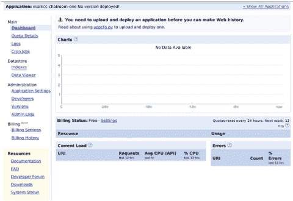

图 2.2：Google App Engine 控制面板

#### 安全与身份验证设置

你可以为应用程序设置初始的安全与身份验证设置。现在不用担心这一点，我们会在第 17 章，*App Engine 服务中的安全性*，第 260 页再回头讨论。

#### 服务条款

在 Google App Engine 上创建应用程序之前，你必须接受 Google 的服务条款。请花时间通读这些条款，以了解你正在做出的承诺，以及 Google 作为 Google App Engine 开发者向你提供的保证。然后勾选复选框，表示你接受这些条款。

填写完表单后，单击“保存”，Google App Engine 就会创建你全新应用程序的框架。保存初始应用程序描述后，你会看到一个控制面板，用于构建和监控你的应用程序（图 2.2）。

当你坐在应用程序控制面板前时，就差不多可以开始编程了。不过要注意，为云编程不同于其他类型的开发。你无法在 Google App Engine 服务器上编辑文件。你需要在本地编写文件，然后使用管理脚本将它们传输到 App Engine 环境中运行。

下一步是获取工具。在控制面板左下方附近，你会看到一个标有 Resources 的框。该框包含学习使用 Google App Engine 时需要的软件、论坛和文档链接。现在，单击 Download 链接，下载适用于 Python 的 App Engine SDK 相应版本。下载完成后，继续安装它。安装过程会因所使用的操作系统而略有不同：对于 Windows 或 Macintosh，下载内容包含自动安装程序——只需运行它，它就会完成工作。如果你使用 Linux，下载内容是 zip 文件，因此请将其解压到合适位置。

如果你使用 Windows 或 Mac OS，就已经可以开始了。如果你使用 Linux，请找到解压 SDK zip 文件所在的目录，并将其添加到你的路径中。

SDK 中有两个你会用到的主要程序：

- `dev_appserver.py` 运行一个模拟的 Google App Engine 环境，你可以用它在本机测试应用程序。
- `appcfg.py` 使用云中的 Google App Engine 上传并配置你的应用程序。

### 2.3 使用 Google App Engine 开始 Python 编程

现在我们可以开始编程了！

Python App Engine 的核心非常简单。主引擎是一个轻量、安全的 CGI 执行器。CGI 是响应 HTTP 请求执行程序的最古老接口之一。Google App Engine 的基础就是纯 CGI。这样做的最大优势在于：如果你曾经用 Python 做过任何 CGI 脚本，几乎可以直接拿这些脚本在 Google App Engine 中使用。任何为 CGI 脚本编写的框架和 Python 库都可以在 Google App Engine 中使用——只需在上传应用程序代码时包含这些框架/库文件即可。


#### 为什么从 Python 开始？

我稍后会详细说明这一点，但我并不是 Python 的狂热粉丝。我们之所以先从这里开始，有几个原因。

首先，Python 是一门非常令人愉快的语言，它使得用少量代码完成大量工作成为可能。我们只需几行代码就可以开始编写 Google App Engine 程序。所需的基础设施非常少。当你在学习如何为云进行开发时，Python 是一个很好的起点。

其次，我的个人偏好不应该决定你应该如何构建应用程序。Python 是一门非常强大、灵活的语言，并且它在 Google App Engine 中得到了出色的支持。如果你是 Python 爱好者，那么在读完本书之后，你应该能够用 Python 构建你的 App Engine 应用程序。

第三，我们将学习像 GWT 这样的工具，它为我们生成大量代码，并处理云应用程序中客户端/服务器交互的底层机制。对于开发复杂的应用程序来说，这为我们节省了惊人的工作量。但理解幕后发生的事情很重要。

Python 为我们提供了一种探索云应用程序原始基础设施的好方法。我们将能够查看每一项技术、将其构建起来，并了解它如何工作。当我们学到 GWT 时，就会很容易理解真正发生了什么。

如果你决定喜欢用 Python 进行云编程，你会学到足够的知识来做到这一点。但即使你从不使用 Python 编写云应用，花时间用 Python 探索云应用的基础技术，也会帮助你理解和调试你用任何选定语言编写的实际应用程序。

使用 Google App Engine 最简单的方式是使用它自己的框架，称为 webapp。webapp 是一个非常优雅且强大的框架，真正易于使用且令人愉快。

此外，Google App Engine 还让你可以在应用程序内部访问 Google 服务，例如登录、数据存储、安全、身份验证和支付。在本书中，我们将重点使用 webapp 框架——但一旦你知道如何使用 App Engine 运行你的程序，你也将能够使用其他框架编写使用这些服务的 App Engine 应用程序。

在本书的大部分内容中，我们将开发一个聊天室应用程序。但在开始之前，我们先做一个云端的“Hello, World.”。对于云来说，它是一个简单程序，运行在云服务器上，并生成一个欢迎页面以显示在用户浏览器中。

由于云应用程序通常使用 Web 浏览器作为用户界面，我们的应用程序必须生成 HTML，而不仅仅是纯文本。每当我们生成输出时，首先需要包含一个 MIME 头，它是单独一行，指定后续内容的格式。对于 HTML，内容类型是 text/html。

Google App Engine SDK 期望你将应用程序的所有文件存储在目录层次结构中。对于我们的第一个程序，我们将创建一个名为 chatone 的目录。在该目录中，我们将把简单的欢迎程序写入一个名为 chat.py 的文件：

```python
import datetime

print 'Content-Type: text/html'
print ''
print '<html>'
print '<head>'
print '<title>Welcome to MarkCC\'s chat service</title>'
print '</head>'
print '<body>'
print '<h1>Welcome to MarkCC\'s chat service</h1>'
print ''
print 'Current time is: %s' % (datetime.datetime.now())
print '</body>'
print '</html>'
```

为了能够运行程序，我们需要告诉 Google App Engine 程序是用什么语言编写的、需要什么资源、代码在哪里，以及如何将发送到服务器的请求映射到代码。

在 Google App Engine 中，我们通过编写一个名为 app.yaml 的文件来实现这一点：

下载 `chatone/app.yaml`

```yaml
application: markcc-chatroom-one
version: 1
runtime: python
api_version: 1

handlers:
- url: /.*
  script: chat.py
```

我们总是以头部开始 app.yaml 文件，其字段如下：

- **application:** 我们正在构建的应用程序名称。必须与你在创建应用程序控制面板时提供的名称完全匹配。

- **version:** 一个指定应用程序版本的字符串。这实际上是为了我们自身的信息，以便我们可以执行诸如查询服务器以找出它正在运行的版本，或识别导致某些错误的代码版本。这可以是任何你想要的字符串标识符。

- **runtime:** 我们将用来编写程序的语言：Java 或 Python。

在头部之后，我们需要写一组处理程序子句。我们用它们向 Google App Engine 服务器描述：当收到传入的 HTTP 请求时它应该做什么。服务器将把 HTTP 请求路由到我们编写的脚本。app.yaml 文件中的处理程序子句就是我们告诉它哪些请求路由到哪些 Python 脚本的方式。在每个处理程序子句中，我们使用正则表达式指定一个 URL 模式，后面跟着一个子句，指定当收到匹配该模式的请求时要采取的动作。对于我们的示例，只有一个处理程序。任何到达我们应用程序的请求都将通过运行欢迎脚本来应答，所以 URL 模式是 /.*，它将匹配任何请求。每当收到请求时，我们将其路由到运行欢迎脚本。因此动作是：script: chat.py，意思是“执行名为 chat.py 的脚本。”

为了测试应用程序，我们首先使用 dev_appserver.py 在本地运行它：

```shell
$ ls
chatone
$ ls chatone
app.yaml  chat.py
$ dev_appserver.py chatone
INFO     2009-06-18 23:13:31,872 appengine_rpc.py:157] Server: appengine.google.com
INFO     2009-06-18 23:13:31,880 appcfg.py:320] Checking for updates to the SDK.
INFO     2009-06-18 23:13:31,994 appcfg.py:334] The SDK is up to date.
WARNING  2009-06-18 23:13:31,994 datastore_file_stub.py:404] Could not read datastore data from /tmp/dev_appserver.datastore
WARNING  2009-06-18 23:13:31,994 datastore_file_stub.py:404] Could not read datastore data from /tmp/dev_appserver.datastore.history
INFO     2009-06-18 23:13:32,058 dev_appserver_main.py:463] Running application markcc-chatroom-one on port 8080: http://localhost:8080
```

在应用程序本地运行的情况下，我们可以使用 Web 浏览器测试它。看看运行 dev_appserver.py 输出的最后一行——它提供了本次会话的 URL——在本例中是 http://localhost:8080。如果我们将浏览器指向该 URL，就会得到类似下面的内容：

> **欢迎使用 MarkCC 的聊天服务**
>
> 当前时间是：2009-06-18 22:30:47.345731

既然我们知道它能工作，现在就可以通过运行 appcfg.py 命令将其部署到云服务器。appcfg.py 是 Google App Engine 的主要开发者接口，因此它支持许多不同的应用程序。要将代码发送到服务器，请使用其 update 命令：

```shell
$ appcfg.py update chatone
Scanning files on local disk.
Initiating update.
Cloning 1 application file.
Uploading 1 files.
Deploying new version.
Checking if new version is ready to serve.
Will check again in 1 seconds.
Checking if new version is ready to serve.
Closing update: new version is ready to start serving.
```

现在代码已部署到服务器上。你可以通过访问 http://your-app-name.appspot.com 来使用它。

即使在这个第一个示例中，我们也开始看到 Google App Engine 编程的基本风格。我们没有使用 webapp 框架中的任何内容，但基本概念仍然在那里：app.yaml 文件指定传入请求如何路由到构成我们程序的脚本，而我们的程序与用户通信的方式是生成将在用户浏览器中呈现的 HTML 内容。

这种简单做法的问题在于它一切都手动完成。它自己生成 MIME 内容头和 HTML 页面结构。手动完成这项工作非常冗长，而且极易出错。当你开始让应用程序具有交互性，并且需要解析来自传入请求的输入时，情况会变得更糟。webapp 框架提供的基础设施负责基本的 HTTP 请求/响应循环、解析传入请求、生成必要的头，以及管理与 Web 服务器通信以发送响应。此外，webapp 还提供对一组模板处理器的访问，允许你创建响应的骨架，这样你就不需要自己输出整个 HTML 结构。目前，我们的 HTML 足够简单，不需要使用模板功能，但我们将在第 6 章 *组织代码：分离 UI 与逻辑*（第 70 页）中详细查看它们。

下面是使用基本 webapp 骨架的欢迎页面应用程序版本：

```python
from google.appengine.ext import webapp
from google.appengine.ext.webapp.util import run_wsgi_app
import datetime

class WelcomePage(webapp.RequestHandler):
    def get(self):
        self.response.headers["Content-Type"] = "text/html"
        self.response.out.write(
            """<html>
              <head>
                <title>Welcome to MarkCC's chat service</title>
              </head>
              <body>
                <h1>Welcome to MarkCC's chat service</h1>
                <p> The current time is: %s</p>
              </body>
            </html>
            """ % (datetime.datetime.now()))

chatapp = webapp.WSGIApplication([('/', WelcomePage)])

def main():
    run_wsgi_app(chatapp)

if __name__ == "__main__":
    main()
```

让我们快速走一遍，看看 webapp 各部分是什么意思：

- 1. 首先，我们需要导入将要使用的 webapp 框架的各个部分。为此，我们使用两个基本的 webapp 构建块：webapp 模块本身和一个名为 `run_wsgi_app` 的 webapp 函数。
- 2. 接下来，我们创建一个 webapp RequestHandler。webapp 理解 HTTP 的工作原理，并提供用于处理 HTTP 协议所有基本元素的实用类。云应用中的基本操作是响应用户的请求。RequestHandler 类正是为此而构建的——它是你会最常使用的 webapp 类。
- 3. 在欢迎应用中，我们要处理的唯一一种 HTTP 请求是 **GET**。在 webapp 中，你通过在一个 RequestHandler 子类中提供 `get()` 方法的实现来处理它。
- 4. webapp 不会让你手动生成诸如 MIME 头之类的内容，而是为你提供一个响应结构，其中包含一个 Python 映射。要设置任何 HTTP 头的值，你只需将值赋给该映射。我们将要使用的唯一头是 Content-Type，因此我们把它放入映射中。
- 5. webapp 不会让你直接把输出写到标准输出，而是为你提供一个由它管理的缓冲输出通道。你把响应的内容写入该输出通道。这是 App Engine 新手开发者最常犯的错误：他们使用普通的旧式 print 语句打印 HTML，然后纳闷为什么看不到结果。你需要确保*始终*使用 webapp 输出通道。
- 6. 要使用我们的 webapp RequestHandler，我们需要创建一个应用对象。应用对象看起来很像一个 app.yaml 文件：app.yaml 文件描述如何将传入请求映射到特定的应用脚本，而应用对象描述如何接收已映射到此脚本的请求，并将它们映射到特定的 RequestHandler 类。我们将对根 URL 的请求——也就是对 `http://mockcc-chatroom-one/` 的请求——映射到我们的欢迎请求处理程序。
- 7. 文件的其余部分使用了一种常见的 Google 惯用法。要实际运行应用，脚本需要调用 `run_wsgi_app`。但我们不是直接执行该语句，而是实现一个 main 函数，并使用一种间接方式来调用它。这种惯用法使此脚本易于复用。如果我们直接执行 `run_wsgi_app`，那么当我们将此脚本导入任何其他 Python 代码时，该行就会被执行。main 函数加上条件调用可确保：只有当我们专门运行此脚本时才会执行它——导入此脚本的模块不会执行它。

我们可以用与上一个版本完全相同的方式部署这个新版本。我更改了 Python 脚本的文件名，因此还需要更新 app.yaml 文件，以引用新的 Python 脚本文件。完成这些之后，只需运行 `appcfg.py update chotane` 即可完成部署。这会上传更改。运行更新后，立即转到应用 URL，它就会运行新版本的代码。它在 Google App Engine 中仍会显示为版本 1，因为我没有更改 app.yaml 中的版本标识符。

这个快速而粗略的说明只是让你对为 Google App Engine 开发是什么样子有个概念。在后续章节中，我们将更详细地探讨在 App Engine 中开发有趣的 Web 应用的各个方面。

### 2.4 监控你的应用

作为应用的开发者，你会希望监控它——能够检测你拥有多少用户、正在消耗多少资源、命中次数、哪些脚本最活跃、什么在正常工作、什么没有正常工作，等等。你可以通过使用 Google App Engine 控制面板来做到这一点。

Google App Engine 控制面板的监控功能对你来说将非常重要。你的云应用运行在你无法控制的计算机上。你不能只是运行性能分析器或调试器来试图查看为什么事情没有按你预期的方式工作。因此，当你发现某件事花费的时间比你认为它应该花费的时间长得多时（如果你编写任何严肃的云应用，这最终会发生），监控器就是你的信息来源。

举个例子，在我的日常工作中，我为 Google 构建基于云的数据分析应用。我曾遇到过这样的情况：一项通常运行一小时的分析突然开始需要八小时。这显然是非常糟糕的事情。我能够通过进入控制面板、查看它能给我的信息，并发现系统正在处理的某些数据分片极其巨大——远大于正常情况，从而弄清楚发生了什么。这让我找到了问题所在：其他人更改了向我的分析器提供数据的代码，而它生成数据的形式影响了我的代码性能。如果没有一个工具让我看到服务器机器集群中正在发生什么，要弄清楚这一点会极其困难。

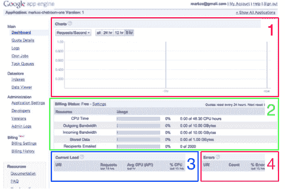

图 2.3：控制面板的各个部分

你可以在控制面板中监控应用的所有方面——从代码运行时记录的信息，到 Google App Engine 服务器记录的信息，再到应用已消耗资源的详细信息。

应用控制面板中的主视图称为仪表板。仪表板提供你想要了解的关于应用状态和资源使用情况的所有内容的概括摘要，并带有指向可获取更详细信息的各处的链接。它分为四个部分，如图 2.3 所示：

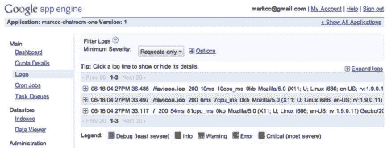

图 2.4：请求日志视图

为空——日志的默认视图是应用中可能发生的任何错误的紧凑视图。

要查看应用已处理的一组请求，请使用日志列表顶部标有 Minimum Severity 的下拉框菜单。打开该菜单，选择 Requests Only。结果如图 2.4 所示，是应用收到的每个请求的日志条目列表。

现在你已经全部设置好了。你拥有 Google App Engine 账户，并且安装了 App Engine 工具。你已准备好构建一个 App Engine 应用。在下一章中，我们将开始构建一个真正的聊天应用，它使用我们刚刚完成设置的 App Engine 工具在云中运行。

### 参考文献与资源

- **Google App Engine 开发者指南** — http://code.google.com/appengine/docs/  
  Google App Engine 针对 Python 和 Java API 的官方文档。
- **通用网关接口（CGI）** — http://www.w3.org/CGI/  
  CGI 的官方标准和文档。

## 第二部分：使用 Python 编程 Google App Engine

## 第 3 章：第一个真正的云应用

在本章中，我们将构建我们的第一个非平凡的云应用：一个基本的 Python 聊天室。在此过程中，我们将考察以下因素：

- 云应用使用的 HTTP 协议，以及云应用如何通信
- 如何将一个用 Python 编写的普通非云程序包装进 HTTP 框架，使其在云中工作
- 在云应用中管理数据和变量有何不同

### 3.1 基本聊天应用

作为一个贯穿示例，我们将用 Python 构建一个聊天服务。聊天是一个很好的示例，因为它很熟悉——我们都使用过聊天服务。但尽管它是一种古老而熟悉的应用，它也具有云服务的许多典型特征。

云应用之所以与众不同且有趣，是因为云应用本质上是多用户的。构建云应用时，你不可能不考虑将如何处理多个用户以及如何处理多个用户的数据。

聊天应用简单但相当典型。要构建聊天，我们需要考虑多个用户之间的交互，需要存储和检索持久数据，并且会为不同的讨论准备多个数据流。除此之外，先构建一个简单版本，然后逐步添加功能来展示 App Engine 越来越多的能力，也是很容易的。


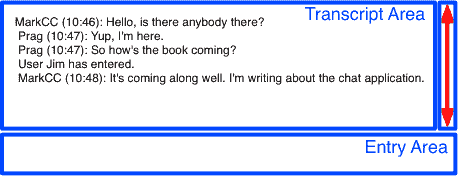

图 3.1：聊天界面的模型图

目前，我们先忽略用户界面，把注意力放在后端。（我们将在第 7 章*让 UI 更美观：模板与 CSS* 的第 37 页处理用户界面。）现在，我们只打算为一个传统本地聊天应用编写一个基础服务器，并带有可将用户界面挂接其上的钩子。我们不会在本章实现全部内容。相反，本书大部分内容的目标是达到能够完成这段代码中所有事情的程度。

一个基础聊天应用并不很复杂。想象一个典型的聊天。聊天的用户界面相当直接——它应该有两个框，一个用于查看对话记录，一个用于输入新文本。对话记录应包含聊天中已发送的消息序列，每条都标有发送者姓名和发送时间。那么，基础聊天界面应该看起来像图 3.1 中的模型图那样。

既然我们对其外观有了一些概念，就可以开始了。这基本上就是 HTTP 的全部作用：它描述了一种客户端向服务器发送请求并获取响应的方法。

为了让事情更简单，HTTP 中的每个请求都围绕一个*资源*。资源是网络上分配了名称的任何事物。资源的另一个名称是统一资源定位符，即 URL。URL 有点像文件名，只不过它可以被用于


用来命名许多不同的事物：文件、程序、人员、进程，或者几乎任何你能想到的东西。HTTP 中的每个请求要么请求从资源检索数据，要么向资源发送数据。

客户端发出的每个 HTTP 请求都会在服务器上调用一个*方法*。（不要让术语把你弄糊涂：尽管它们把这些称为“方法”，但 HTTP 实际上与面向对象毫无关系。）HTTP 中有四种基本方法（外加大约十几种扩展方法，我们不会讨论它们，因为 Web 应用不需要）：

- **GET** 要求服务器从资源中检索某些信息并将其发送给客户端。
- **HEAD** 要求服务器告知有关资源的信息。它基本上类似 GET 请求，只不过响应只包含元数据。你可以使用 HEAD 请求来做诸如“这个资源有多大？”之类的事情，而无需下载整个资源。一般来说，大多数 Web 应用不使用 HEAD 方法，但它偶尔很有用。
- **PUT** 将数据存储到资源中。客户端将信息发送给服务器，以便存储到目标资源中，服务器响应只说明数据是否成功存储。
- **POST** 将数据发送到服务器上的程序。POST 请求有些奇怪。PUT 和 POST 之间没有太多区别。这种区分实际上可以追溯到万维网的早期，当时人们在私人的单台机器上运行 Web 服务器。在早期 Web 服务器实现中，所有 GET 和 PUT 请求都被解释为获取或存储文件的请求。因此，要在 Web 服务器上运行程序，你需要一种不同的 HTTP 协议请求，它专门要求你运行程序。在现代系统中，我们使用 PUT 和 POST 几乎不加区分。

你使用 Web 浏览器生成的每个 HTTP 请求，以及你的 App Engine 服务将处理的每个 HTTP 请求，都包含三个部分：

- 请求行，由该请求的 HTTP 方法、随后是资源的 URL、再随后是协议版本说明组成。在你使用浏览器发出的大多数请求中，方法是 GET，版本说明通常是 HTTP/1.1。
- 一系列*头部*行，包含关于该请求的元数据（例如我们在第 2.3 节*使用 App 开始 Python 编程*的欢迎应用程序中使用的 Content-Type 说明）

#### HTTP 状态码

HTTP 标准有一份很长的服务器结果消息状态码列表。以下是你最常遇到的几种：

- **200 OK（成功）** 请求已成功完成。消息正文将包含成功请求的结果。
- **301 永久移动（Moved Permanently）** 所请求的资源已被永久移动，针对该资源的本次及所有未来请求都应发送到新位置。
- **303 参见其他（See Other）** 对于此请求，可以通过对不同 URL 执行 GET 来找到结果。该 URL 可以在消息的 Location 头部中找到。这通常用于 PUT 请求的结果：在 PUT 成功处理后，服务器告诉客户端到哪里查看操作结果。
- **401 未授权（Unauthorized）** 请求是有效的，但用户未提供任何身份验证数据来表明其应被允许查看该资源。用户可以使用其他请求获取身份验证代码，然后重试该请求。
- **403 禁止访问（Forbidden）** 请求是有效的，但不允许用户访问指定的资源。这与 401 类似，但表示用户已经过身份验证但仍不能访问该资源，或者即使用户已经过身份验证，也不允许该用户访问它。
- **404 未找到（Not Found）** 在指定位置未找到资源。
- **500 内部服务器错误（Internal Server Error）** 服务器在处理请求期间发生任何错误最终都会生成 500 错误。特别是，对于你实现的 App Engine 服务，当你的请求处理程序崩溃和/或抛出异常时，客户端浏览器将收到 500。
- **501 未实现（Not Implemented）** 请求希望执行服务器不支持的操作。如果你做了诸如在 POST 请求中拼错 URL 之类的事情，最常看到这个错误。

你还希望能够发送消息，因此你需要浏览器能够作为一个活跃实体与聊天室通信，并告诉聊天室应用程序你有话要说。同样，聊天室就是资源，但这一次你想与它对话。这要么是 PUT，要么是 POST。我们本质上通过问一个问题来决定使用 PUT 还是 POST：你是想替换资源的内容，还是想与资源对话？向聊天室发布消息显然是后者。我们不想替换聊天室的内容；我们想与它对话，并告诉它有一条新消息要添加到对话中。所以发送新消息绝对是 POST。

这就为我们提供了应用所需的框架。我们将有一个资源，即聊天室。用户可以通过 GET 该资源来查看聊天的当前状态。我们还需要另一个资源，即一个活跃进程；当用户发送要添加到聊天中的新消息时，他们会向该资源发送 POST 请求。

现在我们需要稍微考虑一下 UI 问题。用户将如何能够向我们的应用 POST 数据？我们需要提供一种方式。最简单的方法是在用户请求查看聊天室时发送的页面中创建一个表单。因此，聊天页面顶部会有一个标题，然后会有房间内内容的聊天记录，最后在底部会有一个输入表单，用于接收用户名和用户想要发布的消息。

为了在 App Engine 中实现这一点，我们需要构建一个 RequestHandler，为聊天室内容实现 GET，然后构建另一个 RequestHandler，接收 POST 并将内容添加到聊天中。

聊天室主页几乎与我们在第 2 章*入门*第 20 页使用的代码相同。主要区别在于我们需要向其中添加一些动态内容；也就是说，我们需要为已发布的消息生成文本。因此，我们不能只使用带引号的 HTML；我们需要生成一些 HTML。作为第一次尝试，我们将创建一个包含消息列表的全局变量。当我们渲染页面时，将遍历该消息列表并将它们添加到页面中。

[下载 chatwo/chatwo.py](#)

```python
class ChatMessage(object):
    def __init__(self, user, msg):
        self.user = user
        self.message = msg
        self.time = datetime.datetime.now()

    def __str__(self):
        return "%s %s: %s" % (self.user, self.time, self.message)

Messages = []

class ChatRoomPage(webapp.RequestHandler):
    def get(self):
        self.response.headers["Content-Type"] = "text/html"
        self.response.out.write("""
            <html>
                <head>
                    <title>MarkCC's AppEngine Chat Room</title>
                </head>
                <body>
                    <h1>Welcome to MarkCC's AppEngine Chat Room</h1>
                    <p>(Current time is %s)</p>
                    """ % (datetime.datetime.now())
        # Output the set of chat messages
        global Messages
        for msg in Messages:
            self.response.out.write("<p>%s</p>" % msg)
        self.response.out.write("""
                    <form action="" method="post">
                    <div><b>Name:</b>
                    <textarea name="name" rows="1" cols="20"></textarea></div>
                    <p><b>Message:</b></p>
                    <div><textarea name="message" rows="5" cols="60"></textarea></div>
                    <div><input type="submit" value="Send ChatMessage"></input></div>
                    </form>
                </body>
            </html>
        """)
```

处理 POST 是一个全新的步骤，但 webapp 框架使它非常容易做到。在 GET 请求的处理程序中，我们实现 RequestHandler 的一个子类，该子类有一个 get 方法。对于 POST 请求，我们遵循相同的模式：我们实现 RequestHandler 的一个方法，在这里就是 post 方法。RequestHandler 超类确保当调用 post 时，对象的字段包含我们可能想从请求中查看的所有内容。要从产生 POST 的表单字段中获取数据，我们只需使用表单中指定的标签，在请求上调用 get 方法。在我们的代码中，我们将从 POST 请求中获取用户名和消息，并使用它们创建一个消息对象，并将其添加到全局消息列表。


下载 chatroom/chatroom.py

```python
def post(self):
    chatter = self.request.get("name")
    msg = self.request.get("message")
    global Messages
    Messages.append(ChatMessage(chatter, msg))
    # Now that we've added the message to the chat, we'll redirect
    # to the root page, which will make the user's browser refresh to
    # show the chat including their new message.
    self.redirect('/')
```

现在，我们需要把它整合成一个应用。这包括两个部分：首先，我们需要编写 Python 代码，创建应用对象并将请求映射到我们的请求处理器；其次，我们需要编写 app.yaml 文件。然后我们就能测试我们的应用了。

app.yaml 文件与之前几乎完全相同。我更改了新示例中 Python 文件的名称，因此需要把 app.yaml 文件中的 script 条目改成新名称。

下载 chatroom/app.yaml

```yaml
application: markcc-chatroom-one
version: 1
runtime: python
api_version: 1

handlers:
  url: /.*
  script: chatroom.py
```

下面是 Python webapp 的粘合代码：

下载 chatroom/chatroom.py

```python
chatapp = WSGIApplication([('/', ChatRoomPage)])

def main():
    run_wsgi_app(chatapp)

if __name__ == "__main__":
    main()
```

现在运行它（像上一章那样使用 dev_appserver.py），我们就得到一个简单且可用的聊天室。来吧，试一试。它在 dev_appserver.py 中运行得非常好！所以现在我们可以把它上传到 App Engine 服务器。和之前一样，我们使用 appcfg.py update 将其上传到 App Engine。

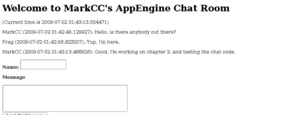

图 3.2：运行中的聊天室应用

你可以在图 3.2 中看到结果。它看起来和本地开发服务器上运行时一模一样。我用两个不同的用户名发送了几条消息，得到了一段漂亮的聊天记录。

但随后我需要休息一下，给我儿子洗澡并哄他上床睡觉。回来之后，我又发了一条消息。你可以在下一页的图 3.3 中看到结果。

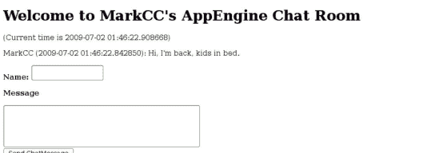

图 3.3：休息一段时间后的聊天室应用

当我发送新消息时，所有旧消息都不见了！聊天记录中除了我刚添加的新消息之外什么都没有。我们并没有编写任何删除旧消息的代码；事实上，我们的代码完全没有清除消息的概念；我们只是一直向聊天室添加消息。那么，我们之前的聊天记录发生了什么？旧消息去哪儿了？

它们哪儿也没去。我们被云代码与常规代码之间一个基本而重要的差异坑了。当你为自己的服务器编写代码时，你知道每个请求都会由你的服务器处理。如果你启动一个 Python 解释器并向它发送请求进行处理，你知道这个 Python 解释器会一直存在，只要你想让它存在。

当你向云服务器发送请求时，它会被路由到某个云数据中心里的某台服务器。无法保证任意两个请求都会被路由到同一台服务器，甚至无法保证它们被路由到同一大洲的服务器！即使它们最终确实运行在同一台服务器上，也无法保证云服务器会始终让一个 Python 解释器运行你的代码。在像 webapp 这样的基于云的编程框架中，请求处理器是*无状态*的，这意味着你不能指望任何变量保存着在处理另一个请求时设置的值。你需要像每个请求都在一个全新的 Python 解释器中运行那样来编程。

这个应用之所以能运行，基本上纯粹是运气。当我们在本地运行它时，`dev_appserver` 只使用了一个 Python 解释器，所以应用在那里运行正常。当我们把它上传到 App Engine 服务器后，它运行在云中。当 App Engine 收到第一个请求时，它启动了一个 Python 解释器并用它来运行该请求。当我提交一条消息时，这又向 App Engine 发送了第二个请求。App Engine 主服务器发现某台数据中心处理器上有一个刚刚处理过该应用请求的 Python 解释器，而且这个解释器不忙，于是它把请求路由给了那个解释器。

但后来我休息了一下，离开电脑十五分钟；在某个时刻，App Engine 服务注意到运行我聊天应用的 Python 解释器已经空闲了一段时间，于是把它关闭了。当我提交下一条消息时，已经没有正在运行聊天室代码的 Python 解释器了，所以它启动了一个新的解释器。

为了解决这个问题，在构建面向 App Engine 的云应用时，我们必须完全明确地管理希望在不同请求之间共享的数据。我们不能依赖模块变量或类变量来管理应用的状态；每当数据发生变化时，我们必须显式存储应用的所有数据；每当想要访问数据时，必须显式检索数据。

需要记住的重点是：在云应用中，你不能把基本的数据管理视为理所当然；你需要显式处理它。幸运的是，webapp 提供了一个非常好的持久化服务，称为 datastore。我将在下一章介绍 datastore。

### 参考与资源

- **RFC 2616：超文本传输协议 - HTTP/1.1** ... http://www.w3.org/Protocols/rfc2616/rfc2616.html
  W3C 制定的 HTTP 1.1 协议标准。

- **维基百科上关于 HTTP 的文章** .................. http://en.wikipedia.org/wiki/HTTP
  对 HTTP 简明、全面且非正式的描述。

- **Django** ......................................... http://www.djangoproject.com/
  Django 是一个广泛使用的 Web 服务开发平台。它是可用于 Google App Engine 的替代框架之一。许多 App Engine 设施都是仿照 Django 框架或从中借鉴而来的。

- **Django Nonrel** ........... http://www.allbuttonspressed.com/projects/django-nonrel
  Django Nonrel 是 Django 的一个变体，专注于让 Django 更容易用于不基于关系数据库的平台，例如 App Engine。

## 在云中管理数据

在本章中，我们将修改聊天应用，使其使用 Google App Engine datastore 的持久化存储。在此过程中，我们将探讨云应用中存储和管理数据的一般问题。

### 4.1 为什么聊天功能失效了？

上一章结束时，我们的聊天应用有一个问题。它似乎能正常工作，但如果我们停用几分钟再回来，它就会丢失聊天历史。

原因是我们的聊天应用目前依赖全局变量来存储聊天历史。但当我们在云中运行应用时，这种方法行不通：全局变量中的数据不一定能在不同请求之间存活。

首先要问的是为什么？云应用究竟有什么特性，迫使我们以不同方式处理数据？

当你在自己的计算机上运行应用时，操作系统会创建一个进程。该进程会分配内存用于存储，并在其中保存所有数据。这个进程会带着它从操作系统分配到的存储继续在你的计算机上运行，直到你让它退出。如果你使用应用一段时间，离开去做别的事，然后再回来，它仍然是同一个进程，可以访问同一块内存。

云是一个完全不同的世界。你所习惯的规则——甚至像变量工作方式这样简单的事情——都大不相同。这个程序并不在你的计算机上运行；它在数量未知的计算机上运行，而这些计算机位于某个连接到网络的数据中心中，具体位置也未知。我们编写了一个云应用，并使用 Google App Engine 的服务上传了它。从我们完成上传的那一刻起，程序就在运行。但“运行”在这里的含义，并不像你在桌面体验中预期的那样。一个在云中“运行”的程序，可能实际上并没有在任何计算机上运行。事实上，在我写这段话时，我已经把 Python 聊天室应用的最终版本上传到了 App Engine——而它实际上根本没有在任何机器上运行！（我怎么知道？因为我是几周前上传它的，而且至少有一周没有在浏览器中加载那个页面了。App Engine 的服务器现在肯定没有把它加载到任何计算机上。如果我在浏览器中加载聊天应用的页面，App Engine 就会加载它来处理请求。）

正如我们在前面几章所见，云应用是围绕请求处理构建的。如果没有等待处理的请求，程序就没有必要运行在任何计算机上。如果只有少量请求进来，在一台计算机上运行它可能就足够了。如果你的应用被 Slashdot 提到，你可能需要一千台机器来处理所有传入请求！这正是云成为如此有趣的编程场所的原因之一：它为你提供了一个自我扩展的平台。

当然，这是有代价的。如果程序可能运行在许多计算机上，也可能根本不运行在任何计算机上，那么当你的代码开始处理请求时，你无法指望内存中实际有什么。

当应用开始处理请求时，你不能指望它的请求处理器在内存中已有数据。在处理请求的过程中，你将来可能想要查看的每一条数据都必须显式保存到一个称为*持久化存储*的共享存储区域中。你在处理请求时想要使用的每一条数据都必须从持久化存储中检索出来。

我们如何使用持久化存储？这是云编程中与老式本地应用有着根本区别的方面之一。当你刚开始编写云应用时，这个过程可能显得繁琐且令人沮丧。但这并不是坏事；你的应用由无状态组件构成这一事实会带来一些奇妙的效果。这正是让你的程序得以*扩展*的部分原因。如果你的应用每五秒处理一个请求，那么把它作为 Python 应用在一台计算机上运行就可以了；你可以使用全局变量保存数据，并获得所有结果，而不必处理复杂的持久化存储。但如果你的应用


#### 云：函数式编程？

云作为一种环境，会鼓励类似函数式编程的风格。在函数式编程中，不允许存储可变状态；换句话说，不允许使用赋值来改变变量的值。你不能存储任何东西，以便在同一个函数的不同调用之间共享。你需要把函数所需的一切都作为参数显式传入。这种风格对于云编程来说非常自然。

如果你不习惯，函数式编程风格可能显得非常不自然、非常困难。但它其实并非如此——事实上，一旦你习惯它，它就会变得非常有吸引力！你的应用越复杂，函数式风格就越有吸引力。

在 Google，我们通常用三种语言编程：C++、Java 和 Python。它们都不是函数式语言；它们都是重度依赖状态、命令式、面向对象的语言。但我在这个代码库中阅读和编写的代码越多，就越发现函数式代码是构建大型系统的最佳方式。如果代码基本上是函数式的，我发现它更容易理解和测试，也更不容易产生令人痛苦的 bug。以至于现在我看到非函数式代码时都会有点畏缩。我写的东西几乎最终都至少大部分是函数式的——现在只有在语言和编译器无法胜任保持代码高效的任务时，我才会使用非函数式代码。

如果你的应用开始获得更多用户，会发生什么？每秒一个请求，没问题。每秒 10 个？没问题。每秒 100 个？这可能开始变得困难。每秒 1,000 个？每秒 10,000 个？每秒 100,000 个？在某个时刻，你的应用会崩溃：它将无法处理收到的请求数量。但在云中，随着请求数量增加，运行应用的机器数量也可以增加，因此无论你的请求速率如何，你始终有容量来处理它们。良好的持久化存储机制意味着你无需担心有多少台机器在运行你的程序。无论是一台、十台还是一千台机器，都没有区别。在我工作中的项目里，我的代码每晚都在由数千台机器组成的网络上运行。在这种环境中，使用全局变量共享数据显然是荒谬的：我的 Python 程序中对全局变量的赋值，怎么可能在数千台机器之间共享？但由于系统使用持久化存储，这从来都不是问题。当系统的某一部分变得太慢并开始超出其截止时间时，我只需修改一个配置文件，指定它可以使用的最大机器数量，这就是我需要做的全部。它开始在更多机器上运行，从而能更快完成。

#### 云中的通用数据管理

每个云编程系统都提供某种存储持久化数据的机制。具体机制各不相同，但基本机制几乎总是类似数据库。有些系统让你访问像 MySQL 这样小型、快速的数据库系统。另一些系统，如 App Engine，提供更灵活、类似数据库的存储。我们只看 App Engine 数据存储，但还有很多其他选择，其中一些可供 App Engine 程序使用。

### 4.2 让聊天持久化

Google App Engine 有一个自定义的数据持久化系统，称为 *App Engine 数据存储*。App Engine 数据存储非常像数据库，只是对于 Python 对象之类的东西来说，使用起来要容易得多。与关系数据库不同，数据存储不要求严格的模式；它在允许你存储和管理持久化数据方面非常灵活和动态。为了在 Python 中检索内容，App Engine 提供了一种称为 GQL 的自定义查询语言。GQL 看起来很像用于查询传统关系数据库的 SQL 语言，但它是为处理数据存储对象而不是关系表而定制的。你不需要使用 GQL 来处理数据存储，但它非常适合这项任务，而且易于使用。

#### 创建和存储持久化对象

数据存储有很多选项，让你以最适合应用的方式做事。基本的数据存储操作很容易使用。随着你更多地使用数据存储，你可以根据需要开始使用更复杂的功能。现在，我们将坚持基础内容。

#### GQL 与数据存储

如果你以前用过关系数据库，就会知道查询语言 SQL 是数据库深层的一部分。SQL 是你与数据库交互的唯一方式。数据库中的所有数据都存储在关系表中。你对这些数据库表所做的每件事都是使用 SQL 完成的。因此，对于作为关系数据库程序员的你来说，SQL 和数据库实际上几乎是一回事。

在 Google App Engine 数据存储中，情况完全不是这样。App Engine 提供一个基本存储引擎，允许你存储对象和数据。那个存储系统根本没有查询语言。数据存储只不过是一个高容量、大规模并行的存储系统。

在内部，数据存储使用索引来帮助查询快速工作。通常，索引会根据你在 App Engine 开发环境中运行的测试自动生成。你也可以构建自己的索引，正如我们将在第 14 章 *高级数据存储：查询与索引*（第 216 页）中看到的那样。GQL 是一种为处理数据存储及其索引而构建的查询语言。基本上，GQL 只不过是对数据存储索引的一层封装。它是一种方便、轻量级的查询语言，使搜索数据存储索引变得非常容易。它并不是数据存储的真正组成部分。它只是一个有用的库，编写它是为了帮助你使用数据存储。

理解 GQL 的目的有助于理解 GQL 工作方式中的许多事情。GQL 并不是数据存储不可或缺的一部分；它只是一个实用工具，帮助人们轻松使用数据存储索引。

App Engine 数据存储与你通常用 Python 编程的方式相当不同。通常，在 Python 中创建类时，你不需要声明类的字段，只需赋值，字段就会自动创建。要使用数据存储，你必须放弃一些这种灵活性。使用数据存储时，你必须为对象创建*模型*，告诉数据存储该对象将具有哪些字段以及这些字段将具有什么类型的值。（实际上，你可以通过使用所谓的 expando 模型来采用 Python 那种随用随赋值的风格，但你真的不应该这样做。对于云应用，你确实应该充分思考数据，以便为它定义一个合适的模型。）

背景介绍得够多了。理解 App Engine 数据存储最简单的方法就是直接看一些代码。正如我所说，在数据存储中，你需要定义一个模型来告诉数据存储你的对象。在 Python 中，模型是一个类对象，是 db.Model 的子类，字段通过创建模型类的类成员来定义。这是一种有点笨拙、不符合 Python 风格的做法。下面，我把聊天应用中的 ChatMessage 变成了一个数据存储模型：

下载 `persist-chat/pechat.py`

```python
class ChatMessage(db.Model):
    user = db.StringProperty(required=True)
    timestamp = db.DateTimeProperty(auto_now_add=True)
    message = db.TextProperty(required=True)

    def __str__(self):
        return "%s: %s: %s" % (self.user, self.timestamp, self.message)
```

在 App Engine 数据存储中，模型定义了一组具名*属性*。你通过创建 db.Model 的子类来定义一种可存储对象的类型，并通过在类本身中为类变量分配属性类型来定义对象的属性。数据存储支持相当丰富的数据类型：字符串、数字、日期、列表、引用等。它甚至允许你定义自己的新型可存储对象。我们将在第 13 章 *高级数据存储：属性类型*（第 191 页）中进一步讨论你可以做的复杂事情。

我们的聊天消息有三个字段：一个字符串，包含发送消息的用户名；另一个字符串，包含消息内容；以及一个时间戳，指定消息发送的时间。这些字段中的每一个都指定为一个属性。


**用户** 用户名只是一个字符串属性。每条消息都必须有用户名，因此我们通过提供关键字参数 `required=True` 来指定它不能为 null。数据存储中字符串属性的值只是一个 Python 字符串，其长度不能超过 500 个字符。

**时间** time 属性是 `db.DateTimeProperty` 的一个实例，它指定了一个属性，其值是 Python datetime 的一个实例。对于这个属性，我们可以利用数据存储使用 Python 类来表示属性这一方式的一个有趣能力。每条消息都应该有一个时间戳。但我们并不真的希望在创建消息时必须指定它；我们希望时间戳是*现在*——也就是应用程序收到消息的时间。因此，我们为这个属性使用一个特殊的关键字参数 `auto_now_add`，它的意思是：“如果在创建模型类型的实例时没有显式初始化这个属性，那么自动将其初始化为当前时间。”由于属性是由 Python 类的实例表示的，该类可以定义自定义初始化器参数，以提供像 `auto_now_add` 这样的类型特定功能，而不需要任何特殊原语。正如我们在第 13 章*高级数据存储：属性类型*（第 191 页）中查看高级数据存储主题时将看到的那样，你可以定义自己的新属性类型，并提供自己的类型特定扩展。

**消息** 最后，我们来看消息的内容。和 user 字段一样，message 是一个必需的字符串属性。但在数据存储中，字符串不能超过 500 个字符。大多数聊天消息可能比这更短，但并非所有消息都如此。因此，我们不用 `db.StringProperty`，而是使用 `db.TextProperty`。`db.TextProperty` 是一个可以任意长的字符串，但由于它是任意长度，你不能用它来排序或搜索。

既然我们创建了一个包含描述其实例所需信息的模型，现在就不必提供自己的初始化器方法了。`db.Model` 会根据我们指定为类字段的属性名称和类型，自动生成一个带有关键字参数和类型的初始化器。

我们已经有了一个可存储的类。我们实际如何存储值呢？再简单不过了：每个作为 `db.Model` 子类实例的对象都提供一个名为 `put` 的零参数方法。如果你对某个对象调用 `put`，它就会被存储到你的应用程序的数据存储中。下面是我们 POST 处理程序的一个修改版本，它创建 `ChatMessage` 类的一个实例，然后在 ① 处存储这条新的聊天消息：

```python
class ChatRoomPoster(webapp.RequestHandler):
    def post(self):
        chatter = self.request.get("name")
        msgtext = self.request.get("message")
        msg = ChatMessage(user=chatter, message=msgtext)
        msg.put()
        # Now that we've added the message to the chat, we'll redirect
        # to the root page
        self.redirect('/')
```

就是这样。对模型实例调用 `put()` 会将该实例存储到数据存储中，并使其可以通过查询进行检索。

#### 检索持久对象

我们需要知道的最后一件事是如何检索我们已存储的内容。下面是我们 GET 处理程序中从数据存储检索所有消息的部分；该方法的其余部分——除了检索并打印消息的部分之外的所有内容——完全未变。

```python
#### 输出聊天消息集合
messages = db.GqlQuery("SELECT * FROM ChatMessage ORDER BY time")
for msg in messages:
    self.response.out.write("<p>%s</p>" % msg)
```

你可以使用一种名为 GQL 的查询语言来检索内容。从代码中可以看出，GQL 看起来很像 SQL。最大的区别在于，GQL 不是对表进行查询，而是对模型类型进行查询。我们聊天室的查询选择所有 `ChatMessage` 实例，而不是表的所有行。

取决于你想查询什么，有时使用不同风格的 GQL 会更清晰。你可以通过调用模型类的 `gql` 方法来省略查询中的 `SELECT * FROM type` 部分。例如，上面代码中的 GQL 查询也可以写成 `ChatMessage.gql('ORDER BY time')`。

#### 使用 GQL 查询改进聊天

我们的聊天应用程序存在的一个问题是它太冗长。现在，每次刷新聊天显示时，你都会得到整个聊天记录。

#### App Engine 数据存储与关系数据库

至此，数据存储模型与关系数据库表之间的差异听起来可能很小。毕竟，每个 `ChatMessage` 实例都完全相同：它们有一组带类型的字段，看起来很像关系数据库中的列。乍看之下，它非常像一个关系数据库，只是使用风格化的 Python 类来创建表，而不是 SQL `CREATE TABLE` 语句。

事实上，情况绝非如此。数据存储具有比关系数据库丰富得多的数据类型和数据结构范围。在数据存储中，我们可以拥有列表类型的模型属性，列表的元素可以是任何可存储的值，并且你可以将列表元素用作 GQL 查询的一部分。你可以拥有引用属性，用于描述对象之间的非包含链接。你可以拥有层次化的树状数据类型以及遍历树的查询。（这并不是说数据存储比关系数据库更好；它只是不同。例如，关系数据库在连接操作上的性能比数据存储好得多。但数据存储让你能够以清晰、可扩展的方式使用在你的应用程序中有意义的熟悉数据结构。）

当一段对话进行了一段时间后，内容会变得非常长，而你感兴趣的部分是聊天中最新的部分，它一直位于页面底部。

聊天室用户不想不得不经常滚动浏览他们之前已经看过的消息。大多数时候，他们知道之前说了什么，只想看到最新消息。例如，他们可能只想看到聊天室中最后二十条消息，或者只想看到过去五分钟内发布的消息。

使用 GQL，通过向 GQL 查询添加子句来解决冗长问题简直轻而易举。要查看最近二十条消息，我们可以添加 `LIMIT` 子句；要查看过去五分钟内的消息，我们可以添加 `WHERE` 子句。

当然，我们不想限制用户只能看到这些简洁视图中的一种——当他们第一次进入一个新聊天时，可能想看到整个历史记录。因此，我们将为这两种新情况向应用程序添加新的处理程序。我们将完整聊天保留在原处，并为时间限制和数量限制的简短视图添加两个新 URL。

#### 添加数量限制视图

首先，让我们添加计数视图。GQL 查询有一个 `LIMIT` 子句，它指定查询的最大结果数。例如，当你指定 `LIMIT 20` 时，你会得到按指定排序顺序匹配查询的前二十个值。由于我们想获取最近的二十条查询结果，我们需要确保我们想要的结果是第一批结果。我们通过按时间排序，并让最近的时间排在最前面来做到这一点。

计数视图是使用一个 `RequestHandler` 实现的，除了两行之外，它与 `ChatRoomPage` 相同。我复制了 `ChatRoomPage`，并将副本重命名为 `ChatRoomCountViewPage`。修改后的 `get` 方法如下所示：

```python
class ChatRoomCountViewPage(webapp.RequestHandler):
    def get(self):
        self.response.headers["Content-Type"] = "text/html"
        self.response.out.write("""
        <html>
          <head>
            <title>MarkCC's AppEngine Chat Room (Last 20)</title>
          </head>
          <body>
            <h1>Welcome to MarkCC's AppEngine Chat Room</h1>
            <p>(Current time is %s; viewing the last 20 messages.)</p>
        """ % (datetime.datetime.now()))
        # Output the set of chat messages
        messages = db.GqlQuery("SELECT * FROM ChatMessage " +
                               "ORDER BY time DESC LIMIT 20").fetch(20)
        messages.reverse()
        for msg in list(messages):
            self.response.out.write("<p>%s</p>" % msg)
        self.response.out.write("""
            <form action="/talk" method="post">
            <div><b>Name:</b>
            <textarea name="name" rows="1" cols="20"></textarea></div>
            <p><b>Message</b>
            <div><textarea name="message" rows="5" cols="60"></textarea></div>
            <div><input type="submit" value="Send ChatMessage"/></div>
            </form>
          </body>
        </html>
        """)
```


### 资源

#### Python 数据存储 API...

[http://code.google.com/appengine/docs/python/datastore/](http://code.google.com/appengine/docs/python/datastore/)

这是 Google App Engine 数据存储的官方文档。

## 第5章

## 用于登录认证的 Google App Engine 服务

你用 App Engine 构建的大多数 Web 应用都必须能够跟踪用户。你需要让用户登录，并根据你授予他们的权限来执行任务。在本章中，我们将了解如何管理用户，以及如何跟踪哪个用户发出了哪个请求。为此，我们将使用 App Engine 的一项服务，它是 App Engine API 的一部分，独立于 webapp 框架。

### 5.1 用户服务简介

我们的聊天系统已经有了一个不错的开端，但它的功能非常有限。我们最初的设计草图允许多个聊天室。不幸的是，目前我们还无法让这个设计很好地工作。在那个设计中，一个给定的用户可以订阅多个聊天，而聊天应用需要跟踪不同用户订阅了哪些聊天。但我们的聊天应用没有办法跟踪是谁发出了特定的请求，所以我们不知道该向用户显示哪些聊天。

处理登录和身份验证不仅仅是你为聊天系统这样的应用所需要做的事情。它可能是你编写的每个 App Engine 应用都需要做的事情。

对于像登录这样普遍存在且几乎在每个应用中都需要的东西，App Engine 提供了名为*服务*的 API。服务是 App Engine 实现提供的一个模块，它可供每个 App Engine 应用使用，无论你使用什么框架来构建应用。即使你决定为应用使用 Django 之类的东西，你仍然可以使用所有的 App Engine 服务。

设置身份验证最简单的方法是使用 Google App Engine 用户服务来借用 Google 账户。如果你的应用使用 Google 电子邮件地址作为主要标识符，那么它就可以使用 Google 登录。你也可以构建自己的身份验证服务，或使用其他第三方身份验证服务；没有任何东西强迫你使用 GAE 的登录服务。但它非常方便，而且对大多数应用来说可能已经足够了。使用其他服务不会有太大不同——基本机制是相似的。

### 5.2 用户服务

Google 登录由用户服务提供支持。用户服务会跟踪当前已登录的用户，并提供相应功能，让你的应用能够提供登录和注销页面。

#### 用户对象和当前用户

使用用户服务最简单的事情就是获取当前登录用户的用户对象。你始终可以通过调用 `users.get_current_user()` 来获取用户。如果该客户端没有登录用户，则调用返回 `None`。如果有登录用户，你会得到一个包含三个实例方法的 Python 对象：

- `nickname()`：与用户关联的文本名称。它最终将可由用户配置，但目前它只返回电子邮件地址中 @ 符号之前的部分。就我而言，它是 markcc。
- `email()`：用户的电子邮件地址。就我而言，它是 markcc@gmail.com。
- `user_id()`：用户的永久标识符。请将其视为一个不透明的字符串。用户可以随时更改自己的电子邮件地址或昵称，但他们的 user_id 始终相同。这对显示目的没有用，但如果你想记录关于用户的永久信息——例如用户在商业网站上下的订单集合——你可以使用它作为标识符，无论发生什么都不变。

#### 让用户登录

我们需要为我们的用户提供一个登录页面。幸运的是，我们不需要设计自己的登录页面——毕竟，每个登录页面都差不多。用户服务提供了一种自动生成登录页面的机制。

标准用户服务登录旨在充当*中间页*：也就是说，一个用户在访问他们真正想要的内容途中会看到的页面。在我们的聊天应用中，用户首先会看到一个欢迎屏幕；从该欢迎屏幕中，他们进入聊天室查看正在进行的对话。但我们希望他们在获得访问权限之前已登录，这样我们才能知道他们是谁。如果他们未登录就请求进入聊天室，他们将被发送到一个登录页面。一旦他们完成登录，他们将被直接发送到聊天页面。

考虑到这一点，用户服务的工作方式是：你请求它让用户登录，并为其提供一个目标页面。用户成功登录后，它会自动将他们重定向到目标页面。

我们的聊天应用非常典型地采用了这种方式。我们可以通过在聊天页面的 RequestHandler 的 get 方法中添加一点逻辑来使其以这种方式工作。

在 get 的开头，我们通过调用 `users.get_current_user()` 来检查用户是否已登录。如果返回的是已登录的用户，我们继续渲染页面。如果没有，我们创建一个登录页面，并使用聊天页面本身作为成功登录后的重定向目标。这听起来有点复杂，但实际上并没有听起来那么复杂：下面的调用让用户登录并在成功后重定向回聊天页面，它只是 `self.redirect(users.create_login_url(self.request.uri))`。

换句话说，我们执行一个重定向调用，告诉 App Engine 将用户发送到登录页面。该登录页面由用户服务通过 `users.create_login_url` 生成。当用户成功登录后，我们将他们重定向到聊天页面。我们甚至不需要记住聊天页面的 URL，只需使用原始请求的 URI 即可，该 URI 在请求处理程序中可以通过 `self.request.uri` 访问。

### 5.3 将用户服务集成到聊天应用中

现在我们知道如何进行登录了，我们可以将用户和登录集成到我们的聊天应用中。为此，我们需要对聊天应用进行一系列更改：


1. 修改聊天页面，要求用户登录。
2. 使用已登录的用户对象设置聊天中消息的 user 字段，并从聊天消息输入表单中移除 user 字段。
3. 修改 POST 消息处理程序以使用已登录的用户。

我们已经在上一页的第 5.2 节 *让用户登录* 中了解了如何实现用户登录。将这一功能集成到聊天页面的请求处理程序中，只是同类代码的又一次应用。聊天页面请求处理程序中的另一项更改是从表单中移除 name 字段。更新后的请求处理程序如下所示：

下载 `long-chat/chat.py`

```python
class ChatRoomPage(webapp.RequestHandler):
    def get(self):
        user = users.get_current_user()
        if user is None:
            self.redirect(users.create_login_url(self.request.uri))
        else:
            self.response.headers["Content-Type"] = "text/html"
            self.response.out.write("""
                <html>
                <head>
                    <title>MarkCC’s AppEngine Chat Room</title>
                </head>
                <body>
                    <h1>Welcome to MarkCC’s AppEngine Chat Room</h1>
                    <p>(Current time is %s)</p>
                    """ % (datetime.now()))
            # Output the set of chat messages
            messages = db.GqlQuery("SELECT * FROM ChatMessage ORDER BY timestamp")

            for msg in messages:
                self.response.out.write("<p>%s</p>" % msg)

            self.response.out.write("""
                <form action="/" method="post">
                <p><b>Enter new message from: %s</p>
                <p><b>Message:</b></p>
                <div><textarea name="message" rows="5" cols="60"></textarea></div>
                <div><input type="submit" value="Send Chat Message"/></div>
                </form>
                </body>
                </html>
                """ % user.nickname())
```

登录代码位于 ① 处，完全遵循我们之前描述的模式。如果用户已经登录，聊天应用会为他们渲染聊天内容。如果用户未登录，它会重定向到登录页面，并在用户登录后将其带回聊天页面。

另一项更改位于 ② 处，我们从表单中移除了用户名输入字段，并将其替换为一行提示，该提示使用从当前已登录用户对象中获取的昵称。

修改 POST 处理程序的方法完全相同。我们只需要添加一行 get_current_user 的副本，并在创建 ChatMessage 的调用中使用它，如下所示：

下载 `login-chat/pchat.py`

```python
def post(self):
    user = users.get_current_user()
    if user is None:
        self.redirect(users.create_login_url(self.request.uri))
        return
    msgtext = self.request.get("message")
    if user.nickname() is None or user.nickname() == "":
        nick = "No Nickname"
    else:
        nick = user.nickname()
    msg = ChatMessage(user=nick, message=msgtext)
    msg.put()
    sys.stderr.write("****** Just stored message: %s" % msg)
    # Now that we've added the message to the chat, we'll redirect
    # to the root page,
    self.redirect('/')
```

既然我们已经能够提供登录功能，就可以开始让聊天应用变得更有趣了。我们可以构建多聊天、订阅以及其他功能，例如确定哪些用户已连接、用户之间的直接私信等等。当然，天下没有免费的午餐。当我们开始添加这类功能时，用于渲染用户界面的 HTML 会变得复杂，而且我们需要不断生成相同的样板 HTML 代码。这既费力又容易出错，还非常烦人。在下一章中，我们将了解如何向应用添加订阅和多聊天，以及如何使用一种称为模板的机制，轻松生成 UI 的 HTML，而不会出现错误、不一致或其他麻烦。

## 组织代码：分离 UI 与逻辑

到目前为止我们编写的所有代码中，都是通过编写打印 HTML 的 Python 代码来渲染用户界面。这样做既费力又笨拙，还容易出错。在本章中，你将了解模板，它通过将渲染用户界面的代码与实现应用逻辑的代码分离，来组织 Google App Engine 应用的代码。使用模板时，你不必再用 Python 打印语句渲染 HTML 用户界面代码，而是直接将其编写为带标记的 HTML 形式。你的应用逻辑仍保留在 Python 中，并在需要生成页面时调用模板。

### 6.1 模板入门

回到第 3 章 *第一个真正的云应用*（第 37 页），我们勾勒了一个相当高级的聊天系统。我们设计它来支持在不同聊天室中同时进行的多个聊天。用户可以通过订阅不同的聊天来同时参与多个聊天。

但从那以后，我们一直在构建只有一个聊天的应用。在上一章中，我们处理了完整聊天应用的一个方面：识别已登录用户。我们需要这个功能，既是为了让用户不必每次发言都输入用户名，也是为了跟踪谁参与了哪个聊天。我们能够跟踪用户，但到目前为止，这只是为用户提供便利。我们并没有管理多个聊天；也没有需要跟踪或保护的用户信息。

我们想开始实现一些更有趣的功能。为此，我们将引入几个新视图。正如在前几章中所见，添加新视图可能很痛苦，因为编写生成 HTML 的代码既笨拙又容易出错。

为了让事情既更简单又更易维护，我们将学习使用一种称为*模板*的机制。模板提供了一个灵活、易用的系统，用于创建描述用户界面的 HTML 代码。它通过允许我们将系统的逻辑与外观分离来实现这一点。逻辑我们仍将用 Python 编写。外观我们将用带注释的 HTML 模板文件编写。

模板语言有很多种。Google App Engine webapp 框架包含一种来自开源 Django 项目的模板语言，所以我们将使用它。如果你更喜欢另一种，尽管使用它：只需将所需的 Python 文件放入项目中，它应该就能工作。

#### 为什么还要学另一种语言？

像所有 Web 应用一样，云应用通过生成将由浏览器渲染的 HTML 来构建用户界面。这很方便，因为它使得动态创建各种吸引人的界面变得容易。Web 浏览器为创建用户界面提供了一个非常灵活、一致且令人愉悦的平台，你可以通过使用 HTML 来利用浏览器提供的一切。尤其是在即将到来的 HTML5 标准下，你可以使用 HTML 创建漂亮的界面。

问题在于，正确生成 HTML 可能很艰巨，而且很容易出错。HTML 的语法非常冗长，并且使用与大多数编程语言相同的一些引号字符。这意味着你在编写代码时必须非常小心——而且无论你多么小心，仍然很容易出错。

模板有助于解决这个问题。它们让你将代码程序分成两部分：计算和界面。计算部分是你完成工作并生成想要在网页中渲染的数据的地方。在计算部分，你主要是在处理数据——有时你可能会将其中的一部分渲染为 HTML，但大多数情况下，计算部分并不进行渲染。

界面则完全是为了生成 HTML。它接收计算部分产生的数据，并将其渲染为 HTML。在大多数应用中，很大一部分 HTML 是固定的。在我们的聊天应用中，每次页面渲染都必须生成基本的 HTML 结构、页面标题、消息输入表单等等。只有消息列表的内容会变化：其他一切都完全相同。这意味着有大量打印语句除了输出构成页面 HTML 一部分的固定字符串之外什么也不做。HTML 被嵌入在代码中，而这种嵌入充其量是笨拙的。

使用模板时，你用 Python（或你正在使用的任何语言）编写代码的计算部分。如果你需要在计算过程中进行任何 HTML 渲染，则使用嵌入在 Python 中的 HTML 字符串来完成。对于代码的界面部分，你用 HTML 编写，并使用特殊的元语法来嵌入在 HTML 文件中插入动态内容所需的任何计算。

事实上，你可以使用模板编写整个应用。但正如从标准 Python 代码渲染 HTML 既笨拙、痛苦又容易出错一样，尝试在模板内部使用复杂的编程逻辑也同样笨拙、痛苦且容易出错。

#### 模板基础：使用模板渲染聊天

使用模板，我们可以做的第一件事是将从数据存储中检索聊天消息的逻辑，与渲染包含这些聊天消息的页面以显示聊天的逻辑分开。为此，我们将把应用的聊天页面编写为模板，然后修改 Python 代码以使用该模板。下面展示了聊天显示页面的一个非常简单的模板版本：

下载 `template-chat/chat-template.html`

```html
<html>
  <head>
    <title>{{ title }}</title>
  </head>
  <body>
    <h1>Welcome to {{ title }} </h1>
    <p> Current time is </p>

    
      <p> {{ m.user }} ( {{ m.timestamp }} ): {{ m.message|escape }} </p>
    
    <form action="/talk" method="post">
      <p><b>Message</b></p>
      <div><textarea name="message" rows="5" cols="60"></textarea></div>
      <div><input type="submit" value="Send Message"/></div>
    </form>
  </body>
</html>
```


Django 模板是一个包含特殊非 XML 标记语法的文本文件。目前，我们将用它来生成 HTML，但 Django 模板并不局限于 HTML。你可以将它们用于任何使用文本构建的内容：CSS、XML，甚至 Python 代码！

Django 模板系统使用花括号来标记其语法。在我们的示例中，模板文件的大部分内容只是普通的 XML。花括号内的任何内容都会在实际使用模板时被替换。在第一个示例中，我们只使用了几个 Django 语法元素：

1. 我们使用的第一个模板结构是变量引用。在 Django 中，变量引用通过用双花括号包围标识符来编写——因此 `{{ title }}` 是对名为 title 的变量的引用。当使用模板时，它将被命名变量的内容替换。变量引用也可以使用带点标识符；点后面的部分是对 Python 对象字段的引用。我们稍后会看到这方面的示例。

2. 接下来我们看到的是 Django 所称的 *标签*。Django 中的标签类似于常规编程语言中的函数调用。标签调用由 `` 包围。调用中的第一个词是标签的名称。其余的是参数。在这种情况下，我们要插入当前时间。Django 提供了一个标签 `now`，它将被替换为当前时间。它接受一系列参数，用于指定如何格式化时间：

   - `F` —— 当前月份的文字名称
   - `j` —— 月份中的数字日期
   - `y` —— 年份的数值
   - `H` —— 当前小时
   - `i` —— 当前分钟，采用两位数格式

   在日期格式中还可以使用其他字符——请查看 Django 模板文档以获取完整列表。格式字符串中不是字母的任何内容都会包含在替换文本中，因此 `now` 参数中的空格和冒号将包含在文本中。结果，日期以这种形式呈现：

   `Jul 19 2009 02:45`

3. 这里我们有一个作为 Django 标签实现的 for 循环。在 Django 模板文件中，标签可以有主体。可以把它想象成类似于 XML：在 XML 中，所有标签都可以有一组称为 *属性* 的参数，它们是标签本身的一部分。更复杂的标签也可以有 *内容*，即嵌入在复杂标签开始和结束之间的文本和 HTML 标签的某种其他混合。Django 模板标签类似：简单标签占用一行，并通过标签本身列出的参数定义一切；更复杂的标签有内容，即标签与其对应结束之间的所有内容。在 Django 中，主体的结束由 `` 标记。

   在这个示例中，标签是一个循环。当使用模板时，求值器将遍历指定列表中的每个值，并为列表中的每个元素生成一个标签主体副本。这个循环遍历聊天室中的消息：对于每条消息，它都会生成一个主体副本，并使用聊天室消息列表中的不同消息替换变量。

   - 我们将在 *第17章《App Engine服务中的安全性》*（第*260*页）中更详细地讨论这一点，但每当你从用户那里获取输入，然后将其插入到用户界面视图中时，你都需要保持警惕。如果你不格外小心，恶意用户很容易通过将 JavaScript 插入他们的输入来对你的应用程序做各种恶意的事情。在 Django 模板中，只需使用 `|escape` 让用户输入通过 escape 过滤器处理。

现在我们已经有了用户界面页面的模板，我们需要从 Python 代码中调用该模板。下面展示了使用该模板的 ChatRoomPage 的更新版本：

下载 template-chat/chat.py

```python
class ChatRoomPage(webapp.RequestHandler):
  def get(self):
    user = users.get_current_user()
    if user is None:
      self.redirect(users.create_login_url(self.request.uri))
    else:
      self.response.headers["Content-Type"] = "text/html"
      messages = db.GqlQuery("SELECT * FROM ChatMessage ORDER BY timestamp")
      template_values = {
        'title': "MarkCC's AppEngine Chat Room",
        'msg_list': messages,
      }
      path = os.path.join(os.path.dirname(__file__), 'chat-template.html')
      page = template.render(path, template_values)
      self.response.out.write(page)
```

要使用模板，你需要获取模板文件的路径名，然后调用 `template.render`。

在 Google App Engine 中获取路径名需要一点技巧。正如我们不断看到的，在云中，你对环境的控制比在传统应用程序中要少。你的应用程序及其数据在某个地方，但你不知道在哪里。App Engine 服务器决定将你的数据放在哪里，并且可以随时在没有警告的情况下移动它。为了访问文件，你需要让 App Engine 告诉你包含应用程序文件的目录位于何处。App Engine 使用 Python 元变量 `__file__`，它是对当前模块源文件的引用。App Engine 的 Python 环境会保留文件之间的基本目录，因此如果数据文件在本地开发环境中与 Python 源代码文件位于同一目录，那么该文件在 App Engine 服务器上仍将与代码位于同一目录。所以，即使你不知道 App Engine 将部署代码放在哪个目录的完整名称，你也可以找到数据文件，因为它与部署的代码位于同一目录。为了找到模板文件，我们使用标准 Python 技巧和 `__file__` 元变量来获取包含 Python 代码的目录。就像任何其他文件一样，`os.path.dirname(__file__)` 为我们提供了目录，我们通过将其与模板名称连接来获得模板的路径名。

一旦我们获得了对模板文件的引用，我们就调用 `template.render`。调用的第一个参数是模板，第二个是 Python 字典。该 Python 字典中的键将成为模板中可以访问的变量。由于我们在模板中引用了 `title` 和 `msg_list`，所以这些就是我们放入字典的键。

### 6.2 使用模板构建相关视图

当你构建像我们的聊天系统这样的应用程序时，通常会有多个看起来相似但不完全相同的视图。例如，我们希望有多个聊天室，每个聊天对应一个视图。因此，我们将需要一个索引视图来选择聊天室，以及为每个不同聊天提供一个视图。索引视图和聊天视图应具有相似的外观；除了聊天室名称不同外，聊天视图应完全相同。

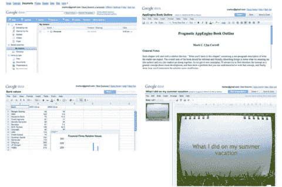

图 6.1：Google Docs 中的常见样式

几乎每个优秀的 Web 应用程序都在其页面之间具有统一的外观和感觉。一个优秀的 Web 应用程序不仅仅是网页的集合：它是一个为用户提供服务的连贯程序。组成它的每个页面都提供该功能的一部分。通过为应用程序的所有页面赋予与其他应用程序不同、并且由应用程序所有部分共享的外观，你让用户感觉他们正在使用一个一致且设计良好的应用程序。例如，看看图 6.1 中的 Google Docs 缩略图。Google Docs 以办公套件的形式呈现自己。它以一个看起来像 Windows 文件浏览器的初始视图开始。当你打开文档时，它会打开一个新的浏览器窗口，让你处理该文档。每个 Docs 窗口都有相同的基本布局；它们都在左上角有 Google Docs 标志，右上角有一组控制链接，有一个文档标题，并使用一系列蓝色色调进行装饰。你可以一眼看出某个窗口包含来自 Google Docs 的内容，因为它看起来像 Google Docs。


#### 复制的问题

我最近遇到了一个真实世界中的副本问题实例。我写博客的网站经历了一次系统升级。升级前，所有 URL 的基路径是 http://.../cgi-bin/MT/；升级后，基路径被改为 http://.../mt/。结果发现，有多个地方硬编码了基路径。升级期间，大多数地方都修复了，但有几个被遗漏了。结果，文章、评论和管理链接全部失效，需要修复。花了两周时间才找出所有副本并让一切正常工作。在这两周里，网站对作者和读者来说都是一团糟。如果他们设置一个计算 URL 的单一函数，并在需要生成 URL 时调用该函数，他们本可以在一处更改一行代码，而不会出现任何故障。

不要让这种情况发生在你身上：就地复用代码，而不是复制代码！

定义应用外观和感觉的是公共页面布局与共享样式的组合。样式由层叠样式表定义。基本结构和共享 CSS 都可以定义为模板，然后各个页面可以使用子模板调整细节以满足特定需求，同时保持应用中所有内容共享的主模板默认值。

这些视图将具有出现在所有页面上的共同特征，如页眉、导航栏和徽标。你还可以使用风格元素，例如特定字体、文本样式和配色方案，使应用的页面共享一致的外观和感觉。所有元素都在不同视图之间共享。页面有自己特定的内容，提供页面功能，但页面的样式完全相同，并且来自同一份代码。

编程中有一条基本原则：把同一事物的多个副本放在不同地方是个坏主意。最终你需要修改某些东西，而当你修改时，很容易漏掉其中一个副本。我们真的很希望能一次性完成所有公共页面部分，并在特定页面中引用它们。

“你看到的是由 chat 渲染的页面，出问题了。”它提供了一个基础格式，其他模板可以在此基础上构建。

基本页面布局与我们一直以来所做的差不多。用户能看到的唯一变化是我在页面顶部添加了一个新徽标。但我还给模板添加了一堆块标签。块标签标识模板内容中可以由子模板替换的部分。我们可以使用 master.html 作为主聊天应用的模板。为了让聊天应用的基本视图使用这个新主模板，我们将创建一个如下所示的新子模板：

下载 multicloud/basic.html

```django



<p> All chat messages as of </p>


<p> {{ m.user }}@{{ m.timestamp }}: {{ m.message|escape }} </p>



```

我们通过使用 extends 标签将其声明为子模板，该标签必须是文件中的第一项内容。然后，为我们想要覆盖的块放置一个 block 标签。结果将是一个由 master.html 内容组成的模板，但其 pagecontent 块将被我们一直使用的消息渲染循环替换。

到目前为止，模板看起来很不错，因为它们为我们提供了一种将 HTML 与 Python 代码分开编写的清晰方式。我们仅通过它们之间传递的一组参数，就能将 UI 和应用逻辑分开。但这只是使用模板所能做的事情的冰山一角！模板继承是一种极其有用且强大的机制。在本书剩余部分，我们将不断使用它们，为我们的应用创建越来越好的界面。

#### 使用模板自定义聊天视图

让我们运用所学到的模板知识来改进聊天应用。我们可以做的一件事是改进“Last 20”视图。在当前版本中，它显示消息发送日期和时间的非常冗长的形式。但由于大多数时候我们要展示的是活跃聊天，这些时间戳中的大部分文本将会

既然我们已经更新了应用的计算部分，使其计算并存储消息发送后经过的时间，我们需要通过替换 pagecontent 块来更新界面。我们通过创建如下模板来实现：

```django



<p> Last 20 messages as of </p>


<p> {{ m.user }}: {{ m.message|escape }} ({{ m.deltatime }} seconds ago)</p>



```

- 1. 我们首先声明这是 master.html 的模板扩展。这意味着生成的页面将看起来像 master.html，除非我们专门覆盖某些块。
- 2. 这里我们覆盖主页面中的 pagecontent 块。它将用这个块替换原始块，该块会渲染消息列表。

### 6.3 多个聊天室

既然我们知道了如何使用模板，就可以轻松组合出一系列不同的视图。让我们运用这些知识来修改聊天应用，使其更有用。在最初的应用草图里，我们希望支持带订阅的多个聊天。让我们从提供多个聊天开始；订阅部分稍后再考虑。

#### 更新多个聊天的逻辑

由于我们希望支持多个聊天，需要一种方法来保存可用聊天的列表。稍后，我们会添加一个管理视图，用它来管理聊天列表。但现在，我们只是将其硬编码。我们不需要担心更新不一致，因为它永远不会被更新。每次初始化应用时，它都会重置为相同的值。

此外，我们会给聊天消息添加一些内容，让它们知道自己属于哪个聊天。这很简单：只需给类添加一个数据存储字段。我们还需要修改 POST 处理器，使其设置 chat 字段，但等到设置聊天页面时我们再看看如何做。模型 ChatMessage 和硬编码的聊天列表如下所示：

```python
class ChatMessage(db.Model):
    user = db.StringProperty(required=True)
    timestamp = db.DateTimeProperty(auto_now_add=True)
    message = db.TextProperty(required=True)
    chat = db.StringProperty(required=True)

CHATS = ['main', 'book', 'flame']
```

我们还需要让创建聊天消息的 post 方法设置聊天消息的 chat 字段。我们将通过给聊天 POST 的请求添加一个字段来实现。在 POST 处理器中，我们从请求中获取 chat 字段，并将其添加到聊天初始化器中。修改后的 POST 处理器代码如下所示。

```python
class ChatRoomPoster(webapp.RequestHandler):
    def post(self):
        user = users.get_current_user()
        msgtext = self.request.get("message")
        msg = ChatMessage(user=user.nickname(), message=msgtext, chat=self.request.get("chat"))
        msg.put()
        # Now that we've added the message to the chat, we'll redirect
        # to the root page.
        self.redirect('/')
```

#### 构建多个聊天的着陆页

当有人第一次来到聊天应用时，我们希望他们看到一个着陆页——一个通用的首页。对于我们的应用，该首页向用户显示发布到*任意*聊天的最近二十条消息。从这个页面，他们可以看到哪些聊天是活跃的，然后从导航栏中选择一个。从着陆页，他们不能发布消息——因为他们还没有选择聊天，我们尚不知道要发布到哪个聊天。

现在，我们将填充第一个真实页面——着陆页。我们不打算更改工具栏。对于内容，我们将基于过去版本中的做法做一个简单视图。如下面的 HTML 所示：


```html





  <p> <b>{{ m.chat }}</b> ( {{ m.user }} ) ( {{ m.timestamp }} ):
  {{ m.message|escape }} </p>



```

这正是我们在第 6.1 节 *模板基础：使用模板渲染聊天*（第 72 页）中原有聊天模板里使用的正文，只增加了一点：聊天消息在行首以粗体显示它所属的聊天。

为了渲染它，我们创建一个新的请求处理器。它和我们目前用过的请求处理器非常相似，比如上文用于 ChatRoomCounted 的那个。

不过，这个新的聊天着陆页因为导航栏而有所不同：它有一个聊天列表，用户可以从中选择。当用户点击其中一项时，就会被送到特定的聊天室。接下来我们需要做的就是创建这些聊天页面。

#### 聊天页面模板

对于实际的聊天页面，我们要巧妙一些。到目前为止，每次想要改动任何东西，我们都会创建一个新的请求处理器。但除了聊天名称之外，所有聊天页面都是相同的——而且事实上，后面我们还希望能够动态地创建和销毁聊天页面。因此，我们将结合使用聊天页面模板和 Python 代码中一些巧妙的 URL 处理逻辑，从而让所有聊天只使用一个处理器类。Python 代码将使用请求 URL 来判断请求的是哪个聊天室。

基本的聊天模板还是我们反复做过的那个消息渲染循环，但这一次，我们把聊天名称放到页面头部，并从消息中移除它——毕竟，既然所有消息都属于同一个聊天，就没有理由反复重复它了！模板如下：

```html





    <p><b>{{ m.chat }}</b> ({{ m.user }}) ({{ m.timestamp }}):
        {{ m.message|escape }} </p>


<form action="/talk?chat={{ chat }}" method="post">
    <p><b>Message</b></p>
    <div><textarea name="message" rows="5" cols="60"></textarea></div>
    <div><input type="submit" value="Send ChatMessage"/></div>
</form>


```

它几乎和之前所做的一样，只是我们在页面末尾的输入表单生成的 POST 请求中添加了一个参数，然后利用它包含消息所发布到的聊天名称。

巧妙之处在于代码。我们必须做两件事：需要验证请求，并且需要根据请求中使用的 URL 自定义输出。

验证步骤是新的内容。到目前为止，我们一直依赖 Google App Engine 替我们处理验证。我们把每个特定 URL 映射到一个特定的请求处理器，因此我们始终知道无效请求会产生错误。但现在我们要把多个请求映射到单个处理器：每个查看聊天的请求都将由同一个 RequestHandler 处理。由于最终要能够添加和删除聊天，因此没有固定的聊天列表可以硬编码到 app.yaml 文件或 WSGIApplication 实例中。当我们收到查看某个特定聊天或向某个特定聊天发布消息的请求时，需要检查请求中的聊天是否有效。

```python
class GenericChatPage(webapp.RequestHandler):
    def get(self):
        requested_chat = self.request.get("chat", default_value=None)
        if requested_chat == None or requested_chat not in CHATS:
            template_params = {
                'title': "Error! Requested chat not found!",
                'chatname': requested_chat,
                'chats': CHATS
            }
            error_template = os.path.join(os.path.dirname(__file__), 'error.html')
            page = template.render(error_template, template_params)
            self.response.out.write(page)
        else:
            messages = db.GqlQuery("SELECT * from ChatMessage WHERE chat = :1 "
                                   "ORDER BY timestamp", requested_chat)
            template_params = {
                'title': "Mark's AppEngine Chat Room",
                'msg_list': messages,
                'chat': requested_chat,
                'chats': CHATS
            }
            path = os.path.join(os.path.dirname(__file__), 'multichat.html')
            page = template.render(path, template_params)
            self.response.out.write(page)
```

- ① 我们通过分解 URL 来获取用户请求的聊天名称。新的 URL 形式包含三部分：主机名、资源标识符和查询。查询由一组名称/值对组成。在我们的例子中，查询将是一对：名为 chat 的查询参数和请求的聊天名称。因此，例如，要查看名为 Random 的聊天，URL 会是 http://markcc-chatroom-one.appspot.com/enterchat?chat=Random。

  检查 HTTP 请求的元素是 Google App Engine 程序中的常见任务，因此 webapp 提供了大量用于检查和操作 URL 的方法库。要从请求 URL 中获取查询参数，请使用方法 get；它接收查询参数的名称，以及一个可选的默认值，当查询不包含该参数时返回该默认值。

- ② 正如我们之前讨论的，需要检查并确保 URL 请求的聊天有效。我们通过对照已知聊天的全局列表来检查。如果请求的聊天不存在，就渲染错误页面。错误页面由派生自我们主模板的模板生成，因此它看起来像是我们的应用生成的错误，而不仅仅是典型的“页面未找到”错误。

- ③ 如果聊天室已知，我们就沿用一直使用的模式并渲染聊天。与我们之前所做唯一的不同是，在查询中我们只选择 chat 字段与用户所选聊天匹配的消息。

我们已经有了一个通用处理器，用于渲染消息并把消息发布到所有聊天。还剩下什么？我们需要更新处理 POST 请求的处理器，以便从消息中获取聊天。这很简单：只需在 POST 处理器中添加一行——`chat = self.request.get('chat')`——然后把 `chat=chat` 添加到 ChatMessage 构造函数调用的参数中。

只剩一部分了。我们已有处理所有请求的请求处理器，以及渲染所有所需页面的模板。我们需要修改把传入请求映射到相应请求处理器的应用代码。为此，只需修改我们应用的 `WSGIApplication` 记录。现在它需要包含着陆页、通用聊天页和发布页的条目。更新后的代码如下所示：

下载 multiChat/chat.py

```python
chatapp = webapp.WSGIApplication([('/',  ChatRoomLandingPage),
                                  ('/talk', ChatRoomPoster),
                                  ('/enterchat',  GenericChatPage)])
```

在本章中，我们在聊天应用的功能方面向前迈进了一大步。我们使用模板将程序逻辑与用户界面分离，并开始使用由主模板和模板扩展定义的通用页面结构，为我们应用的所有页面提供统一外观。

不幸的是，尽管增加了功能，我们的应用仍然很难看。它看起来并不真的像一个应用——而像一堆网页。页面布局凌乱且千篇一律。下一章我们将介绍层叠样式表（CSS），它让我们能够描述如何在网页中定义和布局一个真正美观的应用，以及如何将 CSS 与模板结合使用，把我们的聊天应用从一个难看但可用的系统变成好得多的东西。

### 参考资料与资源

- **Django 模板语言：面向模板作者。 . .**  
  ... http://docs.djangoproject.com/en/dev/topics/templates/  
  Django 模板的官方文档。
- **Google App Engine 模板文档。 . .**  
  ... http://code.google.com/appengine/docs/python/gettingstarted/templates.html  
  Google 关于在 App Engine 应用中使用 Django 模板的文档。
- **Django 之书 2.0 . . . . . . . . . . . . . . . . . . . .**  
  http://www.djangobook.com/en/2.0/  
  一本介绍完整 Django 框架的书的在线版本，其中包括对模板语言的详细讲解。


## 让 UI 更美观：模板与 CSS

在上一章中，我们在填补应用程序缺失功能方面取得了很大进展。但坦白说，我们的应用程序仍然很难看（或者至少非常平淡）：

### 欢迎来到 MarkCC 的 App Engine 聊天室

（当前时间为 2009-07-02 01:43:13.554471）

MarkCC（2009-07-02 01:42:49.129927）：你好，外面有人吗？  
Prag（2009-07-02 01:42:56.823207）：有。我在这儿。  
MarkCC（2009-07-02 01:43:13.468926）：很好。我正在写第 3 章，并在测试聊天代码。

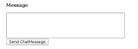

事实上，它看起来比典型的网页还要差不少，因为如今几乎每个网页都至少使用了一些样式。我们需要做点什么让它看起来好看，让它不那么像网页，而更像一个应用程序。

在本章中，我们将把应用程序整合起来，使用模板和 CSS 的组合来格式化并设置其样式。

样式，它指定了一个属性 background-color，并使用中蓝色的十六进制 RGB 代码来定义颜色值。

第二条语句更具体。它的选择器是 h1，因此只适用于顶级标题。它指定了 text-decoration 属性，该属性用于通过阴影、下划线和删除线等修饰文本。这条语句指定一级标题应带下划线。

要将这一点应用到我们的聊天页面，我们需要把它保存到文件中，然后在 HTML 页面模板中添加一段代码片段，告诉用户浏览器获取该 CSS 文件并用它来渲染页面。如果我们把 CSS 放入名为 chat-style.css 的文件，就可以通过向 HTML 文档的 head 部分添加样式表链接来将该样式应用到页面，如下所示：

下载 css-chat/snippets.html

```html
<head>
    <title>{{ title }}</title>
    <link rel="stylesheet" media="screen"
          type="text/css" href="chat-style.css"/>
</head>
```

记住这些基础知识后，让我们用样式构建聊天室的一个版本。在此过程中，我们将开始了解如何以更灵活的方式使用 CSS 选择器。

让我们从简单的开始。将整个页面的背景设为深蓝色。欢迎标题将使用大号、美观的白色字体，并带有中蓝色背景：

下载 css-chat/snippets.css

```css
h1 {
    font: 16px Helvetica, sans-serif;
    color: #FFFFFF;
    background-color: #0000A0;
}
```

这一步唯一新增的内容是我们如何指定字体。字体有点复杂，因为不同操作系统上的不同浏览器拥有不同的可用字体集合。我们可以按优先顺序指定一系列字体，而不是只指定单一字体。如果渲染页面的浏览器可以使用第一个字体，它就会使用该字体。否则，它会尝试下一个，依此类推。如果浏览器中没有任何样式文件列出的字体可用，它将使用自己的默认字体。我们的代码所做的是规定字体应以 16 磅大小渲染，并且我们首选的字体是 Helvetica；如果 Helvetica 不可用，那么浏览器应使用其默认的无衬线字体。

我们还为 `<body>` 元素和 `<h1>` 元素都指定了 `background-color` 属性。这是层叠的一种极其简单的用法。无论是来自多个样式表的样式，还是来自样式表内多条语句的样式，都遵循一套规则，用于在存在多个声明时解决冲突。完整规则相当复杂，但总体思路是：最具体的 CSS 声明始终优先。HTML 文件中的 CSS 优先于链接的样式表；页面专用链接样式表优先于站点默认样式表，并且设置在嵌套元素上的样式属性优先于设置在其外层元素上的同一 style 属性。因此，`h1` 元素的背景将优先于 `body` 元素的背景。

接下来，我们要更新导航栏。它将出现在很多页面上，所以我们不希望它占用太多空间，但又希望它醒目。我们会把它做成白色背景上的小号黑色文字。为此，我们需要同时修改 HTML 和 CSS。对于 HTML，我们只需将导航栏块改为以下内容：

下载 css-chat/snippets.html

```html

<p id="navbar">

<a href="{{ c.url }}">{{c.name}}</a>

</p>

```

我们修改了导航栏，使其成为一个由聊天室名称组成的水平栏；我们还把它包裹在一个带注解的 `<p>` 标签中。该标签包含属性 `id=`。ID 是专门为配合 CSS 而添加到 HTML 中的机制之一。它们允许我们编写影响 HTML 文档中某个特定元素的 CSS 规则。由于我们的导航栏是唯一的——我们知道聊天室中永远只会有一个导航栏——我们可以为它使用一个标识符。然后我们可以使用选择器 `#navbar` 为导航栏设置样式。该 ID 附加到哪个元素上并不重要；它可以是 HTML 文档中的任意元素。因此，我们可以把导航栏从段落改为 `div`、`span` 或 `list`——而且完全不需要修改 CSS。下面是用于设置导航栏样式的 CSS：

下载 css-chat/chat.css

```css
#navbar {
    font: 8px Helvetica, sans-serif;
    color: #000000;
    background-color: #FFFFFF;
}
```

这里的 CSS 非常直接。我们使用 #navbar ID 选择器并声明相应的属性。

现在让我们来看看实际聊天的渲染。在聊天中，每条消息都使用 <p> 标签渲染为一个段落。我们希望一些 <p> 标签渲染为来自其他用户的消息，一些渲染为来自查看页面的用户的消息，并且我们希望所有消息段落都渲染得与页面上的其他段落不同。

再一次，HTML 来救场了。有一种在页面上标记标签的方法，可以让我们指定某个特定 XML 标签的某些实例应以特定方式渲染。你可以用 class= 属性注解任何 HTML 标签，然后编写选择器，使其应用于任何声明了特定 class= 值的标签，或应用于声明了某个类的特定标签（如 <p>）。在我们的聊天应用程序中，我们会先处理特定标签的情况。CSS 样式可以为未标记的 <p> 标签指定一种样式，并为已标记的标签指定一种特殊样式。按照通常的 CSS“最具体规则”，针对特定标签的样式将覆盖针对通用标签的样式。因此，我们将为两种聊天消息编写两种样式。对于查看页面的用户发送的消息，我们将文本绘制为纯白色。对于其他任何人发送的消息，我们将消息绘制为黄色并带有较暗的背景。实现这一点的 CSS 如下所示：

下载 css-chat/chat.css

```css
p.sentbyme {
    color: #FFFFFF;
    font: 9px Helvetica, sans-serif;
}

p.sentbyother {
    color: #DDDDFF;
    font: 10px Helvetica, sans-serif;
    background-color: #000080;
}
```

如你所见，对于 class 属性设为 sentbyme 的 <p>，其选择器写作 p.sentbyme。

要使用那段 CSS，我们需要修改 HTML 页面模板或 Python 应用逻辑，以便为查看页面的用户发送的消息与其他用户发送的消息附加不同的类。我们通过问“正在改变的是什么”来做出这个决定。这是应用逻辑的更改，还是仅仅是应用外观的更改？

在本例中，这只是外观问题，所以我们会通过模板来实现。我们将使用一个包含条件测试的模板扩展来渲染聊天页面，以决定每条消息使用哪个类。模板如下所示：

[下载 css-chat-distinct-messages.html](css-chat-distinct-messages.html)

```html






    
    <p class="sentbyme">
    
    <p class="sentbyother">
    

    <b>{{ m.chat }}</b> {{ m.user }} ( {{ m.timestamp }} ):
        {{ m.message | escape }} </p>



        <form action="/talk&chat={{ chat }}" method="post">
            <p><b>Message</b></p>
            <div><textarea name="message" rows="5" cols="60"></textarea></div>
            <div><input type="submit" value="Send Chat Message"/></div>
        </form>


```

在 ① 处，我们使用了一点新的 Django 模板。ifequal 标签接收两个变量，并检查它们按照 Python 的规则是否相等。如果相等，它就输出 ifequal 与 else 之间的 HTML 文本；否则，它输出 else 与 ifequal 块末尾之间的文本。因此，我们的代码会检查消息发送者是否与查看页面的用户名称相同。如果相同，它就生成一个指定 sentbyme 类的 `<p>` 标签；否则，它生成一个指定 sentbyother 类的 `<p>` 标签。


在CSS中，我们常常可以省略标签名。我们可以指定一条样式规则，使其应用于带有特定类的*任意*标签。如果我们在上面的样式规则中去掉 p，使选择器仅为 `.sentbyme` 和 `.sentbyother`，那么这些样式规则将应用于任何带有该类的标签。这非常有用，原因有两个：

- 1. 有些属性我们可能希望在文档中的许多地方使用。例如，我们可能希望能够标记页面中描述错误的部分。我们通常希望它们以亮红色显示。因此可以创建一个 error 类。然后，在输出中任何出现错误文本的地方——无论是标题、段落，还是一小段粗体文本——我们都可以给标签添加 `class="error"`。

- 2. 在构建应用时，我们可以尝试不同的布局。例如，我们一开始把导航栏做成项目符号列表，然后将其改为水平列表。我们可以使用类来设置用户界面元素的装饰性属性（例如颜色和字体样式），这样当我们改变在HTML中编写它们的方式时，就不需要修改CSS。

### 7.3 使用 CSS 的页面布局

我们已经看到CSS如何通过控制字体、颜色和装饰让事物在视觉上更具吸引力。但在构建用户界面时，我们仍然缺少一个极其重要的东西——布局。要做出既有吸引力又可用的UI，我们需要控制屏幕上各个元素的位置。把用户界面的布局交给用户浏览器的布局引擎来决定，实在不是一个可接受的选择。浏览器渲染简单HTML是为了便于阅读网页，而不是为了自动生成精美的用户界面。

我们的用户界面由一组盒子组成。我们希望它看起来如何的原型图如图7.1（见下页）所示。它有一个欢迎标题，是一个占满屏幕宽度的盒子；一个沿屏幕左侧垂直延伸的导航栏；一个显示聊天记录的区域；以及聊天记录下方的输入表单。这些元素基本上都是矩形区域，我们希望它们以特定方式布局。

我们必须定义这些盒子是什么，以及它们应如何布局。根据到目前为止所做的工作，你大概能猜到接下来是什么：有用于描述盒子中内容的HTML元素（结构），以及用于描述如何布局的CSS属性（外观）。

```html
<div id="navbar-block">
    
        <div id="navbar">
            <ul>
                
                    <li><a href="{{ c.url }}">{{ c.name }}</a></li> 
            </ul>
        </div>
    
</div>

<div id="content">
    

        <p> This is template text. If you're seeing this in a page rendered
        by chat, something is wrong.</p>

    
</body>
</div>

<div id="entry-form">
    
    
</div>

</html>
```

这其实只是上一章的主模板，只不过我们把图7.1（见上一页）中UI草图里的每个区块取出来，用 `<div>` 元素包住该部分UI的HTML，并给它标上 id= 属性。

#### 基于流的布局

我们已经把应用视图的HTML组织成一组盒子。现在需要编写CSS来布局。CSS提供了大量属性，可用于管理页面的布局方式，使其看起来像自然的用户界面。

问题在于（而且总会有问题，不是吗？）布局非常复杂。这就是事情的本质：我们要描述如何在任意大小的浏览器窗口、不同分辨率的计算机显示器上，以及在不同浏览器使用不同布局引擎的情况下进行布局。

我们使用*流约束*来描述布局。基本思想是：在没有CSS布局属性的情况下，浏览器通过将文本流入页面来排布HTML页面的元素。HTML页面从一个表示空行的矩形开始。文本流入该行，直到填满。一旦填满，就在其下方创建新行，然后文本流入那个盒子。因此，页面最终按流进行布局：文本进入屏幕上的矩形区域；从左到右，然后从上到下。为了改变布局，我们介入这个过程。例如，我们可以通过将盒子定位在屏幕上的特定位置来打断它，页面其余内容会围绕它流动。

我们描述如何在屏幕上布局的方式将基于流。我们的HTML不能只是一些任意顺序的 `<div>` 集合，然后靠布局在屏幕上定位——元素出现的顺序会对其最终位置以及用户界面最终外观产生重大影响。

CSS为我们提供了两个真正用于构建布局的工具：浮动和清除。

#### 浮动

*浮动元素*是一个 `<div>`（或其他HTML元素），其CSS样式包含 float 属性。在布局中，浮动元素（名副其实）会在页面两侧之间浮动。其工作方式非常简单：浮动元素按照标准流布局获得垂直位置。但随后，它不会停留在落到的位置，而是被浮动到一侧，其他元素则可以围绕它流动。

这相当令人困惑，所以我们来看一个例子。让我们拼凑一个聊天UI的小型原型，看看不使用浮动时是什么样子，然后再加上浮动，看看它如何变化。我们将制作一个导航侧边栏和一个聊天查看区域的原型。HTML如下：

下载 css-chat/flow-mockup.html

```html
<html>
  <head>
    <title>Flow UI Mockup</title>
    <link rel="stylesheet" media="screen"
          type="text/css" href="flow-mockup.css"/>
  </head>

  <body>
    <div id="sidebar">
      <ul>
        <li>Chatter</li>
        <li>Work</li>
        <li>Play</li>
        <li>Planning</li>
        <li>Family</li>
      </ul>
    </div>

    <div id="body">
      <p>"Lorem ipsum dolor sit amet, consectetur adipiscing elit, sed do eiusmod tempor incididunt ut labore et dolore magna aliqua. </p>
      <p>Ut enim ad minim veniam, quis nostrud exercitation ullamco laboris nisi ut aliquip ex ea commodo consequat. </p>
      <p>Duis aute irure dolor in reprehenderit in voluptate velit esse cillum dolore eu fugiat nulla pariatur. </p>
      <p>Excepteur sint occaecat cupidatat non proident, sunt in culpa qui officia deserunt mollit anim id est laborum.</p>
    </div>
  </body>
</html>
```

它会生成如下所示的页面：


我们可以使用CSS为侧边栏添加浮动：

```css
#sidebar {
    float: left;
    border: 2px solid #0000FF;
    padding: 5px;
    margin-right: 5px;
}
```

- 1. float 属性可以设置为 left、right 或 none。left 如我们的示例所示，表示元素应向左浮动；right 表示元素应向右浮动；none 允许你“取消浮动”某个从其类继承了 float 属性的元素。

- 2. border 属性让你可以在该 `<div>` 的边缘绘制边框。它的格式为 `width style color`。`style` 描述边框轮廓应是什么样子：可以是 solid、dotted、dashed、double、grooved、ridge、inset 或 outset。这里我们将使用简单的实线轮廓。

- 3. 少量内边距可以让事物看起来更好。CSS允许你在元素周围使用两种空间：外边距和内边距。外边距是添加到 `<div>` 盒子外部的空间；内边距是添加到盒子内部的空间。

使用此样式的结果是：

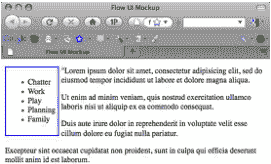


#### 清除

如截图所示，正文区块的文本围绕侧边栏流动。它出现在侧边栏旁边，直到侧边栏结束的位置，然后流到左边距。

我们也可以通过把聊天记录文本也变成浮动元素，来防止它围绕侧边栏流动。如果我们天真地这样做——只设置 float: right;——得到的结果会像这样：

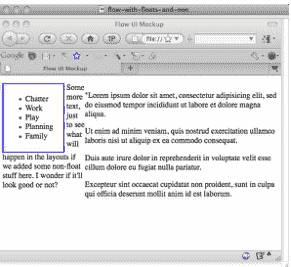

默认情况下，浮动元素会保持分离；在定位它们时，每个浮动元素都会被当作占据页面全宽。由于聊天记录是向右浮动的元素，导航栏是向左浮动的元素，而在流式布局中它们都被视为页面全宽的浮动元素，因此它们不会并排显示，而会在布局中垂直堆叠。为了把它们摆放到理想位置，我们需要给它们设置宽度。由于我们是在 Web 浏览器中操作，页面宽度是可变的——因此通常会使用百分比来描述位置和宽度。我们可以使用绝对度量，但大多数情况下使用相对度量更好。为了按照我们想要的方式在原型中定位元素，我们需要设置宽度。以下是更新后的样式表：

下载 css-ch04/float-two-col.css

```css
#sidebar {
    float: left;
    border: 2px solid #0000FF;
    padding: 5px;
    margin-right: 5px;
    width: 20%;
}

#body {
    float: right;
    width: 70%;
}

p.allclear {
    clear: both;
}
```

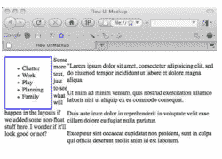

就目前的效果而言，这看起来不错；但如果我们尝试向 UI 中添加更多内容，例如像原型中那样在底部添加输入区块，它最终就会环绕在这两个浮动元素周围流动。如果导航栏比聊天记录短，其他内容就会环绕它向左流动，就像我们最初的原型中那样。

我们需要一种表达“不要环绕这个元素流动”的方法。这正是 *清除* 的用途。如果我们为任何元素在 CSS 中添加 `clear: both;`，就能得到想要的效果。你可以使用 `clear: left`，它会清除左浮动；使用 `right`，它会清除右浮动；或者使用 `both`，它会清除所有浮动。

让我们为额外文本的 `<p>` 标签添加类 `allclear`，并将 `p.allclear { clear: both; }` 添加到样式表中。结果如下所示，完全符合我们的期望：

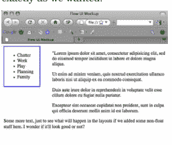

### 7.4 使用流式布局构建我们的界面

现在我们对如何组合界面有了基本思路。我们只需稍作润色，并编写 CSS 让它看起来符合我们的期望。一旦理解了 CSS 的工作方式，获得一个像样的界面就相当容易——再把它提升到真正出色的程度并不困难，但很耗时。我们会花一些时间调整各种选项、移动外边距、更改颜色、重新排列元素等。这需要时间，但值得付出：看起来很棒的东西（例如 Gmail）与看起来平庸的东西（例如我们应用的当前版本）之间的差别，只在于花在润色 CSS 上的时间多少。

回到我们的聊天应用，界面有四个基本元素。应用顶部有一个欢迎栏。其下方左侧有一个导航栏，旁边是聊天记录。在这些内容下方，有一个占据窗口全宽的窗格，其中包含新消息输入表单。以下是 CSS：

下载 css-chat/app.css

```css
body {
  background-color: #8888FF;
}

#header-block {
  font: 16px Helvetica, sans-serif;
  color: #FFFFFF;
  background-color: #0000A0;
  border: 2px ridge #0000F0;
}

#navbar-block {
  float: left;
  width: 20%;
  font: 8px Helvetica, sans-serif;
  color: #000000;
  background-color: #FFFFFF;
  border: 2px ridge #0000F0;
  padding: 4px;
  margin-right: 4px;
}

#transcript-block {
  padding: 4px;
  float: right;
  width: 75%;
  font: 8px Helvetica, sans-serif;
  background-color: #444444;
  color: #FFFFFF;
  border: 2px ridge #0000F0;
}

#entry-block {
    clear: both;
    border: 2px ridge #0000F0;
    margin-top: 4px;
}

p.sentbyme {
    color: #FFFFFF;
    font: 9px Helvetica, sans-serif;
}

p.sentbyother {
    color: #D0D0FF;
    font: 10px Helvetica, sans-serif;
    background-color: #000000;
}
```

这里没有什么复杂之处：我们只是把前面讨论的内容组合在一起。我们使用颜色、添加边框、浮动和清除来创建所需的用户界面结构。我们可以通过一个模拟文件来测试 CSS——也就是说，一个简单的 HTML 文件，其结构与我们的应用模板将生成的页面相同。这个模拟文件包含以下元素：

[下载 css-chat/fake-ui.html](css-chat/fake-ui.html)

```html
<html>
    <head>
        <title>MarkCC's AppEngine Chatroom</title>
        <link rel="stylesheet" media="screen" type="text/css" href="app.css"/>
    </head>

    <body>
        <div id="header-block">
            <h1>Welcome to MarkCC's AppEngine Chatroom </h1>
            <p>Current time is March 13, 2011 8:39</p>
        </div>

        <div id="navbar-block">
            <p><b>CHAT</b></p>
            <ul>
                <li>Work</li>
                <li>Play</li>
                <li>Write</li>
                <li>Misc</li>
            </ul>
        </div>

        <div id="transcript-block">
          <p class="sentbyother">Hi. How's it going?</p>
          <p class="sentbyme">Not bad. Making progress, slowly.</p>
          <p class="sentbyother">That's good. What about work?</p>
          <p class="sentbyme">Work is cool, going really well.</p>
        </div>

        <div id="entry-block">
          <form action="/talk&chat=thischat" method="post">
            <p><b>Message</b>:</p>
            <div><textarea name="message" rows="5" cols="60"></textarea></div>
            <div><input type="submit" value="Send ChatMessage" /></div>
          </form>
        </div>
    </body>
</html>
```

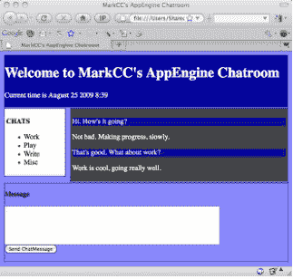

图 7.2：用于测试 CSS 的模拟聊天界面

渲染结果如图 7.2 所示。一旦我们对模拟界面的外观满意，就可以通过将样式表链接行添加到主模板并上传到 App Engine，把它连接到实时应用。

渲染来自应用逻辑，而现在页面结构来自外观。在下一章中，我们将继续这一过程，使用一种名为 AJAX 的 Web 技术将用户界面控件与程序的其他方面分离；在此过程中，我们会让应用的行为更像传统桌面应用。用户无需为了查看新的聊天消息而点击刷新按钮——我们的界面控制层会自动处理这一点。

### 参考资料与资源

- **CSS：权威指南**  
  http://oreilly.com/catalog/9781565926226  
  一本出色的书，详细介绍了 CSS、选择器、样式属性以及你需要了解的所有其他内容。
- **CSS 的艺术与科学**  
  http://pragprog.com/titles/stp-css/the-art-science-of-css  
  另一本教科书，很好地指导如何使用 CSS 制作视觉上令人愉悦的 Web 应用。
- **CSS 教程**  
  http://www.w3schools.com/css/  
  一个在线 CSS 教程，可交互测试不同的 CSS 样式和属性。
- **Layout Gala**  
  http://blog.html.it/layoutgala/  
  一个在线资源，包含三十种不同 Web 元素布局的 HTML 和 CSS 模板。

## 第 8 章：实现交互

在本章中，我们将在应用的行为方式上迈出一大步。我们不再依赖用户不断点击刷新来查看新消息，而是让聊天服务具有交互性。为此，我们将学习以下内容：

- JavaScript，直接内嵌在 Web 浏览器中的编程语言。你可以通过将 JavaScript 程序嵌入应用页面，在界面中创建交互元素。
- 文档对象模型，它将 HTML 表示为可编程对象，允许你使用可由 JavaScript 程序修改的网页内容来更改 UI 的某些部分。
- AJAX（异步 JavaScript 和 XML），一种无需重新加载页面即可向服务器发送命令和请求的技术，使你无需重新加载即可处理界面中的操作和更新。
- 模型-视图-控制器（MVC）范式，一种强大的标准架构，用于分离交互式应用的各个组件。

### 8.1 交互式 Web 服务：基础

到目前为止，我们的聊天室一直令人沮丧地静态。当我们在浏览器中查看聊天时，我们只能看到用户上次手动加载页面时发布的消息，而这次加载要么是通过发布新消息，要么是通过点击浏览器中的刷新按钮。这并不是我们期望应用的工作方式。我们期望它们是动态的——随着其底层数据的更新而不断自我更新。在聊天中

聊天室中，我们期望其他用户一发布聊天消息就能看到这些消息——我们不希望必须手动询问应用程序是否有任何新消息？

问题在于，我们没有任何办法让事物具有交互性。我们使用客户端-服务器请求-响应模型构建了应用程序。事实上，我们根本没有真正构建客户端。我们实现了一个服务器，并把 Web 浏览器预先打包的功能用作客户端。在当前版本的云编程模型中，浏览器就是客户端，而它所做的只是渲染内容。如果我们想让云服务像真正的应用程序那样工作，就需要添加在客户端上运行的代码。构建交互式 UI 的关键是一种称为 AJAX 的技术，它让我们能够使用在浏览器内部运行的 JavaScript 代码，从而提供丰富的客户端功能。

它是如何工作的？首先，现代浏览器包含 JavaScript 解释器，JavaScript 是一种可以嵌入 HTML 的编程语言。借助 JavaScript，你可以把程序嵌入应用程序的页面中，以响应用户操作。因此，当用户点击按钮时，你可以在浏览器中立即处理该操作。

其次，你的 JavaScript 程序可以把整个 HTML 页面或其任意部分当作一个对象来操作，这种对象称为 DOM（文档对象模型）对象。当你更改页面的 DOM 对象时，用户在其浏览器中看到的内容会立即改变。借助 JavaScript 和应用程序页面的 DOM 对象，你可以创建能立即响应用户操作的应用程序。

理论讲够了——我们来尝试一点编程。我们还不打算做任何太花哨的事情。在上一章中，我们更改了聊天消息的显示方式，以区分不同的消息。现在我们要添加一个按钮，用来打开和关闭该效果。当用户首次加载应用程序时，聊天记录中的所有消息都会以相同字体显示。当他们点击按钮时，显示会发生变化，使其他用户发送的消息高亮显示。

我们将使用 CSS 类来处理这一步。我们会给来自其他用户的消息添加一个 CSS 类，以便将其与查看页面的用户发送的消息区分开。当用户点击变色按钮时，我们将遍历聊天消息的 DOM，并更改这些消息的属性，使它们以不同方式显示。我们将为消息设置三个不同的 CSS 类：self、other 和 other-colored。

在把所有内容组合起来之前，我们先从 JavaScript 开始；它将找到页面中的聊天部分，然后遍历该结构，查找具有 other 类的 `<p>` 标签。为了便于找到相应的部分，我们将为聊天记录部分的 `<div>` 附加一个 ID。

下载 interactive/fiddle.js

```javascript
<script type="text/javascript">
function highlightMessages() {
    var chatBlock = document.getElementById("chat-transcript");
    var chatMessages = document.getElementsByName("Other");
    for (c in chatMessages) {
        // Change the class attribute to be "other-highlight"
        for (a in c.attributes) {
            if (a.name == "class") {
                a.value = "other-highlight";
                break;
            }
        }
    }
}
</script>
```

```html
<input type="button" value="Highlight Others"
       id="HighlightButton" onclick="highlightMessages()"/>
```

- 通过将 JavaScript 代码放在 `<script>` 标签内，将其嵌入 HTML 页面。
- 要更改其他用户消息的样式，我们必须找到需要更改 class 属性的元素。我们将从查找 `<div>` 元素开始。在 JavaScript 中，我们将仅使用全局变量 document 访问正在显示的文档的 DOM 对象。DOM 提供了许多用于查找和操作页面元素的方法。现在，我们将使用 getElementById，它返回带有 id= 且值为 chat-transcript 的元素的 DOM 对象。

我们的代码结构是围绕各个 HTML 页面组织的。我们编写了请求处理程序，并且在每个请求处理程序中，我们生成一个完整的 HTML 页面，以便在用户浏览器中渲染。这为我们的应用程序提供了一个有条理的组织架构。

但现在，我们将通过使用 AJAX 迈出另一步，使应用程序更具交互性。使用 AJAX 后，我们将不再编写由单个处理程序完全生成每个页面的代码。为了保持条理清晰和可维护，我们必须考虑系统的架构：我们需要一种有纪律的方式来组织所有组合成云应用程序的部分。

幸运的是，云应用程序非常适合用户界面中最古老、最强大的设计模式之一——模型-视图-控制器。

如果你回溯图形用户界面的早期时光，最终会看到 Smalltalk，大多数现代 GUI 思想正是从这里发端。窗口、按钮、鼠标和菜单都来自 Smalltalk。在 Smalltalk 中，程序员使用一种三部分设计模式来构建界面。三十多年后，我们仍在使用这种设计，而且它与我们将为云应用程序构建用户界面的方式几乎完美匹配。MVC 应用程序的结构如图 8.1（见下一页）所示。

在 MVC 中，界面有三个组成部分：

*模型。* 系统的应用逻辑。模型是围绕应用程序要执行的数据和操作的基本概念实现的。在模型中，你根本不需要考虑界面：模型完全独立，只依据底层应用程序数据工作。对于云应用程序，模型就是服务器代码。服务器实际上无法直接与客户端对话；它需要等待客户端向它发送请求。它与用户界面完全解耦。

*视图。* 视图是可见的用户界面：显示元素、输入框等。在云应用程序中，视图用 HTML 编写。它本身没有真正的行为：它只是一组显示元素，以及以美观方式渲染它们所需的代码（用 HTML 和 CSS 编写）。视图并不真正关心应用逻辑或数据：当被告知要渲染时，它就能渲染。

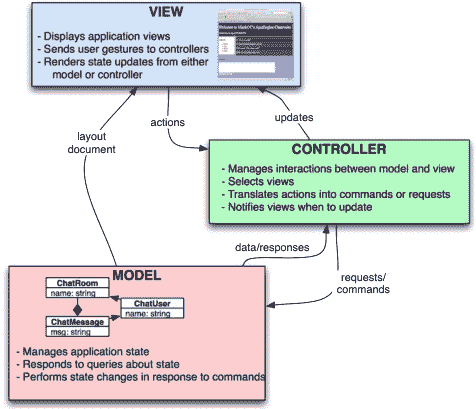

图 8.1：云 MVC 应用程序的结构

*控制器。* 控制器是客户端与服务器之间的桥梁。它是我们迄今为止一直缺失的基础部分。控制器接收视图中产生的界面操作，并将其转换为可在模型中执行的操作；它还接收服务器生成的内容数据，并将这些数据转换为视图可以渲染的形式。在云中，控制器就是在用户浏览器内部执行的 JavaScript 代码。

MVC 是我们构建云应用程序的一种自然方式，因为 MVC 模型的概念与我们为应用程序构建的一组组件非常契合。构建优秀云应用所需使用的不同语言迫使我们把应用程序至少分成三个组件：服务器代码（用 Python 或 Java 编写）、渲染代码（用 HTML 和 CSS 编写）和交互代码（用 JavaScript 编写）。MVC 为我们提供了一种简单的方法来理解哪些功能属于哪些组件。此外，它还带来了使用这三个基本组件设计应用程序的悠久历史，我们可以在设计云应用程序时加以利用。当然，云有所不同，因此架构并不完全等同于旧的 Smalltalk 用户界面，但基本思想仍然成立。主要区别在于，在云 MVC 中，模型和视图之间的直接联系更少。在经典 MVC 中，当模型中的数据被修改时，模型会直接向视图发送更新。在云 MVC 中，视图一旦创建，模型就不能直接与它对话，而是需要把所有更新发送给控制器，然后由控制器更新视图。

如果你仔细想想，MVC 实际上不过是我们一直遵循的进程中的下一步。随着应用程序变得越来越复杂，我们一直在解耦——分离组件。我们通过把渲染放在模板中、把计算放在 Python 中，将渲染与计算分离。我们通过把内容放在 HTML 中、把样式放在 CSS 中，将样式与内容分离。而现在，我们正以完全相同的方式再增加一层分离。我们的客户端将同时拥有用户界面（内容和样式）和可执行代码：我们将它们分离为视图（用 HTML 和 CSS 编写）和控制器（用 JavaScript 编写）。

在继续开发聊天应用程序时，我们会牢记 MVC。它是描述云应用程序如何划分为逻辑部分的最佳基本结构。这正是我们在本章前面所做的：我们将其分为模型（服务器，包括存储聊天记录的数据存储，以及管理与客户端交互的查询处理程序）、视图（提供基本 UI 的 HTML 和 CSS 文档）和控制器（完成所有交互的 JavaScript）。

### 8.3 不中断地与服务器通信

在本章开头，我们使用 JavaScript 在用户界面中创建动态交互，而不需要与服务器通信。这很有用，但也非常受限：我们只能构建使用用户浏览器所显示 HTML 文档中数据的功能。我们无法做任何需要更多数据的事情。


当然，我们希望能够完成依赖于从服务器获取数据的任务。利用我们目前所学的知识，我们可以从服务器获取数据，但始终是在浏览器标准的客户端-服务器同步交互周期内进行。我们编写客户端代码向服务器发送请求，服务器响应这些请求，当客户端的浏览器收到响应后，会将其渲染出来。除非采取特殊手段，否则我们无法避免这种基本的请求-响应过程。

请求-响应-渲染循环确实不够用。我们希望编写的聊天应用能够在有新聊天消息时自动更新显示。但我们的聊天应用需要等待用户手动刷新。我们可以编写一段带定时器的 JavaScript，让它每秒自动刷新一次。但每次刷新都会给用户带来极大的干扰。他们的界面会变空白，然后重新绘制。如果用户正在输入一条新消息，当浏览器刷新时，这条消息就会丢失。这绝对不是我们想要的。

我们需要做的是与服务器进行异步通信。也就是说，我们需要编写一些在通常的请求-响应-渲染循环之外运行的代码。这种技术称为 AJAX：异步 JavaScript 和 XML。它使用一个叫做 `XMLHttpRequest` 的 JavaScript 构造。坦率地说，`XMLHttpRequest` 是一个相当丑陋的 hack。就像我们用来编写基于 Web 的云应用客户端侧的许多工具一样，它基本上是一个临时的、有人因为迫切需要而拼凑起来的东西，而不是作为构建 UI 的工具箱中精心设计的一部分。一旦人们开始使用它，它就成了标准，现在我们几乎离不开它。（正如我们将在第 9.3 节“GWT 中的 RPC”（第 135 页）中看到的那样，AJAX 可以被封装并隐藏在内部，这样你就不必处理丑陋之处，但最好还是了解真正发生了什么。）

`XMLHttpRequest` 的关键在于它是异步的，这意味着当发送请求时，发送方不会等待响应。通常，当我们编写发出 HTTP 请求的代码时，我们是通过函数调用来完成的：我们调用一个方法发送请求，该函数调用的返回值就是查询的响应。代码会*阻塞*——它什么都不做，只是一直等待响应。但 `XMLHttpRequest` 不会阻塞。相反，当我们创建一个 `XMLHttpRequest` 时，其中一个参数是一个被称为*回调*的函数。当客户端的浏览器收到请求的响应时，它会调用这个回调函数。因此客户端永远不会阻塞——它只是继续运行，用户会得到一个非常流畅的用户界面，没有任何中断或刷新。一旦收到响应，就会调用回调，用户界面就会更新为最新的信息。

#### XMLHttpRequest 并不是一个 XML HTTP 请求

XMLHttpRequest 这个名字取得糟糕透顶。实际上，它并不是一个请求，而且与 XML 没有任何关系。

XMLHttpRequest 是一个请求管理器——一个用于创建请求、发送这些请求并处理收到的响应的对象。

关于 XMLHttpRequest 最重要的一点是，它能够在正常的浏览器请求-响应-渲染循环之外生成并发送请求，并且可以异步处理请求，因此你的程序无需等待响应。

这种描述听起来非常抽象。但在 App Engine 中实现起来并不难，而最好的证明方式就是编写代码。我们将直接实现我们真正想要的东西——一个动态更新的聊天视图。

要做到这一点，我们需要编写一系列组件：

- 1. 一个服务器请求处理器，用于提供不包含任何聊天数据的用户界面框架
- 2. 一个服务器请求处理器，用于获取聊天数据（新消息）
- 3. 一个 JavaScript 组件，负责向服务器请求更新，并在收到新数据时将消息添加到聊天记录中。

#### 模型：聊天的请求处理器

我们需要做的第一件事是在服务器上构建一个请求处理器。我们打算将请求处理器分成两部分：一部分负责向客户端发送用户界面，另一部分负责向客户端发送数据。第一个处理器向客户端发送 UI，基本上是把视图和控制器发送到浏览器，使其作为我们应用的客户端运行。然后，控制器会向服务器发送数据请求，这些请求将由第二个处理器发送。

一个响应，以及客户端何时收到它。为了确保客户端不会错过任何消息，我们想知道服务器在向客户端发送最后一条消息时所认为的时间点。

完成所有这些工作的代码相当简单直接。我们只需要发送一个 XML 文档。顶层元素将是我们自己的 `<ChatUpdate>` 元素，其中包含一个 `time` 属性。在 `<ChatUpdate>` 内部，我们将放置包含聊天消息的 HTML `<p>` 标签。和往常一样，我们将使用 Django 模板来生成 XML。这个模板非常简单：

```xml
<?xml version="1.0" encoding="UTF-8"?>
<ChatUpdate chat="{{ chat }}" time="{{ time }}">

<p>{{ m.timestamp }} ({{ m.user }}) ({{ m.timestamp }}): {{ m.message|escape }}</p>

</ChatUpdate>
```

填充该模板的请求处理器也非常简单：

```python
class DataRequestHandler(webapp.RequestHandler):
    def get(self):
        requested_chat = self.request.get("chat", default_value="none")
        messages = db.GqlQuery("SELECT * FROM ChatMessage WHERE chat = :1 "
                               "ORDER BY timestamp", requested_chat).fetch(20)

        template_params = {
            'msg_list': messages,
            'chat': requested_chat,
            'time': self.request.get("time", default_value="0"),
        }
        path = os.path.join(os.path.dirname(__file__), 'update.xml')
        page = template.render(path, template_params)
        self.response.headers['Content-Type'] = "application/xml"
        self.response.headers.add_header("Access-Control-Allow-Origin", "*")
        self.response.headers.add_header("Access-Control-Allow-Methods",
                                          "GET, POST, OPTIONS")
        self.response.out.write(page)
```

模型部分就是这样。正如你所看到的，模型要想以交互模式工作，并不需要太多专门化。你唯一需要做的就是将提供界面的过程与提供数据的过程分开。

#### 控制器：客户端的 JavaScript

在上一节关于服务器的讨论中，我说过我们会在初始处理器中随用户界面一起发送 JavaScript 控制器代码，但在代码中，我所展示的只是一行将包含 JavaScript 的脚本。现在我们来实现这个控制器。让我们直接进入代码：

```javascript
function SetUpAndSendRequest(time, chat) {
    var request = new XMLHttpRequest();
    var transcript = document.getElementById("chat-transcript");

    request.onreadystatechange = function() {
        // Wait until the request is done. Done == ready state 4.
        if (request.readyState != 4) {
            return;
        }
        var xmlData = request.responseXML.documentElement;
        if (xmlData != null) {
            transcript.innerHTML = "";
            messages = xmlData.getElementsByTagName("p");
            for (var x = 0; x < messages.length; x++) {
                transcript.innerHTML += "<p>" +
                    messages[x].childNodes[0].nodeValue + "</p>";
            }
            newtime = xmlData.getAttribute("time");
            SetUpAndSendRequest(newtime, chat);
        } else {
            transcript.innerHTML +=
                "<p>Sorry, but there was an error updating this chat</p>";
        }
    }
    request.open("GET", "?latest&time=" + time + "&chat=" + chat, true);
    request.send();
}

function init() {
    SetUpAndSendRequest(0, "book")
}

window.onload = init;
```

- 1. 首先，我们设置一些需要的全局变量。最重要的是 XMLHttpRequest。此外，我们设置了指向主应用 URL 和 HTML 页面中包含聊天记录部分的全局引用。
- 2. 现在开始编写实际的请求代码。我们需要做的第一件事是打开一个请求。XMLHttpRequest 对象并不是一个请求；

它是我们用来创建和发送请求的对象。要让它发送请求，首先打开一个新请求，告诉它请求的参数是什么。

- 3. 现在我们进入 AJAX 异步部分的核心。我们不会等待响应；而是提供一个函数，当 `XMLHttpRequest` 对象获得响应时会调用它。在这里，我们把回调函数内联放置。

    `XMLHttpRequest` 的主要回调称为 `onreadystatechange`。当请求状态发生*任何*变化时，它就会被调用。能够响应请求可能经历的所有不同状态是非常强大的，但这超出了本书的范围。关于 AJAX 有很多优秀的书——如果你要进行大量交互式云端开发，真的应该读一本！本章末尾的资源中列出了一些好书建议。

    在这里，当收到完整结果后，我们的程序将对请求结果做一些处理。这称为*就绪状态 4*。回调中我们需要做的第一件事是确保处于状态 4。如果不是，回调就返回。下次状态变化时它会被再次调用。
- 4. 当回调函数最终在*就绪状态* 4 被调用时，我们知道已从服务器收到最新的聊天数据，因此可以更新聊天视图。我们使用 `XMLHttpRequest` 的 `responseXML` 字段从响应中获取数据。所有聊天消息都会放入 `<p>` 标签中，因此我们提取它们。
- 5. 通过追加新消息来更新聊天记录。
- 6. 此时，用户界面已用最新聊天消息更新。但我们需要重新发起 `XMLHttpRequest`，这样当更多消息发布时，显示会再次更新。我们不想重新获取已经显示过的消息。因此我们获取响应发送的时间。
- 7. 最后，我们通过调用这个函数来发送请求，实际上形成了一个循环：`SetUpAndSendRequest` 创建并通过 `XMLHttpRequest` 发出请求，并注册一个回调函数，在收到新数据时更新用户界面。回调会再次调用 `SetUpAndSendRequest`。如此循环。

这就是基本模式——我们使用 JavaScript 创建一个 `XMLHttpRequest`，它发出请求，然后设置一个回调。

#### 聊天视图

我们新的交互式 MVC 聊天服务的视图是最简单的部分。它只是一个模板扩展，几乎与我们之前所做的完全相同：

下载 interactive_interface.html

```html



<script src="asynch.js" language="javascript">
</script>



<div id="chat-transcript">
</div>

<form action="/talk?chat={{ chat }}" method="post">
<p><b>Message:</b></p>
<div><textarea name="message" rows="5" cols="60"></textarea></div>
<div><input type="submit" value="Send ChatMessage"/></div>
</form>


```

- 1. 我们的新模板扩展必须包含含有控制器代码的 JavaScript 源文件。`<script>` 标签既可用于内联代码，也可用于来自外部源文件的代码；这里，我们从源文件中包含它。
- 2. 我们需要创建一个带有 transcript id 的空 `<div>`，JavaScript 将用它来插入聊天消息。包含的 JavaScript 含有启动交互过程所需的代码，并负责渲染聊天消息。

这些部分就位后，我们基本完成了。我们有了一个聊天系统，客户端持续与服务器握手以获取最新聊天消息，并在新聊天消息发布时用它们更新记录视图。我们需要更新 app.yaml 文件名，确保它包含所有新的模板文件。我们还需要更新 Python 中的 application 对象，将请求路由到正确的处理程序。我们很快就要完成基本聊天功能：我们有了多个聊天室、用户登录、完整的交互性以及一个漂亮的界面。我们已经建立了一个可靠的架构来划分系统的各个部分，既包括将数据与代码分离，也包括将模型、视图和控制器分离。

我们准备好继续处理一些更复杂的内容了！Google App Engine 并不限制你只能用 Python 编写代码；你也可以使用其他语言。目前，主要的替代方案是 Java。在下一章中，我们将了解如何为我们的应用使用 Java 而不是 Python。然后我们将进入一些高级主题，比如高级数据存储、安全性和调试。

### 8.4 参考资料与资源

- **XMLHttpRequest。** [http://www.w3.org/TR/XMLHttpRequest/](http://www.w3.org/TR/XMLHttpRequest/)

    描述 JavaScript XMLHttpRequest 的官方 W3C 标准文档。
- **AJAX 教程。** [http://www.w3schools.com/Ajax/Default.asp](http://www.w3schools.com/Ajax/Default.asp)

    一个关于 AJAX 的在线交互式教程。
- **Ajax：权威指南。** [http://oreilly.com/catalog/9780596528386](http://oreilly.com/catalog/9780596528386)

    一本关于 AJAX 的优秀教材。

## 第三部分：使用 Java 编程 Google App Engine

## 第9章：Google App Engine 与 Java

到目前为止，我们一直在用 Python 开发 App Engine 服务和应用程序。对许多应用来说，Python 是一种极好的语言。事实上，对许多开发者来说，除了 Python 之外根本没有理由再看别的语言。对于我们目前所做的内容来说，它非常出色：它轻巧而简洁，这种轻巧让我们能够一层一层地构建云应用，看清云应用内部管道如何真正工作的所有细节。

老实说，我更喜欢能在编译时捕获我愚蠢错误的语言，而不是等到出错时在浏览器里看到堆栈跟踪。例如，在编写本书的 Python 代码时，我遇到了一个问题：我不小心把请求处理程序中的一个字符串作为参数传给了模板，而该模板期望的是字符串列表。结果浏览器窗口中出现了难看的堆栈转储。在我看来，这种错误本可以提前捕获，就没有任何好理由留到运行时处理。

这就引出了 Java。App Engine 支持两种主要编程语言：Python 和 Java。Python 是轻量级动态语言；Java 则是重炮。而在 App Engine 中，你使用一个名为 GWT 的工具包来构建 Java 应用程序，它（毫不夸张地说）是天才之作。

即使你是 Python 粉丝，也有一些很好的理由考虑为你的云应用使用 Java，例如以下这些：

- *强类型。* 强类型可以捕获许多种类的编程错误。取决于你的编程风格，强类型可以在你的许多错误出现时捕获它们，从而让你的生活轻松得多。

#### 静态语言与动态语言

程序员之间最激烈的争论之一是关于静态语言与动态语言。这场争论会永远持续下去，因为双方都有道理。基本区别在于错误何时被检测到。在动态语言中，错误直到坏代码被执行时才会被捕获。例如，在 Python 这样的动态语言中，如果你写了一个像 x.foo() 这样的方法调用，而 x 没有 “foo” 方法，那么直到该语句真正执行时你才会收到错误消息。

在静态语言中，你需要为事物声明类型。然后，利用这些声明提供的信息，像上例中未定义方法这样的错误就可以在编译时被捕获。

这是一种权衡：在动态语言中，你不需要编写类型声明来向编译器证明程序是正确的。这非常方便，并且可能促成一种编程风格，使你的代码简单得多——而更简单的代码更不容易出现难以发现的错误。

另一方面，静态语言会为你捕获大量错误。它们迫使你在编写代码时更加严谨，以确保代码通过编译器，而这个过程会促使你产出设计更好的代码。

就我个人而言，我站在静态语言这一边。我发现，从长远来看，处理类型系统所需的额外工作为我节省了大量精力。我犯的大多数愚蠢错误都会被编译器捕获，永远不会在运行时造成问题。事实上，我个人偏好强类型语言，比如函数式语言 ML。ML 的类型系统极具表达力且极其严格，远超 Java 和 C++ 等更常见的静态语言。但作为回报，我的 ML 程序几乎从未出现运行时错误。我犯的几乎所有错误最终都会反映为类型不一致。我曾用 ML 编写过数千行的程序，在花几天时间与编译器合作消除静态检测到的类型错误后，这些程序第一次运行就毫无错误。


你编译你的程序。这在云这样的环境中尤其有价值，因为在那里调试程序更加困难。你不能只是启动一个调试器并探查它。你不能添加打印语句来找出哪里出了问题。任何能帮你提前发现问题的事情都可以节省大量时间。

- *风格。* 正如你将在本章后面看到的，用 Java 开发云应用与用 Python 在风格和结构上非常不同。对于一些开发者来说，在 App Engine 中用 Java 进行开发的风格可能比 Python 舒适得多。
- *工具。* Google 为免费的 Eclipse IDE 发布了一组插件，用于构建 Java/GWT App Engine 服务和应用程序。Eclipse 绝对是一个令人惊叹的工具，App Engine 插件让一切都变得更容易。（你可以将 Eclipse 与 Python 一起使用，但没有针对 App Engine 的专门支持，所以最终会相当痛苦。）

在本章中，我们将研究如何使用 GWT 开发云应用。我们会将我们的聊天应用移植到 Java/GWT。我们将以压缩的形式回顾我们迄今为止的旅程，看看如何用 Java 完成我们已经做过的事情。

### 9.1 GWT 简介

有一个使用 Java 的理由完全压倒了所有其他理由——GWT。GWT 令人惊叹。它让你可以用 Java 编写整个云应用。服务器端以 Java 的常规方式编译——编译成在 JVM 上执行的 Java 字节码。在服务器端，它是一个不错的框架，但并不特别出众。但还有客户端。

GWT 让你可以把客户端写成 Java 程序。你几乎可以像编写传统 GUI 应用程序一样用 Java 编写客户端：使用布局管理器，从一组小部件中构建 UI，附加事件处理器，等等——绝对典型的 GUI 代码。但 GWT 会将该 GUI 代码转换为 HTML 和 JavaScript：它不是把 Java 编译成 Java 字节码，而是把 Java 编译成 JavaScript 源代码，然后在客户端执行。对于客户端和服务器需要通信的所有 AJAX 内容，GWT 可以生成远程过程调用。这不是一个完全自动化的过程，但比手动编写 JavaScript AJAX 代码要容易得多，也健壮得多。（说实话，当我第一次听说这个时，我的反应是：“他们疯了吗？这太荒谬了！”这正好说明为什么我没有变得富有和出名。）

由于其设置方式，在 GWT 中构建应用程序与我们在 Python 中使用 webapp 所做的不同。我们的第一个示例将有一个漂亮的 UI，我们不需要等到学习如何用 CSS 设置模板和浮动——我们会直接深入，让 GWT 做它最擅长的事。

在许多方面，GWT 编程更像是使用传统的桌面 GUI 框架来编写应用程序。你定义 UI 的方式几乎与传统桌面应用程序相同，GWT 负责生成使该应用程序运行所需的大部分 HTML、CSS 和 JavaScript。Google 最近的大多数应用程序（包括 Wave 之类的东西）都是使用 GWT 实现的。

要开始了解 GWT，请下载适用于 Java 的 App Engine SDK。我不打算详细介绍，因为这基本上就是你在第2章 _入门_（第20页）中下载 Python SDK 的过程。除了基本框架，你还可以为 Eclipse 安装一组插件，它们提供了极好的编程环境。我强烈推荐下载 Eclipse 和 App Engine 插件。使用 Eclipse 进行 App Engine 开发的能力是使用 Java 的最佳理由之一！Eclipse 是免费的，而且很容易设置。GWT 的缺点是它有很多元数据——也就是说，有很多额外的文件告诉 GWT 如何处理 Java 源代码，比如哪些部分要编译成 JavaScript 给客户端，哪些部分要设置为服务器的 servlet 包，等等。维护所有这些文件可能很痛苦，但 Eclipse 工具能带来巨大帮助。你可以在不使用 Eclipse 的情况下编写 GWT 程序，但你真的不应该这样做。从现在开始，我将假设你正在使用带有 GWT 插件的 Eclipse。

GWT 是一种非常不同的构建云应用的方法。在 Python 和 webapp 中，一切都集中在服务器上。当然，我们也构建了客户端 UI，但我们的做法是关注服务器需要做什么才能在客户端生成 UI。这个过程围绕构建请求处理程序以及请求处理程序所需的 CSS 和模板展开。GWT 几乎完全相反：在 GWT 中，你关注的是客户端。你使用一个看起来像传统客户端应用程序的框架来构建客户端 UI。当你的客户端需要从服务器获取某些东西时，你会发出一个远程过程调用（RPC）来调用它；GWT 完成了将 RPC 转换为 AJAX 调用的大部分工作。

考虑到这一点，让我们开始构建一个 GWT 应用程序。

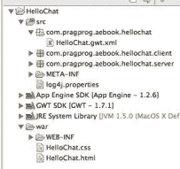

图9.1：Eclipse 中的 GWT 项目目录结构

### 9.2 Java 和 GWT 入门

首先，我们将看到一个类似基本的“Hello, World”程序。用于 Eclipse 的 GWT 工具会自动构建一个项目骨架，这是一个基本的 GWT “Hello, World”程序，所以我们不用自己编写，只需让 Eclipse 来做，然后我们逐步检查各个部分，看看它是如何组合在一起的。在 Eclipse 中，从 File 菜单中选择 New。在弹出的对话框中，选择 New Web Application Project。然后在出现的对话框中填写项目名称和你想用于 Java 代码的 Java 包名称。我选择了 HelloChat 作为项目名称，com.pragprog.aebook.hellochat 作为 Java 包名称。

入门应用会设置一个页面，提示用户输入他们的名字；当用户输入名字时，它会弹出一个对话框来打招呼。

#### GWT 应用程序的结构

GWT 应用程序由一组模块组成。模块是一个 GWT 包，包含 Java 代码、JavaScript、HTML 文件、图像、数据定义，以及 Web 应用程序中需要的任何其他内容。当你在 Eclipse 中创建 GWT/App Engine 项目时得到的目录结构，基于该项目所实现的 GWT 模块的结构。

首先，让我们看一下这个目录结构。你可以在图9.1的 Eclipse 包浏览器中看到这个结构。在 App Engine 项目内部，有一组 GWT 库以及两个主要的目录。

GWT 中的模块可以继承其他模块的内容。它的工作方式很像面向对象的继承。我们的应用程序是 com.google.gwt.user 的子模块，这是具有用户界面的应用程序的标准模块。GWT 的大部分基本功能——UI 小部件、远程过程调用管道，以及基本的服务器端 servlet 基础设施——都是通过这个声明继承的。

GWT 除了在 Java 代码中使用类继承之外，还定义了模块，部分原因在于 GWT 模块中除了代码之外还有很多资源。模块可以包含诸如 CSS 之类的东西。inherit 语句会引入定义我们应用程序中 UI 小部件外观的 CSS 文件。我们可以通过继承不同的样式模块来改变应用程序的外观。

GWT 应用程序的 Java 代码以一个*入口点*开始。入口点，在很大程度上，是 GWT GUI 中相当于 main 函数的东西。在模块文件中，你为希望在 GWT 应用程序中执行的代码声明入口点。在本例中，入口点是 HelloChat 类。

#### 在 GWT 中设置 UI

在 GWT 模块中，用户界面框架由 HTML 文件定义。HTML 文件不被视为源代码，所以它不会被放到 src 目录中。它是一个静态资源——一个包含代码将使用的信息的文件。因此，HTML 文件最终位于 war 目录中。让我们看看它的内容：

```html
<!DOCTYPE HTML PUBLIC "-//W3C//DTD HTML 4.01 Transitional//EN">
<html>
    <head>
        <meta http-equiv="content-type" content="text/html; charset=UTF-8">
        <link type="text/css" rel="stylesheet" href="HelloChat.css">
        <title>Web Application Starter Project</title>
        <script type="text/javascript" language="javascript"
                src="hellochat/hellochat.nocache.js"></script>
    </head>

    <body>
        <h1>Hello World</h1>
        <table align="center">
            <tr>
                <td colspan="2" style="font-weight:bold;">Please enter your name:</td>
            </tr>
```


```html
<tr>
    <td id="nameFieldContainer"></td>
    <td id="sendButtonContainer"></td>
</tr>
</table>
</body>
</html>
```

- 1. HTML 框架文件是一个标准 HTML 文件。它以常见的 HTML 内容开头：doctype 声明以及包含常见 meta 标签的 head 块。
- 2. 这是整个文件中最重要的行！使这个 HTML 文件成为 GWT 应用框架的，正是这一包含行。它会引入将由 GWT 生成的 JavaScript 文件，其中包含我们应用的全部代码。
- 3. 正如我稍后会更详细解释的，你可以使用 HTML 文件中定义的静态结构，或 Java 代码中定义的动态结构，在 UI 中进行布局。对于我们的应用，这个 HTML 框架为主 UI 页面定义了一个静态结构。最简单的方法是使用 HTML 表格。（我们也可以像在 Python 代码中看到的那样使用 CSS 浮动，但如果我们想进行动态布局，最好让 GWT 来处理。）因此，我们设置一个两列表格：一列用于文本输入框，一列用于 Send 按钮。
- 4. HTML 静态结构可以包含静态内容以及静态结构。像往常一样，如果能把静态内容之类的东西与程序逻辑分离，我们就应该这样做。因此，我们在这里使用静态框架插入一行标题，并使用 HTML 表格布局控件使其跨越布局的两列。
- 5. 现在进入有趣的部分。我们在这里做的是在 UI 中创建一个空盒子。`<td>` 标签在 HTML 布局中创建一个盒子，但它是空的——标签内部什么都没有。在我们的 Java 代码中，我们会插入一些内容，并通过其 `id=` 标签引用它。我们以这种方式创建两个盒子：一个用于文本框，一个用于按钮。

现在我们可以看一些代码了。正如我们在上面的模块声明中看到的，这个应用有一个入口点。完整的入口点方法相当长；它同时包含创建 UI 元素、设置事件处理器，以及为客户端/服务器通信设置远程过程调用。我们分段来看。先从构建主 UI 的部分开始——也就是提示用户输入姓名的主页面：

下载 workspace/HelloChat/src/com/pragprog/ebook/hellochat/client/HelloChat.java

```java
    public void onModuleLoad() {
        final Button sendButton = new Button("Send");
        final TextBox nameField = new TextBox();
        nameField.setText("GWT User");

        // We can add names to widgets
        sendButton.addStyleName("sendButton");

        // Add the nameField and sendButton to the RootPanel
        // Use RootPanel.get() to get the entire body element
        RootPanel.get("nameFieldContainer").add(nameField);
        RootPanel.get("sendButtonContainer").add(sendButton);

        // Focus the cursor on the name field when the app loads
        nameField.setFocus(true);
        nameField.selectAll();
    }
```

- 1. 入口点类是一个容器，用于承载 GWT 中相当于 main 函数的内容。从概念上讲，它确实就像非 GUI 工具中的主程序。但在 Java 中，所有内容都必须包含在类里，所以我们必须围绕实际的 main 创建一个骨架类。在典型的 GWT 应用中，这是入口点类上定义的唯一方法——它只是对单个方法的过度复杂包装。真正的 main 函数是入口点的 onModuleLoad 方法。顾名思义，这就是客户端加载 GWT 模块时被执行的内容。在这个方法内部，我们创建 UI 控件、布局它们，并设置事件处理器。
- 2. 在 onModuleLoad 内部，我们做的第一件事是创建 UI 控件。对于基本情况，它看起来很像我们构建非浏览器 UI 时会采用的方式。我们创建一个按钮和一个文本框，用户将在其中输入姓名。
- 3. 事情开始与传统非浏览器 UI 不同的第一处，是控件样式属性的管理。在典型的 GUI 工具包中，针对各种样式属性会有一组可调用的方法。例如，在 Mac OS Cocoa 控件中，我们可以通过类似 [button setGradientType:NSGradientConcaveWeak] 的调用修改按钮的渐变。在 GWT 中，这一切都通过 CSS 完成：我们会设置一个 CSS 属性来为按钮背景创建渐变图像，并在下一节中添加相应代码行。

首先，我们来看对话框，它涉及更多 GWT UI 工作，但对话框没有使用 HTML 文件中的静态布局，而是完全动态的：

下载 workspace/HelloChat/src/com/pragprog/ebook/hellochat/client/HelloChat.java

```java
// Create the popup dialog box
final DialogBox dialogBox = new DialogBox();
dialogBox.setText("Remote Procedure Call");
dialogBox.setAnimationEnabled(true);
final Button closeButton = new Button("Close");
// We can set the id of a widget by accessing its Element
closeButton.getElement().setId("closeButton");
final Label textToServerLabel = new Label();
final HTML serverResponseLabel = new HTML();
VerticalPanel dialogVPanel = new VerticalPanel();
dialogVPanel.addStyleName("dialogVPanel");
dialogVPanel.add(new HTML("<b>Sending name to the server:</b>"));
dialogVPanel.add(new HTML("<br><b>Server replies:</b>"));
dialogVPanel.add(serverResponseLabel);
dialogVPanel.setHorizontalAlignment(VerticalPanel.ALIGN_RIGHT);
dialogVPanel.add(closeButton);
dialogBox.setWidget(dialogVPanel);

closeButton.addClickHandler(new ClickHandler() {
    public void onClick(ClickEvent event) {
        dialogBox.hide();
        sendButton.setEnabled(true);
        sendButton.setFocus(true);
    }
});
```

- 1. 首先，我们需要创建对话框。这是一个弹出窗口，因此它不包含在浏览器框架中。这意味着我们不能只获取 RootPanel；我们需要创建一个独立控件。GWT 为此提供了一个方便的控件：DialogBox 是一个独立的窗口框架，可以嵌入任何 GWT 控件——我们只需创建其内容并插入即可。由于它是一个窗口，所以有标题栏，我们可以使用它的 setText 方法设置其内容。
- 2. 我们希望用户能够随时关闭对话框，因此创建一个 Close 按钮，稍后会将它添加到对话框框架中。像往常一样，我们可以用 CSS 设置控件的属性。在这种情况下，我们直接深入到 HTML 来完成。对于任何控件，我们都可以通过调用 getElement() 获取与该控件对应的 XML 元素。然后设置它的 ID，以便 CSS 样式可以使用该 XML 元素的 setId() 方法引用它。

在 Close 按钮之后，我们又创建了几个控件。有一个 Label，它是一段嵌入控件中的不可编辑文本。然后是一个有趣的东西——HTML 控件，它是一段字面 HTML 文本的包装器。HTML 控件内部的任何内容都会直接渲染到 UI 的 HTML 页面中。这对于嵌入带样式的文本之类的内容很有用，因为通常只需在一段文本周围使用 HTML 标记，就比通过编程式操作来产生相同效果更容易。

- 现在我们要布局一系列元素。由于没有静态 HTML 框架，我们需要使用 GWT 指定如何布局它们。布局只是一堆垂直堆叠的内容。GWT 有一个用于此目的的控件——VerticalPanel。我们只需按顺序将 UI 控件添加到面板中。注意这里的 HTML 标记：有一些文本我们希望以粗体显示。与其创建一个 Label 控件并设置其样式属性来使其加粗，我们可以直接用 `<b>` 标签包裹文本。
- 我们已经将 UI 元素布局在 VerticalPanel 中。我们需要做的只是告诉对话框，该面板就是它应该显示的内容：我们通过设置对话框的控件来完成这一点。现在，这个框的视觉部分都完成了。这个框一开始是不可见的：像这样的独立控件实际上不会出现在用户屏幕上，直到我们显式让它们显示。稍后我们会看到，对于对话框，我们可以通过告诉它应该出现在哪里来实现这一点。大多数情况下，那是在浏览器窗口的中心——因此，对话框将通过调用其 center() 方法变为可见。
- 基本 UI 设置好后，我们终于可以看看如何在 GWT 中处理事件。这与 Java 的 Swing 库中几乎一样。创建一个处理器对象，并使用 addXXXHandler 方法将其绑定到合适的控件上。在这个例子中，我们要绑定的是当用户点击对话框的 Close 按钮时关闭对话框的处理器，因此我们绑定一个 ClickHandler 对象。在其 onClick 方法中，我们让对话框不可见，并启用主页面的输入区域。


### 9.3 GWT 中的 RPC

现在我们进入复杂的部分。

正如我之前提到的，AJAX 代码并不是显式写在 GWT 中的。相反，我们编写一种称为*远程过程调用*（RPC）的东西。RPC 看起来几乎像一个普通的方法调用，但在底层，它会被系统转换为从客户端发送到服务器的请求。RPC 的返回值是服务器发回客户端的响应。

与其他任何 RPC 系统一样，GWT 中也有客户端和服务器端。我们可以分别查看它们的代码；把它们串联起来则取决于 GWT RPC 系统。

如果你做过分布式编程，Google 风格的 RPC 可能并不是你习惯的方式。传统上，RPC 会尽可能表现得像传统函数调用。换句话说，如果我们想为一个阶乘函数提供 RPC，函数实现看起来会像传统函数声明，而调用它看起来也会像传统调用。例如，Java 有一个原生 RPC 层，我们通过接口定义远程对象，然后就可以在接口类型的对象上调用方法。

我们可以把一个阶乘服务定义为 Java 接口：

```java
public interface Fact extends Remote {
    int fact(int n);
}
```

然后在使用它的代码中，我们会获取远程接口的句柄，并像下面这样直接调用它：

```java
int j = f.fact(n);
```

围绕这一点，服务器中会有一些底层连接机制来让该对象可用，以便客户端能获取它的句柄；客户端同样会有代码来取得远程对象的句柄。但调用本身看起来就像普通的本地调用。

这种方法有一个问题：通信很慢。一次远程过程调用很容易比本地调用多花两个数量级的时间。在传统调用中，代码会一直卡住等待，直到收到服务器返回的响应。这会造成巨大的时间浪费，并可能在我们的用户界面中造成不可接受的延迟。

因此，Google 对远程调用使用了一种称为*异步*或*延续传递*风格的方式。调用本身不返回任何内容。相反，它接受一个额外参数，该参数是一个函数，用于在收到 RPC 结果时对结果进行调用。

例如，假设我们有一个阶乘服务。在传统风格中，我们想要做的是：

```java
System.out.println("Foo = " + Math.log(3 * f.fact(n)));
```

在延续传递风格中，那会像这样：

```java
f.fact(n, new AsyncCallback<Integer>() {
    public void onSuccess(Integer result) {
        System.out.println("Foo = " + Math.log(3 * result));
    }
});
```

我所做的只是把原本要使用 RPC 返回值的代码包装进一个可以传给远程调用的对象中。这样做只是启动这个过程。当 RPC 把调用转换为消息、发送消息、等待服务器发送响应，再把响应消息转换回结果值时，我的代码可以转去做其他事情。每当结果返回时，回调就会被调用，调用的结果也会得到处理。

如果你习惯了命令式编程，这可能感觉有点不自然。（函数式程序员一直这么做，即使他们并没有在做分布式编程。）这需要一些时间适应，即使适应了，有时也显得有点别扭。但总的来说，不必等待 RPC 的优势超过了这些问题。它让应用对用户更响应，而这是最重要的。

#### GWT 中的客户端 RPC

无论一个工具包有多好，通信都从来不是简单的事。我们需要能够把参数转换为可以作为消息传递的格式，也需要能够处理网络造成的延迟甚至失败。为了应对这一点，GWT 使用了一种非常 Google 式的惯用法。在 Google，我们有一些非常独特且程式化的方式来处理某些基本问题。特别是，我们有一种使用异步响应处理器来执行远程过程调用的方式。对于没有做过大量 Google 风格分布式编程的人来说，这相当陌生。总的来说，GWT 在让底层管道不可见方面确实非常出色。然而，在这个例子中，他们决定不这么做。

- 3. 这是同步方法声明。服务方法的任何参数都必须扩展 `java.io.Serializable` 或 GWT 特有的变体 `com.google.gwt.user.client.rpc.IsSerializable`。这里非常重要的一点是，GWT 使用 Java 序列化接口来标记将在 RPC 中传递的类，并*不*意味着它使用 Java 序列化。使用 IsSerializable 或 Serializable 只是一个标记，用来告诉 GWT 它需要生成序列化和反序列化该类型的代码。GWT 使用的实际格式甚至与 Java 的标准序列化不兼容。

  方法声明本身完全是标准的：它只是一个普通的接口方法声明。

除了同步接口之外，我们还需要编写一个异步接口。坦白说，这里正是我不明白 GWT 团队为什么没有提供某种自动支持的地方之一。为了生成异步接口，我们只需编写另一个接口，它是对同步接口的纯样板式转换。它必须包含与同步接口中的方法名称完全相同的方法；每个方法必须返回 void；并且每个方法都在末尾添加一个参数，该参数是一个 AsyncCallback，其类型参数是同步方法的返回类型。例如：

下载 workspace/HelloChat/src/com/pragprog/ebook/hellochat/client/GreetingServiceAsync.java

```java
package com.pragprog.ebook.hellochat.client;

import com.google.gwt.user.client.rpc.AsyncCallback;

/**
 * The async counterpart of <code>GreetingService</code>.
 */
public interface GreetingServiceAsync {
    void greetServer(String input, AsyncCallback<String> callback);
}
```

异步接口与同步接口没有任何显式连接，也不必使用任何特殊注解或继承任何特殊类。它实际上只由客户端使用——用于在异步接口和同步接口之间进行映射的实际底层管道由 GWT 生成。异步接口的唯一目的是提供客户端将使用的调用接口。

#### GWT 中的服务器端 RPC

GWT RPC 的服务器端简单得令人惊讶。我们只需用一个扩展 RemoteServiceServlet 的类来实现同步客户端接口。对于我们的问候服务，该实现如下：

下载 workspace/HelloChat/src/com/pragprog/ebook/hellochat/server/GreetingServiceImpl.java

```java
package com.pragprog.ebook.hellochat.server;
import com.pragprog.ebook.hellochat.client.GreetingService;
import com.google.gwt.user.server.rpc.RemoteServiceServlet;

/**
 * The server-side implementation of the RPC service.
 */
@SuppressWarnings("serial")
public class GreetingServiceImpl extends RemoteServiceServlet implements
        GreetingService {

    public String greetServer(String input) {
        String serverInfo = getServletContext().getServerInfo();
        String userAgent = getThreadLocalRequest().getHeader("User-Agent");
        return "Hello, " + input + "!<br><br>I'm running " +
                serverInfo + "<br><br>It looks like you are using:<br>" +
                userAgent;
    }
}
```

@SuppressWarnings 注解有点不寻常。它存在的原因是，后续几代 Java 虚拟机中的序列化会为每个类文件使用版本标识符。如果我们有一个实现了 `java.io.Serializable` 的类，却没有为它提供版本标识符字段，Java 就会生成警告。服务实现总是实现 Serializable，因为 RemoteServiceServlet 继承自标准的 servlet 类，而该类实现了 Serializable。由于 GWT 不使用版本标识符，把它包含在代码中只会成为无意义的杂乱内容；该注解可防止编译器生成令人困惑的警告信息。

这就是我们在服务器端需要做的全部工作。当然，当我们想使用数据存储进行持久化时，情况会变得更复杂。但我们会把那个留到下一章。

所以现在，我们的 hello 应用已经具备了完整的 RPC。它比我们之前在 Python 中做 AJAX 的方式干净得多：我们有一个定义良好的接口，只需进行一次方法调用就能调用它。我们不必担心创建 XmlHTTPRequests、解析参数、检查状态码，或我们在 Python 中需要做的任何杂乱且容易出错的事情。


### 9.4 使用 GWT 进行测试与部署

现在我们已经有了一个基本的 GWT 应用，接下来运行它。和在 Python 中一样，在 App Engine 中运行 GWT 应用有两种方式：本地模式，应用在你的机器上运行；部署模式，应用在 App Engine 云端运行。

GWT 中的本地模式与 Python 中的本地模式非常不同。在 Python 中，本地模式适合在不部署的情况下进行测试，但它并没有真正提供同等水平的调试支持。但在 GWT 中，本地模式下客户端和服务器都用 Java 运行，我们可以使用 Eclipse 的全部能力来调试 GWT 应用。这带来了巨大差别：我们可以完全使用断点、跟踪、单步执行以及所有其他 Java 调试工具。

要在 Eclipse 中以本地模式运行，请转到 Run 菜单并选择 Run As.../Web Application。GWT 会打开一个本地模拟浏览器环境来显示客户端，并启动本地 Tomcat Web 服务器来执行服务器端。

要将其部署到 App Engine，请转到 Package Explorer 视图并右键单击项目。在弹出的项目菜单中有一个 Google 子菜单。只需选择 Deploy to App Engine，你的程序就会在 App Engine 云端上线。如果它需要关于该项目的任何信息，会在你第一次运行部署命令时提示你填写。

我们完成了第一个基础 GWT 应用。它目前还不如我们的 Python 聊天应用功能完整，但它有更好的 UI 和更清晰的通信层。在下一章中，我们将运用学到的 GWT 知识来构建聊天应用的 Java 版本。在此过程中，我们将了解数据存储的 Java 接口，以及 GWT 对服务器端 Java 代码施加的限制。

## 第10章：管理服务器端数据

在前几章中，我们考察了 App Engine 中一个基础 GWT 应用的各个部分。我们构建了 GUI，设置了一个简单的 RPC，并把所有基础连接串接起来，让应用运行起来。在本章中，我们将使用 GWT 实现聊天程序。我们不会花太多时间研究如何构建 GUI——已有整本的书讲解如何在 GWT 中构建 GUI，而且 GWT 自己关于其 UI 类的文档非常出色。我们将把大部分时间花在 *数据存储* 上，它是在 App Engine 中处理持久化数据的机制。就像在 Python 中一样，我们需要做一些额外工作，使类可持久化并且可查询。现在我们将看看如何使用 Java 做到这一点。

我们还会简要讨论 App Engine Java 端服务器端基础连接的一些其他问题。具体来说，App Engine 对代码能做什么以及如何在 App Engine 云端环境中运行施加了一些限制，我们将考察这些限制是什么，以及它们对我们编写 App Engine 应用服务器端的方式有什么影响。

### 10.1 Java 中的数据持久化

如果你回头看看第 4 章 *在云端管理数据*（第 53 页），就会记得我们需要在 Python 代码中做一些额外工作来存储数据，并让一切在云端正确运行。Java 中也是如此。不幸的是，这正是 Java 的静态类型使事情变得有些繁琐的地方之一。App Engine 使用的基本后端数据存储与 Python 中完全相同，但让它与 Java 配合工作需要多花一点心思。这并不困难，只是我们需要在代码中加入更多样板代码。像往常一样，Eclipse 可以为我们处理其中大量工作。不过，我们还是先在不借助 Eclipse 帮助的情况下开始吧。我们将手写所有内容，以便理解所有细节。

以典型的 Google 风格，App Engine 让数据存储与 Java 配合工作的方式是：采用一个标准 Java API——Java Data Objects（JDO）——并挑选出其功能中一个有用的子集。JDO 是一个极其复杂、臃肿的 API（标准通常如此）。但它其中有一个不错的精华内核。App Engine 使用的正是这个内核。

下面，我们将了解 JDO 持久化如何用于描述持久化对象，以及如何存储、查询和检索它们。

#### 存储 Java 类

在 Python 的数据存储接口中，我们通过向类对象添加属性来创建持久化类。在 Java 中，我们会做类似的事情——但在 Java 中，属性是通过在类声明中使用注解来添加的。用示例来描述最容易，因此我们将拿聊天消息并将其转换为一个数据对象：

下载 `workspace/PortalChat/src/com/progprog/aebook/persistchat/ChatMessage.java`

```java
package com.progprog.aebook.persistchat;

import java.util.Date;

import javax.jdo.annotations.IdGeneratorStrategy;
import javax.jdo.annotations.IdentityType;
import javax.jdo.annotations.PersistenceCapable;
import javax.jdo.annotations.Persistent;
import javax.jdo.annotations.PrimaryKey;

import com.google.appengine.api.datastore.Key;

@PersistenceCapable(identityType = IdentityType.APPLICATION)
public class ChatMessage {

    public ChatMessage() {
    }

    public ChatMessage(String sender, String msg, String chatname) {
        this.senderName = sender;
        this.message = msg;
        this.chat = chatname;
    }

    @PrimaryKey
    @Persistent(valueStrategy = IdGeneratorStrategy.IDENTITY)
    private Key key;

    @Persistent
    protected String senderName;

    @Persistent
    protected String message;

    @Persistent
    protected String chat;

    @Persistent
    protected long date;

    public Key getKey() {
        return key;
    }

    public String getSenderName() {
        return senderName;
    }

    public void setSenderName(String senderName) {
        this.senderName = senderName;
    }

    public String getMessage() {
        return message;
    }

    public void setMessage(String message) {
        this.message = message;
    }

    public String getChat() {
        return chat;
    }

    public void setChat(String chat) {
        this.chat = chat;
    }

    public long getDate() {
        return date;
    }

    public void setDate(long date) {
        this.date = date;
    }
}
```

让我们更仔细地看看这个示例：

- 1. 要让 Java 对象存储在 App Engine 数据存储中，其类必须声明为持久化类。在 JDO 中，通过附加 `@PersistenceCapable` 注解来完成。在完整的 JDO 中，我们需要声明身份类型。App Engine 仅支持 `IdentityType.APPLICATION`，但由于 Java 的类型系统要求注解与其声明匹配，因此该字段必须始终声明。

  为了能够存储、检索或搜索特定对象，对象必须有一个用于标识它的唯一键。在 Python 中，当我们定义持久化对象时，框架会自动添加一个数据存储使用的不可见键字段。在 Java 中，一切都必须静态声明。因此，我们需要在源代码中手动插入键声明，并将其注解为键。我们使用 `@PrimaryKey` 注解将其标记为键，并通过 `@Persistent` 注解的 `valueStrategy = IdGeneratorStrategy.IDENTITY` 属性告诉它，比较主键的方式是对象标识。

- 2. 持久化对象中每个应存储的字段都需要用 `@Persistent` 注解。

Java 中的数据对象有一些限制。它们大多是为了让错综复杂的对象指针保持可管理状态的要求：

- 当一个持久化对象将另一个持久化对象作为字段包含时，它就拥有该对象，并且不允许任何其他持久化对象引用该被拥有的对象。这意味着我们有时需要保存对象。
- 当一个持久化对象包含其他持久化对象的集合时，它拥有该集合中的所有对象。
- 我们仅限于使用 Java 的基本集合类。我们不能使用数组，也不能使用任何扩展集合类型。我们可以使用 ArrayList、LinkedList、HashSet、TreeSet、Stack 和 Vector 等具体类。我们也可以使用更抽象的接口，比如 List，但当我们保存并重新加载一个对象时，无法保证恢复后的对象中列表类型仍然相同

对象（这意味着我们可能保存了使用 LinkedList 的某些内容，却取回使用 ArrayList 的某些内容）。由于这可能产生相当显著的性能影响，我建议为 JDO 字段显式使用具体集合类型。

- 我们可以通过在数据对象上标注 `@Persistent(serialized=true)` 来使用 Java 可序列化类型。请注意，它们的行为与通常对 Java 的预期略有不同。例如，假设某个持久对象的列表字段中有某个可序列化对象的两个副本。如果我们保存该对象再加载它，这两个副本不保证 `==`，而它们是否 equals() 取决于我们类的 equals() 方法如何实现。
- String 类型的字段不允许超过 500 字节。我们可以使用 datastore 包中的 Text 类为该字段存储更长的字符串，但将无法基于该字段的值执行查询。
- 如果我们不使用 Eclipse，就需要添加一个名为 _代码增强_ 的额外编译步骤。在增强期间，App Engine JDO 实现会根据持久化注解向类添加代码，使这些类能够被数据存储保存和查询。我们需要确保每次重新编译 Java 源码时都执行增强过程。（Eclipse 会自动将 JDO 增强纳入项目构建，因此无需担心——这也是使用 Eclipse 的又一个理由！）

### 10.2 在 GWT 中存储持久对象

在 Python 中，将内容存储到数据存储中非常简单。我们创建一个持久对象，然后调用它的 put 方法。转眼间！——它就存好了。在 Java 中，我们需要多做一点工作。同样，这有点像是静态样板代码。Java 为我们提供了很多优势，但确实需要多得多的样板代码。

为了能够存储和检索对象，我们需要一个称为 PersistenceManagerFactory 的东西。该工厂的创建成本很高，我们不想每次处理请求时都重新初始化它；相反，我们将其设置为当应用加载到 App Engine 云中的服务器时创建。并且我们希望在一个集中且合适的位置创建它，以确保任何需要 PersistenceManager 的人都知道在哪里找到该工厂的唯一实例。对此有一个自然的解决方案——单例设计模式。我们将创建一个单例类，它以静态方式创建 PersistenceManager 的单个实例，然后任何需要它的人都可以访问该实例。

下载 `workspace/PersistChat/src/com/pragprog/ebook/persistchat/server/Persister.java`

```java
package com.pragprog.aebook.persistchat.server;

import javax.jdo.JDOHelper;
import javax.jdo.PersistenceManager;
import javax.jdo.PersistenceManagerFactory;

public final class Persister {

    private static final PersistenceManagerFactory pmfInstance =
        JDOHelper.getPersistenceManagerFactory("transactions-optional");

    private Persister() {}

    public static PersistenceManagerFactory get() {
        return pmfInstance;
    }

    public static PersistenceManager getPersistenceManager() {
        return get().getPersistenceManager();
    }
}
```

现在，任何需要使用持久化管理器的客户端代码只需调用 Persister.getPersistenceManager()。有了持久化管理器，我们可以通过调用 PersistenceManager.makePersistent() 来存储对象，然后调用 PersistenceManager.close()。

这比 Python 的 o.put() 调用麻烦得多：我们需要设置持久化管理器工厂、分配一个 PersistenceFactory，并在完成后调用 close()。幸运的是，这样做有好处。通过 PersistenceFactory 的接口提供了对事务的支持。从我们分配持久化管理器开始，直到调用其 .close() 方法为止，我们所做的一切都是一个原子单元的一部分——也就是说，要么全部成功，要么全部失败。我们存储的每个对象、对持久对象所做的每次更改，要么全部存储，要么全都不存储。这就是事务的美妙之处：我们获得了关系数据库的安全性和保障。样板代码可能看起来烦人，但它有优点。

我们已准备好发布新消息。我们需要创建一个 RPC 服务，客户端通过它告诉服务器何时有要发布的新消息。（再次值得指出的是，在 GWT 中我们将 post 操作实现为异步 RPC——就我们程序的操作而言，它确实如此——而不是陷入 XMLHttpRequest 的混乱之中。）我们的 RPC 服务需要两个方法：一个用于发布新消息，一个用于获取消息。基本接口如下所示：

#### 事务

当你与任何人谈论分布式应用时，你会不断听到 *事务性*。原因如下。

事务性可以防止数据损坏。没有事务性，如果你在存储某些内容时被中断——因为网络故障或所涉某台计算机崩溃——你的数据存储可能最终处于不一致状态。

例如，假设你正在编写一个在线商店。你创建一条订单记录，指示发货部门向客户发货；然后创建一条计费记录，告诉银行如何收取该订单的付款。如果你的系统在存储发货记录和存储计费记录之间崩溃，你可能发出产品却从未收到付款！

你希望这两个步骤是 *原子性* 的，这意味着要么两者都成功存储，要么两者都不存储。所有内容都成功存储或什么都不存储的原子单元称为 *事务*。

Java 数据存储提供了一种将多个存储操作收集到单个事务中的方法。

下载 workspace/persistchat/src/com/pragprog/aebook/persistchat/client/ChatSubmissionService.java

```java
package com.pragprog.aebook.persistchat.client;
import java.util.Date;
import java.util.List;
import com.google.gwt.user.client.rpc.RemoteService;
import com.google.gwt.user.client.rpc.RemoteServiceRelativePath;
import com.pragprog.aebook.persistchat.ChatMessage;

@RemoteServiceRelativePath("chat")
public interface ChatSubmissionService extends RemoteService {
    List<ChatMessage> postMessage(ChatMessage message);
    List<ChatMessage> getMessages(String room);
    List<ChatMessage> getMessagesSince(String chat, Date timestamp);
}
```

我们像往常一样将其转换为异步接口：

```java
package com.pragprog.aebook.persistchat.client;

import java.util.Date;
import java.util.List;

import com.pragprog.aebook.persistchat.ChatMessage;
import com.google.gwt.user.client.rpc.AsyncCallback;

public interface ChatSubmissionServiceAsync {
    void postMessage(ChatMessage message,
        AsyncCallback<List<ChatMessage>> callback);

    void getMessages(String chatroom,
        AsyncCallback<List<ChatMessage>> callback);

    void getMessagesSince(String chat, Date timestamp,
        AsyncCallback<List<ChatMessage>> callback);
}
```

我们通过 server 包中的一个类来实现它。实现非常直接。我们使用刚刚实现的 Persister 来获取用于该操作的 PersistenceManager，使消息对象持久化，以便它作为事务的一部分被保存，然后关闭持久化管理器，这将执行事务。最后，我们使用另一个服务方法（直接从服务器调用）来向用户提供聊天中消息的更新列表。

```java
public List<ChatMessage> postMessage(ChatMessage message) {
    PersistenceManager persister = Persister.getPersistenceManager();
    persister.makePersistent(message);
    persister.close();
    return getMessages(message.getChat());
}
```

如果我们想将任何其他对象作为与聊天消息同一事务的一部分保存，只需在调用 close 之前添加更多 makePersistent 调用来存储它们。


与存储相比，检索更需要 try...finally 块，因为当你开始一个事务来存储某些内容时，你通常已经知道要存储的所有东西，所以几乎不会进行任何可能产生错误的计算。即便真的发生了错误，你也不会希望事务被 close() 提交！但在检索时，你往往会迭代式地处理：你检索一个对象，它为你提供识别其他想检索对象所需的信息。因此，try...finally 块的安全性对于检索来说非常重要。

大多数时候——尤其是对于我们的聊天应用而言——我们会使用 JDOQL 查询来描述要从数据存储中检索的内容。要检索某个特定聊天室的所有聊天消息，JDOQL 查询是这样的：

```text
select from ChatMessage
where chat=desiredRoom
parameters String desiredRoom
order by date
```

我们的 JDOQL 查询（事实上，大多数 JDOQL 查询）由四个部分组成：

- **select from ChatMessage**：select 子句指定了查询中要搜索的对象集合。它看起来很像 SQL 查询中的 select 子句，所做的事情也基本相同。SQL 查询会选择一组与某个过滤器匹配的表行，select 子句指明从哪张表中选择。JDOQL 查询会选择一组与某个过滤器匹配的对象，select 子句指明从哪个类中选择。我们想要检索一组 ChatMessage 对象，所以从 ChatMessage 中选择。
- **where chat=desiredRoom**：where 子句与 SQL 中的非常相似：它提供一个谓词（也就是一个仅对我们想要检索的对象为真的表达式）。我们想要检索来自某个特定房间的消息。而要检索消息的房间的实际值，是一个名为 desiredRoom 的参数。
- **parameters String desiredRoom**：parameters 子句在 SQL 中没有对应物，但按理说应该有。在大多数 SQL 库中，我们不得不使用一些非常痛苦且笨拙的语法来指定参数。而在 JDOQL 中，parameters 子句声明了一个带类型变量的列表，无论这些变量出现在查询字符串中的哪个位置，它们都会被查询调用时传入的参数值所替换。所以我们说 desiredRoom 是一个 String 类型的参数。
- **order by date**：order by 子句与 SQL 中的相同：它指定查询所选对象应以什么顺序返回。我们希望按照聊天消息的发布时间顺序来查看它们，所以按日期排序。

JDOQL 还有一种替代语法：不用字符串来写查询，而是以编程方式组合查询。在下面的代码中，我们将使用编程式版本。

```java
@SuppressWarnings("unchecked")
public List<ChatMessage> getMessages(String chat) {
    PersistenceManager persister = Persister.getPersistenceManager();
    try {
        Query query = persister.newQuery(ChatMessage.class);
        query.setFilter("chat == desiredRoom");
        query.declareParameters("String desiredRoom");
        query.setOrdering("date");
        return (List<ChatMessage>)query.execute(chat);
    } finally {
        persister.close();
    }
}
```

这段代码相当直截了当。@SuppressWarnings 是 Java 处理类型化列表方式的一种产物；由于 Java 使用一种称为类型擦除（type erasure）的机制来简化类型化集合的编译，因此它无法验证到类型化列表的转换是否有效。既然编译器无法保证你没有犯错，它就会生成一个警告，让你知道可能存在错误。@SuppressWarnings 注解基本上是在告诉编译器：“闭嘴，我知道自己在做什么。”除了这个小变化之外，这和我们上面看到的查询完全相同，只是转换为编程式形式而已。这种方式更好，因为它将查询的不同元素分离开来，使代码更易于理解。

### 10.4 将客户端与服务器粘合在一起

现在，我们只需要告诉 App Engine 如何将客户端和服务器端代码粘合在一起，这样聊天应用客户端就可以调用 RPC 方法，从而在数据存储中存储和检索消息。这是通过 App Engine 的 web.xml 来完成的，该文件位于我们 App Engine 项目的 war/WEB-INF 目录中。这个文件声明了应用程序中的各个 servlet，告诉 App Engine 在服务器端如何部署它们，并告诉 GWT 如何找到它们。

```xml
<?xml version="1.0" encoding="UTF-8"?>
<!DOCTYPE web-app
    PUBLIC "-//Sun Microsystems, Inc.//DTD Web Application 2.3//EN"
    "http://java.sun.com/dtd/web-app_2_3.dtd">

<web-app>

    <!-- Servlets -->
    <servlet>
        <servlet-name>chatServlet</servlet-name>
        <servlet-class>com.programmableweb.persistchat.server.ChatServiceImpl</servlet-class>
    </servlet>

    <servlet-mapping>
        <servlet-name>chatServlet</servlet-name>
        <url-pattern>/chat</url-pattern>
    </servlet-mapping>

    <!-- Default page to serve -->
    <welcome-file-list>
        <welcome-file>Chat.html</welcome-file>
    </welcome-file-list>

</web-app>
```

- **1.** 告诉 App Engine 应用程序运行需要在服务器上部署哪些 servlet。每个 servlet 都会被赋予一个名称，该名称与实现该 servlet 的类相关联。
- **2.** 对于 servlets 部分中指定的每个 servlet，告诉 App Engine 应用程序应在哪个 URL 上运行该 servlet。

在本章中，我们构建了聊天应用的基础设施：我们有了用于发起 RPC 来发布新聊天消息和检索消息的客户端接口。我们使用 App Engine 面向数据存储的 JDO 接口，构建了 RPC 方法的 servlet 实现。通过这样做，我们学习了如何从数据存储中存储和检索对象的基础知识。

在下一章中，我们将回到用户界面，看看如何利用刚刚构建的 RPC 服务，为我们的聊天应用打造一个真正美观的 GUI。在此过程中，我们将探索可用的 GUI 控件。我们将会介绍如何在 GWT 中创建 GUI 布局、如何在不进行整页刷新的情况下更新 UI 中显示的数据，以及如何响应用户操作。最后，我们还会探讨一些更复杂的数据存储使用方式。数据存储可以让你做很多非常有趣的事情，但它也有一些相当特殊的限制。我们将深入探讨数据存储的强大之处及其局限性。

### 10.5 参考资料与资源

- **Java 数据存储 API**：[http://code.google.com/appengine/docs/java/datastore/](http://code.google.com/appengine/docs/java/datastore/)  
  App Engine Java 数据存储的官方文档。
- **Java 数据对象（JDO）**：[http://java.sun.com/jdo/](http://java.sun.com/jdo/)  
  JDO 标准文档。JDO 是 App Engine 数据存储 Java 接口所基于的基础技术。
- **Java 持久化 API——一种更简单的实体持久化编程模型**：[http://java.sun.com/developer/technicalArticles/J2EE/jpa/](http://java.sun.com/developer/technicalArticles/J2EE/jpa/)  
  一篇概述 App Engine 所使用的 Java 持久化 API 的文章。

## 使用 Java 构建用户界面

现在，我们已经了解了使用 Java 在 Google App Engine 中开展工作的一些基础知识。我们学习了如何使用数据存储进行持久化的基础知识，并研究了如何使用 GWT 构建完整 Java 云应用的总体结构。在本章中，我们将更详细地探讨如何使用 GWT 为云应用构建用户界面。

### 11.1 为什么使用 GWT？

在深入探讨之前，有必要指出：使用 Java 构建 App Engine 服务并不需要 GWT。你可以使用任何你喜欢的 Java Web 应用开发框架——只要符合 App Engine 运行时施加的少数限制即可。（在 App Engine 中运行的 Java 程序不能使用线程、锁或可运行对象，这可能会带来一些限制。）

不过，大多数常见的基于 Java 的 Web 框架你都可以使用。你可以使用标准的 servlet 环境、Struts，甚至 Grails。GWT 并不是 App Engine 的必要组成部分，那我为什么还要重点介绍它呢？

答案有一部分仅仅是因为我喜欢它。我尝试过很多用于构建 Web 和云应用的不同工具包。我的经验是，GWT 绝对是其中最好的。那些最令人头疼的地方、最容易引发大麻烦的地方，GWT 都会通过一个经过充分测试的标准代码生成器来自动处理。

让我再稍微展开说明一下。GWT 为你所做的是，让编写云应用的用户界面变得像编写传统应用的用户界面一样自然。它为你提供了测试和


调试，使得即使你的代码跨越不同语言之间的边界——比如你的 Java 服务器和客户端 UI（后者实际上运行在 JavaScript 或 HTML5 中）——也很容易调试。

而这就是 GWT 最有价值的地方。你看，云计算编程总体上最大的问题在于测试和调试既痛苦又困难。在云应用中，你需要处理客户端程序（HTML + JavaScript），还要处理服务器实现所用的任何编程语言，以及 XML 和 HTTP。这带来了大量复杂性。但这还不是最糟糕的。你不仅需要处理这些语言：还需要处理它们之间的边界。你不仅需要在客户端编写 JavaScript 代码；还需要编写知道如何生成 HTTP 请求、如何解析 XML 响应并根据它们生成 JavaScript 对象的 JavaScript 代码。你的服务器不仅需要具有执行其基本操作的代码：还需要知道如何解析 HTTP 请求，以弄清客户端希望它执行什么操作，并且需要获取该操作的结果并将其转换为 XML。而且客户端和服务器必须对请求、响应和 XML 编码究竟是什么达成完全一致。代码任何部分出现问题——尤其是语言之间边界区域的代码——都可能导致微妙、难以发现的问题。我不知道自己一生中有多少小时浪费在追踪由 XML 格式或 HTTP 消息头中的琐碎错误所导致的错误上。

GWT 最重要的地方并不在于它让你像使用原生 UI 工具包那样使用控件来编写 UI。这确实很好也很有价值。但更重要、更有价值的是，GWT 处理了这些边界：你用 Java 编写所有代码，而 GWT 负责把 Java 转换为 XML、HTTP、JSON、JavaScript、HTML 和 CSS，并生成在这些边界之间架桥的代码。所有这些事情仍然在幕后进行——但有了 GWT，你不需要处理它们。你不会遇到那些边界问题，而你将节省的时间和精力是惊人的。

### 11.2 使用控件构建 GWT UI

现在该使用 GWT 构建我们自己的 UI 了。我们将拿聊天应用来构建与之前在 Python 中构建的相同基本 UI，这次使用 GWT。首先，我们会专注于真正的 UI 方面——除非必要，我们将忽略应用逻辑，专注于呈现。这就是构建基于 GWT 的 App Engine 服务的典型方式：你先弄清楚希望服务做什么。正如上一章所做的那样，弄清楚你想操作的基本数据以及需要哪些类型的 RPC 调用。然后坐下来使用 GWT 把 UI 组装起来。

像大多数 UI 工具包一样，在 GWT 中，你使用 *控件*。控件是用户界面的基本元素。对于你熟悉的所有基本常见用户界面元素，都有相应的控件：文本框、按钮、单选按钮、下拉框、菜单等。还有用于管理布局的 *容器控件*。正如我之前所说，这整套结构是使用 GWT 的重要原因之一：你不需要担心如何编写 CSS 来让 UI 布局生效。你不需要弄清楚如何设置所有 JavaScript 来绘制 UI。你用控件——包括容器控件——构建 UI，然后让 GWT 完成工作。你可以专注于做什么，而不是怎么做。

在传统 GUI 工具包中，你从一个窗口开始，把控件放在其中。使用 GWT 时，你是把应用放入网页，再把控件放入网页中。因此，在 GWT 中，起点是一个 HTML 页面。你可以在基本页面中放入任何想要的 HTML；事实上，如果你愿意，几乎可以使用 HTML 完成所有 GUI 布局。回到第 9 章 *Google App Engine 与 Java*（第 123 页），我们确实使用 HTML 完成了基本布局。但你不必那样做：你可以使用一个完全空白的 HTML 页面，只用 GWT 完成所有布局。这就是本章要做的事情。我们仍然需要一个 HTML 页面——加载云应用的唯一方式是通过网页。因此，我们将使用如下所示的最小骨架页面。它所做的只是设置加载 GWT UI 的链接，使用 `<link>` 标签加载 CSS，使用 `<script>` 标签加载 UI 代码。

因此，我们从一个 HTML 页面开始。为了告诉 App Engine 哪个页面是我们应用的主框架，我们像上一章那样编辑 `web.xml` 文件。我们希望应用的主页面名为 `Chat.html`，因此只需编辑 `welcome-file-list` 条目：

```html
<welcome-file-list>
  <welcome-file>Chat.html</welcome-file>
</welcome-file-list>
```

一旦系统知道哪个页面提供应用框架，我们就可以通过创建 Chat.html 页面来设置该框架：

下载：workspace/PersistChat/war/Chat.html

```html
<!DOCTYPE HTML PUBLIC "-//W3C//DTD HTML 4.01 Transitional//EN">

<html>
  <head>
    <meta http-equiv="content-type" content="text/html; charset=UTF-8">

    <link type="text/css" rel="stylesheet" href="Chat.css">

    <title>AppEngine Chat</title>

    <script type="text/javascript" language="javascript"
        src="persistchat/persistchat.nocache.js">
    </script>
  </head>

  <body>
  </body>
</html>
```

这个页面没什么内容；它是一个非常精简的文件。主体完全是空的：我们将使用 GWT 中的动态布局代码完全填充它。重要的地方如下：

- 指向应用 .css 页面的链接。通常，CSS 和 HTML 文件会使用相同的名称，因此 CSS 是 Chat.css。
- 一个 script 标签，用于加载 GWT 生成的 JavaScript 代码。

页面已经作为应用框架就位，我们可以开始真正的工作了。我们的聊天 UI 中需要什么？让我们看看之前在第 104 页图 7.2 中整理的原型图。顶部有一个标题栏；标题栏下方有一个包含当前时间和日期的副标题栏；然后有一个包含聊天列表的框和一个包含聊天消息的框，二者并排。在这些框下方是输入框，我们可以在其中输入新消息，以及一个用于发送消息的按钮。

在 GWT 中，我们可以完全按照刚才描述的方式来设置。UI 的基本结构是垂直布局：顶部框包含标题和副标题，中间框包含聊天列表和聊天消息，底部框包含文本输入。我们想编写 GWT 代码来设置这些控件，并将它们排列到我们的 UI 中。

在 GWT 中，客户端应用总是从调用应用主类的 onModuleLoad 方法开始。onModuleLoad 基本上就是 GWT 应用的主函数；而且由于 GWT 应用需要做的第一件事就是设置其用户界面，所以把 UI 构建代码就放在那里。在本节的剩余部分，我们将逐步构建 onModuleLoad 的实现。

我们将从创建 UI 的基本框架开始：

下载 workspace/PersistChat/src/com/progprog/aebook/persistchat/client/Chat.java

```java
final VerticalPanel mainVert = new VerticalPanel();
final VerticalPanel topPanel = new VerticalPanel();
final HorizontalPanel midPanel = new HorizontalPanel();
final HorizontalPanel bottomPanel = new HorizontalPanel();
mainVert.add(topPanel);
mainVert.add(midPanel);
mainVert.add(bottomPanel);
```

- 1. 为了用一系列堆叠的 UI 元素设置 UI，我们必须创建一个 Panel 控件，并把其他元素插入其中。首先，我们创建一个 VerticalPanel，它是 UI 的主要元素。
- 2. 现在，我们想创建 UI 的垂直元素。我们有三部分。顶部有一个用于垂直堆叠标题栏和副标题的元素，因此那是另一个 VerticalPanel。中间将有两个并排的元素（聊天列表和聊天记录），因此那将是一个 HorizontalPanel。最后，底部将有输入框和发送按钮——同样并排——因此那是另一个 HorizontalPanel。

现在，我们想把标题和副标题放入顶部面板：

下载 workspace/PersistChat/src/com/progprog/aebook/persistchat/client/Chat.java

```java
final Label title = new Label("AppEngine Chat");
final Label subtitle = new Label(new Date().toString());
title.addStyleName("title");
topPanel.add(title);
topPanel.add(subtitle);
```

- 1. 在顶部面板中，我们将要放入两个控件，它们都只显示一些文本。将文本放入 GWT UI 的最简单方法是使用 Label 控件。我们为标题和副标题都创建 Label 控件。由于它们是被动的且不会变化，我们可以在创建它们时直接把文本放入其中。


- 2. 副标题组件的内容只是纯文本。但对于标题，我们希望让它看起来不同：标题应该比其下方的文本更大、更粗。

大多数 UI 工具包都提供某种管理样式的方式，用来设置文本大小、字体、颜色等。但我们已经见过在 Web 环境中做到这一点的方法。CSS 是一种非常好且灵活的样式属性管理方式。为什么要重复造轮子？GWT 没有定义用于处理样式的新 API，而是使用 CSS。你不需要写很多：GWT 为其组件提供了看起来不错的默认样式。但当你想自定义某些内容时，可以使用 CSS 指定属性。在应用程序的 CSS 文件中编写所需样式的 CSS，然后通过调用 `addStyleName("style")` 告诉 GWT 为某个组件使用特定样式。我们会将样式 apptitle 放到标题标签上。（有 `setStyleName`，但它会清除与该组件关联的所有其他样式属性。GWT 会自动设置许多属性以使组件外观正确，而你不希望清除这些属性。`addStyleName` 只是将你的样式添加到 CSS 层叠中，因此它仍然会继承除你明确设置的那些属性之外的所有样式属性。）稍后我们会说明将 CSS 放在哪里。

- 3. 创建组件后，需要将它们添加到各自的面板中。

在上面的代码中，我们调用了 `addStyleName` 来更改包含应用程序标题的标签组件的外观。我们所做的是插入对某个 CSS 样式的引用。这就是我们使用 GWT 更改应用程序组件样式的方式。GWT 在设置有吸引力的默认值方面做得很好，但在任何真实应用中，总会有需要自定义的地方。CSS 是实现这一点的好方法：CSS 以标准方式提供了一整套样式属性，并且借助 CSS 的层叠结构，很容易为应用程序设置通用样式并在必要时进行自定义。

我们将更改几个样式，但基本模式始终相同。在 Java 代码中，我们为想要更改样式的元素添加一个 CSS 类属性；然后在 CSS 文件中，为该类编写一个类条目。以下是我们添加到默认 CSS 中的内容：

```css
.title {
    font-size: 4em;
    font-weight: bold;
    color: #4444FF;
}

.messages {
    background: #AAAAFF;
}

.emphasized {
    font-weight: bold;
    background: #FFFFFF;
}
```

我们创建三个样式类。我会稍微详细地描述第一个，另外两个应该不难理解。第一个 CSS 类是我们刚刚创建的标题标签对应的类。我们希望标题文本大而粗，并带有彩色背景。因此，在我们的 CSS 类中，我们更改其 font-size 属性使其变大；更改其 font-weight 属性使其变粗；并修改其 background 元素以更改背景颜色。

就是这样；我们更改了样式。

我们还需要设置另外两个子面板的内容。基本机制与我们刚刚看到的类似，但我们使用了一些更有趣的组件。聊天列表面板特别有趣，因为其内容是一组动态生成的链接，具体取决于哪些聊天可用。这有点复杂，所以我们稍后再回来讨论；首先，让我们完成查看其他子面板的基本布局。以下是中间面板的基本布局代码：

```java
final VerticalPanel chatList = new VerticalPanel();
chatList.setBorderWidth(2);
final Label chatLabel = new Label("Chats");
chatLabel.addStyleName("emphasized");
chatList.add(chatLabel);
chatList.setWidth("10em");
populateChats(chatList);
// "TextArea text" is defined as a field of the class, so that
// the textarea can be referenced by handler methods.
text = new TextArea();
text.addStyleName("messages");
text.setWidth("60em");
text.setHeight("20em");
midPanel.add(chatList);
midPanel.add(text);
```

- 1. 我们将把聊天列表放在左侧的一列中，因此创建一个垂直面板。然后通过将其边框宽度设置为 2 给它一个可见边框，并在其顶部放一个标签。

- 2. 像之前一样，我们将更改聊天列表上标签的样式。这一次，我们将使用样式 emphasized，其定义可以在上面的 CSS 中看到。

- 3. 通常，GWT 会根据面板内部最大内容的大小为面板选择默认大小。我们希望能有更多控制，因此将其宽度显式设置为 10 ems。10 ems 这个数字看起来随意，但并非如此。显示聊天记录的文本区域将是 60 ems，因为这个宽度能整洁地容纳大多数消息。在尝试不同大小后，将聊天列表设为聊天记录宽度的六分之一外观最佳。再窄一些会显得别扭、瘦长；再宽一些则会在窗口左侧留下过多空白。

- 4. 要填充聊天列表的内容，我们需要设置一些 RPC 和回调；在我们构建基本 UI 布局的这里内联放置这些内容，往好了说也会很别扭，而且会违反我们关注点分离的原则。UI 布局是一个关注点；RPC 和事件处理是另一个关注点。因此我们只调用完成该工作的代码。我们稍后会查看它。

- 5. 最后，我们创建文本区域。将其宽度设置为 60 ems，高度设置为 20 ems。然后我们将刚刚创建的所有组件添加到面板中，中间部分的布局就完成了！

最后，我们将布局底部部分：

```java
final Label label = new Label("Enter Message:");
label.addStyleName("bold");
final TextBox messageBox = new TextBox();
messageBox.setWidth("60em");
final Button sendButton = new Button("send");
bottomPanel.add(label);
bottomPanel.add(messageBox);
bottomPanel.add(sendButton);
setupSendMessageHandlers(sendButton, messageBox);
```

这几乎是一样的内容。我们创建组件并布局它们。同样，我们需要设置一些事件处理器和回调；同样，我们保持关注点分离，只调用 setup。

现在 UI 已经布局好，唯一剩下的布局事项是焦点管理。UI 的焦点是被选为任何操作默认目标的组件。如果你开始输入，焦点就是接收你所输入字符的组件。在某些方面，设置焦点只是一个小细节，但对用户而言，确保焦点位于正确位置对于让应用程序顺畅运行有很大影响。

`Download: workspace/PersonalChat/src/com/progprog/ebook/personalchat/client/Chat.java`

```java
RootPanel.get().add(mainVert);

// focus the cursor on the message box.
messageBox.setFocus(true);
messageBox.selectAll();
setupTimedUpdate();
}
```

当用户运行聊天应用时，他们会期望能够立即开始输入聊天消息，因此我们要确保允许他们输入消息的组件处于活动状态。

### 11.3 让 UI 活跃起来：处理事件

现在我们已经有了 UI，如果尝试显示它，看起来会相当不错。但没有任何活动。它不知道如何响应用户采取的任何操作，也不知道如何从服务器获取数据。在 GWT 中让 UI 活跃起来的关键是回调。

到目前为止，我们得到的是一个看起来符合我们想要的 UI，但它完全是被动的。它不*做*任何事情。要让它做点什么，我们需要设置事件处理器。事件处理器代码本质上是异步的。它完全由回调构建。GWT 事件处理器代码不是像 Windows 事件循环那样，编写一个循环来监视用户界面操作然后做出决定，而是创建包含处理特定事件代码的对象。

甚至在我们考虑处理用户操作之前，也需要处理一些活动。我们漏掉了 UI 布局的一部分——活动聊天列表。问题在于我们不知道服务器上存在哪些聊天，因此不能在填充 UI 时直接生成列表。我们需要检索该列表，并且需要在不干扰应用程序显示的情况下完成。

在使用 GWT 的 App Engine 中，这个过程对许多事情来说都很典型。我们需要向服务器发送请求以获取聊天列表。但我们


#### 续延传递编程

这种基于回调的编程有时被称为*续延传递风格*（CPS）代码，这一术语来自函数式编程社区。它基于这样的思想：任何程序都可以用完全异步的风格编写。只要你有调用函数 f 然后使用其结果的代码，就可以通过给 f 增加一个包含函数的参数，然后用 f 的结果调用该函数来替换它。

例如，你可以想到一个将两个数相乘的函数：

```
def mult(m,n):
    return m*n
```

在续延传递风格中，你会这样写：

```
def cpsmult(m, n, done):
    done(m * n)
```

如果你考虑 GWT，你会发现 CPS 无处不在。UI 事件处理器基本上都是 CPS 代码；而 GWT RPC 的异步形式正是过程调用的 CPS 形式。

我们不希望程序在等待聊天响应时只是停滞并在用户窗口中什么都不显示。在典型的 Java 程序中，我们可能会通过线程绕过这个问题——我们会创建一个 Runnable 对象并启动它来处理检索和填充聊天列表。但 App Engine 为我们提供了一个受控的、受限的环境。它不允许我们创建线程，所以我们不能那样做！

我们能做的是使用 GWT 的异步调用，这涉及几个步骤。我们需要向包含 RPC 调用的服务添加一个方法来获取聊天列表。稍后我们会更详细地了解如何做到这一点。然后我们会在 onModuleLoad 方法中创建一个垂直面板。最后，我们会调用 populateChats 方法，它将使用 GWT 异步 RPC 来检索聊天列表并填充列表。实现如下：

```java
/**
 * Sets up a call and callback to retrieve the list of available chats. When
 * the server responds, this will create the link widgets and add them to
 * the chatListPanel.
 *
 * @param chatListPanel
 */
public void populateChats(final VerticalPanel chatListPanel) {
    chatService.getChats(new AsyncCallback<List<String>>() {
        public void onFailure(Throwable caught) {
            chatListPanel.add(new Label("Couldn't retrieve chats: " + caught));
        }

        public void onSuccess(List<String> chats) {
            for (String chat : chats) {
                Button chatButton = new Button(chat);
                chatListPanel.add(chatButton);
                Chat.this.setupChatClickHandler(chatButton,
                        chat);
            }
            setCurrentChat(chats.get(0));
        }
    });
}
```

这是对 RPC 和异步操作相对直接的使用：它与你将在 App Engine/GWT 中反复使用的基本模式相同。

- 1. 我们发起一个 RPC 调用。我们不会主动等待响应然后返回它，而是设置一个回调对象，只要 RPC 的结果可用，它就会被调用。这种模式被大量使用，而且不仅用于 RPC。由于缺少线程，在典型的 Java 程序中几乎任何我们会使用线程的地方，在 App Engine 中我们都会设置某种回调。我们应用程序中几乎所有真实代码都会在回调中运行。

- 2. 大多数时候，RPC 应该会成功。正如我们在编写服务器端代码时会看到的那样，我们的服务器不可能返回错误。但在云程序中，你的客户端和服务器之间总有一层——网络本身。而这是一个你无法控制的潜在错误来源，所以要谨慎编程，确保你为此做好了准备。在这种情况下，我们会以非常简单的方式处理它：如果 getChats 调用失败，我们只需在聊天列表控件中放入一条错误消息。

```java
class SendMessageHandler implements ClickHandler,
        KeyUpHandler {

    /** Fired when the user clicks on the sendButton. */
    public void onClick(ClickEvent event) {
        sendMessageToServer();
    }

    /** Fired when the user types in the nameField. */
    public void onKeyUp(KeyUpEvent event) {
        if (event.getNativeKeyCode() == KeyCodes.KEY_ENTER) {
            sendMessageToServer();
        }
    }

    /** Send a chat message to the server. */
    private void sendMessageToServer() {
        ChatMessage chatmsg = new ChatMessage(user,
                messageBox.getText(), getCurrentChat());
        messageBox.setText("");
        chatService.postMessage(chatmsg,
                new AsyncCallback<Void>() {
                    public void onFailure(Throwable caught) {
                        Chat.this.addNewMessage(new ChatMessage(
                                "System", "Error sending message: " +
                                caught.getMessage(),
                                getCurrentChat()));
                    }

                    public void onSuccess(Void v) {
                        chatService.getMessagesSince(getCurrentChat(),
                                lastMessageTime,
                                new MessageListCallback());
                    }
                });
    }
}
SendMessageHandler handler = new SendMessageHandler();
sendButton.addClickHandler(handler);
messageBox.addKeyUpHandler(handler);
```

我们正在编写一个处理器，它会在两种事件发生时被调用：用户点击“发送”按钮时，以及用户在消息框中按 Enter 键时。我们需要为每种事件实现一个接口：对于按钮点击，有 ClickHandler 接口；对于 Enter 键，有 KeyUpHandler。

ClickHandler 接口有一个 onClick 方法；每当按钮被点击时，你的处理器的 onClick 就会被调用。按钮点击处理器和 Enter 键处理器做同样的事情，所以我们把它抽象成一个函数。

- 3. KeyUpHandler 接口有一个 `onKeyUp` 方法，每当按键被按下时就会被调用。主要区别在于，`onKeyUp` 会在任何键被按下时被调用，但我们只想在按下 Enter 键时发送消息。因此我们需要做一个测试，检查按下的是哪个键，并且只在按下 Enter 键时才执行发送。

- 4. 这里我们做真正的工作。首先，我们创建聊天消息。然后，使用通常的 GWT 异步风格，我们调用 GWT RPC 消息。

- 5. 最后，我们创建回调对象的实例，并将它注册为点击“发送”按钮或在文本框中按 Enter 键的事件处理器。

### 11.4 让 UI 活动起来：更新显示

我们已经布置好了用户界面，并且已经构建了回调和事件处理器，使 UI 能够真正响应操作。但我们仍然缺少关键的一点——更新显示。当用户选择一个聊天室时，UI 应该更新，以显示该聊天室中的消息，然后在新消息发布时持续更新。

在上面的处理器代码中，在聊天选择处理器中（以及另外一两个地方），我们创建了一个 MessageListCallback。那实际上就是用新消息集合更新显示的代码。MessageListCallback 有两种使用方式：

- 1. 当用户选择一个新的聊天时，它会被调用来显示新消息。在这种情况下，它会检索该聊天室中直到当前时刻的所有消息的完整列表。

- 2. 为了让 UI 保持最新，我们有一个定时回调，不断检索新消息：它不会获取聊天中所有消息的完整列表；它只获取此客户端尚未看到的消息。（我们将在下一章中了解它如何确定客户端已经或尚未看到哪些消息。）

更新 UI *真的*很容易。基本上，你所有的 UI 控件都有更改其内容的方法，你只需要把内容转换为字符串，然后添加到控件中。这就是你需要做的全部。

那么让我们来看看 MessageListCallback：

下载 workspace/PersistChat/src/com/programgb/ebook/persistchat/client/Chat.java

```java
public class MessageListCallback implements AsyncCallback<List<ChatMessage>> {

    public void onFailure(Throwable caught) {
    }

    public void onSuccess(List<ChatMessage> result) {
        addNewMessages(result);
    }

    protected void addNewMessages(List<ChatMessage> newMessages) {
        StringBuilder content = new StringBuilder();
        content.append(text.getText());
        for (ChatMessage cm : newMessages) {
            content.append(renderChatMessage(cm));
        }
        text.setText(content.toString());
    }

    protected String renderChatMessage(ChatMessage msg) {
        Date d = new Date(msg.getDate());
        String dateStr = d.getMonth() + "/" + d.getDate() + " " +
                d.getHours() + ":" + d.getMinutes() + ":" +
                d.getSeconds();
        return "[From: " + msg.getSenderName() + " at " +
                dateStr + "]: " + msg.getMessage() + "\n";
    }

    protected void addNewMessage(ChatMessage newMessage) {
        text.setText(text.getText() + renderChatMessage(newMessage));
    }
}
```

- 1. 回调本身很简单：它接收要添加到显示中的消息列表，然后只调用 addNewMessages。

- 2. addNewMessages 的实现几乎同样简单。它将聊天消息渲染为字符串，将包含新消息的字符串与消息记录窗口中已有的内容连接起来，然后设置窗口内容。

要让 UI 真正按我们希望的方式活动起来，还有一件事。我们希望当其他用户发布新消息时，UI 能自动更新。在云环境中，我们实际上无法做到“只要其他人发布消息就更新”；我们的客户端不知道其他人何时发布了消息。它无法知道：只有服务器知道，而服务器只能


响应来自客户端的请求。因此，我们创建一个周期性更新：我们设置一个请求，它会按固定时间表自动发送到服务器，向服务器询问任何更新。这在 GWT UI 中是非常常见的模式，因此 GWT 让这件事变得很容易。当然，它本质上只是另一个回调，称为 Timer。定时器是一个可运行对象，GWT 会按计划调用它。我们在 `onModuleLoad` 方法的最后一节中创建并设置定时器：

```java
private void setupTimedUpdate() {
  // Create a new timer
  Timer elapsedTimer = new Timer() {
    public void run() {
      chatService.getMessagesSince(getCurrentChat(), lastMessageTime,
          new MessageListCallback());
    }
  };
  // Schedule the timer for every 1/2 second (500 milliseconds)
  elapsedTimer.scheduleRepeating(500);
}
```

创建定时器对象的代码是再标准不过的 GWT 风格回调代码。我们创建一个 Timer 对象。被调用时，定时器会向服务器发送请求，询问是否有更新。在更典型的 GWT 代码中，它还会提供另一个回调——这一次，是在更新请求返回结果时被调用。当 `getMessagesSince` 调用返回时，将通过调用 `addNewMessages` 来显示新消息。

Timer 对象创建后，我们只需告诉它应该多久被调用一次。对于响应灵敏的 UI，半秒是相当不错的间隔，因此我们让它每 500 毫秒调用一次。

### 11.5 用 GWT 收尾

在本章中，我们搭建了聊天应用程序的基本 GUI。我们考察了构建 GWT 应用程序的基本机制。我们了解了如何创建小部件并在 UI 中排列它们。我们研究了如何使用 CSS 自定义 UI 元素的样式。我们考察了如何创建事件处理器并将它们附加到小部件上，使 UI 变为活动状态。事实上，我们已经看到了用 Java 构建完整 App Engine 程序所需的一切。

在下一章中，我们将把所有内容整合起来。我们将补全服务器以及与服务器交互的客户端逻辑中缺失的部分。在此过程中，我们还会了解 GWT 提供的更多有趣服务。这些应该都很熟悉：GWT 相当普遍地使用延续传递式回调风格。大多数服务都通过钩子提供，我们可以在这些钩子上附加自己的回调。到下一章结束时，我们的聊天应用程序将完全构建完成并部署到 App Engine。

### 11.6 参考文献与资源

- **GWT 小部件库...**
  ... http://code.google.com/webtoolkit/doc/1.6/RefWidgetGallery.html
  
  对于 GWT UI 构建者来说，这是最有用的单一资源。该网站是最新的所有 GWT 小部件列表，包含小部件外观的可视化示例、可用于自定义它们的 CSS 属性的完整规范，以及可用于为它们编程的事件处理器列表。
- **GWT 2.0 开发者指南...**
  ... http://code.google.com/webtoolkit/doc/latest/DevGuide.html
  
  GWT 官方文档，描述了你想了解的关于 GWT 的一切。

## 第12章：构建 Java 应用程序的服务器端

我们已经构建了聊天应用程序的大部分内容；剩下的就是客户端与服务器之间的连接。回到第 10 章*管理服务器端数据*（第 141 页），我们为客户端与服务器之间的连接搭建了一个基本的 RPC 接口。不幸的是，在构建客户端之后，我们发现它并不完全正确。在本章中，我们将看看在定义该接口时哪里做错了，以及如何修复。我们将更深入地了解服务器中真正需要哪些类型的对象和方法，并实现缺失的部分。我们将考察服务器中除了客户端请求处理器之外还需要什么。最后，我们将部署我们的 Java 聊天应用程序。

### 12.1 填补空白：支持聊天室

如果你上一章认真看了，就会注意到我在一些客户端方法中作弊了。我在第 10 章*管理服务器端数据*（第 141 页）中定义的 RPC 接口只有两个方法，但我额外用了几个。最初的 RPC 接口并没有真正让应用程序工作所需的一切。当你刚开始使用像 App Engine 这样的系统时，这类问题非常常见。

编写分布式应用程序与传统的应用程序编程非常不同。当你还不习惯从将系统极端分离为客户端和服务器两部分的角度思考时，很容易忘记一些你将需要的基本内容。

当我们设计最初的聊天接口时，我们完全专注于如何获取和发布聊天消息。毕竟，这是聊天应用程序中的两个基本操作。

但聊天不止于此。聊天应用程序用户的主要活动是发布和阅读消息。然而，为了发布和阅读消息，用户需要能够看到有哪些聊天室可用并选择一个。我们需要覆盖应用程序的完整生命周期。我们不能只关注一两个关键活动：我们需要考虑用户如何到达能够执行这些活动的阶段，还需要考虑如何搭建所需的基础设施，使这些活动成为可能。

就我们的聊天应用程序而言，我们缺少两个重要部分：

- 我们需要一种获取可用聊天室列表的方法，这样用户就能选择自己想参与的聊天室。
- 我们需要一种*创建*聊天室的方法。当我们首次将应用程序部署到服务器时，数据存储将完全是空的。不会有任何聊天室。为了做出可用的应用程序，我们需要么通过放入一组聊天室来填充数据存储，要么提供某种方式让用户定义新聊天室。无论哪种方式，我们都必须提供创建聊天室的调用。

让我们开始创建这些缺失的部分。

#### 实现 ChatRoom 类

我们需要在接口中新增几个 RPC 方法，但还缺少数据类型。正如刚才讨论的，我们需要能够创建并查询聊天室列表：要做到这一点，我们必须有一个持久化的 ChatRoom 类。

ChatRoom 对象应该是什么样子？为了能够创建和查询聊天室，我们不需要太多东西：事实上，我们真正需要的只是聊天室的名称。

但第一次尝试定义接口时，我们搞砸了——漏掉了真正需要的东西。这一次，我们不再仓促行事，而会更加谨慎，确保把 ChatRoom 类的设计完全做对。我们可能希望在聊天列表中包含哪些内容？想到的一点是，用一个时间戳记录最后一条消息发布到聊天室的时间。有了它，我们就可以让 UI 向用户显示哪些聊天室是活跃的。因此，我们将编写一个持久化聊天对象，其中包含聊天室名称和最后发布消息的时间戳。这个类没有什么特别新颖之处。它是一个典型的 App Engine 持久化对象，因此我们不再详细讨论。代码如下：

下载 `workspace/Chat/src/com/pragprog/codebook/client/ChatRoom.java`

```java
public class ChatRoom implements IsSerializable {

    String name;
    long date;

    public ChatRoom(String chat, long date) {
        this.date = date;
        this.name = chat;
    }

    public ChatRoom() {
    }

    public String getName() {
        return name;
    }

    public long getLastMessageDate() {
        return date;
    }

    public void updateLastMessageDate(long d) {
        date = d;
    }
}
```

#### 持久化类与 GWT：哎哟

现在，我们遇到了 GWT 将 Java 自动转换为 JavaScript 的策略少数几个真正引发麻烦的地方之一。我们有用于聊天消息和聊天室的类，既在 RPC 调用中使用，也在服务器端数据存储持久化代码中使用。问题在于，要以持久化方式使用一个类，它需要有一些持久化注解，还需要一个持久化键。但是注解和键并不是 GWT 能够转换为 JavaScript 的东西！因此，我们不能将持久化类用于 GWT RPC。

我们也不能将这些类的 GWT RPC 版本用于持久化，因为 RPC 类没有数据存储 JDO 实现所需的注解和字段。因此，我们需要为这些类分别准备两个版本：一个用于持久化，一个用于 RPC。这很烦人，但这是绕过这个棘手问题的最简单方法。


我们将RPC版本的`ChatMessage`和`ChatRoom`类放在客户端包中，并将它们的持久化版本放入服务器包中。为了便于阅读，我们给持久化版本的类名加上`P`前缀；稍后你会看到为什么需要这样处理，因为我们需要在这两个不同版本之间进行转换。

现在，为了让你看到区别，我们来看一下新版`ChatRoom`的持久化版本。我们刚刚看到了它的RPC版本，这里是数据存储中的持久化`ChatRoom`。

```java
Download workspace/Chat/src/com/pragprog/ebook/chat/server/PChatRoom.java

@PersistenceCapable(identityType = IdentityType.APPLICATION)
public class PChatRoom {
    @PrimaryKey
    @Persistent(valueStrategy = IdGeneratorStrategy.IDENTITY)
    private Key key;

    @Persistent
    String name;

    @Persistent
    long date;

    public PChatRoom() {
    }

    public PChatRoom(String chat, long date) {
        this.date = date;
        this.name = chat;
    }

    public ChatRoom asChatRoom() {
        return new ChatRoom(name, date);
    }

    public String getName() {
        return name;
    }

    public Key getKey() {
        return key;
    }

    public long getLastMessageDate() {
        return date;
    }

    public void updateLastMessageDate(long d) {
        date = d;
    }
}
```

```java
Download workspace/Chat/src/com/pragprog/ebook/chat/server/ChatServiceImpl.java

@SuppressWarnings("unchecked")
public List<ChatRoom> getChats() {
    PersistenceManager persister = Persister.getPersistenceManager();
    try {
        Query query = persister.newQuery(ChatRoom.class);
        query.setOrdering("date");
        return (List<ChatRoom>)query.execute();
    } finally {
        persister.close();
    }
}
```

添加一个新的聊天室只是稍微复杂一些。我们需要创建一个聊天对象并使其持久化：

```java
Download workspace/Chat/src/com/pragprog/ebook/chat/server/ChatServiceImpl.java

public void addChat(String chat) {
    PersistenceManager persister = Persister.getPersistenceManager();
    try {
        PChatRoom newchat =
            new PChatRoom(chat, System.currentTimeMillis());
        persister.makePersistent(newchat);
    } finally {
        persister.close();
    }
}
```

### 12.2 正确的交互式设计：增量式更新

我们原来的接口还有另一个大问题。我们只提供了一个方法来获取某个聊天中的*全部*消息。我们正在构建的界面中，聊天永远不会被删除——消息只会不断累积。而且我们希望应用程序具有交互性，这意味着它需要不断更新显示的消息列表。当这两者结合起来时，我们就是在浪费资源并导致糟糕的性能。我们将不断地重新发送整个消息列表。即使假设我们只在发布新消息时才获取消息列表，那也意味着客户端第一次发布消息时会获取消息一；第二次会获取消息一和消息二；第三次会获取消息一、二、三；然后是消息一、二、三、四——依此类推。到第十条消息时，消息一已经被发送了10次。记住，系统每秒钟会自动更新两次：使用系统一分钟，我们就要获取相同的消息120次！

这*不是*云应用程序应该采用的方式。想象一下扩展的场景：一个应用程序不会只有一个用户；它可能有成百上千甚至更多的用户！如果有一千个用户，我们每秒要重新发送相同的旧消息120,000次。这不仅是浪费时间，还会耗费金钱！在App Engine中，我们需要为使用的资源付费。如果我们每秒重新发送相同的内容100,000次，免费资源很快就会用完，然后我们就需要开始为带宽付费。

这样做完全没有充分的理由。在真正的云应用程序中，我们并不太担心CPU时间：CPU时间很便宜。但是我们会关注通信：通信在时间和金钱上都很昂贵。与自行计算相比，通过网络发送数据的速度慢得令人难以置信。大多数时候，我们应该将设计工作集中在最小化通信上。多次重新计算同一事物比通过网络发送一次更快、更便宜。

对于我们的聊天室来说，没有任何理由需要向单个客户端重新发送消息。客户端可以记住它已经看过的消息，只需要在其列表中添加新的消息即可。在云实现中，我们可以根据时间获取列表的更新——也就是说，我们可以这样请求：“给我自上次查询以来的所有聊天消息。”

这种工作方式被称为*增量更新*。与其重新获取整个数据集合，不如在客户端和服务器上都管理数据的副本，并且只发送最小的修改。对于几乎任何云应用程序，如果我们希望它高效且运行成本可负担，我们就需要为增量更新而设计。

#### 用于增量更新的数据对象

要编码增量更新，我们通常需要构建数据结构来表示增量更新如何融入整体结构。在我们的例子中，这意味着我们不能只从`getMessages`或`getMessagesSince`方法返回一个`ChatMessage`列表：我们需要返回一个消息列表*以及*一个时间戳。因此，我们需要创建一个封装这两者的新对象类型。它不需要是持久化对象：我们永远不会将其存储到数据存储中——我们是在响应客户端请求时动态生成它的。但它必须能够通过网络发送。它必须是*可序列化的*，这意味着GWT将生成代码来将对象转换为可发送的消息格式，并将消息转换回对象。在GWT中，我们通过让对象实现`IsSerializable`接口来使其可序列化。这个接口没有任何方法：它只是一个标记，用来告诉GWT它需要为该对象生成序列化代码。¹

¹ 实际上，我们可以使用标准的Java接口`Serializable`来实现这一点。但是`Serializable`是由Java虚拟机用来标识可以通过原生Java序列化机制序列化的对象。GWT不使用Java序列化——事实上，GWT的序列化甚至与标准Java序列化完全不同。所以我更倾向于使用GWT自己的标记接口，以明确表示我使用的是GWT序列化。

了解了这些之后，编写一个可序列化的对象非常简单——只需让它声明实现`IsSerializable`，并确保它包含一个默认的无参数构造函数。因此，我们的可序列化对象只是简单地封装了一个`ChatMessage`列表和一个用作时间戳的日期对象。我们希望GWT能对其进行转换。最简单的方法是把它放在客户端包中。

```java
public class ChatMessageList implements IsSerializable {

    private List<ChatMessage> messages;
    private long time;
    private String chat;

    public ChatMessageList(String chat, long time) {
        this.chat = chat;
        this.time = time;
        this.messages = new ArrayList<ChatMessage>();
    }

    /**
     * Default 0-argument constructor for GWT serialization.
     */
    public ChatMessageList() {
        messages = new ArrayList<ChatMessage>();
        time = System.currentTimeMillis();
        chat = null;
    }

    public String getChat() {
        return chat;
    }

    public List<ChatMessage> getMessages() {
        return messages;
    }

    public long getTimestamp() {
        return time;
    }

    public void addMessage(ChatMessage msg) {
        messages.add(msg);
    }

    public void addMessages(List<ChatMessage> messages) {
        messages.addAll(messages);
    }
}
```

#### 让聊天接口支持增量更新

要开始使用这种基于时间的增量检索机制，我们需要修改一些旧方法，并向接口添加一些新方法：

```java
Download workspace/Chat/src/com/pragprog/ebook/chat/client/ChatService.java

void postMessage(ChatMessage messages);
ChatMessageList getMessages(String room);
ChatMessageList getMessagesSince(String chat, long timestamp);
```

1. 我们的`postMessage`方法原本返回聊天中的消息列表。但是，我们想要添加一个方法来获取自某个特定时间点以来的消息（也就是说，我们不想一遍又一遍地发送相同的旧消息）的原因，同样适用于`postMessage`方法的结果和`getMessages`的结果。我们有两个选择：要么给`postMessage`添加一个时间戳参数，要么让`postMessage`不返回任何值，而是让我们的客户端在发布新消息后调用`getMessages`。

   一般规则是，最好将查询方法（检索值的方法）与更新方法（修改值的方法）分开。我们将遵循这一规则，让`postMessage`返回类型为`void`。

2. 当用户首次连接到聊天室时，客户端应该获取该房间中的所有消息。之后，它将开始执行增量获取。为了使其正常工作，客户端需要知道第一次获取时的服务器时间。我们必须修改`getMessages`调用的返回类型，使其返回一个`ChatMessageList`。

3. 现在我们终于要说到一个新方法了：`getMessagesSince`。


和 GWT 的通常做法一样，我们需要提供一个异步版本：

```
Download workspace/Chat/src/com/pragprog/ebook/chat/client/ChatServiceAsync.java

void postMessage(ChatMessage message,
                 AsyncCallback<Void> callback);

void getMessages(String chatroom,
                 AsyncCallback<ChatMessageList> callback);

void getMessagesSince(String chat, long timestamp,
                      AsyncCallback<ChatMessageList> callback);
```

#### 处理时间

云中基于时间的工作有点棘手。我们的客户端并非与服务器运行在同一台机器上。事实上，我们并没有一台服务器；我们的服务器代码可能运行在云中的许多不同机器上。无法保证客户端和服务器使用的时钟是同步的。客户端认为它上次检索消息的时间，可能并不是服务器认为的时间。更糟的是，事情发生在网络上会带来延迟，这会让基于时间的事情更加复杂。这可能是一个严重且令人痛苦的问题——幸运的是，一旦你理解了正在发生什么，修复起来并不太难。我们先来审视问题本身。

假设客户端和服务器上的时钟完全同步。由于网络延迟造成的简单时序问题，我们仍然可能遇到冲突。想象以下场景：

- 09:34:58.1432 客户端发送消息请求。
- 09:34:58.1894 服务器在因网络传输产生轻微延迟后收到该请求。
- 09:34:59.2401 服务器处理请求并响应。
- 09:34:59.4019 客户端通过网络收到响应。

客户端应该用哪个时间作为其请求的时间？假设它使用发送请求的时间：58.1432。另一个客户端可能在 58.1434 发送了消息 X。当服务器收到请求时，它会返回一个包含 X 的列表。而下一次客户端请求消息时，它会请求比 58.1432 更新的消息。由于 X 的时间戳是 58.1434，它比 58.1432 更新，因此服务器会再次在其响应中包含 X。再下一次，客户端将看到消息 X 两次。这显然不是我们想要的。

我们可以使用客户端收到响应的时间：59.4019。也许另一个客户端在 59.2530 发送了消息 Y。消息 Y *不会* 出现在客户端收到的消息列表中，因为它是在服务器向客户端发送响应之后才发布的。客户端下一次请求将获取在 59.4019 之后发布的消息；由于 Y 的时间戳是 59.2530，这意味着它不会被包含。消息 Y *永远* 不会发送给客户端。再一次，这显然不是我们想要的。

似乎无论我们怎么选，都会漏掉消息。一般来说，解决方案是使用单一时钟：云应用中任何依赖两个不同时钟的做法都是坏消息。我们必须始终按照一个时钟来工作。我们不能按照客户端的时钟来工作，因为客户端的时钟不受我们控制：会有多个客户端，而且无法知道它们是否接近同步。但我们 *可以* 依赖 App Engine 服务器中的时钟；它们使用网络时间协议进行同步。我们可以确定，它们时钟之间的差异小于我们将用来度量时间的时间单位。

服务器时钟——也就是 App Engine 在我们服务器代码中提供的时钟——应该是我们使用的 *唯一* 时钟。这意味着我们需要告诉客户端，在请求得到服务时服务器上的时间是什么。

#### 实现服务器方法

现在我们已经确定了客户端和服务器之间的接口，接下来实现服务器代码。我们之前实现过其中一部分，但我们已经做了改动并添加了更多方法。我们的服务器几乎是从头开始。

我们可以从 getMessages 开始。这几乎和之前一样，只是现在我们把结果包装在一个带时间戳的 ChatMessageList 对象中。

```java
Download workspace/Chat/src/com/pragprog/ebook/chat/server/ChatServiceImpl.java

@SuppressWarnings("unchecked")
public ChatMessageList getMessages(String chat) {
    PersistenceManager persist = Persister.getPersistenceManager();
    try {
        Query query = persist.newQuery(PChatMessage.class);
        query.setFilter("chat == desiredRoom");
        query.declareParameters("String desiredRoom");
        query.setOrdering("date");
        List<PChatMessage> messages = (List<PChatMessage>)query.execute(chat);
        // Get the most recent message.
        ChatMessageList result = null;
        if (messages.size() > 1) {
            PChatMessage lastMessage = messages.get(messages.size() - 1);
            result = new ChatMessageList(chat, lastMessage.getDate());
            for (PChatMessage pchatmsg : messages) {
                result.addMessage(pchatmsg.asChatMessage());
            }
        } else {
            result = new ChatMessageList(chat, System.currentTimeMillis());
        }
        return result;
    } finally {
        persist.close();
    }
}
```

这段代码中有一个有趣的片段，它与第 12.2 节 *处理时间*（第 180 页）中关于时间的讨论有关。在 ① 处，我们获取查询检索到的最后一条消息，并用它的时间戳作为时间。我们这样做而不是使用系统时钟的原因在于，我们的应用并非运行在一台服务器上。云中可能有一台服务器正在处理 **POST** 请求，与此同时这台服务器正在处理 **GET** 请求，这可能导致在查询完成和 getMessages 实现获取时间之间新增了一条帖子。因此，可能存在一条消息，其时间戳 *介于* 最后检索到的消息和 getMessages 记录的当前时间之间。为了避免这种情况，我们只使用最后一条消息的时间。这种策略为我们提供了一致的时间视图，从而使我们的增量消息检索能够正常工作。

接下来，我们可以看看发布消息。事情从这里开始变得真正有趣起来。

下载 `workspace/Chat/src/com/pragprog/ebook/chat/server/ChatServiceImpl.java`

```java
@SuppressWarnings("unchecked")
public void postMessage(ChatMessage message) {
    UserService userService = UserServiceFactory.getUserService();
    User user = userService.getCurrentUser();
    PersistenceManager persister = Persister.getPersistenceManager();
    try {
        PChatMessage pmessage = new PChatMessage(user.getNickname(),
                message.getMessage(),
                message.getChat());
        long timestamp = System.currentTimeMillis();
        pmessage.setDate(timestamp);
        persister.makePersistent(pmessage);

        Query query = persister.newQuery(PChatRoom.class);
        query.setFilter("name == " + message.getChat());
        List<PChatRoom> chats = (List<PChatRoom>) query.execute();

        PChatRoom chat = chats.get(0);
        chat.updateLastMessageDate(timestamp);
    } finally {
        persister.close();
    }
}
```

我们以一些典型的 App Engine 样板代码开始：创建一个 PersistenceManager，并让聊天消息对象持久化，以便它会被存储到数据存储中。然后我们进入新内容。

- 1. 我们修改消息上的日期。正如我之前解释的，我们必须非常小心，只使用一个时钟——App Engine 的时钟。我们不在乎客户端认为日期和时间是什么；我们需要在服务器这里使用日期。
- 2. 我们的 Chat 对象必须包含最后发布消息的时间戳。因此我们需要检索聊天对象，以便将其最后消息时间更新为此消息的时间。
- 3. 查询返回一个聊天列表，但我们知道该列表只会有一个条目，所以我们可以直接从列表中取出唯一的条目。
- 4. 现在我们更新聊天对象中的最后消息日期。我们不需要做任何存储操作，因为我们是使用 PersistenceManager 查询检索到该消息的，它已经由 PersistenceManager 管理。这意味着更新将在事务结束时自动保存。

最后，我们需要增量的 getMessagesSince：

下载 workspace/Chat/src/com/pragprog/ebook/chat/server/ChatServiceImpl.java

```java
@SuppressWarnings("unchecked")
public ChatMessageList getMessagesSince(String chat, long timestamp) {
    PersistenceManager persister = Persister.getPersistenceManager();
    try {
        Query query = persister.newQuery(PChatMessage.class);
        query.declareParameters("String desiredRoom, int earliest");
        query.setFilter("chat == desiredRoom && date > earliest");
        query.setOrdering("date");
        List<PChatMessage> messages =
            (List<PChatMessage>)query.execute(chat, timestamp);
        ChatMessageList msgList = null;
        // Get the most recent message.
        if (messages.size() >= 1) {
            PChatMessage lastMessage = messages.get(messages.size() - 1);
            msgList = new ChatMessageList(chat, lastMessage.getDate());
        } else {

```java
msgList = new ChatMessageList(chat, System.currentTimeMillis());
}
for (PChatMessage msg : messages) {
    msgList.addMessage(msg.asChatMessage());
}
return msgList;
} finally {
    persister.close();
}
}
```

这几乎与更新后的 getMessages 相同，只是对 JDOQL 查询做了两处更改：

- 1. 我们向查询添加了一个新参数，以便将调用 getMessagesSince 时传入的日期与消息上的日期进行比较。
- 2. 我们向查询添加了一个新子句，用于比较日期。

### 12.3 更新客户端

现在我们已经拥有了与客户端交互所需的所有服务器方法！我们的应用几乎可以运行了。我们还需要对客户端做几处更改，使它知道如何使用更新后的 RPC 接口。

这里要做的不多：基本上，唯一的问题是，我们需要更新代码以适应在 RPC 服务中所做的更改。它现在获取的不是聊天消息列表，而是一个 ChatMessageList；现在每当它收到 ChatMessageList 时，都需要更新其存储的最后消息时间，以便客户端可以用它来发起增量更新请求。为此，我们只需更新 addNewMessages 方法：

```java
protected void addNewMessages(ChatMessageList newMessages) {
    lastMessageTime = newMessages.getTimestamp();
    StringBuilder content = new StringBuilder();
    content.append(text.getText());
    for (ChatMessage cm : newMessages.getMessages()) {
        content.append(renderChatMessage(cm));
    }
    text.setText(content.toString());
}
```

然后，我们还需要更新创建定时更新的代码，使其在增量更新请求中使用 lastMessageTime：

```java
// Create a new message
Timer elapsedTimer = new Timer() {
    public void run() {
        chatService.getMessagesSince(getCurrentChat(), lastMessageTime,
                new MessageListCallback());
    }
};
// Schedule the timer for every 1/2 second (500 milliseconds)
elapsedTimer.scheduleRepeating(500);
```

### 12.4 聊天管理

在准备好运行聊天应用之前，还有最后一件事要做。我们在服务器上提供了创建聊天室的方法，但没有任何用于执行该操作的界面。目前，我们不打算为添加聊天室构建新的 UI 元素。相反，我们将编写一些管理代码。管理代码是你为了设置、清理、初始化或监控事物而编写的代码。它不是供用户访问的代码，而是供我们管理系统的代码。

很多时候，你会为管理代码构建一个 UI。例如，如果你希望能够跟踪有多少人在访问聊天、他们向哪些聊天室发布了多少条消息，以及人们访问系统的频率，你很可能想要有一个 UI。然后你会构建另一个用于执行管理的 GWT 用户界面；要管理事物，你只需在浏览器中加载管理员 UI 的 URL。如果这样做，你很可能需要小心提供一些安全机制（稍后我们会看到），以确保只有你才能访问管理 UI。但还有其他类型的管理代码，这正是我们这里感兴趣的。当我们首次部署服务器时，需要初始化一些东西。在我们的聊天应用中，我们需要初始化聊天室集合。

问题在于，我们不能仅仅在服务器上运行代码来完成设置。我们受限于 App Engine 提供的接口。我们需要做的是 *自检测初始化*。也就是说，我们需要加入代码来检测服务器尚未初始化的情况，并调用初始化方法。

我们通过修改 getChats 来做到这一点。每次用户来到我们的应用时，但在他们看到任何其他内容之前，应用都会调用 getChats 来初始化聊天列表视图。所以我们要做的很简单。当应用检索聊天室列表时，我们会让它检查结果是否为空。如果为空，我们就调用一个方法来初始化一组聊天室。我们会把初始化方法放在服务器实现中，但不会将其声明为 RPC。我们不希望用户能够调用它：它唯一应被调用的方式，是当系统检测到尚未初始化时自动调用。

初始化聊天的代码相当简单。我们创建一个 PersistenceManager，创建聊天室，并使它们持久化：

下载 workspace/Chat/src/com/pragprog/ebook/chat/server/ChatServiceImpl.java

```java
static final String[] DEFAULT_ROOMS =
    new String[] { "chat", "book", "java", "python" };

public List<ChatRoom> initializeChats(PersistenceManager persister) {
    List<ChatRoom> rooms = new ArrayList<ChatRoom>();
    List<PChatRoom> prooms = new ArrayList<PChatRoom>();
    long now = System.currentTimeMillis();
    for (String name : DEFAULT_ROOMS) {
        PChatRoom r = new PChatRoom(name, now);
        prooms.add(r);
        rooms.add(r.asChatRoom());
        persister.makePersistent(r);
    }
    return rooms;
}
```

要调用它，我们只需在 getChats 中添加一个测试，检查数据存储中的聊天列表是否为空。如果为空，我们就让它调用 initializeChats。

下载 workspace/Chat/src/com/pragprog/ebook/chat/server/ChatServiceImpl.java

```java
@SuppressWarnings("unchecked")
public List<ChatRoom> getChats() {
    PersistenceManager persister = Persister.getPersistenceManager();
    try {
        Query query = persister.newQuery(PChatRoom.class);
        query.setOrdering("date");
        List<PChatRoom> rooms = (List<PChatRoom>)query.execute();
        if (rooms.isEmpty()) {
            return initializeChats(persister);
        } else {
            List<ChatRoom> result = new ArrayList<ChatRoom>();
            for (PChatRoom pchatroom : rooms) {
                result.add(pchatroom.asChatRoom());
            }
            return result;
        }
    } finally {
        persister.close();
    }
}
```

### 12.5 运行和部署聊天应用

我们终于完成了聊天室的 Java 版本！现在该测试它了。在 Eclipse 中，只需使用“运行”按钮运行应用。启动需要几秒钟，然后它会显示一个用于访问测试服务器的 URL。当你访问该 URL 时，系统会要求你安装浏览器插件：出于测试目的，它使用一种特殊机制来管理客户端与服务器之间的通信，以便你可以使用 Eclipse 调试器跟踪客户端和服务器中的内容。（事实上，它甚至可以让你跟踪一个 RPC 调用，从它在客户端被调用之处一直到它在服务器上实际执行之处。）Eclipse 让调试 App Engine 程序几乎和调试传统应用一样简单。

在将 Java 代码部署到 App Engine 服务器之前，你需要完成一次完整的 GWT 编译。像往常一样，Eclipse 让事情变得简单。首先，你需要执行完整的 GWT 编译。通常，Eclipse 进行的是部分编译——基本上只是在受限模式下使用 Java 编译器。要部署，你需要执行完整编译，并将 Java 完整翻译为 JavaScript。在 Eclipse 工具栏上方，有一个看起来像带有 Google G 的红色工具箱的按钮：只需点击它，Eclipse 就会执行一次完整的 GWT 编译。

现在，终于，我们的应用可以上线了！就在你用来编译应用的工具栏按钮旁边，有一个看起来像 App Engine 喷气发动机标志的按钮。只需点击它。第一次这样做时，它会提示你输入 App Engine 应用 ID，然后执行部署。完整部署需要几分钟，但一旦完成，你的应用就在 App Engine 上线了。

那么，经过所有这些工作，它看起来是什么样呢？请看下一页的图 12.1。

相当不错吧？

就像 Python 应用一样，你现在可以完全访问应用仪表板上的所有管理控制项。


如果你实际部署了应用，那么需要转到应用控制台并选择 Datastore Viewer。在那里，你可以执行全选，然后删除所有想要清除的对象。

- Java App Engine 中最神秘却又常见的错误之一出现在 GWT RPC 参数中。当你运行程序时，会收到错误消息：*“类型未包含在此 SerializationPolicy 可序列化的类型集合中。”* 这似乎暗示存在配置问题，但这个错误非常有误导性。实际上问题只是你遗漏了该类型的无参构造函数。GWT 使用的每个可序列化类型都必须有一个公共的无参构造函数。它不需要执行任何实际初始化；它只是被 GWT 的底层机制用来创建一个空白对象，然后 GWT 会用反序列化消息的结果填充该对象。

### 12.6 总结服务器端

我们在最近几章中涵盖了很多内容。我们已经了解了如何在 Java 中实现数据存储持久化。我们学习了大量关于 GWT 以及如何使用其模型设计应用的知识。我们还做了很多工作，研究如何构建客户端与服务器之间基于 RPC 的接口，以及如何使用该接口来生成性能良好的 Web 应用。

从这里开始，我们将开始进入更高级的主题。我们不再专门聚焦于 Java 或 Python，而是会考察一系列不同的主题：安全与身份验证、高级数据管理、管理与监控。对于每个主题，我们都会看看如何在 Java 和 Python 中实现。

## 第四部分：高级 Google App Engine

基于 Web 的文件系统应该是什么样子？实际上已经有一种标准做法，它基于 HTTP 的一个扩展版本，称为 WebDAV。WebDAV 实现起来对于示例来说实在太复杂了，但我们会把它作为一个粗略的模型。在 WebDAV 中，每个 URL 标识一个资源，资源基本上就是一个文件。每个资源都有内容（content），即一组字节，以及属性（properties），即从名称到元数据片段的映射。由于数据存储将 property 用作模型字段的名称，我们改用 attribute 来表示。例如，在传统的本地文件系统中，会有所有者、创建时间和访问权限等元数据。在我们类似 WebDAV 的文件系统中，所有这些都将通过 attributes 来处理。

一开始可能有点令人意外的是，在 WebDAV 中，目录只是一个普通资源。目录与非目录资源之间的唯一区别在于，目录有一个 attribute，其中包含按名称列出的子资源列表。

所以我们会这样做。首先，我们只编写一些标准 Python 代码，然后逐步将其转换为数据存储。因此，我们会从一个非常基础的伪文件系统的粗略代码草图开始。这不是 GAE 代码：它只是标准 Python，用来让我们了解希望系统如何运作。根据我的经验，这通常是构建 GAE 应用或服务时非常有价值的第一步。当你构建云应用时，既要面对传统问题——弄清楚希望系统如何运作，也要面对新问题——弄清楚如何让它在基于云的环境中运作。先做一个初步草图，有助于你在开始云编程之前解决基本的设计问题。

```python
from datetime import datetime
import string

class Resource(object):
    @staticmethod
    def MakeResource():
        return Resource(content=None, attributes={})

    def fs_put(self, content):
        self.content = content

    def fs_get(self):
        return self.content

    def fs_setAttribute(self, name, value):
        self.attributes[name] = value

    def fs_getAttribute(self, name):
        return self.attributes[name]

    def isDir(self):
        return self.getAttribute("children") is not None

    def addChild(self, name, resource):
        if self.getAttribute("children") is None:
            self.setAttribute("children", {})
        self.getAttribute("children")[name] = resource


class FileSystem(object):
    @staticmethod
    def MakeFileSystem():
        fs = FileSystem()
        fs.root = FileSystem.MakeFile("/", "root", "")
        return fs

    @staticmethod
    def MakeFile(name, owner, content):
        file = Resource()
        file.put(content)
        file.setAttribute("owner", owner)
        file.setAttribute("time", datetime.now())
        return file

    def getRoot(self):
        return self.root

    def getResourceFromChild(self, child, nameElements):
        """A recursive helper for retrieving a file by path. child is the name
        of a directory which is transitively contained in the target of this call.
        nameElements is a list of path components for the pathname that come after
        the child. Each recursive call resolves one element of the path, then calls
        itself on the remainder. When nameElements is empty we've found the file."""
        if nameElements is []:
            return child
        childsChildren = child.getAttribute("children")
        if childsChildren is None:
            return None
        else:
            nextChild = childsChildren[nameElements[0]]
            if nextChild is None:
                return None
            else:
                return self.getResourceFromChild(nextChild, nameElements[1:])

    def getResourceAtPath(self, path):
        pathElements = string.split(path, "/")
        self.getResourceFromChild(self.getRoot(), pathElements)
```

这相当直接，因此我不会深入解释。文件系统是一个对象，其中包含一个根目录。目录只是一个资源，它有一个名为 children 的 attribute，该 attribute 是从名称到资源的映射。文件系统有一个方法，用于解析复杂路径以到达某个资源。

### 13.2 为文件系统建模：初版

看看我们非数据存储版本的文件系统，想一想如何把它转换为数据存储持久化。文件系统本身很容易：它是一个持久化对象，只有一个属性，即根资源。最终，它将成为与某个 servlet 关联的对象：所有访问文件系统中任何内容的调用，都会通过与该文件系统对象关联的单个 servlet 路由。但眼下我们不必担心这部分；我们只需为文件系统创建一个模型。我们暂时还不会实现 getResourceFromChild 之类的方法。在此之前，我们需要理解文件系统将如何表示。

下载 `filesystem/persistent_filesystem.py`

```python
class FileSystem(object):
    def __init__(self):
        self.root = MakeFile("/", "root", "")
        return self

    def getRoot(self):
        return self.root

    def getResourceFromChild(self, child, nameElements):
        if nameElements is []:
            return None
        childChildren = child.getProperty("children")
        if childChildren is None:
            return None
        else:
            nextChild = childChildren[nameElements[0]]
            if nextChild is None:
                return None
            else:
                return getResourceFromChild(nextChild,
                                             nameElements[1:])

    def getResourceAtPath(self, path):
        pathElements = string.split(path, "/")
```

资源更有意思。一个资源有两个属性：它的内容和它的 attributes。内容显然是一个 blob——一大捆字节。我们不知道，也不关心内容是否还有更多结构。

但表示资源的 attributes 是个问题。这些 attributes 是从名称到值的映射，而值可以是任何东西！我们目前看到的 Python 持久化需要能够为持久化属性指定类型，但考虑到我们在原生 Python 中处理 attributes 的方式，所有 attributes 并没有使用单一类型的值！在数据存储中，我们不能那样做。

有两种方法可以绕开这个问题。我们要么需要找到一种方式，将 attribute 描述为可以向数据存储指定的可存储对象，要么需要找到某种更灵活地存储内容的方式。眼下，我们尝试前者：我们规定所有 attribute 值都必须是字符串。如果用户想用更复杂的东西作为 attribute 值，那也可以，但当他们将其存储到资源对象中时，就需要把它转换为字符串格式。这并不太麻烦，因为要在消息中使用，他们本来就需要有某种方式把对象转换为 XML 或 JSON 之类的传输格式，直接使用那种表示即可。

当然，这并没有完全解决我们的问题。就我们目前看到的数据存储模型而言，只能使用原子属性值——也就是说，我们不能存储列表或映射！

幸运的是，这其实并不是数据存储的限制；这只是我们目前所看功能集的限制。数据存储不支持映射，但确实支持列表，尽管对于包含较复杂值的列表，我们需要做一点额外工作。而且我们后面会看到，借助查询，这就足够了。

但眼下我们不能使用映射，所以会用列表来构建自己的映射。数据存储模型支持列表。这些列表有一定限制，但能完成任务。列表中的值必须全部具有相同类型。而且这些值要么是 Python 基本对象，要么是数据存储键。

在数据存储中，每个存储对象都有一个唯一键。有了该键，就可以检索并更新对象。因此对于 attributes，我们将使用键/值对列表。键和值都将是字符串。因此，要检索资源的某个 attribute，我们会在该资源的 attributes 列表中搜索，如果找到，就返回该 attribute 的值。

我们需要做的第一件事是创建一个 attribute 类型：


```python
class ResourceAttribute(db.Model):
    name = db.StringProperty(required=True)
    value = db.TextProperty(required=True)
```

属性是一个包含两个字段的对象：

**name** 一个 StringProperty。字符串不能超过 500 个字符，但我们可以编写使用字符串值的查询，并且可以按字符串属性对查询结果排序。我们可能希望执行类似“所有具有 children 属性的对象”的查询来检索所有目录，因此我们需要使用字符串。

**value** 对于 value，我们将使用文本属性。文本可以任意长，但我们可以使用它们的方式比字符串更有限。这里我们陷入了一个权衡：一方面，我们可能想执行类似“获取某特定用户创建的所有资源”的查询；要做到这一点，我们需要在查询中使用该属性的值。但另一方面，我们不知道用户可能希望在属性中存储哪些类型的数据，而且不难想象他们会希望属性长度超过 500 个字符的情况。所以，至少目前，我们接受这个让属性值可以更大的权衡。

有了这些，我们就可以为这个文件系统资源创建模型的第一版。模型的基本结构（不包含实现行为的方法）如下所示：

```python
class PersistentResource(db.Model):
    content = db.BlobProperty(default = "")
    attributes = db.ListProperty(item_type=db.Key)

    @staticmethod
    def MakeResource(creator):
        resource = PersistentResource()
        resource.content = ""
        attribute = ResourceAttribute(name="creator", value=creator)
        attribute.put()
        resource.attributes.append(attribute.key())
        resource.put()
```

我们的资源属性列表属性非常简单直接。我们定义了一个数据存储知道如何持久化的属性类型，因此我们可以为这些对象创建键列表。所以我们只需将列表属性定义为数据存储键的列表。就这么简单。

- 2. 为数据存储持久化类型提供标准 Python `__init__` 方法确实是个坏主意：数据存储实现提供了默认初始化器，而数据存储内部的正确行为依赖于你不更改这一点。因此我们使用静态方法来构造对象。在静态的 `MakeResource` 方法中，我们创建一个空的资源实例，然后填充几个字段。当我们创建资源模型的实例时，我们初始化一个属性。我们其实并不需要这样做：客户端不会直接调用这段代码。他们只能通过我们稍后将构建的 HTTP 接口调用它。但为了说明其工作原理，我们在这里初始化 creator 属性。
- 3. 我们用正常的方式创建属性——使用数据存储提供的默认构造函数。然后我们告诉数据存储存储属性对象。我们需要这样做有两个原因。首先，该属性*不*包含在资源对象中。因此当我们存储资源时，它不会存储属性对象，而只会存储一个指向它的键引用。所以属性需要被存储。我们需要在存储资源之前完成这件事，因为要将属性放入资源的属性列表，我们需要它的键，而键在对象被存储之前不会被初始化。所以我们先创建属性并将其写入数据存储。
- 4. 属性存储后，我们现在可以访问它的键了。要为资源设置属性，我们只需将属性对象的键添加到 attributes 列表。然后我们存储资源，就完成了。

现在，模型已经就位，我们需要研究如何实现它们的行为。内容的基本 get 和 put 操作既简单又直接：

```python
def GetContent(self):
    return self.content

def PutContent(self, content):
    self.content = content
    self.put()
```

这应该无需任何解释就很清楚了！现在我们可以继续讨论属性。首先，让我们看看如何检索属性的值：

与其他任何属性有任何不同。但那会非常笨拙。那么我们能做些什么呢？

回答这个问题并非易事，它引出了设计优秀数据存储模型时最重要的因素之一：你该如何在不同对象之间划分界限？你又该如何描述对象之间的关系？在数据存储中，你通过引用来完成这件事。

#### 数据存储键与引用

在处理数据存储中 children 属性的值时，我们有两个真正的选择：要么找到一种方法将目录的结构编码为字符串，然后将该字符串放到某个属性中；要么把 children 属性当作特例处理。我们稍后会研究这两种方案之间权衡的一些细节；但现在，我们只走简单的路线，把 children 当作特例。目录结构是文件系统的关键细节，所以尽管这看起来有点取巧，但它确实重要到足以证明特殊处理是合理的。

但无论哪种方式，我们都会遇到另一个重要因素。目录中的文件是一个独立对象。如果按照经典对象模型来思考，文件并不是包含它的目录的*一部分*；它是一个独立对象，*被*其父目录*引用*。这种区别在数据存储这样的系统中尤为重要。

假设我们让文件成为包含它们的目录的一部分。那么每当我们从数据存储中检索文件系统的根目录时，我们都需要将整个文件系统从数据存储中加载出来。根目录最终包含系统中的每一个文件和目录；如果它只是包含它们的一部分，它们就会和它一起被存储和检索。此外，我们甚至无法检索单个文件：它只会作为根目录中的一个属性存在。

这绝对不是我们想要的。

我们希望文件系统是独立对象的集合。按照经典的内存对象模型，我们想要的是一个指针：我们不想让目录包含其子对象；我们希望它指向其子对象。

在数据存储中，与 C++ 等语言中的指针等价的东西称为*引用*。引用并不像 C++ 的引用，后者实际上只是指针的别名。对象存储引用是一个标识符，它唯一地标识数据存储中的某个其他对象。它几乎就像一个指向数据存储中目标对象的指针，只不过它不是指向目标的位置，而是提供一个标识符，让数据存储能够检索到特定对象。

正如我们之前提到的，数据存储所存储的每个对象都包含一个称为键的唯一标识符。对另一个对象的引用是一个属性，它的值是另一个对象的键。到目前为止，我们一直以非常原始的方式使用键。但 App Engine 为我们提供了另一种便捷的键处理机制。数据存储引用对象是一个键的包装器，它的行为就像它是该键所标识的对象本身。当你尝试访问引用对象的字段或方法时，它会自动执行一次检索，然后将调用转发给检索到的对象。就我们的文件系统而言，这意味着我们可以返回某个特定目录的全部子对象列表，而不必实际检索所有这些子对象。

让我们看看如何做到这一点。我们将创建资源模型类型的一个新版本，它有一个专用于 children 的属性。和之前为 attributes 模型所做的一样，children 属性将是一个对象列表，每个对象都是名称/值对：

下载 filesystem/persistent_filesystem.py

```python
class DirectoryEntry(db.Model):
    name = db.StringProperty()
    resource = db.ReferenceProperty(PersistentResourceModel)
```

- 1. 我们需要定义目录条目的模型类。它只是一个典型的 `db.Model` 子类。
- 2. 这声明了一个引用另一个资源的属性。要创建引用属性，请创建一个值为 `db.Reference` 的字段，并向构造函数提供一个参数，该参数是 `db.Model` 的子类。当你将此类的 value 字段设置为某个特定资源时，内部真正发生的是该资源的键会被存储。

现在，我们可以编写资源定义了。我们要做的是让 children 成为特例——我们会把硬编码的 children 属性放进资源中，这个属性是 DirectoryEntry 键的列表。

下载 filesystem/persistent_filesystem.py

```python
class PersistentResource(db.Model):
    content = db.BlobProperty(default = '')
    attributes = db.ListProperty(db.Key)
    children = db.ListProperty(db.Key)
```

- 3.


在新的资源模型中，我们为 children 加入了一个属性，它是一个由 DirectoryEntry 对象的键组成的列表。我们不使用对条目的引用；在列表属性中我们无法这样做。而且，从概念上说，我们希望这些条目被包含在资源对象中，这意味着我们只会在资源类的方法内部存储或获取它们。引用的意义在于，它让实际获取发生的时机变得透明。这样你就可以像传递真实对象一样传递引用，而不必担心在真正需要其值时如何获取它。但是，这些值只会在一个地方被获取，因此引用的开销根本没有意义。

现在我们有了一种有趣的设置。我们的资源类型包含一个目录条目列表，这些条目通过键访问，而目录条目是引用。我们如何用它来实现目录呢？首先，让我们看看需要如何修改 GetAttribute 和 SetAttribute 方法才能与目录条目配合工作。然后我们会看使用这些文件系统对象的代码，了解它们实际如何使用这些引用。

```python
def GetAttribute(self, name):
    if name == "children":
        return [ DirectoryEntry.get(key) for key in self.children ]
    else:
        for attr_key in self.attributes:
            attr = ResourceAttributeModel.get(attr_key)
            if attr.name == name:
                return attr.value
        return None

def SetAttribute(self, name, value):
    if name == "children":
        self.children = [ de.key() for de in value ]
        self.put()
    else:
        for attr_key in self.attributes:
            attr = ResourceAttributeModel.get(attr_key)
            if attr.name == name:
                attr.value = value
                attr.put()
                return
        newAttr = ResourceAttributeModel(name=name, value=value)
        newAttr.put()
        self.attributes.append(newAttr.key())
        self.put()
def IsDir(self):
    return (self.children is not [])
```

-   在 GetAttribute 中，我们首先检查属性名是否为 children。这有点丑陋，但由于我们面临的限制，这里无法避免。children 属性是一个特殊情况，所以我们需要显式检查它。如果要获取的是它，我们就使用特殊代码来获取资源的子项；否则，我们就落入与之前完全相同的代码。如果获取的是 children 属性，那么我们用列表推导式遍历 DirectoryEntry 键的列表，获取实际的 DirectoryEntry 对象，然后返回该列表。因此，对于文件系统的客户端来说，当他们调用 file.GetAttribute("children") 时，结果是一个目录条目列表。但其中隐藏着一点巧妙之处：正如我们稍后将看到的，对于这段代码的客户端来说，目录条目表现得就像它们真的包含子资源一样，但实际上它们只包含引用。

-   在 SetAttribute 中，我们做与 GetAttribute 相反的操作。我们以完全相同的方式开始，检查要设置的是哪个属性。如果是 children，那么我们期望值是一个 DirectoryEntry 对象列表，因此我们用列表推导式做与获取完全相反的事：把目录条目替换为键，得到一个键的列表，然后把它存入资源的特殊 children 属性。由于这会修改资源，我们需要用 put 调用保存它。

一旦引用属性设置好，我们如何使用它？数据存储会完成所有工作。如果你只是获取数据存储实例中某个引用属性的值，数据存储会完全透明地自动为你获取它。因此，例如，我们可以遍历一个目录的子项，用下面的函数打印每个子项是否为目录：

[下载 filesystem/persistent_filesystem.py](filesystem/persistent_filesystem.py)

```python
def RenderChildren(dir):
    children = dir.GetAttribute("children")
    for c in children:
        # c is a DirectoryEntry
        if c.resource.IsDir():
            print("Child %s is a directory" % c.name)
        else:
            print("Child %s is not a directory" % c.name)
```

在这个函数中，我们遍历 directory 的 children 属性中的 DirectoryEntry 值。对于每个值，我们通过调用 DirectoryEntry 的 resource 字段上的 IsDir 方法来访问它引用的资源。这个字段不是资源；它是一个引用。但每当我们试图访问该引用的任何字段或方法时——比如这里调用它的 IsDir 方法——数据存储都会自动获取被引用的对象。

到目前为止，这看起来非常简单——几乎太简单了。持久化要做到正确可能极其复杂，但我们目前看到的内容在隐藏这种复杂性方面做得相当出色。然而，底层复杂性仍然存在。

这会以几种方式影响你。最直接的是，数据存储在我们使用引用时自动为我们获取引用，这很好，但在幕后，它仍然是一次对数据存储的往返调用。从持久存储系统中获取内容并非没有代价。它并不特别昂贵，而且远比执行查询便宜。但它不是免费的，而且这样做的成本会累积起来，变得相当可观。把获取操作对我们隐藏起来非常方便，但这也让我们很容易意外地做出会让代码变得极慢的事情。

例如，在上面的目录打印器中，当我们以那种方式遍历目录时会发生什么？它会获取目录每个子项的资源对象。而这样做意味着要获取目录中每个成员的每个子项的每个 DirectoryEntry 的键。如果我们使用这些键，最终会获取对其他资源对象的引用。编写一个遍历目录层次结构的例程很容易，但最终会执行大量获取，每次获取都作为引用访问的一部分独立进行。在这种情况下，我们最好只用一次查询就获取所有对象。不加小心地使用引用，意味着你可能会在不知不觉中写出极其低效的代码，如果你不习惯云风格的分布式编程，这种低效可能并不明显。

下面这个例子可以让你感受潜在影响。在我职业生涯早期，我做过一些 C++ 持久化系统方面的工作。在那个系统中，我们做了很多类似这种自动引用获取的事情。有一次，我在为客户编写一些示例代码，发现它的性能完全说不通。我只是在一个循环中迭代，但时间成本巨大。它不是大致与列表大小成正比，而是与列表大小的平方成正比。问题几乎正是我上面描述的那样：每当有人访问列表的一个成员时，它都会自动获取该成员的子项列表，并为它们构造代理（我们这里的引用形式）。所以访问一个列表元素实际上最终创建了一个列表代理。看起来无害的一行代码实际上很昂贵，因为系统在我背后做了那些巧妙的事情。

在数据存储中，你需要了解实际发生了什么，才能理解成本。当你访问一个引用参数时，你实际上是在调用数据存储：db.get(key)。这可能会引发一次非常昂贵的获取操作。

有时这确实是个问题，但你可以通过显式使用键来避免它。当你使用键时，就像我们处理 DirectoryEntry 对象那样，你让获取操作变得显式。在你的代码中，你会非常清楚自己做了多少次获取，因为它们不再对你隐藏。这类编程中有一种微妙的平衡——在像引用这样的简单性和像键这样的显式性之间做选择。一般来说，如果你会有很多对象，我建议使用显式键。这更费力，但它能让你保持诚实。

构建文件系统的下一个主要问题是：我们应该如何处理内容？在我们最初的模型中，我们把内容存储在文本属性中。这不错，但不算很好。文本对象可以变得相当大，但它们基本上仍然只是字符串。这并不完全正确：文件系统中的文件内容可以任意大，而且内容可以是任意字节序列。

但还有另一个问题。每次我们获取一个文件对象时，都会获取整个文件对象。如果内容有 20 MB，而我们只想检查该文件是否为目录，就像我们之前写的 render 函数那样，那会怎样？那会极其低效。记住：在云中，你是要为资源付费的。加载你并不使用的文件内容所花的时间并不是免费的。我们真正想做的是为内容创建另一种对象类型，这样我们就可以使用引用。

（本节的）最终对象模型如下：

```python
class ContentModel(db.Model):
    data = db.BlobProperty()

class DirectoryEntry(db.Model):
    name = db.StringProperty()
    resource = db.ReferenceProperty(PersistentResourceModel)
```


```python
class Filesystem(db.Model):
    root = db.Reference(Resource)

    def GetRoot(self):
        return self.root

    def GetResource(self, path):
        path_elements = path.split("/")
        return self.GetResourceFromChildByList(self.root, path_elements)

    def GetResourceFromChildByList(self, resource, path_elements):
        if path_elements == []:
            return resource
        else:
            for direntry in resource.children:
                if direntry.name == path_elements[0]:
                    return self.GetResourceFromChildByList(direntry.resource,
                                                           path_elements[1:])
        return None
```

#### 使用 GET 实现文件检索

我们已经设计出一个基本的文件系统模型；接下来要做的是实现它。数据存储部分相当简单——至少一开始是这样。要做一个基本的文件系统，基本上只需要一系列完整对象的 GET 和 PUT。映射 URL 需要一点工作，但这与之前看到的内容并没有特别不同。不过你会看到，一旦掌握了基础，我们就可以继续做一些更有趣的事情，比如基于属性值搜索文件系统。

从基础开始。我们希望用户能用文件系统做什么？

- 1. 创建资源。这涉及创建资源对象、设置其属性、存储其内容，并修改其父资源以为新资源提供目录项。
- 2. 检索资源的内容。
- 3. 设置和检索资源属性。
- 4. 更新资源的内容。

我们必须将这些操作映射到基本 HTTP 操作：GET、PUT 和 POST。检索资源的内容或其属性显然是 GET 操作。创建新资源或更新其内容是 PUT。

事实上，目前我们根本不需要 POST：所有检索都使用 GET，所有存储都使用 PUT。

现在我们需要考虑如何组织 URL。如果忽略属性，这很容易——URL 中有简单路径，标准 URL 语法正是为此设计的。对于属性，就有点棘手。我们可以使用 CGI 参数来修改 HTTP 调用，也可以创建一种将属性编码到 URL 中的方式。经典 REST 风格要求采用后一种方法。属性是服务可访问的一种数据；每份可唯一标识的数据都应拥有自己的 URL。

属性是资源的元数据片段，因此其 URL 应基于它们所关联文件的 URL。为了防止文件的属性与目录成员混淆，我们会给属性加上“~”前缀，并且不允许“~”作为资源名称中的路径字符。给定 URL 为 R 的资源，其属性 a1 将通过 URL R/~a1 访问。

我们可以用 GET 处理器制作文件系统服务的第一个版本：

```python
#### 下载 filesystem/filesystem_servlet.py
class FilesystemResourceHandler(webapp.RequestHandler):
    def GetFilesystem(self):
        query = Filesystem.gql("")
        return query

    def get(self):
        filesystem = self.GetFilesystem()
        root = filesystem.root
        url = self.request.path
        urlElements = url.split("/")
        # And then check if it's a content request or an attribute request.
        # if the first char of the last name element is "~", then it's
        # an attribute.
        resourcePath = None
        attr = None
        if urlElements[-1].startswith("~"):
            attr = urlElements[-1][1:]
            resourcePath = urlElements[:-1]
        else:
            resourcePath = urlElements
        resource = filesystem.GetResourceFromChildByList(root, resourcePath)
        if resource is None:
            self.response.set_status(404)
            return
        if attr is not None:
            result = resource.getAttribute(attr)
            if result is None:
                self.response.set_status(404)
                return
            else:
                self.response.out.write(str(result))
        else:
            self.response.out.write(resource.content.data)
```

- 1. 首先，对于云应用来说，通常需要调用检索函数来获取文件系统根对象。我们知道如何编写：这只是一个简单的数据存储检索。
- 2. 有了文件系统，我们可以获取根资源——也就是文件系统的根目录。
- 3. 然后我们转到请求，并从中检索我们想要获取的资源的路径。
- 4. 我们解析路径，判断这是属性请求还是资源内容请求。
- 5. 我们使用本章前面编写的方法检索资源对象。
- 6. 如果尝试检索资源失败，它会返回 null。因此我们生成 404 响应（表示“资源未找到”的 HTTP 响应）。
- 7. 如果 URL 包含属性名，我们检索该属性，并在结果消息的内容中返回它。如果不指定结果代码，它将默认为成功代码，content-type 将默认为 UTF-8 文本。由于这两者都是我们想要的，我们只需将属性值写入响应流。
- 8. 否则，我们使用数据存储引用自动检索来获取资源内容，并将其写入流。同样，默认设置会完美工作：当我们把 blob 写入响应输出流时，如果 blob 只是文本字符，它将默认为 UTF-8；如果它包含任何非文本字节，它将默认为字节流。

#### 使用 PUT 实现文件存储

实现文件存储的有趣之处在于，当你 PUT 文件时，可能还需要更新文件的父资源，以便为新资源创建目录项。

代码与 GET 非常相似。我们先解析路径。如果 PUT 是内容 PUT，我们需要检索资源，或者如果资源尚不存在，则检索其父资源。如果是属性 PUT，资源必须存在，因此我们需要检索资源本身。然后执行相应的更新。

```python
#### 下载 filesystem/filesystem_servlet.py
def put(self):
    filesystem = self.GetFilesystem()
    root = filesystem.root
    url = self.request.path
    urlElements = url.split("/")
    resourcePath = None
    attr = None
    if urlElements[-1].startswith("~"):
        attr = urlElements[-1][1:]
        resourcePath = urlElements[:-1]
    else:
        resourcePath = urlElements
    resource = filesystem.GetResourceFromChildByList(root, resourcePath)
    if resource is None:
        parent = filesystem.GetResourceFromChildByList(root,
                                                       resourcePath[0:-1])
        name = resourcePath[-1]
        if parent is None:
            self.response.set_status(404,
                                     "Parent dir of new resource not found")
        else:
            resource = Resource(content=self.request.body, attributes=[],
                                children=[])
            resource.put()
            dirEntry = DirectoryEntry(name=name, resource=resource)
            parent.children.append(dirEntry)
            parent.put()
            self.response.set_status(100, "Resource created")
            return
    else:
        resource.content = self.request.body
        resource.put()
        self.response.set_status(100, "Resource updated")
```

在尝试检索资源之前，一切都与 GET 相同。在 GET 中，如果找不到请求的资源，我们返回错误。在 PUT 中，我们只是尝试创建资源。为了创建它，我们需要尝试获取父资源。如果找不到父资源，就返回错误。但如果能找到父资源，我们就继续创建新资源作为其子资源。

我们可以通过实例化模型类来创建新资源。模型的每个属性都是构造函数的命名参数。创建后，我们使用 put() 将其保存到数据存储。


- 创建并存储新资源后，我们需要在其父对象中为它创建一个目录项，将其添加到父资源的子项中，并对更新后的父对象执行 put。
- 如果资源已经存在，我们只需更新其内容，然后对它执行 put。

### 13.3 属性类型参考

Google App Engine 为数据存储模型提供了多种属性类型支持。在本节中，我们将浏览这些类型的列表。这有点枯燥，但拥有完整列表以及可供查阅信息的地方是很有用的。数据存储支持的属性类型大致分为两类。一类是原始类型，即向数据存储中存储内容所必需的基本类型；另一类是实用类型，这些类型更专门化（例如电子邮件地址），它们出现得足够频繁，因此值得拥有自己的类型，以提供标准的格式化和验证方法。

#### 原始属性类型

- **BlobProperty**

  blob 是“二进制大对象”——实际上就是任意大小的一块字节。你无法在查询中使用 blob 的任何信息；它们不可比较或排序。blob 属性的值是 `db.Blob` 的实例，而 `db.Blob` 是 `str` 的子类。因此你可以在代码中像使用字节字符串一样使用它们，因为它们正是字节字符串！

- **BooleanProperty**

  一个简单的布尔值，为 `True` 或 `False`。

- **ByteStringProperty**

  基本上与 blob 相同，但像字符串一样被索引并限制长度。

- **DateProperty/DateTimeProperty/TimeProperty**

  一个时间戳对象。在 Python 中，它实现为 `datetime.datetime` 的实例。实际上有三个版本大致相同：它们都是 `datetime` 对象。对于 `DateProperty`，时间字段留空；对于 `TimeProperty`，日期字段留空。在查询结果中，它们按时间顺序排序。

- **FloatProperty**

  一个浮点数。

- **IntegerProperty**

  一个 64 位整数值。

- **Key**

  存储唯一标识某个其他数据存储对象的键的属性。键应当是完全不透明的；除相等性比较外，它们不可排序或比较。如果确实必须，可以使用一些方法分解键以提取信息，但大多数时候，如果你需要这样做，就说明你的持久化设计存在严重问题。

- **ListProperty**

  由数据存储支持的某种值类型组成的列表。它将列表元素的类型作为参数。与普通 Python 代码不同，你不能拥有混合类型的列表；数据存储的列表属性只能存储单一类型的值。还有 `StringListProperty`，它只是 `ListProperty(item_type=basestring)` 的简写。

- **ReferenceProperty**

  对某种特定类型对象的引用。被引用对象的类型是构造函数的参数。当你解引用一个 `ReferenceProperty` 时，数据存储会自动且透明地执行 get 来获取该对象。

- **SelfReferenceProperty**

  对与包含该引用的对象同类型对象的引用属性的一种便捷简写。如果我们的某个资源有一个字段是另一个资源，我们可以使用 `SelfReferenceProperty` 来定义它，而不是使用 `ReferenceProperty(Resource)`。

- **StringProperty**

  一个字符串值。

- **TextProperty**

  `TextProperty` 介于字符串和 blob 之间。它是一种字符串类型——其值被解释为 Unicode 字符串。但和 blob 一样，它可以具有任意大小，并且其值不能用于查询。

#### 复杂属性类型

- **CategoryProperty**

  一个字符串属性。它用于构建 Atom 提要等场景，其中它表示 Atom 类别。

- **EmailProperty**

  表示电子邮件地址的字符串子类。与大多数专用类型不同，此类型不提供对电子邮件地址语法的验证。它仅用于向阅读你代码的人提示：某个属性的值应被解释为电子邮件地址。

- **GeoProperty**

  一个地理位置。其值是包含该位置的 XML 元素，采用 http://georss.org 定义的标准 GeoRSS 表示法。

- **IMProperty**

  即时通讯账号的一种表示。Google App Engine 服务可以使用它通过即时通讯服务进行通信。它由标识 IM 协议的 URL 和用户名构造。例如，我的 Google Talk IM 会是 `db.IM("http://talk.google.com", "marckc@gmail.com")`。

- **LinkProperty**

  `LinkProperty` 是包含有效 URL 的字符串。它设计用于 Atom 提要，但通常对任何需要存储链接的应用都有用。它提供对 URL 的完整验证。

- **PhoneNumberProperty**

  包含电话号码的经过验证的字符串。它会根据多种国际标准电话号码格式进行验证。

- **PostalAddressProperty**

  包含邮政地址的字符串值。

- **RatingProperty**

  用于表示用户对某事物的评分或排名的值。它是 0 到 100 之间的整数。

### 13.4 属性类型小结

在本章中，我们更深入地了解了数据存储。我们学习了数据存储中可以拥有的属性类型。我们考察了存储对象中“包含”与“引用”之间的区别，并学习了键与引用，它们是在数据存储中管理存储对象之间关系的主要机制。我们利用这些知识在数据存储中实现了文件系统服务的基本结构。

关于数据存储还有更多要学习的内容。要构建高效、可扩展的数据存储模型，我们需要知道如何定义索引，以及如何选择要创建的正确索引来支持我们预期执行的查询。对于模型，我们还可以做更多事情。到目前为止我们看到的模型都有一组固定的属性。数据存储确实允许我们定义可按需添加新属性的模型，但这样做有其自身的一系列限制。

在下一章中，我们将了解数据存储的一些更高级的特性。我们将主要关注查询问题，例如索引、键、游标和策略，以及查询如何工作。我们还会了解如何创建更灵活、可扩展的模型。并且我们将在文件系统实现上继续做一些工作，添加一种按特定属性查询资源的方式。

## 第14章：高级数据存储：查询与索引

在上一章中，我们了解了 Google App Engine 数据存储中可用作属性的值类型。尽管我们重点介绍的是 Python，但属性类型集合——即可用作可存储对象字段的值类型集合——在 Java 和 Python 中是相同的。

在本章中，我们将在此基础上继续学习数据存储查询真正是如何工作的。在幕后，让查询快速且可扩展地工作的过程是通过索引完成的。App Engine SDK 可以根据你的代码自动为数据生成索引，但有时自己定义索引可以带来更好的性能并减少索引数量。同样，与上一章一样，我们将主要从 Python 的角度进行讲解，但查询和索引在 Python 和 Java 中的工作方式完全相同；无论使用哪种语言，你都需要以完全相同的方式为同一种查询创建自定义索引。

在本章中，我们将了解数据存储如何生成索引，以及如何通过在 `app.yaml` 中声明索引来定义自己的索引。我们将利用这一点在文件属性上定义索引，使我们能够搜索文件系统，并整理出部署文件系统应用所需的完整 `app.yaml` 文件。


已实现。所有查询限制都源自 Bigtable 的底层特性。因此，例如，在任何查询中，你只能对一个字段使用关系比较。这是因为关系比较只能通过索引高效完成，而在 Bigtable 查询中你只能使用一个索引。

#### 自动生成的索引

正如我之前所说，App Engine SDK 可以自动生成数据存储索引。基本上，当你第一次使用 dev_appserver.py 提供的本地 App Engine 执行环境执行某个特定查询时，它会检查你的存储模型，看是否有非常适合该查询的索引。如果有，就直接使用它。如果没有，就创建一个。

对于大多数应用来说，这非常棒。你不需要担心索引；数据存储会替你处理。你只需根据应用的自然需求定义模型（当然要记住，你是在为数据存储定义模型，而不是为关系数据库定义模型！），数据存储的基础设施就会尽力让你的查询快速运行。

但和往常一样，任何自动化的东西都不是完美的。App Engine 和数据存储只会在某些它相当确定自己知道正确索引的情况下尝试自动生成索引。如果你想超出这种情况，就需要定义自己的索引。

那么，数据存储知道如何正确处理哪些情况呢？有四种常见情况：

- 1. *相等过滤器。* 数据存储为所有字段内置了相等索引。如果你的查询基于相等比较——也就是说，任何整个筛选子句都是 WHERE x = y（或由 AND 连接的一系列相等比较）的查询——你就不需要担心创建索引：数据存储总是有一个。

- 2. *无过滤器、已排序。* 如果你执行的查询没有比较，只是获取按单一排序顺序排列的一组值（例如，返回按日期排序的所有聊天消息的查询），那么 App Engine 可以自动生成索引。

- 3. *对象相等、属性关系比较。* 对于这样的查询：顶层持久对象之间的所有比较都是相等测试，并且属性之间的所有比较都是对同一属性的关系比较，那么 App Engine 可以自动生成该过滤器。

- 4. *关系过滤器。* 如果你执行的查询比较中唯一的过滤器是关系比较（即小于或大于），并且所有比较都针对同一属性，那么 App Engine 可以自动生成索引。

这个列表可能看起来限制相当多。但它确实涵盖了你将遇到的大多数常见情况。例如，在我们的聊天应用中，我们使用查询将消息的 chat 属性与特定值进行比较，以显示聊天室中的消息。那是一种相等比较——因此它被自动归入第一种情况建立索引。

事实上，到目前为止我们编写的每个查询都归入默认索引。默认索引已经足够好，几乎我们想编写的每个查询都可以用它们来表达。要提出一个足以证明需要自定义索引的案例，实际上还得费点功夫！

#### 创建自定义索引

正如我之前所说，大多数情况下，你可以借助自动生成查询的限制来满足需求。而当你可以这样做时，就应该这样做。这些限制是有原因的。大多数绕过这些限制的做法，在扩展到大量数据时都会引入潜在的性能问题。例如，我们将要处理的查询要求 App Engine 跟踪同一模型类型的两个不同属性的排序。这会给数据存储中该模型类型的每次更新增加成本。因此，在你着手构建自定义索引之前，请仔细考虑是否真的需要它们。在许多情况下，使用一个返回过多数据的更简单查询（然后你需要在 servlet 代码中过滤这些数据），比使用一个其索引会对每次更新产生负面影响的更复杂查询更好。这里有一个微妙的权衡：如果自定义索引能为你节省大量通信，那么它就是有意义的。所以，如果你频繁使用某个特定查询，并且能够显著减少该查询产生的数据量，那么可能值得创建自定义索引。但如果它不经常使用，或者对结果数量没有很大影响，那么你最好保持简单，继续使用标准索引。

为了进一步探讨，让我们试着想出一个确实需要自定义索引的案例。

我们需要做的是想出一个合理的查询，它不符合任何自动索引约束。基本上，需要自定义索引的地方是：当你准备使用一个复合查询，该查询对多个字段进行相等测试，并对单个字段进行关系比较时。在我们的文件系统中，我们没有任何对象甚至能写出那样的查询！事实上，在许多 App Engine 程序中，你的数据模型最终都会像这样，根本不存在需要自定义索引的情况。但假设我们有一个稍有不同的模型，就像这个：

```python
class ResourceAttribute(db.Model):
    name = db.StringProperty(required=True)
    type = db.StringProperty(required=True)
    value = db.TextProperty(required=True)
```

因此，我们向 ResourceAttribute 模型添加了一个新属性，它允许我们为给定资源分配一个类型名称。这个类型名称将告诉我们如何解释 value 属性。例如，我们可以想象一个系统，其中某些属性属于安全系统的一部分。这些属性将具有 security-level 类型。那么，我们可能想查找所有名为 protection 且指定安全级别在 400 到 500 之间的 security-level 属性。

在 GQL 中，那会是一个类似这样的查询：

```sql
select a from attributes
  where a.name = "protection"
    and a.type = "security-level"
    and a.value >= "400" and a.value < 500
```

该查询不会有自动生成的索引，因为它对两个不同属性进行了相等测试，并且需要对第三个属性进行关系比较。App Engine SDK 不会自动生成该索引：创建这个索引的代价很高，所以它让你自己决定是否真的需要它。

要创建自定义索引，我们需要在应用的 app.yaml 文件中指定索引。那是 Python 应用的主配置文件。它用一种（丑陋的）标记语言编写，称为 YAML。索引定义放在文件的 indexes 部分下。每个索引定义都以被索引数据的 kind 开头。kind 就是模型类的名称。

然后需要指定要索引的属性列表，以及它们应按升序还是降序排序。对于我们的查询，这里有一个索引定义：

```yaml
indexes:
  kind: ResourceAttribute
  properties:
  - name: name
  - name: type
  - name: value
    direction: asc
```

这表示我们希望为 ResourceAttribute 建立索引，以便能够对 type 和 name 属性进行基于相等性的比较，并对 value 进行不等比较，同时索引按升序对 value 属性排序。就是这样：一旦在 app.yaml 文件中声明了索引并部署了应用，它就会为数据存储中已有的任何数据生成该索引，并且在添加和/或更新数据时更新该索引。

你还可以查看 App Engine 为正在运行的应用创建了哪些索引。如果进入该应用的 App Engine 控制面板，会有一个用于检查数据存储索引的条目。例如，对于 Java 聊天室应用，PChatMessage 上有一个索引，它按 date 和 chat 升序建立索引。

#### Java 中的索引

数据存储索引在 Java 中的工作方式与在 Python 中几乎相同。同样的规则和限制也适用，而且它们非常相似。不过，有一个区别。在 Python 中，当我们需要创建自定义索引时，我们通过向定义 Python 应用的 app.yaml 中添加一个条目来实现。但运行在 App Engine 中的 Java 应用没有 app.yaml 文件。在 Java 中，你需要使用一个不同的文件：对于 Java 来说，是一个名为 datastore-indexes.xml 的文件。如你所见，它是一个 XML 文件。

我听到很多人抱怨不得不使用像 XML 这样复杂的东西，而不是 Python 中轻量级的 YAML。就个人而言，我更喜欢 XML 文件。YAML 文件的语法相当古怪。我总是觉得很难把语法写对。很难知道什么时候该再加一个“-”，什么时候该换行而不加破折号。我从来没能把它弄对。XML 可能很丑，而且可能需要两倍于必要的行数，但 XML 很清晰，并且很容易检查内容究竟应该是什么样子。

我们在 Python 中创建的索引可以通过以下 XML 为 Java 创建：

下载 filesystem/datastore-indexes.xml

```xml
<?xml version="1.0" encoding="utf-8"?>
<datastore-indexes
    autoGenerate="true">
    <datastore-index kind="ResourceAttribute" ancestor="false">
        <property name="name" direction="asc" />
        <property name="value" direction="desc" />
    </datastore-index>
</datastore-indexes>
```

### 14.2 更灵活的模型

数据存储中还会出现另一个重要问题：模型限制。我们目前构建的模型受到很多限制。一个类型的每个实例都必须具有完全相同的属性。对于标准模型来说，这一点毫无灵活性。但有时这种限制实在太严格了。遇到这种情况时，有两种变通选择：expando 模型和 polymodel。

expando 模型是一种可以随时向模型实例任意添加新属性的模型。它基本上代表了模型灵活性的极致。你可以在任何时候添加任何想要的内容。所有模型实例——也就是你存储的所有对象——都必须是同一个 Python 类的实例。

polymodel 是一种为模型实例定义超类的模型。然后你可以添加该类的子类。执行查询时，它会检索 polymodel 基类的所有实例以及 polymodel 子类的实例。

在使用 expando 或 polymodel 之前，请停下来想一想。根据我的经验，大多数情况下，如果你无法在不使用 polymodel 或 expando 的情况下清晰地定义模型，那就说明你还没有考虑得足够周全。有些情况可能确实需要它们，但当你真正需要时，它们就在那里供你使用。对于 expando 模型尤其如此：expando 模型的极端灵活性有点像流程控制中 goto 的极端灵活性：有些地方使用它们是有意义的，但也有一些地方，它们只是简单的解决方案，而不是正确的解决方案。

对于 polymodel，情况则清晰而简洁。定义模型类的方式与定义标准模型完全相同，只是基类要继承自 polymodel.PolyModel。然后按常规方式定义该 polymodel 的子类。

例如，我们可以把 ResourceAttribute 做成 polymodel，从而为文件系统添加带类型的属性。然后可以为字符串属性、整数属性等添加 ResourceAttribute 的子类：

```python
class ResourceAttribute(polymodel.PolyModel):
    name = db.StringProperty(required=True)

class StringAttribute(ResourceAttribute):
    strVal = db.StringProperty(required=True)

class IntegerAttribute(ResourceAttribute):
    intVal = db.IntegerProperty(required=True)
```

如果你确实必须使用 expando 模型，那也非常简单——让类继承自 google.appengine.ext.db.Expando。在 expando 模型中，你完全不需要定义属性。你可以定义一组固定属性，这些属性会包含在模型的每个实例中。但同时，Python 对象的每个字段都会被隐式地当作无类型属性处理。这样做时，你就会失去数据存储通常为你提供的所有帮助。你不会获得自动引用；也不会获得任何数据验证。它完全灵活，也完全没有结构。你很可能并不想使用它。我还没有见过一个真正需要做成 expando 的 expando 模型示例。我不会给你展示这样的示例，因为我想不出任何真正有意义的场景。

我可以为我们的文件系统定义一个使用 expando 模型的版本。我可以完全去掉 ResourceAttribute，只使用 Python 资源对象的字段来存储属性。但那会是一个糟糕的解决方案。我会失去基于属性定义查询的能力，也会失去大量结构一致性。我能得到什么？坦率地说，并没有多少。我只会获得稍微好一点的属性更新语法，仅此而已。

### 14.3 事务、键和实体组

回到 **10.2 节“在 GWT 中存储持久对象”**（第 **145** 页），我们讨论了事务、事务为何如此重要，以及事务在 Java 中如何自动工作。事实证明，在 Python 中我们也有事务，只是之前没有费心去了解它们。与 App Engine 中 Python 的许多其他功能一样，默认行为被设置为在大多数情况下都是正确的。但和往常一样，总会有一些情况，你想要的不是默认行为，因此你需要理解它实际是如何工作的。

Python 中的事务由一种称为*实体组*（entity group）的东西驱动。你在 Python 中创建的每个持久对象都属于一组对象，这组对象称为实体组。每次从 Python 向数据存储保存更改时，同一实体组内对象的所有更改都会在单个事务中保存。因此，如果你能安排需要存储的所有内容都位于同一个实体组中，就不必担心事务：它会自动正常工作。

实体组通过祖先关系来管理：每个对象都自动与其父对象处于同一实体组中。父关系在创建对象时建立：创建持久 Python 对象时，可以使用名为 `parent` 的参数指定其父对象。如果不指定父对象，那么该对象就是根对象；它会定义自己的实体组。

如果你不需要在一组对象内实现事务行为，那么最好就让它们作为根对象。事务非常有用，但代价并不低。就数据存储和 App Engine 分布式环境而言，一个实体组无法分布式存储。它需要位于同一台服务器上。这意味着当你扩展到大量用户和对象时，把太多内容放入同一个实体组可能会让你的应用性能变得非常糟糕。

例如，在我们的聊天应用中，我们可以把所有聊天消息放入同一个实体组。这样做有一些优点，比如提供非常强的一致性保证。但随着时间推移，我们很容易在数百个聊天室中拥有数万或数十万条聊天消息，而向任何聊天室添加消息时，在其事务进行期间，可能会阻塞其他聊天室用户的更新。

另一方面，我们也不想完全忘记事务。在我们的文件系统中，如果用户更新单个资源的几个属性然后保存，他们期望更新要么成功，要么失败。因此，对于文件系统资源来说，让属性成为其资源的子对象是合理的，这样属性更新就会成为与其父对象同一事务的一部分。为此，我们唯一需要做的更改是在 Resource 的 SetAttribute 方法中：

下载 filesystem/filesystem_servlet.py

```python
def SetAttribute(self, name, value):
    if name == "children":
        self.children = [ de.key() for de in value ]
        self.put()
    else:
        for attr_key in self.attributes:
            attr = ResourceAttributeModel.get(attr_key)
            if attr.name == name:
                attr.value = value
                attr.put()
                return
        newAttr = ResourceAttribute(parent=self, name=name, value=value)
        newAttr.put()
        self.attributes.append(newAttr.key())
        self.put()
```

这与我们之前见过的 `setAttribute` 方法唯一的区别在于创建新 `ResourceAttribute` 对象的调用。在这个新版本中，我们为 `ResourceAttribute` 提供了 `parent` 参数，这会将该属性放入与 `Resource` 对象本身相同的资源组中。

除了事务之外，资源组还会影响对象的*键*（Key）。键编码了资源路径的信息——也就是从根对象到特定对象的规范路径。这可以用于查询：你可以缩小查询范围，只包含以特定对象为祖先的对象。这可以通过查询中的特殊查询子句 `ANCESTOR IS` 来完成。例如，在我们的文件系统中，属性以资源为父对象，我们可以查询某个特定资源的属性值。如果我们想要资源 R 的 length 属性，可以编写如下 GQL 查询：

```python
query = db.GqlQuery("SELECT * FROM ResourceAttribute WHERE "
                    "name = :name AND ANCESTOR IS :parent",
                    name="length", parent=R.key())
```

### 14.4 策略与一致性模型

关于数据存储，我们需要学习的最后一点涉及*策略*（policy）这一概念。策略是一个通用术语，描述定义系统应如何行为的高层选项。在数据存储中，哪些索引会被自动生成，这属于策略问题。有两个主要的策略问题会影响你可以控制的数据存储查询：

参见更新。对于许多应用来说，这确实是您想要的。例如，如果您经营一家网店，并且告诉用户只剩下一件商品，您不希望该商品被卖出两次：一旦有人购买，您的库存现在为零这一事实应立即对所有人可见。强一致性保证了这一点。用行话来说，强一致性是保守的。它确保无论付出什么代价，始终为每个人提供正确的结果。

但强一致性代价高昂。在我们的示例中，客户端2在客户端1执行更新之前对资源进行了完整检索。为了让客户端2看到属性的更新值，它需要向服务器发送新的查询，通过其引用来检索该属性。它不能一次性获取所有内容。那次往返并非免费，而是要付出巨大代价。有时，这个代价根本不值得支付。

还有另一种一致性策略，称为最终一致性，其代价较低。在最终一致性中，最终所有各方都会就数据的值达成一致。但在一小段时间内，它们可能会不一致。换句话说，这是一种带有模糊性的一致性：每当您执行更新时，都会有一个模糊期，在此期间，某些人可能会看到旧的、未更新的值。

对于数据库人员来说，这被称为BASE一致性（基本可用、软状态、最终一致性），而不是ACID（原子性、一致性、隔离性、持久性状态）。

最终一致性对很多事情都有好处。例如，在我们的聊天室示例中，最终一致性可能意味着两个不同的客户端对最后一条消息的发布时间持不同意见。但由于它们每秒进行两次查询以检查，它们不一致的时间绝不会超过半秒！对于聊天室来说，这是完全可以接受的。

类似地，对于文件系统，人们通常期望如果两个程序同时尝试更改同一个文件，结果很可能会出错。如果使用最终一致性，您可能会在属性值等方面遇到一些竞态条件，但在多个客户端并发更新时，属性值中不可避免地会出现竞态条件。强一致性会减慢速度，并消除部分但并非所有的竞态。

那么，假设我们想对查询使用最终一致性。查询可能会返回稍微过时的结果，但我们理解这一点，并且可以接受。我们实际上该如何使用它呢？

基本上，我们必须深入数据存储接口的底层。在底层，数据存储使用Google异步RPC系统，就像我们在第12章*构建Java应用的服务端*（第171页）中看到的GWT中的系统一样，我们需要更改查询所使用的RPC的一个内部参数。策略问题由RPC对象决定，因此要更改策略，我们需要更改RPC对象。

Query的fetch方法实际上接受一个名为rpc的参数。它定义了一个默认参数值，这会创建一个具有标准参数的新RPC对象。当您想要更改策略特性时，需要创建自己的、具有正确策略参数的RPC对象。

您通过调用db.create_rpc来创建RPC对象。它接受两个命名参数：read_policy和deadline。要使用最终一致性，请设置read_policy=db.EVENTUAL_CONSISTENCY；您不需要指定强一致性，但如果您确实想指定，可以使用read_policy=db.STRONG_CONSISTENCY显式地将其设置为默认值。对于deadline，参数值是您希望在查询失败前等待的最少秒数。不能保证它会在截止时间过后立即失败——唯一能保证的是它不会在截止时间之前失败。

一旦您有了RPC对象，就可以将其作为参数提供给查询。例如，如果q是您的查询，您可以使用以下代码使其使用两秒超时的最终一致性：

```
q = ...
my_rpc = db.create_rpc(deadline=2, read_policy=db.EVENTUAL_CONSISTENCY)
result = q.fetch(rpc=my_rpc)
```

类似地，如果您使用Python迭代器访问查询结果，可以在run方法中提供RPC对象，而不是在fetch方法中：

```
q = ...
my_rpc = db.create_rpc(deadline=2, read_policy=db.EVENTUAL_CONSISTENCY)
for r in q.run(rpc=my_rpc):
```

当然，与许多高级功能一样：能使用并不意味着就应该使用。大多数时候，使用fetch会更好。fetch的效率要高得多。

Java中的情况类似，只是您不显式使用RPC对象。相反，App Engine使用的JDO API提供了在查询对象上直接设置策略的方法。您不必创建带有策略设置的RPC对象并将其传递给查询方法，而是直接在查询对象上设置策略设置：

```
Query q = persister.newQuery(ChatMessage.class);
q.addExtension("datanucleus.appengine.datastoreReadConsistency", "EVENTUAL");
q.setTimeoutMillis(2000);
```

### 14.5 增量检索

默认情况下，当您在数据存储中执行查询时，它会一次性返回该查询的所有结果。就性能而言，这通常是最佳选择：在大多数情况下，它可能会提供最佳的运行时性能。但有时，查询会返回大量数据——多到您无法一次性全部保存在内存中。因此，您需要将查询策略更改为分块访问数据的策略。

查询是通过完全检索还是增量（即逐块）检索来工作，实际上是一个策略问题。但坦率地说，这种策略的支持程度要比我们前面看到的一致性策略好得多。不同的一致性模型的支持相当草率。App Engine的设计者正确地认为强一致性几乎总是正确的选择。因此，他们故意让最终一致性的使用变得笨拙。您需要真正确定自己想要最终一致性，因为使用它是一件非常痛苦的事。但增量查询呢？它们完全是常规操作，因此支持起来要顺畅得多。

对于增量查询，使用一种称为*游标*的东西。您执行查询，但在执行时，为它提供应返回结果数量的限制。然后您可以像平常一样遍历这些结果。由于您进行了有界检索，现在可以获取一个游标，它指向您已经检索到的结果之后出现的第一个查询结果的位置。

要进行有界查询，您只需为查询提供一个数值参数。例如，要对所有resource对象进行查询，但每次只检索五十个，您可以先执行一个有界查询：

```
q = Resource.all()
batch = q.fetch(50)
```

## 第15章：Google App Engine 服务

现代软件工程的主要关注点之一是复用。我们不想不断地重新发明同样的东西。对于最常见的软件组件，我们会创建包含实现的库，然后直接使用这些库，而不是自己编写。例如，在C++中，我们不会在每次构建需要哈希表的应用程序时都编写新的哈希表实现：我们只使用标准模板库中的map类型。当我们想在Python应用程序中构建GUI时，我们不会开始编写使用单个像素绘制按钮的代码，而是使用像wxWindows这样的库。

在云端，我们做的事情基本相同，只是我们使用的是服务而不是库。库和服务之间的区别很微妙，但很重要。*库*是静态的。它是我们计算机上的一堆代码，可以包含在我们的应用程序中。当我们使用库时，库的代码会成为我们应用程序的一部分。在云端世界中，*服务*是在云中某处运行的东西。它本质上本身就是一个应用程序，但它是一个为了向其他应用程序提供某种能力而运行的应用程序。

服务对我们来说并不完全陌生。在最近几章中，我们详细研究了数据存储，这是App Engine提供的服务之一。在第5章*用于登录认证的Google App Engine服务*（第65页）中，我们看到了另一个App Engine服务如何用于管理用户登录。

正如我们有很多用于标准桌面开发的库，它们提供了应用程序可能需要的各种不同功能的实现，

在云世界（尤其是 App Engine 中），我们有许多服务，它们提供云应用可能需要的能力。在本章中，我将讨论 App Engine 提供的一组常见服务。这不会是一次详尽无遗的考察——App Engine 开发有很多服务，Google 的 App Engine 团队也在不断扩展他们提供的服务集合。不过，我们会看一些服务示例，以了解服务提供哪些类型的能力，以及服务接口如何工作。

本章有点像大杂烩。App Engine 提供很多服务，而且大多数都非常简单。它们不值得各自单独用一整章来专门讨论，但彼此之间又不太能很好地组合在一起。你可以根据需要从本章中挑选服务。

### 15.1 快速访问重要内容：Memcache 服务

Memcache 可能是你在实际应用中最常用的服务之一——而且它非常简单，只需一两段就能解释清楚。在你构建的每个 App Engine 应用中，你都会把数据存储在数据存储区（datastore）中。问题在于，从数据存储区检索内容需要时间。初次考虑检索所需时间时，它似乎微不足道——通常只是零点几秒的一小部分。但想想在实时服务中，你可能每秒要处理数千个请求，这些时间就会累积起来。

你不会惊讶地发现，memcache 提供的正是其名称所暗示的东西：内存缓存。你始终把数据的主副本保存在数据存储区中。但你也可以把副本放入 Memcache，一旦放进去，检索它基本上就是瞬时的。

Memcache 是简单服务的一个很好的例子。它通过简单的库 API 提供能力。在幕后，它做了很多非常微妙的工作，以提供一个可从整个 App Engine 云中的机器访问的缓存，但作为 Memcache 的客户端，这一切对你都是不可见的。你只需调用几个函数，它们看起来就像简单的内存缓存。这是一个非常优雅的小服务，而且非常有用。

当然，Memcache 也有一些陷阱。首先，它是不可靠的存储。不能保证你存入 Memcache 的东西以后还在。它是快速获取内容的捷径，而不是像数据存储区那样可靠持久存储的替代品。如果你有一段时间不访问某个缓存对象，或者你往缓存里放了太多东西导致空间耗尽，它就会开始丢弃这些对象。每当你使用 Memcache 时，都需要包含回退到数据存储区的逻辑。不要以为只要把某个东西放进 Memcache，就一定能自动取回来！

其次，Memcache 旨在存储小对象。你发送给 Memcache 的任何请求最大为 1 兆字节。因此你不能存储大于 1 兆字节的任何内容；如果你想通过单个请求访问多个对象（无论是 get 还是 put），所有这些对象的总大小也不能超过 1 兆字节。

所以，例如，如果我们想在聊天应用中使用 Memcache，就不能用它来提供对所有聊天消息列表的快速访问：那个列表很容易增长到超过 1 兆字节。但我们可以用它来存储所有可用聊天室的列表：按照我们的设置方式，聊天室列表永远不会超过 1 兆字节。

#### 在 Python 中使用 Memcache

在 Python 中，Memcache 基本上就是一个简单的键/值字典。你用字符串值键把对象放进去。在 Python 中，你可以用如下代码把对象存入缓存：

```python
from google.appengine.api import memcache

memcache.set(key="aString", value=aValue)
```

检索也同样简单：

```python
v = memcache.get(key="aString")
```

如果键不在缓存中，get 将返回值或返回 None。

你也可以在一次调用中执行多个更新/检索。要设置多个值，使用 set_multi 并给它一个字典作为参数：

```python
memcache.set_multi({"key1": "value1", "key2": "value2"})
```

要检索多个值，使用 get_multi 并传入一个键列表。它返回键/值对的字典：

```python
dict = memcache.get_multi(["key1", "key2"])
```

最后，正如我之前提到的，如果一段时间没有被访问，或者空间耗尽，Memcache 会丢弃内容。你可以通过提供 time 参数，给 Memcache 一个关于在丢弃某个内容之前应等待多久的提示。time 参数基本上是说：“请把这个内容在内存中最多保留这么久。” 不能保证它会在那么长时间内一直保持存储；如果缓存在此之前耗尽空间，它仍然会丢弃该值。但直到该时间段到期之前，它不会因为该值太久未使用而将其丢弃。time 参数是你希望保留该值的秒数。因此，例如，要至少存储两个小时，你可以使用 memcache.set(key='foo', value='bar', time=7200)。

#### 在 Java 中使用 Memcache

按照 App Engine 的通常风格，在为 Java 提供 Memcache 访问时，App Engine 建立在标准 Java API 之上。Java 中有一个提议的标准缓存处理机制，描述在 Java 规范请求文档 JSR 107 中。App Engine 使用 JSR107 API 提供对 Java 中 Memcache 的访问。同样像往常一样，作为标准过程一部分设计的 API 比自定义设计的 API 更繁琐。因此，从 Java 使用 Memcache 需要更多样板代码。但在概念上，它仍然与我们在 Python 中看到的一样。事实上，它必须如此，因为它们共享底层实现。表面 API 不同，但服务完全相同。缓存不过是从键到值的映射。在 Java 中，值需要可序列化——就像你想把它们放入数据存储区时完全一样。之前我们看到，在 Python 中要把某个东西放入 Memcache，只需执行 memcache.set。在 Java 中，加上样板代码，代码可能如下：

```java
import java.util.Map;
import net.sf.jsr107cache.Cache;
import net.sf.jsr107cache.CacheException;
import net.sf.jsr107cache.CacheFactory;
import net.sf.jsr107cache.CacheManager;
import com.google.appengine.api.memcache.stdimpl.GCacheFactory;

class MyApplicationClass {
    Cache cache;
    Map cacheConfig = new HashMap();
    {
        try {
            CacheFactory factory = CacheManager.getInstance().getCacheFactory();
            cache = factory.createCache(cacheConfig);
        } catch (CacheException e) {
            // don't worry about it
        }
    }
    cache.put(aKey, aValue);
    // ...
}
```

是的，与 Python 版本相比，它有点冗长。而且由于你使用了无类型 map，编译器会生成警告。另外，你还有一个令人担忧的空 catch 子句。别担心。Map 参数接受一组特定于实现的键/值对，但它有意不指定类型，以便实现可以使用它想要的任何键和值。而在 App Engine 中，你总会得到一个缓存实例：CacheFactory 永远不会抛出 CacheException，所以你可以让 catch 块保持为空。

一旦你把样板代码处理好，它基本上就和 Python 中一样简单了。要存储对象，使用 cache.put；要检索对象，使用 cache.get：

```java
cache.put("aKey", aSerializableValue);

value = (ValueType)cache.get("aKey");
```

此外，还有 getAll 和 putAll 方法，它们的工作方式与 Python 的 get_multi 和 set_multi 完全一样。getAll 接受键的集合并返回键/值对的映射；putAll 接受键/值对的映射并更新所有这些键/值对。

不幸的是，用于从 Java 访问 Memcache 的 JSR107 标准不允许你为单个对象设置缓存过期时间。在 Java 中，它是缓存的策略属性。获取缓存时，你可以提供配置参数，其中之一就是缓存过期时间。因此，例如，要请求所有缓存对象至少保留两个小时，你可以在创建缓存时向属性映射添加一个参数：

```java
class MyApplicationClass {
    Cache cache;
    Map cacheConfig = new HashMap();
    cacheConfig.put(GCacheFactory.EXPIRATION_DELTA, 7200);
    {
        try {
            CacheFactory factory = CacheManager.getInstance().getCacheFactory();
            cache = factory.createCache(cacheConfig);
        } catch (CacheException e) {
            // don't worry about it
        }
    }
    // ... rest of the class
}
```

#### 应该缓存什么？

Memcache 是一个用于以不可靠方式存储少量频繁访问内容的系统。你不应只是自动把所有东西都倾倒进缓存——你需要谨慎并有选择性地处理，只有当你确实会不断访问某些内容时，才把它们放入缓存。

例如，在我们的文件系统应用中，每个请求都需要获取根目录。请求总会带有我们想要获取或更新的资源的路径名，而为了找到该资源，我们会从根目录资源开始，并用它来查找作为请求目标的具体资源。我们会不断需要根目录资源。因此它应该放在 Memcache 中。另一方面，我们获取的典型资源可能不应该放在 Memcache 中。介于两者之间的情况就比较棘手：层级中位置较低的目录会相对频繁地被访问；它们在层级中越往上，被获取的频率可能就越低。就文件系统而言，它们可能不需要被缓存。

正如我之前提到的，在我们的聊天应用中，把所有聊天消息都放入缓存绝对没有意义。但保留可用聊天列表可能确实有意义。聊天对象很小，而且会被不断访问。

#### 缓存访问模式

我们之前看到了如何从 Memcache 中检索内容。但由于 Memcache 不可靠，我们要找的值可能不在那里。因此在实际应用中，当我们使用 Memcache 时，总会采用一种检索模式：先尝试缓存，如果找不到对象，再回退到数据存储查询。

在文件系统中，我们实际上总是先获取文件系统对象。它有一个指向根目录资源的引用属性，因此看起来我们并没有使用查询来得到根目录。看起来真正的查询是针对文件系统对象的，然后访问文件系统对象的某个属性来获取根目录。但请记住，引用属性实际上是自动查询。因此，通过缓存根目录，我们可以省去两次查询！

在 FilesystemResourceHandler.get 的原始版本中，我们通过调用 getFilesystem 来获取根对象，而 getFilesystem 又会执行一个 GQL 查询来检索文件系统对象，然后我们从文件系统中检索根对象。在 Memcache 版本中，它变成如下：

```python
#### 下载 filesystem/cached_filesystem_servlet.py
root = memcache.get(key="root")
if root is None:
    query = Filesystem.gql("")
    filesystem = query.get()
    root = filesystem.getRoot()
    memcache.put("root", root)
```

这正是你会在 Memcache 中反复使用的模式：首先，尝试从缓存中检索对象。如果缓存中没有，就执行数据存储查询来检索对象，然后把它放入缓存。接着继续使用它。因此，如果对象在缓存中，你就能立即得到它；如果不在缓存中，你就执行查询并检索它。然后把它放入缓存，以便下次需要它时能够立即得到。

### 15.2 访问其他内容：URL Fetch 服务

Web 服务和应用程序通过 HTTP 进行交互。如果你想编写一个与其他 Web 服务交互的应用程序，就需要编写发送 HTTP 查询的代码。由于这非常常见，App Engine 没有让你手工编写 HTTP 协议交互，而是提供了一个服务。

事实上，Java 和 Python 都提供了一组用于进行 HTTP 交互的标准库。在 Python 中，有三个不同的库：urllib、urllib2 和 httplib。Java（一如既往）更严谨一些：它有一个标准 HTTP 库 java.net.URLConnection。你可以在 App Engine 中完全按照在标准 Python 或 Java 中的方式使用这些库中的任何一个，但在底层，App Engine 会把它们的实现替换为一个自定义版本，该版本经过优化，在 App Engine 环境中既高效又可扩展。

因此，如果我们的文件系统服务运行在 mcfile.appspot.com 上，另一个 Python 应用程序可以使用如下代码检索资源 marc/cbook.html：

```python
import urllib

result = urlfetch.fetch("http://mcfile.appspot.com/marc/cbook.html")
if result.status_code == 200:
    # fetch successful: file contents in result.content
```

请注意，与云应用中的其他一切一样，你使用什么就要为什么付费。在 App Engine 中，你需要为使用的带宽付费，所以你不会想过多地这样做。使用 App Engine 编写类似自己的网络爬虫这样的东西不会便宜。

### 15.3 与人通信：邮件和聊天服务

除了 HTTP 之外，App Engine 应用程序或服务还可以使用其他协议与其他对象通信。例如，你可能希望应用程序能够使用即时通讯向用户发送警报。这并不算常见，但在某些场景中，让你的应用程序通过即时通讯与用户交互是有意义的。

App Engine 提供了一个用于实现这一点的服务。而且它非常容易：你不需要担心到底要使用哪种即时通讯服务。随着时间的推移，各种聊天服务已经就一种用于描述即时消息的标准协议达成一致，称为 XMPP（eXtensible Messaging and Presence Protocol，可扩展消息与在线状态协议）。App Engine 提供了一个服务，让你可以使用 XMPP 发送和接收聊天消息。App Engine 为所有 XMPP 服务提供了一个标准接口：通过使用 App Engine 的 XMPP 服务，你几乎可以与任何标准聊天服务上的任何用户交谈——AIM、Google Talk、MSN Chat，等等。（在底层，Yahoo 和 MSN 聊天使用专有协议，但存在 XMPP 网关，这意味着如果你愿意设置到网关的连接，就可以与它们通信。）

XMPP 服务的设置方式非常典型地体现了 App Engine 处理通信服务的方式。允许你发送和接收电子邮件、发送和接收大块存储数据、接收有关排队任务的通知等的服务，都使用相同的模式。

对于发送消息，它提供了一个对象，允许你通过方法调用来执行发送。这几乎就是我们到目前为止使用过的所有服务所见到的那类接口。对于接收消息，它提供了一个 HTTP 门面。也就是说，它接收传入消息，并把它作为某个特定 URL 上的 HTTP 请求呈现给你。为了处理传入消息，你只需为该服务的传入 URL 实现一个标准的 HTTP 消息处理器/Servlet。这看起来可能有点奇怪——为什么要把即时消息变成 HTTP POST 请求？但它的要点在于，你只需要知道如何编写一种处理器。你在 App Engine 中编写的所有处理传入数据的代码，始终都是 HTTP PUT 或 POST 处理器。你只需要了解一个接口，只需要操心一种处理器。App Engine 将这一机制称为 *网络钩子*：在 App Engine 中，与各种协议和服务交互的能力都是通过使用网络钩子来提供的，这些网络钩子架起一座桥梁，把其他协议中的请求呈现得就像 HTTP 请求一样。网络钩子是 App Engine 最好的特性之一：你可以与任何服务交互，而不需要了解其协议的细节——你只需要编写 HTTP Servlet。

#### 发送聊天消息

实际上你只需要了解两个方法：一个用于检查用户是否已登录，另一个用于发送消息。要检查，请使用 xmpp.get_presence。因此，例如，要检查我是否已登录，然后给我发送消息，你可以这样做：

```python
from google.appengine.api import xmpp

...

if xmpp.get_presence("markcc@gmail.com"):
    status_code = xmpp.send_message("markcc@gmail.com", "Hi Mark!")
    if status_code != xmpp.NO_ERROR:
        self.response.setStatus(500, "Sorry, couldn't send a message to Mark")
```

或者，在 Java 中：

```java
import com.google.appengine.api.xmpp.JID;
import com.google.appengine.api.xmpp.Message;
import com.google.appengine.api.xmpp.MessageBuilder;
import com.google.appengine.api.xmpp.SendResponse;
import com.google.appengine.api.xmpp.XMPPService;
import com.google.appengine.api.xmpp.XMPPServiceFactory;

class JavaXMPPExample {

    public void sendMessage() {
        // Get an identifier object for the user.
        JID jid = new JID("example@gmail.com");
        // Build the message.
        Message msg = new MessageBuilder()
            .withRecipientJids(jid)
            .withBody("Hi Mark!")
            .build();
        boolean messageSent = false;
        // Get the XMPP service.
        XMPPService xmpp = XMPPServiceFactory.getXMPPService();
```


```java
// Check if I'm logged in.
if (xmpp.getPresence(jid).isAvailable()) {
  // send the message
  SendResponse status = xmpp.sendMessage(msg);
  if (status.getStatusMap().get(jid) != SendResponse.Status.SUCCESS) {
  }
}
}
}
```

和往常一样，Java 代码稍微复杂一些：你需要为用户创建一个标识符对象，而不是直接传递字符串。但同样，这只是样板代码：写一次，然后复用即可。

#### 接收即时消息

从 XMPP 接收消息比发送稍微难一些，但仍然相当直接。就你的 App Engine 代码而言，XMPP 只不过是一种风格化的 HTTP 使用方式。借助 App Engine 的 webhooks 门面，发送消息看起来完全像是在 HTTP 之上通过 POST 实现的。你不需要担心 XMPP 真正如何工作：App Engine 会为你处理这些。你只需要关心如何处理 App Engine 发送给你的 HTTP 请求。因此，要让你的应用能够从 XMPP 服务接收 XMPP 消息，你需要做三件事：

- 1. 告诉 App Engine 你想接收 XMPP 消息。为此，在应用配置文件中添加一个条目——在 Python 中是 web.xml，在 Java 中是 appengine-web.xml。
- 2. 编写一个 XMPP 处理器，它实际上只是一个实现 POST 的标准 HTTP 请求处理器。
- 3. 注册你的 XMPP 处理器。App Engine 总是会将 XMPP 消息映射到特定 URL：/_ah/xmpp/message/chat/，因此你需要将 XMPP 处理器注册为该 URL 的处理器。

完成这些设置后，人们就可以通过向 anything@your-app-id.appspot.com 发送消息来向你的应用发送聊天消息。

#### 在 Python 中处理聊天消息

为了在 Python 中接收 XMPP 消息，你首先需要将以下条目放入 app.yaml：

```yaml
inbound_services:
- xmpp_message
```

然后编写一个 XMPP 处理器：

```python
class XMPPHandler(webapp.RequestHandler):
    def post(self):
        message = xmpp.Message(self.request.POST)
        message.reply("Received message: %s\nHello to you too" % message.body)
```

你只需接收 POST 请求，让 XMPP 服务将其转换为 XMPP 消息对象，然后获取消息（message.body）、发送者（message.sender）或预期接收者（message.to）。

最后，你需要注册该处理器：

```python
application = webapp.WSGIApplication([('/_ah/xmpp/message/chat/', XMPPHandler)])
```

#### 在 Java 中接收聊天消息

Java 中的基本步骤与 Python 基本相同，但和往常一样，为了匹配语言之间的差异，风格上略有不同。首先，你通过向 appengine-web.xml 中的应用配置添加一个条目，告诉 App Engine 你想接收聊天消息。

```xml
<inbound-services>
    <service>xmpp_message</service>
</inbound-services>
```

然后，编写一个消息处理器：

```java
import java.io.IOException;
import javax.servlet.http.*;
import com.google.appengine.api.xmpp.JID;
import com.google.appengine.api.xmpp.Message;
import com.google.appengine.api.xmpp.XMPPService;
import com.google.appengine.api.xmpp.XMPPServiceFactory;

public class XMPPReceiverServlet extends HttpServlet {
    public void doPost(HttpServletRequest req, HttpServletResponse res)
            throws IOException {
        XMPPService xmpp = XMPPServiceFactory.getXMPPService();
        Message message = xmpp.parseMessage(req);

        JID fromJid = message.getFromJid();
        String body = message.getBody();
        // ...
    }
}
```

最后，通过向 web.xml 文件添加 servlet 和 servlet-mapping 条目来注册此处理器，如下面的配置所示：

下面是它的一个实现。与上面简单的一行 Python 脚本等价的 Java 代码如下：

```java
import java.util.Properties;

import javax.mail.Message;
import javax.mail.MessagingException;
import javax.mail.Session;
import javax.mail.Transport;
import javax.mail.internet.AddressException;
import javax.mail.internet.InternetAddress;
import javax.mail.internet.MimeMessage;

...

Session mailSession = Session.getDefaultInstance(new Properties(), null);
try {
    Message msg = new MimeMessage(mailSession);
    msg.setFrom(new InternetAddress("chat-service@markcc-java-chat.appspot.com"));
    msg.addRecipient(Message.RecipientType.TO,
        new InternetAddress("markcc@gmail.com"));
    msg.setSubject("Hi Mark!");
    msg.setText("I'm still running!");
    Transport.send(msg);
} catch (AddressException e) {
    // what to do if the address was invalid
} catch (MessagingException e) {
    // what to do if there was an error sending it other than
    // a bad email address
}
```

#### 接收邮件

接收邮件稍微复杂一些，但复杂不了多少。它遵循 App Engine 通过服务接收数据的常见模式。你通过在应用配置中添加一个条目，告诉 App Engine 你想从该服务接收数据。然后 App Engine 会通过一个虚拟 HTTP URL 路由来自该服务的传入消息，你的消息处理器/servlet 可以在那里处理它。为简单起见，我会展示一个 Python 应用如何接收电子邮件的快速示例；和往常一样，Java 基本一样，但更冗长一些。

该模式的第一步是告诉 App Engine，你的应用想使用电子邮件服务接收传入电子邮件。为此，你只需向 app.yaml 文件添加一个 inbound_services 条目：

```yaml
inbound_services:
- mail
```

设置好后，你的应用就准备好接收电子邮件了。发送到 your-app-id.appspotmail.com 上任意用户名的电子邮件都会被你的应用收到。你需要为传入电子邮件设置一个处理器。电子邮件将在虚拟 URL /_ah/mail/receiver-address 处接收。因此，例如，如果有人向 admin@markcc-chatroom-one.appspot.com 发送邮件，我的应用就会在 URL /_ah/mail/admin@markcc-chatroom-one.appspot.com 处收到该邮件。

为了处理电子邮件，你需要为电子邮件 URL 设置一个处理器。假设我想给聊天服务添加电子邮件功能，使人们可以向 admin 地址发送电子邮件，并且该邮件会自动转发给我。我需要做的是添加一个用于处理传入电子邮件的脚本。由于它被伪装成 HTTP 请求，如果我把它实现为只是一个简单的 RequestHandler，我就需要将传入请求解析为邮件消息。但 App Engine 没有让我手动这样做，而是提供了一个我可以继承的 InboundMailHandler 类。它提供了 post 的实现，该实现接收传入消息，将其解析为 InboundEmailMessage，然后对消息调用 receive。因此，我需要做的就是提供 receive 的实现，如下所示：

```python
import email
from google.appengine.ext import webapp
from google.appengine.ext.webapp.mail_handlers import InboundMailHandler
from google.appengine.ext.webapp.util import run_wsgi_app

class ChatMailHandler(InboundMailHandler):
    def receive(self, mail_message):
        mail.send_mail(sender="admin@markcc-chatroom-one.appspot.com",
                       to="markcc@gmail.com",
                       subject="CHAT ADMIN MAIL: %s" % mail_message.subject,
                       body="Original message from: %s\n%s" %
                            (mail_message.sender,
                             mail_message.body))

chatmail = webapp.WSGIApplication([InboundMailHandler.mapping()])

def main():
    run_wsgi_app(chatmail)

if __name__ == "__main__":
    main()
```

有了处理器之后，我通过向 app.yaml 添加一个条目，告诉 App Engine 它应该将电子邮件 URL 处收到的消息路由到包含该处理器的脚本：

```yaml
- url: /_ah/mail/.+
  script: chatmail.py
```

InboundEmailMessage 包含电子邮件消息所有头部和正文元素的字段：

- **sender（发件人）**：消息发送者的电子邮件地址。
- **to（收件人）**：To: 头中的电子邮件地址。
- **cc（抄送）**：cc: 头中的电子邮件地址。
- **reply_to（回复地址）**：回复应发送到的电子邮件地址，由 Reply-To: 头指定。
- **subject（主题）**：消息主题的值。
- **body（正文）**：消息正文的内容。
- **attachments（附件）**：消息附件的列表。这是一个由键值对组成的列表，其中第一个元素是附件名称，第二个元素是附件内容。

### 15.5 服务总结

在本章中，我们快速了解了 App Engine 中服务的概念。我们看到了最常见的 App Engine 服务的集合，包括用于高速访问常用数据对象的服务、用于发起 HTTP 请求以与其他 Web 服务通信的服务，以及一些用于发送和接收电子邮件和聊天消息的基本通信服务。在此过程中，我们了解了服务是什么样子以及如何与它们交互。我们看到了 App Engine 如何允许我们为传入数据实现处理器，即使这些数据并非真正的 HTTP，也可以借助伪 URL 和 HTTP 门面来实现。我们还使用了几个服务来增强之前构建的应用。我们使用 Memcache 为我们一直在处理的文件系统提供缓存，并使用电子邮件服务让聊天应用能够接收用户发来的电子邮件。


## 第16章：云中的服务器计算

到目前为止，我们所有的 App Engine 程序都完全是被动且请求驱动的。它们驻留在 App Engine 服务器上，在用户发起某种请求之前什么都不做；一旦收到请求就立即响应，然后再次回到什么都不做的状态。对于许多应用来说，这正是我们想要的。聊天室实际上不需要做别的事，只需在人们请求时把消息发送给他们。文件系统不会自行读写文件；它只在有人明确请求时才执行操作。

但有时被动方式行不通。例如，如果你在构建电子商务网站，可能希望每天生成销售汇总。或者，如果你在构建协作日历应用，可能希望能够通知人们即将发生的事件。这些事情不是被动的。它们要求服务器在不由请求触发的情况下运行某些代码，触发依据是时间安排或某个基于数据的事件发生。

App Engine 提供两种用于非被动服务器端计算的机制：一种按照固定时间表执行操作，另一种按照基于事件的 JavaScript 机制执行操作。本章我们将研究这两种机制，并了解如何使用它们在服务器上运行任务。

这是 App Engine 真正出彩的领域之一。正如我们在本书中反复看到的，App Engine 围绕 HTTP 请求处理程序构建。服务器端计算同样如此：你仍然将所有代码编写为简单的 HTTP 请求处理程序。由于 App Engine 允许你使用这些请求处理程序的方式，你可以为需要在特定时间表所指定的时刻对数据计算的任务构建任意复杂的工作流，并利用分析结果做有用的事。

我们将以报告生成作为典型示例，并为聊天服务设置一个报告任务：生成每个聊天室每天发送了多少条消息的报告。

#### Cron 调度器

我们的应用有一个用于时间表的文件。在 Java 中，该文件名为 WEB-INF/cron.xml；在 Python 中，它是 cron.yaml。由于我们使用的是聊天应用的 Java 版本，我们会把一条条目放入 WEB-INF/cron.xml 文件。该文件包含一个由 `<cronentries>` 标签包裹的条目列表。每个条目是一个 `<cron>` 元素。

cron 条目包含三个字段，表示为 XML 子元素：

- `<url>`：首先，它有一个 URL。正如我们在 App Engine 中反复看到的，它基本上把所有东西都包装在 HTTP 请求中——几乎一切都是用 HTTP 请求处理程序实现的。Cron 也不例外。App Engine 将按照时间表为该 URL 生成一个 **GET** 请求。
- `<description>`：其次，有一个描述。这只是文档；它没有执行时效果。它的作用是让阅读 cron 文件的人理解该任务的内容。
- `<schedule>`：关于任务应在何时被调用的文本描述。

时间表用一种看起来像英语描述的方式编写：

- *每隔若干单位*：按指定间隔运行。例如 every 2 hours，或 every 3 minutes。
- *在指定时间*：在指定时间运行。例如 every monday 12:00 将在每周一中午运行；或 every day 00:00 将在每天午夜运行。
- *每月第 n 次*：为了让报告运行得不那么频繁，可以相对于月份来指定：2nd tuesday（省略月份表示 *每个月*），或 3rd friday of march, june, september, december，使报告每年运行四次。

例如，要让聊天室每天生成报告，请将以下内容放入 cron 文件：

```xml
<?xml version="1.0" encoding="UTF-8"?>
<cronentries>
    <cron>
        <url>/report?to=mark@gmail.com</url>
        <description>Generate a daily chat usage report.</description>
        <schedule>every day 00:00</schedule>
    </cron>
</cronentries>
```

报告将通过向 `/report` URL 发送 **GET** 请求来生成，并且每天午夜执行一次。

#### 实现 Cron 请求处理程序

请求处理程序的基本代码很直接。我们一直在编写针对聊天消息的数据存储查询——对于这个处理程序，我们只需要执行一个查询，返回过去二十四小时内添加的所有聊天消息。然后检查结果长度，这就是报告结果。

严格来说，这有些过度。我们不需要检索所有消息。但在大多数分析/报告类定时任务中，我们会希望浏览最新时间段的全部数据，所以这就是你在这类任务中会使用的基本结构：先检索全部数据，然后浏览这些数据并生成结果。

```java
@SuppressWarnings("serial")
public class Reporter extends HttpServlet {

    Logger logger = Logger.getLogger(Reporter.class.getName());

    @Override
    @SuppressWarnings("unchecked")
    protected void doGet(HttpServletRequest req, HttpServletResponse resp)
            throws ServletException, IOException {
        String toAddress = req.getParameter("to");
        PersistenceManager pm = Persister.getPersistenceManager();
        Query query = pm.newQuery(PChatMessage.class);
        query.setFilter("date >= yesterday");
        query.declareParameters("long yesterday");
        query.setOrdering("date");
        long yesterday = System.currentTimeMillis() - (24 * 60 * 60 * 1000);
        List<PChatMessage> messages =
                (List<PChatMessage>)query.execute(yesterday);
        resp.setContentType("text/html");

        PrintWriter out = new PrintWriter(new CharArrayWriter());
        out.println("<html>");
        out.println("  <head>");
        out.println("    <title>Chat Usage Report</title>");
        out.println("  </head>");
        out.println("  <body>");
        out.println("    <h1>Chat Usage Report</h1>");
        out.println("    <p> Messages in the last 24 hours: " +
                messages.size());
        out.println("</body></html>");
        out.close();
        String report = out.toString();

        Session mailSession =
                Session.getDefaultInstance(new Properties(), null);
        try {
            Message msg = new MimeMessage(mailSession);
            msg.setFrom(new InternetAddress(toAddress));
            msg.addRecipient(Message.RecipientType.TO,
                    new InternetAddress(req.getParameter("to")));
            msg.setSubject("Chat Status Report");
            msg.setText(report);
            Transport.send(msg);
        } catch (AddressException e) {
            // Email address is constant and valid, so this
            // can't happen.
        } catch (MessagingException e) {
            logger.log(Level.INFO, "Error sending report: " + e);
        }
    }
}
```

这段代码是一个简单的 servlet——到现在，你应该无需帮助就能读懂它。它只是我们之前见过的东西的组合：

- 1. 首先，我们执行通常的持久化操作，组装一个查询并从数据存储中检索聊天消息，就像第 141 页第 10.1 节 *Java 中的数据持久化* 中的代码那样。
- 2. 然后我们使用这些信息生成一个包含报告的字符串。
- 3. 最后，使用我们在第 243 页第 15.4 节 *发送邮件* 中看到的 App Engine 邮件服务，发送该消息。

还有一件事需要做。我们告诉调度器为我们的应用在 `/report` URL 上生成请求。我们需要告诉 App Engine 将这个 servlet 连接到该 URL。我们像往常一样做——向 `war/WEB-INF/web.xml` 的 `<servlet>` 元素添加一个条目来注册 servlet，然后添加一个 `<servlet-mapping>` 条目将 servlet 绑定到该 URL。

```xml
<servlet>
    <servlet-name>ChatServletReporter</servlet-name>
    <servlet-class>com.pragprog.aebook.chat.server.Reporter</servlet-class>
    <auth-constraint>
        <role-name>admin</role-name>
    </auth-constraint>
</servlet>
...
<servlet-mapping>
    <servlet-name>ChatServletReporter</servlet-name>
    <url-pattern>/report</url-pattern>
</servlet-mapping>
```

### 16.2 使用任务队列动态运行作业

在服务器上执行计算的第二种方法比 Cron 调度器更灵活、更有趣。不过，基本元素以类似方式处理：你想在用户请求之外完成的每一项工作，都设置为某个特定虚拟 URL 上的 HTTP 请求处理程序。

使用 Cron 调度器时，我们指定某个特定请求应按照特定时间表被调用。但有很多任务我们不一定想按时间表执行。例如，在我的博客上，我会定期检查关于它收到多少次点击以及点击来自何处的统计信息；如果数据中有任何有趣的内容，我会把报告副本发送到我的电子邮件地址。这没有特定时间表——每当我注意到想留存参考的内容时，就会请求一份报告。

App Engine 提供了一项名为 *任务队列* 的服务来处理这类事情。任务队列是一种非常通用的机制，用于执行最终由用户请求发起的任何工作——它不必是需要立即完成的工作。例如，如果我想构建一个在线日历，我可以让日历应用向任务队列添加一些内容来发送电子邮件提醒；该任务会被放入队列，并指定它应该运行的时间。该任务会在用户创建日历时被加入队列

条目；实际任务直到其激活条件得到满足后才会运行。任务队列是一种极其强大的机制，因为从任务队列运行的任务本身还可以向队列添加其他任务！通过这种方式，任务队列成为一个完全通用的工作流系统，用于构建任意任务序列和流程。

任务队列的基本思想非常简单。你的应用可以指定一组需要完成工作的命名池，称为任务队列。每个工作单元由一个请求来描述。App Engine 服务器会定期检查任务队列，如果队列中有任何请求在等待，服务器就会触发它们并执行相应的处理程序。一般来说，当你把某些内容放入任务队列时，App Engine 会尽快运行它，但不保证需要多长时间。

#### 任务

那么，什么是任务？从概念上讲，它是一个小的工作单元。它基本上就是某种语言（例如 Python）中的一个函数：一段接收一些参数和输入并执行计算的代码。从 App Engine 程序调用任务与调用函数/方法之间的主要区别在于，任务是异步的：就像我们用来构建 Java UI 的 GWT 方法一样，调用方本质上是在说：“我希望这个任务被完成”，然后它就去干别的事情了。它不会等待结果。如果调用方需要基于结果做些什么，就必须提供一个回调。在像 Java 这样的常规编程语言中，我们用对象来描述回调。在任务的世界里，回调不是对象，而是另一个任务。如果这听起来令人困惑，别担心——让我们看一些具体的例子。

也许我们正在构建一个协作日历应用。任何用户都可以安排会议，并向其他人发送邀请。那些人可以响应，接受或拒绝邀请。当会议发生时，应用会向预期参会者发送提醒。

当我们创建日历会议时，我们希望向人们发送电子邮件邀请，而为此我们会为每个邀请创建一个任务。我们不希望在用户等待其请求响应时发送邀请；发送电子邮件很慢！如果我们有十几个受邀者，发送十几封电子邮件会让用户等待很长时间。因此，我们只需创建一堆任务并把它们扔进队列：我们知道它们会被完成，但不需要等待它们。

这就是基本思想：你的 App Engine 代码始终写成一堆 HTTP 请求处理程序/servlet。如果你想在服务器上执行计算，就创建一些东西来告诉服务器如何生成请求，然后就可以开始工作了。任务实现怎么写并没有什么特别之处——它们只是事件处理程序。事实上，你可以创建向人类用户所使用的相同 URL 发送请求的事件。任务实现与其他任何处理程序之间确实没有区别。我们为 cron 任务编写的报告处理程序，完全可以作为任务实现来工作。我们也可以编写提交聊天消息的任务，完全像用户那样，只需将执行提交聊天 URL 请求并带有正确参数的任务加入队列即可。

#### 创建任务

从你的代码来看，任务是什么样子？正如我们所说，它们是一些简单对象，用来告诉服务器如何创建 HTTP 请求。

因此，如果我们想发送电子邮件（就像上一节中为发送聊天室使用情况日报所做的那样），我们定义一个带有一个参数的任务——报告应发送到的电子邮件地址。就是这样。由于我们生成报告的 URL 是 /report，那将是请求的 URL。我们实现报告生成器来处理 GET 请求：因此当我们构建任务时，将它设为 GET。我们不需要实现处理程序，因为我们已经实现了。cron 作业生成一个完全正常的 GET，所以我们的任务可以使用同一个处理程序——它只需要生成相同的基本 GET。

如果我们希望用户能够在聊天服务中请求使用情况报告，我们就在用户界面中添加一个按钮，该按钮会生成一个 GWT 远程过程调用。该调用会调用 generateReport 方法：

下载 w2/ReportingChat/src/com/google/appengine/.../chat/server/ChatUserServiceImpl.java

```java
@Override
public void generateReport(String address) {
    TaskOptions task = method(TaskOptions.Builder.withMethod.GET).param("to", address);
    QueueFactory.getDefaultQueue().add(task);
}
```

这段代码有些奇怪。在 App Engine 中，我们通过创建一个描述任务的 TaskOptions 对象来提交任务。但我们并没有显式创建它。相反，我们调用类 com.google.appengine.api.labs.taskqueue.TaskOptions.Builder 上的一个静态方法。要创建一个 GET 任务，我们调用包 com.google.appengine.api.labs.taskqueue.TaskOptions.Builder 中名为 method 的方法。但这样要输入很多内容。一般来说，在任务队列代码中，我们只需做一个静态导入：通过把

```java
import static com.google.appengine.api.labs.taskqueue.TaskOptions.Builder.*;
```

放到我们代码的导入部分，这些静态方法就可用了。我们只需写 method(Method.GET) 就能创建一个 GET 任务。这会创建 TaskOptions 对象。然后我们使用该选项对象上的方法来设置其参数。

- 2. 提交任务以供执行也很简单：我们只需使用 QueueFactory 上的方法获取队列——默认队列用 getDefaultQueue()，其他任务队列用 getQueue(name)——然后把任务选项对象添加到其中。

我们可以配置以下任务选项：

- *任务名称。* 当我们为任务队列创建任务时，可以为其指定名称。该名称会出现在应用程序的 GAE 控制面板中的错误、日志和任务监视器中。
- *请求类型。* HTTP 请求照常可以是 GET、PUT 或 POST 请求。我们使用 method() 方法设置 HTTP 请求类型。
- *请求 URL。* 我们不直接指定任务应运行的代码，而只是指定一个 URL。App Engine 会将请求发送到该 URL，并调用为处理该 URL 的请求而设置的处理程序。我们使用 url() 方法设置请求 URL。
- *CGI 参数。* CGI 参数是会被编码到请求 URL 中的参数。一般来说，对于不包含标点或空格的简短简单值，使用 CGI 参数。在我们的示例中，我们将其用于事件标识符，它应该是像整数这样简单的东西。我们可以指定任意数量的 CGI 参数；对于每个参数，调用 param() 方法将其添加到任务中。
- *标头参数。* 这些是在 HTTP 请求标头行上指定的参数。标头参数是单行字符串参数，可以包含空格、标点以及我们想要的任何其他内容。与 CGI 参数一样，我们可以指定任意数量的标头。通过调用 header() 方法将它们添加到任务中。
- *消息正文。* 由于我们处理的是 HTTP 请求，如果请求是 PUT 或 POST，就有一个请求正文，我们可以在其中放入任何想要的内容。我们可以使用 `payload()` 方法设置正文。
- *预计执行时间。* 我们可以通过设置任务的 eta 来告诉 App Engine，我们希望任务在特定时间之前不执行。App Engine 服务器会将任务保留在队列中，并等到 eta 到达之后。服务器会在 eta *之后* 尽快执行该任务。

从处理程序这一侧来看，任务甚至更简单——正如我在本节中一直所说的，它们只是标准的事件处理程序。但有时，你可能需要能够判断某个给定请求是由人生成的，还是由 App Engine 事件生成的。例如，如果我们的聊天应用中有一个反馈框，当用户提交反馈时，使用与上面所示发送邀请相同的处理程序来处理它是合理的。当人按下“提交”按钮时，他会期望某种反馈——比如一条消息：“您的反馈已邮寄给系统管理员。”但如果该事件是作为服务器计算任务调用的，那么回复中包含的任何内容都会被丢弃，所以何必费心生成它呢？

你可以通过查看消息标头来判断某个请求是否由任务生成。每个由任务队列生成的请求都有三个标头，用于描述调用它的任务：

- **X-AppEngine-QueueName** — 创建任务所在队列的名称。我们将在下一节看到，我们可以有多个任务队列，每个都有自己的配置。
- **X-AppEngine-TaskName** — 标识任务的名称。
- **X-AppEngine-TaskRetryCount** — 当任务队列调用任务时，它会等待十分钟让任务完成。如果任务未在该时间内完成，或者请求返回错误代码，系统将重试。此字段通常为 0，但如果任务之前失败过，并且当前执行是重试，则此字段指定任务失败的次数。（在撰写本书的过程中，超时时间变化很大，从三十秒到当前的十分钟不等，因此如果这对你真的很重要，你应该查看当前的 GAE 任务队列文档，以确认当前的超时时间是多少。）


#### 使用多个任务队列

正如上一节所述，你可以拥有不止一个任务队列。由于单个队列可以处理任意数量的任务，而且每个任务都会指定自己的目标 URL 和参数，你可能会想：为什么还需要多个队列？

大多数时候，你很可能并不需要。对许多应用来说，单个任务队列就足以完成所有服务器端计算。但有些设置只能按队列配置，而不能按单个任务配置。例如，请记住，执行任务是需要付费的。如果你有一个成本相对较高的任务——比如发送电子邮件——你可能希望限制队列执行的任务数量。例如，你可以把队列配置为每秒只处理一个事件。这样，你就能通过限制系统最多可能发送多少封邮件，来限制最终需要为电子邮件服务支付多少费用。

处理并发是另一种可能需要多个队列的情况。一般来说，App Engine 会按顺序执行队列中的任务——也就是说，最先插入队列的任务最先执行。如果你的队列里有一百个任务，而你又添加了另一个任务，那么这个任务要等到它前面的一百个任务都执行完后才会执行。如果你有一个需要立即执行的高优先级任务，仅靠一个队列是无法做到的。相反，你会需要一个单独的高优先级队列。普通任务会被发送到默认队列；发送到更高优先级队列的任务不必等待默认队列中的所有任务，就能执行。

每个 App Engine 应用都有一个默认队列。如果你只想使用默认队列，就不需要做任何特殊处理。但如果你想要多个队列，可以通过向应用添加 `queue.xml` 文件来创建它们。例如，我们可以使用 `queue.xml` 创建一个默认队列和一个高优先级队列：

下载：wa2/ReportingChat/war/WEB-INF/queue.xml

```xml
<queue-entries>
    <queue>
        <name>default</name>
        <rate>5/s</rate>
    </queue>
    <queue>
        <name>priority-queue</name>
        <rate>10/s</rate>
    </queue>
</queue-entries>
```

每个队列都有以下可定义的属性：

- **name（名称）** — 任务队列的名称。
- **rate（速率）** — 队列处理任务的最大速率。使用每秒数量指定（10/s 表示每秒十个；5/m 表示每分钟五个；1000/d 表示每天一千个）。
- **total-storage-limit（总存储上限）** — 队列中等待的任务可使用的存储总量。例如，10m 表示 10 兆字节。这不是任务处理程序可消耗的空间量；后者由你的 App Engine 设置决定。这只是任务描述中可放入队列的信息量。

### 16.3 服务器端计算小结

在本章中，我们了解了如何在用户请求之外，在 App Engine 服务器上运行任务。事实证明这很简单：你只需提供一组 HTTP 请求处理程序/servlet——就像为任何其他 HTTP 请求提供处理程序一样。然后，你只需在任务队列中放入一个条目，告诉服务器如何生成请求，就能运行新作业。

我们尚未讨论的一点是，如何管理谁可以向哪个 URL 发送请求。使用任务队列时，有些 URL 只是为了给服务器端计算任务提供入口点。你不希望用户能够向这些 URL 发送请求；这是一个严重的安全漏洞，一方面会让人们获得一种机制，去访问他们本不应访问的数据，另一方面也可能招致拒绝服务式攻击。这在 App Engine 中尤其成问题，因为你需要为自己使用的资源付费。如果有人能够实施攻击，利用未授权访问并导致你的应用消耗大量 CPU 时间，你最终就会收到一张非常高昂的账单！

在下一章中，我们将详细探讨安全问题。我们将了解安全到底是什么，以及如何使用 App Engine 构建安全的系统。

## App Engine 服务中的安全

在本章中，我们将探讨安全，这是一个我们此前尚未真正涉及的话题。安全是一个很大的主题——要完全覆盖这个主题，需要的篇幅会超过整本书。不过，让我们快速了解一下基础知识：安全意味着什么，以及如何在 App Engine 内部实现基本的安全设施。

### 17.1 什么是安全？

安全的基本概念很简单：每个应用都会处理某一组数据对象。安全是一种策略，它创建一组规则，规定谁可以查看或修改这些数据对象，以及以何种方式查看或修改。安全系统是指：除非安全策略明确授予权限，否则任何用户都不能查看或修改任何数据对象的系统。

例如，在我们的聊天室应用中，我们允许任何人访问他们想要的任何聊天——但前提是他们已经登录。所以我们的安全策略非常弱。聊天中有三种操作：查看聊天列表、阅读聊天内容、发布聊天消息。只要用户已登录，就可以执行这些操作。

对许多应用来说，这还远远不够。例如，设想一个购物应用。用户应当只能查看和编辑自己的购物车。任何人都应能查看商品目录，但只有商店员工才能编辑商品目录。大多数员工应能查看购物车以帮助购物者，但他们不应能修改购物车。只有所有者或经理才能查看业务的整体财务状况。不过，正如你会从购物应用示例中注意到的，我们仍然可以根据对象所操作的数据集合，以及可对这些数据执行的操作，来表达必要的安全策略。

### 17.2 基本安全

在最基本的层面上，安全由两部分组成：定义安全策略，以及使用身份验证和检查来实现执行该策略的代码。策略明确规定谁可以做什么；身份验证为我们提供了一种识别用户的方法，以便我们可以授予他们访问其被允许执行之事的权限；检查则让我们可以拒绝他们访问其不被允许执行之事。

在本节中，我们将通过一个示例来了解如何定义基本的安全策略，以及如何使用 App Engine 提供的设施来实现该策略：我们会给聊天应用添加一个管理功能，并定义一个安全策略来控制谁可以使用它。

#### 为聊天添加管理功能

作为一个基本安全的简单示例，让我们回到聊天应用。在最初的聊天应用中，可用聊天的集合是固定的。应用第一次运行时，会自动初始化一个小型聊天列表，而这就是所有允许存在的聊天。要更改该列表，我们需要修改聊天应用的源代码。

相反，我们希望能够在运行过程中动态创建新的聊天。但我们不希望任何用户都能随意创建聊天；我们希望对谁可以、谁不可以拥有一些控制。

因此，我们要做的是定义一个策略，用它描述对应用有意义的一组基本资源和操作。然后，我们将了解如何在 App Engine 中实现这些策略。

在我们的安全策略中，有三类对象：聊天室、聊天消息和用户。我们将只围绕其中两类来定义安全策略：用户和聊天室。单条聊天消息将由其所属的聊天室来控制。实际的安全性将通过控制聊天室来提供。

这里我们确实需要小心。开发者经常犯的一个最大错误是：创建安全策略时，策略是根据像聊天室这样的高层复合对象来定义的，但随后又通过另一种接口提供访问这些对象的其他方式，而这种接口并未按安全策略对象来定义。这个替代接口最终会提供一种机制，可能被意外使用，也可能被作为蓄意攻击的一部分使用，从而违反安全策略。

例如，在我们的聊天界面中，我们草拟了一个基于时间的聊天视图。我们本可以将其扩展为一个完整的基于时间的接口，围绕一个显示过去三十分钟内发布的所有消息的视图来构建。假设我们那样做了——假设我们提供了一个只按时间戳检索所有消息的视图。如果我们有一个基于聊天室的安全策略，并且只在用户尝试访问聊天室时检查其权限，那么按时间视图就可能完全使安全策略失效；用户可以通过查看按时间视图，看到任何聊天室的内容——甚至是根据安全策略他们不被允许看到的聊天室。

这正是安全如此棘手的原因：你确实需要非常仔细地考虑所有事情。在系统某个不起眼的角落犯一个微小、看似无关紧要的错误太容易了，然后砰，一切崩溃；你的系统变得完全不安全。

现实世界中有大量这样的例子。大多数软件病毒实际上就是利用这类漏洞的漏洞利用程序。系统中有安全机制来阻止程序执行某些类型的事情，但系统的某个小角落没有考虑到它会如何与安全策略交互。

如你所见，确保安全策略设计得仔细且完整非常重要。事实上，你在本书中看到的这种方法，并不是你在真实应用中会遵循的流程。我们正在做的是给一个现有应用补加安全机制；在实践中，你必须从一开始就考虑安全：安全策略应当是你最先设计的内容之一。

对于我们的聊天应用，我们会尽力像为新应用设计那样来设计策略。我们将查看我们的 Java 应用，因为它是我们聊天程序中较简单的一个。我们需要考虑应用中究竟存在哪些视图，设计一个考虑每一个可……

#### 缓冲区溢出

一个有趣且已被广泛利用的安全漏洞示例叫做缓冲区越界。在 App Engine 中，你不需要担心这类错误，但作为一个案例研究，它很有意思。

在很多 C 代码中，数据会被读入缓冲区——一块预先分配的内存。例如，如果你有一个带输入框的表单，很多 C 框架会允许你传入一个指向缓冲区的指针，然后输入框的内容会被写入该缓冲区。

缓冲区的大小是固定的；它在缓冲区被传入之前就已分配好。例如，如果你有一个可以容纳 80 个字符字符串的输入框，你就会传入一个具有 80 字节内存的缓冲区。

但如果有人输入了 81 个字符而不是 80 个呢？或者 800 个呢？

这正是缓冲区越界时发生的情况。攻击者会把比缓冲区空间多得多的数据塞入缓冲区。如果你的代码不检查该长度，只是复制数据，那么最终复制过去的数据会覆盖程序内存、改变数据结构，甚至可能把新代码插入内存并使其被执行！

为什么这在我们一直讨论的意义上是一个安全漏洞？其背后有一条重要的安全策略。在非常低层的安全策略上——即由基础编程语言和库提供的安全级别——该策略本应是：任何人都不能写入不属于自己的内存。但草率的实现并没有验证该策略是否被遵守。该策略要求每次写入内存时都检查该写入是否被允许。但代码中实际执行的检查却是：“这个缓冲区起始地址对于本次调用来说是一个有效位置吗？”该策略被破坏了，因为检查只看到了实际策略条件的一半；正确的检查应该是：“我能把这整串数据复制到这个缓冲区里吗？”该检查由两部分组成：“这是一个有效的缓冲区地址吗？”以及“我正在复制的数据能放进这个缓冲区吗？”

用户访问我们应用程序中数据的可能方式，并绝对确保每个视图的实现都遵守并执行安全策略。我们将尽量保持简单，并创建三个角色：

-   普通用户，可以读取聊天内容并向聊天发布内容；
-   特权用户，可以执行普通用户能做的任何操作，还可以创建新的聊天室；以及
-   管理员，可以执行特权用户能做的任何操作，还可以创建新的特权用户。

#### 实现聊天角色

App Engine 有一个与应用程序关联的角色的概念。默认情况下，每个应用程序都有两个角色：管理员和普通的已登录用户。对于这些内置角色，管理身份验证非常简单。在应用程序配置文件中，你可以将某些 URL 标记为仅管理员可访问。回到第 5.2 节*用户服务*（第 66 页），我们看到了如何使用用户服务进行配置，使页面要求已通过身份验证的登录用户访问：在 `app.yaml` 文件中放入 `login: admin`，而不是 `login: required`。

对于更多种类的角色，你需要自己构建。基本上，你需要创建一个包含角色数据的持久对象，然后让你的请求处理器在生成页面之前检索角色数据并验证权限。这就是我们在这里为聊天应用程序要做的事情。

普通用户基本上就是任何能登录 Google 的人。因此，对于普通用户页面，我们只需要已经设置好的必需登录。特权用户和管理员需要额外的工作。特权用户和管理员都可以访问普通用户不应访问的操作。因此，我们将在应用程序中添加两个新页面来表示这两个新视图：一个允许特权用户添加新聊天室，另一个供管理员管理用户。我不打算详细介绍这些页面的完整 UI 实现；那只是我们之前一直在做的更多相同的 Web UI 构建工作。我们只会为这些页面放置占位符。这里重要的是理解如何保护这些页面，以确保它们只能以安全策略允许的方式被访问。

根据我们的安全策略，我们应用程序中的常规聊天视图页面可供*任何*已登录用户访问。因此，我们策略中的这一部分已经实现了：我们使用了 App Engine 用户服务来要求登录。没有人能在未登录的情况下访问这些视图。

为了实现安全策略，我们需要有一种机制来识别哪些用户拥有除默认已登录用户角色之外的角色。为此，我们向数据存储添加一个新类型：UserRole 类型。该角色类型只是一个用户名（登录服务返回的已登录用户名称）和一个包含用户角色的字符串。该类型的基本实现以及一个检索用户角色的函数如下所示：

下载 secure-chat/chat.py

```python
class UserRole(db.Model):
    name = db.StringProperty(required=True)
    role = db.StringProperty(choices=["User", "admin", "privileged"],
                             default="User")

    @staticmethod
    def GetUserRole(name):
        user_record = db.GqlQuery("SELECT * from UserRole WHERE " +
                                  "name = :1",
                                  name).get()

        if user_record != None:
            return user_record.role
        else:
            return "User"
```

这段代码非常直白：该类是一个标准的数据存储类型，带有两个字符串字段。通过为 role 字段标注一组特定的可能值，只有这些角色会被允许。任何人都不可能通过失误或蓄意攻击创建出具有无效角色的用户。任何不在数据存储中拥有 UserRole 记录的用户都会未通过检查，因此最终会获得默认角色 User。

该默认规则由 GetUserRole 强制执行，它会返回特定用户的角色。如果某个用户没有被授予特定角色，那么他就不会在 UserRole 表中有条目，因此 GQL 查询最终会引发 IndexError。当这种情况发生时，GetUserRole 最终会运行异常处理代码，返回默认角色 User。

这段代码有一个有趣之处：role 属性使用了受限值。我们没有把 role 做成普通的不受限制字符串属性，而是专门限制了它，以确保用户拥有有效角色；GetUserRole 不可能返回应用程序认可的三种有效角色之外的任何内容。这看起来可能不重要：但在做安全时，你对所有事情都保持极度偏执是绝对至关重要的。如果只有三种可能的角色，那么你就要绝对确保代码中永远只会出现三种可能的角色值——即便如此，你仍然要检查。

接下来，当请求受角色限制的页面时，我们需要能够检查用户是否具有该页面所需的正确角色：

```python
#### 下载 secure-chat/lchat.py

def ValidateUserRole(actual, required):
    if required == "admin":
        return actual == "admin"
    elif required == "privileged":
        return (actual == "admin" || actual == "privileged")
    elif required == "User":
        return True
    else:
        return False
```

同样，代码相当直白。但和通常的安全代码一样，它写得极其严格。对于管理员页面，只有当用户是管理员时我们才会显示该页面；对于特权页面，只有当用户是特权用户或管理员时我们才会显示该页面。而且即使第三个角色 User 实际上并不需要检查，我们还是把它放进去了！为什么要如此严格？假设将来我们添加了一个超级管理员角色，却忘了更新这个函数。如果我们只是落空并返回 True，而没有测试 User，那么对于需要新超级管理员角色的页面进行验证的请求，就会落入与 User 相同的默认分支——从而允许所有人访问它！我们如此彻底地检查一切，是为了确保没有人试图通过注入非标准角色来作弊。

对于应用程序的其余部分，我们需要考虑需要提供哪些种类的 UI 元素，以实现安全策略要求的能力。该策略规定特权用户允许创建新聊天室。我们的应用程序目前没有办法做到这一点，所以我们需要创建一个提供该能力的新页面。该能力的实现如 code/secure-chat/new-chat.html 所示。

基本请求处理器更多是我们已经习惯的典型 App Engine 代码。它是一个标准处理器，除了开头的角色检查。除此之外，它只是一个生成标准表单的处理器，该表单提交 POST 请求。


唯一不同的是，我们需要在向用户显示该页面之前检查其是否拥有必要的权限。我们通过使用下面所示的代码来实现这一点：

```python
class NewChatRoomHandler(webapp.RequestHandler):
    @login_required
    def get(self):
        user = users.get_current_user()
        role = GetUserRole(user)
        if not ValidateRole(role, "privileged"):
            self.response.headers["Content-Type"] = "text/html"
            self.response.out.write(
                "<html><head>\n" +
                "<title>Insufficient Privileges</title>\n" +
                "</head>\n" +
                "<body><h1>Insufficient Privileges</h1>\n" +
                "<p> I'm sorry but you aren't allowed to " +
                "access this page</p>\n" +
                "</body></html>"
            )
        else:
            self.response.headers["Content-Type"] = "text/html"
            template_values = {
                'title': "MarkCC's AppEngine Chat Room",
            }
            path = os.path.join(os.path.dirname(__file__), 'new-chat.html')
            page = template.render(path, template_values)
            self.response.out.write(page)
```

角色检查显示在②处。由于我们使用了一些基础设施方法构建角色代码，因此检查角色并不困难。我们只需调用 GetUserRole 获取用户的角色，然后调用 ValidateRole 验证用户是否拥有访问页面的正确权限。我们还使用了一个非常简洁的简写。我们没有显式检查用户是否真的已登录，而是在①处使用了一个装饰器。装饰器是 Python（以及 Java，在 Java 中称为注解）的标准功能，允许你向代码附加元数据。在这种情况下，这个装饰器（由 App Engine 提供）告诉 webapp 框架：仅当用户已经登录时，该方法才应被处理器调用。如果用户未登录，它会自动将其重定向到登录页面。

天真的想法可能觉得，这似乎已经足够了。但事实上，要构建一个正确的系统，这还不够。从 UI 的角度来看，没有权限就无法进入管理页面，没有必要的角色就无法创建新的聊天室，所以你应该感到安全。

你需要意识到你提供给用户的每个操作（无论是直接还是间接）所带来的影响，并确保你的实现在每种情况下都严格执行该策略。

到目前为止，我们主要讨论的是针对协作型系统的简单安全性。我的意思是，我们主要专注于构建一个系统，在大多数情况下假设用户是合作的，不会主动试图破坏或禁用我们的系统。做到这一点已经很困难了，但这还远远不够，因为有些人会为了好玩而试图破坏你的系统。因此，你需要考虑更复杂的问题：你需要防范攻击。在本章的其余部分，我们将探讨恶意用户可能用来禁用你的系统的基本攻击类型，以及你可以用来保护系统免受这些攻击的基本机制。

### 17.3 高级安全性

安全性中一个更复杂的方面是防御*攻击*。攻击是指任何人未经安全策略明确许可而尝试访问或更改数据，或者试图阻止他人执行安全策略允许他们做的事情。

攻击可以非常隐蔽且富有想象力。我们不可能涵盖你的服务可能受到攻击的所有方式。我们只会介绍一些典型的攻击者可能使用的基本通用技术示例。

从最广义的角度来说，你可以根据攻击试图达到的目的来对其进行分类：

- *直接攻击。* 这类攻击会诱骗系统做一些本不该允许的事情。基本上，这种攻击不是基于网络基础设施进行某种微妙的欺骗，而是寻找安全策略中的漏洞并加以利用。我们将在第17.3节“直接攻击”（第271页）中进一步讨论这种攻击。
- *跨站脚本攻击。* 跨站脚本攻击（XSS）既常见又非常危险。在XSS攻击中，攻击者会在其请求中嵌入一些HTML和/或JavaScript。如果你允许用户提交的内容直接显示在回复页面中，而不进行任何验证，攻击者就可以诱骗你的应用程序执行他们想要的几乎所有操作。我们的聊天应用程序*非常*容易受到这种攻击：我们不会检查聊天消息的内容。攻击者可以将HTML脚本标签插入聊天消息中，进而诱骗其他用户的浏览器执行请求。攻击者因此可以冒充任何其他用户！我们将在下一页的第17.3节“*跨站脚本攻击*”中讨论如何防范XSS攻击。
- *窃听攻击。* 这类攻击（包括“中间人”攻击等常见变体）试图将自己插入到经过身份验证的用户与系统之间，以查看用户有权访问而攻击者无权访问的数据。这种攻击也可用于窃取凭据——也就是说，找出攻击者可以利用的信息来伪装成合法用户。这类攻击很难仅凭自己来防范。人们设计了加密协议来帮助解决这个问题：在接下来的某一节中，我们将了解如何使用SSL（安全套接层）来实施针对窃听的防御。SSL并不是完整的防御手段——但如果谨慎使用，并作为设计良好的全面安全策略的一部分，它是一个很好的开端。
- *拒绝服务攻击。* 拒绝服务攻击与我们讨论过的其他攻击在意义上不太一样。它不会未经许可尝试访问或更改数据。它试图做的是阻止授权用户访问他们应该有权访问的数据。拒绝服务攻击最常见的形式是让数千台感染病毒的机器向应用程序发送大量虚假请求。应用程序将被迫花费大量时间处理这些虚假请求，从而使得合法用户实际上无法访问任何内容。

  要特别注意防范针对你的App Engine代码的拒绝服务攻击：你需要为处理请求所使用的CPU时间付费。你在无效请求上花费的每一毫秒都可能代价高昂；在典型的拒绝服务攻击中，每个请求多花一毫秒的CPU时间很容易消耗额外一小时的CPU时间。幸运的是，App Engine的服务器由管理员管理，他们会监控可能表明发生拒绝服务攻击的流量模式，并且通常会在攻击到达你的应用程序之前将其阻止。但你仍应保持警惕：在任何其他操作之前，尽快检查传入请求的最基本有效性，并在不浪费不必要资源的情况下拒绝无效请求。我们将在第17.3节“*拒绝服务攻击*”（第274页）中简要介绍App Engine提供的一些帮助你应对拒绝服务攻击的工具。

#### 直接攻击

直接攻击是最容易防御的攻击。直接攻击是一种相当直白的尝试，目的是诱骗你的系统允许用户执行某些其不具备相应角色的操作。例如，在上面的例子中，我们讨论了攻击者如何可能尝试通过直接向服务器发送POST请求来在未经许可的情况下使用创建聊天对话框。

我们通过提供明确的安全策略并仔细实施来防御这种攻击。这是最容易防御的攻击类型——即便如此，也可能非常困难。正如我们在前一节中讨论的，我们需要确保每个处理器始终检查用户的身份验证，检查用户是否有权执行特定操作，并且最重要的是，所请求的操作是有效的。对大多数系统来说，最常见且最成功的攻击类型是使用无效请求的直接攻击。如果你想让你的系统安全，*请始终检查你的请求*。允许无效请求会提供一个漏洞，足够聪明的攻击者可以找到方法利用它。例如，在我们的聊天室示例中，我们必须检查发送消息的用户名称，确保他们确实已登录，验证他们尝试发布消息的聊天室确实存在，并确认他们的消息格式正确，是有效的XML请求。如果这些条件中任何一项不成立，应用程序都不应继续处理请求。

#### 跨站脚本攻击

跨站脚本攻击是一种基于云应用开发者粗心大意的攻击。由于HTML页面由简单的文本和易于输入的标记组成，因此正文有可能


即请求包含 HTML 标记，然后利用该标记提供 JavaScript 代码。

例如，如果用户发送一条包含以下内容的聊天消息，会发生什么？

你好 `<script language="javascript"> print("JavaScript!");</script>`

用户的显示界面会显示聊天消息“你好，JavaScript！”——但打印单词“JavaScript”的 JavaScript 代码会在用户计算机上执行。

还有一种密切相关的跨站脚本攻击，它试图在服务器上运行代码。最常见的形式称为 SQL 注入。具体来说，SQL 注入对 App Engine 并不是问题（因为你不使用 SQL），但它是某类通用攻击的一个很好的例子。

在 SQL 注入攻击中，攻击者向表单发送一个字符串，该字符串将被用作查询中的一个字段。例如，在许多系统中，用户登录时，系统会通过表单要求他们输入用户名和密码，然后系统会执行 SQL 查询来检索正确的密码。它会执行类似这样的查询：`SELECT password FROM Users WHERE name=$1`。然后用户可以提供一个类似 `me;DROP TABLE *` 的用户名。如果用户名字段值被直接用在查询中，就会执行：`SELECT password FROM Users WHERE name = me; DROP TABLE *`。攻击者知道该字符串将被直接传入 SQL 查询，就可以构造一个会执行其他破坏性 SQL 命令的字符串。

防范这两种攻击的方法很明确：始终清理你的输入。也就是说，当你从用户那里获得输入时，始终要接收它，并让它经过一个清除所有元字符的清理过程。为了防止有人将 JavaScript 注入你的 HTML，你需要确保所有 `<` 字符都被替换为 `&lt;` 这样的 XML 字面字符。为了防止有人注入 SQL，你需要确保你的输入不包含引号、查询元字符或语句终止符之类的内容；如果包含，就需要对它们进行转义。

App Engine 提供了可用于防范此类 XSS 攻击的工具。如果你使用 Python，webapp 框架的 cgi 模块中有一个函数。只需调用 `cgi.escape(input_string)`，你就不必担心这种 XSS。在你的模板中，你还可以通过附加过滤器在输出端进行转义；如果你在 Django 模板中给任何变量追加 `|escape`，该变量的值就会为 HTML 正确转义，以防止 XSS 攻击。对于 Java，情况要复杂一些。如果你一切都用 GWT 来做，那就没问题。GWT 在其通过 RPC 所做的一切中都会处理所有 XSS 和转义问题。如果你不使用 GWT，那么如何处理取决于你使用的库，但几乎每个框架都提供某种内置方法。例如，如果你使用 Java Server Pages（它有点像是我们在第6章*组织代码：分离 UI 与逻辑*第70页使用的 Django 模板系统的 Java 版本），那么有一个用于打印值的标准函数调用；如果你给 `c:out` 调用添加属性 `escapeXml="true"`，它就会自动处理该字符串。

#### 窃听攻击

窃听攻击非常隐蔽且难以防范。这类攻击不对你的系统做任何事，而是隐藏在后台观察。要防范窃听，主要可以采取的措施是制定细致、周全的安全策略，并对任何特权通信使用加密通道。

提供加密通道有几种方式。最简单的方式是让 App Engine 替你处理：告诉它强制某个 URL 的所有请求使用 SSL（安全套接层，一种标准 Internet 加密系统）。要告诉 App Engine 对某个特定 URL 使用 SSL，只需在该 URL 的 `app.yaml` 条目中添加一行 `secure: always`。

谈到加密，我能给你的有一条绝对关键的建议：不要自己动手实现。如果你只需使用 `app.yaml` 中的 `secure` 条目就能满足需求，那就这么做。如果由于某种原因你需要更复杂的功能，那就找一个广泛使用且支持良好的、提供加密服务的库。Python 和 Java 都有丰富的加密库，你可以在 App Engine 中使用它们进行加密。使用它们！正确实现加密非常棘手。如果你实现自己的加密系统，几乎可以肯定你会出错。只需一个错误就够了：作为加密实现者，你必须让所有事情都绝对完美无误，而其中又有如此多的细微之处，你自己几乎不可能把一切做到完美无误。即使是专家团队构建加密系统，也通常会犯错。作为试图构建安全加密系统的人，你需要找出方案中每一个可能的漏洞并堵住它；而作为试图攻破加密系统的攻击者，你只需要找到一个漏洞。攻击者的工作比你容易得多！因此，要利用那些由他人编写、经过仔细分析并在真实环境中经受压力测试的成熟系统。

#### 拒绝服务攻击

正如我之前解释的，拒绝服务攻击是指攻击者用海量请求猛击你的站点。这些请求可能完全合法，也可能无效。无论哪种情况，攻击目的都是迫使你的 Web 应用花大量时间处理攻击者请求洪流，以致合法用户无法使用。

除了可能因负载导致站点无法访问之外，它还可能让你花钱。在 App Engine 上，你需要为使用的资源付费，直到达到配额。一旦超出配额，你不会产生更多账单，但你的应用也会被完全关闭。因此，你确实希望防止攻击者对你造成这种情况。

防御 DoS 攻击的一部分工作就是验证请求，并尽快拒绝无效请求。如果你每秒受到 10,000 个请求的冲击，这不会有太大帮助，但对于较小的攻击，它可以带来巨大差别。当你收到请求时，首先应该检查它是否确实有效。（如果你使用 GWT，框架会替你处理这一点；GWT RPC 会自动验证请求。）而且你应该尽量确保尽快完成：如果每个请求都应该有两个头字段，那么先检查这两个字段都存在，然后再花时间验证这些字段的内容。如果缺少一个字段或多出一个字段，你就可以直接拒绝该请求，而不再花更多时间。

如果你面临真正的 DoS 攻击，通常看到的是来自极少数 IP 地址的大量消息洪流。通常是几台被控制并被迫向你发送请求的计算机。App Engine 提供了一种非常方便的阻止方式。在应用配置中，你可以指定一个*黑名单*：即一个由 App Engine 服务器阻止的单个 IP 地址或 IP 地址范围列表。使用 DoS 黑名单，App Engine 会在请求到达你的应用之前就将其阻止，从而保护你避免把宝贵资源浪费在攻击者的请求上。

DoS 服务非常新，而且很可能快速演进。在当前版本的 App Engine 中，你通过将一个文件放入应用配置来配置 DoS 服务，该文件指定黑名单的内容。在 Python 应用中，你创建一个名为 `dos.yaml` 的文件，其中包含黑名单条目列表。遗憾的是，这些条目目前完全不可读。它们基于一种称为 CIDR（无类别域间路由）的 IP 标准路由表示法。你需要查阅 CIDR 表示法才能编写它。例如，要表示“所有以 192.168.0. 开头的地址”，你会写成“192.168.0.1/24”。

因此，例如在 Python 中，如果你正遭受来自包含 192.168.72.12 的 IP 网络块的 DoS 攻击，你会将以下内容放入 `dos.yaml`：

```yaml
blacklist:
- subnet: 192.168.72.12/22
```

正如我所说，DoS 防护服务是 App Engine 的新增功能，所以到你读到本文时，它很可能已经演进。但基本概念会是一样的：你定义需要阻止谁，并将其放入应用配置中的文件。至于细节，你肯定要查看 App Engine 网站上的最新文档。

现在你知道自己面对的是什么了。在本节中，我们审视了你需要考虑的威胁——网络上的恶意人员攻击你的服务的方式，以及你如何保护自己免受这些攻击。

在本章中，我们对安全进行了非常浅显的探讨。安全是一个重要且复杂的问题，它贯穿构建 Web 服务的所有其他方面。正如我们所见，从概念上讲，构建安全的应用或服务并不困难，但在实践中却几乎不可能。

任何安全系统的起点都是安全策略——描述你的应用/服务所操作的对象，以及谁被允许访问和/或操作每个对象的规则。我们已经看到了聊天应用安全策略的一个示例，它以聊天室和用户来定义。精心设计该策略至关重要；我们看到了一个示例：提供一个策略未覆盖的视图可能会完全使该策略失效。

一旦设计好安全策略，你就需要实现它。谨慎地做到这一点至关重要。你需要考虑……的每一个方面

用户如何与你的系统交互，并确保你的系统谨慎保护其数据，始终根据安全策略验证用户是否被允许执行给定操作。你在做这件事时需要保持偏执：让你的应用反复检查用户的凭据/身份验证。

你需要按照系统会遭受攻击这一前提来设计系统。你需要了解可能针对它发起的各种攻击，实施针对这些攻击的防护措施，监控应用以检测 DoS 等主动攻击，并在检测到攻击时利用你可用的工具作出响应。

### 参考资料和资源

- **CIDR 表示法**：[http://en.wikipedia.org/wiki/CIDR_notation](http://en.wikipedia.org/wiki/CIDR_notation)
  一篇关于用于管理 IP 地址块的标准 IP 地址表示法的维基百科文章，App Engine 的拒绝服务防护系统就使用这种表示法。

- **OpenSSL**：[http://www.openssl.org/](http://www.openssl.org/)
  安全套接层的一个标准且广泛使用的实现。该站点既包含出色的实现，也包含关于该库、底层 SSL 协议以及如何正确使用它的详尽文档。

- **通用网关接口（CGI）**：[http://www.w3.org/CGI/](http://www.w3.org/CGI/)
  CGI 的官方标准和文档。

- **理解拒绝服务攻击**：[http://www.us-cert.gov/cas/tips/ST04-015.html](http://www.us-cert.gov/cas/tips/ST04-015.html)
  美国计算机应急准备小组（US-CERT）的一篇优秀文章，解释了拒绝服务攻击的机制以及如何识别、防御和响应它们。

## 第18章

## 管理你的 App Engine 部署

到目前为止，我们几乎只关注如何编写 Google App Engine 应用程序。这是因为使用 App Engine 最难的部分实际上是实现应用程序。一旦你的应用程序正常运行，管理它就非常容易。

但是，你*确实*需要管理你的 App Engine 服务和应用程序。这很容易，但它是一项需要持续进行的工作。在本章中，我们将快速浏览可通过 App Engine 控制面板使用的工具。我们将了解如何执行诸如监控你正在使用的资源量、如何扫描应用程序存储的数据以识别问题，以及如何查看谁从何处使用你的应用程序等操作。

### 18.1 监控

监控你的应用程序仅仅意味着查看它如何被使用以及它正在使用哪些类型的资源。App Engine 让你非常容易地准确查看应用程序正在发生什么。如果你访问 [http://appengine.google.com](http://appengine.google.com) 并登录，你将获得已部署应用程序的列表。你可以通过单击应用程序名称来查看任意一个应用程序。

当你单击其中一个应用程序时，你将被带到该应用程序的 App Engine 主控制面板，并显示你的应用程序的*仪表盘*视图。*仪表盘*为你可能关心的数据提供简洁的概览。你可以在图 18.1 中看到我的 Java 聊天应用程序的 App Engine 控制面板示例。如你所见，它并没有被大量使用，但信息都在那里。

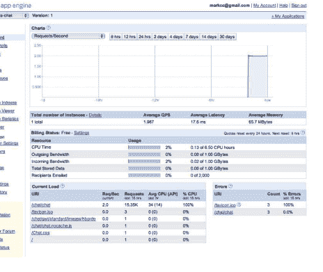
图 18.1：Java 聊天应用的控制面板仪表盘

在顶部，你会看到一个图表，显示你的应用程序每秒处理的平均请求数。对于我的 Java 聊天应用，它被使用得太少，以至于平均使用量为零！通过在一段时间内真正地猛击它，我能够在上一个时间段将使用负载略微提高，达到每秒约两个查询。

顶部图表可以向你显示许多不同内容的摘要。在其左上角，有一个下拉菜单，可让你选择想要的视图。除了每秒请求数之外，你还可以获得处理每个请求所花费时间、错误数、每个请求的带宽、每秒 CPU 使用量以及配额拒绝次数（即因为用完所有 App Engine 资源而被拒绝的请求）的图表。

例如，在图 18.2 中，你可以看到每个请求花费多少时间的图表。根据该图表，当我使用我的应用程序时，它平均每个请求大约花费二十四毫秒。

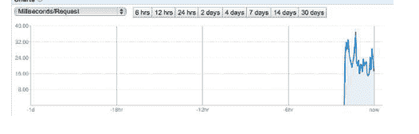
图 18.2：每个请求的 CPU 时间视图

图表下方是一组稍微更详细的数据：

- **实例。** 运行你的处理程序的每个进程都称为一个实例。图表下方有一行信息，告诉你应用程序正在使用多少个实例、它处理查询的速度以及它正在使用多少内存。我的 Java 聊天应用通常运行一个或两个实例，这主要取决于 App Engine 云中的随机因素——与负载无关。（一般来说，你获得的实例数量与应用程序的负载成正比。在这种情况下，负载非常低，因此一个实例和两个实例之间的阈值实际上是随机的。）我的应用程序平均每秒约两个请求，所以当我有一个实例时，它显示平均每秒查询数约为二；当我有两个实例时，它们各自平均每秒约一个查询。

- **账单状态。** 账单状态告诉你是否正在为 App Engine 付费。如果你正在付费，它会显示你已付费的资源列表以及你已使用这些资源的多少。默认情况下，它只显示“免费”，因为如果你使用的是账户附带的默认资源，它们是免费的。

  如果你发现自己在免费状态下资源即将用完，账单状态部分中有一个链接，允许你购买更多资源。我们将在第 285 页的 18.5 节 *按使用量付费* 中讨论这一点。

- **资源。** 这是一个允许你使用的可用资源列表，以及一些显示你已使用每种资源多少的小图表。它列出了 CPU 时间、出站带宽、入站带宽、存储数据和已发送电子邮件的收件人。例如，在我的聊天室应用程序中（它没有被频繁使用），它显示今天我已在可用的 6.5 CPU 小时中使用了 0.14 CPU 小时，并且我已使用了约 3% 的可用带宽。这主要是因为我在过去三个小时里让客户端保持打开，每秒运行两次 AJAX 调用！

  从这些信息中，我已经可以得出一些有趣的结论。当我查看带宽使用情况时，我能看到一个潜在问题。我有一个客户端在访问我的聊天室：我实际上并没有和任何人聊天。但它稳定地每秒运行两次查询，并持续消耗带宽。如果实际上有十几个人一直挂着并聊天几个小时，我最终可能会用完带宽配额。因此，如果我真的想使用这个应用程序，我需要要么降低 AJAX 更新频率、减小更新请求的大小，要么购买更多带宽。对于这个应用程序，最好的选择可能是组合方案；我确实不需要每秒超过一次的更新，所以只需降低 AJAX 更新频率就能将带宽使用量减半。除此之外，请求本身非常小，我几乎无法再让它更小。因此，我将需要购买更多带宽。

  从仪表盘上，如果默认视图没有提供足够的信息，你可以深入查看以获取更多详细信息。几乎所有内容都包含可让你获取更多信息的链接。例如，你可以通过单击实例数量旁边的“详情”来获取有关实例的更多信息。


此外，如果你查看面板左侧，会看到一个按不同类别列出的列表，你可以用它进行下钻，获取更精确的信息。你可以查看自己的配额使用情况；可以获取有关实例的非常精确的信息；还可以检查任务队列等等。

### 18.2 窥探数据存储区

正如我们在本书中反复看到的，App Engine 的大多数内容并不是什么新东西。只要可能，App Engine 都会尝试复用标准技术，以便你编写云应用。App Engine 真正与众不同的地方、真正新颖之处，就是数据存储区。大多数云应用框架都会为你提供某种轻量级关系数据库（如 MySQL）的访问能力。但 App Engine 走了一条非常不同的路线，它通过数据存储区将数据存储在 Google 的 Bigtable 中。

因此，在管理 App Engine 应用时，一个非常重要的方面就是理解你的数据是如何存储的，以及这种存储模型如何影响你的资源使用。

在 App Engine 控制面板中，有一组视图可以让你查看和探测应用如何使用数据存储区。

最容易看到的是你的数据是如何被索引的。只要点击“数据存储区索引”（Datastore Indexes），它就会显示你正在存储的数据类型列表，以及其中哪些字段被索引。这在开发过程早期最有价值。数据存储区会根据你的查询自动索引某些字段。通过查看这个视图，你可以了解到自己有哪些索引、缺少哪些索引。

你也可以浏览所有已存储的对象。如果点击“数据存储区查看器”（Datastore Viewer），就能看到数据存储区中所有对象的列表，并按类型分类。你还可以查找特定对象：如果点击数据存储区查看器中的“选项”（Options）链接，它会显示用于生成当前视图的 GQL 查询，你可以编辑该查询。例如，在我的聊天应用的数据存储区中，有 PChatMessage 对象和 PChatRoom 对象。我可以输入类似 `SELECT * FROM PChatMessage where senderName='markcc'` 的查询，来查看所有由我发送的聊天消息。

最后，你可以通过查看“数据存储区统计信息”（Datastore Statistics），了解对象占用了多少存储空间——包括其索引的元数据。

### 18.3 日志与调试

当你的应用遇到问题时，整个控制面板上最有用的就是日志。日志让你几乎可以用本地调试器的方式，查看正在运行的应用。每当你的应用中发生任何错误时，App Engine 都会为其生成一条日志条目；通过查看日志，你可以了解发生了什么。

例如，当我打开“日志”（Logs）视图时，我发现自己的聊天应用里犯了一个错误。我用来生成聊天视图的模板要求有一个网站图标（favicon）；但并没有可用的网站图标。因此，每次页面视图请求最终都会因为缺少网站图标而生成一个错误。这并不会让我的应用停止工作。事实上，在我第一次查看日志之前，我甚至都不知道自己犯了那个错误！而这正是日志如此有价值的原因：在 App Engine 中，你无法像在自己的电脑上那样直接观察应用的运行。它运行在另一台你无法直接访问的机器上。但日志为你提供了一种宝贵的工具，让你能获得关于运行中应用的尽可能多的信息。

当然，App Engine 并不会自动告诉你所有事情。它不可能确切知道你想要哪些信息。所以它自动做的只是记录它知道的错误。如果你的应用试图从数据存储区访问找不到的数据，App Engine 会知道这一点，并可以在日志中生成一个条目。但如果你的应用成功地从数据存储区检索到了信息，却因为查询中的错误而得到了不正确的结果，App Engine 并不知道，因此也不会自动记录任何东西。

你可以使用所用语言的标准日志支持（例如 Java 中的 `java.util.logging`）在应用中插入日志命令；所有日志条目都可以通过点击控制面板中的“日志”（Logs）条目来查看。这是你调试时最有价值的工具：通过生成日志条目，你可以准确了解应用正在做什么。

例如，我当前部署的聊天应用版本包含一个错误。如果我给它一条很长的聊天消息，它就无法正确处理。为什么？

当我查看默认日志时，看到了许多类似下一页图 18.3 的条目，都在抱怨无法处理超过 500 个字符的聊天消息，因为数据存储模型将消息内容指定为字符串属性，而字符串不能超过 500 字节。但我的聊天消息并没有 500 个字符长！

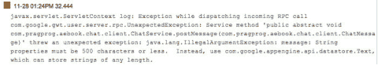

图 18.3：控制面板日志查看器中的一条日志条目

对于这个问题，默认的日志消息足以让我找到线索，但假设它不够呢？也许我认为聊天消息没那么长。我可以在应用中添加日志代码。首先，我需要在源文件中声明记录器。所以我会在 `com.program.google.appengine.api...` 的最后、右花括号之前添加以下内容：

```java
private static java.util.logging.Logger logger =
    java.util.logging.Logger.getLogger(ChatSubmissionServiceImpl.class.getName());
```

然后，在 `postMessage` 方法内部，我可以添加一条日志语句：

```java
logger.info("Chat message size = " + message.getMessage().length() +
            " with body \"" + message.getMessage() + "\"");
```

添加了这条语句后，每发布一条消息都会生成一条日志条目，其中包含所发布消息的长度和内容。这样，我就可以确认消息确实超过了 500 个字符。

不过，在应用中添加日志时，你应该小心一些。它是一个不可思议的工具。但记录日志会占用 CPU 时间，这会计入你的配额。你不需要担心空间问题；App Engine 只会保留一定数量的最新日志条目，并自动丢弃更旧的条目。所以，记录过多日志确实会花掉你的钱。虽然不会很多，但这确实是一个需要考虑的因素。

更重要的是，日志是你了解应用中正在发生的事情的主要工具。如果你为每件琐碎的事情都生成大量日志条目，那么你就会用不相关的数据挤满日志。这些数据会让你难以找到重要的条目——如果日志真的非常多，它们甚至可能把相关条目完全挤出去！经验法则是：不要记录任何你并不主动想读的内容——不要写你明知自己永远不会去看的日志条目。但当你遇到问题时，请添加日志语句，以便在调试时能看到发生了什么，然后查看控制面板中的日志。

### 18.4 管理你的应用

控制面板包含一组用于帮助你管理应用的设置。有四个视图可以用来管理事物：“应用设置”（Application Settings）、“权限”（Permissions）、“版本”（Versions）和“管理员日志”（Admin Logs）。

“应用设置”视图可以让你访问应用的一组基本设置。它包括以下内容：

- *应用标题。* 这会在一个可编辑的文本框中显示你的应用名称。要更改应用名称，只需更改文本框中的内容，然后点击“保存设置”（Save Settings）即可。

- *已配置的服务。* 如果你的应用使用了任何服务，如电子邮件或 XMPP（聊天），这些服务会列在这里，并带有你可以配置的选项。

- *Cookie 过期时间。* App Engine 使用 Cookie 进行用户身份验证。你可以选择设置 Cookie，使用户登录状态保持一天或一周。

- *停用或删除应用。* 如果你想临时或永久关闭应用，可以在这里操作。如果你点击“停用应用”（Disable Application），首先会进入一个确认对话框，以确保你确实想要关闭应用。如果你确认，应用将被停用，“应用设置”视图也会随之改变，包含两项内容——一项用于重新启动应用，另一项用于永久删除应用。

- *域名设置。* 如果你想在自己的域名上运行应用，可以在这里告诉 App Engine 相关域名。目前，你可以购买


并使用 Google Apps 设置一个域名，然后让你的 App Engine 程序在该域名下运行。目前，如果你拥有一个并非由 Google Apps 托管的域名，就不能将其用于你的 App Engine 服务。

“权限”视图允许你向其他用户授予管理权限。如果你将管理权限授予另一个用户，那么该用户将能够访问你应用的完整控制面板，包括更改任何设置、修改代码以及停用甚至删除应用的能力。

“版本”视图会显示已部署的应用版本列表，并让你能够选择其中任意一个作为当前的活动版本。其主要用途是在出现错误时使用。如果你部署了应用的新版本，而该版本包含错误，你可以立即通过转到“版本”视图并选择无错误的先前版本，回退到任意先前版本。

最后，“管理日志”让你查看已对你的应用执行了哪些管理操作。这主要用于让你监控其他管理员的操作：任何管理员执行的任何操作都会在管理日志中生成一条记录。

### 18.5 按使用量付费

正如我在本书开头所说，云计算的基本要点是让你只购买你确实想要使用的资源。你不会买一整台计算机，然后为了让 CPU 在遭遇流量暴增时仍然够用，而任由其大部分时间闲置：你只需购买你需要的资源。账单面板正是 App Engine 让你告诉 Google 你愿意支付多少费用的地方。

你的控制面板上有一个“账单设置”链接。如果点击进入，它会提供启用账单的选项。默认情况下，你使用的是免费资源——Google 免费提供你的首次使用额度——但如果你想要超过最低限度的资源，就需要为此付费。

通过账单控制功能，你可以设置每日预算。你可以设置每日上限——即在某一天你愿意为额外资源支付的最高金额。你还可以设置按资源划分的上限，例如：“我愿意每天在 CPU 上最多花 4 美元，但在带宽上只花 1.50 美元。”

一旦设置好预算，你就可以使用 Google Checkout 设置信用卡付款。

通过查看账单历史记录，你可以准确看到自己一直在使用哪些资源，以及每天支付了多少费用。账单历史记录中每天都会有一条记录，其格式与日志条目相同，准确告诉你每天消耗了多少各项资源。

在本章中，我们快速了解了 App Engine 控制面板为你的应用提供的管理控制功能。这里的内容应该一点也不令人意外：一切都非常直接且易于使用。

### 小结

在过去 300 页中，我们涵盖了很多内容。至此，你已经熟悉了 Google App Engine 编程的基础知识。当然，我们不可能在这么大的篇幅内覆盖所有内容，但现在你已经可以开始构建自己的第一批应用，并使用 Google App Engine 在线文档了。在本章中，我们将回顾已涵盖的基本概念，并简要概述你可能还想了解的其他内容以及接下来可以做什么。

### 19.1 云概念

正如我们所见，云编程与更传统环境中的编程非常不同。使云如此有趣且强大的关键特征包括以下概念：

- 你不知道——也不关心——你的程序在哪里运行。这是云最基本的事实之一。你不是在某一台计算机上运行程序：你的云服务提供商为你提供一个平台——也就是一个能够运行以特定方式编写的程序的基础软件系统——所有底层细节都是他们的问题，而不是你的问题。一般来说，你不知道程序运行在何种计算机上、运行在多少台计算机上、这些计算机位于何处，或者它们运行什么操作系统。这些都不重要。
- 软件即服务。在传统编程世界中，你实现的应用是在客户的计算机上执行的。在云中，你仍然编写应用，但从客户的角度来看，它与程序并不完全相同，因为他们不运行它。在云中，你的软件是一项服务——一个运行在其他地方的应用，客户想使用时通过 Web 浏览器访问它。关键区别在于用户不运行程序：程序始终在运行。用户想使用时连接到它，无需担心如何运行、是否需要升级、是否能在自己的计算机上运行之类的问题。服务始终在那里，可供任何地方的任何计算机随时访问。
- 没有限制。你无需担心限制以及诸如“我的计算机能处理多少页面浏览量？”之类的问题。在云中，一切都是弹性的。如果你突然获得更多用户，这不成问题：你的云平台会按需获取更多资源，并继续为你的客户提供服务。
- 按使用量付费。在云中，你确实是按使用量付费。你不需要为了以防万一而购买一台又大、又强、又贵的计算机。如果今天你只需要一个微不足道的处理器，而明天你需要强大一千倍的处理器，那也没问题。今天你为单个处理器支付几美分；明天，你可能为真正强大的计算能力支付几美元。无论你需要什么，都按需付费；用完之后，也不会被一块性能过剩却毫无用处的硬件砖头困住。

### 19.2 Google App Engine 概念

正如我们在本书中所见，Google App Engine 围绕一组基本概念构建。为便于回顾，使用 Google App Engine 进行云编程的基本概念包括以下内容：

- 编程就是处理 HTTP 请求。在 Google App Engine 中，你的程序的工作就是处理 HTTP 请求。借助 webhook 的魔力，你的程序与用户或其他应用的每一次交互，都实现为一个 HTTP 请求处理程序。
- 可以从标准起步。在 Google App Engine 中，一切都会尽可能建立在现有标准技术之上。例如，在 Python 中，模板使用广泛使用的 Django 模板框架构建。在 Java 中，数据存储的接口基于标准 Java Data Objects 框架构建。纵观 Google App Engine，我们看到 GAE 尽可能以现有标准技术为基础，而不是发明新东西。
- 一切都是服务。你在程序中与之交互的 GAE 所有组件都是服务。在传统程序中需要链接的库，在 GAE 云应用中变成了你通过 RPC 请求与之通信的服务。而且有大量服务可供你使用，提供从安全、数据存储到即时消息等各种功能。
- 浏览器就是用户界面。每一点用户界面、客户看到的一切、客户所做的一切，都发生在 Web 浏览器内部。
- 没有状态。在传统程序中，你可以依靠变量来保存状态——也就是说，如果你把某些东西放进变量，之后回来查看时，它仍然在那里。在云环境中，这不一定成立。你编程时必须假设，保留状态的唯一方式是通过数据存储中的外部存储。
- 始终考虑安全性。在云应用中，安全性比传统应用棘手得多。由于你的代码作为可被恶意人员在线访问的服务运行，而你客户的数据都可被该在线服务访问，因此你必须格外小心，确保系统构建得安全可靠。从设计系统的第一步起，就要规划安全策略，并确保在设计中的各个方面加以执行。只要犯一个错误，就可能危及用户数据！

这些基本思想构成了 Google App Engine 的核心。它并没有那么多内容。但这正是关键所在。让 App Engine 成为一个如此优美、强大且易于使用的系统的，正是它的简单本质。它只有这组适度的概念以及围绕这些概念构建的库——仅此而已。但这个简单的框架却成为构建你自己的云应用的非凡而优雅的工具。


### 19.3 下一步何去何从

Google App Engine 是一个非常新的平台，它在不断演进和成长。在我写这本书的时间里，许多变化之大，以至于我不得不重写整节内容。到你读到本书时，可能还会有更多新东西。以下是一些即将推出且令人兴奋的内容：

- 数据存储选项。本书写作时，只有一种数据存储实现。现在，当我撰写这个结论时，已有第二种数据存储进入测试。你可以在具有相同接口的两种不同实现之间选择，从而能够选择最适合你的应用的实现。当前实现称为*主从数据存储*。主从数据存储仍将是默认版本。但使用主从数据存储时，在数据中心维护窗口期间，对你的数据的访问可能会中断。替代方案是*高复制数据存储*。高复制数据存储稍慢（最多慢一倍），并且具有最终一致性，但它可以保证你的数据始终可用，即使面对重大中断也是如此。

- 开发者存储。这是目前处于测试部署阶段的最令人兴奋的开发项目之一。Google 正在提供一项非常像 Amazon S3 的存储服务。事实上，你可以轻松地将为 S3 编写的程序移植到 Google 开发者存储上使用。它还有一些自己的 API，使其作为平台非常有吸引力。这将是一件大事。

- MySQL 数据库支持。如果你有一个现有应用想要迁移到云，或者你确实需要/喜欢关系数据库，GAE 团队已经实现了一个可在 App Engine 云内扩展运行的 MySQL 版本。借助它，你可以使用 MySQL 关系数据库进行存储，而不是数据存储。

- Go 语言支持。Google 的一个团队开发了一门优美的新系统编程语言，名为 Go。我相信 Go 最终会成为一种用于为 Google App Engine 开发程序的语言。Go 是一门优秀的语言，它结合了 Python 的简单和简洁，以及 Java 的安全性和类型安全。当这实现时，在我看来，它显然会成为 GAE 开发的首选语言。

- **Django nonrel。** 目前，GAE 在 Python 开发中使用 Django 框架的模板库。Django 的其余部分，尤其是其数据管理框架，非常出色，但与数据存储管理数据的方式不兼容。目前正在努力构建一个 Django 变体版本，使其能够与像数据存储这样的非关系型对象存储正确配合。一旦准备就绪，Django 将可作为 webapp 的成熟替代方案用于 GAE 开发。

- **通道。** 目前在 GAE 中，客户端需要向 App Engine 服务器请求数据。在我们的聊天应用中，我们看到，我们用来保持聊天窗口最新的机制是每秒发送两次更新请求。通道是一种推送支持机制，它提供了一种方式，使运行在云服务器中的 GAE 服务无需任何请求即可向客户端 UI 发送更新。借助通道，我们可以实现聊天服务而无需轮询更新：服务器只需使用通道将更新推送到客户端 UI。

- **MapReduce。** 对于数据存储中数据的复杂计算，你目前只能使用任务队列进行简单的处理任务。GAE 团队正在努力支持 Google 的 MapReduce 框架，以实现大规模并行计算。当这准备就绪后，GAE 将能够用于实现诸如生物信息学处理之类的并行计算工作负载。

- **更好的 SSL 支持。** 目前，GAE 仅在你构建的应用运行于 appspot.com 域内时，才允许你使用 SSL 进行安全通信。很快，你将能够向 GAE 提供 SSL 凭据，以便在你自己的域上使用你自己的 SSL 密钥。

以上只是初步介绍。还有更多内容。你应该关注 App Engine 博客，了解所有变化的信息——包括我上面提到的变化，以及更多其他变化。

正如我们所见，Google App Engine 是一个用于构建基于云的应用程序的强大系统。你现在已经知道如何使用它，所以走出去，构建一些出色的应用吧！

### 19.4 参考资料与资源

| 资源 | URL | 描述 |
| --- | --- | --- |
| Google App Engine 博客 | [http://googleappengine.blogspot.com/](http://googleappengine.blogspot.com/) | Google App Engine 官方博客。每位 App Engine 开发者都应该关注它。 |
| Google App Engine 社区主页 | [http://code.google.com/appengine/community.html](http://code.google.com/appengine/community.html) | 面向 App Engine 社区的 Google Code 信息中心。该站点包括可以解答问题的论坛、示例应用下载、即将推出的功能讨论、App Engine 系统状态信息、常见问题解答等。对于 GAE 开发者来说，这是一个极好的资源。 |

## 索引

### A

- ACID 一致性，**228**
- add(widget)，**132**
- addNewMessages，**168, 169, 184**
- addStyleName，**159**
- addXXXHandler，**134**
- 管理代码，**185**
- 管理员角色，**264**
- AJAX，**113–121**
  - 架构与，**111**
  - 回调，**114**
  - 资源，**121**
  - 教程，**121**
- Amazon EC2，**16**
- Amazon S3，**17**
- 祖先关系，**225**
- App Engine 数据存储，**56**
  - *另见* 数据管理
- app.yaml 文件，**28, 49, 105**
- appcfg.py，**25, 29**
- 应用标识符，**22**
- 应用标题，**23**
- 应用
  - 云计算与，**13**
  - 协作式，**15**
  - 控制面板，用于管理，**284–285**
  - 使用 Google App Engine 创建，**22, 23f**
  - 数据存储与，**281**
  - 调试，**283f, 282–284**
  - 禁用或删除，**284**
  - Hello World，GWT，**127–134**
  - 索引与，**219**
  - 实例，**279**
  - 大型计算，**16**
  - 映射到 HTTP，**50f, 45–52**
  - 监控，**33f, 35f, 32–35, 278f, 279f, 277–281**
  - 协议，**42–45**
  - 分配的资源，**280**
  - 服务，**15**
  - 结构，**111**
  - 样式，**76**
  - 事务性，**147**
  - *另见* 聊天应用；CSS；模板
- AsyncCallback，**138**
- 异步 JavaScript 和 XML，
  - *见* AJAX
- 原子单元，**147**
- 攻击，**269–275**
  - 跨站脚本，**269, 271**
  - 拒绝服务，**270, 274**
  - 直接，**269, 271**
  - 窃听，**270, 273**
  - SQL 注入，**272**
  - *另见* 安全
- 属性，**91, 197**
  - 属性，**199**

### B

- 背景色，**90**
- background-color，**90**
- 带宽，**239, 280**
- BASE 一致性，**228**
- Bigtable，数据存储，**217, 218**
- 账单面板，**285**
- 账单状态，**280**
- 黑名单，**274**
- Blob，**207**
- BlobProperty，**212**
- 块级标签，**79**
- Blogger，**11**
- body，**89**
- BooleanProperty，**212**
- border 属性，**99**
- 边界，代码之间，**155**
- 有界查询，230
- 缓冲区溢出，263
- 按钮组件，165
- ByteStringProperty，212

### C

- Memcache 缓存访问模式，237
- 回调，114, 119, 162
- 层叠样式表，*见* CSS
- catch，236
- CategoryProperty，214
- center()，134
- CGI，25, 35, 276
- 通道，29
- 聊天应用，37–41
  - 管理，261–262
  - 空闲时间之后，51f
  - app.yaml 文件，49
  - 计数受限视图，63
  - 计数视图，62
  - CSS，需求，87
  - 数据持久化，56
  - 数据存储模型，58
  - dev_appserver.py，49
  - GET，45
  - 全局变量，53
  - GQL 查询，60
  - 实例方法，66
  - 将用户服务集成到其中，67–69
  - 界面模型图，38f
  - 着陆页，82
  - 登录认证，65–69
  - 映射到 HTTP，45–52
  - 消息，40
  - 缺失组件，172
  - 对象，39
  - 概述，37
  - POST，47
  - 属性，58
  - 协议，42–45
  - 检索持久对象，60
  - 角色，264
  - 房间，39
  - 运行与部署，187–189
  - 存储值，60
  - 结构，111
  - 时间受限视图，63
  - 用户，40
  - *另见* 应用；CSS；GWT；交互式 Web 服务；模板
- ChatMessageList，184
- chatone 目录与欢迎程序，27
- ChatRoom，175
- ChatService 的新方法，175
- ChatUpdate，117
- 子节点，197
- CIDR 表示法，276
- class 属性，110
- class="error"，94
- 清除，99, 101
- ClickHandler，165, 166
- 客户端，174
- 客户端-服务器计算，与云计算的对比，14
- close()，146, 149
- 云计算
  - 客户端-服务器计算与，14
  - CPU 时间，21
  - 数据管理，52, 53
  - 定义，10
  - 为其开发，12–13
  - 特性，12–13
  - 函数式编程与，55
  - 背后的理念，11
  - 多用户，37
  - 名称的起源，11
  - 概述，287–292
  - 编程系统，16–18
  - 资源，12
  - 无状态请求处理器，51
  - 基于时间的工作，180
  - 用途，15–16
  - *另见* 基于服务器的计算
- 协作式应用，15
- 颜色，RGB，90
- 通信，限制，177
- 复杂属性类型，214
- 一致性模型，227
- 容器组件，156
- content-type，210
- 续延传递风格（CPS），163
- 控制面板，284–285
- 控制器，112, 118
  - *另见* MVC
- Cookie，284
- 代码副本，77
- CPU 时间，计数，21
- Cron 调度器，249–253


### C

- Cron
  - 字段，250
  - 请求处理程序，251
  - cron.yaml，250
  - cron 条目标签，250
- 跨站脚本攻击，269，271
- CSS，77，87–106
  - 将文件添加到 Google App Engine，105
  - 背景颜色，90
  - 盒布局，96
  - 样式化前的聊天界面，87
  - 浮动，98
  - 流式布局，104f.，102–104
  - 字体，90
  - GWT 与 CSS，159
  - HTML 与 CSS，88
  - 布局，95f.，94–101
  - GWT 中的模块与 CSS，129
  - 命名保存的文件，90
  - 导航栏样式，91
  - 起源，88
  - p 标签，92
  - 用途，88–89
  - 资源，106
  - （基本）规则，91
  - 选择器，89
  - 间距，99
  - 使用 CSS 设置文本样式，89–94
  - 使用模拟界面进行测试，103
  - 标题样式属性，160
- 花括号，73
- 光标，230
- 自定义索引，220，221

### D

- 每日预算，285
- 仪表板，33，277，278f.
- 数据管理，53–64
  - App Engine 数据存储，56
  - 函数式编程与数据管理，55
  - 增量检索，230–231
  - 索引，281
  - 数据管理中的索引，217–222
  - 日志与调试，283f.，282–284
  - 模型限制，223–224
  - 监控，281
  - 概述，56
  - 持久化存储与数据管理，54
  - 策略与一致性，226–230
  - 进程与请求处理，53
  - 属性，58
  - 关系数据库与数据管理，61
  - 资源，64
  - 检索持久化对象，60
  - SQL 与 GQL，57
  - 存储值，60
  - 事务，225–226
  - *另见* 属性类型；服务器端数据
- 数据规范化，217
- 数据存储，52
  - *另见* 数据管理
- 数据存储索引，281
- 日期格式，73
- db.get(key)，206
- deadline，229
- 截止时间，227
- 调试，283f.，282–284
- 拒绝服务攻击，270，274，276
- description 标签，250
- 设计，限制通信，177
- desiredRoom，150
- dev_appserver.py，25，28，49，51
- 开发者存储，290
- 开发，云计算与开发，12–13
- DialogBox，133
- 直接攻击，269，271
- DirectoryEntry，202
- DirectoryEntry 类，205
- div 元素，97
- div 标签，95，109，120
- Django，52，66，86，291
  - body 标签结束，74
  - 语法，73，74
  - 模板与 Django，71，73
- Doctype 声明，GWT，130
- document，109
- DOM 对象，108
- 域设置，285
- 动态语言，与静态语言对比，124

### E

- 窃听攻击，270，273
- EC2，16
- Eclipse，125，126，127f.
- else 标签，93
- email()，66
- 电子邮件，发送与接收，243–246
- EmailProperty，214
- 加密通道，273

### G

- GWT，123–140
  - 优点，125
  - 边界代码，155
  - 构建应用程序，126
  - 客户端文件，128
  - 延续传递风格，163
  - 入口点，129，131
  - 事件处理程序，165
  - 焦点，设置，132
  - 问候服务接口，137
  - hello-world 应用程序，127–134
  - HTML 文件，130
  - 元数据，126
  - 模块声明，128
  - 模块，127–129
  - 起源，136
  - 持久化类，173
  - 插件，126
  - 项目目录结构，127f.
  - 与 Python 对比，126
  - 远程过程调用，135–139
  - 资源，170
  - 服务器包，128
  - 服务器端 RPC，139
  - 源目录组件，128
  - 样式属性，131
  - 测试与部署，140
  - URL 结构与 GWT，137
  - 用户界面设置，129
  - 用户界面，154–170
    - 使用小部件构建，156–162
    - 创建框架，158
    - CSS 与用户界面，159
    - 处理事件，162–167
    - 概述，154–155
    - 更新显示，167–169
  - 用途与价值，154
  - 请求的有效性，274
  - 小部件，133
  - *另见* Google App Engine；Java
  - .gwt-Button，132

### H

- 处理程序类，28
- header()，256
- 标头，90
- 高复制数据存储，290
- HTML
  - CSS 与 HTML，88
  - div 标签，96
  - 流约束，97
  - GWT 与 HTML，130
  - JavaScript 与 HTML，109
  - 优缺点，71
  - Python 与 HTML，72
  - HTML 模板，71
  - XML 标签与 HTML，92
- HTTP
  - 映射到 HTTP，50f.，45–52
  - HTTP 协议，42–45
  - 通过 HTTP 查询，238
  - 资源，52

### I

- id 标签，91，130
- if/equal 标签，93
- IMProperty，214
- inbound_services，244
- InboundEmailMessage，245
- InboundMailHandler，245
- 增量设计，176–184
- 增量检索，230–231
- 增量更新，177
- IndexError，265
- 索引，221
- 索引，217–222
  - 自动生成，219
  - 自定义，220，221
  - Java，222
  - 概述，216
  - 优势，219
- 继承，模板中的继承，78–79
- __init__，198
- initializeChats，186
- 实例方法，66
- 实例，279
- IntegerProperty，213
- 交互式 Web 服务，108–110
  - AJAX 与交互式 Web 服务，113–121
  - DOM 对象，108
  - MVC 设计，112f.，110–113
  - 资源，121
- 插页，67
- IsDir，205
- IsSerializable，178

### J

- Java
  - 优点，123
  - Java 中的聊天消息，242
  - 具体类，144
  - 控制面板仪表板，278f.
  - Java 中的数据持久化，142–145
  - Eclipse 与 Java，125
  - Java 中的电子邮件，244
  - 将服务器和客户端粘合在一起，151–152
  - Google App Engine 与 Java，123
  - GWT 与 Java
    - 项目目录结构，127f.
  - HTTP 交互，238
  - Java 中的索引，222
  - Memcache 与 Java，235
  - GWT 中的持久化对象，145–148
  - 持久化对象，检索，149–151
  - Python 与 Java，123
  - 数据对象中的序列化类型，145
  - Java 的服务器端，171–189
    - 聊天管理，185–186
    - 聊天室支持，171–176
    - 增量设计，176–184
    - 测试与部署，188f.，187–189
  - 更新客户端，184–185
  - 静态语言与动态语言，124
  - 在 Java 中存储类，142
  - Java 数据对象（JDO），142，149，153
  - Java Datastore API，153
  - Java Persistence API，153
  - JavaScript
    - DOM 对象，108
    - 嵌入 HTML，109
  - javax.mail，244
  - JDOQL，149
    - 编程式（替代）语法，151
    - 查询，150
    - 查询组件，150

### K

- 键声明，144，213，226
- KeyUpHandler，167

### L

- 着陆页，82
- 大型计算，16
- lastMessage，185
- 布局，94–101
  - 将 CSS 规则添加到 App Engine，105
  - 块结构，95f.
  - 清除，99，101
  - div 元素与布局，95
  - 浮动，97–99
  - 流约束，96
  - 外边距与内边距，99
  - *另见* 流式布局
- LIMIT，62
- link 标签，156
- LinkProperty，214
- ListProperty，213
- 登录认证，65–69
- 日志，283f.，282–284
- 循环，74

### M

- 邮件与聊天服务，239–242
- makePersistent，148
- MakeResource，198
- MapReduce，291
- 外边距，99
- 主模板，78
- 主从数据存储，290
- Memcache 服务，233–238
  - 缺点，233
  - Java 与 Memcache，235
  - Python 与 Memcache，234
  - 检索模式，237
  - 存储内容，237
- message，59
- MessageListCallback 类，167
- method()，256
- ML，124
- 模型
  - *另见* MVC
- 模型
  - 灵活性，223–224
  - 接口组件，111
  - 对象，58
- 模块声明，128
- 模块，GWT，127–129
- 监控应用程序，33f.，35f.，32–35，278f.，279f.，277–281
- 多个聊天室流程，70–75，81–86
- 多个任务队列，258
- 多个用户，37
- MVC
  - 云计算与 MVC，112
  - 组件，111
  - 接口组件，111
  - 设计模式，112f.，110–113
- MySQL 支持，290


### N

- name 属性，110
- 导航栏，91
- nickname()，66
- now 标签，73
- nth，250

### O

- 对象模型，58
- 对象
  - 集合，144
    - 数据规范化与，217
  - 数据存储与，218
  - 标识，144
  - 持久化，144–148
  - 持久化，检索，149–151
  - 通过键检索，149
  - 服务与，66
- onClick，110，134，165，166
- onKeyUp，167
- onModuleLoad，131，158，163，169
- onreadystatechange，119
- OpenSSL，276
- order by，151

### P

- p 标签，92
- 内边距，99
- 页面布局，参见 CSS：模板
- 面板小部件，158
- param()，256
- 参数，64
- 参数，150
- 父级，225
- payload()，257
- PChatMessage，222，281
- PChatRoom，174，281
- 权限，285
- PersistenceFactory，146
- PersistenceManager，146，148，183，186
- PersistenceManagerFactory，145
- 持久化对象，60，144–148
  - 检索，149–151
- 持久化存储，54
- PhoneNumberProperty，214
- 插件，App Engine，126
- 策略，226–230，参见登录认证；安全性
- Polymodel，223
- populateChats，163
- POST，47，268
- PostalAddressProperty，214
- postMessage，179
- 基本属性类型，212
- 权限，参见登录认证：安全性
- 属性，58
- 属性类型，191–215
  - 复杂，214
  - 文件系统服务，192–195
  - 建模文件系统，195–212
  - 概述，191，215
  - 基本，212
  - 参考，212–214
- 协议，42–45
- PUT，47，209，211
- put，204
- put()，211
- put_multi，236
- putAll，236
- Python
  - App Engine 数据存储，对比，58
  - App Engine 概述，25
  - CGI 脚本与，25
  - 聊天消息，241
  - 跨站脚本攻击，272
  - 电子邮件，243
  - HTTP 交互，238
  - Java 与，123
  - Memcache 与，234
  - print 语句，72
  - 使用……编程，25–32
  - 使用理由，26
  - 静态语言与动态语言，124
  - 模板，调用，70
  - 限时视图，64
  - 事务，225
  - 版本，22
  - 欢迎程序，29
  - *另见* 聊天应用；数据管理
- Python Datastore API，64

### Q

- 查询，数据存储，217–222
  - Bigtable 与，219
  - 有界，230
  - 游标，230
  - 截止时间，227
  - 获取，229
  - HTTP 与，238
  - 增量检索，230–231
  - Memcache 访问，237
  - 排序，219
  - 优势，219
  - 强一致性，227
- queue.xml 文件，258

### R

- RatingProperty，214
- 重做，229
- 就绪状态 4，119
- 接收，245
- ReferenceProperty，213
- 关系数据库，61
- 关系过滤器，220
- 远程过程调用，参见 RPC
- 报告，生成，250
- 报告，生成，249，251
  - *另见* Cron 调度器；基于服务器的计算
- 请求处理器，117
  - 构建，115
  - Cron，251
  - 电子邮件，245
  - 与……集成，68
  - 无状态特性，51
  - XMPP，241
- 请求处理，54
- RequestHandler，47
- ResourceAttribute，222
- ResourceAttribute 对象，199
- 资源
  - 分配的，280
  - CGI，35
  - CSS，106
  - 定义，12
  - Django，52
  - Google App Engine，35，292
  - GWT，170
  - HTTP，52
  - 交互式 Web 资源，121
  - 付费，285
  - Python 数据存储，64
  - 安全性，276
  - 服务器端数据，153
  - 模板，86
- REST，192
- RESTful 编程，192
- 可重用性，使用 CSS，89
- 复用代码，77
- RGB 颜色，90
- 角色，在聊天应用中，264
- 房间，在聊天应用中，39
- RootPanel，132
- RPC 服务，147
- RPC，在 GWT 中，135–139
  - 异步风格，136，138
  - 背景，135
  - 持久化类，173
  - 服务器端，139
  - 速度与，135
- 运行，229

### S

- S3，17
- 保存数据，54
  - *另见* 数据管理
- 可扩展性，13，54，177，288
- schedule 标签，250
- 调度作业，249–253
- script 标签，120，156
- 始终安全，273
- 安全性，260–276
  - 攻击，269–275
  - 基础，261–269
  - 缓冲区溢出，263
  - 描述，260–261
  - 资源，276
  - *另见* 登录认证
- select，150
- 选择器，91，94
- 自检测初始化，185
- SelfReferenceProperty，213
- sentbyme，93
- 关注点分离，使用 CSS，89
- Serializable，178
- 服务器，174
- Java 服务器端，171–189
  - 聊天管理，185–186
  - 聊天室支持，171–176
  - 增量设计，176–184
  - 测试与部署，188f.，187–189
  - 更新客户端，184–185
- 基于服务器的计算，248–259
  - 概述，249
  - 调度作业，249–253
  - 任务队列，253–259
  - 类型，248
- 服务器端数据，141–153
  - 将客户端和服务器连接起来，151–152
  - Java 与，142–145
  - GWT 中的持久化对象，145–148
  - 持久化对象，检索，149–151
  - 资源，153
  - *另见* 数据管理
- 服务，232–247
  - 应用与，在云中，13
  - 与云计算的兼容性，15
  - 定义，65
  - 电子邮件，发送和接收，243–246
  - 与库的对比，232
  - 邮件与聊天，239–242
  - memcache，233–238
  - 概述，232，246
  - URL 获取服务，238–239
  - 用户服务，66–67
  - *另见* 数据存储
- servlet 标签，253
- servlet-mapping 标签，253
- SetAttribute，199，203，225
- setId()，133
- setStyle，159
- setText，133
- setUpAndSendRequest，119
- showMessage，80
- Smalltalk，111
- 软件，云计算与，12
- SQL 注入攻击，272
- SQL 与 GQL，57
- SSL 支持，291
- 无状态请求处理器，51
- 静态语言与动态语言，124
- StringProperty，213
- 字符串，197
- 强一致性，227
- 强类型，123
- 样式属性，GWT，131
- 样式，参见 CSS

### T

- 标签，73，74
- 任务队列，253–259
  - 配置选项，256
  - 创建，255
  - 默认，258
  - 描述，253
  - 标头，257
  - 多个，258
  - 属性，259
- 任务，概念，254
- TaskOptions，256
- td 标签，130
- 模板继承，78–79
- 模板处理器，30
- 模板，70–86
  - 副本与，77
  - 使用模板自定义视图，80–81
  - 描述，71
  - HTML 与，71
  - 着陆页，82
  - 中的循环，74
  - 多个房间，81–86
  - Python 与，72
  - 相关视图，76f.，75–81
  - 使用模板渲染聊天，72–75
  - 资源，86
  - *另见* CSS
- 测试
  - 聊天界面，104f.
  - GWT 与，140
  - Java 聊天室，188f.，187–189
- text-decoration，90
- TextProperty，213
- time，59，234
- time 元素，117
- 限时视图，63
- Timer 类，169
- 事务，147，225–226
- 故障排除，188
- try...finally，149
- 类型化，123

### U

- 更新，29
- URL 模式，28
- url 标签，250
- URL 获取服务，238–239
- url()，256
- 用户，59
- 用户界面，参见 CSS；GWT；用户界面；模板；视图
- user_id，66
- UserRole，265
- users.get_current_user()，67
- 用户服务，66–67

### V

- ValidateRole，267
- 变量引用，73
- 变量
  - 全局，47，53，56，109，118
  - 无状态请求与，51
- 版本，285
- VerticalPanel，134，158
- 视图，111，120
  - 自定义，80–81
  - 相关，76f.，75–81
  - *另见* MVC；模板
- void，138

### W

- welcome-file-list，156
- where，150
- 小部件
  - 添加到面板，134，159
  - 使用小部件构建 GWT UI，156–162
  - 容器，156
  - 描述，156
  - 对话框，133
  - 焦点管理，162
  - 资源，170
- WEB-INF/cron.xml，250
- web.xml，151
- Web 应用，27，30–32
  - *另见* 聊天应用
- Web 应用
  - 数据存储，52
- WebDAV，193
- Webhooks，240

### X

- xmlattr，109
- XMLHttpRequest，114，118，121
  - 回调与，114，119
  - 定义，115
  - RPC 与，139
- XMPP 服务，239，241
- xmpp.get_presence，240

