# Code this！：为问题解决者准备的谜题、游戏、挑战与计算机编程概念！


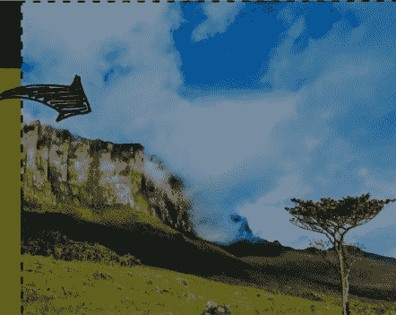

> 我是一个毛球黑客

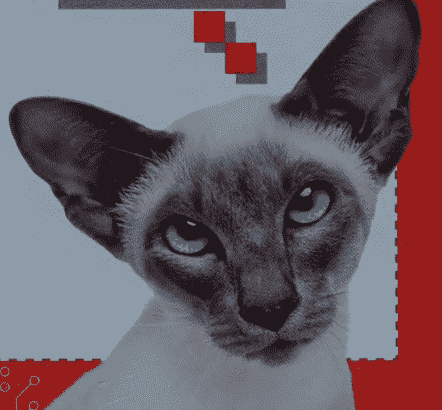

# 引言

## 编码与计算机科学

这本书的标题是《动手编程！》，但实际上我们要学习两件事。其一是思考如何解决通用问题的艺术，这被称为计算机科学。另一件是解释如何执行某个特定任务的艺术，这被称为编程或编码。我们把它们统称为“艺术”，因为它们需要与你绘画、唱歌或讲故事时同样的创造力。

为什么它们是不同的艺术呢？因为为了让计算机能够清晰地理解某件事，你首先必须能够自己进行思考。如果你的想法没有逻辑，反映出的结果也就没有意义。就像不同的艺术一样，计算机科学和计算机编程使用不同的工具。如果你在绘画课上，你使用画笔和铅笔；如果你在乐队里，你使用乐器。不同的艺术也是如此。在计算机科学中，你的工具包括逻辑和数学；在计算机编程中，你编写特定的代码。计算机科学和编码就像拼图碎片——它们互不相同，但可以组合在一起解决问题。

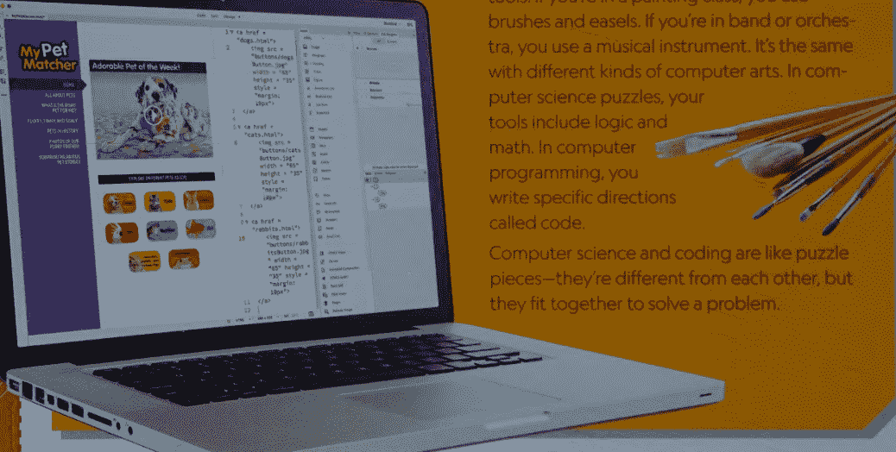

## 实际应用

### 我们用计算机科学做什么？

几乎可以做任何事！世界越来越依赖计算机——通过互联网发送和接收信息、使用手机、看电视以及玩游戏。甚至你现在拿着的这本书也是在计算机上写出来的。

> 医生在……？计算机科学家编写程序帮助医生了解并治愈疾病。特殊程序甚至可以帮助医生进行手术。


有时了解地球最好的方法是研究太空。程序员编写代码，帮助卫星进入太空拍摄照片。它们还控制着在火星表面或太阳系其他行星大气层运行的机器。你喜欢摇滚、嘻哈还是爵士乐？这一切都感谢计算机。需要特殊代码来让你最喜欢的歌曲完美地奏响。


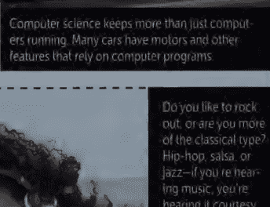

当我们休息时，计算机也在努力工作。软件工程师编写计算机，让你喜欢的电影和游戏变成现实。


# 逻辑思维

## 什么是逻辑？

优秀的编码者在处理问题时总是考虑逻辑。逻辑就是以合理的方式思考某件事。早上穿衣服时，你不会先穿鞋再穿袜子吧？那不符合逻辑。如果目标是把袜子穿在鞋子里，先穿袜子才更符合逻辑——更合理。


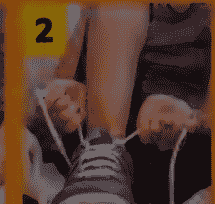

## 计算机逻辑

> 如果我的计算机要“运行”我的程序，它需要袜子和鞋！

因为编程计算机的理念是以一种让计算机执行某事并达成目标的方式编写指令，这有助于思考如何以合理的方式编写这些指令。嘿，这就是逻辑！所以，解决问题是计算机科学的大部分。计算机使用逻辑吗？在某种程度上，是的。事实上，构成计算机的微小电子元件是以特殊的逻辑组合在一起的。

但计算机逻辑与人类逻辑不同。人类大脑具有创造力。它还擅长感知周围的世界，并在尝试下一步做什么时考虑到这一切。所以，最终需要人类来构思解决问题的方法，并告诉计算机如何去做。

动手编程！

## 为什么计算机需要代码？

计算机就像其他工具。螺丝刀不会自己把螺丝拧进板里。需要人拿起螺丝刀，将正确的端对准螺丝，将螺丝刀尖与螺丝上的槽对齐，向下按，按正确的方向旋转螺丝，直到螺丝到位。

现在，你可能不需要思考就能完成这一切。但如果你不按照正确的顺序执行这些操作，它就无法正确工作——或者根本无法工作！计算机科学家思考如何编写指令，让计算机尽可能快速地完成任务。如果他们写得正确，正确的计算机就能胜任任何工作！

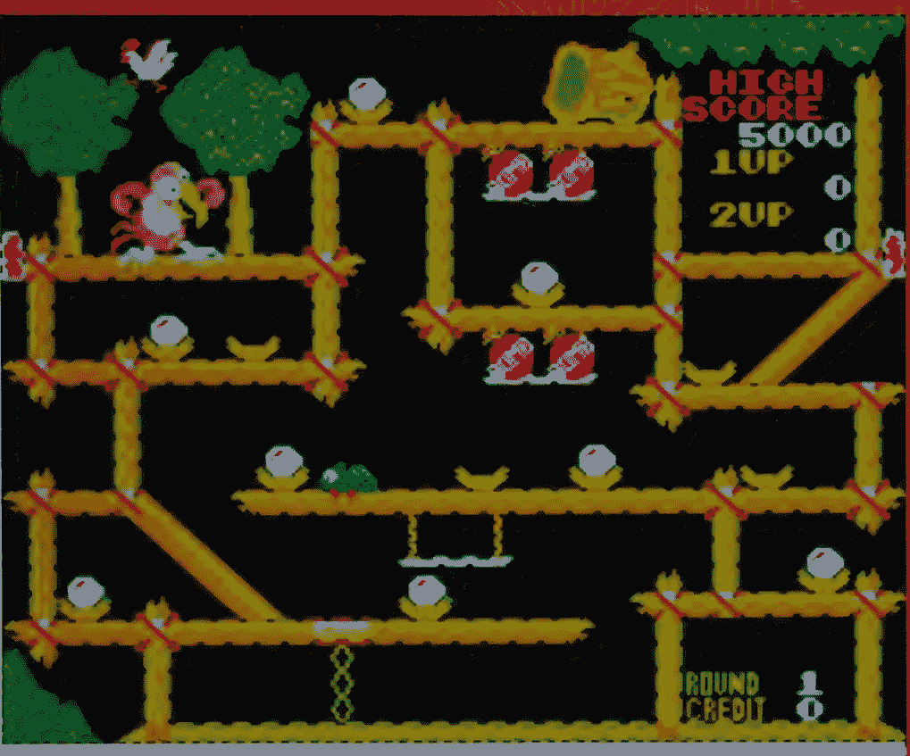

# 试一试

## 认识青蛙

认识 `Frontus` 机器人蛙（不是真正的青蛙也不是真正的机器人）。这个机器人是一个非常简单的计算机。它只能向前跳——而且一次只能跳一下。而且和所有计算机一样，它不会做任何没有被程序过的事情！

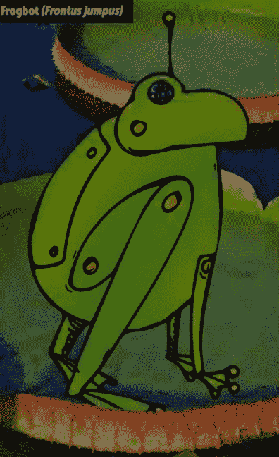

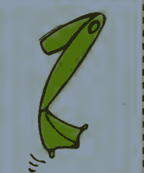

超级弹簧的腿和脚帮助青蛙跳跃远距离。


除非接到指令，否则青蛙无法转弯。

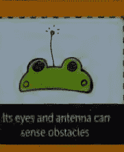

它的眼睛和天线可以感知障碍物。

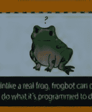

与真正的青蛙不同，青蛙只能做它被程序过的事情。

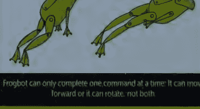

## 认识区块命令

初学计算机编程的学生学习使用我们所谓的“区块命令”来编写代码。命令是计算机遵循的指令。在本书中，一个区块命令看起来像这样：

```
JUMP FORWARD
```

要编写代码，你只需要在列表中将代码块像列表一样堆叠在一起即可。青蛙机器人（`Frogbot`）将从顶部开始执行命令，直到底部。

- `START`（开始）
- `JUMP FORWARD`（向前跳）
- `TURN LEFT`（左转）
- `JUMP FORWARD`（向前跳）
- `TURN RIGHT`（右转）
- `JUMP FORWARD`（向前跳）
- `JUMP FORWARD`（向前跳）
- `TURN RIGHT`（右转）
- `JUMP FORWARD`（向前跳）
- `TURN LEFT`（左转）
- `JUMP FORWARD`（向前跳）
- `STOP`（停止）

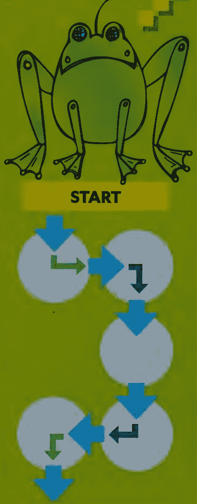

## 试试看

（持续）

如果青蛙机器人需要到达花朵，你会如何使用命令区块呢？

### 第二 步

如果你想让青蛙机器人再跳一个格到达花朵，你需要添加第二个命令区块。

```
JUMP FORWARD
```

所以，整个代码将是：

```
START
JUMP FORWARD
JUMP FORWARD
STOP
```

### 第一 步

如果你使用命令区块：

```
JUMP FORWARD
```

青蛙机器人将向前移动一个格。

跳跃看起来很有趣！

## 欢迎来到我的领地。

也许你可以教我一些新招式！

## 试试看

（持续）

让我们添加一个新的命令区块：

```
TURN LEFT
```

当青蛙机器人到达这个命令区块时，它将向左转，像这样：

你如何使用命令区块来帮助青蛙机器人过小溪？

就是这样：

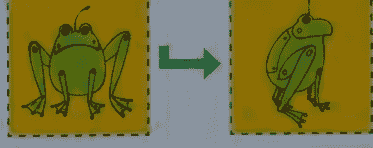

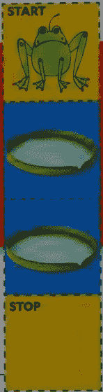

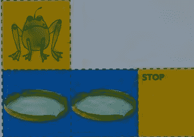

如果你写了：

```
START
JUMP FORWARD
JUMP FORWARD
JUMP FORWARD
STOP
```

看起来像：

```
START
JUMP FORWARD
TURN LEFT
JUMP FORWARD
JUMP FORWARD
STOP
```

完全正确！要穿过整个小溪，青蛙机器人必须跳三次。所以，你必须告诉它向前跳三次。

## 再试一次

编写代码让青蛙机器人穿过小溪并到达花朵。记住，青蛙机器人不能同时执行两个命令。它可以跳跃，也可以转弯，但不能同时做这两件事。

### START

### 提示：共有 6 步


## 代码框

| 跳到此项 |
| :--- |
| `START` |
| `JUMP FORWARD` |
| `TURN LEFT` |
| `TURN RIGHT` |
| `STOP` |


所以，这里是：

```
START
JUMP FORWARD
JUMP FORWARD
JUMP FORWARD
STOP
```

所以 这里的答案是：

```
START
JUMP FORWARD
JUMP FORWARD
TURN LEFT
JUMP FORWARD
TURN RIGHT
JUMP FORWARD
JUMP FORWARD
STOP
```


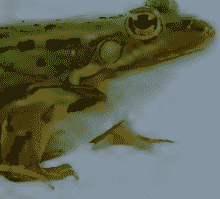


## 认识区块命令

初学计算机的学生学习使用我们所谓的“区块命令”来编写代码。命令是计算机遵循的指令。在本书中，一个区块命令看起来像这样：

```
JUMP FORWARD
```

要编写代码，你只需要在列表中将代码块像列表一样堆叠在一起即可。青蛙机器人将从顶部开始执行命令，直到底部。

- `START`
- `JUMP FORWARD`
- `TURN LEFT`
- `JUMP FORWARD`
- `TURN RIGHT`
- `JUMP FORWARD`
- `JUMP FORWARD`
- `TURN RIGHT`
- `JUMP FORWARD`
- `TURN LEFT`
- `JUMP FORWARD`
- `STOP`


## 试试看

（持续）

如果青蛙机器人需要到达花朵，你会如何使用命令区块呢？

### 第二步

如果你想让青蛙机器人再跳一个格到达花朵，你需要添加第二个命令区块。

```
JUMP FORWARD
```

所以，整个代码将是：

```
START
JUMP FORWARD
JUMP FORWARD
STOP
```

### 第一步

如果你使用命令区块：

```
JUMP FORWARD
```

青蛙机器人将向前移动一个格。

跳跃看起来很有趣！

## 欢迎来到我的领地。

也许你可以教我一些新招式！

## 试试看

（持续）

让我们添加一个新的命令区块：

```
TURN LEFT
```

当青蛙机器人到达这个命令区块时，它将向左转，像这样：

你如何使用命令区块来帮助青蛙机器人过小溪？

就是这样：


如果你写了：

```
START
JUMP FORWARD
JUMP FORWARD
JUMP FORWARD
STOP
```

看起来像：

```
START
JUMP FORWARD
TURN LEFT
JUMP FORWARD
JUMP FORWARD
STOP
```

完全正确！要穿过整个小溪，青蛙机器人必须跳三次。所以，你必须告诉它向前跳三次。

## 再试一次

编写代码让青蛙机器人穿过小溪并到达花朵。记住，青蛙机器人不能同时执行两个命令。它可以跳跃，也可以转弯，但不能同时做这两件事。

### START

### 提示：共有 6 步


## 代码框

| 跳到此项 |
| :--- |
| `START` |
| `JUMP FORWARD` |
| `TURN LEFT` |
| `TURN RIGHT` |
| `STOP` |


所以，这里是：

```
START
JUMP FORWARD
JUMP FORWARD
JUMP FORWARD
STOP
```

所以这里的答案是：

```
START
JUMP FORWARD
JUMP FORWARD
TURN LEFT
JUMP FORWARD
TURN RIGHT
JUMP FORWARD
JUMP FORWARD
STOP
```


# 欢迎来到我的领地。

也许你可以教我一些新招式！

## 试试看

（持续）

让我们添加一个新的命令区块：

```
TURN LEFT
```

当青蛙机器人到达这个命令区块时，它将向左转，像这样：

你如何使用命令区块来帮助青蛙机器人过小溪？

就是这样：


如果你写了：

```
START
JUMP FORWARD
JUMP FORWARD
JUMP FORWARD
STOP
```

看起来像：

```
START
JUMP FORWARD
TURN LEFT
JUMP FORWARD
JUMP FORWARD
STOP
```

完全正确！要穿过整个小溪，青蛙机器人必须跳三次。所以，你必须告诉它向前跳三次。

## 再试一次

编写代码让青蛙机器人穿过小溪并到达花朵。记住，青蛙机器人不能同时执行两个命令。它可以跳跃，也可以转弯，但不能同时做这两件事。

## START

## 提示：共有 6 步


## 代码框

| 跳到此项 |
| :--- |
| `START` |
| `JUMP FORWARD` |
| `TURN LEFT` |
| `TURN RIGHT` |
| `STOP` |


所以，这里是：

```
START
JUMP FORWARD
JUMP FORWARD
JUMP FORWARD
STOP
```

所以 这里的答案是：

```
START
JUMP FORWARD
JUMP FORWARD
TURN LEFT
JUMP FORWARD
TURN RIGHT
JUMP FORWARD
JUMP FORWARD
STOP
```


# 认识区块命令

初学计算机的学生学习使用我们所谓的“区块命令”来编写代码。命令是计算机遵循的指令。在本书中，一个区块命令看起来像这样：

```
JUMP FORWARD
```

要编写代码，你只需要在列表中将代码块像列表一样堆叠在一起即可。青蛙机器人将从顶部开始执行命令，直到底部。

- `START`
- `JUMP FORWARD`
- `TURN LEFT`
- `JUMP FORWARD`
- `TURN RIGHT`
- `JUMP FORWARD`
- `JUMP FORWARD`
- `TURN RIGHT`
- `JUMP FORWARD`
- `TURN LEFT`
- `JUMP FORWARD`
- `STOP`


## 试试看

（持续）

如果青蛙机器人需要到达花朵，你会如何使用命令区块呢？

## 第二 步

如果你想让青蛙机器人再跳一个格到达花朵，你需要添加第二个命令区块。

```
JUMP FORWARD
```

所以，整个代码将是：

```
START
JUMP FORWARD
JUMP FORWARD
STOP
```

## 第一 步

如果你使用命令区块：

```
JUMP FORWARD
```

青蛙机器人将向前移动一个格。

跳跃看起来很有趣！


## 代码框

| 跳到此项 |
| :--- |
| `START` |
| `JUMP FORWARD` |
| `TURN LEFT` |
| `TURN RIGHT` |
| `STOP` |


所以，这里是：

```
START
JUMP FORWARD
JUMP FORWARD
JUMP FORWARD
STOP
```

所以 这里的答案是：

```
START
JUMP FORWARD
JUMP FORWARD
TURN LEFT
JUMP FORWARD
TURN RIGHT
JUMP FORWARD
JUMP FORWARD
STOP
```


## 认识区块命令

初学计算机的学生学习使用我们所谓的“区块命令”来编写代码。命令是计算机遵循的指令。在本书中，一个区块命令看起来像这样：

```
JUMP FORWARD
```

要编写代码，你只需要在列表中将代码块像列表一样堆叠在一起即可。青蛙机器人将从顶部开始执行命令，直到底部。

- `START`
- `JUMP FORWARD`
- `TURN LEFT`
- `JUMP FORWARD`
- `TURN RIGHT`
- `JUMP FORWARD`
- `JUMP FORWARD`
- `TURN RIGHT`
- `JUMP FORWARD`
- `TURN LEFT`
- `JUMP FORWARD`
- `STOP`


## 试试看

（持续）

如果青蛙机器人需要到达花朵，你会如何使用命令区块呢？

## 第二步

如果你想让青蛙机器人再跳一个格到达花朵，你需要添加第二个命令区块。

```
JUMP FORWARD
```

所以，整个代码将是：

```
START
JUMP FORWARD
JUMP FORWARD
STOP
```

## 第一步

如果你使用命令区块：

```
JUMP FORWARD
```

青蛙机器人将向前移动一个格。

跳跃看起来很有趣！

## 欢迎来到我的领地。

也许你可以教我一些新招式！

## 试试看

（持续）

让我们添加一个新的命令区块：

```
TURN LEFT
```

当青蛙机器人到达这个命令区块时，它将向左转，像这样：

你如何使用命令区块来帮助青蛙机器人过小溪？

就是这样：


如果你写了：

```
START
JUMP FORWARD
JUMP FORWARD
JUMP FORWARD
STOP
```

看起来像：

```
START
JUMP FORWARD
TURN LEFT
JUMP FORWARD
JUMP FORWARD
STOP
```

完全正确！要穿过整个小溪，青蛙机器人必须跳三次。所以，你必须告诉它向前跳三次。

## 再试一次

编写代码让青蛙机器人穿过小溪并到达花朵。记住，青蛙机器人不能同时执行两个命令。它可以跳跃，也可以转弯，但不能同时做这两件事。

## START

## 提示：共有 6 步


## 代码框

| 跳到此项 |
| :--- |
| `START` |
| `JUMP FORWARD` |
| `TURN LEFT` |
| `TURN RIGHT` |
| `STOP` |


所以，这里是：

```
START
JUMP FORWARD
JUMP FORWARD
JUMP FORWARD
STOP
```

所以 这里的答案是：

```
START
JUMP FORWARD
JUMP FORWARD
TURN LEFT
JUMP FORWARD
TURN RIGHT
JUMP FORWARD
JUMP FORWARD
STOP
```


- `JUMP FORWARD`
- `TURN RIGHT`
- `JUMP FORWARD`
- `TURN LEFT`
- `JUMP FORWARD`
- `STOP`


## 试试看

（持续）

如果青蛙机器人需要到达花朵，你会如何使用命令区块呢？

## 第二步

如果你想让青蛙机器人再跳一个格到达花朵，你需要添加第二个命令区块。

```
JUMP FORWARD
```

所以，整个代码将是：

```
START
JUMP FORWARD
JUMP FORWARD
STOP
```

## 第一步

如果你使用命令区块：

```
JUMP FORWARD
```

青蛙机器人将向前移动一个格。

跳跃看起来很有趣！

## 欢迎来到我的领地。

也许你可以教我一些新招式！

## 试试看

（持续）

让我们添加一个新的命令区块：

```
TURN LEFT
```

当青蛙机器人到达这个命令区块时，它将向左转，像这样：

你如何使用命令区块来帮助青蛙机器人过小溪？

就是这样：


如果你写了：

```
START
JUMP FORWARD
JUMP FORWARD
JUMP FORWARD
STOP
```

看起来像：

```
START
JUMP FORWARD
TURN LEFT
JUMP FORWARD
JUMP FORWARD
STOP
```

完全正确！要穿过整个小溪，青蛙机器人必须跳三次。所以，你必须告诉它向前跳三次。

## 再试一次

编写代码让青蛙机器人穿过小溪并到达花朵。记住，青蛙机器人不能同时执行两个命令。它可以跳跃，也可以转弯，但不能同时做这两件事。

## START

## 提示：共有 6 步


## 代码框

| 跳到此项 |
| :--- |
| `START` |
| `JUMP FORWARD` |
| `TURN LEFT` |
| `TURN RIGHT` |
| `STOP` |


所以，这里是：

```
START
JUMP FORWARD
JUMP FORWARD
JUMP FORWARD
STOP
```

所以这里的答案是：

```
START
JUMP FORWARD
JUMP FORWARD
TURN LEFT
JUMP FORWARD
TURN RIGHT
JUMP FORWARD
JUMP FORWARD
STOP
```


## 认识区块命令

初学计算机的学生学习使用我们所谓的“区块命令”来编写代码。命令是计算机遵循的指令。在本书中，一个区块命令看起来像这样：

```
JUMP FORWARD
```

要编写代码，你只需要在列表中将代码块像列表一样堆叠在一起即可。青蛙机器人将从顶部开始执行命令，直到底部。

- `START`
- `JUMP FORWARD`
- `TURN LEFT`
- `JUMP FORWARD`
- `TURN RIGHT`
- `JUMP FORWARD`
- `JUMP FORWARD`
- `TURN RIGHT`
- `JUMP FORWARD`
- `TURN LEFT`
- `JUMP FORWARD`
- `STOP`


```
START
JUMP FORWARD
JUMP FORWARD
JUMP FORWARD
STOP
```

```
START
JUMP FORWARD
TURN LEFT
JUMP FORWARD
JUMP FORWARD
STOP
```

完全正确！要穿过整个小溪，青蛙机器人必须跳三次。所以，你必须告诉它向前跳三次。

## 再试一次

编写代码让青蛙机器人穿过小溪并到达花朵。记住，青蛙机器人不能同时执行两个命令。它可以跳跃，也可以转弯，但不能同时做这两件事。

## START

## 提示：共有 6 步


## 代码框

| 跳到此项 |
| :--- |
| START |
| JUMP FORWARD |
| TURN LEFT |
| TURN RIGHT |
| STOP |


所以，这里是：

```
START
JUMP FORWARD
JUMP FORWARD
JUMP FORWARD
STOP
```

所以 这里的答案是：

```
START
JUMP FORWARD
JUMP FORWARD
TURN LEFT
JUMP FORWARD
TURN RIGHT
JUMP FORWARD
JUMP FORWARD
STOP
```


## 认识区块命令

初学计算机的学生学习使用我们所谓的“区块命令”来编写代码。命令是计算机遵循的指令。在本书中，一个区块命令看起来像这样：

```
JUMP FORWARD
```

要编写代码，你只需要在列表中将代码块像列表一样堆叠在一起即可。青蛙机器人将从顶部开始执行命令，直到底部。

- START
- JUMP FORWARD
- TURN LEFT
- JUMP FORWARD
- TURN RIGHT
- JUMP FORWARD
- JUMP FORWARD
- TURN RIGHT
- JUMP FORWARD
- TURN LEFT
- JUMP FORWARD
- STOP


## 试试看

（持续）

如果青蛙机器人需要到达花朵，你会如何使用命令区块呢？

## 第二 步

如果你想让青蛙机器人再跳一个格到达花朵，你需要添加第二个命令区块。

```
JUMP FORWARD
```

所以，整个代码将是：

```
START
JUMP FORWARD
JUMP FORWARD
STOP
```

## 第一 步

如果你使用命令区块：

```
JUMP FORWARD
```

青蛙机器人将向前移动一个格。

跳跃看起来很有趣！

## 欢迎来到我的领地。

也许你可以教我一些新招式！

## 试试看

（持续）

让我们添加一个新的命令区块：

```
TURN LEFT
```

当青蛙机器人到达这个命令区块时，它将向左转，像这样：

你如何使用命令区块来帮助青蛙机器人过小溪？

就是这样：


如果你写了：

```
START
JUMP FORWARD
JUMP FORWARD
JUMP FORWARD
STOP
```

看起来像：

```
START
JUMP FORWARD
TURN LEFT
JUMP FORWARD
JUMP FORWARD
STOP
```

完全正确！要穿过整个小溪，青蛙机器人必须跳三次。所以，你必须告诉它向前跳三次。

## 再试一次

编写代码让青蛙机器人穿过小溪并到达花朵。记住，青蛙机器人不能同时执行两个命令。它可以跳跃，也可以转弯，但不能同时做这两件事。

## START

## 提示：共有 6 步


## 代码框

| 跳到此项 |
| :--- |
| START |
| JUMP FORWARD |
| TURN LEFT |
| TURN RIGHT |
| STOP |


所以，这里是：

```
START
JUMP FORWARD
JUMP FORWARD
JUMP FORWARD
STOP
```

所以 这里的答案是：

```
START
JUMP FORWARD
JUMP FORWARD
TURN LEFT
JUMP FORWARD
TURN RIGHT
JUMP FORWARD
JUMP FORWARD
STOP
```


## 认识区块命令

初学计算机的学生学习使用我们所谓的“区块命令”来编写代码。命令是计算机遵循的指令。在本书中，一个区块命令看起来像这样：

```
JUMP FORWARD
```

要编写代码，你只需要在列表中将代码块像列表一样堆叠在一起即可。青蛙机器人将从顶部开始执行命令，直到底部。

- START
- JUMP FORWARD
- TURN LEFT
- JUMP FORWARD
- TURN RIGHT
- JUMP FORWARD
- JUMP FORWARD
- TURN RIGHT
- JUMP FORWARD
- TURN LEFT
- JUMP FORWARD
- STOP


## 试试看

（持续）

如果青蛙机器人需要到达花朵，你会如何使用命令区块呢？

## 第二 步

如果你想让青蛙机器人再跳一个格到达花朵，你需要添加第二个命令区块。

```
JUMP FORWARD
```

所以，整个代码将是：

```
START
JUMP FORWARD
JUMP FORWARD
STOP
```

## 第一 步

如果你使用命令区块：

```
JUMP FORWARD
```

青蛙机器人将向前移动一个格。

跳跃看起来很有趣！

## 欢迎来到我的领地。

也许你可以教我一些新招式！

## 试试看

（持续）

让我们添加一个新的命令区块：

```
TURN LEFT
```

当青蛙机器人到达这个命令区块时，它将向左转，像这样：

你如何使用命令区块来帮助青蛙机器人过小溪？

就是这样：


如果你写了：

```
START
JUMP FORWARD
JUMP FORWARD
JUMP FORWARD
STOP
```

看起来像：

```
START
JUMP FORWARD
TURN LEFT
JUMP FORWARD
JUMP FORWARD
STOP
```

完全正确！要穿过整个小溪，青蛙机器人必须跳三次。所以，你必须告诉它向前跳三次。

## 再试一次

编写代码让青蛙机器人穿过小溪并到达花朵。记住，青蛙机器人不能同时执行两个命令。它可以跳跃，也可以转弯，但不能同时做这两件事。

## START

## 提示：共有 6 步


## 代码框

| 跳到此项 |
| :--- |
| START |
| JUMP FORWARD |
| TURN LEFT |
| TURN RIGHT |
| STOP |


所以，这里是：

```
START
JUMP FORWARD
JUMP FORWARD
JUMP FORWARD
STOP
```

所以 这里的答案是：

```
START
JUMP FORWARD
JUMP FORWARD
TURN LEFT
JUMP FORWARD
TURN RIGHT
JUMP FORWARD
JUMP FORWARD
STOP
```


## 认识区块命令

初学计算机的学生学习使用我们所谓的“区块命令”来编写代码。命令是计算机遵循的指令。在本书中，一个区块命令看起来像这样：

```
JUMP FORWARD
```

要编写代码，你只需要在列表中将代码块像列表一样堆叠在一起即可。青蛙机器人将从顶部开始执行命令，直到底部。

- START
- JUMP FORWARD
- TURN LEFT
- JUMP FORWARD
- TURN RIGHT
- JUMP FORWARD
- JUMP FORWARD
- TURN RIGHT
- JUMP FORWARD
- TURN LEFT
- JUMP FORWARD
- STOP


## 试试看

（持续）

如果青蛙机器人需要到达花朵，你会如何使用命令区块呢？

## 第二 步

如果你想让青蛙机器人再跳一个格到达花朵，你需要添加第二个命令区块。

```
JUMP FORWARD
```

所以，整个代码将是：

```
START
JUMP FORWARD
JUMP FORWARD
STOP
```

## 第一 步

如果你使用命令区块：

```
JUMP FORWARD
```

青蛙机器人将向前移动一个格。

跳跃看起来很有趣！

## 欢迎来到我的领地。

也许你可以教我一些新招式！

## 试试看

（持续）

让我们添加一个新的命令区块：

```
TURN LEFT
```

当青蛙机器人到达这个命令区块时，它将向左转，像这样：

你如何使用命令区块来帮助青蛙机器人过小溪？

就是这样：


如果你写了：

```
START
JUMP FORWARD
JUMP FORWARD
JUMP FORWARD
STOP
```

看起来像：

```
START
JUMP FORWARD
TURN LEFT
JUMP FORWARD
JUMP FORWARD
STOP
```

完全正确！要穿过整个小溪，青蛙机器人必须跳三次。所以，你必须告诉它向前跳三次。

## 再试一次

编写代码让青蛙机器人穿过小溪并到达花朵。记住，青蛙机器人不能同时执行两个命令。它可以跳跃，也可以转弯，但不能同时做这两件事。

## START

## 提示：共有 6 步


## 代码框

| 跳到此项 |
| :--- |
| START |
| JUMP FORWARD |
| TURN LEFT |
| TURN RIGHT |
| STOP |


所以，这里是：

```
START
JUMP FORWARD
JUMP FORWARD
JUMP FORWARD
STOP
```

所以 这里的答案是：

```
START
JUMP FORWARD
JUMP FORWARD
TURN LEFT
JUMP FORWARD
TURN RIGHT
JUMP FORWARD
JUMP FORWARD
STOP
```


## 认识区块命令

初学计算机的学生学习使用我们所谓的“区块命令”来编写代码。命令是计算机遵循的指令。在本书中，一个区块命令看起来像这样：

```
JUMP FORWARD
```

要编写代码，你只需要在列表中将代码块像列表一样堆叠在一起即可。青蛙机器人将从顶部开始执行命令，直到底部。

- START
- JUMP FORWARD
- TURN LEFT
- JUMP FORWARD
- TURN RIGHT
- JUMP FORWARD
- JUMP FORWARD
- TURN RIGHT
- JUMP FORWARD
- TURN LEFT
- JUMP FORWARD
- STOP


## 试试看

（持续）

如果青蛙机器人需要到达花朵，你会如何使用命令区块呢？

## 第二 步

如果你想让青蛙机器人再跳一个格到达花朵，你需要添加第二个命令区块。

```
JUMP FORWARD
```

所以，整个代码将是：

```
START
JUMP FORWARD
JUMP FORWARD
STOP
```

## 第一 步

如果你使用命令区块：

```
JUMP FORWARD
```

青蛙机器人将向前移动一个格。

跳跃看起来很有趣！

## 欢迎来到我的领地。

也许你可以教我一些新招式！

## 试试看

（持续）

让我们添加一个新的命令区块：

```
TURN LEFT
```

当青蛙机器人到达这个命令区块时，它将向左转，像这样：

你如何使用命令区块来帮助青蛙机器人过小溪？

就是这样：


如果你写了：

```
START
JUMP FORWARD
JUMP FORWARD
JUMP FORWARD
STOP
```

看起来像：

```
START
JUMP FORWARD
TURN LEFT
JUMP FORWARD
JUMP FORWARD
STOP
```

完全正确！要穿过整个小溪，青蛙机器人必须跳三次。所以，你必须告诉它向前跳三次。

## 再试一次

编写代码让青蛙机器人穿过小溪并到达花朵。记住，青蛙机器人不能同时执行两个命令。它可以跳跃，也可以转弯，但不能同时做这两件事。

## START

## 提示：共有 6 步


## 代码框

| 跳到此项 |
| :--- |
| START |
| JUMP FORWARD |
| TURN LEFT |
| TURN RIGHT |
| STOP |


所以，这里是：

```
START
JUMP FORWARD
JUMP FORWARD
JUMP FORWARD
STOP
```

所以 这里的答案是：

```
START
JUMP FORWARD
JUMP FORWARD
TURN LEFT
JUMP FORWARD
TURN RIGHT
JUMP FORWARD
JUMP FORWARD
STOP
```


## 认识区块命令

初学计算机的学生学习使用我们所谓的“区块命令”来编写代码。命令是计算机遵循的指令。在本书中，一个区块命令看起来像这样：

```
JUMP FORWARD
```

要编写代码，你只需要在列表中将代码块像列表一样堆叠在一起即可。青蛙机器人将从顶部开始执行命令，直到底部。

- START
- JUMP FORWARD
- TURN LEFT
- JUMP FORWARD
- TURN RIGHT
- JUMP FORWARD
- JUMP FORWARD
- TURN RIGHT
- JUMP FORWARD
- TURN LEFT
- JUMP FORWARD
- STOP


## 试试看

（持续）

如果青蛙机器人需要到达花朵，你会如何使用命令区块呢？

## 第二 步

如果你想让青蛙机器人再跳一个格到达花朵，你需要添加第二个命令区块。

```
JUMP FORWARD
```

所以，整个代码将是：

```
START
JUMP FORWARD
JUMP FORWARD
STOP
```

## 第一 步

如果你使用命令区块：

```
JUMP FORWARD
```

青蛙机器人将向前移动一个格。

跳跃看起来很有趣！

## 欢迎来到我的领地。

也许你可以教我一些新招式！

## 试试看

（持续）

让我们添加一个新的命令区块：

```
TURN LEFT
```

当青蛙机器人到达这个命令区块时，它将向左转，像这样：

你如何使用命令区块来帮助青蛙机器人过小溪？

就是这样：


如果你写了：

```
START
JUMP FORWARD
JUMP FORWARD
JUMP FORWARD
STOP
```

看起来像：

```
START
JUMP FORWARD
TURN LEFT
JUMP FORWARD
JUMP FORWARD
STOP
```

完全正确！要穿过整个小溪，青蛙机器人必须跳三次。所以，你必须告诉它向前跳三次。

## 再试一次

编写代码让青蛙机器人穿过小溪并到达花朵。记住，青蛙机器人不能同时执行两个命令。它可以跳跃，也可以转弯，但不能同时做这两件事。

## START

## 提示：共有 6 步


## 代码框

| 跳到此项 |
| :--- |
| START |
| JUMP FORWARD |
| TURN LEFT |
| TURN RIGHT |
| STOP |


所以，这里是：

```
START
JUMP FORWARD
JUMP FORWARD
JUMP FORWARD
STOP
```

所以 这里的答案是：

```
START
JUMP FORWARD
JUMP FORWARD
TURN LEFT
JUMP FORWARD
TURN RIGHT
JUMP FORWARD
JUMP FORWARD
STOP
```


## 认识区块命令

初学计算机的学生学习使用我们所谓的“区块命令”来编写代码。命令是计算机遵循的指令。在本书中，一个区块命令看起来像这样：

```
JUMP FORWARD
```

要编写代码，你只需要在列表中将代码块像列表一样堆叠在一起即可。青蛙机器人将从顶部开始执行命令，直到底部。

- `START`
- `JUMP FORWARD`
- `TURN LEFT`
- `JUMP FORWARD`
- `TURN RIGHT`
- `JUMP FORWARD`
- `JUMP FORWARD`
- `TURN RIGHT`
- `JUMP FORWARD`
- `TURN LEFT`
- `JUMP FORWARD`
- `STOP`


## 试试看

（持续）

如果青蛙机器人需要到达花朵，你会如何使用命令区块呢？

## 第二步

如果你想让青蛙机器人再跳一个格到达花朵，你需要添加第二个命令区块。

```
JUMP FORWARD
```

所以，整个代码将是：

```
START
JUMP FORWARD
JUMP FORWARD
STOP
```

## 第一步

如果你使用命令区块：

```
JUMP FORWARD
```

青蛙机器人将向前移动一个格。

跳跃看起来很有趣！

## 欢迎来到我的领地。

也许你可以教我一些新招式！

## 试试看

（持续）

让我们添加一个新的命令区块：

```
TURN LEFT
```

当青蛙机器人到达这个命令区块时，它将向左转，像这样：

你如何使用命令区块来帮助青蛙机器人过小溪？

就是这样：


如果你写了：

```
START
JUMP FORWARD
JUMP FORWARD
JUMP FORWARD
STOP
```

看起来像：

```
START
JUMP FORWARD
TURN LEFT
JUMP FORWARD
JUMP FORWARD
STOP
```

完全正确！要穿过整个小溪，青蛙机器人必须跳三次。所以，你必须告诉它向前跳三次。

## 再试一次

编写代码让青蛙机器人穿过小溪并到达花朵。记住，青蛙机器人不能同时执行两个命令。它可以跳跃，也可以转弯，但不能同时做这两件事。

## START

## 提示：共有 6 步


## 代码框

| 跳到此项 |
| :--- |
| `START` |
| `JUMP FORWARD` |
| `TURN LEFT` |
| `TURN RIGHT` |
| `STOP` |


所以，这里是：

```
START
JUMP FORWARD
JUMP FORWARD
JUMP FORWARD
STOP
```

所以这里的答案是：

```
START
JUMP FORWARD
JUMP FORWARD
TURN LEFT
JUMP FORWARD
TURN RIGHT
JUMP FORWARD
JUMP FORWARD
STOP
```


## 编程概念：算法

## 尝试一下

### 为朋友编写程序

编写一个算法，帮助你的朋友把一个纸球投进垃圾桶。


## 你需要什么

- 一个空垃圾桶或水桶
- 胶带
- 一个枕头或其他软物体
- 一张纸，揉成一个球
- 铅笔和纸
- 一个朋友

## 要做什么

1. **站在垃圾桶旁边**。朝一个方向走五步。用胶带在地面上标记这个位置。
2. 将**枕头放置**在胶带和垃圾桶之间的大约中间。
3. 使用工具箱中的命令，**编写一个算法**（指令列表），让你的朋友走到胶带处，绕过枕头到达垃圾桶旁，然后把球投进去。
4. **给你的朋友**那个纸球。让他们站在胶带处并闭上眼睛。一次一次大声读出你的算法，让你的朋友执行每一个动作。你的朋友只能按照你说的做，不能做其他的！

## 代码工具箱

- 向前走一步
- 向左转
- 向右转
- 打开手
- 举起手臂

24 种代码项

## 1


## 2,3

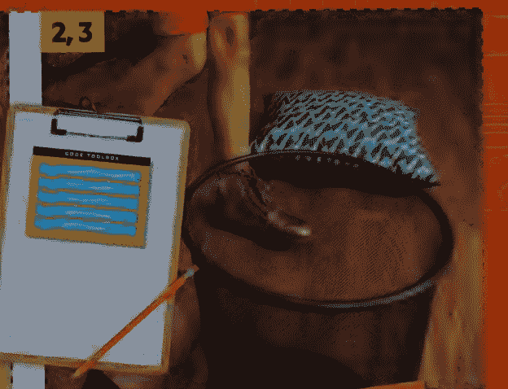

## 4

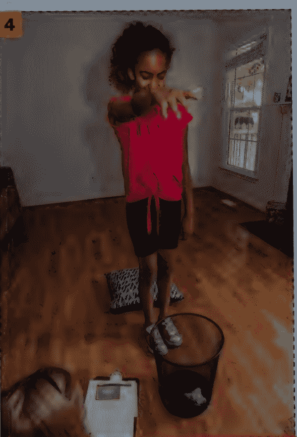

> 这不仅仅是移动物品。它是在做出一个对所有参与者都合理的选择。

## 发生了什么？

我们很想知道，有时我们无法理解邻居为什么做某些事情。当你扔出一个球却撞歪了，而你并没有重复一遍所需的步骤，而是理解了彼此，这种感觉是很沮丧的。

## 问题解决！

你的算法有效吗？为什么有效或不有效？如果路中间有两个枕头而不是一个，你会如何修改它？

## 编程概念：优化

## 解读概念

计算机可以快速地解决问题。这在某种程度上是因为被称为“优化”的东西。当程序员编写算法时，他们会尝试编写代码，以便计算机能够以最好的方式执行指令。

程序员使用一个被称为“旅行推销员”的逻辑问题来帮助他们练习如何优化他们编写的代码。

这个逻辑问题比计算机要老得多。旅行推销问题提出了一个问题：“我如何以最高效的方式到达我需要访问的所有站点？”

它的名字源于一个时代，当时有销售员会在城市与城市之间——有时甚至是家与家之间旅行——试图销售他们的产品。为了做到这一点，销售员希望使用最短的路线访问所有可能的客户。这样他们就能在相同时间内遇到更多的客户。最有效的路线是显而易见的，但有时要找出来却困难得多。

## 编程联系

计算机科学之所以很复杂的原因之一是，问题往往不止一个答案。如果推销员必须前往 50 个城市呢？100 个呢？那么可能有数百万种方法，而且找到最好的方法并不需要很长时间。除非答案不够好，否则最小代码会选择答案。

## 你知道吗？

这个问题最早在 19 世纪由一位名叫威廉·罗根·哈密顿（William Rowan Hamilton）的数学家正式描述。一个访问区域每个点的路径被称为哈密顿路径。如果它形成了一个环，那么它被称为哈密顿圈。

## 在家里尝试这个！

哈密顿还闻名于 1843 年 10 月 16 日在爱尔林的扫帚桥（Broom Bridge）上刻数学方程式。为了纪念这位数学家，人们每年都会去那里。


## 编程概念：优化

## 尝试一下

### 你是旅行险家

轮到你当旅行险家了。你在晚餐前有些事情要办。而且假设你有一辆红色小推车，所以你不需要担心携带东西。

现在，你需要去的地方遍布了整个社区，像这样。每个点之间的数字显示了它们之间行走所需的时间：对你来说，最好的路线是什么？

你必须：

1. 送书籍
2. 去超市
3. 去邮局寄包裹

你需要访问每个地方一次（且仅此：记得你很赶），而且你需要从家里出发并在晚餐前回到那里。


1. 送书籍
2. 去超市
3. 去邮局寄包裹
4. 出门
5. 站点 1
6. 站点 2
7. 站点 3
8. 回家


## 发生了什么？

虽然有很多路线，但并非所有路线的时间都一样。对你来说，最短的路线是什么？

## 问题解决！

## Cody 的编程挑战

## 编程概念：优化

## 尝试一下

### 洞穴险家

**好，准备好 Cody 了吗？**

## 秘密密码

破解密码的重要部分是知道密钥。这段代码的密钥在下方。

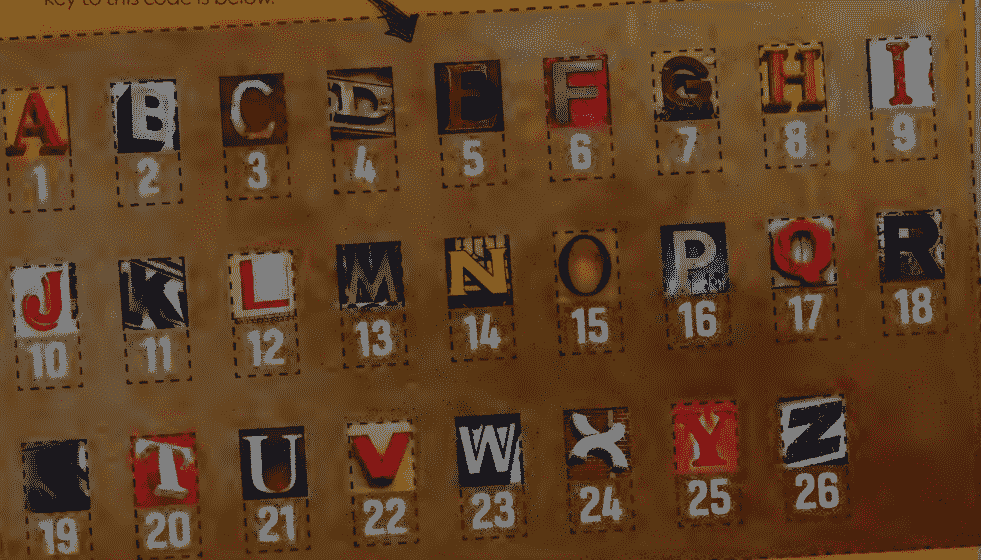

你能猜出下面这段密文说了什么吗？

拿一张纸和一把铅笔，尝试一下吧！

```
25 15 21 19 15 12 22 5 4 20 8 5 3 9 16 8 5 18
3 15 4 25 12 15 22 5 19 5 24 16 12 15 18 9 14 7
3 15 21 14 20 20 8 5 6 18 15 7 2 15 20 19
```

> 思考一下：如果接收你信息的人不知道密钥，会发生什么？

密码继续

```
H'L OHMJ ADBZTRD H DZS RGQHLO
```

> 轮到你了

## 编程概念：密码学

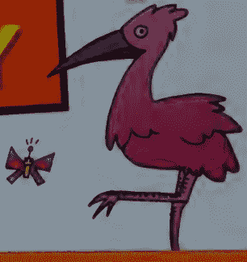

## 尝试一下

### 替换密码

较复杂的密码之一被称为替换密码。在这种密码中，一个字母会被另一个字母替换。发送信息的人和接收信息的人都需要密钥才能发现信息。

在当前密钥中，用于编写密码的字母表移动了一个字母。

普通字母表：`A B C D E F G H I J K L M N O P Q R S T U V W X Y`

密码字母表：`Z A C D E F G H I J K L M N O P Q R S T U V W X Y`

拿一张纸。你能使用第二行的密码字母表写出下面这些信息吗？

- 长颈鹿的舌头是黑色的！
- 蝙蝠有拇指！

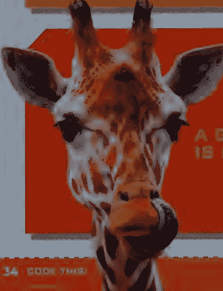


## 现在你能解密这些有趣的动物知识吗？

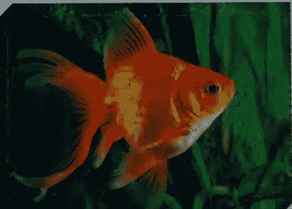

```
ZM NBSNOTR GZR
SQDD GDZQSR.
```

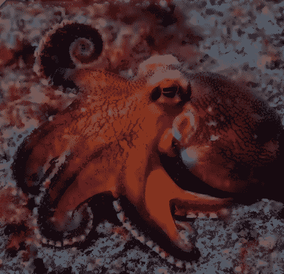


# FNKCEHRG BZM

KDZQM SN CN

SQHBJR.

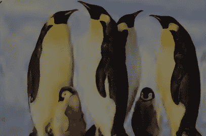

MN SVN SHFDQR'

RSQOHDR ZQD ZKHJD.


LZKD ODMGFTHMR

JDDO DFFR VZQL.

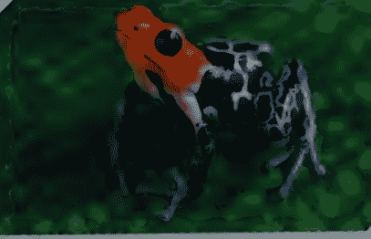

AQHFGS BNKNOR

VZQM ZVZX

OQDZSQNR.

# 轮到你了

## 编程概念：密码学 (CRYPTOLOGY)

## 尝试一下

### 制作密码轮

想要出一个超级秘密的密码可能是困难的。毕竟，几乎任何人都能猜出一个仅仅将字母表移动一个字母的密钥。使用这个密码轮来帮助生成难以破解的密码。

- 两个纸盘
- 剪刀
- 铅笔或签字笔
- 单孔打纸器或剪刀
- 纸装订针


> **编程连接**
>
> 许多重要信息在计算机之间进行传输和存储。计算机科学家使用密码学来学习如何保护信息。学习密码也有助于你编写真实的程序。

现在尝试这个密码轮吧！你想要先做一个代码，然后将其翻译回来。

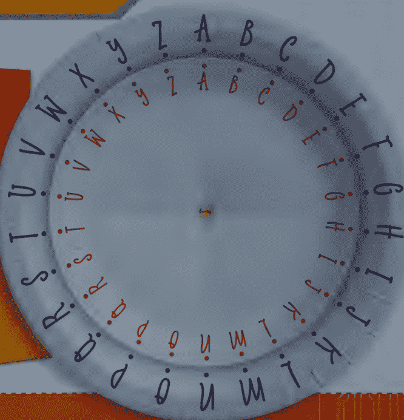

# 如何操作

1. 切割一个纸盘，使其比另一个纸盘小。
2. 将每个纸盘折对四分之一，让它看起来像一块饼图。


3. 使用打孔器或剪刀在折叠后的纸盘中心打一个孔。
4. 将两个纸盘叠在一起，用纸装订针固定。
5. 在较大的纸盘边缘上写上字母表，确保间距均匀。
6. 将较小的纸盘叠在较大的纸盘上。
7. 通过旋转小纸盘来对齐不同的字母，从而产生不同的位移密钥。
8. 注意不要把孔打得太大。

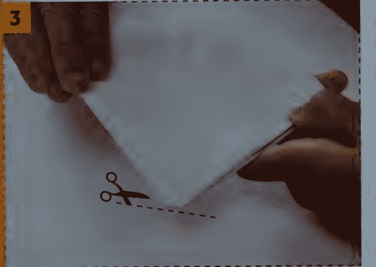

# 密码继续

# 密码轮

# 如何操作

## 拆解

## 编程概念：循环

我打赌我可以绕着那个鼠标球跑圈圈！

## 解码概念

计算机在重复执行同一件事时不会感到无聊，但人类会！程序员在编写指令时采用的一种快捷方法叫做“循环”（`loop`）。循环是指任何连续执行多次的动作。拍拍三次手。你刚刚完成了一个循环！

它非常易用！

只需将你想执行的命令放入槽位中。

循环的命令块看起来如下：

| 重复 REPEAT | 次 TIMES |
|---|---|
| 执行 DO | A |
| 重复 REPEAT | 次 TIMES |
|---|---|
| 执行 DO | A |

在圆圈内写下让它执行的次数。

## 编程连接

有时，程序员会将循环写入程序中以节省时间和空间。几乎每个计算机程序中至少有一个循环。有时还有循环中的循环——这些被称为嵌套循环。循环为程序员节省了大量时间，但如果使用不当，它们可能会让程序运行得更慢。

| 重复 REPEAT | 3 | 次 TIMES |
|---|---|---|
| 执行 DO | A | |

## 尝试一下

帮助小鼠（`mousebot`）到达蘑菇。

现在重新写一遍算法。这次你可以使用循环块。

在纸上，使用工具箱中的方向命令块为小鼠写一个到达到达蘑菇的算法。

使用硬币或其他物体在下方的板上尝试你的两个算法。

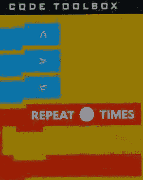

## 代码工具箱


## 开始

## 难题解决者

每个算法有多少步？哪一个算法更短？


## 发生了什么？

小鼠遇到了循环。我在循环内部添加了一个新命令来计算重复的次数。每当小鼠完成一个循环，我就在算法中增加一个新命令。


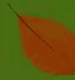

## 编程连接

计算机程序和应用可能运行数百甚至数千行代码，但有时创建一个循环的代码可能超过 10 行。尝试使用循环代替重复，以节省大量代码。


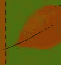


## 迪的编程挑战

### 编程概念：循环

## 尝试一下

### 迪 与迷宫

在探索了第一个隧道后，Cody 带回了一个酷炫的密码。在进一步研究地图后，探险家们认为第二个隧道里可能有一些有趣的晶体。看看洞穴地图。你能使用工具箱中的命令块编写一个算法，让 Cody 到洞穴深处的房间吗？编写你的代码，然后使用硬币或其他物体在第 49 页上尝试一下。成功了吗？

> 记住：`A` 表示向前移动 1 格。
>
> 你不想打扰蜘蛛！
>
> 循环命令块看起来很有用！

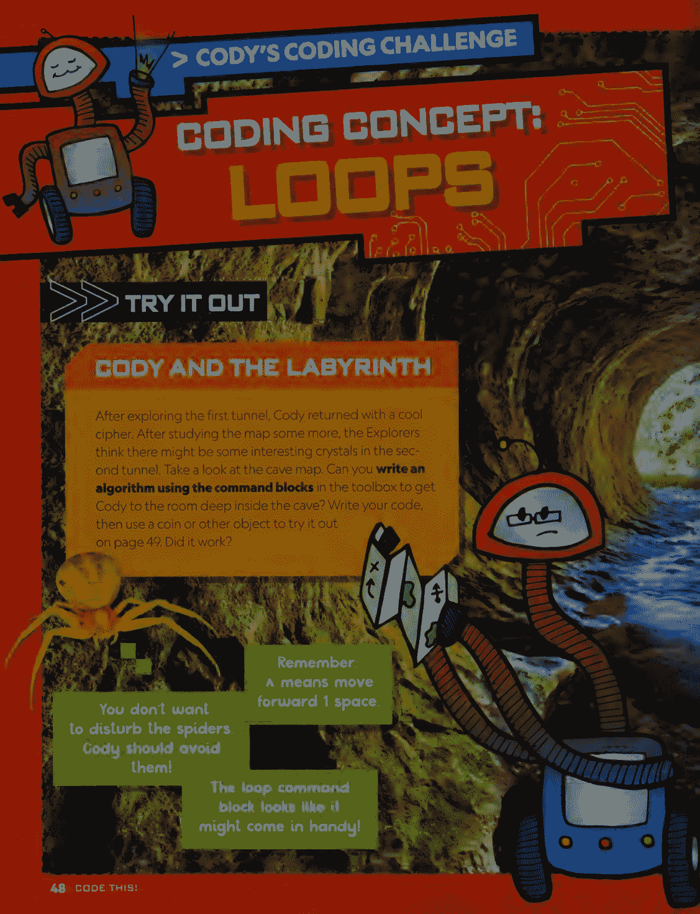

## 开始

## 代码工具箱


```
REPEAT TIMES DO
```

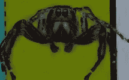
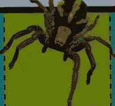
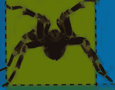
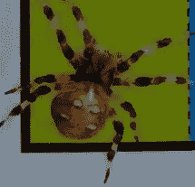

## 挑战

### 神秘洞穴

目标：使用最短算法找到并拍摄 10 物品，然后返回洞穴入口。

好了，程序员们。你们在这一章中学习了关于算法、效率和循环。现在是把它们整合在一起，让 Cody 进入洞穴看看它能发现并拍摄什么了。拿一张纸和一支笔写下你的算法。然后拿硬币或其他物体代表 Cody 在地图上尝试你的算法！

```
CODE TOOLBOX
REPEAT TIMES TAKE PHOTO
```

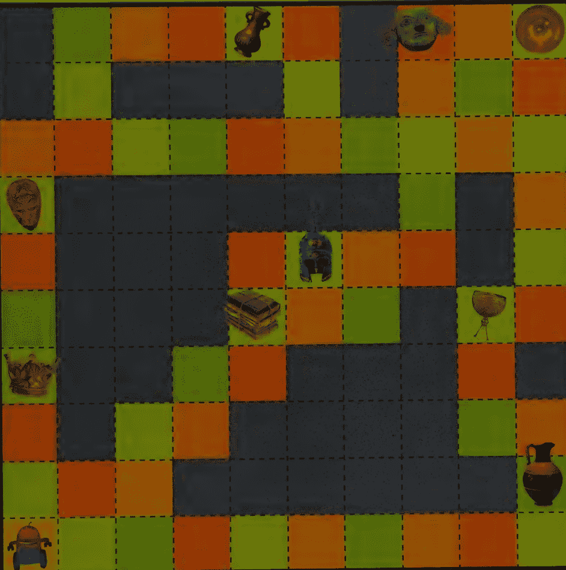

> 不要忘记：Cody 在拍摄完 10 物品后需要返回洞穴。
>
> 提示：Cody 每次只能执行一个动作。它可以移动或拍照。

# 第 2 章 深海惊喜

本章的编程概念：

- 约束 (CONSTRAINTS)
- 调试 (DEBUGGING)
- 二进制代码 (BINARY CODE)
- 二进制搜索 (BINARY SEARCH)


## 挑战

### 深海潜水

目标：编程帮助探险家们进行深海探索。

## 情况

海底可能是一个黑暗而危险的地方。科学家经常使用机器人车辆探索海洋深处，看看那里生活着什么样的动物。国家地理探险家想观察海洋深处。你如何编程帮助探险家们进行深海远征呢？

有很多酷的生物等待被发现！Cody 队长为你效力！深水很难看清。你需要方法清晰地传递信息给 Cody。

## 拆解

### 编程概念：约束 (CONSTRAINTS)

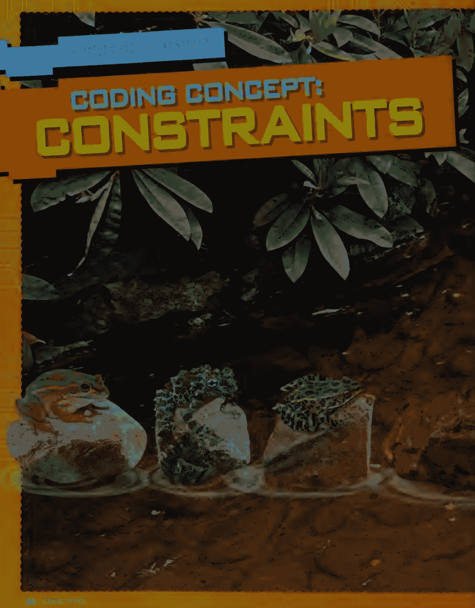

## 解码概念

程序员编写计算机程序时必须考虑的因素之一是**约束**。约束是任何可能导致方案失效或运行不佳的因素。尝试系鞋带。需要多久？增加不能使用拇指的约束，然后再次系鞋带。这如何改变结果？

你可以通过解决这个逻辑问题来练习约束：三只青蛙和三只蟾蜍坐在池塘的七块石头上。左边的青蛙想坐在右边的三块石头上。右边的蟾蜍想坐在左边的三块石头上。每只动物一次跳一下，它们只能向前跳，而且不能与其他蟾蜍或青蛙共享一块石头。每块石头一次只能一只动物。你能让青蛙和蟾蜍交换位置吗？


## 你来上

### 编程概念：约束 (CONSTRAINTS)

## 尝试一下

### 跳起来吧！

不用青蛙和蟾蜍，你可以使用物体来解决上一页的方案。你可以用逻辑帮助两组物体交换位置吗？

| 你需要 |
| --- |
| 一张纸和铅笔或笔 |

- 一张纸和铅笔或笔
- 六个小物体，如硬币或积木——三种一种三个另一种，用来代表青蛙和蟾蜍

> 我更像是一个大叫者而不是跳跃者。

**编程连接**

你知道青蛙和蟾蜍有不同的特征吗？在编程中，这些被称为“约束”。它们是帮助我们以特定方式解决问题的限制或规则。

## 不仅仅是数学家

理查·盖（Richard Guy）创建这个游戏的人之一在 2015 年就获得了超过 100 项奖励。即使在创建游戏后，他仍然每天工作，并仍在学习和研究数学。


## 1


## 2


## 3


## 4

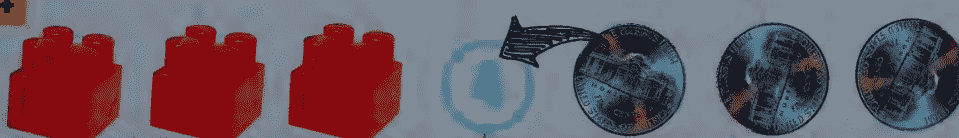

## 需要做什么

1. 在纸上像这样画画七个圆圈。给圆圈编号 1 到 7。这七个圆圈将是池塘中的石头。
2. 在 1、2 和 3 号圆圈上放置三个相同的物体。它们代表池塘中的青蛙。
3. 将另外三个物体放在 5、6 和 7 号圆圈上。它们代表蟾蜍。
4. 跳跃！使用圆圈和物体让青蛙和蟾蜍从一块石头跳到另一块，直到青蛙在 5、6 和 7 号位置，蟾蜍在 1、2 和 3 号位置。
5. 如果你的方案不起作用，没关系！再次尝试吧！

## CODY 的编程挑战

## 编程概念：限制条件

## 尝试一下

## 特别任务

每一个旅程都始于一步。

在这种情况下，它始于一个问题！探险家们必须将所有的物资从岸上运到他们的基地——一艘锚泊在海洋中的船。为了做到，他们计划乘坐一条小船多次往返。最后，他们剩下三件要运：

- 探险家的野餐篮
- 探险队的官方吉祥物：一只猫和一只狗


> 提示。这个问题中的限制条件是什么？哪些组合在船上是不可行的？哪些组合在船上是可以行的？

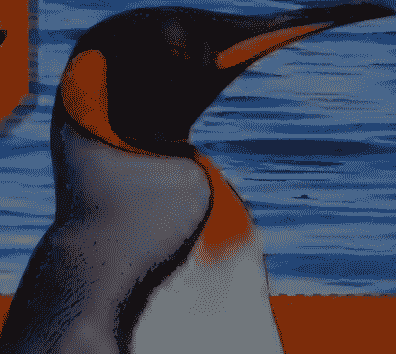

探险家们急于开始探险。他们如何编写 Cody 把这三样东西都送到基地的船上呢？

编写一个算法将所有东西都送到船上。

## 不过，关于物资运输，你需要了解以下几点：

1. 船上的空间只能容三件东西——其中一件必须是 Cody，因为探险家可以远程控制它来操控船。
2. 如果把狗和野餐篮留在一起，它会偷掉几个三明治。
3. 猫非常挑剔，不吃食物，但它和狗不能单独在一起，因为它们相处得不好（完全不相处！）。

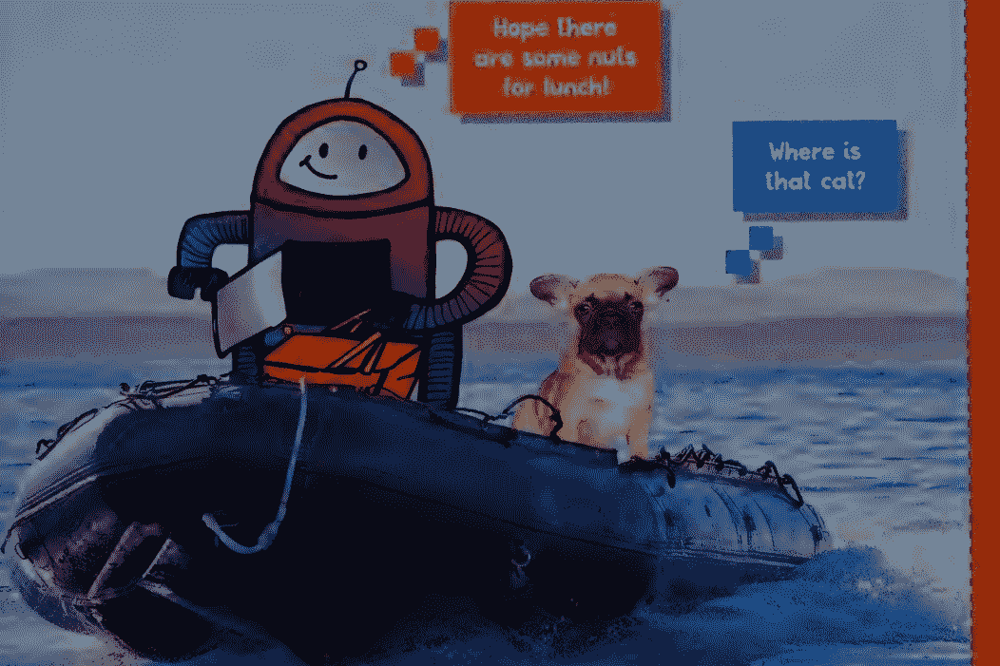

> 希望午餐有一些坚果吃！
>
> 那只猫在哪儿？

## 编程概念：调试

## 解码概念

有时候，程序员写的代码……嗯，不起作用。这没关系！这种情况经常发生——一段代码的运行方式并不符合预期。**Bug** 是代码中的错误。**调试（`Debugging`）** 就是发现代码中的错误……然后修复这些错误。

程序员在调试时并不是盲目猜测——他们有计划，或者说**策略**。调试时常用的一种简单策略是问自己这三个问题：

1. 运行代码时会发生什么？
2. 应该发生什么？（而不是实际发生了什么。）
3. 这意味着什么？

> 我的旅行计划里可能有一个 bug

这会告诉你你正在寻找的是什么样的错误。

**拿上铅笔、一张纸和一把尺子试一试！**

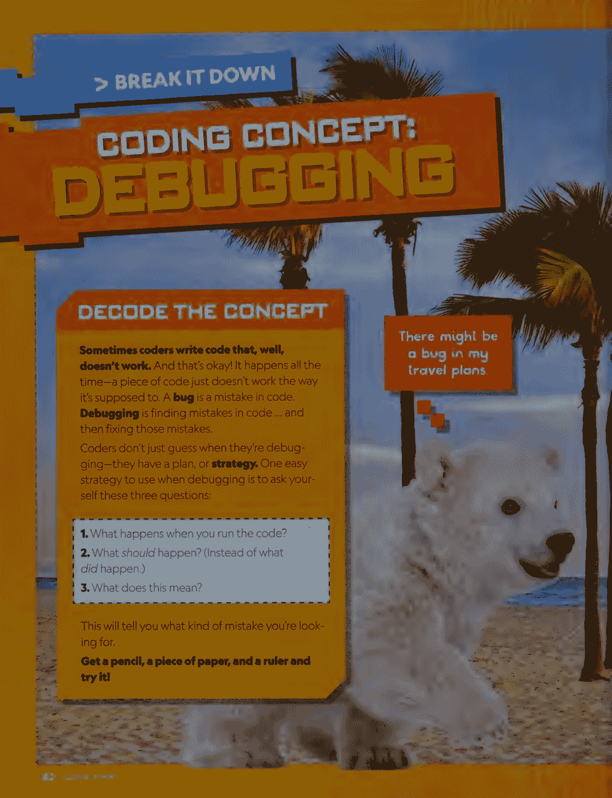

## 你需要的物品

## 尝试一下

## 杯子堆叠

### 调试

你是否曾经做过作业答案错误，然后回过头去找哪里错了？如果是的话，你已经练习过调试了！继续找出这个游戏代码中的错误吧。

## 你需要的物品

- 8 个塑料杯
- 一张大纸
- 一支笔

## 托马斯·爱迪生

没有人确定为什么程序错误被称为 bug；但这个词已经存在很久了。在计算机出现之前，即使是生活在 19 世纪末和 20 世纪初的托马斯·爱迪生也将他发现的问题称为 bugs。

在计算机早期，零件还没有小到无法真正停止。至少有一个记录显示，一只蛾子进了计算机，导致计算机无法工作！


## 你需要做什么

1. 将一个杯子倒过来，在纸上画出。这将形成一个圆。
2. 移动杯子，下次画时，下一个圆的边缘会接触第一个圆。
3. 重复此操作，直到纸上排成五个圆。给它们编号为 1, 2, 3, 4, 和 5。
4. 将一叠倒过来的杯放在圆 1 的左侧。
5. 在下一页上，阅读每一行代码。第二列显示了按照所有代码后杯子应该有的样子。遵循这段代码看看。

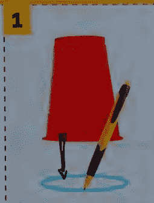
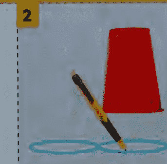
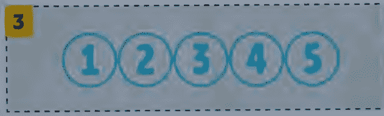
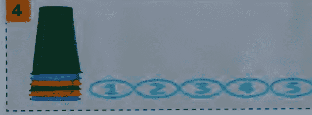


这是一个例子：一排杯子的代码看起来像 ...

| CODE TOOLBOX |
|---|
| A Pick up a cup |
| Move right one circle |
| Move left one circle |
| Put the cup down |
| Flip the cup over |


... 看起来像这样：

```
^>>>>V<<<<
^^^^V<<<
^^^^V
```

调试继续

## 轮你了

## 编程概念：调试

## 尝试一下

## 杯子堆叠

### 调试

这个堆叠的代码正确吗？试试看！从杯子朝上开始。

## 代码

```
>>>>>V<<<<
>>>>>V<<<<
>>>V<<<
>>><
```

## 正确执行


当你遵循这段代码时，你的堆叠像这样吗？如果没有，你能发现代码中的 bug 吗？

## 代码工具箱

- 拿起一个杯子
- 向右移动一圈


- 向左移动一圈
- 拿起杯子放下
- 翻转杯子

> 发生了什么

计算机不会犯错……但人类拥有计算机没有的东西……需要人类的大脑来检查代码以发现并修复错误。这就是为什么调试如此重要！

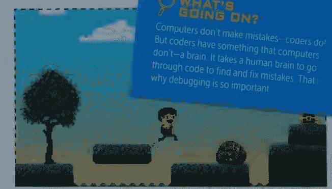

## 代码

```
^>>>>>V<<<<
^^^^>>V<<<<
^^^^>>V<<<
^^^^>>V<
^^^^V<
^^^^>>TV<<<<
^^^^>>TV<<<
^TV<
```

## 正确执行

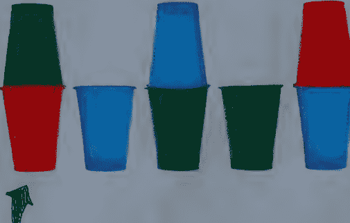

当你遵循这段代码时，你的堆叠像这样吗？如果没有，你能发现代码中的 bug 吗？

## 代码

```
^>>>>>V<<<<
^^^^>>V<<<<
^^^^>>V<<<
^^^^>>V<
^^^^V<
^^^^>>TV<<<<
^^^^>>TV<<<
^TV<
```

> 思考一下

这是一段短代码，但如果你有一段很长的代码呢？如果有100个杯子呢？你会如何寻找 bug？

> 进一步尝试

高四层杯子的塔代码应该是什么样？

底部有五个杯子的金字塔代码应该是什么样？

你自己的杯子创作代码应该是什么样？

试试看！

## CODY 的编程挑战

## 编程概念：调试

## 尝试一下

### Cody 偏离了目标

国家地理探险家们使用声呐对冰冷、黑暗的海底进行可视化。他们让 Cody 潜入深海以拍摄海底。但看起来 Cody 偏离了目标！知道 Cody 的前两步是正确的（你可以从船上看到），你可以调试这段代码让它到达正确的位置吗？

```
MOVE FORWARD
TURN LEFT
MOVE FORWARD
TURN RIGHT
MOVE FORWARD
TURN LEFT
MOVE FORWARD
TURN RIGHT
```

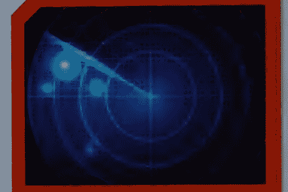

### 什么是声呐？

人们使用声呐（声导航和测距）来帮助寻找周围的物体或识别水下的物体。声呐向水中发射声波，然后测量声波在从物体反射回来之前所需的时间。人类不是唯一使用声波寻找东西的生物——蝙蝠和鲸鱼等动物也有自己的回声定位能力。

> 提示：为了调试不正常的代码，你可以问自己哪几个问题？

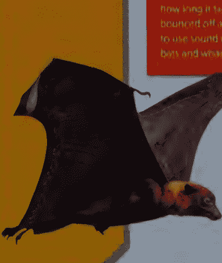

## 开始

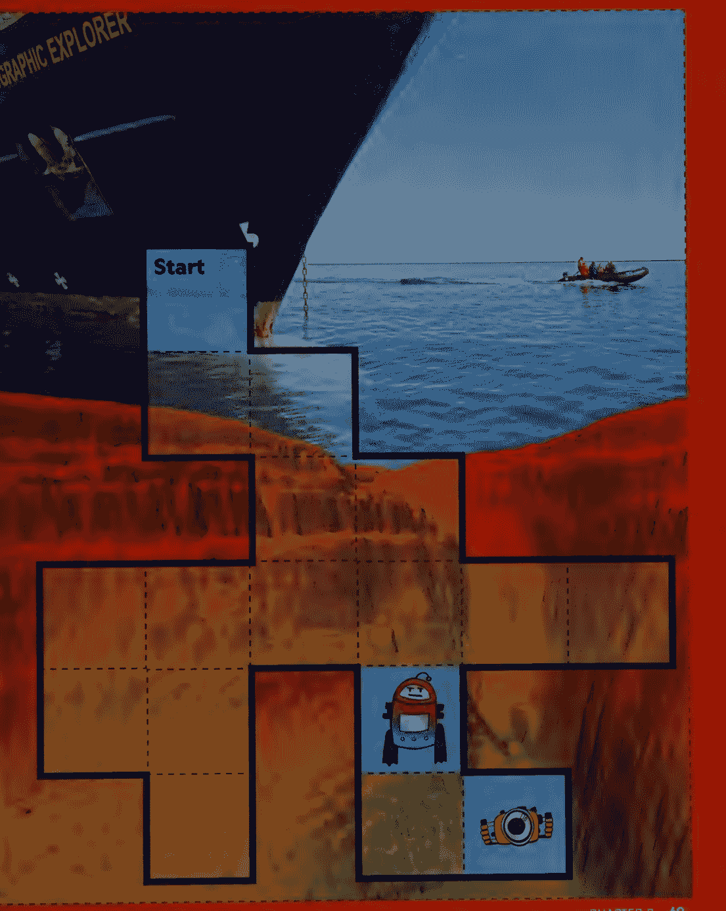

# > 拆解

## 编码概念：二进制代码

## 解码概念

计算机接收编码员编写的单词指令，并将其它们转换为所谓的二进制代码。有很多种不同的二进制代码，但它们都有一个共同点——它们只有两个部分。

摩斯字母表看起来像这样：

| A | ● — | N | — ● |
|---|---|---|---|
| B | — ● ● | O | ● ● ● |
| C | — ● — | P | ● ● — |
| D | — ● — | Q | — — ● |
| E | ● | R | — ● ● |
| F | ● ● — | S | ● ● ● |
| G | — — ● | T | — |
| H | ● ● ● | U | — — ● |
| I | ● ● | V | ● ● — |
| J | ● — — | W | — ● |
| K | — ● — | X | ● — ● |
| L | ● — ● | Y | — ● — |
| M | — — — | Z | — — — |

> 二进制（BINARY）中的“BI”意味着二——就像自行车有两个轮子一样。


摩斯密码是一种二进制代码。摩斯字母表中的所有字母只由两种东西组成：点和划。

摩斯密码最酷的地方之一是，你可以用光来制作短部分和长部分！亲自试一下吧！

## 试试看

## 你需要什么

- 铅笔和纸
- 份摩斯字母表
- 一只手电筒
- 一个朋友

## 怎么做

1. 在纸上写一个两个或三个单词的消息
2. 使用对页上的字母表将消息的每个字母转换为摩斯密码
3. 在昏暗的房间里使用手电筒向其他人发送你的代码！

# 1 写下你的秘密信息

## 2 写 (WRITE)


> 点是光的一次快速闪烁或一次快速的敲击声。

> 划是光的闪烁或长度是点三倍的敲击声。

# 摩斯密码

在电话发明之前，人们使用摩斯密码发送电报。一个人会将消息带到电报局并交给操作员。操作员将消息转换为摩斯密码并将其敲入机器中。信号会通过长线传输到另一端的操作员那里，该操作员使用普通字母表将摩斯密码转换为消息。

## 发生了什么？

你可以沿着电话发送和接收信号，但你可能会觉得这非常简单。但如果你想在没有任何线的情况下发送消息呢？摩斯密码是一种由点和划组成的代码，代表字母、数字和标点符号。如果你使用它，只需用手电筒或其他声音就能向另一个人发送消息！

## 思考一下

你能想到其他利用光或声音发送摩斯密码来传递消息的方法吗？


## 二进制代码继续

# > 轮到你了

## 编码概念：二进制代码

嘿，我也是两种颜色！

## 解码概念

有些计算机使用一种类似于摩斯密码的代码。它的正式名称是美国标准信息交换码，但你可以直接叫它的昵称 ASCII。

ASCII 字母由八个框组成。有些是填充的，有些是空的。ASCII 字母表像这样：


| A | | | | | | | | N | | | | | | | |
| B | | | | | | | | D | | | | | | | |
| C | | | | | | | | P | | | | | | | |
| D | | | | | | | | Q | | | | | | | |
| E | | | | | | | | R | | | | | | | |
| F | | | | | | | | T | | | | | | | | |
| G | | | | | | | | U | | | | | | | | |
| H | | | | | | | | V | | | | | | | | |
| I | | | | | | | | W | | | | | | | | |
| J | | | | | | | | X | | | | | | | | |
| K | | | | | | | | Y | | | | | | | | |
| L | | | | | | | | Z | | | | | | | | |
| M | | | | | | | | | | | | |

## 试试看

## 你需要

- 铅笔
- 纸

你能用 ASCII 写出你的名字吗？拿一张纸，从上往下写下你的名字。这就是计算机读取的方式。然后，使用 ASCII 图为每个字母画出正确的框。

Code 是这样拼写它的名字的：


这些字母拼写的是什么？


# > 拆解

## 编码概念：二分查找

我们一直使用计算机来帮助寻找答案。你是否好奇计算机是如何快速找到答案的？计算机用于查找信息的一种算法叫做二分查找。二分查找和二进制代码一样，依赖于2。让我们来看看吧！

## 你玩过“猜猜数字”吗？

在这个游戏中，一个人想一个数字，另一个人尝试猜。例如，两个朋友决定玩这个游戏。他们规定游戏规则：

1. 数字必须在 1 到 10 之间。
2. 每次猜错后，想数字的人必须说数字大还是小。可能是这样的：

在游戏开始时，1 到 10 之间的任何数字都可能是答案。第一次猜之后，只有大于 3 的数字是正确的：4, 5, 6, 7, 8, 9 或 10。

下次猜之后，只有 4, 5, 6, 7 或 8 可能是正确的。每次答案的数量都被分成两部分，直到剩下正确答案！

## 编码连接

某些二分查找被用于快速搜索数据库。数据库是大型信息池，帮助我们搜索互联网以及通过电子邮件或电话联系他人。


# 让我们试一下。

你想一个数字，我来猜。

## 发生了什么？

这个游戏非常像计算机搜索某个东西。你是在搜索文件、文本文档还是卡通？当计算机通过你的输入创建每条路径时：

... 3
... 大了！
... 9
... 小了！
... 6
... 大了！
... 8
... 小了！
... 7
... 你对了！


二分查找继续

## Cody 的编码挑战

## 编码概念：二分查找

## 试试看

要弄懂 Cody 旗帜的含义，请阅读二分查找树中的每个语句。如果语句是真的，遵循 YES 线。如果语句是假的，遵循 NO 线。一直下去，直到路径结束！


## 从这里开始！

## 旗帜是方形

是
否

## 旗帜只有一种颜色

是
否

## 我是危险货物

## 区域内有潜水员

继续探索！

你能使用树图来弄懂这些旗帜的意思吗？

# > 轮到你了

## 编码概念：二分查找

## 试试看

## 你需要

- 纸和铅笔！
- 一个朋友或更多

## 二十个问题

寻找答案并不总是复杂的——你可以通过问问否问题获取大量信息！尝试这个游戏，看看二分查找是如何工作的。

## 怎么做

1. 一个人想一个物体……但不要告诉任何人！这个人是答案者。
2. 另一个人（或这些人）现在尝试弄清楚物体的身份——这些人是提问者。
3. 每个提问者轮流对物体提一个问题。问题必须有两个答案：是或否。提问者总共可以问20个。
4. 将每个问题及其答案写在纸上。
5. 如果某个提问者猜中了物体，他们成为下一个答案者！
6. 如果没有人猜出物体的身份，答案者就想一个新的物体。

> 它比冰箱大吗？


## 从这里开始

它是活着的吗？

是
否


## 是动物吗？

否


> 继续探索！

这个游戏就像一种通过回答问题来获得物体的游戏。例如，如果你对“它是活着的吗？”回答“否”，那么画出那个不是动物的物体。

最后对每个问题排序，并写下在每个答案后被排除的物体顺序。

## 它有毛吗？

是
否


# >> 挑战

## 深海惊喜

目标：为 Cody 编写一个算法，用于拍摄每种生物并将名称发送给探险家。


好了，程序员们。在这一章中，你们学习了许多关于调试、二分查找和二进制代码的知识。是时候它们整合在一起，让 Cody 出发深海探险了。


Cody 的任务是找到并拍摄地图上显示的每种深海生物。Cody 需要先到达生物所在地且不能经过黑暗区域。然后 Cody 应该给生物拍照。最后，Cody 应该使用 ASCII 码将名称发送给船上的探险家。之后 Cody 就可以前往下一种生物。


为 Cody 编写算法，以找到并拍摄每种海生物并将名称传回给探险家。然后按照你的算法进行操作。不要忘记调试你的代码。

## 开始


提示：调试时不要忘记检查每一行——错误可能不止一个！

不要忘记将每个生物名称的字母按 ASCII 码从上下堆叠。

第 2 章 81

# 第 3 章

## 拯救卫星

### 本章编程概念：

- 试错
- 用户与事件
- 像素
- 分解


## 挑战

## >> 损坏的卫星

**目标：** 编写 Cody 来修复卫星，以便探险家可以检查木星的一颗卫星上正在喷发的火山。

# 情况说明

太空中到处都是火山。有些（像地球上的火山一样）喷出岩浆。有些被称为**冰火山**，会喷出超冷液体。**木星的卫星（卫二）**是我们太阳系中火山最活跃的世界之一。探险家们认为其中一个活跃火山正在喷发！但从太空传回图像的卫星运行不正常。**你能帮助 Cody 采取正确的步骤让卫星重新工作吗？**

> 当你编写让一台计算机与另一台计算机通信时，指令必须格外清晰！

损坏的卫星阻碍了研究。所以你的程序运行得越快，它恢复工作就越快。

嗯……有些不对劲。

# > 分解

## 编程概念：试错

> 如果起初你骑不上乌龟，再试一次吧！

## 解码概念

你听过“我们都会犯错”这个句语吗？是的，这是真的。但我们学习最重要的方式之一就是试错。试错的工作原理如下：

1. 尝试一个解决方案
2. 失败
3. 回到步骤 1 直到你成功。

试错可能会令人沮丧，但学习不要做某事与学习如何做某事同样重要。这样，你就可以通过避免重复犯过的错误来节省时间。程序员通过试错学到了很多东西。


# 魔方！

魔方可能并不魔术，但它们是神话故事的主题。根据中国的传说，一只壳上刻有魔方的乌龟能够阻止河流洪水！


86 来编写这个代码！

# 魔方谜题

解决魔方谜题通常需要一点的试错。要解决魔方谜题，你需要遵循两个规则：

1. 你只能使用 1 到 9 的数字，且每个数字只能使用一次。
2. 每列、每行和对角线的数字之和必须相同。

将这个魔方复制到纸上尝试一下。


> 思考一下

在开始解决问题之前，你如何向客户证明魔方中设置的所有行、列和对角线都是正确的？


> 发生了什么？

魔方完全不是魔术——它们基于行和列。完成魔方可能需要大量的尝试和错误。某一行或一列之和正确，并不意味着所有的都如此。

# > 分解

## 编程概念：用户与事件

## 解码概念

作为计算机的**用户**，你可以控制计算机做什么。每当你点击鼠标或触摸键盘键时，你就创建一个**事件**。计算机上的程序会读取该事件。接下来发生什么取决于代码！编写代码时，程序员不仅需要考虑代码做什么，还需要考虑什么会触发该事件。

编写这样的代码：

```
JUMP
```

将其连接到用户可以控制的东西。例如：

```
WHEN SPACE BAR
JUMP
```

如果 frogbot 读取这段代码，当用户按下空格键时，它就会原地跳起。


## 尝试一下

## 主事件

使用工具箱中的命令，配对代码让 frogbot 响应用户按下方向键。

# 工具箱

- `WHEN LEFT ARROW`
- `WHEN RIGHT ARROW`
- `WHEN UP ARROW`
- `WHEN DOWN ARROW`
- `JUMP LEFT`
- `JUMP RIGHT`
- `JUMP UP`
- `LAND`

> 思考一下

如果你将 `move-left` 命令连接到 `right-arrow` 键会发生什么？


# > 轮到你了

## 编程概念：用户与事件

# >> 尝试一下

## 视频游戏角色

视频游戏完全关于用户和事件。思考一下——如果你作为玩家不需要做些什么来让游戏发生变化，那么它就没有挑战性了对吧？诀窍是让每个事件在正确的时间发生。这可能很困难，这也是游戏的乐趣所在。找个朋友，看看你能否成为用户/事件冠军。

# 你需要的

- 气球
- 一根长绳或线
- 胶带
- 一个朋友
- 纸和马克笔


# 步骤

1. 将气球并打结。将绳子系在气球的一端。


## 2

请成人帮助你将绳子**系在或胶在**房间中央的天花板上。气球应该挂得足够高，让你和朋友必须跳起来才能碰到（但不要高到你们完全够不到）。

## 3

将工具箱中的每个符号写在单独的纸上。确保符号足够大，能从房间另一头看到。代表键盘上的按键。


### 1,2


### 3


## 代码连接

事件命令之所以视频之所以的原因。有些事件命令与键或鼠标相关，但另一些是因为代码的其他部分。当你捡起硬币时的叮当声，以及角色跳起时的弹簧声都是事件命令的结果：

| 命令 |
| :--- |
| 向左移动一步 |
| 向右移动一步 |
| 向前移动一步 空格跳转 |

## 视频游戏角色继续

### 第 3 章 91

### 你扮演视频游戏角色

### 步骤

4. 让一个人站在房间另一侧，**对着另一个人**。

5. 一个人拥有所有的符号。这个人是用户。另一个人按照符号的指示做。这个人是视频游戏角色。

6. 用户举起一个符号。角色随后执行该符号代表的动作。

7. 游戏的目标是让视频游戏角色跳起来并触碰到气球。


> 有小兔子在说视频游戏吗？

## 代码工具箱

- 向左移动一步
- 向右移动一步
- 向前移动一步
- 空格：跳跃


## 双人网球

最早的视频游戏之一可以追溯到1958年。《双人网球》（Tennis for Two）的玩家试图在球网两侧回击一个电子“球”。用户只能做两件事之一：旋转旋钮来控制球的角度，或按下按钮将球“击”回另一侧。

### CODY 的编程挑战

### 编程概念：用户与事件

### 尝试一下

### 遥控 CODY

Cody 为了让卫星恢复运行需要做的第一件事是按下控制面板上的某些按钮。使用命令块编写一段代码，告诉 Cody 当探险者在地球上按下键盘按钮时应该做什么。为探险者和 Cody 写出完整的算法，让他们按照正确的顺序按下按钮。每当 Cody 按按钮时，卫星就应该移动。

## 代码箱

| 命令 |
| :--- |
| 当按下左箭头 |
| 当按下右箭头 |
| 当按下上箭头 |
| 当按下下箭头 |
| 当按下空格键 |
| 当按下按钮 |
| 向左移动 |
| 向右移动 |
| 向上移动 |
| 向下移动 |
| 按下按钮 |
| 重复次数 |
| 执行 |
| 卫星移动 |


## 记住 Cody 只能做一件事

正确顺序：

| | | | |
| :--- | :--- | :--- | :--- |
| 正方形 | 三角形 | 圆形 | 正方形 |
| 圆形 | 正方形 | 三角形 | 圆形 |
| 正方形 | 正方形 | 三角形 | 三角形 |
| 正方形 | 三角形 | 圆形 | 正方形 |

## 拆解它

### 编程概念：像素

> 就叫我 Spot 吧！

### 解码概念

电脑屏幕上所有的图像或**图形**都是由**像素**组成的。程序员通过代码告诉计算机哪些点应该被上色。假设一个程序员想在屏幕上创建这张图片。


你如何为所示的图案编写代码？

### 像素


### 它是这样工作的。

1. 从网格的第一个空格开始，即左上角的。（不要从网格外开始！）
2. 第一个空格是白色的，所以你可以直接写代码向右移动一步：`>`
3. 这个空格是黑色的，所以你需要使用表示“给这个空格上色！”的命令：`X`
4. 哎，没格子了！告诉计算机向下移动一步：`D`
5. 该空格是白色的，所以告诉计算机向左移动一步：`<`。这是一个黑色空格！所以给它上色：`X`
6. 向左移动两个空格到达下一个黑色格子：`<<` 并给它上色：`X`
7. 向右移动到下一个空格：`>`
8. 它是白色的，再次向右移动：`>` 然后告诉计算机给该空格上色：`X`


> 棋盘前两行的代码看起来这样：`X>>KD<<X`
>
> 你能完成剩下的部分吗？

> 你能用点组成图片？太让我惊艳了！

### 要做什么

1. 从左上角开始，向右移动再向下移动，看看哪些像素应该被上色。
2. 现在**编写你的代码**。使用工具箱中的符号编写代码，让你的朋友可以在网格纸上重新创建这只河马。
3. 完成后，请一位朋友使用干净的网格纸遵循你的代码。图片看起来和原来的一模一样吗？

## 代码箱

| 命令 | 命令 |
| :--- | :--- |
| 向右移动 | 涂蓝色 |
| 向左移动 | 涂粉色 |
| 向下移动 | 涂灰色 |
| | 涂黑色 |


我们在电脑屏幕上看到的所有东西，从我们输入的文字到我们喜爱的游戏，都是因为代码告诉电脑如何点亮像素。

### CODY 的编程挑战

### 编程概念：像素

### 尝试一下

### 哪个按钮？

修复卫星的下一步是让 Cody 按按钮。探险者需要告诉 Cody 它应该寻找什么。按钮代码必须与 Cody 记忆中的完全匹配，否则它就不知道按哪些按钮。（这很挑剔。）Cody 无法读取图片，所以你需要发送每个按钮的样子。这样 Cody 就会知道找什么。

## 代码箱

| 命令 | 命令 |
| :--- | :--- |
| 向右移动 | 涂黑色 |
| 向左移动 | 涂红色 |
| 向下移动 | 涂黄色 |
| | 涂粉色 |
| | 涂灰色 |
| | 涂棕色 |
| | 涂浅绿色 |
| | 涂深绿色 |


### 按钮 1 开始

### 按钮 2 开始

### 按钮 3 开始

### 按钮 4 开始


## 拆解它

### 编程概念：拆解

### 解码概念

有时候问题看起来非常大。程序员在编写算法时也一样。**拆解**（Decomposition）是一种可以更容易处理大问题的策略。在拆解中，你将一个大问题拆分成更小的部分。

> 你知道吗
>
> 扎特和贝多芬这样的音乐家被称为作曲家，是因为他们把音符组合成故事，变成更大的交响乐。问题的拆解则是相反的——将其分成更小的部分。

我可以通过把一天拆分成 2 小时的小块来睡一整天！


### 尝试一下

### 你需要

- 彩色纸
- 这种形状：
  - 小
  - 中
  - 大
- 笔或铅笔
- 剪刀
- 一张白纸

### 圆盘拆解

练习拆解的方法之一是使用这样的谜题。


这个游戏的目标是将所有的圆盘从1号移动到3号。有两个限制：你不能将大盘放在小盘上，并且每次只能移动一个盘。尝试自己制作一些盘，看看是否能拆解出解决方案。

## 要做什么

1. 在单独的彩色纸上**画出每个圆形**。
2. 用剪刀小心地**剪出每个圆形**。


## 圆盘拆解继续

### 圆盘拆解

> 有人说圆盘吗？我来玩！


### 要做什么

3. 将这张白纸分成三列。将第一列标记为“1号塔”，第二列标记为“2号塔”，第三列标记为“3号塔”。
4. 将三个圆形叠放在标记为“1号塔”的列中。最大的圆形应该在底部，最小的在上面。
5. 你能想出如何将所有圆盘移动到3号塔，而不将大盘放在小盘之上吗？


### 5


### 发生了什么？

解决问题可能巨大的挑战。程序员将它们拆分成小部分……更小的部分……甚至更小的部分……直到找到一个可以解决的问题部分。然后，他们应用学到的知识来解决问题的其他部分。他们重复这个过程，直到可以将他们所有的解决方案组合起来解决整个问题。


你能利用角度和排列来帮助我们解决这个谜题吗？有一个传说说，一个人试图解决这个问题花费了 64 年。如果这个传说发生在现实生活中，结果将需要 SBS 十亿年才能完成！

### CODY 的编程挑战

### 编程概念：分解

### 尝试一下

#### 镜子移动

Cody 需要做的最后一步是将这些望远镜镜子从 A 柱移动到 C 柱。Cody 需要非常小心。镜子是易的。所以 Cody 每次只能移动一个，而且较小的镜子不能放在较大的镜子上面。为 Cody 写一个算法。


A 柱

B 柱

C 柱

## 挑战

## 拯救卫星

好了，程序员伙伴们。在这一章中，你们学习了许多关于试错、添加用户事件、像素和分解的知识。**是时候把它们都整合在一起了……拯救卫星吧！**

你需要发送这些指令来告诉 Cody 需要按下哪些按钮，以及按什么顺序。你能写代码将这张图片发送给 Cody 吗？

## 按钮顺序

开始

| 代码工具箱 |
| :--- |
| `>` 向右 |
| `<` 向左 |
| `D` 向下 |
| `R` 填充蓝色 |
| `B` 填充蓝色 |
| `G` 填充绿色 |
| `Y` 填充黄色 |


Cody 必须按照每个像素颜色的出现顺序按下指定的按钮。

# 第 4 章

复杂的特平山

本章的编程概念：

- 优化
- 制作形状
- 条件判断

## 挑战

### 大猫自拍

**目标：** 编写让 Cody 拍摄一张美洲豹。

## 情况说明

**特平山是南洲的高原——高耸于委内瑞拉雨林之岩石岛。** 有些特平山全年云雾缭绕、雾气腾腾，使得前往它们的探险极其危险。但特平山也是世界上最酷的大猫的家园，包括美洲豹和美洲狮。**你能通过编程让 Cody 拍摄这些神奇动物之一的照片来帮助探险家吗？**

### 缩放

特平山的墙

将

具有挑战性！

Cody 需要

小心……如果如果在

特平山上受损

探险家们将

无法

修复它。

为什么我觉得

有什么东西

看着我？


## 分解它

### 编程概念：优化

### 解读概念

如果你曾经需要为长途旅行收拾行李，你就知道不能把所有都带上。编程也是如此。虽然通常有许多方法编写相同的指令，但更短的代码会让计算机运行得更高效。

> 通过选择你最需要的且能放入包中的物品，来优化你包的空间。
>
> 尝试对此页面上的物品最佳组合进行优化。
>
> 你能为海滩之之旅做出最佳选择吗？


### 尝试一下

#### Cody 的营地椅

美洲豹是著名的害羞动物，所以可能需要过一段时间，它们才会觉得足够安全而接近 Cody 的营地。Cody 需要准备好等一会儿。你能构造一个既轻便易折叠（这样就可以放入 Cody 的货物舱内），又足够坚固到能承受 Cody 体重的椅子吗？


## 你需要什么

- 纸和笔
- 一个三明治袋
- 一个土豆或苹果（代表 Cody）
- 剪刀
- 胶带
- 牙签
- 木木棒
- 保鲜膜
- 铝箔
- 一块约 5 英寸（13 厘米）的布


## 做法

1. 使用纸和笔为你的椅子勾勒几个主意。你的模型应该足够小，能放入塑料行李箱中（你可以折叠椅子或将其拆解，只要在到达营地后能将其重新装好即可）。记住，你只能使用列表上的材料！

### Cody 的营地椅

2. 一旦你有两个（或更多！）主意，挑选你最喜欢的，并制作它。
3. 确保你测试了你的模型——它能放进袋子里吗？它能装住你的模型吗？如果不能，尝试另一种设计。


### 编程连接

当程序员编写计算机程序时，他们必须做出像你在寻找解决方案时那样的某些选择。某些类型的代码会与其他代码兼容，或者会让程序运行变慢。程序员必须考虑程序的目标，然后选择最有效的、或最优的运行代码。

> 如果你想建造某种伟大的东西，你必须从小处开始。一个伟大的主意始于一个小小的角度。

### 更进一步！

你能使用周围发现的其他材料建造一把更好的椅子吗？

### CODY 的编程挑战

### 编程概念：优化

### 尝试一下

#### Cody 的背包

Cody 的背包只有有限的空间。按照每个像素颜色的出现顺序按下颜色所示指示的按钮。

- 5
- 2
- 3
- 6
- 4
- 0
- 7
- 15
- 4
- 1
- 3
- 8
- 5
- 2
- 9
- 14

> 提示：不要忘记目标——得到一张美洲豹的照片！


#### 背包问题

一个著名的优化问题是背包问题。它的目标是在不超出限制的情况下携带尽可能多的物品。

29

## 分解它

### 编程概念：制作形状

### 解读概念

形状可能是你学会的最早的东西之一。简单的形状——如圆圈、正方形和三角形——是艺术家和平面设计师创建各种绘画的基础。

我完全


编程也是如此。学生程序员并不是一开始就写超真实的 3D 游戏代码。相反，他们学习给计算机指令来绘制他们制作的简单形状。而且在运行程序之前，他们并不知道看到的结果。

### 尝试一下

#### 塑造

几何形状很容易画——而且它们应该是这样的！用基础形状绘制物体可以快速交流想法。找个朋友尝试这个形状挑战。

## 你需要什么

- 笔和纸
- 一个朋友


## 做法

1. 从所示形状或图中选择一个。或者从你的想象中选择一个！
2. 闭上眼睛，画出这张图。你是如何得出最初的？
3. 选择另一幅画。这次，让别人在你闭上眼睛时给你指令。按照他们告诉你的移动画笔——不要偷看！


> 发生了什么？
>
> 记住，程序员不能直接告诉计算机画某个东西。他们必须编写指令告诉计算机具体如何制作形状——而且在运行程序之前，他们并不确定形状的样子。这有点像闭着眼睛画画！


### 更进一步！

给朋友提供指令来画某个东西，但不要告诉他们是什么！

### 发生了什么？

当我们使用著名游戏中的动作捕捉技术时，看到的图像都是基于代码的。演员现在处于现实生活中，只是屏幕上的一个部分。电影捕捉了这些图像和他们的服装。

# 动作捕捉


某些计算机图形离不开真实演员的帮助。许多视频游戏和某些电影中的画面都始于一个穿着特殊服装的演员。特殊的电脑零件会记录演员在服装内的动作。然后，人们使用图形技术来创建视频游戏或电影角色。


# CODY 的编程挑战

## 编程概念：制作形状

## 尝试一下

### 设置画面

国家地理探险者们想拍一张豹子的照片。为了做到这一点，他们必须确保豹子位于特定的位置。他们需要 Cody 在地面上画出一个矩形，使其能够放入摄像头的取景框内。使用命令块编写一个算法，帮助 Cody 使用它的特殊标记物标记出拍摄区域。

## 代码工具箱

- `向移动 12 英寸`
- `向左转`
- `向右转`
- `重复 次（执行）`
- `在地面上画一个点`


> 一旦设置好相机陷阱，它只能捕捉特定区域内的照片

# 拆解分析

## 编程概念：条件语句

## 解码概念

从你早上醒来到晚上睡觉，你都在做决定——而且是很多。计算机不能自己做决定，但它们可以使用正确的代码做出选择。条件语句是帮助计算机做决定的特殊指令。

条件语句设定为“如果/那么”语句：如果发生了某事，就执行某事。例如，如果交通灯是红色的，就停止。如果条件不满足（例如，交通灯是红色以外的任何颜色），动作就不会发生。

如果它是奶酪
那么吃奶酪！


## 尝试一下

条件语句也可以设定为计算机提供特定指令，说明在条件满足时做什么以及在条件不满足时做什么。对于一个连续的图片轮播（例如，水牛在鱼之后显示），看起来可能像这样：

如果点击了上箭头，那么显示照片。否则等待 3 秒，然后显示右侧的下一张照片。

你能明白这意味着什么吗？如果点击了箭头会发生什么？如果没有点击会发生什么？

你会如何写一个条件语句来打开青蛙的照片？


你会如何写一个条件语句来打开蛇的照片？


# 拆解分析

## 编程概念：条件语句

## 解码概念

现在你理解了条件语句是如何运作的，是时候编写代码了！

`If/Else` 块像这样：

如果你有一颗坚果
那么把它给我！

```
IF THEN
ELSE
```

要使用 `If/Else` 块，只需**插入**正确的单词来描述你想要计算机寻找的条件。

```
IF CAN'T GO FORWARD THEN
  ELSE
```

接下来**添加如果条件为真时应该执行的动作。**例如，如果 Cody 无法向前，它应该向左转。

```
IF CAN'T GO FORWARD THEN
  TURN LEFT
  ELSE
```

最后，**添加条件不成立时应该发生的动作。**例如，如果 Cody 可以向前，那么它应该向前移动 1 格。

```
IF CAN'T GO FORWARD THEN
  TURN LEFT
  ELSE
  MOVE FORWARD 1
```


# 必须到达树

条件语句继续 > 你的回合

## 编程概念：条件语句

## 你需要

- 后面的游戏板
- 一个骰子
- 每个人的硬币或其他标记物
- 几个朋友一起玩

# 条件之地

条件语句也是许多游戏的一部分。思考一下，你玩过的有多少游戏是取决于某事的发生与否？许多游戏取决于你掷出的点数或抽到的卡片。

我是程序员。


格子是骰子或点击的条件。

## 动作建议

- 如果掷出 3，举左手。否则移动相应的格。
- 如果掷出 3，拍手。否则移动相应的格。
- 如果掷出 3，吐出舌头。否则移动相应的格。
- 如果掷出 3，上下跳。否则移动相应的格。
- 如果掷出 3，说出你喜欢的书的名字。否则移动相应的格。
- 如果掷出 3，唱一首歌。否则移动相应的格。
- 如果掷出 3，拍拍并揉揉肚子。否则移动相应的格。


## 怎么做

1. 在每个回合中，一人担任程序员。所有人都是该回合的计算机。
2. 每个回合开始时，程序员掷骰子。骰子上显示的任何数字将是该回合的 `IF` 数字。
3. 程序员决定计算机在掷出该点数时应该做什么（查看建议！）。
4. 每个计算机轮到时并掷骰子。如果计算机掷中了 `IF` 数字，它将执行在回合开始时选择的动作。如果没有，走 `ELSE` 路径并移动相应的格。
5. 所有计算机掷完后，回合结束。程序员右侧的人成为下一个程序员，并开始新回合。
6. 当有人到达路径尽头时，游戏结束！找几个朋友。是时候玩条件之地了！

> 如果游戏开始了，我就准备好了！


# 条件之地继续

## 开始


# 条件之地


# CODY 的编程挑战

## 编程概念：条件语句

## 尝试一下

## 回家

该让 Cody 回家了。这听起来很容易，但 Cody 在路上需要做一些决定。使用工具箱中的命令块帮助 Cody 到桌山的边缘。

# 什么是 GPS？

Cody 的地图部分是由使用全球定位系统（简称 GPS）的人制作。GPS 设备使用空间中的卫星发送和接收有关地球物体位置的信息。早期，GPS 仅少数人（如军队）可用。但现在实用的技术可以在许多汽车、船只和手机中找到。


> 提示：在开始编写代码之前，规划好你想让 Cody 走的路径


## 开始


## 代码工具箱

- `向移动 1`
- `向左转`
- `向右转`
- `无法向前`

| IF THEN |
| :--- |
| ELSE |

# 结束

# 挑战

## 险险的桌山

**目标：编写算法帮助 Cody 安全地从桌山顶下到大营。**

好了，程序员伙伴们。你们在这一章中学习了关于优化、制作形状和条件语句的很多知识。是时候将它们所有整合在一起，帮助 Cody 选择路径了。拿一张纸和一支笔，使用命令块编写带 Cody 走每条路径的算法。然后决定让 Cody 下哪条路。

奶酪！


136 写这段代码！

# 后记

计算机是强大的机器，但它们仍然和其他所有机器一样——它们需要人们告诉它们做什么。算法是计算机为了完成任务而遵循的指令，是通过思考如何解决问题，然后编写帮助计算机执行任务的代码编写的。

但如果没有人类大脑的思考能力，这一切是不可能的。更重要的是，还有它的好奇心。你可以做什么？继续提问，继续思考问题。毕竟，编程只是给机器一些清晰的指令和解决问题的工具。未来将解决什么问题？答案可能基于你编写的代码！

最早的一些计算机（如 ENIAC）占据了整个房间。今天，许多人带着一个可以装进口袋的智能手机。计算机编程艺术也发生了很大变化。人们正在发明使用计算机的新方法，发明新型计算机，并研究如何让计算机运行得更快、比以往任何时候都更多。


人工智能计算机 Watson 在电视节目《危险边缘》（Jeopardy!）中与人类对决

机器人专家使用编程来帮助机器人与现实世界交互。


早期的电脑有整个房间大


这种智能技术允许人们控制一只“手”来从远处移动一个真实的球。

# 答案

检查你的工作！你想出这些解决方案了吗？

编程最棒的地方之一就是你可以让它属于自己。就像解决一个问题通常不止一种思考方式一样，编写可以运行的代码通常也不止一种。所以，本节中的某些解决方案可能不是唯一的！你写出的代码看起来可能和我们的不完全一样。

## 第一章

### 第 21 页 如何制作奶昔

### 第 31 页 洞穴探险者代码

### 第 35 页 替换密码

**步骤：**

- 摸摸香蕉并将其切成碎片。
- 将香蕉碎片放入搅拌机中。
- 取一杯你最喜欢的冷水果。
- 将水果放入搅拌机中。
- 测量 1/2 杯牛奶或酸奶。
- 将牛奶或酸奶放入搅拌机。
- 盖上搅拌机盖子。
- 将搅拌机调到高档位。
- 等待 3 或 4 分钟。
- 关闭搅拌机。
- 取下搅拌机盖子。
- 将奶昔倒入杯中。
- 喝下奶昔。

**最短路径：**

- A → B
- B → C
- C → D
- D → A

**总耗时：**
140 分钟

FNCEHRG BZM KDZOM

香蕉可以学会
金鱼可以学会
技巧。
猴子吃掉
柔软的羽毛。
雄性企鹅会
孵蛋保暖。
斑斑的鸟类
鲜艳的颜色警告
捕食者。
大象的鼻子
大石头
章鱼有
三个心脏。
许多水生
冰冷的岩石。
没有老虎
条纹是相似的。


### 第 33 页 密码

你解开了密码
Cody 喜欢探险者
数数青蛙


（从上到下）

### 第 28-29 页 旅行中的探险者

### 第 34 页 替换密码

### 第 41 页 日期代码

最短路径应该是超市、然后是办公室、图书馆（或者反过来），总共 29 分钟。

长鹿的舌头是黑色的！
蝙蝠有拇指！

PDA OPQZU
学习室
KB YRAWO
洞穴
被称为
OLAHHKHCU
洞穴学


140 本书

# 第 45 页 鼠人机器人移动中

# 第 47 页 帮助鼠人机器人到达蘑菇

# 第 48-49 页 Cody 与迷宫

**我们的解决方案：**

```
开始
>
>
>
>
>
>
>
停止
```


| 重复 3 次 |
| :--- |
| 重复 4 次 |
| :--- |
| 重复 3 次 |
| 重复 4 次 |
| :--- |
| 重复 3 次 |


# 第 50-51 页 洞穴

| 重复 3 次 |
| :--- |
| 拍照 |
| 重复 1 次 |
| :--- |
| 拍照 |
| 重复 5 次 |
| :--- |
| 重复 2 次 |
| :--- |
| 拍照 |
| 重复 3 次 |
| :--- |
| 重复 2 次 |
| :--- |
| 重复 3 次 |
| :--- |
| 拍照 |
| 重复 2 次 |
| :--- |
| 拍照 |
| 拍照 |
| 重复 2 次 |
| :--- |
| 重复 2 次 |
| :--- |
| 重复 3 次 |
| :--- |
| 拍照 |
| 重复 2 次 |


| 重复 9 次 |
| :--- |
| 拍照 |


## 第二章

### 第 59 页 跳到那里

### 第 66-67 页 堆叠调试

### 第 68-69 页 Cody 错过了标记

**第 66 页：正确的代码应该是：**

为了让 Cody 到达相机，将这些块添加到现有代码底部：

```
^>>V<<<
```

```
^>>V<<<
```


```
^>>V<<<
```


```
^>V<
```


> 缺少了这一行

### 第 71 页 ASCII 作业

熊猫

**第 67 页（顶部）：正确的代码应该是：**

```
^>>V<<<
```

```
^>>V<<<
```

### 第 76-77 页 Cody 通信

```
^>>V<<<
```

标志意思是：

```
^>V<
```

我想和你交流

```
^>>TV<<<
```

```
^>TV<<<
```


### 第 64-65 页 特殊交付

**步骤：**

1. 将狗从船上带下来，让猫和野餐篮一起留在岸上。
2. 将狗留在船外，独自回到岸上。
3. 将野餐篮提到船上。将野餐篮留在船上，把狗带回岸上。
4. 将狗留在岸上，把猫带到船上。让猫和野餐篮留在船上。
5. 独自回到岸上。
6. 拿起狗并带到船上。

### 第 77 页 二分查找：继续深挖

**第 67 页（底部）：正确的代码应该是：**

```
^>>V<<<
```

```
^>>TV<<<
```

```
^>>V<<<
```

```
^>TV<<<
```

```
^>V<
```

```
^>>V<<<
```

```
^>V<<<
```

是的
我向右转
请求进入港口


### 第 80-81 页 深海惊喜

## 第三章

**我们的解决方案：**

ASCII:


重复 4 次

| | | | |
| | | |
| | | |
| | | |
| | | |
| | |
| | | 鱼

重复 2 次

### 第 87 页 魔正方形

| 2 | 4 |
| 7 | 5 |
| 6 | 8 | 水章鱼
| | |
| | |
| | |
| | |
| | |
| | |
| | |
| | |
| | |
| | |

### 第 89 页 主题事件

向左跳
螃蟹
向右跳
重复 3 次
向右跳
向左跳
向左跳
陆地
海虫


图片

### 第 94-95 页 远程控制身体

| 重复 2 次 | 向左跳 | 按钮 |
| :--- | :--- | :--- |
| --- | --- | --- |
| 向上跳 | 向上跳 |
| 向左跳 | 按钮 | 按钮 |
| 重复 2 次 | 向右跳 | 向左跳 |
| 重复 2 次 | 按钮 | 按钮 |
| 跳 | 向下跳 | 向下跳 |

### 第 97 页 像素

剩余的棋盘代码应该是：`XD`


### 第 98-99 页 像素绘画

对于像素谜，遵循以下答案：


# 第 100-103 页 哪个按钮？

| 按钮 1 | 按钮 2 | 按钮 3 | 按钮 4 |
| :--- | :--- | :--- | :--- |
| M<<<<<<<<<<<<>>>>>> | >>>>>>>>>M | M<<<<C<C<C<C<C<C | M |
| M<<<<<<<<<<<<>>>>>> | MC<<<<<<<<<<<< | M<<<<C<C<C<C<C<C<G>> |
| M<<<<<<<<<<<<>>>>>> | >>>>>>>>>M | M<<<<C<C<C<C<C<C<C>H |


| M<<<<<<<<<<<<>>>>>> | MC<<<<<<<<<<<< | M<<<<<<<<<<<<<C<<C>> |
| M<<<<<<<<<<<<>>>>>> | >>>>>>>>>M | M<<<<C<C<C<C<C<C<C>C |
| M<<<<<<<<<<<<>>>>>> | MC<<<<<<<<<<<< | M<<<<C<C<C<C<C<C<C<C>M |
| M<<<<<<<<<<<<>>>>>> | >>>>>>>>>M | M<<<<<<<<<<<<C<<C<< |
| M<<<<<<<<<<<<>>>>>> | MC<<<<<<<<<<<< | M<<<<C<C<C<C<C |
| M<<<<<<<<<<<<>>>>>> | >>>>>>>>>M | END<<<C<C<C<C<C<C<<C |

# 拯救卫星

## 第 4 章

### 分解问题

### CODY 的背包

我们的解决方案：

```
>>>R-G>>>D
>>>D<R-G<B<<<
>>>G>Y=R>G>>>D
<<D<B>Y<C<Y>>>D
>>R>Y>R>G<B>G>>>Y
<<D<G<R>G<B-R<Y<<<
>>-B>>R>>>D
>>D<G<R<<Y<B<<<
>>>Y>R>G<B>>>D
<<D<B>Y<C<<R<R<
<<B<R>Y-R<G<B<G>>>D
>>G>G>B>G>Y<B-C
<<B<C>Y>B>G>Y<B-C
>>G-B>G>G>B<G>>>RD
DY<Y>G<<<<<Y<R<G<D
GR>B>Y>>>>>>Y-BD
END<<<<<B
```

- 备件 (22.5 lb, 11 kg)
- 绳子 (12 lb, 5.4 kg)
- 相机电池 (13 lb, 0.5 kg)
- 相机 (34 lb, 15 kg)

总计：12.72 磅 (5.7 kg)

步骤 1

步骤 2

步骤 3

步骤 4

步骤 5

### 制作形状

+ 重复 3 次
  向前移动 12 英寸

+ 重复 3 次
  向前移动 12 英寸

+ 重复 3 次
  向前移动 12 英寸

步骤 6

步骤 7

步骤 8

### 镜像移动

+ 重复 3 次
  向前移动 12 英寸

+ 重复 3 次
  向前移动 12 英寸

步骤 1

步骤 9

步骤 2

步骤 10

步骤 3

步骤 11

### 设置图片

我们的解决方案：

步骤 4

步骤 12

步骤 5

步骤 13

向前移动 1 码

步骤 6

步骤 14

向前移动 1 码

步骤 7

步骤 15

+ 重复 3 次
  向前移动 1 码

步骤 8

步骤 16

+ 重复 3 次
  向前移动 1 码


### 青蛙

```
如果点击了上箭头，则
  播放项目
否则
  隐藏项目；
```

```
如果点击了上箭头，则
  显示项目
否则
  隐藏项目；
```

```
如果点击了上箭头，则
  显示项目
否则
  隐藏项目；
```

```
如果点击了上箭头，则
  显示项目
否则
  隐藏项目；
```

```
如果点击了上箭头，则
  显示项目
否则
  隐藏项目；
```

```
如果点击了上箭头，则
  显示项目
否则
  隐藏项目；
```


### 蛇

```
如果点击了上箭头，则
  显示项目
否则
  隐藏项目；
```

```
如果点击了上箭头，则
  显示项目
否则
  隐藏项目；
```


```
如果点击了上箭头，则
  显示项目
否则
  隐藏项目；
```

```
如果点击了上箭头，则
  显示项目
否则
  隐藏项目；
```

```
如果点击了上箭头，则
  显示项目
否则
  隐藏项目；
```

```
如果点击了上箭头，则
  显示项目
否则
  隐藏项目；
```

### 回家

我们的解决方案：

```
重复 3 次
  如果无法前进，则
    向左移动
  否则
    向前移动 ?
```

```
重复 2 次
  如果无法前进，则
    向左移动
  否则
    向前移动 ?
```

```
重复 2 次
  如果无法前进，则
    向左移动
  否则
    向前移动 ?
```

### 我们的解决方案：

蓝色路径：

橙色路径：

绿色路径：


### 继续前远！

准备好尝试一些高级编程了吗？

运用你所学的知识，尝试一下这些活动。

### 蝙蝠二二树搜索

为这个生物写一个二分搜索树！


红唇蝠鱼生活在哥斯达黎加附近的海域；它们喜欢沿着海底行走。这里有一个入门建议。

### 从这里开始


### 制作你自己的二进制代码！

你可以为任何事物制作自己的二进制代码。只需选择两个物体来代表代码的一部分。然后，给别人写一条信息，并让他们阅读！


### 你的家：迷宫

在你家里的一间房间里隐藏一个惊喜。写一个算法，帮助家里成员从另一个房间开始找到惊喜。


更多尝试！

### 继续前远

### 自己的语言

使用符号编写你自己的加密信息！首先，在纸上写下字母表——然后想一个不同的符号来代表每个字母。在字母表下方画出符号。这就是你的密钥。使用符号给别人写一条信息。给他们一份密钥，并让他们解码信息。尽可能在你的符号上发挥创意——使用不同的颜色和大小！


### IF/ELSE 西蒙说游戏

使用符号编写你自己的加密信息！首先，在纸上写下字母表——然后想一个不同的符号来代表每个字母。在字母表下方画出符号。这就是你的密钥。使用符号给别人写一条信息。给他们一份密钥，并让他们解码信息。尽可能在你的符号上发挥创意——使用不同的颜色和大小！

### 做法

使用符号编写你自己的加密信息！首先，在纸上写下字母表——然后想一个不同的符号来代表每个字母。在字母表下方画出符号。这就是你的密钥。使用符号给别人写一条信息。给他们一份密钥，并让他们解码信息。尽可能在你的符号上发挥创意——使用不同的颜色和大小！

### IF/ELSE 西蒙说游戏

使用符号编写你自己的加密信息！首先，在纸上写下字母表——然后想一个不同的符号来代表每个字母。在字母表下方画出符号。这就是你的密钥。使用符号给别人写一条信息。给他们一份密钥，并让他们解码信息。尽可能在你的符号上发挥创意——使用不同的颜色和大小！

### 做法

使用符号编写你自己的加密信息！首先，在纸上写下字母表——然后想一个不同的符号来代表每个字母。在字母表下方画出符号。这就是你的密钥。使用符号给别人写一条信息。给他们一份密钥，并让他们解码信息。尽可能在你的符号上发挥创意——使用不同的颜色和大小！

### IF/ELSE 西蒙说游戏

使用符号编写你自己的加密信息！首先，在纸上写下字母表——然后想一个不同的符号来代表每个字母。在字母表下方画出符号。这就是你的密钥。使用符号给别人写一条信息。给他们一份密钥，并让他们解码信息。尽可能在你的符号上发挥创意——使用不同的颜色和大小！

### 做法

使用符号编写你自己的加密信息！首先，在纸上写下字母表——然后想一个不同的符号来代表每个字母。在字母表下方画出符号。这就是你的密钥。使用符号给别人写一条信息。给他们一份密钥，并让他们解码信息。尽可能在你的符号上发挥创意——使用不同的颜色和大小！

### 做法

```
  如果无法前进，则
    向左移动
  否则
    向前移动 ?
```

### 做法

```
  如果无法前进，则
    向左移动
  否则
    向前移动 ?
```

```
重复 3 次
  如果无法前进，则
    向左移动
  否则
    向前移动 ?
```

```
重复 2 次
  如果无法前进，则
    向左移动
  否则
    向前移动 ?
```

```
重复 2 次
  如果无法前进，则
    向左移动
  否则
    向前移动 ?
```

### 我们的解决方案：

蓝色路径：

橙色路径：

绿色路径：


### 继续前远！

准备好尝试一些高级编程了吗？
运用你所学的知识，尝试一下这些活动。

### 蝙蝠二二树搜索

为这个生物写一个二分搜索树！


红唇蝠鱼生活在哥斯达黎加附近的海域；它们喜欢沿着海底行走。这里有一个入门建议。

### 从这里开始


### 制作你自己的二进制代码！

你可以为任何事物制作自己的二进制代码。只需选择两个物体来代表代码的一部分。然后，给别人写一条信息，并让他们阅读！


### 你的家：迷宫

在你家里的一间房间里隐藏一个惊喜。写一个算法，帮助家里成员从另一个房间开始找到惊喜。


更多尝试！

### 继续前远

### 自己的语言

使用符号编写你自己的加密信息！首先，在纸上写下字母表——然后想一个不同的符号来代表每个字母。在字母表下方画出符号。这就是你的密钥。使用符号给别人写一条信息。给他们一份密钥，并让他们解码信息。尽可能在你的符号上发挥创意——使用不同的颜色和大小！


### 自己的语言

使用符号编写你自己的加密信息！首先，在纸上写下字母表——然后想一个不同的符号来代表每个字母。在字母表下方画出符号。这就是你的密钥。使用符号给别人写一条信息。给他们一份密钥，并让他们解码信息。尽可能在你的符号上发挥创意——使用不同的颜色和大小！

### 做法

```
  如果无法前进，则
    向左移动
  否则
    向前移动 ?
```

```
  如果无法前进，则
    向左移动
  否则
    向前移动 ?
```

### 我们的解决方案：

### 我们的解决方案：


### 我们的解决方案：

```
  如果无法前进，则
    向左移动
  否则
    向前移动 ?
```

```
  如果无法前进，则
    向左移动
  否则
    向前移动 ?
```

```
  如果无法前进，则
    向左移动
  否则
    向前移动 ?
```


# 我们的解决方案

蓝色路径：

橙色路径：

绿色路径：


## 继续前行！

准备好尝试一些高级编程了吗？运用你所学的知识，尝试一下这些活动。

## 蝙蝠二叉树搜索

为这个生物写一个二分搜索树！


红唇蝠鱼生活在哥斯达黎加附近的海域；它们喜欢沿着海底行走。这里有一个入门建议。

## 从这里开始


## 制作你自己的二进制代码！

你可以为任何事物制作自己的二进制代码。只需选择两个物体来代表代码的一部分。然后，给别人写一条信息，并让他们阅读！


## 你的家：迷宫

在你家里的一间房间里隐藏一个惊喜。写一个算法，帮助家里成员从另一个房间开始找到惊喜。


更多尝试！

## 继续前行

## 自己的语言

使用符号编写你自己的加密信息！首先，在纸上写下字母表——然后想一个不同的符号来代表每个字母。在字母表下方画出符号。这就是你的密钥。使用符号给别人写一条信息。给他们一份密钥，并让他们解码信息。尽可能在你的符号上发挥创意——使用不同的颜色和大小！


# 术语表

- **algorithm (算法)**：计算机用于实现目标的一系列步骤或指令列表。
- **coding (编码)**：思考并写下计算机指令的过程。
- **ASCII**：一种表示字母、数字和符号的二进制代码（ASCII 代表“美国标准信息交换码”）。
- **combine (合并)**：将某物的两个或多个部分组合在一起。
- **binary (二进制)**：由两个事物组成的。
- **command (命令)**：计算机遵循的指令。
- **binary code (二进制代码)**：使用两个符号表示字母、数字和其他字符的代码。
- **computer science (计算机科学)**：研究如何编写逻辑计算机程序的学科。
- **binary search (二分查找)**：通过反复划分大量信息来寻找特定信息的过程。
- **conditional (条件)**：导致计算机选择两条路径之一的代码段。
- **constraint (约束)**：任何可能阻止问题解决方案运行（或运行不佳）的因素。
- **bug (错误)**：计算机代码中的错误，会导致程序运行不佳或以非预期的方式运行。
- **cryptology (密码学)**：编写和破解密码的研究。
- **cipher (密码)**：用秘密语言编写的消息。
- **debugging (调试)**：检查代码以寻找问题的过程。
- **cipher wheel (密码轮)**：用于编写和解密密码的工具。
- **decomposition (分解)**：将问题拆分为更容易解决的较小部分的过程。
- **code (代码)**：为计算机遵循而写的特定指令。


- **efficient (高效)**：以最好的方式运行。
- **pixel (像素)**：计算机屏幕上图像的微小部分。
- **event (事件)**：任何导致计算机程序以特定方式运行的情况。
- **programming (编程)**：为计算机编写代码的过程。
- **global positioning system (GPS) (全球定位系统)**：利用计算机和卫星信号帮助人们寻找地球上位置的工具。
- **sonar (声纳)**：利用声波从物体反射来确定其位置的工具。
- **graphics (图形)**：计算机通过读取代码生成的图片。
- **labyrinth (迷宫)**：迷宫。
- **logic (逻辑)**：以合逻辑的方式思考某事。
- **strategy (策略)**：用于实现目标的计划。
- **substitution cipher (替换密码)**：用秘密语言编写的消息，其中每个字母都被替换为不同的符号。
- **loop (循环)**：反复执行的一系列步骤。
- **Traveling Salesperson (旅行推销员)**：一个计算机逻辑问题，要求用户找到一组点之间的最短路径。
- **Lovelace, Ada (爱达·洛芙莱斯)**：一位英国伯爵夫人，她编写了第一个算法，并被认为是世界上第一位计算机程序员。
- **trial and error (试错)**：一种解决问题的方法，涉及猜测、犯错然后再次尝试。
- **Morse code (摩斯电码)**：一种由点和破线（短信号和长信号）组成的二进制代码。
- **user (用户)**：使用计算机的人。
- **optimize (优化)**：编写计算机代码使其在特定情况下运行得最好。


# 索引

插图用**粗体**表示。

## A

- 演员 (Actors)：动捕服 123，**123**
- 算法 (Algorithms) 22–25, 74, 138
- 字母表 (Alphabets)
  - ASCII 72, **72**
  - 密码 (cipher) 34, **34**
  - 密码文 (cryptogram) 150
  - 摩斯电码 (Morse code) 70, **70**
- 美国标准信息交换码 (ASCII) **72**, 72–73, 80, 81
- 应用程序 (Apps) 47
- 人工智能计算机 **139**

## B

- 蝙蝠 (Bats) **34**, **68**, **68**
- 二进制代码 (Binary code) 70–73, 149
- 二分查找 (Binary searches) 74–79, 148
- 块命令 (Block commands) 11, **11**, 152
- 人脑 (Brain, human) **8, 25, 66, 138**
- 爱尔兰都林林布姆桥 (Broome Bridge, Dublin, Ireland) **27**, **27**

## C

- 探测摄像机 (Camera traps) 125
- 汽车 (Cars)
  - 计算机和 7
  - GPS 设备 134
- 洞穴探索 (Cave exploration) 20–51
- 洞穴 (Caves) **20–21**, **30**, **40–41**, **48–51**
- 手机 (Cell phones)：GPS 技术 **134**, **134**
- Chars 模型 (Chars, model)：如何制作 115–117, **115–117**
- 棋盘格代码 (Checkerboard code) 97
- 中国 (China)：古代传说 86
- 密码轮 (Cipher wheels)：如何制作 **36–39**, **36–39**
- 密码 (Ciphers) 32–44
- 破译者 (Code breakers) 32
- 编码 (Coding)：计算机科学和 6
- 编码概念 (Coding concepts)
  - 算法 (algorithms) 22–25, 74, 138
  - 二进制代码 (binary code) 70–73, 149
  - 二分查找 (binary searches) 74–79, 148
  - 条件语句 (conditionals) 126–135
  - 约束 (constraints) 58–61
  - 密码学 (cryptology) 32–41
  - 调试 (debugging) 62–69, 81
  - 分解 (decomposition) 102–107
  - 指令 (directions) 42–45
  - 循环 (loops) 46–49
  - 制作形状 (making shapes) 120–125
  - 优化 (optimization) 26–29, 114–115, 118–119
  - 像素 (pixels) 96–101, 123
  - 尝试 (trial) 86–87
  - 试错 (trial and error) 88–95
  - 用户和事件 (users and events) 88–95
- 颜色 (Colors) **72**, **98**
- 命令块 (Command blocks)：如何编写 11
- 作曲家 (Composers) 102
- 计算机程序员 (Computer programmers) 7, 22, 120
- 计算机科学 (Computer science) 6–7, 8, 27
- 计算机 (Computers)
  - 条件语句 (conditionals) 133
  - 早期计算机 (early computers) 64, 98, **138**
  - 图形 (graphics) 96, 123
  - 逻辑 (logic) 8
  - 部分 (parts) 8, 64, 123
  - 屏幕 (screens) 96, 98, 99, 123
  - 发消息 (sending messages) 71
  - 软件 (software) 47
  - 条件之地 (Conditional Land) 130–131, **132–133**
  - 冰洞 (Cryovoles) 84
  - 密码文 (Cryptograms) 150, **150**
  - 密码学 (cryptology) 32–44

## D

- 数据库 (Databases) 74
- 调试 (Debugging) 62–69, 81
- 分解 (Decomposition) 102–107
- 深海挑战 (Deep-sea challenge) 54–81
- 骰子 (Dice) 130, 131
- 指令概念 (Directions concept) 42–45

## E

- 回声定位 (Echolocation) 68
- 托马斯·爱迪生 (Edison, Thomas) 64, 64
- 电子邮件 (Email) 32, 71, 74
- ENIAC (计算机) 138
- 谜密码 (Enigma code) 32
- 事件命令 (Event commands) 91

## F

- 青蛙机器人 (Frogbot activities) 10–15, 63, 88–89
- 青蛙和蟾蜍 (Frogs and toads) (逻辑问题) 57–59
- 水果昔 (Fruit smoothies) 23, 23

## G

- 游戏 (Games)
  - 条件之地 (Conditional Land) 130–131, 132–133
  - 猜猜数字 (Guess My Number) 74–75
  - 蒙萨模仿 (Simon Says) 150
  - 二十问 (Twenty Questions) 78–79
- 几何形状 (Geometric shapes) 120, 121–121
- 德国：第二次世界大战 (Germany: World War II) 32
- 全球定位系统 (Global positioning system (GPS)) 设备 134, 134
- 涂鸦 (Graffiti) 27
- 图形 (Graphics) 96, 99, 120, 123
- 理查德·盖伊 (Guy, Richard) 58, 58

## K

- 键盘 (Keyboards, computer) 88, 89, 91
- 背包问题 (Knapsack Problem) 119

## L

- 迷宫 (Labyrinths) 44, 44
- 语言、编程 (Languages, programming) 152
- 激光灯 (Laser lights) 30
- 传说 (Legends, ancient) 86
- LDAR (检测与排序) (Detection and Ranking) 30
- 光 (Light)，发送消息 (using send messages) 70, 71
- 逻辑 (Logic)：什么是
- 逻辑问题 (Logic problems) 8, 26–27, 59
- 循环 (Loops) 46–49
- 爱达·洛芙莱斯 (Lovelace, Ada) 22, 22

## M

- 魔方游戏 (Magic Square puzzles) 87, 87
- 火星 (Mars) (行星) 7
- 数学 (Math) 6, 87
- 数学方程 (Mathematical equations) 27
- 迷宫 (Mazes) 42–44, 42–44
- 老鼠 (Mice, computer) 88, 91
- 手机 (Mobile phones)
  - GPS 技术 134, 134
  - 依赖计算机 7
  - 智能手机 (smartphones) 47, 71, 138
- 蛾 (Moths) 64
- 动捕 (Motion capture) 123, 123
- 鼠机器人活动 (Mousebot activities) 44–47
- 电影 (Movies)：计算机和 7, 123
- 音乐和音乐家 (Music and musicians) 7, 102

## N

- 纳瓦霍人 (Navajo people) 32, 32
- 嵌套循环 (Nested loops) 46

## O

- 海底 (Ocean floor) 54, 68
- 优化 (Optimization) 26–29, 114–115, 118–119

## P

- 密码 (Passwords) 96
- 像素 (Pixels) 96–101, 123
- 计算机编程 (Programming, computer) 7, 8, 84, 122, 138
- Python (编程语言) 152

## R

- 食谱 (Recipes) 23, 151
- 遥感 (Remote sensing) 30
- 机器人控制车辆 (Robotically controlled vehicles) 54
- 机器人 (Robots) 10, 16, 44, 139, 139
- 红唇鲈鱼 (Rosy-lipped batfish) 148, 148

## S

- 卫星挑战 (Satellite challenge) 84–109
- 卫星 (Satellites) 7, 84–85, 94, 106
- 海洋生物 (Sea creatures) 80, 81, 148, 148
- 海底探索 (Seafloor exploration) 54, 68
- 形状制作 (Shapes, making) 120–125
- 粘液 (Slime)：如何制作 151, 151
- 智能技术 (Smart technology) 139
- 智能手机 (Smartphones) 47, 71, 138
- 水果昔 (Smoothies)：如何制作 23, 23
- 软件 (Software) 47
- 软件工程师 (Software engineers) 72
- 太阳系 (Solar system) 7
- 声纳 (Sonar) 68, 68
- 使用发送消息 (Sound, using, to send messages) 71
- 声波 (Sound waves) 68
- 空间探索 (Space exploration) 7, 7；另见卫星
- 策略 (Strategies)
  - 调试 (debugging) 62
  - 分解 (decomposition) 102
  - 墙跟随 (wall-following) 44
- 替换密码 (Substitution ciphers) 34, 34
- 手术：计算机程序 (Surgery: computer programs) 77

## T

- 平板应用 (Tablet apps) 47
- 电报 (Telegrams) 71
- 双人网球 (Tennis for Two) (游戏) 93, 93
- 顶山 (Tepui) 112–137
- 顶山 (Tepuis) 112, 113, 136
- 发短信 (Texting) 71
- 交通灯 (Traffic lights) 126
- 旅行推销员 (Traveling Salesperson) (逻辑问题) 26–27
- 试错 (Trial and error) 86–87
- 艾兰·图灵 (Turing, Alan) 32
- 二十问 (Twenty Questions) (游戏) 78–79

## U

- 用户和事件 (Users and events) 88–95

## V

- 委内瑞拉：顶山 (Venezuela: tepui) 112
- 视频游戏 (Video games)
  - 条件 (conditions) 133
  - 早期视频游戏 (early video games) 93, 93
  - 事件命令 (event commands) 91
  - 图形 (graphics) 123
  - 依赖计算机 (reliance on computers)
  - 用户和事件 (users and events) 90
  - “变成角色”（you be the character） 90–93
- 火山 (Volcanoes) 84

## W

- 墙跟随 (Wall-following) 44
- 沃士顿计算机 (Watson (computer)) 139
- 戈登·韦尔曼 (Welchman, Gordon) 32
- 鲸鱼 (Whales) 68
- 第二世界大战 (World War II) 32

# 致谢

DL: Showtime; Getty Images; Shutterstock.

## 女巫

- (电脑屏幕上的3D动画), Kindle/(LA)/Shining 拍摄团队, Getty; Valentinova (LA)/电脑图像, artstars/ (多色) (用于T1-5), Basset (绿叶纹理), Getty; (绿色视频纹理), Best Images; (纸张纹理), Anderson/Bon; 封底, (LA) Lorstein/Shutterstock
- Allison (35), 13 (LEO), Getty; Allison (35), 13 (LEO), Dierksen/35 (LO, RT), Shani Chiton-Jo/35; (LO, RT), Zeyher Artstars, artstars/ (47) (叶子), Michael/Photoshop/37 (46) (叶子), Chronicle/36 (36) (47), PARIN/37, 38 (LEO), Estein/NEK Staff/37 (37); Allison (35), 38 (LEO) (LO, RT), Getty; Lorstein/Shutterstock
- (39) (叶子), Lorstein/Shutterstock
- (39) (叶子), Lorstein/Shutterstock
- (40) (叶子), Lorstein/Shutterstock
- (41) (叶子), Lorstein/Shutterstock
- (42) (叶子), Lorstein/Shutterstock
- (42) (叶子), Lorstein/Shutterstock
- (43) (叶子), Lorstein/Shutterstock
- (44) (叶子), Lorstein/Shutterstock
- (45) (叶子), Lorstein/Shutterstock
- (46) (叶子), Lorstein/Shutterstock
- (47) (叶子), Lorstein/Shutterstock
- (48) Light & Magic Photography/48
- (48) (49), Lorstein/Shutterstock
- (49) (叶子), Lorstein/Shutterstock
- (50) (叶子), Lorstein/Shutterstock
- (51) (叶子), Lorstein/Shutterstock
- (52) (叶子), Lorstein/Shutterstock
- (53) (叶子), Lorstein/Shutterstock
- (54) (叶子), Lorstein/Shutterstock
- (55) (叶子), Lorstein/Shutterstock
- (56) (叶子), Lorstein/Shutterstock
- (57) (叶子), Lorstein/Shutterstock
- (58) (叶子), Lorstein/Shutterstock
- (59) (叶子), Lorstein/Shutterstock
- (60) (叶子), Lorstein/Shutterstock
- (61) (叶子), Lorstein/Shutterstock
- (62) (叶子), Lorstein/Shutterstock
- (63) (叶子), Lorstein/Shutterstock
- (64) (叶子), Lorstein/Shutterstock
- (65) (叶子), Lorstein/Shutterstock
- (66) (叶子), Lorstein/Shutterstock
- (67) (叶子), Lorstein/Shutterstock
- (68) (叶子), Lorstein/Shutterstock
- (69) (叶子), Lorstein/Shutterstock
- (70) (叶子), Lorstein/Shutterstock
- (71) (叶子), Lorstein/Shutterstock
- (72) (叶子), Lorstein/Shutterstock
- (73) (叶子), Lorstein/Shutterstock
- (74) (叶子), Lorstein/Shutterstock
- (75) (叶子), Lorstein/Shutterstock
- (76) (叶子), Lorstein/Shutterstock
- (77) (叶子), Lorstein/Shutterstock
- (78) (叶子), Lorstein/Shutterstock
- (79) (叶子), Lorstein/Shutterstock
- (80) (叶子), Lorstein/Shutterstock
- (81) (叶子), Lorstein/Shutterstock
- (82) (叶子), Lorstein/Shutterstock
- (83) (叶子), Lorstein/Shutterstock
- (84) (叶子), Lorstein/Shutterstock
- (85) (叶子), Lorstein/Shutterstock
- (86) (叶子), Lorstein/Shutterstock
- (87) (叶子), Lorstein/Shutterstock
- (88) (叶子), Lorstein/Shutterstock
- (89) (叶子), Lorstein/Shutterstock
- (90) (叶子), Lorstein/Shutterstock
- (91) (叶子), Lorstein/Shutterstock
- (92) (叶子), Lorstein/Shutterstock
- (93) (叶子), Lorstein/Shutterstock
- (94) (叶子), Lorstein/Shutterstock
- (95) (叶子), Lorstein/Shutterstock
- (96) (叶子), Lorstein/Shutterstock
- (97) (叶子), Lorstein/Shutterstock
- (98) (叶子), Lorstein/Shutterstock
- (99) (叶子), Lorstein/Shutterstock
- (封底), AI; artstars/alamy/88
- (角度), Rust; Shani Zalk, alamy/88
- (亚夫拉夫), Steve Downey/Source/88 (Getty);
- 80-81 (矢量), Pixabay.com/i Elasson/130 (130), Georgi/Stock/131 (UP), Eissler/131 (02), Erwin/132-133 (草叶), Anton-Bergen/134-135 (叶子), Instagram/Ingram/136-137 (叶子), Getty/Photo.Jay/143 (纹理), 144, 145 (叶子), Getty/146-147 (叶子), Getty/149-150 (叶子), Getty/152-153 (叶子), Getty/154-155 (叶子), Getty/156-157 (叶子), Getty/158-159 (叶子), Getty/160-161 (叶子), Getty/162-163 (叶子), Getty/164-165 (叶子), Getty/166-167 (叶子), Getty/168-169 (叶子), Getty/170-171 (叶子), Getty/172-173 (叶子)

## 前言

- 1. 标题
- 2. (封底), BACK/artstars/alamy/(LA), checked/02, Zeyher Artstars/(LA), Getty; 2 (小点), Valentinova/(LA)/电脑图像, artstars/ (多色) (用于T1-5), Basset (绿叶纹理), (白色), Steffon/4, 4 (LEO), Zeyher Artstars, 3 (小点)
- 4. 版权
- 5. 献词（如适用）。
- 6. 目录
- 7.
- 8.
- 9.
- 10.
- 11.
- 12.
- 13.
- 14.
- 15.
- 16.
- 17.
- 18.
- 19.

## 第一章

- 20. Jason-National Geographic;
- 21. Creative Life; Science & Society Publisher;
- 22. Art History, Getty;
- 23. The River of Life, Richards;
- 24. Maalen, Henderson/artstars;
- 25. Nielsen, Henderson/artstars;
- 26. (蓝色背景), Valentinova/
- 27 (叶子), Basset;
- 28. (绿叶纹理), Getty;
- 29. (绿色视频纹理), Best Images;
- 30. (纸张纹理), Anderson/Bon; 封底, (LA) Lorstein/Shutterstock;
- 31 (叶子), Lorstein/Shutterstock;
- 32 (叶子), Lorstein/Shutterstock;
- 33 (叶子), Lorstein/Shutterstock;
- 34 (叶子), Lorstein/Shutterstock;
- 35 (叶子), Lorstein/Shutterstock;
- 36 (叶子), Lorstein/Shutterstock;
- 37 (叶子), Lorstein/Shutterstock;
- 38 (叶子), Lorstein/Shutterstock;
- 39 (叶子), Lorstein/Shutterstock;
- 40 (叶子), Lorstein/Shutterstock;
- 41 (叶子), Lorstein/Shutterstock;
- 42 (叶子), Lorstein/Shutterstock;
- 43 (叶子), Lorstein/Shutterstock;
- 44 (叶子), Lorstein/Shutterstock;
- 45 (叶子), Lorstein/Shutterstock;
- 46 (叶子), Lorstein/Shutterstock;
- 47 (叶子), Lorstein/Shutterstock;
- 48 Light & Magic Photography/48
- 48 (49), Lorstein/Shutterstock;
- 49 (叶子), Lorstein/Shutterstock;
- 50 (叶子), Lorstein/Shutterstock;
- 51 (叶子), Lorstein/Shutterstock;
- 52 (叶子), Lorstein/Shutterstock;
- 53 (叶子), Lorstein/Shutterstock;
- 54 (叶子), Lorstein/Shutterstock;
- 55 (叶子), Lorstein/Shutterstock;
- 56 (叶子), Lorstein/Shutterstock;
- 57 (叶子), Lorstein/Shutterstock;
- 58 (叶子), Lorstein/Shutterstock;
- 59 (叶子), Lorstein/Shutterstock;
- 60 (叶子), Lorstein/Shutterstock;
- 61 (叶子), Lorstein/Shutterstock;
- 62 (叶子), Lorstein/Shutterstock;
- 63 (叶子), Lorstein/Shutterstock;
- 64 (叶子), Lorstein/Shutterstock;
- 65 (叶子), Lorstein/Shutterstock;
- 66 (叶子), Lorstein/Shutterstock;
- 67 (叶子), Lorstein/Shutterstock;
- 68 (叶子), Lorstein/Shutterstock;
- 69 (叶子), Lorstein/Shutterstock;
- 70 (叶子), Lorstein/Shutterstock;
- 71 (叶子), Lorstein/Shutterstock;
- 72 (叶子), Lorstein/Shutterstock;
- 73 (叶子), Lorstein/Shutterstock;
- 74 (叶子), Lorstein/Shutterstock;
- 75 (叶子), Lorstein/Shutterstock;
- 76 (叶子), Lorstein/Shutterstock;
- 77 (叶子), Lorstein/Shutterstock;
- 78 (叶子), Lorstein/Shutterstock;
- 79 (叶子), Lorstein/Shutterstock;
- 80 (叶子), Lorstein/Shutterstock;
- 81 (叶子), Lorstein/Shutterstock;
- 82 (叶子), Lorstein/Shutterstock;
- 83 (叶子), Lorstein/Shutterstock;
- 84 (叶子), Lorstein/Shutterstock;
- 85 (叶子), Lorstein/Shutterstock;
- 86 (叶子), Lorstein/Shutterstock;
- 87 (叶子), Lorstein/Shutterstock;
- 88 (叶子), Lorstein/Shutterstock;
- 89 (叶子), Lorstein/Shutterstock;
- 90 (叶子), Lorstein/Shutterstock

## 第四章

- 11. 国家地理学会;
- 12. Creative Life; Science & Society Publisher; 13. Art History, Getty;
- 14. The River of Life, Richards;
- 15. Maalen, Henderson/artstars;
- 16. Nielsen, Henderson/artstars;
- 17. (蓝色背景), Valentinova/
- 18 (叶子), Basset;
- 19 (绿叶纹理), Getty;
- 20. (绿色视频纹理), Best Images;
- 21. (纸张纹理), Anderson/Bon; 封底, (LA) Lorstein/Shutterstock;
- 22 (叶子), Lorstein/Shutterstock;
- 23 (叶子), Lorstein/Shutterstock;
- 24 (叶子), Lorstein/Shutterstock;
- 25 (叶子), Lorstein/Shutterstock;
- 26 (叶子), Lorstein/Shutterstock;
- 27 (叶子), Lorstein/Shutterstock;
- 28 (叶子), Lorstein/Shutterstock;
- 29 (叶子), Lorstein/Shutterstock;
- 30 (叶子), Lorstein/Shutterstock;
- 31 (叶子), Lorstein/Shutterstock;
- 32 (叶子), Lorstein/Shutterstock;
- 33 (叶子), Lorstein/Shutterstock;
- 34 (叶子), Lorstein/Shutterstock;
- 35 (叶子), Lorstein/Shutterstock;
- 36 (叶子), Lorstein/Shutterstock;
- 37 (叶子), Lorstein/Shutterstock;
- 38 (叶子), Lorstein/Shutterstock;
- 39 (叶子), Lorstein/Shutterstock;
- 40 (叶子), Lorstein/Shutterstock;
- 41 (叶子), Lorstein/Shutterstock;
- 42 (叶子), Lorstein/Shutterstock;
- 43 (叶子), Lorstein/Shutterstock;
- 44 (叶子), Lorstein/Shutterstock;
- 45 (叶子), Lorstein/Shutterstock;
- 46 (叶子), Lorstein/Shutterstock;
- 47 (叶子), Lorstein/Shutterstock;
- 48 Light & Magic Photography/48
- 48 (49), Lorstein/Shutterstock;
- 49 (叶子), Lorstein/Shutterstock;
- 50 (叶子), Lorstein/Shutterstock;
- 51 (叶子), Lorstein/Shutterstock;
- 52 (叶子), Lorstein/Shutterstock;
- 53 (叶子), Lorstein/Shutterstock;
- 54 (叶子), Lorstein/Shutterstock;
- 55 (叶子), Lorstein/Shutterstock;
- 56 (叶子), Lorstein/Shutterstock;
- 57 (叶子), Lorstein/Shutterstock;
- 58 (叶子), Lorstein/Shutterstock;
- 59 (叶子), Lorstein/Shutterstock;
- 60 (叶子), Lorstein/Shutterstock;
- 61 (叶子), Lorstein/Shutterstock;
- 62 (叶子), Lorstein/Shutterstock;
- 63 (叶子), Lorstein/Shutterstock;
- 64 (叶子), Lorstein/Shutterstock;
- 65 (叶子), Lorstein/Shutterstock;
- 66 (叶子), Lorstein/Shutterstock;
- 67 (叶子), Lorstein/Shutterstock;
- 68 (叶子), Lorstein/Shutterstock;
- 69 (叶子), Lorstein/Shutterstock;
- 70 (叶子), Lorstein/Shutterstock;
- 71 (叶子), Lorstein/Shutterstock;
- 72 (叶子), Lorstein/Shutterstock;
- 73 (叶子), Lorstein/Shutterstock;
- 74 (叶子), Lorstein/Shutterstock;
- 75 (叶子), Lorstein/Shutterstock;
- 76 (叶子), Lorstein/Shutterstock;
- 77 (叶子), Lorstein/Shutterstock;
- 78 (叶子), Lorstein/Shutterstock;
- 79 (叶子), Lorstein/Shutterstock;
- 80 (叶子), Lorstein/Shutterstock;
- 81 (叶子), Lorstein/Shutterstock;
- 82 (叶子), Lorstein/Shutterstock;
- 83 (叶子), Lorstein/Shutterstock;
- 84 (叶子), Lorstein/Shutterstock;
- 85 (叶子), Lorstein/Shutterstock;
- 86 (叶子), Lorstein/Shutterstock;
- 87 (叶子), Lorstein/Shutterstock;
- 88 (叶子), Lorstein/Shutterstock;
- 89 (叶子), Lorstein/Shutterstock;
- 90 (叶子), Lorstein/Shutterstock

## 封底

140 (UP), 141 (UP), 142 (UP), 143 (UP), 144 (UP), 145 (UP), (香蕉), Red/146 (UP), Rosa(柑橘), 147 (UP), 148 (UP), 149 (柑橘), 150 (UP), 151 (UP), 152 (citrus), 153 (UP), 154 (UP), 155 (citrus), 156 (UP), 157 (UP), 158 (citrus), 159 (citrus), 160 (UP), 161 (citrus), 162 (UP), 163 (citrus), 164 (UP), 165 (citrus), 166 (UP), 167 (citrus), 168 (UP), 169 (citrus), 170 (UP), 171 (citrus), 172 (UP), 173 (citrus), 174 (UP), 175 (citrus), 176 (UP), 177 (citrus), 178 (UP), 179 (citrus), 180 (UP), 181 (UP), 182 (citrus), 183 (UP), 184 (UP), 185 (citrus), 186 (UP), 187 (UP), 188 (citrus), 189 (UP), 190 (UP), 191 (citrus), 192 (UP), 193 (UP), 194 (citrus), 195 (UP), 196 (UP), 197 (citrus), 198 (UP), 199 (UP), 200 (citrus), 201 (UP), 202 (UP), 203 (citrus), 204 (UP), 205 (UP), 206 (citrus), 207 (UP), 208 (UP), 209 (citrus), 210 (UP), 211 (UP), 212 (citrus), 213 (UP), 214 (UP), 215 (citrus), 216 (UP), 217 (UP), 218 (citrus), 219 (UP), 220 (UP), 221 (citrus), 222 (UP), 223 (UP), 224 (citrus), 225 (UP), 226 (UP), 227 (citrus), 228 (UP), 229 (UP), 230 (citrus), 231 (UP), 232 (UP), 233 (citrus), 234 (UP), 235 (UP), 236 (citrus), 237 (UP), 238 (UP), 239 (citrus), 240 (UP), 241 (UP), 242 (citrus), 243 (UP), 244 (UP), 245 (citrus), 246 (UP), 247 (UP), 248 (citrus), 249 (citrus), 250 (UP), 251 (citrus), 252 (UP), 253 (citrus), 254 (UP), 255 (citrus), 256 (UP), 257 (UP), 258 (citrus), 259 (citrus), 260 (UP), 261 (citrus), 262 (UP), 263 (citrus), 264 (UP), 265 (citrus), 266 (UP), 267 (citrus), 268 (UP), 269 (citrus), 270 (UP), 271 (citrus), 272 (UP), 273 (citrus), 274 (UP), 275 (citrus), 276 (UP), 277 (citrus), 278 (UP), 279 (citrus), 280 (UP), 281 (UP), 282 (citrus), 283 (UP), 284 (UP), 285 (citrus), 286 (UP), 287 (UP), 288 (citrus), 289 (UP), 290 (UP)

The Art of Making Book, by James James of from the Collection, New York, 1998 (gift,), J of of of of, 1n14. The Art of stock/47 (leaves), Lorstein/Shutterstock

版权 © 2019 National Geographic Partners, LLC

由 National Geographic Partners, LLC 出版。保留所有权利。未经出版社许可，禁止复制内容的全部或任何部分。

自 1888 年以来，国家地理学会已在全球资助了超过 12,000 个研究、探索和保护项目。该学会获得来自 National Geographic Partners, LLC 的资金，部分资金源于您的购买。本书的部分收益支持了这项重要的工作。欲了解更多信息，请访问 nationalgeographic.com/info。

NATIONAL GEOGRAPHIC 和 Yellow Border Design 是国家地理学会的商标，经许可使用。

欲获取信息，请访问 nationalgeographic.com，拨打 1-800-647-5463，或邮寄至以下地址：

National Geographic Partners
1145 17th Street N.W.
Washington, D.C. 20036-4888 U.S.A.

访问我们的网站 nationalgeographic.com/books
供管理员和教师：
genchildrenbooks.org

国家地理为更多更多内容：natgekids.com
《国家地理少年版》杂志通过关于动物、科学、自然等的趣味且具有教育意义的文章，激励孩子们探索他们的世界。通过全新的叙事方式和惊人的摄影，国家地理向 6 到 14 岁的孩子展示了世界的迷人真相——以及他们为什么要关注它。kids.nationalgeographic.com/subscribe

欲查询批量购买 Special折扣，请联系 National Geographic Books Special：specialsales@natgeo.com

欲查询版权或许可，请联系 National Geographic Books Subsidiary Rights：copyrights@natgeo.com

感谢 Mike 与我共同开启这段旅程。感谢 Carlos Bueno 帮助我进入编程世界。作者和出版社还感谢本书团队：Shelby Lees，高级编辑；Kathryn Williams，副编辑兼插画；Jennifer Epstein，摄影总监；Danny Meldung，摄影编辑；Callie Broaddus，高级设计师；Amanda Larsen，设计总监；Anne Lee 和 Gus Tello，制作设计师；Emma 和 Roy 拍摄；Kyle Burke 博士，普利茅斯立大学计算机科学教授，以及 Suzanne Sarraf 和 Tom Walton 在代码审查方面的专业知识 —— JS

# 由 Fan Works Design 设计

姓名：Szymanski, Jennifer，作者。
书名：Code this! / Jennifer Szymanski 著。
描述：华盛顿 DC：National Geographic Kids. [2019] 包含索引。读者：9-12 岁。小学 4-6 年级。
标识符：LCC 20180316281 ISBN 9781412633436 (平装) | ISBN 9781412633443 (精装)
主题：LCSH: 计算机编程--青少年文学
分类：L QA67.6115.S96 2019 DDC 005.1--dc23
LC 记录可用于：lcc.loc.gov/20180316281

中国印刷
19/RRDS/1

160 动手编程吧！

# 欢迎来到编码员团队！

无论你是一个有抱负的计算机科学家，还是仅仅对编程充满好奇，这本书都是为你准备的！

## 认识 Cody。

这个酷酷的机器人可以完成你可能想要的一切，但只有一个小问题：它需要`你`来编写指令以完成工作。

别担心，初级编码员们！这本书将让你能够利用编程和计算机程序的基础知识，很快就能应对超级酷的编程挑战。每个挑战都帮助 Cody 距离完成任务更近一步。你准备好迎接地球上一些最艰巨、最狡猾、最棒的任务了吗？


## 内部：

- 引人入胜的故事情节让学习变得有趣易懂
- 动手的互动挑战提供了学习和练习基础编程概念的方法，例如命令块、算法、循环、调试、优化、约束、条件判断等
- 当你准备好更上一层楼时提供的扩展活动


查看我们的其他动手类 STEM 书籍！


