# 编写你自己的太空冒险：与 Major Kate 一起编程并拯救 Zyskinar 行星


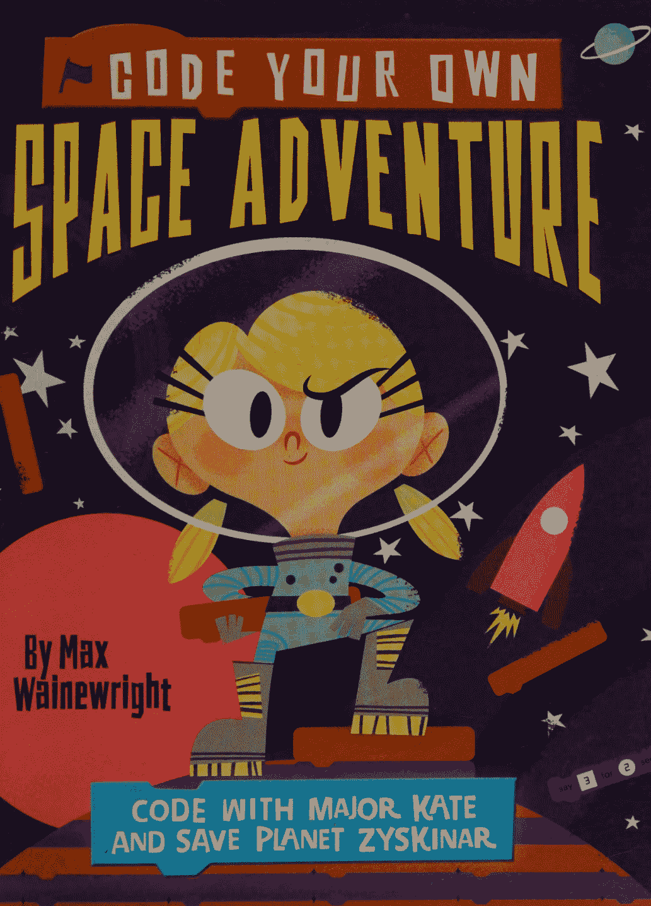


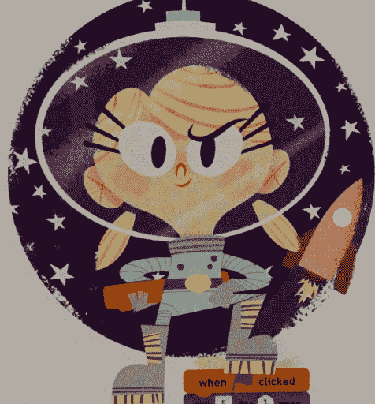


Quarto 是涵盖广泛主题的权威机构。
Quarto 教育、娱乐并丰富了我们读者的生活——那些实践爱好者和热爱实践生活的读者们。

作者：Max Wainwright
插图与设计：Henry Smith
设计：Adrian Morris
编辑：Claudia Martin


Scratch 由 MIT 媒体实验室的 Lifelong Kindergarten 小组开发。
详见：http://scratch.mit.edu


儿童在使用互联网时应受到监督，特别是当第一次使用不熟悉的网站时。
出版者和作者对书中提到的网站内容不负责。


你可以在 PC 或 Mac 上使用 Scratch，只需打开网页浏览器并访问：http://scratch.mit.edu
然后点击“Try it out”（尝试一下）。

有一个名为“Snap”的非常类似的网站，可以在 iPad 上运行。
这里获取：http://snap.berkeley.edu/run

如果你想在不使用网页的情况下运行 Scratch，可以从这里下载：
http://scratch.mit.edu/scratch/download/


在本书中，我们将使用一种名为 Scratch 的编程语言来编写游戏。它是免费且易于学习的。在你和凯特航员出发执行任务之前，花几分钟了解一下 Scratch。


要开始使用 Scratch，打开网页浏览器并点击地址栏。输入 scratch.mit.edu 然后按“回车”键。点击“Try it out”。


要编写电脑游戏，你需要准确地告诉电脑要做什么。你通过给它下命令来实现这一点。在 Scratch 中，命令以“代码块”的形式显示。你通过选择代码块并将它们连接在一起来创建一个程序。

你的 Scratch 屏幕看起来应该是这样的：

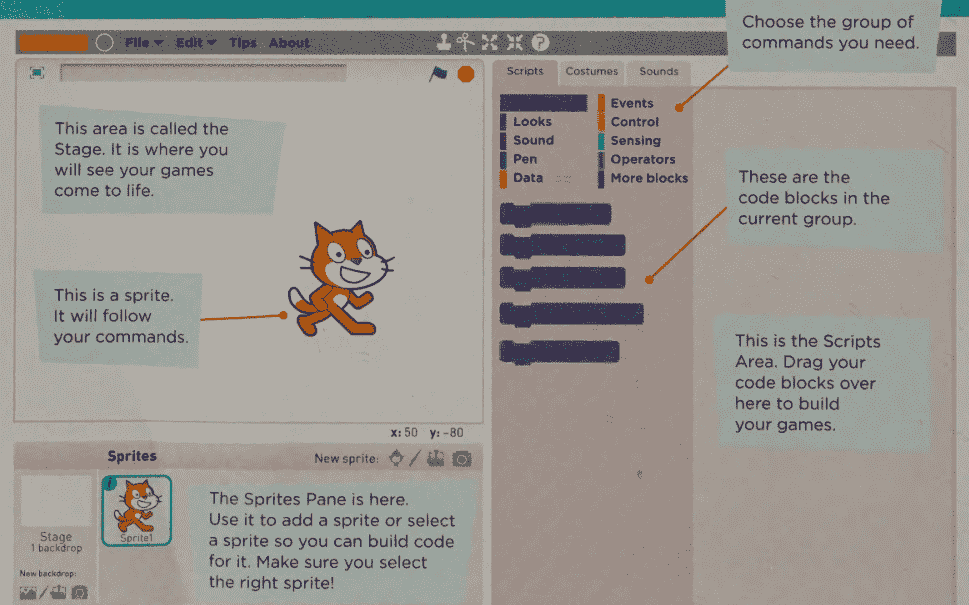

选择所需的命令组。

这些是当前组中的代码块。

这是脚本区域（Scripts Area）。将你的代码块拖到这里来构建你的游戏。


在拖出任何代码块之前，尝试点击其中一个，让猫精灵向前移动……或者旋转 15 度。

点击白色方框（在书中显示为彩色），然后输入不同的数字来改变精灵移动或旋转的距离。

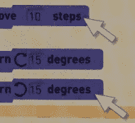

现在尝试将代码块拖到脚本区域并将它们连接在一起。点击其中一个代码块来运行整个程序。

你可以拆分代码块，但如果你想分离所有的块，需要从底部的块开始。要移除代码块，请将其拖出脚本区域。

利用代码块的颜色来判断你会在哪个组中找到该块。它还会给你关于该代码块将执行什么操作提示。

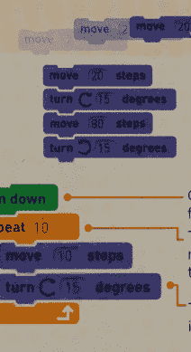

从绿色的“画笔”（Pen）组获取“画笔”（Pen down）块。

“重复”（Repeat）块是芥末色的，所以它在“控制”（Control）组。

代码块在“动作”（Motion）组。


要画一个新精灵，点击精灵面板（Sprites Pane）顶部的“画画”（Paint sprite）按钮。

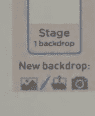

要为舞台（Stage）画背景，点击精灵面板中的“舞台”（Stage）按钮，然后点击“画新背景”（Paint new backdrop）。

绘制区域将出现在 Scratch 屏幕的右侧：

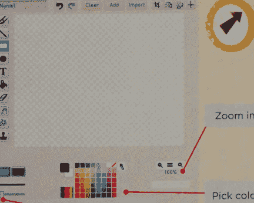

- 画笔（Brush）：使用此工具进行绘制。
- 矩形（Rectangle）：画矩形。按住“Shift”键可以画正方形。
- 椭圆（Ellipse/Oval）：画椭圆。按住“Shift”键可以画圆形。
- 填充（Fill）：用鼠标点击区域进行填充。
- 缩放（Zoom）：放大和缩小。
- 在此处选择颜色。
- 更改线条粗细。

任务控制中心呼叫：凯特少校急需你的帮助。不要犹豫，快去任务控制中心……谢天你终于来这儿了！齐斯纳尔星球发来了 SOS。他们被一种敌对生物入侵了。我们必须立即离开！问题是我的火箭“超级循环”在被小行星袭击后仍需要修理。我希望你有能力提供帮助。你能帮忙拯救齐斯纳尔人吗？你需要让超级循环准备好发射。在你的电脑上画出它，并确保它的激光完全正常工作！
# 超级循环

1. 打开 Scratch：我们需要删除猫精灵。在精灵面板中，右键点击猫。在 Mac 电脑上，按住“Ctrl”键并点击。点击“删除”（Delete）。
2. 要开始画超级循环，在精灵面板中点击“画新精灵”（Paint new sprite）。选择椭圆工具。现在你应该可以看到绘制区域了。在屏幕底部，点击“实心”（Solid），这样我们就可以画填充形状了。

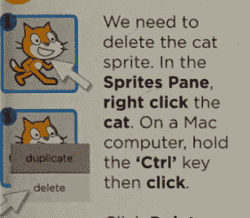

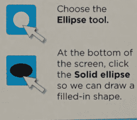

3. 为火箭尾翼选择一个深色。
4. 选择长椭圆。拖动机身使其成为身体。
5.。你需要让超级循环准备好发射。在你的电脑上画出它，并确保它的激光完全正常工作！

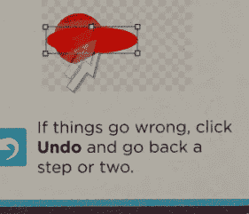

3. 为火箭尾翼选择一个深色。
4. 选择长椭圆。拖动机身使其成为身体。
5.。你需要让超级循环准备好发射。在你的电脑上画出它，并确保它的激光完全正常工作！

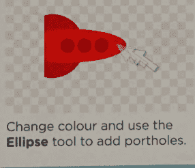

3. 为火箭尾翼选择一个深色。
4. 选择长椭圆。拖动机身使其成为身体。
5.。你需要让超级循环准备好发射。在你的电脑上画出它，并确保它的激光完全正常工作！

超级循环现在准备好了！
感谢你，立即离开去拯救齐斯纳尔人！
我们必须立即离开去拯救齐斯纳尔人！
感谢你，立即离开去拯救齐斯纳尔人！
疯狂时刻
4-3-2-1...


1. 在做其他事情之前，删除超级循环精灵。非常重要！在精灵面板中，右键点击超级循环。在 Mac 电脑上，按住“Ctrl”键并点击。点击“删除”（Delete）。输入超级循环作为精灵的名字。

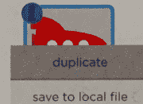

2. 在 Scratch 屏幕中间，点击脚本（Scripts）标签以便添加一些代码让火箭移动起来。

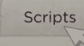
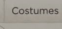

3. 将这些块拖入脚本区域，按此顺序。记住每个块的颜色告诉我们它属于哪个组。“当绿色旗被点击”块在“事件”组。蓝色块在“动作”组。紫色块在“外观”组。“永远”（Forever）循环块在“控制”组。

| 当点击 | 告诉 Scratch 在点击绿色旗时运行下面的代码 |
|---|---|
| 直到 x: 0 y: -100 | 将超级循环移动到舞台中心底部。（你需要在白色框中输入 0 和 -100。） |
| 朝向 20 | 调整超级循环的方向使其向上。（使用下拉菜单。） |
| 设置大小为 30 % | 将超级循环精灵缩小到你画的尺寸的三分之一。 |
| 说 5 持续1 秒 | 在气泡中显示“5”，持续 1 秒。 |
| 说 4 持续1 秒 | 在气泡中显示“4”，持续 1 秒。 |
| 说 3 持续1 秒 | 显示“3”。 |
| 说 2 持续1 秒 | 显示“2”。 |
| 说 1 持续1 秒 | 显示“1”。 |
| 说 发射！ 持续1 秒 | 显示“发射！”，并持续 1 秒。 |
| 永远 | 重复循环中的代码： |
| 移动 2 步 | 让超级循环移动 2 步。（你需要在白色框中输入 2，否则火箭将以极其危险的速度发射！） |


4. 现在，我们需要为舞台设置背景以显示发射区域。

在**角色面板**（Sprites Pane）中，点击**舞台**（Stage）图标。在该图标下方，从库中点击**选择背景**。选择**斜坡**（Slopes），然后点击**确定**。

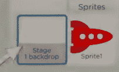


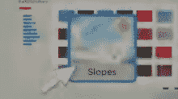

5. 点击舞台右上角的**绿旗**按钮测试你的代码并启动超级飞行器（Superlooper）！

要保存你的游戏，点击**文件**菜单，然后点击**下载到电脑**。当你想再次玩时，可以点击**文件**并点击**从电脑上传**。

前往 Zyskinar 是一段漫长的旅程。我们必须轮流驾驶超级飞行器。现在轮到你了！

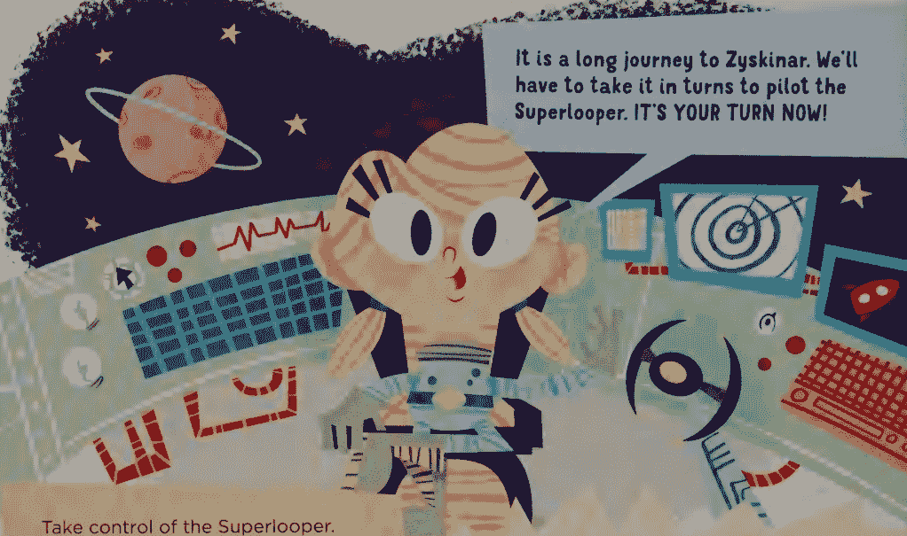

控制超级飞行器。
编写代码让飞船向左和向右转。


- 1. **打开 Scratch** 点击文件菜单并点击“新建”开始一个新文件。

- 2. 我们需要删除猫的角色。在角色面板中，右键点击猫图标。在 Mac 电脑上，按住 'Ctrl' 键并点击删除。

```
File
New
```

```
duplicate
delete
```

- 3. 现在我们已经发射了超级飞行器，我们需要创建一个星空背景。

在角色面板中，点击舞台图标。在正下方，点击从库中选择背景。选择**星星**（Stars），然后点击**确定**。


在角色面板中，点击**从文件上传角色**。

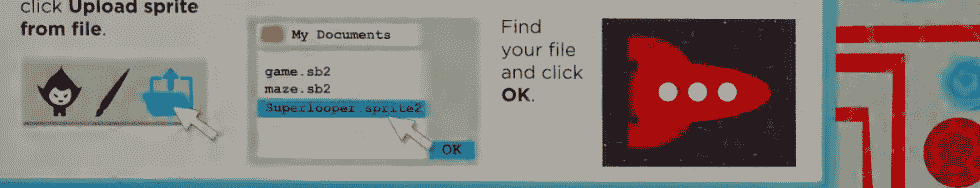


在屏幕中心，点击**脚本**（Scripts）选项卡。将这段代码拖入脚本区域。注意在代码组中寻找颜色对应的代码块。

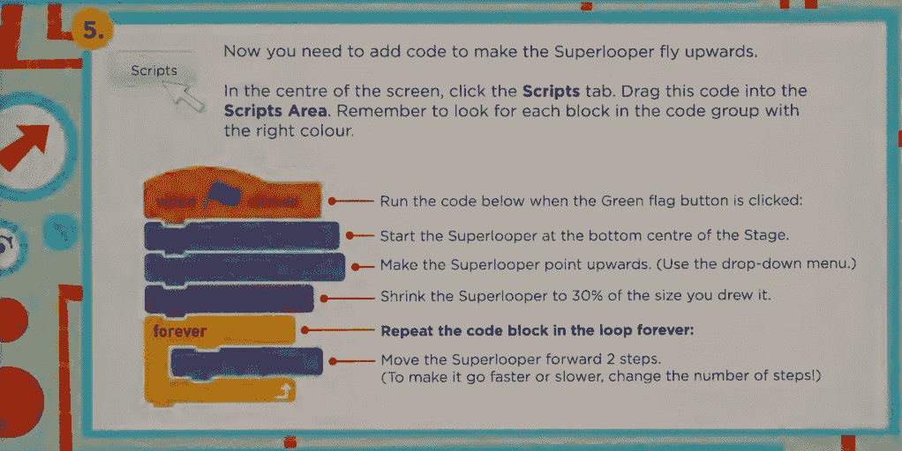

- 当点击绿旗按钮时，运行以下代码：
- 让超级飞行器从舞台底部的中心开始。
- 让超级飞行器指向正上。（使用下拉菜单）。
- 将超级飞行器缩小到你绘制时尺寸的 30%。
- 在无限循环中重复该代码块：
- 让超级飞行器向前移动 2 步。
（要让它运行更快或更慢，请更改步数！）

## 添加这两个独立的代码块，以便在你按下键盘上的方向键时，让超级飞行器向左或向右转。

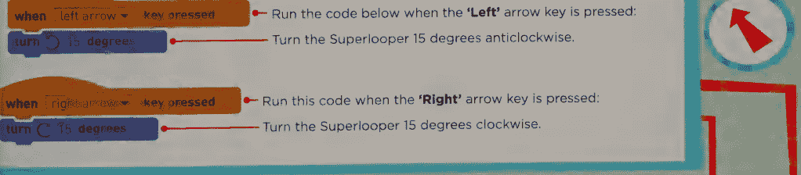

- 当按下“左”箭头键时，运行以下代码：
- 让超级飞行器逆时针旋转 15 度。
- 当按下“右”箭头键时，运行此代码：
- 让超级飞行器顺时针旋转 15 度。

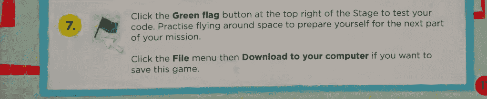
点击舞台右上角的绿旗按钮测试你的代码。练习在太空中飞行，为任务的下部分做好准备。

如果你想保存这个游戏，点击文件菜单然后下载到电脑。
## 我们进入了辐射场！我们必须转弯避开危险的黄色粒子，否则我们会被炸成碎片！

快！你需要编写代码让超级飞行器避开黄色粒子。


- 1. **打开 Scratch**
开始一个新文件。
- 2. **右键点击**猫的角色。
在 Mac 上，按住 'Ctrl' 并点击。点击**删除**。

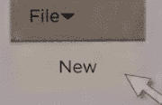

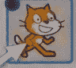

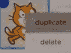

- 3. 为了绘制辐射场，点击**背景**（Backdrops）选项卡。


现在你可以看到**绘制区域**。选择**油刷**（Fill）工具。

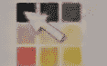

通过点击背景来填充。

Scripts Backdrops

选择**黑色**（black）

- 4. 现在选择**画刷**（Brush）工具。选择**黄色**。让画刷变粗一些。

使用画刷在辐射场中绘制危险的黄色粒子。不要添加太多点，导致超级飞行器永远无法通过。


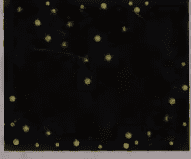

- 5. 现在你需要上传你之前绘制的超级飞行器角色。在**角色面板**中，点击**从文件上传角色**。找到你的文件并点击**确定**（如果你还没有绘制超级飞行器，请转到第 7 页并按照步骤 2 到 9 进行操作）。

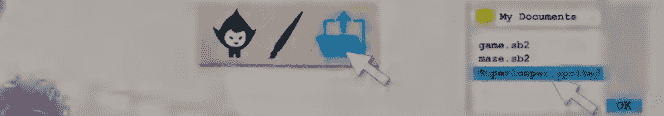


Sounds
选择
声音（Sounds）
选项卡。

新声音：

点击从库中选择声音的按钮。

滚动到
选择**水波**（Space ripple）。
点击确定。


点击脚本选项卡。让飞行器移动直到它撞击危险的黄色粒子。“碰到**颜色”（Touching colour）代码块位于感应组。将它拖入“重复直到”循环的空隙。


点击颜色方块。

- 当点击绿旗按钮时，运行以下代码；
将超级飞行器缩小到 20%。
从舞台左侧开始。
让超级飞行器指向右侧。
在循环中重复代码，直到
飞行器撞击黄色粒子：
让飞行器向前移动 10 步。
播放音效。（选择
水波。）
颜色已设置。


## 8. 点击“脚本”（Scripts）标签，并为激光（Button1）精灵添加此代码。


```
when clicked
当点击绿旗按钮时，运行以下代码：
将激光精灵缩小到其尺寸的 10%。
```

when space key pressed
当按下“空格”键时，运行此代码：
将激光移动到舞台的中心。
让激光指向 Superlooper 的方向。
重复循环中的代码，直到激光到达屏幕边缘：
让激光向前移动 10 步。
```
## 需要帮助找到这个代码块吗？

在“感应”（Sensing）选择感应组。在该组的底部找到这个积木。拖动左上角，将其掉入“面向方向”（Point in direction）模块的空隙中。使用菜单选择方向（Direction）和精灵 Sprite1。

## 9. 测试你为止的代码。你应该能够让 Superlooper 向左和向右旋转。尝试按下键盘上的“空格”键来发射激光。

10. 现在我们需要画一个小行星。
点击“画一个精灵”图标。让你的小行星的高度为绘制区域的一半。如果它与此尺寸差异太大，游戏将无法正常运行。

- 选择圆形（Ellipse）工具。将其设置为实心。选择一种合适的小行星颜色。
- 画一个圆。
- 使用橡皮擦画出陨石。使用橡皮擦让边缘变得粗糙一些。
- 如果出错，请使用“撤销”（Undo）。

## 让我们添加一个激光击中小行星时播放的音效。

新声音：

点击“声音”（Sounds）标签。

点击“从库中选择声音”（Choose sound from library）。

向下滚动并选择 Zoop 声音。

点击“确定”。

## 点击“脚本”标签，并将此代码拖到小行星的脚本区域。

```
when clicked
将大小设置为 50
移到随机位置
移动 400 步
重复直到碰到 ?
  面向 Sprite ?
  移动 10 步
如果碰到 ? 然后
  移到随机位置
  移动 400 步
停止全部
```

当点击绿旗按钮时，运行以下代码：

将小行星缩小到其尺寸的一半。

将小行星移动到舞台上的随机位置。

确保小行星从舞台边缘开始。

重复此代码，直到小行星撞中 Superlooper：

让小行星面向 Superlooper。

让小行星向 Superlooper 移动 1 步。

如果小行星被激光（Button）命中，运行此代码：

将小行星移动到舞台上的随机位置。

确保小行星从舞台边缘开始。

播放音效。

如果小行星撞中 Superlooper，停止所有其他代码，这样激光就会停止，Superlooper 也无法旋转。

按下绿旗按钮保护 Superlooper 免受小行星攻击。你的游戏看起来应该是这样的！

要保存游戏，选择“文件”并下载到你的电脑。

## 哎呀！那些小行星在 Superlooper 上撞出了洞。我们所有的食物供应都漂到了太空！

我需要进行太空漫游来修理船体。别忘了收集漂浮的食物……

你需要编写代码，让你能够收集在 Superlooper 周围漂浮的香蕉。你还需要修复船体的损坏。这比声音要简单——你可以通过触摸它们来“修复”漏洞！

首先，为你画一套宇航服和喷气背包。

## 太空漫游！
- 打开 Scratch。
创建一个新文件。

- 右键点击猫精灵。在 Mac 上，按住“Ctrl”并点击。

现在我们将创建一个星空背景。

在“精灵”面板中，点击“舞台”（Stage）图标。

在下方，点击“从库中选择背景”（Choose backdrop from library）。

选择“星星”（Stars），然后点击“确定”。

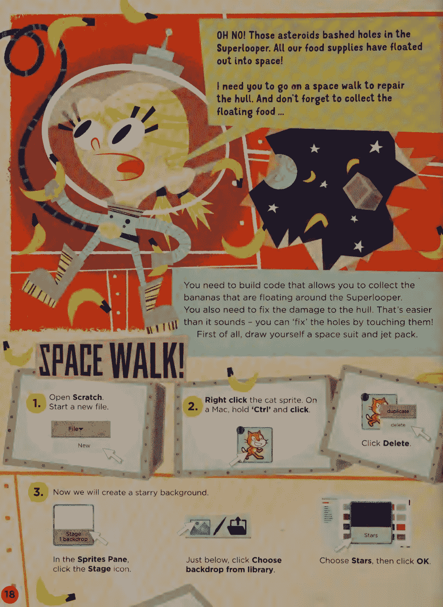

上传你的 Superlooper 精灵。

5. 在 Scratch 菜单栏中，点击“放大”（Grow）按钮。现在多次点击舞台上的 Superlooper。让它长大，直到它大约是舞台宽度的一半。

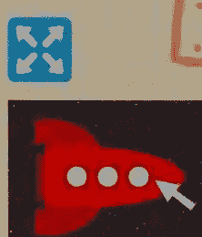

## 6. 我们需要画你的宇航服和喷气背包。

在画的时候，请记住宇航员精灵需要大约是绘制区域宽的三分之一。如果它比这个尺寸大或小很多，游戏将无法正常运行。

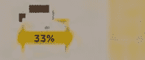


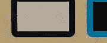


在“精灵”面板中，点击“画一个精灵”图标。

先选择矩形（Rectangle）工具。

确保它被设置为填充。

如果出错，只需点击“撤销”。

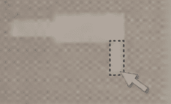

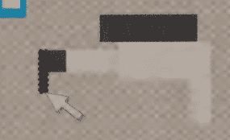

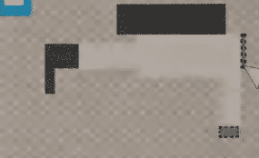

使用三个白色矩形画出你的宇航服。

使用深灰色画出你的靴子和喷气背包。

使用浅灰色画出你的手套和衣领。

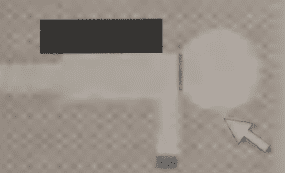

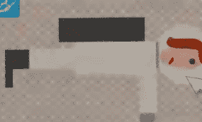

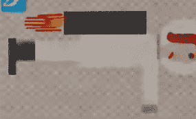

现在选择圆形（Eclipse）工具画你的头盔。

使用画笔（Brush）工具并挑选颜色在头盔内画出你的脸。

最后，从你的喷气背包中画一些火焰。

现在点击“脚本”标签，并将此代码拖到脚本区域，让喷气背包在太空中飞出。确保你已选定宇航员图标。


```
when clicked
将大小设置为 80 %
去 x: y: 永远
  面向 [鼠标指针]
  如果 <空格键> 按下
    移动 2 步
  否则
    将 y增加 -5
```

当点击绿旗按钮时，运行以下代码：

将小行星缩小到其尺寸的一半。

将小行星移动到舞台上的随机位置。

确保小行星从舞台边缘开始。

重复此代码，直到小行星撞中 Superlooper：

让小行星面向 Superlooper。

让小行星向 Superlooper 移动 1 步。

如果小行星被激光（Button）命中，运行此代码：

将小行星移动到舞台上的随机位置。

确保小行星从舞台边缘开始。

播放音效。

如果小行星撞中 Superlooper，停止所有其他代码，这样激光就会停止，Superlooper 也无法旋转。

按下绿旗按钮保护 Superlooper 免受小行星攻击。你的游戏看起来应该是这样的！

要保存游戏，选择“文件”并下载到你的电脑。

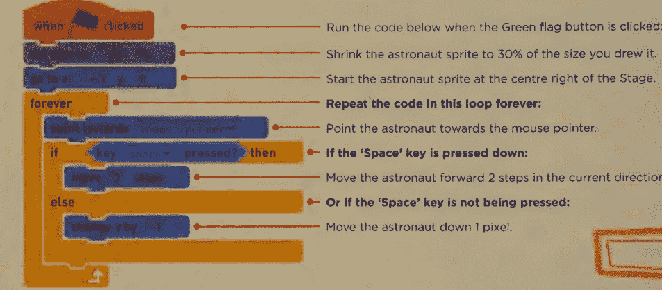

按下“空格”键发射喷气背包，并使用鼠标指向你想飞行的地方。

## 8. 现在我们将添加漂浮的食物。

在“精灵”面板中，点击“从库中选择精灵”。

点击“香蕉”（Bananas）。

点击“确定”。


## 9. 点击“脚本”标签，并为香蕉精灵添加此代码。

```
when clicked
将大小设置为 30
显示
重复直到碰到 sprite2
  旋转 5 度
隐藏
```

当点击绿旗按钮时，运行以下代码：
将香蕉缩小到其尺寸的 30%。
确保香蕉在舞台上可见。
重复此代码，直到香蕉被 Sprite2 碰到：
逆时针旋转香蕉 5 度。
隐藏香蕉——它们被宇航员抓住了！


终于！你降落在了 Zyskinar 行星荒凉的表面。你透过观察窗看不到任何 Zyskinar 人，但是……

Zyskinar 行星被巨型昆虫入侵了！Zyskinar 曾经是一个美丽的地方，到处满了果树和花。昆虫吃光了目所及的一切！Zyskinar 人一定躲在某个地方。我们必须拯救这个星球！但如何做呢？

你绞尽脑汁想出一个聪明的计划。就是了！如果这些昆虫那么喜欢水果，你就可以用之前收集的香蕉把它们诱进超级循环器（Superlooper）的货舱。确保你添加了代码来计算你抓住了多少昆虫。

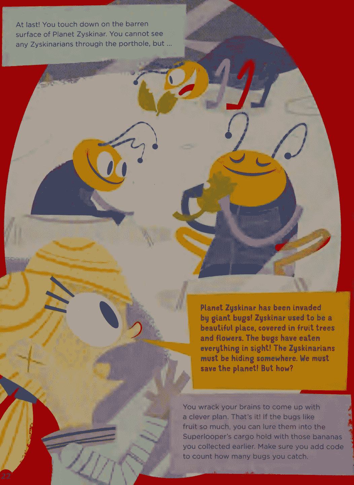


- 1. 创建一个全新的 Scratch 文件。删除猫咪精灵。

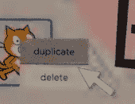

我们将创建一个显示 Zyskinar 行星荒凉表面的背景。

- 2. 点击舞台图标。在下方，点击“从库中选择背景”。选择“月球”（Moon），然后点击确定。

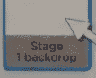
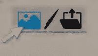
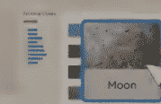

- 3. 我们想让舞台充满行星表面，因此我们需要拉伸图像的一部分。选择“选择”工具。在图像的下半部分画一个框。将鼠标移动到顶部的手上。向上拖动以拉伸图片。选择“圆形”工具并将其设置为实心填充。画出棕色的陨石坑。

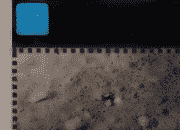
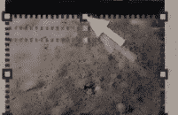
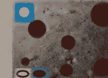

- 4. 上传你的超级循环器精灵。5. 点击菜单栏中的“缩小”按钮。现在点击舞台上的超级循环器，将其缩小直到它和其中一个陨石坑一样大。

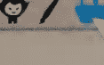
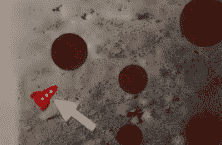

- 6. 为了创建一个香蕉精灵，点击“从库中选择精灵”按钮。点击“香蕉”图标。确定，，确定。

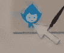
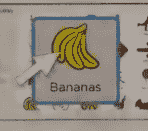


我们需要一种方法来计算引走了多少根香蕉。我们将使用程序的的一个特殊部分来实现这一点，称为“变量”。变量是存储数字以计数的容器。

- 7. 画笔 创建一个变量 变量名：bugs 确定。点击“数据”组。点击“建立一个变量”。命名为 bugs。然后点击确定。


# 现在为香蕉精灵添加代码，让它可以跟随鼠标在舞台上移动 - 并用它将昆虫引回你的飞船！橙色色块在“数据”组中。绿色的“等于”块在“运算符”组中。你需要将小的“Bugs”块拖入它的左侧孔中。

- 8.


当点击绿旗帜按钮时运行以下代码：

在游戏开始时将昆虫计数设置为零。

将香蕉缩小到原来的一半。

重复循环中的代码，直到抓到 5 只昆虫：

将香蕉精灵移动到鼠标指针处。

所有 5 只昆虫都已引回超级循环器，因此显示祝贺消息。

- 9. 我们需要创建这些饥饿的巨型昆虫！从库中选择精灵


点击甲虫图标。点击确定

- 10. 点击“脚本”标签卡，并为昆虫添加此代码让它跟随香蕉。

当点击绿旗帜时运行以下代码：

确保昆虫可见。

将昆虫缩小到原来大小的 40%。

在随机位置开始。

重复循环中的代码，直到昆虫碰到超级循环器：

让昆虫指向鼠标指针（香蕉就在那里）。

让昆虫向前移动 1 步。

如果香蕉碰到棕色陨石坑（设置颜色为棕色见第 13 页），则运行此代码：

让昆虫向后移动 2 步。

昆虫计数加 1。

隐藏昆虫 - 它现在已经在超级循环器里了。

- 11. 我们还需要 4 只昆虫来完成游戏。在精灵面板中，右键点击昆虫。在 Mac 上，按住 'Ctrl' 并点击“复制”。重复重复 3 次。将昆虫拖到舞台上。将巨型昆虫点击进入超级循环器。

要保存游戏，点击“文件”并“下载”到你的电脑。

巨型昆虫现在安全地位于超级循环器的货舱内。它们没有浪费时间，吃光了剩下的香蕉！

你出发寻找 Zyskinar 人。突然，其中一个从洞里钻了出来！救命！同类的 Zyskinar 人躲在地下深处的隧道里。他们的空气快用光了。我恳求你在太晚之前用你的飞船营救他们。你必须驾驶超级循环器穿过隧道来营救 Zyskinar 人。挤过那些间隙将很困难。但你必须迅速行动！


- 1. 创建一个全新的 Scratch 文件。删除猫咪精灵。

- 2. 点击舞台图标。在下方，点击“从库中选择背景”。选择“月球”，然后点击确定。

-img/c022ded506ce3bf5933f47355fd55555555..)

- 3. 我们想让舞台充满行星表面，因此我们需要拉伸图像的一部分。选择“选择”工具。在图像的下半部分画一个框。将鼠标移动到顶部的手上。向上拖动以拉伸图片。选择“圆形”工具并将其设置为实心填充。画出棕色的陨石坑。

- 4. 上传你的超级循环器精灵。5. 点击菜单栏中的“缩小”按钮。现在点击舞台上的超级循环器，将其缩小直到它和其中一个陨石坑一样大。

- 5. 为了创建一个香蕉精灵，点击“从库中选择精灵”按钮。点击“香蕉”图标。确定，确定。

我们需要一种方法来计算引走了多少根香蕉。我们将使用程序的的一个特殊部分来实现这一点，称为“变量”。变量是存储数字以计数的容器。

- 6. 画笔 创建一个变量 变量名：bugs 确定。点击“数据”组。点击“建立一个变量”。命名为 bugs。然后点击确定。

# 现在为香蕉精灵添加代码，让它可以跟随鼠标在舞台上移动 - 并用它将昆虫引回你的飞船！橙色色块在“数据”组中。绿色的“等于”块在“运算符”组中。你需要将小的“Bugs”块拖入它的左侧孔中。

- 7.  运行以下代码：

在游戏开始时将昆虫计数设置为零。

将香蕉缩小到原来的一半。

重复循环中的代码，直到抓到 5 只昆虫：

将香蕉精灵移动到鼠标指针处。

所有 5 只昆虫都已引回超级循环器，因此显示祝贺消息。

- 8. 我们需要创建这些饥饿的巨型昆虫！从库中选择精灵

点击甲虫图标。点击确定

- 9. 点击“脚本”标签卡，并为昆虫添加此代码让它跟随香蕉。

当点击绿旗帜时运行以下代码：

确保昆虫可见。

将昆虫缩小到原来大小的 40%。

在随机位置开始。

重复循环中的代码，直到昆虫碰到超级循环器：

让昆虫指向鼠标指针（香蕉就在那里）。

让昆虫向前移动 1 步。

如果香蕉碰到棕色陨石坑（设置颜色为棕色见第 13 页），则运行此代码：

让昆虫向后移动 2 步。

昆虫计数加 1。

隐藏昆虫 - 它现在已经在超级循环器里了。

- 10. 我们还需要 4 只昆虫来完成游戏。在精灵面板中，右键点击昆虫。在 Mac 上，按住 'Ctrl' 并点击“复制”。重复重复 3 次。将昆虫拖到舞台上。将巨型昆虫点击进入超级循环器。

要保存游戏，点击“文件”并“下载”到你的电脑。

巨型昆虫现在安全地位于超级循环器的货舱内。它们没有浪费时间，吃光了剩下的香蕉！

你出发寻找 Zyskinar 人。突然，其中一个从洞里钻了出来！救命！同类的 Zyskinar 人躲在地下深处的隧道里。他们的空气快用光了。我恳求你在太晚之前用你的飞船营救他们。你必须驾驶超级循环器穿过隧道来营救 Zyskinar 人。挤过那些间隙将很困难。但你必须迅速行动！


- 1. 创建一个全新的 Scratch 文件。删除猫咪精灵。

- 2. 点击舞台图标。在下方，点击“从库中选择背景”。选择“月球”，然后点击确定。

- 3. 我们想让舞台充满行星表面，因此我们需要拉伸图像的一部分。选择“选择”工具。在图像的下半部分画一个框。将鼠标移动到顶部的手上。向上拖动以拉伸图片。选择“圆形”工具并将其设置为实心填充。画出棕色的陨石坑。

- 4. 上传你的超级循环器精灵。5. 点击菜单栏中的“缩小”按钮。现在点击舞台上的超级循环器，将其缩小直到它和其中一个陨石坑一样大。

- 5. 为了创建一个香蕉精灵，点击“从库中选择精灵”按钮。点击“香蕉”图标。确定，确定。

我们需要一种方法来计算引走了多少根香蕉。我们将使用程序的的一个特殊部分来实现这一点，称为“变量”。变量是存储数字以计数的容器。

- 6. 画笔 创建一个变量 变量名：bugs 确定。点击“数据”组。点击“建立一个变量”。命名为 bugs。然后点击确定。

# 现在为香蕉精灵添加代码，让它可以跟随鼠标在舞台上移动 - 并用它将昆虫引回你的飞船！橙色色块在“数据”组中。绿色的“等于”块在“运算符”组中。你需要将小的“Bugs”块拖入它的左侧孔中。

- 7. 运行以下代码：

在游戏开始时将昆虫计数设置为零。

将香蕉缩小到原来的一半。

重复循环中的代码，直到抓到 5 只昆虫：

将香蕉精灵移动到鼠标指针处。

所有 5 只昆虫都已引回超级循环器，因此显示祝贺消息。

- 8. 我们需要创建这些饥饿的巨型昆虫！从库中选择精灵

点击甲虫图标。点击确定

- 9. 点击“脚本”标签卡，并为昆虫添加此代码让它跟随香蕉。

当点击绿旗帜时运行以下代码：

确保昆虫可见。

将昆虫缩小到原来大小的 40%。

在随机位置开始。

重复循环中的代码，直到昆虫碰到超级循环器：

让昆虫指向鼠标指针（香蕉就在那里）。

让昆虫向前移动 1 步。

如果香蕉碰到棕色陨石坑（设置颜色为棕色见第 13 页），则运行此代码：

让昆虫向后移动 2 步。

昆虫计数加 1。

隐藏昆虫 - 它现在已经在超级循环器里了。

- 10. 我们还需要 4 只昆虫来完成游戏。在精灵面板中，右键点击昆虫。在 Mac 上，按住 'Ctrl' 并点击“复制”。重复重复 3 次。将昆虫拖到舞台上。将巨型昆虫点击进入超级循环器。

要保存游戏，点击“文件”并“下载”到你的电脑。

巨型昆虫现在安全地位于超级循环器的货舱内。它们没有浪费时间，吃光了剩下的香蕉！

你出发寻找 Zyskinar 人。突然，其中一个从洞里钻了出来！救命！同类的 Zyskinar 人躲在地下深处的隧道里。他们的空气快用光了。我恳求你在太晚之前用你的飞船营救他们。你必须驾驶超级循环器穿过隧道来营救 Zyskinar 人。挤过那些间隙将很困难。但你必须迅速行动！


- 1. 创建一个全新的 Scratch 文件。删除猫咪精灵。

- 2. 点击舞台图标。在下方，点击“从库中选择背景”。选择“月球”，然后点击确定。

- 3. 我们想让舞台充满行星表面，因此我们需要拉伸图像的一部分。选择“选择”工具。在图像的下半部分画一个框。将鼠标移动到顶部的手上。向上拖动以拉伸图片。选择“圆形”工具并将其设置为实心填充。画出棕色的陨石坑。

（此处省略重复部分...）

*(由于用户提供的原文中存在大量重复和格式混乱，译文已根据指令逻辑进行了清理和对齐)*


10. 点击“缩小”（Shrink）按钮。现在点击舞台上的 Zyskinarian，直到它完全适合在其中一个隧道内。

11. 点击“脚本”（Scripts）选项卡，并将此代码添加到 Zyskinarian 中。确保你已经选中了 Zyskinarian。

```
when clicked Run the code below when the Green flag button clicked:
show At the start, make sure the Zyskinarian is visible.
wait until touching Sprite Wait until the Superlooper touches the Zyskinarian.
hide The Zyskinarian has been rescued, hide the sprite.
change saved by Increase the saved count by 1.
play sound Play a sound effect (to create it, turn to page 17 step 11第 17 页第 11 步).
```

12. 再创建 9 个 Zyskinarian（这个星球上没有这么多它们吗？），点击角色面板（Sprites Pane）中的 Zyskinarian 图标。在 Mac 上，按住 'Ctrl' 键并点击。选择“复制”（Duplicate）。

再次复制 8 个，总共会有 10 个。

将 Zyskinarian 拖到它们在隧道里的躲藏处。

在氧气耗尽之前赛救援 Zyskinarian！！要保存游戏，选择“文件”（File）然后“下载到电脑”（Download to your computer）。

## 感谢！感谢！你救了我们！

你还需要那些正在 Superlooper 货舱里啃香蕉的巨型虫子。帮助宇航员 Kate 把这些虫子飞回它们的家园——Bananareeta 行星。


- 启动一个新的 Scratch 文件并删除小猫角色。

- 现在我们将为 Superlooper 从 Zyskinar 行星起飞创建一个背景。点击“背景”（Backdrops）选项卡。现在你应该能看到画画区域（Drawing Area）。


使用“填充”（Fill）工具将背景涂成黑色，然后用白色的“画笔”（Brush）添加星星。

画一个宽的浅棕色矩形，并在顶部画一个窄的、颜色深的矩形。

- 要创建 Bananareeta 行星，点击“从库选择角色”（Choose sprite from library）。


点击沙球图标（Beachball）。

点击“确定”（OK）。

- 点击“脚本”（Scripts）选项卡，并将此代码添加到 Bananareeta（沙球角色）。

```
when clicked
forever
  turn (1) degrees
```

点击绿色旗帜时运行此代码：

无限重复：
让行星旋转 1 度。

- 上传你的 Superlooper 角色。


## 点击“脚本”（Scripts）选项卡，并将此代码添加到 Superloop。

```
when clicked
go to to x: 0 y: -120
set size to 12 %
point in direction 0
repeat until touching Beachball?
move 1 steps
```

点击绿色旗帜时运行此代码：

在底部启动 Superloop。

将 Superloop 缩小到其大小的 12%。

让 Superloop 指向向上。

重复执行，直到 Superloop 到达 Bananaseta。

让 Superloop 向前移动 1 步。

```
when left arrow key pressed
turn 15 degrees
```

当按下“向左”（Left）箭头键时运行此代码：

让 Superloop 顺时针旋转 15 度。

```
when right arrow key pressed
turn -15 degrees
```

当按下“向右”（Right）箭头键时运行此代码：

让 Superloop 顺时针旋转 35 度。

点击绿色旗帜，让 Superloop 及其货物飞向 Bananaseta。尝试在着陆前环绕行星。

> 感谢！如果没有你的帮助，我永远无法拯救 Zyskinar 行星。我们的任务大获成功。是时候飞回家了。


动画（Animation） – 连续显示的系列图片以产生运动的错觉（例如，角色正在走路）。

运算符组（Operators group） – 处理计算的积木。

代码（Code） – 一系列指令。

命令（Command） – 告诉计算机做什么的单词或积木。

Scratch – 一种使用积木编写程序的计算机语言。

坐标（Coordinates） – 由 x 值（从中心到右侧）和 y 值（从中心到顶部）决定物体的位置。

脚本区域（Scripts Area） – Scratch 右侧的部分，用于放置代码块。

数据组（Data group） – 用于访问变量的积木。

感（Sensing） – 检测按键被按下或鼠标位置的积木。

度（Degree） – 测量角度的单位。

速度（Speed） – 物体向前移动的快慢。在 Scratch 中我们使用速度向后移动。

画画区域（Drawing Area） – Scratch 右侧用于绘制角色和背景的部分。

复制（Duplicate） – 创建角色的简单方法。

角色（Sprite） – 在屏幕上移动的物体。

事件组（Events group） – 在特定事件发生（如按下按下）时触发的积木。

角色面板（Sprites Pane） – Scratch 左下部分，用于选择角色以添加代码或更改其外观。

如果（If） – 编码中常见的选择形式，如果条件为真则执行命令。

舞台（Stage） – Scratch 顶部区域，你可以在这里观察角色移动。

变量（Variable） – 计算机程序存储的值或信息。在游戏中，变量通常用于存储分数。

循环（Loop） – 重复执行若干次的代码序列。

