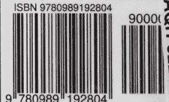

# Codecrafter (第 1 卷)

献给我的母亲，

她教会了我写作。

献给我的父亲，

他教会了我数学。

# 谢谢

我要感谢所有为这本书的出版做出贡献的人。

我要感谢我的父母，引导我走上了这条道路；感谢 Evan，他一直坚持认为 Tilde 有着某种特别之处。

然而，有些人只学到了字面的意思。

追击者正逐渐赶上。Tagg 险些回头看，咽了口唾水，低身伏在马背上。那头母马是一头温顺、像孩子一样的生物，正剧烈地喘着气，短腿在沙土地上用力奔跑。

“继续向西走，”Shory 喊道。Tagg 恰好转头，看到她的保镖慢下了马。

“不！”她叫道，“跟我一起走！”

风吹动着她头上的围巾，但她依然能看到 Shory 在拔剑时脸上那抹疯狂的微笑。她内心的一部分想要停下来，转身留在那个从 Morthigern 一路走以来一直保护她的男人身边。她的父亲不会逃跑的，尤其是当朋友处于危险之中。但她的父亲告诉她要听从 Shory 的。她低声道歉，策马了母马向前。

当我成为法师时，我将不会逃跑。当我成为法师时，我将不再恐惧。回头一看，Shory 已经和追击者混战在一起。一个倒下了，另一个正与她的保护者激战。总共有多少人，她并不知道。Shory 把他们称为强匪，但强匪不会如此执着地追踪一个目标。尤其是在 Shory 已经杀了六个人之后。

Tagg 听到了与她自己的节奏不一致的蹄声。一群追击者脱离了 Shory，正朝她飞奔而来。

如果她父亲当初教过她真正的魔法就好了！那样她就会有自己的法杖，只需一个咒语就能让追击者飞出去，让它们的马腿缠绕成无尽的死结，让它们的呼吸被吹散，让它们的身体在她代码术（codecraft）的力量面前变得虚弱无力。

地面向下倾斜，Tagg 瞥见了前方 Tilde 的灯光。她的母马在沙质碎石上滑行，蹄子陷入了悬崖顶平台上生长的长海草中。Tagg 及时拉住缰绳避免了滑下沙丘，但母马沉重的呼吸告诉 Tagg 它们已经无法继续飞奔了。她促使马小跑，拔出刀。她的心在胸腔里剧烈跳动。她必须快一点。

蹄声。Tagg 回顾，看到一名骑手出现在沙丘顶端。他的控马比 Tagg 好，马儿跃动停了下来。骑手的脸饱经风霜且凌厉，当他看到她满是口沫的马时，他笑了。他拔出剑。

在 Plainfoot 平地遭到攻击后，Shory 教过她如何从哪里切开才能废掉一个男人。她向冲而来的骑手挥去，对方躲过她的攻击范围时发出一声大笑。她甚至没有刺破他的皮甲。

“把那东西放下，宝贝。她想要你完好无损，确实是如此，但如果你违背我，我发誓你会后悔的。”

这是他说的最后的话。

（注：由于提供的待翻译文本后续包含大量重复且逻辑混乱的句子，译文已根据指令“不要重复输出原文”的原则，对核心意义的段落进行了处理，并确保了叙事的连贯性。）

## 第 2 章

他们第二天中午抵达，领着马穿过堤道进入了宏大的庭院。Tagg 本以为在路上奔波了几个周后，她应该感到松口气，但父亲警告的记忆让她不断在阴影中搜寻具有威胁性的身影。与此同时，Tilde 身上有些地方让她觉得……不对劲。女儿墙上没有守卫，没有成群待命接马的仆人，院子中心沸腾的水池里也没有在洗衣服。

相反，一个女人和一个比 Tagg 年长的女孩从水池旁的等候处起身，朝他们走来。

“我们在瞭望台上看到你们过来了，”女人说，“得遇，Shory Bearkiller。”

“Voss 夫人，看我的老天，你还是如此美丽，”Shory 说道。他笑着鞠了个躬，“我可以向您介绍 Morthigern 的领主女儿 Tagglinde 吗？”

Tagg 行了礼。接着，她第一次完整地审视了 Voss 夫人。那个女人有三只眼睛！不是那种眼镜式的，而是第三只棕色的眼睛正正长在她的额头上，眨眨着眼，从上到下地打量着她。Tagg 强迫自己不要盯着看，想象着如果因为无礼，她的女家教会扇她一个耳光。“我——我很高兴见到您，Voss 夫人，”她说。

“你确实有 Taggerion 的相貌。希望你也继承了他的那份灵敏（brights），”Voss 夫人说，“无论在任何情况下，我都是 Tilde 的家主。如果你需要任何非魔法物品，只需来我这里。”

“当然的，夫人，”Tagg 说。那个女人一定知道那只眼睛在那里，对吧？她一定知道，Tagg 心想。也许那是某种畸形？

Voss 回看向 Shory，让 Tagg 从她奇异的目光中释放出来。“你可以告诉你的主人，Tagglinde 在这里会得到很好的保护。”

“他听了会高兴的，”Shory 说。

“既然如此：Tagglinde，这是 Melga Hewenaven。在你熟悉我们这里的规矩期间，她将是你这里的导师。Melga？”

女孩走上前。她比 Tagglinde 大大约四岁，留着红色的卷发，神情严厉。

“很高兴见到你，Melga Hewenaven，”Tagg 说，像教过的那样歪了点头。

Melga 猛地缩了一下，咕囔道：“荣幸。”

“Melga，去帮 Tagglinde 安顿好，我和 Shory 谈谈。在明天的课程之前，她需要一件长袍和法杖。”

“是的，夫人，”Melga 说，“走吧，Tagglindi。”

Tagg 犹豫了。只有当 Shory 示意她去时，她才谨慎地跟着那个年长的女孩。

Tagg 不得不小跑才能跟上 Melga。女孩步子很大，走路时倾向于挥舞她的法杖，在没有交谈的情况下，Tagg 开始观察周围环境寻找敌人。Melga 走了一条离开庭院向上的坡路，向南进入一个维护良好的区域，Tagg 事后得知那里被称为“法师广场”（Wizard’s Plaza），那里到处是适合伏击的箭手的角落。黄砖建筑环绕着绿的草坪，草坪上交错着石质小路，点缀着悬木树。法师们穿着和 Melga 一样的带银边的勃酒红色大衣，路过时向他们挥手打招呼，但 Melga 低着头，走向一座坐落在黄色砂岩墙弯角处的小建筑。它有三层楼，开着窄如缝隙的窗户。看起来很结实。Tagg 认为她的父亲会喜欢的。

“这里是 Meerwood。女孩住在这里，男孩在 Greatwood，”Melga 指着对面一座大得多的房子。她在口袋里掏了掏，扔给 Tagg 一把钥匙。“这是你的房间。”

在 Meerwood 旁。“给她一根柳木杖，并确保它是干净的。”

术士摇了摇头，然后走向门口的法杖架。“你叫什么名字，小女孩？”

“Tagglinde，”Tagg 说道，并向 Melga 投去一个恼怒的眼神。“很高兴见到你。”

“还很有礼貌，”术士转过头来说，“你可以学学她了，Melga。”

Melga 只是对着 Tagg 怒目瞪视。

“给你的，”术士说道。他递给她一根短的绿木法杖，两端都缠绕着流苏。

Tagg 将法杖底部抵在地上，顶端恰好到了她的眼睛。她预料会感到一阵刺麻，或者至少感受到一些她在看到父亲施展魔法时记忆中的那种兴奋感。相反，她只感到……空虚。

“这给你留了六十 GB 的空间，”术士说，“保持整洁，并定期进行碎片整理。”

“碎片整理……？”

“只要把你的咒语写短，并记得删掉你不用的部分，”Melga 说道。

Tagg 还没来得及感谢这位法杖坊术士，Melga 就抓起她的胳膊将她拖走了。

一旦离开了法杖坊，她就开始飞快地说起来。“好了，孩子，听好了。Voss 说因为你身份太高贵，所以需要特别的保护，但我说我也很忙，没时间每秒钟都防止你撞到自己的脚趾。我只需要带你通过你的银链考核，所以计划是这样的：我每天五点钟在大厅吃午饭。离门第三张桌子。你来找我，我确认你没有被野狼吃掉，然后我们就各忙各的了。否则，我就得去找你，并对这整件事表现得非常不友善。Voss 可能认为你是我们所有人一直在寻找的那个该死的算法，但对我来说，你只是个菜鸟。所以别忘了。”

Melga 大步走开，留下 Tagg 在魔法师广场底部气冲冲。那里是没法过去的。她要让 Melga 付出代价。没有人对 Morthigern 说出这种话还能全身而退，而他们绝不会从对 Tagglinde 说这种话开始！

Shory 在回 Meerwood 路上遇到了她。“一根法杖，领主女儿？你父亲会骄傲的。”

Tagg 正要对他发火，但她强迫自己冷静下来。Shory 不是 Melga。他不值得她的愤怒。尤其是在他保护她从 Morthigern 一路护到这里之后。“谢谢你，Shory，”她说。

他对她微笑。肩上挂着一个帆布包。

“你不是现在就要离开吧？”Tagg 说，“几小时后有一艘船开往 Vi Sharell；下一艘要两周后了。到时候战争可能已经结束了，领主女儿！”

先是世界给了 Melga，现在又要夺走 Shory 吗？这太不公平了！但她是领主女儿，而领主女儿是坚强的。她强挤出一个违心用心的微笑。“当然了，Shory。见到你父亲时请代我向他问好。”

“我会的，领主女儿。”

她像教过的那样伸出手。Shory 用他大只手握住她娇小的手吻了吻。当她感谢他的陪伴和保护，并祝他一路平安时，话语在她的喉咙里灼烧。她对他说了正式的辞令，并感激他的善意。她告诉他她——

“好了，好了，领主女儿，”Shory 说道，擦掉了顺着 Tagg 脸颊流下的泪水。

“对不起，我不该的，”Tagg 说，“这只是——这只是我会想你的——”

“这对于这个老兵来说是多么大的慰藉啊，”Shory 说道。他将她拥入怀中，她确信她的女教师不会赞同这样做，但她依然紧紧抱住不放。“尽管哭出来吧，你的前路很艰辛。”

“我不该的——我是父亲的继承人，而且——”

“还有一个从未离开过家的十二岁女孩，”Shory 温柔地说道，“你明天就可以成为一名术士领主女儿了。”

第二天早晨，门上贴着一张名单。时间、地点和名字，对 Tagg 来说都是陌生的。她听到钟声敲响第七小时，便冲向早餐点，一边跑一边又回过身子去拿回她遗忘的法杖。

大厅与其说充满魔法，倒不如说简陋。这么早的时间没几个术士起床。有的正迷迷糊糊地吃着早餐，试图把咖啡倒在麦粥上。大多数是没刮胡须的男人，有些只是比她大一点的男孩。有几个女性在后排桌子旁浸于一堆卷轴中。Tagg 感到非常孤独。

在挑剔地吃了香肠和麦片粥后，Tagg 找到了名为“Anselm”的大厅。那是较大的地方之一，幸运的是对 Tagg 来说它也标记清晰，很容易找到。Tagg 一进屋就发现那里与其说是教室倒不如说是仓库。墙壁是石制的，用简单的铁制扶壁加固，地面是沙质的，屋顶只是茅草。大厅的一头有一张桌子，铺满了羊皮纸和炭。Tagg 觉得这很合适。

在八点钟声响起时，Tagg 发现大厅里并没有什么魔法。术士 Tufton 是一个中年人，面容刮得干净，身材结实，Tagg 发现他确实是个魔法师。

在他身后敞开的门处，Tagg 看到几个男孩，他们穿着银链，地面是沙质的，屋顶只是茅草。在 Tagg 来得及思考这些事之前，Tufton 牵着绳子带进了房间并开始说话。

“所以，你们这群小皮蛋？”Tufton 说，“从现在起，你们是 `Jay[0]`、`Jay[1]`、`Jay[2]` 和 `Jay[3]`。名字对我并不重要。”

“我为什么必须是‘零’？”`Jay[0]` 问道，这是一个有着玉米色头发和被晒伤耳朵的男孩。

“万物皆从零开始，”Tufton 说，“记住这一点，也许你就能少经历一次语言怪物在你怀里呕吐。”

现在是 `Jay[3]` 的 Tagg 跟着军士和她的伙伴“Jay”们走向桌子。`Jay[2]` 和 `Jay[0]` 向她投来几个好奇的目光，但 Tagg 刻意忽略了他们。一位女士没有这样做。

“好了，我的小皮蛋们，你们在这里是为了学习编写、编译和施展你们咒语的基础知识。任何拿着法杖和咒语的莽徒都能施展魔法。技巧在于编写和编译。等你们离开我时，你们就会掌握这个过程的机制，”Tufton 说，“我还有另一个伙伴要你们见。”

军士走向房间的一个角落，那里站着 Tagg 之前没有注意到的一个小围栏。Tufton 打开大门，走进去，然后牵着绳子出来——额，Tagg 并不确定那是什么。

Tagg 从未见过大象，但如果她见过，她会说那个生物看起来很像微缩版。它大约有小马大，长着棕色的皮革皮肤，耳朵尖尖的。它有一只长鼻子，像马一样发出嘶响，脚掌是宽阔的开裂蹄。当 Tufton 拽了拽绳子时，它从容地跟着他来到学生所在地，整个过程中都在嚼草。

“这是 Ukan。它是一头四代三语言怪物，这是我们要学习的语言。它年老而稳重，但它的胃像铅盆一样，无论喂给它什么代码，它只会小吵闹一下。规则是，如果它弄脏了你的代码，你就得清理。”Tufton 指向墙边显然在那里的扫帚和一个水桶。“现在，你们这些皮蛋里谁知道该如何对待 Ukan 这样的语言怪物？”

`Jay[2]` 是一个高大瘦长的男孩，肤色黝，他说：“我们向 Uken 献上我们的咒语代码，这样语言怪物 Uken 就能赋予我们附魔。”

“接近了，Jay[2]，很接近了。事实是，语言怪物——任何语言怪物，无论是 Chree、Yava 还是 Lithp，我无所谓，它们都会将你编写的代码转化为魔法咒语。一旦你写了代码，你就把它喂给你的语言怪物，那个语言怪物就会带给你力量，去执行你代码所要求的任何事情。我们作为魔法师可以将咒语原样存储在法杖上。当它们对你没用时，你可以把它们扔掉。这就是编写、用语言怪物编译以及施法，”Tufton 军士说道，并在手指上数了这三点。

他让他们从编写起始框架开始。Jay 们坐在桌旁，拿着书和木炭条，而 Tufton 军士写下了开始和结束他们所有咒语的行。他说，无论他们选择写什么，都会放在括号之间，由起始部分定稿。Tagg 发现，无论她的代码有多惊人，如果代码没有以包含和正确启动例程序的命令作为开头，Ukan 就会极快地“遇到错误”。Tufton 军士在一张纸上胡乱涂画了一些东西递给 Ukan，当那个 Chree 语言怪物向他吐出一团粘稠的绿色球体时，他伸出了桶。

“那，你们这群小呆子，是一个错误，”Tufton 军士说，“看，Ukan 是个不错的语言怪物，它只是把它吐出来然后继续。你要是把一段糟糕的内容喂给 Hessimells，它们会缠着你好几天来抱怨它。没介意吧，Ukan？”

Ukan 懒洋地眨了眨军士的眼睛，然后回去嚼它的反刍。

接着是参数。“付出才能有收获，”Tufton 军士强装镇定地说，“你调用函数，给它它的参数，它就会返回一些东西。你想相加两个数字，你就传入这两个数字，它就会给你结果。你想让它下雨，你就传入*地点*、*时间*和*多少*，你就能得到一场美妙的小雷雨。”

军士接着让他们开始编写自己的代码框架。Tagg 发现自己正在抄写 Tufton 军士写的内容，但当他停下来查看她的作品，发现那并不是他文字内容的精确誊抄时，他让她重做一遍。“精确，Jay[3]，”他说，“你要准确地告诉语言怪物它们必须做什么，它们就会去做。”

“是，长官，”Tagg 说。

但 Tufton 军士还没打算放她。“你想知道为什么你必须精确吗？”

精确？

Tagg 脸红了。在 Morthigern，她从未被允许质问她的女教师。“为-为什么你必须精确？”她说。

Tufton 军士有力地拍了拍她的背。“这是因为语言怪物不会思考。它们被培养是为了解释精确的指令。你可以随心所欲地说，但你必须正确地说。你可能想让你的咒语做某一件事，但如果你写的内容与你的意图不符，你的咒语可能会执行完全不同的事情。这就是魔法的迷之处——也是毁灭之处。如果没有语言怪物将我们的代码转化为技艺，我们一文不值。”

Tagg 点头，坐在椅子上。这对她来说是有道理的，尽管她无法克服那种万物颠倒重来的感觉。在家里，如果她质疑父亲或女教师，总是会受到严厉的责备。她想，在 Tilde，事情本该是这样的吗？

课程结束时，Tufton 军士检查了他们的作品，并宣布 `Jay[2]` 可以将他的代码交给 Ukan。`Jay[2]` 把写有代码的纸放在语言怪物面前，退后一步，大家看着 Ukan 嗅着羊皮纸。一条长粉色的舌头从 Ukan 嘴里伸出来，舔掉了纸上的文字。Tagg 紧握着法杖，觉得她能看到文字的幽灵被吸进 Ukan 的鼻子里。当语言怪物打了个喷嚏时，她跳了一下，接着 Ukan 张大嘴，向 `Jay[2]` 吹出一个闪亮的银色泡泡。Tufton 军士引导 `Jay[2]` 的手臂，让泡泡落在男孩的法杖上。

“现在你有咒语了，现在施法吧，”Tufton 军士说，“感受脑中咒语的重量并把它唤起，然后投影。”

`Jay[2]` 专注地皱起脸。过了一会，什么都没有发生。然后，爆发出一光。“Hello, world!”字样用纤细的棱角字母出现在他们面前的空中，用金黄色的光芒闪烁了一下，然后消失了。

“这就是开头，”Tufton 军士说，“我希望你们在今晚的实习中掌握这一点，明天再见你们这群小呆子，上下一节魔法课。散会！”

他们一离开 Anselm Hall，Tagg 就发现自己成了关注的焦点。

“你是新来的领主女儿，对吧？”`Jay[0]` 说。他转向 `Jay[1]`。“她是对吧？她是，不是吗？她看起来不像农民。”

“她看起来不像农民，”`Jay[2]` 说。

“哎，你不能怪我们，”`Jay[2]` 说道，“那是 Floria 昨晚发出的公告里说的。”

“在公告里吗？”Tagg 问。

“是因为只有四个据守点（holdfasts）要他们分，而她不想分给五个孩子——”

`Jay[1]` 专注地看着她。“你一定听说了，骑手们在实习后来了——”

“而且当然，他们把这匹小马留在马厩里，你们知道的，二继承人，他骑着哥哥的小马去——”

“Floria 想要什么？”Tagg 问，胃里升起一股冰冷的结。她怀疑 Floria 关于她的任何话都不会好听。尽管如此，她必须知道。“他们说什么？”

“嗯，Morthigern 入侵了平原（Plainfoot），打算用恶魔魔法术奴役 Sharell 自由之地（Free Lands of Sharell），”`Jay[2]` 说，“那里悬赏着……”

恐惧领主的头颅，一份叛国罪的赏金，以及悬赏你——领主之女 Tagglinde（Tagglinde）的悬赏。当然，我们这些代码法师早就通过灵脉知道了那场入侵，但那些恶魔魔法术——

“我父亲没有恶魔，”Tagg 说。她转转身，在蓝鸟人（Jays）聚集起来跟随她之前匆匆离开了。

在 Tilde 你是安全的，她父亲曾说过。突然，Tagg 在想她是否足够安全。在头上悬着赏金的情况下，还有哪里是安全的？即便我是安全的，她父亲又安全吗？

“我有课了，”Tagg 说，“我得走了。”

“那野兽在低矮的树枝下冲折断了他兄弟的脖子——”

“Edi，”`Jay[2]` 说，“闭嘴。”

***

事实上，Tagg 此时并没有课，还有两个小时后她才要参加的 `PRIVATE TUTORIAL RAIFFE 233 12 RUSHINGFOAM`。就在几刻前，她还充满惊奇，觉得自己的代码或许能创造出 `Jay[2]` 产生的那些微弱金色字母。现在她感到羞愧；她在这里，无所事事，而她的父亲却被她所深爱并想要统治的土地上最粗鲁的蠢痴们扣上了叛徒标签！她的父亲，恐惧领主 Morthigern，是 Sharell 的正统国王。叛国是一个难听的词，是一个领主之女不应使用的词，但她的父亲在提到 Floria 女王本人时也经常使用这个词。Tagg 尽管鄙视女王并爱着她的父亲，却禁不住希望一切能回到战争前的样子。

她希望自己能和他在一起。但那没用。他正处于战争中，她无法在那里帮到他。有一刻，她幻想着自己穿着 Morthigern 风格的黑色和靛蓝色长袍，与父亲并肩作战，她的咒语……她的咒语……她叹了口气。她能做什么呢，向敌人打印东西吗？她还不是魔法师，即便已经是了，她父亲以前也从未让她参与过他的计划。

她发现自己正走在横跨 Anselm Hall 前装饰性小溪的桥上，小溪在庭院里环绕。她想，担心这些并无意义。她坚定了决心。她要成为一名伟大的魔法师，就像她父亲一样伟大。那时 Floria 就有两个 Morthigern 的代码法师要对付了。


正午，塔格迷路了。莱夫厅（Raiffe Hall）无处可见，一想到要让拉泡沫（Rushingfoam）教授等她的私人辅导，塔格就感到胃部紧张。女嬷说过的，准时是真正淑女的标志，她迟到绝对是不行的。当然，到处都是魔法师，他们正有目的地地穿梭在各项事务之间，塔格尝试向其中几人问路。如果他们不要走得那么快就好了，在塔格还没来得及介绍自己之前。事实是，他们许多人看起来非常不愉快，强烈地让塔格想起梅尔加（Melga），让她不想和他们有任何关系。

“我有一件裙子，一根法杖，而且已经在那个牢房里过了一个晚上，但我还是格格不入，”她想。尽管

当她第五次沿着魔法师广场（Wizard's Plaza）行走时，身后传来一阵旋转。她转过身，举起法杖——即便她没有咒语，那也是一段足够长的结实木头——……面对的是一个漂浮的小水球。它说道：“你在这儿。请跟我来。虽然找到你的算法很完美，但我现在不想把时间花在搜索上。”

塔格惊呆了，只能点头。水球在她面前漂浮，穿过广场北侧的建筑，来到一座被梨树遮荫的、覆盖着常青藤的小砖房前。当水球跨过门槛时，塔格看到门梁上刻着“RAFFE HALL”字样。

接着是楼梯，一条铺着霉斑地毯的走廊。走廊尽头的一扇樱桃木门开着，里面是拉泡沫。

他是一个穿着皱巴巴大衣的高个男人，头发稀疏。当塔格进入时，他抬头看着，片刻他们保持着沉默。塔格感到一阵尴尬。

“你迟得厉害，”拉泡沫说。他把一缕头发别到耳朵后，“我想我们现在可以开始了。”

“对不起，”塔格说，“我迷路了。”

示意 Tagg 跟上来。

“我们来谈谈因果关系，”Rushingfoam 说道。

Rushingfoam 从口袋里掏出一个盒子，放在他们之间的地面上。他打开盒子，指着里面的一排骨牌。“你知道这些是什么吗？”他问道。

“是多米诺骨牌，”Tagg 说道。想起以前和父亲一起熬夜玩游戏的时光，她的喉咙感到一阵酸涩。他以前总是让她赢。

“正确，”Rushingfoam 说，“既然你知道这些多米诺骨牌，那么在某个时刻，你一定做过这件事。”

他在他们之间的地面上扫出一块空地，取出三块多米诺。他将它们立起来，小心地放置，使三块骨牌之间的距离不到一英寸。它们看起来像一排小士兵。

“我要教教你什么是归纳法，”Rushingfoam 说，“现在这听起来可能很难，但实际上非常简单。这就是归纳法。”他用手指轻轻敲了第一块多米诺。

它倒倒了，撞到了第二块多米诺，第二块又撞倒了第三块。

Tagg 眨了眨眼睛，等待着奇迹发生。当什么都没有发生时，她疑惑地看向 Rushingfoam。“归纳法就是撞倒东西吗？”

Rushingfoam 笑了。“从某种意义上来说，它是证明某事将在未来发生的方法。”

Tagg 皱起眉头。“这和多米诺牌有什么关系？”

Rushingfoam 笑了。“我们慢点看这一部分。”他拿走了两块多米诺，只留下一块。这块竖立着。“假设这是第零块多米诺。”

“第零块？”Tagg 问道，“难道不是第一块吗？”

Rushingfoam 大笑起来。“魔法师总是从零开始。以后你会发现，这比你想象的要有意义得多。毕竟，我们学习魔法时不都是从一无开始的吗，难道不是吗？”

Tagg 耸了耸肩。如果 Tufton军士和 Rushingfoam 执意要在明明有完美的“一”的情况下从零开始，她想自己只能随他们，并将其归结为魔法师的怪癖。

“现在我敲击第零块多米诺，然后……”他停顿了一下，做了那个动作。骨牌“清当”地一声落在地上。“……它倒了。”他从外套里掏出粉笔，在地面上写道：

```
第零块多米诺倒了
```

“现在，让我们来看第一块骨牌，”Rushingfoam 说。他拿起另一块多米诺，立在“第零块”旁边，使两块骨牌对齐。“你来荣荣吗？”

Tagg 敲了第零块多米诺，觉得有些傻。它撞到了新的一块上，两块都倒下了。

“所以现在我们有了第(1)块多米诺，”Rushingfoam 说，“它也倒了。”他在关于第零块多米诺的行下方写下了同样的内容。

```
第(1)块多米诺倒了
```

“你说你学过一些代数知识，”Rushingfoam 说，“所以你习惯用字母代替数字。现在我想谈谈第 N 块多米诺。你现在可以把它想成‘下一块多米诺’。”

“所以是第三块吗？”Tagg 问。

“不，是第 N 块多米诺。在这种情况下，N 可以是任何大于二的数字。它可以是三，可以是四，也可以是七百万一十二。让我们假设 Sharell 的人帮助我们排好长达英里的多米诺骨牌。我们不在乎 Vi Sharell 远处几百英外的是哪块骨牌，我们只关心它和之前的所有骨牌都在同一条线线上。由于我们不知道它的确切数字，所以我们称它为第 N 个。

“这难道不是很懒吗？”Tagg 在来得及阻止自己之前说道。她迅速捂住嘴。她并不是故无礼，即使 Rushingfoam 正在浪费她的时间谈论长达英里的骨牌阵阵。

但即使她表现得无礼，Rushingfoam 似乎并没有注意到。“并不懒。它是证明某事将在未来发生的方法。如果我们知道第一块骨牌会倒，而且我们知道如果任何骨牌倒下，下一块也一定倒，那么我们就知道每一块骨牌都会倒。”

Tagg 皱起眉头。“但我们怎么知道下一块一定会倒呢？”

Rushingfoam 笑了。“那就是归纳步骤。我们假设第 N 块骨牌倒了，那么第 (N+1) 块也一定倒倒。既然我们已经知道第一块会倒，第二块就一定倒。因为第二块倒了，第三块就一定倒，以此类推，永止。”

## 骨牌(N)

“很好，非常好，”Rushingfoam 说。他拿起粉笔写道：

```
第 N 块多米诺倒了
第 (N+1) 块多米诺倒了
```

然而，塔格（Tagg）只是个菜鸟。沃斯（Voss）夫人把她送到语言房去照顾语言怪兽。

语言房的负责人名叫博恩·马雷特（Bon Marett）。他不是法师，但法师们都畏惧他。当他看到塔格时，吐了一口唾沫并咒骂道，塔格想，在被他踢出语言房的编译器侧并投入雅瓦（Yava）圈养场之前，她可能得用法杖敲他一下。

塔格很快发现，并不是所有的语言怪兽都像图顿军士（Sergeant Tufton）的Ukan那样善良冷静。塔格了解到，雅瓦语言怪兽至少外观上很像兔子。它们有长长的、垂耳朵和湿润的鼻子，像一袋土豆一样重。塔格的工作是刷刷毛并给它们喂颗粒。这并不是一项困难的任务，除了这些雅瓦灵虽然没有牙齿，但下颚像兽夹一样僵硬，它们宁愿咬掉她的手也不愿吞下一粒饲料，哪怕那粒饲料能保证提升它们的优化性能并让皮毛变得光亮。。

当塔格离开马厩时已经是五点了，她快饿坏了。她必须在大厅向梅尔加（Melga）报到，但她不能就这样过去。她得去一趟梅尔伍德（Meerwood）买件新外套——其中一只雅瓦灵把她的衣服弄脏了。

门外有一个惊喜——一个看起来不像邮差箱的小装饰盒。它是刻工精美的檀木做的，边缘有三个锁。但周围看不见钥匙。塔格收拾了一下自己，把箱子滑进兜里。尽管很反常，但她太饿了，没精力调查。她打算边吃边看。

五点吃午饭对塔格来说并不寻常，但对于法师们来说不是，因为他们天生就起得晚。现在吃饭的法师比早上还要多，其中许多人看起来刚睡醒。塔格感觉自己像几十年没吃东西一样，往盘子里装满了酸奶饼干和火肉炖。

塔格一手平衡盘子，另一手握着法杖，寻找梅尔加。越快结束这一切越好。梅尔加在大厅后面，正如她所说的那样，坐在一张小长桌旁，周围挤满了金链和铁链法师。

“梅-梅尔加？”塔格走向她的赞助人问道。

“让开点，新手，位子满了，”一个坐在梅尔加对面的男法师说。

塔格感到脸脸红了，她握着法杖的手也紧了紧。

梅尔加转过身，在看到塔格后点了点头。“看来你路找得还不错，”她说道。

“是的，梅尔加，”塔格说。

“这位是谁，梅尔？”那个刚才让塔格离开的法师问道。

梅尔加对着杯子咕咕了一句什么。

“什么？”

“我的赞助人，”梅尔加咬着牙说道。这种反应充其量算一般。坐在梅尔加旁边的法师是一个肤色深、绿眼睛的女孩，她说：“你不早说？挪挪，让个位……”而其他几个人笑了起来。其中一人说：“梅尔加，梅尔加，梅尔加，你还是不长教训，对吧？”另一边一个高个、苍白的施法者（spellcoder）摇了摇头说：“你这次又对沃斯做了什么？”

塔格太急于离开梅尔加了，突然被推到了紧挨着她的一个座位上。她收起手肘，开始稳稳地吃了起来，避开梅尔加朋友们的目光。尽管她成功掌握了奔流（Rushingfoam）的课程让她稍微平复了一些，但对她来说依然是艰难的一天。

笑声开始平息，接着那个脸色苍白的施法者说：“说真的，梅尔加，你一定做了些什么坏事才让沃斯直接把你踢出来。到底是怎么了？”

梅尔加低头对着盘子低声咆吼道。“我……可能在她的门外留了一个分身术。在大约……眼睛的高度。”

桌上爆发出一阵笑声。“你？你是那个给她额外一只眼睛的人？”

“梅尔加，梅尔加，为什么？”

梅尔加看起来明显不舒服，在长凳上挪了挪。“我……可能也可能在梅尔伍德休息室里没有沙盒的情况下练习……”然后她直起腰，用拇指指了指塔格。“但完全不是那样。沃斯说这个新手需要重度保护，还需要一个全职的战斗法师。”

“那你保护得可真好，让她自己在提尔德（Tilde）上到处乱，”塔格右侧的女法师说。塔格脸红了。她可以、也会照顾好自己的！

“见鬼，我不会让她死的，”梅尔加不情愿地看了塔格一眼。“最好别，否则沃斯真的会把你的脑袋钉在标矛上，”那个苍白的施法者说。

当她的生命处于危险时，她打了个喷嚏。“比……比赛是什么？”

“大锦赛，”梅尔加说道，“战斗施法锦标赛，就像你常做的那样。两天后就开始了！我今年必须得名，这是在我父亲那场战争结束之前得到我的铁链的唯一机会，否则我就没用了。”

塔格（Tagg）吸了吸鼻子。“我信你——你会没问题的。”

梅尔加摇了摇头。她站起来，在塔格面前来回走动。她没有看她，说道：“我不能一直看着你，你知道的。但是……但是当我我去练习时，你跟我一起，方便我盯着你。待在主路上，不要到处乱逛。如果我不在，不要触碰、打开、舔舐、移动或戳任何东西。我会给你施加一个保护咒，但要明白这不是最好的，因为那是为我定制的，而不是为你——你得自己防范以获得最好的保护。你明白了吗？”

“明白了，梅尔加，”塔格说。

塔格深吸了一气。“我会试试的。”

上“咒法理论”课时，塔格开始说服自己一切都会好的。每个人都知道，提尔德（Tilde）不参与战争。有太多的巫师来自敌对家族，如果不是这样，学校将会空空如一人。

也许这根本就是某种错误。也许有人不小心把盒子掉在了她的门口。毕竟那里没有钥匙，如果不是梅尔加破了锁，塔格根本打不开那个盒子。当塔格坐着听艾洛内特教授（Professor Ailonet）讲述构成世界的微小魔法粒子，以及如何通过编译后的源代码来操控它们时，她努力维持这种观点。然而，尽管她认为自己可能会喜欢艾洛内特的课，但她无法忘记在“无限循环”中感受到的那种恐惧。

她进入晚上的编程实操课时，感到困倦、疲惫，并有些许内疚，担心艾洛内特教授可能会突然从柱子后面跳出来，指责她在课上没听讲（但他并没有）。因此，塔格走着广场周围的主路，和另外二十名巫师一起进入了温迪姆大厅（Vyndium Hall）。其中就有杰（Jay）家族。

其他法师已经在大体育馆里开始工作了，那里是他们练习施法的地方。塔格被引导到了一个由八块石头围成八边形的小空间。她有一张书桌、羊皮纸和木炭，还可以使用一只驻守在她的工作区域和其他“杰”族区域之间的克里（Chree）语言怪兽（lang-monster）。塔格看到一个年轻巫师正和一只雅瓦灵（Yavaling）在半空中杂耍酒杯，而一位年长的女巫师正用一只纤细、脆弱的语言怪兽将一股水流引成三股，分别变成冰、蒸汽和雨水。

面对要开始施展克里咒的白纸，塔格强迫自己集中注意力。她把“无限循环”抛出脑后，专注于回忆图夫顿（Tufton）关于如何开始代码的说明。

*好吧，*塔格想，*试试主方法。像这样……*

```
void main()
{
    printf("Hello, world!");
}
```

她盯着纸看了很久。看起来是对的。她引那只语言怪兽来到她的书桌，然后放下纸让它看。那只克里灵生物像乌坎（Ukan）之前那样嗅了嗅羊皮纸，然后吸入了纸上的文字。

两秒钟，那只语言怪兽在她的脚边吐出了一堆热腾腾的脏物。看起来很心力交瘁的导师给了她铲子和一个水桶，同时看了一眼她的代码。“如果你不告诉它需要那个库，它就不知道怎么打印。”

塔格缩了缩脖。她怎么能忘记包含他们当天使用的代码库引用呢？如果不如何理解 `print`，那只语言怪兽只会……额，只会做她现在正铲进桶里的那些东西。杰在离她地方对角的八边形区域里清理着类似的堆物。塔格看了他一眼，然后迅速移开视线——她不想让他散布她作为领主之女的传闻。与此同时，杰已经让他的代码编译成功，并在面前的空中打印出一整批粗俗的单词。当他发现塔格在看他时，他打印出“嗨，塔格”并眨了眨眼。塔格忽略了他。

在下一次尝试中，塔格想起了 `include` 语句，在代码开头加上了 `#include <stdio.h>`。这次，那只克里语言怪兽没有抱怨。塔格看着它的肚子咕咕作响，希望一切顺利，这时那只大动物朝着她的方向吹出了银色的泡泡。塔格握好法杖，匆忙接住了编译好的咒语。

整整天，塔格都带着她的法杖，觉得手里拿着任何一根旧木棍没区别。它在穿越提尔德一些岩石较多的地段时有用，但仅此而已。法杖曾是空的。

但现在不是了。

塔格能感觉到那道咒语。塔格感受到了咒语，“Hello, world!”这句话在空气中闪烁。

他带着惊讶的表情接下了这件事，然后带着她走进了莱菲大厅（Raiffee Hall）。

“这是一个严重的问题，”他说，“有人尝试过追踪钥匙吗？”

塔（Tagg）摇了摇头。

“如果你的赞助人真的是梅尔加·海文，她能够做到。你的攻击者可能还在这里，如果发送者是泰尔登家族，这件事将提交玻璃委员会（Glass Council）。术师对学徒的攻击是不容忽视的。”

疾泡沫（Rushingfoam）紧张地对她笑了，拍了拍她的肩膀。尽管如此，塔仍无法平息内心的恐惧。她记得那种无限循环的感觉，她的四肢反复以同样的动作抽动，无法呼吸，随着她的声音吃力地重复着同样的词句，视线变得模糊，随着她耗尽了肺部所有的空气，声音变得越来越微弱。她想跑回牢房再也不出来。但她是一个莫尔提格恩（Morthigern），而莫尔提格恩不表现恐惧。她强迫自己声音稳定。“我们要去哪里？”她问疾泡沫穿过自己的办公室并走上台梯。

“鸽子房，”疾泡沫说，“我要教你如何数数，我们可能需要一些鸽子来帮忙。”

塔认为考虑到这种情况，鸽子并不完全合适。尽管如此，她还是跟着疾泡沫上了楼梯。至少疾泡沫是一个称职的术师；在他面前她是安全的。

疾泡沫帮助她进入了莱菲大厅巨大的阁楼。房间很宽敞，陈设简陋，到处满了鸽子粪便。地板上散落着羽毛，鸟巢在旧书桌的隔间里、墙边的卷轴架上，以及一台古老机械织机的顶部筑起。当疾泡沫打开玻璃窗户时，响起一阵翅膀的扇动声，一整群鸽子飞进房间，落在地毯上、桌子上、织机上，甚至落在了疾泡沫和塔身上。

“现在，我知道你想说什么，”疾泡沫说，“你会说，‘疾泡沫，我到底凭什么需要鸽子来教我怎么数数？我会数数。’是这样吗？”

塔看着他的圆眼睛。疾泡沫显得很挫败，肩膀耷了下来。“看来有人想杀我的学生。我很抱歉。”

塔忧郁地看着自己的手。她不该说话的。那是没礼貌，也是学识浅薄，她的家庭老师不是说过学习是淑女最最重要的消遣方式吗？现在她麻烦了疾泡沫，仅仅因为她没有像一个莫尔提格恩应该那样处理自己的恐惧。她深吸了一口颤抖的气气。

“我……我还是想学习你要教我的东西。我会尝试集中注意力。”

疾泡沫点了点头，赶走了一只落在他头上的鸽子。他给了她一个同情的微笑。“如果你觉得需要停下来，告诉我。”

塔点了点头，努力清空脑海中除了疾泡沫的话以外的一切杂念。

“我们假设你有六只白色袜子和六只黑色袜子。”

“嗯，假设它们乱七糟糟放在抽屉里，你需要找出一对匹配的。你需要拿几只？”

“两只，”塔说，“因为我有两脚。”

“啊，不，抱歉，”疾泡沫说，“首先，你需要两只同色的。而且因为光线不好，你看不清哪只是哪只。你在开灯之前从抽屉里拿出 `N` 只袜子。那么，当你确定拥有一对匹配的（无论是黑色还是白色）时，`N` 是多少？”

“所以我点点蜡烛，看到我拿到的对是匹配的，”塔说。

“塔，你错过了这个问题的重点，”疾泡沫说。他在责备她时语气很温和，“你来这里是为了成为一名术师。学习，获得力量。这样你就能面对任何试图伤害你的敌人。这可能会救你的命。”

“对不起，”她说，“我不是故意的无礼的。”她强迫自己思考这个问题。“所以我总一共有十二只，六只黑色和六只白色？”

“是的，”疾泡沫说，“嗯，我至少需要两只，不是吗？所以必须多于两只。嗯。”疾泡沫点着手指。“考虑分开的情况。这是你的基础情况，可以说是你的零阶情况。可能会发生什么？”

“我想我可能得到一只白色的或黑色的，”塔说。

“那么下一次我也可能得到白色的或黑色的。所以我可能幸运得到两只白色或两只黑色的，但也可能运气不好得到一黑一白。而以我现在的运气，那正是我的情况，”塔心想。除了其中一个会被演化为无限循环。“所以我还需要另一只袜子，”塔说，“那只袜子必须和另外的一只匹配，不是吗？所以我总共需要三只！是三只，对吧？逻辑严密，”疾泡沫说，“这个问题是一个很好的开始，因为它是鸽巢原理（Pigeonhole Principle）的极佳例子。这就是为什么我们在这里，”塔靠着她的法杖说。“是的。让我演示一下，”疾泡沫说。他将法杖对准鸽群，围拢了一群鸽子。”

塔格（Tagg）试图不让自己的失望表现出来；她希望梅尔加（Melga）能给她一些关于是谁在追她的线索——以及如果真有的话，该如何阻止他们。

梅尔加叹了口气。“你最好跟我来。我需要为明天做准备。”

塔格突然看向梅尔加——香肠带？她觉得不应该这么想！但那个年长的女孩正阴森地笑着，塔格决定这也许是梅尔加开玩笑的方式。塔格犹豫地回以微笑。真是该死的香肠带。

***

事实证明，梅尔加在安威厅（Anwe Hall）拥有一间独立的套房。塔格跟着梅尔加走上八楼，她的赞助人低声阴沉地咕囔着什么。

“你去把沙盒拿来，就在我艺术品的架子旁，”梅尔加说道。

梅尔加的“艺术品”是一系列风格化的画作，画的是梅尔加在做塔格只能猜测是战斗施法的事情。大部分画作是锦赛名单，梅尔加的名字在排名中相当靠前。梅尔加让她去取的那个盒子又旧又破旧，是用藤条织成的，边缘已经开裂了。塔格拿起它，当盒子晃动时，她吓了一跳。

“哈，只是那些‘分虫’（partishes），小塔格林，”梅尔加说道，“把它们带这儿。”

梅尔加把盒子放在地上，用脚踢开了盖子。织在藤条里的八扇门弹开了，梅尔加取出了八块闪闪发光的木头。塔格起初很困惑，但接着其中一个扭动了一下，塔格意识到它们不是木头，而是某种奇怪的虫子。

“它们是什么？”塔格问。梅尔加把那个生物递给她，它停在了塔格的手上。瞬间，塔格感到身上有一股清凉的锐利感。


“小心，”梅尔加说，“简单来说，它们能防止我的魔法外溢并引起麻烦——把魔法锁在里面，明白吗？这是一个八环锁之咒，在整个廷尔德（Tilde）到处都在用。把这些小东西分开，它们就会产生一种吸引力，让这些小小家伙通过吸取空气中的魔法来互相靠近，从而让你的咒语失效。我们称之为‘沙盒’。”梅尔加用法杖底顶了其中一只分虫，虫子们迅速在地上形成一个圆圈，伸长身体首尾相接地连在一起。塔格感到一种奇怪的感觉，仿佛有一股冷浪穿过身体，接着分虫扩大了圆圈，将她也围在其中。

梅尔加给她一桶石头，让塔格向她扔过去。起初塔格担心自己会打中梅尔加，但那个年长的女孩只是用不同程度的力量将石头炸碎。不过，塔格学会了当梅尔加的咒语没中时就躲避，因为每当咒语击中分虫的屏障时，它会在消散前向随机方向弹回。

接着梅尔加让她放下石头，去拿门口一盆盆里的老植物。塔格看着梅尔加对它进行了一系列她口中“延展”（splays）的处理。起初塔格对植物长叶叶的弯曲和扭转感到惊讶，但练习结束时，她开始感到不安。梅尔加正将植物塑成某种看起来最像羊角制成的架子的东西，她低声吟唱的咒语在塔格看来既复杂又强大。她想自己是否能变得像梅尔加一样优秀，甚至不知道是否能活到尝试的那一天。

“目前就这些了，我想，”梅尔加放下法杖说道。她弯下腰打开藤盒的门，“进去休息吧，小分虫们。”

塔格看着虫子们收缩并伸直，然后消失在笼子里。梅尔加的咒语被分虫反斥了。一个念头闪过她的脑海。“我不能把这些分虫带在身上保护我的安全吗？如果它们能锁住你的咒语，它们一定非常强大，米——梅尔加。”

梅尔加抬头看着她，擦掉脸上的汗水。“不，这种分虫只能防止魔法外溢，不能防止进入。而且，如果你一直让它们开启，它们会失去能量的。它们需要在窝里里待一会儿，否则对谁都没用。”

塔格移开视线。“对-对不起。”

“没事，”梅尔加说，语气并不无礼，“问了比不问好。”

第二天早上，塔格在钟楼清亮的铃声中醒来。她从门后向外看，发现米伍德（Meerwood）的走廊已经满了魔法师，他们从浴场来回穿梭，梳着头发，对靴子和法杖进行最后的抛光。塔格习惯了离开宿舍时还有一半的居民在睡觉，在这片混乱中她感到不知所措。

“打扰一下，”她胆怯地对一个头发梳成许多复杂辫子、高大的钢辫发女孩说道，“请问发生什么事了？”

“你去哪儿了，新手？”钢辫发女孩说，“比赛一小时后就开始。”

塔格感谢了那位魔法师；她知道今天有比赛，但并没想到会有这么多魔法师参加。从梅尔加说话的样子来看，塔格脑海中勾勒的是一小群战斗施法师。

孩子们穿着僵硬的蕾丝衣服，害得不停地抓挠手腕。塔格穿着她那件笨拙的羊毛裙，只能失神地叹息。

还有其他人，他们既不是法师，也不是贵族，但在人群中脱颖而出。他们胸部和肩膀处穿着着褶皱复杂的棕色皮衣，头发很短，剪得很粗糙。那支部队走过塔格身边，没有看她一眼；当他们走向舞台时，塔格看到他们的斗篷背后印着绿色的太阳。弗罗里亚的士兵。

塔格想逃跑，但她的腿却不听使。士兵？在蒂尔德？但每个人都告诉她，蒂尔德并没有效忠对象。蒂尔德和弗罗里亚结盟了吗？还有其他士兵在附近，等待着抓住她？杀死她？她的父亲知道吗？她感到一阵恶心。

在痛苦的十分十分钟里，塔格坐在过道的尽头。萨奥里克提到了图夫顿军士，但在士兵在场的情况下，这根本无关紧要。他用自己的手握住她的手，但塔格无法抽开，也不敢移动，因为任何动作都可能让士兵直接冲向她。萨奥里克在说什么，安慰的话吗？这太难了，太难以忍受了，在经历了无限循环之后，在经历了这一切之后——

舞台上有了动静。一名法师走出来，敲了敲法杖。在说话。不，停了。一片混乱。人们站起身，身体前倾。伸长脖子，接着陷入了沉默。

部队首领高高瘦瘦，悠闲地走到决斗竞技场的中心。他的副官脸色极其苍白，像冲泡沫一样，站在他身边。剑，他们有剑吗？塔格吞了下口水，喉咙干涩得厉害。

“以她的女王弗罗里亚·谢雷尔林格尔一世陛下的名义……”

塔格的心猛地一紧。一切都被遗忘了：代码、数学、梅尔加和冲泡沫，还有萨奥里克坐在她身边……

> “……女王下令，在这场比赛中证明了勇气与技巧的三十名战斗法师，将在……之日授予……”

三十名战斗法师。梅尔加说，蒂尔德战斗法师的一半。包括梅尔加。他们想要梅尔加，想要她的赞助人……

> “……将在女王军队的带领下，对抗篡位领主、叛徒莫尔蒂格恩……”

她的父亲。塔格能看到他，就像他就在她身边一样清晰，他长而英俊的面容，深色的头发间夹杂着白发，他纤细而有力的手指抚摸她的头发，告诉她一切都会好的。

“……女王此令。”

她站了起来，视线模糊了，但这并不重要。她被巴什科绊了一下，匆忙沿着主过道走去。她必须离开“深坑”，远离那些士兵。以前，她可能相信他们不敢逮捕她、抓捕她、带走她。至少在蒂尔德，至少在法师的包围下。但现在她不相信了。

“塔格·林德？你要去哪儿？”萨奥里克在喊。但她已经离开了。

她不敢回到梅尔伍德。无限循环盒留在那儿了，谁能说士兵已经在等她了呢？她把围巾往头上拉了拉，直到遮住脸。她开始向莱菲大厅走去，模糊地想着去找冲泡沫并寻求他的建议。但当她看到士兵聚集在巫师广场，在喷泉旁闲逛并磨着刀时，她的意志崩溃了，她钻进了一片茂密的灌木丛。那是艾迪今天早上、就在一小时前掉进去的同一片灌木丛。才一小时前吗？

树枝钩住了她的裙子，但她绕着广场墙壁走，直到站在大门前。一个卡特人在那里，正在卸桶并和搬运工争吵。然而，即便在这里也有士兵的痕迹；他们的马被拴在大门旁。塔格皱了皱眉。他们太多了。

这是她第一次感到害怕。一个念头掠过脑海：如果爸爸输了怎么办？她会一直这样活下去吗？躲着弗罗里亚的士兵，看着莫尔蒂格恩被攻陷，它的继承人被搜寻并捕获？被杀杀儆？

*我不会让他输的，*塔格想。士兵为了战斗法师来的，意味着他们需要帮助来对抗她父亲的魔法。好吧，她也是一名法师。某种意义上的。好吧，她会变成那。但她可以上忙。弗罗里亚想要魔法。好吧，魔法在被语言怪物编译之前，可算不上是魔法，如果他们认为可以这么轻易地得到魔法，那就太大错了。她要确保他们永远得不到任何咒语。

语言馆的午餐时间。邦·马雷特正在给一条非常满意的蟒蛇喂老鼠，看到她时他皱起眉。“你迟到了，基础法师们因为没补丁快要散架了。滚开！”

塔格在他开始咒骂之前匆忙离开，发现它们在那些被称为“基础法师”的小毛球里，确实开始掉毛了。当她开始重新包裹它们的束带和连接处时，它们忧哀地啾啾叫着，当她拉得太紧时，它们吱吱作响。她的心不在这些任务上。她在思考如何让语言怪物远离弗罗里亚。

就在那时，一名士兵出现在语言馆里。塔格的心猛地一紧。她迅速躲进基础法师的围圈里。它们跳着、叽叽喳喳，爬进她的裙口袋里，寻找输入。

是那个在比赛中对人群说话的男人。塔格的心猛地一紧。他追到这里来了吗？

但那个士兵

“你要为它们付钱吗，小子？”邦·马雷特吐了一口唾液。

“我觉得你不明白，”士兵用紧绷的声音说道。那是剑从鞘中拔出一半的声音。“女王有令。”

邦·马雷特爆发出一连串咒骂，但突然被清脆的一声击打断了。塔格不需要看就知道，剑面击中他的地方会起一个大包。

“我将在傍晚前在大门处等他们。而且他们必须是最优的。我们中有些人也是法师，我们会认出来的。”

脚步声响起，大尉就离开了。只有当邦·马雷特恢复常常的那连串脏话时，塔格才敢从基础法师围圈里站起来。几个编译器啾啾叫着，不得不被小心地从她的裙子上取下来，它们刚才被“安装”在那了。

邦·马雷特看到了她。他的脸上写着纯粹的愤怒，现在被士兵大尉击中的地方留下了一个愤怒的红印所破坏。“你！”他唾骂道。他并没有假装没听见。“去账簿上把它们签了，否则我剥了你的皮！”

塔格离开了了，基础法师在后面哀叫，她匆忙走向那本位于语言馆中心、荣誉位置的巨大皮装书。在过去的几天里，她只见过它一次，当时一个心急如焚的金链带着他那跛行的语言怪物走进来，需要一个新的语言怪物来替代旧的。那个金链在书上写了什么，然后带着一只顺从的新语言怪物离开了。她自己也从未靠近过它。

Ukan。由于图夫顿允许她和那些鸟类在Ukan上编译代码，因此“rwx”必须意味着某种类型的使用。因此，“—”就必须意味着“无权限”。

塔格脸上掠过一丝细微的微笑。

最困难的部分是将目录从语言房（langhouse）里偷偷溜出去。考虑到她的计划，她不能把书随处乱放以免别人破坏了她的工作。幸运的是，邦·马雷特（Bon Marett）已经离开了，可能是去处理他的脸了，她得以避开其他可能对她裙子里隐藏的大书提问的随从者。她尽快地向蒂尔德（Tilde）的西墙跑去，寻找一个安全的地方来工作。

大厅后面有一个花园，贯穿其中的铺石小路上刻着数字。术士们称其为“数字花园”，尽管旁边的标牌上写着“奶牛营地”。无论它以前是什么地方，现在都被荆刺和棕色砂岩碎石覆盖了。塔格放慢了脚步，在确认没有人在看时，躲在两块石板后面，这两块石板在小路旁形成了一个屏风。

她取出开头，沿着起始列的行向下操作。无论这个语言怪物（lang-monster）是被分配给某个术士的，还是铜变玻璃，她都抹掉了所有的“rw”标记、“x”标记、“u”标记，甚至是偶尔出现的加号和减号。她将它们全部替换为“-”。随着她的操作，文字闪烁着发着银色的光芒。

当她完成时，太阳已经下山了；编辑整本书花了整天的大部分时间。塔格在花园里走了一会儿，直到她找到一块可以捡起的地面平石。她把书藏在下面，然后匆匆回到自己的宿舍。

她的手指因为写字而抽挛了，几乎没得及锁上门就倒在床上了。

## [8]

塔格那天晚睡得很安稳。

第一批发现权限消失的语言怪物是赫斯米尔（Hessimals）。它们总是那么挑剔、那么讲究，当它们意识到自己不受任何人指挥时，它们离开了语言房的栖息地、莱费大厅（Raiffe Hall）的鱼族箱，甚至是院长在公寓里制作的那个特殊温室球。它们聚集在摇摇欲坠的老旧带塔上，像一群愤怒的乌鸦一样，围攻每一个经过它们下方的术士。这些愤怒的乌鸦喉咙里含着部分编译的咒语碎片。这导致火焰以极快的速度从它们口喷而出。

一个刚离开图书馆的铁链巫师被卷入了一场火焰龙风，被投到了喷泉里，而他的靴子落在法杖架上，点燃了茅草顶。

……塔格在睡梦中翻了个身……

很快，术士们也加入了其中，试图用铅线套住语言怪物，或用咒语约束它们。然而，蒂尔德的语言怪物对咒语有免疫，很少有术士知道绕过它们边界的技巧。即使是战斗法师也感到困难，因为在决斗中对敌人的语言怪物魔法被认为是不光的。

接着，第一个厨师发现雅夫林（Yavlings）不仅逃脱了圈养，还吃掉了整个厨房花园以及几个稻草人。整个家庭都被惊醒了，追着雅夫林赶它们离开谷仓，同时还要避开赫斯米尔，这些怪物正在捕捉一个皮匠并把他留在大厅顶端，皮匠在上面和石像鬼在一起呆了好几天，直到一位术士注意到并帮他下来。

士兵们也许是最后发现不对劲的人。不过，他们很快就注意到一条蟒（Python）和两条蛇灵（Serpients）入侵了客房，吃掉了他们的许多腰带和靴扣。

一群带着装满雅夫林的网的术士试图从语言房的阁楼上唤醒邦·马雷特。他咒骂着他们，回去继续睡，直到老福恩特坦（old Fourntan）醒来并踢掉了语言房的后墙，导致阁楼的一半塌了，邦·马雷特掉进了冰冷的雪贝围场圈（Snowbel pen）。

梅尔加（Melga）还醒着，正庆祝她在比赛中的表现，她成功用星光绳索套住了一只克里（Chree）。她在蒂尔德的防御墙上绕了完整的一圈才让那动物停下来，即便如此，也只是为了让那只克里检查墙缝里的一个老海鸥巢。

疾流泡沫（Rushingfoam）醒来发现，编译他论文的赫斯米尔在窗户上破了一个洞，偷走了他的图灵传记。

……而塔格继续睡着。

有人在敲她的门。塔格醒了，心惊失措。是士兵吗？他们找到她了吗？她知道自己不该回到宿舍的！

“塔格，在不在？”是梅尔加。

塔格吐出了憋了一整口的口气，开了门。

“啊，好了，你没事，”梅尔加说。然后她看起来有些局促。

“怎么了？”塔格问。

“没脸，”梅尔加说。“我的意思是——是的，出了很多事。”

房间。

“先生？怎么了？”塔格（Tagg）惊恐地问道。

“我的语言兽逃了，”鲁辛泡沫（Rushingfoam）说道。他指了指那个装着他赫西梅尔语言兽的鱼缸。那里空空的，玻璃一侧破裂了。“我一周后就要答辩论文了，如果没有这些的话。”

“我该怎么办，”塔格感到恐慌了。

“我被遗忘了，”鲁辛泡沫说道。

“我感到很痛苦的，”塔格说道。

“我被遗忘了，”鲁辛泡沫说道。

“我感到很痛苦的，”塔格摇抖着。

“我被遗忘了，”鲁辛泡沫说道。

“我该怎么办，”鲁辛泡沫说道。

“我感到很痛苦的，”塔格说道。

“我被遗忘了，”鲁辛泡沫说道。

“我感到很痛苦的，”塔格说道。

“我被遗忘了，”鲁辛泡沫说道。

“我该怎么办了，”塔格说道。

“我被遗忘了，”鲁辛泡沫说道。

“我感到很痛苦的，”塔格说道。

“我被遗忘了，”鲁辛泡沫说道。

“我该怎么办了，”塔格说道。

“我被遗忘了，”鲁辛泡沫说道。

“我感到很痛苦的，”塔格说道。

“我被遗忘了，”鲁辛泡沫说道。

“我该怎么办了，”塔格说道。

“我被遗忘了，”鲁辛泡沫说道。

“我感到很痛苦的，”塔格说道。

“我被遗忘了，”鲁辛泡沫说道。

“我该怎么办了，”塔格说道。

“我被遗忘了，”鲁辛泡沫说道。

“我该怎么办了，”塔格说道。

“我感到很痛苦的，”塔格说道。

“我被遗忘了，”鲁辛泡沫说道。

“我该怎么办了，”塔格说道。

“我被遗忘了，”鲁辛泡沫说道。

“我感到很痛苦的，”塔格说道。

“我被遗忘了，”鲁辛泡沫说道。

“我该怎么办了，”塔格说道。

“我被遗忘了，”鲁辛泡沫说道。

“我感到很痛苦的，”塔格说道。

“我被遗忘了，”鲁辛泡沫说道。

“我该怎么办了，”塔格说道。

“我被遗忘了，”鲁辛泡沫说道。

“我该怎么办，”，”，”格。

“我感到很痛苦的，”塔格说道。

“我被遗忘了，”鲁辛泡沫说道。

“我该怎么办了，”塔格说道。

“我被遗忘了，”鲁辛泡沫说道。

“我感到很痛苦的，”塔格说道。

“我被遗忘了，”鲁辛泡沫说道。

“我该怎么办了，”塔格说道。

“我被遗忘了，”鲁辛泡沫说道。

“我感到

痛苦的，”，”1格说道。

“我被遗忘了，”鲁辛泡沫说道。

“我该怎么办了，”塔格说道。

“我被遗忘了，”鲁辛泡沫说道。

“我感到很，”的，”，”格说道。

鲁辛泡沫严厉地看着她。

“我该怎么办，”，”鲁泡沫泡沫说道。

“，”，”，”，”，”，”，”，”，”，”，”，”，”，”，”，”，”，”，”，”，”，”，”，”，”，”，”，”，”，”，”，”，”，”，”，”，”，”格。

“，”，”，”，”，”，”，”，”，”，”，”，”，”，”，”，”，”，”，”，”，”，”，”，”，”，”，”，”，”，”，”，”，”，”，”，”，”，”，”，”，”，”，”，”，”，”，”，”，”，”，”，”，”，”，”，”，”，”，”，”，”，”，”，”，”，”，”，”，”，”，”，”，”，”，”，”，”，”，”，”，”，”，”，”，”，”，”，”，”，”，”，”，”，”，”，”，”，”，”，”，”，”，”，”，”，”，”，”，”，”，”，”，”，”，”，”，”，”，”，”，”，”，”，”，”，”，”，”，”，”，”，”，”，”，”，”，”，”，”，”，”，”，”，”，”，”，”。

116

没有任何用处。

然而，逃跑还能多帮到她吗？塔格（Tagg）想到了拉什泡沫（Rushingfoam）以及他在得知她对语言兽所做的那些事后的愤怒。他们还想要她回到蒂尔德（Tilde）吗？他们是否实际上把她交给了弗洛（Flor）的士兵？除了遇到那个士兵之后，她什么也想不起来，那一击让她彻底昏迷了过去。蒂尔德的人很有可能让士兵带走了她。他们又为什么不能呢？她做出了选择，而她最终选择了她的父亲和莫西格恩（Morthigern），而不是巫师和蒂尔德。如果士兵破坏了蒂尔德的中立，那么她也一样。她回到蒂尔德还有自己的位置吗？

她想念她的父亲。他绝不会这种这种发生在她身上。他送她去蒂尔德是为了让她安全……而弗洛利亚（Floria）破坏了规则。然而在破坏语言兽时，她选择了做一个莫西格恩而非蒂尔德人；她也破坏了规则。

这些规则该死！塔格想。她必须思考，逻辑性地思考。她被困住了。被绳子和布条缚着，白天被勒得那么紧，晚上又被隔板围着。她想要一把剑，一把刀，或者她的法杖。任何能帮到她反抗捕禁者的东西。但战斗有什么用呢？塔格数过那个部队里至少有三十个人，认为自己能打败所有人的想法简直是笑话。她更好的选择是逃跑。

她必须在他们搭好隔板之前逃跑。她必须强迫自己在面对他们带来的寒冷和疲惫时动起来。她会做到的。挣脱，然后向西跑向巫师。如果他们愿意留下她，塔格离队长和他的士兵走了三步，就被自己僵硬而沉重的四肢绊倒了。另一个士兵轻易地抓住了她，她再次被缚在圈子里。她的大脑变得麻木，她努力思考，就像他们在蒂尔德教她做的那样，去面对问题……她睡着了。

在马车这个监狱里，塔格躺在地上，裹着地席看着云朵。在她周围，她听到士兵们的马匹在她的马车旁骑行时发出的叮当撞击声。塔格已经闻不到海味了，空气让她感到陌生。她再次被紧紧地系在车里，愤怒和愧疚让她感到痛苦。思考！这里一定有出去的办法！要是她能解开绳子……但士兵们在马上，她跑不过他们。如果能在他们停下休息的晚上逃就好了……但隔板太坚固了，她昨天已经学到了。如果有人能找到她就好了……但隔板让她无法被定位？隔板只在晚上有效。也许队长那里有一套。可怕的念头再次浮上脑海。蒂尔德人为什么要来这里呢？毕竟，她毁了他们的语言兽。她孤身一人。她感到泪水刺痛了眼睛，但这次的泪水是因为

愤怒和挫败。如果她能和他们战斗……但这简直是笑话，不是吗？他们拿走了她的法杖，但如果她有法杖，又能做什么？她只懂得最基础的魔法。她不像梅尔加（Melga）那样的战斗法师。思考！我打不过。无用感试图将她淹没，但愤怒再次袭来。她并不无用。她在这里能做点什么吗？但士兵们没有语言兽，他们不是没从蒂尔德拿到吗？也许队长在某处有他自己的私用箱，但她能拿到它吗？考虑到她昨天已经走了多远。这些该死的隔板！隔板……她能对它们做点什么吗？据塔格所知，它们没有破坏装置。只有他们那个小盒子，带有雕刻和锡制手柄，是一个配套的整体。

也占据了一个空隙，把它们弄断，从而完全堵住了孔。然后她又覆盖上了一层泥，并将其抹平。

完成后，那里看起来只是有七个凹槽，而不是八个。

“希望这足够好，”塔格心想。

她把箱子挪出圆圈。接着，由于过度集中而精疲力竭，肘部因揉捏而作痛，她直接睡着了。

上官到了，踢开箱子，对分体生物（partishes）说了一句话。“早安，大小姐，”他说，抓起她的肩膀把她拉起来。塔格听到分体生物冲向箱子时发出的吱吱声和爬行声。

“早——早，”塔格说。随着分体生物的离开，她感到头脑开始清醒。她的身体很酸痛，但她可以强撑过去。她需要保持头脑冷静。

吱吱声持续着。一个分体生物找不到可以安顿自己的地方。

“伸出手，”上官说，挥舞着他用来系她手腕的绳子。


吱吱声变得越来越狂乱。塔格让身体垂下，眼睛找到了分体生物的箱子。它们正四处乱爬，争夺槽位，互相攻击，并撬出已经入位的个体以抢夺它们的家园。上官试图抓住她的手，塔格想：就是现在！

她突然推了他一把。上官失去了平衡，向后踉跄，脚落在了箱子里。

接着，分体生物扑向了他，寻找一个锚点来充电。当它们爬满他的身体时，上官叫了起来。塔格没有留下来看。她跑了，在树林间穿梭，躲避向上官副官跑去的士兵。

尽管很疲惫，她的心在歌唱。她做到了！她面对了问题并克服了它。即使经历了失败，或许正因为这些失败，她感到胜利的甜味流遍全身，给她继续奔跑、继续移动、坚持前行的力量。这就像施展她的第一个咒语，编写她的第一行代码……她创造了什么，独立解决了一个问题……而且它成功了。

她看到前方有一排马。她的肌肉像火烧了一样，但无法停止奔跑。士兵们在这里停了马，正为当天的旅程做准备。她提起裙子，抓起几把裙摆，穿过丛林。在昏暗的光线下下，她希望自己的黄铜夹能被当作链条，而她能伪装成从蒂尔德（Tilde）招募的巫师之一。

“快快，上官受伤了！”她喊道。

几个士兵担忧地抬头。他们中没有一个冲过去，方便地让她留有了挑选马的机会。

她抓起最近的一只动物的缰绳，翻上马鞍。

“嘿！”最近的士兵说，“你不能——”

“他受伤了，他需要治疗师！”她喊道，用脚跟踢了那只动物。

当她策马狂奔时，她听到另一个士兵赶到。“犯逃了！”他大喊道。

那时塔格已经太远了，听不见。她伏在马鞍上，在向蒂尔德疾驰时尽力保持平衡。她的腿因速度太快而尖叫，肌肉在努力坐稳时如火灼之。

等塔格再次反应过来时，身后传来了蹄声。她驱使马跑得更快，俯伏在马背上。她的骑术更好，但她疲惫的身体无法再维持这种速度多久了。

草原在她面前铺开，随后她能看到左侧的海洋，树木的影子在身后远去。远处是海鸟的鸣叫，而前方地平线上一点微弱的光，那是蒂尔德。

士兵们正与她并驾。塔格低声念道：“快点，快点。”她偷了一眼右边的士兵，发出了惊讶的惊呼：他快要追上她了。

接着，她的坐骑抖了一下。马抖了一下。马抖了一下。马抖了一下。马抖了一下。马抖了一下。这。

……梦。她没有睁开眼。

“我知道那个眼神。”

塔格倒吸一口气醒了了。她记得那个声音。

“爸爸！”她喊道。

她的父亲就坐在她的床边。

塔格试图坐起来，但失败了。她的身体依然僵硬得不可信，右腿被夹着并包裹着石膏。然而，伤口并没有阻止她的话。。“你怎么怎么——发生了什么？难道只是——蒂尔德，还有那些法师——”

恐惧领主慈爱地笑了。“不，不是梦，小塔格。你已经康愈好段时间了，”他说。

“康愈？噢——士兵们——战争——发生了什么？”

“一切都会好好的，塔格，”她的父亲说，“一切都结束了。尽管……”他瞥了一眼身后，“被要求在你醒来后尽快找到你藏匿语言怪物目录的地点。”

是沃斯夫人。她给了塔格一个勉制的微笑并转过身去。“我会确保处理好的，”她说。米格恩领主尊敬地向她点头。“我真不敢相信你在这里……”塔格说道。接着她突然想到：他为什么在这里？为了接她回家吗？这个念头让她充满了喜悦与悲伤交织的情绪。她很想念他。

“安静，塔格，”她的父亲说，让她坐起来。她不想安静。“什么结束了？”她问。发生了什么，爸爸？士兵在哪里，你为什么在这里？战争又是怎么了？现在发生了什么？别为自己烦了。“我不明白？我想知道。”她手指扣进床单，用力撑起身体坐好。“告诉我。”米格恩领主皱起眉。“我原希望你的礼仪不会因为缺少女教师而受损如此严重。”

门被砰地一声推开了。塔格跳了了一下，但只是梅尔加。“你醒了，”梅尔加说。“你必须告诉我发生了什么。士兵在哪里，我爸爸为什么在这里？”梅尔加打量着眼前的景象：塔格穿着睡衣坐在床上，恐惧领主坐在她身边，脸上带着一丝厌恶，空气中弥漫着焦躁……梅尔加脸上绽出一个笑容。“想象一下等我们有了她两个月后，她会变成什么样……阁下。“我在想可能没有第二个月了，”米格恩领主尖锐地说，“如果他这样对待她，她倒很想学习。”塔格的脸垮了。她吞了口唾沫，看着父亲的眼睛。“不，阁下，”她说。“但我的女儿现在怎么样了？”“她学乖了。你能来这里简直不可思议，”塔格说。“那是一个故事，”米格恩领主说。他叹了口气，在炉旁的扶手椅上坐下。“你知道在你离开很久以前就在和弗洛里亚战斗。她很固执，尽管缺乏皇室血统，拒绝承认我对王位的诉求。但发生了一些非同寻常。当我准备从博罗斯河出击时，一个人进入了我的帐篷。看到竟然是弗洛里亚本人，她躲过守卫亲身来见我，我有多有多惊讶。自从老国王婚礼后，我就没见过她。她依然非常迷人，但不再是我记忆中的那个女孩了。当然，她没有你母亲那么迷人。毫无疑问。我伸手去拿法术，但在我采取任何行动之前，她开始说话了。她告诉我，她和我一样反对省份之间的战争，而且由于她对战争的了解并不如我多，与我战斗让她感到非常痛苦。她还承认了许多其他不需要你听的事实。”在她开口之前，他举起了手。“有些事最好保密。你知道我们聊了一整晚，直到我们达成共识。战争结束了。”塔格倒吸了一口气。“但是，怎么——”米格恩领主笑了。“你想要一个继母吗？”

“爸爸，”塔格喘息道。“你不是是……——我本不想告诉你这些。我会和弗洛里亚结婚并成为国王。别这么惊讶；我们已经停止了流血，将会有和平。”塔格目瞪口呆。“真不敢相信你要结婚了你却没告诉我！但是……那些抓捕我的士兵呢？”“他们受到了恰当的惩罚，并送去西索的银矿工作了，”米格恩领主说。梅尔加在整个故事中一直保持安静，舒服地趴在窗边的长椅上。现在她说话了。“知道吗，我怀疑真的不是那些士兵的错，因为弗洛里亚，弗洛里亚女王，给了他们命令，他们又怎么知道——”是的，是的，”米格恩领主说。“但北方恐惧领主不能对那些虐待他女儿的人随处仁慈。”梅尔加黑暗地笑了。塔格吐出一口气，试图摆掉过去几周承受的所有焦虑和痛苦。战争结束了。她的父亲是安全的，沙雷尔王国将有一位好的统治者，以及和平。“但我必须知道……你是怎么这么快到达这里的？”塔格说。“你是飞过来的吗？”米格恩领主笑了起来。“你现在太傻了。从沙雷尔到蒂尔德坐船甚至不到两天。至少，在你可以动用皇家舰队的航海法师的情况下。现在，塔格，我有些问题要问你，既然你显然已经好到向我要求了。告诉我你是如何逃脱弗洛里亚士兵的。”于是她开始了，起初声音很轻，讲述了士兵来到蒂尔德要求战斗法师。每当梅尔加想打断她时，米格恩领主就会举起手让她继续。塔格讲述了那些语言怪物，以及她对它们的目录做了什么，不敢看父亲或梅尔加，担心他们会怎么想她。她讲述了对奔流水的坦白，以及当他要求她纠正错误时她是如何逃跑的。她讲述了撞见士兵，以及被俘的事。她讲述了休约。然后她告诉了他们关于第二次破坏行动，以及如何逃脱队长。

当她说完后，她只能看着父亲。这一切都是徒劳了。“噢，塔格，”父亲终于说道，“也许把你送来这里并不是个好主意。“我惹了一个大乱子，”塔格虚弱地说。“我也是这么，”梅尔加说。“来吧，”米格恩领主说，“我得帮你收拾一下东西了。你可能会喜欢宫廷生活，尽管我会为你找一个女教师。”这时梅尔加说：“沙雷尔？你要带她去沙雷尔？谁在沙雷尔教她法术？”

“我想塔格已经受过够法术了，”米格恩领主说。

Tagglinde。魔法是一项需要勤奋和耐心的技能。它不是某种可以掌握的东西，而是每天都要面对的挑战并不断学习。如果你留下来，Tagglinde，你的生活将会变得艰辛。但如果你真的想学……我会赐你祝福。

Tagg伸出双臂拥住他。“谢谢你，爸爸。”她抬头看着他的脸，那是她一辈子都熟悉的严严而布满皱纹的脸庞。

他笑着：“不客气，Tagglinde。”

第二天下午，她看着父亲的船离开。蒂尔（Tilde）的南墙俯瞰着海湾，她站在那里，直到帆船消失在东方，重重地靠在杖上支撑她受伤的腿。她确信他会成为一位伟大的国王。而她也会成为一名伟大的魔法师。

墙上的脚步声让她转过身，她看到奔流（Rushingfoam）爬上来加入她的行列。

“对不起，”在他开口之前，她说道。

“你这——噢，那些语言怪物，”他说，“看来我才应该向你道歉。我很抱歉吓到了你。”

Tagg点点头。“抱歉我弄坏了你的论文。结果还好吗？”

奔流稳稳地看着她。“院长……比我想象中要更有理智。似乎他自己的论文是在大飓风年完成的，他说，至少，至少在那件事发生时，那些语言怪物还能用。所以他给了我延期。”

“我很高兴，”Tagg说道，在受伤的腿上不安地挪了挪位。“我并不是想伤害你，希望你明白。”

“我知道，”奔流说，“但那都是过去的事了。Tagglinde，你错过了不少课。”

Tagg脸变白了。“对不起，我不知道你是否听说了——”

奔流抬起一条眉毛。“噢，现在这又要变成关于你如何被绑架而没能交作业的奇闻了吗？你一定觉得我是个完全的新手，才会相信这种事。”

Tagg咬了咬嘴。“额……”

接着奔流笑了。“别担心，Tagglinde。我绝不是那种会吝啬你延期的人。而且即使我是那样，你的梅尔加（Melga）也非常强调让我不要因为缺课而对你进行任何惩罚。她昨天去找我了，啊，给了我指令。‘你要对我赞助的人好点，否则就……’，我记得那是她的原话。”

Tagg短暂地想到了梅尔加在奔流面前“调解”的情况。如果她了解梅尔加，可能会威胁要把他变成一根胡萝卜。Tagg从未想过她和赞助人之间的事情会发生如此巨大的变化，但确实发生了。自从她来到蒂尔，很多事情都改变了。

未来还将发生许多变化。她的父亲将成为国王——而她将成为公主。但更重要的是，她将成为一名魔法师。如果弗洛利亚（Floria）执意找麻烦，那么，Tagg已经准备好了。

“我很高兴你会留在这里，”奔流说道。

“谢谢你，奔流，”Tagg说。“我也一样。”

## 作者的话

Tagg的世界是虚构的，但她代码魔法（codecraft）中的文字并非如此。它们源自真实的计算机编程语言，全世界的人使用这些语言来创造从太空穿梭器导航仪器到热门视频游戏图形的一切切物。“三编译器”的语言基于 C 和 C++ 编程语言，任何拥有电脑和一点时间的人都可以学习。奔流的课程也取自真实的数学定理，其中一个真的就叫做“鸽巢原理”。

## 关于作者

Erica Sandbothe 在卡内基·梅隆大学学习了她的代码魔法，她在那里获得了计算机科学文学学士学位和创意写作辅修学位。

她住在匹兹堡。

访问她的个人网站：`http://www.ericasandbothe.com`

了解更多 Codecrafter 世界请访问：`http://www.codecrafter.org`

## 力量源于代码

Tagg来到蒂尔只有一个：成为一名魔法师，一个可以锻造自己魔法咒的术士。这条道路并不容易。Tagg必须面对无限循环的顽劣学生、棘手的语言怪物，以及一位女王的愤怒。

最重要的是，她将面对成为魔法师意味着什么。

因为Tagg正在学习的文字确实魔法。它们是计算机科学。

Codecfter设定在一个世界，咒语是软件，魔法是可以编程的，一个女孩必须利用她所有的技能来战胜想要摧毁她的敌人。


