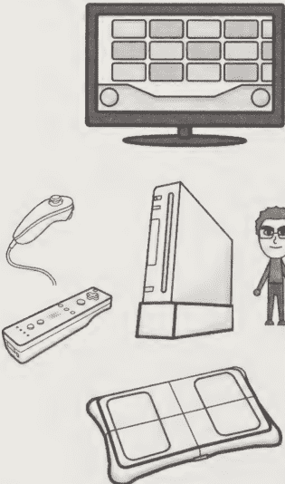
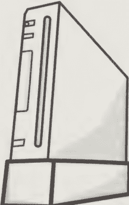
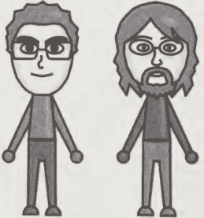
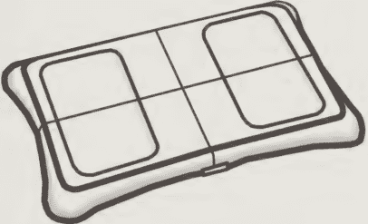
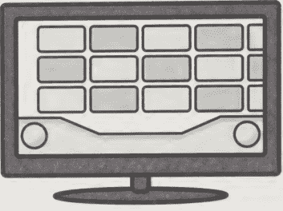
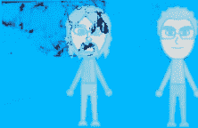

# 代号革命：任天堂 Wii 平台（平台研究）

## 丛书前言

如果一个人不了解手机和3D环境是不同类型的计算平台，他怎么能为手机创造出一款突破性的游戏，或为沉浸式3D环境创作出一件引人入胜的艺术作品？最优秀的艺术家、作家、程序员和设计师都清楚，某些平台会促进特定类型的计算表达和创新。同样，计算机科学和工程学也长期思考如何分析和改进底层计算系统。尽管科学和工程方法非常重要，创意艺术家们的作品也意义重大，但通过对数字媒体进行持续、深入的人文学科研究，我们同样可以学到很多。我们相信，人文学者是时候认真思考计算系统的最底层，并理解这些系统如何与文化及创造力相关联。

“平台研究”系列丛书的设立，旨在促进对底层计算系统的研究，以及这些系统如何使在其上完成的创造性工作成为可能、如何限制、塑造并支持这些工作。该系列探究数字媒体的基础：开发者和用户赖以获得艺术、文学、游戏及其他创造性发展的计算系统，包括硬件和软件。本系列中的书籍方法各异，但都具有一些共同特征：

- 聚焦于单一平台或密切相关的平台家族
- 技术严谨，深入调查计算技术的工作原理
- 意识到并讨论计算平台如何在文化和社会的背景下存在：它们基于文化概念而被开发，随后又以多种方式对文化做出贡献——例如，通过影响人们如何看待计算

这本特别的著作《*Codename Revolution*》——一位文本研究学者与一位计算机科学家的合作——近距离考察了平台及其设计如何促进人们与计算和游戏的社交互动。本书还对一款在2006年发布、影响深远、至今在市场上仍具有重要意义的最新一代尖端平台，进行了全面研究。

## 致谢

在本书写作过程中，我们要感谢所有学生给予的广泛灵感和反馈，特别是Jones的2009年秋季数字人文研究生研讨班成员。此外，Jones想感谢Sari Gilbert和Charles Shami邀请他于2010年4月在萨凡纳艺术设计学院的游戏开发者交流会上演讲；当时，大部分听众刚刚被业内演讲者演示的震撼爆炸效果、弹道和游戏试玩所惊艳，仍然礼貌地留下来听他的Wii讲座。此后，其他地方同样热情的听众一再使问答环节与演讲一样长，而且教育意义加倍。在过去两年中，Jones和Thiruvathukal都有机会在各种会议上展示这个项目的成果，从文本研究学会和数字人文会议，到现代语言协会，来自多个学科的学者同行们在帮助我们构思和锤炼论证方面发挥了重要作用。

在芝加哥洛约拉大学，我们要感谢Peter Shillingsburg给予的道义和实际支持以及领导力，尤其是在我们共同管理的文本研究与数字人文中心的创办阶段。与国内外众多学生和同事的对话及正式交流一路都极为有益，尽管当时并非所有参与者都意识到他们是在帮助我们写这本书。仅举几例：Pedro Prieto Alarcón, Jasper Cragwall, Neil Fraistat, Allen Frantzen（介绍我们两人认识的合作者）, Ron Greenberg, Chris Grubbs, Doug Guerra, William Honig, Paul Jay, 另一位Steve Jones, Matthew Kirschenbaum, Jason Kolkey, Konstantin Lauter, Adrienne Massanari, Federico Meschini, Peter Nabicht, James Newman, Chandra Shekharan, Joyce Wexler, Zach Whalen 和 Talmadge Wright。

在麻省理工学院出版社，我们感谢Doug Sery的编辑指导；Katie Helfer及时的回应和娴熟协调；Deborah Cantor-Adams, Cindy Milstein以及其他为本书制作提供帮助的人；还有Ian Bogost和Nick Montfort，他们是“平台研究”丛书的创始编辑，他们的 *Racing the Beam* 为此铺平了道路。匿名读者帮助我们打磨了本书的最终版本，我们非常感谢他们。在一篇已发表的Jones前一部作品的评论中，Nina Huntemann指出其中一章将对“平台研究”丛书做出重要贡献，从而证实了一个早已酝酿的计划。原始插图由Henry Jones绘制。

我们要感谢Pass-a-Grille海滩的疯狂天才Evander Preston，他在最终合作修订会议上给予我们灵感。感谢Rohan和Maya，他们小小年纪就懂得可以同时身处游戏之中又游离于游戏之外。感谢Emi和Hannah在紧急情况下特别捐赠了设备（更多的Wii Remote和一个Zapper），最后，感谢Heidi和Nina的配合。

十多年前，罗伯特·D·帕特南出版了一部颇具影响力的社会学著作 *独自打保龄*，讨论美国社会共同体的丧失——这种丧失由书名中那个令人伤感的意象所象征。帕特南发现，美国人越来越可能独自去打保龄球，而不是成群结队或加入联赛；而这只是更普遍的公民生活参与度下降的一个例子。尽管该书对因果关系和相关关系保持了应有的怀疑，但它仍将技术和媒体表现为至少是促成该问题的因素之一，并重复了不少陈词滥调，把“电脑和电子游戏”说成是“孤独的”和使人疏离的。例如，帕特南引用统计数据表明，20世纪90年代美国男孩比女孩更可能用电脑玩游戏；相比之下，女孩更可能用电脑收发电子邮件。帕特南将此解释为女孩“更善于社交”的证据，其依据是一个未获支持的前提：游戏不如电子邮件具有社交性。

在 *独自打保龄* 问世十多年后，美国的公民生活可能仍在衰落（众所周知，这类宽泛的趋势既难以定义，也难以衡量），但打保龄球——而且有时仍与他人一起——似乎至少保持了中等程度的流行。然而，如今对许多人来说，想到保龄球作为一种社交活动，可能更容易联想到 *Wii 运动*，而不是真正的保龄球。用谷歌图片搜索“保龄球”，结果几乎肯定会在穿同款T恤的合影以及拥挤球道的图片中，出现一两张 Wii Bowling 的图片。当我们为本章尝试这一搜索时（2010年6月），排名前二十的图片中有一张是待售的 Wii Bowling 联赛T恤，上面每个字母 i 都被一个保龄球瓶替代；还有一张模糊的动作照片，拍的是一位老年人在当地公共图书馆全身心投入地玩 Wii Bowling。事实上，搜索“Wii Bowling seniors”得到了1,940,000条结果，其中许多包含操作指南类文章的链接，或关于养老院组建联赛的报道。Wii 并没有取代帕特南眼中美国文化所丧失的东西——公民参与和广泛的社会承诺；这不是重点。但自2006年以来，保龄球作为社交活动这一话题已被重新定义，其标志就是任天堂的保龄球模拟游戏。

这只是一个轶事性例子，说明 Wii 广泛的文化影响。这台电子游戏主机从2006年推出到2010年（竞争对手推出类似系统之时），一直是模仿式动作控制界面的代名词（你站起来挥动手臂来投球，就像我们搜索结果图片中的那个人），也是那种曾与纸牌游戏和保龄球联赛联系在一起的公开而好玩的社交互动的代名词。“娱乐”字面上就是任天堂的中间名。该公司成立于19世纪，最初是一家扑克牌制造商；在此语境中颇有意思的是，它曾将废弃的保龄球馆改造成多媒体射击场，也就是用新型社交游戏取代日本曾经居于中心的保龄球联赛的场所。这段历史对本书很重要；本书详细考察了过去十年中最具影响力的电子游戏平台，而此刻其继任者 Wii U 已初现端倪，标志着初代 Wii 主要生命周期的一种完成。³

到2006年11月 Wii 在北美开售时，它已经在新闻媒体、讨论板和博客上引起了相当大的兴趣。这台由总部位于京都的娱乐公司推出的第五款家用游戏机，在开发期间代号为“Revolution”，并事先被营销为一种绝对的例外——一套面向尚未开发的大多数市场的系统，这些人不玩电子游戏，或只是随意玩玩。Wii 帮助开启了杰斯珀·尤尔所称的“休闲革命”这一更大趋势，以及“电子游戏史上的一个突破性时刻”。互联网上所谓的社交游戏，例如利用 Facebook 和其他社交网络来吸引其宿主平台的 FarmVille，大致与 Wii 同时出现。与这些在线社交游戏不同，Wii 家用游戏机是尤尔所说的“模仿界面”游戏：系统会镜像玩家的动作。但尤尔认为，像 Wii Sports 这样的社交游戏和模仿界面游戏，是同一场休闲革命的不同表现形式。⁴ 在这两种情况下，重点都在于赋予游戏意义的社会语境，以及游戏所鼓励的社会互动，即使这些互动并不处于实际玩法的中心——实际玩法可能涉及诸如 FarmVille 中的异步在线互动，将控制器用作令牌或指针。

Wii 发售四年后，微软为 Xbox 360 推出的 Kinect 扩展设备和索尼为 PS3 推出的 Move 被创造出来，以争夺任天堂开辟的模仿界面市场。（我们将在本书最后一章进一步讨论那场竞争的最初阶段。）但比这些平台的前身以及 Wii 在2006年的直接竞争对手——采用传统控制方式的 Xbox 360 和 PS3——更为深刻的是，Wii 依赖于其相互连接的组件之间那个“空”的空间中所发生的事情，即玩家与屏幕之间的那个空间——一个由外围设备网络所中介的空间，并被想象为一个可能性空间，在那里社会互动是玩法的理想语境。

本书将 Wii 视为一个社交平台。当然，从某种意义上说，所有平台都是社会系统，游戏平台尤其如此。但正如我在别处所论述的那样，与近来大多数拥有3D游戏世界的主流游戏相比，Wii“在于以不同的方式使用空间”。^8 它的设计围绕这样一个观念：玩法理想地发生在共享空间中，在那里社会互动——至少是潜在的互动——处于体验的核心。Wii 并不追求最大化游戏所发生的虚拟战场、王国、地下城或城市的沉浸式画面，相反，其由控制器对象构成的躯体与模仿网络，明确是带着实体客厅这一考量来制造的。

当然，Wii 的硬件和软件组件本身，并不比任何其他游戏平台的组件天然更具社交性。Xbox 和 PlayStation 以及其他旧有系统，经常——甚至也许通常——被用于社交场合：无论是多名玩家坐在同一空间、却通过耳麦连接并共享一个虚拟游戏空间的局域网（LAN）聚会，还是定义更松散的群体，例如两名玩家操作控制器，而另外几个人观看并评论。更不用说在线社交互动了，无论是通过 Xbox Live 这类服务，还是在个人电脑（PC）上玩的大型多人在线角色扮演游戏。事实上，我们认为，与主流刻板印象相反，大多数玩法都以这些方式中的一种或多种在根本上具有社交性。再说一次，使用 Wii Remote 而不是传统的双手游戏手柄，本身并没有什么更具社交性的地方。造成差异的是系统的整体设计，而这种设计又受到关于该系统用途和使用方式的先入之见的塑造。这是程度上的差异，而非种类上的差异，是相对侧重点的差异；但 Wii 是第一个从最初概念到原型再到出厂产品都作为整体被有意识地设计、以首先促进实体空间中的社交玩法的家用电子游戏平台。这就是当我们说到沉浸式游戏空间，以及玩家在游戏玩法中的身体与心理体验时所指的意思。Wii 的文化影响并不只源于动作感应控制器。它还依赖于任天堂的声誉和软件目录这一基础；这些软件目录包括历史上一些最受喜爱的系列作品，并在所谓的核心玩家中承载着大量文化资本。更小、更便宜、创新、易用、休闲、适合家庭、经典、革命性且有趣——所有这些描述语都已被任天堂的营销成功地与 Wii 联系在一起，并在新闻媒体和更广泛的文化中产生了回响。要研究作为一个平台的 Wii，就需要我们关注系统设计、框架建构和文化反应之间的联系。

## 我们的方法

总体而言，我们从各自不同的学科视角来撰写本书：文本研究和计算机科学。我们中的一位是英语教授，研究文学作品的物质文本——例如，手稿、印刷技术和出版如何作为一个系统共同作用，为诗歌文本提供意义并约束其意义。过去二十年里，由于数字媒体的催化，物质文本研究与游戏研究开始以多变而有趣的方式结合起来。因此，作为文本研究学者，琼斯发现自己开始教授和研究电子文本与新媒体，并在数字人文会议上发表论文；在那里，他听到了电子游戏和新媒体理论家们引人入胜的报告。正是在这一背景下，琼斯于2008年写了一本关于文本研究与电子游戏关系的书；对这一工作的延伸则促成了本书。^18

我们中的另一位是蒂鲁瓦图卡尔，一位计算机科学教授，兴趣在高性能计算，但最近也关注分布式系统和普适计算——一个由低功耗设备主导的领域。他把系统视为平台的解剖学和生理学，并对计算在文化中的应用感兴趣——包括计算史、数字人文、游戏和环境科学。蒂鲁瓦图卡尔就是这样成为本书合著者的。

我们共同主任一所大学文本研究与数字人文中心，该中心支持计算、人文和社会科学交叉领域的跨学科研究与教育——包括英语、历史、艺术、传播、新媒体、社会学以及图书馆与信息科学。该中心支持各种计算

应用与人文学科项目，包括为文本和图像的协同编辑与出版创建新数字环境的方式，从现代主义小说到十九世纪政治漫画。正如这个术语所暗示的，数字人文工作的全部要点在于将计算机科学与信息技术同人文学科研究的对象——书籍、手稿、艺术品、照片、版画、人工制品、档案记录和电子数据——结合起来；换言之，将计算与文化连接起来。这实质上也是我们带入本书的相同方法和视角。在此，研究对象是作为一个平台的Wii——它包括主机、Wii遥控器、双节棍手柄、平衡板、固件和操作系统（OS）系统软件，以及光盘或下载的游戏软件，还包括例如商业电子游戏产业的文化，连同休闲游戏这一更大现象，以及大众对电子游戏系统是什么和可能成为什么的理解。

我们两人都活得够久，曾在街机鼎盛时期以及早期家用主机和PC时代玩过电子游戏。多年来我们拥有过许多游戏系统，目前我们两人合计拥有当前三大主要竞争对手的主机。但事实上，直到近年我们开始研究它们之前，我们都发现自己玩游戏越来越少，因为与我们这一人群中的许多人一样，我们发现有了孩子和学术工作后，拥有时间和精力进行长时间游戏回合的可能性越来越小。因此在我们自己的生活中，我们属于与Wii相关的更大文化转变的一部分——休闲游戏的兴起。为了娱乐和研究，我们现在在移动设备、手机和平板电脑上玩游戏，和在家庭主机上玩得一样多甚至更多。事实是，我们两人基本上都是休闲玩家。但我们仍然认真对待电子游戏研究，我们同意电子游戏是当今最普遍、最重要的表达文化形式之一。

我们认真对待游戏，将其视为关注对象，即使这些游戏本身有意自嘲。我们在撰写第五章（关于Wii上的访问、分发和传输渠道）时发现，当时新出的DS游戏*《瓦力欧制造：D.I.Y.》*将该系列关于制作和销售游戏的自指式幽默提升到了新层次（不止一种意义上）。它是一款关于制作游戏的游戏，或者在此情况下，是关于该系列闻名的五秒钟微型游戏。于是我们使用教程，摆弄内置编辑器，制作了一些我们自己的微型游戏，从一款名为Make Room!!!的游戏开始；在游戏中，你必须轻点或点击来移开咖啡桌，以提供*《Wii操作手册》*所称的游戏游玩“充足空间”。……的构想是

然而，在大多数情况下，技术远非简单的单向决定因素。像*《赤铁》*这样的第三方动作冒险游戏，是为Wii首发并利用初代Wii遥控器而制作的，可能在许多方面失败（事实也确实如此）——部分原因是系统的图形和处理限制——但随后在续作*《赤铁2》*中得以复兴（或“重启”），此前任天堂发布了控制器附加装置MotionPlus，它集成了MEMS“音叉”陀螺仪，大大增强了Wii遥控器测量和映射玩家动作的能力。第二款游戏的相对成功是硬件变化的直接结果。这关乎开发者学会在平台限制内工作，并获得一套新的可供性，从而形成感觉逼真（而非看起来逼真）的剑术。富有表现力和创造性的文化产物*《赤铁2》*首先是新计算技术的直接结果。与此同时，像*《赤铁2》*这样的游戏（以及从第一部*《赤铁》*中学到的东西）正是创造新计算技术的原因。对该游戏的任何完整理解——甚至包括其叙事内故事线，尽管它很有限——都必须考虑使其成为可能并塑造其可能性的经济与技术因素之网。在我们看来，没有任何物质技术独立于文化之外。也没有任何文化事件超越物质或技术。因此，我们的方法要求将两者交织起来。

如果“平台是分层的——从硬件到操作系统，再到其他软件层——并且它们与模块化组件（如可选控制器和卡带）相关”，那么平台本身就是“堆栈”中的一种层，而该“堆栈”表征了数字媒体对象在其社会语境中的结构。^12 伊恩·博戈斯特和尼克·蒙特福特关于雅达利VCS的著作*《与光束赛跑》*开创了本丛书，他们提供了一个有用的图示，表示对数字媒体或创造性计算可能予以关注的五个层次：以平台为基础，向上经过软件和架构层（代码、形式/功能、界面和接受/操作），以包含创造性作品本身（例如一款电子游戏）。^13 文化可以被理解为包围整体的最高层或语境，也可以被理解为某种不可避免渗透媒体对象每一层的“溶液”，帮助塑造它，或反过来被它塑造。我们甚至要进一步提出，文化（或社会语境）也渗透并塑造平台层的每一个子层，从晶体管技术到游戏设计艺术。这使得游戏主机成为平台研究尤其有趣的案例，因为若要具有任何意义，它们显然依赖于社会和文化层。再次，Wii是这种普遍依赖性的一个特别生动的例子，因为它被设计为聚焦于由文化塑造的社会空间中发生的事情，游戏正是在其中被想象和游玩。

正如我们所说，每个平台在某种程度上都是社会平台——而且不仅是数字平台。以书籍为例。印刷机连同印刷文化的各种制度，可以被视为一种以册子本（codex books）的物质形式生产和传播文本的平台。在约翰内斯·古腾堡（在欧洲）发展出活字印刷之后，机器被用来将文本压印到纸上：使用金属活字，将其锁入木制版框并上墨。这使得同一著作的多个副本之间具有高度一致性，并使文本以书籍形式广泛传播——这种形式具有双页展开的界面（册子本），极其适合随之出现的各种阅读实践。

印刷技术与常被称为印刷文化的东西之间，以及印刷文化与一般文化之间的更高层次联系，极其复杂，其确切性质一直是书籍史学者严肃争论的主题。¹⁴ 但存在某些此类联系——即印刷技术具有文化效果——这一点为大多数历史学家所接受。既有积极效果——十九世纪初蒸汽驱动印刷机的发明开启了大众市场出版——也有消极效果——浪漫主义诗人威廉·布莱克以及后来的维多利亚时期前拉斐尔派诗人回归手工制作书籍，部分是对新印刷技术的反应。

无论哪种方式，印刷平台都会影响创造性作品，例如诗歌。然而，与电子游戏主机这样的计算平台相比，印刷看起来更像一种文化范围的技术体制或媒介。更准确地说，英国摄政时期的礼品书年度选集、维多利亚时代的三卷本（三册）小说、20世纪80年代和90年代自行动手（DIY）剪贴复印的独立杂志（zines）——这些都是塑造各种写作形式之创作与接受的具体文本技术配置——是印刷这一更大媒介或领域内的具体平台。在这个意义上，电子游戏主机是计算这一更大领域内的具体平台。

在我们自己的时代，我们正看到电子书在各种相互竞争的生产和传递文本的平台中兴起。这些平台现在不仅包括个人电脑，还包括手持移动电子书平台，无论是亚马逊的Kindle、各种手机应用程序，还是苹果为iPad提供的iBooks。例如，界定iPad作为电子书出版平台的边界在哪里？首先，有具体的硬件和软件技术规格，包括

从多点触控界面和屏幕分辨率，到电池续航和外形尺寸——即平板电脑本身的形状和大小，一切都包括在内。此外，还有多层软件，从 ePub 格式的文本文件，到允许添加书签、将选中文本复制到剪贴板、搜索以及在选中文本内查词典（但奇怪的是，不包括批注）的代码，再到全彩显示屏的界面设计——该设计在触摸时以动画呈现翻页效果，并将你收藏书籍的封面图像堆叠成图形化书架图像。所有这些功能都是 iPad 电子书 iBooks 平台的一部分。

但事情不止于此。电子书出版、分发、购买和下载所依托的在线软件渠道，即 iTunes Store 的 iBooks 专区，也是该平台的关键一层——在某些方面是最重要的一层，因为该平台的目的是出版和分发，而不仅仅是阅读。甚至在 iPad 首次发布之前，iTunes 上的 iBooks 就备受争议，引发了公众辩论，讨论苹果作为图书销售“代理”、在出版商与读者之间居中协调的谈判角色。而这种电子书出版新模式反过来对电子书价格产生了具体影响，不仅影响苹果在 iTunes Store 上的定价，也影响其竞争对手亚马逊作为回应所采取的价格。与亚马逊面向 iPad 和其他设备的 Kindle 应用的竞争，可能是苹果构建自有分发渠道的主要动因。一项调查显示，截至 2010 年秋季，虽然 75% 的受访用户会在 iPad 上读书，但约 7% 的受访者更愿意通过 Kindle 应用在 iPad 上阅读电子书，而不是使用苹果自家的 iBooks 应用。^15

关键在于，iPad iBooks 平台是其各分层组件的总和——从微芯片到多点触控界面，再到可用软件，再到该软件的出版渠道（实际的电子书），以及用户对它的接受。像任天堂 Wii 这样的电子游戏平台，恰恰要求对这种多层结构给予细致关注。游戏同样通过一个由硬件、软件以及经济和社会制度等组成的多层组件系统来生产、分发、接受和游玩。平台研究必须始终意识到这种复杂性。

本着这一精神，第 5 章聚焦于 Wii 系统功能界面（即所谓的 Wii 频道）的软件设计与结构。这些频道不仅仅是一组菜单，它们代表了一套软件和服务的分发渠道，是将平台延伸到本地主机及其组件之外的传输管道。正如蓝牙、红外和 WiFi 通信连接 Wii 的设备，创造出一种个人区域网络（PAN），作为体验该平台的本地空间；同样，支持 WiFi 或以太网的频道——连同它们所连接的机构和企业——在平台外缘建立起更大的网络。这些频道尤其包括对 WiiWare 服务的访问，该服务提供可下载游戏，通常由独立第三方开发者为 Wii 及其特殊附加组件制作；还包括虚拟主机（Virtual Console），通过它，来自早期平台（任天堂及其他公司的平台）的模拟游戏可以与任天堂或其他开发者的新游戏一起，在 Wii 上下载和游玩。因此，例如，你可以打开 Wii，访问不同频道（包括通向光驱、用于运行 DVD-ROM 游戏的光盘频道），并游玩多代马里奥游戏，从 *大金刚* 中首次标志性登场开始，到专为 Wii 设计的新游戏为止，例如 *马里奥银河2*。

# 跨平台的马里奥

马里奥是一个有用的例子，可作为一个受控案例研究，说明平台的变化如何改变创意作品的具体表达。任天堂最具标志性、最受喜爱的角色兼公司吉祥物——水管工马里奥，如今据报道在美国被更多儿童认出，超过认出迪士尼公司八十年吉祥物米老鼠的儿童。根据维基百科（对于此类事实而言是特别有用的来源），马里奥系列包含超过 115 款游戏作品（不计重制版），全球销量估计远超 2 亿份，成为历史上最畅销的电子游戏系列。¹⁶ 一张被广泛转载的图片展示了真人大小的 3D 马里奥与他现实中的创作者宫本茂站在一起——这幅图像让人联想到沃尔特·迪士尼与米老鼠，例如迪士尼乐园著名雕像中的景象。（2010 年的 *迪士尼史诗米奇* 是 Wii 独占作品，我们在第 7 章讨论它，其中包含对同一座雕像的视觉戏仿。）

没有什么比马里奥更能代表经典电子游戏设计的艺术。然而，当你把他置于语境中，并追随马里奥出现在各种平台游戏和游戏平台上的足迹时，很快就能清楚看到平台与创意表达的联系有多么紧密——从艺术性的角色设计，到游戏机制与类型的设计，再到这一切对更广泛文化的影响。

像其他重要的起源故事一样，这个故事已被讲述过许多次，大多数读者至少会熟悉其中部分内容。但在平台与文化的语境下，这里值得再次讲述。宫本茂最初是一名设计玩具的工业设计师。不过，他的作品始终在注重形式的同时也注重功能。他在任天堂早期的一项著名发明，是一套供儿童使用的卡通动物形状衣架。他在任天堂的第一份正式游戏设计工作，是为一款基于卡通 *大力水手* 的街机游戏做设计，但公司始终未获得其知识产权。于是，*大力水手*、布鲁托和奥利弗·奥尔变成了新角色：跳跃人（Jumpman），一个在抽象建筑工地的平台上奔跑、跳过猿猴朝他滚来的木桶的木匠；*大金刚*，日本设计师以为这个名字是英语俚语，意为“愚蠢的猿”；以及宝琳，木匠那身处险境的少女女友，也是电子游戏中一长串被囚禁女性角色中最早者之一。街机游戏 *大金刚* 于 1981 年制作。

就技术和游戏体验而言，这些早期街机柜游戏与后来为马里奥游戏制作所针对的几种家用主机之间存在关键差异。直到最近，每一款新的任天堂系统都会伴随一款新马里奥游戏的发布而推出。*超级马里奥兄弟* 于 1985 年在 NES 上发行。它与该系统的创新密切相关，反过来又以自身的光环赋予 NES 作为平台的魅力，形成一种共生式发展循环。那款游戏全球销量可能超过两千万份，使马里奥成为文化偶像。作为截至当时最复杂的电子游戏（复杂到游戏卡带中加入了辅助处理器），*超级马里奥兄弟* 是其时代第一款以抵达故事结局为首要目标的游戏。尽管游戏会根据你的游玩表现计分，但游戏的根本动机是拯救公主并看看结局发生了什么。横向卷轴让玩法从一个屏幕推进到另一个屏幕，沿水平轴扩展游玩场地，使玩法能够在每个关卡中穿过数十个显示屏幕。¹⁷ 不断扩展游戏世界的维度——无论是字面意义还是比喻意义——成为整个马里奥系列的标志。

这个小木匠被改成了水管工，以契合城市环境及其可穿行的管道。有趣的是，宫本茂最初想把他命名为“视频先生”，因为他从一开始就被计划为跨多个平台的众多电子游戏中的通用英雄，一个会在游戏中反复出现的人物，象征着任何有效的创意表达都能跨平台繁荣发展。马里奥的基本特征正是在考虑这些总体计划的同时，直接回应他最初在 *大金刚* 中诞生时所处平台的具体限制与可供性而设计的。那款游戏的街机柜的基本控制方式——该街机柜原本就已存在，用于游玩另一款游戏 *雷达范围*——是既定的。宫本茂别无选择，只能基于这些控制方式来设计。因此他说，他发明了跳跃

这种移动——马里奥正是因这个动作而闻名，而这个动作也催生了一整套横版卷轴平台游戏玩法——是对硬件的回应，具体来说，是对以下事实的回应：街机柜已经有一个大按钮——在*雷达范围*中用来发射武器——可以经过编程让这个小角色跳跃。于是跳人诞生了。有一种说法是，他后来以开发者的房东之名改名为马里奥，但可能也是为了迎合任天堂所想象的那种美国文化。

这一点值得反复强调：初代马里奥设计中的一切，从他利用街机柜按钮来跳跃，到他的基本外观，都是由他每一次化身时可用硬件和软件的状况所塑造的。平台帮助决定了艺术设计。正如任天堂总裁岩田所说，“整个设计就是形式由功能决定的一个例子”，这里形式指角色和游戏设计，功能基本指平台。当然，这不仅适用于马里奥。岩田指出，所有“当时的电子游戏开发本质上都是在硬件所施加的限制内，设法实现各种东西”。¹⁸ 正如作家汤姆·比塞尔所说，强化蘑菇、火焰花和砖块里的金币——马里奥游戏的所有标志——也许看起来像奇怪的幻觉式象征，或者他所称的“不可言说的日本怪诞”，但它们实际上是在特定时刻、特定平台上、在媒介限制内工作的直接结果。

在电影和文学中，这类超现实幻想通常出现在实验主义的外缘，但早期电子游戏依赖符号，原因很简单：当时的技术限制使写实主义不可能实现。¹⁹

宫本茂所想象的那种特定形式的超现实幻想，是对媒介和平台限制的一种可能回应（在此例中是一种出色的回应），他今天的电子游戏设计依然如此，尽管这些限制与他约1980年所面对的不同。在为 Wii 制作马里奥游戏时，宫本茂再次做出了惊人的事情，这一次是在物理和世界设计方面，恰恰因为他的符号词汇已经是一种强大但非写实的词汇，而新平台 Wii 也有自己的技术限制。

宫本茂解释说，初代马里奥的外观，关键是用尽可能少的像素来降低对编程和动画的要求。早期马里奥本质上是一个十六乘十六像素的精灵状形象，几乎是把游戏棋子或标记变成了可玩角色；在许多方面，它在时间上和设计复杂度上，与1970年代最早一批计算机游戏之一*太空大战*中的抽象火箭飞船相距并不算远。宫本茂曾说，当时的“海外”（主要指美国）游戏大多使用廉价的“火柴人”作为角色，因为他们太想在八位环境中表现人体的写实比例——这一判断呼应了 Wii 革命性转向不以写实图形为主要目标的理由。结果，这些火柴人的面部特征和手势或多或少难以看清，无法激发玩家的认同与共情。

宫本茂转而从漫画和动画艺术风格中寻找灵感。他特别提到现代漫画的伟大先驱、*白狮金巴*和*铁臂阿童木（原子小金刚）*的创作者手冢治虫，将其视为影响来源。因此他夸张角色的特征、扭曲其比例，这有节省每一个像素使用的优势。矛盾的是，马里奥的抽象化可能让他显得比按伪写实比例绘制的火柴人更有生命力、更富有表现力，部分原因是这让他看起来像是游戏环境所提供的有限调色板中不可或缺的一部分，部分原因是这召唤玩家用想象力填补空白。²⁰ 马里奥戴一顶鲜红色帽子，以避免试图描绘（并制作动画）他的头发时不可避免的令人失望的结果。他留胡子，以避免必须绘制并制作嘴部动画。他的背带裤是一种能把四肢与躯干区分开的服装，从而使简单的奔跑和跳跃动画成为可能。诸如此类。这种卡通美学的运用超出了角色本身。据宫本茂说，后来马里奥游戏中著名且无处不在的管道——马里奥可以进入其中，被传送到地下城和其他地点——来自一种漫画视觉惯例：到处散落的管道常常暗示城市环境。

形式由功能决定，在平台所施加的限制内设法实现设计，已经成为一种创作美德；必要性已经成为任天堂的设计精神。正如宫本茂所说，“任天堂特质”并不在于追求“技术优势”。²¹ 这种务实精神正是 Wii 开发过程的核心。你可以在为 Wii 创建的卡通化身和非可玩角色（NPC）——即 Mii 角色——中看到它发挥作用。宫本茂也是其设计背后的创意力量，他说它们受到传统雕刻小芥子木偶的启发，但同样的理念贯穿其中：节省表现，以便专注于其他特征（例如模拟动作）。马里奥不只是一家公司的吉祥物和有价值的知识产权；他还是这种任天堂设计精神的化身。因此，当我们在整个 Wii 平台上到处发现马里奥的形象，甚至混入 Mii 人群中，仿佛要强调它们最终的基因亲缘关系时，这不仅仅是品牌塑造或埋设“彩蛋”的问题。这些马里奥形象中的每一个，都是那种设计哲学持续存在的某种标记，是 Wii 开发者志向的指示器：创造玩家能够认同、有吸引力且有趣的富有表现力的软件，但又要在性能、图形能力、存储和能耗方面相当严苛的限制内完成。

Wii 商店频道使用经典形象的马里奥（有时是他的弟弟路易吉）作为其动画下载计量器。伴随着熟悉的声音效果，他跑过屏幕，跳起来撞击头顶上方的砖块并获取金币（在此例中这是个贴切的比喻，因为当你看到它时，你的信用卡或 Wii 点数卡在大多数情况下正因一次下载而被扣费）。你可以在 Wii 软件中到处发现马里奥客串亮相的图像。当你在*Wii 运动 度假胜地*开头跳伞降落到乌胡岛，并在风中操控你的 Mii 化身，以便抓住其他跳伞 Mii 的手并让人给你拍照时，你可能会看到那个熟悉的小水管工穿着跳伞服，在 Mii 们中间从天而降。这是一种奇特的效果。后来，在岛上奔跑比赛时，你可能会发现石墙上有一幅涂鸦壁画，画着马里奥睁大眼睛的脸。这可以说是任天堂最普适的知识产权对其最新游戏世界的一种美学萦绕，而其象征意义绝非偶然。

任天堂为 Wii 主机开发的游戏中有几款以马里奥为主角（此外，任天堂另一基石系列*塞尔达传说*迄今已有两款）。有些相当敷衍，而另一些则是近年来任何平台上最受评论界赞誉和欢迎的游戏。*马里奥赛车Wii* 是一系列衍生作品中在 Wii 版本上仍然受欢迎的一款。马里奥只是你可以扮演的任天堂角色之一，你也可以扮演自己的 Mii，与其他玩家竞速，包括通过任天堂 Wi-Fi 连接进行在线对战的玩家。在线游玩设置快捷、操作简单，适合一次一场比赛的休闲对局。你可以双手横握 Wii 遥控器来转向，或把它装入方向盘形状的塑料外壳中来转向。Wii 上的*马里奥派对*系列作品是一款面向多名玩家的棋盘式游戏，包含大量小游戏，其中一些利用了 Wii 遥控器的动作感应功能。

*新超级马里奥兄弟Wii* 是另一种类型的游戏，也是一个有趣的案例研究；它既受到硬核粉丝的热切期待，又让其中许多人有些失望。它支持多人合作模式，引入了 Wii 所著称的那种社交玩法，但

正如一位评论家所指出的，它反而奖励玩家专注的单人努力：“当你在那个游戏里加入多名玩家时，他们常常最终互相碰撞、推挤，把彼此撞进敌人和危险物中。其效果是打消人们一起玩的念头。”²² 这款游戏对Wii原本想吸引的许多休闲玩家来说终究太难。但更有经验的硬核玩家可能会反对“超级指南”这类功能，认为它太简单——这是一种游戏内帮助角色（路易吉），呼叫时就会出现。对许多人来说，此案例中游戏与平台的契合似乎不太合适。

另一方面，*超级纸片马力欧 Wii（2007）*在Wii上却如鱼得水。它被描述为任天堂64（2000–2001）RPG *纸片马力欧*的某种概念续作。那款任天堂64游戏由Intelligent Systems为任天堂开发（宫本茂参与），已有复古风格，刻意呈现2D外观，仿佛角色更像是纸片剪影，然后置于包含一系列障碍、谜题、任务和战斗的3D背景中。*超级纸片马力欧*是一种创造性变体，也融合了其他马力欧游戏的元素（聪明地包括*超级马力欧兄弟*），为Wii打造出一款平台化RPG。二维角色奔跑、跳跃，与方块和熟悉的乌龟敌人（Koopa）互动，并进行Boss战以营救公主，但带有一些超现实转折。某一刻，地图蘑菇把马力欧变成巨大的化身，但这个超级马力欧是早期八位机游戏中高度像素化的老派马力欧的放大图像。其结果是一种块状的马力欧特质抽象，像素颗粒醒目显现，自觉地把角色表现为一个图标。*超级纸片马力欧*最初为GameCube平台开发，但在其生命周期末期转移到了Wii。游玩时，你大多双手横向握持Wii遥控器，使其像旧NES手柄，但你也可以使用Wii遥控器（以“Pixl”角色作为一种光标）指向屏幕，以揭示隐藏门或其他秘密，并在关键时刻摇晃控制器来获得额外分数。

然而，这款Wii游戏真正的创新，以及它在新平台上的契合感，与Wii的技术可供性和约束几乎没有直接关系。相反，代号Revolution的新平台开发（几乎可以肯定，在游戏仍为其前身平台GameCube设计时就已经在进行）似乎在任天堂创造了一种创新氛围，并推动了公司各事业部关注一个概念设计问题：游戏中的“维度”如何不同。

在*超级纸片马力欧*中，你可以按A键从二维翻转到三维。这样做时，一扇传送门——一扇剪出的门——会出现在平面背景中，随你的角色旋转，场景翻转为3D视图。于是，横版卷轴平台模式中不可能的一排排方块，现在显示只有一格深，你可以找到绕过去的路。看起来像远处山峦的背景翻转过来，显现为近景狭窄坡道，你可以爬上去，并利用它穿到深渊后面。你只能在有限时间内停留在第三维度而不损失生命值，所以你主要在2D中游玩，始终知道事物并非表面那样。不过，你的角色仍是2D剪影，有时旋转以显露其扁平，像扑克牌图像（在一个来自任天堂——这家起家于制造纸牌的公司——的游戏中，这是恰当的视觉隐喻）。*超级纸片马力欧*揭示了任天堂对游戏历史的普遍自觉，这种自觉也被内置到Wii中：掌控深厚经典的感觉，以及这反过来提供了什么——始终可用的多重“维度”，或对游戏设计和玩法的多重视角。^23

在Wii的软件作品中，没有哪个比两款*超级马力欧银河*游戏（2007年和2010年）更受评论界赞誉，它们是主要发生在太空的3D平台游戏。滑稽形状的卡通天体、小行星和行星充当3D“平台”，马力欧在其上奔跑跳跃。这些游戏玩弄视角的剧烈变化，使用行星级缩放，使马力欧一会儿似乎在球体上奔跑，拉近后则横跨行星表面更大的平面。拉远使尺度变化，像在容器中盆景式创造的人工花园，房屋和树木比例突兀地耸立，可从太空看到，还有微小的马力欧（及其敌人）在球体表面奔跑。在游戏中，行星可以显得像房间大小或世界大小，取决于视角的快速切换，使早先*超级纸片马力欧*从2D到3D的翻转看起来像*银河*的概念预演。马力欧的行动被解放：从跳过障碍和缺口，变成自由地在多个方向和三维中奔跑。虽然你使用双节棍手柄的模拟摇杆移动，两款游戏尤其是第二款都利用Wii遥控器指向点击，以控制镜头、你的移动和各种物体——金币、星星、火箭敌人，它们有米老鼠式（或说马力欧式）戴手套的手臂。

两款*超级马力欧银河*游戏在销售和评论界反响上都极为成功。多数评论家将其列为Wii最佳游戏，许多人还评为史上最佳游戏之一。我们认为，这些游戏的成功部分是因为它们展示了任天堂的主要资产：在相当严苛的限制内反复创造引人入胜、娱乐、有趣内容的能力——从NES的八位机世界到代号Revolution平台相对低功耗的标清图形。任天堂平台的意义总与任天堂创意资产的遗产相连。2010年12月，任天堂发布限量版红色*超级马力欧全明星 Wii*，附原声CD和历史小册子，以纪念*超级马力欧兄弟*25周年。

为回应这一遗产，本书特别关注任天堂为Wii自家游戏和软件——甚至包括可以说不太像游戏的软件（例如*Wii 塑身 Plus*）或根本不是游戏（Wii频道提供的许多服务就是如此）。全书我们选择讨论的软件，是能说明平台某个特定方面、某种约束或可供性的，不基于形式或批评标准，也不基于游戏有多好。我们还选择强调我们认为Wii作为主机最重要独特特征的软件，因此例如偏爱类型光谱中休闲而非硬核一侧。在某种程度上能兼顾光谱两侧时，我们就这样做，如Wii独占*赤铁 2*（第一人称射击[FPS]），它设计利用Wii体感控制系统的独特功能。

## 本书的计划

电子游戏主机是一个由彼此独立但相互关联的组件构成的平台，本书也据此组织。每章聚焦Wii作为平台的一个主要组件（见图1.1）。第2章考察主机本身，主板和芯片组的壳体，系统的计算核心，以及那个设计使Wii在市场中与众不同的象征性对象。

我们总结这一组件及其他组件的技术规格，并非为了规格本身，而是为了更好地理解系统的具体可供性和约束，尤其包括其在性能和图形能力方面被感知的和实际的局限。

我们简要考察一个常被忽视的决策方面：让Wii成为相对较低功耗的主机，即功耗越低，耗电量也越低。

Wii的耗电量远低于同等

是其所属世代中的设备之一。这也属于一项总体战略的一部分：把这款主机卖给任天堂所建构的“妈妈们”——这显然是一种被家庭化、带有性别特定性的观念，用以进入一个庞大且尚未开发的市场：这些人不拥有任何类型的主机，也不认为自己是玩家，但可能被诱导购买这一款。任天堂设计师公开宣称的目标，是让这款轻薄高效的主机成为理想化家庭客厅中一件不引人注目的固定设施。

## 1.1 任天堂 Wii 平台

第3章聚焦于与 Wii 关联最紧密、最具辨识度的标志性物件——Wii Remote。这个矩形设备在外观上模仿传统电视遥控器，采用无线设计，让你可以通过指向和点击来控制游戏内动作；但它最“革命性”的特征在于使用 MEMS 加速度计以及（后来加入的）MEMS 陀螺仪，从多个维度测量玩家的动作。我们把 Wii Remote 置于其他身体接口设备的历史语境中，同时也从隐喻层面把它置于人机交互（HCI）中的“魔法蜡笔”概念以及鼠标作为控制设备的传统之中。我们提出，作为控制器升级件的 MotionPlus 附件的加入，如何促成了某些仅靠原版 Wii Remote 无法实现或较难实现的软件功能；这一点体现在从专为 Wii 推出的第三方动作冒险游戏《Red Steel》（随 2006 年 Wii 首发）到“重启”续作《Red Steel 2》（2010 年）的转变中，也体现在任天堂自家《WarioWare: Smooth Moves》《Wii Sports》和《Wii Sports Resort》的概念验证式体感玩法中。

在第4章中，我们探讨另一款旨在发挥该系统新技术的任天堂软件——《Wii Fit Plus》，它随另一个外设控制器 Wii Balance Board 一同捆绑销售。Wii Balance Board 供你站立其上，利用应变计相当精确地测量身体重量和动作，因此你可以用整个身体来控制游戏。但正如我们将要展示的，这一设备同样有其历史，并且是任天堂接管家庭客厅这一更大战略的一部分；这一点可以从 Wii 上一个奇怪的新频道 Wii no Ma（大致意为“Wii 客厅”）中看出，该频道迄今仅在日本提供。Wii Balance Board 字面上就是一块你站在上面的“平台”，它体现了该系统从想象的游戏空间向物理玩家空间的转变。这种强调一直是 Wii 问世以来最显著的影响，并改变了游戏开发的格局以及大众对游戏的看法。向玩家空间的转变是该平台特定物质条件的直接结果：它被设计成可将易于使用的体感外设无线连接到主机，并在软件中大量采用抽象或风格化的图形（至少在第一方作品中以及该平台进入市场的最初几年里如此）。

如上所述，第5章讨论 Wii Channels 界面及其在任天堂分发系统方面所代表的一切——我们认为这也是整个平台的重要组成部分。我们考察主导频道理念的电视隐喻，以及它如何契合 Wii 的总体战略，并巡览若干特定频道，作为其提供的多样化服务的示例——其中许多服务显然不是游戏。接着，我们特别关注可通过 Wii Shop Channel 获取的 Virtual Console；它依靠模拟技术，让玩家能够访问任天堂旧作的庞大目录，以及为其他平台编写的游戏。最后，我们讨论同样可通过 Wii Shop Channel 获取的 WiiWare 服务；它提供来自相对更独立开发者的小型游戏，使这些游戏能够触达 Wii 的初次接触、流失以及休闲玩家市场——同时也把这一市场带给第三方和独立开发者。在详细探讨 *World of Goo* 之后——许多人认为它是独立开发者 2D Boy 制作的最佳 WiiWare 游戏之一——我们转向 *WarioWare D.I.Y.*，它允许玩家在掌机 DS 上制作自己的微型游戏并上传到 Wii，并考察这款游戏本身如何建立在游戏开发流程的结构之上。这些示例有助于我们审视 Wii 的分发与访问渠道中所涉及的商业和创意问题。

第6章更一般性地研究我们的主张：Wii 是一个社交平台。我们对“社交平台”的定义比仅仅看其游戏是否提供多人模式要宽泛得多。对我们而言，一个平台的社交性质最好从其设计鼓励用户做什么来看。因此，我们从开放或“生成式”平台与封闭或“应用化”平台的问题开始，并考察人们在 Wii 上实施的各种模组和破解，以表明即便是一台明确封闭的游戏主机，事实上也可以被有决心的用户在某种程度上撬开——而且几乎总是如此。然后，我们转向 Wii 的设计和营销如何鼓励用户在该系统上玩那些特别偏向社交游玩的游戏，从派对游戏到音乐和节奏游戏，例如任天堂自家的 *Wii Music* 和 *The Beatles: Rock Band*，还有 *Donkey Konga* 以及独立作品 *Bit.Trip* 系列（可通过 WiiWare 获取）。所有游戏平台都需要用户实现其潜能，从这个意义上说，每个平台都是社交的。但 Wii 被明确设计来激发用户活动，以展示其作为社交平台的身份，无论是在感知层面还是在实践现实中；即便它最终仍是一个封闭且专有的平台，对大多数人眼中的社交游戏模式——尤其是在线多人模式——所提供的机会有限。就 Wii 而言，社交游戏是根据社交语境和物理空间来定义的，但也与该平台的公众形象、人们如何感知它以及系统所推广的游玩风格相关。Wii 之所以是社交平台，并不是因为它特别适合多人游戏（它并不适合），而是因为它被设计成把玩家空间当作物理社交空间，被设计成提供——或至少创造出可感知的可能性——观看他人游玩以及为了乐趣而游玩

任天堂 Wii 于 2006 年发布，是该公司第五款家用主机，继 GameCube（2001 年）、Nintendo 64（1996–2002 年）、16 位的 Super Nintendo Entertainment System（简称 SNES，1990–2000 年）以及 8 位的 NES（1983–1994 年，即 Famicom——“Family Computer”）之后推出。这些家用电子游戏系统起初对一家传统公司而言是一种转向；如前所述，该公司成立于 19 世纪，以制造扑克牌起家，并在街机这一公共空间中成名、赚得初始资本，其中最著名的是《Donkey Kong》。

按定义，像 Wii 这样的主机通常连接到电视机，并作为家庭中电子游戏娱乐平台的计算核心。即便在这个意义上，即作为家用娱乐设备的名称，console 一词也有很长的历史。早在 20 世纪 20 年代，它可能指一件家具，即一种柜子，用来容纳无线电接收机或留声机唱片播放器及其布线、扬声器、配件等，并装有控制旋钮、发光表盘和其他显示装置。后来，电视机出现了采用大型木制机柜的“落地式机型”，这些机柜相当于相当大件的家具。Console 也可以指任何封闭式控制面板——例如管风琴的杠杆、音栓和拉杆，它们与乐器主体本身是分开的。从历史上第一个家用电子游戏主机——1972 年的 Magnavox Odyssey——开始，在 20 世纪 70 年代，该词逐渐指容纳“一种可连接到家庭电视机的新型电子游戏”的主机箱。正如“台式计算机”这一概念一样，console 也包含并统一了多种

系统组件，并以方便、符合人体工学且美观的方式让用户组织并整合系统控制。在这个意义上，与老式收音机控制台一样，电子游戏主机也是一件为融入家庭空间而设计的家具——如今通常是媒体或娱乐中心的一部分——并在那里显得自然，甚至赏心悦目，同时实现其功能目的。

总部位于京都的跨国公司任天堂于 1975 年进入家用市场，当时它成为 Magnavox Odyssey 主机的日本经销商。十年后，当它将自己的首个家用平台命名为家庭电脑（Family Computer，日本）和任天堂娱乐系统（Nintendo Entertainment System，北美和欧洲）时，它是在那片新的市场疆域——家庭空间——中占据一席之地。1985 年 NES 在纽约推出期间，公司销售人员被指示将 NES 称为“娱乐系统”而不是“电子游戏”。该系统不仅包含光枪控制器 Zapper，还包含机器人操作伙伴（R.O.B.）——一个长着光学传感器眼睛的小机器人，它通过堆叠积木或移动陀螺来与电视屏幕上的游戏互动。

大多数历史学家将 R.O.B. 和 NES 的命名视为任天堂的营销举措——在 1983 年电子游戏市场崩溃之后的不利经济环境中，为其系统（看起来像是以机械玩具为核心）获得零售曝光的一种方式。⁸³ 但它们也有用地提醒人们主机当时（以及此后）必须融入的家庭空间，同时也标志着家用主机系统的模块化特性——有时几乎像是拼凑而成。主机本身包含中央处理器等，但整个平台还包括作为关键组件的电视机，以及满满一柜子可能的控制器、外设、道具、控制板、枪、方向盘、光剑、机器人、麦克风、吉他、鼓；这些设备通过一团缠结的线缆连接，或者越来越多地以无线方式连接。在其外壳的工业设计内部，主机本身是一堆复杂的零件和组件、电路板和集成电路、晶体管、焊料与线缆。

# 外形规格与技术架构

Wii 主机正是在这种凌乱而复杂的现实面前被设计得看似简单且自足。曾展示过不同颜色的机型，而首次公开展示的原型机是黑色的（2010 年面向消费市场推出黑色 Wii 曾登上新闻头条），但该主机在 2006 年发售时仅有白色，或许是为了引发与苹果标志性第一代 iPod 的比较。当主机竖直放置时（它被设计为既可以这样竖放，也可以横放——但仅限这两种位置，因为 DVD-ROM 驱动器需要重力来固定 DVD），底座的倾斜在视觉上夸大了前部高度和透视线条。这种设计赋予这个盒子一种戏剧性的流线感，尽管它尺寸很小（图 2.1）。不过，其整体“情感化设计”似乎意在唤起一种与简单乐趣相关的情感反应。正如设计理论家唐纳德·诺曼所论述的，这种反应不仅对用户有吸引力，还可能让他们原谅主机的局限，因为研究表明，“一个放松、快乐、心情愉悦的人更有创造力，更能忽视并应对设备的小问题——尤其是当使用它很有趣时。”他以一位 Mini Cooper 评测者为例，此人建议读者忽略这辆车的缺点，“因为它实在太有趣了。”³ 不过，Wii 只是唤起一种简单的感觉。与其他计算设备一样，Wii 实际上是一个相对复杂的系统。

任天堂 Wii 主机

除了 Mini Cooper，Wii 主机还可能让一些用户想到其他审美上简洁的消费产品，尤其是苹果初代 iPod，或者同样地，任天堂自己广受欢迎的便携掌机 DS 系统。体积小巧是所有这些产品的共同点。Wii 的原型机——字面上就是一个没有控制器的黑盒子，当时仍被称为 Revolution——于 2005 年 E3 展会上首次亮相；任天堂社长岩田聪单手将其高高举起，强调这是任天堂迄今为止打造的“迄今为止最小的主机”，大小约相当于三盒 DVD 叠放起来。^4（他后来说，他实际上拿起三个塑料 DVD 盒，把这一叠展示给任天堂工程师，作为设计挑战。）一位现场博主受到启发，将新盒子比作苹果的 Mac Mini。近年来，苹果和任天堂的系统之间发生了某种平行演化。GameCube 于 2000—2001 年间开发，与此同时苹果也在开发其独具特色的 Mac G4 Cube。除了共有的外形，两者都追求类似的低矮轮廓设计，暗示它们参与了当时计算领域更广泛的潮流。接着，任天堂的下一代主机 Wii 在 2005 年接近开发尾声，恰逢 Mac Mini 问世——这是另一款极简外形、面向服务、“尺寸合适”的设备。正如许多人所注意到的，无论从营销还是计算设计来看，iPod 都可以被视为与 Wii 更贴切的平行案例。

Wii 比同代竞争主机更小——约为 6 × 8.5 × 1.7 英寸，而 Xbox 和 PS3 约为 10 × 12 × 3 英寸——也更轻——重 2.7 磅，而另外两者重 10 或 11 磅。即使在 2010 年两个竞争对手都推出“轻薄”机型之后，它们仍然明显大于 Wii。任天堂的开发者策略性地牺牲了机身内部的性能、存储和其他功能，以保持主机小巧、运行凉爽，并为了营销而实现“简单”的符号学效果，更不必说把价格压在 250 美元以下。最初，任天堂希望将价格定在约 180 美元；到 2010 年，增强版套装的价格已降至约 200 美元。美学与技术上的简洁、小巧、高效以及相对较低的成本，在最初的设计中全都纠缠在一起，难以在分析时将它们分开。事实上，这些特性和局限全都相互关联。为了避免过热，小巧的主机必须消耗更少的电力，但这在运行成本方面当然对消费者有利——而成功实现更低功耗和更凉爽运行，意味着该主机可以宣称自己安静、视觉上简洁且不突兀。^5

主机的设计要务——即传达简单——甚至体现在表面细节上，例如机壳的螺丝被微小的白色塑料小盖或橡胶脚垫覆盖，以形成光滑、统一的表面。但在纤薄白色盒子光滑紧凑的外壳之后——实际上隐藏在一系列舱盖后面——是不可避免的复杂细节，即任何现代主机完成工作所必需的技术，这也提醒人们：补全该平台的其他组件和外设（或潜在组件和外设）十分重要。重要的是要了解这个看似简单的外形中究竟塞进了多少东西，因此我们想花点时间浏览一下主机的组件。

当主机竖直放置时，顶部一个长条形舱盖打开后会露出四个 GameCube 控制器端口。就在其后方，一扇小门覆盖着两个 GameCube 记忆卡插槽——这是 Wii 最硬件化的向下兼容形式的标志。GameCube（2001 年）是一台 64 位系统，也是任天堂第一台使用光驱加载游戏（迷你 DVD-ROM）的主机。任天堂一再强调这种向下兼容性，同时通过 Virtual Console 提供旧作目录。为 GameCube，任天堂与 IBM 合作生产了一款定制的 486 MHz PowerPC 芯片，名为“Gekko”，作为其中央处理器（CPU），以及一款代号为“Flipper”的 162 MHz ATI GPU（图形处理器）。Wii 则采用同一基本 PowerPC 架构的更新版本（“Broadway”）作为其 729 MHz 处理器，并采用 243 MHz 的 ATI（“Hollywood”）GPU。总体而言，Wii 芯片组的内部架构可说是 GameCube“Dolphin”芯片组的直接延伸。GameCube 可被视为预示了 Wii 的设计简洁性，因为它也是一个小盒子（五英寸立方体）。然而，与 Wii 不同，它从一开始就提供多种颜色。

回到 Wii：主机正面有一条纵向延伸的光盘驱动插槽（Wii 和 GameCube 光盘均可使用）。当主机开启、插入光盘以及通过 WiiConnect24 服务从互联网接收数据时，它会发出蓝光。待机模式下它变为橙色，关闭时则变为红色。主机正面光盘插槽左侧、重置按钮下方、弹出按钮上方有一扇小门，打开后可见一个安全数字（SD）卡插槽，用于亟需的扩展存储（2009 年加入对安全数字高容量 [SDHC] 的支持，允许最多 32 GB 的额外存储），插槽上方还有一个小的同步按钮。盒子背面有两个 USB 端口，用于连接无线音乐游戏控制器的适配器，

例如，可以连接；它们从主机背面垂下的闪烁灯光提醒着一种潜在无线通信渠道，比如与*《摇滚乐队》*或*《吉他英雄》*中的塑料吉他控制器、麦克风或鼓垫套装进行通信。背面还有一个接口，用于连接细长的LED感应条线缆，该感应条置于电视顶部或前方，并与Wii Remote控制器中的红外传感摄像头通信；此外还有AV输出和直流电源输入接口。锂电池座位于主机底部的一个盖子下，旁边是一个进气口（背面也有一个通风口）。

在机箱内部，主板的各类集成电路包括一块512 MB的NAND嵌入式闪存卡及其他存储器、88 MB主内存和3 MB短期帧缓冲内存（用于保存屏幕上每个像素的颜色值，最高支持480i、480p或576i，具体取决于系统区域），以及主CPU和GPU芯片组。在附加组件中，主机外壳内包含例如带有两根天线的802.11 B/G WiFi卡、散热器结构和用于冷却主板的风扇，以及实际的光驱及其逻辑板——逻辑板由一块金属板与主板隔开。Wii内部的一些部件标有以RVL为前缀的编号，这提醒着该系统的代号：Revolution。

## 性能（常量）

对于Wii而言，要成为计算性能上的强者是不可能的，因为它采用安静高效的技术以及小巧纤薄的设计。任天堂从一开始就打算彻底另辟蹊径，以避免在原始性能方面遭遇不利比较。宫本茂曾用自然选择来公开描述Wii，坚称“性能并不是游戏机的全部。太多强大的游戏机无法共存。这就像只有凶猛的恐龙一样。它们可能会争斗，并加速自身的灭绝。”⁶ Wii凭借灵活和吸引力参与竞争，在发布后的数年间，它主导了主机环境中一个此前未被发现但极其宽广的人群利基——这个利基是Wii自2006年问世以来帮助创造出来的——或者说，是Juul所称的“休闲革命”的用户人群细分。⁷ 这些人是首次玩家、年龄较大的成年玩家或女性玩家，以及可能甚至不愿自认是玩家的消费者。在Wii问世约一年前，唐纳德·诺曼指出了核心玩家概念与电子游戏实际市场之间的脱节，当时实际市场中女性人数已大致与男性相当：

尽管受众更广，游戏机的物理设计并未改变以迎合日益增长的受欢迎程度。设计重点放在年轻、易激动的男性身上，限制了潜在受众，不仅排除了许多女孩和女性，也排除了许多男性。这一丰富的潜力完全未被开发。^8^

Wii正是为了开发这一潜在市场而设计的。宫本茂曾说，在构思该系统时，公司问自己：“什么能说服妈妈们给孩子们买这个？”——他承认，开发者有意以低成本游戏机为目标，因为这会“让妈妈们开心”。

我们的目标是造出一台妈妈们会想要的机器——易于使用、启动迅速、不会大量耗电，而且运行时安静。我们没有只是挑选新技术，而是认真思考游戏机应该是什么样子。^9^

显然，“妈妈们”是一个带有性别色彩、甚至带有性别歧视的营销建构——例如，它假定女性与家庭空间之间存在传统关联，并代表着一种精心计算的尝试，即利用刻板印象中的家庭经济学来销售家用游戏机。消费者妈妈这一概念介于传统市场细分与较新的设计与营销技术之间：后者通过创建“人物角色”来代表最终用户，或者如一些理论家所称，是由公司构建以指导设计和营销过程的“想象中的朋友”式用户类型。^10^

任天堂显然总体上将Wii面向女性营销，尤其是在*Wii Fit*的案例中，不过令人意外的是，其中几乎没有20世纪90年代随处可见的那类“女孩游戏”、刻板印象或“粉色PlayStation本质主义”（以及局限于芭比游戏）的做法。^11^ 然而，媒体和玩家文化则是另一回事。有许多鲜明的例子体现了“Wii是给女孩的”这一观念，从关于举办“闺蜜之夜”“Wii派对”的杂志文章（“因为难道不是时候让我们拥有他想要却得不到的东西了吗？”），到G4电视频道的一则视频——它戏仿了著名的苹果对PC广告，但在这个案例中，让一个穿比基尼的瘦金发女郎（“我是Wii……可爱极了……便宜。而且有趣”）对阵一个衣着整齐、戴着眼镜、代表PS3的年轻女性（她感兴趣的是“二战战斗、卡拉OK和桌上足球”）。^12^ 任天堂自己的营销在很大程度上没有那么公然刻板，这可能表明，在销售Wii主机时，市场细分和性别刻板印象实际上不如以任何方式渗透进休闲玩家的家庭、进入客厅的想象空间那么重要。

无论如何，有充分理由尝试将这款主机卖给女性。从Wii发布一年后开始，公司自己的文件一再引用公司内部的高比例统计数据，表明如今使用DS和Wii的玩家中超过50%是女性。¹³ 游戏与性别这一案例只是Wii体现平台技术与文化、经济因素之间联系的一种方式。任天堂基于对性别以及玩游戏的家庭空间的某些假设而采取的利基营销策略，导致了某些设计决策。这些关于平台技术的决策反过来既限制又促成了该技术及表达性作品——即为该平台创造的游戏——的特定特征。然后，这些游戏又对更大的文化产生了影响。

这种将平台与文化视为深度互联的观点，在历史上当然也适用于其他媒介，包括印刷媒介，正如我们在引言中提到的那样。书籍是一种复杂的文本传递技术，是一组用于文化表达与交流的平台。自15世纪以来，这涉及印刷机技术，包括活字，以及后来的排版形式、用于固定活字的版框和框架，还有将活字图像压印到纸张上的机器，之后纸张可以被折叠、裁切并装订成书。书籍史学科研究印刷技术，但它也必须关注分发其生产的印刷物的方式，以及版权法、出版商、印刷商、销售商、图书馆、修道院、私人收藏等社会制度，还有让书籍到达读者或收藏者手中的方式——赞助、订阅以及（后来）商业营销。特定读者的文化语境补全了整幅图景，包括他们的社会阶层、性别、教育水平、品味，以及对印刷媒介的假设——比如印刷媒介能在“文化资本”或社会地位方面为他们提供什么——还有他们所读书籍的内容，以及书籍提供的知识与愉悦。

像Wii这样的电子游戏平台需要同等程度的关注。如果我们想理解它，就需要研究平台本身的技术，但也要研究该技术对为平台制作的游戏所产生的影响。而这些游戏和平台的市场不仅仅是一种外部经济考量。它是一种部分被投射、部分可衡量的人口现实，是平台所创造的更大表达系统的一部分——即……的外缘

可以说，它实际上是该系统最重要的部分之一，因为归根结底，一台电子游戏机与其他类型的计算系统不同，它是一个媒体和娱乐平台，其开发目的就是为了吸引受众。只有被游玩时，它才变得有意义。

Wii 的潜在受众极为庞大，销量已经证明了这一点。但任天堂必须先预测出这个潜在受众群体，才能通过新平台去构建它。从 2006 年到 2010 年左右，它之所以能主导新市场，无疑得益于主机的外形因素——它在客厅中低调而迷人的存在感。而这种设计反过来又与一个决策紧密相连，并且正是由这个决策所促成：在主机环境中，选择作为一种更小、更灵活、性能更低的小型“恐龙”去竞争。性能不是一切。决定将其视为次要考虑因素，是 Wii 诞生过程中的一个关键阶段——这一决定持续产生了深远影响，也塑造了 Wii 作为我们所谓的“社交平台”的身份，这个身份既取决于硬件和软件考量，也同样取决于社会环境。

关于 Wii 相对较低的性能，存在两大问题：其一，这对系统能力造成的限制，尤其是在图形显示方面；其二，由此带来的功耗效率方面的优势。这两个问题都必须不仅从技术角度，还要放在特定的文化和社会背景中去理解。

Wii 那不起眼的 729 MHz 处理器（IBM PowerPC Broadway 芯片）与两大主要竞争对手的 3.2 GHz 处理器形成了鲜明对比。在视频方面，Wii 配备的是 ATI（Hollywood）显卡，那是一块 243 MHz 的 GPU，最高仅支持 480p 分辨率，也就是普通清晰度，而非其他平台的 1080p 高清，也无法达到那些追求电影化游戏的硬核玩家所期望的图形能力。

这部分用户群体一直抱怨 Wii 不支持高清画质（尽管实际上，图像清晰度与性能并没有直接关系）。需要记住的是，主机乃至整个计算机系统中的“性能”始终是相对的，而且常常是一个模糊的概念，不过是用户对速度、图像处理和存储等综合输出效果的一种大致感受。有时，“性能”实际上不过是一个营销术语，并没有太多精确的技术含义——例如，20 世纪 80 年代 NES 时代，任天堂自己的口号就是：“现在你正在用威力玩游戏！”无论如何，性能的效果始终是一种感知问题，相对于软件需求和市场预期而言，而这些预期又是由特定世代中已有的竞争格局所决定的。

比衡量图形渲染能力或处理器时钟速度的原始数字更重要的是软件设计者在给定系统限制内能做什么。然而，软件设计者的工作又常常受到整体感知、市场以及竞争平台技术规格的影响。文化与社会因素同硬件或软件决策之间的决定性联系，往往是间接的、高度中介化的，有时甚至是循环往复的：预期的期望驱动设计，设计又创造出新的期望，并在后续的设计周期中得到实现，如此循环不已。

试想一个简单的问题：新系统上市时，哪些游戏会被开发并挑选出来发布？许多为 Wii 开发的第一代游戏，实际上是从 GameCube 平台移植或改编而来的。这些游戏加入了一些 Wii 特有的功能，尤其是在使用支持动作感应的 Wii 遥控器时，但通常并没有从根本上改变游戏玩法。而另一方面，*Wii Sports*、*Wii Sports Resort* 和 *Wii Fit Plus* 则是完全从零为 Wii 开发的，因此它们的创作者能够将设计调到适应系统自身的特定限制。这些体育游戏是高度抽象的模拟，只利用了游戏物理中的部分选择性特征。*Wii Sports* 包含五种体育模拟，Miis 既是玩家角色，也是 NPC。

不过，到了续作 *Wii Sports Resort* 中，用户反馈和其他数据促使动作控制被大幅增强、变得更加精确，这要归功于 MotionPlus 扩展附件（我们将在第三章进一步讨论）。这也使得新游戏包中加入了“击剑”项目，这实际上是一系列三款基于剑术的游戏：你可以在水面上方的高台上与单个 NPC 对手对决（决斗）；可以有条不紊地一路砍穿数量夸张的对手（挑战）；或者以特定角度切开各种荒唐的巨大物体——水果、铅笔和蛋糕——以此展示增强控制器在忠实识别垂直、水平和斜向挥砍动作方面的能力，玩家做出的是一种相对真实的模拟动作（快速切片）。在所有这些游戏中，剑的特征鲜明，既像传统的竹剑，也像红色或蓝色的光剑。（当然，《星球大战》中的绝地武器本身也是源于武术刀剑。）与剑道或西方击剑一样，比赛是结构化和规范化的。玩家化身戴着防护面罩头盔，有节奏地承受攻击——根据对手的招架，攻击落在身体低位、高位或头部——最终在决斗中，如果未能招架，且被连续击中无防护部位，就会倒地或从高台上跌落。这些是体育游戏而非战斗游戏，它们并不真实，除了那种通过控制器挥剑的感受。那种感受相当真实，这一点是关键，即使剑是红色或蓝色的，而且你只是自己站在高台之上的卡通化形象，下方是一个巨大的泳池。尽管你可以在一定程度上胡乱挥舞 Wii 遥控器（哪怕只是为了好玩或炫耀），但程序限定了可能的有效动作。在“挑战”模式中，你要一路砍穿迎面而来的敌人，那些敌人看起来滑稽地像僵尸一样，有条不紊地走近，排队等着挨打。为了让直觉化的剑术玩法成为可能，所需的简化和妥协显而易见：真正的动作一对一忠实映射必须被限制在游戏卡通世界的范围内，整个体验才能变得有趣。有时，就像“挑战”中行走的僵尸敌人一样，这些限制往往会拖累游戏体验；有时配合得更好，让人感觉像是在挥舞足够真实的武器。

为了在动作映射上达到一定程度的保真度，任天堂在 Wii 平台的游戏普遍放弃了图形上的写实主义，或者至少把图形写实性降到了比其他游戏主机通常低得多的优先级。（不过，第三方开发商制作的 Wii 游戏，例如 EA 的《泰格·伍兹 PGA 巡回赛》，常常仍然试图在 Wii 上实现与其他平台接近的图形写实。）任天堂将写实主义降为（最多算是）次要关注点以集中精力处理其他特性的策略，最明显的例子就是 Mii 化身的形象。它们的图形设计是刻意卡通化的，这种简单反而引人注目。就像各种乐高电子游戏，或是皮克斯早期动画电影中的角色（从金属的 Luxo 台灯，到锡制玩具和《玩具总动员》电影的主角们），这些体育游戏通过将环境和 Mii 化身（既是玩家角色也是 NPC）限制为高度风格化的卡通形象，从而使“必要”变成了艺术上的优点——它们有着光滑的棱柱状身体，表面和质感都像是人造材料（见图 2.2）。这就不需要为动画制作复杂的纹理映射头发，或是颤动的肌肉组织，也不需要让化身以逼真可信的方式移动。这样做的好处，除了节省图形处理开销之外，还让 Mii 安全地停留在了“恐怖谷”的这一侧——“恐怖谷”是一个比喻，指人们对几乎以假乱真的模拟角色产生的不安和排斥反应。它们甚至不去尝试那种一旦失败就会格外糟糕的写实主义。在游戏中，Miis 有时没有手臂，实际上只有网球拍、棒球棒或剑从它们光滑躯干上原本应该是手臂的位置突出来。

## 2.2 Miis

任天堂的设计师曾解释说，Miis的风格源自日本传统的小芥子木偶（Kokeshi dolls）——这种木偶头大身圆、没有四肢，由上了光漆的木头制成。它们那种小芥子、漫画或动漫式的可爱（kawaii）已成为该平台整体美学的象征。Mii频道的原型最初是为DS掌机平台开发的。任天堂社长岩田聪在与软件开发团队负责人的一次对谈中回忆了这段历史。“DS原型机‘已经包含了后来演变成Mii频道的所有基本要素，’”他说。

你可以利用操控系统轻松地制作面孔，而且它的界面也非常直观。宫本先生提到，他希望能够创造一个数据量不大、可用于在许多其他游戏中代表玩家的“另一个自我”。而这正是你所制作出来的……如今，Mii频道可以与《瓦力欧制造：Smooth Moves》配合使用了，一切又回到了原点。

Miis那种极度简化的外观和可编辑的特征，实际上源自一个比Wii更加极简、限制更多的系统——掌机DS的小屏幕和较低机能。它们小巧的文件体积（绝非“数据密集”）和易于移植的特性，满足了宫本茂基于家用主机平台规划限制所提出的要求。

这种设计方案——例如，通过限制游戏模拟中必须动画化的纹理和表面来刻意限制数据密度——数十年来一直是宫本茂（以及任天堂）的强项。归根结底，正如我们在引言中所指出的，这可以追溯到八位机时代，当时他创造了Jumpman，后来变成Mr. Video，再后来变成马里奥，他所有独特的特征都是为了便于动画制作而设计。用八位像素精灵创造出一个令人信服的角色，这是一个令人印象深刻的设计技巧。任天堂的设计理念至今仍是：从有限的故事和图形元素中创造出具有创意吸引力的作品。在Wii上最近的两款*《超级马里奥银河》*游戏（2007年和2010年）中，主角是3D的，各种3D环境（以及其中常常荒诞有趣的物理效果）设计得令人印象深刻，但依然是卡通风格。这一传统在细节中得以延续，例如马里奥探索的小行星上的大部分草，都被刻意绘制并添加纹理，看起来像明亮的塑料人造草皮，而不是逼真的有机植被。任天堂经典系列那风格化的美学，与Wii图形性能受限的配置及其标清画面完美契合。

漫画家兼理论家斯科特·麦克劳德认为，卡通抽象化会让观众认同抽象的标志性形象，想象自己戴上了简化卡通角色的面具。他说，这种手法是日本漫画（及动漫）传统“民族风格”的一部分，构成了“一段漫长而丰富的标志性角色历史”，这要归功于先驱手冢治虫的“开创性影响”——经典漫画*《铁臂阿童木》*的创作者，其主角比例奇特、身体光滑闪亮。¹⁵ 手冢治虫对宫本茂的影响是公认的，这绝非偶然。游戏评论家克里斯·科勒在引用麦克劳德观点的同时，也引用了游戏史学家J.C.赫茨的观点。赫茨提醒我们，这种刻意抽象的漫画式角色绘制风格“很容易转化为早期的电子游戏，因为早期电子游戏没有足够的图形分辨率来表现成年人比例的角色。小而风格化的角色每英寸像素更少，更容易使用，因此电子游戏出于便利性的考虑，借用了漫画作为惯例而发展出来的东西。”¹⁶ Wii的风格化美学包含着对所有这类日本传统事物——漫画、动漫和小芥子木偶——的丰富文化指涉，但它也源于更早期的电子游戏艺术以及任天堂自身的游戏设计历史。关键在于，这不仅仅是一种基于一致“品牌形象”的设计美学或营销决策。考虑到设计所要显示于其上的系统在技术上的限制，这也是一个出于“便利性”而明智的务实之举。值得重申的是，这不是一种单向关系。任天堂选择开发的平台之所以在技术和商业上成为可能，部分原因在于注定要在其上运行的软件的设计——至少就任天堂自己开发的第一方游戏而言。

除了基于Mii的*《Wii Sports》*、*《Wii Sports Resort》*、*《Wii Play》*、*《Wii Music》*、*《Wii Fit》*和*《Wii Fit Plus》*之外，任天堂为Wii制作的其他游戏，如*《超级马里奥银河》*、*《超级马里奥银河2》*、*《新超级马里奥兄弟Wii》*、*《塞尔达传说：黄昏公主》*和*《瓦力欧制造：Smooth Moves》*，从设计和玩法来看都普遍受到休闲玩家和更传统的核心玩家的好评——而这两者都是它们从一开始就针对该平台进行优化的结果。但任天堂一直依赖第三方开发商来制作更成熟的动作冒险游戏，而Wii在大量吸引此类开发商方面一直举步维艰。公司承认，这些游戏类型和风格并不是其“重点关注”或强项。⁷ 但这也是一个认知上的循环问题：只要Wii被视为一个纯粹用于休闲游戏的系统，它就越不可能吸引更写实风格软件的开发者，而这反过来又影响了人们对该平台是否适合此类游戏的认知。

然而，许多评论家和玩家中的传统观点——无论其真实与否——认为Wii缺乏写实动作冒险游戏的主要原因是图形性能有限。这类游戏除了玩法深度之外，通常还依赖高分辨率的写实图形和电影化效果，在许多情况下还包括预渲染过场动画以及强大的在线多人模式。换句话说，它们更适合Xbox 360或PS3所提供的处理能力和在线游玩经验。一些针对Wii上罕见的独占FPS——育碧发行的*《赤钢铁2》*（2010年）——的评测称赞了这款游戏，同时也含蓄地贬低了Wii，认为它是证明了规则的例外，画面品质已接近Xbox或PlayStation游戏。

根据众多讨论区粉丝的评论，*《赤钢铁2》*相对令人失望的首月销量，是因为核心玩家群体在2010年春季就已经抛弃了Wii。按照这种说法，本来会欣赏这款游戏的玩家早已不再使用甚至卖掉了这台主机。相反，仍然忠于Wii的休闲玩家则不会对这类FPS感兴趣。这只是那些可能自认为是核心玩家的人的轶事式猜测，但看起来其中一些人显然已经玩过这款游戏，所以这种说法可能并未准确捕捉到真实的消费者反应。尽管如此，这种试图解释的说法凸显了一种普遍认知，即Wii的机能太弱，无法支持任何有深度的沉浸式动作游戏——而这类游戏又被认为必须依赖于那种需要竞争系统更强“马力”的写实高分辨率图形。

## Red Steel 2

*《赤钢铁2》*是一个有用的案例研究，展示了为Wii开发软件涉及哪些方面，以及系统性能限制的现实和认知如何影响这一开发过程。该系列的第一款游戏，也是第一款为Wii开发的FPS——*《赤钢铁》*——是一款画面相当写实的动作冒险游戏，以日本极道犯罪团伙为主题，由育碧于2006年11月发行，与该主机当月上市的时间完全吻合。它收到了铺天盖地的负面评测，主要集中在其笨拙的机制上，例如Wii遥控器手势与游戏内剑术之间相对粗糙的同步——这些问题显然反映了开发者对Wii新控制器技术缺乏经验。但还存在移动跳帧和偶尔崩溃的问题，这很可能是没有预料到Wii机能限制的结果。在游戏中，你使用连接着双节棍的Wii遥控器来同时操控枪械和武士刀。动作感应无线控制器所带来的剑术可能性，在2006年引发了人们的期待，但结果却令人大失所望。*《赤钢铁》*的销量还算不错——最终超过了一百万份——无疑是借助了任天堂新主机的流行，加上它作为新系统上唯一一款ESRB T级射击游戏的地位。然而，一家评测网站称这款游戏“漏洞百出”且“毫无亮点”，因为剑斗感觉更像是“两个穴居人用棍棒互敲脑袋”，这标志着普遍的幻灭，不仅是对这一款游戏，更是对整个新平台。¹⁶

续作*《赤钢铁2》*于2010年问世，并反复被称作该系列的重启之作，而非仅仅是一部续集。为了制作它，开发者使用了全新的3D游戏引擎，即育碧的*LyN*，与该公司*《疯狂兔子回家》*所用的是同一个引擎，且该引擎是专门为充分发挥Wii全部图形能力而设计的。¹⁷ 但最重要的是任天堂改进后的动作控制。尽管第二款游戏的开发在Wii MotionPlus配件发布时已经开始，但游戏设计很快便围绕如何利用这个外接设备所提供的增强控制展开——该设备使用一个微型陀螺仪来提高Wii遥控器对

旋转轴动作。（我们将在第3章详细讨论这项技术。）新游戏获得的评价远好于第一部，其中一些评论称其为 Wii 上最好的 FPS 游戏。

*《赤铁》* 与 *《赤铁2》* 之间、2006 年与 2010 年之间的差异，部分在于 MotionPlus 设备所提供的玩家动作映射得到改进，尤其是在剑术部分。但 *《赤铁2》* 也在第一部游戏失败之处取得了成功，因为开发者从经验中学会了如何更好地利用 Wii 主机整体的可供性与约束。*《赤铁2》* 的创意总监杰森·范登伯格也说过类似的话。据他所说，团队“过去两年一直在研究 Wii，试图弄清楚哪些控制方式有效、哪些无效”，而制作续作过程中最困难的部分——“把输入做对”，即校准 Wii 遥控器和双节棍控制器与游戏内动作的对应关系。设计过程从更复杂的动作和按键组合开始，但为了追求直观的动作控制而反复简化它们。目标是让 Wii Remote 指向屏幕时感觉像一把想象中的枪——用 B 键作为扳机——而当你向任意方向挥动时，它又像一把想象中的剑。难以企及的终极目标是玩家动作与游戏内角色动作之间真正的一对一映射。不过，当被问及为当时名为 Project Natal（后来以 Kinect 之名发布）的微软动作感应系统开发后续续作时——该系统利用摄像头捕捉玩家动作而无需控制器——范登伯格表达了怀疑：

> “我的意思是，我很想联系 Natal 团队，和他们谈谈这件事。也许我错了，我可能完全错了，但对我来说，在第一人称动作游戏里，你需要一根摇杆。我需要清晰、准确的输入。……也许十年后我们会习惯它；今天我想要一根摇杆。所以我希望 Natal 会有握持控制器的选项，或者使用某种单手控制器，让我能有那个模拟摇杆，然后再做动作。”

我们将在最后一章更多谈论 Kinect。但在 Wii 主机上的 *《赤铁2》* 语境中，有趣的是，范登伯格认为，为 Wii 的约束优化游戏这一任务，实际上因把 Wii Remote 当作一种道具或物体（一根“摇杆”）而得到推进，因为它促进了玩家参与。

他们可能认为“你需要一根摇杆”，但另一方面，*《赤铁2》* 开发团队刻意设法避免与 Wii 相关、被玩家和开发者称为“乱挥”（waggle）的问题——某些游戏倾向于让相对不精确、不投入的轻微挥动控制器，和更模仿性的手势一样有效，即手腕一抖，而不是像打网球或挥剑那样整条手臂挥动。在 *《赤铁2》* 中，更用力、更快地挥动遥控器，会让角色更用力、更快地挥剑，并造成更多伤害。范登伯格大肆宣扬这一特性，在发售前的采访中说：“我们认为我们已经战胜了乱挥。”^21^ 他的说法呼应了 MotionPlus 设备内技术开发商 InvenSense 的宣称：“不再玩‘懒惰的 Wii’！……不再躺在沙发上只抖一下手腕来玩 Wii 游戏。抱歉！”^22^ 一位早期评论者同意，断言他很快了解到，你真的必须站起来才能有效游玩。^23^ 有趣的是，对评论者和开发者而言，动作保真度的理念以及该系统促进全身运动的倾向，被认定为 Wii 游戏玩法的一个目标，也是对其作为平台是否成功的一种检验。

调整控制系统也许是设计 *《赤铁2》* 时最困难的部分，但使这种调整成为可能、使利用 MotionPlus 设备而不拖累游戏玩法成为可能的决定，是游戏的整体图形设计。*《赤铁2》* 没有采用写实的 3D 图形，而是以漫画，尤其是日本漫画的风格绘制，使用由鲜明黑色轮廓构成的赛璐璐着色图形。对漫画的援引与武士西部主题相契合，而且和 Miis 一样，这些以不同方式简化的角色和场景可以实现更流畅的多边形渲染；游戏以每秒六十帧运行。赛璐璐着色动画，或称“非真实感渲染”，也通常被称为“卡通着色”，而这种卡通效果受到游戏玩家的重视，他们深情地记得，例如 GameCube 上 *《塞尔达传说：风之杖》* 中赛璐璐着色的林克。赛璐璐着色本身是一种“复古”艺术逆构，一个复杂过程，多数情况下从 3D 模型开始，再应用滤镜和光照，以达到更“扁平”的手绘外观。不过，就 Wii 而言，一个重要结果是，设计可以做到用更少的多边形来表现精细纹理，因为设计可以通过绘画风格本身以更抽象的方式暗示纹理和细节。因此，这种图形动画风格特别适合 Wii 处理器的限制。

在 *《赤铁2》* 中，这种风格最显眼的表现也许是围绕你挥动的剑或对手超大锤子的不真实拖影运动线和反光光晕，两者都具有高度人工化的外观，与游戏整体风格的语境相契合。故事发生在虚构的

软件作品已经涌现。再举一个例子将有助于说明其中许多作品的共同点。来自日本老牌开发商卡普空的 *《怪物猎人3》*（在北美发行之前已在日本大获成功）允许玩家在广阔的自然景观中执行多人狩猎任务，对抗看起来像奇异恐龙的巨型怪物；这些景观有时像超凡的奇幻领域，场景则可能像是 *《魔兽世界》* 与威尔·赖特的 *《孢子》* 的混合体。游戏发行时被大力宣传为“Wii 上最美丽的游戏”，制作人辻本良三在一次采访中谈到这类 Wii 游戏时说：“你可以在限制之内[制作它们]，但你需要设计感。”与 *《赤铁2》*（或就此而言，任天堂的体育游戏）一样，*《怪物猎人3》* 采用了不同的美学，利用其设计和美术来抵消平台的技术限制。在解释这一点时，辻本良三与采访者分享了一则有启发性的寓言：

> 他让我想象游戏中可能出现的一簇五棵树。也许游戏无法渲染全部五棵树，所以你只能使用四棵。你会怎样摆放它们？这正是他的团队关注的那类事情。他告诉我，他们从一开始的目标就是在任天堂系统上开发出最好看的游戏。²⁴

这个故事的寓意——它是对使用卡通和漫画风格图形策略的一种变体——是：系统无法渲染的东西，可以通过有效而深思熟虑的设计来弥补——极简设计。四棵树摆放得恰到好处，就能看起来很美，并避免系统崩溃。平台的限制最终决定设计。

## 性能（效率）

Wii 最臭名昭著的缺点——其相对有限的图形能力，这被认为是其相对较低性能处理器的结果——作为一种既定的、可感知的限制发挥作用，任天堂和第三方开发商在为该系统设计成功游戏时都要面对这一限制。这带来了有趣的创意解决方案和成功的软件作品，从 Miis 的内部卡通美学，到 *《赤铁2》* 相关的漫画风格，或 *《怪物猎人3》* 的“原始”奇幻风格。Wii 游戏最成功的开发策略，一直是设法降低对照片级真实感或游戏世界其他高处理负荷需求的要求，以便能够将计算资源用于管理动作-

控制系统。迄今为止，这一做法成功抓住了休闲市场。但它持续引发自称硬核玩家的抱怨，他们寻求一种更深层、要求更高的沉浸式玩法——这种玩法与照片级真实图形和令人印象深刻的电影化效果相关（而且越来越多地以高清观看）。

这两个市场之间的分裂可以用以下现象来说明：在*赤铁2*问世后几个月内，另一款西部主题的单人动作冒险游戏*荒野大镖客：救赎*也面向PS3和Xbox 360推出。从广义上说，这两款游戏都以西部题材为共同点（而且巧合的是，它们的标题中都有“red”一词），但除此之外，它们可谓天差地别。*荒野大镖客：救赎*是Rockstar Games的产品，该公司制作了开创性的*侠盗猎车手*系列；与那些游戏一样，它提供了一个广阔的沙盒或开放世界、可供探索的模拟地理环境，以及具有电影感的3D图形。*荒野大镖客：救赎*广受好评，最终跻身众多2010年度最佳榜单。塞思·希塞尔为*纽约时报*撰写评论时，以完全沉浸为目标夸张地描述了这款游戏：它“不只是让你沉浸在其虚构世界中。相反，它把你淹没，抓住你的脖子，迫使你往下、往下、往下，直到你根本不想浮上来换气。”²⁵我们认为，这种超级沉浸效果往往与休闲玩家——尤其是Wii玩家——所寻求的体验相反。尽管如此，它仍然是传统硬核游戏的圣杯，即所谓的3A大作——完成这些游戏可能需要四十个小时或更久，例如GTA系列所典型体现的那类游戏。

本书基于这样一个前提（尤尔的*休闲革命*也持这一前提）：近年来，随着更休闲或更灵活的游玩模式以及支持这些模式的游戏类型兴起，已经出现一种转变，即不再由这类游戏独家定义整个电子游戏。这两款不同的西部游戏的故事提醒我们，硬核游戏与休闲游戏之间仍然存在的分野仍随平台之间的分野而定——至少在Wii自身这一世代内如此。Kinect和Move或许已全面增添了休闲维度，但一个普遍公认的事实仍然是：硬核游戏属于具备图形能力的Xbox和PlayStation，而不属于Wii。所有人都同意，像*荒野大镖客：救赎*这样的游戏无法在Wii上良好运行，因为其处理能力极简、经过缩减，而且公认有限。²⁶

但Wii这一方的局限可以从更积极的角度来看待，因为它在帮助引领休闲革命方面取得了显著成功——我们将这场革命视为向平台社交属性的一次普遍转向。

而Wii的局限并非偶然。应当把它们放在整个计算领域近期发展的更大背景下看待，包括移动游戏在iPhone、iPad或Android等平台上的兴起——所有这些都在为任天堂的DS（以及如今的3DS）制造新的竞争——这个市场建立在精简的计算和显示需求之上（对于口袋大小、依赖电池的平台来说原因显而易见），也建立在休闲游戏兴起这一社会和经济事实之上。就游戏主机而言，回顾起来，Wii似乎恰逢其时地出现，成为休闲游戏与轻量、刻意“低配”的移动平台这两大趋势中的精明参与者。尽管人们把它看作放在电视机旁的固定物体，但与更大、更复杂的系统相比，Wii本身实际上高度便携；任天堂也反复强调，它可以轻松地被带到家里的另一个房间或朋友家。就一台家用主机所能做到的程度而言，Wii与移动平台以及整个计算领域的近期趋势共享许多目标。

这些计算趋势中一个重要但常被忽视的方面，是向降低功耗这一目标的转变。请记住，宫本茂的客厅营销设想——他设想让妈妈们购买Wii主机——不仅包括易用性、速度和安静，还包括能效，即这台主机“不会成为巨大的耗电大户”这一理念。Wii的相对能效确实惊人。自然资源保护委员会2008年的一份报告比较了主要主机的用电量。索尼的PS3是最大的耗电者，每年用电约合134美元（该研究对所有主机都假设其保持开机状态）。微软的Xbox 360仅稍好一些，每年用电约合103美元。形成鲜明对比的是，任天堂的Wii每年用电仅约合10美元。Xbox和PS3更大的功率对于驱动其高端图形和支持其他功能是必要的。尽管在通俗讨论中，细节常被混淆为高清，或仅仅把功率等同于更好的图形，但事实是，较大系统的高端图形是以高分辨率3D图像和动画形式生成的。需要额外的马力来确保Xbox和PlayStation能够运行3D体积，并完成更高级的渲染。

这种功率是有代价的。竞争对手主机在一到两年内的运行成本，基本上高于Wii目前的购买成本。能耗和功耗是主机CPU的函数，而不仅仅是GPU的函数；一个计算系统的能力取决于其最薄弱环节。要理解我们称Wii相对节能是什么意思，可以将其核心CPU与竞争对手的CPU作比较。Xbox 360的核心3.2-GHz PowerPC CPU与Wii的CPU（PowerPC）属于同一处理器家族，但显然功率更高，因而功耗需求也大幅增加。PS3采用的CPU包含一个双核Power处理器单元和七个协处理单元。这七个协处理单元用于通过一种称为单指令多数据的并行计算模型来卸载主要计算任务。尽管Xbox 360和PS3在架构上存在一些重大差异，但在两种情况下，它们的CPU都处于处理器速度的高端，即便放在当今台式机和笔记本电脑的背景下也是如此。因此，PS3的功耗足迹在三者中最大，这并不令人意外。实际上，与Wii相比，PS3堪称一台超级计算机，其设计令人联想到Cray等向量式并行计算机。

用电量差异十分显著。用实际的话说，Wii可以持续供电二十年，其电费才会与系统本身的价格相当。即使遵循自然资源保护委员会的绿色建议，在不使用时关闭主机，两台更高功率的系统在关机、极少使用或待机模式下所耗电量，仍略高于Wii保持开机时的耗电量。有趣的是，该研究正确地将这一差异与竞争系统不同的设计约束联系起来：“在活动模式下平均仅使用十六瓦，Wii是这群设备中的省电高手。Wii以新颖的互动玩法而非耗电的高端图形吸引买家，运行时的耗电量远低于竞争对手。”²⁸因此，在电子游戏主机的语境中，Wii绝非巨大的耗电大户，而这直接关系到任天堂对新颖游戏形式的开发。

早期对Wii总体特征的看法往往是正确的：它很像最初的Mac Mini，苹果刻意将其设计为只消耗适量电力即可执行必要功能（例如驱动显示图形，或充当家庭网络服务器）。更一般地说，Wii可以被视为契合过去十年系统设计中一个更大的趋势：更强的环境与能源意识，以及更针对具体任务、“规模恰当”的计算。鉴于计算高端在能效方面的机会稀少，整个行业的趋势一直是在计算低端进行小型化和专门化，而Wii的整体设计恰好契合这一趋势。小型外形规格的个人电脑，比如说Mac Mini和流行的轻量上网本，试图以更少资源做更多事情——但在

在此过程中，他们因此成倍增加了环境中此类低功耗处理器的数量。

就能效而言，流行的笔记本电脑的真正意义在于，它们催生了诸如英特尔凌动处理器和英特尔i系列处理器等发展，这些处理器旨在在任务需求高时提供最高性能，而在不需要时提供相对较低的性能。与笔记本电脑中的凌动处理器不同——后者基本上为了适应轻量化外形而接受较低性能，并在此过程中附带低功耗的好处——i系列处理器在标称情况下表现得与凌动处理器相似，但可在特殊情况下按需提高时钟速度。i系列处理器已进入几乎每家制造商推出的成功正常尺寸笔记本电脑，包括开创上网本趋势的华硕，甚至还有持续更新其笔记本电脑以改善电池续航的苹果。总体而言，出现了一种更大的趋势：计算系统力求以更少功耗做更多事情，而且可以说，这种趋势在高端CPU设计领域也产生了向上的回响效应。

这种更大趋势的一些例子——尤其与Wii这样的消费设备总体相关，并且与计算产品中的游戏机细分领域特别相关——包括VIA Technologies于2001年创建的Mini-ITX框架。自那时起，这些系统在多媒体应用中的受欢迎程度大幅提升，尤其是用于家庭娱乐的机顶盒，TiVo是其中最知名的数字视频录像机品牌。还有越来越多的用户采用开源MythTV项目数字视频录像机以及最近的Apple TV等解决方案。事实上，Mac Mini也参与了这一趋势，它于2005年初出现，当时Wii正处于开发的后期阶段。它同样具有引人注目的极简设计，功耗占用显著很小——仅14瓦——并优化了吞吐量，以便用作媒体计算机，或在大型显示器上驱动相对高分辨率的图形。值得记住的是，正是因为Wii必须与其他提供出色高清图形的游戏机竞争，当然也因为过去十年游戏已由其高端图形来定义，才使人们注意到它在这方面所谓的局限性。

近年来，人们对嵌入式系统的兴趣也有所增加，这是被称为“普适计算”的更大趋势的一部分，即低功耗需求的类家电处理器数量成倍增加，但鉴于其目标用途，这些处理器并不一定性能不足。这些包括Linksys的WRT54G路由器——一款面向家庭网络的流行消费设备——或基于Linux的NSLU2 SLUG联网设备（2004年），用于无线局域网和网络附加存储服务。网络附加存储设备可以插入网络，并像工作组服务器一样工作，提供可即时共享的存储，供所有能够访问Windows共享和其他网络服务的计算机和设备（例如智能手机）使用。新一类“插头计算机”，例如SheevaPlug——它显然是NSLU2的后续产品——由电源适配器大小的小型机器组成。这些设备可以插在任何地方，充当联网服务器，并满足分布式和针对性计算需求，包括“云”服务。例如，用户可以将USB驱动器插入其中，这些驱动器可作为共享访问，而无需连接到任何特定计算机（这是采用更传统的“直连存储”的主要缺点）。同样，低成本和低能耗使用是这里的关键吸引力（SheevaPlug仅使用约2.3瓦——约为Mac Mini的六分之一，约为Wii运行时的八分之一），而这些小型插入式处理器特别适合用作媒体服务器或存储与备份。而且与Wii一样，它们都致力于尽可能保持低调来完成任务。例如，SheevaPlug及相关的GuruPlug非常小——大约三英寸立方体。

如今计算界经常讨论的一个理论问题是摩尔定律是否已经死亡。英特尔联合创始人戈登·摩尔曾有一句名言：从1958年到1965年，可封装进集成电路的晶体管（或元件）数量大约每年翻一番。由此，他外推预测这一趋势将继续——而它确实持续了二十多年。虽然这一上升趋势的确切终止日期仍不清楚，但值得注意的是，近年来顶级CPU速度，尤其是在市售处理器中，似乎已在约3.2 GHz达到峰值，不再每18到24个月翻一番。这导致了多核架构的出现，这种架构有效地组合CPU，通过乘法来获得更多处理能力。因此，一个具有3.2 GHz核心的双核或四核CPU实际上分别具有6.4或12.8 GHz的速度。

当然，这些速度在实践中很少达到，因为操作系统和应用程序需要经过优化（并协同工作）才能实现最佳吞吐量。在许多方面，我们正在见证一个漫长时期的结束：在此期间，CPU速度按照摩尔定律持续提升。即使取得了进步，我们也观察到一种“软件滞后”，意味着软件很少能够充分利用额外速度和额外核心。与此同时，矛盾的是，我们也在计算频谱的中低端看到摩尔定律的重新显现：过去那些大型、发热因而高功耗的处理器，如今可以做得更小、更凉爽、更节能，然后再相应提升性能。

理解Wii能力的一种方式是将其视为摩尔定律这种重新显现的一个实例：通过一个在功耗需求和使用方面的一组设计约束内运行的系统。仅从MHz来看，Wii中最新CPU的频率是GameCube的两倍。在实践中，这意味着性能比上一代任天堂机器提升两倍或更多。与此同时，在频谱的另一端，对于Xbox和PS3中的强大处理器，摩尔定律正达到极限，继续提升的唯一方式是增加更多核心——并在此过程中消耗多得多的功耗。²⁹ 相比之下，Wii可以继续提高时钟速度并获得有益结果。其架构中的PowerPC芯片可以提高到3.2 GHz；设计人员所要做的只是消耗更多能量。当然，就目前而言，这恰恰是Wii开发者似乎已决定不做的事情。

> 通常，当你决定使用新的半导体技术时，你这样做纯粹是为了更奢华和更高性能。就CPU而言，你会试图逐步提升其处理能力，这反过来又会提高其功耗并增大其尺寸。实现这一目标需要精密的半导体技术。虽然你可以使用这种尖端半导体技术来促成这种奢华，但也可以选择以其他方式应用这项技术，例如把芯片做得更小。我们正是以这种方式利用这项技术，以便尽可能降低Wii的功耗。如果芯片变得更小，我们就可以把主机做得更小。³⁰

减小Wii的占用空间——无论是在物理尺寸方面，还是在功耗方面——同时相对于紧邻的上一代系统GameCube提升性能，是……的主要目标

开发，并且Shiota甚至在这方面将Wii比作混合动力汽油/电动汽车。

> 当我们努力降低功耗时，曾经有一段时间，我们模拟了如果将前沿半导体技术应用于现有设备，功耗会如何变化。就GameCube而言，我们发现功耗可以降至GameCube半导体功耗的三分之一到四分之一之间。……通常，在制造新设备时，公司之间会围绕“CPU快多少、内存多多少、能显示多少多边形？”展开竞争。但任天堂提出了一个问题：“我们能在多大程度上降低功耗并保持性能？”³¹

这就是宫本茂后来公开言论的复杂背景，他以其特有的轻描淡写说道：“性能并不是游戏机的全部。”

电子游戏机是一种专门设计用于连接电视后玩游戏的计算机。从历史上看，专用电子游戏机（在20世纪70年代的Magnavox Odyssey或Atari VCS之后）或多或少与消费型PC平行出现。在不同时期和具体情况下，它的设计目的是与PC直接竞争。Wii世代的其他游戏机——PS3和Xbox 360——是庞大的多用途机器，比PC更胜一筹。从某种意义上说，Wii有意偏离了那条道路，偏离了那张工程“路线图”，并且在其处理器层面上，转而旨在以尽可能有的放矢、高效和低成本的方式成为一台专用游戏机。然而，鉴于经济现实，任天堂一直感受到压力，要使其游戏机与同代其他机器竞争，例如提供一些相对有限的在线游戏形式（并为这一特权采用新的付费结构），以及在2010年通过Wii引入Netflix访问。（由于任天堂的游戏机不能播放DVD，这被视为一项重大举措。）这些妥协显然是一种平衡行为的一部分，其依据既是市场的务实要求，也是公司放松游戏机自身所固有约束的愿望。

然而，最终，仅凭Wii游戏机的局限性和可供性（affordances）并未在公众想象中界定该系统，除非这些已被转化为设计，并随后如此营销。岩田可能在2005年E3会议上高高举起了那台小巧且新近高效的黑色游戏机，但更具社会意义的预览出现在当年9月的东京电玩展上，当时他介绍了新的Revolution控制器。

值得注意的是，*《Red Steel 2》* 的导演Vandenberghe最初推介该游戏时，设想使用两个Wii Remote，就像两把武士刀，或者一面盾牌和一把剑，每只手一个（因此绕过了实际的控制系统，该系统使用Nunchuck扩展控制器）。Wii Remote已成为Wii游戏玩法被广泛认可的象征。在下一章中，我们将仔细审视这个小型矩形设备，它已成为Wii作为平台的代名词，并开启了体感控制跨平台开发的全新周期：这个备受赞誉、被讽刺，但不可否认具有标志性的Wii Remote。

# 核心控制器：Wii Remote

2005年9月，在东京电玩展上，任天堂总裁岩田站在讲台上发表主题演讲，问道：“我们如何扩大游戏人口，如何开发市场？”他在身前双手握着一个想象中的控制手柄，竖起大拇指，补充道：“自Famicom时代以来，游戏控制机制变得越来越复杂，”按钮如此之多，并且需要如此熟练的双手操作，以至于它已成为“新手”玩家的障碍。他继续说，有必要让游戏变得更加易于上手，吸引“每个人”都想要“触摸”控制器。¹

然后，在他右侧的巨幅屏幕上，一段视频首次向人群展示了新的任天堂控制器——一块倾斜成一定角度的矩形白色塑料，从看似熔化的白色塑料中缓慢浮现，像某种工业设计的原始汤。按钮出现，并游动到各自正确的位置。一只手伸出来抓住控制器，视频随即切换到后来成为任天堂Wii营销活动标志性主题的画面：许多年龄和类型（尽管在这一阶段，全部或几乎全部是日本人）的玩家蒙太奇，单人或多人的画面，仿佛是从电视机向外拍摄，在各种游戏情境中指向并移动新控制器。观看视频时，会议现场的观众只能根据音效和玩家模拟的动作来想象演员面前屏幕上可能是什么：钓鱼、烹饪、拍苍蝇，以及（加上为另一只手配备带模拟摇杆的弧形扩展控制器后）开枪或挥剑。

这段影像以一张幻灯片结束，幻灯片上展示着五个不同颜色的垂直控制器，像糖果棒一样排成一排。“这就是Revolution控制器，”岩田说道，同时举起右手中的实际设备，相机闪光灯闪烁。²

一位现场博主立即发表了自己的反应：“看起来像未来主义的电视遥控器。”³ 事实上，岩田本人曾明确将控制器比作电视遥控器，无论是就其外形而言——因为任天堂希望它小巧且足够吸引人，可以被放在“客厅桌子”上——还是就其易用性而言，目标是让每个人都认为它是“与他们相关的东西”，并真正拿起它直观地使用。其目的显然是要实现唐纳德·诺曼所说的“情感化设计”——一种给人愉悦并增强人们对控制器可供性感知的设计。⁴ 那种愉悦和那些可供性被设计得像转动一个操作一样居家、熟悉且经过检验。后来，开发者回忆说，正是岩田坚持将新控制器称为“遥控器”，原因正是如此。岩田想要一种鼓励即时易用性的设计。正如他后来解释的那样：

> 你家里的电视遥控器总是放在触手可及的地方，每个人一直都在拿起并使用它。既然我希望控制器也以同样的方式被使用，而且它最终看起来也确实像一个遥控器，我坚信它应该被称为遥控器。也因为Wii开发背后最根本的问题之一就是：为什么有些人一直使用电视遥控器，却犹豫是否拿起游戏控制器。所以我真的坚持要把它称为遥控器。⁵

开发者此前称为核心控制器的设备，其正式名称变成了Wii Remote，而昵称Wiimote迅速流行起来。通过与电视遥控器的关联，Wii Remote借用了某些关键主题和可供性，这些告诉我们许多关于任天堂对整个平台的目标：易用性和直观的简洁性，以及它本应被使用的家庭空间所隐含的舒适感。当然，这种单手控制器的简洁性立刻被附件和增强设备所限定，但其方式很有趣，很好地解释了玩家与平台设计者意图之间的关系。而从平台设计者的角度来看，想象中的家庭客厅被揭示为一个抽象的可能性空间——一个由微型机器测量所界定的空间。这是Wii核心处实际的而非理论的人机交互（HCI），是在玩家客厅中上演的意图与接受的给予和索取，一个由设计和使用定义的可能性空间。

## 外形与技术

Wii Remote实际上比许多现代通用电视遥控器更小，尺寸约为5.81×1.43×1.12英寸，因此可以舒适地握在手掌中（见图3.2）。与当今许多电视遥控器相比，它还具有极其简化的界面：顶部（或当水平握持并指向远离你的方向时的正面）有一个电源按钮，一个十字形方向键，以及其下方一个超大且半透明的A按钮（B按钮是背面的扳机，嵌在控制器背面的曲面中）。设备中央横贯一排，包括一个小型Home按钮两侧的减号和加号按钮（该按钮上有一个房屋图标，按钮下方有“home”字样）。再下方是一个小型扬声器格栅，然后是垂直排列的1和2按钮，位于一排水平LED指示灯上方，以及灰色的Wii标志。顶部总共有八个按钮，包括开/关电源按钮，但不包括背面的B扳机。背面的电池仓还包含一个用于将控制器与主机同步的小型红色按钮。

控制器的外形实际上感觉更像轻便工具或雨伞的手柄，而不是我们许多人已经习惯的标准通用有线-DVR-电视遥控器。它甚至像雨伞一样配有腕带，用于防止设备在激烈游戏过程中从手中滑落，并且现在随附其自身的弹性保护塑料套。每次在Wii上进行游戏会话时，都会以一个带有安全图示的警告屏幕开始，提醒玩家系紧腕带以防止事故或受伤。

但那个矩形且楔形的指示设备只是最基础的核心控制器。对于许多游戏——尤其是通过Virtual Console下载或在GameCube媒体上玩的旧目录游戏，或传统动作冒险游戏或FPS——仅靠Wii Remote是不够的。因此，任天堂制定了一项计划，将Wii Remote视为各种扩展外设的枢纽，首先是一个插入遥控器底部并依靠其无线连接的扩展设备，使用三英尺长的线缆，一个形状像弯曲手枪握把的控制器，其底部有Z和C按钮，顶部有一个模拟控制杆，用拇指操作（见图3.2）。这个控制器允许双手游玩，代号为Nunchaku或Nunchuk，得名于武术

Nunchuk 是一种由两根短棍通过链条或绳索连接而成的武器。这个名字一直沿用到发售；当岩田聪首次展示它时，他在东京电玩展上展示了一个连接在Wii遥控器上的版本。

Nunchuk的创造者芦田健一郎解释了这两个相连控制器的不对称设计是如何产生的：“起初，我也考虑过与遥控器类似的设计。但既然左右手的使用方式明显不同，我意识到让设计相似只会让控制更困难。”⁶ 因此，单手控制器的柏拉图式理想实际上立即在设计妥协中被改变，以实现双手操作。据报道，任天堂自家软件开发团队内部——例如负责《银河战士》系列的那些团队——甚至也提出了此类扩展请求，因为他们担心自己的游戏如何转化到新单手控制器的环境中。

将Nunchuk连接到遥控器底部，通常确实标志着玩法风格或游戏类型的转变。然而，使用由轻质线缆连接Wii遥控器和Nunchuk的双手双控制器配置，与使用索尼PlayStation的双手DualShock控制器相比，仍然感觉相对更简单或更自由——至少更灵活。这种带方向键的控制器更重，总体上也更有分量感。所有东西——按钮、扳机和摇杆——都排列在用户面前，以便快速、无需低头、双手操作。DualShock更像一个严肃、固定的控制面板，带有工业感，类似飞机控制器或高性能方向盘；在大多数情况下，它可以安装在电视前的支架上并且仍能工作（只要用户能够到所有扳机）。而轻量的Wii组件分置于双手，允许甚至鼓励玩家即兴做出模仿性手势——例如单手或双手挥动、戳、挥舞、出拳——同时保留必要按钮的基本布局以及至少一个模拟摇杆。

上文提到的首发主题演讲视频显示，一位年轻女性正在玩一款听起来像《马力欧》的游戏，并向上轻甩遥控器让角色跳跃（虽然我们看不到她在屏幕上看到的内容，但能听到熟悉的跳跃音效）；岩田的主题演讲暗示，也许可以通过移动遥控器让马力欧跳跃。⁷ 但事实上，当该系统在次年准备发售时，情况变得很清楚：较旧的马力欧游戏要么使用经典控制器来玩——这是另一种扩展外设，是对早期双手控制手柄的一种抽象化，配有两个模拟摇杆和基本传统按钮布局——要么将Wii遥控器横过来，像使用早期控制器那样使用它：双手握持，一只手控制方向键，另一只手控制1和2按钮。以这种姿势使用Wii遥控器，会让观察者突然明白：就其按钮布局——或许还有更普遍的精神而言——这个号称革命性的长方形塑料控制器，是任天堂为NES（Famicom）推出的首款突破性家用主机控制器的直系后代。

Wii遥控器是一种运动敏感设备。这意味着它以每秒超过两百个信号、在三个维度上测量玩家用它做出的动作，并结合红外和无线蓝牙通道来传输运动数据，然后将这些动作映射到游戏空间中。所以，如果你以大幅度反手动作挥动遥控器，你的Mii虚拟形象就会在屏幕上以同样的方式挥动网球拍。这些测量由Analog Devices的ADXL330三轴加速度计完成，它是Wiimote内一个微小方形集成电路中的机器。加速度计——一种小型硬件，很像例如iPhone和iPad中的那些——是一种包含运动部件的独立机器，称为MEMS器件。任天堂网站上的一个专栏简明而有用地将MEMS定义为“利用应用半导体技术制造极微小机械结构的微制造技术”。^58

Wii遥控器的加速度计只是MEMS可采用的无数形式之一，而制造这些微型机器有多种方法。就加速度计而言，其极小的运动部件与系统中蚀刻的电路协同工作，将模拟物理运动转换为电子信号，进而转换为数字数据。Wii遥控器的MEMS由一小片多晶硅薄板构成；这个“质量块”通过弹簧安装，悬浮在基板上方。其图案化通道中的空气充当薄板的缓冲垫，使其刚好悬浮在基板上方，并对加速度的细微变化——包括大小（移动多少）和方向——作出反应。相对于第二层多晶硅，该器件在X-Y-Z网格上测量加速度。电压随部件相对关系的变化而偏移；当Wii遥控器倾斜时，加速度计的运动引起电压的微小变化，从而可以沿三个轴进行测量：上下、左右和前后。

加速度计背后的基本物理原理可以用胡克定律来解释（由英国科学家罗伯特·胡克于1660年提出）；该定律描述施加在质量上的力与该质量位置之间的关系，例如，当一个附着在弹簧上的质量沿特定维度加速时，其位移就体现了这种关系。尽管在物理实验室中通过实验演示很容易，但就微型MEMS器件而言，要想象它要困难得多；而实际制造这样一个器件则极其困难。必须格外小心，确保整个质量块不会与基板接触；只有其部分可以接触它悬浮其上的基底。说起来容易做起来难，因为MEMS中的一切皆处于微观尺度，更不用说在类似Wii遥控器中的版本能够完成并向公众提供之前，还必须进行大量测试。ChipWorks的一次拆解或逆向工程显示，质量块带有摩擦凸点，可防止质量块完全接触基板。为测量三个轴中的每一个，必须“快速约束并释放”质量块。^9 然后测量电流，并将其转换为每个轴的数字读数。实际测量在质量块与基板对齐、形成相当于晶体管的结构时进行。

这些加速度计测量值通过蓝牙连接发送到主机，并与Wii遥控器在屏幕上指向位置的数据进行协调。Wii遥控器指向端的互补金属氧化物半导体（CMOS）传感器确定这一位置。这是一种类似数码相机所用传感器的器件，它以每秒超过两百个信号的速率“看到”安装在电视机附近的传感器条中LED发出的光。（Nunchuk也包含一个运动敏感加速度计及其小型模拟摇杆，但缺少红外和蓝牙功能，因为它被设计为依附于Wii遥控器。）这些测量值会与给定游戏情境中可能动作的数据库进行比较，例如反手挥动网球拍，或向下竖劈挥剑。

这个复杂、多部件且多方向的控制器系统，部分有线、部分无线，使Wii的模仿式界面成为可能。确实，这套设置中存在着大量“交叉镜像”：LED从一个方向被感知，运动从另一个方向被感知并发送，而屏幕上的反馈则指导控制器相对于这一切的指向和移动。讽刺的是，正是需要复杂的MEMS、两种通信通道（其中一种依赖将传感器条固定在电视机上），以及与主机上运行软件的持续协调，才能制造出“简单”、“易用”和“直观”界面的错觉。这套精巧且很大程度上不可见的技术，其目的是确保玩家不必依赖难以掌握的按钮组合，只需拿起Wii遥控器挥动即可。它捕捉了

玩家通过模仿，或用身体动作来模拟各种游戏内动作时所作出的相对直观的动作。这就是任天堂将 Wii遥控器称为革命性控制器时的意思；而且，作为一个系统，这种特定技术组合此前从未被使用过，这一点也完全属实，尽管其基本理念——动作控制——如今已不再独一无二。

Wii 问世四年后，2010 年，主机市场上两个最大的竞争对手推出了仿制产品：索尼的 PlayStation Move，使用类似 Wii遥控器的棒状控制器（但末端带有彩色球）；以及 2010 年 11 月 4 日微软的 Kinect，一种无控制器系统，使用对准玩家的摄像头和深度传感器来捕捉并识别动作。Wii 在这场竞争中率先起跑——事实上，用更恰当的比喻来说，它首先开辟了动作感应控制器这一领域，以此进入市场的“蓝海”细分市场，远离竞争对手；此后竞争对手纷纷加入，正忙于用争夺主导权斗争中的鲜血把这片海域染成“红色”。¹⁰

但任天堂动作感应控制器系统的想法并非凭空出现。它背后在任天堂及其他地方有着多层次的历史；将其置于背景中，有助于我们理解它真正新在哪里、又不那么新在哪里，以及它特有的可供性与限制。据引述，任天堂的一位研发经理说，早在 20 世纪 90 年代中期、任天堂64 开发期间，公司就研究过某种动作感应控制器——顺便说一句，这台主机最初的代号是“Project Reality”。¹¹ 公司制作了该设备的一个原型，显然打算像手表一样佩戴，随后申请了专利，但由于该设备对玩家来说太难使用，专利被放弃。之后出现了宝可梦游戏 *口袋皮卡丘*，它类似于流行的拓麻歌子虚拟宠物，并内置计步器，在你带着它散步时测量运动。（有趣的是，为迎接 Wii，1999 年发布的彩色版本还包含红外系统，允许两个游戏之间交换数据。）Game Boy Color 掌机平台（2000 年和 2001 年）上的 *卡比倾斜翻滚* 是更接近的前身。它的游戏卡带内置加速度计，你实际倾斜卡带就能让角色向不同方向移动，这与今天许多 iPhone 和 iPad 游戏并无不同。

更一般地说，任何在电子游戏厅里待过的人都知道，用身体动作控制系统的想法已经存在一段时间了。“*劲舞革命* 是促使玩家移动整个身体的最著名控制器示例（不过，准确地说，真正被测量的只是脚的位置）。”雅达利率先将压敏控制器引入家用主机市场，即由 Exus 为 2600（VCS）平台制造的 Foot Craz 控制垫。该控制器支持慢跑和健身游戏。万代生产的相同基础技术被任天堂用于 Famicom（NES）平台，配合 *家庭教练*（日本）和 *家庭趣味健身*（美国）游戏；随后任天堂将其买下并命名为 Power Pad，用于后来一款田径主题的体育游戏。万代南梦宫后来为 Wii 重新推出了一款控制垫，可与 Wii遥控器配合游玩其 *活力生活：户外挑战*（2008）。

在下一章中，我们将结合 Wii平衡板，进一步讨论这种躯体形式的控制。与音乐和节奏游戏控制器、邦戈鼓、鼓垫和吉他控制器一样，这类设备的实际输入——脚部压力、敲击带颜色标记的鼓垫、按下按钮，以及拨动吉他控制器上的拨杆——只是使用它们体验中的一小部分（尽管显然至关重要）。它们也是嬉戏表演的道具——跳舞、跑步或演奏音乐。游戏通常并不真正要求全身动作，但这些道具本着投入游玩的精神鼓励玩家这样做。躯体控制器是模仿式界面的一部分。它们促使玩家表演得像是在演奏摇滚乐或跨栏。这就是为什么 *摇滚乐队* 的玩家抬起吉他控制器琴颈时会获得图形装饰作为奖励。这样一来，躯体控制器游戏与 *扭扭乐* 等派对游戏具有家族相似性；*扭扭乐* 本质上是一套标记和筹码，充当社交派对游戏的由头，或者说是一种鼓励玩家扭动身体、以傻气方式互动的方式。正如我们将看到的，任天堂的 Power Pad 不仅是平衡板的前身；在更一般的意义上，它也与 Wii遥控器背后的理念相关——玩家的身体动作是玩游戏的重点和主要焦点。

Wii遥控器的 CMOS 传感器和 LED 系统是一个旧理念的新实例，这一理念在任天堂有着悠久历史：使用某种光和光传感器将游戏与其控制器连接起来。甚至在其第一台家用主机系统之前，20 世纪 70 年代初，任天堂就把日本废弃的保龄球馆改造成射击场，使用光枪系统瞄准安装在目标上的光伏电池。玩家朝球道尽头的泥鸽投影射击，那里正是原来球瓶所在的位置。其中第一个激光泥鸽射击场于 1973 年在京都开业。1974 年，一个类似系统让你可以朝球道尽头由 16 毫米胶片放映机投射出的“Wild Gunman”影像射击（屏幕上安装了一个传感器）。这个名称启发了一款电子游戏

## MotionPlus 附件

有趣的是，Wii 最终也使用了陀螺仪，尽管与 R.O.B. 堆叠的那种不同。任天堂在 2009 年发布了一个扩展组件，或者说它将其营销为一种“配件”，“将 Wii 主机的动作感应控制提升到新的精度水平”——但这也可能被视为对 Wii遥控器的一种迟来的硬件补丁——MotionPlus 附件。仅就它所代表的商业和技术风险而言，它就是工业设计的一个非凡范例。MotionPlus 是一个插入原控制器底部的扩展件。它使控制器长度增加 1.25 英寸，并增加额外重量——同时也给腕带和 Wii遥控器底部的连接端口带来一些实际麻烦——还为控制器配了一个新的、更长的弹性护套。作为交换，它显著增强了 Wii遥控器测量玩家动作的能力，包括由陀螺仪测量的一组新的旋转动作。

这个额外的 MEMS 器件是由 InvenSense 制造的双轴速率陀螺仪 IDG-600。尽管任天堂在便携式 Game Boy Advance 平台的 *瓦力欧制造：旋转！* 中使用过一种更粗糙的陀螺仪，但任天堂表示，MotionPlus 陀螺传感器是在用于稳定手持摄像机的传感器类型基础上修改开发而来的。Wii遥控器的加速度计与 MotionPlus 陀螺传感器相结合，使这个由两部分组成的组合控制器能够测量沿六个轴的运动，不仅是直线方向（上下、左右、前后），还包括扭转和旋转运动（俯仰、横滚和偏航），从而使系统更接近玩家动作与游戏内动作一比一的比率。据任天堂产品开发部门的伊藤邦明（Kuniaki Ito）称，Wii MotionPlus 陀螺传感器的灵敏度从摄像机传感器所能达到的约每秒 300 度运动提高到约每秒 1600 度运动，即约 4.5 整圈旋转。¹⁶ 据报道，该陀螺传感器比 Wii遥控器中的加速度计灵敏得多。例如，软件会校正“温度漂移”，即传感器倾向于随环境温度或湿度条件而反应；陀螺仪被调校为以两种不同模式运行，基本上以两种不同速度运行，以便进行不同类型的测量——一种模式用于玩家的快速动作，另一种用于缓慢动作。

MotionPlus 的核心技术改进是提供一种“音叉”陀螺仪实现——同样使用 MEMS 技术——其有效工作原理是悬挂两个质量块，而不是

其中之一是能够测量各种旋转，从而构成球面测量系统而非直线测量系统。很容易看出，在许多情况下，这比原始加速度计能提供更强的响应能力，因为原始加速度计必须快速连续地对每个维度进行采样。现在严格从技术角度来看（而非从制造和零售销售的经济性角度来看），这两个系统是否真的都必要，或者陀螺仪理论上能否完成全部工作，确实是个问题。如果任何旋转都能被测量，那么通过直接的坐标变换就能获得等效的（x、y、z）测量值。因此，Wii Remote过去所测量的内容，MotionPlus也能测量。无论如何，原始加速度计按其配置方式精度不够，所以提升精度需要实际扩展控制器。

2010年，任天堂发布了内置“Wii MotionPlus INSIDE”的一体化Wii Remote（设备上压印的字母如此），从而结束了开发过程，将标志性控制器及其扩展件整合到单一新设备中。内置MotionPlus的组合控制器在某种程度上承认了原设计的局限。针对为何这种新增精度如此晚才进入该系统的问题——陀螺仪制造商InvenSense在其网站上颇为露骨地称之为“谜题中缺失的一块！”——任天堂工程师Junji Takamoto声称，公司曾考虑将陀螺仪加入原始控制器，但为了优化设计和更便于营销，这一想法被否决，以保持Wii Remote小巧并压低成本。他暗示，MEMS的快速发展使几年后通过MotionPlus将其加入控制器成为可能，但他没有说明早期针对基于加速度计的Wii Remote不准确的抱怨在多大程度上也促成了这一决定。^17

任天堂的工程师和设计师称赞MotionPlus不仅仅是灵敏度的增量提升。然而不出所料，最热情洋溢的描述来自娱乐分析与开发部的Keizo Ota，他负责为Wii游戏开发者开发软件开发工具包（SDK）。在他看来，配备MotionPlus的Wii Remote所提供的更高灵敏度将是一项巨大改进，能吸引新软件登陆该系统，因为它据称将“让游戏开发者感知玩家的感受”。^18 这种奇怪的说法乍听之下像是对灵敏度颇为神秘的解释，但Ota似乎是指，玩家动作与游戏中物体运动之间接近一对一的实时对应，可以为玩家的情感反应提供一种客观对应物或操作性定义。游戏知道玩家的感受，因为系统测量玩家做了什么——以什么速度和强度、以什么精确角度。用陀螺传感器增强加速度计的测量，并用加速度计校正和补充陀螺传感器的测量，构成一个动作映射系统，能够捕捉玩家的反应，甚至实际上捕捉其做出反应的意图，无论表现为快速挥剑还是仅仅畏缩。

正是这种难以捉摸的数据，被Ota描述为让软件开发者得以了解玩家在任意时刻的感受。他描述自己观看女儿玩《新超级马力欧兄弟Wii》时，她因游戏而伸展整个身体，并意识到MotionPlus让系统能够捕捉玩家的这些自然反应，“检测玩家的感受并做出相应回应”。^20 实际上，这听起来像是一种界面愿景，它完全可以纳入任天堂多年来暗示、并以有限方式展示过的、饱受嘲笑的周边设备“活力传感器”（Vitality Sensor）；该设备可能对软件开发构成全新的重大挑战，因为它显然旨在测量心率和皮肤电荷——这些是身体（以及心理）内部状态更传统的指标。

正如我们在第2章所见，配备MotionPlus的Wii Remote灵敏度提升，直接影响了第三方独占作品《赤铁2》（Red Steel 2）的一些游戏设计决策，例如允许玩家把Wii Remote靠近耳边旋转，就像转动拨盘一样，按住C键并聆听咔嗒声来打开保险箱。当然，完善作为该游戏核心的剑术更为重要。在这种情况下，陀螺传感器不仅可以测量玩家瞄准剑时手腕扭转的角度（旋转的度数和速率），还可以测量挥剑的力度，大量玩法都围绕这些组合测量构建。有些敌人（尤其是穿甲敌人）需要重击。仅仅轻甩Wii Remote无法杀死他们。正如InvenSense产品网站所说：“别再玩‘懒惰的Wii’了。”^20 玩家确实必须大幅挥动手臂，模仿有力的劈砍动作。这使《赤铁2》能够捕捉（并回应）玩家在战斗那一刻的反应或感受——在这里，感受被还原式地、操作性地定义为玩家的躯体表现，即玩家面对逼近的敌人时挥剑反应的力度和速度。

## Wii 运动 度假胜地

对配备MotionPlus的Wii Remote最广泛的测试，汇集在任天堂自家的*Wii 运动 度假胜地*合集中；它是2006年随系统发售的概念验证游戏*Wii 运动*的续作。MotionPlus配件与新游戏捆绑销售，从开场标题画面可访问的教学视频向玩家展示如何将其连接到Wii Remote底部，然后校准新的控制器设备。

游戏设定在虚构的Wuhu Island上，显然位于想象中的太平洋某处。该岛可能部分基于任天堂的公司度假村，该度假村于1991年购于夏威夷大岛，员工可以补贴价格租用房屋或公寓。^21 真实度假村可通往Mauna Lani高尔夫球场，虚构的Wuhu Island也有一个郁郁葱葱的高尔夫球场，以及一座形似夏威夷的火山，但岛上还有一个古怪而古雅的欧式村庄，以及大量田野、小径、步道和沿海水域；十二种不同度假主题的运动就分布在这些地方：剑术、尾波滑水、射箭、飞盘、自行车、高尔夫、乒乓球、保龄球、篮球、独木舟（除了桨之外，其实更像皮划艇）、动力巡航和空中运动。原版*Wii 运动*有五个游戏，其中只有两个为续作更新。在*Wii 运动 度假胜地*的每个游戏中，你都以Mii的身份游玩，Mii NPC会作为竞争者或观察者出现，有时产生喜剧效果。

该系统的保真度并不像人们常说的那样精确，但动作映射终究才是重点，而且在许多游戏中，结果可能出乎意料地令人满意。这些非写实的体育模拟利用动作感应控制器提供的近乎一对一的映射，让你模仿的动作感觉相当真实，而不是试图让任何东西看起来真实。游戏其余的乐趣来自卡通艺术风格和娱乐性设计，包括对Mii的喜剧化运用。在对玩家与游戏映射的有趣元评论中，手册里的教学图示在游戏内插图中显示一个蓝色剪影的Mii，而在所有玩家插图中显示一个蓝色剪影、比例正常的女性（头发盘成顶髻）。真人玩家、两种辅助表现以及Mii化身全都透明地、几乎寓言式地相互关联。显然，游戏意在让你在游玩过程中穿梭于这些表现之间时，享受它们相互关联的对应关系，将其作为一种设计特色，而不是让你迷失在任何接近真实沉浸式游戏世界的东西中。

第一次游玩时，开场过场动画从飞机内的视角开始，飞越岛屿上空，你从飞机上跳伞以开始游戏，在下落过程中获得关于你的Mii与Wii遥控器对应关系的基础训练。这一片段中最引人注目的画面之一，是一个半透明的Wii遥控器短暂地叠加在你自由下落的Mii上方，以此表明你的Mii本质上就是你手中控制器在空间中相对于重力的坐标位置的可视化。当你移动装有MotionPlus的Wii遥控器时，这一影像会以六种不同的方式倾斜转动——这是玩家动作与游戏内动作对应关系的直观可视化。遥控器不再仅仅是一个控制器，更是一个与化身结合在一起的实体物件；你操控其中一个，就是在操控另一个。在这个跳伞游戏中，你瞄准其他Mii组成的群体，与它们牵手并将它们收集起来以获得更高分数。当你这样做时，会有一个跳伞摄影师出现拍摄集体照，你可以在降落结束时看到这些照片。你会遇到并收集用户创建和任天堂提供的各种Mii，从你的朋友和家人制作的Mii，到例如一个小绿外星人，或者穿着跳伞服和头盔的马里奥本人。在最后接近地面时，你必须精确瞄准，才能向下飞过一系列由其他跳伞者组成的环形目标，这让人想起例如《*马里奥赛车Wii*》中的星形目标。然后降落伞在最后的简短过场动画中打开，随后是统计数据和照片。

然而，在你玩过这个游戏之后，你每次都是从乌胡岛（Wuhu Island）开始，镜头拍摄各个位置的Mii，它们下方以水平滚动字幕显示最近的游戏统计数据。有一个按钮可以选择关于连接和断开MotionPlus与双节棍、以及在MotionPlus失去同步时重新校准的指导视频。最初，系统必须被告知你的感应条是在电视上方还是下方，以便计算你指向的角度。与第一版控制器一样，有时需要重新同步：你将Wii遥控器倒放在平坦表面（如桌子或地板）上，系统会倒计时十秒，同时重新校准起始位置、超感应器以及加速度计的水平状态。射频无线信号以及温度变化都会干扰并破坏校准。这又一次需要相当复杂的系统，来营造与游戏直观互动的幻觉。

从《*Wii运动*》中延续下来的游戏提供了改进的动作追踪，例如能够看到你的高尔夫球杆是否以一定角度对准架在球座上的球，或者打保龄球时手腕是如何扭转的。

一些新游戏明显展示了MotionPlus陀螺仪的能力。在动力巡航中，你像转动手动油门一样扭转Wii遥控器以获得瞬间爆发速度，驾驶你的摩托艇向前猛冲，而你飞驰的水上摩托艇会与你恰巧经过的尾流或你所瞄准的目标产生物理互动。正如我们在第二章中提到的，剑术游戏中的速度切割活动要求你在竞速切割一系列滑稽的巨型物体（如西瓜、寿司、铅笔、鸡蛋、蜡烛和蛋糕）时，把握好挥砍的方向和旋转角度。打高尔夫球时，Wii遥控器在挥杆过程中必须保持水平，以避免击出侧旋球。你Mii左侧的挥杆计显示你挥杆的力度，但如果你扭转遥控器而没有直线挥杆，它也会向某一侧弯曲或扭转。在弹出的窗口中，印刷手册中那位扎着发髻的女性的蓝色动画剪影会演示正确的姿势。

Wii的游戏，尤其是任天堂自己的作品，必然包含比大多数其他平台通常更多的指导和练习材料，至少在Move和Kinect出现之前是如此。关于如何握住控制器、或告知你插入双节棍或将Wii遥控器放在平坦表面上进行同步的提示（有时配有动画图解），是在该平台上玩游戏体验中常见的一部分。仅就《*Wii运动度假胜地*》而言，有些游戏只需要带有MotionPlus的Wii遥控器（高尔夫、保龄球、独木舟、跳伞、剑术、飞盘、乒乓球等），另一些则需要双手组合使用Wii遥控器和双节棍——要么作为车把握住（在动力巡航、自行车中），要么在将Wii遥控器用作弓、双节棍（带Z扳机）握在持箭手中时使用（例如在射箭中）。大多数情况下，这些提示、图解和视频都设计良好并很好地融入了游戏，但它们的无处不在提醒你，你正在使用一个新颖且可能不熟悉的控制系统。

对于Wii所瞄准的休闲玩家群体来说，情况很可能更是如此。按照定义，这样的玩家在统计上更不可能以前玩过电子游戏，因此不能假定他们熟悉常规方向键或十字键（D-pad）的使用。此外，按照定义，相对更休闲的玩家更不可能有时间投入学习任何控制系统，无论是涉及按钮组合，还是平视显示器（HUD）中特定符号的含义。玩家必须能够在几乎无需或完全无需准备的情况下，在相对较短的时段内拿起就玩。

软件开发者对这种状况的一种回应，是让游戏界面变得如此直观（用Wii遥控器指向或摇晃），以至于训练变得没有必要。另一种回应，正如在《*Wii运动度假胜地*》中所见，是内置各种精心设计的教程和辅助功能，有些会在游戏过程中弹出。虽然许多游戏以有限的方式提供此类材料，但Wii游戏显然必须在这方面做出特别的协同努力，因此，学习使用控制器往往成为游戏玩法本身的一部分，这是亚历山大·加洛韦（Alexander Galloway）所称的“非叙事性操作行为”的Wii特定变体——即诸如进行设置、或暂停时令游戏世界悬置不动等配置动作。²² 在临近系统发售时，像Wii这样的新平台的概念验证作品必然会将这些行为进一步推向常规游戏玩法的前台，也就是玩家与系统互动时实际花费时间所做的事情。

仅举经典任天堂系列中的一个例子：当《*塞尔达传说：黄昏公主*》的Wii移植版开发已在进行中时，宫本茂出面干预，坚持将传统的训练村第一天——你在那里探索并学习游戏机制如何运作，例如如何使用控制系统来控制你的化身林克进行导航、与NPC交谈、寻找宝石等等——扩展到整整三天，以便给Wii玩家更多时间来熟悉游戏并练习控制器。²³ 这无疑是必要的，原因有两个且相互关联：被定义为休闲玩家的Wii玩家在统计上不太可能熟悉像塞尔达这样的游戏的游戏世界和玩法；而且Wii控制器本身对于任何遇到它的玩家来说都是新颖而不同的。因此，开发者将玩家在第一个村庄花费的时间（以日出到日落的微缩模型周期标示）增加到了原来的三倍。

在同一系列中，《*林克的十字弓训练*》于2007年发布，附赠一个白色、弯曲的模压塑料外壳外设，可以将Wiimote和双节棍卡入其中，分别充当枪管和带有扳机的枪托，组成一支风格化的步枪（或十字弓）。显然是为了向1980年代的光线枪致敬，它被命名为Zapper。事实上，这款游戏最初名为《*Wii Zapper入门*》，它本质上是一个简单且相对简短的射击场风格FPS游戏，基于《*黄昏公主*》的地图和敌人，你通过射击目标和敌人来完成关卡。任天堂的网站直截了当地将该游戏宣传为新控制器的训练：“玩过几轮《*林克的十字弓训练*》之后，玩家将完全可以拿起任何未来的Wii Zapper游戏，如《*荣誉勋章：英雄2*》、《*幽灵小队*》和《*生化危机：安布雷拉编年史*》。”²⁴ 尽管它被明确地定位为Zapper的训练，但在某种程度上，这款游戏也训练玩家从Wii控制系统的角度，与《*黄昏公主*》的世界、乃至整个塞尔达宇宙进行互动。

我们已经看到，*Wii 运动 度假胜地*如何包含多种基于 MotionPlus 使用的训练模式；但为测试和训练玩家使用 Wii 控制器而制作软件，最早可追溯到初版 Wii 遥控器，最明显的例子是 *Wii 第一次接触*——该作于 2006 年在日本以《Wii 入门》为名发行。它收录了九款小游戏，其中一些在概念上与 *Wii 运动*重叠，另一些则成为 *Wii 运动 度假胜地*中游戏的前身——例如射击场、乒乓球、激光曲棍球、钓鱼、台球、冲锋！和坦克！，以及更休闲的 Mii 游戏《找 Mii》和《摆 Mii》。其中一些游戏似乎已在任天堂早期展示玩家使用该系统的视频中以概念形式出现；人们从中能感到，从探索新 Wii 遥控器能做什么的实验性研发，到面向零售市场的盒装软件之间，存在一条短而直接的路线。几乎就像是让玩家试玩新控制器的各种可能应用。

## 瓦力欧制造：平滑移动

将 Wii 遥控器的训练用途和概念验证用途融入实际玩法的最具创意的例子，是 *瓦力欧制造：平滑移动*。它由两百多个快节奏、限时微型游戏组成（比小游戏更快更短，每个约五秒），训练玩家用 Wii 遥控器做出各种可能的手势。许多微型游戏看起来就像是新 Wii 遥控器 alpha 或 beta 测试的达达主义式、自我意识的移植版，这与虚构的 *瓦力欧制造*系列本身的精神一致。*瓦力欧制造：平滑移动*于 2006 年作为 Wii 首发游戏发行，由软件规划与开发部制作。设计师坂本贺勇曾说，团队一看到 Wii 遥控器的概念就立刻提出了软件方案，心想：“这就是为瓦力欧制造而生的！”

*瓦力欧制造：平滑移动*微型游戏的感觉，概括在它的口号里；宫本茂本人认可并坚持要把这句口号印在游戏包装上：“更多！更短！更快！”据说，团队向任天堂员工征集微型游戏的简短点子，员工们把大约一千个这样的点子写在黄色便签上，贴到墙上。团队将其筛选到游戏发行时收录的两百个。有点奇怪的是，开发者表示，尤其是“女性员工”不断想出有趣的微型游戏点子，但团队担心玩家在每种情况下都不知道该如何握持 Wii 遥控器。于是他们决定在每个微型游戏前加入（非常）简短的说明，讲如何握持控制器。当有人注意到这些说明让人联想到日本传统舞蹈和礼仪手册——教人正确的“型”——时，这些说明更添讽刺性的夸张。（游戏的日文标题明确点出了这一主题：*瓦力欧制造：舞动*。）

在游戏中，玩家必须用“神秘形态棒”（对 Wii 遥控器的一个滑稽而做作的称呼；有些形态还需要连接 Nunchuk 双节棍手柄）学习十九种不同的形态。语音说明刻意做得夸张，由一位加拿大员工录制，在任天堂日本员工听来带着一种“搞笑口音”，仿佛外语电视节目里的日语课程。你会在限时中（引线火焰沿屏幕底部燃烧）快速接连完成一个又一个约五秒的游戏：把 Wii 遥控器放在鼻子上，像大象的鼻子（“大象”），放在头上（“莫西干”），像托盘一样平衡（“服务员”），把它放到真实的地板或桌子上，然后在恰当时机猛地抓起（“丢弃”），竖直握持（“雨伞”），或向前水平伸出（“拔河”），然后这些动作会被应用在一系列滑稽的微型方位中。例如，“丢弃”形态用来拿起并接听电话（Wii 遥控器的内置扬声器真的会在你耳边说：“嘿！怎么了？”）。这无疑是任天堂内部笑话的一种：以标准方式水平指向前方握持 Wii 遥控器，竟被讽刺地简单称作“遥控器”。

确实，除了测试 Wii 遥控器、训练用户朝游戏界面指向和挥动之外，*瓦力欧制造：平滑移动*还把它生动的画面和该系列已有的自我意识反讽施加到 Wii 遥控器本身，抵消了任天堂围绕“革命控制器”的宣传话术所营造的一些做作光环。游戏的创造活力和狂野发明的精神尤其适合一款派对游戏，也尤其适合 Wii；我们认为 Wii 是一个社交平台，因为它“被设计为在社交场合与他人一起游玩。它提供了一种‘模仿式’界面：游戏会映射你的动作，同时也因为观看别人游玩会让你更容易模仿他们并学会这些形态。”²⁷

有一个松散、滑稽的故事把微型游戏连接起来，背景设在钻石城的多所房子里。故事从瓦力欧在“形态神殿”中、于“古代文明的古代遗物”之间发现神秘的形态棒开始；在成功完成各关卡后，又以火车作为过渡装置，把你引向解锁的多人模式。但这个故事显然是在开自己的玩笑，而且按照瓦力欧游戏的传统，也是在开其他任天堂游戏的玩笑，比如 *塞尔达传说：风之杖*——它在日文里很能说明问题地叫作 *塞尔达传说：风之指挥棒*。在那款 GameCube 游戏（2002—2003）中，林克挥舞着一个细长的白色装置——标题中的魔法风之杖——游戏官方网站将其描述为“一半是指挥棒，一半是魔杖”。这显然是实际 Wii 遥控器的想象性前身，并让这位精灵般的英雄控制风，还能“以许多其他方式影响自然世界”。²⁸反过来，瓦力欧在这款 Wii 游戏中的神秘指挥棒，明显是对风之杖的戏仿，但无论有意与否，也是对本作意在展示的革命性新控制器的戏仿。这个故事如此荒诞，以至于它像是对所有电子游戏背景故事之荒诞性的一种评论：它们往往被任意构建，最终与玩法无关紧要，除非它们能强化基调——而在这里，基调正是玩闹式的荒诞。

事实上，整个 *瓦力欧制造*系列都像是一种朋克式的自我戏仿，既戏仿自身，也戏仿软件开发过程或人们对这一过程的认知。瓦力欧是马里奥的对手（他与马里奥有着明显的倒置关系——名字首字母相反，并让人联想到日语词 *warui*，意为“坏”），是一个贪婪的反英雄或暗黑马里奥；在这个系列中，他决心召集朋友加入自己的游戏开发公司，尽可能多地粗制滥造并销售电子游戏产品。该系列实际上的第一款游戏于 2003 年登陆掌机 Game Boy Advance 平台：*瓦力欧制造公司：百万微型游戏$！*——由 Game Boy 背后的任天堂研发团队制作。这种讽刺的一个结果是，对一种流行陈词滥调进行了归谬：游戏是没有内容的眼手协调练习，文化价值可疑——在 *平滑移动*中，挖鼻孔竟成了这本“礼仪”手册所教的形态之一——而且或许还会助长注意缺陷多动障碍。然而，这个故事也可能在无意间被解读为一种预言式讽刺，讽刺 Wii 新兴游戏目录中那些为利用主机人气而匆忙推出的作品。

在传统观点中，一个五秒游戏似乎正是粗制滥造软件的定义；从这种观点看，Wii 可能被视为鼓励浅薄、短暂的休闲玩法，而不是核心向、困难且长时间的严肃投入。无论偶然还是有意，Wii 上的 *瓦力欧制造*都是一个尤其有力的组合，它让人们注意到 Wii 平台问世所引发的一整系列焦虑。²⁹在这种情况下，Wii 及其动作感应控制器所提供的功能特性，与打算在该平台上运行的创意软件之间的联系，清楚而直接。在 *瓦力欧制造：平滑移动*中，来自……的阿部悟（Goro Abe）

软件开发团队意味深长地评论道：“将新技术应用于软件的过程意味着，我们所做的任何事情本身都会变成一场游戏。”这很能说明该系列作品的重要性：真正的任天堂软件开发支援组官方网站的域名竟是 warioworld.com。

## 作为魔法蜡笔的 Wii 遥控器

为Wii开发软件，意味着要针对其特定的功能可供性进行编程，并在其特定约束内工作。这首先包括针对Wii遥控器所提供的直观界面进行编程。事实上，第三方开发者在被成功接纳并注册为任天堂官方开发者之后，可以购买任天堂的SDK；该SDK随附一款由AiLive制作的名为LiveMove的工具，它提供图形用户界面（GUI），用于“训练”新游戏识别Wii遥控器做出的一组动作。程序员启动该工具，以不同速度和不同角度重复一系列已命名的示例动作（比如翻煎饼），然后程序会捕捉这些动作，并自动生成代码，以便集成到正在开发的游戏中（在这个例子里，可能是一款餐厅游戏）。借助Wii控制系统，游戏创作本身也必须利用这种直观界面。

这是一个主流游戏机系统促成游戏开发者兼理论家查姆·金戈尔德所称的“魔法蜡笔”的案例。在金戈尔德的定义中，魔法蜡笔是结合艺术与计算的表现性语言，或者基本上是以直观方式创作游戏等计算作品的软件工具。根据金戈尔德的看法，魔法蜡笔应当“易于使用”且“可速写”，同时也应“可计算”且“富有表现力”。“它指的是创作侧的一种直观界面，这种界面接近任天堂从玩家侧为Wii所表达的一些相同目标，其中最重要的就是可及性（‘面向所有人’）。”

无论从创作侧还是玩家侧来看，指向和标记物体都是用Wii遥控器所能完成的最直观、最有力的动作之一。这一点在涉及此类控制器动作的Wii第三方游戏的成功中得到了生动体现。甚至像卡普空的《大神》（Ōkami）这样从早期系统移植而来的游戏，也能说明这种力量，因为它涉及把控制器当作书法笔来作画（这一机制几年后又在《迪士尼传奇米奇》中回归，我们将在第7章中展示）。例如，在天空中画一个圆会让太阳出现；或者横跨深渊画一条线，可以修好断桥并让你通过。在Wii上，这些模仿性的绘画或滑动动作此前是通过PS2控制器的模拟摇杆和按键组合来完成的，方式远没有那么直接。

同样，一款面向年轻玩家的WiiWare作品*《麦克斯与魔法马克笔》*，利用了用指针控制器绘画的相对“自然性”。这可以说是对金戈尔德“魔法蜡笔”隐喻的一种字面化实现，而且在这个案例中，它很容易让人联想到经典儿童读物*《哈罗德与紫色蜡笔》*，书中的小男孩通过画画出环境中的物体和场景。*《麦克斯与魔法马克笔》*是一款平台解谜游戏，游戏中的男孩通过邮寄收到了一支（字面意义上的）魔法马克笔。他画了一个怪物和他自己，然后在游戏世界的平台间追逐那个怪物。你把Wii遥控器当作绘图工具来使用，它会在屏幕上移动麦克斯那支巨大的魔法马克笔图像。随后，游戏的物理引擎会允许你在某种物质上作画，因此在游戏过程中快速画出的一条线会表现得像桥、绳子、屏障或杠杆，让你的角色能够越过场景中的障碍。这是一个色彩鲜艳的游戏世界，它邀请玩家参与，并让玩家感觉自己像是游戏制作过程中的合作者（这是PS3上*《小小大星球》*所提供的那种参与感的一个简单得多的版本）。但关键特征在于，用手持控制器绘画这一直观且易用的惯例——像移动一支真正的魔法马克笔那样移动它。

或者可以把它与广受赞誉的独立解谜游戏*《粘粘世界》*相比较；该游戏由2D Boy开发，既有PC版，也有WiiWare版，并迅速成为Wii上该“频道”标准的定义者（我们将在第5章对*《粘粘世界》*作详细分析）。当然，*《粘粘世界》*和*《麦克斯与魔法马克笔》*都不是专为Wii开发的。它们的界面在某些方面既与标准PC鼠标天然契合，也同样与Wii遥控器天然契合。在这两个平台上，你都可以指向并点击、描摹、绘画、抓取和放下；这提醒我们，尽管关于革命的谈论不绝于耳，但在许多方面，Wii遥控器是对20世纪60年代最早的界面理念的一种回归——这些理念首先在施乐帕克研究中心、然后在苹果、最后在微软，围绕用鼠标控制的GUI催生了相关发展。*《粘粘世界》*在Wii上表现如此出色，是因为你会直观地使用Wii遥控器抓取、移动和排列粘粘球——这些相同的直观动作最初被编入鼠标的设计中。游戏甚至把这一过程称为“拖放”，就像Windows或OS X中的叫法一样。基本上，游戏只是把Wii遥控器当作一个大号无线鼠标：你指向并点击。当然，在Wii上游玩时，控制器尺寸的变化以及电视屏幕的大小，再加上该主机的其他特性，不可否认地改变了动作的手感，但这种基于指针的Wii遥控器用法在某些方面是所有应用中最简单、最易用的。

## 作为鼠标的 Wii 遥控器

道格拉斯·恩格尔巴特和威廉·K·英格利希在1968年一篇著名论文和演示中，把他们发明的控制器称为“SRI [斯坦福研究所] 光标设备……用于屏幕指向和选择”。他们接着把“鼠标”（值得注意的是，当时这个词仍需加引号）描述为“一种可在任何平面上使用的手持X-Y换能器”。³²它的工作原理是：使用轮子系统测量模拟电压的变化，把轮子在桌面上的滚动按比例映射到X或Y坐标，并使用模数转换器控制屏幕上显示的内容。鼠标坐标被转换为给计算机的指令。

在PC触摸板出现、随后手机和苹果iPad的触摸屏出现之前，鼠标已经成为大多数日常计算机用户的默认界面；除了技术最娴熟的人之外（他们中的许多人无论如何仍继续偏爱用命令行进行编程和以数据为中心的任务），鼠标取代了命令行。重要的是要注意，与命令行界面不同，鼠标涉及跟踪用户在物理空间中的移动，并将这些（模拟）移动转换为计算机中的数字数据，这些数据可以（但并非必须）产生图形表示。就效率和速度等功能而言，恩格尔巴特和英格利希将鼠标与可用的替代方案进行了比较，例如光笔（鼠标“使用起来通常不那么笨拙，也不那么令人疲劳”）和操纵杆。最初的鼠标甚至采用三个按钮来实现“特殊控制”，以数字方式补充由移动轮提供的模拟输入；这与Wii遥控器在加速度计、陀螺仪和红外传感器输入之外还使用按钮的做法并无二致。也可以认为，Wii遥控器既仿照了电视遥控器，也同样仿照了鼠标。这两种设备本质上都是恩格尔巴特和英格利希所称鼠标那样的“X-Y换能器”，只不过Wii还增加了Z轴。³³它们把笛卡尔网格上的运动转换为电子游戏中可表现的动作。（就Wii而言，X-Y和Z网格还通过MotionPlus配件以球坐标加以扩展。）

显然，操纵杆也是一种X-Y换能器，而且可以追溯到20世纪初：先是以数字形式——比如说，开或关、左或右——然后是以模拟形式，具有更精确的

玩家动作的映射。如果说Wii遥控器（Wii Remote）看起来被设计得像一个简单的无线鼠标，那么在许多游戏中，Wii总体上并没有摒弃摇杆或双手操作。带有模拟摇杆的双节棍控制器（Nunchuk）随系统附赠，是有原因的。正如我们所说，细长的白色Wii遥控器已成为一个有用的营销标志。但在实践中，这个标志始终需要各种额外的层次、技术限定和补充——从双节棍控制器（用于实现双手操作和模拟摇杆控制），到腕带和半透明保护套（任天堂在决定加装后免费发放），以防止事故或伤害；再到MotionPlus附加装置（以及最终内置MotionPlus的一体化控制器），以提高动作控制的灵敏度。在任天堂内部，单手控制器是一种理想，这一洞见标志着Wii与此前游戏系统的分道扬镳。

在任天堂网站发布的一篇采访中，综合研发部的芦田健一郎解释了自己随着年龄增长、组建家庭、玩传统游戏的时间减少，如何从硬核玩家转变为更休闲的玩家。在他看来，传统多按键游戏手柄的设计已经达到极限；这种感觉伴随着他的“接收者自我”与“玩家自我”之间的某种分裂。传统控制器及其所代表的游戏方式已经显得与他的生活不相容，正是这一点最终让他深刻意识到需要改变，使芦田相信：“也许该重新考虑那种双手握着手柄、一直坐在电视机前玩到天亮的整个游戏方式了。”作为回应，宫本茂笑着回忆起自己当年作为硬核玩家对放弃这一范式的抵触，并承认十年前他曾说：“想用一只手玩马力欧的人，根本不必玩！”34 然而，正如宫本茂逐渐理解的那样，芦田代表了任天堂通过Wii成功开拓的庞大用户群体。十多年后，当然有许多人在Wii上玩马力欧，而且常常是用双手（双节棍控制器加Wii遥控器，或把Wii遥控器像NES控制器那样横过来）。

也有其他游戏被开发出来，仅使用Wii遥控器；但更重要的是，这个看起来像电视遥控器的单手控制器已经成为代表“Wii”的标志（甚至标志中两个小写、无衬线的字母i看起来也像两个Wii遥控器，一些广告还特意这样印制它们）。这个白色小长方形最终象征着对更休闲游戏方式的渴望，或者说是Revolution主机的一种物质性提喻——以部分代表整体。在下一章，我们将从Wii遥控器拉远视角，来看看或许是Wii最截然不同的扩展设备：Wii平衡板。你用双脚控制它，或者实际上是用身体的重量来控制。它不只是又一种外围设备，在本文语境中，它也是一种象征，标志着任天堂持续渴望让玩家的整个身体参与游戏，以扩展“什么算作电子游戏”的定义，同时掌控客厅。

在2007年E3大会一个拥挤的礼堂里，任天堂高级主管宫本茂和任天堂美国总裁雷吉·菲尔斯-埃米展示了一款新外设——Wii平衡板。菲尔斯-埃米走上一个看起来像一对轻薄白色浴室体重秤的装置并称了体重（还拿自己偏高的身体质量指数开玩笑）之后，两位高管玩了一小局《足球顶球》，他们在各自的Wii平衡板上左右倾斜（他们的Mii角色也跟着做），以便顶回飞向头部的球——并躲开偶尔飞来的带钉球鞋，或者更古怪的毛绒熊猫头。菲尔斯-埃米赢了，但这次演示的真正重点，是让现场的游戏开发者和营销人员，以及后来在YouTube上观看或从媒体报道中读到它的所有人，看到这位世界上最著名的游戏设计师、《马力欧》和《塞尔达》的创造者，只穿着袜子站在平衡板上，显然玩得很开心，用身体控制他特意称为新游戏的东西。即使几年之后，也完全不能明显看出Wii Fit按严格定义是一款游戏，或者平衡板远不只是一个噱头。但本章的目的是仔细考察任天堂最初推出这一外设的原因，以及它作为系统一部分可能说得通的语境，并追问平衡板告诉了我们Wii作为平台的什么本质。

在同一个E3更早的时候，菲尔斯-埃米曾介绍Wii Fit软件——他也称其为游戏——并将其与公司的“受众扩展”战略联系起来。推出Wii Fit和平衡板的首要且最明显的原因，是推进任天堂的计划；该设备被设计得像一组浴室体重秤。（事实上，在开发早期，一位设计师曾短暂设想过把它放在浴室里，让玩家通过USB驱动器把数据带入主机。）⁴

任天堂说，“健康包”源于宫本茂的一个想法——表面上看并不是最显而易见的想法——即每天称体重可以很“有趣”（而不是病态地痴迷或乏味）。在开发过程中，开发者注意到相扑选手因为体型必须使用两个秤，或者每只脚各踩一个秤，于是浴室体重秤的想法得到了扩展。开发过程后期咨询的一位体能教练也使用两个秤来测量并改善客户的平衡，因为两个秤组合起来可以测量你把更多体重放在哪只脚上。这使开发者将重点放在平衡中心，而不仅仅是体重，作为主机技术可测量的东西——这些数据可以与健康相关联——并最终促成平衡板成为一种带四个传感器的分叉式数字秤。

宫本茂在每个阶段都坚持要压低平衡板的成本。因此，开发者探索了各种现有的通用元件解决方案，包括使用现成的浴室体重秤技术。但即便是精密的电子家用体重秤，每秒也只测量体重四五次，而一个好的控制器必须跟得上图像处理的速度——每秒六十幅图像。因此，早期在设备中构建快速传感器的想法包括

Wii平衡板扩展控制器

将原本用于Nintendo 64控制器的光学旋转编码器改作他用，其中一个原型就使用了单个这类传感器。另一个想法只是用线缆和特殊插槽把Wii遥控器连接到平衡板上，以此收集板体倾斜运动的数据。

然而最终，出于对成本以及安全和责任的担忧（以这种方式配置的平衡板会太高，或者玩家站上去时可能倾斜过度），他们采用了一种不同的负载传感器——每个短脚中的应变片。在每个应变片中，微型传感器测量其附着的小块金属所承受的应力，因为当玩家把重心从一只脚移到另一只脚，或者向前压到脚趾、向后压到脚跟时，金属条会发生极其轻微的形变。应变片是一种相对简单的传感器，几乎没有活动部件，因此对于玩家会站立和踩踏（有时比需要的更用力）的外设来说，这是一种坚固可靠的技术。仿佛为了表明态度，任天堂甚至让它通过了日本官方认证，成为符合标准的浴室体重秤，日本版产品还附有一张贴纸证明该认证。金属线被拉伸或变形时电阻会增大，电压变化因此通过外设的板载处理器转换为有关玩家动作的数据。这些数据以每秒六十个信号的速率通过蓝牙发送到主机，结果再被转换为屏幕上的动作。^5

一旦明确设计师不会把平衡板作为扩展控制器拴接到Wii遥控器上，就必须加入一个独立无线模块，让平衡板拥有自己的蓝牙链路。^5 这在Wii上是首次；所有其他控制器都是Wii遥控器的扩展，依附于它的无线连接。其中一位开发者指出，这个新的独立无线模块为未来可能开发的任意数量的Wii外设打开了大门，揭示出一种平台概念：平台通过一系列像家具一样散落的外围设备——就像咖啡桌、遥控器、地毯或体重秤——不确定地延伸到客厅中，人们或许还能想象其他设备——平台成为通信与控制的整个局域网。

## Wii 平衡板作为游戏控制器

它可能是一件有趣的硬件，也可能符合任天堂更大层面的商业与设计计划，但平衡板真的最适合被理解为一个可用的游戏控制器吗？而像Wii这样的软件

*Wii Fit* 甚至能算作游戏吗？这些当然是语义问题，没有显而易见的最终答案。就任天堂而言，岩田聪曾表示，与其严格界定游戏，公司随着 Wii 的开始以一种限制更少的方式思考，即只是制作“能以有趣方式回应人类输入的东西”。

2006年，也就是Wii发售的同一年，这种扩展目的促成了任天堂内部面向DS和Wii平台的Touch Generations品牌游戏的推出。这些游戏面向尽可能广泛的受众，首先在日本推出，其中包括*Brain Training*和*Nintendogs*等极受欢迎的作品。与平衡板捆绑销售的软件*Wii Fit*，比这些游戏走得更远离传统游戏。然而正如我们所见，任天堂高管在该游戏发售那年谨慎地反复称其为游戏——也许是担心因使命扩张得过于宽泛、过快而失去任天堂的核心受众。*Wii Fit*的标志中，“fit”一词紧贴“Wii”，并略微向右倾斜，就像站在平衡板上的玩家。它本质上是一套锻炼和健康管理软件程序，外加一些平衡和有氧游戏。这些*Wii Fit*游戏将平衡板用作动作感应控制器——尽管方式与Wii遥控器不同——或者将平衡板和Wii遥控器组合使用。或者在一种异常情况下，即慢跑时，仅使用Wii遥控器。你握住它或把它放进口袋，以便原地慢跑，并让Mii虚拟形象在游戏的屏幕环境中慢跑。其中若干活动含有游戏式元素，但*Wii Fit*的大部分显然落在“健身游戏”类型的锻炼一侧。

任天堂内部似乎存在分工：一些人做核心系列——塞尔达和马力欧——另一些人做*Wii Fit*。即便有宫本茂支持，*Wii Fit*团队仍表现出某种自我意识，因为他们在做与传统游戏相距甚远的东西——正如软件开发部一位员工所说，这东西与塞尔达游戏处在“游戏谱系的相反[一端]”。⁹ 类似反应也出现在玩家中，当*Wii Fit*公布和发售时。任天堂高管在介绍游戏的演示中播放的一段视频，后来被一位用户为网站sarcasticgamer.com混剪并发布到YouTube。在其中，我们看到官方视频：一系列演员在舒缓配乐中演示平衡板的用法，并穿插游戏画面片段，但用戏仿旁白取代任天堂的解说：

*Wii Sports*的制作者现在给你一个你站在上面的白色小东西。太久以来，电子游戏一直局限于有趣和娱乐。但有了*Wii Fit*，天空才是极限，你可以探索令人兴奋的新锻炼，比如……*左右倾斜！*……还有不要错过*把腿伸出来！*

旁白嘲笑这台主机不过是客厅的一件室内装饰（“和宜家的任何东西都搭”），并讽刺许多*Wii Fit*游戏所需的运动量相对轻微（“完美结合了几乎不动和做无聊事情之间的平衡”）。它声称这会让孩子们离开户外玩耍，把家庭重新放回电视机前，还通过指向象征平台这一方面的普通外设——“你站在上面的白色小东西”——来取笑“全世界的人都以为自己正在锻炼”的想法。¹

这种嘲弄背后是一种认识：从历史上看，像平衡板这样的外设常常主要为了推销新软件而推出，而且往往带有噱头气息。对某些人来说，这可能令人不适地提醒了游戏创作在黑客和爱好者社群中的根源，导致游戏界和开发界的一些成员对任何看起来毫无用处地极客的东西感到不安。从一开始，当人们把半透明塑料滤光片放在电视屏幕上以“彩色”玩Magnavox Odyssey游戏时，新型家用游戏系统——尤其是新控制器和外设——常常看起来只不过是新奇花哨的消费小装置。

20世纪80年代，一款可算作平衡板祖先的产品为NES推出，即Roll ’n Rocker，一块底部圆润的塑料板，插入主机后可为该系统上几乎任何游戏充当方向键。¹ 一个普通NES控制手柄被固定在板上，以便用手使用其他按钮，但你要站在板上（也就是说，如果你的体重低于一百磅，你才能站在上面——这清楚表明了其目标市场的年龄）并左右倾斜来控制方向。它很快便以无效噱头而闻名。

或者看看任天堂的Virtual Boy，这台1995年发布的像石像鬼一样架在头和肩上的显示器。一个控制手柄通过线缆连接，用于玩红色调单色、低保真、简化的3D游戏——效果通过视差光学产生。回想起来，它显然像是3DS的概念前身，但在当时，它受到了大量怀疑。Virtual Boy由横井军平创造，他因发明更成功的手持平台Game Boy以及更早的Game & Watch而闻名。然而，甚至更早时，他制作了任天堂最早的玩具之一Ultra Hand，一个可伸缩的机械抓取器，后来还负责了源自Laser Clay Range射击廊的光能Ray Gun。

横井的工作提醒人们，在历史商业市场中，电子游戏系统与玩具之间只有一线之隔。在Virtual Boy商业失败之前，横井在公司内以务实营销玩具般设备而闻名。有趣的是，他还因确立了一条在Wii时代重新凸显的公司信条而闻名：“利用成熟技术的横向思维”，意思是创造性地、跳出框架地思考如何利用已经过检验、容易获得、并且暗示相对便宜的东西——与在最前沿工作相反。¹³ 宫本茂本人将任天堂文化朝这一方向的塑造归功于横井，因为他确立了“任天堂性”不在于“技术前沿”，而在于通过横向思维进行重新定义。¹⁴

本着这种精神，例如，Wii利用了现有的GameCube芯片架构，而Wii遥控器使用相对普通、近乎现成的商品化技术，如红外传感器、LED和蓝牙，来创建其新的控制系统。事实是，游戏控制器、外设，从历史上看一直容易受到这样的指责：它们只是玩具、仅仅是些小装置。事实上，平衡板凸显了围绕游戏小装置的长期紧张关系——这种紧张关系仍然存在于近几十年来高性能游戏系统及其多按钮控制手柄所获得的酷炫外表之下。

## Wii Vitality Sensor：捕捉玩家的内部状态

在这里，将平衡板与迄今为止Wii最受嘲弄的外设——Wii Vitality Sensor——进行比较可能有用，后者甚至尚未出现。它首次以原型形式被瞥见是在2009年E3展上岩田聪亲自展示时，此后多次公开提及，但当我们完成本书时，Vitality Sensor仍未能面世。一个原型看起来像一个小豆形舱体，玩家将手指插入其中，以便测量玩家的脉搏，然后将心率数据作为反馈发送给系统。岩田聪将这一设备置于扩大电子游戏受众的努力背景中，并暗示这是一种“可视化原本不可见之物”的方式——玩家身体的内部状态。“传统上，电子游戏的开发是为了带来更强的兴奋感或刺激感。但可能不久之后，游戏也会被用来让人放松，甚至让人更容易入睡。”¹⁵

自那以后，媒体和互联网上一直不断出现关于承诺推出的活力传感器的玩笑，而且很难不按互联网上许多人的方式来看待它：把它看作任天堂历史上可追溯至1969年横井发明另一款街机设备（其实不算游戏）*Love Tester*（爱情测试仪）的一脉相承的小装置。⁶ 这本质上是一种投币式玩具，假装在两个人握住其电极并牵手时测量他们之间的爱意或吸引力，其仪表会对两人体内的电阻作出反应。然而，这个以务实且可操作的方式戏谑地把爱定义为合成电流的装置，也被横井半认真地对待，他声称这对情侣的情绪状态实际上会反映在测得的电流增加中——这一说法听起来很像四十年后岩田的暗示：读取脉搏的活力传感器或许能测量玩家内部状态的某些重要信息。正如我们在第三章对*Red Steel 2*的讨论中所见，任天堂甚至把Wii遥控器与MotionPlus捕捉到的反应和身体动作也视为表明玩家在游戏过程中感受的测量数据。

活力传感器体现了任天堂开发者对控制器总体上的思考方式——将其视为触觉—躯体反馈回路，延续了震动包（振动）、控制器内置扬声器以及更新的加速度计和应变计的传统。这种把平台视为某种游戏个人局域网（PAN）的观点，也促成了微软Kinect的开发。确实，任天堂对活力传感器表达过超越“健康包”任务、进入更传统游戏系列的雄心。例如，岩田曾暗示，或许可以“把活力传感器融入《塞尔达》，这样当你变得更害怕时，敌人也会变得更强。”可以想象这样的动作游戏：玩家脉搏升高的测量值会成为游戏人工智能塑造“兴奋或刺激”（用岩田的话说）的一个因素。⁷ 但活力传感器获得了美国心脏协会的认可，大概是因为计划做相反的事——通过一种与刺激的动作游戏截然相反的软件反馈回路，帮助用户学会管理自己的心率。也许是对微软Kinect相关宣传的防御性反应，也出于对设备本身的辩解，任天堂选择在2010年E3上甚至不提活力传感器。尽管如此，在同一场展会上，游戏开发商育碧展示了其基于生物反馈的PC冥想或专注游戏*Innergy*，它使用类似活力传感器的指套以及卡通可视化，训练用户同步呼吸和心率。

实际上，在游戏的边界地带，把这类外设用作冥想辅助工具有一段历史。2008年，理论家兼游戏开发者伊恩·博格斯特创作了一款用6502汇编语言编写、面向雅达利VCS系统（可在原格式卡带介质上使用）以及iPhone（后来还有iPad）的游戏，名为*Guru Meditation*。^19 它是一种艺术游戏——甚至可以说是反游戏——在其中你尽可能保持不动（要么把iPhone或iPad端平，要么坐在VCS的控制垫上），直到一位坐着的大师飘浮起来，计时器记录你的得分；你在不动的姿势中专注得越久，分数就越高。

按博格斯特的解释，这款游戏是在向Amiga计算机操作系统开发者更早的一个传说致敬——这个传说可能真有其事，也可能没有。故事是这样的：程序员们因系统容易崩溃而沮丧，于是创造了一种游戏，要求他们盘腿静坐，平衡在一个早期雅达利外设Joyboard上；Joyboard是把摇杆机构装到平台上制成的控制器，你可以站在上面控制它。这个传说充当一种起源故事，用来解释Amiga系统上的一条特定错误信息——“Guru Meditation”致命软件错误。但Joyboard显然也是任天堂平衡板的前身。博格斯特指出，你甚至可以玩随它附带的滑雪游戏*Mogul Maniac*，这与*Wii Sports Resort*中的跳台滑雪不无相似；事实上，*Wii Fit*也包含一个可解锁的自有冥想游戏，奇怪地类似博格斯特的作品（尽管*Guru Meditation*在*Wii Fit*发售之前基本上已经完成并公开展示过）。^19

在*Wii Fit*游戏中，你一动不动地坐在平衡板上（正如传闻中程序员们在Joyboard上所做的那样），深呼吸，同时注视黑暗屏幕中央一支燃烧的蜡烛。你越烦躁，蜡烛就闪得越厉害；如果你动得太多，它就会熄灭。目标的一部分是忽略游戏提供的潜在干扰，比如蟋蟀声或人声；如果你坐得够久，昆虫会靠近，有时还会落入火焰中。如果你转头去看或作出畏缩反应，烛焰就会摇晃或熄灭。游戏鼓励禅修中的“只管坐”，让环境中的干扰过去，而你保持不受打扰。这几乎与动作游戏的兴奋或刺激相距最远。这类应用实际上起着实验的作用。在正常游戏控制惯例的边缘，它们测试什么才算与游戏系统互动的界限，但正因如此，它们总是容易被指责为无聊玩意儿。这是一条细线。

部分是为了抵消“噱头”的指责，并避免平衡板像雅达利Joyboard那样沦为历史怪品，任天堂努力开发并鼓励第三方开发软件，把它当作合法的游戏控制器来利用。在一篇公开发表的讨论中，*Wii Fit*制作人Takao Sawano说：“有时在开发过程中，我开始把Wii平衡板看得不只是一种能称量玩家体重的配件，而更像是一种用脚操作的控制器。我认为把人的平衡应用于游戏可以做出很多有趣的东西，我希望许多不同的人来迎接这个挑战。”^20

换个角度看，我们之前提到的讽刺视频混剪或许暗示了*Wii Fit*和平衡板某种严重的威胁——更不用说活力传感器了。当后者推出时，一家知名游戏网站1up.com把它的首次亮相称为2009年E3的主要“WTF时刻”。^21 讨论板上许多焦虑的评论同样反映出一种普遍感觉：任天堂为Wii推出的“健康包”计划，在这台主机开辟出的庞大新消费市场背景下，从根本上挑战了什么才算电子游戏。有趣的是，尽管遭到种种嘲弄，最终博客和游戏媒体上的许多评论者还是给了*Wii Fit*及其直接续作*Wii Fit Plus*好评。例如，甚至曾嘲弄活力传感器的1UP也给*Wii Fit Plus*打了A-。这款游戏也持续热销。截至2010年3月31日，仅*Wii Fit Plus*在发售不到一年内就在全球售出1265万套。^22 健身游戏外设是标志着游戏正在被重新定义的物件——这一过程历史悠久，但在休闲革命之后又以新的显著程度继续下去。

## *Wii Fit Plus*（“测量”）

*Wii Fit Plus*于2009年发售，可单独购买，也可与平衡板捆绑销售。作为续作，它提供原版*Wii Fit*的游戏以及十五款新游戏，另有额外的力量训练和类似游戏的锻炼项目。与初代*Wii Fit*相比，这里有更多真正像游戏的游戏。你可以跑一段本质上是3D平台游戏的障碍赛道（在平衡板上原地走、跑或跳）；你可以倾斜一块带孔的板（靠在平衡板上），让球落入孔中而不从边缘掉下；你还可以扇动双臂让你的Mii（穿着小鸡套装）飞起来，停止扇动则下降落到目标上，并向你想去的方向倾斜（在这种情况下，平衡板竟能检测到你扇动手臂的节律性动作）。除了慢跑之外，所有这些都利用平衡板；有些项目你站在板上，但还要手持Wii遥控器。

户外主题活动发生在*Wii U*岛上，与*Wii Sports Resort*中的地点相同。手册中的地图展示了游戏过程中所见的地形和地标。（当首款作品*Wii Fit*发布时，该场景仍有个不幸的名字——Wii Island。）慢跑时，半透明的第一人称Mii会跟随一位Mii向导；或者，随着你逐渐熟悉，也可以跟随一只从你身边跑过的狗，前往岛上不同区域的其他小径。来自马里奥游戏的六个经典任天堂图标作为待发现的彩蛋出现在岛上各处。你还可以骑自行车环岛，使用双手控制器，在蜿蜒赛道上定位并穿过旗帜。某种程度的自由——你可以跑离小径、穿过草地——不禁让人对比想起开放世界游戏中不同的自行车探索体验，例如*Grand Theft Auto: San Andreas*。

*Wii Fit Plus*的新功能之一允许创建定制锻炼计划。更衣室界面提供了从日历菜单访问喜爱活动的快捷方式。一旦你用Mii创建了个人档案，你便从Wii Fit广场开始游戏——一个明亮、浅淡、抽象的空间，地面上的网格标记向地平线延伸，头顶悬挂着图表、图形和图标——这些图形提醒着这套游戏及类游戏活动在概念上的核心：测量并绘制健身数据。在欢迎屏幕上，一个动画平衡板角色会迎接你，它会根据你最近的锻炼历史、一天中的时间等发表评论。这个有弹性的小平衡板是一个被完整想象出来的角色，行为像迪士尼卡通人物：用一个角像手一样挥舞，正式鞠躬，四处蹦跳，并在背景中的跑步机上跑步。

在早期开发阶段，平衡板甚至有一条基于连接Wii遥控器的线缆的尾巴；但当平衡板被重新设计为无线时，它失去了这一特征，尽管任天堂动画师抱怨这使平衡板更难表达情感。³ 它是人工智能私人教练与传统助手角色的结合——这些助手角色往往是像*Zelda*中Navi那样的小精灵——陪伴你自己的角色，提供提示、方向或鼓励。在这种语境下，有趣的是，这个助手角色是你实际站立其上的控制器的卡通拟人化，或者说是一种将实体平衡板外设融入游戏并使其对玩家更友好的方式，尽管它可能无意中暗示——部分与这种用户友好性相矛盾——控制器掌控着游戏体验。

显示在图表上，或者你可以直接进入训练活动。对于身体测试，系统会提示你将平衡板放在地板上并打开它。然后，当它准备好时，一个高亢的机器人声音说“站上去”。一个类似Mii的小线框剪影从屏幕侧边旋转而出，同时系统重复：“测量中……测量中……”。扫描线随着Mii形象旋转而向上扫过，暗示你的身体实际上正在被扫描——当然，实际上它只是在称重并确定你的平衡中心。这一图像——旋转的线框Mii身体被系统扫描——是一个视觉隐喻，既体现了*Wii Fit Plus*及其平衡板控制器的本质，也体现了Wii最终的本质，至少从任天堂设计师和软件开发者的角度来看如此。它象征着Wii作为平台核心理念——将注意力集中在物理空间中玩家活跃的身体上，而不是想象游戏空间中虚拟化身的虚拟存在。而使这种焦点转移成为可能的技术，位于平台的边缘，在平衡板等外设之中。

## 玩家空间（“需要足够空间”）

Wii上的警告屏幕总是用图示和文字提醒玩家将Wii遥控器系上腕带并使用保护套，还要在开始前“清理你周围的空间”。在图示中，标志性的客厅里有蓝色剪影示范玩家形象，面朝电视站立，一张咖啡桌被移到一边。在*《Wii操作手册》*中，一个俯视透视图显示左侧是电视屏幕，右侧是玩家伸出Wii遥控器。屏幕和玩家之间的一个带有图形警告符号的方框写着：“注意——需要足够空间。”

尽管这一警告当然是法律免责声明，但从平台的角度看，很难不将其解读为对Wii作为系统中无形关键组件——组件之间以及玩家与显示器之间的物理空间——的暗示性描述。就像排版设计中的空白一样，这种负空间对任何平台的运作都至关重要，但Wii将其映射出来，并使其成为设计不可或缺的一部分，甚至是其主要目的，因为它依赖模仿式界面并支持更休闲的游戏。

*《Wii操作手册》*中的图示让人想起Juul的书*《休闲革命》*中另一幅近期图像，其中剪影玩家形象站在电视前。Juul认为，电子游戏涉及三种不同的空间，任何给定游戏都可以强调

如果那个设备最终出现，玩家的脉搏和身体的电化电荷就可以加入其中。这里开始浮现出一幅图景：Wii在运作中作为一种本地物联网——借用普适计算或增强现实的术语——其中所涉及的事物或对象是附着在玩家身体上的义肢式设备，以及玩家身体本身。

正如我们将在第7章进一步展开的，这与微软Kinect旨在实现其其他方面类似的模仿式界面工程的方式有根本不同。Kinect试图消除任何杂乱物品或物体存在于玩家与游戏之间空间的感觉，以便玩家可以迷失——沉浸——在游戏空间中。所有动作感应平台都通过将物理游戏空间重新定义为活动中心来运作。但Wii首先并且仍然最重要的是，利用其模块化组件、外设，在立体游戏空间中公开地对玩家身体和身体反应进行离散测量，并使这一过程成为平台体验的公开部分。游戏空间的网格向外延伸到玩家站立的现实世界，是Wii的事物网络按设计方式运作所“需要”的。而设计的一部分就是它们所需的空间，被简单想象并命名为客厅，但这是一种本地化、文化特定的“玩家空间”代码。

Wii是近年来第一个公开承认并突出这一空间作为游戏体验一部分的重要性的游戏平台，此前很长一段时间，系统通过不断升级的算力和图形能力，竞相在虚拟3D游戏空间中产生越来越高的真实感——更强的沉浸感。所有这些都旨在让你的注意力从客厅的物理空间中移开，帮助你消失到游戏的虚拟世界中。像平衡板这样的设备是新世代主机（或至少是索尼和微软情况下的主机附加设备）中相反趋势的物质体现。

游戏设计师经常从创造可能性空间、阵列或网格的角度思考，最终基于对给定游戏内实际可能移动和状态的数学化、算法化可视化。这种可能性网格是实用工程师对广受引用的“魔圈”概念的替代——游戏在其中进行——这一概念借自约翰·赫伊津哈1938年关于游戏在人类文化中作用的人类学著作*《游戏的人》*。³ 一方面，魔圈简单意味着玩家同意遵守规则；另一方面，它也暗示他们在游戏持续期间围绕游戏画一个圈，创造一种替代现实，一个分离的空间。

你会确信把它看作一个映射到你动作上的可能性空间，而你正站在客厅的物理空间里。在游戏内部，*超级马力欧银河*中的每个小行星都是一个微型世界，有其自身规则（例如避开移动轨道或圆锯片，旋转撞入然后踢栗宝宝以寻找金币或钥匙，或避开吞噬一切的黑洞）。这样一来，每个小行星都是一个微型世界，尽管带有一些怪异特征，也有宜人的微型花园、植物、山丘、湖泊和村舍。柴姆·金戈尔德指出，宫本茂多次将制作*塞尔达传说*等游戏时的审美理想描述为试图给玩家一座“可以放进抽屉里的微型花园”。金戈尔德提出，宫本茂心中所想的很可能是“*盆景*，即容器中的微型景观”——日语中称为盆栽；我们认为宫本茂的游戏与盆栽美学之间的联系颇具启发性。^39^ 一方面，这种风格化的微型花园和树木常常刻意不合比例，依靠简化和抽象来暗示而非按比例复制物体的尺寸，因此一根比正常更大的树枝可以暗示，例如一棵全尺寸松树的树干。不难看出，这种夸张特征和把玩比例的传统美学可能如何影响了 Mii 的外观与感觉，以及林克在*塞尔达传说*中冒险的自足世界。

金戈尔德进一步论证，制作比例模型的想法将微型园艺与电子游戏设计联系起来。“这种在微观/宏观尺度上的同时游戏，是模型的关键乐趣……微型花园是更大现象的比例模型。”^33^ 但他关于*盆景*和盆栽的论述表明了一个重要的限定：与严格的比例模型不同，在游戏这样的创作中，比例总是灵活且可操控的，以实现特定的情感效果——例如 Mii 的平易近人和*可爱*。然而，有了这一限定，“通过映射微观与宏观尺度之间、虚拟与真实世界之间的关系，使玩家如宫本茂所说能够体验控制微型花园的乐趣”这一想法，对于理解 Wii、其界面及其迄今最具特色的软件作品，显得尤其有用。正如我们所见，Wii 动作感应控制系统的整体理念是：通过将玩家空间——客厅——视为等式中的关键部分，即一张可映射到游戏中的可能动作网格，一个非写实、非沉浸式的游戏空间可以富有成效地连接到玩家的物理空间。对 Wii 而言，玩家空间不是要在一头扎进想象游戏世界的沉浸感时被超越或希望其消失的东西。相反，玩家空间是一个在积极参与游戏时仍需保持觉察的地方。

这就是威尔·赖特所说的意思：Wii 利用了“一种本能映射的带宽”，而且它完全关乎“非沉浸式游戏”。

> 我们过去会认为，比如，最好的游戏就是最具沉浸感的游戏。我以前真的……我住在显示器里。当我玩游戏时，周围的世界不复存在……沉浸式游戏。你想想 Wii，你知道，你和朋友们坐在一个房间里玩 Wii。大部分娱乐并不发生在屏幕上。所以基本上，你正在摆脱这种沉浸式游戏的想法。^34^

赖特无意中预见了尚未推出的 3DS 的关键特征，他接着观察到移动游戏正朝着增强现实的方向发展，而“真正有趣的是真实世界与虚拟世界的交汇”。^35^ 金戈尔德认识到，赖特自己的游戏——尤其是金戈尔德写作时的*模拟人生*——“利用微观/宏观的相互作用将玩家映射到模拟中，并鼓励参与”。^36^ 这是理解 Wii 遥控器和平衡板关键可供性的有用方式：它们使玩家的反应能够按尺度映射到游戏世界中，从轻微抽动到更大的全身动作，扭动手腕或转动臀部，身体前倾，扑向虚拟敌人，或原地慢跑。通过这种方式，Wii 鼓励一种超出控制系统严格要求的身体游戏，或一种接近孩子般假扮的游戏形式（玩“剑斗”或“慢跑”）。^37^

表面上看，微软的 Kinect 似乎也是以这种方式运作的。但事实上，根据我们自己在该系统上玩游戏的经验，它提供了一种根本不同的模仿式界面。它自豪地摒弃了外设（如平衡板），并捕捉玩家的动作，试图让房间在玩家的意识中消失，把玩家一路拉进游戏世界，利用动作控制创造出那个旧理想的新版本：一种完全沉浸感。相比之下，Wii 由于其“用成熟技术进行横向思考”，对其外围物件的角色更加自觉，有时甚至自觉到尴尬的程度。作为一个平台，其玩法依赖于控制器，将用户的注意力集中在周边设备以及人们用它们做什么上——这再次说明，它把注意力转移到平台的外围，即身体与系统各种设备相遇的边界。

## 客厅作为玩家空间（Wii 之间频道）

自 2009 年 5 月起，任天堂向日本的 Wii 用户提供了一个名为“Wii 之间频道”的服务，该公司称它“将让你用 Wii 夺回客厅”。^38^ 它实际上是一个由广告支持的 Wii 流媒体视频点播和电视频道，或类似 Netflix 或 Apple TV 与 iTunes 的东西，但内容组合更加兼收并蓄，包括任天堂的独家内容，还有一个特殊的广告商房间，在那里由 Mii 化身的企业代表展示广告和特别内容——因为该频道是与电通广告公司合作开发的。不过，我们认为“Wii 之间频道”的界面充满了关于整个系统的象征意义。

该频道是一个基于 Mii 的家庭客厅 3D 模型，也许位于东京的一栋高层公寓中，旨在表现家庭与作为娱乐中心的 Wii 之间关系的理想化图景。Mii 们在虚拟客厅中互动，通过它们，你可以访问该频道面向家庭的娱乐内容、电影、教学视频、问答游戏、儿童节目和动漫。内容可以传输到 DSi 上进行移动观看。这里有一个日历和留言板，观众在观看视频后可以评分（从而为广告商提供用户数据）。事实上，角落里的室内植物原来是通往另一个房间的链接；在那个房间里，营销 Mii 们推销其企业产品，礼貌地与你的 Mii 一起坐在桌旁，介绍视频广告供你观看。你可以选择是否访问那个房间，因而也可以选择是否看广告，但很难不注意到任天堂将通往这种定向直接营销的门户带入虚拟客厅空间的隐喻意义。

客厅以日式风格布置得十分简朴，中心是一张圆形的现代浅色木伊姆斯风格咖啡桌（在这里也可说是茶几）。这张桌子的抽象版本出现在频道标志中作为图标——在标志中，Wii 一词的每个字母 i 起初都坐在桌子两侧，像 Mii 的小符号——也作为各种菜单上的“主页”图标出现。墙上挂着宣传《Wii Fit》等软件作品的海报，房间角落里还有一台放在雅致支架上的小平板电视，毫不意外地，旁边竖立着一个细长的白色盒子。当然，“Wii 之间频道”的虚拟客厅里包含一台微小的虚拟 Wii 主机。日本网站上的视频制造出一种无限倒退的效果，因为你看到现实生活中的一家人坐在客厅里，使用 Wii 在……上观看“Wii 之间频道”

他们的Mii家庭用微小的虚拟Wii看电视或玩游戏。这完美例证了金戈尔德归于宫本茂微型花园的审美效果——在虚拟客厅中玩弄微观和宏观尺度不同层级之间的关系，这个虚拟客厅就像一个家庭容器花园，是Wii实际供人游玩房间的一种盆景版。

Wii no Ma这个名字将Wii与*茶之间*结合起来，*茶之间*是传统日本家庭客厅的用语，代表一个家庭的Mii可以聚集在那里。在宣布该频道时，岩田指出，恰在Wii推出之际，大平板电视的普及为任天堂提供了一个机会，使其能在移动设备和互联网时代让娱乐回归到中心观看位置，这是一种夺回客厅的方式——同时借助Wii Fit和Wii Sports，把那种传统客厅转变成一种新型游戏空间。根据岩田的说法，任天堂的研究显示，大多数人把Wii连接到家里最大的屏幕电视上，他把这解释为一种文化机会，可以“振兴”客厅，鼓励家庭成员在观看视频或一起玩Wii游戏时“微笑”。59

正如我们所见，任天堂的革命本质上具有雅努斯式的两面性：它既向前看，又向后看。通过这种方式，它试图重新定义游戏和游戏受众。Wii声称向新的游戏受众提供一种新的游戏风格，但它部分是通过带着令人安心的怀旧回望一种娱乐理念来做到这一点的，这种理念与公司20世纪80年代早期鼎盛时期相关联。Wii no Ma迄今为止是主机这一面的日本本土化版本，这一面寻求回归任天堂家庭娱乐的根基，并（重新）占据客厅。在那种语境下，白色长方形的Balance Board是另一种平台——你站立的那种——它标志着游戏平台在物理空间中的社会功能的重要性。它是处于主动外围的外围设备。它确实看起来像另一件流线型家具，与圆形茶几一起，为那个微缩客厅的现实版设计，像瑜伽垫或榻榻米，但内部有技术。它是在理想化家庭空间中自在的物体，是玩家身体占据的社会空间，Wii作为社交平台正是设计来在此被体验的。

5.1 带有频道的Wii菜单

因此无法访问图形子系统。所以，它不会直接影响显示。

作为操作系统，IOS被设计为通过一个名为WiiConnect24的常开互联网连接定期更新。Wii光盘游戏通常随附软件更新一起分发，然而，因为某台主机可能连接也可能未连接互联网，或者可能未启用WiiConnect24。每个通过光盘传输的更新会在游戏启动时应用，前提是此前尚未应用过。（这也允许任天堂应用新的安全补丁并禁用非法自制软件。）单个游戏和系统软件（如Wii Channels）作为应用程序运行在IOS之上——这种架构让人想起最早计算机操作系统中专用的应用程序调度。在游戏系统中，这是合理的，因为游戏在运行时确实在任意给定时间“负责”系统，直到用户退出或切换到另一个应用程序。像iPhone、iPod Touch和iPad上的Apple应用一样，Channels通过简化用户与系统的关系来运作，然后通过GUI惯例以离散的功能、服务和游戏来表示这种关系，一次一个。

将Wii Channels界面与Xbox 360的Dashboard菜单相比时，它的简洁性显而易见。例如，后者有许多分层的“blades”或面板向3D深处后退，你一次翻过一个，其上显示详细而复杂的设置和选项；或者PS3的XMB菜单，其垂直和水平滚动的菜单图标和文字行漂浮在抽象动画图形上，是一个复杂屏幕，像运行Windows 7或OS X的繁忙PC桌面。相比之下，Wii菜单看起来极其精简。任天堂的可访问性策略从这些菜单开始。

Channels显然看起来像一排电视屏幕，就像人们在电子产品商店（任天堂说这是一个启发性的图像）或商店橱窗里可能看到的那样，尤其是在20世纪中期电视的鼎盛时期。这是Wii渴望成为具有最广泛吸引力的家庭娱乐中心的一个恰当象征。公司网站宣称：“Wii正在彻底改变人们玩游戏的方式。但Wii远不止是一台游戏主机。探索Wii Channels，你会发现它们充满娱乐和信息，而且全家都能享受。”¹ Channels是系统分销渠道的图形标志，是用户借以访问游戏和其他内容的路径，尤其包括Wii Shop Channel，它引导用户前往Virtual Console和WiiWare服务。

本章讨论Channels界面作为底层系统功能的顶层表示。但它也讨论任天堂的软件发布和分销渠道，以及这两种渠道的设计和实现如何影响为平台创造的游戏。这涉及简要考察电视的社会象征意义，以及非游戏频道（“娱乐和信息”）如何与系统上的游戏频道相配合，塑造玩家使用Wii的整体体验。

## 电视隐喻（频道菜单）

任天堂成立了一个跨部门系统功能团队来开发Channels界面。不同种类频道的设计和多样性，直接源于向不同种类用户——家庭每个成员——提供不同内容的目标，以表明Wii能够提供“快速轻浮的娱乐，以及深入严肃的内容”。² 电视频道的隐喻之所以重要，在于至少年长用户对电视作为一种媒介所持有的更广泛文化联想。想想我们在前一章简要描述过的Wii no Ma Channel：家庭的Mii聚集在中央茶几或茶桌旁，桌上放着遥控器（以及茶盘），角落里的电视主导着理想化的家庭客厅（*茶之间*）。传统电视机是那个虚拟客厅的概念焦点。

电视隐喻也启发了Wii Remote，如我们所见，我们在Channels那些怀旧形状的阴极射线屏幕图标中再次看到它的体现。正如任天堂希望用户把Wii Remote留在客厅茶几上，并希望主机有吸引力、小巧且能效足够高，让“妈妈”愿意把它摆在那个客厅里，频道的组织隐喻也回溯到一个仍然强大的陈词滥调——一家人围坐在炉边式中心电视机前观看广播电视——而不是在移动设备、个人笔记本电脑或平板设备上寻找和观看模块化媒体对象，毕竟这是今天越来越可能的情景。

甚至“频道”一词也唤起一个更统一的时代，那时电视台在授权的无线电频谱部分提供节目。社会学家描述了“家庭电气化”观念的重要性，尤其是在战后日本，当时现代性与象征性家用电器——尤其是电视机——的所有权相关联。在同一时代的美国，1954年NBC负责人按他所希望的样子描述电视：“家庭的闪亮中心。”³ Wii的电视象征意义较少是那种意识形态共鸣，或许尤其对任天堂作为系统买家所瞄准的年长消费者而言，它暗示这种新型视频游戏主机可以重新将家庭娱乐置于中心。

然而现实中，尽管Wii的Channels可能外观统一，它们代表一组不同种类的数据路径，大多毕竟依赖互联网，无论通过Wi-Fi还是有线以太网连接，一些流式传输，一些下载到内存，一些通过WiiConnect24在待机时间悄悄到达，一些通过插入光驱插槽的游戏经Disc Channel引导给用户——其中一些还随游戏本身携带编码的系统更新。任天堂的DS也可以无线连接到Wii，以下载和上传内容，包括一些用户生成内容。

Channels一词暗示秩序和向下流动。因此，对于一个实际上相当多样化的通向用户的路径集合来说，这是一个故意古旧的术语——某种程度上也来自用户，因为一些Channels提供上行或共享数据，无论是在线游玩中共享的游戏状态、设置为与其他用户Mii交往的Mii、使用Internet Channel上的Opera浏览器访问Web，或通过该渠道购买软件

Wii 商店频道，要么是更多频道（毕竟它们本质上都是应用程序加载器），要么是虚拟主机和 WiiWare 游戏。在下文中，我们依次考察若干频道，以展示用户能在统一的频道界面这一虚幻表象背后访问到的多种服务与系统功能，并说明作为平台的电子游戏主机的边界如何因此受到检验、有时还被重新定义。

### 频道化系统

从 Wii 菜单上的小屏幕往下，就是频道预览屏幕。进入那里后，你可以选择一个频道，或滚动浏览所有预览屏幕。Wii 菜单和频道界面的设计旨在推进任天堂的蓝海战略，让主机成为包括非玩家在内的各个家庭成员每天都想访问的东西。因此，例如天气预报频道在开发早期就被创造出来，作为一种可能每天早上都会访问的实用小工具——它证明系统始终开启，并在夜间用最新天气数据更新。一个可缩放的地球仪，类似 Google Earth，但这里由美国国家航空航天局提供，可以用 Wii 遥控器抓取并旋转，显示世界各地地点，你可以放大查看特定城市的天气预报。Wii 菜单上每个频道的屏幕图标都有自己动态更新的音效和动画图像，让你无需打开频道就能在顶层瞥见其内容。

光盘频道基本上就是光驱的接口。它固定在 Wii 菜单左上角，是唯一不能抓取拖动来重新定位的频道——这标志着从光盘加载的游戏在 Wii 的概念架构中仍被赋予某种预设的优先地位。另一方面（从概念上说，这是重要的一点），光盘频道图标在尺寸和外观上与其他频道完全相同，暗示玩游戏是平等选项中的第一项，最终只是这台主机的众多用途之一，而主机被明确设计为同时吸引非玩家和玩家。通过插入光盘频道的光盘访问 *《超级马力欧银河》*，看起来和感觉上完全就像访问 Wii 频道，比如新闻频道或天气预报频道。它只是众多可能性阵列中又一个的小屏幕。

Mii 频道处于光谱的另一端，标志着 Wii 作为休闲、社交平台的特殊性格。它是在开发过程相对较晚时加入的，是宫本茂本人建议从为 DS 开发的漫画编辑软件中借来的。在第四章中，我们把 Mii 比作传统盆景容器园艺；按照这个类比，Mii 频道就是它们的顶层容器，是它们在你系统上的微型花园。确实，仔细想想，你在该频道上能做的很多事情，都类似于这类园艺中典型的布置、修剪（编辑）和重新排列。

新创建的 Mii 一开始会出现在 Mii 广场上，那是一片由灰色和白色铺路石构成的放射状网格，你系统上创建的所有 Mii 都会聚集在那里，站着或四处走动，做出小手势，仿佛在提醒你它们其实是动画的。它们可能会互相交谈（表现为头顶上方类似《模拟人生》或聊天空间的文字气泡，里面出现勾选标记代替文字）。有时它们会打瞌睡。与此同时，欢快的管弦乐循环播放。可以用哨子图标以各种方式重新排列和排序 Mii。不使用时，顶部图标会消失，让在 Mii 广场上走动的 Mii 填满屏幕。你可以通过指向并使用 Wii 遥控器的 A 和 B 按钮来抓取 Mii，以便近距离查看或编辑其特征、将它们邮寄给其他用户，或把它们传输到 Wii 遥控器的板载内存中（每个控制器最多可容纳十个），以便亲自带到另一台 Wii 上。随着你开启 WiiConnect24 并长期使用系统，其他用户制作的任意数量 Mii 都可以访问你的 Mii 广场，你的 Mii 也可以出现在世界任何地方其他用户的 Wii 上——前提是你们每个人都调整了设置，让它们可以互相来往。

Mii 广场一次可容纳一百个 Mii。Mii 游行是一种过渡空间（它的铺路石是柔和的彩虹色，而不是灰色和白色）——一个供未启用或在传输中、不在游戏中活跃的 Mii 使用的临时空间。无论是任天堂制作的游戏，还是按此设计（这个选项显然是 SDK 的一部分）的第三方游戏，Mii 都可以作为玩家角色或头像出现，也可以作为 NPC 对手、队友或围观人群出现。例如，在玩 *《Wii 运动 度假胜地》* 或 *《Wii 塑身 Plus》* 时，你系统上创建的众多 Mii 之一，或从其他用户下载到你 Mii 广场的 Mii，可能会出现在海滩上看着你玩飞盘，或在自行车比赛中为你加油，挑战你进行剑术决斗，或在岛屿小径上从你身边跑过。

这些小小的卡通头像似乎很容易被忽视，但它们是平台整体设计中不可或缺的一部分，而且确实以重要方式影响着用户体验。它们确立了平台的基本美学、平台的外观，并作为任天堂招牌游戏的主要头像。Mii 频道是一种管理、编辑和分享你的 Mii 收藏的方式，但它本身也是一种带有游戏式功能的软件玩具：收集、操纵并观察它们简单的涌现行为。它在设计上与 Facebook 上一些流行的所谓社交游戏并无太大不同，或者说，与任天堂那款流行系列和全球现象级作品《宝可梦》的玩家所从事的大量活动相似——众所周知，《宝可梦》既关乎收集和交易，也关乎传统玩法，而且它也是一款卡牌游戏，与任天堂起步时所依赖的传统卡牌游戏有着深厚联系。

Wii 频道常常（按设计）模糊娱乐、信息和游戏之间的界限。即便是像照片频道这样直截了当的东西——它本质上就像如今每台 PC 和许多移动设备上的图像整理与查看程序，例如有缩略图、相册和可自定义的幻灯片，但可以在电视屏幕上观看——也有一些类似游戏的功能，从漫画编辑和照片涂鸦分享，到“拼图”滤镜：它把一张静态图像或视频切成碎片，然后打乱，做成一种滑块拼图，正确拼好后会用电子游戏般的声音效果奖励你，并把你的用时报告到记分板。你编辑或解谜时，一只小小的动画黑猫会在屏幕上走动并喵喵叫；它有点像 Microsoft Office 里那个臭名昭著的回形针助手的远亲，当你用 Wii 遥控器光标抓住它时，它还会打开提示菜单。这些功能大概为更休闲的 Wii 用户构成了通往游戏玩法的入口。

Wii 菜单底部的控制面板包含一个 SD 卡图标，可通过单独的 SD 卡菜单访问任何已安装的 SD 存储卡。早期，这一功能并未启用用于启动游戏，只用于有限备份；系统缺乏存储空间、依赖 512 MB 内置闪存，是 Wii 发售后最常被抱怨的问题之一。许多休闲玩家起初可能注意不到这一点，因为他们一开始往往只用光盘频道一次玩一张光盘上的游戏。不过，随着可下载游戏通过虚拟主机和 WiiWare 服务越来越容易获得，更多人开始下载它们，这成了一个日益严重的问题。

起初，如果不从先前通过虚拟主机下载的频道中删除一些游戏，就不可能下载 WiiWare 首发时提供的首批九款游戏；一篇早期评测说得再直白不过：“WiiWare 真正、真正需要的是更多存储空间。”此后不久，2009 年 3 月 25 日，任天堂用 4.0 版 Wii 菜单系统更新回应了这一抱怨，该更新允许充分使用 SD 卡和安全数字高容量卡（最高 32 GB），以及带适配器的 mini-SD 和 micro-SD 卡。(GameCube

游戏一直可以保存在特定的 GameCube 记忆卡上。）更新后，你既可以从 SD 卡菜单存储游戏存档，也可以从该菜单加载游戏和频道；这个菜单看起来像是 Wii 菜单的较暗、阴影化版本，同样排列着一块块小电视屏幕，代表已下载软件的占位符。有些游戏可以完整备份到 SD 卡，但有些游戏会利用数字版权管理（DRM）软件阻止这种备份。你可以用可移动卡与其他主机共享游戏存档，但不能共享已下载的游戏或频道。

SD 卡菜单是一种扩展可用系统内存的方式。为了简化用户的系统管理，系统内部存储器最初被折算为约 1,840 个“块”，这很像在 Wii 购物频道购物时把货币换算成 Wii 点数。每个块代表约 128 KB 存储空间（按快速计算得出）。在实际使用中，SD 卡菜单最重要的作用是腾出空间，以容纳从 Virtual Console 和 WiiWare 服务下载的软件；而不是为了显著地在视觉和操作上，让启动这些软件与通过光盘频道或任何其他 Wii 频道启动游戏处于同等地位。

Wii 平台的两项关键功能——Virtual Console 和 WiiWare 服务——都从 Wii 购物频道进入。它们是任天堂试图利用自身旧作库，并在网上发行更小、更独立的第三方游戏的方式。在购物频道的开始菜单中，一摞标志性的电视屏幕向后层叠，长出提手，变成购物袋。一个“开始购物”按钮会带你进入频道菜单，在那里你可以访问 Virtual Console 或 WiiWare，以及其他可供下载的 Wii 频道。你还可以添加 Wii 点数（通过信用卡或已购买点数卡上的代码），并使用账户管理链接和购物指南。你账户中当前的 Wii 点数会显示在屏幕下方中央。

Virtual Console 以一个小巧、弯曲的经典控制器图标为标志，这项服务让你可以下载早期系统的游戏，在 Wii 上通过模拟运行。这些系统包括任天堂自家的 NES、SNES、Super NES 和 Nintendo 64，以及 Commodore 64（在美国和欧洲）、Sega Master System、Sega Genesis、NEC TurboGrafx-16 和 SNK Neo Geo。Virtual Console Arcade 汇集了多种模拟街机游戏。经典控制器是一种带有模拟摇杆和按键的游戏手柄，堪称手柄的柏拉图式理想形态；它适用于所有 Virtual Console 游戏，而 Wii 遥控器显然并非如此。Virtual Console 对 Wii 作为平台的概念、设计和营销的重要性，怎么强调都不为过。

在 2005 年 E3 期间任天堂新闻发布会首次展示新主机时，任天堂美国的 Fils-Aimé 列举了评估游戏主机的各种数字，包括图形图像分辨率和处理器速度，然后又说“再补充一个数字”——二，即任天堂在其二十年历史中售出了二十亿份游戏。⁵ 无论这个估计本身多么令人印象深刻，这个数字的意义在于短暂地把注意力从主机硬件转移到游戏目录的深度上；作为历史上最重要的游戏开发商和发行商之一，这始终是任天堂的战略优势。

岩田聪社长的讲话随后进行，其中声称 Wii 将“重新定义”“向下兼容”一词。他断言，Wii（当时仍称为 Revolution）被设计成“一台虚拟主机，能够下载任天堂二十年的内容。”⁶ 通过“成为一台虚拟主机”这一措辞，岩田故意模糊了硬件与软件之间的界线，以此强调模拟服务对新系统的重要意义。岩田展示了一张幻灯片——会议现场观众报以热烈欢呼和掌声——上面是新的 Revolution（黑色版本），周围环绕着任天堂以往的主机。接着，巨屏上开始播放动画：其他系统缩小，被吸入新机器发出蓝光的驱动器插槽。随后，过去系统的多个游戏盒图像成批出现，也被吸了进去。这种象征意义清楚表明，这台黑色小主机能够吞下任天堂深厚且具有历史关键意义的旧作库——这一画面意在说服观众：Revolution 确实会是一台虚拟主机。后来，Virtual Console 服务的软件频道发布时，这一理念得到了体现。

### 发行：Virtual Console

Wii 购物频道内的 Virtual Console 下载服务，是访问一组基于软件的模拟主机的一种方式。它们实际上转译了一系列早期平台，例如让较老的游戏在 Wii 上以模拟的 NES 或 Sega Genesis 环境运行。不出所料，用户注意到原版游戏与模拟版本之间存在一些差异，包括一些增强的图形、新翻译的文本，以及因知识产权问题而改动的少数游戏对象和引用名称。⁷ 而最初在 1994 年之前发行的较早游戏，现在必须由娱乐软件分级委员会（ESRB）审查和分类；该机构在 1994 年之前并不存在。

也许最常见的变化反映了新控制器的使用。即便是为此生产的经典控制器，也无法完美复制某些早期系统控制器的按键布局和震动包力反馈效果。有些游戏可以把 Wii 遥控器横过来，像使用 NES 控制器一样使用其按键。宣传中的理念是，Virtual Console 让你能够接触过去的游戏；现实是，模拟会重建早期平台的某些条件，但并非全部条件，而且总是需要某些调整和转译——字面意义上的语言翻译，也包括从一种硬件与软件环境到另一种环境的转译。

与 Wii 的其他方面一样，这里的复古革命是一种精心构建的体验，涉及被重构的语境以及软件模拟。这是理解任天堂所谓“重新定义向下兼容”的一种方式——重点也许就在“重新定义”一词上。下载后，每个 Virtual Console 游戏实际上占据自己单独的频道——据报道，这是为了避免用户必须翻找菜单才能开始游戏而有意采用的设计。这也是让更多休闲用户接触其他人下载的游戏的一种方式。但这一决定的另一个效果同样是：在系统中，把每个模拟游戏与任何新游戏或任天堂频道同等对待，哪怕仅就访问方式和它在菜单中的位置而言。

### 发行：WiiWare

Wii 购物频道菜单上，经典控制器图标的旁边是 WiiWare 的标志；WiiWare 于 2008 年 3 月（日本）和 2008 年 5 月（美国）推出。与 Xbox Live Arcade 和索尼为 PS3 提供的 PlayStation Network 类似，WiiWare 是原创游戏的数字发行渠道，这里的原创游戏价格约为五百到一千五百点（约五到十五美元）。由于点数以一千为增量提供，你常常会在下一次购买前剩下余额点数——这令一些用户烦恼。在系统生命周期的早期，用户不能在购买 WiiWare 游戏之前下载其演示版。他们必须前往任天堂的 WiiWare 网站查看截图和视频，以了解和预览游戏。

早期人们对 WiiWare 服务的期望被抬得很高，普遍希望它会成为小型独立开发者乃至个人的开放门户。但到 2011 年，Fils-Aimé 被引述说，尽管公司正在“接触”独立开发者，但它“今天不打算与车库开发者”或“业余爱好者”做生意；这显然部分是对以应用为基础的……爆发的反应。

面向移动平台的游戏。⁸ WiiWare的进入门槛低于传统的专业开发，但对于真正的业余爱好者或资金有限的个人创作者来说，仍然高得令人望而却步。提供给获准的基于光盘的Wii游戏开发者的同一套SDK也会提供给WiiWare开发者；后者必须先申请并被任天堂接受，然后支付大约两千到一万美元购买套件，签署保密协议，并满足某些基本要求，例如拥有可用于工作的商业办公空间（只有家庭办公室的开发者无法获得认证）。据称这是为了确保开发过程中SDK材料的安全，但它也起到了为WiiWare开发者及其作品确立某种必需的专业地位的作用。

尽管对此有过相互矛盾的报告，但WiiWare游戏的容量似乎被限制在约40 MB。任天堂曾表示，批准WiiWare游戏的公司政策有一部分是鼓励较小型的游戏，原因有很多，包括回应休闲市场的需求，以及确保它们易于下载并在Wii上流畅运行。该政策还限制特定开发者在服务上发布游戏的频率。同样，任天堂将此视为质量控制问题，一种防止该平台出现粗制滥造游戏的方式，因为该平台已经因廉价且容易制作的内容而面临一些批评。在一次关于任天堂对WiiWare开发者所施加限制的采访中，项目开发总监Tom Prata强调了积极的一面：公司允许第三方WiiWare开发者“自由”利用系统提供的全部功能，从动作控制外设和WiiConnect24到Mii数据，与光盘游戏开发者处于平等地位。他说，目的是“鼓励创作者将开发资源集中在消费者——玩家——最关心的领域”。⁹

一些成功开发者对这些政策作出了积极回应，当然他们受保密协议约束，而且由于他们已成功获得任天堂授权这一性质本身，他们也有兴趣强调WiiWare开发的积极一面。例如，Legendo的Dan Muir是*《珍珠港：红日升起》*的创作者。当被问及在有限预算下营销WiiWare游戏为何困难时，他归咎于许多评测者没有足够认真地对待该服务，因而不会关注它。尽管他承认Wii“确实存在‘在空间和图形能力方面的一些限制’”，这使得在他自己的游戏中有效呈现动态水面有些困难，并且团队不得不将游戏的任务和多种飞机选项压缩到40 MB限制内，但总体而言他指出开发过程“到目前为止一直相当顺利”。¹⁰

Frontier Development的David Braben是*《迷失之风》*的创作者，他说选择WiiWare而非索尼或微软的数字发行服务，是因为这款游戏的核心就是要利用动作感应的Wii Remote；在本作中，玩家像挥动魔杖一样用它控制风，引导风来操纵游戏环境中的物体。游戏的设计是让Nunchuk和Wii Remote各控制一个不同角色，其中一个角色是风，每只手各握一个控制器。当被问及容量限制或主机内存约束时，Braben说这些对*《迷失之风》*的开发来说并不真的是问题。所有游戏都在其特定系统的限制内运行，而且在游戏史的早期，运行在2K平台上的游戏也做出过好东西。此外，他观察到，Wii的约束有助于让开发团队“集中精力”。“从某种意义上说，任何限制——而限制总是存在——确实有帮助。这只是创作过程的一部分。”¹¹

开发者在考虑是否申请授权时，会权衡Wii作为平台的优势与限制——这些优势包括其动作感应控制系统，但同样重要的是，它提供了通往休闲玩家潜在大众市场的入口。在2006年刚发布后，Wii对许多第三方开发者来说在很大程度上仍是一个未知数。然而到2009年末WiiWare推出时，Wii Remote和整个系统已更为人所知，并经过了检验。选择为Wii制作和发行游戏，既是更好的商业风险，也是更好的创作风险。在索尼的PlayStation Move和微软的Kinect于2010年推出后，这些风险也适用于这些新系统，不过形式或许没那么极端，因为任天堂那时已经试水动作控制游戏四年了。自发布以来，三个平台都不仅要争夺玩家，还要争夺开发者。¹²

任何平台若想扩充其游戏库，都必须吸引第三方开发者。Fils-Aime承认这个问题。任天堂知道如何为“年轻消费者”和“更休闲的玩家”制作游戏，但它也想为“核心”玩家提供内容，“类似*《生化奇兵2》*这样的东西……而且我们也认识到，我们自己并不制作那类内容。我们不擅长它，它也不是关键重点领域。”¹³ *《任天堂周刊》*是在任天堂频道（可添加到Wii菜单）上提供的流媒体评测和广告节目，其中有一个名叫Dark Gary的滑稽角色（实际上只是主持人之一Gary穿着服装），这是对刻板硬核玩家的闹剧式戏仿。他从毛线帽到牛仔裤全穿黑色，留着下唇小胡，态度尖酸。这个角色大概是为了抵消两位主持人Gary和Alison略显欢快的特质，同时也嘲弄任天堂粉丝群体中自命不凡的“核心”玩家。Dark Gary经常被请来评测和推销第三方游戏，例如Capcom的Monster Hunter Tri——这款游戏被广泛认为有助于把核心玩家带到Wii上。这正是Fils-Aime心目中的那类游戏：不是任天堂自己擅长制作的东西，而是公司知道其核心受众所期待的东西。

但除了偶尔这类重量级作品外，任天堂还指望其WiiWare服务产出多样化的短小游戏目录，这些游戏更接近休闲一端，但也被认定为独立或具有艺术创造性，或具有其自身目录通常不具备的审美实验性。这有助于说明任何平台都是社会平台：它既由在其上运行的创造性作品塑造，也由界定它的社会语境塑造，而这些社会语境包括预期受众和实际受众及其期望。

WiiWare服务旨在建立的文化声望的一个例子，是它在2010年收录了一款备受尊敬的独立游戏*《洞窟物语》*。它最初是一款具有复古外观和日本故事元素（例如Mimigas，看起来像动漫风格的兔子或宫崎骏电影中的生物）的动作冒险平台游戏，于2004年作为PC免费软件发布，由一位兼具作者气质的艺术家兼程序员Daisuke Amaya（又名Pixel）设计并制作。它成为邪典热门作品，并被粉丝和模组制作者移植到多个平台，包括Linux、Mac OS X和索尼的PSP，但都不是官方或商业发行。¹⁴

从2008年开始，独立开发公司Nicalis直接与Amaya合作，将这款游戏带到WiiWare。这次的重点并不在于使用Wii Remote和动作控制系统。Wii版带来了一些增强，包括可选择开启更高分辨率的图形和重新编排的配乐——或开启原始图形和音乐。在控制方面，Wii版只使用Wii Remote或Classic Controller上的按钮，据Nicalis的Tyrone Rodriguez说，设计师Amaya本人“亲自选择了Classic Controller的按钮配置”。¹⁵ 使用任天堂平台及其发行渠道的决定，似乎较少基于Wii本身，而更多基于任天堂作为一个品牌的总体光环；这为开发者提供了通往合适现成玩家的渠道，即适合这款游戏的受众。粉丝们已经

注意到*《洞窟物语》*与20世纪80年代NES的经典时代游戏相似。^16 罗德里格斯说，“*《洞窟物语》*就是有某种东西似乎完美契合，尤其是对于任天堂平台，也对于WiiWare。”他补充说，“任天堂百分之百支持这个项目。”^17 正如这个例子所示，WiiWare作为Wii平台的一部分，因各种商业原因而重要，但这些原因本身必然与任天堂作为公司和品牌的历史与文化光环紧密相连。

## 《粘粘世界》（通过 WiiWare）

WiiWare服务中最受赞誉的作品之一是2D Boy的益智艺术游戏*《粘粘世界》*，可以说它与*《洞窟物语》*共享某些普遍的“独立”DNA。它由凯尔·加布勒和罗恩·卡梅尔创作，两人都是前EA员工，他们在网站上宣传自己的独立身份，开玩笑说他们“时髦的旧金山办公室”就是“他们某天闲逛进去的任何一家提供免费Wi-Fi的咖啡店”。^18（但这可能有点讽刺性的虚构；除非他们获得任天堂的豁免，否则他们需要稳定的办公空间，才能被授权为Wii开发者并收到SDK。）两位主要开发者制作了大部分古怪的艺术作品——有时类似爱德华·戈里的画作或蒂姆·伯顿的电影——以及基于阿斯托尔·皮亚佐拉阴郁的*新探戈*的音乐，并且还编写了游戏代码。*《粘粘世界》*或多或少同时（无DRM）通过包括Steam在内的各种数字发行渠道，为PC、Mac、Linux和Wii发行，也在WiiWare上发行。

在2009年GDC的一次演讲中，卡梅尔逐一说明了开发这款游戏的费用：硬件四千美元，软件一千美元，质量保证测试五千美元，本地化五千美元，法律费用五千美元。^19 2009年春季，游戏发行商Brighter Minds Media破产了——但开发公司2D Boy没有。仅*《粘粘世界》*WiiWare版本带来的估计收入——约占总体收入的60%——就超过两百万美元。^20 选择WiiWare作为发行渠道也以较不有形的方式被证明是成功的。*《粘粘世界》*在任何平台上都很可能取得评论上的成功，但事实证明它被完美地设计出来，以吸引Wii所触及的受众。

选择在Wii和PC上同时开发，从操控方式到想象中的受众，都以多种方式帮助塑造了这款游戏。开发者声称：“除了鼠标之外，Wii遥控器是唯一对这款游戏有意义的控制器。如果我们试图让游戏使用DualShock风格的控制器，玩家最终会感觉自己像被束缚在紧身衣里。”他们说这款游戏是基于物理的益智游戏与主题化、故事化冒险游戏的通用混合体，但他们也透露了一段有趣的历史：“我们最初以为自己在做一款休闲游戏，像《宝石迷阵》那样。”很明显，从一开始目标就是休闲受众，而这很可能是Wii（以及WiiWare所体现的特定发行渠道）适合这款游戏的原因之一。

游戏测试仍然显示，平时不玩游戏的人没能足够快地理解游戏，因而无法保持投入。我们最初试图通过添加一个教程系统来解决这个问题，你在这个修订版中可以看到它。它很糟糕。它复杂又笨重，我们最终在让连接逻辑感觉足够直观之后放弃了它，并用一个简单的标牌取而代之：“拖放以搭建管道。”^22

这段解释说明了游戏内叙事世界中的“标牌画家”那些有时机智的提示如何取代了教程，也清楚地表明，在*《粘粘世界》*的游戏测试中，开发者试图触达“平时不玩游戏的人”。在2006—2007年，任天堂的数字发行渠道WiiWare，在未开发市场看来，一定像一条管道（双关语是有意为之）。

正如我们在第三章所提出的，在这款游戏中，Wii遥控器基本上被当作鼠标使用。你指向并点击、拖放、选择菜单按钮，或者只是在比一屏稍大的关卡中滚动浏览（这些关卡暗示其边缘与其他岛屿关卡相连，正如开场游戏世界剪影中瞥见的那样）。Wii遥控器中的震动有时会为你的动作提供反馈。正如*LIT*这样的游戏把Wii遥控器当作手电筒使用，*《马克斯与魔法标记》*利用它与同名工具的相似性，*《粘粘世界》*也认识到，对休闲玩家来说，最直观简单的Wii遥控器手势可能与使用类似手持界面设备——在这里就是鼠标——相关联。

2D Boy博客上发布的一个早期原型Flash玩具，是对点击式界面的简单即兴创作。^23 你点击以创建“粘稠泡泡”，这些黑色圆圈随后在你再次点击时以令人惊讶的涌现方式行动，分裂成两个、彼此弹开，类似于早期创意计算时代的人工生命游戏。这些泡泡显然是粘粘球的祖先，从某种意义上说，它们只是指向和点击行为在最原始、最愉悦层面上的视觉表现——就像挤破塑料气泡膜中的气泡。增强泡泡彼此交互的物理效果，想必看起来就是制作这款游戏的下一步逻辑。指向和点击的乐趣仍然是游戏玩法不可或缺的一部分——例如，在允许你点击小萤火虫（点击时它们会发出令人满足的“啪”声和闪光）以“回到过去”、通过撤销上一步来重置游戏状态的功能中。值得仔细看看*《粘粘世界》*的故事和玩法，以了解控制系统和通过WiiWare渠道发行如何微妙地影响游玩体验。

粘粘球有粘性且是活的，这使得抓住和操控它们的行为更具挑战性。它们有小巧的动画眼睛，并不断移动，直到球被固定到位；此时它们之间会出现细长的支柱，把它们保持在队形中，因此在游戏中取得进展就像建造虚拟的测地线结构或Tinkertoy结构，并且物理定律适用。设计师创作了四个章节和一个尾声，每章包含多个关卡，暗示了一个关于企业贪婪、环境剥削、同谋与责任以及朝着目标攀爬的更大故事。这些主题，连同通常黑色而粘稠的粘液本身，以及无处不在的管道，使游戏看起来像是对石油行业等方面的黑暗讽刺，但也许也是对其自身行业——游戏行业——的讽刺。玩家发现自己处于帮助粘粘球到达管道并被收集起来的位置——换句话说，或多或少站在粘粘世界公司一边——这种视角效果与*《生化奇兵》*系列游戏并非完全不同。但故事只是间接讲述，并在好几个关卡中留在背景里。完全可能为了解谜而玩这款游戏，或多或少完全忽略故事。正如一位评论者所说，这款游戏

> 触及各种重要主题，并且处理得如此得体而微妙，以至于那些只想要一款出色益智游戏的人会找到它并感到满足，但对于我们这些愿意仔细观察的人……还有更多东西。
>
> 在表面之下，我们会发现不仅仅是一款游戏，而是一件艺术作品，它能以许多外人不认为游戏能够做到的方式触动我们。这款游戏涵盖的主题不仅突显了我们生活和世界中的悲剧，还提醒我们不要绝望，而要不断向前，进入未知。^24

尽管许多相对更休闲的玩家很可能只是享受谜题的物理效果，但音乐和美术所营造的氛围，以及“标牌画家”文本中满载的指涉性，为体验增添了一种语境深度，即使任何特定玩家并不完全理解它。这使*《粘粘世界》*成为典型的休闲艺术游戏，非常适合WiiWare发行，因为它可以灵活地拿起游玩，适应不同的时间安排，同时仍以整体游戏体验吸引甚至休闲玩家。二十分钟的粘粘球操控，以其自身方式，可以像通关整个游戏大约需要十小时那样令人满足。

第四章题为“信息超级高速公路”，对信息技术和互联网进行了讽刺性审视，把它们视为一种与支配游戏其余部分的黑暗工业世界平行且潜在的反作用力。“标牌画家”对这一章的欢迎辞以传统的测试消息“Hello World”署名，并且比平时更加讽刺：

> 欢迎来到信息超级高速公路！一片美丽之地！一片科学之地！哲学！建筑！同人小说！你所看到的一切，从水到树叶，都是由甜美而自由流动的信息构成的。看看你能不能用舌头接住一些信息！当然……这整个地方多年前就被废弃了。这一定就是仅存的一切了。

在这里，调色板起初变成《创》风格的绿色和黑色，粘粘球看起来像方块（在这种环境中，会让人想到八位图形和像素）。后来，据说你可以通过升级到“256种惊艳色彩”来改善外观（尽管实际上事物仍然相当单色）。在不完全剧透游戏故事的前提下，只要说*《粘粘世界》*的这一章是通向结局的关键一步，并且围绕电子邮件（尤其是垃圾邮件）的戏仿表现展开就够了。一位评论者甚至有些顽皮地提出，这种单调的外观也许是在“评论现代电子游戏系统：它们拥有比之前许多主机更强大的马力，可我们却不断看到固守如此单调而有限创造力的游戏。”^95

这似乎是这款游戏一个合理的灵感来源，只不过焦点似乎一直放在游戏行业的开发和发行一侧，即创意作品走向世界并触达受众的渠道。2D Boy的加布勒直言不讳地说，“*《粘粘世界》*的总体故事是对开发过程的一大隐喻”：

好奇而天真的小小粘粘球，遇到一家大型国际公司及其全球管道分销系统。与此同时，我们也是一家好奇而天真的新独立工作室，渴望探索，遇到拥有全球分销系统的大型国际出版公司。或者，更一般地说——希望、雄心、好奇心等等，与冰冷苦涩的现实发生碰撞。尤其是粘粘世界公司，它巨大地隐喻了我们迄今为止与发行商打交道时的一些荒诞经历。^46

这也许有点不真诚（或者只是半开玩笑）。至少到这时，2D Boy 已远非天真，而且比近期记忆中的任何独立开发者都更好地为其知识产权打通了分销渠道。但对游戏主题内容的这种解读，表明创意开发者持续而根本地需要与“拥有全球分销系统的大型国际出版公司”建立联系。至于任天堂，2D Boy 说那家公司“合作起来很棒……[而且]在游戏方面完全不干涉，还特意帮助我们推广游戏，并让它快速通过 lot check（批次检查）。^47”《粘粘世界》不仅是通过 WiiWare 发行的最受好评的游戏之一。它已成为 Wii 数字发行渠道的概念验证之一。组成 2D Boy 的两位搭档已经成为这样一种理念的典型代表：Wii 可以成为欢迎独立开发者的平台，通过 WiiWare 提供数字发行渠道，触达休闲游戏革命时代的新游戏受众。

## *《瓦力欧制造 D.I.Y.》（DS 和 WiiWare 版）*

那些没有雄心或资源去申请任天堂授权并支付 SDK 费用的人，至少可以通过在掌机 DS 上玩《瓦力欧制造 D.I.Y.》，获得一种有限而有趣的体验，了解为 Wii 开发游戏是什么感觉。正如我们已经说过的，这款游戏是典型瓦力欧制造微型游戏的合集，但更重要的是，它包含一个相当复杂的编辑器，并配有教程，可制作你自己的微型游戏（所以叫 D.I.Y.）。你从预制素材和对象的菜单开始，但也可以使用触控笔在 DS 屏幕上绘制背景和新对象，然后使用与对象关联的一系列游戏动作或汇编指令脚本，为其规则、动作和行为编程，所有这些都可以在类似《马里奥绘画》（SNES）的编辑器中通过友好的瓦力欧主题 GUI 访问。你会和脾气暴躁的瓦力欧本人一起经历瓦力欧制造公司部分的教程，他和导师佩妮·克赖戈尔（疯狂科学家克赖戈尔博士的孙女）都会用名字称呼你（“史蒂夫，你来给瓢虫画斑点好吗？”或者“乔治，你刚才在听那些内容吗？”）。

至少可以说，最终产品的参数受到严格限制。像其他瓦力欧制造游戏一样，每个游戏持续约五秒，重复并加速，直到你失去四条命，然后游戏结束。在这些限制内，并且给定预设的行为和效果（及其组合）调色板，仍然可以通过教程，在约一小时内制作出一个相当有趣的小型微型游戏胶囊。

我们在撰写本章时制作了一些 *《瓦力欧制造 D.I.Y.》* 游戏，只是为了测试它。如第 1 章所述，我们把第一个叫作 *《腾出空间！！！》*，其格言和图像取自我们在第 3 章讨论过的 *《Wii 操作手册》* 示意图：“需要足够空间。”场景代表一个客厅，有一台电视机和一张圆形茶几（灵感来自 Wii no Ma 频道），还有一个从上方俯视的玩家头像，伸出一只手拿着 Wii 遥控器。你必须用触控笔快速点击（如果在 Wii 上玩，则用 Wii 遥控器点击）桌子，及时把它移开，否则电视会爆炸。如果你赢了，桌子会滑到一边，电视上会弹出一个小小的 8 位马里奥，并伴有合适的强化音效。然后你重复，越来越快。我们手绘了“美术”（除了马里奥和桌上的火焰花）——也就是说，使用熟悉的数字绘画工具。

*《瓦力欧制造：D.I.Y.》* 是一款关于游戏如何制作的戏仿游戏。甚至还有一个汇编道场，你可以在其中玩涉及完成游戏部分内容的解谜。它之所以有趣，是因为它利用瓦力欧制造系列中无厘头幽默和游戏形式的极致微缩化，给玩家提供一种微缩模型式的体验，了解真实游戏开发的一些特征（就我们所能理解的范围而言，我们自己并不是开发者）——从概念与设计，到制作，再到分销。

用户创建的微型游戏随后可以通过多种渠道分享，包括通过 WiFi 从一台 DS 直接传送到另一台。但它们也可以上传到 Wii，方式是通过一款名为 *《瓦力欧制造 D.I.Y. 展示》* 的游戏。购买（800 点数）并安装到你的 Wii 后，你可以访问预制和一些用户生成的微型游戏，并在 Wii 上用 Wii 遥控器代替 DS 触控笔来玩它们。（当然，在 DS 上，你用触控笔点击来与游戏互动。）这不仅为真正的业余游戏制作（在微型游戏格式和游戏编辑器的严格限制内）提供了一个富有成效的渠道，而且闭合了一个开发循环：Wii——以其精简的形态、效率和 Wii 遥控器——部分受到 DS 成功的启发，而 DS 具有微型外形和触控笔控制器。两个系统都基于并推广休闲玩法。

任天堂刻意将 *《瓦力欧制造 D.I.Y.》* 与专业独立游戏开发联系起来，并利用一些最受好评的 WiiWare 第三方开发商的文化声望来宣传这款游戏。可在 YouTube 上观看的完整版预告片中，2D Boy 的卡梅尔和 Gaijin Games 的 Alex Neuse 使用 DS 制作 *《瓦力欧制造 D.I.Y.》* 微型游戏，这些游戏（至少可以说）比我们的测试游戏复杂一些，并且基于他们自己的 WiiWare 游戏 *《粘粘世界》* 和 *《Bit.Trip Runner》*。28

穿着 2D Boy T 恤的卡梅尔创建了一根管道和一个粘粘球，它们通过定时点击触控笔进行动态交互，制作成一个名为 *《吸粘粘球》* 的微型游戏。我们看着他使用数字工具绘制背景、山丘、天空和云，然后分段添加上方管道，把弯头关节修圆，并添加高光，使其看起来像卡通渲染的 3D 对象。接着，在像素编辑器中，他画了一个粘粘球，并加上类似 *《粘粘世界》* 中的卡通眼睛。他使用编辑器中的“Maestro”功能生成一条微型音轨，然后演示完成的游戏；有点令人失望的是，游戏只要求你点击粘粘球，让它被吸走——当然，这一切都有时间限制，标志性的炸弹引线沿屏幕底部燃烧。粘粘球不会移动。你只需随着游戏在重复中加速而越来越快地点击。在视频中，卡梅尔称赞 *《瓦力欧制造 D.I.Y.》* 是“一款关于制作游戏的游戏”——这是来自一位创作者的重要赞誉，许多人称他创作了现有最佳 WiiWare 游戏之一。29

Neuse 的演示微型游戏则更有游戏感，也更令人满意。预告片开头，这位复古节奏游戏系列的独立开发者欢迎你来到位于加利福尼亚州圣克鲁斯的 Gaijin Games 开发工作室。随后，Neuse 制作了一个基于复古……

在*Bit.Trip Runner*的挑战中，出现了像素艺术头像 Commander Video。他邀请该系列的一位艺术家和一位程序员过来评判结果。在他完成的小游戏中，连续的火苗扫过屏幕，你必须点击让 Commander Video 跳过它们。Neuse 称赞这些工具和界面“简单”且“直观”，并对同事说：“伙计们，我们得用这个来做我们的游戏。”³⁰ 这显然只是个玩笑，但这些广告预告片——就像整个游戏一样——模糊了商业第三方开发者（其游戏以“Big Name Games”类别在*Showcase*中提供）与业余爱好者（无论是否有认真的设计抱负）之间的区别。

正如在其虚构中一样，*WarioWare D.I.Y.* 包含了设计卡带并观看它从工厂发货的机会，Wii上的*Showcase*也以行业为主题。当你通过Wii Wi-Fi Connection服务下载新内容时，图形暗示“产品”正在下载时被装箱“运送”给你，你使用Wii Remote抓住每个箱子，并将其存放在货架上的某种仓库或图书馆中。许多大牌游戏的目的似乎部分在于交叉推广*World of Goo*或下一款*Bit.Trip*和*WarioWare D.I.Y.*。但它们在概念上也发挥作用，略微缩小业余玩家与其独立英雄之间的差距，暗示任何人都可以制作出立即可玩的东西——并且在某种程度上至少像一款专业的WiiWare游戏——可以上传并通过WiiWare发行频道访问。

### 互联网频道

对于更专业和商业化的开发，另一个选择是制作小型、通过Web交付的Flash游戏，针对Wii Remote而非鼠标进行定制，并在Web上宣传为“for the Wii”。然而，它们的编码意味着，即使它们确实是为在Wii上使用Wii Remote、Balance Board或其他Wii控制器游玩而设计的，它们也无法通过WiiWare下载，而只能通过Wii所谓的互联网频道访问——该频道基本上是一个内置的、带菜单的Wii Opera Web浏览器。该系统首次发售时该频道是免费的，但一年后任天堂开始收取500点费用（随后在2009年9月再次免费）。

它本意是提供一种在电视屏幕上访问Web的便捷方式，但远未提供舒适的用户界面。需要输入时，虚拟键盘会弹出，就像许多触摸屏移动设备上那样，尽管你必须通过戳按键并使用Wii Remote点击来按键。而且Opera浏览器不能总是处理大多数普通Web页面的所有功能。因此，一层专为Wii设计的网站成长起来，旨在通过互联网频道使用Opera浏览器访问，以使在该主机上浏览不那么令人不快。例如，WiiCade以可在Wii上运行并使用Wii Remote的格式提供Flash游戏。同样，MapWii提供与好友代码关联的系统定制地图，MiiTube拥有针对Wii优化的界面，用于观看YouTube视频，带有大字号菜单和搜索表单，并且页面设置避免需要水平滚动。理论上，互联网频道使该主机成为访问互联网发布游戏的地方，其中一部分游戏可以设计为优化该主机的某些功能。然而，至少到目前为止，这一特定的发行和访问渠道在很大程度上仍停留在理论层面。

### 自制程序频道：平台的边缘

最后，甚至更远离该平台官方渠道的是自制程序频道（Homebrew Channel）。它不是任天堂的合法服务，而是一种特殊漏洞利用：一台“解锁”的Wii主机实际上可以在频道菜单中创建一个盗版频道，用于加载由用户生成代码构建的未经授权的应用程序，从而让用户可以在该平台上运行未授权游戏和其他软件。任天堂通过WiiConnect24自动提供的系统更新当然会阻止该频道。自制程序频道本质上是官方Wii频道的流氓克隆，并且它包含其他平台的模拟器，有点类似于Virtual Console。在“越狱”Wii之后，自制程序用户下载并安装一个.WAD文件（一种最初源自DOOM的游戏文件格式，据说意思是“where’s all the data?”），³² 一个用于创建频道的归档文件，很像官方频道。从那个带有自己GUI的新频道，用户可以看到并启动来自SD卡或USB驱动器的自己或其他用户的自制应用程序。

Wii Homebrew网站声称，该频道还允许通过TCP或来自PC的USB Gecko设备启动应用程序。³³ 确实，这个网站和其他类似网站提醒我们，自制程序频道本身是一个更大网络——由粉丝、爱好者、黑客和改装者组成——的体现，他们利用故意“损坏”的Wii，将自己版本的Wii平台搭在任天堂官方合法版本的便车上。这样，即使是一个封闭的专有平台，也总能被撬开。

即使是像Wii这样受到严格控制且专用的计算平台，内置了DRM和各种安全措施，也会对这种黑客行为开放，这也提醒我们：没有任何平台最终完全由其制造商或许可用途定义。每个平台都是硬件和软件的组合，其部分定义在于其设计目的之外的可能性，因为每个平台都是与用户进行有时不可预测的交易场所。作家威廉·吉布森（William Gibson）曾让一个角色说过一句名言：“街道会为事物找到自己的用途。”作为用户，电子游戏玩家往往包括一个活动家或黑客群体，他们从事更极端的创造性使用，无论是否获得许可。

然而，正如我们将在下一章进一步探讨的那样，即使是完全合法、授权和许可的用途，也可能考验创作者最初为平台设定的边界。玩电子游戏是一种始终在某种程度上依赖于这种边界测试用途的活动，因为游戏鼓励巧妙和独创的行动来克服各种障碍，而“漏洞利用”与极其巧妙的操作之间的界限——更一般地说，游戏的神奇圈与其周边之外、处于社会空间中及其所有不可预测互动之间的界限——往往难以界定。

Wii发布大约一个月后，YouTube上出现了一段题为“Wii-diculous”的视频。视频中，三个二十多岁的年轻朋友在一家空荡荡的大电影院打烊后玩*Wii Sports*。镜头从放映室开始，然后对准影院前方，Wii保龄球球道填满了近三十英尺的屏幕（字幕标出了尺寸）。人们站在舞台上打保龄球，朋友们的欢呼声与游戏内Mii观众的欢呼声以及游戏音效混合在一起，通过影院音响系统播放。朋友们轮番进行各种运动，视频显示他们在过道里或红色天鹅绒座椅排间打Wii Tennis，在舞台上打Wii Golf，一边聊天开玩笑，仿佛他们在自家客厅里玩。当然，他们真人大小的影子会出现在屏幕上，耸立在他们与如今高耸的Mii虚拟形象之间。他们以一轮Wii拳击结束，其中一人在舞台近处玩，另一人在过道里玩。数字投影仪的光在影院后方高处闪耀。

这是一个引起共鸣的噱头（几年后该视频仍在获得评论）。没有什么比一家空荡荡的电影院（旧媒体）被一款电子游戏（新媒体）接管更能象征近期广泛媒体格局的变化了。通常将电影票房与游戏销售额进行比较，试图描绘一种媒介在另一种媒介衰落期间的崛起，尽管这是一个复杂的关系计算，而且DVR和有线电视在减少影院票房方面肯定比游戏做得更多。但常见的想法是，去公共场所，在一间黑暗、拥挤、满是陌生人的房间里接受娱乐

正在衰退，随之衰退的还有一种让我们走出家门、离开电视的社交活动，例如保龄球联赛。

从这个角度看，这场影院特技表演是一种摆脱家用主机小圈子的方式，它借助对Wii电子游戏社交性的戏剧化呈现，并以二十世纪最具标志性的社交和大众娱乐场所为背景。事实上，任天堂本人在英国的一场病毒式营销活动中利用了这种象征意义。^2 在《加勒比海盗：世界的尽头》首映周末的放映前，广告片被坐在黑暗影厅后排的一名女子打断，她大声呼唤坐在前排的儿子，挑战他来一场Wii网球的重赛。两人（均为演员）在观众面前现场玩了一局，游戏画面被投射到大屏幕上。这场专业营销活动实际上动用了五组演员搭档，在两周内跑遍英国九家不同的影院，占据这一典型的大众娱乐空间，在刻意营造的社交环境中公开展示Wii的家庭友好玩法。

YouTube视频中的三个朋友也展示了Wii作为社交平台的特性，在公共电影院的社交环境中玩电子游戏——不过他们的场景中，影院已经关门。然而，他们三人的小团体仍然是一个社交群体。有一次，其中一位玩家兴奋地计划着在《银河战士Prime 3》发售后，在同一空间举办派对。我们猜想他们未必有意赋予这种媒体景观的象征意义。但他们仍然身处更大的潮流之中，包括使用YouTube这个更新、更广阔的社交空间（别忘了，他们制作视频时，YouTube才成立大约一年半），它也是这类表演的终极社交媒体平台（和“剧场”）。在视频的任何时刻，三个朋友中大概都有一人身在镜头后面，拍摄另外两人在玩。他们不只是玩游戏；他们在电影院里制作一部关于玩电子游戏的电影。而且它明确是为了YouTube而制作的，为一个想象中的观众——一个基本上匿名的社交群体——即互联网上成百上千的人表演。看着他们玩，你几乎能听到他们预料中的用户评论。

上传者更直接的目的是回应一段较早的YouTube视频，视频中另一个人在家用数据投影仪和朋友们一起玩《Wii Sports》，画面投射到墙上。正如第二段视频的作者所说：“我们觉得可以用相当于344英寸电视屏幕的效果来压过它。”接着他又说：“我们想在电影院里用我朋友的任天堂Wii，但不想处理成码的线缆。受doctabu设计的启发，我花了不到20美元自己做了一个无线感应条。”^3

突然间一切都清楚了——这两场特技表演实际上都是黑客行为。也就是说，公共影院成为电子游戏空间的社交象征意义，在另一种意义上也是社交性的：它关乎用户占用一个平台，并对其进行改造或破解，以使其做出并非设计初衷的事情。与doctabu竞争的重点不只是增加游戏画面的面积；而是要用视频制作者自己的想法——重新利用简单、便宜的无线红外LED感应条——来实现这一目标。换句话说，Radio Shack是这场竞争最初的社会舞台。

带着这个背景来看，影院视频揭示了制作者的意图：视频开头快速扫过数字投影仪设备的背面，显示Wii通过视频线连接，以及明显空着的感应条接口（顺便说明，这个接口的唯一作用是为LED供电）。然后，在结尾处，我们看到新的自制感应条，朋友们把它放在前排两把天鹅绒椅子的靠背上。YouTube上还有链接指向制作者的博客，上面有一张原理图，并附有详细的零件清单和说明：

“我制作了无线感应条，把它带到影院，在普通电视上测试。幸运的是，它成功了！观众离开后，我们把Wii连接到数据投影仪和影院音响，放入《Wii Sports》，把控制器和无线感应条拿到楼下。我们将发射器放在两把椅子的靠背上，站在后面几排。控制器的无线范围足够大，能够正常工作！我们没有因为距离而遇到任何技术故障；我们甚至可以在舞台上玩，仰着脖子看巨大的画面，沉浸在游戏中。^4”

有趣的是，他以沉浸式游戏体验的角度来评价结果，因为在我们看来，这场特技表演的一切都朝着相反的方向运作——它将游戏体验的中心向外转移到影院，再从那里进一步延伸到互联网（更不用说购买器材的Radio Shack，以及制作感应条的家庭工作坊）。因此，影院特技表演揭示了这样一种平台挪用行为与平台成为社交互动的场合、诱因或催化剂之间的重要联系——无论是派对、一场在线游戏，还是友好竞争的硬件破解。两者都以不同的方式证明了人们如何为平台找到自己的用途。因此，两者都提醒我们，平台归根结底是一种社会现象。

## 开放程度

通常来说，平台是你可以在其上构建东西的基础。它本身并非一个完整的结构，而是为其他人提供可以构建的基底或基础。但平台被构建的开放程度差异很大。在竞争环境中，一个活跃的、商业上可行的电子游戏主机系统并不是为成为开放平台而设计的。恰恰相反：它正是专有平台的定义，一个专用的娱乐系统。用乔纳森·齐特林的话来说，电子游戏主机是一种消费级“信息家电”——就像手机、MP3播放器或DVR——旨在提供受控、一致的体验，而传统PC则是一个“对任何想为其编写代码的人开放”的平台。齐特林认为，后一种平台是“生成性的”，因为人们会在其上构建意想不到的建筑。它邀请受众贡献内容，而更封闭、类似“家电”的平台，如苹果的iPhone或iPad——或任何电子游戏主机——则不然。他的观点是，如今“非生成性”平台正占据优势，有可能主导人们对互联网的使用，而整个网络电子设备领域正变得越来越“家电化”。

2010年苹果发布iPad时，活动家兼作家科利·多克托罗发表了一篇博文，反对这款平板设备以及封闭式消费设备的一般模式。他在文中引用了《创客宣言》：“如果你不能打开它，你就没有拥有它。要螺丝，不要胶水。”他将这款新的触摸屏设备与Apple II进行对比，后者“附带了电路板原理图，孕育了一代软硬件黑客，他们颠覆了世界，使其变得更好。”多克托罗说，iPad的理想用户只是一个“消费者”，你不会去摆弄或改进你的iPad；你只能通过购买应用来改进它。

为了回应类似的批评，尤其是因iPad不包含Adobe Flash这一争议性决定而引发的批评，史蒂夫·乔布斯表示，越来越多的用户不希望也不需要程序员或黑客那种对系统的访问权限，尤其不想以安全和可靠的在线体验为代价。他将PC比作卡车——主要面向专业司机的多功能车辆——而将iPad这类设备比作汽车——驾驶起来更具吸引力、更舒适，并配有面向消费者的自动变速箱等功能。^5 他没有补充的一点是，与iPad一样，如今的汽车往往“外观迷人”，但“内部被密封起来”，依靠车载和外部计算机进行诊断、维修以及辅助驾驶等功能。

制动和燃油系统维护（尤其是混合动力汽车的情况）——以至于它们如何运作对车主来说本质上是个谜。⁸

设计硬件和软件平台是封闭还是开放，或者任由其被封死还是可被拆改，这只是问题的一部分。多克托罗“用螺丝，不用胶水”的说法，最终因设备种类繁多，以及人们与其设备已有或希望拥有的多种交互方式而变得复杂。作为反对计算领域一种普遍趋势、支持黑客或创客精神的主张，它是有道理的。当你想象一个老派开放平台个人电脑不再可得的未来——换言之，齐特林所不乐见的“互联网的未来”⁹——这种主张就最具说服力。但就目前而言，那个未来的某个略有不同的方面似乎正在展开——在这个方面，专用、通常更小且更高效的专用计算设备正在激增，正如我们在第2章首次提出的那样，与此同时，人们期望这些设备所能实现的计算任务种类也在分散。我们认为，Wii作为平台的设计，最好在这种新环境的背景下来理解。在这样的环境中，何种开放是可能或可取的，又是在哪个层面上？

首先，简单介绍一下系统开放意味着什么。自由/开源软件（FOSS）的整个理念关注的是产品或系统的底层源代码，以及这些代码可供研究、使用和重新利用。但自由和开放有不同程度之分。例如，就GNU通用公共许可证（GPL）而言，软件及其任何衍生作品按定义必须始终在GPL下保持完全开放。也就是说，任何根据该许可证修改它的人都同意，它将继续按原始条款提供。不过，开放的分歧在于哪些应用或设备实际上应当开源——即代码的开放性应当向下和向外延伸到世界多深多远。例如，FOSS社区最近讨论的一个话题是，带有开源驱动程序可与之“通信”的固件代码是否也需要开源。

尤其是，流行的NVIDIA控制器拥有自己的专有固件（甚至专有驱动程序），即使在Ubuntu这样的开源平台上，也可以用它来提供“完整体验”。围绕这类混合平台，FOSS社区有过相当多的争论。最终，在Ubuntu这样的系统上，用户可以选择安装专有驱动程序，但只能是在他们已在计算机上安装操作系统之后。因此，如果用户想通过NVIDIA芯片运行高分辨率显示器，比如说，他们就必须在操作系统之上安装专有驱动程序，并且——按照FOSS社区的看法——稍微生活在符合FOSS的软件那“美德”边界之外。这些争论有时会变得相当神学化。

在日常生活中，在嵌入式专用处理器无处不在、日益多尺度的分布式计算环境中，开放的务实意义不仅可以在某个特定的代码实例中找到，也可以在网络协议和服务的更大图景中找到。电子游戏机——尤其是Wii，它有意转向更低功耗、更不显眼的设计——可以被视为契合这种分布式环境，以及随之而来的更面向服务设计的趋势。实际上，设置Wii会在用户的客厅中创建一个PAN。这个PAN使系统各组件之间能够通信。

先想一想Wii Remote。在控制器与传感器条/电视机之间，或控制器与主机之间的边界上，究竟交换了什么？事实证明，是大量数据；而且尽管游戏平台具有封闭性，这些数据中的许多仍以某些重要方式保持开放。Wii Remote传输其加速度计数据（以及来自其他连接设备的数据，如Nunchuk），并且由于这一数据流未加密，它可以通过Wii之外的其他操作系统访问——例如Linux和Windows。这只是一个创建蓝牙指向设备配置文件（很像为标准鼠标创建的配置文件）并调整软件配置文件以处理额外数据（多轴加速度）的问题。¹⁰

那么，真正使一个系统开放——或许甚至用齐特林的话说，具有生成性——的，可能在于它如何融入更大的新兴分布式系统环境。从更广泛的计算机科学视角看，在大多数实际情形中，关键问题是该系统能否被整合进一个日益网络化的更大世界，无论是有线还是无线、点对点串行连接（USB、串口或并口）等等。仅举一个用户黑客的例子：一个简单演示表明，Wii MotionPlus设备本身可以通过串行/并行端口连接到计算机，让用户访问由音叉式陀螺仪生成的数据。这是否意味着MotionPlus设备是开放的？从技术或法律术语上说，并不是。就商业计算而言，该设备可谓专有到不能再专有。然而，这个黑客做法相当有说服力地表明，鉴于该设备的黑箱性质，它与更广泛系统集成的边界在实践中是开放的，而这样一来，该设备按齐特林的说法就具有潜在生成性。只需简单修改就能把数据从中取出，所以无论其原始设计如何，这都是一种开放。

想想Sun的历史，这家公司实际上开创了开放系统时代。尽管Sun从未把自己定位为一家开源公司，但它仍然处于开放标准和接口的前沿。甚至在Java还处于起步阶段时，与它相关的口号就是“网络就是计算机”。“Sun当时就理解了如今被广泛认可的一点：真正的开放要求设计者和程序员保持大多数网络协议和标准开放，因为它们构成了更大分布式系统的边界。”显然，最近的趋势挑战了这一观点，尤其是苹果通过建立iTunes和App Store，加强了对各种设备上平台的控制；尽管App Store运行在互联网上并使用互联网协议（HTTP和TCP/IP），但它主要是一个封闭架构。从制度层面说，苹果对通过App Store发布内容的控制是一个严重问题。但最终，这不能还原为例如iPad的设计和源代码是否允许轻易被黑客改造。

我们认为，总体趋势是走向许多更小的互联设备——无论封闭还是开放——它们处于一个相对开放的分布式网络中，而这个网络本身主要采用开放标准。认识到这一点，就是把注意力从源代码本身转向那些标准；换言之，转向可能影响网络各分布式部分或任何给定平台之间通信的社会和经济因素。这样的转向清楚表明，硬件和软件设计——包括任何平台的设计——始终受到社会情境的塑造。

甚至齐特林也承认，“系统在多大程度上促进受众贡献，是技术设计和社会行为共同作用的结果。”在任何计算平台如何运作——以及它在实践中如何开放——的顶层，始终存在一个社会层面，它是必不可少的一部分。对于游戏系统来说尤其如此，因为其目的是创造性表达和互动娱乐。任何拥有用户的平台都取决于这一社会层面。电子游戏机仍然存在——至少目前如此——的原因是，游戏玩家继续积极回应这些专用系统所提供的可供性，这些系统拥有专门的控制方式、接口和数据管理系统，它们与现有的软件开发机构、分销渠道，以及认同特定系列作品和知识产权生产者的社区紧密相连，尤其是围绕相互竞争平台的社会“宇宙”。只要软件作品库定期更新，就没有理由认为个人电脑或便携平台——例如任天堂的3DS或任何智能手机——不能像家用游戏机一样胜任。对许多游戏玩家来说，它已经做到了。¹³

从严格的计算角度来看，游戏主机所提供的是非必要的功能（但从社会角度来看却绝对关键）：其特殊的界面和控制系统、独占游戏所绑定的内容，以及由生产者和用户这两股社会力量在（有时紧张的）合作中带来的文化品牌或创意中心所散发的氛围。一边是像任天堂这样的生产和发行公司，带着其机构、人才和经济动机。另一边是用户及其社交网络、粉丝群体、依恋和欲望。这两股力量共同赋予平台意义。意义从来不是生产公司单独构建的。当某些用户接管平台并违背其设计初衷，通过破解硬件或软件或两者兼有来按自己的目的重塑平台时，这一点也许最明显。但以不那么明显或有形的方式，对于几乎任何在任何平台上玩的电子游戏来说也是如此，因为游戏玩法的整个理念就是与系统（包括运行其上的软件）对抗，试图寻找漏洞、利用漏洞以及巧妙方法克服障碍并通关。社交平台总是在系统与其用户之间的空间中定义。

## 一些 Wii 改装与破解

任何熟悉计算机和游戏文化的人都不会感到惊讶，Wii 上曾出现过大量富有创意的破解和改装。这些可分为两类：对系统本身或其组件的创造性再利用；以及为了规避或破坏安全措施、DRM 软件或硬件控制的系统改装。在第一类中，实际上有两种再利用：与游戏相关的和与游戏无关的。

以体感装置为基础的 Wii 似乎会催生与游戏无关的破解，这些破解将其动作感应控制器用作其他设备和其他系统的控制器。例如，澳大利亚一家采矿设备公司的一支有进取心的团队用 Python 编写了一个控制系统，让他们能用 Wii Remote 操作两条带抓斗爪的 15 吨钢制机械臂。技术上这个破解很有趣，因为它把控制器带出游戏世界，进入重型设备世界，但机械臂运作的视频让人想起电子游戏厅的抓娃娃机，这在日本尤其流行。¹⁴ 另一个澳大利亚例子中，墨尔本大学医学研究人员拆解了一个 Wii 平衡板，发现其应变计系统对于这个价格来说惊人地精密，而且该平衡板足够灵敏，可作为生理学诊所用来测量患者平衡的类似“测力平台”的更便宜替代品，其中一些平台售价近 1.8 万美元。选择这个游戏控制器是因为它是廉价的现成产品，易于改装。”⁵ 甚至美国国土安全部也探索过一种安全检查系统，将眼动仪与心率、呼吸和皮肤温度测量仪结合起来，全部在受试者站在 Wii 平衡板上时工作。⁶

但迄今为止最著名的 Wii 破解制作者是 Johnny Chung Lee，一位微软研究员——有趣的是，他说自己曾参与 Project Natal（后来成为 Kinect）。Lee 自己的网站包含许多文章和视频，展示如何本着实验精神对平台技术进行逆向工程和再利用。⁷ 在一个破解中，Lee 字面意义上把系统反过来用，将电视机上面向用户的 Wii Remote 红外传感器 CMOS 摄像头用于追踪手指动作。（他把一个 LED 阵列对准用户，让手指把光反射到 Wii Remote 以进行捕捉。）延伸这个想法，他构建了一个头部追踪虚拟现实程序，再次把控制器系统的组件反过来：电视机上的 Wii Remote 朝外，传感器条附在他头上的帽子上。然后只需他的头部运动就能在屏幕上的 3D 网格中导航。然而，Lee 最著名的 Wii 破解也许是电子白板，使用装有 LED 的笔，并且再次让 Wii Remote 中的红外摄像头充当传感器而不是控制器，指向他投射笔记本电脑图像的屏幕。

Lee 很可能在微软签有保密协议，但不难想象，这种涉及逆向工程并字面反转 Wii 控制器系统的简单工作台实验，可能启发了他（或可能受到他启发）在 Kinect 界面上的部分工作；Kinect 界面在概念上与 Lee 的 Wii 破解并无不同，使用 3D 传感器景深摄像头构建房间的“点云”地图，软件在其中识别运动的人体并将其转换为界面。⁸

正如我们在上一章结尾所暗示的，游戏社区传统上包括一批有兴趣发现巧妙漏洞的玩家。分享作弊码、寻找游戏程序中的漏洞、改装主机硬件以及安装 Homebrew Channel 之间的界限可能在法律上有定义，但在实践中，对许多用户来说，它们似乎有些模糊。就 Wii 而言，臭名昭著的“Twilight Hack”是一个有启发性的例子。Homebrew 社区的成员发现，《塞尔达传说：黄昏公主》提供了一种利用游戏缓冲区溢出错误的漏洞，通过该漏洞可以经由 SD 卡加载 Homebrew 软件。该破解涉及加载一种特洛伊木马存档文件，其中包含一个据称是林克坐骑 Epona 的新名字，但实际上包含一个小程序。当游戏将“名字”文件加载到内存时，它被骗从 SD 卡根目录加载并运行代码。¹⁹ 任天堂的更新尽快关闭了这个漏洞。黑客们很快用一个新的漏洞利用取而代之，称为 Bannerbomb，据称它使用一个格式错误的横幅从 SD 卡加载代码，例如允许用户安装 Homebrew Channel。这类漏洞利用和破解在所有视频游戏主机上都很常见，尽管当然在较旧且不再商业化的系统上更容易实现。

虽然任天堂软件更新应对如此广泛和有组织的破解，但几乎没有什么能阻止个人黑客出于实验目的修改自己的硬件或软件（除了保修失效以及很可能使硬件报废之外）。较常见的改装之一是用自己选择的 MP3 文件替换游戏内音乐配乐。然而，在 Wii 上，将 Wii Remote 用于音乐目的已经让许多黑客想到。一位改装者使用内嵌 Wii Remote 的《吉他英雄》吉他控制器，利用控制器的蓝牙功能向笔记本电脑发送信号，以便他们可以用按钮弹奏音符，而不仅仅是播放游戏内音乐。

稍更复杂的破解体现在 Yann Seznec 创建 Wii Loop Machine 软件的过程中，他是一位声音设计师、爱丁堡大学前研究生，该软件将 Wii Remote 变成四声道音乐循环合成程序的控制器。²⁰ 它通过蓝牙连接在 Mac OSX 上运行。按住 B 键时轻弹或挥动 Wii Remote，可以像手动操作唱盘（或滑动推子开关）一样对采样音轨进行数字“搓碟”，还可以用十字键反向播放音轨或改变其速度，并用 A 键（同时晃动控制器）产生其他特殊音频效果。在概念上，Loop Machine 利用 Wii 的动作控制特性，与任天堂自己的 Wii Music 非常相似——用 Wii Remote 制作一个简单的改变音乐的“乐器”。

主张用户有权修改自己购买的硬件和软件，而不是让制造商和发行商（或内容生产者）有权在购买后继续控制设备及软件，这很容易。这正是多克托罗真正要表达的意思

例如，通过倡导用螺丝而非胶水，以及围绕版权、专利、DRM和分享的争论在数字时代尤其紧迫。我们无意在此展开那些争论。我们的观点很简单：模组和修改是可能的，而且它们提醒我们，平台走向世界（如果生产公司成功的话），然后用户会用它们做事情——其中一些违背了设计师和生产商对这些平台的意图。尽管有利润动机，但确实有一种感觉，即电子游戏平台尤其*被设计为可供挪用*到某种程度，无论是通过选择外设（有些来自第三方制造商）、个性化设置、制作和分享Mii等系统内容、建立软件作品收藏（同样，有些来自第三方开发者），然后以个性化的方式游玩，使得保存的游戏数据——完成的关卡和解锁的功能、定制的头像或命名的角色——因用户而异。这些都是被认可、被鼓励的挪用形式。然而，未经认可的挪用也是可能用途连续体的一部分，或者是赋予游戏平台以及在其上玩的软件的社会意义的一部分。

### Wii 社交游戏

但游戏在其他意义上当然也是社交媒体。人们可以在多人合作模式中玩*新超级马里奥兄弟Wii*，但学会正确游玩相对困难。在这种情况下，有趣的社交游玩理念与基于这个备受喜爱的核心系列的玩法要求有些冲突。很难避免互相妨碍，从而阻碍而不是推进游戏进度。²² 任天堂为Wii开发的更易上手、更休闲的社交游戏往往基于迷你游戏或微型游戏，比如*瓦力欧制造：平滑移动*，其中解锁的多人模式允许最多十二名玩家轮流传递和共享Wii遥控器。该游戏的官方网站明确表示：“派对时间到了！用一些平滑动作给任何派对增添趣味。”任天堂的网站用熟悉的措辞强调了该游戏营造“屏幕外派对”（一个引起共鸣的术语）的能力——游戏玩起来和看别人玩一样有趣，*瓦力欧制造：平滑移动*让派对沸腾起来。无论对玩家还是观众来说，这都很搞笑。²³

在*Wii派对*中，社交目的很明确，尤其是利用反馈功能将Wii遥控器以各种形式变成实体游戏代币。同样的基本理念——通过在玩家空间激发社交互动来营造“屏幕外派对”氛围——也支撑着*Wii运动*和*Wii健身*套装中的一些玩法。宫本茂为Wii首发软件绘制的原始草图包括Wii游乐场，这是一个家庭或派对游戏的杂集，包括台球等娱乐室游戏以及Wii运动胜地之前的乒乓球游戏。当然，体育游戏允许“对战”模式，标志性的Wii保龄球允许多名玩家轮流游玩。虽然可以独自打Wii保龄球，但它并不比独自打真实保龄球更有趣。从某种角度看，Wii的所有模拟界面游戏都是多人游戏，因为它们被设计为在社交环境中游玩，房间里的其他人即使不能轮流玩，至少也可以观看并与玩家互动。用任天堂的话说，屏幕上的游戏是屏幕外派对的场合和借口。甚至在看台或边线上欢呼的NPC Mii也是你的朋友、家人或派对客人的代币或替身，在游戏空间内创造了一个社交场景的卡通版本，这至少暗示了客厅物理空间中相应社交群体的可取性。

在任天堂自家最初的软件产品中，有一款游戏比其他任何游戏都更旨在鼓励社交互动，那就是*Wii音乐*（2008）。作为宫本茂的钟爱项目，这款作品不如*Wii运动*成功，例如，也许是因为它提供社交互动的方式让一些玩家觉得与来自其他音乐游戏的竞争相比不够像游戏，或者也许是因为它出现在音乐游戏总体流行浪潮接近尾声的时候。*Wii音乐*模拟演奏乐器，可以合奏或独奏，但总是与NPC Mii合奏团或管弦乐队一起演奏。当你将其与其他音乐游戏比较时，问题的一部分在于，它最初包含的五十首可解锁歌曲——你可以随之演奏并即兴发挥的音乐——在预期的国际性和多代际覆盖范围上如此广泛，以至于对任何特定用户来说都可能显得被稀释了。无人会反对的曲调构成了一份平淡的歌单，其中包括《一闪一闪小星星》、《哆来咪》和《祝你生日快乐》。另一方面，在实际游玩过程中，这些通用歌曲往往只是模拟效果的原材料，是围绕曲调玩耍的借口，而这似乎就是游戏在娱乐方面所提供之物的要点。你的操作会以有时令人惊讶的方式改变音乐——比如，当你在即兴演奏中弹得更快时，游戏会用加花和倍增的音符回应。虽然你并没有真正进行即兴创作，但感觉好像是你通过加速促使了它们，所以反馈很有趣。

你像拿号角一样握住Wii遥控器，按下一号和二号按钮，或者将Wii遥控器和双节棍控制器组合使用来演奏钢琴、吉他、小提琴以及许多其他乐器。节拍器音轨通过你手中的Wii遥控器扬声器发出咔嗒声以保持节拍。乐器设计可以展现出真正的巧思，比如当你像举号角一样在身前向上倾斜Wii遥控器来提高号角声部的音量时。但是，即使你是年轻玩家，在用Wii遥控器和双节棍控制器做出空气吉他（或空气马林巴等）手势来控制《一闪一闪小星星》或《烈火战车》时，也很难感到酷。更可能吸引任天堂粉丝的是少数来自电子游戏的曲调，例如*超级马里奥兄弟*主题曲，尤其是当一件可解锁乐器竟然是用NES（Famicom）控制器制成的口风琴（“NES号角”）时。宫本茂多年演奏班卓琴，本人也是民谣音乐迷，显然其想法是选择能吸引最广泛潜在玩家（大概是亚洲、美国和欧洲，以及成人和儿童；歌曲描述包括原产国的小国旗）的歌曲，或者选择大多数人都足够熟悉、可以跟着演奏的曲调。卡拉OK式的玩法意味着在大多数模式下，基本音轨会在你所演奏的内容之下继续播放，所以实际失败的可能性很小，音乐也绝不可能戛然而止、令人尴尬。

不过，在诸如手铃和声这样的游戏中，你必须随着彩色音符滚过时按时演奏，有点像*摇滚乐队*，而且每次表演后都会给你评分。虽然没有一群Mii发出嘘声——如果这是*摇滚乐队*或*吉他英雄*，我们可能会预料到——但你的Mii会羞愧地低下头，同时漫画式的汗滴飞溅——如果你真的很差，还会乌云密布、下雨淋在你头上。游戏很可爱——可以说有时有点太可爱了。例如，音乐Mii可能会穿着猫咪服装出现，喵喵地唱出音符。还有一组完全不同的音乐角色——图特们，他们看起来和听起来像一群微型Mii布偶家族，并提供指导和指引。游戏整体相对简单，加上卡通化的Mii（和图特）可爱风格，让一位尖刻的评论者称其“适合幼儿”和“过于休闲”。^24 评论者们并未一致抨击*Wii音乐*，销量也只是相对较低（考虑到预期），但以任天堂的标准来看，这款游戏并未真正成功。^25

宫本茂本人首次在公众面前演示了这款游戏，他身穿燕尾服，在*Mii指挥家*模式（在日本称为“开放管弦乐”）中指挥一支Mii管弦乐队。舞台呈现中，卡通角色与作为真人演员的宫本茂一起在管弦乐队中演奏，让人想起利奥波德·斯托科夫斯基在迪士尼*幻想曲*中的指挥。宫本茂通过强调游戏在开放式游玩方面的积极机会及其某种即兴发挥的空间来回应批评者。游戏内

提示语会说：“演奏一首歌没有唯一的方法，有数百万种方法！”以及“最重要的是你玩得开心，感受音乐，表达自己。”的确，这个界面实际上经过精心校准，使音乐能对玩家不同的手势做出反应，而不会彻底崩溃：如果你以更快的节奏移动控制器，你可以演奏装饰音或补全独奏；如果你晃动Wii遥控器，它可以让音轨加速；而在Mii Maestro模式中，你控制管弦乐队的基本节奏和停顿。这种相对自由地用控制器像演奏乐器一样演奏，与游戏明显的主要竞争对手——*吉他英雄*和*摇滚乐队*系列——的约束形成对比（至少在后来的版本之前，那些版本接近演奏真实音乐的难度）。*Wii音乐*作为社交或派对游戏时表现最佳，多个玩家挥舞着他们的控制器。但它显然是一款处于休闲尺度最远端的游戏。

当然，你也可以在Wii上玩第三方节奏游戏，比如Harmonix的*摇滚乐队2*或*披头士：摇滚乐队*，就像在其他平台上一样。插入Wii遥控器的塑料乐器控制器可以替换为*摇滚乐队*或定制的披头士乐器，它们通过蓝牙与主机和游戏通信，就像Wii遥控器一样，只需将USB适配器插入主机背面。这些游戏的独特之处——以及使它们（连同其衍生前作*吉他英雄*）成为过去十年最著名、最受欢迎的节奏游戏的原因——在于其玩法的基本装置。当你失败时，你会听到刺耳的杂音，最终，如果你错过足够多的音符，音乐就会戛然而止，让你陷入尴尬的沉默。你看到的不是卡通Mii或图特斯，而是“摇滚明星”化身，或者在这些音乐游戏中最有效的艺术设计中，是披头士乐队不同历史时期的动画形象。例如，在*披头士：摇滚乐队*中，你不是在*Wii音乐*的抽象游戏空间里表演，而是在基于乐队传奇生涯的场景中表演。

然而，在每种情况下，这些场景和化身大多只是作为一种电影般的背景（尽管常常令人惊叹），而真正叠加在前景的界面层包含游戏玩法图形本身——广为人知的颜色编码音符向你涌来，以及标记你进度的计量条。*Wii音乐*最根本的可供性——能够模拟演奏音乐，并在社交群体中一起演奏——或多或少由*摇滚乐队2*提供。而*摇滚乐队*甚至可以通过开启“不会失败”模式而显得更“休闲”。但也有在线排行榜列出高分成就，以及当你失败时真实的挫败感。*摇滚乐队*的可供性可以说在游戏更清晰定义的约束背景下变得更有意义。在这种情况下，相比之下，任天堂可能已经在“无障碍”方向上走得太远，以至于在现有音乐游戏的背景下限制了游戏的吸引力。

一个说明性的对比可以在任天堂自身软件历史中或许出人意料的角落里找到——随GameCube（2003–2004）的*大金刚鼓*一同推出的邦戈鼓控制器。^26 DK Bongos使用两个触摸传感器来测量敲击，甚至内置麦克风来捕捉鼓面上方空中的拍手声。你必须匹配音轨中的节拍，这些节拍以水平流动的颜色编码点和线可视化，就像*吉他英雄*或*摇滚乐队*中那样，游戏包含三十首风格各异的歌曲，很像*Wii音乐*。但游戏根据你的准确度计分，并且可以赢得硬币并解锁不同的鼓声。它允许多人的即兴演奏模式，创造一种鼓圈或海滩篝火派对。一位熟练的玩家兼游戏评论员制作了一段视频，在即兴演奏模式下单手同时演奏四个邦戈鼓控制器来表演*宝可梦*主题曲——这与其说是游戏漏洞或模组，不如说是一种稍微弯曲游戏以增加难度并炫耀的方式，纯粹为了挑战。^27

*大金刚鼓*，就像它之前的*舞蹈革命*，以及紧随其后的*吉他英雄*和*摇滚乐队*，是一款真正的节奏游戏。所有这些游戏都做出精确计时的颜色编码选择。这一点从另一款GameCube游戏——现在为Wii复活——*大金刚丛林节拍*中显而易见，它允许你使用DK Bongos来控制一个传统的平台格斗游戏。^28 Wii在软件发行、分发和兼容性方面的特性意味着，理论上你可以在Wii上玩原版*大金刚鼓*，只要有一组DK Bongos插入其中一个GameCube端口，就像你可以用正确的周边设备玩*摇滚乐队*一样。

或者你可以进入Wii购物频道的WiiWare，购买点数，并下载由Gaijin Games开发的*比特之旅*系列中的独立第三方游戏。2009年发布的*比特之旅 节拍*、*比特之旅 核心*和*比特之旅 虚空*，以及2010年的续作*比特之旅 奔跑者*和*比特之旅 命运*，同样是艺术游戏，是对1980年代雅达利风格八位美学致敬。它们也是对节奏游戏基本元素的一种刻意精简的诠释。它们可以被看作是一个大型游戏中设计不同、主题不同的关卡，而其中可玩的英雄角色都是视频指挥官（Commander Video），一个在马里奥本人（毕竟他曾被称为“视频先生”）的八位传统中的精灵般抽象形象，但例如包含对*陷阱！*的图形引用。视频指挥官是一个高个子人物，本应是脸的地方是一块电视屏幕或电脑显示器。他看起来有点像1980年代基思·哈林的涂鸦角色——但*比特之旅*中的一切都在引用某种东西，从舞厅视频到迷幻的轨道射击游戏*雷兹*。视频指挥官从左向右奔跑，身后拖着彩虹，在逐步升级的关卡中面对挑战，并按照经典游戏结构以Boss战结束。

在所有游戏中，玩法包括有节奏地将控制器动作与连续的音轨（节拍强烈的音乐）以及游戏中抽象的动画可视化相匹配。原创音轨采用科技芯片音乐风格，经过精心编排以建立并释放紧张感。*比特之旅*游戏可能令人着迷且引人入胜，其有时无情的音轨，但它们确实支持合作模式，并强调了基于音乐的节奏游戏的关键之处：即使房间里只有一个人在玩，音乐本身也能营造社交氛围，就像派对期间开着立体声音响一样。观看别人玩、轮流玩或合作模式玩，玩这类游戏提醒我们，让电子游戏具有社交性的不一定是那些显而易见的东西（比如多人模式、在线游玩，以及大型多人在线游戏中持续不断的交流机会）。电子游戏的社交层面常常由更基本的特性引发，比如节奏和音乐，或者由躯体或模仿控制器引发，这些控制器让玩家在游玩时看起来更有趣。

# 作为社交平台的 Wii

美国艺电（Electronic Arts）创始人、早期电子游戏行业先驱特里普·霍金斯（Trip Hawkins）将Wii视为对电子游戏业务的最初警钟，是2006年对即将席卷整个文化的巨大在线社交游戏浪潮的早期预警信号——以*黑手党战争*和*农场小镇*在Facebook上的流行作为例证。²⁹ 尽管*农场小镇*利用Facebook作为其异步点击式游戏的平台，而Wii鼓励在客厅共享空间中进行互动，但两种休闲游戏都通过追踪玩家在不同类型社交空间中的行为，并在这些玩家行为与数字游戏之间创建反馈循环来运作。霍金斯所指的更大环境变化是朝着让玩法越来越围绕这种循环、围绕在游戏空间与社交空间之间建立联系的方向转变。此类联系一直是跨平台电子游戏玩法的一部分。但Wii将这些联系、这些与社交空间的反馈循环，置于开发者、发行商、其他主机厂商和玩家关注的中心。

杰斯珀·尤尔——如前所述，他认为Wii及其拟态界面处于休闲革命的核心——沿着这些思路进行了有趣的互联网实验。他表明，例如，如果你在Flickr上搜索“《战争机器2》”，得到的图片中会有游戏内战斗等画面。而如果你搜索“Wii网球”，则会得到高得多的比例展示人们正在玩Wii Sports、在客厅里四处移动并挥舞手臂的图片。³⁰ 焦点落在玩家身上，而不是屏幕上。

我们稍后会回到尤尔的Flickr挖掘实验，但现在我们想更仔细地考察尤尔和其他批评者共有的一个观点：Wii在设计上把注意力的中心转移到物理空间中的玩家身体，即电视机前的客厅。回想一下，威尔·赖特也说过本质上相同的话，并且Wii完全关乎非沉浸式游戏，其中大部分“娱乐并不发生在屏幕上”，而是发生在房间里，和你的朋友们一起。赖特将此与其他拟态界面游戏（尤尔这样称呼它们）相比较，比如《吉他英雄》或《摇滚乐队》，在这些游戏中“大部分娱乐都在屏幕之外，存在于你周围的社交群体中”。³¹ 同样，巴特·西蒙在玩Wii时所说的“物质想象”，凸显了“游戏的物理语境”的重要性，甚至达到“姿态过度”的程度——在那里，“尤其是在社交场合”——玩家做出的动作超出了激活控制所必需的程度。³² 正如尤尔所说，像Wii上玩的那种拟态界面游戏“允许玩家从其在现实世界中的身体存在的视角来游戏”，这一事实标志着从3D游戏空间向“具体的玩家空间”的转变。³³ 我们还要补充，游戏机制、游戏玩法的设置以及某些类型和玩法风格相对于其他类型和风格的上升（即休闲游戏的兴起）等相关转变，都可以在任天堂构建和营销Wii作为平台的战略中看到其运作。

2006年春季，当产品名称从Revolution改为Wii时，任天堂发布了以下声明：

> 虽然代号“Revolution”表达了我们的方向，但Wii代表着答案。……Wii将打破那堵把游戏玩家与其他所有人隔开的墙。Wii将让人们更贴近他们的游戏……也更贴近彼此。³⁴

到此刻，本书的读者应该已经熟悉任天堂蓝海战略的这一表述。它关乎打破营销的“墙”，墙的另一边是带着钱的“其他所有人”——等待购买Wii的人，不拥有PlayStation或Xbox的人，或者直到现在只在个人电脑上玩过*俄罗斯方块*、*纸牌*或*宝石迷阵*的人。任天堂的解决方案很直接：更少的按钮/动作感应控制器等于“可及性”等于卖出更多产品。这当然是任天堂计划的驱动动机之一：打破游戏玩家与其他所有人之间的墙，以触达新的、未开发的市场。但这不仅仅关乎简化控制，甚至不仅仅关乎通过动作感应技术使控制更直观。它关乎利用这项技术来推广（然后开发）能够吸引其他所有人的玩法类型。

Wii最初的电视广告活动由李奥贝纳公司为美国市场制作（该活动于2008年获得广告业艾菲奖），以两名穿西装的日本男子开场，他们大概是任天堂员工。^35 他们出现在不同地点，以隆重的手势双手举起一个Wii遥控器，像武士武器一样，然后齐声说：“我们{ Wii }想玩，”接着鞠躬。^36 随后，在带有科技节拍的日式世界音乐配乐中，我们看到游戏玩法的蒙太奇。这些广告片以任天堂团队戴上深色太阳镜、开车离开——字面意义上驶入夕阳——结束，夕阳为Wii标志构图，标志中有两个动画字母I在鞠躬。在一个广告片中，穿西装的团队来到大城市的高楼，在那里他们与三名二十多岁的混血、混合性别群体一起玩*《塞尔达传说：黄昏公主》*和*《银河战士Prime 3：堕落》*。（一名女性站着观看并欢呼，但从未接过控制器轮玩。不过在其他广告中，女孩和女性确实会玩。）一则更长的汇编广告包含其他所有广告的片段，结尾是两名西装男子站在舞台上，面对欢呼的人群，大声重复口号：“Wii想玩！”^37

这些广告从2006年11月开始播出，对许多美国消费者来说，这是他们第一次接触Wii。它们描绘并实践了任天堂接触自家客厅中广大潜在玩家的战略。事实上，这种公然争取非典型市场份额的战略在任天堂由来已久。1993年，大卫·谢夫的著作*《游戏结束》*引用了销售与营销副总裁彼得·梅因的话，称公司“想要摆脱历史上的电子游戏用户……因为十三岁的男孩很快会变成十四岁，并从我们手中溜走。我们从第一天起的目标就是超越那个狭窄的基础。”^38

然而，暂且相信宫本茂的话，打破游戏玩家与其他所有人之间的墙确实还有其他不那么公然商业化的含义。从艺术家或开发者的角度来看，Wii触达新市场的战略包含其他维度——美学、工程和文化维度。宫本茂本人后来评论谢夫的书（这本书显然在任天堂成了一个话题），说封面上那个坐在屏幕前、看起来被催眠的小男孩形象，以及它所象征的公众对任天堂和整个游戏的看法，让他个人感到不安，并最终促成了公司所采取的方向，从而产生了Wii。梅因担心的是这个僵尸般的男孩长大后从任天堂手中溜走，而宫本茂说，这张照片让他想要“摆脱那个形象”本身，想要“摆脱对游戏玩家是什么的刻板定义，因为除非我们做到这一点，否则我们永远不会成为国家或世界文化的一部分。”39 当采访者问他希望游戏玩家的新形象是什么样时，宫本茂指向公司Wii广告活动中使用的照片——老人和儿童的照片，其中大量是女性，全都站着并四处移动，每个人都积极享受乐趣。

因此，谢夫书封面上那个孤独的、男性的、年轻的、被催眠的玩家形象（代表着1990年代文化恐慌的核心）——从电视机向外拍摄——在任天堂所有那些广告中找到了对立面：广告展示种族和性别多样、快乐的人群——同样从电视机向外拍摄——一起玩耍、欢笑，在玩家空间中四处移动。正如宫本茂所说，该平台的设计策略旨在打破游戏玩家文化与“世界文化”之间的墙，首先从孤立的玩家与其他人——包括与他们在同一房屋或房间里的其他人——之间的墙开始。尤尔正确指出的向玩家空间的转变，并不是转向孤立的玩家。它最终是转向更广泛的文化，即集体建构意义的空间，一个社会空间。

这始于玩家对自己玩游戏时在做什么、对自己在物理空间中所做动作的高度自我意识，以及对玩家在游戏时可以被同一空间中的其他人观察、互相看着对方玩很有趣这一点的认识。需要说明的是：在某种程度上，任何平台、玩任何类型的游戏都始终如此。游戏玩家通过观看彼此玩游戏来社交，即使他们不是在合作或多人模式下玩，也不是在局域网中玩。但在Wii之前，这一点很少成为关注的焦点，也很少成为平台设计和营销的整个目的。正如任天堂所想象的那样，Wii游戏是社交游戏，不是在FarmVille（例如）是“社交游戏”的意义上，也不是在传统游戏中的多人模式允许社交互动的意义上，而是在更根本的意义上。Wii的设计初衷是在房间里与其他人一起享受，或者至少带着这样的期待

被他人观察，无论他们是否与你进行竞争性或合作性游玩。当然，现实生活中人们会独自游玩，或以任意数量的不同社交安排游玩；但显然，从任天堂设计师的角度看，客厅里的一群人聚会是玩 Wii 游戏的理想场景。

任天堂起初制作扑克牌，这些历史悠久的物件是典型派对游戏的象征。这家娱乐公司的这一面向——包括保龄球馆里的 Laser Clay Rangers——根植于狂欢节游乐场或酒吧。该公司最早作为商业项目推出的电子游戏被安装在酒馆里，置于一种也可放置饮料的卧式桌面机柜中。20 世纪 70 年代后期和 80 年代初期，玩电子游戏几乎总是在公共场所、社交环境中进行，是向他人炫耀。街机厅是一个社交空间，宫本茂正是怀着对这一空间的考虑设计了热门游戏 *Donkey Kong*。Wii 只是任天堂将这种社交游戏的一种版本带入客厅的最新尝试，它更接近街机派对和卡拉OK，而不是比如一轮轮在线多人军事模拟游戏。

这就是 Wii no Ma 频道（包括其纳入营销用 Mii 形象）以及更广泛地在家庭客厅中创造一个充满趣味的社交空间这一努力的背景。其作为派对游戏机的设计甚至体现在像 *Mario Kart Wii* 这类游戏简化的休闲在线游玩中，或 *WarioWare: Smooth Moves* 的设计中——其微型游戏节奏飞快——或 *Wii Party* 中；*Wii Party* 明确体现了 Wii 的社交目标，它以 *Mario Party* 系列为范例，但置于 Wii 提供的新语境中。*Wii Party* 包含八十个迷你游戏，其中一些——尤其是名为 House Party 的那组游戏——利用 Wii Remote 内置扬声器和震动效果来玩“定时炸弹”传递游戏；其中一个游戏将屏幕上的动物与人们手中不同 Wii Remote 发出的声音配对；还有一个捉迷藏游戏，玩家依靠手柄自身的声音找到藏起来的手柄。这些迷你游戏把 Wii Remote 变成一种实体游戏道具，令人想起 20 世纪 60、70 年代游戏中的机械游戏道具，例如 Milton Bradley 的 *Time Bomb* 和 *Spudsie the hot potato* 中上发条、滴答作响的塑料物件。（Wii 游戏屏幕上描绘的定时炸弹甚至看起来像旧的塑料 *Time Bomb* 道具。）由此我们看到，Wii Remote 不仅是游戏控制器，它本身也是游戏，在玩家之间起中介作用，并塑造他们在物理空间中的互动——他们围绕游戏、受游戏提示进行社交互动时发生的事。正如 House Party 游戏附带的文案所说：“这些游戏把你的客厅也变成乐趣的一部分！”*Wii Party* 夸大了系统的这一方面，即它作为在物理空间中进行社交互动的由头的角色；这一点也以不同方式显现在各类 Wii 游戏中。

Wii 最具特色的功能一直是在这种精确而有界定意义上的社交游戏。就设计而言，它们是客厅游戏，更接近 *Twister* 而不是 *Call of Duty*。在 *Twister* 和 *Wii Sports* 中，你都会使用某种指示设备，人们轮流移动，而规则以及简化的中介物件或道具旨在帮助玩家在有趣的社交场合中扭动身体时放下拘束——从而不那么难为情。⁴⁰ 这两种游戏的很大一部分乐趣在于观看彼此游玩，甚至在于偶然的身体接触。主机上运行的游戏为这类互动提供了由头。还记得 Juli 的 Flickr 实验吗？在 Flickr 搜索“Wii Tennis”——而不是比如“Gears of War 2”——得到的图片是人们打 Wii 网球，而不是他们在游戏空间中的 Mii 化身。部分原因并不令人意外；拍摄某人坐在沙发上拿着控制板执行复杂按键组合，通常没那么有趣。

但再看我们自己尝试复现他的 Flickr 搜索的具体结果。⁴¹ 它们指出了硬核游戏与 Wii 游戏的一些共同领域，并让我们看到 Wii 如何在这一系列总体相似之中强调其确切差异。搜索“Gears of War 2”的结果并不像你可能预期的那样，包含那么多沉浸式 3D 游戏世界的图像，那么多游戏内截图。它们揭示的是其他种类的图像：例如盒装封面艺术；包装和 Zune 联动促销；一场在香港街头举行的古怪营销活动，身穿比基尼的女性涂着游戏艺术人体彩绘；摆出游戏场景姿势的乐高小人（当然）；可收藏的动作人偶和其他游戏相关物件；人们与自己的收藏品合影，包括带链锯附件的 Lancer 突击步枪塑料复制品。所有这些都是众所周知与大量硬核游戏相伴的物件、周边装备的实例。

如果人们打 Wii 网球的图片是玩家空间的图片，而游戏内截图是游戏空间的图像，那么一张硬核粉丝举起复制武器、脚边放着 *Gears of War* 包装盒的照片，我们又能说什么呢？我们会认为，他们占据的是我们可称之为粉丝空间的东西，而粉丝空间是一种社交空间。粉丝空间中的所有这些活动、包装、艺术和收藏品——即从游戏向外辐射的物件宇宙——类似于文本理论家热拉尔·热奈特所称的副文本。就书籍文本而言，副文本包括前言、致谢、注释，甚至（在“内副文本”这一子类别下）书的装订、纸张、封面，并延伸到热奈特标为“外副文本”的东西——广告、海报、作者访谈和出版商营销；所有这些都为读者框定文本并塑造其接受方式。

副文本理论描述的是文本借以传达给世界并被体验的“包装层”或媒体层次，以及由此促发的社交互动。*语境*是文化中既定的东西，而*副文本*是文本与既定语境交接的外缘，形成文本的“门槛”，或文本与世界之间的过渡空间，塑造文本的接受以及读者接近和评判它的方式。一本书在特定时间和地点出现并出版（这提供了其部分语境）。但它如何出版——包括如何被体现和呈现、宣布和营销——决定了读者接触这本书时，语境中哪些部分会真正发挥作用。副文本是书与其光环——围绕它的所有出版周边装备——以及更广泛文化之间的门槛或边界，后者构成书被接受和解释的语境。

根据这一类比，我们可以迅速识别出电子游戏的一些基本副文本特征：比如盒装封面艺术和随附的操作手册，甚至印在包装盒上的娱乐软件分级委员会评级——一个巨大的 E、T 或 M——所有这些特征都在游戏与玩家或评论者之间架起桥梁，塑造人们对方方面面的预期：从哪些玩家可能购买游戏，到玩家购买后的反应，到他们在初次拆开承载创作作品的光盘（通过刻录其上的软件）时的回应（可能被视频记录下来），再到游戏在零售店货架上如何展示（或在网上如何以缩略图出现）。更靠近游戏“内部”的一些副文本甚至内置于游戏代码中——例如启动与登录界面、开场音乐，甚至标示工作室、开发商和发行商的分层动画标志，当你一路进入真正的开始界面时。

但当我们想象朝另一个方向移动——从游戏本身向外，以同心圆方式扩展到其外部副文本“包装层”——这些区分就变得稍微复杂一些。其中一些特征是营销的一部分，一些是游戏文化接受的一部分。而许多两者兼有。“外部”副文本或外副文本显然由在线评测网站、帮助页面、版块和论坛、收藏品以及粉丝艺术网站组成。然而，第三方控制器外壳呢——比如一个塑料充气卡丁车——或者用游戏引擎和素材制作的游戏引擎电影、用户生成关卡或游戏模组呢？这些副文本（文本）物件相对于原初……

对象，“游戏本身”究竟是什么？那个游戏本身到底从哪里开始，又在哪里结束？是从屏幕上的内容开始？还是从用户看不见的代码开始？购买后在线收到的更新或扩展包呢？副文本是一个变动不居、难以确定的门槛，一条动态而常被隐藏的边界。不过，我们认为，正是在这里事情变得有趣，因为正是在这里，游戏的意义被制造出来。

重点不在于强行以任何精确或严格的方式将“副文本”这一术语套用到电子游戏上。尽管如此，我们认为热奈特的概念提供了一种思考方式，即电子游戏的价值和意义不能被限制在单一的意义层面，就像“文本本身”那样——无论那是ROM、代码、屏幕上能看到的内容，还是某种关于游戏本身的僵化观念。电子游戏的意义是在游戏跨越硬件、软件和不可预测的玩家互动的边界之处被制造出来，被社会性地建构起来，但最主要的还是通过反复的游玩行为——这意味着其他外副文本活动（那些在游戏本身之外的活动）总是会参与进来，这些活动发生在社会空间中。粉丝们知道这一点，无论他们是否以这些理论术语来思考。他们栖居在一个由他们所热爱的文化表达所构建并围绕着这些表达的社会空间中，那是一系列不断扩展的门槛，是从一个文化对象及其系列产品、其“宇宙”中扩散开来的涟漪。

一个成功的游戏或平台会催生自己的“更广泛的文化”，在走向世界的过程中生成自身的副文本。副文本本质上是一种文化和社会现象。它是创造性作品与其接受者之间、众多接受者之间，以及跨越群体和机构的一系列交换。所有游戏和游戏平台在这个意义上都是社会性的：它们被设计来激发这些社会交换——从某个人在客厅（或其他地方）实际玩游戏开始，但还可能包括其他人在旁观看和评论游戏过程，以及那些预备和延伸这些交换的副文本对象——收藏品、大开本艺术画册、博客评论、讨论板，还有破解、模组、引擎电影和游戏视频。这就是我们在本章开头那段视频中看到的情景：一群朋友在空旷的电影院里玩*《Wii Sports》*；副文本正在运作，Wii作为一个社交平台被持续接受。

在2010年设计、创新、传播、娱乐峰会上，设计师、前迪士尼幻想工程师杰西·谢尔（Jesse Schell）在他如今著名的演讲中描述了一个趋势：游戏和其他媒体正无处不在“冲破束缚，闯入现实”。在他看来，这一现象包括Wii，但最终汇集于像*《FarmVille》*这样的在线社交游戏，这些游戏是与“真实朋友——那些你早已确立为社交网络一部分的朋友”一起玩的。这是一个更大趋势的一部分：游戏正泄漏到现实世界，并插入人们的日常体验之中。在演讲中，谢尔将这一趋势外推为一个才刚刚开始的、相当反乌托邦的未来愿景，其中普适计算和普适营销以坦白说听起来奥威尔式（或赫胥黎式）的方式与游戏融合。^43

在后来的一次采访中，他将此称为“游戏启示录”（gamepocalypse），而它在网上以“游戏化”（gamification）为标签被广泛讨论。但这在一定程度上是因为营销人员正开始利用游戏和分布式系统中那些已经涌现了十年或更久的特征，而这些特征源自电子游戏文化：真人角色扮演、变装角色扮演、平行现实游戏、定位艺术、增强现实和地理寻宝，以及Foursquare和Gowalla。基于游戏模型的虚构世界正以各种好玩、严肃、有时又不祥的方式叠加到物理世界和社会世界上。其中很大一部分源于游戏文化，因为游戏从来就是关于画魔法圈——然后在圈的边缘嬉戏，与其说像演戏，不如说像打弹子。谢尔承认：“单人电子游戏的想法是一种奇怪的异类。”

> 如果你看看数千年的游戏历史，那些游戏99%的时候都是多人游戏。你可能玩过单人纸牌，但大多数时候游戏都是关于与他人建立联系。二三十年前的计算机技术并不真正允许这样，所以别无选择，只能做单人游戏。我认为单人游戏这东西在游戏史上只是一时的偏离。^44

电子游戏的历史，即使包括单人电子游戏，也比那些陈词滥调所认为的更具社会性。

理解游戏和游戏平台的社会性，要求我们理解游戏内部与外部之间可渗透的边界。与其他批评家一样，亚历山大·R.加洛韦（Alexander R. Galloway）将故事内（diegetic）与故事外（nondiegetic）元素的概念应用于电子游戏。这些术语来自电影理论和叙事理论，其中故事内空间是叙述或故事的空间（源自希腊语diegesis，意为“叙述”），而故事外空间包括那些属于电影一部分（比方说）但并不直接构成其故事一部分的正式手法——例如配乐，或片头和片尾字幕。说得好。但加洛韦还在他的理论中有效地为“处于整个游戏装置内部、却在该装置构成虚构角色或故事世界的那部分之外的游戏元素”留出了空间——也就是说，那些故事外元素，例如设置或配置游戏的玩家或“操作者”。^45

最终，加洛韦意识到，尽管他的术语暗示着某种图式化的关系，但故事内与故事外元素实际上沿着一条复杂的连续体共存，而且并不总是容易界定它们之间的区别。例如，他承认“故事外元素往往与游戏行为核心相关”，事实上“故事外元素在游戏玩法中比在电影或文学中常见得多”，并最终承认“在某些情况下，将很难界分电子游戏中故事内与故事外行为的区别，因为良好的游戏连续性的过程就是尽可能无缝地将这些行为融合在一起。”^46

确实如此；事实上，我们可以更进一步说，电子游戏通常正是在故事内与故事外空间的边界上进行的。这一点在你玩多人游戏或玩像Wii那样具有拟态界面的游戏时最为清楚。但是，几乎所有的电子游戏在这个意义上都具有重要的社会维度，因为几乎所有的电子游戏都是在虚构游戏世界与玩家操作之间的副文本门槛上进行的，即故事内与故事外空间的边界，文本与副文本的边界。熟练的玩家总是擅长从海拉鲁转到生命值条，再转到Z键，然后再转回来。他们还经常协商真实社会空间（客厅）与他们所投入的虚构世界（游戏空间）之间的边界，无论是鬼怪出没的迷宫、空间站还是武虎岛。一个由显示器、触觉反馈、控制器和沟通渠道组成的网络，总是将游戏空间与物理世界和社会世界连接起来。最终，这就是基于主机的平台的本质——那一系列在玩家与游戏之间进行中介的链接或交互对象。Wii所做的最令人印象深刻的事情，就是让这个门槛空间、这个过渡空间成为其系统的主要焦点，也成为其系统上最佳游戏的焦点。这意味着积极拥抱这样一种观念：当涉及到游戏玩法时，行动的中心是副文本性的，而副文本本质上是社会性的。

平台是一种抽象，部分上是构建和营销它的公司所处环境的动态函数，这个环境由相互竞争的系统、可用的软件开发者、现有的粉丝文化和游戏历史所构建并栖居其中——这一整套决定性因素的复合体，例如，赋予了任天堂Wii一种特殊的社会或文化光环，使其超越了各部分之和。最终，这种被构建的文化光环，是这么多……

外部因素，不能与平台中更为有形的组成部分割裂开来。任何成功的平台都有一个社会或文化层，首先从用户群体的行为和期望开始。电子游戏平台的这一社会层是系统意义的重要组成部分，因为它是平台得以被使用的环境。它决定了用户感知平台的方式，以及平台对他们意味着什么。因此，社会层以许多微妙以及一些明显的方式，帮助决定了为平台创作并在平台上运行的表现性作品——游戏和其他软件——的意义。这就是我们说平台是一种社会现象时的意思。

2010 年 6 月 13 日，在洛杉矶 E3 2010 大会上，微软起初看起来像是对“媒体马戏团”进行的一场刻意的后现代戏仿：它请来太阳马戏团的杂技演员，协助在一场戏剧化的启动活动“Project Natal Experience”上介绍其新款无控制器体感设备 Kinect（原代号 Project Natal）。画外音极尽夸张：“历史即将被改写……人类将处于中心，而机器将成为适应的一方。下一步会不会是物体的消失？人类的未来……会不会就是人类自身？”¹ 在巨大房间的高处，演员们被吊在天花板上，扮演一家人坐在客厅沙发上，仿佛正通过电视观看这场活动。一名黑人演员爬上岩石斜坡，站在一个巨大的 Xbox 标志球上，与一块巨屏互动，屏幕上有一个卡通化身模仿他的动作。随后屏幕滑开，露出一个客厅，一家人正等在沙发上。整个布景旋转，直到上下颠倒。接着屏幕上播放了简短的遊戲演示，玩家的化身响应他们的动作。他们玩了一系列明显类似 Wii 的游戏：体育、赛车、冒险运动，以及 Harmonix 出品的一款嘻哈舞蹈游戏（《舞力全开》的回应之作），还有一段卢卡斯艺术 *《星球大战》* 游戏的简短预览，涉及光剑战斗。

Kinect 于 2010 年 11 月发布，可单独为 Xbox 360 出售，也可与新推出的小巧优雅的 Xbox Slim 捆绑销售。E3 活动的象征意义显然基于任天堂此前四年为 Wii 所做的营销——这一印象在第二天微软的新闻发布会上只得到进一步强化。发布会上的描述称 Kinect 界面“无控制器、更简单”，以及“当技术不再挡路时会发生什么”，但同样重要的是，“比以往更具社交性”，并强调了其易用性：“每个人都能享受的娱乐。”² 后来，微软 Kinect 网站上出现了诸如“没有控制器，只有你”和“你就是控制器”这样的宣传语。³ 在 E3 上，一些参会者回到酒店房间时，发现浴室镜子上贴着 Kinect 广告，上面写着：“14 个按键被你的身体取代。”⁴ 对玩家的强调——“玩游戏的人，他们才是我们游戏中的明星”——正如在那场炫目的演出中一样，新闻发布会和广告也强调了客厅的社交空间：“Kinect 让你的客厅活起来”，以及“这是你的客厅，比以往更具社交性。”⁵ Wii 的经验显然已经传达出来：新的休闲游戏机应将注意力转向玩家空间，即实体客厅的社交空间。

这场马戏表演的核心象征是沙发，它悬挂在天花板上，由主舞台的方形台口框定。活动中最具象征意义的时刻或许是会场的入口：它显然迫使到场的开发者和记者穿过视错觉入口，进入布置成家庭客厅的布景，演员们扮演父母，孩子们则玩着 Kinect：

透过一扇窗户，我们与一个拉美裔家庭面对面——妈妈、爸爸、哥哥和小妹妹——他们坐在一间小小的模拟客厅里，盯着我们。他们开始兴奋地指着我们并打招呼，招手让我们穿过窗户。走进窗户进入他们的客厅后，我们转过身，发现我们刚刚从他们的电视机里钻出来。他们把我们领到剧场地面上。⁶

同一天，一段初始预告片在互联网上发布，场景看起来像一间宽敞的中上阶层客厅（后来人们才清楚，要玩 Kinect，电视机前必须有一块非常大的清空空间）。一家人坐在或站在一个象征性的熊熊壁炉前，旁边则是电子壁炉：一台大屏幕电视。他们每次两人轮流参加赛车和舞蹈游戏，其他坐在沙发上或地板上的家庭成员则为他们加油（“干得好，妈妈！”）。⁷ 这一 Kinect 宣传活动显然源自“Wii 想玩”系列广告，同时也属于微软一项更长期的宣传活动。比尔·盖茨多年前谈到 Xbox 时就宣称，它是一台“通用计算机”，并且“关键在于战略性地进入客厅”。⁸

Kinect 在 E3 的亮相，开启了与任天堂和索尼争夺体感控制领域市场份额的三方竞争。微软做出彻底放弃控制器的激进决定，积极进军任天堂的蓝海市场空间，旨在抓住新休闲用户群体中的一部分。这就好像一只较大的恐龙（借用宫本茂的比喻）决定扭转局势，去竞争那只小而灵活的恐龙一直主导的更广阔利基市场。在此过程中，微软（以及索尼，或许就其与 Wii 的差异而言，程度稍轻）已与任天堂一道，重新定义了这一代游戏机（或者就 Xbox 和 PlayStation 而言，是半代游戏机）的游戏平台。例如，针对“无控制器”的言辞，索尼和任天堂都在 E3 的展示中强调，它们的控制器仍然有按键。而当宫本茂本人在那周晚些时候登台演示 *《塞尔达传说：天空之剑》* 时，他双手使用 Wii 遥控器和双节棍手柄，来同时操控盾与剑或弓与箭，第一次显得异乎寻常地正常，奇妙得就像一个标准的电子游戏控制系统。模仿式界面革命的语境已经发生转变。

当微软凭借其新游戏机技术和奢华演出在 E3 上占据聚光灯时，任天堂将焦点转向 DSi 的便携式掌机继任者 3DS，以及为 3DS 和 Wii 推出的一系列新软件作品。Kinect 的一切都很大，因此任天堂专注于小，同时调整自身定位，与索尼争夺“提供 3D 体验”这一宣称，只不过这一次，这种体验无需特殊眼镜。从某种意义上说，任天堂的 3DS 是对批评 Wii 图形性能者的回应。在 3.5 英寸屏幕上，3DS 采用基于视差屏障立体影像液晶屏的 3D 技术，并配备性能相称的强劲处理器，因此可以自称是一种迷你高清系统——掌中的高清。它有两块屏幕，下面一块是用于上方显示屏的触控控制器。一个滑块开关允许用户调节或关闭 3D 视图。它包含与 Wii 相同类型的加速度计和陀螺仪组合，可支持体感游戏。它有两个摄像头，分别朝外和朝后，用户可以用它们拍摄自己的 3D 照片，或捕捉周围环境，以便在增强现实游戏中与角色和物体结合。（通过这种方式，3DS 延伸了 Wii 的设计理念，将注意力转向作为游戏游玩场所的客厅和玩家空间。）它包括 WiFi 连接，用于从 eShop（类似 Wii 的 Virtual Console）下载内容、进行网页浏览，并允许……

在擦肩通信模式下与其他3DS用户分享部分内容。它拥有全新改进的Mii创建器，可以显示下载的3D视频，也可以玩游戏卡中的游戏。总体而言，任天堂将该设备定位为Wii的合理后续产品。一位评论者指出：“任天堂以易于使用、立即可上手的方式实现裸眼3D，这一成功堪比Wii通过重新思考游戏控制器是什么、如何运作以及谁能够使用它而重塑家庭游戏。”

岩田聪在E3新闻发布会上以他标志性的姿势（一只手拿着Talon）展示这款掌机，强调其作为“大众市场设备”的用途。与必须连接到用户拥有的任何电视机的Wii相比，3DS自带屏幕，因而为程序员提供了对显示效果的可靠控制，所以，正如宫本茂在2010年E3开发者圆桌会议上所指出的，“每个人都有相同的配置、相同的3D屏幕。开发者可以围绕那套固定的3D规格进行开发。”12另一个关键因素是平板电脑和智能手机作为移动游戏平台的市场正在蓬勃发展。在2010年10月21日接受《福布斯》一位博客记者采访时，美国任天堂总裁菲尔斯-艾梅承认，“短期内，苹果显然可能比微软更‘伤害’任天堂。”对于后一种威胁，菲尔斯-艾梅声称，任天堂在移动游戏市场的竞争优势将来自其深厚的软件储备。与任何任天堂平台一样，公司自家的软件在3DS身上是首要既定条件，为系统设计提供主要目标并决定其约束条件，同时也是远超系统首发期的卖点——因为承诺的作品实际上在真正上市之前，就已经成为该平台的虚拟或潜在收益。例如，消费者很可能基于对马力欧和塞尔达作品的承诺而购买3DS，而这些作品可能要在数月或数年后才会出现。

任何游戏平台都以逐步的方式发展，软件和硬件彼此关联地出现。2010年E3上为3DS公布的软件包括热门虚拟宠物游戏《任天狗》的新版本，现在加入了猫——在微软大屏幕演示《可爱动物》之后显得格外小巧，但在某种程度上也显得令人安心地经过了技术和市场检验。总体而言，3DS实际上因显得紧凑易管理而受益，与其说是革命性替代品，不如说是一条成功掌机产品线的合理继承者，更可能提供人们熟悉的娱乐形式。在最初的宣传中，3DS被反复呈现为字面意义上的*可触知*——它有一块触摸屏，你把它拿在手中观看——而Kinect恰恰被专门设计成*不*是这样的东西。当你想抚摸你的*任天狗*猫时，你直接在屏幕上触摸它的图像，而不是像在*《可爱动物》*中那样，隔着距离在空气中做手势。3DS软件名单还包括*《动物森友会》*；*《星际火狐64》*、*《马力欧卡丁车》*和*《纸片马力欧》*的版本；众多第三方游戏，包括*《生化危机：启示录》*、一款*《最终幻想》*游戏和*《刺客信条：遗失的遗产》*等硬核作品。

不过，人群最热烈的反应可能是对任天堂自家*《新光神话：起义》*的预告片。这是1986年NES平台游戏的新版本，拥有令人耳目一新的3D画面，原作讲述一位名叫皮特的天使。八位原作已经通过模拟形式在虚拟主机上提供，而一款掌机游戏*《神话与怪物》*已于1991年在Game Boy上发行。这款3DS新作显然是在呼唤任天堂粉丝群体的怀旧情绪。在推广了几年革命理念之后，任天堂转向3DS——尽管宣传吹捧其采用新显示技术，它实际上是一种坚实且经过检验的平台——并重新依靠其产品目录的深度以及传奇系列所提供的文化共鸣。

# 软件阶段

这种收缩在Wii身上更加明显。不知何故，活力传感器曾于当年早些时候通过一场精心策划的公关公告获得美国心脏协会的认可，但在2010年E3展上却不见踪影。展会之后，美国任天堂的卡米·杜纳威这样回应有关它的问题：

> 我们仍在继续开发活力传感器。当我们思考想在E3上带来什么时，我们意识到议程已经排得非常满。我们还考虑了E3的氛围：嘈杂、充满肾上腺素、喧闹且压力重重，这似乎并不是介绍一款真正主打放松的产品的理想环境，所以我们决定考虑其他更合适的场合。12

在同一次采访中，她阐述了任天堂的后革命战略，说：“你必须拥有出色而创新的技术，但它必须与一流的游戏设计相结合。我认为塞尔达是绝对明确的证明点”，并强调“美国非常庞大的装机量……Wii销量接近2900万台。”203当时，后来成为Wii U的那款推测中的主机还要一年才会出现，而其位置实际上已暂时由3DS占据，因此任天堂把重点放在Wii的软件阵容上，意在唤起一种历史感。在E3新闻发布会上，菲尔斯-艾梅表示，发布会上已有大量关于“按键控制、体感控制，以及——他微笑着说——‘完全没有控制器’”的讨论。但他说：“技术只是工具……真正重要的是体验。”在几年强调革命性技术在创造这种体验中的作用之后，公司在2010年改变策略，集中关注软件的作用。

对任天堂粉丝来说，一项重大公告是冒险游戏*《塞尔达传说：天空之剑》*。这款备受期待的游戏以可玩状态展出，但发售日期被推迟到2011年（因此我们这里的描述基于试玩、预告片和记者报道）。这是首款完全为Wii设计的塞尔达新作，因为*《黄昏公主》*最初是为GameCube开发，并在开发后期移植到Wii。

塞尔达系列在任天堂产品目录中的标志性地位仅次于马力欧，是宫本茂对电子游戏历史的另一项伟大贡献。再次引用宫本茂最喜欢的比喻，*海拉鲁王国*就是作为“微型花园”的原始游戏世界。作家汤姆·比塞尔尤其将*《塞尔达传说：时之笛》*（1998年，任天堂64）“令人印象深刻的开放式游戏世界”与后来的开放世界或沙盒游戏（如*《侠盗猎车手》*系列）相比较；海拉鲁为玩家提供了类似的广阔自由感，并且“巧妙、有趣而美丽”。比塞尔的书*《额外生命》*实际上是一个有趣的案例研究——一种关于他沉迷游戏的奇特自白式自传。在书中，他还将塞尔达对他“想象中毫无杂念的纯真部分”的吸引力，与他后来在可卡因影响下体验*《侠盗猎车手：罪恶都市》*等游戏进行对比；这表明许多年长核心玩家对任天堂经典仍怀有那种根深蒂固的怀旧之情。204

这就是塞尔达系列任何新作问世时所进入的那种承载厚重背景的语境——一种对跨越多个平台、延续数代的系列所产生的复杂情感认同，随着时间推移累积成对塞尔达宇宙的感受。介绍该游戏的预告片刻意触发了这种感受：前作中幽灵般的林克们骑马、乘船航行，并以狼的形态向前跃入新作版本的主角形象，而这位主角平静地站立并拔出剑。确保一个深受喜爱的系列中作品的恰当传承，对忠实粉丝来说始终很重要。

这样的意象是一种仪式性的表演，旨在安抚人心并确立新作的血统。本着同样的精神，宫本茂本人在（先出现在大视频屏幕上之后）登台演示了*天空之剑*。

就故事而言，这是一部深度的前传，讲述了著名的“大师剑”的起源，正如粉丝们一年前在拟人化剑形图案的预览图传到网上时所猜测的那样。标题中的*天空之剑*在新作中引导林克，并最终转变为“大师剑”。据宫本茂称，该艺术风格与该系列之前的作品略有不同，更多地基于印象派绘画的外观，这一点也得到了试玩过demo的人们的证实。该系列早期的作品采用卡通渲染的漫画外观，鉴于Wii的图形限制，一些人曾猜测这款新游戏可能会再次走那条路线。而较柔和的绘画风格图形，尤其是许多天空场景，可能是应对同样限制的另一种设计方案。

几个关键的设计决策基于Wii特有的功能与限制。林克当然是右撇子，这自*黄昏公主*以来一直如此，当时使用Wii遥控器而非仅按钮控制，使得在风格上更常见的右手持剑第一次成为必要，从而改变了这位著名的左撇子英雄。你用双手游戏，盾牌由双节棍控制，剑由Wii遥控器控制，而且你可以用盾牌将射击弹回给敌人，不仅仅是在近战战斗中用来防御。剑斗利用了MotionPlus附件，例如就像*红钢2*那样。游戏中的巨型捕蝇草怪物德库巴巴，被设计成要么竖直要么水平张开嘴巴，由于MotionPlus提供了测量差异的可能性，你必须挥剑时匹配嘴巴张开的方向才能杀死它们。当你将剑（握持Wii遥控器）竖直向上指时，它会充入天堂的力量并可以发射闪电。你可以晃动任一控制器来产生一种武器：剑、盾、弹弓、鞭子或弓箭。经过一些改进，弓箭的工作方式与*Wii运动度假村*中的大致相同。炸弹现在可以放下或用保龄球的方式投掷，使用的是Wii保龄球的相同手臂动作。武器可以通过Wii遥控器调用一个径向菜单来使用，该菜单出现在平视显示器上，叠加在游戏画面上。在他的演示中，宫本茂将这一功能描述为一种想象你正伸手到口袋里拿下一件工具的方式。

在新闻发布会期间，当轮到演示弓箭时，宫本茂发现他的控制器出现延迟并与游戏断开连接。他将这个故障归咎于无线干扰，这很可能准确，因为同年早些时候，在苹果公司史蒂夫·乔布斯的高调技术演示和谷歌的网络电视演示中也遇到了同样的问题，原因是与会者中便携式“MiFi”个人无线设备的使用最近有所增加。然而，这一故障有趣地提醒我们，新的游戏平台正变得多么依赖网络通信协议，或者说任何现代计算平台在某种程度上可能多么依赖于任何给定设备之外的一种分布式模型。网络——无论其技术形式如何——正在成为游戏平台中至关重要的组成部分。正如这些演示中的无线故障所提醒我们的，这超越了用户交互或在线游戏模式的任何特定设计，而关系到基本基础设施的问题。

同一新闻发布会上的另一个重要演示强化了对怀旧的吸引力，将文化联想带到了即使在充满典故的视频游戏世界中也难得一见的层次。*迪士尼史诗米奇*是Wii的独占游戏，由备受尊敬的游戏设计师沃伦·斯佩克特和Junction Point工作室（现为迪士尼互动工作室的一部分）与迪士尼和皮克斯合作开发。斯佩克特是一位具有“核心”信誉的设计师，以黑暗赛博朋克混合型FPS-RPG系列*杀出重围*（2000年、2003年）而闻名。¹⁵ 但他有着有趣的背景，拥有电影和传播学研究生学位，在早期从事游戏工作之前，他曾在得克萨斯大学哈里·兰塞姆研究图书馆的大卫·O·塞尔兹尼克收藏中短暂担任过档案管理员。他参与制作的最早游戏之一是*卡通：卡通RPG*（Steve Jackson Games，1984年），在游戏中你扮演一个卡通角色，是对真实经典卡通的逼真戏仿。斯佩克特对电影史、卡通艺术以及模仿、戏仿和重构在处理卡通知识产权中的作用的感知，都像是为开发一款基于世界上最著名的80岁卡通老鼠电影明星的现代动作冒险游戏而准备的资格证明。

迪士尼美学和价值观的问题、后来版本中老鼠形象所宣扬的洁身自好的形象、该公司在知识产权争夺方面的历史，以及围绕沃尔特·迪士尼和他创立的公司的社会政治，使这个项目的背景尤其复杂。早期公众的期望是，斯佩克特会给这个角色带来强烈的美学，根据他之前制作的FPS和RPG游戏将米老鼠“黑化”。早期的概念艺术助长了这种想法。尽管这在已发布的游戏中得到了一定程度的体现，但结果对某些人来说注定显得令人失望地传统。

游戏的整体计划基于深化老鼠作为动作冒险英雄的背景。故事发生在“废土”，这里基本上是一个被丢弃、被遗忘的迪士尼知识产权世界——角色、布景、电影和旧的游乐园设施——全部处于魔咒之下，受到幻影墨点的威胁，经由幸运兔子奥斯华揭示，而奥斯华在现实中是沃尔特·迪士尼在米老鼠之前创造的第一角色，但迪士尼却对其失去了知识产权。奥斯华嫉妒米奇的声望，在废土中过着扭曲的阴影存在，伴随着一系列诡异的迪士尼角色复制品，这些角色曾是米奇的朋友，如唐老鸭和高飞，还有甲虫机械兵，它们是米奇卡通伙伴的黑暗电子人版本。米奇干涉了魔法师创造的世界（如*幻想曲*中那样），然后通过镜子爬入废土，就像爱丽丝穿过镜子一样，他必须阻止幻影墨点以拯救世界，部分方法是重新获得他的同父异母兄弟奥斯华的信任。

这是一部高度元叙事的作品，是迪士尼传说的黑暗版本，在各种实际卡通中有先例，包括来自竞争对手华纳兄弟的著名短片*混乱达菲鸭*，电影《谁陷害了兔子罗杰》，以及更直接的之前的视频游戏系列——史克威尔艾尼克斯的*王国之心*，这是一部将迪士尼的世界和角色与日本*最终幻想*系列角色相结合并取得评论界成功的混搭作品。斯佩克特曾说，游戏的核心机制是关于卡通存在的本质：墨水或颜料。你扮演米奇，使用画笔和稀释剂来使物体成形或溶解它们，因此这款3D平台跳跃动作游戏实际上是在游玩时塑造游戏世界——既可以是建设性的，也可以是破坏性的。这些行为在故事中也会产生后果，因此正如斯佩克特喜欢说的那样，“游玩风格很重要”。¹⁶ 这种分歧或分裂也体现在游戏世界中，那里有各种“物质状态”：色彩鲜艳的涂色物体，你可以用画笔和稀释剂影响它们，还有黑暗、锋利的惰性物体，你无法影响它们。相应地，你可以选择在不同的角色状态下扮演米奇（毕竟他本身也是游戏世界中的一个物体），从“英雄”（更像是斯佩克特所称的“妈妈友好型”的晚期米奇）到“小混混”（更像是早期黑白卡通中淘气的米奇），或者两者的混合体，他的外观会因选择而略有不同。¹⁷ 这一款游戏中的风格范围在某种程度上反映了硬核到休闲游戏谱系中隐含的不同游玩风格，一端

而 Wii 帮助界定了这一点。仿佛这款游戏就是为了应对沃伦·斯佩克特专为 Wii 制作迪士尼游戏这一整体处境中固有的、人们所感知到的矛盾而设计的。

游戏中的游玩风格、物体的物质状态以及角色风格成为相互关联的变量，既影响叙事内事件，也影响游戏世界本身的形式与外观。类型的混合是整体体验的一部分，因为这款游戏基本上是一款带有 RPG 元素和 3D 平台游戏架构的动作冒险游戏。老式电影银幕充当传送门，通过可游玩的过渡关卡将你带到不同关卡之间，这些过渡关卡是直接基于 *《汽船威利》* 等早期黑白迪士尼卡通的 2D 平台游戏。

平台游戏玩法与比如 *《超级马力欧银河》* 之间有一些明显的相似之处，因为在这两款游戏中，身材矮小、勇敢无畏、声音尖细的卡通英雄都在广阔景观中奔跑跳跃。当然，这并非偶然，因为米老鼠最初肯定就是宫本茂创作马力欧的灵感来源之一，尤其是后来的 3D 马力欧，其圆润的躯干和四肢以及白手套。这种角色上的亲缘关系成为索引，指向任天堂与宫本茂之间，以及任天堂与迪士尼公司之间更大的联系——任天堂签署的第一份重大授权协议，就是制作印有米老鼠和其他迪士尼角色的日本扑克牌——所有这些似乎都使这款游戏天然适合 Wii。¹⁸ 不过，开发最初是为包括 PC 在内的其他平台启动的，但当面临将其移植到 Wii 时，斯佩克特有所迟疑，担心仅仅移植无法充分发挥该系统的潜力，这最终导致干脆将这款游戏做成 Wii 独占。斯佩克特本人的评论强调了文化、营销和技术等不同层面的联系，他认为这些联系使 Wii 成为这款游戏的正确平台。

任天堂和迪士尼一样，都致力于触达广泛的受众——玩家、非玩家、孩子、成年人：Wii 在所有这些人群中都很受欢迎。我也喜欢米老鼠、马力欧和林克同处一个平台的想法——至少是在虚拟世界中。而且，如果我打算从写实风格的潜行射击 RPG 中休息一下，为什么不去一个色彩和卡通化是常态而非例外的地方呢？最后，一旦你开始谈论一款涉及绘画和擦除之类机制的游戏，Wii Remote 和 Nunchuk 似乎就非常合适。¹⁹

这些言论触及了平台研究的所有基本前提，包括物质因素和其他无形因素在解释平台与创意作品之间关系时如何起作用。这部特定的创意作品 *《迪士尼史诗米奇》* 最终以 Wii 为平台进行开发，因为：

- 拟态界面技术，即 Wii Remote，提供了与核心游戏机制相匹配的直观绘画和擦除手势。
- 与该平台相关的一般艺术风格——部分原因在于其处理器和其他技术的可供性与约束——与游戏自身的“色彩和卡通化”相容。
- 与该平台相关且可在该平台上游玩的其他游戏和系列，在角色、故事和类型的叙事内元素方面是相容的（马力欧和林克与米老鼠同属一类）。
- 该平台所感知的受众，包括其装机量和潜在人口覆盖范围，似乎对新游戏来说“恰到好处”：“任天堂和迪士尼一样，都致力于触达广泛的受众——玩家、非玩家、孩子、成年人。”

毫无疑问，平台研究必须关注硬件、软件与创意作品之间的直接联系。但我们相信，正如我们在整本书中试图说明的那样，即使这些联系中最明显具有物质性的部分，最终也是社会、文化和经济因素的问题。其中一些因素通过营销影响平台，或通过玩家和粉丝的反应以社会方式影响平台。关注这些因素是平台研究职责的一部分，正如书籍史或物质文本史必须关注读者或受众与类型的问题、“文学”的观念，或涉及某些类型的诗歌、戏剧或小说时读者的社会阶层。最终，这就是我们在整本书中主张平台是一种社会现象这一论断背后的前提。

关注这些社会因素似乎有可能使平台概念去物质化，将其消解在文化理论的大杂烩中，就像 *《迪士尼史诗米奇》* 中物体被油漆稀释剂溶解一样。相反，我们认为，这是一种必要的方式，用以承认平台跨越多种物质性——从微芯片到社会制度。它们都是物质的，也都重要。作为一个平台，电子游戏主机是运行游戏的基于计算的基础，但它也是工业设计的一个实例、一种消费品、一个期望生成器，以及一个媒介系统，在硬件、代码、界面、游戏、屏幕、玩家身体、外设、客厅、通信技术的无形网络与更大的网络以及世界等多个层级之间进行中介。

平台会出现、演化，有时会随着时间推移从日常使用中消失。任何对平台生命周期的理解都必须考虑其发布后的发展，以及为平台开发软件的重要性——从发售到生命周期后期向新平台过渡（这可能涉及移植，甚至更彻底的重设计和重编码形式）。在我们写作之时，Wii 的继任者 Wii U 刚刚揭晓，而初代 Wii 正迅速接近游戏系统生命周期传统的五年期限。2010 年发布的 3DS 充当了通往新主机的桥梁，也标志着任天堂向移动市场的转变。在这三个平台——Wii、3DS 和 Wii U——生命周期中这个有趣的时刻，在新的体感控制竞争带来的压力下，任天堂对其软件给予了更多公众关注，包括这些软件对核心粉丝怀旧情绪的吸引力。

这个软件阶段的另一个例子是詹姆斯·邦德游戏，即 Wii 上的 *《黄金眼 007》*——它复活了许多人眼中其世代最重要的第一人称射击游戏，即 Nintendo 64 上的 *《黄金眼 007》*。还有一个例子是 *《银河战士：另一个 M》*，这是科幻射击游戏系列的新作，该系列在电子游戏史上有稳固地位，部分原因在于其女性英雄萨姆斯·阿兰（她的外星 DNA 和控制论动力服在第一部游戏的大部分时间里掩盖了她的性别）。或者色彩丰富的 *《毛线卡比》*，它展现了与 WiiWare 独立游戏相关的那种美术风格和核心概念（这款主要是 2D 卷轴游戏的世界看起来完全由织物制成，穿线、缝纫、揉皱和解开成为核心机制），并将这种美术与另一个深受喜爱的任天堂系列的文化资本结合起来。

从更广阔的语境看，这种向软件的转变是游戏平台正常阶段性发展的一部分：平台并非硬件和软件一次性同时出现（除了一些战略性首发作品），而是以一种螺旋式双螺旋的方式出现。无论 SDK 多早出货，软件作品的最大产量都必须等待在实际市场中对新主机进行一些测试和熟悉——而在硬件或控制器系统出现任何真正新发展的情形下，这一点必然会被放大，比如任天堂在 2006 年推出的体感控制。两款 *《赤铁》* 游戏的情况说明了这一点。从第一款游戏到第二款游戏之间所走过的距离，是平台技术升级（Wii MotionPlus）的故事，以及

而是革命性的。这些是经过检验的技术，已有许多现有应用。Wii的创新之处在于，它把现有技术结合到特定情境中，并做出了一些设计决策，例如用两个通过线缆连接的组件，把原本双手操作的游戏拆分成两只手分别操作。考虑到它在电子游戏主机这一特定市场中的特定用途，其设计主要是把商品化组件以新的组合方式结合起来。与同代其他系统相比，Wii提供的系统在计算能力上仅相当于后期奔腾处理器，却被封装在尽可能小的“die”中。然而，Wii仍然可以被视为具有创新性。2006年，它提供了所有游戏主机中最小的外形规格，面向当时才刚刚开始兴起的休闲受众，并采用了任天堂标志性的抽象或漫画风格游戏。它在做到这一点的同时降低了功耗，这主要是出于经济和营销原因（“妈妈”会买什么），但最终甚至在无意之间回应了计算系统总体领域中一些环境与可持续性关切。

此外，尽管Wii要连接电视机，它仍可归入移动技术融合的趋势（在Wii U上这种联系甚至更强，因为后者配有无线、平板电脑式的触摸屏控制器）。Wii Remote使用了与包括智能手机和平板电脑在内的各种移动设备相同的技术。正如我们所见，任天堂最近暗示苹果是其新的主要竞争对手，而对3DS的重视，正是利用DS（以及更早的Game Boy）长期成功的一部分。3DS可以被视为处于Wii的大轨道之中。低功耗处理器也是其成功的一部分，它们把Wii与移动计算和普适计算的趋势联系起来，并很可能在游戏和游戏平台中发挥越来越大的作用，同时也推动了一种带来些许希望的趋势，即至少走向相对更绿色的计算（这个技术领域总体而言绝谈不上生态友好）。

我们这里指的不是大众媒体所谓的融合观念：例如认为所有应用都会合并进一个机顶盒。正如李·谢尔在2010年的“设计、创新、传播、娱乐”演讲中所说，这种技术融合“纯属扯淡……技术会分化……就像加拉帕戈斯群岛上的物种。”²⁰ 然而，就像谢尔所援引的演化过程一样，特定技术在设备内部——而不是设备彼此之间——的融合与分化，会随着时间不断发生，一直如此，更像是一个由发展、创新和收缩构成的不均衡过程中的阶段性转换。

另一方面，谈到设备融合的旧观念，我们确实看到一些力量在推动整个行业，因为行业试图回应那种整体分化以及休闲游戏的兴起——这些力量体现在近来“客厅”隐喻某种程度上出人意料地占据主导，这在Wii的营销中尤为明显（最字面地体现在Wii no Ma Channel中），如今也体现在其竞争对手试图进入休闲游戏市场的尝试中。试图让电视重新成为所有家庭娱乐中心的努力，从长期看很可能是注定失败的，但它仍然说明了主机公司（以及一些消费者）对这种融合、或许还有家庭娱乐稳定性的渴望；而仅凭这种渴望，就会对创意软件的进一步发展以及未来平台所提供的用户体验形式产生影响。

新的和不算新的技术总是被机会主义地组合进游戏平台，而平台的发展又会反馈到下一阶段的发展中。直到最近，这大约每五年就会带来新一代主机。假设专用游戏主机在一段时间内仍是可行平台，它们很可能会继续与PC重叠一段时间，而且几乎可以肯定，在永远在线的普适计算环境中，它们将越来越不得不与移动设备、手机和平板电脑以及专用掌机平台竞争。为了保持经济可行性，任何新的游戏系统都最好避免发明任何过于“革命性”的东西。这只是市场逻辑。相反，它应当从战略上聚焦于具有最高（社会）影响的技术。按照这一定义，Wii确实是一款前沿产品——它帮助重新定义了主机市场以及这一代游戏的社会平台。

## 对象的缺席？

尽管微软的Kinect一开始模仿了Wii进入游戏市场的方式，但最终走向了与Wii不同的方向，试图把自己定义为主机设计中一场更加极端的革命。与我们在本书中一直描述的任天堂Wii设计相比，Kinect旨在利用其手势界面创造出一种完全沉浸的体验。正如口号所说：“有了Kinect，没有小装置，没有小玩意儿，只有你。”[^1] 从平台角度看，开发一个没有小装置的系统意味着什么？可能得到什么，又可能失去什么？

在2010年E3展上，我们在本章开头描述的那场戏剧化马戏表演，玩弄了客厅与游戏空间之间的界线，各种“屏幕”仅作为“窗户”（这无疑是微软有意为之的典故），通向虚拟世界和真实世界……他自己对此没有多少经验，他把玩家运用身体动作的做法理解为渴望与游戏世界融为一体，或是对完全沉浸的一种向往。

从历史上看，这种意义上的完全沉浸从来与实际蓬勃开展的游戏玩法没有太大关系，大多数时候甚至在大多数持久世界MMO中也是如此。是的，在2006年之前的十年里，预算庞大的游戏产业忙于为更细致、渲染更奢华的虚拟世界开发高度沉浸且逼真的图形。但即便在2006年之前面向主要主机的3A大作中，大多数情况下，抬头显示界面之类的惯例和功能，更不用说耳麦里的回聊或繁复的局域网联机聚会配置，以及围绕游戏玩法的粉丝活动中那些常常高度社交化的行为，都揭示了真相：游戏从来就不完全关乎完全沉浸。实际的游戏玩法是一种不纯粹的、混合的、边缘性的活动。它的乐趣包括在游戏时与房间里的朋友聊天——从沙发上吃零食、搓按键组合。²⁴ 归根结底，它并不关乎悬置怀疑、幻想自己成为比如遥远人造环形世界上的控制论超级士兵。完全不清楚玩家作为一个群体，是否曾经主要受到这样一种欲望的驱动：完全沉浸于某种逼真的离体体验——而不是在界面上进行有意义的参与，而界面在历史上一直由外设和控制器构成。

尽管如此，Kinect的营销似乎假定人们有完全沉浸的欲望。它的传感器和摄像头的工作方式，像某些安防系统那样捕捉并绘制客厅，将其呈现为一个场域，其中的扰动可以被检测为运动中的身体。在这个意义上，它比Wii的动作控制系统更字面地把你的客厅变成了游戏空间。Kinect把手势界面的目标解释为指向日益加深的去物质化，解释为允许不受束缚的身体做出纯粹手势，因此，有些反直觉的是，它必须把玩家的身体纳入其界面。当Wii Fit的机器人声音说“测量”，一个线框Mii形象被“扫描”时，那只是视觉虚构，一种隐喻。你实际上是站在Balance Board上被称重（并测定你的平衡中心），同时你的数据被扫描并与那些测量结果匹配。但当Kinect建立新账户，或为其体育或健身游戏生成虚拟形象时，它确实用摄像头进行全身扫描，绘制出你身体的48个关键关节——在许多方面，这比美国运输安全管理局用于机场安检的扫描要彻底得多，包括使用传感器测量离……有多远

你站在屏幕前，处于被映射到你客厅的三维空间中。随后，它以每秒三十帧的速度追踪你的动作。15

考虑到发布会上的宣传辞令，以及所宣称的对大面积、光线充足游玩空间的需求，我们在早期体验该系统时感到惊讶：玩大多数为 Kinect 首发推出的游戏时，你实际上必须待在一个距屏幕约六到八英尺的想象中的方框内。如果有额外玩家想加入游戏，他们踏入这个方框，传感器就会迅速识别到他们并添加一个虚拟形象。然而，如果你在游玩时向一侧移动得太远，警告提示就会催促你回到设备的视野范围内。

例如，在*《Kinect 冒险！》*中，你可能会看到一个广阔游戏世界的渲染画面——一个大型体育馆、一座玻璃海底观测站、一条蜿蜒的河床，或广阔山地景观中的一系列轨道——但其中大部分区域都不可游玩。你实际游玩的部分，也就是那个环境中你能用手势控制的部分，被限制在一个小得多的方框内。游戏中为你实际移动空间提供的视觉提示，包括一个延伸到你大约伸手可及范围的管道笼、一个水下小房间的玻璃墙、一只你站在上面并左右走动来操控方向的筏子，或者一辆载着你沿轨道穿行的滚动小车。这些可以被视为 Wii 实体平衡板的一种虚拟对应物。

因此，至少在我们最初的游玩体验中，*《Kinect 冒险！》*中的游戏——显然只是该系统未来可能实现之功能的早期应用——至少会让人感到有些幽闭压抑，就像主题公园里你必须把手放在车厢内的游乐设施，或者一款轨道式游戏，其中与情境相关的动画从你身边掠过。

从概念上说，Kinect 是索尼早先的 EyeToy 摄像头外设的一个技术复杂得多的版本。当然，考虑到它结合了传感器与摄像头，很明显 Kinect 并未真正提供无小装置的游玩体验；它只是把装置从玩家手中拿走，移到传感器条中。这个传感器条像一颗隐约具有拟人形态的机器人头，放在电视屏幕附近，能够看见房间和任何玩家。

在结构上，它有点像倒置的 Wii 设置。Wii 是把 CMOS 摄像头传感器握在手中，让 LED 信号从电视区域发射到它上面；Kinect 则不同，它把摄像头放在电视区域，并让摄像头对准玩家身体。缺少用于校准的发光硬件，是早期评测指出游戏空间的光照必须恰到好处的原因之一。例如，阳光太强，甚至玩家肤色太深、在低光下不易反射，都可能让摄像头产生混淆。26

在决定把装置、也就是控制器，从玩家身上移除时，Kinect 开发者不得不牺牲某些可供性：不仅是加速度计提供的数据——在我们体验首发游戏时，这些数据被图像捕捉数据所取代，并带有轻微延迟——还包括数字输入的即时响应性，例如按钮提供的开/关/射击/释放信号。和 Kinect 一样，Wii 也利用手势界面。你只需手持控制器做手势，而这带来某些优势。正如克里斯·科勒所观察到的：

> “当你按下标准控制器上的按钮时，它会发出非常清晰的信号。一个开关被拨动；一个零变成一。Kinect 不具备这种能力。它拥有的只是模糊的模拟输入。”27

*《Kinect 体育》*中的保龄球也有同样的问题。Wii 版保龄球明显更胜一筹，原因只有一个——你持球时按住按钮，松手释放按钮来投出球。加速度计负责模糊的部分，追踪你手臂的挥动，而按钮则报告你究竟在何时释放球。28

每个系统都有其独特的约束和可供性。我们的意思只是：就 Kinect 而言，通过“无控制器”游戏实现完全沉浸的宣传辞令，掩盖了某些实际权衡。尽管营销如此，Kinect 和 Wii 其实有很多共同点。（如我们所示，它们在某种意义上互为结构上倒置的版本。）然而，Kinect 退出装置之举不仅付出了某种代价，也凸显了装置在 Wii 情形中的重要性——也就是说，凸显了相互关联的控制设备网络的意义。装置是你拿在手里操作、与之互动的东西。29这些设备本身就是对象，或是更大系统中的组件，塑造并中介了玩家对整个系统的体验。

相比之下，E3 上 Kinect 展示活动的象征意义则聚焦于抹除这些中介设备，把它们贬为单纯的装置和小玩意儿，仿佛是在迎合一个想象中的非技术消费者。正如画外音播音员所说：

> “历史即将被改写……人类将处于中心，而机器将成为适应的一方。下一步会不会是对象的消失？”

对象的消失字面上意味着控制器、手柄、操纵杆或遥控器的消失，但由于措辞富有戏剧性，它带有一种更宏大、更具哲学意味的调子：对象的消失意味着主体全面而崇高的支配（“一切都关乎你”），或者说主体性的支配，而这正是完全沉浸之旧梦的一种版本。30

Kinect 的拟态界面版本，并不像 Wii 那样仅仅把注意力转向玩家的物理空间（客厅），而是想象通过抹除对象、让作为主体的玩家与游戏表征合而为一，把玩家空间纳入一种非物质的游戏空间——一种作为赛博空间的游戏空间。游戏不再渗入你的客厅，而是把你吸入屏幕背后的虚拟空间。但说到赛博空间这一概念，即便是吉布森也在较近的作品中让角色观察到，如今赛博空间似乎正在“外翻”——意思是它正由内向外翻转并蔓延到世界之中。31

在这一过程中，它的“内部”不可避免地暴露出来；其基础设施的脚手架也裸露在外。

在我们看来，Wii 实际上通过选择退出对完全沉浸的追求，参与了这一趋势。32它假定游戏与其说关乎赛博空间，不如说关乎控制论——按诺伯特·维纳的意义，控制论基于提供控制与反馈的机制和设备——而控制论在电子游戏方面有着悠久历史。33例如，史蒂文·普尔就把它与控制论联系起来，并解释说：“完美的电子游戏‘手感’要求玩家不断增加的想象力和身体参与在某个地方止步，不至于达到完全的身体沉浸。毕竟，愉悦的控制感意味着某种最低限度的分离：你与你所控制的东西是分开的。”34

普尔的观点意味着，要设计一个用于“愉悦控制”的平台，就需要集中关注那种分离——玩家与游戏之间的空间——一个充满有趣中介可能性的空间。这基本上与我们在全书中就 Wii 游戏玩法中“充足空间”的重要性所提出的主张相同，例如第四章讨论平衡板利用游戏玩法活跃边缘时所示，也与凯蒂·萨伦和埃里克·齐默尔曼针对游戏设计中“沉浸谬误”主导地位提出的更大论点一致——所谓沉浸谬误，即认为电子游戏的全部目的就是“把玩家传送到一个虚幻现实”或“一个想象世界”。萨伦和齐默尔曼挑战游戏设计师放弃“对沉浸的渴望”，放弃那种只有“等技术到来时……才会发展出来”的完全超越。相反，他们说，游戏设计师应该认真对待更常见的玩家“混合意识”体验——一种从沉浸状态，到对游戏机制的“深度参与”，再到充分意识到“魔法圈之外的空间”的流动。我们认为，游戏确实就在于这种移动：进出游戏与物理房间、魔法圈及其外围边界、游戏空间边缘处的行动。

在Wii问世前几年，萨伦（Salen）和齐默尔曼（Zimmerman）提出，设计师这种注意力的转变——从“渴望沉浸”转向鼓励多层次且（因此）深度的参与——可能帮助游戏触达更“多样化的大众受众”，或者说所有那些潜在玩家和更休闲的玩家；他们对完全沉浸于赛博空间游戏世界的浪漫梦想兴趣寥寥甚至毫无兴趣，只想玩一玩，而对这些人来说，玩意味着与平台互动，并不期待平台消失。^36 正如我们在本书中一直论证的那样，平台是一种社会现象。它的意义既由工程和设计的抽象原则决定，也同样由观念以及社会和文化语境决定。观看Kinect在2010年E3展会的展示时，很难不把那个可旋转主舞台的盒子想象成一台巨大的电视机，变成通往赛博空间的单一魔法入口；这正是浪漫主义诗人约翰·济慈（John Keats）所称的“魔法窗扉，向着……仙乡开启，孤寂凄凉”的一个实例，也是一个界面的主观终点——人们不必对这个界面有自我意识，因为它是意识本身的延伸（“下一步会不会是对象的缺席？”）。^37 相比之下，Kinect的营销凸显了任天堂版本模拟界面的“面向对象”程度——玩Wii游戏的体验如何涉及更多关注各种控制器所扮演的中介角色，而这些控制器都是系统的组成部分。^38

Wii背后的设计理念并不那么聚焦于Wii Remote、Nunchuk、Balance Board或其他组件对象的独特属性。它也不完全是把一个理想化且无负担的玩家作为控制主体。相反，它更聚焦于通过玩家直接参与的中介性物质对象，在用户与游戏之间的空间里促成引人参与的事件。作为一个系统，Wii的设计不是要省略或隐藏，而是要唤起人们对玩家与各种对象——硬件和软件、手中的和屏幕上的、Mii虚拟形象以及武器、球和车辆，存储在主机中或作为服务传送到客厅——之间互动的注意。作为一个平台，Wii往往把注意力集中在主体与客体之间充满张力的关系上，即玩家与游戏之间反复发生的物质性交互——这些交互由技术（小装置——即外围设备和组件）中介，但始终发生在客厅这一社会空间以及更广泛文化的语境中。在这个意义上，Wii使玩家空间本身成为系统的重要对象（并且存在于系统之中）。

正如Wii的出现及其近期的竞争所表明的，游戏平台未来的演化存在多种可能方向。组件的不同排列提供不同的可供性和约束，从而塑造各种可能性，而这些可能性包括对游戏玩法的社会语境给予或多或少的强调。在所有游戏系统中，无论组件是什么、如何排列或连接，最终最重要的是它们所提供的（社会）互动类型，正如我们一直主张的那样。如今几乎每一项新技术都被描述为革命性的。但通过将游戏平台的社会本质带到讨论的中心，Wii已经名副其实地配上了它的代号。

## 第1章

- 1. 岩田聪（Satoru Iwata），“岩田问道：*新超级马里奥兄弟Wii*，”任天堂，http://us.wii.com/iwata_asks/nsmb/vol_page2.jsp。鉴于缺乏关于任天堂内部历史与开发的信息，我们在本书中依赖这些任天堂发布的专栏，尽管我们意识到（也希望读者意识到）公司制作这些专栏有诸多目的——主要是营销和公共关系。此外，在本书的若干处我们引用了维基百科，因为其由众多知识渊博的贡献者共同建构的电子游戏条目，往往是该网站上最可靠的条目之一。游戏博客和评论也大致如此，我们酌情引用，它们常常包含关于当前游戏和平台的最详细、最新的信息。
- 2. 罗伯特·D·帕特南（Robert D. Putnam），*独自打保龄：美国社区的崩溃与复兴*，Kindle版（纽约：西蒙与舒斯特，2000），1827–1833，1670–1676。我们在本书中如所示使用了一些Kindle版电子书，并按位置编号或编号范围引用它们。
- 3. Wii U在2011年E3大会（2011年6月7日）上亮相，在撰写本书时计划于2012年发布。应当指出，据称这款新主机向下兼容Wii，并且除了自身新设计的触摸屏控制器外，还使用标志性的Wii Remote。
- 4. 杰斯珀·尤尔（Jesper Juul），*休闲革命：重塑电子游戏及其玩家*（马萨诸塞州剑桥：MIT出版社，2010），2，18。
- 5. 参见塞巴斯蒂安·德特丁（Sebastian Deterding），由 Staffan Björk、Stephan Dreyer、Aki Järvinen、Ben Kirman、Julian Kücklich、Janne Paavilainen、Valentina Rao 和 Jan Smeddinck 供稿，《社会游戏研究：研讨会报告》（汉堡：汉斯·布雷多媒体研究所，2010），http://socialgamestudies.org/report。
- 6. 尤尔，*休闲革命*，5。
- 7. *同上*，16–17。
- 8. *同上*。
- 9. 正如乔纳森·齐特林（Jonathan Zittrain）所指出的，*互联网的未来：以及如何阻止它*。Kindle版（康涅狄格州纽黑文：耶鲁大学出版社，2008），1384–1397。
- 10. 史蒂文·E·琼斯（Steven E. Jones），*电子游戏的意义：游戏与文本策略*（纽约：劳特利奇，2008）。
- 11. 关于早期健身游戏中游戏空间的实际意义，包括经济不平等问题，参见伊恩·博戈斯特（Ian Bogost），*说服性游戏：电子游戏的表达力*，Kindle版（马萨诸塞州剑桥：MIT出版社，2007），377–386。
- 12. 伊恩·博戈斯特和尼克·蒙特福特（Nick Montfort），《新媒体作为物质约束：平台研究导论》，http://www.bogost.com/downloads/Bogost%20Montfort%20HASTAC.pdf。
- 13. 伊恩·博戈斯特和尼克·蒙特福特，*与光束赛跑：雅达利视频计算机系统*（马萨诸塞州剑桥：MIT出版社，2009）；参见 http://platformstudies.com/levels.html。
- 14. 在书籍史领域，尤其参见伊丽莎白·爱森斯坦（Elizabeth Eisenstein）（*印刷机作为变革推动者* [剑桥：剑桥大学出版社，1980]）与阿德里安·约翰斯（Adrian Johns）（*书籍的本质：印刷与知识形成* [芝加哥：芝加哥大学出版社，1998]）之间的争论。
- 15. 丹·弗罗默（Dan Frommer）和莉亚·戈德曼（Leah Goldman），《iPad调查结果》，*商业内幕*，http://www.businessinsider.com/ipad-survey-results-2010。
- 16. 《马里奥》，维基百科，http://en.wikipedia.org/wiki/Mario。
- 17. 克里斯·科勒（Chris Kohler），*升级：日本电子游戏如何赋予世界额外生命*（印第安纳波利斯：Brady Games，2004），61，57，58。
- 18. 岩田，《岩田问道：新超级马里奥兄弟Wii》。
- 19. 汤姆·比塞尔（Tom Bissell），*额外生命：电子游戏为何重要*，Kindle版（纽约：万神殿书店，2010），261，751。
- 20. 关于抽象在漫画中的特殊作用，以及它吸引读者进入作品的能力，参见斯科特·麦克劳德（Scott McCloud），*理解漫画：看不见的艺术*（纽约：Harper Perennial，1993），26–36，43–44。
- 21. 引自井上理（Osamu Inoue），*任天堂魔法：赢得电子游戏战争*，保罗·塔特尔·斯塔尔（Paul Tuttle Starr）译（纽约：Vertical，2010），142。
- 22. 塞思·希塞尔（Seth Schiesel），《后座跳跃者如今有了出头之日》，对*超级马里奥银河2*的评论，*纽约时报*，2010年5月24日，http://www.nytimes.com/2010/05/25/arts/television/25mario.html。
- 23. 这种以多种视角或游戏世界多种视图进行的游玩延续到了Wii U的设计中（如2011年6月所揭示），它提供了两个“窗口”——手持控制器屏幕和电视——通向同一个游戏世界。

## 第2章

- 1. *牛津英语词典*，引用*美国新闻与世界报道*，1976年11月29日，73。
- 2. 关于任天堂的历史，参见斯蒂芬·L·肯特（Stephen L. Kent），*电子游戏终极史：从《乒乓》到《宝可梦》——一场触动我们生活并改变世界的狂热背后的故事*（纽约：Three Rivers，2001）；戴维·谢夫（David Sheff），*游戏结束：任天堂如何重创美国产业、攫取你的金钱并奴役你的孩子*（纽约：兰登书屋，1993）；克里斯·科勒（Chris Kohler），*升级：日本电子游戏如何赋予世界额外生命*（印第安纳波利斯：Brady Games，2004）。

- 3. 唐纳德·A·诺曼，*情感化设计：我们为何喜爱（或厌恶）日常事物*，Kindle版（纽约：Basic Books，2005年），第26页。最近，诺曼批评了iPad、iPhone和Android上的手势界面，认为它们违反了人机交互的基本原则。他还把最初的无腕带Wii遥控器列为手势的问题应用之一，并预示了我们在第7章“当谈到微软的无控制器Kinect时”所讨论的一些矛盾。参见唐纳德·A·诺曼，“自然用户界面并不自然”，*Interactions* 17.3（2010年5—6月）：6—10，DOI: 10.1145/1744161.1744163；http://portal.acm.org/citation.cfm?doid=1744161.1744163。

- 4. 岩田聪，2005年E3新闻发布会（2005年5月17日），http://www.youtube.com/watch?v=23iEIN4qKak。

- 5. 正如井上理在 *任天堂魔法：赢得电子游戏大战* 中所指出的，保罗·塔特尔·斯塔尔译（纽约：Vertical，2010年），第39页。

- 6. 引自肯吉·霍尔，“任天堂Wii背后的宏大理念”，对宫本茂和芦田健一郎的采访，*商业周刊在线*，2006年11月16日，http://www.businessweek.com/technology/content/nov2006/tc20061116_75058.htm?chan=search。

- 7. 杰斯珀·尤尔，*休闲革命：重塑电子游戏及其玩家*（马萨诸塞州剑桥：MIT Press，2010年）。

- 8. 诺曼，*情感化设计*，第411—414页。

- 9. 霍尔，“任天堂Wii背后的宏大理念”。

- 10. 参见阿德里安娜·L·马萨纳里，“为想象中的朋友设计：信息架构、人物角色与以用户为中心设计之政策”，*新媒体与社会* 12，第3期（2010年）：401—416，DOI: 10.1177/146144480934672，http://nms.sagepub.com/content/12/3/401.abstract。

- 11. 参见贾斯汀·卡塞尔和亨利·詹金斯编，*从芭比到真人快打*（马萨诸塞州剑桥：MIT Press，1998年）。

- 12. 两个例子都在史蒂文·E·琼斯，*电子游戏的意义：游戏与文本策略*（纽约：Routledge，2008年），第143—145页中讨论。

- 13. 在2007年10月26日举行的公司战略会议上宣布，据岩田聪，“岩田问：Wii Fit”，任天堂，http://us.wii.com/wii-fit/iwata_asks/wii4_page1.jsp报道。

- 14. 岩田，“岩田问：瓦力欧制造：平滑移动”，任天堂，http://wii.com/iwata/asks/warioware_smooth_moves/part_4。

- 15. 斯科特·麦克劳德，*理解漫画：隐形艺术*（纽约：Harper Perennial，1993年），第43页。

- 16. 引自科勒，*能量提升*，第6页。

- 17. 詹姆斯·布莱特曼，“任天堂的雷吉谈Wii核心游戏、Wii HD、缺货及更多”，*IndustryGamers*，2010年3月16日，http://www.industrygamers.com/news/nintendos-reggie-on-wii-core-games-wii-hd-shortages--more。

- 18. 格雷格·卡萨文，“《赤钢》评测”，*GameSpot*，2006年11月17日，http://www.gamespot.com/Wii/action/redsteel/review.html。

- 19. 马特·卡萨马西纳，“为何你会爱上《疯狂兔子回家》”，*IGN*，2009年11月3日，http://wii.ign.com/articles/979/979811p3.html。

- 20. 尼昂·凯利，采访杰森·范登伯格，2010年2月22日，http://www.videogamer.com/wii/red_steel_2/preview-2225.html。

- 21. 引自哈姆扎·CTZ·阿齐兹，“《赤钢2》可能已击败甩动操作”，2009年7月7日，http://www.destructoid.com/red-steel-2-may-have-defeated-the-waggle-138687.phtml。

- 22. “用于游戏的MEMS陀螺仪”，InvenSense，http://invensense.com/mems/gaming.html。

- 23. 克里斯·科勒，“在《赤钢2》Wii中站立、射击与劈砍”，*连线*，2010年3月23日，http://www.wired.com/gamelife/tag/red-steel-2/。

- 24. 引自托蒂洛，“这位Wii开发者没有图形方面的抱怨”，*Kotaku*，2009年，http://kotaku.com/537926/no-graphical-complaints-from-this-wii-developer。

- 25. 塞思·希塞尔，“狂野西部深处”，对 *荒野大镖客：救赎* 的评论，*纽约时报*，2010年5月16日，http://www.nytimes.com/2010/05/17/arts/television/17reddead.html。

- 26. 证明规则的例外是2010年Wii版 *007：黄金眼* 的发行，任天堂将其宣传为核心游戏能够在Wii上取得成功的证据。参见詹姆斯·牛顿，“《黄金眼》的成功‘证明核心游戏在Wii上卖得动’”，*NintendoLife*，2010年11月17日，http://www.nintendolife.com/news/2010/11/goldeneyes_success_proves_core_games_sell_on_wii。

- 27. 诺亚·霍洛维茨等，“降低游戏成本：提高视频游戏主机的能效”，自然资源保护委员会，2008年11月，http://www.nrdc.org/energy/consoles/contents.asp。我们自己于2011年6月对运行Kinect扩展设备的Xbox 360与运行 *Wii运动* 的Wii进行的实时测量表明，在此类可比的休闲游戏过程中，Xbox的耗电量是Wii的3.5至5倍。

- 28. 同上。

- 29. 关于多核架构相关的一些问题，参见 http://view.eecs.berkeley.edu/blog/。

- 30. 引自岩田，“岩田问：Wii Fit”。

- 31. 同上。

## 第3章

- 1. 主题演讲视频，发布于GameSpot，2005年9月16日，http://www.gamespot.com/wii/action/metroidprime3/video/6133401/。岩田曾在当年早些时候，即2005年5月在洛杉矶E3大会上，以大致相同的初步方式展示了原型系统，但他在东京的演讲包含了更完整的展示。

- 2. 同上。

- 3. 马特·卡萨马西纳，为 *IGN Cube新闻* 做实时博客，http://cube.ign.com/articles/651/651329p1.html。

- 4. 唐纳德·A·诺曼，*情感化设计：我们为何喜爱（或厌恶）日常事物*，Kindle版（纽约：Basic Books，2005年）。

- 5. 岩田聪，“岩田问：Wii遥控器”，任天堂，http://us.wii.com/iwata_asks/wii_remote/part_2。

- 6. 引自同上。

- 7. 主题演讲视频，发布于GameSpot，2005年9月16日。

- 8. 引自岩田，“岩田问：Wii MotionPlus”，任天堂，http://us.wii.com/iwata_asks/wiimotionplus/vol1_page1.jsp。

- 9. 艾伦·S·布朗，“拆解几乎不可见之物”，*机械工程*，2006年8月，http://magazine.asme.org/articles/2006/August/Tearing_Down_NearlyInvisible.cfm。

- 10. W·钱·金和勒妮·莫博涅，*蓝海战略：如何创造无人争抢的市场空间并使竞争变得无关紧要*，Kindle版（波士顿：哈佛商学院出版社，2005年）。

- 11. 竹田玄洋，引自史蒂文·L·肯特，*电子游戏终极史：从《乒乓》到《宝可梦》——改变我们生活与世界的狂热背后的故事*（纽约：Three Rivers，2001年），第523页。

- 12. 关于Power Pad、Roll ’n Rocker、Joyboard、Power Glove等，尤其是在“实验”语境下，参见伊恩·博戈斯特，*说服性游戏：电子游戏的表达力*，Kindle版（马萨诸塞州剑桥：MIT Press，2007年），第3529—3622页。

- 13. 肯特，*电子游戏终极史*，第287—288页。

- 14. 诺伯特·维纳，“人、机器与周围世界”（1954年），载于 *新媒介读本*，诺亚·沃德里普-弗鲁因和尼克·蒙特福特编（马萨诸塞州剑桥：MIT Press，2003年），第65—72页。

- 15. 近期的例外可能是微软的Kinect，在那里所有机械“小装置”都从玩家身上拿走了，其功能由隐藏在电视附近传感器和摄像头设备内部的技术取代（见第7章）。

- 16. 引自岩田聪，“岩田问：Wii MotionPlus”，任天堂，http://us.wii.com/iwata_asks/wiimotionplus/vol1_page2.jsp。

- 17. “用于游戏的MEMS陀螺仪”，InvenSense，http://invensense.com/mems/gaming.html。Takamoto 引自岩田聪，“岩田问：Wii MotionPlus”，任天堂，http://us.wii.com/iwata_asks/wiimotionplus/vol1_page1.jsp。

- 18. 岩田，“岩田问：Wii MotionPlus”，http://us.wii.com/iwata_asks/wiimotionplus/vol1_page2.jsp。

- 19. 同上，http://us.wii.com/iwata_asks/wiimotionplus/vol1_page4.jsp。

- 20. InvenSense，http://invensense.com/mems/gaming.html。

- 21. 大卫·谢夫，*游戏结束：任天堂如何重创美国产业、攫取你的美元并奴役你的孩子*（纽约：Random House，1993年），第200页。

- 22. 亚历山大·R·加洛韦，*游戏：算法文化论集*（明尼阿波利斯：明尼苏达大学出版社，2006年），第12—13页。

- 23. 井上理，*任天堂魔法：赢得电子游戏大战*，保罗·塔特尔·斯塔尔译（纽约：Vertical，2010年），第72—73页。

- 24. “林克的十字弓训练”，任天堂，http://www.nintendo.com/games/detail/9xKcFN8xGDWMPXcDGUo_77-F6Hwb2ks。

- 25. 引自岩田聪，“岩田问：瓦力欧制造：平滑移动”，任天堂，http://us.wii.com/iwata_asks/wiiware_smooth_moves。

- 26. 引自岩田聪，“岩田问：瓦力欧制造：平滑移动”，任天堂，http://us.wii.com/iwata_asks/warioware_smooth_moves/part_2。

- 27. 关于模仿界面的讨论，参见杰斯珀·尤尔，*休闲革命：重塑电子游戏及其玩家*（马萨诸塞州剑桥：MIT Press，2010年），第103页。

- 28. “《塞尔达传说：风之杖》”，任天堂，http://www.zelda.com/gcn。

- 29. 如今该系列已随着DS版 *瓦力欧制造 D.I.Y.* 及配套Wii游戏 *瓦力欧制造 D.I.Y. 展示* 而完成轮回（见下文第5章）。

- 30. 引自岩田聪，“岩田问：瓦力欧制造：平滑移动”，任天堂，http://us.wii.com/iwata_asks/warioware_smooth_moves.
- 31. 柴姆·金戈尔德，“微观花园与魔法蜡笔”（硕士论文，佐治亚理工学院，2003年），第iii页，http://levitylab.com/cog/writing/thesis.
- 32. 道格拉斯·恩格尔巴特、威廉·K·英格利希，“增强人类智能的研究中心”，载于《新媒体读本》，诺亚·沃德里普-弗鲁因和尼克·蒙福特主编（剑桥，马萨诸塞州：麻省理工学院出版社，2003年），第233–246页。
- 33. 同上，第235页。
- 34. 引自岩田聪，“岩田问：Wii遥控器”，任天堂，http://us.wii.com/iwata_asks/wii_remote.

## 第4章

- 1. 我们的描述基于YouTube上2007年E3活动的多个视频。参见例如：http://www.youtube.com/watch?v=pGJEt9hwD&feature=fvst.
- 2. 宫本茂，引自“2007年E3任天堂媒体发布会直播博客”，IGN，http://wii.ign.com/articles/803/803351p1.html.
- 3. 井上修，*任天堂魔法：视频游戏战争的开端*，保罗·塔特尔·斯塔尔译（纽约：Vertical出版社，2010年），第69页。
- 4. 引自岩田聪，“岩田问：Wii平衡板”，任天堂，http://us.wii.com/wii-fit/iwata_asks/vol3_page1.jsp.
- 5. 冈本等人，“存储介质，存储负载检测程序和负载检测装置”，美国专利申请公开（公开号：美国2009/0209335 A1），2009年4月9日，http://www.freepatentsonline.com/2009009335.pdf；引自杰里米·雅克，“Wii平衡板工作原理”，HowStuffWorks，http://electronics.howstuffworks.com/wii-balance-board5.htm；马特·卡萨马西纳，“2008年GDC：泽野谈Wii Fit”，IGN，2008年2月20日，http://wii.ign.com/articles/853/853708p1.html.
- 6. 在Wii平衡板作为有线扩展控制器的早期演化阶段，其电路中发现了一个化石痕迹：平衡板的按钮映射到Wii遥控器上的A按钮，应变传感器则映射到一个扩展控制器。参见 http://wiibrew.org/wiki/Wii_Balance_Board.
- 7. 引自井上，*任天堂魔法*，第193页。
- 8. 关于运动游戏作为一种类型，参见伊恩·博格斯特，*劝导性游戏：电子游戏的表现力*，Kindle版（剑桥，马萨诸塞州：麻省理工学院出版社，2007年），第3513–3801位。
- 9. 引自岩田聪，“岩田问：Wii Fit”，任天堂，http://us.wii.com/wii-fit/iwata_asks/vol3-page1.jsp.
- 10. Wii Fit恶搞视频，http://www.youtube.com/watch?v=yIBmAVuBns.
- 11. 同上。
- 12. 我们感谢伊恩·博格斯特提醒我们注意这一平衡板的前身。
- 13. 井上，*任天堂魔法*，第125页。
- 14. 引自同上，第142页。
- 15. 2009年E3新闻发布会，YouTube，http://www.youtube.com/watch?v=dZItE_4xkUI.
- 16. 井上，*任天堂魔法*，第130–131页。
- 17. 尼克·琼斯，“宫本茂：‘新塞尔达可能使用生命传感器’”，*Now Gamer*，2010年3月22日，http://www.nowgamer.com/news/91639/miyamoto_vitality_sensor_for_new_zelda_possible.html.
- 18. 伊恩·博格斯特，*大师冥想*，http://www.bogost.com/games/guru_meditation.shtml.
- 19. 博格斯特还提到一款冥想游戏*野性神之旅*，该游戏使用与生命传感器惊人相似的指尖控制器来测量玩家的心率和皮肤电反应。http://www.wilddivine.com.
- 20. 岩田聪，“岩田问：Wii Fit”，http://us.wii.com/wii-fit/iwata_asks/vol2_page4.jsp.
- 21. 斯科特·夏基，1up.com。http://www.1up.com/features/top-5-wtf-moments-3. 夏基讽刺地将该传感器的未来游戏称为“你还没死：游戏”。
- 22. 托尔·托森，“Wii销量接近7100万，DS接近1.29亿”，*GameSpot*，2010年5月6日，http://www.gamespot.com/news/6261400.html?tag=recent_news;title;1.
- 23. Yoshihuki Oyama，引自岩田聪，“岩田问：Wii平衡板”，任天堂，http://us.wii.com/wii-fit/iwata_asks/vol4_page3.jsp.
- 24. 宫川洋平，引自岩田聪，“岩田问：Wii平衡板”，http://us.wii.com/wii-fit/iwata_asks/vol4_page5.jsp.
- 25. 岩田聪，“岩田问：Wii Fit”，任天堂，http://us.wii.com/wii-fit/iwata_asks/vol4_page1.jsp。据报道，这些关于性别的数据是在2007年10月26日举行的公司战略会议上公布的。
- 26. 引自岩田聪，“岩田问：Wii Fit”，http://us.wii.com/wii-fit/iwata_asks/vol4_page1.jsp 和 http://us.wii.com/wii-fit/iwata_asks/vol4_page4.jsp.
- 27. 在Wii聚焦于玩家与游戏之间、或外设与屏幕之间空间的背景下，我们认为布兰科·卢基奇和巴里·M·卡茨最近的一份工业设计宣言颇具启发性，即*非物体：iPad应用版*（剑桥，马萨诸塞州：麻省理工学院出版社，2010年），该书通过富有想象力的“设计虚构”聚焦于“用户与物体之间充满张力的空间”（导言）。另见下文第7章注释38。
- 28. 杰斯珀·尤尔，*休闲革命：重塑电子游戏及其玩家*（剑桥，马萨诸塞州：麻省理工学院出版社，2010年），第17、107页。
- 29. “为什么3D投影有意义”，http://nintendo-revolution.blogspot.com/2006/02/why-3d-projection-makes-sense.html.
- 30. 尤尔，*休闲革命*，第18页。
- 31. 约翰·赫伊津哈，*游戏的人：文化中游戏成分的研究*（1938年；再版，波士顿：灯塔出版社，1950年），第10页。
- 32. 柴姆·金戈尔德，“微观花园与魔法蜡笔”（硕士论文，佐治亚理工学院，2003年），http://levitylab.com/cog/writing/thesis.
- 33. 同上。
- 34. 威尔·赖特访谈，Web 2.0博览会，2009年，《连线》视频，http://link.brightcove.com/services/player/bcpid813626064?bctid=21523091001.
- 35. 同上。
- 36. 金戈尔德，“微观花园与魔法蜡笔”。
- 37. 巴特·西蒙，“Wii失控：身体、游戏屏幕与过剩手势的生产”，*Loading*第3卷第4期（2009年），http://journals.sfu.ca/loading/index.php/loading/article/viewArticle/65.
- 38. 井上，*任天堂魔法*，第190页。
- 39. Wii之间网站（日文）可访问 http://www.wiinoma.co.jp；访问于2011年5月30日。我们还参考了YouTube上该频道的几个用户自制视频导览，以及Eurogamer（2009年4月30日）上的翻译报道，见 http://www.eurogamer.net/articles/nintendo-unveils-wii-video-service.

## 第5章

- 1. Wii频道，任天堂，http://www.nintendo.com/wii/channels.
- 2. 野上恒，引自岩田聪，“岩田问：Wii频道”，任天堂，http://us.wii.com/iwata_asks/wii-channels/part5.
- 3. 参见戴维·莫利，*家庭领域：媒体、流动性与身份认同*（伦敦：劳特利奇出版社，2000年），第88页。
- 4. 克里斯·科勒，“报道总结：为什么WiiWare需要改进”，*连线*，2008年3月25日，http://www.wired.com/gamelife/2008/03/coverage-wrapup/#ixzz0p7SuBo.
- 5. 2005年E3任天堂新闻发布会，IGN.com报道，2005年5月22日，http://www.ign.com/do/blogEntry?bId=498481.
- 6. 岩田聪演讲，2009年E3任天堂新闻发布会，http://video.google.com/videoplay?docid=5742295233120955678#.
- 7. 维基百科，“虚拟控制台”，http://en.wikipedia.org/wiki/Virtual_Console.
- 8. 詹姆斯·牛顿，“雷吉：我们对‘车库开发者’不感兴趣”，*Nintendo Life*，2011年3月18日，http://www.nintendolife.com/news/2011/03/reggie_were_not_interested_in_garage_developers.
- 9. 马特·卡萨马西纳，采访汤姆·普拉塔，“任天堂：100款WiiWare游戏排队中”，IGN，2008年5月30日，http://uk.wii.ign.com/articles/877/877761p1.html.
- 10. 约翰·林德曼，“珍珠港访谈：丹·缪尔”，*任天堂世界报道*，2010年1月20日，http://www.nintendoworldreport.com/interview/20807.
- 11. 引自*Edge*杂志员工，“WiiWare：开发者印象”，*Edge*，2008年5月13日；http://www.next-gen.biz/features/wiiware-developer-impressions.
- 12. *Edge*杂志员工，“行业焦点：动作控制的经济学”，*Edge*，2010年5月，第24–25页。
- 13. 詹姆斯·布赖特曼，“任天堂的雷吉谈Wii核心游戏、Wii HD、缺货等”，*Industry Gamers*，2010年3月16日，http://www.industrygamers.com/news/nintendos-reggie-on-wii-core-games-wii-hd-shortages-more.
- 14. *洞窟物语*网站，http://www.cavestory.org.
- 15. 引自GoNintendo员工，“洞窟物语访谈”，*GoNintendo*，2008年10月6日，http://gonintendo.com/viewstory.php?id=58250.
- 16. 参见例如“什么是洞窟物语？”，http://www.cavestory.org/info_1.php.
- 17. 引自GoNintendo员工，“洞窟物语访谈”。
- 18. “你是谁，2D Boy？”，*2D Boy*，http://2dboy.com/about.php.
- 19. 科比·迪拉德，“2D Boy的罗恩·卡梅尔谈独立游戏开发”，*Nintendo Life*，2009年3月23日，http://www.nintendolife.com/news/2009/03/2d_boys_ron_carmel_talks_about_indie_game_development.
- 20. VGChartz，http://www.vgchartz.com.
- 21. 布拉德·加拉韦，“与*粘粘世界*开发商2D Boy的访谈”，*GameCritics*，2008年11月4日，http://www.gamecritics.com/brad-gallaway-interview-with-2d-boy.

- 15. 保罗·马克斯。“Wii平衡板帮助物理治疗师在卒中后恢复平衡”，*《新科学家》* 2743（2010年1月16日），http://www.newscientist.com/article/mg20527435.300-wii-board-helps-physios-strike-a-balance-after-strokes.html。
- 16. 乔迪·耶格尔，“新安全系统采用Wii技术，令共和党担忧”，*《国会山报》*，2009年11月15日，http://thehill.com/homenews/house/67839-new-security-system-uses-wii-technology-and-worries-gop。
- 17. 约翰尼·钟·李的项目，http://johnnylee.net/projects/Wii。李的博客报道了他在Project Natal（后成为Kinect）上的工作，http://procrastineering.blogspot.com。
- 18. 根据李在其项目博客上的解释，http://procrastineering.blogspot.com。
- 19. WiiBrew wiki，http://wiibrew.org/w/index.php?title=Twilight_Hack。
- 20. *Wii Guitar Hero*破解视频，http://www.youtube.com/watch?v=JDqE6bLgLFs。
- 21. Loop Machine，http://www.theamazingrol.net/2009/05/the-wii-beatlooper。
- 22. 塞思·希塞尔，“马里奥和路易吉重返Wii：玩家们”，*《纽约时报》*，2009年11月15日，http://www.nytimes.com/2009/11/16/arts/television/16marioth.html。
- 23. 参见 http://www.nintendo.com/sites/software_warioware.jsp；http://www.nintendo.com/games/detail/7qUZw?6w?UiZX?ZQ8j6_?UB?3V。
- 24. 亚历山大·斯利温斯基，“任天堂：Wii Music不与Rock Band、*Guitar Hero*竞争”，*Joystiq*，2008年8月8日，http://www.joystiq.com/2008/08/08/nintendo-wii-music-not-competing-against-rock-band-guitar-hero。
- 25. 值得注意的是，克里斯·科勒在“Wii Music将即兴置于玩法之前”一文中同样程度地为该游戏辩护，*《连线》*，2008年10月23日，http://www.wired.com/gamelife/2008/10/wii-music-review。
- 26. 关于此类节奏游戏特定的程序修辞，参见伊恩·博戈斯特，*《说服性游戏：电子游戏的表现力》*。Kindle版（马萨诸塞州剑桥：麻省理工学院出版社，2007年），3749–3755。
- 27. *《大金刚》*破解视频，http://www.youtube.com/watch?v=osHK651Qn5M。
- 28. 参见博戈斯特，*《说服性游戏》*，3755。
- 29. J. P. 曼加兰丹，“休闲游戏正在摧毁传统游戏市场吗？”*CNN Money*，2010年3月18日，http://tech.fortune.cnn.com/2010/03/16/is-casual-gaming-destroying-the-traditional-gaming-market。
- 30. 杰斯珀·尤尔，*《休闲革命：重塑电子游戏及其玩家》*（马萨诸塞州剑桥：麻省理工学院出版社，2010年），117。
- 31. 威尔·赖特访谈，Web 2.0 Expo，2009年。Wired视频。http://link.brightcove.com/services/player/bcpid180?6?4?bctid?215230901。
- 32. 巴特·西蒙，“Wii的物质想象：身体、空间与完全不虚拟的真实”，*Interfaces*，康考迪亚大学，蒙特利尔，2009年3月10日，http://www.interact.../en/videos/the-material-imaginary-wii-bodies-spaces-the-not-at-all-virtually-real；以及“Wii失控了：身体、游戏屏幕与手势过剩的生产”，*Loading* 3.4（2009），http://journals.sfu.ca/loading/index.php/loading/article/viewArticle/65。
- 33. 尤尔，*《休闲革命》*，107，117。
- 34. 任天堂新闻稿，转引自“Nintendo Revolution更名为Nintendo Wii”，*Console Watcher*，2006年5月2日，http://www.consolewatcher.com/2006/05/nintendo-revolution-renamed-to-nintendo-wii。

- 7. *Kinect Sports*预告片，2010年6月14日，http://www.youtube.com/watch?v=am2RdxbaKE。
- 8. 转引自乔纳森·齐特林，*《互联网的未来：以及如何阻止它》*，Kindle版（康涅狄格州纽黑文：耶鲁大学出版社，2008年），101–114。
- 9. 塞思·希塞尔。“小玩意新动向：无需眼镜的3D奇遇。”*《纽约时报》*，2010年6月20日，http://www.nytimes.com/2010/06/21/arts/television/21videogame.html?hp。本章完成后，我们得以花时间体验3DS，并发现尤其是AR（增强现实）游戏，是对我们在本书中一直描述的Wii设计精神的延伸。Wii配置中那张极具象征意义的咖啡桌或茶桌，在3DS游玩中被一张真实的桌子（或任何其他表面）取代，你在这张桌子上放置一张印有图像的AR卡。通过3DS观看时，纸质卡片和木桌变成了游戏世界，例如，一条龙从卡片中钻出，仿佛是从桌子的洞里钻出来，你绕着桌子从多个角度向它射击，把主机举在面前作为观察器。对增强现实可能性的类似关注，显然也影响了Wii U的设计；Wii U利用触摸屏控制器作为第二个替代窗口，“把游戏世界从电视上拿下来，让它洒满你周围”的客厅，从而“你可以从任何角度窥视它”。岩田，任天堂2011年E3新闻发布会，2011年6月7日，http://e3.nintendo.com。
- 10. 杰里米·帕里什，“任天堂2010年E3开发者圆桌会议笔记”，1Up.com，2010年6月15日，http://www.1up.com/news/notes-nintendo-e3-2010-developer。
- 11. 布赖恩·考尔菲尔德，“任天堂美国总裁称苹果近期威胁大于微软”，*Shiny Objects*博客，福布斯。http://blogs.forbes.com/briancaulfield/2010/01/21/apple-bigger-near-term-threat-than-microsoft-nintendo-of-america-president-says。
- 12. *GameSetWatch*工作人员，“E3：任天堂的邓纳威谈3DS、Kinect/Move与Wii势头”，*GameSetWatch*，2010年6月18日，http://www.gamesetwatch.com/2010/06/e3_nintendos_dunaway_on_3ds_ki.php。
- 13. 同上。
- 14. 汤姆·比塞尔。*《额外生命：电子游戏为何重要》*。Kindle版（纽约：万神殿书店，2010年），222–235。
- 15. 维基百科，“沃伦·斯佩克特”。http://en.wikipedia.org/wiki/Warren_Spector。
- 16. M. H. 威廉姆斯，“玩法风格至关重要：沃伦·斯佩克特谈迪士尼的《史诗米奇》”，*Industry Gamers*，2010年10月11日，http://www.industrygamers.com/news/playstyle-matters-warren-spector-on-disneys-epic-mickey-part-1。
- 17. 沃伦·斯佩克特，迪士尼《史诗米奇》演示视频的画外音，http://www.youtube.com/watch?v=AvNQhdBVGMQ。
- 18. 参见任天堂维基，“迪士尼扑克牌”，http://nintendo.wikia.com/wiki/Disney_playing_cards。
- 19. 沃伦·斯佩克特，迪士尼《史诗米奇》演示视频的画外音，http://www.youtube.com/watch?v=AvNQhdBVGMQ。
- 20. 杰西·谢尔，“盒子之外的设计”（在Design, Innovate, Communicate, Entertain上的演讲，2010年2月18日），http://g4tv.com/videos/44277/DICE-2010-Design-Outside-the-Box-Presentation。
- 21. Xbox Kinect网站，微软，http://www.xbox.com/en-US/kinect。

- 22. 巴特·西蒙。“Wii失控了：身体、游戏屏幕与手势过剩的生产”，*Loading* 3.4（2009）。http://journals.sfu.ca/loading/index.php/loading/article/viewArticle/65。
- 23. 威廉·吉布森首次在一篇短篇小说中使用该术语，但该词因他的赛博朋克小说*《神经漫游者》*（纽约：Ace Books，1984年）而广为人知。关于赛博空间的灵感，参见威廉·吉布森在纪录片*《这些领土没有地图》*中的访谈，导演马克·尼尔（Chris Paine/007 Productions，2001年）。
- 24. 关于实际游玩过程的边界性与不纯粹性的不同观点，例如参见杰斯珀·尤尔，*《半真实：真实规则与虚构世界之间的电子游戏》*（马萨诸塞州剑桥：麻省理工学院出版社，2005年）；鲁内·克莱夫耶，“为过场动画辩护”，载*《计算机游戏与数字文化会议论文集》*，弗兰斯·梅于拉编（芬兰坦佩雷：坦佩雷大学出版社，2002年），191–202。可访问：http://www.digra.org/dl/db/05164.0528。
- 25. 埃莉·吉布森，采访亚历克斯·基普曼，*Eurogamer*，2010年6月5日。http://www.eurogamer.net/articles/03-post-natal-discussion-interview。
- 26. 参见克里斯·科勒，“有缺陷的Kinect让人一窥游戏未来的诱人景象”，*《连线》*，2010年11月4日，http://www.wired.com/gamelife/2010/11/review-kinect/?intcid=postnav。关于肤色问题，参见拉里·弗鲁姆，“报道称光照影响Kinect的面部识别”，CNN，2010年11月4日，http://premium.edition.cnn.com/2010/TECH/gaming.gadgets/11/04/kinect.dark.skin/index.html。
- 27. 科勒，“有缺陷的Kinect让人一窥游戏未来的诱人景象。”
- 28. 同上。
- 29. gadget的一个可能词源来自法语词*engager*，意为“参与/投入”（*《牛津英语词典》*）。
- 30. 在一篇博客文章中，米图·坎达克（“论存在与沉浸”，2009年10月1日，http://mitu.nu/2009/10/01/on-existenz-and-immersion-from-the-immersive-fallacy-to-the-immersive-appeal）推测了我们在此正在考虑的若干相同问题，包括沉浸式游戏所涉及的唯我论危险。史蒂文·普尔（*《触发快乐：电子游戏与娱乐革命》*[纽约：Arcade Publishing，2004年]，63）提出了如今因Kinect发布而再次被提出的一般性问题：“完全沉浸又如何？……那么，这会成为电子游戏控制的主导方式吗？”[如果是这样，[马丁]海德格尔的精神将再次兴起，警告这种控制论霸权必然会缩小可能性的领域。]
- 31. 威廉·吉布森，*《幽灵国度》*（纽约：Putnam，2007年），20，64。
- 32. 在某些方面，Wii U凭借其推测中更强大的系统和高清能力，标志着钟摆回摆到沉浸式体验的方向——至少作为同一系统的一种可供性，而该系统在其他方面延续了休闲游戏的趋势。参见岩田在“岩田问：Wii U”中引用的宫本茂关于沉浸的评论，任天堂，http://iwataasks.nintendo.com/interviews/#/wii-u/01/。
- 33. 诺伯特·维纳，“人、机器与周围世界”（1954），载*《新媒体读本》*，诺亚·沃德里普-弗鲁因与尼克·蒙特福特编（马萨诸塞州剑桥：麻省理工学院出版社，2003年），65–72。
- 34. 普尔，*《触发快乐》*，61，63。

- 35. 凯蒂·萨伦、埃里克·齐默尔曼，*游戏规则：游戏设计基础*（马萨诸塞州剑桥：麻省理工学院出版社，2004），458、451、455。
- 36. 同上，455。
- 37. 约翰·济慈，“夜莺颂”，载*约翰·济慈：诗歌全集*，杰克·斯特林格编（马萨诸塞州剑桥：哈佛大学出版社贝尔纳普分社，1982），279。
- 38. 我们使用“面向对象”这一术语，仅仅是为了提醒人们关注围绕用户与硬件和软件组件之间关系的问题。就此而言，参见伊恩·博格斯特近期关于面向对象本体论的哲学著作；该著作有一份简明公开说明，见 http://www.bogost.com/blog/what_is_objectoriented_ontology.shtml。博格斯特曾说，他把平台研究视为这一哲学项目的一种“应用”实例（见 http://www.bogost.com/blog/i_prefer_not_to.shtml）。正如本书讨论所应表明的，我们的观点总体上与这一视角一致，或许只是我们的关注点仍然更具关系性，更关注玩家与对象在他们共同定义的关系性空间中的角色——玩家在那里与平台（作为对象和对象星座）相遇并与之互动。有趣的是，这种看待游戏系统的方式在（社会）网络分析理论中得到呼应（参见大卫·伊斯利与乔恩·克莱因伯格，*网络、群体与市场：高度互联世界中的推理* [剑桥：剑桥大学出版社，2010]），其中网络的用处至少部分在于关系的形成——在此即玩家、非玩家以及系统组件本身之间的关系，而所有这些在计算机科学术语中都可视为一个网络或图。

## 参考文献

- 阿里扎，乔恩·埃里克。“我们是黏黏世界。”*游戏观察者*，2010年1月2日。http://www.gameobserver.com/features/inside/all-platforms/we-are-world-of-goo-part-1-the-goo-filled-hills-211。
- 阿齐兹，哈姆扎。“《赤铁2》可能已击败 Waggie。”2009年7月7日。http://www.destructoid.com/red-steel-2-may-have-defeated-the-waggie-138687.phtml。
- 巴顿，艾米莉。*伊夫·冈德龙的遗嘱*。纽约：华盛顿广场出版社，2001。
- 比斯尔，汤姆。*额外生命：电子游戏为何重要*。Kindle 版。纽约：万神殿出版社，2010。
- 博格斯特，伊恩。*说服性游戏：电子游戏的表现力*。Kindle 版。马萨诸塞州剑桥：麻省理工学院出版社，2007。
- 博格斯特，伊恩，与尼克·蒙特福特。“作为物质约束的新媒体：平台研究导论。”http://www.bogost.com/downloads/Bogost%20Montfort%20HASTAC.pdf。
- 博格斯特，伊恩，与尼克·蒙特福特。*与光束赛跑：雅达利视频计算机系统*。马萨诸塞州剑桥：麻省理工学院出版社，2009。
- 布莱特曼，詹姆斯。“任天堂的雷吉谈 Wii 核心游戏、Wii HD、短缺等。”*行业游戏玩家*，2010年3月16日。http://www.industrygamers.com/news/nintendos-reggie-on-wii-core-games-wii-hd-shortages-more。
- 布朗，艾伦·S。“拆解几乎不可见之物。”*机械工程*，2006年8月。http://memagazine.asme.org/articles/2006/August/Tearing_Down_Nearly_Invisible.cfm。
- 卡萨马西纳，马特。“GDC 2008：泽野谈 Wii Fit。”*IGN*，2008年2月20日。http://wii.ign.com/articles/853/853278p1.html。
- 卡萨马西纳，马特。“采访汤姆·普拉塔。‘任天堂：100 款 WiiWare 游戏排队中。’”*IGN*，2009年5月。http://wii.ign.com/articles/877/87761.html。
- 卡萨马西纳，马特。“为什么你会爱上《疯狂兔子回家》。”*IGN*，2009年11月3日。http://wii.ign.com/articles/979/9798p1.html。
- 卡塞尔，贾斯汀，与亨利·詹金斯编。*从芭比到真人快打：性别与计算机游戏*。马萨诸塞州剑桥：麻省理工学院出版社，1998。
- 考菲尔德，布莱恩。“任天堂美国总裁称：苹果近期威胁大于微软。”*福布斯*的*闪亮之物*博客。http://blogs.forbes.com/briancaufield/2010/01/21/apple-bigger-near-term-threat-than-microsoft-nintendo-of-america-president-says（2010年11月14日访问）。
- 德特丁，塞巴斯蒂安，斯特凡·比约克、斯蒂芬·德雷尔、阿基·耶尔维宁、本·柯曼、朱利安·屈克利希、扬内·帕维莱宁、瓦伦蒂娜·拉奥与扬·施密特供稿。“社交游戏研究：研讨会报告。”汉堡：汉斯·布雷多媒体研究所，2010。http://socialgamestudies.org/report。
- 迪拉德，科尔宾。“2D Boy 的罗恩·卡梅尔谈独立游戏开发。”*任天堂生活*，2009年3月23日。http://wiware.nintendolife.com/news/2009/03/2d_boys_ron_carmel_talks_about_indie_game_development。
- 多克托罗，科里。“为什么我不会买 iPad（而且认为你也不该买）。”*Boing Boing*，2010年4月2日。http://boingboing.net/2010/04/02/why-i-wont-buy-an-ipad-and-think-you.html。
- 伊斯利，大卫，与乔恩·克莱因伯格。*网络、群体与市场：高度互联世界中的推理*。剑桥：剑桥大学出版社，2010。
- *Edge* 杂志员工。“WiiWare：开发者印象。”*Edge*，2008年5月。
- *Edge* 杂志员工。“行业焦点：体感控制的经济学。”*Edge*，2010年5月，24–25。
- 艾森斯坦，伊丽莎白。*作为变革推动者的印刷机*。剑桥：剑桥大学出版社，1980。
- 恩格尔巴特，道格拉斯，与威廉·K·英格利希。“增强人类智力的研究中心。”载*新媒体读本*，诺亚·沃德里普-弗鲁因与尼克·蒙特福特编，233–246。马萨诸塞州剑桥：麻省理工学院出版社，2003。
- 弗罗默，丹，与莉娅·戈德曼。“iPad 调查结果。”*商业内幕*。http://www.businessinsider.com/ipad-survey-results-2010-11。
- 弗鲁姆，拉里。“报道称光照影响 Kinect 的面部识别。”*CNN*。2010年11月4日。http://premium.edition.cnn.com/2010/TECH/gaming.gadgets/11/04/kinect.dark.skin/index.html。
- 加拉韦，布拉德。“采访罗恩·卡梅尔。”*游戏评论家*，2008年11月4日。http://www.gamecritics.com/brad-gallaway/interview-with-2d-boy。
- 加洛韦，亚历山大·R。*游戏：算法文化论文集*。明尼阿波利斯：明尼苏达大学出版社，2006。
- GameSetWatch 员工。“E3：任天堂的达纳韦谈 3DS、Kinect/Move 与 Wii 势头。”*GameSetWatch*，2010年6月18日。http://www.gamesetwatch.com/2010/06/e3_nintendos_dunaway_on_3ds_kinect_move.php。
- 热奈特，热拉尔。“副文本导论。”*新文学史* 22，第2期（1991年春季）：261–279。
- 热奈特，热拉尔。*副文本：阐释的门槛*。简·E·刘易斯译。剑桥：剑桥大学出版社，1997。
- 吉布森，埃莉。采访亚历克斯·基普曼。*Eurogamer*，2010年6月5日。http://www.eurogamer.net/articles/e3-post_natal-discussion-interview。
- 吉布森，威廉。*神经漫游者*。纽约：Ace Books，1984。
- 吉布森，威廉。*燃烧的铬*。纽约：Ace Books，1986。
- 吉布森，威廉。纪录片 *这些疆域没有地图* 受访。马克·尼尔导演。Chris Paine/907 Productions，2001。
- 吉布森，威廉。*幽灵国度*。纽约：普特南，2007。
- 金戈尔德，柴姆。“微型花园与魔法蜡笔。”硕士论文。佐治亚理工学院，2003。http://levitylab.com/cog/writing/thesis。
- GoNintendo 员工。“《洞窟物语》访谈。”*GoNintendo*，2008年10月6日。http://gonintendo.com/?p=8525。
- 霍尔，肯吉。“任天堂 Wii 背后的宏大理念。”采访宫本茂与白石健二。*商业周刊在线*，2006年11月16日。http://www.businessweek.com/technology/content/nov2006/tc2006116_75058.htm?chan=search。
- 赫伊津哈，约翰。*游戏的人：文化中游戏元素研究*。1938。重印，波士顿：灯塔出版社，1955。
- 霍罗维茨，诺亚，赖利·诺伊格鲍尔，布鲁克·弗雷泽，彼得·梅-奥斯坦多夫，与克里斯·考德威尔。2008年11月。“降低游戏成本：提高电子游戏主机的能效。”自然资源保护委员会与 Ecos Consulting 合作。http://www.nrdc.org/energy/consoles/contents.asp。
- 井上理。*任天堂魔法：赢得电子游戏战争*。保罗·塔特尔·斯塔尔译。纽约：Vertical，2010。
- 岩田聪。“岩田问”专栏。任天堂网站（按主题）。http://us.wii.com/iwata_asks/index.jsp。
- 岩田聪。“岩田问：Wii U。”任天堂。http://iwataasks.nintendo.com/interviews/#/e32011/newhow/o/。
- 岩田聪及同事。任天堂 E3 2011 新闻发布会，2011年6月7日。http://e3.nintendo.com。
- 约翰斯，阿德里安。*书籍的本质：印刷与知识形成*。芝加哥：芝加哥大学出版社，1998。
- 琼斯，尼克。“宫本茂：新《塞尔达》可能使用活力传感器。”*现在玩家*，2010年3月22日。http://www.nowgamer.com/news/91639/miyamoto_vitality_sensor_for_new_zelda_possible.html。
- 琼斯，史蒂文·E。*电子游戏的意义：游戏与文本策略*。纽约：劳特利奇，2008。
- 尤尔，杰斯珀。*半真实：真实规则与虚构世界之间的电子游戏*。马萨诸塞州剑桥：麻省理工学院出版社，2005。
- 尤尔，杰斯珀。*休闲革命：重塑电子游戏及其玩家*。马萨诸塞州剑桥：麻省理工学院出版社，2010。
- 卡萨文，格雷格。“《赤铁》评测。”GameSpot。2006年11月17日。http://www.gamespot.com/Wii/action/redsteel/review.html。
- 济慈，约翰。“夜莺颂。”载*约翰·济慈：诗歌全集*，杰克·斯特林格编，279。马萨诸塞州剑桥：哈佛大学出版社贝尔纳普分社，1982。
- 凯利，尼昂。采访杰森·范登伯格。*VideoGamer*，2010年2月22日。http://www.videogamer.com/wii/red_steel_2/preview-2225.html。
- 肯特，斯蒂芬·L。*电子游戏终极史：从《乒乓》到宝可梦——席卷我们生活并改变世界的狂热背后的故事*。纽约：Three Rivers，2001。
- 坎达克，米图。“论存在与沉浸。”2009年10月1日。http://mitu.nu/2009/10/01/on-existenz-and-immersion-from-the-immersive-fallacy-to-the-immersive-apioce。
- 金，W·钱，与勒妮·莫博涅。*蓝海战略：如何开创无人争抢的市场空间并让竞争变得无关紧要*。Kindle 版。波士顿：哈佛商学院出版社，2005。

Kohler, Chris. *能量升级：日本电子游戏如何赋予世界额外生命*。印第安纳波利斯：Brady Games，2004。

Kohler, Chris. “报道收尾：WiiWare为何需要改进。” *连线*，2008年3月25日。http://www.wired.com/gamelife/2008/03/coverage-wrapup/#ixzzpToSuBo.

Kohler, Chris. “Wii Music将即兴演奏置于玩法之前。” *连线*，2008年10月23日。http://www.wired.com/gamelife/2008/10/wii-music-revie.

Kohler, Chris. “在《赤铁2》中站立、射击与挥砍。” *连线*，2010年3月23日。http://www.wired.com/gamelife/2010/03/red-steel-2.

Kohler, Chris. “微软在E3为Kinect举办炫目亮相派对。” *连线*，2010年6月14日。http://www.wired.com/gamelife/2010/06/kinect-e3/all/.

Kohler, Chris. “有缺陷的Kinect让人一窥游戏未来的诱人景象。” *连线*，2010年11月4日。http://www.wired.com/gamelife/2010/11/review-kinect/?intcid=postnav.

Kushner, David. “云游戏仍悬而未决。” *连线*，2010年2月22日。http://www.wired.com/magazine/2010/02/pl_games_cloud.

Linderman, John. “丹·缪尔谈《珍珠港》。” *Nintendo World Report*。2010年1月20日。http://www.nintendoworldreport.com/specialArt.cfm?artid=2807.

Lukic, Branko, and Barry M. Katz. *非对象：iPad应用版*。马萨诸塞州剑桥：麻省理工学院出版社，2010。

Mangalindan, J. P. “休闲游戏正在摧毁传统游戏市场吗？” *CNNMoney*，2010年3月18日。http://tech.fortune.cnn.com/2010/03/18/is-casual-gaming-destroying-the-traditional-gaming-market.

Marks, Paul. “Wii平衡板帮助物理治疗在卒中后恢复平衡。” *新科学家* 2743（2010年1月16日）。http://www.newscientist.org/article/mg2052735.300-wii-board-helps-physics-strike-a-balance-after-strokes.html.

Massanari, Adrienne L. “为想象中的朋友设计：信息架构、人物角色与以用户为中心设计的政治。” *新媒体与社会* 12（2010）：401。DOI: 10.1177/1461444809346722。http://nms.sagepub.com/content/12/3/401.

McCloud, Scott. *理解漫画：看不见的艺术*。纽约：Harper Perennial，1993。

MiraiGamer. “什么是《洞窟物语》？” http://www.miraigamer.net/cavestory/info_1.php.

Miyamoto, Shigeru. 引自“E3 2007任天堂E3媒体发布会现场博客。” *IGN*。http://wii.ign.com/articles/803/803351p1.html.

Morley, David. *家园领地：媒介、流动性与身份*。伦敦：劳特利奇，2000。

Newton, James. “《黄金眼》的成功‘证明核心游戏在Wii上有销路。’” *Nintendo Life*，2010年11月17日。http://wii.nintendolife.com/news/2010/11/goldeneyes_success_proves_core_games_sell_on_wii.

Newton, James. “雷吉：我们对‘车库开发者’不感兴趣。” *Nintendo Life*，2011年3月18日。http://www.nintendolife.com/news/2011/03/reggie_were_not_interested_in_garage_developers.

任天堂新闻稿，引自“任天堂革命更名为任天堂Wii。” *Console Watcher*，2006年5月2日。http://www.consolewatcher.com/2006/05/nintendo-revolution-renamed-to-nintendo-wii.

Norman, Donald A. *情感化设计：我们为何喜爱（或讨厌）日常物品*。Kindle版。纽约：Basic Books，2005。

Norman, Donald A. “自然用户界面并不自然。” *交互* 17（2010年5—6月）。http://interactions.acm.org/content/?p=1355.

Nutt, Christian. “索尼的处境。” *Gamasutra*，2010年5月21日。http://www.gamasutra.com/view/feature/4709/the_sony_situation_sceas_rob.php?page=5.

Parish, Jeremy. “任天堂2010年E3开发者圆桌会议笔记。” 1UP.com，2010年6月15日。http://www.1up.com/do/newsStory?Id=317998.

Poole, Steven. *触发快乐：电子游戏与娱乐革命*。纽约：Arcade Publishing，2004。

Putnam, Robert D. *独自打保龄：美国社区的崩溃与复兴*。Kindle版。纽约：西蒙与舒斯特，2000。

Salen, Katie, and Eric Zimmerman. *游戏规则：游戏设计基础*。马萨诸塞州剑桥：麻省理工学院出版社，2004。

Schell, Jesse. “跳出框架设计。” 在“设计、创新、沟通、娱乐”大会上的演讲，2010年2月18日。http://g4tv.com/videos/44277/DICE-2010-Design-Outside-the-Box-Presentation/.

Schell, Jesse. “马特·赫尔格森访谈：思考游戏末日。” *游戏情报员* 205（2010年5月）：37。

Schiesel, Seth. “马力欧与路易吉重返Wii：玩家越多，越致命。” *纽约时报*，2009年11月15日。http://www.nytimes.com/2009/11/16/arts/television/16mario.html.

Schiesel, Seth. “深入狂野西部。” 对《荒野大镖客：救赎》的评论。*纽约时报*，2010年5月16日。http://www.nytimes.com/2010/05/17/arts/television/17dead.html.

Schiesel, Seth. “后座跳跃者如今有了用武之地。” 对《超级马力欧银河2》的评论。*纽约时报*，2010年5月24日。http://www.nytimes.com/2010/05/25/arts/television/25mario.html.

Schiesel, Seth. “小玩意新动向：无需眼镜的3D冒险。” *纽约时报*，2010年6月20日。http://www.nytimes.com/2010/06/21/arts/television/21videogame.html?hpw.

Sheff, David. *游戏结束：任天堂如何击溃美国产业、攫取你的美元并奴役你的孩子*。纽约：兰登书屋，1993。

Simon, Bart. “Wii的物质想象：身体、空间与绝非虚拟的真实。” 在蒙特利尔康考迪亚大学Interfaces的讲座/演示视频，2009年3月10日。http://www.interfacesmontreal.org/en/videos/the-material-imaginary-wii-bodies-spaces-the-not-at-all-virtually-real.

Simon, Bart. “Wii失控了：身体、游戏屏幕与手势过剩的生产。” *Loading* 3.4（2009）。http://journals.sfu.ca/loading/index.php/loading/article/viewArticle/65.

Sliwinski, Alexander. “任天堂Wii Music不与《摇滚乐队》《吉他英雄》竞争。” *Joystiq*，2008年8月8日。http://www.joystiq.com/2008/08/08/nintendo-wii-music-not-competing-against-rock-band-guitar-hero.

Stephenson, Neal. “起初是命令行”（1999）。http://www.cryptonomicon.com/beginning.html.

Thorsen, Tor. “宫本茂大力宣传Wii Music，” *GameSpot*，2008年10月25日。http://uk.gamespot.com/news/6200686.html.

Thorsen, Tor. “Wii销量接近700万，DS接近1.29亿。” *GameSpot*，2010年5月6日。http://www.gamespot.com/news/6261400.html?tag=recent;title=1.

Totilo, Stephen. “任天堂设计大师宫本茂称Wii能打破游戏玩家刻板印象。” MTV新闻，2006年5月26日。http://www.mtv.com/news/articles/1532607/20060626/index.jhtml.

Totilo, Stephen. “这位Wii开发者没有画面方面的抱怨。” Kotaku，2009。http://kotaku.com/5372626/no-graphical-complaints-from-this-wii-developer.

Wardrip-Fruin, Noah, and Nick Montfort 编。*新媒体读本*。马萨诸塞州剑桥：麻省理工学院出版社，2003。

Wiener, Norbert. “人、机器与周围世界”（1954）。载于 *新媒体读本*，Noah Wardrip-Fruin 与 Nick Montfort 编，65–72。马萨诸塞州剑桥：麻省理工学院出版社，2003。

Williams, M. H. “玩法风格很重要：沃伦·斯佩克特谈迪士尼《史诗米奇》。” Industry Gamers，2010年10月11日。http://www.industrygamers.com/news/playstyle-matters-warren-spector-on-disneys-epic-mickey---part-1.

Yager, Jordy. “新安全系统采用Wii技术，令共和党人担忧。” 《国会山报》，2009年11月15日。http://thehill.com/homenews/house/67839-new-security-system-uses-wii-technology-and-worries-gop.

Zittrain, Jonathan. *互联网的未来，以及如何阻止它*。Kindle版。康涅狄格州纽黑文：耶鲁大学出版社，2008。

## 讨论的游戏

### Wii 平台

- *活力生活：户外挑战*
- *披头士：摇滚乐队*
- *生化奇兵2*
- *脑锻炼*
- *洞窟物语*
- *迪士尼史诗米奇*
- *大金刚*
- *大金刚鼓*
- *大金刚丛林节拍*
- *黄金眼007*
- *吉他英雄*
- *Wii Zapper入门（林克的十字弓训练）*
- *通往狂野神性之旅*
- *星之卡比：毛线传说*
- *塞尔达传说：时之笛*
- *塞尔达传说：御天之剑*
- *塞尔达传说：黄昏公主*
- *塞尔达传说：风之杖*
- *林克的十字弓训练*
- *LIT*
- *小小大星球*
- *迷失之风*
- *马力欧卡丁车Wii*
- *马力欧绘画*
- *马力欧派对8*
- *银河战士：另一个M*
- *银河战士Prime 3：堕落*
- *银河战士Prime三部曲/怪物猎人3*
- *新超级马力欧兄弟Wii*
- *大神*
- *纸片马力欧*
- *珍珠港：红日初升*
- *疯狂兔子：回家*
- *雷达范围*
- *赤铁*
- *赤铁2*
- *摇滚乐队*
- *摇滚乐队2*
- *太空战争*
- *吸黏怪*
- *超级马力欧全明星*
- *超级马力欧兄弟*
- *超级马力欧银河*
- *超级马力欧银河2*
- *超级纸片马力欧Wii*
- *任天堂明星大乱斗*
- *泰格·伍兹PGA巡回赛*
- *瓦力欧制造 D.I.Y.*

- 《瓦力欧制造 D.I.Y. 展示》
- 《瓦力欧制造公司：超级微型游戏$！》
- 《瓦力欧制造：手舞足蹈》
- 《瓦力欧制造：扭转！》
- 《Wii 塑身》
- 《Wii 塑身 Plus》
- 《Wii 音乐》
- 《Wii 派对》
- 《Wii 玩乐》
- 《Wii 运动》
- 《Wii 运动 度假村》

### 通过 WiiWare

- 《Bit.Trip Beat》
- 《Bit.Trip Core》
- 《Bit.Trip Fate》
- 《Bit.Trip Runner》
- 《Bit.Trip Void》
- 《马克斯与魔法马克笔》
- 《粘粘世界》

### 其他平台

- 《脑锻炼》
- 《劲舞革命》
- 《打鸭子》
- 《家庭趣味健身》
- 《家庭教练》
- 《FarmVille》
- 《战争机器 2》
- 《黄金眼 007》
- 《侠盗猎车手：圣安地列斯》
- 《侠盗猎车手：罪恶都市》
- Guru Meditation
- 《Gyromite》
- Inergy
- 《新·光神话 帕尔提娜之镜》
- 《Kinect 大冒险！》
- 《Kinect 动物》
- 《滚滚卡比》
- 《黑手党战争》
- 《Mogul Maniac》
- 《任天狗》
- 《Pata!!》
- 《口袋皮卡丘》
- 《荒野大镖客：救赎》
- 《模拟人生》
- 《孢子》
- 《Stack-Up》
- 《荒野枪手》
- 《魔兽世界》

## 索引

- 阿部悟，72–73
- 对象缺失，167
- 加速度计，58，63–64
- 《活力生活：户外挑战》，61
- “足够空间”，7，91–92，117，168
- ADXL330 加速度计，58
- 可供性，5，9，13，40，50，110，155。
  - 另见约束
- AiLive，73
- 天谷大辅，111
- 亚马逊，11
- 美国心脏协会，86
- Amiga，87
- 亚德诺半导体，58
- 《动物森友会》，153
- 动画，15，37
- 苹果，11，28，47，129，152，162
- Apple II，126
- Apple TV，47
- 街机，142
- 芦田健一郎，57，76
- 《铁臂阿童木》（《原子小金刚》），15，37
- 华硕，47
- Atari VCS，9，50，61，87
- Atom 处理器，47
- 附加存储，48
- 增强现实，92–93，96，146，151，164

- 向后兼容，29，107–108
- 平衡板。见 Wii 平衡板
- 万代，61
- Bannerbomb，133
- 艾米莉·巴顿，161
- 《披头士：摇滚乐队》，22，61，135–137
- 汤姆·比塞尔，14，154
- 《Bit.Trip Runner》，22，118–119
- Bit.Trip 系列，137–139
- 威廉·布莱克，10
- 蓝海战略，5，103，139–140，151
- 身体。见玩家空间
- 身体扫描，165–166
- 身体测试，90–91
- 伊恩·博格斯特，9，87
- 邦戈鼓控制器，137
- 盆景，18，95，98，104
- 书籍，10，32，143–144
- 保龄球，1–2
- 《独自打保龄》，1
- 大卫·布拉本，110
- 米尔顿·布拉德利，142
- Brighter Minds Media，112
- “百老汇”，29
- 《使命召唤》，143
- 卡普空，43，73，111
- 罗恩·卡梅尔，112，118
- 休闲游戏，2–3，7，44–45，68–69，76，112
- *《休闲革命》*，44，91
- *《洞窟物语》*，111–112
- 卡通渲染动画，41，155
- 文本研究与数字人文中心，6
- 中央处理器（CPU），29，33，46–48
- 粉笔圈，94
- 分销渠道，11–12，102。*另见* Wii 频道
- 经典控制器，57，106，108
- 手抄本，10
- 咖啡桌，97，117，182n
- Commander Video，137–138
- 命令行界面，75
- 竞争性动作控制系统，23
- 互补金属氧化物半导体（CMOS），59
- 游戏机，25–26，50。*另见* Wii 游戏机
  - 模拟，107–108
  - 与技术融合，161–163
- 约束，5，9，13，40，50，110，155。*另见* 可供性
- 语境，144
- 控制器对象，4，169
- 融合，162–163
- 融合技术，161–163
- 核心控制器。*见* Wii 遥控器（Wiimote）
- 核心玩家，110–111
- 文化
  - 与计算，7
  - 与设计，34
  - 与分层语境，9
  - 与材料技术，9
  - 与平台技术，5–6，32，147–148，160
  - 与印刷媒体，10，32
- 控制论，62，168
- 赛博空间，164，168
- *《劲舞革命》*，60，137
- *《瓦力欧制造：跳舞》*，71
- 加里·达克，110–111
- 设计
  - 与约束，15–16
  - 与文化，34
  - “情感化”，54
  - 图形，37–38
  - 与玩家空间，169
  - 与功耗，49–50
  - 与社会语境，129
- *《杀出重围》*，156
- 开发。*见* 设计；游戏开发
- 叙事内空间，146–147
- 数字人文，7
- 光盘频道，103
- 沃尔特·迪士尼，12
- *《迪士尼史诗米奇》*，12，73，156–159
- 发行，107–112，116
- 科利·多克托罗，126–127，132–133
- “海豚”，29
- *《大金刚》*，12–13，35，142
- *《大金刚鼓》*，22，137
- *《大金刚 丛林节拍》*，137
- DS 系统，28，36，118
- DualShock 控制器，57
- *《Duck Amuck》*，157
- *《打鸭子》*，62
- 卡米·邓纳威，153
- 电力消耗，19–20
- 电子书，10–11
- 新兴技术，161–163
- 能效，45–47
- 道格拉斯·恩格尔巴特，75
- 威廉·K·英格利希，75
- 娱乐
  - 家庭，102
  - 与游戏，105
- “癫痫”，144–145
- N. 埃弗里特，168。*另见* 赛博空间
- “健身游戏”，83
- *《额外生命》*，154
- EyeToy，166
- Facebook，138
- 红白机，25，58，61
- *《家庭趣味健身》*，61
- 《家庭教练》，61
- 粉丝空间，143
- 《幻想曲》，135
- FarmVille，138，141
- 雷吉·菲尔斯-埃米，79，107，108，110–111，152，154
- 《寻找 Mii》，70
- 固件，127
- Flash 游戏，119–120
- Flickr 实验，139，143
- “Flipper”，29
- Foot Craz 控制垫，61
- 天气预报频道，103
- 自由/开源软件（FOSS），127–129
- Frontier Developments，110
- 凯尔·加布勒，112，115
- 小装置，163，166–167，169
- Gaijin Games，118，137
- 亚历山大·加洛韦，146–147
- Game Boy Advance 平台，63，72，84
- Game Boy Color 平台，60
- GameCube 平台，17，25，29，34
  - 的开发，28
  - 存储卡，105–106
  - 功耗，50
  - 速度，49
  - 与 Wii，85
- 游戏开发
  - 与发行，116
  - 与直观界面，73
  - 与多维，18
  - 与外设，88
  - 与玩家反应，64–65
  - 与玩家空间，21
  - 与功耗约束，37，43
  - 与逼真图形，15
  - 与软件，160–161
  - 与系统限制，14，16，34，37，41–43
  - 第三方开发商，38，108–111，116，118–119
  - 与瓦力欧制造系列，8，22，72，117–118
  - 与 Wii 遥控器，73，110
  - 与 WiiWare，108–111
- 《粘粘世界》作为……的隐喻，115–116
- 《游戏结束》，140
- “游戏末日”，146
- 玩家
  - 休闲玩家，68–69，76
  - 核心玩家，110–111
  - 女性玩家，90
  - 玩家形象，140–141
  - 与沉浸效果，44
  - 与平台技术，32–33
  - 类型，30–31
- 游戏
  - 叙事内/叙事外元素，147
  - 模拟，107–108
  - 游戏史，146
  - 互联网发布，119–120
  - 副文本特征，144–145
  - 与“愉悦控制”，168
- 游戏研讨会，90
- 游戏空间，81–82，92–93，163–168
- Game & Watch，84
- “游戏化”，146
- 游戏
  - 休闲游戏，2–3，7，44–45，68–69，76，112
  - 游戏机，25–26，50，107–108，161–163
  - 与娱乐，105
  - 性别，32
  - 与噱头，84
  - 硬核游戏，44
  - 与“混合意识”，168
  - 冥想与专注，86–87
  - 微型游戏，7–8
  - 模仿—互动，2–3，57–60，71
  - 移动游戏，45，96，152，162
  - 负面看法，80
  - 在线游玩，16
  - 起源，84
  - 与社会语境，2–3，22–23，129
  - 与社会互动，4–5
- 比尔·盖茨，150
- 《战争机器 2》，143
- “Gecko”，29
- 性别，32，90
- 通用公共许可证（GPL），127
- 热拉尔·热奈特，143，145
- 威廉·吉布森，123，164–165
- 哈伊姆·金戈尔德，73–74，95–96，98
- 《黄金眼 007》，160
- *《侠盗猎车手》*，44，154

- 《塞尔达传说：黄昏公主》，69，131–132，154
- 《塞尔达传说：风之杖》，72
- 光传感器，61–62
- 《林克的十字弓训练》，69
- Linksys，47
- LIT，113
- 《小小大星球》，74
- LiveMove，73
- 客厅空间，117，139
  - 与增强现实，164
  - 与游戏空间，8
  - 与 Kinect 营销，150，164
  - 与社交游戏，142–143
  - 与电视，102
  - 与 Wii no Ma，97–98
- Loop Machine，132
- 《迷失之风》，110
- 《爱情测试仪》，86
- LyN，39
- Mac G4 Cube，28
- Mac Mini，28，46，47
- “魔法圈，”93–94
- 魔法蜡笔，73–75
- Magnavox Odyssey，25–26，50
- 彼得·梅因，140–141
- 《腾出空间！！！》，7–8，117
- 《创客宣言》，126
- 漫画，15，37，41
- MapWii，120
- 马里奥，12–19，37，42，137
  - 设计，14–16
  - 与 Jumpman，13–14
  - 《新超级马里奥兄弟 Wii》，16–17，38，65，133
  - 《纸片马里奥》，17，153
  - 《超级马里奥兄弟》，13，17
  - 《超级马里奥银河》，18–19，37，38，94–95，158
  - 《超级纸片马里奥 Wii》，17–18
  - 无处不在的形象，16
  - 与瓦里奥，72
- 《马里奥赛车 Wii》，16，67，142，153
- 《马里奥派对》，16
- 营销策略，5，8，20–21，26
  - 与受众，32–33
  - 蓝海战略，5，103，139–140，151
  - 与健康，80
  - Kinect，149–150，163–164，167，169
  - 电影院网球，124
  - 与权力，33
  - 电视广告，140
  - Wii 频道，101
  - 与 Wii no Ma，97
  - Wii 遥控器（Wiimote），53–54
  - 与女性，31–32，80，90
- 《麦克斯与魔法标记》，74，113
- 斯科特·麦克劳德，37
- 冥想游戏，86–87
- 记忆。*参见* 存储
- MEMS 设备，8–9，21，58–59
- 《银河战士：另一个 M》，160
- 米老鼠，12，156–158
- 微机电系统（MEMS），8–9，21，58–59
- 微型游戏，7–8，70，117–119，133
- 微软，4，23，151
- Mii 虚拟形象，15，35–36，66，70
- Mii 频道，103–105
- Mii 大师模式，135–136
- Mii 游行，104
- Mii 广场，104
  - 音乐，135
  - 与规模，95
  - 与社交游戏，105
- MiTube，120
- 模拟界面游戏，2–3，57–60，71
- Mimigas，111
- 微型花园，18，95–96，98，104，154
- Mini Cooper，27
- 小游戏，70，133
- Mini-ITX 框架，47
- 宫本茂，12–15，17，30–31，36–37，45，50，69，70，76，79–81，83，85，95，103，133–135，140–142，151，152，154–156，158
- 移动游戏，45，96，152，162
- 《大亨狂人》，87
- 《怪物猎人 3》，43
- 尼克·蒙特福特，9
- 戈登·摩尔，48
- 摩尔定律，48–49
- 集成 MotionPlus，64
- MotionPlus 附件，9，63–66，76
  - 开放性，128
  - 与软件开发，21，39–41
- 动作感应控制器，8，23，39，41。*另见* Wii 遥控器（Wiimote）
  - 文化影响，5–6
  - 发展，60–61
  - 与游戏空间，93
- 鼠标，75–77，113–114
- Move 平台，4，23，44
- 视频先生，37，137
- 丹·缪尔，109–110
- 多人模式，133
- 音乐游戏，22，38，134–138
- MythTV，47
- NES，25–26，62
- Netflix 访问，50
- 网络，156
- 亚历克斯·纽斯，118–119
- 《新超级马里奥兄弟 Wii》，16–17，38，65，133
- Nicalis，111
- 任天堂 64，17，25，60
- 任天堂公司，2–3
  - 目录深度，107
  - 与竞争对手，23，151–152，162
  - 设计理念，15–16，37–38，49–50，54，169
  - 与迪士尼公司，158–159
  - 与家庭娱乐，102
  - 历史，142
  - 与“侧向”，64–65
- 玩家空间，3，91–98，141，150
  - 与游戏开发，21
  - 与游戏空间，92–93，139
  - 与 Wii 设计，169
- PlayStation，44，60，108，114。*另见* PS3
- “插头计算机，”48
- *口袋皮卡丘*，60
- 点击式界面，113–114
- *宝可梦*，105
- 史蒂文·普尔，168
- 可能性空间，54–55，92–93，168
- Post Mii，70
- 功率
  - 限制，30–39
  - 消耗，19–20，45，49–50
  - 效率，43–51
  - 与图形，37，43–45
  - 与营销，33
  - 与“合理规模”计算，46–47
- Power Pad，61
- 汤姆·普拉塔，109
- 印刷机，10，32，143–144
- 处理器，29，33，46–47
- Project Natal（Kinect），40，131，149
- “Project Reality，”60
- PS3，4，28，38，44
  - CPU，46
  - DualShock 控制器，57
  - 功耗，45–46
  - 速度，49
  - 与第三方开发商，110
  - 与 Wii，50，74
  - XMB 菜单，101
- 罗伯特·D·帕特南，1
- *疯狂兔子：回家*，39
- *与光束赛跑*，9
- 《雷达范围》，113
- 射线枪，85
- *荒野大镖客：救赎*，44
- *赤铁*，9，21，39–40，160
- *赤铁 2*，9，19，21，38–43，51，65
- 遥控器。*参见* Wii 遥控器（Wiimote）
- Revolution（Wii 原型），17，28，107，139
- 节奏游戏，137–138
- 机器人操作伙伴（R.O.B.），26，62，63
- *摇滚乐队*，22，61，135–137
- *摇滚乐队 2*，136
- Rockstar Games，44
- 泰隆·罗德里格斯，111–112
- *滚动摇滚*，84
- 坂本俊夫，70
- 凯蒂·萨伦，168–169
- 泽野隆夫，88
- 比例模型，95
- 杰西·谢尔，145–146，162
- 塞思·希塞尔，44
- 屏幕空间，92
- SD 卡，105–106
- 扬·塞兹内克，132
- SheevaPlug，48
- 大卫·谢夫，140–141
- 柴田真理，90
- 盐田耕，49–50
- 铲件软件，72
- 《对决》，35
- 巴特·西蒙，139，164
- *模拟人生*，96
- SNES，25
- 社会语境，22–23
  - 与计算机，1
  - 与早期游戏，142
  - 与粉丝空间，143
  - 与游戏功能，138
  - 与硬件/软件设计，129
  - 与副文本，145
  - 作为平台，2，4
  - 与 Wii，1–3，133–138，169–170
- 社交平台，4，5，22–23，123–148
  - 与反馈循环，138
  - 与客厅空间，98，142–143
  - 与 Mii 频道，103–104
  - 模组与修改，130–131
  - 与开放系统，126–130
  - 与副文本，143–145，147
  - 与玩家空间，139，141

- 社交平台（续）与社交玩法，71，133–138，141–142
  - 以及 WiiWare 服务，111
  - 以及 YouTube 影院视频，124–125，145
- “软件延迟”，48
- 体感控制器。参见动作感应控制器
- Sony，4，23，151
- 空间，4
  - “充足空间”，7，91–92，117，168
  - 叙事内/叙事外空间，146–147
  - 粉丝空间，143
  - 游戏空间，8，21–22，92–93，163–168
  - 中间空间，83
  - 种类，91–92
  - 玩家空间，9，91–92，139，141，150，169
  - 可能性空间，54–55，92–93，168
- Space Wars，15
- Spector, Warren，156–158
- Speed Slice，68
- 体育游戏，134。另见 *Wii Sports*；*Wii Sports Resort*
- “体育包”，80
- Spudside，142
- Stack-Up，62
- Star Fox 64，153
- Star Wars，34
- Stokowski, Leopold，135
- 存储
  - 附加存储，40
  - 以及下载，105–106
  - 内存“块”，106
- Sun Microsystems，129
- Suck Goo，118
- Super Guide，17
- Super Mario All-Stars，19
- Super Mario Bros.，13，17
- Super Mario Galaxy，18–19，37，38，94–95，158
- 超级任天堂娱乐系统（SNES），25
- Super Paper Mario Wii，17–18
- Sword Play，34–35
- 乒乓球游戏，134
- Takamoto, Junji，64
- 技术创新，23
  - MEMS，8–9
  - 印刷技术，10
- 电视隐喻，101–103
- 电视机，25，102，162
- *Testament of Yves Gundron, The*，161
- Tezuka, Osamu，15，37
- 影院特技，123–124
- 3DS，151–153，160，162
- Tiger Woods PGA Tour，35
- Time Bomb，142
- TiVo，47
- “卡通着色”，41
- Toon: The Cartoon RPG，156
- 完全沉浸，44，165，167–168。另见沉浸
- Touch Generations 品牌，83
- Tsujimoto, Rozo，43
- Tutes，135
- “暮光破解”，131–132
- Twister，61，143
- 2D Boy，22，74，112，116
- “普适计算”，47–48
- Ubisoft，39，86
- Ubuntu，127
- Ultra Hand，85
- “恐怖谷”，35
- 美国，102
- Vandenberghe, Jason，40–41，51
- VIA Technologies，47
- 电子游戏厅，142
- 电子游戏主机，25–26，59，107–108，161–163。另见 Wii 主机
- 电子游戏。参见游戏；游戏玩法
- 录像机，47
- Virtual Boy，84
- Virtual Console，12，22，106–108
- Vitality Sensor，65，85–88，153
- WAD 文件，120
- “挥动”，41
- WarioWare, Inc.: Mega Microgame$!，72
- WarioWare: D.I.Y.，7–8，22，116–119
- WarioWare: D.I.Y. Showcase，118–119
- WarioWare: Smooth Moves，38，70–73，133，142
- WarioWare: Twisted!，3，63
- 轮子的出现，161
- *Who Framed Roger Rabbit?*，157
- Wiener, Robert，42，168
- *Wii Balance Board*，21，61，79–98
  - 以及平衡测量破解，130–131
  - 以及浴室秤，81–82
  - 以及平衡中心，81
  - 对其的批评性回应，83–84
  - 外形设计，80–82
  - 作为游戏控制器，82–85，88
  - 作为辅助角色，89–90
  - 以及 Joyboard，87
  - 负载传感器，81–82
  - 以及玩家空间，91–94，96，98
  - 以及安检破解，131
  - 以及第三方开发，88
  - 以及 Vitality Sensor，85–88
- *Wii Fit*，79–80，82–83，87–88
- *Wii Fit Plus*，88–91
  - 以及 *Wii Remote*，82
- *Wii Bowling*，134
- WiiCode，120
- *Wii Channels*，11–12，21–22，99–121
  - 内容，99
  - 光盘频道，103
  - 以及分发，107–112
  - 下载游戏，106–107
  - 天气预报频道，103
  - 自制软件频道，120–121，131–132
  - 互联网频道，119–120
  - IOS，99–100
  - 种类，102–103
  - 营销，97，101
  - Mii 频道，103–105
  - 照片频道，105
  - SD 卡菜单，105–106
  - 以及存储，105–106
  - 电视隐喻，101–103
  - 以及第三方开发者，108–111，116
  - 以及更新，100
  - Virtual Console，12，22，106–108
  - *WarioWare: D.I.Y.*，116–119
  - *Wii Menu*，99，103–105
  - *Wii no Ma*，21，97–98，101–102，142
  - *Wii Shop Channel*，22，120
  - *WiiWare* 服务，12，22，74，106，108–112
- *World of Goo*，22，74–75，112–116
- *WiiConnect24*，100
- *Wii* 主机，25–51
  - 以及卡通渲染，41
  - 时钟速度，49
  - 成本，28
  - 设计，27–29，33
  - 能效，45–46
  - 外形与架构，26–30，162
  - 图形限制，35，37–39，47
  - 创新性，162
  - 营销，31–33
  - 以及 Mii，36
  - 便携性，45
  - 功耗限制，30–39
  - 功耗，49–50
  - 功耗效率，43–51
  - 以及 *Red Steel*，39
  - 以及 *Red Steel 2*，39–43
  - 尺寸与重量，28
  - 技术组件，29–30
- *Wii Fit*，31，38，87–89
  - 平衡板，79–80，82–83，87–88
  - 以及社交互动，133
- *Wii Fit Plus*，19，21，34，38
  - 平衡板，88–91
  - 其地形布局，89
- *Wii franchise*，90
- *Wii Loop Machine*，132
- *Wii Menu*，99，103，105
- *Wii Music*，22，38，134–136
- *Wii no Ma*，21，97–98，101–102，142
- *Wii Operations Manual*，91–92
- *Wii Party*，3，133，142–143
- *Wii Play*，38，70，80，134
- *Wii Points*，106
- *Wii Remote (Wiimote)*，3，8–9，16，53–77
  - 以及 Balance Board，82
  - 以及数据交换，128
  - 开发，74
  - 以及模拟游戏，108
  - 以及 Famicom 控制器，58
  - 外形设计，55–62
  - 以及游戏开发，73，110
  - 作为游戏对象，142
  - 以及破解，131
  - 家庭派对游戏，142
  - 作为图标，76
  - 教学材料，68–71
  - 以及直观操作，73–74
  - 学习形式，71
  - 光传感器，61–62
  - 作为魔法蜡笔，73–75
  - 营销，53–54
  - 以及 MEMS 设备，21
  - 以及 MotionPlus，21，63–66
  - 运动敏感度，58–61
  - 作为鼠标，75–77，113
  - 以及 Nunchuk，55–57，59，68，76
  - 以及一对一映射，40，66
  - 以及玩家感受，64–65，86
  - 以及 *Red Steel 2*，39，51
  - 重新同步，67
  - 以及机器人破解，130
  - 尺寸与配置，55
  - *Super Mario Galaxy*，18，94
  - *Super Paper Mario*，17
  - 以及电视遥控器，54，102
  - *WarioWare: Smooth Moves*，70–73
  - *Wii Sports Resort*，66–70
  - *World of Goo*，113
- *Wii Shop Channel*，22，106
- *Wii Sports*，1，2，21，38，66，70，80
  - 开发，34
  - 以及玩家关注点，139
  - 以及社交互动，133–134，143
- *Wii Sports Resort*，8，16，21，34，38，66–70，87
- *Wii Tennis*，143
- *Wii U*，4，160，162
- Wii Vitality Sensor，85–88
- WiiWare 服务，12，22，74，106，108–112
  - 以及休闲玩家，113
  - *Cave Story*，111–112
  - *LostWinds*，110
  - *Monster Hunter Tri*，111
  - *Pearl Harbor: Red Sun Rising*，109
  - 以及第三方开发者，108–111
  - *WarioWare: D.I.Y.*，116–119
  - *World of Goo*，112–116
- *Wild Gunman*，62
- 女性
  - 作为开发者，90
  - 游戏玩家，32，90
  - 以及营销策略，31–32，80，90
- *World of Goo*，22，74–75，112–116
- Wright, Will，96，139
- WRT54G 路由器，47–48
- WuHu Island，66，89
- Xbox 360，4，28，38，50，149
  - CPU，46
  - 仪表板菜单，100–101
  - 以及硬核游戏，44
  - 功耗，45–46
  - 速度，49
- X-Y 转换器，75
- Yokoi, Gunpei，84–85，86
- YouTube 影院视频，124–125
- Zapper，26，62，69
- 坐禅，87
- Zimmerman, Eric，168–169
- Zittrain, Jonathan，126–127，128，129

794.8
JON

琼斯，史蒂文·E.，1959-
《代号革命》。

$24.95

| 日期 |
| --- |
|  |
|  |
|  |
|  |
|  |
|  |
|  |
|  |
|  |

**丢弃**

林登赫斯特纪念图书馆
纽约州林登赫斯特 11757

BAKER & TAYLOR

史蒂文·E. 琼斯是芝加哥洛约拉大学英语教授。乔治·K. 蒂鲁瓦图卡尔是芝加哥洛约拉大学计算机科学教授。琼斯和蒂鲁瓦图卡尔是洛约拉大学文本研究与数字人文中心的联合主任。

平台研究系列

> “作为跨学科分析的典范，*《代号革命》*提供了对 Wii 平台的全面指南，同时深入探讨了技术、商业、文本创造力与文化实践之间更广泛的互动。不仅是游戏学者的必读之作，也是任何对当代媒体与文化感兴趣的人的必读之作。”
>
> ——贾森·米特尔，明德学院美国研究与电影及媒体文化副教授

> “*《代号革命》*引人入胜地审视了任天堂 Wii 的历史、设计、游戏，以及它如何改变了我们对电子游戏玩家可以是什么样的人的认知。”
>
> ——耶斯佩尔·尤尔，纽约大学游戏中心访问艺术助理教授，*《半真实》*作者

