# CoderDojo Nano：代码创造：你自己的网站构建指南

## 给年轻读者的网络安全提示

上网消磨时间非常有趣！以下几条简单规则可以帮助年轻粉丝保持安全，并让互联网继续成为适合消磨时间的好地方：

- 绝不透露你的真实姓名——不要把它用作用户名。
- 绝不透露任何个人信息。
- 绝不告诉任何人你上哪所学校或你多大年纪。
- 绝不告诉任何人你使用什么密码或你住在哪里。
- 要注意，在许多网站上创建账户必须年满 13 岁。
- 注册前一定要查看网站政策，并征得父母或监护人的许可。
- 如果有事情让你担心，一定要告诉父母或监护人。

安全上网。本书中列出的任何网址在付印时均正确无误。请注意，在线内容可能会发生变化，网站也可能包含不适合儿童的内容。我们建议所有儿童在使用互联网时都有人监督。

## CoderDojo Nano

不再属于西雅图公共图书馆

## 用代码创造

## 搭建你自己的网站

西雅图公共图书馆
2017 年 1 月 23 日

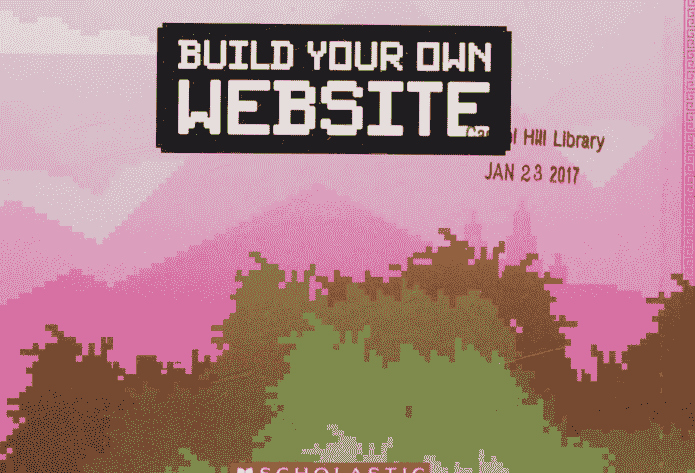

SCHOLASTIC

## 关于 CoderDojo

这本书讲的是编程。也许这是你迈向成为真正优秀程序员的第一步。而且，如果你对编程感兴趣，你可能听说过 CoderDojo。

CoderDojo 是一个面向年轻人的编程俱乐部，让你和其他程序员一起玩、学习新东西，并 generally 在计算机上玩得开心。它免费，而且你可以和朋友们一起工作。你可能去过 CoderDojo，已经尝试过编程，但想继续练习。或者你附近可能没有 Dojo，而这是你第一次尝试编程。无论哪种情况，这本书都适合你！

以下是如何获得你自己的官方迷你 Dojo，称为 Dojo Nano。

Dojo Nano 的组成要素：

- 一个或多个朋友
- 一台电脑
- 这本书

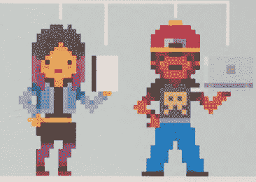

### 什么是 Dojo Nano？

在你的 Dojo Nano 里会发生什么？基本上，任何你认为在编程方面很酷的事情都可以。在本书中，我们将认识 Nanonauts，他们建立了自己的 Dojo Nano，并将在那里学习为他们的乐队制作一个网站。他们将 HTML、CSS 和 JavaScript 结合起来制作网站，你也可以学习这些技能来制作自己的网站！

### 创意 + 朋友 + 代码 = DOJO NANO

作为开始，在本书的帮助下，你将制作你的 Dojo Nano 网站，然后也许再为你的朋友们做几个网站。这很简单，很有趣，这本书会带你上路！你可以跟着 scholastic.com/coder-dojo 一起搭建网站，并在 coderdojo.com 了解更多关于 CoderDojo 的信息。

## 认识 NANONAUTS

Holly、Dervla、Daniel 和 Sam 在一个叫 Nanonauts 的乐队里。Holly 弹吉他，Dervla 弹钢琴，Daniel 唱歌，Sam 打鼓。他们已经开始举办不少音乐会，并觉得如果能建一个网站向世界介绍他们的音乐，那就太好了。

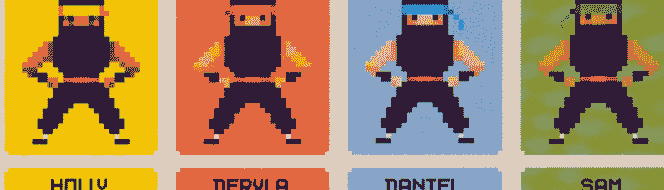

Nanonauts 一开始讨论这件事，就有了许多关于网站的想法：

- 我们可以告诉大家我们下一场音乐会的时间
- 我们可以宣传我们的 CD 和 T 恤
- 我们可以链接到我们的 YouTube 视频
- 我们可以提供购买乐器以及保养乐器的建议
- 我们可以提供练习时又不把邻居逼疯的建议

——他们最终把这些想法变成了这张站点地图。

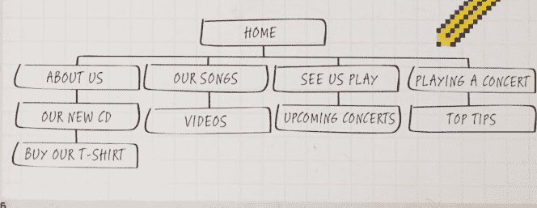

在本书中，我们将开始搭建 Nanonauts 在他们的站点地图中勾勒出的网站。如果你愿意，可以跟着示例搭建一个关于 Nanonauts 的网站。但如果你有自己的乐队，或者想让页面完全关于其他东西，那也没问题！尽管深入代码，不要害怕尝试。如果一开始有些东西不工作，不要气馁。仔细看看你的代码，看看能不能找出哪里不工作。程序员把这叫做“调试”。

继续读下去，了解如何把 Nanonauts 的站点地图变成真正的网站！

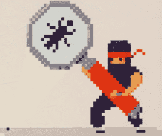

## 接下来要做的事

- 为什么不为你想要制作的网站勾勒一张自己的站点地图呢？如果你不想做关于乐队的网站，这里有一些想法：
  - 关于你的宠物的网站
  - 关于你最喜欢的游戏的网站
  - 关于你的学校朋友的网站
  - 关于你的爱好的网站
  - 关于你所在城镇可做的事情的网站

### 忍者小贴士

你在本书中制作的所有网页都在网上。你可以跟着 Nanonauts 一起搭建他们的网站，并复制代码以节省时间。更多信息请访问 scholastic.com/coder-dojo/examples

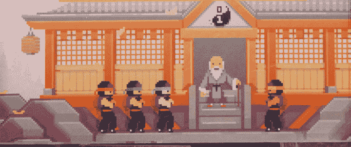

## 关于我们：编辑你的第一个网页

那么，我们开始吧！这是一个简单网页的代码：

- **1.** 将这段代码输入一个简单的**纯文本编辑器**，例如 Notepad（Windows）、GEdit（Ubuntu），或者输入**代码编辑器**，例如 Brackets、Notepad++ 或 Atom。如果你不确定怎么做，请访问 scholastic.com/coder-dojo/texteditors

```html
<!DOCTYPE html>
<html>
<head>
<title>About Us</title>
</head>
<body>
<h1>About Us</h1>
<p>We are the Nanonauts.</p>
<p>Our names are Holly, Dervla, Daniel, and Sam.</p>
</body>
</html>
```

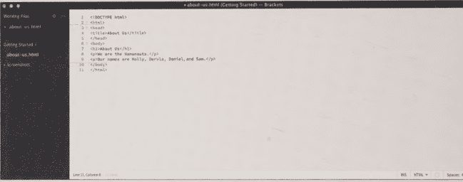

### 忍者小贴士

不要尝试在 Microsoft Word 或 LibreOffice 之类的文字处理软件中编辑你的页面。

### 忍者小贴士

**about-us.html** 是网页的文件名。末尾的 **.html** 称为**文件扩展名**。这会告诉计算机上的各种程序，**about-us.html** 是一个网页。

有时文件扩展名在 Windows 中会被隐藏，这样你只会看到 **about-us**，而不是 **about-us.html**。这可能会让人困惑，所以请确保它们可见。如果你不确定怎么做，请访问 scholastic.com/coder-dojo/filenames

- **2.** 接下来，在你的计算机上创建一个名为 **nanonauts** 的文件夹，并将代码保存为名为 **about-us.html** 的文件。

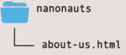

- **3.** 代码会告诉**网页浏览器**（例如 Chrome 或 Firefox）网页中有什么内容。这类代码称为 **HTML**，它代表超文本标记语言。

让我们在网页浏览器中打开这个文件。这一次，你不是看代码，而是会看到网页本应呈现的样子！通常，你只需单击或双击该文件即可。如果你遇到问题，请访问 scholastic.com/coder-dojo/openfiles

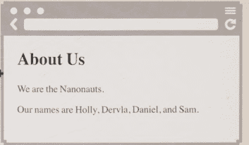


### 修改它！

- **4.** 现在你在网页浏览器和代码编辑器中打开了同一个文件。调整窗口位置，以便同时看到代码编辑器和网页浏览器。

修改代码编辑器中的文本，使其显示你和朋友们的名字。如果你愿意，也可以修改乐队名称。因此，不要写“Our names are Holly, Dervla, Daniel, and Sam”，而可以写“Our names are Anna, Ali, Zeke, and Zoe”。要修改文本，请点击代码编辑器并输入新文本。不要修改**标签**——即**尖括号**之间的内容，例如 **<h1>** 和 **<p>**——只修改它们之间的文本。

### 忍者小贴士

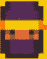

在开发网站时，你需要用两个不同的应用程序打开网页：

- 一个纯文本编辑器或代码编辑器，用来编写页面代码
- 一个网页浏览器，用来查看结果

一开始这可能会有点让人困惑，但你很快就会习惯的！

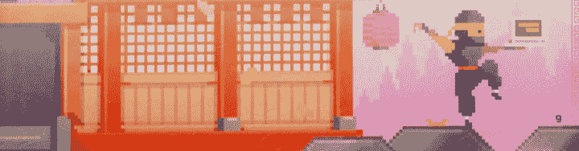


## <添加样式表>

我们现在要改变页面的外观。为此，我们将创建一个**样式表**。样式表定义了网页的外观。背景应该是白色、蓝色还是绿色？文字应该大一些还是小一些？当鼠标悬停在链接上时，链接是否应该改变颜色？

样式表就是存放所有这些信息的地方。样式表与 .html 文件分开保存，这样你就可以在不修改网页 HTML 代码的情况下更改网页的配色方案。

- 1. 我们将创建的样式表会保存在一个名为 **my-first-stylesheet.css** 的新文件中。注意，样式表的文件扩展名是 **.css**，而不是 **.html**。（本书中的样式表将以橙色显示，以便你一眼就能区分。）为了保持整洁，我们会把样式表保存在一个单独的文件夹中。我们将这个文件夹命名为 **css**，并创建在 **nanonauts** 文件夹内。
- 2. 输入橙色方框中的代码，并保存为 **css** 文件夹中的 **my-first-stylesheet.css**。
- 3. 要将样式表链接到网页，你需要在 HTML 中添加一行额外的代码——下面代码中已突出显示。

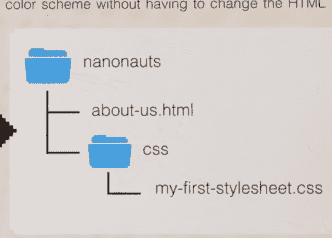

```css
body {
font-family: sans-serif;
}
```

- 4. 这行代码的作用是将网页链接到名为 **my-first-stylesheet.css** 的样式表。

这份样式表保存在 **css** 文件夹中。（这就是代码行 **css/my-first-stylesheet.css** 所指的内容！）换句话说，就是你刚刚创建的样式表。

```html
<!DOCTYPE html>
<html>
<head>
<title>About Us</title>
<link type="text/css" rel="stylesheet"
href="css/my-first-stylesheet.css"/>
</head>
<body>
<h1>About Us</h1>
<p>We are the Nanonauts.</p>
<p>Our names are Holly, Dervla, Daniel, and Sam.</p>
</body>
</html>
```

要查看样式表对网页产生的效果，你必须重新加载页面。要重新加载页面，请点击工具栏中的“重新加载”符号。

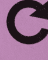

- 5. 重新加载后，页面看起来有些不同。这是因为文字现在以**无衬线**字体显示——这就是样式表中 `font-family: sans-serif;` 的作用。

衬线字体看起来像这样。

无衬线字体看起来像这样。

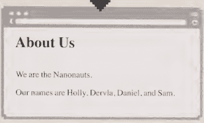

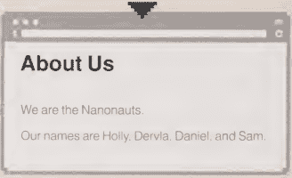

## 恭喜！

### 你已经创建了一个网页和一份样式表——它们正在协同工作！

## 接下来要做的事


再输入一些文本段落。段落应放在 `<p>` 和 `</p>` 标签之间。像这样：

```html
<p>I am learning how to make a website for my Dojo Nano.</p>
```

`<p>` 是开始标签。`</p>` 是结束标签。你能看出区别吗？

现在你可以看到，网页其实就是输入到文本文件中的文字。文字在网页上的显示方式由标签控制。如果使用 `h1` 或 `h2` 标签而不是 `p` 标签，会发生什么？如果你把一些文字放在 `strong` 标签内，又会发生什么？

像这样：`<p>My name is <strong>Sam</strong></p>`

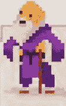

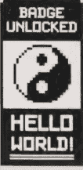

## 要记住的词语

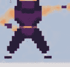

- **代码编辑器** – 一种允许你编辑网页 HTML 代码的程序。你并不一定需要使用专门的代码编辑器——记事本就可以——但代码编辑器会通过为 HTML 标记添加颜色代码并提供其他有用的功能，让编辑工作更轻松。
- **编辑** – 当你对网页进行修改时，你就是在编辑它。
- **文件** – 每当你将任何内容保存到计算机或网络上时，它都会以文件的形式存储。文件可以包含各种信息——它们可以是网页、照片、歌曲、PDF 文档，等等。但程序员都把所有这些称为文件。
- **文件名** – 文件总是有文件名。例如“关于我们”网页的文件名是 `about-us.html`。文件名通常以一个句点后跟三四个字母结尾（如 `.jpg`、`.pdf`、`.html`）。这被称为**文件扩展名**，它告诉计算机这是什么类型的文件。例如，以 `.jpg` 结尾的文件是图像文件。
- **文件夹** – 当你保存文件时，文件会进入一个文件夹。文件夹是计算机上的一个特定存储位置。文件夹可以包含其他文件夹。你可以通过提供文件夹的**路径**来引用它。例如，`C:/nanonauts/images` 提供了计算机 **C:** 驱动器上 **nanonauts** 文件夹内 **images** 文件夹的路径。
- **标签** – 是 HTML 代码中使用的特殊标记。它们使用尖括号，看起来像这些例子：`<p>` `</p>` `<h1>` `</h1>` `<br />` 在本书中你会看到更多这样的标签！
- **网页浏览器** – Chrome、Firefox、Internet Explorer、Opera、Safari 以及其他让你浏览网页的应用程序都称为网页浏览器。要查看网页，你需要一个网页浏览器。

### 忍者提示

有些文字处理程序会自动将你的直引号（"）转换成“智能引号”（“”）。这样你的代码就无法运行了！请使用纯文本编辑器。

### 更多在线资源

想了解更多关于使用代码编辑器编辑代码的知识？请访问 scholastic.com/coder-dojo/codeeditor

## <为 Nanonauts 拍照>

### 向页面添加照片

“关于我们”页面让每个人了解这支乐队。但如果页面上还能展示一张照片，不是更有趣吗？要显示照片，你必须告诉网页浏览器去哪里找到它。为了知道去哪里找，网页浏览器需要知道 **1.** 存放照片的文件夹名称，以及 **2.** 图片的名称。假设你有一张名为 `nanonauts.jpg` 的图片。

你可以通过添加下面这行代码，将图片插入到页面中：

```html
<p></p>
```

修改后的代码如下所示：

```html
<!DOCTYPE html>
<html>
<head>
<title>About Us</title>
<link type="text/css" rel="stylesheet" href="css/my-first-stylesheet.css"/>
</head>
<body>
<h1>About Us</h1>
<p></p>
<p>We are the Nanonauts.</p>
<p>Our names are Holly, Dervla, Daniel, and Sam.</p>
</body>
</html>
```

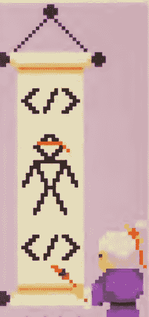

保存页面并在浏览器中重新加载后，它将如下所示：

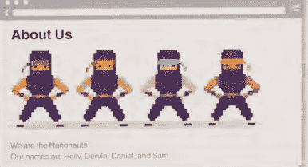

让我们仔细看看这段代码。

```html
<p></p>
```

这里真正重要的部分是 `src="images/nanonauts.jpg"`。

这告诉网页浏览器在 **images** 文件夹中查找名为 **nanonauts.jpg** 的文件。网页浏览器会在网页保存位置的同一位置查找 **images** 文件夹。因此，如果你查看 **nanonauts** 文件夹中的文件，除了 **about-us.html** 文件外，你还会看到一个 **images** 文件夹。如果你打开这个文件夹，就会看到 **nanonauts.jpg** 文件。

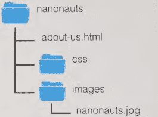

### 忍者提示

如果 **images** 文件夹中缺少 **nanonauts.jpg** 文件，浏览器会显示一个符号来表示这一点。类似这样：

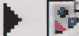

`src="images/nanonauts.jpg"` 是一个**属性**。属性总是遵循相同的模式——属性名，后跟等号，再后跟包含在一对直引号中的属性值。如下所示：

| 属性名 | 等号 | 起始直引号 | 属性值 | 结束直引号 |
| --- | --- | --- | --- | --- |
| `src` | `=` | `"` | `images/nanonauts.jpg` | `"` |

同样地，**alt** 属性包含在图片无法显示时出现的文本。例如，如果网页要为盲人转换成语音，这就很有用。

既然你已经知道如何添加图片，那就把一张你自己的图片添加到 **about-us.html** 页面中吧。为此，请将图片复制到 **images** 文件夹中，然后添加显示图片的代码。例如，如果你的图片来自数码相机，名为 **DSC03730.jpg**，你可以添加以下代码：

```html
<p></p>
```

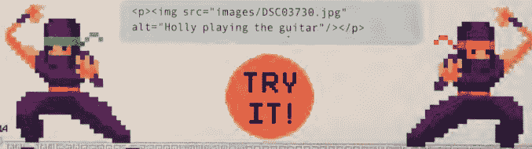


## 接下来要做的事

试着在页面上添加一些你自己的照片。加几张自拍吧！

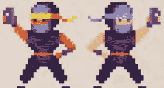

## 需要记住的词语

**属性（Attribute）**——标签有时包含保存在属性中的附加信息。在下面 `img` 标签的示例中，我们可以看到有两个属性：`src` 和 `alt`。

```html

```

属性**总是**由属性名（例如 `src` 或 `alt`）组成，后面跟一个 `=` 号，然后是包含在直引号中的属性值，例如 `"images/DSC03730.jpg"`。

`src`（source，源）属性告诉浏览器去哪里查找图像。`alt`（alternative，替代）属性保存的文本会在图像无法显示时出现，或者由屏幕阅读软件朗读出来。

**元素（Element）**——元素是同一类型的开始标签和结束标签之间的任何内容。因此，一个 `li` 元素就是 `<li>` 开始标签和 `</li>` 结束标签之间的所有内容。

**空元素（Empty element）**——有些元素没有单独的开始标签和结束标签：它们被称为**空元素**。例如：

- `img`——图像元素
- `br`——换行元素

它们没有单独结束标签，而是只有一个标签，并在闭合尖括号前以正斜杠结尾。

```html
 <br/>
```

## 更多在线资源

- 向页面添加图片——scholastic.com/coder-dojo/addpics
- 让图片尺寸合适——scholastic.com/coder-dojo/picsize

## 构建网站

### 添加新网页

Nanonauts 现在想制作一个新页面，列出他们演奏的歌曲。制作新页面最简单的方法是复制一个现有页面并修改它。

打开 **about-us.html** 文件。然后转到 **File** 菜单，选择 **Save As** 选项。将文件保存为 **our-songs.html**。注意新文件如何出现在 **Nanonauts** 文件夹的文件列表中。你现在有一个名为 **our-songs.html** 的新网页。但目前它与 **about-us.html** 页面完全相同。你需要编辑文本，使该页面现在成为一个歌曲列表。可以参考下面的示例来获得灵感。加入你自己最喜欢的歌曲！

```html
<!DOCTYPE html>
<html>
<head>
<title>Our Songs</title>
<link type="text/css" rel="stylesheet" href="css/my-first-stylesheet.css"/>
</head>
<body>
<h1>Our Songs</h1>
<p>This is a list of the songs we can play:</p>
<ul>
<li>Magical Mystery Bug</li>
<li>Boot It</li>
<li>The Long and Winding Code</li>
<li>Dojo Dancing</li>
<li>Empty Elements</li>
<li>Java Chameleon</li>
</ul>
</body>
</html>
```

编辑完页面后，保存它，然后在网页浏览器中打开该文件。

**忍者提示**

每次在编辑器中保存文件时，都要在网页浏览器中重新加载网页，以查看最新更改的效果。记住“保存并重新加载！”

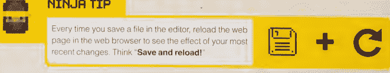

当页面在浏览器中显示时，看起来像这样：

歌曲以**项目符号列表**的形式显示（歌曲名称左侧的小圆圈称为项目符号）。列表的代码如下所示——我们稍后会更详细地学习列表。

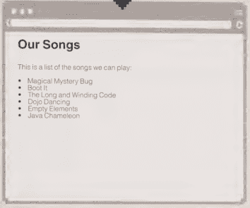

```html
<ul>
  <li>Magical Mystery Bug</li>
  <li>Boot It</li>
  <li>The Long and Winding Code</li>
  <li>Dojo Dancing</li>
  <li>Empty Elements</li>
  <li>Java Chameleon</li>
</ul>
```

列表中的每首歌都位于一个 `li` 元素内。**元素**是同一类型的**开始标签**和**结束标签**之间的任何内容。因此，一个 `li` 元素就是 `<li>` **开始标签**和 `</li>` **结束标签**之间的所有内容。还要注意，所有 `li` 元素都位于一个 **`ul`** 元素内。你能看到第一首歌前面的 `<ul>` 开始标签吗？

```html
<ul>
  <li>Magical Mystery Bug</li>
```

以及最后一首歌后面的 `</ul>` 结束标签吗？

```html
<li>Java Chameleon</li>
</ul>
```

**忍者提示**

在制作页面时，要经常保存页面。这样即使笔记本电脑电池突然耗尽，你也不会丢失工作成果！

## 接下来要做的事

看看如果把 `li` 元素放进 `ol` 而不是 `ul` 元素中会发生什么。弄清楚：

- `h1` 元素从哪里开始、到哪里结束
- `body` 元素从哪里开始、到哪里结束
- `html` 元素从哪里开始、到哪里结束

`img` 元素是一个**空元素**。它没有单独的开始标签和结束标签。看看你能否找出另一个空元素。

再制作一个名为 See Us Play 的页面，文件名为 `see-us-play.html`，其中给出 Nanonauts 下一场音乐会的日期和时间。

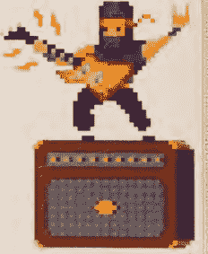

## 整合所有内容

### 制作主页

到目前为止，你已经制作了 About Us 页面、Our Songs 页面和 See Us Play 页面。但要把它们组成一个网站，你需要将它们全部链接在一起，以便从一个页面跳转到另一个页面。我们现在就通过制作**主页**来实现这一点。

打开 **about-us.html** 文件。然后转到 File 菜单，选择 Save As 选项。将文件保存为 **index.html**。

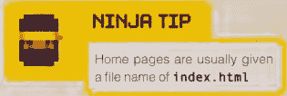

将 **index.html** 修改为如下所示：

```html
<!DOCTYPE html>
<html>
<head>
<title>Home</title>
<link type="text/css" rel="stylesheet" href="css/my-first-stylesheet.css"/>
</head>
<body>
<h1>We are the Nanonauts!</h1>
<p>This is our website. Click on a link to visit a page:</p>
<ul>
<li><a href="about-us.html">About Us</a></li>
<li><a href="our-songs.html">Our Songs</a></li>
<li><a href="see-us-play.html">See Us Play</a></li>
</ul>
</body>
</html>
```

主页上有三个**链接**。它们出现在 `ul` 列表的 `li` 元素内。右侧的代码是指向 About Us 页面的链接。

```html
<a href="about-us.html">About Us</a>
```

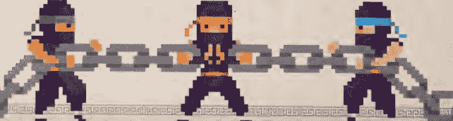

## 标题、段落和列表

Nanonauts 对于在“举办音乐会”页面上放什么有很多想法：

> “你需要一份将要演奏的歌曲清单，以防忘记接下来该做什么！”Holly 说。

> “别忘了你已经读过的关于演奏歌曲或乐器需要准备什么的内容，”Dave 说。

> “先把鼓在舞台上架好，”Sam 说。“这是我的建议。如果你把它们留到最后，可能就没有足够的空间放它们了。”

> “一定要知道你要去哪里，”Daniel 说。“我们因为找不到那栋房子，所以鲍勃的生日演出迟到了。”

事实上，他们的想法太多了，以至于当把所有想法都放到页面上时，页面开始显得有些混乱：

### 举办音乐会

举办音乐会可能非常有趣！也可能非常吓人！有时两者会同时出现。所以我们整理了一份举办精彩音乐会的首要建议清单。

写出演出曲目单。演出曲目单是按演出顺序列出所有歌曲的清单。给每个人都复印一份。把它打印得大一些，这样即使它放在脚边的地板上，或者灯光不太好，你仍然能看清。

记得带备用品。有些乐器有磨损或损坏时需要更换的部件。例如：吉他弦、萨克斯管或单簧管的簧片，以及鼓槌。列出你可能需要的备用品，并确保你知道在紧急情况下它们在哪里。

规划你们在舞台上的位置。在开始架设乐器之前，花几分钟决定你们所有人将站在哪里。鼓会放在舞台中央吗？还是靠一边？如果吉他手站在右侧，那里有供放大器使用的电源插座吗？

在开始架设乐器之前考虑好所有这些事情要好得多。如果你已经开始布置，却不得不拔掉插头、互换位置，那真的很烦人！

知道你要去哪里，知道你什么时候上场。如果你要在从未去过的地方举办音乐会，一定要知道它在哪里。出发前打印一张地图或设置好 GPS。在预定上台前半小时在一个陌生的地方迷路，没有比这更糟糕的事了。而且当你到达时，你应该做的第一件事就是弄清楚你什么时候上场。时间经常变化。问一问活动负责人你什么时候上场。不要措手不及！

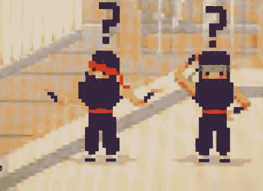

他们可以怎样解决这个问题呢？我们已经见过不少不同的 HTML 元素了。例如：

- `h1` 是标题
- `ul` 是带项目符号的列表
- `ol` 是编号列表
- `p` 是段落


通过使用这些元素并混入一些新元素，纳米小分队让他们的页面变得更容易阅读。事实上，就像这样：

## 举办音乐会

举办音乐会可能非常有趣！也可能非常吓人！有时两者同时发生。

因此，我们整理了一份关于举办精彩音乐会的顶级建议清单。

### 写出演出曲目单

**演出曲目单**是你所有歌曲按演出顺序排列的清单。

给每个人都复印一份。

把它印得**大一点！** 这样即使它放在你脚边的地板上，或者灯光不太好，你仍然能看清。

### 记住你的备用件

有些乐器的部件在磨损或损坏后需要更换。例如：

- 吉他弦
- 萨克斯管或单簧管簧片
- 鼓槌

列出你可能需要的备用件，并确保你知道紧急情况下它们在哪里。

### 规划你在舞台上的位置

在开始布置乐器之前，花几分钟决定你们每个人要站在哪里。

- 鼓会放在舞台中央吗？还是放在一侧？
- 如果吉他手站在右边，有供放大器使用的电源插座吗？

在开始布置乐器**之前**就把这一切考虑清楚会好得多。一旦你已经开始布置，却不得不拔掉插头、互换位置，那真的很烦人！

### 知道你要去哪里，知道你的上场时间

如果你要在从未去过的地方举办音乐会，一定要知道它在哪里。出发前打印一张地图或设置好 GPS。没有什么比在预定上场前半小时在一个陌生的地方迷路更糟糕的了。

而当你到达后，第一件应该做的事就是**弄清楚你的上场时间**。时间经常会变。问一问活动负责人你什么时候上场。别被打个措手不及！

## 那么他们是怎么做到的呢？

> 1) 他们使用标题来划分页面
> 2) 他们使用项目符号列表来让页面更易读
> 3) 他们把大段文本拆分成较短的段落
> 4) 他们使用 strong 元素强调了一些词

你组合 HTML 元素的方式被称为**标记（markup）**。Markup 是程序员经常使用的一个词。好的编程就在于使用不同的元素让你的页面易于阅读。

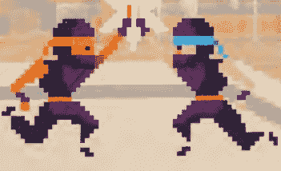

这是改进后页面的 HTML。注意像 **h1**、**h2** 和 **strong** 这样的新元素。

```html
<!DOCTYPE html>
<html>
<head>
<title>Playing a Concert</title>
<link type="text/css" rel="stylesheet" href="css/my-first-stylesheet.css"/>
</head>
<body>
<h1>Playing a Concert</h1>
<p>Playing a concert can be great fun! Or it can be totally scary! Sometimes both at the same time.</p>
<p>So we've put together a list of our top tips for great concerts.</p>
<h2>Write out a set-list</h2>
<p>A <strong>set-list</strong> is a list of all your songs in the order you'll play them.</p>
<p>Make copies for everyone.</p>
<p>Print it <strong>BIG!</strong> so that you can still read it if it's down by your feet on the floor, or if the lighting isn't very good.</p>
<h2>Remember your spares</h2>
<p>Some instruments have parts that need to be replaced if they wear out or break. For example:</p>
<ul>
<li>guitar strings</li>
<li>saxophone or clarinet reeds</li>
<li>drumsticks</li>
</ul>
<p>Make a list of the spares you might need and make sure you know where they are in an emergency.</p>
<h2>Plan where you'll be on the stage</h2>
<p>Before you start to set up your instruments, take a few minutes to decide where you're all going to be.</p>
<ul>
<li>Will the drums be center stage? Or off to one side?</li>
<li>Is there a power socket for the amplifier if your guitar player stands on the right?</li>
</ul>
<p>It's much better to think about all this <strong>before</strong> you start setting up your instruments. It's really annoying if you have to start unplugging things and swapping places once you've begun to set things up!</p>
<h2>Know where you're going, know when you're on</h2>
<p>If you're playing a concert somewhere you've never been before make sure you know where it is. Print out a map or set the GPS before you leave. There's nothing worse than being lost in an unfamiliar place a half hour before you're due to go on stage.</p>
<p>And when you do arrive, the first thing you should do is <strong>find out what time you're on</strong>. Times often change. Ask whoever is running the event when you'll be on. Don't get caught off guard!</p>
</body>
</html>
```

### 忍者小贴士

如果你查看纳米小分队的页面，你会看到他们使用 h2 标题元素来分割文本，这样你作为读者就能轻松找到你要找的内容。在为页面做标记时，你应该使用 h1 标题作为页面的主标题，并使用 h2 元素为页面的每个部分提供标题。你需要多少个 h2 元素就可以用多少个。

### 忍者小贴士

纳米小分队做的另一件事是把每个部分都划分成段落。段落就是包含在 p 元素中的一个或多个句子。可以把段落看作是关于一个想法或观点的文本块。通过把页面划分成段落，你能让读者更容易跟上你所说的内容。

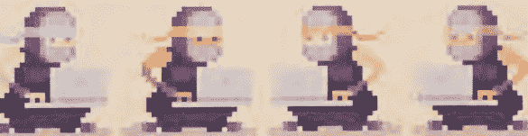

### 忍者小贴士

纳米小分队把他们的“要记住的事项示例”展示为带项目符号的列表。这有助于拆分文本，使页面更易读。

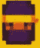

### 忍者小贴士

当你需要列出事项时，请使用列表标记。列表有两种：使用 **ul** 元素表示**带项目符号的**（无序）列表；使用 **ol** 元素表示**带编号的**（有序）列表。每个列表项都应放在各自的 **li** 元素中。

| 带项目符号的列表 | 带编号的列表 | 带项目符号的列表 | 带编号的列表 |
|---|---|---|---|
| `<ul>`<br>`<li>rock</li>`<br>`<li>paper</li>`<br>`<li>scissors</li>`<br>`</ul>` | `<ol>`<br>`<li>rock</li>`<br>`<li>paper</li>`<br>`<li>scissors</li>`<br>`</ol>` | • 石头<br>• 布<br>• 剪刀 | 1. 石头<br>2. 布<br>3. 剪刀 |

你可以看到，**“set-list（演出曲目单）”** 这个词和 **“find out what time you're on（弄清楚你的上场时间）”** 这个短语位于 **strong** 元素内。**strong** 元素可以嵌套在其他元素（如 **p** 和 **li**）内。如果你想突出某些特定的词，就可以使用它。

## 嵌套你的元素！

元素应始终嵌套。这意味着它们总是互相套在一起，就像俄罗斯套娃一样！

### “嵌套”是什么意思？

当我们说一个元素嵌套在另一个元素中时，我们是指它的开始标签和结束标签出现在另一个元素的开始标签和结束标签之间的某个位置。例如，如果我们说一个包含单词“Tip”的 **strong** 元素“位于”一个 **p** 元素“内部”，我们是指它的开始标签 `<strong>` 和结束标签 `</strong>` 出现在 p 元素的开始标签 `<p>` 和结束标签 `</p>` 之间的某个位置。

**正确**

```html
<p><strong>Tip:</strong>
If you make a mistake
don't stop playing!</p>
```

**错误**

```html
<strong>Tip</strong>
If you make a mistake
don't stop playing!</p>
```

## 让它看起来更好

到目前为止，我们的网页看起来……还行。但它们有点无聊，不是吗？它们看起来更像印刷书中的页面，而不是网页。但是，也许我们可以通过以下方式改变这一点：

- 更改页面的背景颜色
- 添加背景图片
- 让文字看起来更花哨

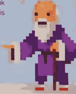

## 添加样式！

如果你想改变网页的外观，你不应更改页面本身的代码。相反，你要更改样式表的代码。我们在本书前面遇到过样式表。但现在我们要更详细地研究它。当你设计一个美观的网站时，很多神奇的效果都发生在样式表中！

在下图中，你可以看到完全相同的 HTML 网页——唯一改变的是样式表。

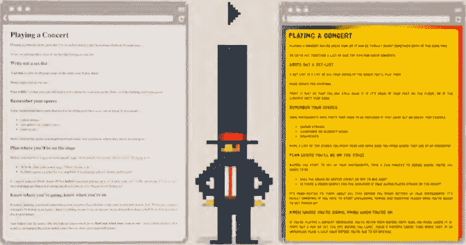

### 我的页面使用的是哪个样式表？

如果你查看网页代码的顶部，你会看到页面标题下方有一个 link 元素。

```html
<!DOCTYPE html>
<html>
<head>
<title>Playing a Concert</title>
<link type="text/css" rel="stylesheet" href="css/my-first-stylesheet.css"/>
</head>
```

通过查看这个 link，你可以找到用于设置页面样式的 css 文件的名称。link 元素告诉 Web 浏览器在 css 文件夹中查找 my-first-stylesheet.css 文件。


## 样式表里有什么？

让我们看看样式表，并了解如何修改它。在浏览器中打开你的某个网页，并在代码编辑器中同时打开 **my-first-stylesheet.css**，这样你就能并排查看它们。**my-first-stylesheet.css** 文件只包含一条规则。

这条规则告诉浏览器如何格式化 HTML 文件中 **body** 元素内的所有内容。这条规则的意思是“将 body 元素中的所有内容显示为无衬线字体”。

```css
body {
  font-family: sans-serif;
}
```

因此，如果我们修改规则，把 **font-family** 改为 **serif**，然后重新加载网页，就会看到页面突然变得不同了。

```css
body {
  font-family: serif;
}
```

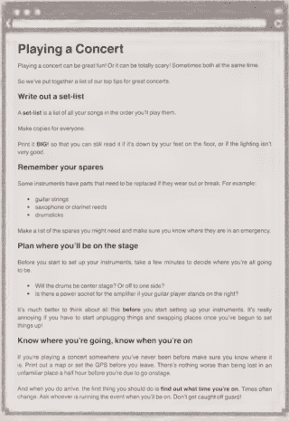

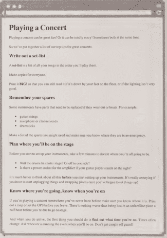

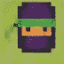

### 更多在线资源

如果你觉得打开样式表有困难，请参阅 scholastic.com/coder-dojo/stylesheets 上的教程。

我们再稍微修改一下样式表。我们会把 body 字体改回 sans-serif，并且把背景改成紫色。这样，修改后的 **my-first-stylesheet.css** 文件会像下面这样：

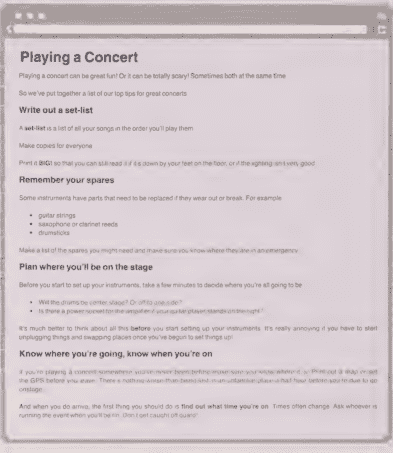

```
body {
  background-color: Thistle;
  font-family: sans-serif;
  margin-left: auto;
  margin-right: auto;
  max-width: 1024px;
  min-width: 256px;
  padding-top: 8px;
  padding-bottom: 24px;
  padding-left: 24px;
  padding-right: 24px;
}
```

仅仅做了这些小改动，就已经让我们的页面看起来有趣多了——但我们还能做更多事情。

## 让我们来点大胆的！

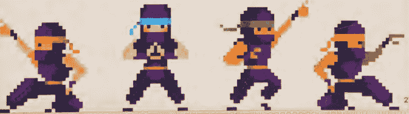

把样式表改成下面这样，看看几行代码能带来多么惊人的效果！

```
body {
  background-color: Thistle;
  border: 2px solid Gray;
  border-radius: 16px;
  font-family: sans-serif;
  margin-left: auto;
  margin-right: auto;
  max-width: 1024px;
  min-width: 256px;
  padding-top: 8px;
  padding-bottom: 24px;
  padding-left: 24px;
  padding-right: 24px;
}
html {
  background: radial-gradient(circle, SkyBlue, SkyBlue 50%, LightCyan 50%, SkyBlue);
  background-size: 8px 8px;
}
```

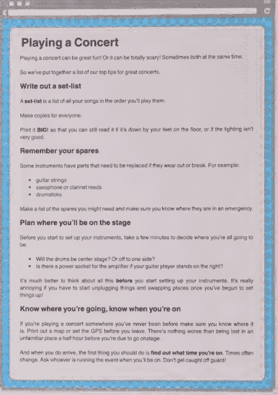

要准确理解规则如何工作，首先添加这样的空规则：

```
body {
}
html {
}
```

然后逐条添加单独的行（这些行称为声明）。每添加一条新声明后，保存样式表并在网页浏览器中重新加载页面，以查看效果。

因此，第一步是添加 **background-color: Thistle;** 声明，如下所示：

```
body {
  background-color: Thistle;
}
html {
}
```

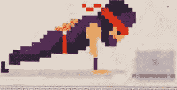

然后添加下一条声明，

```css
body {
  background-color: Thistle;
  border: 2px solid Gray;
}
html {
}
```

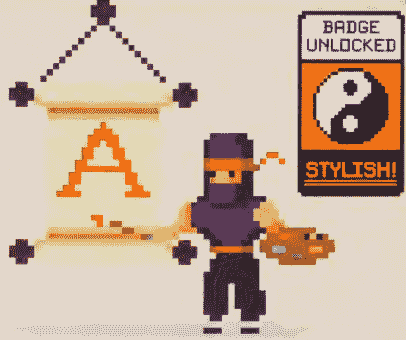

依此类推。这样你就能看到每一行分别起什么作用。有关这项技术的更多信息，请访问 scholastic.com/coder-dojo/declarations。

请注意，一条规则可以包含多个声明。每个声明以分号（;）结束，由属性（例如 **color**）后跟冒号（:），再后跟值（例如 **white**）组成。声明括在花括号（{ 和 }）中。一个常见错误是漏掉声明末尾的分号，或漏掉规则末尾的最后一个花括号。

## 要记住的术语

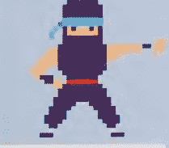

**项目符号**——项目符号是出现在列表项前的小圆点标记 •。在 HTML 中，`ul` 元素内的每个 `li` 元素通常都会在它前面显示一个项目符号。不过，如果你愿意，也可以使用样式表关闭项目符号的显示。

**CSS**——样式表（见下文）的另一个名称是“CSS 文件”。CSS 代表“cascading stylesheet”（层叠样式表）。

**声明**——样式表包含一组规则，规定 HTML 页面如何显示。每条规则由一个或多个声明组成，例如 `background-color: Orange;` 或 `font-family: sans-serif;`。

**字体**——文本的某种特定样式称为字体。字体可以有大量不同风格——你可以通过样式表更改网页上的字体。

**样式表**——样式表包含 HTML 页面应如何呈现的“配方”。如果你想更改页面的外观，可以通过更改样式表来实现。样式表是一组规则列表，它们共同告诉网页浏览器如何格式化页面上的每个元素。

## <颜色>

我们可以通过多种方式为页面添加颜色。例如：

- 我们可以设置元素的背景颜色（我们用这个方法把 Playing a Concert 页面的背景改成了紫色）。
- 我们可以设置文本的颜色。
- 我们还可以设置边框和链接的颜色。

事实上，页面上几乎任何内容都可以设置颜色。

### 忍者提示

所有浏览器都支持的 17 个标准颜色名是：aqua、black、blue、fuchsia、gray、green、lime、maroon、navy、olive、orange、purple、red、silver、teal、white 和 yellow。

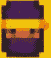

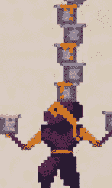

颜色可以通过两种不同的方式设置：

- 你可以为颜色指定名称（例如 **Yellow**）
- 你可以输入**十六进制代码**（以 # 符号开头的六个字符——例如 **#B577B5**）

到目前为止，我们使用的是第一种方法，用了 **Thistle** 和 **Gray** 这样的颜色。输入颜色名称很简单，但如果你不希望菜单背景只是 **Blue**，而是某种精确的天蓝色调，该怎么办？这时就要用到**十六进制代码**了。你在屏幕上看到的所有颜色，都是由不同亮度的红光、绿光和蓝光组合而成的。十六进制代码只是一种设置红、蓝、绿数值的方法。# 后面的前两个字符表示红色部分，接下来的两个字符表示绿色部分，最后两个字符决定蓝色部分。下面是一些示例：

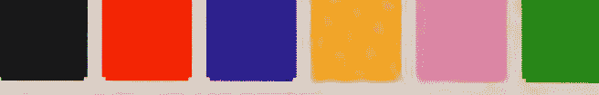

### 要记住的术语

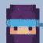

**十六进制代码**——你在学校学过数学中的进制吗？它们被称为十六进制代码，是因为其中的数字采用 16 进制。如下所示：

| | 0 | 1 | 2 | 3 | 4 | 5 | 6 | 7 | 8 | 9 | 10 | 11 | 12 | 13 | 14 | 15 |
|---|---|---|---|---|---|---|---|---|---|---|---|---|---|---|---|---|
| 十进制 | 0 | 1 | 2 | 3 | 4 | 5 | 6 | 7 | 8 | 9 | 10 | 11 | 12 | 13 | 14 | 15 |
| 十六进制 | 0 | 1 | 2 | 3 | 4 | 5 | 6 | 7 | 8 | 9 | A | B | C | D | E | F |

这个理论听起来不错——但你实际上怎样才能获得某种特定颜色的代码呢？

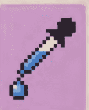

主要有两种方法：

- 如果你有图像编辑程序，例如 GNU Image Manipulation Program（GIMP）、Adobe Photoshop 或 Corel PaintShop Pro，你可以使用取色器或颜色选择器工具。这样你就可以将光标悬停在图像的某个特定部分上，获取该颜色的十六进制值。或者你可以打开一个窗口，从调色板或色轮中选择颜色。
- 如果你没有图像编辑程序，可以使用在线取色器。

一旦获得颜色的十六进制值，就可以在样式表中使用它。例如，如果 #C0C0FF 是你想用作 h1 主标题背景色的精确淡紫蓝色代码，只需将以下规则添加到样式表中：

```
h1 {
  background-color: #C0C0FF;
}
```

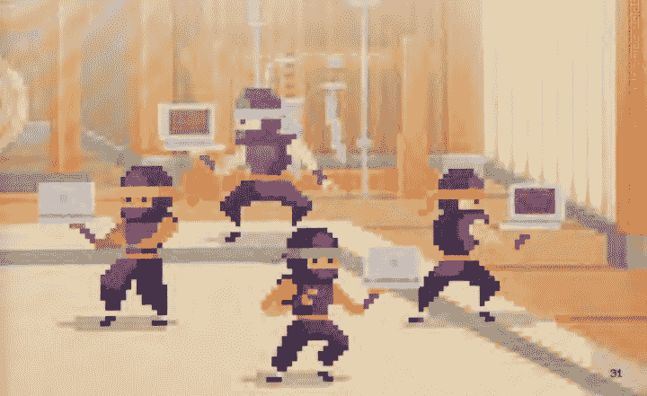

## <关于尺寸的更多内容>

你可能已经注意到，我们在样式表中使用了三种不同类型的度量单位：**px**、**em** 和 **%**。

它们有什么区别，我们分别在什么地方使用它们？

| 度量单位 | 含义 | 用途 |
|---|---|---|
| **px** | 你的屏幕图像由称为**像素**的微小点组成。像素的缩写是 **px**。你在屏幕上能看到的最细线条宽度为 1px。你能看到的最小形状是一个 1px × 1px 的点。 | 当你想要给某个对象指定精确宽度时，使用像素。但仅当该宽度即使屏幕变宽或变窄也绝不应改变时才这样做。例如，边框的宽度，或文字与元素边缘之间的内边距大小。 |
| **em** | 一个 **em** 大约是两个字母的宽度（我们说“大约”，因为字母宽度不同）。我们使用 em 度量，是因为它相对于字号来计算。因此，如果你的字号变大，50 em 所允许的宽度也会增加。正因如此，em 被称为**相对**度量单位。 | 当你需要为一块文本设置最大或最小行宽时，使用 em。一行文字在变得难以从一行跟读到下一行之前，其最大长度大约为 40 到 60 em。 |
| **%** | 当一个元素具有百分比宽度时，该百分比是相对于包含它的元素的宽度来度量的（记住，元素是相互嵌套的）。因此，如果你把 `p` 元素内的一个 `img` 元素的宽度设为 50%，它就会是 `p` 元素宽度的一半。百分比宽度由 **%** 符号表示。 | 当你创建网页的整体布局时，使用百分比度量是一个好选择。在本书后面创建更复杂的页面布局时，我们会使用百分比度量。 |


## <用菜单链接页面>

尽管 Nanonauts 网站现在有四个页面，但除非从主页（`index.html`）开始，否则没有简便方法从一个页面转到另一个页面。因此，我们要为我们创建的所有页面添加链接。这样无论我们位于网站中的哪个位置，都能从一个页面转到另一个页面。目前，我们仅有的链接在 `index.html` 主页上。为此，我们将打开 `index.html` 文件，复制链接的 HTML 代码，然后将其粘贴到其他文件（`about-us.html`、`our-songs.html` 等）中。我们还会添加一个返回主页的链接。

### 复制链接

```html
<body>
<h1>We are the Nanonauts!</h1>
<p>This is our website. Click on a link to visit
a page:</p>
<ul>
<li><a href="about-us.html">About Us</a></li>
<li><a href="our-songs.html">Our Songs</a></li>
<li><a href="see-us-play.html">See Us Play</a></li>
<li><a href="playing-a-concert.html">Playing a
Concert</a></li>
</ul>
</body>
```

- **1.** 在代码编辑器中打开 `index.html`，并选择链接的 HTML 代码。这段代码会高亮显示。
  
  要选择链接的代码：
  - 在 `ul` 开始标签之前单击。按住鼠标或触摸板按钮，然后向下拖动，并在此过程中高亮文本。
  - 到达 `ul` 结束标签时松开按钮。
  - 选中链接后，检查是否包含了 `ul` 元素的全部开始和结束标签。

### 正确

```html
<ul>
<li><a href="about-us.html">About Us</a></li>
<li><a href="our-songs.html">Our Songs</a></li>
<li><a href="see-us-play.html">See Us Play</a></li>
<li><a href="playing-a-concert.html">Playing a Concert</a></li>
</ul>
```


### 错误

```html
<ul>
<li><a href="about-us.html">About Us</a></li>
<li><a href="our-songs.html">Our Songs</a></li>
<li><a href="see-us-play.html">See Us Play</a></li>
<li><a href="playing-a-concert.html">Playing a
Concert</a></li>
</ul>
```

- **2.** 将链接复制到内存中。你可以使用键盘快捷键来完成此操作——例如 Windows 和 Linux 系统使用 `Ctrl-C`，Mac 使用 `⌘-C`。在编辑器中打开你之前创建的某个网页（在下一页的示例中，我们将使用“Playing a Concert”页面）。
- **3.** 在 **h1** 开始标签之前单击，然后粘贴链接。还要添加一个指向主页的链接。粘贴链接后，在 **`<ul>`** 开始标签之前添加一个 **`<nav>`** 开始标签，并在 **`</ul>`** 结束元素之后添加一个 **`</nav>`** 结束标签。这样就把我们的链接列表放到了一个 **nav**（navigation 的缩写）元素内。这清楚地表明这个列表是特殊的——它是菜单链接列表，而不是页面故事中的列表。

```html
<!DOCTYPE html>
<html>
<head>
<title>Playing a Concert</title>
<link type="text/css" rel="stylesheet" href="css/my-first-stylesheet.css"/>
</head>
<body>
<nav>
<ul>
<li><a href="index.html">Home</a></li>
<li><a href="about-us.html">About Us</a></li>
<li><a href="our-songs.html">Our Songs</a></li>
<li><a href="see-us-play.html">See Us Play</a></li>
<li><a href="playing-a-concert.html">Playing a Concert</a></li>
</ul>
</nav>
<h1>Playing a Concert</h1>
```

- **4.** 保存文件，然后在浏览器中打开它。你可以看到链接出现在 **h1** 元素上方。它们看起来有点奇怪，不过，如果它们像你在大多数网站上看到的顶部菜单栏那样，在顶部排成一行横跨页面，那就更好了。

## 接下来要做的事

首先，尝试做两处更改。

- 在 About Us 链接上方添加一个指向主页的链接。
- 然后将完整的链接集合复制到所有其他页面（主页除外，因为它已经有这些链接了）。

将链接放在 **h1** 元素之前的同一位置。因此，你的所有页面都应该在 **h1** 标题上方有一组指向其他页面的链接。


## <添加菜单>

在页面顶部放一个链接列表看起来有点奇怪。但大多数网站会把这些链接排成菜单栏——看起来会像这样。

- [首页] | [关于我们] | [我们的歌曲] | [观看我们演出] | [演奏音乐会]

但你猜怎么着？仅使用 CSS 就能把链接列表变成菜单。完全不需要更改 HTML 代码。我们将通过把以下代码添加到样式表中来实现。


这会把链接从列表变成菜单栏：

```css
nav ul {
  list-style-type: none;
  background-color: #B577B5;
  border: 4px solid #111111;
  border-radius: 10px;
  font-family: sans-serif;
  font-weight: bold;
  padding: 16px;
}
nav ul li {
  display: inline;
  border-right: 2px solid #111111;
  padding-right: 8px;
  padding-left: 8px;
}
nav ul li:last-child {
  border-right: none;
}
nav ul li a {
  text-decoration: none;
  color: #111111;
}
```

- [首页]
- [关于我们]
- [我们的歌曲]
- [观看我们演出]
- [演奏音乐会]

- [首页] | [关于我们] | [我们的歌曲] | [观看我们演出] | [演奏音乐会]

### 更复杂的规则！

在我们之前的示例中，规则的花括号外只有一个元素名称。例如，下面有三条声明，它们为一个 h1 元素设置颜色、字体系列和字体大小。

```css
h1 {
  color: #111111;
  font-family: sans-serif;
  font-size: 32px;
}
```

```css
nav ul li {
  display: inline;
  border-right: 2px solid #111111;
  padding-right: 8px;
}
```

但在菜单示例中，花括号外的元素变得稍微复杂一些。我们看到的不再只是一个元素名称，而是几个用空格分隔的元素名称。可以把它想象成一个地址。这个示例适用于位于 `nav` 元素内的 `ul` 内的每一个 `li`。因此，这些规则只应用于 `nav` 元素内的列表项——而不是“普通”列表。要查看每条声明的效果，我们将采用第 28 页提示中描述的相同方法，先添加空规则，然后一次添加一条声明。如果你按下面描述的顺序添加声明，将有助于你理解样式表的工作原理。

#### 1.

```css
nav ul {
  list-style-type: none;
}
nav ul li {
}
nav ul li:last-child {
}
nav ul li a {
}
```

移除 `nav` 元素内列表的项目符号。你可以使用 `list-style-type` 声明更改项目符号的外观，或将其完全移除。

- `list-style-type: none;` 移除项目符号
- `list-style-type: square;` 将其改为方块。


#### 2.

```css
nav ul {
  list-style-type: none;
  background-color: #B577B5;
}
nav ul li {
}
nav ul li:last-child {
}
nav ul li a {
}
```

将列表（`ul` 元素）的背景颜色更改为较深的紫色（`#B577B5` 是这种颜色的十六进制值）。


#### 3.

```css
nav ul {
  list-style-type: none;
  background-color: #B577B5;
  border: 4px solid #111111;
}
nav ul li {
}
nav ul li:last-child {
}
nav ul li a {
}
```

为列表添加 4 像素宽的边框。边框是实线，而不是点线或虚线，并且是纯黑色（`#111111` 是这种颜色的十六进制值）。试着更改：

- 边框的像素宽度
- 将边框样式从 **solid** 改为 **dotted** 或 **dashed**
- 将从在线颜色选择器中选择的十六进制值改为你选择的值（见第 31 页）。


#### 4.

```css
nav ul {
  list-style-type: none;
  background-color: #B577B5;
  border: 4px solid #111111;
  border-radius: 10px;
}
nav ul li {
}
nav ul li:last-child {
}
nav ul li a {
}
```

为边框添加圆角。试着更改 **border-radius** 的值，看看它会有什么效果。试试：

- 5px
- 20px


#### 5.

```css
nav ul {
  list-style-type: none;
  background-color: #B577B5;
  border: 4px solid #111111;
  border-radius: 10px;
  font-family: sans-serif;
}
nav ul li {
}
nav ul li:last-child {
}
nav ul li a {
}
```

确保字体为 sans-serif。如果你没有指定 **font-family**，它将使用浏览器的默认字体显示。试着将其改为 *cursive* 或 *fantasy*，看看它们的效果。


#### 6.

```css
nav ul {
  list-style-type: none;
  background-color: #B577B5;
  border: 4px solid #111111;
  border-radius: 10px;
  font-family: sans-serif;
  font-weight: bold;
}
nav ul li {
}
nav ul li:last-child {
}
nav ul li a {
}
```

让字体看起来更粗、更深。


#### 9.

```css
nav ul {
  list-style-type: none;
  background-color: #B577B5;
  border: 4px solid #111111;
  border-radius: 10px;
  font-family: sans-serif;
  font-weight: bold;
  padding: 16px;
}
nav ul li {
  display: inline;
  border-right: 2px solid #111111;
}
nav ul li:last-child {
}
nav ul li a {
}
```

在每条菜单项的右侧添加一条 2 像素宽的分隔线。你可以通过修改 `px` 前面的数字让线条变粗或变细。注意，这条声明是如何将边框的三个独立属性——粗细、线型和颜色——结合在一起的。


#### 10.

```css
nav ul {
  list-style-type: none;
  background-color: #B577B5;
  border: 4px solid #111111;
  border-radius: 10px;
  font-family: sans-serif;
  font-weight: bold;
  padding: 16px;
}
nav ul li {
  display: inline;
  border-right: 2px solid #111111;
  padding-right: 8px;
  padding-left: 8px;
}
nav ul li:last-child {
}
nav ul li a {
}
```

在每条菜单项与其右侧的分隔线之间添加一些额外的间距。


```css
nav ul {
  list-style-type: none;
  background-color: #B577B5;
  border: 4px solid #111111;
  border-radius: 10px;
  font-family: sans-serif;
  font-weight: bold;
  padding: 16px;
}

nav ul li {
  display: inline;
  border-right: 2px solid #111111;
  padding-right: 8px;
  padding-left: 8px;
}

nav ul li:last-child {
  border-right: none;
}

nav ul li a {
}
```

移除最后一条分隔线。如你所见，我们再次引入了一条新规则。这条规则以 **nav ul li:last-child** 开头。规则中包含的 **last-child** 条件意味着它只适用于 **nav** 元素内 **ul** 元素中的最后一个 li 元素。


```css
nav ul {
  list-style-type: none;
  background-color: #B577B5;
  border: 4px solid #111111;
  border-radius: 10px;
  font-family: sans-serif;
  font-weight: bold;
  padding: 16px;
}

nav ul li {
  display: inline;
  border-right: 2px solid #111111;
  padding-right: 8px;
  padding-left: 8px;
}

nav ul li:last-child {
  border-right: none;
}

nav ul li a {
  text-decoration: none;
}
```

移除菜单项的下划线。在网页中，链接带下划线很有用，但在顶部菜单中却不好看。我们可以将 **text-decoration** 的值设为 **none** 来移除下划线。规则中的 **nav ul li a** 部分表示它适用于 **nav** 元素内 **ul** 元素中 **li** 元素里的 **a** 元素。


```css
nav ul {
  list-style-type: none;
  background-color: #B577B5;
  border: 4px solid #111111;
  border-radius: 12px;
  font-family: sans-serif;
  font-weight: bold;
  padding: 16px;
}
nav ul li {
  display: inline;
  border-right: 2px solid #111111;
  padding-right: 8px;
  padding-left: 8px;
}
nav ul li:last-child {
  border-right: none;
}
nav ul li a {
  text-decoration: none;
  color: #111111;
}
```

确保链接为黑色。为了完善我们的菜单，我们将链接改为黑色，使其与菜单栏的其他配色方案融为一体。

## 音乐会演出

登台开一场音乐会会非常有趣！也可能非常吓人！有时两种感觉同时出现。

所以，我们整理了一份打造精彩音乐会的顶级贴士清单。

### 写下演出曲目单

曲目单就是按演出顺序列出的所有歌曲清单。

给每个人都复印一份。

把它打印得大大的！这样即使它掉在地上、跑到你脚边，或者现场灯光不太好，你也能看得清。

### 记得带好备用件

有些乐器的部件如果磨损或损坏，就需要更换。例如：

- 吉他弦
- 萨克斯管或单簧管的簧片
- 鼓槌


## 格式化页面的特定部分

你可能还记得，添加菜单时，我们用 **nav** 元素将它包起来——就像这样：

```html
<nav>
  <ul>
  </ul>
</nav>
```

这样做既让代码更容易阅读，也让我们可以在样式表中添加只适用于菜单的规则。

右侧的这条规则只会改变 **nav** 元素内 **ul** 元素的背景颜色。

```css
nav ul {
  background-color: #B577B5;
}
```

这个列表将会有紫色背景：

```html
<body>
<nav>
<ul>
<li><a href="index.html">Home</a></li>
<li><a href="about-us.html">About Us</a></li>
<li><a href="our-songs.html">Our Songs</a></li>
<li><a href="see-us-play.html">See Us Play</a></li>
<li><a href="playing-a-concert.html">Playing a Concert</a></li>
</ul>
</nav>
```

但这个列表不会呈现紫色背景：

```html
<body>
<ul>
<li><a href="index.html">Home</a></li>
<li><a href="about-us.html">About Us</a></li>
<li><a href="our-songs.html">Our Songs</a></li>
<li><a href="see-us-play.html">See Us Play</a></li>
<li><a href="playing-a-concert.html">Playing a Concert</a></li>
</ul>
```

如果你添加下面这条规则，它就会改变两个列表的背景颜色。

```css
ul {
  background-color: #B577B5;
}
```

另外请注意，你可以为元素创建规则，让它们只在位于其他元素内部时才生效。

因此，右侧的规则**仅**适用于 **nav** 元素内的 **ul** 元素内部的 **li** 元素。稍后，在设计更加复杂的页面时，我们会用到这一技术（它的正式名称是**上下文选择**）。

```css
nav ul li {
  display: inline;
  border-right: 2px solid #111111;
  padding-right: 8px;
}
```

## 我很特别！使用 `class` 属性

另一种标识具有特殊含义、并需要以特定方式设置样式的元素的方法，是使用 **class** 属性。

### 让我们看看这是如何工作的……

Nanonauts 乐队决定在某些页面中加入给音乐人的“小贴士”。他们希望这些贴士能从页面其他内容中脱颖而出——就像这样：


> **小贴士：** 如果你弹错了一个音符或出了差错，不要停下来——假装你本来就想这么弹！

他们做的第一件事，就是在 HTML 页面中，给包含贴士的 `<p>` 元素添加一个 `class` 属性。就像这样：

```html
<p class="top-tip">If you hit a wrong note or make a mistake, don't stop playing - just keep going and look as though you meant it!</p>
```

然后，Nanonauts 使用样式表以特殊方式为贴士设置格式，使它们脱颖而出。下面就是他们用来格式化小贴士的规则：

```css
p.top-tip {
  border: 4px solid #EA6E8E;
  border-radius: 10px;
  padding: 16px;
  background-color: #C5E8FB;
}
p.top-tip:before {
  color: black;
  content: "TOP TIP: ";
  font-weight: bold;
}
```

### 接下来要做的事


- 看看你能不能给自己的页面添加一些小贴士。
  - 你能弄清楚 `p.top-tip:before` 规则的作用吗？
    - 提示：试着把 `content: "Top Tip: "` 改成 `content: "Mega Tip! "`。
  - 你能只让“Top Tip:”这几个词显示为橙色吗？
  - 如果你把边框从 `solid` 改成 `dashed`，会发生什么？

### 更多线上内容


如果你想让网页看起来非常精美，能够分辨出页面的各个部分就很重要。`class` 属性隐藏着一个秘密，它可以让你为一个元素应用多条格式化规则。点击这里了解 `class` 属性：scholastic.com/coder-dojo/class

## 需要记住的词汇


**class 属性**——我们已经知道了什么是属性。大多数属性只能用于特定元素，但 **class** 属性很特殊，因为它可以应用于任何 HTML 元素。例如：

```html
<p class="top-tip">
<h3 class="author">
<table class="football-league-table">
<li class="selected-menu-item">
```

你可以使用 **class** 属性来标识特定元素的含义，然后只对带有该 class 的元素应用特殊样式。

### 解锁徽章

## 真优雅！


## 链接和嵌入视频

如果你正想着预订 Nanonauts 在你的派对上演出，你会想先看看他们的表演，对吧？嗯，多亏了 YouTube 和 Vimeo 等视频分享网站，这完全可以做到。而且因为 Nanonauts 已经在 YouTube 上分享了一些他们的演出，所以只需链接到这些视频即可。那么，最好的做法是什么呢？

### 链接到 YouTube

一种方法是提供指向 YouTube 上视频的链接。因此，如果你点击该链接，就会进入 YouTube 页面。要做到这一点：

1. 转到显示该视频的 YouTube 页面。
2. 点击分享图标。
3. 点击分享选项。
4. 复制分享框中出现的 URL。


https://youtu.be/bTK54gRVryk

像这样创建指向该 URL 的链接：

```html
<a href="https://youtu.be/bTK54gRVryk">Visit the Nanonauts on YouTube!</a>
```

不过，这有点无聊——而且它会让你离开 Nanonauts 的网站，把你带到 YouTube。把视频显示在网站的一个页面上，这样你就可以不用离开就能播放它们，不是更好吗？幸运的是，有一个非常简单的方法可以做到这一点——它叫做嵌入视频。

### 嵌入 YouTube 视频

要嵌入视频，再次转到显示该视频的 YouTube 页面，然后点击分享图标。不过，这一次：

1. 点击嵌入选项
2. 复制嵌入框中出现的代码。

```html
<iframe width="560" height="315" src="https://www.youtube.com/embed/bTK54gRVryk" frameborder="0" allowfullscreen></iframe>
```

3. 将此代码粘贴到你希望视频出现的页面的 HTML 中。例如，我们可以添加该视频，使其出现在“我们的歌曲”页面上的歌曲列表之后。


整个“我们的歌曲”页面的代码现在看起来像这样（注意，我们还添加了顶部菜单，因为第 16 页上的版本还没有）：

```html
<!DOCTYPE html>
<html>
<head>
<title>Our Songs</title>
<link rel="stylesheet" href="css/my-first-stylesheet.css"/>
</head>
<body>
<nav>
<ul>
<li><a href="index.html">Home</a></li>
<li><a href="about-us.html">About Us</a></li>
<li><a href="our-songs.html">Our Songs</a></li>
<li><a href="see-us-play.html">See Us Play</a></li>
<li><a href="playing-a-concert.html">Playing a Concert</a></li>
</ul>
</nav>
<h1>Our Songs</h1>
<p>This is a list of the songs we can play:</p>
<ul>
<li>Magical Mystery Bug</li>
<li>Boot It</li>
<li>The Long and Winding Code</li>
<li>Dojo Dancing</li>
<li>Empty Elements</li>
<li>Java Chameleon</li>
</ul>
<p>This is a video of us playing some of the songs!</p>
<iframe width="420" height="315" src="https://www.youtube.com/embed/bTK54gRVryk" frameborder="0"
allowfullscreen></iframe>
</body>
</html>
```

**我们的歌曲**

这是我们可以演奏的歌曲列表：

- 魔法神秘虫
- 启动它
- 漫长而曲折的代码
- 道场之舞
- 空元素
- Java 变色龙

这是我们演奏其中一些歌曲的视频！


### 接下来要做的事情

在旁边的代码中找到嵌入的视频。你能改变它的大小吗？
通过在末尾添加 `?start=35` 来更改 `src` 属性

```
src="https://www.youtube.com/embed/bTK54gRVryk?start=35"
```

这会产生什么效果？

### 更多在线资源

此页面提供有关嵌入选项的更多信息：
scholastic.com/coder-dojo/embedvideo

## 嵌入地图

如果你能嵌入 YouTube 视频，你也可以嵌入 Google 地图。操作方法非常相似。Nanonauts 的下一场音乐会在他们家乡爱尔兰布雷的海滨公园露天音乐台举行。让我们看看他们如何将地图添加到显示海滨公园位置的页面上。


### 1. 精确定位地点

在 Google 地图的地址框中，输入海滨公园的地址。


Google 地图会在地图上用红色“图钉”标记该位置。


### 2. 获取嵌入代码

点击分享按钮。会弹出一个对话框——选择“嵌入地图”选项。

现在“嵌入地图”选项允许你拖动并调整地图大小，直到得到你想要的视图。

当你对正确的视图满意时，从嵌入栏中选择代码，然后将其复制到计算机内存中（记住复制快捷键——Windows 和 Linux 系统为 Ctrl-C，Mac 为 ⌘-C）。


### 3. 将嵌入代码粘贴到网页中

Nanonauts 将地图添加到“观看我们演出”页面。以下是他们页面主要部分的代码。
地图的嵌入代码粘贴在音乐会详情之后。

```html
<h1>See Us Play!</h1>
<h2>Our Next Concert</h2>
<p>It's at the bandstand, Bray Seafront Park on Saturday, June 18 at 4:00 pm</p>
<p>Admission is <strong>free!</strong></p>
<iframe src="https://www.google.com/maps/embed?pb=!1m18!1m12!1m3!1d2389.768415129388!2d-6.1004805846458385!3d53.2046939306309!2m3!1f0!2f0!3f0!3m2!1i1024!2i768!4f13.1!3m1!1s0x4867a860beaa21b5%3A0x6c1f5ae..." width="600" height="450" frameborder="0" style="border:0" allowfullscreen></iframe>
```

Google 地图现在将嵌入显示在网页中。


## 添加表格

“观看我们演出”页面只显示了 Nanonauts 下一场音乐会的相关信息。但他们还有好几场音乐会即将举行，如果有一个这些音乐会的列表就好了。该列表可以显示：

- 音乐会的日期
- 音乐会举办地点
- Nanonauts 的演出时间
- 入场费用

实现这一点的好方法是在表格中显示信息。像这样：

### 即将举行的音乐会

| 日期 | 地点 | 时间 | 价格 |
|---|---|---|---|
| 6月12日，星期日 | 格雷斯通斯剧院 | 晚上7:30 | $5.00 |
| 6月15日，星期三 | 布雷的 Presentation College | 晚上8:00 | 免费！ |
| 7月10日，星期六 | 布雷露天音乐台 | 上午11:00 | 免费！ |
| 7月11日，星期日 | 布雷露天音乐台 | 下午2:00 | 免费！ |
| 8月28日，星期日 | 格雷斯通斯剧院 | 晚上7:30 | $5.00 |

### HTML 中的表格

要理解如何将表格添加到“观看我们演出”网页中，我们需要了解表格的不同部分叫什么。如下图所示：

| 表行 → | 表头 | 表头 | 表头 | 表头 |
|---|---|---|---|---|
| 表行 → | 表数据 | 表数据 | 表数据 | 表数据 |
| 表行 → | 表数据 | 表数据 | 表数据 | 表数据 |
| 表行 → | 表数据 | 表数据 | 表数据 | 表数据 |
| 表行 → | 表数据 | 表数据 | 表数据 | 表数据 |
| 表行 → | 表数据 | 表数据 | 表数据 | 表数据 |


由此我们可以看出，在 HTML 中，表格的配方是：

1. 添加一个或多个表行元素。
2. 用表头或表数据元素填充每一行。

这些 HTML 元素的名称如右侧所示。

- 表行 — `tr`
- 表头 — `th`
- 表数据 — `td`

如果我们使用元素名称，我们的示意图看起来像这样：

| th | th | th | th |
|---|---|---|---|
| td | td | td | td |
| td | td | td | td |
| td | td | td | td |
| td | td | td | td |
| td | td | td | td |

由此我们可以看出，如果表格为空，实际的 HTML 标记应该是什么样子：

```html
<h2>Upcoming Concerts</h2>
<table>
<tr>
<th></th><th></th><th></th><th></th>
</tr>
<tr>
<td></td><td></td><td></td><td></td>
</tr>
<tr>
<td></td><td></td><td></td><td></td>
</tr>
<tr>
<td></td><td></td><td></td><td></td>
</tr>
<tr>
<td></td><td></td><td></td><td></td>
</tr>
<tr>
<td></td><td></td><td></td><td></td>
</tr>
</table>
```

> 我们称之为**表格骨架**，因为这只是一个表格的骨架。我们还没有添加实际内容。


### 忍者提示


如果你要创建表格，最好先计算表格将有多少行和多少列，然后创建骨架，否则表格会变得非常混乱。创建骨架时，确保所有开始和结束标签都在正确的位置。注意第一行有四个 `th` 元素，然后后面的行有四个 `td` 元素。这些标签被 `tr` 开始和结束标签包围。


最后，我们添加内容，使其看起来像下面的代码。现在我们已经添加了表格内容，可以刷新 See Us Play 页面来查看结果。

```html
<h2>Upcoming Concerts</h2>
<table>
<tr><th>Date</th><th>Place</th><th>Time</th><th>Price</th>
</tr>
<tr>
<td>Sunday, June 12</td><td>Theatre</td><td>7:30 pm</td><td>$5.00</td>
</tr>
<tr>
<td>Wednesday, June 15</td><td>College</td><td>8:00 pm</td><td>Free!</td>
</tr>
<tr>
<td>Saturday, July 10</td><td>Bandstand</td><td>11:00 am</td><td>Free!</td>
</tr>
<tr>
<td>Sunday, July 11</td><td>Bandstand</td><td>2:00 pm</td><td>Free!</td>
</tr>
<tr>
<td>Sunday, August 28</td><td>Theatre</td><td>7:30 pm</td><td>$5.00</td>
</tr>
</table>
```

目前看起来有些杂乱——但通过样式表的一些调整，应该很快就能解决！


## <一个时髦的表格！>


为了让杂乱的表格看起来更漂亮，我们将回到 CSS 样式表。按以下步骤操作，一次向样式表添加一行，并在每次添加新行后点击浏览器中的刷新按钮。

- 1.

```css
table {
  font-size:70%;

  th, td {
  }
  th {
  }
  td {
  }
}
```

使表格内的所有文本变小。该值以页面其余部分字体大小的百分比形式输入。


- 2.

```css
table {
  font-size:70%;
  width:100%;

  th, td {
  }
  th {
  }
  td {
  }
}
```

使表格覆盖整个主体区域的宽度。


- 3.

```css
table {
  font-size:70%;
  width:100%;
  th, td {
    border:1px solid #000000;
  }
  th {
  }
  td {
  }
}
```

为表格中的每个 **th** 和 **td** 元素添加 1 像素宽的纯黑边框。注意，每个元素都有自己独立的边框。这不是我们想要的效果，所以接下来我们将进行修复。规则的第一部分是 **th, td**，由于元素名称之间有逗号，它的意思是“将此规则应用于 **th** 和 **td** 元素”。


- 4.

```css
table {
  font-size: 70%;
  border-collapse: collapse;
  width: 100%;
}
th, td {
  border: 1px solid #000000;
}
th {
}
td {
}
```

我们回到表格规则，将 **border-collapse** 属性设置为 **collapse**。这会合并各个单元格的边框，产生更好的视觉效果。

| 日期 | 地点 | 时间 | 价格 |
|---|---|---|---|
| 星期日，6月12日 | 剧院 | 晚上 7:30 | $5.00 |
| 星期三，6月15日 | 学院 | 晚上 8:00 | 免费！ |
| 星期六，7月10日 | 音乐台 | 上午 11:00 | 免费！ |
| 星期日，7月11日 | 音乐台 | 下午 2:00 | 免费！ |
| 星期日，8月28日 | 剧院 | 晚上 7:30 | $5.00 |

- 5.

```css
table {
  font-size: 70%;
  border-collapse: collapse;
  width: 100%;
}
th, td {
  border: 1px solid #000000;
  padding: 8px;
}
th {
}
td {
}
```

现在我们在 **th** 和 **td** 元素的文本周围添加一些内边距。这使得表格内容更容易阅读。

| 日期 | 地点 | 时间 | 价格 |
|---|---|---|---|
| 星期日，6月12日 | 剧院 | 晚上 7:30 | $5.00 |
| 星期三，6月15日 | 学院 | 晚上 8:00 | 免费！ |
| 星期六，7月10日 | 音乐台 | 上午 11:00 | 免费！ |
| 星期日，7月11日 | 音乐台 | 下午 2:00 | 免费！ |
| 星期日，8月28日 | 剧院 | 晚上 7:30 | $5.00 |

- 6.

```css
table {
  font-size: 70%;
  border-collapse: collapse;
  width: 100%;
}
th, td {
  border: 1px solid #000000;
  padding: 8px;
  text-align: left;
}
th {
}
td {
}
```

标题文本居中看起来不平衡，因此我们将其左对齐。

| 日期 | 地点 | 时间 | 价格 |
|---|---|---|---|
| 星期日，6月12日 | 剧院 | 晚上 7:30 | $5.00 |
| 星期三，6月15日 | 学院 | 晚上 8:00 | 免费！ |
| 星期六，7月10日 | 音乐台 | 上午 11:00 | 免费！ |
| 星期日，7月11日 | 音乐台 | 下午 2:00 | 免费！ |
| 星期日，8月28日 | 剧院 | 晚上 7:30 | $5.00 |

- 7.

```css
table {
  font-size:70%;
  border-collapse: collapse;
  width: 100%;
}
th, td {
  border:1px solid #000000;
  padding:8px;
  text-align: left;
}
th {
  background-color: #FCAB68;
}
td {
}
```

我们想让标题行在表格其余部分中脱颖而出，因此更改其背景颜色。我们使用一种橙色色调，与表格的背景颜色相衬。（#FCAB68 是该色调的十六进制值）。

| 日期 | 地点 | 时间 | 价格 |
|---|---|---|---|
| 星期日，6月12日 | 剧院 | 晚上 7:30 | $5.00 |
| 星期三，6月15日 | 学院 | 晚上 8:00 | 免费！ |
| 星期六，7月10日 | 音乐台 | 上午 11:00 | 免费！ |
| 星期日，7月11日 | 音乐台 | 下午 2:00 | 免费！ |
| 星期日，8月28日 | 剧院 | 晚上 7:30 | $5.00 |

- 8.

```css
table {
  font-size:70%;
  border-collapse: collapse;
  width: 100%;
}
th, td {
  border:1px solid #000000;
  padding:8px;
  text-align: left;
}
th {
  background-color: #FCAB68;
}
td {
  background-color: #BA99C0;
}
```

最后，我们决定使用深紫色调（#BA99C0）作为表格主体部分的背景。

| 日期 | 地点 | 时间 | 价格 |
|---|---|---|---|
| 星期日，6月12日 | 剧院 | 晚上 7:30 | $5.00 |
| 星期三，6月15日 | 学院 | 晚上 8:00 | 免费！ |
| 星期六，7月10日 | 音乐台 | 上午 11:00 | 免费！ |
| 星期日，7月11日 | 音乐台 | 下午 2:00 | 免费！ |
| 星期日，8月28日 | 剧院 | 晚上 7:30 | $5.00 |

有关颜色的更详细介绍以及如何选择颜色，请翻回第 30 页。

## <帮助你在网站中导航>

### 为菜单链接设置样式

Nanonauts 希望更改顶部菜单，让网站用户更容易从一页导航到另一页。他们想做两件事：

- 例如，当你进入 See Us Play 页面时，See Us Play 菜单项应以浅灰色而非黑色显示，并且不应能够点击它，因为它会带你回到你当前所在的页面！


- 当你将鼠标悬停在其它菜单项上时，链接应变为带下划线，以表明它们是活动的。


要像上面那样设置链接样式，你需要同时编辑 HTML 文件和 CSS 文件。

- 1. 在每个 HTML 文件中，从每个菜单中移除指向同一页面的链接。例如，在 `about-us.html` 页面中，你将移除 `<a href="about-us.html">` 链接；在 `playing-a-concert.html` 页面中，你将移除 `<a href="playing-a-concert.html">` 链接，以此类推。
- 2. 为移除链接的 `li` 元素添加一个值为 `selected` 的 `class` 属性。这两个更改如下面的“编辑前”和“编辑后”表格所示。

### 编辑前的菜单代码

### 编辑后的菜单代码

| 编辑前的菜单代码 | 编辑后的菜单代码 |
|---|---|
| ```html
<nav>
<ul>
<li><a href="index.html">Home</a></li>
<li><a href="about-us.html">About Us</a></li>
<li><a href="our-songs.html">Our Songs</a></li>
<li><a href="see-us-play.html">See Us Play</a></li>
<li><a href="playing-a-concert.html">Playing a Concert</a></li>
</ul>
</nav>
``` | ```html
<nav>
<ul>
<li><a href="index.html">Home</a></li>
<li class="selected">About Us</li>
<li><a href="our-songs.html">Our Songs</a></li>
<li><a href="see-us-play.html">See Us Play</a></li>
<li><a href="playing-a-concert.html">Playing a Concert</a></li>
</ul>
</nav>
``` |

### our-songs.html

```html
<nav>
  <ul>
    <li><a href="index.html">Home</a></li>
    <li><a href="about-us.html">About Us</a></li>
    <li><a href="our-songs.html">Our Songs</a></li>
    <li><a href="see-us-play.html">See Us Play</a></li>
    <li><a href="playing-a-concert.html">Playing a Concert</a></li>
  </ul>
</nav>
```

```html
<nav>
  <ul>
    <li><a href="index.html">Home</a></li>
    <li><a href="about-us.html">About Us</a></li>
    <li class="selected">Our Songs</li>
    <li><a href="see-us-play.html">See Us Play</a></li>
    <li><a href="playing-a-concert.html">Playing a Concert</a></li>
  </ul>
</nav>
```

### see-us-play.html

```html
<nav>
  <ul>
    <li><a href="index.html">Home</a></li>
    <li><a href="about-us.html">About Us</a></li>
    <li><a href="our-songs.html">Our Songs</a></li>
    <li><a href="see-us-play.html">See Us Play</a></li>
    <li><a href="playing-a-concert.html">Playing a Concert</a></li>
  </ul>
</nav>
```

```html
<nav>
  <ul>
    <li><a href="index.html">Home</a></li>
    <li><a href="about-us.html">About Us</a></li>
    <li><a href="our-songs.html">Our Songs</a></li>
    <li class="selected">See Us Play</li>
    <li><a href="playing-a-concert.html">Playing a Concert</a></li>
  </ul>
</nav>
```

### playing-a-concert.html

```html
<nav>
  <ul>
    <li><a href="index.html">Home</a></li>
    <li><a href="about-us.html">About Us</a></li>
    <li><a href="our-songs.html">Our Songs</a></li>
    <li><a href="see-us-play.html">See Us Play</a></li>
    <li><a href="playing-a-concert.html">Playing a Concert</a></li>
  </ul>
</nav>
```

```html
<nav>
  <ul>
    <li><a href="index.html">Home</a></li>
    <li><a href="about-us.html">About Us</a></li>
    <li><a href="our-songs.html">Our Songs</a></li>
    <li><a href="see-us-play.html">See Us Play</a></li>
    <li class="selected">Playing a Concert</li>
  </ul>
</nav>
```


- 3. 完成更改后，在浏览器中刷新网页。注意，更改后的菜单项不再可点击。单独添加 **class** 属性并没有产生任何效果。试着刷新菜单，它看起来还是一样。但是，添加 **class** 属性可以让你在 **my-first-stylesheet.css** 文件中选中该链接，并将其颜色改为灰色，以暗示它不可点击。方法如下：

```css
nav li a {
  text-decoration: none;
}
nav li.selected {
  color: #606060;
}
```

- 4. 刷新后，你会看到选中的链接变为灰色。你所做的是添加了一条新规则，它仅适用于具有 **selected** 的 **class** 属性的 **li** 元素。注意 CSS 文件中的语法——在规则中不是指定 **li**，而是指定 **li.selected**。

### 忍者提示


> `nav li.selected` 的意思是“nav 元素内 class 为 selected 的 li 元素”

- 5. 最后，通过向 CSS 添加一条新规则，让链接在鼠标悬停时显示下划线。这条规则定义了当光标悬停在元素上时会发生什么。

```css
nav li a:hover {
  text-decoration: underline;
}
```

选择器中的 **:hover** 部分称为**伪类**。伪类会在某些特殊情况下改变元素的外观。以下伪类可用于设置链接样式：

- `unvisited` — 设置在你访问链接目标之前链接应如何显示。
- `visited` — 设置在你访问链接目标之后链接应如何显示。
- `hover` — 设置当光标悬停在元素上时应发生什么。
- `active` — 设置当你在释放鼠标按钮之前点击链接时应发生什么。

因此，一组链接格式规则可能如下所示：

```css
a:link {
  color: blue;
}
a:visited {
  color: purple;
}
a:hover {
  text-decoration: underline;
}
a:active {
  text-decoration: underline;
  background-color: black;
  color: white;
}
```

## 完成！

### 接下来要做的事

- 尝试各种链接格式设置选项。
- 对示例中的规则做一些更改，看看它对你的网站有什么影响。

## CSS 盒模型

使用样式表为页面设置样式时，理解 CSS 工作原理有一个秘诀——**CSS 盒模型**。盒模型的工作原理是想象每个 HTML 元素都位于一个盒子中。这个盒子包含三个区域：

- padding（内边距）
- border（边框）
- margin（外边距）——此盒子与下一个盒子之间的间距

如下图所示。


使用 CSS，你可以分别更改盒子的每一个部分。例如，只需调整内边距和间距属性，就能大幅改变标题和段落的外观。

除了更改盒子各部分的大小，你还可以更改盒子不同部分的颜色。你在网页上看到的许多出色视觉效果都是通过这种方式创建的。


### 认识 NanoNauts！

你还可以通过设置盒子的宽度或高度来更改其整体大小。用于包含单个单词或短语（例如 **em** 或 **strong**）的元素称为**内联元素**。对于内联元素，盒子会贴合单词或短语。用于包含整个段落的元素称为**块级元素**。对于块级元素，盒子通常会横跨页面的整个宽度。


这些**盒子**是围绕**内联**元素绘制的。

- 这个盒子是围绕一个块级元素绘制的。

下表显示了哪些常见元素通常是块级元素，哪些通常是内联元素：

| 内联 | 块级 |
|---|---|
| a | h1 到 h6 |
| em | p |
| strong | ul, ol |
|  | li |

我们说“通常”是内联或“通常”是块级，是因为如有需要，你可以在样式表中更改这一点。我们在前面菜单格式示例的第 8 步（见第 38 页）就这样做了：当时我们更改了菜单内的 **li** 元素，使它们并排显示，而不是一个在另一个上方。我们通过将 **display** 属性设置为 **inline** 来实现这一点，如下所示：

```css
nav li {
  display: inline;
}
```

## 为网站添加吉他调音器

### 嵌入 Scratch 项目

在意识到嵌入视频和地图有多么容易之后，Holly 想知道她是否能在网站中嵌入一个吉他调音器。但她从哪里弄到一个呢？然后她想起，她的姐姐一直在 CoderDojo 使用 Scratch 编程语言学习制作游戏。她去了 Scratch 网站，搜索“guitar tuner”。结果有很多。

她找到了一个喜欢的，但看不到任何嵌入选项！幸运的是，她的姐姐来救场了——Holly 必须先登录 Scratch 网站，Embed 按钮才会出现在游戏底部的信息栏中。她最喜欢的吉他调音器有以下嵌入代码：

```html
<iframe allowtransparency="true" width="485" height="402" src="//scratch.mit.edu/projects/embed/16403918/?autostart=false" frameborder="0" allowfullscreen></iframe>
```

请注意，只有你的网页在线时，调音器才会显示出来。有关如何让页面上线的更多信息，请参见第 90 页。


### 要记住的术语


**iframe** ——你可能已经注意到，YouTube 视频和 Google 地图也都使用了 `iframe` 元素。iframe 允许你将另一个网站的内容嵌入到你的网页中。你可以通过在 iframe 的 `src` 属性中输入 URL 来指定在哪里找到该内容。

## JAVASCRIPT


在开发网站时，你迟早会遇到 **JavaScript**。**JavaScript** 是一种编程语言，可让你为页面添加各种特殊效果和功能，比如游戏、图表和动画。本书没有足够的篇幅向你展示 **JavaScript** 能做的所有事情，但下面这个例子可以让你了解你能做的一些事情。我们将使用一个简单的函数来将一张图片替换为另一张。

图像交换器背后的 JavaScript 被嵌入在页面中。之所以称为嵌入，是因为实际的 JavaScript 位于页面 body 内的 **script** 元素中。（如果你愿意，也可以将 JavaScript 放入单独的文件中。有关这一点以及 JavaScript 一般信息的更多内容，请参见 scholastic.com/coder-dojo/javascript。）

```html
<!DOCTYPE HTML>
<html>
<head>
<link type="text/css" rel="stylesheet" href="css/full-style.css"/>
</head>
<body>
<p>

</p>
<p>Click the image to change it!</p>
<script>
function swapImage() {
  var imageDisplayed = document.getElementById('display-image');
  if (imageDisplayed.src.match("images/01.png")) {
    imageDisplayed.src = "images/02.png";
  }
  else {
    imageDisplayed.src = "images/01.png";
  }
}
</script>
</body>
</html>
```

如果我们查看上面的代码，可以看到 **img** 元素有一个名为 **onclick** 的属性，其值为 **swapImage()**。


`onclick` 属性的用途是包含一个函数的名称，当图像被点击时将调用该函数。函数是我们给执行有用任务的某些代码起的名称。在本例中，`swapImage()` 函数包含在 `script` 元素内。该函数会启动一系列按如下方式发生的过程：

- 1. 当图像被点击时，`swapImage()` 函数会运行。

```html

```

- 2. 这使图像（通过其 `id` 为 `display-image` 来标识）作为名为 `imageDisplayed` 的变量（`var`）可供脚本使用。（`id` 属性允许你为元素指定唯一的标识名称。）

```javascript
var imageDisplayed = document.getElementById('display-image');
```

- 3. 如果 `imageDisplayed` 变量的源（`src`）当前设置为 `images/01.png`，那么函数会将其更改为 `images/02.png`。

```javascript
if (imageDisplayed.src.match("images/01.png")) {
  imageDisplayed.src = "images/02.png";
}
```

- 4. 但是，如果 `imageDisplayed` 变量的源（`src`）当前设置为 `images/02.png`，则会将其更改为 `images/01.png`。

```javascript
else {
  imageDisplayed.src = "images/01.png";
}
```


## 组织你的页面

到目前为止，我们已经了解了用于标记文本的 HTML 元素——将文本组织成标题、段落、列表和表格。但是许多网页在单个页面上有大量不同的主题：让我们想象一下 Nanonauts 想让他们的“关于我们”页面更有趣。


他们决定要包含：

- 每位 Nanonaut 成员的简短介绍
- 他们新 CD 的广告
- Nanonauts 新款 T恤的广告
- 他们下一场音乐会的详情

他们设想页面布局可能是这样的：


为了让 Nanonauts 更容易组织页面，他们可以使用 HTML 的结构元素。结构元素允许你划分页面，这样很容易看出一个主题在哪里开始、另一个主题在哪里结束。这些结构元素中最常用的一些是 **header**、**nav**、**article**、**section**、**aside** 和 **footer**。

使用这些元素可以更容易地组织代码，并帮助你更好地控制页面的显示效果。


### article 元素

`article` 元素用于包含单个内容项，即一个即使脱离页面其余部分也能独立成篇的部分。article 可以嵌套在 article 内部，有点像俄罗斯套娃！


### section 元素

`section` 元素用于将一篇较大的文章分成较小的区块。每个区块都应该有一个小标题，并构成文章的主要部分。在“Meet the Nanonauts”这篇文章中，每位 Nanonaut 的传记都可以放在一个 section 中。你也可以使用 section 元素将 `aside` 元素（见下一页）分成多个 section。


### aside 元素

`aside` 元素用于包含并非页面主要主题真正组成部分的内容。例如，你经常在页面上看到广告，或者有关即将举行的活动的信息。这类内容可以放在 aside 元素内。以“关于我们”页面为例，CD 和 T恤的广告，以及下一场音乐会的相关信息，都可以放在 aside 元素中。


### footer 元素

`footer` 元素用于包含显示在页面底部的内容。footer 可能对网站上的每个页面都一样。通常情况下，footer 会包含版权声明，也可能包含联系信息，如电子邮件地址或电话号码。


## 结构元素的应用

### 扩展后的“关于我们”页面

既然 Nanonauts 已经有了网站的基本规划，他们想让各个页面更有趣。他们打算先把上一节中描述的额外信息添加到“关于我们”页面。


以下是他们想做的事情列表：

- 1. 在页面中添加一个页眉（header），包含乐队名称和页面标题。
- 2. 添加一个名为“Meet the Nanonauts”的 section，其中包含每位乐队成员的简短介绍——包括他们的照片和一些个人详细信息。
- 3. 加入他们 CD 和 T恤的广告。
- 4. 显示他们下一场音乐会的详情。
- 5. 在页面底部添加一个页脚（footer），包含版权声明和联系邮箱地址。

页面的代码在接下来几页中展示，body 元素内的结构元素用不同颜色的括号标出（参见第 69 页顶部的图例）。我们还使用了缩进来更清晰地显示结构——稍后会详细介绍。请注意，body 元素包含 nav 元素，后面跟着一个单独的 article（“About Us”）。“Meet the Nanonauts”文章被分成了四个 section：“Daniel – Singer extraordinaire”、“Sam – One-man rhythm section”、“Holly – if it’s got strings, she’ll play it”和“Dervla – Keyboard maestro”。

注意，我们没有给图片设置宽度，而是给每张图片设置了 class——small、medium 或 large——我们将用样式表来设置图片宽度。

```html
<!DOCTYPE html>
<html>
  <head>
    <title>About Us</title>
    <link type="text/css" rel="stylesheet" href="css/my-first-stylesheet.css"/>
  </head>
  <body>
    <header>
      <p>
        <sup>the</sup>nanonauts</p>
      <h1>About Us</h1>
      <nav>
        <ul>
          <li>
            <a href="index.html">Home</a>
          </li>
          <li class="selected">About Us</li>
          <li>
            <a href="our-songs.html">Our Songs</a>
          </li>
          <li>
            <a href="see-us-play.html">See Us Play</a>
          </li>
          <li>
            <a href="playing-a-concert.html">Playing a Concert</a>
          </li>
        </ul>
      </nav>
    </header>
    <article>
      <h1>Meet the Nanonauts</h1>
      <p>We are the Nanonauts.</p>
      <p>Our names are Holly, Dervla, Daniel, and Sam.</p>
      <p>
        
      </p>
      <section>
        <h2>Daniel - Singer extraordinaire</h2>
        <p>
          
        </p>
        <p>Daniel is the Nanonauts' singer. He likes to sing all the time - not just when he's playing with the Nanonauts! His mom and dad say he learned to sing before he learned to talk!</p>
        <p>Daniel also plays clarinet and is learning the alto saxophone.</p>
      </section>
      <section>
        <h2>Sam - One-man rhythm section</h2>
        <p>
          
        </p>
        <p>Sam had music in his blood from the day he was born. Both his mom and dad played instruments and got him his first drum kit when he was only five years old, which led to trouble with the neighbours. On some songs he plays the bass guitar and on some songs the drums. Sam loves playing in the Nanonauts but hates carrying his drum kit around.</p>
      </section>
      <section>
        <h2>Holly - If it's got strings, she'll play it</h2>
        <p>
          
        </p>
        <p>Acoustic guitar? Electric lead guitar? Ukulele? Harp? Holly can play them all. She started off by making homemade guitars from cardboard boxes and elastic bands until her uncle took pity on her and bought her a Spanish guitar for Christmas. After a few lessons at school she was flying!</p>
      </section>
      <section>
        <h2>Dervla - Keyboard maestro</h2>
        <p>
          
        </p>
        <p>Dervla has fourth grade piano but in secret prefers to play electronic keyboards. She loves synthesizer sounds and arguing with Holly over who should play the basslines.</p>
      </section>
    </article>
    <aside>
      <section>
        <h2>Nano Noodling - Buy Our New CD!</h2>
        <h3>Great if you're learning to play!</h3>
        <p>Are your kids learning to play musical instruments? Then why not order this great CD of the Nanonauts' favorite songs. As well as having all the complete songs, the CD includes versions of the songs with each instrument missing - so you can play along with your own instrument. Not only that, but the solo parts and the music are also included so you can copy what to play.</p>
        <h3>Track List</h3>
```

## 结构与缩进

每个 HTML 页面都有自己独特的元素组合。有些页面可能有很多标题和段落，另一些页面可能有很多图片或表格。元素的排列方式称为页面的结构。通常通过将元素从左边缘向内缩进的方式来表示这种结构。位于另一个元素内部的元素会比其外层元素缩进得更多，这称为缩进。大多数 HTML 编辑器都会显示代码的缩进视图。下面以缩进和非缩进两种视图展示了两个简单页面。注意：缩进不会影响页面在浏览器中的显示效果，但能让你的页面结构更容易理解！

### 非缩进

```html
<body>
<h1>About Us</h1>
<p>We are the Nanonauts.</p>
<p>Our names are Holly, Dervla, Daniel, and Sam.</p>
</body>
```

### 缩进

```html
<body>
    <h1>About Us</h1>
    <p>We are the Nanonauts.</p>
    <p>Our names are Holly, Dervla, Daniel, and Sam.</p>
</body>
```

### 非缩进

```html
<body>
<h1>Our Songs</h1>
<p>This is a list of the songs we can play:</p>
<ul>
<li>Magical Mystery Bug</li>
<li>Boot It</li>
<li>The Long and Winding Code</li>
<li>Dojo Dancing</li>
<li>Empty Elements</li>
<li>Java Chameleon</li>
</ul>
</body>
```

### 缩进

```html
<body>
    <h1>Our Songs</h1>
    <p>This is a list of the songs we can play:</p>
    <ul>
        <li>Magical Mystery Bug</li>
        <li>Boot It</li>
        <li>The Long and Winding Code</li>
        <li>Dojo Dancing</li>
        <li>Empty Elements</li>
        <li>Java Chameleon</li>
    </ul>
</body>
```


注意各个标签是如何互相嵌套的。

我们可以通过将元素表示为方框来展示相同的信息。如果一个元素嵌套在另一个元素内部，那么这些方框也会嵌套，一个套一个。我们可以通过为每个元素赋予不同颜色，让结构更加清晰。最终得到如下所示的示意图：


```html
<html>
<body>
<header>
<nav>
</nav>
</header>
<article>
</article>
<aside>
</aside>
<footer>
</footer>
</body>
</html>
```

我们将在下一章中使用这个结构。我们会向你展示如何使用 CSS 将这些想象中的块变成“关于我们”页面上真实可见的块，然后为这些块设置样式，让页面看起来很棒！

## 实现响应式设计


**响应式**网站是指能在所有类型的设备上正常工作的网站——台式电脑、笔记本电脑、平板电脑、移动电话。响应式网站通过改变网页上元素的大小和位置来适应可用屏幕空间，从而实现这一点。下图展示了 Nanonauts 的“关于我们”页面可能会如何根据查看设备的不同而改变其布局。

**移动设备**


**平板电脑**


从这些示例中我们可以看到：

- 移动设备或平板电脑的显示区域可以直接将元素堆叠起来，一个放在另一个上面。
- 桌面设备允许有额外的宽度：**aside** 元素（包含广告）可以移动到右侧栏中。

**桌面设备**


为了弄清如何最好地设计页面，我们可以使用**移动优先**的方法。移动优先是一种流行的网页设计方式：首先创建一个在最小的移动设备（例如手机）上表现良好的设计，然后添加额外功能，以利用较大设备上可用的额外屏幕空间。

我们将使用移动优先的方法来为我们之前创建的“关于我们”页面设置样式。为了展示其工作原理，我们将按以下步骤进行：


- 1. 为结构元素添加彩色背景，以便我们可以轻松看出它们如何受到 CSS 更改的影响。
- 2. 为结构元素设置样式，使其在移动电话和较大设备上看起来美观且易于阅读。
- 3. 添加一些额外功能，以利用较大设备上可用的额外屏幕空间。

我们的起点是以下样式表。你可以输入它，也可以从 scholastic.com/coder-dojo/stylesheet 下载它。如果你不想全部输入，还可以下载“关于我们”页面的完整代码。这个样式表只是通过为每个结构元素赋予独特的背景色来突出显示它们。这将使我们能够轻松看到应用新 CSS 规则后的效果。

```css
/* technical stuff - set sizing to border-box method */

html {
box-sizing: border-box;
}

*, *:before, *:after {
box-sizing: inherit;
}

/* style the various structural elements */
html {
background-color: White;
}

body {
background-color: White;
}

header {
background-color: #F45556;
}

nav {
background-color: #FCAB68;
}

article {
background-color: #FFD239;
}

section {
background-color: #88BB75;
}

aside {
background-color: #1EADDF;
}

footer {
background-color: #BA99C0;
}
```

### 忍者小贴士


在代码中使用**注释**来让人们知道每个元素的作用。（如果你需要提醒自己，这也很方便！）

在 CSS 中，注释以 `/*` 开始，以 `*/` 结束


当你添加这个基本的样式表骨架后，你会看到各个结构元素以彩色高亮显示（与第 73 页图示中的颜色相同）。

在本章的其余部分，我们将像之前一样逐条应用规则，以便你可以看到每次更改的效果。我们将从简单的样式表开始，它会让元素一个叠一个地显示。最后，我们会得到一个样式表，它会根据浏览器窗口的宽度改变元素的显示位置。


从这样：


变成这样：


- 1. 我们首先设置页面 **body** 元素的基本尺寸和外观。
- 2. 我们将宽度限制为 **1024px**。
- 3. 我们将最小宽度设置为 **256px**。如果窗口变得比这更小，页面底部会出现水平滚动条。
- 4. 我们将 `margin-left` 和 `margin-right` 属性设置为 `auto`。这会使我们的主体面板保持在浏览器窗口的中央。
- 5. 我们还设置了字体样式和文本颜色。


```css
body {
  background-color: white;
  color: #111111;
  font-family: sans-serif;
  margin-left: auto;
  margin-right: auto;
  max-width: 1024px;
  min-width: 256px;
}
```


- 2. 接下来，我们为小、中、大图像设置尺寸。记住，我们使用了 class 属性来区分哪些图像应该是小、中、大。例如：

``

```css
img {
  height: 200px;
}

img.medium {
  max-width: 360px;
  width: 50%;
}

img.large {
  width: 100%;
}
```


3. 为了更好地利用传记部分内部的空间，我们可以让小图像向左浮动——这样文本就会环绕在它们周围。

```css
img.small {
  float: left;
  height: 200px;
}
```

### 忍者小贴士

你可以让图像浮动到文本的左侧或右侧。


4. 所有内容都紧贴着盒子边缘，看起来有点拥挤。如果边缘周围有一点间距会更好。为此，我们为 body 和 section 元素以及小图像添加外边距和一些左右内边距。一次添加一行这些规则，并观察效果。


```css
img.small {
  float: left;
  height: 200px;
  margin-bottom: 24px;
  margin-right: 24px;
}
```

```css
section {
  background-color: #88BB75;
  margin-bottom: 24px;
  min-height: 320px;
  padding-left: 24px;
  padding-right: 24px;
}
```

```css
body {
  background-color: white;
  color: #111111;
  font-family: sans-serif;
  margin-left: auto;
  margin-right: auto;
  max-width: 1024px;
  min-width: 256px;
  padding-left: 24px;
  padding-right: 24px;
}
```

**5.** 我们之前为菜单设置了样式。我们可以简单地将那些样式放入当前样式表中，从而得到一个美观的菜单。一次添加一行这些规则，并观察效果。


```css
nav ul {
  list-style-type: none;
  background-color: #C5A7B8;
  border: 4px solid #111111;
  border-radius: 10px;
  font-family: sans-serif;
  font-weight: bold;
  padding: 16px;
}
nav ul li {
  display: inline;
  border-right: 2px solid #111111;
  padding-right: 8px;
  padding-left: 8px;
}
nav ul li:last-child {
  border-right: none;
}
nav ul li a {
  text-decoration: none;
  color: #111111;
}
nav ul li a:hover {
  text-decoration: underline;
}
```

**6.** 接下来，我们可以通过结合使用 `float: left` 规则和 `text-align: right` 来整理页眉（页面顶部的元素）和页脚（页面底部的元素）。同样，一次添加一条这些规则，观察它们的效果以及它们如何协同工作。注意，我们正在使用上下文选择器来标识所有元素：

- `header p` 表示“`header` 元素内的任何 `p` 元素”
- `header h1` 表示“`header` 元素内的任何 `h1` 元素”
- `footer p.copyright` 表示“`footer` 元素内任何 class 为 `copyright` 的 `p` 元素”
- `footer p.contact` 表示“`footer` 元素内任何 class 为 `contact` 的 `p` 元素”


```css
    header p {
      float: left;
      font-size: 16px;
      font-weight: bold;
      margin-top: 0px;
    }

    header h1 {
      font-size: 16px;
      text-align: right;
    }

    footer p.copyright {
      float: left;
      margin-top: 0px;
    }

    footer p.contact {
      text-align: right;
    }
```

- 7. 我们现在想为 body、section 和 image 元素添加圆角边框。为此，我们创建一条规则，一次性将其应用于所有元素。它看起来像这样：

```css
    body, section, img {
      border: 2px solid Gray;
      border-radius: 16px;
    }
```

注意元素名称之间的逗号！去掉逗号后，规则应用的元素就完全不同了：

```css
    body, section
```

意思是“将此规则应用于 **body** 元素、**section** 元素和 **image** 元素”

```css
    body section img
```

意思是“将此规则应用于 **img** 元素，这些元素位于 **section** 元素内部，而 **section** 元素又位于 **body** 元素内部”


- 8. 现在进入真正有趣的部分。目前，我们所有的结构元素都一个叠一个地排列，就像一条长长的元素阶梯。试着调整浏览器窗口大小，看看会发生什么。基本上，行长度会拉伸，直到最大宽度 1024px，之后左右边距会填满窗口。但如果我们有足够的宽度，就可以把 **aside** 元素显示在 **article** 元素的右侧。

为此，我们需要写一条 CSS 规则，内容为：“当屏幕宽度超过某个值时，让 **article** 和 **aside** 元素并排显示。”我们使用一种称为 **媒体查询** 的特殊规则来实现。这是我们的媒体查询：

```css
@media all and (min-width: 900px)
{
```

它以一个说明查询何时生效的语句开头。**@media all and (min-width: 900px)**。我们可以把这个简短示例拆解如下：

| 规则 | 含义 |
|---|---|
| `@media` | 这是一个媒体查询！ |
| `all` | 适用于屏幕和打印页面（如果只适用于页面的打印版本，我们可以写“print”；如果指屏幕版本，可以写“screen”） |
| `and` | 连接两者。 |
| `(min-width: 900px)` | 仅当浏览器窗口宽度大于 900px 时，此查询才会生效。 |

注意，这三条规则位于媒体查询的花括号内。这就是最后一条规则后面有两个括号的原因。

```css
@media all and (min-width: 900px) {
  article {
    float: left;
    width: 66%;
  }
  aside {
    float: left;
    padding-left: 24px;
    width: 34%;
  }
  footer {
    clear: both;
  }
}
```

这些规则的作用是使用 **float** 属性将 **article** 和 **aside** 元素彼此相邻定位。通过同时为两个元素应用浮动，然后让它们的总宽度等于 100%（article 为 66%，aside 为 34%），我们就能在窗口宽度达到 900 像素时让它们并排显示。我们在 aside 左侧添加一些内边距，这样当它们并排时，边框不会相互碰撞。

最后，我们为 footer 元素添加一条 **clear: both** 规则。这会结束浮动元素，并确保 footer 出现在其正常位置。如果你不添加这条规则，footer 就会浮动到 article 右侧——这不是我们想要的效果！


## 结果！

你可以轻松交换 article 和 aside 元素的位置，让 aside 出现在左侧。为此，只需在查询中将其替换为 `float: right`。像这样：

```css
@media all and (min-width: 900px) {
  article {
    float: right;
    width: 65%;
  }
  aside {
    float: right;
    padding-right: 24px;
    width: 34%;
  }
  footer {
    clear: both;
  }
}
```

## 接下来要做的事

尝试添加一个媒体查询，使宽度低于 480px 时字体变小。


## 认识内容

一个响应式网页布局示例。

### Daniels——非凡歌手

乐队特色成员。


### Sam——非凡鼓手

乐队特色成员。


### Molly——主唱歌手，时尚女士

乐队特色成员。


### Derek——键盘大师

乐队特色成员。


### 新标题

购买我们的新 CD！

看看我们的最新发行，支持乐队。

### 我们的下一场音乐会

11月12日，星期六

### Nano 时尚

购买 T 恤

购买最新乐队周边商品。

- 9. 我们的页面差不多完成了。但最后，我们需要为结构元素替换正确的背景颜色，并将花哨的页面背景添加到 **html** 元素中。颜色规则已从 **header**、**aside** 和 **footer** 元素中移除，因此它们与 **body** 颜色相同。最终样式表如下所示：

```css
/* set sizing to border box method */
html {
box-sizing: border-box;
}
*, *:before, *:after {
box-sizing: inherit;
}
/* set maximum and minimum widths for the body and center within the viewport */
body {
background-color: Thistle;
font-family: sans-serif;
margin-left: auto;
margin-right: auto;
max-width: 1024px;
min-width: 256px;
padding-top: 8px;
padding-bottom: 24px;
padding-left: 24px;
padding-right: 24px;
}
/* add a fancy background */
html {
background: radial-gradient(circle, SkyBlue, SkyBlue 50%, LightCyan 50%, SkyBlue);
background-size: 8px 8px;
}
/* header */
header {
}
header p {
float: left;
font-size: 16px;
font-weight: bold;
margin-top: 0px;
}
header h1 {
font-size: 16px;
text-align: right;
}
/* the menu */
nav ul {
list-style-type: none;
background-color: #B577B5;
border: 2px solid black;
border-radius: 10px;
font-family: sans-serif;
font-weight: bold;
padding: 16px;
}
nav ul li {
  display: inline;
  border-right: 2px solid #111111;
  padding-right: 8px;
  padding-left: 8px;
}
nav ul li:last-child {
  border-right: none;
}
nav ul li a {
  text-decoration: none;
  color: #111111;
}
nav li.selected{
  color: #000000;
}
nav ul li a:hover {
  text-decoration: underline;
}
/* biographies */
section {
  background-color: #FFFFFF;
  margin-bottom: 24px;
  min-height: 320px;
  padding-left: 24px;
  padding-right: 24px;
}
/* the aside */
aside {
}
/* footer */
footer {
}
footer p.copyright {
  float: left;
  margin-top: 0px;
}
footer p.contact {
  text-align: right;
}
/* small images are set to 200px in height */
img.small {
  float: left;
  height: 200px;
  margin-bottom: 24px;
  margin-right: 24px;
}

/* medium images can be 50% of the container element’s width, up to 360px */
img.medium {
  max-width: 360px;
  width: 50%;
}

/* large images are 100% of the container element’s width */
img.large {
  width: 100%;
}

/* add the same style of border to the elements which are to have borders */
body, section, img {
  border: 2px solid #B1B1B1;
  border-radius: 16px;
}

/* the elements that are specific to a wide viewport (over 56em) */
@media all and (min-width: 900px) {
  article {
    float: left;
    width: 66%;
  }
  aside {
    float: left;
    padding-left: 24px;
    width: 34%;
  }
  footer {
    clear: both;
  }
}
```


## 最终结果！


### Nanonauts 乐队

- [首页](#) | [关于我们](#) | [我们的歌曲](#) | [观看我们演出](#) | [举办音乐会](#)

### 认识 Nanonauts 乐队

我们是 Nanonauts 乐队。我们的名字是 Holly、Davey、Derek 和 Sam。


#### Daniel——非凡歌手


Daniel 是 Nanonauts 乐队的歌手。他喜欢一直唱歌——不只是和 The Nanonauts 一起演出的时候！他的爸爸妈妈说，他在学会说话之前就学会了唱歌。Daniel 还会吹单簧管，并且正在学习中音萨克斯。

#### Sam——单人节奏组


Sam 从出生那天起就天生有音乐细胞。他的爸爸妈妈都会演奏乐器，在他只有两岁时就给他买了第一套架子鼓，这给他和邻居带来了麻烦。在有些歌曲中他弹低音吉他，在有些歌曲中他打鼓。

#### Holly——只要带弦，她就会演奏

### Nano Noodling——购买我们的新 CD！

**太棒了！如果你正在学习演奏！** 你才刚刚开始演奏乐器吗？那为什么不订购这张 Nanonauts 乐队最爱歌曲的精彩 CD 呢？这张 CD 不仅能帮助你学习一些好歌，还附有每首歌的大量信息，包括你应该演奏哪种乐器。

#### 曲目列表

- 核之谜
- 八或……
- 漫长而曲折的代码
- 2000 舞动
- 空元素
- ……

#### 如何购买

在我们的在线商店和精选音乐商店有售。

### 我们的下一场音乐会

#### 6月12日，星期日，剧院

Nanonauts 乐队将现场演出。快来看我们演奏最新歌曲和经典曲目。门票现已发售。


## <字体>

改变页面外观的最佳方法之一是更改字体。字体是文本的一种特定样式。你为页面选择的字体会对页面的外观产生巨大影响。

如果你想选择某种特定字体，那么你需要使用**Web 字体**。Web 字体是一种特殊类型的字体，会随样式表一起下载。使用 Web 字体比使用**sans-serif**或**monospace**这类通用名称能让你拥有更多控制权。

例如，如果你选择 monospace，那么在 Firefox 和 Chrome 中使用的字体会不同。但是，如果你选择 Web 字体，那么它在任何最新浏览器中都应该显示相同。

使用 Web 字体最简单的方法是从 Google Fonts 页面 https://www.google.com/fonts 中选择一种。在这里你会看到一长串可供选择的字体。肯定比无聊的默认字体令人兴奋得多！


### 忍者小贴士

> 你必须联网，Web 字体才能正常工作。如果你正在查看网页但没有互联网连接，你就不会看到 Web 字体。


找到你想要的字体后，点击“Quick Use”图标。

“Quick Use”页面会打开。在第 1 步中，你可以选择不同的样式；在第 2 步中，你可以挑选你需要的字符。此页面会提供将 Web 字体添加到你的网站所需的信息。


- 1. 选择你想要的样式：
  - PT Sans Narrow
    - Regular
    - Bold

在此页面上，第 3 步和第 4 步都非常重要！在第 3 步中，你会看到三个标签页，分别名为“Standard”“@import”和“Javascript”。点击“@import”标签页。@import 标签页上显示的代码就是你需要添加到样式表中的代码。它看起来会像这样：

- Standard · @import · Javascript

3. 将此代码添加到你的网站：

```css
@import url(http://fonts.googleapis.com/css?family=PT+Sans+Narrow);
```

这一行会导入字体，并使其可在样式表中使用。你应该像这样把它添加到样式表的第一行。

在上面的示例中，@import 语句会使名为 PT Sans Narrow 的字体可用。但仅此而已——我们实际上还没有在任何地方使用该字体。要做到这一点，我们需要在样式表中的某条规则里使用该字体。这就是第 4 步的用武之地！

第 4 步告诉我们如何在样式表中引用该字体。它给出了一个简单的声明示例，类似下面这样：

```css
font-family: "PT Sans Narrow", sans-serif;
```

```css
@import url(http://fonts.googleapis.com/css?family=PT+Sans+Narrow);
html {
  /* set sizing to border box method */
  box-sizing: border-box;
}
*, *:before, *:after {
  box-sizing: inherit;
}
/* set maximum and minimum widths for the
body and center within the viewport */
body {
  font-family: sans-serif;
  margin-left: auto;
  margin-right: auto;
  max-width: 1024px;
  min-width: 256px;
  padding-top: 8px;
```

## <将你的网站发布到网上>

到目前为止，你制作的网站只能在你自己的电脑上看到。但网页的全部意义就在于它……嗯……在网络上。

要做到这一点，你需要做两件事：

- 注册一个**域名**（例如 www.nanonauts.com）
- 将你的网站复制到与该域名关联的**Web 服务器**上


然后，当有人在 Web 浏览器中输入你的域名时，他们就会被发送到 Web 服务器。Web 服务器只是一台已连接到互联网并已设置好向请求网页的计算设备（手机、平板电脑、笔记本电脑等）发送网页的计算机。

尽管设置这一切听起来可能有点复杂，但实际上相当简单，因为你可以从互联网服务提供商（ISP）那里购买**托管套餐**。托管套餐让你以每月少量费用租用 Web 服务器上的一些空间。然后，一旦你选好套餐，你所需要做的就是选择域名并复制你的网页。你可以使用 **FTP 程序**来完成这项工作。

### 使用 FTP 程序

FTP（即“文件传输协议”）程序只是允许你在两台连接到互联网的计算机之间复制文件。如果你将文件从自己的计算机复制到 Web 服务器，这称为**上传**。如果你将它们从 Web 服务器复制到你的计算机（通常称为**本地机器**），这称为**下载**。你可能已经熟悉下载。那么，这正是你换个方式做些上传工作的机会！那么该怎么做呢？

购买托管套餐后，你需要下载并安装一个 FTP 程序。FileZilla 是一个不错的免费程序，你可以在 https://filezilla-project.org 找到它。接下来，你需要 Web 服务器的 **IP 地址**以及用户名和密码。你通常会在购买托管套餐时从互联网服务提供商那里获得这些信息。IP 地址是一个由句点分成四部分的长数字——例如，**66.175.209.200**——它让 FTP 程序能够找到你的 Web 服务器。


### 忍者小贴士

> 像 www.nanonauts.com 这样的 URL 只是 IP 地址的更用户友好版本。事实上，URL 只是告诉 Web 浏览器从具有特定 IP 地址的计算机获取文件。

获得这些信息后，你就可以启动 FTP 程序，并输入要连接的计算机的详细信息。这台计算机称为“主机”。在 FileZilla 中，你需要执行以下操作：

- 1. 选择“File”>“Site Manager”，然后单击“New Site”按钮。
- 2. 在左侧窗口中，给该站点起一个名字，例如 Nanonauts。
- 3. 在“Host”框中输入服务器的 IP 地址。
- 4. 如果服务提供商给了你端口号，你可以将其输入到“Port”字段中。通常你会让它留空。
- 5. 将登录类型从“Anonymous”更改为“Normal”。
- 6. 输入用户名和密码。
- 7. 单击“Connect”。一两秒后，你应该会看到 Web 服务器的详细信息出现在右侧窗格中。当你连接到 Web 服务器时，务必将文件上传到正确的文件夹。此文件夹称为 **Web 根目录**。Web 根目录文件夹应始终包含你的 **index.html** 文件，以及用于在本地机器上创建网站的所有文件和文件夹的副本。
- 8. 在 FileZilla 的左侧窗格中，将本地网站副本中的所有文件复制到 Web 根目录文件夹中。
- 9. 选择所有文件，并将它们拖到 Web 根目录文件夹中。


### 忍者小贴士

Web 根目录文件夹的名称可能因托管套餐而异。常见名称包括：

- www
- wwwroot
- httpdocs
- public_html
- html
- public
- web

### 大功告成！

转到你的 Web 浏览器，输入你网站的网址。如果一切顺利，你应该会看到自己的网站！恭喜你，现在你已经在网上拥有并运行自己的网站了！告诉你的朋友和家人吧！


## <代码参考>

在构建网页的过程中，我们使用了许多 HTML 元素。下表列出了这些元素。你可以根据需要混合搭配来构建页面！

| 元素 | 含义 |
|---|---|
| `a` | 一个链接。将要链接到的页面放在 `href` 属性中。 |
| `body` | 网页中可以在浏览器里看到的部分。 |
| `em` | 通过以倾斜的斜体文本显示，让重要的单词或短语突出。 |
| `h1` | 主标题——通常用于页面的主标题。 |
| `h2` | 次级标题——用于将长页面分成各个主题。 |
| `h3` | 小标题——用于将长主题分成更小的块。 |
| `head` | 包含浏览器在确定页面应如何显示时使用的信息。 |
| `html` | 你的整个网页都必须位于一个 `html` 元素内。一个页面只能有一个 `html` 元素。`html` 元素始终包含一个 `head` 元素，后跟一个 `body` 元素。 |
| `iframe` | `iframe` 允许你在网页中嵌入来自其他网站（如 YouTube 或 Google Maps）的内容。你可以通过在 iframe 的 `src` 属性中输入 URL 来指定在何处查找内容。 |
| `img` | 允许你显示图像或图片。最好为图像添加一个 `class` 属性，其值例如 large、medium 或 small，然后使用 CSS 控制图像大小。`src` 属性用于定位图像。 |
| `li` | 列表中的单个项目。`li` 元素可以出现在 `ul` 和 `ol` 元素内。 |
| `link` | 提供指向将用于格式化网页的 CSS 样式表的链接。样式表的地址放在 `href` 属性中。 |


| 元素 | 含义 |
| --- | --- |
| `meta` | 向浏览器提供其用于正确显示页面的信息。 |
| `ol` | 有序列表。用于创建编号列表。每个单独的列表项都应位于 `li` 元素内。 |
| `p` | 段落。可能是最常见的元素。如果你想创建“特殊”类型的段落（例如提示或注释），可以通过使用 `class` 属性来实现。 |
| `strong` | 通过以粗体显示，让你可以突出重要单词或短语。 |
| `title` | 页面标题，浏览器会将其显示在页面标签中。 |
| `ul` | 无序列表。用于创建项目符号列表和菜单。每个单独的列表项都应位于 `li` 元素内。 |

| 属性 | 含义 |
| --- | --- |
| `class` | 任何元素都可以有 class 属性。class 属性允许你挑选出具有特殊用途的元素，并在 CSS 中以独特的方式设置它们的格式。 |
| `href` | 在 `a` 元素内使用以创建链接。将你要链接到的页面地址放入 `href` 属性中。也用于 link 元素内，以标识 CSS 样式表的位置。 |
| `id` | 特定元素的唯一标识。一个特定的 `id` 值在页面上只能出现一次。 |
| `src` | 在 `img` 元素内使用，以标识图像的来源（例如 `images/derula.jpg`）。图像通常以 `.jpg` 或 `.png` 文件扩展名结尾。 |


## 后记

到目前为止，你已经拥有并运行起自己的网站了。恭喜！不过，事情并不止于此。代码以及运行代码的计算机无处不在。它们存在于笔记本电脑、平板电脑、手机和游戏机中。从汽车发动机、冰箱到电动牙刷，它们无处不在！

计算机革命并非一夜之间发生。它凝聚了许多人的智慧与辛勤工作，他们共同合作并分享想法。

很久以前，在爱尔兰科克，一个叫乔治·布尔的人有一个非常了不起的想法：与其使用各种不同的数字来研究问题，你可以只使用 0 和 1。

大约同一时期，一位名叫阿达·洛芙莱斯的数学家与一位名叫查尔斯·巴贝奇的机械天才合作，后者正在制造一台真正能做数学运算的机器。她编写了一组命令，机器将用这些命令来解决数学问题。

20 世纪 30 年代，一个叫约翰·文森特·阿塔纳索夫的人灵光一闪，利用布尔的研究成果创造了第一台电子计算机。它接收的指令类似于阿达·洛芙莱斯在巴贝奇机器中使用的指令。

这场革命的秘密在于，要让计算机完全按照你的意愿去做，甚至是做全新的事情，你只需要知道如何与它交流。因为有像阿达·洛芙莱斯这样的程序员，我们才能使用由代码驱动的太空望远镜拍摄其他星系。我们才能使用由代码驱动的超声波看到母亲肚子里的婴儿。我们才能通过由代码驱动的动画和特效，在电影中让不可思议的愿景成真。

既然你现在也知道了这个秘密，那么如何运用它就取决于你了。我希望无论你做什么，都能分享你获得的乐趣，并且无论你构建什么，都很酷！

> ——Bill Liao，CoderDojo 基金会


## 西雅图公共图书馆

001 00 8929502


## CoderDojo `<NANO>`

CoderDojo 是一个全球性的免费计算机俱乐部网络，面向年轻人，他们共同合作来培养编程技能。

在这本手册中，你将学习如何使用 **HTML、CSS 和 JavaScript** 搭建你自己的精彩网站——以及如何与朋友一起创建你自己的 CoderDojo Nano。

### 构建你自己的网站


