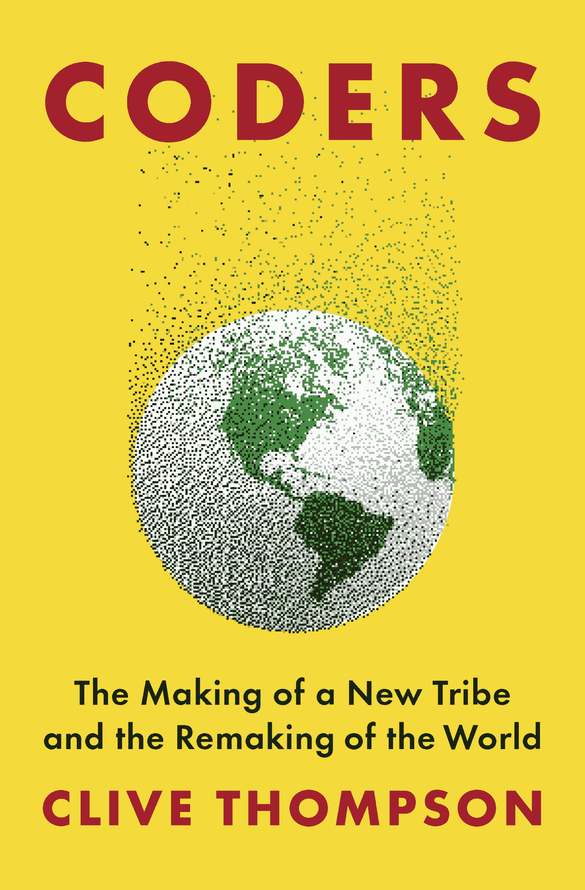

# 程序员：新部落的崛起与世界的重塑




致 Emily、Gabriel、Zev 以及我的母亲


- [扉页](#)
- [献辞](#)
- [第 2 章：程序员的四次浪潮](#)
- [第 4 章：在 INTJs](#)
- [第 6 章：10 倍程序员、摇滚明星与精英治神话](#)
- [第 8 章：黑客、破解者与自由战士](#)
- [第 10 章：规模、喷子与科技巨头](#)
- [致谢](#)
- [索引](#)

因此，程序员是地球上影响力最安静的人群之一。我们生活在一个由软件组成的世界里，他们就是建筑师。他们所做的决策引导着我们的行为。当他们让某件事变得异常简单时，我们就会做得更多；如果他们让某件事变得困难或无法实现，我们做的就会更少。当编码人员在 90 世纪后期和 20 世纪初制作出第一批博客工具时，它引发了自我表达的爆发；当发布内容突然变得容易时，数以百万计的人加入了其中。当程序员在同一时期发明了“文件共享”工具时，娱乐产业震动了，他们眼睁睁看着自己对分发的控制权烟消云散。事实上，他们通过雇佣自己的程序员发明“数字权利管理”软件来反击，将其置于音乐和电影制品中，让普通人更难以复制和分给朋友；他们试图创造人为的稀缺。如果富有的利益集团不喜欢`code`的行为，他们就会花钱编写反向作用的软件。代码赋予，代码也可以夺走。

如果你回顾世界历史，你会发现在某些时刻，不同的职业会突然变得至关重要，其从业者也会突然变得强大。世界会突然需要并奖励他们那套特定的技能。

## 法律时代

在美国革命百年后，一个新的职业阶层脱颖而出。随着工业革命的轰轰发展，这个国家开始城市化，摩天大楼在纽约、波士顿和芝加哥拔地而起。突然之间，弄清楚如何精确地让数百万人紧密居住在一起，而不会淹没在自己的排泄物中，同时为他们提供足够清洁的水、空气和交通方式变得至关重要。这需要大量的巧妙机械，因此土木工程师、建筑师和城市规划师突然掌握了主导。任何能在这些领域工作的人——地铁建造者、桥梁建造者、公园规划师——在决定美国居民如何生活方面都起着巨大的作用。

再次，单一的设计决策将对人们的生活产生巨大影响。罗伯特·摩西是 20 世纪中期纽约著名的城市规划师，他在一系列如君般的活动中，建造了数十高速公路和公园，定义了今日哥谭市的运作方式。他的某些决策毁掉了一些的人生。1948 年，他开始修建`Cross Bronx Expressway`（跨罗恩克斯高速公路），认为这有助于缓解从长岛到新泽西的交通。它确实起作用了，但对被高速公路穿过的主要是黑人的社区来说，付出了惨重的代价。高速公路迅速吸引了如此嘈杂、排放烟雾的卡车流量，破坏了附近任何房屋的房产价值，使数百个以非洲裔美国人为主的家庭变得贫困，并生活在一个环境远不舒适的社区中（摩西似乎也喜欢快速行动并破坏一切）。

如果我们想理解当今世界是如何运作的，我们应该去了解一下编码员。构建当今世界的人究竟是谁？是什么驱动着他们？什么类型的人格会被软件吸引？他们的工作如何影响我们？也许最有趣的是，这对他们又意味着什么？

## Hello, World 时刻

```python
print("Hello, World!")
```

Hello, World!

这就是为什么“Hello, World!”（你好，世界！）这句话充满了隐喻的色彩。它让人想起所有的宗教传统，在那里，神通过言语创造了万物：“起初有道。”（基督教程序员对这种联系情有独钟：共同编写游戏世界《迷雾》（*Myst*）的福音徒罗宾·米勒（Robyn Miller）在创作出酷炫的东西后，偶尔会停下手中的代码，想：“这乃是好的。”）

但“Hello, World!”也有阴暗的一面。它让你想起赋予某些可能脱离你控制的事物生命时，所带来的意想不到的副作用——就像弗兰肯斯坦博士那个被忽视且满怀恨意的怪物，他最终杀害了他的亲人；或者《魔法师弟子》中那些无法控制、不断重生的扫帚。）代码也是如此。你的新闻动态帮助朋友们为患有癌症的朋友组织照顾；它也帮助那些玩梗图的人传播完全疯狂的阴谋论。

这种魔法与代码之间的和谐共鸣，解释了为什么 80 年代初的青少年极客程序员能如此流畅地融合《地下城与龙》（一种将幻想与概率骰子数学相结合的游戏），或托尔金史诗中那些吟唱咒语的巫师。在 60 年代，当程序员发明了一种不断在后台运行的代码类型时，他们称之为“daemon”（守护）。当计算机科学家拉里·沃尔（Larry Wall）创建 Perl 语言时，他包含了一个名为“Bless”（祝福）的函数。正如编码员丹尼·希利斯（Danny Hillis）曾指出的：“几百年前在我的故乡新英格兰，对我职业的准确描述会让我处在火刑。”

## 控制的魔法与傲慢

这种魔法般的控制感可能是令人陶醉且有趣的；它往往造就一种星星式的理想主义。它也可能导致某种史诗般的傲慢，特别是对于那些尚未被生活和自己的失误教训过的年轻程序员。

程序员兼技术文化评论家马捷杰伊·切格洛夫斯（Maciej Cegłowski）指出，擅长编程的人往往“认为自己拥有一种独特的能力，可以从原理理解任何系统，而无需先前的培训，这他们他们卓越的分析能力。在软件设计这个人工构建的世界里，成功培养了一种危险的自信。”正如计算机科学家约瑟夫·魏森鲍姆（Joseph Weizenbaum）在 1976 年指出的，“如果阿克顿勋关于‘权力腐人性’的观察在一个如此容易实现全能的环境中不适用，那人们将会感到惊讶的。”

## 编码工作的现实

编码并不易事。它需要独自坐上小时，试图在脑海中进入一段软件错综复杂的细微之处——`这里`的循环是如何是由用户的`那个`输入触发的，除非`另一个`子程序当前正在运行，如果是那样，`这个`函数就应该启动。

我听过人们将其将其描述为“试图构建并记忆伦敦每一条街道的结构”以及“在脑海中让一座巨大的纸牌屋移动到到位”。这就是为什么它倾向于吸引内向者和解决难题的逻辑型思考者，这类人乐意在周六晚上 11 点坐在家里，为已经废弃的 1997 年网络摄像头编写驱动程序，仅仅是因为……嗯，他们在抽屉里发现了一个旧的 1997 年摄像头并想让它运行起来，而且*该死*这是一个有趣的问题，而且它比与人打交道要容易预测得多。

这种内向并不是完全的。事实上，现今开发软件日益具有社交性；它需要团队合作，而且坦率地说，在与同事开会讨论做什么上花费的时间往往比实际操作的时间更多。

然而，比起内向或逻辑，编码挑选的是那些能够处理无尽挫败感的人。因为计算机会执行你要求它们做的任何事情，所以你需要给它们非人类精确的指令。我之前展示给你们看的那行“Hello, World!”代码？想象一下你正在匆忙输入，结果不小心打成了这样……

```python
print("Hello, World!)
```

……所以，哎，你漏掉了引号。尝试运行它，砰——它崩溃了。计算机*不-不会*运行它。而且计算机对此并不友好；这里没有“我非常抱歉，克莱夫，出问题了。”没有客套话。它只是吐出一个像`SyntaxError: invalid syntax`（语法错误：无效语法）这样的错误信息，由你来找出自己做错了什么。

编程语言是语言，是一种与机器交流的方法；但与计算机交流就是与这个星球上最死板的实体交流，一个冷酷且刻板的语法学家。当我们与人类交流时，他们会花大量精力帮助理解我们所说的话。计算机不会。它们会抓住你的每一个细微的错误并并在你面前反复强调，直到你修复它们为止。这种体验也会进入你的大脑和性格中。当你遇到一个程序员时，你遇到的是一个核心日常体验是无休止的失败和磨人般的挫败感的人。

## 失败的循环

因为代码不断是破碎的、搞砸的、一团糟的，充满了 Bug。即使是你两分钟前刚写的东西，在第一次尝试运行时可能也也会崩溃。“当你学会给计算机编程时，你几乎没有第一次就做对，”先驱计算机科学家兼教育家西摩尔·帕珀特（Seymour Papert）在 1980 年写道。

他认为这种经历是所有程序员心理转折的支点。你写了一些代码，尝试运行；它失败了；所以你的大部分工作就是搞清楚你到底犯了什么错。那些能处理这种日常烦恼的人会蓬勃发展。不能处理的人会逃避。

1949 年 6 月，计算机科学家莫里斯·威尔克斯（Maurice Wilkes）正要上楼梯，他突然领悟到：“生命中很大一部分花在了寻找错误上。”七年后，所有程序员都生活在这种。

更有趣（而且如今更常见）的，不是修复自己工作中的错误，而是修复年前某位程序员编写的代码，那是程序员所谓的“面条代码”，充满了混乱的格式、令人困惑的变量名，以及像《芬尼根环》（*Finnegans Wake*）一样复杂的结构。于是你投入，缓慢地、缓慢地修复它。

程序员被认为是“西西弗斯式的”。他们在绝望的失败中劳作，看着石头滚回山坡……直到有一天它突然翻越了山顶。而他们在另一侧看到了什么？另一座山坡。

```python
names = ["Cynthia", "Arjun", "Derek", "Alondra"]

for x in names:
    print("Hello there, " + x + "!")
```

```text
Hello there, Arjun!

Hello there, Alondra!
```

这更有趣了。嘿，现在机器在为我们做一些杂活了。你可以给这个程序一个包含 10 个名字的列表，循环就会运行 10 次；给它 10,000 个名字，它也会同样高兴地打印出 10,000 次问候。或者 1000 万次。甚至是 10 万亿次。

换句话之，代码非常擅长让事情实现`scale`。计算机可能需要极其精确的指令，但只要你的指令正确，机器就会不知疲倦地为全世界的用户一遍又一遍、反复又一遍地执行你的命令。看着你创造的尽职尽责的机器人突然被数百万人使用，这是一种令人振奋的感觉。

因此，许多软件工程师像蛾蛾火一样被`scale`所吸引。他们热爱创造运行的代码，不仅是为了他们自己，不只是为了几个当地朋友，而是为了整个星球，而且就在`now`。解决一个问题，你就为所有人解决了这个问题。

当 Sanghvi 和 Facebook 的工程师们思考如何制作 News Feed（新闻动态消息）时，他们最初将其构想为一种个性化的新闻服务。它将是 18 世纪欧洲贵族公报的现代版本。一个通世事的仆人会带来关于你所认识的各种社会人士趣闻的报告。或者，正如 Sanghvi 所说，它将像一份个性化的报纸。

“认为三个刚从大学毕业的工程师能够为 1000 万用户构建一份个性化报纸，这似乎很疯狂，”她说道。这就是`scale`带来的那种深层的、令人眩晕的喜悦。

伴随而来的还有它的近亲——对效率的狂热奉献。由于他们随叫随唤拥有可以用机器人般的完美度重复指令的机器，程序员们非常看不起自己重复性地做事情。他们对低效率的厌恶几乎是美学上的——他们像避开恶臭气味一样避开它。任何可以自动化流程、更高效地完成任务的机会，他们都会去做。

（Sanghvi 甚至将这种理念延伸到了她的婚礼。她母亲想在印度安排 Sanghvi 的婚姻，Sanghvi 同意了，因为她觉得这比约会高效得多——从纯粹的计算机科学角度来看，约会可以被视为一种资源耗费极大的排序算法。“我曾是包办婚姻的忠实粉丝，”她在一次演讲中曾说道。“它吸引了我体内的工程师特质。它们很实用，而且成功的概率更高。”）

这种对优化——以及`scale`——的本能欲望，导致了软件公司与公民生活之间发生了许多碰撞。Facebook 将我们的生活视为一个信息传输低效的问题。在 Facebook 之前，我整天都在做（以及思考和阅读）我的朋友可能觉得有趣的事情。但我无法轻松广播我的生活，他们也没有办法倾听；我们必须依靠不定期的电话、酒吧里的聚会、人行道上的聊天。

News Feed 本质上是在全球范围内对我们边缘视觉的大规模优化。Uber 也是如此，它优化了叫车的体验；Amazon 在购物方面也做了同样的事；还有许多利用“零工”员工创建即时服务的公司。

尽管在每种情况下，这些被优化狂热疯狂驱动的科技公司，对任何重视连续性的个人、政府或社区都会造成如闯瓷店般的破坏：那些宁愿要稳定工作也不愿要零散工作的司机和员工；那些因为无法与低摩擦的在线销售竞争而失去本地商店和工作的邻居；或者是某种突然意识到 News Feed 虽然在许多方面无足连城，但有时也会让我们彼此之间暴露得过度的文化。

代码让效率和`scale`变得容易、诱人，且几乎不可避免。这也是为什么程序员如此容易融入商业建设，这也是为什么一些人如此频繁地滑向自由意志主义思维的原因。他们的才华完美契合了资本主义的核心策略，基本上就是，“做一些比以前稍微高效一点的事，然后从中榨取利润。”

注意，软件由于其本质也异化了资本主义的许多假设。软件是一个东西，一台执行某些任务的机器，所以你可以拥有它；但因为它也是一种语言形式，它可以很容易被分享。因此它`确实`被分享了，而且几乎无间断。

程序员对自己的日常工作表现非常健谈且开放，经常在在线论坛发布他们的软件问题，并花费数小时帮助他人解决问题。（20 世纪 80 年代的一项研究得出结论，程序员对职业的忠诚度高于对雇主的忠诚度。）即使在最具贪婪资本主义色彩的硅谷公司内部，也有程序员花费大量时间——在办公位上，在工作时——帮助解决其他路路人的 Bug。

在自由和开源软件的世界里，通常有一种社群主义精神，程序员经常免费地为任何人都可以自己免费使用的软件做出贡献工作。

硅谷那些富有的自由意志主义者往往受到大量的媒体关注。这可以理解。因为他们掌握着大量的资金，并决定资助什么，他们对“颠覆”的痴迷决定了科技领域的很多方向。

但基层程序员的政治观点比想象中要多样得多：有在喝完三杯酒后承认自己投特朗普的暴发户（brogrammers），有住在集体公寓里认为财产即盗窃的无政府主义者，也有参加 JavaScript 大会的传统左派，他们在 Reddit 上精力充沛地发布关于女性主义的内容。

……

女性主义和多元化确实是该行业的痛点。在女性参与率方面，软件是少数几个出现过倒退的高声望、高收入行业。

女性在 50 年代是第一批程序员之一，并构成了该领域首批丰碑级人物，例如创建了第一个`编译器`的 Grace Hopper，或者非常有影响力的`Smalltalk`语言的共同创造者 Adele Goldberg。1983 年，女性占计算机科学专业的比例为 37.1%，但到 21 世纪 10 年代，这一比例下降到原来的一半，约为 17%。（在真实的职场市场上，数字也是如此；2015 年的一项统计发现，谷歌或微软等知名企业技术职位上的女性比例大约在百分之十几到 20%之间。）种族构成也没有更加多样。

这极具讽刺意义，因为软件行业长期以来一直推崇其作为纯粹优胜主义者的自我形象。从理论上说，唯一重要的是你是否优秀。

这种幻想在某种程度上是可以理解的，因为在某个层面，它受到了软件行业硬性现实的启示。在机器层面，`code`确实感觉是优胜制的：`写得烂的软件`会崩溃，而`写得更好的东西`则不会。

事实上，这种二元对立的清晰正是软件工程师热爱它的原因；就像长跑一样，解决一个`极其困难的编码问题`感觉是对自己能力的真正衡量。

软件领域也可能比许多其他领域更具民主化的准入性，因为在这里，`自学业爱好者`可以与拥有`PhD`学位的人并肩。（这在外科、法律或航空航天工程领域并非如此。）

许多程序员会钦佩地向你讲述某些同事，他们似乎不仅比自己更熟练，而且高得令人眩晕——精英黑客、像《黑客帝国》里的尼奥一样，能产出`code`并比凡人同事快一个数量级地解决难题。

因此，这种神话的根源非常深。浸入这样一个有着成败攸关标准的领域，许多年轻白人男性由于缺乏对各种背景的少数群体所面临的日常细微歧视的感受，陷入这种神话的控制并不意外；他们真地相信（有时甚至带着一种近乎孩子般的天真，即使当他们对此感到愤愤或愤怒时）这个领域是一个简单透明的优胜劣汰；如果女性和少数裔没有发展好，是因为他们不够努力，或者在基因上没有赋予天赋。

显而易见，这完全不是事实。当然，有许多证据，包括使用硅谷推崇的`A/B testing`的研究。当我采访`tech firms`中的女性和少数裔时，许多人提到了各种形式和程度的歧视，从微妙的侮辱到赤裸裸的骚扰。

软件行业如何缩小和收紧的故事，是一个关于机会的现代警示故事——以及我们如何更好地保障它。

而且这里的代价高得惊人。在涉及到产品设计时，文化至关重要。如果一个工具是由本质上文化同质化的团队构建的，它将会有严重的盲点，正如任何一年级 MBA 学生学到的那样。

因此，塑造我们生活的`code`也是如此。近年来最具影响力的软件是由一群主要是年轻人、主要是白人、主要是男性的群体制作的，他们没有预见到自己的`code`将如何影响那些与他们并不相似的人。

仅举一例，这就是为什么`Twitter`遭受如此多虐待和骚扰的原因之一。开发该平台的年轻人团队在人口统计学上，经历过网络虐待的可能性要低得多。他们早期没有将其视为一个不可避免、迫在眉睫的、他们需要解决的问题。

相反，一名员工将他们的公司称为“自由言论党的自由言论派分支”。他们早期很少设计对防止骚扰的保护措施，多年后，喷子和白人至上主义者发现`Twitter`是骚扰目标的绝佳方式。

……

事实证明，扩大程序员的世界是`Ruchi Sanghvi`现在正尝试做的事情之一。

当我第一次见到她时，她仅有 35 岁，但在软件行业的蜂鸟代谢速度中，这让她成为了一个`幕后功臣`。在`Facebook`工作五年后，她创立了自己的公司，将其卖给`Dropbox`，并在那里担任副总裁。

离开`Dropbox`后，她启动了一项旨在启发下一代程序员的创业：`South Park Commons`。这是位于旧金山市场南区的一栋翻新办公大楼，是年轻技术人员思考未来的枢纽。

“这就像一个沙龙，”`Sanghvi`在一个炎热的夏日我去午餐时说道。工程师、研究人员和企业家的小群坐在长桌旁，埋头处理邮件和阅读白论文，墙上挂着一幅巨大的艺术品——一系列锯齿状的木拱门。

`Sanghvi`每次接收 30 到 40 名成员，通过口碑吸引他们，然后鼓励他们进行交流、组织讲座，并在理性的边缘讨论想法。

它并不是一个真正的“加速器”，那种让年轻人为了在三个月自创一家公司而拼命，绝望地吸引风险资金的温室。它更具投机性，旨在说服成员选择一个真正全新、奇特的领域进行研究。

最近，话题主要集中在人工智能（AI）以及编写可以自主学习的`algorithms`的黑暗魔法上；`Sanghvi`的至少六名成员最终在`Google Brain`或非营利组织`OpenAI`计划中工作。


从`Commons`诞生的六家初创公司由女性创立。这也是一种成就：让更多女性进入关键的创始人角色，意味着她们可以深度影响公司的发展轨迹，并从成功中受益。`Sanghvi`记得曾为了获得`Facebook`价值的公平份额而争论。当她与`Mark Zuckerberg`交谈时，她提出了一个要求：“我说，要么在股权上与我持平，要么增加现金薪酬，”她告诉我。她用极客术语对`Zuckerberg`说：“我唯一真正在乎的是构建东西，”她对他说，“我不希望在工作时脑子里还想着这件事。我只想想着构建东西！而你也不想让我把这件事挂在脑子里。”（她指出，当时并不是在抱怨获得得比男性少；在那时她并不知道个人的具体情况。）

```
10 PRINT “JIM”
```


当他的朋友运行程序时，屏幕上一遍又一遍地填满了“JIM”。埃弗林格姆目瞪口呆。“我以为那是魔法，”他告诉我，“我只是想知道这到底是什么鬼东西。我当时想：‘我必须知道！’”

## BASIC 的力量

那是 `BASIC` 语言。我主张从历史角度来看，`BASIC` 是历史上影响最远的计算机语言，因为它极大地为业余爱好者打开了大门。在威尔克斯疯狂黑客时，`Assembly`（汇编语言）读起来写起来非常晦涩。它是所谓的低级语言，需要大量精力才能学会阅读和掌握。

等麻省理工的黑客们到达时，看起来更像标准英语的高级语言已经很常见，例如旨在帮助普通科学家和数学家使用计算机进行计算的 `Fortran`，或者为企业设计的 `COBOL`。但 `BASIC` 是其中最容易上手的之一。它于 1964 年发明于达特茅斯学院，全称是“初学者全能符号指令代码”（Beginner’s All-purpose Symbolic Instruction Code），使用非常简单的命令，新手可以轻松理解并运用。

之前展示的埃弗林格姆朋友写的那个小程序？那可是那代 `VIC-20` 玩家眼中的“Hello, World!”，是大多数孩子在拿到这台机器时尝试的第一段咒语。即使你从未编写过程序，它也很易读：程序的第一行编号为“10”，告诉计算机 `PRINT`（打印）名字“JIM”。第二行代码编号为“20”，告诉计算机回到第 10 行。它们合在一起创造了一个微小的无限循环，会不断打印并重印你的名字，直到计算机关闭。

这个简单的两行程序完美地说明了计算机那惊人的、异类的力量：就像一个机器人精灵，它会按照你的指令行事，精确且永不停歇。

青少年很少有机会能以这种如此直观且触手可及的方式去理解无限的本质。但通过输入那两行程序，他们尝到了那种力量的滋味。看着自己的名字滚动，给埃弗林格姆带来了一种情感的冲击，正如济慈（Keats）在他的诗《初次看查普曼的荷马》中描述得如此美妙：就像强壮的科尔特兹，他登上了一座山峰，突然看到了一片全新的可能海洋，人们可以在上面似乎永远航行。

## 黑客的寒武纪大爆发

计算机公司非常鼓励青少年去航行这片海洋。事实上，80 年代初的大多数计算机在当时都带有一本手册，一步一步地解释如何编写 `BASIC` 程序。（我跟埃弗林格姆同岁，这也正是我第一次学习编程的方式。）

计算机还具备不错的显示图形和播放音符的能力，这使得它们特别适合制作简单的电脑游戏——对于 1980 年代的青少年来说，这是一种极具诱惑力的吸引，他们不可避免地开始尝试制作自己版本的街机热门游戏，如《太空入侵》《吃豆人》，或者像《祖之地》这样的文字冒险游戏。（这就像是街机世界的同人小说。）

总而言之，这些可以插入电视的计算机催生了全球黑客的寒武纪大爆发。当你把几乎可以执行你交代的任何任务的廉价机器交给基本上没有任何成年人监督的青少年时——因为他们的父母根本不知道电脑是什么——你就创造了一场软件界的“无限猴子实验”。

很快，青少年程序员开始拼凑各种各样的东西：会咒骂说脏话的聊天机器人、被称为“细胞自动机”的迷人人工生命、赌场游戏、小型数据库和会计程序、电脑音乐以及无尽品种的游戏。

埃弗林格姆渴望着加入这个圈子。他来自一个下中产阶级家庭，父母买不起为他买一台电脑。因此他开始疯狂寻找每一份空闲工作——夏天割草坪，冬天铲雪——直到他攒够了钱，加上母亲的资助，买了自己的 `VIC-20`。

## 学习与拨号

现在他有了机器；怎么获取游戏呢？“我很穷，买不起任何游戏，”他说。他需要免费的游戏。所以他开始买计算机杂志，比如 Commodore 的 `Run`，里面包含了简单游戏的完整代码。在他输入这些代码时，他开始理解它们是如何工作的。慢慢地，通过尝试，他开始编写自己的软件。

然后，通过那些计算机杂志，埃弗林格姆听说了更酷的东西：公告板系统（BBS）。在 `BBS` 上，你可以使用调制解调器拨入全国其他地方别人的计算机，与他们聊天，最棒的是下载免费软件。对于一个穷困少年​​来说，“免费”听起来很有吸引力，所以他再次打零工买了一个调制解调器。

埃弗林格姆开始连续拨入全国的 `BBS`，下载软件并利用下载的内容学习更多 `BASIC`。但在这种疯狂拨号一个月后，电话账单来了。他的妈妈拿着账单走下楼来；他欠了 500 美元。埃弗林格姆羞愧极了：“那比她的房贷还多，”他说。

所以现在他面临一个新挑战：如何骗取长途电话。他开始研究，并发现了长途电话卡的工作原理。你会拨入它们的主 `1-800` 号码并输入你的账户号码，这是一个六位数字。所以他需要做的就是反复不断地拨打那个 `1-800` 号码，遍历每一个可能的六位数字，直到他撞出一些真正有效的数字。

这对于人类来说是一项痛苦而无聊的任务——但对计算机来说却完美。（马修·布罗德里克的角色在《电子游戏》中使用计算机完成这一点；所以黑客们把这种技巧称为“战争拨号”。）

埃弗林格姆很快写了一个 Commodore 64 程序，让它深夜反复拨打长途公司 `LDX` 的 `1-800` 号码，在他睡觉时持续运行。当他醒来时，程序已经创建了一份可以使用的有效长途代码列表。

```text
stringo = [rsa, rsa1, lorem, text]
_byte_ = (_output_) + "c"
if (commands.getoutput("whoami")) != "root":
    sys.exit()  # exit

if (sys.platform.startswith("linux")):
```

# 第 3 章

## 持续的挫败感与瞬间的喜悦

Dave Guarino 需要休假了，于是他去了斐济。而那正是漏洞开始大作之时。

Guarino 是一个口才出众且幽默的程序员，在 Code for America 担任主管兼开发者。这是一家非营利组织，招聘有公共意识的极客，让他们负责改造政府那些陈旧的高科技系统。在这个案例中，这个系统是食品券。

2013 年初，Guarino 在 Code for America 领导的三人团队被旧金山市聘用，让低收入居民更方便地在线申请公共福利，包括食品援助。

政府的确需要帮助。它现有的食品券网站简直是一团泥泞、令人痛苦的混乱。要申请援助，你必须在 30 多个独立的网页上填写信息，其中没有任何一个页面是考虑到手机尺寸而设计的。这对于低收入的加州人来说尤为困难，因为他们大多数人使用价格低廉、流量有限的手机访问网络。

加州那套笨重的系统已成为一个真正的问题；它太难用了，以至于加州符合食品券资格的人中，几乎只有 50% 申请了。Guarino 和他的团队渴望解决这个问题。

问题在于，他们实际上无法从零开始重新编写政府网站的代码。他们并没有被要求这样做，而且无论如何，这都意味着对某些老旧的 `HTML` 和数据库进行昂贵的内部大手术。

于是，他们想出了一个奇妙的“黑客手段”（hack）。他们要在现有的杂乱无章网站之上添加一个流畅的机器人层，从而隐藏旧系统。

起初，他们编写了一个新的、简单的网站。它只是一个清爽的页面，在手机上加载速度很快；它要求新的食品券申请者输入基本信息。然后，在后台，程序员们会施展一些魔法。他们会将申请者输入的信息交给一个自动化脚本。那个脚本会导航到旧的、难以操作的政府网站，费力地一个字段一个字段输入新申请者的信息。

本质上，Code for America 团队创建了一个隐形的守护进程——一个算法助手——它会完成所有的繁琐工作。申请者永远不需要处理细节。他们只需要在整洁的手机网站上输入信息，然后砰的一声，他们就进入了系统。

这看起来并不漂亮。但它管用！“这是我能想象到的最‘黑客’的事儿了，”Guarino 的队友之一 Alan Williams 开玩笑道。但如果你在这些复杂的旧系统周围待得足够久，“你会发现，通往深度、稳固、优雅集成的最快、最短的方法，就是直接在上面再盖一层土。”

在编程世界中，这种修复方法被称为“封装策略”（encasement strategy）——通过将其包裹起来来修复一个毛糙、复杂的系统。但有时这是你唯一拥有的选择；而在本例中，它取得了巨大的成功。

在几周内，新申请者源源不断涌入。在两年内，注册人数之多，使得 GetCalFresh（该应用的名字）被誉为加州政府最实用的新软件项目之一。Guarino 和他的团队对自己的工作感到自豪是合理的。当然，他们可以通过设计帮助千禧一代分享猫 GIF 的 App 来赚更多钱。但编写真正帮助弱势者的代码要满足感得多。

事实上，他们对另一个功能有了新想法，他们认为这个功能能进一步改进系统。

但遗憾的是，这正导致他们制造了一个可怕的漏洞。

他们的想法是让食品券用户更方便地检查卡上还剩多少钱。加州的旧系统要求用户拨打热线，并在冗长的语音树选项中穿梭。“去见鬼吧，”Guarino 说。

语音树是对人性的侮辱；每个人都清楚这一点。所以，他改写了一些 `Ruby` 后端代码来创建一个电话机器人。如果你通过短信发送你的卡号（或在在线表单中输入）给它，电话机器人就会检查你的余额并通过短信回给你。这对用户来说要愉快得多！为了推广它，他们还投了 `Google` 广告。

到此时，Guarino 需要一些休息时间。他本身就是一个容易焦虑、紧绷的人，经常神经质地搓着胡子，语速极快；在连续几个月的工作后，他需要休假。“好了，伙计们，”他告诉团队，“我去斐济了。我不带笔记本电脑，不带手机，什么都不带。我就在那儿待着。你们处理这些事情。”

Guarino 离开几天后，Williams 和他的团队来到公司，发现一场灾难正在发生。查询余额系统失控了。

在通常的一天，它只会被使用大约 100 次。但现在在短短几小时内就收到了 5000 条短信。“这特么是怎么回事？”他们纳闷道。按照这个速度下去，线路将产生巨额费用，或者更糟，被手机运营商切断。为什么人们突然如此频繁地点击它？

他们的第一个假设是：它被用来诈骗了。有一种传言说，黑客正在批量利用它来获取食品券。“黑客发现了我们的服务并利用它！”他们推测。

Guarino 几天后从斐济回来，迅速开始消除漏洞；他疯狂地翻阅服务器日志。最终，在几小时后，他发现了问题所在。

事实是，用户犯了一个错误。有人在那里使用该服务查询余额，这是正常操作。但用户并没有输入卡号——这是他们应该做的——而是不小心发送了电话机器人服务本身的号码。所以软件陷入了循环。“服务在互相发短信，来回反复，”Guarino 说。

他承认，这终究是他的错误，是他编写短信机器人代码时的一个缺陷。他本可以很容易写一条规则，确保没有人会故意给机器人发送自己的手机号码。但他从未想过真人竟然会这样做。

“用户，”他遗憾地表示，“总能找到办法的。”你可能认为你消灭了漏洞，但它们总会找到新的。

### 制作者与管理者的日程

程序员是白领工作者，但对深度沉浸和集中的需求让他们与大多数白领的节奏格格不入。保罗·格拉姆（Paul Graham）将其称为“制作者日程”（maker’s schedule）与“管理者日程”（manager’s schedule）之间的碰撞。

他指出，管理者的工作几乎完全由会议组成。管理者的工作是确保事情顺利进行，因此他们以一小时为单位划分一天，每小时与不同的员工见面。所以，他们并不认为让一个程序员在下午 1:00 参加一个汇报会议有什么大不了。

但对于程序员来说，这次会议会摧毁进入长时间心流状态的所有机会。

### 程序员比其他人更容易抑郁吗？

在我写这本书时，很多人问过我这个问题。事实上，很多程序员自己也问过我。他们知道很多人患有抑郁症或与焦虑、躁狂症斗争。许多人都有程序员朋友的故事，他们被心理健康问题悲剧性地困扰，甚至导致自杀。

这些是 Greg Baugues 经常思考的问题。他是业内非常有名的程序员，以公开讨论自己与心理健康问题的斗争而闻名。

最后在 25 岁左右，他决定自己的心理健康问题比他愿意承认的严重。在搜索“慢性拖延”时，他读到了 `ADHD` 的症状，那些症状听起来确实非常熟悉。他去做了测试。“你绝对是 `ADHD`，”治疗师告诉他，“程度已经爆表了。”她还诊断他患有二型双相障碍。

他开始服用 `ADHD` 药物。在吃下第一剂药后短短十五分钟，他就对感觉如此良好感到震惊。“天呐，”他想，“难道这就是正常人的感觉吗？”

他被 `Twilio` 雇用，这是一家让程序员更容易为应用程序添加电话和短信服务的公司；他的工作是一名“布道者”，即去会议和黑客松教授如何使用 `Twilio` 的产品。他也开始在会议上讲述他在科技领域与心理疾病斗争的经历。

他认为，这个行业奖励了许多随心理健康问题而来的适应不良行为。“社交孤立、不规律的睡眠模式、自大的想法——认为你可以改变世界，或者认为规则不适用于你？”Baugues 说，“如果你是一个正在经历这些症状的青少年或年轻人，并且偶然发现了编程，那种感觉对你来说可能就像回到家一样。”

“即使药物降低了我大脑产生新想法的速度，”他说，“它也以数量级增长提升了我执行想法的能力。因为现在，我可以按时交付（ship）了。”

# 第 5 章

## 效率的崇拜

直到来到日本，Shelley 才意识到她的新男朋友可能有多疯狂。

她通过一些共同工作的朋友认识了 Jason Ho，并和这个瘦长高大、带着狡黠微笑的男孩一拍即合。他是旧金山的一名计算机程序员，经营着自己的公司，并决定在日本休假四周。他想问 Shelley 是否愿意一起来。

事实证明，Ho 为这趟旅行规划了非常严格且奇特的行程。他特别喜欢拉面类食物，他告诉她，这次旅行的目标是访问尽可能多的东京拉面店。为了确保他们尽可能挤进行程，他编写了一些自定义代码。

首先，他汇总了一份东京顶级面馆清单，并将它们标注在 Google 地图上。然后他写了代码，画出连接所有商店的最优路径，这样他们就能在商店之间以最高效率旅行。他说，这是一个“相当传统”的算法挑战，是大学里会学的那种，他经常使用这种技巧来优化自己的生活方式。

### 重构的艺术

“重构”在某种程度上就像编辑。当你写一封信、一个演讲稿或文章时，初稿往往有些臃肿和模糊。你只是把想法写在纸上，但它们表达得并不清晰。所以你会重复自己；你会绕圈子说话；你的思维是模糊的。

但这没关系，因为你的目标不是完美，而是把第一批字写在纸上，以便以后进行重塑和磨炼。编辑能够锐化并磨炼那些松散的想法和语言。它删减掉无意义且冗长的辞藻，让散文变得紧凑、精炼。

### 编程中的效率

编程也是如此。总的来说，代码越紧凑越好。这部分是因为代码行数越少，引入 Bug 的概率就越低。一大堆“意大利面代码”是一个 Bug 容易躲藏的沼泽。

当代码更短、更紧凑时，更容易精确地看到它应该做什么以及不该做什么。编码领域最古老的格言之一是 `DRY`——“不要重复自己”（Don’t repeat yourself）。

### 少的价值

有时，高科技媒体会报道软件库的庞大规模；例如，Google 在 2015 年的各种服务包含了完整的 20 亿行代码。它传达了一种规模即价值的观念——行数越多，结果就越令人印象深刻。

但实际上，一个真正有用的程序员是那些让代码库变小的人，优雅地消除重复，即应用程序的垃圾 DNA。在 Facebook 工作三年后，工程师彦景浩（Jinghao Yan）检查了他对公司代码库的所有贡献，发现这个数学结果是负的。

“我向主仓库中添加了 391,973 行，并删除了 509,793 行，”他写道，“所以如果我每年编码 1000 小时，平均每小时净删除了约 39 行！”

## 计算机革命

计算机激发了比以往任何工具都更伟大的效率之梦。

这是因为它们非常擅长自动化重复任务。写一次脚本，让它运行，计算机就会不知疲倦地执行，直到它崩溃或电源耗尽。

回到 20 世纪 70 年代，当他共同创建 UNIX 操作系统时，传奇程序员肯·汤普森（Ken Thompson）创建了 `cron`，这是一个调度命令：你可以告诉计算机在未来的特定时间反复运行某个程序或完成某个任务。

设置一个重复任务被称为 `cron job`，程序员经常在机器上运行几十个这样的任务。这些微小的守护进程（daemons）每天执行任务，这样程序员就不必考虑它们。

大多数程序员得出相同的逻辑：

1. 每天重复做某件事是无聊的，而且我不擅长此事。
2. 仔细地反复执行同一任务对于计算机来说很容易。
3. 因此，我将自动化我所能自动化的一切。

# 第 6 章

## 10X、摇滚星与精英治国的神话

在编程界的史书中，马克斯·列维钦（Max Levchin）被认为是一个巨头。

列维钦是那个几乎凭一己之力让 PayPal 诞生的程序员，当时处于编程的疯狂状态。他在 20 世纪 80 年代的乌克兰长大，在那里发现了玩弄计算机的乐趣。

PayPal 的起源就是这样：列维钦已经写了大量的模拟器，所以他自己就写出了 PayPal 的原型软件。当 PayPal 获得 450 万美元融资时，为了一次公关活动，他和蒂尔决定做一个假演示，让人们以数字方式转账——从一个设备传输到另一个设备。

相反，他和雇佣的另外两个程序员埋头苦干，连续五天几乎不停地写代码。他们在演示开始前一小时完成了工作。300 万美元成功地从一台设备传输到了另一台。

### 10X 程序员的起源

这个概念可以追溯到 1966 年，当时系统开发公司的三位研究人员发表了一篇白皮书：“在线与离线编程性能对比探索性实验研究”。

他们发现，在线编程胜出了。那些能够与机器进行流畅交互的人比那些在离线模式下工作的人“表现优异”。

### 显著的个体差异

Sackman 还发现，在经验丰富的程序员能力之间存在“显著的个体差异”。那些优秀的程序员似乎比平均水平要好得多——而且比糟糕的程序员要优秀得多。

例如，当被要求编写和调试能够通过迷宫的代码时，最快的程序员比最慢的快大约 25 倍。编写和调试代数问题的情况也是如此：最快的在编写代码时比最慢的快 16 倍，在调试时快 28 倍。

他们的结论是：程序员在技能上存在差异，“通常差一个数量级”。

### 神话的延续

这种“10 倍差异”的观点在软件行业中具有某种诗意的肯定意义，它与许多与计算机并肩工作的人的轶事证据产生了共鸣。

软件经理 Bill Curtis 发表了一项关于他对 54 名程序员进行的测试，其中最好的比最差的高出 `8 倍`到 `13 倍`。

### 神话般的人月

1975 年，弗雷德·布鲁克斯出版了《神话的人月》，这是一本关于软件项目管理的书。

Brooks 赞同地注意到了 Sackman 的发现。他论证道，理论上，通过简单精简到只有最优秀的表演者，就可以构建世界上最好的编码团队。

Brooks 指出，科技公司将编码看作是一种体力劳动，你可以通过简单增加工人来加速。但编码是一种基于洞察的劳动形式，更类似于写诗。仅仅增加人数并没有帮助，因为问题的解决方案可能不是来自许多人的汗水，而是来自个体的闪电般的顿悟。

Brooks 将其总结为一句精辟的格言：

`为延期项目增加人力只会让项目更延期。`

## ENIAC 女孩们消失了

为什么编程对女性往往如此不友好？

这是 Cate Huston 在担任 15 年程序员期间经常思考的问题。她在苏格兰的一所寄宿学校时就开始黑客活动，然后去爱丁堡大学学习计算机科学，在那里很快发现那里是一个男人的世界。

表面上，Google 自诩为一个“友善”的职场。但当哈斯顿在 2011 年加入时，她发现许多大部分为男性的同事可能非常冷淡且迂腐，有些人甚至显然坚信女性不适合写代码。

在“代码审查”（code reviews）期间——即同事们互相评估代码并提供改进建议——男同事们会花几个小时对她代码中的微小细节吹毛求疵，或者皱着眉说：`我会换一种方式做`。

她真的能力不足吗？从尽可能客观的标准来看，事实并非如此。她从上级那里获得了非常完美的评价。但这些年轻男同事传出的信息就像持续不断的背景辐射：我们并不真的认为你适合待在这里。

### 1984 转折点

如果我们想指定一个发生反转的时刻，可以特别关注某一年：`1984`。那是女性开始退出计算机科学学士学位的年份。

在 `1984` 年之前的十年里，男性和女性对编程的兴趣都日益增加。女性参加计算机科学项目的比例在 70 年代后期和 80 年代初稳定且快速地增长，使得在 `1983–84` 学年，女性占了所有学生程序员的 37.1%。

但那是巅峰。从 `1984` 年起，这一百分比开始下滑，在 90 年代跌得更厉害。到 `2010` 年时，比例已经减了一半。计算机科学专业的学生中女性仅占 17.6%。

### 毒性环境

由于女性太少，计算机科学部门变成了荷尔蒙的温床。男性学生会对女性进行嘲笑，教授告诉女学生“你太漂亮了，不适合学电子工程”，而一些男性学生则使用裸照作为桌面壁纸。

随着女性离开计算机科学领域，职场也日益变成以白人男性为主的单一作物。

### 文化契合度与自我延续的循环

由于负责人的人大部分是白人男性，他们更倾向于雇佣像他们自己的人；只有当人才走路和说话方式像他们一样时，他们才会认可人才。

例如，在招聘程序员时，大多数公司依赖于 `白板挑战`（`whiteboard challenges`），即要求应聘者在白板上现场编写代码——通常是排序算法。这种表现形式与程序员在工作中实际做的事情几乎没有任何关系。

### 性别歧视与骚扰

这种微妙的偏好，以及对女性低调、含蓄的嘲讽，往往是女性进入编程领域更大的障碍。但要找到那些赤裸裸的性别歧视和“男兄弟俱乐部”行为也并不困难。

```sql
-- 示例代码
SELECT *
FROM users
ORDER BY attractiveness;
```


`WHERE sex='F' AND hotness>0 ORDER BY age LIMIT 10`


# 第 8 章：黑客、破译者与自由战士

“所以，假设我想和你聊聊，”Steve Phillips 说，“但我们要私下聊！快到这边。”

他把我拉到笔记本电脑前，他在那里展示他最新的发明：`LeapChat.org`。当你导航到该页面时，它会创建一个只属于你的小私人聊天室；将`URL`发送给其他人，他们就会传送进来。“而且它在每一个节点都经过加密，所以没有人能拦截你的说话内容并进行监视，”Phillips 热烈地说道。

我用“Clive”的名字登录了房间。“甚至连`username`都是加密的，”Phillips 的朋友 A. J. Bahnken 说，他帮助开发了 `LeapChat`。

要点是什么？是在这个不停在线监控的世界里，为人们提供一个小小的隐私岛屿——特别是那些寻求躲避警察和情报机构窥探目光的活动人士。Phillips 和 Bahnken 将 `LeapChat` 的代码开源，因此任何熟练的程序员都可以建立自己的 `LeapChat` 服务器。Phillips 付费运行他自己的服务器，并让 `LeapChat` 在网上 24/7 持续在线，供任何人使用。由于所有聊天内容都是加密的，即使是他们也无法看到人们在 `LeapChat.org` 上在做什么；他们不存储用户的 `IP` 地址，而且任何对话的加密日志在 90 天后会被删除。如果执法部门来并告诉他们：“嘿，给我们一份那些活动人士在 `LeapChat.org` 上活动的副本，”他们将无物可交。那将只是加密的乱码，没有任何可读的内容。

“现在，有太多的活动人士在使用 `Facebook` 之类的工具进行通信，那里的数据会被永久存储，而且谁知道谁有访问权限，”Phillips 说道，他 33 岁，身材瘦削，留着整齐的山羊胡。他也受邀参加许多 `Slack` 小组讨论敏感议题。“我明白！这很方便！所以我们需要做出同样方便又安全的工具。”

这是旧金山的一个周五晚上，Phillips 正在主持一间满满了隐私黑客的房间。我们在 `Noisebridge`，这是旧金山一个著名的黑客空间，吸引了从拿着电烙铁的修理爱好者到新手程序员的各类人士；主房间里有一面巨大的灯墙，今晚正闪烁着“生命游戏”画面，散落着 70 年代的古董电脑、几台工业缝纫机，以及写满数组和函数的白板。

每周，Phillips 都会举办一次名为“Cypherunks Write Code”的黑客松，志同道合的人聚集在一起，编写帮助人们在网上交流而不被监视的软件。有一个戴着帽子的男生趴在笔记本电脑前，正在重写流行的 `Tor` 匿名浏览软件，并希望使用一种更快的语言；在他旁边的是 Jen Helsby，她正在改进 `SecureDrop` 的界面，这种软件被许多组织（包括《纽约时报》和《拦截者》等媒体机构）用于举报人安全且匿名地提交文件和线索。

一个在埃及长大的程序员向另外两个加密朋克讲述了他青少年时期在一个黑客小组中的事迹，那个小组曾尝试研究如何入侵公司网站。“我们很快意识到自己力不从心，于是我们不再做那样了，”他说。

“你们那时是破译者（crackers），”一个留着茂密白胡须的旁者大笑道，他是一个在 70 年代首次使用 `Fortran` 穿孔片编程的老兵。那个埃及程序员羞涩地点了点头。

在程序员的这个领域，他们对术语非常严谨。“Hacker（黑客）”指的是其传统含义：一种喜欢钻研系统、让它们产生新奇行为的好奇者，有时也会寻找漏洞——通常在法律范围内，即白帽。相比之下，“Cracker”（破译者）是指为了个人利益或犯罪而入侵系统的人。

但“密码朋克”（Cypherpunk）呢？这是一个他们都能认同的术语。它是旧词汇“赛博朋克”（cyberpunk）与“cypher”（即计算机密码学中的代码编写与破解）的结合，而且在我听来，还带有一点朋克摇滚的“朋克”精神：那些以 DIY 方式做事、在主流之外运作的人。这是为了保护公民自由的黑客行为。在一个越来越多对话发生在数字世界的世界里，密码朋克认为加密对于公民自治至关重要。

## 密码朋克从哪里来？

他们产生于编程技能与对集权权力的深层不信任。

Phillips 起初并不是其中一员。他确实非常执着；他亲切、活泼的氛围掩盖了一种近乎盲目的驱动力。“我的首要价值观是人类的伟大和正义，”他诚恳地告诉我，“如果没有人努力去做些特别的事情，那对我来说将太悲哀了，世界上也将发生不了什么有意义的事情。”

他按照僧侣般的准则组织生活，作为一名自由职业程序员，只工作足够的时间来维持 `Noisebridge` 附近的一间小公寓，并将日常开销削减到微乎其微，以便尽可能减少付费工作时间，将剩下的时间留给哲学研究和密码朋克编程。一位朋友描述了几年前出现在 Phillips 那间简陋的公寓：“地上只有一张铺得很整齐的床垫，一个放着他少数物品的单斗柜，还有一大堆空外卖盒。别的什么都没有。”

外卖都是些毫无装饰的餐食，比如鸡肉卷饼；Phillips 遵循一套严谨的尽管看起来简陋的饮食计划，那是他青少年时期设计的，当时他决定自己被广告和流行文化骗了，一直在吃垃圾食品。“我想想，嘿，这是理性的做法，我不会让社会压力损害我的身体。有一段时间，我妈妈真的觉得被冒犯了。好像她做的菜对我来说已经不够好了？”

当他和我坐在一起吃饭时，他在桌上摆了一排维生素片：“磷脂酰胆碱、卵脂、维生素 B 复合体、复合维生素和鱼油，”他说。无论他在做什么，似乎都很有效；他整个人散发着能量。

Phillips 在晚年才开始接触密码朋克编程。他在加州的 `Vacaville` 一个中产阶级家庭长大，父亲是消防员，母亲是健身教练兼老师。他的青少年时期一直在摆弄 `GNU/Linux`，然后离开家去大学学习哲学和数学。

哲学让他觉得既强大又严肃——关于生命的意义、道德行为的辩论，正符合他这种“极客正义”的跑道。但他认为哲学辩论太模糊、定义不清晰；他认为它应该是无不可摧的逻辑性的。因此，他在大学期间花了大部分空余时间设计了他所谓的“可执行哲学”：这是一个系统，你将哲学命题陈述为 `Python` 代码片段并对它们进行 `run`（运行），这使你能够“自动发现各种错误”并“确定信仰系统的逻辑一致性”等等。他认为，如果花一生去尝试他所说的“革命哲学”，他会很快很快乐的。

但 Phillips 认为，你无法完全通过革命哲学来维持生计，所以毕业后，他进入了编程领域。他在 `Santa Barbara` 创立了一个黑客空间，在那里结识了几位朋友——其中包括当时 16 岁的 `Bahnken`，他某天溜进来学编程——随后他们创立了一系列初创公司。

Phillips 对他的创业也极度专注。他疯狂吸收 `Y Combinator` 创始人 `Sam Altman` 的在线视频，并吸收了硅谷极自由意志主义偶像 `Peter Thiel` 的商业构建巨著《从零到一》。“Peter Thiel 关于创业的书非常精彩，”他告诉我，“那种想法是，你必须做一些根本性更好的事情——不能只是好一点点。但在某些地方我不会提到 `Peter Thiel` 的名字，因为我讨厌他的政治。”

事实上，在意识形态上，Phillips 曾到处游荡，寻找一个政治归宿。“六年里换了六个党，”他说。大学期间，他尝试过无政府主义和自由意志主义；他喜欢他们的智力严谨性，并认同他们的观点，即积累集中权力的人通常会滥用权力。

但没有国家、没有政府的想法？那似乎是不可行的。“所以，政府乱作为是糟糕的。但接着就像是，‘我们该如何处理医疗？’而 `Ron Paul` 会说：‘去问你的教会，他们会帮你！’这简直就像是，你他妈在说什么？”Phillips 笑了。他决定自己是一个“小政府社会主义者”，支持一个提供集中医疗等基本人道主义物资的国家，除此之外不干涉人们的事务。

然而，世界并非向那里发展。事实上，政府正越来越多地被发现深度插手人们的生活。2013 年，`Edward Snowden` 揭露了 `NSA` 收集美国人的电话、监控聊天信息，并接入 `Google` 和 `Yahoo!` 等服务的骨干网络。Phillips 感到震惊。但这似乎也是他可以产生影响的领域。

他一直在研究密码史，并观看 `Julian Assange` 和 `Tor` 项目创始人的视频，他们讨论了普通人需要更好、更易用的工具，以便让他们在线上保持隐私。

现在，这似乎是一生中一件有意义的事。“我完全可以坐在这里，比方，穿着内裤，编写改变世界的软件——保护人们的公民自由，”他告诉我。

他的初创公司没有真正起色；他回到了软件咨询工作。所以他决定尽可能多地从事密码朋克项目，同时尽可能便宜生活。很快，代码开始涌现。他创建了一种精明的隐私保护软件，一种让你在不同浏览器之间同步 `URL`，将它们以加密形式存储在公共服务器上，同时让路人无法读取。

2017 年，Phillips 看着 `Wired` 杂志读到了关于 `Barrett Brown` 释放的消息。Brown 是一个政府透明度活动分子，他在 2010 年创建了一个大胆的众包新闻项目。他从政府和科技公司获取了大量的秘密文件，其中一些是由黑客行动组织“匿名会”（Anonymous）获得的。

Brown 将所有文件放在一个 wiki 上，鼓励远方的志愿者帮助他分析文件，并根据他们发现的内容编写报告。他的项目最终落入了 FBI 的眼中，FBI 搜查了他的房子。

最终，Brown 被入狱，因为 `FBI` 指控他在 `YouTube` 视频中对一名特工发出威胁，以及发布了一份指向托管盗窃信用卡网站 `URL` 的文档，此外还有一项妨碍司法的指控。（链接指控后来被撤销了。）

在监狱期间，Brown 为 `Intercept` 撰写专栏并获得了国家杂志奖。他刚出狱就向 `Wired` 讲述了他的下一个大想法：构建一种软件让活动分子能够在线协作和众包研究，就像他以前做的那样。但这次软件将具有严密的加密，这样间谍就无法窥探。

Phillips 感到非常振奋。这正是他想要编写的代码！事实上，他与 Bahnken 已经完成的工作——他的 URL 隐藏软件 `LeapChat` 的早期原型——已经在朝着那个方向迈出了一步。

他飞往达拉斯会见了 Brown；两人迅速达成了合作意向，在几周内，Phillips 就建立了一支由志愿者密码朋克组成的团队。他们将系统命名为“追求项目”（The Pursuance Project），将其想象为为试图参与政治行动的公民设计的超级隐私高效办公软件。Brown 告诉我，这对于从活动人士、记者到在冲突地区工作的非政府组织的所有人来说都是有益的。

“我完全可以用这些工具保护十亿人的隐私，”Phillips 说道。

如果你想理解为什么密码朋克——以及大多数程序员——如此关心隐私，并且对权威如此不信任，那么停下来回顾一下历史是有的。

事实证明，这种态度有着悠久的历史。从 20 世纪 70 年代开始，程序员与政府和企业中的权势之间发生过几次大冲突。每一次冲突都是关于隐私和开放性的斗争。大公司和政府想要将他们的秘密紧锁起来，同时拥有窥探普通人事务的能力。而黑客想要的恰恰相反。黑客认为普通人应该享有隐私，而强大的利益集团应该公开它们的秘密。

## MIT 黑客文化

这种文化冲突的第一版出现于 20 世纪 60 年代和 70 年代的 MIT，当时第一代黑客开始兴奋地玩弄大学的机器。

那些黑客拥有一种开放的伦理：如果你写了一个酷炫的算法或代码，你就把它分享给其他人。如果你不向他人展示你的代码，反之亦然，大家如何学习呢？

“我们把程序分享给任何想使用它们的人，它们是人类知识，”MIT 最多产的黑客之一 Richard Stallman 后来回忆道。事实上，MIT 的程序员非常具有集体主义精神，他们甚至不在自己写的代码上署名。

“签署代码被认为是傲慢的，”1980 年进入该实验室的 Brewster Kahle 回忆道，“这都是为了构建机器。这是一个社区项目。”

当然，黑客们每个人都可能极具个人主义，并且每个人都深信自己的卓越。但编码本身呢？那是一项集体努力，是一场智力上的集体盖房，大家为了大家的利益而努力让计算机做酷酷的事。拥有一个你写的算法似乎比“拥有”乘法概念本身、或宪政民主、或韵律一样荒谬。

MIT 的黑客讨厌任何限制他们访问机器或尝试任何他们想要测试的技术企图。所以，如果某个规则阻碍了他们，他们就打破它。

如果他们像通常一样在深夜进行黑客活动，而电脑故障了，他们就需要适当的工具来修理——结果发现白班员工把工具锁了起来。于是，他们就会直接破解锁，从空白处制作一把“主”钥匙，并取走他们所需的东西。

“对于黑客来说，关上的门是种侮辱，锁上的门是种冒犯，”Steven Levy 在《黑客》一书中描写那些 MIT 程序员时这样写道。“正如信息应该在计算机内部清晰、优雅地传输一样，正如软件应该自由传播一样，黑客相信人们应该被允许访问可能促进黑客寻求发现和改进世界运作方式之追求的文件或工具。当一个黑客需要某些东西来创作、探索或修复时，他不会理会诸如所有权之类的荒谬概念。”

## 自由软件的诞生

这种与财产的关系产生了一个激进的想法：“自由/开源（free/libre）”软件。

这场革命发生在 20 世纪 80 年代初，当时 MIT 官员意识到多年来学生黑客为 MIT 的计算机编写了大量极具价值的软件。因此，官员们决定从中赚钱。

一家名为 `Symbolics` 的营利性计算机公司询问 MIT 是否可以许可所有这些酷的软件运行在它的计算机上。MIT 说没问题。于是 Symbolics 如约许可了这些代码，Symbolics 的员工开始对其进行调整、修改和添加新功能。

但每当 Symbolics 创建一个新功能时，它就保持为专有。它并没有公开分享这些创新，以便下一代程序员能够从中学习。

这让 Stallman 非常恼。他最终离开了 MIT，并发明了一种完全不同的许可范式，称为`通用公共许可证`（General Public License）。

它的工作原理是：假设我写了一个邮件程序，并在`通用公共许可证`下发布它，因为我是一个具有公共意识、想要自由分享工作的黑客。

如果你下载了该邮件程序，`GPL` 意味着你允许查看我的源代码；修改邮件软件；以及分发你对我作品的混合版本。

但这里还有一个额外的元素：如果你修改了代码并开始分发你的新版本，你也必须在`GPL`下发布你所有的修改。你不能对那些新代码保密。

这并没有阻止你通过你的工作赚钱；你可以将代码作为商业产品出售。（正如 Stallman 指出的，它是“自由”得像“言论自由”的自由，而不是“免费啤酒”的“免费”。）

但你必须公开发布你修改后的源代码版本，以便其他人也可以检查它、混合它并分享它——这个过程将无休止地持续下去，对于每一个使用我的或你的代码的人。

从本质上说，`GPL` 是一种具有病毒性的法律条文。如果一个黑客通过让某个软件免费且开放开启了先例，它将永远保持下去，包括基于此的所有衍生作品。

这是一场以开放、透明和控制的名义发出的挑战。它传达的信息是：如果制作软件的人不向你展示代码，你就永远不要信任该软件。它在文化中造成了一道裂痕——重视开放性的程序员与想要保留代码秘密的公司之间的对立。

## 冲突的第二阶段

冲突的第二阶段出现在 20 世纪 80 年代，并变得更加阴暗——随着 FBI 开始积极逮捕因入侵系统的黑客。

这发生在第一批购买了廉价 `BASIC` 家用计算机的青少年时期，他们使用调制解调器拨入世界其他地区的计算机系统。有时他们会拨入公告板、由其他程序员运行的讨论论坛，在那里交换技巧并分享他们的利用程序。

但最有野心的黑客却在搜寻更大的猎物：他们喜欢非法拨入由大公司和电信公司运行的计算机系统带来的快感。如果你能渗透其中一个，你就能控制极其强大的计算机——在那些计算机上，你可以使用 `C` 等语言编程，而不是他们插在父母电视机上的 `Commodore 64` 里的 `BASIC`。

“我们想要访问比家里那些简单计算机更强大的计算机，”在 80 年代使用屏幕代号 `Phiber Optik` 的黑客 Mark Abene 在接受 `CNET` 采访时回忆道，“我们想要获得我们否则无法获得的高端技术，理解它们并学习对其编程。”

然而，获得那样的访问权限需要一些直接的数字侵入和非法活动。Abene 的黑客小组的成员会共享公司系统的密码，这些密码是他们数字破解的，或通过老式翻找公司垃圾桶发现的。

正是在这里，联邦官员开始警觉起来。电信公司和政府担心他们正在失去对这个奇异、新兴的新领域——“网络空间”的控制。于是，他们冲向了 Abene 和他的小组“欺骗大师”。

在 21 岁时，Abene 被关押了近一年之久。支持者认为，这一判决与他的罪行完全不成比例；在他所有的侵入行为中，Abene 并没有真正破坏过任何系统，也没有偷取过任何价值数据。

但他无疑是该国最著名的黑客。为了试图理解这群利用调制解调器在网上无忌游荡的新一代孩子的动机，记者们无休止地引用他的话。他的名声让一个在面对一群敲击键盘的孩子面前显得软弱而感到无颜的政府有了一个实用的替罪羊。

“必须传达一个信号，”法官在宣判时解释道。

到了 20 世纪 90 年代初，黑客日益意识到破解是非法的，并且会被这样对待。他们知道，如果你未经许可访问了系统，联邦政府可能会追到你。但只要你只是安分本分，不入侵系统，只编写有用的代码，他们就会放过你，对吧？

并非完全如此。下一次大战是为了加密代码本身——政府正极力试图让`write`某些类型的软件变得非法。

这些就是所谓的“加密大战”：一系列关于谁被允许编写和使用加密的斗争。

在如今这个充满 `Facebook` 和电子邮件的世界里，人们变得越来越明确，我们的在线活动正被严密追踪。然而，在过去的 70 年代和 80 年代，大多数人并没有在线，因此数字隐私的概念并不在全民讨论的范围内。

第一批预见到我们今天现状的“卡珊德拉”们是计算机科学家和编码员。毕竟，他们是第一批使用 `email` 相互交流并往回发送文件的人。这既有趣又令人兴奋，但他们不安地意识到，所有这些邮件和讨论论坛帖子都留下了数字足迹。

以文本形式进行的对话可能会在服务器上留存多年，也许是永远。当社会的 `rest` 部分也开始做同样的事情时，会发生什么？

这让计算机科学家 Whit Diffie 感到担忧。在 20 世纪 70 年代初，在与伴侣聊天时，他预言了 `Facebook`、`Amazon` 和 `Google Hangouts` 等产品的出现。

他在 2013 年回忆道：“我告诉她，我们正在进入一个世界，人们将与他们从未面对面见过的人建立重要、亲密且长期的关系。”

Diffie 也知道，在当时，大多数形式的数字消息加密都非常脆弱。这是因为它们都存在一个巨大的缺陷：双方——发送消息的人和接收消息的人——都需要拥有相同的、用于让你解密的 `key`（密钥）。

如果我在纽约，试图给在威斯康星州的你发送一封秘密的加密电子邮件，我需要向你发送解锁这封秘密信件的 `key`。这种做法的问题在于——追溯到古希腊的间谍和将军们也完全清楚的——就是你很容易不小心丢失你的 `key`，或者被敌人偷走。

一旦有人知道了你的 `key`，他们就可以解密你的任何秘密消息并阅读它们。所以，确实，Diffie 可以编写一些非常出色的加密算法来保护他和朋友们的消息安全。但如果他们小组中的任何人不小心泄露了密钥，一切就结束了。再无隐私。

然而，在 1976 年，Diffie 和他的同事有了一个突破性的想法。他们发明了所谓的“公钥/私钥”加密。

在这个系统中，我们每个人都有两个密钥：一个任何人都能看到的公钥，以及一个只有我们个人知道的私钥。向他人发送消息意味着使用两个密钥——你的私钥和他们的公钥。

一种亚文化正在兴起，他们被加密技术的政治影响所吸引。这些实践者自称为“密码客”（cypherpunks），是一群分散在全球的黑客和思想者。

其中许多人是坚定的自由意志主义者，热衷于不受政府监视的言论自由理念。另一些人则是无政府资本主义者，他们梦想着利用加密技术创建匿名电子货币，这种货币永远不会被征税，并且永远不会受到全球官僚机构的侵害。其中有些人变成了后来也梦想建立“海上国家”的人；也有人仅仅是经典的美国公民自由主义者。他们都仇恨 `NSA`。

到了 20 世纪 90 年代中期，`NSA` 意识到密码客的观点正在占据优势。互联网正进入公共生活；普通大众和企业开始交换电子邮件并浏览网页。

`Lotus Notes` 等软件的开发者开始将加密功能整合到产品中，理由是企业客户希望知道自己的通信是安全的。电子商务也开始起步，这意味着所有在以太中飞传输的信用卡号都需要保护。

于是，`NSA` 的特工们尝试了一次孤注一掷的行动。如果加密技术注定要在社会范围内普及，他们想要确保由他们来控制它。

通过与克林顿政府合作，`NSA` 的领导人辩称，所有的电脑和手机确实应该拥有强大的加密功能。但它应该以 `NSA` 自己创建的计算机芯片的形式存在：“克利珀”（Clipper）芯片。

如果一个设备中有一个 `Clipper` 芯片，它就会加密你在网上进行的任何操作或在电话里说的任何话，使其免受窥探。但有一个例外：即 `NSA` 本身。他们将保留一把“后门”密钥，可以访问每个设备。

密码客们完全不买账。这个计划简直是疯了。“战争已经到来，”梅说道，“克林顿和戈尔的人已经表现出他们是‘老大哥’的热衷支持者。”

他们开始引发公众愤慨，各界公民自由主义者也加入了他们。编程极客之外的知识分子也加入了进来，包括保守派的《纽约时报》专栏作家威廉·赛弗 William Safire。更广泛的公众开始意识到，生活正在转向线上，而他们也不喜欢间谍窥探他们事务的主意。

然而，真正让 `Clipper` 芯片失败的并不是政治问题，而是一个漏洞，是由一个名叫 Matt Blaze 的年轻计算机科学家在要求评估该芯片时发现的。

在仔细研究 `Clipper` 芯片的规格时，他迅速发现了一个巨大的缺陷——这个缺陷能够封锁 `NSA` 的“后门”。利用这个漏洞，犯罪分子可以使用 `Clipper` 芯片在网上秘密通话，同时防止 `NSA` 监听。

所以实际上，`NSA` 创造了一种向犯罪分子提供惊人加密技术的技术，而 `NSA` 自身却无法破解。当 Blaze 发表他的发现时，这让 `NSA` 看起来比说谎还要糟糕：它看起来是那么无能。

克林顿和戈尔悄悄拔掉了该芯片的插头。黑客、计算机科学家和密码客赢了。

## 娱乐法与版权

即使在经历了这些关于间谍行动的斗争之后，代码人员与执法部门之间最大的冲突之一尚未到来。而且它是基于一个意料之外的领域：娱乐法和版权——电影和音乐。

20 世纪 90 年代后期，随着越来越多的公民涌入网络，好莱坞制片厂和唱片公司的高管感到警觉。人们在网上交易歌曲的 `MP3` 副本，却不付钱！宽带变得越来越快，他们预见到未来，人们也会开始在网上复制和交易电视节目和电影，同样不付钱。

为了保护他们的产品不被复制和分享，娱乐公司转向了密码客所喜爱的元素——强加密。每当唱片公司或电影制片厂将歌曲、电视节目或电影数字化时，他们就会将它们封装在加密之中。

对于 `DVDs`，这种加密被称为“内容混乱系统”（Content Scramble System）。如果你想在电脑上看 `DVD`，你需要一个可以解密电影的视频播放器。

## Dmitry Sklyarov 与 DeCSS

2001 年，一位名叫 Dmitry Sklyarov 的俄罗斯代码员访问了拉斯维加斯，在黑客大会 `DEF CON` 上发表了演讲。他谈论的是 Adobe 公司制作的电子书中薄弱的 DRM（数字版权管理）。

为了他的雇主 ElcomSoft，他编写了解密 Adobe 电子书的代码，以便将其转换为 PDF 格式。在俄罗斯，编写这种代码是完全合法的。但一旦 Sklyarov 进入美国，他就必须遵守美国法律。

Adobe 向 FBI 举报了 Sklyarov，FBI 在他完成 `DEF CON` 演讲后立即将他投入监狱，指控他“绕过” DRM；他面临最高 25 年的监禁和 2,250,000 美元的罚款。

1999 年，15 岁的挪威人 Jon Lech Johansen 与另外两个代码员一起创建了开源软件 `DeCSS`。它去除了 `DVD` 中的 DRM，让你可以在 `Linux` 电脑上观看这些电影。

一些人用其他计算机语言重写了 `DeCSS`，全球的黑客和网站所有者开始热衷在线分享它们，其中包括一个名叫 Andrew Bunner 的人。黑客杂志 *2600* 在网上发布了 `DeCSS` 的源码，并链接到了分发该程序的网站。

随后，法律的重锤降临了。2000 年，一个代表电影制片厂的团体根据新法起诉了 *2600* 杂志出版社，声称分发 `DeCSS` 源码是非法的；毕竟，当你运行这段代码时，它就变成了一个绕过 DRM 的工具。

在短期内，电影制片厂输了几场战斗。Johansen 被判无罪。但在其他地方，制片厂获得了胜利。总的来说，信息已经传出：DRM 是一种强大的武器，公司可以——并且将会——利用这种武器将编程犯罪化。

在与政府、公司和间谍经历了三十年日益增加的冲突后，许多黑客发展出一种本能的、易发的“搞死对方”立场也并不意外。

## 偏执狂与安全黑客

所以，密码朋克经常被称为“偏执狂”。

Jen Helsby 确实是这样。她过去经常警告朋友政府正在进行在线监控、追踪手机并收集他们的社交媒体数据。

她的职业生涯始于在芝加哥攻读天体物理博士，研究暗能量，试图弄清楚宇宙为什么要扩张。和许多天体物理学家一样，她精通编写代码。但她对国际事务感兴趣，并渴望做一些更直接帮助社会的事。

于是 Helsby 开始利用她的数据处理技能帮助一个芝加哥项目研究城市衰败，然后她协助创立了 Lucy Parsons Lab，该实验室创建免费的开源软件来帮助公民对警察提出投诉。她还会警告同为活动人士的警察和政府机构可能正在监控他们，并举办加密派对来教授“opsec”（操作安全）。

“人们应该拥有自由阅读、自由说话的能力，而当一切都被政府监视时，你就没有了这种能力，而且当他们不喜欢他们看到的内容时，他们可以对你采取行动，”她说。

尽管如此，她有时还是会被说是偏执狂。“你是个阴谋论者，”她会被这样说——直到 2013 年，Edward Snowden 登上头条新闻。

作为 NSA 的一名计算机安全承包商，Snowden 泄露了数千份文件，显示该机构确实在一种惊人的程度上监控普通美国人。Snowden 的揭露震惊了密码朋克，也为他们提供了某种程度的证实。

我在旧金山的 Aaron Swartz 黑客松上遇到了 Helsby。它每秋季举行一次，是一个周末，加密黑客聚集在一起工作，开发他们希望能赋能普通公民的软件。

这是为了纪念 Swartz，他是一位在 26 岁自杀的代码员和活动家。在他短暂的生命中，他创造了深受黑客社区喜爱的项目：他帮助编写了 `SecureDrop` 的第一个版本，共同创立了 `Reddit`，共同创造了 `RSS`，并帮助开创了“知识共享”许可的想法。

Swartz 还坚信，学术信息被公司封锁了，而本应对公众免费。这导致了他自己与法律的斗争：2010 年，他编写了一个程序，通过 MIT 的订阅从付费订阅服务 JSTOR 下载了近 500 万篇学术期刊文章。

在当局逮捕 `Jha` 后，他和他的 `Mirai` 伙伴们被判处五年缓刑和 62.5 周的社区服务。白帽和黑帽之间的界限确实包含很多灰色地带。

事实证明，Hutchins 被指控有自己的灰色帽身份。起初，在阻止 `WannaCry` 之后，他被誉为经典的白帽信息安全黑客。但当他去机场飞回英国时，他被 `FBI` 探员捕获，并因创建恶意软件被捕。

当 Hutchins 被保释释放时，信息安全界充满了各种理论。有人认为他可能有罪；安全记者 `Brian Krebs` 报道了证据，这些证据将 `Hutchins` 与他青少年时期发布和出售的几件规模较小、较不成功的恶意软件联系在一起。

至于他自己，`Hutchins` 对 `Kronos` 的指控辩认无罪，在我写这篇文章时，案件尚未进入审判。

## 第 9 章：黄瓜、天网与人工智能的崛起

一切始于中国古代棋类`围棋`，结束于黄瓜。

在 2015 年秋季，我们经历了另一个类似于“天网”的时刻，一种人工智能的形式彻底击败了人类。在这种情况下，涉及到 `AlphaGo`——由 `Google` 帝国子公司 `DeepMind` 设计的软件——它下了一场极其精彩的围棋比赛。

`AlphaGo` 在这项游戏上如此出色，部分是因为它结合了“深度学习”，这是一种热门的新神经网络技术，让计算机能够分析数百万局围棋，并自主构建起一个关于游戏运作方式的模型。

这是因为，在 `Google` 向世界推出 `AlphaGo` 的同时，它还发布了 `TensorFlow`，这是一个免费软件，极大地简化了设置你自己的神经网络的任务。

其中之一是小池诚（Makoto Koike），一位 37 岁的日本计算机工程师。他曾为该国的汽车行业设计了多年软件。但他的父母是农民，所以他回到家陪伴他们，并在农场帮忙。

老小池夫妇是种黄瓜的。在日本，消费者非常看重“带刺”的黄瓜，这些黄瓜要笔直、颜色鲜艳，且表面仍留有许多刺。

小池读过关于 `AlphaGo` 的报道，这让他对深度学习产生了兴趣。然后他听说了 `TensorFlow`，灵光一闪。也许他可以制作自己的 AI 来分类黄瓜？

第一步是拍摄成千上万张不同黄瓜的照片。小池需要一个庞大的数据集来训练神经网络，让它学习弯曲变形的黄瓜和细长直的黄瓜之间的区别。

几周后，他的 AI 能以 80% 的准确率识别优等黄瓜。

然后他制造了一个机器人来自动分类黄瓜。它有文件柜那么大；小池把黄瓜放入机器人的顶部，那里三台摄像头会从上方、侧面和一端对其拍摄照片。一旦 AI 得出了判决，它就会将黄瓜弹射到传送带上，机械手臂会将蔬菜推入相应的箱子里。

多年来，程序员们一直在编写程序来执行我们的重复性动作。现在，他们正在让我们的重复性思考自动化。

## 人工智能的梦想

自从我们拥有计算机以来，程序员们一直梦想创造出像人类一样行为的软件。当你处理表现出这种栩栩如生的行为——能够执行“思考”任务的机器时，这可能是不可避免的。你可能会开始好奇：AI 能够像我们一样学习吗？

## 优胜制神话

“优胜制”这个词本身就带有讽刺的起源。当英国政治家迈克尔·杨（Michael Young）在 1958 年写他的小说《优胜制的崛起》（The Rise of the Meritocracy）时，他的本意是尖锐地讽刺政府试图通过 `IQ test` 来决定个人价值的尝试。

## 反转趋势

有可能扭转女性退出编码领域的历史性转变吗？

90 年代，卡内基梅隆大学（CMU）的艾伦·费舍尔（Allan Fisher）决定尝试。CMU 还为所有学生提供额外的辅导，这对于编程的初级学者来说特别有用。

在这些变化后的几年里，进入 CMU 计算机科学专业的女性比例激增，从 7% 飙升至 42%；女性的毕业率也上升到几乎与男性持平。

## 第 10 章：规模、喷子与科技巨头

如今，一些影响最大的公民事务来自于那些真正巨型、横跨全球的科技公司，它们坐落于我们和社会经济生活的中心。正如记者弗兰克林·福尔（Franklin Foer）所称为，“大科技公司”。

### 谁在编写软件？

如果社交网络的问题之一是其同质化创始人专业知识狭窄，那么一个有效的做法就是让软件编写者实现多样化。

### 改变风险投资者的优先级

下一代资助者需要对他们投资的技术提出不同的规格。目标不能仅仅是连接人们。下一阶段是开发专门的工具，帮助人们跨越生活经验和价值观的巨大鸿沟。

### 避开规模陷阱

科技需要开始绕过规模的陷阱。Glitch 的 Anil Dash 认为，拥有创业想法的程序员应该考虑避开风险投资，或者尽可能少地接受投资。

### 摆脱广告依赖

改革当今社交软件的最后一块木板就是使其摆脱广告。相比之下，不依赖广告的软件可以专注于提供用户真正需要的内容。

## 第 11 章：蓝领编程

2014 年，加兰·库奇（Garland Couch）只是肯塔基州又一个被裁员的矿工。

他在煤矿设备的预防性维护岗位工作了 15 年，像他的父亲和祖父一样，在煤堆中劳作。但在 21 世纪 10 年代初，煤炭行业急剧下降。

### Bit Source

鲁斯蒂·贾斯汀（Rusty Justice）意识到他在派克维尔需要建立全新的业务。它必须处于一个增长行业而非萎缩的行业，而且必须提供高薪工作。

他和业务伙伴林·帕里奇（Lynn Parrish）决定把编程带到派克维尔。他们将找到有才华的失业矿工，培训他们，并为任何需要构建应用程序或网站的人承包。

他们将公司命名为 `Bit Source`，这取了数字比特（bit）和采矿中沥青（bitumen）的双关含义。

几个月后，他们实际上开始交付代码了。起初大部分代码都很简单——派克维尔市会的网站、起重机和土方公司的网站。但随后变得越来越复杂，包括一个让患者可以在农市场兑换优惠券的 App、一个增强现实 App，以及一个帮助与鸦片成瘾斗争的社区的 App。

### 蓝领程序员

全球对程序员的需求正在爆发。美国劳工统计局预测，从 2016 年到 2026 年，计算机和 IT 员工的工作将增长 13%，快于其他职业的平均水平。

训练营、自学和职业培训确实为更多人成为软件开发者开了门，包括许多女性、少数族裔以及来自社会各界和被忽视地区的工人阶级。

### Flatiron School 方法

Flatiron School 招收人们并收取约 1.5 万美元的学费，让他们完成为期 15 周的强化培训课程。大约一半的学生是女性，大多数人很年轻。

没有人能仅仅通过 15 周就成为精英程序员。他们不会学到四年制计算机科学学位中涵盖的全部材料，但能够学习程序员在日常工作中做的最常见的事情。

### 编程教育的现实

训练营更像传统的职业培训。学生将专注于学习如何设计一个在数据库中存储内容、检索内容并显示给他人查看的 Web 服务。

这种快速粗糙的编码路径是否可行？这很难确切，因为训练营的质量差异巨大。有些训练营历史悠久，另一些则显得不靠谱且缺乏监管。

作为一种行业，让编程变得奇怪的一点是，人们可以自学如何编程。根据 `Stack Overflow` 的调查，69% 的编码者至少部分是自学的，56% 从未获得过计算机科学学位。

### 编码市场的未来

蓝领编码似乎将会出现；粉色领和白领也是如此。鉴于对编程人才的需求日益增加，下一代的每个人都应该学会如何做吗？

真正更重要的是，培养那些奇特的文化切入点，让下一代孩子有机会玩玩代码。在吸引人们进入编程时，文化是一种强大的力量。

## 谢谢

如果没有我的经纪人苏珊·格拉克（Suzanne Gluck）充满热情的洞察力，以及我的编辑斯科特·莫耶斯（Scott Moyers）的鼓励、卓越的文笔和长远眼光，这本书就不可能存在。

我感谢每一个花时间接受我这本书采访的人。他们有数百人，他们对时间和知识的投入都极其慷慨。

# 关于作者

Clive Thompson 是《纽约时报杂志》的长期撰稿人、《连线》杂志的专栏作家。他是《比你更聪明：技术如何更好地改变我们的大脑》一书的作者。


# 你的阅读清单上接下来是什么？

[发现你的下一本好读物！](http://links.penguinrandomhouse.com/type/prhebooklanding/isbn/9780735220577/display/1)

获取个性化的书籍推荐以及关于此作者的最新动态。

[立即注册。](http://links.penguinrandomhouse.com/type/prhebooklanding/isbn/9780735220577/display/2)
