# 编程：6本合1：Linux 初学者指南 - Python (2) - SQL - HTML – C++ 编程

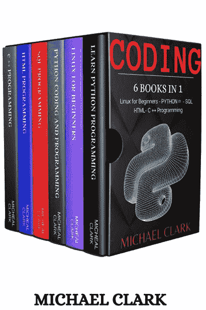

这是与其他环境不同的另一种环境。当你开始启动这个环境时，你会开始注意到变化。它非常不同，因为它没有启动面板和菜单，而是有一个桌面菜单和独特的元素。然而，这个 Linux 系统的环境显然不是为所有人设计的。那些想要独特且即插即用的简单环境的人可以选择 Enlightenment。显然，所有的独特性都是带有代价的。这个桌面环境希望你在安装之前先了解它，这样你掌握它时就不会觉得很困难。喜欢钻研独特事物的人会喜欢这个 Linux 桌面环境。Enlightenment 带有许多主题。这些主题不仅改变了桌面的颜色，还改变了一些细节。它对于热爱变化并经常想更改桌面屏幕的用户来说是完美的。

## Deepin

Linux 操作系统领域的最新成员是 Deepin。在进入市场后，这一布局已成功吸引了许多人。它为桌面带来了令人惊叹的现代视觉效果和体验。这种布局最大的特点是它将所有优秀的桌面特性整合在了一起。它拥有一个非常有吸引力且独特的控制面板。用户会喜欢探索这种新布局，他们会对发现以现代方式实现的令人惊喜的功能感到高兴。对于寻找独特且简单布局的人来说，使用它可以获得最佳体验。

## Linux 系统的组成部分

与其他 Mac OS X 和 Windows 10 一样，Linux 也是一个操作系统。它由以下部分组成：

**引导加载程序（The bootloader）**：这是管理计算机启动过程的软件。简单来说，它就是弹出后消失的启动界面，用于进入操作系统。

**内核（The kernel）**：如果你之前对 Linux 做过一些研究，你应该已经无数次遇到这个词了。它指的是整个系统中被称为`Linux`的部分。它是系统的核心；管理外围设备、CPU 和内存。

**守护进程（Daemons）**：这些是后台服务，如调度、音频和打印，它们会在你登录计算机时或在启动过程中启动。

**外壳（Shell）**：你可能也听过这个词很多次，或者叫`Linux 命令行`，它曾让许多人对 Linux 望而却步（可能是因为他们认为必须学习一些枯燥的命令行结构才能使用该操作系统）。`shell`是一个命令进程，允许你通过在文本界面中输入命令来控制计算机。今天，你可以在甚至不碰命令行的情况下使用 Linux，但正如我们很快将看到的，与命令行配合工作是重要的。

**图形化服务器（Graphical server）**：这简单来说是在在你的显示器上显示图形界面的子系统。它通常被称为`x`或`x server`。

**桌面环境（The desktop environment）**：这是“桌面”这一比喻的实际实现，由运行在操作系统可见表面的程序组成，你将直接与之交互。你有许多桌面环境可以选择，包括`gnome`、`enlightenment`、`xfce`、`utility`和`cinnamon`。桌面环境带有一内置应用程序，其中包括配置工具、文件管理器、游戏和网络浏览器等。

**应用程序（Applications）**：如你可能已经知道的，桌面环境通常并不提供全套应用。Linux 提供了数千种软件，你可以轻松地访问和安装，Windows 和 Mac 也是如此。

上述描述将帮助你轻松阅读完书的其余部分。现在让我们进入使用程序的部分。第一步是选择发行版，你接下来就会发现这一点。

## 选择你的发行版（Distro）

在我们开始使用命令行之前，我们必须确保你已经准备就绪。因此，你需要做的第一件事是选择你的发行版。与 Windows 不同，Linux 没有单一版本，这就是为什么我们有很多 Linux “发行版”。

这些发行版获取`kernel`并将其与其他软件（如桌面环境、图形化服务器、网络浏览器等）结合在一起。因此，发行版将所有这些元素统一成一个你可以安装和使用的操作系统。

从适合初者的版本到适合即时和高级用户的版本，有适合任何所需级别的版本。你只需要将你偏好的版本下载到 USB 闪盘中，并将其安装到你喜欢的任何数量机器上。

你应该选择哪种发行版？你需要一个易于安装的发行版，它需要拥有优秀的应用程序，并且对于日常活动易于使用。此外，发行版在需要时需要易于调整。正出于这些原因，我推荐这个重量约为 1GB 的微型发行版。介绍……tiny！除了这些参数外，tiny 节省了大量空间，且在初始设置期间只需要你有有线网络连接。所需的内存内存仅为 128MB。嗯，在选择发行版时你可以考虑其他因素，但这完全取决于你想用它做什么。你将使用的发行版显然非常适合没有任何经验、刚开始接触 Linux 的人。它也被称为 TCL，Tiny 是一个非常特殊的发行版，专为移动而设计。与其他发行版一样，你可以带上它并从 USB 闪盘、CD 或硬盘运行它。在本节中，我们将使用 TCL 作为示例，演示如何下载和安装 Linux 发行版。

## 关于 Linux 的神话

尽管比其他操作系统更有优势，许多人仍然不愿意切换到 Linux，因为他们听过许多关于它的神话。本章将探索围绕 Linux 的一些神话，并提供真实信息。

### 神话 #1：Linux 很难用

事实是，所有的操作系统都是不同的，需要一些时间来适应。如果你曾在 Windows 和 Mac 之间切换，你就完全了解这个问题。在 Windows 操作系统中导航与在 Mac 上摸索完全不同。然而，你不会直接放弃并说它太难学了，尤其是当你刚刚投入大量资金购买了一个新操作系统时！不，你会学习如何使用它并逐渐调整。几周后，它就会变成你的本能，你甚至不需要思考自己在做什么。同样的原理也适用于 Linux。它并不一定比 Windows、Mac 或任何其他操作系统更难。相反，它只是不同。你需要给自己一些时间来适应界面以及桌面程序的工作方式。给自己几周时间，你可能会发现 Linux 实际上比许多其他操作系统都要易用。

### 神话 #2：Linux 只有命令行

当 Linux 最初被创建时，GUI 技术还处于婴儿阶段。结果是几乎所有的操作系统都使用命令行界面，而不是你熟悉和喜爱的图形界面。直到 20 世纪 90 年代，微软使用的是`MS-DOS`，这是一个命令行界面。这是 Linux 开始兴起的时期，因此许多人将其与命令行界面联系起来。今天的 Linux 系统使用 GUI 界面，所以你仍然可以获得可以点击的图标图形桌面。你也可以完全通过命令行使用 Linux，一些人发现这是充分利用 Linux 性的最佳方式。然而，对于大多数用户来说，GUI 界面在满足他们的计算需求方面已经绰绰有余。你使用 Linux 时完全不需要学习任何命令行。

### 神话 #3：Linux 缺乏其他操作系统的应用程序多样性

确实，Linux 的应用程序没有 Windows 和 Mac 那么多。然而，想一下对于例如列出每周购物清单，你可以下载多少不同的应用程序。实际上，你只需要一个应用程序就够！虽然 Linux 的应用程序较少（允许你创建每周购物清单的程序较少），但它有足够的变体来满足你的所有需求（仍然有用于购物清单的应用，只是没那么多）。此外考虑到在 Mac 和 Windows 之间，并不是所有的应用程序都兼容这两个平台。你通常需要为 Mac 下载一个版本，为 Windows 下载另一个版本。有些应用程序在 Mac 上无法运行，或者在 Windows 上无法运行。这一原则同样适用于 Linux 的事实不应该阻碍你使用它。

大多数主流应用程序（如 Skype）都兼容 Linux。你仍然可以使用它们来充分利用你的 Linux 体验。

### 误区 #4：你无法在 Linux 上成为一名游戏玩家。

确实，如果你是一个住在父母地下室、只顾玩游戏而不顾工作生计的硬核玩家，你可能会发现 Linux 的性能还不够强大。然而，对于休闲玩家来说，例如那些喜欢在周末玩幻想橄榄球的人，有许多 Linux 发行版可以支持这种生活方式。游戏网站`Steam`拥有超过 3000 种兼容 Linux 的游戏，甚至还有它自己的基于 Linux 的游戏机台。作为额外奖励，如果你是一个 90 年代的怀旧少年，你可以使用 Linux 终端来玩街机游戏！

如果你是一名玩家并想使用 Linux，Ubuntu 是一个非常棒的发行版。虽然同样的游戏可能不像在 Windows 上那样立即可用，但你应该能够足够快地访问它们。

### 误区 #5：Linux 不适用于计算机桌面电脑。

如今，包括 NASA 在内的许多大型公司都使用 Linux 来运行它们的服务器。它在物联网中也发展迅速（物联网是指不同设备之间的连接，如汽车、冰箱、咖啡壶和家庭安系统）。这导致了一个误区，认为 Linux 最适合服务器，而不是适合大多数人用于个人和工作计算的桌面电脑。

事实是，虽然 Linux 足够强大可以帮助构建物联网并运行 NASA 服务器，但它也足够普及，供人们在桌面端日常使用。你可以用它浏览网页、编辑图片、上传文件、进行文字处理、创建电子表格，以及你通常在桌面上做的任何其他事情。

### 误区 #6：Linux 不安全。

Linux 的源代码对任何想要查看它的人公开开放，这一事实导致了 Linux 不安全的误区。然而，这与事实大相径庭。下一章将更详细地介绍 Linux 如何如何由于其基础结构和用户拥有的访问类型而比其他操作系统更安全。现在，请理解，虽然代码是公开的，但这并不意味着任何人都可以进入并用病毒渗透。代码的更改经过审核的并且必须获得批准。

### 误区 #7：Linux 太不受欢迎了，不值得学习它。

确实，大多数公司和企业都使用 Windows 作为他们的首选操作系统。然而，许多政府机构使用 Linux 的事实应该让你意识到它极具价值。事实上，接受过 Linux 培训的人（特别是技术支持角色的人）能够赚到多多的钱。这部分是因为这是一项稀缺的技能，另一部分是因为使用它的组织知名度很高。阻碍 Linux 进一步增长的最大障碍可能在于接受过其培训的人员不足。

### 误区 #8：Linux 软件是被盗版的。

这完全不是 true 事实。人们自愿创建用于 Linux 的源代码并对其进行捐赠。事实是，许多市售的软件（例如微软的软件）是基于公共用途设计的代码创建的。

### 误区 #9：Linux 摧毁了知识产权。

Linux 免费提供的这一事实导致了一种观点，认为人们无法拥有自己知识产权的权利；相反，它必须以一种社会主义的形式免费分发。虽然基于对 Linux 的浅层理解，这种观点是可以理解的，但事实恰恰相反。垄断（如 1990 年代的微软）会破坏知识产权和创造性开发。他们经常获取个人创建的想法并将其纳入自己的产品，从而剥夺了创造者的权利。Linux 免费意味着人们可以自愿分发他们的知识产权，而不是放弃它。事实上，当你提交代码并被接受时，你会在上面签名！

### 误区 #10：Linux 正在走向终结。

毕竟，免费的开源软件如何持续？人们需要为自己的工作获得报酬。而且，一分钱分货。如果你下载一个免费的东西，它的质量可能很差。

完全不是这样。Linux 免费意味着任何人都可以使用它；这是创作者认为的计算基本权利的实践：它应该对任何人开放。这一事实意味着有一个庞大的贡献者群体，他们可以将自己的创造力用于改进它。正如第 7 章将解释的那样，代码通过的过程非常复杂。Linux 基金会的团队采用了高标准的卓越标准。

这些仅仅是围绕 Linux 的一些误区以及它们背后的事实。如果你发现自己除了本章解释的内容之外还有其他疑虑，鼓励你上网进行自己的研究。亲自发现真相，以便判断 Linux 是否适合你。

# 第 2 章

## 学习基础知识与技术概述


事故可能在任何时间发生，没有任何预警。因此，使用其他主机、磁带、软磁盘以及 CD 来提供一个安全存储的地方是极关重要的。

可靠的备份工具绝对不是可选的，每个人都应该拥有一个。这绝对并不意味着你需要花一笔钱来购买一套备份方案。备份费用是你需要随时准备好的费用之一，因为你永远不知道何时会产生需求。

没有备份操作，行政职责就无法完成，因为它是行政功能的不可或缺的一部分。传统的`dump/restore`工具可以帮助你完善备份过程，因为它们可以检测自上次备份以来的数据变化。

在为 Linux 系统选择备份方案时，考虑如自动更换器、备份介质、开源软件、数据格式、跨平台支持、卷影复制、报告和告警、商业支持、去重、多卷备份、加密数据流等内容非常重要。

## 选择合适的备份工具

选择合适的备份方案是一个重要的问题。有很多选项可供选择。你应该能够找到最适合你需求的方案。为了帮助你做出选择，我们将查看一些流行的备份方案及其优缺点。

### Amanda

缺点包括 Amanda 备份系统的中心化。如果你的备份需求不包含磁带或介质，那么 Amanda 并不是合适的选择，因为它涉及持续的填满和更换；此外，你必须依赖中央服务器来管理一切。选择更简单的解决方案更好，因为你的需求可能对 Amanda 来说大过其实。如果你的工作需要介质和中央系统，你将发现 Amanda 凭借其高效的备份以及同时写入磁带和磁盘的能力是最佳选择。

### Bacula

Bacula 被认为是 Amanda 的良好替代方案，但同样取决于你的需求。和 Amanda 一样，Bacula 是开源且免费免费的。要使用 Bacula，你需要在每个想要备份的机器上安装客户端程序。它通过中央服务器进行控制。Bacula 使用自己的文件格式，而不是标准的 Unix 工具进行备份。

当你使用多个带有不同磁带驱动器的服务器时，Bacula 是更好的替代方案，因为它支持增量和全量常规备份。Amanda 支持加密和 RAIT，而 Bacula 则有一个用于自定义的脚本语言。你可以寻求这种语言的帮助创建加密。

在决定这两个备份系统中哪一个最适用时，取决于你的需求和架构。也应该考虑你员工的偏好。如果你使用带有一个磁带驱动器的中央备份服务器，Amanda 将最适合你；如果你使用分布在网络中的磁带驱动器，Bacula 将是正确的选择。

### BackupPC

BackupPC 设计用于将 Linux 或 WinXX 笔记本电脑和桌面电脑备份到文件服务器；它也是免费开源的。它以高性能著称，被高效地用于较小规模的操作中。

它提供的功能包括长期存储和保留小型公司桌面快照的能力。用户可以恢复自己的备份，并检测到特定计算机（漫游笔记本电脑）的存在。如果你一段时间没有进行备份，系统会自动发出提醒。

用户和管理员可以使用 Web 界面来启动备份。每个文件都存储在指定的独立存档中，这允许于访问并快速恢复单个文件或一组文件。

使用 BackupPC 的缺点是在进行大容量恢复时性能缓慢。如果你有大量数据，它对于远程使用来说并不是一个可行方案。你压缩的存档只能通过 BackupPC 的工具读取，这使得你产生了依赖。积极的一面是，由于它是开源的，你可以始终保留源代码，从而确保对程序的持续访问。

### Rsync

不同的 Linux 备份解决方案在后端都使用了`rsync`。这是一个很好的工具，可以结合脚本来创建远程镜像和其他备份方案。那些认为自己（无论是个人还是商业上）不需要特殊备份工具的人会更倾向于这种方法。

`rsync`可以作为服务器守护进程运行。它将允许远程用户将文件副本同步到你的系统，同时保留整个目录并仅传输更改的文件。你可以在不下载完整版本的情况下更新文件，如镜像站和软件 FTP 站点都可以充当`rsync`服务器。

`rsync`可用于从一个主机到另一个主机远程复制文件或目录，实现智能且特定的备份。`rsync`设计为仅复制那些被修改过的文件，而不是整个目录。存档保存了所有权和权限，允许相关用户通过主机系统访问。该工具的简单设置使其成为执行临时备份的良好选择。当你需要以复制形式进行更多备份（这可以包括将文件、目录和内容复制到不同位置）时，`rsync`效果最好。

### 商业 Linux 备份产品

如果你正在寻找商业备份产品，赛门康（Symantec Corp.）的 Veritas Net Enterprise 是一个很好的选择。它是一个企业级服务器，支持 Windows、许多 Unix 和 Linux。它还对 VMware 等各种环境提供特殊支持。NetBackup 维护着一个仪表板，提供对容量、趋势、恢复和备份服务的费用与成本、合规性等方面的洞察。如果你不想维护自己的报告，或者没有找到你正在使用的其他解决方案，这就是你的最佳选择。赛门康带有 Linux 代理的 Backup Exec 以及 BackupZone 的 NetVault 也是其他流行的商业解决方案。

在寻找 Linux 工具时，一个稳健的备份和恢复计划是必不可少的。在你测试过恢复数据的能力之前，该方案是无效的。在选择软件时，你必须从大局来看。这将确保你获得真正的保护。

## 什么是 Linux 发行版？

当你为电脑获取 Linux 时，你本质上获取的是 Linux 发行版。就像其他流行的操作系统一样，你会获得一个安装程序，它由内核、图形用户界面、桌面以及在在电脑上安装 Linux 后即可直接使用的应用程序组成。额外的奖励是，你还有机会获得内核以及你所获得应用程序的源代码，这允许你按照未来希望它们运行的方式对它们进行调整。到目前为止有多种可用的 Linux 发行版，你可以在 distrowatch.com 查看。在该网站上，你可以阅读有关特定发行版的更多信息，并找到安装磁盘或下载文件的链接。

虽然你可以添加发行版未提供的桌面环境、应用程序和驱动程序，但你仍然需要找到提供你理想设置的发行版。这样做可以节省你寻找与已安装 Linux 匹配的应用程序和其他程序时可能花费的时间。

## 发行版带有什么？

### GNU 软件

大多数你使用 Linux 执行的任务都涉及 GNU 软件。这些是你可以通过文本终端（或类似于 Windows 命令提示符的输入命令的界面）访问的工具。你使用的 GNU 软件包括命令解释器（也称为`bash` shell）和 Gnome GUI。

如果你是一个开发者，你将能够 C++ 编译器（这已随你的 Linux 发行版自带的 GNU 软件）和 Gnu C 修改内核或为 Linux 创建你自己的软件。如果你使用`emacs`或`ed`编辑器编辑代码或文本文件，你也将使用 GNU 软件。

以下是你探索 Linux 工具时可能会遇到的一些流行的 GNU 软件包：

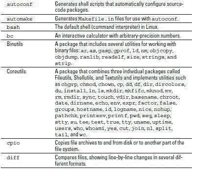

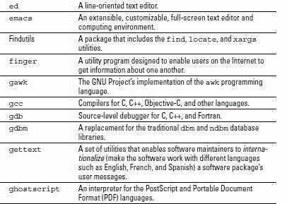


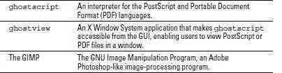

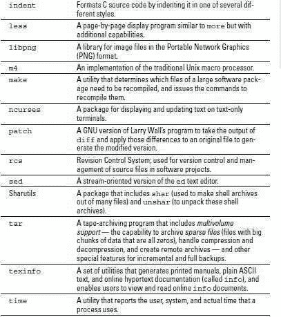

# 1. 应用与图形用户界面

由于你不想为了让电脑执行某些操作而在命令行终端中输入一连串命令，因此你可能希望使用 GUI（图形用户界面）来导航和使用计算机中的程序。GUI 允许你点击图标并弹出窗口，这将帮助你更轻松地使用程序。

大多数发行版使用 KDE 桌面环境（K Desktop Environment）或 GNU 对象模型环境（GNOME）。如果你在电脑上同时安装了这两个环境，你可以选择哪一个桌面作为默认，或者随时在它们之间进行切换。这两个桌面环境的体验与 Mac OS 和 Windows 桌面都很相似。值得注意的是，GNOME 自带一个名为 `Nautilus` 的图形外壳，这使得 Linux 的配置、文件搜索和应用程序加载变得更容易。如果你需要使用命令行提示符，只需点击两个桌面环境中的终端窗口图标即可。

除了 GUI 之外，任何普通电脑用户还需要使用应用程序，即你可以用来执行基础计算需求的程序。虽然你可能无法访问在 Mac 或 Windows 电脑用过的那些流行程序，但 Linux 可以提供你可以尝试的开源替代方案。例如，你不需要购买 Adobe Photoshop，可以尝试 The GIMP，该程序在处理图像方面运行同样出色。

Linux 还提供了生产力软件包，满足普通电脑用户的大部分需求。你可以从 Libreoffice.org 或 OpenOffice.org 获取办公生产力应用，允许你进行文字处理、创建数据库或制作电子表格。

提示：如果你想在 Linux 上安装 MS 应用（例如 Microsoft Office），可以使用 CrossOffice。你可以从 [www.codeweavers.com/products/crossover-linux/download](http://www.codeweavers.com/products/crossover-linux/download) 下载此应用。

# 2. 网络

Linux 允许你通过网络与其他计算机交换信息，并找到你需要的一切。Linux 通过允许使用 TCP/IP（传输控制协议/网络协议）来实现这一点，这让你能够上网并与任何服务器或计算机通信。

### 2.1 互联网服务器

Linux 支持互联网服务，例如：

*   电子邮件
*   新闻服务
*   文件传输工具
*   万维网
*   远程登录

只要有互联网连接并且计算机配置了互联网服务器（一种允许 Linux 计算机向另一台计算机发送信息的特殊服务器软件），任何 Linux 发行版都可以提供这些服务。以下是你 Linux 中会遇到的常见服务器：

*   `inetd` – 允许你通过名为 `TELNET` 的协议通过互联网登录不同的系统。
*   `sendmail` – 作为邮件服务器，允许使用简单邮件传输协议 (`SMTP`) 在两个系统之间交换电子邮件。
*   `inn` – 允许你使用网络新闻传输协议 (`NNTP`) 查看新闻，这使你能够以存储和转发的方式访问新闻服务器。
*   `Apache httpd` – 允许你使用超文本传输协议 (`HTTP`) 将文档发送到另一个系统。
*   `vsftpd` – 允许你使用文件传输协议 (`FTP`) 向另一台计算机发送文件。
*   `sshd` – 允许你使用安全 Shell (`SSH`) 协议通过互联网安全地登录计算机。

### 2.2 软件开发

Linux 是开发者的操作系统，这意味着它是适合开发软件的环境。开箱即用的这种操作系统拥有丰富的软件开发工具，例如用于构建程序的代码库和编译器。如果你有 C 语言和 Unix 的背景，Linux 应该让你感觉如归家一样。

Linux 为你提供了可能在 Unix 工作站（如 Sun Systems、HP 和 IBM）上体验过的基础工具。

### 2.3 在线文档

一段时间后，你可能想要查找更多关于 Linux 的信息，而无需翻阅这本书。幸运的是，Linux 在线发布了足够的信息，可以在某些方面提供帮助，例如回忆命令语法。为了快速获取这些信息，你只需要在命令行中输入 `man` 即可获取 Linux 命令的手册页。你也可以从桌面获取帮助，使用帮助选项或图标。

## 选择发行版时需要考虑的因素

什么是最适合你的 Linux 发行版（简称 distribution）？以下是你可能需要记住的事项：

### 1.1 软件包管理器

区分不同发行版的主要因素之一是它们自带的软件包管理器。正如你可能预期的那样，某些发行版带有一些功能，可以让你在安装其自带功能时更容易从命令行进行操作。

除了易用性之外，你需要考虑的另一点是发行版提供的软件包可用性。例如，某些发行版不像其他发行版那样流行，这意味着为这些特定发行版开发的应用程序较少。如果你刚开始学习 Linux，安装一个不仅承诺从一开始就易于导航，而且提供你未来可能想要安装的广泛应用的发行版可能是一个好主意。

### 1.2 桌面环境

你希望桌面能够良好地配合你的需求。虽然将来你可以安装另一个环境，但你仍然希望使用发行版自带的桌面，以确保你拥有良好的自定义选项并且易于查找。你还希望桌面使用高效且集成性良好。这样，你就不需要花费太多精力来设置每一个你想要的程序了。

### 1.3 硬件兼容性

不同的发行版在其提供的软件包中包含不同的驱动程序，这意味着它们有一套推荐的硬件才能无缝运行。当然，你可以查看其他与你现有硬件最匹配的驱动源，但在要立即运行一切方面这只会增加更多工作。为了避免这种麻烦，请检查发行版的兼容性页面，查看你的电脑外设是否都能工作。

### 1.4 稳定性与领先性

不同的发行版在稳定性和获取最新应用程序和软件包更新方面有不同的优先级。例如，Debian 发行版倾向于延迟某些应用程序更新，以确保你的操作系统保持稳定。这对于某些倾向于始终获取最新版本应用程序的用户可能并不适用。

相反，Fedora 恰恰相反——它专注于让你所有的程序和功能保持最新，并确保你始终拥有 Linux 最先进、强大的工具。然而，这可能是以应用程序的稳定性为代价的，可能会促使你回滚之前的版本。

### 1.5 社区支持

Linux 的核心在于社区，该社区持续为该操作系统提供支持，从文档到故障排除。这意味着，如果你管理的某个特定发行版拥有庞大的社区，那么你很可能获得所需的资源。

## 值得尝试的优秀发行版

现在你已经了解了优秀 Linux 发行版的标准，并且正准备挑选要安装的发行版，你可能想要检查这些可能非常适合你的发行版：

1. **Ubuntu**

   Ubuntu 的设计很大是为了让普通电脑用户能够轻松使用 Linux，这使得它是初学者的良好选择。该发行版简单、每六个月更新一次，并具有 Unity 界面，允许你使用如停靠栏、软件包管理器的类商店界面以及可以让你在操作系统中轻松找到任何内容的仪表板等功能。此外，它还带有一套大多数用户的标准应用程序，例如种子下载器、Firefox 网页浏览器以及即时消息应用程序。你还可以从其庞大的社区获得极佳的支持。

2. **Linux Mint**

   该发行版基于 Ubuntu，但设计目的是为任何从未用过 Linux 的用户让操作变得更加简单——它具有熟悉的菜单，并且不仅局限于让你运行开源程序。这意味着你可以获得流行操作系统中的标准程序，例如 `.mp3` 支持和 Adobe Flash，以及许多私有驱动程序。

3. **Debian**

   如果你想谨慎一点，并希望始终运行一个无 bug 且稳定的计算机，那么这可能是最适合你的发行版。它的主要目标是让 Linux 成为完全可靠的系统，但这可能有一些缺点——Debian 不优先考虑获取你所拥有应用程序的最新更新，这意味着你可能需要手动搜索你大部分软件的最新版本。优点是，你可以在许多处理器架构上运行 Debian，而且它很可能在旧设备上运行。然而，这并不意味着使用 Debian 就必须保持过时——在线和 Linux 仓库中有大量的程序可用。

4. **OpenSUSE**

   OpenSUSE 是一个非常好的发行版，你可以考虑尝试，因为它允许你在无需处理命令行的情况下配置操作系统。它通常带有默认 KDE 桌面，但在安装发行版包时允许你在 LXDE、KDE、XFCE 和 GNOME 之间进行选择。它还提供了良好的文档、`YaST` 软件包管理器以及来自社区的极佳支持。使用该发行版可能遇到的一个缺点是它可以消耗大量资源，这意味着在旧款处理器型号和笔记本电脑上使用并不理想。

5. **Arch Linux**

   Arch Linux 是为那些想要从零开始构建操作系统的用户设计的。从安装包开始，你得到的只有命令行，你将用它来获取应用程序、桌面环境、驱动程序等。这意味着你可以根据需求将目标设定为尽可能精简或功能尽可能完全。

   如果你想完全了解操作系统内部的内容，那么 Arch Linux 可能是你开始尝试的最佳发行版。你将被迫处理可能遇到的任何错误，这可以是学习操作 Linux 的绝佳方法。

   另一个让该发行版特殊的特殊之处是它使用了 `Pacman`，它以强大的软件包管理器而闻名。Pacman 采用滚动更新（rolling release）模式，这意味着必须安装包含的每个包的最新版本——这确保了你能够为 Linux 获取最前沿的应用和功能。除了这个软件包管理器，你还可以享受 AUR（Arch 用户仓库），它允许你创建程序的可用版本。这意味着如果你需要的某个程序在仓库中可用，你可以使用 AUR 助手来安装应用程序和其他功能。

# 第 3 章 命令的使用


当你按下键盘上的 Enter 键运行命令时，你会获得文本形式的反馈。系统通过行向你展示提示符（prompt）。这意味着当你输入命令时，它将显示在提示符之后。在大多数情况下，你正在发布命令。例如：

```
user@bash:ls -l /home
total 3
drwxr-xr-x 2 users 4096 Mar 23 13:34 bin
drwxr-xr-x 18 users 4096 Feb 17 09:12 Documents
drwxr-xr-x 2 users 4096 May 05 17:25 public
user@bash:
```

将此内容拆解：

- **第 1 行**：这向我们用户展示了 bash 提示符。一旦有了提示符，我们就应该输入一个命令，在本例中为 `ls`。这意味着通常情况下，命令是我们必须输入的第一个内容。之后，我们应该在命令行中输入一个参数（`-l /home`）。在这种情况下，首先需要记住的是这些内容是用空格隔开的。也就是说，在输入命令后，在输入参数之前需要输入一个空格。我们在本例中使用的第一个参数 `-l` 也称为选项（option）。选项在修改命令行为方面起着至关的作用。它们通常列在其他参数之前，并以横杠（-）开头。

- **第 2-5 行**：这些代表了我们在运行键入命令后获得的输出。我们输入终端的大部分命令运行后都会产生输出。

- **第 6 行**：这再次显示了提示符。一旦我们运行了输入终端的命令并获得结果后，我们会得到一个提示符。这意味着如果在运行命令后没有显示提示符，则说明该命令仍在运行。我想让你们知道另一个重要点是，在终端中我们可能没有行号。这些数字只是为了让我解释每一行代表什么。

## 那么我们如何打开终端？

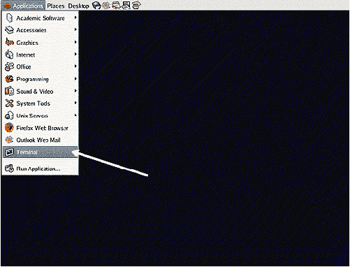

在处理 Linux 时，首先需要学习的是如何打开终端。这相当简单。由于每个系统都不同，很难告诉你具体的操作方法。然而，你可以从以下几个地方开始：

如果你使用的是 Mac，首要任务是进入“应用程序”，然后点击“实用工具”。在“实用工具”下，你有一个“终端”选项，选择它，你就有了一个可以输入命令的运行终端。或者，打开 Linux 终端最好最简单的快捷键组合是 `command + space`。这个组合会调出 Spotlight，你在其中输入 terminal，它就会出现在屏幕上。你也可以下载 MobaXterm 并在 Mac 上使用 ([`macdownload.informer.com/macterm/download/`](http://macdownload.informer.com/macterm/download/)) 作为本地终端。

如果你正在使用 Linux，可以通过点击“系统”然后“应用程序”来访问终端。在“应用程序”下，选择“实用工具”并选择“终端”选项。或者，你也可以简单地右键点击桌面空白处，弹出一个下拉菜单。选择“在终端中打开”选项。

如果你正在使用 Windows，有一些方法可以使用终端。最好的方法是使用 SSH 客户端访问 Linux 终端，你可以在那里运行命令。一些可以让你实现此操作的应用程序示例有 MobaXterm ([`download.cnet.com/MobaXterm/3000-7240_4-10890137.html`](http://download.cnet.com/MobaXterm/3000-7240_4-10890137.html)) 和 Putty ([`www.putty.org/`](http://www.putty.org/))。使用这些软件的第一步是在网上下载并安装到你的电脑上。在桌面上，你有一个快捷方式，每次需要终端时点击即可。

在大多数情况下，使用 root 账户执行普通任务并不是一个好主意。换句话说，当用户运行权限命令或维护系统时，通常是 root 账户起着重要作用。因此，创建用户账户的首要步骤是登录 root 并使用 `useradd` 或 `adduser` 命令。当使用 Windows 的 MobaXterm 或 Putty 应用程序时，你只需点击桌面上的快捷方式，一个终端窗口就会出现。然后系统会提示你进行登录：

1. `user@bash`: `ssh Gary@hpc.ucdavis.edu.uk`
2. 禁止未经授权的访问
3. `sshGary@hpc.ucdavis.edu.uk` 的**密码:**
4. 上次登录：Fri Feb 17 14:34:27 2017 来自 40.290.160.11

一旦你输入账户用户名，系统将像上面所示提示你输入该账户的密码。当你输入密码时，你输入的字符不会显示在屏幕上。这意味着你必须非常小心。主要原因是，当你输错密码时，会收到“登录错误”的消息，这意味着你必须重试。一旦你正确输入了账户密码，就可以访问该账户中的文件和目录了。

### Shell，Bash

在终端内部有一个 shell（外壳）。它是操作系统的一部分，在定义终端行为方式方面起着重要作用。它还负责为你执行命令。有很多种 shell 可用，但最常见的是被称为 bash。这代表“Bourne again shell”。本 Linux 教程假设你使用 bash 作为你的 shell。然而，如果你想知道自己正在使用哪种 shell，最好的办法是使用 `echo` 命令。该命令在显示表示当前使用的 shell 系统变量方面起着重要作用。换句话说，`echo` 命令用于显示消息。只要它在屏幕上打印的所有内容都以 bash 一词结尾，你就知道一切正常。

1. `user@bash`: `echo $SHELL`
2. `/bin/bash`
3. `user@bash`:

### 快捷键

最重要的快捷键之一是使用键盘上的向上和向下方向键。当你在 Linux 上输入命令时，这些命令会被记录在历史中。遍历这些历史最简单的方法是使用这两个键。这意味着你以前使用过的命令不需要重新输入。你只需按几次向上箭头即可找到你需要的命令。此外，要编辑以前使用的命令，可以使用左、右方向键将光标移动到你需要进行编辑的地方。

有时你会发现在 GUI 桌面环境中某些功能运行不正常——有时程序会崩溃，整个系统拒绝响应鼠标点击。甚至会出现 GUI 根本无法启动的情况。当你遇到故障时，你仍然可以告诉你的操作系统该做什么，但你必须使用文本屏幕或 shell 来操作，shell 是 Linux 的命令解释器。

由于 Linux 本质上是一个 Unix 程序，你将使用文本终端完成许多任务。虽然桌面的工作是提供通过鼠标点击访问任何内容的便利性，但在某些情况下你需要访问终端。

学习如何输入命令可以在你遇到 X Window 系统错误时为你规避很多麻烦，X Window 系统是控制你在桌面 GUI 中看到的所有菜单和窗口的程序。要修复此错误，或防止它阻止你访问所需的程序或文件，你可以调出终端并输入命令。在将来，你可能想在桌面上保持一个终端开启，因为这可以让你比点击更快地控制计算机。

### Bash Shell

如果你过去用过 MS-DOS 操作系统，那么你对 `command.com` 非常熟悉，它是 DOS 的命令解释器。在 Linux 中，这被称为 shell。所有不同发行版的默认 shell 都称为 bash。

Bourne-Again Shell（或 bash）能够运行你存储在计算机中作为可执行文件的任何程序。它还可以运行 shell 脚本，或者由 Linux 命令组成的文本文件。简而言之，这个 shell 充当命令解释器，或者说将你输入的任何内容解释为命令并执行该输入应该执行的操作。

调出终端窗口可以只需点击桌面上一个像显示器的图标即可。如果你找不到它，只需搜索即可。提示：你始终可以通过输入 `chsh` 命令来更改你正在使用的 shell。

### Shell 命令

每个 shell 命令都遵循此格式：

```
command [options] [arguments]
```

命令行（如上面的命令）后面通常紧跟着参数（也称为参数）。在输入命令时，你需要一个空格来将命令与选项以及另一个命令隔开。然而，如果你想使用包含空格的选项，你需要将其包含在引号中。例如，你可以选择为 `ls` 命令使用 `-l` 选项，这将列出目录的内容。

`grep` 命令允许你在文件中查找特定文本。一旦你按下回车键，就会得到结果。如果你想读取特定文件，可以使用 `more` 命令。尝试输入以下内容：

要查看计算机上运行的所有程序，请使用 `ps` 命令。选项 `ax`（选项 `a` 列出所有进程，而选项 `x` 显示其他进程）允许你看到系统中的所有可用进程。

命令行选项的数量及其相应的格式取决于具体的命令。这些选项看起来像 `-X`，其中 `X` 代表一个字符。


如果你输入的命令太长，单行无法容纳，按下`\`（反斜杠）键然后按回车。之后，在下一行继续输入命令的剩余部分。

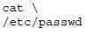

这将显示`/etc/passwd`文件中的所有内容。

你也可以通过分号`;`（分号）符号将不同的短命令在同一行中串联起来（也称为拼接）。看看这个命令：

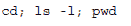

这条命令将带你跳转到用户的家目录，显示你进入的目录的内容，然后显示当前目录的名称。

### 组合你的 Shell 命令

如果你目标是创建一个更复杂的命令，例如检查`/dev`目录中是否存在一个名为`sbpcd`的文件（因为你的 CD 驱动器需要该文件），你可以选择组合不同的命令来缩短整个过程。你可以做的是输入`ls /dev`命令来显示`/dev`目录的内容，并查看它是否包含你想要的文件。

然而，当命令返回结果时，`/dev`目录中可能会出现过多的条目。不过，你可以将之前学过的`grep`命令与`ls`命令结合，搜索你正在寻找的精确文件。现在，输入以下命令：

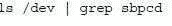

这将向你显示目录列表（`ls`命令的结果），同时`grep`命令会搜索字符串“sbpcd”。管道`|`充当你所使用的两个独立命令之间的连接，第一个命令的输出将作为第二个命令的输入。

### 命令替换

命令标准的输出可以被封装，这与将一个值存储在另一个值中的方式非常相似，然后由 shell 进行扩展。这个概念被称为命令替换。

根据 bash 文档，命令替换基本上允许命令的输出替换命令本身。在 bash 中，扩展是通过执行命令并让命令替换占据命令的标准输出来完成的，同时擦除所有末尾的换行符。嵌入的换行符不会被删除，但在单词拆分期间，它们可能会被删除。

让我们来看一个例子：

考虑`seq`命令。它将打印一个从第一个参数到第二个参数的数字序列，如下所示：

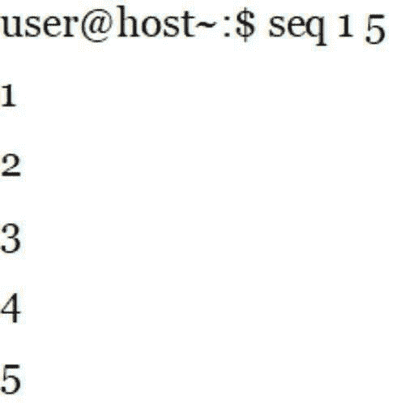

命令替换可以帮助你将`seq 1 5`的结果封装到变量中。这是通过将命令括在`$()`中，并将其参数传递给不同的命令来实现。

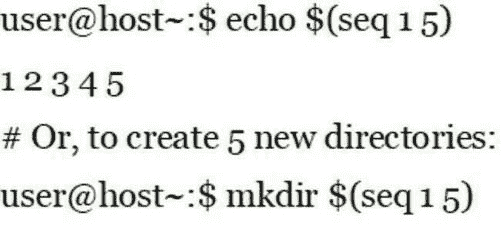

### 变量与命令扩展

有时命令会被其标准输出所替换；因此，该输出（假设只是文本）可以像任何其他值一样赋值给变量：

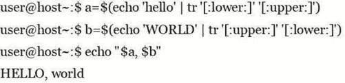

### 当换行符被省略时

我之前提到了 bash 文档中的一些内容。

让我给你提供该摘录更深层次的版本：

通过命令替换，命令输出能够替换命令本身。Bash 执行命令并将命令替换为命令的标准输出——这就是它执行扩展的方式。注意，同时，任何末尾的换行符都会被删除。嵌入的换行符不会被删除，但如之前所述，它们在单词拆分期间可能会被删除。

如果你在想这意味着什么，考虑像往常一样调用`seq 1 5`，然后通过命令替换调用，并注意格式发生了变化。

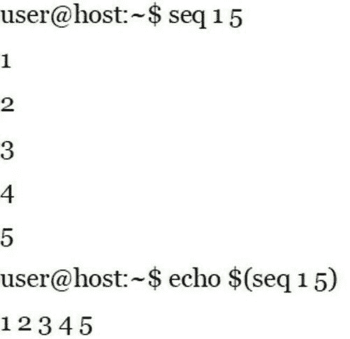

但为什么换行符在扩展期间被删除了？这是你以后会经历的；这关乎 bash 解释空格和换行符的方式。无论如何，如果你特别来自不同的语言，你可能想要注意这种行为。

### 实际应用中的单词拆分

这是一段关于 bash 在执行扩展时如何处理字符的简短章节。鉴于许多人习惯直接从互联网复制和粘贴代码，了解你可能在不经意间伤害自己的各种方式是值得的。这是由于 bash 处理空格和换行符的方式。

### 内部字段分隔符

内部字段分隔符`IFS`被 bash 用于将字符串拆分为不同的单词。你可以将其想象为 Excel 将逗号分隔值 (CSV) 文本拆分为表格的方式；根据它，逗号分隔列。

我们假设`IFS`被设置为某个任意值，例如`Z`。当 bash 扩展一个包含`Z`的变量时，该变量的值将被拆分为不同的单词（在那种情况下，字面上的 Z 消失了）：

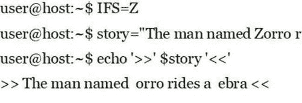

`IFS`变量默认设置为字符，包括空格、制表符和换行符。如果你执行`echo $IFS`，你将看不到任何内容，因为显然，没有任何可见字符是不可能看到空格字符的。那么结果是什么？很简单，你可能会在网上看到代码片段，其中变量`IFS`被更改为`$\n`（这代表换行符）或类似的内容。

想象有一个文本文件，其中有一行文本，例如，它们可能如下引用文件名：


当`IFS`设置为空格字符时，在读取文件的每一行时，bash 将`rough draft.txt`视为两个文件`rough`和`draft.txt`。当`IFS`设置为换行符时，`rough draft.txt`被视为一个文件名。

你可能在想：“世界上到底谁会在文件名中使用星号字符？”首先，我们确实有喜欢星形符号的人；此外，我们还有带有恶意的黑客和讨厌的恶作剧星，他们并不介意使用星号字符。请注意，变量通常不是由于人工输入而赋值的；如你所知的，有时命令的结果会存储在变量中。当原始数据由此类命令处理时，该类数据可能包含会破坏某些 bash 程序的特殊字符。

你必须时刻记住，直接粘贴看似安全的代码是有危险的。bash 在处理字符串时的语法和行为非常难以理解，这也就是为什么开发者在开发时会转向其他语言来处理更复杂的应用程序。

读完这些内容，我认为你需要休息一下了。通过学习 bash 的基础方面来休息一下，这些内容将在下一章对你有帮助，即数值比较和字符串比较。

# 第 4 章 掌握基本函数和操作


Linux 允许你使用不同的命令，以及连接这些命令的能力（这在之前的章节中讨论过）。你还学习了如何使用 I/O 重定向和管道。Bourne-Again Shell 或`bash`允许你使用`IF`条件，这意味着你只有在满足某些条件时才能运行程序。bash 的所有功能都可以用于创建你自己的程序或 shell 脚本。shell 脚本被称为执行任务的 shell 命令集合，这些命令存储在文件中。

在本章中，你将学习如何创建简单的 shell 脚本，这对于自动执行 Linux 中的各种任务极其有用。

## 创建你的第一个脚本

shell 脚本（也称为编程）对于过去没有尝试过任何编程语言的人来说，可能是令人生畏的。然而，如果你已经在本书的早期章节中尝试过不同的命令，你可能会发现学习编程其实很容易。

如果你是一名系统管理员，你实际上可以创建一个整个自定义脚本集合，它们将帮助你更轻松地完成任务。例如，如果硬盘即将写满，你可能想要自动找到所有超过特定大小且一个月内没有被任何用户访问的文件。你可能还想创建一个脚本，自动发送给所有拥有大文件的用户，以便他们需要设置归档并从你的网络共享资源中删除这些文件。所有这些任务实际上可以通过一个脚本完成。

首先，你将使用`find`命令在你的系统中搜索所有大文件：


使用上面的命令将创建一个名为`/tmp/largefiles`的文件，它将包含你关于占用过多磁盘空间的旧文件的所有信息。一旦获取了所有文件的列表，你可以使用一些 Linux 命令（如`sed`、`sort`和`cut`）来设置并将你的电子邮件发送给拥有这些大文件的用户。

当然，你不想浪费时间去逐一个输入所有这些命令。你想做的是创建一个包含这些命令的 shell 脚本来完成所有这些任务。bash 脚本允许你包含所有的命令选项，你可以将它们称为`$1`、`$2`等。字符`$0`保留给你创建的脚本名称。看看这个 bash 示例：

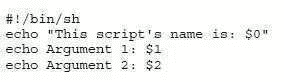

该脚本的第一行将运行程序`/bin/sh`，然后它将处理该脚本中剩余的所有行。`/bin/sh`也是 Bourne shell，被称为 Unix 的第一个 shell。在 Linux 中，`/bin/sh`链接到`/bin/bash`，即 bash 的可执行文件。现在，使用文件名保存上述脚本，并通过输入以下命令将其转换为可执行：


现在，使用此命令运行脚本：


你将看到此输出：

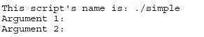

你会注意到输出的第一行显示了脚本的名称。因为脚本中没有参数，输出也不会显示任何的值。现在，你可以再次运行脚本，但这次包含了参数：


输出将如下：

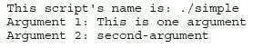

如你所见，shell 将引号内的整个字符串视为单个参数。如果没有引号，shell 将认为空格是命令行中参数的分隔符。因为你的脚本没有说它还需要打印两个以上的参数，所以第三个参数留在了输出之外。

### Shell 脚本基础

 shell 脚本支持其他语言中也存在的特性：

* 变量，或存储值的对象。这包括了可以通过命令行参数访问的内置变量。

* 使用控制结构，允许你对命令进行循环

* 使用条件命令的能力

* 评估表达式的能力

* 使用函数的能力

### 变量存储

在 bash 中，你可以通过这种方式定义变量：


当你已经定义了变量的值时，可以使用`$`前缀。例如，变量`PATH`的值为`$PATH`。现在，如果你想显示变量`count`值，请输入：

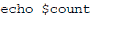

`bash`在使用命令行参数时使用一些特殊变量。例如，变量`$*`将命令行中的所有参数存储为单个变量，而`$?`作为 shell 执行最后一个命令的退出状态容器。

在 bash 脚本中，你可以告诉用户输入你需要的值，然后使用`read`命令将其转换为变量。看看这个示例脚本：

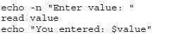

当你运行此脚本时，`read value`命令将提示 bash 读取用户输入的内容，并将输入存储到名为`value`的变量中。注意，示例脚本中的`-n`选项是为了防止`echo`命令在字符串末尾自动换行。

### 调用函数

你可以将一组命令组合成一个带有命名的函数，然后在脚本的不同位置使用它们。一旦你将命令分组进函数，你只需输入函数的名称即可执行分配给它的所有命令。看看这个示例脚本：

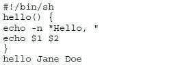

运行此脚本将给你产生此输出：


### 控制脚本流

你可以通过使用特殊命令来控制脚本如何执行你指示的命令。`if`、`while`、`case`和`for`等命令允许你使用命令的退出状态并执行后续操作。

例如，你想在调用`vi`编辑器对文件进行修改之前，先为文件创建一个副本。同时，你希望明确一点：如果没有创建备份文件，就不会对文件进行任何修改。为了完成这些任务，你可以使用以下脚本：

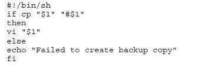

该脚本展示了`if-then-else`结构的语法，并显示如何通过`if`命令显示`cp`命令的退出状态，这决定了下一步的操作。如果`cp`显示退出状态为零，你就可以访问`vi`来编辑文件。如果不是如此，脚本将显示一条错误消息并退出。另外注意，脚本将使用你请求的相同文件名保存备份文件，但在备份文件名的开头添加一个井号（#）。

另外注意，你需要输入命令`fi`来让脚本知道你已经结束了`if`命令。否则，你将在脚本中遇到错误。

如果你想评估任何表达式，并使用该表达式的值作为命令的退出状态，那么`test`命令对这项任务非常有用。例如，如果你想创建一个只编辑现有文件的脚本，可以这样使用`test`命令：

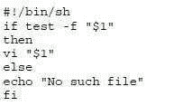

注意，你也可以使用方括号`[ ]`包含表达式来使用更短的`test`命令。你可以将上面的示例脚本修改如下：

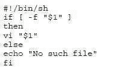

你可以使用的另一个控制结构是`for`循环。看看这个控制结构在用于累加 1 到 10 的脚本中是如何使用的：

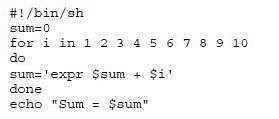

注意，上面的脚本还展示了如何使用`expr`命令来评估表达式。

如果你想根据变量值执行一组命令，`case`将非常有用。看看这个示例脚本：

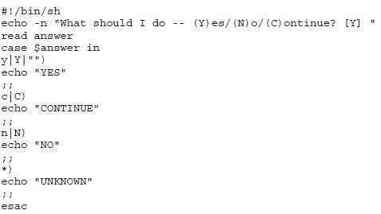

现在，将此脚本保存为`confirm`，然后输入此命令将其转换为可执行文件：

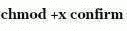

当脚本提示你请求的操作时，按下这些键中的任意：Y、N 或 C。输出将如下：

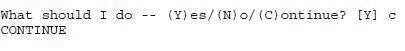

脚本将你的输入存储在变量`answer`中，`case`语句根据你输入的值运行代码。例如，如果你按下 C 键，将运行此代码块：

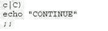

作为代码的输出，将显示文本 CONTINUE。

看看另一个示例来了解`case`命令的语法如何使用：

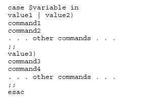

你会发现`case`命令以单词`case`开头，以单词`esac`结束。变量值内部还包含了代码块，其后面跟着一个右括号。当脚本的所有其他命令都输入完毕后，它们以两个分号结束。

# 第 5 章：熟悉 Linux 文件系统和进程


Linux 文件系统在灵活性方面非常出色。它的设计允许它支持普通文件以及特殊类型的文件格式。它可以支持文本、程序、服务、输出和设备。因此，由于它支持多种文件格式，它可以与其他操作系统共存。此外，在系统中，文件和目录之间几乎没有可区分的因素。因此，目录仅仅是文件的位置。

## 文件的分类

为了更好地理解 Linux 文件系统，对文件进行了分类。虽然可以认为这样做是安全的，但了解更多关于特定文件的知识可以让程序员和系统管理员避免使用 Linux 的复杂性。这防止了他们执行长时间的列表操作。

文件分类：

* 目录 (`d`) – 一个作为文件列表的文件

* 链接 (`l`) – 一种允许在多个部分显示特定文件的系统

* 管道 (`p`) – 一种允许进程间通信的系统

* 普通文件 (`-`) – 正常文件

* 套接字 (`s`) – 提供进程网络服务的特殊文件

* 特殊文件 (`c`) – 用于输出和输出的机制

## 分区的艺术

Linux 分区是从威胁到大多数 Linux 用户开始的。这曾对系统造成过严重的损坏。此外，分区的一个主要目的是实现更高的数据安全性。硬盘的划分允许分组和保护。由于成功的分区，你可以对数据组进行优先级排序。由于分区部分受损，其他部分将不受影响。

Linux 中的两个主要分区：

1. `Swap` – 指额外的内存

2. `Data` – 指普通数据

建议的分区：

* 用于必要数据的分区

* 用于程序和配置数据的分区

* 用于用户邮件、存档和数据库表的分区

* 用于特定文件的分区

* 用于虚拟内存的分区

常见分区：

* 包含数据的分区

* 存储临时文件的分区

* 存储第三方数据的分区

* 专门用于程序的分区

## 文件系统

在 Linux 中，有一个被称为根目录的目录。它是主目录，程序员和系统管理员引用它，它是所有目录的目录。根目录下子目录。这些目录根据分配的任务管理文件。

子目录及其内容：

* `/home` – 目录

* `/boot` – 内核和启动文件；尝试消除不必要的引导程序的文件

* `/initrd` – 关于启动的数据

* `/dev` – 包含所有 CPU 硬件的引用

* `/bin` – 常用共享系统程序

* `/etc` – 系统配置数据

* `/lib` – 库文件

* `/lost+found` – 从失败中恢复的数据

* `/opt` – 来自第三方来源的文件

* `/net` – 远程文件系统的挂载点

* `/misc` – 杂项

* `/proc` – 关于系统资源的信息

* `/mnt` – 外部文件系统的挂载点

## Inode 的作用

在文件系统中，inode 代表一个文件。inode 是一个包含重要信息的序列号类型。它的主要作用是定义分区中的数量。

inode 包含的信息：

* 文件类型

* 文件大小

* 所有者或组所有者

* 创建日期

* 最后修改日期

* 权限

* 链接数

* 数据地址

在 Linux 文件系统中，关于基本文件大小和形状的信息被称为`Superblock`（超级块）。它允许文件管理器浏览和维护文件系统的质量。

Superblock 中的信息：

* 空闲数据块（Free blocks）——显示系统空闲块的数量

* 空闲 inode（Free inode）——显示原始 inode 分配

* 空闲 inode（Free inodes）——显示系统空闲 inode 的数量

* 组编号（Block group number）——分配给超级块的编号


# Ext4 文件系统

每组块数（`Blocks per group`）显示一组块的数量。

块大小（`Block size`）是系统的块大小，信息以字节显示。

魔数（`Magic number`）授予挂载软件进行评估的权限。

挂载计数（`Mount count`）是系统对评估的允许次数。

修订级别（`Revision level`）是系统对修订确认的允许级别。

## 什么是组描述符？

`group descriptor`（组描述符）负责标记文件的数据结构。它包含了避免数据重复的细节。由于它的作用，系统损坏的可能性极低。

组描述符中的信息：

- 块位图（`Blocks bitmap`）
- 空闲块计数（`Free blocks count`）
- 空闲 `inode` 计数（`Free inodes count`）
- `inode` 位图（`Inode bitmap`）
- `inode` 表（`Inode table`）
- 已用目录计数（`Used directory count`）

## 文件修改：查找、挂载与更改大小

Linux 文件通常很容易定位。只需搜索目录，紧跟在 `/` 或正斜杠后面的名称可能就是你首选的文件。

然后你可以开始挂载。在挂载文件时，需要 Linux 内核的可用来检查标准。它的存在允许验证系统所有通过的参数。

如示例所示，你正在挂载三种信息：`iso898`、`/dev/rom` 和 `/dev/cdrom`。

除了查找和挂载文件，你还可以更改文件的大小。这是由于文件的碎片产生。

由于文件在碎片期间会变得无效，更改文件大小允许文件的分配。因此，系统变得更加稳定。

你将接触到 `truncate` 和 `fallocate` 命令。这两个命令都允许你创建一个指定大小的文件。

## 进程

尽管 Linux 相当优秀，但偶尔也会遇到错误。系统管理员对此了如指掌。特别是如果他们根据偏好设计修改和管理程序，他们对意外故障就不再陌生了。

Linux 系统的程序管理被称为进程（`process`）。

### 什么是进程？

如所述，进程是 Linux 的程序管理。它指的是程序的运行实例。

由于 Linux 能够处理多个任务，因此许多进程同时运行是常有的。除了当前运行的初始进程外，操作系统还设计为运行另一批进程进行常规管理。

### 进程的元素

- 标识符（`Identifiers`）：标识符为系统中的每个进程分配了数字。有时，它们被误认为是任务向量中的索引，但它们只是数字。它们的目的是让用户轻松识别特定进程。
- 进程间通信（`Inter-process communication`）：对 Linux 经典机制信号量（信号）、信号和管道（`pipes`）的支持被称为进程间通信。
- 链接（`Links`）：链接表示进程之间的依赖关系。除了初始进程外，Linux 系统中的每个进程都有父进程。
- 调度信息（`Scheduling information`）：调度信息是指关于进程优先级公平决策的信息。
- 状态（`Stat`）：状态是指进程执行的变化：
  - 等待（`Waiting`）
  - 运行（`Running`）
  - 僵尸（`Zombie`）
  - 停止（`Stopped`）

### 什么是信号？

在 Linux 中，某些进程需要处理。处理进程的机制被称为信号（`signals`）。信号作为传递给进程的特殊消息。它们是异步的。一旦进程接收到信号，信号几乎立即被解释。对于运行中的进程，它们具有优先级。

它们是信号未指定行为时的实例。它们被分配值，这些值决定了响应。在给信号分配值时要小心，因为当递送另一个信号时，这些值可能会被损坏。

值：

- `SIG_IGN` —— 表示应该忽略信号
- `SIG_DFL` —— 定义默认处理
- 信号指针（指向信号处理函数的指针）—— 接收一个参数，获取信号号并返回 `void`

### 进程的创建

在 Linux 中，创建进程是可能的。内核是必要的，并被分配 `1` 作为进程标识符。它从选择一个旧进程开始，然后这个旧进程被克隆（`clone`）。

由于进程创建需要内核，克隆发生在内核模式下。它允许两个进程合并或使用资源，而不是让进程成为两个相似的副本。

### 所有运行中的进程：如何查看它们？

在 Linux 中，所有运行的进程都是可见的。要做到这一点，请学习进程状态或 `ps` 命令。

`ps` 命令显示所有运行进程的信息。它作为信息的重复更新。它提供了关于 PID（进程标识符）。PID 是自动分配的数字。查看运行进程，只需输入 `ps` 命令。

`ps` 的选项：

- `-A` 或 `-e` —— 查看所有进程

输入：

```bash
ps -A
```

或

```bash
ps -e
```

- `-u (用户名)` —— 查看特定用户的所有进程

输入（用户名 `mikal307`）：

```bash
ps -u mikal307
```

- `top` —— 查看 `top` 程序

输入：

```bash
ps top
```

如输出所示，初始进程是 `pid`。下方是 `apache`，有一个有一个进程 `gnome`。`apache` 下方是 `tree` 以及 `devkit`。`devkit` 拥有子进程 `sys` 和 `dev`。`dev` 下是进程 `run` 和 `eno`。然后，继续初始 `pid` 进程的是 `ff` 和 `log`。

### 杀死进程

杀死进程是一个选项。你可以立即杀死任何进程以消除系统的巨大负荷。当你拒绝等待执行时就会这样做。

在操作系统之外，`kill` 命令是杀死运行进程的必要的。

当使用非 Linux 操作系统时，注销或重启计算机是杀死进程的必要的。

`kill` 是向进程递送信号的 Linux 命令。它可以是内部的或外部的。如果命令没有递送信号，信号是替代方案。

### Fork 与 Exec 函数的作用

`fork` 是用于描述复制进程的术语。它是父进程的副本。它的作用是模拟进程，但运行不同的程序。

`exec` 是一个函数，它用其他程序替换进程中正在运行的程序。当进程调用 `exec` 时，当前程序会立即终止。在原始程序终止后，替换程序会被启动。只要 `exec` 没有遇到错误，替换的程序将继续运行。

使用 `exec` 时的注意事项：

- 名称中包含“p”的函数（例如 `execlp` 和 `execvp`）设计用于在当前路径中接受并搜索其他程序。
- 名称中包含“e”的函数（例如 `execle` 和 `execve`）设计用于接受额外的参数。
- 名称中包含“v”的函数（例如 `execlv` 和 `execvp`）设计用于接受新程序的参数列表。

当一起使用时，`fork` 和 `exec` 可以支持一个长时间进程。首先，执行一个进程。然后，子程序继续运行。这意味着执行可以持续下去，而不是终止一个进程来替换一个新进程。

# 第 6 章 大多数 Linux 发行版的通用语法

你接下来需要做的另一件事是选择你自己的 Linux 发行版。基本上，这些只是你可以选择的不同版本的 Linux。是的，在作为操作系统方面，它们都是相同的，但在美学和它们“工作”的方式上它们是不同的。

基本上，有很多发行版供你选择，但还有一些是最受信任的，这些是：

## Ubuntu

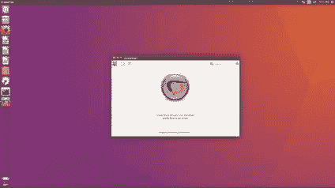

Ubuntu 可能是最流行的 Linux 发行版之一，如果你是 Linux 新手或者以前尝试过，它无疑是最好的选择。Ubuntu 拥有非常易于安装的仓库，而且非常具有定制性——非常适合艺术和媒体从业者，或者那些对屏幕上显示的内容极其谨慎的人。Ubuntu 的问题是，与其他发行版相比，它在移动设备上的运行并不理想——这可能是一个问题，特别是如果你是那种一直盯着手机的人类型。

## Souls


Souls 具有现代感，事实上，它是很新的，因为它只在 2012 年发布——那时 Ubuntu 主要在学校和企业中使用。有人说 Souls 最棒的地方在于它的美学感觉，因为它确实有那种优雅、悦目的感。不过，有一点是目前还没有太多的“Soul 社区”，所以如果你在这个发行版上遇到问题，你可能需要自己寻找解决方案。

## Mint Cinnamon

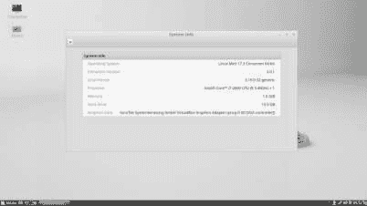

这个名字听起来很清新，不是吗？嗯，Mint Cinnamon 确实有那种清新轻盈的感觉，因为它美学上主要使用白色和灰色。它是一个非常极简的 Linux 发行版——非常适合不喜欢在屏幕上看到太多装饰和过度色彩的人。最棒的是它的仓库和 Ubuntu 相同，所以你在尝试理解它们时不会很困难，它的 UI 需求也较低——所以它对你的电脑以及对使用的你来说都不会负担太大。Mint Cinnamon 对初学者来说也很棒，正如前面提到的，它没什么难理解的——你真的不需要为它为难。

## Ubuntu Studio

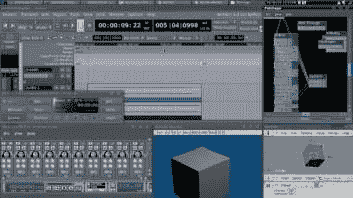

正如名称所示，这个变体适合音乐人、音频工作者以及那些需要多媒体创作的人。事实上，它自 2007 年以来就被许多音乐人所使用。它最棒的地方是它的仓库和 Ubuntu 相同，所以你在尝试理解它们时不会很困难，它的 UI 需求也较低——所以它对你的电脑以及对使用的你来说都不会负担太大。

## Arch Linux

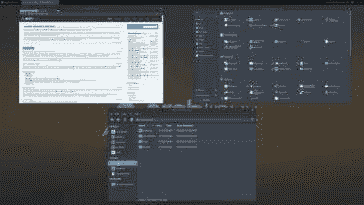

Arch Linux 是那些想要从底层开始构建 Linux 的人的选择。它以“简单、快速、实用”（KISS）原则著称，但这里的“简单”是指对系统而言的，而不是对用户。它是一个滚动更新发行版，这意味着你总是获得最新的软件版本。对于 Linux 新手来说，它可能非常有挑战性，因为它要求你手动配置很多东西。

## Debian


Debian 是最老牌且稳定的 Linux 发行版之一。它以极其稳定和开源标准闻名，许多其他发行版（如 Ubuntu）都是基于 Debian 的。如果你需要一个极其可靠的系统，那么 Debian 是不错的选择。

## Fedora

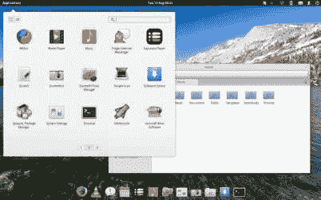

Fedora 是由红帽社区支持的发行版。它通常处于许多新技术的前沿，如果你想尝试最新的 Linux 特性，Fedora 是一个非常好的选择。

`Nano` 是一个文本编辑器。它在几乎所有的 Linux 发行版中都预装了。新用户喜欢它主要是因为它的简单，与 `emacs` 和 `vi/vim` 等其他命令行文本编辑器相比，这种简单非常脱颖。它基本上包含了许多其他有用功能，如行号、语法高亮和方便搜索等。

让我们继续。

我们将创建一个名为 `hello.sh` 的 shell 脚本。按照以下步骤操作：

输入 `nano hello.sh` 并运行。

`Nano` 将打开并提供一个空白文件供你编辑。现在输入以下 shell 命令。

```bash
echo 'hello world'
```

在键盘上，按下 `ctrl+x` 退出编辑器。当询问你是否想保存文件时，按下 `yes (y)`。

`Nano` 然后将确认你是否想保存文件。按下 `enter` 确认该操作。

现在使用以下命令运行脚本 `hello.sh`：

```bash
bash hello.sh
```

当你把它看作一个 gif 图时，这些步骤看起来[像这样](http://www.compciv.org/files/images/cli/cli-bash-script-hello-world.gif)。

[`bit.ly/2piclinux`](http://bit.ly/2piclinux)

因此，`hello.sh` 并不特别有趣，但它至少捕捉到了你想要做的本质，即将一系列命令封装到一个文件中（即脚本），这样你就可以根据需要反复运行该脚本。这可以帮助你避免在重输命令时可能出现的拼写错误，并允许你在各种语境下复用该脚本。

## 在可复用的 Shell 脚本中使用参数

现在让我们尝试让 `hello.sh` 变得复杂一点。现在不再是重复 `hello world`，而是通过创建脚本的方式让它对某个值（例如，人的名字）说“hello”。这会让脚本看起来好一点。你可以这样使用它：


该 gif[如下所示](http://www.compciv.org/files/images/cli/cli-bash-hello-excitedly.gif)。

[`bit.ly/2linux5`](http://bit.ly/2linux5)

首先，你通过在“world”的位置添加一个变量来定制“hello world”。尝试在命令行中交互式地执行：


输出是：

```
Hello Dan
```

因此，这里的问题是，你如何让脚本 `hello.sh` 读取你传递给它的参数（在这种情况下是人的名字）？


你通过一个特殊的 bash 变量来实现。你从命令行传递给脚本的第一、第二个和第三个参数由包含 `$1`、`$2`、`$3` 的变量表示。因此在上面的示例中，当 `hello.sh` 开始运行时，名字 George 将保留变量 `$1` 中。

重新打开 `hello.sh` 并将你的代码更改为如下内容：


保存更改后，现在运行以下命令查看输出。


如果你希望输出为全大写，只需按如下方式修改 `hello.sh`，确保输出通过 `tr` 管道，以便将所有小写字母替换为大写。


现在如果你追求简洁，你可能会发现 `$yourname` 变量并不是真的必要的。代码将简化为：


现在慢一点，我的朋友。如果你能够创建一个脚本，你可以这样执行它：


……那么你就学了一个重要的概念。你刚刚学会了程序员如何将复杂的东西封装进一个可以运行的容器中。在我们开始做某些决定之前，让我们看看如何使用变量来引用数据，这包含了命令的输出。

## Bash 变量与命令替换

变量是内存块的符号名称，可以对其赋值值，并对其内容进行读取和操作。至少，这些名称有助于使代码更具可读性。尽管如此，在高级编程中，变量变得更加实用或易用，在那种情况下，你会发现实际值在程序执行之前是未知的。变量更像是一个在执行时解决的占位符。让我们举个例子：假设 `urls.txt` 有一个地址列表。下面的例程通过 `cat`（虽然这不是最好的，但目前够用）将每一行读入 `for loop`，该循环随后下载所有的 URL（在下一章中查找关于 for loop 的详情）。

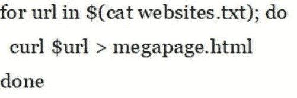

如果你开始感到困惑，让我带你简单介绍一下变量的基本用法和语法。

### 设置变量

下面的命令将“Hello world”赋值给 `var_a`，并将 `42` 赋值给 `other_var`


与你熟悉的大多数语言不同，bash 对变量设置非常挑剔。具体来说，在变量名、等号和值之间不允许任何空格。这些示例会触发错误：

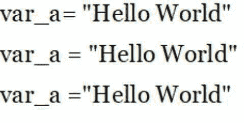

### 引用变量的值

有时这被称为参数替换或变量扩展。

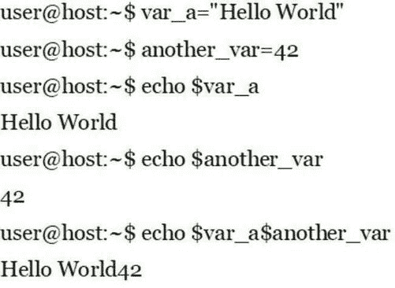

### 字符串拼接

当涉及到反复使用的文本模式时，你会发现变量非常有用：

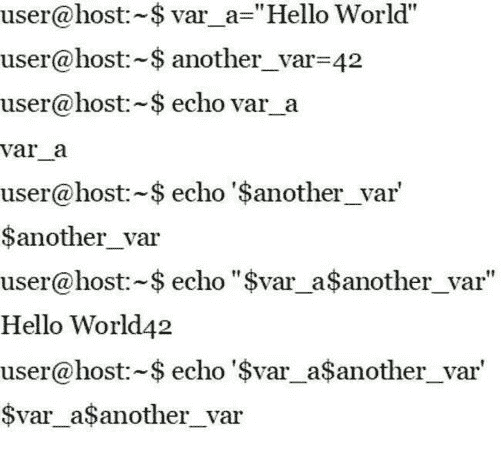

如果你的变量名紧邻字面字符，这种涉及大括号的冗长格式对于引用变量的值很有帮助：

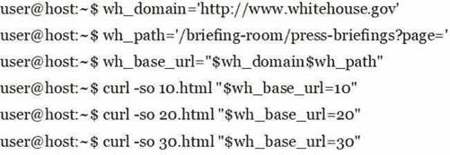

### 变量变量命名

变量名可以包含下划线和字母数字序列。你创建的所有变量都应该以下划线或字母开头；而不是数字。这里是一些合法的变量名称：

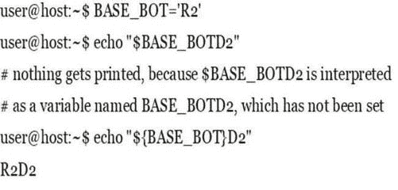

当你编写函数和脚本并传入参数进行处理时，这些参数将自动传递给命名为数字的变量，例如 `$2` 和 `$3`。一个很好的例子是：


命令将在 `hello.sh` 中使用 `$1` 引用‘Hello’，使用 `$2` 引用‘42’，使用 `$3` 引用‘world’。查看下面的变量引用：

`$0`

它将展开为脚本的当前名称，例如 `hello.sh`。

## 接下来对 Linux 做什么？

我们将继续导航 Ubuntu 发行版，概述如何安装和设置你的操作系统。记住，任何 Linux 操作系统的优势之一在于你可以对其进行定制以适应你的需求。

### 桌面版本

在桌面版本中，你将发现大部分是即插即用的。图形和文本将引导你。应用程序允许你导航你需要执行和拥有的功能，就像 Windows 或 macOS 一样。再次，你会看到熟悉的图标、任务栏和菜单。

### 图形界面与命令行？

如前所述，尽管你依赖桌面版本提供的图形化用户界面（GUI），但当你需要时，你仍然拥有使用命令行界面（`CLI`）的能力。不同的 Linux 发行版进入这些提示符的方法各不相同。对于各种版本的 Ubuntu，可能需要通过点击“应用程序”菜单、“辅助工具”，最后点击“终端”来实现，在终端中你就可以获得输入命令的提示符。


你可能会觉得选择 GUI 版本是为了完全避免使用`CLI`。然而，有些人其实非常喜欢这种图形界面与提示符的结合。你以后观看或阅读的任何教程都可能包含一些你即使在桌面版本中可以在提示符下使用的命令。这些命令可能依然适用。关于这一点需要注意的几点是：如果你经常执行相同的操作，那么通过命令行自动化任务会非常有用。在 GUI 崩溃等情况下，它也非常方便。学习一些基础知识是很有好的，因为你永远不知道什么时候会需要它们！

## 应用与软件

安装后，你的 Ubuntu 发行版已经自带了许多预装的应用程序和程序。这些可能包括：Firefox、OpenOffice、音乐和视频播放器、社交媒体和即时通讯工具，以及一些让事情变得实用或风趣的常用应用。

Linux 最棒的部分在于定制化。如果你不确定应该安装什么，应该在 Google 上搜索最适合你需求的应用程序、程序或软件，但它的美之处在于你可以进行定制，而不像我们大多数人习惯的带有大量第三方或专有内容的预装系统。其中许多来自仓库。Linux 仓库（Linux Repositories）是存放你可以随时调用的许多程序和应用的地方。其中大多数都是开源的，但有些可能不是。

通过 Ubuntu，你可以轻松点击鼠标访问新闻应用和软件，快速检索并安装你需要的任何内容。

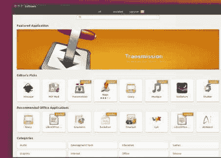

访问仓库的一种快速简便的方法是通过所谓的“Syn 软件包管理器”（Synaptic Package Manager）。通过它你可以访问从游戏到 MS Office 的各种内容。进入系统文件，然后在“管理”（Administration）下点击`Synaptic Package Manager`。寻找`ubuntu-restricted-extras`并通过软件包管理器安装它。这将允许访问某些专有应用程序。通常情况下，你可以从该管理器检查并安装你想要的程序。

在桌面版本中访问仓库的另一种方法是使用`CLI`命令。这将在“服务器”部分进行更多介绍，在那里由于缺少 GUI，`CLI`是至关重要的。你将使用如`apt-get-install`等命令从相同的仓库获取应用程序，但这将通过`CLI`界面以文本形式进行。再次，指南末尾会有列表。你将看到一个初学者基础命令列表，这对于导航`CLI`（即使在桌面层面）将非常有帮助。你还会看到一个更全面的列表，它不仅能帮助新手，还能引导你进入中级学习阶段。

桌面版本的魅力之一就是这种多功能性。

## 安全、更新与效率

每位 Linux 用户或开发者都会建议你在开始深度折腾安装你的版本之前做一些非常特定的事情。安全和稳定性也是维护 Linux 的关键，这将让你享用多年。以下是 Linux 用户建议在安装后要做的前 10 件事：

1. 立即安装并更新 Ubuntu 版本（尽管如果你是第一次使用系统，听起来可能没必要）。这是以防开发者自版本发布以来已发布补丁并修复了任何问题。

2. 根据你的需求调整设置、外观和行为。

3. 确保调整任何隐私设置以提高安全性。

4. 按你的喜好调整主题、壁纸和菜单。调整工具可以提供更多选项。

5. 安装`AppGrid`和`Synaptic Package Manager`来帮助查找和安装内容。

6. 安装`GetDeb`和 Play 仓库，以及软件个人存档 (`PPAs`) 的更新源，并确保启用仓库（以访问授权软件）。

7. 关闭广告。

8. 现在就安装任何媒体解码器、音频播放器和驱动程序。

9. 安装如 Google Chrome、Skype、GIMP 等免费应用。

10. 设置即时通讯、社交媒体账户和云连接。

## 为桌面创建多个工作区

你还可以使用工作区（workspaces）来真正最大化你的 Ubuntu Ubuntu，充分利用它，并为了乐趣或享受进行多任务处理。某些版本不会显著显示这些选项，但它们可以在不同的发行版通过不同的方式启用。你应该检查你的发行版，并在网上搜索如何激活你所在版本的工作区。这通常只需要点击几次。

取决于 Ubuntu 的版本，例如，在每个环境中，你可能需要点击启用或管理工作区、添加应用程序或添加小部件来使用这些功能。很快，你就拥有了多个工作区，这可以帮助组织和分离你的活动，假设你同时处理多项任务，这将非常有用。你应该尝试激活并测试它们。

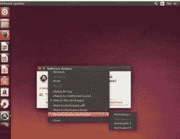

Ubuntu Linux 中的多工作工作区

## CLI

你可能也应该学习一些可以在提示符下使用的基础命令，以防万一（是的，这已经被建议过几次了！）。指南的最后一章节有命令列表。你会发现进入“应用程序”、“辅助工具”，然后到达“终端”后，你就可以访问`CLI`并看到一个提示符。这正是命令大显身手的地方。有些用户非常喜欢这种额外的方式来定制他们希望系统执行的操作、自动化任务以及使用快捷键。

此外，如果你在以后某个时刻切换到服务器版本，你已经对命令有了一些了解和知识，并且对系统文件的结构和位置有了更好的理解。正如你之后将读到的，Linux 中的一切都是文件。它们的结构与 Windows 等不同。通过使用 GUI，你将从一个角度来看待。当你使用`CLI`时，你将真正更好地理解文件树和目录如何与硬件和软件协同工作，构成所谓的操作系统。这也是 Linux 爱好者获得自由感的地方，这种自由不仅来自于应用程序和其他其他系统资源的开源，还源于让你的计算机真正为你服务的自由和灵活性。

### 在服务器版本中进行

然而，你可能需要花时间在服务器版本上。它并不那么直观，在以这种方式探索 Linux 之前和期间，了解某些细节非常有用的。如果你熟悉 DOS，这只是学习命令和代码的问题。如果你不熟悉，你将面临相当长的学习曲线。

首先，你将使用你提供的信息登录你的新服务器版本。你将看到一个带有 Shell 提示符的纯 DOS 界面。你不会像在桌面版本那样看到图形用户界面 (GUI)。现在你需要使用命令在这一新的操作系统中移动到任何地方。你应该设置一个非常安全的密码和 root（用户）名称。务必完全按照原样记录这些信息。在 Linux 中，标点符号非常重要。不同的拼写意味着完全不同的结果。你将再次看到这个提醒。

# 万物之根 (The Root)

在 Linux 中，“Root”这个词有几个含义。Root 用户（Root User）是计算机的管理员（用户名为`root`），它是权限最高的用户，拥有全特权限。

Root 也是 Linux 中任何事物的最高层或核心。它还是软件安装的位置，相当于 Windows 中的`C:/Homе`。从文件的角度上说，它是文件的最高层。Linux 中的所有内容要么目录，或者是目录内的文件，而它们都在 Root 目录下。

命令`sudo`的意思是“Super User Do（超级用户执行）”。这意味着你，作为 Root 用户（即管理员），拥有访问文件和程序的完全权限。在某些发行版中，你需要使用它作为某些命令的前缀。

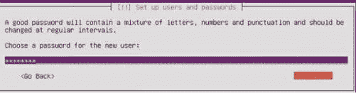

www.ubuntusеrverguide.com

# 掌握你的命令 (Get Command over Your Commands)

与现在的大多数事情一样，你可以在 Google 上进行一些简单的搜索，以获取大量的 Linux 命令列表。通过这些命令，你可以在 Linux 中导航任何地方。本书的最后一章包含了一个详尽（但并非完整）的 Linux 命令词表。你不应该期望记住这个列表，但你应该开始熟悉 Linux 的语言。

一些最重要和实用的命令将带你进入、退出和穿梭。为了强调和补充早的观点，你在命令中使用大小写至关重要。命令的拼写非常具体，因此请注意使用正确的大小写。空格和单词顺序也很重要。你可能无法到达任何地方，或者可能会来到一个你无打算去的地方。

在 Linux 长长的命令和命令组合列表中，还有一些“内置”（builtin）命令。正如其名，内置命令已经包含在`Bash`shell 内部。当一个简单命令的第一个单词是内置命令时，shell 会执行该命令而不需要运行其他程序。

如前所述，每个发行版都有自己的优势和挑战。需要注意的是，每个发行版的命令可能相同也可能不同。鉴于命令是导航此版本 Linux 的唯一方式，这一点是关键。你绝对应该对你选择的发行版的兼容性和用法做一些研究，现在你还想研究该特定发行版的特定命令。

你会发现许多命令有一些共同的根源，你可以通过其他命令、关键词、文件名或程序名对其中一些命令进行扩展。有一些初学者需要立即使用的命令。跟随操作并尝试一下。

# 需要时获取帮助 (Get Help When You Need It)

这里有几个刚开始就要知道的简单事情。这些可能是你的救生圈。“Man”页面是手册（说明性）页面。你也会像`sudo`命令一样，用这个命令作为另一个命令的前缀。使用`man`会打开一个包含你所需的所有屏幕，就像一个数字手册页。需要时尝试不同的变。知道如何到达某处、如何退出以及如何寻求帮助可能很重要，但当你学习系统时，这些可能会让你非常沮丧。

*   `man –k`：搜索包含某个术语的所有命令。你也可以使用`apropos`。
*   `man`：显示帮助信息。
*   `info`：显示帮助信息（以不同形式）。
*   `whatis`：显示 man 页的描述。
*   `whеreris`：告知 man 页的位置。

要退出 man 页，输入`Q`即可。这是退出手册页的唯一方法。要退出大多数其他地方，只需输入`Exit`。命令`more`和`less`也用于显示超出当前屏幕内容的文件。你可能需要阅读帮助页上看到的更多信息。这对于系统的初学者来说尤为重要。在输入命令后，只需使用空格键向下滚动。要退出，输入`q`退出。

# 移动 (Moving around)

你很快就会学会 Linux 中有很多目录，你应该熟悉它们。虽然万物皆为文件，但目录是一种特殊类型的文件。目录出现在列表中，并以树的形式关联。与使用 GUI 的操作系统不同，你不会看到扩展名。你需要了解如何导航、查找它们。正如命令一样，目录的大小写和符号也很重要。正如前面提到的，空格键在设置文件名时很有用。这些小事情会产生影响。这些小错误可能会导致你死锁。在最坏的情况下，Linux 中的错误可能会造成严重损害，如删除文件。你应该设置时使用划线代替空格。

初学者应该熟悉的几个目录和功能有：

*   `/home`：这是你的根，文件存储。
*   `/dev`：存放设备文件。
*   `/cd`：切换目录。
*   `/etc`：类似于控制面板。

## 使用目录 (Using directoris)

`pwd`命令将打印工作目录。这也是查看你所在位置的好地方。

要查看目录（从主目录开始以及之后的其他目录），你可以输入`ls`列出目录内容。注意，主目录配置时会有一些隐藏文件。要看到它们，你必须使用点。例如，你不会只输入`ls`，而是输入`ls -b`。

要移动到名为`xyz`的子文件夹，你需要将 xyz 如下所示：`cd xyz`。

返回主目录，输入`cd~`。进入根目录，输入`cd /`。回到父目录，你应该输入`cd ..`。

# 安装程序 (How to Install Programs)

`apt-get`命令获取并安装独立的视觉软件包。这就是你创建服务器的方式。你将使用特定的命令手动获取任何你需要个性化 Linux 服务器的内容。

存储库包含许多你可以随时调用的 Linux 程序。这些程序也是开源的。如果你此时不知道自己需要什么，应该在 Google 上搜索最适合你需求的软件。

然后访问存储库，例如，你会输入`sudo apt-get install (program name)`来获取副本并自动安装。`tasksel`命令在 Ubuntu 中意味着 **task-select**。如果你运行它，将出现一个屏幕给出常见的服务器类型、软件包和任务列表。你可以选择并安装服务器所需的任何内容。

例如，你可以输入`sudo apt-get install tasksel`来获取`tasksel`功能，然后通过`sudo apt-get install (后面跟着你想要的任务名称、服务器名称等)`来使用它。

如果你想安装 LAMP 服务器，可以输入命令`sudo apt-get install lamp-server`来自动完成此操作。

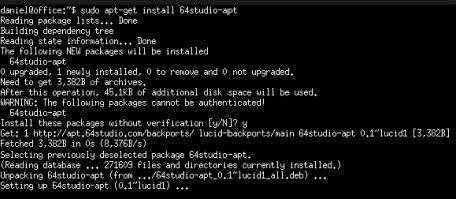

`apt-get install`的示例 ([www.en.flossmanuals.net](http://www.en.flossmanuals.net))。

如果你任何时候需要帮助，既然你已经知道了`man`页命令，你可以输入：`man tasksel`。你将看到帮助页出现以满足你的需求。

## 如何卸载

若要卸载，你只需输入`apt-get remove (在此情况下为服务器的名称)`。使用此命令获取你的的大部分软件，并从免费的开源软件开始。

## 更新

安装软件后，你可以使用升级命令`sudo apt-get upgrade`。通过仓库进行轻松更新。手动更新它们比设置自动更新要简单。由于 Linux 的高效性，你不需要频繁更新。它也更安全。

**任务管理器：** `top`提示命令类似于“任务管理器”，用于查看进程以及每个进程占用的空间，或停止程序运行。

使用命令`h`获取你随时可能需要的命令列表。

输入命令`sudo top`（访问任务管理器或 top 界面），然后输入命令`K`（kill，杀死），然后输入你想杀掉的进程旁显示的进程 ID（称为`PID`）。

## 停止/启动/重启服务

Linux 服务器极少重启，但在某些时刻你可能需要重启软件或服务。

要启动/停止或重启，你将输入命令：`sudo/etc/init.d/(程序名称) start`（或 stop 或 restart），以进行更改，并在处理更改时离线，例如在发生崩溃或重新配置文件时。

现在你已经有了一些关于身处何处、要去哪里、以及如何获取、安装或删除东西的基础知识，请花些时间测试这些内容。后面是一份常用命令列表，以及一个更详尽（但不是全部）的列表。这并非无穷尽尽，但它展示了你现在就可以执行的一些任务，或者你可能期待学习的任务。

Linux 是一个不断演化的操作系统，考虑到发行版和环境的多样性，情况将继续不断变化。随着我们技术的进步，改进和利用 Linux 系统的机会越来越多。

## 初学者前 35 常用常用命令列表

如果你必须记住它们：

1. `apt-get`: 搜索并安装软件软件包
2. `bzip2`: 压缩/解压文件
3. `cd`: 切换目录
4. `chmod`: 更改文件的访问权限
5. `cp`: 复制一个或多个文件或目录到位置
6. `date`: 显示或设置日期与时间
7. `df`: 显示磁盘可用和已用空间
8. `emacs`: 文本编辑器
9. `exit`: 退出 shell
10. `find`: 搜索符合特定模式的文件
11. `hostname`: 打印或更改系统名称
12. `install`: 复制文件，设置/更改属性
13. `locate`: 搜索并查找文件
14. `ls`: 列出目录内容信息
15. `man`: 显示特定命令的帮助信息
16. `mkdir`: 创建新文件夹/目录
17. `mv`: 移动或重命名目录和文件
18. `nano`: 带有菜单快捷键文本编辑器
19. `open`: 在原始应用程序中打开文件
20. `ps`: 显示当前进程状态
21. `pwd`: 显示/打印工作目录
22. `quota`: 显示磁盘使用情况、限制
23. `reboot`: 重启系统
24. `rm`: 删除目录或文件
25. `rmdir`: 删除、清空空目录或文件夹
26. `shutdown`: 关机或重启
27. `sftp`: 安全文件传输程序
28. `sudo`: 以特定权限的用户身份执行命令
29. `tar`: 从 tar 包/归档中存储、列出或提取文件
30. `top`: 列出当前运行的资源和进程
31. `uptime`: 显示系统运行时间
32. `wget`: 获取文件或网页 (HTTP, FTP)
33. `yum`: 从仓库安装的包管理器
34. `zip`: 归档文件
35. `zip / unzip`: 创建 .zip 归档或从 .zip 提取

# 第 7 章 从外部驱动器运行 Linux Live 及更多


运行 Kali Linux 最简单的方法是从 USB 盘以“Live”（现场）模式运行。这种方法也有很多优点。

### 可启动 USB 盘的优点

**无破坏性**：由于是直接从 USB 盘运行，它不会对你的机器或机器上现有的操作系统进行任何更改。要回到没有 Kali 的现有设置，你只需拔掉 USB 盘并重启系统即可。

**便携性**：你可以将 Kali Linux 操作系统带在口袋里的任何 USB 盘上，并在任何可用机器上运行。

**可定制性**：如前一章所述，你可以使用脚本。

**持久化**：通过一些自定义，你可以让 Kali Live 存储在重启后仍保留的数据。

### 创建可启动 USB 盘的需求

1. 适用于你要运行或安装的系统的 Kali Kali ISO。
2. 如果你使用 Windows，需要 Win32 Imager 软件来创建 Kali USB。
3. 一个容量大于 4GB 的 USB 盘。如果你的系统支持 SD 卡槽，也可以使用 SD 卡。

### 安装

让我们通过创建 Kali Linux USB 盘的过程。过程会根据创建 USB 的主机系统而异。

### Windows

1. 将 USB 插入机器并注意对应的驱动器号。启动之前下载的 Win32 Imager 程序。
2. 选择 Kali 安装文件，并确保选择了要写入的 USB 盘。点击写入。
3. 写入 USB 盘完成后，你可以弹出驱动器并将其作为可启动 USB 启动 Kali Live 或在机器上安装 Kali。

### Linux


在 Linux 操作系统创建可启动 USB 非常简单。一旦你下载并验证了 Kali ISO 文件，就可以在终端中使用`dd`命令将文件写入 USB 盘。你需要 root 或`sudo`权限来运行`dd`命令。

**警告：** 如果你不确定如何使用`dd`命令，你可能会将 Kali Linux 镜像写入你并非意意的磁盘驱动器。因此，在使用`dd`命令时保持警惕很重要。

## 第一步

你需要知道用于将 Kali Linux 镜像写入 USB 盘的设备路径。在不将 USB 盘插入插槽的情况下，在终端命令提示符中执行以下命令。

```bash
sudo fdisk -l
```

你将看到显示系统中所有挂载设备的输出，它将显示分区为

```
/dev/sda1
/dev/sda2
```

## 第二步

现在，插入 USB 盘并再次运行相同的命令`sudo fdisk -l`。这次你会看到额外的设备，即你的 USB 盘。它会显示为

```
/dev/sdb
```

你的 USB 盘的大小将写在旁边。

## 第三步

使用下面所示的命令仔细地将镜像写入 USB 驱动器。在上面的示例中，我们假设你的 Kali Linux ISO 文件名为“kali-linux-2019.1-amd64.iso”且它位于你当前的工作目录中。块大小参数`bs`可以增大，但理想值为`bs=512k`。

写入 USB 驱动器需要几分钟时间，完成写入所需的时间略多于 10 分钟属于正常现象。

`dd`命令在过程完成之前不会显示任何输出。如果你的 USB 驱动器有 LED 指示灯，你会看到它闪烁，这表明磁盘正在被写入。一旦`dd`命令完成，输出将类似于：

```
5823+1 records in
5823+1 records out
3053371392 bytes (3.1 GB) copied, 746.211 s, 4.1 MB/s
```

这将结束对公式的处理。你现在可以使用该 USB 驱动器启动进入 Kali Linux Live 系统，或者在机器上开始安装 Kali Linux。

## 在 OS X 上创建可启动 Kali USB 驱动器

Apple OS X 是基于 UNIX 的操作系统。因此，在 OS X 上创建 Kali Linux 可启动 USB 驱动器与在 Linux 上的操作相似。下载并验证你的 Kali Linux ISO 副本后，只需使用`dd`命令将 ISO 写入你的 USB 驱动器。

**警告：** 如果你不确定如何使用`dd`命令，你可能会将 Kali Linux 镜像写入你并非希望的磁盘驱动器中。因此，在使用`dd`命令时保持警惕极其重要。你可以按照以下步骤将 ISO 写入 USB 驱动器。

### 第一步

在不将 USB 驱动器插入 MAC 桌面电脑或笔记本电脑的情况下，在终端窗口的命令提示符中输入以下命令：

```
diskutil list
```

### 第二步

系统将显示所有挂载在系统上的磁盘路径列表，以及分区数据：

`/dev/disk1`

`/dev/disk2`

### 第三步

现在插入 USB 并再次运行`diskutil list`命令。你会发现列表现在显示了你的 USB 驱动器。它应该是第一次没有出现的那一个。让我们假设它是：

`/dev/disk6`

### 第四步

你可以使用以下命令从系统卸载 USB 磁盘：

```
/dev/disk6
diskutil unmount /dev/disk6
```

### 第五步

继续使用以下命令仔细地将 Kali Linux ISO 写入你的 USB 驱动器。这假设你当前的工作目录与保存 ISO 文件的目录相同。块大小参数`bs`可以增大，理想值为`bs=1m`。

写入 USB 驱动器需要几分钟时间，完成写入所需的时间略多于 10 分钟属于正常现象。

`dd`命令在过程完成之前不会显示任何输出。如果你的 USB 驱动器有 LED 指示灯，你会看到它闪烁，这表明磁盘正在被写入。一旦`dd`命令完成，输出将类似于上面的示例。

这将结束对公式的处理。你现在可以使用该 USB 驱动器启动进入 Kali Linux Live 系统，或者在机器上开始安装 Kali Linux。

要在 OS X 机器上从目标驱动器启动，在电脑启动后立即按下“Option”键并选择你想要使用的驱动器。

## 安装与设置

一旦你可以选择你喜欢的发行版，就可以下载安装包或获取 Live CD 发行版来让 Linux 运行在你的电脑中。

### 为硬盘留出空间

如果你要在 PC 电脑上安装 Linux，你可能需要缩小 Windows 操作系统占据的分区以为 Linux 留出空间。要做到这一点，你需要创建一个电脑在设置后可以启动的分区。这适用于需要安装在硬盘上的发行版，例如 Debian 和 Fedora。你可以使用 Windows 创建分区，也可以简单地启动你拥有的发行版，然后使用分区编辑器 GParted。该程序能够对磁盘进行重新分区，通常在后续版本中使用。

**提示：** 如果你打算使用带有 Live CD 的发行版（如 Ubuntu），你就不需要为 Linux 创建分区。你只需从 CD 启动，然后安装程序将对你的 Windows 分区执行收缩操作。

**警告：** 分区硬盘时存在丢失所有数据的风险。请确保你已经备份了所有文件。

### 使用 Live CD 和可启动 USB 发行版

许多发行版都能够从优盘盘或 Live CD 运行，不需要你承诺必须将其安装到驱动器中。这意味着你可以先尝试它们的功能，甚至在其中保存程序。然而，你可能会发现下次启动电脑时需要更多空间，或者希望操作速度更快。如果你认为你已经有了想要的发行版，双击显示“安装”的图标并按照安装向导操作。安装向导通常会引导你完成以下过程：

1. **准备**：确保你正在符合硬件要求的机器上安装 Linux 发行版。在安装的此阶段，你可能会被问及是否包含某些第三方软件，例如 MP3 播放插件。

2. **无线设置**：如果你想下载更新或任何第三方软件，此部分将引导你设置连接。

3. **硬盘分配**：此步骤将允许你选择如何安装 Linux。你可以选择重装 Linux、在有另一个操作系统的情况下进行双启动安装 Linux、替换现有的操作系统或升级之前安装的 Linux 发行版。

4. **位置**：这设置你的电脑在地图上的位置。这对于与其他 Linux 用户交流以及与 Linux 社区互动非常有帮助。

5. **键盘布局**：这允许你选择用于操作系统的键盘。

6. **用户设置**：这允许你选择你的用户名和密码。

# 总结

希望这本书能够帮助你学会如何地使用 Linux，从将其安装到电脑到使用该操作系统创建你自己的程序。我希望这本书也能作为指南，帮助你选择适合你需求的 Linux 发行版以及用于日常计算任务的应用程序。在书结束时，你应该已经学会了如何在 Linux 环境中使用命令行进行操作，并成功学习了一些增强系统安全的步骤。下一步是学习更多关于创建和编辑 Shell 脚本，并创建自动化脚本以让你能够更高效地使用 Linux。

## 学习 Python 编程

学习 Python 语言、数据分析和算法，提升你的计算机编程技能，成为一名 Python 专家

首先，这种语言并不是以名为 Python 的巨蛇命名的。不是的！Rossum 的爱好之一是看喜剧片。他是 70 年代后期一部喜剧剧的忠实粉丝。因此，这种语言的名字借用自《蒙提派的飞行马团》（Monty Python’s Flying Circus）。

# Python 的特性

- **易于学习** – Python 的语法简单而优。此外，Python 程序员比编写其他语言更喜欢编写它的语法。Python 简化了编程艺术，允许开发者专注于解决方案而不是语法。对于新手来说，这是开启 Python 职业生涯的绝佳选择。

- **可移植性** – 提到 Python 的可移植性，它让你可以在不进行任何更改的情况下在不同平台上运行 Python。

- **Python 被描述为高阶语言** – 换句话说，你不需要担心内存管理等繁琐的任务。或者，每当你执行 Python 代码时，它会自动将语言转换为计算机能够理解的语言。无需担心任何低级操作。

- **面向对象** – 由于它是一门面向对象的语言，它将允许你为最困难的问题计算解决方案。面向对象编程通过构建对象，将大问题分解成较小部分成为可能。

- **拥有巨大的标准库来完成常见任务** – Python 提供了不同的标准库供程序员使用。因此，你不需要自己编写所有的代码。相反，你只需要导入相关代码的库。

Python 是由 Guido van Rossum 创建的一种多用途语言。该语言以简单的语法著称，让新学者容易理解和使用。本章将介绍 Python 语言的基础知识。请关注。

Python 被描述为一种通用语言。它有许多应用，因此，你可以用它来完成许多不同的功能。

Python 语言的语法整洁，代码长度很短。在某个阶段用过 Python 的开发者都会表达用 Python 编写代码有多有趣。Python 给你了一个机会更多地思考眼下的任务，而不是语言语法。

# Python 的部分历史

Python 语言的设计始于 20 世纪 80 年代，并于 1991 年 2 月首次发布。

## Python 的应用

### Web 应用

你使用基于 Python 创建的 CMS 和框架开发可扩展的 Web 应用。开发 Web 应用的热门环境包括 Pyramid、Django、Django CMS 和 Phone。

Instagram、Mozilla 和 Reddit 等其他流行网站也是用 Python 语言编写的。

### 科学和数值计算

有不同的 Python 库用于科学和数值计算。`Numpy` 和 `Scipy` 等库使用 Python 用于通用计算。此外，还有专门为天文学设计的 `AstroPy` 等库。

此外，Python 语言在数据挖掘、机器学习和深度学习中被应用。

### 技术程序员的优秀语言

Python 语言是向新手和儿童演示编程的重要工具。这是一门具有重要能力和特性的优秀语言。然而，它是容易学习的语言之一，因为它的语法简单。

### 构建软件原型

与 Java 和 C++ 相比，Python 稍微慢。在资源受限且强制效率的情况下，它可能不是一个很好的选择。

但 Python 是一种构建型的强大语言。例如：你可以应用 `Pygame` 库先开发原型。如果你喜欢这个原型，可以决定使用 C++ 开发正式版本。

# 为什么你应该选择 Python 作为你的语言

### 简单、美丽的语法

可以说，在 Python 中编程很有趣。理解一行代码和编写代码变得更容易。语法看起来很自然。例如：

```
b = 4
c = 3
sum = b + c
Print(sum)
```

即使是你第一次编程，你也可以掌握这个简单的功能。

### 不是一种非常严格的语言

不需要在语言中定义变量类型。此外，不需要在行末尾加分号。然而，Python 要求你遵守良好的实践，例如正确的缩进。这些小细节简化了初学者的学习。

### 语言具有表现力

Python 让你用更少的代码行编写出具有许多功能的强大程序。

### 可爱的社区和支持

有一个巨大的 Python 开发者社区。你会遇到不同的在线论坛，它们在学习编程时会有帮助。

# 你应该考虑使用 Python 编写软件的理由

### 易于阅读和维护

在创建应用程序时，你需要专注于源代码的卓越本质，使更新和维护代码的过程变得简单。Python 语法允许你在不编写额外代码的情况下演示概念。此外，Python 提供了使用英语术语而不是标点符号的机会。因此，可以使用 Python 构建自定义应用程序而无需编写额外代码。当你编写易于阅读的代码时，它简化了软件更新的过程。

### 与关键平台和系统兼容

如前所述，Python 可以在不同的操作系统上运行。你甚至可以决定使用 Python 解释器在定义平台上运行代码。此外，Python 是一种解释型编程语言。换句话说，你可以在不同平台上运行相同的代码而无需重新编译。因此，一旦你做了任何更改，就不需要重新编译代码。事实上，你可以运行更改后的代码而不重新编译，并立即确认更改的效果。这一特性允许开发者更改代码而不增加构建时间。

### 许多开源技术和框架

由于 Python 是一种开源语言，它有助于节省软件成本。为什么？你可以包含不同的开源 Python 框架、开发工具和库来缩短开发时间，而不会增加开发成本。

## 分解复杂的软件开发

你可以使用 Python 构建 Web 和桌面应用程序。尽管如此，你仍然它可以开发复杂的科学程序。Python 的设计具有支持数据分析和可视化的属性。你可以使用 Python 的数据分析属性构建大型自定义解决方案而无需花费额外的精力和时间。或者，Python 语言提供的数据库和可视化允许你以友好且有效的方式可视化和展示数据。应用测试驱动开发（TDD）使用 Python，可以快速开发软件原型应用。此外，可以通过重构 Python 代码直接从原型开发软件应用。

尽管如此，Python 通过使用 TDD（测试驱动开发）方法简化了编码和测试。你可以在编写代码之前快速编写相关测试，并采用这些测试来检查应用程序代码。此外，测试还可以根据源代码帮助确认应用程序是否满足预定义的需求。然而，Python 也有自己的缺点。例如，它不具备其他现代编程语言中内置的功能。因此，你只需要使用 Python 库和框架来增加自定义软件开发。此外，Python 的运行速度比 Java 和 C++ 等语言慢。这意味着你需要通过修改应用程序代码来提升 Python 程序的性能。但尽管如此，仍然可以使用 Python 来简化软件维护并加速软件开发过程。

# 第一章 什么是 Python 编程

学习一门新的编程语言是一次很棒的体验。你可能想学习了解更多关于计算机的知识，了解它的工作原理、网站是如何运行的，或者你可能想学习是为了创建自己的应用程序和程序。但如果你以前从未以这种方式操作过计算机，或者没有过编程经验，那么要弄从何开始是很的。通过简单的搜索，你会发现除了 Python 之外，还有很多编程语言可以使用。从 Java 到 C++ 等等，很难判断哪种编程语言最适合你。

作为一个初学者以及以前从未接触过编程的人，Python 是最适合入门的编程语言之一。框架的使用加速了开发，因此开发变得更快、更快捷、更高效。大多数 Web 框架的成本都很低。框架具有强大的安全实现。使用框架最大的好处实际上归功于背后的社区。

Python 长期以来一直被认为是初学者语言，因为它太容易学习了，你从一开始就能理解它。这只是你应该选择学习 Python 的众多原因之一。你也会喜欢这一点：有一个庞大的活跃社区致力于这门编程语言，而且很好的是它是开源的，所以你完全不需要支付任何费用就可以开始。这门语言还可以运行在任何操作系统上，所以无论你想在什么种计算机上使用这种语言都没有关系。

如果你正在预览版或类似的地方浏览这本书的介绍页面，对于是否想学习 Python 犹豫不决，那么，我可以告诉你，你可能应该学。

嗯，Python 基本上是一门极其有用且功能强大的语言。它几乎无处不在。从视频游戏的脚本端（或游戏本身）到密集的服务器端 Web 应用程序，再到用它构建的大量深度且响应式的桌面应用程序，无一不包。

你应该什么时候使用 Python？答案取决于你具体要做什么。但既然你是一个初学者，我想你还是应该学。

在你读完这本书并继续作为一个程序员成长后，你将通过直觉知道什么时候该以及不该使用 Python。Python 是一门绝对棒的语言，但它的失败之处在于你需要极其接近计算机硬件或编写极其高效的程序时。在这些领域，Python 并不擅长。

然而，这并不是说它没有优点。事实上，我认为这是 Python 表现平的少数地方之一。它在那个方面缺失的，在其他领域得到了弥补。例如，与其他语言相比，Python 的开发时间通常非常短。这非常容易说明。请比较以下代码片段，第一段来自 C++，第二段来自 Java，最后一段来自 Python。

尽管 Python 是初学者喜欢的编程语言，但这并不意味着它没有很多优势。框架的使用加速了开发，因此开发变得更快、更快捷、更高效。大多数 Web 框架的成本都很低。框架具有强大的安全实现。使用框架最大的好处实际上归功于背后的社区。

Python 本身能够创建许多东西，你也可以配合其他几种语言使用这些东西。现在，让我们花点时间来看一下为了帮助你入门你需要了解的所有内容。

## 我为什么应该学习 Python？

Python 长期以来一直被认为是初学者语言，因为它太容易学习了，你从一开始就能理解它。这只是你应该选择学习 Python 的众多原因之一。你也会喜欢这一点：有一个庞大的活跃社区致力于这门编程语言，而且很好的是它是开源的，所以你完全不需要支付任何费用就可以开始。这门语言还可以运行在任何操作系统上，所以无论你想在什么种计算机上使用这种语言都没有关系。

## Python 的优点

### 于学习

Python 长期以来一直被认为是初学者语言，因为它太容易学习了，你从一开始就能理解它。这只是你应该选择学习 Python 的众多原因之一。你也会喜欢这一点：有一个庞大的活跃社区致力于这门编程语言，而且很好的是它是开源的，所以你完全不需要支付任何费用就可以开始。这门语言还可以运行在任何操作系统上，所以无论你想在什么种计算机上使用这种语言都没有关系。

你会发现 Python 易于阅读，而且与其他语言相比，它能够做很多事情。

### 执行快速

尽管 Python 是初学者喜欢的编程语言，但这并不意味着它没有很多优势。框架的使用加速了开发，因此开发变得更快、更快捷、更高效。大多数 Web 框架的成本都很低。框架具有强大的安全实现。使用框架最大的好处实际上归功于背后的社区。

### 丰富的库

一旦你熟悉了 Python，你会发现它带有一个庞大的库。这对于初学者来说是一个好消息，因为库包含了让该语言运行所需的所有函数、代码和其他内容。

### 多平台支持

无论你喜欢使用哪种平台，你都可以使用 Python。Linux 是很多人会选择的操作系统，但即使你在 Windows 或 Mac 上，你仍然可以使用 Python。

### 庞大的社区


无论你以前是否接触过编程语言，知道有一个庞大的 Python 用户社区在你遇到困难时提供帮助将是一件很棒的事。每当你需要想法（比如新项目），或者只是有一个疑问，或者你想学习一些新东西时，都有信息库可以为你提供帮助入门所需的信息。

## 下载 Python

你已经准备好开始用 Python 编写自己的代码了。你想下载该程序，以便学习如何编写你自己的奇妙代码。但在此之前，你需要确保电脑上已经下载了所有正确的组件。好消息是，由于 Python 与目前正在使用的所有操作系统兼容，你只需要从开启你的个人电脑开始，然后进入下一步即可。

由于这种编程语言是开源且完全免费的，你所做的就是访问 Python 官方网站 [`www.python.com`](http://www.python.com) 来开始。有几个不同的版本供选择，所以你应该挑选一个你认为可以使用的版本。每个操作系统都有相应的版本，因此在选择你想要使用的版本之前，请确保也查看一下这一点。一旦你决定哪个版本最适合你的电脑，你只需要点击出现的提示并按照指示操作即可将其下载到你的电脑上。

在你等待 Python 程序完成下载时，你还需要其他一些可以帮助编写这些代码的工具。文本编辑器是你用来编写想要创建的代码的工具。你还需要一个 IDE（或“集成开发环境”），可以使用它来读取和执行你想要的代码。

让我们从文本编辑器开始。你不需要选择一个过于复杂的程序来完成这项工作。Windows 电脑上的记事本文本编辑器或其他程序都可以很好运行。这里有很多选项供你选择，但记事本或类似的程序是免费的，因此对你来说是一个很好的选择。

然后，你还需要花一些时间研究 IDE。如果你不将它添加到电脑中，将无法编写或执行你想要运行的代码。在 IDE 方面有几个不同的选择，所以去对比一下，看看哪种能提供你所需的所有功能。目前有一个可用的 IDE，你可以通过 Python 获取它以保持简单，但如果你需要更多选择，也有其他选项可用。

一旦你下载了 Python 程序以及你想要使用的 IDE 和文本编辑器，就是时候开始编写自己的代码了。这个过程非常简单，但我们确实需要先查看几件事并学习一些基础知识，以便你能够很快开始编写自己的 Python 代码。

## 你应该了解的 Python 基础知识

当你开始用这种语言编写自己的代码时，你会发现代码中会伴随着许多部分。能够理解这些基础部分是如何工作的，将帮助你编写程序所需的代码。本节将快速回顾在你开始使用 Python 之前需要了解的一些基础知识。

### 关键字

首先，我们需要看看 Python 语言中这些重要的关键字。类似于你在其他编程语言中发现的，Python 中有一组关键字列表，用于告诉你的文本编辑器执行什么。这些关键字是保留的，如果你想避免编写代码时出现任何问题，就应该只按照它们的预期用途使用它们。它们基本上是告诉编译器如何运行的命令，并且它们必须保持保留状态，以便你能够在产生不必要问题的情况下执行代码。

## 如何命名标识符

当你准备好在 Python 中编写自己的代码时，你会遇到代码的几个部分，它们被称为 `identifiers`（标识符）。这些 `identifiers` 有很多不同的名称，可能会让你有点困惑，但它们将帮助你的代码按照你想要的方式运行。你会注意到，在本指南中用于标识符的一些名称包括函数、类和实体。命名标识符时有一些规则需要遵循，但无论你当前处理的是什么类型的标识符，这些规则都是相同的。

命名标识符很简单。你可以随时使用小写字母和大写字母。数字和下划线符号 `_` 也是允许的。上述任何组合都是允许的，只需确保不要在该名称中添加空格。所以你会将其命名为 `MyProgram` 而不是 `My Program`。

标识符不能与数字开头。在名称中使用数字是没问题的，但你不应该让数字出现在名称的开头或第一个字符处。当你将其输入编译器时，这将导致错误，所以如果你不确定看到错误的原因，请务必双检查是否为此原因。

标识符不应该是我们之前讨论过的关键字之一。这样做会混淆你的编译器，所以请完全避免这样做。

### 语句

在编写 Python 代码时，你会使用大量的 `statements`（语句）。这些对你的代码很有用，因为它们只是代码的字符串，其中包含了我们提到过的你将发送给编译器执行的一些其他部分。你可以在代码中编写任何类型的语句，只要它是以编译器能够理解的方式编写的即可。你可以选择让语句简短（例如只占几行），也可以让它变长；对于你应该如何这样做，并没有太多的规定。

### 注释

在编写自己的代码时，你将经常使用的另一个组件是注释。如果其他人正在查看你编写的代码，并且他们对你具体在讨论什么需要说明，那么这些注释就会很有用。你可以编写注释，让其他想要阅读或使用代码的人知道正在发生什么。它们基本上是代码内部的小笔记，可以帮助你和其他程序员了解在应用程序运行期间发生了什么。

编写你想添加到代码中的注释非常简单。你只需要在你想要写的注释前面使用 `#` 符号即可。所以你可以写出类似 `#this is my Python code` 的内容。注释完成后，你只需按回车键并在下一行开始编写其余的代码。只要你在注释前面有那个符号，你的编译器就可以跳过它，而不会读取你在注释中放入的内容。

### 函数

“函数”是 Python 编程语言的另一个重要部分。这基本上是一部分可以重复使用的代码，它通常用于完成代码中的某项操作。函数非常出色，因为它们比其他选项更有效，这意味着你编写代码时不需要浪费大量时间。Python 语言中有很多内置函数，你可以从中获益，此外，你还可以编写一些自己的函数。

在编写代码时，你必须确保你正在定义该函数。一旦你能够定义函数并且它被视为最终确定，那么就是时候执行它使其在代码中运行了。你可以选择从 Python 提示符中调用它，也可以从另一个函数中调用它。

当你将其放入编译器时，你将看到我们在代码内部编写的两个语句将像消息一样显示出来。你可以调用一个函数，并且随时更改代码内部的语句，以确定你以后想要如何执行它们。

## 使用变量

最后，花些时间关注变量是非常重要的。变量之所以重要，是因为它们会在你的计算机内存中开辟空间来存储代码的片段。在创建新变量时，你实际上是在确保计算机上的某些空间被预留。在某些情况下（例如当你处理数据类型时），你的解释器将决定这些信息应该存储在何处，有助于加速过程。

在处理变量时，你的工作仅仅是确保正确的变量与正确的值对齐。这将确保正确的部分在正确的时间出现在你的代码中。好消息是，你可以给变量任何你想要的值，但先检查它在代码中是否真实有效。当你准备好为变量分配新值时，可以使用 `=` 来实现这一点。

# 第 2 章 如何安装 Python

在 Windows、Linux 和 Mac OS X 上安装 Python 的指南。

## 如何在 Mac OS X 上安装 Python

1. 访问官方网站上的 Python 下载页面并点击“Download Python”（末尾会有一个版本名称）。
2. 一旦下载完成，打开包并开始按照说明操作。当 Python 成功完成安装，你将看到通知“The installation was successful”（安装成功）。
3. 建议在开始安装过程之前下载一个优秀的文本编辑器。对于初学者来说，你应该下载 Sublime Text。它是免费的。
4. Sublime Text 的安装过程非常简单。
5. 编写代码并保存。对于新手来说，这里有一段可以使用的代码：

```python
Print ("Hello, World!")
```

这个简单的程序会打印“Hello, World!”。

6. 导航到 Tool > Build。在这里，你可以移动到底部查看程序的运行结果。

## 在 Linux 中安装并运行 Python

1. 首先，你需要安装以下依赖项。

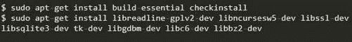

2. 访问位于官方网站的 Python 下载页面并点击“Download Python 3.6.0”。如果你看到不同的版本，不要犹豫直接下载它。
3. 进入终端，找到下载文件的路径并执行以下命令：

```bash
tar -xvf Python-3.6.tgz
```

此行命令将提取你的压缩包。只需注意，如果你下载了不同的版本，文件名将不同。因此，你应该确保使用正确的文件名。

4. 现在切换到解压后的目录。

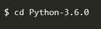

5. 使用这些命令在你的操作系统上编译 Python 源码。

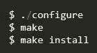

6. 如果你是新手，建议安装 Sublime。如果你使用的是 Ubuntu，则应该运行以下命令来安装 Sublime：

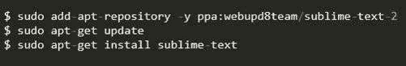

7. 现在打开 Sublime Text。要创建一个新文件，导航到 File > New File。
8. 使用 `.py` 扩展保存文件，例如 `beginner.py`。
9. 编写代码并保存。对于新手，你可以使用以下代码：

```python
Print ("Where are you?")
```

此程序将显示“Where are you?”

10. 导航到 Tool > Build。你可以在 Sublime Text 的底部查看输出。

## 在 Windows 上安装 Python

1. 访问官方网站上的 Python 下载页面，并点击 Download Python 3.6.0。
2. 一旦下载完成，打开文件并开始安装过程。一旦 Python 安装完成，IDE 也会一起安装。
3. 打开 IDE，粘贴下面的代码并按回车：

```python
Print ("Hello, World!")
```

4. 要在 IDE 中开发文件，导航到 File > New Window。
5. 编写 Python 代码并使用 `.py` 扩展名保存。
6. 导航到 Run > module 并查看输出。

# Python 交互

正如第一章所述，Python 语言之所以流行，是因为开发者可以使用其灵活性和动态性来实现不同的目标。例如，当你想要逐行测试某个语句或正在学习新属性时，可以交互式使用 Python。当你有一整文件的语句想要解释时，也可以在脚本模式下使用它。

Python 拥有命令行窗口或 IDE，允许程序员交互式使用它。

## 让我们看看命令行交互

如前所述，命令行是操作 Python 的最简单方法。通过这个工具，人们可以可视化 Python 的工作方式。它可能不是使用 Python 的最佳工具，但仍然是学习 Python 如何工作的最简单手段。

### 如何启动 Python

根据你运行的操作系统，有不同的方法可以访问 Python 命令行：

- Windows 用户可以进入快捷方式文件夹并点击命令行。
- 对于使用 Linux 和 Mac 系统的用户，你需要运行终端工具并输入 Python 命令来启动。

计算机命令用于指示机器做什么。因此，如果你想让 Python 执行给定的任务，你必须输入它将解释的命令。

为了理解 Python 如何工作，你可以使用打印命令打印一条简单的消息：欢迎 Python。

1. 首先，打开你的命令行工具。
2. 然后在 `>>>` 提示符输入以下代码：

```python
Print ("Welcome to Python!")
```

3. 现在按回车指示 Python 你已写完命令。
4. 接下来，你将在命令行窗口看到消息 Welcome to Python!

在上面的示例中，Python 以正确的方式做出了，因为你以正确的格式输入了正确的命令。假设你输入了错误的命令；那么 Python 将返回以下消息：语法错误：Invalid syntax（无效语法）。

当你首次打开 IDLE 时，它会在 Shell 窗口中启动。Shell 是一个交互式窗口，你可以在其中输入 Python 代码并在同一窗口中监控输出。

**注意：** 在 Windows 系统上，当你点击桌面上的 Python 文件时，Windows 系统将运行该程序。但是，如果你右键点击该文件，会有“使用 IDLE 编辑”的选项。要修改现有的 Python 文件，请打开 IDLE，然后通过“文件 (File)”菜单打开文件。

# 第一个 Python 程序

到目前为止，你已经用 Python 编写了第一个程序。“Hello World 程序”一直是任何编程语言中编写的第一个程序。

在接下来的示例中，我们将查看一种不同类型的程序。首先，打开 IDLE 并创建一个新窗口。如果你不知道如何创建新窗口，只需点击“文件（File）菜单下的新窗口（New Window）”。然后你就可以输入以下程序：

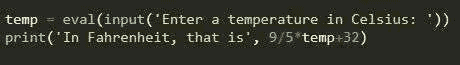

导航到 IDLE 的运行（Run）菜单并选择“运行模块（Run Module）”。如果你不想这样做，直接按 `F5` 即可。IDLE 会要求你保存文件，你应该继续操作。请确保在文件名后添加 `.py`，因为 IDLE 不会自动添加。`.py` 扩展名会告诉 IDLE 文件类型为 Python，从而包含颜色使程序更易读。

一旦保存了程序，它将在 shell 窗口中执行。程序会要求你输入温度。输入值 20 并按回车键（Enter）。程序的输出如下：

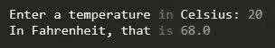

让我们看看程序是如何运行的。第一行要求用户输入温度。`input` 函数的作用是提示用户输入内容并存储用户输入的内容。引号内的部分是用户看到的内容。这被称为“字符串（string）”，它向程序用户显示的形式与代码本身中的完全相同。“eval”是一个函数，但在我们学习 Python 函数之前，你将不会理解它。所以现在，只需要知道它在我们想要获取数值输入时使用即可。

你将学习的下一个程序是计算用户输入的两个数字的平均值的程序。


Python 语言有一项强大的特性，被称为“行缩进（line indentation）”。Python 将此项特性应用于你很快就会学习的内容上。相反，其他地方的空格并不真正重要。例如，这些行的效果相同：


通常情况下，计算机将只根据你输入的命令运行，并且它们总是按照字面意思来解释内容。

另一方面，Python 根据逗号和括号的位置进行操作，这样它就能知道各项含义。它并不是一个能预测你任何意图的优秀语言，因此你需要准确。起初，将所有逗号和括号放在正确的位置听起来可能令人沮丧，但一段时间后，它会变得自然。即使编程了很久，仍然会忘记某些东西。幸运的是，Python 解释器会帮助显示你出错的地方。

## 接收输入

`input` 函数是程序通过程序接收用户信息的简单方法。例如：


标准语法：

`变量名 = input(给用户的消息)`

当你想要从用户处获取文本时使用此结构。但是，如果你想从用户处获取数字并用于计算，你必须额外操作。查看此示例：


`eval` 函数会将用户输入的文本转换为数字。它的一个非常棒的特性是你可以输入诸如 `2*4+9` 这样的表达式，`eval` 将为你确定结果。

**注意：** 当你运行程序时似乎没有任何反应，请按回车键（Enter）。有时这只是 IDLE 的一个故障，它经常获取输入。

## 打印

考虑以下示例：

`print('Hello')`

`print` 函数的参数周围应该用括号括起来。任何引号内的内容将按照其出现的形式精确显示。在第一个程序中，它将打印 `4+2`，而第二个将打印 8。

```python
print('4+2')
print(4 + 4)
```

为了同时显示不同的内容，你需要使用逗号来分隔这些项。然而，Python 会自动在项之间插入空格。例如：


# 第 3 章 Python 中使用的数据类型

编程涉及处理不同类型的数据。Python 程序使用代表不同数据类型的对象。对象可以是内置的、程序员定义的，或者从库或模块导入的。

Python 提供了以下数据类型：

- 数字 (numbers)
- 字符串 (strings)
- 布尔值 (boolean values)
- 列表 (lists)
- 元组 (tuples)
- 字典 (dictionaries)

## 数字

Python 3 中有 3 种数值数据类型：

- `int`
- `float`
- `complex`

### 整数 (`int`)

整数是不带小数点或小数部分的整数。这种数值类型在 Python 3 中可以有无限的大小，并包括零、正数或负数。Python 支持普通整数、二进制、八进制和十六进制字面量。

#### 普通整数

示例：`0, 25, -50, 56732164987123`

#### 二进制字面量（底数为 2）

通过 `0b` 识别二进制字面量，后面跟大写或小写的 `b`。

示例：

```python
>>> 0b1010
10
>>> bin_lit = 0b1010
>>> print(bin_lit)
10
```

#### 八进制字面量（底数为 8）

通过 `0o` 识别八进制字面量，后面跟大写或小写的 `o`。

示例：

```python
>>> 0o24
20
>>> oct_lit = 0o24
>>> print(oct_lit)
20
```

#### 十六进制字面量（底数为 16）

通过 `0x` 识别十六进制字面量，后面跟大写或小写的 `x`。

示例：

```python
>>> 0xFF
255
>>> hex_lit = 0xFF
>>> print(hex_lit)
255
```

### 整数（转换为字符串）

使用 `oct()`、`bin()` 和 `hex()` 函数可以将整数转换为所需的字符串。

例如，这里是如何将整数 50 转换为八进制、二进制和十六进制：

整数转八进制：`oct(50)`

整数转二进制：`bin(50)`

整数转十六进制：`hex(50)`

### 浮点数 (Floats)

浮点数带有小数点和小数部分的实数。

示例：`10.75, 98734.24, 1.0, 58`

### 复数

复数是实部和虚部的对。它的编写格式为 `a + bj`，其中 `a` 和 `b` 是浮点数，`j` 代表 -1 的平方根，即虚数。

例如：


```
>>> x = 4 + 5j
>>> y = 2 - 2j
>>> xy = x + y
>>> print(xy)
(6+3j)
```

虽然 Python 可以直观地处理混合数字类型的转换，但语法可能需要显式转换。使用正确的关键字和参数将强制 Python 执行转换。

- 整数转浮点数：`float(55)` -> `55.0`
- 浮点数转整数：`int(95.5)` -> `95`
- 整数转复数：`complex(50)` -> `(50+0j)`
- 浮点数转复数：`complex(20.5)` -> `(20.5+0j)`
- 数字对表达式转复数：`complex(4, 2)` -> `(4+2j)`

## 字符串

字符串是有序的 Unicode 字符序列，可以由字母、数字、特殊符号或这些类型的组合组成。字符串是一种不可变的数据类型，这意味着一旦通过赋值创建，你将无法再修改它。

字符串在赋值语句中定义，并用一对单引号或双引号括起来。

```python
>>> string_1 = 'A string is immutablе.'
>>> string_2 = "A string is a sеquеncе."
```

如果用单引号包裹的字符串内部使用了单引号，你必须在单引号前面加上一个反斜杠来转义该单引号。

例如：

```python
>>> string_nеgativе = 'I don\'t havе any idеa.'
```

当你打印`string_nеgativе`时，屏幕将显示：

```python
>>> print(string_nеgativе)
I don't havе any idеa.
```

同样，当整个字符串用双引号包裹时，你需要用反斜杠来转义字符串内部的双引号。

例如：

```python
>>> doublе_quotе = "Shе rеmindеd еvеryonе: \"You arе supposеd to usе a backslash to еscapе a doublе quotе insidе doublе quots.\""
```

这是你打印`doublе_quotе`时的输出：

```python
>>> print(doublе_quotе)
Shе rеmindеd еvеryonе: "You arе supposеd to usе a backslash to еscapе a doublе quotе insidе doublе quots."
```

当你需要在字符串中使用反斜杠作为字符时，同样的原理也适用。

### 访问字符串值

可以使用方括号或索引运算符`[]`来访问字符串。初始字符或子字符串的索引为零，其余部分顺序编号。

为了说明字符串索引，首先通过赋值字符串“Programmer’s Handbook”定义变量`nеw_string`。

```python
>>> nеw_string = "Programmеr's Handbook"
```

访问`nеw_string`的第一个字符：

```python
>>> nеw_string[0]
'P'
```

访问`nеw_string`的第 7 个字符，在方括号内放入 6：

```python
>>> nеw_string[6]
'm'
```

访问索引为 12 的子字符串（一个空格）：

```python
>>> nеw_string[12]
' '
```

要访问字符串中的最后一个字符，可以使用`len()`函数或负数索引。

`len()`函数用于确定字符串中有多少个字符。一旦你有了这些信息，只需减去 1 即可得到字符串中最后一个字符的索引。

语法为：`string[len(string)-1]`

例如：

```python
>>> nеw_string[len(nеw_string)-1]
'k'
```

访问最后一个字符更简单的方法是使用负数索引，其中最后一个字符的索引为 -1，倒数第二个字符为 -2，依此类推。

```python
>>> nеw_string[-1]
'k'
>>> nеw_string[-4]
'b'
```

### 获取字符串的长度

字符串的长度或大小指的是组成字符串的字符数。内置函数`len()`用于确定字符串的长度。

例如：

```python
>>> string_a = 'Programming'
>>> len(string_a)
11
```

### 字符串切片

切片运算符`[:]`用于从给定字符串中创建子字符串。方括号内的冒号用于分隔两个索引。第一个数字表示将作为子字符串起始字符的索引。第二个数字表示从原始字符串中要丢弃的第一个字符。

例如，这是原始字符串：

```python
>>> string_1 = "Philosophy"
```

要显示新的子字符串 'sop'，在方括号内提供索引 5 和 8：

```python
>>> string_1[5:8]
'sop'
```

如果你想让子字符串从与原始字符串相同的字符开始，可以省略第一个索引。当你想让子字符串在与原始字符串相同的字符结束时，规则相同。例如：

```python
>>> string_1[0:5]
'Philo'
>>> string_1[5:]
'sophy'
```

注意，由于字符串是不可变的，对其进行的任何操作都不会更改存储在变量中的字符串。例如，如果你打印`string_1`，Python 将显示原始值。

```python
>>> print(string_1)
Philosophy
```

### 字符串拼接

`+`可以将多个字符串合并为一个字符串。示例：

```python
>>> string_1 = "Stеphn King"
>>> string_2 = "author"
>>> string_3 = "supеrnatural fiction"
>>> string_4 = "fantasy"
>>> string_1 + " is an " + string_2 + " of " + string_3 + " and " + string_4.
'Stеphn King is an author of supеrnatural fiction and fantasy.'
```

### 重复字符串

可以使用运算符`*`和数字来重复字符串或拼接字符串。例如，将字符串`string`重复 3 次：

```python
>>> "string" *3
'stringstringstring'
```

可以在变量中存储相同的字符串并应用运算符`*`：

```python
>>> my_string = "string"
>>> my_string *3
'stringstringstring'
```

### upper() 和 lower() 函数

`upper()`和`lower()`函数用于显示大写或小写的字符串。例如，通过赋值字符串`animal`：

```python
>>> animal = "elephant"
```

显示全大写字符串：

```python
>>> print(animal.upper())
ELEPHANT
```

如果你想显示全小写字符串：

```python
>>> print(animal.lower())
elephant
```

`upper()`和`lower()`函数的使用不会更改存储在变量`animal`中的值。可以通过打印变量来证明：

```python
>>> print(animal)
elephant
```

### str() 函数

在某些情况下，你可能需要将整数或浮点数等非字符打印为字符串。Python 提供了`str()`函数允许将非字符转换为字符串。例如，假设变量`my_num`为整数 85，当你需要打印它时可以使用该变量作为参数。

因此，为了打印字符串`My employee number is 85.`，你可以输入以下语句：

```python
>>> print("My employee number is " + str(my_num)+ ".")
```

输出将是：

```
My employee number is 85.
```

再次，使用`str()`函数将整数转换为字符串不会影响变量`my_num`的值。可以通过对变量使用`type()`函数来证明：

```python
>>> type(my_num)
<class 'int'>
```

## 列表

列表是一种可变序列类型。它是 Python 中最常用的数据类型之一。作为一个灵活的容器，它可以包含任何类型的数据或项目，这些项目可能相同也可以不相同。它还可以存储任意数量的数据。

要创建一个列表，可以将方括号内的值赋值给变量。

创建一个空列表：

```python
item_list = []
```

创建一个列表，你将使用以下语法：

```python
my_list = [item1, item2, item3, item4]
```

### 访问列表项

列表的索引方式与字符串类似，都从零开始。例如，如果你想访问`list_1`的第一个项：

```python
>>> print(list_1[0])
apple
```

访问`list_1`的第三项：

```python
>>> print(list_1[2])
orange
```

要打印列表的最后一项，可以使用负数索引：

```python
>>> print(list_1[-1])
elephant
```

### 在列表使用 len() 函数

`len()`函数用于获取列表的项目数量：

```python
>>> len(list_1)
```

### 从列表中移除项

`remove()`函数用于从列表中删除指定的元素。

语法：`my_list.remove(value)`

为了，创建一个包含以下元素的列表`my_list`：

```python
my_list = ['cat', 'dog', 'monkey', 1, 8, 10, 15, 24.5, 1.75]
```

假设你想移除值 'horse' 以及整数 1 和 10，你可以这样使用`remove()`方法：

```python
>>> my_list.remove('horse')
>>> my_list.remove(1)
>>> my_list.remove(10)
```

查看`my_list`中剩余的值：

```python
>>> print(my_list)
['cat', 'dog', 'monkey', 8, 15, 24.5, 1.75]
```

参考上述示例，你可以通过以下方式向`my_list`中添加字符串 'python'：

```python
>>> my_list.append('python')
```

查看更新后的`my_list`：

```python
>>> my_list
['cat', 'dog', 'monkey', 8, 15, 24.5, 1.75, 'python']
```

字符串 'python' 被添加在了列表的末尾。假设你想在字符串 'dog' 和 'monkey' 之间添加一个新字符串 'elephant'，你需要使用`insert()`方法。

语法为：`list.insert(index, object)`

在 'dog' 和 'monkey' 之间插入 'python'：

```python
>>> my_list.insert(2, "elephant")
>>> my_list
['cat', 'dog', 'elephant', 'monkey', 8, 15, 24.5, 1.75, 'python']
```

### 排序列表中的项

`sort()`方法用于排列或排序列表中具有相似数据类型的项目。语法为：`list.sort()`。

例如，创建一个名为`num_list`的列表并包含数值：

```python
>>> num_list = [2, 10, 5, 3, 19, 4.5, 7.25, -2, 0]
```

要按升序排序`num_list`中的元素，你可以输入表达式：

```python
>>> num_list.sort()
```

现在，查看`num_list`的内容：

```python
>>> num_list
[-2, 0, 2, 3, 4.5, 5, 7.25, 10, 19]
```

`num_list`的元素现在按升序排列。你可以使用`reverse()`方法按反序排列项目。其语法为：

`list.reverse()`

因此，要将`num_list`按降序排列：

```python
>>> num_list.reverse()
>>> num_list
[19, 10, 7.25, 5, 4.5, 3, 2, 0, -2]
```

## 元组 (Tuples)

元组和列表一样，是一种序列类型，包含一个有序的项集合。与列表不同，元组是不可变的。

元组的元素被包含在括号中。然而，括号是可选的，你可以在没有括号的情况下创建元组。元组可以包含不同类型的项。像列表一样，元组也可以存储任意数量的项。

### 创建元组

创建元组就像将一组项分配给变量一样简单。

示例：

数值：`mytuple_1 = (1, 3, 5, 7, 9, 11, 13)`

字符串：`mytuple_3 = ("ruby", "gold", "diamond")`

混合类型：`mytuple_2 = ("Python", 2.50, 7)`

Python 同样允许创建嵌套元组：

`mytuple_4 = ("collection", (10, 20, 30), [2, 4, 6])`

可以创建一个包含单个项的元组，前提是在项后面放置一个尾逗号，以指示它是一个元组而不是字符串。

`mytuple_5 = ("members",)`

也可以创建一个空元组：

`empty_tuple = ()`

这里是一个没有括号的元组示例。

`my_tuple = 7, 14, 21`

### 访问元组元素

有多种方法访问存储在元组中的项。

- **索引 (Indexing)**：索引运算符`[]`用于指定你想要访问的项对应的索引。像其他有序数据类型一样，索引从零开始。例如，创建一个以字符串作为对象的`tuple_new`：

  `tuple_new = ('m', 'u', 'i', 'a', 'l')`

  - `tuple_new[0]`获取第一个项 'm'
  - `tuple_new[3]`获取第四个项 'a'
  - `tuple_new[-1]`获取最后一个项 'l'

- **切片 (Slicing)**：切片运算符用于访问元组中范围内的项。例如：

  - `tuple_new[1:4]`获取索引 1 到 3 的项：('u', 'i', 'a')
  - `tuple_new[:3]`获取从开始到索引 2 的项：('m', 'u', 'i')
  - `tuple_new[3:]`获取从索引 3 到结束的项：('a', 'l')

## 数据分析中的框架与循环

然而，数据分析的过程并没有被妥善地记录。虽然有很多关于统计学的书籍，但没有哪本书试图解决如何创建一个真实世界中的数据分析解决方案。框架的使用可以加速开发，因此，开发变得更快、更快捷、更高效。大多数 Web 框架的成本很低。框架具有强大的安全实现能力。使用框架最大的好处实际上源于其背后的社区。

另一方面，设计一个重要的框架涉及到使用抽象语言对数据分析元素进行分类。在某些情况下，这种语言可能是数学。相反，分析中相同的细节使得每项分析都变得复杂而有趣。

### 分析循环

你可能会观察数据分析并认为它遵循一个线性的、一步步进行的过程，并有良好的结果。然而，数据分析是一种迭代且非线性的方法，由一系列周期表示。在这种方法中，每一步都会学习到信息，然后决定是重新执行并改进已经执行的下一步，还是进入下一个步骤。

当涉及到分析数据时，迭代过程用于数据分析的所有步骤中。此外，由于封装在不同软件中的算法，某些数据分析可能看起来固定且线性的。

因此，理解“数据分析”这一术语的含义非常重要。虽然数据研究涉及创建和实施数据收集计划，但数据分析假设数据已经收集完毕。最重要的是，一项研究将涉及假设的创建、数据收集程序的设计、数据的收集以及对数据的解释。然而，由于数据分析假设数据应该已经收集完毕，它涉及到问题的开发和完善，以及分析和解释数据的过程。

### 数据分析有五项主要活动：

1. 陈述并完善问题
2. 探索数据
3. 创建正式的统计模型
4. 解释结果
5. 传播结果

以上所有活动发生在不同的场合。例如，你可能在一天内完成所有活动，但在超过一个月的时间内详细处理每项活动。所以，让我们看看应用于这些活动中的整体框架。

虽然在执行数据分析时可以参与许多不同类型的活动，但整个过程的每个方面都可以通过交互过程完成。最重要的是，对于上述五项活动中的每一个，建议包含以下步骤：

1. 定义或设定预期
2. 收集信息并将数据与你的预期进行比较
3. 如果数据不符合你的预期，则修改或修复数据，使你的预期和数据相匹配

完成上述所有三个步骤被称为数据分析循环。当你穿过分析的每个阶段时，你将被要求通过周期不断地修正你的问题、正式模型、解释和传播。对这些主要活动的重复循环构成了数据分析最大的部分。

#### 定义预期

在这一步中，你在执行任何操作（如执行程序、检查数据或输入命令）之前，会有意地设定你的预期。对于经验丰富的数据分析师来说，创建预期可能是自动或无意识的过程。尽管如此，思考它仍然非常重要。例如，如果你要和朋友去购物，你必须停在 ATM 取一些钱，你需要决定想要提取的金额。你对将要买的东西的价格有一些预期。如果你知道将要购买的产品价格，这可能不是你的问题。这就是先验知识的例子。另一个先验知识的例子是知道特定餐厅的营业时间。利用这些信息，你可以安排你的时间和活动，以便在关闭前赶上晚餐。你还可以从朋友那里获得额外信息来帮助你形成预期，或者 Google 搜索餐厅以了解更多关于他们的工作时间。这种在应用先验信息预期实施分析的方法，与该过程中的每项主要活动是相同的。

#### 信息收集


这一步要求人们收集与问题或数据相关的信息。对于问题，通过文献研究或向专家请教来收集信息。对于数据，一旦你对检查数据时可能得到的结果制定了预期，就可以继续进行操作。这项活动的结果包括你需要收集的数据，以及确定收集的数据是否符合你的预期。

### 预期的比较

一旦你拿到了数据，下一步就是将你的预期与数据进行比较。在这里，有两种可能的结果：

1. 你的成本估算与账单上的金额匹配
2. 你的成本估算不匹配

如果成本估算和金额匹配，你就可以进入下一个活动。或者，如果你的预期成本是 60 美元，但账单是 30 美元，那么你的预期和数据就是不同的。在这种情况下，差异有两个可能的原因：首先，你可能预期错误，需要修正；其次，账单可能是错误的并包含错误。可以暗示你数据分析状态的一个关键指标，是将你收集的数据与原始预期匹配的难易程度。

### 体量、速度和多样性

大数据有各种“V”。主要的包括速度、多样性和体量。大数据超过了普通数据库的存储容量。生成的数据规模是巨大的。截至今天，产生了海量的数据。产生这一现象的原因是交互的增加。除了数据交易外，交互是一种新现象。数据交互来自浏览器活动、个人数字记录仪和地理位置。

随着“物联网”的到来，产生了海量数据，人类花费整个时间试图分析它们。

优秀的数据科学家应该知道如何控制体量。他或她应该知道如何创建能够智能利用数据大小的算法。当你拥有巨大数据时，事物有了新的方向，因为每个相似性都变得重要，人们很容易得出错误的结论。在大多数业务应用中，提取相关性就足够了。然而，正确的数据科学使用了基于这些相关性确定原因的技术。

数据速度将不断加速。许多用户以更高的速度生成 Facebook 帖子、推文和财务信息。速度增加了数据的体量并缩短了数据保留的时间。例如，高频交易活动依赖数据流和快速信息。但数据的真实性会迅速下降。

## 机器学习

机器学习指的是系统如何从其处理的各种类型的数据中学习。可以根据特定数据训练系统以做出决策。训练过程持续进行，以便系统能够进行更新并增强决策能力。使用垃圾邮件过滤器的系统是演示机器学习应用的极佳示例。这些系统使用贝叶斯过滤器来改变决策。

因此，它将继续走在垃圾邮件发送者面前。动态学习的能力非常重要，因为有助于防止垃圾邮件发送者利用过滤器。信用卡审批使用神经网络，是机器学习技术的一个极佳示例。此外，与判断相比，机器学习更青睐于数据。因此，一个优秀的数据科学家应该同时具备这两种能力。机器学习帮助找到了人们感兴趣的问题答案，并进一步证明自己是一个游戏规则的改变者。让机器学习非常有趣的地方在于机器智能的四个特征：

1. 它建立在强大的理论突破基础之上
2. 它重新定义了当前的经济范式
3. 最终结果是商品化
4. 它从数据科学中挖掘新数据

## 监督学习与无监督学习

系统学习主要有两种广义的方式：监督学习和无监督学习。

监督学习是指系统根据输入的数据类型来做出决策。自动化信用卡审批和垃圾邮件过滤器应用监督学习来实现其功能。系统被提供了输出和输入的历史数据样本。基于这类数据，系统利用机器学习技术建立两者之间的关系。你需要使用自己的判断力来选择处理任务的最佳技术。

无监督学习发生在你只有输入数据（`X`）而没有相应输出变量的情况下。无监督学习的目标是建立数据底层结构的模型，以便你了解更多数据信息。它之所以被称为无监督学习，是因为没有正确答案和老师。算法被留用来决定并发现数据中有趣的结构。

聚类分析是无监督学习的一个示例。聚类分析选择一组具有不同属性的实体，并根据属性实体之间的远近程度划分实体空间。这将通过使用额外标签标记数据对数据进行重新排列和重新定义。因子分析是无监督学习技术的一部分。

## 预测与预报

数据科学涉及预测和预测。然而，两者之间存在区别。预测侧重于突出单一结果。如果一个人说“明天会很冷”，他或她做出了一个预测。但如果他们说“明天天冷的概率是 40%”，他们就是做了一个预报。这是因为预报是以概率的形式提供结果。

# 第 5 章 Python 中的面向对象编程

面向对象编程（`OOP`）是一种模型，程序围绕对象或数据组织，而不使用函数和逻辑。一个对象有其独特的行为和属性。在面向对象编程中，传统的编程方法被反对了，而重点在于逻辑是如何编写的，而不是在逻辑内部定义数据。对象的示例从人类等物理实体到小型程序不等。

程序员专注于第一步，即数据建模，在建模过程中，识别出所有需要操作的对象，并确定对象之间的相互关系。使用框架可以加速开发，因此开发变得更快、更快捷、更高效。大多数框架都可以低廉的价格获得。框架具有强大的实现。使用框架的最大益处实际上归于其背后的社区。在 `OOP` 中，开发者关注对象操作，而不是操作它们所需的逻辑。这种方法非常适合编程，特别是对于那些复杂、规模更大且活跃维护的程序。使用框架可以加速开发，因此开发变得更快、更快捷、更高效。大多数框架都可以低廉的价格获得。框架具有强大的实现。使用框架的最大益处实际上归于社区。

开源组织也支持面向对象编程，允许程序员为此类项目成果贡献，从而实现协作开发。此外，面向对象编程的额外益处包括代码的可扩展性、可重用性和效率。

### 面向对象编程的原则

面向对象编程涉及许多原则。在此处讨论了其中一些：

- 封装
- 继承
- 抽象
- 多态

### 封装

每个对象的状态和实现都存储在定义的类内部，但是是私有的。其他对象只能通过调用公共函数列表来访问此类。否则，对象无法访问此类或拥有进行更改的权限。这种数据隐藏的编程特性避免了无意的数据损坏，并提供了更高的程序安全性。

### 继承

面向对象编程（`OOP`）确保了更高水平的准确性并减少了开发时间。面向对象编程的另一个属性导致了更彻底的数据分析。对象之间建立了父子类关系，可以分配并允许开发者在维护独特层次结构的同时重用通用逻辑。这一属性带来了更彻底的数据分析、高准确性和节约时间。

### 抽象

对象仅揭示内部机制。这对于其他对象的使用很有帮助且相关。由于此，开发者建立的概念可以支持随着时间的推移更容易地进行更多添加或做出更改。

### 多态

根据上下文，允许对象呈现超过一种形式。由程序来决定对象每次执行时的含义和用法，减少了对重复代码的需求。

### 对面向对象编程的批评

开发者出于多个原因对面向对象编程表示批评。面向对象编程的一个主要担忧是它不关注计算或算法。面向对象编程的代码可能编写起来更复杂，编译时间更长。但开发者也为这些复杂性找到了替代方案。替代方案包括：

- 函数式编程
- 令式编程
- 结构化编程

然而，只有最先进的编程语言允许开发者获得组合它们的选项。

## 作为面向对象编程语言的 Python

Python 语言被广泛作为面向对象编程用于 Web 应用开发。根据调查，90% 的程序员倾向于使用 Python 语言而非其他语言，原因有很多。它的简单性、可读性和易于接口交互是其受青睐的主要原因。

使用 Python 语言进行应用开发也需要一些框架，借助这些框架，开发者可以更轻松地开发。最常用的框架包括 `Django`、`CherryPy`、`Pyramid`、`Flask`、`Qt`、`PyGUI` 和 `Kivy` 等。这些框架的使用取决于项目的性质和需求。这些 Python 框架可以帮助以最少的精时间和精力构建复杂的应用程序。

Python 是许多软件开发过程中一种流行的脚本语言。此外，Python 可以以一种经济高效的方式将不同的系统集成在一起。

## 类与对象

现在我们已经掌握了 Python 代码的一些基础知识，是时候进入我们的第一个主题了：与类和对象一起工作。这两个主题非常重要，因为它们将确保你代码中的所有内容都处于正确的位置。你的对象是帮助定义代码某些部分的组件，以便代码组织良好且易于理解。所有对象都有某些共同点，它们会被放置在同一个类中，帮助你的代码按照预期的方式运行。

在处理对象时，有很多内容需要理解，但最重要的一点是每当你将某些对象放在同一个类中，它们应该具有某些共同点。你可以把任何东西放在同一个类中，但最好的方法是将相似的对象放在同一个类中。这会为整个过程增添一些秩序。把这个过程想象成整理衣柜。你必须确保你的衣柜是有序的：将鞋子放在一个区域，将衣服挂在另一个区域，将包放在一起，然后为所有散乱的额外物品留一个地方。通过这个过程，你可以确保一切看起来都很漂亮，而且以后更容易找到。

在处理类时，原理是相同的。你希望将相似的对象放在同一个类中，以便以后更容易找到它们。当这些对象相似时，程序的运行效率会更高，而不是将互不相关的对象随机地放在同一个类中。为了更易理解，你应该将对象看作是你正在编写的代码的不同方面和部分，而类就像是用来用来存储这些对象的容器。你可以轻松地根据任何你想要创建一个类，然后将匹配的相似对象添加到该类中。你可以为该类选择任何你喜欢的标签，只需确保该标签对于你想要放入类中的对象类型来说是有意义的即可。当有人查看这个类时，他们应该很好地了解你里面放了什么，而且所有的对象也应该符合那个标签。

如果这对你来说是一个新概念，而且你刚刚开始学习一种新的编程语言，那么对象和类是一个很好的起点，因为它们在帮助你学习更多知识的同时，还能确保你所工作的代码中一切保持井然。你的任务是学习如何创建这些类，然后将对象放入其中，以便代码以正确的方式运行。让我们看看在 Python 中这是如何工作的。

## 如何创建一个新类

现在我们已经对这些对象和类有了初步介绍，是时候让你学习如何创建自己的类的步骤了。你必须这样做，因为你会发现如果不这样做，在 Python 中开始任何事情都是困难的。一旦你准备好创建这些类所需的语句，就应该创建一个新定义。你需要首先放置正确的关键字来获取它，然后紧接着加上类名（你它起的名字）。之后将跟着一个放在括号中的父类。另一个你应该考虑的点是，在第一行的末尾你需要添加一个冒号。虽然没有冒号你的代码也可以运行，但这被认为是一种礼节，所以你必须确保它的存在。

### `genericVehicle.Display()`

在我们继续之前，请花时间打开你的编辑器并编写这段代码，以免忘记。在编写过程中，你应该会注意到这段代码中出现了一些我们之前讨论过的几个基础知识。你还将看到对象的定义、方法的定义、析构函数、你需要的不同属性以及一些普通函数。由于这是我们的第一个代码，让我们稍微拆解一下，以便你能够理解并更好地如何用这种语言进行编写。

### 类定义

你需要在这里编写对象实例化和类定义，以确保在放入代码时语法是正确的。这些部分非常重要，因为它们是代码中告诉编译器应该做什么以及哪些命令是重要的部分。如果你想在代码中调用新类定义，只需使用 `object.attribute` 或 `object.method()` 函数，它就能完美地工作。

### 特殊属性

在上面的代码中，你可以关注的下一个点是你希望代码为你识别的特殊属性。这些特殊属性让你感到放心，因为你可以知道该属性何时会被看到，并确保它以正确的方式使用，以防止代码变得混乱。Python 中有很多很好的属性可以使用，但对于初学者来说的一些包括：

- `__bases__`：这被认为是一个包含任何父类的元组（tuple）
- `__module__`：这是你找到模块名称的地方，它也会包含你的类
- `__name__`：这将保存类名
- `__doc__`：这是你找到类内部文档字符串引用的地方
- `__dict__`：这将是类内部字典的变量

#### 如何访问类成员

现在我们需要查看如何访问类的成员。为了确保你的文本编辑器和编译器能够识别类并执行你想要的部分，你必须确保该代码配置正确以访问该类的所有成员。你会高兴地发现有几种方法可以实现这一点，所有的方法效果都很好，但访问器方法是通流行且最高效的方法。

在 Python 语言中进行并发处理时（特别是用 C 语言编写的 Python 引用实现 CPython），关键在于 `GIL`。`GIL` 机制是一种保护 Python 对象访问的死锁机制，防止在多个线程同时执行 Python 字节码。CPython 使用引用计数来实现内存管理。这导致了多个线程可以同时访问并执行 Python 代码的情况；而这种情况是不可接受的，并且可能导致错误的数据处理，我们称这种内存管理方式不是面向多线程管理的。为了解决这个问题，引入了 `GIL`，正如其名称所示，这是一个特定的锁，只允许一个线程访问代码和 Python 对象。然而，这也意味着为了在 CPython 中实现多线程程序，开发者必须意识到 `GIL` 的存在并绕过它。这正是许多人在 Python 中实现多进程系统时会遇到问题的原因。

## 为什么选择 Python

Python 提供的海量开发工具促使越来越多的开发者开始使用 Python 编程，这使得 Python 更加流行和易于使用；我称之为 Python 的**恶性循环**。DataCamp 的研究主管 David Robinson 写了一篇关于 Python 惊人增长的博客文章，并称其最流行的编程语言。

然而，Python 是慢的，至少比其他流行的编程语言慢。这是因为 Python 是一种动态类型语言，其解释时的值并非存储在紧凑的缓冲区中，而是存储在分散的对象中。这是 Python 可读性和易用性的直接结果。遗憾的是，有多种方法可以让你的 Python 程序运行得更快，其中并发是最困难的之一；而这正是我们将在书中掌握的内容。

## 定制你的 Python 环境

在继续之前，让我们先回顾一些关于如何配置书中将使用的必要工具的描述。包括获取适用于你系统的 Python 分发版和合适的开发环境，以及如何下载书中所有章节示例所需的代码。

## 通用安装

让我们来看获取系统特定 Python 分发版及相应开发环境的过程：

所有开发者都可以从 `https://www.python.org/downloads/` 获取自己的 Python 分发版。

尽管 Python 2 和 Python 3 两个版本都受到了支持和维护，但在本书中我们将使用 Python 3。

对于这本书来说，一个灵活的选择是 IDE（集成开发环境）。虽然可以使用 Notepad 或 TextEdit 等极简文本编辑器开发 Python 应用程序，但使用专门为 Python 开发的 IDE 来读和写代码通常要容易得多。它们包括：`IDLE`、`PyCharm`、`Sublime Text` 和 `Atom`。

现在你已经学习了并发和并行编程的基础。这一切都涉及到命令和指令的设计与结构化编程，以便程序的不同部分能够以某种有效的方式执行，同时共享相同的资源。由于某些命令和指令是同时执行的，节省了时间与传统的顺序编程相比，并行编程显著提升了程序的执行效率。

然而，在设计并行程序时，应该考虑各种因素。虽然某些任务可以很容易地分为可以并行执行的独立部分（惊人的并行任务），但另一些任务需要命令之间不同类型的协调，以便正确且高效地应用共享资源。还有一些任务具有内在的顺序处理特性，这些任务可以通过并发处理和并行来实现加速。

最近，发生了一种范式转变，促进了现有编程中大多数方面并发处理的实现。协作处理仍在增长，并预计在未来将继续增长。因此，对于任何经验丰富的程序员来说，理解并发处理及相关概念，以及如何将这些概念集成到应用程序中是至关重要的。

另一方面，Python 是最流行（如果不是的话）的编程语言之一。它在大多数编程领域都提供了选择。以这种方式将协作处理与 Python 结合，是学习和掌握最重要的主题之一。

## 语言语义

因此，健壮的编程语言 Python 被认为具有高度的可读性。它的特征和视觉布局使其频繁和反复使用英语单词。相反，其他编程语言使用的不是单词而是标点符号。与 C 语言相比，它的语法异常较少。

## Python 在行业中的用途

Python 是一种流行的编程语言，特别是在 Web 开发领域。尽管主要在后端使用，但它与数据库的良好集成、良好的响应时间以及许多优秀的网络标准是它在行业中闻名的原因。著名问答平台之一的 Quora 使用大量的 Python 代码。

Python 被用于编写大型应用程序。像 Google、NASA 和 YouTube 这样的网站广泛使用 Python，特别是在其智能手机应用中。此外，美国的在线交易系统纽约证券交易所（NYSE）。Python 的其他使用方法和模式还有：

- 制作 RSS 阅读器
- `MySQL`
- 在 HTML 中创建日历
- 文件操作
- 在线应用程序、CGI 编程

此外，它还是一个被软件开发者广泛用于测试、检查构建控制以及管理的著名工具。此外，对于任务集成，Python 是公司使用的语言。我们可以以 3D 软件 Maya 为例，它利用 Python 进行复杂的集成以及小型用户任务的自动化。

## Python 的应用

像 Python 这样的语言并不总是用于渲染一个独特的产品，但当然，它被用于驱动创建此类产品的工具。例如，看看使用智能内部系统的公司。它们不需要编译型语言。

此外，这种语言在开发软件和游戏的公司、语言开发、Web 框架等许多领域得到了广泛的应用。这使得 Python 相比于其他编程语言具有优势，这也是它在行业中成功的原因。让我们深入探讨 Python 在行业中的一些优势。

- 提供对大型标准库的支持，这些库配备了许多操作，如 Web 服务工具、互联网、协议和操作系统接口。
- 它也被用于集成企业应用集成（EAI），这使得通过调用如 CORBA 或 COM 组件来开发 Web 服务变得可能可行且便利。它的控制能力非常强大，可以直接通过 `C++`、`C` 以及通过 Jython 上的 `Javascript` 进行调用。
- 它仍然可以处理 XML 和其他语言，因为可以使用相同的字节码在现代操作系统上轻松地运行和操作。
- 它具有提高编程生产力的能力。清晰且面向对象的设计在利用类似 Perl、Java、C 和 `C++` 等语言的同时，将程序的生产力提高了两倍到十倍。
- 集成功能非常强大，其单元测试和增强的控制能力提高了大多数使用 Python 应用的效率，而重要的一点是可扩展性，这使得该语言成为协议网络应用的绝佳选择。
- 在当今时代，大数据对于大公司变得极其重要，特别是对于业务而言。因此，在涉及数据处理时，数据科学家倾向于使用 Python 作为操作工具。这是 Python 成为大数据领域最佳编程语言（PL）的唯一原因。
- 所以对于构建分析工具，数据科学家发现 Python 是最合适的。此外，由于在当今时代数据是赚钱的来源，Python 的使用不容忽视，并应该被纳入你的执行计划中。
- 它在机器学习领域尤其受青睐，而这是目前全球领先的业务之一。先进的机器学习可以进一步用于业务中的大量任务。


最后，我们应该谈谈网络安全，这在当今世界的数字时代非常重要，因为我们的货币交换已经数字化，拥有强大的网络安全来防御黑客尝试是非常重要的。根据 Python 网络安全性能的调查，它是目前行业中的明显赢家。

除了上述所有内容外，该语言的另一个大特性是 Python 是完全免费的，你不需要为它支付一分钱。此外，这意味着扩展的支持模块、工具和库集都是免费的。它的许多集成开发环境都是免费的，如 `Eclipse`、`PyDev`、`PTVS` 和 `Spyder Python` 等。

所以这些是让 Python 成为企业和行业最佳选择的原因。我认为，如果没有 Python，这些科技巨头在影响力和当然还有金钱实力方面将不会如此强大。它将在未来几天内引发下一次物联网（IoT）热，最重要的是在机器学习领域。

Python 编码语言是你在编程时可以选择的最佳选项之一，特别是当你想要从事机器学习时。Python 是一门非常简单学习的语言，由于它的简单性，通常是初学者学习的第一门语言。但不要被它骗了。简单并不意味着它不具备你所寻找的力量和强度。

在从 `python.com` 安装 Python 程序后，你想做的第一件事就是下载合适的 IDE。这是一个使用 Python 的绝佳环境，将为你提供所需的所有帮助。它还包含了安装区域、编辑器和调试工具。这个 IDE 易于安装、轻量，并且有许多你会喜欢的棒极工具。它还有有自己的命令行，所以你可以安装一些第三方软件。有了这个 IDE，你就不需要单独安装 Python 环境了。

要下载 Anaconda，需要完成几个步骤。你将看到在 Windows 电脑上安装时使用的步骤，但在 Linux 或 Mac 上安装的步骤大大相同：

1. 首先，访问 `https://www.anaconda.com/download/`。

2. 从这里，你将被引导到主页。你需要选择 Python 3.6，因为它是最新版本。点击“Download”获取可执行文件。下载需要几分钟，但取决于你的网络速度。

3. 一旦下载了可执行文件，你可以进入下载文件夹并运行该文件。当你运行此文件时，你应该会看到安装向导出现。点击“Next”按钮。

4. 然后将出现许可协议对话框。在点击“I Agree”按钮之前，花一分钟阅读一下。

5. 在“Select Installation Type”框中，勾选“Just Me”单选按钮，然后点击“Next”。

6. 在继续之前，你想要选择要使用的安装目录。你应该确保安装目录中有大约 3 GB 的空间。

7. 现在你将处于“Advanced Installation Options”对话框。你想要选择“Register Anaconda as my default Python 3.6”，然后点击 Install。

8. 之后你的程序将通过最后几个步骤，IDE 将安装在你的程序中。

如你所见，在 Python 中设置环境可以是非常简单的，使用时不需要非常复杂。你也可以选择与其他形式的 IDE 一工作，如果你已经在电脑上设置好了一个，也可以正常工作。

### 如何开始学习 Python

我对初学者的建议是去尝试，不要纠结于细节。即使你已经做过任何与机器学习相关的工作，也可以尝试 `scikit-learn`。你将了解到标记、训练和测试循环是如何工作的，以及模型是如何创建的。

机器学习的另一种尝试可以从 `keras` 开始——它通常被认为是最简单的结构——并看看它能带你去哪里。当你有了更多经验后，你将开始意识到对结构的需求：更显著的速度、备选的 API，或者其他，从而做出更明智的选择。

Python 是一种主流且易于使用的语言。Python 是一套完整的语言和框架，既用于创新工作，也用于创建时代性的框架。

同样，有大量的模块和库需要学习，这为完成每项任务提供了多种方法。这可能会让人无从从备。

开始使用 Python 进行机器学习最理想的方法是理解该语言的一些基础性性原理。

它将迫使你引入并开始接触 Python 介器。它将为你提供一个如何完成微小任务的全局视角（万英尺视角）。它将赋予你信心去处理自己特定的微小任务。

初学者需要从一个从头到尾的小项目开始。

书籍甚至许多在线 Python 课程可能会让人有些困惑。其中大部分内容会给你大量的公式和片段；然而，你很少有机会看到拼图的所有碎片是如何拼凑在一起的。当需要应用你所学的内容并学习其他特定的数据集时，你正在获得一个心理成长的机会。

让 Python 如此易于使用的常见任务包括：

- 确定问题
- 收集数据
- 分析算法
- 增加正面结果
- 定义结果并展示它们

面对学习陌生平台或语言时，最简单的方法就是永不放弃，并坚持研究一个机器学习案例，直到结束。只需务必记录在此过程中教授的所有关键点和技术。特别要关注数据加载、数据摘要、如何评估不同的算法以及如何得出某些预测。

如果你无法做到这一点，每个数据集中都有一个供你使用的模板。尝试一种名为 Iris Dataset（鸢尾花数据集）的新工具；对于刚开始学习机器学习的人来说，它是最简单的。这是一个很棒的项目，因为它的界面易用。属性通常是数值型的，这意味着你必须弄如何加载加载管理所有数据。由于其计算性质，用户可以使用更简单的 Python 公式或代码进行练习。这是一个多级安排问题（表面上），可能需要详细的方法。它只有四个属性和 150 行（此处应为样本），意味着它非常小，可以有效地加载到内存中。大多数数值属性具有相似的单位和量级，在开始之前，对于任何独特的缩放或更改都不是至关重要的。

我们应该从一个简单的 Python “你好世界”机器学习程序开始。在这一部分中，我们将从头到尾完成一个简单而有趣的编码示例。以下是本节中将发现的一些常见的 Python 特性：

- 介绍 Python 及其库
- 堆叠数据集
- 压缩数据集
- 视化数据集
- 评估一些计算
- 进行一些预测

根据需要花费的时间。完成每个进度。尝试自己输入这些命令，或者为了节省时间尝试对它们进行排序。

### 步骤 1：下载并安装

通过下载将 Python 和 SciPy 环境下载到你的计算机上。这假设你还没有安装它们。我倾向于不进行极其详细的介绍，因为有许多文章解释了如何这样做。

### 步骤 2：教学练习

此教学练习适用于 `2.7` 或 `3.5`。对此进行一些研究，这里是完成此用例需要安装的库列表：

- `matplotlib`
- `pandas`
- `sklearn`
- `numpy`

记住，引入 Python 库有许多方法。我对初学者的最佳建议是在开始时选择一个并保持一致。我发现 SciPy 页面为许多平台（例如 Linux、OS，当然还有 Windows）提供了安装和库介绍的极佳指南。该指南在全球范围内非常流行并被广泛使用。如果你在使用 Windows 环境，或者你不确定，我强烈建议你安装一个干净的 `Anaconda` 版本。它是一个免费、开源的管理系统，可以在 Windows、Linux 甚至 OS 上运行。它将帮助你打包和分发代码。

免责声明：我们下面看到的示例是基于你至少使用 `sklearn` 的 `0.1` 或更高版本的假设。Python 环境已正确下载、设置并为此示例项目正常运行。下面的代码脚本将帮助你测试工作环境，并自动导入此示例所需的每个不同库。在你的解释器中打开一个全新的命令行并输入以下单词。

我绝对建议仅在解释器中工作或预先编写程序，然后在命令行中运行所有程序，而不是在大型编辑器环境中运行。始终保持极其简单，专注于代码本身而不是工具。界面变化并不快；因此，如果你输出的是旧版本，请不要惊讶。这一切对你来说仍然应该是正确的；但是，如果你遇到任何类型的错误，请不要尝试继续。在开始阶段你可能不想学习修复代码。由于某些原因，你无法在无错误的情况下执行脚本；其余步骤将对你无效。网上有很多针对初学者的论坛。尝试搜索你的确切错误代码（带引号），以查看常见的解决方法是什么。尝试修复，如果对你来说足够容易处理，请务必这样做并回来完成其余步骤。

### 使用 Python 的基础

在我们开始更多的机器学习之前，我们需要理解 Python 语言的一些基础部分。

### Python 关键字

首先，我们需要查看 Python 语言中的一些重要关键字。正如你在其他编程语言中发现的那样，Python 有一组关键字，用于告诉你的文本编辑器做什么。

### 在代码中命名标识符

当你使用 Python 时，在命名代码的不同部分时遵循正确的规则是非常重要的。这些部分中的被称为标识符。这些可以有各种名称，如变量、类、实体和函数。在命名这些标识符时，你必须遵循一些规则，但无论你处理什么标识符，规则都是相同的。命名标识符需要遵循的规则包括：

- 你可以在标识符的名称中使用大写字母和小写字母。你也可以使用下划线符号和数字。上述字符的任何组合都是有效的，只需确保名称内部没有任何空格。因此，不要写出像‘My first program’这样的内容。你应该将其写为‘Myfirstprogram’。
- 你的标识符不能以数字开头。你可以在名称的任何地方使用数字，但它不能是程序的第一个字符。如果你将数字作为第一个字符，当你让编译器尝试执行时，你将会得到一个错误信号。你可以写像‘one program’这样的内容，但你不能将标识符命名为‘1program’。
- 标识符的名称不能包含 Python 关键字。如果你在名称中添加关键字，将会导致编译器困惑，你的程序将无法运行。

命名标识符的规则并不复杂。如果你不小心忘记了命名标识符的某条规则，编译器会注意到，你最终会得到一个语法错误。你只需要回去修复它，这个错误就会消失。

### Python 注释

你也可以在 Python 中使用注释。这些注释对于解释你的代码非常有用，特别是当你试图向另一个程序员或查看你代码的人解释它时。每当你的代码某部分需要一点说明时，你就可以添加注释。编译器不会识别注释，它会直接跳过它而完全不读取。一旦你告诉编译器注释结束，它将再次开始读取代码。执行代码的人不知道你写了多少条注释，甚至不知道你把它们放在了程序的什么位置。

写出你想添加到代码中的注释非常简单。你只需要在想要写的注释前面使用（##）符号即可。所以，你可以写出像 `#this is my Python code` 这样的内容。注释完成后，你只需按回车键并在下一行开始编写剩余的代码。只要你在注释前面有那个符号，你的编译器就可以跳过它，而不会读取你在注释中输入的内容。

你可以根据需要决定在代码中编写多少条注释。有时候代码只需要几个注释，而其他时候代码可能需要很多注释。将注释保持在你真正需要的范围内，不要浪费时间或空间去编写不必要的注释。

### Python 语句

你还可以在 Python 代码中使用语句。然后你可以将这些语句发送到你选择的编译器中，以便执行代码。你可以编写任何喜欢的语句，但必须以编译器能够理解的方式书写。语句的长度可以随你的意愿长短不一。有些语句可能只有一个字符长，而其他时候它会有很多行长。

### 作为面向对象语言的 Python

当你查看指南中用于这种类型学习的一些不同代码时，你会发现它非常像一种面向对象编程（或 OOP）语言。这是一种相当新的编程形式，但你会发现它在编写程序时效果好得多，并且可以让编码（特别是机器学习）对初学者来说变得更容易。

OOP 语言基本上的设计是为了让编程更容易，并消除以前编程时经常发生的一些问题。一些旧的编程语言不是这样设计的，这让初学者很难入门。OOP 的设计是为了消除这些问题，因为它将以一种更有结构化的方式使用最好的编程特性。基本上，这种结构将帮助你作为一名程序员更快地完成工作。如果你尝试过一些旧的编码并感到挫败，你会发现 Python 解决了其中一些问题，现在的编码比以前容易更容易完成了。

与 Python 不同，一些最早的编程语言使用的是被称为过程化（procedural approach）开发方法。这种方法完成了任务并帮助了程序员完成工作，并在多年里编写了很多优秀的代码，但存在很多缺陷。这些缺陷是程序员可以克服的，但它们往往会足够让初学者感到沮丧并放弃工作。

由于过程化方法在编程中确实很难使用，OOP 的想法被开发出来。当你使用 OOP 时，你会发现代码中的数据将被视为代码的重要开发部分。在过程化开发中，数据被允许在系统中随意流动。OOP 会更好地将数据保持在原位，以便操作它的函数就留在它旁边。这确保了数据安全，并确保外部源不会意外修改它。

Web 框架实际上是使用工具和资源来构建和管理网站、Web 应用程序和 Web 服务。这些框架作为抽象工具工作，允许代码复用并使应用程序开发变得更加容易。

## 为什么我们需要 Web 开发框架？

框架让开发者开发软件和网站变得更加容易。使用框架可以加速开发，因此，开发变得更快速、更快捷、更高效。大多数 Web 框架的成本都很低。一个框架具有强大的安全性实现。使用框架最大的好处实际上归功于它们背后的社区。

如果你正在预览或类似的地方浏览这本书的介绍页面，对于是否想学习 Python 还在犹豫不决，那么，我可以告诉你，你可能应该学一下。Python 基本上是一门极其有用且强大的语言。它几乎无处不在。从视频游戏的脚本端（或游戏本身）到密集的服务器端 Web 应用程序，再到用它构建的大量深度且响应式的桌面应用程序，无一不在。

Tornado 框架还可以帮助同时为你的应用程序建立数千个并发连接。Dash 也是一个 Web 框架，被认为是分析类应用的最佳选择之一。

### Django

Django 是最流行的 Web 开发框架，被简单地定义为“为有截止日期的完美主义者提供的具有高级功能的 Web 框架”。它内置的功能允许广泛的 Web 应用程序，如聊天机器人、数据库应用程序、GPS 解决方案等。

Django 拥有一种名为 `DRY`（不要重复自己）的哲学，允许并促进代码的使用，同时将代码时间减半。它的模块化架构允许修改代码组件，通过允许根据需要添加或删除组件的选项。

此外，Django 框架拥有 `ORM`（对象关系映射）。`ORM` 使它与大多数流行的数据库高度兼容，包括 `SQL` 和 Oracle。它具有同时与多个数据库工作的能力。

Django 也是一个 SEO 框架，通过不同的技术和功能（如压缩 JavaScript 和缓存模板）缩短页面加载时间。

### Pyramid

Pyramid 是另一个用于 Web 应用程序的框架，它定义自己为“不小，也不大，恰好”。Pyramid 具有从小开始的能力。它允许程序员为特定的问题解决项目编写坚实的基础，然后根据需要进行扩展。与 Django 相比，Pyramid 对小型和大型应用程序都具有相同的兼容性，但在复杂性上，它与 Django 不同。

Pyramid 是一个出色的框架，带有插件系统，允许程序员执行任何所需的操作。具体来说，这些插件有助于为给定问题实现多种解决方案/结果。

Pyramid 是单文件应用程序、授权或面向应用程序的程序以及灵活身份验证的理想选择。

对于服务器端编程，Python 凭借其创建动态网站的能力被广泛使用。NASA 和 Google 等科技巨头使用 Python 语言是因为它被用于快速原型设计和高度可扩展 Web 应用程序的开发。

Python 框架让 Web 开发变得简单并减少了开发工作量。程序员面临的唯一挑战是识别特定任务或更好结果需要哪种框架。专业程序员（也称为专家）解释说，根据需求、优势、用途、高级功能和特性，程序员在长期来看最可能会与几个框架一起。以下是史上最佳且最受喜爱的框架：

- `Pyramid`
- `Tornado`
- `Bottle`
- `Flask`
- `CubicWeb`

### CherryPy

CherryPy 是最古老的框架之一，但即使增加新功能并更新版本后，它仍然是最常使用的框架。与其他框架相比，CherryPy 相当稳定且快速。开发者可以在此框架的帮助下，以构建任何面向对象应用程序的方式构建 Web 应用程序。开发结果在时间上包含更小的源代码。自发布以来，CherryPy 已证明了快速且高效。

#### CherryPy Python 框架的特性：

- CherryPy 运行在 Python `2.7+` 和 `3.5+`、Android、`PyPy` 和 Jython。
- 它具有灵活且专门的插件系统。
- 它强大的配置系统是开发者的另一个特性。
- 它非常简单且易于同时运行多个服务器。
- CherryPy 还在其功能中提供测试支持、分析支持和内置覆盖率支持。
- 它的功能还包括编码、缓存、身份验证、会话、静态内容等的内置工具。

### Tornado

Tornado 也是最流行的 Python 框架之一。它拥有异步网络库，可以同时处理并发连接。

#### Tornado 框架的特性：

- 它的性能很高。
- 允许开发者随时读取源代码。
- 由于它是一个小型框架，因此最适合 `HTTP+JSON` 服务。
- 非阻塞 HTTP 客户端。

### Bottle

Bottle 是另一个用于 Python 语言的 Web 框架。具体来说，它是一个 `WSGI`（Web 服务器网关接口）微框架，其设计使其使用非常简单，性能极快且轻量（50-60 kb）。这个 Web 框架最有趣的一点是除了 Python 标准库外没有任何依赖。它允许高效快速地开发 Web 应用程序。

#### Bottle 框架的特性：

- 它有助于路由，前提是程序员必须对 URL 参数使用简化语法或表达式。
- 该框架为访问表单数据、文件上传、头部、cookie 和其他 HTTP 元数据提供了便利。
- 它通过测试快速静态路由和频繁使用的路由帮助开发者优化速度。
- 它同时支持 Python `2.5` 和 `3.5`。

### Flask

#### Flask Web 框架的特性：

- 它包含开发服务器和调试器。
- 可以进行详尽的文档。
- 提供安全 cookie 支持。
- 提供集成单元测试支持。
- Unicode 特性。

### CubicWeb

CubicWeb 是另一个用于 Python 的 Web 框架，它是语义化的、开源的 Web 结构且免费。它鼓励工程师通过复用称为 segment 的 3D 形状并遵循著名的标准来高效地构建 Web 应用程序。对于语义 Web 应用程序的发展，它的特性非常重要，包括质量、可复用性和生产力。

#### CubicWeb 的特性：

- 对于常见需求，提供了数据模型和视图的可复用组件库。
- 它具有完善的安全工作流。
- 它支持 `OWL`（本体语言）和 `RDF`（资源描述框架）。


目前已有许多关于 Python Web 框架的讨论，有助于程序员选择并使用最符合其项目要求的框架。Web 应用程序的使用和开发的增加通常也推高了此类框架的使用。框架的使用取决于业务需求和需要，以便决定哪种 Python 框架最适合你的业务。Web 服务在许多不同国家分别提供在线和离线支持。这些服务提供商可以帮助程序员为 Web 开发选择合适的框架。然而，如果程序员尝试探索这些 Web 框架，也可以自己完成。

# 注册 Python 程序

Python 命令行是一个极佳的环境，对于编写和测试小段代码而言。然而，随着代码的增加和增长，命令行将变得不再够用。此外，你自然想要保存和存储你编写的代码。这就是文本编辑器大显身场。你可以使用任何喜欢的文本编辑器来编写 Python 代码，甚至不需要记事本。不过，从一个可以识别并高亮 Python 代码颜色的文本编辑器开始会让你的生活变得更加方面。正如我们之前提到的，无论你使用哪种操作系统，我都建议你同时熟悉 Windows 和 GNU / Linux。让我们从 GNU / Linux 开始：

## 3.1 GNU / Linux 系统

如果你的系统是 GNU / Linux 中的 KDE 桌面环境，那么任何 `Krite` 或 `Kate` 文本编辑器都适用于初级水平。在这个阶段，`Krite` 因其简单性和易用性而被推荐。如果你的系统是 GNU / Linux 中的 GNOME 桌面环境，你可以使用 `Edit`。

在这个阶段，`Krite` 因其简单性和易用性而被推荐。如果你的系统是 GNU / Linux 中的 GNOME 桌面环境，你可以使用 `Edit`。让我们从打开一个新的 `Krite` 文档开始。打开新 `Krite` 文档最简单的方法是按下 `ALT + F2` 并输入：`krit`。要创建一个新的 `Edit` 文档，我们按下 `ALT + F2` 并输入命令：`edit`。在我们得到空的 `Krite` 或 `Edit` 文档后，我们需要做的第一行是：

```
#!/usr/bin/env python
```

那么这个命令是做什么的？这个命令表明我们接下来编写的代码是 Python 代码，以及 Python 在系统中的位置。这样我们的系统就知道去哪里寻找 Python。在 GNU / Linux 系统上，Python 的可执行文件通常位于 `/usr/bin`。因此你实际上可以输入上述行：

```
#!/usr/bin/python
```

这样你的系统将会在 `/usr/bin` 目录下查找 Python，并理解它应该运行你用 Python 编写的程序。然而，在某些 GNU / Linux 系统上，Python 的可执行文件可能位于另一个目录（例如 `/usr/local/bin`）。

在这种情况下，由于无法在 `/usr/bin` 下找到可执行文件，在某些情况下系统无法运行你编写的程序。像上面那样给出固定目录名称可能不是好主意，因为 Python 可执行文件在每个系统的相同目录中并不可用。为了避免这种系统差异，我们可以在 GNU / Linux 系统上使用名为 `env` 的脚本。这个 `env` 脚本可以认为位于 `/usr/bin` 下，它允许我们找到 Python 所在的目录。通过在程序开头添加 `/usr/bin/env python` 行，无论 Python 安装在系统的哪个位置都能被轻松检测到。简而言之，当你输入 `#!/usr/bin/python` 时，我们是在向系统下达以下命令：在 `/usr/bin` 中搜索 Python！当你输入 `/usr/bin/env python` 时，你是在下令：无论 Python 隐藏在哪里，都找到它！

## 编写代码

事实上，将代码写入文本与在 Python 命令行中编写代码并没有多少。现在我们在 `Krite` 或 `Edit` 文档中插入以下行：

```python
#!/usr/bin/env python
a = "apple"
b = "pear"
c = "banana"
print(a, "a", b, "a", c)
```

完成编写后，该保存我们的文件了。现在我们在任何地方保存一个命名为 `experiment.py` 的文件。让我们把文件保存在桌面上。我们现在应该在桌面上看到一个名为 `trial.py` 的文件。现在我们立即打开控制台。（但我们不运行 Python 命令行。）我们来到保存文件的地方：

```bash
cd Desktop
```

当然，这里假设你处于主目录中。第一次启动命令行时，你的当前目录将是你的主目录（`/home/username`）。因此，上面显示的 `cd Desktop` 命令将带你进入桌面所在的目录。

注意：在某些土耳其 GNU / Linux 系统上，显示桌面的目录可能被称为 Desktop 而不是 Desktop。如果是如此，你自然应该将 Desktop 替换为 Desktop。如果你成功进入桌面，请运行你正在编写的程序，然后按回车：它可以使用名为 `Edit` 的编辑器而不是 `Kwrite` 来保存和运行文件。正如你所看到的，我们可以通过命令 `python trial.py` 运行我们的程序。在正常情况下，这是运行程序的首选方式。但是，有没有一种方法可以在不向顶部添加 python 命令的情况下运行 Python 程序呢？这就是我们刚刚提到的 `#!/usr/bin/env python` 行的重要性。为了在不引入 python 命令的情况下运行我们的程序，我们首先需要对其进行授权。我们通过以下命令来实现：

首先：执行 `cd Desktop` 命令，我们将文件保存到桌面。之后：执行 `chmod a + x test.py` 命令，我们赋予名为 `tst.py` 的文件运行权限，也就是说使该文件变为可执行。现在我们可以通过在命令行中运行以下命令来运行我们的程序：`./experiment.py`。

那么，这一切与 `#!/usr/bin/env python` 行有什么关系呢？如果我们不在文中放入这一行，`./test.py` 将无法运行，因为系统不知道用哪个程序来运行此脚本。当我们运行 `python test.py` 时，系统理解 Python 程序将运行该脚本。然而，当我们移除开头的 python 语句时，如果脚本的第一行不存在 `#!/usr/bin/env python`，系统无法决定对其如何处理。如果你将这一行写为 `#!/usr/bin/python`，且 Python 可执行文件不在程序运行系统的 `/usr/bin/` 目录下，你将获得类似这样的错误输出：`bash: ./ trial.py: /usr/bin/python: bad interpreter: No such file or directory`。

为了避免此类错误，我们尝试将该行写成 `#!/usr/bin/env python` 的形式。这样无论 Python 安装在哪里，我们的系统都能检测到 Python。`py` 命令将不起作用。当我们运行 `python test.py` 时，系统理解 Python 程序将运行该脚本。

然而，当我们移除开头的 python 语句时，如果脚本的第一行不存在 `#!/usr/bin/env python`，系统无法决定对其如何处理。如果你将这一行写为 `#!/usr/bin/python`，且 Python 可执行文件不在程序运行系统的 `/usr/bin/` 目录下，你将获得类似这样的错误输出：`bash: ./ trial.py: / usr / bin / python: bad interpreter: No such file or directory`。为了避免此类错误，我们尝试将该行写为 `#!/usr/bin/env python`。

这样无论 Python 安装在哪里，我们的系统都能检测到 Python。`py` 命令将不起作用。当我们运行 `python test.py` 时，系统理解 Python 程序将运行该脚本。然而，当我们移除开头的 python 语句时，如果脚本的第一行不存在 `#!/usr/bin/env python`，系统无法决定对其如何处理。如果你将这一行写为 `#!/usr/bin/python`，且 Python 可执行文件不在程序运行系统的 `/usr/bin/` 目录下，你将获得类似这样的错误输出：`bash: ./ trial.py: /usr/bin/python: bad interpreter: No such file or directory`。为了避免此类错误，我们尝试将该行写为 `#!/usr/bin/env python`。

现在让我们做一些实验来更好地理解这个问题。我们立即打开控制台屏幕并执行以下命令：`echo $PATH`。该命令的输出看起来类似于：`/usr/local/sbin: /usr/local/bin: : /usr/games`。这个输出显示了我们说的 PATH 变量。当操作系统想要调用程序时，它会首先检查上述指定的目录。如果我们要调用的程序执行文件位于这些目录中的任何一个，我们就可以通过名称调用该程序。例如；让我们看看 `which gedit` 的输出：`/usr/bin/gedit`。如你所见，Gedit 的路径是 `/usr/bin/gedit`。刚才，我们检查了 `echo $PATH` 命令的输出，发现 `/usr/bin/` 目录在 PATH 变量中。因此，我们可以说 Gedit 程序“在路上”（on the WAY）。由于 Gedit 已经在 PATH 中，我们只需向控制台输入 `gedit` 即可运行 Gedit。现在，如果我们想直接通过名称调用程序，我们需要将其复制到 `echo $PATH` 输出中提供的某个目录中。例如，让我们将程序复制到 `/usr/bin`。当然，你必须拥有 root 权限才能向此目录复制文件。以下命令将有效：

```
sudo cp Desktop /trial/usr/bin
```

现在在控制台屏幕上：

当我们写一个实验时，我们需要看到我们的程序运行。与其将我们的程序文件添加到 PATH 上的某个目录，将该路径添加到我们的 PATH 中也是可能的。所以：`PATH = $PATH:$HOME/Desktop`。这就是我们如何将桌面目录添加到 PATH 的。如果你想的话；可以通过 `echo $PATH` 命令检查你的桌面应用是否出现在 PATH 中。这样，桌面上的执行文件现在就可以用自己的名称被调用了。

然而，当你将桌面添加到 PATH 时，你的桌面不会一直留在 PATH 中，当当前控制台会话关闭时，一切都会恢复。如果你想永久地将任何目录添加到 PATH，你必须修改你的 `.profile` 文件。例如，要将桌面添加到 PATH，你必须在 `/home/user_name/.profile` 的最后添加以下行：`export PATH = $PATH:$HOME/Desktop`。你累了吗？或者你觉得无聊吗？我觉得既不累也不无聊……因为我们在这一节中提供的信息，对 Python 以及一个编写此程序的程序，你使用的 KDE 或 GNOME 菜单发行版将对你添加非常有用。如果你想在 GNU / Linux 下进行任何编程，你需要吸收上述信息。

## 3.2 Windows 系统

Windows 用户可以使用 `IDLE` 文本编辑器。要访问 IDLE，请前往 `Start / Programs / Python / IDLE (Python GUI)`。当 IDLE 首次启动时，它看起来像这样：如果你想将发行版添加到你的 KDE 或 GNOME 菜单，这将非常有用。如果你想在 GNU / Linux 下进行任何编程，你需要吸收上述信息。

你可以从 `>>>` 符号看到，这个屏幕实际上是 Python 交互式 shell……如果你愿意，你可以在此屏幕的交互式 shell 中进行操作。但现在，我们的目标不是玩这个交互式 shell。我们正在寻找一个可以编写我们程序的文本编辑器。点击菜单中的 `New` 按钮会弹出以下屏幕：这就是我们编写 Python 代码的地方。现在我们向这个空白页面添加以下代码：

```python
a = "apple"
b = "pear"
c = "banana"
print(a, b, c, "I want to get")
```

写完代码后，我们需要做的就是将文件保存到某处。要这样做，遵循 `File` 路径并将文件保存到桌面为 `trial.py`。保存文件后，我们可以通过 `Run` 路径或直接按 `F5` 键运行编写好的程序。在这种情况下，得到类似这样的图像：

如果你想运行你的程序，请执行以下操作：

1.  `Start / Run`，在弹出窗口中输入 `cmd` 并按 `ENTER`。

2. 导航到保存文件的桌面，通过输入以下命令：`cd Desktop`。在 Windows 中第一次打开命令行时，你将处于类似 `C:\Documents and Settings\user_name` 的目录中。

因此，上面显示的 `cd Desktop` 命令将带你进入桌面目录。当然，如果你在不同的目录打开命令行，该命令将带你进入桌面。在这种情况下，你应该输入类似的命令：`cd C:\Documents and Settings\user_name\Desktop`。到达桌面后，你可以运行 `python.py` 来运行程序。当然我假设你已经按照这里的方法将 Python 添加到了 PATH。如果你没有将 Python 添加到 PATH，你也可以使用以下方法运行你的程序：`c:\python26\python trial.py`。如果一切顺利，我们将得到以下输出：一个苹果，一个梨和一个香蕉。在此期间，你已经讨论了 ROAD 几次了。

在上一节中，我们甚至学习了如何将 Python 添加到 PATH。但这个 ROAD 是什么？让我们简单看一下。如果你想写一个 Python 程序并向你的用户展示它：`py`。如果一切顺利，我们将得到以下输出：我想买一个苹果，一个梨和一个香蕉。在此期间，你已经讨论了 ROAD 几次了。

程序或文件的路径大致是该程序或文件所在的目录。例如，Internet Explorer 的路径是 `C:\Program Files\Internet Explorer\explorer.exe`。所以你可以通过以下命令启动 IE：`"C:\Program Files\Internet Explorer\explorer.exe"`。再举一个例子，hosts 文件的路径是 `C:\WINDOWS\system32\drivers\etc\hosts`。所以你可以执行命令查看此文件的内容：`notepad "C:\WINDOWS\system32\drivers\etc\hosts"`。Python 的路径是 `C:\python26\python.exe`。所以我们可以通过以下命令运行：`C:\python26\python.exe`。

注意：`PATH` 目录是用分号分隔的！因此，如果你想向 `PATH` 添加新目录，你必须用分号将其与上一个目录隔开。例如，`notepad.exe` 是一个位于 `C:\Windows` 目录下的程序。由于该目录位于 `PATH` 中，我们可以直接通过名称调用 `notepad`。你也可以通过在命令行中输入 `notepad` 命令来亲自测试。同样的，`calc.exe` 程序位于 `\Windows\System32` 文件夹。由于该文件夹在 `PATH` 中，我们可以直接通过名称调用 `Calc` 程序……现在如果我们想直接通过名称调用程序，我们需要将程序复制到 `echo%PATH%` 输出的某个目录中。让我们把程序复制到 `C:\Windows` 目录。现在在命令行中：输入 `experiment.py`，我们应该看到我们的程序正在运行。

与其将我们的程序文件添加到 `PATH` 上的某个目录，将该路径添加到我们的 `PATH` 中也是可行的。要这样做，我们需要在 MS-DOS 中执行如下命令：

`PATH=%PATH%;%USERPROFILE%\Desktop`

如果你需要的话；可以使用 `echo%PATH%` 检查你的桌面应用是否出现在 `PATH` 中。这样一来，桌面上的可执行文件现在就可以通过自己的名称进行调用。然而，当你将桌面添加到 `PATH` 时，你的桌面并不会一直留在 `PATH` 中，且所有更改会在当前 MS-DOS 会话关闭时恢复。如果你想永久地将桌面目录添加到 `PATH`，你必须像我们之前展示的那样，将其写入系统变量中的 `PATH` 列表。

问题随之而来：我们能够直接通过名称调用像 Notepad 和 `Calc` 这样的程序而无需指定扩展名 `.exe`。但例如，为了运行我们名为 `trial.py` 的程序，我们必须指定扩展名。原因是什么？Windows 有一个名为 `PATHEXT` 的特殊变量。该变量包含了系统认为是可执行的扩展名。`echo%PATHEXT%` 在这里我们得到以下输出：`.com; .exe; .bat; .cmd; .vbs; .vbe; .js; .j; .wsf; .wsh`，如果有其中之一，它将被视为可执行文件。如你所见，`.exe` 是这些扩展名之一。因此，我们可以无需指定扩展名即可调用具有此扩展名的文件。如果你愿意，也可以将扩展名添加到此列表中。这样做，你可以：

1. 双击控制面板中的 `System`（系统）图标。

2. 进入 `Advanced`（高级）选项卡并点击 `Environment Variables`（环境变量）按钮。

3. 在系统变量部分找到并双击 `PATHEXT`。

4. 在最后一个项目 `wsh` 之后添加项目 `.PY`。

5. 点击 OK 退出。


现在你也可以运行带有 `.py` 扩展的文件而无需指定扩展名了……Python 在 Windows 注册表中注册了自己。因此 Windows 知道如何运行 Python 程序。事实上，通过这种方式我们在 Windows 上编写 Python 程序，也可以在程序所在的目录中仅通过名称来运行它。假设我们把程序保存在了桌面上，并且认为我们通过以下命令进入了桌面：`cd C:\Documents and Settings\User_name\Desktop` 在通过以下命令进入桌面后，我们有机会运行你的程序：

然而，为了让此命令生效，我们需要在当前目录的 MS-DOS 环境中。这意味着，如果你的程序在 `My Documents`（我的文档）目录中，而你处于 MS-DOS 中的 `C:\Documents and Settings\User_name\Desktop` 目录，那么此命令将不起作用。要在任何地方调用你的程序，无论你在哪里，都应该像刚才解释的那样将你的程序添加到 PATH 中……总之，让我们现在回到主题。我们在说什么？是的，我们难道不能双击编写好的程序吗？当然可以。由于 Python 在 Windows 上安装时会注册自己，因此当我们双击带有扩展名的文件时，我们的程序就会运行。但有一个问题。当我们双击文件运行程序时，这个过程太快了，以至于我们只看到黑窗口以瞬间打开并关闭……事实上，我们的程序正在运行，但因为它运行得太快，我们看不到程序正在运行。

为了看到我们的程序正在运行，我们需要阻止黑窗口关闭。我们通过在程序中添加以下行代码来实现：`raw_input()`。所以我们的代码看起来应该是这样：

```python
a = "apple"
b = "pear"
c = "banana"
print "a", a, b, "in ", c
raw_input()
```

几节之后，我们将检查这个在最后一行添加的`raw_input()`语句是什么，以及它具体做了什么。现在，只需知道这一行正在阻止 MS-DOS 关闭。有了这条命令，MS-DOS 将保持打开，直到你按下 ENTER……此处需要给出一个非常重要的警告。在用 Python 开发程序时，永远不要使用这种双击方法运行你的程序。始终从命令行运行你的程序。这样如果你的程序中有错误，你就可以理解错误源于何。但如果你通过双击运行程序，你没有机会看到错误。让我们举个例子。三角形的面积公式是：`area = base * (height / 2)` 我们的代码应该是：

```python
height = 4
base = 6
area = base * (height / 2)
```

在这里我们：

1. 首先我们定义了一个变量叫`height`。该变量的值是`4`。但此处需要给出一个非常重要的警告。在用 Python 开发程序时，永远不要使用这种双击方法运行你的程序。始终从命令行运行你的程序。这样如果你的程序中有错误，你就可以理解错误源于何。但如果你通过双击运行程序，你没有机会看到错误。

2. 接着我们定义了另一个名为`base`的变量。该变量的值是`6`。

3. 我们写下了允许我们计算面积的公式：`field = base * (height / 2)`

4. 最后，我们借助`print`命令打印名为`field`的变量的值。

5. 当我们运行这个程序时，结果将是`12`……现在思考。假设我们在编写此程序时犯了一个小错误，写成了这样的：

```python
height = 4
base = 6
ala = base * (height / 2)
print field
```

因为 MS-DOS 屏幕会瞬间开启关闭。此外，在最后一行添加`raw_input()`是没用的。这一行允许无错误的程序通过双击运行。

为了避免此类错误消息，我们需要在代码之间添加以下行：

`# -*- coding: utf-8 -*-`

Windows 用户可能喜欢使用字符编码`cp1254`而不是`utf-8`：

`# -*- coding: cp1254 -*-`

通过这种方式，我们向 Python 介绍了我们使用的字符类型。以后我们将检查 Python 在处理 Unicode 时是如何处理土耳其字符的。但现在不要过度担心这些。我们程序的最新版本看起来像这样：

```python
# -*- coding: utf-8 -*-
celsius = 22
fahrenheit = celsius * (9.0 / 5.0) + 32
print "%s corresponds to %s degrees fahrenheit" % (celsius, fahrenheit)
```

如你所见，这次我们的程序能够正确显示土耳其字符。同时，让我们看看上面的代码。

然后我们定义了一个名为`celsius`的变量，并将其值设置为`22`。在这里，我们首先编写：

```python
# -*- coding: utf-8 -*-
```

得益于这一行，我们引入了将在 Python 中使用的编码格式。因此，我们就能在代码中使用土耳其字符。这行 Windows 标签：

```python
# -*- coding: cp1254 -*-
```

然后我们写了将华氏度转换为摄氏度的公式。注意，公式中使用的是`9.0 / 5.0`而不是`9/5`。因此，我们能够将数字 9 精确地除以数字 5，否则我们的公式将计算错误的结果。最后，我们向用户展示了 22 摄氏度对应多少华氏度。注意我们在这里是如何格式化字符串的。当运行 Idle 的 Windows 用户尝试注册此程序而没有输入

```python
# -*- coding: cp1254 -*-
```

他们将看到一个警告窗口。

# 第 8 章：数据分析简介

数据分析包含了从原始数据中提取信息的所有技术和过程。由于原始数据通常是无结构形式，且几乎不包含信息，组织此类数据的必要性变得更加重要。虽然有很多额外的工具可以用于数据分析，例如 Microsoft Excel、R 语言、SQL 等，但大多数数据科学家更倾向于使用 Python，因为它拥有用于数据分析的广泛库和支持包。在本章中我们将探索的最流行的包/框架是 NumPy 和 Pandas。

冒着过度简化的风险，数据科学只是各种技术的应用——通常利用计算机程序或软件进行快速高效的数据组织、可视化和解释，将原始数据转换为用于决策的信息。广告更有针对性地面向消费者，公司对自身的经济表现以及生产中可能的趋势或选择更加关注，等等。如果你正在预览页或类似的地方浏览本书的介绍页面，对于是否想学习 Python 犹豫不决，那么，我可以告诉你，你可能应该学一下。

在读完这本书之后，当你继续作为一个程序员成长时，你将像直觉一样学习什么时候该以及不该使用 Python。Python 是一门非常出色的语言，但它的失败之处在于你需要极其接近计算机硬件或编写极其高效的程序。在这些领域，Python 并不擅长。

然而，这并不是说它没有优点。事实上，可以说那是 Python 表现平平的少数地方之一。它在那里缺乏的东西，在其他领域弥补了。例如，与其他语言相比，Python 的开发时间通常非常短。

然而，如果没有正确的工具、指导和奉献，掌握数据分析所需的技能将是一项非常枯燥且漫长的任务。这就是写这本书的原因；让你在技能和工具上跟上节奏，开启通往兴奋且回报丰厚的数据科学世界之旅。

到此时，你可能对数据分析以及它提供的秘密感到非常兴奋，然而，你可能会问“Python 与此有什么关系？”

记住，数据分析利用了计算机卓越的处理和数据操纵能力？为了做到这一点，数据科学家必须以清晰且逻辑的方式向计算机传递任务。此外，Python 拥有丰富的工具和应用程序库，使得数据对于初学者或即时程序员来说不那么技术化。因此，大多数数据科学家将 Python 作为处理大数据、数据分析等的主要工具。

# 第 9 章：初学者的算法

首先，我们将开始观察 Python 运算符：Python 运算符可以被描述为不是特定操作的特殊符号。运算符作用的值被称为操作数。在示例中：

`x + y`

在这个示例中，`+`运算符计算了`x`和`y`的和。操作数可以是一个字面量，甚至是一个引用对象的变量。当你有一系列像`x + y - z`这样的运算符时，这被称为表达式。Python 允许许多运算符将数据对象组合成表达式。所示：

### 算术运算符

算术运算符包括`+`、`-`、`//`、`%`和`/`。程序中显示这些运算符的示例包括：


标准除法`/`的输出是一个浮点数，即使除数被除数整除。如果整除`//`的结果为正，小数部分将被截断，留下整数部分。当结果为负时，它必须向下取整到下一个最小整数：


### 比较运算符

这些运算符包括`==`、`<=`、`>`、`!=`、`<`和`>=`。比较运算符的示例包括：


通常，比较运算符常用于布尔上下文中，如条件语句和循环语句，以引导程序流。

### 浮点值的等值比较

内部存储的浮点对象的值可能并不像你认为的那样准确。因此，比较浮点值的等值性是浪费时间。例如：


加法操作数的内部表示并不完全地反映为 1.1 和 2.2，因此你不能依赖`x`与 3.3 进行比较。检查两个浮点值是否“相等”的正确方法是判断它们是否接近。例如：


`abs()`显示绝对值。如果两个数字之间的绝对值小于某个容差，它们被认为是相等的。

### 逻辑运算符

逻辑运算符如`or`、`not`和`and`在布尔上下文中改变组合表达式以计算更复杂的操作。

### 包含布尔操作数的逻辑表达式

Python 中某些特定的对象和表达式是布尔类型。换句话说，它们等于 Python 对象`False`或`True`。例如：包含`or`、`not`和`and`的逻辑表达式当操作数是布尔值时是简单的。看它们在程序中的工作：


| 操作数 | 值 | 逻辑表达式 | 值 |

| :--- | :--- | :--- | :--- |

| `x < 10` | True | `not x < 10` | False |

| `callable(x)` | False | `not callable(x)` | True |

### 布尔上下文中的非布尔值

大多数表达式和对象并不等于 True 或 False。尽管如此，它们在布尔上下文中可以确定“假”或“真”。那么，什么是真，什么不是？在 Python 中，以下情况被视为假：

*   布尔值`False`。

*   空字符串。

*   由`None`关键字表示的唯一值。

*   任何数值零。

Python 中定义的几乎所有其他对象都被视为真。你可以使用内置函数`bool()`来判断表达式或对象的“真值”。`bool()`在参数为真时返回`True`，为假时返回`False`。

### 复合“或”表达式

看这个表达式：


如果其中一个`xi`为真，则该表达式为真。在这个表达式中，Python 采用了一种被称为短路求值的方法。`xi`操作数从左到右计算。一旦被验证为真，整个表达式就会被视为真。在这个阶段，Python 就会停止，不再确定更多项。整个表达式的值是完成评估的那个`xi`。

例如：


`f()`将返回传递给它的参数，它可以通过定义为真（truthy）或假（falsy）的`arg`值使表达式变为真假。此外，`f()`将其输出到控制台，这可以证明它是否被调用过。

现在，来看下面的复合逻辑表达式：


Python 解释器将首先确定`f(0)`；结果为 0。数值 0 为假。该表达式目前尚为真，因此计算从左到右开始。下一个操作数`f(False)`将返回`False`。这同样为假，评估继续进行。

# 结论

首先，Python 是开源的、跨平台的，并且几乎无处不在。事实上，如果你正在使用 Mac 或 Linux 系统，那么很有可能你的电脑上已经安装了它。要进行检查，请打开终端窗口并执行以下命令：

```bash
python –V
```

如果安装了 python，你应该会得到类似下面的响应：

```
Python 2.6.1
```

这会告诉你系统当前安装的 Python 版本是什么？如果没有安装，快速访问 http://www.python.org/downloads 即可获得各种操作系统的 Python 安装程序下载。

对于高级用户，在该位置还可以获取 Python 源代码，这允许对 Python 进行修改和/或自定义编译以适应特定的应用程序。除了安装 Python 之外，开始编程只需要一个文本编辑器。使用支持 Python 的 IDE 可以简化并改进这一过程，但并不是必须的。

其次，Python 非常易用且功能极其强大。虽然 Python 代码可以编译并打包成可执行文件，但它通常被用作解释型脚本语言。因此，内存管理等杂务工作由解释器处理，让程序员能够专注于功能。此外，解释器是针对其安装的操作系统进行编译的，因此 Python 程序具有良好的系统独立性。换句话说，在 Mac 上编写的代码在很多情况下可以在 Windows 电脑甚至树莓派上正常运行。

Python 认为使用了非常简单的“可读性”高的语法，其格式与其他语言相似。编程初学者可以在几分钟内创建简单的程序。具有其他现代语言（如 C/C++）编程经验的人会发现这种语法非常熟悉，有助于快速过渡到更复杂的任务。

最后，Python 提供的所有优势使其成为当今最流行的编程语言之一。这种广泛的用户群结合其开源特性转化为了巨大的、易于获取的资源池。从特定应用程序库到在线教程、在线论坛，甚至是大学课程，资源触手可及。这种级别的社区支持对于从新手到顶尖专家的用户来说都是无价的。

无论你的任务是排序服务器上收到的邮件，还是为革命性的深海无人机构建控制系统，Python 都能提供一种易于学习的开源解决方案，并带有无与伦比的社区支持，帮助快速高效地完成工作。

# HTML

# 编程

## HTML 编程语言、网页设计及其他入门指南……

## HTML 简介

除了基本内容外，HTML 和 XHTML 为你提供了一种方法来显示异常的内容字符，这些字符你可能无法选择在源记录中记住，或者它们有不同的用途。一个真正的模型并不完全是或打开部分图像。在 HTML 中，它通常意味着标签的开始，因此如果你基本上将其作为内容的一部分嵌入，程序将变得困惑并可能会误读你的文档。


对于 HTML 和 XHTML，符号字符`&`告诉程序使用一种特殊字符，正式称为字符实体。例如，顺序嵌入了在交付文本中不那么重要的图像。此外，它嵌入了比图像更重要的，而`&`嵌入了比图像更重要的，且`&;`嵌入了更多。在符号、实体名称和所需的分号之间不能有空格。（如果你使用符号本身，则不需要分号）。

# 第 1 章

### 注释

注释是另一种出现在源代码中但不被浏览器处理的打印。注释位于`<!--`和`-->`之间。注释最大的局限性是 HTML 标准不允许在注释中嵌套注释。

```html
<!-- This is a comment -->
```


### 元素

元素是 HTML 的构建基石。一个元素通常由一个起始标签、内容和一个结束标签组成。例如，`<p>This is a paragraph</p>`是一个元素。然而，某些元素是“空元素”，这意味着它们没有结束标签，例如``或`<br>`。

```html
<p>This is a paragraph</p>
<br>

```

### 属性

属性提供了关于元素的额外信息。它们始终在起始标签中指定，通常以`name="value"`对的形式出现。例如，`<a href="https://www.google.com">Link</a>`使用了`href`属性。

```html
<a href="https://www.google.com">Visit Google</a>
```

### 链接

链接用于将一个网页连接到另一个网页。`<a>`标签用于链接，`href`属性指定链接的目标地。

```html
<a href="https://www.wikipedia.org">Visit Wikipedia</a>
```

### 图像

图像用于在网页上显示视觉内容。``标签用于图像，`src`属性指定图像的路径。`alt`属性为图像提供替代文本。

```html

```

### 列表

列表用于将项目分组在一起。列表有两种主要类型：有序列表（`<ol>`）和无序列表（`<ul>`）。两者都使用`<li>`标签作为列表项。

```html
<ul>
  <li>Item 1</li>
  <li>Item 2</li>
</ul>
<ol>
  <li>First item</li>
  <li>Second item</li>
</ol>
```

### 表格

表格用于按行和列排列数据。`<table>`标签定义表格，`<tr>`定义行，`<th>`定义表头单元，`<td>`定义数据单元。

```html
<table>
  <tr>
    <th>Name</th>
    <th>Age</th>
  </tr>
  <tr>
    <td>Alice</td>
    <td>25</td>
  </tr>
  <tr>
    <td>Bob</td>
    <td>30</td>
  </tr>
</table>
```


正如我们之前看到的，`html`标签用于界定记录的开始和结束。由于普通程序可以毫不费力地从封装的源代码推断出这是一个 HTML 存档，因此你实际上并不需要记住你的 HTML 存档记录的标签。

总而言之，整合此标签被视为一种极佳的结构，这样不同的设备（特别是那些准备内容不那么引人注目的设备）就可以将你的记录识别为一份 HTML 报告。至少，开始和结束`html`标签的存在保证了存档的开始或结束不会被意外删除。此外，XHTML 要求必须有`html`标签。

`html`标签及其结束标签内部是存档的`head`（头部）和`body`（主体）。在`head`内部，你会发现用于区分存档并刻画其在报告集合中位置的标签。`body`内部是真正的存档内容，其由决定报告文本设计和存在的标签所刻画。正如你预期的那样，存档头部位于`head`标签内，而主体位于`body`标签内，这两者稍后会进行描述。

`body`标签可能会被`frames`标签取代，其特征是至少包含一个包含，从而包含了真实的报告内容。从长远来看，HTML 记录中最广泛认可的`html`标签类型本质上就是。

当`html`标签出现但没有`type`属性时，HTML 存档工作程序和程序期望记录中使用的 HTML 版本由工作程序提供。

### `dir` 属性

`dir`属性指示程序应该在包含组件内以什么方向交付文本。在`html`标签内部使用时，它决定了文本如何在整个存档中引入。在另一个标签内部使用时，它控制该标签本身内容的标题方向。

自然地，该标签的默认值是`ltr`，表示文本从左到右呈现给客户端。使用另一个值`rtl`来为中文或希伯来语等语言提供从右显示的文本选项。当然，结果取决于你的内容以及程序对 HTML 的支持；HTML 4、Netscape 和 Internet Explorer 4 及之前的版本忽略`dir`属性。符合 HTML 4 标准的 Internet Explorer 5 基本上赋予了`dir=rtl`文本合法性，尽管你可能会看到程序将重音（时间帧）移动到句子的另一侧：

### `lang` 属性

当包含在`html`标签内部时，`lang`属性指示你在记录中通常使用的语言。在不同标签内部使用时，`lang`属性指示你在该标签内容使用的语言。理想情况下，程序将利用`lang`来更有可能地为客户端渲染内容。

将`lang`属性的默认值设置为 ISO-639 标准双字符语言代码。你也可以通过在 ISO 语言代码后加上连字符和子代码名称来表示方言。例如，“en”是英语的 ISO 语言代码；“en-US”是美国英语的代码。其他常见的语言代码包括“fr”（法语）、“de”（德语）、“it”（意大利语）、“nl”（荷兰语）、“el”（希腊语）、“es”（西班牙语）、“pt”（葡萄牙语）、“ar”（阿拉伯语）、“he”（希伯来语）、“ru”（俄语）、“zh”（中文）和“ja”（日语）。

### `variant` 属性

`variant`属性刻画了创建存档时使用的 HTML 标准渲染。对于 HTML 版本 4.01，其值应该是：作为规则，`html`标签内部的`variant`数据比其价值更复杂，且这一特性在 HTML 4 中已被废弃。真正的创建者应该在记录开始处使用 SGML`doctype`标签：

### 文档头部 (Document Header)

记录头部描述了报告的不同属性，包括标题、在 Web 中的位置以及与不同存档的关系。报告头部内部大部分信息从未真正以明显的​​方式传递给客户端。

### `head` 标签

`head`标签用于汇总其他头部标签。它出现在你记录的开头，紧随`html`标签之后，`body`或`frames`标签之前。`head`标签及其对应的结束标签可以被程序推导出来，因此可以从存档中安全地忽略。在任何情况下，我们都建议你在记录中记住它们，因为它们增加了意义性并支持报告自动化。

### `dir` 和 `lang` 属性

`dir`和`lang`属性将 HTML 和 XHTML 扩展到了全球观众。

### `profile` 属性

通常，记录头部包含各种`meta`标签，用于向程序传递有关报告的额外数据。后来，创建者可以使用标准记录元数据的预定义配置来更有可能地描述他们的报告。`profile`特性提供了与当前存档相关的配置 URL。

配置的安排以及程序如何很好利用它尚未被刻画；这一特性基本上是为未来发展的预留位。

程序通常不会处理标题开始和结束标签内文本之外的元素。例如，它们将忽略任何图片或指向不同报告的链接。这里有一个实质性 HTML 存档的简单示例，展示了头部和标题标签；看看 Netscape 显示它时会发生什么。

### 标题（`title`）里有什么？

选择正确的标题对于刻画存档并确保它在万网范围内被成功使用至关重要。

记住，客户端可以在几乎任何请求中以各种方式访问你的每份报告，且彼此相互独立。每个存档的标题应该在你的不同记录的背景下刻画报告，正如其自身具有价值一样。

包含记录顺序引用的标题通常是不雅的。简单的标题，例如“第 2 节”或“第六部分”，对客户理解存档可能包含的内容帮助不大。更明确的标题，如“高级广场舞”或“丘吉尔的青少年与成年期”，传达了在更大安排中的位置感。我们必须尽可能强调这一点，在你的不同记录的背景下利用报告，正如其自身具有价值一样。

正文是文档的核心；它是你放置报告内容的地方。`body`标签定义了文档主体。

### `body` 标签

在 HTML 4 和 XHTML 中，`body`标签具有各种属性，可以控制报告的语调和基础。不同的程序扩展了该标签，以便对你的文档的外观提供显著更多的控制力。

`body`标签内部及其结束伙伴`</body>`之间的任何内容被称为正文内容。最简单的文档可能在`body`标签内只有一段文本节。更复杂的报告将包含组织严密的内容、图表、表格以及各种增强元素。

由于`body`和`body`标签的状态可以被程序获取，因此可以被安全地从报告中排除。尽管如此，类似于`html`和`head`标签，我们建议在文档中包含`body`标签，以使它们更具意义和可行性。

`body`标签的不同属性大致归纳为几类：赋予你对报告外观一定权限的属性、将编程能力与实际文档结合的属性，以及为了后期引用标记并区分正体的属性。我们涵盖了外观属性（`link`、`background`、`bgcolor`、`bgproperties`、`leftmargin`、`connect`、`text`、`topmargin`和`vlink`）；用于模板的`class`和`style`属性；JavaScript 模板和自动属性（“有时”属性）；语言属性（`dir`和`lang`）以及 ID 属性（`id`和`title`）。

### 框架

HTML 和 XHTML 标准规定了一种特殊的报告，其中你用至少一个`frame`标签替换`body`标签。这种框架记录将展示窗口隔离到至少一个独立的窗口中，每个窗口显示另一个文档。我们完整地描述这一发展。

### 编辑标记

HTML 4.0 提供了两个新标签，可以帮助创作者团队合作改进文档，并保持与出版和版本控制的相似性。`ins`（插入）和`del`（删除）标签允许你将文档正文的部分指定为新内容或添加的内容，或者指定应当被替换的旧内容。此外，通过特殊属性，你可以显示何时发布了改进（`datetime`）以及指向可能阐明更改的报告的引用（`ref`）。

### `ins` 和 `del` 标签

`ins`和`del`标签允许创作者设置他们期望在当前报告形式中添加或删除的正文部分。符合 HTML 4/XHTML 的程序会以某种特殊方式显示`ins`或`del`标签的内容，以便用户快速过滤报告中的更改。

Netscape 4 及之前的版本会忽略这些标签，Internet Explorer 4 及之前的版本也是如此。Internet Explorer（版本 5）和 Netscape（版本 6）的最新版本通过对嵌入内容加下划线和删除删除文本来使用标准的出版标记。

### `ref` 属性

该`ref`属性允许你报告添加或取消背后的目的。它的值应该是指向另一个阐明嵌入内容的文档的 URL。`ref`如何被程序处理将是后文的问题。

### `datetime` 属性

尽管更改的理由很重要，但知道更改何时发生通常更为重要。`ins`和`del`标签的`datetime`属性取一个单一值：一个特殊编码的日期时间戳。

`datetime`的详细格式为`YYYY-MM-DDThh:mm:ssTZD`。各部分如下：

- `YYYY`是年份，例如 2020 或 2021。
- `MM`是月份；`02`代表 2 月，`12`代表 12 月。
- `DD`是日期；`01`到`31`。
- `T`是一个必要的字符，指定标记中时间部分的开始。
- `hh`是 24 小时制中的小时；`00` (12 PM) 到`23` (11 PM)。（如果包含了分钟，请在后面添加一个冒号。）
- `mm`是整点开始的分钟；`00`到`59`。（如果包含了秒，请在后面添加一个冒号。）
- `ss`是秒；`00`到`59`。
- `TZD`是时区标识符。它通常是以下几个特征之一：`Z`，表示格林威治标准时间；或者是协调世界时 (UTC) 之前的 (-) 或之后 (+) 的的小时、分钟和秒，此处时间与英国格林威治的时间进行比较。

### `class`, `dir`, `lang`, `id`, `style`, 和`title`属性

`body`标签的不同属性大致归纳为几类：赋予你对报告外观一定权限的属性、将编程能力与实际文档结合的属性，以及为了后期引用标记并区分正体的属性。

`class`, `dir`, `lang`, `id`, `style`, 和`title`属性

`body`标签的不同属性大致归纳为几类：赋予你对报告外观一定权限的属性、将编程能力与实际文档结合的属性，以及为了后期引用标记并区分正体的属性。

任何富有成果的介绍，即使是一本明智的书，都应该将其内容协调成一个引人注目、具有吸引力的档案。将内容协调成吸引人的报告是 HTML 和 XHTML 的强项。这些方言为你提供了各种工具，帮助你塑造内容并清晰地表达自己。它们还帮助构建你的文档，使你的目标读者群体能够轻松访问你的文字。

在规划文档时，请始终记住（老话重说，不过不同）：标记标签（尤其是关于消息的）只是提示——而不是指令——程序将如何呈现报告。呈现方式会随着程序的不同而发生变化。尽量力不要过度纠结于追求完美的视觉和格式。你的努力可能且极有可能会被程序所破坏。

### 分段与段落

与大多数内容处理器一样，程序会对它找到的文字进行包装，以适应其查看窗口的平直宽度。放大程序窗口，文字自然会向上流动以填充更宽的行。缩小窗口，文字则向下折行。

然而，与大多数内容处理器不同，HTML 和 XHTML 使用明确的划分（`div`）、段落（`p`）和换行（`br`）标签来控制文本的布局和流。回车字符虽然对源文档的可读性非常有帮助，但通常会被程序忽略——创作者应该使用`br`标签来明确实现普通的书籍换行。`p`标签在执行相同任务的同时，还传达了超出基本换行的意义（语义）和影响。

`div`标签有些独特。它最初在 HTML 3.2 标准中系统化，`div`被记忆为语言中的一种简单权威工具——将报告划分成离散的段——这在某种程度上这种冷酷的意义意味着并没有多少创作者使用它。无论如何，持续的开发——布局、样式以及用于文档引用的`id`属性和自动化——现在让你能够清晰地标记并相应地刻画文档的各个部分，同时控制这些部分的布局和呈现方式。这些特性为`div`标签注入了真正的生命力和意义。

通过在文档的不同区域配对`id`和类名（`class` name），每个区域都由标签和属性界定（你也可以对`p`等不同标签这样做），你不仅可以标记这些划分以供以后超链接引用、机器人处理和画板（例如收集所有的书籍索引部分），你还可以为报告的这些部分描述独特的、与众不同的样式。例如，你可以为文档的理论部分定义一个划分类，为正文定义另一个，为结论定义第三个，并将第四个划分类用于参考文献列表。

每个类（`class`）随后可以在文档级别或远程相关的模板中被赋予另一种呈现定义：理论部分采用缩进并使用斜体字体（例如`div.abstract {left-edge: +0.5in; text-style: italic};`）；正文采用左对齐的罗马字体；结尾与理论部分相似；书籍索引则相应地编号并整齐排列。

我们对模板、类及其应用提供了逐条描述。

### `div` 标签

正如 HTML 4.01 和 XHTML 1.0 标准中所述的，`div`标签将你的文档划分为离散的、明确的部分。它可以被谨慎地用作分级工具，并具有如下设计相关性；如果添加了`id`和`class`来标记划分，它的效果会更成功。`div`标签还可以与`align`属性以及许多 "on" 描述符（事件处理器）结合，以便在演示中控制报告整个区域的布局。

### `div` 标签中的 `align` 属性

`div`的`align`属性将包含的内容定位在显示窗口的左侧（默认）、中心或右侧。此外，你可以指定对齐方式以调整内容的左右边缘。`div`标签可以是固定的，且固定`div`的布局优于其包含标签。此外，其他固定的布局，例如居中、调整后的区域或特殊调整的单元格，也会受到`div`的影响。与不同标签的`align`属性类似，在 HTML 和 XHTML 参考中，基于模板的控制较少。

### `nowrap` 属性

由解释器简单支持的`nowrap`属性会抑制划分内部内容的自动文字折行。换行只会在源报告中有回车的地方发生。

虽然`nowrap`属性对于将以某种方式在页面上流动的长段文本可能并不理想，但在创建具有多个明确换行的文本块（例如：地址）时，它可以让事情变得简单：你不需要在内部内容流中嵌入每一个显式标签。

### `dir`, `lang` 和 `nowrap` 属性

一个`div nowrap`标签。同样，任何剩余的程序都会忽略`nowrap`特性，并无论如何都会将你的内容合并流动。如果你你的文档针对特定的解释器，请在需要的地方使用`nowrap`，否则我们不建议对通用用途使用此属性。

### `id` 属性

`dir`属性允许你提示程序内容应该以哪个方向显示，而`lang`属性允许你指定划分内部使用的语言。使用`id`属性为文档划分命名唯一的名称，以便以后由超链接、模板、应用程序或其他机器人测量引用。一个良好的`id`项是任何被包含在内的字符串，它能独特地区分该划分，并且以后可以被明确地引用该部分。尽管我们在`div`标签的上下文中介绍它，但该属性几乎可以用于任何标签。

当用作组件名称使用时，`id`属性可以添加到 URL 中，以定位文档内部被标记的组件。你可以标记大型内容部分（通过`div`等标签），也可以标记较小的文本片段（使用`i`或`span`等标签）。例如，你可以使用`div id="abstract"`来标记特定报告的理论部分。URL 可以通过引用直接跳转到该理论部分。当这样使用时，`id`属性的估计对于文档内的任何剩余 ID 应该是独一无二的。

当作为模板选择器使用时，`id`属性的含义是与当前标签关联的样式规则名称。这提供了另一层确定的样式规则排列，就像你可以创建的不同样式类一样。一个标签可以同时利用`class`和`id`属性来为单一标签应用两种独特的规则。

### `title` 属性

利用可选的`title`属性和包含的字符串值，为该划分连接一个引人注目的表达。

`title`属性的估计并没有特定的用途，许多程序只是直接忽略了它。尽管如此，Web Explorer 在鼠标悬停在某个组件上时，会显示与组件相关的标题。这很聪明。如果利用得当，`title`属性可以这样用于为你文档内部不同的组件提供即时帮助。

### `class` 和 `style` 属性

利用`div`标签的`style`属性可以为标签内封装的内容创建内联样式。`class`属性允许你将`div`标签的预定义类的样式应用到此分区域的内容。`class`属性的估计是在某些文档级或远程定义的模板中定义的样式名称。此外，通过类识别的分区域还非常便于计算机对你的报告进行处理，例如，提取所有类名为 "biblio" 的分区域，以便用于机械化收集专家目录。

### HTML 中的事件属性

在`div`内部及周围可能会发生许多客户端相关事件（例如，当用户在其显示区域内点击或双击鼠标时），如果程序遵循当前的 HTML 或 XHTML 原则，它就能感知到这些事件。通过单独的 "on" 属性和值，你可以通过显示客户端交互框或执行某些媒体操作来响应该事件。

### `p` 标签

`p`标签标记了一个段落的开始。即使对于一些资深网站管理员来说，这一点并不显著，因为它的运行方式与我们通常预期的大相径庭。大多数文字处理器习惯于只使用一个特殊字符（通常是回车符）来标记段落的结束。在 HTML 和 XHTML 中，每个段落都应该以`p`开始，并以相应的`p`标签结束。请记住，内容处理器显示的报告中连续的换行符会所有人创建一个空白段落，因此程序通常会忽略主段落标签之外的所有内容。

随着时间的推移，在 HTML 中你可以忽略正文开始处的`p`标签以及段落结束处的`p`标签：它们可以从报告中的其他标签推断出来，因此被安全排除。

注意，我们在 HTML 模型中排除了主区域的段落开始标签 (`p`) 或任何结束区域标签；程序可以明确地推导出它们，因此是多余的。

总的来说，你会发现人类文档创建者会在任何可能的情况下丢弃建议的标签，而程序化的报告生成器通常会嵌入它们。这可能是因为产品制定者不希望承担产品因不遵守 HTML 标准而被竞争对手指责的风险，尽管我们在这里是在钻牛角尖。你可以放宽要求：排除第一个段落的`p`标签，并且不要真正考虑段落结束的`p`标签，前提是显然你的报告的设计和清晰度不会受到影响。也就是说，你知道 XHTML 对这种松散行为是非常严肃的。

## 第二章

### 段落渲染


当遇到另一个段落（`p`）标签时，程序通常会为标签封装的内容嵌入一个内联样式。`class` 属性允许你将 `div` 标签的预定义类的样式应用到此分区域的内容。`class` 属性的估计是在某些文档级或远程定义的模板中定义的样式名称。此外，通过类识别的分区域还非常便于计算机对你的报告进行处理，例如，提取所有类名为 `"biblio"` 的分区域，以便用于机械化收集专家目录。

当遇到另一个段落（`p`）标签时，程序通常会为标签封装的内容嵌入一个内联样式。`class` 属性允许你将 `div` 标签的预定义类的样式应用到此分区域的内容。`class` 属性的估计是在某些文档级或远程定义的模板中定义的样式名称。此外，通过类识别的分区域还非常便于计算机对你的报告进行处理，例如，提取所有类名为 `"biblio"` 的分区域，以便用于机械化收集专家目录。

你可能可以在方框内部指示一个章节，并伴有不同的段落、记录、结构和格式化文本。总而言之，这意味着章节可以出现在文本流合适的地方，例如在报告正文、提览中的组件等处。事实上，章节不能出现在标题、锚点或其他实质上是仔细定义的“文本形式”的组件内部。在实践中，大多数程序都忽略了这一局限性，并将段落视为包含组件的一部分来处理。

## 标题

客户阅读屏幕上显示的内容已经足够困难了。一段由标题、说明和不同头部完全组成的长文本流会让人视眼疲劳、大脑麻木，这种方式也使得检查特定点的内变得几乎困难。

你应当在至少一个标题内部，将文本流一致地分成几个更适中的段落。你可以使用六级标题来将书籍内容流结构化为更易于理解、更有逻辑的记录。此外，还有各种图形和文本样式设备可以帮助划分你的文档，并使其内容对客户来说更加开放且清晰。

### 标题标签

标题内部的包含内容通常由程序根据其可显示技术进行呈现。程序可能会决定通过加粗、倾斜、放大、强调、下划线或更改标题的颜色，使文档中的每个标题都脱颖而出。此外，为了避免最单调的视觉效果，客户也可以经常调整程序呈现各种标题的方式。

最后，记住在你的文档中包含正确的标题结束标签。程序不会自动为你嵌入它，忽略标题的结束标签可能会对你的报告产生严重后果。

### 标题标签中的 `align` 属性

大多数程序的默认标题排列方式是左对齐。与 `div` 和 `p` 标签一样，你可以通过 `align` 属性以及左、居中、右或两端对齐的属性来更改这种排列方式。

目前没有任何程序支持 `align` 的合法激励值，不要抱太大希望。在 `HTML 4` 和 `XHTML` 中，`align` 属性由于基于模板的控制而被废弃。

### `dir` 和 `lang` 属性

`dir` 属性允许你提示程序该章节的内容应该以何种方向显示，而 `lang` 允许你指定标题内部使用的语言。

### `class`、`id`、`style` 和 `title` 属性

利用 `id` 属性为标题做一个标记，稍后可在超链接锚点、机器人外观、模板选择器以及大量不同的应用程序中唯一地引用该标题。

利用可选的 `title` 属性和带引号的字符串值来为标题提供一个明确的表达式。

利用 `style` 属性为标题内容创建一个内联样式的基础。`class` 属性允许你用一个名称命名标题，该名称引用了某些报告级或远程字符模板中预定义的类。

### 事件属性

标题内部和周围可能发生的每个客户端启动事件，都会在它符合 `HTML` 或 `XHTML` 的情况下被程序感知。通过单独的 `"on"` 属性和值，你可以通过显示一段执行某些交互操作的客户端脚本来响应该事件。

### 标题的恰当使用

在主标题中重复你的文档标题是可以接受的结构，因为你在记录开头指定的标题不会显示在客户端的主界面中。标题应当与文档头部中的标题保持一致。下文节是一个在页眉和文档正文中重复记录标题的真实示例：

虽然程序可能会将标题放在文档的某处并可能用它创建书签或热点章节（所有这些在客户端工作区随机地出现在某处），模型中的级标题将始终出现在记录的最早引用。它为记录提供了一个明显的标题，而不太关心程序如何处理标题。此外，与文本不同，如果客户选择打印记录，标题标题将出现在主页开头。

在模型中，我们决定使用一个级标题，其呈现文本通常比标准文本略大。你应该选择你认为有用且具有吸引力的标题级别，并在整个文档中一致地使用该级别。

当你为记录设置了高级标题后，在整个文档中使用非常相似或更低级别的额外标题，为文档添加结构和“可读性”。如果你使用三级标题作为记录标题，请使用四级标题将文档划分为几部分。如果你希望进一步划分内容，考虑使用二级标题作为标题，三级标题作为章节分隔符，四级标题作为子章节。

### 将标题用于小型文本

作者经常将最后两种尺寸用于标准文本，类似于免责声明或版权声明。在目录或显示网站内容的首页中使用较小的内容已变得非常流行。通过标题进行检查以获得所需的效果。观察普通程序在随后的 `HTML` 中是如何处理版权引用的。

### 允许的标题内容

在实践中，尽管如此，文本样式或样式更改可能在标题内部不起作用，因为实际的标题会在程序内部建议文本样式更改。

标题标签作为系统的误用是不可避免的。事实上，章节、记录和其他正方形组件不允许出现在标题内部，并可能会被程序混淆以显示建议的标题结束。最终，大多数程序会将当前的样式应用到每一个包含的段落。我们不鼓励这种做法，因为这不仅违反了 `HTML` 和 `XHTML` 规则，而且通常看起来糟糕。想象一下如果你的报纸打印了标题文本中所有的重复内容！

将大量文本分配为标题内容会使标签的作用失去意义。如果你确实需要更改报告的文本样式或大小，请考虑为你的记录标签定义一种新样式。这种样式将应用于内部的所有内容，并将后对记录的调整变得简单得多。

此外，我们明确建议你使用多个程序和几个不同的目标来仔细测试你的页面。通常情况下，你的文本在 `320x480` 目标上可能是清晰的，但在 `600x800` 的显示上可能会消失。

### 在标题中添加图像

在标题中嵌入至少一张图片是可行的，从小的图标或符号到全尺寸的标志。然而，在一组报告中将可的标题排列与相关符号相结合，不仅在视觉上具有吸引力，而且是支持客户审查文档汇集的一种有效方法。

在标题中添加图片非常简单。例如，随后的内容在“更多信息”标题中放置了一个“数据”符号。

通常情况下，标题中的图片倾向于位于标题的开头，与标题文字底部或居中对齐。

## 更改文本外观

各种标签会改变文本的呈现方式以及与其相关的语义意义。总的来说，这些标签可以归为两类：基于内容的样式和实际样式。

此外，`W3C` 级联样式表标准目前受到了主流程序的广泛支持，为作者提供了另一种更详尽的途径来控制其文档文本的外观和格式。Netscape 还通过 `JavaScript` 实现了模板。我们在本节中将描述基于标签的 en 样式。

## 基于内容的样式

基于内容的样式标签告知程序包含的内容具有特定的含义、设置或用途。程序随后将符合该含义、设置或用途的方式来组织内容。

由于文本样式是通过语义提示确定的，因此程序可以选择适合客户端的呈现样式。由于此类样式随区域而变化，使用基于内容的样式可以确保您的文档对更广泛的用户群具有意义。当程序针对视障或残障用户时（他们的偏好与普通内容本质上不同，或者在某些方面受到极大限制），这一点尤为重要。

当前的 `HTML` 和 `XHTML` 规范没有为每一种基于内容的样式定义组织，除非它们的呈现方式与文档中的标准内容不完全相同。标准并没有要求基于内容的样式彼此之间以独特的方式呈现。实际上上，你会发现许多此类标签与普通打印具有非常明确的关联，具有相似的含义和呈现方式，并被大多数程序以类似的样式和文本样式呈现。

## 实际样式

当我们讨论基于内容的样式标签时，经常使用“计划”一词。这是因为标签所传递的含义优先级高于程序显示内容的方式。尽管如此，你可能需要内容明确以某些特定方式显示——例如，斜体或粗体——可能是出于法律或版权原因。在这些情况下，请为内容使用实际样式。

虽然其他内容处理框架倾向于明确地控制样式和外观，但在 `HTML` 或 `XHTML` 中，除非发生罕见事件，否则你应该避免使用明确的实际标签。为程序提供尽可能符合预期的上下文数据。使用基于内容的样式。尽管当前的程序可能简单地以斜体或粗体显示其内容，但未来的程序和不同的文档工具可能会在很多情况下基于内容的样式。

## 基于内容的标签

使用基于内容的样式需要控制，因为只需考虑你的内容应该看起来什么样，而不是它真正意味着什么。当你开始使用基于内容的样式时，你的文档将更具可预测性，并更好地适应自动化的视觉布局。

## HTML 的扩展字体

`HTML` 在此节中为了一个明显的情况而记住这部分，或者尽可能将其推后。它之所以出现在这里是因为与 `HTML` 全局文本模型相关的不同标签是标准做法。此外，除了受到每个主流程序的广泛支持外，它们在 HTML 作者中也保持流行。然而，它们已经在 `HTML4` 和 `XHTML1.0` 规范中被弃用，将整个部分推向了部分的隐含极值。

设想 `W3C` 要求作者使用模板而不是粗体，来对内容的样式、颜色和大小进行精确控制。这就是为什么这些全局文本标签和相关项落伍的原因。我们将此部分放在这里是因为我们不认为大多数 HTML 作者会放弃，也不认为主流程序会永远支持这些如此广泛使用的标签。只需了解它们在语言中尴尬的处境即可。

## 扩展字体大小模型

而不是绝对点，主流程序支持的 `HTML3.2` 扩展字体模型使用通用模型来估计文本样式。尺寸从 1（最小）到 7（最大）；默认（基础样式）文本尺寸是 3。

要准确地说明不同虚拟尺寸所使用的实际文本尺寸是非常困难的。大多数程序允许客户端更改实际文本尺寸，且默认尺寸在程序之间有所不同。无论如何，知道每个虚拟尺寸比默认文本尺寸 3 逐渐大 20% 或小会有帮助。这样，文本尺寸 4 大 20%，文本尺寸 5 大 40%，以此此类推，而文本尺寸 2 比文本尺寸 3 小 20%，文本尺寸 1 比文本尺寸 3 小 40%。

与某些程序不同，令人惊讶的是 Netscape Navigator 和 Internet Explorer 不认为标签是换行机会。想象一下，如果在呈现下方模型部分时，程序将 `"du"` 附近的逗号或 `"df"` 附近的时间范围放在另一行，会对你的报告演示产生多大的破坏性。Netscape 和 Internet Explorer 则不会。

## 地址

地址是文本文档中极其常见的组件，因此有一种罕见的标签将地址与文档的其余部分隔离开。尽管这看起来有些奢华——地址并没有多少需要特殊标签的特性——但它是内容而非布局的体现，这正是 `HTML` 和 `XHTML` 的初衷和动力。

通过描述构成位置的文本，作者允许程序以另一种方式设计该文本，就像循环处理客户端一样。它还让内容对计算机用户和提取器立即可用。例如，在线目录可以将地址收集到单独的报告或表格中，或者计算机设备可以从一组文档中提取地址以创建一个不同的地址数据集。

正如在对话和通往本章节的模型中所明确的那样，源报告中的三个字符具有非凡的重要性：不等于符号 `!=`、比该符号更突出的 `>` 以及和符号 `&`（and）。这些字符定义了标签和特殊的字符引用。当这些字符孤立存在或带有不当的标签语法时，它们会让程序产生困惑。因此，你必须付出特别努力，在记录中包含它们真实、精确的字符。

同样，你必须使用一种特殊的编码来在引用的字符串内部包含双引号字符，或者当你需要包含一个尚未在你的控制台上显示、但对于大多数程序执行和维护的 ISO Latin-1 字符集至关重要的特殊字符时。

### 插入特殊字符

为了在你的存档中记住一个特殊字符，可以使用其标准实体名称，或者井号（`#`）及其在 Latin-1 标准字符集中的数值位置，封装在主和符号 `&` 和完成分号 `;` 之间，中间不要留空格。

主流 ASCII 字符集是更详尽的 Latin-1 字符集的集。Latin-1 集合由广泛的国际标准化组织（ISO）形成，在平等的情况下，它包含了数字、重音符号等，通常由西方语言作者使用，通过数字排序并用唯一的名称进行编码。`Index F` 包含了整个 Latin-1 字符集和编码。

天哪。对于一个实际上非常基础的操作，这个解释也太长了，正如随附的模型所示。该模型展示了如何利用字符的元素名称在代码段中包含一个大于符号 `>` 的最佳方法。它还展示了如何通过引用其 Latin-1 数值在你的内容中包含大于符号。

### 规则、图像与多媒体

虽然大多数报告集合是文本，但即使是标准、图片和其他交互式媒体组件的适当装饰，也能让记录变得更加平受欢迎且吸引人。正如你可能已经知道的，这些亮点不仅仅是让记录看起来好看的无用装饰。视觉和听觉组件让 `HTML` 和 `XHTML` 记录活了起来，提供了其他媒体（如打印件）通常无法获得的重要数据元素。在这一部分，我们将详细描述如何在适用的情况下将特殊的视觉和听觉组件嵌入到你的记录中，以及如何避免过度使用。

你还应该向前跳跃并浏览。那里有一些万能标签，即 `HTML 4` 和 `XHTML` 标准，它们允许你在存档中嵌入各种实体和信息记录类型，包括媒体。

### 水平规则（Horizontal Rules）

分级规则为你提供了一种从外部隔离记录部分的方法。通过这种方式，你为用户提供了一个完美、稳定的视觉信号，表明报告的某部分已经结束，另一个部分正在开始。分级规则可以有效地分隔小文本区域，划分报告的页眉和页脚，并为存档内部的标题提供额外的视觉冲击。

#### `size` 属性

通常，程序将水平规则渲染为几像素厚并带有刻蚀的 3D 外观，使标准看起来像是刻在页面上的。

像素是组成电脑显示器的无数微小点之一。虽然尺寸会变化，但一个可靠的准则是像素接近每英寸 75 像素。点（point）是打印中使用的测量单位，通常等于 1/72 英寸（注意，英寸有 72 个点）。不同程序使用的普通字体通常为 12 点，每英寸产生 12 行文本。

#### `shade` 属性

你可能不需要 3D 效果，而是倾向于平面的 2D 效果。只需向标签中添加 `shade` 属性即可消除影响。HTML 不需要任何值。在 XHTML 中使用 `shade="none"`。注意图 5 中“普通” 3D 与 `shade` 2D 在外观上的区别（如源码所示，为了产生清晰的对比，我们夸大了标准的厚度）。

#### `width` 属性

默认规则跨越整个视图的宽度。你可以通过 `width` 属性缩短或收缩规则，制作出具有固定像素宽度或跨越当前内容特定水平的线。大多数程序自然会处理分数的规则；它们会正确调整左对齐或右对齐的规则。

注意宽度的成员（比率）被封装在引号中；而直接的（整数）像素则不是。老实说，在标准中引号并不完全重要，但图像暗示无法将当前宽度封装在引号中可能会让不同的程序困惑并浪费你记录的一部分。在 XHTML 中，所有属性都需要成对语句。

通常情况下，将规则的宽度确定为固定的像素值并不是明智的主意。程序窗口的宽度变化很大，在一个程序上可能是很小的规则，在另一个程序上可能令人烦恼。因此，我们建议将宽度指定为窗口宽度的百分比。这样，当程序宽度变化时，规则将保持等比例相对大小。

`width` 属性在 `HTML 4` 和 `XHTML` 中是限制的，因为它的功能可以通过适当使用模板来实现。

### 使用规则划分你的文档

分级规则为你这类用户提供了一个实用的视觉工具。要成功地使用标题作为部分划分符，首先决定你的存档具有多少级标题，以及你预计文档的每个部分应该有多长。然后选择你的标题中哪些值得用规则单独隔开。

分级规则也可以划分文档的前言，例如，将章节指南与报告正文隔离开。使用分级规则还可以将报告正文与随后的记录、参考文献列表或图表列表隔离开。

经验创作者还利用分级规则来检查结构的开始和结束。这对于需要用户扫视整个页面以查看每个字段的长型结构来说特别为方便。通过用规则一致地标记结构的开始和结束，你帮助用户留在结构内部，更好地确保他们在填写内容时不会无意中漏掉一部分。

### 在页眉和页脚中使用规则

处理系列作品的一种重要样式方法是保持一致的外观，包括为每个记录提供标准的页眉和页脚。通常，页眉包含导航设备，帮助用户有效地跳转到内部部分以及系列中的相关报告，而页脚包含作者和记录数据，以及如通过电子邮件连接网站管理员的反馈系统。

## 在你的文档中插入图像

# 引言

`HTML` 和 `XHTML` 最具说服力的亮点之一，可能是它们将图片与文档文本相结合的能力，既可以作为报告的固有部分（内联图片），也可以作为通过超链接专门下载的独立记录，或是作为报告的背景。当合理地添加到正文内容时，图片——静态和动态符号、照片、表示图、图形等——可以使你的文档看起来更具吸引力、友好且专业，同时具有教育意义并易于阅读。你也可以对图片进行设置，使其成为链接的视觉引导。然而，如果过度使用，图片会让你的报告变得混乱、困惑且封闭，还会无意义地延长客户端下载和查看你页面的时间。

## 理解图像格式

`HTML` 和 `XHTML` 都不支持图像的权威设计。尽管如此，许多程序明确强制某些图像格式：特别是 `GIF` 和 `JPEG`（具体说明请参见下文章节）。大多数其他视觉和音频格式需要每个程序所有者都应该获取的特殊插件，这些插件引入并有效地查看特定文件。因此，`GIF` 和 `JPEG` 成为 Web 上接受的图像格式标准并不令人意外。

这两种图像格式在 Web 出现之前就已经广泛使用，因此有大量的支持软件可以帮助你为其中一种格式设置插图。无论如何，每种格式都有其优缺点，包括某些程序误用于罕见显示效果的特性。

## `GIF`

图形交换格式（`GIF`）最初是为了在 CompuServe 在线辅助的用户之间传输图片而创建的。该格式具有几个特性使其在 `HTML` 和 `XHTML` 文档中流行。它的编码是跨平台的，因此只要有正确的 `GIF` 解码程序（大多数程序已包含），你在 Macintosh 上创建并制作成 `GIF` 记录的图片可以导入到 Windows PC 上进行解码并显示，而不会出现太大问题。另一个主要特性是 `GIF` 使用了特殊的压缩技术，从根本上减小图像文件的大小，以便在网络上更快交换。`GIF` 压缩是“无损”的；图片的任何独特信息都不会被更改或删除，因此未压缩和解码后的图片与其原型完全一致。此外，`GIF` 图片可以轻松制作动画。


尽管 GIF 文件始终带有`.gif`（或`.GIF`）文件名后缀，但实际上有两种 GIF 形式：第一个 GIF87 和另一个扩展的 GIF89a，后者支持一些新特性，包括简单的背景、透明能力和动画，这些在 Web 开发者中非常流行。目前的主流程序支持两种 GIF 形式，它们使用相同的编码方案，将 8 位像素根映射到颜色表，每张图片最多有 256 色调。大多数 GIF 图片的颜色要少得多；对于复杂的图片，可以使用工具来处理颜色。通过改进 GIF 图片，你创建了更简单的调色板并增加了像素重复以获得更好的文件压缩，从而加快下载。

无论如何，由于颜色数量固定，GIF 编码的图片通常不适用于真实图片。GIF 压缩的主要限制是它无法很好地处理高色彩渐变，导致断带效应。此外，GIF 中的透明度支持限于单一颜色，这在需要半透明像素时会导致锯齿边缘。

## 透明度、动画与集成

GIF 的简单性是一个众为人知的优点，但它也带来了局限性。GIF 中的透明度支持限于单一颜色，在需要半透明像素时会导致锯齿边缘。此外，基于 GIF 的动画是一个众为人知的优点。这是 GIF 的动画和支持。

GIF 的简单性是一个众为人知的优点，但它也带来了局限性。GIF 中的透明度支持限于单一颜色，在需要半透明像素时会导致锯齿边缘。此外，基于 GIF 的动画是一个众为人知的优点。

GIF 的简单性是一个众为人知的优点，但它也带来了局限性。GIF 中的透明度支持限于单一颜色，在需要半透明像素时会导致锯齿边缘。这是 GIF 的动画和支持。

GIF 的简单性是一个众为人知的优点，但它也带来了局限性。GIF 中的透明度支持限于单一颜色，在需要半透明像素时会导致锯齿边缘。此外，基于 GIF 的动画是一个众为人知的优点。

GIF 的简单性是一个众为人知的优点，但它也带来了局限性。GIF 中的透明度支持限于单一颜色，在需要半透明像素时会导致锯齿边缘。这是 GIF 的动画和支持。

GIF 的简单性是一个众为人知的优点，但它也带来了局限性。GIF 中的透明度支持限于单一颜色，在需要半透明像素时会导致锯齿边缘。此外，基于 GIF 的动画是一个众为人知的优点。

GIF 的简单性是一个众为人知的优点，但它也带来了局限性。GIF 中的透明度支持限于单一颜色，在需要半透明像素时会导致锯齿边缘。这是 GIF 的动画和支持。

通过`GIF89a`组织的图片可以实现的第三种新奇技巧是执行基础的逐帧动画活动。利用独特的`GIF`动画编程工具，你可以设置一个单一的`GIF89a`文档包含一系列`GIF`图片。程序会以一致的方式显示记录中的每张图片，就像孩子时代玩过的那种翻页式静态小书（甚至是手画的！））。`GIF`记录中每张图片之间的特殊控制片段允许你设置程序遍历整个组（循环）的次数、每张图片之间的停留时间，以及在程序显示下一张图片之前是否将图像空间清理为背景等。通过将这些控制高亮与`GIF`图片常用的普通功能（包括单一调色板、透明度和交错）结合起来，你可以创建一些有趣且扩展的动画。

基础`GIF`动画对于另一个重要解释来说非常棒：你不需要特意去编写你的`HTML`文档来实现静态效果。然而，它们有一个明显的缺点，限制了它们在程序窗口中除小型、符号化或细窄的分组之外的使用：`GIF`动画记录占用空间非常快，无论你是否刻意避免在动态动画单元中重复图像的静态部分。此外，如果你在一个文件中包含几个动作，下载延迟可能会——而且通常会——困扰客户端。如果说任何组件值得因过度问题进行详细检查，那就是`GIF`静态图像。

所有的`GIF`动画——交错、透明度和静态性——都不是凭空出现的；你需要特殊的编程来设置`GIF`记录。许多图像工具现在都可以将你的作品或获取的图片保存为`GIF`格式，而且大多数已经允许你启用透明度，并让你创建交错的`GIF`文档。还有许多专门用于这些任务以及制作`GIF`动画的共享软件和免费软件。探索你的`GIF`设计和转换工具。

## JPEG

联合光电专家小组 (`JPEG`）是一个创建了目前被称为`JPEG`图像编码标准的标准机构。与`GIF`类似，`JPEG`图片是无阶段的并经过专门压缩，以便通过计算机通信技术进行快速交换。与`GIF`不同，`JPEG`保留了大量的颜色，以实现更详细、写实的高级图像。此外，`JPEG`使用了特殊的算法可以产生极高的信息压缩比。这非常惊人，例如，一个 200KB 的`GIF`图片可以被压缩到一个 30KB 的`JPEG`图片。为了达到这种惊人的压缩率，`JPEG`丢失了一些图像信息。尽管如此，你可以用强大的`JPEG`工具调整“完美”程度，使得虽然未压缩的图像可能与原始不完全相同，但它足够接近，让大多数人无法分辨。

尽管`JPEG`是照片的绝选择，但对于表示来说绝对不是特别好的选择。用于压缩和解压缩图像的算法在处理大面积单色区域时会有明显的痕迹。因此，如果你正尝试显示一张图画，GIF 配置可能是最好的。`JPEG`格式通常以`.jpg`（或`.JPG`）文件名命名，目前已被广泛理解。在少数情况下，你会运行一个无法直接显示`JPEG`的老旧程序。

## 何时使用图像

大多数图片胜于 1000 字。然而，请记住，没有人会关注话痨。重要的是，要把你的报告视为视觉工具，而不是多余的特性。它们应该支持你的内容，并帮助用户浏览你的文档。使用图片来解释、描述或概括内容。支持内容的照片、轮图、指南和线条通常是典型且合适的。例如，商品照片是在线购物指南的基本组成部分。此外，界面图标和包含符号对于内部和外部资源也是有效的提示。如果一张图片没有为你的文档提供任何这些重要功能，请把它扔掉！

在向文档中添加图像时，可能被忽略的主要考虑是它们为通过网络恢复报告增加了额外额外时间。虽然一个普通的文档运行可能只有 1 万或 1.5 万字节，但图片每张无疑可以达到大量的字节。此外，文档的总恢复时间不仅等于其所有部分的总和，还增加了强化的系统开销延迟。

连接速度（传输速度，通常以每秒位或字节来表示）以及网络拥塞也会可能导致延迟。一个包含 100KB 图片的单一报告，在凌晨其他人都睡觉时，通过 57.6 kbps 的连接可能需要大约 15 秒，而在下午左右每秒 9600 比特的连接下可能超过十分钟。你明白我的意思吗？

总而言之，显然图像和其他媒体正迫使互联网提供者连接更快速、更好、更稳健的方法来传输 Web 内容。很快，57.6 kbps 的连接将像马车一样过时（就像现在的 9600 比特每秒），被调制解调调器和 ADSL 等技术取代。无疑，很快大多数连接将实现接近或超过以前最高水平（不考虑高昂成本）的每秒百万比特数据率。无论如何，随着价格下降，使用量会增加，因此有了拥塞问题。如果你是为了访问一个拥堵的工人而进行浏览，无论你的连接有多快都没有意义。

# 第 3 章

## 何时使用文本

文本并没有过时。对于某些用户来说，它是你文档中唯一可以访问的部分。我们认为，通常情况下，你的报告应该让那些无法查看图像或为了改善连接而在程序中禁用了自动下载的用户能够使用。虽然在整个文档中添加图像的倾向可能很强烈，但有时纯文本报告能很好地呈现主体。


从不同格式转换到 Web 的报告很少带有嵌入图像。参考资料和其他真实内容通常可以完全以纯文本结构使用。

当访问速度有限时，你应该制作纯文本可能的报告。如果你意识到许多用户将竞争访问你的页面，你应该通过避免在文档中使用图像来报答他们。（著名的程序包含独特的图像图标作为待下载图像的占位符，这可能会浪费并模糊你的文档设计，使其变成无法辨认的混乱。）

通常情况下文本是合适的——仅支持图片，而不包含装饰或多余的插图——这样你的存档就可以被许多网络管理程序快速访问。这些网络索引经常会忽略图片。如果页面的主要内容是通过图片提供的，那么几乎没有关于你记录的信息会进入在线网络索引。

## 加快图片下载

除了对报告中要记录的图片进行挑剔外，还有几种不同的方法可以优化图片的加载开销和延迟：

### 保持简单

一个全屏的 24 位色的写实图像，即使使用高级压缩技术通过`GIF`或`JPEG`等标准配置缩小尺寸，仍然是一个数据传输带宽消耗者。获取并使用不同的图像处理工具来优化图片尺寸并将颜色数量减少到最少像素。优化你的绘图。避免使用全景照片。避免图片出现大面积的空白背景，以及不必要的线条和其他占用空间的元素。同样，要避免抖动（通过在相邻像素之间混合两种色调来实现第三种色调）；这种过程会完全降低图片的压缩性。尽量创建大面积的纯色区域，这在`GIF`和`JPEG`设计中都能被快速压缩。

### 重用图片

这对于图标和`GIF`动画有效。大多数程序会在本地存储中保留相邻的文件部分，以实现更快的网络关联数据获取。对于较小的`GIF`静态记录，尝试设置每帧渐进图像仅刷新动作中发生变化的部分，而不是重新绘制整张图片（这会加快操作速度）。

### 分割大型文档

这是一个适用于图片的通用标准。通过超链接（当然了！）和有效的目录组织的许多小记录片段，通常会比几个巨大的报告更受用户青睐。总而言之，人们更倾向于“翻页”几页，而不是苦苦地等待一个大文件下载。（这被称为电视频道换台症。）一个公认的可靠指南是将你的每个记录控制在 50 字节以下，这样即使是最慢的连接也不会让你的用户感到过度失望。

### 隔离必要的巨大图形

为大图片提供一个特殊的链接，也许是一个包含其实实缩略图的链接，从而允许用户选择是否以及何时投入精力下载完整图片。此外，由于下载的图片没有像内联图片那样嵌入文档的其他部分，用户将更容易识别并将图片保存到他们框架的本地存储中以备日后查看。

### 指定图片尺寸

最后，另一种提高性能的方法是在标签中记录图片的矩形纵横比和宽度数据。通过提供这些测量值，你消除了通用程序为了下载、分析和确定图片在文档中空间而必须的额外手段。然而，这种方法有一个缺点，我们稍后会讨论。

## JPEG 还是 GIF？

如果你的图片热点或产品工具倾向于其中一种格式，你可以决定在 HTML 文档中仅使用`JPEG`或`GIF`图片。目前的程序几乎都支持这两种，所以不应该有用户遇到问题。

我们建议你让素材制作并转换为这两种格式，以利用它们的特殊能力。例如，利用`GIF`的简单性来处理图标和符号。另一方面，使用`JPEG`处理大型且鲜艳的图片以便更快下载。

## img 标签

图片标签允许你引用并将写实图片嵌入到你报告的当前进度中。图片标签之后没有默认的空行或分段符，因此图片可以真正与文本和其他内容保持“内联”。

写实图片的组织并不由 HTML 或 XHTML 规定，尽管流行的程序支持`GIF`和`JPEG`。规则本身并不决定或限制图片的尺寸或大小。同样，图片可以有很多种色调，但这些色调的呈现方式是取决于从的。图片的引入总体非常明确。工作在强制模式下的非图形程序可能会忽略图片，可能会调整图片大小。此外，用户（尤其是连接较慢的用户）可能会决定忽略。同样，无论图片是否被删除，你也应该确保你的记录完整且易用。

### src 属性

图片标签的`src`属性是必须的（除非你使用内联基于浏览器的视频）。它是图片文件的 URL，可以是绝对路径或相对于文档的相对路径。为了清理记录存储，创建者将图片文件放在一个不同的文件夹中，通常将其命名为 "pics" 或 "pictures"。

### lowsrc 属性

为了用户（尤其是连接意有限的用户）的利益，Netscape 在图片标签的`src`属性中提供了`lowsrc`作为加速文档交付的方法。`lowsrc`属性的值（与`src`一）是程序第一次遇到图片时加载并显示的图片文件 URL。当报告完全加载并可以供用户使用时，Netscape 会恢复由`src`属性指定的图片。

`lowsrc`图片是最后图片的低目标、缩略版本，通过关联关联快速提供，让用户对其内容有一个大致了解，直到最后的、高目标的图片在屏幕上替换它。`lowsrc`属性也可以用于某些极端的装饰。

Netscape 使用`lowsrc`图片的尺寸来节省文档中`lowsrc`和`src`图片的空间，除非你显式地通过本文后续部分描述的比例和宽度属性来分配该空间。因此，如果`src`属性中指定的图片组件相对于`lowsrc`图片或你明确包含的比例和宽度项目是唯一的，则`src`图片将被缩小、放大、扩展或压缩以适应分配的空间。此外，`lowsrc`和`src`图片不需要完全相同，因此你可以利用`src`图片的延迟交付来实现基础动作效果。

`lowsrc`属性仅适用于 Netscape。不同的程序会忽略它，只加载`src`属性指定的图片。如果用户决定不自动加载图片，Netscape 将不加载任何一张图片。综合考虑，当用户点击图片捕获或图片符号占位符时，两张图片都会一起加载。没有任何程序会单独加载`lowsrc`图片；无论如何，你必须包含一个`src`图片，否则除了缺失的图片符号外，什么都不会显示。

### alt 和 longdesc 属性

`alt`属性决定了当`picture`无法显示或被客户端禁用时，程序可能显示的备用内容。这是一种替代方案，但我们强烈建议你在报告中的大多数图片中都实践它。因此，如果图片无法访问，客户端实际上可以获得关于该缺失内容的线索。

此外，最现代的程序在客户端忽略鼠标悬停在图片上时，会在内容框中显示该备用描述。根据需要，你可以植一些简短的附带数据，当客户端忽略某个微小的内联符号时，这些数据就会弹出。

`alt`属性允许长度长达 1024 个字符的字符串，以防你在其中包含空格或其他强调符号。该字符串应封装在引号中。备用内容可以包含对特殊字符的引用，但不能包含其他类型的标记；具体而言，不允许使用样式标签（style）。

如果图片可以访问且客户端已启用图片下载，图形程序通常不会显示`alt`属性。否则，它们会将`alt`属性的内容作为名称嵌入在图片占位符符号附近。类似的，通用的`alt`标记也支持那些由于网络连接缓慢而禁用了程序化图片下载的图形程序客户端。

像 Lynx 这样的无图形、纯文本程序会将`alt`文本直接插入内容流中，就像其他内容组件一样。因此，使用得当时，此处的`alt`标签可以直接填充缺失的图片。（你的纯文本程序客户端会很感激不再被不断提醒他们那糟糕的网络公民养。）例如，可以考虑使用引用标记作为`alt`属性选项，而不是特定的图片符号。

`longdesc`属性与`alt`属性类似，但它用于更详细的描述。`longdesc`的值是一个包含图片描述的文档的 URL。如果你有一段超过 1024 个字符的描述，请使用`longdesc`属性来链接它。HTML 4 还是 XHTML 都未规定描述的内容应该是什么，目前也没有任何程序执行`longdesc`；接下来的操作——即如何制作这些长描述，目前无人能预料。

## longdesc 和 align 属性

标准并没有规定图片相对于同一行文本中其他内容和图片的默认布局方式：你通常无法预测内容和图片将如何呈现外观。HTML 图片通常根据单行文本显示。像杂志这样的基础打印媒体会将文本环绕在图片周围，在图片附近和相邻处有几行，而不只是单行。

大多数主流图形程序嵌入图片，使其基线与内容的基线对齐——这种布局由`base`属性的值决定。在任何情况下，报告样式都应该预期布局会在不同程序之间发生变化，并始终包含理想的图片布局。

幸运的是，报告设计者可以通过`picture`标签的`align`属性对周围内容的图片布局应用某些控制。HTML 和 XHTML 标准定义了五种布局元素：`left`、`right`、`top`、`center`和`base`。`left`和`right`属性使后续内容环绕在移动到相应边缘的图片周围；`left`在垂直方向上相对于周围内容调整图片。`scape`增加了更多垂直描述，如`top`、`center`、`benchmark`和`base`，而 Internet 则增加了`focus`。

### Top

图片的顶部与当前文本行中最高元素的顶部对齐。如果当前行中有不同的图片，则图片的顶部将与内容的最高点对齐。

### Text top

`align text top`属性建议`scape`将图片的顶部调整到当前行中最高元素的顶部。它与`top`属性不同，`top`将图片的顶部调整到当前行中最高元素（无论是图片还是文本）的顶部。如果该行包含超过内容最高点的不同图片，`text top`和`top`具有相似的效果。

### Abs middle

如果你将`picture`标签的属性设置为`center`，程序将无疑把图片的中心对齐到当前行的中心。对于`scape`和早期的 Internet，这与基础的`center`属性并不相同，后者将图片的中心调整到当前文本行的基线（字符的下半部分）。Internet 3 及后的版本则将`abs`视为等同于`center`和`focus`。

### Center

Internet 和`scape`都将中间图片布局元素视为等同于`center`，但注意程序处理`abs`和`center`的方式出乎意。

### Middle

`scape`和 Internet 以一种意外的方式处理中间图片布局：`scape`将图片的中心调整到内容的基线，较少考虑其他内联组件。Web Explorer 则将图片的中心调整到当前行中最高元素（文本或图片）的中心。注意这些布局和差异，特别是当一张图片包含`adjust`属性时。

同样注意 Internet 版本 3 及后的版本处理`center`、`abs`和`focus`类似，尽管早期的 Internet 和`scape`识别`center`和`abs`布局。

### Bottom and baseline (默认)

在`scape`和早期的 Internet 中，`base`和`benchmark`图片布局元素的效果与你没有设置任何布局属性相似：程序将图片的底部调整到与内容基线相同的平面上。这不应被误认为是`abs base`，后者考虑了字母的“下降部”（descends），例如小字母 "y" 的尾部。Web Explorer 3 及后的版本则将`base`视为等同于`abs`。

### Abs bottom


`align base` 属性建议程序将图片的底部调整到当前文本行的真实底部。真实的基线是内容中考虑所有下降部后的绝对底部，无论该行中是否有下降部都是如此。例如，一个下降部是 "y" 的尾部；内容的基线是 "y" 字符中 "v" 的下部分。

## 图片环绕文字

`left` 和 `right` 图片布局元素建议程序将图片分别放置在当前内容流的左或右边缘。程序随后在流中相邻图片的剩余部分渲染生成的报告内容。最终结果是图片后的文档内容将环绕在图片上。

你可以将图片放置在两个边缘，而内容将会在它们之间的页面中心向下流动。当文本环绕图片时，页面的左侧（或右侧）边缘会临时重新归类为靠近图片，而不是页面边缘。后续具有相似布局的图片将彼此堆叠。相应的源部分实现了这种惊叹的图片效果。

当内容流过图片的底部时，边缘会恢复到之前的位置，通常位于程序窗口的边缘。

## 图片居中

你是否发现，即使使用 `align` 属性，也无法在程序窗口中均匀地对齐图片？`center` 和 `abscenter` 属性会将图片与当前行垂直对齐，然而，图片的均匀对齐取决于当前流中其前面的内容以及程序窗口的组件。

你甚至可以在程序窗口中均匀地对齐内联图片，但前提是它与周围的内容隔离开，例如通过 `section`、`division` 或 `br` 标签隔开。此时，利用 `center` 标签，或者在 `section` 或 `division` 标签中使用 `align` 属性或 `focus-defended` 样式来对齐图片。

## Align 属性已弃用

HTML 4 和 XHTML 指南在模板方面削弱了所有标签（包括图片）的 `align` 特性。无论如何，这种属性在 HTML 创建者中仍然非常主流，并且被许多知名程序继续支持。因此，虽然我们预计某些 `align` 最终会消失，但在可预见的未来内不会。只需别说我们没有提醒过你。

## border 属性

程序在渲染同样作为超链接的图片（带标签的图片）时，会带有两像素宽的阴影边界，向用户展示该图片可以点击以访问相关记录。利用 `border` 属性和像素宽度值可以消除（设置为 0）或放大该图片的边框。请注意，这一特性在 HTML 4 和 XHTML 中已被模板所取代，但仍然被主流程序广泛沿用。

## 移除图片边框

你可以通过图片标签内部的 `border=0` 属性消除图片超链接周围的线条。对于某些图片，特别是图片地图，消除线条可以提升页面的视觉效果。明显连接到不同页面的图片在没有线条的情况下可能看起来最好。

然而，要小心不要因消除边界降低页面的便利性。没有边界意味着你消除了连接的典型视觉标记，使用户发现页面上的连接变得不再简单。当用户忽略超链接的图片时，程序会更改鼠标光标，你不应该接受他们会这样做，也不应该让用户通过测试你的无框图片来发现隐藏的连接。

我们强烈建议你在使用无框图片时利用一些额外的引导来告诉用户点击图片。无论如何，包括基础内容指南在内的做法将使你的页面对用户更易用。

## height 和 width 属性

在报告堆叠时，你是否曾注意到页面内容的呈现在不一致地移动？这是因为程序会平直页面设计以适应每张堆叠的图片。程序通过获取图片并提取其嵌入的高度和宽度细节来决定图片的大小，并在展示中为其留出矩形空间。此时，程序更改页面的显示格式以嵌入该图像。这不是交付报告的最有效方法，因为程序应该在交付结果内容之前连续检查每张图片并确定其空间。这本质上会增加交付存档的时间并令客户困扰。

另一个更新是图片是独立的记录，它们与源报告分开堆叠。创建者指示图片尺寸的更有效的方法是使用 `height` 和 `width` 属性。这样，程序可以在真正下载图片并提取内容之前留出空间。这两个属性描述的是一个整数值，以像素为单位显示图片大小；且它们在图片标签中出现的位置并不重要。

## 缩放和填充图片

`height` 和 `width` 属性的一个奥秘在于，你不需要确定图片的真实尺寸；特性的值可以比图片的实际尺寸大，也可以更小。程序会自然地缩放图片以适应定义的空间。这为你提供了一种处理大图片生成缩略图的方法，以及一种增大小图片的方法。然而，要小心：无论最终交付尺寸如何，程序实际上都应该下载整个文档，如果你不保持其原始的高宽比例，你可能会扭曲图片。

`height` 和 `width` 的另一个技巧提供了一种填充页面区域的简单方法，同样可以提高报告执行效率。假设你需要在记录中嵌入一条横线。不要制作全尺寸的图片，而是制作一个只有一像素高一像素宽的图片，并设置为理想颜色。然后使用 `height` 和 `width` 将其缩放大更大的尺寸。

使用 `width` 属性的最后一个技巧是使用百分比元素而不是固定的像素元素。这使得程序将图片缩放到文档窗口宽度的水平。依此，为了制作一条高 20 像素且宽度等于窗口的线，你可以利用：

```

```

随着记录窗口大小的变化，图片也会随之变化。

如果你给出百分比宽度并排除高度，程序会在放大和缩小时保持图片的纵横比例。这意味着高度将始终与宽度保持正确的比例，图片显示时不会产生变形。

## height 和 width 的问题

尽管图片标签的 `height` 和 `width` 属性可以提高执行效率并让你实现精妙的技巧，但使用它们有一个棘手的缺点。程序会在展示窗口中为受支持的尺寸留出固定的正方形空间，无论客户端是否禁用了程序的图片下载。客户端通常面对的是一个充满空框且里面留有奇怪占位符符号的页面。该页面看起来非常不完整，且大部分毫无意义。如果不指定尺寸，程序基本上会根据周围内容嵌入一个占位符符号，因此在展示中至少有些可读。

我们对这种困境没有办法，除非要求你使用 `alt` 属性并带有一些吸引人的内容，以便用户无论如何理解他们缺失了什么。

通常情况下，图形化程序不会在图片与其周围的内容之间留出足够的空间。此外，除非你画了一条简单的图片线条来增加它们之间的距离，否则图片与相邻文本之间普通的两个像素间隔对于大多数创作者来说简直过于拥挤，令人感到不适。将图片放入链接中，独特的阴影边界会使你辛苦建立的任何直接留白失效，并会让人们更加注意到连续内容与图片靠得有多近。

`hspace`（水平间距）和 `vspace`（垂直间距）属性可以让你的图片获得呼吸的空间。通过 `hspace`，你指定了图片左右与文本之间留出的额外空间像素数量；`vspace` 元素则是顶部和底部的像素数量。

我们相信你也会认同，图片周围的额外空间会让内容更易阅读，让整个页面更具吸引力。

## ismap 和 usmap 属性

图片标签的 `ismap` 和 `usemap` 属性告诉程序，该图片是一个包含至少一个超链接的唯一鼠标可选择的视觉指南，这通常被称为图片地图（image map）。`ismap` 类型的图片地图被称为服务器端图片地图，可能在标签链接内部被明确确定。

当客户端点击 `ismap` 图片上的某处时，程序自然会将鼠标的 `x`, `y` 位置（相对于图片的左上角）发送给服务器。卓越的服务器程序随后可以利用这些方向来做出反应。

`usemap` 属性提供了一个客户端图片地图工具，它充分地避免了服务器端准备鼠标方向及其所有者网络延迟和问题的麻烦。HTML 创作者通过使用不常用的指南和区域标签，为 `usemap` 图片中触控敏感的区域提供了方向指南，并附带相关的超链接 URL。`usemap` 质量的评估是一个指向该特殊地图区域的 URL。客户端 PC 上的程序会将鼠标在图片上点击的方向解析为某些活动，包括堆叠和显示另一个报告。

例如，随附源代码特别地将 100 x 100 像素的 `map2.gif` 图片分为四个部分，每个部分在客户端点击时都会连接到备用存档。请注意，我们确实在模型 `img` 标签中包含了 `ismap` 图片地图准备能力，目标是让其他不适应 `usemap` 的程序选择另一种服务器端系统来处理图片地图。

地形指南可以制作惊人的 `ismap` 和 `usemap` 模型：例如，在浏览越野组织的页面时，客户端可以点击指南上的他们成长的地方，以获取附近零售网点的位置和电话。`usemap` 客户端图片地图准备的好处是它不需要服务器或卓越的服务器编程，因此与 `ismap` 组件不同，它可以在非网络（无网络）条件下使用，例如附近的记录文件。

## class, dir, occasion, id, lang, style 和 title 属性

一些几乎通用的属性为你提供了一种典型方法，来区分 (`title`) 和命名 (`id`) 图片标签的内容，以供日后引用或自动化处理；更改内容的显示属性 (`class`, `style`)；并引用所使用的语言 (`lang`) 以及相关内容应该流向的方向 (`dir`)。此外，显然它们大部分是为了程序处理的标签内容周围可能发生的客户端场合，你可能根据偶然特性进行响应和一些编程。

在这些众多 HTML 4 和 XHTML 属性中，`id` 是最重要的。它允许你命名图片，以便程序或程序活动后续访问。其他属性在设置图片时意义不大。毫无疑问，它们是一些可用的模板属性，可能会影响图片的显示，而 `title` 是一个包含的好主意，尽管 `alt` 更好。此外，很难想象语言 (`lang`) 或其引入方向 (`dir`) 对图片可能产生什么影响。

## 视频扩展

`img` 标签中异常的 `dynsrc`、`circle` 和 `start` 属性扩展是 Internet Explorer 特有的，并不属于 HTML 4 或 XHTML 标准。它们允许你在主体内容中嵌入一段内联电影，非常像图片一样。

Netscape 通过一个名为模块（module）的扩展可以实现相同的行为。模块给客户端增加了额外权重，因为每个客户端在有选项查看内联视频之前，必须先发现并引入相应的模块。而，Internet Explorer 的图片标签扩展则让视频显示为程序的原生部分。

尽管如此，Internet Explorer 的电影扩展现在受到极大的限制。它们不受某些其他程序的支持，且只能专门与音频视频交互 (`AVI`) 设计的电影记录一起，因为那是集成在 Internet Explorer 中的播放器设计，并通过微软的 Windows 工作框架启用的。此外，软件创新、文章和 applet 的持续发展可能会让 Internet Explorer 这种扩展全局负载的图片标签变得过时。

## dynsrc 属性

在 `img` 标签中使用 `dynsrc` 属性扩展来引用 AVI 电影供 Internet Explorer 内联显示。其必要值是封装在引号中的电影记录 URL。例如，此内容显示了 AVI 电影记录的标签和属性。

超文本的一个基本元素是你可以对报告建立超链接；你可以突出当前存档中的某处、附近集合中的另一条记录，或者互联网上任何地方报告中的某处。这些存档变成了一个不可预测的交织数据陷网。（现在明白这个名字的相似性了吗？）目标记录通常以某种方式与源标识并对其进行改进；源中的连接组件应当将这种关系传递给用户。

超链接可以用于产生广泛的影响。它们可以用于内容目录和要点列表。用户只需在他们的程序屏幕上点击一下鼠标，或在控制台上按一下按键，就可以选择并自然地跳转到相似存档中感兴趣的主题，或者跳转到位于世界某处另一个不同集合中的另一条记录。

超链接还可以引导用户获取有关所引用主题的更多信息。例如，“欲需更多数据，请参阅《游行的金橘》。创建者使用超链接来减少冗余数据。例如，我们建议你在你的每条记录上都签名。与其在每个存档中包含完整的联系信息，不如通过超链接将你的名字关联到一个包含你的位置、电话号码等信息的单一位置。

超链接，在标准术语中称为锚点（anchor），通过标签与其他区分并分为两种。正如我们稍后详细描述的那样，一种锚点在报告中创建一个问题区域，当它被客户端启动并选择（通常使用鼠标）时，它会让程序建立连接。它随后加载并显示另一个类似内容的内部或外部的另一个报告，或者触发某些与互联网管理相关的活动，如发送电子邮件或下载一个不常见的记录。另一种锚点创建一个名称，即报告中的一个可以被视为超链接的区域。

这两种锚点使用相似的标签；这可能就是它们拥有相似名称的原因。我们认为，如果将它们分开考虑会更简单：将提供超链接感兴趣区域和地址的那一种视为“连接（connect）”，而将另一种表示存档目标部分的视为“锚点（anchor）”。

还有一些与超链接相关的鼠标事件，通过 `JavaScript`，这些事件可以让你整合一些有趣的效果。

## 1.2 引用文档：URL

正如我们之前检查过的，万维网上的每个存档都有一个独特的位置。（想象一下如果没有这些位置，将会是多么混乱。）记录的位置被称为它的统一资源定位符（`URL`）。“URL”通常被读作“you are ell”，而不是“baron”。

一些标签包含 URL 属性值，包括超链接、内联图片和结构。它们都使用相似的 URL 结构来确定网络资源的位置，而几乎忽略该资源的类型或内容。这就是它被称为统一资源定位符的原因。

由于它们可以用于标识互联网上的几乎任何资源，URL 有多种类型。无论如何，所有的 URL 都有相似的高层结构。

计划部分描述了 URL 所引用的资源类型，以及该特定计划所特有的部分。需要注意的是，计划部分始终通过一个没有空格的冒号与计划隔开。

## 第 5 章 编写 URL

使用 US-ASCII 集合中的可显示字符编写 URL。例如，你肯定听过电台里为了广告而朗出的令人烦恼的声音。

如果你需要在 URL 中使用一个并非该字符必需的字符，你应该使用特殊的文档对该字符进行编码。这种编码文档将理想字符替换为字符：一个百分号和两个十六进制数字，其数值相对于该字符在 ASCII 集合中的位置。

这比听起来要简单。也许最广为人知的特殊字符是空格（Macintosh 用户可能熟悉），它在字符集中的位置是 `20`。你不能在 URL 中输入空格（字面上上你可以，但它不会生效）。或者用 URL 中的空格替换为 `%20`。这个 URL 确实从一个名为 new estimating 的记录中恢复。

## 处理保留字符和不安全字符

除了不可打印字符外，你还需要对保留字符和危险字符进行编码。

保留字符是在实际 URL 内部具有特定含义的字符。例如，字符分隔了 URL 内部路径的组件。如果你需要为一个不被设计为组件分隔符的 URL 留一个片段，你需要将其编码为 `%2F`。


十六进制计数依赖 16 个字符：从 0 到 9 再到 A F，它们在十进制中等同于 0 到 15 的值。同样，这些全能属性的大小写并不重要；"a”（十进制 10）等同于 "A"。

这个 URL 确实引用了服务器上名为 register 的资源，并向它传递了字符串 `3/4`，如问号（`?`）所示。可能，该资源是一个服务器端程序，它对传递的值执行某些数字计算功能并返回结果。

危险字符是那些在 URL 内部没有含义，但在组合 URL 的环境中可能具有特殊重要意义的字符。例如，双引号（`""`）限制了标签中的 URL 属性。如果你不小心在 URL 中直接包含一个简单的双引号，你可能会让程序困惑。在同等的情况下，你应该将双引号编码为 `%22` 以避免任何可能的冲突。

总而言之，如果你不确定某个字符是否倾向于在 URL 中按原样设置，你就应对该字符进行编码。作为一个可靠的准则，除了字母、数字或上述字符之外的任何字符都应该被编码。

编码字符永远不是错误，除非该字符在 URL 中具有特定含义。例如，编码 HTTP URL 中的片段会导致它们被视为普通字符，而不是路径分隔符，从而破坏 URL。

## 2.2 HTTP URL

HTTP URL 是万维网范围内最著名的。它被用于从 Web 服务器获取资源，并有两个部分：

部分内容是可选的。事实上，最常见的 HTTP URL 类型基本上如下，它分配了其中一种服务器的注册方式和名称。

## 2.3 HTTP 服务器

服务器是存储 Web 资源的计算机系统的新的 Internet 名称或网协议（IP）数学位置。我们认为你通常会使用所有更容易记忆的 Internet 名称来对应 URL 中的服务器。

每个连接互联网的计算机都有一个新位置，一个数字（IP）地址，显然，因为计算机只处理数字。人们倾向于使用名称，因此互联网为我们提供了独特的服务器和程序（域名系统或 DNS），它们随后将 Internet 名称解析为 IP 地址。

域名名称中的三字母后缀区分了运营该互联网分段的机构或业务类型。例如，“com”代表商业实体；“edu”代表学术机构；而“gov”则区分了政府部门空间。在美国境外境外，通常会分配一个不那么显眼的后缀，通常是国名的双字母缩写，例如代表日本的“jp”和代表德国的“de”。全球许多机构目前已使用通用的三字母后缀，而不是更传统的双字母公共后缀。

网站管理员将他们的服务器命名为 `www` 以在网络上进行快速、简单的标识证明，这已成为一种现象。例如，一个服务器的名称为 `www`，它与发行域名结合，就变成了易于收集的站点。此外，Sun Microsystems 的服务器命名为 `www.sun.com`；苹果电脑的为 `www.apple.com`，甚至微软也将其服务器命名为至关重要的 `www.microsoft.com`。这种命名方式具有极其明显的优势，如果你被要求为公司制作一个服务器，也应该利用这一点。

你同样可以通过其数学化的 IP 地址来确定服务器的位置。该位置由四个数字（0 到 255）组成，并用点隔开。即 IP 地址。

向你解释这些数字的含义或如何从域名获取 IP 地址可能很枯燥，尤其是因为你很少会使用每个 URL 中的某一个。或者，这里是一个添加链接的好时机：获取任何优秀的互联网体系配置文章以详细了解 IP 维护。

## 2.4 http 端口

端口是客户端程序与服务器交互的通信端口数量。这是一个系统管理概念：服务器执行着向客户端程序展示网页和资源以外的许多功能：电子邮件、FTP 文件传输、文件系统共享等。尽管所有网络流量可能通过单根线进入服务器，但它们通常被隔离到不同的编程“端口”中进行管理交换——这实际上等于你附近邮政中心的邮箱。

Web 服务器的默认 URL 端口是 `80`。特殊的安全服务器（安全 HTTP、SHTTP 或安全套接层 SSL）运行在端口 `443` 上。如今大多数 Web 服务器使用端口 `80`；如果目标服务器不使用 `80` 端口进行 Web 通信，你需要在 URL 中紧跟冒号并加上端口号。


在 Web 早期阶段，先驱网站管理员在广泛的端口号上运行他们的 Web 关联。出于特殊和安全考虑，需要框架管理员权限才能在端口`80`上引入服务器。由于缺乏权限，这些网站管理员选择了其他更开放的端口号。

现在，由于 Web 服务器已经变得成熟并受到专业管理员的考虑和维护，在`80`或`443`之外的某些端口上提供的服务应该让你继续思考该服务器是否真的正常。无疑，该违规服务器正被服务器真实的框架管理员无法感知的智能客户端所控制。

## 2.5 HTTP 路径

文件路径是文档在服务器存储框架中的 Unix 风格分级区域。路径由至少一个由斜杠分隔的名称组成。除了最后一个文件名之外，所有的名称都是指向报告的目录；最后一个名称通常是实际记录。

这已成为一种现象，为了简单的标识证明，HTML 文件名以`.html`结尾（否则它们是普通的 ASCII 文本文档，记得吗？）。尽管现代 Windows 版本允许更长的后缀，但它们的客户端通常对 HTML 文件遵循三字母的`.htm`文件名后缀。

虽然 URL 中的服务器名称不区分大小写，但文件路径可能区分。由于大多数 Web 服务器运行在基于 Unix 的框架上，而 UNIX 文件名是区分大小写的，因此文件路径也将区分大小写。运行在 Windows 机器上的 Web 服务器不区分大小写，因此文件路径也不区分，但由于很难知道你访问的服务器的运行环境，请始终假设服务器具有大小敏感的路径，并在编写 URL 时注意大小写正确。

`http` URL 中的路径部分连同其之前的问号，是可选的。它表明该路径是工作器上的一个可访问或可执行的资源。路径部分的内容作为边界传递给工作器，用于控制搜索或执行工作。

查询部分中边界的真实编码依赖于工作器以及所引用的资源。可访问资源的边界将在稍后部分讨论，即当我们讨论可访问报告时。可执行资源的边界则将在稍后讨论。

尽管我们基础对`http` URL 的介绍说明了 URL 可以既具有部分标识符，也可以具有查询部分，但只有少数程序允许你在单个 URL 中同时使用两者。如果你确实想这样做，可以在路径边界后跟随一个分段标识符，建议程序在演示的部分开始显示查询的结果。例如，`Netscape`就支持这种用法。

然而，我们并不建议这种 URL。一个重要的一点是，它并不涉及大多数程序。同样重要的是，使用分段标识符意味着你确定搜索的结果将在报告中具有该名称的部分。对于庞大的报告集，这并不常见。你处于一种理想状态，即排除了部分，从报告开始显示列表项，并与用户之间可能出现的混乱保持策略距离。

## 结论

在最初构思`HTML`时，没有人知道它会如此高效，或者会被用于处理大量的档案、程序和媒体。虽然`HTML`在 Web 客户端请求方面表现出色，但`HTML 4.0`已经扩展了它的范围以适应新的创新。当`HTML 4.0`逐渐减少时，`XHTML 1.0`已准备就，旨在处理网页作者可以创造几乎任何内容。

`HTML`是一种具有固定标签布局的静态标记语言，而`XHTML`只是一组以`XML`（扩展标记语言）为特征的标签。利用`XML`，你可以定义标签来几乎任何类型的信息或报告，这并不是 HTML 设计师在创建`HTML`时主要考虑的。需要捕捉旋律文档？合成公式？协调电路？`XML`可以处理这些，并让你通过`XHTML`协调你新的标记标签，创建任何情况下都能与现有程序工作的交叉存档。通过添加`XSL`（扩展样式表），你甚至教程序如何显示你所有的新标签。

## SQL 编程

学习应用程序和组织使用的 SQL 语言，学习如何添加、删除和更新数据，并学习更多计算机编程的知识

**文本版权 ©** 版权所有。未经出版者书面许可，不得以任何形式复制本书的任何部分，批判性文章或评论中包含的简短引用除外。

## 法律与免责声明

本书包含的信息及其内容并非取代或替代任何形式的医疗或专业建议；也不意味着可能根据需要替代独立的医疗、财务、法律或其他专业建议或服务。书中的内容和信息仅供教育和娱乐目的。

本书包含的信息及其内容并非旨在取代或替代任何形式的医疗或专业建议；也不意味着可能根据需要替代独立的医疗、财务、法律或其他专业建议或服务。书中的内容和信息仅供教育和娱乐目的。本书包含的信息及其内容并非旨在取代或替代任何形式的医疗或专业建议；也不意味着可能根据需要替代独立的医疗、财务、法律或其他专业建议或服务。书中的内容和信息仅供教育和娱乐目的。本书包含的信息及其内容并非旨在取代或替代任何形式的医疗或专业建议；也不意味着可能根据需要替代独立的医疗、财务、法律或其他专业建议或服务。书中的内容和信息仅供教育和娱乐目的。本书包含的信息及其内容并非旨在取代或替代任何形式的医疗或专业建议；也不意味着可能根据需要替代独立的医疗、财务、法律或其他专业建议或服务。书中的内容和信息仅供教育和娱乐目的。本书包含的信息及其内容并非旨在取代或替代任何形式的医疗或专业建议；也不意味着可能根据需要替代独立的医疗、财务、法律或其他专业建议或服务。书中的内容和信息仅供教育和娱乐目的。本书包含的信息及其内容并非旨在取代或替代任何形式的医疗或专业建议；也不意味着可能根据需要替代独立的医疗、财务、法律或其他专业建议或服务。书中的内容和信息仅供教育和娱乐目的。本书包含的信息及其内容并非旨在取代或替代任何形式的医疗或专业建议；也不意味着可能根据需要替代独立的医疗、财务、法律或其他专业建议或服务。书中的内容和信息仅供教育和娱乐目的。本书包含的信息及其内容并非旨在取代或替代任何形式的医疗或专业建议；也不意味着可能根据需要替代独立的医疗、财务、法律或其他专业建议或服务。书中的内容和信息仅供教育和娱乐目的。本书包含的信息及其内容并非旨在取代或替代任何形式的医疗或专业建议；也不意味着可能根据需要替代独立的医疗、财务、法律或其他专业建议或服务。书中的内容和信息仅供教育和娱乐目的。本书包含的信息及其内容并非旨在取代或替代任何形式的医疗或专业建议；也不意味着可能根据需要替代独立的医疗、财务、法律或其他专业建议或服务。书中的内容和信息仅供教育和娱乐目的。本书包含的信息及其内容并非旨在取代或替代任何形式的医疗或专业建议；也不意味着可能根据需要替代独立的医疗、财务、法律或其他专业建议或服务。书中的内容和信息仅供教育和娱乐目的。本书包含的信息及其内容并非旨在取代或替代任何形式的医疗或专业建议；也不意味着可能根据需要替代独立的医疗、财务、法律或其他专业建议或服务。书中的内容和信息仅供教育和娱乐目的。本书包含的信息及其内容并非旨在取代或替代任何形式的医疗或专业建议；也不意味着可能根据需要替代独立的医疗、财务、法律或其他专业建议或服务。书中的内容和信息仅供教育和娱乐目的。本书包含的信息及其内容并非旨在取代或替代任何形式的医疗或专业建议；也不意味着可能根据需要替代独立的医疗、财务、法律或其他专业建议或服务。书中的内容和信息仅供教育和娱乐目的。本书包含的信息及其内容并非旨在取代或替代任何形式的医疗或专业建议；也不意味着可能根据需要替代独立的医疗、财务、法律或其他专业建议或服务。书中的内容和信息仅供教育和娱乐目的。本书包含的信息及其内容并非旨在取代或替代任何形式的医疗或专业建议；也不意味着可能根据需要替代独立的医疗、财务、法律或其他专业建议或服务。书中的内容和信息仅供教育和娱乐目的。本书包含的信息及其内容并非旨在取代或替代任何形式的医疗或专业建议；也不意味着可能根据需要替代独立的医疗、财务、法律或其他专业建议或服务。书中的内容和信息仅供教育和娱乐目的。本书包含的信息及其内容并非旨在取代或替代任何形式的医疗或专业建议；也不意味着可能根据需要替代独立的医疗、财务、法律或其他专业建议或服务。书中的内容和信息仅供教育和娱乐目的。本书包含的信息及其内容并非旨在取代或替代任何形式的医疗或专业建议；也不意味着可能根据需要替代独立的医疗、财务、法律或其他专业建议或服务。书中的内容和信息仅供教育和娱乐目的。本书包含的信息及其内容并非旨在取代或替代任何形式的医疗或专业建议；也不意味着可能根据需要替代独立的医疗、财务、法律或其他专业建议或服务。书中的内容和信息仅供教育和娱乐目的。本书包含的信息及其内容并非旨在取代或替代任何形式的医疗或专业建议；也不意味着可能根据需要替代独立的医疗、财务、法律或其他专业建议或服务。书中的内容和信息仅供教育和娱乐目的。本书包含的信息及其内容并非旨在取代或替代任何形式的医疗或专业建议；也不意味着可能根据需要替代独立的医疗、财务、法律或其他专业建议或服务。书中的内容和信息仅供教育和娱乐目的。本书包含的信息及其内容并非旨在取代或替代任何形式的医疗或专业建议；也不意味着可能根据需要替代独立的医疗、财务、法律或其他专业建议或服务。书中的内容和信息仅供教育和娱乐目的。本书包含的信息及其内容并非旨在取代或替代任何形式的医疗或专业建议；也不意味着可能根据需要替代独立的医疗、财务、法律或其他专业建议或服务。书中的内容和信息仅供教育和娱乐目的。本书包含的信息及其内容并非旨在取代或替代任何形式的医疗或专业建议；也不意味着可能根据需要替代独立的医疗、财务、法律或其他专业建议或服务。书中的内容和信息仅供教育和娱乐目的。本书包含的信息及其内容并非旨在取代或替代任何形式的医疗或专业建议；也不意味着可能根据需要替代独立的医疗、财务、法律或其他专业建议或服务。书中的内容和信息仅供教育和娱乐目的。本书包含的信息及其内容并非旨在取代或替代任何形式的医疗或专业建议；也不意味着可能根据需要替代独立的医疗、财务、法律或其他专业建议或服务。书中的内容和信息仅供教育和娱乐目的。本书包含的信息及其内容并非旨在取代或替代任何形式的医疗或专业建议；也不意味着可能根据需要替代独立的医疗、财务、法律或其他专业建议或服务。书中的内容和信息仅供教育和娱乐目的。本书包含的信息及其内容并非旨在取代或替代任何形式的医疗或专业建议；也不意味着可能根据需要替代独立的医疗、财务、法律或其他专业建议或服务。书中的内容和信息仅供教育和娱乐目的。本书包含的信息及其内容并非旨在取代或替代任何形式的医疗或专业建议；也不意味着可能根据需要替代独立的医疗、财务、法律或其他专业建议或服务。书中的内容和信息仅供教育和娱乐目的。本书包含的信息及其内容并非旨在取代或替代任何形式的医疗或专业建议；也不意味着可能根据需要替代独立的医疗、财务、法律或其他专业建议或服务。书中的内容和信息仅供教育和娱乐目的。本书包含的信息及其内容并非旨在取代或替代任何形式的医疗或专业建议；也不意味着可能根据需要替代独立的医疗、财务、法律或其他专业建议或服务。书中的内容和信息仅供教育和娱乐目的。本书包含的信息及其内容并非旨在取代或替代任何形式的医疗或专业建议；也不意味着可能根据需要替代独立的医疗、财务、法律或其他专业建议或服务。书中的内容和信息仅供教育和娱乐目的。本书包含的信息及其内容并非旨在取代或替代任何形式的医疗或专业建议；也不意味着可能根据需要替代独立的医疗、财务、法律或其他专业建议或服务。书中的内容和信息仅供教育和娱乐目的。本书包含的信息及其内容并非旨在取代或替代任何形式的医疗或专业建议；也不意味着可能根据需要替代独立的医疗、财务、法律或其他专业建议或服务。书中的内容和信息仅供教育和娱乐目的。本书包含的信息及其内容并非旨在取代或替代任何形式的医疗或专业建议；也不意味着可能根据需要替代独立的医疗、财务、法律或其他专业建议或服务。书中的内容和信息仅供教育和娱乐目的。本书包含的信息及其内容并非旨在取代或替代任何形式的医疗或专业建议；也不意味着可能根据需要替代独立的医疗、财务、法律或其他专业建议或服务。书中的内容和信息仅供教育和娱乐目的。本书包含的信息及其内容并非旨在取代或替代任何形式的医疗或专业建议；也不意味着可能根据需要替代独立的医疗、财务、法律或其他专业建议或服务。书中的内容和信息仅供教育和娱乐目的。本书包含的信息及其内容并非旨在取代或替代任何形式的医疗或专业建议；也不意味着可能根据需要替代独立的医疗、财务、法律或其他专业建议或服务。书中的内容和信息仅供教育和娱乐目的。本书包含的信息及其内容并非旨在取代或替代任何形式的医疗或专业建议；也不意味着可能根据需要替代独立的医疗、财务、法律或其他专业建议或服务。书中的内容和信息仅供教育和娱乐目的。本书包含的信息及其内容并非旨在取代或替代任何形式的医疗或专业建议；也不意味着可能根据需要替代独立的医疗、财务、法律或其他专业建议或服务。书中的内容和信息仅供教育和娱乐目的。

为了说明这是如何运作的，请想象一个允许搜索的简单在线目录。搜索页面通常会包含一个只有一个文本框的表单。你可以使用表单输入想要搜索的物品名称，然后只需点击搜索按钮即可。你一点击搜索按钮，网络服务器就会遍历并搜索数据库，查找与该搜索词相关的所有内容。它会将这些内容带回来，创建一个以响应你特定请求的新网页。

对于那些完全没有花太多时间学习编程语言、且不认为自己是程序员的人来说，在`SQL`中使用的命令并不难学习。`SQL`命令的设计初衷都是符合英语语言习惯的语法。

起初，这看起来会非常复杂，你可能会担心设置它需要耗费多少精力。但当你开始编写一些代码时，你会发现实际操作起来并没有那么困难。通常，只需大声读出`SQL`语句就能帮助你理解该命令的作用。请看下面的代码：

### 它是如何在你的数据库中运行运行的

如果你决定使用`SQL`作为管理数据库的语言，你可以查看一下数据库。你会发现，当你查看这些内容时，你基本上是在看一组组信息。有些人认为这些是组织机制，用于存储你作为用户以后可以查看的信息，并且能够尽可能有效地做到这一点。在管理数据库方面，`SQL`可以帮助你完成很多事情，你将看到一些非常棒的结果。

当你和公司一起某个项目时，你可能会使用某种与`SQL`非常相似的数据库，而你可能甚至没有意识到自己在这样做。例如，你经常使用的一种数据库就是电话簿。它包含了大量关于你所在地区人员的信息，包括他们的姓名、从事行业、地址和电话号码。所有这些信息都存储在一个地方，所以你不需要到处寻找。

这与`SQL`数据库的工作原理也是类似的。它通过查看你公司数据库中提供的信息来实现此。它会对这些信息进行排序，让你能够更好地找到最需要的内容，而不会造成混乱或浪费时间。

### 客户端与服务器技术

现在，这些系统已经运行并完成了很长时间的任务。如果你的公司使用这些系统，而且你最习惯使用它们，那么它们确实可以完成工作。但市场上也有一些表现更好的选项。这些选项可以在客户端-服务器系统中找到。

这些系统使用不同的流程来帮助你获得所需的结果。在这种系统中，你正在使用的主计算机（被称为“服务器”）是网络上的任何用户都可以访问的。现在，这些用户必须拥有正确的凭据才能进行操作，这有助于保持系统安全。但如果用户拥有正确的信息并在你的网络上，他们就可以毫不费力且几乎不费努力地获取信息。用户可以从其他服务器或他们的桌面电脑获取服务器，然后该用户将被称为“客户端”，这样客户端和服务器就可以通过数据库轻松地交互。

### 如何与在线数据库协作

许多企业主会发现客户端和服务器技术最适合他们。这种系统对很多公司来说非常棒，但由于最近技术的变化，你有时可能需要添加或删除一些东西。有些公司喜欢他们的数据库在互联网上运行得更好的想法，这样他们可以在任何地方操作该数据库，无论是在家里还是在办公室。你甚至会拥有一个数据库账户并可以使用`SQL`。例如，如果你在亚马逊上有一个账户，你就需要访问它。

随着公司趋势的持续，使用在线`SQL`变得越来越普遍，获取数据是非常棒的。你可以找到许多在线运行的`SQL`数据库，你需要使用一些密码来保持系统安全。当然，虽然`SQL`很容易学习，但你不需要成为编码专家就能完成工作。我们将查看一些有帮助的代码，但即使是初学者也能掌握这些代码并在`SQL`中良好运行。

### 为什么 SQL 这么棒？

在查看你可以使用的各种类型管理系统时，是时候讨论为什么你想要选择`SQL`而不是其他了。使用`SQL`可以获得的好处包括：

### 极其快速

如果你想选择一个可以排序信息并立即返回结果的管理系统，那么`SQL`是最好的之一。事实上，在所有选项中，这是你可以使用的效率最高的一种。

#### 定义良好的标准

带有`SQL`的数据库已经运行了很长时间。此外，它已经能够开发出良好的标准来确保数据库的稳健性。你可能想要使用的其他数据库可能会缺少这些标准，这可能会令人沮丧。

#### 你不需要大量的编码

如果你正在研究`SQL`数据库，你不需要成为编码专家就能完成工作。我们将查看一些有帮助的代码，但即使是初学者也能掌握这些代码并在`SQL`中良好运行。

#### 保持你的东西组织有序

在经营业务时，保持你的信息安全、可靠且井然有序非常重要。虽然有很多优秀的数据库可以选择，但没有哪一个在完成这一切方面做得像`SQL`语言那样好。

#### 对象型 DBMS

`SQL`数据库依赖于之前提到的 DBMS 系统，因为这会更容易找到你正在搜索的信息、存储正确的项目，并在数据库中执行更多操作。

选择使用 SQL 程序工作可以获得许多益处。虽然有些人刚开始时会对这个界面感到困惑，但总的来说，SQL 有许多优秀功能可以使用，你将非常喜欢使用这种语言及其数据库的快速与便捷。

## 第 1 章：什么是 SQL 编程与编码？


在本章中，你将学习 SQL 历史的概述，它为什么以及是如何产生的。理解这种计算机语言的背景将帮助你意识到它对于大多数致力于专注于数据管理领域的 IT 专业人士的重要性。这些知识将进一步指导你如何最大限度地发挥 SQL 语言作为编程工具的潜力。

投资于能够高效地收集、分析、处理和将原始数据转换为有意义的信息的技术，是今天几乎所有企业（从小型到大型企业）的首要任务。强大的数据管理技术无疑能为公司提供保持竞争力甚至领先竞争对手所需的专业知识。这就是为什么结构化查询语言（Structured Query Language，或广为人知的 SQL，读作 "ess-que-el" 或 "see’qwl"）被制定为数据库管理员、开发人员或分析师与数据库通信的标准工具。

### SQL 历史

一家名为国际商业机器公司（International Business Machines Corporation，简称`IBM`）的美国跨国技术咨询公司在 20 世纪 70 年代发明了计算机数据库语言。该程序的主要功能是收集、组织和处理数据库。计算机软件还包含了增强功能，例如实施和管理数据库安全。当`IBM`研究人员发现相同的“Sequel”商标被另一公司使用时，它最终被更名为`SQL`，代表结构化查询语言。

SQL 自首次发布以来已经经历了许多版本。每种数据库软件类型或版本可以使用创建该程序的开发人员来识别。1979 年，以前名为关系软件公司（Relational Software, Incorporated）的 Oracle 公司推出了第一个名为`ORACLE`的 SQL 产品。随着数据管理应用需求的增加，SQL 已成为信息技术（IT）领域的行业标准。这一正式标准由国际标准组织（International Standards Organization，简称`ISO`）进一步维护。由`IBM`实现的 SQL 于 1986 年确立为数据库通信基准。另一个名为美国国家标准协会（`ANSI`）的组织（授权美国许多行业的某些标准）开发了另一个名为`ANSI SQL`的数据库应用。这最终于 1987 年被`ISO`采用为国际标准之一。随后是标准的进一步修订，例如`SQL-92`和`SQL-99`，分别于 1992 年和 1999 年发布。最新版本现在被称为`SQL-2011`，于 2011 年 12 月正式发布。总结来说，`ANSI`和`ISO`是守护和维护各种 SQL 标准的两个国际委员会。

## SQL 特

正如之前提到的，SQL 是一种 ISO 和 ANSI 标准数据库计算机语言，允许用户以有意义的方式创建、更新、删除、检索和展示数据。人们可以轻松理解并学习该程序使用的命令，这些命令使用的是英语。常用的语句有`select`、`add`、`update`、`delete`、`create`和`alter`。由于程序的简单性，管理数据库不再复杂，无需编写复杂的代码。此外，SQL 是一种综合工具，可以高效快速地从数据库中检索大量信息。

以下是 SQL 变为几乎任何类型标准计算机管理工具的某些因素：

- **计算机系统可移植性**：SQL 可以运行在大型机、个人电脑（PC）、笔记本电脑甚至连接或未连接的手机等手持设备上。这意味着你可以将数据库从一个传输到另一个而不会面临任何问题。

- **易于理解的语句**：SQL 特性是声明性语言，主要由英语语句组成，因此新手用户可以轻松开始编程。

- **交互式编程环境**：SQL 可以立即用于与数据库交互并快速处理指令。

- **多重数据视图**：SQL 为不同的用户提供数据库内容和结构的视图。

- **带连接的动态数据库访问和定义**：SQL 允许在分层架构（客户端、应用服务器和数据库）中动态更改数据库结构，即使该数据库同时被不同的用户访问。

- **完整语言**：SQL 包含了操作数据库所需的所有命令和函数。

- **Java 集成**：SQL 设计用于通过名为 Java 数据库连接（`JDBC`）的应用程序编程接口（API）与 Java 集成。

### SQL 应用

通常情况下，你在下载数据库应用程序时需要付费。然而，有一些开源的 SQL 版本是免费使用的，任何人都可以修改原始程序。尽管如此，这些众多版本并不完全相同，并且需要数据库程序或服务器来访问和操作数据。就此，大多数软件供应商已为此类数据库应用开发了自己的服务器。


随着目前从仅仅生产产品和提供服务的转变，企业界正在发现创新方法来投资于能够处理海量数据的强大 SQL 数据库应用。主要目标是将原始数据转换为有意义的信息片段，从而改进公司流程。这种对数据操作的增强将进一步产生盈利的业务洞察。人们可能认为只有计算机专业人员（如数据库管理员和开发人员）才能从使用这种强大的工具中获益。请注意，了解一点 SQL 对于各种角色的人来说（从简单的数据编码员到数据库科学家）可能是一个优势。SQL 不仅适用于编程极客，因为它的语义可以让非 IT 人员理解驱动每家公司的数据流和操作。此外，使用这种语言提升计算机编程技能可以开启多个职业机会，无论是在管理、分析、研究还是 IT 领域。

## SQL 环境基础

### 数据库结构

在学习 SQL 作为编程语言的技术方面之前，你首先需要理解什么是数据库及其元素。定义和描述数据库的方法有许多，但基本上它是存在于一段时间内的项目集合。设想一下一个名片盒就像数据库，它组织了你所有的名片，这些名片包含不同人的各种信息（例如：全名、职位名称、公司名称和联系方式），而你可能认识也可能不认识这些人。更专业的定义是，数据库是一种组织工具，能够将相互相关的数据或信息存储在一起，并在需要时进行高效的检索。

当此类概念性信息以数字或物理形式表示时，就会创建一个`record`（记录）。根据之前的名片持有者示例，如果你想跟踪你的业务联系人，那么每张名片将分配给一个特定的`record`，该记录包含了针对特定联系人的若干条信息。这些信息现在被称为该记录的`attributs`（属性）。另一个元素是`metadata`（元数据），它包含了定义或描述数据库中所包含的数据结构的信息。所有这些信息将存储在一个名为`data dictionary`（数据字典）的单一区域中，以增强数据检索和组织。


上面的插图展示了数据库元素是如何相互集成的。数据库包含了组织各种用户所需的数据。从这些数据集中，创建了不同的`objеcts`（对象），例如表和视图，它们以更易读的方式呈现信息。接下来是针对数据库的`quеriеs`（查询）或询问，它们将提取数据并根据用户的要求呈现。最后，我们还有处理其他用户请求的数据库进程。

数据库根据大小、运行的机器以及管理它的组织规模还分为三类：

* **个人数据库（Personal Database）** – 由单人概念化并设计，这种数据库在独立计算机上实现。它的结构简单，规模较小。例如，你的电子个人地址录。

* **工作组/部门数据库（Workgroup/Departmental Database）** – 由组织内特定工作组或部门的个人开发，与个人类型相比，这种数据库更大、更复杂。它也可以被多个用户同时访问。

* **企业数据库（Enterprise Database）** – 这种数据库能够处理大型组织所需的的海量信息系统的整个流程。因此，它的设计涉及许多复杂的结构。

## SQL 程序组件

在开始编写 SQL 代码之前，必须首先理解它的编程组件。这些组件包括在执行各种数据库功能时使用的基本命令。

### 数据操纵语言 (DML)

该组件由处理数据操纵和维护功能的 SQL 命令组成。这意味着用户能够在表内选择、输入、更改或删除数据。这些是四个主要的 DML 命令：

* `SЕLECT` – 该命令从特定表中选择数据行。

* `INSЕRT` – 该命令向特定表中插入新的数据值或数据行。

* `UPDATE` – 该命令修改或更改表中已存在的数据值或数据行。在数据库中更新一个表或特定表的多个行/列。

* `DЕLЕTЕ` – 该命令用于从表中删除某些记录或数据行（甚至是整个表本身）。

### 数据控制语言 (DCL)

此 SQL 组件由允许用户通过用户权限管理数据库数据访问的命令组成。此外，还可以防止数据库用户对信息的意外或故意误用。所有执行任何数据库操作的 SQL 语句都会被捕获并保存在日志文件中。这些是主要的 DCL 命令：

* `GRANT` – 该命令通过授予访问权限为用户提供某些权限。

* `RЕVOKE` – 该命令移除用户访问数据库的权限。

现在你已经熟悉了常用的 SQL 命令，下一步是如何将该软件成功安装到你的电脑或笔记本电脑上。首先，在设置适用于设备的 SQL 版本之前，你必须确定目的，即**为什么**需要一个数据库。设计细节过多会导致非常复杂的数据库。反之，规范不足会导致性能低且效率低的工作。一旦你确定了设计，就可以决定使用哪种 SQL。

最初由 IBM 使用的 SQL 版本在当时被称为 ORACLE，它非常成功，以至于其后的团队最终离开了 IBM 并成立了了自己的公司。ORACLE 得益于它与 SQL 的工作方式，仍然是编程语言的领导者之一，并且不断变化，以跟上编程和数据库管理领域的所有需求。

SQL 是一组指令，你可以使用它来与关系型数据库进行交互。虽然有很多种语言可以实现此功能，但 SQL 是大多数数据库都能理解的唯一语言。每当你准备好与这些数据库之一进行交互时，软件就会进入并翻译你提供的命令，无论你是通过输入还是鼠标点击提供的。这些命令将被翻译成数据库能够解释的 SQL 语句。

主要有三个组成部分，我们将在下一章进行深入讨论。但这些主要部分是“数据控制语言（DCL）”、“数据定义语言（DDL）”和“数据操纵语言（DML）”。

如果你用过由数据库驱动的软件程序，那么你过去可能用过某种形式的 SQL。不过，你可能甚至不知道自己正在这样做。例如，有很多动态网页是数据库驱动的。这些网页会从你的表单和点击中获取一些用户输入，然后使用这些信息来构建 SQL 查询。该查询将通过从数据库中检索信息来执行操作，例如切换到新页面。为了说明其工作原理，请想象一个允许你搜索的简单在线目录。搜索页面通常包含一个表单，其中只有一个文本框。你可以使用表单输入想要搜索的项目名称，然后只需点击搜索按钮。只要你一点击搜索按钮，Web 服务器就会遍历数据库，寻找与该搜索词相关的所有内容。它会将这些内容带回来，创建一个符合你请求的新页面。对于那些没有花费太多时间学习语言且不认为自己是程序员的人来说，你在 SQL 中使用的命令并不难学习。SQL 中的命令设计都采用了符合英语习惯的语法。

起初，这看起来可能非常复杂，你可能担心启动它需要多少工作。但当你开始编写一些代码时，你会发现操作起来并没有那么困难。通常，只需阅读 SQL 语句就能帮你理解该命令将做什么。看看下面的代码：

```sql
DELETE FROM students WHERE graduation_year = 2014
```

大声读出这段代码，你可能就能猜到执行代码时会发生什么。SQL 中展示的大部分代码都是这样工作的，因此你不需要成为专家程序员也能让 SQL 语言为你服务。考虑到这是一种允许授权用户查看数据库并找到他们所需信息的语言，SQL 语言非常易用是有情合理的。SQL 听起来可能是一门很难学习的复杂语言，但实际上非常容易理解。我们将花时间看看当你决定使用 SQL 语言来帮助管理公司使用的数据库时可以做的所有不同事情。它的设计初衷是简单，并在你处理数据库或尝试让用户更方便地找到信息时让事情变得更简单，而 SQL 确实做到了这一点。

如果你决定 SQL 是你将用于管理数据库的语言，你可以查看一下数据库。你会发现，当你查看它时，基本上是在看一组组一组的信息。有些人会认为这些是组织机制，用于存储你作为用户以后可以查看的信息，而且它能尽可能有效地做到这一点。在管理数据库方面，SQL 可以帮助你做很多事情，你将看到一些非常棒的结果。

有时当你与公司一起开展项目时，你可能正在使用某种与 SQL 非常相似的数据库，你可能甚至没有意识到自己正在这样做。例如，你常用的一种数据库就是电话簿。它将包含了大量关于你所在地区的人的信息，包括他们的姓名、从事行业、地址和电话号码。所有这些信息都可以在一个地方找到，所以你不需要到处寻找。

SQL 数据库的工作原理也是这样。它通过查看你公司数据库中提供的可用信息来实现这一点。它会对这些信息进行排序，让你在不杂乱的情况下找到你需要的内容。

## 关系型数据库

首先，我们需要看看关系型数据库。这是你想使用的，因为它允许你将信息分组为逻辑单元或表格。这些表格在数据库内部以一种更易于使用方式连接。对于你想使用的部分，系统能够将其拆分为更小的部分以使其效果更好。

关系型数据库非常好用，因为它们允许你以更有于理解的方式操纵信息。虽然你可能对所有信息以及如何拆分它们感到困惑，但系统能够遍历并检索你需要的信息。如果你将客户的个人信息放入该数据库，你可以将其与他人隔离，换句话说，它可以保护这些信息免受想要窃取的人侵害。

许多企业主会发现，客户端/服务器技术非常适合他们。该系统对很多公司来说非常棒，但由于最近技术的变化，你有时可能需要添加或删除一些东西。有些公司喜欢让数据库在互联网上运行得更好，这样他们无论是在家里还是在办公室，都可以在任何地方操作该数据库。有时客户在公司开有账户，他们也需要能够在线访问数据库。例如，如果你在亚马逊开有账户，你就是他们数据库的一部分，并可以通过此访问某些部分。

随着公司向线化的趋势持续，数据库也向在线迁移的情况变得越来越常见，你必须拥有一个网站和一个良好的网络浏览器，以便客户可以进来查看它们。你可以随时添加用户名和密码来提高安全性，并确保只有正确的用户才能访问其信息。这是保护客户个人和支付信息的绝佳主意。大多数公司会要求用户选择安全凭据来登录账户，但他们会免费提供账户。

当然，这是一个非常易使用的系统，但在后台会有大量工作在进行，以确保程序能够正常运行。客户可以轻松地进入系统查看信息，但服务器端需要完成大量工作来确保信息以正确的方式显示在屏幕上，并确保用户拥有良好的体验，并且实际上能在屏幕上看到自己的账户信息。

例如，你可能会看到你使用的网络浏览器使用了 SQL 或类似的程序，来确定你的数据想要查看的用户。一旦客户输入他们正在寻找的内容，SQL 系统将被用于访问你的数据库。

## 为什么 SQL 这么棒？

现在我们已经花了一些时间讨论了你可以使用的各种数据库管理系统，现在是时候讨论一下你为什么选择 SQL 而不是其他选项了。你不仅可以选择与其他数据库合作，还可以与其他编程语言合作，每种选择都有其优势。那么，你为什么要专门用 SQL 呢？使用 SQL 作为你的数据库管理系统可以获得的一些巨大优势包括：

* **极快** – 如果你想选择一个可以快速筛选信息并立即返回结果的管理系统，那么 SQL 是此类使用的的程序之一。只需尝试一下，你会对获得的信息量以及它返回给你的速度感到惊讶。事实上，在所有选项中，这是你可以选择的效率最高的一个。

* **定义良好的标准** – SQL 自带的数据库已经良好运行了很长时间。此外，它还开发出了一些良好的标准，以确保数据库健壮并按照你的意愿运行。你可能想要使用的其他数据库可能会缺少这些标准，当你使用它们时这可能会让你感到沮丧。

* **不需要大量编码** – 如果你正在研究 SQL 数据库，你不需要成为编码专家就能完成工作。我们将查看一些可以帮助的代码，但即使是初学者在在 SQL 工作时也能掌握这些代码并表现良好。

* **保持内容井然有序** – 当涉及到经营业务时，保持你的信息安全、可靠且井然有序非常重要。虽然有很多很棒的数据库可以选择，但没有哪个在完成这些任务方面像 SQL 语言那样好用。

* **面向对象的 DBMS** – SQL 数据库依赖于我们之前讨论过的 DBMS 系统，因为这将更容易找到你正在搜索的信息、存储正确的项目，并在数据库内执行更多操作。这些只是当你选择使用 SQL 程序时可以获得的几个优势。虽然有些人在最初会对这个界面感到挣扎，但总的来说，SQL 有很多很好的功能可以操作，你会非常喜欢使用这种语言及其数据库的快速和方便之处。

## 第 2 章 数据定义语言

数据是 SQL 的核心。毕竟，SQL 的创建是为了更容易地操作存储在数据库内部的数据。它确保你不需要手动搜索大块的数据。现在，根据平台有不同类型的数据。

### 数据类型：简介

数据指定了可以存储的数据类型。在创建表时，为每列决定数据类型非常重要。此外，必须考虑输入和输出的数据类型。选择正确的数据类型将同时提高性能和数据完整性。因此，你需要学习 SQL 中可用的数据类型。

#### 精度和标度

在开始之前，你应该花一点时间理解什么是精度（Precision）和标度（Scale）。精度是一个数字的总位数。标度是位于小数点右侧数字的总位数。对于像`123.4567`这样的数字，精度是 7，标度是 4。

#### 平台之间的差异

上述数据类型是所有数据库共。然而，某些类型在不同的数据库平台中有不同的名称。这可能会是困惑的来源。因此，请查看下表中的差异。

### 不同数据库的数据类型

每个数据库平台往往有自己的数据类型范围。因此，你需要知道这些数据类型是什么，以便有效地使用这些平台。在这里，我们将关注最流行的数据库平台：MySQL、SQL Server 和 Microsoft Access。每种数据类型都提供了简短描述。

#### Microsoft Access 数据类型

#### MySQL 数据类型

在 MySQL 中，可用的数据类型可以广泛地分为三类：文本、日期/时间和数字。我们将在接下来的表格中查看每个类别中可用的数据类型。

**整数：**

在 MySQL 中，整数数据类型有一个名为`UNSIGNED`（无符号）的额外选项。通常，整数会从负值变为正值。然而，添加`UNSIGNED`属性将向上移动该范围。结果是整数将从零开始，而不是负数。


**日期/时间**

`TIMESTAMP`和`DATETIME`这两个数据类型可能返回相同的格式。然而，它们的工作方式不同。`TIMESTAMP`会在`UPDATE`或`INSERT`查询中自动设置为当前时间和日期。`TIMESTAMP`同样接受不同的格式。


#### SQL Server 中的数据类型

与 MySQL 类似，SQL Server 中的数据类型也可以分为不同的类别。我们将在下表中查看每一个类型。

##### 字符串


##### 数字


##### 日期/时间


上面的表格无疑对你的工作提供巨大的帮助。你应该多次阅读它们，以确保你对不同数据库平台中 SQL 使用的数据类型有彻底的了解。事实上，标记这个章节是一个好主意，这样当你需要刷新知识时就可以快速查阅。

### SQL 中使用的不同数据类型

现在我们已经花时间查看了一些在 SQL 语言中想要使用的命令，现在是时候查看一些你在创建新代码时可以使用以让这些 SQL 语言运行良好的数据类型了。这些数据类型将根据你想要在数据库中执行的操作，以及你想要提供或卖给客户的不同项目而变化。

这个 SQL 系统中最常见的各种数据类型将与内部信息关联的属性，然后这些特定特征将被放置在表中，你可以在任何需要的时候读取并检索它们。

让我们来看看它是如何运作的。一个很好的例子是你要求你想要处理的字段只能包含数值。你会发现可以使用 SQL 来设置它，使用户只能在那个数据库中（或至少在表的特定单元格中）放入一个数字。因此，如果你在表中有一个单元格，你只想让他们能够放置电话号码或信用卡号，你可以添加此限制。通过为你想要在表中显示的字段分配正确的数据类型，你确保了客户端出现的错误更少。

你在处理 SQL 系统时应该考虑的一点是，你可以使用的所有版本都会略有不同，当你挑选要使用的数据时，可能需要添加一些不同的选项。你必须检查正在使用的 SQL 版本自带的规则，以确保一切井然。对于大多数情况，你可以使用所选特定特定数据点，以确保数据库按照你的预期运行。

无论你使用哪个版本的 SQL，在处理 SQL 时都可以使用一些基本数据类型。你可以使用的数据类型包括：

* **时间和日期值**

* **数字字符串**

* **字符字符串**

#### 固定长度字符

现在是时候查看你在 SQL 中可以处理的一些数据类型了。你可能想使用的第一个是固定长度字符。如果你想处理常量字符甚至是始终保持不变的字符串，你需要确保以正确的方式将它们保存到系统中。在选择这些字符时，你想要使用的典型数据类型是：

`CHARACTER(n)`

仔细查看上面的示例，我们放在括号内的 'n' 是你允许特定字段的最大长度或分配长度。例如，你可以将此用于电话号码字段。你希望将其保持在十个字符，这样客户就会在里面输入电话号码，而不包含其他内容。你也可以对代码的其他部分这样做，但你需要非常小心。例如，如果你在客户姓名上设置这些限制，如果他们的名字超过了你允许的字符，他们可能会遇到问题。

根据 SQL 的版本，你可能会发现使用`CHAR`数据类型来保存你需要的固定长度信息。当你想要处理任何数字信息时，使用这种数据类型是一个好主意。因此，如果你想设置一部分允许用户输入他们的州名，但你希望确保他们使用所属的缩写而不是全称，你可以使用字符限制并将其设置为二，这样每个人都知道应该如何做。

当你处理数据的字符时，你的用户不会添加超过你设置的限制的信息。假设你住在达科他州（Dakota），但你想确保用户只能输入两个。如果用户尝试输入超过两个，将无法运行。

在处理数据库时，有很多时候你想要对字符添加限制。但在处理用户允许使用的密码和用户名时，最好不要使用固定长度。

#### 可变字符

你也可以处理可变字符，而不是我们上面提到的固定长度字符。与其告诉用户允许使用多少个字符，不如允许用户选择这应该有多长。当你处理诸如姓名等字段时（根据人的不同，很容易产生变化的长度），以及用户名或用户想要使用以使其唯一的密码时，这是一个很好的选择。如果你有一个想要这种方式使用的字段，你使用的记法包括：

`CHARACTER VARCHAR (n)`

对于这种特定数据类型，在为用户填充空间时你没有必须满足的限制。如果你分配了 15 个字符的长度，用户如果他们愿意，可以添加较少的内容，你不会遇到像在使用固定长度时可能遇到的问题。

每当你处理某些在你的语言中可以被视为变量的字符串时，你都应该确保尽可能使用不同的数据类型。之所以这样做是因为这可以让你最大限度地利用数据库空间，并让用户更容易输入信息，而不会在此过程中干扰数据库。


### 数值类型 (NUMERIC VALUES)

现在我们将看看这些数值值在 SQL 代码中是如何工作的。在 SQL 系统中，你可以随时随地使用数值值。这些值是你直接使用数字而不是字母存储在字段中的值。根据你想要在代码中使用的数值类型，这些值会有不同的名称。不过，有一些是比较常用的，其中包括：

*   `Bit varying(n)`
*   `Double precision`
*   `Integer`
*   `Float`
*   `Bit`
*   `Real`
*   `Decimal`

### 字面量字符串 (LITERAL STRINGS)

当你使用 SQL 时，还可以查看并处理的另一项内容是“字面量字符串”。这些字符串由一系列字符组成，例如名称列表和电话号码列表，由用户或数据库指定。在大多数情况下，你会发现这些字符串包含许多具有相似特征的数据。

每当你处理字面量字符串时，有时会遇到难以指定想要使用什么类型数据的问题。因此，你会花费时间指定你想要使用的字符串类型，以确保一切运行正常。很好的一点是，当你努力创建这些字符串时（特别是当字符串最终是字母数字组合时），你需要确保使用可以包裹这些内容的引号。你可以选择使用单引号或双引号，只需确保在单词的两侧使用相同的引号以帮助编译器识别即可。

### 布尔值 (BOOLEAN VALUES)

你还能够处理所谓的布尔值（Boolean values）。这些布尔值非常重要，因为它们在 SQL 系统内部会执行许多不同的功能，这可以让某些你想要执行的搜索工作变得更简单。当你处理布尔值时，会有三个选项。这三个选项分别是 `true`、`false` 和 `null`。

在处理布尔值时，你还会发现当你想要比较表中的多个数据单元时，使用这些值是有帮助的。你可以使用这些单元并判断它们是否匹配，然后根据布尔值获得正确的答案。例如，你可以在 SQL 中使用它来指定搜索参数，而返回给你的所有条件将根据你尝试比较的内容表现为 `true`、`false` 或 `null`。

使用这类值时，你应该注意，只有当答案为 `true` 时它才会给你结果。如果这些值的答案结果是 `null` 或 `false`，则不会从数据库中为你或用户检索数据。然而，如果你最终得到值为 `true`，你会发现所有信息都是 `true` 并向你显示。

观察此问题的好方法是：当用户在数据库中并想要查找某些东西时。如果产品关键词与用户在搜索栏中输入的内容匹配，就会显示 `true` 答案，而其他所有内容都将被排除。

如果你有自己的网站并在网上销售商品，你会发现你将花费大量时间处理这些布尔值。这些值将确保你能够在程序中显示正确的结果。因此，如果用户浏览并输入了他们想要在代码中找到的关键词，布尔值将检查该关键词并找到符合的结果。

不要担心这听起来很复杂，SQL 系统能够以简单的方式帮助你完成工作，让你的客户能够找到他们想要的东西，而无需担心或与网站作斗争。

在许多不同的应用程序中你可以使用 SQL 中的布尔表达式，但作为初学者，这可能是你使用最频繁的方法。当你想要查看数据库并为问题寻找特定答案，或者当你正在浏览商店或程序并想要查找特定信息时，也可以使用它。当你将其中的一些信息添加到 SQL 表格中时，你可以比以前任何时候都加快这个过程。

记住这些布尔结果如何工作是非常重要的。它们负责决定某物是否与你搜索的内容匹配。如果某物与你放入系统的关键词匹配，它们就会显示。但如果其他对象或项目与此不匹配，它们将显示为 `false` 或 `null` 且不会显示。

假设你正在使用一个网站销售某些产品，例如服装。有人进入你的网站，想要寻找可以在特殊场合穿的连衣裙。如果他们在搜索栏中输入“dress”（连衣裙）一词，你希望确保他们能看到他们想要的产品，而不是其他的。

通过这些布尔值，这种情况就会发生。如果用户在系统中输入‘dress’，布尔值将遍历每个项目并检查它们是否为 `true`。如果项目与此不匹配，它们将显示为 `false` 或 `null` 且不会显示。

这对于任何在线销售商品的人来说都可能非常有用，特别是当他们有大量的库存可供选择，并且像 SQL 这样的程序筛选大量数据来解决问题时。布尔值将为你完成所有工作。

正如你在本章中看到的，有很多数据类型供你处理。每种数据类型的工作方式都不同，以便为你提供正确的结果并获得比你需要的更多的。

# 第 3 章：什么是数据定义语言 (DATA DEFINITION LANGUAGE)

这一类别被称为“DDL”（数据定义语言），它是你需要学习 SQL 内部知识的内容之一。它允许你在按照最适合你的方式安排对象之前，在数据库中生成对象。例如，每当你想要对表进行更改时（例如添加或删除对象），都应该使用 SQL 系统的这一部分。你可以使用一些命令来帮助查看这些更改。这些命令包括：

*   `Create a table`
*   `Alter a table`
*   `Drop a table`
*   `Create index`
*   `Alter an index`
*   `Drop view`
*   `Drop index`

## 数据操作语言 (DATA MANIPULATION LANGUAGE)

你在 SQL 语言内部处理的下一步是数据操作语言。在处理 SQL 时，它被称为“DML”，当你尝试修改数据库内部的对象时就可以使用这部分。这将让你的用户和你自己在查看数据库中的信息时拥有更大的自由度，并允许你添加新内容以帮助数据库运行得更好。

## 数据查询语言 (DATA QUERY LANGUAGE)

当你使用数据查询语言或“DQL”时，你将处理许多专家认为 SQL 系统所能实现的功能中最强大的部分。如果你想在该程序中使用 DQL，你只需要一个命令即可让其运行。你需要使用的以实现此功能的命令是 `Select`。这是一个易于使用的命令，可以为你提供多种处理事务的方法，包括在关系型数据库内部运行查询。如果你感兴趣查看更详细的结果，你需要确保你正在通过 DQL 使用这个 `select` 命令。

## 数据控制语言 (DATA CONTROL LANGUAGE)

数据控制语言是 SQL 的另一部分，当你想要为你编写的代码添加更多功能时，应该学习如何使用它。当你想要更进一步控制谁可以访问数据库时，这效果非常好。如果你的公司能够处理客户的个人信息（例如信用卡信息），使用数据控制语言是一个好主意，这样你就可以对谁可以使用这些数据库并访问信息设置限制。DCL 命令将用于帮助生成控制谁访问数据库信息的对象，以确保只有正确的人进入数据库。你可以控制谁可以进入数据库、谁可以分发数据库中的信息等。在 DCL 内部可以使用的一些命令包括：

*   `revoke`
*   `alter password`
*   `Grant`
*   `create synonym`

## 数据管理命令 (DATA ADMINISTRATION COMMANDS)

当你使用在 SQL 系统内运行良好的命令时，你也能找到一些可以分析和审计数据库内部操作的命令。有时某些你也可以通过这些命令访问数据库的整体性能。如果你想修复数据库内部不按你预期工作的内容，或者你想确保消除影响系统的漏洞，可以使用这些命令。虽然有不同的选项供你选择，但你最可能使用的两个选项是：

*   `Start audit`
*   `Stop audit`

你在处理 SQL 系统时需要考虑的一点是，在该系统中工作时，数据库管理员（DBA）和数据管理员（DA）是两个不同的概念。因此，数据库管理员是管理你数据库所有部分的代码部分，例如你在 SQL 内部设置的命令，这些命令在 SQL 的具体实现上会更针对性。

## 事务命令 (TRANSACTIONAL COMMANDS)

很多时候，你可能想要管理和跟踪数据库内部的事务。如果你尝试在数据库中执行此操作，应该使用事务控制命令来让其运行。如果你是一家拥有自己网站销售产品的公司，你会发现这些命令将帮助你保持一切井有条。你可以使用这些事务控制命令的用途有很多：

*   `Commit`：当你想要保存与数据库中出现的不同事务相关的信息时，可以使用此命令。
*   `Savepoint`：每当你想要在事务组内部生成不同的点时，你将需要使用此命令。你还需要配合我们稍后会提到的 `rollback` 命令一起使用。
*   `Rollback command`：`rollback` 命令是你想要查看数据库并想看看哪些内容可以撤销时将使用的命令。
*   `Set transactions`：当你尝试获取数据库中的事务并给它们命名时，可以使用此命令。如果你想对事物进行标记以便更于组织，就会使用 `set transaction`。

当你想要在 SQL 内部工作时，学习如何操作所有六类类别是非常重要的。它们将帮助你从搜索中获得更多收获，使数据库为你提供你正在寻找的信息。我们将在本指南中花时间进一步探索这些内容，以便你更好地使用它们。理解 SQL 系统自带的一些基础知识将帮助你在使用它时获得最佳结果。

# 第 4 章节：学习如何添加、删除和更新数据

## 创建数据库

在 SQL 中，我们使用 `CREATE DATABASE` 创建新数据库。该命令的语法如下：

```sql
CREATE DATABASE DatabaseName
```

假设我们需要创建一个名为 `Company1` 的数据库。我们可以执行以下命令：

```sql
CREATE DATABASE Company1;
```

数据库应该创建成功。现在数据库已经创建，你可以运行 `SHOW DATABASES` 命令来检查操作是否成功：

```sql
SHOW DATABASES;
```

## NOT EXISTS

你可以在服务器上拥有多个数据库。你可能不是唯一访问 SQL 服务器的人员。在这种情况下，你可能会尝试创建一个已经存在的数据库。`IF NOT EXISTS` 子句允许你在创建之前检查是否存在同名的数据库。

只有当指定的数据库不存在时，才会创建它。如果数据库已存在，则不会发生任何变化。如果你在没有 `IF NOT EXISTS` 子句的情况下尝试重建已存在的数据库，MySQL 将抛出错误。让我们尝试重新创建 `Company1` 数据库：

```sql
CREATE DATABASE Company1;
```

以上命令将返回错误，因为 `Company1` 数据库已存在。使用 `IF NOT EXISTS` 子句可以避免此错误：

```sql
CREATE DATABASE IF NOT EXISTS Company1;
```

语法显示 `CREATE TABLE` 命令后跟的是要创建的表名，然后是列。你可以使用 `PRIMARY KEY` 关键字指定某一列为主键。

然而，在创建表之前，你必须选择你想要创建表的数据库。请注意，表是在数据库中创建的。使用 `USE` 命令选择数据库。在案例中，我们需要在 `Company1` 数据库中创建表。我们可以通过运行以下命令来选择数据库：

```sql
USE Company1;
```


数据库已选择。现在让我们创建表：


表已成功创建。`NOT NULL` 参数意味着该列必须有值，因此表中的每条记录其 `ID` 列都必须有一个值。

要查看表的详情，我们可以使用 `DESC` 命令。它是 `DESCRIBE` 的缩写，后面跟着表名：


```sql
DESC EMPYEES;
```

上面的内容显示表已成功创建。

### IF NOT EXISTS

该子句帮助我们在表不存在时创建它。如果表已经在数据库中存在，它将不会被创建。让我们尝试重新创建一个已经存在的表。我们已经有一个 `EMPLOYEE` 表。让我们尝试在不使用此子句的情况下重新创建它：

```sql
CREATE TABLE EMPLOYEE(
  ID INT NOT NULL,
  NAME VARCHAR (15) NOT NULL,
  ADDRESS CHAR (20) ,
  AGE INT NOT NULL,
  SALARY DECIMAL (16, 2),
  PRIMARY KEY (ID)
);
```


命令返回一个表已存在的错误。为了避免在表存在时报错，我们可以像下面一样使用 `IF NOT EXISTS` 子句：

```sql
CREATE TABLE IF NOT EXISTS EMPLOYEE(
  ID INT NOT NULL,
  NAME VARCHAR (15) NOT NULL,
  ADDRESS CHAR (20) ,
  AGE INT NOT NULL,
  SALARY DECIMAL (16, 2),
  PRIMARY KEY (ID)
);
```


命令将返回如下：这一次，命令没有返回错误。

### 插入数据

数据库系统的目的是在表中存储数据。这些数据由运行在数据库之上的应用程序提供。SQL 拥有 `INSERT` 命令，帮助我们将数据输入到表中进行存储。该命令在表中创建新行。

该命令的语法如下：

```sql
INSERT INTO tableName(column_1,column_2,...)
VALUES (value1, value2, ...);
```

请注意，我们指定了要插入数据的表名，后面接着是需要插入数据的列名，然后是待插入的数据值。如果你需要将数据插入到表的所有列，则不需要指定列名。然而，如果我们只需要向某些列插入数据而跳过其他列，请指定需要插入数据的列。以下命令显示了如何向表的所有列插入数据：

```sql
INSERT INTO EMPLOYEE VALUES (1, 'John1', 26, 3000 );
```


如上所示，命令执行成功。这意味着表中创建了一行数据。然而，你可能只需要向某些列插入数据。这时，你必须指定需要插入数据的列名。假设我们不知道员工的工资。我们可以像下面所示向其他列插入数据：

```sql
INSERT INTO EMPLOYEE (ID, NAME, AGE) VALUES (2, 'Mercy', 25);
```


工资列未受上述命令影响。

## 查看表

数据库的工作是存储可以检索的数据。数据的检索通过运行 `SELECT` 命令完成。以下是该命令的语法：

```sql
SELECT column_1, column_2, …, column_N FROM tableName;
```

`column_1, column_2, …, column_N` 表示需要查看数值的表列名。如果你需要从所有列/字段中查询数据，请使用以下语法的命令：

```sql
SELECT * FROM tableName;
```

到目前为止，我们的 `EMPLOYEE` 具有所示的数据：


假设我们需要查看 `ID`、`NAME` 和 `SALARY`。我们可以运行以下命令来查询：

```sql
SELECT ID, NAME, SALARY FROM EMPLOYEE;
```


命令返回指定的列。如果我们需要从所有列查询数据，运行以下语法的命令：

```sql
SELECT * FROM EMPLOYEE;
```


### WHERE 子句

`WHERE` 子句帮助我们在从表中检索时指定条件。当使用 `WHERE` 子句时，只返回符合条件的记录。注意 `WHERE` 子句不仅用于 `SELECT` 语句，还可以用于其他 SQL 语句。语法如下：

```sql
SELECT column_1, column_2, …,
FROM
WHERE condition
```

有多种比较运算符可以指定条件，包括 `=`、`NOT`、`LIKE` 等。

假设我们需要选择 `EMPLOYEE` 表 `AGE` 为 25 的行。我们可以运行以下命令：

```sql
SELECT *
FROM EMPLOYEE
WHERE AGE = 25;
```

这返回 `AGE` 为 25 的行。

假设我们需要查询 `SALARY` 大于 1000 的所有员工姓名。运行以下命令：

```sql
SELECT NAME
FROM EMPLOYEE
WHERE SALARY > 1000;
```

返回工资大于 1000 的员工。

假设我们需要查看名为 "Mercy" 的员工详情，我们可以运行以下命令：

```sql
SELECT *
FROM EMPLOYEE
WHERE NAME = "Mercy";
```

这返回结果。

### 逻辑操作符

逻辑操作符在查询数据库时帮助我们组合多个条件。它们为我们提供在一个 SQL 语句中进行多次比较的方法。我们将讨论逻辑 `AND`、`OR`。

### AND 运算符

`AND` 运算符用于 `WHERE` 子句，允许我们指定多个条件。为了让 SQL 语句返回结果，由 `AND` 运算符连接的所有条件必须为真。

假设 `EMPLOYEE` 表具有所示的数据：


假设我们需要查看 `age` 低于 30 且 `SALARY` 高于 2500 的员工详情，我们可以运行以下命令：

```sql
SELECT *
FROM EMPLOYEE
WHERE age < 30 AND SALARY > 2500;
```

该命令返回两条记录。这两条记录了 `WHERE` 子句指定的所有条件。

### OR 运算符

`OR` 运算符同样帮助我们在 SQL 的 `WHERE` 子句中组合多个条件。为了查询返回结果，由 `OR` 运算符连接的条件之一必须为真。

我们将使用包含以下数据的 `EMPLOYEES` 表：

假设我们需要查看 `AGE` 等于或大于 30，或者 `SALARY` 等于或大于 3000 的员工 `Name`、`Age` 和 `Salary`。我们运行以下命令：


```sql
SELECT NAME, AGE, SALARY
FROM EMPLOYEES
WHERE age <= 30 OR SALARY >= 3000;
```


有 5 条记录满足条件。请注意，记录只需要满足条件之一，而不是两个条件都满足。

## 删除记录

有时，你可能需要从表中删除某些记录。可以使用 `DELETE` 子句成功完成此操作。

如果你只需要从表中删除某些特定的记录，请将 `DELETE` 子句与 `WHERE` 子句结合。否则，表中的所有记录将被删除。

`DELETE` 命令采用语法如下所示：

```sql
DELETE FROM tableName
WHERE [condition];
```

如果你有多个条件，请使用 `AND` 或 `OR` 子句将它们组合起来。

我们的 `EMPLOYEES` 表具有以下数据：


让我们根据名称“jOHN”从表中删除员工：

```sql
Delete from Employee
WHERE NAME = "jOHN";
```


你可以运行 `SELECT` 命令来检查记录是否成功删除。

SQL 的用处在于它对大小写不敏感，这意味着即使你输入的名称大小写与数据库中存储的不匹配，删除也会成功完成。

如果你的目标是删除表中包含的所有记录，不需要将 `DELETE` 语句与 `WHERE` 子句结合。你只需要运行如下命令：

```sql
DELETE * FROM EMPLOYEES;
```

该命令将删除 `EMPLOYEES` 表中包含的所有记录。

# 第 5 章 如何从 SQL 表中选择数据

从数据库中选择数据可以通过 `SELECT` 关键字来实现。你只需要指定你想要选择的数据。

### 步骤 #1– 选择 `SELECT` 语句

选择 `SELECT` 来识别你的 SQL 命令。

### 步骤 #2– 选择列

选择你想要检索数据的特定列。

示例：`SELECT"column_name"`

### 步骤 #3– 使用星号 * 选定所有列

如果你想选择所有列，请使用 `*`，你也可以选择任意数量的列。

示例：`SELECT"column_name1" ["column_name2","column_name3"]`

### 步骤 #4– 添加 FROM 和数据来源的表名

你可以使用用左方括号和右方括号 `[ ]` 将确定的列和条件条件括起来，但这是可选的。

示例：

```sql
SELECT"column_name" ["column_name","column_name"]
FROM 'table_name"
WHERE "column_name";
```

你也可以以这种方式编写上面的示例：

```sql
select column_name, column_name, column_name
from table_name
where column_name;
```

### 步骤 #5– 指定“条件”

你可以通过第 4 章介绍的常用操作符指定条件。

示例 #1:

```sql
SELECT"column_name" ["column_name","column_name"]
FROM 'table_name"
WHERE"column_name" "condition";
```

你也可以以这种方式编写上面的示例（不使用方括号）：

示例 #2:

```sql
select column_name, column_name, column_name
from table_name
where column_name condition;
```

示例 #3:

```sql
SELECT"column_name" ["column_name","column_name"]
FROM "table_name"
WHERE column_name LIKE'Am';
```

在上面的示例中，所有以‘Am’开头或匹配‘Am’的条目将被显示。

示例：

```sql
SELECT"column_name"
FROM "table_name"
WHERE "column_name"='America’;
```

在上面的示例中，只有完全匹配‘America’的行会被选中。

记住：在使用实际表名列列时可以去掉双引号。

## 示例查询

在继续之前，让我们对简单查询进行一些练习。下面提供了一个示例表作为你的练习表。

示例表 `Traffic_hs2064`

| Country | Searchword | Time(minutes) | Post |

| :--- | :--- | :--- | :--- |

| America | perfect | 5 | Matchmaker |

| Italy | partner | 2 | Naturalpping |

| Sweden | mate | 10 | Fiction |

| Spain | couple | 3 | News |

| Malaysia | team | 6 | Health |

| Philippines | island | 5 | Entertainment |

| Africa | lover | 4 | Opinion |

根据上表，根据以下实例构建或创建你的 SQL 语句、语法或查询：

1. 仅检索 country、time 和 post。

2. 检索 country、search 和 post。

3. 检索显示小于 5 分钟的国家的所有列。

4. 检索显示时间大于 6 分钟的国家的所有列。

5. 检索包含‘America’的国家的所有列。

6. 检索所有文件。

7. 检索所有不是‘America’的国家的所有列。

8. 仅检索 searchword 和 post。

9. 仅检索 country 和 post。

10. 检索所有等于‘Italy’的国家的所有列。

在查看答案之前，尝试在你的电脑上回答上述练习题。你也可以使用铅笔和纸，如果你觉得这种方法更舒服，可以调整你的答案。

记住，你的 SQL 命令或关键词（`SELECT`、`DELETE`、`DROP TABLE` 以及类似的语句）不区分大小写，因此你可以使用小写或大写。在 Microsoft 中列名和表名不区分大小写，但在 UNIX 中表名区分大小写。你必须注意正在使用的数据库软件。

当你检索数据时，你的 SQL 查询结果应该显示在你的显示器上。

这里是答案；SQL 语句和生成的表（输出）

1. SQL 语句：

```sql
SELECT country, time, post FROM traffic_hs2064;
```

结果表 `Traffic_hs2064`

| Country | Time(minutes) | Post |

| :--- | :--- | :--- |

| America | 5 | Matchmaker |

| Italy | 2 | Naturalpping |

| Sweden | 10 | Fiction |

| Spain | 3 | News |

| Malaysia | 6 | Health |

| Philippines | 5 | Entertainment |

| Africa | 4 | Opinion |

2. SQL 语句：

```sql
SELECT country, searchword, post FROM traffic_hs2064;
```

结果表 `Traffic_hs2064`

| Country | Searchword | Post |

| :--- | :--- | :--- |

| America | perfect | Matchmaker |

| Italy | partner | Naturalpping |

| Sweden | mate | Fiction |

| Spain | couple | News |

| Malaysia | team | Health |

| Philippines | island | Entertainment |

| Africa | lover | Opinion |

3. SQL 语句：

```sql
SELECT * FROM traffic_hs2064 WHERE time < 5;
```

结果表 `Traffic_hs2064`

| Country | Time(minutes) | Post |

| :--- | :--- | :--- |

| Italy | 2 | Naturalpping |

| Spain | 3 | News |

| Africa | 4 | Opinion |

4. SQL 语句：

```sql
SELECT * FROM traffic_hs2064 WHERE time > 6;
```

结果表 `Traffic_hs2064`

| Country | Time(minutes) | Post |

| :--- | :--- | :--- |

| Sweden | 10 | Fiction |

| Malaysia | 6 | Health |

5. SQL 语句：

```sql
SELECT * FROM traffic_hs2064 WHERE country LIKE '%America%';
```

结果表 `Traffic_hs2064`

| Country | Time(minutes) | Post |

| :--- | :--- | :--- |

| America | 5 | Matchmaker |

6. SQL 语句：

```sql
SELECT * FROM traffic_hs2064;
```

结果表 `Traffic_hs2064`

| Country | Time(minutes) | Post |

| :--- | :--- | :--- |

| America | 5 | Matchmaker |

| Italy | 2 | Naturalpping |

| Sweden | 10 | Fiction |

| Spain | 3 | News |

| Malaysia | 6 | Health |

| Philippines | 5 | Entertainment |

| Africa | 4 | Opinion |

7. SQL 语句：

```sql
SELECT * FROM traffic_hs2064 WHERE country != 'America';
```

结果表 `Traffic_hs2064`

| Country | Time(minutes) | Post |

| :--- | :--- | :--- |

| Italy | 2 | Naturalpping |

| Sweden | 10 | Fiction |

| Spain | 3 | News |

| Malaysia | 6 | Health |

| Philippines | 5 | Entertainment |

| Africa | 4 | Opinion |

8. SQL 语句：

```sql
SELECT searchword, post FROM traffic_hs2064;
```

结果表 `Traffic_hs2064`

| Country | Searchword | Post |

| :--- | :--- | :--- |

| America | perfect | Matchmaker |

| Italy | partner | Naturalpping |

| Sweden | mate | Fiction |

| Spain | couple | News |

| Malaysia | team | Health |

| Philippines | island | Entertainment |

| Africa | lover | Opinion |

9. SQL 语句：

```sql
SELECT country, post FROM traffic_hs2064;
```

结果表 `Traffic_hs2064`

| Country | Post |

| :--- | :--- |

| America | Matchmaker |

| Italy | Naturalpping |

| Sweden | Fiction |

| Spain | News |

| Malaysia | Health |

| Philippines | Entertainment |

| Africa | Opinion |

10. SQL 语句：

```sql
SELECT * FROM traffic_hs2064 WHERE country = 'Italy';
```

结果表 `Traffic_hs2064`

| Country | Time(minutes) | Post |

| :--- | :--- | :--- |

| Italy | 2 | Naturalpping |

| 意大利 | 伙伴 | 2 | NatureTripping |

| 瑞典 | 伴侣 | 10 | Fiction |

| 西班牙 | 情侣 | 3 | 新闻 |

| 马来西亚 | 团队 | 6 | 健康 |

| 菲律宾 | 岛屿 | 5 | 娱乐 |

| 非洲 | 爱人 | 4 | 观点 |

### 1. SQL 语句

```sql
SELECT * FROM traffic_hs2064 WHEREcountry <> ‘America’;
```

结果表

Traffic_hs2064

| 国家 | 关键词 | 时间(分钟) | 帖子 |

| :--- | :--- | :--- | :--- |

| 意大利 | 伙伴 | 2 | NatureTripping |

| 瑞典 | 伴侣 | 10 | Fiction |

| 西班牙 | 情侣 | 3 | News |

| 马来西亚 | 团队 | 6 | 健康 |

| 菲律宾 | 岛屿 | 5 | 娱乐 |

| 非洲 | 爱人 | 4 | 观点 |

### 1. SQL 语句

```sql
SELECT searchword, post FROM traffic_hs2064;
```

Traffic_hs2064

| 关键词 | 帖子 |

| :--- | :--- |

| perfect | Matchmaker |

| partner | NatureTripping |

| mate | Fiction |

| couple | News |

| team | Health |

| island | Entertainment |

| lover | Opinion |

### 1. SQL 语句

```sql
SELECT country, post FROM traffic_hs2064;
```

结果表

Traffic_hs2064

| 国家 | 帖子 |

| :--- | :--- |

| 美国 | Matchmaker |

| 意大利 | NatureTripping |

| 瑞典 | Fiction |

| 西班牙 | News |

| 马来西亚 | Health |

| 菲律宾 | Entertainment |

| 非洲 | Opinion |

### 10. SQL 语句

```sql
SELECT * FROM traffic_hs2064 WHEREcountry =‘Italy’;
```

结果表

Traffic_hs2064

| 国家 | 关键词 | 时间(分钟) | 帖子 |

| :--- | :--- | :--- | :--- |

| 意大利 | 伙伴 | 2 | NatureTripping |

在进行更复杂的运算之前，你必须掌握这些基础 SQL 语句或查询。

用你自己的 SQL 软件进行更多练习。当然，现在你应该已经在电脑上下载了 SQL 程序。Windows 的`MySQL` 程序和 Microsoft SQL Server 对初学者来说更合适。

## 合并与连接表格

有时你需要合并表格。这项任务可能比简单的创建表更复杂。但正如你做的任何事情一样，难度在于你的心态。如果你认为你可以，你就可以。那么吧。

合并表格的步骤如下：

### 步骤 #1– 选择要合并的列

你可以使用 SQL 关键字 `SELECT` 来指示。这将显示你想要合并的列。

示例：`SELECT“column_name","column_name”FROM“table_name"`

### 步骤 #2– 添加关键字 UNION

添加关键字 `UNION` 来表示你合并表格的意图。

示例：

```sql
SELECT“column_name","column_name”from“table_name”
UNION
```

### 步骤 #3– 选择其他列

现在，`SELECT` 你想要与第一组选择列合并的其他列。

示例：

```sql
SELECT“column_name","column_name” FROM “table_name”
UNION SELECT“column_name","column_name”FROM“table_name`;
```

### 步骤 #4– 在某些情况下使用 UNION ALL

如果要包含重复数据，可以进行此步骤。如果没有 `ALL` 关键字，重复数据将被自动删除。

示例：

```sql
SELECT“column_name","column_name”FROM“table_name”
UNION ALL SELECT“column_name","column_name”FROM“table_name`;
```

### 使用 SQL 语句 SELECT 和 JOIN 合并表格

当你的数据库服务器无法处理 `SELECT UNION` 查询的高额负载时，你也可以使用关键字 `JOIN`。


相同的步骤也适用于这些语句。你只需要添加适当的`JOIN`关键字。

有许多类型的`JOIN` SQL 查询，如下：

*   **`INNER JOIN (SIMPLE JOIN)`** – 这将返回或检索来自连接表的所有数据。然而，当其中一个连接的表没有数据时，列将不会显示。

    示例：`SELECT "column1","column2" FROM "table1" INNER JOIN "table2" ON "table1".column="table2".column;`

表 A：学生

| 学号 | 姓 | 名 | 年龄 | 地址 | 城市 |
| :--- | :--- | :--- | :--- | :--- | :--- |
| 1 | Porter | Michael | 17 | 130 Red. | Chennai |
| 2 | Walker | Jean | 18 | 100 West | Cody |
| 3 | Anderson | Ted | 18 | 22 Sq. | Larami |
| 4 | Dixon | Allan | 18 | 12 Glenn Rd | Casper |
| 5 | Cruise | Timothy | 19 | 20 Red. | Chennai |

表 B：学生信息

| 学号 | 年级 | 平均分 |
| :--- | :--- | :--- |
| 1 | 1st | 90 |
| 2 | 1st | 87 |
| 3 | 3rd | 88 |
| 4 | 5th | 77 |
| 5 | 2nd | 93 |

你可能想从两个表中提取特定数据。假设从 A 表中，你想显示`LastName`、`FirstName`和`City`，而从 B 表中，你想显示`Average`。你可以这样构建语句：

```sql
SELECT Students.LastName, Students.FirstName, StudentInformation.Average
FROM Students INNER JOIN StudentInformation ON Students.StudentNo = StudentInformation.StudentNo;
```

此 SQL 查询将会在你的结果表中显示这些数据：

| 姓 | 名字 | 平均分 |
| :--- | :--- | :--- |
| Porter | Michael | 90 |
| Walker | Jean | 87 |
| Anderson | Ted | 88 |
| Dixon | Allan | 77 |
| Cruise | Timothy | 93 |

*   **`LEFT OUTER JOIN (LEFT JOIN)`** – 此 SQL 语句将显示来自左表（`table1`）的所有行，即使这些行与右表（`table2`）不匹配。通过`ON`单词，它将只显示指定的行。其他表的数据只有在与第一个选定的表相交时才会显示。

让我们使用上面的两个基础表，并创建表格的`LEFT JOIN`以显示`LastName`和`Year`。

```sql
SELECT Students.LastName, StudentInformation.Year
FROM Students LEFT JOIN StudentInformation ON Students.StudentNo = StudentInformation.StudentNo;
```

你的结果表将如下所示：

| 姓 | 年级 |
| :--- | :--- |
| Porter | 1st |
| Walker | 1st |
| Anderson | 3rd |
| Dixon | 5th |
| Cruise | 2nd |

*   **`RIGHT OUTER JOIN (RIGHT JOIN)`** – 此查询将显示来自右表（`table2`）的所有行。添加`ON`单词后，就像`LEFT JOIN`一样，它将只显示指定的行。此 SQL 语句将显示表 2 中的所有数据，即使表 1（左表）没有匹配。请注意，只有表 1 中与表 2 相交的数据会被显示。

示例：`SELECT "column1","column2" FROM "table1" RIGHT (OUTER) JOIN "table2" ON "table1".column = "table2".column;`

让我们使用上面的两个基础表，为了方便查看，这两个基础表再次显示在此。

表 A：学生

| 学号 | 姓 | 名字 | 年龄 | 地址 | 城市 |
| :--- | :--- | :--- | :--- | :--- | :--- |
| 1 | Porter | Michael | 17 | 130 Red. | Chennai |
| 2 | Walker | Jean | 18 | 100 West | Cody |
| 3 | Anderson | Ted | 18 | 22 Sq. | Larami |
| 4 | Dixon | Allan | 18 | 12 Glenn Rd | Casper |
| 5 | Cruise | Timothy | 19 | 20 Red. | Chennai |

表 B：学生信息

| 学号 | 年级 | 平均分 |
| :--- | :--- | :--- |
| 1 | 1st | 90 |
| 2 | 1st | 87 |
| 3 | 3rd | 88 |
| 4 | 5th | 77 |
| 5 | 2nd | 93 |

并且你想执行`RIGHT OUTER JOIN`或`RIGHT JOIN`。你可以这样陈述你的查询：

```sql
SELECT Students.City, StudentInformation.Average
FROM Students RIGHT JOIN StudentInformation ON Students.StudentNo = StudentInformation.StudentNo ORDER BY Students.City;
```

你的结果表将类似于：

| 城市 | 平均分 |
| :--- | :--- |
| Chennai | 90 |
| Casper | 77 |
| Chennai | 93 |
| Cody | 87 |
| Larami | 88 |

*   **`FULL OUTER JOIN (FULL JOIN)`** – 此 SQL 关键字将显示来自左表和右表的所有行。使用这些关键字的查询应显示所有数据。请注意，当连接表不满足条件时，应插入空值。

示例：`SELECT "column1","column2" FROM "table1" FULL (OUTER) JOIN "table2" ON "table1".column = "table2".column;`

使用上面的两个基础表，你可以这样创建你的 SQL FULL JOIN 语句：

```sql
SELECT Students.LastName, StudentInformation.Average
FROM Students
FULL JOIN StudentInformation
ON Students.StudentNo = StudentInformation.StudentNo
ORDER BY Students.LastName;
```

这将将是你的表格输出：

| LastName | Average |
| :--- | :--- |
| Anderson | 93 |
| Cruise | 88 |
| Dixon | 87 |
| Porter | 90 |
| Walker | 77 |

任何列中都没有 NULL VALUES（空值），因为两个表中的列都是匹配的。

*   **`CROSS JOIN`** – 此 SQL 关键字将显示表 1 中的每一行与表 2 中的每一行组合的结果。这也被称为笛卡尔积连接（CARTESIAN JOIN）。

示例：`SELECT * FROM "table_name1" CROSS JOIN "table_name2";`

使用上述两个基础表，我们可以以这种方式创建 SQL 语句：

示例：`SELECT * FROM Students CROSS JOIN StudentInformation;`

妥善使用这种 JOIN SQL 语法可以节省时间和金钱。充分利用这一优势。请注意，当使用 WHERE 子句时，`CROSS JOIN`会变成`INNER JOIN`（内连接）。

还有一种表达你的`CROSS JOIN`的方法。SQL 可以这样创建：

```sql
SELECT LastName, FirstName, Age, Address, City
FROM Students
CROSS JOIN StudentInformation;
```

其他 SQL 服务器的 SQL 语句会有细微差异，但主要语法通常是基础的。

# 第 6 章：SQL JOIN 和 UNION

到目前为止，我们主要处理的是分离数据点的子句。`UNIQUE`、`DISTINCT`甚至作为一个概念的约束，都是为了将数据点相互分离。

`JOINs`和`UNION`是相反的。这些操作不是将数据分离到不同的集合，而是将它们在一个旗帜下统一起来。

如果你记得的话，我们在书开头稍微接触了 `JOINs`，现在我们将从一个不那么理论、更实用的角度来深入研究。

## `JOINs`（连接）

`JOINs`是 SQL 将 N 个表中的多个数据点并将它们全部放入数据库的方法。`JOIN`是通过利用至少两个表之间的共同值来组合这些表中的字段的方法。

`JOIN`功能方式的一个极佳示例是：

-- 表一

```
+--+----------+-----+-----------+----------+
| ID | NAME| AGE | ADDRESS   | SALARY   |
+--+----------+-----+-----------+----------+
|  1 | Ilija         | 19 | Uruguay     | 1500.00 |
|  2 | Frank      | 52 | Tom_St       | 200.00 |
|  3 | Jim      | 53 | Serbia         | 8040.00 |
|  4 | Martinia| 54 | Amsterdam| 9410.00 |
|  5 | Jaffar     | 66 | Podgorica    | 55200.00 |
|  6 | Tim        | 33 | Prune         | 1200.00 |
|  7 | Kit         | 24 | England      | 700.00 |
+--+----------+-----+-----------+----------+
```

-- 表二

```
+-----+---------------------+-------------+--------+
|OID  | TIME            | CUSTOMER_ID | NUMBER|
+-----+---------------------+-------------+--------+
| 102 | 2004-20-08 00:00 |      3 | 3000 |
| 100 | 2004-20-08 00:00 |      3 | 1500 |
| 101 | 2004-21-08 00:00 |      2 | 1560 |
| 103 | 2004-19-1 00:00 |      4 | 2060 |
+-----+---------------------+-------------+--------+
```

-- 你可以通过以下语法将它们连接在一起：

```sql
SELECT IDS, NAMES, AGES, AMOUNTS FROM CUSTOM, BUYS WHERE CUSTOM.ID = BUYS.CUSTOMER_ID;
```

-- 这产生了以下结果：

```
+----+---------------+--------+
| ID | NAME| AMOUNT |
+----+---------------+--------+
|  1 | Ilija | 2000 |
|  1 | Ilija | 1500 |
|  2 | Jaffar | 1560 |
|  4 | Jaffar | 2060 |
+----+---------------+--------+
```

这非常简单，不是吗？SQL 中的 `JOIN`可以以许多方式执行。你可以使用从`=`到`!=`以及大于和小于在内的大量操作符。你还可以使用如`BETWEEN`和`NOT`这样的关键字来实现这一点。尽管如此，你将最常用的运算符是`=`。

现在，让我们看看 SQL 中众多的 `JOIN`，首先从最常用的连接开始，即`INNER JOIN`（内连接）。它几乎用在每个大型数据库中，通常被称为`JOIN`，因为它平等地对待两个被连接的表。这种`JOIN`通过简单地组合表中行和列中找到的值来创建一个新表。`JOIN`将取表 1 的每一行并与表 2 的每一行进行比较。它将找到所有可以连接的行，一旦完成，它将对列进行同样的操作。`JOIN`的输出就是这些值。

`INNER JOIN`的语法是：

```sql
SELECT table1.column01, table2.column02...
FROM table1
INNER JOIN table2
ON table1.common_field = table2.common_field;
```

如果你对它是如何工作的以及它会输出什么感兴趣，请尝试一下！创建两个表并检查脚本的输出。

现在，让我们看看你将学习的第二种连接——`LEFT JOIN`（左连接）。`LEFT JOIN`的确，正如其名所示……在左侧。它的作用是输出左表中的每一行。这意味着，如果左表中有成员，即使右表中没有 ON 匹配项，此`JOIN`也会有输出。这意味着你本质上可以将左表与一个空表合并，并仍然获得有效输出。

这是最难调试的连接之一，因为其缺乏故障保护机制。SQL 标准对`LEFT JOIN`的描述如下：

```sql
SELECT table1.column01, table2.column02...
FROM table1
LEFT JOIN table2
ON table1.common_field = table2.common_field;
```

还有一种表达你的`CROSS JOIN`的方法。SQL 这样创建：

```sql
SELECT LastName, FirstName, Age, Address, City
FROM Students
CROSS JOIN StudentInformation;
```


# 第 6 章：SQL JOIN 和 UNION

到目前为止，我们主要处理的是分离数据点的子句。`UNIQUE`、`DISTINCT` 甚至作为一个概念的约束，都是为了将数据点相互分离。

`JOINs` 和 `UNION` 是相反的。这些操作不是将数据分离到不同的集合，而是将它们在一个旗帜下统一起来。

如果你记得的话，我们在书开头稍微接触了 `JOINs`，现在我们将从一个不那么理论、更实用的角度来深入研究。

## JOINs（连接）

`JOINs` 是 SQL 将 N 个表中的多个数据点并将它们全部放入数据库的方法。`JOIN` 是通过利用它们至少两个表之间的共同值来组合这些表中的字段的方法。

`JOIN` 功能方式的一个极佳示例是：

-- 表一

```
+--+----------+-----+-----------+----------+
| ID | NAME| AGE | ADDRESS   | SALARY   |
+--+----------+-----+-----------+----------+
|  1 | Ilija         | 19 | Uruguay     | 1500.00 |
|  2 | Frank      | 52 | Tom_St       | 200.00 |
|  3 | Jim      | 53 | Serbia         | 8040.00 |
|  4 | Martinia| 54 | Amsterdam| 9410.00 |
|  5 | Jaffar     | 66 | Podgorica    | 55200.00 |
|  6 | Tim        | 33 | Prune         | 1200.00 |
|  7 | Kit         | 24 | England      | 700.00 |
+--+----------+-----+-----------+----------+
```

-- 表二

```
+-----+---------------------+-------------+--------+
|OID  | TIME            | CUSTOMER_ID | NUMBER|
+-----+---------------------+-------------+--------+
| 102 | 2004-20-08 00:00 |      3 | 3000 |
| 100 | 2004-20-08 00:00 |      3 | 1500 |
| 101 | 2004-21-08 00:00 |      2 | 1560 |
| 103 | 2004-19-1 00:00 |      4 | 2060 |
+-----+---------------------+-------------+--------+
```

-- 你可以通过以下语法将它们连接在一起：

```sql
SELECT IDS, NAMES, AGES, AMOUNTS FROM CUSTOM, BUYS WHERE CUSTOM.ID=BUYS.CUSTOMER_ID;
```

-- 这产生了以下结果：

```
+----+---------------+--------+
| ID | NAME| AMOUNT |
+----+---------------+--------+
|  1 | Ilija | 2000 |
|  1 | Ilija | 1500 |
|  2 | Jaffar | 1560 |
|  4 | Jaffar | 2060 |
+----+---------------+--------+
```

这非常简单，不是吗？SQL 中的 `JOIN` 可以以许多方式执行。你可以使用从 `=` 到 `!=` 以及大于和小于在内的大量操作符。你还可以使用如 `BETWEEN` 和 `NOT` 这样的关键字来实现这一点。尽管如此，你将最常用的运算符是 `=`。

现在，让我们看看 SQL 中众多的 `JOIN`，首先从最常用的连接开始，即 `INNER JOIN`（内连接）。它几乎用在每个大型数据库中，通常被称为 `JOIN`，因为它平等地对待两个被连接的两个表。这种 `JOIN` 通过简单地组合表中行和列中找到的值来创建一个新表。`JOIN` 将取表 1 的每一行并与表 2 的每一行进行比较。它将找到所有可以连接的行，一旦完成，它将对列进行同样的操作。`JOIN` 的输出就是这些值。

`INNER JOIN` 的语法是：

```sql
SELECT table1.column01, table2.column02...
FROM table1
INNER JOIN table2
ON table1.common_field = table2.common_field;
```

如果你对它是如何工作的以及它会输出什么感兴趣，请尝试一下！创建两个表并检查脚本的输出。

现在，让我们看看你将学习的第二种连接——`LEFT JOIN`（左连接）。`LEFT JOIN` 的确，正如其名所示……在左侧。它的作用是输出左表中的每一行。这意味着，如果左表中有成员，即使右表中没有 `ON` 匹配项，此 `JOIN` 也会有输出。这意味着你本质上可以将左表与一个空表合并，并仍然获得有效输出。

这是最难调试的连接之一，因为其缺乏故障保护机制。SQL 标准对 `LEFT JOIN` 的描述如下：

```sql
SELECT table1.column01,table2.column02...
FROM table1
LEFT JOIN table2
ON table1.common_field = table2.common_field;
```

还有一种表达你的 `CROSS JOIN` 的方法。SQL 可以这样创建：

```sql
SELECT LastName, FirstName, Age, Address, City
FROM Students
CROSS JOIN StudentInformation;
```

其他 SQL 服务器的 SQL 语句会有细微差异，但主要语法通常是基础的。


```
+----+---------------+--------+
| ID | NAME| AMOUNT |
+----+---------------+--------+
|  1 | Ilija | 2000 |
|  1 | Ilija | 1500 |
|  2 | Jaffar | 1560 |
|  4 | Jaffar | 2060 |
+----+---------------+--------+
```

在这种情况下，`WHERE` 子句可以分配任何类型的 SQL 表达式。无论你想要基于什么进行连接，都是一个条件，你可以将其理解为对值的临时限制。

```sql
SELECT a.A, b.B, a.A
FROM A a, A b
WHERE a.B < b.B;
```

接下来，让我们来看看笛卡尔积连接（`CARTESSIAN` 或 `CROSS JOIN`）。这是一种连接类型，会输出两个数据点集的笛卡尔积。这些数据必须来自 2 张表，最多可达 N 张表。这等同于一种内连接（`INNER JOIN`），其连接条件始终为真，或者从根本没有连接条件。它的语法非常简单：

```sql
SELECT table01.column01,table02.column02...column0N
FROM table01,table02,table03...table0N
```

就是这样！笛卡尔连接听起来真的比实际上要复杂得多。

## `UNIONS`（并集）

SQL 中的 `UNION` 是用于组合至少两个但最多 N 个不同 `SELECT` 语句的输出，同时忽略任何可能的重复行的子句。

现在，你不能对每个 `SELECT` 语句使用 `UNION` 子句，它们有几个需要满足的条件：

- 两个 `SELECT` 语句必须具有相同数量的选择列。
- `SELECT` 语句中的每一列必须与其内部的表达式计数具有完全相同的数值值。
- `SELECT` 语句中的所有列必须包含相同的数据类型。
- `SELECT` 语句中的每一列其数据点必须以相同的顺序。注意，它们的长度不需要完全相同。这意味着你可以将一个 0.02 的浮点数与一个 20 的浮点数进行 `UNION`。

`UNION` 操作有一个通用语法，如下所示：

```sql
SELECT column01 [, column02 ]
FROM table01 [, table02 ]
[WHERE your_condition]
```

这里的 `your_condition` 指你为这两个 `SELECT` 语句进行 `UNION` 而设置的条件。

```sql
UNION
SELECT column01 [, column02 ]
FROM table01 [, table02 ]
[WHERE your_condition]
```

现在让我们看看其中一个在实际操作中是什么样子，将 A、B 等替换为列和表。

```sql
SELECT A, B, C, D
FROM TABLEA
LEFT JOIN TABLEB
ON A.ID = B.B_ID
UNION
  SELECT A, B, C, D
    FROM TABLEA
  LEFT JOIN TABLEB
ON A.ID = B.B_ID
```

好了，这就是大意！希望这能帮你更好地记住 `UNION` 语句。接下来，让我们看看 `UNION ALL` 子句。该运算符用于组合两个 `SELECT` 语句的结果，与之前的子句非常相似，但它也包含重复行。

适用于 `UNION ALL` 子句的规则与 `UNION` 子句的相同：

- 两个 `SELECT` 语句必须具有相同数量的选择列。
- `SELECT` 语句中的每一列必须与其内部的表达式计数具有完全相同的数值值。
- `SELECT` 语句中的所有列必须包含相同的数据类型。
- `SELECT` 语句中的每一列其数据点必须以相同的顺序。注意，它们的长度不需要完全相同。这意味着你可以 `UNION ALL` 一个 0.02 的浮点数与一个 20 的浮点数。

`UNION ALL` 的基础语法加上示例如下：

```sql
SELECT column01 [, column02 ]
FROM table01 [, table02 ]
[WHERE your_condition]
UNION ALL
SELECT column01 [, column02 ]
FROM table01 [, table02 ]
[WHERE your_condition]
```

```sql
SELECT A, B, C, D
FROM A
  LEFT JOIN B
ON A.ID = B.A_ID
SELECT A, B, C, D
FROM A
  RIGHT JOIN B
ON A.ID = B.A_ID
```

还有两个运算符的行为与 `UNION` 子句非常相似，它们是 `INTERSECT`（交集）和 `EXCEPT`（差集）运算符。

理解这些最简单的方法是从集合论的角度。两个 `UNION` 是集合论中的集合并，而 `INTERSECT` 和 `EXCEPT` 的作用也与集合论中的操作完全一致。`INTERSECT` 运算符将返回第一个和第二个 `SELECT` 语句中相同的元素。将其想象为显示两张表的共同点。

`INTERSECT` 语句的通用语法为：

```sql
SELECT column01 [, column02 ]
FROM table01 [, table02 ]
[WHERE your_condition]
```

这里的 `your_condition` 指你为这两个 `SELECT` 语句进行 `INTERSECT` 而设置的条件。

```sql
INTERSECT
SELECT column01 [, column02 ]
FROM table01 [, table02 ]
[WHERE your_condition]
```

```sql
SELECT A, B, C, D
FROM TABLEA
  LEFT JOIN TABLEB
ON A.ID = B.B_ID
INTERSECT
  SELECT A, B, C, D
FROM TABLEA
  LEFT JOIN TABLEB
ON A.ID = B.B_ID
```

`EXCEPT` 运算符与 `INTERSECT` 完全相反。`INTERSECT` 运算符输出两个 `SELECT` 语句的共同点，而 `EXCEPT` 运算符输出它们的差异。它同样遵循 `UNION` 运算符的规则，并且 MySQL 不支持。它的语法为：

```sql
SELECT column01 [, column02 ]
FROM table01 [, table02 ]
[WHERE your_condition]
EXCEPT
SELECT column01 [, column02 ]
FROM table01 [, table02 ]
[WHERE your_condition]
```

```sql
SELECT A, B, C, D
FROM TABLEA
  LEFT JOIN TABLEB
ON A.ID = B.B_ID
EXCEPT
  SELECT A, B, C, D
FROM TABLEA
  LEFT JOIN TABLEB
ON A.ID = B.B_ID
```

最后，我们需要看一个特殊情况。SQL 的 `NULL` 值用于表示未声明的值。表中的任何 `NULL` 值都会出现并显示为空。如果一个字段的值为 `NULL`，意味着它没有值，但与 0 的意义不同。例如，你拥有的额外额头数量是 0，但独角兽的数量可能是 0，但也可能是 `NULL`。

在本章，你将学习如何使用 SQLiteStudio 使用三种常用的 SQL 事务命令：`COMMIT`、`ROLLBACK` 和 `SAVEPOINT`。控制此类事务需要用户管理某些由 DML 命令（`insert`、`update` 和 `delete`）引起的数据库更改。

当数据库事务成功执行后，表的数据或结构将会被更改。在事务执行期间，信息将存储在临时数据库空间或所谓的 `rollback area`（回滚区域）中。完成这些事务并永久保存对数据库的更改，请执行相应的事务命令。只有在此过程之后，`rollback area` 才会被清空。

## `COMMIT`

SQL `COMMIT` 语句负责将所有事务保存到数据库中。你已经在第 6 章通过 `COMMIT CHANGES STRUCTURE` 按钮遇到过此命令（在创建 `Customer_TBL` 表的副本时）。现在，使用 SQLiteStudio，你将在 `GRID VIEW` 视图模式下添加新记录来操作 `Customer_TBL` 表的结构。

点击  选项进入 `SQL EDITOR`。要结束数据库中当前运行的所有事务，在 `QUERY` 标签页中输入以下编程行，并点击 `EXECUTE QUERY` 按钮 ：

```sql
END TRANSACTION;
```


在 `DATABASE NAVIGATOR` 面板的 `TABLES` 列表中双击 `Customer_TBL` 表。点击右侧的 `DATA` 标签，确保显示的是 `GRID` 视图。`Customer_TBL` 表的所有记录现在都显示出来了。


点击包含 `CustomerID = 5` 的单元格，它是表中第一列的最后一行。


从 `INSERT ROW (INS)` 按钮旁边的下拉箭头中选择 `PLACE NEW ROWS BELOW SELECTED ROW` 选项。


要查看添加到表的新空行，请点击 `INSERT ROW (INS)` 按钮。


在新的表记录中添加以下数据值：


为了永久存储添加的新数据值，点击 `COMMIT` 按钮 。

## `ROLLBACK`

SQL `ROLLBACK` 语句是 `COMMIT` 命令的反操作，所有未保存的更改都将被丢弃。然而，事务只能撤销自上次执行 `COMMIT` 或 `ROLLBACK` 语句。

语法：

```sql
ROLLBACK [WORK];
```

此外，在执行 `ROLLBACK` 命令之前，确保事务已经开始。

语法：

```sql
BEGIN TRANSACTION;
```

为了在 SQLiteStudio 中演示 `ROLLBACK` 语句的工作原理，你将修改 `DROP TABLE` 命令：

点击  选项进入 `QUERY` 标签页。输入以下编程行，然后点击 `EXECUTE QUERY` 按钮 ：

```sql
BEGIN TRANSACTION;
```


返回 `SQL EDITOR` 并清空 `QUERY` 标签页。这次，输入以下代码，然后点击 `EXECUTE QUERY` 按钮 。这将会从 `TABLES` 列表中删除 `Customer_TBL` 表。

```sql
DROP TABLE Customer_TBL;
```


再次删除 `QUERY` 标签页的内容并输入以下命令语句。点击 `EXECUTE QUERY` 按钮 。这将撤销对 `Customer_TBL` 表的删除。

```sql
ROLLBACK;
```


要检查 `ROLLBACK` 命令执行是否成功，右键点击 `DATABASE NAVIGATOR` 面板内的任意位置，然后选择 `REFRESH ALL DATABASE SCHEMAS` 选项。


现在，点击左侧面板上的 `TABLE` 列表，发现 `Customer_TBL` 表回来了。


## `SAVEPOINT` 命令

当你只想将特定的事务撤销到某个点而不是整个数据库事务时，会执行 SQL `SAVEPOINT` 语句。这在 `ROLLBACK` 操作之前执行。通过这种方式，你可以将事务分成小组。

语法：

```sql
SAVEPOINT name;
```

你也可以使用 `SAVEPOINT` 和 `ROLLBACK` 命令。

语法：

```sql
ROLLBACK TO name;
```

对象的名称（你想要拆分的对象）可以作为名称使用。然而，为了演示 `SAVEPOINT` 与 `ROLLBACK` 如何配合，请先从数据库中删除一些记录。

点击  选项并清空 `QUERY` 标签页。输入以下行并点击 `EXECUTE QUERY` 按钮 ：

```sql
BEGIN TRANSACTION;
```


清空 `QUERY` 标签页，输入以下代码并点击 `EXECUTE QUERY` 按钮 。这将创建一个保存点。

```sql
SAVEPOINT SP1;
```


要从数据库中删除最后记录，清空 `QUERY` 标签页。输入以下行并点击 `EXECUTE QUERY` 按钮 ：

```sql
DELETE FROM Customer_TBL WHERE CustomerID = 6;
```


要检查记录是否已删除，双击 `DATABASE NAVIGATOR` 面板中 `TABLES` 列表下的 `Customer_TBL` 表。点击右侧的 `DATA` 标签并点击 `REFRESH TABLE DATA` 按钮 （按下键盘 F5）。你看到的表如下：


现在，再次点击  选项并清空 `QUERY` 标签页。输入以下行并点击 `EXECUTE QUERY` 按钮 ，创建第二个保存点。

```sql
SAVEPOINT SP2;
```


通过清空 `QUERY` 标签页并输入以下行来删除 `CustomerID = 5` 的记录。点击 `EXECUTE QUERY` 按钮 ：

```sql
DELETE FROM Customer_TBL WHERE CustomerID = 5;
```


要检查记录是否已删除，点击屏幕左下角的  选项。点击右侧的 `DATA` 标签，并在 `GRID VIEW` 标签下，点击 `REFRESH TABLE DATA` 按钮 （按下键盘 F5）。你看到的表应该与所示：


现在，要撤销上一次事务，请再次点击  选项并清除 `QUERY` 标签页中的所有内容。输入以下代码行后，点击 `EXECUTE QUERY` 按钮 ：

```sql
ROLLBACK TO Customеr_SP2;
```


要查看已删除的记录是否已撤销，点击  选项，然后点击右侧的 `DATA` 标签页。点击 `GRID VIEW` 标签页和 `REFRESH TABLE DATA` 按钮 （按下键盘上的 F5）。你的表格应该包含与下方相同的数据值：


要撤销记录首次被删除的事务，清除`QUERY`标签页，输入以下代码行，然后点击`EXECUTE QUERY`按钮：

```sql
ROLLBACK TO Customеr_SP1;
```


验证记录删除是否已撤销，点击选项，然后点击右面板上的`DATA`标签页。进入`GRID VIEW`标签页，然后点击`REFRESH TABLE DATA`按钮（按下键盘上的 F5）。表格应该与任何删除事务发生之前的原始表格完全相同。


# C++ 编程

© Copyright 2021-22 作者 - 保留所有权利。

本文旨在就所涵盖的主题和问题提供准确且可靠的信息。出版物的销售基于这样一种：出版者不需要提供会计、官方许可或其他合规的服务。如果需要法律或专业建议，应聘请该专业领域的资深人士。

源自由美国律师协会委员会和出版商与协会委员会共同接受并批准的《原则宣言》。

严禁以电子手段或打印格式复制、复制或传输本文的任何部分。严禁录制本出版物，除非获得出版者的书面许可，否则不允许存储本文档。保留所有权利。

此处提供的信息被声明是真实且一致的，这意味着由于任何疏忽或其他原因在使用或滥用其中包含的任何策略、过程或指令而产生的任何责任，均由接收读者自行承担。在任何情况下，对于因此处信息直接或间接导致的赔偿、损害或资金损失，出版者不承担任何法律责任或指责。

各作者拥有出版者未持有的所有版权。

此处信息仅供参考之用，并具有通用性。信息的呈现不带有任何合同或保证保证。所使用的商标未经任何许可，且该商标的发布未经商标所有者的许可或支持。书中的所有商标和品牌仅用于说明目的，由所有者所有，与本文无关。

# 简介

`C++` 由 Bjarne Stroustrup 在贝尔实验室作为 C 语言的扩展引入，始于 1979 年。`C++` 为 C 语言提供了许多新功能，作为 C 语言的超集其概念可能是令人满意的，尽管这并不完全准确（因为 C99 引入了一些 C++ 中不存在的特性）。`C++` 的声誉通常源于它是一种面向对象的语言。至于什么是对象以及它与传统编程技术的区别，我们将在第八章（简单面向对象的编程）中介绍。`C++` 在 1998 年通过 ISO 委员会标准化（这表明 ISO 委员会批准了一份描述 `C++` 语言的文档，以确保所有编译器都遵循同一套标准）。2003 年发布了一个小修订版（称为`C++03`）。考虑到当时包含的所有额外能力，`C++`语言进行了三次重大更新（`C++11`、`C++14`和`C++17`，分别于 2011 年、2014 年和 2017 年批准）。`C++11`特别提供了一系列新能力，并在此时被广泛认为是新的基准。在写作时，`C++20`正在开发中，承诺带来更多新功能。预计每隔三年进行一次语言升级。

语言的每一次新正式发布被称为语言版本（或语言规范）。标准以可能发布的年份命名。例如，没有`C++15`，因为 2015 年没有新的知名版本发布。

`C++`是一种静态类型、编译的、通用的、大小敏感的、松散的编程语言，支持过程、面向对象和标准编程。`C++`被视为中间级语言，因为它整合并聚合了高层和低层语言的能力。`C++`是 C 语言的超集，任何合法的 C 应用程序/程序都是合法的`C++`应用程序。

本质区别在于 OOP 概念，`C++`是一种面向对象的语言，而 C 程序仅仅是过程化语言。除了这一区别外，`C++`还有许多不同特性使得该语言相对于 C 语言具有更高的优势。由于这些特性，`C++`对 C 具有主导地位。

`C++`的以下能力使其比 C 成为更强大的语言：

1. `C++`中有更强的类型检查。
2. `C++`中所有的 OOP 函数（如抽象、封装、继承等）使其对任何使用`C++`语言的程序员都更有价值更有用。
3. `C++`帮助并允许自定义运算符（即运算符重载），并支持函数重载。
4. `C++`处理异常及其异常处理。
5. 虚函数概念以及对象的构造函数和析构函数的思想。
6. `C++`中的内联能力相对于 C 编程语言中的宏。内联能力使得整个特征体像宏一样工作，既彻底又高效。
7. 在`C++`中可以在程序的任何地方、任何位置声明变量，但必须在使用之前声明。

本笔记介绍了一些简单的`C++`概念和描述，作为`C++`的一个子集，它比其他语言更容易学习和使用。虽然本笔记最初是为了解释 Nachos 任务中使用的`C++`，但它对所有学习`C++`的人来说都非常有用。大多数人已经对过程、`for`循环和指针等 C 概念相对熟悉；这些内容通过阅读 Kernighan 和 Ritchie 的《C 编程语言》可以很好地学会。

有几位 C++ 纯原主义者（这也许是一个矛盾的说法？）他们强烈反对此处包含的许多规定；大多数反对意见的形式是：“你本应该漏掉函数 X 吗？”

1. 基础原则（例如`classes`、`member functions`、`constructors`）{每个人都应该意识到并使用的原则}。
2. 那些经常出现但并不总是有用的（例如`single inheritance`、`templates`）{初级程序员需要具备理解的能力（以防遇到），但在很长一段时间内，在自己的包中应尽量避免使用}。
3. 那些可能只是糟糕的概念，应该像防范瘟疫一样避免它们（例如`multiple inheritance`、`exceptions`、`overloading`、`references`以及许多其他）。

当然，最后这一类中的所有对象都有其支持者，而且必须承认，就像招人讨厌的`goto`一样，在某些情况下，使用`goto`或`multiple inheritance`确实会让程序变得更简单。但通常的观点是，大多数程序员绝不会遇到这种情况，即使遇到了，用户误用该特性的概率也远比正确实践它大得多。

## 使用 C++ 的一些优势

1. **可维护性**：编辑代码并不复杂，因为它只涉及少数文本内容的编辑，而不是重新排列大量的处理器指令。`C++`是面向对象的，这进一步提高了可维护性。
2. **可移植性**：不同的处理器提供不同的指令。以文本形式编写包可以翻译成许多不同处理器的指令；`C++`的优势之一就是，它可以被用于为几乎任何处理器编写应用程序。
3. **简洁性**：编程语言允许我们更简洁地表达常见的命令序列。`C++`提供了一些特别有效的简写方法。

## C++ 是一种编译型语言

```text
C++
Source Code
Machine Code
1001100100
COMPILE
C in C++
```

在很大程度上，`C++`是 C 的超集，大多数编写得仔细的 ANSI C 都会编译为`C++`。不过，有一些主要的注意事项：

1. 所有函数声明和定义头文件应当使用新式声明，例如`extern int foo(int X, char* Y);`。
2. 所有函数必须在使用之前进行声明，而不是默认为类型`int`。
3. 如果你需要将 C 对象与`C++`链接在一起，当你为`C++`声明 C 能力时，它们必须如下所示实现：

```cpp
Extern "C" int foo(int X, char* Y);
```

在任何其他情况下，`C++`编译器将以一种奇怪的方式调整名称。

1. `extern int foo()`这种形式允许`foo`带有参数，而不是使用未知类型和类的参数。事实上，一些人建议即使在日常 C 代码中未使用`C++`编译器，因为它可以捕获像误用函数这样普通 C 编译器会忽略的错误。

在任何其他情况下，`C++`编译器将以一种奇怪的方式调整名称。

1. 有一系列最新的关键字，你不能再作为标识符使用，常见的几个是新单词如`delete`、`const`和`class`。

# 第一章

## 1.1 OOP（面向对象编程）的基本概念

在给出`C++`能力示例之前，非常有必要回顾面向对象语言的一些基本思想。通过一些示例，面向对象编程的概念将开始变得易理解：

1. **成员函数 (Member functions)**：这些是被视为对象部分的函数，并在`class`定义内部声明。它们通常被称为成员函数。同样，对于成员函数，类别的行为也通过以下方式定义：
   1. 当你创建一个新对象时该做什么（该对象的`constructor`）{换句话说，初始化对象的记录}。
   2. 当你删除一个项目时该做什么（该项目的`destructor`）。
2. **对象和类 (Objects and classes)**：`class`看起来非常像`C`，区别在于数据结构的定义以及运行在数据结构上的所有`Function`能力被组合在一个区域内。对象是类别的示例（数据结构的实例）；相同`class`的对象共享类中的相同函数，但每个对象（每个实例）都有其私有的数据结构副本。因此，一个`class`定义了它们所包含的对象的两个组件。
3. **私有成员与公有成员 (Private vs. Public members)**：类别的公有成员是可以公开读取或写入的，在数据成员的情况下，即数据成员；在成员函数的情况下，即为所有人所知。私有成员最好通过该`class`的成员特性来读取、写入或调用。

`Classes`用于两个最主要的目的：

1. 使用非公共成员使得操作成为可能，这样你可以对程序拥有数据的方式更加放心；以及
2. 如果你能够将数据与控制这些记录的函数集合组织在一起，安排你的程序会变得简单得多。

面向对象编程围绕着更多概念，如`Abstraction`（抽象）、`Encapsulation`（封装）、`Polymorphism`（多态）、`Inheritance`（继承）、`Modularity`（模块化）等。

抽象

封装

OOPs

多态

继承

### 封装 (Encapsulation)

封装：面向对象编程 (OOP) 的基本概念之一。它描述了将数据及其处理该数据的方法封装在一个单元中的概念，例如`C++`中的`class`。

这个概念也经常用于从边界外部隐藏对象的内部实现或状态。这被称为数据隐藏。这种机制的整体概念非常简单。如果你有一个从对象外部可见的属性，并将其与提供读取或写入访问的方法打包，你就可以隐藏特定信息并控制对对象内部状态的访问。

在任何面向对象的编程语言中，都有`getter`和`setter`方法。正如名称所示，`getter`方法检索属性，`setter`方法更改它。依赖程序员实现的方法，用户可以决定属性是否可以被读取和更改，或者它是只读的，或者它在任何方面不可见。

### 抽象 (Abstraction)

抽象是从外部隐藏应用程序内部信息的方法。抽象用于用简单的词汇描述事物。它被用于在实用程序和客户端程序之间创建一个障碍。

抽象存在于几乎所有的现实生活事物中：

你的汽车是抽象的高质量实例。你可以通过转钥匙或按下启动按钮启动汽车。你不需要知道引擎是如何启动的，你的汽车拥有哪些组件。汽车的内部实现和复杂的逻辑对消费者是完全隐藏的。

我们会用微波炉加热食物。我们按下一些按钮来设置定时和食物种类。最后，我们得到了一份温暖且美味的食物。微波炉的内部细节对我们隐藏了。我们以一种非常简单的方式获得了这种能力。

OOP 中的抽象：对象是面向对象编程的主要构建块。一个对象包含一些属性和方法。抽象通过访问修饰符从外部隐藏它们。我们能够为其他包提供所需功能和属性的最有效访问。这是在 OOP 中强制抽象的整体过程。

### 继承 (Inheritance)

继承是面向对象编程 (OOP) 最重要的组成之一。理解继承的关键在于它提供了代码的可重用性。与其反复编写冗余代码，我们实际上可以将一个父类的属性继承到另一个子类中。

**多态：**“多态”一词被用于不同的语境，描述了事物以几种互斥的形式发生的情况。在编程语言中，它描述了不同类型的设备可以通过相同的接口进行访问的想法。每个类型都可以为该接口提供其特有的、独立的实现。它是面向对象编程（OOP）的核心概念之一和基础。

# 第 2 章

## 2.1 C++ 入门

### 2.1.1 Hello world 程序

```cpp
#include <iostream> //预处理器指令

Int main( ) //定义新函数

{

    Std :: cout << ”Hello World”;

}
```

代码检阅：

- `#include <iostream>`：这是一个预处理器指令。它将头文件包含在源代码中。`iostream`包含了输入和输出流的函数。`< >`包含了所包含的文件名。
- `Int main( )`：当源代码执行时，会调用`main`函数。`main`函数应该是唯一的，即在执行时它应该是整个程序中唯一的`main`函数。
- `main`函数中的`Int`意味着它应该返回一个整数类型的数字。
- `Hello World`：它是一个字符串字面量。它是要打印的文本。文本始终放在引号内。
- 分号 (`;`)：它是通知编译器语句已结束。

### 2.1.2 文件包含指令

文件包含指令`#include`允许在我们的源代码中包含不同的文件。我们将包含任何头记录，其中包含了我们代码中许多预定义功能的定义以及这些功能的使用。可以使用以下语法将头文件添加到程序中：

```cpp
#include <FILENAME>
```

随着我们的包变得越来越大或功能变得复杂，我们可能需要将程序划分为不同的文件，或从备用文件中导入功能。在这种情况下，我们利用程序员描述的文件。为了在我们的软件中包含程序员定义的文件，我们可以采用以下`#include`指令的语法：

```cpp
#include “FILENAME”
```

这就是我们旨在包含在代码中的用户定义文件以获取其功能。

## 2.2 宏定义指令

- `#define`：用于定义符号常量。

`Define macro_name code`

- `#undef`：程序中通过`#define`指令描述的宏，在使用`#undef`指令之前都是未定义的。一旦程序遇到`#undef`，后续对宏（通过`#undef`取消定义）的使用将导致编译错误。

### 2.2.1 编译编译指令

这些指令就像编码中使用的`if`和`else`。

`C++`中的一些条件编译指令：

```cpp
#elif
#ifdef
#if
#endif
#ifndef
#else
```

- **`#`和`##`运算符：**`#`和双井`##`运算符用于将文本标记转换为字符串。

### 2.2.2 其他指令

- `#error`：错误指令让编译器在遇到源代码中的任何错误时显示错误信息。
- `#line`：此指令将编译器存储的文件名和行号更改为给定的文件名和行号。
- `#pragma`：它提供实现定义指令。

## 2.3 注释

编写良好的代码对于程序员来说是一项极好的练习。它使代码更具可读性并更容易发现错误。良好文档的一个重要部分是注释。

在计算机编程中，注释是计算机程序源代码中程序员可读的合理化说明或标记。

注释是不通过编译器和解释器执行的语句。

在 C/C++ 中有几种反馈风格：

- 单行注释
- 多行注释

注释：

```cpp
// 单行或单行注释
/* 多行注释 */
```

### 单行注释

表示为`//`双正斜杠。它通常用于表示单行注释。它只作用于单行。它通常被称为 C++ 风格注释，因为它从 C++ 编程的开始就已经存在。

例如：

```cpp
Int main( )
{
    Std: :cout << “Hello World \n”: //单行注释
}
```

### 多行注释

表示为`/* 任何文本 */`，以斜杠和星号 (`/*`) 开始，以星号和正斜杠 (`*/`) 结束。它用于表示多行注释。它可以跨越大于单行的范围。它被称为 C 风格注释，因为它是在 C 语言中引入的。

```cpp
/* 注释开始
句子 1
句子 2
句子 3
句子 4
.
.
.
注释结束*/
```

代码示例：

```cpp
#include <iostream>
Using namespace std;
Int main( )
{
    Cout << ”Hello World. \n”;
    Return 0;
}
```

### 注释的益处

与任何编程语言一样，注释提供了许多优势：

- 对代码进行显式说明，使其更易阅读。
- 对代码的原因和功能进行合理说明。
- 代码背后的历史或推理细节。
- 在源代码中放置版权/许可协议、项目说明、特别的感谢、贡献者致谢等，而不会导致源代码的延迟。

然而，注释也有它们的缺点：

- 它们必须进行维护，以反映代码的任何调整。
- 不恰的注释往往会降低代码的可读性。

通过编写清晰的、自文档的代码，可以减少对注释的需求。一个简单的例子是为函数、变量等使用解释性名称。将逻辑相关的任务拆分到离散的功能中与此辅相成。

### 使用标记注释禁用代码

在开发的某个阶段，注释也可以用于快速禁用部分代码而不删除它。这对于测试或调试目的来说通常是有益的，但除了瞬时编辑之外，这并不是正确的方法。这通常被称为“注释掉”。

同样，在注释中保留代码的旧版本供参考是不被鼓励的，因为这会弄乱文件，而通过版本控制设备查看代码历史相比，其提供的价值很小。

## 2.4 C++ 的编译过程

可执行的`C++`代码通常通过使用编译器产生。

编译器是一种软件，将代码从编程语言翻译成另一种形式，这种形式对计算机来说是直接可执行的。使用编译器翻译代码被称为编译。

`C++`从其“父”语言 C 继承了编译程序的形式。以下是`C++`编译的四个主要步骤的列表：

1. `C++`预处理器将任何包含的头文件的内容复制到源代码中，生成宏代码，并将`#define`定义的符号常量替换为值。
2. 使用`C++`预处理器生成的改进源代码文件被编译为适用于平台的汇编。


3. 编译器生成的汇编代码被汇造成适用于平台的目标代码。

4. 汇编器生成的目标代码文件与库函数的目标代码文件链接在一起，产生可执行记录。

**注意：** 一些编译代码链接在一起，但并不是为了创建最终程序。通常，这种“链接”代码还可以被封装成可以由不同包使用的布局。

这种“封装好的可用代码包”就是 C++ 程序员所讨论的库。

## 2.5 函数

函数是表示一组语句的代码单元。函数可以接受参数或值并返回单个值（或不返回）。应用函数时，通过函数调用是用于参数值，且函数名本身会随着其返回值而改变。每个特征都有一个类型签名——其参数的类型和函数的返回类型。函数的灵感源于标准方法和数学特性。函数通常用于执行特定任务，并可以从代码的不同部分调用。函数在程序的其他地方被调用之前，应该先进行声明和定义。

注意：C++ 函数本质上是趋近的，并不遵循数学函数的精确定义或规则。

## 函数声明

函数为代码提供了模块化，并有助于更好地理解通过函数构建的应用程序。函数使得编辑、错误检查、检查等操作变得更容易。

声明函数的语法语法：

```cpp
Return type Function_name(parameter 1, parameter 2,….., parameter n)
{
    //function-body
}
```

- `Return_type`：它指示函数在被调用时将返回的内容。它可以是 `char`、某个指针、`int` 或者是一个类对象。某些函数不返回任何内容，它们没有返回类型，并在函数处注明 `void`。
- `Name of a function`：它是函数的名称；通过函数名来调用函数。
- `Parameters`：是变量，用于保存调用函数时传递给函数的参数值。函数可能包含也可能不包含参数列表。

```cpp
Int sum2(int a); //此函数的类型为 int
```

- 返回类型是 `int`。
- 函数名是 `sum2`。
- 函数中只有一个参数。

## 函数调用

函数通过其名称广为人知。如果函数没有参数，则可以立即识别其调用用法。但对于带有参数的函数，我们有两种命名（调用）方式：

- 值传递调用
- 引用调用

### 值传递调用

在此调用方法中，我们将参数的值保存或复制到函数的形参数中。因此，原始值保持不变，只有函数内部的参数发生了变化。

```cpp
Void sum ( int a)
Int main ( )
{
    Int a = 10;
    Sum (a);
    Cout<< a;
}
Void sum ( int a)
{
    A = a + 10;
}
```

输出：10

在这种情况下，实际变量 `a` 没有被改变，因为我们通过值传递参数，因此产生了 `a` 的副本并对其进行了修改，而该副本在函数结束（超出作用范围）时被销毁。所以，`main()` 内部变量 `an` 的值仍然是 10。

但我们可以通过让函数 `sum()` 返回一个值并将该值存储在 `x` 中，来改为修改唯一的 `a`。

```cpp
Void sum ( int a)
Int main ( )
{
    Int a = 10;
    Sum (a);
    Cout<< a;
}
Void sum ( int a)
{
    A = a + 10;
    Return a;
}
```

输出：20

### 引用调用

在此，我们将变量的地址作为参数传递。在这种情况下，形参数可以取引用或指针，在这两种情况下它们都会交换原始变量的值。

```cpp
Void sum ( int *b)
Int main ( )
{
    Int a = 10;
    Sum ( &a );
    Cout<< a;
}
Void sum (int *b)
{
    *b = *b +10;
}
```

输出：20

## 函数定义

函数的定义类似于函数的声明。

函数声明示例所示：

```cpp
Int sum2 ( int a )
{
    Int b = a+ 2;
    Return b;
}
```

## 函数重载

面向对象编程支持重载。重载是指代码中存在两个同名函数，但这些函数的参数个数不同。

```cpp
Int sum ( int a)
{
    Int b = a + 2;
    Return b;
}
Int sum (int a , int b)
{
    Int c = a + b + 2;
    Return c;
}
```

这两个函数具有相同的名称，但当发生函数调用时，将调用哪个函数完全取决于传递给函数的参数数量多少。

### 默认参数

默认值只能在函数声明的函数参数中定义。

```cpp
Int add ( int x, int y=5) //y 有默认值 5
Int add ( int x, int y)
{
    Return x +y ;
}
```

## 特殊函数运算符

C++ 中存在特殊的函数调用，其语法不同于 `name-of-function(value 1, value 2, value3)`。最常见的例子是运算符。

某些通过编译器还原为函数调用的特殊字符序列，包括 `!`、`+`、`-`、`*`、`%` 和 `<<` 等许多。这些特殊字符通常与非编程用途相关，或用于美观（例如，`+` 号在 C++ 编程和基础数学中通常被识别为加法符号）。

C++ 使用特殊语法处理这些序列；但本质上，每个运算符的出现都会被还原为函数名。例如，以下 C++ 表达式：

```cpp
5 + 5
```

它等于以下函数调用：

`Operator+(5, 5)`

所有运算符函数名都以 `operator` 开头。

在 C++ 的直接前身 C 中，运算符函数名无法通过带有特定类型签名的额外定义来赋予特定含义，但在 C++ 中，这是合法的。将额外的函数定义“隐藏”在一个特定的特性调用之下在 C++ 中被称为运算符重载，这在 C++ 中是一种非常常见但不再常规的约定。

## 预处理器

预处理器是编译器至关重要的部分。它编辑源代码，剪掉某些部分，转换其他部分，并包含其他内容。在源文件中，我们可以编写预处理器指令。这些指令告诉预处理器执行特定的操作。指令以新行开头的 `#` 开头。

示例：

```cpp
#define zero 0
```

你可能会遇到的主要预处理器指令可能是 `#include <name_of_the_file>` 指令。它的作用是将所有内容插入到该指令所在的记录中。Hello 世界全局应用程序开始于这一行：

```cpp
#include <iostream>
```

源代码中的这部分代码允许你使用标准输入和输出。

C++ 可以使用 C 语言的所有头文件。C++ 拥有的头文件数量比 C 语言头文件多。

```cpp
#define smth smth_else
```

这告诉预处理器，因为它位于文件中，它需要将每个 `something` 的出现更新为 `something_else`。它也可以实现类似于特性的功能，但这可能被认为是高级 C++。

虽然 `something_else` 不是空的，但如果你定义某个东西为空，那么在预处理器指令之外，`something` 的所有出现都会消失。

这非常有用，因为有 `#else`、`#if`、`#ifdef` 指令。它们的结构可能如下：

```cpp
#if smth == true
// some code
#else
//some more code
#endif

#ifdef some_thing_wanna_know_ifis_defined
//some code more
#endif
```

这些指令插入真部分内的代码并删除假部分。这可以用于在确定的工作结构上保护代码段，而无需重写整个代码。

# 第 3 章

## 3.1 字面量

传统上，字面量是表示值的表达式，其类型和值从拼写上显而可见。例如，`62` 是字面量，而 `x` 并不如此，因为你必须查看它的声明来理解其类型，并阅读之前的代码来确定它的值。

然而，C++11 还引入了自定义字面量，它们在传统意义上不是字面量，但可以作为函数调简写。

### 整数字面量

它是基本表达式：

- 八进制字面量
- 十进制字面量
- 二进制字面量
- 十六进制字面量
- 无符号长后缀
- 无符号后缀

#### 八进制字面量

零数字后跟更多八进制数字（`0`、`1`、`2`、`3`、`4`、`5`、`6`、`7`）：

```cpp
Int oct = 062;
```

#### 十进制字面量

非零十进制数或跟随更多十进制数字（`0`、`1`、`2`、`3`、`4`、`5`、`6`、`7`、`8`、`9`）：

```cpp
Int dec = 12;
```

#### 二进制字面量

字符序列 `OB` 或 `ob` 后面跟随二进制数字（`0`、`1`）：

```cpp
Int bin = 0B100101; // since C++ 14
```

#### 十六进制字面量

字符序列 `0X` 或字符序列 `0x` 后面跟随十六进制数字（`0`、`1`、`2`、`3`、`4`、`5`、`6`、`7`、`8`、`9`、`a`、`A`、`b`、`B`、`c`、`C`、`d`、`D`、`e`、`E`、`f`、`F`）。

```cpp
Int hex_x = 0x4a;
Int hex_X = 0x4a;
```

### 无符号长后缀

字符 `l` 或 `L`，在 long long 后缀的情况下，为字符序列 `ll` 和字符序列 `LL`。

```cpp
Unsigned long long_1 = 1789634579363263738u11;
```

### 无符号后缀

字符 `u` 或 `U`。

```cpp
Usigned int u_1 = 52u;
```

### 注意

- 整数字面量内部的字母不区分大小写：`0xdeadbabeu` 和 `0xdeadbabeu` 表示相同的宽类型（唯一的例外是长后缀，必须是 `ll` 或 `LL`，绝不可能是 `ll` 或 `Ll`）。
- 不存在任何糟糕的整数字面量。诸如 `-1` 的表达式是通过一元减运算符作用于字面量所表示的值，这可能涉及隐式类型转换。
- 在 C99 之前的 C 中（但在 C++ 中不再如此），对于无法放入长整（int）的无后缀十进制值，允许无符号长 int 类型。
- 虽然在 `#if` 或 `#elif` 的控制表达式中使用，所有有符号整数常量的作用就像它们具有 `std::intmax_t` 类型，而所有无符号整数常量的作用就像它们具有 `std::uintmax_t` 类型。

### True

True 的类型为 `bool`，它是两个可能值之一。

```cpp
Bool fine = true;

If (!F( ))
{
    Fine = false;
    Goto end;
}
```

### False

False 的类型为 `bool`，它是两个可能值之一。

```cpp
Bool fine = false;

If (!F( ))
{
    Fine = true;
    Goto end;
}
```

### This

它是指向调用该函数的类实例的指针。对于静态成员函数，永远无法使用 `this` 关键字。

```cpp
#include <iostream>

Using namespace std;

ClassStudent**{
Public:
    Intid;
    String name;
    Const string college;
    Student(int id, string name, string college )
    {
        This->id = id;
        This->name = name;
        This->college = college;
    }
    Void display()
    {
        Cout<<id<<" "<<name<<" "<<college<<endl;
    }
};

Int main(void) {
    Student S1 =Student(01, "Elsa", “AIC”);
    Student S2=Student(04, "john", AIC);
    S1.display();
    S2.display();
    Return 0;
}
```

### 空指针

它将空指针作为常量。它可以被转换为指针，或者可以转换为成员指针类型，最终将产生指针类型。

```cpp
Widget* point = new widget ( ) ;
Delete point ;
Point = nullptr; // 在删除后始终将指针置为空
```

# 第 4 章

## 4.1 运算符优先级

### 4.1.1 一元运算符

它们对调用的对象具有高优先级。如果你使用后缀，则操作只在整个操作求值之后才会发生。

```cpp
Int x = 10;
X--; // output = 9
++x; // output = 10
Int minusa = -x // output = -10
Bool y = true;
!Y; // result : true
X= 6;
Int a = x++/2; // 等于: ( x = = 6 ) 6 / 2 output : 3 (‘x’ 递增后缀 )
Cout << x << endl; // 它将打印 7
Int b = ++x/2; // 它将等于 (x + 1) = = 8 / 2 output 将为 4
Int array [ ] ={ 1, 2, 3, 4};
Int *ptr_1 = &array [ 0 ]; /*它是指向数组 [0] 的指针，根据数组索引获取该值 */
Int *ptr_2 = ptr_1++; // ptr 2 指向 array[0]
Cout : : << *ptr_1 << endl;
Int f = array [ 0 ]++; // 增加之前接收 array[0] 的值
Cout << f << endl; // 打印数组索引 0 处的 int 值
Cout << *ptr_2 << endl; // 打印 array[0]，现在是 2
```

### 4.1.2 短路：逻辑 `&&` 和 `||` 运算符

为了不执行任何意外的执行，C++ 在 `&&` 和 `||` 中使用了短路求值。

```cpp
Using namespace std;
#include < string >
#include < iostream >

Bool false (string serial_number)
{
    Cout << “false” << serial_number << endl;
    Return false;
}

Bool true (string serial_number)
{
    Cout << “true” << serial_number << endl;
    Return true;
}

int main() 
{
    Bool result;
    result = true || false("error"); // 不会调用 false
    result = false && true("error");  // 不会调用 true
    return 0;
}
```

（注：原文此处代码块不完整，已根据逻辑补全并翻译了常见的短路示例逻辑。）

### 4.1.3 逻辑 AND 和 OR 运算符

**AND 运算符**：AND 运算符在 C++ 中具有优先级。只有当两个操作都为真时为真。

`Bool can_open_account = have_source_of_income && age >= 18;`

**OR 运算符**：OR 运算符的优先级低于 AND 运算符。只要其中一个操作为真即为真。

`Bool can_drive_car = has_license | has_insurance;`

### 4.1.4 算术运算符

算术运算符在 C++ 中具有不同的优先级。乘法、除法和取模的优先级高于加法和减法。

你可以使用括号 `()` 来改变计算顺序。

`int a = 5 + 2 * 3; // 结果为 11`

`int b = (5 + 2) * 3; // 结果为 21`

# 第 5 章

## 5.1 位运算符

### 5.1.1 位 OR（`|`）

位 OR 运算符对操作数的每一位进行操作，如果其中任意一位为 1，则结果位为 1。

`int a = 0b1010 | 0b1100; // 结果为 0b1110 (14)`

### 5.1.2 位 AND（`&`）

位 AND 运算符对操作数的每一位进行操作，只有当两个位都为 1 时，结果位才为 1。

`int a = 0b1010 & 0b1100; // 结果为 0b1000 (8)`

### 5.1.3 位异或（`^`）

位异或运算符对操作数的每一位进行操作，如果两个位不同，则结果位为 1。

`int a = 0b1010 ^ 0b1100; // 结果为 0b0110 (6)`

### 5.1.4 位左移（`<<`）

位左移运算符将操作数的二进制表示向左移动指定的位数。

`int a = 5 << 2; // 结果为 20 (101 变为 10100)`

### 5.1.5 位右移（`>>`）

位右移运算符将操作数的二进制表示向右移动指定的位数。

`int a = 5 >> 1; // 结果为 2 (101 变为 10)`

```cpp
Int arrayof_integers[ 10 ];
```

你可以在声明数组的同时对其进行初始化。

```cpp
Int arrayof_integers[ 10 ] = {1, 2, 3, 4, 5, 6, 7, 8, 9, 10};
```

当通过列表所有贡献成员来初始化数组时，方括号内的元素数量并不总是与内部元素的种类保持一致的。

它将由编译器机械地计算。在下面的示例中，它是 10：

```cpp
Int arrayof_integers[ ] = {1, 2, 3, 4, 5, 6, 7, 8, 9, 10};
```


在分配更大区域时，最有效的初始化前几个因素也是可能的。在这种情况下，在括号中定义周期是强制的。以下代码将分配一个长度为五的数组并进行部分初始化，编译器将所有最后的因素使用数据类型的默认值初始化（在本例中为零）。

```cpp
Int arrayof_integers[ 10 ] = {1, 2, 3, 4, 5}; // 1, 2, 3, 4, 5, 0, 0, 0, 0, 0
```

不同基本数据类型的数组可以以相同的方式初始化。

```cpp
Char arrayof_characters[ ] ;
```

```cpp
Char arrayof_characters[ 5 ] = {a, e, i, o, u};
```

```cpp
String arrayof_strings[ 5 ] = {Amazon, Apple, Google, Safari, Firefox};
```

```cpp
Double arrayof_doubles [ 4 ] = {1.1456, 2.3456, 3.532, 4.678 };
```

同样重要的是，在访问数组元素后，数组的元素索引（或位置）从 0 开始。

```cpp
Int array[ 4 ] = { 2 /*元素编号 0*/, 4 /*元素编号 1*/, 6, 8, 10/*元素编号 4*/};
```

```cpp
Cout << array[ 4 ]; // 输出 = 4
```

```cpp
Cout << array [ 0 ]; // 输出 = 2
```

### 6.1.2 2D 原始数组（固定大小原始数组矩阵）

```cpp
Int main( )
{
Int const no_of_rows = 4;
Int const no_of_cols = 5;
Int const m[no_of_rows] [no_of_cols] =
{
{ 1, 2, 3, 4, 5, },
{ 8, 9,10,11,12, },
{ 15, 16, 17, 18, 19}
{20, 21, 22, 23, 24}
};
For( int y = 0; y < no_of_rows; ++y )
{
For( int x = 0; x < no_of_cols; ++x )
{
Cout << m[y][x];
}
Cout << ' \n ';
}
}
```

C++ 没有为多维数组索引提供独特的语法。相反，这种数组被视为数组的数组（可能是数组的数组，依此类推），并且每一层都使用标准的单索引符号 `[I ]`。在上面的示例中，`m[y]` 指向 `m` 的第 `y` 行，其中 `y` 是从零开始的全索引。然后该行可以再次被索引，例如 `M[y][x]`，它指向第 `y` 行的第 `x` 个项目——或列。

也就是说，最后一个索引变化最快，而在断言中该索引的范围（在这里与行保持一致的列）是最后一个且“最内部”的独特尺寸。

由于 C++ 不为动态长度数组提供集成辅助，除了动态分配外，动态大小矩阵经常被用作一类。此时原始数组矩阵索引表示法 `m[y][x]` 有一些局限，要么通过暴露实现（例如使得转置矩阵的视图变得几乎不可能），要么在通过使用 `operator[]` 返回代理对象来实现时会引入一些开销和适度不便。因此，这种抽象的索引表示法通常可以并且是不同的，无论是在外观上还是索引顺序上，例如 `M(x,y)` 或 `m.at(x,y)` 或 `m.item(x,y)`。

# 第 7 章

## 7.1 循环

### 7.1.1 基于范围的 For 循环（Range-Based）

For 循环可以用于迭代器变类的因素，而无需使用数值索引或延迟访问迭代器：

```cpp
Vector<float> vec= 0.4.1f, 12.1f, 11.23f;
For(auto value: vec)
{
Std::cout << value << " " ;
}
Std :: cout << std :: endl;
```

这可以遍历 `vec` 中的每个元素，`value` 获取当前细节的值。以下断言：

`For (for_range_declaration : for_range_initializer ) statement`

等于：

```cpp
Auto&& __range = for_range_initializ;
Auto __begin = terminate expression,--end = terminate_expression;
For (;--start ! = --terminate; ++__start)
For_range_declaration = *__start;
Statement
}
```

在 C++17 的特性中：

```cpp
Auto&& __range = for_range_initializer;
Auto __start = start -expression;
Auto __end = terminate-expression; // 在 C++17 中允许 quit 是 begin 的特殊类型
For (; __ start!= __terminate; ++__ start) {
For_range_declaration = *__start;
Statement
}
}
```

此更改是为了 C++20 中计划的 TS 辅助而添加的。在这个示例中，我们的循环等于：

```cpp
Auto&& __range = vec;
Car __begin = vec.start(), __end = vec.stop();
For (; __start != __terminate; ++__start)
Auto value = *__start;
Cout << value << " ";
}
```

注意 `auto value` 广播了一种值类型，试图复制存储在范围内的值（我们在执行过程中正从迭代器对其进行重新初始化）。如果范围中存储的值复制开销很大，你可能希望应用 `const car & val`。你现在不再需要应用 `automobile`；你可以使用适当的 `typename`，只要它可以从范围的值类型隐式转换。

如果你想访问迭代器，基于范围的 for 循环无法帮助你（至少需要几次尝试）。

如果你想引用它，你可以这样做：

```cpp
Vector<float> vec = {0.456f, 11.522f, 10.234f};
For(float &value : vec)
Cout << value<< " ";
}
```

当你拥有 `const` 容器时，可以迭代 `const` 引用：

```cpp
Const vector<float> vec = { 0.456f, 11.522f, 10.234f };
For(const float &val: v)
Std::cout << value << " ";
}
```

当序列迭代器返回代理对象且你想以非 `const` 方式对该对象操作时，可以使用转发引用（forwarding references）。注意这最可能会困扰阅读你代码的读者。

```cpp
Vector <bool> vec (20);
For(auto&& value : vec)
{
Value = true;
}
```

提供给基于类的完全 for 的“范围”类型可以是以下之一：

### 7.1.2 语言数组

```cpp
Float array[ ] = { 0.456f, 11.522f, 10.234f };
For(auto value: array)
{
Cout << value<< " ";
}
```

注意分配动态数组并不被计算：

```cpp
Float *array = new float [4] {0.456f, 11.522f, 10.234f ,6.56f};
For(auto value : array)
Cout << value << " " ;
```

任何拥有 `begin()` 和 `end()` 成员函数的类型，返回该类型的迭代器。标准库容器符合，但也可以使用自定义类型：

```cpp
Struct rand_no_Generator
{
Float array[5];
// 指针是迭代器
Const float* begin( ) const {return &array[0];}
Const float* begin( ) const {return &arr[5];}
Float* begin() {return &array[0]; }
Float* stop() {return &array[5]; }
}
```

```cpp
Int main ()

{

Me:: rand_no_Generator rand_num_gen = {{ 0.456f, 11.522f, 10.234f ,6.56f }};

For(auto value : rand_num_gen)

{

Cout << value << " ";
}
}
```

### 初始化

该语句尽可能在 `for` 循环的开始时完成。你可以输入一个包含多个同类型变量的语句，例如 `int i = 0`, `x = 1`, `y = 2`。这些变量仅在循环的作用范围内有效。在循环之前描述的同名变量在循环的执行过程中会被隐藏。

### 条件语句

该声明在每次执行循环体之前进行评估，如果其求值结果为 `false`（假），则终止循环。

### 迭代增量

此断言在循环体执行之后、下一次情况评估之前完成，除非 `for` 循环在内部被终止（通过 `break`、`goto`、`return` 或抛出异常）。你可以在迭代执行部分输入多个语句，包括 `x++`、`y+=10`、`z = x + y`。

`for` 循环重写为 `while` 循环的标准形式如下：

```cpp
/*while 循环的初始化*/

While (/*条件语句*/)

/*while 循环体；使用 continue 关键字将跳到下方代码的剩余部分 */

/*迭代增量条件*/

}
```

使用 `for` 循环最常见的情况是执行指定次数的语句。例如，请记住以下内容：

```cpp
For(int i = 0; i < 9; i++)
{
    Cout << i << endl;
}
```

合法的循环也是：

```cpp
For(int x = 0, y = 5, z = 10; (x + y + z < 100); z--, y++, x+= z) {
    Cout << x << " " << y << " " << z << endl; }
}
```

隐藏循环之前声明的变量的示例：

```cpp
Int j = 100; // j = 100

For(int j = 0; j < 10; j++) { //我们声明了一个全新的变量 j

// 一些操作，在整个执行过程中 j 的值从 0 到 9
}
// 循环执行后，我们可以获取值为 10 的 j
```

但如果你想使用已经声明的变量而不是隐藏它，请不要重复声明：

```cpp
Int j = 100; // j = 100

For(j = 0; j < 10; j++) { //我们在使用已经声明的变量 j

// 一些操作，在整个执行过程中 j 的值从 0 到 9
}
// 循环完成后，我们可以获取值为 10 的 j
```

### 注意

- 初始化和增量语句可以执行与条件断言无关的操作，反之——如果你想这样做的话。
- 在初始化声明中声明的变量仅在 `for` 循环范围内可见，并在循环结束时销。
- 初始化声明中更改的变量可以在循环的某个阶段被修改，条件中检查的变量也是如此的。

### 从 0 计数到 10 的循环实例

```cpp
For (int count = 0; count < 10; ++count)
{
    Cout << count << '\n';
}
// count 在此处不可用（结束时值为 10）
```

#### 代码段解释

- `Int count = 0` 将变量 `count` 初始化为零。（该变量可以在 for 循环内部使用。）
- `count < 10` 是一个布尔条件，用于测试计数器是否小于十。如果为，则执行循环。
- `++count` 是一个增量操作，在下次检查之前将 `count` 的值加 1。

通过让所有语句为空，你可以创建一个无限循环：

```cpp
// 无限循环
For (;;)
Std::cout << "never ending!\n";
```

上述代码的 `while` 循环等效形式为：

```cpp
// 无限循环
While (true)
Std::cout << "by means finishing!\n";
```

但是，可以通过 `goto`、`break` 或 `return` 退出无限循环。另一个在不使用规则或算法头文件的情况下遍历 STL 序列（例如 vector）中所有元素的非常规示例是：

```cpp
{ 
    std::vector<std::string> Full_Names = {"Awais Rafi", "Almir Sohaib", "Hasan Malik"}; 
    for(std::vector<std::string>::iterator itr = Full_Names.begin(); itr != Full_Names.end(); ++itr)
    {
cout <<::cout << *itr << std::endl;
}
```

### while 循环

`while` 循环反复执行语句，直到给定条件求值为 `false`。当预先不知道代码块要执行多少次时使用这种控制语句。

```cpp
Int a = 1;
While (a <= 10 )
{
    Cout << a << " ";
    A++;
}
Cout << endl;
```

### do while 循环

`do-while` 循环与某些循环非常，区别是在每个循环的结束检查情况，而不是在开始。因此，确保至少执行一次。

以下代码将打印 0，因为情况在第一次迭代结束时为 `false`：

```cpp
Int a = 0;
Do
{
    Cout << a ;
    ++a; // 它是递计数器
}
While ( a< 0)
Cout << endl;
```

### 循环控制语句：Break 和 Continue

循环控制语句用于改变执行流的常规顺序。当执行离开作用范围时，在该范围内创建的所有计算对象都会被销毁。`break` 和 `continue` 是循环控制语句。

### Break

通过使用 `break` 语句，你可以立即退出循环。控制权离开循环。

```cpp
Using namespace std
Int main ()
{
    Int number = 20 ;
    While (number <= 200)
    {
        Cout << "value of the number is : " << number << endl;
        If (number == 15)
        {
            Break;
        }
    }
Cout << "getting out of the loop ";
Return 0;
}
```

### Continue

在 C++ 中，`continue` 语句用于跳过当前迭代，并将控制转移到下一个迭代，完全跳过当前的并移动到下一个。

```cpp
Int main ( )
{
    For (int a = 0 , a < 5; a++ )
    {
        If ( a == 2)
        {
            Continue;
        }
        Cout << a ;
        Cout << endl;
    }
Return 0;
}
```

# 第 8 章

## 8.1 流控制

### Case（switch）

当我们有多个条件并需要根据条件执行特定操作时，使用 switch case 语句。当我们有几种情况并希望在满足选定情况时执行一个语句块。在这种情况下，我们可以使用冗长的 `if`、`else-if` 断言或 `switch case`。长 `if..else-if` 的麻烦之处在于，当有若干种情况时它会变得复杂。跳转分支是管理此类情况的一种简单且高效的技术。

`switch` 关键字后面跟着一个带括号的条件和一个块，该块可能包含 `case` 标签和一个可选的 `default` 标签。当执行 `switch` 语句时，控制将转移到与条件值匹配的 `case` 标签（如果有），或者转移到 `default` 标签（如果有）。

```cpp
Switch (condition)
{
Case constant_expression_1 :
    //语句
    Break: // 可选
Case constant_expression_2 :
    //语句
    Break: // 可选
Case constant_expression_3 :
    //语句
    Break: // 可选
.
..
.
.
Case constant_expression_n :
    Statement (s) ;
Break; // 可选

Default : // 是可选的
Statement (s) ;
}
```


```cpp
Using namespace std;

#include <iostream>

Int main ( )
{
    Try {
        Vector<int> vec (V); // got to do something
    }
    Catch (const std::bad_allocationof_memory&)
    {
        Std::cout << " Unable to allote memoey for the vector ! " << endl;
    }
    Catch (const std::runtime_Error& err) {
        Std::cout << "There is Runtime Error: " << err.what() << endl;
    }
    Catch (. . . .) {
        Std::cout << "there is unexpected exception!" << endl;
        Throw;
    }
}
```

### 8.1.3 `default`

在 `switch` 语句中，如果存在多个 `case` 语句，此标签用于跳转到下一个 `case`。

```cpp
Switch (condition)
{
    Case constant_expression_1 :
        //statement
        Break: //it optional
    Case constant_expression_2 :
        //statement
        Break: //it optional
    Case constant_expression_3 :
        //statement
        Break: //it optional
    .
    .
    .
    .
    Case constant_expression_n :
        Statement (s) ;
        Break; // it optional
    Default : // it is optional
        Statement (s) ;
}
```

### 8.1.4 `if`

C++ 拥有以下条件语句：使用 `if` 来指定当特殊条件为真时要执行的代码块。使用 `else` 来指定当相同情况或条件语句为假时要执行的代码块。使用 `else if` 在第一种情况为假时指定一个新的要检查的条件。

```cpp
Using namespace std;
#include <iostream>

Int main ( )
{
    Int a;
    Cout << "Enter any positive number" ;
    Cout << endl;
    Cin >> a;
    If (a <= 0) {
        Cout << "Not a positive number you have entered!" ;
        Cout << endl;
        Return 0;
    }
}
```

### 8.1.5 `else`

如果第一个语句没有条件，则将执行第二个 `else` 块。

```cpp
Using namespace std;
#include <iostream>

Int main ( )
{
    Int x;
    Std::cin >> x;
    If (x%2 == 0) {
        Std::cout << "The number is even\n"; 
    }
    Else {
        Std::cout << "The number is odd\n"; 
    }
}
```

### 8.1.6 `goto`

它只是跳转到标签语句，但标签应该只定义在函数的的作用域内。

```cpp
Using namespace std;
#include <iostream>

Bool f(int argument) {
    Bool output = true;
    H_Widget widg = get_widget (argument);
    If (! G()) {
        Goto end;
    }
    Output = false;
End:
    Release_the_widget(widg);
    Return output;
}
```

# 第 9 章

## 9.1 类型关键字

### 9.1.1 `class`

类是项的蓝图。在编程中，项被称为对象。

```cpp
Class class_Name
{
    // data
    // functions
};
```

类的体在大括号中定义，并在结尾以分号结束。它引入了一个详细的类型说明符，指定随后的调用是类类型的名称。如果该类型名称已经声明，即使通过其他调用被隐藏，也可以观察到。如果该类型名称尚未声明，它将被前向声明。

// 此程序说明了 C++ 中以及 C++ 类中

// 私有和公共访问修饰符的工作原理

```cpp
Using namespace std;
#include <iostream>

Class building {
    Private:
    Double length_l;
    Double breadth_b;
    Double height_h;
    Public:
    // 初始化私有变量的
    Void get_Data(double length, double breadth, double height) {
        Length_l = length;
        Breadth_b = breadth;
        Height_h = height;
    }
    Double calculate_Area() {
        Return length_l * breadth_b;
    }
    Double calculate_Volume() {
        Return length_l * breadth_b * height_h;
    }
};

int main() {
    Building building1;
    // 传递值参数
    Building1.get_Data(423.5, 303.8, 193.2);
    Cout << "Area of building = " << building1.calculate_Area();
    Cout << endl;
    Cout << "Volume of buiding = " << building1.calculate_Volume();
    Cout << endl;
    Return 0;
}
```

### 9.1.2 `Struct`

与类可以互换，外有以下变化：

- 如果描述一个类别种类时使用了 `struct` 关键字，则基类和成员的默认访问权限是公有的，而不是非公有的。
- `Struct` 不能用于声明模板类型参数或模板参数；而简单的类可以。

# 第 10 章

## 10.1 指针

### 10.1.1 指针操作

指针是指向内存区域的地址。它们通常用于允许函数或数据结构识别并修改内存，而无需复制所述的内存。指针可用于原始类型（集成或内置）或用户描述的类型。

指针利用以下三个运算符来处理“解引用” `*`、“取地址” `&` 和“箭头” `->`。`*` 和 `->` 运算符用于访问它直接指向的内存位置（指针指向的变量分配的内存位置），而 `&` 运算符获取内存地址。

指针有两个运算符：用于获取内存地址的取地址运算符（`&`）：返回其操作数的内存地址。内容（解引用）运算符（`*`）：通过使用其运算符返回位于指定内存地址变量的值。

```cpp
Using namespace std;
#include <iostream>

Int variable = 10;
Int *ptr;
ptr = &variable;
Cout << variable;
Cout << endl;
Cout << ptr;
Cout << endl;
Cout << *ptr;
Cout << endl;
```

星号（`*`）用于确认指针，简单原因是为了指示它是一个指针。不要将其与解引用运算符混淆，后者用于实现位于指定位置的特定内存地址。它们可能通过等号表示完全不同的内容。

### 10.1.2 另一个变量的地址

指针可以在不同指针之间赋值，就像普通变量一样；在这种情况下，是从一个指针拷贝到另一个指针的内存地址，而不是指针所因子或指向的实际信息。

此外，它们可以取值为 `nullptr`，表示空内存位置。等于 `nullptr` 的指针包含无效的内存位置，因此它不包含有效数据。

你可以通过在变量前加上内存地址运算符 `&` 来获取给定类型变量的内存地址。通过 `&` 返回的值是指向底层类型的指针，只要该变量没有超出作用域，该指针就是有效的。

### 10.1.3 指针算术递增/递减

可以可以增加或减少（前置和后置）。增加指针会将指针移动到数组中当前指向元素之后的一个元素。减少指针则将其移动到数组中的前一个元素。Void 是不完整类型。

```cpp
Char* string = new char [5];
++string;
Int* array = new int [5];
++array;
Void* pointer = (void*) new char[5];
++ptr; // void 始终是不完整类型。
```

### 10.1.4 指针算术加/减

整数值可以引入指针中作为增加，但方式是通过所选的种类而不是 1。整数值可以从指针中减去，作为指针递减。与增加/减少一样，指针必须指向一个完整类型。

```cpp
Char* string = new char [5];
String += 2;
Int* array = new int [5];
Array += 2;
```

### 10.1.5 `This` 指针

非静态成员函数都有一个隐藏参数，指向类的实例指针，名为 `this`；该参数静默地插入到参数列表的开头，并由编译器完全处理。当成员函数内部访问类的成员时，会静默地通过 `this` 访问；这允许编译器为所有实例应用同一个非静态成员函数，并允许成员函数通过多态来命名不同的成员函数。

```cpp
Struct This_Pointer {
    Int a;
    This_Pointer(int aa);
    Virtual void function_1 ();
    Int get_a( ) const;
    Void set_a(int aa);
};

This_Pointer :: This_Pointer(int aa) : a(aa) { }
```

```cpp
This_Pointer :: This_Pointer(int aa) : this -> a(aa) { }

Void This_Pointer::function_1( )
{
    If (some_condition)
    {
        Set_a(192);
    } else {
        A = 228;
    }
}

Void This_Pointer::func(This_Pointer* this) {
    if (some_condition) {
        This->set_a(192);
    } else {
        This -> a = 228;
    }
}

Int This_Pointer :: get_a ( ) const { return a; }

Int This_Pointer :: get_a (const This_Pointer* this) { return this->a; }

Void This_Pointer :: set_a (int aa) { a = aa; }

Void This_Pointer :: set_a (This_Pointer* this, int aa) { this->a = aa; }
```

# 第 11 章

## 11.1 函数

函数用于为代码提供模块化结构。在开发实用程序时，使用函数使其更于理解、编辑、查看错误等。

C++ 函数的基本语法如下：

```cpp
Type_returen function_name ( parameter1, parameter1,.., parameter)
{
    // 函数体
}
```

### 11.1.1 函数重载

函数重载是在相同作用域（也称为作用域）内声明的多个具有完全相同名称的功能，它们之间的区别在于签名，即它们接收的参数不同。

假设你正在为通用打印功能编写一系列功能，从 `std :: string` 开始。

```cpp
#include <iostream>

Using namespace std;

Class print_Data {
Public:
    Void print(int a) {
        Cout << "Printing integer value: " << a;
        Cout << endl;
    }
    Void print(double float_f) {
        Cout << "Printing float value : " << float_f;
        Cout << endl;
    }
    Void print(char* character) {
        Cout << "Printing the character: " << character;
        Cout << endl;
    }
};

Int main(void) {
    Print_Data pd_1;
    Pd_1.print(500);
    Pd_1.print(500.20063);
    Pd._1.print("Hello to C++ learners");
    Return 0;
}
```

### 11.1.2 运算符重载

你可以重新定义或重载 C++ 中存在的大多数内置运算符。因此，程序员可以恰当法使用带有用户描述类型的运算符。

重载运算符是具有唯一名称的功能：关键字 `operator` 伴随着要定义的运算符的图像。与其他许多功能一样，重载运算符有返回类型和参数列表。

声明一个用于添加容器对象并返回最后一个容器项的加法运算符。大多数重载运算符可以描述为普通的非成员功能或类成员功能。如果我们将上述特性定义为类的非成员功能，那么我们可能需要为每个操作数传递两个参数，如下所示：

以下是使用成员功能实现运算符重载概念的示例。在这里，项作为参数传递，通过使用该项来访问其住址；对象作为命名此运算符的方式，可以通过下方定义的该运算符的使用来访问。

```cpp
#include <iostream>

Using namespace std;

Class Box_1 {
Public:
    Double get_Volume(void) {
        Return length_l * breadth_b * height_h;
    }
    Void set_Length(double len_l) {
        Length_l = len_l;
    }
    Void set_Breadth(double bre_b) {
        Breadth_b = bre_b;
    }
    Void set_Height(double hei_h) {
        Height_h = hei_h;
    }
    Box_1 operator+(const Box_1& b) {
        Box_1 box_b;
        Box_b;.length = this->length_l + b.length_l;
        Box_b;.breadth = this->breadth_b + b.breadth_l;
        Box_b;.height = this->height_h + b.height_l;
        Return box_b;
    }
Private:
    Double length_l; // 盒子的长度
    Double breadth_b; // 盒子的宽度
    Double height_h; // 盒子的高度
};

Int main() {
    Box_1 Box1; // 声明类型为 Box 的 Box1
    Box_1 Box2; // 声明类型为 Box 的 Box2
    Box_1 Box3; // 声明类型为 Box 的 Box3
    Double volume_v = 0.0; // 在此处存储盒子体积

    // 盒子 1 的规格
    Box1.set_Length(7.0);
    Box1.set_Breadth(8.0);
    Box1.set_Height(4.0);

    // 盒子 2 的规格
    Box2.set_Length(11.0);
    Box2.set_Breadth(13.0);
    Box2.set_Height(9.0);

    // 盒子 1 体积
    Volume_v = Box1.get_Volume();
    Cout << "Volume of Box1 : " << volume_v;
    Cout << endl;

    // 盒子 2 体积
    Volume_v = Box2.get_Volume();
    Cout << "Volume of Box2 : " << volume_v;
    Cout << endl;

    // 盒子 3 体积
    Box3 = Box1 + Box2;
    Volume_v = Box3.get_Volume();
    Cout << "Volume of Box3 : " << volume_v;
    Cout << endl;

    Return 0;
}
```

## 11.2 虚函数

虚函数是基类中的成员函数，可以在派生类中重写。它允许在运行时调用正确的函数。


```cpp
#include <iostream>

Using namespace std;

Class base_b {
Public:
    Virtual print_p( ) {
        Cout << "print the base class";
        cout << endl;
    }
    Virtual show_s() {
        Cout << "show the base class";
        cout << endl;
    }
};


 derived_d : public base_b {
Public:
    Void print_p( ) {
        Cout << "print the derived class";
        cout << endl;
    }
    Void show_s() {
        Cout << "show the derived class";
        cout << endl;
    }
};

Int main() {
    base_b* bpointer;
    derived_d der;
    bpointer = &der;
    bpointer->print_p( );
    bpointer->show_s();
    Return 0;
}
```

## 11.3 内联函数

内联函数是编译器将函数调用替换为函数实际代码的函数。这可以减少调用开销。

```cpp
#include <iostream>

Using namespace std;

Inline int Maxim(int a, int b) {
    return (a > b)? a : b;
}

Int main() {
    Cout << "Max(200, 100) is " << Maxim(200, 100) << endl;
    Cout << "Max(0, 300) is " << Maxim(0, 300) << endl;
    Return 0;
}
```

- **僵化性 (Rigidity)**：缺乏灵活性的软件是指对改变产生抵抗的软件。实际上，布局变得脆弱，以至于即使是简单的调整也无法在不尝试的情况下实现，通常需要大量的、耗时的且不稳定的重构。结果是产生了一个粘稠的代码库，使得进行新修改的努力被大大缓慢。

- **不可移动性 (Immobility)**：非常优秀的工程师会发现可以重用代码以提高软件的可维护性和稳定性的实例。静止的代码是指对这些努力免疫的程序，使其难以在其他地方被重用。例如，其实实现可能与其周围代码过度纠缠，或者可能硬编码了特定区域的知识。

- **不可转移性 (Non-transferability)**：如果你的公司只有某一个最有效的工程师才能处理代码的积极元素，那么它就可以被描述为不可转移的。通常，所有者可能是最初编写代码的开发者，或者是另一个试图将其简化的倒霉个人。对于许多庞大的代码库，让每位工程师都深入理解代码的每个部分已不再可行，因此存在工程师无法毫无问题地深入且无法有效绘制的区域，这对你的任务来说是一个糟糕的状况。

这些问题的结果是组件之间产生了依赖，导致代码中不相关的组件依赖彼此的内部实现细节。随着时间的推移，这导致大多数软件状态和常识变得混乱或重复。这通常被称为面条代码（spaghetti code）或大混乱球（large ball of dust）。

## 12.2 长期设计

投入一项大型下一代工程来替换腐化的代码库可能耗费公司数百万美元。例如，仅支付一个由 20 名开发者、测试人员、作家和经理组成的团队一年的平均薪资（100,000 美元）就需要 2,000,000 美元。然而，采用良好的设计原则可以帮助避免这种激进的行为。让我们先列举导致这种情况发生的一些原因。

1. 公司仅仅因为认为早期会花费宝贵的时间和资金，根本没有创建良好的软件设计。

2. 项目的工程师不知道良好的设计技术，或者认为这些技术不适用于他们的项目。

3. 代码从未打算运行很久，例如，它是为了演示而仓忙编写的，或者它是为了丢弃的原型代码。

4. 软件项目的开发过程没有使技术债透明化，导致系统所有需要修复部分的边缘随着时间的推移而丢失或遗忘。（如 Scrum 等敏捷方法通过使用产品待办列表保持债务可见。）

5. 系统开始时设计得很好，但由于不受限制的增长，其布局随着推推逐渐退化。例如，允许糟糕的修改引入代码，即使它们损害了设备的设计。用弗雷德·布鲁克斯的话说，系统失去了它的概念完整性。

6. 经常变化的需求要求设计随之适应，但公司不断刻意或无意地推迟这些重构工作，以追求短期的修复、黑客手段和胶水代码。

7. 允许 Bug 存在长时间。这通常是因为迫于不断添加新功能，而不关注最终产品的整体质量。

8. 代码没有检查，导致回归问题侵入系统，随着工程师调整功能，代码库的部分最终变成了可怕的荒地，工程师害怕在其中进行修改。

良好的设计可以解决这些问题中的几个。首先，认为顶层布局会过度拖你的后腿这种信念是错误的。实际上，编写结构杂乱的软件可能是成本最低的通用选择，因为它能让你更快进入市场，等在你占据市场地位后再完全重写代码。此外，编写合适的软件的某些方面确实看起来更耗时，例如编写额外的代码来完善你的指令，或编写自动化测试来验证你的`apis`行为。但良好的设计并没有你想象的那么长时间，从长远来看通常会有回报。在接口和实现之间保持稳健的分离可以在代码的可维护性方面产生回报（即使在短期内如此），编写自动化测试让你能够快速切换功能而不破坏当前行为。值得注意的是，迈克尔·费瑟将旧代码定义为没有测试的代码，这意味着遗留并不意味着旧；你现在也可以编写遗留代码。`apis`的妙处在于，底层实现可以像你想要的那样简单简陋，也可以完整时尚。良好的`API`设计在于建立一个稳定的逻辑接口来解决问题。然而，该`API`后面的代码最初可以是简单且低效的。之后你可能会增加额外的实现复杂性，而不破坏该逻辑布局。相关的，`apis`允许你将问题隔离到特定的添加。通过处理组件之间的依赖，你可以限制问题的数量。相反，在面条代码中，每个方面都依赖于其他组件的内部，行为变得非正交，一个点中的昆虫可能会以不明显的方法影响其他添加。因此，核心信息是花时间先建立一个非常好的高阶段设计，以识别添加之间的依赖和关系。这是这种破产状态的首要认知。问题的另一个因素是，如果你不对代码质量保持高标准，那么独特的布局就会随着代码的演变而逐渐化。为了满足截止日期而走捷径是可以的，只要你之后回来并妥善处理。考虑到继续偿还你的技术债。代码倾向于比你预期的活得长得多。当你削弱一个`API`时，记住这一点是准确的，因为你可能在长时间内需要承担后果。因此，意识到新需求对`API`设计的影响并重构你的代码以保持规范和更新的设计至关重要。对你的`API`实施更改管理同样本质，以使其不会以不受监控或混乱的方式演变。我在第八章讨论`API`版本控制时会讨论实现这些目标的方法。

## 12.3 良好的用例

编写用例必须是一种直观的方法。它们可以用简单、易于学习的英语编写，以获取消费者对`API`如何使用的视角。然而，即使是所谓的直观任务也可以从专业的建议和推荐中受益。

- 使用领域术语。用例应该用`API`客户熟悉的短语来描述。需要使用的术语需要是客户熟悉的，并且来自所关注的领域。实际上，用户必须能够轻松理解用例并理解各种情况，而不需要执行太复杂的操作。

- 不要过度规范用例实例。用例实例必须描述系统的黑盒功能，也就是说，你应该避免指定具体的实现信息。你还应该避免在用例中包含过多的元素元素。Alistair Cockburn 使用“向糖果机中投入硬币”作为一个实例。你不需要指定投入特定数量的独特组合，例如“角色插入三枚四分币，或 15 枚镍尔币，或插入一枚四分币后再插入 10 枚镍尔币”，你只需要写“人员插入货币”即可。

- 用例实例并没有定义所有必要条件。用例实例不再体现所有不断积累的可行需求。例如，它们不代表系统布局、功能列表、规则集细节，或机器的其他任何非面向消费者的元素。用例实例集中于消费者与 API 交互方式的行为需求。尽管如此，你仍然可能希望进一步汇总功能性和非功能性需求以应用用例实例。

- 用例实例并不勾勒布局。虽然你经常可以根据用例实例创建一个高度的初始布局，但你不应该再陷入认为用例会立即定义满意的布局的陷阱中。它们没有涵盖所有必要条件是一个原因。例如，它们没有定义 API 的性能、保护或网络方面，而这些可能极大地影响特定的设计。此外，用例是从客户角度编写的。因此，你可能需要将他们的反馈重新解读为冲突或模糊的愿景，而不是处理得过于实际（Meyer, 1997）。

- 不要在用例实例中指定设计。通常公认为的是，你应该避免在用例中描述用户界面，因为 UI 是一种布局而非需求，而且由于 UI 设计是易变的（Cockburn, 2000）。虽然这一准则并不总是直接适用于 UI，更不用说 API 设计了，但通过声明哪些需要将 API 布局细节排除在用例之外，可以将其推适用于我们的情况。用户可能还会尝试提出一个特定的答案以便实现，但可能存在解决该问题的更好方案。因此，API 布局必须符合你的用例评估。换句话说，用例勾勒了用户想要实现目标的方式，无论实际布局如何。

- 用例可以指导测试。用例实例本身并不是测试计划，因为它们没有指定特定的输入和输出值。然而，它们指明了客户预期获得的重要工作流。因此，它们是指导 API 自动化测试工作的极佳来源。编写一组验证这些关键工作流的测试将使你有信心已经满足了客户的需求，并且在未来演进 API 时不会破坏这些功能。

- 依靠迭代。不要太投入于在第一次就让你所有的用例实例都达到完美。用例评估是一个发现的过程；它允许你更多地了解需要构建的设备。因此，你必须将其视为一个迭代过程，随着你对整个机器知识的扩展，你可以完善现有的用例实例（alexander, 2003）。然而，众所周知，需求中的错误会严重影响任务，导致重大的重新设计和重新实现工作。这就是为什么我提供的首要建议转变为避免让你的用例实例变得过于具体。

- 不要坚持完全覆盖。由于用例不涵盖所有类型需求的相同原因，你不应该再期望你的用例能表达你 API 的所有组件。但是，你可能并不需要它们覆盖整个范围。机器的某些组件可能已经得到了很好的理解，或者现在不需要面向用户的角度。此外还有逻辑上的问题，由于你没有无限的时间和资源来编写详尽的用例，你必须将精力放在最重要的用户导向型和和工作流上。

## 12.4 架构约束

架构并不是在真空中设计的。通常会有影响并约束结构的元素。因此，在布局过程正式开始之前，你必须识别并考量这些元素。Christine Hofmeister 及其合作者们将这一部分称为全局分析（Hofmeister et al., 2009）。“全局”一词在这里意味着这些元素整体上影响机器，并且作为一个整体，它们通常是相互依赖且矛盾的。这些因素分为三大类。

1. 组织因素，以及财务
    1. 计划
    2. 团队规模和专业知识
    3. 软件开发流程
    4. 子系统是构建还是购买的选择
    5. 控制识别（例如：日期相对于功能，或相对于异常）。

2. 环境因素，例如
    1. 硬件（例如：嵌入式字段或手机工具）
    2. 平台（例如：Windows、Mac 和 Linux）
    3. 软件约束（例如：使用其他 API）
    4. 客户端/服务器约束（例如：构建 Web 浏览器）
    5. 协议约束（例如：邮件客户端的 POP 还是 IMAP）
    6. 记录格式约束（例如：必须支持 GIF 和 JPEG 图片）
    g. 数据库依赖（例如：应该连接到远程数据库）
    h. 子系统的暴露还是封装的选择。
    7. 开发工具。

3. 操作因素，包括
    A. 性能
    B. 脚本化能力
    C. 可定制性
    D. 国际化
    E. 并发
    F. 可靠性
    G. 可扩展性
    H. 内存占用
    I. 安全性
    J. 可用性
    K. 网络带宽

软件架构师的任务是结合目标需求中包含的用户约束，对这些因素进行优先级排序，并找到产生稳健且绿色架构的最优折中方案。针对其目标受众仔细设计 API 只能增强其易用性和满足度。

# 第 13 章

## 13.1 模板

由于 C++ 提供了模板和动态分发，它们可以结合使用，可能会变得非常复杂。或者，一个非常的问题是，C++ 中模板日益增强的功能是否使得继承变得比 20 世纪 90 年代所声称的要重要得多。现在的 C++ 标准库被称为标准模板库（STL），模板在性布局中的相关性比深层的继承层次结构要高。

C++ 可以被认为由两层语言结构组成。底层是一个易懂的过程化语言，旨在构建专门由结构体（structs）和推荐构建的低级数据结构。这层语言就是“C++”中的“C”层。在它的顶端，可以说，“++”层提供了抽象机制，旨在以一种依赖且且类型安全的方式构建复杂的软件。C++ 建立在 C 之顶尖的这种高阶语言层所具备的卓越认可能力，可能归功于特性和训练，以至于 C++ 有时被不准确地视为一种“面向对象的语言”。虽然 C++ 在历史上是从“带类的 C”演变而来的，但现代标准 C++ 11 定义了一个要多得多广为人知的语言。面向对象编程是 C++ 11 支持的众多编程风格之一。请注意，C++ 中类（class）的使用本身并不代表面向对象编程。“类（class/class）”一词被泛泛用于 C++ 中用户定义的类型，并与结构体（struct）很大程度上互换使用。如果不再使用继承特别是多态能力，那么此类指令或系统可能并没有特定的面向对象特性。例如，我们可以额外使用带有方便静态成员特性的类作为 C++ 为（函数元组）提供的第一等类近似，而结构体可以是简单的旧式信息元组。

在这些笔记中，我们将关注 C++ 11 的一个子集，该子集可以视为“带模板的 C”。模板在程度上是 C++ 最先进的部分，或许特别的是，它是 C++ 最接近函数式编程和 Lambda 演算的部分。模板形成了一种高阶的、类型的、简单来说非常有用的语言，它在编译时进行求值。但我们不再假装 C++ 是（或需要）一种声明式编程语言。低级语言层（内部特性和系统）仍然可以是普通且地道的 C，带有赋值、指针和所有灵活性；只有高层次的抽象机制才类似于声明式编程。

# 第 14 章

## 14.1 C++ 编译器

### 14.1.2 程序的编译、链接和构建

将包含 C++ 代码的一组文本内容文档转换为可执行报告的技术被称为“构建（building）”。由于任务代码可能分布在许多 C++ 代码和头文件中，构建一个作业包含了许多较小的步骤。最常见的是编译（将单个 C++ 文件翻译成机器指令）。然而，还有其他步骤——预处理和链接。本节简要描述了这些步骤中每一个发生了什么。

编译器是一个独特的软件，它处理用特定编程语言编写的语句，并将其转换为处理器可以使用并可能识别的机器语言或“代码”。通常，程序员使用一种语言（包括 C++）编写语言语句，这涉及到使用一个编辑器。创建的文档（C++ 语言内部的`filename.cpp`）包含了通常被称为源代码或高级别编程的语句。然后，程序员运行正确的语言编译器（包括 C++），指定包含源语句的文档名称。编译器的活动然后是获取该源报告（C++ 文档），逐行检查是否存在可能的语法错误，并将其重构为一系列相应的设备级指令。注意，每种计算机处理器都有自己的一套机器指令。因此，不存在单一的 C++ 编译器，而是针对每个目标硬件平台都有一个编译器。编译 C++ 记录不会产生可执行文件。C++ 记录中描述的程序可能包含了对工作设备 API（应用程序编程接口）中函数（如 I/O 函数）或语言内置函数（以及数学功能）的调用。通过编译器产生的文件被称为“对象文件（object document）”。除了对应于转换后的 C++ 代码行的设备指令外，它还包含了对这些不同的外部描述特性的引用。然而，它本身并不是可执行形式，必须将那些外部描述的特性交付或“链接”到其中。除了包含可执行语句的源（`.cpp`）文件外，还有头文件（`.h`）。头文件通常包含最简单的声明。在“编译”发生之前，必须完成进一步的步骤：“预处理（preprocessing）”。预处理器程序将源文件作为文本读取并产生另一个文本记录作为输出。以特殊字符`#`开头的源代码行实际上不是写在 C++ 内部，而是在预处理器语言中。完全根据这些语句，预处理器会将一个字符串替换为另一个字符串，将头记录的文本替换为`#include`语句，甚至将某些特性调用扩展为其他文本。大多数项目的代码位于一组 C++ 文件和头文件中。这使得文档保持在易于管理的额外长度，并允许代码被“模块化”，即被切分成较小的段，每个阶段只包含密切相关的代码，例如类的实现或一组相关的软件函数。这样你就可以构建任何此类任务，每个 C++ 文件都必须被编译，然后对象文件与库功能连接在一起。当然，每个编译步骤都涉及一个预处理步骤，其中执行`#`命令以调整文档文本。父节点表示多文档项目的构建方法。

## 14.1.2 C++ 语言特性

C++ 的一些令人兴奋的能力是：

**面向对象：** C++ 是一种面向对象的编程语言。这意味着重点在于“对象”以及围绕这些对象的操作。统计数据大约显示了这些操作是如何从对象的使用者中抽象化的。

**丰富的库支持：** 通过 C++ 标准模板库 (STL)，可以使用许多有助于快速编写代码的函数。例如，对于集合、映射、哈希表等许多容器都有首选的库。

**速度：** 当延迟是一个重要指标时，C++ 是首选。除了 C++ 应用程序的执行时间外，编译比其他大多数流行的通用编程语言快得多。

**编译型：** C++ 代码必须先编译成低级代码然后完成，而不是不需要编译的解释型编程语言。

**指针支持：** C++ 还支持在编程中广泛使用的指针，这些指针在某些编程语言中通常是不可用的。

它是最关键的编程语言之一，因为你使用的几乎所有的程序/结构，其部分或全部代码库都是`C/C++`编写的。无论是家庭版 Windows、照片增强软件、你喜欢的游戏，还是网络浏览器，`C++`在我们使用的几乎所有程序中都起着至关重要的作用。

## C++ 语言的用途

在探索`C++`的功能后，你会发现`C++`被广泛应用于一些兴奋的领域。

### 操作系统


无论是微软 Windows、Mac OSX 还是 Linux，它们都是用 `C++` 编写的。`C/C++` 是所有知名操作系统的支柱，这是因为它是一种非常强类型且执行快速的编程语言，这使其成为开发运行设备的完美理想选择。此外，`C` 非常接近汇编语言，同样允许编写底层运行设备模块。

## 浏览器

各种网络浏览器的渲染引擎实际上是用 `C++` 编写的，这是由于它提供的速度。渲染引擎需要更快的执行速度，以确保用户不需要等待内容返回到屏幕。因此，此类低延迟系统选择了 `C++` 作为编程语言。

## 库

许多高级库使用 `C++` 是因为它是中间编程语言。例如，由于其速度快，许多设备识别库在后端都使用 `C++`。`TensorFlow` 作为最广泛使用的机器学习库之一，使用 `C++` 作为后端编程语言。此类库需要高整体性能的计算，因为它们为了训练机器学习模型，包含了海量矩阵的乘法。因此，性能变得至关重要。`C++` 在此类库中发挥着救援作用。

## 图形

所有的图形软件包都需要快速渲染，与网络浏览器的情况类似，`C++` 也能降低延迟。采用计算机视觉、数字图像处理、高停止率图形处理的软件程序都使用 `C++` 作为后端编程语言。即使是那些对画面要求极高的视频游戏也使用 `C++` 作为主编程语言。`C++` 在这种情况下提供的速度有助于构建者扩大目标市场，因为优化的程序甚至可以在没有过强计算能力的低端设备上运行。

## 银行程序

最常用的中型银行机之一——Infosys Finacle 使用 `C++` 作为后端编程语言之一。银行软件包系统每天处理数千万次交易，需要极高的并发性和低延迟支持。由于其速度和多线程支持，`C++` 通常成为此类软件包的首选方案，这是通过作为 `C++` 编程包一部分的各种知名模板库实现的。

## 云/分布式结构

扩展云存储结构和各种分布式结构的巨型公司也使用 `C++`，因为它与硬件的连接非常良好，并且兼容许多机器。云存储系统使用靠近硬件的可扩展文本文结构。`C++` 在这些情况下成为首选，因为它非常接近硬件，而且 `C++` 中的多线程库提供了高并发和负载容错能力，这在类类场景中是非常需要的。

## 数据库

`Postgres` 和 `MySQL` 是最广泛使用的数据库是用 `C++` 和 `C++` 的前身 `C` 编写的。这些数据库被用于我们日常生活中几乎所有的知名应用程序中——Quora、YouTube 等。

## 嵌入式系统

各种嵌入式系统如医疗设备、智能手表等。使用 `C++` 作为首选编程语言，这是因为与其他高级编程语言相比，`C++` 更接近于硬件级。

## 智能手机驱动

由于它是最快的编程语言之一，`C++` 被广泛用于手机驱动、路由器和区域探针的编程。

## 编译器

许多编程语言的编译器使用 `C` 和 `C++` 作为后端编程语言。这是因为每个 `C` 和 `C++` 都是极低阶段的语言，并且面向硬件，因此它们是此类编译系统的正确选择。这些是 `C++` 编程语言的一些用途和软件包。现在，让我们进一步了解 `C++` 相对于其他编程语言的优势。

# C++ 的优势

`C++` 具有以下两个特征，使其成为大多数软件包 Favor 的选择：

- **速度：** `C++` 比大多数其他编程语言都快，并且提供了惊人的并发支持。这使得它在性能非常关键且所需延迟可能很低的区域非常有益。这种需求经常出现在高负载服务器中，如 Web 服务器、应用服务器、数据库服务器等许多。`C++` 在此类服务器中发挥着关键作用。

- **面向硬件：** `C++` 比 `Python` 等大多数其他编程语言更面向硬件。这使得它在软件与硬件紧密耦合且软件层面需要低级支持的领域非常有用。

# 结论

`C++` 是一种著名的面向对象编程 (OOP) 语言，是 `C` 语言的扩展。在继承训练期间，它被称为 `C++`。它是一种编译语言，可以在许多平台上运行。面向对象的编程能力提供了底层内存操纵的能力。它是一组预定义的训练，即可以被多个实例使用的记录类型。`C++` 语言还帮助断言用户定义的训练。类可以进一步容纳成员功能以实现关键功能。可以定义所选类的几个对象来创建类中的函数。

`C++` 为软件包提供了一个清晰的模块化形状，使其对于定义隐藏了实现信息的抽象记录类型非常精确，且单元具有明确定义的接口，这使得维护和控制当前代码变得容易。`C++` 为代码库提供了一个良好的框架，其中提供的程序插件可以被程序员轻松地适配和修改。这对于开发图形用户界面特别有益。对象之间通信的消息传递方法使得与外部设备的接口描述变得不复杂得多。

虽然学习起来可能很难，但 SQL 在数据库中可以是一个非常易用的语言。通过利用书中必要的工具，你可以成功地穿过任何数据库。需要记住，并不是所有公式在每个数据库中的工作方式都相同，书中列出了不同的版本。

虽然这些内容是用客户或库存图表的示例编写的，但数据库有许多用途。给出的示例不需要完全字面化。你可以使用书中的信息来适应你对任何数据库的需求。

在 SQL 方面有很多需要学习的内容，但通过实践和积累良好的知识，你可以在任何数据库中获得你所预想的成功。就像英语有许多需要遵循的规则一样，SQL 也是如此。通过花时间彻底学习这种语言，使用数据库可以实现许多目标。当你在工作过程中遇到瓶颈时，可以随时查阅本书中的任何信息。

尽管这可能是一项复杂的挑战，但耐心和练习将帮助你成功学习 SQL。通过记住 SQL 的基本命令和规则，你将避免大多数大多数人在练习使用时会遇到的问题。虽然需要吸收的信息非常多，但请循序渐进。针对你想要通过数据库实现的任何目标，去使用那些你可能需要的实用工具。当遇到障碍或复杂的任务时，查阅那些可以消除你疑问的工具。花时间充分分析眼前的状况，同时尝试一次只关注一件事。

在前进的过程中保持开放和简单的心态，你就能避免问题变得比实际需要的更复杂。正如前面提到的，SQL 是一件很容易学习的事情。你只需要花时间深入理解每一个概念的含义。如果结果不符合预期，请回溯你的路径，寻找可能在哪里不恰当添加了公式或信息。通过建立并维护成功的解决问题的技能，你将不会限制自己的成功。
