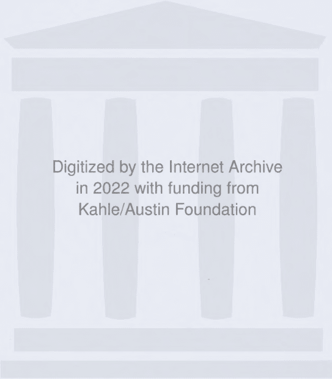
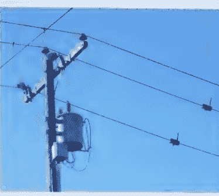
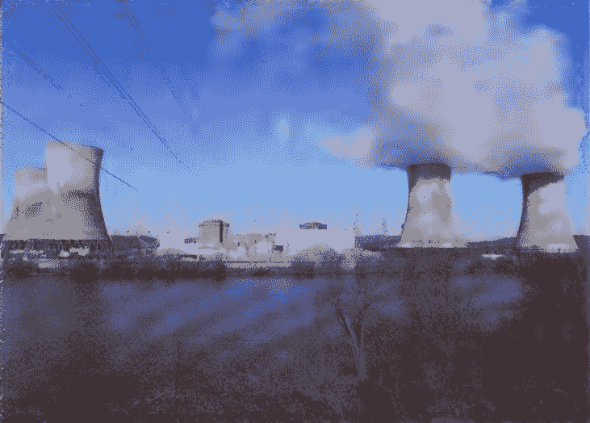
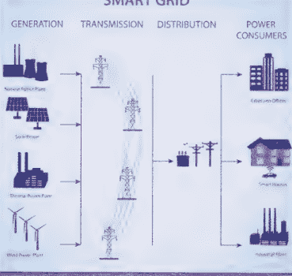
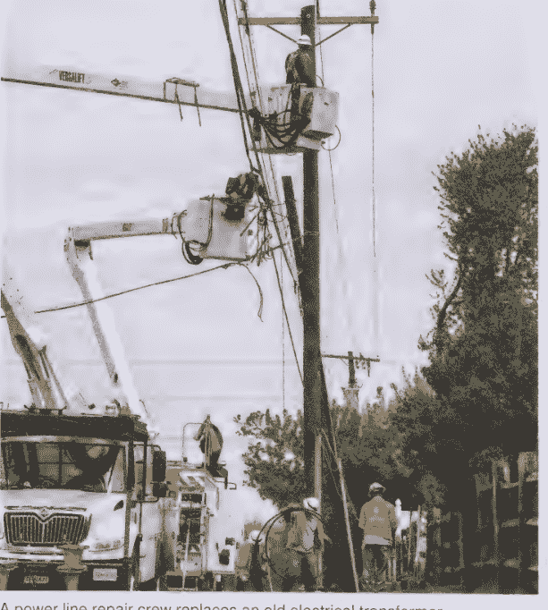
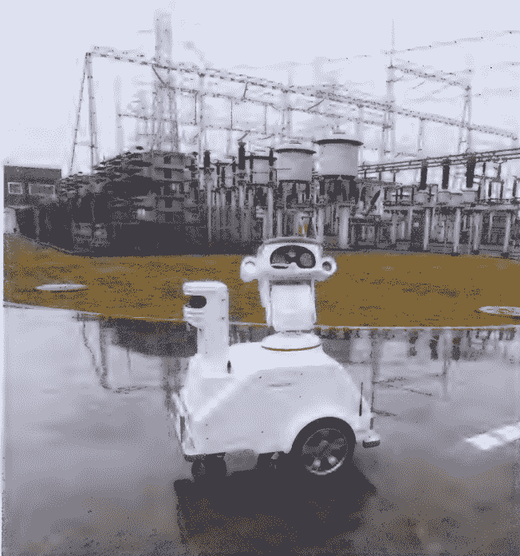

# 能源行业的编程职业

Jeri Freedman

在能源行业

Jeri Freedman

姓名：Freedom, Jeri，作者。

# 能源行业

能源行业提供了我们日常生活所需的电力。这包括点亮家里、手机充电以及运行工厂的电力。产生能量的方法有很多，其中某些对地球更有利。

## 编程的影响

能源行业正在发生变化。新技术被用于寻找更高效的能源生产方式以及从可再生资源中获取能量。这为理解编程的人创造了新的需求。

## 新技术

智能电网利用传感器监控电力用量。人工智能可以分析模式并预测能源需求。这些技术有助于减少浪费和环境影响。

## 能源行业的编程工作

能源公司需要软件工程师来构建和维护他们的系统。数据科学家需要分析能源数据。安全专家必须保护电网免受攻击。

## 学习成为程序员

如果你想在能源行业发展，可以从学习编程开始。有很多资源可用，从在线课程到训练营，都能帮助你入门。Python 是该行业的一种常用语言。

# 术语表

- 二氧化碳：导致全球变暖效应的气体。
- 电网：输送电力的网络。
- 化石燃料：由古代植物遗骸形成的燃料。
- 光伏：与光能转换电有关。

## 更多信息

有关能源职业的更多信息，请访问：

## 参考文献

- 能源部：energy.gov
- 可再生能源：在使用时不会耗尽的能源来源

# 关于作者

Jeri Freedman 是一位对科学和技术充满热情的作者。她为儿童写过许多关于 STEM 主题的书籍。

对于程序员来说，这一领域在未来几十年内可能会继续增长。能源行业在各种应用都需要编码人员。他们编写软件来监控远程传感器，以追踪需求，

自动调整来自多种来源的能源分配。还需要软件和传感器来监控并提供设备运行的信息，以避免停电并确保工人及普通公众的安全。随着对国家新钻井区域（如美国西部的巴肯页岩）勘探的增加，以及对更多电厂的需求，意味着市场稳定地需要程序来分析石油开采和电厂建设对环境的影响。在人工智能（AI）和机器学习（ML）领域尤其需要程序员，这些领域是发电自动化和预测技术的关键方面，使能够预测预测需求并提前做好准备以满足需求。

埃迪·克拉克是美国第一个女性电气工程师。根据《科学美国人》介绍，她的创新思想被认为是迈向智能网技术的第一步。克拉克在瓦萨学院学习数学和天文学，并于1908年毕业。随后，她在哥伦比亚大学学习土木工程，并在1918年成为第一位从马萨诸塞理工学院获得电气工程硕士学位的女性。然而，由于她是女性，

她无法找到当工程师的工作。因此，她在通用电气（GE）担任了“计算员”主管。当时的“计算员”是指那些（大多为女性）执行数学计算的员工。在通用电气，她在1921年发明了克拉克计算器。这是一种用于求解计算输电线电流、电压和阻抗的方程的工具。这些信息对于电力输送至关重要。克拉克计算器使得此类计算比以前的方法快了十倍。

1926年，克拉克成为第一个在美国电气工程师学会年会上发表论文的女性。1947年，她被德克萨斯大学聘用，在那里教了十年书，成为美国第一位女性电气工程教授。1948年，克拉克成为美国电气工程师学会的第一位女性会员，2015年她被追授入国家发明家荣誉堂。

# 能源行业

变压器上的电线为印度的一个地区提供电力。

## 编码对能源行业的影响

能源的生产对于经济每个方面的运行都至关重要。地球上有七十亿人口，生产足够的能源来满足他们的需求是一项巨大的工程。能源的产生和分配方法随着时间而变化并不断演变。随着人们越来越意识到燃烧化石燃料对环境产生的影响，这些担忧在能源产生方式中发挥了越来越重要的作用。预计2040年，世界人口将增长接近九十亿。人口的增加以及发展中国家生活水平的提高，将产生更大的能源需求。然而，在满足这些需求的同时，必须解决气候变化问题，而发电正是气候变化的影响因素之一。

## 能源行业简史

自远古以来，利用能源一直是推动文明进步和改善人类生活的关键。蒸汽驱动的简单机器在古埃及时期就已经了。这仅仅是能源生产的开始。随着人口的扩张以及人们寻求相互旅行和贸易，旧的能源形式得到了改进，新的技术被发明出来。

## 早期发电

随着时间的推移，蒸汽机技术不断改进。18世纪中叶，托马斯·纽科门和詹姆斯·瓦特对蒸汽机的设计进行了改进，产生了第一台现代蒸汽机。现代蒸汽机使19世纪和20世纪的工业革命成为可能，实现了工厂的自动化生产。到19世纪，蒸汽机为农机、火车、船只和工厂机械提供动力。1880年，托马斯·爱迪生将一台煤驱动的蒸汽-

连接到他在纽约市工厂的第一台发电机上，彻底改变了电力行业。

产生的电为华尔街和《纽约时报》的第一批电灯提供了动力。

1882年，世界上第一座水电发电站在威斯康星州的阿普尔顿投入运行。到19世纪末，汽车开始上路。最初有竞争性的蒸汽动力、电力和汽油动力版本的汽车。燃烧汽油驱动汽车的内燃机胜出，因此将石油加工成汽油以供应内燃机变成了一项行业。到1908年，亨利·福特完善了在流水线上批量生产汽车的过程，

汽车变得中产阶级也负担得起。从20世纪初到现在，能源需求稳定增长。发展中国家的工业化、世界人口增长以及日益增多的电子设备推动了这种增长。可再生能源需求每十年翻一倍。发电厂规模扩大，产生了巨大的水坝和燃煤电厂。线路、变电站、变压器以及从电厂分配能源到家庭和企业的网络被称为电网，或简称“电网”。

## 二世纪及以后

利用核能产生能源的能力是在二战期间开发的——原子与原子弹一起。在1945年战争结束后，美国政府开始将核能视为产生大量电力的方式。他们建造了为附近城镇和城市提供能源的电厂。然而，1979年宾夕法尼亚州附近三岛核电厂发生的局部熔事故阻碍了公众对核能的接受，美国很少新建新的核电厂。核能发电

工厂在世界其他地区更为常见，例如欧洲，特别是在难以获得化石燃料的地区。

20世纪后期和21世纪初，对燃烧化石燃料污染的担忧导致人们寻找更“清洁”的替代能源。煤炭产量从2008年的峰值下降到2016年，并在2017年小幅增长6%。尽管特朗普政府在2017年取消了一些针对燃煤电厂的环境法规，但这主要缓解了现有电厂的成本，截至2018年，还没有建造更多燃煤电厂的计划。相反，能源行业继续建设可再生资源（如风场），并燃烧天然气，天然气在美国廉价且丰富，通常与石油一同发现。天然气不产生与煤炭相同的副产物，因此它是更清洁、更环保的能源来源。可再生能源的生产和消费也继续增长。2017年，生产和消费达到了约110万亿英热单位（Btu）的历史新高。Btu是能量输出的标准衡量标准，基于使1磅水的温度升高1度华氏所需的热量。

# 能源行业的编程

石油、天然气和电力行业渴望采纳并应用提高效率和盈利能力的新技术。许多公司刚刚开始数字化进程，这为编码人员提供了许多机会。在某些情况下，“程序员（programmer）”和“编码员（coder）”这两个术语互换使用，指的是“提供软件允许计算机执行特定功能的人员”。在其他情况下，“程序员”是指“创建原始软件程序的人员”，而“编码员”则指“使用现有软件创建应用程序以执行特定任务的人员”。例如，数据挖掘是收集和分析大量数据的过程。编码员可能会使用数据挖掘软件来创建一个独特的应用程序，用于寻找特定公司客户的能源使用模式。随着越来越多可用于创建定制应用程序的软件面世，对编码员的需求增长速度超过了对程序员创建原始软件的需求。

“云端”由远程计算机组成，为各公司提供数据存储空间。一些云服务提供商是独立公司，但大型组织（如公用事业部门）通常与 IBM、Apple、Google 或 Microsoft 等大型公司签订云空间和服务合同，因为这些公司提供非常大的数据容量。

## 更智能的电网

根据美国能源部（DOE）的说法，电网“由超过 9,200 个发电单元组成，发电容量超过 100 万兆瓦，并连接了超过 30 万英里（482,800 公里）的传输线路”。电网建于 19 世纪 90 年代，几十年来一直处于无章法的增长。为了满足现代需求，需要以结合数字技术的方式进行重建，并实现自动化，以满足 21 世纪及未来的复杂需求。美国能源部正致力于创建智能电网。

这张图显示了现在将如何通过智能电网发电和分配。

它将利用计算机、自动化和软件创建一个系统，自动将能源从各种来源分配到需要的地方，并根据需求的波动改变其分配。智能电网将减少电压下降和停电的发生次数（即电网某些区域掉电导致这些区域陷入黑暗的时期），并使电力系统更好地应对紧急情况，包括自然灾害和人为灾难。由于系统组件将进行自动通信，系统能够立即检测到停电并将资源重新路由到这些区域。它将安排团队更快修复损坏，并为医疗中心、警察和消防部门、交通灯和电话系统维持应急电源。各级都需要编码员和程序员来实现该系统所有组件的软件。

## 编程对能源行业的影响 [21]

在许多情况下，他们还为客户提供创建应用程序的工具，并提供顾问帮助实施这些程序。能源行业的编码员可能会与此类云服务提供商的团队合作。

廉价的大规模计算能力的可用性使得石油和天然气的勘探更加深入、更广泛，并使发电和分配系统的自动化程度提高。此外，能源管理和控制系统（EMACS）允许对配电的规划、控制和监控进行更好的整合，并更容易实时从低需求地区向高需求地区平衡和转移电力。

能源公司正在对电厂、变电站以及输配电网络的数字化硬件和软件进行大量投资。编码员创建的应用程序最终构成了具有更少中断、维持更高负载且寿命更长的系统，从而降低了成本并提高了效率。因此，公用事业部门已将信息技术视为其输配电网络的关键工具。

公用事业部门需要的应用程序包括以下任务的：

- 管理电力流
- 在电力供应发生后分析中断情况
- 分析历史数据——包括配电数据和与客户相关的数据
- 分析发电机的性能
- 提供财务和运营分析

能源公司正越来越多地实施运营信息系统（OISs）。OIS 提供有关业务活动的数据，例如财务、销售和采购数据。这是一个较新的领域，为程序员和编码员提供了新机会。编码员必须将这些信息转换为易于理解的报告、图表和图形，以说明发现。

## 管理公用事业客户

在许多地区，人们可以选择由哪家公司提供石油、天然气和电力服务。因此，如果能源公司想要成功，吸引并留住尽可能多的客户非常重要。从 20 世纪 90 年代末开始，能源行业开始采用专门为……设计的客户信息系统（CISs）。

## 流失与增加的工作岗位

随着能源行业自动化和数字化的进步，传统工作数量将会减少。智能电表可以远程读取，而无需开车驶过房屋或营业。作为智能电网的一部分，电表将自动向客户计费系统发送每月数据，不再需要抄表员。由于技术进步，更多的计费操作也可能自动发生。自动呼叫中心和自助门户减少了对人类员工的需求。服务调度也可能变成一个自动化过程。

在技术进步取代某些工作的同时，它们也创造了新工作。这些工作大部分将是技术工程师、计算机程序员和编码员。需要程序员和编码员来编写运行在能源公司和公用事业部门内部数字化系统的软件和应用程序，根据需要对其进行升级，并分析由其产生的数据。他们还需要创建、测试和升级用于智能电网的软件——这是一个持续许多年的过程。对于目前的中学生来说，这是成为能源行业编码员的绝佳时机，因为对编码员的需求可能持续很一段时间。

[24] 能源行业的编程职业

……客户管理方面，主要涉及业务的财务方面，例如维护账户记录、处理订单、向客户计费和收款。这些系统还被用于工单管理。这些系统通常需要独立的软件程序，且整合良好。

公用事业部门现在希望改善与客户的关系，以更好地吸引和留住他们。他们希望能够应对电子设备和电动汽车普及带来的能源需求变化。他们希望能够更快地向市场推出新产品并降低成本。为了满足这些需求，能源行业正在采用灵活的计算机系统和软件，以便随着数据量的增加进行扩展。实施此类客户信息系统的应用程序需要编码员。这些应用程序包括：

-   通过数据挖掘预测客户近期的未来需求和兴趣，从而支持业务规划。
-   通过在计算机系统之间提供更好的工作流控制和电子数据交换（EDI）来改进业务管理。在 EDI 中，一个计算机系统能够自动将数据下载到另一个计算机系统，例如财务账单系统自动将数据发送到客服中心系统。此类系统还可以向人力资源部门提供员工信息，帮助公司更好地留住员工。此外，它们还支持账单和债务管理操作。
-   提供运营管理应用，包括对风险的洞察以实现更好的风险管理，以及对供应商和合作伙伴的管理。

公用事业公司与其他许多行业的许多公司一样，正在转向在线自助客户服务系统。这些系统为客户和公司都带来了便利。客户可以方便地随时随地在线访问其账户、支付账单、检查所在区域的停电情况、报告问题并预约服务，，而不仅仅限于公司客服部门的开放时间。许多此类自助系统都与自动呼叫系统集成，允许客户通过电话拨入并使用语音识别应用程序访问多种服务选项。即使客户被转接给人工服务来完成交易，呼叫中心的计算机化也是用的。如果自动系统与公司的数据库、调度和账单系统集成，它可以为人工代表提供有关客户的必要信息，从而更快地处理问题。当客户无需与人工互动即可处理交易时，公司会从中受益，这降低了成本。创建此类系统并与公司其他的计算机和数据库系统集成，需要为软件本身以及客户与系统交互的网站编写代码人员。数字化（Digit）在能源行业中发挥着关键作用。然而，许多公司才开始实施基于传感器的监控控制系统以及客户关系管理系统。市场研究机构毕威（KPMG）的“2017 年美国 CEO 展望”调查显示，72% 的首席执行官（CEO）认为，实施数字技术对于保持与竞争对手同步或领先非常重要。这一发现适用于去监管的能源市场，在那里电力公司面临着客户的竞争。根据毕威的调查，45%

## 编码对能源行业的影响 [27]

像这样的智能电表会自动向公用事业公司发送能源使用数据。

的 CEO 认为他们没有有效地利用数字技术。编码人员不仅需要为能源生产、分配和客户管理系统实施数字化程序，他们还需要确保数据采集和管理程序的安全性。

[28] 能源行业中的编码职业

他们必须实施网络网络安全计划，以确保配电系统和公司数据库不受黑客攻击，黑客可能会导致电力中断或窃取关键的客户或公司信息。

数字技术的实施将导致全球能源系统的互联互通。能源系统将变得更加智能、高效、可靠且可持续。编码人员将在实现使这些进步成为可能的技术方面发挥主要作用。

编码对能源行业的影响 [29]

2012 年的一场停电导致纽约市业务运营中断并给消费者带来不便。

# 第03 章

## 能源行业的新技术

计算机控制的设备、监控和分析在可靠提供电力方面起着关键作用。这些技术被用于发电厂、家庭和企业，以监控和控制生产及分配能源的设备。电力中断每年可能给经济造成数十亿美元的损失。然而，确保电力供应不发生中断是一项艰巨的任务。消费者和公司都在寻找降低能源成本的方法。自动化监控技术可以提供帮助。新的人工智能智能、机器学习和深度学习计算机技术将为能源行业和消费者带来利益。

### 更好的能源技术

工厂使用的数千个组件中，只要一个故障就可能导致停机。负责此类问题的公用事业公司会损失收入，因为客户无法使用电力，并且可能导致客户流失。更重要的是，由于许多人依赖电力执行日常任务，停电会影响客户执行这些活动的能力。为了减少电力波动，许多 [32] 能源行业中的编码职业 电厂是互联的。它们共同构成了区域传输系统。此类系统允许电力在任何时候从低使用地区转移到需求地区。然而，这些系统非常复杂，有时需要相隔数千英里的发电机。软件程序员必须设计运行此类网络的程序。使用传感器监控部件和设备对于提高电力供应的可靠性是必要的。传感器是监控系统状态并将其状态数据发送给计算机的设备。例如，汽车中的温度传感器监控发动机温度。它向汽车计算机发送信息，如果温度过高，可能会通过灯光警告驾驶员。传感器可以检测可能发生电力故障的地方并提供预警，提高系统的安全可靠性。

电力分配方式最大的变化是在电力系统中使用人工智能和机器学习。人工智能是使用软件模拟人类智能，以类人类逻辑做出复杂决策。机器学习是计算机根据经验改进其分析和决策的过程——类似于人类学习的方式。在机器学习中，计算机使用一系列称为算法的规则分析大量数据，检测其中的模式，并根据模式提供决策或预测。在机器学习软件中，计算机软件会分析各种决策的结果以识别最佳选择。

深度学习是机器学习的高级形式。它将神经网络技术与海量数据集相结合，允许程序进行自我训练。神经网络系统由一组连接单元组成，称为节点，通常被称为人工神经元。人工神经元的集合模拟了构成人类大脑的神经元。神经网络不是通过给定规则编写的。相反，它们被设定一个目标，并通过尝试创建实现目标的方法。对这些解决方案进行排名，并保留最好的。然后再次运行分析，再次选择最佳解决方案。这一过程持续进行，计算机在每次分析中“学习”到更多。

人工智能和机器学习对于分析海量数据以发现有意义的模式是必须的，因为人类无法手动处理如此大量的数据。编写人工智能和机器学习系统是对编码人员需求的主要领域。人工智能和机器学习允许包含远程传感器的复杂系统，

各种传统和替代能源，以及智能电网，可以自我监控和调整，以预测未来的能源和维护需求、响应需求，并在最少人工干预的情况下确保安全。

海量数据（被称为大数据）现已可用。这些数据是在计算机系统和传感器产生或从其采集的。人工智能（AI）和机器学习（ML）可用于分析大数据，因为配备多个处理器的计算机现在能够以低成本提供海量的计算能力，而且能够存储大量数据的驱动器变得越来越便宜。这些因素使得高效地分析海量数据成为可能。使用此类巨大且多样化的数据集使得机器学习更加准确。

这是一个使用神经网络的未来电子电路板概念。

能源管理系统用于控制整个设施的能源消耗。

谷歌、微软、亚马逊和 IBM 等公司已建立相关服务，帮助公用事业等公司应用这些新技术，这使得它们的实施更具吸引力。能源行业中的许多操作刚刚开始尝试应用这些技术，因此编码人员和程序员有大量的参与机会。

### 更智能的能源使用

公用事业并不是能源行业中唯一需要编码人员的公司。私营企业也雇用编码人员帮助大型工业公司改进能源使用。其中一家公司是位于加州山景城的 Verdigris Technologies。该公司成立于 2011 年，提供了一种基于人工智能的系统帮助客户管理能源消耗。该系统用于控制大型商业建筑和业务设施的能源消耗。

在这种方法中，智能传感器连接到公司的电路中，提供了追踪能源消耗的能力。传感器通过无线计算机技术将收集的数据发送到 Verdigis。信息在 Verdigis 进行处理，客户公司可以 24/7 检查其计算机上的仪表板。计算机软件允许 Verdigis 监控每台设备或机器。例如，该公司成功识别了位于旧金山的 W 酒店可以避免的能源低效率问题。

另一公司 PowerScout 将基于 AI 的软件应用于能源行业数据，以预测可能降低能源成本的方法。PowerScout 为消费者提供了改进家居能源使用和降低成本的建议。该公司帮助客户就家庭购买可再生能源做出决策。

这仅仅是两家使用软件解决企业和消费者能源需求的公司。未来可能会有更多公司使用数据挖掘和人工智能提供与能源相关的分析和咨询服务。这些公司将需要程序员来创建用于收集和分析数据的程序，以及用于监控和报告能源消耗并提供客户建议的软件。

### 人工智能在能源行业的应用

以下是人工智能在能源行业中的一些应用。负荷预测是预测特定地点需要多少能源。预测短期内需要多少能源是确保有足够能源满足需求峰值并避免短缺的关键。它还允许公用事业在需求可能较低时减少生产能源时所使用的燃料量。更高效的燃料利用有助于控制公司的成本。由于这些成本会以更高费用的形式传递给消费者，这也有助于客户降低能源成本。在一个被称为“产出优化”的过程中，软件被用于监控风场上的风力机设备，并在每台风力机运行时优化其涡轮。这一过程使他们能够产生更多的能量。

预测性维护需要软件。该过程利用 AI 识别的模式来信号组件何时可能需要维护。还需要软件来编写无人机程序，这些无人机可以检查

机器人能源系统检查无人机正在检查中国电厂的配电组件。

如线路等组件。程序员创建的深度学习算法可用于训练无人机发现缺陷并预测故障。基于人工智能的检查不仅更安全、更节省时间，还可以帮助无需人工检查的操作。

### 可再生能源的人工智能

可再生能源是指那些自然再生的能源，例如风能或太阳能。可再生能源的一个主要挑战是它们的产量随天气波动。基于人工智能的计算机程序可以帮助预测天气如何影响它们。这类数据利用气象站的详细报告和卫星数据，允许公司对风力场等可再生能源产生的电量提供更准确的预测。

结合了分析、预测以及人工智能和机器学习技术的计算机程序正在整合到现有的能源基础设施中，这为改进能源输送和客户关系提供了令人兴奋的可能。然而，此类技术在能源领域的应用才刚刚开始。这意味着对于编码人员来说有很多机会，而且需求可能会增加，这使得该领域成为一个寻找工作的丰沃领域。

数据分析师创建了一个图表来阐明数据之间的关系。

# 能源领域的编码工作

在能源行业中，编码人员和程序员的工作包括研究与分析实习生，以及初级和高级分析师及程序员。这些专业人士在大型和中小型机构以及政府部门工作，涵盖传统能源和可再生能源。编码人员不仅可以在公用事业公司找到工作，还可以在合同软件开发公司以及美国能源部等政府机构找到工作。

## 数据与运营分析师

数据和运营分析师利用他们在数学、科学和工程方面的知识，创建并应用基于计算机的分析，以从收集和存储在公司数据库中的数据中提取并解释信息。他们使用先进软件帮助能源公司预测和估计能源需求。他们提供的信息有助于公用事业公司进行决策，并提高发电和配电效率。

大多数数据分析师拥有学士学位，尽管副学学位或专业认证加上工作经验对于某些入门级工作是可以接受的。担任运营分析师通常需要学士学位，许多雇主倾向于拥有硕士学位的候选人。运营分析师需要修读数学、统计学以及计算机科学课程。一些候选人拥有运营研究和计算机科学的双学位，这使他们对雇主非常有吸引力。

初级分析师作为团队的一部分，学习能源业务中涉及的不同活动。他们由高级分析师指导。他们还可能参加公司赞助的旨在提高技能的研讨会。高级分析师执行高级数据分析任务并管理项目团队。他们评估分析项目的需求，估计创建和完成项目所需的资源和时间，并跟踪项目的进度和成本。高级分析师通常需要大学学位和多年的编码经验，最好具有能源行业背景。

一名高级分析师正在指导一名从事软件应用的初级分析师。

## 研究分析师

研究分析师创建并维护数据库，其中包含的信息用于回答能源公司或联邦或州能源研究实验室的操作或研究人员正在调查的研究问题。研究分析师使用软件创建查询，从收集并存放在数据库中的数据中提取信息。他们对数据进行基于计算机的分析，并将其格式化为表格和图表。此职位需要需要计算机或相关领域的学士学位。较高级别的职位可能需要硕士学位。

能源领域的编码工作 [47]

软件开发人员（或程序员）创建、测试和实现运行在计算机上的应用程序。控制发电、配电和分析过程的计算机系统需要特定行业的软件。软件开发人员还修改现有的计算机程序，以适应特定的公用事业和公司需求。此外，他们整合来自各种系统的软件应用程序，以便共享数据。程序员通常以团队形式工作，由一名首席或高级程序员担任团队负责人。因此，编程工作从入门级到高级级都有。入门级软件程序员可能只有工作经验和证书，证明他们已精通行业中使用的特定软件语言，或者拥有副学学位。大多数人拥有学士学位，其中一些高级职位的人员拥有硕士学位。获得编程工作最重要的元素是实战经验。

应用程序程序员创建和修改计算机应用程序软件或特定的公用事业程序。他们与用户和经理合作以识别他们的需求，然后开发程序以满足这些需求。他们通常与编程团队的其他成员一起。他们可能会为合作伙伴公司或供应商以及他们所在的公司提供解决方案。他们为人员编写如何使用他们开发的软件的指南，并记录开发程序时使用的过程，以防将来需要修改。这项工作需要对流行的应用程序软件（如 SQL 和 Oracle）有知识，并熟悉能源和商业领域使用的编程语言（包括 Python）。由于应用程序通常是为了在公司以外工作的人员开发的——例如在风力发电场或太阳能阵列现场收集数据的人员——因此可能需要创建智能手机和 Web 应用程序的软件经验。

大数据程序员开发程序来处理大量数据，例如在大型数据库中通过智能电网远程传感器收集的数据。这些程序员创建并修改软件以寻找复杂操作和业务问题的答案。此职位需要

地理信息系统程序员正在开发一个地图应用程序。

地理信息系统（GIS）是一个用于采集、存储、处理、分析、管理和展示所有类型地理数据的系统。地理信息系统提供有关区域地形性质的视觉信息。它们显示了特定特征的位置和密度，包括人工特征（如矿山）和自然特征（如产油页岩）。它们还显示给定区域的人口密度。此外，它们还可以预测由于采矿、采油或建设水电坝或电厂可能在区域内产生的变化。

能源行业的 GIS 程序员和分析师开发地理空间软件和工具，以捕获有关物理区域地形和特征的数据。他们分析数据并格式化信息，以地图的形式显示。他们创建 GIS 应用为矿矿公司和公用事业公司分析地形。他们可能会分析陆地和航空图像，以及数据库中的数据，以产生专业地图。他们解释数据，识别趋势并注意数据中的模式。大多数 GIS 程序员至少拥有学士学位。也可能通过专业组织获得认证，例如城市和区域信息系统协会 (URISA) 和美国摄影与遥感学会 (ASPRSI)，或者 GIS 软件公司如 Esri。认证不是强制性的，但在寻找工作时可能会很有益。

这张未来感的图片展示了一位程序员正在创建高级软件，以分析海量数据。

他们需要具备如何创建软件来收集和分析海量数据，以及管理大规模数据库和数据仓库的知识。大数据程序员还需要了解人工智能和机器学习技术，并且必须理解用于大数据分析的特定软件（例如 Kafka）。他们必须熟悉各种大数据系统（如 Hadoop、Cassandra、MongoDB）和传统的数据库软件（如 Oracle、SQL 和 SAP）。应聘者还需要使用统计分析工具以及用于创建机器学习软件的语言（如 R、SAS 和 Python）的经验。除了技术技能外，大数据程序员还必须具备良好的人际技巧，以便与业务部门和合作伙伴的人员合作，创建能够帮助指导技术决策的模型。

## 实习

实习让学生能够行业专业人士合作，并亲身体验在能源领域担任编码员的体验。实习通常是无薪或低薪的职位，学生通过这些职位获得实践经验并在现实世界中学习规则。有些实习是大学计算机科学或工程课程的一部分安排的。另一些则在招聘网站、能源行业组织或个人公司网站上发布。实习机会存在于政府机构、研究组织、私营公司和公用事业部门。

程序员指导实习生使用能源行业软件。实习生通常执行基础任务，协助组织内的研究人员或软件开发人员。他们可能会编写文档，并协助现有及新软件程序的实施、测试、部署和维护。

美国能源部和许多州能源部门都为学习编码的学生提供实习。能源部（DOE）为在读高中或至少在技术性、职业性或两年制/四年制大学兼职学习的学生提供带薪实习。它提供两种带薪实习：学生临时就业计划（STEP）和学生职业体验计划（SCEP）。在 STEP 中，学生的工作职位不一定与编码相关，但提供了了解能源行业性质和问题的机会。在 SCEP 中，学生的工作领域与其学术或职业兴趣领域直接相关——在这种情况下就是编码。

美国能源部在美国全范围内提供米基·兰德能源奖金（Mickey Leland Energy Fellowship）。该计划以已故的反贫活动人士、议员乔治·托马斯·“米基”·兰德命名，是一个专门针对科学、技术、工程或数学专业的少数裔大学学生的十周暑期实习计划。有关这些计划的更多信息可以在能源部学生实习网页上https上https.energy.gov.gov.programs）找到。

除了联邦政府，许多州能源部门还资助研究可再生能源等研究领域的研究机构。他们提供的实习机会让学生有机会通过协助计算机建模、编程或收集和分析数据，在能源领域实践编码技能。例如，阿拉斯加能源电力中心聘用实习生帮助可再生能源研究人员分析与能源使用和消耗相关的数据。要寻找特定州的实习机会，可以联系当地能源部门或国家实验室，或访问其网站。

能源领域的私营公司也聘用编程和数据科学方面的实习生。公司实习包括运营风场和太阳能电池板阵列的可再生能源供应商、油气公司、矿业公司以及为能源行业创建软件的软件公司。西弗吉尼亚州公用事业公司 Dominion Energy 的一项为期六月的实习提供了一个实习生工作类型的示例，对象计划主修计算机专业的大学生。实习生将作为软件团队的一部分，为内部客户构建、部署和维护应用程序。

实习不仅让学生开发与能源领域相关的编码技能，还让他们有机会亲身体验一份工作，并决定编码和能源行业是否适合自己。在教育期间进行多次实习可以帮助人们决定自己倾向于能源行业中的哪一个编码领域。此外，实习让学生与行业专业人士建立联系。这些人人脉在以后寻找工作时对于推荐或参考来说可能非常有价值。实习还为个人提供了可以写在简历上的经验，并向潜在雇主证明你有能力胜任初级分析师或程序员所需的任务。

## 挑战与优势

在能源行业从事编码工作的优势包括可以在大公司或小公司工作。大公司提供更高的薪水和许多福利。此外，大公司通常提供良好的工作保障。有时，他们会支付员工在与其工作相关的领域的课程费用。对于从事初级工作的编码员来说，这是在工作的同时追求高等教育的极佳方式。

在小型或替代能源公司，人们通常可以在更灵活、具创业精神的环境中工作，并有机会帮助建立业务和改善环境。随着全球能源需求的增加，自动化和数据分析在能源生产、分配和销售中发挥越来越大的作用，对编码员的需求将保持高位。该领域的薪资很好，并且有从初级到中级再到高级职位的稳定职业路径，薪水和责任不断增加。任何编码职业的缺点都包括在截止日期需要信息时必须长时间工作。能源行业的编码项目由团队执行，因此人们可能需要与困难的同事打交道并妥协。此外，编码员可能需要去变电站旅行。

## 学习成为程序员

程序员既需要技术也需要人际技巧。为了获得能源领域的编码工作，你需要了解该行业使用的语言（如 Python），以及用于创建数据库、数据挖掘和应用程序的软件。无法确定你在工作中具体要做哪种编码。你可能需要编写分析传感器数据的软件，或者为客户开发移动应用程序。你可能会处理存储在数据库中或从现场实时获取的数据进行挖掘应用。因此，培养能够让你学习各种语言、应用程序和统计技术的基础技能至关重要。

必须向管理层、客户和合作伙伴公司进行演示。你将创建有关分析结果的报告。你将与其他程序员、公司内部经理和员工共享信息。这意味着你必须学会组织思路，并以清晰的方式进行表达和写作——特别是对于那些没有编程或数据分析知识的人来说。你需要对英语语法和句法有扎实的理解。使用正确的语法和句法可以使你的表达更加清晰。此外，这样做会让你听起来更专业，从而让听众更有可能尊重你的观点。

在高中期间进行演示可以提供向大量人群演讲的练习。

如果你的学校提供公共演讲课程，参加该课程可以帮助你磨练沟通技巧。程序员大部分时间都在键盘前度过。如果你培养出快速打字或键盘技巧，你的效率将会更高。

### 提升你的编程技能

为软件开发职业做准备的一种极方法是在高中期间积累经验。在某些学校，你可以学习计算机课程或加入计算机俱乐部，学生在里面练习创建软件程序。如果你的学校提供此类选择，请充分利用。尝试编程是查看程序员职业是否引起你兴趣的最佳方式。编程让你直观地了解在现实世界中会遇到的问题类型以及如何解决它们。你可以自己练习创建 App。苹果和微软等公司为对制作 App 感兴趣的人提供开发工具包。你可以与朋友分享 App，在 Twitter 等社交媒体网站上发布关于它们的动态，甚至通过销售 App 的网站（如 Apple App Store 或 Google Play 商店）提供它们。制作自己的 App 可能很有成就感，但也需要耐心和数小时的工作。获得计算和编程技能的方法有很多，包括课程、书籍以及提供 Python 等特定语言培训的 CD 光光片。

获取知识的另一种方法是加入专业组织。既有计算行业组织，也有能源行业组织可以帮助你的发展。计算行业最大的两个组织是美国计算机处理协会 (ACM) 和电气电气与电子工程师学会 (IEEE)。这些组织为能源行业及其他行业提供与计算相关的标准和信息。主要的能源行业组织包括美国太阳能学会 (ASES)、能源工程师协会 (AEE) 和石油工程师协会 (SPE)。所有这些组织都有学生会员身份和为学生提供的特殊资源。
### 编程教育

大多数编程工作需要四年的大学学位。在某些情况下，经验丰富的程序员可以在没有学位的情况下被雇用，但对于刚开始的人来说，环境竞争激烈。对于某些初级职位，编程的专科学学位可能是可以的，特别是如果结合兼职、暑期或实习工作的现场经验时。许多大学还提供这些领域的四年制学士学位，以及硕士和博士学位。技术学院同时提供四年制学位课程和两年制专科学学位课程。还可能

### 风力发电
### 数据分析师

风电场数据分析师分析测量的风力数据，并为管理风电场的公司产生能源估计。他或她分析现有风电场的性能，并为正在开发的项目提供发电估计。分析师大部分时间都在电脑前工作，使用风能评估软件和模型。他或她还会访问现场并参加会议。要获得这类工作，候选人必须至少拥有科学学士学位，或计算机科学与工程、气象学或数学相结合的学位。他们必须学会使用工作所需的软件，例如 MATLAB、Microsoft Word、Microsoft Excel 和 GIS，无论是在学校、通过单独课程还是通过

此外，分析师必须学会与团队成员良好合作，并在解决问题时具有创造力，并培养向管理层和非技术听众解释结果的技能。成为程序员 [65]

在线学习。如果你决定在线攻读学位，应该检查教育数据库。大学的认证确保你可以获得有效的学位，并在必要时转换学分。

在大学里，学生从计算机科学的基础课程开始。

# 术语表

**人工智能 (AI)** 通过编程使计算机能够以类似于人类的方式进行学习和决策。

**大数据** 从数据库和传感器等直接来源捕集的海量数据。

**停电 (blackout)** 某地区完全完全丧电。

**英制热量 (Btu)** 一种能量单位，相当于将一磅水的温度升高1度华氏度所需的热量。

**电压波动 (brownout)** 某地区的部分断电。

**灾难 (catastrophe)** 灾难。

**首席执行官 (CEO)** 公司的负责人。

**云** 由服务提供商在远程地点安置的计算机集合，公司在其中存储数据。

**网络安全** 计算机和数据的过程。

**数据采集** 在计算机领域，收集数据的过程。

**数据挖掘** 使用软件在大量数据集中进行搜索以寻找模式。

**转向 (divert)** 从一个方向切换到另一个方向。

**无人机** 一种遥控的无人驾驶飞行器，通常是飞机。

**电子数据交换 (EDI)** 计算机系统之间的数据交换。

**发电机** 将燃料的机械能转换为电能的机器。

**地理空间 (geospatial)** 与特定位置相关的。

**温室气体** 一如二氧化碳等在大气中积累并防止热量散发的气体，加剧了全球变暖。

**黑客** 侵入计算机系统的人。

**偶然的 (haphazard)** 随机的，没有计划的。

**水力** 将流水的动能（运动能）转换为电能。

**阻抗 (impedance)** 电元件对通过电流的阻力大小。

**抑制 (inhibit)** 停止。

**内部 (in-house)** 在公司场所内。

**整合 (integrate)** 结合在一起。

**内燃** 通过燃烧汽油或其他燃料来产生能量以驱动发动机的过程。

**内部客户** 在公司工作或与公司有更紧密关系的人（例如利益相关者或员工），他们也购买公司销售的材料。

**负载 (load)** 从电站通过输电线路发送的电量。

**机器学习 (ML)** 使用软件允许计算机根据之前决策的成功来改进其响应的过程。

**模仿 (mimic)** 复制。

**神经网络** 一种计算机系统，其使用的连接模仿人类大脑中的神经元，以解决问题。

**臭氧层** 地球上方约6.2英里（10公里）处的臭氧气体层，它吸收了太阳到达地球的大部分紫外线辐射，防止地球过热。

**门户 (portal)** 客户与公司计算机系统进行交互的节点，例如网站。

**预测性的 (predictive)** 能够创建预测的。

**预测性维护** 使用计算机软件预测组件何时可能需要维护。

**扩散 (proliferation)** 扩张。

**查询 (query)** 计算机使用软件语言或应用程序提出的问题。

**传感器 (sensor)** 放置在组件上并向计算机发送其状态信息的电子设备。

**变电站 (substation)** 一组设备集合，电力通过这些设备通过并将高电压降低到适合供应消费者的水平。

**同步 (synchronize)** 调整两个或多个事物，使它们同时发生。

**语法 (syntax)** 支配人类或计算机语言用法的规则。

**变压器 (transformer)** 增加或减少通过其的电电压的设备。

**输线路** 电力从电站发送到家庭或企业的线路。

**涡轮机 (turbine)** 一种机器，带有叶片的轮子或转子在快速流动的水、蒸汽、气体、空气或其他流体的驱动下旋转，从而发电。

**语音识别 (voice recognition)** 允许计算机系统解释人类语言的技术。

**产量优化 (yield optimization)** 在预计需求可能较低时，减少产生能量所需的燃料量。

- Allen, John. Careers in Environmental and Energy Technology. High-Tech Careers. San Diego, CA: ReferencePoint Press, 2017.
- Bedell, Jane. So You Want to Be a Coder? New York: Aladdin/Beyond Words, 2016.
- Morgan, Ben, and Steve Setford, eds. Coding Projects in Python. New York: Penguin Random House/DK, 2017.
- Tweedale, Elizabeth. How to Code 2.0: Pushing Your Skills Further with Python. Super Skills. Lake Forest, CA: Walter Foster Jr., 2017.
- Xiang, David. Software Developer Life: Career, Learning, Coding, Daily Life, Stories. Self-published, Amazon Digital Services, 2018.

https://www.dreamincode.net/forums/forum/78-programming-tutorials

该网站为想要学习各种计算机语言的学生提供了在线教程的链接。

https://corporate.exxonmobil.com/en/energy/energy-outlook
在这里，你可以详细了解预测从现在到2040年间可能发生的能源行业新技术发展。

https://www.girldevelopit.com
该网站提供有关软件开发课程以及女孩（特别是女孩）如何参与其中的信息。

https://www.acm.org
ACM 是计算行业专业人士的主要组织。它提供各种资源，包括专门为学生提供的出版物。

https://www.ieee.org
IEEE 在其网站上维护了一个学生门户，面向对技术职业感兴趣的年轻人，并为他们提供各种特别计划。

- Bukhard, Jim, and Tiffany Groode. “The Rivalry Era: A Brief History of the Energy Industry from 2015 to 2040.” IHS Markit, October 5, 2014. https://ihsmarkit.com/research-analysis/q14-the-rivalry-era-a-brief-history-of-energy-industry-from-2015-to-2040.
- Colombano, Alfonso, and Ryan Ray. Careers in the Oil and Gas Industry: A Guidebook of Practical Advice. Self-published, Amazon CreateSpace, 2018.
- The Development of Energy.
- 8 Technology Breakthroughs That May Change the Energy Landscape.
- Energy Data Managers/Staticians.
- ExxonMobil. 2018 Outlook for Energy: A View to 2040. Accessed October 17, 2018. https://cdn.exxonmobil.com/en/energy-outlook.
- Galvin, Robert, and Kurt Yeager. Perfect Power: How the Microgrid Will Unleash Cleaner, Greener Energy. New York: 2009.
- Harvey, Abby, and Sonal Patel. History of Power: The Evolution of Electric Industry. Power, October 1, 2017. https://www.powermag.com/history-of-power-the-electric-industry.
- Hatch, David. Math, Science, and Computer Students: The Energy Sector Wants. US News, September 10, 2012. https://money.usnews.com/money/careers/articles/2012/09/math-science-computer-students-wants-you.
- Kalogirou, Soter. Artificial Intelligence in Renewable Energy Systems Modelling. Dept. of Mechanical Engineering, Higher Learning Institute, Cyprus. Accessed October 12, 2018. https://pdfs.semanticscholar.org/03b4118867dba5cc690f506dcf0e.
- KPMG. Disrupt and Grow. US CEO Outlook 2017. Accessed December 14, 2018. https://assets.kpmg.com/content/dam/kpmg/us/pdf/2017/06/us-ceo-outlook-survey.

加粗的页码表示图片。

- 输电线，16, 20
- 涡轮机，6–8, 38
- 机器学习 (ML)，9, 31, 33–35, 41–43, 52, 66
- 公用事业应用，22–23
- 神经网络，34, 35
- 语音识别，27
- 运营信息系统 (OIS)，23
- 风车场，6–7, 38, 65
- 臭氧层，7
- 产率优化，38
- 光伏太阳能板，6, 7
- 门户网站，24
- 发电，5–9, 14–16, 22–23, 25, 64
- 电线，9, 11, 32, 39, 60

# 关于作者

Jeri Freedman 拥有哈佛大学文学学学位。在十五年里，她一直从事尖端高科技公司的工作，涉及先进半导体和科学测试设备。她是 Innovative Applications 的联合创始人，这是一家销售和定制会计软件的小型计算机公司。她编写了五十多本青少年非虚构书籍，包括《通过皮肤制作和模组构建数字职业》、《计算机支持职业》、《高科技工作：软件开发》以及《网络公民与网络安全：知识产权》。

# 本系列丛

- 能源行业中的编码职业
- 娱乐与游戏中的编码职业
- 网络安全中的编码职业
- 制造业中的编码职业
- 军事中的编码职业
- 交通运输中的编码职业

