# Coding Club 级 1 Python 基础

## 引言

### 为什么要写这本书？

这本书是一个系列书籍中的第一本，针对任何对计算机编程几乎或完全没有知识，但想要尝试一下的人们。

### 这本书是给谁看的？

一个因素是出现了任何孩子都能通过攒钱购买或作为生日礼物获得的电脑，例如来自 `www.raspberrypi.org` 的树莓派。

但我制作一系列关于编程短书的愿望比这要早得得多。当我长大时，计算机与我们现在使用的 PC 非常不同。要玩游戏或使用文字处理软件，你必须在空黑屏幕上输入绿色文字来运行程序。但很棒的是是，你也可以输入自己的命令并运行它们！没多久，我就用一种名为 `BASIC` 的语言写了我的第一个文本游戏。

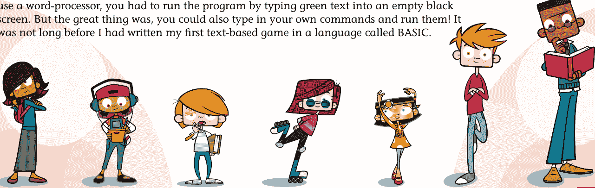

后来，我想学习更现代的语言，并开始学习 `Java`。我读了四五本书并完成了示例，但在每本书的结束时，我都处于一种糟糕的境地：对我想要做的程序充满了各种想法，但仍然不知道如何开始！我可以完成这些书籍重点的精彩项目，但做不了其他。所以通过这个系列书籍，我采取了不同的方法。我希望它可以教你编写任何你能想象的程序所需的技能——最终会学会，并且直接编写许多简单的程序。

### 为什么要选择这本书？

在多年寻找之后，我终于找到了一本由 David Parsons 编写的关于 Java 的好书《Introducing Java》，由 Thomas Learning 出版。它是给大学学生的。突然我明白了我们为什么要这样做某些事情，以及如何开始设计复杂的程序。如果我一开始就用这本书开始就好了！

我希望你，读者，不仅学习如何制作书中的程序，还学会设计你自己的程序。我希望你能够写好程序，这样如果你更进一步，并成为下一个 Google 的发明者，你就不需要去纠正糟糕的编程习惯了。我应该补充一下，忘记某些事情比你想象的要困难得多。

### 需要安装什么？

你不需要自己这样做！请要求一位负责的成人阅读编程俱乐部网站（`www.codingclub.co.uk`）上的“给成人的引言”页面，以便他们为你安排好一切。如果你能自己完成这一点，可以在 `http://python.org/download/` 找到完整的说明。如果你打算在树莓派上学习编程，准备工作会非常简单，因为它预装了你需要的一切。你不必使用树莓派来运行 Python。你可以使用 Windows、Apple Mac 和 Linux 系统。

## 如何使用这本书

希望你能够仔细阅读这本书并顺序构建所有主要项目。在每一章的末都有额外的想法和挑战，你可以将其看作视频游戏中的“迷你任务”。有些读者将想要完成所有的任务，以便随时保持理解。你们中的一些人可能更倾向于快速读完并到达结尾。当读者在想：“现在我能做什么？”时？一个答案是回去看看末尾的一些想法。哪种方法最好？你最习惯的方法。尽管你有老师引导，但你应该相信他们的判断。

本书通过四种方式尝试帮助你：

- 通过复制代码——这很重要，它可以帮助你学习。
- 寻找并修复错误——错误消息会提供出错的线索。
- 实验——尽管尝试代码，看看你还能做什么。
- 最后，这本书不仅提供酷炫的项目，还将教如何设计应用程序。

### 一个警告

你可能会倾向于直接从网上获取代码而不是自己输入。如果你这样做，以后可能会发现自己无法轻易记住编写代码的方法。你也将理解程序的每一个细节。

## 第1章：Python、IDLE 和你的第一个程序

在本章中你将：

- 学习计算机编程以及你可以使用的不同语言
- 认识 Python 编程语言
- 学习使用 `IDLE`，它可以帮助组织并运行你的程序
- 检查电脑是否设置正确
- 编写并运行你的第一个程序。

> 我从不 `IDLE`，尽管我会有点困睡……zzzz。


### 编码

编码是为计算机执行任务编写指令。这种代码必须是计算机可以理解的形式。这更正式地被称为计算机编程。

计算机和编码并没有很长的历史，但它们在短时间内确实包含了一些有趣的历史。第一种以未来计算机可以利用的方式存储指令的机器是雅卡尔织机，它使用打孔卡片并于1801年发明。查尔斯·巴贝奇被认为发明了第一台计算机，他在1837年描述了它，但直到100年后才被制造出来。1989年，Guido van Rossum 开始创建 Python 编程语言，他以 BBC 喜剧节目《蒙提 Python 的飞行马戏》命名。

### 编程语言

目前全球编码人员使用许多编程语言。某些在特定情况下最好，另一些适用于另一种。

- `HTML` 适用于制作网页。
- `SQL` 擅长让数据库按照你的想法运行。
- `Python` 对于快速应用程序、运行编程实验以及构建大型应用程序（包括游戏）非常出色。

如果你以前用过 `Scratch`（由 `MIT` 制作），你会发现自己可以很快地学会 Python。`Scratch` 是学习如何像程序员一样思考的极佳工具，而且非常适合制作游戏。如果你以前没有尝试过 `Scratch`，你可能也会喜欢尝试它，因为学习新编程语言的能力是编码员的一项重要技能。你会发现这比学习一门新的人类语言容易得多。

一旦你学会了一门现代编程语言，就可以很快学习其他语言。你只需要弄清楚你的新语言如何处理变量、循环等（在本书结束时，你就会知道这些是什么）。

### Python

`Python` 是一种类型化计算机语言。这使得编写短程序变得非常快，你几乎可以做出你想象的任何东西。

`Python` 是一种强大的、现代编程语言，被 `YouTube` 和 `NASA` 等许多知名机构使用。它是用于编写 Google Apps 的三种编程语言之一。`Python` 是一门很棒的语言。享受其中吧！

### IDLE

你将从 Python 自带的 `IDLE` 中开始编程。`IDLE` 是一个特殊的文本编辑器，类似于 `Microsoft Word`，但它能理解 Python 并帮助你写对代码。`IDLE` 本身就是一个 Python 应用程序。

`Python` 也是欧洲核加速器组织（`CERN`）使用的语言之一。


### 让我们来看看 IDLE:

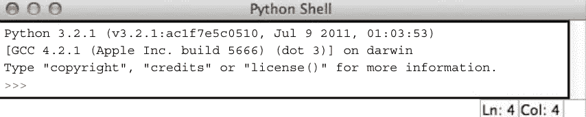

在学习编程语言时，学习与其伴随的特殊词汇非常重要。这是因为当你想要查找某些内容时，你知道该搜索哪些关键词。这就是为什么新的“计算机术语”单词会以**粗体**显示。这意味着它们将在书末的词汇表中进行解释。当然，（这里的单词）不会出现在词汇表中！

这是我们在 Apple Mac 上开始使用 `IDLE` 时的界面。

你想运行的代码在特殊的输入提示符之后输入：

```
>>> my code goes here
```

要运行代码，我们按下回车键。这就是 Python 在 `IDLE` 交互模式下运行的方式。Python 也可以运行文件，但开始阶段这些就是我们需要的。

让我们看看 `IDLE` 在 Windows PC 上的样子：

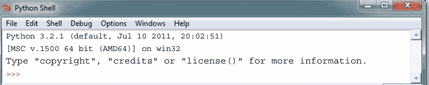

这是我们在 Windows 7 上开始使用 `IDLE` 的界面。

第 1 章：Python、IDLE 和你的第一个程序 11

最后，`IDLE` 在 Linux 计算机上的样子：

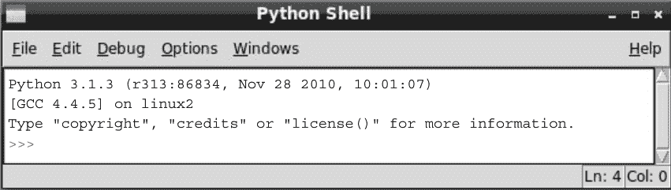

这是在树莓派计算机上启动 `IDLE` 时的界面。

学习 Python 并使用 `IDLE` 作为我们的 `IDE`（集成开发环境）的一个很大原因是，它在所有不同类型的计算机上都非常相似。

`>>>` 提示符之前的文本目前并不重要。然而，了解你正在使用哪个版本的 Python 总是很有用的。

### Hello World!

从编程黎明时代，当第一批洞穴编码员启动他们的洞穴计算机起，学习新语言的第一个程序是“Hello World”已经成为了一种传统。其目标是尝试让计算机向世界说“你好”。如果你能做到这一点，你就测试了为你设置的所有内容是否都在正常工作。

- 如果它还没有启动，请启动 `IDLE`。
- 在 `>>>` 提示符之后，输入代码框 1.1 中的代码，然后按下回车键运行程序。

### 代码框 1.1

```
print("Hello World!")
```

如果一切正常，你应该得到类似这样的内容：

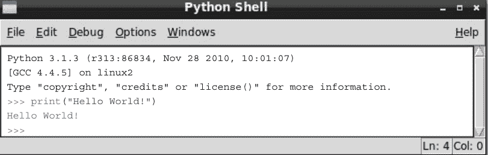

> 这对你来说可能看起来没什么，但你给计算机下达了一个你亲手编写的直接指令，它执行了你的指令。从这颗小种子，将长出伟应用程序！

Hello World!

Python 遵循了你的指令并输出了 'Hello World!'。

你写了你的第一个程序。干得好！


## 犯错

### 你遇到语法错误了吗？

在输入代码时，语法错误非常常见（其他错误也是如此）。如果你犯了一一两个错误，这不是你的错。这是因为虽然计算机运行很快，但它们也可能有点笨。如果你的代码中有任何细微的错误，它们就会恐慌并产生错误信息。这些信息试图向你解释问题所在之处，但它们通常很难理解。

冒号、括号、引号以及 Python 单词的拼写必须完全正确。虽然我们能读懂不完整的句子，但计算机不能。

无论你是否遇到了任何错误，都尝试一下这个快速测验。

### 以下代码行中哪些是正确的？

1. `Print("Hello world!")`
2. `print("Hello world!")`
3. `print("Hello world!")`
4. `print("Hello world!")`


注意：在 `IDLE` 中使用转义字符可以帮助发现代码中的问题。

这些转义字符可以帮助你发现错误。

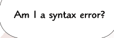

### 总结

在本章中，你学习了：

- 虽然计算机运行很快，但它们也可能有点笨
- 为什么新的“计算机术语”单词会以**粗体**显示
- 什么是语法错误
- 什么是 `IDLE`
- 什么是 `Python`
- 什么是 Hello World!
- 什么是 `print()` 函数
- 什么是交互模式
- 什么是 `>>>` 提示符
- 什么是转义字符

### 练习

1. 尝试打开 `IDLE`。
2. 在 `>>>` 提示符后输入代码：`print("Hello World!")`
3. 按回车键查看输出。
4. 尝试输入：`print("Python is fun")`
5. 尝试输入：`print(2 + 2)`
6. 尝试输入：`print(10 * 5)`
7. 尝试输入：`print(20 / 4)`
8. 尝试输入：`print("Hello\nWorld")`
9. 尝试输入：`print("Line1\tLine2")`
10. 尝试输入：`print("It's a sunny day")`


```
>>> 11/4
2.75
>>> 11//4
2
>>> 11%4
3
>>>
```

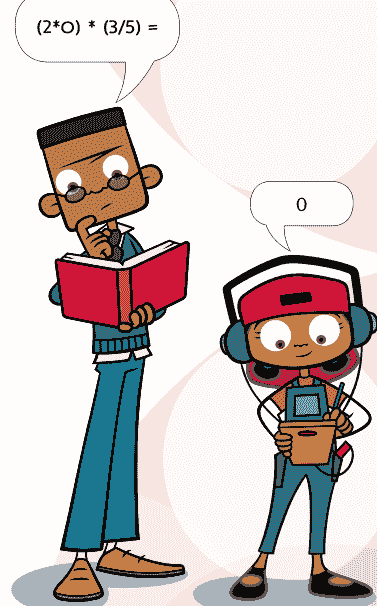

表 2.2 列出了更多一些数学运算符。

| 运算符 | 名称 | 示例 | 答案 |
| --- | --- | --- | --- |
| * | 乘法 | 2*3 | 6 |
| / | 除法（普通） | 20/8 | 2.5 |
| // | 除法（整数） | 20//8 | 2 |
| % | 取模 | 20%8 | 4 |
| + | 加法 | 2+3 | 5 |
| - | 减法 | 7-3 | 4 |

表 2.2 数学运算符。

### 实验

在交互模式下，检查表 2.2 中的示例是否给出了正确答案，然后尝试一些你自己最喜欢的加法计算。你可能想看看如果如果在 `print()` 函数中将数学表达式包裹在引号内会发生什么。

噢，数学！

噢，字符串！


### 结合文本和数学

在 `print()` 函数中，也可以将文本（或字符串）和数字结合。逗号在这里用作文本和数学之间的分隔符。

```
>>> print("111 divided by 4 = ", 111/4)
111 divided by 4 = 27.75
>>>
>>> print("11 divided by 4 = ", 11/4)
11 divided by 4 = 2.75
>>>
```

### 快速测试

你能计算出这段代码的输出是什么吗？

```
>>> print("11 divided by 4 also equals: ", 11//4, " remainder: ", 11%4)
```

## 进入循环

计算机非常擅长重复性任务。人类也是如此。

想象一下你正在学校的历史课上尝试写一些代码，而此时你本该在学历史。你的老师可能会让你写五十行代码。没关系，Python 可以做到这一点。

尝试在交互模式下打开 IDLE，然后输入代码框 2.4 中的代码。你需要在末尾按两次回车。

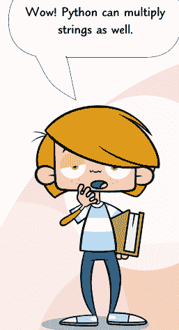

### 代码框 2.4

```
>>> lines=0
>>> while lines < 50:
    print("I will not write code in history lessons.")
    lines = lines+1
```

这是解决同一个问题的另一种方法：

### 代码框 2.5

```
>>> print("I will not write code in history lessons.\n" * 50)
```

第2章：一些文本，一些数学和进入循环 22

代码框 2.5 中的代码非常聪明——仔细观察正在发生什么。如果不确定，就运行它。虽然代码框 2.4 中的代码较长，但 `while` 循环通常更有用，因为它可以执行更复杂的任务。例如，通过 `while` 循环，你可以让计算机数到 100。尝试输入代码框 2.6 中的代码并运行它。

### 代码框 2.6

```
>>> number=1
>>> while number < 101:
  print (number)
  number = number+1
```

### while 循环是如何工作的？

### 变量

首先我们创建一个变量并给它分配一个值。变量是计算机内存中的空间，我们可以在其中存储例如一个字符串或一个整数。我们通过命名来创建变量。在代码框 2.6 中，我们将变量命名为 `number`，并用等号运算符给它赋值 `1`。

下一行代码 `>>> number<101:` 的意思是“当名为 `number` 的变量小于 101 时，执行以下操作”。冒号之后的所有缩进代码将由计算机重复执行。也就是说，它会循环这两行代码，直到 `number` 不再小于 101。

创建一个变量并将其赋值为 1

```
number=1
while number < 1:
    print (number)
    number = number+1
```

冒号表示运行所有缩进的代码

这里没有引号，因为我们想要 `number` 的值，而不是“number”这个单词

变量 `number` 递增了 1

IDLE 会自动为你缩进：

最后一行代码 `number = number+1` 位于循环中。在每次循环中，它都会给 `number` 加 1。不要忘记，变量的值随时可以使用等号运算符进行更改。

> 我喜欢把
> 
> `number = 1` 理解为
> 
> ：“让名为
> 
> `number` 的变量设置为 1，
> 
> 目前是……”

### 深入探索

等号的使用方法与数学中的用法不同。在计算中，等号意味着“让此变量指向此数据”（例如一个整数）。所以 `number=1` 意味着“创建一个名为 `number` 的变量并让它指向 1”。另一种说法是“将值 1 赋值变量”。稍后我们可以为 `number` 赋值另一个值。


### 运算符

在 `while` 循环可以使用几种运算符。表 2.3 给出了一些示例。注意我们另一种等号的形式。这种形式更像数学中的等号。因此，`while number==1:` 表示“当 `number` 等于 1 时，执行以下操作”。

| 运算符 | 含义 |
|---|---|
| == | 等于 |
| != | 不等于 |
| > | 大于 |
| < | 小于 |
| >= | 大于等于 |
| <= | 小于等于 |

**表 2.3** 运算符。我们使用双等号比较两个值，使用单等号给变量赋值。(img/fbaeb9cdecc73e46b84c17d0505a6ca3_26_0.png)

### 本章总结

在本章中，你学习了：

- `print()` 函数非常灵活
- 如何编写和运行简单的数学计算
- 如何输出字符串、数学或数字
- 如何编写 `while` 循环并使用比较运算符

### 题 1

在 IDLE 中编写一些代码，让计算机按 2 数到 20。

### 题 2

编写一些代码，让计算机输出如下表格：

```
1x5=5
2x5=10
3x5=15
```

**提示：** 你需要一个 `number` 计数器变量。你应该找出如何编写它，然后让你的循环执行 10 次。(img/fbaeb9cdecc73e46b84c17d0505a6ca3_27_0.png)

### 题 3

看看用三种方式重写以下代码，使每个程序都能产生数到百的输出。

```
>>> number=1
>>> while number < 101:
    print (number)
    number = number+1
```

在新代码中，不允许使用小于运算符。相反，你应该使用这些比较运算符之一：`<=`、`!=`。所有这些题目的答案都可以在网站 `www.codingclub.uk` 找到。如果你编写了无法运行的代码，只需关闭 IDLE 窗口。当询问是否杀死程序时，点击 OK 按钮。遗憾的是，你必须重新启动 IDLE。(img/fbaeb9cdecc73e46b84c17d0505a6ca3_28_0.png)

## 第3章 可读的代码和 Magic8Ball 游戏

在本章中你将：

- 使用脚本模式编写并保存 Python 文件
- 学习编写清晰易读的代码
- 运行 Python 文件
- 学习获取用户输入
- 学习 `if` 和 `else`
- 编写名为 `MyMagic8Ball` 的短游戏

你将构建并保存一个魔球游戏。如果你没有玩过这种玩具，你需要做的是向魔球寻求一些建议，摇摇它，它就会神奇地给出回答。(img/fbaeb9cdecc73e46b84c17d0505a6ca3_29_0.png)

### 脚本模式

在交互模式下打开 IDLE，然后从 File（文件）菜单选择 New Window（新窗口）。出现了一个显然的空白窗口。当你在这个窗口中输入并保存文件时，你正处于脚本模式。文件名必须以 `.py` 结尾，以显示它是 Python 代码。交互模式适合尝试代码片段。脚本模式允许我们保存应用程序供以后使用。(img/fbaeb9cdecc73e46b84c17d0505a6ca3_30_0.png)

```
Python Shell
File Edit Debug Options Windows Help
Python 3.1.3 (r11:8634, Nov 28 2010, 10:01:07)
[GCC 4.4.5] on linux
Type "copyright,credits" or "license()" for more information.
>>>
```

```
my8ball.py - /home/chris/Desktop/.../ngClub-Book1/Chapter3/my8ball.py
File Edit Format Bun Options Windows Help
#MyMagic8Ball
import random
# write answer
ans1="No for it!"
ans2="No Way, Jose!"
ans3="I'm not sure. Ask me again."
an4="Fear of the unknown is what imprisons us."
ans5="It would be madness to do that!"
6="Only you can save mankind!"
an7="Makes no difference to me, or don't - whatever."
ans8="Yes. I think on that is the right choice."
print("Welcome to MyMagic8Ball.")

# get the users question
question = input("Ask me for advice then ENTER to shake me.\n")
print("shaking ...\n" * 4)
```

### 代码框 3.1

```python
### MyMagic8Ball
import random
### 写答案
ans1="Go for it!"
ans2="No way, Jose!"
ans3="I'm not sure. Ask me again."
ans4="Fear of the unknown is what imprisons us."
ans5="It would be madness to do that!"
ans6="Only you can save mankind!"
ans7="Makes no difference to me, do or don't - whatever."
ans8="Yes, I think on balance that is the right choice."
```


现在你应该通过选择“文件(File)”菜单中的“保存(Save)”来保存你的工作。将所有代码保存在特定的文件夹中是一个好主意，你可以在文档文件夹中将其命名为“Python Code”。将新文件命名为 `myMagic8Ball.py`。

### 代码框 3.1 分析

### # 符号

`#` 符号告诉计算机：“忽略此行剩余的文本，它是给人类看的”。这被称为注释。到目前为止你输入两个注释。

### 模块 Modules

`import random` 使用了一个新的 Python 单词 – `import` ，后面跟着 Python 模块的名称。

模块是一个 Python 文件，其中包含特殊的代码，你不需要自己编写，但可以使用它们。有很多模块可用，你也可以编写自己的模块。`import random` 为你的应用程序引入了一系列函数，你可以在稍后的程序中使用它们。（第 4 章专门介绍函数。）

### 字符串变量 String variables

最后 8 行代码是变量，你在其中存储了一些字符串（文本片段），这些字符串将在游戏后期被使用。在早期阶段，你可能会在问自己：我如何知道给我的变量起什么名字？其实你可以随心所欲地命名它们。Python 中只有 31 个保留字。


有 31 个你不能作为变量名的 Python 单词：`and` `as` `assert` `class` `continue` `def` `elif` `else` `except` `finally` `from` `global` `if` `import` `is` `in` `lambda` `nonlocal` `or` `no` `pass` `print` `raise` `retry` `with` `yield`

你必须小心只使用字母和下划线，不要使用特殊字符，如 `& @ $ * () ?:; [ ] <^`={||}|/\.`。也不允许有空格。数字不允许出现在变量名的的开头。

### 编写整洁的代码 Writing tidy code

编写代码时，要确保当你以后忘记了是如何操作时，代码易于阅读。如果你的代码写得很好，也能让其他程序员更容易理解你做了什么。

### 空格 White space

许多计算机语言（如 Java、PHP 和 C++）用大括号将代码块包裹。每条语句都必须以分号结束。

```java
private int current_floor = 0;
public int getFloor() {
    return current_floor;
}
public void moveTo(int floor_number) {
    current_floor = floor_number;
}
```

Java 代码。

Python 不需要分号或大括号。分号可能会非常烦人，因为很容易被忘记，如果你忘记了一个，你的程序将完全无法运行。

在 Python 中，每行代码只需要一个换行符。如果你不小心忘记了，这会很容易发现！

将代码行分组在一起，你需要对代码进行缩进（按空格键四次）。当你按下回车键时，IDLE 通常知道你什么时候应该缩进并自动为你完成！这种缩进产生了“空白区域”。代码根据你安排空白的方式进行分组。这就是同一段代码在 Python 中的样子。

```python
class Lift():
    current_floor=0

    def getFloor():
        return current_floor

    def moveTo(floor_number):
        current_floor = floor_number
```

Python 代码。

> 但请记住，在 Python 中不正确的缩进（例如用 3 个空格而不是 4 个）会导致错误。
> 
> 我更喜欢 Python 代码的视觉观。

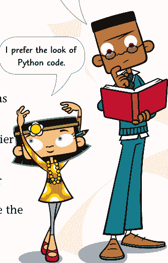

### 深入探索 Delving deeper

还有其他需要注意的区别。Java 有许多额外的单词，如 `public`、`private`、`int` 和 `void`。这是因为它是一种非常严格的语言，一切都必须经过仔细定义。而 Python 通常会为程序员判断出某物是整数（数字）还是字符串（文本）。两种语言都有它们的优缺点。

本书没有涉及“类 Classes”，但在第 5 章的最终项目中，我们必须使用一些类。你将在下一章中学习 `def` 关键字！

### 关于注释 More about commenting

如果你完全不知道上面任何代码的含义，请不要惊讶。即使你已经读过这本书，这可能也很困难。这里是 Python 代码，带有一些注释：

```python
# 这是一个类（Class）
class Lift():
    # 电梯当前楼层为 0
    current_floor=0

    # 寻找电梯
    def getFloor():
        return current_floor

    # 移动电梯
    def moveTo(floor_number):
        current_floor = floor_number
```


Python 代码，带有很多注释。变量名包含了 `Lift`、`current_floor`、`getFloor` 和 `moveTo(floor_number)`。Python 单词有 `class` 和 `def`。

### 变量命名 Naming variables

如果你想在某处存储一个数字或文本，你应该使用变量。变量的命名应该具有描述性。你可以使用下划线，例如 `my_own_variable`。

### 获取用户输入 Getting user input

在 Python 中获取用户输入异常简单。我们使用另一个函数 `input()`。这个函数和 `print()` 函数非常相似，它可以接收字符串并显示在屏幕上。

```python
### 输入文本
keyboard_input = input("输入文本。")
```


### 实验 Experiment

- 在交互模式下，尝试代码框 3.2 中的代码看看是否有效。

```python
>>> name = input("你的名字是什么？")
>>> print("你好 ", name)
```

现在回到脚本模式。

在 `myMagic8Ball.py` 中编写你的八个变量后，漏掉一行并输入代码框 3.3 中的内容。

```python
print("欢迎来到神奇八球游戏。")
### 获取用户的问题
question = input("给我一个建议，然后按回车键摇摇我。")
print("摇中...\n" * 4)
```


变量 `question` 被赋值了 `input()` 函数的结果。也就是说，它现在存储了玩家输入的任何内容。在这个版本中你将不会使用这个变量。事实上，玩家可能会很好说话。然而，你以后可能想自定义游戏，因此将此输入存储在某处是一个很好的设计。你会发现你理解了代码的其他部分。如果你不确定代码框 3.3 的最后一行做了什么，可以将其复制到交互模式中寻找答案。

### 回脚本模式

回到 `myMagicBall.py` 窗口，输入代码框 3.4 中的代码。你会看到我们使用 `randint()` 函数来生成一个 1 到 8 之间的随机数，并将结果赋值给名为 `choice` 的变量。

（提示：你可以通过复制和粘贴来节省大量的打字时间。记住，每当你这样做时，可能意味着有更好的代码编写方式！）

### 代码框 3.4

```
### use the randint() function to select the correct answer
choice=random.randint(1, 8)
if choice == 1:
    answer=ans1
elif choice == 2:
    answer=ans2
elif choice == 3:
    answer=ans3
elif choice == 4:
    answer=ans4
elif choice == 5:
    answer=ans5
elif choice == 6:
    answer=ans6
elif choice == 7:
    answer=ans7
```

> 我本以为用元组（tuples）来处理是最好的方法。


> 也许吧，但我们的读者在这书中不会遇到元组。

一张随机图片！

```
else:
    answer=ans8
    # print the answer to the screen
    print(answer)
    input("\n\nPress the RETURN key to finish.")
```

### 代码框 3.4 分析

### if, elif and else

代码框 3.4 代码的最后部分使用了 Python 的 `if`、`elif` 和 `else` 关键字。当你意识到 `elif` 是 `else` 的缩写时，它们非常容易理解。看这段代码：

```
if choice == 1:
    answer = ans1
```

第一行的意思是是：“如果 `choice` 的值等于 1，则运行冒号后缩进的代码。”

注意比较运算符 `==` 是如何使用的，这与第 2 章中 `while` 循环中的用法相同。

所以，如果 `choice` 等于 1，程序创建一个新变量并将其命名为 `answer`。通过等号，它被赋值了你在程序开始时输入的变量 `ans1` 所持有的字符串。因此现在 `answer` 将持有字符串 "Go for it!"

不过，随机生成器 `randint(1, 8)` 可能没有产生值 1，因此下一段代码处理 `choice` 等于 2 的情况：

```
elif choice == 2:
answer=ans2
```

因此在这种情况下，`answer` 将持有字符串 "No way, Jose!"

这会持续到应用程序处理所有其他情况：在你的程序中，这意味着如果 `choice` 是 8。

```
else:
answer=ans8
```

### input 的两种用法

`input()` 函数在程序中使用了两次。第一次，它获取用户输入并存储在名为 `question` 的变量中。

> 单独一个 `if` 语句是完全没问题的。`if` 语句后面跟着 `else` 也是可以的。但如果你使用 `elif` 语句，必须以 `else` 结尾。


你还记得用户的输入实际上并不是强制要求的吗？那行代码的作用是：等待回车键被按下，并存储输入，以防我们以后决定要使用它。

在程序末尾，我们再次使用了 `input()` 函数。

```
input("\n\nPress the RETURN key to finish.")
```

这一行甚至完全没有花精力存储用户输入。它只是提供了两个换行符和一条提示游戏结束的消息。程序再次等待用户按下回车键，然后结束。

这比意外结束游戏好得多，而且以后你会经常看到它。

你已经输入了程序的全部代码。如果你还没有保存，现在就保存，然后对照代码框 3.5 进行检查。

### 整合在一起

这是在 IDLE 中看到的完整代码：

```
### MyMagicBall
import random

### write answers
ans1="Go for it!"
ans2="No way, Jose!"
ans3="I'm not sure. Ask me again."
ans4="Pear of the unknown is what."
ans5="It would be madness to do that!"
ans6="Only you can save!"
ans7="Makes no difference to me, do or whatever."
ans8="Yes, I think that is the right."

print("Welcome to MyMagicBall.")

### get the question
question = input("Ask me for advice then ENTER to shake me.")

print("shaking ...")
### use the randint() function to select the correct answer
choice=random.randint(1, 8)
if choice == 1:
answer=ans1
elif choice == 2:
answer=ans2
elif choice == 3:
answer=ans3
elif choice == 4:
answer=ans4
elif choice == 5:
answer=ans5
elif choice == 6:
answer=ans6
elif choice == 7:
answer=ans7
else:
answer=ans8

### print the answer to the screen
print(input("\n\nPress the RETURN key to finish."))
```

### 脚本模式运行

要运行代码，你首先必须将其保存为 `.py` 文件。现在打开 `myMagicBall.py`，从菜单选择 Run。程序将在交互模式下运行。尝试一下。

### 总结

在本章中你学习了：

- 如何使用脚本模式编写并保存 Python 文件

- 如何编写带有注释和描述性变量名的代码

- 如何运行 Python 文件

- 如何获取用户输入

- 关于 `if`、`elif` 和 `else`

- 如何编写名为 `MyMagicBall` 的小游戏

你在这一章非常努力并学了很多。是时候实验一下了：

### 想法 1

> 让朋友玩玩游戏。（提示：确保他们看不到代码，否则会破坏游戏。）

### 想法 2

改变你想让 MagicBall 说的答案。


### 挑战

- 在 `myMagicBall.py` 中添加代码，让 MagicBall 在游戏开始时说“Hi”并询问用户名。

- 它应该将输入存储在变量 `user_name` 中。

- 重写代码，让 MagicBall 使用他们的名字交流。例如在最后，它可以说：“感谢游戏 [user_name]。请按回车键结束。”

有几种方法可以实现这一点。可以在 Coding Club 网站找到示例答案。

# 第 4 章 函数

在本章中你将：

- 学习函数

- 编写你自己的函数

- 创建一个猜数字游戏


> 猜游戏可以很酷。

### 函数

你已经遇到并使用了一些函数。你使用的第一个是 `print()`。函数名后面有括号。这是通过逗号提供参数的地方。有些函数不需要参数，它们没有参数的情况下工作！

```
print("This is my number: %n")
```

另一个参数

当我们创建一个或使用不需要任何参数的函数时，我们仍然在名字后面加上空括号。例如 `my_function()`。

Python 内置了许多我们可以直接使用的函数。我们可以创建自己的。我们使用 `def` 关键字创建函数。这是一个计数函数的代码：

```
>>> def count(number):
  n=1
  while n <= number:
    print(n)
    n = n+1
```

在交互模式下，输入上述代码。你需要两次回车键返回 Python 提示符。然后输入 `count(10)` 并按回车。


### 深入探索

**无限循环**可以通过运行一个永不停止的 `while` 循环来创建。这不是好事！这通常意味着你犯了错误。

如果你在本章稍后尝试玩 `count()` 或 `times_tables()` 函数，可能会遇到类似的情况。

如果你的程序一直运行不停止，直接关闭窗口。Python 会询问你是否想要杀死程序。不要害怕……杀掉它！（有时简单地按住 `ctrl` 并按下 `c` 键效果更好。）

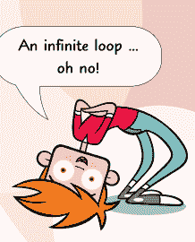

### 有人想要乘法表吗？

使用 `while` 循环让 Python 生成任何乘法表都是的。然而，我们想要快速选择我们需要哪一个乘法表，那么写一个新函数可能比不断修改你的代码更容易。

| 1 x 12 = 12 |

| 2 x 12 = 24 |

| 3 x 12 = 36 |

| 4 x 12 = 48 |

| 5 x 12 = 60 |

| 6 x 12 = 72 |

让我们开始思考……

我们需要提供一个值来指示我们需要哪个乘法表。这是一个数字，所以我们可以把这个参数命名为 `num:`

```
def times_tables(num)
```


我们需要产生 `while` 循环。但首先我们先算出表格中某行的代码，例如 `2 x 12 = 24`。为了实现这一点，2 是一个计数器，我们将在 `while` 循环中使用它（简单使用 `n`，并不是所有的变量名都必须描述性的！）。12 是 `num`，而 24 是

通过将 `n` 乘以 `num` 得到。剩下的只是文本。我们可以将所有内容整合到一个打印语句中。

### 快速测验 3

- 下哪一个产生了我们想要的输出？

1. print(n, " x ", num, " =", n*num)

2. print(num, " x ", n, " =", num*n)

3. print(n, " * ", num, " =", n*num)

现在，让我们把它们都组合在一起。

使用 IDLE 的交互模式，输入并思考代码框 4.1 中的代码。别忘记按两次回车键以返回 Python 提示符。此时应该还没有发生任何事情——一切很快就会揭晓。

```
Code Box 4.1
>>> times_tables(num):
    n=1
    while n <= 10:
        print(n, " x ", num, " =", n*num)
        n = n+1
```

要运行这段代码并输出 12 乘法表，请输入代码框 4.2 中的代码并按回车。

```
Code Box 4.2
>>> times_tables(12)
```

如果一切顺利，你应该看到一个像这样的屏幕：

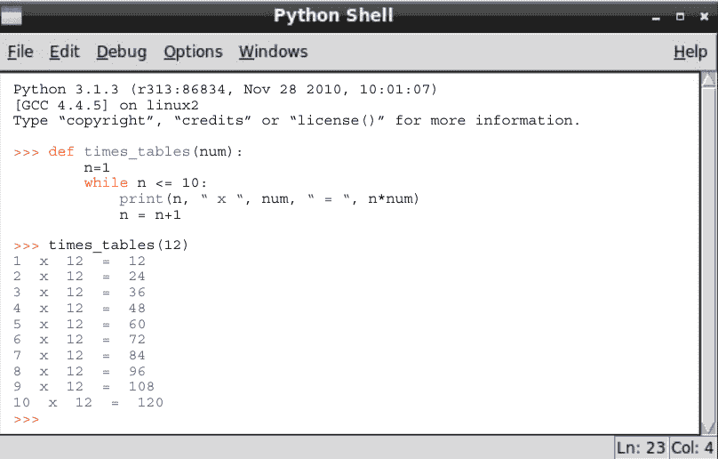

乘法表。

第 4 章：函数 49

如果你希望乘法表长度增加到 12 行，这样就能得到 12 x 12 = 144 会怎么办？现在你必须回去编辑该函数。在交互模式下这可能会很累，如果你的函数被保存为 Python 文件，这会是一个小麻烦。让我们尝试重写该函数，使其接受两个参数。同样在交互模式下，尝试输入代码框 4.3 中的代码，你将看到函数的威力。享受吧！

如果你在交互模式中仍然列出了 `times_tables()` 函数，将光标放在 `times_tables(num)` 某处，然后按回车。这将复制整个函数并允许你编辑它。这个技巧真的可以加快你的打字速度。

### 代码框 4.3

```
>>> def times_tables(how_far, num) :
    n=1
    while n <= how_far:
        print(n, " x ", num, " =", n*num)
        n = n+1
>>> times_tables(12, 17)
```

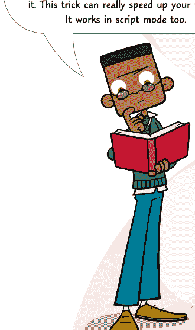

### 猜数字游戏

这是一个小游戏的完整代码。这是一个非常简单的游戏，计算机想出一个 1 到 100 之间的数字，玩家必须猜出那个数字。这个游戏再次使用了 Python 的随机数函数和 `while` 循环。在 IDLE 中打开一个新窗口，输入代码框 4.4 中的代码。将此文件保存为 `myNumber.py` 并存放在你的 Python 代码文件夹中。在你输入时，尝试推断每一行代码的作用，并惊叹自己已经走了多远。

第 4 章：函数 50

### 代码框 4.4

```python
### myNumber.py
### 这个游戏使用了一个自定义函数
import random

### 想一个数字
computer_number = random.randint(1, 100)

### 创建函数 is_same()
def is_same(target, number):
    if target == number:
        result="Win"
    elif target > number:
        result="Low"
    else:
        result="High"
    return result

### 开始游戏
print("Hello.\n我想了一个 1 到 100 之间的数字。")

### 将用户的猜测转换为整数
guess = int(input("你能猜中它吗？ "))
### 使用我们的函数
higher_or_lower = is_same(computer_number, guess)
```

（下页继续）

```python
### 运行游戏直到用户猜对
while higher_or_lower != "Win":
  if higher_or_lower == "Low":
    guess = int(input("Sorry,你太低了。再试一次。"))
  else:
      guess = int(input("Sorry,你太高了。再试一次。"))

higher_or_lower = is_same(computer_number, guess)
```

### 结束游戏

input("Correct!\nDone\n\n按 RETURN 退出。")

在这个游戏中，对你来说有两个新知识点。**return** 关键字告诉 **is_same() 函数** 在被调用后应该返回什么值。我们知道函数可以发送参数，**而且**，它们也可以返回数据。

在这种情况下，它返回存储在变量 **result** 中的值。因此，如果两个数字相同，它返回**字符串 Win**；如果提供的数字大于目标，函数返回值 **High**；如果提供的数字小于目标，则返回 **Low**。

对你来说的第二个新知识点是通过将其封装在 **int( 此处输入 )** 中来将用户的输入转换为整数。这是因为来自键盘输入的任何内容都是**字符串（strings）**。将一种**数据类型（data-type）**转换为另一种数据类型被称为**类型转换（casting）**。

你记得保存文件了吗？

第 4 章：函数 54

### 本章总结

在本章中，你学习了：

- 关于函数

- 关于 `while` 循环

- 如何创建一个游戏

- 如何使用 tkinter

- 如何设计程序

- 如何使用参数

这里是一些主意：

- 想法 1：关于乘法表

- 想法 2：关于猜数字游戏

- 想法 3：关于 EtchASketch

- 想法 4：挑战

### 代码框 5.1

```python
### myEtchASk application from Coding Club: Python Basics

from tkinter import *

##### 设置变量:
canvas_height = 400
canvas_width = 600
canvas_colour = "black"

##### 主程序:
window = Tk()
window.title("MyEtchASk")
canvas = Canvas(bg=canvas_colour, height=canvas_height, width=canvas_width, highlightthickness=0)
canvas.pack()

window.mainloop()
```

你现在可以尝试运行 `myEtchASketch.py` 了。虽然它看起来并不有趣，但这是你第一次创建一个窗口！注意交互模式窗口中也发生了一些事情。这里现在充当控制台，我们可以在这里获取错误消息等信息。

### 计划


现在你有了一个可以创建应用程序的窗口和一个可以绘画的画布，是时候开始规划应用程序的其他部分了。为了做到这一点，我们将任务拆分为多个函数。首先，我们需要能够每次画一点垂直线，然后是画水平线。由于这些操作将由键盘上的上、下、左、右方向键控制，因此编写四个相似的函数并将这些函数绑定到按键上是有意义的。所以首先，让我们先尝试创建一个函数，当我们按下向上方向键时画出一条向上的线。如果我们能实现这一点，我们就知道能够完成这个项目。

### 坐标

与数学不同，`tkinter` 和大多数计算机语言使用的坐标是从屏幕左上角开始计算的。所以我们的画布像这样。

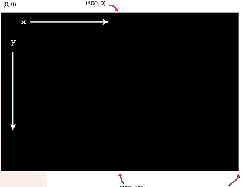

因此，屏幕上的一个点由两个数字表示：

例如 `(100, 50)` = 沿 x 轴移动 100 像素沿 y 轴向下 50 像素的点。

### 保持代码整洁

绘制垂直线的函数需要更多的变量，以便我们跟踪当前的进度。这些变量应该放在代码的顶部，并与其他变量声明放在一起。这是良好的编码风格。现在，如果你想调整程序，只需调整顶部的变量并重新运行。你不需要翻遍代码寻找事物发生的地方。此外，通过为变量选择描述性的名称，你就不需要过多的注释。

接下来应该是函数。它们需要放在运行你应用程序的主部分之前。这样主部分才能使用它们！因此，代码框 5.1 中的代码已拆分到代码框 5.2 中，以为所有函数留出空间。

你现在可以将新代码添加到你的 `myEtchASketch.py` 文件中了。它现在还不会产生任何变化。然而，函数的作用将在下一个分析部分进行解释。

### 代码框 5.2

```python
### myEtchASketch application from Coding Club: Python Basics

from tkinter import *

##### 设置变量:
canvas_height = 400
canvas_width = 600
canvas_colour = "black"

p1_x = canvas_width/2
p1_y = canvas_height
p1_colour = "green"
line_width = 5
line_length = 5

##### 函数:
### 玩家控制
def p1_move_N(self):
    global p1_y
```

```python
##### 主程序:

window = Tk()
window.title("MyEtchASketch")
canvas = Canvas(bg=canvas_colour, height=canvas_height, width=canvas_width, highlightthickness=0)
canvas.pack()

window.mainloop()
```

### 代码框 5.2 分析

首先，必须指出 `pl` 代表 player 1（玩家 1）。设置玩家 1 的原因是当你开始制作游戏时，你永远不知道会发生什么。灵感会冒出来，你突然又想要另一个玩家。好吧，对于 MyEtchASketch 游戏可能不需要。

### 变量

与其通过添加很多正方形来画线，不如画很多短线代码会更简单。通过将 `line_width` 等于 `line_length`，你可以创建一个正方形。这种效果很好，因为线有一个起点终点坐标，这正是我们想要跟踪的。变量列在表 5.1 中。

| 代码 | 含义 | 初始设置 |
|---|---|---|
| `p1_x` | 存储线条终点的 x 坐标 | 画布宽度的一半 |
| `p1_y` | 存储线条终点的 y 坐标 | 画布的高度 |
| `p1_colour` | 存储线条的颜色 | `"green"` |
| `line_width` | 存储线条宽度 | 5 像素 |
| `line_length` | 存储线条长度 | 5 像素 |

表 5.1 MyEtchASk 游戏中的变量。

### `p1_move_N()` 函数

`p1_move_N(self)` 将是一个将玩家 1 绘制的线条向屏幕上方移动的函数。

### `self`

由于这里使用了 `tkinter` 的方法，该函数必须提供参数 `self`。这是因为 `tkinter` 的方法位于类中。类中的函数被称为方法。

### `global`

在脚本开始时，我们声明了所有变量并给它们赋了值。这意味着在函数内部是局部的。

### `create_line()` 方法

由于这里使用了 `tkinter` 的方法，该函数必须提供参数 `self`。这是因为 `tkinter` 的方法位于类中。类中的函数被称为方法。

```python
canvas.create_line(x1, y1, x2, y2, fill=p1_colour, width=line_width)
```

| 参数 | 初始设置 |
|---|---|
| `x1` | 线的起点 x 坐标 |
| `y1` | 线的起点 y 坐标 |
| `x2` | 线的终点 x 坐标 |
| `y2` | 线的终点 y 坐标 |

表 5.2 MyEtchASk 的参数。

### 添加键盘控制

我们简单地使用 `window` 类的 `bind()` 方法，它只需要两个参数。

```python
window.bind("按键名称", 我们的函数)
```

如果我们想要某个键，我们会提供参数 `"a"`，但对于向上方向键，我们提供 `"<Up>"`。

```python
window.bind("<Up>", p1_move_N)
```

### 代码框 5.3

```python
### 将移动绑定到按键
window.bind("<Up>", p1_move_N)

window.mainloop()
```

> 看吧，很简单！

> 好吧 -很简单！

### 完成工作

一旦你实现了向上移动，你会发现编写其他方向的代码也很容易。向下移动只需向 y 坐标增加 5 像素，向右移动向我们的 x 坐标增加 5 像素，向左移动则从我们的 x 坐标减去 5 像素。

将代码框 5.4 中的剩余函数添加进去（这是最后一步）。由于我们反复编写这些代码，这表明可能有更好的编写此程序的方法。我们将在章节末的活动部分讨论这一点。

如果你发现你的程序第一次运行失败；请尝试自己解决任何问题。如果你确实卡住了，可以从配套网站下载代码。

### 代码框 5.4

```python
### player controls
def pl_move_N(self):
    global pl_y
    canvas.create_line(pl_x, pl_y, pl_x, (pl_y-line_length), width=line_width, fill=pl_colour)
    pl_y = pl_y - line_length
```

```python
def pl_move_S(self):
    global pl_y
    canvas.create_line(pl_x, pl_y, pl_x, pl_y+line_length, width=line_width, fill=pl_colour)
    pl_y = pl_y + line_length
```

```python
def pl_move_E(self):
    global pl_x
    canvas.create_line(pl_x, pl_y, pl_x + line_length, pl_y, width=line_width, fill=pl_colour)
    pl_x = pl_x + line_length
```

```python
def pl_move_W(self):
    global pl_x
    canvas.create_line(pl_x, pl_y, pl_x - line_length, pl_y, width=line_width, fill=pl_colour)
    pl_x = pl_x - line_length
```

第 5 章：MyEtchASk 68

```python
def erase_all(self):
    canvas.delete(ALL)

##### 主程序:
window = Tk()
window.title("MyEtchASketch")
canvas = Canvas(bg=canvas_colour, height=canvas_height, width=canvas_width, highlightthickness=0)
canvas.pack()
# 将移动绑定到按键按下
window.bind("<Up>", pl_move_N)

window.bind("<Down>", pl_move_S)
window.bind("<Left>", pl_move_W)
window.bind("<Right>", pl_move_E)
window.bind("u", erase_all)

window.mainloop()
```

### 本章总结

在本章中，你学习了：

- 如何使用 `tkinter` 库
- 如何制作你自己的 MyEtchASk 游戏
- 如何将应用程序放入它自己的窗口中
- 如何将函数绑定到键盘按键上
- “复制和粘贴”暗示了更好的处理问题的方法
- 如何清空画布。（如果你手动输入了代码，应该会发现一个溜进去的额外函数：`erase_all(self)`。当用户按下键盘上的按键时，它会清空屏幕。）

本章为我们的想法提供了许多可能性。由于你已经很好地组织了代码，只需调整文件开头的变量，就可以轻松实现以下“快速想法”。

### 快速想法

- 让 `line_length` 更长，看看会发生什么。
- 改变几次颜色，找出 `tkinter` 支持哪些命名颜色。
- 通常改变正方形的大小，直到找到你喜欢的尺寸。
- 通过调整所有变量来完全自定义代码，直到你满意。

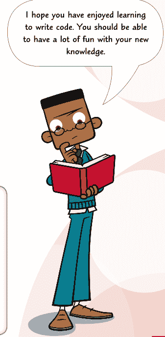

### 谜题

记得我们提过，复制和粘贴意味着有更好的编码方式。这个谜题鼓励你编写更好的代码。

创建一个名为 `p1_move(x, y)` 的新函数，使得四个移动方法可以简化为如下所示：

```python
def p1_move_N(self):
    p1_move(0, -line_length)
```

实现这种操作有几种方法。可以在网站上找到示例答案。

在网站上，你还会找到一个名为 `ourEtchSketch.py` 的双人游戏代码。如果你感兴趣，可以尝试自己制作——它并不困难，而且利用了本章谜题中更好的代码结构。这个双人游戏对一个人来说也很有趣，因为它允许你用彩色绘图。它还为你提供了更多额外想法的机会。

### 额外想法

- 下载 `ourEtchASketch.py` 并尝试画一些彩色的东西。
- 查看代码，看看将其变成双人游戏有多么简单。
- 和朋友一起尝试，将其作为一个合作画图游戏。
- 尝试作为一个计时比赛来玩，看看结束时谁的可见正方形最多。目标是尽可能覆盖你的对手。（提示：让正方形变大可能是最好的。）
- 尝试玩一个奇怪的《电子光战》（Tron）。由于没有碰撞检测，当你发生碰撞时必须诚实。（提示：如果你不知道 Tron 是什么，请问成人。）
- 尝试让画布变得高而窄，然后和朋友比赛谁到达屏幕顶部。
- 通过在路径上放置障碍物让赛车游戏更有趣。（提示：在将函数绑定到键盘的代码之前，在屏幕上画一些随机尺寸和颜色的线条。）
- 想出你自己的其他游戏。


### 进一步

当你读完这本书后，我们希望你想要继续编写代码。这里是你可能查看的其他地方和资源。

### 更多 Python

该系列的其他书籍可以在本书的配套网站找到：http://www.codingclub.uk

官方 python 文档：

PyGame：该网站提供了帮助制作游戏的模块。

### 像程序员一样思考

Scratch 官方网站：http://scratch.edu/

Java：编程语言：http://java.com/

## 附录

## 附录

这里包含了代码中的一些额外信息。

### 转义序列

| 转义序列 | 作用 |
| :--- | :--- |
| `\n` | 创建换行 |
| `\t` | 创建制表进 |
| `\\` | 允许出现反斜杠 |
| `\"` | 允许出现引号 |

### 数学运算符

| 运算符 | 名称 | 示例 |
| :--- | :--- | :--- |
| `*` | 乘法 | 2 |
| `/` | 除法 | 5 |
| `//` | 除法（取整） | 20 |
| `%` | 取模 | 8 |
| `+` | 加法 | 3 |
| `-` | 减法 | 4 |

### 比较运算符

| 比较运算符 | 含义 | 示例 |
| :--- | :--- | :--- |
| `==` | 等于 |  |
| `!=` | 不等于 |  |
| `>` | 大于 |  |
| `<` | 小于 |  |
| `>=` | 大于或 |  |
| `<=` | 小于或 |  |

### 结束代码

```python
print("按下按键结束")
```

### 术语和索引

- **argument**：函数需要的信息，以便其执行任务。
- **bug**：导致程序无法正常运行的代码错误。
- **casting**：将一种数据类型转换为另一种的过程；例如，有时数字以字符串存储但需要转换为整数 `int("3")`。
- **commenting**：程序中供人类阅读、计算机运行时忽略的文本——在 Python 中所有注释都以 `#` 开头。
- **data-type**：计算机存储的不同信息类型，例如 float、整数和字符串。
- **default**：作为参数或变量提供的初始值。
- **equals operator**：等号用于给变量赋值，例如 `n=2` 将值 2 赋值变量 n。
- **float**：可以带有小数的数字类型。
- **function**：可重用的代码块。
- **global variable**：程序任何地方都可以使用的变量。
- **hacking**：获取以前编写的代码并重写部分以实现不同的功能。
- **IDE**：集成开发开发环境；IDLE 是其中一个例子——它们是带有许多实用工具的特殊文本编辑器。
- **IDLE**：集成开发环境；这是随正常 Python 3 安装附的 IDE。
- **infinite loop**：一直运行的代码；这通常是坏事。
- **integer**：不能带有小数的数字类型。
- **interactive mode**：指我们在 IDLE 中尝试代码片段而不保存它们。


- 局部变量：定义在函数内部且仅在该函数内部可使用的变量 (63)
- 逻辑运算符：参见比较运算符 (25)
- 循环：在满足特定条件之前不断重复执行的代码段 (22)
- 数学运算符：对某些数字执行某些数学函数的运算符；例如乘法或加法 (20)
- 方法：在类中赋予函数的名称 (63)
- 模块：一个保存的 Python 文件，其函数可以被另一个程序使用 (31)
- 取模：一种用于返回除法计算结果余数的数学运算符；例如 `22%7` 返回 `1` (20)
- 运算符：对某些代码执行简单功能的符号，例如将两个数字相乘或比较它们以判断是否相等；参见比较运算符和数学运算符 (25)
- 输出：从程序发送到屏幕或打印机等的数据 (13)
- 返回：(1) 函数运行后产生的值值——它也是一个 Python 关键字；(2) 键盘上的“换行”键，有时称为回车键 (52)
- 脚本模式：指我们使用 IDLE 来帮助编写并将代码保存到文件中这种模式 (29)
- # 语句：在本书中指一段代码片段；严格来说，它是代表某个命令或动作的代码；例如 `print` 语句
- # 字符串：文本数据，可以存储在变量中
- # 语法错误：计算机因无法识别提供的代码格式而无法运行程序时产生的错误；例如，如果未关闭括号，就会产生语法错误
- # tkinter：一组经常被导入到 Python 程序中的类，提供了创建窗口、绘制图像和生成动画的有用方法
- # 变量：指向计算机内存中存储数据位置的名称；宽泛地说，它也可以指代那些数据
- # while 循环：一种只要比较语句返回 `True` 就会重复执行代码的循环

## 快速测验答案

### 快速测验 1

答案 = 2

### 快速测验 2

答案 = 11 除以 4 也等于：2 余 3

### 快速测验 3

答案 = 1

## 致谢

虽然这是一本小书，但工作量比我预期的要得多。我的目标一直是编写一系列符合年轻人应得标准的书籍。为此，我寻找了一家声誉良好的出版社，并必须感谢 Claudia Bickford-Smith 对该项目的热情。我很高兴剑桥大学出版社能够录用我。Heather Mahy 和 Saul Sexton 的辛勤工作也深受感谢，他们这项工作不容易，在使项目落地的同时确保我不偏离正轨，我对此深表感谢。

一本声称教青少年编程的书必须在青少年身上进行测试。因此，我必须感谢 Ewell Castle School 的 Coding Club 男孩以及我的小儿子 Daniel，他们忍受了早期版本，并帮助我发现哪些是有效的，哪些（对他们来说遗憾）是不行的。

当我意识到树莓派基金会的宗旨和核心动力和我一样时，那种感觉太棒了。Jack Lang 的鼓励以及 Alex Bradbury 的巨大帮助确保了我的代码和计算机科学知识在技术上是正确的，这些都是无价的。

我还想亲自感谢 Ohio Art Company，他们拥有并销售奇妙的 Etch A Sketch 玩具，他们非常热情，并迅速许可我使用他们的注册商标。

Fran，我喜欢这些插图。


我的两个大儿子已经离家了，但得益于现代技术，他们也分享了这段旅程并做出了无价的贡献和建议。最后，在晚上和假期编写书籍和程序需要时间。我永远感谢我的妻子 Rita，她从未在这段时间里对我吝啬，也没有抱怨，即使是在听我谈论代码片段时！

谢谢你们……大腿（们）。

作者和出版社承认以下版权材料来源，并对授予的许可表示感谢。尽管已尽一切最大努力，但并不总是能够识别所用材料的来源，或追踪所有的版权所有者。如果发现有任何遗漏，我们乐在重印时加入相应的致谢。

| 页码 | 来源 |
| :--- | :--- |
| p. 28 | ImageZoo/Alamy |
| p. 36 | Sukonosova Anastasia/Shutterstock |
| p. 37 | Stock Illustrations Ltd/Alamy |
| p. 55 | Judith Collins/Alamy |

Etch A Sketch® 的文字标记、标志和配置是 Ohio Art Company 的注册商标。
