# Coding Club Level 2 Python：进阶指南


## 引言

## 这本书是给谁看的？

本书是编程俱乐部系列书籍中的第 2 核心读。为了充分利用本书，你应该熟悉 Python 3 编程语言，并了解变量、`while` 循环以及 `if`、`elif` 和 `else` 语句。因此，我们建议你在阅读本书之前先阅读《Python 基础》（Python Basics）。《Python：进阶之路》针对 12–13 岁，但也适用于想要学习计算机编程的较大儿童甚至成年人。

## 为什么要选择这本书？

本书在解释重要原理的同时，帮助你构建实用的短项目。我们希望你（读者）不仅能学会如何编写书中的程序，还能学会设计你自己的程序。我们希望你能够写好程序，这样如果你进一步发展并成为下一个 Google 的发明者，就不需要摒弃糟糕的编程习惯。


## 你需要什么？

任何计算机都可以运行 Python 3。如果你的计算机尚未安装 Python 3，配套网站（www.codingclub.co.uk）上有一个章节会引导你完成安装。这大约需要五分钟！这就是你入门的所有需要。

书中所有项目的启动文件都可以从配套网站下载，这样你就不不会在较大的项目中迷失。此外，每个项目都有完成后的文件（以防你卡住），并配有谜题和挑战的答案。

## 如何使用这本书

你应该仔细阅读本书，并按顺序构建所有主要项目。在每一章的末尾，都有进一步的想法以及你可以视为“小任务”的挑战。有些读者希望通过完成所有任务来理解全部内容。你们有些人可能倾向于快速读完。

现在来看看如果我们包含一个元组，代码会变得多简单和简短：

## 代码框 1.2

```
## My Magic 8 Ball
import random

### 将答案放在一个元组中
answers = (
    "Go for it!",
    "No way, Jose!",
    "I'm not sure. Ask me again.",
    "Fear of the unknown is what imprisons us.",
    "It would be madness to do that!",
    "Only you can save mankind!",
    "Makes no difference to me, do or don't - whatever.",
    "Yes, I think on balance that is the right choice."
)
```

print("Welcome to MyMagic8Ball")

### 获取用户提问

question = input("Ask me for advice then press ENTER to shake me.\n")

print("shaking ...\n" * 4)

### 使用 randint() 函数选择正确的答案

choice = random.randint(0, 7)

```
### 将答案打印到屏幕
print (answers[choice])

### 优雅地退出
input("\n\nPress the RETURN key to finish.")
```

### 代码框 1.2 分析

如果你已经有一段时间没读《Python基础》了，你可能会发现将这段代码输入 IDLE 并逐行思考它很有帮助。以下是它的功能。

### import 语句

我们将使用 Python `random` 模块中的一个函数，因此我们需要导入它。

### 元组 (tuple)

我们必须用逗号分隔元组 `answers` 中的字符串。在每个逗号后新起的一行可以让代码变得更易读。

### input() 函数

`input()` 函数监听键盘输入并等待回车键被按下。然后它将键盘输入作为字符串返回，并存储在变量 `question` 中。

```
question = input("Ask me for advice then press ENTER to shake me.\n")
```

用于访问打印出的字符串的变量名，为键盘输入提供指令。

你对什么时候该用圆括号、什么时候该用方括号感到有点困惑吗？基本上，当我们创建一个元组时，我们将它的内容封装在圆括号中。每当我们从元组调用索引值时，我们将索引（其在列表中的位置）放在方括号中。

### randint() 函数

```
choice = random.randint(0, 7)
```

这行代码要求 `random` 模块中的 `randint()` 方法从 0 到 7 选择一个随机数。这个数字被存储在名为 `choice` 的变量中。（类中函数的方法。）


### 结束

```
print(answers[choice])
```

这使用随机数 `choice` 作为 `answers` 元组的索引。这行代码选择了从元组中随机出的字符串并将其打印。

> ### 实验
这两个脚本可以在配套网站（www.codingclub.co.uk）获得。尝试运行它们并检查它们的功能是否相同。

### 列表 (Lists)

列表是另一种容器。它们与元组非常相似，区别是它们是可以修改的。将元组想象成不可被其他代码修改的快速内存高效列表。我们无法通过程序在元组中插入或删除项。然而，有一些函数允许我们在列表中插入或删除项。列表的写法如下：

```
my_list = ["one", "two", "three", "four"]
```

就像元组一样，列表中的每个值都有从 0 开始的索引，每个值之间用逗号隔开。

看看这在交互模式下是如何工作的：

```
>>> my_list = ["one", "two", "three", "four"]
>>> my_list [2]
'three'
>>> my_tuple = ("one", "two", "three", "four")
>>> my_tuple [2]
'three'
>>>
```

> 嗯，这次列表是用方括号围绕的。
> 还记得 Python 的交互模式意味着使用 shell 而不是保存文件吗？它对于进行实验非常有用。

你可以看到列表和元组提供了相同的输出。那么，什么时候该用列表而不是元组呢？如果我们想要程序能够在列表中添加、删除或更改项，就会选择列表而不是元组。


## 快速测验 1.1

判断下列项哪种是最佳选择，列表还是元组：

- 用于存储星期几的字符串的地方（例如 "Monday"）。
- 用于存储 Coding Club 成员名字的地方。
- 用于存储整数值的地方（0, 1, 2, 3, 4, 5, 6, 7, 8 和 9）。

### 字典 (Dictionaries)

最后的容器类型是字典。字典的形式略有不同。字典提供自己的索引。键可以是字符串、整数甚至是元组。这是一个例子：

```
my_dictionary = {1:"cat", 2:"dog", 3:"horse", 4:"fish"}
```

或

```
my_dictionary = {"1":"cat", "2":"dog", "3":"horse", "4":"fish"}
```

> 我刚才糊了了一下，忘记了字符串总是出现在引号里而数字不是。所以 1 是整数但 "1" 是作为字符串存储的数字！


看看这在交互模式下如何工作：

```
>>> my_dictionary = {1:"one", 2:"two", 3:"three", 4:"four"}
>>> my_dictionary[2]
'two'
>>> my_dictionary = {1:"one", 2:"two", 3:"three", 4:"four"}
>>> my_dictionary[2]
'two'
```

你可能注意到字典在括号内需要将键分配给值。它们使用冒号 `:` 将值与键隔开。

#### 括号是什么？

当我们创建一个新容器时，Python 为我们提供了快速定义哪种类型的方法：

- 如果想要元组——用圆括号括起来。
- 如果想要列表——使用方括号。
- 如果是字典——使用花括号。

#### 深入探讨

区别是什么？

字符串、元组和列表都是索引容器；值根据输入顺序自动赋予索引。字典由你提供键，键值对不按特定顺序存储。字符串和元组的内容在创建时已设定，无法通过程序更改。列表和字典是可以通过多种方式添加和更改值的容器。

也可以这样创建空容器：

#### 有用函数

表 1.1 提供了可以在字符串、元组、列表和字典上使用的有用函数。你也可以附录 1 中找到它。该表假设创建了以下容器：

```
s = "bar" # 字符串
t = ("b","a","r") # 元组
l = ["b", "a", "r"] # 列表
d = {1:"b", 2:"a", 3:"r"} # 字典
```

| 函数 | 字符串 | 元组 | 列表 | 字典 |
| :--- | :--- | :--- | :--- | :--- |
| 打印所有 | >>> print(s) bar | >>> print(t) ('b', 'a', 'r') | >>> print(l) ['b', 'a', 'r'] | >>> print(d) {1: 'b', 2: 'a', 3: 'r'} |
| 打印元素 | >>> print(s[2]) r | >>> print(t[2]) r | >>> print(l[2]) | >>> print(d[2]) a |
| 连接 | >>> a=s+"f" 'barf' | >>> a=t+"f" ('b', 'a', 'r', 'f') | >>> a=l+"f" ('b', 'a', 'r', 'f') | |
| 添加元素 | 字符串不可修改。 | 元组不可修改。 | >>> l.append("f") ['b', 'a', 'r', 'f'] | |
| 排序 | 字符串不可修改。 | 元组不可修改。 | >>> l.sort() ['a', 'b', 'r'] | >>> sorted(d) ['1', '2', '3'] >>> sorted(d.values()) |
| 删除元素 | 字符串不可修改。 | 元组不可修改。 | >>> del l[1] ['b', 'r'] | >>> del d[1] {2:'a', 3:'r'} |
| 替换元素 | 字符串不可修改。 | 元组不可修改。 | >>> l[0]="c" ['c', 'a', 'r'] | >>> d[1]="c" >>> print(d) {1:'c', 2:'a', 3:'r'} |
| 查找 | >>> s.find("b") 0 | >>> t.index("b") 0 | | |

> 这张表在我写自己的应用程序时非常有帮助！

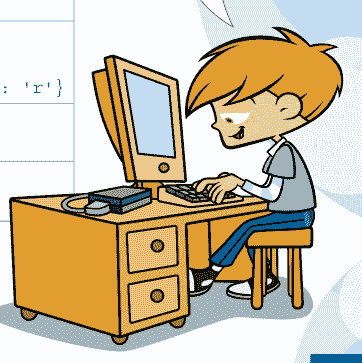

第 1 章：数据类型 18

### 快速测试 1.2

对于以下每一项，说明选择元组（tuple）、列表（list）还是字典（dictionary）：

1 一个用于存储俱乐部游泳员在 100 米自由泳中获得的个人最佳成绩的容器，例如：Mark: 65.34s, Freya: 68.04s 等。
2 一个用于存储全年各月份的容器。
3 一个用于存储 2012 年伦敦每月降雨量的容器。
4 一个用于存储目前参加国际象棋学生的名字的容器。

### 章节总结

在本章中，你已经：

- 学习了更多关于数据类型的知识
- 学习了元组、列表和字典
- 制作了 MyMagic8Ball 的简短版本
- 了解了一些新数据类型可以使用和不能使用的不同函数。

> 练习总是是好的。

我们将在本书书中进一步探索这些新数据类型。这里有一些想法，可以帮助你复习来自《Python 基础》中的编程技能。（由于字典最难使用，我们将等到你学到一点之后再提供任何涉及字典的谜题。）


### 谜题

使用列表代替元组编写一个新版本的 MyMagic8Ball。如果你做得正确，它的运行方式应该完全相同，因为列表可以完成元组能做的一切以及更多。

### 挑战

这是一个来自《Python 基础》的挑战，虽然你可能有些生疏，但你应该能够胜任。希望它能为你带回快乐的回忆。

- 1 为 myMagic8Ball.py（代码框 1.2）添加一些代码，让 Magic8Ball 在游戏开始时说“Hi”并询问用户的名字。
- 2 修改代码，让 Magic8Ball 使用用户的名字与用户交流。例如，在结束时它可以说：“感谢游戏，[Name]。请按回 键结束。”

有几种方法实现这一点。

要查看答案，请访问 www.codingclub.co.uk/book2_resources.php。

> 你注定有一天会成为著名的计算机科学家！


## 创意

将 Magic8Ball 游戏变成幸运饼游戏。你可以将其命名为 myFortuneCookie.py。

# 第 2 章

构建 GUI

在本章中，你将：

- 练习使用元组和字典
- 复习如何使用 tkinter 并学习使用组件（widgets）
- 构建图形用户界面 (GUI)
- 构建一个词汇表应用程序。

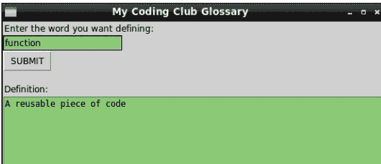

## 我的词汇表 (MyGlossary)

图形用户界面（GUI）简单来说允许用户通过菜单和按钮等图形与计算机交互的“屏幕”。你现在将使用 tkinter 构建一个你自己的小型 GUI 应用程序。

在从配套网站下载的源代码的第 2 章文件夹中，你会找到一个名为 `myGlossary_Start.py` 的文件。该文件为你提供了一个词汇表应用程序的概要源码，包含了本书的完整词汇表。代码框 2.1 中也提供了参考。

```
### myGlossary_Start.py

from tkinter import *

### 键按下函数：

#### main:
window = Tk()
window.title("My Coding Club Glossary")

#### 创建 label

#### 创建文本输入框

#### 添加一个提交按钮：
```

#### 创建另一个 label

#### 创建文本框

```
#### 字典：
my_glossary = {
  'algorithm': '执行任务的逐步步骤说明。',
  'bug': '导致程序失败的代码。',
  'binary': '表示数字的。'
}

##### Run mainloop
window.mainloop()
```

这会有区别吗？

**重要：** 你会在这个阶段发现，这似乎没有任何区别，但实际上是有的如果你让代码保持这样而不将其恢复原状，你会发现它之后会回来，并带给你一个非常难以发现的**bug**（程序错误）。如果我们在点操作符的行末尾添加 `grid()` 方法，会发生什么？它成功创建了文本，但未能将其赋值给名为 `entry` 的变量。因此，当我们完成 `click()` 方法时，程序会一直提示 `entry` 不存在。换句话说，在继续之前，请确保代码已恢复到代码框 2.3 中的原始状态。

### Button 组件

Button 组件提供了一个按钮！我们希望在按下它时能执行某些操作，所以在制作按钮之前，让我们先添加它在被按下时将调用的函数开头。在 `# key press function` 注释下方添加代码框 2.5 中的代码。

```python
### key press function
def click():
    entered_text = entry.get() # 从文本输入框中收集文本
```

现在，在 `# Add a submit button` 注释下方，添加代码框 2.6 中的代码。

### 代码框 2.6

```python
### Add a submit button
Button(window, text="SUBMIT", width=5, command=click).grid(row=2, column=0, sticky=W)
```

与所有组件一样，第一个参数（函数或组件所需的信息）是 `window`，它告诉 tkinter 组件应该放置的位置。`command=click` 告诉按钮在被按下时调用 `click()` 函数。注意，在将函数赋值给按钮时**不要**包含括号。如果你包含了括号，它会尝试在创建按钮时运行函数，而不是在按下时运行。我们将在后面的章节中大量按钮，届时我们将清楚地看到它是如何运作的。最后，我们调用 `Button` 类的 `grid()` 方法将其放置在窗口想要的位置。如果你想检查到为止的所有内容，可以运行它查看一个几乎没用的按钮。

### Text 组件

通过在 `myGlossary_Start.py` 的相应部分输入代码框 2.7 中的代码，添加另一个标签以及一个文本框。你现在应该理解这段代码了。

### 代码框 2.7


```python
### create another label
Label(window, text="nDefinition:").grid(row=3, column=0, sticky=W)

### create text box
output = Text(window, width=75, height=6, wrap=WORD, background="light green")
output.grid(row=4, column=0, columnspan=2, sticky=W)
```

同样可以运行这段代码，但不要期望发生很多事情，因为我们的 `click()` 函数还没有完成。不过，应用程序完成了所有的组件，所以 GUI（图形用户界面）是完整的。

### 深入探索

你注意到在输出文本框中提供的可选参数 `colspan=2` 吗？文本框是在网格布局的 `(4,0)` 单元格中创建，并允许跨越到下一列 `(4,1)`。在这种情况下它是完全没必要的（如果你愿意可以删除它）。包含在这里是因为你可能需要这种技术来让章节末尾谜题的某些答案更好。


### 完成 MyGlossary

剩下的唯一工作是完成 `click()` 函数。这将从我们的字典中调用所需的定义。通过输入代码框 2.8 中的代码完成 `click()` 函数。

```python
### key press function
def click():
    entered_text = entry.get() # 从文本输入框中收集文本
    output.delete(0.0, END) # 清除文本框
    definition = my_glossary[entered_text]
    output.insert(END, definition)
```

### 代码框 2.8 分析

`entry.get()` 对 `entry` 组件应用了 `get()` 函数。这收集了输入到此文本输入框中的任何内容并将其赋值给变量 `entered_text`。

接下来，我们使用该组件的 `delete()` 方法清除名为 `output` 的文本框。它接受两个参数。`0.0` 表示从第 0 行（即第 1 行之前）和第 0 个字符（即开头）开始删除。`END` 是一个始终指向文本框中最后一个字符的常量。我们也可以用行字符索引来替换 `END`，但 `END` 更简单。

### 深入探索

> 你知道吗，词表包含了这本书和 Python 基础中的所有的键吗？

`delete()` 方法中引用的索引像坐标一样，但实际上指示了选择文本时光标所在的位置。行数从 0 开始计数，第一行之前是 0，1 是第一行，2 是下一行，以此类推。字符索引（或列索引）从 0 开始计数，第一个字符之前是 0，之后是 1，2 是下一个，以此类推。不要忘记空格也是一个字符。

例如，`my_string = "text[widget box"`，光标位于索引位置 `(1.4)`。

下一行代码使用输入的文本作为键，在字典中查找定义。最后，使用组件的 `insert()` 方法将结果添加到名为 `output` 的文本框组件中。它接受两个参数：

1. 从哪里开始：（即开头）

2. 插入什么：（END)


### 测试

这完成了程序。你现在有一个实用的应用程序，可以用来查找书中任何你不确定的单词。

```python
### key press function
def click():
    entered_text = entry.get() # 从文本输入框中收集文本
    output.delete(0.0, END) # 清除文本框
    try:
        definition = my_glossary[entered_text]
    except:
        definition = "没有记录。"
    output.insert(END, definition)
```

### 总结

在本章中你：

- 练习了字典的使用

- 复习了如何使用 tkinter

- 构建了一个词表

字典和 GUI 的结合非常强大，应该让你制作很多应用程序。这里是一些想法：

### 想法 1

使用词表程序作为模板，制作一些闪卡来帮助复习。

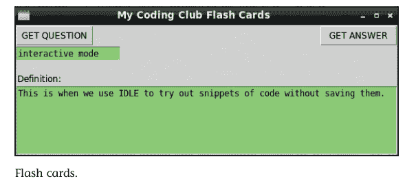

### 想法 2

使用词表程序作为模板，制作一个帮助学习外语的词汇应用。让单词作为键，翻译作为值。

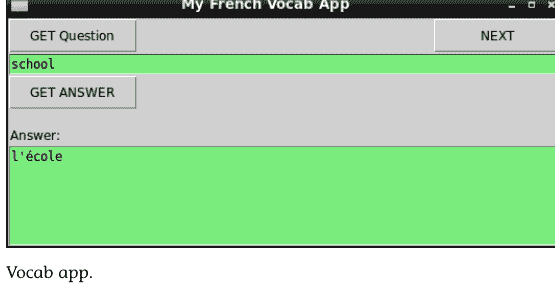

### 挑战

使用词表程序作为模板，制作一个测验应用，它可以随机选择问题并在按下 GET ANSWER 时提供答案。

**提示：** 你需要两个文本框而不是一个输入框和一个文本框。除了 GET ANSWER 按钮外，你还需要一个 NEXT 按钮。要查看答案请访问 `codingclub.co.uk`。

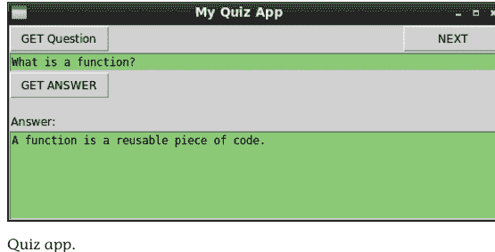

### 想法 3

使用挑战的解决方案作为模板，制作一个随机笑话生成器。

**提示：** 你需要坚持这种双行式笑话：

问：程序员和足球员交叉会得到什么？

答：Foot order（订单/梗）

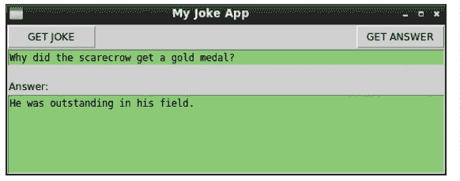

# 布局计算器

在本章中，我们将布局一个简单的计算器。这只是一个开始！在书的后后的部分，我们将添加更多按钮，以便你对其进行自定义。很快，你将将构建出一个完全可编程的计算器。

本章的重点是尽可能高效地创建一个整洁的布局。由于有很多相似的按钮，你将通过循环列表来构建它们，而不是一个一个地构建。通过这些新知识，你将能够构建出各种用户可以轻松交互的新应用程序。

## 开始设计

### 调查 1

首先，我们将尝试一个接一个按钮地构建计算器。不要担心——大部分工作已经为你完成好了。从配套网站提供的第 3 章文件夹中打开 `myCalculator_expt1.py`。你将找到一个包含一个按钮和一个显示器的计算器程序代码（代码框 3.1）。

### 代码框 3.1

```python
### myCalculator_expt1.py
from tkinter import *
from decimal import *

#### main:
window = Tk()
window.title("MyCalculator")
```


```python
#### 使用 Entry 控件创建一个可编辑显示器
display = Entry(window, width=45, bg="light green")
display.grid()
```

```python
### 创建数字小键盘按钮：
def click1():
    display.insert(END, "1")
Button(window, text="1", width=5, command=click1).grid(row=1,column=0)
```

```python
##### mainloop
window.mainloop()
```

如果你按下按钮，它会在显示器上输出字符串 `"1"`。运行应用程序并检查其功能是否符合预期。仔细查看代码并尝试添加第二个按钮——2 按钮。尝试在查看下方提供的答案之前完成此操作并添加第三个按钮。

现在，将你的代码与代码框 3.2 中的解决方案进行对比：

### 代码框 3.2

```python
### 创建数字小键盘按钮：
def click1():
    display.insert(END, "1")
Button(window, text="1", width=5, command=click1).grid(row=1,column=0)

def click2():
    display.insert(END, "2")
    Button(window, text="2", width=5, command=click2).grid(row=2,column=0)

def click3():
    display.insert(END, "3")
    Button(window, text="3", width=5, command=click3).grid(row=3,column=0)
```

### 代码框 3.2 分析

我们添加的每个按钮都要编写三行代码。简单计算器上有 19 个按钮，在下一章我们将再添加 10 个。这将导致大量的复制和粘贴，并产生大量的代码。当你想要更改设计时，这种编程方法会变得非常麻烦。例如，如果你想更改按钮的宽度，你必须修改 29 组按钮的宽度代码！此外，大多数按钮都在执行相同的事情：它们将值添加到显示器中。因此，编写一个函数来处理按钮点击并将其放置在代码列表的顶部是有意义的

### 调查 2

在这次调查中，我们将尝试使用循环来构建数字小键盘。打开第 3 章文件夹中的 `myCalculator_expt2.py`。你可以看到下方框 3.3 中的代码。这产生了一个具有九个按钮和一个显示器的计算器应用程序。你看到我们如何使用计数器变量用于行和列，以及如何增加这些变量来构建数字小键盘的吗？请注意，当你运行它时，按下按钮似乎没有任何反应。这也是计算机科学家所谓的“重构”的示例——它是程序员的一项重要技能。


### 代码框 3.3

```python
### myCalculator_expt2.py
from tkinter import *
from decimal import *

### 按键函数：
def click(key):
    display.insert(END, key)

#### main:
window = Tk()
window.title("MyCalculator")

#### 创建行
top_row = Frame(window)
top_row.grid(row=0, column=0, columnspan=2)

#### 使用 Entry 控件创建一个可编辑显示器
display = Entry(top_row, width=45, bg="light green")
display.grid()

#### 创建数字小键盘框
num_pad = Frame(window)
num_pad.grid(row=1, column=0, sticky=W)
```

```python
#### 为数字键盘提供按键列表
num_pad_list = [
    '7', '8', '9',
    '4', '5', '6',
    '1', '2', '3',
    '0', '.', '='
]
#### 使用循环创建数字键盘按钮
r = 0 # 行计数器
c = 0 # 列计数器

for btn_text in num_pad_list:
    Button(num_pad, text=btn_text, width=5, command=click(btn_text)).grid(row=r, column=c)
    if c > 2:
        c = 0
    r += 1

##### mainloop
window.mainloop()
```

### 故意错误！

## 快速测验 3.1

故意错误在哪里？

（保持代码不变——我们将在测试和调试中研究这个问题。）

## 使用 frame

在你尝试调查 1 的时候，你可能尝试过将三个按钮放在一起，并发现它们并不合适。控制一组元素的一种方法是跨列（spanning columns）。通常将一组控件放在另一个名为 `frame` 的控件中更好。这就是我们如何使用 `frame` 来组织计算器。有些人专门负责布局应用程序的用户界面。如果他们做得出色，他们的界面对用户来说始终是自然的。

| MyCalculator | | | |

|---|---|---|---|

| 7 | 8 | 9 | |

| 4 | 5 | 6 | + |

| 1 | 2 | 3 | ( ) |

| 0 | | | C |

使用 `frame` 操作计算器。


如果你仔细查看代码，你应该看到控件是如何在窗口中排列的，按钮是如何分组在 `frame` 中的。

### for 循环

在 **Python 基础** 中我们学习了 **while 循环**。现在是时候认识 `for` 循环了。在处理列表、字典或元组时，**for 循环** 非常棒。`for` 循环会根据需要执行缩进的代码，在这种情况下，每个按钮需要执行一次。也就是说，对于 `btn_text` 的每个值。变量 `btn_text` 用于存储 `num_pad_list` 的值。所以，在第一次循环时，`btn_text` 代表字符串 `'7'`。在下一轮中，`btn_text` 将是 `'8'`。每次循环列计数器 `c` 增加 1，直到它大于 2。

## 第3 章：设计简单的计算器

## 实验

尝试运行提供的代码，然后修改代码让列计数器计数到大于 3，看看发生了什么。继续修改 `c` 和 `r` 的值，直到你对这个循环如何构建数字小键盘有了良好的感觉。`num_pad` 列表可以全部写在一行。看看添加换行后变得容易多少。计算机忽略列表、字典和元组中的换行。

### 调试

现在每个按钮的代码对你来说应该是可以理解的。这里的问题是：为什么这段代码没有按预期工作？找出代码没有按预期工作的原因被称为调试。有两个线索：

线索 1：按下按钮时没有任何发生。

线索 2：程序首次运行时输出是 7894561230=。

## 快速测验 3.2

- 你对这个输出有什么发现？

- 它只是随机的数字和符号。（不，不是）

- 数字和符号的顺序与 `num_pad_list` 相同。

第一个线索告诉我们，链接到我们的 `click()` 函数的 `command` 选项在按下按钮时不起。第二个线索告诉我们，函数在每次创建按钮时都被调用了。


`tkinter` 遵循标准的评估规则：如果带带括号调用函数，该函数将立即运行。然而，我们希望将函数附加到按钮上，仅在按下按钮时才调用。为了实现这一点，`tkinter` 按钮控件要求我们不带括号输入函数名。

尝试将 `command=click(btn_text)` 替换为 `command=click`，然后运行应用程序。你认为会发生什么？在按下按钮之前，一切正常。但当你按下按钮时，`click()` 函数仍然没有被调用。

## 真正构建计算器

你一直在编写的调查 2 文件现在可能有了一些错误。如果是这样，你可以简单地从第 3 章文件夹中新的 `myCalculator_start.py` 开始，或者将你的代码与此文件以及实验代码的注释框架进行对比。运行它并检查行为是否符合你的预期：按钮仍然不起！为了完成本章，我们将忽略按钮不起的事实，而是完成布局，至少它看起来像一个计算器。

你的计算器现在需要一些执行加法、乘法等操作的按钮。这些运算符按钮需要与数字键盘分开。通过为显示文本框选择大宽度，我们为这组新按钮留出了空间。

将代码框 3.4 中的代码添加到 `myCalculator_start.py` 中，这样你就有一套完整的按钮——它们什么都不做。

### 代码框 3.4

```
### create operator_frame
operator = Frame (window)
operator.grid(row=1, column=1, sticky=E)

operator_list = [
'*', '/',
'+', '-',
('(', ')'),
'C'
]

### create operator buttons with a loop
r = 0
c = 0
for btn_text in operator_list:
    Button(operator, text=btn_text, width=5,
           command=click).grid(row=r, column=c)
    c = c+1
    if c > 1:
        c = 0
        r = r+1

#### 主循环
window.mainloop()
```

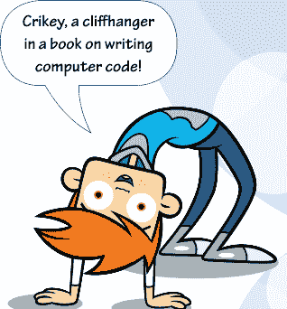

保存你的代码并运行它，检查看起来是否正常！好吧，虽然所有按钮都没有起作用，但至少我们不需要在 19 个不同的地方去解决这个问题。我们能解决这个问题吗？你得等到下一章才能知道了！

第3章：设计一个简单的计算器 45

### 章节总结

在本章中，你：

- 学习了循环

- 使用了列表和循环，节省了大量的重复代码

- 更多地学习了 tkinter Button 小部件

- 制作了一个名为 MyCalculator 的计算器应用程序，它看起来不错但尚未完成

- 快速轻松地构建了一个复杂的 GUI。

本章主要关于如何布局一个包含许多按钮的图形用户界面 (GUI)。在本章中，你添加了许多按钮并使用列、行和帧将它们组织成组。

这次的思路和练习旨在帮助你习惯它们。


> 想法

做一个小计算器。改变每个按钮的宽度，然后调整显示宽度，直到你的计算器看起来良好但尺寸更小。

> 练习 1

尝试交换数字键盘和功能键区的位置。

> 练习 2

在 MyCalculator 底部添加一个全满计算器宽度的按钮。（提示：这将需要一个新的帧和一个新按钮。不需要循环。）

# 第4章

一个完全可以运行的计算器

在本章中，你将：

- 学习如何创造地使用函数中的默认值


- 学习调试
- 学习捕获和处理错误
- 深入研究二进制数
- 制作完全可以运行的计算器。

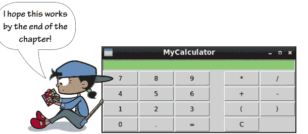

## 参数

在上一节中我们看到 `Button` 小部件要求我们提供不带括号的函数名。这样做是为了在按下按钮时调用函数，而不是在构建按钮时调用它。遗憾的是，`for` 循环的简洁用法使得向 `click()` 函数传递参数变得更加困难。我们需要这样做来告诉它指的是哪一个按钮。如果不允许使用括号，我们就无法直接提供参数！

## 快速测验 4.1

- 参数与编程有什么关系？

1 参数是字典中键的另一种说法。

2 参数是传递给函数的数值。

3 参数是元组中的值。

为了解决这个问题，我们必须间接传递参数！我们可以利用函数参数可以赋予默认值的特性。为了提醒你它是如何工作的，请尝试在交互模式下输入代码框 4.1 中的代码。（不要忘记代码框同时显示了你的输入（`>>>` 之后）和程序的响应（蓝色部分）。然后一直玩下去，直到你能看到它是如何工作的。前两行定义了一个非常简单的函数。

### 代码框 4.1

```
>>> my_function(x="default text")
    print(x)
>>> my_function("two")
two
>>> my_function(3)
3
>>> my_function()
default text
```

这引出了非常优雅的解决方案。打开第 4 章文件夹中的 `myCalculator4_start.py` 文件，注意到在 `cmd()` 循环中插入了一个新函数。你也可以在代码框 4.2 中看到这一点。那么它是如何工作的呢？这相当复杂，但在编写代码时，我们通常不需要理解一切是如何工作的。我们只需要使用别人已经研究出来的解决方案。这就像手机制造商安装一个处理器芯片来完成工作，而不需要理解它是如何工作的。尽管如此，如果你想看解释，请参阅“深入研究”框。

## 深入研究

在代码框 4.2 中，你可以看到 `cmd()` 函数将 `btn_text` 持的值作为 `x` 的默认值。这允许在不提供任何参数的情况下调用 `cmd()`，这意味着当作为循环内部所有按钮的命令时，如果没有提供括号它仍然有效。当通过点击计算器上的特定按钮调用 `cmd()` 时，它会带有默认的 `btn_text` 值调用 `click()`。现在 `click()` 函数知道发送给它的是哪个按钮了。

> 我头疼！不过我打算把它加入我的代码片段列表中。它看起来将来可能很有用！


### 代码框 4.2

```
### create num_pad buttons with a loop
r = 0
c = 0
for btn_text in num_pad_list:
    def cmd(x=btn_text):
        click(x)
    Button(num_pad, text=btn_text, width=5, command=cmd).grid(row=r,column=c)
if c > 2:
    c = 0
    r = r+1
```

如果你运行此脚本，你会发现计算器上的数字按钮现在按预期工作了。现在看看能否修改 `operator_list` 中的代码，使这些按钮也将文本输入到计算器的显示中。如果需要，答案在代码框 4.3 中。

注意在代码框 4.3 中 `btn_text` 被替换为 `b`。这样写起来更快，但更难理解。你经常会看到这样的代码，但你应该坚持使用它。

### 代码框 4.3

```
### create operator buttons with a loop
r = 0
c = 0
for b in operator_list:
    def cmd(x=b):
        click(x)
    Button(operator, text=b, width=5, command=cmd).grid(row=r,column=c)
    c = c+1
if c > 1:
    c = 0
    r = r+1
```

以 `result` 开头的行执行执行数学计算，下一行代码向显示器添加一个等号。这为我们留了一行相当复杂的代码。

```
result = str(eval(display.get()))
```

基本上，这行代码计算出 `display` 内容的结果，并将其存储在由命名为 `result` 的变量中。

## 测试与调试

计算器几乎已经完成了。下一个阶段是对其进行彻底的测试并记录问题。尝试进行以下计算，并将它们放入像下面这样的调试表中。

测试计算：

7*2, 7/2, 7+2, 7-2, 7*(7+2), 10/2, 10/6, 10/3, 7*(7+2)

| 求和 | 输出 | 是否正常? |
|---|---|---|

| 7*2 | 14 | ✓ |
| 7/2 | 3.5 | ✓ |

表 4.1 调试表的开始。

在这个过程中应该出现两个问题：

- 任何意外的输入（例如多出的括号）都会在控制台中产生错误，且计算器没有响应。
- 某些除法计算的结果不符合预期（例如 10/3 产生了 3.333333333333333335，而我们期望的是 3.333333333333333333）。

## 捕捉错误

我们可以用第 2 章中遇到的一种常用编程技术来解决第一个问题：捕获错误并用友好的信息处理它们。在 Python 中，通过将可能出错的函数放在 `try:` 子句之后来实现。如果发生错误，则在 `except:` 子句之后处理它。

你现在应该修改你的 `click()` 方法，使其看起来像代码框 4.5 中的代码一样。

### 代码框 4.5

```python
# key press function
def click(key):
  # 按等号键意味着计算：
  if key == "=":
    try:
      result = str(eval(display.get()))
      display.insert(END, " = " + result)
    except:
      display.insert(END, " --> Error!")

  # 按 C 键意味着清除屏幕：
  elif key == "C":
    display.delete(0, END)

  # 将其他按键值添加到当前条目的末尾：
  else:
    display.insert(END, key)
```

> 尝试思考用户可能在你的应用程序中尝试的所有异常情况并对它们进行分类是非常重要的，这样你的程序才不会不断出错。

> 我特别擅长想出你可以用应用做的各种奇怪事情！

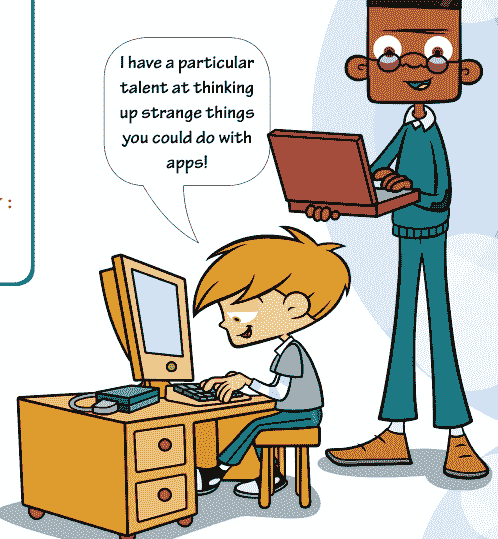

现在运行它，看看它是如何处理任何实际上无意义输入的，例如 7*(7+2))，它多了一个括号。

我们需要解决的第二个问题是，当我们的计算器尝试计算 10/3 时，它在某处意外地进行了四舍五入。

### 深入探索

计算机将数字存储在硅片上。芯片上的每个位置可以带负电荷。这意味着计数器通常以二进制（通常是二进制）进行数学运算，每个内存位置等于 0 或 1。这就像是你每只手只有一个手指！不允许有其他数字。有一些十进制及其对应的二进制数：

| 十进制（基10） | 二进制 |
| --- | --- |
| 1 | 1 |
| 2 | 10 |
| 3 | 11 |
| 4 | 100 |
| 5 | 101 |
| 6 | 110 |
| 8 | 1000 |

> 我们的普通数字系统被称为基 10，因为我们使用了十个数字：0, 1, 2, 3, 4, 5, 6, 7, 8 和 9。二进制被称为基 2，因为它只使用两个数字：0 和 1。

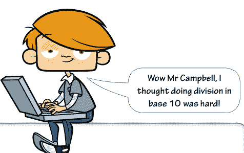

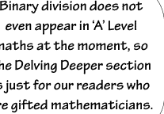


当计算机尝试将基10的 0.1 表示为二进制数时会出现问题：0.1（基10）= 0.000110011001...（二进制），这与你在基10下除以3的结果相同，即0.6666...遗憾的是，计算机也无法准确表示0.1。这意味着它在某处必须进行舍入——这无疑引入了不准确性。

第4章：一个完整的计算器

计算机通常这样进行除法：

1. 将基10数字转换为二进制：10/3 变成 1010/11
2. 在二进制下进行除法：1010/11 = 1.010...（此时我们需要对结果进行舍入，否则会无限持续）。
3. 转回基10：3.33333333333

计算机无法轻松进行精确除法！解决这个复杂问题的简单方法是目前我们的计算器执行得很精确。为了给出可接受的小数，我们需要这样切片结果：

```python
result = display.get() # 将条目的内容存储在变量中
result = eval(result) # 使用eval()函数进行计算
result = str(result) # 转换为字符串
### 切结果显示前10位字符（即10个数字和一个小数点）：
result = result[0:10]
```

## 少写代码的美

通过嵌套这些函数调用，可以用更少的代码来实现，例如：修改你的计算器并通过合并代码框4.6中的更改进行测试。在完成这些更改并保存后，你应该得到一个功能完整的简单计算器。

### 代码框 4.6

```python
### myCalculator.py
from tkinter import *

### 按键函数：
def click(key):
    # 按等号键意味着计算：
    if key == "=":
        try:
            result = str(eval(display.get()))
            display.insert(END, " " + result)
        except:
            display.insert(END, " --> Error!")

    # 按C键意味着清除屏幕：
    elif key == "C":
        display.delete(0, END)
    # 将其他按键值添加到当前条目的末尾：
    else:
        display.insert(END, key)
```

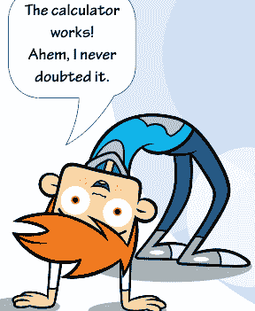

## 本章总结

在本章中，你：

- 学习了更多函数的默认值
- 学习了更多测试和调试
- 学习了捕捉和处理错误
- 深入研究了二进制数和计算机如何求和
- 制作了一个完整的计算器
- 学习了如何切片字符串

在完成所有这些工作之后，在我们开始教你如何自定义它之前，是时候玩玩计算器了。

> 建议1：再次尝试你的调试表，检查计算器现在是否像我们预期那样处理所有测试输入。
> 建议2：在一些实际问题上测试你的新计算器。然后与其他计算器对比答案。

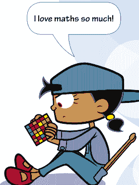

### 建议3

如果你以前从未做过任何二进制数学，请阅读附录2中关于二进制数的章节。它解释了如何在二进制数和十进制数之间转换。

### 建议4

如果你尝试了建议3但决定不读本章前面的“深入探索”部分……如果你的大脑还没痛的话——你现在可以回去读了！

## 第5章：自定义计算器

在本章中，你将：

- 布局一个可自定义的计算器
- 创建一些功能完整的按钮
- 创建一个模块来存放我们编程按钮的函数
- 学习更多关于如何在应用程序中组织代码知识

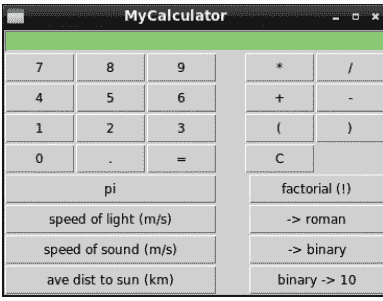

## 添加更多按钮

在第4章中，你制作了一个执行普通计算器所有操作的简单计算器。在本章中，你将添加更多按钮，你可以编写程序来执行你完全想要的操作。

### 添加一组常数按钮

这里没有新东西。所以让我们开始输入吧！

从配套网站的第5文件夹打开 `myCalculator_start.py`。它包含了我们目前为止编写代码的干净副本，并带有一些注释，指示在哪里添加新的代码段。在快速查看文件以确认识别所有内容后，在指示处添加代码框5.1中的代码。


```python
Code Box 5.1

### 创建常量框架
constants = Frame (window)
constants.grid(row=3, column=0, sticky=W)

constants_list = [
'pi',
'speed of light (m/s)',
'speed of sound (m/s)',
'ave dist to sun (km)' ]

### 使用循环创建常数按钮
r = 0
c = 0
```

```python
for btn_text in constants_list:
    def cmd(x=btn_text):
        click(x)
    Button(constants, text=btn_text, width=22, command=cmd).grid(row=r, column=c)
  r = r+1
```

注意，我们添加的新按钮用于不会改变的设定值；例如，声速是一个固定的科学数值。因此，这些按钮是常量（你在第 2 章中遇到过常量）。如果你运行此脚本，你会发现常量按钮现在处于正确的位置，并在计算器的显示屏上打印出它们的名称。

## 为函数添加一组按钮

让我们再次看看我们新改进的计算器图片：

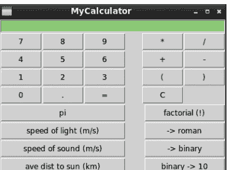

右下角的四个按钮被称为“函数按钮”，因为它们会对你输入计算器的数字应用一组函数。看看你是否能写出制作这些函数按钮的代码。答案在下方的代码框 5.2 中，你应该能够在不看参考的情况下独立完成。以常量常量部分的代码作为指南，并思考你需要哪些列和行。

计算器上的“Roman”（罗马数字）按钮代表“罗马数字”——你知道的：i, ii, iii 等。


### 代码框 5.2

```python
### 创建函数框架框
functions = Frame(window)
functions.grid(row=3, column=1, sticky=E)

functions_list = [
'factorial (!)',
'-> roman',
'-> binary',
'binary -> 10' ]

### 使用循环创建函数按钮
r = 0
c = 0
for b in functions_list:
    def cmd(x=b):
        click(x)
    Button(functions, text=b, width=13, command=cmd).grid(row=r, column=c)
    r = r+1
```

第 5 章：自定义计算器 64

现在检查你的计算器是否显示了所有新按钮的名称。

### 深入探索

这里的目标是制作一个完全按照你要求的计算器。书中的函数是一些寻常的示例，可能会启发你添加一些并非每个计算器上都具备的功能。然而，如果你想添加一些更传统的函数，例如 x² 或 √，可以使用将数字提升到指定幂次的运算符轻松添加：

```python
def square(n):
  return n**2

def square_root(n):
  return n**0.5
```

如果你不理解，请请教你的数学老师。

### 将常量绑定到按钮

将常量绑定到按钮上很容易。我们将通过寻找带有更多 `elif` 语句的新按钮，向 `click()` 函数中添加所需的代码。继续修改 `myCalculator5_start.py`，添加代码框 5.3 中的新代码，然后测试 pi 按钮。你很快就能添加你自己的常量了。

### 代码框 5.3

```python
### 现在处理常量按钮
elif key == constants_list[0]:
  display.insert(END, "3.141592654")
```

尝试自己完成其他部分。当 pi 按钮正常工作后，尝试添加代码让其他常量按钮也能工作。以下是它们的值：

- 光速：3000000000m/s。
- 声速：330m/s。
- 太阳的平均距离：149597887km。

### 章节总结

在本章中，你已经：

- 为一个自定义的计算器构建了用户界面
- 创建了几个具有完整备的常量按钮
- 导入了一个用于存放可编程按钮函数的模块
- 学习了更多关于如何在应用程序中组织代码的知识。

你现在拥有了一个带有八个可编程按钮的计算器。更重要的是，你对编写此计算器的语言已经变得越来越熟练了。下面的挑战将鼓励你开始这一过程。

## 挑战 1

选择一个功能按钮并将其重命名为 `square`。然后，在 `calc_functions.py` 文件中添加代码以实现此功能。如果需要，你可以查阅“深入探索（Delving Deeper）”部分的第 65 页来寻求帮助。

## 挑战 2

选择另一个功能按钮并将其重命名为 `sqrt`。然后，在 `calc_functions.py` 文件中添加代码以实现此功能。同样，如果需要，你可以查阅“深入探索（Delving Deeper）”部分的第 65 页。

## 挑战 3

重构代码框 5.7 中的重复代码，使两条重复的行只编写一次。

**提示：** 你可能需要在单个 `elif` 语句内部拥有一个独立的 `if elif elif else` 结构。


## 创意

- 开始思考你未来希望你的计算器能够做什么。
- 为另外两个按钮添加一些你认为对你有用的代码。
- 了解一下数学函数 `factorial`（阶乘）的作用。
- 使用计算器计算太阳光到达地球需要多少分钟。
- 在在不使用计算器的情况下，看看你能写多大的罗马数字。
- 使用附录 2 中的指令练习将二进制转换为十进制以及反之。
- 通过再次更改所有按钮的大小做一个可爱的小计算器。
- 做一个填满屏幕的巨型计算器。

> 有时你可能会在计算器显示屏看到类似 `1.8E+7` 的数字。这意味着 `1.8 × 10⁷`，这是写作 `18000000` 的另一种写法。


## 接下来要做什么？

如果你想在此处停止，那没关系。你已经拥有了一个完整的计算器，可以通过更改常量按钮和功能按钮对其进行自定义。如果你不打算继续了，可能想将 `calc_functions.py` 文件中的一些函数添加到你的计算器中。你可以在配套网站的“Bonus Chapter（额外章节）”文件夹下的“Final（最终）”文件夹中找到 `calc_functions.py` 中的代码。附录 3 中也提供了一份最终的 `calc_functions.py` 文件供你学习。

额外奖励章节解释了计算机科学家如何使用算法来创建这类函数。虽然有些内容相当困难，但非常有趣。即使你不能完全理解，你也会学到很多！

## 额外奖励章节

### 算法

在本章中，你将：

- 为可编程按钮添加代码
- 学习算法
- 完成计算器项目
- 学习阶乘
- 学习如何将数字转换为罗马数字。

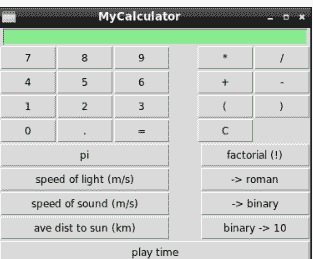

> 咳，这是什么，“玩耍时间？”


#### 引言说明

在本章中，我们不会修改 `myCalculator.py` 文件。然而，在测试计算器时，这仍然需要打开并运行的文件。我们将在 `calc_functions.py` 脚本上完成本章的工作，这是你在第 5 章第一次遇到的脚本。你应该从从配套网站下载的名为“Start”的子文件夹中的文件开始。在“Final”子文件夹中也有 `myCalculator.py` 和 `calc_functions.py` 文件的最终版本，但只有在你遇到困难时才应该参考它们。请注意，这是一个有趣但困难的章节！

> 如果没有至少一杯卡布奇，我无法过这一天。

#### 开发算法

算法是一种解决问题的按步骤执行的配方，或一组规则。例如，将单词列表按字母顺序排序对计算机来说是一项重要任务。解决这个简单问题有许多方法。为了找到最高效的算法，人们投入了大量的研究，因为这是一项如此重要的任务。

这里是一个制作咖啡的算法：

- 拿一个杯子。
- 在杯中加入 1 茶匙速溶咖啡。
- 向水壶中加水。
- 烧开水。
- 将沸水加入杯中，直到距离顶部 2 厘米处。
- 从冰箱中取出牛奶。
- 在杯中加入 1 厘米深的牛奶。
- 将牛奶放回冰箱。


这些是计算机或机器人制作咖啡所需的精确指令。在创建计算机应用程序时，我们使用的就是这种逻辑。解决问题有很多方法，我们选择的算法是关键。

#### 阶乘函数

阶乘是一个整数及其下方所有整数的乘积。例如，`5!` 是 `5 × 4 × 3 × 2 × 1 = 120`。这在数学和编程中是一个非常常见的操作。

这是在 Python 中计算它的方法：

```python
def factorial(n):
    result = 1
    for i in range(1, n + 1):
        result *= i
    return result
```

在本章中，我们将学习如何在我们的计算器中实现它。我们还将探索如何处理边界情况，例如 `0!`，其定义为 `1`。

```python
### 捕获负数：
if n < 0:
    return "--> Error!"

### 应用阶乘算法
ans=n # 在循环前设置答案的初始值
while n > 1:
    ans = ans*(n-1)
    n = n-1
ans
```

### 代码框 6.3 分析

如果来自显示器的输入不是整数，我们我们需要用 `try: except:` 来捕获错误。

接下来，我们用 `if` 子句解决 `0!` 这一特殊情况。

我们可以用类似的方法解决大数字问题。这很重要，因为大数字会让计算机非常辛苦，并可能导致计算器停止工作。

最后，我们必须处理负数，因为它们不能产生阶乘。我们需要做的只是测试小于零的数字。

### 罗马数字函数

将整数转换为罗马数字需要另一种算法。这次我们将尝试通过使用流程图来推导出代码。

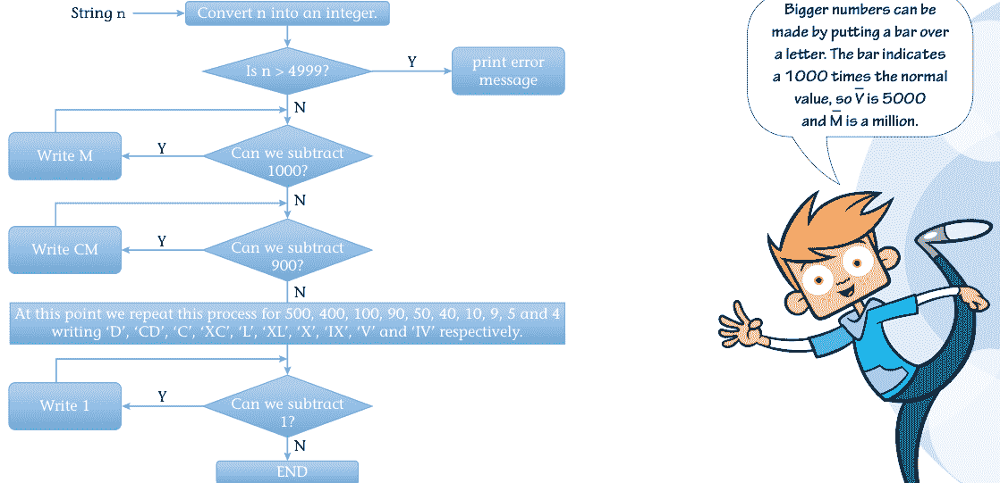

转换为罗马数字的流程图。

我们的流程图建议我们需要一个元组来存储数字集合：`1000, 900, 500, 500` 等，以便我们可以对它们进行循环；我们还需要一个字典来存储它们对应的字母，以便我们可以进行查找。这可以通过多种方式实现，而不需要编写很多行代码。

**加Bonus章节：算法**

将代码框 6.4 中的代码复制到你一直在编写的 `calc_functions.py` 的正确位置。在输入代码时，请仔细思考它是如何运行的。

### 挑战

对于你的编程知识水平来说，现在还太早了，无法指望你在不给你提供代码框 6.4 代码的情况下完成此任务。但如果你想尝试一下，请不要看代码框 6.4，因为那是答案！相反，创建一个元组和字典，使用 `for` 循环遍历元组，看看你是否能解决这个棘手的谜题。

### 代码框 6.4

```python
### 将数字转为罗马数字：
def to_roman(n):
  try:
    n = int(n)
  except:
    return "----> Error!"

### 排除大于 4999 的数字：
if n > 4999:
  return "-- > out of range"

### 创建元组和字典：
numberBreaks = (1000,900,500,400,100,90,50,40,9,5,4)
letters = {1000: "M", 900: "CM", 500: "D", 400: "CD", 100: "C", 90: "XC", 50: "L", 40: "XL", 10: "X", 9: "IX", 5: "V", 4: "IV", 1: "I"}
```

```python
### 启动算法：
result = ""
for value in numberBreaks:
    while n >= value:
        result = result+letters[value]
    n = n-value
return result
```

> 起初我没能算出这道。

不过，当你查看解决方案时，看出它的运行原理并不困难。

### 代码框 6.4 分析

虽然将这个算法转换为代码是很棘手的，但它并没有引入任何对你来说新东西。要弄清楚这段代码是如何工作的，你只需要将其与第 81 页的流程图仔细对比即可。

### 转换为二进制函数

Python 已经有了可以从一个进制转换为另一个的函数，所以这个函数的编程非常简单。尽管我们会封装在 `try; catch:` 中，但你只需要关注两行代码：

```python
n = int(n)
return bin(n)[2:]
```


第一行将从显示器发送的字符串转换为整数。

## 快速测验 6.2

程序员将一种数据类型转换为另一种类型的词汇是什么？

1 casting（类型转换）

2 throwing（抛出）

3 catching（捕获）

第二行使用了 Python 的 `bin()` 函数。该函数返回字符串形式的二进制数，但其前面带有 `0b`：

```python
>>> bin(10)
'0b1010'
```

为了显示我们想要的内容，我们必须去掉前两个字符。因为 `bin()` 函数返回的值是字符串，我们只需要通过在函数调用后添加 `[2:]` 来对其进行切片。这表示：只返回从索引 2 开始及之后的字符。这正是我们想要的！

现在，将代码框 6.5 中的代码复制到 `calc_functions.py` 中让这个按钮工作。

### 代码框 6.5

```python
### 将 10 进制数字转换为二进制的函数：
def to_binary(n):
try:
    n = int(n)
    return bin(n)[2:]
except:
    return "---> Error!"
```

### 最终函数

再次，Python 已经有一个内置函数可以转换为整数 `int()`。通常情况下，我们除了数字字符串外不给它任何其他参数。如果我们给它一个二进制字符串，我们需要提供一个可选参数。如果我们不提供，默认值是 10，但我们需要告诉 `int()` 函数我们正在处理二进制：

```python
>>> int("100", 2)
4
```

现在将代码框 6.6 的代码复制到 `calc_functions.py` 完成你的项目。

```python
Code Box 6.6
### 将二进制转为 10 进制的函数：
def from_binary(n):
  try:
    return int(n, 2)
  except:
    return "-- Error!",
```

有很多你可以附加到计算器的功能。如果你喜欢，可以添加更多的。玩得开心！

### 总结

在本章中你：

- 学习了计算阶乘
- 学习了算法
- 学习了如何转换为罗马数字
- 学习了类型转换
- 完成了项目

这里有很多选项供你选择。

### 想法

- 更改按钮的大小。
- 更改按钮的颜色。
- 更改数字。

一旦你理解了基础知识，这将是一项重要的技能。在“Bonus”文件夹中提供了一个 `myPlus.py`。

* 尝试让计时器更准确。
* 提示：注意字符串被截断的地方。
* 让游戏变得更简单，把它变成一种“打打老鼠”游戏而不是二进制版本。
* 让游戏显示罗马数字，你必须点击正确的数字。


> 发生了什么？这一章真的有 Bonus 吗？应该是 Bonus？

### 更难的想法

复制 `myPlus.py` 并修改游戏使其执行以下操作：

- 询问玩家：“练习哪个乘法表。”
- 如果用户选择了 5 的法表，计算器应该随机显示 0, 5, 10, 15, 25, 30, 35, 40 和 45 中的一个。要清除它们并进入下一个，用户将分别输入 0, 1, 2, 3, 4, 5, 6, 7, 8 或 9。


### 谜题

好了，你现在觉得你会写代码了吗？这里给你一个严峻的挑战！如果你看转换为罗马数字的代码，你会发现信息有不必要的重复。元组中的值也在字典中。我们真的两个两个都需要吗？嗯，你将用一个非常有用的结构来替换它们：一个元组的元组：

```python
romans = (
  (1000, "M"), (900, "CM"), (500, "D"), (400, "CD"), (100, "C"), (90, "XC"),
  (50, "L"), (40, "XL"), (10, "X"), (9, "IX"), (5, "V"), (4, "IV"), (1, "I")
)
```

#学习此交互式环节：

```
Python Shell
File Edit Debug Options Windows Help
Python 3.1.3 (r313:86834, Nov 28 2010, 10:01:07)
[GCC 4.4.5] on linux2
Type "Copyright, "credits" or "license()" for more information.
==== No Subprocess ===
>>> romans = ((1000, 'M'), (900, 'CM'), (500, 'D'), (400, 'CD'), (100, 'C'), (90, 'XC'), (50, 'L'), (40, 'XL'), (10, 'X'), (9, 'IX'), (5, 'V'), (4, 'IV'))
>>> romans
((1000, 'M'), (900, 'CM'), (500, 'D'), (400, 'CD'), (100, 'C'), (90, 'XC'), (50, 'L'), (40, 'XL'), (10, 'X'), (9, 'IX'), (5, 'V'), (4, 'IV'), (1, 'I'))
>>> romans[0]
(1000, 'M')
>>> romans[0] [0]
1000
>>> romans[0] [1]
'M'
>>> len(romans)
13
>>> 
Ln: 14 Col: 4
```

现在重写 `calculator_functions.py` 中的罗马数字代码，使其使用嵌套元组（tuple of tuples）而不是一个元组和一个字典。

祝你你好运。如果你遇到困难，伴随网站上提供了答案。

附赠章节：算法 89

# 进阶

当你读完这本书后，我们希望你想要继续学习编写代码。这里有一些你可能感兴趣的其他地方和资源。

## 更多 Python

该系列中的其他书籍可以在伴随网站（www.codingclub.co.uk）上找到。

- Python 官方文档：http://docs.python.org/py3k/
- 树莓派指南中的 Python 章节：http://downloads.raspberrypi.org/Raspberry_Pi_Education_Manual.
- PyGame 网站：该网站提供了一组需要下载的游戏制作模块。它有一个 Python 编程爱好者的社区，并允许你发布游戏供他人玩。可以在 www.pygame.org/ 找到。

## 其他编程语言

下一个编程语言可能是 Java。Java 与 C 家族语言非常相似，它将让你第一次体验使用大括号的语言。有很多非常棒的资源。也许最好的起点是 Greenfoot。不过 Java 大量使用了类和对象，因此你可能希望在读完《Python：构建大型应用》（Building Big Apps）后再进行。这本更高级的书介绍了你已经熟悉的 Python 中的这些概念。

Java 编程：www.greenfoot.org/

# 附录 1

## 一些关键信息

伴随网站

网址：www.codingclub.co.uk

伴随网站提供了书中谜题和挑战的答案，以及完整的源代码（包括起始文件和额外代码）。你还将找到关于该系列其他书籍、人物简介以及更多更多的内容。

## 使用 for 循环添加系列按钮

```
for btn_text in button_list:
    def cmd(x=btn_text):
        # 附加到按钮的函数，将其标签作为参数传递：
        click(x)
Button(num_pad, text=btn_text, width=5, command=cmd)
```

## 捕获错误

```python
def my_function(args):
    try:
        # 你的代码在这里
    except:
        return "-- Error!"
```

## tkinter 控件

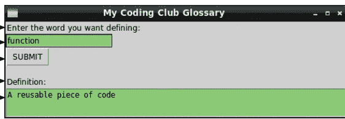

以下是用此行代码创建的名为 `window` 对象内部一些控件的大纲代码：

```
window = Tk()
```

```
my_frame = Frame(window)
my_label = Label(my_frame, text="My text goes here")
my_text_entry_box = Entry(my_frame, width=20, bg="light green")
my_button = Button(my_frame, text="SUBMIT", width=5, command=[此处要调用的函数名])
my_text_box = Text(my_frame, width=75, height=6, wrap=WORD, background="light green")
```

# 容器类型总结

下表提供了你可以用于字符串、元组、列表和字典的有用函数列表。下表假设这些容器已经创建：

```python
>>> s = "bar" # 一个字符串
>>> t = ("b", "a", "r") # 一个元组
>>> l = ["b", "a", "r"] # 一个列表
>>> d = {1:"b", 2:"a", 3:"r"} # 一个字典
```

| 函数 | 字符串 | 元组 | 列表 | 字典 |
| :--- | :--- | :--- | :--- | :--- |
| 打印所有 | >>> print(s) | >>> print(t) | >>> print(l) | >>> print(d) |
| | bar | ('b', 'a', 'r') | ['b', 'a', 'r'] | {1: 'b', 2: 'a', 3: 'r'} |
| 打印元素 | >>> print(s[2]) | >>> print(t[2]) | >>> print(l[2]) | >>> print(d[2]) |
| | r | r | a |
| 组合 | >>> a=s+"f" | >>> a=t+"f" | >>> a=l+"f" | |


| | barf | ('b', 'a', 'r', 'f') | ['b', 'a', 'r', 'f'] | |

| 添加元素 | 字符串不可修改 | 元组不可修改 | `>>> l.append("f")` | |

| | | ['b', 'a', 'r', 'f'] |

| 排序 | 字符串不可修改 | 元组不可修改 | `>>> l.sort()` | `>>> sorted(d)` |

| | | ['1', '2', '3'] | ['a', 'b', 'r'] |

| 删除元素 | 字符串不可修改 | 元组不可修改 | `>>> del l[1]` | `>>> del d[1]` |

| | | ['b', 'r'] | {2: 'a', 3: 'r'} |

| 替换 | 字符串不可修改 | 元组不可修改 | | |

| | | `>>> l[0]="c"` | `>>> d[1]="c"` |

| 查找 | `>>> s.find("b")` | `>>> t.index("b")` | `>>> l.index("b")` | |

| | 0 | 0 | 0 | {1: 'c', 2: 'a', 3: 'r'} |

| 获取长度 | `>>> len(s)` | `>>> len(t)` | `>>> len(l)` | `>>> len(d)` |

| | 3 | 3 | 3 | 3 |

# 附录 2

## 二进制

为了理解二进制，最好的方法是回顾十进制数字。从右开始，每一列的值都是前一列的2倍。例如，数字347有7个个、4个十位、3个百位，没有千位：

| 千位 | 百位 | 十位 | 个 |
| :--- | :--- | :--- | :--- |
| | 3 | 4 | 7 |

我们通过相加得到347：

`(3×100) + (4×10) + (7×1)`

二进制（有时也称为底2）系统是相同的，只是每一列的值是前一列的2倍。例如，1101（十进制为13）有1个八、1个四、0个二、1个一：

| 八 | 四 | 二 | 一 |
| :--- | :--- | :--- | :--- |
| 1 | 1 | 0 | 1 |

所以我们可以通过相加看到二进制的1101等于十进制的13：

`(1×8) + (1×4) + (0×2) + (1×1)`

因此，如果你想计算一个二进制数的十进制值，可以在手指上这样计算：

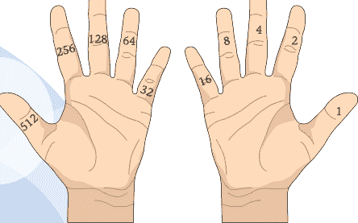

所以1101可以这样表示：

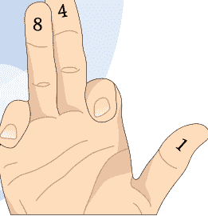

# 附录 3

## 计算器函数源代码

```python
### calc_functions.py
# Python计算器应用程序函数模块：下一步

### 计算数字的阶乘：
def factorial(n):
    try:
        n = int(n)
    except:
        return "--> Error!"

### '0' 是特殊的：
if n == 0:
    return 1

### 如果太大则退出：
if n > 40:
    return "--> Answer will not fit on screen!"

### 捕获负数：
if n < 0:
    return "--> Error!"

### 应用阶乘算法：
```

```python
ans=n # 在循环前设置答案的初始值

while n > 1:

    ans = ans*(n-1)

    n = n-1

    return ans
```

```python
### 将数字转换为罗马数字

def to_roman(n):

  try:

    n = int(n)

  except:

    return "-- Error!"

```
```python
### 排除大于4999的数字：

if n > 4999:

    ans = "-- out of range"

    return ans
```
```python
### 开始算法：

numberBreaks = (1000,900,500,400,100,90,50,40,10,9,5,4)

letters = {1000: "M", 900: "CM", 500: "D", 400: "CD", 100: "C", 90: "XC", 50: "L", 40: "XL", 10: "X", 9: "IX", 5: "V", 4: "IV", 1: "I"}

result = ""

for value in numberBreaks:

    while n >= value:

        result = result+letters[value]

        n = n-value

    return result
```
```python
### 将十进制数字转换为二进制的函数

def to_binary(n):

    try:

        n = int(n)

        return bin(n)[2:]

    except:

        return "--> Error!"
```
```python
### 将二进制数字转换为十进制的函数

def from_binary(n):

    try:

        return int(n, 2)
```

### 调试

在程序中寻找错误的过程

### 默认

作为参数或变量起始点的给定的值

### 字典

一种无序的容器数据类型，可以以键值对（key:value pairs）的形式存储其他数据类型的值

### 等号运算符

在编码中，等号用于给变量赋值，例如 `n=2` 将值 `2` 赋值给变量 `n`

### 转义

当字符串中需要 Python 中具有特定含义的字符时，必须对它们进行“转义”，以便计算机知道它们不具有通常含义；这是通过在字符前面加一个斜杠来实现，例如 `\"`

### 浮点数

可以具有小数值的数值数据类型

### for 循环

一种用于遍历容器数据类型的循环

### 框架 (frame)

一种 `tkinter` 组件，可以包含其他组件的组，用于组织复杂用户界面的布局

### 函数

一段可重用的代码

### GUI

代表图形用户界面（Graphical User Interface）——带有按钮和文本输入框的窗口就是图形用户界面的示例

### 索引

引用字符串、元组或列表中数值的数字；容器数据类型中的每个项都从 0 开始索引，第一个项是 0，下一个是 1，依此类推

整数

不能具有小数值的必须是整数的数值数据类型

交互模式

指我们使用 IDLE 尝试代码片段而不保存它们的情况

键 (key)

相当于字符串、元组或列表中的索引，但用于字典；它由程序员定义，例如，在 `key:value` 对中可以是字符串、整数、浮点数甚至元组

列表

一种有序的容器数据类型，可以存放任何类型的值并可以添加或删除元素；像元组一样，每个元素都从 0 开始索引

循环

一段不断重复直到满足特定条件的代码

方法

在类中赋予函数的名称

模块

一个保存的 Python 文件，其函数可以被另一个程序使用

运算符

对对某些代码执行简单操作的符号，例如将两个数字相乘或比较它们是否相等；另请参阅**等号运算符**

有序容器

有序容器是一种容器数据类型，其中存储的值与其在容器中的位置一起被索引，例如，元组和列表；字典是无序容器的示例

输出

从程序发送到屏幕或打印机等的数据

重构

改变代码结构的过程，使其减少重复、更易读、更易维护等

术语表和索引 101

`return`

(1) 函数运行后产生的值——它也是一个 Python 关键字；(2) 键盘上的“换行”键，有时称为回车键

切片

提取字符串或容器变量部分的过程——有时称为数组切片

语句

用于指代代码片段；严格来说，它是一段代表命令或动作的代码，例如打印语句（print statement）

字符串

可以存储在变量中的文本数据

`tkinter`

一个类包，通常被导入到 Python 程序中，提供了用于生成窗口、绘制图像和生成动画的有用方法

元组

一种有序的容器数据类型，其值从 0 开始索引；其内容不能更改

值

可以存储在变量中的任何内容，例如容器数据类型中的元素

变量

指向计算机内存中存储数据位置的名称；更泛地说，它也可以用来指代那些数据

`while` 循环

一种在比较语句返回 True 时重复代码的循环

组件 (widget)

GUI 的元素，如按钮或文本输入框

术语表和索引 102

### 一些有用词汇

- **比较运算符** 有时称为逻辑运算符，它们允许我们比较程序中的数据；它们包括 `==` 和 `>`（你可以在《Python基础》附录中的表 3 中找到其他）
- **局部变量** 定义在函数内部的变量，仅在该函数内部可用
- **算术运算符** 对某些数字执行某些数学函数的运算符，例如乘法或加法
- **参数 (parameter)** 在函数中使用时对实参（argument）的另一种称呼
- **全局变量** 在程序任何地方都可以使用的变量
- **黑客行为/修改 (hacking)** 获取一些以前编写的代码并重写部分内容使其执行不同的功能
- **IDE** 代表集成开发环境（Integrated Development Environment）；IDLE 是其中一个示例——它们是带有程序员内置有用工具的特殊文本编辑器
- **IDLE** 代表集成开发环境（Integrated Development Environment）；这是随标准 Python 3 安装自带的 IDE
- **死循环** 一段一直运行的代码；这通常是坏事
- **执行 (execute)** 运行（run）的另一种称呼——执行某些代码就是运行它

脚本模式

指我们使用 IDLE 帮助编写并将保存到文件代码

语法错误

当计算机因为无法识别提供的代码格式而无法运行程序时产生的错误，例如，如果缺少右括号就会产生语法错误

### 快速测验答案

## 快速测验 1.1

- 1. 元组。
2. 列表。
3. 元组。

## 快速测验 1.2

- 1. 字典。
2. 元组。
3. 字典。
4. 列表。

## 快速测验 3.1

由于我们带括号调用了 `click()` 函数，它会在计算器按钮创建时被调用，而不是在按下时调用。现在的问题是：我们如何在不带括号的情况下提供参数？

## 快速测验 3.2

Answer = 3

## 快速测验 4.1

Answer = 2

## 快速测验 5.1

Answer = 3

## 快速测验 6.1

Answer = 4

## 快速测验 6.2

Answer = 1

# 谢谢

为了确保书中尽可能少错误，需要巨大的努力。例如，排版人员需要确保每个空格都经过计数并在代码框中更改颜色。感谢 Alex Bradbury, Marjury Bisset, Anna Littlewood, Carl Saxton 和 Heather Mahy，他们对这一过程提供了巨大的帮助。非常感谢他们对细节的关注。

在全职工作的同时编写三本书可能会投入全部精力，这对家庭要求很大。我的妻子 Rita 和儿子 Daniel 对我痴迷的耐心并不是理所当然的。不幸的是，我的同事也要忍受我偶尔提到这个项目。他们总是表现得感兴趣，并对我提供了巨大的鼓励，因此感谢 Ewell Castle 的所有员工（除了无情取笑我的 Blencowe 先生）。

作者和出版商承认以下版权材料来源，并对授予的许可表示感谢。

p. 7 Image Zoo/Alamy; p. 20 Mau Hong/Shutterstock
