# 编程俱乐部第3级 Python：大型应用构建指南

## 引言

### 这本书适合谁？

本书是Coding Club系列第3级的核心教材。在阅读本书之前，你应该已经读过*Coding Club：Python 进阶*，或者已经熟悉Python 3，并掌握了变量、while循环、列表和元组等知识。本书面向具有一定编程经验的程序员。

### 为什么选择这本书？

构建大型程序和应用看起来可能令人望而生畏。除了理清常规细节和算法外，还必须始终把握全局。本书帮助你理清全局——它向你展示如何将应用拆分成逻辑清晰、甚至可复用的可管理模块。为此，你将接触一种称为面向对象编程（OOP）的编程风格。这是一种很棒的编程方式，但起初可能看起来比你在第1级和第2级书中学到的编码方式稍微复杂一些。

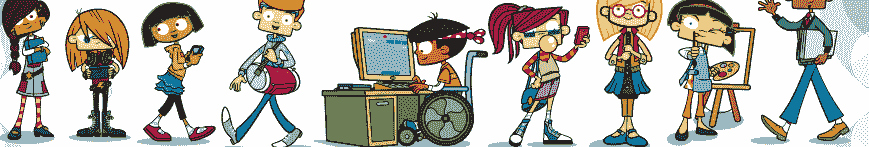

在你目前的编程学习阶段，引入类和对象的概念非常重要。因为你肯定会想要使用其他人的类，而要有效做到这一点，稍加理解便能事半功倍。本书的特别之处在于，所有解释都植根于现实世界，并使用你能理解的类比。代码的构建也尽可能模仿真实对象。这样，当你继续编写自己的应用时，就能想象如何将真实对象转换为代码化的对象。

### 你需要准备什么

任何类型的计算机都可以运行Python 3。如果你的计算机尚未安装，配套网站（www.codingclub.co.uk）上有一个部分指导你安装IDLE和Python 3。这只需要大约5分钟，也是你开始所需的全部内容。

为了让你不必输入太多内容，也不会在较大的项目中迷失方向，本书提供了所有项目的起始文件，以及你需要的完成文件，全部打包在一个易于下载的zip文件中。网站还提供了谜题和挑战的答案，以便你卡住时获得帮助。

### 如何使用这本书

使用本书的理想方式是仔细阅读所有内容，并按顺序完成所有主要项目。每章末尾都有更多想法和挑战，你可以把它们看作“迷你任务”。有些读者会希望全部完成，这样他们始终能理解所有内容。有些人可能更喜欢快速浏览直到结束。哪种方法最好？最让你感到舒适的那种。不过，如果有老师指导你，你应该相信他们的判断，这样他们能以最好的方式帮助你。

本书通过四种方式帮助你学习：

- 1. 逐行输入代码——这很重要，因为它鼓励你一次一行地处理代码（就像计算机那样），并帮助你在未来记住细节。
- 2. 发现并修复错误——Python中的错误信息会给你一些线索，告诉你哪里出了问题。自己解决这些问题将帮助你成为更好的程序员。不过，为了避免感到无聊和沮丧，可以从配套网站 www.codingclub.co.uk 下载代码。
- 3. 动手实验——随意尝试你编写的代码，看看还能让它做什么。如果你尝试了所有挑战、谜题和想法，并广泛地摆弄代码，这将帮助你学会像专业人士一样编写代码。
- 4. 最后，本书不仅会提供代码来构建一些相当酷的短小项目，还会教你这些程序是如何设计的。然后你可以用同样的方法来设计自己的应用。

### 一句忠告

你可能会忍不住直接从网站获取代码，而不是自己动手输入。如果这样做，你以后可能会发现自己不太容易记住如何编写代码。在本书中，你每次只需输入一小段代码——记住，这能帮助你理解每个程序的每一个细节。

## 第1章：你能猜出我的密码吗？

本书假设你已经读过*Coding Club：Python 基础*。如果没有，你至少应该理解变量和函数是什么，并知道如何在交互模式和脚本模式下使用IDLE。在第一章中，你将通过制作一个名为“猜我的密码”的非常简单的应用来回顾这些内容。然后你将复习以下内容：

- 变量
- if、elif和else
- 函数
- while循环
- 模块
- 使用IDLE的脚本模式


### 猜我的密码

游戏开始时会让玩家猜我的密码。然后应用等待玩家输入，并将其存储在一个变量中。最后，玩家的输入将与计算机自己的秘密密码进行比较。如果猜对了，会祝贺玩家；如果没有，则提供一条随机消息，然后要求玩家再试一次。

和之前的Coding Club书籍一样，你将使用IDLE——一种IDE。你可以先打开IDLE，然后从文件（File）菜单中选择新建窗口（New Window）。这会让你进入IDLE的脚本模式。现在最好重新排列窗口，使交互模式控制台和新窗口并排显示，并且可以同时看到两者（图1.1）。

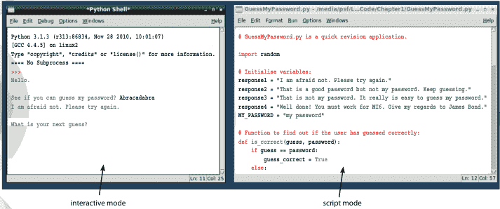

图1.1 一个简单的IDLE窗口布局。

从代码框1.1复制代码，并将文件保存到你的Python Code文件夹中，命名为`GuessMyPassword.py`。你可能没有Python Code文件夹，因此可能需要先创建一个。选择一个合适的位置保存，比如你的文档文件夹。

#### 代码框1.1

```python
#### GuessMyPassword.py is a quick revision application.

import random

#### Initialise variables:
response1 = "I am afraid not. Please try again."
response2 = "That is a good password but not my password. Keep guessing."
response3 = "That is not my password. It really is easy to guess my password."
response4 = "Well done! You must work for MI6. Give my regards to James Bond."
MY_PASSWORD = "my password"
```

#### 代码框1.1分析

#### 注释

在IDLE中注释以红色显示；这些注释仅面向人类，并以井号`#`开头。


### 三支一扶

#### 招募对象

应届毕业生及毕业两年内未就业的往届毕业生（大专及以上学历）。

#### 服务内容

- 支教：基层中小学从事教学服务
- 支农：农业技术推广、农村文化建设等
- 支医：基层医疗卫生机构服务
- 扶贫：帮助贫困村脱贫致富

#### 服务期限及待遇

服务期限为2年，服务期间给予生活补贴，服务期满后享受相关优惠政策（如考公务员、事业单位定向招录等）。

#### 报名方式

关注各省人社厅官网或“三支一扶”专题网站，按要求在线报名。

#### 考试内容

一般为《职业能力测试》和《综合知识》，部分省份只考一科。

#### 代码框 1.2

```python
#### Function to find out if the user has guessed correctly:
def is_correct(guess, password):
    if guess == password:
        guess_correct = True
    else:
        guess_correct = False
    return guess_correct
```

将代码框 1.2 中的代码添加到你的 GuessMyPassword.py 文件中。`is_correct()` 函数需要传入两个参数：一个名为 `guess`，另一个名为 `password`。该函数会比较这两个字符串。如果它们相同，函数将 `guess_correct` 变量设为 True，否则设为 False。最后，函数将返回 True 或 False——具体取决于 `guess_correct` 变量的状态。只存储 True 或 False 值的变量称为布尔变量。

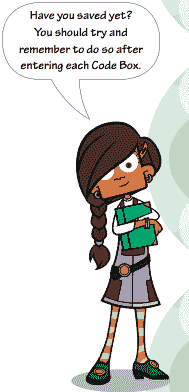

#### 用户输入

为了从键盘获取用户输入，我们使用 Python 的 `input()` 函数，它会等待用户输入一些文本并按回车键。如果我们想在之后访问该输入，需要将其赋值给一个变量，如下所示：

```python
user_input = input()
```

该函数还可以接受一个参数，通常是一个字符串，用作输出提示信息。该提示信息会显示在屏幕上，然后程序等待用户输入：

```python
user_input = input("Please type some input: ")
```

现在我们可以访问该输入了，例如在打印函数中使用它：

```python
print(user_input)
```

我们在这个程序中以两种不同方式使用了三次 `input()` 函数。现在是时候完成这个程序了，请将代码框 1.3 中的代码添加到你的 GuessMyPassword.py 文件中。在输入代码时，请仔细思考每一行的作用。

> 这个程序包含*一个讲起来比听起来有趣得多的笑话*。

#### 代码框 1.3

```python
#### Start the game:
print("Hello.\n")
users_guess = input("See if you can guess my password?")

#### Use our function:
true_or_false = is_correct(users_guess, MY_PASSWORD)

#### Run the game until the user is correct:
while true_or_false == False:
    computer_response = random.randint(1, 3)
    if computer_response == 1:
        print(response1)
    elif computer_response == 2:
        print(response2)
    else:
        print(response3)

    # Collect the user's next guess:
    users_guess = input("\nWhat is your next guess?")

    # Use our function again:
    true_or_false = is_correct(users_guess, MY_PASSWORD)

    # End the game:
    print(response4)
    input("\n\n\nPress RETURN to exit.")
```

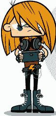

#### 代码框 1.3 分析

希望你还能记得 while 循环是如何工作的，正如《Coding Club: Python Basics》中所描述的那样。如果不记得了，也不用担心，因为这里发生的事情相当明显。在以下代码之后缩进的代码

```python
while true_or_false == False:
```

构成一个代码块。这段代码会一直运行，直到 `true_or_false` 变量为 True。

`random.randint(1, 3)` 会生成一个介于 1 和 3 之间的随机数。`randint()` 函数来自 random 库，因此需要使用**点运算符**来告诉我们的应用程序在哪里找到它。

许多计算机语言使用这样的结构：

```
if: [do something]
elseif: [do something else]
else: [do something different again]
```

`elif` 是 Python 版的 `elseif`。你可以使用任意多个 `elif` 子句，但它们必须以 `if` 子句开头，并且必须以 `else` 子句结尾。

### 深入探讨

#### 编写更少的代码

程序员喜欢用更少的代码完成同样的任务。希望你觉得代码框 1.2 中的函数易于理解和遵循。它很符合逻辑。但是，其中包含大量不必要的代码，因为我们可以直接使用**比较运算符**来比较两个变量，如果相同则返回 True，否则返回 False。因此，代码框 1.2 中的整个函数可以替换为：

```python
def is_correct(guess, password):
    return guess == password
```

你可以自己尝试一下，看看它是否仍然有效。

### 本章小结

在本章中，你复习了以下内容：

- 变量
- if、elif 和 else 子句
- 函数
- while 循环
- 模块，以及使用 Python 的 random 模块
- 如何使用 IDLE 的脚本模式来编写和保存你自己的程序。

由于这是一章复习内容，如果你愿意，现在可以随意使用这个应用程序。如果你觉得需要一些练习，可以尝试下面的想法。

#### 想法 1

修改所有变量，使它们更有帮助一些，并给出一个提示。（提示：“仔细阅读问题”会是一个很好的提示。）

#### 想法 2

让这个应用程序更有用一点，让玩家能够对“你放弃了吗？”回答“是”。这需要一条单独的消息（也许是 response5？），在玩家猜了三次之后触发。（提示：在 while 循环中设置一个计数器变量。）最后，如果玩家放弃了，告诉他们密码。

本书的答案和所有源代码可以从配套网站 www.codingclub.co.uk 下载。（解决这些问题的方法有很多种，）其中一个答案在 Answers 文件的 Chapter 1 文件夹中，名为 Ch1-Idea2.py。


## 第2章

### 对象、类和工厂

到本章结束时，你将掌握启动我们大型项目——编写 MyPong 应用程序——所需的基本知识。本章之所以重要还有另一个原因：你将接触到一种特定的编程方式，称为**面向对象编程（OOP）**。这是应对编写大型程序复杂性的一种方法。你不会学到关于 OOP 的所有知识，但你会奠定基础，并理解如何构建类和对象方法。

本章关于如何设计程序的内容远多于实际编写程序的内容。当你完成本书的阅读后，希望你开始思考如何设计自己的程序，而不仅仅是编写书中建议的程序。补充章节演示了设计良好的代码如何能够快速改编以创建新的应用程序。

在本章中，你将：

- 学习如何设计类
- 学习如何从类创建对象
- 开始构建你自己的模块
- 学习如何一次一点地设计更大的程序。

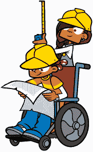

### 大型程序

如果我们坐下来想给自己造一辆车（一辆真正的车，如图 2.1 所示），我们可能甚至不知道从哪里开始。从发动机开始怎么样？发动机制造商不需要了解车轮、挡风玻璃雨刷或如何制造座椅——发动机制造商只制造发动机。汽车制造商不需要知道发动机是如何制造的；他们只需要知道如何将车身连接到发动机上。汽车制造商还可以从一家公司获得车轮，从另一家公司获得轮胎——只要它们匹配就行。

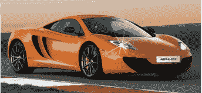

图 2.1 迈凯伦 12C——一辆非常漂亮的汽车！

一个复杂的计算机程序，例如电子邮件应用程序或视频游戏，也可能很难构建，因为它也由许多部分组成。然而，就像汽车一样，大型应用程序不必一次性全部构建。最新的视频游戏通常由数百万行代码组成。如果它们作为一个程序来构建，你能想象找到一个输入错误会有多难吗？相信我，每个人都会犯输入错误。避免这个问题的方法是一次构建一小部分。

有几种方法可以做到这一点。其中一种就是使用 OOP，它用编码对象来构建程序！这样做的一大好处是，如果你以正确的方式构建**对象**


这样，你可以创建这些对象的库。这些对象可以在其他应用程序中再次使用。你当然可以用函数完成其中很多工作，但学习对象和类将帮助你更好地理解别人的代码。流行的 PyGame 库和 tkinter 都使用类。

### 类

我们的第一个任务是审视一个问题，并弄清楚如何把它分解成更小的任务和对象。你刚刚了解到，我们会构建对象的库。这并不完全正确。我们构建的是类的库。类比对象更好，因为它可以充当创建对象的工厂。

与其用复杂的情况来解释，不如拿一个非常简单的东西——一只猫。

构建 Cat 类有很多方法。下面是一种：

```python
class Cat:
    def speak(self):
        print("Meow!")

    def drink(self):
        print("The cat drinks its milk.")
        print("The cat takes a nap.")
```

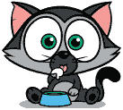

在 IDLE 中打开一个新窗口，并输入代码框 2.1 中的代码。将其保存为 Python 文件夹中的 `cat.py`。

#### 对代码框 2.1 的分析

首先要注意的是，我们使用 class 关键字，并且类名 Cat 以大写字母开头。冒号后缩进的代码属于这个类。在类内部，我们提供了两个方法。方法与函数非常相似，区别在于它们属于一个类。

记住，这就像一个工厂。现在，你将学习如何向它下达命令来构建一些对象——在这个例子中，是一些猫！

#### 深入探讨

#### 方法和函数有什么区别？

方法只是我们在类中创建的一种特殊函数。

计算机科学家可能会对我们把类称为“工厂”感到不满，因为这个词在高级 OOP 中还有另一个含义。他们更希望我们把类描述为模板或蓝图。不过，你会发现把类想象成工厂要容易得多。

如果你把类想象成工厂，你就能理解：通过要求方法将 self 作为参数，你是在告诉计算机，这个方法将可供工厂制造的每个对象使用。

### 模块

通过将诸如 `cat.py` 这样的类文件存储在一个文件夹中，它们就成了一个模块！同一文件夹中的任何其他 Python 文件都可以通过一个简单的 import 语句使用它们：

```python
import cat
```

Python 库中还有其他可以使用的特殊模块。你已经这样做过一次了。

> **快速测验 2.1**
> 
> 你还记得我们之前用过哪个模块吗？

#### main.py

到目前为止，我们还不能用 Cat 类做任何事情。你试过运行它吗？不会发生太多事情，对吧？

在 IDLE 中打开一个新窗口，并输入代码框 2.2 中的代码。然后将这个新文件保存为 `main.py`。注意，代码开头导入了 `cat.py`，这使我们的程序可以访问 Cat 类。你刚刚创建的文件就是你开始运行程序的地方，这就是它被称为 `main.py` 的原因。

> 哇，我们做出了自己的模块。
> 
> 好吧，它里面只有一个类——但这是个开始。

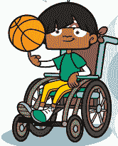

#### 代码框 2.2

```python
import cat

#### create an instance of a cat, named Romeo
romeo = cat.Cat()

#### play with Romeo
romeo.speak()
romeo.drink()
```

#### 对代码框 2.2 的分析

```python
romeo = cat.Cat()
```

这里就是我们向 cat 工厂订购对象的地方。计算机科学家会说：“我们创建了 Cat 类的一个实例。”他们甚至可能会说，我们实例化了一个 cat 对象。Romeo 就是这个对象，它由 Cat 类创建（因此类名首字母大写）。Cat 类位于 `cat.py` 中，因此我们通过点运算符告诉 `main.py` 它在哪里。这个点用于将类与其所在位置关联起来。用非编程语言来说，这一行代码可以翻译为：

> “使用 `cat.py` 文件中的 cat 工厂创建一个名为 Romeo 的对象。”

这样我们就有一只猫了！他叫 Romeo！这一切只用一行代码就完成了。

Romeo 可以使用其工厂——Cat 类——构建的所有方法。要访问这些方法，我们再次使用点运算符调用它们：

```python
romeo.speak()  # calls romeo's speak method
romeo.drink()  # calls romeo's drink method
```

如果你还没有和 Romeo 玩过，现在就可以试试！要和 Romeo 玩，你只需保存并运行 `main.py`。它必须与 `cat.py` 在同一个文件夹中。

#### 改进 Cat 类

**警告：** 本节中有很多 self！

调用函数时，我们在括号中向它传递参数，如下所示：

```python
times_tables(12, 12)
```

这个函数来自*Python 基础*，调用它会打印出 12 的乘法表，直到 12 × 12 = 144。对象也可以这样做。例如，我们可以提供一个名字：

```python
romeo = cat.Cat("Romeo")
```

不过，我们的 Cat 类现在需要重写。这与在函数中的做法并不完全相同。它是在一个称为**构造函数**的特殊方法中完成的。


构造函数有一段特殊的代码，从现在起你会经常看到它。它乍看有点吓人，但总是一样的——你会习惯的：

```python
def __init__(self, name):
```

它总是带有 self 参数，以确保每个人都明白：这个方法将可供这个类构建的每个对象使用。接下来，我们必须列出想要传递给构造函数的其他参数。在上面的示例中，需要的另一个参数是 name。

现在让我们暂停一下。你可能没有被两侧各有两个下划线包围的 __init__ 弄糊涂；你可能已经注意到，这实际上是一个方法，因为它的开头有 def，结尾有冒号；你可能是一个非常聪明的程序员！大多数学生在这个阶段都需要一点鼓励——听听坎贝尔先生怎么说。

现在继续！在这个称为构造函数的特殊方法中，我们必须根据 name 创建一个 self.name 变量（没错，这样它就能供这个类创建的对象使用）。然后我们会在方法中使用这个新变量 self.name。

我们正在给所有将要供对象（而不仅仅是供类）使用的变量名前面加上 self.。这就是为什么我们最后会有很多 self！

#### 深入探讨

当我们构建类时，我们编写的方法将可供我们构建（创建实例）的对象使用。在一局斯诺克比赛中，可能有好几个位置不同的球。每个球都有一个 find_location() 方法，它只引用自身，即使它们都是由同一个类构建的。这就是为什么我们类中的方法会把 `self` 作为参数传递。不过，实际情况比这还要巧妙。

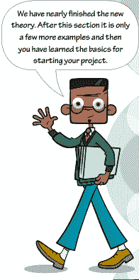

从编程角度看，对象实际上确实会回到类代码中查找方法，但每个对象都会跟踪自己的数据。就好像每个对象都拥有只针对它自己的方法。就好像这些方法独立于同一工厂构建的其他对象一样。这正是我们构建对象时所希望的，而这一切都通过一个参数——`self`——来完成。

在 IDLE 中打开一个新窗口，并复制代码框 2.3 中的代码。将其保存为 `cat2.py`。将它与 `cat.py`（代码框 2.1）进行比较，看看我们如何使用构造函数中创建的新变量 `self.name`。是的，这段构造函数代码所做的就是：给了你一个可以使用的新变量！和之前一样，这个类不会运行任何东西。它只是一个工厂，但你马上就会看到工厂多么有用。

```python
class Cat:
    # constructor:
    def __init__(self, name):
        self.name = name

    def speak(self):
        print(self.name, " says Meow")

    def drink(self):
        print(self.name, " drinks some milk.")
        print(self.name, " takes a nap.")
```

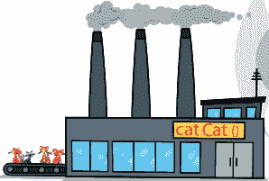


### 改进 main.py

这是所有辛苦工作得到回报的地方。你将很快下单两只猫，并和它们一起玩耍。你可能会发现，这次即使没有帮助，代码也能看懂了。在 IDLE 中打开一个新窗口，复制代码框 2.4 中的代码。将其保存为 `main2.py`。

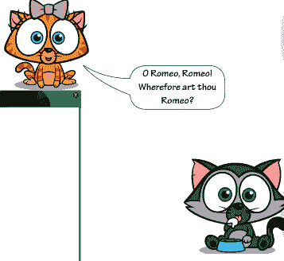

```python
#### 代码框 2.4

import cat2

#### create two instances of a cat
romeo = cat2.Cat("Romeo")
juliet = cat2.Cat("Juliet")

#### play with Romeo
romeo.speak()
romeo.drink()

#### play with Juliet
juliet.speak()
juliet.drink()
```

运行这个文件，然后随意发挥，调整代码。玩得开心！

### 设计类


本节将介绍另一个简单的示例，你将有机会练习所学的内容，并开始学习如何设计一个类。你将构建一个电梯和一个电梯操作员。

下面是构建电梯类的一种方法。电梯可以有很多属性，但就程序而言，真正必不可少的属性少之又少。

电梯唯一必不可少的属性是它当前所在楼层。我们也可以不叫“必不可少的属性”，而称之为“特性”或“特征”。在编程中，我们称这些特征为**属性**（有时也称为**参数**），并在构造函数中对它们进行初始化。

> 在美国，我们称电梯为 elevator。

| 类名 | **Lift** |
| --- | --- |
| 属性 | *当前楼层* |
| 方法 | *获取楼层*<br>*移动到楼层* |


类设计表 2.1 一个电梯类。

我们可能还想知道它能容纳多少乘客，或者它的速度——但这个电梯会非常简单。为了规划一个电梯类，我们可以使用类设计表。你可以在本书末尾的附录中以及配套网站上找到一张空白的类设计表——这样如果你愿意，就可以打印出自己的表格。设计工作就会写进类设计表中。然后我们可以据此构建我们的类。

两个方法是必不可少的：一个用于找出电梯当前所在楼层，另一个用于将电梯移动到新楼层。现在我们来看看这是如何转换成代码的：

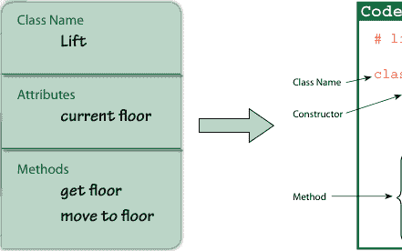

```python
#### lift.py provides a Lift Class

class Lift:
    # constructor:
    def __init__(self, current_floor=0):
        self.current_floor = current_floor

    def get_floor(self):
        return self.current_floor

    def move_to_floor(self, floor_number):
        self.current_floor = floor_number
```

#### 代码框 2.5 分析

`current_floor` 属性有一个默认值 0。这可以在构造函数方法中看到。现在，如果我们创建新的电梯对象时没有向这个类传递 `current_floor` 参数，新电梯将默认从 0 层开始。

第一个方法使用了 `return` 关键字。这意味着如果我们在电梯操作程序里调用这个方法，它会把存储在 `self.current_floor` 变量中的值返回（交回）给我们。

#### 电梯操作员

`lift_operator.py` 中有一些与电梯互动的简单代码。你不需要手动输入，可以直接从配套网站下载的源代码文件中的 Chapter 2 文件夹里打开并运行它。代码见下一页的代码框 2.6。

#### 代码框 2.6

```python
#### lift_operator.py

import lift

#### create a lift object
my_lift = lift.Lift()

#### Find out what floor the lift is on
floor = my_lift.get_floor()
print("The lift is on floor", floor)

#### move the lift to a new floor
my_lift.move_to_floor(5)

#### Find out what floor the lift is on now
floor = my_lift.get_floor()
print("The lift has now moved to floor", floor)
```

#### 实验

创建 `my_lift` 时，我们没有传入 `current_floor` 变量，所以电梯是从 0 层开始的。试着把这行代码改成 `my_lift = lift.Lift(3)` 再运行一次。有意思吧？

### 章节总结

在这一章中，你学到了：

- 关于类、对象以及如何设计它们
- 如何构建你自己的模块
- 一点面向对象编程（OOP）的知识
- `self` 有时真是个麻烦！

这一章内容相当密集。如果你觉得有点不知所措，不用担心，因为 MyPong 项目将巩固这些概念，你很快就会掌握它们的。

如果你想练习一下，可以试试这个轻松又有趣的挑战。（如果你在做挑战时手边有 `cat2.py` 和 `main2.py` 的代码，那这个挑战既轻松又惬意！）

祝你好运。

#### 轻松又有趣的挑战

创建一个 `Pet` 类，并将其保存在名为 `pet.py` 的文件中。

创建一个名为 `pet_owner.py` 的应用程序，用来构建和控制一些宠物。

你可以选择任何你喜欢的宠物，比如仓鼠或龙猫。或者你也可以更喜欢狼蛛或食人鱼。你会发现，你必须小心设计你的宠物能做什么。食人鱼不会说话，也不能去散步！

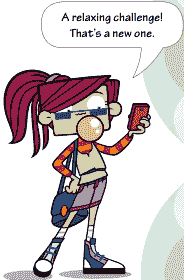

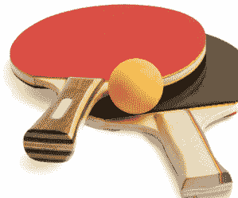

## MyPong 项目

人们用许多编程语言制作过许多版本的 Pong。Pong 的伟大之处在于，每个人都知道怎么立刻开始玩，而且它是一个很棒的双人竞技小游戏。然而，制作这个游戏本身只是达到目的的一种手段。这个项目和整本书的真正目标是，思考如何设计更大的应用程序，以及如何以可在其他项目中复用的方式来设计代码。

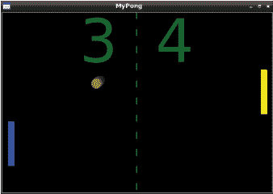

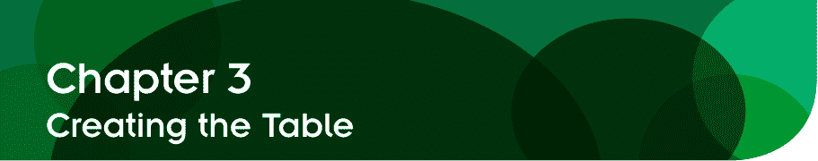

## 第3章：创建桌面

是时候开始我们的项目了。到本章结束时，你将已经为 MyPong 模块中的第一个类编写好代码。你可以从配套网站下载本章的文件。这里有两个文件夹：`pong-table-start` 和 `pong-table-final`。第一个文件夹中包含 Python 起始文件，里面有由注释构成的骨架。第二个文件夹中包含本章的最终文件，以防你自己无法完成。

之后的章节都会遵循这种模式。起始文件总是包含你上一章已完成的工作，并附有额外的注释。这样即使你感到困惑，也不会造成灾难性后果。提供所有这些备份文件的另一个原因是鼓励你在每一章结束时大胆实验自己的代码，而不必担心迷失方向。不过，请务必亲手输入代码，而不仅仅是阅读文件。这样当 MyPong 完成时，你才有理由称它为“你自己的作品”。你也会有更好的机会理解所有代码是如何运作的。

本章还有更多关于如何设计类的内容。这个主题在本书其余部分也会继续。

- 设计一个 Table 类
- 多了解一点 tkinter 模块
- 构建一个简单的图形应用程序。

**检查清单**

- ☐ 创建桌面
- ☐ 添加球
- ☐ 添加两个球拍
- ☐ 添加球门系统
- ☐ 添加计分系统

### 总体计划

图 3.1 展示了最终项目的外观。你将构建一组类来实现它。例如，会有一个 Ball 类和一个 Bat 类。类的构建方式要使其可以用于其他游戏。事实上，在附赠章节中就会用到它们。很多游戏里都有球和球拍！

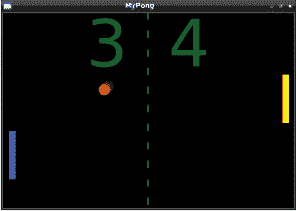

图 3.1 完成后的 MyPong 游戏。

这个游戏由以下部分组成：

- 两个球拍
- 一张带有球网和计分牌的桌子
- 一个球
- 两名玩家

我们现在需要思考所需的物件，来决定如何将这个想法拆分成类。拆分方式有很多种。永远不要认为只有一个正确答案！

显然，我们将创建一个 Ball 类和一个 Bat 类。我们还需要一个名为 `main.py` 的文件来控制大部分内容。必须有一个 Table 类，否则本章的标题就没有意义了！但是，球网、规则和计分系统该怎么处理呢？

规则显然应该放在 `main.py` 中。球网非常简单，虽然我们可以构建一个 Net 类，但既然我们只需要画一条虚线，为它写一个类似乎有点小题大做：它可以成为桌子的一部分。不过，我们不必一次把所有东西都编好程序。我们可以等到以后再看情况。这就是面向对象编程在实际应用中的妙处！

有了这个策略，就足以让我们开始设计第一版 Table 类了。


### Table 类规划页

这是一张规划草图和一份 Table 类设计表。

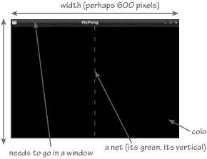

| 类名 | Table |
| --- | --- |
| 属性 |  |
|  | window |
|  | width=600 |
|  | height=400 |
|  | colour=black |
|  | net_colour=green |
|  | vertical_net (T/F) |
|  | horizontal_net (T/F) |
| 方法 |  |

#### 说明

提供大量**默认值**（例如宽度为 600 像素）会很有帮助。

这些属性将放入一个冗长的构造函数中。

通过为球网位置设置一些**布尔变量**，就可以轻松使用这个类构建各种球桌，其球网可以是垂直的、水平的或不存在！

目前这个球桌类不需要任何方法。

> 啊，是的，布尔变量：它们让我们能清楚地看到世界上什么是真、什么是假。


### tkinter 工具包

Python 3 安装时还会附带安装一组额外的模块，它们为我们提供了一些 GUI 控件。这些内容在 *Python: Next Steps* 中已经探讨过。

由于我们将使用 tkinter 类中的许多方法，可以选择使用下面这行代码：

```python
from tkinter import *
```

> 这样导入模块的缺点是，我们现在必须避免在自己的代码中使用任何 tkinter 方法名。


这意味着，在后续代码中，我们可以直接引用 tkinter 的任意方法。我们不再需要在每个方法前加上其所在模块的名称：不再需要在每次调用 tkinter 方法时在前面加上 `tkinter.`。

### Table 类构造函数

我们的构造函数需要为每个属性传入一个参数，这些属性是我们在创建一个新对象时希望能够选择的。然后，像之前一样，我们会把它们赋值给所有 `self.variables`。

打开 `pong-table-start` 文件夹中的 `table.py`。该文件位于 Chapter 3 文件夹中。用 IDLE 打开它，并添加代码框 3.1 中缺失的代码。将你的代码添加到代码框标题栏所示文件中。

你能看出这如何与我们计划的第一部分相匹配吗？

#### 代码框 3.1 — `table.py`

```python
#### This class defines a Table that is a 2D rectangle that is a play area.

from tkinter import *

class Table:
    #### constructor
    def __init__(self, window, colour='black', net_colour='green',
                 width=600, height=400,
                 vertical_net=False, horizontal_net=False):
        self.width = width
        self.height = height
        self.colour = colour
```

这样构建的类非常像工厂。在 main.py 中，我们将能够用类似下面的代码快速制造一个球桌：

`my_table = table.Table(window)`

由于我们在构造函数的 `__init__` 行中提供了所有默认值，唯一必需的参数将是 window。这个类将创建一个与我们想要的球桌几乎一样的球桌对象，但有一个例外。

> 我以前从未意识到英国人拼写 colour 时会带一个“u”。

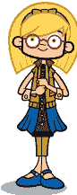

#### 快速测验 3.1

回看代码框 3.1 中的 `__init__` 行，以及 Table 类规划页上所需球桌的示意图。我们得到的球桌与想要的球桌之间会有什么区别？

以这种方式构建类意味着，将来我们可以用一行代码构建各种球桌。Table 类变成了一个非常有用的小工厂（图 3.2）。你想要一张带水平球网、尺寸为 300 像素 × 300 像素的红色球桌吗？只需这样写：

```python
my_table = table.Table(window, horizontal_net=True, width=300, height=300, colour='red')
```

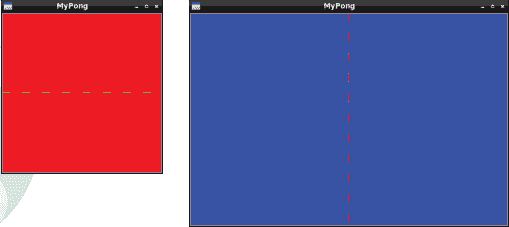

图 3.2 一些球桌对象。

#### 快速测验 3.2

要创建一个带垂直红色球网、宽 600 像素、高 400 像素的蓝色球桌对象，代码会是什么样？

### 更多 tkinter 工具

构造函数方法还没有完全完成，因为我们还没有让它真正构建球桌或球网。我们会把窗口的绘制留给 main.py（很快就会编写）。要构建球桌，我们必须使用一些 tkinter 代码，可能需要在 tkinter 网站上查找说明。这是一个相当大的库，你不需要担心自己去做这件事，因为已经为你完成了。如果你感兴趣，可以随意查看。在撰写本书时，可以在以下位置找到说明：

http://docs.python.org/py3k/library/tk.html

首先，我们需要创建画布，其代码如下：

```python
self.canvas = Canvas(window, bg=self.colour, height=self.height, width=self.width)
```

Canvas 类是 tkinter 的一个工厂，需要窗口、背景颜色、高度和宽度这些参数——这些参数在构造函数的第一部分中都有对应的变量。

### 深入探索

#### 何时使用 self，何时不需要

当我们构建一个诸如 Table 类的类时，需要把构建其球桌对象所需的任何属性传给它。例如，球桌要放入一个窗口对象中——因此我们需要把 window 作为参数传给它。

另一方面，如果我们要传给 Table 类一个属性（例如 width），并且可能希望其他类或文件查询它（例如：Table，你有多宽？），那么就需要在构造函数中用 self 将其声明为对象变量。然后，其他类或文件就可以询问这个球桌对象它有多宽。

接下来要做的是调用 canvas 的 pack() 方法。它不需要任何参数：

```python
self.canvas.pack()
```

需要调用 pack() 方法，才能让我们的球桌在执行其他任务时可见。接下来，我们可以使用 canvas 的 create_line() 方法绘制球网。其形式如下：

```python
self.canvas.create_line([top x-coord], [top y-coord], [bottom x-coord],
                         [bottom y-coord], width=2, fill=net_colour, dash=(15, 23))
```

宽度以像素为单位，因此我们要一条两像素粗的线。

fill 是线条的颜色——我们已经为此准备好了一个变量。

dash 属性接受两个数字——虚线的长度和间隔，同样以像素为单位。

要理解坐标，需要知道：与学校里的数学和科学不同，计算机通常从屏幕或窗口的左上角开始计算像素。Python 中就是这样。请看图 3.3 了解其工作方式。

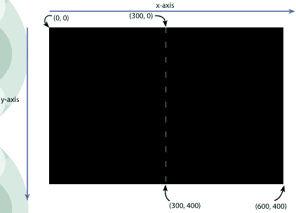

**图 3.3** 坐标。

因此，实现 `create_line()` 方法的调用可以写成：

```python
self.canvas.create_line(300, 0, 300, 400, width=2, fill=net_colour, dash=(15, 23))
```

然而，这不是一个好办法，因为我们正试图构建一个 Table 类。一个只能构建一种球桌的工厂没有多大用处。如果我们想要一张更长的球桌呢？球网就会太靠左。更高的球桌则会有球网够不到底部的问题！但我们有保存球桌对象宽度和高度属性的变量，因此可以在方法中根据这些变量计算坐标。这样球网就总会处于正确的位置：

对于垂直球网：

- [顶部 x 坐标] 变为 self.width/2
- [顶部 y 坐标] 变为 0
- [底部 x 坐标] 变为 self.width/2
- [底部 y 坐标] 变为 self.height

对于水平球网：

- [左侧 x 坐标] 变为 0
- [左侧 y 坐标] 变为 self.height/2
- [右侧 x 坐标] 变为 self.width
- [右侧 y 坐标] 变为 self.height/2

现在，你可以将代码框 3.2 中的额外代码添加到你的 `table.py` 副本中。使用所提供文件中的注释来指导你把新代码添加到何处。

#### 代码框 3.2

```python
#### order a canvas to draw on from the tkinter factory:
self.canvas = Canvas(window, bg=self.colour, height=self.height, width=self.width)
self.canvas.pack()

#### add a net to the canvas using a method from the tkinter factory:
if(vertical_net):
    self.canvas.create_line(self.width/2, 0, self.width/2,
                            self.height, width=2, fill=net_colour, dash=(15, 23))
if(horizontal_net):
    self.canvas.create_line(0, self.height/2, self.width,
                            self.height/2, width=2, fill=net_colour, dash=(15, 23))
```

#### 警告！

在某些阶段很容易出现输入错误。请仔细检查代码，完成之后运行程序，看看能否发现并纠正任何问题。如果你遇到困难并开始感到沮丧，那么可以从配套网站获取完整文件。毕竟，编程应该是有趣的。在使用完整文件之前，请务必尝试自己输入代码，并在输入时思考每一行代码是如何工作的。这样做会让你更好地学习编程。（这句话似乎陷入了无限循环！）


### 方法

稍后我们会向这个类添加一些方法。目前，Table 类所要做的只是能够创建各种形状的静态球桌！

这样 Table 类就完成了。由于类是工厂而不是球桌对象，如果你尝试运行 `table.py`，它不会做任何事情。在这个阶段，我们只是定义了一个 Table 类，并没有制造任何球桌。即便如此，请记得保存文件。

### main.py

现在你需要创建名为 `main.py` 的控制程序文件。这个文件在后续章节中会发生变化。目前它很短。整个文件见代码框 3.3。

```python
#### This is the main file for MyPong.

from tkinter import *
import table

#### order a window from the tkinter factory
window = Tk()
window.title("MyPong")
```

### 运行与测试

现在我们可以测试 Table 类了。`table.py` 和 `main.py` 两个文件都应已完成，并放在同一个文件夹中。在 IDLE 中运行 `main.py` 文件。你应该会看到一个带球网的球桌！

如果你有任何错误，请尝试通过将代码中的颜色与本书代码框中的颜色进行比较来排查。另外，仔细查看 IDLE 中的错误消息。错误可能出现在任一文件中——IDLE 的消息会告诉你到哪里查找。这称为调试。有时它可能相当棘手，所以如果你已经尝试了几次，请使用网站 pong-table-final 文件夹中 Chapter 3 文件夹里的两个文件。

### 深入探讨

#### 何时构建类？

你可能会想，什么时候最适合构建类。许多面向对象编程（OOP）专家会尝试用类来构建一切，包括一个 Main 类！然而，做事的方式有很多，OOP 只是其中一种，而且其中有很多选择。本书向你介绍一系列 OOP 技术，这些技术并未利用 OOP 的全部优势——也没有涉及其复杂性。本书的重点是教你如何构建类并与类交互。因此，每当我们想要构建一个以后在编码生涯中可能会使用的对象，或者想要许多同一种类的对象时，我们就会选择一个类。

如果你把类看作工厂，就很容易解释为什么我们需要一个 Table 类。没有球网时，它可以成为许多游戏或动画的舞台。之后我们将构建一个 Bat 类。我们会把它写成可以是左球拍或右球拍。然后我们可能想添加代码，以便拥有底部球拍或顶部球拍。如果我们从底部球拍发球，它现在就可以成为球拍发射器。如果我们把一堆顶部球拍放在底部球拍上方（图 3.4），就可以构建一个 MyBreakout 游戏（或者应该叫 MyBatout？）。那时我们肯定会想要很多球拍，而它们都可以使用我们的 Bat 类（或 Bat 工厂）快速构建出来。

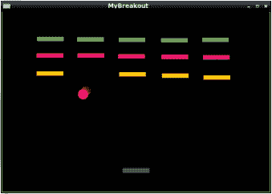

图 3.4 许多球拍。

### 本章小结

在本章中，你：

- 进一步了解了 tkinter
- 运用你的类构建知识构建了一个 Table 类
- 进一步了解了类如何像工厂一样工作
- 使用 tkinter 方法让计算机把我们的球桌放入一个新窗口。

既然我们做了一个工厂，本章的挑战将涉及向它发送一些订单。如果你已经从配套网站下载了源代码，现在就可以开始修改代码，而不必担心损坏自己的文件。剩余的每一章都有全新的起始文件，这样你就不会迷失方向。挑战 1–4 都可以在 `main.py` 中完成。

#### 挑战 1

将窗口标题改为 My Table Experiment。

#### 挑战 2

创建一个蓝色方形球桌，带有黑色垂直球网。

#### 挑战 3

创建一个黑色球桌，带有水平蓝色球网。

#### 挑战 4

创建一个细长球桌，宽 600 像素，高 60 像素。

#### 挑战 5

让球桌保持原样，但球网宽 20 像素。*（提示：线宽是硬编码的（我们没有在构造函数中为它创建变量），因此你需要调整 Table 类中的代码。）*

## 第4章

### 制作球

到本章结束时，你将已经为 MyPong 模块编写好 Ball 类的代码。我们会把它命名为 `ball.py`。

本章还有更多关于如何设计类的内容。也大量运用了你已经掌握的编程技能。许多游戏都会使用球，因此我们正在编写非常可复用的代码。

在本章中，你将：

- 设计一个 Ball 类
- 学习如何将球添加到球桌中
- 学习如何在 tkinter 中为形状制作动画。

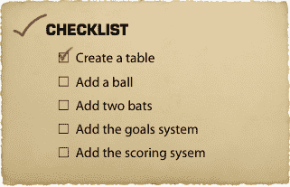

#### 添加球

在本章中，我们将向游戏中添加一个球（图 4.1）。首先，我们必须设计一个 Ball 类，然后把它添加到我们的球桌对象中。球将是一个简单的圆，它在屏幕上移动，并从四面墙弹回。我们希望创建一个可以在其他游戏中复用的类。

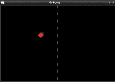

图 4.1 MyPong 中的球。

首先，我们需要了解 Python 如何绘制和定位圆（图 4.2）：

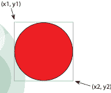

图 4.2 绘制一个圆。

圆被绘制在一个正方形中，其在球桌上的位置由该正方形左上角的 x 和 y 坐标决定。因此，要构建一个圆，我们提供如下代码：

```python
self.canvas.create_oval(x1, y1, x2, y2, fill="red")
```

球会移动，这由它沿 x 轴的速度和沿 y 轴的速度控制。如果两者都是正值且相等，球将沿对角线向右下方移动。

现在让我们开始 Ball 类的计划。

#### Ball 类规划页

我们可以直接开始。我们只是要构建一个球工厂，所以开始设计吧：

| 类名 |
| --- |
| **Ball** |
| **属性** |
| width |
| height |
| x_posn |
| y_posn |
| colour |
| x_start |
| y_start |
| x_speed |
| y_speed |
| table |
| circle |
| **方法** |
| start_position |
| start_ball |
| move_next |
| stop_ball |

#### 说明

Ball 类的前五个属性应该相当明显。然后我们添加球发出位置的坐标，以及水平和垂直速度。我们还需要一个圆作为球，以及让球在其上移动的球桌。

现在让我们看看这些方法。

```
start_position():
```

这将是一个简单的方法，用于将球放回其起始位置。

```
start_ball():
```

这个方法会让球开始移动。它为球设置所需的 x_speed 和 y_speed。

```
move_next():
```

这里我们将有最复杂的方法，它将控制球如何移动。基本上，每隔 50 毫秒，球就必须移动到别处。这个方法控制它将移动到哪里。

```
stop_ball():
```

用这个简单的方法，我们将停止球。我们将其 x_speed 和 y_speed 设置为零。

#### 动手输入

现在你应该打开 Chapter 4 文件夹中 pong-ball-start 文件夹里的 `ball.py`。通过复制代码框 4.1 中缺失的代码来完成它。在你操作时，务必思考规划表如何转化为代码。（你现在打字更快了吗？）

#### 代码框 4.1：`ball.py`

```python
import table, random

class Ball:
    #### constructor
    def __init__(self, table, width=14, height=14, colour="red",
                 x_speed=6, y_speed=4, x_start=0, y_start=0):
        self.width = width
        self.height = height
        self.x_posn = x_start
        self.y_posn = y_start
        self.colour = colour

        self.x_start = x_start
        self.y_start = y_start
        self.x_speed = x_speed
        self.y_speed = y_speed
        self.table = table
        self.circle = self.table.draw_oval(self)

    #### methods
    def start_position(self):
        self.x_posn = self.x_start
        self.y_posn = self.y_start
```


```python
def start_ball(self, x_speed, y_speed):
    self.x_speed = -x_speed if random.randint(0,1) else x_speed
    self.y_speed = -y_speed if random.randint(0,1) else y_speed
    self.start_position()

def move_next(self):
    self.x_posn = self.x_posn + self.x_speed
    self.y_posn = self.y_posn + self.y_speed
    # if the ball hits the left wall:
    if(self.x_posn <= 3):
        self.x_posn = 3
        self.x_speed = -self.x_speed
    # if it hits right wall:
    if(self.x_posn >= (self.table.width - (self.width - 3))):
        self.x_posn = (self.table.width - (self.width - 3))
        self.x_speed = -self.x_speed
    # if the ball hits the top wall:
    if(self.y_posn <= 3):
        self.y_posn = 3
        self.y_speed = -self.y_speed
    # if it hits bottom wall:
    if(self.y_posn >= (self.table.height - (self.height - 3))):
        self.y_posn = (self.table.height - (self.height - 3))
        self.y_speed = -self.y_speed
    # finally move the circle:
    x1 = self.x_posn
    x2 = self.x_posn + self.width
    y1 = self.y_posn
    y2 = self.y_posn + self.height
    self.table.move_item(self.circle, x1, y1, x2, y2)

def stop_ball(self):
    self.x_speed = 0
    self.y_speed = 0
```

> 当我抄写代码时，我总是试着预测接下来会是什么。Ball 类中有相当多相似的方法，所以借助这一点，我成功猜对了不少。


除了 `move_next()` 方法之外，这里没有什么是你应付不了的。本章末尾会完整解释 `move_next()` 方法。现在，别忘了保存你的工作，然后我们继续写代码。

### 通过改进球桌让球动起来

要让球动起来，我们需要给 `Table` 类添加几个工具，因为球必须在这里绘制。我们已经在 `table.py` 中写过一个 `Table` 类。本章的 `pong-ball-start` 文件夹中还有这个类的另一份副本。它包含之前的所有代码，并留有一块空白区域供你再添加一点内容。

**代码框 4.3** `table.py`

```python
#### extra tool for adding an oval to the canvas
def draw_oval(self, oval):
    x1 = oval.x_posn
    x2 = oval.x_posn + oval.width
    y1 = oval.y_posn
    y2 = oval.y_posn + oval.height
    c = oval.colour
    return self.canvas.create_oval(x1, y1, x2, y2, fill=c)
```

这个方法首先接收一个椭圆作为参数。我们将把一个球实例传给它。为了提高可读性，我们根据球对象的属性来定义 tkinter 所需的参数。然后我们把球绘制到画布上。

### 另外三个 Table 方法

球桌还需要能够移动球和矩形、移除它们并改变它们的颜色。椭圆和矩形等几种对象在 tkinter 中使用相同的方法名，这让我们只需为球桌提供三个通用方法来操作其上的项目。将代码框 4.4 中的代码复制到你的 `table.py` 文件中，以完成 Table 类。

**代码框 4.4 — `table.py`**

```python
#### extra tools for manipulating items on the canvas:
def move_item(self, item, x1, y1, x2, y2):
    self.canvas.coords(item, x1, y1, x2, y2)

def remove_item(self, item):
    self.canvas.delete(item)

def change_item_colour(self, item, c):
    self.canvas.itemconfigure(item, fill=c)
```

`move_item()` 方法是我们提供给球桌工厂的最有趣的新工具。它接收六个参数：

- **self** —— 对由这个类构建的当前球桌对象的引用。我们不提供它，因为它由 Python 自动提供（不过，它必须被声明）。
- **item** —— 我们将把一个引用传给它，指向画布上我们想要移动的项目。这对任何包含在边界框中的项目都有效。在本章中，我们传入代表球的圆。
- **x1, y1, x2, y2** —— 这些是边界框的坐标。x1 和 y1 是框左上角的坐标。x2 和 y2 是框右下角的坐标（图 4.3）。

> 当你想到新方法时，通过提供这些新方法来改进你的类绝对没有问题。这就像为工厂提供新机器，使其更加灵活。

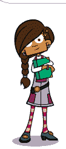

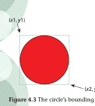

### 调整 main.py

现在我们必须调整 `main.py`。这里是我们存储规则并运行球等对象的地方。同样，上次有一个起始文件，其中留有一些空白供你添加新代码。最终文件应该像代码框 4.5 中的那样。

**代码框 4.5** `main.py`

```python
from tkinter import *
import table, ball

#### initialise global variables
x_velocity = 10
y_velocity = 10

#### order a window from the tkinter window factory
window = Tk()
window.title("MyPong")

#### order a table from the table factory
my_table = table.Table(window, net_colour="green", vertical_net=True)

#### order a ball from the ball factory
my_ball = ball.Ball(table=my_table, x_speed=x_velocity, y_speed=y_velocity,
                    width=24, height=24, colour="red", x_start=288, y_start=188)

#### functions:
def game_flow():
    my_ball.move_next()
    window.after(50, game_flow)

#### call the game_flow loop
game_flow()

#### start the tkinter loop process
window.mainloop()
```

别忘了导入 ball

#### 代码框 4.5 分析

确保把 `Ball` 加到导入行中——我们有一个新的工厂要使用。

在构造函数中，你从 Ball 类订购一个新球——它叫作 `my_ball`。

要把它变成一个游戏，我们需要添加几个函数。因为 `main.py` 不是类，所以它将使用函数而不是方法。首先，我们需要一个让球动起来的函数。`game_flow()` 在接下来两章中会变得更复杂，但现在它调用 `my_ball` 的 `move_next()` 方法，然后使用 `window.after()` 方法创建一个动画循环：

```python
window.after(50, game_flow)
```

第一个参数选择 50 毫秒的等待时间，第二个参数给出等待之后要调用的函数。`after()` 函数被设计为向 `mainloop()` 添加一个事件。在我们的代码中，`after()` 调用包含它的函数；因此，它实际上产生了一个**无限循环**，其中 `my_ball.move_next()` 函数每 50 毫秒被调用一次。

在 `main.py` 末尾调用 `mainloop()` 方法之前，我们还需要添加一行代码来让新函数开始运行：`game_flow()`。完成了！

### 深入探索

#### 全局还是局部？

在函数或方法中创建的变量称为**局部变量**。这些变量存在于函数内部，但不能在程序的其他部分被调用或使用。它们甚至可以与其他函数或方法中的变量同名，尽管这不是一个好主意。**全局变量**通常在我们的代码开头声明。我们希望随时能访问它们的值。有时我们可能想在方法或函数内部使用全局变量。如果我们只想读取变量的值，那没问题。如果方法或函数需要改变全局变量的值，那么必须在函数内部重新声明它，并在前面加上关键字 `global`。

如果省略关键字 `global`，就会创建一个同名的新局部变量。如果我们完全不在函数内部声明它，那么当函数试图改变它的值时，就会得到“局部变量在赋值前被引用”的错误！换句话说，计算机不会把它识别为我们想要的全局变量，并告诉我们正在尝试访问一个不存在的局部变量。

#### 测试与调试

现在我们可以测试 Ball 类了。首先确保你的三个文件都已保存。在 IDLE 中运行 `main.py` 文件。如果一切正常，你应该会看到一个带球网的球桌，以及一个会在墙上反弹的红色球！

如果有任何错误，试着解决它们，并特别注意错误发生在哪个文件中。有时涉及多个文件时会相当棘手，所以如果你已经尝试了几次仍毫无进展，请使用配套网站上的文件。这些文件可以在 Chapter 4 文件夹中的 `pong-ball-final` 文件夹里找到。仔细比较你的文件与可运行文件是一次很好的学习经历。你年轻时玩“找不同”的那些日子现在真的会有回报。注意到代码中悄悄混入了哪些错误是件好事，这样你以后就能尽量避免它们。

#### move_next() 方法

前面说过我们会回来解释 `ball.py` 中的 `move_next()` 方法——好了，解释就在这里！


如果你感到有些疲惫，请尽管跳到本章末尾的“挑战”部分。你仍然能够理解足够的内容，来摆弄代码并完成这些挑战。

要跟上这段讲解，最好在 IDLE 中调出 `ball.py`，这样代码就摆在你面前。`move_next` 方法负责将球移动到下一个位置。在 `main.py` 中，我们每 50 毫秒调用它一次。

首先，我们将 x_speed 加到球的 x_posn 上，然后对 y_posn 做同样的操作。x_speed 和 y_speed 是整数。它们表示动画每个“滴答”中移动球的像素数。如果没有碰撞，只需这样就能让球沿直线移动：

```python
self.x_posn = self.x_posn + self.x_speed
self.y_posn = self.y_posn + self.y_speed
```

然后，我们需要进行若干测试，检查球是否撞到了画布对象的任意一面墙。球的 x_posn 是其边界框的左上角坐标，因此也是圆形的左边缘。所以，在第一个测试中，我们检查 x_posn 是否距离画布左墙小于三个像素（参见接下来的“深入探索”，了解为什么使用 3 个像素）。如果是，那么 x_speed 的符号就会反转。正的 x_speed 将球送向右侧，而负的 x_speed 将球送向左侧。因此，在这种情况下速度原本为负，而我们把它变为正。这就是让球反弹所需的全部操作。

```python
if(self.x_posn <= 3):   # if hits the left wall
    self.x_posn = 3
    self.x_speed = -self.x_speed
```

> “move_next() 方法并没有那么糟。如果你在读讲解时把代码摆在面前，我相信你会理解的。”

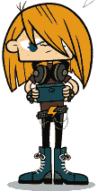

右侧墙的检测和处理方式相同，但检测右墙需要我们知道画布的宽度，并将它与比球的右边缘少 3 个像素的位置进行比较——也就是球的 x_pos 再加上球的宽度。

最后两个 if 语句检测是否撞到画布的底部和顶部，然后反转 y_speed。

最后，我们取这些测试的结果，将它们编译成一组新坐标，并把它们传给 table 对象中的 move_item() 方法——该方法位于 Table 类中：

```python
self.table.move_item(self.circle, x1, y1, x2, y2)
```

我们已经更新了球的所有属性，但在更新代表球的圆形的位置之前，什么都不会显现出来。这就是为什么我们传给 move_item() 方法的是 self.circle，而不只是 self。

### 深入探索

#### 为什么都是三？

你注意到这段代码中有不少数字三吗？如果没有这些三，球看起来就不会自然地反弹。真实的球不会一碰到墙就立刻掉头而没有被压扁。加入这些三是为了让效果看起来更真实。现在代码会等到球即将越过墙 3 个像素时才让它反弹。改变球的形状会不必要地困难，但 3 像素这个技巧能制造出正确的错觉。

这个 3 像素技巧是通过实验选出来的，直到看起来正确为止。“实验”听起来比“试错”好多了，你不觉得吗？

#### 挑战 1

你能把球变大吗？它还能很好地反弹吗？（好吧，右边的球显然太大了！）

#### 挑战 2

弄清楚当你改变 x_speed 和 y_speed 时会发生什么。

#### 挑战 3

把球的颜色改成绿色。最好在 main.py 中完成。

#### 挑战 4

你能改变球的形状，使它看起来像橄榄球吗？
提示：这可以在 main.py 中创建球时完成。

#### 挑战 5

如果你想要一个稍微难一点的挑战，试着给游戏添加一些重力。
重力会施加一个恒定的向下力。就代码而言，你所要做的就是一直
给 y_speed 增加一点点（即每个动画“滴答”时）。

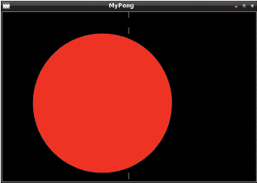

## 第5章

### 构建球拍

到本章结束时，你将已经编写好用于 MyPong 模块的 Bat 类代码。

本章还有更多关于如何设计类的内容，以及一小节关于我们所有对象之间通信的内容。这里也大量运用了你已经学过的编程技能。很多游戏都会用到球拍，因此我们再一次创建了可复用性很高的代码。

Bat 类是我们最复杂的类。

在本章中，你将：

- 设计一个 Bat 类
- 学习如何将球拍添加到 table 中
- 学习对象之间如何通信。

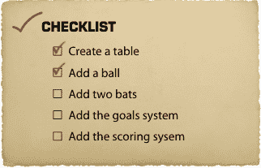

#### 添加球拍

在本章中，我们将向游戏中添加两个球拍。首先，我们必须设计一个 Bat 类，然后用它制造两个球拍，添加到我们的 table 对象中。

球拍将是一个简单的矩形，在屏幕上下移动（图 5.1）。球必须以一种类似于撞墙的方式从我们的球拍上反弹。我们希望有一个可在其他游戏中使用的可复用类。

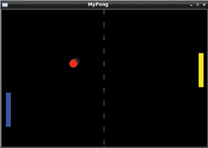

图 5.1 MyPong 中的球拍。

首先，我们需要了解 tkinter 如何绘制和定位矩形（图 5.2）：

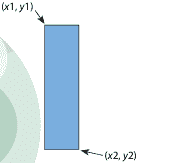

图 5.2 绘制一个矩形。

绘制矩形时，它在 table 上的位置由左上角的 x1 和 y1 坐标决定。因此，要构建一个矩形，我们编写这样的代码：

```python
self.canvas.create_rectangle(x1, y1, x2, y2, width=10, fill='blue')
```

注意，这是在画布上绘制的，并且使用了 tkinter 模块。不过我们已经为此做好了准备，并且已经向 Table 类添加了一个名为 `draw_rectangle()` 的绘制方法。

球拍会移动，这由它们沿 y 轴的速度控制。如果速度为正，球拍将垂直向下移动。

`create_rectangle()` 方法接受一个 width 参数，该参数表示边框的宽度。

现在让我们开始 Bat 类的规划。

#### Bat 类规划页

在这一页，我们将构建一个能够生产左球拍或右球拍的球拍工厂，所以让我们开始设计吧：

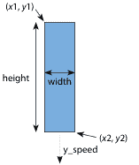

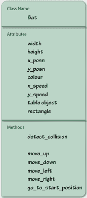

#### 备注

Bat 类的前七个属性应该相当明显，因为它们与 Ball 类（它也是在一个框中创建的）相似。我们还需要一个矩形来作为球拍，以及一个供球拍在其上移动的 table 对象。有趣的属性是速度属性：

`y_speed`

球拍的移动将绑定到按键。速度就是每次按键时它可以跳过的像素数。因此，y_speed 将默认设置为每次跳 23 个像素（这似乎效果不错）。

`x_speed`

我们的游戏并不需要它，但我们希望这个类能在其他游戏中复用——所以把它加进去。在我们的游戏中，我们将 x_speed 设置为 0。

在本章中，我们将按需讨论这些方法。最简单的是 `start_position()` 方法：这将是一个简单的方法，用于将球放回其起始位置。

#### 开始输入

现在你应该查看 Chapter 5 文件夹，并打开 pong-bat 起始文件夹中的 `bat.py` 文件。这一次为你提供的代码非常少。你现在可以添加代码框 5.1 中的代码并保存。同样，在输入时仔细思考规划表是如何转化为代码的。你应该能够复制并粘贴其中几个方法，然后试着自己不看原稿进行调整。这是一种学习和巩固新知识的好方法。

**代码框 5.1**

```python
import table

class Bat:
    #### constructor
    def __init__(self, table, width=15, height=100, x_posn=50,
                 y_posn=50, colour="green", x_speed=23, y_speed=23):
        self.width = width
        self.height = height
        self.x_posn = x_posn
```

*bat.py*

*（接下页）*

```python
self.y_posn = y_posn
self.colour = colour
self.x_start = x_posn
self.y_start = y_posn
self.x_speed = x_speed
self.y_speed = y_speed
self.table = table
self.rectangle = self.table.draw_rectangle(self)

#### methods
def move_up(self, master):
    self.y_posn = self.y_posn - self.y_speed
    if(self.y_posn <= 0):
        self.y_posn = 0
    x1 = self.x_posn
    x2 = self.x_posn+self.width
    y1 = self.y_posn
    y2 = self.y_posn+self.height
    self.table.move_item(self.rectangle, x1, y1, x2, y2)

def move_down(self, master):
    self.y_posn = self.y_posn + self.y_speed
    far_bottom = self.table.height - self.height
    if(self.y_posn >= far_bottom):
        self.y_posn = far_bottom
    x1 = self.x_posn
    x2 = self.x_posn+self.width
    y1 = self.y_posn
    y2 = self.y_posn+self.height
    self.table.move_item(self.rectangle, x1, y1, x2, y2)

def move_left(self, master):
    self.x_posn = self.x_posn - self.x_speed
    if(self.x_posn <= 0):
        self.x_posn = 0
    x1 = self.x_posn
    x2 = self.x_posn+self.width
    y1 = self.y_posn
    y2 = self.y_posn+self.height
    self.table.move_item(self.rectangle, x1, y1, x2, y2)

def move_right(self, master):
    self.x_posn = self.x_posn + self.x_speed
    far_right = self.table.width - self.width
    if(self.x_posn >= far_right):
        self.x_posn = far_right
    x1 = self.x_posn
    x2 = self.x_posn+self.width
    y1 = self.y_posn
    y2 = self.y_posn+self.height
    self.table.move_item(self.rectangle, x1, y1, x2, y2)

def start_position(self):
    self.x_posn = self.x_start
    self.y_posn = self.y_start
```

### 让球拍动起来

如果你现在运行 `main.py`，你会发现球拍没有出现。

#### 快速测验 5.1

**为什么球拍没有出现？**

- A. 我们还没有在 `main.py` 中订购任何球拍。
- B. 我们还没有将它们的方法绑定到任何键盘输入。
- C. 我们没有正确输入代码。
- D. Table 不知道如何绘制球拍。

因此，我们需要从 `main.py` 向新的球拍工厂发送一些订单，以获取左、右两个球拍。你现在应该将代码框 5.2 中的新代码复制到 `main.py` 中。

首先，我们从新类中订购两个球拍。然后，我们将移动方法绑定到键盘按键上——你会记得在《Python 基础》中，这在 Python 里简单得令人愉快。这里同样有一个起始文件，你会在其中找到一些空白处来添加新代码。

#### 代码框 5.2 — `main.py`

```python
from tkinter import *
import table, ball, bat

#### initialise global variables
x_velocity = 10
y_velocity = 10

#### order a window from the tkinter window factory
window = Tk()
window.title("MyPong")

#### order a table from the table factory
my_table = table.Table(window, net_colour='green', vertical_net=True)

#### order a ball from the ball factory
my_ball = ball.Ball(table=my_table, x_speed=x_velocity, y_speed=y_velocity,
                    width=24, height=24, colour='red', x_start=288, y_start=188)

#### order a left and right bat from the bat factory
bat_L = bat.Bat(table=my_table, width=15, height=100, x_posn=20, y_posn=150, colour="blue")
bat_R = bat.Bat(table=my_table, width=15, height=100, x_posn=575, y_posn=150, colour="yellow")

#### functions:
def game_flow():
    # detect if ball has hit the bats:

    my_ball.move_next()
    window.after(50, game_flow)

#### bind the controls of the bat to keys on the keyboard
window.bind("a", bat_L.move_up)
window.bind("z", bat_L.move_down)
window.bind("<Up>", bat_R.move_up)
window.bind("<Down>", bat_R.move_down)

#### call the game_flow loop
game_flow()

#### start the tkinter loop process
window.mainloop()
```

*别忘了导入 bat 类！*

#### 代码框 5.2 分析

你应该不难看出两个球拍的订购过程是如何工作的。Python 将方法绑定到按键的方式令人赏心悦目。如果你现在保存并运行 main.py，你会看到出现两个球拍，你可以上下移动它们。球目前完全忽略它们。我们仍然需要为 Bat 类添加碰撞检测。

### 让球拍击中球

首先，让我们调整 main.py 中的 game_flow() 函数。在 main.py 仍打开的情况下，调整 game_flow() 函数，使其与代码框 5.3 匹配。请注意，游戏将不再工作，因为我们还没有编写该方法。

#### 代码框 5.3 — main.py

```python
#### functions:
def game_flow():
    # detect if ball has hit the bats:
    bat_L.detect_collision(my_ball)
    bat_R.detect_collision(my_ball)

    my_ball.move_next()
    window.after(50, game_flow)
```

### 明确类与对象

在图 5.3 中，你将看到所有类如何用于构建对象，以及 `main.py` 如何汇集所有对象并运行游戏的概要。对象和类很容易混淆，因为它们的名称常常相似。请记住，类名都以大写字母开头。

在 `main.py` 中构建游戏时，明确这一点尤为重要，因为我们必须按正确的顺序构建。例如，这样在订购球拍时，就已经有一个构建好（或实例化）的 table 对象。这确实不是一件容易理解的事。随着你以这种方式编写越来越多的应用程序，它会变得更容易。尽管如此，努力理解类与对象之间的关系始终很重要，这样随着经验积累，你才能成功构建大型应用程序。

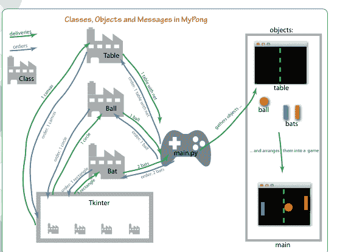

到本书结束时，你将拥有自己的 Pong 游戏，并且即使你无法设计和构建自己的 3D 多世界平台游戏，也能够自行定制它。那可能需要多年的经验。

图 5.3 类、对象和消息。

### 检测球是否击中球拍

现在，你将在 `bat.py` 中为 bat 类添加碰撞检测函数。调用时，一个球拍对象（例如左球拍）将检测是否发生了碰撞，然后可以相应地改变球对象（`my_ball`）的速度。

最终代码看起来有点复杂，但我们会一点一点地构建它。首先，重新打开你一直在处理的 `bat.py` 副本。添加代码框 5.4 中的新代码。

#### 代码框 5.4

```python
#### methods
def detect_collision(self, ball):
    collision_direction = ""
    collision = False
    feel = 5

    # bat variables:
    top = self.y_posn
    bottom = self.y_posn + self.height
    left = self.x_posn
    right = self.x_posn + self.width
    v_centre = top + (self.height/2)
    h_centre = left + (self.width/2)

    # ball variables:
    top_b = ball.y_posn
    bottom_b = ball.y_posn + ball.height
    left_b = ball.x_posn
    right_b = ball.x_posn + ball.width
    r = (right_b - left_b)/2
    v_centre_b = top_b + r
    h_centre_b = left_b + r

    if ((bottom_b > top) and (top_b < bottom) and (right_b > left) and (left_b < right)):
        collision = True
        print("collision")
```

在 `detect_collision()` 代码的开头，我们所做的只是定义大量变量，然后检测是否发生碰撞。这些变量总结在图 5.4 中。

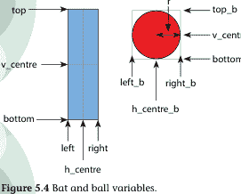

添加所有这些变量后，`if` 子句会测试球的任一边缘是否进入了球拍所占的空间。如果是，则将变量 `collision` 设置为 True，并向控制台打印 ‘collision’。这稍后会被删除——它纯粹用于测试。所以测试一下。保存 `bat.py` 和 `main.py`，然后运行 `main.py`。请记住，球仍然不受此函数影响，因此会穿过球拍，但在此过程中应该会向控制台发送几条碰撞消息。你可能必须使用按键移动球拍，让它们挡住球。

### 深入探索

#### 函数设计过程

如果我们决定只检测球是否到达两个球拍的前缘，碰撞检测本可以很简单。但如果我们想要水平放置的球拍，或者把它们放在屏幕中央并让球从各个侧面弹开呢？为了让 Bat 类更有用，我们将添加这一完整功能。于是，设计师借助类似第 82 页的草图以及一本代表球拍与球碰撞的书，开始解决这个问题。

这里输入的所有变量最终都会被用到：

- `collision_direction`  
  将存储与球拍相撞的是哪条边（"N"、"S"、"E" 或 "W"）。
- `collision`  
  是一个布尔变量，如果检测到碰撞，它将被设置为 `True`。
- `feel`  
  是一个常量，我们之后可以用它来调整球从球拍弹开角度的灵敏度。

#### 击球

如果一切顺利，你可以从新函数中删除 `print("collision")`。现在，就像球击中球桌壁的情况一样，所需要做的只是反转球的 x 或 y 方向速度的符号。然而，我们必须知道它先击中了哪一面壁。代码框 5.5 中的代码就是做这件事的。你现在可以添加它，并在输入时思考它是如何工作的。


#### 代码框 5.5 — `bat.py`

```python
if((bottom_b > top) and (top_b < bottom) and (right_b > left) and (left_b < right)):
    collision = True
if(collision):
    if((top_b > top-r) and (bottom_b < bottom+r) and (right_b > right) and (left_b <= right)):
        collision_direction = "E"
        ball.x_speed = abs(ball.x_speed)

    elif((left_b > left-r) and (right_b < right+r) and (bottom_b > bottom) and (top_b <= bottom)):
        collision_direction = "S"
        ball.y_speed = abs(ball.y_speed)

    elif((left_b > left-r) and (right_b < right+r) and (top_b < top) and (bottom_b >= top)):
        collision_direction = "N"
        ball.y_speed = -abs(ball.y_speed)

    elif((top_b > top-r) and (bottom_b < bottom+r) and (left_b <= left) and (right_b >= left)):
        collision_direction = "W"
        ball.x_speed = -abs(ball.x_speed)

    else:
        collision_direction = "miss"

    return (collision, collision_direction)
```

#### 代码框 5.5 分析

除了有一些复杂的测试之外，还有另外几件事需要指出。

`abs( )` 是一个 Python 函数，用于去除数字变量中的符号。因此，−1.5 和 1.5 都会变成 1.5。它使我们能够获得没有正负号的速度值。

现在，这个函数会根据球与球拍的哪一部分碰撞来改变球的反弹方向。不仅如此，它还会存储碰撞发生在球拍的哪一侧。当发生碰撞时，这两个额外的信息会在最后一行以两项元组的形式由函数返回。我们目前不打算使用它，但这再次使它成为一个更有用的类：我们现在还可以测试碰撞，并通过使用其索引选择所需的元组部分来找出球击中了哪面墙：

```python
bat_hits_ball=bat_L.detect_collision(my_ball)
print(bat_hits_ball[0]) --> True
```

或者

```python
bat_hits_ball=bat_L.detect_collision(my_ball)
print(bat_hits_ball[1]) --> N
```

或者直接

```python
bat_hits_ball=bat_L.detect_collision(my_ball)
print(bat_hits_ball) --> (True, N)
```

### 测试时间

如果一切顺利，你应该拥有两个能工作的球拍。右边的球拍由键盘上的上下箭头键控制，左边的球拍由键盘上的 a 和 z 键控制。它们还能击球！

在下一章中，我们将添加记分板、重置游戏、发球，并总体上完成这个项目。

### 额外时间

这一章又长又复杂——如果你全部跟下来了，做得好！在进入“谜题与挑战”之前，你可以让自己休息一下！看看本章的 `pong-bat-bonus` 文件夹，打开 `bat.py`。你会看到 `detect_collision()` 方法有一些额外的代码。它的作用是为球拍添加一个“甜区”：如果球击中球拍中部，球会直接飞向对手；如果不是击中中部，那么球会被击向侧面。

> 本书中的所有代码都在编程俱乐部（Coding Club）测试过。当我们第一次尝试让球与球拍碰撞时，我清楚地记得我们很难让球以我们想要的方式反弹。是 Ollie 建议加入 `return (collision, collision_direction)` 代码。这样我们就能在控制台打印出究竟发生了什么。这减慢了球的运动，同时也给了我们逐行反馈，这对我们的调试过程非常有帮助。我们保留了 return 代码，这样如果我们需要知道球击中球拍的哪个面，就可以轻松获得信息。


该方法可以传入参数，为竖直球拍或水平球拍打开或关闭此功能。新代码可以在代码框 5.6 中看到，但如果你已经下载了源代码，则无需复制——它供你使用。

#### 代码框 5.6

```python
#### methods
def detect_collision(self, ball, sides_sweet_spot=True, topbottom_sweet_spot=False):
    collision_direction = ""
    collision = False
    feel = 5
    # bat variables:
    top = self.y_posn
    bottom = self.y_posn + self.height
    left = self.x_posn
    right = self.x_posn + self.width
    v_centre = top + (self.height/2)
    h_centre = left + (self.width/2)
    # ball variables:
    top_b = ball.y_posn
    bottom_b = ball.y_posn + ball.height
    left_b = ball.x_posn
    right_b = ball.x_posn + ball.width
    r = (right_b - left_b)/2
    v_centre_b = top_b + r
    h_centre_b = left_b + r

    if((bottom_b > top) and (top_b < bottom) and (right_b > left) and (left_b < right)):
        collision = True
    if(collision):
        if((top_b > top-r) and (bottom_b < bottom+r) and (right_b > right) and (left_b <= right)):
            collision_direction = "E"
            ball.x_speed = abs(ball.x_speed)

        elif((left_b > left-r) and (right_b < right+r) and (bottom_b > bottom) and (top_b <= bottom)):
            collision_direction = "S"
            ball.y_speed = abs(ball.y_speed)

        elif((left_b > left-r) and (right_b < right+r) and (top_b < top) and (bottom_b >= top)):
            collision_direction = "N"
            ball.y_speed = -abs(ball.y_speed)

        elif((top_b > top-r) and (bottom_b < bottom+r) and (left_b <= left) and (right_b >= left)):
            collision_direction = "W"
            ball.x_speed = -abs(ball.x_speed)
        else:
            collision_direction = "miss"

        if((sides_sweet_spot == True) and (collision_direction == "W" or collision_direction == "E")):
            # find out how far from the centre of the bat the collision was
            adjustment = -(v_centre - v_centre_b)/(self.height/2)
            ball.y_speed = feel * adjustment

        if((topbottom_sweet_spot == True) and (collision_direction == "N" or collision_direction == "S")):
            # find out how far from the centre of the bat the collision was
            adjustment = -(h_centre - h_centre_b)/(self.width/2)
            ball.x_speed = feel * adjustment

    return (collision, collision_direction)
```

### 本章小结

在本章中，你完成了以下内容：

-   进一步了解了类和对象如何交互
-   运用你的类构建知识设计并构建了一个 Bat 类
-   向 `main()` 方法添加了键盘控制
-   在完成 MyPong 方面取得了重大进展

现在是时候试验一下球拍了。为了避免混淆，请关闭 IDLE，复制 `pong-bat-final` 文件夹及其内容，并将其命名为 `pong-bat-working`。然后双击打开新文件夹中的 `main.py` 文件。这将在打开文件的同时启动 IDLE。如果你能完成本章的一些挑战和想法，那么你正在取得巨大进步。

#### 挑战 1

你能让球拍变大或给它们不同的颜色吗？

#### 挑战 2

试试看球拍在大小不同的球下是否仍然表现良好。

#### 想法 1

你能看出最终文件夹中的游戏里球拍的表现方式与你自己游戏中的表现方式之间的区别吗？

你能看出这是如何实现的吗？（**提示：**查看 `bat.py` 文件或代码框 5.5。）

关于你希望球拍如何击球，这是一个喜好问题。这个新版本定义了一个甜区：如果球击中中间，它会垂直于球拍被击回；如果击中边缘，则会朝那个方向飞去。现在可以通过仔细调整球拍的位置来控制球的飞行方向。尝试在 `main.py` 中创建球拍时更改参数以覆盖 `sides_sweet_spot` 参数，看看你更偏好哪种行为。

> 我更喜欢没有甜区的球拍。更“老派”！


#### 想法 2

调整 `feel` 变量的值，直到你对甜区行为开启时球拍的灵敏度感到满意为止。

#### 想法 3

这有点棘手。尝试改变游戏，使其成为一个单人游戏，底部只有一个球拍。目标是阻止球击中底部墙壁。（**提示：**请记住，既然你已经构建了健壮的类，大多数任务都可以通过在 `main.py` 中创建正确类型的球拍和球来实现。）

> 我觉得甜区增添了真实感。


## 第6章

### 规则与计分

到本章结束时，你将完成 MyPong，并构建一个可用于开发其他游戏的有用模块。在本章中，我们将对两个文件进行调整，但不会创建任何新类。还会进一步讨论何时创建新类，以及何时向现有类添加方法。

在本章中，你将：

- 阻止球从左墙和右墙反弹
- 为游戏添加计分系统
- 完成 MyPong！

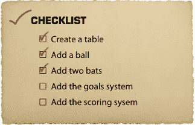

#### 进球得分

第一项工作是确保我们检测并处理球撞到球桌左墙和右墙的情况，因为这会导致进球。

因此，首先我们必须检测球何时撞到左墙。我们已经在 Ball 类中实现了这一点：

```python
if (self.x_pos <= 3):
    # further code goes here
```

我们不想在 Ball 类中改变这一行为，因为这会降低它对其他游戏的实用性。相反，我们将在 main.py 中检测碰撞，并以新的方式处理它。这是因为这是本游戏的一条特定规则。

让我们看看在 main.py 中重新写出它有多难：

```python
if (my_ball.x_pos <= 3):
    # further code goes here
```

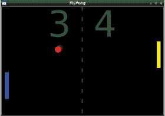

#### 深入探索

#### 再次需要 3 像素

合乎逻辑的做法是测试球的左侧是否到达 0——但情况通常并非如此，因为球实际上是一个圆形从一个位置跳到下一个位置的动画。因此，我们改为测试它是否在 3 像素以内。

现在添加处理球撞到左墙的代码。在第 6 章文件夹中，打开 pong-score-start 文件夹里的 `main.py`。按照代码框 6.1 中提供的代码，修改 `move_next()` 方法中的代码。

```python
#### detect if ball has hit the left wall:
if(my_ball.x_pos <= 3):
    my_ball.stop_ball()
    my_ball.start_position()
    bat_L.start_position()
    bat_R.start_position()
    my_table.move_item(bat_L.rectangle, 20, 150, 35, 250)
    my_table.move_item(bat_R.rectangle, 575, 150, 590, 250)
```

#### 代码框 6.1 分析

到现在，希望你能够理解这段代码的大部分内容。首先，我们停止球并重置其位置。然后，我们将球拍重置到起始位置。最后，我们需要调用球桌的 `move_item()` 方法两次，将代表两个球拍的两个矩形移动到它们的起始位置。我们不需要移动圆形，因为球会在其 `move_next()` 方法中处理这一点。本章后面我们将添加计分系统。

如果运行 `main.py`，它应该能正常启动，球位于画布中央。如果球撞到左墙，它会回到中央，球拍也会返回起始位置。球拍仍然可以移动。现在球会卡住。

现在，将检测左墙的代码复制并粘贴到 `main.py` 中等待检测右墙的位置。然后看看你能否调整它，使球在撞到任一墙时都回到中央。如果遇到困难，请查看代码框 6.2。

```python
#### detect if ball has hit the right wall:
if (my_ball.x_pos + my_ball.width >= my_table.width - 3):
    my_ball.stop_ball()
    my_ball.start_position()
    bat_L.start_position()
    bat_R.start_position()
    my_table.move_item(bat_L.rectangle, 20, 150, 35, 250)
    my_table.move_item(bat_R.rectangle, 575, 150, 590, 250)
```

#### 添加发球能力

当然，如果球只是停下并自行重置，然后游戏结束，那是不行的——所以我们需要能够发球。为此，我们必须向 main.py 添加一个 restart() 函数。将代码框 6.3 中的代码添加到你的 main.py 文件中注释所指示的位置。

**代码框 6.3** — `main.py`

```python
#### bind restart to spacebar
window.bind("<space>", restart_game)
```

restart_game() 函数的第一部分已经为你添加好了。它位于 game_flow() 函数下方。代码如代码框 6.4 所示。新代码添加在键盘绑定上方：

**代码框 6.4** — `main.py`

```python
#### add restart_game function here:
def restart_game(master):
    my_ball.start_ball(x_speed=x_velocity, y_speed=0)
```

这里需要注意几点。Tkinter 期望这个函数有一个额外参数，因此我们需要添加 master。这超出了本书的范围，但请注意这是必需的。在球对象的 start_ball() 方法中，我们提供了 y_speed=0 作为参数，因为我们不希望使用球的默认 y_speed。这意味着发球现在将是水平的，而不是对角线的。

#### 实验

保存并运行 `main.py`，看看应用目前的工作情况。用鼠标点击游戏窗口以获取焦点，然后尝试按几次空格键，看看 `restart_game()` 如何工作。你也可以尝试更改 `y_speed` 的值，看看会有什么效果——你可能会更喜欢那样。

#### 第一次发球

现在来处理第一次发球。目前，游戏在我们准备好之前就开始了，因此我们将添加一个新的全局布尔变量，用来存储我们是否处于第一次发球。

在 `main.py` 顶部附近提供的位置，添加代码框 6.5 中的代码。与此同时，你还可以添加用于保存比分的变量。

**代码框 6.5** — `main.py`

```python
#### initialise global variables
x_velocity = 10
y_velocity = 0
score_left = 0
score_right = 0
first_serve = True
```

现在我们只需要调整 `game_flow()`，使其添加一个 if 子句并等待第一次发球。

添加代码框 6.6 中的代码。你一直在定期保存，对吧？由于这个函数可以更改我们新的全局变量，我们必须在函数内部再次声明它们。

```python
#### functions:
def game_flow():
    global first_serve
    global score_left
    global score_right
    # wait for first serve:
    if(first_serve == True):
        my_ball.stop_ball()
        first_serve = False
```

我们现在知道第一次发球何时发生，因此知道何时开始计分。剩下要添加的就是记分牌。

#### 记分牌

当我们在第 3 章开头规划这个游戏时，还不确定要把记分牌放在哪里。现在似乎稍微明显一些了。我们可以再建立一个计分类，但这似乎没有必要，因为几乎所有游戏都有自己的计分系统，而且它实际上属于规则的一部分。在 MyPong 中，我们计分的方式很简单：每当玩家进一球，就在其当前比分上加一。因此，计分规则可以放在 `main.py` 中。

- **检查清单**
  - 创建球桌
  - 添加球
  - 添加两个球拍
  - 添加进球系统
  - 添加计分系统

那如何显示比分呢？有很多方法可以做到这一点。一种经常成功使用的方法就是简单地把比分写在画布上。我们将这样做。因此，改进我们的 Table 类并赋予它不仅在画布上绘制球和球拍，还能绘制比分的能力是合理的。

现在我们要在构造函数中再初始化两个变量。我们将玩家称为左方玩家和右方玩家，因为这些位置将是他们的球拍所在的位置、屏幕上比分所在的位置以及键盘上控制键所在的位置。首先，我们向构造函数添加用于保存所选字体的变量和一个画布文本控件，那里有一个等待的空位。从 `pong-score-start` 文件夹中打开 `table.py`，并在需要的地方添加代码框 6.7 中的代码。

**代码框 6.7**

```python
#### add scoreboard:
font = ("monaco", 72)
self.scoreboard = self.canvas.create_text(300, 65, font=font, fill="darkgreen")
```

构造函数完成后，我们需要通过添加一个将比分绘制到画布上的方法，来彻底完成我们的 Table 类。你可以通过复制代码框 6.8 中的代码，将其添加到 Table 类的底部。


#### 代码框 6.8

```python
#### extra tool for adding the score to the canvas:
def draw_score(self, left, right):
    scores = str(right) + " " + str(left)
    self.canvas.itemconfigure(self.scoreboard, text=scores)
```

既然你现在已经是一名有经验的程序员，你应该会发现这里能理解相当多内容。记住，我们的 table 对象是基于从 tkinter 库中创建的 canvas 构建的，因此它可以使用 canvas 的方法。之前已经使用过 itemconfigure() 方法，但现在你能看到它如何处理文本。默认值将文本放在画布顶部并居中，这很理想。我们只需向它传递一个用于记分板的字符串。然而，itemconfigure() 方法期望字符串而不是整数，所以我们用 Python 的 str() 方法将整数转换为字符串，并先将它们构建成一个字符串。

### 深入探索

#### 类型转换与拼接

你知道变量可以保存对文本和数字等的引用。这些在计算机科学中称为数据类型。你最熟悉的是字符串和整数，但还有其他几种。

在许多语言中，你必须在创建变量时声明该变量引用什么类型的数据。在 Python 中这不是必需的；但是，不能突然把整数当作字符串使用。必须通过类型转换来改变它。

我们用 str() 函数将整数转换为字符串。以字符串形式存储的数字可以用 int() 函数转换为整数。

当我们把字符串连接在一起组成一个字符串时，这称为拼接，就像我们对 scores 所做的那样。

### 最后步骤

table.py 已完成。现在保存它并重新打开 main.py。这里除了在三个地方添加计分功能（规则）之外，没有太多要做的事：

- 游戏开始时，我们希望将比分设为零
- 当球击中左墙时，我们希望给右侧玩家的分数加一
- 当球击中右墙时，我们希望给左侧玩家的分数加一。

复制代码框 6.9 中指示的新代码，其中展示了 main.py 的完整代码。如果一切顺利，你应该会得到一个功能完整的游戏——并带有记分板。

```python
from tkinter import *
import table, ball, bat

#### initialise global variables
x_velocity = 10
y_velocity = 0
score_left = 0
score_right = 0
first_serve = True

#### order a window from the tkinter window factory
window = Tk()
window.title("MyPong")

#### order a table from the table factory
my_table = table.Table(window, net_colour="green", vertical_net=True)

#### order a ball from the ball factory
my_ball = ball.Ball(table=my_table, x_speed=x_velocity, y_speed=y_velocity,
                    width=24, height=24, colour="red", x_start=288, y_start=188)

#### order a left and right bat from the bat factory
bat_L = bat.Bat(table=my_table, width=15, height=100, x_posn=20, y_posn=150, colour="blue")
bat_R = bat.Bat(table=my_table, width=15, height=100, x_posn=575, y_posn=150, colour="yellow")

#### functions:
def game_flow():
    global first_serve
    global score_left
    global score_right
    # wait for first serve:
    if(first_serve == True):
        my_ball.stop_ball()
        first_serve = False

    # detect if ball has hit the bats:
    bat_L.detect_collision(my_ball)
    bat_R.detect_collision(my_ball)

    # detect if the ball has hit the left wall:
    if(my_ball.x_posn <= 3):
        my_ball.stop_ball()
        my_ball.start_position()
        bat_L.start_position()
        bat_R.start_position()
        my_table.move_item(bat_L.rectangle, 20, 150, 35, 250)
        my_table.move_item(bat_R.rectangle, 575, 150, 590, 250)
        score_left = score_left + 1
        if(score_left >= 10):
            score_left = "W"
            score_right = "L"
        first_serve = True
        my_table.draw_score(score_left, score_right)

    # detect if the ball has hit the right wall:
    if(my_ball.x_posn + my_ball.width >= my_table.width - 3):
        my_ball.stop_ball()
        my_ball.start_position()
        bat_L.start_position()
        bat_R.start_position()
        my_table.move_item(bat_L.rectangle, 20, 150, 35, 250)
        my_table.move_item(bat_R.rectangle, 575, 150, 590, 250)
        score_right = score_right + 1
        if(score_right >= 10):
            score_right = "W"
            score_left = "L"
        first_serve = True
        my_table.draw_score(score_left, score_right)

    my_ball.move_next()
    window.after(50, game_flow)

#### add restart_game function here
def restart_game(master):
    global score_left
    global score_right
    my_ball.start_ball(x_speed=x_velocity, y_speed=0)
    if(score_left == "W" or score_left == "L"):
        score_left = 0
        score_right = 0
    my_table.draw_score(score_left, score_right)

#### bind the controls of the bats to keys on the keyboard
window.bind("a", bat_L.move_up)
window.bind("z", bat_L.move_down)
window.bind("<Up>", bat_R.move_up)
window.bind("<Down>", bat_R.move_down)

#### bind restart to the spacebar
window.bind("<space>", restart_game)

#### call the game flow loop
game_flow()

#### start the tkinter loop process
window.mainloop()
```

### 本章小结

在本章中，你已经：

- 创建了一个进球检测系统
- 为你的游戏添加了计分系统和记分板
- 了解到实现相同结果有很多方法，而且这些方法并不总是需要构建一个新类
- 完成了 MyPong！

#### 检查清单

- [x] 创建球桌
- [x] 添加一个球
- [x] 添加两个球拍
- [x] 添加进球系统
- [x] 添加计分系统

努力工作并学习东西可以很有趣；然而，完成一个项目也非常有成就感。你现在当然可以玩自己的作品了。去挑战某人吧！这是了解你对游戏设计喜欢什么和不喜欢什么的最好方式。这个过程有一个名字——游戏测试。很棒的是，你现在可以自定义它，让它完全按照你喜欢的方式运行。

与其说是挑战，不如说这里有一些你在自定义游戏时可能想考虑的想法。恭喜你走到这一步，玩得开心，继续编程！

#### 想法 1

你可能想把球速稍微调快一些，因为为了测试目的它被设置得相当慢。这可以在 main.py 的构造函数中完成。

#### 想法 2

尝试把球拍移近中间，以增加紧张感。

#### 想法 3

尝试改变球拍的大小和颜色。

#### 想法 4

尝试添加键盘控制，使球拍可以朝球网移动并返回。你可以把它们限制在各自半场，或者如果你喜欢混乱——就让它们保持原样！

## 附赠章节

### 另外两个游戏

本章展示了良好构建类的好处。构建 MyPong 用了四章。在本章中，我们将快速构建一个打砖块游戏和一个入侵者游戏——除了 `main.py` 之外，不改动任何东西。同样，你可以使用网站上提供的起始文件进行开发。

*编程俱乐部*系列中的每本书都尝试提供至少一个附赠项目。这些项目的目的是提供一些没有任何解释的代码。对程序员来说，培养一项重要技能——能够查看别人的代码并尝试弄清楚发生了什么。尽管你可能不会理解所有内容，但你一定会学到一些东西！

在本章中，你将：

- 了解列表在游戏中存储项目并跟踪它们方面有多有用
- 了解如何使用循环一次添加许多砖块
- 了解你的 Ball、Bat 和 Table 类有多灵活
- 以两个新游戏结束本书，这些游戏可以进一步自定义，使它们更加完善。

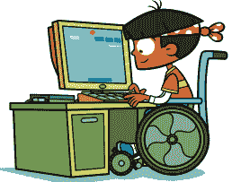

#### MyBreakout

第一个游戏是一个非常简单的游戏，目标是用球击打大量砖块来清除它们（图 7.1）。玩家有一个球拍来反弹球，球不能越过球拍到达窗口底部。

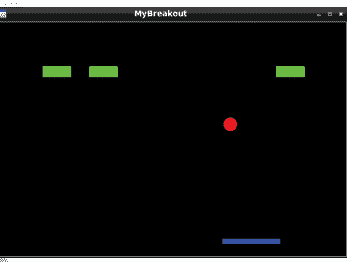

图 7.1 MyBreakout。

为了构建这个游戏，我们从 Bat 工厂订购一个球拍，并将它放在屏幕底部。我们从 ball 工厂订购一个球。所有东西都放在我们从 Table 工厂订购的球桌上。

要清除的砖块不过是从 Bat 工厂获得的更多球拍。我们不为这些添加任何移动或控制。相反，在检测到碰撞后，我们销毁它们。代码并不太难。可以在代码框 7.1 中找到。

> 现在大概是开始使用专业程序员语言的时候了。我们应该说：我们从 Bat 类创建一个 bat 实例，并将它放在 table 对象的底部。我们还从 Ball 类创建一个 ball 实例，然后从 Bat 类实例化几个砖块。


#### 代码框 7.1

```python
from tkinter import *
import table, ball, bat, random


window = Tk()
window.title("MyBreakout")
my_table = table.Table(window)


#### initialise global variables
x_velocity = 4
y_velocity = 10
first_serve = True


#### order a ball from the ball class
my_ball = ball.Ball(table = my_table, x_speed=x_velocity, y_speed=y_velocity,
                    width=24, height=24, colour="red", x_start=288, y_start=188)


#### order a bat from the bat class
bat_B = bat.Bat(table = my_table, width=100, height=10,
                x_posn=250, y_posn=370, colour="blue")


#### order further bats from the bat class but call them bricks
bricks = []
b=1

while b < 7:
    i=80
    bricks.append(bat.Bat(table = my_table, width=50, height=20,
                          x_posn=(b*i), y_posn=75, colour="green"))
    b = b+1

#### functions:
def game_flow():
    global first_serve
    # wait for first serve:
    if(first_serve==True):
        my_ball.stop_ball()
        first_serve = False

    # detect if ball has hit the bat:
    bat_B.detect_collision(my_ball, sides_sweet_spot=False, topnbottom_sweet_spot=True)

    # detect if ball has hit the bricks:
    for b in bricks:
        if(b.detect_collision(my_ball, sides_sweet_spot=False) != None):
            my_table.remove_item(b.rectangle)
            bricks.remove(b)
        if(len(bricks) == 0):
            my_ball.stop_ball()
            my_ball.start_position()
            my_table.draw_score("", "  YOU WIN!")

    # detect if ball hit the bottom wall:
    if(my_ball.y_posn >= my_table.height - my_ball.height):
        my_ball.stop_ball()
        my_ball.start_position()
        first_serve = True
        my_table.draw_score("", " WHOOPS!")

    my_ball.move_next()
    window.after(50, game_flow)


def restart_game(master):
    my_ball.start_ball(x_speed=x_velocity, y_speed=y_velocity)
    my_table.draw_score("", "")

#### bind the controls of the bat to keys on the keyboard
window.bind("<Left>", bat_B.move_left)
window.bind("<Right>", bat_B.move_right)

#### bind restart to spacebar
window.bind("<space>", restart_game)

game_flow()
window.mainloop()
```

#### MyInvaders

第二个游戏稍微复杂一些，涉及击败一支企图登陆地球的入侵外星舰队（图 7.2）。玩法是用一辆能够垂直发射导弹的坦克将它们从天空中击落。坦克是一个球拍，就像在 MyBreakout 中一样。导弹是一个椭圆形的球。入侵者则是更多的球拍实例，不过这一次它们可以移动。

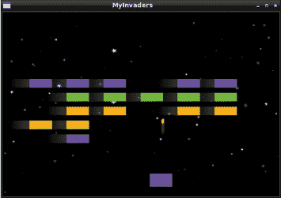

图 7.2 MyInvaders。

有一些小细节需要注意，比如每次球都从坦克处发出，并在不需要时隐藏起来。尽管这比上一个游戏更复杂，但它充分利用了我们精心构建的类。这两个游戏都没有对它们做任何改动。

关于这个游戏就说到这里。启动它玩一玩。然后看看代码，尽情修改它吧。完整源代码见代码框 7.2。

#### 代码框 7.2

```python
from tkinter import *
import table, ball, bat, random

window = Tk()
window.title("MyInvaders")
my_table = table.Table(window)

#### add background image
starry_night_image = PhotoImage(file = "stars.gif")
my_table.canvas.create_image(0, 0, anchor=NW, image = starry_night_image, tags="bg_img")

#### move the image to bottom of image stack (so the scoreboard can be seen above the background)
#### by moving any canvas objects tagged as "bg_img" to the back using the lower() method
my_table.canvas.lower("bg_img")

#### initialise global variables
x_velocity = 0
y_velocity = -10
first_serve = True
direction = "right"

#### order a missile from the ball class
my_ball = ball.Ball(table=my_table, x_speed=x_velocity, y_speed=y_velocity,
                    height=15, width=8, colour="black")

#### order a defender from the bat class
bat_B = bat.Bat(table=my_table, width=50, height=30, x_posn=250, y_posn=350, colour="blue")

#### order invaders from the bat class and start them moving to the right
invaders = []
rows=0
gap=30
colour = ("green", "orange", "yellow", "purple")
while rows < 5:
    n=1
    while n < 7:
        i=80
        invader = bat.Bat(table=my_table, width=50, height=20, x_speed=3, y_speed=15,
                          x_posn=(n*i), y_posn=25+(rows*gap), colour=colour[(rows-1) % 4])
        invaders.append(invader)
        n = n+1
    rows = rows+1

#### Functions:
def game_flow():
    global first_serve
    global direction
    game_over = False
    # wait for first serve:
    if(first_serve == True):
        my_ball.stop_ball()
        first_serve = False

    # detect if missile has hit an invader:
    for b in invaders:
        if(b.detect_collision(my_ball, sides_sweet_spot=False) != None):
            my_table.remove_item(b.rectangle)
            invaders.remove(b)
            hide_missile()

        if(len(invaders) == 0):
            my_table.remove_item(my_ball.circle)
            my_table.canvas.itemconfigure(my_table.scoreboard, text="YOU WIN")

    # detect if missile hit the top wall:
    if(my_ball.y_posn <= 3):
        hide_missile()
        first_serve=True

    my_ball.move_next()

    # handle movement of invaders
    directionChange = False
    for b in invaders:
        directionChange = directionChange or move_brick_next(b, direction)
        game_over = detect_game_over(b, bat_B.y_posn)
    if(game_over):
        my_ball.stop_ball()
        for b in invaders:
            b.x_speed=0
            b.y_speed=0
        my_table.canvas.itemconfigure(my_table.scoreboard, text="GAME OVER")
    if(directionChange):
        for b in invaders:
            b.move_down(b)
        if(direction == "right"):
            direction = "left"
        else:
            direction = "right"
    window.after(50, game_flow)

def restart_game(master):
    first_serve = False
    my_ball.start_ball(0,0)
    my_ball.x_speed=x_velocity
    my_ball.y_speed=y_velocity
    my_table.change_item_colour(my_ball.circle, "red")
    my_ball.x_posn = (bat_B.x_posn + bat_B.width/2)
    my_ball.y_posn = bat_B.y_posn

#### Moves invaders to left or right and looks to see if they should be moved down
#### returns true if direction must change
def move_brick_next(brick, direction):
    if(direction == "left"):
        brick.move_left(brick)
        if(brick.x_posn < 10):  # if the brick reaches the left wall
            return True
        else:
            return False
    else:
        brick.move_right(brick)
        if(brick.x_posn + brick.width > my_table.width-10):  # if the brick reaches the right wall
            return True
        else:
            return False

#### detect if invaders reach the bottom
def detect_game_over(invader, bottom):
    if((invader.y_posn + invader.height) > bottom):
        return True
    else:
        return False

#### hide missile
def hide_missile():
    my_ball.stop_ball()
    my_ball.x_posn=0
    my_ball.y_posn=my_table.height-my_ball.height
    my_ball.change_item_colour(my_ball.circle, "black")

#### bind the controls of the bat to keys on the keyboard
window.bind("<Left>", bat_B.move_left)
window.bind("<Right>", bat_B.move_right)

#### bind restart to spacebar
window.bind("<space>", restart_game)

game_flow()
window.mainloop()
```

### 附赠章节总结

在本章中，你：

-   了解了列表在游戏中存储物品并跟踪它们方面多么有用
-   了解了如何使用循环一次添加许多砖块
-   了解了你的 Ball、Bat 和 Table 类有多么灵活
-   玩了两款新游戏。

以下是一些可用于这些新项目的想法：

#### 想法 1

向 MyBreakout 添加更多砖块。

#### 想法 2

尝试运用你学到的各种方法，让球从 MyBreakout 的球拍上反弹。

#### 想法 3

为 MyBreakout 中的球拍添加垂直移动。

#### 想法 4

在这两个游戏中，你完全可以尝试让砖块或入侵者进行反击！


## 更上一层楼

当你读完这本书时，你的冒险才真正开始！现在你也许想用 Python 开发自己的项目。如果你有兴趣，现在也具备开始学习一门新语言的良好基础。你会发现，你只需查阅新语言中用于表示循环或类等的语法即可。例如，在 PHP、Java 和 C 系列语言中，你会发现许多相似之处。或者，你可能想深入研究一些为 Python 增加功能的工具和库。以下是一些起点：

### Python 相关内容

**Coding Club 系列图书**

这是该系列第一本 Level 3 图书，但你在较低级别的其他项目书中仍可能找到感兴趣的内容。

http://www.codingclub.co.uk

**PyGame**

这个流行的库目前使用 Python 2 比使用 Python 3 效果最好，但差别并不太大。该库在其游戏实现中大量使用类。

http://www.pygame.org/

**PiFace**

如果你有树莓派，可能想尝试物理计算。一种方式是购买曼彻斯特大学的 PiFace，它可以直接用 Python 编程。它将使你能够通过连接各种传感器，或者例如一只会说话的鸡，用计算机控制各种东西。

http://pi.cs.man.ac.uk/

### 非 Python 内容

**Arduino**

这是 PiFace 在物理计算方面的一种替代方案。它适用于任何类型的计算机，而不只是树莓派。使用的语言是 C，但你会发现用于传感和控制的代码比本书中一直使用的代码简单得多，因此你很快就能适应。

http://www.arduino.cc

**GameMaker**

多年来，它在一些学校很受欢迎。它使用拖放系统来构建游戏。不过一段时间后，这种方式会变得受限。此时你可以添加自己的代码或下载他人的代码。现在你将能够理解代码并设计自己的代码。

http://www.yoyogames.com/

**Greenfoot**

如果你真的喜欢以面向对象编程（OOP）方式构建代码的想法，那么在 Java 中探索这一点的最佳方式莫过于试用 Greenfoot。该网站有大量免费资源，包括许多优质视频教程。

http://www.greenfoot.org/

## 附录

### 一些关键信息

**配套网站**

访问 www.codingclub.co.uk，获取本书中所有应用程序的完整源代码，以及每章末尾许多谜题、挑战和想法的示例答案。还可以了解书中出现的角色以及关于 Coding Club 系列的其他精彩信息。在网站上时，请花点时间提交你的电子邮件地址，以便在最新动态发生时“及时了解”。

**实用代码示例**

**while 循环：**

```python
while my_test == True:
    # code that does things goes here
```

**for 循环：**

```python
for i in my_list:
    print(i)
```

**快速比较函数：**

```python
def is_same(guess, password):
    return guess == password
    # returns True if the same and False if different
```

**实例化示例：**

```python
import cat
romeo = cat.Cat("Romeo")
```

### 类规划模板

| 类名 |
|---|
| 属性 |
| 方法 |

（可打印版本可在配套网站上获取。）

## 术语表和索引

- **参数（argument）** — 函数、方法或类执行任务所需的一条信息；通常是 `string` 或 `number`，例如 `my_function(arguments go here)`。 — 11
- **属性（attributes）** — 对象的特性，如宽度、高度、颜色等。 — 27
- **布尔变量（boolean variable）** — 只保存两个值 `True` 或 `False` 的变量 — 11
- **缺陷（bug）** — 导致程序无法正常运行或完全无法运行的一段代码 — 48
- **类型转换（casting）** — 将一种数据类型转换为另一种数据类型的过程；例如，有时数字可能以文本形式存储，但需要转换为整数；可以这样完成：`int ("3")` — 99
- **类（classes）** — 在面向对象编程中，类是用来构建对象的代码段；在本书中它们被比作工厂，尽管更常见的说法是模板或蓝图 — 19
- **注释（comments）** — 计算机程序中供人阅读、在程序运行时被计算机忽略的一些文本；在 Python 中，所有注释都以井号 `#` 开头 — 9
- **比较运算符（comparative operators）** — 有时称为逻辑运算符；它们允许我们在程序中比较数据；包括 `==` 和 `>`
- **拼接（concatenating）** — 将两个字符串连接成一个字符串
- **常量（constant）** — 不会改变的数字；良好的做法是用大写字母命名常量，例如 `SPEED_OF_LIGHT`
- **构造函数（constructor）** — 一种特殊方法，在创建类的实例时被调用；它使用 Python 关键字 `__init__` 构造；其目的之一是初始化对象的属性
- **数据类型（data-types）** — 计算机存储的不同类型的信息，例如浮点数、整数、字符串、元组、列表和字典
- **调试（debugging）** — 在程序中查找缺陷的过程
- **默认值（default value）** — 作为起点赋给参数或变量的值
- **点运算符（dot operator）** — 在编码中，点用于将方法或函数与其类或模块关联，例如在 `math.random(1, 6)` 中，点告诉计算机 random 函数位于 math 模块中
- **等号运算符（equals operator）** — 在编码中，等号用于给变量赋值，例如 `n=2` 将值 2 赋给变量 `n`

| 术语 | 定义 | 页码 |
|---|---|---:|
| **工厂（factory）** | 在本书中，工厂用来描述类（在高级面向对象编程中，该词有不同的含义） | 19 |
| **函数（function）** | 可复用的代码片段 | 10 |
| **全局变量（global variable）** | 可在程序任何位置使用的变量 | 63 |
| **黑客式修改（hacking）** | 取一些先前编写的代码并重写部分内容，使其执行不同的操作 | 49 |
| **硬编码（hard coded）** | 当代码中放入实际值而不是之后可以改变的变量时，例如 `width = 45` 是硬编码，而 `width = my_width_variable` 不是 | 50 |
| **IDE** | 代表集成开发环境；IDLE 是其中一个例子；它们是供程序员使用的内置有用工具的特殊文本编辑器 | 8 |
| **IDLE** | 代表集成开发环境；这是普通 Python 3 安装自带的 IDE | 8 |
| **索引（index）** | 用于引用字符串、元组或列表中某个值的数字；容器数据类型中的每一项都从 0 开始索引，第一项为 0，下一项为 1，依此类推 | 85 |
| **无限循环（infinite loop）** | 永远运行下去的一段代码；这通常是不好的 | 63 |
| **初始化（initialise）** | 给变量赋一个起始值 | 27 |
| 实例（instance） | 在面向对象编程中，实例是由类创建的对象 | 22 |
| 实例化（instantiate[d]） | 在面向对象编程中，使由类创建的对象存在的过程 | 22 |
| 交互模式（interactive mode） | 这是我们使用 IDLE 尝试代码片段而不保存它们的时候 | 8 |
| 列表（lists） | 有序的容器数据类型，可以保存任何类型的值，并且可以添加或删除元素；与元组一样，每个元素都从 0 开始索引 | 106 |
| 局部变量（local variable） | 在函数内部定义且只能在该函数内部使用的变量 | 63 |
| 循环（loop） | 一直重复直到满足某个条件的一段代码 | 47 |
| 方法（method） | 类中函数的名称 | 20 |
| 模块（module） | 一个保存的 Python 文件，其函数可被另一个程序使用 | 10 |
| 对象（objects） | 在面向对象编程中，对象是类的实例——由工厂创建的实体，例如 lion 是由 Cat 类实例化的对象 | 18 |
| 面向对象编程（object-oriented programming，OOP） | 一种编程体系，强调从类构建对象，而不是关注操作和逻辑 | 17 |
| 参数（parameters） | 属性的另一个名称 | 27 |


| 术语 | 定义 | 页码 |
|---|---:|---:|
| **返回** | (1) 函数运行后将产生的值（它也是 Python 关键字）以及 (2) 键盘上的“行末”键，有时称为回车键 | 11 |
| **脚本模式** | 这是我们使用 IDLE 帮助编写要保存到文件中的代码时的情况 | 8 |
| **语句** | 在本书中用来表示一段代码；严格来说，它是一段表示命令或动作的代码，例如 print 语句 | 21 |
| **字符串** | 文本数据，可以存储在变量中 | 10 |
| **tkinter** | 一个类包，通常被导入 Python 程序，提供可用于生成窗口、绘制图像和制作动画的方法 | 19 |
| **元组** | 一种有序容器数据类型，其值从 0 开始索引；其内容不可更改 | 85 |
| **值** | 可以存储在变量中的信息，例如容器数据类型中的元素 | 11 |
| **变量** | 指向计算机内存中存储数据位置的名称；更宽泛地说，也可用来指代该数据 | 8 |
| **while 循环** | 一种循环，在比较语句返回 True 时重复执行代码 | 13 |

## 快速测验答案

### 快速测验 2.1

random 模块已在第 1 章的应用中导入。

### 快速测验 3.1

我们将得到的表格将没有网格，因为默认设置为 `vertical_net=False` 和 `horizontal_net=False`。这样做是为了让我们在创建表格时必须选择是否要网格。

### 快速测验 3.2

```
my_table = table.Table(window, vertical_net=True, width=600, height=400,
                       colour="blue", net_colour="red")
```

### 快速测验 5.1

答案 A 正确。我们还没有在 `main.py` 中订购任何球棒。接下来会处理这件事。

