# 零基础学者编程与网络安全：5 本合 1 编程圣经

精通 Python、Java、C++ 基础功能以及如何保护数据免受黑客攻击。

<<<<<< AND >>>>


- 第 7 章 你的安全

## 第 1 章 常见术语及其定义

编码（Coding）：将问题转换为代码，或计算机可以处理的符号串和语言。

HTML：超文本标记语言（Hypertext markup language），即你网站上的信息如何呈现给用户的方式。HTML 用于文本、图片、链接、视频和音频的格式化。

JavaScript：一种用于 Web 开发的编程语言，它让构建交互式网站变得更容易，并添加如滚动框和下拉菜单等效果。JavaScript 允许你创建更具动态性的页面，其运行速度比纯 HTML 生成的静态页面更快。

Node.js：一个 JavaScript 框架，允许你使用事件驱动和非阻塞 I/O 模型构建实时应用程序。

jQuery：一个 JavaScript 库，它简化了 HTML 文档遍历、事件处理、动画和 Ajax 交互，用于快速 Web 开发。

响应式设计（Responsive Design）：使网站的设计适应不同的屏幕尺寸（智能手机、平板电脑、笔记本电脑等），同时不影响网站的布局或功能。

测试驱动开发（Test-Driven Development）：一种基于从不完整的规范创建测试用例的自动化软件测试方法或框架。它认为开发者在编写代码之前应该先指定代码。编码中使用的基础词。

### 术语列表

1. **缩写（Abbreviation）**：文本或词组的缩短形式。日常生活中给组织起一个简短易记的名字，以便人们轻松记住它们。它也被用作一种非正式的方式，通过使用整个词的一部分来表达复杂的概念或想法，这有助于在阅读缩写和打字时节省时间。例如，“Maxwell”中的“Max”，“X1000”可能被用于描述数学公式中的变量，同样，“X1000”可能描述的是一百万（1000x），而不是一个真实的数字（1x1000）。

2. **可访问性（Accessibility）**：访问网站或其他媒体上内容的难易程度。许多不同的侧面构成了一个网站的可访问性，包括设计、内容和技术。

3. **API**：应用程序编程接口（Application programming interface）。一组用于构建软件应用程序的程序、协议和工具。

4. **缓存（Cache）**：计算机或移动设备浏览器上可用的临时存储，它以比从网站本身检索数据更快或更有效的方式存储数据。它通过存储常用访问的网页元素（如文本、图形和声音）允许浏览器更快速地加载网站。缓存还使用户在当前没有互联网连接的情况下访问在线信息。

5. **挑战-响应身份验证（Challenge-response authentication）**：一种安全协议，用户首先被挑战提供一些关于自己的信息，并获得根据这些原始信息计算出的响应，他们必须输入或重新输入该响应才能继续。

6. **字符编码（Character encoding）**：通过将文本数据转换为字符来表示数据的机制。

7. **命令行（Command line）**：在计算中，一种通过命令进行通信的方式。它断言开发者在编写代码之前应该指定代码。它主要用于图形界面面。

8. **配置（Configuration）**：识别并定义设置的过程。

9. **上下文可访问性（Contextual Accessibility）**：访问网站或其他媒体内容的难易程度。它允许使用户在当前没有互联网连接的情况下访问在线信息。

10. **数字鸿沟（Digital Divide）**：拥有互联网访问权限的人与没有的人们之间的差距。

11. **编码（Encoding）**：将文本转换为数字（0 到 255）的方法。

12. **文件扩展名（File Extension）**：文件名末尾的后缀（如 `.html`）。

13. **全球化（Globalization）**：适应内容的过程。它允许适应不同的文化背景。

14. **超链接（Hyperlink）**：通常用于连接两个位置的链接。

15. **IE 浏览器（Internet Explorer）**：微软开发的系列图形浏览器。

16. **搜索引擎（Internet search）**：一种在 Web 范围内搜索信息的工具。

17. **JavaScript**：由 Netscape 设计并于 1995 年发布的编程语言。它是可以嵌入网页的面向对象的脚本语言。

18. **Java**：一种面向对象的脚本语言。

19. **宏（Macro）**：当某些其他代码触发时自动执行的计算机代码。在计算机辅助设计（CAD）软件中，宏被用于自动化任务。

## 第 2 章 什么是编程语言？

你首先需要知道，编程语言是给计算机的一组指令。这些通常被称为代码。其目标是让计算机执行它们需要的操作，从计算器到处理 NASA 的星图像。但编程语言的困难之处在于，它们通常不是为不会编程的人设计的。这就像在一年级班上教西班牙语一样。

### 什么是编码？

你可以把代码理解为告诉计算机做什么的指令。如果我对计算机说“画一幅画”，它会在屏幕上画一幅画。笔记本电脑内置了大量的编程能力，包括理解指令的能力。它可能需要对其中一两条指令进行一些小的解释，但大多数情况下，它可以遵循你的要求。

### 我们为什么需要编码？

编程语言用于制作软件。软件至关重要，因为它让我们能够执行诸如自动化工厂流程，或连接家中的设备以便从世界上任何地方进行控制的操作。这种软件通常被称为“应用”（应用程序的缩写）。

编码也是一个创造的过程，这也是所有应用程序的来源。成功的应用程序是那些有用、有趣，或者纯粹用起来很有趣的应用。其中一些改变了我们的生活方式，比如 Uber 或 Facebook；另一些则深刻地影响了我们交流的方式，比如 Skype 或 WhatsApp。它们之所以能够实现，是因为在某地的某人有了主意，并能够将其转化为代码。

### 你可以用它做什么？

任何你能想到的事情。编码赋予了你从无中生有的能力。你只需给它几行代码，它就会变成一个在你的计算机上、跨越网络甚至在广网上执行某些任务的程序。

你可能认为所有的编码都是样的，但实际上它们有几种不同的类型。有些编程语言用于构建简单的网站。另一些则用于构建操作系统，这使得它们变得非常复杂。有些人在高中或大学学习编写代码，是为了为 Google 和微软这样的大公司编写程序；另一些人学习是为了为自己或朋友编写代码，以便在不花太多钱的情况下制作自己的软件。

在本书中，你将学习使用一种名为 Python 的流行编程语言为你的计算机构建软件。这是一门非常棒的学习语言，因为那里有很多资源可以学习它。还有许多使用 Python 制作的应用程序，你可以看到它们是如何工作的，玩玩它们，甚至可以复制它们来作为你的项目。

你可能认为其中一些网站和应用程序需要付费或需要特殊设备，但你只需要一台计算机。而现在，这就是你学习编码所需的一切：一台连接了互联网的计算机，以及具备阅读、打字和进行简单数学计算的能力。

### 如何阅读这本书

编程是一个复杂的学科。即使你对计算机完全陌生，你很可能已经至少知道一些编程语言。这就是为什么我写了这本书，为了让没有编码经验的人也能理解他们正在阅读的内容。以下是你使用此书需要采取的步骤：

1. 如果你的计算机上还没有安装 Python 2，请下载并安装。（Python 3 非常相似，许多示例在每个版本中都可以运行。）

2. 在你的计算机上打开网页浏览器并输入此地址：<https://codeacademy.com/courses/learn-python?action=start>。

3. 在阅读章节时同步进行。你应该输入代码并遵循每个章节的说明。（如果你没有看到任何代码或说明，请点击“开始新课程”[Start a new lesson。]）

4. 继续阅读这本书。你会练习你所学的知识，以便让它们留在你的记忆中！

### 在哪里学习更多

一旦你读完这本书，你想要学习更多关于 Python 和编码的知识。以下是我推荐的一些资源：

- **Codeacademy**：Codeacademy 是一个交互式网站，你可以通过完成他们平台上的活动和挑战来学习几十种语言（包括 Python）的编码方法。他们甚至还有视频教程！

- **Udacity**：这就像 Codeacademy，但它是一门大学级别的课程，你在这里学习的程序可以适用于大多数工作。该网站还有许多视频向你展示模块如何工作以及如何使用它们。

- **书籍和 YouTube**：这是两种极佳的学习方法，而且都是免费的！你可以通过许多书籍或在线课程学习 Python。你还可以在 YouTube 上搜索关于 Python 的视频，看看人们如何在他们的项目中使用它。

## 第 3 章 为什么我们需要编程语言？

计算机最常用的用途是存储和检索数据。计算机可以读取存储在内存芯片上的信息，并将其转换为文本、视频或其他我们可以查看的任何格式。然而，它们无法理解或处理信息本身——它只是一堆电子脉冲。这意味着什么呢？意味着它需要我们，人类，来告诉它该做什么，计算机才能执行任何操作。

现在，这就是编程语言派上用场的地方，因为它们让我们人类能够告诉计算机如何处理我们存储在它们上的数据。是的，这需要我们知道如何编写一个告诉计算机该做什么的程序吗？然而，如果我们想让计算机执行任何操作，手写程序并不是一个选择！计算机只能以八种不同的模式运行；它们只能理解英语或二进制代码。

所以，我们需要一种方法让计算机理解并处理各种类型的人类语言。编程语言的开发让任何接受过最少培训的人都能创建程序——从简单的网页和文字处理器到像《毁灭战士 3 竞技场》（Quake III Arena）和《魔兽世界》（Warcraft）这样复杂的游戏。它是从我们计算机上的聊天室、音乐播放器到手机和数字摄像机等一切领域使用的语言。如果你想超越仅仅为自己使用编写程序，你将需要学习如何编程以创建实现这一切的软件。

### 如何向孩子解释编码？

编程是关于计算机应该处理哪些数据以实现预期结果的决策。编程语言有很多种，有些比其他的更复杂，但它们都有共同点。它们都要求我们选择一组指令，准确地告诉计算机我们希望它如何运行。听起来很简单——事实确实如此！

让我们来看一个例子：你刚买了一个 iPod，想让它通过 iTunes 从你的计算机播放音乐。你计算机的硬盘上存储了几首歌，但你想让它获取这些歌曲并在 iPod 上播放。

如何告诉 iTunes 这样做呢？只需插上 iPod 并在 iTunes 菜单中选择它，对吧？嗯，这行得通——但也许你想思考一下这里面到底发生了什么。如果我们只知道我们需要 iTunes 这样做，如果我们唯一知道的事情是我们需要 iTunes 传输我们的 iPod，我们应该通过 USB 直接连接吗？如果我们开始像程序员一样思考，我们需要做出哪些选择。首先，我们需要决定哪些歌曲。其次，我们要告诉 iTunes 这些是我们想要传输的歌曲。最后，iTunes 需要知道我们想要如何传输它们。

如何做到这一点？这是用户可以控制的。

### 编码是怎样的？

编程是关于计算机应该处理哪些数据以实现预期结果的决策。编程语言有很多种，有些比其他的更复杂，但它们都有共同点。它们都要求我们选择一组指令，准确地告诉计算机我们希望它如何运行。听起来很简单——事实确实如此！

让我们来看一个例子：你刚买了一个 iPod，想让它通过 iTunes 从你的计算机播放音乐。你计算机的硬盘上存储了几首歌，但你想让它获取这些歌曲并在 iPod 上播放。

如何告诉 iTunes 这样做呢？只需插上 iPod 并在 iTunes 菜单中选择它，对吧？嗯，这行得通——但也许你想思考一下这里面到底发生了什么。如果我们只知道的是我们需要 iTunes 这样做，如果我们唯一知道的事情是我们需要 iTunes 传输我们的 iPod，我们应该通过 USB 直接连接吗？如果我们开始像程序员一样思考，我们需要做出哪些选择。首先，我们需要决定哪些歌曲。其次，我们要告诉 iTunes 这些是我们想要传输的歌曲。最后，iTunes 需要知道我们想要如何传输它们。

这是用户可以控制的。

### 编码像什么？

编程不仅仅是输入大量的数字和字母。相反，它可能有点像解谜。你正在设法如何告诉计算机你想要它做什么，而不需要知道所有的运行原理——就像解谜一样！

## 第 4 章 流行的编程语言

目前最常用的编程语言。它们包括 Java、Python、PHP、C/C++ 和 Ruby。本书对比了这些语言，并深入分析了每种语言的顶级特性。书的最后给出了结论，以帮助读者决定想要学习哪种语言。作者还建议了一些可以在线学习这些编程语言的课程，而无需购买任何教材或其他材料来从零开始学习。

这对于想要学习新技能并获取有关流行编程语言有用信息的人来说，提供了许多价值的资源。这本书虽然很很长，但它为你提供了一份实用的指南，帮助你决定可能先学习哪些编程语言。学习编程可以带来许多益处，例如在编程领域找工作的灵活性。你还可以赚更多钱，并且对自己的职业生涯以及为此付出的精力拥有控制权。

书的这部分从流行程度、使用该语言创建的网站以及在 Google Android 或 Apple iOS 上开发移动应用程序的能力方面，对比了 Java、Python、PHP 和 Ruby。一份使用这些编程语言设计的超长列表让你能够浏览并找到许多实用的网站。

书的这部分提供了 C 和 C++ 之间的对比。它是基于倾向于其中一种语言而非另一种语言的程序员引言。它还描述了公司和机构使用一种或两种编程语言来改进其业务应用的策略。

在书的这部分中，你将发现 Python 如何用于各种用途。首先，你将深入学习如何使用 Python 进行网页开发以及支持哪些网站平台。作者还为你提供了几种获取 Python 的不同方法，例如从 Python 官网本身下载。

书的这部分对 5 本最优秀的编程教材进行了采样，并为读者提供了关于每本书的详细信息。你将找到每本教材的摘要，如果你在决定先买哪本书时遇到困难，这非常有帮助。它还提供了一些实用的小贴士，教你如何从当地图书馆或通过 Amazon 或 eBay 等在线网站找到更多书籍。

书的这部分提供了 PHP 和 Ruby on Rails 之间的深度对比。你将找到一些知名公司在被问及对这些编程语言的经验时的引言。

书的这部分的特点是对一些流行编程语言的性能进行测试。你将找到对 Python、Ruby、Java 和 C# 的若干不同的测试。作者提供了一组实用的说明，如果你对此有疑问，可以按照这些说明自己进行测试。

书的这部分对比了 Java 和 Android。它是基于倾向于其中一种语言而非另一种语言的程序员引言。书中还描述了公司和机构使用这些编程语言之一或两种来改进其业务应用的策略。

## 第 5 章 理解程序的结构

书的这部分旨在让你快速开始基础编码学习，教你第一步：理解程序的结构。

### 程序的结构

在我们的示例中，我们有一个简单打印“hello”和“goodbye”的程序。语法告诉我们创建了两个不同的函数，并为每个函数创建了数据和逻辑。这通常被称为过程编程，因为它有独立的程序，这些程序可以按任何顺序执行。

### 编程变量简介

如上所述，每种编程语言都有自己的一套规则和特性，但它们都有一个共同点：变量。

### 变量数据类型

数据类型定义了值如何在变量中存储。在我们上面的示例中，使用的变量是整数（integer）和字符串（string）。每个类型代表特定的值或位序列。`int` 代表整数，而 `string` 代表文本。除了数据类型外，每个变量都包含自己的值，并在通过计算机编译器运行时可以由程序员更改。例如：

```
1. 23 + 4.56 = 27.56
```

当你将 23 和 4.5 相加时得到 27.6，但我们不是将其存储为 27，而是将其存储在一个变量中。这就像手里拿着 1 美元并说“我有 1 美元”，只不过你会说“$1”而不是“one dollar”。请注意，每种编程语言对变量都有自己的术语，如 `int`、`string` 或 `float` 等。

在接下来的教程中，我们将详细详细学习如何操纵变量。

### 理解程序的结构：子程序函数

我们上面的示例被称为过程编程，因为它有独立的程序，这些程序可以任何时间按任何顺序执行。在这个示例中，我们有一个主函数，在编程术语中，它被称为程序的开头，即主过程。程序可以调用一系列子程序（函数），然后这些子程序将在任何时间执行。每个过程都有自己的值和逻辑，可以由其使用或与其他函数一起使用。

### 命令与逻辑

我们使用命令来指导解释器（计算机）如何执行我们的程序。命令是你告诉程序去管理的精确指令。编程中常用的一些命令包括 `print`、`input`、`if`、`else` 和 `while`。

除了指令外，还会使用逻辑。逻辑（Sense）告诉计算机根据某些条件执行特定的命令。例如，如果 `if` 允许我们检查某些条件并指示解释器（计算机）执行一个或多个动作。

### 理解程序的结构：数据访问器

在我们的示例中，我们有一个主函数可以调用一系列子程序。这些被称为数据访问器（data assessors），因为它们回答了“这个变量是什么？”的问题。数据访问器就像是你程序的入口，帮助你回答这个问题。对于程序中的每个变量，该变量必须有且仅有一个数据访问器。如果你创建了两个或更多同变量的数据访问器，你的程序将无法运行。

### 编程特性与贴士

在你开始编程时，有一些需要注意的特性。例如，如果你想创建一个询问用户名字的程序，不要把名字放在引号里。因为每个变量必须以字母或下划线（`_`）开头。所以 `"Alice"` 是不起作用的因为它会被解释为 Alice，这并不是一个有效的变量。如果你需要询问用户的名字，你应该使用 `"username"`。下划线字符（`_`）用于区分不同的变量，以免它们混淆。

还有所谓的作用域（scope）。这是一个你可能知道的基础概念。作用域允许我们的程序知道程序中定义了哪些变量以及定义在哪里。位置决定了，任何代码行中的第一个变量都是局部作用域，不需要写出变量名即可访问。但如果你开始在子程序之外打印变量，你就写出它们的名称。

### 编程术语

类、对象、变量和函数。

面向对象的编程方法为在计算机程序中存储数据创建了一种更结构化、更有组织的方式。面向对象的编程基于我们在中学和大学学习的知识，但在现实世界中的用法不同。这种方法创建了对象的类，这些类的设计与现实对象相似。


类是将程序组织成不同的分组，具有相似的值、相似的方法或动作（函数）以及相似的属性。类源于一组被称为属性的值。属性可以是从数字到字符串的任何内容，如位置、大小、速度、时间等……在我们上面的程序中，我们有一个名为`main`的类，它有一个名为`EXE`的属性。也就是说，`EXE`变量定义在程序中。

通过创建一个类，我们可以创建继承该类的对象。例如，在我们的程序中，我们创建了一个名为`"Main"`的类，它继承自`"Main"`类。然后使用这个类创建一个名为`main`的对象（它将被称为`main`）。

变量就像程序中的任何其他变量一样，不同在于它可以被许多类/对象使用，并有自己的作用域。与在单个子程序内部定义的变量不同，定义在子程序外部的变量被称为全局变量。在同一个类中定义的变量具有相同的作用域，这意味着可以在该类内的任何时间访问它们。变量的作用域由变量定义的位置决定（局部作用域或全局作用域），但一旦变量（局部或全局）被定义，它就一直有一个作用域。

## 第 6 章：不同类型的程序

让我们来看看不同类型的程序，看看哪种最适合不同的经验水平。

你应该在哪里学习编码？许多人没有意识到编码的重要性，因为编码可以通过许多不同的方式学习。

如果你是编程初学者，一个极好的开始是像 Python 或 Java 这样的语言。这些语言对初学者来说更容易，因为它们不需要预先了解任何其他编程语言就可以开始。一旦你掌握了这两种语言，你可能就会想尝试 C++ 或 PHP（或者完全不同的其他语言）。

如果你已经学习了一门或多编程语言，但正在寻找新的尝试事物，你可能想尝试一种与你已知的语言方法不同的新语言。这意味着 C++ 和 Java 可能是一个很好的起点。这些语言与其他语言足够相似，以至于（一旦你知道了另一种语言）从它们进行过渡会相对容易。

如果你已经是一个丰富的编码员，那么没有必要用新环境替换你当前的开发环境。但是，如果你切换到 JS 足够长时间来熟悉不同的方法，这仍然会有帮助。一旦这种情况发生，你未来学习其他语言将变得更加容易。

互联网知识：如果你是编程初学者，在开始你的新冒险之前，你想要确保你理解互联网是如何工作的。虽然这听起来可能让人不知所措，但互联网并没有那么难以理解。

在开始学习 Web 开发之前，你可能不需要学习 HTML 和 CSS（毕竟它们是非常简单的语言），但如果你这样做将会有帮助。

## 了解互联网：

不要等才学编码：学习的最佳时机就是现在。无论你是 100 岁还是 10 岁，甚至处于两者之间的任何时候。学习事物运作的人没有限制。如果你认字，你就能学习事物是如何运作的。如果你准备好开始学习编程语言，或者你已经开始了，那么是时候获取上述书籍之一并开启你的编码之旅了。

这并不意味着从现在开始一切都会顺风顺水。

前方总会有新的挑战，但如果你对学习编码感兴趣，那么这段旅程将值得。让事物变得更容易获取的最佳方法是让更多人学习事物如何运作。知道编码的人越多，你学习起来就越容易。所以，你还在等什么？

## 第 7 章：程序是如何构建的？

构建程序有几种不同的方法，但在本入门指南中，我们将专注于一种策略：自顶而下的设计。自顶而下的设计是一种编程方法，首先设计最高层模块，然后根据这些高层模块设计低层模块。这种方法对初学者非常有效，因为他们可以轻松地将程序拆分成逻辑各个部分。

### 第一步：规划你的程序

在开始之前，对你的程序应该做什么有一个想法是至关重要的。你可能想考虑程序的输入和输出，以及它处理的数据。一旦你认为自己有了一个好主意，就可以开始了！

### 第二步：为你的程序创建数据结构


我们将做的第一件事是创建数据结构。


变量就像程序中的任何其他变量一样，不同在于它可以被许多类/对象使用，并有自己的作用域。与在单个子程序内部定义的变量不同，定义在子程序外部的变量被称为全局变量。在同一个类中定义的变量都具有相同的作用域，这意味着可以在该类内的任何时间访问它们。变量的作用域由变量定义的位置决定（局部作用域或全局作用域），但一旦变量（局部或全局）被定义，它就一直有一个作用域。

## 第 6 章：不同类型的程序

让我们来看看不同类型的程序，看看哪种最适合不同的经验水平。

你应该在哪里学习编码？许多人没有意识到编码的重要性，因为编码可以通过许多不同的方式学习。

如果你是编程初学者，一个极好的开始是像 `Python` 或 `Java` 这样的语言。这些语言对初学者来说更容易，因为它们不需要预先了解任何其他编程语言就可以开始。一旦你掌握了这两种语言，你可能就会想尝试 `C++` 或 `PHP`（或者完全不同的其他语言）。

如果你已经学习了一门或多编程语言，但正在寻找新的尝试事物，你可能想尝试一种与你已知的语言方法不同的新语言。这意味着 `C++` 和 `Java` 可能是一个很好的起点。这些语言与其他语言足够相似，以至于（一旦你知道了另一种语言）从它们进行过渡会相对容易。

如果你已经是一个丰富的编码员，那么没有必要用新环境替换你当前的开发环境。但是，如果你切换到 `JS` 足够长时间来熟悉不同的方法，这仍然会有帮助。一旦这种情况发生，你未来学习其他语言将变得更加容易。

互联网知识：如果你是编程初学者，在开始你的新冒险之前，你想要确保你理解互联网是如何工作的。虽然这听起来可能让人不知所措，但互联网并没有那么难以理解。

在开始学习 Web 开发之前，你可能不需要学习 `HTML` 和 `CSS`（毕竟它们是非常简单的语言），但如果你这样做将会帮助。

## 了解互联网：

不要等才学编码：学习的最佳时机就是现在。无论你是 100 岁还是 10 岁，甚至处于两者之间的任何时候。学习事物运作的人没有限制。如果你认字，你就能学习事物是如何运作的。如果你准备好开始学习编程语言，或者你已经开始了，那么是时候获取上述书籍之一并开启你的编码之旅了。

这并不意味着从现在开始一切都会顺风顺水。

前方总会有新的挑战，但如果你对学习编码感兴趣，那么这段旅程将值得的。让事物变得更容易获取的最佳方法是让更多人学习事物如何运作。知道编码的人越多，你学习起来就越容易。所以，你还在等什么？

## 第 7 章：程序是如何构建的？

构建程序有几种不同的方法，但在本入门指南中，我们将专注于一种策略：自顶而下的设计。自顶而下的设计是一种编程方法，首先设计最高层模块，然后根据这些高层模块设计低层模块。这种方法对初学者非常有效，因为他们可以轻松地将程序拆分成逻辑各个部分。

### 第一步：规划你的程序

在开始之前，对你的程序应该做什么有一个想法是至关重要的。你可能想考虑程序的输入和输出，以及它处理的数据。一旦你认为自己有了一个好主意，就可以开始了！

### 第二步：为你的程序创建数据结构

我们将做的第一件事是创建数据结构。在这种情况下，我们将创建我们的数据结构。在这种情况下，我们将创建我们的数据结构。在这种情况下，我们将创建我们的。

## 第 8 章 程序是如何执行的？

任何程序的第一要工作都是将其从原始编程语言（通常是 `C++` 或 `Java` 等语言）翻译成机器码（0 和 1）。这是通过名为“编译器”的程序完成的。

程序总是从所谓的“语句”或“指令”开始，这些指令告诉计算机要做什么，无论是顺序执行还是并行执行（即同时执行）。例如，如果你想让程序打印出“Hello”然后是“World”，你会给它下指令：`print("Hello")` `print("World")`

在机器码中，它的写法如下：

```
0x420000 Hello 0x420001 World 0x420002
```

其中“0x”代表十六进制数（计算机用于描述数字的类型）。这展示了每行代码是如何分解成指令的。每条指令看起来像字母表中的单个字母，计算机将知道如何处理它。（这被称为“编码”。）

`BASIC`（全称为“初级通用符号指令代码”）的设计初衷是让从未编程过的人能够尽可能容易学习。它只使用可以使用标准键盘输入的几个字符来编写每行代码。`BASIC` 自 20 世纪 50 年代后期一直存在，目前编程爱好者和许多学校仍在使用，并用于介绍介绍编程语言。学习或尝试使用 `BASIC` 编写程序不需要任何特殊的设备或软件。

最简单的 `BASIC` 程序是使用源自 20 世纪 60 年代语言原始版本的几个关键字编写的；它们是：

- `PRINT`：在屏幕上打印一行文本

- `STORE`：将数字存储到变量中（内存区域的名称）

- `READ`：从键盘读取一行文本

- `INTO`：存储或打印出从多个数字和/或变量中得出的一个值。

- `LOOP`：重复下一行代码，直到某个真值不再有效为止。

- `GOTO`：跳转到代码的另一部分（在编写程序时至关重要）

- `END`：结束程序。

这些关键字组合使用形成一个完整的程序。例如，下面的程序会在屏幕上打印出文本“Hello World”，然后是一个位于 0 到 10 之间的数字：

```
10 PRINT "Hello World" 20 INPUT N 30 IF n<0 THEN GOTO 80 40
PRINT 50 GOTO 30 80 END
```

第一行告诉计算机从下一行的行首开始读取指令。因此，计算机处理第二行（#10）。注意，在之前的“Hello World”程序中，数字再次以带撇号的形式开头。这是为了让计算机知道将该行视为一个数字。

第三行（#20）告诉计算机如果发现了一个所谓的“条件”语句该怎么办，该语句用于确保在继续执行其后的任何内容之前，某些条件是真实的。在这种情况下，它检查用户是否按了键盘上的某个键。如果他们按了键，括号之之间的任何内容（下方的行）将由计算机处理。如果没有按，计算机将继续执行 #20 行的剩余部分。

第四行（#30）检查进来的数字是否小于零（即它带有一个“负号”）。如果是，它将跳转回第 #80 行。只要该数字为负数，所有内容将在这里重复。

因此，第四行（#30）告诉计算机，程序中在此点之前看到的任何内容都应该重复，直到它看到一个名为“End.”或“End,”的标记（这可能用于调试），然后你可以这样写：

```
30 IF n<0 THEN GOTO 80 40 PRINT 50 GOTO 30 80 END。
```

这被称为“循环”程序。这意味着发生的事情一次又一次发生。如果你在执行此循环（通过按“回车”键）时所有内容都打印出来了，它看起来如下：

从这些示例可以看出，编写 `BASIC` 程序有多种方法。例如，编写检查数字是否小于零的行（#30）有两种不同的编写方法。

```
30 IF n<0 THEN GOTO 80
```

这是其中一种方法，使用单行“IF”语句。另一种使用两行来编写相同语句的方法看起来如下：

```
30 IF n<0 THEN GOTO 80 
```

计算机的程序设定为从每行代码的开头开始读取，并逐行查看。这意味着当它找到“THEN”时，它将停止读取该行并继续处理随其后的任何内容。这就是为什么编写此语句的两种方法被称为不同的编程语言：`BASIC` 或 `Visual Basic`。

```
PRINT "Hello World"

PRINT "Hello world"

PRINT "Hello, World"

END
```

之前问过此类程序的问题是，为什么我们在第一行之后需要使用行号。正如你所看到的，程序被编写为从左到右读取每行代码。因此，计算机可以按它想要的任何顺序读取行。程序员通常发现使用行号来确切知道自己在整个程序中的位置更加方便。

## 文本框

大多数 `Visual Basic` 程序将包含许多行代码。有时你想引用某一行，或者你可能指的是程序中的特定内容。例如，你可能想引用某个特定的部分。文本框是实现此功能的一种方式。

当你编写程序时，你正在为计算机编写它需要遵循的单个指令。你将一行一行地编写这些代码。程序语句（program statement）就像口语中的句子。如果说话者在手机上写这段话，他们会写成“我要去商店买一些面包。”

语句通常可以同时包含多条指令。这些指令是按顺序执行的，所以如果我们想告诉计算机“买一些面包”，我们会这样写该语句：

我希望大家都注意每条指令之间隔了多少个空格，每条指令中有多少个字符。此外，还要注意语句是如何换到新行的，并且指令的长度为 80 个字符。如果你使用任何其他程序来编写代码，那么这可能不适用于你——只需编写代码以让人类易于阅读，并让计算机能够正常运行即可。

## 既然我们已经知道了什么是程序语句，让我们来看看我们的 `BASIC` 编程语言是如何运作的。

语法（Syntax）精确地告诉计算机我们希望如何编写程序、应该使用什么语法以及所有内容应该在何处/如何进行分布。它还告诉我们每条指令的开始和结束位置。程序语句本身就是程序。它们可以告诉计算机运行程序中的其他语句，或者告诉计算机执行某些操作。每条指令都会告诉计算机执行某个特定的操作，就像句子有针对不同情况的单词一样。

我们所有的程序命令都将写在这些括号 `{ }` 之间。括号简单包含了我们程序的所有内容，因此在其中写的任何内容都将被计算机读取并执行。

## 语句 - 这里应该放什么？

那么括号之间放什么呢？每行代码可以包含一个或多个语句，每条语句都独立于其他任何语句运行。如果你删除了其中一个语句，程序仍然可以无问题地运行。

如果没有程序语句，你就无法运行任何程序。编程语言允许你按喜欢的方式格式化代码，只要你遵循规则。如果你想添加更多指令或某些条件语句，就在那些括号之间添加更多代码吧！不过，计算机会忽略它，所以不用太担心——尽管去写那个“IF...”

## 第 10 章. 数据类型、变量和运算符

数据类型：变量和运算符是编程的三大基础部分中的两个，它们帮助你理解如何编写代码。本书将重点介绍基础的类型类型、变量和运算符。变量是存储数据（如数字）的容器，而运算符用于对容器中的数据执行操作。数据类型通过告诉程序它可以存储什么类型的内容，帮助你管理程序的内存占用。

## 变量：

变量是程序中存储信息（如数字）的容器。计算机在内存中存储关于程序及其环境的各种信息，就像仓库或存储区域一样。当你的程序需要使用这些信息时，它会向计算机请求。

运算符：运算符是编程中使用的符号，用于更改值在程序中使用方式。例如，`=` 意味着你正在将一个数字赋值给现有变量。等号也可以作为赋值运算符。`15 = 15` 告诉计算机，当你说 15 时，将其分配给命名为 15 的变量。

核心概念：我们现在需要讨论变量以及它们是如何发挥魔术的。计算机将为你的程序使用一定数量的内存并由其管理设备，它会一直使用内存直到你告诉它停止。当这种情况发生时，你的程序将无法正常工作。计算机不会存储你在程序中正在做的所有信息。那么，当你需要新的内存单元时，你会告诉计算机吗？

基本规则：首先，创建变量（或将数据放入变量中），然后在程序中使用它们！这听起来可能有些矛盾。然而，这意味着你编写代码来处理程序中的所有信息，当程序需要为你的程序寻找新的内存单元时，你告诉它去哪里寻找最近的内存。为了让这个过程运作，你需要了解数据类型。

数据类型：当你创建一个变量时，你告诉计算机需要多少内存以及它可以存储什么类型的数据。这告诉计算机如果变量包含某种信息，它将确切地知道如何访问它并将其显示在你的屏幕上（或进行其他操作）。没有这些信息，计算机无法理解你想做什么，并会被强制关闭。

数据类型就像：比比你正在经营一家服装店。由于你卖衣服，你决定使用一套库存系统，来统计你库存中有多少种不同的服装。你可以将你的库存系统想象成一个大架子，到处都是装满衣服的盒子。如果你的程序需要一些衣服，它可以去架子旁拿一个盒子，并带回试衣间供人试穿。这些盒子就像变量，因为它们存储了关于世界上物品列表的信息（比如你的衣服库存）。

数据类型不像：这些变量箱和用于记录库存的纸张之间存在巨大差异。这些箱子的每个箱子上都有地方可以标记它们包含的内容。然而，如果不打开并亲自检查，没有办法知道箱子里装了什么。如果你让计算机知道 1 号箱装有连衣裙，那么你的程序需要打开它，查看你添加的标签，并弄清楚打开箱子时什么变成了你的衣服。

要告诉计算机变量的数据类型，在它前面加一个 `+` 号（这些符号被称为前缀，因为它们位于其他符号或标记之前）。你的库存系统应该在每个箱子上都有一个标签，告诉你里面是什么。计算机会看到 `+` 号并用它来确定每个箱子里装的是什么种类的衣服（这个过程被称为数据类型化）。在编程中，箱就是变量。添加前缀使变量具有数据类型，意味着计算机知道如何使用该...

这里有一个例子：你正在使用一个命名为 `bob` 的变量，你想让计算机知道这个变量在程序中包含员工。

那么你就输入 `bob+`，这意味着员工（employee）。你可以通过将 `bob+` 更改为另一个单词（如 `clerk+` 或 `cashier+`）来创建你需要的许多变量。...（注：原文此处 `bob+` 变为 `clerk+` 或 `cashier+` 似乎有逻辑重复，已根据语境理解为变量名）你可以通过将 `bob+` 更改为另一个单词（如 `clerk+` 或 `cashier+`）来创建你需要的许多变量。由于你这样做了，`bob` 这种员工。计算机知道 `bob` 包含了员工。

另一种告诉计算机变量包含什么类型信息的方法是在变量名字前面加一个 `-` 号。这告诉计算机变量可以存储像 `grades+` 这样的普通成绩。你可以创建一个名为 `grades+` 的变量，允许你的程序处理任何成绩（general）。...（注：原文此处 `grades+` 处 general 意为通用的成绩/数据）比比你是一个老师，有很多成绩要给分。你可以创建一个名为 `grades+` 的变量，允许你的程序处理任何成绩，并在它前面添加相应的 `+` 号。

还有一些称为前缀的特殊符号，位于其他符号或标记之前。虽然这些符号并不直接告诉计算机存储了什么类型的信息，但它们告诉计算机可以对它做什么。

## 第 11 章. 字符串的重要性

在编写相互通信的程序时，有许多类型的编程语言。某些编程语言使用关键字和数字，另一些使用符号和它们的结合，还有一些乐于将大部分空间留给字符串。

字符串类型非常有用，因为它可以表示图形界面中的任何详细元素。例如，在 `Python` 中编写“向东移动十米”的命令看起来像这样：`move('10m','E')`。`Python` 编辑器非常直观。它只需要弄清楚如何移动物体。

如果你正在编写一个可以操作用户界面某些部分的程序，你可能不想使用数字。你会希望某些告诉程序应该按下哪些按钮，或者鼠标移动对应哪些坐标。而且为了让“向东移动十米”之类的命令字符串产生任何用，它包含的信息必须存储在某处并与其他实体相关联。

这就是字符串非常有用的地方：它们可以存储应用程序之间传输的任何信息。我们的“向东移动十米”命令可以表示为：

```
move('10m','E')
```

现在，如果像 `Python` 编辑器这样的程序请求一组坐标或按钮命令，它只需要创建一个包含列表中每个元素的字符串。这样，当你从字符串中读取元素时，你就可以像处理数组中的任何其他项一样处理它。当使用字符串处理命令和数据时，在它们中只存储一种信息可能是非常有限的；尤其是当你计划在设备之间传输成千上万英里的字符串时。这就是“编码”（encoding）的概念出现的地方。

编码是将字符串的内容转换为计算机可以更高效地用于发送和存储的内容的过程。为了理解编码的工作原理，你需要看看这个简单的示例。


假设有一个应用程序，它被程序设计为向地球环境中的所有设备发送一条命令：“保存所有数据”。发送这条命令的应用程序看起来如下：

```python
s = 'Save all data.'
s.encode('UTF-8')
print(s) # Save all data.
```

关于编码，需要理解的重要点之一是它是双向的。在将编码后的字符串发送到任何地方之前，需要对其进行解码。换句话说，为了让我们上面的应用程序能够执行“保存所有数据”命令，它需要知道如何接收和解码像我们创建的这样的字符串：

```python
'all data'
```

你需要理解的第二点是编码是有名称的；我们上面使用的编码名称是 `UTF-8`。编码就像一种编程语言；它有名称、解释器，并且可以与外部实体进行通信。现在你已经学习了编码是如何工作的，以及如何使用字符串来表示命令，我们可以讨论如何在 `Python` 中仅使用字符串来解释“保存所有数据”这一命令。翻译过程是：取我们的字符串“Save all data.”，并将其转换为 `ASCII` 字符串，然后解码该字符串以便它可以作为命令使用。我们需要先将字符串转换为 `ASCII` 格式，因为 `Python 3` 使用 `ascii` 编码，字符串可以包含任意长度的文本，因此我们需要确保命令只包含字母或数字，以便被正确理解。一旦有了 `ASCII` 字符串，我们需要将其解码为实际命令。

为了确保我们的字符串可以轻松转换和解码，我们将始终使用一个指向编码的“私有”字符串。让我们再次查看代码。

```python
s = 'Save all data.'
s.encode('UTF-8')
print(s) # Save all data.
s.decode() # Save all data.
```

如果我们逐步检查这段代码，你会发现第一次运行时会将一个 `Python` 字符串转换为 `ascii` 字符串，然后将 `ascii` 字符串解码为一个名为 `'string'` 的 `Python` 对象。然后它就可以像任何其他命令一样被使用。

下一次，我们可以直接使用字符串对象的 `"encode"` 方法将字符串转换为 `UTF-8` 的 `Python` 字符串以保存所有数据。此外，记住，除了我们在本次练习中使用的 `ASCII` 和 `UTF-8` 之间的转换外，字符串还有用于在多种不同编码之间转换的方法。让我们看看另一个示例：

```python
s = 'ananas'
s.encode('UTF-8')
print(s) # ananas
s.decode() # ananas
s.encode('ASCII') # ananas
```

关于编码，你需要了解的最后一点是 `Python` 使用由变量 `"encoding"` 定义的编码。这些编码是：

```python
ascii = 'ASCII'
iso_8859_1 = 'latin1'
utf_8 = 'utf-8'
```

现在你已经掌握了关于编码的所有知识，让我们来谈谈如何利用这些知识在发送和接收字符串时让自己的程序更高效。

让我们来看以下数据：

```python
data = ['test','joke','name']
print('All',data,'of',len(data),'with',len(data),'no',len(data),'newlines.')
```

上面的代码获取列表的长度并以多种方式输出它。为什么这很重要？嗯，如果我们向列表中添加一个新项，我们会得到几行输出？让我们来发现一下。我们将这样做：向我们的列表中添加一个新项，然后运行上面的代码。代码如下：

```python
data = ['test','joke','name','newline']
print('All',data,'of',len(data),'with',len(data),'no',len(data),'newlines.')
```

我们得到了以下输出：`All 4 of 5 with 0 newlines..`。如果你观察敏锐，可能会注意到我们比以前多获得了一行。这是因为列表原本是空的，所以当打印 `len(data)` 时，它添加了一个换行符，因为 `Python` 中不允许直接换行，但在 `C++` 等某些编程语言中是允许的。

## 第 12 章 迭代编程

迭代编程是一种强大的技术，通过重复的开发周期从模糊、未定义的系统过渡到更具体、精炼的系统。该过程通常始于一组初始需求，然后快速且不完美地实现。然后根据初始目标对系统进行评估和改进，以达到或超过该目标。

该过程不断重复，直到系统在原始规范方面接近完美——此时维护工作将接管以保持运行顺畅。这种开发风格启动了一个被称为“迭代”的循环，该循环在完成后会带着一组新的需求或目标重新开始（因此被称为“迭代”）。它非常适合那些条件随产品成熟而不断变化或增加的软件系统。

迭代内部存在多次小迭代（即迭代的层级结构），它们以逐步的方式为系统添加细节。将迭代方法建立到组织的开发周期中，通常需要前期的规划，以便在整个项目中留出时间来实施和评估每次迭代；为变化提供灵活性；定义什么构成迭代的成功以及项目的完成，以便保持目标的一致。

有效的迭代开发过程的关键在于早期识别潜在问题，为纠正措施留出时间和预算，从而确保交付日期不受影响。这有助于确保每次迭代的交付物对终端用户来说是有价值且可用的。

软件重构是另一种技术，通过反复开发周期将模糊、未定义的系统转换为更具体、更精炼的系统。过程通常从一组初始需求开始，然后进行快速且不完善的实现。随后，根据初始目标对系统进行评估和改进，以达到或超过该目标。

在软件工程中，“规范”或“需求文档”是在计划期间和构建期间向项目利益相关者或“用户”传达的标准文档，以确保系统符合某些定义的预期集合。它规定了目标和目的，指定了功能范围，为设计决策创造了可能性，对功能增加了约束，并定义了与其他系统进行交互的关系。

重构是基于分析和反馈对软件系统进行转换、改进或重新设计的过程，这些反馈揭示了提高功能、效率或质量的机会，以应对市场变化。具体而言，它用于软件项目。通过快速原型设计对需求（优先级排序）、范围和架构进行早期重新思考。

使用螺旋开发过程，其中规范文档作为需求工程的输入。

他们正在将设计与测试相结合，使用测试驱动开发（`TDD`）作为改进循环的一部分，并在早期生产系统上部署。

重构较困难的部分之一涉及遗留系统的停用（这些系统通常没有多少年历史了），并用新的或升级的系统替换它们。当项目考虑替换旧系统时，应该确定每做出的决策将带来什么收益，并进行相应的处理。

## 第 13 章 代码的逻辑分组

`Java` 是一种带有大括号、分号和多种关键字的语言。它被划分为代码的逻辑分组。“代码的逻辑分组”是一个短语，用于描述 `Java` 中独立的计算机指令部分（这些通常被大括号包围）。以下语句是有效示例：

```
int x = 1;
int y = 0;
int z = y * x;
```

这里的语句被用于展示单个逻辑分组中可以有多行。这些特定的示例除了为变量（`x`、`y` 和 `z`）赋值之外没有其他作用。理想情况下，这些代码应该放在一起，因为它们与同一个问题有关。考虑我们将 `x` 改为 `2`，然后将 `y` 改为 `9`：

```
int x = 2;
int y = 9;
int z = y * x;
```

这里应用的逻辑是：变量 `z` 将等于 `18`，而不是随机为 `x` 和 `y` 赋值（例如 `a=3` 和 `b=9`）；它们之间存在联系。这使得将来维护代码变得容易得多，因为那时其他人必须接手并尝试理解你所做的事情。

编写代码时唯一阻碍你的事实是你自己无法读懂它。不要仅仅因为它看起来复杂或起初太大了而无法理解就感到气馁。坚持下去，在做中学习，你就会掌握的！

重要的是要知道，优秀的程序员在项目期间不会编写大量的代码。他们更关注程序的整体设计，以便在编写具体的代码行之前，对他们正在工作的内容有一个大致的了解。

一个好的程序员愿意花时间考虑他们正尝试做的事情的简单性，以及是否有更好的处理方法。这导致了开发得更好的代码，并在进行更改时具有更大的灵活性。

代码应该分成较小的段进行开发，专注于许多不同的领域。较小的段允许更灵活的编码，这可以作为未来项目的基础，并使以后更容易进行更新。这些段不应该变得笨重，否则将违背最初创建它们的目的。

当你开始编写一个新程序时，你必须理解基础性知识，以便以后在此基础上进行构建。如果你一直尝试同时解决一切，你将陷入无尽循环且一无所获。从为程序设置初始参数开始，这可以作为你代码的起点（或基础）。

例如，假设我们想写一个根据速度控制汽车收音机的程序。我们能够定义一个变量，用来控制收音机的速度，并将其数据输出回计算机屏幕上的程序。

“看看情况如何”是一个在编程中经常听到的短语。与其对某事感到沮丧，不如花些时间看看在面对问题时，你是否能弄清楚需要做什么或如何解决问题。代码是用来处理的，你不应该觉得从一开始就必须把一切做到完美。

花时间解决问题比匆忙完成要好。然而，在某些情况下，我们需要计算机等待以便我们完成某些任务：

```
System.out.println("I'm Waiting"); // 执行一些事情。
```

这将导致当前在我们计算机屏幕上运行的程序暂停其正常执行，等待我们告诉它下一步要做什么。

这是一个如何使用它的示例：`while ( x!=0 ) { // 执行一些事情 x = x / 2; } // System.out.println("I'm done");`

在上面的程序中，`x` 等于 `2`，所以我们每次循环（`while`）时都会将其除以 `2`。这将让我们得到 `y` 的值为 `1`，然后将其放入一个名为 `z` 的变量中。然后你可以使用 `z` 来控制收音机显示器的频率。

请参阅：`Java for Absolute Beginners - Coding for Absolute Beginners` 一个程序由三部分组成：输入、转换和输出（或简单称为输入、输出和输出）。必须完成这三个步骤才能成功编译一个用 `Java` 编写的程序。这意味着为了让程序运行，你需要遵循这些步骤：

- 1. 第一步是输入。这意味着程序需要用户的数据，这通常通过告诉计算机你想做什么以及想如何做来输入。如果你有一个名为 `"x"` 的变量，那么它的输入方式如下所示：

```
int x = 1;
```

这样，计算机就知道它应该将其解释为一个整数（即：全数）值（`1`）。我们放入数据驱动程序中的值被称为输入。

- 2. 第二步是转换。这意味着程序必须获取该变量并对其进行处理。这是一个复杂得多的步骤，但它的真实意思是我们需要向用户展示事物根据他们提供的输入是如何变化的（换句话说，向他们提供信息）。如果你有一个名为 `"myAge"` 的变量，并且你想在它的值上写你的名字，那么你可以通过这样做来实现：

```
System.out.println("Hello myAge")
```

每当 `myAge` 改变时，程序输出的内容就会发生变化（即每当用户更改年龄时）。我们放入程序中的值被称为输出。

- 3. 第三步也是最后一步是输出。这意味着程序需要保存或打印它处理过的数据，以便将其存储在其他地方（通常在硬盘、优盘等处）。这一步非常简单，因为你只需要使用类似这样的代码：

```
System.out.println("Hello myAge")
```

为了将我们在程序中所做的内容（即打印出 `"hello myAge"`）保存到单独的文件，你可以使用类似这样的代码：`System.out.println("Hello myAge")`。

# 第 14 章 什么是面向对象编程？

面向对象编程（`OOP`）是一种利用对象及其相互作用的编程范式。对象是既包含数据又包含对数据操作的函数的数据结构，这与纯过程化编程形成对比。

### 面向对象编程意味着什么？

面向对象编程是将复杂的算法分解为更直观、更易于管理的部分以简化开发的技术。`OOP` 的复杂性源于这些对象之间的关系以及它们是如何相互作用的，而不是取决于它们内部是如何处理信息的。

### 面向对象编程不是什么？

与 `OOP` 相反，这是一种经常被误解的编程方法，它主张将每个对象都像是真实对象一样进行编程，尽管实际上并非如此。`OOP` 是指在面向对象的应用程序中所使用的编程类型的术语。它并不是指特定的语言或方法论——每种语言和设计技术都可以独立于其他语言——它仅取决于如何处理对象。

只要支持数据抽象和继承概念，面向对象的程序可以使用任何语言。然而，与传统的软件构建方法相比，`OOP` 仍然提供了许多优势。

### 面向对象编程的优势是什么？

`OOP` 有几个明显的优势，包括：

- 1. `OOP` 鼓励模块化开发。`OOP` 的核心思想是将程序分解为更小、更易于管理的部分。这允许每个组件以最短的时间实现，并在之后易于维护。这些部分之间的关系经过设计，使其并不是让对象继承自基类，而是每个对象都可以通过单个函数被轻松识别——例如，在类名上调用的 `Class.new()`——该函数通过传递一个或多个参数来调用——例如 `"objectId"`、`<functionName>()`。

- 2. 面向对象的接口揭示了不必要的复杂性。`OOP` 的优势在于基于继承和多态行为的面向对象系统中可以避免不必要的复杂性。例如，当程序员在 `C++` 中创建一个新对象时，程序员必须定义所有的内部函数，或者将它们留为未定义。如果留为未定义，它们可能会在程序中产生错误；然而，如果他定义了所有函数，就会出现功能重复，而且该新创建的对象无法与其他对象进行适当的通信。

- 3. 数据透明性有助于避免错误。数据的透明性也有助于避免错误。例如，在面向对象的程序中，如果程序员正在检查变量是否小于五，说 `if (x < 5)` 比 `if (x <= 5)` 更容易。这是因为第一个表达式清晰地显示了程序员的意图。第二个表达式则要求读者推断它的真实含义。

- 4. `OOP` 鼓励代码复用。`OOP` 允许对象组合并继承其他对象，这增加了代码的复用。在过程化编程中，程序员必须编写两次程序，每个情况写一次。此外，通过 `OOP`，程序员可以使用以前编写的代码库，然后只需要重写一小部分来与自己的代码建立接口。

- 5. `OOP` 易于更新。在过程化编程中，代码的任何更改都需要更改调用该代码的所有函数。在 `OOP` 中，如果更改或添加了函数或方法，只需要更改该函数或过程。

- 6. 模块化和易于理解的模块分解使得 `OOP` 易于学习和使用。通过 `OOP`，程序员被鼓励将对象及其关系和函数视为模块化的可重用部分集合。

- 7. `OOP` 鼓励良好的代码设计。`OOP` 通过提供鼓励良好编程实践的结构来鼓励良好的编码。例如，在 `C++` 中有用于表示数据和对数据进行操作的分离（密封）类，在 `Java` 中则有相应的包用于相同。

- 8. 模块化减少了单一错误导致错误的概率。`OOP` 允许模块化，如果一个模块中发生错误，它不会影响其他模块，因为每个模块都有与其他模块通信的不同接口，因此每个模块都可以独立于其他模块工作。

- 9. `OOP` 更容易调试和维护。`OOP` 允许模块化，如果一个模块中发生错误，它不会影响其他模块，因为每个模块都有与其他模块通信的不同接口，因此每个模块都可以独立于其他模块工作。（注：此处原文逻辑重复，已按原样翻译）。`OOP` 允许模块化，如果一个模块中发生错误，它不会影响其他模块，因为每个模块都有与其他模块通信的不同接口，因此每个模块都可以独立于其他模块工作。

- 10. 对象的创建方式更简单。

- 11. 数据封装使得赋值更简单，从而减少了因输入不足导致的错误。

- 12. 封装函数使得复用更可行，从而减少了因重复造轮导致的错误。

- 13. 面向对象的语言比其他语言更直观。面向对象编程的易学性通过大学中面向对象的课程得到了体现。

- 14. 代码封装使得将其插入现有系统变得简单。如果函数被封装在一个或多个对象中，那么对该函数的更改将与其他函数隔离开。

- 15. 数据封装鼓励程序模块化，为程序员提供了适应变化的方法。

- 16. 面向对象的语言的表达能力为程序员提供了用极少代码表达意图的方式。

- 17. 数据封装鼓励数据隐藏，有助于消除许多安全问题。

- 18. 封装鼓励程序员将代码视为自包含的模块，这比受到外部干扰的代码更容易调试和维护。

- 19. 封装减少了程序的复杂性。它使得程序员更容易发现并修复错误，因为程序的其他部分可能会影响正在更改的函数（因为该函数被封装在对象中）。

# 第 14 章 什么是面向对象编程？

面向对象编程（`OOP`）是一种利用对象及其相互作用的编程范式。对象是既包含数据又包含对数据操作的函数的数据结构，这与纯过程化编程形成对比。

### 面向对象编程意味着什么？

面向对象编程是将复杂的算法分解为更直观、更易于管理的部分以简化开发的技术。`OOP` 的复杂性源于这些对象之间的关系以及它们是如何相互作用的，而不是取决于它们内部是如何处理信息的。

### 面向对象编程不是什么？

与 `OOP` 相反，这是一种经常被误解的编程方法，它主张将每个对象都像是真实对象一样进行编程，尽管实际上并非如此。`OOP` 是指在面向对象的应用程序中所使用的编程类型的术语。它并不是指特定的语言或方法论——每种语言和设计技术都可以独立于其他语言——它仅取决于如何处理对象。

只要支持数据抽象和继承概念，面向对象的程序可以使用任何语言。然而，与传统的软件构建方法相比，`OOP` 仍然提供了许多优势。

### 面向对象编程的优势是什么？

`OOP` 有几个明显的优势，包括：

- 1. `OOP` 鼓励模块化开发。`OOP` 的核心思想是将程序分解为更小、更易于管理的部分。这允许每个组件以最短的时间实现，并在之后易于维护。这些部分之间的关系经过设计，使其并不是对象继承自基类，而是每个对象都可以通过单个函数被轻松识别——例如，在类名上调用的 `Class.new()`——该函数通过传递一个或多个参数来调用——例如 `"objectId"`、`<functionName>()`。

- 2. 面向对象的接口揭示了不必要的复杂性。`OOP` 的优势在于基于继承和多态行为的面向对象系统中可以避免不必要的复杂性。例如，当程序员在 `C++` 中创建一个新对象时，程序员必须定义所有的内部函数，或者将它们留为未定义。如果留为未定义，它们可能会在程序中产生错误；然而，如果他定义了所有函数，就会出现功能重复，而且该新创建的对象无法与其他对象进行适当的通信。

- 3. 数据透明性有助于避免错误。数据的透明性也有助于避免错误。例如，在面向对象的程序中，如果程序员正在检查变量是否小于五，说 `if (x < 5)` 比 `if (x <= 5)` 更容易。这是因为第一个表达式清晰地显示了程序员的意图。第二个表达式则要求读者推断它的真实含义。


- 4. OOP 鼓励代码复用。OOP 允许对象组合并继承其他对象，这增加了代码的复用。在过程化编程中，程序员必须编写两次程序，每个情况写一次。此外，通过 OOP，程序员可以使用以前编写的代码库，然后只需要重写一小部分来与自己的代码建立接口。

- 5. OOP 易于更新。在过程化编程中，代码的任何更改都需要更改调用该代码的所有函数。在 OOP 中，如果更改或添加了函数或方法，只需要更改该函数或过程。

- 6. 模块化和易于理解的模块分解使得 OOP 易于学习和使用。通过 OOP，程序员被鼓励将对象及其关系和函数视为模块化的可重用部分集合。

- 7. OOP 鼓励良好的代码设计。OOP 通过提供鼓励良好编程实践的结构来鼓励良好的编码。例如，在 `C++` 中有用于表示数据和对数据进行操作的分离（密封）类，在 `Java` 中则有相应的包用于相同。

- 8. 模块化减少了单一错误导致错误的概率。OOP 允许模块化，如果一个模块中发生错误，它不会影响其他模块，因为每个模块都有与其他模块通信的不同接口，因此每个模块都可以独立于其他模块工作。

- 9. OOP 更容易调试和维护。OOP 允许模块化，如果一个模块中发生错误，它不会影响其他模块，因为每个模块都有与其他模块通信的不同接口，因此每个模块都可以独立于其他模块工作。（注：此处原文逻辑重复，已按原样翻译）。OOP 允许模块化，如果一个模块中发生错误，它不会影响其他模块，因为每个模块都有与其他模块通信的不同接口，因此每个模块都可以独立于其他模块工作。

- 10. 对象的创建方式更简单。

- 11. 数据封装使得赋值更简单，从而减少了因输入不足导致的错误。

- 12. 封装函数使得复用更可行，从而减少了因重复造轮导致的错误。

- 13. 面向对象的语言比其他语言更直观。面向对象编程的易学性通过大学中面向对象的课程得到了体现。

- 14. 代码封装使得将其插入现有系统变得简单。如果函数被封装在一个或多个对象中，那么对该函数的更改将与其他函数隔离开。

- 15. 数据封装鼓励程序模块化，为程序员提供了适应变化的方法。

- 16. 面向对象的语言的表达能力为程序员提供了用极少代码表达意图的方式。

- 17. 数据封装鼓励数据隐藏，有助于消除许多安全问题。

- 18. 封装鼓励程序员将代码视为自包含的模块，这比受到外部干扰的代码更容易调试和维护。

- 19. 封装减少了程序的复杂性。它使得程序员更容易发现并修复错误，因为程序的其他部分可能会影响正在更改的函数（因为该函数被封装在对象中）。

# 第 15 章 什么是客户端-服务器应用程序？

简单来说，客户端-服务器应用程序是具有本地组件和远程组件的计算机软件。本地组件是客户端（例如你的网络浏览器），远程组件是服务器（你使用的软件）。数据从一个传输到另一个。当有人登录在线应用程序时，他们会在本地机器上输入用户名和密码，请求访问远程服务器。这些应用程序的优势在于，你的计算机可以的操作与远程机器上发生的事情之间有一个薄的边界。这意味着只需要基础的编程知识，你就可以创建游戏或其他高质量软件。

## 萝卜

例如，萝卜是一个可以表示用户名、密码或任何其他加密的小型对象。通过这种简单的编码技巧，我们可以让生活变得简单得多：

在这个例子中：A=A 萝卜 B=B 萝卜 C=C 芽 D=D 变成 E=E 萝卜 F=F 变成 G=G 生菜。

## 基础知识

不同的语言以不同的方式实现功能。`C` 是那些比 `Java` 或 `Python` 功能更多的语言之一。你不允许忽略这些差异，因为这会导致代码无法正确运行。从开始，我们需要学习所有这些差异以及如何使用它们。

简单来说，你有四种基本的语句：`if` 语句、`for` 循环、`while` 循环和 `switch` 块。

### `if` 语句

此语句允许你在执行特定操作块之前，检查特定条件是否为真或为假。在我们上面的芜萝卜示例代码中，我们多次使用此语句来检查芜萝卜是否从 2 棵萌芽发育成 3 棵生菜，或者 0 到 5 之间的任何数量。

当一个语句执行完毕时，默认操作是将变量向上移动一个，但你可以在 `if` 语句中手动移动它。对于 `for` 循环，你可以遍历整数或任何其他对象列表。它们对于编写简单的重复代码非常有用。例如，如果我们想打印出芜萝卜的所有生长轮次，可以这样写：

在我们的芜萝卜示例中，将有一个篮子，里面装有生菜种子、嫩芽（1-3）、生菜（4-5）、嫩芽（6-9）等。每当循环一次时，我们都会打印方括号中的数字。

整个循环在检查代码块并执行它之前，会检查特定条件是否为真或为假。括号内的代码至少执行一次，但当特定条件为真时，其执行就会停止。如果我们想从篮子中随机选择一个东西，可以使用这个 `while` 循环。

括号内的代码将至少执行一次。然而，在我们为第 5 行的 `turnip Sprouts` 赋值之前，它不会再次运行。

## `switch` 语句

此语句允许你检查某个条件是否为真或为假，并根据值跳转到特定的代码块。以下是我们如何在芜萝卜萌芽示例中模拟这一点的过程，使用不同的数字来代表萌芽数量，从 1 开始：

当我们说“括号内的语句至少执行一次”时，它的意思是它们将恰好执行一次。然而，如果我们不给 `turnip Sprouts` 赋值任何内容，它将只执行一次所有这些语句！我们可以通过在代码的每个部分上方放置 `case` 语句来构建 `switch` 语句。在我们的示例中，我们可以写以下 `case` 语句：

```text
case 1:
A=1; B=2; C=4; D=1; E=2; F=3; G=5.
case 2: A=2; B=3; C=4; D=5.
```

## `case` 语句选项

在编写 `case` 语句时，你有几个选项。你可以说是否想要执行该语句。你可以检查语句的两侧是否存在异常。如果没有 `case` 语句匹配它，你还可以添加一个 `default` 语句。

以下是使用正确语法后我们的代码看起来的样子：

在这种情况下，它不仅会检查 `A` 以确定它是否为 1、2、3 或 4……它还会检查 `B` 以确定 `C` 是否在 1 到 5 之间。如果这两个条件都不真，末的 `default` 语句将运行。

连续使用这三个语句的中心思想是，`while` 语句控制在循环返回新的迭代值之前，执行哪个代码块以及何时执行。

`C` 语言程序的通用结构是包含头文件、声明计划要使用的变量和函数，然后编写代码。

对于这个程序，我们将使用两个头文件。其中一个将控制我们如何处理输入和输出（`stdio.h`），另一个将允许我们生成随机数（`random.h`）。我们将在 `main()` 顶部声明变量，以便在整个程序中使用。第 8-12 行的 `while` 语句用于从用户处读取输入，直到按下按键，并在用逗号分离后将每个值存储在 `turnip` 中。第 16-22 行的循环打印芜萝卜萌芽的次数，最后，我们用分号结束程序。

```c
#include <stdio.h>
#include <random.h>
int main() {
// 从用户处读取输入并存储在 turnip 中
int A, B, C;
while(input()) {
```

// 将输入保存到变量 `turnipA`，然后重复直到无效

A = readkey(); // 获取下次键。if(A=='1') { // 如果用户输入了 1

打印每株芜萝卜的最大萌芽数 (`n`)。 printf("You have

```
{n} sprouts for a total of {n}.."); if(A = '2') // 如果用户输入了 2 打印每株芜萝卜的平均萌芽数 (avg)。
```

# 第 16 章 程序中的日志

程序是编码的基础构建模块。通过在纸上写下程序、将其输入在线编辑器或通过大声说出它们的步骤，可以在没有计算机的情况下运行程序。

大多数程序由两部分组成：(1) 告诉计算机你想做什么以及 (2) 指示计算机如何做。第一部分称为命令（command），告诉计算机要执行哪些操作，例如将两个数字相加或删除文件。第二部分称为指令方法（instruction method），告诉如何执行这些操作，例如加法或在文字处理程序中使用删除函数。

在开始，你应该学习一个简单的程序，以介绍命令和指令之间的区别。

命令：“Hello World”（即，“在屏幕上写下你的名字。”）

指令：(1) 你从程序的哪一行开始写你的名字，(2) 是居中还是对齐的，以及 (3) 它是否有任何特殊格式？命令是一个单词。它们告诉计算机要做什么。例如，一个命令可能是：“在屏幕上写下你的名字。”你不需要担心计算机内存空间是如何组织的，或者计算机内存空间是如何组织的！计算机会为你完成这些工作。

相反，指令告诉计算机要做什么。例如，一个指令可能是：“在屏幕上写下你的名字。”这告诉计算机如何让屏幕上显示你的名字。某些指令需要更多细节。例如：

- (1) 你从程序的哪一行开始写你的名字，(2) 是居中还是对齐的，以及 (3) 它是否有任何特殊格式？命令是一个单词。它们告诉计算机要做什么。指令不仅告诉做什么，还告诉如何做！因此，它们被称为“指令”。例如：“在屏幕上写下你的名字。居中。”这告诉计算机：

  居中写你的名字。

有很多种指令。如果你想增加一个数字，可以这样写：

`number = number + 1`

或者你可以直接这样表示指令：

`number = number + 1` 居中写你的名字。增加数字。

当你不分成多个步骤时，我会很困扰。在代码或程序中，“命令”和“指令方法”可以表示为语句。按行，程序执行一件事。

当你在纸上写程序或将其输入在线编辑器时，你应该将指令拆分，使得每行只有一个指令。例如，如果你的程序指令是“增加一个数字”，这在一行中太长了。相反，最好是这样写：

```text
number = number + 1
```

或者如果你的程序指令是“写下你的名字”，这在一行中太短了。相反，这样写会有帮助：

写下你的名字，做什么。

当每个语句单独占一行时，就能清楚计算机正在做什么。以后，当我们开始学习 `Python` 和 `Ruby` 程序时，你将学习命令告诉计算机想做什么，以及哪些行指定如何做。

# 第 17 章 程序的逻辑分组

- 基础语法
- 程序语句
- 行号和标签
- 为最佳实践优化编码
- 函数和过程
- 数组和字符串（它们之间的关系）
- 程序中的条件执行
- 无调试器调试程序——使用 `GDB` 与 GNU Debugger (GDB)（命令行源码调试器）在运行时检查编译程序的机器码。使用带有调试信息编译程序，设置断点并运行。`GDB` 将在断点处停止程序。

我倾向于使用的风格是尽可能少使用大括号，并避免偶尔使用括号。相比之下，大多数人倾向于使用他们能用到的每一个大括号，并在他们认为必要的地方添加新的括号。几乎总有方法可以在不使用不必要的括号的情况下实现你的目标。其次，永远不要用不必要的括号和大括号把自己“困进死胡同”（never 'parentheses yourself into the ground'），除非你（或他人）告诉你这对于你特定的程序或库是必要的。（这是你的生活，你的选择，但请记住，它们的存在是有原因的。）

# 编码风格示例

本书作者展示了以下示例。虽然并不完美，但已经接近。可以查看维基百科上关于 C/AL（类 C 语法）的词目以获取一些优秀的示例。我在下方嵌入了该词目的链接。以下内容涵盖了：

“热点放置”（`code hot placement`）和“变量名”（通用的变量命名），这部分相对简短（一段话）。这是一个很小的领域，值得提及。

“内存管理”（`code memory management` 存在严重缺陷）

“问题示例”（`code problem example`）。“已不存在的程序”

- (a) - 使用指针 `a`，用一个语句执行此操作。使用一个你可以称为 `name` 的变量来跟踪你所做的。使用该变量的地址存储你现在所在的位置。
- “A - 使用指针 `a` 执行更多此类操作。程序将对它执行的每一步打印消息。该位置应该存储指向下一行的偏移量。
- “B - 添加一些代码执行此操作。传入名为 `name` 的指针变量，并打印循环中每一行的名称（从 1 到 n）。”
- “b) - 添加另一个方法并打印你目前获得的内容。
- “C - 添加另一个循环并使用 `handmade` 将你的窗口从视线中隐藏，而不是完全隐藏点击事件。如果窗口通过这个热点被“隐藏”了，则 `HIDE` 或 `SHOW` 窗口。”
- “D - 添加一些代码为自己设置一个热点。为这些行的每一行设置一个热点：1 到 n，1 到 n-1，以及 1 到 n+1。”
- “E - 重新启动你的程序。回到过去重来一遍。”
- (a) - 创建一个函数。（b) 从主程序调用它。“`CODE EXAMPLE`”查看此源代码文件（此处）第 48 页的“Source Code B-01”。

另请查看此源代码文件（此处）第 49 页的“Source Code B-02”。

n" “使用这种编码风格的程序员往往拥有优雅且整洁的代码。他们的代码几乎就像你在优秀的高中数学作业题中会看到的那样。”

# 第 18 章 部署程序

互联网改变了我们工作、互动和生活的方式。在线工具被用于轻松地创建、存储和共享信息。如今，你可以使用几乎任何设备用你自己的语言编写代码——在为太晚之前，学习如何在在线部署程序吧！

得益于过去十年左右技术的演进，这些平台被开发出来节省时间。现在，从事编码工作不再需要计算机编程学位；只要你愿意，即使完全没有经验或很少经验，也可以成为一名在线程序员！其中一些平台是免费的，另一些则需要付费。对于初学者，建议先从免费平台开始，这样你就有时间考虑是否想成为一名全职程序员。

在线编码平台最大的好处是它们可以从任何设备访问。它们也是 24/7 全天候，这意味着只要你有网络连接并知道如何编码，你可以在白天晚上任何时候工作。然而，对于那些寻找兼职工作的人来说，这可能也是缺点；大多数平台要求用户始终在线才能正常运行。

这些平台的缺点是，它们对于每个平台上可以编码的内容往往非常严格。虽然你可以使用自己的代码，但某些区域是你无法访问的。例如，它们可能不允许你创建自己的游戏或应用程序。通常情况下，这些平台在收费之前需要投入大量的时间和精力。

现在有几个在线编码平台，它们都有自己的优缺点。让我们看看 2018 年最受欢迎的几个平台：

## W3Schools

它是目前最流行的编码平台之一。它既有针对初学者也有针对专者的教程。教程提供多种语言，包括英语、西班牙语、法语、德语和俄语。它包含了各种编码的教程，包括网页设计、开发和前端开发。W3Schools 还以易于理解的方式提供了有关代码和其他计算机编程主题的帮助文档。

## Codeacademy

另一个你可以用来学习如何编码的优秀平台是 Codecademy。该平台拥有超过 12 种语言的课程，包括 `JavaScript`、`Ruby`、`HTML/CSS` 和 `PHP`。它最适合对网页设计或网页开发感兴趣的人。它还有一个移动端应用，所以你可以随时随地使用。该教程的主要优势之一是界面易于理解和使用。

## Khan Academy

它拥有超过 20 门不同学科的课程，包括数学、科学、计算机科学、历史等。教程的示例包括 `HTML`、`CSS` 和 `JavaScript`。它是一个免费的学习平台，为用户提供卓越的教程和支持。在……方面它并不那么容易使用

## Code Academy

Code Academy 是一个学习计算机编程方面的优秀平台。它拥有针对初学者和专者的项目。它教授的语言包括 `Python`、`HTML/CSS`、`JavaScript`、`Ruby` 和 `Java`。

## Udemy

Udemy 是一个非常优秀的平台。它拥有数千门可以学习的课程。其中一些课程是免费的，另一些则需要付费。在学习编程方面，它是最大的平台之一。

# 第 19 章 互联网编程

互联网编程是一种让你能够创建或改变网站动态的技能。如何决定编程是否是一个好主意？通过理解编程和计算机科学原理，我们将能够以更高效的方式实现我们的目标。通过一些过去初学者创建的代码，我们将编程原理应用于示例。

足以你能够创建自己的程序，它将让捐赠或出售新功能变得更加容易。

这不可能……没门！

如今世界上有这么多网站。要跟上所有的网站非常困难。你如何能跟上所有的新游戏呢？

答案很简单：你做得到！你有机会成为你自己网站的编码员。作为一名编码员，你将能够创建改变你网站动态的函数。你将做出的最改变之一就是添加插件，在不需要了解其工作原理的情况下增加功能。

成为一名优秀编码员所需的技能是根据在其他领域获得的经验建立的。编码不仅仅是使用特殊字符编写代码（并不是说这样做有什么问题）。

## 什么是编程？

编程是使用计算机解决问题的过程。编程有不同的方面，但没有哪方面比计算机工作原理以及如何使用代码来控制计算机的基础知识更重要。本节将在讨论如何为你的网站使用代码时，将重点关注基础知识。

下面的图片显示了一个想象的计算机屏幕。顶部的标题写着“Stack Overflow”。这是一个允许程序员提问和解决问题（以及提供答案）的网站。示例中显示的程序具有许多功能，可以帮助访客找到编程问题的解决方案。

右侧的计算机屏幕有一个名为“标签云”的功能。这是与问题相关的最流行标签的图形化表示。它就像是网站上编写代码时使用的著名单词和短语的索引。

如果你对学习更多关于编程的内容感兴趣，点击此处进入 Stack Overflow 网站并探索更多关于 Stack Overflow。

## 编程基础：解决问题

我们假设你没有任何计算机科学或编程背景。你可能更有感兴趣使用 `Table` 编码器（`http://table.com`）为你的网站添加功能，而不一定需要学习如何从零开始创建一个程序。开始编程的一种极方法是解决问题。它是一个强大的工具，可以完成很多事情。问题指的是需要或必须修复的东西。

在解决问题之前，你需要了解它是什么。程序员用来理解某事的术语之一被称为“定义术语”。这意味着在对这些词进行任何操作之前，你需要确切地理解这些词的意思（特别是在你对它们进行编程之前）。

计算机语言使用特殊字符来定义解决问题和编程的术语。代码由一系列指令组成，告诉计算机做什么。你可以通过我们称为变量的特殊字符和符号来读取、写入或更改代码。下面的图片代表了一张堆满了纸和笔的桌子。我们按颜色、大小和形状对纸张和笔进行了分类。如果你想在家里尝试一下：

- 先拿起你桌子上所有的蓝笔（它们可能在你的笔记本电脑下面）。
- 将它们放回标有“蓝色”标签的盒子原位。请也拿起所有的绿笔并将它们也放回原位。我们将这个盒子标为“绿色”。


捡完笔后，小心地将它们放回各自的盒子里。你会很容易发现所有的笔现在都已整齐。每支笔都有特定的位置，并且有一种判断哪支笔属于哪里的方法。

使用这种方法，我们可以组织家里或业务中的任何物品。我们可以选择组织从食物到家具，甚至是工作中的重要文件（如你的工资单）。我们还可以使用这个系统来组织我们的计算机文件，比如存放你家庭照片和退税申报中重要文件的文件。

## 第 20 章：移动设备编程

编码是一项具有巨大价值和趣味的技能，但它看起来可能是一项艰巨的任务。在这篇文章中，我们将介绍使用 HTML5 为移动设备进行编码的基础知识。起初这令人敬畏，但一旦你熟悉了这种语言，它就能带给你无限的机会。

`<title>` 标签将放置在`<html></head>`之上以及任何其他内容之前。

## 第 21 章 Java、Python 和 C++ 的区别

Python 是一种面向对象的编程语言，通常用于 Web 开发或脚本编写。它与 Java 和 C++ 等其他高级语言不同，因为它将过程化编程、动态类型与类似于英语单词的语法混合在一起。另一方面，Java 是一种面向分布式计算系统的静态类型面向对象语言，Web 可以使用它编写服务器端应用程序或系统软件。

与 Python 类英语的语法不同，C++ 有它自己的一套规则，使用 `"int"`、`float"` 和 `"char"` 等关键字来声明变量。这三种编程语言之间有什么区别呢？一个简单的回答是：Python 关注代码，而 Java 和 C++ 关注编译器。让我们针对每种编程语言简要分析这一观点。

在 Python 中，代码被认为是首位的，比编译器更重要。例如，Python 的命名规范没有严格的规则，而 Java 不同，所有类都必须以类名及其相应的包名命名，例如 `java.util.ArrayList`。在 Python 中，只要类或函数存在即可。

Python 识别对象的存在并执行它们，而不是语法。此外，Python 的缩进没有严格的规则，这意味着缩进不会影响代码的执行。程序员可以编写带有多个嵌套循环和层级函数的代码，而不必担心之间使用的空格数。

相反，在 Java 中，编译器规则被认为代码本身更重要，这导致程序员可以与 Python 或 C++ 程序员比较的项非常有限。特别是，Java 特别强调面向对象编程，而过程化编程则通过 C++ 的模板和宏功能得到了体现。程序员编写代码的方式比代码的执行方式被赋予更多重要，这让习惯于在 Python 中编写代码的 Java 开发者感到困惑。

总之，Python 关注代码，Java 关注编译器规则，而 C++ 两者都关注。在语言设计方面，经验丰富的程序员学习 C++ 会更有收获，因为他/她将能够理解编译器在低层面是如何工作的，但在学习 Java 的面向对象编程时可能会遇到问题。对于寻找更易学习的编程语言的初级程序员来说，Python 比 Java 和 C++ 更好，因为它的语法较短。

# 结论

编码是使用计算机程序（或软件）操纵数据以用于某些应用程序的过程。它是编程的一种形式。编程语言用于编写代码和程序，允许通过手动编写代码来完成更复杂的任务。编码是全球许多人日常生活中至关的一部分，从商务专业人士、工程师到设计师，以及在学校教学生编程的老师。

学校正在全国范围内教授学生，出于许多原因。这不仅是现代生活的关键部分，而且让人们能够更高效地完成任务。它还让在未来的几年里学习如何编写程序变得更容易，从而获得与职业相关的技能。编码是鼓励学生创造力和解决问题能力的极佳方式，这对于以后的生活许多领域都非常有帮助。

那么，编码的有什么方面能激励学生呢？是什么样的过程可以吸引他们并让他们想要学习更多呢？幸运的是，这真的并不难。

以下是根据我自己的经验提供的开启编码之旅的一些点建议：

- 对编程的热情 —— 这起初看起来似乎是理而易见的，但它确实如此。对于许多人来说，编程不仅是实现特定目标（如赚钱）的手段，它本身也是热情。对于许多人来说，编码不仅有趣，而且从长期来看实际上让他们感到快乐。编码允许学生真正创造性地表达自己，通过他们的代码以及他们创建代码的方式。长期来看，编程对人们非常有疗愈作用。

- 现实应用 —— 许多人选择对编程产生兴趣不仅仅是因为如此。他们这样做是因为他们知道这在未来将有现实应用。这对于几乎任何学术科目都是如此，对于编码无疑也是如此。事实上，许多人选择某项活动纯粹是因为他们知道自己的技能在就业动力市场上将有所帮助，或者可以帮助他们实现理想的未来职业状况。事实上，许多学生计划毕业后成为程序员，作为职业转型的的一部分。

- 创造有趣且实用的东西 —— 学习一个具有长期益处的目标，比学习一个没有学习理由且用处较小的科目要容易得多。据说编码能为那些热爱它的人提供长期的利益，并在未来帮助他们提高专业技能。

- 编码允许人们创造出他们可以感到自豪的东西。这对于许多学生来说是极大的动力。由于编程中没有设定的规则或边界，学生可以尽可能发挥创造力，这意味着他们可以创造出令人兴奋且有价值的东西。这对于学生来说是极具激励性和兴奋性的；毕竟，这正是他们最初想学习编码的原因——主要是因为他们喜欢制作东西！


## PYTHON 编程

最适合深入学习 Web 开发、数据分析和数据科学（包括机器学习）主要应用的 Python 速成课程

# ALAN GRID

## 引言

技术的引入，尤其是计算机，以不同的方式影响了我们的行为。有些人将大部分时间花在计算机上，创建程序和网站来维持生，而另一些人则摆弄计算机，试图理解关于许多不同的事情。

# 为什么你应该使用 Python

世界上有很多类型的计算机编码程序，每种程序都有其优缺点。然而，由于许多原因，Python 已被证明是最佳选择，例如可读性，并且可以在不改变任何内容的情况下在许多平台上进行运行。使用 Python 具有以下优势：

## 可读性

由于 Python 是用英语语言设计的，初学者会发现它易于阅读和使用。还有许多规则可以帮助程序员理解如何格式化一切，这使得程序员能够创建出简单的代码，让其他人可以在项目中使用并遵循这些代码。

## 社区

如今，全球范围内有很多 Python 研讨会。初学者可以通过在线、线下或两者兼顾的方式学习更多信息，甚至寻求 Python 方面的解答。此外，在线和线下研讨会可以提高你对 Python 的理解，还能提高你的社交技巧。它对于个人电脑来说最好的，因为它在许多不同的平台上都能成功运行。事实上，所有初学者都发现很容易编写代码或向专家那里学习。

## 库

25 多年来，程序员们一直在使用 Python 教初学者如何使用用它 编写的不同代码。该系统对程序员非常开放，他们可以无限次使用现有代码。事实上，学生可以下载并安装该系统供个人使用，例如编写你的代码并完成产品。

## Python 中的通用术语

理解 Python 中使用的标准术语对你至关重要。这让你在开始时了解一切都变得简单。以下是 Python 编程语言中最常见的术语：

- 函数（Function）：指程序员在使用调用程序时调用的代码块。其目标也是提供免费的服务和准确的计算。

- 类（Class）：开发用户定义对象的模板。它对所有人（包括初学者）来说都是友好且易于使用的。

- 不变（Immutable）：指具有固定值并包含在代码中的对象。这些可以是数字、字符串或元组。此类对象无法更改。

- 文档字符串（Docstring）：指在函数、类定义和模块中显示的字符串。此对象在文档工具中始终可用。

- 列表（List）：指 Python 内置的数据类型，包含排序后的值。这些值包括字符串和数字。

- IDLE：代表集成开发环境，允许用户在同一个窗口中输入代码的同时进行解释和编辑。它最适合初学者，因为它是代码的佳示例。

- 交互式（Interactive）：由于其交互性质，Python 已成为最适合初学者的编程语言。作为初学者，你可以在 IDLE（解释器）中尝试许多事物（查看响应和效果）。

- 三引号字符串（Triple Quoted String）：该字符串帮助个人在字符串中使用单引号和双引号，使其能够处理不同的代码行。

- 对象（Object）：指所有处于状态下的数据，如属性、方法、定义的行为或值。

- 类型（Type）：指编程语言中的一组数据类别，以及属性、函数和方法上的差异。

- 元组（Tuple）：指 Python 内置的数据类型，是一个不可更改的值集合，尽管它包含一些可以更改的值。

## Python 语言的优势

使用 Python 程序相比 C++ 和 Java 等其他编程语言有许多优势。看到 Python 程序的可用性以及学习和使用它的简易性，你会很开心的。理想情况下，这些是你现在可以使用的最佳编程语言，特别是如果你是初学者的话。以下是使用 Python 语言的一些优势：

- 它易于使用、编写和阅读

许多程序员在使用用 Java 和 C++ 等编程语言时会面临一些挑战。由于它们的设计，这些语言很难查看。人们必须花费大量时间学习括号的使用，而且识别编程语言中使用的某些词并不容易。这些词可能会吓到你，特别是当你刚接触编程语言时。与 Java 和 C++ 语言不同，Python 不使用疯狂的括号。它只使用缩进，这使得页面易于阅读。它使用英语，使得字符很容易理解。

除了使用缩进外，Python 还使用了大量的空白，使得易于学习和阅读所需内容。它包含许多地方，允许你在程序让你困惑时进行理解或获得解答。所以，尝试一下吧，你会发现使用 Python 编程语言是多么简单。

- 它以英语作为主要语言

使用 Python 是很容易的，因为主语言是英语。作为初学者，你花费更少的时间来阅读和理解 Python 编程时使用的基础单词。所以，无论你的英语母语还是非母语，Python 都是最适合你的，因为大多数单词都简单易懂。

- Python 已经可以在某些计算机上可用

某些计算机（如 macOS 系统和 Ubuntu）预装了 Python。在这种情况下，你只需要下载文本解释器即可开始 Python 编程。然而，如果你使用的是 Windows 电脑，则必须在你的电脑上下载该程序。事实上，即使你没有从一开始就安装它，Python 运行得很好。

- Python 可以与其他编程语言完美协作

第一次，你将单独使用 Python。但是，随着你继续编写程序，你会发现 Python 可以与其他语言一起工作。你可以与 Python 一起工作的一些编程语言包括 C++ 和 JavaScript。尝试学习更多关于 Python 以及它在实践中做什么。随着时间的推移，你将发现许多事情。

- Python 可用于测试许多事物

一旦下载了 Python，你就需要下载测试解释器。测试解释器在让 Python 读取信息方面起着重要作用。使用 Windows 中的记事本等简单产品或其他解释器是很好的。

## 使用 Python 编程的缺点

虽然使用 Python 有许多优势，但了解 Python 的一些负面影响也是重要的。有些人倾向于使用 C++ 和 JavaScript 等编程语言，因为对于 Python 的：

- Python 速度慢

虽然 Python 与其他编程语言配合良好且适合初学者，但遗憾的是它对于寻找高速度程序的程序员来说并不是理想的，因为它比其他语言慢（某些代码的基准测试更快）。目前，全球许多程序员正在试图通过提高解释速度来解决这个问题。希望 Python 的运行速度能与 C 相同甚至更快。

Python 程序始终以 `.py` 扩展名结尾。让我们把此程序保存为 `Hello.py`。请务必记住使用对应的名称保存每个示例，以便在需要时回想起来。当你使用编辑器或 IDE 时，文件将通过解释器运行，然后由解释器确定程序中使用的单词。例如，在下面的程序中，解释器会看到括号括的单词，并打印括号内的内容。在编写 Python 代码的过程中，编辑器可能会高亮程序的某些部分。例如，它识别出 `print()` 是一个函数名，并使用特定的颜色来区分它。然而，当它遇到“Hello Welcome to Python Programming!”这个单词时，它识别出这是一段 Python 程序代码。因此，它会使用不同的颜色将其与其他代码区分来。这种独特的特性被称为语法高亮，对初学者有用。

## 缩进与行

在 Python 中，没有像大括号那样的符号表示函数和类的代码块。通常，一个代码块由行缩进来表示，这种缩进是强制强制的。重要的是，缩进中的空格数量是可以变化的；但块中的每条语句必须具有相同的缩进量。例如，

```python
if False:
    print "False"
else:
    print "True"
```

然而，下面语句的块将产生错误

```python
if False:
    print "Result"
    print "False"
else:
    print "Result"
    print "True"
```

因此，所有使用相同空格数缩进的连续行将形成一个块。让我们用另一个示例来展示不同的语句块。我建议你不要尝试理解程序的逻辑。相反，你的目标是理解各种块，无论它们的结构如何。

```python
import sys
try:
    # open file stream
    file = open(fileName, "w")
except IOError:
    print("Error when writing to," fileName)
    sys.exit()
print("Enter '", fileFinish,
print("' When finished")
while fileText != fileFinish:
    fileText = real_input("Enter text you want: ")
    if fileText == fileFinish:
        # close the file
        file.close()
        break
    file.write(file_text)
    file.write("\n")
file.close()
fileText = real_input("Enter filename: ")
if len(fileName) == 0:
    print("Next time input something")
    sys.exit()
try:
    file = open(fileName, "r")
except IOError:
    print("Error reading file requested")
    sys.exit()

fileText = file.read()
file.close()
print(fileText)
```

## 多行语句

这些语句通常以换行结束。尽管如此，它允许使用特殊字符 (`\`) 来延续语句。查看下面的代码：

```python
Total_Number = number1 + \
number2 + \
number3
```

尽管如此，如果此类语句包含括号，如 `()`、`{}` 或 `[]`，则这种情况有一个例外。例如：

```python
months = ['December', 'November', 'October', 'September', 'August', 'July', 'June', 'May', 'April', 'March', 'February', 'January']
```

## 变量

变量是一个存储位置，它被分配了一个名称。在 Python 中，我们可以为变量赋值并回回这些变量。我相信一个示例会让情况变得更清晰。记得我们的第一个程序（`hello.py`），让我们添加额外的两行。考虑下面的程序：

```python
outcome="Hello, Welcome to Python Programming!"
print(outcome)
```

当你运行程序时，你的输出将与之前的相同，即：

```
Hello, Welcome to Python Programming!
```

唯一的区别是我们添加了一个名为“outcome”的变量。每个变量都有被赋值的值。在这种情况下，“outcome”的值是“Hello Welcome to Python Programming!”

让我们在之前的代码基础上额外添加两行。然而，确保在添加新代码之前，在第一个代码中插入一个空行。

```python
outcome= "Hello, Welcome to Python Programming!"

print(outcome)
outcome = "Hello, Welcome to Learning Python!"
print(outcome)
```

添加这两行后，保存文件并再次运行程序。你的输出如下：

```
Hello, Welcome to Python Programming!
Hello, Welcome to Learning Python!
```

## 变量命名规则

在 Python 中命名变量时，有重要的规则需要遵守。如果你违反了这些任何规则，你将收到错误消息。因此，在编写程序时，确保将它们记在脑中。

- 变量名只能包含数字、下划线和字母。你可以用下划线或字母开头变量名；但不能以数字开头。例如，你的变量名可以是 `outcome_1`，但使用 `1_outcome` 是完全错误的。

- 变量名之间不能包含空格。尽管如此，你可以使用下划线分隔两个单词。例如，`outcome_program` 可以正常工作；但 `outcome program` 会导致你的程序出现错误。

- 避免使用函数名和关键字作为变量名

- 使用时变量名必须简短且具有描述性。例如，使用 `score` 比使用 `s` 好，`serial_name` 比使用 `sn` 好。

## 避免变量名错误

作为一名初学者，你会犯错。人士也无法免于这种情况，但他们知道如何高效地处理这些错误。让我们来看一个在你开始 Python 编程课程时可能会犯的错误。我将故意写一个错误，通过拼错单词“outcome”。

```python
outcome = "Hello, Welcome to Learning Python!"
#program will generate an error
print(outcom)
```

当这种错误发生时，Python解释器会找出问题的最佳方式。它提供了一个回溯，程序无法运行。让我们看看它对我们程序的响应


```
Traceback (most recent call last):
1. File "hello.py," line 3, in <module>
2. Print(outcom)
3. NameError: name 'outcome' is not defined
```

第1行报告了文件名`hello.py`第3行存在错误，然而，解释器快速识别了它是什么类型的错误。在这种情况下，它指示这是一个名称错误。此外，它报告我们的变量没有被正确定义。每当你看到名称错误时，意味着存在拼写错误，或者我们在变量名中没有包含字母“e”。然而，在这个例子中，我们在变量名中缺少了字母“e”。


## 数据类型

编写代码时，我们需要将数据存储在内存中。这些数据无法存储在内存内存，因为数字与字母不同。例如，人的名字是字母的；地址可以是字母数字，而年龄可以存储为数值。Python 有数据类型来定义存储这些数据类型的各种操作和方法。Python 有五种数据类型；这些是：

- 字符串 (String)
- 数字 (Numbers)
- 元组 (Tuple)
- 列表 (List)
- 字典 (Dictionary)

## 字符串 (String)

这是一系列被引号括的字符。在 Python 中，引号内的任何内容都被视为一个唯一的字符。在 Python 中，单引号和双引号都可以用来创建字符串。

| `‘Hello World’` |
| `“Hello World”` |

如果我们运行这两条语句，它们将产生相同的输出。

### 在字符串中使用引号

在 Python 编程中，使用字符串时，打开字符串的起始引号必须与结束引号匹配。当你使用双引号开始一个字符串时，Python 会将下一个双引号视为字符串的结束。这对于单引号也同样适用。

如果你决定在字符串内部使用双引号，则必须将它们放在单引号内部。下面的示例将很好地展示这一点。

`statement = ‘Fred is “a boy that lives in New York”’`

假设你想在字符串中同时使用单引号和双引号。在这种情况下，你必须使用反斜杠（`\`）来转义引起冲突的单引号和双引号。下面的示例将演示这一点。

| `statement_in_single = ‘Fred\'s a wonderful car in his garage’` |
| `statement_in_double = "Fred\'’s a wonderful car in his garage\""` |

### 使用方法更改字符串的大小写

使用字符串时，你可以执行的一个简单任务是更改特定单词的大小写。你认为下面代码的输出是什么？

```python
full_name = "johnson boris"
print(full_name.title())
```

一旦你写完代码，在运行之前将文件保存为`name.py`。输出如下：

```
Johnson Boris
```

如果你观察一下，变量`full_name`指向小写的字符串“johnson boris”。变量名之后紧跟着方法`title()`。在 Python 中，方法是一种对某些数据执行特定操作的行为。此外，变量名后的点（`.`）告诉解释器允许`title()`方法与我们的变量名进行交互。由于方法后面总是紧跟着括号，因为它们在执行功能时需要额外的信息。`title()`方法的作用是将每个单词的首字母大大写。此外，Python 还允许我们把字符串转换为全小写或全大写。

```python
full_name = "Johnson Boris"
print(full_name.lower())
print(full_name.upper())
```

输出如下：

```
johnson boris
JOHNSON BORIS
```

### 在字符串中使用变量

在某些场景下，你可能决定在字符串中使用一个包含特定值的变量。例如，你可能想使用两个变量来分别存储一个人的名和姓。此外，这两个变量必须组合以生成该人的全名。让我们考虑在 Python 中如何实现这一点。

```python
first_name = "johnson"
last_name = "boris"

full_name = f"{first_name} {last_name}"

print(full_name)
```

如果你想将变量值插入到字符串中，必须在起始引号之前直接添加字母“f”。

考虑下面的代码

```python
state = 'United Nation!' #将变量“state”赋值给字符串‘New York’

print(state)      # 打印完整字符串
print(state[0])   # 打印字符串的第一个字符
print(state[0:4]) # 打印从第1个到第4个字符
print(state[3:])   # 打印从第4个字符开始的字符串
print(state * 3)   # 打印三次字符串
print(state + " United State") # 打印拼接后的字符串
```

输出为——

```
United Nation!
U
United
Nations!
United Nation! United Nation!
```

## 第 2 章. 条件语句

现在，是时候进入条件语句的主题了。

在谈到`if-else`语句时，你可能想要使用的另一个例子是让程序挑选他们最喜欢的颜色。你可能不想编写足够的代码来处理世界上存在的每种颜色，但你会留出这个余地，让用户输入与其喜爱的颜色相对应的信息。

对于这段代码，你可以选择在代码中写出一个包含六种颜色的列表（你可以根据需要增加或减少），然后设置一个与这六种颜色对应的消息。你可以挑选黄色、橙色、绿色、蓝色、紫色和红色。然后，你可以添加一个`else`语句，以便用户可以选择不同的颜色。如果用户在这里决定将白色作为最喜欢的颜色，那么第七条也是最后一条消息就会出现。这条最后消息对于任何不符合原始六种颜色的颜色都是相同的。

在代码末尾添加这个`else`语句（或称为全捕获语句）可能是用户可能选择执行的一项重要操作。你不可能列出用户可能选择的所有颜色。你可以花时间输入一百种不同的颜色（但这需要花费大量的时间和代码，你可能不想这样做），但用户可能会选择你忘记的某一种颜色。如果你不在末尾处上这个`else`语句，那么程序将由于你希望它在这里如何表现而迷失。

`else`语句很好，因为你可以用它来捕获来自用户的多个结果，并且它可以捕获所有你没有考虑到但用户可能选择使用的答案。如果你不在代码中添加该语句，那么当用户输入该答案时，你的程序将不确定该如何表现。

### Elif 语句

条件语句的另外两个选项对于你想处理的很多代码都非常重要。对于入门这些语句的初学者来说，`if`语句是一个很好的学习点，它们将帮助你大致理解条件语句是如何工作的。这些语句的基础是答案结果为真（true）或假（false）的想法。

在这种情况下，如果从用户处收到的答案根据添加到代码中的条件被认为是真（true），那么程序将识别此点并继续运行。但如果条件被认为是假（false），那么程序将没有任何设置，并就此结束。这是一个易于理解的概念，是学习更多条件语句的好方法，但对于你想要在 Python 中编写的很多代码，它可能无法给你想要的结果。

然后我们查看了`if-else`语句。这些语句将这个想法进一步推了一步，并理解了原始`if`语句带来的想法会太简单。这些`if-else`语句可以帮助我们处理用户给系统的任何答案，并确保程序不会停止。我们甚至看了一个示例代码，向我们展示了这类语句是如何工作的。

从这里开始，我们需要花时间研究`elif`语句。它处理方式与另外两个有所不同，但它仍然非常有用，并为你的代码增加了趣味和不同的元素。`elif`语句将给用户机会从你提供的几个选项中进行选择。然后，用户选择的答案将为他们提供你添加到代码中的预定义语句。

你可以在不同的地方看到这些条件语句。`elif`语句是 Python 语言特有的代码，通常用于很多游戏，或者用于你希望具有菜单样式选择的类型程序。如果计算机程序员想为用户提供一些选项而不仅仅是一个或两个，那么这些语句将使用得最频繁。

## 第 3 章. 数据结构

Python 基于三种引用结构：元组（tuples）、列表（lists）和字典（dictionaries）。这些结构实际上是可以包含其他对象的对象。它们有非常不同的用途，并允许你存储所有类型的信息。

这些结构具有许多共同特征：

- 为了从结构中提取一个或多个对象，我们始终使用`[]`
- 对于数值索引结构（元组和列表），结构是从 0 开始索引的（第一个位置是位置 0）

### 元组 (The Tuples)

这是一个按索引顺序将多个对象分组的结构。它的形式一旦创建即是不可修改的（不可变的），并使用括号定义。它只有一个维度。任何种类型的对象都可以存储在元组中。例如，如果你想创建一个包含不同对象的元组，我们使用：

```
tuple1 = (1, True, 7.5)
```

你也可以通过使用`tuple()`函数来创建元组。对元组值的访问是通过结构的经典索引来完成的。因此，如果我们想访问元组的第三个元素，我们使用：

```
In []: tuple1 [2]
```

```
Out []: 7.5
```

元组可能很有趣，因为它们需要的内存很少。另一方面，它们被用作返回多个值的函数的输出。作为结构的元组是对象。它们拥有整洁的方法。对于元组来说，方法很少：

```
In []: tuple1.count(9)
```

```
Out []: 1
```

### 列表 (Lists)

列表是一种引用结构。它是可修改的，可以包含任何对象。

#### 创建列表

我们使用括号创建一个列表：

```
list1 = [3, 5, 6]
```

列表是可编辑的。它有许多方法：

- `.append(val)` 在末尾添加值
- `.insert(i, val)` 在索引 i 处插入值
- `.pop(i)` 获取索引 i 位置的值
- `.reverse()` 反转列表
- `.extend(list2)` 用 list2 扩展列表

等效的代码形式为：

```
list1 = list1 + list2
```

#### 从列表中提取项 (Extract an Item from a List)

正如上面所示，可以使用括号提取元素：

```
list1[0]
```

我们通常对提取多个元素感兴趣。这是通过两个点完成的：

```
list1[0:2]
```

或者`list1[:2]`。在这个示例中，我们看到该系统提取了两个元素：索引为 0 的元素和位置在 1 的元素。这里是一些其他示例：

##### 提取最后一个元素

```
list1[-1]
```

##### 提取最后三个元素

```
list1[-3:-1]
```

或者`list1[-3:]`。

#### 具体示例 (A concrete example)

假设我们想要国家列表。这些国家在列表中根据人口排列。我们将尝试提取前三个和后三个。

```
In []: country_list = ["China", "India", "United States", "France", "Spain", "Switzerland"]
```

```
In []: print(country_list[:3])
```

```
['China', 'India', 'United States']
```

```
In []: print(country_list[-3:])
```

```
['France', 'Spain', 'Switzerland']
```

```
In []: country_list.reverse()
print(country_list)
```

```
['Switzerland', 'Spain', 'France', 'United States', 'India', 'China']
```

#### 列表推导式 (The Comprehension Lists)

这些是迭代构建的列表。它们通常非常有用，因为它们比使用循环构建列表更高效。这里有一个简单的示例：

```
In []: list_init = [4, 6, 7, 8]
list_comp = [val ** 2 for val in list_init if val % 2 == 0]
```

列表`list_comp`允许你存储`list_init`中偶元素的平方。

我们将：

```
In []: print(list_comp)
```

```
[16, 36, 64]
```

### 字符串—字符列表

Python 中的字符串默认（自 Python 3 起）使用 Unicode 编码。你可以通过三种方式声明一个字符字符串：

```
string1 = "Python for the data scientist"
string2 = 'Python for the data scientist'
string3 = """Python for the data scientist """
```

最后一种允许多行字符串。我们最经常使用第一种。字符串实际上是一个字符列表，我们将能够像处理列表元素一样处理字符串的元素：

```
In []: print(string1 [: 6])
```

```
print(string1 [-14:])
```

```
print (string1 [3:20])
```

### 面向数据科学的 Python

数据字符串可以很容易转换为列表：

```
In []: # 我们使用空格分隔元素
```

```
list1 = chain1.split()
```

```
print (list1)
```

```
['Python', 'for', 'the', 'Data', 'Scientist']
```

```
In []: # 我们使用空格连接元素
```

```python
string1bis = " ".join (list1)
```

```
print (chain1bis)
```

### 字典

字典是 Python 中需要开发的第三种核心结构。到目前，我们使用的是基于数值索引的项。在列表中，你使用位置`list1 [0]`来访问元素。在字典中，我们使用创建字典时定义的键（key）来访问元素。我们使用大括号定义字典：

```python
dict1 = {"cle1": value1, "cle2": value2, "cle3": value3}
```

这种结构不需要值具有任何类型一致性。因此，我们可以拥有像 value1 这样的列表、value2 这样的布尔值，以及 value3 这样的整数。

要访问字典的元素，我们使用：

```
In []: dict1 ["cle2"]
```

要显示字典的所有键，我们使用：

```
In []: dict1.keys()
```

```
Out []: ("cle1", "cle2", "cle3")
```

要显示字典的所有值，我们使用：

```
In []: dict1.values()
```

```
Out []: (value1, value2, value3)
```

人们可以轻松地修改或向字典添加键：

```python
In []: dict1 ["key4"] = value4
```

你也可以删除字典中的键（以及关联的值）：

```
In []: del dict1 ["cle4"]
```

随着你 Python 经验的丰富，你会使用更多的字典。起初，我们倾向于列表字典，因为它们通常更直观（带有数值索引）。然而，更资深的 Python 专家会很快意识到字典的用处。特别是，我们能够以非常简单的方式存储数据以及模型的参数。此外，Python for 循环的灵活性非常适合字典，当它们构建良好时，会让它们非常高效。

## 编程

### 条件

Python 中的条件实现非常简单；它是一个关键字。如前提到的，Python 语言基于代码的缩进。我们将使用四个空格作为这种缩进。幸运的是，Spyder 或 Jupyter notebook 等工具会自动生成这种缩进。

这是我们的第一个条件，意思是“如果 a 为真，则显示”它是‘真’：

```python
if a is True:
    print("it's true")
```

条件本身没有退出机制；是通过缩进来管理它的。通常，我们对这个条件的补集也感兴趣；我们将使用 else 来处理这种情况：

```python
if a is True:
    print("it's true")
else:
    print("it's not true")
```

如果我们的变量 a 不一定是布尔值，我们可以有另一种情况，使用 elif：

```python
if a is True:
    print("it's true")
elif a is False:
    print("it's wrong")
else:
    print("it's not a boolean")
```

### 循环

循环是大多数编程语言的核心元素。Python 也没有打破这一规则。然而，在使用像 Python 这样的解释型语言时必须非常小心。事实上，Python 对循环的处理是缓慢的，我们将在迭代次数较少的循环中使用它。我们避免在数据数组的行上创建重复数千次的循环。然而，我们可以对数据表中的几十列列使用循环。

#### for 循环

Python 循环具有某种特定的格式；它是对结构中元素的循环。我们将写：

```python
for elem in [1, 2]:
    print (elem)
```

这段代码将允许你显示 1 和 2。因此，循环的迭代器（在我们的情况下为 elem）获取结构中第二个位置（in 之后）的元素值。这些元素可能在不同的结构中，但通常会优选列表。

#### Range, zip 和 enumerate 函数

这三个是非常非常有用的函数，它们使得创建特定对象成为可能，这些对象在你的代码循环中可能有用。`range()`函数用于生成数字序列，从给定的数字或默认的 0 开始，直到一个不包含的数字为止：


```python
In []: print(list(range(5)))
```

```text
[0, 1, 2, 3, 4]
```

```python
In []: print(list(dict1.keys()))
```

```text
Out []: ["cle1", "cle2", "cle3"]
```

```python
In []: print(list(dict1.values()))
```

```text
Out []: [value1, value2, value3]
```

```python
In []: print(list(dict1.items()))
```

```text
Out []: [('cle1', value1), ('cle2', value2), ('cle3', value3)]
```

```python
for i, val in enumerate(["a", "b", "c"]):
    print(i, val)
```

```text
0 a
1 b
2 c
```

```python
for x, y in zip(["a", "b"], [1, 2]):
    print(x, y)
```

```text
a 1
b 2
```

# 局部变量

我们将花费时间查看的第一个选项是局部变量。这与我们在其他语言中看到的局部变量相似，它是在变量 supposed 所属的局部代码块开始处声明的。根据你的需要，它也可能出现在语句、`switch` 语句以及更多地方。

局部变量带有一个声明，该声明可以显式地定义已声明变量的类型，并带有用于命名该变量的标识符。我们将局部变量识别为一种变量，其作用范围和程度限制在声明它的方法或语句块内。

我们使用这些局部变量更像是 `foreach` 语句中的迭代变量、特定 `catch` 子句中的异常变量，以及在执行 `using` 语句时的资源变量。它也可以被用作常量类型，其值在声明它的方法或语句块内不可修改。

当局部变量是隐式类型（即其类型由计算机从其右侧的表达式中推断出来）时，这种局部变量在你想要处理语言集成查询（LINQ）时非常有用。这类查询将为我们返回匿名类型，为你的每组结果创建一个自定义类型。

你会在这种变量中发现内存分配通常取决于你所处理的变量类型。如果你处理的是整数或结构体，那么全部内容将存储在栈（stack）中。但如果你使用的是引用类型变量，它将被放在栈的引用部分，而内容将位于随其后的堆（heap）中。

局部变量在代码的任何先于局部变量声明语句的文本位置都不应该被引用。此外，我们必须记住，在单个代码块中，绝不能有多个同名的变量。这样做是非常糟糕的，因为它会导致错误出现，并从根本上混淆你正在编写的代码。然而，可以在一个语句中声明多个相同类型的局部变量并对它们进行初始化。

在类的方法中发现其中一个局部变量，如果它的命名方式与其字段（field）相似，你会发现局部变量将隐藏该字段，但仍然可以在方法内访问它。对我们来说，使用局部变量通常比使用字段更高效。

# 查看全局变量

我们在这里需要查看的另一件事是全局变量。这是一种我们在任何函数之外声明的变量，这意味着你正在编写的程序中的所有函数都可以轻松访问它。这些变量的组合被称为全局环境或全局状态，因为当它们结合时，它们会在程序运行时定义程序或环境的各个方面。

全局变量是声明在所有函数之上的变量，通常最好是将其保持到最少。这是因为所有函数都可以在程序运行期间操作变量。对于你想要用这种语言处理的大多数程序来说，这可能是危险的，因为它们可能会被意外更改，从而导致系统错误。

正如其名称所推测的那样，全局变量是我们可以在全局范围内或程序任何地方访问的变量。一旦我们完成了声明过程，这些变量在整个程序运行期间将保留在内存中。这意味着我们可以在程序运行的任何时候通过任何我们函数来更改它们，这绝对会给整个程序带来一些问题。

在计算机可以使用但内存有限的早期几年里，这些全局变量被认为是不良实践，因为它们会占用大量的宝贵信息和内存，程序员更容易失去对所处理值值的追踪，特别是在较长时间的程序中。基本上，这给程序引入了许多难以定位和修复的错误。

当元素的作用范围受到限制时，源代码总是会更容易使用和理解。当我们处理全局变量时，这是很难做到的，因为它们不是局部的，我们很难弄清楚并看到这些变量在何处被修改，甚至不知道它们最初被修改的原因。

即使有这种污名，当我们在不共享已知“调用者和被调用者”关系的函数中工作时，这些全局变量仍然是有价值的。这意味着函数将不会在受保护内存中声明为只读值的信号全局变量。除了那些全局变量外，代码需要确保能够实现一些适当的封装，以便在处理过程中被视为线程安全的。

正如我们在这里看到的，处理这种变量既有一些益处，甚至也有一些负面影响。使用这种变量仍然有一些用处，这就是为什么我们花了一些时间查看它们并弄清楚它们为什么很重要，但在大多数情况下，局部变量更好并且能保持某些控制。

# 总结

这在开始可能看起来有些困惑，但好消息是，当我们需要处理这些变量时，我们可以做很多事情。为了帮助我们更好地理解全局和局部变量之间的区别，我们使用了：

- 变量 `f` 是全局作用域的，它被赋值为 101，并作为输出。
- 变量 `f` 也在此函数中声明，并假定局部作用域。它被赋值一个值，在这种情况下，它被赋值为“我正在学习 Python”。然后作为输出。这个变量与我们在上一步中定义的全局变量 `f` 不同。
- 一旦我们调用完函数，局部变量 `f` 将被销毁。在第 12 行，当我们再次遍历并打印值时，显示的是全局变量 `f=101`。

我们可以遍历并使用 `global` 关键字，这将确保我们能够在函数内部引用全局变量。通过这种方式我们能够遵循的一些情况包括：

- 变量 `f` 具有全局作用域，它被赋予了值 101，并作为输出。
- 同一个变量在我们在使用 `global` 关键字时被声明。这里将不再是局部变量，而是我们之前声明的同一个全局变量。这意味着当我们遍历并打印值时，得到的输出将是 101。
- 我们随后在函数内部更改了 `f` 的值。一旦我们完成函数调用，变量 `f` 更改后的值将持久。在第 12 行，当我们再次遍历并打印值时。

打印 `f` 的值，我们在这里要得到的值是“更改全局变量”。

在很多时候，你将可以使用想要处理的全局变量和局部变量的想法。了解这些每一个是如何工作的，以及在你需要它们时，哪一个将是工作时最重要的部分。

# 第 5 章 Python 模块

## 什么是模块？

在 Python 中，模块是程序的一部分（一个扩展名文件），可以通过其他程序调用，而无需在每个使用的程序中重复编写它们。此外，它们还可以定义类和变量。这些模块之间包含相关的语句，并且可以随时使用。模块的使用是基于使用已经存储其中的代码（程序体、函数、变量），这被称为 `import`。通过使用模块，可以观察到 Python 极大简化了程序，因为它允许我们将复杂的问题简化为更小的问题，从而缩短代码，使程序员在编写代码时在数百行代码中寻找某些内容时不会迷失。

## 如何创建模块？

在 Python 中创建模块并不复杂，非常简单。

例如：如果你想创建一个打印城市的模块，我们在编辑器中编写代码并将其保存为 `mycity.py`。

一旦完成，我们就知道这将是我们模块的名称（省略 `.py` 后缀），它将被赋值给全局变量 `__city_`。

但除此之外，我们可以看到文件 `mycity.py` 其实非常简单，一点也不复杂，因为里面只有一个名为 `print_city` 的函数，它将接受字符串作为参数，它的作用将是打印 “Hello, welcome to,”，并将与作为参数输入的字符串进行拼接。

## 定位模块

当导入模块时，解释器会自动在当前地址搜索该模块，如果模块不可用，Python（或其解释器）将在 `PYTHONPATH` 变量上进行搜索，该变量无非是一个包含目录名称的列表，其语法与环境变量相同。

如果在任何特定情况下，这些先前的操作失败了，Python 将查找一个默认的 UNIXIX 路径（在 Windows 上位于 `/user/local/lib/python`）。

模块将在 `sys.path` 变量提供的目录列表中进行搜索。

该变量包含当前目录、`PYTHONPATH` 目录以及安装时默认的整个目录。

## `import` 语句

该语句用于导入模块。通过任何 Python 代码文件，其过程如下：Python 解释器在文件系统中搜索执行它时的当前目录。然后，解释器会在其配置中搜索预定义的路径。

当它遇到第一个匹配项（模块名称）时，解释器会自动从头到尾执行它。第一次导入模块时，Python 将生成一个编译后的 `.pyc` 扩展文件。该扩展文件将用于该模块的后续导入。当解释器检测到模块自上次生成以来已修改时，它将生成一个新的模块。

你必须将导入的文件保存在 Python 使用 `import` 语句的相同目录下，以便 Python 能够找到它。

正如我们在示例中看到的，导入模块允许我们通过外部文件改进程序的功能。

现在，让我们看一些例子。第一个是一个计算器，我们将其中创建一个执行所有数学函数的模块，以及另一个运行计算器本身的程序。

我们做的第一件事是创建模块 `calculator.py`，它负责执行所有必要的操作。其中包括加、减、除、乘，如你所见。

我们包含了条件语句的使用，如 `if`、`else` 和 `elif`。我们还包含了异常的使用，这样每当用户在计算器的除法数字输入错误值时，程序就不会卡住。

之后，我们将创建一个程序，该程序必须导入之前提到的模块，以便能够处理所有相关的数学函数。

但此时，你可能会认为唯一存在的模块是程序员创建的。答案是否定的，因为 Python 有内置集成的模块。

通过它们，我们将制作两个程序：第一个是我们刚刚做的程序的改进，第二个将是一个闹钟，它会定期在屏幕上打印字符串。

### 示例

创建一个名为 `dummymodule.py` 的 Python 模块并在内部写入以下内容：

```python
def testF():
    print("this is a module, goodbuy")
```

将模块保存在 Python 安装目录下。

在 shell 中执行：

```python
import dummymodule
```

现在调用函数：

```python
dummymodule.testF()
```

你已经使用了你的第一个模块。

## 模块示例一

首先做的一件事是创建模块，但乍一看，我们有一个惊喜，即导入了 `math`。

这对我们意味着什么？

意味着我们正在获取 Python 默认提供的 `math` 模块的属性。

我们看到创建了计算函数，它有几个选项。

如果 `op` 值等于 2，则进行减法操作。

但如果 `op` 等于 5，因为如果是肯定的，它将返回平方根的值。（注：原文为 “But so new is from op is equal to 5”，可能是 OCR 识别错误，应为 “But if op is equal to 5”）。

让我们重读一遍：“如果 `op` 等于 5，因为如果是肯定的，它将返回平方根的值。”

（注：后续文本包含大量重复和 OCR 错误描述，翻译时已按要求对核心逻辑进行翻译）

一旦闹钟模块完成，我们就继续编写程序，如下所示：

我们可以看到程序导入了两个模块：我们创建的闹钟模块（alarm）和内置的模块（time）。

我们做的第一件事是创建一个变量 `s` 作为输入，告诉用户是否想要开始。

如果答案是肯定的，那么代表时间的变量 `h` 将等于 `time.strftime("%H:%M:%S")`，这意味着我们正在使用 `time` 模块中的一个函数，该函数返回指定格式的小时，以便后续使用 `print` 函数进行打印。

下一步操作是使用命令 `alarm.cron()` 调用闹钟模块，这意味着正在调用 `cron()` 函数。

当该函数执行完毕后，时间将被赋值给变量 `h`，再次完成打印并能够观察到它的正确运行情况。

作为本章的总结，我们可以说，模块对于程序员的正常工作至关重要，因为它们允许代码更具可读性，此外，它们允许将问题细分并逐一攻克，从而轻松地完成任务。

# 第 6 章 面向对象编程与文件处理

面向对象编程是一个广泛的概念，用于创建强大的应用程序。数据科学家需要构建用于处理数据的应用程序等。本章将探索 Python 中面向对象编程的基础知识。

面向对象编程（简称 OOP）与其他设计模式相比具有许多优点。开发过程更快、更便宜，且具有良好的软件可维护性。这反过来带来了更好的软件，而且还包含了新的属性和方法。然而，它的学习曲线是复杂的。对于新手来说，这个想法可能很复杂。在计算方面，OOP 较慢且消耗更多内存，因为编写了更多的代码。

面向对象编程依赖于重要的编程概念，即利用语句来改变程序的状态。它侧重于说明程序应该如何运行。命令式编程语言的示例有 Java、C++、C、Ruby 和 Python。这与声明式编程不同，后者处理的是计算机应该实现什么类型的程序，而不详细说明如何实现。示例包括数据库查询语言，如 XQuery 和 SQL。

OOP 依赖于类和对象的属性。类可以被看作对象的“蓝图”。这些对象可以拥有自己的特征和它们所执行的方法。

## OOP 示例

以 `Dog`（狗）类为例。不要把它看作特定的特定的狗或你自己的狗。我们正在描述狗是什么以及它通常能做什么。狗有年龄和名字。这些是实例属性。狗还会叫；这是一个方法。

当你讨论某只特定的狗时，在编程中你就拥有了一个对象：对象是类的实例。这是面向对象编程所依赖的基础状态。

现在让我们看看 Python 语言中的 OOP。

Python 是一门支持 OOP 的强大编程语言。你将使用 Python 语言来定义一个带有属性和方法的类，稍后你会调用它。Python 比其他语言具有额外优势。首先，这种语言是动态的且是高级数据类型。这意味着开发速度比 Java 快。它不需要程序员声明变量类型和参数。这使得初学者易于学习 Python。它的代码更加直观、易读。

重要的是，类基本上提供了一种结构。这是一份概述某物需要如何被定义的蓝图。然而，它没有提供任何实际内容。例如，`shape`（形状）类可以指定形状的大小和名称，但它不会指示形状的精确名称。

你可以将类视为某物应该如何执行的概念。

## Python 对象

虽然类是蓝图，但对象或实例是给定类的成员。它不再是一个概念，而是一个真实的形状，比如一个有三边的三角形。

换句话说，类就像一份问卷。它将定义所需的信息。一旦你完成了问卷，你的副本就是类的实例。它是面向对象编程所依赖的基础状态。你可以根据类创建多个副本，但如果没有这个问卷（类），你就会迷失，不知道该包含哪些信息。这些是类属性。在创建实例对象之前，你需要定义类所需的类型。

## 在 Python 中定义类

以下是 Python 中简单的类定义：

- `class Dog(object):`
- `pass`

在 Python 中定义类时，以 `class` 关键字开始，然后是类名。上面的类定义使用了 `pass` 关键字；这通常作为占位符以便之后编写代码。

## 对象属性

所有类都定义了 `__init__()`，所有对象都拥有属性。`__init__()` 方法通过概述默认值来指定对象的属性。此方法：

```python
class Dog:
    # 初始化 / 实例属性
    def __init__(self, name, age):
        self.name = name
        self.age = age
```

至少需要一个作为 `self` 的参数，它描述了对象本身。

在下面的示例中，每只狗都有独特的名字和年龄，这是至关重要的，特别是当你开始定义不同的狗时。不要忘记类只是在定义 `Dog`，而不是创建具有独特名字和年龄的个体狗对象。

同样，`self` 变量属于类的实例。因为类实例有不同的值，你可以写 `Dog.name = name` 而不是 `self.name = name`。

## 类属性

虽然实例属性对每个对象都是唯一的，但类的特征对所有实例都是相同的。在这种情况下，所有的狗。

## 方法

当你拥有属于类的属性时，你可以继续定义访问类属性的函数。这些函数被称为方法。当你声明方法时，你会希望使用 `self` 关键字为方法提供第一个参数。

例如，你可以定义一个 `Snake`（蛇）类，它包含属性 `name` 和 `change_name` 方法。`change_name` 方法将接受参数 `new_name` 加上 `self` 关键字。

现在，你可以用变量 `snake` 实例化这个类，并使用 `change_name` 方法更改名称。

```python
>>> 实例化类
>>> snake = Snake()

>>> # 打印对象名称
>>> print(snake.name)
python

>>> # 使用 change_name 方法更改名称
>>> snake.change_name("anaconda")
>>> print(snake.name)
anaconda
```

# 文件处理

Python 提供了从文件读取数据和将数据写入文件的关键功能。

在大多数编程语言中，所有的值或数据都存储在某些易失性变量中。

由于数据仅在运行时存储在这些变量中，并且一旦程序执行结束就会消失，因此最好使用文件永久地保存这些数据。

一旦你将数据存储在文件中，接下来的重要工作就是它的检索过程，因为它是作为 1 和 0 的位进行存储的，如果检索过程没有顺利进行，它就会变得完全毫无用，这种数据被称为数据损坏。

## Python 如何处理文件？

如果你在一个庞大的软件应用程序中工作，该程序执行着海量数据，那么我们无法期望这些数据保存在变量中，因为变量是易失的。

因此，当你需要处理这些情况时，文件的作用就会体现出来。

由于文件本质上是非易失性的，数据将永久保留在硬盘等次级设备中，并在应用程序中使用 Python 来处理这些文件。

## 你考虑过 Python 将如何处理这些文件吗？

让我们假设普通人是如何处理这些文件的。如果你想从文件中读取数据或将数据写入文件，你需要打开文件，如果文件不存在则创建一个新文件，然后执行标准的读/写操作，保存文件并关闭它。

同样，在 Python 中通过内置应用程序的帮助也可以完成相同的操作。

## Python 中的文件类型

有两种文件：

1. 文本文件
2. 二进制文件

可以使用文本编辑器查看内容的文件称为文本文件。文本文件指的是 ASCII 字符序列。Python 程序就是文本文件的示例。


二进制文件存储数据的方式与存储在内存中的相同。`mp3` 文件、Word 文档是二进制文件的一些示例。你不能使用文本编辑器读取二进制文件。

在 Python 语言中，文件处理遵循以下步骤：

- 打开文件并返回一个文件句柄（filehandle）。
- 使用句柄进行读取或写入操作。
- 关闭文件句柄。

在 Python 中对文件执行读取或写入操作之前，你必须先打开它。当读/写事宜（transaction）完成后，你应该关闭它以释放与文件相关的资源。

现在让我们详细查看每一步。

- 访问模式（Access_mode）：用整数表示，例如读取、写入和追加。默认设置是只读`<r>`。
- 缓冲（Buffering）：缓冲的默认值为 0。零值表示不会发生缓冲。如果值为 1，则在访问文件时将进行行缓冲。如果值大于 1，则缓冲操作将根据大小进行。
- 文件名（File_name）：这是一个字符串，代表你想要访问的文件名。

## Python 语言中的文件打开模式

- `<r>`
- `<rb+>`
- `<rb>`
- `<w+>`
- `<wb+>`
- `<r+>`
- `<w>`
- `<wb>`

## Python 文件对象属性

一旦你调用 Python 的`open()`函数，它会返回一个对象，即文件句柄。此外，你需要理解 Python 文件具有不同的特性。你可以利用文件句柄列出它所属文件的特性。

## 在 Python 中关闭文件

在完成工作后，始终关闭文件是个好习惯。Python 有垃圾回收器来清理未使用的对象。然而，你需要亲自执行，而不是将其留给垃圾回收器（GC）。

### Close 方法

Python 提供了`<close()`方法来关闭文件。

当你关闭文件时，系统会创建为其分配资源。这很容易完成。

关闭文件会释放必需的系统资源。如果你忘记关闭文件，Python 将在程序结束或文件对象在程序内部不再被引用时自动执行。然而，如果你的程序很大，并且你正在读取或写入多个文件，这可能会消耗系统中大量的资源。如果你继续粗心地地打开新文件，可能会耗尽资源。

# 第 7 章. 开发工具

## 如何运行 Python

现在在我们开始运行第一个 Python 程序之前，理解我们如何运行 Python 程序是非常重要的。运行、执行、部署或启动程序简单意味着我们正在让计算机处理指令/代码行。

例如，如果代码行（程序）需要计算机显示某些消息，它就应该显示。以下是运行 Python 程序的运行或模式。解释器是在安装 Python 软件包时安装的一个特殊程序，有助于将文本代码转换为计算机可以理解并采取行动的语言（执行）。

## 即时模式（Immediate Mode）

这运行未写在文件中 Python 程序的方法。我们通过在命令行中输入`python`进入即时模式，这将触发解释器切换到即时模式。即时模式允许直接输入表达式，按回车即可生成输出。下面的符号是 Python 提示符：

```
>>>
```

Python 提示符指示解释器接受用户输入。例如，输入`2+2`并按回车将显示`4`作为输出。在某种程度上，此提示符可以当作计算器。如果你需要退出即时模式，输入`quit()`或`exit()`。

现在输入`5 + 3`并按回车，输出应该是`8`。下一个模式是脚本模式。

## 脚本模式（Script Mode）

脚本模式用于运行在文件中编写的 Python 程序。

脚本可以保存到外部存储设备（如磁盘）。所有的脚本都带有`.py`扩展名。一个示例是`FirstProg.py`。我们稍后将解释如何编写脚本。

## 什么是 IDE？

IDE 提供了一种编写和运行 Python 程序的方便方法。人们也可以使用文本编辑器创建脚本，通过以`.py`扩展名保存文件。然而，使用 IDE 可以简化编写和运行 Python 程序的过程。IDLE 是 Python 软件包自带的一个具有图形用户界面的 IDE。IDE 的优势包括语法高亮和检查等功能。

IDE 对我们要做的工作非常重要。你需要一些 IDE 或环境，否则程序将无法运行。

好消息是 IDE 安装简单，获取起来也不困难。有很多 IDE 可以选择。这通常取决于谁设计了它们，以及你发现什么样的功能。

如果你想降低成本，同时确保获得具有所有所需功能及更多的 IDE，你可以访问`www.python.org`网站。这将确保配合下载 Python，让你获得 IDE 以及实现编码所需的所有其他文件。而且这一切都是免费的，帮助你降低成本！

## 你的第一个 Python 程序

其余插图将假设你在 Windows 环境下运行 Python 程序。

- 启动 IDLE。
- 点击 File，选择 New Window。
- 输入以下内容：

```python
print("Hello World!")
```

- 在 File 菜单上点击 Save。命名为`myProgram1.py`。
- 导航到 Run，点击 Module 运行程序。

我们编写的第一个程序被称为“Hello World!”，不仅用于介绍新的计算机编程语言，还测试 IDE 的基本配置。程序的输出是“Hello World!”。这里发生了什么：`print()`是一个内置函数；它是预先编写并预加载的，用于显示`()`中​​的任何内容（只要在双引号内）。计算机将显示双引号内的任何内容。

任务：现在编写并运行以下 Python 程序：

- `print("I am now a Python Language Coder!")`
- `print("This is my second simple program!")`
- `print("I love the simplicity of Python")`
- `print("I will display whatever is here in quotes such as owhyhen2589gdbnz082")`

现在我们需要编写带有数字的程序，但在编写此类程序之前，我们需要学习一些变量和类型的知识。

请记住，Python 是面向对象的，并且它不是静态类型的，这意味着我们在使用变量之前不需要对其进行声明，也不需要指定它们的类型。让我们来解释这句话；面向对象的语言简单来说意味着该语言支持将现实生活中的场景视为具有子组的组，而这些子组可以相互链接和共享，从而模拟事物的自然顺序和相互作用。并不是所有编程语言都是面向对象的；例如，Visual C 编程语言就面向对象的。在编程中，声明变量意味着我们显式地说明变量的性质。变量可以声明为整数、长整数、浮点型、字符串或字符，包括它是局部可访问还是全局可访问。变量是一个根据条件改变值的存储位置。

例如，`number1`可以取从 0 到无穷的任何数字。然而，如果我们特别指定它是`int`整数，那么这意味着该存储位置将只接受整数而非分数；遗憾的是，Python 并不要求我们显式地说明存储位置的性质（声明变量），因为这留给了 Python 语言去判断。

在处理变量类型和变量编写规则之前，让我们运行一个简单的程序来帮助我们理解如何实现这一点。

- a. 启动 IDLE。
- b. 导航到 File（文件）菜单并点击 New Window（新建窗口）。
- c. 输入以下内容：

```python
num1=4
num2=5
sum=num1+num2
print(sum)
```

- d. 在 File 菜单点击 Save（保存）。输入文件名`myProgram2.py`。
- e. 导航到 Run（运行）并点击 Run，点击 Run Module（运行模块）来运行程序。

该程序的预期输出应该是“9”，不带双引号。

此时，你可能急于了解刚刚发生了什么，以及为什么`print(sum)`没有像我们写的第一个程序那样带有双引号。以下是解释。

第一行`num1=4`意味着变量`num1`（我们对`number1`即第一个数字的简写）在程序运行之前被赋值为 4。

第二行`num2=5`意味着变量`num2`（我们对`number2`即第二个数字的简写）在程序运行之前被赋值为 5。

计算机解释这些指令并存储给定的数字。

第三行`sum=num1+num2`告诉计算机获取`num1`的任何值并加上`num2`的任何值。换句话说，就是`num1`和`num2`的值。

第四行`print(sum)`意味着显示`sum`的任何内容。如果我们给`sum`加上双引号，计算机将只会显示单词`sum`而而不是两个数字之和！记住，老话垃圾进垃圾出（garbage in and garbage out）。它们听从你给出的指令！

现在，在解释变量类型之前，让我们尝试三个涉及数字的练习。记住变量的值是会变化的，例如，`num1`可以取 3、8、1562、1。

按照打开 Python IDE 的步骤执行以下操作：

- f. 输出应该是 54。

```python
num1=43
num2=11
sum=num1+num2
print(sum)
```

- g. 输出应该是 167。

```python
num1=101
num2=66
sum=num1+num2
print(sum)
```

- iii. 输出应该是 28。

```python
num1=9
num2=19
sum=num1+num2
print(sum)
```

# 第 8 章 正确安装

## 安装 Python（Windows）

开始学习 Python 的部分工作是在你的 Windows 上安装 Python。在安装的第一步，你需要从下面的链接下载你偏好版本的安装包：`https://www.python.org/downloads/`

访问此链接后，你将被引导至一个页面。在该页面上，你需要在 Python 2 和 3 的两个最新版本之间进行选择：Python 3.8.1。

如果你在寻找特定版本，可以在该页面查找之前的下载链接。通常，你可能会根据项目需求选择最新版本如 Python 3.8.1（于 2019 年 10 月 14 日发布）或 Python 2.7。

一旦完成下载，你可以通过点击下载的`.exe`文件进行安装。标准安装包含了 pip、IDLE 以及必要的文档。

## 安装 Python（Mac）

如果你正在使用 Mac，你可以从此链接下载安装包：

`https://www.python.org/downloads/mac-osx`

学习 Python 的进展是获取 Python。实际上，Python 是一种灵活但强大的语言，可以从多个视角使用。这仅仅意味着当你在编写代码或声明时可以使用它。

为了明智地使用 Python，可以使用命令行或 IDLE 开发环境。

### 使用命令行使用 Python

与命令行交互是初学者使用 Python 最简单的方法。可以通过查看它的反应来想象 Python：

1. 首先，Python 命令行。
2. 随后，在`>>>`提示符处输入以下内容（在 print 和括号之间不要留空格）：`print("Heydays, Savants!")`
3. 现在，你应该按下回车键以告知 Python 你已完成指令。随即，命令行窗口将显示`Heydays, Savants!`。

# 退出 Python 命令行最有效的方法

要退出 Python，你可以输入以下任一命令：`quit()`或`exit()`。随后，按住 Control-Z 然后按回车；Python 就会退出。

你与 Python 编程的缘分现在应该变得有趣了，仍有些部分需要学习，耐心将会有回报。

## IDLE 区域：Python 的集成开发环境（IDE）

在 Python 许多迷人的特性中，IDLE（集成开发与学习环境）工具脱颖而出。尽管这个特定设备集成在 Python 的安装中，但你也可以下载日益先进的外部 IDE。IDLE 工具为你提供了一个日益高效的平台来编写代码并与 Python 进行交互式工作。要进入 IDLE，你可以在找到命令行符号的地方或开始菜单中（正如你从命令行交互中获得的那样）体验类似的组织器。当你点击 IDLE 图标时，你将被引导到 Python Shell 窗口。这将带我们进入与 Python Shell 窗口交互章节。

## 与 Python Shell 窗口连接

当你处于 Python Shell 窗口时时，你会看到一个下拉菜单和一个`>>>`提示符，它们看起来类似于你在命令行窗口（上文提到的主要连接）中看到的内容。IDLE 有一个特定的功能可以更改历史记录显示。现在，你将使用类似的 IDLE 更改菜单来回顾过去的操作、剪切、复制和粘贴过去的语句，并将所有内容进行任何类型的编辑。显然，IDLE 类似于从命令行交互的飞跃。令人惊讶的是，Python Shell 窗口的菜单下拉列表中包含以下菜单项：文件（File）、窗口（Windows）、帮助（Help）、Shell、选项（Options）、编辑（Edit）和调试（Debug）。这些菜单中的每一个都有各种功能。在创建较大的项目时，会使用 Shell 和 Debug 菜单，因为它们为过程提供了亮点。无论如何，Shell 菜单为你提供了重启 shell 或查看 shell 日志以最新重置的机会，而 Debug 菜单对于跟踪异常源码和标出错误行有许多有用工具。通过 Debugger 选项，你可能会引入一个智能调试器窗口，该窗口允许你停止并检查 Python 上正在运行的项目。窗口的 Options 菜单允许你编辑并设置 IDLE 以符合自己的 Python 偏好。

此外，在 Help 菜单中，你可以打开 Python 帮助和文档选项。

使用 File 窗口菜单，你可能可以通过进入此菜单后自然创建的基本功能创建新文档、打开模块、打开旧记录以及保存你的会话。通过“New File”选项，你几乎会创建一个你编写的代码，只需点击它即可。完成后，你将被带到另一个具有简单文本处理器的窗口，你可以在其中输入或修改代码。你会发现记录显示为“untitled”（未命名），不要担心；这是文档的默认名称，当你保存代码时它会改变。File 窗口菜单的一个很棒的地方是它同时包含“Shell”和“菜单”选项，因此它与 Shell 窗口略有不同。发生的情况是在 Shell 窗口中出现了两个新菜单，具体来说：运行（Run）和格式（Format）菜单。当你需要在记录窗口中运行编写的代码时，输出将单独在 Shell 窗口中给出。

在该区域开头，你被告知 Python 可以在脚本模式（Script Mode）中使用。如何操作呢？获取结果的方法非常不同。在内容模式下工作时，你获得的输出不会像在连接或交互模式那样被编程。你应该在代码中调用它们。要在这种模式下获取输出，请运行内容或通过代码内部的`print()`函数对其进行排序。

本节结束，你已经学习了 Python 编程语言的两种基本方法：交互模式和脚本模式。无论情况如何，请记住这两个结果的根本区别在于一个是交互的，另一个是程序的。

# 第 9 章. 数据科学

## 数据科学及其意义

数据科学在过去几年中取得了长足的发展，因此它成为理解许多公司运作的重要因素。以下是几个证明数据科学仍是全球市场不可或缺部分的解释：

1. 借助数据科学，公司能够以更高效、更高的方式理解他们的客户。满意的客户是每家公司的基础，他们在成功或失败中起着重要作用。数据科学允许公司以先进的方式与客户互动，从而证明了产品性能的提升和增强。
2. 数据科学能够提供强大且吸引人的可视化。这是它著名的原因之一。当产品和公司充分利用这些数据时，他们可以与观众分享经验并与产品建立更好的关系。
3. 也许数据科学的一个显著特征是，其结果可以推广几乎所有的行业，如旅游、医疗保健和教育。公司可以借助数据科学快速确定问题，并能够充分解决这些问题。
4. 目前，数据科学在几乎所有行业都是可及的，而且现在世界上存在大量数据，如果使用得当，它可以导致任何项目的成功或失败。如果数据被正确使用，在未来实现产品目标将至关重要。
5. 大数据始终在上升和增长。大数据允许企业使用构建的各种资源有效且快速地处理复杂的业务、人力资源和资本管理问题。
6. 数据科学在其他每个领域迅速普及，因此在每个产品的运行和性能中起着重要作用。因此，数据科学家的角色也得到了加强，因为他们将执行管理数据为特定问题提供解决方案的重要功能。
7. 计算机技术也产生了影响，例如老年人过去必须理解这一点，让我们以当地小贩的一次精彩互动为例。以前，卖家能够以个性化的方式满足客户的需求。但现在由于超市连锁的出现和增加，这种关注已经丢失了。但卖家现在能够借助数据分析与客户进行交流。
8. 数据科学帮助公司建立客户关系。借助数据科学，公司及其产品将能够更早、更深入地理解客户如何利用他们的服务。

数据技术未来：与其他领域不断演变一样，数据技术的重要性也在日益增长。数据科学影响了不同的领域。它的影响可以在许多行业看到，如零售、医疗保健和教育。医疗保健领域不断发现新的治疗方法和技术，并且对优质患者护理的需求。医疗行业可以借助数据科学技术找到解决方案，帮助患者接受照顾。教育是另一个可以清楚看到数据科学优势的领域。现在，手机和平板等新创新已成为教育系统的基本特征。同样，借助数据科学，学生正在创造更大的机会，这有助于知识的提高。

## 数据结构

在计算机编程中，可以选择或设计数据结构，用于存储数据以便对这些数据运行不同的算法。每种其他数据结构都包含了数据值、数据关系以及数据之间的函数，这些函数可以应用于数据和信息。

## 数据结构的特征

有时，数据结构会根据其特征进行分类。可能的功能有：

- **线性或非线性**：此特征定义了数据对象是如何按顺序序列组织在一起（例如列表），或在无序序列中组织在一起（例如表格）。
- **同质或非同质**：此功能定义了集合中的所有数据对象是同一种类型还是不同种类。
- **静态或动态**：这种技术决定了展示如何组装数据结构。编译时的静态数据结构在内存中具有固定的大小、结构和位置。动态数据类型具有维度、机制和内存位置可以根据应用程序进行缩小或扩展。

## 数据结构类型

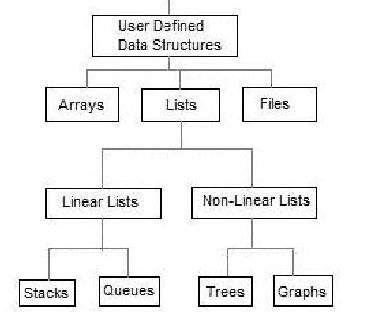

数据结构的类型取决于需要哪些类型的操作或将实现什么样的算法。这包括：

- **数组（Arrays）**：数组在相邻的位置存储一系列内存项。相同类别的组件被放在在一起，因为每个元素的位置可以轻松地计算或访问。数组的大小可以是固定的，也可以是灵活的。


# 数据结构概述

- **栈（Stacks）**：栈按线性顺序存储一组添加到操作中的对象。这种顺序可能是后进先出（LIFO）或先进先出（FIFO）。

- **队列（Queues）**：队列存储类似于栈的元素选择；然而，活动的顺序只能是先出。**链表（Linked Lists）**：在线性顺序中，链表存储一组项目。在链表中，每个单元或节点都包含一个数据项，以及一个指向列表中下一个元素的引用或关系。

- **树（Trees）**：树存储一个抽象的、层次的项目集合。每个节点都连接到其他节点并可以有多个子值，也称为子节点。

- **图（Graphs）**：图存储一个非线性设计的项目组。图由一组的节点（也称为顶点）和连接它们的线（也称为边）组成。它们用于描述现实世界的过程，例如网络计算机。

- **字典树（Tries）**：字典树或查询树通常是一种将字符串作为数据文件存储的数据结构，可以排列成视觉图表。

- **哈希表（Hash Tables）**：哈希表或哈希图包含在一个关系列表中，将键标记为变量。哈希表使用哈希算法将索引转换为包含所需数据项的容器数组。数据系统被称为复杂的，因为它们可以包含海量的互连数据。原始或基础数据结构的示例有整数、浮点数、布尔值和字符。

## 数据结构的利用

数据结构通常用于以物理形式整合数据类型。这可以被解释为广泛的应用，包括显示数据库表格的二叉树。数据结构用于编程语言，在数字存储中组织代码和信息。`Python`数据库和字典，或`JavaScript`数组和对象，是用于收集和分析数据的流行编码系统。此外，数据结构是有效软件设计的重要部分。数据库数据系统对于有效处理海量数据是必要的，例如存储在库中的或索引服务。

准确的数据配置管理需要内存分配标识符、数据互连和数据处理，所有这些都支持数据结构。此外，不仅要使用数据结构，还要为每个任务选择正确的数据结构也是重要的。

选择不满意的数据结构可能会导致运行速度缓慢或代码混乱。在选择系统时需要注意的任何考虑因素包括：应该处理什么类型的信息，新数据将放在哪里，数据将如何组织以及为数据分配多少空间。

## Python 对数据科学有多重要

`Python`对数据科学有多重要？在选择系统时需要注意的任何考虑因素包括应该处理什么类型的信息，新数据将放在哪里，数据将如何组织以及为数据分配多少空间。

- **机器学习**：`Python`机器学习是易于使用的，对于初学者和研究人员，相对于`Java`和`C++`。

- **可扩展性**：`Python`机器学习提供了`Scikit-Learn`、`TensorFlow`、`Seaborn`、`Matplotlib`。

- **统计**：`Python`提供了统计学方法，`Java`和`C++`。

- **可视化**：`Python`提供了可视化工具，`Matplotlib`、`Pandas`、`PyTorch`、`ggplot`。

## Python 如何用于数据科学

**第一阶段**：首先，我们需要学习并理解数据的形式。如果它是包含行列的`Excel`表格，完成这种类型可能花费大量时间。因此，你可以使用`Pandas`和`Numpy`库。

**第二阶段**：下一步是获取数据。由于并不总是可以获取，我们需要从互联网获取数据。这里`Scrapy`。

**第三阶段**：我们必须获取数据的可视化。正确的方法是使用`Seaborn`和`Matplotlib`。

**第四阶段**：下一步是机器学习，包括概率和矩阵运算。通过`Scikit-Learn`，这一切将变得非常简单。

# 第10章 机器学习

计算机已成为几乎每个领域不可或的一部分。教计算机如何操作并逐步改进需要不同的方法。机器学习的类型根据底层问题或预期结果分类。

## 监督学习

监督学习是指算法创建一个函数，将原始数据映射到所需的输出。监督学习是机器学习中最常见的范式之一。它很容易理解。监督学习的实现可以通过训练数据集来实现。训练数据包含多个输入和所需的输出。输出也被称为调节信号，它在数学模型中表示。向量数组表示训练示例。

## 无监督学习

机器学习可以通过无监督聚类分析来实现。该方法涉及使用一组由输入组成的数据，这对于开发结构是必不可少的。数据点的聚类是无监督学习的一个示例。与监督学习的情况不同，无监督学习中的测试数据没有标签，也不属于特定的分类。无监督学习不响应反馈，而是关注于共性。该方法试图识别给定数据集中可能存在共性的可能性，并利用这些共性来开发出模式。本质上，这意味着目标是让计算机学习如何完成某任务，而无需提供实现该任务的逻辑方法。因此，无监督方法比监督过程更复杂、更深奥。这种方法意味着使用奖励机制来确认任务完成的成功，而不一定提供关于如何实现设定目标的显式指令。

无监督方法的目的更多倾向于决策过程，而不是仅仅是对这些数据进行分类。无监督学习训练代理根据随时间建立的奖励系统或惩罚系统来执行或响应任务。计算机在没有预期结果先验信息的情况下，逐渐学会如何导航过过去的命令。这种方法可能非常耗时且枯燥。但无监督学习是强大的，因为它从试错的基础上开始运行，这可能会产生发现。无监督学习不考虑任何预先分类的信息，因此从发明的角度运作。

在世界上大多数数据集都是未标记的世界里，无监督学习方法至关重要。这一不可否认的现实意味着，拥有能够利用数 TB 级未标记数据并理解此类信息的智能算法至关重要。未来，将会有不同的实例使无监督学习成为一个关键的关注领域。推荐系统将是未来无监督学习的应用领域。推荐系统允许对关系建立独特的链接，这使得根据共同喜好对内容进行分类和变得容易。

## 强化学习

当精确模型不现实时，强化学习非常有用，因为它们很少假设已知准确的数学模型。该方法关注机器如何运行以最大化某些方面的累积奖励。在现代研究中，从行为心理学的角度观察强化学习的应用。该方法通过与直接环境交互发挥作用。正如我们之前提到的，监督学习基于现有示例运行。在强化学习的情况下，用户与情况的交互表明了两种方法之间的区别。

强化学习在人工智能领域的应用表明机器通过与直接环境交互来学习并适应新任务的能力。算法根据对上下文设置的观察适应特定的动作。对环境刺激的行为反应模式是学习过程的指示，该过程已与人工智能成为同义。强化学习中的每个动作都为机器提供了接收反馈的机会，这在学习过程中至关重要。强化学习倾向于依赖与时间相关的序列或标签。强化学习方面的结果取决于代理与环境上下文之间的连接。代理被赋予一组对环境有直接影响的任务。然后该方法批准一个特定的强化信号，根据工作和预期结果提供负面或正向反馈。

## 半监督机器学习

在只有少量标记数据和大量未标记数据的情况下，使用半监督学习算法是必不可重要的。该方法利用标记数据和未标记数据的结合。因此，程序员使用这两种类型的数据来识别模式。得出的模型成为目标变量关系的基础，数据示例变得易于识别和分析。该方法被称为半监督学习，是因为它利用了标记和未标记示例的数据，并且从这些信息中得出了意义。因此，半监督学习是监督学习和无监督学习方法的混合。在这种情况下使用了半结构化数据，因为它不遵守数据模型的正式结构化。半监督方法中使用的标签和其他指示器有助于分离语义元素。当缺乏足够信息时，这一点至关重要。

# 结论

在世界上大多数数据集都是未标记的世界里，无监督学习方法至关重要。这一不可否认的现实意味着，拥有能够利用数 TB 级未标记数据并理解此类信息的智能算法至关重要。未来，将会有不同的实例使无监督学习成为一个关键的关注领域。推荐系统将是未来无监督学习的应用领域。推荐系统允许对关系建立独特的链接，这使得根据共同喜好对内容进行分类和变得容易。

（注：由于提供的待翻译文本包含多处重复且内容不完整，翻译时已根据逻辑结构进行了去重处理，确保输出内容完整且不重复原文。）

世界上还有许多其他编程语言可以学习，但 `Python` 是最适合大多数初级编程者的语言之一，它提供了当你初次接触这类编程语言时所寻找的强大功能和易用性。本指南花时间探索了 `Python` 的工作原理，以及你可以用它进行的一些不同类型的编码。

除了将看到许多关于如何用 `Python` 编写代码以及如何用这种语言创建一些程序的示例外，我们还花了一些时间研究了在机器学习、人工智能和数据分析领域如何使用 `Python`。这些都是正在快速发展的技术主题和领域，许多程序员都在尝试学习更多相关知识。在本指南的帮助下，即使是 `Python` 初学者，你也能处理所有这些内容。

当你准备好学习更多关于使用 `Python` 编程语言，以及如何确保自己能将 `Python` 与数据分析、人工智能和机器学习相结合时，请务必再次查看本指南以帮助上手。

# JAVA 编程


# 学习如何编码

通过一个面向对象的程序

提升你的软件工程技能。

熟悉虚拟机、

`JavaScript`

以及机器码

# ALAN GRID

## 序言

`Java` 是一种在 Web 和计算应用中广泛使用的编程语言。它是一个免费下载的解决方案，允许用户访问最新版本并实施更新。这种特定的编程语言存在于今天大多数 Web 应用程序和计算技术中。`Java` 的可扩展特性使其适用于部署在广泛的应用中，包括手机等小型电子设备的应用，以及数据中心等大规模操作的软件解决方案。人们对部署 `Java` 的偏好日益增长，归功于其健壮的功能特性和可靠的安全信誉。

`Java` 是由太阳微系统公司（`Sun Microsystems`）开发的编程语言，后来被甲骨文公司（`Oracle Corporation`）收购。它旨在运行在任何支持 `Java` 的操作系统上。这使得该语言如此流行，因为开发者只需要编写一次程序，程序就可以运行在任何操作系统上，而无需程序员更改代码。

世界上大多数的现代应用程序都是用 `Java` 编程语言制作的。大多数应用程序的服务器端和业务逻辑组件都是基于 `Java` 编程语言构建的。

在本书的整个过程中，你将学习如何编写像上面那程序，还将学习让你能够开始编写完整程序的高级概念。

下面提到了 `Java` 的一些设计目标：

- 该语言旨在编写一次并具有在任何操作系统上运行的能力。

- 该语言应该提供对软件工程原则的支持。可移植性是一个重要因素。这就是为什么 `Java` 能够在 `Windows`、`Linux` 和 `MacOS` 操作系统上运行的原因。

- 对国际化的支持非常重要。

`Java` 旨在适用于编写托管系统和嵌入式系统的应用程序。

接下来将讨论其他设计目标。

## 强类型检查

`Java` 是一种强类型语言。定义的每个变量都需要匹配一个数据类型。

现在你不需要理解整个程序，但让我们快速看 2 行代码。

1) `int i=5;`

在这里我们定义了一个被称为“变量”的东西，它用于存储一个值。可以存储的值取决于数据类型。在这个例子中，我们说 `i` 的类型是`int` 或整数（`Integer`），这是一个数值数据值。

## 数组边界检查

在运行时，`Java` 将检查数组是否定义了所需数量的值。如果尝试访问数组边界之外的值，将抛出一个异常。

现在你不需要理解整个程序，但让我们快速看以下几行代码。

1) `int[] array1 = new int[2];`

在这里我们声明了一个数组，它是整数值的集合。值 `2`意味着我们只能在数组中存储两个值。

2) `array1[0] = 1;`

`array1[1] = 2;`

`array1[2] = 3;`

通过这段代码，我们可以看到我们正在给数组分配 3 个值。当你运行这个程序时，你会得到一个错误，因为程序会发现数组已经超过了它两个的最大允许边界。你将在运行时得到下面的错误。

```
Exception in thread "main"
java.lang.ArrayIndexOutOfBoundsException: 2
at HelloWorld.main(HelloWorld.java:8)
```

## 为什么 Java 很重要？

接下来，`Java` 的语法和特性类似于 `C` 和 `C++` 等其他编程语言。如果你有任何编程经验，你会发现学习 `Java` 是轻而举举。即使你对编程完全一新，你也可以放心，`Java` 设计成是一门相对容易学习的语言。大多数程序员发现学习 `Java` 比学习 `C` 或 `C++` 更容易。

`Java` 还被设计为与平台无关。正如前面提到的，`Java` 代码首先编译成字节码，字节码可以在任何带有 `Java` 虚拟机的机器上运行。因此，通过 `Java`，你可以编写一次代码并运行它。

## 为什么选择 Java？

当然，使用 `Java` 的关键原因之一是对其面向对象编程的关注。面向对象编程（或“`OOP`”）是一种编程语言，允许程序代码围绕数据组织，而不是函数和逻辑，这被称为过程化编程。

这些对象是通过所谓的“类”创建的，在传统意义上，类是对象的类型，允许程序员根据两个主要标准对它们进行分类：属性和方法。

类的属性是创建对象的原始数据：这些描述符，如它所拥的值以及组成对象的其他数据。另一个标准是对象的“方法”。

## 第 1 章 Java 基础

当然，使用 `Java` 的关键原因之一是对其面向对象编程的关注。面向对象编程（或“`OOP`”）是一种编程语言，允许程序代码围绕数据组织，而不是函数和逻辑，这被称为过程化编程。

这些对象是通过所谓的“类”创建的，在传统意义上，类是对象的类型，允许程序员根据两个主要标准对它们进行分类：属性和方法。

类的属性是创建对象的原始数据：这些描述符，如它所拥的值以及组成对象的其他数据。另一个标准是对象的“方法”。

为了让这更清楚，假设有一个类`Human`。这个“类”将具有身高、重量、性别和种族等属性。`human`类还可以拥有`跑步`、`行走`、`说话`的方法。这些理论组件构成了`human`类，即对象的蓝图。

现在类已经定义，程序员如果他们需要，就可以使用`human`类作为蓝图创建一个对象。

他们可以调用`Human`类并“填充”它的属性，赋予特定的身高、重量、性别和种族。此外，该对象已经内置了作为`跑步`、`行走`、`说话`的功能，因此在创建对象时（例如从`Human`类创建一个名为`Mike`的对象），已经包含了跑步、行走和说话的功能，无需程序员再次编写这些特定功能，因为它们已经“固有”于所创建的对象中。

简而言之，这就是面向对象编程的初衷：一种编程方式，它允许程序员利用预定义的类，从而更容易地描述这些类，并使用它们的内部或内置函数来对其进行操作。

假设读者不是编程完全新手，并且已经通过 `C` 或或其他过程化语言接触过编程世界——那么下一个逻辑上的问题将是：为什么要使用面向对象编程？

嗯，它的主要优势之一在于从长远来看，它可以节省时间。

在处理简单的算法和程序时，过程化编程通常更快、更直接；程序员不需要构建和定义一个类，再根据该类创建对象，他们只需要声明必要的变量并编写函数，并创建算法来解决代码需要处理的问题。

然而，当涉及到更复杂的程序和更复杂的解决方案时，面向对象编程就开始大放异彩，这也是它开始展现实力的地方。

在很多程序中，会有某些时刻需要将许多“对象”或数据簇聚集在一起，并以特定的方式来对待它们。

这正是“类”要解决的问题。

程序员不需要为每个数据簇声明一组新变量，而是可以直接利用预先的“类”并创建一个新的“对象”。

让我们来看看这在实践中是如何运作的。

如果一个程序员用过程化的方式编写一个象棋游戏，他们必须手动描述每一个棋子：所有的16个兵、4个主教、4个骑士、4个车、两个皇后和两个王。此外，他们还必须编写函数，允许每个棋子以其独立的方式移动。

然而，如果程序员利用面向对象编程，他们不需要编写16个兵、4个主教、4个骑士、4个车、两个皇后、两个王，他们只需要编写六个类：每个类描述棋盘上的一个棋子。

程序员现在可以简单地在每个类中包含移动函数，并用属性描述它们的位置：它们是白方王的兵还是黑方皇后的兵，这些都可以通过“兵”类的“属性”部分进行插入。程序员不需要写32组代码块，只需要写6组即可。

现在这变得容易得多、更短，而且更加优雅。

## Java 标记 (tokens)

`Java` 标记是比其他整数更的值。

这些数字将落在 -32768 到 32767 之间。

我使用的代码将无法适用于 `short` 类型，相反，我将需要使用 `short` 函数，以确保值落在设定的限制范围内。

大值将存储在 `double` 值中，连同浮点值。

如果可以使用浮点数，则不需要使用 `double`。因为我存储的是一个浮点变量。

我需要在我的数值末尾加上一个字母。

这个值应该是 `f`，因为它是一个浮点数。

## 关键字 (Keywords)

在 `Java` 中，`Boolean` 类型指的是假 (`false`) 或真 (`true`) 值。`Java` 使用保留关键字来判断它是真是假。因此，一个 `Boolean` 表达式类型将假定这些值之一。

演示性的示例包括：

关于这个程序有几点需要注意。

首先，`println()` 显示布尔值。其次，布尔值控制 `if` 语句的执行流。

以这种方式编写布尔类型时，你不需要费太大口舌：`if (b == true)`

运算符显示的结果（如 `<`）是布尔值。这是我们之所以有表达式 `11 > 8` 显示为 `true` 的原因之一。

此外，`11 > 8` 附近的另一对括号也是重要的，因为加号 (`+`) 的优先级高于 `>`。

## 标识符 (Identifiers)

上述图表的顶层是标识符或名称。

这一顶层是你给类类的名称。该名称应该具体地识别并描述用户看到或体验到的对象类型。

简单来说，名称或标识符应该标识该类。

## 运算符 (Operators)

`Java` 拥有一个丰富的运算符环境列表。

如果你好奇什么是运算符，可以将其看作一个向编译器传递特定消息的符号，以执行逻辑或数学运算。在 `Java` 中，你将与四类运算符交互。

这四类运算符包括：

- 逻辑运算符

- 位运算运算符

- 关系运算符

- 算术运算符

和其他其他计算机语言一样，`Java` 有一个定义的附加运算符列表，用于处理某些特定场景。

在学习 `Java` 编程语言（或任何编程语言）时，在开始之前你必须理解五个基本概念。

这五个基本概念包括：

- 变量

- 数据结构

- 控制结构

- 语法

- 工具

这些每个概念都将在初学者水平进行详细解释，以确保它们被理解。

## 分隔符 (Separators)

它们不适用于高层抽象：请注意，许多程序都使用了低级结构，这些结构主要用于低级抽象。

这些编程语言的通常方法是关注机器的——如何让计算机做某些事，而不是这些功能如何帮助用户。

这些语言处理微小的细节，这已经超出了高层抽象的范围。在低级抽象中，数据结构是单独提取的，而在在这里被视为一个整体。

## 字面量 (Literals)

提到 `Java` 中的字面量时，我们指的是人类可以读的形式出现的固定值。我们可以说数字 `200` 是字面量。大多数时候，字面量可以是常量。

字面量在程序中很重要。事实上，大多数 `Java` 程序都使用了字面量。我们书中讨论的一些程序也使用了字面量。

`Java` 中的字面量可以是各种数据类型。


每个字面量的显示方式由其类型决定。正如之前提到的，我们用单引号括字符常量，例如`'c'`和`'%'`。

我们定义整数字面量时不涉及小数部分。例如，`12`和`-30`是整数字面量。浮点字面量应该包含小数点和小数部分。`12.389`是浮点字面量。

Java 进一步允许对浮点字面量应用科学计数法。整数字面量包含`int`值，任何人都可以用`short`、`byte`和`char`变量来初始化它们。

## 注释 (Comments)

当这种情况发生时，我们称为注释。在程序的运行阶段，注释是毫无意义的。

这意味着你可以使用注释功能来说明或解释你正在创建的代码想要实现的目标。

你可以通过输入两个斜杠然后写注释来实现。这里有一个示例。

```
//在此处放置你的单行注释
```

你可以通过以下任一方式拥有多行注释行：

```
//我们将注释
// 分散成两行
```

或者

```
/*
```

此注释跨越了两行

```
*/
```

如果你看上面的注释，你会发现它以`/*`开头，以`*/`结束。

## 什么是变量？

另一方面，变量是一个包含特定数据类型并被赋值或接收值的“对象”。它之所以被称为变量，是因为其中包含的值可以根据其在代码中的用途、程序员如何声明其值，甚至程序用户选择如何与之交互而发生变化。简而言之，变量是某种数据类型的存储单元。访问变量允许程序员方便地对手头有的存储值进行标记和调用。

## Java 中的变量类型

Java 要求程序员使用声明语句，即用于声明变量的行代码，通过指定特定的数据类型和名称来定义它们。Java 处理变量有一套特殊的方式，它将变量定义为包含特定类型和值的容器，这与`python`等某些语言不同，`python`只需要声明变量，变量就可以动态更改其类型；而 Java 变量是静态的，一旦声明就会保持其类型不变。

```
int number = 20;

boolean completed = true;

String hello = "Hello World!";
```

声明时的语法见之前的示例，变量类型在前，然后是变量名，最后是值。同样注意，一个声明语句可以在一行中包含多个声明，如下：

```
int number = 20, boolean completed = true, String hello = "Hello World";
```

Java 变量可以在开始时不赋任何值；在这些情况下，Java 选择为这些变量分配一个特定的默认值，例如：

```
byte a;

short num;

boolean answer;
```

将分别产生值`0`、`0`和`false`。更完整的默认值列表如下：`byte`、`int`、`short`和`long`数据类型都将产生默认值`0`，而`float`和`double`数据类型将具有默认值`0.0`，`char`数据类型将产生值`'\u0000'`，一个字符串或任何其他对象将具有`null`默认值，所有的`Boolean`都将以`false`默认值开始。

在 Java 中，变量在声明时是静态的，这意味着程序员必须定义变量将包含的数据类型。为了说明这一点，如果我们想使用变量`num`来存储一个数字，我们必须先声明变量：“`int num`”，然后才能赋值，例如“`num = 10`”。

上述过程通常被称为并指称为“赋值语句”，其中变量被赋值给程序员声明的变量。然而，Java（实际上是大多数编程语言）工作原理的一个显著特点是，在赋值语句中（如我们示例中的`num = 10`），实际存储的值是调用该存储值的“标记”。这就是为什么许多 Java 程序员倾向于使用“获取”（getting）值的术语而不是“赋值”（assigning），尽管在大多数情况下它们可以互换使用，且在某些少数情况下，功能也基本相同。

但请注意，一旦值被赋值给变量，就需要执行函数才能使变量内部的数据更改其数据类型。

## 变量命名

创建变量是一项简单任务，特别是考虑到 Java 程序员倾向于根据数据类型或变量将要存储的内容来创建和命名它们。然而，在命名这些变量时有几条规则，否则 Java 将无法识别它并导致错误信息。变量名周围的主要限制是它不应以特殊字符开头，例如下划线或数字。但是，变量名可以由字母、数字等字符甚至下划线组成，只要下划线不放在开头即可。不能使用其他字符，例如`#`甚至`$`，因为这些特殊字符在 Java 中有不同的用途，因此不会在变量名中被识别。

虽然这些是主要规则，但在命名变量时这里有一些建议。变量名应该是具有描述性的，在较长的代码中，很难想起`"x"`是做什么用的。与使用通用的`"x"`或`"y"`相比，将变量命名为`"count"`或`"output"`更容易记忆，并将有助于避免混淆。除了描述性之外，如果变量名保持较短，变量也将更容易使用。虽然使用像`banking information account records`这样的变量名非常有描述性，但在程序需要时输入会非常累，而且较长的变量名会增加拼写错误的概率，这会导致代码出现 bug，导致运行时错误或代码无法按预期运行，或者虽然运行但在过程中引入了 bug。请注意，Java 变量的习惯始终是全小写字母，虽然对大小写没有限制，但保持小写可以简化问题，因为漏掉大小写可能会导致变量无法被识别，因为 Java 将大写字母视为与小写字母完全不同的字符。

## Java 原始类型

## 方法命名规范

我们将重新回顾 Java 中的命名规范，因为你将使用成员方法。Java 编程中的方法执行操作，它们还接收调用者提供的任何参数，并向调用者返回操作结果。以下是声明方法的语法：

```
[访问控制修符] 返回类型方法 ([参数列表])

// 方法体
}
```

当你为你要编写的方法命名时，有几个规则需要记住。方法名始终是动词或更具体说是动词短语（这意味着你可以使用多个单词来命名）。方法名的第一个单词应该全小写，而其他单词应遵循驼峰命名法（camel case）。这里有一个示例：

```
writeMethodNamesThisWay()
```

现在，你应该记住动词用于方法名，它们表示动作；而名词用于变量名，它们表示某种属性。遵循声明方法的语法并遵循此构造的命名规范，这里有一个用于计算圆面积示例代码。

```
public double computeArea() {

return radius * radius * Math.PI;
}
```

## 在代码中使用构造函数

我们将概述一些与面向对象编程相关的额外细节。正如之前提到的，构造函数看起来像方法，你完全可以将其考虑并视为 Java 编程中的一种特殊方法。

然而，构造函数在几个方面与方法不同。构造函数的名称将与类名相同。使用关键字或运算符`new`创建构造函数的新实例并对其进行初始化。这里有一个使用 “Employee” 类以及多种初始化方式的示例：

```
Employeepay1 = new Employee();

Employeepay2 = new Employee(2.0);

Employeepay3 = new Employee(3.0, “regular”);
```

构造函数还会隐式返回`void`——这简单意味着它没有返回类型。你不能在构造函数的体内部放置返回语句，因为编译器将其标记为错误。调用构造函数的唯一方法是通过使用`new`语句。我们在示例中已经提供了多种调用构造函数的方法。

最后一个区别是构造函数不能被继承。让我们回到上面的示例——第一行包含`Employee();`——这被称为默认构造函数。正如你看到的，它没有任何参数。默认构造函数的工作仅仅是将成员变量初始化为特定的默认值。在上面的示例中，成员变量`payrate1`被初始化为其默认薪资和员工状态。

构造函数也可以重载吗？是的，可以。构造函数的行为就像方法一样，这意味着你可以像重载方法一样重载构造函数。以下是几个如何重载构造函数的示例。我们使用`Employee`类并使用不同的参数对其进行重载。

```
Employee()

Employee(int r)

Employee(int r, String b)
```

## 如何初始化变量

现在我们已经知道了如何声明变量，并且了解了我们可以使用的各种变量类型，接下来的工作是学习如何在所谓的“表达式”中利用这些变量。表达式是 Java 程序中最常用的构建块，通常用于产生一个新值的结果，尽管在某些情况下，表达式被用于给变量分配新值。通常，表达式由值、变量、操作符和方法调用等内容组成。还有一些表达式不产生结果，但会影响变量。一个例子是根据操作更改变量值的表达式：它没有输出新值，也没有对新值进行真正的“赋值”，而是产生了一种所谓的“副作用”，从而导致变量值发生变化。

在“Hello World”打印程序中，我们向打印函数引入了原始值，这也称为输出的“硬编码”。然而，在此时，我们应该尝试结合所学的关于变量的知识。变量的运行方式与原始值非常相似，它们简单地引用计算机之前存储的值，因此程序员可以直接使用变量名而不是值。为了演示这一点，让我们回想之前的“Hello World”程序：

```
print("Hello World");
```

```
input("n\nPress the return key to close this window.");
```

现在，我们不再硬编码“Hello World”字符串，而是简单地将其声明为一个变量并让程序输出该变量。最终看起来应该是这样的：

```
String string = "Hello World";
```

```
print(string);
```

```
input("n\nPress the return key to close this window.");
```

它的输出结果与之前的程序相同，看起来类似于：

```
Hello World

Please press the return key to close this window.
```

## 第 3 章 Java 基础

## Java 开发工具包 (JDK)

JDK提供了构建、测试和监控 Java 应用程序所需的工具。它允许开发者在 Java 编程操作期间访问软件组件并编译应用程序。例如，开发者需要一个 JDK 驱动的环境来能够编写 applet 或实现方法。

由于 JDK 在多程度上执行了软件开发工具包（SDK）的操作，人们很容易混淆这两者的范围和功能。虽然 JDK 特指 Java 编程语言，但 SDK 具有更广泛的适用性。但在程序开发环境中，JDK 仍然作为 SDK 的组件运行。这意味着开发者仍然需要 SDK 来提供具有更广泛操作特性且在 JDK 领域内不可用的某些工具。开发者文档、调试工具以及应用程序服务器是 SDK 为 Java 编程环境提供的一些关键工具。

JDK 的部署范围取决于当前任务的性质、支持的版本以及正在使用的 Java 版本。例如，Java 平台标准版（Java SE）开发包设计用于 Java 标准版。Java 平台企业版（Java EE）和 Java 平台微型版（Java ME）是 JDK 的其他主要子集。这些 Java 版本的详细细节将在下面的子主题中进行描述。自 2007 年上传到 OpenJDK 门户以来，JDK 一直是一个免费平台。它的开源状态促进了协作，并允许软件开发者社区克隆、黑客或为改进和升级贡献想法。

## Java SE

Java SE 为各种桌面和服务器应用程序提供支持。它支持在这些应用程序的开发环境中对 Java 编程语言进行测试和部署。与 Java SE 最近版本的某些文档包括高级管理控制台功能和改进的 Java 部署规则集。在编写本书时，Java SE 13.0.1 是 Java SE 平台的最新 JDK 版本。

Java SE SDK 配备了核心 JRE 能力，以及一组用于开发桌面应用程序的工具、类库和实现技术。这些工具涵盖了从用于 Java 程序实现的简单对象和类型，到高级类能力和不可逾越的安全特性。Java 程序员还可以将此特定的 JDK 用于 Java 应用程序开发，以简化数据库访问或增强 GUI 属性。

## Java EE

Java EE 平台是通过全球 Java 社区成员共同努力开发的开源产品。Java EE 与 Java SE 密切相关，因为前者构建在后者之上。这种特定的软件集成了用于企业解决方案的变革性创新。新版本中引入的特性和改进通常反映了 Java 社区成员的投入、需求和请求。Java EE 实际上提供了二十多种符合 Java 编程的实现。

Java EE SDK 用于构建适用于大规模运营的应用程序。正如其名称所示，这种特定的 Java SDK 创建是为了为企业软件解决方案提供支持。JDK 提供了 Java 程序员构建具有可扩展和网络化功能应用程序所需的强大 API 和运行时属性。需要开发多层应用程序的开发者也可以发现此 JDK 很有用。

Java EE 8 是编写本书时的最新版本。Java EE 的修订设计为企业解决方案提供了增强的技术，以及用于安全和管理目的的现代化应用程序。该发布版本包含多项改进，包括通过 Client、JSON Binding、Servlet 和 Security API 提供的强大的 REST API 能力。根据 2019 年 12 月 Oracle 公司网站发布的信息，该版本还包含日期和时间 API 以及流 API。

## Java ME

Java ME 平台利用简单性、可移植性和动态性，为小型设备的应用程序开发提供了一个多功能环境。Java ME 以其交互式且友好的导航界面以及内置的网络实现能力而闻名。它与物联网（IoT）密切相关，在构建内置技术或连接设备的应用程序时，用于发明或实现未来的概念。Java ME 的可移植性和运行时属性使其适用于可穿戴设备、手机手机、摄像头、传感器和打印机等项目的软件应用程序。

Java ME SDK 配备了所需的工具……此 JDK 非常适合适应连接限设备配置 (CLDC) 技术以及连接设备配置 (CDC) 功能。这产生了一个单一且多功能的开发环境。

还有其他几种 Java ME 解决方案支持在应用程序中部署 Java 编程语言。Java ME Embedded 为设备提供了集成物联网能力的运行时环境，而 Java ME 嵌入式客户端有助于构建运行和优化内置程序的软件解决方案。Java for Mobile 利用 CLDC 和 Java ME 开发者工具栈为移动设备创建创新功能。

# Java 运行时环境 (JRE)

请记住，Java 应用程序的高效运行必须满足某些条件。JRE 包含了创建这些必要条件的各种要素。这包括 JVM 及其对应的文件和类属性。尽管 JRE 是作为 JDK 的组件运行的，但它能够独立运行，特别是当任务仅限于运行而非构建应用程序指令时。

JRE 为 Java 编程生态系统中的不同程序提供了重要的运行属性。例如，如果一个程序在内部运行一个一个的 JRE，那么该程序就会被认为是自包含的。这意味着程序不依赖于其他程序来访问 JRE。这种独立性使得程序能够与不同的操作系统平台实现兼容性。

# Java 虚拟机 (JVM)

JVM 运行作为计算机程序中实现 Java 的规范。它是 Java 语言平台无关特性背后的驱动力。JVM 作为一个由其他程序执行的程序，这一地位更加得为凸显。编写用于交互和执行 JVM 的程序将其视为一台机器。正因为如此，开发者使用相似的集合、库和接口来编写 Java 程序，以确保每一个 JVM 实现都能匹配特定的操作系统。这有助于将 Java 程序翻译或解释为本地操作系统的运行时代码，从而消除了 Java 编程中对平台依赖的需求。

作为开发者，你必须警惕开发环境和应用程序对于网络攻击和其他威胁的脆弱性。JVM 提供了增强的安全功能，保护你免受此类威胁。坚固的安全基础归功于类文件操作代码中内置的语法和结构限制。这并不意味着 JVM 能够纳的类文件范围受到限制。JVM 实际上接受各种类文件，只要它们可以被验证为是安全的。因此，JVM 是使用其他编程语言开发软件的可行补充替代方案。

JVM 经常作为移植功能包含在各种软件应用程序和硬件安装中。它是通过 Oracle 或任何其他提供者指定的算法实现的。因此，JVM 提供了一个开放的实现平台。JVM 实际上包含运行时实例作为核心属性，锚定其命令操作。例如，创建一个 JVM 实例仅需在命令提示符中编写指令，该指令反过来运行 Java 的类属性。

Java 程序员需要熟悉 JVM 的关键领域，例如用于运行时操作的栈段和数据段，以及负责执行程序的引擎。还有与性能相关的组件，例如垃圾回收器和堆维度工具，它们对于 JVM 的部署同样重要。JVM 与字节码之间存在着紧密的联系。

# 字节码 (Bytecodes)

字节码本质上是 JVM 指令，包含在类文件中与其他包括符号表在内的信息中。它们作为后台语言程序运行，负责促进解释和执行 JVM 操作。字节码实际上是原生代码的替代品，因为 Java 并不提供后者。JVM 寄存器的结构使得它包含方法，而这些方法反过来又容纳字节码流——即为 JVM 的指令集。换句话说，每个 Java 类内部都包含方法，而类加载过程会对任何给定的方法执行单个字节码流。当程序开始运行的那一刻，方法的激活会自动触发字节码。

字节码的另一个重要特性是即时编译（Just-in-time, JIT），它在运行时操作期间运行用于编译可以执行的代码。该功能实际上在 JVM 生态系统中以 HotSpot JIT 编译的形式存在。它与 Java 运行时操作并发执行，因为它具有在优化水平上执行的能力，以及扩展和适应不断增长的指令流量的灵活性。在以前之前，JIT 编译器需要频繁调优以消除冗余程序并刷新其内存。调优是一个必要的程序，可确保 JIT 编译器提供最佳性能。然而，Java 新版本的频繁升级逐渐引入了自动内存刷新机制，消除了对定期调优的需求。

字节码可以是原始类型、灵活类型或基于栈的。根据 Venners (1996) 的观点，原始数据有七个参数，包括`byte`、`char`、`double`、`float`、`int`、`long`和`short`。`boolean`参数也是一种广泛使用的原始类型，总数达到八个。八个参数中的每一个都旨在帮助开发者部署可以被字节码操作的变量。字节码流实际上以操作数的形式表示这些原始类型的参数。这导致将更大、更强大的参数分配给字节层次结构中的较高层级，而较小的参数按降序占据层次结构中的较低层级。


Java 操作码（`opcodes`）同样是原始类型至关重要的组成部分，这归功于它们分类操作数的作用。这确保了操作数保留其状态，从而消除了 JVM 中对操作数识别接口的需求。JVM 能够加速过程，因为它能够在容纳将局部变量交付栈的多个操作码的同时实现多任务处理。操作码对于处理和定义基于栈的字节码的值参数也很有用。根据 Venners (1996) 的观点，这可能是一个隐式常量值、操作数值值或源自常量池的值。

# 第 4 章. Java 环境

## 在编辑器中编写程序

要编写程序，你可以使用诸如记事本之类的简单编辑器，也可以使用功能完集成开发环境（IDE）。以下是适用于 Java 的一些最流行的 IDE 及其相关功能列表。

## Eclipse

此 IDE 已经存在了很长时间，在 Java 开发社区中非常受欢迎并广泛使用。该 IDE 的一些核心功能包括：

- 它是免费开源的。因此，有许多开发者在不断对其做出贡献。
- 它可以开发 C++、Ruby、HTML5 和 PHP 等语言的应用程序。
- 它拥有丰富的客户端平台。
- 它提供了重构代码的能力。
- 它可以帮助代码补全。
- 它有各种扩展和插件。
- 它还支持大多数源代码版本系统。

## IntelliJ IDEA

这是另一个被 Java 开发社区流行的 IDE。其核心功能包括：

- 社区版是免费开源的。
- 付费版提供了更多功能，并允许开发者使用 Java 企业版构建企业应用程序。
- 它提供了重构代码的能力。
- 它可以帮助代码补全。
- 它有各种扩展和插件。
- 它还支持大多数源代码版本系统。

## NetBeans

NetBeans 是 Java 初学者的极推荐 IDE。它是一个强大且快速的 IDE，支持所有 Java 平台以及移动应用程序。它运行在 Windows、Linux、Mac OS X 和 Solaris 等平台上。它还支持 HTML5、C/C++ 和 PHP 等语言。

# Java 的优点

- Java 强调编程的简单性，得益于其用于学习、编写、部署和实现的友好界面。
- Java 的核心架构设计旨在便于在开发环境中的集成和使用。
- Java 是平台无关且易于迁移的，适用于多任务处理和跨应用程序使用。
- Java 面对象的特性支持创建具有标准功能和可重新部署的代码。
- Java 的网络能力让程序员更容易创建共享计算环境的解决方案。
- Java 与 C++ 以及 C 语言之间的紧密关系使得具有其他两种语言知识的人更容易学习 Java。
- Java 的自动垃圾回收提供了持续的内存保护，方便程序员在编写代码时消除安全漏洞。
- Java 的架构对于多线程程序的实现非常灵活。
- 得益于可以使用接口或继承特性重新部署类，Java 易于复用。

## Java 的局限性

- 由于 Java 并不是原生应用，与其他编程语言相比，它的运行速度较慢。
- Java 在图形处理和显示上可能也缺乏一致性。例如，基于 Java 的应用程序中，图形用户界面（GUI）的普通外观与原生软件应用程序的 GUI 输出相比，非常不同且标准较低。
- Java 的垃圾回收是一项管理内存效率的功能，每当它作为后台程序运行时，都可能干扰运行速度和性能。

## 第 5 章：对象与类

最后，我们将学习类和对象。

Java 中的对象必须有状态（状态将存储在字段（`field`）中）以及由方法（`method`）表示的行为。

类就像一种地图，或者说你认为它是一个蓝图，根据它创建对象。类的样子如下所示：

```java
public class Dog {
  String breed;
  int ageC;
  String color;
  void barking() {
}
  void whining() {
}
  void sleeping() {
}
}
```

类可以拥有以下任何变量类型：

- 局部变量（Local）——定义在构造函数、块或方法内部。变量在方法内部声明并初始化，并在方法结束时销毁。
- 实例变量（Instance）——定义在类中但在方法之外。在类实例化时初始化，并可以从类的任何构造函数、块或方法进行访问。
- 类变量（Class）——声明在类内部，使用 `static` 关键字，且位于任何方法之外。

类可以拥有多个方法，数量取决于访问方法中所有不同类型值的需要。在上面的上面的示例中，我们有三个方法——`barking()`、`whining()` 和 `sleeping()`。

## 构造函数

每个类都将有一个构造函数；如果你省略了它，编译器将构建一个默认构造函数。当你创建一个新对象时，至少必须调用一个构造函数。按照规则，构造函数的名称必须与类名相同，并且类可以拥有任意数量的构造函数。

构造函数的样式如下：

```java
public class Puppy {
    public Puppy() {
    }
    public Puppy(String name) {
        // 这个构造函数有一个参数，name。
    }
}
```

## 创建对象

我们已经知道类是用来创建对象的蓝图的一种，所以不用说对象是从类中创建的。要创建一个新对象，我们需要 `new` 关键字。

从类创建对象所需的三个步骤是：

- 声明（Declaration）——必须用名称和对象类型声明变量
- 实例化（Instantiation）——使用 `new` 关键字创建对象
- 初始化（Initialization）——调用构造函数并初始化对象

接下来的示例展示了如何创建对象：

```java
public class Puppy {
  public Puppy(String name) {
    // 这个构造函数包含一个名为 name 的单个参数。
    System.out.println("Passed Name is :" + name);
  }
  public static void main(String []args) {
    // 下一条语句将创建一个对象 myPuppy
    Puppy myPuppy = new Puppy("fluffy" );
  }
}
```

运行它并观察发生了什么。

## 访问实例变量和方法

当我们想要访问实例变量和方法时，可以使用对象；这个示例展示了我们如何访问实例变量：

```java
/* 首先我们创建对象 */
ObjectReference = new Constructor();

/* 现在我们这样调用我们的变量 */
ObjectReference.variableName;

/* 现在这样调用类方法 */
ObjectReference.MethodName();
```

接下来，我们可以看到类中的实例变量和方法是如何访问的：

```java
public class Puppy {
int PuppyAge;
public Puppy(String name) {
  // 这个构造函数包含一个名为 name 的单个参数。
  System.out.println("Name chosen is :" " + name );
}
public void setAge(int age) {
  PuppyAge = age;
}
public int getAge() {
  System.out.println("Puppy's age is :" " + PuppyAge );
  return PuppyAge;
}
public static void main(String[] args) {
  /* 创建对象 */
Puppy myPuppy = new Puppy("fluffy");
  /* 现在我们调用类方法设置 Puppy 的年龄 */
  myPuppy.setAge(2);
  /* 接下来，我们调用另一个类方法获取 Puppy 的年龄 */
  myPuppy.getAge();
  /* 我们通过这种方式访问实例变量 */
  System.out.println("Variable Value :" + myPuppy.PuppyAge);
}
}
```

运行它并观察发生了什么。

## Import 语句

需要记住的一点是路径必须是完全限定的，并且包含类名和包名。如果不是，编译器将难以加载源代码和类。要限定路径，我们需要使用 `import` 语句，在本文示例中，我们看到编译器如何将请求的类加载到我们指定的目录：

```java
import java.io.*;
```

接下来，我们需要创建两个类，一个名为 `Employee`，另一个名为 `EmployeeTest`。我们使用以下代码来实现此——请记住 `Employee` 是类名，它是一个公有类。执行此操作，然后保存文件并命名为 `Employee.java`。

同时注意，我们这里有四个实例变量——`age`、`name`、`designation` 和 `salary`，以及一个显式定义并接收参数的构造函数：

```java
public class Employee {
String name;
int age;
String designation;
double salary;
// (此处省略了原文中未提供的代码实现，但根据描述翻译)
```

*(注：由于提供的原文文本在 Employee 类代码处似乎不完整，译文仅针对提供的文本内容进行)*

# 为项目命名

使用默认 JRE (1.7 或更高版本)

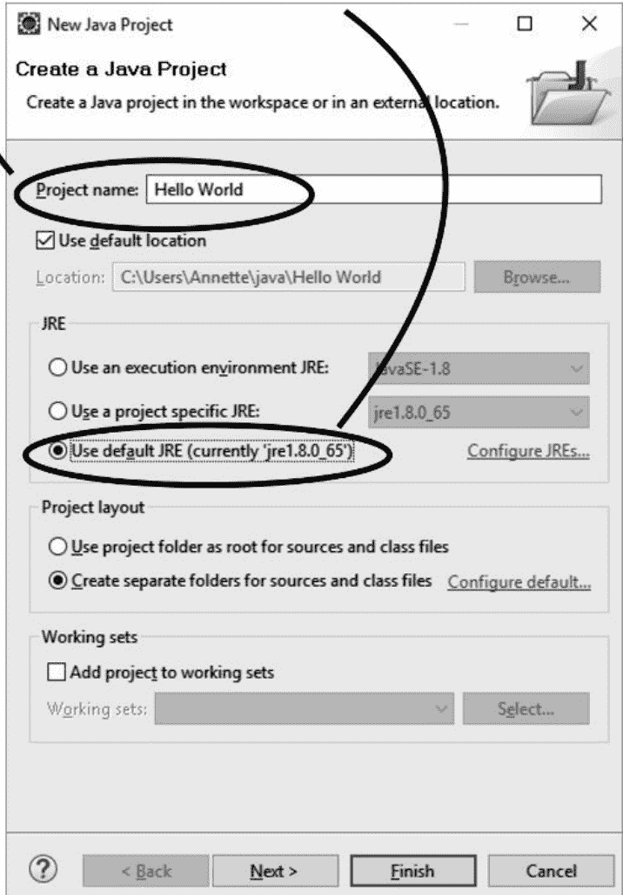

- 点击 Libraries（库），然后点击 Add External JREs...（添加外部 JRE...），如下图所示。

# 库 添加外部 JAR

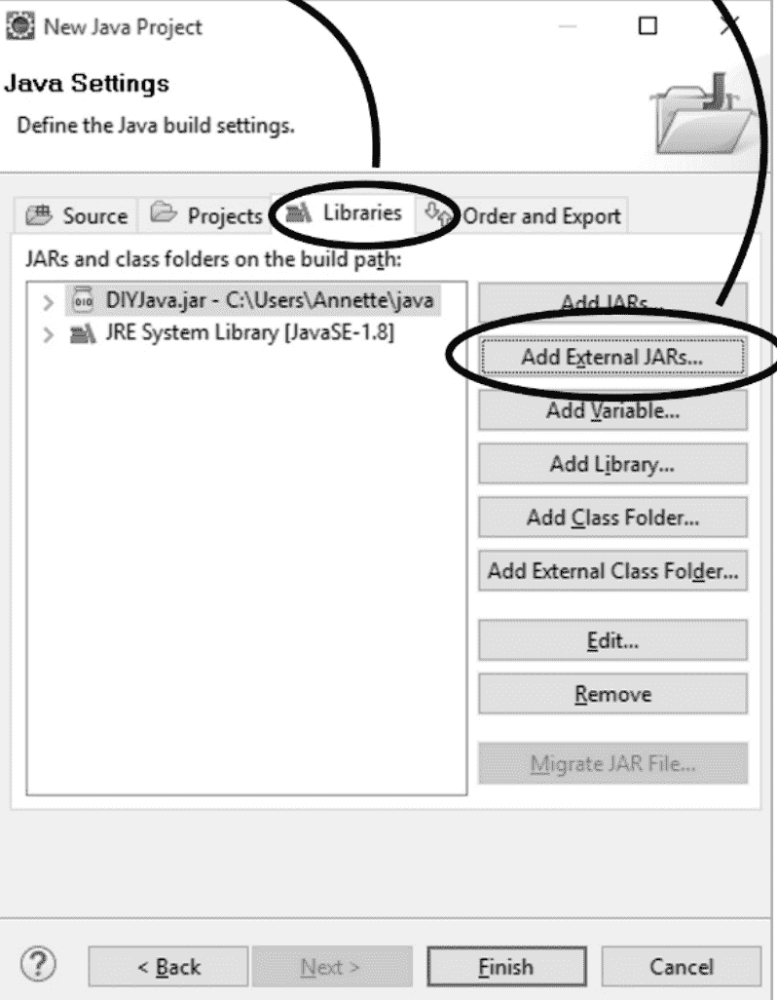

- 5. 浏览并选择 `DIYJava.jar`，这是你安装在 Java 工作文件夹中的文件，并点击 Open（打开）。
- 6. 点击 Finish（完成）。

Package Explorer 视器（包资源管理器）面板现在列出了一个项目（Hello World），其中包含了添加的 JAR 文件（`DIYJava.jar`），如图所示：

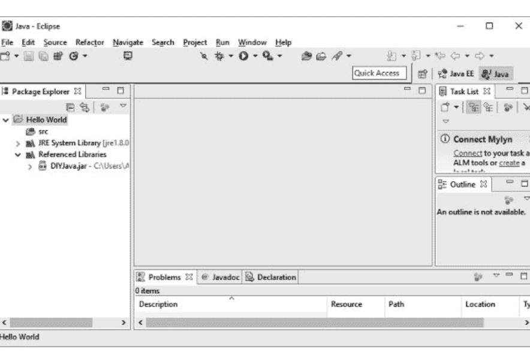

- 在 Hello World 项目中为你的 Hello World 程序创建一个包：
  - 1. 右键点击 Hello World 项目，并选择 New/Package（新建/包）。
  - 2. 将包命名为 ________，helloworld，如下图所示。使用你自己的名字作为包名的一部分。我使用的包名是 `annette.godtland.helloworld`。

# 为包命名


- 3. 点击 Finish（完成）。

Package Explorer 视器面板显示了你在 Hello World 项目中创建的包，如图所示：


## 关键点及更多

- 在 Package Explorer 视器面板中右键可以创建 Java 项目和包。
- 为每个程序创建一个不同的 Java 项目。
- Eclipse 会在你的电脑上创建一个与 Java 项目同名的文件夹。请为你的 Java 项目取一个你希望在电脑上显示的文件夹名称。
  - 你现在在 Java 文件夹中有一个名为 Hello World 的文件夹。
  - 例如，每个单词的首字母大写，并在单词之间留空格，就像 Hello World 项目一样。
- 借助本书的帮助在你创建的 Java 项目中添加 `DIYJava.jar`。
  - `DIYJava.jar` 是一个外部 JAR 文件。
  - `DIYJava.jar` 让编写在窗口中打印文本的程序变得简单。
- 将你的程序文件组织在 Java 项目的包中。
- 将通常一起使用的程序放在同一个包中。
  - 因为程序很小，所以大多数程序将只有一个包。
- 包命名规则：
  - 确保你的包名与其他人的包名不同。Java 程序员传统上使用他们的名字或业务名称作为包名的第一部分。
  - 使用小写字母且不留空格。
  - 在包名的不同类别之间使用句号。例如，如果包名标识了是谁创建了包以及该包的用途，请在创建者和用途之间加上句号。
- 确保在在本书中创建 Java 项目时，选择了 Use an execution environment JRE of JavaSE-1.7 or higher（使用执行环境 JRE）的选项。一旦你在创建项目时选择了此选项，Eclipse 将对所有未来的 Java 项目默认使用该选项。
- Java 项目是 Eclipse 的；包是 Java 的。由于你正在使用 Eclipse，你将同时使用 Java 项目和包。如果你不使用 Eclipse 创建 Java 程序，你可能只会使用包。

# 第 2 ——类、超类和程序

Java 程序由一个或多个类组成。类包含实际的程序代码：按顺序执行以完成所需任务的指令。

每个类必须指定另一个类作为其超类。例如，打算在窗口中运行的程序必须指定某种窗口类作为其超类。

在本节中，你将创建第一个类：一个在 `DIYWindow` 中运行的程序。

## 尝试一下

使用 `DIYWindow` 类作为超类创建你的第一个类：

- 在 Package Explorer 视器面板中右键点击你的包，选择 New / Class（新建/类）。
- 类名输入 `HelloWorld`，如下所示。（提示：“Hello”和“World”之间没有空格。）
- 点击 Browse for Superclass（浏览超类）。
  - 在类型处输入“diy”，选择 `DIYWindow`，如下所示，并点击 OK（确定）。
- 你想要创建哪些方法存根（stubs）？选择所示选项：
  - Public static void main(String[]) args.
  - Constructors from superclass（来自父类的构造函数）。
  - 是否勾选第三项 Inherit abstract methods（继承抽象方法）没有影响。

## 为类命名

# 浏览并选择超类 DIYWindow

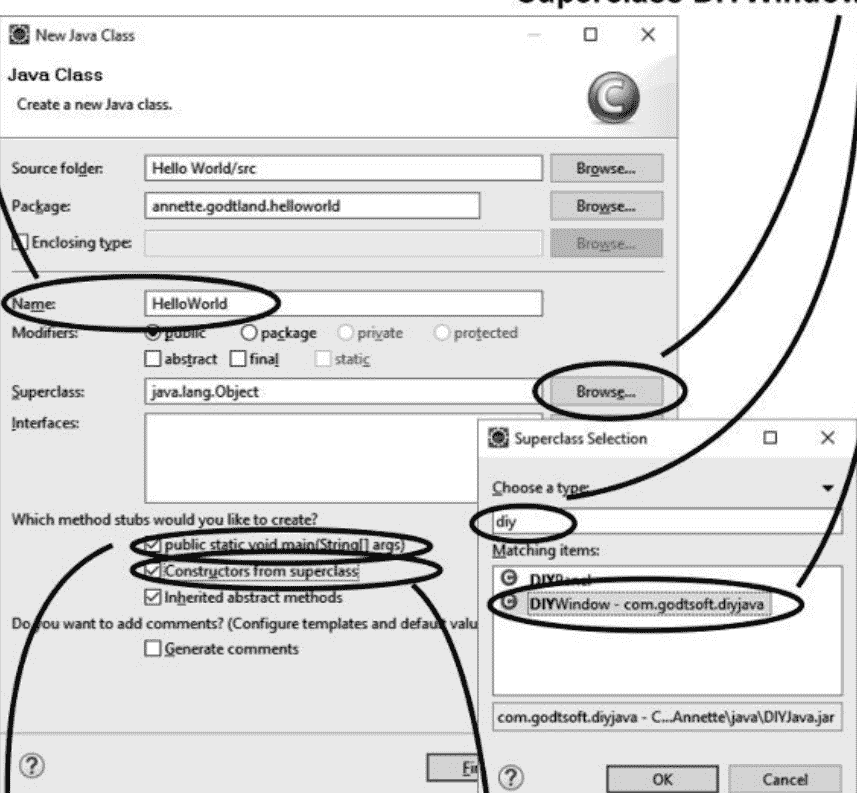

# 为 main() 创建存根

为构造函数创建存根

- 5. 点击 Finish（完成）创建该类。

Eclipse 将为 `HelloWorld` 类创建代码，看起来如下列表所示。

如果你将你的电子阅读器设置为较小的字体以减少自动换行，你可能会发现阅读书中的代码列表变得更容易。

代码列表 1-1，源自 `HelloWorld.java`

```java
package annette.godland.helloworld;

import com.godland.helloworld;

public class HelloWorld extends DIYWindow {
    public HelloWorld() {
        // TODO: 构造函数存根
    }

    public static void main(String[] args) {
        // TODO: 方法存根
    }
}
```

*(注：原文示例代码中import路径可能根据上下文略有差异，此处保持逻辑一致)* 修正：根据原文内容

```java
package annette.godland.helloworld;

import com.godland.helloworld;

public class HelloWorld extends DIYWindow {
    public HelloWorld() {
        // TODO: 构造函数存根
    }

    public static void main(String[] args) {
        // TODO: 方法存根
    }
}
```

Eclipse 添加了生成的注释。注释是以 `//` 开头的行，或者是以 `/*` 开头以 `*/` 结尾的代码组。

- 从以下列表中删除生成的注释。

代码列表 1-2，源自 `HelloWorld.java`

```java
package annette.godland.helloworld;

import com.godland.helloworld;

public class HelloWorld extends DIYWindow {
    public HelloWorld() {

        （此处删除注释）
    }
    public static void main(String[] args) {

        （此处删除注释）
    }
}
```

*(注：为符合翻译规范，此处严格遵循代码块不翻译)*

```java
package annette.godland.helloworld;

import com.godland.helloworld;

public class HelloWorld extends DIYWindow {
    public HelloWorld() {

    }

    public static void main(String[] args) {
    }
}
```

*(重新根据原文提供的代码块格式对齐)*：

```java
package annette.godland.helloworld;

import com.godland.helloworld;

public class HelloWorld extends DIYWindow {
    public HelloWorld() {

    }

    public static void main(String[] args) {
    }
}
```

*(抱歉，原文代码块显示较为碎片，以下为还原原文代码块内容的内容)*：


# 为项目命名

使用默认 JRE（1.7 或更高版本）。


- 点击 Libraries（库），然后点击 Add External JREs...（添加外部 JRE...），如下图所示。

# 库：添加外部 JAR


5. 浏览并选择 `DIYJava.jar`，这是你安装在 Java 工作文件夹中的文件，然后点击 Open（打开）。

6. 点击 Finish（完成）。

Package Explorer 视图（包资源管理器）面板现在列出了一个项目（Hello World），其中包含添加的 JAR 文件（`DIYJava.jar`），如图所示：


- 在 Hello World 项目中为你的 Hello World 程序创建一个包：

1. 右键点击 Hello World 项目，并选择 New/Package（新建/包）。

2. 将包命名为 `________.helloworld`，如下图所示。使用你自己的名字作为包名的一部分。我使用的包名是 `annette.godtland.helloworld`。

# 为包命名


3. 点击 Finish（完成）。

Package Explorer 视图面板显示了你在 Hello World 项目中创建的包，如图所示：


## 关键点及更多

- 在 Package Explorer 视图面板中右键可以创建 Java 项目和包。

- 为每个程序创建一个不同的 Java 项目。

- Eclipse 会在你的电脑上创建一个与 Java 项目同名的文件夹。请为你的 Java 项目取一个你希望在电脑上显示的文件夹名称。

  - 你现在在 Java 文件夹中有一个名为 Hello World 的文件夹。

  - 例如，每个单词的首字母大写，并在单词之间留空格，就像 Hello World 项目一样。

- 借助本书的帮助，在你创建的 Java 项目中添加 `DIYJava.jar`。

  - `DIYJava.jar` 是一个外部 JAR 文件。

  - `DIYJava.jar` 让编写在窗口中打印文本的程序变得简单。

- 将你的程序文件组织在 Java 项目的包中。

- 将通常一起使用的程序放在同一个包中。

  - 因为程序很小，所以大多数程序将只有一个包。

- 包命名规则：

  - 确保你的包名与其他人的包名不同。Java 程序员传统上使用他们的名字或业务名称作为包名的第一部分。

  - 使用小写字母且不留空格。

  - 在包名的不同类别之间使用句号。例如，如果包名标识了是谁创建了包以及该包的用途，请在创建者和用途之间加上句号。

- 确保在本书中创建 Java 项目时，选择了 Use an execution environment JRE of JavaSE-1.7 or higher 选项。一旦你在创建项目时选择了此选项，Eclipse 将对所有未来的 Java 项目默认使用该选项。

- Java 项目是 Eclipse 的；包是 Java 的。由于你正在使用 Eclipse，你将同时使用 Java 项目和包。如果你不使用 Eclipse 创建 Java 程序，你可能只会使用包。

# 第 2 章：类、超类和程序

Java 程序由一个或多个类组成。类包含实际的程序代码：按顺序执行以完成所需任务的指令。

每个类必须指定另一个类作为其超类。例如，打算在窗口中运行的程序必须指定某种窗口类作为其超类。

在本节中，你将创建第一个类：一个在 `DIYWindow` 中运行的程序。

## 尝试一下

使用 `DIYWindow` 类作为超类创建你的第一个类：

- 在 Package Explorer 视图面板中右键点击你的包，选择 New/Class（新建/类）。

- 类名输入 `HelloWorld`，如下所示。（提示：“Hello”和“World”之间没有空格。）

- 点击 Browse for Superclass（浏览超类）。

  - 在类型处输入 `diy`，选择 `DIYWindow`，如下所示，并点击 OK（确定）。

- 你想要创建哪些方法存根（stubs）？选择所示选项：

  - Public static void main(String[]) args。

  - Constructors from superclass（来自父类的构造函数）。

  - 是否勾选第三项 Inherit abstract methods（继承抽象方法）没有影响。

## 为类命名

# 浏览并选择超类 DIYWindow


# 为 `main()` 创建存根

为构造函数创建存根。

5. 点击 Finish（完成）创建该类。

Eclipse 将为 `HelloWorld` 类创建代码，看起来如下列表所示。

如果你将电子阅读器设置为较小的字体以减少自动换行，你可能会发现阅读书中的代码列表变得更容易。

代码列表 1-1，源自 `HelloWorld.java`

```java
package annette.godland.helloworld;
```

```java
import com.godland.helloworld;

public class HelloWorld extends DIYWindow {
    public HelloWorld() {
        // TODO: 构造函数存根
    }

    public static void main(String[] args) {
        // TODO: 方法存根
    }
}
```


- 借助本书的帮助在你创建的 Java 项目中添加 `DIYJava.jar`。
  - `DIYJava.jar` 是一个外部 JAR 文件。
  - `DIYJava.jar` 让编写在窗口中打印文本的程序变得简单。

- 将你的程序文件组织在 Java 项目的包中。
  - 将通常一起使用的程序放在同一个包中。
  - 因为程序很小，所以大多数程序将只有一个包。

- 包命名规则：
  - 确保你的包名与其他人的包名不同。Java 程序员传统上使用他们的名字或业务名称作为包名的第一部分。
  - 使用小写字母且不留空格。
  - 在包名的不同类别之间使用句号。例如，如果包名标识了是谁创建了包以及该包的用途，请在创建者和用途之间加上句号。

- 确保在本书中创建 Java 项目时，选择了 `Use an execution environment JRE of JavaSE-1.7 or higher` 的选项。一旦你在创建项目时选择了此选项，Eclipse 将对所有未来的 Java 项目默认使用该选项。

- Java 项目是 Eclipse 的；包是 Java 的。由于你正在使用 Eclipse，你将同时使用 Java 项目和包。如果你不使用 Eclipse 创建 Java 程序，你可能只会使用包。

# 第 2 ——类、超类和程序

Java 程序由一个或多个类组成。类包含实际的程序代码：按顺序执行以完成所需任务的指令。

每个类必须指定另一个类作为其超类。例如，打算在窗口中运行的程序必须指定某种窗口类作为其超类。

在本节中，你将创建第一个类：一个在 `DIYWindow` 中运行的程序。

## 尝试一下

使用 `DIYWindow` 类作为超类创建你的第一个类：

- 在 Package Explorer 视器面板中右键点击你的包，选择 New / Class（新建/类）。
- 类名输入 `HelloWorld`，如下所示。（提示：“Hello”和“World”之间没有空格。）
- 点击 Browse for Superclass（浏览超类）。
  - 在类型处输入“diy”，选择 `DIYWindow`，如下所示，并点击 OK（确定）。
- 你想要创建哪些方法存根（stubs）？选择所示选项：
  - `Public static void main(String[]) args.`
  - Constructors from superclass（来自父类的构造函数）。
  - 是否勾选第三项 Inherit abstract methods（继承抽象方法）没有影响。

## 为类命名

# 浏览并选择超类 `DIYWindow`


# 为 `main()` 创建存根

为构造函数创建存根。

- 5. 点击 Finish（完成）创建该类。

Eclipse 将为 `HelloWorld` 类创建代码，看起来如下列表所示。

如果你将你的电子阅读器设置为较小的字体以减少自动换行，你可能会发现阅读书中的代码列表变得更容易。

代码列表 1-1，源自 `HelloWorld.java`：

```java
package annette.godland.helloworld;
```

```java
import com.godland.helloworld;

public class HelloWorld extends DIYWindow {
    public HelloWorld() {
    }

    public static void main(String[] args) {
    }
}
```

原文代码块是：

```java
package annette.godland.helloworld;
```

```java
import com.godland.helloworld;

public class HelloWorld extends DIYWindow {
    public HelloWorld() {
    }

    public static void main(String[] args) {
    }
}
```


```java
public static void main(String[] args) {

}
```

`package annette.godland.helloworld;`

# 为项目命名

使用默认 JRE（1.7 或更高版本）。


- 点击 Libraries（库），然后点击 Add External JREs...（添加外部 JRE...），如下图所示。

# 库：添加外部 JAR


1. 浏览并选择 `DIYJava.jar`，这是你安装在 Java 工作文件夹中的文件，并点击 Open（打开）。
2. 点击 Finish（完成）。

Package Explorer 视图（包资源管理器）面板现在列出了一个项目（Hello World），其中包含了添加的 JAR 文件（`DIYJava.jar`），如图所示：


在 Hello World 项目中为你的 Hello World 程序创建一个包：

1. 右键点击 Hello World 项目，并选择 New/Package（新建/包）。
2. 将包命名为 `helloworld`，如下图所示。使用你自己的名字作为包名的一部分。我使用的包名是 `annette.godtland.helloworld`。

# 为包命名


3. 点击 Finish（完成）。

Package Explorer 视图面板显示了你在 Hello World 项目中创建的包，如图所示：


## 关键点及更多

- 在 Package Explorer 视图面板中右键可以创建 Java 项目和包。
- 为每个程序创建一个不同的 Java 项目。
- Eclipse 会在你的电脑上创建一个与 Java 项目同名的文件夹。请为你的 Java 项目取一个你希望在电脑上显示的文件夹名称。
  - 你现在在 Java 文件夹中有一个名为 Hello World 的文件夹。
  - 例如，每个单词的首字母大写，并在单词之间留空格，就像 Hello World 项目一样。
- 借助本书的帮助在你创建的 Java 项目中添加 `DIYJava.jar`。
  - `DIYJava.jar` 是一个外部 JAR 文件。
  - `DIYJava.jar` 让编写在窗口中打印文本的程序变得简单。
- 将你的程序文件组织在 Java 项目的包中。
- 将通常一起使用的程序放在同一个包中。
  - 因为程序很小，所以大多数程序将只有一个包。
- 包命名规则：
  - 确保你的包名与其他人的包名不同。Java 程序员传统上使用他们的名字或业务名称作为包名的第一部分。
  - 使用小写字母且不留空格。
  - 在包名的不同类别之间使用句号。例如，如果包名标识了是谁创建了包以及该包的用途，请在创建者和用途之间加上句号。
- 确保在本书中创建 Java 项目时，选择了 Use an execution environment JRE of JavaSE-1.7 or higher 的选项。一旦你在创建项目时选择了此选项，Eclipse 将对所有未来的 Java 项目默认使用该选项。
- Java 项目是 Eclipse 的；包是 Java 的。由于你正在使用 Eclipse，你将同时使用 Java 项目和包。如果你不使用 Eclipse 创建 Java 程序，你可能只会使用包。

# 第 2 章：类、超类和程序

Java 程序由一个或多个类组成。类包含实际的程序代码：按顺序执行以完成所需任务的指令。

每个类必须指定另一个类作为其超类。例如，打算在窗口中运行的程序必须指定某种窗口类作为其超类。

在本节中，你将创建第一个类：一个在 `DIYWindow` 中运行的程序。

## 尝试一下

使用 `DIYWindow` 类作为超类创建你的第一个类：

1. 在 Package Explorer 视图面板中右键点击你的包，选择 New / Class（新建/类）。
2. 类名输入 `HelloWorld`，如下所示。（提示：“Hello”和“World”之间没有空格。）
3. 点击 Browse for Superclass（浏览超类）。
   - 在类型处输入“diy”，选择 `DIYWindow`，如下所示，并点击 OK（确定）。
4. 你想要创建哪些方法存根（stubs）？选择所示选项：
   - Public static void main(String[]) args。
   - Constructors from superclass（来自父类的构造函数）。
   - 是否勾选第三项 Inherit abstract methods（继承抽象方法）没有影响。

## 为类命名

# 浏览并选择超类 DIYWindow


# 为 `main()` 创建存根

为构造函数创建存根。

5. 点击 Finish（完成）创建该类。

Eclipse 将为 `HelloWorld` 类创建代码，看起来如下列表所示。

如果你将你的电子阅读器设置为较小的字体以减少自动换行，你可能会发现阅读书中的代码列表变得更容易。

代码列表 1-1，源自 `HelloWorld.java`：

```java
package annette.godland.helloworld;
```

```java
import com.godland.helloworld;

public class HelloWorld extends DIYWindow {
    public HelloWorld() {
    }

    public static void main(String[] args) {
    }
}
```

注释是以 `//` 开头的行，或者是以 `/*` 开头、以 `*/` 结尾的代码组。

- 从以下列表中删除生成的注释。

代码列表 1-2，源自 `HelloWorld.java`：

```java
package annette.godland.helloworld;

import com.godland.helloworld;

public class HelloWorld extends DIYWindow {
    public HelloWorld() {
    }

    public static void main(String[] args) {
    }
}
```

## 快速修复

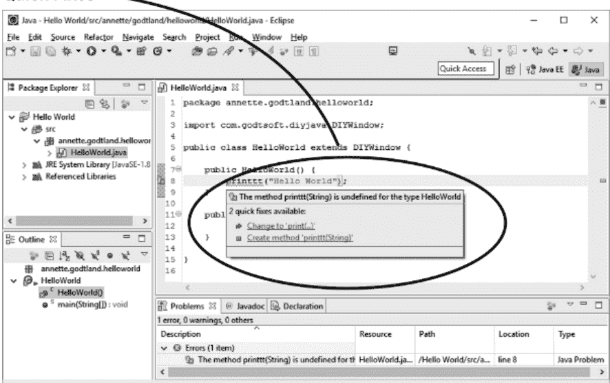

4. 点击将 Change 更改为 `print(...)` 的快速修复。

该操作将为你修复错误。

1. 保存更改。

所有错误指示都应该消失。

现在，尝试打印更多内容：

1. 修改代码让你的程序输出以下内容：

```text
Hello, earthling.

Take me to your leader.
```

来自 `HelloWorld.java` 的列表 1-6：

```java
public HelloWorld() {
    print("Hello, earthling.");
}
```

```java
print("________________");
}
...
```

在整个课程中，除非有语法错误，否则在每次修改代码后保存更改并运行程序。

打印了正确的行吗？如果没有，请修复代码并重试。

1. 你认为需要打印什么才能在两个句子之间插入一个空行，如下所示？（提示：你希望在该行上不打印任何内容。）

```text
Hello, earthling.
Take me to your leader.
```

来自 `HelloWorld.java` 的列表 1-7：

```java
public HelloWorld() {
    print("Hello, earthling.");
    print("\n");
    print("Take me to your leader.");
}
...
```

## 关键点及更多

- Java 程序由类（classes）组成。每个程序都需要其中一个类包含一个 `main()` 方法。
- `main()` 方法必须写为 `public static void main(String[] args)`。随后的课程将解释这些词的含义。
- 多个类通常被一起使用创建一个程序。然而，书中的大多数程序仅由一个类组成。
- 每个类都必须有一个父类（superclass）。任何类都可以用作父类。你将在后的课程中创建你自己的父类。
- 具有相同父类的类被认为是相同类型。例如，你为书中每个程序创建的主类都将使用 `DIYWindow` 类作为其父类。因此，书中的每个程序都是 `DIYWindow` 的类型。
- 要创建类，请在 Package Explorer（包管理器）面板格中点击右键。
  - 类名可以包含数字、字母、美元符号和下划线。美元符号和下划线通常不使用。
  - 类名不允许包含空格或点。
  - 类名不能以数字开头。
  - 类名通常以大写字母开头。
  - 如果类名包含多个单词，每个单词的首字母通常大写，其余字母为小写。
- 类可以有一个或多个构造函数（constructors）。
  - 构造函数的命名与类名相同，且必须声明为 `public`。构造函数将在随后的课程中解释。
  - 通过使用 `new` 后跟构造函数名和括号来调用构造函数。例如，`main()` 方法中的 `new HelloWorld()` 调用了 `HelloWorld` 构造函数。
- 代码块被包含在大括号 `{ }` 中，每行代码都以分号结尾。
  - 每个 Java 程序都首先运行 `main()` 方法。
  - 在书中所有的程序中，`main()` 方法都会调用类的构造函数。因此，`main()` 方法首先运行，然后是类的构造函数。
- 大括号内的每个语句都会按照它们在代码中出现的顺序逐一执行。
- 代码行之间的空行对代码的运行没有影响。添加空行是为了让代码更易读。
- `print()` 语句将括号中的文本打印到窗口。
- 每个 `print()` 语句都会在一个新行打印。
- 要打印空行，请使用带有空括号的 `print()`。
- `print()` 方法是 `DIYWindow` 的一部分，位于 `DIYJava.jar` 中。这就是为什么你向项目添加了外部 JAR 文件 `DIYJava.jar`，以及为什么你选择 `DIYWindow` 作为 `HelloWorld` 类的父类。
- 注释是以 `//` 开头的行，或者是以 `/*` 开始并以 `*/` 结束的一行。

# 第 7 章：面向对象编程

你之前已经了解到 Java 是一种面向对象的编程语言。因此它支持这种编程范式的基本原理。对象（Object）指的是真实的实体，如包、汽车、椅子或笔。面向对象的编程语言允许程序员设计使用对象和类的程序。它们提供并支持可以简化软件开发和维护的特性。这种编程范式的核心概念如下：

- 对象（Objects）
- 类（Classes）
- 方法（Method）
- 继承（Inheritance）
- 抽象（Abstraction）
- 多态（Polymorphism）
- 消息解析（Message Parsing）
- 封装（Encapsulation）

## 对象

在现实世界中，你会遇到人类、狗、汽车和猫等对象。这些对象拥有状态和行为。例如，当你想到猫时，它的状态可以由它的品种、颜色或名称组成。它的行为可能是跑步、跳跃或摇尾巴。

软件对象在特征上与现实对象相似。它的状态保存在字段（fields）中，它的行为通过方法（methods）表现出来。

在开发过程中，方法在对象的内部状态上执行，方法促进了对象之间的通信。

## 类

类用于设定对象的定义。这些规范充当创建对象的蓝图。虽然它们是创建对象的蓝图，但它们本身并不是对象。

```java
public class Cat {
    String breed;
    int age;

    void running() {
    }

    void sleeping() {
    }

    void jumping() {
    }
}
```

以下是一个类的示例：

```java
public class Cat {
    public Cat() {
    }

    public Cat(String breed) {
        this.breed = breed;
    }
}
```

## 如何访问方法和实例变量

创建的对象被用于访问方法和实例变量。要访问实例变量，你将遵循以下步骤：

首先，你必须创建一个对象：

```java
ObjectName = New Constructor();
```

接下来，调用变量，例如：

```java
ObjectName.variableName;
```

调用类方法：

```java
ObjectName.MethodName();
```

## Java 包（Package）

包简单来说是接口和类的一种分组方式。Java 包充当类的容器。它是功能分组的常用依据。使用包可以提高代码的可用性。当接口和类被归类到不同的包中时，你可以轻松地访问它们并在其他程序中使用。使用包还有助于防止类和接口之间的命名冲突。

要创建一个包，请在包名之前使用 `package` 语句，并将其作为第一条语句。

```java
package myypack:

public class students
{
    ...statement:
}
```

这里有一个示例：

## 导入语句（Import Statement）

你可以使用 `import` 关键字将包导入到你的源文件中。导入语句使编译器能够轻松找到类或源代码的位置。

你可能只想从一个包中导入一个类。你可以使用点运算符（`.`）指定包和类。例如：

```java
import java.util.Date;

class MyDate extends Date {
    // statement
}
```

要导入一个包中的所有类，你可以在点运算符后使用通配符 `*`。例如：

```java
import java.io.*;
```


## 修饰符 (Modifiers)

修饰符是改变你代码中定义含义的关键字。Java 提供了几种修饰符。

## 访问修饰符 (Access Modifiers)

访问修饰符用于定义方法、变量、类和构造函数的访问级别。

### 私有—仅在类内访问

当一个方法、变量、类或构造函数被声明为 `private` 时，意味着它只在类内部可用。然而，如果该类具有公共的 getter 方法（get 方法），你可能可以在类外部访问私有变量。`private` 关键字表示最高的访问限制。请注意，你不能将接口和类声明为 `private`。

### 公有—对所有人可见

定义为 `public` 的方法、接口、类等可以从其他类访问。同样，定义在 `public` 类内部的块、方法或字段可以从 Java 类访问。只要它们在同一个包中，这一点就成立。如果你想从另一个包访问公共类，你将必须导入该公共类。在类继承的概念下，子类继承类所有的公共变量和方法。

请注意，应用程序的 `main()` 方法必须声明为 `public`，Java 解释器才能调用它来运行该类。

### 保护性—对所有子类和包可见

在父类中将方法、变量或构造函数声明为 `protected`，会使其仅对该包内的类或另一个包中的子类可见。如果你想允许子类使用变量或辅助方法，并防止无关类使用它们，则使用这种访问类型。接口及其下方的字段和方法不应声明为 `protected`，但接口外的字段和方法可以声明为 `protected`。类不应被声明为 `protected`。

### 默认：当未提供修饰符时适用—对包可见

没有声明修饰符的方法或变量可以被包内的其他类访问。

下表总结了不同的访问修饰符及其影响：

| 修饰符 | 类内部 | 包内 | 包外 | 包外（子类） |
|---|---|---|---|---|
| Private | Y | N | N | N |
| Public | Y | Y | Y | Y |
| Protected | Y | Y | Y | N |
| Default | Y | Y | N | N |

## 非访问修饰符 (Non-access Modifiers)

非访问修饰符可用于 Java 中的各种功能。

### Final—用于对变量、方法和类的实现进行终极处理

### Final 变量

你只会显式地初始化一次 `final` 变量。当你将一个变量声明为 `final` 时，你永远无法将其重新赋值给另一个对象。但请注意，你仍然可以存储在对象内部的数据。这意味着虽然你可以更改对象的状态，但不能更改引用。`final` 修饰符通常与 `static` 配合使用，用常量值创建一个类变量。

### Final 方法

`final` 关键字用于防止方法被子类修改。

### Final 类

`final` 修饰符用于防止其他类继承声明为 `final` 类的任何特性。

### Static—用于创建类方法或变量

你可以使用此关键字创建一个唯一的变量（称为静态变量或类变量），它将独立于类的其他实例存在。你不能将局部变量声明为 `static`。

你还可以使用 `static` 关键字创建一个方法（称为静态方法或类方法），它将独立于类的其他实例存在。静态方法只识别并处理来自给定参数的数据，而不考虑变量。

你可以通过在类名和点运算符（`.`）之后编写变量或方法名来访问类方法和类变量。

### 抽象—用于创建抽象方法或抽象类

### 抽象类

当一个类被声明为 `abstract` 时，意味着你永远无法实例化该类。将类声明为 `abstract` 的唯一原因是扩展该类。你不能将一个类同时声明为 `final` 和 `abstract`，因为你无法扩展一个 `final` 类。使用抽象方法的类必须声明为 `abstract`。未这样做会导致编译错误。

### 抽象方法

由于抽象方法在声明时没有实现，其方法体派自子类。抽象方法不能声明为严格的（strict）或 `final`。除非本身是抽象类，否则扩展抽象类的类必须采用父类的抽象方法。

```java
abstract class Car {

    private double price;

    private String type;

    private String year;

    public abstract void goFast(); // 抽象方法

    public abstract void changeColor();

}
```

示例：

## 同步 (Synchronized)

`synchronized` 修饰符用于指示在任何时刻只有一个线程可以访问方法。你可以配合任何访问级别修饰符使用此关键字。

```java
public synchronized void showInfo() {

    ******

}
```

示例：

## Volatile

此关键字用于指示访问 `volatile` 变量的应该将其私有副本与存储在内存中的主副本合并。实际上，它将所有缓存变量同步到主内存。你只能用此修饰符定义私或对象类型的实例变量。

```java
public class MyRunnable implements Runnable {

    private volatile boolean active;

    public void run() {

        active = true;

        while (active) // 第 1 行

            // 代码代码

        }

    }

    public void stop() {

        active = false; // 第 2 行

    }

}
```

示例：

## 瞬态 (Transient)

`transient` 关键字用于告诉编译器在序列化包含被标记变量的对象时跳过该实例变量。

```java
public transient int limit = 50; // w 不持久化
```

示例：

# 第 8 章 决策结构与循环控制

决策结构用于此类场景：即当条件为真时执行一组指令，当条件被确定为假时执行另一组指令。Java 提供了几种结构用于此类场景的编程。这些结构包括—

## if 语句

该语句用于需要测试条件的情况，如果发现条件为真（true），则需要执行跟随在该语句后的代码块。该构造的语法为—

```
if(condition){

/*体部分*/

}
```

以下是该构造示例实现—

```java
public class ifDemo {

  public static void main(String[] args) {

    int i = 10;

    int j = 1;

    if(i>j){

      System.out.print(i);

    }

  }

}
```

## if-else 语句

该语句用于需要测试条件的情况，如果发现条件为真（true），则执行跟随在该语句后的代码块；否则执行跟随 `else` 语句后的代码块。该构造的语法为—

```
if(condition){

/*体部分*/

}

else{

/*体部分*/

}
```

以下是该构造示例实现—

```java
public class ifElseDemo {

public static void main(String[] args) {

int i = 1;

int j = 0;

if(i>j){

System.out.print(i);

}

else{

System.out.print(j);

}

}

}
```

## 嵌套 if 语句

该语句用于需要测试条件的情况，如果发现条件为真（true），则执行跟随在该语句后的代码块；否则测试下一个条件。如果发现该条件为真（true），则执行与该条件对应的 `if` 语句的代码块。如果没有一个条件为真（true），则执行跟随 `else` 语句后的代码块。可以使用嵌套的 `if` 语句测试多个条件。该构造的语法为—

```
if(condition1) {

/*体部分*/

}

else if (condition2) {

/*体部分*/

}

else {

/*体部分*/

}
```

以下是该构造示例实现—

```java
public class nestedIfDemo {

    public static void main(String args[]) {

int i = 0;

int j = 0;

if(i>j) {

System.out.print(i);

}

else if(j>i) {

    System.out.print(j);

}

else {

    System.out.print("Equal");

}

}

}
```

## switch

如果你有一个变量，并且需要根据该变量的不同值执行不同的代码块，那么理想的构造是 `switch` 语句。该构造的语法为—

```
switch(variable){

case <value1>:

    /*体部分*/

    break;

case <value2>:

    /*体部分*/

    break;

case <value3>:

    /*体部分*/

    break;

default:

    /*体部分*/

    break;

}
```

以下是该构造示例实现—

```java
public class switchDemo {

    public static void main(String[] args) {

        int i = 5;

        switch (i) {

case 0:

    System.out.print(0);

    break;

case 2:

    System.out.print(2);

    break;

case 5:

    System.out.print(5);

    break;

default:

    System.out.print(999);

    break;

}

}

}
```

## 条件运算符

Java 还支持条件运算符，也称为三元运算符。该运算符用于替换 `if else` 构造。其语法如下—

`Expression1? Expression2 : Expression3`

这里，`Expression1` 是有待测试的条件。如果条件为真（true），则执行 `Expression2`，否则执行 `Expression3`。

## 循环控制

有几种情况需要你多次执行同一组指令。例如，如果你需要对一组数字进行排序，你将需要多次扫描和重新排列，以获得理想的顺序。这种执行流被称为循环控制。

简单来说，循环是一种允许多次执行代码块的构造。Java 支持几种可用于实现循环的构造，包括 `while` 循环、`for` 循环和 `do while` 循环。

`while` 循环反复执行代码块，直到为 `while` 循环指定的条件为真（true）为止。一旦该条件失败，`while` 循环就会停止。

`for` 循环允许程序员在同一个构造中操纵条件和循环变量。因此，你可以初始化循环变量，对其进行递增/递减，并运行循环直到该变量的条件为真（true）。

`do while` 循环与 `while` 循环类似。然而，在 `while` 循环中，是在执行代码块之前检查条件。另一方面，在 `do while` 循环中，先执行代码块，然后检查条件。如果满足条件，则再次启动循环执行，否则终止循环。可以说，`do while` 循环一旦实现，至少会执行一次。

## 循环语句

有两个专门与循环关联的关键字，它们也被称为控制语句，因为它们允许将控制权从代码的一个部分转移到另一个部分。这些关键字是—

## Break

该关键字用于循环内部，在您希望执行流终止循环并直接从循环后的第一条指令开始执行的地方。

## Continue

该关键字用于循环内部，程序员希望计算机跳过循环剩余部分的地方。

## for Loop 实现

```java
public class forDemo {

    public static void main(String args[]) {

        int[] numArray = {1, 2, 3, 4, 5};

        for(int i=0; i<5; i++) {

            System.out.print(numArray[i]);

            System.out.print(",");

        }

        System.out.print("\n");

    }

}
```

## while Loop 实现

```java
public class whileDemo {

  public static void main(String[] args) {

    int[] numArray = {1, 2, 3, 4, 5};

    int i = 0;

    while(i<5) {

      System.out.print(numArray[i]);

      System.out.print(",");

      i++;

    }

    System.out.print("\n");

  }

}
```

# do Loop 实现

```java
public class doWhileDemo {

    public static void main(String[] args) {

        int[] numArray = {1, 2, 3, 4, 5};

        int i = 0;

        do {

            System.out.print(numArray[i]);

            System.out.print(",");

            i++;

        } while (i<5);

        System.out.print("\n");

    }

}
```

# 增强型 for 循环

Java 还支持增强型循环结构，可用于数组元素。其语法为—

```
for(declaration : expression) {

/*体部分*/

}
```

增强型循环的示例实现如下—

```java
public class forArrayDemo {

public static void main(String[] args) {

int[] numberArray = {1, 2, 3, 4, 5};

for(int i : numberArray) {

System.out.print(i);

System.out.print(",");

}

System.out.print("\n");

}

}
```

## 异常层次结构

Java 有一个名为 `java.lang.Exception` 的内置类，所有异常都属于该类。所有的异常类都是该类的子类。此外，`Throwable` 类是异常类的父类。`Throwable` 的另一个子类是 `Error` 类。上述所有的错误都属于该类。

`Exception` 有两个子类，即 `RuntimeException` 类和 `IOException` 类。`Throwable` 类中定义的方法列表如下：

```java
public String getMessage()
```

调用时，该方法将返回所遇异常的详细描述。

```java
public Throwable getCause()
```

该方法在调用时返回一个包含异常原因的消息。

```java
public String toString()
```

该方法返回详细描述与类名连接后的结果。

```java
public void printStackTrace()
```

通过调用此方法可以将 `toString()` 的结果以及堆栈跟踪打印到标准错误流 `System.err`。

```java
public StackTraceElement [] getStackTrace()
```

在某些场景下你可能需要访问栈跟踪的不同元素。该方法返回一个数组，栈跟踪的每个元素保存到数组的不同元素中。数组的第一个元素包含栈跟踪的顶部元素，而栈跟踪的底部保存在数组的最后一个元素中。

```java
public Throwable fillInStackTrace() {
```

将当前堆栈跟踪的内容附加到堆栈跟踪的之前信息之后，并以数组的形式返回。

## 捕获异常

捕获异常的标准方法是使用 `try and catch` 关键字及其代码实现。此 `try and catch` 块的实现方式需要包含可能抛出异常的代码。这里还需要说明的是，可能抛出异常的代码被称为受保护代码。`try and catch` 块实现的语法如下——

```java
try {

    /*Protected code*/

} catch(ExceptionName exc1) {

    /*Catch code*/

}
```

将可能抛出异常的代码放在 `try` 块中。如果抛出异常，则在 `catch` 块中实现相应的异常处理操作。对于每一个 `try` 块都必须有一个 `catch` 块或 `final` 块。

作为 `catch` 语句的一部分，需要声明可能抛出的异常。当发生异常时，执行流将转移到 `catch` 块。如果抛出的异常与 `catch` 块中定义的异常匹配，则执行该 `catch` 块。

下面给出了 `try and catch` 块的一个示例实现。该代码实现了一个包含 2 个元素的数组。然而，代码尝试访问并不存在的第三个元素。结果是抛出了异常。

```java
import java.io.*;

public class demoException {
```


`public static void main(String args[])` {

    try {

        int arr[] = new int[2];

        System.out.println("Accessing the 3rd element of the array:" + arr[3]);

    } catch(ArrayIndexOutOfBoundsException exp) {

        System.out.println("Catching Exception:" + exp);

    }

    System.out.println("Reached outside catch block");

}

## 实现多个 `catch` 块

一个代码块可能会导致多个异常。为了满足这一需求，允许实现多个 `catch` 块。此类实现的语法如所示。

```java
try {

    /*Protected Code*/

} catch(ExpType1 exp1) {

    /*Catch block 1*/

} catch(ExpType2 exp2) {

    /*Catch block 2*/

} catch(ExpType3 exp3) {

    /*Catch block 3*/

}
```

上述语法演示了三个 `catch` 块的实现。然而，你可以实现任意数量的 `catch` 块。当执行此代码时，首先执行受保护代码。如果发生异常，会将异常类型与第一个 `catch` 块中的异常进行匹配。但如果异常类型不匹配，则忽略第一个 `catch` 块，并尝试匹配第二个 `catch` 块的异常类型。哪一个 `catch` 块的异常类型与抛出的异常类型相同，就执行对应的 `catch` 块。

# 第 9 章 ADT、数据结构与 Java 集合

## 抽象数据类型 (ADT)

抽象数据类型（ADT）是对数据及其允许在其进行的操作的逻辑描述。ADT 定义为从用户的角度观察数据。ADT 关注数据的可能值及其暴露的接口。ADT 并不关心数据结构的具体实现。

例如，用户想要存储一些整数并找到它们的平均值。该数据结构的 ADT 将支持两个函数：一个用于添加整数，另一个用于获取平均值。该数据结构的 ADT 不会讨论具体将如何实现它。

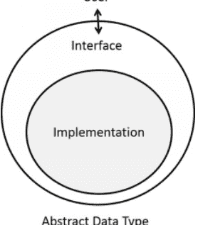

## 数据结构

数据结构是数据的具体表示，被定义为从程序员的角度观察数据。数据结构表示了数据如何在内存中存储。所有数据结构都有其优缺点。根据问题的类型，我们选择最适合问题的数据结构。

例如，我们可以将数据存储在数组、链表、栈、队列、树等中。

注意：在本章中，我们将学习各种数据结构及其 API。这样用户就可以在不了解其内部实现的情况下使用它们。

## JAVA 集合框架

JAVA 编程语言提供了一个 JAVA 集合框架（JAVA Collection Framework），这是一组高质量、高性能且可重用的数据结构和算法。

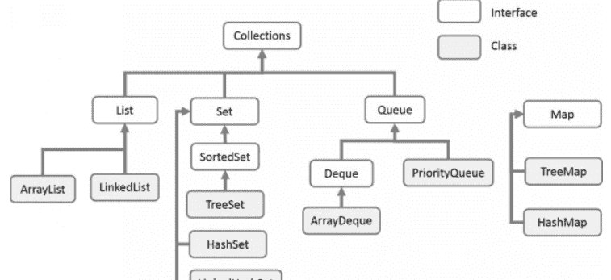

使用 JAVA 集合框架的以下优势如下：

- 1. 程序员不需要重复实现基础的数据结构和算法。从而避免了重复造轮子。因此，程序员可以将更多精力投入到业务逻辑中。
- 2. JAVA 集合框架的代码是经过良好测试的高质量、高性能代码。使用它们可以提高程序的质量。
- 3. 由于集合框架中实现的基础数据结构和算法可以被重用，开发成本得以降低。
- 4. 易于审查和理解其他开发者编写程序，因为大多数 Java 开发者都使用集合框架。此外，集合框架有良好的文档。

### 数组

数组表示多个相同类型元素的集合。

## 数组操作

- 1. 向数组中添加元素。
- 2. 访问数组中的值。
- 3. 替换数组中的值。示例：

```java
public class Array {

    public static void main(String args[]) {

        int[] arr = new int[10];

        for (int i = 0; i < 10; i++) {

            arr[i] = i;

        }

    }

}
```

### 数组

数组是固定长度的。我们不知道存储多少元素，从而避免了重复造轮子。

## ArrayList

`ArrayList` 是一个可以伸缩的动态数组。它实现了 `List` 接口。

示例：

```java
import java.util.ArrayList;

public class ArrayListDemo {

    public static void main(String args[]) {

        ArrayList<Integer> al = new ArrayList<>();

        al.add(1);

        al.add(2);

        System.out.println("Contents of Array: " + al);

        System.out.println("Array Size: " + al.size());

        System.out.println("Array IsEmpty: " + al.isEmpty());

        al.remove(al.size()-1); // 删除了数组最后一个元素

        System.out.println("Array IsEmpty: " + al.isEmpty());

    }

}
```

输出：

```
Contents of Array: [1, 2]
Array Size: 2
Array IsEmpty: false
```

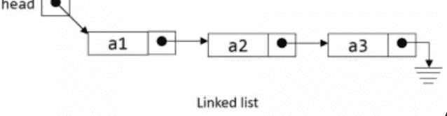

```
Array IsEmpty: true
```

## 链表

链表是一种动态数据结构，内存在运行时分配。从性能来说，链表比数组慢，因为无法直接访问链表元素。当我们预先不知道要存储元素数量时，链表是一种非常有用的数据结构。链表有很多类型：线性、环形、双向、循环循环等。

## 链表 ADT 操作

- `Insert(k)`: 将 `k` 插入到列表开头。
- `Delete()`: 删除列表开头的元素。
- `PrintList()`: 显示列表中的所有元素。
- `Find(k)`: 查找值为 `k` 的元素的位置。

注意：二分查找不适用于链表。

## `FindKth(k)`: 查找位置在 `k` 的元素

从第一个元素开始，顺着链表链接直到到达第 `kth` 个元素。此操作耗时为 `O(N)`。

`IsEmpty()`: 检查列表中的元素数量是否为零。

只需检查列表的头指针，如果它为 `Null`，则列表为空，否则不为空。此操作耗时为 `O(1)`。

# JAVA Collections 中的 LinkedList（链表）实现

JAVA Collections 中的 `LinkedList<E>` 是一种也实现了 `List<E>` 接口的数据结构。

示例：

```java
import java.util.LinkedList;

public class LinkedListDemo {

    public static void main(String[] args) {

        LinkedList<Integer> ll = new LinkedList<Integer>();

        ll.addFirst(2); // 8 被添加到列表。

        ll.addLast(10); // 9 被添加到列表末尾。

        ll.addFirst(1); // 7 被添加到列表头部。

        ll.addLast(11); // 20 被添加到列表末尾

        System.out.println("Contents of Linked List: " + ll);

        ll.removeFirst();

        ll.removeLast();

        System.out.println("Contents of Linked List: " + ll);

    }

}
```

输出：

```
Contents of Linked List: [1, 2, 10, 11]
Contents of Linked List: [2, 10]
```

## Stack（栈）

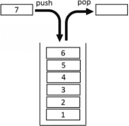

栈是一种特殊的数据结构，遵循后进先出（LIFO）策略。这意味着最后添加的元素将第一个被移除。

栈的各种应用包括：

- 递归：递归调用使用系统栈实现。
- 1. 表达式的后缀求值。
- 2. 使用栈实现的回溯。
- 3. 树和图的深度优先搜索。
- 4. 将十进制数转换为二进制数等。

## Stack ADT 操作

`Push(k)`: 将值 `k` 添加到栈顶。

`Pop()`: 从栈顶移除元素并返回其值。

`Top()`: 返回栈顶元素的值。

`Size()`: 返回栈中元素的数量。

`IsEmpty()`: 确定栈是否为空。如果栈为空返回 `true`，否则返回 `false`。

注意：以上所有栈操作均在 `O(1)` 时间复杂度内实现。

# JAVA Collection 中的 Stack 实现

栈通过调用 `Stack<T>` 类的 `push` 和 `pop` 方法来实现。

示例：

```java
public class StackDemo {

    public static void main(String[] args) {

        Stack<Integer> stack = new Stack<Integer>();

        int temp;

        stack.push(1);

        stack.push(2);

        stack.push(3);

        System.out.println("Stack : "+stack);

        System.out.println("Stack size : "+stack.size());

        System.out.println("Stack pop : "+stack.pop());

        System.out.println("Stack top : "+stack.peek());

        System.out.println("Stack isEmpty : "+stack.isEmpty());

    }

}
```

输出：

```
Stack : [1, 2, 3]
Stack size : 3
Stack pop : 3
Stack top : 2
Stack isEmpty : false
```

栈也可以通过调用 `ArrayDeque<T>` 类的 `push` 和 `pop` 方法来实现。

JDK 同时提供了 `ArrayDeque<T>` 和 `Stack<T>`。我们可以使用这两个类。但 `ArrayDeque<T>` 有一些优势。

- 1. 第一个原因是 `Stack<T>` 没有继承自 `Collection` 接口。
- 2. 第二 `Stack<T>` 继承自 `Vector<T>`，因此可以随机访问，这破坏了栈的抽象性。
- 3. 第三 `ArrayDeque` 相比 `Stack<T>` 效率更高。

## Queue（队列）

队列是一种先进先出（FIFO）的数据结构。先进入队列的元素将第一个被移除，以此此类推。

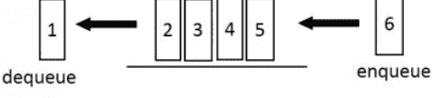

队列有以下应用场景：

- 1. 共享资源的访问（例如，打印机）
- 2. 多程序设计
- 3. 消息队列
- 4. BFS，图或树的广优先遍历使用队列实现。

Queue ADT 操作：

`Add(K)`: 将新元素 `k` 添加到队列末尾。

`Remove()`: 从队列头部移除元素并返回其值。

`Front()`: 返回队列头部元素的值。

`Size()`: 返回队列内部元素的数量。

`IsEmpty()`: 如果队列为空返回 1，否则返回 0

注意：以上所有队列操作均在 `O(1)` 时间复杂度内实现。

# JAVA Collection 中的 Queue 实现

`ArrayDeque<T>` 是双端队列的类实现。如果我们使用 `add()`、`remove()` 和 `peek()`，它的行为会像一个队列。（此外，如果我们使用 `push()`、`pop()` 和 `peekLast()`，它的行为会像一个栈）。

示例：

```java
import java.util.ArrayDeque;

public class QueueDemo {

    public static void main(String[] args) {

        ArrayDeque<Integer> que = new ArrayDeque<>();

        que.add(1);

        que.add(2);

        que.add(3);

        System.out.println("Contents of Linked List: " + que);

        System.out.println("Queue size : " +que.size());

        System.out.println("Queue peek : " +que.peek());

        System.out.println("Queue remove : " +que.remove());

        System.out.println("Queue isEmpty : " +que.isEmpty());

    }

}
```

*(注：原文示例代码中打印语句误用了 Linked List 和 Stack 字样，此处保持原意翻译但根据上下文理解为队列操作)*

输出：

```
Contents of Linked List: [1, 2, 3]
Queue size : 3
Queue peek : 1
Queue remove : 1
Queue isEmpty : false
```

```java
}
```


## 向文本文件写入

你可以使用其中一种写入方法向文件写入字节或行。写入方法包括：

- `Write(Path, byte[], OpenOption...)`
- `Write(Path, Iterable<? extends CharSequence>, Charset, OpenOption...)`

## 重命名和删除文件

### 重命名

在 Java 中，`File` 类中有一个名为 `renameTo(fileName)` 的方法，我们可以使用它来重命名文件。

### 删除文件

使用 Java 程序保存的文件将被永久删除，而不会移动垃圾箱/回收站。使用 `java.io.File.delete` 会从文件或文件夹中删除此抽象路径。使用 `java.nio.file.Files.deleteIfExists` 会删除存在的文件夹。如果文件夹未打开，它也会删除路径列出的文件夹。

# Java 高级主题

## 泛型

在任何非复杂的软件项目中，bug 都是生活的常态。细致的规划、编程和测试可能有助于减少无处不在，但无论它们如何，它们总会找到办法进入你系统的某个地方。随着新功能的引入以及你代码库规模和复杂性的增加，这一点变得尤为明显。

幸运的是，检测 bug 比其他问题更容易容易。例如，编译时 bug 可以很快被识别；你可以使用编译器的错误代码来确定问题所在并立即解决。然而，运行时 bug 可能要困难得多；它们并不总是立即发生，当它们发生时，可能处于程序中距离问题真实原因很远的地方。泛型通过使在编译时识别更多 bug 可可行，从而帮助稳定你的软件。

简而言之，泛型在定义类、接口和技术时允许为类型（类和对象）指定参数。就像在方法声明中使用的更熟悉的形式参数一样，类型参数为你提供了不同的输出，以重用相同的代码。其区别在于，值是形式参数的输入，而类型是类型参数的答案。与非泛型代码相比，使用泛型有许多优势。通过使用泛型，程序员可以引入操作于不同类型集合的泛型算法，这些算法是可定制的，并且更安全、更易于阅读。

## 泛型类型

泛型形式是一个类型参数化的泛型类别或接口。可以通过修改一个简单的箱类来展示这一概念。考虑一个可以处理任何对象的非泛型箱类。它需要提供两个方法：`set`（向箱中添加项）和 `get`（检索它）。由于它们的方法接受或返回对象，你可以随意传递任何你想要的内容，只要它不是原始类型之一。在编译时无法检查该类是如何被使用的。软件的一个部分可能向箱中放入一个整数并期望从中取出整数，而软件的另一部分错误地处理了一个字符串，导致运行时出现错误。

由角括号（`<`）委托的类型参数部分显示了形式的标题（也称为类型的因子）`T1`、`T2` 直到 `T`。你通过将文件 `"generic class box"` 修改为 `"generic class box <>"` 来生成泛型类型语句，将箱类别更新为泛型。这引入了类型变量 `T`，它可以在类内部任何地方使用。这用所有的 `Object` 事件替换为 `T`。你指定的任何非原始类型都可以作为类型变量：任何类型的类、任何类型的接口、任何类型的数组，甚至是某些其他类型变量。这种方法也可以同样应用于泛型接口。

按照惯例，类型标识符是单个大写字母。这与你已经熟悉的变量命名规范形成了鲜明对比，并且有一个充分的理由：如果没有这种惯例，很难区分类型变量与普通类或对象名称的区别。

最常用的类型参数名称是：

- `E` - Element（元素，Java 集合框架广泛使用）
- `K` - Key（键）
- `N` - Number（数字）
- `T` - Type（类型）
- `V` - Value（值）
- `S`、`U`、`V` 等——第二、第三、第四种类型

你会在整个 JDK 和 API 中看到这些名称。

## 调用和实例化泛型类型

要在你的系统中提及泛型箱类别，必须执行泛型类型调用，将 `T` 带来一个特定的具体值，例如 `Integer`：

```java
Box<Integer> integerBox;
```

你可能认为泛型排序的调用可以与普通的过程调用相比，但并不是为过程添加断言，而是将类型参数（在此例中为 `Integer`）传递到箱类别本身。

许多设计者交替使用“类型参数”和“类型语句”这两个词，但定义不同。在编码时，为了生成参数化类型，需要提供排序参数。因此，`Foo < T >` 中的 `T` 是类型参数，而 `Foo < String > f` 是类型争用。在使用这些词时，本类遵循这一概念。

与任何其他变量语句一样，此软件并没有生成箱的全新项。它只是说明 `integerBox` 将有一个“Integer 箱”的引用，这就是读取 `Box < Integer>` 的方式。泛型类型调用通常被称为参数化类型。

要实例化这个类，像 usual 一样使用 `new` 关键字，但将 `<Integer>` 放在类名括号之间：

```java
Box<Integer> integerBox = new Box<Integer>();
```

## 菱形

在 Java 的最新版本中，只要编译器能够确定或从上下文中推类型参数，你就可以用空类型参数集（`<>`）替换调用泛型类所需的类型参数。这个角括号 `<>` 被称为“菱形”。例如，可以使用之前的声明生成 `Box < Integer>` 的实例：

```java
Box<Integer> integerBox = new Box<>();
```

## 泛型方法

泛型技术是实现自己的排序的技术。这与泛型声明相似，但类型参数的作用范围限于声明它的方法。除了泛型类构造函数外，允许静态和非静态泛型技术。泛型方法的语法涉及返回类型之前角括号内的参数列表。对于静态泛型技术，类型参数部分必须返回类型之前。`Util` 类涉及 `compare`，一个比较两个 `Pair` 项的泛型技术。

```java
Pair<Integer, String> ex1 = new Pair<>(49, "string1");
```

```java
Pair<Integer, String> ex2 = new Pair<>(64, "string2");
```

```java
boolean comparison = Util.<Integer, String>compare(ex1, ex2);
```

# 边界类型参数

有时你想限制用于参数化类型的种类。例如，处理数字的技术只能识别 `Number` 情况或其子类。这就是排序参数的用途。

列出类型参数的名称以指示定义的类型参数，配以扩展关键字，然后是上界，在本例中是 `Number`。注意 `extends` 在此上下文中泛指“extends”（在类中）或“implements”（在接口中）。

## 多重边界

类型参数可以有多个边界。具有多个边界的类型变量是边界中列出的所有类型的子类型。如果其中一个边界是类，则必须第一个指定。例如：

```java
Class X { /* ... */ }

interface Y { /* ... */ }

interface Z { /* ... */ }

class R <T extends X & Y & Z> { /* ... */ }
```

如果边界 `X` 没有第一个指定，将得到编译错误：

```java
class R <T extends Y & X & Z> { /* ... */ } // 编译错误
```

# 第 11 章：集合

## 集合函数化

当我们将代码外部化时，我们暴露了每一个步骤。这是命令式编程的标志。然而，函数式编程的一个反复出现的主题是其完全相反的想法：代码内部化。代码内部化的行为是将细节隐藏在函数内部。但函数式编程通过将日常编程中的微模式转换为函数，进一步推行了这一理念。例如，遍历数据（无论是使用迭代器、`for` 循环还是 `while` 循环）都是这些微模式之一。函数式编程改变了我们思考这些问题的方式。

Java 的函数化工作如果没有对其集合库（即 `Map`、`List` 和 `Set` 接口）进行翻新将是不完整的。这是因为迭代通常发生在集合上，而集合是 Java 程序的基石。这是函数化工作发生的自然场所。任何种类的重大更改（例如向 `Collection` 接口添加新方法）都会破坏对 Java 8 之前编写的所有程序的向后兼容性。这不仅包括 JDK 自身扩展 `Collection` 接口的层次结构，还包括任何开放或封闭的第三方库以及内部类。Java 的设计者从未、也永远不会采用这种策略。然而，改变是必要的；该库引入于 1998 年，在软件行业这已经是几个世纪的事了，并且已经显得过时。

引入默认方法的动机源于现代化和函数化集合库的需求。默认方法是恰当的药方，因为它们允许在层次结构的根部添加方法，而不扰扰依赖类。子类可以选择继承或覆盖这些行为。通过添加新的接口方法，子类无需重新编译即可自动接受默认方法，从而实现了即时兼容。默认方法本身被证明是有用的，但它们的存在归于完善集合库的需求。

函数式编程的第二个反复出现的主题是并行化。简单来说，函数式编程为并行处理提供了一个更好的“陷阱”。结果是集合库得到了增强，以便在处理集合时能够从多核心 CPU 中获益。与 Streams 一起，集合库处于为 Java 带来函数风格并行处理的核心位置。

既然我们已经学习了 Java 的标准函数式接口，就可以将这些知识应用到集合上了。让我们看看 Java 8 中的集合库发生了什么变化。

## Collection 接口

我们首先查看 `Collection` 接口中适用于列表和集合的全新默认方法。这是 `forEach()` 方法。

```java
// 定义在 Iterable 接口中，并在 Collection 中扩展

default forEach(Consumer<? super T> action)
```

该方法遍历整个集合，让 `Consumer` 决定对每个元素做什么。这是内部迭代的概念，也是声明式编程的体现。如何迭代的细节与外部迭代对立，在外部迭代中，如何迭代的细节以及对每个元素做什么都是在代码中指定的。

我们将使用好莱坞电影黄金时代的滑稽喜剧三人组：来自著名的“三小鬼”（The Three Stooges）的 Larry、Moe 和 Curly 来展示这些函数化集合方法的示例。首先，让我们打印集合的内容：

```java
Collection<String> stooges = Arrays.asList("Larry", "Moe", "Curly");

// 打印 stooges 集合的内容

stooges.forEach(System.out::println);
```

`forEach()` 方法具有广泛的适用性。遍历集合要方便得多，并且应该成为你的事实标准。然而，作为一种声明式结构，有些事情是你无法完成的。最值得注意的是，你不能像在 `while` 循环中那样更改局部变量的状态。算法必须经过彻底的考虑。目前，只需知道 `forEach()` 适用于不改变状态的迭代即可。

现在我们看 `Collection` 中提供的另一个新方法：

```java
default removeIf(Predicate<? super E> filter)
```

`removeIf()` 方法将迭代、测试和移除的整个过程内部化。它只需要被告知移除条件是什么。

使用现在熟悉的 `Predicate` 函数式接口，我们可以很容易地确定应该使用哪种 lambda。

```java
// 移除所有不是“三小鬼”喜剧三人组的人

List<String> theThreeStooges = new ArrayList<>
  (Arrays.asList("Larry", "Moe", "Curly", "Tom", "Dick", "Harry"));

// 创建判断是否为三小鬼的谓词

Predicate<String> isAStooge =
  s -> "Larry".equals(s) || "Moe".equals(s) || "Curly".equals(s);

// 反转条件以移除非三小鬼

theThreeStooges.removeIf(isAStooge.negate());
```

要替换 `List` 的所有内容，我们可以使用 `replaceAll()`：

```java
List<String> theThreeStooges = new ArrayList<>
  (Arrays.asList("Larry", "Moe", "Curly"));

// 创建将名字女性化的 lambda

UnaryOperator<String> feminize =
  s -> "Larry".equals(s) ? "Lara" : "Moe".equals(s) ? "Maude" : "Shirley";

// 将所有男性名字替换为它们对应的女性名字

theThreeStooges.replaceAll(feminize);
```

`replaceAll()` 使用 `UnaryOperator` 作为其函数式接口，它是 `Function` 的子接口。

`replaceIf()` 和 `replaceAll()` 适用于所有子类，但有一个例外：底层类必须支持移除，否则将抛出异常。

这些示例展示了函数式编程的紧凑性。大部分工作是由 lambda 提供的函数完成的。

## Map 接口

将 map 作为值时，最大的困扰之一是在添加或移除元素之前，由于总是需要检查其是否存在。在 Java 8 之前，代码看起来如下：

```java
private Map<Integer, List<String>> movieDatabase = new HashMap<>();

void addMovie(Integer year, String title) {
  List<String> movies = movieDatabase.get(year);

  if (movies == null) {
    // 如果不存在则需要创建列表
    movies = new LinkedList<>();
    movieDatabase.put(year, movies);
  }

  movies.add(title);
}
```

Java 8 通过这些默认方法提供了更好的替代方案：

```java
default V compute(K key, BiFunction<? super K, super V, ? extends V> remappingFunction)

default V computeIfPresent(K key, BiFunction<? super K, super V, ? extends V> remappingFunction)

default V computeIfAbsent(K key, Function<? super K, ? extends V> mappingFunction)

default V getOrDefault(Object key, V defaultValue);

default void putAbsent(K key, V value);

default V merge(K key, V value, BiFunction<? super V> mappingFunction)
```

每个变体都允许生成 map 值。例如，我们可以重构之前的代码：

```java
private Map<Integer, List<String>> movieDatabase = new HashMap<>();

void addMovie(Integer year, String title) {
  movieDatabase.computeIfAbsent(year, k -> new LinkedList<>());

  movieDatabase.compute(year,
    (k, v) -> {
      // K 是 map 的键（年份）
      // V 是包含列表的值（标题）
      v.add(title);
      return v;
    });
}
```

```java
List<String> titles = new ArrayList<>(
  Arrays.asList("Meet the Baron", "Nertsery Rhymes"));

movieDatabase.merge(1933, titles,

// BiFunction to append t2 to t1

(t1, t2) -> {
  t1.addAll(t2);
  return t1;
});
```

`BiFunction` 也可以返回 `null`，这告诉合并操作删除该键。

核心要点是，我们删除了检查元素存在的额外开销代码，现在可以专注于真正重要的事情：定义如何创建列表以及如何向列表中添加元素。

`Map` 接口已经通过其他功能性方法进行了丰富，例如 `forEach()`、`replace()` 和 `replaceAll()`，它们使用了相同的代码内部化原理。完整列表请参阅附录。

## Spliterator（拆分器）

Collections 库在并发访问方面仍然受到相同的限制。一如既往，你必须选择与你的线程安全需求相应的 Collections 库类。这是因为上面显示的新方法只是在相同底层数据结构之上的功能抽象。这些方法并不特别适用于函数式编程的并行处理方式，因为它们仍然基于多个线程修改和同步底层数据访问的概念。然而，存在一种兼容的 Java 8 抽象。它设计用于并行迭代数据。这种思想体现在 `Spliterator` 接口中。该接口的前提是对数据进行分区并将数据块交给不同的线程。`Spliterator` 可以从 `Collection` 接口获取，包括子接口 `List` 和 `Set`。

`Spliterator` 接口的核心是这三个方法：

```java
Spliterator<T> trySplit();

default void forEachRemaining(Consumer<? super T> action) {...}

boolean tryAdvance(Consumer<? super T> action);
```


`trySplit()` 方法将底层数据一分为二。它创建一个包含一半数据的新 `Spliterator`，并将另一部分留在原始实例中。每个部分都可以交给一个线程，该线程反过来使用 `forEachRemaining()` 迭代分区数据。`tryAdvance()` 方法是一种单次变体，返回下一个元素，如果列表已耗尽则返回 `null`。

`Spliterator` 本身并不处理并行处理，而是提供了执行处理的抽象。以下是该概念的应用：

```java
public static boolean isMovieInList(String title, List<String> movieList)
throws InterruptedException {

    // Obtain a splitter from the movie list
    Spliterator<String> s1 = movieList.spliterator();

    // Split the list in half.
    // Now s1 and s2 each contains half the list.
    Spliterator<String> s2 = s1.trySplit();

    BooleanHolder booleanHolder = new BooleanHolder();

    if (s2 != null) {
        Consumer<String> finder =
            movie -> {if (movie.equals(title)) booleanHolder.isFound = true};

        // Each thread searches the movie list in parallel
        Thread t1 = new Thread(() -> s1.forEachRemaining(finder));
        Thread t2 = new Thread(() -> s2.forEachRemaining(finder));

        t1.start();
        t2.start();
        t1.join();
        t2.join();
    }

    return booleanHolder.isFound;
}

private static class BooleanHolder {
    public boolean isFound = false;
}
```

给定一个标题和一个电影列表，`isMovieInList()` 方法并行化搜索以确定其是否包含在列表中。如果找到，它会将 `booleanHolder` 中的标志位设置为 `true`。它从列表中获取一个 `Spliterator` 实例，将其一分为二，并将每一部分交给每个线程。如果有更多可用线程，可以重复拆分过程。

`Spliterator` 也可以从其他 `Collection` 类型以及 JDK 中的其他库获取。有许多不同的实现用于处理不同的特性，包括有限/无限、有序/无序、排序/未排序以及可变/不可变。它们继承了其底层数据结构的特性。

`Spliterator` 是一种低层次的抽象，旨在让你对并行迭代有更细粒度的控制。然而，该 API 缺乏一些实现函数式友好算法所需的精炼。在上面的示例中，我们需要在 `BooleanHolder` 中存储搜索状态。

## 总结

这标志着我们对全新且改进的 Java 8 Collections 库以及标准函数式接口概述结束。正如标准 JDK 库为了支持函数式概念发生了许多变化一样，预计第三方 API 也会发生重大变化。但最大的变化尚未到来。

## 关键点

新包 `java.util.function` 包含一组函数式接口。这些接口被分为四类，每类由其原型接口代表：`Consumer`、`Function`、`Predicate` 和 `Supplier`。

每一类函数式接口定义了专门针对类型和元数（arity）的变体。

函数式接口还定义了允许函数组合的方法。多个不同的 Lambda 表达式可以合并成看起来像一个的超级函数。

Collections 库已经过重构和函数化处理。这是通过在层次结构的顶层使用默认方法实现的，从而确保了向后兼容性。

Collections、`Lists`、`Sets` 和 `Maps` 中的新函数式方法在设计时考虑了内部迭代。以 Lambda 和方法引用的形式存在的行为参数被传递给遍历集合并对每个元素操作的方法。

内部迭代是声明式编程的一种形式，是函数式编程的基础。它让开发者不再需要描述“如何”做，转而关注“做什么”。

## 结论

JDK 是开发工具包（Development Kit），它是用于编译的工具。JRE 是运行时环境（Runtime Environment），它是执行字节码的环境。JVM 是虚拟机（Virtual Machine），它是描述 Java 如何实现的抽象机器。规范（Specification）是说明文档，它是提供所需内容的包。实现（Implementation）是程序，它是满足规范的实体。实例（Instance）是 JVM，它在程序运行时被创建。

这三者是不可分割的，且彼此相互依赖。

在此，我想感谢你选择我的编程指南。正如你所见，这是一个复杂的语言，有许多方面需要学习。现在，你应该对 Java 的核心概念有了良好的理解。

你的下一步仅仅是：练习。并持续练习。你做得越多，学得越快。

感谢下载我的书；如果你觉得它有帮助，请考虑在 Amazon.com 上给我评价。

你喜欢这本指南吗？我希望它超出了你的预期，并让你走上了通往理想工作的正确道路！

我希望我对计算机编程的介绍对你有帮助。这是一个非常基础的开始，但它应该给了你一些如何开始的思路。它还应该让你看到编程实际上并没有那么困难，而且非常有趣，特别是当你看到你的结果出现在屏幕上，看到你的计算机——简而言之——听从你的指令时！

如果你发现这让你对将发生的情况有了良好的了解，那么你可能想转向你所选语言中更高级的编程。一个警告：不要尝试同时学习多种语言；否则你会陷入困扰。在这个阶段我能给你的唯一建议就是练习……并持续练习。你做得越多，学得越快。


# C++ 编程

一个学习多范式编程语言基础的初学者入门指南，并开始管理数据，包括如何编写你的第一个程序

# ALAN GRID

## 简介

市上有许多不同的编程语言，在谈到易于上手的编程语言时，C++ 通常不在榜单上。我们可能会发现使用这种语言有许多益处，但与这里的其他语言相比，它通常被认为更难上手一些。

正如我们在本指南中将探索的那样，你会发现这实际上是一门非常棒的语言。它将为我们提供一些所需的最佳技巧和方法，并向我们展示如何在该语言中实际编写出我们需要的不同代码。如果你正在寻找一种强大的、可以帮助网络应用程序、游戏以及更多领域的编程语言，并且你想从今天就开始学习如何使用它，那么本指南正适合你。

在书内容中，我们将学习关于 C++ 语言编程的所有知识。我们将从使用这种语言的一些基础知识开始，例如这种语言究竟是关于什么的，它与其他语言相比的一些优点，以及对该语言相关的一些历史的回顾。

一旦我们掌握了 C++ 语言的一些基础知识，你就可以转向一些我们还需要探索的内容。我们将深入研究这种语言的语法和基础。它与面上的其他编程语言略有不同，因此学习如何实现这一点非常重要，然后从那里开始编写代码。我们还将探索一些与 C++ 语言流行且运行良好的库，这些库可以扩展我们通过这种语言能够看到的功能。

到此时，我们已经掌握了 C++ 编程的一些基础知识，对这门语言整体有了更多的了解。现在是时候真正进入如何进行我们想要的某些编码的信息了。我们可以关注的许多不同类型的代码，以及我们在这种语言中可以处理的许多不同的事情，我们将查看这些是什么、与它们一起的代码以及更多内容。

我们将通过查看如何进行这种语言所需的某些基础调试来结束本指南。在某些时候，尤其是当你是这种语言的初学者时，代码并不一定会以你想要的方式运行，或者会有你需要修复的错误。这对于初学者来说可能是困难的，因为他们希望能够处理这些代码并让程序运行，但他们可能不确定如何修复所犯的错误。

## 什么是 C++？

许多初学者将 C++ 分类为一种复杂的编程语言。无论原因何，C++ 并不是一种复杂的语言，而是一种缺乏面向初者的良好资源的计算机语言。之所以这样，是因为它是过去四十年里从另一种主要的编程语言（C 语言）演变而来的编程语言。

“C++ 是一种 C 编程语言的分支，增加了继承和多态等面向对象的原则。C++ 是 C 语言的子集，它演变成了一个比其预期要大得多的实例。”

## C++ 历史

在早期，C++ 仅被用作 C 的分支语言，并在编译之前被转换回 C，因为没有直接的编译器。一个名为 Cfront 的编译器因执行这项工作而闻名。然而，几年后，使用 C++ 的人们发现在没有实际编译器的语言中创建代码太困难了。因此，某些开发者开始开发编译器，这项任务最终由 Bjarne Stroustrup 通过一个可运行的 C++ 编译器实现了。

在几年内实现了严格的语法结构实现后，C++ 在 1998 年被 ISO（国际标准组织）认可。第一个更新的版本在同年发布，人们对 C++ 开始提供的新增额外功能感到惊讶。它开始使用先进的图灵技术来减少编译时间，并在第一个版本中引入了模板。所有这些健壮的新功能都帮助 C++ 开发支持系统编程的复杂软件。在几年内，C++ 得到了极大的改进，并包含了许多可以创建泛型应用程序的先进特性。

感谢微软让 C++ 作为编程语言的迅速兴起。微软开始使用 C++ 开发其开发软件 Visual C++，许多为微软系统开发应用程序的程序员开始发现使用 C++ 工作是多么可靠和舒适。到 2009 年，C++ 标准库已经更新了各种复杂的系统、数学和时间函数。

## 为什么 C++ 变得如此成功？

C++ 的成功主要归功于它的面向对象特性。在 20 世纪 80 年代，面向对象的范式席卷了技术世界。人们对它的适应性和简单性印象深刻。所有这些因素都帮助 C++ 成为流行的高级语言之一。据估计到 2025 年，15% 的机器人应用将使用 C++。

C++ 的成功主要归功于它的面向对象特性。在 20 世纪 80 年代，面向对象的范式席卷了技术世界。人们对它的适应性和简单性印象深刻。所有这些因素都帮助 C++ 成为流行的高级语言之一。据估计到 2025 年，15% 的机器人应用将使用 C++。

## 为不同的操作系统设置 C++ 环境

IDE 使用编辑程序、编译器和调试的结合来显示可能的错误。如果你是一个老派，可以简单地使用文本编辑器并在命令行运行程序。然而，在本节中，我们将讨论可以创建程序的集成开发环境。

注意：如果你尝试在命令行工作，C++ 不提供解释器。

C++ 以其先进的功能和简单的语法在程序员中闻名。即使受到 Java 和 Python 等高级语言的影响，C++ 也没有失去它的魅力。本章作为 C++ 编程语言及其历史的全面介绍将帮助你详细了解流行语言之一的重要性和起源。在书中，我们用通俗易懂的解释了各种复杂的编程主题。为了欣赏大部分信息，了解 C++ 作为编程语言的重要性是非常重要的。让我们现在详细学习 C++。

## 新 C++ 版本的特殊之处是什么？

新版本的 C++ 是为了支持尝试实现复杂现实项目的开发者而开发的。以下是 C++ 提供的一些著名的先进特性。

### 高级数据结构实现

简单的数据结构如树和链表可以通过基础 C++ 版本轻松实现。然而，使用旧版本无法实现图和二叉树等高级数据结构。另一方面，新 C++ 版本提供了标准库，帮助我们实现映射和哈希值，这些值可以进一步用于实现高级数据结构。

### 加密功能

新版本的 C++ 提供了专用库，可以在 Web 和移动应用程序中实现复杂的加密功能。这些库还可以用于创建处理密码和隐写法的软件。

### Lambda 实现

Lambda 实现对于运行数据科学和机器学习应用程序至关重要。例如，当代的深度伪造软件使用 Lambda 表达式构建的 C++ 渲染库。

### 高级面向对象特性

我们都知道 C++ 是一种面向对象的语言。基础版本只支持单继承，而较新的版本可以为你的项目提供多重继承。通过较新的版本，我们还将能够使用多个运算符重载和复杂的多态特性。

## 第 1 章 如何编写你的第一个程序

一旦你下载了想要使用的 C++ 环境，我们将直接开始编写你的第一段代码。使这段代码运行所需的代码包括以下：

```cpp
#include <iostream>
using namespace std;

int main ()
{
    cout << "Use This One!";
    return 0;
}
```

在编写这些代码时，你有几种选择。你可以选择直接在编译器中编写，也可以选择编写后将其保存到电脑中。第二种方案有时很不错，因为这样你就保存了代码，可以在代码中需要任何时候进行复制和粘贴。

无论采用哪种方式，你都应该仔细考虑你想使用的编辑器类型。大多数编辑器都是针对特定设备的，因此你需要寻找一个与你的特定电脑匹配的编辑器。你可以选择的选项包括 Windows 记事本、vim、vi、Brief 和 EMACS。如果你想拥有一个兼容多个平台的编辑器，那么 vim 和 vi 是最佳选择。

当你编写自己的代码时，应该先在文本编辑器中编写，以获得程序的粗草稿，稍后再将它们移动到编译器中。这让你更容易地检查自己的工作，并避免在当前编写的代码中出现错误。

## C++ 编译器

就像文本编辑器一样，你有很多编译器可以工作。问题在于，虽然有很多供选择，但其中许多编译器非常昂贵。这是因为你将会遇到的大多数编译器都是为精英黑客设计的，他们已经精通了其他低级编译器中的内容，现在他们想确保自己能更上一层楼。

好消息是，有一些编译器是可以免费获取的。你只需要留心并确保获取的是良好且包含你所需的所有功能的编译器。GNU 是一个与 C++ 配合良好且适合初学者使用的编译器。它在 Linux 系统上使用效果最好，你可能已经在系统中拥有了它。要检查你的系统中是否可用 GNU 编译器，请使用以下代码：

```bash
$ g++ -v
```

## 基础语法

C++ 语言可以定义为使用对象来帮助保持一切井然的程序，并允许代码通过各种方法进行通信并完成其他功能。C++ 语言带有四个重要的部分，包括：

- 类（Classes）：这些是你语言的组织工具。它们可以被看作是存储对象的盒子，并对相似的对象进行分类。你可以对任何内容进行标记，但良好的编码习惯是将以某种方式具有具有相似特征的对象放在同一个类中。
- 对象（Object）：对象是你代码中具有状态和行为的东西。这些东西可以是颜色、纹理、形状等。你通常会将这些对象归类到具有相似对象的类中。例如，如果你有一个关于狗的类，你可以将不同类型的狗放在同一个类中。
- 方法（Method）：这是编码中用于行为的术语。你可以根据需要使用任意数量的方法。这就是你操纵数据，操作将根据你正在处理或使用的方法来执行。如果不使用正确的方法，你的程序将无法确切知道它应该做什么。
- 实例变量（Instant variable）：这些指的是你正在处理的单个对象。每个对象都使用一组唯一的变量进行分类，这些变量就像指纹一样标识你的对象。在创建对象时，你可以使用某些值为对象分配正确的变量。

这就是在 C++ 中编写代码的基础。你应该花些时间在编译器中编写上面的代码，进行一些练习，以理解你在这里应该做什么。我们稍后会查看这些代码可以做的一些事情，但这是一个极佳的起点。

## C++ 数据类型

就像你在过程中可能想要使用的其他编程语言一样，在 C++ 代码中也会出现许多数据点。你经常会处理变量，例如，变量只是在你的计算机内存中预留的空位，以便代码的不同部分保持安全。在处理 C++ 语言时，我们有很多可以关注的数据点，这些包括：

1. 布尔型（Boolean）
2. 双精度浮点（Double floating point）
3. 浮点（Floating point）
4. 整数（Integer）
5. 字符（Character）
6. 空（Valueless）
7. 宽字符（Wide character）

## C++ 函数

我们还需要查看在使用 C++ 语言时会遇到的一些函数。函数非常简单，只是一组执行任务的语句。你可以根据需要使用任意数量的方法。这就是你操纵数据，操作将根据你正在处理或使用的方法来执行。如果不使用正确的方法，你的程序将无法确切知道它应该做什么。

函数声明将告诉编译器函数的名称、参数和返回类型。标准库还能为我们提供许多内置的函数。例如，如果我们处理 `strcat()` 函数，可以使用它来拼接字符串。我们可以使用 `memcpy()` 来帮助我们将数据从一个位置复制到另一个位置。这些只是你能够处理的不同类型中的几种。

考虑到这些，我们需要更进一步，实际看看如何在 C++ 中应用函数。你用于定义函数的代码包括：

```cpp
return type function name (parameter list) {
    Body of the function // 这里的函数体
}
```


这些函数定义由函数头和函数体组成。函数的各个部分包括以下：

- **返回类型（Return type）**：你正在处理的函数可能会返回一个值，你将使用返回类型的值在这里返回某些内容。某些函数可以执行你想要的操作而不向你返回值。使用我们上面使用的语法，你将得到 `void` 类型。
- **函数名（Function name）**：这是你给函数起的名称。当你加上函数名和参数时，你将得到所谓的函数签名。
- **参数（Parameters）**：参数是一个占位符。当你调用函数时，你将向参数传递一个值。这个值将被称为实际参数或参数。参数列表将引用函数参数的数量、顺序和类型。编写一个没有任何参数的函数也是可能的。
- **函数体（Function body）**：最后，函数体将包含一组定义函数作用的语句。

# 修饰符的类型

每当你编写一些 C++ 代码时，你会发现可以使用 `char`、`double` 和 `int`，并允许在其之前出现修饰符。我们在这里讨论的修饰符用于帮助我们改变基础类型的含义，使其适应我们试图创建的任何程序或情况。我们可以处理的数据有不同类型的修饰符，包括 `signed`（有符号）、`unsigned`（无符号）、`long`（长型）和 `short`（短型）。

这四种修饰符适用于所有的整数基础类型。例如，你可以使用 `signed` 和 `unsigned` 来处理 `char`，然后 `long` 可以用于 `double` 等。C++ 还可以让我们更容易地使用简写符号来处理这些整数。这意味着我们可以使用这些单词，而不需要添加“int”部分，因为这在编码中总是隐含的。

此外还有不同类型的限定符来让你的 C++ 代码正常工作。你可以使用的用于为前面的变量提供一些额外信息的限定符类型包括：

- **Const**：带有“const”属性的对象在程序执行期间将无法被程序更改。
- **Volatile**：易变性修饰符会告诉编译器你可以更改值，但这些更改可能没有由程序显式指定。
- **Restrict**：被 `restrict` 限定的指针最初是访问其指向的对象的唯一手段。

## 第 2 章 基础设施

### 数组

数组（Array）是一种持有相同数据类型元素顺序集合的数据结构。

例如，在下面的代码中，我声明了两个不同数据类型的数组：一个字符数组和一个整数数组。

```cpp
#include <stddef.h>
#include <iostream>

int main(int argc, char* argv[])
{
    int i;
    int length;
    int sum = 0;
    char char_array[10] = { 'p', 'y', 's', 'y', 'c', 'h', 'o', 'o', 'g', 'y' };

    // 为该数组分配的总字节数
    // 一个 char 是一个字节：元素个数 = 字节数
    length = sizeof(char_array);
    std::cout << "Size of array of characters " << length << std::endl;

    for (i = 0; i<length; i++)
        std::cout << char_array[i];
    }

    std::cout << '\n';
    std::cout << '\n';
    std::cout << '\n';
```

```cpp
int numbers[10] = { 1, 5, 9, 4, 2, 7, 6, 3, 8, 0 };

// 为该数组分配的总字节数。
length = sizeof(numbers);
std::cout << "Size of numbers array=" << length << std::endl;

// 为数组分配的总字节数/ 为一个元素分配的字节数
length = sizeof(numbers) / sizeof(numbers[0]);
std::cout << "Numbers of elements=" << length << std::endl;

for (i = 0; i<length; i++)
{
    sum = sum + numbers[i];
    std::cout << "Sum of numbers=" << sum << std::endl;
}

int *p = numbers;
std::cout << "Address of the first element is " << p << std::endl;
std::cout << "The value in the address is " << *p << std::endl;

p++; //移动指针到下一个元素
std::cout << "Address of the second element is " << p << std::endl;
std::cout << "The value in the address is " << *p << std::endl;

int hold = 1;
std::cin >> hold;
return 0;
```

`sizeof` 函数返回为数组分配的字节数。由于 `char` 数据类型占用一个字节，`sizeof` 函数返回的字节数等于 `char` 数组的元素个数。

整数数据类型在内存中占用 4 字节，一个 10 个整数的数组存储在 40 字节中。因此，`sizeof` 数组函数为 10 个元素的整数数组返回 40 字节。

要计算数组中存储了多少元素，我们可以将整个数组分配的字节数除以数组中一个元素分配的字节数：

```cpp
length=sizeof(numbers) / sizeof(numbers[0]);
```

```cpp
40 / 4 = 10
```

要访问单个元素的值，我们必须使用数组索引。C++ 中的数组索引从 0 开始。

第一个元素的索引是 0，第二个元素的索引是 1，依此类推。

要访问数组的所有元素，我们必须使用 `for` 循环。

```cpp
for(i=0; i<length; i++)
```

```cpp
cout<<char_array[i];
```

如果我们声明一个指针并将数组赋值给该指针，指针将持有第一个元素的地址。

```cpp
int *p = numbers;
```

```cpp
cout << "Address of the first element is " << p << std::endl;
```

```cpp
cout << "The value in the address is " << *p << std::endl;
```

```cpp
p++; //移动指针到下一个元素
```

```cpp
cout << "Address of the second element is " << p << std::endl;
```

```cpp
cout << "The value in the address is " << *p << std::endl;
```

## 字符串

我将向你如何如何一些字符串函数：

- `strcp_s()`：将字符串的内容复制到另一个。
- `strcat_s()`：将副本附加到字符串上。
- `strlen()`：返回字符串的长度。

例如，如果用户输入 'Concatenation'，应用程序将输出 'noitanetac'。

```cpp
#include <stdio.h>
#include <string.h>
#include <ctype.h>

int main() {
    char source[100];
    char destination[100];
    int length;

    printf("Enter a string: ");
    scanf("%s", source);

    length = strlen(source);

    for (int i = 0; i < length; i++) {
        destination[i] = toupper(source[length - i - 1]);
    }

    destination[length] = '\0';

    printf("Reversed string: %s\n", destination);

    return 0;
}
```

```cpp
#include <cctype>
#include <string>
#include <iostream>

int main()
{
    char more = 'Y';
    char prompt1[] = "\nEnter一个不超过20个字符的单词并按回车。\n";
    char prompt3[] = "\n你想继续吗? Y/N\n";
    char aWord[20];
    char aCopy[40];
    int length = 0;
    char temp[20];
    int i;

    while (toupper(more) == 'Y')
    {
        std::cout << prompt1;
        std::cin >> aWord;
        std::cout << "aWord=" << aWord << std::endl;

        strcpy_s(aCopy, aWord);
        std::cout << "aCopy=" << aCopy << std::endl;

        length = strlen(aWord);
        std::cout << "length=" << length << std::endl;

        // 用反序填充 temp[] 数组中的单词字符。
        for (i = 0; i <length; i++)
            temp[i] = aWord[length - (i + 1)];
        temp[length] = '\0';

        std::cout << "Temp=" << temp << std::endl;

        strcat_s(aCopy, temp);
        std::cout << "aCopy after concatenation of temp=" << aCopy << std::endl;

        std::cout << prompt3;
        std::cin >> more;
    }

    return 0;
}
```

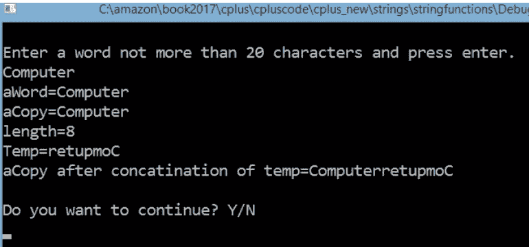

图 字符串操作。

## 列表

让我们想象一个谜游戏。你有一排盒子。每个盒子里有一张带有字母的卡片。你必须弄出字母的顺序，使这些字母组成一个单词。

| T | C | O | N | E | L | Y | O | H |   |
|---|---|---|---|---|---|---|---|---|---|
| 5 | 10| 6 | 3 | 2 | 9 | 1 | 7 | 8 | 4 |

## 图 A 链表

在上面的表中，你可以看到每个盒子都有一个数字。你可能猜这些数字是解谜的关键。取一个内部有字母 T、正面有数字 5 的盒子。取出带有字母 T 的卡片并放在一边。数字 5 可能指向下一个计数。数到第五个盒子，那里有字母‘E’。取出带有‘E’ 的卡片放在 T 旁边。你会得到 "TE"。带有字母‘E’ 的盒子侧面数字为2。所以，从第 2 个盒子取出卡片放在 "TE" 旁边。你会得到 "TEC"。

带有字母 ‘C’ 的盒子数字是 10，所以从第 10 个盒子取出卡片。你得到 "TECH"。带有字母 ‘H’ 的盒子数字是 4，所以从第 4 个盒子取出卡片。你得到了 "TECHN"。

这就是链表的工作原理。它由节点组成。每个节点至少包含一个存储数据（文本、数字或对象）的变量和一个存储下一个节点地址的变量（指针）。该系统按照你在谜游戏中中所做的那样遍历节点列表。最后一个节点的指针具有空值，或者它可能指向第一个节点。这时我们就得到了环形链表。

## 添加节点

如果你想在链表的末尾添加新节点，你必须创建一个新节点。然后将最后一个节点的指针指向新节点的地址，并给新节点指针赋空。


图 向链表末尾添加节点。

如果你想在链表的开头添加新节点，你必须创建一个新节点。将新节点的指针指向第一个节点，就了。

那么，一个树需要划分多少次才能得到一个元素？答案是 $log_2n$（$n$ 是树拥有的元素数量）。即使你的树很大，这个值也很小——假设你的树有 320 亿个元素，该值也只有 32；这比搜索包含 40 亿个元素的链表快了近 1 亿倍，而在后者中每一个元素都必须经过评估。

如果树是不平衡的，你无法消除大约一半元素；最坏的情况下，每个节点只有一个孩子，这使得树无异是一个带有几个额外指针的链表，因此你必须搜索所有元素。

因此，当树大致平衡时，搜索节点比在链表上进行相同搜索要快且容易得多。这是因为你可以按照自己想要的方式来组织内存。

## 实现二叉树

要实现二叉树，首先声明节点结构：

```cpp
struct node
{
    int key_value;
    node *p_left;
    node *p_right;
};
```

节点可以存储一个简单的整数 `key_value` 作为值，并有两个子树——`p_left` 和 `p_right`。

你的二叉树可能需要一些常用函数：插入、搜索、删除和销毁：

```cpp
node* insert (node* p_tree, int key);
node *search (node* p_tree, int key);
void destroyTree(node* p_tree);
node *remove (node* p_tree, int key);
```

## 插入

我们将使用递归算法将其插入树中。递归对于树来说非常奇妙，因为每个树有两个小的树；这使得整个递归树本质上是如此。该函数接受一个键和一个已经存在的树（即使是空的），并返回一个包含已插入值的新树。

```cpp
node* insert (node *p_tree, int key)
{
    // 基础情况--我们到达了一个空树，我们的新节点
    // 需要被插入
    if ( p_tree == NULL )
    {
        node* p_new_tree = new node;
        p_new_tree->p_left = NULL;
        p_new_tree->p_right = NULL;
        p_new_tree->key_value = key;
        return p_new_tree;
    }

    // 决定——插入左子树还是右子树
    // 取决于节点的值
    if( key < p_tree->key_value )
    {
        // 从 p_tree->left 构建一个新树，并添加该键
        // 将现有的 p_tree->left 指针替换为指向
        // 新树的指针。设置 p_tree->p_left 指针，
        // 以防 p_tree->left 为 NULL。（如果它不为空，
        // p_tree->p_left 将不会改变，但设置它是
        // 为了确保万一。）
        p_tree->p_left = insert( p_tree->p_left, key );
    }
    else
    {
        // 插入到右侧与左侧的插入
        //是对称的
        p_tree->p_right = insert( p_tree->p_right, key );
    }

    return p_tree;
}
```

这里的基本逻辑是：如果你有一个空树，就创建一个新的。如果没有，如果插入值小于当前节点，则进入左子树，然后用新树替换左子树。否则，将其插入到右子树并进行替换。

当看到它实际运行时，将一个空树构建成一个包含几个节点的树。如果在空树（NULL）中插入值 10，我们会立即命中基础情况，结果将是一个如下的树：

1

并且两个子树都将指向 NULL。

然后向树中插入 5 并进行以下调用：

`insert(一个带有父节点的树 , 5)`

因为 5 小于 10，对左子树的调用是递归的：

`insert(NULL, 5 )`
`insert(一个带有父节点的树 , 5)`

`insert(NULL, 5 )` 的调用创建并返回了一个新树：

5

当接收到返回的树时，`insert(,5)` 将树连接起来。在这个示例中，10 的左孩子之前是 NULL。因此，10 的左孩子建立了一个新树：

1

5

如果我们现在添加 7，就会得到：

`insert( NULL, 7 )`
`insert(一个带有父节点的树 , 7 )`
`insert(一个带有父节点的树 , 7 )`

所以，首先，`insert( NULL, 7 )` 将返回一个新的树：

7

然后 `insert(一个带有父节点的树, 7 )` 将以这种方式连接到 7 的子树：

5

7

最后，树返回到：

`insert(一个带有父节点的树 , 7)`

这将将其连接回：

```cpp
10
5
7
```


因为已经存在从 10 到节点 5 的指针，所以其实没有必要重新连接 10 的左孩子到以 5 为父节点的树上，但这确实消除了一次检查。

## 销毁

这是一个销毁树的递归函数。我们使用递归算法遍历树并删除每个节点。这在 C++ 中对于避免内存泄漏是非常重要的。

```cpp
void destroyTree(node* p_tree)
{
    if (p_tree != NULL)
    {
        destroyTree(p_tree->p_left);
        destroyTree(p_tree->p_right);
        delete p_tree;
    }
}
```

# 第4章 继承

示例：

```cpp
#include <iostream>
#include <string>
using namespace std;

// 定义一个具有2个成员的简单学生类
class Student
{
public:
    int studentID;
    string studentName;

    // 显示类成员的函数
    void Display()
    {
        cout<<"Student ID " <<studentID<<endl;
        cout<<"Student Name " <<studentName;
    }
};

int main () {
    Student stud1;
    // 给类的属性赋值
    stud1.studentID=1;
    stud1.studentName="John"
    stud1.Display();
    return 0;
}
```

# 那么什么是继承？

继承是一个概念，其中我们可以定义一个类来继承另一个类的属性和方法。这有助于避免再次定义该类或重复定义已有的属性和方法。

假设我们有一个名为“Person”（人员）的类，它有一个属性“Name”（名称）和一个方法“Display”（显示）。然后通过继承，我们可以定义一个名为“Student”（学生）的类，它可以继承 Person 类。Student 类将自动获得 ID 成员和 Display 函数。如果需要，Student 类还可以定义它自己的额外成员。

要定义一个继承类，我们使用以下语法。

`派生类:基类` (Base class)

在这里，“派生类”是继承另一个类属性的类，该类被称为“基类”。

假设我们有一个如下所示的具有一个属性和一个函数的基类。

基类 

```
{
Public or protected:
Property1;
}
```

那么当我们从基类定义派生类时，派生类将可以访问该属性。请注意，属性和函数的访问修饰符需要为 public（公共）或 protected（保护）。我们稍后将详细介绍访问修饰符。

`派生类: 基类`

```
{
// 无需定义属性 l1，它会自动继承这些。
}
```

现在，让我们通过代码来看一个继承的简单示例。

示例 2：以下程序用于演示如何使用简单的继承类。

```cpp
#include <iostream>
using namespace std;

// 定义一个具有 Name 属性的简单 Person 类
class Person
{
public:
    string Name;
};

// 这里我们有一个派生类。它定义了另一个属性 ID
class Student:public Person
{
public:
    int ID;

// 用于同时显示 ID 和 Name 的函数。由于 Name 可以从 Person 的基类中获取，我们可以在这里访问它。
void Display()
{
    cout<<"Student ID "<<ID<<endl;
    cout<<"Student Name "<<Name;
}
};

int main () {
Student stud1;
stud1.ID=1;
stud1.Name="John";
stud1.Display();
return 0;
}
```

通过上述程序：我们定义了一个名为“Person”的类，它包含一个名为“Name”的成员。

- 我们定义了一个名为“Person”的类，它包含一个名为“Name”的成员。
- 然后我们使用继承来定义“Student”类。注意我们现在定义了另一个名为“ID”的属性。
- 在“Display”函数中，注意我们可以直接使用“Name”属性，而无需在“Student”类中再次定义它。

通过此程序，输出如下：

```
Student ID 1
Student Name John
```

现在我们已经学习了如何使用派生类和基类，这也被称为继承。

## 1.2 派生类中的函数

我们也可以定义可以从基类继承的函数。让我们看看如何实现这一点。

例如，假设有一个如下所示的具有一个属性和一个函数的基类。

基类

```
{
Public or protected:
Property1;
Function1;
}
```

当我们从基类定义派生类时，派生类也将能够访问该属性和函数。请注意，属性和函数的访问修饰符需要为 public 或 protected。

`派生类: 基类`

```
{
// 无需定义 property1 和 Function1，它会自动继承这些。
}
```

让我们看一个可以在派生类中使用函数的示例。

示例 3：以下程序用于演示如何使用带有函数的继承类。

```cpp
#include <iostream>
using namespace std;

// 定义一个具有 Name、ID 属性以及名为 Display 的函数的简单 Person 类
class Person
{
public:
    string Name;
int ID;

void Display()
{
    cout<<"ID "<<ID<<endl;
    cout<<"Name "<<Name;
}

// Student 类简单地派自 Person 类
class Student:public Person {
};

int main () {
    // 既然派生类可以访问基类的属性和函数，
    // 这些内容可以通过 Student 对象进行访问
    Student stud1;
    stud1.ID=1;
    stud1.Name="John";
    stud1.Display();
    return 0;
}
```

通过此程序，输出如下：

```
ID 1
Name John
```

我们还可以在 Student 类中重新定义 Display 函数。但如果你看上面的示例，你会发现 Person 类中的 Display 函数的显示文本为 ID 和 Name。但假设我们想在 student 类中将显示名称设为 Student ID 和 Student name，我们可以重新定义 Display 函数。让我们来看这个示例。

示例 4：以下程序展示了如何使用带有重定义函数的继承类。

```cpp
#include <iostream>
using namespace std;

class Person
{
public:
    string Name;
    int ID;

    void Display()
{
    cout<<"ID "<<ID<<endl;
    cout<<"Name "<<Name;
}
};

class Student:public Person {
public:
    void Display()
{
    cout<<"Student ID "<<ID<<endl;
    cout<<"Student Name "<<Name;
}
};

int main () {
Student stud1;
stud1.ID=1;
stud1.Name="John";
stud1.Display();
return 0;
}
```

通过此程序，输出如下：

```
Student ID 1
Student Name John
```

## 1.3 多继承

我们还可以继承多个基类。这有助于一次性获取更多功能。

假设我们有一个如下所示的具有属性和一个函数的基类。

基类

```
{
Public or protected:
Property1;
Function1;
}
```

以及另一个基类。

```
{
Public or protected:
Property2;
Function2;
}
```

当我们从基类定义派生类时，派生类将能够访问这两个类的属性和函数。

`派生类: 基类1, 类2`

```
{
// 无需定义 property1 和 Function1，property2 和 Function2，它会自动继承这些。
}
```

让我们看一个可以使用多继承的示例。

示例 5：以下程序用于演示如何使用多继承。

```cpp
#include <iostream>
using namespace std;

// 定义第一个基类
class Person
{
public:
    string Name;
    int ID;

    void Display()
{
    cout<<"ID "<<ID<<endl;
    cout<<"Name "<<Name;
}
};

// 定义第二个基类
class Marks
{
public:
    int marks1;
    int marks2;

    void Sum()
    {
        cout<<marks1+marks2<<endl;
    }
};

// Student 类继承自 Person 和 Marks
class Student:public Person,public Marks
{
public:
    void Display()
{
        cout<<"Student ID "<<ID<<endl;
        cout<<"Student Name "<<Name;
    }
};

int main () {
    Student stud1;
    stud1.ID=1;
    stud1.Name="John";
    stud1.Display();
    stud1.marks1=5;
    stud1.marks2=10;
    stud1.Sum();
    return 0;
}
```

通过此程序，输出如下：

```
Student ID 1
Student Name John
15
```

## 1.4 访问控制

类修饰符可以定义类中属性和方法的可见性。以下是各种各种修饰符。

- *Private（私有）*：对于私有，属性和方法仅对类本身可用。
- *Protected（保护）*：对于保护的，属性和方法仅对类本身以及派生自该类的子类可用。
- *Public（公共）*：对于公共，属性和方法对所有类都可用。

假设我们有一个如下的类结构。

```
Class classname
{
Private:
Property1;
Function1;
}
```

“property1”和“function1”在定义类之外的任何地方都无法访问。如果你尝试从主程序访问这些任何一个属性或函数，将得到编译错误。

现在‘property1’和‘function1’可以从上述类以及任何派生它的类访问。

所以，如果我们有下面的派生类定义，我们就能在派生类中访问‘property1’和‘function1’。但请注意，我们无法在任何非派生类中使用这些属性。

`Class derivedclassname: classname1`

```
{
}
```

让我们来看另一个访问修饰符的示例。

示例 6：以下程序被用于展示如何使用访问修饰符。

```cpp
#include <iostream>
using namespace std;

class Person
{
public:
    int ID;

protected:
    // 注意，我们将 Name 属性定义为 protected
    string Name;

    void Display()
{
    cout<<"ID "<<ID<<endl;
    cout<<"Name "<<Name;
}
```

```cpp
// 注意，我们将 city 属性定义为 private
private:
  string city;
};

class Student:public Person {
public:
  void Display()
  {
    cout<<"Student ID "<<ID<<endl;
    cout<<"Student Name "<<Name<<endl;
  }
};

int main () { 
  Student stud1;
  stud1.ID=1;
  stud1.Name="John";
  stud1.Display();
  return 0;
}
```

通过这个程序，输出如下：

```
error:'std::__cxx11::string Person::Name' is protected
```

为什么我们会得到这个错误？'person' 类有两个名为 ID 和 Name 的属性。Name 具有 protected 访问修饰符，这意味着它只能在派生类中被访问。但我们正试图在 main 类（中）访问它，这是错误的。因此，正确的实现方式如下。

示例 7：以下程序展示了如何正确地使用访问修饰符。

```cpp
#include <iostream>
using namespace std;

class Person
{
public:
    int ID;

protected:
    string Name;

    void Display()
    {
        cout<<"ID "<<ID<<endl;
        cout<<"Name "<<Name;
    }

private:
    string city;
};

class Student:public Person {
public:
// 我们现在定义了一个函数，可以相应地设置受保护属性的值。
void InputName(string pName)
{
    Name=pName;
}

void Display()
{
    cout<<"Student ID "<<ID<<endl;
    cout<<"Student Name "<<Name<<endl;
};
```

```cpp
int main () {
Student stud1;
stud1.ID=1;
stud1.InputName("John");
stud1.Display();
return 0;
}
```

在上面的程序中，我们现在于 ‘Student’ 类中正确地定义了一个名为‘SourceName’ 的方法，它可以访问受保护的‘Name’ 成员。

通过这个程序，输出如下：

```
Student ID 1
Student Name John
```

现在让我们来看同一个示例，并尝试显示在‘Person’类中定义的‘City’属性。

示例 8：以下程序展示了如何错误使用访问修饰符的第二个示例。

```cpp
#include <iostream>
using namespace std;

class Person
{
public:
    int ID;

protected:
    string Name;

    void Display()
{
    cout<<"ID "<<ID<<endl;
    cout<<"Name "<<Name;
}

private:
    string city;
};

class Student:public Person {
public:
    void InputName(string pName)
{
Name=pName;
}

void Display()
{
    cout<<"Student ID "<<ID<<endl;
    // 注意，我们正尝试在派生类中使用私有属性
    cout<<"Student city "<<city<<endl;
    cout<<"Student Name "<<Name<<endl;
};
```

```cpp
int main () {
Student stud1;
    stud1.ID=1;
    stud1.InputName("John");
    stud1.Display();
    return 0;
}
```

通过这个程序，输出如下：

```
error: 'std::__cxx11::string Person::city' is private
```

由于‘City’属性是私有的，它甚至在派生类中都无法使用。我们只能在‘Person’类中处理此属性。

# 第 5 章 高级基础

## 指针

之前提到过指针，它们是变量的内存地址，这非常类似于一个人的家庭地址。这些可以作为参数传递，并允许之前提到的引用传递的效果。

下面的程序将显示变量的地址：

```cpp
#include <stdio.h>
int main()
{
    int var;
    printf("The address is: %x\n", &var);
    return 0;
}
```


输出：

> The address is: 10ffa2c

注意：这几乎每次运行时都会不同。注意高显示的语句，`&`（引用运算符）用于返回变量的内存位置，并允许某些语句访问该位置中的数据。`%x` 是十六进制。

这表明指向数组第一个地址的指针可以沿着数组地址增加（记住数组的每个值存储在相邻的内存位置中）。

## 指针算术

有时沿着另一个内存位置移动指针是有用的；这就是指针算术用用场。如果我们执行例如 `ptr++` 且 `ptr` 是一个整数，那么它现在将移动 4 字节（`int` 的大小），如果我们再次运行它，再移动 4 字节，以此此类推。这意味着指针（如果指向有效结构）可以像数组一样工作。示例如下：

```c
int arrayInt[] = { 10, 20, 30 };

size_t arrayInt_Size = 3;

//将指向第一个数组索引
int* ptr = &arrayInt;

for (int i = 0; i < arrayInt_Size; i++)
{
    //记住，*ptr 获取内存位置中的值
    printf("Value of arrayInt[%d] = %d\n", i, *ptr);
    ptr++;
}
```

输出：

> Value of arrayInt[0] = 10
> Value of arrayInt[1] = 20
> Value of arrayInt[2] = 30

## 函数指针

就像对变量进行操作一样，你也可以对函数进行操作；下面是一个展示如何定义函数指针的代码片段。关键部分将高亮显示：

```c
void printAddition(int value1, int value2)
{
    int result = value1 + value2;
    printf("The result is: %d", result);
}
```

```c
int main()
{}
```

```c
//Function指针定义
//<返回类型>(<名称>)(<参数>)
void(*functionPtr)(int, int);
functionPtr = &printAddition;

// 通过指针函数调用
(*functionPtr)(100, 200);
return 0;
}
```

定义函数指针的基础结构如下：

`<Return_Type> (*<Name>)(<Parameters>)`

在此例中：

`<Return_Type>` = `void`

`<Name>` = `functionPtr`

`<Parameters>` = `int, int`

现在此函数指针可以作为参数传递，并用于你想更改代码行为但又保持代码几乎不变的情况。

一个示例可以是动态选择计算器应该执行的操作（注意：这是复杂代码，仅作为粗略示例，所以不用担心你不完全理解）：

```c
void calculator(int value1, int value2, int(*opp)(int,int))
{
    int result = (*opp)(value1, value2);
    printf("The result from the operation: %d\n", result);
}
```

//两个两个相加

```c
int add(int num1, int num2)
{
    return num1 + num2;
}
```

// 减去两个值

```c
int sub(int num1, int num2)
{
    return num1 - num2;
}
```

```c
int main()
{
    calculator(10, 20, &add);
    calculator(10, 20, &sub);
    return 0;
}
```

这里发生的情况是，我们将函数 `add` 和 `sub` 作为参数传递给函数 `calculator`。正如你从高亮部分看到的，函数参数的定义方式如上面所示，定义了返回类型、名称和参数，所有传递给 `calculator` 的都是 `&add` 和 `&sub` 的函数指针。然后 `calculator` 函数调用该指针并传入值并返回结果。

## 存储分类

在 C 语言中，每个变量都可以赋予一个存储类，该类可以定义某些特性。

这些类是：

- 自动变量
- 静态变量
- 寄存器变量
- 外部变量

## 自动变量

我们目前定义的每个变量都是自动变量；它们在函数退出时创建，并在函数退出时自动销毁。这些变量也被称为局部变量。

```c
auto int value;
```

等同于

```c
int value;
```

## 静态变量

当你希望变量在离开作用时不被销毁时，使用 `static`；这个静态变量在程序的生命周期内只创建一次。下面是静态变量使用的示例：

```c
void tick()
{
    //这将会运行一次
    static int count = 0;

    count++;
    printf("The count is now: %d\n", count);
}
int main()
{
    tick();
    tick();
    tick();
}
```

输出：

> The count is now: 1
> The count is now: 2
> The count is now: 3

高亮区域是静态定义，它只会运行一次。

## 寄存器变量

寄存器用于定义存储在寄存器内存而非普通内存中的变量，寄存器内存的优点是访问速度要快得多；然而，空间只能容纳少数变量。

定义寄存器变量的方式如下：

```c
register int value;
```

## 外部变量

我们之前提到过这一点，但全局变量是在不在作用域内定义的变量，因此可以在任何地方使用。外部变量是在另一个位置（如另一个文件）中定义的变量，使用 `extern` 关键字表示该变量在另一个文件中。你可以通过将另一个文件放在文件的顶部来将其作为引用：

```c
#include "FileName"
```

这是为了告诉程序也引用此文件。注意文件需要在同一个位置。

程序 1 [File_2.c]

```c
#include <stdio.h>
#include "C_TUT.c"

int main()
{
    extern int globalValue;
    printf("The global variable is: %d", globalValue);
}
```

程序 2（很小）[C_TUT.c]

```c
#include <stdio.h>

int globalValue = 1032;
```

运行 `File_2.c` 的输出：

> The global variable is: 1032

这显示 `globalValue` 是从 `C_TUT.c` 中引用的，并通过 `extern` 关键字在另一个文件中使用。

我们在教程的基础部分提到过递归，再次，它是函数任务对它自身的定义。正如所承诺的，下面解释了更多关于递归的示例：

```c
int factorial(int x)
{
    int r;
    //停止条件
    if (x == 1)
    {
        //有结论所以循环
        return 1;
    }
    else
    {
        //递归
        return r = x * factorial(x - 1);
    }
}
int main()
{
    puts("Please enter a number: ");
    int a, b;
    //输入
    scanf("%d", &a);
    b = factorial(a);
    printf("The factorial is: %d", b);
}
```

这是一个关于递归的示例，递归是函数任务对它自身的定义。递归是一个很困难的概念，这里只涉及一下，并在高级部分中解释其真实世界的用法。递归在本质上是循环，是的，当 `x = 1` 时停止。递归是递归任务的示例，下面解释了更多关于递归的示例。

## 容器迭代器

从这些章节中，我们知道每个容器都提供自己的迭代器，通过使用该迭代器对容器中的元素执行操作。

在五类迭代器中，每个容器定义了以下三类任意一种，即：

- **前向迭代器 (Forward iterators)**：
  - 可以读；
  - 可以写；
  - 可以在同一位置重复读/写；
  - 可以向前移动 (`++`) 但不能向后移动，因此名为前向迭代器；
  - 用于：无序关联性容器（unordered associative containers）和前向列表（forward list），它们用于最高空间效率的存储。

- **双向迭代器 (Bidirectional iterator)**：
  - 与前向迭代器相同，但它也可以向后移动（即既有 `++` 也有 `--`），因此名为双向；
  - 用于容器：`list`、`set`、`map`、`multiset` 和 `multimap`。

- **随机访问迭代器 (Random access iterator)**：
  - 与双向迭代器相同，但它可以跳转 (`+=N` 或 `-=N`，其中 `N` 是整数）而不是步进 (`+1` 或 `-1`，其中 `+1` 是 `++`，`-1` 是 `--`），因此名为随机迭代器（跳跃迭代器）；
  - 用于容器：`vector`、`string`、`deque` 和 `array<T,N>`。

除了帮助 STL 算法在容器中进行操作外，迭代器还帮助执行容器的内部操作（成员函数）。

某些内部操作对于所有序列和关联性容器都是通用的，它们是：

O(1):

`begin()`, `end()`, `cbegin()`, `cend()`, `rbegin()*`, `rend()*`, `crbegin()*`, `crend()*`, `empty()`, `swap()`, `size()†`, `max_size()`, `shrink_to_fit()†`, `emplace()` 和 `emplace_back()`;

O(n):

赋值运算符：`=`

关系运算符：

`!=`, `==`, `<†`, `>†`, `<=†` 和 `>=†`, 以及 `clear()`;

O (变量):

- `insert()†`, `erase()†` 和 `emplace()†`（它们在基于节点的容器中很快，在连续内存容器的（中间）很慢）；以及
- 构造函数（通常是类的组合或（或）
- （它们的默认构造函数具有常数复杂度，但所有其他构造函数和析构函数可能具有线性复杂度）。

注意：

a) 前向列表和无序关联性容器使用前向迭代器，因此没有反向迭代器操作：`emplace_back()`, `rbegin()`, `rend()`, `crbegin()` 和 `crend()`。

b) 关联性容器支持反向迭代器，但不支持 `emplace_back`。这是因为关联性容器按顺序存储元素，所以它们不接受 `emplace_back()` 命令，该命令强制将新元素放在容器的末尾。

† `shrink_to_fit()` 请求移除未使用的内存容量，仅适用于 `vector`、`deque` 和 `string`。

†† 无序容器（unordered containers）不支持关系运算符：`<`, `<=`, `>` 和 `>=`。

在上述运算符列表中，删除不必要的内容。O 代表复杂度。简而言之，虽然复杂度意味着函数的时间和/或复杂度，但在容器中它是时间复杂度；

- `O(1)` 代表常数时间复杂度；
- `O(log n)` 代表对数时间复杂度；
- `O(n)` 代表线性时间复杂度；

相比之下，`O(n) > O(log n) > O(1)`，这意味着 `O(1)` 是最快的操作；注意：这些是期望的平均复杂度，标准库文档对某些运算符引用了最坏情况复杂度。

少数容器不支持迭代器，它们是：容器适配器（container adapters）、`bitset` 和 `valarray`。注意：C++11 为 `valarray` 定义了迭代器 `begin()` 和 `end()`。

## STL 迭代器

迭代器、容器和算法是 STL（标准模板库）的组件。STL 由 Alexander Stepanov 等人在 20 世纪 90 年代在惠普编写，随后在标准库中进行了合并和改进。

迭代器是特殊指针的抽象，用于解引用给定容器（如 `vector`、`map` 和用户自定义容器类）的元素。

每个容器类都包含用于生成迭代器的成员函数，例如成员 `begin()` 和 `end()` 分别返回第一个元素的迭代器和最后一个元素之后元素的迭代器。

下图描述了迭代器 (`*it`）与其容器 (`vector<int>data {1111, 1134, 1134, 1124, 1124, 1134, 1111, 1176, 1124, 1134, 1176}`）之间的关系。

然后，迭代器可以将容器的元素纳入算法操作（如 `sort`、`accumulate` 和自定义算法函数）。换句话说，迭代器将容器与算法关联起来。最常用的迭代器来自 `begin()` 和 `end()`。如下所示，通过 `begin()` 和 `end()` 最频繁地使用：`data[0]` 和 `begin()` 指向同一个元素，但 `end()` 指向最后一个之后，这在某些操作中非常有用。以下代码展示了迭代器的特性：

```cpp
#include <iostream>
#include <vector>
#include <algorithm>

void illustrate_iterators() {
    vector<int> data = {1111, 1134, 1134, 1124, 1124, 1134, 1111, 1176, 1124, 1134, 1176};
    vector<int>::iterator it = data.begin();

    std::cout << "第一个元素: " << *it << std::endl; // 输出 1111
    it++;
    std::cout << "第二个元素: " << *it << std::endl; // 输出 1134

    // 使用算法操作容器
    sort(data.begin(), data.end());
    std::cout << "排序后的容器: ";
    for (auto i = data.begin(); i != data.end(); ++i) {
        std::cout << *i << " ";
    }
    std::cout << std::endl;
}

int main() {
    illustrate_iterators();
    return 0;
}
```

正如我们所见，迭代器可以用于打印容器的内容，因此让我们在头文件 `my_essentials.hpp` 中编写一段与容器无关的代码。这是为了方便打印具有单一类型名称如 `vector<T>`、`list<T>`、`set<T>`、`multiset<T>`、`deque<T>` 和固定大小 `array<T,N>` 的容器，但不适用于具有两个类型名称如 `map<T1,T2>` 和 `unordered_multimap<T1,T2>` 的容器。

```cpp
//--------------------------------
// 用于打印的容器无关代码
// 带有一个 typename 的容器

template<typename container>
void cout_container(const std::string& message, const container& data)
{
    std::cout << message << "(";
    if(data.empty()){
        std::cout << "NULL" << std::endl;
        return;
    }
    auto start = data.begin();
    auto end = data.end();
    while(true)
    {
        std::cout << *start;
        ++start;
        if(start != end)
            std::cout << ", ";
    }
}
```

```cpp
else {
    std::cout << "}" << std::endl;
    break;
}
}
```

让我们将此模板添加到 `my_essentials.hpp` 中，并使用以下代码测试该模板。

然后，让我们测试这个模板：

```cpp
// cout_containers.cpp
#include "../my_essentials.hpp"
#include <array>
#include <vector>
#include <unordered_set>
#include <forward_list>
#include <set>
int main()
{
    // 让我们定义，
    // 一个固定大小的数组
    std::array<int,6> arr = {1,3,5,1,2,4};
    cout_container("my array\t = ", arr);
}
```

```cpp
// 一个 vector
std::vector<int> vec(arr.begin(), arr.end());
cout_container("my vector\t = ", vec);
```

```cpp
// 一个 forward_list
std::forward_list<int> f_lis(arr.begin(), arr.end());
cout_container("my forward_list\t = ",f_lis);
```

```cpp
// 一个 unordered_set
std::unordered_set<int> u_set(arr.begin(), arr.end());
cout_container("my unordered_set\t = ", u_set);
```


```cpp
// 一个 set 容器
std::set<int> se(arr.begin(), arr.end());
cout_container("my set\t = ", se);
just_pause();

}
```

输出是：

```
my array = {1, 3, 5, 1, 2, 4}

my vector = {1, 3, 5, 1, 2, 4}

my forward_list = {1, 3, 5, 1, 2, 4}

my unordered_set = {1, 3, 5, 2, 4}

my set = {1, 2, 3, 4, 5}
```

在我们实验了迭代器的一些应用后，现在我们在下面的表中总结了它们的操作。

迭代器没有统一的定义，因此并不是所有的迭代器都能支持上述的所有操作。迭代器分为五类，即：

因此，通过这次初步讨论，我们发现指针及其对不同对象的解引用属性对迭代器和 STL 操作起着至关重要的作用。

# 第 7 章 STL 算法

STL 算法可以在 `<algorithm>` 头文件中，因此我们需要在程序中包含它。

算法可以分类为：

- 非修改性算法：例如 `for_each`、`count`、`search` 等。

- 修改性算法：例如 `copy`、`transform` 等。

- 删除算法：`remove`、`remove_if` 等。

- 变动算法：`reverse`、`rotate` 等。

- 排序算法：`sort`、`partial_sort` 等。

- 有序范围算法：`binary_search`、`merge` 等。

- 数值算法：`accumulate`、`partial_sum`、`inner_product` 等。

下面的示例展示了 `sort()` 函数是如何在数组上工作的。

程序 13.11：使用 `sort` 算法对数组

```cpp
#include <iostream>
#include <algorithm>
using namespace std;
int main()
{
    int a[] = {3,5,7,2,9};
    sort(a, a + 5);
    cout << "Sorted Array:" << endl;
    for (int i = 0; i<5; i++) {
        cout << a[i] << " ";
    }
    return 0;
}
```

输出：

```
Sorted Array:

2 3 5 7 9
```

在上面的示例中，当我们把数组名 `a` 作为参数传递时，我们是在告诉函数从数组开头开始排序。如果我们想让它从数组的第三个元素开始排序，可以使用：

```cpp
sort(a+3, a+5);
```

我们在第二个参数使用了 `a+5`，这指定了我们想要排序到数组的最后一个元素。

现在，类似的 `sort()` 函数可以在 `vector` 容器上工作，如下面的程序所示。这表明 STL 算法是泛型的。

程序 13.12：使用 `sort` 算法对 `vector` 进行排序

```cpp
#include <iostream>
#include <algorithm>
#include <vector>

using namespace std;
int main()
{
	int a[] = {5,3,7,6,2,9};
	vector<int> v(a, a+6);
	sort(v.begin(), v.end());
	for (int i = 0; i!=v.size(); i++)
		cout << v[i] << " ";
		cout << endl;
return 0;
}
```

输出：`2 3 5 6 7 9`

如你所见，排序函数的工作方式与数组上几乎相同。`sort()` 中的第一个参数接受一个使用 `begin()` 指向第一个元素的迭代器，因为它返回一个指向第一个元素的迭代器。因此，它将从 `vector` 的第一个元素开始。同样，`end()` 返回一个指向容器中最后一个元素之后的元素的迭代器。注意，`sort` 函数排序到我们传递的元素为止，但不包含该元素。

## `find()` 和 `count()`

`find()` 算法有助于查找特定值。`count()` 则用于计算该值出现的次数。

程序 13.13：使用 `find` 从 `vector` 中查找值

```cpp
#include <iostream>
#include <algorithm>
#include <vector>
using namespace std;

int main() {
    std::vector<int> v = {1,2,3,4,5};
    auto it = find(v.begin(), v.end(), 3);
    if (it != v.end()) {
        cout << "Found: " << *it << endl;
    } else {
        cout << "Not found" << endl;
    }
    return 0;
}
```

## 可用文件

C 标准库提供了一系列用于执行常见任务函数，例如：

- 字符串处理

- 字符和类型转换

- 数学

- 输入和输出

还有多种 C++ 库文件可用。

ANSI C++ 库标准于 1998 年通过。

`iostream` 文件可能是所有 C++ 库文件中最常见且通用的。

大多数 C++ 程序都包含此头文件。

`iostream` 文件提供了大量的输入/输出函数和其他 I/O 流信息。

例如，这就是 `cin` 和 `cout` 数据和函数原型定义的地方。

## 注意

C++ 的 I/O 在字节流中进行，流简单来说就是字节的序列。

程序员可以使用许多变种的 C++ 库。

这些库源于多个来源。

例如，某些库随 C++ 应用程序开发软件一起提供。

C++ 函数库也可能由设备驱动制造商、C++ 编程网站和公告板等来源提供。

最好的参考来源通常是 C++ 应用程序开发软件带的手手册和帮助文件。还有许多参考书籍，其中涵盖了特定的编译器。

## 库函数的使用

为了演示库函数的使用，让我们考虑一个执行以下操作的程序：

- 获取 -55 的绝对值

- 计算 100 的平方根

- 计算 10 的 5 次方

```cpp
#include <iostream>
#include <cmath>
void main(void)
{
    cout << "The absolute value of -55 " << abs(-55) << "\n";
    cout << "The square root of 100 " << sqrt(100) << "\n";
    cout << "10 to the power of 5 " << pow(10, 5) << "\n";
}
```

每个计算结果都会输出到屏幕上。标准数学库包含了执行这三个计算所需的每个函数：

- `abs()`

- `sqrt()`

- `pow()`

编写此程序时首先要决定的是包含哪些头文件。为了调用 `abs()`、`sqrt()` 和 `pow()`，你需要包含头文件 `cmath`，以便可以使用 `cin` 和 `cout` 语句。你还需要包含头文件 `iostream`。

```cpp
#include <iostream>
#include <cmath>
void main(void)
{
    cout << "The absolute value of -55 " << abs(-55) << "\n";
    cout << "The square root of 100 " << sqrt(100) << "\n";
    cout << "10 to the power of 5 " << pow(10, 5) << "\n";
}
```

`abs()` 函数也包含在 `stdlib.h` 头文件中。一旦完成预处理器指令后，你就可以开始编写 `main()` 代码。

这三个函数的每个返回值都通过单独的 `cout` 语句直接显示。你可以在 `cout` 语句中显示常量、数据类型和表达式值的组合，只要每个唯一项目都通过插入运算符（`<<`）隔开。

在第一个 `cout` 语句中，第一个显示的值是常量。然后通过调用库函数 `abs()` 显示其返回值。`abs()` 函数计算作为函数参数传递的整数的绝对值。该函数返回一个 `int` 类型的值；在此示例中，参数是一个常量，而不是 `int` 类型的变量。

```cpp
#include <iostream>
#include <cmath>
void main(void)
{
    cout << "The absolute value of -55 " << abs(-55) << "\n";
    cout << "The square root of 100 " << sqrt(100) << "\n";
    cout << "10 to the power of 5 " << pow(10, 5) << "\n";
}
```

当执行 `cout` 语句时，函数被调用，数字 55 显示在屏幕上。

```cpp
#include <iostream>
#include <cmath>
void main(void)
{
    cout << "The absolute value of -55 " << abs(-55) << "\n";
    cout << "The square root of 100 " << sqrt(100) << "\n";
    cout << "10 to the power of 5 " << pow(10, 5) << "\n";
}
```

接下来的两行代码以与第一行相同的方式执行调用。`sqrt()` 函数接受一个 `double` 类型的参数并返回一个 `double` 类型的值。在这个示例中，数字 10 显示在屏幕上。

```cpp
#include <iostream>
#include <cmath>
void main(void)
{
    cout << "The absolute value of -55 " << abs(-55) << "\n";
    cout << "The square root of 100 " << sqrt(100) << "\n";
    cout << "10 to the power of 5 " << pow(10, 5) << "\n";
}
```

## 注意

如果参数是负数，会发生域错误。库函数 `pow()` 接受两个 `double` 类型的参数并返回一个 `double` 类型的值。当 `cout` 语句执行时，显示数字 100000。

```cpp
#include <iostream>
#include <cmath>
void main(void)
{
    cout << "The absolute value of -55 " << abs(-55) << "\n";
    cout << "The square root of 100 " << sqrt(100) << "\n";
    cout << "10 to the power of 5 " << pow(10, 5) << "\n";
}
```

# 第 9 章 I/O

## I/O 基础

C++ 或 C 语言本身都没有内置的输入和输出。它们使用函数（C）或其他 I/O 对象（C++）。

1. `iofs` 代表三个头文件 `<iostream>`、`<fstream>` 和 `<ios>`。

2. 类：`iostream(streambuf)`, `fstream(filebuf)`, `stringstream(stringbuf)` 以及四个预定义对象：`cin`, `cout`, `clog` 和 `cerr`。

3. `clog` 与 `cerr` 一样，但它缓冲输出。

4. C++ 在你按下回车键时通常会刷新输入缓冲区。为了输出到显示器，C++ 程序通常在传输换行符时刷新输出缓冲区。

5. `>>` 和 `<<` 不需要格式化字符串，C++ 会自动进行转换，它比 C 语言中的 `printf` 和 `scanf` 更好。

6. 通过继承，`fstream` 和 `cin(cout)` 共享相同的用法。所有的知识都可以直接在 `fstream` 中使用。我最喜欢它。

## 输入

### 输入基础知识

- 对于输入，你需要掌握一个基础概念、两种语言和三种数据类型。

- 一个基础概念：为了实现持续输入，你需要使用 `while(inputMethod)`。当发生两种情况时：

  1. 用户想要结束输入（ctrl+D）或读取到文件末尾；

  2. 读取失败（例如，`cin >> int` 但输入了字母 'a'），

`inputMethod` 将返回 `false`。然后你需要在循环内部使用某些标志或状态来区分 EOF 和错误。

- 两种语言是 C 和 C++，它们使用不同的 `inputMethod`。三类数据类型为：数字和单词（中间无空格）、字符（空白）以及字符串（中间包含空格）。

- 两种语言通用的输入方法

- 数字和非空白字符单词 字符（包括空白字符）字符串（包含行）

```c
C scanf("%d %f %c %s",&i, &f&c); int a = getchar(); fgets(stdin,char*, n)
C++ cin>>i>>c>>w; cin.get(char &c);
Ch = cin.get(); cin.get(char *p, n);
cin.getline(char *p, n);
getline(cin, string);
```

1. H: short int 或 short unsigned。示例：`%hd` 或 `%hu`。

2. I: 长整型 int 或无符号 unsigned，double（用于 `%f` 转换）。

示例：`%ld`, `%lu`, 或 `%lf`。

3. L: 要解析的值对于整数类型为 long，对于浮点类型为 long double。示例：`%Ld`, `%Lu`, 或 `%Lf`。

4. *: `Scf()` 执行指定的转换，但不将其存储在任何地方。当你使用 `scanf()` 吃掉某些数据但不将其存储在任何地方时，就会发生这种情况；你没有为该转换给 `scanf()` 提供参数。示例：`%*d`。

- - `scanf("%c", &c)` 会读取任何字符，包括空白字符。如果你想让 `scanf` 跳过任何空白字符，可以在 `%c` 之前使用一个空格。

```c
1. While(true){
2. scanf("%c", &c);
3. //scanf("%c", "%d", &c);
4. printf("your input: %d\n", c);
5. }
```

输出：

当你输入 `a`(回车)时，输出将类似于 `your input: 97(a的值) your input: 10(回车值)`

- - `cin>>c` 不读取空白字符（制表符、空格、换行），如果你想从输入缓冲区读取它们，应该使用 `getchar()` 或 `cin.get()`；如果你想让用户输入她的名字。

```cpp
1. While(true)

2. Cin>>c;

3. Cout<<"your input:"<<c<<endl;

4. }
```

输出：

当你输入 " a(回车)"时，输出将类似于：`your input: a`。然后光标在此处等待。

- - 使用 `cin>>` 或 `scanf` 会读取第一个空格后终止字符串。处理这种情况的最优方法是使用函数读取一行；

读取单词和行：

```c
1. Scanc("%s", char_array); //c

2. Cin>>char_array; //c++

3. Cin>>str;

4. //line

5. Gets(char_array) //c

6. Fgets(char_array, n, FILE *);

7. Cin.getline(char *s, int n)

8. Cin.get(char *s, int n)

9. Stdio::getline(istream& is, string&str)
```

Line 1: 读取单词直到遇到空白字符。

Line 7: 推荐使用此方法为了安全。

Line 9: C++ 读取并丢弃换行符

Line 1: 不读取换行符

- - `Cin.read` 函数与 `cin.get` 具有相同的接口，但它不会向输入追加空字符，它不是为键盘输入设计的，而是为了文件的二进制格式。

对于 C++，三个 `get`，两个 `getline`，其余的使用 `>>`；

`cin.get(char)` 和 `int = cin.get()` 区别：

1. `while(cin.get(c))`

2. // 在读取循环中使用 `cin.get(char)`

3. `cin.get() != '\n'`

4. // 使用 `cin.get()` 返回字符来测试状态。

5. `cin.get() != EOF`

Line 7: 当用于 EOF 时，你必须使用 `int`。因为 EOF 可能无法用 `char` 类型表示。

- * 混淆函数：`cin.get` 和 `cin.getline` 几乎是同一件事。

```cpp
Cin.get(char* s, streamsize n, char delim);

Cin.getline(char* s, streamsize n, char delim);

Istream& getline(istream& is, string& str);
```

- * 对于每一行，如果你不知道最大长度，直接使用 `getline(cin, string)`。你不需要输入任何长度（如果你想避免内存分配，可以预留字符串长度）。

- * 2. `cin.get()` 不从输入流中丢弃分隔符。然而，`cin.getline()` 会读取并丢弃换行符。（这很容易记忆，因为行是由换行符定义的）

- * 3. 在 `cin.getline(char* s , int n)` 中。如果函数提取了字符（换行是一个字符），则设置 `failbit` 标志。或者在向 `s` 写入 `(n-1)` 个字符后未找到分隔符。注意，如果输入序列中紧随这些 `(n-1)` 个字符之后的字符恰是分隔符，它也会被提取且不会设置 `failbit` 标志。

- * 4. 在 `cin.get(char* s , int n)` 中。只有当函数提取字符时，才会设置 `failbit` 标志。


## 5. `cin.get(char* s, n)` 与输入模式

`cin.get(char* s, n)` 比 `cin.getline` 更灵活，因为当读取到数组满时，它不会设置 `failbit`。此时你可以使用 `gcount()` 或 `peek()` 查看下一个字符是否为新行。它比 `cin.getline()` 更具定制性。

在外部测试流，然后在条件或循环语句体内部对其进行读写是一个坏主意。这是因为读取操作可能会导致流状态错误（`bad`）。通常将读取作为测试的一部分更好。

```cpp
while (!cin.fail()) { // 那是糟糕的编程风格
    cin >> i; // 这里可能会导致流失效
    // 然后 i 不是有效值
}
```

如果你只是想输入，不想知道 `eof` 或处理 `failbit`，可以使用以下方法：

```cpp
while (scanf("%d", &i) != 1)

while ((int c = getchar()) != EOF)

while (fgets(line, sizeof(line), fp) != NULL)

while (cin >> input)

while (cin.get(p, 20))

while (getline(line, string)); // 语言，使用这些退出循环。
```

如果你想知道 `eof` 或处理错误，可以使用以下方法。当你按下回车时，读取将结束。输入字母直到输入数字。

```cpp
while (true) { // 使用 break 退出循环
    if (cin.eof()) { // ++ 的 EOF
        // break;
    }

    if (cin.fail()) { // 处理无效输入
        cin.clear(); // 重要。清除状态和缓冲区
        while (cin.get() != 'n') { // 丢弃行
            continue;
        }
        cout << "please input" << endl;
        continue;
    }

    // 输入是正确的。
}
```

在之前的示例中，为什么我们需要区分 `eof` 和 `fail`？当发生 `fail` 时，缓冲区中有无效字符。清理缓冲区后，从输入缓冲区读取。

三种方法清理缓冲区中的字符：

```cpp
cin.clear(); // 重要。清除状态和缓冲区

while (cin.get() != 'n') {
    continue; // 方法 1
}

while (cin.get()) {
    continue; // 方法 2
}

basic_istream& ignore(
    streamsize count = 1,
    int_type delim = traits_type::eof()
); // 方法 3

cin.ignore(numeric_limits<streamsize>::max(), '\n');
```

你可以使用 `istream_iterator`，它可以节省你判断 `EOF` 的麻烦。

```cpp
class A {
private:
    int x, y;

    friend istream& operator>>(istream& in, A&);
    friend ostream& operator<<(ostream& out, const A&);
};

istream& operator>>(istream& in, A&) {
    in >> x >> y;
    return in;
}

ostream& operator<<(ostream& out, const A& a) {
    out << x << " " << y;
    return out;
}

vector<A> v;

copy(
    istream_iterator<A>(cin),
    istream_iterator<A>(),
    back_inserter(v)
);
```

总之，最好使用判断来退出循环。如果你需要定义特定的动作来处理 `EOF` 或错误，使用 `while(true)`，然后在 C++ 中使用 `eof()` 或 `clear()` 函数来退出循环。

## 输出

对于 `cout`，它可以自动识别类型，并且是扩展的。你可以重定义 `<<` 运算符，让 `cout` 识别你的数据类型。

```cpp
class Foo {
    friend ostream& operator<<(ostream& s, const Foo& r);
};

ostream& operator<<(ostream& s, const Foo& r) {
    s << a << b << endl;
}
```

### 在 C 和 C++ 中打印指针地址

```cpp
char* amount = "dozen";

cout << amount;          // 打印字符串 "dozen"
cout << (void*)amount;   // 打印指针地址

printf("%p", (void*)p);
```

格式是输出的关键。你需要知道常用的操作符来控制输出格式。

- 数字基进制操作符：`hex`、`oct` 和 `dec`
- 字段宽度：`width`
- 填充：`fill`
- 精度：`precision`
- 格式设置：`setf()`

你不需要知道细节，只需要知道名称。当你想要使用它们时，去参考网站查看。详细的操作符可以看 C++ Primer 第 1090 页。你需要包含 `<iomanip>`。

在 C 语言中，`<<` 是位左移运算符，但在 C++ 中，`<<` 在 `ostream` 类中被重载了，`cout` 是 `ostream` 的对象。

你可以使用 `cout << flush` 来强制刷新输出缓冲区。

`cout.write` 可以用于输出字符串；它将输出特定长度的字符串，即使到达字符串末尾。

## 其他流

### 文件

当你深入学习了 `cin` 和 `cout`，你会发现文件操作非常简单。只需将 `cin` 或 `cout` 替换为你的 `ifstream`、`fstream` 对象。

```cpp
std::fstream ifs;

ifs.open("test.txt", ios_base::in | ios_base::binary);

if (!ifs.is_open()) {
    exit(1);
}

char c = ifs.get();

// 使用之前所有的输入方法

ifs.close();
```

只读使用 `ifstream`；只写使用 `ofstream`；读写使用 `fstream`。

对于 `ios_base::binary` 模式，使用 `write()` 和 `read()` 函数。

对于写入，注意 `ios_base::trunc` 和 `ios_base::app` 之间的区别。

随机访问主要用于二进制文件，因为位置可以被精确定位。对于输入使用 `seekg(g)`，对于输出使用 `seekp()`。（`p` 是 `put`，`g` 是 `get`。）它移动指针。`tellp()` 和 `tellg()` 函数告诉我们指针的位置。

### 缓冲区和字符串缓冲区

`stringstream` 是一种方便的方法，像独立的 I/O 设备一样操作字符串。有时使用 `stringstream` 在字符串和其他数值之间进行转换非常方便。

`stringstream` 的用法与 `iostream` 非常相似，因此学习起来没有负担。

你需要从字符串构建 `stringstream`，或者将 `stringstream` 转换回字符串。

```cpp
stringstream outstr;

outstr << "salary value" << 12333.00 << endl;

string str = outstr.str(); // change to string

istream instr(str);

while (instr >> number) {
    cout << number << endl;
}

char sentence[] = "Yan _is _years _old";
char str[20];
int i;

scanf(sentence, "%s _*%s _ %d", str, &i);
sprintf(...);
```

第 1 到 3 行：将数字转换为文本。

第 5 到 7 行：将文本转换为数字。

第 9 行到结束：C 语言方法。在第 12 行你可以看到 `"*s"`，这意味着输入将被忽略。因此 `str = Yan`，`i = 41`。

## 操作流

1. `peek()` 返回输入流中的下一个字符而不从输入流中提取。例如，你想读取输入直到第一个换行符或句号。
2. `gcount()` 方法返回上次未格式化提取方法读取的字符数。这意味着通过 `get()`、`getline()`、`ignore()` 或 `read()` 读取的字符，但不包括提取运算符。
3. `putback()` 函数将一个字符放回输入缓冲区。

# 第 10 章 内存与资源

## 内存管理

C++ 编程语言在管理执行程序使用的内存方面，为用户提供了许多选项。在本章中，我们将探索这些常用选项。我们还将介绍一些旨在减少过去困扰 C++ 项目内存管理问题的现代技术。

## C++ 程序的可用内存

现代操作系统通常会留出一部分内存用于执行程序，允许操作系统同时管理多个程序的执行。不同的操作系统以不同的方式布局执行程序的内存。然而，布局通常包含以下部分：

- **代码（Code）**：程序的编译执行指令存储在代码段内存中。在程序执行期间，代码段的内容不应该改变。同样，在程序执行期间，代码段也不会改变。
- **数据（Data）**：持久变量和全局变量作为静态局部变量存储在内存的数据段。在执行程序的整个寿命内，数据段变量都存在。然而，除非数据是常量，否则执行程序可以自由更改它们的值。虽然存储在数据段中的值在程序执行期间可能会改变，但程序执行时数据段的大小不会改变。这是因为程序的源代码精确定义了全局变量和静态局部变量的数量。编译器也可能计算出数据段的精确大小。
- **堆（Heap）**：执行程序获取动态内存区域称为堆。使用 `new` 运算符从堆中获取内存，使用 `delete` 运算符将之前分配的内存归堆。随着程序使用 `delete` 和 `new` 分配和释放动态内存，堆的大小在程序执行期间会收缩和扩展。
- **栈（Stack）**：函数参数和局部变量始终存储在栈中。函数参数和局部变量在函数返回时消失，在函数被调用时出现。随着各种函数的执行，栈的大小在程序执行期间会收缩和增长。

通常，操作系统会限制栈的大小。深度递归会消耗大量的栈空间。例如，让我们考虑一个编写不当的递归函数，它省略了基准情况，从而表现出“无限”递归，这将耗尽栈上所有可用空间。这种情况被称为栈溢出。现代操作系统会终止任何消耗大量栈空间的进程。然而，在某些嵌入式系统中，这种栈溢出可能无法检测。

通常，堆空间是充足的，操作系统可以使用虚拟内存为执行程序提供比实际内存更多的空间。虚拟内存的额外空间来自磁盘驱动器的实际内存，操作系统根据执行程序的需要将数据从磁盘传输到实际内存。使用虚拟内存的程序运行比使用少量虚拟内存的程序慢得多。

## 手动内存管理

使用 `delete` 和 `new` 的频繁内存管理问题是最难以发现和修复的逻辑错误源。程序员必须严格遵守以下准则：

- 你所调用 `new` 的地方，只要分配的内存不再需要，就应该始终有一个对应的 `delete` 调用。

听起来可能简单，但何时该使用 `delete` 并不总是明确，下面的函数展示了内存泄漏：

```cpp
void calc(int n) {
    // ...
    // 执行一些事情
    // ...

    int* x = new int[n];

    // ...
    // 对 x 执行一些操作
    // ...

    // 在退出函数时没有删除 x 的内存
}
```

如果程序反复调用 `calc` 函数，程序最终将耗尽内存。在 `calc` 函数中，`x` 是一个局部变量。从这个角度来看，`x` 在栈上。因此，当用户完成特定的 `calc` 调用时，函数的清理工作会自动完成。

```cpp
// Code 9.2
class Code9_2 {
    // 之前的嵌套私有 Node 类
    struct Node {
        int data;  // 列表的一个数据元素
        Node* next; // 列表中紧随此节点的节点
        Node(int d); // 构造函数
    };

    Node* head; // 指向列表中的第一个元素
    Node* tail; // 指向列表中的最后一个元素
    int len;    // 列表中元素的数量

public:
    // 构造函数创建一个初始空列表
    IntList2();

    // 析构函数释放列表内存
    ~Code9_2();

    // 将 n 插入到列表末尾
    void insert(int n);

    // 打印整数链表的内容
    void print() const;

    // 返回链表的长度
    int length() const;

    // 移除链表中的所有元素
    void clear();
};
```

# 结语

在带你学习了 C++ 中十个必须掌握的话题后，现在轮你提升自己的技能了。对于语言来说，无论是英语、法语还是编程语言，都是熟能生巧。我们在书中教给你的知识可以类比为学习英语字母和一些基础单词。因此，我们建议你多加练习。将精力放在理解我们为什么要使用某些语句以及我们想要获得的结果上。

去网上下载所有你觉得易于使用的必要应用程序，如果需要付费，就购买它们。当你一切准备就绪后，拿起一个项目并开始学习。你可以构建自己的自己的小项目，也可以选择一个现有的项目进行复刻。如果你在任何地方遇到困难，你随时可以回去，查看程序员编写的项目以及它是如何进展的。但始终要尝试推自己的极限，对其进行深层次思考和检查。

挑选其他好书也会对你有很大帮助，能让你对 C++ 的某个领域产生不同的认知，从而拓宽你的理解。尽管我们能保证这本书的质量足以让你走上成为 C++ 成功的正确道路，但我们建议你也读其他关于该编程语言的书。

此外，你也可以考虑同时学习一种 C++ 之外的辅助语言，以更深入地理解 C++。学习一种新语言是更好地理解通用编程语言的有效方式。它还能拓宽你解决问题的思维，从而体现出 C++ 语言的特殊性。尽管你可能不会在 C++ 中使用这些语言代码，但它们会让你接触到可以转化到 C++ 中的成熟思想。我们建议你与 C++ 一起学习的语言是 Haskell。你也可以学习 Java，因为它比 C++ 更接近我们的日常英语，你会更容易理解。你也可以查看我们关于 Java 的书。

此外，始终尝试与跟潮流。关注现代 C++ 特性，如 C++11、C++14、C++17 以及标准库中的许多其他新特性。它的一些最新特性（如 lambdas）很容易掌握。你只需要良好的资源和时间，很快你就会发现自己已经精通了它们。为什么不泡杯茶，找一个让你更容易专注并开始的舒适放松的地方呢？正如那句名言所：“千里之旅始于足下”。从今天起迈出这一步，让我们成为指引你走向正确道路的导师。


# 网络安全

学习信息技术安全：

如何保护你的电子数据

防止在你使用智能设备、电脑或电视浏览互联网时免受黑客攻击

# 阿兰·格里德

## 引言

计算机技术自诞生以来就演变出了难以想象的复杂性和创新。互联网的大部分进步、范围和力量都推动了信息技术的普及。今天，几乎任何行业或个人都在以某种目的使用计算机系统和网络。

为了保护计算机系统、网络和设备免受网络攻击的措施被归网络安全。尽管计算机技术已经飞速发展，但网络安全却并非如此。

网络攻击变得日益复杂和具有欺骗性，高技能的网络犯罪分子投入了大量的时间、资源和能量来发动严重的网络攻击。然而，保护个人和组织免受此类攻击的手段进展却滞后。

文中详细讨论了各种安全措施，包括正确使用密码和 PIN 码、在连接公共网络时创建例行备份等。讨论还包括如何在不影响个人生活方式、生产力和预算的情况下实施这些防御措施。

互联网改变了公司的经营方式。计算机和网络改变了从制造、运营、通信到财务、分销、营销和客户服务的许多业务流程。在几乎所有与业务相关的过程中，都能发现以某种方式使用计算机系统和互联网的情况，这很常见。

计算机技术的进步、更廉价的硬件以及互联网的普及为下一个大趋势：物联网铺平了道路。以前是“笨的”且需要人工干预的对象通过赋予其收集和传输数据以及响应远程命令的能力，已变得“智能”。预计物联网将继续增长，改变人类的生活和企业的运营。

物联网设备连接到互联网以执行其职责。因此，它们成为了各种动机网络攻击的目标。由于物联网是一项相对新的技术，这意味着物联网设备尚未配备计算机所具有的安全措施。此外，物联网设备被用于执行严格的任务，包括访问控制和医疗。

## 什么是网络安全？

保护计算机系统或网络免受盗窃或损坏计算机硬件、软件、数据或其提供的服务的不利影响被称为网络安全。网络安全也称为计算机安全和 IT 安全（信息技术安全）。由于对计算机和无线网络的使用和依赖迅速增加，网络安全领域多年来快速演变。

在使用容易受到攻击的智能手机、智能电视以及属于“物联网”（`IoT`）类别的设备也导致了对网络安全快速发展的需求。围绕互联网、计算机、网络和智能设备的技术和政治问题非常复杂，为网络安全领域带来了许多挑战。

由于技术和其他因素的快速变化，网络安全一直在不断演变。网络安全方法、工具、风险管理方法、技术、最佳实践和培训一直在不断改变。对网络安全的威胁也随着技术的演进而进步，设备、软件和网络很容易受到这些威胁。许多组织甚至个人高度重视网络安全，以保护他们宝贵的硬件、软件、数据、服务和组织目标。

由于数据泄露可能会从许多方面瘫痪公司，网络安全是企业的关注重点。此类泄露通常会导致高度敏感数据的丢失，使公司失去收入、竞争优势、声誉和消费者信任。据估计，数据泄露会让公司损失约 360 万美元，这使得网络安全成为任何企业的重中之重。

## 网络攻击与漏洞

计算机、硬件、智能设备、软件或网络在设计、实现、内部控制或运行方面的弱点会导致其暴露于网络攻击的风险之中。常见漏洞与披露（Common Vulnerabilities and Exposures）是一个记录此类已知网络威胁漏洞的数据库。至少存在一个活跃的攻击或漏洞利用方案的漏洞被称为“可利用漏洞”。各种手动和自动工具被用于识别网络攻击的漏洞。


在涉及计算机和网络时，攻击在很大程度上试图暴露、禁用、更改、窃取、破坏或获取对资产使用的访问权限。任何试图针对计算机系统、网络、基础设施和个人设备的进攻性策略都可以称为网络攻击。网络攻击可以由具有恶意意图的个人或团体实施，使硬件、数据和功能面临风险。

根据攻击的性质及其威胁程度，网络攻击可以归分为网络战争或网络恐怖主义。此外，网络攻击还可以由各种匿名运行的社会团体和主权国家实施。在网络攻击期间，易受的系统会被黑入，以实现攻击者或多个攻击者的恶意意图。网络攻击的规模也可能从单一计算机、设备、个人或公司（作为主要目标）到整个国家的基础设施不等。

## 信息安全文化

员工的行为在建立公司网络安全方面起着关键作用。公司文化和惯做法的改变与改进有助于员工有效地朝着实现信息安全的目标努力。员工有时没有意识到他们是公司实现满意网络安全水平努力中不可或缺的一部分。结果是他们的行动可能与公司的网络安全目标不一致。

公司应该不断改进其信息安全文化，同时确保员工理解他们需要扮演的角色。这个过程永无止境，处于变化、评估和维护的持续循环中。管理公司信息安全的五个步骤包括：预评估、战略规划、运营规划、实施和事后评估。

预评估提高了对公司当前信息安全文化和政策的意识，同时突出了可能导致其易受网络威胁的行为。该过程的下一步是战略规划，旨在创建一个提高意识的计划，并为公司设定明确的目标。运营规划涉及通过改进内部沟通、安全意识和培训来致力于更好的文化。

实施是一个包含四个阶段的步骤：管理层的承诺、与员工的沟通、为员工提供课程以及员工的承诺。管理者首先承诺在公司实施更好的信息安全实践，然后向员工传达公司的意图。随后，为员工提供有关信息安全的教育和培训。

最后，公司员工致力于带来改进且令人满意的信息安全文化。最后一步是事后评估，它评估了规划和实施的效果如何，并识别出任何仍待解决的领域。

## 易受网络攻击的系统

依赖计算机系统的个人、企业和组织数量迅速增长。这导致面临网络攻击风险的系统数量增加。此类脆弱实体分布在各个行业中，几乎所有行业在不同层面上都是脆弱的。

## 金融系统

属于金融机构的计算机系统面临被黑客攻击的高风险。美国证券交易委员会、投资银行和商业银行是黑客寻求非法收益和市场操纵的首要目标。此外，任何存储或接受信用卡号、银行账户信息和经纪账户的网站或移动应用程序也面临被黑入的风险。

黑客和黑客团体对攻击此类机构的网络和网站非常感兴趣，因为他们可以通过购买、转账以及将获取的数据卖给黑市上的相关方来获得即时的财务回报。ATM 机和店内支付系统也是黑客的目标，其目的是收集客户的 PIN 码和账户详情。

## 暗网

暗网听起来很可怕，几乎让大多数人感到脊背发凉。暗网以包容许多人不想参与的非法活动而闻名。我们脑海中开始旋转出一个问题：如果暗网是一个非法活动场所，那么它最初为什么存在？又是谁允许它在没有任何限制的情况下运行？暗网的存在和繁荣背后是否有任何目的，还是说这个地方是由一群强大的人在经营？互联网分为三个主要部分，即深网（deep web）、表面网（surface web）和暗网（dark web）。让我分别详细讨论每种类型。

表面网占整个互联网的约百分十，包括 Google 和其他搜索引擎。你可以使用关键词搜索不同的内容进行阅读、销售或购买。接着是深网，它是你可以存储大多数用户无法获取信息的地方。这包括你受密码保护的信息，例如银行账户订阅服务以及某些医疗信息。大部分内容属于这类信息。第三个位置属于暗网，标准互联网用户无法访问。你无法通过 Firefox、Opera 和 Google Chrome 访问这一网络空间，它可以包含任何类型的信息。“暗”一词归功于该网络空间局限的可访问性。

你可能会好奇对于普通用户来说，暗网是否完全是非法的。坦率地说，答案是否定的。仅仅进入暗网并不算作非法活动，但你在暗网中所做会被归类为合法或非法。你可以通过匿名浏览器访问暗网。你可以像下载 Google Chrome 和 Firefox 一样下载它。区别在于它的运作方式。当你使用 Tor 或洋葱路由（The Onion Router）时，你必须穿越不同的覆盖网络。就像洋葱一样，它有许多层需要通过。Tor 的速度通常比其他浏览器慢。如果你能获得虚拟专用网络（VPN），最好能确保最大的安全性。

为了消除长期以来的困惑，Tor 并不是暗网，而是访问暗网的工具。此外， Tor 可用于访问 Google 和 Yahoo 等通用网络空间，你的表面网旅行将变得更加安全。与其说暗网是一个非法活动的场所，它被认为是一个高水平在线隐私的地方。你可以通过暗网购买非法药物，并将其递送到你的邮政地址，而不会向任何人暗示包裹内装了。

在伊朗等政府对互联网控制达到极端水平的国家，暗网成为了一种必需。这些国家的居民通过暗网访问 Facebook 和 Twitter。他们登录了为受审查用户正式发布的洋葱版本。

## 第 1 章 常见的网络攻击

网络攻击正变得日益复杂，因为黑客不断开发最新且创新的方法来发动攻击，威胁不同计算机网络的安全。这些攻击变得如此复杂，以至于检测变得越来越困难。因此，这些攻击比以往任何时候都具有致命性。

网络安全并不取决于你组织的规模。无论你经营的是一家初创企业还是一家价值数百万美元的公司，你都应该意识到网络攻击的风险有多大。网络空间的兴起？这些恶性攻击背后的动机是什么？普遍的认知是，利益驱动了他们对大集团的计算机系统发起高知名度的网络攻击。一些人这样做是为了出于间谍目的。本章将揭示黑客在渗透个人计算机或企业计算机背后的动机。

在大多数情况下，攻击是一种旨在渗透信用卡和借记卡详情的泄露。这些信息随后会在暗网上售卖，以获取巨额利润。故事并没有到此结束。在大多数情况下，利润只是掩盖更大、更深层目的烟雾弹。

间谍活动还与公司或国家官方网站的数据泄露有关。这类攻击通常旨在从受害者那里获取信息。在通过网络攻击进行间谍活动时，有很多方面保持不变，包括对网络空间上运行的通信进行监控。间谍活动中另一种流行的技术被称为窃取秘密。早些时候，这项任务属于物理进入空间并破坏组织内部某些特定资产的个人领域。为了让你体验一下这一切是如何发生的，我将列举一个好莱坞的例子。如果你是汤姆·克鲁斯（Tom Cruise）和他的间谍惊悚片的粉丝，你可能一定熟悉伊森（Ethan）这个角色，他总是执行着某种任务，渗透设施并盗取一些可以扭转反派局势的重要文件。“间谍”是他们用来形容这类人的词。现在，情况不同了。物理领域几乎什么都没有留下了。窃取大量信息的技巧更多地关于“电子化”。计算机有能力消耗曾经存储在公司账本和大量纸上的数十亿文件。

## 间谍活动

如今间谍攻击正变得越来越复杂。大多数是国家赞助的，或由企业部门资助的。一些专业团体作为独立承包商为利润进行间谍活动。间谍活动被视为一种秘密活动，攻击者制定计划以避免检测，并实现收集有关目标公司或个人重要信息的目标。间谍是最具执着的攻击者，他们在实现目标之前会不断工作。他们不断尝试各种技术，直到完成任务。即使被检测到，他们也不会停止活动，一直持续到任务完成。

在大多数情况下，初始入侵者是间接的，例如以员工形式存在的受信第三方，他们拥有访问你想要目标的计算机系统的权限。一旦攻击者获取了系统内部权限，他就必须穿过组织的系统，并通往公司的数据存储处。如果你经营一家财务咨询公司，最重要的数据应该是关于你客户的。一旦攻击者获取了文档权限，他就能处于勒索你的境地。

## 利润

黑客的第二常见动机是财务收益。他们的目标是通过攻击获取巨额利润。利益驱动的攻击者方法各不相同。通常，如果被盗数据涉及信用卡和借记卡详情，就可以认为网络犯罪的目标是财务收益。网络犯罪分子事后窃取的信息会在暗网上售卖，以获得巨额利润。在如今这个定位每个人的净值如此轻易的世界里，这是最大的动力。财务交易和细节的透明化使得金钱成为每个人最重要的目标。网络犯罪分子不会犹豫分分这笔钱。

不同的黑客使用不同类型的方法获得金钱收益。网络犯罪分子使用各种金融恶意软件，如 Dridex、Shifu、Carbanak 和 Rovnich，从受害者的银行账户中抽取大量财物。抢劫受害者的另一种方法是使用如 Tesla 之类的勒索软件。分布式拒绝服务攻击（DDoS）是另一种利润驱动的攻击，它在过去几年中变得非常流行。

无论你是咨询公司的所有者还是服装零售商，只要你进行在线交易，你就面临着严重网络威胁的高风险。总会有用户和财务细节可能导致他们通向你的财务状况以及客户财务状况的来源。如果他们掠夺了你，你将会崩溃，因为你将没有宝贵的资金来维持局面。如果他们掠夺了你的客户，你将失去在市场上辛苦经营的声誉，这对你的业务来说同样是毁灭性的。通过哪种方式，你都面临着失去业务的巨大风险。攻击者在愤怒顶点可以使用针对你的销售点（POS）系统的恶意软件。

有时，利润本身就是攻击者的唯一目标。例如，你的公司获得了五角大楼的合同来生产先进武器，而你正在生产这些武器。黑客可以针对你公司的数据库，以破坏可供攻击者进行战略和警方用途的敏感信息。攻击者可能是一个需要这些战略信息来更新其防御资产的国家。国家赞助此类攻击的可能性很高。通常，国家通过政府资助的资源进行此类机密任务，但有时资源的匮乏会阻碍他们，他们不得不将此任务外包给专家。让我们来看看全球泄露情况最严重的行业。

几乎所有的业务都面临着极大的网络攻击风险，但某些行业似乎比其他行业对这些网络攻击更加脆弱。这些公司持有的数据类型使得他们更加脆弱。排在首位的的行业是健康行业。

## 健康

健康部门在美国网络攻击名单中位列首位，这有一些合理的原因。健康部门持有个人信息，如姓名、地址、个人收入信息、社会安全号码和电子邮件地址。黑客侵入医院的数据库并访问这些信息以便日后利用。他们的攻击模式是获取医疗计划的未经授权访问，并试图获取处方药。大多数威胁源于组织内部，而某些攻击是由于人为错误造成的，例如医院员工泄露患者信息。该员工可能没有怀疑这些信息会被个人或组织操纵。

## 公共部门

第二个脆弱的部门是公共管理。公共管理（如政府部门）持有员工的详情，如姓名、地址、银行账户和其他个人信息，如果这些信息落入坏人手中，就可能被破坏和滥用。黑客高度针对公共部门的另一个原因是，该部门在网络安全领域缺乏资金，使其变得脆弱并成为网络犯罪分子的潜在目标。高层人员的个人信息和机密信息在黑客待办清单的首位。机密信息可以在暗网上高价售卖。它也可以卖给国家以获取更大的利润。

## 金融行业

金融行业是另一个最易受到网络攻击的领域。黑客热衷于获取巨额银行账户所有者的个人信息。此外，他们还可以获取金融公司客户的信用卡信息。

## 食品行业

食品行业也是面临网络攻击极高风险的行业之一。这些企业对某些泄露行为非常脆弱，因为它们总是在收集客户的信用卡详情、姓名和地址。一旦被盗取，黑客就可以利用这些宝贵信息盗取客户身份，并获得对银行账户的未经授权访问。

## 第 2 章：网络安全

## 网络安全的类型

是否觉得现在一切都依赖于计算机和互联网？娱乐、通信、交通、医疗、购物等。甚至银行机构也运营着自己的在线业务。

意识到地球很大程度上依赖于互联网这一事实应该鼓励我们去挑战自我。

- 仅仅，我的生命中有多少比例是由网络驱动的？

- 仅仅，我有多少私人信息存储在网络上？

- 仅仅，我的公司有多少部分可以通过网络访问？

- 仅仅，我的客户信息有多少可以通过网络访问？

对计算机系统如此高度依赖，忽视公司内部发生网络犯罪的可能性是极其危险的，并且可能对你、你的业务、你的员工以及你的客户产生不利。

在没有安全感的情况下，你的公司正处于极高的网络攻击风险之中。

以下是你需要关注的许多网络安全类型。这可以帮助你为卓越的安全策略奠定良好基础。

## 1. 关键基础设施安全

重要基础设施的安全包括现代社会所依赖的网络物理混合方法。

基本基础设施的常见示例：

- 电网

- 饮用水净化

- 访客点灯光

购物中心和医院拥有互联网上的能源网基础设施，导致它们容易受到网络攻击。

负责任何基本基础设施的公司必须进行尽职调查，以识别漏洞并保护公司免受这些影响。除了这些基本基础设施的韧性外，保护对我们社会的福祉和安全至关重要。

不负责关键基础设施，但依赖其作为公司部分运营的公司，应该通过精确分析对他们所依赖的基础设施的攻击可能如何影响自己，来制定应急预案。

## 2. 应用安全

你必须在为了保护设备而应该采用的安全方法中选择应用程序保护。软件安全使用软件和硬件处理来应对外部威胁，这些威胁可能出现在应用程序的开发阶段。

应用程序在网络上的可访问性高得多，导致在开发阶段采取保护措施成为该工作一个至关重要的阶段。

应用程序安全的类型：

### 杀病毒程序

防火墙和加密特性：这些有助于防止未经授权的访问。公司还可以检测出极脆弱的特定资产，并通过在数据集上实施特定的系统安全程序来保护它们。

## 3. 网络安全

由于网络安全完全涉及外部威胁，社区安全旨在防止由于恶意目标对各自内部网络进行的未经授权入侵。

社区安全通过保护基础设施并限制对其访问来确保内部网络受到保护。

为了让你能够更好地管理群组安全监控，安全团队目前使用机器学习来标记异常访客，并及时对真实威胁发出警告。网络管理员继续执行策略和程序以防止对系统的未经授权访问、修改和利用。

社区保护实施的常见示例：

- 额外登录

- 强制性密码

- 系统安全

- 杀病毒程序

- 反间谍软件

- 加密

- 防火墙监控的互联网访问

## 4. 云安全

增强的网络安全是云技术不断记录的主要原因之一。

云保护是一种基于软件的保护工具，用于保护和监控你云材料中的信息。云提供商不断生产并利用全新的安全工具，帮助企业用户更好地保护他们的信息。

关于云计算的流传误解是它比标准策略更安全。人们可能会认为，将信息存储在物理方法以及你有影响的服务器上要安全得多。然而，事实证明，云安全管理并不意味着安全性，可访问性比你信息的物理位置重要得多。

《Alert's Logic 云安全报告》发现，本地环境计算机客户经历的事件比服务提供商环境的客户多。

该声明进一步发现：

服务提供商环境的客户平均经历了 27.8 次攻击。

云计算的安全性与传统的本地数据中心相当，只是节省了维护大型数据设施的时间和成本，而且降低了安全泄露的风险。

## 4. 物联网 (IoT) 安全

物联网详细介绍了许多非关键以及关键的网络物理策略，如家电器、传感器、电视、Wi-Fi 路由器、打印机和监控摄像头。

## 基于贝恩（Bain & Company）的预测

物联网的合并市场将在 2021 年创造约 1520 亿美元的价值；比 2017 年投资的 1350 亿美元多出一倍。

物联网的数据中心、分析、消费设备、网络、遗留嵌入方法和连接器是物联网市场的主要工程。

物联网解决方案通常处于易脆弱状态，并且几乎不提供或没有安全补丁。这为所有这些用户带来了独特的安全挑战。

## 5. 信息安全

这描述了保护信息和数据免受盗窃、未经授权的访问、泄露等，以维护用户隐私并防止身份盗窃。

## 6. 灾难恢复

这需要准备并策略使公司能够从网络安全/IT 灾难中恢复。这需要风险评估、分析、优先级排序，并准备好灾难响应恢复方法。这允许组织更快地从灾难中恢复并减少损失。

## 7. 网站安全

这用于防止并保护网站免受网络安全风险的影响。其他网站安全计划涉及网站源码、应用程序、源代码和文件。通常，过去几年网站数据泄露的数量频繁增加，导致身份盗窃、停机、财务损失、声誉和品牌形象损失等。主要原因仍然是网站所有者的误解，认为他们的网站受到了网站托管提供商的保护，从而使他们容易受到网络攻击。网站安全的许多关键技术和工具包括网站检查以及恶意软件移除、网站设计防火墙、应用程序安全测试等。

## 8. 端点安全

这允许组织保护其服务器、移动设备和工作站免受远程和本地网络攻击。由于方法中的产品是互连的，它们往往会为威胁和漏洞制造入口点。终端保护通过阻止访问这些入口点所产生的尝试来有效保护设备。采用的主要方法包括文件完整性监控、反恶意软件程序以及杀病毒软件等。

## 网络安全工具类型

### 1. IBM QRadar 和 Watson

这无疑是公司使用的最佳保护程序。Watson 利用人工智能（AI）是一个自学习和自演化的电话系统。在实际上检测到威胁机会之前，它就能消除该威胁。其运行机制如下：IBM QRadar 跟踪位置。它收集信息并将在线、离线和内部的代码关联起来。当事件发生时，它会制定一种策略进行后续处理；消除该机会。这是目前使用的最佳网络事件安全方案之一。

### 2. Wireshark

它是最流行的社区协议分析器之一。它能够评估个人工作设备上的易受区域。Wireshark 可以收集或查看产品上正在运行的活动详细信息。可以查看进出的数据包以及在传输过程中所使用的协议。它能够捕获流量信息，并创建一个有助于跟踪的传统分析报表。

### 3. Cryptostoppers

它是目前网络上防止商品勒索软件或恶意软件攻击的最佳工具之一。Crypto stopper 的作用是找到正在加密文档的机器人并删除它们。它会在机会尝试附在设备上时创建一个设计或欺骗性陷阱；当它附上时，crypto stopper 会检测并删除该代码。Cryptosstopper 的制造商倾向于提供九秒威胁检测和消除挑战。它会隔离工作站以及计算机受影响的区域，使勒索软件无法影响更多区域。

### 4. NMAP

它是为社区安全创建的无数主要及开源实用程序之一。NMAP 不仅对小型网络非常出色，对大型网络同样如此。它可以识别设备上的主机和接收者。此外，它还可以识别操作系统的发行版本。它能够在瞬间扫描成千上万台设备。

### 5. Burp Suite

这是另一种网络扫描安全程序，允许你浏览在线应用。该特定工具的主要目的是检查和渗透受威胁的方法。它会检查可能受影响的表面以及发送者和目的地的响应及请求的风险。如果发现任何威胁，可以将其隔离或消除。

### 6. OpenVAS

它是 Nessus 的一个工具，但与 Nessus 和 Metasploit 非常不同，尽管它们的功能完全相同。它被认为是未来网络上最稳定、漏洞最少且易用的网络安全工具。

你会发现 OpenVAS 有两个主要组件：

- 扫描器（Scanner）：它体验不安全区域并向其主管提交大部分部分的编译报告。

- 管理器（Manager）：它汇总从扫描器获取的请求，然后对此类事件制作报告。

### 7. Nessus

Nessus 是另一个检查恶意黑客的单元。它会检查设备上的电脑，寻找试图利用网络信息的未经授权的黑客。通常认为 Nessus 会扫描 1200 次未经授权访问。除其他外，它不假设某些部分仅为 Web 服务器设置，因为端口 80 仅设置为 Web 服务器。此外，它是一个开源单元，提供不安全补丁协助中心，这有助于根据受影响区域提供可行的方法。


### 8. Metasploit Framework

由马萨诸塞州波士顿的 Rapid7 创建。它被认为是用于检查漏洞的最佳开源框架。它是在 UNIX 中运行的命令 shell；所有者可以根据自己的手和汽车指南来查看和运行脚本。Metasploit Framework 有一些内置接口，以及一些第三方接口，可用于利用受影响区域。

### 9. SolarWinds Mail Assure

这是一个解决大多数电子邮件安全问题的多功能应用程序。它拥有来自 80 个国家、近 200 万个域名的信息。它以软件服务（SAAS）的形式提供。它可以帮助保护用户的应用程序免受垃圾邮件、病毒、钓鱼和恶意软件的侵害。

还有许多其他网络保护工具可以帮助消除上述列表之外的威胁。它们如下：

- Aircrack-ng
- Call Manager
- MailControl

# 第 3 章 提高您的安全性

## 保护无线网络

因此，人们学习如何保护自己的无线网络至关重要，以确保他们的机密信息不入他人手中。本章将简要介绍保护个人无线网络的方法。对于大多数示例，将使用 NETGEAR 路由器。如果用户有不同的路由器，请记住某些地方将会不同。

## 加密

让我们从讨论基础加密开始。当数据在网络上移动时，加密是将明文转换为杂乱字符混合的过程。这降低了发送信息在加密网络中被恶意使用的概率。对于无线路由器的加密，它是每次输入正确的登录凭据时产生加密身份验证密钥的过程，从而允许访问。简单来说，每当用户登录到安全的路由器时，都会生成唯一的密钥，允许访问该连接。

## WPA

Wi-Fi 访问 WPA 是一种为了取代 WEP 安全而开发的安全工具。有两种类型：WPA 和 WPA2。区别在于 WPA2 是 WPA 更新、更安全的版本。每当用户登录无线网络（无论是在家里还是学校），他们都可能登录 WPA/WPA2 加密网络。这些安全功能通过检查输入的登录凭据是否准确来工作，如果是，则生成一个针对该登录的唯一加密身份验证密钥。一旦生成此密钥，它会被相应的网络检查，允许数据传输开始，确保登录凭据匹配。现在我们已经看到了 WPA 加密的基础，我们将讨论保护个人无线的一些基本步骤。

### 无线路由器凭据

服务集标识符（SSID）是指用于无线网络名称的计算机语言。例如，亚利桑那大学的无线网络被称为“UAWifi”。将个人网络名称从默认值更改掉是非常重要的，因为黑客可能会针对默认名称的无线网络，并认为其安全性较低。为了进一步提高安全性，可以关闭 SSID 广播。这意味着网络将对外部人员不可见。它仍然存在，如果搜索特定的 SSID，就可以找到它。然而，任何正在扫描网络以进行连接的人都将无法看到这个隐藏网络。当你有试图访问你个人网络的邻居时，这种方法尤为有用。

## 媒体访问控制

媒体访问控制（MAC）是一组用于识别特定设备的数字。每个设备，无论是计算机、平板电脑还是手机，都有一个唯一的 MAC 地址。为了更好地保护网络，可以将路由器设置为仅允许特定的 MAC 地址连接到该网络。通过仅允许特定设备连接，这为您的网络增加了另一层安全防护。虽然这是一个实用的安全功能，但至少应该提到，目前有软件程序允许黑客伪造 MAC 地址，使他们能够装成你网络上的同一设备。

保护路由器的最后一个建议是保持个人网络安全最有效的方法：关闭路由器。如果你要去度假，或者只是长时间内不使用该网络，关闭路由器是避免黑客进入网络的最佳方法。他们无法访问未通电且未传输的数据。

## 保护移动设备

本章将解释移动设备面临的安全风险，以及如何更好地保护你在手机或平板电脑上的数据。

## 安全风险

移动设备主要面临三类安全风险：物理盗窃、互联网窃取和应用程序权限。

### 物理盗窃

设备的物理盗窃可能允许某人访问设备并窥探存储的所有个人信息。这些可以是密码、短信、照片、电子邮件等任何内容。

### 互联网窃取

这适用于在移动设备上浏览互联网时被盗取或查看的任何数据，无论是在无线网络上还是在移动运营商业务上。

### 应用程序权限

这可能是移动设备所有者面临的最大安全威胁，原因很简单：人们在下载应用时并不会阅读该应用拥有哪些权限。《商业内部人士》（Business Insider）发布的一项近期研究发现，在 2017 年，90% 的消费者在没有通读的情况下接受了法律条款和条件。这就是安全风险产生的地方。

## 基础知识

下面列出了六种可以更好地保护移动设备安全的方法。这些是：操作系统、应用权限、地理追踪意识、锁屏、Wi-Fi 或蓝牙安全以及互联网浏览。

### 操作系统

操作系统是移动设备的基础软件，负责管理所有网络和软件。例如，苹果使用 iOS，而安卓使用 Android OS。维护所有类型移动操作系统的最新版本有助于保持移动设备更安全。当这些操作系统的开发者发现安全漏洞时，会进行修补，并向全球发送更新。这是保护自己免受即将出现的恶意软件或安全漏洞的最简单方法之一。

### 应用程序

我们都喜欢应用，无论它们来自 Apple Store 还是 Google Play 商店，但大多数人并不知道这些应用通过用户手机可以访问的信息。大多数人在下载新的《糖果狂热》（Candy Crush）游戏或更新 Instagram 应用时，从不屑于阅读那些细小的字体。因此，手机成为黑客极其容易的目标。

许多应用程序向手机索要过多的数据，这些数据可能并不是应用的实际用途。例如，在《糖果狂热》许可协议第 10 节中，明确指出开发者可以使用遵循其隐私政策的任何方式收集的任何个人数据。他们还声明，如果用户将账户链接到社交媒体网站，他们也将使用从这些网站获取的所有个人数据来识别用户。

### 地理追踪

大多数移动设备用户完全不知道他们的位置被点击并存储在公司服务器中的频率有多高。Apple Store 或 Google Play 商店提供的许多免费应用实际上并非免费。应用开发者之间存在一种增长的趋势，即使用手机或平板电脑的 GPS 系统收集你的位置，这被称为地理追踪。这些信息被大量收集并被大型商业实体收购，利用这些数据来研究和准确预测消费者行为。

广告商总是寻找新方法来吸引你的注意力，让你购买他们的产品。如果一个应用开发者每天收集个人的位置，他或她就可以查看并说：“哇，这个人似乎每天都经过某家商店。”然后，该应用开发者会将此信息卖给该商店，以便针对该个人投放广告。这些广告可能以电子邮件或垃圾短信的形式出现。这些商店如何知道向特定个人投放广告？答案是，这不仅仅是个人位置数据可以用于营销。该应用开发者可能拥有访问手机个人信息的权限，如联系人、电子邮件等。这使得应用开发者不仅可以出售个人的日常通勤路线，还可以获得广告商有针对地触达他们所需的信息。

### 密码

这是保护手机数据最简单的方法之一。一个简单的锁屏密码可以防止某人在手机或平板电脑被盗时获得其访问权限。想想一个人的手机或平板电脑上的所有应用程序、短信、电子邮件和照片。然后想想某人甚至不需要密码就可以访问所有这些信息。

### Wi-Fi 安全

为了避免黑客看到从用户移动设备发出的信息，用户在使用 Wi-Fi 时需要格外小心。根据律师专业赔偿责任保险公司（LAWPRO）的介绍，这里是一些关于如何做到这些点的提示：

- 首先，重要的是，仅使用已知且信赖的无线网络。完全避免公共无线网络，以免让同一网络上的某人轻易地截获你的信息。
- 如果必须使用公共网络，请登录虚拟专用网络（VPN）以加密你传输的数据。VPN 的工作原理是通过安全的隧道发送加密数据，该隧道让同一网络上的任何人都无法访问。
- 确保正在使用的网络运行某些 WPA 加密，而不是完全没有安全性的公共网络。
- 如果你连接的不是你自己的网络，请确保关闭设备共享设置，以避免未知设备连接到你的设备。
- 蓝牙连接的最大范围可能根据设备本身的功率而异，通过将范围设置为最低值，可以降低攻击者触及设备的风险。

### 浏览器浏览

麦菲安全建议中心（McAfee Security Advice Center）关于在移动设备上网的一些建议和禁忌：

1. 即使在 iPad 上，浏览器浏览仍然可能危险。
2. 如果可能，请安装杀病毒软件，对你设备上下载的任何内容进行扫描。
3. 始终查看你访问网页的 URL。确保你已经检查了 `https` 安全功能。
4. 假网站往往会有一些错误，从页面的整体外观到不恰的语法。
5. 如果知道你想访问的网站 URL，请直接输入它，以避免任何可能的网站假副本。
6. 避免点击广告，因为这些广告可能引导至恶意网站，旨在在你的设备上安装危险的软件。

# 第 4 章 增强物理安全

## 早期检测是游戏规则的改变者

由雷神（Raytheon）赞助并波蒙研究所（Ponemon Institute）独立进行的《全球网络安全大趋势研究》，通过网络安全前线人员的视角，对未来三年出现的最关键的网络威胁趋势提供了新的见解。研究对全球超过 1,110 名高级信息技术从业人员进行了调查。

该研究揭示了专家从业人员对未来三年的关键见解和预测，例如：

- 67% 的人表示网络勒索（如勒索软件）的频率和支付金额将增加。
- 60% 的人预测国家支持的攻击将变得更加糟糕。
- 仅 41% 的人表示他们的组织能够最大限地减少物联网（IoT）风险。

网络勒索、国家级攻击以及针对工业控制系统的攻击频率预计将以两位数的速度增长。

- 19% 的人表示网络勒索现在非常频繁，而 42% 的人认为这种威胁在未来三年内将非常频繁。
- 26% 的人表示国家级攻击现在非常频繁，而 45% 的人认为这在未来三年内将非常频繁。
- 40% 的人表示针对工业控制和监视与数据采集（SCADA）系统的攻击现在非常频繁，而 54% 的人认为这在未来三年内将非常频繁。

来自未安全的物联网（IoT）设备的数据丢失或被盗很可能发生，这是一项重大的网络安全挑战。

- 82% 的人表示，他们的组织极有可能、可能或在某些由于未安全的 IoT 设备或应用程序导致的数据丢失或被盗。
- 80% 的人表示与未安全的 IoT 设备或应用程序相关的安全事件发生的可能是灾难性的。

总之，雷神和波蒙研究所的《全球网络安全大趋势研究》提供了全球网络安全从业人员的几项预测，他们每天在前线防御网络攻击者。其中，在未来三年内，即使增加了对网络安全的所有投入：

- 网络勒索和数据泄露的频率将大幅增加。这一趋势很大程度上由复杂的国家支持网络攻击者或组织团体驱动。
- 特别是物联网设备非常容易受到攻击并将成为被利用的目标。

因此，网络攻击者何时入侵不是“是否”的问题，而是“何时”的问题。当网络攻击者入侵时，他们将保持数月不被发现。

网络攻击者未被发现的天数中位数或平均值根据来源而异。例如：

- Mandiant 的 M-Trends 报告；
- Verizon 的数据泄露调查报告；
- IBM 和波蒙研究所的数据泄露成本研究。

然而，有一点是肯定的，网络攻击者能够隐藏数月，检测到网络攻击者的时间越长，网络攻击最终遭受的成本就越高。

通过对数十个案例的研究，我识别了“网络攻击链”（Cyber Attack Chain）中每个组织应该理解并寻找的信号。

在研究这些案例时显而易见，在每个案例中，网络攻击者采取的步骤都符合我概述的网络攻击链中的某一个步骤。同样清楚的是，在每一步中都有网络攻击者正在工作的信号，但这些信号没有被组织检测到。

是时候让每个组织理解什么是“网络攻击信号”，并将其作为网络安全计划的一部分实施了。通过这种方式，他们将防御转化为进攻，并尽早发现网络攻击者。

网络攻击信号是一个高概率信号，表明网络攻击者在执行网络攻击链中的某项任务时，正试图隐藏并规避检测。他们的工作是为了完成终极目标——窃取数据或知识产权（IP）或其他损害、伤害或破坏。网络攻击信号关注的是网络攻击者的行为。

我识别了 15 个网络攻击信号，每个组织至少应该关注监控这些信号。这前 15 个信号与网络攻击者的行为有关。它们是及时信号，发生在网络攻击执行之前，发生在网络攻击链的入侵、横向移动或命令与控制步骤，因此具有最大的价值。

这不是一个详尽的列表，根据组织的风险状况和其“核心资产”（Crown Jewels），可能还有其他与组织相关的信号可以指示网络攻击者正在工作。因此，每个组织都应该量定制自己的网络攻击信号列表进行监控。

## 入侵

### 补丁窗口（Patch window）

这是漏洞未被补丁的时间段，也是攻击者如何利用它，它提供了关于核心资产、可能的攻击时间线和预期攻击者行为的警报。

### Web Shell（Web shell）

这是尝试在 Web 服务器上安装或已安装 Web Shell。它会利用服务器或应用程序漏洞来实现入侵。

## 横向移动

### 异常登录

这些与正常模式相比的登录异常。

### 特权用户行为

这些特权用户（具有更高访问权限和能力的用户）与正常行为相比的异常。

### WMI 异常

这是使用 Windows 管理规范（WMI）的异常活动，WMI 是系统管理员本地和远程管理 Windows 系统的工具。

### 内部侦察信号

这些是在电子邮件、Web 和文件服务器或域控制器或主机上运行的脚本或批处理脚本，或对服务器和端口的扫描。

### 恶意软件信号

这些是用户、文件、进程、任务、源和目的方面的异常，指示初始恶意软件的安装或传播。

### 勒索软件信号

这是指示初始勒索软件安装或传播的异常活动，例如安装新的 `.dll` 文件或尝试与 TOR 网站（即 TOR 网络服务器，一种在互联网上提供匿名服务的工具）通信。

### 恶意 PowerShell

这是使用系统管理员自动化任务的脚本语言 PowerShell 的异常活动，例如脚本中增加了奇怪字符（如 `+` `%`）、在异常时间或位置使用 `powershell.exe`，并包含命令行参数。

### RDP 信号

这些是远程桌面协议（RDP）的异常，该协议允许用户（例如帮助台人员）使用图形界面连接到网络中的另一台计算机，例如异常的 RDP 用户、源或目标登录。

### SMB 异常

这些是服务器消息块（SMB）的异常，SMB 是 Microsoft Windows 中的一种协议，用于网络中远程管理文件、文件共享、打印和目录共享等功能。

### 异常日志行为

这些是事件日志的异常，例如日志被删除、停止或清除，并带有详细信息（用户详情、日期、时间、日志类型、执行的命令、受影响的资产、源和目的）。

## 命令与控制

### C&C 通信

这种异常活动表明正尝试与命令与控制（C&C）服务器进行通信或已建立通信，例如向异常域名或一次性域名发送请求，将数字 IP 地址作为主机名的请求，或者以特定频率（每小时、每天或其他）向特定的 IP 地址或主机请求。

### ICMP 数据包

这些是互联网控制消息协议（ICMP）数据包的异常，例如异常的大小、频率、源或目的。

### 隐藏隧道

这些与正常基准模式相比的 HTTP、HTTPS 或 DNS 流量异常，表明正在使用旨在混入正常流量的隧道与 C&C 服务器进行通信。

# 第 5 章 保护您的中小型企业

## 计算机与网络安全

随着互联网在过去十年中的演变，黑客也在不断进化。由于计算机网络的不断增长，网络安全已成为公司考虑的最关键因素之一。像微软这样的大型公司不断设计和构建软件产品，需要防止受到黑客和外国攻击者的侵害，因为这些人为了得到他们想要的东西会不择手段。个人的网络安全防护越到位，黑客访问其数据和文件的机会就越小。

网络安全是指采取措施防止通过网络传输的信息被未经授权的访问、误用或修改的过程。换句话说，网络安全简单来说意味着访问私有网络的任何计算机都受到任何形式的网络威胁或操纵的保护。

# 网络安全

更好地保护网络有三种方法：入侵检测系统、WPA/WPA2（全称为“无线保护访问”）以及安全套接字层（SSL）。

## 入侵检测系统

这些系统是旨在保护网络的程序。它们旨在监控服务器通道并检测发送到这些服务器的恶意程序。IDS 系统有两种类型。第一种被称为**主动 IDS**，这是一种更安全的软件，它不仅监控服务器通道，还会阻止并移除其检测到的任何恶意程序。这种类型的 IDS 系统不需要人工干预即可保护计算机或网络。第二种 IDS 的保护性较差，因为它只监控服务器并在发现威胁时向用户报警。这些程序不会破坏或隔离任何恶意软件。

## 无线保护访问

无线保护访问，也称为“WPA”，是一种网络加密形式。这种安全系统有两种类型：WPA 和 WPA2。它们都比旧路由器上传统的 WEP 安全性更安全，且 WPA2 是最安全的。今天商店里找到的大多数现代路由器都提供 WPA2 加密级别。这两种安全功能之所以有用，是因为它们让攻击者更难进入无线网络。WPA2 通过为网络访问使用不同的密钥集提供了更高、更复杂的安全层。这意味着 WPA2 让攻击者更难破解无线网络的密码。

## 安全套接字层

安全套接字层（SSL）是一种通过加密提供的互联网保护形式。其目的是加密你通过网络发送的任何数据，防止网络上的其他任何人看到正在传输的实际信息。SSL 对于任何在网站上输入私人信息的人来说非常重要。它们通过验证所谓的网站证书来工作。证书是网站用于验证自己身份的工具。当你连接到网站时，服务器运行并向你发送证书以验证其真实性。网站只能通过申请获取这些证书，并且必须遵循严格的安全准则。

所以，为了不让情况复杂化，如果网站使用 SSL 的可靠网站证书，那么你从该网站发送或接收的任何信息都将被加密，并免受任何可能攻击者的侵害。

此外，你还可以通过查看浏览器浏览器顶部 URL 中的 `https` 来判断网站是否安全。

## 计算机安全

另一方面，计算机安全是对物理存储在计算机上的数据进行保护。这包括在信息安全三要素（也称为 CIA：机密性、完整性和可用性）的框架下采取措施防止攻击。

以下的一些基本方法涉及计算机安全，将涵盖密码、软件更新、防火墙、防病毒或反恶意软件程序、广告拦截器、电子邮件加密和数据备份。

## 使用良好的密码

一个良好的密码由三个基本要素：长度、使用的字符以及大小写字母的组合。密码越长，越难破解。某些黑客尝试使用算法，发送海量的组合，希望其中一个能与密钥密码匹配。通过增加密码的长度，其被破解的概率就会降低。

字母和符号（如感叹号）的混合可以帮助保护密码不被盗取。这同样适用于在密码中加入大写字母。与 `PasSword2018!` 这样的密码相比，像 `password!` 这样的密码非常弱。大写字母和符号的组合减少了通过暴力破解破解密码的可能性。


你用来创建极安全密码的另一种方法是使用如 `LastPass` 或 `Password Boss` 之类的程序。这些程序会随机创建一个极其安全的密码。使用此类程序会为一个人使用的每个项目提供唯一的密码。这意味着如果黑客进入了一个人的某一个账户，他们将无法获得其他程序或网络服务的密码。

## 软件更新

软件更新非常重要，因为它们保护你的计算机或移动设备。软件更新用于修补操作系统中发现的漏洞或错误，这将使你的设备更安全。经常检查你的操作系统以查看是否有新更新。某些操作系统软件会自动更新。

## 防火墙

防火墙是计算机的极佳保护，因为它们可以防止意外数据进入你的计算机。它们监控入站数据流，并检查即将被计算机接收的信息是否有害。例如，当用户从网站下载某个内容时，防火墙将扫描该文件并判断其是否具有恶意。并不是所有的防火墙都是相同的。大多数操作系统都带有一个内置防火墙，因此几乎没有理由安装额外的防火墙。此外，这些操作系统公司不断更新其安全功能以使其更加可靠。防火墙防止对私有网络进行未经授权的访问。

## 防病毒软件

处理恶意软件的最有效且常用的方法之一是反恶意软件程序。如 `Windows Essentials`、`McAfee` 和 `Bitdefender` 等程序允许用户对系统进行扫描以搜索受感染的文件。如果发现任何文件已损坏，这些程序会提醒操作人员，允许其移除相关文件。此类软件也非常有用，因为它们可以在用户下载之前扫描任何下载的项目或电子邮件附件。这是一个至关重要的保护屏障，因为它防止了任何恶意程序在设备上自行安装。

此类软件还可以分析感染计算机的是哪种病毒、蠕虫或木马。这种保护性软件会自动从计算机中移除任何恶意内容，但无法识别如勒索软件或键盘记录器之类的威胁。

大多数浏览器都有可以添加到浏览器的扩展程序，这些程序可以拦截烦人的广告。例如，Google Chrome 应用商店提供了多种用户在使用浏览器时可以下载并运行的额外扩展程序（并非所有都是广告拦截器）。Chrome 专门有一个为 Chrome 浏览器准备的广告拦截器，它可以限制您在访问网站时弹出的广告数量。广告拦截器也可以直接下载到计算机硬盘上，而不是通过网络浏览器。

## 电子邮件加密

加密通过让邮件内容对预期接收者以外的任何实体不可读，从而保护电子邮件。Gmail 等流行的电子邮件服务已在其网络中添加了邮件加密。然而，除非用户实施客户端加密，否则它只能保护数据在其他互联网网络之间回传时仍然易受攻击的数据。大多数允许实现此功能的方法都是复杂的流程，需要与每一个要接收或发送邮件的其他人交换证书。幸运的是，有一种名为 Virtru 的备替代方案，它可以与 Gmail 账户以及 Outlook 配合。这让用户能够实现真正的客户端加密，而无需漫长的证书交换过程。Virtru 是一个插件，用户可以将其下载到网络浏览器中，自由发送和接收来自 Outlook 或 Gmail 账户的邮件，且不会出现任何兼容性问题。

## 数据备份

数据备份是计算机安全中重要但被忽视的方面。通过对计算机上的所有重要数据进行定期备份，用户可以保护自己免受崩溃或病毒导致重要数据的风险。数据备份通常将数据上传到外部源，云存储服务或存储设备。如果计算机硬件故障或数据损坏，任何未备份的数据都可能完全丢失。正如古话所说，“防患胜于治医。”

## 安全失效

如果两种安全类型都失效，什么可能会面临风险？黑客可能尝试窃取的信息类型分为两类：个人和财务。关于个人信息，黑客可以使用它来创建虚假的网页账户、社交媒体账户或完全全新的身份。身份盗窃的泛滥是由从网上可以收集的海量信息所推剧的。根据身份保护服务 `LifeLock` 的数据，2017 年有 1670 万人成为身份盗窃的受害者，导致 168 亿美元被盗取。2016 年，有 1540 万人受害，导致损失了 162 亿美元。在过去的三年里，身份盗窃受害者人数增加了 360 万。

对于财务信息，这一切都关乎个人的金钱。黑客可以使用窃取的财务信息进行在线购物、申请贷款，甚至在受害者的名下进行纳税申报。保持这两类信息的安全和准确是至关重要的。

根据美国政府的说法，有几种不同种的身份盗窃是普通公众可能沦为受主的：

### 儿童身份盗窃

儿童身份盗窃是一种盗窃，可以隐藏多年，直到孩子成长为成年。到那时，盗窃对其身份造成的损害已经产生影响。

### 税务身份盗窃

这发生在社会安全号码（SSN）被盗取，并被 `SSN` 所有者以外的任何人用于报税。

### 医疗身份盗窃

这种盗窃发生在某人窃取别人的医疗信息或健康保险数据用于医疗服务，或者通过向保单持有公司开具虚假账单。

### 社交身份盗窃

现在被称为“网络钓鱼”，这种盗窃发生在某人窃取他人的姓名、照片和其他个人信息来创建一个假的社交媒体账户。

## 第 6 章 恶意软件

让我们想象这样一个场景：客户提交了一个文件，他们不确定这是否是恶意软件以及它具有什么功能。

### 这种恶意软件位于杀伤链的什么位置？

它是上线并下载更多恶意软件代码的初始零号机器吗？这种恶意软件的样本能力是什么？

了解恶意软件的能力是恶意软件分析或逆向工程的主要目的之一。你还需要问：攻击者的意图是什么？

如果是专门用于勒索的恶意软件，他们正试图加密文件并索钱。如果它的目的是安装其他被窃取的个人信息（PI）数据，那么它的意图就不仅仅是快速获利。了解攻击者的意图有助于你理解这种恶意软件还在哪里感染你的环境。

## 恶意软件类型

恶意软件是一个非常大的类别，其中包含几个子类型：

### 勒索软件

这种恶意软件设计用于冻结文件，正如其名称所示，向受害者索要赎金以释放数据；成功的攻击者意识到他们可以更进一步，要求给钱但不释放支付。相反，要求另一笔付款，循环继续下去。

付钱似乎是处理勒索软件的唯一解决方案，但事实是，一旦你支付了，攻击者就会继续索要更多。

### 广告软件

这种软件在将搜索重定向到某些网站的同时，下载、收集并展示不想要的的广告或数据。

### 机器人

机器人是接管你系统命令的自动脚本。你的计算机被用作“僵尸”来执行在线攻击。大多数时候，你不知道你的计算机正在执行这些攻击。

### 根基工具（Rootkits）

当系统被破坏时，根基工具设计用于隐藏你拥有恶意软件的事实。根基工具允许恶意软件通过模仿正常文件公开运行。

### 间谍软件

间谍软件在目标不知情的情况下从硬盘传输数据。

### 远程访问工具（RAT）

在你的系统被破坏后，`RAT` 帮助攻击者留在你的系统和网络中。`RAT` 帮助罪犯获取你的击键记录、使用摄像头拍照，和/或扩展到其他机器。这种类型的主要特征之一是允许攻击者以保护的方式传输所有这些信息，你甚至不知道自己在被监视。

### 病毒

病毒将自身推入设备并成为另一个计算机程序的一部分。它可以在计算机之间传播。

### 蠕虫

与病毒类似，蠕虫自我复制，但它们不需要宿主程序或人类参与即可传播。蠕虫利用目标系统中的漏洞或利用社会工程学欺骗用户执行程序。

## 第 7 章 网络攻击

### Web 攻击

#### SQL 注入

SQL 注入也称为 `SQLI`。`SQL` 是一种特殊的攻击类型，使用恶意代码操纵数据库以获取未显示的数据。此类数据可能包括各种项目，如私人客户详情、公司私有数据用户列表。

`SQLI` 会对企业产生破坏性影响。有效的 `SQLI` 攻击可能导致完整表的删除、未经授权的用户列表，在少数情况下，攻击者可以获得数据库的管理员权限，这对企业来说是极其破坏性的。在计算 `SQLI` 的预期成本时，我们必须考虑到客户对个人信息信任的损失，例如信用卡详情、地址和电话号码被盗。

### 分布式拒绝服务（DDoS）攻击

拒绝服务（`DDoS`）的目的是关闭服务或网络，使其无法被预期用户访问。攻击者通过流量负载使受害者崩溃或用数据淹没其来触发崩溃来实现其目标。在这两种情况下，`DoS` 攻击都会拒绝账户持有者和公司员工等真实用户的访问。

`DDoS` 攻击的目标通常是知名机构的 `Web` 服务器，如政府和贸易组织、商业机构、媒体公司和银行机构。即使此类攻击没有导致关键数据或其他资产的被盗或丢失，此类攻击仍可能导致目标花费大量的时间和资金进行缓解。`DDoS` 通常结合使用，以转移对其他网络的攻击。

### 密码攻击

密码攻击是试图出于恶意意图获取或解密用户密码。破解者在密码攻击中使用多种技术，例如字典攻击、密码嗅探器和密码破解程序。尽管存在针对此类攻击的防御机制，但通常采用的方法是推行密码策略，该策略包括最小长度、扭曲单词和频繁更改。

密码的恢复通常通过使用计算机算法对密码进行不断猜测来完成。计算机反复尝试各种组合，直到成功发现密码。

### 窃听攻击

此类攻击始于对网络流量的干扰。窃听破坏的另一种说法是嗅探（sniffing）或监控（snooping）。它是网络安全攻击的一种，攻击者试图窃计算机、手机或其他数字设备发送或接收的数据。窃听攻击很难检测，因为它们不会导致异常数据传输。

窃听旨在服务器和客户端之间的传输，这允许攻击者获取网络传输内容。攻击者可以在服务器上安装不同的网络监视器（如嗅探器）以实施窃听攻击并拦截数据。位于收发网络中的任何设备都是漏洞点，包括初始设备和终端设备。防御此类攻击的方法之一是掌握连接到特定网络的设备信息，以及运行在这些设备上的软件信息。

### 暴力破解和字典网络攻击

暴力破解和字典攻击属于网络攻击，攻击者试图通过系统地检查和耗尽所有可能的密码，直到找到正确的密码来尝试登录用户账户。

执行此类攻击的通常方法是通过“正门”，因为我们必须拥有登录技术。如果我们拥有必要的凭据，就可以以普通用户的身份进入，而不会引起可疑日志、触发 `IDS` 签名，或需要未打补丁的入口。

暴力破解的含义是通过重复来压倒系统。在破解密码期间，暴力破解需要字典软件，它将字典单词与数百种不同的变体相结合。这个过程相当缓慢。暴力破解字典攻击每分钟可以尝试 100 到 1000 次。

在尝试数小时甚至几天后，此类攻击最终可以破解任何密码。这些攻击再次强调了密码最佳实践的重要性，特别是在路由器、网络交换机和服务器等关键资源上。

### 内部威胁

攻击并不总是由组织外部的人员执行。有时，任何被授权访问系统的个人都会对网络或计算机系统实施恶意攻击。执行此类攻击的内部人员比外部攻击者具有优势，因为他们拥有授权的系统访问权限。此外，他们最可能了解网络架构和系统策略。

此外，通常针对内部攻击的防御较弱，因为大多数机构的重点是防御外部攻击。内部威胁会对计算机安全的所有元素产生影响。此类攻击范围从注入木马病毒到从系统或网络中盗取隐私信息不等。

### 中间人攻击（MITM）

中间人攻击（缩写为 `MITM`）是一种网络安全漏洞，允许攻击者/破解者窃听两个实体之间的通信。攻击发生在真实的通信方之间，允许攻击者捕获他们本不应该访问的通信内容。这使得攻击者获得了“中间人”之名。入侵者通过捕获关键消息传输来“倾听”通信，然后重新发送关键消息，同时将请求的内容替换为自己的。

两个通信方继续照常进行通信，完全不知道发送消息的人是一个未知的罪犯，其正试图在消息发送给接收者之前对其进行更改和访问。因此，入侵者通过这种方式控制了整个通信。

### AI 驱动的攻击

计算机程序自主学习、构建知识并在这一过程中变得越来越复杂的想法听起来很可怕（Adams 2017）。我们可以轻易地将人工智能视为另一个技术热词。然而，目前在一种被称为机器学习的算法过程的帮助下，它正被应用于日常程序中。机器学习软件旨在训练计算机系统自主执行特定任务。计算机通过重复执行任务来训练完成任务，在此过程中获得有关可能阻碍它们的特定障碍的知识。

黑客可以利用人工智能来黑入各种系统，如自动无人机和车辆，将它们变为潜在的武器。AI 可以让密码破解、拒绝服务攻击、身份窃取、自动攻击等多种网络攻击变得更高效、更强大。AI 甚至可以伤害或杀死人类，给他们带来情感痛苦或盗取资金。更大规模的攻击可能会影响国家安全，切断整个地区的电力，并可能关闭医院。

## 第 8 章 网络战

考虑员工的 `W-2` 表格。在 2000 年以前，此表格上的信息价值仅相当于打印它的纸的价格。没有简单的方法可以将被盗的 `W-2` 表格变。今天，个人身份信息存在一个活跃的黑市。根据 2017 年的数据，`W-2` 的价格在 4 美元到 20 美元之间，取决于收入者的收入。这看起来可能不多，但与几十年前 `W-2` 表格两分的价值相比，这是一个巨大的增长。当攻击者在 20 美元是一天工资的国家运行时，即使盗取单个 `W-2` 也是合理的。利用自动化攻击针对大量毫无防备且未准备的小型企业盗取成百或上千个 `W-2` 对全球犯罪分子来说也是合理的。

一张被盗的 `W-2` 表格可能让攻击者净得 20 美元，但你的组织和员工可能需要承担数万甚至数十万美元的损失。这仅仅是网络攻击如何对组织造成破坏的例子之一。黑市和网络间谍活动使得看似平庸的数据变得值得被窃取和利用。商业秘密、银行账户访问权限和私人通信都是非常丰厚的贸易选择。有时，目标可能并不是你自己的数据，而是通过你或你的员工可以访问的客户数据。

在我们这个高度互联的世界里，数字革命开启了网络犯罪的新纪元。那些掩耳盗铃、试图隐瞒数据泄露事件、将网络安全仅仅视为 IT 问题，或等待政府保护的高管，将付出惨痛的代价。

在 20 世纪 90 年代，许多高管坚信计算机只是一项全新的支出，永远不会为他们的业务模式增加任何真实价值。他们认为将计算机的讨论提升到管理层的想法，就像自己手写电子邮件一样荒谬。固守这种观点的高管注定会让公司失去阵地，因为那些拥有远见高管的竞争对手已经将技术提升到了董事会讨论的层面。今天，网络安全就像当年的计算机。历史正在重演，我们已经知道谁是赢家。由那些愿意打破旧思维并应对网络安全这一“西部荒野”的高管领导的组织将脱而出。

今天，过时的观点是认为网络安全是一个委托给信息技术（`IT`）专家的技术问题。这种观点与网络安全仅涉及预测攻击并实施尽可能多的威慑措施联系在一起。相比之下，现代的网络安全观点承认，应对所有可能的攻击来实现完美安全在财务上是不可行的。这种新心态还考虑了攻击发生时的情况，因为攻击确实会发生。敏的高管意识到，把每一分钱花在预防上是徒劳的，并对问题采取更全面的视角。

在各种预防和准备措施之间找到正确的平衡，就像构建一个包含股票、债券和房地产的投资组合。正确的组合取决于外部市场状况以及你的风险偏好。随着时间的推移，市场会变化，你的生活状况也会变化。投资组合中的配置会随之调整。本书是一份网络安全投资指南，旨在反映外部威胁格局、内部业务战略以及组织的风险承受能力。

尽管拥有优秀的网络安全团队和数百万美元的预算，大型组织已经了解到，网络安全是一个必须从顶层管理的业务问题。他们意识到，在构建全面的网络安全计划并在内外部环境发生变化时保持其更新方面，外包和委托的作用是有限的。在可预见的未来，将网络安全作为业务问题进行管理将落在高层管理者的肩上。除非你接受这一新角色，否则在客户和供应商对数据隐私和安全日益关注的时代，你的组织将成为网络安全领域的落后者。

如果你不采取行动会发生什么？嗯，根据 2017 年的一份报告，遭受勒索软件攻击的小企业中，近四分之一被迫立即停止运营。如果产生收入的业务突然停止，而工资和其他费用仍在持续产生，你的组织还能生存多久？客户对你组织提供不间断服务能力的认知将受到多大的长远损害？

精明的竞争对手只会静等由于你的无所作为而导致市场份额出现缺口。反之，有效的网络安全管理对于与具有远见的竞争对手保持一致至关重要。拥有全面的网络安全计划可以使你的公司能够生存那些会让同类破产（或严重中断）的攻击。当这种情况发生时，你可以获取他们的市场份额并扩大你的公司。

在管理层认真对待网络安全的另一个原因是，规模更大、精通网络的公司通常是直接或间接客户，他们非常重视其供应链的安全。研究显示，高达 63% 的数据泄露与第三方有关，因为下游供应商的薄弱为原本安全的系统提供了极佳的后门。针对此，`NIST` 网络安全框架（一份技术实施指南）最近经过修订，增加了对供应链审查的重视，而白宫的一项行政命令也为政府机构强调了这一点。政府、其下游承包商以及大型私营公司将开始剔除松散的供应商，并将业务授予那些证明自己重视网络安全的公司。从核心解决网络问题的敏锐高管将拥有优势——这种优势能将公司与竞争对手区分开来，并可能获得溢价。如果你坚持认为自己的精力已经忙于仅仅管理已有的东西，你将会错过超越竞争对手的机会，就像那些拒绝将技术仅仅视为支出的旧式高管一样。

消费者对网络安全也变得非常敏感，这反映在他们的购买习惯中。具有远见的高管也可以利用这一趋势。一个显著的例子是苹果在 `FBI` 要求解密用于恐怖事件的 `iPhone` 时对个人隐私的立场。强调他们在加密方面的投入，并在最糟糕的情况下也表现出对客户的忠诚，有助于巩固消费者对苹果产品的信任。我们永远不会主张与 `FBI` 玩边球政策，但苹果的反应是赢得消费者信任的绝佳方式。学会从业务角度管理网络安全意味着你也可以发现并利用此类机会。

# 第 9 章 伦理黑客

在涉及到安全时，“黑客”（`hacker`）是最常使用的术语之一。它无处不在，甚至娱乐行业和许多作者经常在他们的电影、书籍、电视节目和其他媒体形式中使用这个词。因此，“黑客”一词通常被看作一种糟糕的职业，并总是与黑暗或真实的犯罪活动联系在一起。所以，当人们听到某人涉及黑客活动时，他们会将那个人看作没有好意的人。他们通常被描绘成“阴影中的操作者”，甚至是反社会的。另一方面，他们也被视为视为社会活动家。这个标签在维基泄露（`WikiLeaks`）等几个事件之后变得格外流行。许多黑客参与了从政府、政治家和公司获取许多重要文件，这些文件显示的信息与向公众提供的信息非常不相同。像匿名者（`Anonymous`）或蜥蜴小组（`Lizard Squad`）这样的组织在近年来对黑客经历产生了巨大影响。

## 示例：恶作还是犯罪？

- 黑客攻击绝非一夜之间出现的现象。它以各种形式存在，并从 20 世纪 60 年代一直演变。然而，它最初从未被视为犯罪活动。我们将查看一些攻击案例，以及逐渐改变格局的通用示例。
- 访问你无权访问的服务或资源。这通常被称为窃取用户名和密码。在某些情况下，未经许可获取这些信息被视为案例，例如使用朋友或家人的账户。
- 有一种数字犯罪形式被称为网络入侵，也被视为网络犯罪。本质上，和普通犯罪一样，这意味着你未经许可进入了某处。在有人使用黑客工具未经许可进入系统或系统组的情况下。某些网络入侵可以通过登录游客账户来实现，这可以被视为网络犯罪。
- 黑客最复杂但也简单的形式之一是针对系统中最脆弱的元素——人。这种类型的网络犯罪被称为社会工程学，我们认为它是简单的，因为人比系统的任何部分都更容易接触。然而，人们可能会提供难以理解的线索，无论是言语还是非言语，这使得黑客难以获取所需的信息。


欺诈也很常见，特别是在互联网上，并且被视为网络犯罪。与原始术语一样，网络空间中的欺诈也意味着一方或多方为了财务利益或损害而通常被误导。

## 什么是道德黑客？

本章之前提到的所有内容指的都是泛指黑客。然而，真正的目标是学习如何成为一名道德黑客，并探索你应该具备的技能。

道德黑客是通常被组织雇佣来测试其安全性的人员。他们通常通过直接雇佣或临时合同工作。关键在于，他们使用与其他所有黑客相同的技能，但他们被允许从系统所有者直接攻击系统。此外，道德黑客意味着你只向所有者本人揭露你所评估系统的漏洞（因为世界上每个系统都存在漏洞），而不向其他任何人。此外，雇佣道德黑客的组织或个人会使用非常严格的合同，规定系统的哪些部分被授权攻击，哪些部分是禁止的。道德黑客的角色还取决于他所享有的职位，即雇主的需求。今天，一些组织拥有永久性的员工团队，他们的工作就是进行道德黑客活动。

黑客可以分为 5 类。请记住，这种格式可能会有所，但我们可以说这些是最常见的：

- 第一类也被称为“脚本小子”（Script Kiddies）。这些黑客通常没有接受过训练，或者训练非常有限。他们知道如何使用一些基本的黑客工具和技术，由于他们不够熟练，他们有时可能无法完全理解他们的活动或工作的后果。
- 第二类涉及被称为“白帽黑客”（White Hat hackers）的黑客。他们攻击计算机系统，但他们是好人，这意味着他们不会破坏工作。这类黑客通常是道德黑客，他们也可以是渗透测试（pentesters）。
- “灰帽黑客”（Gray Hat Hackers）是第三类黑客。正如他们的名字所示，他们处于好与坏之间，但他们的最终决定是选择正确的一边。尽管如此，这类黑客很难获得信任，因为他们可能令人怀疑。
- 我们在本节中提到的第四类被称为“黑帽攻击”（Black Hat Hack）。这一类指的是我们在本章之前提到的黑客。这些人通常工作在法律的“另一侧”，通常与犯罪活动有关。
- 最后但同样重要的是“自杀式黑客”（Suicide hackers）。他们之所以被称为这样是因为他们的目标是证明某个观点，这就是为什么他们想要消灭目标。这些黑客不需要担心被捕获，因为他们的目标不是隐藏，而是证明，所以他们更容易被发现。

## 道德黑客的责任

道德黑客应该学习并永远不要忘记的最重要的一点是，任何类型的系统攻击都应该获得许可。作为道德黑客在每项任务中必须执行的道德准则规定，如果你拥有某个网络或系统，或者没有权限，就不应对其进行测试或攻击。否则，你可能会被判定犯有期间发生的多种犯罪。首先，这可能会损害你的职业生涯；其次，如果是非常严重的事情，甚至可能威胁到你的自由。

最聪明的方法是在测试或攻击所需目标时立即从你的雇主那里获得合同。合同是书面授权，但你应该记住，你只应该检查合同中指定的系统部分。因此，如果你的雇主想授权你攻击系统的额外部分或撤销某些部分的授权，他应该先更改合同，在你获得新许可之前，你不应该继续工作。请注意，区分道德黑客和网络犯罪者的唯一标准就是合同。因此，你应该特别关注与隐私和机密性问题相关的词汇，因为你经常会遇到来自客户的业务和个人亲密信息。

这就是为什么你的合同应该包括你在研究系统时发现的事物可以对谁说，以及哪些人被禁止听取你的更新。通常情况下，客户希望自己是唯一知道你最终发现的所有内容的人。

一个名为 EC Council（国际电子电子商务顾问委员会）的组织是监管这些问题时最重要的组织之一。根据他们的说法，道德黑客应该对工作期间获得的所有信息保密。虽然有些人可能对黑客之间的区别争论，但这种划分非常简单：

- 黑帽通常在法律之外运行，这意味着他们没有客户的许可。
- 白帽拥有许可并被认为是道德的。
- 另一方面，灰帽进入这两个领域。

黑客行动主义（Hacktists）是我们之前没有提到的一类黑客。他们属于被称为“黑客行动”（Hacktivism）的运动，指的是黑客用来影响公众的行动。到目前为止，黑客行动主义已经参与了机构、大公司和政府。

## 黑客道德与行为准则

与任何其他职业一样，黑客也有其行为准则，该准则规定了可以帮助客户（个人或组织）评估与其网络和计算机系统交互的人员通常是否可靠的规则。实施此准则的组织已经确定，被称为 EC Council。从 EC Council 获取 CEH 参考意味着你完全理解了你必须满足的预期。我们提供了准则的某些部分，请务必仔细阅读并熟悉它。

- 你在专业工作期间获得的信息应该保持保密和私有（特别是个人信息）。
- 除非获得客户的许可，否则你不能提供、传输或出售客户的家庭地址、姓名或其他唯一的识别信息。
- 你必须通过使用你学到的技能保护你和他人的知识产权，使所有利益都归原始创作者所有。
- 务必向授权人员揭露你怀疑可能来自互联网社区、电子交易或其他硬件和软件指标的任何危险。
- 确保你提供的服务在你的专业范围内，以便你在诚实工作的同时，意识到由于你的教育或经验而可能导致的任何局限性。
- 你只能从事你能够胜任的项目，并执行与你的培训、教育和工作经验技能相匹配的任务。
- 你不得故意使用非法获得或以不道德方式存储的软件。
- 你不能参与可能被认为误导性的财务活动，例如账单、贿赂等。
- 确保你妥善使用客户的财产，不超出合同规定的限制。
- 你必须向所有相关方披露潜在的利益冲突，特别是当该冲突无法避免时。
- 确保你管理你正在工作的整个项目，包括推广和风险披露活动。

## 第 10 章：网络安全中犯的错误

被盗的信息和数据不会导致业务的终结。但对业务来说也不是一个好信号。研究和调查表明，组织网络的数据泄露会导致 1540 万美元的损失，而且这一金额每年都在增加。人们不想因为系统的某些问题或漏洞而损失金钱，对吧？事实上，企业和组织不能犯错。这些错误可能会导致数据丢失，但大型组织不可避免会犯此类错误。组织必须做是从这些错误中学习。你不能因为结果在某一点可能会改变就期望你的组织重复执行相同的事情。本章涵盖了组织会犯的不同错误。你必须在这些时期保护你的组织免受此类错误。

### 未能数据映射

每个组织都必须关注理解数据如何流动以及流向。还应该查看数据存储在哪里。记住，数据是贵公司的命脉。只有当你评估并识别数据流时，你才能看出哪里必须受到保护。你必须知道数据是否流出了你的组织，以及它与谁共享。当你拥有可见性时，你将知道黑客可以攻击哪些终端。你也将知道可以在哪里捕获黑客。

### 忽视安全测试

漏洞将存在于数据库、系统、应用程序和网络中。这些漏洞现在扩展到了各种设备，如物联网（IoT）或智能手机。组织必须定期测试这些设备和连接，以扫描任何漏洞。你还可以进行一些渗透测试来了解漏洞。记住，你无法猜到漏洞，只有在测试时才能发现它们。

### 专注于错误的方面

预防并非过时，这是事实。随着技术的进步，针对技术的威胁也随之增加。记住，黑客会找到进入边界的方法。如果你有一位不知道自己在做什么的员工，防火墙并不总是能保护你的系统。一旦黑客进入系统，他就可以获取特权信息。他还可以伪装成组织的员工。黑客可以长时间地规避任何安全扫描。如果你有更好的可见性，你就能找到黑客并减少数据泄露的机会。

### 忘记基础知识

通常，你可以利用一些简单的方法来克服对系统的威胁。你必须培训所有的员工。帮助他们理解必须使用什么类型的密码。他们必须执行正确的操作。只有当这些发生时，你才能妥善地维护网络组件并尽量减少数据丢失的风险。你还可以找到配置数据的方法以充分防止任何更改。

### 避免培训

记得培训你的员工，让他们知道必须做什么来防止任何攻击。攻击最常见的形式是社交工程学攻击。黑客会从恶意来源发送信息，并对信息进行伪装使其看起来合法。他就可以利用员工输入到网站的信息，攻击系统和网络的配置。确保培训你的员工保护他们的系统以及如何识别社交工程学攻击。

### 安全监控

大多数企业由于缺乏预算，无法建立自己的安全运营中心或卓越中心。这并不意味着你不能监控系统和网络安全。你必须调查网络并寻找任何威胁或漏洞。你可以使用这些方法来尽量减少攻击对数据和安全的影响。

### 避免供应商风险评估

如前所述，你知道供应商风险是许多数据泄露的原因。黑客可以通过供应商的应用程序或网络进入组织的系统。因此，你必须有一个计划来帮助你评估第三方系统中的风险。你也可以阅读他们分享的关于系统的报告，了解更多关于他们安全的信息。

### 忽视影子 IT（Shadow IT）

记住，任何网络中的终端通常连接到其他网络，这使得很难控制通过网络的数据流。大多数员工从他们的笔记本电脑和桌面电脑访问影子设备和应用程序。大多数组织的 IT 部门不支持使用此类应用程序。如果你不知道如何停止它，就必须找到一种方法来隐藏它。你可以阻止这些应用程序和网站。

### 不仅关于恶意软件

大多数黑客使用恶意软件在系统或网络中建立足点。一旦他们进入网络或系统，他们将使用不同的策略来执行攻击并在你的网络中移动。因此，你需要找到以合规的方式进入系统，并执行攻击以检测任何漏洞。

### 泄露不会发生

这是大多数公司所犯的最大错误之一。有些组织不保护他们的业务和网络，因为他们认为网络犯罪分子会留情。这永远不会发生。网络犯罪分子会攻击任何公司，无论其规模大小。你必须准备好防御，并识别对攻击的响应。这将帮助你在灾天真的来临时，减少伤害并对任何威胁做出更快的反应。

### 忘记管理

你必须理解，安全必须随着时间的推移而成熟，这是信息安全专业人员的主要目标之一。在业务达到高成熟度的某些情况下，安全是组织文化的一部分。在调查任何攻击或系统之前，你必须获得管理层的许可和批准。

### 独自完成

无论你是拥有一家小企业，还是缺乏安全技能的大型组织的一部分，你必须找到人来帮助你测试你的网络和系统。请一名道德黑客来测试网络和系统。你也可以与安全服务提供商合作。或者，你可以与管理层交流并聘佣专业的人士，或者你可以培训你公司的员工。

如果你想提高组织系统和网络的安全性，必须避免犯这些错误。

### 保持组织安全的技巧

在本章中，我们将查看一些帮助你保护组织免受受害的技巧。与 IT 专业人士和业务中的其他利益相关者交流，了解更多关于你可以做什么来防止任何网络攻击。

### 创建信息安全策略

每家业务都必须有一个定义清晰的安全策略。该策略应该提供组织内每位员工必须遵循的过程和操作信息。你必须执行此策略并培训员工执行正确的操作。记住在你的策略中包含以下内容：

- 字体
- 加密的最佳实践
- 密码要求
- 设备使用
- 电子邮件访问

你必须频繁更新此策略，并让组织的每个员工了解变更。

### 员工教育

这是一个需要考虑的重要方面。如果你有安全策略，但员工不知道必须做什么，那么就是徒劳。帮助你的员工理解他们必须执行的。你需要进行培训并让他们知道必须做什么。这是保护数据简单的方法之一。

### 使用安全密码

记住，密码对于维护网络安全至关重要。指示员工选择黑客难以猜测的密码。你必须避免在密码中使用日期和姓名，因为黑客很容易关联。你还指示他们定期更改密码。你还可以使用多因素身份验证系统为账户增加额外保护。

### 确保软件更新

如果你的系统中存在过时的软件，会导致安全风险。你应该始终更新补丁程序。例如，如果你使用 Windows 操作系统，你必须允许运行更新以修复任何漏洞或缺陷。

### 安全网络

你必须使用防火墙保护系统使用的网络。确保使用加密，这样可以让黑客或其他用户访问数据变得困难。当你使用 Wi-Fi 时必须小心，因为大多数黑客针对这些连接。让员工知道不要使用公共 Wi-Fi。要求他们使用 VPN 连接加密数据传输。确保使用强密码保护路由器。

### 备份数据

无论你多么警惕，黑客都可以选择攻击你的系统或网络。在发生此类攻击时，将数据存储在磁盘上。让系统自动将数据存储在安全的地方。你也可以将数据存储在另一个数据中心。

### 控制访问

你必须确保对员工使用的设备也保持某些控制。员工必须对屏幕上的信息小心，绝不要让屏幕处于解锁状态。如果他们离开工作站或办公桌一分钟，必须注销该系统。由于任何人都可以带走笔记本电脑，因此应告诉员工不要让电脑无人看管。由于更多业务在平板电脑和智能手机上进行，黑客会针对这些设备。员工必须保护手机上的数据，并使用密码保护手机。他们必须及时报告设备的丢失或被窃。

# 网络安全培训

组织始终可以通过培训员工来降低网络攻击的风险。他们可以使用 Target Solutions 网络安全培训对员工进行。这些培训材料将提供动态课程，以检查用户对网络安全的了解程度。

## 第 11 章：网络安全的经济影响

## 网络安全业务

资助更高水平的网络安全是高管必须解决的业务问题之一。中小企业通常在极薄的利润率下运营。因此，确保每一分网络安全资金都花得明智至关重要。这样做不仅是为了留下安全漏洞，而且过度支出可能会破坏竞争优势。在分配资金时，决定哪些网络安全支出应被视为成本，哪些应被视为提高利润和赢得市场份额的投资是非常重要的。这是高管在几十年前计算机和互联网兴起时面临的相同问题：“这些新出的事物应该被视为支出还是投资？”我们认为它者兼有，并在此帮助你理解这两个观点。

对于小公司的忙碌领导者来说，优先考虑风险管理计划特别困难。他们希望直接跳到购买网络安全解决方案的部分，尽快回到业务经营。对于小公司来说，在客户等待服务时花时间思考策略似乎是浪费时间。但事实并非如此，我们也理解当一切都是如此技术时，考虑网络安全可能是令人敬畏的。我们使用“策略”和“战术”术语来识别需要你关注的领域，并考虑授权或外包。

在我们深入探讨对你角色的分步骤说明之前，让我们看看高管参与的若干贡献和益处。这些功能大部分无法外包，因为它们需要高层管理才具备的专业知识和权威。这并不意味着你不能使用工具和顾问来帮助自己；这意味着你不能放弃责任。

阐述并控制方向。目标设定从顶层开始，反映了业务需求。目标和目的为战术规划提供了背景，并向由专家战术顾问组成的多元团队清晰地传达这些，可以保持每个人的专注并达成一致。

分配预算。所有主理解网络安全措施将花费时间和金钱，作为高管，你有责任决定资金的去向。你的 IT 专家推荐了一个新的防火墙。然后你的保险代理建议增加网络保险保单。如果你两个都买（你应该两个都买），你如何在所有可能的解决方案之间分配有限的预算？如果网络安全被降为纯粹的战术 IT 问题，你将拥有一个极好的防火墙，但在黑客找到绕过方法时你将没有任何保护。

授权公司级政策。无论是执行“自带设备办公”（BYOD）政策还是使用强密码，都应该有人控制正在进行的操作以及政策的执行情况如何。授权新网络安全措施的权威来自你组织的顶层。网络安全中人员驱动的方面绝对是一个业务问题，你作为高层经理需要进行监督。

维护合规性。一旦获得授权，必须执行政策和程序。不这样做将被解释为疏忽，导致诉讼和监管罚款。网络保险如果引引“未遵守”免责条款，如果你未能维护自己的安全标准，也将拒绝理赔。你的权威以及建立合规文化的能力对于避免这些灾难性的错误至关重要。

危机中的同理心。当数据泄露发生时，尽管付出了所有努力，如果客户和员工相信高层正在关注并做出努力，他们会更加宽容。即使泄露的责任可以追溯到个人或外部行为者，客户和员工也希望知道你保持了警惕。

证明支出合理。网络安全的投资回报是模糊的。要衡量如果没有投资某些可以防止或减少的问题，情况可能会变得多糟是很的，但并不意味着这是可能的。适用于网络安全的风险管理工具和技术可以使支出合理化。无论向你自己还是公司的其他利益相关者汇报，当你能够阐明价值时，你就可以放心地投资。

我们不会深入探讨可以委托给员工和供应商的战术细节，尽管我们会解释它们是什么以及如何使用，以便你有效地管理它们。

## 奖励：如何防止 Facebook 及其他社交媒体上的身份盗窃

分享是社交媒体的核心价值，也是 Facebook、Twitter、YouTube 和 LinkedIn 等公司疯狂增长和成功的关键。对我们的一些人来说，为朋友和社交媒体粉丝发布评论、文章、照片和视频是一件趣事。很多人被动地参与，观看和阅读他人的帖子，但很少分享自己的。人类从未以这样开放和方便的方式来讲述自己的个人故事或分享他们的想法、经验和感受。

但像互联网的许多方面一样，所有这些分享都可能引起不受欢迎和危险的关注。你不希望“坏人”盯着你。而且你使用的任何社交媒体平台都可能连接到惊人的人数。全球范围内超过 10 亿人拥有 Facebook 账户，3070 万人活跃使用 Twitter，Instagram 用户超过 5 亿人。这就是为什么你必须对自己的数字生活保持完全控制，在社交媒体上你通过密切关注自己的隐私设置来实现这一点。几乎所有的社交媒体网站都让你控制谁可以看到你的信息。当你定期查看隐私控制设置时，你就确保了拥有最强大的安全性。

## 谁可以看到你的个人资料？

社交媒体网络不断增长，允许你与家人、朋友、同事和同学建立联系，但如果不考虑谁看到你的信息就进行分享将招致麻烦。

我们经常询问遇到的人最近是否检查过社交媒体隐私设置——很多人并不知道。这通常意味着公众可以查看他们的公开个人资料——帖子、照片、点赞、朋友和其他活动。你可能对这种开放性觉得还可以，但你应该担心。

骗子可以“抓取”或复制你的个人资料，获取关于你的更多信息并利用这些信息进行各种诈骗、欺骗和破解。例如，假设你发布了一张在后院拍狗的照片，并写下说明文字：“看 Buddy 在晒太阳。”当骗子读了那个帖子后，如果你在电子邮箱账户重置密码时选择了“你宠物的名字是什么？”，他们现在有很大机会回答那个问题。公开的个人资料为黑客提供了破解你生活的重要细节——无论是接管你的电子邮件账户、在信用卡欺诈中冒充你的身份，还是破解你的银行账户。强大的隐私设置可以阻止黑客查看你的个人资料。

## 了解你的隐私设置与你的朋友

你仍然可以享受社交媒体并保持良好的安全性；你只需要通过了解不同网站隐私设置的工作原理来找到正确的平衡点。对网站名称和“privacy settings”（隐私设置）进行简单的 Google 搜索即可开始。所有社交媒体网站都会让你在某种程度上控制谁能看到你的个人资料和活动。你所做的最重大决定是选择一个既能让你与朋友分享又能保持个人隐私的安全级别，这不会耗费太多精力。

除了加强隐私设置外，你还需要审查你的“朋友”，以确保你仍然希望他们看到你的社交媒体活动。例如，朋友的朋友是否需要知道你什么时候去度假，仅仅因为他们能看到你的照片？请记住，你的发布内容受众比你想象的要大得多。此外，社交媒体公司经常更改其隐私政策和默认设置。请关注来自 Facebook 等其他网站的隐私更新：这些不仅仅是“细则条款”，而且通常包含重要的变化，如果你想在社交媒体上保持强有力的隐私，就需要注意这些。


我们认为大多数人应该遵循这条规则：不要让你的个人资料对所有人可见。杀毒软件公司`Norton`的一项研究显示，每十个社交媒体用户中就有四人遭受过欺骗。开放个人资料基本上是不费吹灰之力地将你的个人信息交给了骗子和黑客。不要让他们的工作变得轻松。对于你分享的内容以及与谁分享要三思两次——这是防止生活被黑客的关键规则。

# 结论

美国曾抱怨俄罗斯黑客干预了`2016`年总统大选。这是一次重大事件。俄罗斯黑客在`2016`年美国总统大选期间入侵了民主党全国委员会，并发布了一些机密电子邮件。这一事件在美国立法走廊内引起了相当大的动荡。网络安全的力量和影响被重新审视，网络安全的重要性得到了提升，而且人们第一次从国际关系的背景下来看待网络安全。这一事件并不寻常，因为它具有将两国推入某种冲突的可能。这种攻击水平在性质上是前所未有的，不仅是在美国，而且在全球范围内都是。人们开始从不同的视角看待网络安全。索尼影视公司事件在许多人面前展开，他们的反应情感复杂。其中一些人表现出惊讶，另一些人表现出极度担心，而少数人完全没有反应。

在索尼影视娱乐遭受攻击后，美国曾指责某个国家发动网络攻击，但这次攻击的规模和影响是前所未有的。这意味着任何拥有计算机的人都可以改变这个世界上最强大国家的选举进程。但对于经验丰富的网络安全专家来说，这种发展并非新鲜事。自`20`世纪`90`年代中期互联网出现以来，网络空间见证了一些惊人的增长，由于快速的商业化填满了数百万人的口袋，但也将人们推入了危机的深渊。网络安全现在已经爬上了阶梯，达到了国家层面，各国开始以一种不同的方式看待世界安全。国际关系学者将这门新学科视为安全研究的一个分支，特别关注技术对国际安全的影响。这考虑了技术对主权、权力和世界治理的影响。

过去几年，由于攻击者通常未知，网络安全引起了大量的关注。这造成了许多困惑和怀疑，对于和平的国际环境是非常不健康的。大国有时利用代理人发动网络攻击，随后将其标记为“流氓国家”，以避免与与其交道的势力对抗。我们在朝鲜攻击索尼影视公司事件中看到了这一点。朝鲜谴责了攻击，并赞扬其行为是爱国的。同样，俄罗斯黑客干预了美国选举，俄罗斯总统弗拉基米·普京否认国家参与了攻击，并在演讲结尾补充道，一些具有爱国精神的俄罗斯黑客可能实施了这一行为。他似乎在赞赏黑客对这个与俄罗斯长期敌对的国家所做的事情。

如果普京声称是攻击，世界这两个超级大国之间将爆发全面战争。网络安全在国际关系中起着至关重要的作用，因为核战争的威胁以及战争导致的相互毁灭对世界的战略格局产生了负面影响。人类天性无法离开竞争而生存。物理战争是不可能的，因为核战争的威胁笼罩在战争参与者头顶。我们可以在亚大陆看到这一点，印度和巴基斯坦这两个核国家已使该地区成为核火药桶。尽管冲突的可能性仍然很高，但两国通常并不追求热战的想法。因此，如果国家发生冲突，他们会选择网络领域相互斗争。网络战是冷战的一种高级模式。我引用了印度在普尔瓦马袭击后通过黑客攻击做出的案例。同样，朝鲜通过网络安全漏洞攻击了索尼影视公司，因为它没有力量对抗美国，而且它必须对索尼影视公司做出得当的回应，因为对方拍摄了一部讽刺金正恩暗杀未遂的电影。

这本书解释了关于网络安全主题的所有必要细节。你已经学习了网络安全的基础。你还学习了网络犯罪行为背后的普遍动机。我详细讨论了什么是社会工程学，以及恶意黑客如何利用它渗透设施。然后，我开始解释网络恐怖主义、其类型以及对现代世界的负面影响，例如国家之间的关系和国家的普遍和平。
