# 绝对初学者的编程：用 Python、Java、SQL、C、C++、C#、HTML 和 CSS 掌握计算机编程基础

## 献词

我的父母

感谢你们养育我，让我相信一切皆有可能

以及我的妻子

感谢你让一切成为可能

## 前言

《零基础编程》是一本完整而权威的指南，面向决心学习最佳编程方法、技术和体系的学生。随着软件行业每天都会更新最新的编程语言和工具，必须掌握新技能和新技术，才能在竞争激烈的市场中生存。阅读一直是学生和学习者的重要资源，因为他们可以通过应用最新技术和编程方法来提高表现和成果。

本书是一本实用的编程手册，涵盖所有主要编程语言、语法和最佳实践，既适合初学者，也适合专业人士。在进入编程世界之前，需要考察几个重要因素，以培养敏锐的问题解决能力和分析能力。因此，本书面向新手程序员，并针对你可能遇到的关于 Java、SQL、C、C++、C#、Python、HTML 和 CSS 的几乎每个问题，更新了解决方案和答案。

我一直强调基础知识和技能的获取。本书不会让你在一小时或一夜之间成为程序员，但它会为你的编程职业生涯打下坚实的基础。读完本书后，你的编程基础知识将会增加，你对任何编程语言的熟练程度也会提高。

许多人在我撰写本书的过程中以各种方式帮助了我，他们提供了重要的反馈和鼓励，并纠正了各种错误。我永远感激他们所有人。特别是史蒂夫先生，他当时是我在哈佛大学的计算机科学论文导师。一年多以前他就知道我在写一本编程书。2020年12月，我把书稿发给他后，他的回复是：“我刚看完了你的书。过去五六年我一直想写一本这样的书——你做到了——我不需要再写了。谢谢你。”

就个人而言，我必须感谢我的妻子雷切尔和儿子亚伦，感谢他们无尽的耐心和支持。

我希望 *《零基础编程》* 能成为你编程旅途中的挚友，并帮助你精通计算机编程。

愿源码与你同在。</>

## 第一章：什么是编程？

通常，编程被称作一组供计算机用来完成特定任务的指令。这也被称为编码。在深入讨论之前，你必须充分了解编程如何运作，以及这组指令如何被计算机处理。当你能够遵循正确的方法编写计算机程序时，为任何语言实现函数、运算符和语法都会变得相当容易。此外，编程是一种通过二进制语言与计算机交流的方式，因此程序员需要理解高级语言和低级语言，包括语法。

为了用计算机解决问题，用户需要通过一组可用于执行程序的指令来给出问题的解决方案。由于程序是解决问题所需的一组指令，因此必须加入适当的语句和功能，才能达到预期结果。例如，如果给你一项开发程序来将两个整数（数字）相加的任务，那么执行加法运算的那组语句就被称为程序。将两个整数相加的算法将通过特定计算机语言（如 C++、C、C# 或 Java）的语句来表达。如果程序无法正确执行，那么可能是你的算法或语法有问题，因为只要存在任何类型的错误或语法错误，编译器或编辑器就无法执行该程序。

通过实践和编写代码来学习编程，比学习冗长的方法论或复杂的技术效果更好。尽管一开始它可能看起来像一项有趣的活动，但如果你没有遵循正确的方法，它也可能变得耗时且令人沮丧。此外，本书将让初学者更容易选择最合适的编程语言，并轻松进入计算机编程的世界。

### 用计算机编程解决问题

本质上，计算机程序应当通过遵循一组指令来解决特定问题。人们可以通过多种技术和方法来编写程序。为了解决问题，你需要确定代码流程，并逐步满足要求，以达到预期输出。在某些情况下，即使经过数小时的努力，你的计算机程序仍可能无法运行，原因可能是语法或流程不当；因此，你需要关注指令的顺序和计算机编程语言的要求。

以制作一张木桌为例，你需要写下如下指令：

- 1. 获取制作桌子所需的最合适的木料。
- 2. 准备好过程中要用的基本工具和设备。
- 3. 将木料连接起来，做成你的桌子。
- 4. 对成品进行打磨，使其看起来美观。

在向计算机给出这类指令时，你需要更加具体和精确，因为计算机无法自行执行操作。由于计算机是为了遵循指令而创造的，你的计算机程序应始终采用循序渐进的方法，以达到预期结果。

关于计算机的自然语言，它们无法理解人类语言，因此我们需要通过另一种称为二进制代码的语言与系统交流。二进制代码由一系列 1 和 0 组成，是计算机天然的交流语言。为了帮助计算机理解人类语言，我们

使用翻译器和编辑器来编写程序。翻译器能够将源代码转换为机器语言。

翻译器有多种类型，分别称为解释器、编译器和汇编器。解释器通常用于解释语言，然后逐行处理以运行最终程序。此外，解释器也会标出任何语法错误或失误，以便程序员清除错误并执行程序。

借助编译器，源代码通过编译过程转换为二进制代码，然后执行以产生输出。如果源代码中没有错误或失误，编译器会一次性翻译并执行所有代码行。此外，计算机程序也称为 App（应用程序或应用软件），并且针对其设计运行的环境或平台进行定制。App 还分为桌面应用程序和移动应用程序等类别。

### 编程基础

#### 计算机编程简介

每个计算机程序都是组成源代码的过程、流程和算法的组合。由于这种流程组合也可以被视为软件的一种表现形式，因此流程（process）指的是一系列旨在获得输出的操作，而过程（procedure）可以被视为按特定顺序执行的一系列操作。算法是任何程序的主要驱动力，也被称为解决某个程序或问题的有序步骤集。

现在有不同的高级语言和低级语言可用于编写计算机程序。如今，程序和软件通常使用流行的语言制作，包括 C、C++、Java、Python、HTML、PHP、Ruby 和 Perl。这些语言用于生成当前在医疗、工程、通信、家庭和娱乐等各个领域和行业中使用的计算机程序。此外，计算机程序还用于创建图形、Web 应用程序和桌面应用程序。

#### 计算机编程的要素与基础

通常，计算机语言是多个要素的组合，使程序员能够实现预期输出。这些要素包括基本语法、编程环境、数据类型、关键字、变量、决策、基本运算符和函数。此外，为了在程序内执行特定操作，你还需要应用其他操作并使用循环、字符串、字符、文件 I/O 和数组等要素。

编程有五个不同的基本要素，也被视为任何程序的构建块。这些要素分别是输入、输出、算术、条件和循环。从第一个要素开始，输入是将命令和数据送入计算机的过程，而输出要素具有交付结果的功能。如果有任何计算或操作，则使用算术要素，并结合条件语句来测试条件为真还是假。

### 环境、数据类型和基本语法

#### 环境

为了运行或执行程序，你必须为所使用的语言安装或设置所需的工具和环境。此外，如果初学者觉得自行安装和配置编程环境有困难，也可以使用文本编辑器来创建计算机程序。要将程序执行为二进制格式，你必须使用编译器，因为计算机无法直接理解以文本格式给出的程序。

此外，文本到二进制格式的转换由编译器完成，程序员也可以通过编译器运行和执行程序。包括 C、C++、C# 和 Java 在内的编程语言需要编译为二进制格式，而 PHP、Perl 和 Python 等其他语言也可以直接编译。

#### 基本语法

为了方便初学者，我们将从最基础开始，用 C++ 编写一个“Hello World”程序。下面给出的示例程序将帮助你更容易地理解并开始编写你的第一个程序。

```cpp
#include <iostream>
using namespace std;

int main()
{
    cout << "Hello World!";
    return 0;
}
```

这个 Hello World 程序对应的输出如下：

Hello World!

每个用 C++ 编写的程序都以 `#include <iostream>` 和 `main()`（也称为主函数）开头。然后根据需求，程序会继续使用函数、字符、循环、字符串或数组。在上面编写的程序中，`main()` 用作函数，而 `cout` 是用于打印“Hello World!”的标准输出流。最后，`return 0;` 作为程序的退出状态写入，这也是程序执行所必需的。

如果你无法执行该程序，可能是存在一些编译器无法处理的语法错误或输入错误。由于这会导致程序无法编译，最可能的原因往往是诸如遗漏单个逗号、分号或句点这样的小输入错误。因此，如果你没有正确遵循该编程语言定义的语法，在这种情况下，程序可能无法编译或执行。

#### 数据类型

数据类型是各种编程语言的重要组成部分，在创建计算机应用程序时使用。由于数据类型对程序中编写的每个对象或变量进行分类，它告诉编译器如何使用所提供的数据来执行特定操作。通常，常用的数据类型包括整数、实数、布尔值、字符、字母数字字符串和浮点数。

数据类型的简要详情如下：

| 数据类型 | 示例 |
| --- | --- |
| **日期** | 01/04/2015 |
| **整数** | 1,52,13424 |
| **布尔值** | True/False |
| **字符串** | ab, aabb |
| **空** | 无数据 |
| **长整型** | 5325433253 |
| **浮点数** | 5.2341 |
| **短整型** | 0 |

#### 语法

如前所述，程序被定义为执行特定操作以交付特定输出的要素和属性的集合。对于 C++ 编程语言，编写程序时需要遵循预定义的基本语法。让我们简要了解一下该编程语言基本语法的工作原理。

- 1. **类：** 类是一种已定义的数据类型，拥有自己的成员函数和数据成员。例如：考虑一个学校的类，数据成员将是教师、学生、行政人员等。
- 2. **对象：** 对象是类的一个实例，具有自己的行为和状态。例如，一辆汽车有不同的颜色、型号、规格等。
- 3. **方法：** 方法指的是行为，负责类内不同操作的执行和处理。

### 编程变量、关键字、运算符和决策

变量是计算机程序的重要组成部分，因为它们提供了在计算机程序中存储值和数据所需的计算机内存位置。为了保存一个值，你必须创建变量并为其指定合适的名称，将值存储到变量中，然后从变量中检索给定值。

要开始声明变量，我们需要编写如下程序：

```cpp
#include <iostream.h>

int main() {
    int a;
}
```

上面编写的程序创建了一个名为“a”的变量，并通过 `int` 关键字指定。这意味着该变量只能存储 `int` 类型的值，你不能再次定义“a”来在变量中存储其他类型的值。

要将值存储到变量中，只需在程序中声明变量后，声明要放入“a”中的数字即可。

#### 关键字

每种编程语言都有不同的关键字，用于各种目的。尽管每种语言都提供了一套完整的保留关键字，但在使用关键字时需要遵循一个通用规则。与 float、int、long 和 string 一样，其他在每种编程语言中大多使用的关键字如下：

- Else
- Switch
- Goto
- Static
- Case
- Break
- Enum
- For
- If
- Union
- Double
- Private


### 运算符

运算符是任何编程语言的关键方面，用于执行某些操作或逻辑计算。由于它们通常用于数学计算，因此我们可以通过在程序中使用各种表达式来求解复杂方程。

编程语言中通常使用两种运算符：

- **算术运算符：** 用于执行数学和算术运算的运算符。例如：+、-、/、--、++、*。
  - **二元运算符：** 与其他操作数一起工作的运算符，例如 +、-、/、*。
  - **一元运算符：** 用于处理单个操作数的运算符。例如：++、--。
- **关系运算符：** 这些是最常用的运算符，用于告诉我们一个操作数是否等于另一个操作数。例如：==、<=、>=、!=。

下表详细列出了基本运算符及其在程序中的功能：

| 运算符 | 功能 |
|---|---|
| `+` | 两个操作数相加 |
| `-` | 两个操作数相减 |
| `/` | 除法 |
| `*` | 乘法 |
| `==` | 检查两个操作数是否相等 |
| `>=` | 检查左操作数的值是否大于或等于右操作数 |
| `<=` | 检查左操作数的值是否小于或等于右操作数 |

逻辑运算符也是所有编程语言的重要组成部分。它们用于在各种场景中做出某些决策。这些运算符是 AND、OR 和 NOT。它们也用于证明陈述为真或为假。

### 决策

决策制定是一个过程，程序员必须根据两个或多个给定条件选择一个选项。你必须测试条件为真还是为假，并给出正确的输出。

对于不同的编程语言，决策语句简要介绍如下：

- 'If' 语句
- 'Else' 语句
- Switch
- 'Else if' 语句
- 条件运算符

### 编程中的字符、数组和字符串

在编程语言中，char 类型用于存储字符和字母。它们还负责存储值，并在程序中调用该字符时提供输出。单引号内只允许存储单个数字或字母，例如 &、@、* 或 +。

定义字符的示例代码如下：

```c
char ch1 = 'a';
```

#### 数组

数组是一种数据结构，能够按顺序存储相同类型的多个元素，通常具有固定大小。由于它由连续的内存位置组成，因此也称为以同一名称存储的一组元素。如果你要编写程序按顺序存储10个整数，创建长度为10的数组将是最佳解决方案。

固定数量值的数组声明方式如下：

```c
int data[10];
```

两种常见的数组类型称为：

- 一维数组。
- 多维数组。

#### 访问数组

声明完成后，你可以通过索引轻松访问元素。数组的第一个索引为0，如果数组大小为 n，则必须使用条件 n-1 来访问最后一个元素。

要初始化数组，可以遵循如下模式：

```c
int arr[5] = {1, 2, 3, 4, 5};
```

数组允许程序员将数据存入各个变量，而无需逐一专门定义每个变量。与其他数据类型类似，数组通过使用 [ 和 ] 括号声明，一旦声明数组，就可以赋值。在程序中，创建、赋值和声明数组有多种方式。

#### 声明

要声明数组，必须记住数组大小必须是大于0的整数。数组可以按如下方式声明：

```c
Type arrayName[ arraySize ];
```

#### 初始化

要初始化数组，可以使用下面提到的语句：

```c
int Arr[5] = { 23, 45, 53, 64, 73 };
```

#### 字符串

字符串是一种在编程语言中用于表示字符数组的数据类型。要声明和初始化字符串，需要遵循与数组相同的结构。每种编程语言编写字符串的技术和方式各不相同，但每种情况下的功能相同。字符串也可以在短语中包含空格，例如“我从下午5点一直等到现在。”

字符串示例如下：

```c
char c[] = "abcdef";
```

### 函数与文件输入/输出

#### 函数

函数被称为在程序中执行特定任务的一段代码。编程中有两种类型的函数，称为标准库函数和用户定义函数。

标准库函数负责处理输入/输出处理、计算和数据处理等主要任务，而用户定义函数由程序员自行创建以执行特定任务。函数更像可重用代码，可以执行某些操作，并为程序提供更好的模块化。

在 C 编程中定义函数，需要声明返回类型、函数名、参数列表和函数体。

例如：

```cpp
#include <iostream.h>
void functionName()
int main()
{
    functionName();
}
```

#### 文件输入/输出

为了存储和管理计算机文件（例如图像、Word 文档、纯文本或 Excel 表格），我们借助文件输入/输出操作模式。使用文件输入时，该方法用于将任何数据写入文件，而文件输出方法用于显示文件中的结果。通常，文件可以以不同模式打开，例如只读模式、只写模式或读写模式。

每种编程语言都有用于打开、读取或创建新文件的特定函数。要打开文件，推荐函数是 fopen()；要关闭文件，可以使用 fclose() 函数。

### 编程环境

#### 什么是编程环境？

开发环境是编程工具和一组共同用于运行程序的流程的组合。根据编写程序所用的语言，你可以选择最合适的环境，并按照提供的说明完成项目。因为编程是我们实现不同解决方案和输出的方式，所以我们可以通过编程工具和环境以多种方式表达想法。

此外，编译器逐步执行算法，并执行其他活动，例如用于决策的选择、顺序处理和迭代。

#### 集成开发环境

集成开发环境指的是一种软件，它将工具和流程连接起来，为编程环境带来便捷界面。集成开发环境（IDE）作为一种应用程序，也促进应用程序开发，并为开发者提供基于图形用户界面（GUI）的工作方式。现代 IDE 还可用于生成结构图、流程图，并为编程提供模块化方法。

选择 IDE 时，你可以概览自己的语言需求和编程风格。这可以让你更容易完成复杂应用程序并带来更好的结果。

#### 工具与技术

有数千种软件开发工具、IDE 和技术可用于创建完善的应用程序、程序和软件。我们列出并简要介绍了一些最有效、易用且最先进的工具，供程序员开发任何类型的 Web、桌面和移动应用程序。

以下是一些适合初学者的最佳工具：

#### NetBeans

NetBeans 是一个开源集成开发环境，可作为开发桌面、Web 和移动应用程序的工具。该工具支持轻松高效的项目管理流程，使开发者能够编写无缺陷的代码，并提供智能代码编辑功能。此外，该 IDE 最适合 PHP、C++ 和 C 编程语言。

#### Cloud9

说到在线集成软件开发环境，Cloud9 无疑是值得考虑的最佳工具之一。支持的语言包括 PHP、C、C++、Python、Perl、Node.js 和 JavaScript。开发者可以选择大量默认运行器来执行应用，并借助提供的建议更快地编写代码。

#### Visual Studio

Visual Studio 是由 Microsoft 设计和开发的一款卓越的集成开发环境。它支持广泛的平台，开发者现在可以轻松构建、保护、共享和管理软件组件。此外，自动化部署和 Azure 部署让你可以在集中式版本控制系统的支持下提高代码质量。

### 技术

学习编程语言和技术是适应最新编程方法和技术的最佳方式。从 JavaScript、Python、Java 和 C++ 等主要编程技术入手，可以让初学者相当轻松地更好地理解计算机编程。此外，每种技术都有自己的视角和方法论，因此你必须深入学习相关概念和方法。


对于开源开发者而言，由于 Java 虚拟机（JVM）范式，Java 被认为是最佳编程语言。这使得软件可以在任何系统上运行。初学者也可以从 C++ 开始练习编程，因为它可以访问非常底层的系统组件和简单的方法论。

### 方法论

编程方法论是分析复杂问题并规划软件开发过程以获得最佳可能解决方案的过程。软件开发过程也称为模块化编程，分类如下：

- **1. 需求收集**

  由于这是软件开发生命周期过程中的第一阶段，因此由能够轻松对项目进行可行性研究的专家和专业人员执行。讨论成果和技术方法，以便项目能够顺利完成且不出现任何问题。

- **2. 需求工程**

  下一步是收集相关数据并定义完成项目所需的需求。通常，我们必须创建软件需求规格说明书（SRS）文档，其中包含所有必要的设计和开发数据。系统分析师必须清楚客户需求，并向开发人员提供详细简报，以便他们能够相应地编写代码。通常，客户无法清晰定义其需求，只能给出一般性指导方针。

- **3. 设计**

  完成需求工程后，下一步是按照软件需求规格说明书（SRS）文档中的规定设计架构。此时，你还需要概述设计模块化、时间约束和产品规格。

- **4. 开发**

Microsoft PowerPoint、Outlook、OneNote、OneDrive、Access 以及其他模块。

此外，Google Docs 是另一款有用的文档编辑工具，可在线上访问、更新和创建文档。该工具允许你创建电子表格、文档、幻灯片和表单，并可从多种模板中进行选择。

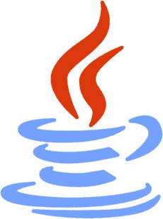

## 第二章

## Java

### 概述与基本语法

Java 是一种高级编程语言，由 Sun Microsystems 于 1995 年发布。使用 Java 技术构建的网站和应用程序不计其数，因为它可靠、易于使用，并且与其他编程语言相比速度更快。作为一种面向对象的编程语言，开发者可以更快地编写、编译、执行和测试程序。此外，使用 Java 开发的应用程序能够适应多种环境，并且也更加安全。

### Java 标识符与修饰符

Java 标识符应以 A 到 Z 或 a 到 z 的字母开头，因为标识符也区分大小写。你必须记住，关键字永远不能用作标识符，并且标识符在第一个字符之后可以包含任意字符组合。例如，month、$price 或 _place。

Java 编程语言中有两种修饰符。一种称为访问修饰符，另一种称为非访问修饰符。修饰符通常用于修饰方法或类。

### 对象、类与构造器

#### 类与对象

对象是类的一部分，也称为类的实例。类表示所有对象共有的一组属性，并且是用于创建对象的已定义原型。要声明一个类，我们必须包括修饰符、类名、超类、接口和类体。

此外，Java 中的一切都与对象和类相关联，而对象和类又与方法及属性相结合。以现实生活中的手机为例，它具有颜色、内存、显示屏和重量等属性。

在 Java 中创建类，需要遵循如下所示的语法：

```java
public class NewClass {
    int a = 1;
}
```

要创建名为“newObj”的对象：

```java
public class NewClass {
    int a = 1;

    public static void main(String[] args) {
        MyClass newObj = new NewClass();
        System.out.println(newObj.x);
    }
}
```

创建对象需要声明、实例化和初始化。声明是声明变量名及对象类型的过程，而实例化用于使用 new 关键字创建对象。然后程序通过调用构造器继续执行，以初始化新对象。

### 基本数据类型与变量

在 Java 程序中，数据存储在变量中，程序首先声明变量，将数据读入变量，然后执行所提供的操作。该过程完成后，变量会再次写入新位置。变量提供预留的内存位置来存储值，而内存由操作系统分配。

#### 数据类型

Java 编程语言中有两种不同的数据类型，称为基本数据类型和对象数据类型。基本数据类型分为 8 类：Byte、Short、Int、Long、Float、Double、Boolean 和 Char。对象数据类型通过使用类的构造器创建，并且它们也负责访问对象。每个可用引用变量的默认值都设置为 null，它也可以用于引用所声明类型的对象。

#### 变量

Java 编程语言中使用的变量有三种：

- 局部变量
- 实例变量
- 类/静态变量

##### 局部变量

局部变量通常在构造器和方法中声明。由于它们随构造器一起创建，因此访问修饰符不能与局部变量一起使用。局部变量没有默认值。

##### 实例变量

实例变量在类中声明，并且每当创建对象时就会创建。它们应当保存被多个构造器或方法引用的值。实例变量也可以赋予访问修饰符。

### 运算符、控制语句与决策

#### 运算符

Java 编程语言中可用的基本运算符解释如下：

- 算术运算符：算术运算符可用于在程序中执行数学计算和方程求解。这包括加法、减法、乘法、除法、取模以及自增和自减函数。
- 一元运算符：后缀：expr++ 和前缀 ++expr --expr 表达式。
- 逻辑运算符：(A && B) 为 false，(A || B) 为 true，!(A && B) 为 true。
- 位运算符：用于执行逐位运算。
- 赋值：=、+=、|=、^=。

#### 控制语句

Java 语言的控制语句与其他主要编程语言（如 C 或 C++）类似。这些条件详细说明如下：

**If Else：** if 语句用于检查给定条件为真还是假。Java 编程语言中有不同类型的 if 语句，分别称为 if 语句、if-else 语句、if-else-if 阶梯和嵌套 if 语句。

下面是一个演示 if 语句的简单 Java 程序：

```java
public class Marks {
    public static void main(String[] args) {
        int Marks = 50;

        if (Marks < 50) {
            System.out.print("Your marks are less than 50");
        }
    }
}
```

上述程序的输出为：Your marks are less than 50。

**If-else：** 该语句用于测试条件，如果结果为真，则执行 if 块；如果为假，则执行 else 语句。

**Switch：** switch 语句用于从多个条件中执行单个语句。该语句可处理包括 short、int、long、byte、String 和 Long 在内的数据类型。

switch 语句的语法如下：

```java
switch (expression) {
    case value1:
        // code to be executed;
        break;
    case value2:
        // code to be executed;
        break;
    default:
        // code to be executed if all cases are not matched;
}
```

### 循环

编程语言中通常使用三种循环。

- For 循环
- While 循环
- Do-while 循环


#### For 循环

For 循环用于在程序的一部分中执行迭代。如果迭代次数固定，建议在程序中使用 For 循环。

#### While 循环

While 循环具有重复单条或一组语句以测试给定条件是否成立的特点。当迭代次数不固定时使用它。

#### Do-While 循环

Do While 循环用于多次迭代程序的一部分。如果迭代次数不固定，你需要至少执行程序一次。

有一些特定的循环控制语句，用于将执行改变为正常顺序。Java 编程语言中使用的两个控制语句包括：

- break 语句：终止 switch 或循环，以开始下一次循环。
- continue 语句：允许循环重新测试其条件并跳过循环体的其余部分。

### 决策制定

决策制定结构具有一个或多个需要在给定场景下进行测试的条件。如果条件为真，则可以执行下一条语句；而如果给定条件为假，程序将终止。下图正确展示了决策制定过程实际如何工作：

### 字符、字符串、数组和正则表达式

Java 编程语言利用 Character 包装类，并提供多个用于操作字符的静态方法。要创建字符对象，你需要遵循如下语法：

`Character ch = new Character('a');`

编译器将自动创建一个 Character 对象；如果你将任何基本 char 传入该方法，编译器将使用语言中的各种方法将 char 转换为 Character。

正如我们之前讨论过字符串的重要性和功能，Java 平台也提供字符串类的支持。程序员可以通过多种方式操作字符串。在 Java 语言中创建字符串的示例代码如下：

```java
public class NewString {
    public static void main(String args[]) {
        char[] StudentArray = { 'S', 'T', 'U', 'D', 'E', 'N', 'T'};
        String StudentString = new String(StudentArray);
        System.out.println(StudentString );
    }
}
```

该程序的输出为：STUDENT。

此外，我们还可以在 Java 编程语言中使用简单的拼接方法来拼接字符串，如下所示：

`String1.concat(string2);`

要在 Java 中创建字符串对象，程序员可以选择字面量方式或关键字方式。

#### 数组

数组是每种编程语言的重要组成部分，因为它们允许程序员将数据处理并存储到变量中。由于它们用于存储大量数据集合，你也可以将数组视为同一类别变量的集合。要声明数组，你可以遵循下面简要说明的简单语法：

`datatype[] arrayRefVar;`

在 Java 中创建数组很简单，你可以使用以下语法：

`arrayRefVar = new datatype[arraySize];`

该语句将创建给定大小的数组，并将此数组的引用赋给给定变量。通常，数组通过 for 循环或 foreach 循环处理，因为数组内部的元素具有相同的类型和大小。

用于排序、搜索、比较和填充数组元素的静态方法：

- `public static int binarySearch(Object[] a, Object key)`
- `public static void fill(int[] a, int val)`
- `public static boolean equals(long[] a, long[] a2)`
- `public static void sort(Object[] a)`

#### 正则表达式

正则表达式是一个 API，用于定义字符串模式，也用于搜索、编辑和操作文本。Java 有一个预定义的 java.util.regex 包，其中包含 Pattern 类、Matcher 类和 PatternSyntaxException 对象。Pattern 类要求开发者从 compile() 方法开始，并返回一个模式对象，因为它不提供公共构造函数。

对于 Matcher 类，matcher 对象会查找并比较针对输入字符串的操作，以便通过 Matcher() 方法获得 Matcher 对象。PatternSyntaxException 用于指示正则表达式模式中的错误或失误。

### 文件和 I/O

Java 编程语言具有一个内置包，负责数据输入和输出操作。该流称为 java.io，支持多种操作和功能来处理数据。Java 中有两种通用类型的流，称为输入流和输出流。

输入流用于读取数据，而输出流用于将数据写入文件。

Java 语言具有多种 I/O 数据处理流，包括以下内容：

- 字节流
- 字符流
- 标准流
- 文件输入流
- 文件输出流

### 面向对象的 Java

面向对象编程是一种包括使用类和对象的方法。通过使用继承、多态、封装和抽象等多个概念，程序员可以开发 Java 应用程序和程序。

#### 继承

继承是 Java 编程语言中的一项特性，允许它继承另一个类的特性和属性。这可以在子类和超类之间完成。其特性被继承的类称为超类，而继承另一个类属性的类称为子类。

要在 Java 编程语言中使用继承，你可以遵循下面提到的语法：

```java
class derived-class extends base-class
{
        //methods
}
```

#### 多态

以多种方式完成单一任务的技术称为多态。在 Java 编程中，我们可以使用方法重写和方法重载技术来实现多态。必须知道，对象也可以通过引用变量访问，并且一旦它被重新分配给其他对象，引用变量的类型可用于确定用于访问该对象的方法。

例如：

```java
public interface School {}
public class Student {}
public class John extends Student implements School {}
```

在上述情况下，John 被认为是多态的，因为它具有多重继承，我们也可以将引用变量用于同一对象。

#### 抽象

抽象类是在其声明中包含 abstract 关键字的类，它可能包含也可能不包含抽象方法。在类具有抽象方法的情况下，它不能被实例化，程序员将不得不从另一个类继承它来实现抽象方法。

#### 封装

Java 编程中的封装是将数据和方法包装在一起的过程。通常，一个类的变量将对另一个类隐藏，并且只能通过当前类中使用的方法访问。封装的优点是类可以变为只读或只写，并且还可以完全控制存储的数据。

#### 递归

递归是一种技术，指在程序内部调用自身的方法。recurse() 方法从 main 方法调用，也可以从同一个 recurse() 方法调用。此过程持续进行，直到满足给定条件；如果条件不满足，则会发生无限递归。

以下是 Java 中递归的简单实现：

```java
class Sample {
    static void printFun(int test)
    {
        if (test < 1)
            return;

        else {
            System.out.printf("%d ", test);

            // Statement 2
            printFun(test - 1);

            System.out.printf("%d ", test);
            return;
        }
    }
}
```

```java
}

public static void main(String[] args)
{
    int test = 3;
    printFun(test);
}
}
```

##### 递归的优点

在若干复杂程序中，编写递归代码可以带来多种好处。由于它提供了一种简单而简洁的代码编写方式，开发者可以毫无麻烦地执行不同种类的操作。

### 抽象类和抽象方法

#### 抽象类

在 Java 编程中，抽象类被称为不能被实例化的类，并通过使用 `abstract` 关键字声明。

以下是在 Java 中声明抽象类 *Student* 的语法：

```java
abstract class Student {
    //methods and attributes
}
```

请记住，我们不能创建抽象类的对象。这样做将产生编译错误。

##### 抽象类的继承

以下是一个示例 Java 程序，说明了抽象类的继承：

```java
abstract class Student {
    public void displayInfo() {
        System.out.println("I am a Student");
    }
}
class Grade extends Student {
}
class Main {
```


```java
public static void main(String[] args) {
    Grade G1 = new Grade();
    G1.displayInfo();
}
}
```

#### 抽象方法

在 Java 中创建抽象方法时，同样使用关键字“abstract”。语法定义如下：

```java
abstract void moveTo();
```

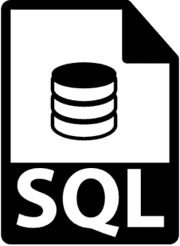

## 第三章

## SQL 与数据库

### 什么是数据库？

数据库是可被访问、管理和更新的数据集合。在简要讨论数据库之前，重要的是我们要理解数据实际上意味着什么，以及如何对其进行处理。数据通常被定义为记录和事实的集合，我们可以利用它们进行计算并进行推理。

为了保护、保存、传递和组织数据，人们创建了数据库，而管理整个过程的系统称为数据库管理系统（DBMS）。

### 数据库管理系统（DBMS）概念

数据库管理系统由多个程序组成，这些程序允许用户访问数据库并通过不同过程处理数据。由于它通常被设计用于控制对数据库的访问，因此在 DBMS 中引入了各种操作和功能，使其更加有效、安全和可靠。

DBMS 有 4 种不同类型：

- 1. 关系型 DBMS

  此类 DBMS 以表的形式定义数据库关系。

- 2. 面向对象关系型 DBMS

  面向对象关系型 DBMS 允许以对象及其属性的形式存储数据。

- 3. 网状 DBMS

  网状 DBMS 具有多对多关系，通常用于复杂的数据库结构。

- 4. 层次型

  层次型 DBMS 遵循父子关系存储数据，其结构类似于树，节点用于表示各种字段。

### 数据库环境与体系结构

数据库环境被称为组件的集合系统，这些组件负责数据处理、管理以及数据使用。由于数据库通常存储在计算机中，用于管理整个过程的硬件和计算机外围设备也包括诸如 SQL Server 之类的 DBMS 工具。

数据库或 DBMS 的体系结构通常分为三大类：集中式、分散式和层次式。数据库系统可以是客户端-服务器式或集中式，也可以设计为由并行计算机体系结构访问。

DBMS 的三层体系结构定义如下：

- 表示层
- 应用层
- 数据库层

### 数据库类型

数据库有不同的类型，按照其组织方式和功能进行分类。

#### 关系型数据库

关系型数据库是以多种方式定义、组织和访问数据的数据库。作为表格型数据库，表由行和列组成，并通过结构化查询语言（SQL）进行管理。

#### 分布式数据库

分布式数据库的数据存储在多个站点上，这些站点通过通信链路相互连接。该数据库进一步分为同构和异构两类。对于同构分布式数据库系统，相同类型的硬件、操作系统和数据库应用连接在一起；而对于异构分布式数据库系统，每个位置和连接的系统可以不同。

#### 云数据库

云数据库环境被设计和构建用于在私有云、公有云或混合云中存储数据。它提供更好的可扩展性和更大的存储容量，用户可以受益于高可用性。它是业务应用最合适的选择。

#### NoSQL 数据库

NoSQL 数据库最适合大型分布式数据，并且可通过关系型数据库方便地管理。此外，它们对于使用关系型数据库不易解决的大数据性能问题很有效。

#### 面向对象数据库

面向对象数据库由关系型数据库支持，并且基于对象而不是操作。

#### 最终用户数据库

最终用户数据库是为最终用户专门设计和创建的共享数据库。由于它提供整个数据库的摘要，最终用户当然不必担心在任何数据库级别上正在执行的操作。

### 数据库语法、数据类型和运算符

结构化查询语言（SQL）用于在数据库中存储、操作和检索数据。SQL 允许数据库管理员执行管理数据库所需的多种操作。该语言允许您只需编写简单查询，就能执行查询、检索数据、插入记录、更新记录、删除记录、创建新数据库、创建新表以及在数据库中设置权限。

SQL 有不同版本，并且它们都支持 SELECT、DELETE、INSERT、WHERE 和 UPDATE 等主要功能。

#### 结构化查询语言（SQL）

SQL 是用于 MySQL、Sybase、Oracle 和 SQL Server 等关系型数据库系统的语言。作为标准数据库语言，SQL 允许用户描述数据、访问数据并操作关系型数据库管理系统。此外，用户还可以通过结构化查询语言创建、查看和删除数据库。此过程中包含的不同组件有优化引擎、SQL 查询引擎、经典查询引擎和查询调度器。要在关系型数据库管理系统中执行特定操作，我们可以使用下面提到的命令：

| 命令 | 描述 |
|---|---|
| CREATE | 用户可以在数据库中创建新表或对象。 |
| READ | 用户可以读取表中存储的数据。 |
| UPDATE | 更新表以修改记录。 |
| DELETE | 从表中删除任何记录。 |
| INSERT | 向表中插入新记录 |
| SELECT | 从数据库中的表中选择特定记录。 |
| ALTER | 在数据库对象内进行更改。 |
| DROP | 从数据库中删除整个表。 |

通过使用上述操作，我们可以对下面名为“Students”的示例表执行不同操作：

| 学生 ID | 学生姓名 | 城市 | 科目 | 分数 | 百分比 |
|---|---|---|---|---|---|
| 1 | 威廉 | 纽约 | 数学 | 85 | 60% |
| 2 | 詹姆斯 | 加利福尼亚 | 英语 | 79 | 58% |

从上述表中获取记录的 SQL 语句将具有以下语法：

```sql
SELECT * FROM Students;
```

##### 1. SQL 查询

为了对数据库中的表执行特定操作，我们需要使用如下解释的不同查询：

| 查询 | 语法 |
|---|---|
| INSERT INTO | INSERT INTO table_name(column1, column2,...)<br>VALUES (Value1, Value2,...) |
| UPDATE | UPDATE table_name SET column1 = value1, column2 = value2,...<br>WHERE condition |
| DELETE | DELETE FROM table_name WHERE condition; |
| ORDER BY | SELECT column1, ... FROM table_name<br>ORDER BY column1 ASC/DESC; |

- 内连接
- 左外连接
- 右外连接
- 全外连接

###### 内连接

内连接从表 A 和表 B 中选择满足连接条件的全部记录。在 SQL 中创建内连接的语法定义如下：

```sql
SELECT column_name
FROM table1
INNER JOIN table2
ON table1.column_name = table2.column_name;
```

###### 左连接

左连接选择表 A 的全部记录，并与表 B 中满足连接条件的记录组合。在 SQL 中创建 LEFT JOIN 的语法定义如下：

```sql
SELECT column_name
FROM table1
LEFT JOIN table2
ON table1.column_name = table2.column_name;
```

###### 右连接

右连接选择表 B 的所有记录，并与表 A 中满足连接条件的记录组合。在 SQL 中创建 RIGHT JOIN 的语法定义如下：

```sql
SELECT column_name
FROM table1
RIGHT JOIN table2
ON table1.column_name = table2.column_name;
```

###### 全外连接

全外连接选择表 A 和表 B 的所有记录，即使连接条件不满足。在 SQL 中创建 FULL JOIN 的语法定义如下：

```sql
SELECT column_name
FROM table1
FULL OUTER JOIN table2
ON table1.column_name = table2.column_name
WHERE condition;
```


### UNION 运算符

要合并两个或多个 SELECT 语句的结果，可使用 UNION 运算符；此时每一列都必须具有相似的数据类型。此外，两个表中 SELECT 语句里的列顺序应保持一致。在 SQL 中实现 UNION 运算符的语法定义如下：

```sql
SELECT column_name FROM table1
UNION
SELECT column_name FROM table2;
```

### GROUP BY

SQL 的 GROUP BY 语句可用于从数据库表中执行列出或编号操作。在 SQL 中使用 GROUP BY 语句的语法定义如下：

```sql
SELECT column_name
FROM table_name
WHERE condition
GROUP BY column_name
ORDER BY column_name;
```

### ORDER BY

SQL 中的 ORDER BY 语句用于按升序或降序对数据排序。实现 ORDER BY 子句的语法定义如下：

```sql
SELECT column_list
FROM table_name
WHERE condition
[ORDER BY column1, column2] [ASC | DESC];
```

### 高级 SQL

还有一些其他重要操作和子句可用于在数据库内执行复杂操作。以下详细说明高级 SQL 的一些关键特性：

#### 索引

SQL 索引被数据库搜索引擎用于优化数据处理过程。由于索引被视为特殊的查找表，因此索引有助于加速 WHERE 子句和 SELECT 查询。要创建索引，我们可以使用 CREATE INDEX 语句以及 UNIQUE 约束来防止重复条目。

使用 CREATE INDEX 的语法：

```sql
CREATE INDEX index_name ON table_name;
```

使用 DROP INDEX 的语法：

```sql
DROP INDEX index_name;
```

#### 截断表

SQL 中的 TRUNCATE TABLE 命令用于从现有表中删除全部数据。

基本语法：

```sql
TRUNCATE TABLE table_name;
```

#### SQL 主键与外键

##### 主键

SQL 中的 PRIMARY KEY 约束用于唯一标识表中的每条记录。主键应始终包含唯一值，且不得有任何 NULL 值。此外，一个表只能有一个唯一的主键，该主键可以由单列或多列组成。

例如，在创建“Students”表时要在 ID 列上定义 PRIMARY KEY，我们可以使用以下 SQL 语句：

```sql
CREATE TABLE Students (
    ID int NOT NULL,
    FirstName varchar(255),
    LastName varchar(255) NOT NULL,
    Marks int,
    PRIMARY KEY (ID)
);
```

##### 外键

SQL 中的 FOREIGN KEY 约束用于将两个表链接在一起，其中一个表中的 FOREIGN KEY 引用另一个表中的 PRIMARY KEY。

在“StudentID”列上实现 FOREIGN KEY 约束以创建“Student”表的语法：

```sql
CREATE TABLE Student (
    StudentID int NOT NULL,
    StudentMarks int NOT NULL,
    ClassID int,
    PRIMARY KEY (StudentID),
    FOREIGN KEY (ClassID) REFERENCES Students(StudentID)
);
```

#### 约束与有用资源

约束是应用于表数据列的特定规则。通常，约束用于限制可以插入表中的数据类型。最常见的是，这包括 NOT NULL 约束、DEFAULT 约束、UNIQUE 约束、PRIMARY KEY、FOREIGN KEY、CHECK 约束和 INDEX。

此外，完整性约束还可用于提高关系数据库中数据的一致性和准确性。通常，PRIMARY KEY、FOREIGN KEY 和 UNIQUE 约束是参照完整性（RI）的一部分。

为了提高 SQL 数据库的性能，有几个重要因素可以轻松实施。在编写列名时，建议使用 SELECT 语句，而不是 * 分隔符。

例如：

```sql
SELECT * FROM Students
```

此外，设置 NOCOUNT ON 语句将减少 SQL Server 为 INSERT、DELETE 或 UPDATE 操作更新行所需的时间。

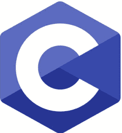

## 第四章

## C

C 编程语言于 1972 年在美国 AT&T 的贝尔实验室开发。通常，编程语言分为两大类，称为高级语言和低级语言，但 C 被归类为中级语言。该语言的目的是提供对内存的低级访问，并且还为其他主要编程语言（如 PHP 和 Java）提供了语法基础。

### 简介与简单程序

作为一种结构化语言，程序员可以创建分区的代码块，并通过实施不同的方法和编程技术来创建业务应用程序。此外，在 C 库中，我们还可以编写新函数，并在整个应用程序中重复使用它们。

### 开始 C 编程

编写 C 程序对初学者来说简单易行。从基本的程序语法开始，我们可以如下开发 C 应用程序和程序：

```c
#include <stdio.h>
int main()
{
    int a = 2;
    printf("%d", a);
    return 0;
}
```

### 头文件

编写 C 程序的第一部分是选择头文件。通常，头文件以 .h 为扩展名编写，并且包含函数声明。要包含头文件，我们可以遵循如下语法：

```c
#include <string.h>
```

C 头文件示例：

| 头文件 | 定义 |
|---|---|
| stdio.h | 用于定义输入和输出函数 |
| string.h | 用于字符串处理 |
| stddef.h | 定义有用的类型和宏 |
| stdlib.h | 定义内存分配 |
| stdint.h | 用于定义整数类型 |
| math.h | 用于执行数学函数 |

### 方法与变量声明

编写 C 程序的下一部分是定义方法并声明变量。声明 main 方法的语法是：

```c
int main()
{
```

变量声明的语法是：

```c
int main()
{
    int z;
}
```

### 程序主体

```c
int main()
{
    int z;
    printf("%d", z);
    return 0;
}
```

要终止程序，我们可以使用 return 语句：return 0。

### 关键字

关键字是任何编程语言的主要驱动力，也称为保留字。尽管高级编程语言有许多关键字，但 C 中只允许使用 32 个关键字，如下所示：

| double | long | int | switch |
| case | register | enum | typedef |
| union | extern | const | for |
| do | while | static | default |
| auto | break | else | struct |
| float | short | char | return |
| void | continue | for | if |
| signed | goto | sizeof | volatile |

### 数据类型与变量

在 C 编程语言中，数据类型用于定义变量，以便在程序中使用变量之前为其分配存储空间。C 编程语言的内置数据类型包括 float、int、char 和 double。这些数据类型具有称为 short、long、signed 和 unsigned 的修饰符。

以下是 C 编程语言中允许的有效数字、字母和符号：

- **字母：** A-Z, a-z.
- **符号：** ~ \` ! @ # % ^ & * ( ) _ - + = | \\ { } [ ] : ; ' " < > , . ? /
- **数字：** 0, 1, 2, 3, 4, 5, ...

### 变量

要在 C 中声明变量，我们可以遵循如下程序语法：

```c
#include <stdio.h>
// Variable declaration:
extern int a, b;
extern int c;

int main() {

    /* variable definition: */
    int a, b;
    int c;
    float f;

    /* initialization */
    a = 30;
    b = 20;
    c = a + b;
    printf("value of c : %d \n", c);

    return 0;
}
```

该程序的输出为：50。

### 变量的作用域

任何编程语言中变量的作用域都用于授予变量某些权限。通常，变量分为局部变量、全局变量和形式参数。

局部变量在块内声明，并且只能由编写在程序特定区域中的语句使用。由于程序中的其他函数不知道它们，因此我们无法在函数外部访问局部变量。

全局变量通常定义在函数外部，并保留其值

在整个程序中。它可以被程序中的任何函数访问和调用。局部变量需要程序员初始化，而全局变量会自动初始化。

### 循环与函数

#### 循环

循环是每种编程语言的重要组成部分，允许开发者多次执行特定语句。C 编程语言中使用 4 种不同类型的循环，简要介绍如下：

- **For 循环：** 用于执行特定次数的语句，也被认为可以缩写代码以处理循环变量。
- **While 循环：** 重复给定语句，并检查给定条件为真还是假。在执行循环体之前，它会检查所有条件。
- **Do While 循环：** 工作方式与 While 循环相同，但是 Do While 循环只在末尾检查条件。
- **嵌套循环：** 循环内部的循环称为嵌套循环。它可以是 While 循环、Do While 循环或 For 循环。

为了改变循环的正常执行顺序，我们也可以使用循环控制语句。Break 语句退出循环并将执行转移到下一条语句，而 Continue 语句使循环跳过其循环体的其余部分并重新检查给定条件。为了将控制转移到带标签的语句，我们也可以使用 `goto` 语句。

#### 函数

在 C 编程语言中定义函数时，推荐使用以下语法：

```c
return_type function_name(parameter_list) {
    function_body
}
```

在函数中，返回类型被称为函数本身返回的函数值的数据类型，而函数的动作名称被称为函数名。每当调用函数时，我们需要传递一个参数，其值称为实参或实际参数。必须注意，参数不是强制性的，函数也可以在没有参数的情况下执行。

函数体包含多条语句，通常定义要在函数内执行的操作。要在 C 中声明一个 `min()` 函数，我们可以使用如下语法：

```c
int min(int num1, int num2);
```

要在程序中调用函数，我们需要传递参数和函数名。如果函数返回了任何值，也可以将其存储起来。

##### 向函数传递参数的方法

###### 按值调用

按值调用方法用于将实参的实际值复制到函数的形式参数。对参数所做的更改在函数内不会直接影响实参。

###### 按引用调用

按引用调用方法用于将实参的地址复制到形式参数。对参数所做的更改会直接影响实参。

### 数组、字符串和链表

#### 数组

数组是元素的集合，可以存储固定大小的同类型顺序数据。数组由连续的内存位置组成，可以通过以下语法声明：

```c
type arrayName[arraySize];
```

示例：

| 3 | 5 | 6 | 8 | 10 | 20 |
|---|---|---|---|---|---|

所有数组的第一个元素索引都是 0，它也被称为基索引。请注意，数组的大小在声明后不能更改。要在 C 语言中初始化数组，我们可以使用如下语句：

```c
int data[50];
```

要初始化数组，我们可以使用如下所述的语法：

```c
int data[10] = {3, 2, 7, 8, 23, 42, 64, 73, 23, 77};
```

在这个数组中，索引 = 0 的值为 3，而索引 9 的值为 77。

下面是一个在 C 编程语言中使用数组求 5 个整数平均值的示例：

```c
#include <stdio.h>
int main()
{
    int avg = 0;
    int sum = 0;
    int x = 0;

    int num[5];

    for (x = 0; x < 5; x++)
    {
        printf("Enter number %d \n", (x + 1));
        scanf("%d", &num[x]);
    }
    for (x = 0; x < 5; x++)
    {
        sum = sum + num[x];
    }

    avg = sum / 5;
    printf("Average of entered number is: %d", avg);
    return 0;
}
```

##### 二维和三维数组

C 编程语言也支持二维和三维多维数组。要初始化二维数组，我们使用以下语法：

```c
int z[2][3] = {
    {0, 1,},
    {2, 3, 4},
    {5, 6, 9}
};
```
或者

```c
int z[2][3] = {0, 1, 2, 3, 4, 5, 6, 9};
```

#### 字符串

在 C 编程中，字符串通过使用一维字符数组创建。字符串必须以空字符结尾，也称为 `"\0"`。

要在 C 中声明字符串，我们可以遵循如下所述的语法：

```c
char str_name[size];
```

`str_name` 用于定义字符串，而 size 告诉我们字符串的长度。

下面的 C 程序用于声明、读取和打印字符串：

```c
#include<stdio.h>

int main()
{
        // declaring string
        char str[10];

        // reading string
        scanf("%s",str);

        // print string
        printf("%s",str);

        return 0;
}
```

### 指针和结构体

指针是一个变量，其值与程序中另一个变量的地址相同。由于它直接指向内存位置的地址，我们可以预先声明指针，并将其存储在任何变量地址中。

声明指针变量的语法如下：

```c
type *var_name;
```

要使用指针，首先需要定义一个指针变量，并将某个变量的地址赋给该指针。接下来，我们可以从指针变量中给出的地址访问值。整个操作借助 `*` 一元运算符完成，它从操作数定义的地址返回变量的值。必须注意，普通变量存储值，而指针变量存储变量地址。由于空指针的值为 0，任何指针的大小都是 2 字节。

下面是一个使用 C 语言指针编写的示例程序：

```c
#include <stdio.h>
int main()
{
    int *ptr, q;
    q = 100;
    ptr = &q;
    printf("%d", *ptr);
    return 0;
}
```

#### 结构体

结构体被定义为变量的集合，允许程序员组合不同的数据类型。作为用户定义的数据类型，结构体可以类似于数组来引用，但两者之间唯一的区别是数组只能保存相同类型的数据。

以组织为例，我们可以使用结构体来管理员工记录，如下所示：

- 姓名
- 员工 ID
- 职位
- 部门
- 地区

在 C 语言中定义结构体的语句是：

```c
struct Employee {
    char name[10];
    int employee_id;
    char designation[50];
    char department[50];
    char region[100];
};
```

要在编译时初始化结构体，语句是：

```c
struct Employee = {34, 12, 52, 15, 66};
```

##### 访问结构体成员

为了访问结构体的成员，我们需要使用成员访问运算符。要在 C 编程语言中访问结构体成员，可以使用以下类型的运算符：

- 成员运算符：(.)
- 结构体指针运算符：(->)

访问结构体成员的示例程序：

```c
#include <stdio.h>
struct Distance
{
        int feet;
        float inch;
} dist1, dist2, sum;
int main()
{
        printf("1st distance\n");
        printf("Enter feet: ");
        scanf("%d", &dist1.feet);
        printf("Enter inch: ");
        scanf("%f", &dist1.inch);
        printf("2nd distance\n");
        printf("Enter feet: ");
        scanf("%d", &dist2.feet);
        printf("Enter inch: ");
        scanf("%f", &dist2.inch);

        sum.feet = dist1.feet + dist2.feet;
        sum.inch = dist1.inch + dist2.inch;
        while (sum.inch >= 12)
        {
            ++sum.feet;
            sum.inch = sum.inch - 12;
        }
        printf("Sum of distances = %d'-%.1f\"\n", sum.feet, sum.inch);
        return 0;
}
```

##### 输出


```c
#include <stdio.h>
struct Distance
{
    int feet;
    float inch;
} dist1, dist2, sum;
int main()
{
    printf("1st distance\n");
    printf("Enter feet: ");
    scanf("%d", &dist1.feet);
    printf("Enter inch: ");
    scanf("%f", &dist1.inch);
    printf("2nd distance\n");
    printf("Enter feet: ");
    scanf("%d", &dist2.feet);
    printf("Enter inch: ");
    scanf("%f", &dist2.inch);

    sum.feet = dist1.feet + dist2.feet;

    sum.inch = dist1.inch + dist2.inch;

    while (sum.inch >= 12)
    {
        ++sum.feet;
        sum.inch = sum.inch - 12;
    }
    printf("Sum of distances = %d' - %.1f\"", sum.feet, sum.inch);
    return 0;
}
```

```
1st distance
Enter feet: 5
Enter inch: 9
2nd distance
Enter feet: 6
Enter inch: 3
Sum of distances = 12'-0.0"

...Program finished with exit code 0
Press ENTER to exit console.
```

##### 将指针传递给结构体

我们还可以在 C 编程语言中定义指向结构体的指针，其定义方式与定义指向其他变量的指针相同。为了通过指针访问结构体的成员，可以考虑以下语法：

```c
Struct_pointer->title;
```

### C 编程文件

编程要求开发者通过使用最有效的方法来处理不同的需求和场景。要在 C 语言中执行文件处理操作，我们可以使用如下操作：

- `fprintf()`
- `fscanf()`
- `fread()`
- `fwrite()`
- `fseek()`

通常，程序终止时所有数据都会丢失，因此我们必须创建一个包含所有数据的特定文件。这也可以节省时间，并让程序员通过输入几条命令从文件中访问数据，以及通过 C 语言运算符将数据从一台计算机传输到另一台计算机。

文件有两种类型，称为文本文件和二进制文件。文本文件是 `.txt` 文件，可以使用记事本创建，编写、维护和更新记录所需的工作量最小。二进制文件是 `.bin` 文件，它们以 0 和 1 的二进制形式存储数据。此外，与文本文件相比，二进制文件可以存储更大量的数据。

在 C 编程语言中，我们可以通过下表中提到的简单命令创建新文件、打开现有文件、从文件读取信息以及向文件写入信息，并关闭文件：

| 操作 | 语法 |
|---|---|
| 打开文件 | `ptr = fopen("fileopen", "mode")` |
| 关闭文件 | `fclose(fptr);` |
| 写入二进制文件 | `fwrite(address_data, size_data, numbers_data, pointer_to_file);` |
| 从二进制文件读取 | `fread(address_data, size_data, numbers_data, pointer_to_file);` |
| 写入文本文件 | `FILE *fptr; fptr = fopen("File address", "w");` |
| 从文本文件读取 | `FILE *fptr; fptr = fopen("File address", "r");` |
| 文件定位 | `fseek(FILE *stream, long int offset, int whence)` |

### 让 C 编程变得简单的必备技巧

对于初学者，建议他们始终通过将重要代码信息写在 `/*` 和 `*/` 之间来注释代码。注释代码的主要部分还可以让你更轻松地进行后续更改并改进程序的功能。此外，始终使用变量来存储数据，例如 `int`、`char` 和 `float`，因为这会让你更轻松地执行不同的操作和计算。

C 语言简单且快速。借助指针、关键字和按位运算符，编写高效的代码对初学者来说肯定不成问题。

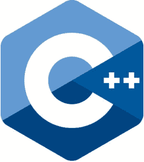

## 第五章

## C++

C++ 是一种自由形式的中级编程语言，由 Bjarne Stroustrup 于 1979 年开发。作为 C 编程语言的增强版本，C++ 现在已成为初学者最常用、最适合的语言。该语言提供了大约 7 种不同的编程风格，你可以根据需求选择最合适的风格。作为一种静态类型编程语言，C++ 允许编译器在执行程序之前指出错误或缺陷。此外，使用 C++ 进行面向对象编程可以方便地解决复杂问题，并扩展标准库的用途。C++ 是世界上最流行的编程语言，也广泛用于图形用户界面、操作系统和嵌入式系统。

### 基本语法

C++ 编程语言的基本语法与 C 等其他语言相同。程序员必须遵循预定义的一组规则，包括各种单词、符号、字符、操作和表达式，才能正确执行程序。

以下是我们可以编写的第一个 C++ 入门程序：

```cpp
#include<iostream>
using namespace std;
int main()
{
    cout<<"My First Program in C++";
    return 0;
}
```

程序输出：My First Program in C++。

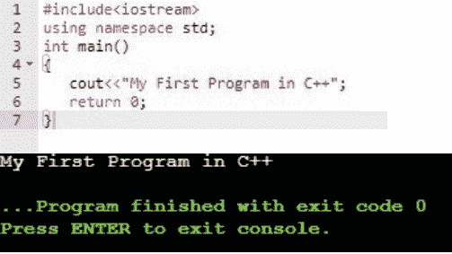

程序详情如下：

- **`#include<iostream>`** = 该语句包含预定义的输入和输出函数，并通知编译器也包含 iostream 文件。
- **`using namespace std;`** = 该语句用于将函数、变量和操作存储于程序中，其中 std 被视为命名空间名称。
- **`int main()`** = 这是程序的主函数，执行从此处开始。`int` 是返回类型，表示编译器返回一个整数值，为此我们还必须在末尾包含 `return 0` 语句。
- **`cout << "My First Program in C++"`** = `cout` 是隶属于 iostream 文件的对象，用于显示内容。
- **`return 0;`** = 该语句从 main() 函数返回 0 值，也负责 main 函数的执行。

### 变量和数据类型

#### 变量

C++ 编程语言中有不同类型的变量。由于它们使用特定关键字定义，我们必须按照如下给出的语法创建变量、指定类型并赋值：

```cpp
Type variable = value;
```

##### 变量类型

- `int` = 用于存储整数和完整数字。例如，1、45、6346。
- `char` = 用于存储单个字符。例如，`'a'` 或 `'Z'`。
- `double` = 用于存储浮点数。例如，50.2、100.2342。
- `bool` = 用于存储具有两种状态的值：`true` 或 `false`。
- `string` = 用于存储文本。例如，`"C++ programming language"`。

要声明变量并为其赋值，我们可以遵循如下所述的语法：

```cpp
int newNum;
newNum = 50;
cout << newNum;
```

C++ 中使用的每个变量都应使用唯一名称来标识，这些名称称为标识符。要构造标识符，名称必须包含字母、数字或下划线，并且区分大小写。

#### 数据类型

C++ 编程语言中的数据类型定义了变量中可以存储的数据类型。通常，C++ 中的数据类型分为三类：内置、派生和用户定义。用户定义的数据类型包括结构体、联合和枚举，而派生数据类型基于数组、函数和指针。

C++ 的内置数据类型：

- `int`
- `char`
- `float`
- `double`
- `bool`

用户定义的数据类型：

- `union`
- `enum`
- `struct`

派生数据类型：

- 函数
- 数组
- 指针

### 修饰符类型和存储类

C++ 编程语言中的修饰符与 `char`、`double` 和 `int` 数据类型一起使用，以更改基类型的含义，从而满足某些编程条件。这些修饰符包括 `signed`、`unsigned`、`long` 和 `short`。

要定义 C++ 程序中变量和函数的作用域，我们可以使用存储类，例如 `auto`、`register`、`extern`、`mutable` 和 `static`。`auto` 存储类是所有局部变量的默认存储类，而 `static` 存储类允许编译器在程序生命周期内存储局部变量，并在其超出作用域时销毁它。

外部存储类提供对全局变量的引用，并在两个或多个文件使用相同的全局函数或变量时使用。对于 `mutable` 存储类，只考虑类对象，而且它们也可以由常量成员函数修改。

### 流程控制

在 C++ 编程中，控制流指的是指令、函数和语句被求值和执行的顺序。


在程序运行期间。这些语句在代码中从上到下依次执行，以便完全满足程序逻辑。

程序并不依赖于语句的线性顺序，为此 C++ 提供了特定的流程控制语句。

### C++ 中的流程控制语句

- 1. If else 语句
- 2. For 循环
- 3. Do while 循环
- 4. Break 和 Continue
- 5. Switch 语句
- 6. Goto 语句

#### If 语句

在 C++ 编程中，当程序内有多条语句或多种情况需要执行时，会使用 if 语句。If 语句的语法表明，仅当给定语句为真时才会执行括号中的内容，否则假语句会被自动忽略。

```cpp
if(condition){
        statement;
}
```

#### If 语句的流程图

用于说明 C++ 中 If 语句的示例程序：

```cpp
#include <iostream>
using namespace std;
int main(){
    int marks=80;
    if( marks < 100 ){
        cout<<"Marks are less than 100";
    }

    if(marks > 100){
        cout<<"Marks are greater than 100";
    }
    return 0;
}
```

#### 嵌套 If 语句

在 C++ 中，语句中的语句称为嵌套 If 语句。例如：

```cpp
if(condition_1) {
    Statement1;
    if (condition_2) {
        Statement2;
    }
}
```

#### If Else 语句

```cpp
if(condition_1) {
    Statement;
}
else if (condition_2) {
    Statement;
}
```

#### Switch Case

在 C++ 编程中，当程序中给出多个条件，并且需要根据所提供的条件执行操作时，会使用 Switch Case 语句。Break 和 Continue 操作也是 Switch 语句的重要组成部分。C++ 中 Switch Case 的语法如下：

```cpp
#include <iostream>
using namespace std;
int main(){
    int num=10;
    switch(num+5) {
        case 1:
        cout<<"Case1: Value is: "<<num<<endl;
        case 2:
        cout<<"Case2: Value is: "<<num<<endl;
        case 3:
        cout<<"Case3: Value is: "<<num<<endl;
        default:
        cout<<"Default: Value is: "<<num<<endl;
    }
    return 0;
}
```

#### Goto 语句

C++ 中的 goto 语句用于改变程序的执行，并将控制权转移到同一程序内另一个带标签的语句。

goto 语句的语法：

```cpp
goto label;
```

### 循环和函数

#### 循环

在 C++ 编程语言中，循环语句用于执行特定代码块一定次数的迭代，直到满足所提供的条件。由于循环允许程序员一次执行多项任务，循环语句会执行函数中的第一条语句，并按需继续执行下一条。

循环的类型

- **While 循环：** 在所提供的条件为真时重复执行语句，并在执行循环体之前重新检查。
- **Do While 循环：** 在循环执行时检查条件。
- **For 循环：** 多次执行特定语句，并且也管理循环变量。
- **嵌套循环：** 一个循环内包含多个循环。

循环可以通过不同的控制语句执行，例如 Break 语句、Continue 语句和 goto 语句。

#### 函数

函数负责组合不同的代码段，并将它们一起执行以完成给定操作。C++ 编程语言中的两种主要函数类型包括库函数和用户定义函数。库函数在 C++ 中是预定义的，而用户定义函数由程序员自己创建。

要定义函数，我们可以使用以下语法：

```cpp
Return_type function_name(parameter list) {
    Function body
}
```

min() 函数的示例代码：

```cpp
int min(int num1, int num2) { //function declaration
    // local variable declaration
    int result;

    if (num1 < num2)
        result = num1;
    else
        result = num2;

    return result;
}
```

##### 函数调用

要在 C++ 中调用函数，我们可以使用以下方法：

- 按引用调用。
- 按值调用。
- 按指针调用。

##### 函数重载

当两个或多个函数具有相同名称但参数不同时，此过程称为函数重载。C++ 中函数重载的语法如下所示：

```cpp
void sameFunction(int a);
int sameFunction(float a);
void sameFunction(int a, double b);
```

### 数组、字符串、指针和引用

#### 数组

数组在编程语言中经常使用，因为它们允许我们处理大量相同类型的数据。通常，数组被称为数据的集合，其中包含固定数量的值。

在 C++ 中声明数组的语法：

```cpp
datatype arrayName[arraySize];
```

初始化：

```cpp
int age[5] = {15, 20, 25, 30, 35};
```

使用数组求 10 个数字之和的 C++ 示例程序：

```cpp
#include <iostream>
using namespace std;
int main()
{
        int numbers[10], sum = 0;

        cout << "Enter 10 numbers: ";

        for (int i = 0; i < 10; ++i)
        {
                cin >> numbers[i];
                sum += numbers[i];
        }
        cout << "Sum = " << sum << endl;
        return 0;
}
```

#### 字符串

字符串被称为字符的集合。在 C++ 编程中，常用的两种字符串类型是 C 字符串和标准 C++ 库字符串类。

以下语法可用于定义字符串：

```cpp
char str[] = "Programming";
```

#### 指针

指针被定义为一个变量，其值被视为另一个变量的地址。要在 C++ 编程语言中使用指针，我们需要定义一个指针变量，并将某个变量的地址赋给指针。之后，我们可以通过指针变量中给出的地址访问该值。

整个操作通过使用一元运算符 * 来完成。以下是 C++ 编程中最常用的指针：

- 空指针
- 指针数组
- 指向指针的指针
- 将指针传递给函数
- 从函数返回指针

### 面向对象的 C++

#### 类和对象

C++ 语言中的面向对象编程是创建对象并执行多种操作的一种简单方式。首先，在创建对象之前，我们需要定义一个类，为此可以使用下面提到的语法：

```cpp
class className
{
        //data
};
```

类可以定义为 Public、Private 或 Protected，以便数据成员只能在程序中特定访问。

示例代码：

```cpp
class student
{

        private:

                char name[20];

                int  rollNo;

                int  total;

                float perc;

        public:

                //member function to get student's details

                void getDetails(void);

                //member function to print student's details

                void putDetails(void);
};
```

#### 继承和多态

在编写实现继承的程序时，我们可以考虑 C++ 中基类和派生类的概念。由于一个类可以从一个或多个类派生，我们也可以从不同的基类继承函数和数据。

派生类可以访问其基类的所有非私有成员。除了从基类继承属性外，用户还可以从现有类创建新类。C++ 中继承的语法定义如下：

```cpp
class A  // base class
{
        ..........
};
class B : access_specifier A  // derived class
{
        ..........
};
```

#### 访问说明符

在 C++ 中，访问说明符用于确定类成员在该类之外的可用性限制。Private、Protected 和 Public 是定义类成员可访问级别的主要访问说明符。

创建类时使用 private 访问说明符，使得基类的 protected 和 public 数据成员成为派生类的 private 成员，而基类的 private 成员仍然保持为 private。

在 protected 访问说明符中，基类的 public 和 protected 数据成员成为派生类的 protected 成员。基类的 private 成员仍然不可访问。

使用 public 访问说明符时，基类的 public 数据成员成为派生类的 public 成员。protected 成员在派生类中成为 protected，而基类的 private 成员仍然不可访问。

在 C++ 中使用访问说明符的语法：

```cpp
class MyClass {  // class
```


```cpp
public:    // Access specifier
    // class members
};
```

### 友元函数、数据结构与封装

#### 友元函数

在面向对象编程中，非成员函数无权访问对象的私有和受保护数据。在这种情况下，为了允许访问私有或受保护数据，我们可以使用友元函数或友元类，它们允许程序员访问类的私有和受保护数据。该函数通过关键字“Friend”声明，并应在类体内部使用。在 C++ 编程语言中声明友元函数，可以使用如下所示的语法：

```cpp
class Class_name
{
    friend return_type function_name(argument);
};
```

#### 数据结构

尽管需要深入详细地介绍数据结构，以明确本主题的目标，但我们将讨论如何在 C++ 中定义和使用结构体。结构体是一种用户定义的数据类型，可以通过以下语法在程序中实现：

```cpp
struct [structure tag]
{
    member definition;
};
```

例如：

```cpp
struct vehicle {
    char name[50];
    char category[100];
    int model_year;
} vehicle;
```

要访问结构体中的任何成员，我们可以使用成员访问运算符（.）。通过数据结构可以简化指向结构体的指针的定义，为此我们可以使用以下语法：

```cpp
struct vehicle *struct_pointer;
```

#### 封装

术语“封装”被定义为在编程中向用户隐藏敏感数据的方法。要执行封装，我们需要将类变量和属性声明为私有，并通过 getter 和 setter 方法读取或修改私有成员的值。访问私有成员的语法定义如下：

```cpp
#include <iostream>
using namespace std;

class Employee {
private:
    // Private attribute
    int salary;

public:
    // Setter
    void setSalary(int s) {
        salary = s;
    }
    // Getter
    int getSalary() {
        return salary;
    }
};

int main() {
    Employee myObj;
    myObj.setSalary(50000);
    cout << myObj.getSalary();
    return 0;
}
```

### 文件处理

在 C++ 编程语言中，我们一直使用 cin 和 cout 方法在程序内读取或写入数据。要从文件中读取和写入数据，C++ 提供了一个称为 fstream 的标准库，其中包括 ofstream、ifstream 和 fstream 数据类型。

要打开文件，可以使用 fstream 或 ofstream 对象，其 C++ 语法定义如下：

```cpp
void open(const char *filename, ios::openmode mode);
```

关闭文件的语法：

```cpp
void close();
```

### C++ 语言特性与支持

C++ 编程语言提供丰富的库支持和标准模板库（STL）函数，可用于快速编写代码。由于它是一种面向对象的编程语言，我们可以专注于对象，并轻松执行不同类型的操作和实现。与其他主要编程语言不同，C++ 还提供指针支持。

凭借其快速、可靠和安全的特性，C++ 被广泛用于操作系统、浏览器、库、图形和数据库的开发。该语言速度很快，并以其速度和效率而闻名。此外，C++ 还允许异常处理，并支持函数重载。

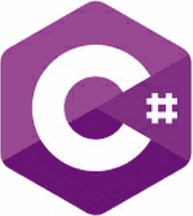

## 第六章

## C#

### 概述与基本语法

#### 概述

C# 是由 Microsoft 开发的一种编程语言，用于 .NET 框架。该语言基于面向对象的编程方法，并具有与 C 和 C++ 等其他现代编程语言相同的基本语法。C# 是为公共语言基础结构（CLI）开发的，CLI 由运行时环境和可执行代码组成。C# 易于学习，是最适合初学者的编程语言之一，因为初学者可以编写高效的程序，并且可以在不同的计算机平台上编译。要运行 C# 应用程序和程序，需要 .NET Framework，它可用于为 Windows 应用程序、Web 应用程序和 Web 服务编写代码。C# 的集成开发环境（IDE）包括 Visual Studio、Visual Web Developer 和 Visual C# Express。

#### 基本语法

基于面向对象的编程方法，C# 编程围绕类和对象展开。以学生类为例，它具有学生姓名、学号、班级和成绩等属性。尽管每个学生的属性相同，但每个学生都有不同的姓名、学号、班级和成绩，这些称为对象属性。通常，C# 程序由命名空间声明、类、类方法、属性、Main 方法和语句组成。

下面是一个在 C# 中打印“Welcome to C# programming”的简单程序：

```csharp
namespace CSharpProgramming
{
    class Programming
    {
        // Main function
        static void Main(string[] args)
        {
            Console.WriteLine("Welcome to C# programming");

            Console.ReadKey();
        }
    }
}
```

基本语法细节：

- **Using System:** 用于为程序包含 System 命名空间。
- **Namespace declaration:** 程序中类的集合。
- **Class declaration:** 包含程序中要使用的数据和方法的类。
- **Static void Main():** 关键字 static 表示无需实例化类也可以访问此方法。
- **Console.WriteLine():** 用于定义 System 命名空间的方法。
- **Console.ReadKey():** 使计算机等待下一条命令，并防止屏幕关闭。

### 数据类型与变量

数据类型是任何编程语言的重要组成部分，因为它们指定了语言支持的数据类型。由于 C# 中数据类型是预定义的，因此数据类型分为三大类，即值数据类型、引用数据类型和指针数据类型。

#### 1. 值类型

值数据类型变量派生自 System.ValueType 类，它们以字母和数字的形式包含数据。

下表显示了 C# 编程语言中使用的值类型：

| 数据类型 | 表示 | 默认值 | 范围 |
|---|---|---|---|
| Byte | 8 位无符号整数 | 0 | 0 到 255 |
| Decimal | 128 位精确十进制值 | 0.0M | (-7.9 × 10^28 到 7.9 × 10^28) / 10^0 到 28 |
| Bool | 布尔值 | False | True/False |
| Float | 32 位单精度浮点类型 | 0.0F | -3.4 × 10^38 到 +3.4 × 10^38 |
| Double | 64 位双精度浮点类型 | 0.0D | (+/-)5.0 × 10^-324 到 (+/-)1.7 × 10^308 |
| Char | 16 位 Unicode 字符 | '\0' | U+0000 到 U+FFFF |
| Int | 32 位有符号整数类型 | 0 | -2,147,483,648 到 2,147,483,647 |
| Short | 16 位有符号整数类型 | 0 | -32,768 到 32,767 |
| Long | 64 位有符号整数类型 | 0L | -9,223,372,036,854,775,808 到 9,223,372,036,854,775,807 |

#### 2. 引用类型

引用数据类型存储对变量的引用，而不是存储实际数据。通过使用多个变量，引用类型可以指向一个内存位置；如果其中一个变量更改了该内存位置，另一个变量将自动更改其值。

#### 3. 对象类型

对象数据类型被视为 C# 中使用的所有数据类型的基类。此外，对象类型还可以被赋予其他类型、引用类型、用户定义类型以及值类型的值。

#### 4. 指针类型

指针数据类型包含变量值的内存地址，其语法如下：

```csharp
Type* identifier;
```

### 运算符

C# 使用运算符的方式与 C 和 C++ 等其他主要编程语言相同。内置运算符集合包括算术运算符、关系运算符、位运算符、逻辑运算符、杂项运算符和赋值运算符。

### 函数与方法

在 C# 编程语言中，函数允许程序员封装代码的特定部分，并从代码的其他部分使用它。由于它避免了重写代码的需要，我们可以从多个位置访问函数，并执行所需的操作。C# 中的函数通过以下语法声明：

```csharp
<visibility> <return type> <name>(<parameters>)
```


```
{
    <function code>
}
```

在 C# 编程语言中，作为成员函数或类成员的函数也称为方法。通常，C# 中有两种方法：实例方法和静态方法。

函数可以返回任何类型的数据，并且可以执行多条语句，例如读取、跟踪和运行。

使用 C# 中的函数编写的示例程序：

```csharp
using System;

class Return2
{
    static string lastFirst(string firstName, string lastName)
    {
        string separator = ", ";
        string result = lastName + separator + firstName;
        return result;
    }

    static void Main()
    {
        Console.WriteLine(lastFirst("John", "William"));
        Console.WriteLine(lastFirst("James", "Lewis"));
    }
}
```

### 数组、字符串和结构

#### 数组

数组用于存储具有相同数据类型的固定大小元素集合。数组具有连续的内存位置，在 C# 编程语言中可以使用以下语法声明：

```csharp
DataType[] arrayName;
```

初始化：

```csharp
int[] age = new int[20];
```

关于成员的规则：C# 程序中类的默认访问说明符称为 internal。为了访问类成员，我们可以使用 (.) 运算符。它还将对象的名称与成员的名称联系起来。

类也被视为引用类型，在声明后变量包含 null 值，直到我们使用 new 运算符创建类的实例。要在 C# 中声明类，我们可以遵循下面提到的语法：

```csharp
public class Student
{
    // 属性、方法和结构
}
```

示例：

```csharp
MyClass student = new MyClass();
MyClass student2 = student;
```

包含不同数据成员和成员函数的类：

```csharp
public class Student
{
    public int id = 0;
    public string name = string.Empty;

    public Student()
    {
        // 构造函数语句
    }

    public void GetStudentDetails(int uid, string uname)
    {
        id = uid;
        name = uname;
        Console.WriteLine("Id: {0}, Name: {1}", id, name);
    }

    public int Designation { get; set; }

    public string Location { get; set; }
}
```

#### 创建对象

在 C# 编程中，对象完全基于类。类定义了一种对象类型。对象也称为类的实例，可以使用以下语法创建：

```csharp
Student Object1 = new Student();
```

一旦创建了类的实例，对象引用会自动传回。例如：

```csharp
Student object2 = new Student();
Student object3 = object2;
```

以下程序展示了如何在 C# 编程语言中创建对象：

```csharp
using System;

namespace Tutlane
{
    class Program
    {
        static void Main(string[] args)
        {
            Users user = new Users("Harry Potter", 20);
            user.GetUserDetails();
            Console.WriteLine("Press Enter Key to Exit.. ");
            Console.ReadLine();
        }
    }

    public class Users
    {
        // 实现
    }

    public class B : A
    {
        // 实现
    }

    public class C : B
    {
        // 实现
    }
}
```

### 多态

多态是指通过单一操作执行多种功能的技术。静态多态在编译时执行，而动态多态在运行时决定。在静态多态中，C# 允许程序员实现以下两种方法：

#### 函数重载

函数重载在给定的作用域中为同一函数名提供多个定义。此外，函数定义应在类型上彼此不同，因此不要重载具有不同返回类型的函数声明。

#### 构造函数

在 C# 编程中，每当创建结构或类时，都会自动调用构造函数。由于一个类可以有多个构造函数来处理不同的参数，构造函数还允许程序员设置实例化限制和默认值。

创建构造函数的语法：

```csharp
public class Person
{
    private string last;
    private string first;

    public Person(string lastName, string firstName)
    {
        last = lastName;
        first = firstName;
    }

    // Person 类的其余实现。
}
```

C# 编程中使用的三种构造函数分别是实例构造函数、静态构造函数和私有构造函数。

### 异常处理

异常是将控制权从程序的一个段转移到另一个段的方式。通常，异常被视为程序执行过程中出现的问题。为了处理这种情况，C# 提供了多种异常处理方法，称为 try、catch、throw 和 finally。

try 块概述了为其使用异常的代码块，而 catch 异常允许程序员从程序中的任何位置处理问题。当遇到问题时会引发 throw 异常，而 finally 异常用于执行一组给定的语句。

在 C# 编程语言中使用异常处理的语法：

```csharp
public class Person
{
    private string last;
    private string first;

    public Person(string lastName, string firstName)
    {
        last = lastName;
        first = firstName;
    }

    // Person 类的其余实现。
}
```

### 多线程

在 C# 编程语言中，线程被认为是程序的执行路径，因为它定义了特定的流程控制，并且还负责定义执行路径。由于它们是轻量级进程，线程可以节省 CPU 周期的浪费，从而提高程序的效率。线程的生命周期中有四个主要状态：未启动状态、就绪状态、不可运行状态和死亡状态。可以通过实现特定的 C# 方法来创建、管理和销毁线程。

### 文件 I/O

C# 提供了不同的类来处理文件系统和数据处理。由于这些类可用于打开文件、访问文件、访问目录和更新现有文件，C# 包含一个特定的 File 类来执行所有 I/O 操作。

类的名称及详细信息简述如下：

#### File

File 是一个静态类，提供不同的操作，包括移动、删除、创建、打开、复制、读取和写入。

#### FileInfo

FileInfo 类的功能与静态 File 类相同，程序员可以通过为特定文件手动编写代码来执行读写操作。

#### Directory

Directory 类也是静态的，支持在文件内创建、删除、访问和移动子目录。

#### DirectoryInfo

DirectoryInfo 类提供不同的实例方法，用于访问、删除、移动和创建子目录。

#### Path

Path 静态类提供更改文件扩展名、检索文件扩展名以及检索特定文件的绝对物理路径的功能。

#### FileStream 类

System.IO 命名空间中的 FileStream 类用于通过 C# 编程语言创建、写入和关闭特定文件。创建 FileStream 类和对象的语法定义如下：

```csharp
FileStream <object_name> = new FileStream( <file_name>, <FileMode Enumerator>,
    <FileAccess Enumerator>, <FileShare Enumerator>);
```

C# 中的高级文件操作包括：

- 读取和写入文本文件。
- 读取和写入二进制文件。
- 操作 Windows 文件系统。

请记住，System.IO.Stream 是一个抽象类，它提供了将字节传输到源所需的所有标准方法。继承 Stream 类以执行特定读/写操作的类包括 FileStream、MemoryStream、BufferedStream、NetworkStream、PipeStream 和 CryptoStream。

### 学习 C# 的优势

C# 编程语言具有快速的执行时间，并为解决特定问题提供了结构化方法。借助高级函数和内置库，初学者可以轻松构建不同类型的应用程序和程序。由于 C# 是一种面向对象的编程语言，与其他高级编程语言相比，其开发和维护更为简单。

此外，C# 非常适合创建具有适当互操作性的健壮应用程序。要开始学习 C# 编程，学习基本语法、方法和结构非常重要，这样你就可以轻松开发特定的应用程序。C# 语言具有内置的库和函数，程序员可以使用它们来使开发快速且响应迅速。


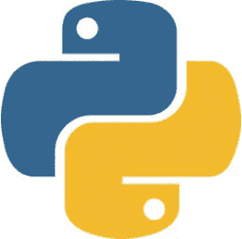

## 第七章

## Python

### 概述与基本语法

Python 是一种著名的编程语言，由 Guido van Rossum 于 1991 年开发。作为一种高级、面向对象且交互式的脚本语言，Python 可用于系统脚本编写、软件开发以及服务器端 Web 开发。

### 特性

作为一种基于解释型的语言，Python 允许一次执行一条指令，并且还支持大量数据类型。该编程语言易于学习和编码，因为它只有少量关键字且语法定义清晰。凭借广泛的标准库，Python 还提供对交互模式的支持，这使开发者更容易测试和调试代码。此外，该语言可用于 GUI 编程，以及开发具有系统调用、Windows 系统和库的应用程序。除了这些特性之外，Python 还支持自动垃圾回收，提供高级动态数据类型，并且可以与 C++、C、Java 和 CORBA 集成。用户可以直接与 Python 解释器交互来编写程序，因为它也提供低级模块。

需要在你的 PC 上安装 Python，源代码可在 GNU 通用公共许可证 (GPL) 下下载。不同的基于 GUI 的 Python 集成开发环境 (IDE) 包括 PyCharm、The Python Bundle、Python IDLE 和 Sublime Text。最新且当前的二进制文件、源代码、新闻和文档可在 Python 官方网站找到：[https://www.python.org](https://www.python.org)

### 变量类型、基本运算符和数据类型

**变量类型**

在 Python 编程中，变量不需要声明以保留内存位置，因为只要给变量赋值，声明就会自动发生。根据变量的数据类型，解释器会分配内存，并允许程序员存储小数、字符或整数。

以下是在 Python 编程语言中为变量赋值的语法：

```python
#!/usr/bin/python

ID = 100         # An integer assignment
Weight = 100.0   # A floating point
name = "William" # A string

print ID
print Weight
print name
```

Python 的保留关键字列表：

| Del | Else | And | Assert | In | Raise |
|---|---|---|---|---|---|
| From | Continue | If | Finally | Not | Pass |
| As | Return | Not | Pass | Yield | Break |
| Except | Import | For | Global | While | print |
| With | Try | Exec | Or | Is | Elif |

**基本运算符**

Python 具有内置运算符，例如算术运算符、赋值运算符、逻辑运算符、位运算符、比较运算符和成员运算符。

Python 运算符的详细信息简述于下表：

| 算术运算符 | 赋值运算符 | 比较运算符 | 逻辑运算符 | 位运算符 |
|---|---|---|---|---|
| 加法 (+) | 等于 (=) | 双等号 (==) | 逻辑或 (or) | 二进制与 (&) |
| 减法 (-) | 加且赋值 (+=) | 不等于 (<>) | 逻辑与 (and) | 二进制或 (\|) |
| 乘法 (*) | 减且赋值 (-=) | 大于 (>) | 逻辑非 (not) | 二进制异或 (^) |
| 除法 (/) | 乘且赋值 (*=) | 小于 (<) |  | 二进制左移 (<<) |
| 取模 (%) | 除且赋值 (/=) | 小于等于 (<=) |  | 二进制右移 (>>) |
| 整除 (//) | 取模赋值 (%=) | 大于等于 (>=) |  | 二进制反码 (~) |
| 幂 (**) | 整除赋值 (//=) |  |  |  |

**数据类型**

在 Python 编程语言中，每个对象都有自己的类型和值。  
Python 的内置数据类型：

- 数字包括整数、浮点数、分数以及复数。Python 中预定义的数据类型是 int、float、long 和 complex。
- 序列由字符串、字节、列表和元组组成。
- 布尔值保存 True 或 False。
- 字典包含以无序方式设置的键值对。
- 集合包含无序的值容器。

### 流程控制

控制流语句允许程序员更改程序流程，并执行特定操作。与其他高级编程语言一样，Python 中使用的三种主要控制流语句是 If、For 和 While。下图展示了控制流语句在程序中实际如何工作：

**条件语句**

**If 语句**

If 语句是一个布尔表达式，其结果以 TRUE 或 FALSE 的形式显示。

**If else 语句**

If else 语句也是一个布尔表达式，并且包含一个可选的 else 语句。如果表达式结果为 False，则执行 else 语句。

**嵌套语句**

语句中的语句称为嵌套语句。

**循环**

循环是一系列指令，允许程序员通过实现特定条件来执行特定任务。在 Python 编程中，循环可用于通过给定的控制结构执行若干语句或一组指令。

Python 中的循环类型：

**While 循环**

While 循环用于在程序中重复语句或迭代 ‘n’ 次。在 Python 中使用 While 循环的语法是：

```python
while expression:
    statement(s)
```

示例程序：

```python
#!/usr/bin/python

count = 0
while (count < 10):
    print 'The count is:', count
    count = count + 2
```

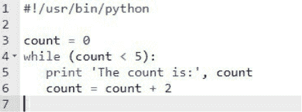

**输出：**

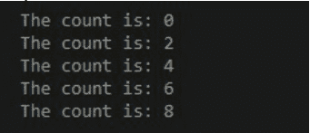

**For 循环**

为了迭代任何序列（包括字符串或列表）中的项，我们可以使用 For 循环。

语法：

```python
for iterating_var in sequence:
    statement(s)
```

示例程序：

```python
fruits = ["apple", "banana", "cherry"]
for x in fruits:
    print(x)
```

要在循环迭代完所有项之前停止循环，我们可以使用 Break 语句；而 Continue 语句可用于停止当前循环迭代并继续下一次迭代。

### 函数和模块

**什么是函数？**

函数是一组可复用且有组织的代码，用于在程序中执行特定任务和操作。尽管 Python 编程语言中有多个内置函数可用，开发者也可以创建自己的函数，这些函数也称为用户定义函数。在 Python 中定义函数的语法如下：

```python
def functionname( parameters ):
    "function_docstring"
    function_suite
    return [expression]
```

要引入函数定义，我们可以使用关键字 ‘def’，随后是函数体所需的语句。分配给函数的变量通常将其值存储在局部符号表中，这意味着除非将全局变量声明为 global 语句，否则不能在函数内为全局变量赋值。

**调用函数**

Python 编程语言中的函数可以通过提供所有参数、提供可选参数或仅提供必需参数来调用。Python 函数最大限度地提高了代码可复用性，并使程序更易于阅读和理解。

以下是用于在 Python 中定义和使用函数的语句：

```python
def display(message):
    print('Hi' + message)

#### Call Expression
myfun('karl', 'os', *rest)

#### global
x = 'hello'
def printer():
    global x
    x = 'hi'

#### yield
def sq(k):
    for i in range(k):
        yield i**2

#### return
def sum(a, b=2):
    return a+b

#### nonlocal
def outer():
    a = 'old'
    def inner():
        nonlocal a
        a = 'new'
```

**模块**

模块化编程是一种将程序的不同组件或部分组织到系统中的方法。该方法绑定数据并允许程序员将其用作参考，从而使代码更易于理解和实现。在 Python 中，模块允许程序员将源代码保存在文件中并多次重新运行它们，因为它们可作为自然的编程工具。

Python 编程语言中有大量标准库模块集合，包含两百多个模块。此外，它们还提供平台无关的支持，以执行若干编程任务，例如对象持久化、文本模式匹配以及 Internet 脚本编写。

Python 中 import 语句的语法：

```python
import module_name1 [, module_name2 [, ... module_nameN]]
```

使用 ‘import’ 模块的运行时操作语句是：

- 查找
- 编译

要使用名为 newmodule 的模块，我们可以这样调用函数：

```python
import newmodule
newmodule.functionname("Name")
```

在 Python 中从模块导入的语法是：

```python
def newmodule(name):
    print("Hello, " + name)

person1 = {
    "name": "James",
    "age": 30,
}
```


```text
"country": "Sweden"
}
```

### 面向对象 Python

在面向对象编程中，我们需要定义类和对象，以在程序中执行各种功能。与 C++ 和 C 等其他主要编程语言一样，我们可以使用面向对象技术来创建、访问和更新类。

要在 Python 中创建学生类，代码编写如下：

```python
class student:
    def __init__(self, roll, name):
        self.r = roll
        self.n = name
        print(self.n)

#### ...
stud1 = student(1, "James")
stud2 = student(2, "William")

print("Data successfully stored in variables")
```

访问对象变量时，使用点运算符（.），其语法为：

`object_name.variable_name`

#### 继承

继承是面向对象编程的一个有用特性，它允许开发者创建一个新类，以继承现有类的所有方法和属性。我们可以使用继承技术，定义一个具有父类或基类属性的新子类或派生类。

在 Python 中实现继承的语法定义如下：

```python
class BaseClass1:
    #Body of Base Class
class DerivedClass(BaseClass1):
    #body of derived class
```

以下程序展示了 Vehicle 作为父类，以及一个派生类，该派生类将继承父类 Vehicle 的特性并调用其函数。

```python
class Vehicle:  #parent class
    "Parent Class"
    def __init__(self, price):
        self.price = price

    def display(self):
        print ('Price = $',self.price)

class Category(Vehicle):   #derived class
    "Child/Derived class"
    def __init__(self, price, name):
        Vehicle.__init__(self, price)
        self.name = name

    def disp_name(self):
        print ('Vehicle =',self.name)

obj = Category(2000, 'Mercedes')
obj.disp_name()
obj.display()
```

**输出：**

车辆 = Mercedes
价格 = $2000

要重写基类中的任何方法，我们可以在派生类中定义一个具有相同名称和参数的新方法。语法如下：

```python
class A:  #parent class
    "Parent Class"
    def display(self):
        print ('This is base class.')

class B(A):  #derived class
    "Child/Derived class"
    def display(self):
        print ('This is derived class.')

obj = B()
obj.display()
```

### 正则表达式

在 Python 编程中，正则表达式用于从文本中提取信息，包括文档、日志文件、电子表格或代码。正则表达式被称为按特殊顺序排列的字符，允许程序员使用专门语法查找相关序列、字符或字符串集合。每当在 Python 编程语言中编写正则表达式时，我们应该以前缀 ‘r’ 开始原始字符串，以及其他特殊元字符。

#### match() 函数

match() 函数用于检查给定正则表达式在 Python 中是否匹配字符串。如果模式不匹配，我们可以使用 re.match() 函数。

#### search() 函数

此函数尝试搜索字符串中的所有可能起点，并扫描输入字符串以匹配任何位置。它包括 search() 或 re.search() 函数。

#### split() 函数

split 函数可以直接应用于字符串，而 re.split() 接受一个指定分隔符的模式。

### 文件 I/O

文件是磁盘上用于存储信息和数据的特定位置。由于它存储在硬盘中，我们也可以通过实现 Python 编程方法和技术来执行读写操作。Python 中的文件操作包括三个主要方面：打开文件、读取或写入文件，以及关闭文件。

open() 是 Python 编程语言中的内置函数，它有两个参数，称为文件名和模式。可以实现以下方法来在文件中执行不同操作：

- “r” = 打开或读取文件。
- “w” = 写入文件，如果文件不存在则创建新文件。
- “a” = 打开文件以进行追加，如果文件不存在则创建新文件。
- “x” = 创建新文件，如果文件已存在则返回错误。
- “t” = 以文本模式打开。
- “b” = 以二进制模式打开。
- “+” = 打开文件以进行读取或写入。

#### 实现这些方法的语法

```python
f = open("sample.txt")
f = open("img.jpg", "r")
```

要关闭文件，我们可以使用 f.close() 函数。

#### 在 Python 中读取文件

通过 Python 编程语言读取特定文件很简单，我们可以实现 read(size) 方法。例如：

```python
>>> f = open("Sample.txt",'r')
>>> f.read(4)    # read the first 4 data
'This'
>>> f.read(4)    # read the next 4 data
'is '
>>> f.read()    # read in the rest till end of file
'my first file\nThis file\ncontains four lines\n'
>>> f.read()
```

#### 在服务器上打开文件

要使用内置 open() 函数打开文件，我们可以使用以下语法：

```python
f = open("Samplefile.txt", "r")
print(f.read())
```

要读取特定行，我们可以实现 readline() 函数：

```python
f = open("Samplefile.txt", "r")
print(f.readline())
```

#### 写入现有文件

以下 Python 编程语法将打开示例文件并追加内容：

```python
f = open("Samplefile.txt", "a")
f.write("Update your content")
f.close()
```

#### 追加后打开并读取文件

```python
f = open("Samplefile.txt", "r")
print(f.read())
```

#### 创建文件

要创建新文件，将使用 open() 方法，它可以具有创建、追加或写入参数。在 Python 中创建文件的语法定义如下：

```python
f = open("Newfile.txt", "w")
```

#### 删除文件

要删除现有文件，应使用 os.remove() 函数，语法如下：

检查文件是否存在的语法。如果存在，则删除它：

```python
import os
os.remove("Samplefile.txt")
if os.path.exists("Samplefile.txt"):
    os.remove("Samplefile.txt")
else:
    print("The file does not exist")
```

### 高级 Python

#### 异常处理

Python 编程语言中有三种主要的异常处理方法。try、except 和 finally 块用于处理程序执行期间发生的错误。

##### try

要通过 try 块生成异常，可以实现以下语法：

```python
try:
    print(x)
except:
    print("An exception occurred")
```

如果没有引发错误，示例代码如下：

```python
try:
    print("Python")
except:
    print("An exception occurred")
else:
    print("No exception occurred")
```

##### finally

在异常处理中，即使 try 块是否引发了异常，finally 块都会执行。例如：

```python
try:
    print("Python")
except:
    print("An exception occurred")
finally:
    print("try exception finished")
```

##### 用户自定义异常

尽管 Python 编程语言中有几个内置异常可用于在出现问题时强制程序显示错误，但开发者也可以创建自定义异常以满足其需求。要创建新异常，必须从 Exception 类创建一个新类。

用户自定义异常可以像普通类一样实现，因为大多数内置异常都派生自 Exception 类。

#### 学习 Python 的建议

Python 编程语言最适合对人工智能、机器学习、机器人技术或应用开发感兴趣的程序员。在开始编程本身之前，你必须充分了解 Python 基础语法。学习方法、途径和语法将使初学者更容易开始编码并自行开发任何类型的应用程序。

对于初学者来说，进行小型编码练习非常有益。他们可以培养敏锐的解决问题的能力，并利用他们的编程概念。此外，Python 程序或应用程序也可以贡献到开源项目，初学者可以从那里获得关于他们工作的评论和建议。

我还写了一本关于 Python 的书。[Python 零基础入门] 将帮助你在 Python 编程方面打下坚实的基础。


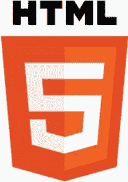

## 第八章

## HTML

### 引言与概述

超文本标记语言（HTML）是一种标准标记语言，用于创建网站，以显示颜色、字体、图形、媒体和图像。HTML 由不同的标签组成，这些标签可用于描述网页的结构，并告知浏览器通过互联网显示内容。

### 什么是标签？

标签为 Web 浏览器提供有关任何网页的结构、显示和内容的指令。由于标签通过尖括号 `<>` 包围定义，因此标签由属性和元素组成。元素是页面上的对象，而属性描述该元素的质量或细节。请记住，标签应成对使用：开始标签 `<tag>` 和结束标签 `</tag>` 通过斜杠来区分。

你可以使用以下标签创建第一个示例 HTML 网页：

```html
<html>
<head>
</head>
<body>
<h1>My First Heading</h1>
<p>My first paragraph</p>
</body>
</html>
```

### 标签说明

在上述 HTML 文档中，`<html>` 标签包含整个 HTML 文档，并由其他主要标签组成，包括 `<head>`、`<body>` 和 `<p>`。`<head>` 标签表示文件的头部，而 `<title>` 标签用于显示文档的标题。`<body>` 包含多个其他标签，用于创建网页，例如标题 `<h1>` 和段落 `<p>`。

HTML 标签不区分大小写，但应使用小写形式。要定义 HTML 的版本，我们可以使用以下标签：

```html
<!DOCTYPE html>
```

初学者可以在 PC 上使用记事本运行 HTML 页面，并将文件保存为 `.html` 格式。这样他们就可以在浏览器中查看网页。

### 基本标签和属性

#### 基本标签

每个 HTML 文档都应从标题、标题和段落开始。在 `<body>` 标签之后，下一个要使用的主要标签是 `<h1>` 或标题标签。根据你的内容需求，标题标签使用 `<h1>` 到 `<h6>` 定义。例如：

标题：

```html
<html>
<body>
<h1> First heading </h1>
<h2> Second heading </h2>
<h3> Third heading </h3>
<h4> Fourth heading </h4>
<h5> Fifth heading </h5>
<h6> Sixth heading </h6>
</body>
</html>
```

输出：

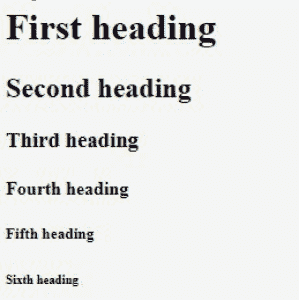

#### 段落

要添加内容，我们需要在 HTML 文档中包含段落。  
例如：

```html
<html>
<head>
<h1> heading </h1>
</head>
<body>
    <p> First Paragraph </p>
    <p> Second Paragraph </p>
</body>
</html>
```

输出：

**heading**

First Paragraph

Second Paragraph

要在段落之间添加换行，我们可以使用换行标签 `<br>`。

#### 摘要标签

要为段落添加摘要，带有 Summary 标签的 HTML 语法定义如下：

```html
<details>
    <summary>Sample Text</summary>
    <p> Web development tutorials</p>
</details>
```

#### Span

span 标签用于为文本的特定部分着色。例如：

```html
<p> Web development is <span style="color:red"> interesting </span> to learn </p>
```

#### Select

select 标签用于从下拉列表中选择一个选项。例如：

```html
<select>
    <option value="Red">Red</option>
    <option value="Blue">Blue</option>
    <option value="Green">Green</option>
    <option value="White">White</option>
</select>
```

#### Thead

thead 标签用于创建组标题内容，并与 `<tbody>` 和 `<tfoot>` 元素一起使用。例如：

```html
<table>
<thead>
    <tr>
        <th>Course</th>
        <th>Max Marks</th>
    </tr>
</thead>
<tbody>
    <tr>
        <td>Web Engineering</td>
        <td>85</td>
    </tr>
    <tr>
        <td>English</td>
        <td>90</td>
    </tr>
</tbody>
<tfoot>
    <tr>
        <td>Sum</td>
        <td>$180</td>
    </tr>
</tfoot>
</table>
```

| Course | Max Marks |
|---|---:|
| Web Engineering | 85 |
| English | 90 |
| Sum | $180 |

### 格式化标签

HTML 文档中的文本可以格式化为不同的样式、字体和大小。用于格式化文本、标题、段落和表格的标签如下：

#### 粗体

写在 `<b>` 和 `</b>` 标签之间的任何文本都以粗体样式显示。例如：

```html
<p> <b> Web development </b> is interesting </p>
```

输出：**Web development** is interesting

#### 斜体

写在 `<i>` 和 `</i>` 之间的任何文本都以斜体样式显示。例如：

```html
<p> <i> Web development is interesting </i> </p>
```

输出：*Web development is interesting*

#### 上标/下标

要以上标形式显示内容，我们可以使用 `<sup>...</sup>` 标签，而 `<sub>` 和 `</sub>` 标签用于添加下标。例如：

```html
<p>This text uses a <sup>superscript</sup></p>
```

输出：The following word uses a <sup>superscript</sup>

#### 下划线

写在 `<u>` 和 `</u>` 标签之间的文本带有下划线。

```html
<p><u>Sample text</u></p>
```

输出：<u>Sample text</u>

#### 插入和删除标签

要插入内容，使用 `<ins>` 和 `</ins>` 标签；而要删除任何文本，我们可以使用 `<del>` 和 `</del>` 标签。

#### 链接

要在文本中添加链接，我们可以使用以下标签：

```html
<p><a href="document location"></a></p>
```

#### Marquee 标签

`<marquee>` 标签可以与不同的属性一起使用，包括 width、height、direction、behavior、scrollamount、scrolldelay、loop、bgcolor、hspace 和 vspace。marquee 标签的演示：

```html
<html>
    <head>
        <title>HTML marquee Tag</title>
    </head>
    <body>
        <marquee>Sample text</marquee>
    </body>
</html>
```

#### 容器标签

在 HTML 中，以下容器标签用于格式化文本：

| 开始标签 | 结束标签 | 功能 |
|---|---|---|
| `<p>` | `</p>` | 段落 |
| `<span>` | `</span>` | 在段落内添加内联内容 |
| `<em>` | `</em>` | 用于强调文本 |
| `<ol>` | `</ol>` | 有序列表（数字） |
| `<ul>` | `</ul>` | 无序列表（项目符号） |
| `<li>` | `</li>` | 列表项 |

### 表格、图像和框架

#### 表格

表格是任何网站的重要组成部分，因为它们帮助我们以适当的方式说明和详细阐述关键信息。在 HTML 中，有预定义的标签可用于创建和设计表格。

##### 在 HTML 中创建表格的标签

要创建表格，我们可以使用以下标签：

```html
<table>…..</table>
```

**表格行**

用于创建表格行的标签：

```html
<tr>….</tr>
```

**表头**

`<th>… </th>`。用于创建表格以显示数据的示例属性是 `scope="row"` 和 `scope="column"`，因为它们定义了给定标签是用于行标题还是列标题。

**表格数据单元格**

`<td>…</td>`。表格数据单元格的属性是 `colspan="number"` 和 `rowspan="number"`，我们需要将标签与 `<th>` 或 `<td>` 元素一起使用，以使单元格跨越多行和多列。

#### 图像

图像是任何网站的重要组成部分。由于它们帮助我们更好地说明概念、服务和信息，因此在 HTML 中插入和管理图像非常简单。

用于插入图像的标签：

```html


```

要设置图像的特定高度和宽度，可以使用以下语法：

```html

```

#### 视频

要在 HTML 网页中添加视频，可以使用 `<video>` 标签，语法如下：

```html
<video>
    <source src="Samplevideo.mp4" type="video/mp4">
</video>
```

#### 对齐和边框

在网页上对齐图像有三种位置，称为居中、右和左。为此，我们可以使用 align 属性。例如：

```html

```

要创建图像边框，属性是 border。例如：

```html

```

#### 框架

在超文本标记语言中，添加框架是为了在浏览器窗口中创建多个部分，以便每个部分都可以加载独立的 HTML 文档。要在网页中使用框架，应使用 `<frameset>` 标签代替 `<body>` 标签，然后可以使用特定的 rows 和 cols 属性进行定义。

用于创建框架的示例 HTML 标签：

```html
<html>
    <head>
        <title>HTML Frames</title>
    </head>
```


```html
<frameset rows = "10%,80%,10%">
    <frame name = "top" src = "/html/top_frame.htm" />
    <frame name = "main" src = "/html/main_frame.htm" />
    <frame name = "bottom" src = "/html/bottom_frame.htm" />

    <noframes>
    <body>Your browser does not support frames.</body>
    </noframes>

</frameset>
</html>
```

##### iframe

要创建嵌套浏览上下文，可以使用 iFrame 标签将新的 HTML 文档添加到现有文档中。要创建 iFrame，可以配合 `<iframe>` 标签使用以下语法：

```html
<iframe src="https://www.samplewebsite.com"></iframe>
```

基本 HTML 标签完整表格：

|  |  |  |  |  |
|---|---|---|---|---|
| `<a>` | `<abbr>` | `<acronym>` | `<address>` | `<applet>` |
| `<area>` | `<article>` | `<aside>` | `<audio>` | `<b>` |
| `<base>` | `<basefont>` | `<bdi>` | `<bdo>` | `<big>` |
| `<blockquote>` | `<body>` | `<br>` | `<button>` | `<canvas>` |
| `<caption>` | `<center>` | `<cite>` | `<code>` | `<col>` |
| `<colgroup>` | `<data>` | `<datalist>` | `<dd>` | `<del>` |
| `<details>` | `<dfn>` | `<dialog>` | `<dir>` | `<div>` |
| `<dl>` | `<dt>` | `<em>` | `<embed>` | `<fieldset>` |
| `<figcaption>` | `<figure>` | `<font>` | `<footer>` | `<form>` |
| `<frame>` | `<frameset>` | `<h1> - <h6>` | `<head>` | `<header>` |
| `<hr>` | `<html>` | `<i>` | `<iframe>` | `` |
| `<input>` | `<ins>` | `<kbd>` | `<label>` | `<legend>` |
| `<li>` | `<link>` | `<main>` | `<map>` | `<mark>` |
| `<meta>` | `<meter>` | `<nav>` | `<noframes>` | `<noscript>` |
| `<object>` | `<ol>` | `<optgroup>` | `<option>` | `<output>` |
| `<p>` | `<param>` | `<picture>` | `<pre>` | `<progress>` |
| `<q>` | `<rp>` | `<rt>` | `<ruby>` | `<s>` |
| `<samp>` | `<script>` | `<section>` | `<select>` | `<small>` |
| `<source>` | `<span>` |  | `<strong>` | `<style>` |
| `<sub>` | `<summary>` | `<sup>` | `<svg>` | `<table>` |
| `<tbody>` | `<td>` | `<template>` | `<textarea>` | `<tfoot>` |
| `<th>` | `<thead>` | `<time>` | `<title>` | `<tr>` |
| `<track>` | `<tt>` | `<u>` | `<ul>` | `<var>` |
| `<video>` | `<wbr>` |  |  |  |

### 表单

HTML 表单是网站与用户之间交互的关键方面之一。表单通过使用文本字段、按钮、选择框、单选按钮、文件选择框、隐藏控件和可点击控件等小部件来创建。通过表单收集的数据会发送到 Web 服务器，网页也可以自行拦截这些数据。大多数情况下，小部件会与标签关联，以描述其用途。

在 HTML 中创建表单的语法：

```html
<form action = "Script URL" method = "GET|POST">
    form elements like input, buttons etc.
</form>
```

用于从用户处获取姓名和年龄的输入表单：

```html
<html>

    <head>
        <title>My first HTML form</title>
    </head>

    <body>
        <form>
            Name: <input type = "text" name = "Name" />
            <br>
            Age: <input type = "text" name = "last name" />
        </form>
    </body>
</html>
```

输出：

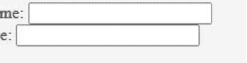

#### 文本字段

HTML 中的文本字段允许用户向表单中输入文本。创建文本字段的通用语法定义如下：

```html
<input type = "text" value = "text">
```

#### 按钮控件

向表单提交数据有不同的方式。我们可以使用以下 HTML 标签添加可点击按钮：

```html
<input type = "submit" name = "submit" value = "Submit" />
<input type = "reset" name = "reset" value = "Reset" />
<input type = "button" name = "button" value = "button" />
```

输出：

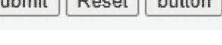

#### 选择框

要在 HTML 表单中创建下拉列表，我们可以使用 `<select>` 和 `<option>` 元素。

例如：

```html
<html>
    <head>
        <title>File Upload Box</title>
    </head>
    <body>
        <form>
            <label for="Course">Course:</label>
            <select name="Course" id="course">
                <option value="Web Engineering">Web Engineering</option>
                <option value="Calculus">Calculus</option>
                <option value="Data Science">Data Science</option>
            </select>
        </form>
    </body>
</html>
```

输出：

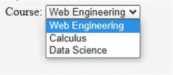

#### 选择框

Select Box 元素提供了一种在 HTML 表单中列出多个选项的方式。

例如：

```html
<html>
    <head>
        <title>Select your course</title>
    </head>

    <body>
        <form>
            <select name = "dropdown">
                <option value = "Math" selected>Math</option>
                <option value = "Physics">Physics</option>
            </select>
        </form>
    </body>
</html>
```

输出：

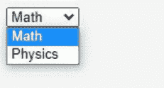

#### 表单元素

HTML 表单完成后，需要使用 Action 和 Method 两个属性来存储和发送表单数据。Action 包含定义表单数据将发送到哪里的地址，而 Method 可以是 GET 或 POST，因为它定义了如何处理表单信息。创建 Form 元素的语法定义如下：

```html
<form action = "/login" method = "POST">
```

### 设计

在 HTML 中，任何网页的默认背景颜色都是白色。要更改背景颜色，可以使用以下标签和属性：

```html
<tagname bgcolor = "color value/color name">
```

例如：

```html
<table bgcolor = "green">
<table bgcolor = "#f1f1f1">
```

#### 字体

字体是任何网站的重要组成部分，并能增强内容的可读性。可以使用 `<font>` 标签为文本指定特定的样式、大小和颜色，其属性包括 size、color 和 face。

要设置字体大小，标签和属性为：

```html
<font size = "14"> Text </font>
```

字体名称标签和属性：

```html
<font face = "Times New Roman" size = "14"> Text </font>
```

#### 字体颜色

要更改字体颜色，可以使用以下 HTML 标签和属性：

```html
<html>
    <head>
        <title>Setting Font Color</title>
    </head>

    <body>
        <font color = "Blue">This text is blue</font>
    </body>
</html>
```

输出：**这段文字是蓝色的**

#### 标记文本

写在 `<mark>` 和 `</mark>` 元素之间的文本会以黄色标记显示。

例如：

```html
<p> This text is marked as <mark> Yellow </mark> </p>
```

输出：这段文字被标记为**黄色**。

#### 元标签

在 HTML 中，元标签可用于向网页添加元数据。元标签的属性包括 Name、Content、Scheme 和 http-equiv。我们可以使用 `<meta>` 标签为文档提供简短描述，这也可以改善网页的搜索引擎索引。

例如：

```html
<html>

    <head>
        <title>Meta Tags Example</title>
        <meta name = "keywords" content = "HTML, Meta Tags, Metadata" />

        <meta name = "description" content = "Meta Tags." />
        <meta name = "revised" content = "3/7/2019" />
        <meta http-equiv = "cookie" content = "userid = abc; expires = Monday, 08-Sep-19 23:59:59 GMT;" />

    </head>
    <body>
        <p>Welcome to HTML</p>
    </body>

</html>
```

#### 注释

要在 HTML 代码中添加注释，可以遵循以下语法：

```html
<html>
    <head> <!-- Document Header Starts -->
        <title>Document title</title>
    </head> <!-- Document Header Ends -->
    <body>
        <p>Document content goes here.....</p>
    </body>
</html>
```

#### HTML 样式表

为了进一步设计 HTML 文档，网站中会使用层叠样式表（CSS）。它们为指定网站的某些属性提供了简单、有效且易于管理的替代方案。我们将在下一章详细讨论 CSS。

#### 布局与响应式设计

HTML 包含多种语义元素，用于定义网页的不同部分。这些元素包括 Header、Container、Section、Article、Aside、Details 和 Footer。尽管 CSS 是设计网页布局的最佳方法，但我们也可以通过这些 HTML 元素完成该过程。

响应式网页设计是通过使用 HTML 和 CSS 创建的。此过程会自动调整网站大小并进行调整，使其在桌面电脑、智能手机和平板电脑等所有设备上都看起来合适。有关响应式的更多详细信息，学习 CSS 和 Bootstrap 语言将大有裨益。


### HTML 模板

HTML 网站模板是开发网站的一种快速简便方法。由于该模板是预构建的网站，开发者可以根据需要修改和添加功能。使用 HTML 模板的最大优势在于，开发者无需花费数小时设计网站，而可以专注于实际代码以满足网站功能需求。此外，HTML 模板最适合那些无法设计出吸引人的网站的人，因为它也可以按照给定说明进行自定义。

### 使用 HTML 的实用技巧

尽管我们已经讨论了 HTML 的所有主要标签、属性和功能，但还有一些其他重要方面需要关注，以使你的网站更高效、更实用。使用 HTML 开始标签时，务必在开始编写元素和属性之前先写出对应的结束标签。例如，`<p>...</p>`。这将确保你的 HTML 页面在所有浏览器中正常工作，并尽量通过 CSS 为网页设置样式。

在为所有网页编写完 HTML 代码后，在发布到互联网之前，请先通过 HTML 验证器运行代码。此操作将提前发现任何错误或缺失的标签，以免网站在上线后缺少功能。此外，注意图片或视频的格式，因为它们有时在上传到互联网时会受到破坏。在图像标签中指定宽度和高度可以帮助你克服这个问题。

尽管表格是在页面上布局内容的一种简单方式，但你应该关注 CSS 规则并通过 CSS 构建 HTML 页面内容。这不仅会以更好的方式格式化你的网站，你还可以受益于 CSS 定位并提高网站的响应性。

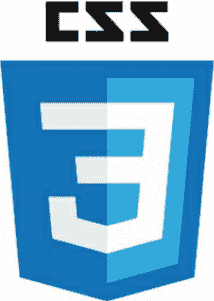

## 第九章

## CSS

### 什么是 CSS？

CSS 代表“层叠样式表”，负责控制 Web 文档的样式、设计和外观。这种设计语言能够简化网页设计过程，并提高网站的灵活性。通过 CSS，我们可以通过在 CSS 中进行适当调整来改变整个网站的外观、字体、设计、显示效果和格式。

学习 CSS 与学习 HTML 一样简单，因为这两种语言相互关联，且语法几乎相同。使用 CSS 时，我们可以为每个 HTML 元素定义特定样式，并将其应用于多个网页。此外，无需每次都编写 HTML 标签属性或元素，这使页面加载更快。使用 CSS，我们可以让网页外观更美观，因为与 HTML 相比，CSS 的属性范围更广，而且样式表可以提供网站的不同版本，使其在台式电脑、智能手机和平板电脑上完美显示。

### CSS 的类型

CSS 的三种主要类型是内联 CSS、内部 CSS 和外部 CSS。

#### 内联 CSS

内联 CSS 将 CSS 属性实现在 HTML 文档中与元素关联的特定部分内。例如：

```html
<html>
    <head>
        <title>Inline CSS</title>
    </head>

    <body>
        <p style = "color:Blue; font-size:50px;
                    font-style:italic; text-align:center;">
            Cascading Style sheets
        </p>
    </body>
</html>
```

输出：


#### 内部 CSS

内部 CSS 在单个 HTML 文档上实现，以赋予其独特样式。请记住，规则必须在 HTML 文件的 head 部分内实现。

实现内部 CSS 的语法：

```html
<head>
    <title>Internal css</title>
    <style>
        selector{
            Property:value;
        }
    </style>
</head>
```

#### 外部 CSS

外部 CSS 有一个单独的 CSS 文件，其中仅包含一个样式属性以及标签属性。外部 CSS 文件需要使用 Link 标签链接到 HTML 文档。

外部 CSS 示例：

```css
body {
    background-color:Green;
}
.main {
    text-align:center;
}
.GFG {
    color:#009900;
    font-size:50px;
    font-weight:bold;
}
```

### 基本语法及在 HTML 中的引入

CSS 由若干样式规则组成，这些规则由浏览器解释并应用于网页。通常，一条样式规则由 3 个关键元素组成，即选择器、属性和值。

选择器是可在其上应用 CSS 样式的 HTML 标签，例如 `<h1>`；而属性是 HTML 标签的属性，例如 color。值被赋给属性。创建 CSS 样式规则的基本语法定义如下：

```css
Selector {property: value}
```

通常，内联和外部 CSS 方法用于将样式与 HTML 文档关联起来，为此 `<style>` 元素被放置在 `<head>` 和 `</head>` 标签内。在 HTML 文档中引入 CSS 的语法定义如下：

```html
<html>
    <head>
        <style type = "text/css" media = "all">
            body {
                background-color: Grey;
            }
            h1 {
                color: White;
                margin-left: 40px;
            }
        </style>
    </head>
    <body>
        <h1> Sample heading </h1>
        <p> Sample paragraph </p>
    </body>
</html>
```

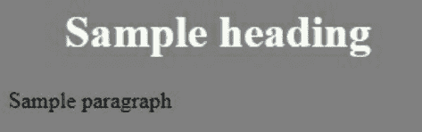

### 导入 CSS 文件

要导入外部样式表，可以实现以下规则：

```html
<head>
    @import "URL";
</head>
```

### 颜色和背景

#### 颜色

在 CSS 中，颜色可以通过名称或不同类型的值来定义。要指定颜色代码，可使用的格式如下所述：

| 名称 | 语法 |
|---|---|
| 关键字 | Green、Blue 等 |
| 十六进制代码 | #RRGGBB |
| RGB 百分比 | rgb(rrr%, ggg%, bbb%) |
| RGB 绝对值 | rgb(rrr, ggg, bbb) |
| 简写十六进制代码 | #RGB |

例如，我们可以使用以下 CSS 语法设置文本颜色：

```html
<h1 style="color: Green;">Cascading Style Sheets</h1>
```

#### 背景

有多种属性可用于定义网站的 CSS 背景。这些属性包括 CSS 背景的颜色、图像、重复、附着和位置。

##### 背景颜色

要设置网页的背景颜色，可以使用以下 CSS 语法：

```css
body {
    background-color: Red;
}
```

##### 背景图像

添加背景图像的语法：

```css
body {
    background-image: url("image.gif");
}
```

要重复图像：

```css
body {
    background-image: url("gradient_image.gif");
}
```

##### 不重复的背景

```css
body {
    background-image: url("image_bike.jpg");
    background-repeat: no-repeat;
}
```

##### 背景位置

背景图像可以设置到不同位置，例如右、左、中、上、下。例如：

```css
body {
  background-image: url("Image.jpg");
  background-position: center;
}
```

### 格式和设计

#### 边框

CSS 边框属性可用于设置 HTML 文档中元素边框的独特样式、颜色和宽度。使用 CSS 创建边框的不同样式包括 dotted（点线）、solid（实线）、dashed（虚线）、groove（凹槽）、double（双线）、inset（内嵌）、outset（外凸）、hidden（隐藏）、ridge（脊线）和 none（无）。

创建不同边框样式的语法：

```css
p.dotted {border-style: dotted;}
p.solid {border-style: solid;}
p.dashed {border-style: dashed;}
p.groove {border-style: groove;}
p.double {border-style: double;}
p.inset {border-style: inset;}
p.outset {border-style: outset;}
p.hidden {border-style: hidden;}
p.ridge {border-style: ridge;}
p.none {border-style: none;}
```

#### 高度和宽度

在 CSS 中，height 和 width 属性可用于设置元素的高度和宽度。在 CSS 中实现 height 和 width 属性的语法定义如下：

```css
div {
  height: 200px;
  width: 50%;
  background-color: Green;
}
```


### 外边距与内边距

#### 外边距

在 CSS 中，外边距属性用于在元素周围创建空间。我们可以为每个边设置不同的外边距大小。外边距属性具有不同的值，例如长度、宽度和外边距，由浏览器计算。

语法：

```css
body {
    margin: size;
}
```

#### 内边距

CSS 内边距可用于定义边框或在元素周围创建空间。在 HTML 网站上，可以通过不同方式为各个边（如上、右、下和左）设置 CSS 内边距。内边距具有长度和宽度值，可使用以下 CSS 语法实现：

```css
body {
    padding: size;
}
```

### 字体与文本

#### 字体

CSS 中的字体属性用于指定其他字体属性并设置内容的字体。CSS 中的不同字体属性包括字体样式、字体系列、字体粗细、字体变体、字体粗细和字体大小。
以下是每个字体属性的简单 CSS 语法：

#### 字体样式

在线演示

```html
<html>
<head>
</head>

<body>
    <p style = "font-style:calibri;">
        This text will be rendered in calibri style
    </p>
</body>
</html>
```

#### 字体系列

```html
<p style = "font-family: georgia, calibri, serif;">
```

#### 字体变体

```html
<p style = "font-variant: small-caps;">
```

#### 字体粗细

```html
<p style = "font-weight:500;">
```

#### 字体大小

```html
<p style = "font-size:20px;">
    Font size 20 pixels
</p>
<p style = "font-size:small;">
    Small font
</p>
<p style = "font-size:large;">
    Large font
</p>
```

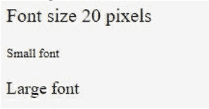

### 文本

现在，使用 CSS 文本属性可以将文本转换为不同的颜色、样式和缩进。这些文本属性包括：

- **文本颜色：** 更改文本的颜色。
- **文本对齐：** 指定文本的水平或垂直对齐方式。
- **文本装饰：** 勾勒文本的装饰。
- **文本转换：** 控制文本的大小写。
- **文本缩进：** 指定首行的缩进。
- **字母间距：** 增加或减少单词之间的间距。
- **行高：** 指定行高。
- **文本方向：** 设置书写方向。
- **单词间距：** 设置单词之间的间距。
- **文本阴影：** 为文本添加阴影效果。

CSS 文本属性的语法：

文本颜色：

```css
body {
    color: Red;
}
```

文本对齐：

```css
h1 {
    text-align: center;
}

h2 {
    text-align: left;
}

h3 {
    text-align: right;
}
```

文本装饰：

```css
h1 {
    text-decoration: overline/underline/line-through;
}
```

#### 文本转换

```css
p.uppercase {
  text-transform: uppercase;
}
```

```css
p.lowercase {
  text-transform: lowercase;
}
```

```css
p.capitalize {
  text-transform: capitalize;
}
```

#### 文本缩进

```css
p {
    text-indent: 100px;
}
```

#### 字母间距

```css
h1 {
  letter-spacing: 3px;
}
```

```css
h2 {
  letter-spacing: -3px;
}
```

#### 行高

```css
p.small {
  line-height: 0.6;
}
```

```css
p.big {
  line-height: 1.6;
}
```

#### 文本方向

```css
p {
    direction: rtl;
}
```

#### 文本阴影

### 使用 CSS 创建简单表格的语法：

```html
<html>
<body>
<table class="Table" border = "1">
<tr>
    <th>First Name</th>
    <th>Last Name</th>
    <th>Marks</th>
</tr>
<tr>
    <td>John</td>
    <td>Harry</td>
    <td>40</td>
</tr>
</table>
</body>
</html>
```

输出：

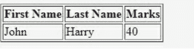

#### 边框合并

```html
<html>
    <head>
        <style type = "text/css">
            table.one {border-collapse:collapse;}
            table.two {border-collapse:separate;}

            td.a {
                border-style:dotted;
                border-width:3px;
                border-color:#000000;
                padding: 10px;
            }
            td.b {
                border-style:solid;
                border-width:3px;
                border-color:#333333;
                padding:10px;
            }
        </style>
    </head>
```

#### 边框间距

```html
<html>
<head>
    <style type="text/css">
        table.one {
            border-collapse: separate;
            width:400px;
            border-spacing:10px;
        }
        table.two {
            border-collapse: separate;
            width:400px;
            border-spacing:10px 50px;
        }
    </style>
</head>

<body>

    <table class="one" border="1">
        <caption>Separate Border Table with border-spacing</caption>
        <tr><td>Cell A</td></tr>
        <tr><td>Cell B</td></tr>
    </table>
    <br />

    <table class="two" border="1">
        <caption>Separate Border Table with border-spacing</caption>
        <tr><td>Cell A</td></tr>
        <tr><td>Cell B</td></tr>
    </table>

</body>
</html>
```

输出：

#### 带边框间距的分离边框表格

|  |
| --- |
| 单元格 A |
| 单元格 B |

#### 带边框间距的分离边框表格

|  |
| --- |
| 单元格 A |
| 单元格 B |

#### 标题侧属性的语法：

```html
<head>
  <style type = "text/css">
    caption.top {caption-side: top; }
    caption.bottom {caption-side: bottom;}
    caption.left {caption-side: left;}
    caption.right {caption-side: right;}
  </style>
</head>
```

#### 空单元格属性的语法

```html
<head>
  <style type = "text/css">
    table.empty {
      width:350px;
      border-collapse:separate;
      empty-cells:hide;
    }
    td.empty {
      padding:5px;
      border-style:solid;
      border-width:1px;
      border-color:#999999;
    }
  </style>
</head>
```

#### 表格布局的语法

```html
<head>
    <style type = "text/css">
        table.auto {
            table-layout: auto;
        }
        table.fixed {
            table-layout: fixed;
        }
    </style>
</head>
```

### 外边距

CSS 外边距属性用于在 HTML 元素周围创建空间或外边距。通过 CSS 可以通过不同属性设置元素外边距，例如 margin、margin-bottom、margin-top、margin-left 和 margin-right。实现外边距属性的语法：

```html
<p style = "margin: 10px; border:1px solid black;">
    all four margins will be 10px
</p>
```

### 列表、图标和下拉菜单

#### 列表

CSS 中使用的列表有两种类型，称为有序列表和无序列表。在有序列表中，所有列表项都使用序号或字母标记，而在无序列表中，列表项通常使用项目符号标记。列表值可以通过使用 circle、decimal、lower-roman、upper-roman、decimal-leading-zero、lower-alpha、upper-alpha 和 square 等值来创建。

例如：

```html
<html>
    <head>
        <style>
            ul.a
            {
                list-style-type:square;
            }
            ol.c
            {
                list-style-type:lower-alpha;
            }
        </style>
    </head>
    <body>
            <h2>
    CSS ORDERED & UNORDERED LISTS
            </h2>
            <p>
                Unordered lists
            </p>
            <ul class="a">
                <li>one</li>
                <li>two</li>
                <li>three</li>
            </ul>
            <ul class="b">
                <li>one</li>
                <li>two</li>
                <li>three</li>
            </ul>
            <p>
                Ordered Lists
            </p>
            <ol class="c">
                <li>one</li>
                <li>two</li>
                <li>three</li>
            </ol>
            <ol class="d">
                <li>one</li>
                <li>two</li>
                <li>three</li>
            </ol>
    </body>
</html>
```

输出：

**CSS 有序与无序列表**

**无序列表**

- 一
- 二
- 三
- 一
- 二
- 三

**有序列表**

- a. 一
- b. 二
- c. 三
- 1. 一
- 2. 二
- 3. 三

#### 图标

通过使用 HTML 中的图标库，我们还可以通过 CSS 添加不同类型的图标。这些类型的图标包括 Font Awesome 图标、Bootstrap 图标和 Google 图标。


#### Font Awesome 图标语法：

```html
<link rel="stylesheet" href="https://cdnjs.cloudflare.com/ajax/libs/font-awesome/4.7.0/css/font-awesome.min.css">
```

#### Bootstrap 图标语法：

```html
<link rel="stylesheet" href="https://maxcdn.bootstrapcdn.com/bootstrap/3.3.7/css/bootstrap.min.css">
```

#### Google 图标语法：

```html
<link rel="stylesheet" href="https://fonts.googleapis.com/icon?family=Material+Icons">
```

#### 示例：

```html
<!DOCTYPE html>
<html>
    <head>
        <link rel="stylesheet" href="https://cdnjs.cloudflare.com/ajax/libs/font-awesome/4.7.0/css/font-awesome.min.css">
    </head>
    <body>
        <h1>
            CSS ICONS
        </h1>
        <i class="fa fa-cloud" style="font-size:32px;"></i>
        <i class="fa fa-heart" style="font-size:32px;"></i>
        <i class="fa fa-file" style="font-size:32px;"></i>
        <i class="fa fa-car" style="font-size:32px;"></i>
        <i class="fa fa-bars" style="font-size:32px;"></i>
    </body>
</html>
```

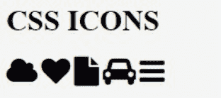

#### 下拉菜单

我们还可以通过 CSS 创建下拉菜单。与 HTML 元素相同，下拉菜单由一个无序列表组成，并使用嵌套列表来创建下拉结构。例如：

```html
<html>
    <head>
        <title>Dropdown CSS</title>
    </head>
    <body>
        <nav>
            <ul>
                <li class="Lev-1">
                    <a href="">List</a>
                    <ul>
                        <li><a href="">Page 1</a></li>
                        <li><a href="">Page 2</a></li>
                        <li><a href="">Page 3</a></li>
                        <li><a href="">Page 4</a></li>
                    </ul>
                </li>
            </ul>
        </nav>
    </body>
</html>
```

输出：

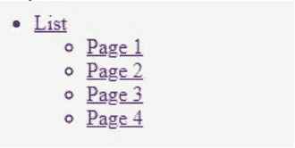

### 图层与可见性

我们也可以实现多个属性。要使用 CSS 动画，我们需要通过 @keyframes 规则指定一些关键帧。

例如：

```css
@keyframes example {
    from {background-color: blue;}
    to {background-color: brown;}
}

/* The element to apply the animation to */
div {
    width: 100px;
    height: 100px;
    background-color: blue;
    animation-name: example;
    animation-duration: 4s;
}
```

### 如何有效使用 CSS

还有许多其他 CSS 自定义属性和元素可用于改善网页的图形、显示效果和吸引力。尽管学习和实现 CSS 的所有属性至关重要，但使用优秀的编辑器有助于打造完美的网站设计。此外，CSS 中使用的每种方法都应保持一致，以避免出现误解之类的问题。

编写 CSS 时，还应避免使用内联代码，只将样式或属性放在外部样式表中。检查代码在 Internet Explorer、Chrome 和 Safari 等最新互联网浏览器上能否正常工作是个好主意，这样可以确保网页正确显示和格式化。此外，CSS 代码还可以作为其他项目的模板复用，你也可以将现有代码回收利用到新项目中。多个类也可以通过空格分隔来实现，并且我们可以通过应用特定的 CSS 元素来受益于 CSS 继承。

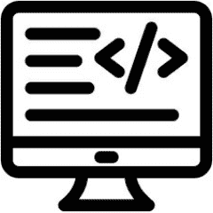

## 第十章：编程基础

### 选择编程语言

由于我们已经详细讨论了所有主要编程语言及其语法，初学者可以选择看起来最容易学习和实现的语言。尽管 C、C++ 和 Java 等大多数主要编程语言具有相似的语法，但编写程序时有几个重要方面需要重点关注。对于初学者来说，C 和 C++ 是开发计算机应用程序的最佳选择，因为它们能提供对编程的深入理解和清晰的概念。

对于开发 Web 插件、桌面应用程序或移动应用程序，可以考虑 Java 语言，因为它提供完整的支持和功能。HTML、CSS 和 PHP 是网站开发的核心语言，初学者可以轻松学会。作为一名程序员，绝不应将自己局限于一种语言，而应尝试最新的技术和实现方式。

多个计算机编程语言可用于解决特定问题。为简化操作，初学者可以审视自己的技能，选择最合适且易于实现的编程语言。编程还取决于其他几个因素，例如应用程序的可用性、安全性、兼容性和响应时间。

### 高效编程的技巧

尽管编写可理解的代码并满足程序需求是计算机编程的主要部分，但还有一些基本提示和技巧可以提高程序员的效率。从需要考虑的最关键点开始，程序员应避免向函数传递过长的参数列表，并尽量只使用 int、pointer 或 void 函数类型。此外，不要将 char 转换为其他数据类型，因为 char 变量可以位于 RAM 中的任何位置。

此外，绝不应在小函数内初始化全局变量，并尽量减少使用浮点数的数学运算。这将减少执行时间，也会消耗更少的内存。当代码达到数千行时，全局变量和循环可能会使程序员难以处理应用程序，而稍作更改就会导致巨大的问题。

在方法或函数内部编写 switch 分支、语句、循环和 try-catch 是理想的做法。请记住，方法也应写在类和函数定义内部。此外，通过使用适当的结构来构建应用程序是一种好方法，这也能提高编码标准。

最后但同样重要的是，还可以考虑使用版本控制软件来提高应用程序性能并交付更新。尽管这是专业程序员使用的方法，但 Mercurial 或 Git 等工具也易于初学者学习使用。

编写代码时，避免深层嵌套并限制行长，因为这会使代码难以阅读。

### 加强你的基本技能

要成为一名优秀的程序员，你必须了解计算机编程的所有关键和主要概念。了解算法和数据结构的基础知识是提高解决问题能力的好方法。

此外，编写单元测试是提升思维和编码技能的另一种完美方法。完成编码后，建议进行深入的代码审查，找出任何错误或可改进之处。反过来，这项活动也会提高应用程序的性能和效率。

代码必须始终简单且有意义。通过使用适当的命名约定，你可以轻松替换变量或方法。请记住，为应用程序创建特定的文件夹和文件可以带来很大好处，因为你可以轻松维护和调试。学习编程基础知识是培养强大的开发和分析能力的关键方面。

此外，尝试通过解决编程练习和编写简单代码来实践你的编码技能。这不仅能提升你的编程技能，还能让你开发出高效且有效的新解决方案。花时间学习编程基础也会让你更容易适应最新技术并学习新的编程方法。通过学习和实现新的方法、函数和途径，编程可以变得有趣。


## 结语

《零基础学编程》一书的编写旨在为初学者提供有价值的计算机编程知识、信息和原理。本书全面涵盖了主要编程语言，并为落实所给概念和研究成果提供了正确指导。

编写计算机代码需要开发者遵循预定义的语法和流程。根据项目需求，可以选择一种易于实现且聚焦于现有工具和技术的编程语言。计算机编程包含多项任务，包括编写源代码、测试、实施构建系统、方法论、调试以及功能实现。

读完本书后，我相信新手程序员能够培养出强大的分析和思维能力，同时深入理解每种语言的相关概念。本书经过广泛的研究、开发和事实核查后编写而成，以确保向读者传递正确的信息和语法。在仔细阅读并理解本书所提供的概念之后，开发桌面应用、Web 应用或任何高级语言的程序必定不再是问题。

我希望我尊敬的读者能够通过阅读本手册的各章节，学会、适应并实现计算机编程技术，从而练就精湛的编码技能。《零基础学编程》以简单易懂的方式呈现了每种编程语言的全部主要和次要说明。

最后，我想感谢你——亲爱的读者——一路相伴。我希望你和我一样乐在其中。如果确实如此，请花一点时间[发表评论](#)，并告诉一位朋友。

如有任何问题，欢迎随时[联系我](#)。祝你一切顺利。

安德鲁·华纳。

