# 编程达人迷（计算机达人迷）

# 在Dummies.com®获取更多、做更多


# 从**免费**速查表开始

- 速查表包括
  - 清单
  - 图表
  - 常见说明
  - 以及其他好东西！

**要访问专为本书创建的速查表，请访问 www.dummies.com/cheatsheet/coding**

# 在Dummies.com变聪明

Dummies.com通过提供从去除壁纸到使用最新版Windows等方方面面的数千个答案，让你更轻松。

- 查看我们的
  - 视频
  - 图文文章
  - 分步说明

此外，每月你都可以参加Dummies.com抽奖活动，赢取丰厚奖品。*

- 想要每周来点Dummies吗？订阅以下新闻简报：
  - 数码摄影
  - Microsoft Windows与Office
  - 个人理财与投资
  - 健康与保健
  - 计算机、iPod与手机
  - eBay
  - 互联网
  - 美食、家居与园艺


# 在Dummies.com了解“如何做”

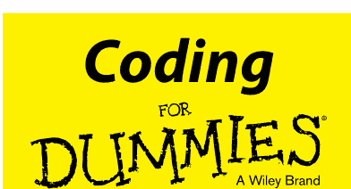

# 引言

阅读、编写和理解代码的能力从未像今天这样重要、有用且有利可图。计算机代码永远改变了我们的生活。有些人甚至一天都离不开与用代码构建的东西互动。即便如此，对许多人来说，编程世界似乎复杂且难以企及。也许你参加过一次与技术相关的商务会议，却没有完全理解对话。也许你曾尝试为家人和朋友构建一个网页，但在显示图片或对齐文本时遇到了问题。也许你甚至曾被编程书籍封面上那些无法辨认的词语吓到：诸如 HTML、CSS、JavaScript、Python 或 Ruby 这样的词。

如果你以前遇到过这些情况，那么 *《Coding For Dummies（编程达人迷）》* 就是为你准备的。本书解释基本概念，让你能够参与技术对话并提出正确的问题。别担心——在本书中，我假设你开始时几乎没有或完全没有编程知识，我也没有试图把每一个可能的编程概念都塞进这些页面。此外，我鼓励你在这里通过实践、通过实际创建自己的程序来学习。与其设想一个网站，不如设想你想建造一座房子。你可以花八年时间学习成为建筑师，也可以今天就开始学习一点关于地基和框架的知识。本书今天就启动你的编程之旅。

编程的重要性日益增加。正如作家兼技术专家道格拉斯·拉什科夫那句名言：“要么编程，要么被编程。”当人类发明语言、随后发明字母表时，人们学会了听和说，然后学会了读和写。在我们日益数字化的世界中，重要的不仅是学会如何使用程序，还要学会如何制作程序。例如，观察音乐领域的这一转变。一个多世纪以来，唱片公司决定公众可以收听和购买哪些歌曲。2005 年，三位程序员创建了 YouTube，让任何人都可以发布歌曲。如今，上传到 YouTube 的歌曲数量已经超过上个世纪所有唱片公司发行歌曲的总和。

本书附有 www.codecademy.com 上的示例，其练习是无需安装或下载任何内容即可学习编程的最简单方法之一。Codecademy 配套网站包含本书中的示例和练习，以及用于额外练习的项目和示例。

## 关于本书

本书面向几乎没有或完全没有编程经验的读者，向非程序员概述编程。用通俗的英语，你将了解代码如何用于创建 Web 程序、谁制作这些程序，以及他们使用的流程。主题包括：

- 解释什么是编程，并回答与代码相关的常见问题。
- 使用三种最常见的语言构建基本网站：HTML、CSS 和 JavaScript。
- 概览其他编程语言，如 Ruby 和 Python。
- 运用你在本书中学到的一切构建一个应用程序。

阅读本书时，请记住以下几点：

- 本书可以从头读到尾，但如果你愿意，也可以随意跳读。如果某个主题让你感兴趣，就从那里开始。如有必要，你随时可以回到前一章。
- 在某个时候你会卡住，你编写的代码不会按预期工作。不要害怕！有许多资源可以帮助你，包括支持论坛、互联网上的其他人，还有我！使用 Twitter，你可以在 @nikhilabraham 给我发送公开消息，并带上话题标签 #codingFD。
- 本书中的代码将使用如下等宽字体显示：`<h1>Hi there!</h1>`

## 愚蠢的假设

我对你——读者——没有做太多假设，但确实有几个假设：

我假设你没有以前的编程经验。那么，要跟上本书，你只需要能够阅读、打字并按照说明操作。我尽量使用你已经知道的例子和类比来解释尽可能多的概念。

我假设你有一台运行最新版 Google Chrome 的计算机。本书中的示例已经过测试并针对 Chrome 浏览器进行了优化，该浏览器可从 Google 免费获取。即便如此，这些示例也可能在最新版 Firefox 中运行。但是，不建议使用 Internet Explorer 来运行本书中的示例。

我假设你可以访问互联网连接。本书中的一些示例无需互联网连接即可完成，但大多数示例需要联网，以便你可以访问并完成 www.codecademy.com 上的练习。

## 本书使用的图标

以下是本书中用于标记需要额外注意或可以跳过的文本的图标。


此图标标记有用信息，或说明有助于理解概念的快捷方式。


此图标解释正在讲解概念的技术细节。这些细节可能提供信息或有趣，但在当前阶段并非理解该概念所必需。


尽量不要忘记此图标标记的内容。它表示你应该牢记的重要概念或过程。


注意！此图标标记常见错误和问题，如果你留意警告即可避免。

## 本书之外

许多本书中没有的额外内容可在 www.dummies.com 上获取。请上网查找以下内容：

- **本书示例的源代码以及 Codecademy 练习的链接。** 你可以在 `www.dummies.com/go/codingfd` 找到这些内容。源代码按章组织。处理某一章的最佳方式是一次性下载该章的所有源代码。
- **速查表：** 你可以在 `www.dummies.com/cheatsheet/coding` 找到常见 HTML、CSS 和 JavaScript 命令列表以及其他有用信息。
- **附加内容：** 本书大致每一节都发布了包含额外内容的附加文章。你可以在 `www.dummies.com/extras/coding` 访问这些附加材料。
- **更新：** 代码和规范不断变化，因此今天可用的命令和语法明天可能不再可用。你可以访问 `www.dummies.com/extras/coding` 查找任何更新或更正。


## 接下来该做什么

好了，既然所有的准备工作都已就绪，是时候开始了。你完全做得到。恭喜你迈出了进入编程世界的第一步！

# 第一部分

# 开始学习编程


## 本部分内容包括

-   理解什么是代码，以及你能用它构建什么。
-   了解用于编写代码的编程语言。
-   使用前端和后端编程语言进行网页开发。
-   遵循程序员创建代码的过程。
-   使用代码编写你的第一个程序。

## 1 什么是编码？

### 本章内容

-   了解代码是什么以及它能做什么
-   参观你用代码编写的第一个程序
-   理解用于编写代码的编程语言

> “一百万美元不算酷，你知道什么才酷吗？十亿美元。”
> 
> ——肖恩·帕克，《社交网络》

每周报纸都会报道另一家科技公司融资成功或以数百万美元的价格被收购。有时，像 Instagram、WhatsApp 和 Uber 这样的公司，头条上的金额甚至高达数十亿美元。这些文章可能会激起你的好奇心，你可能想知道代码是如何被用来构建这些获得巨大财务成果的应用的。或者，你的兴趣可能更贴近工作。也许你所在的行业正在衰退，比如平面媒体，或者你从事的职能正被技术快速改变，比如市场营销。无论你是考虑转行还是提升现有职业，理解计算机编程或“编码”都能对你的职业发展有所帮助。最后，你的兴趣可能更个人化——也许你有一个想法，一种强烈的创造欲望，想做一个网站或应用来解决你亲身经历过的问题，而你知道读写代码是构建解决方案的第一步。无论你的动机是什么，这本书都会为你揭示编码和程序员的世界，帮助你不再把它们视为神秘而复杂的东西，而是平易近人、自己也能做到的事情。

在本章中，你将理解代码是什么、哪些行业受到计算机软件的影响、用于编写代码的不同类型的编程语言，并参观一个用代码构建的 Web 应用。

### 定义什么是代码

计算机代码并不是只有天才和神谕者才能进行的隐秘活动。事实上，几分钟后你自己就会编写一些计算机代码！大多数计算机代码在我们的生活中执行着从平凡到非凡的各种任务。代码控制着我们的红绿灯和行人信号灯、大楼里的电梯、传输手机信号的基站，以及飞向外太空的宇宙飞船。我们也更个人化地使用代码，在手机和电脑上，通常用于查看电子邮件或天气。

### 遵循指令

计算机代码是一组语句，就像英语中的句子一样，每条语句指示计算机执行一个步骤或一条指令。这些步骤中的每一个都非常精确，必须不折不扣地执行。例如，如果你在餐厅里请服务员告诉你洗手间在哪里，他可能会说：“走到后面，试试中间那扇门。”对计算机来说，这些指示太模糊了，根本无法使用。相反，如果服务员像对计算机程序一样给你下达指令，他可能会说：“从这张桌子出发，向东北走 40 步。然后右转 90 度，走 5 步，左转 90 度，再走 5 步。打开正前方的那扇门，进入洗手间。”图 1-1 显示了经典游戏“乒乓”中的几行代码。不要担心试图理解每一行代码的作用，也不要感到畏惧。你很快就能自己阅读和编写代码了。

```javascript
launchPong(function () {
    function colour_sq_random() {
        var num = Math.floor(Math.random() * 4).pow(2, 4);
        return "#" + ("0000" + num.toString(16)).substr(-6);
    }

    pongSettings.ball.size = 15;
    pongSettings.ball.color = colour_sq_random();
    pongSettings.ball.velocity[0] = 5;
    pongSettings.ball.velocity[1] = 5;

});
```

**图 1-1：** 游戏“乒乓”的计算机代码。

衡量程序复杂度的一种粗略方法是统计其语句或代码行数。像“乒乓”这样的基本应用有 5000 行代码，而像 Facebook 这样更复杂的应用目前超过

### 理解编码能为你做什么

编码可以用来执行任务和解决你每天遇到的问题。程序或应用能够提供帮助的“日常”场景正在以指数级的速度增长，但情况并非一直如此。Web 应用、互联网连接和移动电话的兴起将软件程序带入了日常生活，并降低了你成为创作者的门槛，用代码解决个人和职业问题。

### 软件吞噬世界

2011 年，Netscape Navigator 的创造者、如今的风险投资家马克·安德森指出，“软件正在吞噬世界。”他预测，软件公司将快速颠覆现有公司。传统上，代码驱动的软件运行在台式机和笔记本电脑上。软件必须先安装，然后你必须向程序提供数据。有三个趋势极大地增加了代码在日常生活中的使用：

- **基于 Web 的软件：** 这种软件在浏览器中运行，无需安装。例如，如果你想查看电子邮件，以前你必须通过下载软件或从光盘安装一个电子邮件客户端。有时，当软件不适用于你的操作系统，或与你的操作系统版本冲突时，就会出现问题。Hotmail 是一款基于 Web 的电子邮件客户端，它的流行部分原因在于它允许访问 www.hotmail.com 的用户立即查看电子邮件，而无需担心安装或软件兼容性问题。Web 应用提高了消费者尝试更多应用的兴趣，开发者因此也更有动力编写更多应用。
- **互联网宽带连接：** 宽带连接不断增加，在过去几年里，比前十年为更多人提供了快速的互联网连接。如今，超过 20 亿人可以访问基于 Web 的软件，而十年前这个数字只有大约 5000 万。
- **移动电话：** 今天的智能手机让你无论走到哪里都能随身携带程序，并帮助向程序提供数据。许多软件程序在移动中访问时比在台式电脑上使用时更有用。例如，由于移动电话，地图应用的使用量大幅增加，因为用户最需要路线指引的时候是迷路时，而不仅仅是在家中的电脑上规划行程时。此外，移动电话配备了传感器，可以测量并向程序提供方向、加速度和当前

### *工作中的编码*

编码在工作场所也很有用。在科技行业之外，对于金融交易员、经济学家和科学家等一些职业来说，工作中的编码很常见。然而，对于科技行业以外的大多数专业人士来说，编码才刚刚开始渗透到工作场所，并逐渐开始变得越来越重要。以下是编码在工作中发挥更大作用的一些领域：


- **广告：** 广告支出正从平面媒体和电视转向数字营销活动，搜索引擎广告和优化依赖关键词将访问者吸引到网站。懂代码的广告商可以看到竞争对手使用的成功关键词，并利用这些数据创建更有效的营销活动。

- **营销：** 在推广产品时，个性化沟通是一种常常能提高效果的战略。会编码的营销人员可以查询客户数据库，创建包含客户姓名和针对特定兴趣定制的产品的个性化沟通内容。

- **销售：** 销售流程总是从潜在客户开始。会编码的销售人员从网页和目录中自行获取潜在客户信息，然后对这些潜在客户进行分类和资格评估。

从网页和目录中复制文本以获取信息称为*抓取*。

- **设计：** 创建网页或数字设计后，设计师必须说服其他设计师，最终还要说服开发人员将他们的设计实际编程到产品中。会编码的设计师可以更容易地将他们的设计变为现实，并且可以更有效地为特定设计辩护，因为他们能创建出他人可以交互的工作原型。

- **公共关系：** 公司不断衡量客户和公众对公告和新闻的反应。例如，如果公司的明星代言人做了或说了什么冒犯性的事情，公司是否应该抛弃这位名人？会编码的公关人员可以查询 Twitter 或 Facebook 等社交媒体网络，分析数十万条单独的消息，以了解市场情绪。

- **运营：** 额外利润可以通过分析公司成本来产生，部分方式即在于此。会编码的运营人员编写程序，尝试数百万种组合来优化包装方法、装载流程和配送路线。


### 解决自己的痛点（并名利双收）

使用他人编写的代码以及在工作场所编程，可能会让你想到自己个人面临的问题，而这些问题你可以用自己的代码解决。你可能有一个关于社交网络网站、更好的健身应用或全新事物的想法。从想法到他人可用的可运行原型的路径需要大量时间和工作，但可能比你想象的更可实现。例如，以 Coffitivity 为例，这是一个生产力网站，它播放咖啡馆环境声音来制造白噪音。该网站由两个人创建，他们几个月前才学会编程。Coffitivity 上线后不久，《时代》杂志将该网站评为 2013 年 50 个最佳网站之一，《华尔街日报》也对该网站进行了评测。虽然并非每个初创公司或应用一开始都能获得这么多媒体报道，但知道当解决方案真正解决问题时什么是可能的，会很有帮助。

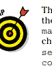

让网站或应用令人上瘾的特征在此处使用 Hook 模型进行了描述 http://techcrunch.com/2012/03/04/how-to-manufacture-desire。产品通常由公司制造，而一家持久公司的特征在此处进行了描述 http://www.sequoiacap.com/grove/posts/yal6/elements-of-enduring-companies，该描述基于对红杉资本资助公司的回顾；红杉资本是世界上最成功的风险投资公司之一，也是 Apple、Google 和 PayPal 的早期投资者。

### 概览编程语言的类型

代码有不同的“风味”，称为编程语言。一些流行的编程语言如图 1-4 所示。

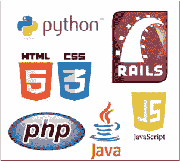

*图 1-4：一些流行的编程语言。*

你可以把编程语言想象成口语，因为它们都共享许多相同的特征，例如：

- **跨语言的功能性：** 编程语言都能创建相同的功能，类似于口语都能表达相同的对象、短语和情感。
- **语法和结构：** 编程语言中的命令可以重叠，就像口语中的单词重叠一样。在 Python 或 Ruby 中，要将文本输出到屏幕，你使用 `print` 命令，就像你在英语中使用动词“to print”一样，而 `imprimer` 和 `imprimir` 分别是法语和西班牙语中表示“打印”的动词。
- **自然生命周期：** 当程序员想到一种新的或更简单的方式来表达计算概念时，编程语言就诞生了。如果其他程序员同意，他们就会在自己的程序中采用这种语言，于是该编程语言传播开来。然而，就像拉丁语或阿拉米语一样，如果这种编程语言没有被其他程序员采用，或者出现了更好的语言，那么这种编程语言就会因缺乏使用而慢慢消亡。

尽管有这些相似之处，编程语言在几个关键方面也与口语不同：

- **单一创建者：** 与口语不同，编程语言可以由一个人在短时间内创建，有时只需几天。由单一创建者创建的流行语言包括 JavaScript（Brendan Eich）、Python（Guido van Rossum）和 Ruby（Yukihiro Matsumoto）。
- **用英语编写：** 与口语不同（当然，英语除外），几乎所有编程语言都是用英语编写的。无论巴西、法国还是中国的程序员是用 HTML、JavaScript、Python 还是 Ruby 编程，他们在代码中都使用相同的英语关键字和语法。确实存在一些非英语编程语言，例如印地语或阿拉伯语编程语言，但这些语言都没有广泛传播或成为主流。

### 比较低级和高级编程语言

对编程语言进行分类的一种方式是将其分为低级语言或高级语言。低级语言直接与计算机处理器或 CPU 交互，能够执行非常基本的命令，并且通常难以阅读。机器码是低级语言的一个例子，它使用的代码仅由两个数字——0 和 1——组成。图 1-5 展示了一个机器码示例。汇编语言是另一种低级语言，它使用关键字来执行读取数据、移动数据和存储数据等基本命令。

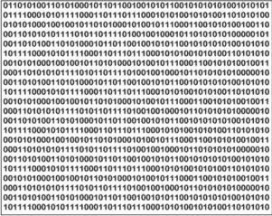

**图 1-5：** 机器码由 0 和 1 组成。

相比之下，高级语言使用自然语言，因此人们更容易阅读和编写。一旦用 C++、Python 或 Ruby 等高级语言编写了代码，解释器或编译器就会将这种高级语言转换为计算机能够理解的低级代码。

### 对比编译代码和解释代码

高级编程语言必须根据语言的不同，使用解释器或编译器转换为低级编程语言。解释型语言被认为比编译型语言更具可移植性，而编译型语言比解释型语言执行得更快。然而，编译型语言所具有的速度优势正开始变得不那么重要，因为处理器速度的提高使解释型语言与编译型语言之间的性能差异变得可以忽略不计。

像 JavaScript、Python 和 Ruby 这样的高级编程语言是解释型的。对于这些语言，解释器直接执行程序，将每条语句*一次一行地*转换为机器码。像 C++、COBOL 和 Visual Basic 这样的高级编程语言是编译型的。对于这些语言，在代码编写完成后，编译器会将*所有*代码转换为机器码，并创建一个可执行文件。然后，这个可执行文件通过互联网、CD-ROM 或其他媒体分发并运行。你安装到计算机上的软件，如 Microsoft Windows 或 Mac OS X，是使用编译型语言编写的，通常是 C 或 C++。

### 为 Web 编程

可通过网站访问的软件正逐渐开始取代安装式软件。想想你上一次为计算机下载并安装软件是什么时候——你可能甚至都不记得了！像 Windows Media Player 和 Winamp 这样播放音乐和电影的安装式软件，已经被 YouTube 和 Netflix 等网站取代。像 Microsoft Word 和 Excel 这样的传统安装式文字处理软件和电子表格软件，正开始面临来自 Google Docs 和 Sheets 等 Web 软件的竞争。Google 甚至销售名为 Chromebook 的笔记本电脑，这些电脑不包含安装式软件，而是完全依靠 Web 软件来提供功能。

本书的其余部分将聚焦于开发和创建 Web 软件，不仅因为 Web 软件正在快速增长，还因为 Web 程序比传统安装式软件更容易学习和发布。

### 浏览一个用代码构建的 Web 应用

说了这么多编程，让我们实际看一看一个用代码构建的 Web 应用。Yelp.com 是一个网站，允许你搜索并查找本地商家（如餐厅、夜生活和购物）的众包评价。如图 1-6 所示，Yelp 并不总是像今天这样精致，但多年来其目的相对保持不变。

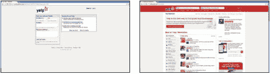

图 1-6：Yelp 在 2004 年和 2014 年的网站。

### 定义应用的目的和范围

一旦你理解了一个应用的目的，你就可以确定用户为实现该目的应该能够执行的一些可操作任务。无论设计如何，Yelp 的网站一直允许用户

- 根据场所类型和位置搜索本地商家列表。
- 浏览商家列表结果中的地址、营业时间、评价、照片以及地图上的位置。

成功的 Web 应用通常只允许用户在使用应用时完成少数关键任务。向应用添加过多功能被称为范围蔓延，会削弱现有功能的优势，因此大多数开发者会避免这样做。例如，拥有 30,000 条餐厅评价的 Yelp，在成立整整十年后才允许用户直接在其网站上向这些餐厅预订。无论你是在使用还是在构建应用，都要清楚地了解应用的目的。

### 站在巨人的肩膀上

开发者做出战略选择，决定应用的哪些部分由自己编写代码，哪些部分使用他人编写的代码。开发者经常向第三方提供商寻求那些不是业务核心或不是其优势领域的功能。通过这种方式，应用站在他人的肩膀上，并从那些先来并解决了挑战性问题的人那里受益。

例如，Yelp 显示本地商家评价，并将每个商家放置在地图上。虽然 Yelp 征集评价，并编写代码来显示基本商家数据，但如图 1-7 所示，开发 Yelp 网站上使用的地图的是 Google。通过使用 Google 的地图应用而不是自己构建，Yelp 用比原本所需更少的工程师创建了该应用的第一个版本。


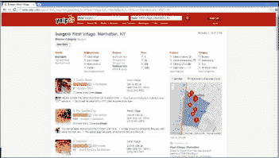

**图 1-7：** 用于 Yelp Web 应用程序的 Google Maps。

## 2 Web 编程

### 本章内容

- 了解支撑你每天使用的网站的代码
- 理解用于制作网站的语言
- 学习如何为移动设备创建应用程序

> 想想你可以在大学宿舍里开始做一件事……并打造出十亿人都在使用的东西，这想起来简直疯狂。太不可思议了。
>
> ——马克·扎克伯格

为 Web 编程让你能比以往更快地触达全球庞大受众。Facebook 在 2004 年推出四年后拥有 1 亿用户，到 2012 年则超过 10 亿。相比之下，桌面软件花了数年时间才触达哪怕 100 万人。如今，移动电话正在扩大 Web 应用程序的触达范围。尽管每年大约售出 3 亿台台式计算机，但同期售出近 20 亿部移动电话——而且这个数字还在稳步增长。

在本章中，你将学习网站如何在计算机或移动设备上显示。我会介绍用于编写网站程序的语言，并向你展示移动设备应用程序是如何制作的。

### 在台式机和移动设备上显示网页

在台式计算机和移动设备上，网页由称为浏览器的应用程序显示。最流行的 Web 浏览器包括 Google Chrome、Mozilla Firefox（原 Netscape Navigator）、Microsoft Internet Explorer 和 Apple Safari。到目前为止，你很可能一直作为一名听话的用户与所访问的网站交互，并遵循网站制定的规则：在允许时点击操作。要成为网站的生产者和程序员，第一步就是揭开网页的外层，查看并摆弄其下的所有代码。

### 黑入你最喜欢的新闻网站

你最喜欢的新闻网站是什么？按照几个步骤操作，你就能看到甚至修改用于创建该网站的代码。（不用担心，按照这些说明操作不会违反任何规则。）

尽管你几乎可以使用任何现代浏览器来检查网站代码，但这些说明假定你使用的是 Google Chrome 浏览器。请访问 www.google.com/chrome/browser 安装最新版本。

要“黑入”你最喜欢的新闻网站，请按照以下步骤操作：

- 1. 使用 Chrome 浏览器打开你最喜欢的新闻网站。（在本例中，我使用 www.huffingtonpost.com。）
- 2. 将鼠标光标移到任意静态固定标题上并右键单击一次，这会打开上下文菜单。然后用左键单击“检查元素”菜单选项。（见图 2-1。）

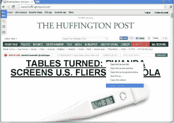

**图 2-1：** 右键单击一个标题，并从菜单中选择“检查元素”。

如果使用 Macintosh 计算机，你可以按住 Control 键并单击一次来右键单击。

开发者工具面板会在浏览器底部打开。该面板会向你显示用于创建此网页的代码！以蓝色高亮显示的是用于创建你最初将鼠标光标放置其上的标题的特定代码。（见图 2-2。）


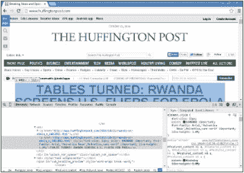

**图 2-2：** 蓝色高亮显示的代码用于创建网页标题。


查看高亮代码的左边缘。如果你看到一个右箭头，请用左键单击该箭头一次以展开代码。

- 3. **仔细浏览高亮代码**，找到你标题的文本。找到后，双击标题文本。这样你就能编辑标题了。（见图 2-3。）

注意不要点击任何以 `http` 开头的内容，那是标题链接。点击标题链接会打开一个新窗口或标签页并加载该链接。

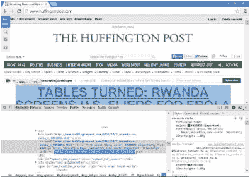

**图 2-3：** 双击标题文本，将其编辑为你自己的标题。

- 4. 在标题中插入你的名字，然后按 Enter 键。

现在你的名字会出现在实际网页上。（见图 2-4。）享受你新获得的名气吧！

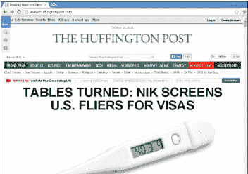

**图 2-4：** 你成功更改了一家大型新闻网站的标题。


如果你按照这些步骤操作后仍无法编辑标题，请访问 [http://goggles.webmaker.org](http://goggles.webmaker.org)，获取更简单、更有引导性的教程。这是一个万无一失的引导式版本，用于编辑页面上的代码。它是一种教学辅助工具，表明互联网上的任何代码都可以被修改。在该页面上，点击黄色的“Activate X-Ray Goggles”以查看并编辑 webmaker.org 网页上的代码。按照“Remix Any Webpage”说明，再次尝试黑入你最喜欢的新闻网站。

如果你成功完成了上述步骤并更改了原始标题，那么你成名 15 分钟的时间该结束了。重新加载网页，原始标题会重新出现。刚才发生了什么？你的更改是否显示给了所有访问该网页的人？为什么你编辑过的标题消失了？

要回答这些问题，你首先需要了解互联网如何将网页传送到你的计算机。

### 理解万维网如何运作

当你在浏览器中输入 URL（例如 huffingtonpost.com）后，在页面加载前的几秒钟内，以下步骤会在幕后发生（见图 2-5）。

- 1. 你的计算机将对网页的请求发送到路由器。路由器将互联网接入分发到你的整个家庭或工作场所。
- 2. 路由器将你的请求传递给互联网服务提供商（ISP）。在美国，你的 ISP 是 Comcast、Time Warner、AT&T 或 Verizon 这样的公司。
- 3. 然后，你的 ISP 会将 URL 中的单词和字符——在我的示例中是“huffingtonpost.com”——转换为一个称为*互联网协议地址*（或更常见的*IP 地址*）的数字地址。IP 地址是一组由句点分隔的四个数字（例如 192.168.1.1）。就像你的实际地址一样，这个数字是唯一的，每台计算机都有一个。你的 ISP 有一本类似于实体电话簿的数字电话簿，称为*域名服务器*，用于将文本 URL 转换为 IP 地址。
- 4. 找到 IP 地址后，你的 ISP 就知道应将你的请求转发到互联网上的哪台服务器，并且你的个人 IP 地址会包含在该请求中。
- 5. 网站服务器收到你的请求，并将网页代码的副本发送到你的计算机，供你的浏览器显示。
- 6. 你的 Web 浏览器将代码渲染到屏幕上。

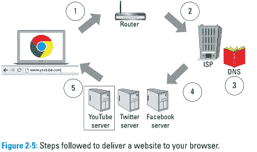

当你使用开发者工具编辑网站代码时，你只修改了存在于你计算机上的网站代码副本，因此只有你能看到更改。当你重新加载页面时，你会再次执行步骤 1 到 6，并从服务器获取一份新的代码副本，覆盖你在计算机上所做的任何更改。


你可能听说过一种称为*广告拦截器*的软件工具。广告拦截器的工作原理是编辑网站代码的本地副本，就像你上面所做的那样，以移除网站广告。广告拦截器之所以有争议，是因为网站使用广告收入来支付运营成本。如果广告拦截器继续越来越受欢迎，广告收入可能会枯竭，网站将不得不要求读者付费才能查看其内容。

### 留意前端与后端

既然你已了解浏览器如何访问网站，接下来让我们更深入地探究实际网站是如何构建的。如图 2-6 所示，网站代码以及一般程序代码可以按照代码的功能分为四类：

- **外观：** 外观是网站可见的部分，包括内容布局以及任何应用的样式，例如字体大小、字体和图像尺寸。这一类称为*前端*，使用 HTML、CSS 和 JavaScript 等语言创建。
- **逻辑：** 逻辑决定要显示什么内容以及何时显示。例如，访问新闻网站的纽约人应该看到纽约天气，而访问同一网站的芝加哥人应该看到芝加哥天气。这一类属于所谓的*后端*，使用 Ruby、Python 和 PHP 等语言创建。这些后端语言可以修改显示给用户的 HTML、CSS 和 JavaScript。
- **存储：** 存储保存网站及其用户生成的任何数据。用户生成的内容、偏好和配置文件数据必须存储起来，以便以后检索。这一类属于后端，存储在 MongoDB 和 MySQL 等数据库中。
- **基础设施：** 基础设施将网站从服务器交付给你，即客户端机器。当基础设施配置得当时，没有人会注意到它，但当网站因总统选举、超级碗和自然灾害等事件带来的高流量而无法访问时，它就会*变得引人注意*。

通常，网站开发者专攻这些类别中的一类，或至多两类。例如，一名工程师可能真正精通前端和逻辑语言，或者只专攻数据库。网站开发者各有优势和专长，而在这些领域之外，他们的专业知识是有限的，这很像出色的喜剧编剧杰瑞·宋飞（Jerry Seinfeld）很可能会成为糟糕的言情小说家。


极少见的、精通这四类全部内容的网站开发者被称为*全栈开发者*。通常，较小的公司会雇用全栈开发者，而较大的公司则需要专业化所带来的专业知识。


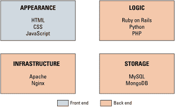

**图 2-6：** 每个网站都由四个不同的部分组成。

### 定义 Web 应用和移动应用

Web 应用是你使用任意设备上的 Web 浏览器访问的网站。针对手机或平板等移动设备进行优化的网站，称为**移动 Web 应用**。相比之下，**原生移动应用**无法使用 Web 浏览器查看。原生移动应用需要从 Apple App Store 或 Google Play 等应用商店下载，并设计为在特定设备（如 iPhone 或 Android 平板）上运行。从历史上看，台式电脑在数量和销量上均超过移动设备，但近年来移动端使用出现了两大趋势：

- 2014 年，拥有移动设备的人数超过了拥有台式电脑的人数。如图 2-7 所示，这一差距预计还将继续扩大。
- 移动设备用户将 80% 的时间花在使用原生移动应用上，20% 的时间用于浏览移动网站。

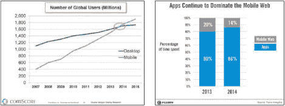

**图 2-7：** 移动设备的增长速度超过台式电脑。

过去 10 年间，移动设备的增长非常迅速，许多公司开始奉行“移动优先”策略，在设计桌面版应用之前，先设计和开发其移动版应用。WhatsApp 和 Instagram 这两款流行的移动应用，最初都先构建了移动应用，其移动应用至今仍比它们的普通网站拥有更多功能。

### 编写 Web 应用

Web 应用比移动应用更容易构建，几乎不需要额外的软件开发或测试工具，并且可以在所有设备上运行，包括台式机、笔记本电脑和移动设备。尽管移动应用可以执行许多常见的 Web 应用任务（例如电子邮件），但某些任务仍然使用 Web 应用更容易完成。例如，预订旅行使用 Web 应用更为方便，尤其是因为所需的步骤——查看航班、酒店和租车，然后完成三项预订——最好通过多窗口操作、使用日历功能以及输入大量个人信息和支付信息来实现。

用于编写基础 Web 应用的编程语言包括 HTML（超文本标记语言）、CSS（层叠样式表）和 JavaScript，这些语言将在后续章节中进一步介绍。还可以使用 Python、Ruby 或 PHP 等语言为这些网站添加额外功能。

### 从 HTML、CSS 和 JavaScript 开始

简单的网站（如图 2-8 所示）使用 HTML、CSS 和 JavaScript 编写。HTML 用于在页面上放置文本，CSS 用于设置文本样式，JavaScript 用于添加交互效果，例如 Twitter 或 Facebook 的分享按钮，它允许你在社交网络上分享内容，并更新其他分享过相同内容的人数。主要传达静态、不变信息的网站通常只使用这三种语言编写。你将在后续章节中学习这些语言。

### 使用 Python、Ruby 或 PHP 添加逻辑

具有更高级功能的网站（如用户账户、文件上传和电子商务）通常需要一种编程语言来实现这些功能。虽然 Python、Ruby 和 PHP 不是这些网站可以使用的唯一编程语言，但它们是最流行的几种。这种流行度意味着有大量使用这些语言编程的开发者在线上社区中自由发布代码，供你复制以构建常用功能，并主持公开的在线讨论，供你阅读以解决常见问题。

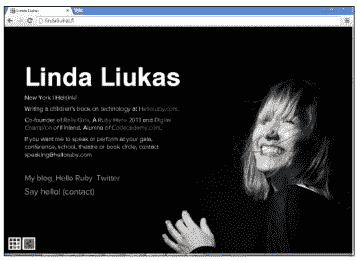

图 2-8：使用 HTML、CSS 和 JavaScript 构建的 lindaliukas.fi 网站。

这些语言还拥有流行且文档完善的框架。*框架*是一组通用组件的集合，例如经常复用的用户账户和认证方案，使开发人员能够更快地构建、测试和发布网站。你可以将框架想象成与文字处理器附带的模板集合类似的东西。你可以从零开始设计简历、贺卡或日历，但使用每种文档类型的内置模板可以帮助你更快、更一致地创建文档。这些语言的流行框架包括：

- Python 的 Django 和 Flask
- Ruby 的 Rails 和 Sinatra
- PHP 的 Zend 和 Laravel

### 编写移动应用

移动应用是当今的热门话题，部分原因是 WhatsApp 和 Instagram 等移动应用以数十亿美元的价格被收购，而 Rovio（《愤怒的小鸟》开发商）和 King Digital（《糖果传奇》开发商）等移动应用公司每年产生数亿至数十亿美元的收入。

# 第 I 部分：开始编写代码

在编写移动应用时，开发人员可以选择构建：

- 使用 HTML、CSS 和 JavaScript 构建的移动 Web 应用。
- 使用特定语言构建的原生移动应用。例如，Apple 设备使用 Objective-C 或 Swift 编程，Android 设备使用 Java 编程。

在这两种方案之间做出选择看似简单，但实际涉及几个因素。请考虑以下事项：

- 开发移动 Web 应用的公司必须确保移动版能够在不同的浏览器、不同的屏幕尺寸，甚至不同的制造商（如 Apple、Samsung、RIM 和 Microsoft）之间正常工作。这导致可能有数千种手机组合，大大增加了发布前测试的复杂性。原生移动应用只在一个手机平台上运行，因此需要考虑的变体较少。
- 尽管原生移动应用只在一个平台上运行，但它们比移动 Web 应用更昂贵，而且构建时间更长。
- 一些开发人员报告说，与原生移动应用相比，移动 Web 应用存在更多性能问题，加载速度也更慢。
- 如前所述，用户花更多时间使用原生移动应用，而花更少时间使用基于浏览器的移动 Web 应用。
- 原生移动应用通过应用商店分发，可能需要获得应用商店所有者的批准，而移动 Web 应用可以从任何 Web 浏览器访问。例如，Apple 有严格的审批政策，批准应用进入 Apple App Store 最多需要六天；而 Google 的审批政策较为宽松，批准应用只需要两小时。


一个著名的应用被应用商店拒绝的例子是，Apple 阻止 Google 在 Apple App Store 中推出 Google Voice 应用，因为它与 Apple 自己的电话功能重叠。Google 的回应是创建了一个可从任何浏览器访问的移动 Web 应用，而 Apple 无法阻止。

如果你正在做出这个选择，请考虑应用程序的复杂性。简单应用（如日程表或菜单）可能适合用移动 Web 应用低成本开发；而更复杂的应用（如消息传递和社交网络）可能更适合使用原生移动应用。即使是成熟的技术公司也纠结于这一选择。最初，Facebook 和 LinkedIn 创建了移动 Web 应用，但此后都转向主要推广和支持原生移动应用。这些公司将更好的速度、内存管理和开发工具列为做出转变的部分原因。

### 构建移动 Web 应用

虽然网站可以用移动浏览器查看，但那些没有针对移动设备优化的网站看起来有点奇怪，就像普通网站的字体大小和尺寸被缩小以适应移动屏幕一样。（参见图 2-9。）相比之下，针对移动设备优化的网站字体可读，图像能适应移动设备屏幕，并且具有适合手机的垂直布局。

构建移动 Web 应用使用 HTML、CSS 和 JavaScript。CSS 根据屏幕宽度控制网站在不同设备上的外观。小宽度的屏幕（如手机屏幕）被分配一个基于垂直的布局，而较大宽度的屏幕（如平板电脑屏幕）被分配另一个基于水平的布局。由于移动 Web 应用是从浏览器访问的，并未安装在用户设备上，因此这些 Web 应用无法向手机发送推送通知（提醒）、在浏览器最小化时后台运行，或与其他应用通信。

虽然你可以从头开始编写移动 Web 应用的 HTML、CSS 和 JavaScript，但移动 Web 框架允许你在预先编写的代码基础上进行开发，很像我之前提到的编程语言框架。这些移动 Web 框架包含一组经常复用的通用组件，允许开发人员更快地构建、测试和发布网站。Twitter Bootstrap 就是这样一种移动 Web 框架，我将在第 8 章中介绍。


图 2-9：左：未针对移动设备优化的 starbucks.com。右：针对移动设备优化的 starbucks.com。


### 构建原生移动应用

原生移动应用比移动 Web 应用更可靠，外观也更精致，如图 2-10 所示。原生移动应用使用 Java 构建以用于 Android 设备，使用 Objective-C 或 Swift 构建以用于 Apple 设备（iOS）；它们必须上传到应用商店，而应用商店可能要求审批。应用商店的主要优势在于集中分发，而且应用可能会在应用商店的某些板块中得到推荐，从而推动下载。此外，由于原生移动应用是安装在移动设备上的程序，它们可以在更多没有互联网连接的场景中使用。最后，也是最重要的一点，用户似乎以很大幅度更偏好原生移动应用而非移动 Web 应用，而且这一差距还在持续扩大。

原生移动应用可以利用应用最小化时在后台运行的功能，例如推送通知，并与其他应用通信；而在创建移动 Web 应用时，这些功能不可用。此外，原生移动应用在处理图形密集型应用（例如游戏）时表现更好。需要明确的是，原生移动应用提供更好的性能和更多功能，但相比移动 Web 应用，它们需要更长的开发时间，构建成本也更高。

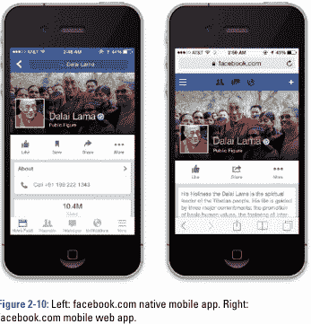

还有一种构建原生移动应用的替代方式——混合方法：使用 HTML、CSS 和 JavaScript 构建应用，用“包装器”打包这些代码，然后在原生移动应用容器中运行代码。最流行的“包装器”是一款名为 PhoneGap 的产品，它能识别特定的 JavaScript 命令，从而访问移动 Web 应用通常无法访问的设备级功能。构建出一个版本的应用后，可以为多达九个平台启动原生移动应用容器，包括 Apple、Android、BlackBerry 和 Windows Phone。使用这种混合方法的主要优势是：只需构建一次应用，然后就能同时发布到这么多平台。


想象一下，你会弹钢琴，但还想学拉小提琴。一种方法是买一把小提琴，开始学习演奏。另一种选择是买一台合成器键盘，将音色设为小提琴，然后弹奏键盘，使其听起来像小提琴。这与混合方法类似，只不过在这个例子中，钢琴是 HTML、CSS 和 JavaScript，小提琴是原生 iOS 应用，而合成器键盘是像 PhoneGap 这样的包装器。正如合成器键盘可以设为小提琴、大提琴或吉他音色，PhoneGap 也能为 Apple、Android 和其他平台创建原生应用。

### 其他那些编程语言呢？（C、Java 等）

你可能想知道为什么存在这么多语言，以及它们各自有什么用途。当开发者发现现有语言无法满足某种需求时，就会创造新的编程语言。例如，Apple 最近创造了 Swift 编程语言，使开发 iPhone 和 iPad 应用比使用当前所用的 Objective-C 更容易。编程语言在被创造出来之后，与英语或拉丁语等口语非常相似。如果开发者使用新语言编写代码，它就会蓬勃发展并越来越流行，就像英语在过去六个世纪中那样；否则，这门编程语言就会遭遇与拉丁语相同的命运，成为一门死语言。

你可能还记得 C++、Java 和 FORTRAN 等语言。这些语言今天仍然存在，而且使用范围比你想象的更广。当速度和性能极其重要时，C++ 更受青睐，它被用于编写 Web 浏览器（如 Chrome、Firefox 和 Safari）以及《使命召唤》和《反恐精英》等游戏。Java 受到许多大型企业的青睐，也是为 Android 手机编写应用所使用的语言。最后，FORTRAN 不像过去那样广泛或流行，但它在科学界仍然受欢迎，并为金融领域的一些功能提供支持，尤其是在世界上一些最大的银行中，其中许多银行仍保留着旧代码。

只要程序员还在思考更快、更好的编程方式，新的编程语言就会不断被创造出来，而较旧的语言则会失宠。

## 3 成为一名程序员

### 本章内容

- 了解程序员编写代码时遵循的流程
- 了解人们为创建程序所扮演的不同角色
- 选择工具以开始离线或在线编写代码

> 开始的方法就是停止空谈，动手去做。
>
> ——华特·迪士尼

编程是一项任何人都可以学习的技能。你可能是一名大学生，想知道如何开始学习；也可能是一名职场人士，希望找到新工作或提升当前工作的表现。几乎在所有情况下，学习如何编写代码的最佳方式是：

- 明确自己想要构建什么目标。
- 真正开始编写代码。

在本章中，你将了解每位程序员编程时遵循的流程，以及程序员为创建程序（或如今更常见的“应用”）所扮演的不同角色。你还将了解离线或在线编写代码时可使用的工具。

### 按流程编写代码

编写代码很像绘画、制作家具或烹饪——最终产品是如何创造出来的并不总是显而易见。然而，所有程序，即使看起来很神秘的程序，都是通过某个流程创建出来的。当今最常用的两种流程是：

- **瀑布式：** 按一组*顺序执行*的步骤来创建程序。
- **敏捷式：** 按一组*迭代*步骤来创建程序。（见图 3-1。）

让我描述一个具体场景，以解释这两种流程如何运作。假设你想构建一个餐厅应用，它完成以下两件事：

- 显示餐厅信息，例如营业时间和菜单。
- 允许用户进行或取消预订。

使用瀑布式方法，你会定义应用需要做的所有事情：设计应用的信息展示部分和预订部分，编写整个应用的代码，然后将应用发布给用户。相比之下，使用敏捷方法，你只会定义、设计并编写应用的信息展示部分，将其发布给用户并收集反馈。根据收集到的反馈，你会重新设计并修改信息展示部分，以解决主要问题。当你对信息展示部分满意后，再定义、设计并构建应用的预订部分。同样，你会收集反馈并完善预订功能，以解决主要问题。

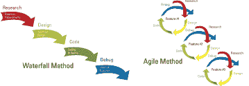

**图 3-1：** 瀑布式和敏捷式流程是创建软件的两种不同方式。

敏捷方法强调更短的开发时间，并随着技术变革步伐加快而越来越受欢迎。另一方面，瀑布式方法要求开发者一次性编写并发布整个应用，但由于完成大型项目需要大量时间，技术可能在最终产品完成之前就已经发生变化。如果你使用瀑布式方法创建我们的餐厅应用示例，那么等到你着手编写应用的用户预订部分时，用于处理用户预订的技术可能已经发生了变化。尽管如此，瀑布式方法在某些场景中仍然流行，例如金融和政府软件；这些项目在开始时就会获取需求和批准，而且项目文档必须完整。


healthcare.gov 网站于 2013 年 10 月发布，采用瀑布式流程开发。所有代码的测试在 2013 年 9 月整个系统组装完成时进行。不幸的是，测试进行得太晚且不够全面，导致没有足够时间在网站公开上线前修复错误。


无论你选择敏捷还是瀑布方法论，编写应用都包含四个步骤：

- 1. 调研你想构建的内容
- 2. 设计你的应用
- 3. 编写应用代码
- 4. 调试代码


平均而言，你花在调研、设计和调试应用上的时间会远远多于实际编写代码的时间，这与你可能预想的正好相反。

接下来的各节将介绍这些步骤。你在第10章创建自己的应用时，将使用这一流程。

### 调研你想构建的内容

你有了一个 Web 或移动应用的想法，通常它始于“如果……岂不是很棒？”在编写任何代码之前，先做一些调研会很有帮助。回答以下问题时，请考虑项目中的各种可能性：

- 已经存在哪些类似的网站/应用？它们是用什么技术构建的？
- 我的应用应该包含哪些功能——更重要的是，应该排除哪些功能？
- 哪些提供商可以帮助实现这些功能？例如，Google、Yahoo、Microsoft 等公司可能已有现成软件，你可以将其集成到自己的应用中。

为了说明这一点，想想我前面讨论过的餐厅应用。在进行市场调研并回答上述三个问题时，使用 Google 搜索通常是最好的资源。搜索*餐厅预订应用*会显示现有的餐厅应用，包括 OpenTable、SeatMe 和 Livebookings。例如，OpenTable 允许用户通过 Google Maps 在地图上显示的餐厅中预订餐桌。

在餐厅应用的例子中，你会希望准确调研需要提供哪些类型的餐厅信息，以及应用的预订系统部分应该做到多全面。此外，对于上述每个问题，你都必须决定是从零开始构建该功能，还是使用现有的提供商。例如，在提供餐厅信息时，你只想显示名称、菜系、地址、电话号码和营业时间，还是也想显示餐厅菜单？在展示餐厅数据时，你更希望广泛覆盖单个地理区域，还是希望覆盖全国，即使这意味着在任何一个特定区域覆盖的餐厅会更少？

### 设计你的应用

你的应用的视觉设计融合了你的所有调研，并准确描述用户将如何与每个页面和功能交互。由于用户会从台式机、笔记本电脑和移动设备访问你的网站，你会希望确保创建响应式（多设备）设计，并仔细考虑网站在所有这些设备上的显示效果。在这一阶段，普通 Web 设计师、插画师或用户界面专家将帮助创建应用的视觉设计。


互联网上可以找到许多响应式应用设计和模板，并且可以免费使用。具体示例请参见第8章，或使用查询*响应式网站设计示例*在 Google 上搜索。

视觉设计有两种类型（见图 3-2）：

- **线框图：** 这些是低保真网站草图，从结构上展示你的内容和网站界面的交互方式。
- **效果图：** 这些是高保真网站预览，包含颜色、图像和徽标。

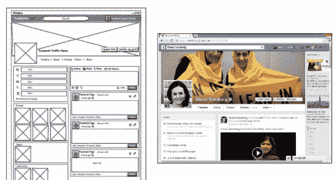

**图 3-2：** 线框图（左）是简单的网站渲染图，而效果图（右）展示完整的网站预览。


Balsamiq 是用于创建线框图的流行工具，Photoshop 是创建效果图的流行工具。不过，你可以使用 PowerPoint（PC）、Keynote（Mac）或免费开源的 OpenOffice 来创建应用设计，从而避免为额外软件付费。


专业设计师使用 Adobe Photoshop 创建效果图，并使用*图层*来隔离各个网站元素。正确创建的分层 Photoshop 文件可以帮助开发者更轻松地为这些网站元素编写代码。

除了视觉设计之外，复杂应用还会有技术设计以及需要最终确定的技术决策。例如，如果你的应用要存储和检索用户数据，你就需要一个数据库来执行这些任务。这里的初始决策将包括要添加的数据库类型、要使用的具体数据库提供商，以及将数据库集成到应用中的最佳方式。此外，开发者必须通过选择要存储的字段来设计数据库。这个过程类似于创建电子表格来为公司*收入*建模的过程——你首先要决定使用多少列，以及是否将字段设为收入百分比或数值，等等。同样，用户登录或信用卡支付等其他功能，也都需要你选择如何实现这些功能。

### 编写应用代码

调研和设计完成后，你现在可以开始为应用编写代码了。在日常 Web 开发中，你会先选择从哪些页面和功能开始编写代码。不过，当你完成本书中的项目时，我会指导你先编写什么。

知道要编写多少代码以及何时停止可能很难。开发者将应用的第一个迭代版本称为*最小可行产品*——意思是你的编码刚好足以让真实用户测试应用并收到反馈。如果没有人喜欢你的应用或认为它有用，最好尽快发现这一点。

应用是其各项功能的总和，对于任何单个功能，最好先编写必要的最少代码，然后再逐步添加。例如，你的餐厅应用可能在页面顶部有一个带下拉菜单的工具栏。与其试图一次性创建整个菜单，不如先只创建菜单，然后再创建下拉菜单效果。

项目可能涉及前端开发者和后端开发者，前者负责编写应用外观的代码，后者负责编写逻辑并创建数据库。“全栈开发者”是指既能做前端开发又能做后端开发的人。在大型项目中，更常见的是专门的前端和后端开发者，以及项目经理，后者确保所有人相互沟通并遵守进度安排，以便项目按时完成。

### 调试代码

调试将是任何应用的自然组成部分。计算机总是完全按照你的指令行事，然而没有任何程序会完全按你的预期运行。即便如此，调试也可能令人沮丧。需要留意的三种较常见错误是

- **语法错误：** 这些错误由单词/命令拼写错误、遗漏字符或包含多余字符引起。有些语言（如 HTML 和 CSS）对这些错误比较宽容，即使存在一些语法错误，你的代码仍能运行；而其他语言（如 JavaScript）则更严格，只要存在任何此类错误，代码就无法运行。
- **逻辑错误：** 这些错误更难修复。出现逻辑错误时，你的语法是正确的，但程序的行为与预期不同，例如电子商务网站购物车中商品的价格合计不正确。
- **显示错误：** 这些错误主要常见于 Web 应用。出现显示错误时，你的程序可能运行并正常工作，但显示不正常。如今的 Web 应用会在许多设备、浏览器和屏幕尺寸上运行，因此广泛测试是发现这类错误的唯一方法。


debugging（调试）一词在20世纪40年代由格蕾丝·霍珀推广开来，她通过真的从计算机中取出一只飞蛾来修复了一个计算机错误。

### 为工作挑选工具

现在你已准备好真正开始编写代码了。你可以离线开发网站，即使用编辑器；也可以在线开发，即使用 Codecademy.com 这样的 Web 服务。特别是如果你以前从未编写过代码，我强烈建议你在有互联网连接的情况下使用 Codecademy.com 平台编写代码，因为你不必下载和安装任何软件就可以开始编码，不必寻找 Web 主机来托管你的网页，也不需要将网页上传到 Web 主机。在你编写代码时，Codecademy.com 平台会自动为你完成这些任务。

### 离线工作

要离线编写代码，你需要以下内容：

- **编辑器：** 这里指的是你将用来编写本书中学到的所有代码的文本编辑器，包括 HTML、CSS、JavaScript、Ruby、Python 和 PHP。你使用的编辑器将取决于你所拥有的计算机类型：


- **PC：** 使用预装的记事本，或安装 Notepad++，这是一款可免费下载的编辑器，下载地址为 `http://notepad-plus-plus.org`。
- **Mac：** 使用预装的 TextEdit，或安装 TextMate 2.0，这是一款开源编辑器，下载地址为 `http://macromates.com`。
- **浏览器：** 浏览器有很多，包括 Firefox、Safari、Internet Explorer 和 Opera；不过，我建议你使用 Chrome，因为它对最新 HTML 标准的支持最全面。可在 `www.google.com/chrome/browser` 下载。
- **网站主机：** 为了让你的网站代码能被互联网上的所有人访问，你需要将网站托管到线上。免费增值网站主机包括 Weebly（`www.weebly.com`）和 Wix（`www.wix.com`）；这些网站提供基础托管服务，但对额外存储或移除广告等附加功能收费。Google 通过 Sites（`http://sites.google.com`）和 Drive（`http://drive.google.com`）提供免费网站托管。

### 在线使用 Codecademy.com

Codecademy.com 是在线开始学习编程的最简单方式，该网站上的课程构成了本书的基础。该网站不要求你在开始编程前安装代码编辑器或注册网站主机，而且对像你这样的个人用户免费。

可以使用任何最新的现代浏览器访问该网站，但建议使用 Google Chrome 或 Mozilla Firefox。

注册或登录该网站后，根据你学习的内容，你会看到交互式卡片或编程界面。（参见图 3-3。）

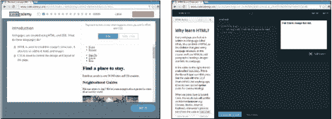

**图 3-3：** Codecademy.com 的交互式卡片（左）和编程界面（右）。

# 第一部分：编程入门

交互式卡片允许你点击切换按钮来演示预写代码的效果，而编程界面有一个代码编辑器和实时预览窗口，可显示输入到代码编辑器中的代码效果。

编程界面包含四个部分：

- 屏幕左上方的背景信息会告诉你即将进行的编程任务。
- 屏幕左下方显示要在编程窗口中完成的说明。
- 编程窗口允许你按照练习说明编写代码。编程窗口还包括一个预览屏幕，可在你输入时实时预览代码。
- 完成编程说明后，按 Save & Submit 或 Run。如果你成功遵循了说明，就会进入下一个练习；否则，网站会给出有用的错误消息和提示。

交互式卡片包含三个部分：

- 关于某个编程概念的背景信息。
- 一个用于完成一个简单编程任务的编程窗口。预览窗口还会在你输入时实时预览代码。
- 完成编程说明后，按 Got It 按钮。你可以通过点击 Go Back 按钮回顾之前的任何交互式卡片。

### 从社区获得支持

如果你遇到问题或有无法修复的错误，请尝试以下步骤。

- 点击说明下方的提示。
- 使用问答论坛发布你的问题或疑问，并查看其他人发布的问题。
- 在 Twitter 上向 @nikhilgibraham 发推，说明你的问题或疑问，并在推文末尾加上话题标签 #codingFD。

# 第二部分

# 构建静态与交互式网页

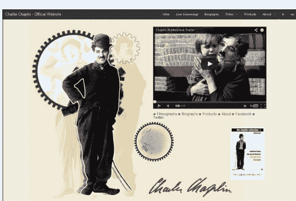


使用 HTML、CSS 和 JavaScript 在 www.dummies.com/extras/coding 构建网页。

## 本部分内容……

- 使用 HTML 在网页上放置内容，并使用 CSS 设置内容样式。
- 使用 HTML 和 CSS 构建网站布局结构。
- 创建你的第一个网页——Airbnb 首页。
- 使用 JavaScript 为网页添加交互性。
- 使用 API 访问实时数据。

## 4

## 探索 HTML 基础

### 本章内容

- 了解 HTML 的用途
- 理解基本 HTML 结构
- 添加标题、段落、超链接和图像
- 格式化网页文本
- 创建基本 HTML 网站

> 你浏览的内容会影响世界。
>
> —— 蒂姆·伯纳斯-李

HTML（即超文本标记语言）用于你在互联网上浏览的每一个网页。由于这门语言如此基础，对你来说，一个很好的第一步就是开始学习 HTML。

本章你将学习 HTML 基础知识，包括基本 HTML 结构以及如何让文本在浏览器中显示。接下来，你将学习如何格式化文本以及在 Web 浏览器中显示图像。最后，你将创建自己的（可能也是第一个）HTML 网站。你可能会发现，没有任何额外样式的 HTML 看起来非常朴素，不像你平时在互联网上访问的网站。使用 HTML 编写一个基本网站后，你将在后续章节中使用其他语言为网站添加更多样式。

### HTML 有什么作用？

HTML 指示浏览器如何在网页中显示文本和图像。回想一下你上次使用文字处理软件创建文档的情景。无论你使用 Microsoft Word 还是 WordPad、Apple Pages，或其他应用程序，你的文字处理软件都有一个主窗口供你输入文本，以及一个菜单或工具栏，其中包含多种选项来组织和设置文本样式（参见

### 识别元素

HTML 使用称为元素的特殊文本关键字来组织和设置网站样式。如果满足以下三个条件，浏览器就会识别元素并应用其效果：

- 元素是具有特殊含义的字母、单词或短语。例如，`h1` 是浏览器可识别的元素，用于应用标题效果，使文本加粗并放大字号。
- 元素由左尖括号（`<`）和右尖括号（`>`）包围。以这种方式包围的元素称为标签（例如 `<h1>`）。
- 开始标签（`<element>`）后面跟着结束标签（`</element>`）。注意，结束标签与开始标签的区别在于，在第一个左括号之后、元素之前添加了一个正斜杠（例如 `</h1>`）。

有些 HTML 标签是自闭合的，不需要单独的结束标签，只需在开始标签中加一个正斜杠。有关更多信息，请参见本章后面的“熟悉常见的 HTML 任务和标签”一节。

当三个条件全部满足时，开始标签和结束标签之间的文本就会按该标签定义的效果设置样式。即使只缺少其中一个条件，浏览器也只会显示纯文本。

为了更好地理解这三个条件，请看下面的示例代码：

```html
<h1>This is a big heading with all three conditions</h1>
<h1>This is text without the < and > sign surrounding the tag /h1
<rockstar>This is text with a tag that has no meaning to the browser</rockstar>
This is a regular text
```

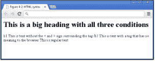

图 4-2：示例代码在浏览器中的显示。


浏览器对“这是一个满足全部三个条件的大标题”应用标题效果，因为 h1 是标题标签，并且有效 HTML 标签的三个条件全部成立：

- 浏览器识别 h1 元素。
- h1 元素由左尖括号（<）和右尖括号（>）包围。
- 开始标签（<h1>）后面是文本，然后是结束标签（</h1>）。


请注意，h1 标签本身不会显示在标题中。在格式正确的 HTML 标签中，浏览器永远不会显示元素的实际文本。

其余代码行显示为纯文本，因为它们各自缺少其中一个条件。在第二行代码中，<h1> 标签缺少左右尖括号，这违反了第二个条件。第三行代码违反了第一个条件，因为 rockstar 不是可识别的 HTML 元素。（不过，学完本章后，你可能会觉得自己像个摇滚明星！）最后，第四行代码显示为纯文本，因为文本前面没有开始标签，文本后面也没有结束标签，这违反了第三个条件。


每个左尖括号都必须在元素之后跟一个右尖括号。此外，每个 HTML 开始标签后面都必须有一个 HTML 结束标签。

HTML 元素有 100 多个，我们将在接下来的几节中介绍最重要的元素。现在，不必担心要记住各个元素的名称。


HTML 是一种宽容的语言，即使你缺少部分代码（比如结束标签），它也可能正确应用效果。但是，如果你留下太多错误，页面将无法正确显示。

### 突出你最好的属性

属性提供了修改元素行为或指定附加信息的额外方式。通常（但并非总是）将属性设置为一个用引号括起来的值。下面是一个使用 title 属性和 hidden 属性的示例：

```
<h1 title="United States of America">USA</h1>
<h1 hidden>New York City</h1>
```


`title` 属性提供关于元素的提示信息，当鼠标光标悬停在受影响的文本上时会出现（换句话说，就是一个 `tooltip`）。在本例中，单词 USA 使用 `<h1>` 标签被样式化为标题，并将 `title` 属性设置为 "United States of America"。那么在浏览器中，当你将鼠标光标放在单词 USA 上时，文本 United States of America 会显示为工具提示。（见图 4-3。）

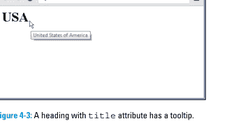

图 4-3：带有 `title` 属性的标题具有工具提示。

`hidden` 属性表示该元素不相关，因此浏览器不会渲染任何带有此属性的元素。在本例中，单词 New York City 永远不会出现在浏览器窗口中，因为 `hidden` 属性位于开头的 `<h1>` 标签中。更实际地说，`hidden` 属性通常用于对用户隐藏字段，以便他们无法编辑这些字段。例如，一个 RSVP 网站可能希望包含日期和时间字段，但将其对用户视图隐藏。

`hidden` 属性是 HTML5 中的新属性，这意味着它可能在某些较旧的浏览器上不起作用。

你不必一次只使用一个属性。你可以在开头的 HTML 标签中包含多个属性，如下所示：

```html
<h1 title="United States of America" lang="en">USA</h1>
```

在本例中，我使用了 `title` 属性和 `lang` 属性，将其设置为 `"en"`，以指定该元素的内容为英语。

包含多个属性时，请用单个空格分隔每个属性。

# 第二部分：构建静态与交互式网页

使用属性时请牢记以下规则：

- 如果使用属性，请始终将属性包含在开头的 HTML 标签中。
- 多个属性可以修饰单个元素。
- 如果属性有值，则使用等号（=）并将值括在引号中。

### 让 head、title 和 body 高于其余部分

HTML 文件以特定方式构建，以便浏览器能够正确解释文件的信息。每个 HTML 文件都有相同的五个元素：其中四个元素的开始标签和结束标签只出现一次且仅出现一次，另一个元素出现一次且不需要结束标签。它们如下：

- `<!DOCTYPE html>` 必须首先出现在你的 HTML 文件中，并且只出现一次。此标签让浏览器知道你正在使用哪个版本的 HTML。在本例中，它是最新版本 HTML5。此元素不需要结束标签。对于 HTML4 网站，HTML 文件的第一行会写成 `<!DOCTYPE HTML PUBLIC "-//W3C//DTD HTML 4.01//EN" "http://www.w3.org/TR/html4/strict.dtd">`。


- `html` 表示 HTML 文档的根或开头。`<html>` 标签之后首先是开始和结束的 `<head>` 标签，然后是开始和结束的 `<body>` 标签。
- `head` 包含其他元素，这些元素指定页面的通用信息，包括标题。
- `title` 定义浏览器标题栏或页面标签中的标题。像 Google 这样的搜索引擎使用 `title` 在搜索结果中对网站进行排名。
- `body` 包含 HTML 文档的主要内容。在开始和结束 body 标签之间列出的文本、图像和其他内容由浏览器显示。

下面是一个具有这五个标签的结构正确的 HTML 文件示例（见图 4-4）：

```html
<!DOCTYPE html>
<html>
<head>
    <title>Favorite Movie Quotes</title>
</head>
<body>
    <h1>"I'm going to make him an offer he can't refuse"</h1>
<h1>"Houston, we have a problem"</h1>
<h1>"May the Force be with you"</h1>
<h1>"You talking to me?"</h1>
</body>
</html>
```

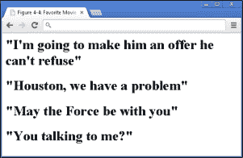

**图 4-4：** 使用基本 HTML 元素创建的网页。


强烈建议使用空格来缩进和分隔标签。它可以帮助你和其他人阅读和理解你的代码。然而，这些空格只为你和其他阅读代码的人服务。你的浏览器不会在意。就浏览器而言，你可以将所有标签放在一行中运行。（不过，不要这样做。下一个阅读你代码的人会非常不高兴。）HTML 确实会识别并显示开始和结束 HTML 标签之间文本中的第一个空白字符。


我们的示例有许多 h1 标签，但只有一个开始和结束的 html、head、title 和 body 标签。

### 熟悉常见的 HTML 任务和标签

你的浏览器可以解释一百多个 HTML 标签，但大多数网站只使用少数几个标签来完成浏览器内的大部分工作。为了理解这一点，让我们做一个小练习：想一想你最喜欢的新闻网站。想到了吗？现在连接到互联网，打开浏览器，输入该网站的地址。带上这本书，慢慢来——我可以等！

如果你现在无法访问互联网，可以看看图 4-5 中来自我最喜欢的新闻网站 *《纽约时报》* 的一篇文章。

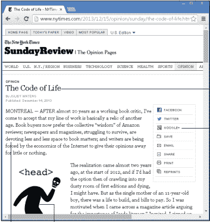

*图 4-5：一篇《纽约时报》文章，包含标题、段落、超链接和图像。*

仔细看看你屏幕上的新闻网站（或者看看我的）。四个 HTML 元素用于创建页面的大部分内容：

- **标题：** 标题以粗体显示，并且字体大小比周围文本更大。
- **段落：** 每个故事都组织成段落，段落之间用空白分隔。
- **超链接：** 网站的主页和文章页面有指向其他故事的链接，以及在 Facebook、Twitter 和 Google+ 等社交网络上分享故事的链接。
- **图像：** 作者在故事中放置图像，但也会寻找图标和徽标等网站图像。

在接下来的章节中，我将解释如何编写代码来创建这些常见的 HTML 功能。

### 编写标题

使用标题来描述页面的某个部分。HTML 有六级标题（见图 4-6）：

- h1，用于最重要的标题
- h2，用于副标题
- h3 到 h6，用于不太重要的标题

浏览器渲染 h1 标题的字体大小大于 h2 的字体大小，而 h2 的字体大小又大于 h3 的字体大小。标题以开始标题标签、标题文本和结束标题标签组成，如下所示：

`<h1>Heading text here</h1>`

以下是一些展示各种标题的额外代码示例：

```html
<h1>Heading 1: "I'm going to make him an offer he can't refuse"</h1>
<h2>Heading 2: "Houston, we have a problem"</h2>
<h3>Heading 3: "May the Force be with you"</h3>
<h4>Heading 4: "You talking to me?"</h4>
<h5>Heading 5: "I'll be back"</h5>
<h6>Heading 6: "My precious"</h6>
```

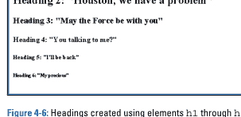

图 4-6：使用 h1 到 h6 元素创建的标题。

> 打开什么就要关闭什么。对于标题，记得包含结束标题标签，例如 `</h1>`。


### 在段落中组织文本

要以段落显示文本，你可以使用 p 元素：在段落前放置开始 `<p>` 标签，在其后放置结束标签。p 元素接收文本，并在结束标签后插入换行。

要在任何元素后插入单个换行，请使用 `<br>` 标签。`<br>` 标签是自闭合的，因此不需要结束标签，也不使用 `</br>`。

段落以开始段落标签、段落文本和结束段落标签组成：

```html
<p>Paragraph text here</p>
```

一些额外的段落编码示例（见图 4-7）：

```html
<p>Armstrong: Okay. I’m going to step off the LM now.</p>
<p>Armstrong: That’s one small step for man; one giant leap for mankind.</p>
<p>Armstrong: Yes, the surface is fine and powdery. I can kick it up loosely
             with my toe. It does adhere in fine layers, like powdered
             charcoal, to the sole and sides of my boots.</p>
```

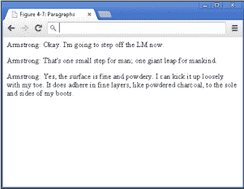

**图 4-7：** 使用 p 元素在段落中显示的文本。

### 链接到你的（心中）内容

超链接是 HTML 最有价值的功能之一。包含指向其他来源的超链接引用的网页允许读者只需点击一下即可访问这些来源，这是相对于印刷页面的巨大优势。


超链接由两部分组成：

- **链接目标：** 浏览器在单击链接后访问的网页。
  
  要在 HTML 中定义链接目标，请从带有 `href` 属性的起始锚标签（`<a>`）开始。然后添加 `href` 属性的值，即单击链接后浏览器将访问的网站。
- **链接描述：** 用于描述链接的文字。
  
  为此，在起始锚标签之后添加描述链接的文本，然后添加结束锚标签。

生成的 HTML 应类似如下：

```html
<a href="website url">Link description</a>
```

再来看三个编写超链接的示例（见图 4-8）：

```html
<a href="http://www.amazon.com">Purchase anything</a>
<a href="http://www.airbnb.com">Rent a place to stay from a local host</a>
<a href="http://www.techcrunch.com">Tech industry blog</a>
```

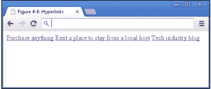

**图 4-8：** 使用 `a` 元素创建的三个超链接。


渲染超链接时，浏览器默认会给链接加下划线并将其显示为蓝色。要更改这些默认属性，请参见第 6 章。

`<a>` 标签不会在链接后包含换行。


谷歌搜索引擎根据起始和结束 `<a>` 标签之间用于描述网页的文字来对网页进行排名。这改进了先前方法的搜索结果，因为先前方法主要依赖分析页面内容。

### 添加图片

图片能为原本单调的 HTML 文本页面增色。要在网页中包含图片——无论是你自己的还是他人的——你必须获取该图片的网址。Google 图片（images.google.com）和 Flickr（www.flickr.com）等网站允许你根据关键词搜索在线图片。找到喜欢的图片后，右键单击该图片，然后选择“复制图片 URL”。


确保你有权使用在线图片。Flickr 提供的工具可让你搜索几乎没有或完全没有许可限制的图片。此外，网站需要付费托管图片，而当网站直接链接到图片时会产生费用。因此，有些网站不允许热链接，即从第三方网站（比如你的网站）直接链接到图片。


如果你想使用尚未上传到互联网的图片，可以使用 www.imgur.com 之类的网站上传该图片。上传后，你就可以复制图片 URL 并在 HTML 中使用。

要包含图片，请从起始图片标签 `` 开始，使用 src 属性定义图片来源，并在起始标签末尾包含一个正斜杠以关闭标签（见图 4-9）：

```html


```


**图 4-9：** 使用 `` 渲染的格蕾丝·霍珀（美国海军少将）和比尔·盖茨（微软联合创始人）的图像。


图片标签是自闭合的，这意味着不会使用单独的 `</img>` 结束图片标签。图片标签是有开必闭规则的一个例外！

### 美化样式

既然你已经知道如何在浏览器中显示基本文本和图片，就应该了解如何进一步自定义并设置它们的样式。HTML 具有设置内容样式的基本能力，后面的章节会展示如何使用 CSS 将内容样式和位置精确到最后一个像素。不过，这里我会解释如何在 HTML 中进行一些基本的文本格式设置，然后你将构建自己的第一个网页。

### 使用粗体、斜体、下划线和删除线突出显示

HTML 允许使用以下元素进行基本文本样式设置：

- `strong` 标记重要文本，浏览器会将其显示为粗体。
- `em` 标记强调文本，浏览器会将其显示为斜体。
- `u` 将文本标记为带下划线。
- `del` 标记已删除文本，浏览器会将其显示为删除线。

下划线元素通常不用于文本，因为它可能导致混淆。毕竟，超链接默认就带下划线。

要使用这些元素，请从元素的起始标签开始，接着是受影响的文本，然后是结束标签，如下所示：

```html
<element name>Affected text</element name>
```

一些示例（见图 4-10）：

```html
Grace Hopper, <strong> a US Navy rear admiral </strong>, popularized the term
    "debugging".
Bill Gates co-founded a company called <em>Microsoft</em>.
Stuart Russell and Peter Norvig wrote a book called <u>Artificial Intelligence:
    A Modern Approach</u>.
Mark Zuckerberg created a website called <del>Nosebook</del> Facebook.
Steve Jobs co-founded a company called <del><em>Pearch</em></del> <em>Apple</em>.
```

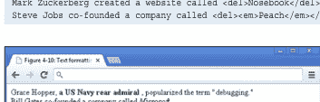

**图 4-10：** 使用粗体、斜体、下划线和删除线设置格式的句子。


你可以通过使用多个 HTML 标签为文本应用多种效果。始终先关闭最近打开的标签，再关闭上一个最近使用的标签。例如，查看图 4-10 中最后一行代码，以及应用于单词 Pearch 的标签。

### 使用上标和下标升高和降低文本

维基百科等参考著作和技术论文常用上标表示脚注、用下标表示化学名称。要应用这些样式，请使用以下元素：

- `sup` 用于标记为上标的文本
- `sub` 用于标记为下标的文本

要使用这些元素，请从元素的起始标签开始，接着是受影响的文本，然后是结束标签，如下所示：

`<element name>Affected text</element name>`

两个示例（见图 4-11）：

```html
<p>The University of Pennsylvania announced to the public the first electronic general-purpose computer, named ENIAC, on February 14, 1946.<sup>1</sup></p>

<p>The Centers for Disease Control and Prevention recommends drinking several glasses of H<sub>2</sub>O per day.</p>
```

使用上标元素标记脚注时，请使用 `<a>` 锚标签直接链接到脚注，以便读者轻松查看脚注。

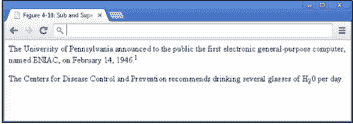

**图 4-11：** 设置为显示上标和下标效果的文本。


### 使用 HTML 构建你的第一个网站

既然你已经学会了基础知识，就可以运用这些知识了。你可以按照以下步骤直接在计算机上练习：

1. **打开任意文本编辑器，例如 Notepad（在 PC 上）或 TextEdit（在 Mac 上）。**
   
   在运行 Microsoft Windows 的 PC 上，你可以单击“开始”按钮并选择“运行”来访问 Notepad；在搜索框中输入 `Notepad`。在 Macintosh 上，选择 Spotlight 搜索（工具栏右上角的沙漏图标），并输入 `TextEdit`。

2. **在文本编辑器中输入你在本章看到的任何代码示例，或创建你自己的代码组合。**

3. **完成后保存文件，并确保文件名末尾包含“.html”。**

4. **双击该文件，它应该会在你的默认浏览器中打开。**


你可以免费下载专为编写代码而创建的专用文本编辑器。对于 PC，你可以从 `www.notepad-plus-plus.org` 下载 Notepad++。对于 Mac 电脑，你可以从 `http://macromates.com/download` 下载 TextMate。

如果你想在线练习 HTML，可以使用 Codecademy 网站。Codecademy 是一个创建于 2011 年的免费网站，让任何人都能直接在浏览器中学习编程，无需安装或下载任何软件。（见图 4-12。）按照以下步骤练习你在本章学到的所有标签（以及一些其他标签）：

1. **打开浏览器，访问** `www.dummies.com/go/coding` **并单击 Codecademy 链接。**

2. **注册 Codecademy 账户；如果你已有账户，请登录。创建账户可以让你在工作时保存进度，但这是可选的。**

3. **导航到并单击“HTML 基础”。**

4. **背景信息显示在网站左上部分，说明显示在网站左下部分。**

5. **在主编码窗口中完成说明。输入时，会生成代码的实时预览。**


6. 完成指令后，点击**保存并提交代码**按钮。

如果正确遵循了指令，就会出现一个绿色对勾，然后进入下一个练习。如果代码中存在错误，会出现一个带有建议修复的警告。如果遇到问题或遇到无法修复的 bug，可以点击提示、使用问答论坛，或在 Twitter 上 @nikhilgabraham 并附上 #codingFD 标签。

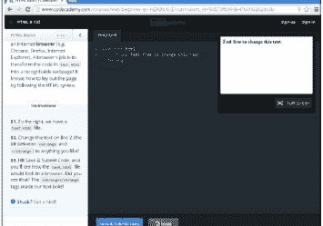

**图4-12：** Codecademy 浏览器内练习。

### HTML 的历史

计算机工程师蒂姆·伯纳斯-李希望学者们能够轻松访问学术论文并相互协作。为了实现这个目标，伯纳斯-李先生在1989年创建了第一个版本的HTML，其中包含你在本章学到的超链接元素，并在1991年托管了第一个网站。与大多数其他计算机软件不同，伯纳斯-李先生让HTML免版税使用，从而使它在全球范围内被广泛采用和使用。在创建首个HTML版本后不久，伯纳斯-李先生成立了W3C（“万维网联盟”），这是一个由学术机构和公司人员组成的团体，负责定义和维护HTML语言。W3C持续发展HTML语言，已经定义了超过100个HTML元素，远多于伯纳斯-李先生最初创建的18个。最新版本的HTML是HTML5，它拥有相当多的新功能。除了支持以前HTML版本中的元素外，HTML5还允许浏览器播放音频和视频文件、轻松定位用户的物理位置，以及构建图表和图形。

## 5 充分利用HTML

### *本章内容*

- 在网页中组织内容
- 编写HTML列表
- 创建HTML表格
- 填写HTML表单

> 我喜欢掌控，我希望一切井然有序，我需要列表。
>
> ——桑德拉·布洛克

即使是最好的内容，也需要结构来提高用户的可读性。本书也不例外。想想本页顶部的“本章内容”项目符号列表，或者本书开头的目录。列表和表格让你更容易一目了然。通过模仿在书本或杂志中看到的结构，网页元素让你能够精确定义文本和图像等内容在网页上的显示方式。

在本章中，你将学习如何使用列表、表格和表单等HTML元素，以及如何判断这些元素何时适合你的内容。

### 在页面上组织内容

可读性是在网页上组织和显示内容时最重要的原则。你的网页应该让访问者轻松阅读、理解并针对你的内容采取行动。你希望访问者采取的行动可能是点击阅读更多内容、与他人分享内容，或者进行购买。内容组织不当会导致用户在与你的内容充分互动以完成预期行动之前就离开你的网站。

图5-1和图5-2展示了网站可读性的两个示例。在图5-1中，我在Craigslist.org上搜索了纽约的公寓。搜索结果以列表形式结构化，你可以使用筛选器和搜索表单来限制显示的内容。每个列表项都有多个属性，例如描述、卧室数量、社区，以及最重要的价格。比较不同列表项的相似属性需要一些功夫——注意你的眼睛必须跟随的锯齿状线条。

图5-2展示了我在Hipmunk.com上搜索从纽约飞往伦敦的航班的结果。与Craigslist搜索结果一样，你可以使用筛选器和搜索表单来限制显示的内容。此外，每个航班列表项都有多个属性，包括价格、航空公司、起飞时间、降落时间和航程时长，这些与公寓列表项的属性类似。然而，使用Hipmunk的布局，比较不同航班的相似属性要容易得多。注意，与Craigslist相反，其内容的布局能让你的眼睛沿着页面直线向下移动，从而轻松地对不同选项进行排序和比较。

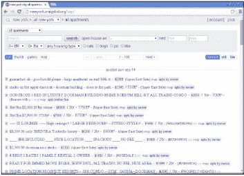

图5-1：Craigslist.org 上纽约的公寓列表（2014年）。


不要低估简洁在展示内容时的力量。尽管Craigslist的内容布局看起来几乎过于简单，但该网站是世界上访问量排名前50的网站之一。Reddit.com是另一个采用简洁布局的前50网站的例子。

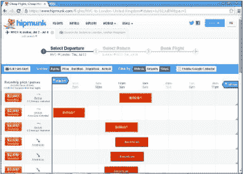

**图5-2：** Hipmunk.com 上从纽约飞往伦敦的航班列表（2014年）。

在显示内容之前，先问自己几个问题：

- **你的内容是拥有一个带有相关数据的属性，还是遵循顺序步骤？** 如果是，考虑使用列表。
- **你的内容是否有多个适合比较的属性？** 如果是，考虑使用表格。
- **你是否需要收集访问者的输入？** 如果是，考虑使用表单。

**提示**

不要让这些选择让你不知所措。选择一种，看看访问者的反应，如果有必要，改变内容的显示方式。将一个版本的网页与另一个版本进行比较评估的过程称为*A/B测试*。

### 列出数据

几十年来，网站一直使用列表来传达相关或分层的信息。在图5-3中，你可以看到旧版Yahoo.com使用项目符号列表显示各种类别，以及今天的Allrecipes.com食谱页面使用列表显示各种配料。

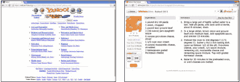

**图5-3：** Yahoo 1997年使用无序列表的主页（左）和 Allrecipes.com 2014年使用有序列表的食谱（右）。

列表从一个符号、一个缩进，然后是列表项开始。使用的符号可以是数字、字母、项目符号，或者根本没有符号。

### 创建有序和无序列表

两种最常用的列表类型是：

- **有序列表：** 有序列表是数字或字母列表，其中列表项的顺序很重要。
- **无序列表：** 这些列表通常是项目符号列表，其中列表项的顺序不重要。

通过指定列表类型为有序或无序，然后使用`li`标签添加每个列表项来创建列表，如下所示：

1. **指定列表类型。**

   添加开头和结尾列表标签，指定有序（`ol`）或无序（`ul`）列表，如下所示：

   - `ol` 用于指定有序列表的开头和结尾。
   - `ul` 用于指定无序列表的开头和结尾。

2. **为列表中的每个项添加开头和结尾标签（即`<li>`和`</li>`）。**

例如，这是一个有序列表：

```html
<ol>
    <li>List item #1</li>
    <li>List item #2</li>
    <li>List item #3</li>
</ol>
```

### 嵌套列表

此外，你可以在列表中嵌套列表。任何类型的列表都可以嵌套在另一个列表中；要嵌套列表，请将列表项标签`<li>`替换为列表类型标签`<ol>`或`<ul>`。

图5-4中的示例代码展示了多种列表类型，包括嵌套列表。（参见图5-4和图5-5。）

```html
<!--Ordinary list-->
<h1>Tasks for today</h1>
<ol>
  <li>Schedule a product meeting</li>
  <li>Have lunch with Arun</li>
  <li>Draft client presentation</li>
</ol>

<!--Nested list-->
<h1>Tasks for tomorrow</h1>
<ul>
  <li>Send sketches to London office</li>
  <li>File expense reports
    <ol>
      <li>Trip to San Francisco</li>
      <li>Trip to Los Angeles</li>
    </ol>
  </li>
</ul>
```

图5-4：编写有序列表和嵌套列表。

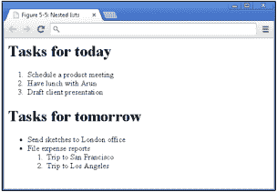

图5-5：由图5-4中的代码生成的页面。


**提示**

此代码示例中显示的 `<h1>` 标签并非创建列表所必需。我在这里使用它只是为了给每个列表命名。

每个开始列表或列表项标签后面都必须跟一个结束列表或列表项标签。

### 将数据放入表格

表格有助于进一步组织页面上的文本和表格数据。（参见图 5-6。）当显示定价信息、比较各产品功能，或在列或行共享共同属性的任何情况下，表格格式尤其合适。表格充当容器，可以容纳并显示任何类型的内容，包括文本（例如标题和列表）以及图像。例如，图 5-6 中的表格包含附加内容和样式，如每列顶部的图标、灰色背景底纹和圆角按钮。这些内容和样式会使你在网上看到的表格不同于你在书籍中通常看到的表格。

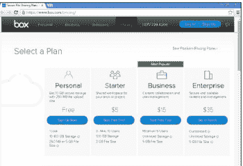

**图 5-6：** Box.net 使用表格显示定价信息。

**提示**

避免使用表格创建页面布局。过去，开发人员使用表格创建多列布局，但如今开发人员使用 CSS（参见第 7 章）完成与布局相关的任务。

### 基本表格结构

表格由若干部分组成，如图 5-7 所示。

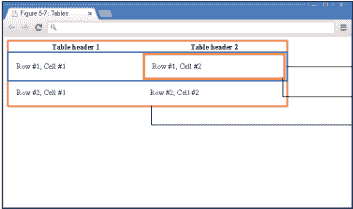

**图 5-7：** 表格的不同部分。

使用以下基本步骤创建表格：

- 1. **用 `table` 元素定义表格。**  
    为此，添加开始和结束 `<table>` 标签。
- 2. **用 `tr` 元素将表格划分为行。**  
    在开始和结束表格标签之间，为表格的每一行创建开始 `<tr>` 标签和结束 `</tr>` 标签。
- 3. **使用 `td` 元素将行划分为单元格。**  
    在开始和结束 `tr` 标签之间，为该行中的每个单元格创建开始和结束 `td` 标签。
- 4. **使用 `th` 元素突出显示作为表头的单元格。**  
    最后，通过用 `th` 元素替换 `td` 元素来指定任何作为表头的单元格。


你的表格将只有一个开始和结束 `<table>` 标签；但是，你可以有一个或多个表格行（`tr`）和单元格（`td`）。

以下示例代码显示了创建图 5-7 所示表格的语法。

```html
<table>
    <tr>
        <th>Table header 1</th>
        <th>Table header 2</th>
    </tr>
    <tr>
        <td>Row #1, Cell #1</td>
        <td>Row #1, Cell #2</td>
    </tr>
    <tr>
        <td>Row #2, Cell #1</td>
        <td>Row #2, Cell #2</td>
    </tr>
</table>
```


决定表格将有多少行和列后，请确保为每一行使用开始和结束 `<tr>` 标签，并为该行中的每个单元格使用开始和结束 `<td>` 标签。

### 拉伸表格列和行

看看图 5-8 中描述 Facebook 利润表的表格。2011、2012 和 2013 年的数据出现在宽度相等的各个列中。现在看总收入，它出现在一个横跨若干列的单元格中。

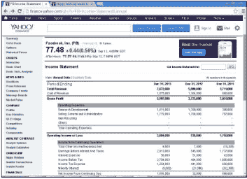

**图 5-8：** 表格中的利润表，各列宽度不同。


将单元格跨列或跨行拉伸称为*跨列跨行*。

colspan 属性使单元格跨后续列。colspan 属性的值设置为你想要跨越的列数。列跨总是从左到右。类似地，rowspan 属性使单元格跨后续行。将 rowspan 设置为你要跨越的行数。

以下代码生成图 5-8 所示表格的一部分。你可以看到 colspan 属性使总收入单元格跨两列。如第 4 章所述，`<strong>` 标签用于标记重要文本，并由浏览器显示为粗体。

```html
<tr>
    <td colspan="2">
        <strong>Total Revenue</strong>
    </td>
    <td>
        <strong>7,872,000</strong>
    </td>
    <td>
        <strong>5,089,000</strong>
    </td>
    <td>
        <strong>3,711,000</strong>
    </td>
</tr>
```


如果你将列或行设置为跨越的列数或行数超过表格中实际存在的数量，浏览器将插入额外的列或行，从而改变你的表格布局。


CSS 有助于设置各个列和行以及整个表格的大小。参见第 7 章。

### 对齐表格和单元格


最新版本的 HTML 不支持本节中的标签和属性。尽管你的浏览器可能正确呈现此代码，但不能保证你的浏览器将来会正确呈现它。我包含这些属性是因为在撰写本文时，互联网上的 HTML 代码（包括前面示例中的 Yahoo Finance 网站）仍在表格中使用这些已弃用（较旧）的属性。这段代码类似于脏话——认识它们，但尽量不要使用它们。请参阅第 6 章，了解使用层叠样式表（CSS）实现相同效果的现代技术。

table 元素有三个需要了解的已弃用属性——align、width 和 border。这些属性在表 5-1 中描述。

| 属性名 | 可能的值 | 描述 |
|---|---|---|
| align | left | 根据属性值确定表格相对于包含文档的位置。例如，`align="right"` 将表格定位在网页右侧。 |
|  | center |  |
|  | right |  |
| width | pixels (#)<br>% | 表格宽度，以屏幕像素或浏览器窗口或容器标签的百分比衡量。 |
| border | pixels (#) | 表格边框宽度，以像素为单位。 |

以下示例代码显示了使用 align、width 和 border 属性创建图 5-9 中表格的语法。

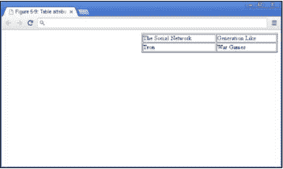

**图 5-9：** 一个带有已弃用的 align、width 和 border 属性的表格。

```html
<table align="right" width=50% border=1>
    <tr>
        <td>The Social Network</td>
        <td>Generation Like</td>
    </tr>
    <tr>
        <td>Tron</td>
        <td>War Games</td>
    </tr>
</table>
```


始终将属性插入开始 `<table>` 标签内，并将单词括在引号中。

`tr` 元素有两个需要了解的已弃用属性——align 和 valign。它们在表 5-2 中描述。

**表 5-2 — 由 CSS 替换的表格行属性**

| 属性名 | 可能的值 | 描述 |
|---|---|---|
| align | left | 根据属性值确定行单元格内容的水平对齐方式。例如，`align="right"` 将行单元格内容定位在每个单元格的右侧。 |
| align | right |  |
| align | center |  |
| align | justify |  |
| valign | top | 根据属性值确定行单元格内容的垂直对齐方式。例如，`valign="bottom"` 将行单元格内容定位在每个单元格的底部。 |
| valign | middle |  |
| valign | bottom |  |

`td` 元素有四个需要了解的已弃用属性——align、valign、width 和 height。它们在表 5-3 中描述。

**表 5-3 — 由 CSS 替换的表格单元格属性**

| 属性名 | 可能的值 | 描述 |
|---|---|---|
| align | left | 根据属性值确定单元格内容的水平对齐方式。例如，`align="center"` 将单元格内容定位在单元格中央。 |
| align | right |  |
| align | center |  |
| align | justify |  |
| valign | top | 根据属性值确定单元格内容的垂直对齐方式。例如，`valign="middle"` 将单元格内容定位在单元格中部。 |
| valign | middle |  |
| valign | bottom |  |
| width | pixels (#) | 单元格宽度，以屏幕像素或表格宽度的百分比衡量。 |
| width | % |  |
| height | pixels (#) | 单元格高度，以屏幕像素或表格高度的百分比衡量。 |
| height | % |  |


以下示例代码展示了如何使用 align、valign、width 和 height 属性创建图 5-10 中的表格。

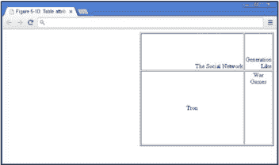

**图 5-10：** 一个使用已弃用的 align、valign、width 和 height 属性的表格。

```
<table align="right" width=50% border=1>
    <tr align="right" valign="bottom">
        <td height=100>The Social Network</td>
        <td>Generation Like</td>
    </tr>
    <tr>
        <td height=200 align="center" valign="middle">Tron</td>
        <td align="center" valign="top" width=20%>Games</td>
    </tr>
</table>
```

> ⚠️ 请记住，这些属性不再受支持，不应在代码中使用。

### 填写表单

表单允许你捕获网站访问者的输入。到目前为止，我们一直按原样显示内容，但捕获访问者的输入可以让你：

- **修改页面上的现有内容。** 例如，航空公司网站上的价格和日期筛选器可以让你更快地找到想要的航班。
- **存储输入以供后续使用。** 例如，网站可能使用注册表单收集你的电子邮件、用户名和密码信息，以便你日后访问。

### 理解表单如何工作

表单通过以下过程将用户输入的信息传递给服务器：

1. 浏览器在客户端计算机上显示表单。
2. 用户填写表单并按下提交按钮。
3. 浏览器将表单中收集的数据提交到服务器。
4. 服务器处理并存储数据，并向客户端计算机发送响应。
5. 浏览器显示响应，通常指示提交是否成功。

有关客户端与服务器之间关系的更多讨论，请参见第 2 章。


关于服务器如何接收和存储数据的完整说明（步骤 3 到 5）超出了本书的范围。目前，你只需要知道，Python、PHP 和 Ruby 等服务器端编程语言用于编写接收和存储表单提交内容的脚本。

表单非常灵活，可以记录各种用户输入。表单中使用的输入字段可以包括自由文本字段、单选按钮、复选框、下拉菜单、范围滑块、日期、电话号码等。（参见表 5-4。）此外，输入字段可以设置为初始默认值，而无需任何用户输入。

**表 5-4 选定的表单属性**

| 属性名 | 可能的值 | 描述 |
|---|---|---|
| type | checkbox<br>email<br>submit<br>text<br>password<br>radio<br>（为简洁起见，此处省略了完整值列表） | 定义表单中要显示的输入字段类型。例如，text 用于自由文本字段，submit 用于创建提交按钮。 |
| value | text | 输入控件的初始值。 |

在 www.w3schools.com/tags/att_input_type.asp 查看表单输入类型的完整列表和示例代码。


### 创建基本表单

你可以通过以下方式创建基本表单：

1. **使用 form 元素定义表单。**

    首先添加一个开始 `<form>` 标签和一个结束 `</form>` 标签。

2. **使用 action 属性，在 form 元素中指定将表单数据发送到哪里。**

    在开始 `<form>` 标签中添加 action 属性，并将其设置为将处理并存储用户输入的脚本的 URL。

3. **使用 method 属性，在 form 元素中指定如何发送表单数据。**

    在开始 `<form>` 标签中添加 method 属性，并将其设置为 POST。

    method 属性设置为 GET 或 POST。两者的技术细节超出了本书的范围，但一般来说，POST 用于存储敏感信息（例如信用卡号），而 GET 用于允许用户收藏或与他人分享已提交表单的结果（例如，航空公司航班列表）。

4. **使用 input 元素为用户提供输入和提交响应的方式。**

    在开始 `<form>` 和结束 `</form>` 标签之间，创建一个 `<input>` 标签。

    你的表单将只有一个开始和结束 `<form>` 标签；但是，你将至少有两个 `<input>` 标签来收集和提交用户数据。

5. **使用 input 元素中的 type 属性指定输入类型。**

    对于此示例，将 type 属性设置为 `"text"`。

    `<input>` 标签没有结束标签，这是“关闭你打开的每个标签”规则的一个例外。这些标签称为自闭合标签，你可以在第 4 章看到更多示例。

6. **最后，创建另一个 `<input>` 标签，并将 type 属性设置为 submit。**


以下示例代码展示了创建图 5-11 所示表单的语法。

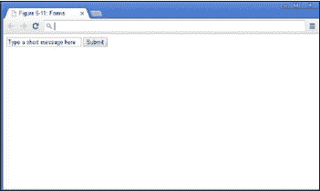

**图 5-11：** 一个包含一个用户输入和一个提交按钮的表单。

```html
<form action="mailto:nikhil.abraham@gmail.com" method="POST">
    <input type="text" value="Type a short message here">
    <input type="submit">
</form>
```


此表单中的 action 属性设置为 mailto，这会通知浏览器使用你的默认邮件客户端（例如 Outlook 或 Gmail）发送电子邮件。如果你的浏览器未配置为处理电子邮件链接，那么此表单将无法工作。通常，表单会提交到服务器以处理和存储表单内容，但在此示例表单中，内容会提交到用户的电子邮件应用程序。

### 更多 HTML 练习

使用 Codecademy 网站在线练习 HTML。Codecademy 是一个创建于 2011 年的免费网站，旨在让任何人在浏览器中直接学习编程，而无需安装或下载任何软件。按照以下步骤练习你在本章学到的所有标签（以及一些其他标签）：

1. **打开浏览器，访问** www.dummies.com/go/coding **，然后单击 Codecademy 的链接。**
2. **登录你的 Codecademy 账户。**

    第 3 章讨论了注册。创建账户可以让你在工作时保存进度，但这是可选的。

3. **导航到并单击 HTML Basics II 以练习创建列表，单击 HTML Basics III 以练习创建表格。**
4. 背景信息显示在网站的左上部分，说明显示在网站的左下部分。
5. 在主编码窗口中完成说明。当你输入时，会生成代码的实时预览。
6. 完成说明后，单击 Save and Submit Code 按钮。

如果你正确遵循了说明，会出现一个绿色对勾，然后你继续下一个练习。如果你的代码中存在错误，会出现警告并给出建议的修复方法。如果你遇到无法解决的问题或错误，请单击提示、使用问答论坛，或在 Twitter 上发推给我 @nikhilabraham，并包含话题标签 #codingPD。

# 第二部分：构建静态与交互式网页

## 第 6 章 使用 CSS 打造样式

### 本章内容

- 理解 CSS 及其结构
- 格式化文本、颜色和样式
- 为图像设置样式
- 在三种不同上下文中使用 CSS

> 创造你自己的风格……让它对你而言独一无二，同时对他人而言具有辨识度。
>
> ——安娜·温图尔

我在前几章向你展示的网站代码示例，看起来可能像你在过去某个时代见过的网站。你今天浏览的网站有所不同，外观和感觉更加精致。促成这一变化有许多因素。二十年前，你可能使用拨号调制解调器浏览互联网，但今天你很可能使用非常快的互联网连接和更强大的计算机。程序员利用这些额外的带宽和速度编写代码，进一步自定义和美化网站。

在本章中，你将学习使用层叠样式表（CSS）为网站设置样式的现代技术。首先，我讨论基本的 CSS 结构，然后讨论用于为内容设置样式的 CSS 规则。最后，我将向你展示如何将这些规则应用到你的网站。

### CSS 有什么作用？

CSS 为 HTML 元素设置样式时，比仅使用 HTML 拥有更强的控制力。请看图 6-1。左侧显示的是 Facebook 当前的样子；然而右侧显示的是同一个 Facebook 页面在去掉所有 CSS 样式后的样子。没有 CSS，所有图像和文本都会左对齐，边框和阴影消失，文本的格式也极少。


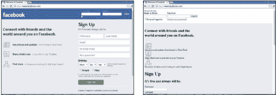

CSS 几乎可以为页面上任何创建可见元素的 HTML 标签设置样式，包括我在前几章向你展示的用于创建标题、段落、链接、图像、列表和表格的所有 HTML 标签。具体来说，CSS 允许你设置以下样式：

-   文本大小、颜色、样式、字体和对齐方式
-   链接颜色和样式
-   图像大小和对齐方式
-   列表项目符号样式和缩进
-   表格大小、底纹、边框和对齐方式


CSS 为网页上出现的 HTML 元素设置样式和位置。然而，有些 HTML 元素（例如 <head>）在页面上不可见，也不会使用 CSS 设置样式。

你可能会想，为什么创建像 CSS 这样的单独语言来处理样式，会被认为比扩展 HTML 的能力更好的方法。原因有三个：

-   **历史：** CSS 是在 HTML 诞生四年后创建的，当时是为了试验开发者和用户是否想要额外的样式效果。当时，CSS 是否有用还不清楚，而且只有一些主流浏览器支持它。因此，CSS 与 HTML 分开创建，以便开发者可以仅使用 HTML 构建网站。
-   **代码管理：** 最初，一些 CSS 功能与现有的 HTML 功能重叠。然而，在 HTML 中指定样式效果会导致代码杂乱、混乱。例如，在 HTML 中指定特定字体要求你在每个段落（`<p>`）标签中都包含字体属性。以这种方式为单个段落设置样式很容易，但将 `<p>` 标签应用于一系列段落（或整个页面或网站）很快就会变得繁琐。相比之下，CSS 只需要指定一次字体，就会自动应用于所有段落。这一特性使开发者更容易编写和维护代码。此外，将内容样式与实际内容本身分离，使搜索引擎和其他自动化网站代理能够更轻松地处理网页上的内容。
-   **惯性：** 目前，数百万个网页分别使用 HTML 和 CSS，而且这个数字每天都在增长。CSS 出于上述原因最初是一种单独的语言，并且由于它的受欢迎程度持续增长，它仍然是一种单独的语言。

### CSS 结构

CSS 遵循一套规则，以确保无论使用什么浏览器或计算机，网站都以相同的方式显示。有时，由于对 CSS 标准的支持程度不同，浏览器可能会并且确实会以不同方式显示网页。不过，一般来说，CSS 确保用户在所有浏览器中获得一致的体验。

你可以使用任何浏览器查看你编写的 CSS 为 HTML 文件设置样式，不过我强烈建议你下载、安装并使用 Chrome 或 Firefox。


### 选择要设置样式的元素

CSS 不断演进并支持更多功能，但定义 CSS 规则的基本语法保持不变。CSS 通过应用于每个元素的规则来修改 HTML 元素。这些规则编写如下：

```
selector {
  property: value;
}
```

一条 CSS 规则由三部分组成：

-   **选择器：** 你想要设置样式的 HTML 元素。
-   **属性：** 你想要设置样式的 HTML 元素特征，例如字体、图像高度或颜色。
-   **值：** CSS 规则为该属性设置的选项。例如，如果属性是 color，值可以是 red。

选择器标识你想要设置样式的 HTML 元素。在 HTML 中，元素由尖括号包围，但在 CSS 中，选择器单独存在。选择器后跟一个空格、一个左花括号（{）、带值的属性，然后是一个右花括号（}）。CSS 并不要求在左花括号之后和右花括号之前换行——事实上，你可以将所有代码放在一行中，不使用换行或空格。使用换行是开发者遵循的惯例，以便更容易修改和阅读 CSS。


在大多数键盘上，你可以在 P 键右侧找到花括号。

以下代码向你展示了一个 CSS 修改特定 HTML 元素的示例。首先出现的是 CSS 代码，然后是它所修改的 HTML 代码：

CSS：

```css
h1 {
    font-family: cursive;
}
```

然后是 HTML：

```html
<h1>
    Largest IPOs in US History
</h1>
<ul>
    <li>2014: Alibaba - $20B</li>
    <li>2008: Visa - $18B</li>
</ul>
```

CSS 选择器会定位并设置同名 HTML 元素的样式（在本例中为 `<h1>` 标签）。例如，在图 6-2 中，使用开始和结束 `<h1>` 标签呈现的标题“美国历史上规模最大的 IPO”通过 h1 选择器以及值为 cursive 的 `font-family` 属性设置了样式。

CSS 使用冒号而不是等号（=）来为属性设置值。


图 6-2 中的字体可能看起来并不像上面代码中定义的 cursive，因为 cursive 是通用字体族的名称，而不是具体字体。本章稍后将介绍通用字体族。

### 我的属性有值

CSS 语法要求 CSS 属性及其值出现在开始和结束花括号内。每个属性后跟一个冒号，每个值后跟一个分号。属性与值的这种组合称为*声明*，一组属性与值称为*声明块*。

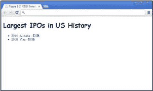

**图 6-2：** 为 h1 标题元素设置样式的 CSS。

让我们看一个包含多个属性与值的具体示例：

```
h1 {
    font-size: 15px;
    color: blue;
}
```

在此示例中，CSS 为 h1 元素设置样式，将 `font-size` 属性改为 15px，将 `color` 属性改为 blue。


将每个声明（每个属性/值组合）放在单独一行，可以提高代码的可读性。此外，在声明前添加空格或制表符进行缩进也能提高可读性。添加这些换行和缩进不会以任何方式影响浏览器性能，但会让你和其他人更容易阅读代码。

### 修改你最喜欢的网站上的 CSS

在第 2 章中，你修改了一个新闻网站的 HTML 代码。在本章中，你将修改它的 CSS。让我们看看一些实际应用中的 CSS 规则。在本例中，你使用 Chrome 浏览器修改 huffingtonpost.com（或你选择的新闻网站）上的 CSS。请按以下步骤操作：

1. 使用 Chrome 浏览器，导航到你最喜欢的新闻网站，最好是有很多标题的网站。（参见图 6-3。）

2. 将鼠标指针放在一个标题上，右键单击，然后从出现的菜单中选择**检查元素**。

    浏览器底部会打开一个窗口。

3. 单击此窗口右侧的**样式**选项卡，查看应用于 HTML 元素的 CSS 规则。（参见图 6-4。）

    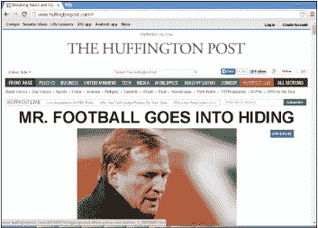

    **图 6-3：** 修改前的《赫芬顿邮报》网站。

4. 使用 CSS 更改标题的颜色。为此，首先在 `element.style` 部分找到 `color` 属性；注意该属性中显示当前颜色示例的方形颜色框。单击此框，从弹出菜单中选择新颜色以更改值，然后按 Enter。

    你的标题现在会以你选择的颜色显示。（参见图 6-5。）

    如果 `element.style` 部分为空且没有出现 color 属性，你仍然可以手动添加它。为此，在 `element.style` 部分单击一次，当闪烁的光标出现时，输入 `color: purple`。标题将变为紫色。


与 HTML 一样，你可以使用 Chrome 的检查元素功能（也称为开发者工具）修改网站的 CSS。大多数现代浏览器（包括 Firefox、Safari 和 Opera）都有类似功能。


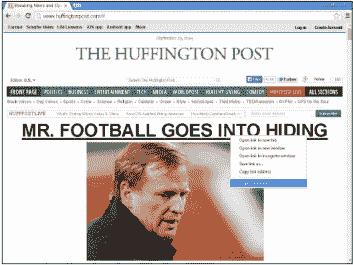

图 6-4：为《赫芬顿邮报》网站设置样式的 CSS 规则。

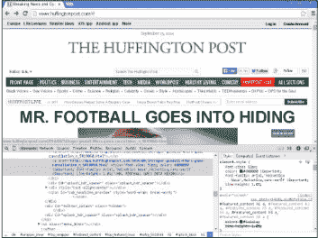

图 6-5：更改 CSS 会改变标题的颜色。

### 常见 CSS 任务和选择器

尽管 CSS 包含 150 多个属性，每个属性又有许多值，但在现代网站上，少数 CSS 属性和值完成了大部分工作。在上一节中，当你“修改”一个在线网站的 CSS 时，你更改了标题颜色——这是 CSS 中的常见任务。使用 CSS 执行的其他常见任务包括：

- 更改字体大小、样式、字体族和装饰
- 自定义链接，包括颜色、背景颜色和链接状态
- 添加背景图像并格式化前景图像

### 字体体操：大小、颜色、样式、字体族和装饰

CSS 让你可以控制许多 HTML 元素中的文本。表 6-1 显示了最常见的与文本相关的 CSS 属性和值。我将在后续各节中更全面地描述这些属性和值。

**表 6-1. 用于设置文本样式的常见 CSS 属性及值**

| 属性名 | 可能的值 | 描述 |
|---|---|---|
| `font-size` | `pixels (#px)`<br>`%`<br>`em (#em)` | 指定文本大小，可以用像素、包含元素字体大小的百分比，或用 em 值来度量；em 值通过所需像素值除以包含元素的字体大小（以像素为单位）计算得出。示例：`font-size: 16px;` |
| `color` | `name`<br>`hex code`<br>`rgb value` | 使用名称（`color: blue;`）、十六进制代码（`color: #0000FF;`）或 RGB（红、绿、蓝）值（`color: rgb(0,0,255);`）更改文本颜色。 |
| `font-style` | `normal`<br>`italic` | 将字体设置为斜体（或不设置）。 |
| `font-weight` | `normal`<br>`bold` | 将字体设置为粗体（或不设置）。 |
| `font-family` | `font name` | 设置字体字样。示例：`font-family: "serif";` |
| `text-decoration` | `none`<br>`underline`<br>`line-through` | 设置字体是否带下划线或删除线。 |

```css
:root {
  --c-brand: #3081d0;
  --c-brand-light: #509acd;
  --c-border: #eee;
  --c-bg: #ffffff;
  --c-bg-dark: #1e1e1e;
  --c-scrollbar: #ddd;
  --c-text: #2c3e50;
  --c-text-light: #476582;
  --c-text-lighter: #8e9bab;
  --c-code-bg: #f7f7f7;
  --c-code-text: #2c3e50;
}

.dark {
  --c-brand: #3081d0;
  --c-brand-light: #509acd;
  --c-border: #444;
  --c-bg: #1e1e1e;
  --c-bg-dark: #1e1e1e;
  --c-scrollbar: #444;
  --c-text: #cfd3dc;
  --c-text-light: #9a9a9a;
  --c-text-lighter: #8e9bab;
  --c-code-bg: #282c34;
  --c-code-text: #cfd3dc;
}
```

- **十六进制代码：** 颜色可以由红、绿、蓝分量来定义，使用十六进制代码时可引用超过 1600 万种颜色。在代码示例中，我将 `h1` 的颜色设置为 `#FF0000`。在井号之后，前两位（`FF`）表示颜色中的红色，接下来两位（`00`）表示绿色，最后两位（`00`）表示蓝色。
- **RGB 值：** 与十六进制代码一样，RGB 值指定超过 1600 万种颜色的红、绿、蓝分量。RGB 值是与十六进制值等价的十进制表示。


不必担心要记住十六进制代码或 RGB 值。你可以使用在线颜色选择器轻松识别颜色，例如 www.w3schools.com/tags/ref_colorpicker.asp 上的选择器。

以下示例显示了全部三种颜色更改方式：

```css
p {
  color: red
}
h1 {
  color: #FF0000
}
li {
  color: rgb(255,0,0)
}
```

`li` 是有序列表或无序列表中列表项的元素名称。


上面代码示例中的三种颜色都引用同一种红色色调。有关可按名称引用的颜色完整列表，请参见：www.w3.org/TR/css3-color/#svg-color。


### 设置 font-style 和 font-weight

`font-style` 属性可将文本设置为斜体，`font-weight` 属性可将文本设置为粗体。对于这些属性中的每一个，默认值都是 normal，无需指定。在下面的示例中，段落被设置为字体呈斜体且粗体。以下是每个属性的示例：

```css
p {
  font-style: italic;
  font-weight: bold;
}
```

### 设置 font-family

`font-family` 属性设置用于文本的字体字样。该属性可设置为一个字体，或设置为以逗号分隔的字体列表。你的网站访问者的计算机上会安装各种不同的字体，但 `font-family` 属性仅当指定字体已安装在他们的系统上时才显示该字体。

`font-family` 属性可设置为两类值：

- **字体名称：** 特定字体名称，如 Times New Roman、Arial 和 Courier。
- **通用字体族：** 现代浏览器通常为每个通用字体族定义一种已安装字体。这五个通用字体族包括：
  - `serif` (Times New Roman, Palatino)
  - `sans-serif` (Helvetica, Verdana)
  - `monospace` (Courier, Andale Mono)
  - `cursive` (Comic Sans, Florence)
  - `fantasy` (Impact, Oldtown)

使用 `font-family` 时，最好定义两到三种特定字体，后跟一个通用字体族作为回退，以防指定的字体未安装，如下例所示：

```css
p {
    font-family: "Times New Roman", Helvetica, serif;
}
```

在此示例中，段落的字体族定义为 Times New Roman。如果用户的计算机上未安装 Times New Roman，浏览器会使用 Helvetica。如果未安装 Helvetica，浏览器将使用通用 serif 字体族中任何可用的字体。


当使用包含多个单词的字体名称（如 Times New Roman）时，请将字体名称括在引号中。

### 设置 text-decoration

`text-decoration` 属性设置字体的任何下划线或删除线。默认情况下，该属性等于 none，无需指定。在以下示例中，任何带有 h1 标题的文本都会加下划线，而段落标签内的任何文本都会添加删除线：

```css
h1 {
    text-decoration: underline;
}
p {
    text-decoration: line-through;
}
```

### 自定义链接

通常，浏览器将链接显示为蓝色带下划线文本。最初，这种默认行为最大程度地减少了页面内容与交互式链接之间的混淆。如今，几乎所有网站都以自己的方式设置链接样式。有些网站不给链接加下划线；另一些网站保留下划线，但使用蓝色以外的颜色设置链接样式，等等。


HTML 锚元素（a）用于创建链接。开始和结束锚标签之间的文本是链接描述，而 `href` 属性中设置的 URL 是单击链接时浏览器访问的地址。

锚标签随时间演变，如今有四种状态：

- **链接：** 用户尚未单击或访问过的链接。
- **已访问：** 用户已单击或访问过的链接。
- **悬停：** 用户将鼠标光标悬停在其上但未单击的链接。
- **活动：** 用户已开始单击但尚未释放鼠标按钮的链接。

CSS 可以为这四种状态分别设置样式，最常使用表 6-2 中显示的属性和值。

**表 6-2. 用于设置链接样式的常见 CSS 属性及值**

| 属性名 | 可能的值 | 描述 |
|---|---|---|
| `color` | `name`<br>`hex code`<br>`rgb value` | 使用名称（`color: blue;`）、十六进制代码（`color: #0000FF;`）或 RGB 值（`color: rgb(0,0,255);`）指定链接颜色。 |
| `text-decoration` | `none`<br>`underline` | 设置链接是否带下划线。 |

以下示例以类似于维基百科文章中链接样式的方式设置链接：默认情况下链接显示为蓝色，鼠标悬停时加下划线，活动时显示为橙色。如图 6-6 所示，第一个指向美国首席技术官的链接显示为下划线，就像我的鼠标正悬停在其上一样。此外，指向 Google 的链接显示为橙色，就像它处于活动状态且我的鼠标正在单击它一样。


```css
a:link {
    color: rgb(6,69,173);
    text-decoration: none;
}
a:visited {
    color: rgb(11,0,128);
}
a:hover {
    text-decoration: underline;
}
a:active {
    color: rgb(250,167,0);
}
```


记住在 a 选择器和链接状态之间要包含冒号。


尽管解释原因超出了本书的范围，但 CSS 规范坚持要求你按照这里显示的顺序定义各种链接状态——link、visited、hover，然后是 active。不过，只要保留此顺序，不定义某个链接状态也是可以接受的。

各种链接状态称为*伪类选择器*。伪类选择器向 CSS 选择器添加关键字，并允许你为所选元素的特殊状态设置样式。

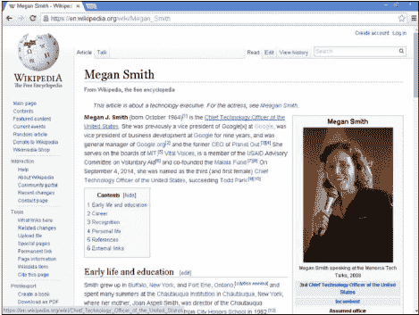

**图 6-6：** Wikipedia.org 页面显示 link、visited、hover 和 active 状态。

### 添加背景图像并设置前景图像样式

你可以使用 CSS 在 HTML 元素后面添加背景图像。最常见的是，background-image 属性用于向 div、table 和 p 等单个 HTML 元素添加背景图像，或者（当应用于 body 元素时）向整个网页添加背景图像。


文件大小较小的背景图像比更大的图像加载得更快。如果你的访问者经常使用移动手机浏览你的网站，而移动手机通常数据连接较慢，这一点尤其重要。

表 6-3 中的属性和值显示了添加背景图像的选项。

| 属性名 | 可能的值 | 描述 |
|---|---|---|
| `background-image` | `url("URL")` | 从 URL 指定的图像链接添加背景图像。 |
| `background-size` | `auto`<br>`contain`<br>`cover`<br>`width`<br>`height`<br>`(#px, %)` | 根据值设置背景尺寸：<br><br>`auto`（默认值）按图像原始尺寸显示图像。<br><br>`contain` 缩放图像的宽度和高度，使其适合元素内部。<br><br>`cover` 缩放图像，使整个背景图像无法全部显示。<br><br>还可以通过指定像素或百分比形式的宽度和高度来设置背景尺寸。 |
| `background-position` | `keywords`<br><br>`position`<br>(#px, %) | 使用关键字或精确位置在元素中定位背景。`Keywords` 由水平关键字（`left`、`right`、`center`）和垂直关键字（`top`、`center` 和 `bottom`）组成。还可以使用像素或百分比精确地定义背景的位置，以描述相对于元素的水平和垂直位置。 |
| `background-repeat` | `repeat`<br>`repeat-x`<br>`repeat-y`<br>`no-repeat` | 设置背景图像平铺（或重复）的方式如下：<br>水平方向（repeat-x）<br>垂直方向（repeat-y）<br>水平和垂直方向（repeat）<br>完全不重复（no-repeat）。 |
| `background-attachment` | `scroll`<br>`fixed` | 设置背景随其他内容滚动（scroll），或保持固定（fixed）。 |

### 设置背景图像

如下例所示，background-image 属性可以为整个网页或特定元素设置背景图像。

```css
body {
    background-image:
        url("http://upload.wikimedia.org/wikipedia/commons/e/e5/Chrysler_Building_Midtown_Manhattan_New_York_City_1932.jpg");
}
```


你可以在 images.google.com、www.flickr.com 或 publicdomainarchive.com 等网站上找到背景图像。


检查图像版权信息，确认你是否有权使用该图像，并遵守图像的许可条款，其中可能包括署名或标明作者。此外，直接链接到其他服务器上的图像称为热链接。最好下载图像，并在自己的服务器上托管和链接该图像。


如果你希望使用单色背景而不是图像，请使用 background-color 属性。此属性的定义方式与 background-image 属性大致相同。只需将其设置为颜色名称、RGB 值或十六进制代码，如我在本章前面“设置颜色”一节中所述。

### 设置背景尺寸

通过使用像素或百分比指定精确尺寸，background-size 属性可以根据需要将背景图像缩放到更小或更大。此外，此属性有三个网页中常用的尺寸值，如下所示（见图 6-7）：

- **auto:** 此值保持图像的原始尺寸。
- **cover:** 此值缩放图像，使所有尺寸大于或等于容器或 HTML 元素的尺寸。
- **contain:** 此值缩放图像，使所有尺寸小于或等于容器或 HTML 元素的尺寸。

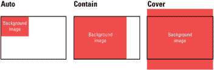

**图 6-7：** 将背景尺寸设置为三个不同的值。

### 设置背景位置

background-position 设置背景图像的初始位置。默认初始位置位于网页或特定元素的左上角。你可以通过指定一对关键字或位置值来更改默认位置，如下所示：

- **Keywords:** 第一个关键字*（left、center 或 right）*表示水平位置，第二个关键字*（top、center 或 bottom）*表示垂直位置。
- **Position:** 第一个位置值表示水平位置，第二个值表示垂直位置。每个值使用像素或百分比定义，表示距浏览器或指定元素左上角的距离。例如，`background-position: center center` 等于 `background-position: 50% 50%`。（见图 6-8。）

### 设置背景重复

background-repeat 属性设置背景平铺的方向，如下所示：

- **repeat:** 此值（默认值）在水平和垂直方向重复背景图像。
- **repeat-x:** 此值仅在水平方向重复背景图像。
- **repeat-y:** 此值仅在垂直方向重复背景图像。
- **no-repeat:** 此值完全阻止背景重复。

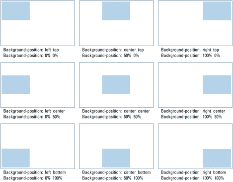

**图 6-8：** 使用关键字或位置指定的初始背景图像位置。

### 设置背景附着

background-attachment 属性设置当用户滚动页面内容时背景图像是否移动。该属性可以设置为：

- **scroll:** 用户滚动时背景图像移动。
- **fixed:** 用户滚动时背景图像不移动。

以下代码段使用前面讨论的几个属性来添加背景图像，该图像拉伸覆盖整个网页、居中对齐、不重复，并且用户滚动时不移动。（见图 6-9。）

```css
body {
    background-image: url("http://upload.wikimedia.org/wikipedia/commons/thumb/a/a0/USMC-090807-M-8097K-022.jpg/640px-USMC-090807-M-8097K-022.jpg");
    background-size: cover;
    background-position: center center;
    background-repeat: no-repeat;
    background-attachment: fixed;
}
```

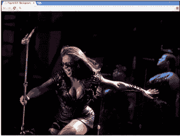

**图 6-9：** 设置为整个页面背景的图像。

### 美化网页

本章讨论的 CSS 规则让你初步了解一些常见的样式属性和值。尽管你不太可能记住每一个属性和值，但通过练习，属性和值的名称会自然地浮现在你脑海中。理解基本语法后，下一步就是实际将 CSS 纳入你的网页，并尝试为 HTML 元素设置样式。

### 将 CSS 添加到 HTML 中

有三种方法可将 CSS 应用于网站，以为 HTML 元素设置样式：

- **内联 CSS:** CSS 可以在 HTML 文件中、在与它所设置样式的 HTML 元素相同的行上指定。此方法需要将 `style` 属性放在开始 HTML 标签内。通常，内联 CSS 是网站样式设置中最不受欢迎的方式，因为样式规则经常重复。以下是内联 CSS 的示例：

```html
<!DOCTYPE html>
<html>
<head>
    <title>Record IPOs</title>
</head>
<body>
```


在没有内联 CSS 或嵌入式 CSS 的情况下，将使用单独样式表中的样式。在此示例中，当三种样式同时存在时，h1 元素的文本将显示为红色，因为内联 CSS 的优先级最高，会覆盖嵌入式 CSS 的蓝色样式以及单独 CSS 的绿色样式。

以下示例使用单独的 CSS 样式表将标题设置为红色，与前两个示例相同：

**CSS：style.css**

```css
h1 {
    color: red;
}
```

**HTML：index.html**

```html
<!DOCTYPE html>
<html>
<head>
    <title>Record IPOs</title>
    <link href="style.css" type="text/css" rel="stylesheet">
</head>
<body>
    <h1>Alibaba IPO expected to be biggest IPO of all time</h1>
</body>
</html>
```

### 构建你的第一个网页

使用 Codecademy 网站在线练习 HTML。Codecademy 是一个创建于 2011 年的免费网站，让任何人都能在浏览器中直接学习编程，无需安装或下载任何软件。你可以按照以下步骤练习本章讨论的所有标签（以及一些其他标签）：

- **1. 打开浏览器，访问** www.dummies.com/go/codingfd，**并点击 Codecademy 链接。**
- **2. 登录你的 Codecademy 账户。**
  注册相关内容在第 3 章讨论。创建账户可以让你在工作时保存进度，但这是可选的。
- **3. 导航到并点击 Get Started with HTML。**
- **4. 背景信息显示在网站左上部分，说明显示在网站左下部分。**
- **5. 在主编码窗口中完成说明。** 当你输入时，代码的实时预览会生成。
- **6. 完成说明后，** 点击“保存并提交代码”按钮。

如果你正确遵循了说明，会出现一个绿色对勾，然后你继续下一个练习。如果代码中存在错误，会出现警告并附带建议的修复方法。如果你遇到问题，或有无法修复的 bug，请点击提示、使用 Q&A 论坛，或在 Twitter 上发推给我 @nikhilgabra，并包含话题标签 #codingFD。

## 7 CSS 进阶

### 本章内容

- 设置列表和表格的格式
- 使用父选择器和子选择器为网页设置样式
- 使用 `id` 和 `class` 为代码片段命名
- 使用盒模型在页面上定位 HTML 元素

> *设计不只是外观和感觉。设计关乎它如何运作。*
>
> —史蒂夫·乔布斯

在本章中，你将继续基于上一章学到的 CSS 进行构建。到目前为止，你看到的 CSS 规则都应用于整个网页，但现在它们会变得更具体。你将学习如何为更多 HTML 元素设置样式，包括列表、表格和表单，以及如何选择和设置网页特定部分的样式，例如故事中的第一段或表格的最后一行。最后，你将了解专业 Web 开发者如何使用 CSS 和盒模型，将页面上元素的位置控制精确到像素。理解盒模型对于构建第 10 章中的应用并非必需。

在深入学习之前，请记住整体概念：HTML 将内容放到网页上，而 CSS 进一步设置这些内容的样式和位置。不要试图记住每条规则，而应利用本章理解 CSS 基础知识。CSS 选择器具有可修改 HTML 元素的属性和值。学习的最好方式莫过于动手实践，所以不妨直接跳到本章末尾的 Codecademy 练习课程。然后，当你对尝试设置样式的特定元素有疑问时，可将本章作为参考。

### 为页面上的（更多）元素设置样式

在本节中，你将了解为列表和表格设置样式的常见方法。在上一章中，你学到的 CSS 属性和值（如 color 和 font-family）可应用于任何包含文本的 HTML 元素。相比之下，这里展示的一些 CSS 仅用于为列表、表格和表单设置样式。

### 为列表设置样式

在第 5 章中，你学习了如何创建有序列表（以字母或数字等标记开头）和无序列表（以项目符号等标记开头）。默认情况下，有序列表中的列表项使用数字（例如 1、2、3），而无序列表中的列表项使用实心黑圆（●）。

这些默认值可能并不适合所有情况。事实上，为列表设置样式时最常见的两项任务包括：

- **更改用于创建列表的标记：** 对于像这个列表一样的无序列表，你可以使用实心圆、空心圆或方形项目符号。对于有序列表，你可以使用数字、罗马数字（大写或小写）或字母（大写或小写）。
- **指定用作项目符号的图像：** 你可以为有序列表和无序列表创建自己的标记，而不使用默认选项。例如，如果你为一家汉堡餐厅创建了一个无序项目符号列表，那么与其使用实心圆作为项目符号，你可以使用彩色的汉堡图标图像。

你可以通过将表 7-1 中的属性与 `ol` 或 `ul` 选择器一起使用来修改列表类型，从而完成上述任一任务。

使用属性和规则的 CSS 选择器会修改同名的 HTML 元素。例如，图 7-1 中的 HTML `<ul>` 标签在 CSS 中通过 `ul` 选择器引用，并使用表 7-1 中的属性和规则设置样式。


**表 7-1 用于设置列表样式的常见 CSS 属性和值**

| 属性名 | 可能的值 | 描述 |
|---|---|---|
| `list-style-type`（无序列表） | `disc`<br>`circle`<br>`square`<br>`none` | 将无序列表中用于创建列表项的标记设置为实心圆（●）、空心圆（○）、方形（■）或无。 |
| `list-style-type`（有序列表） | `decimal`<br>`upper-roman`<br>`lower-roman`<br>`upper-alpha`<br>`lower-alpha` | 将有序列表中用于创建列表项的标记设置为十进制数字（1、2、3）、大写罗马数字（I、II、III）、小写罗马数字（i、ii、iii）、大写字母（A、B、C）或小写字母（a、b、c）。 |
| `list-style-image` | `url("URL")` | 当 URL 被替换为图像链接时，将该图像设置为用于创建列表项的标记。 |


许多文本网站的导航栏是使用标记设置为 none 的无序项目符号列表创建的。你可以在 Codecademy 的 CSS 定位课程中从练习 21 开始看到一个示例。

CSS 属性和值应用于 CSS 选择器并修改 HTML 元素。在以下示例中，嵌入式 CSS（位于开始和结束 `<style>` 标签之间）和内联 CSS（在 HTML 中通过 `style` 属性定义）用于：

- 使用 `list-style-type` 将无序列表中的标记更改为方形
- 再次使用 `list-style-type` 将有序列表中的标记更改为大写罗马数字
- 使用 `list-style-image` 将自定义标记设置为图标

其代码如下所示，并在图 7-1 中展示。图 7-2 显示了此代码在浏览器中的渲染效果。

```html
<html>
<head>
<title>Figure 7-1: Lists</title>
<style>
ul {
    list-style-type: square;
}

ol {
    list-style-type: upper-roman;
}

li {
    font-size: 27px;
}
</style>
</head>
<body>

<h1>Declaring startups</h1>
<ul>
    <li>Hailo: book a taxi on your phone</li>
    <li>Lyft: request a peer to peer ride</li>
    <li style="list-style-image: url('car.png');">Uber: hire a driver</li>
</ul>

<h1>Food startups</h1>
<ul>
    <li>Grubhub: order takeout food online</li>
    <li style="list-style-image: url('burger.png');">Blue Apron: subscribe to weekly meal delivery</li>
    <li>Instacart: request groceries delivered the same day</li>
</ul>
</body>
</html>
```

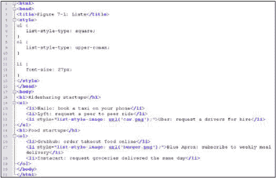

图 7-1：嵌入式 CSS 和内联 CSS。


如果用于标记的自定义图像比文本大，你的文本可能无法与标记垂直对齐。要解决此问题，你可以像示例中所示那样使用 `font-size` 增大每个列表项的字体大小，使用 `margin` 增大每个列表项之间的外边距，或者将 `list-style-type` 设置为 none，并使用 `background-image` 在 `ul` 元素上设置背景图像。


有三种应用CSS的方式——使用`style`属性的内联CSS、使用开始和结束`<style>`标签的嵌入式CSS，以及使用单独的CSS样式表。


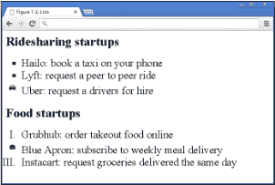

**图7-2：** 修改了标记类型的有序列表和无序列表。

### 设计表格

在第5章中，你了解了如何创建基本表格。默认情况下，这些表格的宽度会扩展以适应表格内的内容，单个单元格中的内容左对齐，并且不显示边框。

这些默认设置可能并不适用于所有情况。已废弃（不受支持）的HTML属性可以修改这些默认设置，但浏览器随时可能停止识别这些属性，而使用这些属性创建的任何表格都会显示错误。作为一种更安全的选择，CSS可以以更强的控制力来设置表格样式。CSS可以为表格执行的三种常见任务如下：

- 使用`width`属性设置表格、表格行或单个表格单元格的宽度。
- 使用`text-align`属性在表格内对齐文本。
- 使用`border`属性显示表格边框。（见表7-2。）

### 表7-2 表格样式的常用CSS属性和值

| 属性名 | 可能值 | 说明 |
|---|---|---|
| width | 像素（#px）、% | 表格的宽度，以屏幕像素或占浏览器窗口/容器标签的百分比来衡量。 |
| text-align | left, right, center, justify | 根据属性值，文本相对于表格的位置。例如，`text-align: center` 将文本置于表格单元格的中央。 |
| border | width, style, color | 在一个属性中定义三个属性——`border-width`、`border-style` 和 `border-color`。值必须按以下顺序指定：宽度（像素）、样式（none、dotted、dashed、solid）和颜色（名称、十六进制代码、RGB值）。例如，`border: 1px solid red`。 |

在下面的示例中，表格比任何单元格中的文本都宽，每个单元格中的文本居中，并且表格边框应用于标题单元格：

```html
<html>
<head>
<title>Figure 7-2: Tables</title>
<style>
    table {
        width: 700px;
    }

    table, td {
        text-align: center;
        border: 1px solid black;
        border-collapse: collapse;
    }
</style>
</head>
<body>
<table>
<caption>Desktop browser market share (August 2014)</caption>
<tr>
    <th>Sources</th>
    <th>Chrome</th>
    <th>IE</th>
    <th>Firefox</th>
    <th>Safari</th>
    <th>Other</th>
</tr>
<tr>
  <td>StatCounter</td>
  <td>50%</td>
  <td>22%</td>
  <td>19%</td>
  <td>5%</td>
  <td>4%</td>
</tr>
<tr>
  <td>W3Counter</td>
  <td>38%</td>
  <td>21%</td>
  <td>16%</td>
  <td>16%</td>
  <td>9%</td>
</tr>
</table>
</body>
</html>
```


HTML标签`<caption>`和CSS属性`border-collapse`进一步为下面的表格设置样式。`<caption>`标签为表格添加标题。虽然你可以使用`<h1>`标签创建类似效果，但`<caption>`会将标题与表格关联起来。CSS的`border-collapse`属性可以取值separate或collapse。separate值会分别渲染每条边框（参见图7-5），而collapse值则尽可能绘制单一边框（见图7-3）。


**图7-3：** 使用CSS修改了宽度、文本对齐和边框的表格。

### 选择要设置样式的元素

目前，你见过的CSS会为每个匹配CSS选择器的HTML元素设置样式。例如，在图7-3中，`table`和`td`选择器都有一个`text-align`属性，它让每个表格单元格中的文本居中。根据内容的不同，你可能只想让标题行中的文本居中，而让后续行中的文本左对齐。实现这一目标的两种方式包括：

- 根据元素相对于其他元素的位置来设置特定HTML元素的样式。
- 为HTML元素命名，并且只按名称设置元素样式。

### 设置特定元素的样式

在设置特定元素的样式时，将HTML代码想象成一棵带有父元素、子元素和兄弟元素的家族树会很有帮助。在下面的代码示例（也显示在图7-4中）中，树从html元素开始，它有两个子元素：head和body。head有一个名为title的子元素。body有h1、ul和p子元素。最后，ul元素有li子元素，p元素有a子元素。图7-5显示了以下代码在浏览器中的外观，图7-6使用树的隐喻描绘了以下代码。请注意，图7-6只展示每种关系一次。例如，在下面的代码中，三个li元素内部各有一个a元素，而图7-6只展示了一次ul li a关系。

```html
<html>
  <head>
    <title>Figure 7-3: DOM</title>
  </head>
  <body>

  <h1>Parody Tech Twitter Accounts</h1>
  <ul>
    <li>
      <a href="http://twitter.com/BoredElonMusk">Bored Elon Musk</a>
    </li>
    <li>
      <a href="http://twitter.com/VinodColeslaw">Vinod Coleslaw</a>
    </li>
    <li>
      <a href="http://twitter.com/Horse_ebooks">Horse ebooks</a>
    </li>
  </ul>

  <h1>Parody Non-Tech Twitter Accounts</h1>
  <p><a href="http://twitter.com/SeinfeldToday">Modern Seinfeld</a></p>
  <p><a href="http://twitter.com/Lord_Voldemort">Lord Voldemort</a></p>

  </body>
</html>
```


Bored Elon Musk是对Elon Musk的恶搞，后者是PayPal、Tesla和SpaceX的创始人。Vinod Coleslaw是对Vinod Khosla的恶搞，他是Sun Microsystems的联合创始人和风险投资家。Horse ebooks是一个成为互联网现象的垃圾邮件机器人。

```html
<html>
<!-- Figure 7-3: DOM/Tree -->
<body>
<h1>Parody Tech Twitter Accounts</h1>
<ul>
<li><a href="http://twitter.com/BoredElonMusk">Bored Elon Musk</a></li>
<li><a href="http://twitter.com/VinodColeslaw">Vinod Coleslaw</a></li>
<li><a href="http://twitter.com/AnnieStrack">Annie Strack</a></li>
</ul>
<h2>Parody Non-Tech Twitter Accounts</h2>
<ul>
<li><a href="http://twitter.com/HodenEmails">Hoden Emails</a></li>
<li><a href="http://twitter.com/Lord_Voldemort7">Lord Voldemort7</a></li>
</ul>
</body>
</html>
```

**图7-4：** 设置元素家族树的样式。


**图7-5：** 科技类和非科技类恶搞Twitter账号（浏览器视图）。


**图7-6：** 科技类和非科技类恶搞Twitter账号（HTML树或文档对象模型视图）。

HTML树被称为*DOM*或*文档对象模型*。

### 子选择器

非科技类恶搞Twitter账号的锚标签是段落标签的直接子元素。如果你只想为非科技类恶搞Twitter账号设置样式，可以使用*子选择器*，它会选择指定元素的直接子元素。创建子选择器时，先列出父选择器，然后是一个大于号（>），最后是子选择器。

在下面的示例中，选择了作为段落标签直接子元素的锚标签，并为这些超链接设置了红色字体且不带下划线。科技类恶搞Twitter账号不会被设置样式，因为它们是列表项标签的直接子元素。（见图7-7。）

```css
p > a {
  color: red;
  text-decoration: none;
}
```


**图7-7：** 使用子选择器为非科技类恶搞Twitter账号设置样式。

如果这里只使用*a*选择器，页面上的所有链接都会被设置样式，而不仅仅是选定的部分。

### 后代选择器

科技类恶搞Twitter账号的锚标签是无序列表的后代，或者说位于无序列表内。如果你只想为科技类恶搞Twitter账号设置样式，可以使用*后代选择器*，它不仅会选择指定元素的直接子元素，还会选择嵌套在该元素内的所有元素。


指定元素。后代选择器是通过先列出父选择器、一个空格，最后列出要定位的后代选择器来创建的。

在下面的示例中，如图 7-8 所示，选中了无序列表的后代锚标签，这些超链接被设置为蓝色字体颜色并带有删除线。恶搞非科技类 Twitter 账号没有被应用样式，因为它们不是无序列表的后代。

```css
ul a {
    color: blue;
    text-decoration: line-through;
}
```


图 7-8：用于为恶搞科技类 Twitter 账号设置样式的后代选择器。

**提示：** 想只给列表中的第一个锚标签（例如 Modern Seinfeld Twitter 账号）或第二个列表项（例如 Vinod Coleslaw Twitter 账号）设置样式吗？请访问 w3schools.com，进一步了解 first-child（www.w3schools.com/cssref/sel_firstchild.asp）和 nth-child 选择器（www.w3schools.com/cssref/sel_nth-child.asp）。

### 命名 HTML 元素

在 CSS 中为特定元素设置样式的另一种方法是命名 HTML 元素。你可以使用 id 或 class 属性为代码命名，然后通过引用 id 或 class 选择器来为代码设置样式。

### 使用 id 属性命名代码

使用 id 属性为网页上的某一个特定元素设置样式。id 属性可以命名任何 HTML 元素，并且始终放在 HTML 开始标签中。此外，每个元素只能有一个 id 属性值，而且该属性值在 HTML 文件中只能出现一次。在 HTML 文件中定义该属性后，你在 CSS 中通过写一个井号（#）后跟属性值来引用该 HTML 元素。使用 id 属性，下面的代码将 Modern Seinfeld Twitter 链接设置为红色字体并带有黄色背景：

HTML：

```html
<p><a href="http://twitter.com/SeinfeldToday" id="jerry">Modern Seinfeld</a></p>
```

CSS：

```css
#jerry {
    color: red;
    background-color: yellow;
}
```

### 使用 class 属性命名代码

使用 class 属性为网页上的多个元素设置样式。class 属性可以命名任何 HTML 元素，并且始终放在 HTML 开始标签中。该属性值不必在 HTML 文件中唯一。在 HTML 文件中定义该属性后，你通过写一个句点（.）后跟属性值来引用该 HTML 元素。使用 class 属性，下面的代码将所有恶搞科技类 Twitter 账号链接设置为红色字体并去掉下划线：

HTML：

```html
<ul>
    <li>
    <a href="http://twitter.com/BoredElonMusk" class="tech">Bored Elon Musk</a>
    </li>
    <li>
    <a href="http://twitter.com/VinodColeslaw" class="tech">Vinod Coleslaw</a>
    </li>
    <li>
    <a href="http://twitter.com/Horse_ebooks" class="tech">Horse ebooks</a>
    </li>
</ul>
```

CSS：

```css
.tech {
    color: red;
    text-decoration: none;
}
```


主动使用搜索引擎（例如 Google）搜索更多 CSS 效果。例如，如果你想增加每个列表项之间的间距，打开浏览器并搜索 *列表项间距 css*。搜索结果前十名中出现的链接应包括：

- `www.w3schools.com`：一个初学者教程网站。
- `www.stackoverflow.com`：面向有经验的开发者的讨论板。
- `www.mozilla.org`：最初由维护 Firefox 浏览器的基金会创建的参考指南，现在由开发者社区维护。

这些网站中的每一个都是很好的起点，你应该寻找包含示例代码的答案。

### 对齐和布局元素

CSS 不仅允许控制 HTML 元素的格式，还允许控制这些元素在页面上的位置，这称为页面布局。历史上，开发者使用 HTML 表格来创建页面布局。HTML 表格页面布局创建起来很繁琐，并且要求开发者编写大量代码以确保跨浏览器的一致性。CSS 消除了使用表格创建布局的需要，有助于减少代码臃肿，并增强了对页面布局的控制。

### 在页面上组织数据

在深入任何代码之前，让我们回顾图 7-9 中一些可用于构建页面及其内容的基本方式。布局随着时间的推移而演变，有些布局在台式计算机上效果很好，但在平板电脑或移动设备上显示效果不佳。


始终问自己，你想要的布局在台式机、平板电脑和移动设备上会如何显示。

存在数百种不同的布局，这里展示了一些选定的页面布局以及每种布局的示例。


左侧和右侧导航工具栏通常不会出现在移动设备上。顶部导航工具栏在台式机和移动设备上都会使用，而底部导航工具栏在移动设备上最常见。


图 7-9：垂直和水平导航布局。

图 7-10 中的示例展示了使用这些布局的真实网站：


图 7-10：在 w3schools.com（左）和 hunterwalk.com（右）上使用左侧和右侧导航工具栏。

当导航主题之间存在层级或关系时，垂直导航有助于读者理解。在 w3schools.com 示例中，HTML、JavaScript、Server Side 和 XML 彼此相关，并且每个主题标题下方都有相关的子主题。

水平导航或菜单导航（如图 7-11 所示）有助于读者在导航主题之间关系较弱或互不相关时进行导航。在 eBay 示例中，Motors、Fashion 和 Electronics 菜单项包含不同的产品，并吸引不同的受众。


**图 7-11：** 在 ebay.com（左）和 moma.org（右）上使用顶部和底部导航工具栏。


不要花太多时间担心该选择哪种布局。你总是可以先选择一种，观察访问者是否能快速轻松地浏览你的网站，并在必要时更改布局。

### 塑造 div

上面的页面布局是分组在一起的元素集合。这些元素使用由开始和结束 `<div>` 标签创建的矩形容器分组在一起，上面的所有布局都可以用这些 `<div>` 标签创建。`<div>` 标签本身不会在屏幕上渲染任何内容，而是作为任何类型内容（如 HTML 标题、列表、表格或图像）的容器。要查看 `<div>` 标签的实际效果，请看图 7-12 中的 Codecademy.com 主页。

注意该网页如何分为三个部分——导航页眉、中间的视频推荐语，然后是额外的文字用户推荐语。`<div>` 标签用于勾勒这些主要的内容区域，而每个部分内额外的嵌套 `<div>` 标签用于对图像和文本等内容进行分组。


**图 7-12：** Codecademy.com 主页，其中 `<div>` 标签的边框可见。

在下面的示例中，如图 7-13 所示，HTML 代码使用 `<div>` 标签创建两个容器，id 属性为每个 div 命名，CSS 设置 div 的尺寸和颜色：

HTML：

```html
<div id="first"></div>
<div id="second"></div>
```

CSS：

```css
div {
    height: 100px;
    width: 100px;
    border: 2px solid purple;
}

#first {
    background-color: red;
}

#second {
    background-color: blue;
}
```


图 7-13：使用 HTML `<div>` 标签创建并用 CSS 设置样式的两个盒子。

### 理解盒模型

正如我们上面用 `<div>` 标签创建盒子一样，CSS 会在页面上的每一个元素（甚至文本）周围创建一个盒子。图 7-14 显示了一个图像的盒模型，该图像上写着“这是一个元素。”。这些盒子可能并不总是可见，但由四个部分组成：

- **内容：** 在浏览器中渲染的 HTML 标签
- **内边距：** 内容和边框之间的可选间距
- **边框：** 标记内边距的边缘，其宽度和可见性会变化
- **外边距：** 围绕边框的透明可选间距


**图 7-14：** *img* 元素的盒模型。


使用 Chrome 浏览器，导航到你最喜欢的新闻网站，然后右键单击一张图片，并在上下文菜单中选择“检查元素”。屏幕右侧会看到三个标签页；单击“计算”标签页。此时会显示你右键单击的图片的盒模型，先显示内容尺寸，然后显示内边距、边框和外边距的尺寸。

内边距、边框和外边距是 CSS 属性，其值通常以像素表示。在下面的代码（如图 7-15 所示）中，添加了内边距和外边距，以分隔每个 div。

```css
div {
    height: 100px;
    width: 100px;
    border: 1px solid black;
    padding: 10px;
    margin: 10px;
}
```

### 定位盒子

既然你已了解如何使用 HTML 对元素进行分组，以及 CSS 如何看待元素，最后一步就是将这些元素定位到页面上。页面布局可以使用多种技术，全面概述每种技术超出了本书范围。不过，创建图 7-16 所示布局的一种技术是使用 float 和 clear 属性（如表 7-3 所述）。


**图 7-15：** 添加内边距和外边距以分隔每个 div。

| 属性名称 | 可能值 | 描述 |
|---|---|---|
| `float` | `left`<br>`right`<br>`none` | 将元素发送到其所在容器的左侧或右侧。`none` 值指定元素不应浮动。 |
| `clear` | `left`<br>`right`<br>`both`<br>`none` | 指定元素的哪一侧不应有其他浮动元素。 |

如果指定了元素的宽度，float 属性允许通常出现在不同行上的元素并排显示，例如导航工具栏和主内容窗口。clear 属性用于阻止任何其他元素在当前元素的一侧或两侧浮动，并且该属性通常设置为 both，以便将网页页脚放在其他元素下方。

以下示例代码使用 `<div>` 标签、float 和 clear 创建一个简单的左侧导航布局。（见图 7-16）通常，在使用 `<div>` 标签对内容分组后，你会使用 class 或 id 属性为每个 `<div>` 标签命名，然后在 CSS 中为该 div 设置样式。下面有很多代码，因此我们将其拆解为几个部分：

- CSS 嵌入在 `<style>` 开始标签和结束标签之间，HTML 位于 `<body>` 开始标签和结束标签之间。
- 在 `<body>` 开始标签和结束标签之间，使用 `<div>` 标签将页面分为四个部分：页眉、导航栏、内容和页脚。
- 导航菜单使用无序列表创建，左对齐，且没有标记。
- CSS 为每个 `<div>` 标签设置尺寸、颜色和对齐方式。
- CSS 属性 float 和 clear 用于将左侧导航布局放在左侧，并将页脚放在其他元素下方。

```html
<!DOCTYPE html>
<html>
<head>
<title>Figure 7-14: Layout</title>
<style>
  #header{
    background-color: #FF8C8C;
    border: 1px solid black;
    padding: 5px;
    margin: 5px;
    text-align: center;
  }

  #navbar {
    background-color: #00B0FF;
    height: 200px;
    width: 100px;
    float: left;
    border: 1px solid black;
    padding: 5px;
    margin: 5px;
    text-align: left;
  }

  #content {
    background-color: #EEEEEE;
    height: 200px;
    width: 412px;
    float: left;
    border: 1px solid black;
    padding: 5px;
    margin: 5px;
    text-align: center;
  }

  #footer{
    background-color: #FFBD47;
    clear: both;
    text-align: center;
    border: 1px solid black;
    padding: 5px;
    margin: 5px;
  }

  ul {
    list-style-type: none;
    line-height: 25px;
    padding: 0px;
  }
</style>
</head>
<body>
<div id="header"><h1>Nik's Tapas Restaurant</h1></div>

<div id="navbar">
<ul>
    <li>About us</li>
    <li>Reservations</li>
    <li>Menus</li>
    <li>Gallery</li>
    <li>Events</li>
    <li>Catering</li>
    <li>Press</li>
</ul>
</div>

<div id="content"></div>

<div id="footer">Copyright &copy; Nik's Tapas</div>
</body>
</html>
```


**图 7-16：** 使用 `<div>` 标签创建的左侧导航网页布局。

### 编写更高级的 CSS

使用 Codecademy 网站在线练习 CSS。Codecademy 是一个创建于 2011 年的免费网站，让任何人都能直接在浏览器中学习编程，无需安装或下载任何软件。按照以下步骤练习本章学到的所有标签（以及一些其他标签）：

- 1. **打开浏览器，访问** `www.dummies.com/go/codingfd`，**然后单击 Codecademy 链接。**
- 2. **登录你的 Codecademy 账户。**
  注册在第 3 章中讨论。创建账户可让你在工作时保存进度，但这是可选的。
- 3. **导航至并单击 CSS: An Overview、CSS Selectors 和 CSS Positioning，以练习 CSS 样式和定位。**
- 4. **背景信息显示在网站的左上部分，操作说明显示在网站的左下部分。**
- 5. **在主编码窗口中完成说明。输入时，会生成代码的实时预览。**
- 6. **完成说明后，单击“保存并提交代码”按钮。**

如果你正确遵循了说明，会出现绿色对勾，然后你可以继续下一个练习。如果你的代码中存在错误，会出现警告并给出建议的修复方法。如果你遇到问题，或遇到无法修复的 bug，请单击提示、使用问答论坛，或在 Twitter 上发推给我 @nikhilgabraham，并附上话题标签 #codingFD。

## 8 使用 Twitter Bootstrap 更高效地工作

**本章内容**

- 了解 Twitter Bootstrap 的作用
- 查看使用 Twitter Bootstrap 创建的布局
- 使用 Twitter Bootstrap 创建网页元素

> *在我看来，速度提供了唯一真正现代的乐趣。*
>
> ——奥尔德斯·赫胥黎

Twitter Bootstrap 是一个免费工具包，允许用户快速且高度一致地创建网页。2011 年，两位 Twitter 开发者 Mark Otto 和 Jacob Thornton 创建了该工具包供 Twitter 内部使用，并在不久后向公众发布。在 Bootstrap 之前，开发者会一次又一次地创建常见的网页功能，而且每次略有不同，导致维护时间增加。Bootstrap 已成为创建网站时最受欢迎的工具之一，NASA 和《新闻周刊》都用它来构建自己的网站。只要对 HTML 和 CSS 有基本了解，你就可以在自己的项目中使用和自定义 Bootstrap 布局与元素。

在本章中，你将了解 Bootstrap 的作用以及如何使用它。你还将了解使用 Bootstrap 时可以快速轻松创建的各种布局和元素。

### 弄清 Bootstrap 的作用

想象你是*《华盛顿邮报》*的在线布局开发者，负责将印刷报纸的头版（见图 8-1）编码为数字网站版本。该报纸的主标题、图片说明和署名行始终使用相同的字号和字体。同样，可供选择的布局数量是固定的，通常主标题位于页面顶部，并配有一张照片。


**图 8-1：** *《华盛顿邮报》*头版（2013 年 6 月 7 日）。

每天你都可以从零开始编写 CSS 代码，定义字体、字号、段落布局等。然而，鉴于报纸遵循大体固定的格式，更简单的做法是提前在 CSS 文件中用类名定义这些样式，并在需要时按名称引用所需样式。从核心上说，这就是 Bootstrap 的工作方式。

Bootstrap 是一组标准化的预编写 HTML、CSS 和 JavaScript 代码，你可以使用类名引用它们（复习请参见第 7 章），然后进一步自定义。Bootstrap 让你能够创建并为你提供：

- **布局：** 以网格模式定义网页内容和元素。
- **组件：** 使用已经在数亿用户身上测试过的现有按钮、菜单和图标。


**响应式：** 一个花哨的词，用来表示你的网站除了在台式电脑上运行外，还能在手机和平板电脑上运行。通常，你需要编写额外的代码，使网站在这些不同屏幕尺寸上正确显示，但 Bootstrap 代码已经为你优化了这一点，如图 8-2 所示。

**跨浏览器兼容性：** Chrome、Firefox、Safari、Internet Explorer 和其他浏览器在渲染某些 HTML 元素和 CSS 属性时各不相同。Bootstrap 代码经过优化，因此无论使用哪种浏览器，你的网页都会显示一致。


*图 8-2：* 使用 Bootstrap 针对桌面、平板和手机优化的《愤怒的小鸟：星球大战》页面。

### 安装 Bootstrap

按照以下两个步骤安装 Bootstrap 并将其添加到 HTML 文件中：

- 1. **在开始和结束的 `<head>` 标签之间加入以下代码行：**

    ```html
    <link rel="stylesheet" href="http://maxcdn.bootstrapcdn.com/bootstrap/3.2.0/css/bootstrap.min.css">
    ```

`<link>` 标签引用托管在互联网上的 Bootstrap CSS 文件 3.2.0 版，因此此方法需要联网才能生效。

- 2. **在结束的 HTML `</body>` 标签之前立即加入以下两行代码。**

    ```html
    <!-- jQuery (needed for Bootstrap's JavaScript plugins) -->
    <script src="http://ajax.googleapis.com/ajax/libs/jquery/1.11.1/jquery.min.js"></script>
    <!-- Bootstrap JavaScript plugin file -->
    <script src="http://maxcdn.bootstrapcdn.com/bootstrap/3.2.0/js/bootstrap.min.js"></script>
    ```


第一个 `<script>` 标签引用一个名为 jQuery 的 JavaScript 库。JavaScript 将在第 9 章介绍。虽然本书不介绍 jQuery，但从高层次来说，jQuery 简化了使用 JavaScript 执行的任务。第二个 `<script>` 标签引用 Bootstrap JavaScript 插件，包括下拉菜单等动画效果。如果你的网站不使用任何动画效果或 Bootstrap JavaScript 插件，则不需要包含此文件。

Bootstrap 可免费用于个人和商业用途，但需要包含 Bootstrap 许可证和版权声明。

如果你无法可靠地访问互联网，也可以下载并在本地托管 Bootstrap CSS 和 JavaScript 文件。为此，在解压 Bootstrap 文件后，使用 `<link>` 和 `<script>` 标签链接到本地版本的文件。访问 www.getbootstrap.com/getting-started/ 下载文件，并获取其他说明和示例。

### 了解布局选项

Bootstrap 允许你使用网格系统快速轻松地在页面上布局内容。使用此网格系统时有三个选项：

- **自己编写代码：** 学习网格组织方式后，可以编写代码创建任何想要的布局。
- **使用 Bootstrap 编辑器编写代码：** 无需在文本编辑器中编写代码，而是拖放组件和元素来生成 Bootstrap 代码。然后可以下载并使用此代码。
- **使用预构建主题编写代码：** 下载免费的 Bootstrap 主题，或购买已创建好网站的主题，然后填入自己的内容。

### 在网格系统中排列

Bootstrap 将屏幕划分为由 12 个等宽列组成的网格系统。这些列遵循几条规则：

- **各列宽度之和必须为 12 列。** 可以使用一个宽 12 列的列、12 个各宽 1 列的列，或介于两者之间的任何组合。
- **列可以包含内容或空白。** 例如，可以有一个宽 4 列的列、一个 4 列的空白，以及另一个宽 4 列的列。
- **除非另有指定，否则在较小的浏览器尺寸或手机等屏幕上，这些列会自动堆叠成单列；在较大的浏览器尺寸或笔记本电脑和台式机屏幕等屏幕上，则会水平展开。** 见图 8-3。


**图 8-3：** 示例 Bootstrap 布局。

现在你已经了解这些布局在屏幕上的显示方式，让我们看看用于生成这些布局的示例代码。要创建任何布局，请遵循以下步骤：

- 1. 创建一个带有 `class="container"` 属性的 `<div>` 标签。
- 2. 在第一个 `<div>` 标签内，创建另一个带有 `class="row"` 属性的嵌套 `<div>` 标签。
- 3. 对于要创建的每一行，创建另一个带有 `class="col-md-X"` 属性的 `<div>` 标签。将 X 设置为希望该行跨越的列数。

例如，要让一行跨越 4 列，请写 `<div class="col-md-4">`。md 针对桌面设备的列宽，本节后面会展示如何针对其他设备。


必须在页面开头包含 `<div class="container">`，并有一个结束的 `</div>` 标签，否则页面将无法正确渲染。

以下代码（如图 8-4 所示）创建一个简单的三列居中布局：

```html
<div class="container">
  <!-- Example row of columns -->
  <div class="row">
    <div class="col-md-4">
      <h2>Heading</h2>
      <p>Lorem ipsum dolor sit amet, consectetur adipisicing elit, sed do eiusmod
        tempor incididunt ut labore et dolore magna aliqua. Ut enim ad
        minim veniam, quis nostrud exercitation ullamco laboris nisi ut
        aliquip ex ea commodo consequat
      </p>
    </div>
    <div class="col-md-4">
      <h2>Heading</h2>
      <p>Lorem ipsum dolor sit amet, consectetur adipisicing elit, sed do eiusmod tempor incididunt ut labore et dolore magna aliqua. Ut enim ad minim veniam, quis nostrud exercitation ullamco laboris nisi ut aliquip ex ea commodo consequat.
      </p>
    </div>
    <div class="col-md-4">
      <h2>Heading</h2>
      <p>Lorem ipsum dolor sit amet, consectetur adipisicing elit, sed do eiusmod tempor incididunt ut labore et dolore magna aliqua. Ut enim ad minim veniam, quis nostrud exercitation ullamco laboris nisi ut aliquip ex ea commodo consequat.
      </p>
    </div>
  </div>
</div>
```


**图 8-4：** 包含桌面版（左）和移动版（右）的 Bootstrap 三列布局。

要查看另一个示例，请访问 Codecademy 网站，并调整浏览器窗口大小。你会注意到，随着浏览器窗口变小，各列会自动堆叠在一起以便阅读。此外，各列会自动居中。如果不使用 Bootstrap，则需要更多代码才能实现相同的效果。


你在上面看到的 Lorem ipsum 文本通常用于创建占位文本。虽然这些词没有实际含义，但这段引文源自公元前一世纪西塞罗的拉丁文文本。创建自己的网站时，可以使用 www.lipsum.org 或 www.socialgoodipsum.com 生成占位文本。

### 拖放到网站

看完上面的代码后，你可能想要一种更简单的方法来生成代码，而不必自己输入。Bootstrap 编辑器允许你拖放组件来创建布局，然后编辑器会生成供你使用的 Bootstrap 代码。

可以使用的 Bootstrap 编辑器包括：

- **LayoutIt.com：** 免费的在线 Bootstrap 编辑器（如图 8-5 所示），允许你拖放组件，然后下载源代码。
- **Jetstrap.com：** 付费的在线拖放式 Bootstrap 编辑器。
- **Pingendo.com：** 可免费下载的拖放式 Bootstrap 编辑器。
- **Bootply.com：** 免费的在线 Bootstrap 编辑器，内置可修改的模板。


这些网站是免费的，可能会在没有通知的情况下停止工作。你可以使用任何搜索引擎搜索 Bootstrap 编辑器来找到更多选项。


**图 8-5：** 带有拖放 Bootstrap 组件的 Layoutit.com 界面。

### 使用预定义模板

有些网站提供可直接使用的 Bootstrap 主题；你只需添加自己的内容。当然，如果愿意，也可以修改主题。其中一些 Bootstrap 主题包括：

- **Blacktie.co：** 免费的 Bootstrap 主题（如图 8-6 所示），全部由一位设计师创建。
- **Bootstrapzero.com：** 免费开源 Bootstrap 模板合集。
- **Bootswatch.com 和 bootsnipp.com：** 包含预构建的 Bootstrap 组件，你可以将它们组合用于自己的网站。
- **Wrapbootstrap.com：** 可购买的 Bootstrap 模板。


Bootstrap 主题可能可以免费获取，但请遵守许可条款。作者可能要求署名、通过电子邮件注册或发布一条推文。


**图 8-6：** 来自 blacktie.co 的单页 Bootstrap 模板。

### 为移动端、平板和桌面端调整布局

在较小的屏幕上，Bootstrap 会自动堆叠你为网站创建的列。不过，除了依赖默认行为之外，你还可以对这些列的显示方式施加更多控制。你可以针对四种设备屏幕尺寸——手机、平板、桌面和大桌面。如表 8-1 所示，Bootstrap 使用不同的类前缀来定位每种设备。

**表 8-1** 用于各种屏幕尺寸的 Bootstrap 代码

| | 手机（<768 px） | 平板（≥768 px） | 桌面（≥992 px） | 大桌面（≥1200 px） |
|---|---|---|---|---|
| 类前缀 | `col-xs-` | `col-sm-` | `col-md-` | `col-lg-` |
| 容器最大宽度 | 无（自动） | 750px | 970px | 1170px |
| 列最大宽度 | 自动 | 约 62 px | 约 81 px | 约 97 px |

根据表 8-1，如果你希望网站在平板、桌面和大桌面上有两个等宽列，可以按如下方式使用 `col-sm-` 类名：

```html
<div class="container">
    <div class="row">
        <div class="col-sm-6">Column 1</div>
        <div class="col-sm-6">Column 2</div>
    </div>
</div>
```

在三类设备上查看代码后，你决定在桌面上更喜欢不等宽而不是等宽的列，使左列宽度为右列的一半。你使用 `col-md-` 类名定位桌面设备，并将其紧接在 `col-sm-` 之后添加到类名中：

```html
<div class="container">
    <div class="row">
        <div class="col-sm-6 col-md-4">Column 1</div>
        <div class="col-sm-6 col-md-8">Column 2</div>
    </div>
</div>
```


有些元素（例如上面的 `<div>` 标签）可以有多个类。这允许你向元素添加多种效果，例如更改列的显示方式。要定义多个类，请使用 class 属性并将其设置为各个类；每个类之间用空格分隔。例如，参考前面的代码：第三个 `<div>` 元素有两个类，`col-sm-6` 和 `col-md-4`。

最后，你决定在大桌面屏幕上希望左列占两列宽。你使用 `col-lg-` 类名定位大桌面屏幕，如图 8-7 所示，并将其添加到现有的 class 属性值中：

```html
<div class="container">
    <div class="row">
        <div class="col-sm-6 col-md-4 col-lg-2">Column 1</div>
        <div class="col-sm-6 col-md-8 col-lg-10">Column 2</div>
    </div>
</div>
```


**图 8-7：** 在平板、桌面和大桌面上显示的两列网站。

### 编写基本网页元素

除了纯粹的布局之外，Bootstrap 还可以创建几乎每个网站都有的网页组件。这里的思路与处理布局时相同——与其每次都重新造轮子来设计自己的按钮或工具栏，不如使用预构建的代码，这些代码已经在多种浏览器和设备上测试过。

以下示例展示如何快速创建常见 Web 组件。

### 设计按钮

按钮是许多网页上的基本元素，但通常难以设置和设计样式。如表 8-2 所示，按钮可以有多种类型和尺寸。

| 属性 | 类前缀 | 描述 |
|---|---|---|
| 按钮类型 | `btn-default` | 带悬停效果的标准按钮类型 |
|  | `btn-primary` | 带悬停效果的蓝色按钮 |
|  | `btn-success` | 带悬停效果的绿色按钮 |
|  | `btn-danger` | 带悬停效果的红色按钮 |
| 按钮尺寸 | `btn-lg` | 大按钮尺寸 |
|  | `btn-default` | 默认按钮尺寸 |
|  | `btn-sm` | 小按钮尺寸 |

要创建按钮，请编写以下 HTML：

- 从 `button` HTML 元素开始。
- 在开始标签 `<button>` 中包含 `type="button"`。
- 包含 class 属性，并使用 `btn` 类属性值，然后根据所需效果添加其他类前缀。要添加其他样式，请继续将类前缀名添加到 HTML class 属性中。

如图 8-8 所示，以下代码同时组合了按钮类型和按钮尺寸：

```html
<p>
  <button type="button" class="btn btn-primary btn-lg">Large primary button</button>
  <button type="button" class="btn btn-default btn-lg">Large default button</button>
</p>
<p>
  <button type="button" class="btn btn-success">Default Success button</button>
  <button type="button" class="btn btn-default">Default default button</button>
</p>
<p>
  <button type="button" class="btn btn-danger btn-sm">Small danger button</button>
  <button type="button" class="btn btn-default btn-sm">Small default button</button>
</p>
```


有关其他按钮类型、按钮尺寸和其他按钮选项，请参见 `http://getbootstrap.com/css/#buttons`。

**图 8-8：** Bootstrap 按钮类型和尺寸。

### 使用工具栏导航

包含多个页面或视图的网页通常有一个或多个工具栏来帮助用户导航。表 8-3 展示了一些工具栏选项。

| 属性 | 类前缀 | 描述 |
|---|---|---|
| 工具栏类型 | `nav-tabs` | 选项卡式导航工具栏 |
|  | `nav-pills` | 药丸式（或实心按钮式）导航工具栏 |
| 工具栏按钮类型 | `dropdown` | 将按钮或选项卡标记为下拉菜单 |
|  | `caret` | 向下箭头下拉菜单图标 |
|  | `dropdown-menu` | 下拉菜单项 |

要创建药丸式或实心按钮式导航工具栏，请编写以下 HTML：

- 使用 `<ul>` 元素开始一个无序列表。
- 在开始标签 `<ul>` 中包含 `class="nav nav-pills"`。
- 使用 `<li>` 标签创建按钮。在一个开始标签 `<li>` 中包含 `class="active"`，以指定主工具栏上的哪个选项卡在鼠标悬停于按钮上时应显示为视觉高亮。

> 要创建下拉菜单，请嵌套一个无序列表。请参见“More”旁边的代码，其中带有前缀为 `"dropdown"`、`"caret"` 和 `"dropdown-menu"` 的类。你可以使用 `<a>` 标签在下拉菜单中链接到其他网页。

以下代码如图 8-9 所示，使用 Bootstrap 创建一个工具栏：

```html
<ul class="nav nav-pills">
    <li class="active"><a href="timeline.html">Timeline</a></li>
    <li><a href="about.html">About</a></li>
    <li><a href="photos.html">Photos</a></li>
    <li><a href="friends.html">Friends</a></li>
    <li class="dropdown">
        <a class="dropdown-toggle" data-toggle="dropdown" href="#">More
        <span class="caret"></span>
        </a>
        <ul class="dropdown-menu">
            <li><a href="places.html">Places</a></li>
            <li><a href="sports.html">Sports</a></li>
            <li><a href="music.html">Music</a></li>
        </ul>
    </li>
</ul>
```


**图 8-9：** 带下拉菜单的 Bootstrap 工具栏。


`dropdown-toggle` 类和 `data-toggle="dropdown"` 属性及值共同作用，将下拉菜单添加到链接等元素。有关其他工具栏选项，请参见 http://getbootstrap.com/components/#nav。

### 添加图标

图标经常与按钮一起使用，以帮助传达某种操作。例如，你的电子邮件程序很可能使用带有垃圾桶图标的按钮来删除邮件。图标无需太多解释就能快速向用户传达建议的操作。


这些图标称为 *字形图标*，`www.glyphicons.com` 提供 Bootstrap 中使用的字形图标。

Bootstrap 支持 200 多个字形图标，你可以使用 `<span>` 标签将它们添加到按钮或工具栏。如图 8-10 所示，下面的示例代码创建了三个按钮，分别带有星形、回形针和垃圾桶字形图标。

```html
<button type="button" class="btn btn-default">Star
    <span class="glyphicon glyphicon-star"></span>
</button>
<button type="button" class="btn btn-default">Attach
    <span class="glyphicon glyphicon-paperclip"></span>
</button>
<button type="button" class="btn btn-default">Trash
    <span class="glyphicon glyphicon-trash"></span>
</button>
```


*图 8-10：* 带图标的 Bootstrap 按钮


有关所有 Bootstrap 字形图标的名称，请参见 `http://getbootstrap.com/components/#glyphicons`。

### 构建 AirBnB 主页

使用 Codecademy 网站在线练习 Bootstrap。Codecademy 是一个创建于 2011 年的免费网站，让任何人都能在浏览器中学习编程，而无需安装或下载任何软件。请按照以下步骤练习你在本章学到的所有标签（以及一些其他标签）：

- 1. **打开浏览器，访问** `www.dummies.com/go/codingfd`，**并点击 Codecademy 的链接。**


- 2. **登录你的 Codecademy 账户。**  
  第 3 章会讨论如何注册。创建账户可以让你在工作时保存进度，但这并非必需。
- 3. **导航并点击“Make a Website”来练习 Bootstrap。**
- 4. **网站会显示背景信息和操作说明。**
- 5. **在主编码窗口中完成这些说明。**
- 6. **完成所有说明后，点击“Got It”或“Save and Submit Code”按钮。**

如果你的操作正确，就会出现一个绿色对勾，并进入下一个练习。如果代码中存在错误，则会出现一个带有修正建议的警告。如果你遇到问题或有无法修复的 bug，可以点击提示、在问答论坛提问，或发推文给我 @nikhilgabraham，并加上标签 #codingFD。

## 9 加入 JavaScript

### 本章内容

- 了解 JavaScript 的基础知识和结构
- 使用变量、条件语句和函数进行编码
- 学习 API 的基础知识和结构
- 查看 API 请求和响应

> 最好的老师是极具互动性的。
>
> ——比尔·盖茨

JavaScript 是互联网上最流行、用途最广的编程语言之一，它为网站增加了交互性。你可能见过 JavaScript 的实际应用却没有意识到这一点，比如点击会改变颜色的按钮、查看带缩略图预览的图片画廊，或者分析根据你的输入显示定制数据的图表。这些网站功能以及其他更多功能都可以使用 JavaScript 创建和定制。

JavaScript 是一种极其强大的编程语言，整本书都可以专门讨论这个话题。在本章中，你将学习 JavaScript 的基础知识，包括如何编写 JavaScript 代码来执行基本任务、使用 API 访问数据，以及使用框架更快地编程。

### JavaScript 能做什么？

JavaScript 可以创建和修改网页元素，并与现有的网页 HTML 和 CSS 配合工作来实现这些效果。当你访问一个使用 JavaScript 的网页时，浏览器会下载 JavaScript 代码并在你的机器上客户端运行。JavaScript 可以执行以下任何任务：

- 通过更改 HTML 属性和 CSS 样式来控制网页的外观和布局。
- 轻松创建网页元素，如图 9-1 中显示的日期选择器和下拉菜单。
- 获取表单中的用户输入，并在提交前检查错误。
- 使用复杂的图表和图形显示和可视化数据。
- 导入并分析来自其他网站的数据。


**图 9-1：** JavaScript 可以创建每个旅游网站上都能看到的日期选择器。


JavaScript 与另一种名为 Java 的编程语言不同。1996 年，当时是 Netscape 工程师的 Brendan Eich 创建了 JavaScript，它最初被称为 LiveScript。作为营销决策的一部分，LiveScript 被更名为 JavaScript，试图借助当时广受欢迎的 Java 的声誉。

JavaScript 创建于近 20 年前，此后这门语言一直在不断演变。在过去十年中，它最重要的创新使得开发者无需用户重新加载页面即可向网页添加内容。这项名为 AJAX（异步 JavaScript）的技术听起来可能没什么了不起，但它促成了诸如 Gmail（如图 9-2 所示）等尖端浏览器体验的产生。

在 AJAX 出现之前，浏览器只有在等待整个网页重新加载之后才能显示网页上的新数据。然而，这会拖慢用户体验，尤其是在查看新闻故事、体育动态和股票信息等实时更新频繁的网页时。JavaScript，尤其是 AJAX，创造了一种方式，让浏览器可以在后台与服务器通信，并用这些新信息更新当前网页。


**图 9-2：** Gmail 使用 AJAX，让用户无需重新加载网页即可阅读新邮件。


这里有一个理解 AJAX 的简单方法：想象你在咖啡店，排了很长的队后终于点了一杯咖啡。在异步 JavaScript 出现之前，你只能在咖啡吧台耐心等待，直到拿到咖啡才能做其他事情。有了异步 JavaScript，你可以在咖啡师叫到你的名字，通知你咖啡已经准备好之前，阅读报纸、找张桌子、给朋友打电话，做许多其他事情。

### 了解 JavaScript 结构

JavaScript 的结构和格式与 HTML 和 CSS 不同。JavaScript 能让你做的不仅仅是定位和设计网页文本样式——使用 JavaScript，你可以存储数字和文本以备后用，根据程序中的条件决定运行哪些代码，甚至可以为代码片段命名，以便日后轻松引用。与 HTML 和 CSS 一样，JavaScript 也有特殊的关键字和语法，使计算机能够识别你试图做什么。然而，与 HTML 和 CSS 不同，JavaScript 不能容忍语法错误。如果你忘记关闭一个 HTML 标签，或在 CSS 中忘记包含一个右花括号，你的代码可能仍然会运行，浏览器会尽力显示你的代码。但在编写 JavaScript 代码时，忘记一个引号或括号就可能导致整个程序无法运行。


HTML 在开始标签和结束标签之间应用效果——`<h1>This is a header</h1>`。CSS 使用相同的 HTML 元素，并在左花括号和右花括号之间包含属性和值——`h1 { color: red; }`。

### 使用分号、引号、括号和花括号

下面的代码说明了 JavaScript 中常用的标点符号——分号、引号、括号和花括号（也叫大括号）：

```javascript
var age=22;
var planet="Earth";
if (age>=18)
{
  console.log("You are an adult");
  console.log("You are over 18");

}
else
{
  console.log("You are not an adult");
  console.log("You are not over 18");
}
```

在 JavaScript 编程中需要知道的一般经验法则包括：

- 分号用于分隔 JavaScript 语句。
- 引号用于括起文本字符或*字符串*（字符序列）。任何左引号都必须有对应的右引号。
- 括号用于通过附加信息（称为*参数*）来修改命令。任何左括号都必须有对应的右括号。
- 花括号将 JavaScript 语句分组为块，以便它们一起执行。任何左花括号都必须有对应的右花括号。


这些语法规则可能看起来有些随意，一开始也可能很难记住。然而，经过一些练习，这些规则就会变得非常自然。

### 编写常见 JavaScript 任务

JavaScript 可用于执行许多任务，从简单的变量赋值到复杂的数据可视化。下面这些任务在 JavaScript 环境中进行了解释，它们是核心的编程概念，在过去二十年里没有改变，在未来二十年也不会改变。它们适用于任何编程语言。最后，我列出了如何执行这些任务的说明，但如果你愿意，也可以跳到本章后面的“编写你的第一个 JavaScript 程序”一节，立即练习这些技能。

### 使用变量存储数据

变量，就像代数中的变量一样，是用于存储数据值以备后用的关键字。尽管变量中存储的数据可能会变化，但变量名保持不变。可以把变量想象成一个健身房的储物柜——你存储在储物柜里的东西会改变，但储物柜的号码始终不变。变量名通常以字母开头，表 9-1 列出了 JavaScript 变量可以存储的一些数据类型。

有关变量名的规则列表，请参阅 www.w3schools.com/js/js_variables.asp 上的“JavaScript Variables”部分。


**表 9-1：变量存储的数据**

| 数据类型 | 描述 | 示例 |
|---|---|---|
| 数字 | 正数或负数，带或不带小数 | 156, -101.96 |
| 字符串 | 可打印字符 | Holly, Novak, Senior |
| 布尔值 | 值可以是 true 或 false。 | true, false |

首次使用变量名时，需要使用关键字 var 来声明变量名。你也可以使用等号为变量赋一个可选的值。在以下代码示例中，我声明了三个变量并为这些变量赋值：

```javascript
var myName="Nik";
var pizzaCost=10;
var totalCost=pizzaCost * 2;
```


**表9-2——常见 JavaScript 运算符**

| 类型 | 运算符 | 描述 | 示例 |
|---|---|---|---|
| 小于 | `<` | 判断一个值是否小于另一个值 | `(x < 55)` |
| 大于 | `>` | 判断一个值是否大于另一个值 | `(x > 55)` |
| 相等 | `===` | 判断两个值是否相等 | `(x === 55)` |
| 小于或等于 | `<=` | 判断一个值是否小于或等于另一个值 | `(x <= 55)` |
| 大于或等于 | `>=` | 判断一个值是否大于或等于另一个值 | `(x >= 55)` |
| 不相等 | `!=` | 判断两个值是否不相等 | `(x != 55)` |

这里是一个简单的 `if` 语句，不包含 `else`：

```javascript
var carSpeed = 70;
if (carSpeed > 55) {
    alert("You are over the speed limit!");
}
```

在这个语句中，我声明一个名为 `carSpeed` 的变量，并将其设为 70。然后，一个带条件的 `if` 语句会比较变量 `carSpeed` 中的值是否大于 55。如果条件为真，则一个警告框（即弹出框）会显示“您已超速！”（参见图9-3。）在此例中，`carSpeed` 的值为 70，大于 55，因此条件为真，并显示警告框。如果第一行代码改为 `var carSpeed = 40;`，那么条件为假，因为 40 小于 55，不会显示任何警告框。


**图9-3：** 警告弹出框。

让我们通过添加 `else` 来扩展 `if` 语句，创建 `if-else`，如下代码所示：

```javascript
var carSpeed = 40;
if (carSpeed > 55) {
    alert("You are over the speed limit!");
}
else {
    alert("You are under the speed limit!");
}
```

除了 `else` 之外，我还在 `else` 后面的花括号内添加了一个 `alert` 语句，并将 `carSpeed` 设为 40。当这个 `if-else` 语句执行时，`carSpeed` 等于 40，小于 55，因此条件为假；并且由于添加了 `else`，会弹出一个警告框，显示“您低于限速！”如果第一行代码改为 `var carSpeed = 70;`，如前所述，那么条件为真，因为 70 大于 55，将显示第一个警告框。

当前的 `if-else` 语句允许我们测试一个条件，并根据条件为真或假显示不同结果。要测试两个或更多条件，可以在原来的 `if` 语句后添加一个或多个 `else if` 语句。其一般语法如下：

```
if (condition1) {
    statement1 to execute if condition1 is true
}
else if (condition2) {
    statement2 to execute if condition2 is true
}
else {
    statement3 to execute if all previous conditions are false
}
```

`if-else` 的写法与前面一样，`else if` 后跟一个空格，然后是一个括在圆括号中的条件，该条件的求值结果为真或假。如果 `condition1` 为真，则执行位于第一组花括号之间的 `statement1`。如果 `condition1` 为假，则对 `condition2` 求值，并判断其结果为真或假。如果 `condition2` 为真，则执行位于第二组花括号之间的 `statement2`。此时，可以添加更多 `else if` 语句来测试更多条件。只有当所有 `if` 和 `else if` 条件都为假，并且包含 `else` 时，才会执行 `statement3`。在一个代码块中只会执行一个语句，之后其余语句会被忽略，并执行下一个代码块。


编写 `if-else` 时，必须有一个且只能有一个 `if` 语句；如果选择使用，则必须有一个且只能有一个 `else` 语句。`else if` 是可选的，可以在单个 `if-else` 语句中使用多次，并且必须位于原来的 `if` 语句之后、`else` 之前。不能在没有前面的 `if` 语句的情况下单独使用 `else if` 或 `else`。

以下是另一个 `else if` 语句的示例：

```javascript
var carSpeed = 40;
if (carSpeed > 55) {
    alert("You are over the speed limit!");
}
else if (carSpeed === 55) {
    alert("You are at the speed limit!");
}
```

当这个 `if` 语句执行时，`carSpeed` 等于 40，小于 55，因此条件为假，然后对 `else if` 条件求值。`carSpeed` 的值并不完全等于 55，所以这个条件也为假，不会显示任何类型的警告框，语句到此结束。如果第一行代码改为 `var carSpeed = 55;`，那么第一个条件为假，因为 55 不大于 55。然后对 `else if` 条件求值，由于 55 正好等于 55，会显示第二个警告框，显示“您正好达到限速！”


仔细看上面的代码——给变量赋值时使用一个等号，而比较两个值是否相等时，则使用三个等号（`===`）。

作为最后一个示例，下面是一个包含 `else if` 语句的 `if-else` 语句：

```javascript
var carSpeed = 40;
if (carSpeed > 55) {
    alert("You are over the speed limit!");
}
else if (carSpeed === 55) {
    alert("You are at the speed limit!");
}
else {
    alert("You are under the speed limit!");
}
```

如图9-4中的图所示，两个条件（在图中显示为菱形）会按顺序求值。在此示例中，`carSpeed` 等于 40，因此两个条件都为假，并执行 `else` 后面的语句，显示一个警告框，内容为“您低于限速！”这里 `carSpeed` 最初设为 40，但根据 `carSpeed` 变量的初始值，可能会显示三个警告框中的任意一个。


**图9-4：** 包含 `else if` 语句的 if-else。


条件总是先求值，并且每个条件必须是*真*或*假*。与条件无关的是当条件为真时执行的语句。

### 使用字符串和数字方法

最基本的数据类型通常存储在变量中，即字符串和数字。程序员经常需要操作字符串和数字来执行如下基本任务：

- 确定字符串的*长度*，例如用于密码。
- 选择字符串的一部分（或*子字符串*），例如在包含名和姓的字符串中选择名字。
- 将数字四舍五入到*固定*的小数点位数，例如在在线购物车中计算小计、计算税费、将税费四舍五入到两位小数，并将税费加到小计中。

这些任务非常常见，因此 JavaScript 包含了称为*方法*的快捷方式（在上文中以斜体显示），使执行这类任务更加容易。执行这些任务的一般语法是，在受影响的变量名或值后面跟一个句点和该方法名，如下所示（分别用于值和变量）：

```
value.method;
variable.method;
```

*表9-3* 展示了用于上述基本任务的 JavaScript 方法示例。示例包括应用于值（如字符串）的方法，以及应用于变量的方法。

**表9-3——常见 JavaScript 方法**

| 方法 | 描述 | 示例 | 结果 |
|---|---|---|---|
| `.toFixed(n)` | 将数字四舍五入到 *n* 位小数 | `var jenny = 8.675309;`<br>`jenny.toFixed(2);` | `8.68` |
| `.length` | 表示字符串中的字符数 | `"Nik".length;` | `3` |
| `.substring(start, end)` | 提取字符串从位置 start 到 end 的一部分。位置指每个字符之间的位置，并从第一个字符之前以零开始。 | `var name = "Inbox";`<br>`name.substring(2,5);` | `box` |


使用字符串，或将变量赋值为字符串时，始终要用引号将字符串括起来。

`.toFixed` 和 `.length` 方法相对简单，但 `.substring` 方法可能有点令人困惑。`.substring(start, end)` 中使用的起始位置和结束位置并不指实际字符，而是指每个字符之间的空隙。图9-5展示了起始位置和结束位置如何工作。语句 `"Inbox".substring(2,5)` 从位置 2 开始，即 "n" 和 "b" 之间，到位置 5 结束，即 "x" 之后。


*图9-5。* `.substring` 方法引用的是字符串中字符之间的位置。


有关更多字符串和数字方法的列表，请参见 W3Schools 网站 www.w3schools.com/js/js_number_methods.asp 和 www.w3schools.com/js/js_string_methods.asp。

### 提醒用户并提示其输入

向用户显示消息并收集输入，是 JavaScript 提供的交互性的开端。尽管如今已有更复杂的技术，但 `alert()` 方法和 `prompt()` 方法是显示带有消息的弹出框并提示用户输入的简单方式。

创建警告或提示的语法是：在括号内用引号写入文本，调用该方法，如下所示：

```
alert("You have mail!");
prompt("What do you want for dinner?");
```

图 9-6 展示了由 `alert()` 方法创建的警告弹出框，以及由 `prompt()` 方法创建的用于用户输入的提示框。


**图 9-6：** JavaScript 警告弹出框和用户提示。

### 用函数为代码命名

函数是一种将 JavaScript 语句分组的方式，并为这组语句命名，以便通过函数名轻松引用。这些语句通常被分在一起，因为它们实现特定的编码目标。你可以通过只写函数名来重复使用这些语句，而不必一遍又一遍地重写语句。函数可以防止重复，并使代码更易于维护。

我小时候，每个星期六早上，母亲都会让我刷牙、叠衣服、用吸尘器打扫房间，还要修剪草坪。最终，母亲厌倦了一遍又一遍地重复同一份清单，于是把家务清单写在纸上，给它起名为“周六家务”，并贴在冰箱上。函数为一组语句命名，就像“周六家务”是我那份家务清单的名字一样。

函数使用 `function` 一词定义一次，后面跟函数名，然后是一组放在花括号内的语句。这称为*函数声明*。函数中的语句只有在通过名称调用函数时才会执行。在下面的示例中，我声明了一个名为 `greeting` 的函数，它使用 `prompt()` 方法询问你的姓名，返回你输入的姓名并将其存储在名为 `name` 的变量中，然后使用 `alert()` 方法显示一条包含 name 变量的消息：

```javascript
function greeting() {
    var name=prompt("What is your name?");
    alert("Welcome to this website " + name);
}

greeting();
greeting();
```

在函数声明下方，我调用了该函数两次，因此会触发两次询问我姓名的提示，这些姓名存储在变量 name 中，并会显示两条消息，欢迎变量 name 中的值访问本网站。


“+”运算符用于将字符串与其他字符串、值或变量连接（合并）起来。

函数可以接收输入，称为*参数*，以帮助函数运行，并可在函数完成时返回一个值。写完家务清单后，每个星期六早上，母亲会说“Nik，做周六家务”，等我哥哥年龄足够大时，她会说“Neel，做周六家务”。如果家务清单是函数声明，“周六家务”是函数名，那么“Nik”和“Neel”就是参数。最后，在我完成后，我会让母亲知道家务已经完成，就像函数返回值一样。

在下面的示例中，我声明了一个名为 `amountdue` 的函数，它接收 `price` 和 `quantity` 作为参数。该函数在被调用时计算小计，加上应付税款，然后返回总计。函数 `amountdue(10,3)` 返回 31.05。

```javascript
function amountdue(price, quantity) {
    var subtotal=price * quantity;

    var tax = 1.05;
    var total = subtotal + tax;
    return total;
}

alert("The amount due is $" + amountdue(10,3));
```


每个左圆括号都有一个右圆括号，每个左花括号都有一个右花括号，每个左双引号都有一个右双引号。你能在上面的示例中找到所有成对的左右符号吗？

### 将 JavaScript 添加到网页

将 JavaScript 添加到网页的两种方式是：

- 使用 script 标签将 JavaScript 代码嵌入 HTML 文件。
- 使用 script 标签从 HTML 文件链接到单独的 JavaScript 文件。

要将 JavaScript 代码嵌入 HTML 文件，请使用一个开始和结束 `<script>` 标签，并在两个标签之间编写 JavaScript 语句，如下例所示：

```html
<!DOCTYPE html>
<html>
  <head>
    <title>Embedded JavaScript</title>
    <script>
      alert("This is embedded JavaScript");
    </script>
  </head>
  <body>
    <h1>Example of embedded JavaScript</h1>
  </body>
</html>
```

`<script>` 标签可以放在开始和结束 `<head>` 标签内，如上所示，也可以放在开始和结束 `<body>` 标签内。选择其中一种方式而不是另一种方式会有一些性能优势，你可以在 http://stackoverflow.com/questions/436411/where-is-the-best-place-to-put-script-tags-in-html-markup 阅读更多内容。

`<script>` 标签也用于链接到单独的 JavaScript 文件，这是推荐的方式。`<script>` 标签包括：

- 一个 `type` 属性，对于 JavaScript，它始终设置为等于 `"text/javascript"`。
- 一个 `src` 属性，它设置为等于 JavaScript 文件的位置。

```html
<!DOCTYPE html>
<html>
  <head>
    <title>Linking to a separate JavaScript file</title>
    <script type="text/javascript" src="script.js"></script>
  </head>
  <body>
    <h1>Linking to a separate JavaScript file</h1>
  </body>
</html>
```


无论代码是嵌入在标签之间，还是使用 `src` 属性链接到单独的文件，`<script>` 标签都有开始和结束标签。

### 编写你的第一个 JavaScript 程序

使用 Codecademy 网站在线练习 JavaScript。Codecademy 是一个创建于 2011 年的免费网站，让任何人都可以直接在浏览器中学习编程，而无需安装或下载任何软件。按照以下步骤练习你在本章学到的所有标签（以及一些其他内容）：

- 1. **打开浏览器，访问** `www.dummies.com/go/codingfd`，**并点击指向 Codecademy 的链接。**
- 2. **登录你的 Codecademy 账户。** 注册相关讨论见第 3 章。创建账户可以让你在工作时保存进度，但这是可选的。
- 3. **导航到并点击“Programming 入门”（Getting Started with Programming）。**
- 4. **背景信息显示在网站的左上部分，说明显示在网站的左下部分。**
- 5. **在主编码窗口中完成说明。**
- 6. **完成说明后，点击 Save and Submit Code 按钮。**

如果你正确遵循了说明，会出现一个绿色对勾，并且你会进入下一个练习。如果你的代码中存在错误，会出现警告并给出建议的修复方法。如果你遇到问题，或者有无法修复的错误，请点击链接、使用 Q&A 论坛，或在 Twitter 上发推给我 @nikhilgabraham，并包含话题标签 #codingFD。

## 10 使用 API

尽管 API（*应用程序编程接口*）已经存在了几十年，但随着我们听到更多关于其使用的讨论和推广，这个术语在过去几年中变得流行起来。*使用 Facebook API！为什么 Craigslist 没有 API？* Stripe 的全部业务就是让开发者使用其支付 API 在线接受付款。

许多人使用 API 这个术语，但很少有人理解它的含义。本节将帮助阐明 API 能做什么以及如何使用它们。

### API 能做什么？

API 允许程序 A 访问另一个独立程序 B 的部分功能。程序 B 通过允许程序 A 以结构化、可预测、有文档记录的方式提出数据请求来授予访问权限，而程序 B 以结构化、可预测、有文档记录的方式响应该数据请求，如下所示（参见图 9-7）：

- **它是结构化的**，因为请求中的字段和响应中的数据遵循易于阅读的标准化格式。例如，Yahoo Weather API 的数据响应包含以下选定的结构化数据字段：

```json
"location": {
    "city": "New York",
    "region": "NY"
},
"units": {
    "temperature": "F"
},
"forecast": [
    {
        "date": "29 Oct 2014",
        "high": "68",
        "low": "48",
        "text": "PM Showers"
    }
]
```

访问 `http://developer.yahoo.com/weather/` 可查看完整的 Yahoo Weather API 响应。

- **它是可预测的**，因为请求中必须包含和可以包含的字段是预先指定的，并且对成功请求的响应将始终包含相同的字段类型。

- **它是有文档记录的**，因为 API 有详细说明。任何更改通常都会通过网站、社交媒体、电子邮件进行传达，而且即使在 API 更改之后，通常也会有一段向后兼容期，在此期间旧的 API 请求仍会收到响应。例如，当 Google Maps 发布其 API 的第 3 版时，第 2 版仍在一段宽限期内继续运行。


**图 9-7：** API 允许两个独立的程序相互通信。


*抓取或网页抓取。* 这些流程的复杂程度不一，从简单到复杂，包括：

- **人们手动将数据从网站复制粘贴到数据库中：** 众包网站，例如最近在纳斯达克证券交易所上市的 `www.retailmenot.com`，通过这种方式获取一些数据。
- **用于查找并复制符合预设模式的数据的代码片段：** 预设模式也称为正则表达式，用于匹配字符和字符串组合，可以使用 JavaScript 或 Python 等 Web 语言编写。
- **自动化软件工具，让你可以指向并点击想要从网站检索的字段：** 例如，`www.kimonolabs.com` 是一种指向并点击式解决方案；当 2014 年国际足联世界杯缺乏结构化 API 时，`kimonolabs.com` 提取了比分等数据，并使其易于访问。

屏幕抓取的优势在于，数据很可能可用且限制较少，因为它是普通用户看到的内容。如果 API 失败，可能不会被注意到，并且视网站而定，修复可能需要时间。相比之下，主网站故障通常是最高优先级事项，并会尽快修复。此外，公司可能会对从 API 检索的数据施加限制，这些限制很少见，并且在屏幕抓取时更难执行。

屏幕抓取的缺点是，为从网站捕获数据而编写的代码必须精确，并且很容易失效。例如，某个股价位于网页第二段第三行的第四个词。屏幕抓取代码被设定为从该位置提取股价，但网站意外更改了布局，因此股价现在位于第五段。突然之间，数据就不准确了。此外，以这种方式提取数据可能存在法律问题，尤其是当网站条款和条件禁止屏幕抓取时。在一个例子中，Craigslist 的条款和条件禁止通过屏幕抓取提取数据，诉讼后，法院禁止了一家公司使用这种技术访问 Craigslist 数据。

### 研究和选择 API

对于任何特定任务，都有许多 API 可以为你提供所需的数据。为你的程序选择 API 时，可考虑以下因素：

- **数据可用性：** 列出你想通过 API 使用的字段愿望清单，并将其与各 API 提供商实际提供的字段进行比较。
- **数据质量：** 基准评估各 API 提供商收集数据的方式以及数据刷新频率。
- **网站可靠性：** 衡量网站正常运行时间，因为无论数据可能多好，网站都需要保持在线以提供 API 数据。在金融和医疗等行业，网站可靠性是主要因素。
- **文档：** 查看 API 文档的可读性和详细程度，以便在开始前轻松理解 API 的功能和限制。
- **支持：** 致电支持部门，了解响应时间和客户支持的专业知识水平。总会出问题，出问题时你希望得到良好支持，以快速诊断并解决任何问题。
- **成本：** 许多 API 在低于某个请求阈值时提供免费访问。如果你访问这些层级，请调查成本结构，以便为访问你的 API 正确编制预算。

### 使用 JavaScript 库

JavaScript 库是预先编写的 JavaScript 代码，可使开发过程更容易。该库包含常见任务的代码，这些代码已由他人测试并实现。要使用这些常见任务的代码，只需调用库中定义的函数或方法。两个最流行的 JavaScript 库是 jQuery 和 D3.js。

### jQuery

jQuery 使用 JavaScript 代码通过修改页面上的 CSS 来为网页添加动画，并提供常用函数库。尽管你可以编写 JavaScript 代码来实现任何 jQuery 效果，但 jQuery 的最大优势是通过编写更少的代码行来完成任务。作为当今最流行的 JavaScript 库，大多数访问量最高的前 10,000 个网站都使用 jQuery。图 9-8 显示了一个带有 jQuery 过渡图像效果的照片画廊。

### D3.js

D3.js 是一个用于数据可视化的 JavaScript 库。就像使用 jQuery 一样，类似效果可以使用 JavaScript 实现，但需要编写多得多的代码。该库特别擅长跨多个维度展示数据，并创建数据集的交互式可视化。D3.js 的创建者目前就职于《纽约时报》，该报广泛使用 D3.js 为在线文章创建图表和图形。图 9-9 是一个交互式图表，展示科技公司 IPO 估值和随时间的表现。


**图 9-8：** 由导航箭头触发的带有 jQuery 过渡图像效果的照片画廊。


**图 9-9：** 一张 IPO 图表，展示 Facebook IPO 相对于其他科技公司 IPO 的估值。

### 使用 YouTube API 搜索视频

使用 Codecademy 网站练习访问 API。Codecademy 是一个创建于 2011 年的免费网站，让任何人都能在浏览器中直接学习编程，无需安装或下载任何软件。按照以下步骤练习你在本章学到的所有标签（以及一些额外标签）：

- **1. 打开浏览器，访问** `www.dummies.com/go/codingfd`，**并点击指向 Codecademy 的链接。**
- **2. 登录你的 Codecademy 账户。** 注册在第 3 章中讨论。创建账户可让你在工作时保存进度，但这是可选的。
- **3. 导航到并点击“如何使用 JavaScript 使用 API”，然后点击“搜索 YouTube 视频”。**
- **4. 背景信息显示在网站的左上部分，说明显示在网站的左下部分。**
- **5. 在主编码窗口中完成说明。**
- **6. 完成说明后，点击“保存并提交代码”按钮。**

如果你正确遵循了说明，会出现一个绿色对勾，然后你进入下一个练习。如果你的代码中存在错误，会出现警告并附有建议的修复方法。如果你遇到问题，或有无法修复的 bug，请点击提示，使用问答论坛，或在 Twitter 上 @nikhilgabraham 发推给我，并附上话题标签 #codingFD。

# 第三部分

# 构建 Web 应用


## 本部分内容……

- 规划让你的第一个 Web 应用变为现实。
- 认识帮助构建 Web 应用的人。
- 研究你的第一个 Web 应用的每个组件。
- 使用基于位置的优惠构建你的 Web 应用。
- 调试你的第一个 Web 应用中的错误。

## 构建你自己的应用

### 本章内容

- 使用应用完成一个案例研究
- 理解创建应用以解决问题的过程
- 了解帮助创建应用的各种人员

> 如果你有梦想，你可以花一辈子……为它做准备。你真正应该做的是开始行动。
>
> ——德鲁·休斯顿

如果你已阅读（或略读）前面各章，你现在已拥有足够的 HTML、CSS 和 JavaScript 知识来编写自己的 Web 应用。回顾一下，HTML 将内容放到网页上，CSS 为这些内容设置样式，JavaScript 允许与这些内容进行交互。

你可能觉得自己没有足够的编程知识来创建应用，但我保证你有。此外，唯一能确定的方法就是开始尝试。在本章中，你将更好地理解要构建的应用，以及创建该应用的基本步骤。开发者通常仅从本章提供的信息开始，并被期望创建一个原型。阅读本章后，思考你会如何构建该应用，然后参考后续章节了解每一步的更多细节。

### 构建基于位置的优惠应用

技术可以为开发者（比如你）提供关于用户的最有价值的信息之一——他们当前的位置。借助手机和平板电脑等移动设备，你甚至可以在用户外出时找到他们的位置。尽管你可能已经使用过应用来获取

时间、天气，甚至行车路线——你可能从未在走在街上或开车时，收到过手机推送的进店优惠。想象一下，午餐时间路过一家墨西哥餐厅，收到一份免费塔可的优惠。我饿了，所以让我们开始吧！

### 了解现状

*以下是一个虚构的案例研究。任何与真实公司或事件的雷同均属巧合。*

McDuck’s 公司是世界上最大的快餐连锁企业之一，专门在名为 McDuck’s 的餐厅中销售汉堡。该公司拥有 35,000 家这样的餐厅，每天在 100 多个国家为 7,000 万人提供 650 万个汉堡。2014 年 9 月，McDuck’s 经历了十多年来最严重的销售下滑。经过多次会议，高管团队决定，提升销售的关键在于增加餐厅客流量。“我们的餐厅体验，加上汉堡的视觉呈现和炸薯条的香气，是业内最好的——一旦顾客进门，就保证能成交，”McDuck’s 首席执行官 Ducklone 说。为了促进顾客到店，McDuck’s 想要一个 Web 应用，让顾客可以签到他们最喜欢的门店，并在靠近餐厅时收到优惠或优惠券。“给距离餐厅 5 或 10 分钟路程的顾客额外送一块鸡块，可能会促成一次到店。即使顾客在餐厅里使用这个应用，这也能让我们在他们离开很久之后仍保持与他们的关系，”Corleone 说。

McDuck 公司想开展一个试点，以更好地了解基于位置的优惠是否会提升销售。你的任务是：

-   创建一个应用，以验证基于位置的优惠是否有效。
-   将该应用限制为仅在你选择的一家 McDuck’s 门店运行。
-   获取使用该应用的顾客位置。
-   向距离门店五到十分钟的顾客展示优惠。

McDuck’s 目前有一个网站和一个移动应用，但两者都只展示菜单和门店位置信息。如果这次试点成功，McDuck’s 将把你的代码整合进其网站和移动应用。

### 规划下一步

现在你了解了 McDuck’s 的需求，你可能有很多问题：

-   这个应用会是什么样子？
-   我将使用哪些编程语言来创建这个应用？
-   我将如何编写代码来定位用户的当前位置？
-   对于距离门店 5 到 10 分钟的用户，我将展示什么优惠？

这些都是自然会问的问题；为了确保你有条理地提前问清所有必要问题，你将遵循标准的开发流程。

### 遵循应用开发流程

构建一个应用可能只需一小时，也可能长达数十年。对大多数初创公司而言，初始产品原型的开发流程平均需要一两个月完成；而商业级软件的企业开发流程则需要六个月到几年才能完成，具体取决于行业和项目复杂度。这里会简要概述整个流程，然后在你为 McDuck’s 构建应用的过程中，会进一步详细讲解每一步。


应用可以是运行在桌面或移动设备上的软件程序。

构建应用时你将遵循的四个步骤是：

-   规划并发现应用需求
-   研究构建应用所需的技术，并设计应用的外观和感觉
-   使用编程语言编写应用代码
-   当代码行为与预期不同时，调试和测试代码

总的来说，你应该计划花两到五个小时构建这个应用。如图 10-1 所示，仅规划和调研就会占用你一半以上的时间，尤其是当你第一次构建应用时。你可能会惊讶地发现，实际编写代码只占相对较少的时间，其余时间都花在调试代码、修正语法和逻辑错误上。


应用开发流程有不同的名称，其中最大的两种流程称为*瀑布式*和*敏捷式*。瀑布式是创建程序时遵循的一组顺序步骤，而敏捷式是创建程序时遵循的一组迭代步骤。更多讨论见第 3 章。


**图 10-1：** 完成应用开发流程四个步骤的时间分配。

### 规划你的第一个 Web 应用

你或你的客户有一个 Web 应用的想法，而规划就是把这些想法落到纸面上的过程。记录应用将包含的所有功能非常重要，因为如图 10-2 中的漫画所示，在 Web 开发乃至整个计算机科学领域，事先很难判断哪些功能在技术上容易实现、哪些难以实现。

规划阶段还有助于围绕时间、项目范围和预算展开前期沟通，常见的说法是“三者中选两个”。在某些情况下，例如为金融公司做项目，时间表和项目范围可能由法律规定，或与重要客户绑定，不能更改，因此可能需要预留额外预算来同时满足两者。在其他情况下，例如为小型初创公司做项目，资源稀缺，因此调整项目范围或延长时间表比增加项目预算更常见。在编写任何代码之前，了解哪些维度可以灵活调整、哪些是固定的，会很有帮助。

最后，尽管在这个 Web 应用的创建过程中，你很可能要扮演多个角色，但在现实生活中，是团队协作让你每天使用的 Web 应用得以实现。你将看到人们扮演的角色，以及大家如何协同工作。


**图 10-2：** 区分技术上容易和困难的项目可能很难。

### 探索整体流程

规划阶段的目的是：

-   **理解客户目标：** 有些客户可能希望率先用应用进入某个行业，即使这意味着牺牲质量。其他客户可能要求最高标准的质量、可靠性和稳定性。同样，有些客户可能优先考虑留住现有客户，而另一些客户则想吸引新客户。所有这些动机都会以大大小小的方式影响产品设计和实现。

    > **提示**
    > 如果你是大公司里的开发者，你的客户通常不是最终用户，而是你内部团队中必须为应用放行、让它发布给公众的人。在许多公司，如 Google、Yahoo 和 Facebook，大多数项目都无法通过内部评审，永远不会向公众发布。

-   **记录产品和功能请求：** 客户通常有整体的产品愿景，即用户必须能够用该应用完成的一系列任务。客户往往也会想到一些有助于完成这些任务的功能。


-   **就交付物和时间表达成一致：** 几乎每个客户想象的产品都会比你实际有时间构建的大得多。对开发者来说，极其重要的是理解哪些功能绝对必要、必须构建，哪些功能是“最好有”，即项目结束时如果还有时间才做。如果每个功能都是“必须有”，你需要要么推动客户确定优先级，要么确保给自己留了足够的时间。

估算完成软件项目所需的时间是最困难的项目管理任务之一。它比实体建筑项目（如盖房子）或智力项目（如写备忘录）具有更大的可变性和不确定性。世界上最好的软件公司中最有经验的开发者也会经常估错，所以如果完成时间比你想象的长，不要难过。你的估算能力会随着时间和练习而提高。

在把必要功能和“最好有”的功能分开后，你应该判断哪些功能容易、哪些复杂。没有先前经验，这可能看起来很难，但想一想其他应用是否有类似功能。你还应该尝试在网上搜索论坛帖子，或搜索具备该功能的产品。如果没有产品实现该功能，而且所有在线讨论中人们都认为它很难，那么提前就替代方案达成一致是值得的。

-   **讨论你将用来完成项目的工具和软件，以及你的用户将用来使用项目的工具和软件：** 花时间了解客户和用户的工作流程，以避免因软件不兼容而出现意外。Web 软件通常可以在多种设备上运行，但较旧的操作系统和浏览器可能会引发问题。在项目开始时明确你将支持哪些浏览器版本（例如 Internet Explorer 9 及更高版本），以及支持哪些设备（例如仅桌面和 iPhone），将节省开发和测试时间。通常，这些决定基于这些平台上现有用户的数量；许多组织会在某个浏览器版本有大量用户基础时支持它——通常至少占 5%。


随着最新的桌面和移动浏览器自行更新，浏览器不兼容问题正在减少，如今也更容易保持更新。


### 认识让 Web 应用焕发生命力的人

你能够独自完成本书中的应用，但你在工作中构建或每天使用的应用，例如 Google Maps 或 Instagram，是由团队创建的。单个产品的团队规模可能不同，可达 50 人以上，每个人在设计、开发、产品管理和测试等领域扮演特定角色。在较小的公司中，同一个人可能承担多个角色，而在较大的公司中，角色会变得更加专业化，并由不同的人分别承担每个角色。

### 与设计师一起创作

在编写任何代码之前，设计师通过布局、视觉和交互来打造网站的观感和体验。设计师回答一些简单问题，比如“导航菜单应该放在页面顶部还是底部？”，也会回答更复杂的问题，比如“我们如何传达一种简洁、富有创意和趣味性的感觉？”一般来说，设计师通过采访用户、针对同一产品想法制作许多设计方案，然后选择一个设计做出最终决定，来回答这类问题。优秀的设计可以极大地提高产品的采用率或网站的使用率，Apple 的 iPhone 和 Airbnb.com 等产品就是如此。（见图 10-3。）

在构建网站或应用时，你可能会决定需要一位设计师，但要记住，设计领域中有多种角色由设计师扮演。以下角色是互补的，可能全部由一个人完成，也可能由不同的人分别完成：

- **用户界面（UI）和用户体验（UX）设计师**主要处理“观感和体验”以及布局。例如，当你浏览一个网站（比如 Amazon）时，可能会注意到所有页面上的导航菜单和内容都位于相同位置，并使用相同或非常相似的字体、按钮、输入框和图像。UI/UX 设计师会考虑向用户显示屏幕的顺序，以及用户在哪里、如何点击、输入文本并与网站进行其他交互。如果你偷听 UI/UX 设计师的谈话，可能会听到这样的对话：“这个页面有太多行动号召，显得过于繁杂。我们的用户在整个网站的其他任何地方都不会做这么多决定。让我们通过只保留一个 Buy 按钮来简化布局，这样任何人都可以一键下单。”
- **视觉设计师**主要处理创建网站上最终使用的图形，是与“设计师”这一角色最密切相关的岗位。视觉设计师创建图标、标志、按钮、字体排版和图像的最终版本。例如，看看你的互联网浏览器——浏览器图标、后退、重新加载和书签按钮都是由视觉设计师创建的，任何第一次使用该浏览器的人都能在没有解释的情况下明白这些图标的含义。如果你偷听视觉设计师的谈话，可能会听到这样的对话：“这些图标的颜色对比度太浅，难以阅读；如果图标配有文字，让我们把文字在图标下方居中对齐，而不是放在上方。”
- **交互设计师**主要处理基于用户输入和情境的交互与动画。最初，交互设计仅限于键盘和鼠标交互，但如今移动设备上的触摸传感器创造了许多潜在的用户交互方式。交互设计师会思考如何采用最佳交互方式，使用户能够尽可能轻松地完成任务。例如，想一想你在手机上查看电子邮件的方式。多年来，传统的交互方式是查看消息列表，点击一条消息，然后点击按钮来回复、标记、归档或删除该消息。2013 年，交互设计师重新思考了电子邮件应用的交互方式，创造了一种交互，让用户可以用手指向左或向右滑动来删除或回复电子邮件消息，而不必点击多个菜单。如果你偷听交互设计师的谈话，可能会听到这样的对话：“当用户使用我们的地图应用导航时，与其让他们通过点击或滑动来告诉我们他们迷路了，也许他们可以摇晃手机，我们就能立即让位置专家给他们打电话。”


如果创建应用就像拍电影，那么设计师就是编剧。

### 与前端和后端开发者一起编码

设计完成后，前端和后端开发者将这些设计变为现实。前端开发者，例如 Mark Otto 和 Jacob Thornton（见图 10-4），使用 HTML、CSS 和 JavaScript 编写代码，并将设计转换为用户界面。这些开发者编写的正是你在本书中一直学习的代码，并确保网站在不同设备（台式机、笔记本电脑和移动设备）、浏览器（Chrome、Firefox、Safari 等）和操作系统（Windows、Mac 等）上看起来一致。所有这些因素，尤其是移动设备采用率的提高，导致需要为成千上万种组合编写代码并进行测试，因为每种设备、浏览器和操作系统渲染 HTML 和 CSS 的方式都不同。


**图 10-4：** Mark Otto 和 Jacob Thornton 创建了 Bootstrap，这是最受欢迎的前端框架。


如果创建应用就像拍电影，那么前端开发者就是主演。

后端开发者，例如 Yukihiro Matsumoto（见图 10-5），为前端开发者创建的用户界面添加功能。后端开发者确保用户可见的一切以及幕后的一切都已就位，使产品能够按预期工作。后端开发者使用 Python、PHP 和 Ruby 等服务端语言，围绕显示什么内容、何时显示以及向谁显示来添加逻辑。此外，他们使用数据库存储用户数据，并创建服务器来向用户提供所有这些代码。


如果创建应用就像拍电影，那么后端开发者就是摄影师、特技协调员、化妆师和布景设计师。


**图 10-5：** Yukihiro Matsumoto 创建了 Ruby，这是一种用于创建网站的流行服务端语言。

### 与产品经理一起管理

产品经理帮助定义要构建的产品，并管理产品开发过程。当工程团队规模较小（例如十五人或更少）时，沟通、角色和责任很容易在内部管理，无需太多正式监督。随着工程团队扩大，所有人相互沟通的开销也会增加，如果没有某种流程，就可能变得难以管理，导致沟通不畅和错过截止日期。产品经理的作用是减少沟通开销，并在产品构建过程中出现问题时决定是延长时间线、缩减范围，还是为团队增加更多资源。产品经理通常是前工程师，他们在帮助解决出现的技术挑战方面具有天然优势，但非技术人员也正在成功担任这一角色。通常，没有工程师向产品经理汇报，这使一些人评论说产品经理“承担所有责任，却没有任何权力”。一位承担重大责任并拥有重大权力的产品经理是 Sundar Pichai，他最初是 Google 工具栏的产品经理，最近被任命负责 Google 的许多产品，包括搜索、Android、Chrome、地图、广告和 Google+。（见图 10-6。）


**图 10-6：** Sundar Pichai 负责监管 Google 几乎所有主要产品。

### 与质量保证一起测试

测试是应用或网站构建完成后整个旅程的最后一步。由于有许多人参与制作，新创建的产品不可避免地会有缺陷。团队会列出所有核心应用用户任务和流程，人工测试人员与自动化程序会在不同浏览器、设备和操作系统上反复检查该列表以发现错误。测试人员汇总新发现的缺陷，并将其送回开发者，由开发者确定优先修复哪些缺陷。始终需要在受缺陷影响的用户数量、修复缺陷所需时间以及距离产品必须发布剩余的时间之间做出权衡。最重要的缺陷会立即修复，次要缺陷则计划在更新或后续版本中修复。如今，公司还依赖反馈系统，并通过反馈表单收集用户的错误报告，在某些情况下还通过自动报告收集。


## 11 研究你的第一个 Web 应用

### 本章内容

- 将应用划分为更小的部分或步骤
- 使用来自各种来源的代码来执行这些步骤
- 通过审查和改进现有解决方案来创建应用设计

> 如果我们知道自己在做什么，那就不会把它称为研究。
>
> ——阿尔伯特·爱因斯坦

在定义基本需求之后，下一步是研究如何构建该应用。应用由两个主要部分组成：功能和形式（设计）。对于这两个部分中的每一个，你必须：

- **将应用划分为步骤：** 尽管将你要构建的任何内容划分为步骤是一种良好实践，但对于由多个团队许多人员参与的大型软件项目而言，将应用划分为可管理的部分绝对必要。
- **研究每个步骤：** 开展研究时，首先要问的问题是：你必须自己构建解决方案，还是使用别人构建的现有解决方案。自己构建解决方案通常是直接满足需求的最佳方式，但耗时；而实现别人的解决方案速度快，但可能只能满足部分需求。
- **为每个步骤选择解决方案：** 你应在编写任何代码之前选定所有解决方案。对于每个步骤，决定是自己编写代码，还是使用预构建代码。如果你不自己编写代码，就比较几个选项，以便有信心地选择一个。

### 将应用划分为步骤

将应用划分为步骤的最大挑战在于知道每个步骤应多大或多小。关键是确保每个步骤离散且独立。要检验步骤数量是否合适，可以问自己：其他人能否在最少指导下解决并完成该步骤。

### 确定应用的功能

回想一下，McDuck's 希望通过一个 Web 应用来促进顾客到店就餐：当顾客靠近餐厅时，向其发送优惠或优惠券。为简化这项工作，你要为只光顾一家门店的顾客创建该应用。

你的第一步是将这个应用拆解为应用运行所需的步骤。这些步骤不应过于具体：从宏观角度思考它们，就像你在向幼儿园小朋友解释这个过程。拿纸笔按顺序写下这些步骤。不必担心每个步骤是否正确，因为随着练习和时间推移，你的技能会提高。为帮助你开始，这里有一些提示：

- 假设当顾客在应用中按下按钮以签到某家门店时，McDuck's 应用就会激活。
- 当按钮被按下时，应用必须知道哪两个位置？
- 当应用知道这两个位置后，计算机必须进行什么涉及这两个位置的计算？
- 完成这个计算后，计算机会显示什么效果？

现在填写你的清单，完成之前不要继续阅读。

### 确定应用的功能：我的版本

以下是我根据 McDuck's 的规格说明为使应用运行所需步骤的版本。当然，我的步骤可能与你的不同，这种差异完全没问题。这里重要的一课是，你要理解为什么这些步骤中的每一步对于应用运行都是必要的：

- 1. **顾客在应用上按下一个按钮。**
    
    上面的说明指出，通过按下一个按钮来启动应用。话虽如此，启动应用还有另外两种选择：
    
    - *在后台持续执行这些步骤，定期检查顾客的位置。* 目前，这种技术会严重消耗电池电量，通常不建议使用。
    - *仅在顾客打开应用时执行这些步骤。*

- 2. **按下按钮后，找到顾客的当前位置。**
    
    顾客的位置是你需要识别的两个位置之一。顾客的当前位置不是固定的，它会变化，例如当顾客步行或驾车时。

- 3. **找到一家 McDuck's 门店的固定位置。**
    
    McDuck's 餐厅的位置是你需要识别的另一个位置。由于这是试点，你只需要识别一家 McDuck's 餐厅的位置，即一个不会变化的固定位置。假设试点成功，且 McDuck's 想为光顾全部 35,000 家餐厅的用户实施此应用，那么你将必须跟踪多得多的餐厅位置。此外，在更大规模推广中，随着新餐厅开业以及现有餐厅搬迁或关闭，这些位置需要定期更新。

- 4. **计算顾客当前位置与 McDuck's 餐厅之间的距离，并将这个距离命名为 _顾客距离_。**
    
    此步骤计算顾客离 McDuck's 餐厅有多远。另一个需要意识到但现在不必担心的复杂因素是顾客移动的方向。尽管 McDuck's 没有明确说明他们是否想向朝餐厅而来和离开餐厅的顾客都显示优惠，但这可能仍然是一个值得问的问题。

- 5. **将顾客五到十分钟的行程转换为一个称为 _阈值距离_ 的距离。**
    
    McDuck's 的 CEO Curd Colleone 希望定位距离门店五到十分钟的顾客。从这个意义上说，距离既可以用时间衡量，也可以用英里等距离单位衡量。然而，为保持一致，计划将时间转换为距离——把那五到十分钟转换为英里。在这段时间内行驶的英里数会因常用交通方式和地点而异，因为在纽约市行驶五到十分钟所走的距离，不如在德克萨斯州休斯顿行驶五到十分钟所走的距离远。

- 6. **如果 _顾客距离_ 小于 _阈值距离_，则向顾客显示优惠。**
    
    按照 McDuck's 的规格说明，应用应吸引顾客到店，因此应用只向靠近餐厅的顾客显示优惠。另一个需要意识到但现在不必担心的复杂因素是，_顾客距离_ 可能快速变化。乘汽车出行的顾客可能这一分钟还在 _阈值距离_ 之外，下一分钟就进入其中。图 11-1 显示了相对于一个固定餐厅位置，我们希望定位的目标顾客。


**图 11-1：** 基于固定餐厅位置，我们希望定位的目标顾客。


许多软件逻辑错误就发生在这个阶段，因为程序员忘记包含某个步骤。花点时间回顾这些步骤，理解为什么每一步都必不可少，以及为什么这个步骤列表是运行该应用所需的最低限度。

### 确定应用的形式

在你确定应用将做什么之后，必须找到向用户呈现此功能的最佳方式。用户与你的应用功能交互的方式有很多，因此挑选正确的方法可能很棘手。设计应用可以有趣且有回报，但也很辛苦。在应用设计的第一次迭代之后，开发者常常会感到失望。用户很少会按预期使用产品，并且会发现应用的许多部分令人困惑。这很自然——尤其因为在这个阶段，你常常是在创造某种新东西，或让用户做以前没做过的事情。你唯一的选择是不断尝试，持续测试、修改并创建新设计，直到你的应用对每个人都易于使用。尽管 iPod 是硬件产品，苹果公司为完善它而采用的方法基本上是一样的。图 11-2 展示了设计如何随时间变化：按钮布局从最初的点击轮变为独立的水平按钮，最后又变回点击轮。


图 11-2：苹果 iPod 在多次产品发布中的设计变化。

以下列表描述了创建应用外观和感觉的基本设计流程：

- **1. 定义应用的主要目标。**
  
  如果你在派对上，必须用一句话解释你的应用是做什么的，你会怎么说？有些应用帮你叫出租车、在餐厅订位或预订航班。著名的是，iPod 的目标是“把 1000 首歌装进口袋，三次点击即可访问”，这有助于打造易于使用的用户界面。明确定义的目标将成为你的北极星，帮助你解决问题并促使你不断尝试。

- **2. 将这些目标分解为任务。**
  
  每个目标都是许多任务的总和，列出这些任务将帮助你设计完成每个任务并最终实现目标的最短路径。例如，如果你的应用目标是让用户预订航班，那么这个应用很可能需要记录期望的飞行时间和目的地，搜索并选择在这些时间起飞的航班，记录个人和支付信息，展示可选座位，并确认航班付款。有时设计师会按用户画像来划分任务，用户画像也就是完成任务的人的另一种称呼。例如，这个应用可能供商务旅客和休闲旅客使用。休闲旅客可能需要进行大量搜索，并根据价格选择航班；而商务旅客大多会重新预订已完成的航班，并根据日程选择航班。

- **3. 研究完成这些任务所必需的流程和交互。**
  
  例如，我们的航班应用要求用户选择日期和时间。一个直接的问题是，日期和时间应该是两个独立字段还是一个字段，并且它们应位于与目的地不同的屏幕还是同一屏幕。尝试画出你觉得直观的草图，并研究别人如何解决这个问题。你可以用 Google 找到其他旅行应用，列出所有不同设计，然后选择你最喜欢的设计或在其基础上改进。图 11-3 展示了两种不同的航班搜索方式。同样，你也可以使用以设计为中心的网站，例如 www.dribbble.com，在设计师作品集中搜索功能和评论。
  
  
  
  图 11-3：Hipmunk.com 和美国联合航空的航班预订不同设计。

- **4. 创建基础设计，称为*线框图*，并收集反馈。**
  
  如图 11-4 所示，线框图是低保真网站绘图，从结构上展示网站内容和界面如何交互。线框图易于创建，但应包含足够细节以征求他人反馈。许多线框图工具使用几乎像铅笔画的简单绘图，帮助任何提供意见的人关注结构和整体设计，而不是按钮颜色或边框粗细等较小细节。在此阶段收集反馈以改进设计非常重要，因为第一个线框图很可能没有解决用户的主要关切，并且使用户需要完成的任务过于复杂。
  
  
  
  随着移动设备相对于桌面设备越来越受欢迎，请记得为线框图创建移动版和桌面版。
  
  
  
  **图 11-4** 一封电子邮件客户端的线框图。

- **5. 创建效果图并收集更多反馈。**（见图 11-5。）
  
  在完成与客户和用户的沟通后，就该创建效果图了，效果图是高保真网站预览。这些设计包含开发者创建网站所需的所有细节，包括最终布局、颜色、图像、徽标，以及用户与网页交互时要显示的屏幕序列。创建效果图后，计划收集更多反馈。
  
  
  
  **图 11-5** 一封电子邮件客户端的效果图。
  
  
  
  在设计过程的每个阶段收集反馈似乎没有必要，但在编写任何代码之前探索不同设计并进行更改要容易得多。

- **6. 将最终文件发送给开发者。**
  
  在效果图创建并获批后，你通常会将最终图像文件发送给开发者。尽管该文件可以是 PNG 或 JPG 等任何图像文件格式，但设计师最常用的文件格式是使用 Adobe Photoshop 创建的 PSD。

### 确定应用形态：McDuck's Offer 应用设计

在本节中，你将遵循上一节所述的设计流程，为 McDuck's Offer 应用创建一个简单设计。作为设计的一部分，你应该完成以下事项：

- **1. 定义应用的主要目标。**
  
  McDuck's 的主要目标是利用优惠吸引顾客到餐厅。

- **2. 将这些目标分解为任务。**
  
  顾客需要查看优惠、导航到门店并使用优惠。

- **3. 研究完成这些任务所必需的流程和交互。**
  
  由于这是应用的第一版迭代，我们先只关注让顾客查看优惠。
  
  McDuck's 没有明确说明的一项功能是保存一次性优惠券和分享通用优惠券的能力。然而，查看其他应用（如图 11-6 中的应用）时，这种需求变得更加明显。此外，一些类似应用允许顾客花钱购买优惠券——也许也应该添加此功能。这些问题很适合稍后向 McDuck's 提出。
  
  
  
  图 11-6：当前市场上优惠和报价应用中的示例流程。
  
  图 11-6 中的应用也都会在显示优惠之前向用户展示各种“行动号召”按钮。有些应用要求用户签到某个地点，另一些应用要求用户购买优惠券，还有一些应用展示今日新增或热门优惠券的集合。

- **从零开始构建代码：** 如果某个步骤中的功能独特或具有战略重要性、是应用的优势领域，并且现有解决方案昂贵或不存在，那么这是最佳选择。选择此方案时，由你和公司内部的开发者编写代码。

- **购买或使用现有解决方案：** 如果某个步骤中的功能很常见、属于应用的非核心技术领域，并且现有解决方案价格有竞争力，那么这是最佳选择。选择此方案时，你和参与该应用的开发者使用外部第三方开发者编写的代码。

最近公开而痛苦地做出这一决定的一家公司是苹果及其地图产品。2012 年，在移动设备上使用谷歌地图多年后，苹果决定推出其已开发两年的自有地图应用。尽管苹果内部构建的地图产品最初以失败告终，但苹果还是决定构建自己的地图应用，因为它将地图能力视为具有战略重要性，而且谷歌提供的解决方案不包含逐向导航功能。

无论你是构建还是购买，下一步都是调研。以下是调研时可以考虑的一些来源：

- **搜索引擎：** 使用 Google.com 或其他搜索引擎输入你试图在每个步骤中完成的事情。一个挑战可能是发现程序员如何称呼你试图实现的任务。例如，如果我想找到我的当前位置，我可能会在搜索引擎中输入*在应用中显示我的位置*，但这会得到一系列位置共享应用。在阅读了前十名结果中的几个后，我发现位置跟踪也被称为*地理定位*。当我再次搜索地理定位时，顶部结果包含许多显示我当前位置的代码示例。
  
  对于更通用的代码示例搜索，尝试包含计算机语言的名称和“语法”一词。例如，如果你想在网页中插入图像，搜索*图像 html 语法*以查找代码示例。
  
  

- **先前的商业和开源应用：** 研究别人如何构建他们的应用，可以让你获得如何改进现有产品的想法，并获得将现有技术推向极限以实现有趣效果的洞见。例如，假设你想构建一个移动应用，它通过电视广告的“音频指纹”识别这些广告，并将观众引导到移动设备上的产品页面。要创建这个应用，你可以构建自己的音频指纹技术，这可能需要数月或更长时间来构建；或者你可以与商业应用 Shazam 或开源音乐指纹服务 Echoprint 合作。这两个应用都能录制 10 到 20 秒的音频样本，并在克服背景噪声后创建数字指纹


以及麦克风质量不佳时，将音频指纹与大型音频数据库进行比较，然后返回该音频样本的识别信息。


- **行业新闻和博客：** 传统报纸如*《华尔街日报》*，以及科技博客如TechCrunch.com，报道最新的技术创新。定期阅读或搜索这些网站是找到在你所在领域推出应用的其他人的好方法。

- **API 目录：** 你可以轻松搜索数千个 API，以找到需要实现的功能。例如，如果你正在创建一个使用人脸识别代替密码的应用，可以搜索*人脸检测 API*，并使用你找到的 API，而不是从头开始构建人脸检测算法。流行的 API 目录包括 `www.programmableweb.com` 和 `www.mashape.com`。

如第9章所述，API 是一种以结构化、可预测且有文档记录的方式从其他程序请求和接收数据的方法。

- **用户生成的编码网站：** 不同公司的开发人员经常面临如何实现功能特性的相同问题。在线开发者社区讨论共同的问题并贡献代码，以便任何人都能看到这些问题过去是如何解决的。你可以通过使用 `www.stackoverflow.com` 和 `www.github.com` 参与开发者对话，并查看其他开发人员编写的代码。


### 研究 McDuck’s Offer 应用中的各个步骤

要实现 McDuck’s Offer 应用中的功能，你已用通俗英语将该应用分解为六个步骤。现在，研究如何使用上一节列出的资源将这些步骤转换为代码。你的应用将需要 HTML 来在页面上放置内容，CSS 来设置该内容的样式，以及 JavaScript 来实现更具交互性的效果。请尽力独自研究每个步骤，写下答案，然后查看下一节中的建议代码：

- **“客户按下应用上的一个按钮”：** 此代码创建一个按钮，触发后续所有步骤。在网页上创建按钮是一个非常常见的任务，因此为了缩小结果范围，请搜索*html 按钮标签*。查看搜索结果前 10 名中的一些链接，然后写下用于创建显示“McDuck’s Check-in”的按钮的 HTML 标签语法。

- **“按下按钮后，查找客户当前的位置：”** 在网络术语中，查找用户位置称为*地理定位*。我将为你提供 JavaScript 地理定位代码，并解释其工作原理以及我找到它的位置。要触发此 JavaScript 代码，你需要在 HTML 按钮标签中添加一个属性，以调用名为 `getLocation()` 的 JavaScript 函数。


如第4章所述，HTML 属性插入在 HTML 起始标签中。

搜索 *html 按钮 javascript 按钮点击* 以了解如何将 `onclick` 属性插入到你的按钮 HTML 代码中。查看搜索结果，并写下你的按钮代码的 HTML 语法。

- **“找到 McDuck’s 商店的固定位置：”** 你需要一个真实的地址作为 McDuck’s 商店。使用类似 `maps.google.com` 的地图应用查找你附近一家汉堡餐厅的街道地址。计算机通常使用纬度和经度数字而不是街道地址来表示物理地址。你可以搜索将街道地址转换为纬度和经度数字的网站，或者如果你使用 Google Maps，可以在 URL 中找到这些数字，如图 11-8 所示。@ 符号之后到逗号之前的第一个数字是纬度，两个逗号之间的第二个数字是经度。图 11-8 显示了纽约市的一家麦当劳商店，纬度为 40.7410344，经度为 −73.9880763。


**图 11-8：** 纽约市一家麦当劳的纬度和经度。


找到你选择的汉堡餐厅的纬度和经度数字，保留到小数点后七位，并写在一张纸上。

如果看到负号，请一并记下，并保留全部七位小数以获得最大精度。

- **“计算客户当前位置与 McDuck’s 餐厅之间的距离，并将此距离命名为*客户距离*”：** 纬度和经度是表示球面上位置的坐标。两组纬度和经度坐标之间沿球面的距离使用 Haversine 公式计算。你可以在 `stackoverflow.com/questions/27928/how-do-i-calculate-distance-between-two-latitude-longitude-points` 找到该公式的 JavaScript 版本。这是你在创建 McDuck’s 应用时将用于计算距离的公式，我会为你提供此代码。


不要陷入 Haversine 公式如何工作的细节中。抽象是编程时要记住的一个重要概念，这基本上意味着只要你理解系统的输入和输出，就不需要真正理解系统本身的机制，就像你不需要理解内燃机的机制就能开车一样。

- **“将客户五到十分钟的行程转换为一个称为*阈值距离*的距离”：** 使用你当前城市最常见的交通方式，写下你在五到十分钟内平均可以行驶的英里数。

- **“如果客户距离小于阈值距离，则向客户显示优惠”：** 此步骤需要研究的两部分是决定何时向消费者显示优惠的条件语句，以及实际的优惠：

  - *条件语句：* 这是使用 JavaScript 中的 `if-else` 语句编写的。如果客户在阈值距离内，则显示优惠；否则（`else`）显示另一条消息。要查看 if-else 语法，请使用 Google 或其他搜索引擎搜索 *JavaScript if-else 语句语法*（或参阅第9章以查看 `if-else` 语句语法的覆盖范围）。

  - *显示给消费者的优惠：* 显示优惠最简单的方法是使用 JavaScript `alert()`。搜索 *JavaScript alert 语法*。

完成搜索后，如果客户在阈值距离内，请写下你的 `if-else` 语句，其中包含一个用于免费汉堡的文本 alert()，以及一个通知客户已签到的文本 `alert()`。


当你的 if-else 语句正常工作后，你可以用图像替换文本 alert()。在 http://images.google.com 上搜索汉堡优惠券图像。找到图像后，在搜索结果中的图像网格中左键单击它，然后再次左键单击“查看图像”按钮。当图像加载时，图像的直接链接将显示在浏览器的 URL 地址栏中。插入图像的代码如第4章所示。

### 为每个步骤选择解决方案

研究完成后，是时候找到最佳解决方案了。如果每个步骤存在多种解决方案，你现在需要选择一种。为了帮助你做出选择，请从多种因素权衡你的多个解决方案，例如：

- **功能：** 你编写的代码或找到的预构建解决方案是否能满足你的所有需求？
- **文档：** 预构建解决方案是否有文档，例如编写良好且带有示例的说明或手册？
- **社区与支持：** 如果在编写代码时出现问题，是否有社区可以寻求帮助？同样，预构建解决方案是否有支持选项可供你在需要时使用？
- **实现难易度：** 实现是否简单到只需复制几行代码？或者是否需要更复杂的设置或安装其他支持软件？
- **价格：** 每个解决方案都有代价，无论是花时间编写自己的解决方案，还是为他人预构建的代码付费。在这个阶段，请仔细思考时间或金钱对你来说哪个更重要。

以下是针对之前 McDuck’s Offer 应用研究问题的建议解决方案。你的答案可能有所不同，因此请逐一检查每个答案，看看你的代码与我的有何不同：

- **“客户按下应用上的一个按钮”：** 创建显示“McDuck’s Check-in”的按钮的 HTML 标签语法是：

    ```html
    <button>McDuck's Check-in</button>
    ```

    HTML 按钮的语法可在此处获得：www.w3schools.com/tags/tag_button.asp。


> **“按下按钮后，查找顾客的当前位置”：**  
> 你的按钮代码的 HTML 语法是：

```html
<button onclick="getLocation()">McDuck's Check-in</button>
```

有关通过按下按钮调用 JavaScript 函数的语法，可参考此处：w3schools.com/jsref/event_onclick.asp。

> **“查找 McDuck’s 门店的固定位置”：** 我选择了纽约市麦迪逊广场公园附近的一家 McDonald’s 门店，其纬度为 40.7410344，经度为 −73.9880763。当然，你的餐厅的纬度和经度可能会有所不同。

> **“计算顾客当前位置与 McDuck’s 餐厅之间的距离，并将该距离命名为顾客距离”：** 以下是在 Stackoverflow 上找到的 Haversine 公式的实际代码，用于计算两个位置坐标之间的距离，来源为 stackoverflow.com/questions/27928/how-do-i-calculate-distance-between-two-latitude-longitude-points。我对这段代码做了一点修改，使其返回英里而不是公里：

```javascript
function getDistanceFromLatLonInKm(lat1,lon1,lat2,lon2) {
    var R = 6371; // Radius of the earth in km
    var dLat = deg2rad(lat2-lat1); // deg2rad below
    var dLon = deg2rad(lon2-lon1);
    var a =
        Math.sin(dLat/2) * Math.sin(dLat/2) +
        Math.cos(deg2rad(lat1)) * Math.cos(deg2rad(lat2)) *
        Math.sin(dLon/2) * Math.sin(dLon/2)
        ;
    var c = 2 * Math.atan2(Math.sqrt(a), Math.sqrt(1-a));
    var d = R * c * 0.621371; // Distance in miles
    return d;
}

function deg2rad(deg) {
    return deg * (Math.PI/180);
}
```

关于该公式的工作原理的说明超出了本书的范围，但请确保你理解公式的输入（纬度和经度）以及输出（以英里为单位的两点之间的距离）。


> **“将顾客五到十分钟的行程转换为一个距离，称为阈值距离”：** 在纽约市，人们通常步行，因此步行五到十分钟大约能走 0.5 英里，这就是我的阈值距离。

> **“如果顾客距离小于阈值距离，则向顾客显示优惠”。** 带有两个文本`alert()`方法的 `if-else` 语句的语法是：

```javascript
if (distance < 0.5) {
    alert('You get a free burger');
}
else {
    alert('Thanks for checking in!');
}
```

JavaScript if-else 语句的语法可在 www.w3schools.com/js/js_if_else.asp 查看。


## 12 编码与调试你的第一个 Web 应用程序

### 本章内容

- 审查代码以了解已有功能
- 按照步骤编写代码来创建你的应用
- 通过查找常见语法错误来调试代码

> 空谈误国，实干兴邦。
>
> ——林纳斯·托瓦兹

你可能没有感觉到，但创建第一个 Web 应用程序的大部分工作你已经完成了。你辛苦地将应用拆解为各个步骤，并对每个步骤进行了研究，以确定其功能和设计。正如 Linux 操作系统的创造者林纳斯·托瓦兹所说：“空谈误国。” 那么让我们开始真正的编码吧。

### 编码前的准备

在开始编码之前，先做一些准备工作。首先，确保你满足以下所有条件：

- **使用 Chrome 浏览器：** 下载并安装最新版本的 Chrome，因为它对最新的 HTML 标准提供了最好的支持，可从 `www.google.com/chrome/browser` 下载。
- **在台式机或笔记本电脑上工作：** 虽然在移动设备上也可以编码，但可能会更困难，而且所有布局可能无法正常显示。


图 12-1：Codepen.io 开发环境。

### 预写代码

Codepen.io 开发环境包含一些为 McDuck’s 应用预写的 HTML、CSS 和 JavaScript 代码。这些预写代码包括你在前几章中见过的代码，以及下面解释的新代码：

- **HTML：** McDuck’s 应用的 HTML 代码如下，包括：
  - 两个部分：一个开闭的 `<head>` 标签，以及一个开闭的 `<body>` 标签。
  - 在 `<body>` 标签内，有用于创建标题的 `<h1>` 标签和 `<div>` 标签。
  - 额外的 `<div>` 标签用于显示 JavaScript 文件中创建的消息。`<div>` 标签是一个容器，可以容纳任何类型的内容。第一个 `<div>` 标签用于显示你当前的经度和纬度。第二个 `<div>` 标签可用于向用户显示额外内容。
  - 插入 HTML 按钮和 `onclick` 属性代码的说明，这些内容你在前几章中已经研究过。

以下是 HTML 代码：

```html
<!DOCTYPE html>
<html>
<head>
    <title>McDuck's App</title>
</head>
<body>
    <h1>McDuck's Local Offers</h1>
    <!---1. Create a HTML button that when clicked calls the JavaScript
                 getLocation() function -->

    <!---Two containers, called divs, used to show messages to user -->

    <div id="geodisplay"></div>
    <div id="effect"></div>

</body>
</html>
```

↗ **CSS：** McDuck’s 应用的 CSS 代码如下，包括：

- 针对 body、标题和段落标签的选择器。
- 设置文本对齐、背景颜色、字体族、字体颜色和字体大小的属性与值。

一旦你的应用正常运行，可通过添加 McDuck’s 配色方案和背景图片标志来为应用设置样式。

以下是 CSS：

```css
body {
    text-align: center;
    background: white;
}

h1, h2, h3, p {
    font-family: Sans-Serif;
    color: black;
}

p {
    font-size: 1em;
}
```

↗ **JavaScript：** McDuck’s 应用的 JavaScript 代码如下。这段预写代码稍微有点复杂，因为它使用 HTML 地理位置 API 来计算用户的当前位置。在本节中，我会从宏观层面回顾这段代码，以便你理解它的工作原理和来源。

地理位置 API 是数十亿美元研究的成果，你可以免费使用。大多数最新版本的浏览器都支持地理位置功能，但一些较旧的浏览器不支持。在基本层面上，代码会询问浏览器是否支持地理位置 API，如果支持，则返回用户的当前位置。调用时，地理位置 API 会综合多种数据输入来确定用户的当前位置。这些数据输入包括 GPS、无线网络连接强度、蜂窝基站和信号强度，以及 IP 地址。

了解了这些之后，让我们来看一下 JavaScript 代码。JavaScript 代码包含两个函数，如下所示：

- *`getLocation()` 函数：* 此函数判断浏览器是否支持地理定位。它通过使用 `if` 语句和 `navigator.geolocation` 来实现这一点，后者会被浏览器识别为地理位置 API 的一部分，如果支持地理定位，则返回 true 值。

以下是 `getLocation()` 函数：

```
function getLocation() {
    if (navigator.geolocation){
        navigator.geolocation.getCurrentPosition(showLocation);
    }
}
```

- *`showLocation()` 函数：* 当浏览器支持地理定位时，下一步是调用 `showLocation` 函数，该函数计算并显示用户的位置。

以下是 `showLocation()` 函数：

```
function showLocation(position){
// 2. Hardcode your store location on line 12 and 13, and update
//    comment to reflect your McDuck’s restaurant address
// Nick's at Perry & W 4th St (change to your restaurant location)

var mcduckslat=40.735383;
var mcduckslon=-74.002994;

// current location
var currentpositionlat=position.coords.latitude;
var currentpositionlon=position.coords.longitude;

// calculate the distance between your current location and McDuck's location
var distance=getDistanceFromLatLonInMiles(mcduckslat, mcduckslon,currentpositionlat,currentpositionlon);

// Displays the location using .innerHTML property and the lat & long
//                 coordinates for your current location
```


```javascript
document.getElementById('geodisplay').innerHTML="Latitude: " +
    currentpositionlat + "<br>Longitude: " + currentpositionlon;
}

// haversine distance formula
// The rest omitted for brevity because it’s shown in a previous chapter
```

showLocation() 函数执行以下任务：

-   将麦克达克（McDuck）的经度和纬度赋值给 `duck slat` 和 `mcduckslon`（代码的第 12 和 13 行）。
-   将客户当前所在位置的经度和纬度赋值给 `currentpositionlat` 和 `currentpositionlon`（代码的第 16 和 17 行）。
-   计算这两点之间的英里距离，并将该距离赋给名为 `distance` 的变量（代码的第 20 行）。哈弗辛公式用于计算球面上两点之间的距离，在这里即地球上的两点。相关代码在线上展示，为简洁起见这里省略。
-   点击按钮后，`getElementById` 和 `.innerHTML` 方法会通过 `id` 属性在名为 `"geodisplay"` 的 HTML 标签中显示客户当前的经度和纬度。

JavaScript 函数区分大小写，因此 `getLocation()` 不同于 `getlocation()`。第一个函数中的字母 L 是大写，第二个函数中是小写。同理，`showLocation()` 和 `showlocation()` 也因同样的原因而不同。


### 你要遵循的编码步骤

在部分代码已经写好的基础上，结合前一章的调研，请按照以下步骤插入代码：

-   1. **在 HTML 文件的第 8 行之后，插入下面的 HTML 按钮代码，其中 `onclick` 属性调用 `getLocation()` 函数。**

    ```html
    <button onclick="getLocation()">McDuck's Check-in</button>
    ```

    插入这段代码后，按下按钮。如果你的位置设置已启用，并且代码插入正确，你会看到一个对话框，请求你允许共享计算机的位置。如图 12-2 所示，查看浏览器窗口顶部，点击“允许”。


**图 12-2** 浏览器在共享你的位置之前会征求你的许可。

-   2. **在 JavaScript 文件中，将第 12 和 13 行更新为你附近的麦克达克门店的纬度和经度。**

    更新位置后，请务必修改第 10 行的注释，以反映你餐厅的地址（而不是我的公寓）。

-   3. **添加一个 alert，显示你的位置与餐厅之间的距离。**

    `distance` 变量存储从你当前所在位置到餐厅的英里数。粗略估算一下你目前与你所选餐厅的距离，或者为了更精确，可以使用地图。然后使用 alert，将下面的代码插入到第 23 行，以显示距离。

    ```
    alert(distance);
    ```

    如果 alert 中的距离比你预期的更大或更小，很可能是你输入的纬度或经度值有误。如果距离与你的估算一致，请在 alert 前插入两个斜杠 ("//")，将其注释掉。

-   4. **在第 26 行编写一个 if-else 语句，当你在距餐厅的阈值距离内时显示一个 alert。**

    我的代码基于半英里的阈值距离，如下所示——你的代码可能会因警报文本和阈值距离的不同而有所差异。（参见图 12-3。）

    ```
    if (distance < 0.5) {
        alert('You get a free burger');
    }
    else {
        alert('Thanks for checking in!');
    }
    ```

    

    **图 12-3：** 麦克达克应用显示到店优惠信息。

    

    当你的应用逻辑正常工作时，可以将 `alert("You get a free burger");` 替换为实际的优惠券或汉堡图片。为此，请将 alert 所在的整行替换为以下代码：

    ```
    document.getElementById('effect').innerHTML='';
    ```

    将 `src` 之后、单引号之内的 URL 替换为你自己的图片 URL。请务必保留第一个等号之后、分号之前的双引号，以及第二个等号之后、右尖括号之前的单引号。

-   5. **（可选）当应用可以运行后，更改文本颜色并插入背景图片，让应用看起来更专业。**

    如第 6 章所述，使用十六进制值或颜色名称来更改文本和背景颜色。此外，你还可以像在 Codecademy 的 About You 练习中那样，使用以下代码插入背景图片（参见图 12-4）：

    ```css
    background-image: url("http://www.image.com/image.jpg");
    ```

    

    **图 12-4：** 完成后的麦克达克应用，带有样式化内容并向用户显示图片。

### 调试你的应用

编写应用时，你几乎不可避免地会写出行为与预期不符的代码。HTML 和 CSS 相对宽容，浏览器甚至会主动插入标签以确保页面正确渲染。然而，JavaScript 就没那么宽容了，哪怕是最小的错误，例如缺少一个引号，都可能导致页面无法正确渲染。

Web 应用中的错误可能包括语法错误、逻辑错误和显示错误。既然我们已经一起梳理了逻辑，那么导致代码出错的罪魁祸首很可能与语法有关。以下是调试代码时需要注意的一些常见错误：

-   **开标签与闭标签：** 在 HTML 中，每个开标签都有对应的闭标签，并且你总是最先关闭最近打开的标签。
-   **右尖括号和左尖括号：** 在 HTML 中，每个左尖括号 `<` 都有对应的右尖括号 `>`。
-   **右花括号和左花括号：** 在 CSS 和 JavaScript 中，每个左花括号都必须有对应的右花括号。很容易不小心删除或忘记包含它。
-   **缩进：** 对代码进行缩进，并使用足够的制表符和换行，使代码尽可能易读。正确的缩进能让你更容易发现缺失的标签、尖括号和花括号。
-   **拼写错误的语句：** 任何语言中的标签都可能会拼写错误，或者拼写正确但不符合规范。例如，在 HTML 中，`` 是不正确的，因为要让图片正确渲染，`scr` 实际上应该是 `src`。同样，在 CSS 中，`font-color` 看起来拼写正确，但并没有这样的属性。设置字体颜色的正确属性只是 `color`。

调试时请记住这些错误——它们可能无法解决你的所有问题，但应该能解决其中很多问题。如果你已经尝试了上述步骤，仍然无法调试代码，可以在 Twitter 上 @nikhilagbraham，并在推文中包含 #codingFD 标签和你的 Codepen.io 链接。

# 第四部分

# 进一步培养你的编码技能


## 本部分内容 . . .

-   学习 Ruby 中的基本编程任务。
-   使用 Ruby 编写一个简单的程序来格式化文本。
-   回顾 Python 的理念和基本命令。
-   使用 Python 编写一个简单的程序来计算小费。

## 13

## 熟悉 Ruby

### *在本章中*

-   理解 Ruby 的原则和风格
-   赋值变量和使用 if 语句
-   操作字符串以保证一致性和格式化

> 我希望 Ruby 能帮助每位程序员提高生产力，享受编程，
> 并感到快乐。这就是 Ruby 语言的主要目的。
>
> ——松本行弘（Yukihiro Matsumoto），Ruby 的创造者

Ruby 是一种服务器端语言，由松本行弘（Yukihiro "Matz" Matsumoto）创建，他是一位一直在寻找易于使用的脚本语言的开发者。松本有使用 Perl 和 Python 等其他语言编程的经验，但对这两种语言都不满意，于是创建了 Ruby。在设计 Ruby 时，松本的明确目标是“让程序员快乐”，他创造了这种语言，以便程序员能够轻松学习和使用。这确实奏效了。如今，Ruby，尤其是 Ruby 与名为 Rails 的框架配合使用，是初创公司和企业在互联网上快速创建原型并发布网站最流行的方式。

在本章中，你将学习 Ruby 的基础知识，包括其设计理念；如何编写 Ruby 代码来执行基本任务；以及创建第一个 Ruby 程序的步骤。

### Ruby 能做什么？

Ruby 是一种通用编程语言，通常用于 Web 开发。到目前为止，你在之前章节中学到的 HTML、CSS 和 JavaScript 都不允许在用户离开页面或关闭浏览器后存储数据。Ruby 使这一切变得容易


存储这些数据，并在数据库中创建、更新、存储和检索它。例如，想象我想创建一个像 Twitter 这样的社交网站。我在一条推文中写的内容会存储在一个中央数据库中。我可以退出浏览器并关闭电脑，但之后当我回到该网站时，我的推文仍然可以访问。此外，如果其他人搜索我或我写过的推文中的关键词，就会查询这同一个中央数据库，并显示任何匹配项。Ruby 开发者经常执行诸如在数据库中存储信息之类的任务，而一个名为 Rails 的 Ruby 框架通过包含预构建的代码、模板以及执行这些任务的简便方法，加快了开发速度。由于这些原因，网站经常将 Ruby 和 Rails 一起使用。


使用 Rails 框架构建的网站被称为“用 Rails 构建”或“Ruby on Rails”。

Twitter 的网站曾是使用 Ruby on Rails 的访问量最大的网站之一，并且在 2010 年之前，其搜索和消息产品使用 Ruby 代码。目前使用 Ruby on Rails 的其他网站包括：

- 电子商务网站，例如 www.shopify.com 平台上的网站，包括 The Chivery 和 Black Milk Clothing。
- 音乐网站，例如 www.soundcloud.com。
- 社交网站，例如 www.yammer.com。
- 新闻网站，例如 www.bloomberg.com。

如上所示，Ruby 和 Rails 可以创建各种网站。虽然 Rails 强调生产力，允许开发者快速编写代码并测试原型，但一些开发者批评 Ruby 和 Rails 不具备可扩展性，并以 Twitter 重写其代码、在许多核心功能上停止使用 Rails 作为证据。虽然我无法在这里为你解决生产力与可扩展性之间的争论，但我可以说，Rails 能够充分处理每月数百万的访客；而且无论使用哪种语言，都必须进行大量工作才能扩展网站，以妥善处理每月数千万或数亿访客。


使用 www.builtwith.com 上提供的 BuiltWith 来确认这些或任何主要网站所使用的编程语言。在搜索栏中输入网站地址后，在 Frameworks 部分查找 Ruby on Rails。

### 定义 Ruby 结构

Ruby 有自己的一套设计原则，用于指导该语言其余部分的结构方式。到目前为止你学过的所有语言都有自己的惯例，例如 JavaScript 中的花括号，或 HTML 中的开始和结束标签，而 Ruby 也不例外，有自己的惯例。Ruby 中的设计原则解释了 Ruby 如何努力与它之前的编程语言有所不同。牢记这些设计原则后，你将看到 Ruby 代码是什么样子，理解 Ruby 的风格，并学习让计算机识别你意图的特殊关键字和语法。与 HTML 和 CSS 不同，而与 JavaScript 相似，Ruby 可能对语法比较挑剔，拼错关键字或忘记必要字符都会导致程序无法运行。

### 理解 Ruby 的原则

Ruby 有一些设计原则，旨在让使用该语言编程对其他编程语言的程序员来说压力更小、更有趣。这些设计原则是：

- **简洁性原则：** 一般来说，创建程序需要简短而简洁的代码。用英语编写的、用于运行程序的初始步骤集合通常被称为伪代码。Ruby 的设计目标是让将伪代码转换为实际代码所需的额外工作量尽可能少。甚至现有的 Ruby 命令也可以变得更简洁。例如，Ruby 的 `if` 语句可以写成三行，也可以只写一行。

- **一致性原则：** 一小套规则支配整个语言。有时这一原则被称为最小惊讶原则或最小意外原则。一般来说，如果你熟悉另一种编程语言，Ruby 的行为方式应该会让你觉得直观。例如，在 JavaScript 中处理字符串方法时，你可以像这样将它们链式调用：

```javascript
"alphabet".toUpperCase().concat("Soup")
```

这个 JavaScript 语句首先使用 `.toUpperCase()` 方法将字符串 “alphabet” 转换为大写，然后将 “Soup” 连接到 “ALPHABET”，从而返回 “ALPHABETSoup”。类似地，下面的 Ruby 语句正如你所预期的那样将方法链式调用在一起，也返回 “ALPHABETSoup”。

```ruby
"alphabet".upcase.concat("Soup")
```

- **灵活性原则：** 完成同一件事有多种方法，甚至内置命令也可以更改。例如，编写 `if-else` 语句时，你可以使用 `if` 和 `else` 这两个词，但也可以用单个 “?” 来完成该任务。以下两段代码执行相同的任务。

版本 1：

```ruby
if 3>4
  puts "the condition is true"
else
  puts "the condition is false"
end
```

版本 2：

```ruby
puts 3>4 ? "the condition is false" : "the condition is true"
```

### 风格与间距

Ruby 通常比你以前可能尝试过的其他编程语言使用更少的标点符号。下面包含一些示例代码。

```ruby
print "What's your first name?"
first_name = gets.chomp
first_name.upcase!

if first_name=="NIK"
  print "You may enter!"
else
  print "Nothing to see here."
end
```

如果你运行这段代码，它会执行以下操作：

- 打印一行询问你的名字。
- 获取用户输入（`gets.chomp`）并将其保存到 `first_name` 变量中。
- 测试用户输入。如果它等于 “NIK”，则打印 “You may enter!”，否则打印 “Nothing to see here.”

这些语句类型中的每一种都会在本章后面更详细地介绍。现在，当你查看代码时，请注意它的一些风格特征：

- 更少的标点符号：与 JavaScript 不同，没有花括号；与 HTML 不同，没有尖括号。
- 空格、制表符和缩进会被忽略：除非在文本字符串内，空白字符无关紧要。
- 换行表示语句结束：虽然你可以使用分号将多条语句放在一行，但更可取且更常见的方法是将每条语句单独放在一行。
- 经常使用点表示法：句点（如 `.chomp` 或 `.upcase` 中）表示使用方法，这在 Ruby 中很常见。方法是一组执行特定任务的指令。在这个代码示例中，`.chomp` 从用户输入中移除回车符，`.upcase` 将用户输入转换为全大写。
- 感叹号表示危险；应用于变量的方法（如 `first_name.upcase`）默认不会更改变量的值，只会转换变量值的一个副本。感叹号表示永久更改，因此 `first_name.upcase!` 会永久更改变量 `first_name` 的值。

### 编写常见的 Ruby 任务和命令

Ruby 可以执行许多任务，从简单的文本操作到复杂的登录和密码用户身份验证。以下基本任务虽然在 Ruby 语境中解释，但它们是适用于任何编程语言的核心编程概念。如果你已经读过本书中关于其他编程语言的内容，下面的内容会看起来很熟悉。这些任务都在 Ruby shell 中进行，它看起来像命令行界面。Ruby 也可以生成 HTML 来创建交互式网页，但这稍微复杂一些，这里不涉及。

下面是如何完成这些基本任务的说明，但你也可以直接跳到本章后面的“使用 Ruby 构建一个简单的表单文本格式化器”一节，立即练习这些技能。


编程语言可以完成同一组任务，理解一种语言中的这组任务会让你更容易理解下一种语言。

### 定义数据类型和变量

变量就像代数中一样，是用于存储数据值以供后续使用的关键字。尽管变量中存储的数据可能会改变，但变量名将始终相同。把变量想象成健身房储物柜——你存放在储物柜里的东西会变化，但储物柜编号始终不变。

Ruby 中的变量使用字母数字字符和下划线（`_`）字符命名，并且不能以数字或大写字母开头。表 13-1 列出了 Ruby 可以存储的一些数据类型。


| 数据类型 | 描述 | 示例 |
|---|---|---|
| 数字 | 带或不带小数的正数或负数 | 156, -101.96 |
| 字符串 | 可打印字符 | Holly<br>Novak<br>Señor |
| 布尔值 | 值可以为 true 或 false | true<br>false |

要初始设置或更改变量的值，请写出变量名并使用一个等号，如下例所示：

```
myName = "Nick"
pizzaCost = 1
totalCost = pizzaCost * 2
```


与 JavaScript 不同，Ruby 不要求你使用 var 关键字来声明变量，也不要求在第一次赋值时设置其值。

变量名区分大小写，因此当在程序中引用变量时，请记住 MyName 与 myName 是不同的变量。通常，给变量起一个能描述所存储数据的名称。

### 计算简单和高级数学运算

创建变量后，你可能想对这些变量中存储的数值进行一些数学运算。加法、减法、乘法和除法等简单数学运算使用你已经熟悉的运算符完成。一个不同之处是，幂运算（例如 2 的 3 次方）使用两个星号完成。示例如下，并在表13-2中展示。

```
sum1 = 1+1  [equals 2]
sum1 = 5-1  [equals 4]
sum1 = 3*4  [equals 12]
sum1 = 9 / 3  [equals 3]
sum1 = 2**3  [equals 8]
```

绝对值、四舍五入到最接近的小数、向上舍入或向下舍入等高级数学运算可以使用数字方法执行，这些方法是使执行某些任务更容易的快捷方式。一般语法是在值或变量名后加上句点和方法名，如下所示：

```
value.method
variable.method
```


方法所作用的值和变量称为对象。如果将 Ruby 比作英语，可以把对象看作名词，把方法看作动词。

| 方法名 | 描述 | 示例 | 结果 |
|---|---|---|---|
| `.abs` | 返回一个数字的绝对值 | `-99.abs` | `99` |
| `.round(ndigits)` | 将数字舍入到 n 位小数 | `3.1415.round(2)` | `3.14` |
| `.floor` | 向下舍入到最接近的整数 | `4.7.floor` | `4` |
| `.ceil` | 向上舍入到最接近的整数 | `7.3.ceil` | `8` |

### 使用字符串和特殊字符

除了数字，Ruby 中的变量还可以存储字符串。要为字符串赋值，请使用单引号或双引号。

```
firstname = 'Jack'
lastname = 'Dorsey'
```

要显示这些变量的值，可以使用 puts 或 print 将变量值输出到屏幕。两者的区别在于，puts 在显示值后添加换行（即回车），而 print 不会。


变量也可以将数字存储为字符串，而不是数字。即使字符串看起来像数字，Ruby 也无法对其执行任何运算。例如，Ruby 无法按原样计算以下代码：`amountdue = "18" + 24`。

字符串和变量会带来一个问题——如果字符串本身包含单引号或双引号怎么办？例如，如果我想存储值为“我在回家的路上”或“Carrie 说她只是离开‘一分钟’”的字符串。照原样，字符串中的双引号或单引号会导致变量赋值出现问题。解决方法是使用称为转义序列的特殊字符，以指示你希望使用引号这类通常表示字符串开头或结尾的字符，或其他不可打印字符（如制表符）。表13-3展示了一些转义序列示例。

**表13-3 常见 Ruby 转义序列**

| 特殊字符 | 描述 | 示例 | 结果 |
|---|---|---|---|
| `\'` 或 `\"` | 引号 | `print "You had me at \"Hello\""` | `You had me at "Hello"` |
| `\t` | 制表符 | `print "Item\tUnits \tPrice"` | `Item Units Price` |
| `\n` | 换行 | `print "Anheuser?\nBusch?\nBueller?\nBueller?"` | `Anheuser?<br>Busch?<br>Bueller?<br>Bueller?` |


转义序列仅对使用双引号的字符串进行解释。有关转义序列的完整列表，请参阅 http://en.wikibooks.org/wiki/Ruby_Programming/Strings。

### 使用条件语句进行决策：if、elsif、else

将数据存储在变量中后，一项常见任务是将变量的值与固定值或另一个变量的值进行比较，然后根据比较结果做出决策。如果你之前读过 JavaScript 章节，可能还记得其中许多相同的讨论，而且概念完全相同。if-elsif-else 语句的一般语法如下：

```ruby
if conditional1
    statement1 to execute if conditional1 is true
elsif conditional2
    statement2 to execute if conditional2 is true
else
    statement3 to run if all previous conditionals are false
end
```


注意 elsif 语句中只有一个“e”。

if 后面跟一个条件，该条件求值为 true 或 false。如果条件为 true，则执行该语句。这是 if 语句所需的最低限度语法，而 elsif 和 else 是可选的。如果存在，elsif 会在第一个条件为 false 时测试另一个条件。你可以使用 elsif 测试任意多个条件。逐一指定要测试的每个条件可能会变得繁琐，因此有一个“兜底”选项会很有用；如果存在，else 就起到这个作用，并在之前所有条件都为 false 时执行。


不能在没有前面的 if 语句的情况下单独使用 elsif 或 else。你可以包含许多 elsif 语句，但只能有一个 else 语句。

if 语句中的条件使用比较运算符比较值，常见比较运算符在表13-4中描述。

**表13-4 常见 Ruby 比较运算符**

| 类型 | 运算符 | 描述 | 示例 |
|---|---|---|---|
| 小于 | `<` | 判断一个值是否小于另一个值 | `x < 55` |
| 大于 | `>` | 判断一个值是否大于另一个值 | `x > 55` |
| 等于 | `==` | 判断两个值是否相等 | `x == 55` |
| 小于或等于 | `<=` | 判断一个值是否小于或等于另一个值 | `x <= 55` |
| 大于或等于 | `>=` | 判断一个值是否大于或等于另一个值 | `x >= 55` |
| 不等于 | `!=` | 判断两个值是否不相等 | `x != 55` |

以下是一个 if 语句示例。

```ruby
carSpeed=40
if carSpeed > 55
  print "You are over the speed limit!"
elsif carSpeed == 55
  print "You are at the speed limit!"
else
  print "You are under the speed limit!"
end
```


图13-1：带 elsif 的 if-else 语句。

如图13-1所示，有两个条件，每个条件都由菱形表示，并按顺序求值。在此示例中，carSpeed 等于 40，因此第一个条件（carSpeed > 55）为 false，然后第二个条件（carSpeed == 55）也为 false。由于两个条件都为 false，else 会执行并在屏幕上打印“你低于限速！”

### 输入和输出

正如你在本章所见，Ruby 允许你收集用户输入并向用户显示输出。要收集用户输入，请使用 gets 方法，它将用户输入存储为字符串。在以下示例中，用户输入他的名字，该名字存储在名为 full_name 的变量中：

```ruby
print "What's your full name?"
full_name = gets
```


gets 听起来可能像是一个用于收集用户输入的奇怪关键字。Ruby 受 C 编程语言影响，C 语言也有一个用于收集用户输入的 gets 函数。

假设用户输入了他的名字“Satya Nadella”。按照当前编写的代码，如果显示变量 full_name 的值，你会看到：

```text
Satya Nadella\n
```

名字后面会出现 `\n` 转义序列，因为在请求输入后，用户按下了“Enter”键，Ruby 会将其存储为 `\n`。要移除 `\n`，请为字符串添加 `chomp` 方法，它会移除 `\n` 和 `\r` 转义序列。


```ruby
print "What's your full name?"
full_name = gets.chomp
```

现在，当你显示 full_name 变量时，你只会看到“Satya Nadella”。

要向用户显示输出，你可以使用 print 或 puts，puts 是“put string”的缩写。两者之间的区别在于，puts 在执行后会添加一个新行，而 print 不会。下面的代码展示了执行 print 和 puts 时的区别。

print 代码：

```ruby
print "The mission has "
print "great tacos"
```

结果：

```text
The mission has great tacos
```

puts 代码：

```ruby
puts "The mission has "
puts "great tacos"
```

结果：

```text
The mission has
great tacos
```

### 塑造字符串

操作字符串是程序员最常见的任务之一。此类任务的示例包括：

- 标准化字符串，使其大小写一致。
- 去除用户输入中的空白字符。
- 在向用户显示的字符串中插入变量值。

Ruby 在处理字符串方面表现出色，并包含许多内置方法，使在 Ruby 中处理字符串比其他语言更容易。

### 字符串方法：upcase、downcase、strip

标准化用户输入以获得正确的大小写并删除多余的空白字符，通常对于以后轻松搜索数据是必要的。例如，假设你正在为纽约机动车辆管理局设计一个网站，其中一页用于驾照申请和续期。申请表和续期表都要求填写当前地址，其中包括一个用于填写两个字母的州缩写字段。在查看已完成的纸质表格和之前的电子数据后，你发现驾驶员以多种方式输入州名，包括“NY”、“ny”、“Ny”、“nY”和其他类似变体。如果“NY”是期望的结果，你可以使用 upcase 和 strip 使该输入保持一致。表 13-5 进一步描述了这些字符串方法。

| 方法名 | 描述 | 示例 | 结果 |
|---|---|---|---|
| `upcase` | 返回所有大写字符 | `"nY".upcase` | `"NY"` |
| `downcase` | 返回所有小写字符 | `"Hi".downcase` | `"hi"` |
| `capitalize` | 首字母大写，其余字母小写 | `"wake UP".capitalize` | `"Wake up"` |
| `strip` | 去除开头和结尾的空白字符 | `" Ny ".strip` | `"Ny"` |

### 使用 # 在字符串中插入变量

要向用户显示的字符串中插入变量值，可以使用井号序列 #{...}。左花括号和右花括号之间的代码会被求值并插入到字符串中。与转义序列不同，变量值只插入到使用双引号创建的字符串中。参见下面的示例代码和结果。

代码：

```ruby
yearofbirth = 1990
pplinroom = 20
puts "Your year of birth is #{yearofbirth}. Is this correct?"
puts 'Your year of birth is #{yearofbirth}. Is this correct?'
puts "There are #{pplinroom / 2} women in the room with the same birth year."
```

结果：

```text
Your year of birth is 1990. Is this correct?
Your year of birth is #{yearofbirth}. Is this correct?
There are 10 women in the room with the same birth year.
```

第一个字符串使用了双引号，变量被插入到字符串中并显示给用户。第二个字符串使用了单引号，因此花括号内的代码没有被求值，变量值没有被插入，而是显示了 #{yearofbirth}。第三个字符串表明任何代码都可以被求值并插入到字符串中。


这种将变量值插入字符串的方法称为字符串插值。

### 使用 Ruby 构建一个简单的表单文本格式化器

使用 Codecademy 网站在线练习你的 Ruby 技能。Codecademy 是一个创建于 2011 年的免费网站，允许任何人在浏览器中直接学习如何编程，无需安装或下载任何软件。按照以下步骤练习你在本章中学到的所有任务（以及更多）：

- 1. **打开浏览器，访问 www.dummies.com/go/codingfd，并点击指向 Codecademy 的链接。**
- 2. **登录你的 Codecademy 账户。**

    注册在第 3 章中讨论。创建账户可以让你在操作时保存进度，但这是可选的。
- 3. **导航到并点击 Introduction to Ruby，以练习一些基本的 Ruby 命令。**
- 4. **背景信息显示在网站的左上部分，说明显示在网站的左下部分。**
- 5. **在主编码窗口中完成说明。**
- 6. **完成说明后，点击“保存并提交代码”按钮。**

    如果你正确按照说明操作，会出现一个绿色对勾，然后进入下一个练习。如果你的代码中存在错误，会出现带有建议修复方法的警告。如果你遇到问题，或者有一个无法修复的 bug，请点击提示，使用问答论坛，或者在 Twitter 上发推 @nikhilgabraham 并加上标签 #codingFD。

## 14 初识 Python

### 本章内容

- 了解 Python 的原则和风格
- 练习 Python 代码，例如给变量赋值和使用 if 语句
- 做一个简单的 Python 项目

> 我选择 Python 作为这个项目的暂定名称，当时我心情有点不恭（并且是 Monty Python 的飞行马戏团的忠实粉丝）。
>
> ——吉多·范罗苏姆，Python 的创造者

Python 是由吉多·范罗苏姆（Guido van Rossum）创建的一种服务器端语言，他是一位开发人员，在 1989 年冬天感到无聊，想找个项目做。当时，范罗苏姆已经帮助创造了一种名为 ABC 的语言，这段经历给了他许多他认为会吸引程序员的灵感。他在创建 Python 时将这些灵感付诸实践。尽管 ABC 从未在程序员中流行起来，但 Python 却取得了巨大的成功。Python 是世界上最流行的编程语言之一，既被刚起步的初学者使用，也被构建重型应用程序的专业人士使用。

在本章中，你将学习 Python 基础知识，包括 Python 背后的设计理念、如何编写 Python 代码来执行基本任务，以及创建第一个 Python 程序的步骤。

### Python 能做什么？

Python 是一种通用编程语言，通常用于 Web 开发。这听起来可能与前一章中 Ruby 的描述相似，实际上这两种语言的相似之处多于不同之处。

与 HTML、CSS 和 JavaScript 不同，Python 和 Ruby 一样，允许在用户离开页面或关闭浏览器后存储数据。使用 Python 命令，你可以在数据库中创建、更新、存储和检索这些数据。例如，假设我想创建一个像 Yelp.com 这样的本地搜索和评级网站。用户编写的评论存储在一个中央数据库中。任何评论作者都可以退出浏览器、关闭计算机，稍后再回到网站找到他们的评论。此外，当其他人搜索场所时，会查询同一个中央数据库，并显示相同的评论。将数据存储在数据库中是 Python 开发人员的常见任务，现有的 Python 库中包含预构建的代码，可以轻松创建和查询数据库。


SQLite 是一种免费的轻量级数据库，Python 程序员常用它来存储数据。

许多高流量网站，如 YouTube，都是使用 Python 创建的。目前使用 Python 的其他网站包括：

- Quora，用于其社区问答网站。
- Spotify，用于内部数据分析。
- Dropbox，用于其桌面客户端软件。
- Reddit，用于生成众包新闻。
- Industrial Light & Magic 和 Disney Animation，用于制作电影特效。

从网站到软件再到特效，Python 是一种极其通用的语言，功能强大到足以支持各种应用。此外，为了帮助传播 Python 代码，Python 程序员会创建库，这些库是预先编写好的、用于执行某些任务的独立代码，并公开发布供他人使用和改进。例如，一个名为 Scrapy 的库执行网络爬取，而另一个名为 SciPy 的库执行科学家和数学家使用的数学函数。Python 社区维护着数千个这样的库，而且大多数是免费的开源软件。


你通常可以使用 www.builtwith.com 上的 BuiltWith 来确认任何主要网站使用的前端编程语言。在搜索栏中输入网站地址后，在 Frameworks 部分下查找 Python。请注意，网站可能会将 Python 用于 BuiltWith 不可见的后端服务。

### 定义 Python 结构

Python 有自己的一套设计原则，指导着语言其余部分的结构。为了实现这些原则，每种语言都有自己的约定，比如 JavaScript 中用于开始和结束的花括号。


HTML 中的标签。Python 也不例外，我们将介绍设计原则和约定，使你能够理解 Python 代码是什么样子、理解 Python 的风格，并学习让计算机识别你的意图的特殊关键字和语法。与 Ruby 和 JavaScript 一样，Python 可能对语法非常讲究，拼错关键字或漏掉一个必需字符都会导致程序无法运行。

### 理解 Python 之禅

有十九条设计原则描述 Python 语言的组织方式。其中一些最重要的原则包括

- **可读性很重要：** 这可能是 Python 最重要的设计原则。Python 代码看起来几乎像英语，甚至强制采用某些格式（例如缩进），以使代码更易读。高度可读的代码意味着，六个月后当你重新查看代码以修复缺陷或添加功能时，你能够直接上手，而不必费力回忆自己做了什么。可读的代码还意味着他人可以轻松使用你的代码或帮助调试你的代码。

    Reddit.com 是美国访问量排名前十的网站，也是全球访问量排名前五十的网站。其联合创始人史蒂夫·霍夫曼最初用 Lisp 编写该网站，后来改用 Python，因为 Python“极具可读性，也极具可写性”。

- **应该有一种——最好只有一种——显而易见的方式来做这件事：** 这一原则与 Perl 的座右铭“做一件事不止一种方法”正好相反。在 Python 中，两个不同的程序员可能会处理同一个问题并编写两个不同的程序，但理想情况是代码相似且易于阅读、采用和理解。尽管 Python 确实允许用多种方式完成一项任务——例如，在合并两个字符串时——但如果存在一种显而易见且常用的选项，就应该使用它。

- **如果实现难以解释，那它就是个坏主意：** 历史上，程序员以编写晦涩代码来提高性能而闻名。然而，Python 的设计目标并不是成为最快的语言，这一原则提醒程序员：易于理解的实现比更快但更难解释的代码更可取。


要查看完整的设计原则列表（其形式是一首诗），可以在任何 Python 解释器中输入 `import this;`，或访问 `https://www.python.org/dev/peps/pep-0020`。这些原则由 Python 社区成员蒂姆·彼得斯撰写，旨在描述 Python 创造者范·罗苏姆的意图，他也被称为“终身仁慈独裁者”（BDFL）。


- **换行表示语句结束：** 尽管你可以使用分号在一行中放置多条语句，但更受青睐且更常见的方法是将每条语句放在单独的一行。

- **冒号分隔代码块：** 新的 Python 程序员有时会问，既然换行就足够了，为什么还需要用冒号来表示代码块，比如 `if` 语句末尾的那个冒号。早期在有冒号和无冒号情况下进行的用户测试表明，初学者程序员更能理解带冒号的代码。

### 编写常见的 Python 任务和命令

与 Ruby 等其他编程语言一样，Python 可以完成从简单文本操作到设计游戏中的复杂图形等一切任务。以下基本任务是在 Python 语境中讲解的，但它们是理解任何编程语言的基础。即使是学习新语言（例如 Apple 最近发布的 Swift 编程语言）的经验丰富的开发者，也要从学习这些基础任务开始。如果你已经读过关于 Ruby 的那一章，执行这些任务的代码看起来会很相似。

从下面开始学习一些基础 Python，或者直接跳到本章后面的“使用 Python 构建一个简单的小费计算器”一节，立即练习这些技能。

在你之前，已有数百万人学习过 Python，因此学习过程中可能出现的问题，只需通过互联网搜索就很容易找到答案。很有可能已经有人问过你的问题。

### 定义数据类型和变量

变量就像代数中的变量一样，是用于存储数据值以供后续使用的关键字。尽管变量中存储的数据可能会改变，但变量名始终不变。可以把变量想象成健身房的储物柜——你存放在柜子里的东西会变，但柜号始终不变。

Python 中的变量使用字母数字字符和下划线（_）命名，并且必须以字母或下划线开头。表 14-1 列出了 Python 可以存储的一些数据类型。

| 数据类型 | 描述 | 示例 |
|---|---|---|
| 数字 | 带或不带小数的正数或负数 | 156, -101.96 |
| 字符串 | 可打印字符 | Holly Novak, Señor |
| 布尔值 | 值可以为 true 或 false | true, false |

要初始设置或更改变量的值，请写出变量名、单个等号和变量值，如下例所示：

```
myName = "Nik"
pizzaCost = 1
totalCost = pizzaCost * 2
```


避免变量名以数字一（1）、小写“L”（l）或大写 I（I）开头。根据所使用的字体，这些字符可能看起来完全相同，日后会导致你的某个变量产生混淆！

变量名区分大小写，因此在程序中引用变量时，请记住 MyName 与 myname 是不同的变量。一般来说，给变量起一个能描述所存储数据的名称。

### 进行简单和高级数学运算

创建变量后，你可能想对这些变量中存储的数值进行一些数学运算。加、减、乘、除等简单数学运算使用你已经知道的运算符完成。幂运算（例如 2 的 3 次方）在 Python 中的实现方式与 JavaScript 不同，使用两个星号。示例如下：

```
num1 = 1+1  #equals 2
num2 = 5-1  #equals 4
num3 = 3*4  #equals 12
num4 = 9/3  #equals 3
num5 = 2**3 #equals 8
```


### 使用 # 符号在 Python 中表示注释。


不要只是阅读这些命令，试一试吧！访问 http://repl.it/languages/Python 获取一个轻量级的浏览器内 Python 解释器，无需下载或安装任何软件即可直接在浏览器中使用。

绝对值、四舍五入到最近的小数、向上取整或向下取整等高级数学运算可以使用数学函数执行。Python 有一些函数，它们是内置的预写代码，可被引用来让执行某些任务更容易。使用 Python 数学函数的一般语法是列出函数名，后跟变量名或值作为参数，如下所示：

```python
method(value)
method(variable)
```

用于绝对值和四舍五入的数学函数遵循上述语法，但有些数学函数（例如向上取整或向下取整）存储在单独的 math 模块中。要使用这些数学函数，你必须：

- 在使用 math 模块中的数学函数之前，只需在代码中写一次 `import math` 语句。
- 按如下方式引用 math 模块：`math.method(value)` 或 `math.method(variable)`。

表 14-2 列出了这些数学函数及示例。


`Modules` 是包含 Python 代码的独立文件，在使用模块中的任何代码之前，必须先引用或导入该模块。

| 函数名 | 描述 | 示例 | 结果 |
|---|---|---|---|
| `abs(n)` | 返回数字 (n) 的绝对值 | `abs(-99)` | `99` |
| `round(n, d)` | 将数字 (n) 四舍五入到 (d) 个小数位 | `round(3.1415, 2)` | `3.14` |
| `math.floor(n)` | 向下取整到最接近的整数 | `math.floor(4.7)` | `4.0` |
| `math.ceil(n)` | 向上取整到最接近的整数 | `math.ceil(7.3)` | `8.0` |


访问 `https://docs.python.org/2/library/math.html` 查看 math 模块中的所有函数。


### 使用字符串和特殊字符

除了数字之外，Python 中的变量还可以存储字符串。要为字符串赋值，可以使用单引号或双引号，如下所示：

```python
firstname = "Travis"
lastname = 'Kalanick'
```


变量也可以将数字以字符串形式存储，而非数字类型。然而，即使字符串看起来像数字，Python 也无法对字符串和数字进行加、减或除运算。例如，考虑 amountdue = "18" + 24 —— 直接运行此代码会导致错误。Python 可以对字符串进行乘法运算，但方式很有趣——print 'Ha' * 3 的结果是 'HaHaHa'。

在字符串中包含单引号或双引号可能会引发问题，因为字符串内部的引号会过早终止字符串的定义。例如，如果我想存储一个值为“I'm on my way home”的字符串，Python 会认为第一个字母 I 后面的单引号是变量赋值的结束，其余字符将导致错误。解决方案是使用称为转义序列的特殊字符，来表示你想使用通常标志字符串开头或结尾的引号等字符，或制表符等其他不可打印字符。表 14-3 展示了一些转义序列的示例。

**表 14-3：常用的 Python 转义序列**

| 特殊字符 | 描述 | 示例 | 结果 |
|---|---|---|---|
| `\'` 或 `\"` | 引号 | `print "You had me at \"Hello\""` | `You had me at "Hello"` |
| `\t` | 制表符 | `print "Item\tUnits\tPrice"` | `Item Units`<br>`Price` |
| `\n` | 换行符 | `print "Anheuser?\nBusch?\nBueller?"` | `Anheuser?`<br>`Busch?`<br>`Bueller?` |


转义序列仅对使用双引号的字符串生效。完整的转义序列列表，请参阅 http://docs.python.org/2/reference/lexical_analysis.html 中第 2.4 节“字面量（Literals）”下的表格。

### 使用条件判断：if、elif、else

变量中存储数据后，一项常见任务是将变量的值与固定值或另一个变量的值进行比较，然后根据比较结果做出决策。如果你之前阅读过关于 JavaScript 或 Ruby 的章节，这里的讨论和概念非常相似。if-elif-else 语句的一般语法如下：

```
if conditional1:
    statement1 to execute if conditional1 is true
elif conditional2:
    statement2 to execute if conditional2 is true
else:
    statement3 to run if all previous conditional are false
```


注意这里没有花括号或分号，但别忘了冒号和语句缩进！

最初的 if 语句会求值为真或假。当 conditional1 为真时，执行 statement1。这是 if 语句所需的最小必要语法，elif 和 else 是可选的。当存在 elif 时，它会在 conditional1 为假时测试另一个条件。你可以使用 elif 测试任意多个条件。逐一指定每个要测试的条件会很繁琐，因此拥有一个“兜底”非常有用。当存在 else 时，它充当“兜底”，在所有先前的条件都为假时执行。


你不能单独使用 elif 或 else，而不在前面使用 if 语句。你可以包含多个 elif 语句，但只能有一个且仅有一个 else 语句。

if 语句中的条件使用比较运算符来比较值，表 14-4 描述了常见的比较运算符。

**表 14-4：常见的 Python 比较运算符**

| 类型 | 运算符 | 描述 | 示例 |
|---|---|---|---|
| 小于 | `<` | 判断一个值是否小于另一个值 | `x < 55` |
| 大于 | `>` | 判断一个值是否大于另一个值 | `x > 55` |
| 等于 | `==` | 判断两个值是否相等 | `x == 55` |
| 小于或等于 | `<=` | 判断一个值是否小于或等于另一个值 | `x <= 55` |
| 大于或等于 | `>=` | 判断一个值是否大于或等于另一个值 | `x >= 55` |
| 不等于 | `!=` | 判断两个值是否不相等 | `x != 55` |

下面是一个 if 语句示例。

```
carSpeed=55
if carSpeed > 55:
    print "You are over the speed limit!"
elif carSpeed == 55:
    print "You are at the speed limit!"
else:
    print "You are under the speed limit!"
```

如图 14-1 的示意图所示，有两个条件，每个条件由菱形框表示，按顺序进行求值。在此示例中，carSpeed 等于 55，因此第一个条件（carSpeed > 55）为假，然后第二个条件（carSpeed==55）为真，语句执行并打印“You are at the speed limit!”。当某个条件为真时，if 语句停止执行，永远不会到达 else。


图 14-1：带有 `elif` 的 `if-else` 语句。

### 输入与输出

Python 可以收集用户输入，并向用户显示输出。要收集用户输入，请使用 raw_input("Prompt") 方法，该方法将用户输入存储为字符串。在下面的示例中，用户输入其全名，该全名存储在名为 full_name 的变量中。

```
full_name = raw_input("What’s your full name?")
```

假设用户输入了他的名字“Jeff Bezos”。你可以使用 `print(full_name)` 显示该变量的值，你会看到

```
Jeff Bezos
```

与 Ruby 不同，Python 不会在用户输入后存储换行符 `\n` 转义序列。

此时，你可能会觉得在 Python 解释器控制台窗口中打印变量和值与使用 Python 创建的变量动态生成网页有很大不同。要将 Python 集成到网页中以响应用户请求并生成 HTML 页面，通常使用 Python Web 框架（如 Django 或 Flask），这些框架带有预先编写好的代码，使过程更简单。这些框架通常需要一些安装和设置工作，并且通常将显示的数据与用于向用户展示页面的模板分离开来。


### 字符串整形

每当你从用户处收集输入时，都需要清理输入以去除错误和不一致之处。以下是一些常见的数据清理任务：

- 标准化字符串，使大小写保持一致
- 移除用户输入中的空白字符
- 在向用户显示的字符串中插入变量值

Python 包含许多内置方法，使字符串处理变得简单。

### 使用点号表示法的 upper()、lower()、capitalize() 和 strip()

将用户输入标准化为正确的大小写并移除多余的空白字符，通常是为了以后能轻松地对数据进行排序。例如，假设你正在为纽约尼克斯队设计一个网站，让球迷可以在赛后与球员见面。页面要求球迷输入他们的名字，这样球队保安可以在入场前对照此列表检查球迷姓名。查看过去的球迷输入时，你会发现球迷以多种方式输入同一个名字，如“Mark”、“mark”、“marK ”以及其他类似变体，这些变体会在按字母顺序排序列表时导致问题。要使输入和这些名字保持一致，可以使用表 14-5 中描述的字符串函数。

**表 14-5：精选的 Python 字符串函数**

| 函数名 | 描述 | 示例 | 结果 |
|---|---|---|---|
| `string.upper()` | 返回所有大写字符 | `"nY".upper()` | `"NY"` |
| `string.lower()` | 返回所有小写字符 | `"Hi".lower()` | `"hi"` |
| `string.capitalize()` | 首字母大写，其余字母小写 | `"wake UP".capitalize()` | `"Wake up"` |
| `string.strip()` | 移除开头和结尾的空白字符 | `" Ny ".strip()` | `"Ny"` |

### 使用 % 进行字符串格式化

要将变量值插入到向用户显示的字符串中，可以使用字符串格式化运算符 %。在字符串定义中，%d 用于指定整数，%s 用于指定字符串，而要格式化的变量（映射键）在字符串定义后的括号中指定。请参见下面的示例代码和结果：

代码：

```
yearofbirth = 1990
pplinroom = 20
name = "Mary"
print "Your year of birth is %d. Is this correct?" % (yearofbirth)
print "Your year of birth is %d. Is this correct?" % (yearofbirth)
print "There are %d women in the room born in %d and %s is one of them." %
      (pplinroom/2, yearofbirth, name)
```


结果：

```
Your year of birth is 1990. Is this correct?
Your year of birth is 1990. Is this correct?
There are 10 women in the room born in 1990 and Mary is one of them.
```

第一个字符串使用了双引号，变量被插入到字符串中并显示给用户。第二个字符串的行为与第一个字符串完全相同，因为与 Ruby 不同，在 Python 中使用单引号定义字符串不会影响字符串的格式化。第三个字符串表明，代码可以被求值（内联 / 2）并插入到字符串中。

`string.format()` 方法是在 Python 中格式化字符串的另一种方式。


### 使用 Python 构建一个简单的小费计算器

使用 Codecademy 网站在线练习 Python。Codecademy 是一个创建于 2011 年的免费网站，任何人都可以直接在浏览器中学习编程，无需安装或下载任何软件。按照以下步骤，练习你在本章学到的所有标签（以及更多）：

- 1. **打开浏览器，前往** `www.dummies.com/go/codingfd`，**并点击指向 Codecademy 的链接。**
- 2. **登录你的 Codecademy 账户。**

  注册在第 3 章中讨论。创建账户可以让你在练习过程中保存进度，但这不是必须的。
- 3. **找到并点击 Python Syntax，练习一些基本的 Python 命令。**
- 4. **背景信息显示在网站的左上部分，操作说明显示在左下部分。**
- 5. **在主编码窗口中完成操作说明。**
- 6. **完成操作后，点击 Save and Submit Code 按钮。**

  如果你正确遵循了说明，会出现一个绿色对勾，然后进入下一个练习。如果代码中存在错误，会出现带有修复建议的警告。如果遇到问题，或者遇到无法修复的 Bug，可以点击提示、使用 Q&A 论坛，或者在推特上 @rikhilgalbraham 并加上标签 #codingFD。

# 第五部分

# 十则


## 本部分内容

- 继续利用在线资源学习如何编程。
- 通过行业新闻和社区讨论保持与时俱进。
- 利用在线和离线资源解决编程 Bug。
- 在学习编程时牢记十条提示。

## 15 编程和程序员的十个免费资源

技术世界日新月异。新技术不断被发明，开发者利用这些技术构建新产品，人们使用这些产品催生了新市场。从我开始撰写这些章节到这本书最终送到你手中，很多事物已经发生了变化。以下资源有助于你继续学习、解答疑问，并跟上这些变化。

下面列出的资源完全免费。其中许多资源之所以能保持免费，依赖于像你这样的社区成员的贡献，所以不要羞于参与！

### 学习编程的网站

学习编程是一段持续的旅程，即使是最有经验的程序员也永无止境。新的语言和框架每天都在出现，保持不落伍的唯一方法就是不断学习。尽管你目前可能还不是经验丰富的开发者，但以下资源对有着不同学习风格的初学者都很有吸引力。你可以通过阅读文本或观看视频讲座，学习计算机科学的一般入门主题或具体的 Web 开发技术，既可以按照自己的节奏学习，也可以参加有课表的课程。让我们开始吧！

### Codecademy

www.codecademy.com

Codecademy 专为没有任何编程经验的人而创建，是在线学习编程最简单的方式。本书的许多章节都使用了该网站的课程。你可以使用该网站来：

- 学习前端语言，如 HTML、CSS 和 JavaScript
- 尝试后端语言，如 Ruby、Python 和 PHP
- 构建像 Airbnb、Flipboard 和 Etsy 这样的真实页面


前端语言处理网站的外观，而后端语言则增加网站逻辑，例如向用户显示什么内容以及何时显示。更多细节请参见第 2 章。

你无需下载或安装任何东西即可开始在 Codecademy 上编程——只需注册或登录即可开始学习。

如果遇到困难，请查看说明底部的提示，或点击 Q&A 论坛链接提问，或查看是否有人已经发布了针对你问题的解决方案。


### Coursera 和 Udacity

www.coursera.org

www.udacity.com

MOOC（大规模开放在线课程）是通过互联网向几乎不限数量的学生讲授的课程。这些课程鼓励使用在线论坛和互动来营造社区感。Coursera 和 Udacity 是最大的两个 MOOC 平台，提供了各种编程相关课程。每门课程都由大学教授或行业专家通过一系列视频讲座讲授。（参见图 15-1。）观看视频讲座后，你的家庭作业和项目有助于巩固所学知识。每个网站都提供可选的付费功能，例如结业证书或个别支持，但访问基础材料无需支付任何费用。这些网站的优势在于其数百小时的视频，内容涵盖前端 Web 开发、移动 Web 开发、数据科学或一般计算机科学理论等技术主题。


在任一网站开始课程之前，请确保你每周都能留出学习时间。对于这些课程中的任何一门，你可能需要每周投入 5 到 10 小时，持续 7 到 10 周。


**图 15-1：** 弗吉尼亚大学 David Evans 教授在 Udacity 上讲授的《计算机科学导论》。

### Hackdesign.org

www.hackdesign.org

编程的另一半是设计。良好的视觉设计往往决定了你的网站是被几百人使用和分享，还是被数百万人使用和分享。Hack Design 提供了 50 节设计课程，由来自世界各地的顶级设计师创建，包括来自 Facebook、Dropbox 和 Google 的设计师。每周会通过电子邮件向你发送一节课，内容包括供阅读的文章，以及基于你刚刚所学内容的设计任务。涵盖的主题包括排版、产品设计、用户交互和快速原型制作工具。


许多专家级设计师都有公开的作品集网站，你可以在那里看到他们以往的设计和项目。此外，许多人会在 Dribbble 上发布自己的创意作品，网址是 **www.dribbble.com**（注意这个 URL 中有三个字母 b）。

### Code.org

www.code.org

2013 年 12 月，超过 1500 万美国在校学生参加了一项名为“编程一小时”（Hour of Code）的学编程活动，Code.org 由此创造了历史。在整个 2014 年，又有 2500 万学生进行了为期一小时的编程练习。Code.org 为从幼儿园到八年级的学生提供了自己的内容。它还提供了指向其他学编程资源的链接，这些资源面向各个年龄段，内容包括：

- 教授 HTML、JavaScript、Python 和其他语言的教程
- 帮助中小学生通过拖拽方式学习编程的可视化编程工具
- 指导你制作自己的《愤怒的小鸟》、《Flappy Bird》和《迷失太空》应用


Code.org 还提供离线的学编程材料，因此即使你的互联网连接不稳定，也可以继续学习。

### 编程参考网站

当你学习编程时，无论是通过阅读本书还是通过前面讨论的一些网站，你都会遇到卡壳。你的代码就是不按你预期的方式运行。这种情况会发生在每个程序员身上——这是将人类逻辑和模糊想法转化为计算机能够理解的严格代码的过程中不可避免的一部分。重要的是要有计划，并有一些资源来帮助你调试代码和解决问题。以下资源包括参考资料（帮助你检查编程语法）和社区用户组（帮助你检查程序逻辑）。

### W3Schools

www.w3schools.com

W3Schools 是刚开始学习的初学者的最佳资源之一。该网站包含针对 HTML、CSS、JavaScript、PHP 以及其他编程语言、库和标准的参考资料和基础教程。（参见图 15-2。）此外，参考页面包含许多代码示例，你可以在浏览器中查看和修改这些示例，同时还提供了可用的属性列表。如果你知道可以使用 HTML 插入图片、使用 CSS 更改文本颜色、或使用 JavaScript 向用户显示警报，但记不清确切语法，可以尝试从 W3Schools 开始。


尽管它是一个很好的资源，但 W3Schools 与 W3C 没有任何关联，也未获得 W3C 的认可。W3C 是制定浏览器在渲染 HTML、CSS 和其他语言及格式时所遵循标准的权威机构。


**图 15-2：** W3Schools 上的 HTML、CSS 和 JavaScript 教程及参考页面。

### Mozilla 开发者网络

http://developer.mozilla.org

Mozilla 开发者网络（MDN）是一个维基风格的参考与教程网站，涵盖 HTML、CSS、JavaScript 以及各种 API。该网站由开发者社区维护，因此任何人都可以贡献——甚至是你！尽管它最初和 W3Schools 一样对浏览器友好，但 MDN 是 Web 语言最完整、最准确的文档来源之一。开发者经常使用 MDN 查阅语法，也用它查看特定标签和命令在桌面端和移动端浏览器中的兼容性。你还可以查看由 Mozilla 基金会（一个帮助支持和维护 Firefox 浏览器的非营利组织）在 MDN 上托管的教程。

### Stack Overflow

www.stackoverflow.com

Stack Overflow 相对年轻，成立于 2008 年，但已迅速成为开发者提出和回答编程问题的最佳场所。任何人都可以提问，独立程序员提供答案，网站社区对答案投票赞成或反对，以表示同意或不同意。该网站的主题涵盖所有主流 Web 编程语言，最热门的主题包括 JavaScript、Ruby 和 Python。


提问之前，请先在网站上搜索，看看你的问题是否已有答案发布。网站礼仪规则之一就是表明你在发布问题前已经做了一些研究。

### 科技新闻与社区网站

世界各地都有人在编程，上海的人和旧金山的人一样，都能轻松开发出你每天使用的应用。有许多资源可供开发者更好地了解他人正在做什么，无论是在大公司还是在初创公司。除了人们当前正在做的事情之外，如果你有一个想建立的网站，看看过去已经建成的网站会很有帮助，这样你就能找出可改进之处。

除了提供信息之外，这些资源还提供了与你有相似目标的人群社区。这些社区是你所能获得的最有价值的资源之一。无论你是在学习编程，还是一位就某个网站征求反馈的专家开发者，与他人合作都比独自工作更好。

以下资源可帮助你了解科技社区中正在发生的事情，并与你所在城市中对科技感兴趣的其他人士互动。

### TechCrunch

www.techcrunch.com

TechCrunch 是一个热门博客，报道科技初创公司和大型科技公司。2006 年，该网站因率先报道 Google 以 16 亿美元收购 YouTube 而巩固了其声誉。除了在线报道，TechCrunch 全年还举办会议，例如 Disrupt，该会议邀请行业资深人士进行对话，并重点展示新的科技初创公司。


TechCrunch 还运营 Crunchbase（www.crunchbase.com），这是一个包含 65 万人物和公司的众包数据库。Crunchbase 是有关过去和现在的初创公司及其创始人的最准确、最完整的信息来源之一。

### Hacker News

http://news.ycombinator.com

Hacker News（HN）是一个讨论网站，由加利福尼亚州的创业孵化器 Y Combinator 托管。该网站主页汇集了个人用户提交的超链接，这些链接通常指向初创公司网站和新闻文章。（见图 15-3。）内容提交后，整个社区都可以为提交内容投票支持，排名最高的提交内容会列在主页最前面。此外，社区可以对每条提交内容发表评论，每条评论也可以被投票支持，排名最高的评论会显示在每个提交页面的最前面。通过这种方式，社区精选出最佳新闻并展示在首页，也精选出最佳评论并展示在每个提交页面上。该社区由数十万用户组成，包括 Airbnb 联合创始人布莱恩·切斯基、Dropbox 联合创始人德鲁·休斯顿、Netscape 联合创始人、现任风险投资家马克·安德森，以及风险投资家弗雷德·威尔逊。


**图 15-3：** Hacker News 主页上由社区精选的新闻与讨论。


以“Show HN”开头的提交标题，是请求社区对刚刚上线的初创公司网站发表评论。以“Ask HN”开头的提交标题，是请求社区回答或评论某个问题。

### Meetup

www.meetup.com

Meetup 是一个根据兴趣或活动组织本地面对面聚会的网站。Meetup 组织者是志愿社区成员，他们通过在网站上发布信息来举办聚会。随后，社区成员通过该网站搜索、加入聚会并回复确认参加。

要使用该网站，请访问 www.meetup.com，然后按以下步骤操作：

- 1. 输入你所在的城市以及你愿意出行的距离。
- 2. 在搜索字段中，输入**编程**或**Web 开发**。如果你想学习特定语言，例如 Ruby 或 JavaScript，请输入该语言名称。
- 3. 浏览 Meetup 群组，寻找成员数量较多的群组。你可以加入群组并接收未来活动通知，或回复确认参加某个即将举行的活动。有些活动可能会收取费用以支付开支。

虽然你可以独自学习，但找到其他正在学习编程的人，是保持动力和势头的绝佳方式。你遇到的人可能正出于与你相同的原因学习编程，例如建立网站、提升现有工作所需技能，或寻找一份新的科技相关工作。

## 16 给编程新手的十条建议

如今，学习编程比以往任何时候都更受欢迎。似乎每个人都有网站或应用的点子，一旦你的朋友、家人或同事发现你新的编程能力，许多人就会来寻求建议和帮助。无论你是下班后随意尝试，还是参加为期十周的高强度编程训练营，学习编程都可能是一段充满挑战的旅程。从一些先你一步冲过终点线的人那里汲取几条建议，可能会很有价值。请牢记以下建议，尤其是在你开始编程之旅时。

### 选择一门语言，任意一门

作为编程新手，你可能不确定从哪里开始。你应该同时学习 C++、Python、Java、Ruby、PHP、JavaScript，还是按顺序学习，或者只选几门？如果你以前从未编程过，我建议学习一种用于创建网页的语言，因为用这些语言很容易入门，也很容易发布作品供他人查看。在这类语言中，我建议从 HTML 和 CSS 开始。两者都是标记语言，最容易学习；它们让你用 HTML 把内容放到网页上，并用 CSS 为这些内容设置样式。在你了解了呈现内容的一些基础知识后，就可以学习一种编程语言来操作这些内容。请记住，你不需要学习每一种编程语言——JavaScript 能为网页增加交互性，是初学者的常见起点；此外，Ruby 或 Python 也是常见起点，它们能增加用户账户和登录等更高级的功能。

学习编程类似于学习开车。你最初学开车时，可能不会太在意自己开的是什么类型的车。通过驾驶考试后，你几乎可以操作任何一辆车，甚至是以前没开过的车，因为你知道要找点火装置、油门和刹车。学习一门编程语言也是同样的道理。学会一门语言后，你就知道该关注什么，学习和使用另一门语言也会变得更容易。换句话说，从某个地方开始就好！


### 定义一个目标

开始学习编程时，挑一个目标有助于保持动力。你可以选择任何你喜欢的目标，但请确保它是你真正渴望完成的事情。适合初学者的好目标包括：

- 为自己、一家企业或一个团体创建一个小型网站——由一到四个不同的页面组成。
- 积累编程词汇，以便你能理解开发者或设计师在工作会议中的讨论。
- 为一个网站或应用创意创建原型或基础版本——例如，一个能告诉你下一班公交车何时到达你当前位置的应用。

一开始，先练习非常小的编程任务——相当于烹饪学校里的切菜练习。这些任务（例如把标题加粗）可能会让你感觉与最终目标脱节。但随着不断学习，你会开始把零散的编程技能拼凑起来，并看到实现目标的路径。


先选择一个简单的目标来建立信心、提升技术能力。随着信心增长，你就能构建更具专业外观的网站和应用了。

### 把目标分解为可执行的小步骤

确定目标后，将其分解为小步骤。这有助于你：

- 看清完成目标所需的全部步骤
- 研究如何执行每一个具体步骤
- 在某个步骤卡住时，更容易向他人求助

例如，如果你想构建一个能告诉你下一班距你当前位置最近的公交车何时到达的应用，你可以按以下方式列出步骤：

- 1. 找到你当前的位置。
- 2. 找到离你当前位置最近的公交站。
- 3. 确定前往最近公交站的具体公交线路。
- 4. 确定该公交车在前往公交站途中的位置。
- 5. 计算公交车当前位置到公交站的距离。
- 6. 假设公交车以平均速度行驶，使用公式 `distance = speed × time` 将距离换算为时间。
- 7. 向用户显示时间。

这样的详细程度足以让你开始研究各个步骤，例如如何通过代码找到当前位置，同时也为你提供了一个从头到尾完成既定目标的完整步骤清单。

起初，你列出的步骤可能比较粗略或不完整，但随着时间推移，你细化这些步骤的能力会不断提高，这些细化后的步骤有时被称为*规格说明*。


### 区分纸杯蛋糕与糖霜

无论你是在家里创建第一个应用，还是在工作中与团队一起构建网站，你的项目往往会在规定的截止日期前包含过多需要开发的功能。这不可避免地会导致以下三种结果之一：项目按时上线但问题不断；项目延迟上线；或者你的团队加班加点以按时上线。对于进度落后的项目，仅有的其他选择是延长截止日期（通常不会发生），或增派程序员（通常也没多大帮助，因为新程序员需要时间熟悉项目）。

更好的策略是提前确定哪些功能是“纸杯蛋糕”——也就是说，哪些是必不可少的——哪些是可有可无的“糖霜”，即那些有则更好、可选的功能。这能让你明确优先级。如果项目时间或预算超支，你可以推迟构建可选功能，或者干脆不构建。

在构建自己的应用时，务必在实际开始编码前区分必要功能与可选功能。在上述公交应用示例中，确定我的当前位置可以是可选的。相反，我可以先选择一个特定的公交站，并先完成第 3 到第 7 步。然后，如果时间允许，我可以通过查找我的当前位置，再查找最近的公交站，让应用更加灵活。


开发者用 *最小可行产品* 这个说法来指代产品正常运作所必需的一组功能。

### 谷歌是开发者最好的朋友

开发者经常使用谷歌搜索引擎来查找问题，既包括如何用代码实现某个功能的通用问题，也包括针对某条命令或某个标签的具体语法问题。例如，假设几个月后，在你读完这本书的时候，你需要向网站添加一张图片。你记得 HTML 有一个标签可以在网页中插入图片，但不记得确切语法了。要快速高效地找到答案，你可以按以下步骤操作：

- 1. **前往** www.google.com。
- 2. **搜索** HTML 图片语法。编程语言、预期命令以及 *语法* 一词应该足以让你找到一批不错的资源。
- 3. **对于 HTML 和 CSS 的语法问题，你很可能在搜索结果前十名中看到以下域名，接下来你应该阅读这些网站的内容：**
  - **w3schools.com** 是初学者查找基础知识的最佳资源之一。
  - **developer.mozilla.org** 是一个众包的文档和教程网站。其文档非常准确，尽管有些内容对初学者不太友好。
  - **stackexchange.com** 和 **stackoverflow.com** 是众包的讨论网站，开发者可以在上面提问和回答。
  - **w3.org** 是制定 HTML 和 CSS 标准的官方机构。其文档最为准确，但比较枯燥，且对初学者不太友好。

你可以用同样的方法来研究其他编程语言的问题，或者查找正在构建类似功能的开发者所写的代码示例。

### 消灭那些 Bug

在你编写所有这些代码的过程中，不可避免地会制造错误，也就是通常所说的 Bug。错误有三种类型：

- **语法错误**：当你编写了计算机无法理解的无效代码时出现。例如，在 CSS 中，你会写 `color: blue;` 来改变元素颜色。如果你写成 `font-color: blue;`，就会产生语法错误，因为 font-color 是无效属性。
- **语义错误**：当你编写了有效代码但产生了非预期效果时出现。例如，在 JavaScript 中，尝试将一个数字除以零就是语义错误。
- **逻辑或设计错误**：当你编写了有效代码且效果符合预期，但代码产生了错误结果时出现。例如，在 JavaScript 中，用 `var miles = 4000 * feet` 将英里转换为英尺就是逻辑错误。尽管代码写得正确，也执行了程序员想要的操作，但仍然得出了错误答案——实际上 1 英里等于 5,280 英尺，而不是 4,000 英尺。

即使存在语法错误，你的浏览器也会尽力按照你的意图显示 HTML 或 CSS 代码。但对于 JavaScript 等其他编程语言，存在语法错误的代码根本不会运行。查找并消除 Bug 的最佳方法是先检查代码语法，再检查逻辑。逐行审查代码，如果仍然找不到错误，可以请另一个人帮忙查看你的代码，或者将其发布到 stackoverflow.com 之类的在线社区论坛上。


开发者会使用浏览器中的专业工具来诊断和调试错误。要了解更多关于 Chrome 浏览器开发者工具的信息，可以访问 www.codeschool.com/courses/discover-devtools。

### 尽管发布吧

LinkedIn 创始人里德·霍夫曼（Reid Hoffman）说过一句著名的话：“如果你对产品的第一个版本不感到难为情，那你发布得太晚了。”当你开始编程时，你可能会不愿意向他人展示自己的作品，无论是你的第一个基础网站，还是更复杂的东西。霍夫曼正是在评论这种想要不断完善自己所建作品的心理，他说，即便感到难为情，也应该将代码发布（或“ship”）到公众视野中。无论你的网站或应用规模如何，尽早获得反馈并从错误中学习，都好过继续朝着错误的方向前进。

此外，请记住，你今天使用的高访问量、高打磨度的网站，最初都始于不起眼的起点和非常简单的原型。例如，谷歌的第一个首页在功能或风格上，只有如今首页的一小部分。（见图 16-1。）


**图 16-1：** 1998 年谷歌最初的主页。

### 收集反馈

完成网站或应用第一版的编码后，要收集关于代码以及最终产品的反馈。即使一切运行正常、网站看起来也很棒，也不代表代码编写正确，或者网站已经发挥了全部潜力。例如，YouTube 最初是一个视频约会网站，但根据用户反馈改成了综合视频分享网站。

获取这些信息的最佳方式，是收集关于代码和产品的定量与定性数据。测量访客点击的位置以及他们在每个网页上停留的时长，可以获得定量信息，这有助于诊断并改进表现不佳的页面。你可以通过调查用户来收集定性信息，例如通过电子邮件发送调查问题，或者现场观察人们使用你的网站然后提问。这类数据常常会让你感到意外——用户可能会觉得你原以为显而易见且易于理解的功能令人困惑，反之亦然。同样，如果可能的话，请人检查你的代码，这一过程称为代码审查，以确保你没有忽略任何重大问题。

### 迭代你的代码

收集反馈后，下一步就是根据这些反馈进行“迭代”：持续编码，直到反馈中的主要问题得到解决，并且代码和产品都得到改进。请记住，通常最好先确认产品是否有用，然后再花时间改进代码。

这个过程——先构建一个只包含最少必要功能的产品，收集产品反馈，然后根据反馈进行迭代——有时被称为*精益创业方法论*。过去，制造流程一旦设定就极难更改，但如今，更改软件就像修改几行代码一样简单。这与过去编写产品的方式形成对比：过去开发周期更长，前期反馈也更少。

就像保存文档草稿一样，要保存代码的旧版本，以防你发现旧版本更好，或者当前版本的代码出现缺陷、必须借助旧版本代码进行调试。

### 分享你的成功与失败

在编码过程中，你可能会遇到某个网站上的文档让你困惑，或者完全错误。也许你找到了一个很棒的资源或工具，它对你正在构建的产品特别有用。又或者情况相反——没有人使用你用代码构建的功能，你不得不放弃这个项目。

在所有这些情况下，你为自己和更大社区能做的最好的事情，就是通过博客记录自己的成功与失败。写博客对你有好处，因为它向他人展示你正在思考并尝试解决的问题。同样，写博客也能帮助其他人，他们会用谷歌搜索并阅读你的经历，就像你曾用谷歌搜索想法、解决问题一样。许多非技术创业者，例如 Foursquare 的 Dennis Crowley 和 Instagram 的 Kevin Systrom，都自学了足够的编程知识来构建可运行的小型原型，打造出成功的产品，然后与他人分享这段历程。

你可以使用 WordPress（www.wordpress.com）、Blogger（www.blogger.com）或 Tumblr（www.tumblr.com）等博客网站免费写博客并分享你的经历。

# 索引

## 符号

- `< >`（尖括号），45–46，195
- `*`（星号），204
- `:`（冒号），78，217
- `{}`（花括号），78，195
- `“”`（双引号），205–206，220
- `=`（等号），48，78
- `===`（相等）运算符，141，143，207，222
- `/`（正斜杠），45
- `>`（大于）运算符，106，141，207，222
- `>=`（大于或等于）运算符，141，207，222
- `!=`（不等于）运算符，141，207，222
- `<`（小于）运算符，141，207，222
- `<=`（小于或等于）运算符，141，207，222
- `%`，用于格式化字符串，224
- `.`（句点），108
- `+` 运算符，147
- `#` 符号，210–211，218
- `'`（单引号），205–206，220
- `//`（双斜杠），195
- `_`（下划线）字符，203，217

## A

- `a`（锚元素），86
- A/B 测试，61
- Abraham, Nik（作者），联系方式，2，40，58，74，95，118，133，149，155，196，211，225
- `abs()` 函数，219
- `.abs` 方法，205
- action 属性，73
- active，86
- 广告拦截器，24
- 添加
  - 背景图片，88–92
  - 图标，131–132
- 图片，54
- JavaScript，135–155，148–149
- 使用 Python、Ruby 和 PHP 的逻辑，26–27
- 高级数学计算，204–205，218–219
- 广告，编码，12
- 敏捷流程，33–34，161
- Airbnb，11，132–133
- AJAX（异步 JavaScript），136–137
- `alert()` 方法，146，183–184
- alert 语句，142
- 提醒用户，146
- 对齐
  - 元素，67–70
  - 表格和单元格，67–70
- 锚标签，53
- Andreessen, Marc（软件设计师），10
- 尖括号（`< >`），45–46，195
- Angry Birds 应用，9
- API 目录，181
- API（应用程序编程接口），使用，149–153
- 网页外观，24
- 应用程序编程接口（API），使用，149–153
- 应用
  - 构建，159–169
  - 编码，37
  - 调试，195–196
  - 设计，36–37
  - 开发流程，161–162
  - 划分为步骤，172–179
  - 表单，174–179
  - 功能，172–174，184
  - 基于位置的，159–161
  - 开源，180–181
- 参数，138
- 星号（*），204
- 异步 JavaScript（AJAX），136–137
- 属性
  - 关于，46–48
  - action，73
  - align，67–70
  - border，67–70，113
  - class，108–109，129
  - colspan，67
  - form，71–72
  - height，69
  - hidden，46–47
  - href，53，93
  - lang，47–48
  - method，72
  - onclick，182，189–190
  - rel，93
  - src，148
  - style，99，101
  - title，46–48，104
  - type，71，93，148
  - valign，69
  - value，71
  - width，67–70
- 数据可用性，152

## B

- 后端，24–25
- 后端开发者，167
- 背景图片，添加，88–92
- background-attachment，设置，91–92
- background-attachment 属性，89，91–92
- background-color 属性，89
- background-image，设置，89
- background-image 属性，88–89
- background-position，设置，90
- background-position 属性，88，90
- background-repeat，设置，90–91
- background-repeat 属性，89–91
- background-size，设置，89–90
- background-size 属性，88–90
- Balsamiq，37
- BDFL（终身仁慈独裁者），215
- 终身仁慈独裁者（BDFL），215
- Berners-Lee, Tim（计算机工程师），58
- Blacktie.co（网站），125
- Blogger（网站），243
- body 元素，48–49，104
- `<body>` 标签，148，189–190
- 粗体，用于突出显示，55–56
- 布尔数据类型，139，204，218
- Bootply.com（网站），125
- bootsnipp.com（网站），125
- Bootstrap
  - 关于，119
  - 构建 Airbnb 主页，132–133
  - 编写基本网页元素，128–132
  - 安装，121–122
  - 布局选项，122–128
  - 主题，125–126
  - 作用，119–121
- Bootstrapzero.com（网站），125
- Bootswatch.com（网站），125
- border 属性，67–70，113
- border 属性，101–102
- border-collapse 属性，103
- 盒模型，113–114
- 盒子，定位，114–117
- `<br>` 标签，52
- 花括号，JavaScript，138
- 分解目标，238–239
- 浏览器
  - 定义，19
  - 不兼容性，164
- 缺陷，240–241
- 构建
  - Airbnb 主页，132–133
  - 应用，159–169
  - 基本表单，72–73
  - 填充文本，124
  - 基于位置的优惠应用，159–161
  - 移动 Web 应用，29
  - 原生移动应用，30–31
  - 有序列表，62
  - 使用 Ruby 的简单表单文本格式化器，211
  - 使用 Python 的小费计算器，225
  - 无序列表，62
  - 网页，94–95
  - 使用 HTML 的网站，57–58
- BuiltWith（网站），200，214
- 项目符号，指定要用作项目符号的图片，98
- `<button>` 标签，129
- 按钮，设计，128–130


## C

- C++，16、31
- capitalize 方法，210
- capitalize() 函数，223–224
- `<caption>` 标签，103
- 层叠样式表 (CSS)
  - 概述，26、75、97
  - 添加到 HTML，92–94
  - 对齐元素，109–117
  - 相关代码，190
  - 用其入侵网站，79–81
  - 布局元素，109–117
  - 使用 class 属性命名代码，108–109
  - 选择要设置样式的元素，103–109
  - 结构，77–81
  - 样式设置，92–93
  - 在页面上为元素设置样式，98–103
  - 任务和选择器，81–92
  - 用途，75–77
  - 编写高级样式，118
- 大小写敏感性
  - 对于 JavaScript 函数，192
  - 在 Python 中，218
  - 在 Ruby 中，204
  - 变量的大小写，204
- .ceil 方法，205
- 单元格，与表格对齐，67–70
- 更改
  - 移动端、平板和桌面端的布局，126–128
  - 标记，98
- 速查表（网站），3
- 子选择器，106
- 选择
  - API，152–153
  - 要设置样式的元素，77–78、103–109
  - 编程语言，237
  - 解决方案，184–186
  - 编程工具，38–40
- Chrome，39、187
- class 属性，108–109、129
- 类，131
- clear 属性，115
- 应用的客户目标，163
- 结束标签，45、195
- COBOL，16
- 代码
  - 概述，8–9
  - 调试，38
  - 缩进，188、196
  - 迭代，242–243
  - 使用 class 属性命名，108–109
  - 使用 id 属性命名，108
  - 使用函数命名，146–147
  - 预编写，189–192
  - 用代码构建的 Web 应用，16–18
  - 使用 Angry Birds 应用编写，9
- Codecademy
  - 简介，229–230
  - 构建网页，94–95
  - 使用 HTML 构建网站，57–58
  - HTML，73–74
  - 网站，1–2
  - 在线使用，39–40
- Code.org，231–232
- Codepen.io（网站），188
- 程序员
  - 资源，229–236
  - 提示，237–243
- 代码编写过程，33–38
- 编程
  - 概述，7–9
  - 应用，37
  - 基本网页元素，128–132
  - Python 中的常见任务和命令，217–223
  - Ruby 中的常见任务和命令，203–209
  - JavaScript 中的常见任务，139–149
  - 工作中，12
  - 移动应用，27–31
  - 准备工作，187–188
  - 资源，229–236
  - 步骤，192–195
  - 用途，10–13
- Web 应用，16–18、26–27、187–196
- 用代码构建的 Web 应用，16–18
- 编程参考网站，232–234
- Coffitivity，13
- 收集反馈，242
- 冒号 (:)，78、217
- 颜色，设置，83–84
- 颜色选择器，84
- color 属性，79–80、82–84、86
- colspan 属性，67
- 列，表格，66–67
- 命令
  - Python，217–223
  - Ruby，203–209
- 社区，针对应用，184
- 社区网站，234–236
- 比较
  - 编译代码和解释代码，16
  - 低级和高级编程语言，15
- 编译代码，与解释代码比较，16
- 组件，在 Bootstrap 中，120
- 计算机科学教育周，9
- 进行简单和高级数学计算，204–205、218–219
- 拼接，147
- 简洁性原则，201
- 条件语句，140
- 条件语句
  - 在 Python 中，221–222
  - 在 Ruby 中，206–208
- 一致性原则，201
- console.log 语句，140
- 内容，113
- 内容，在网页上组织，59–61
- 成本，API，153
- Coursera，230
- 创建
  - Airbnb 主页，132–133
  - 应用，159–169
  - 基本表单，72–73
  - 填充文本，124
  - 基于位置的优惠应用，159–161
  - 移动 Web 应用，29
  - 原生移动应用，30–31
  - 有序列表，62
  - 使用 Ruby 的简单表单文本格式化程序，211
  - 使用 Python 的小费计算器，225
  - 无序列表，62
  - 网页，94–95
  - 使用 HTML 的网站，57–58
- 跨浏览器兼容性，在 Bootstrap 中，121
- CrunchBase（网站），234
- CSS（层叠样式表）
  - 概述，26、75、97
  - 添加到 HTML，92–94
  - 对齐元素，109–117
  - 相关代码，190
  - 用其入侵网站，79–81
  - 布局元素，109–117
  - 使用 class 属性命名代码，108–109
  - 选择要设置样式的元素，103–109
  - 结构，77–81
  - 样式设置，92–93
  - 在页面上为元素设置样式，98–103
  - 任务和选择器，81–92
  - 用途，75–77
  - 编写高级样式，118
- 花括号 ({ })，78、195
- 草书，85
- 自定义链接，86
- D3.js，153–154
- 数据
  - 列出，61–64
  - 在页面上组织，109–111
  - 放入表格，64–70
  - 不使用 API 抓取，151–152
  - 使用变量存储，139–140
- 数据类型
  - 布尔值，139、204、218
  - Python，217–218
  - Ruby，203–204
  - 字符串，139
- 调试
  - 概述，240–241
  - 应用，195–196
  - 代码，38
  - Web 应用，187–196
- 声明块，78–79
- 定义目标，238
- del 元素，55
- 可交付成果，达成一致，164
- 后代选择器，106–107
- 设计错误，241
- 设计/设计
  - 应用，36–37
  - 按钮，128–130
  - 为其编码，12
  - 表格，101–103
- 设计师，165–167
- 桌面端
  - 适配布局，126–128
  - 在其上显示网页，19–26
  - 开发环境，161–162、188–189
- 迪士尼动画，214
- 显示错误，38
- 在桌面端和移动设备上显示网页，19–26
- `<div>` 标签，111–113、115、123、127、189–190
- 将应用划分为步骤，172–179
- `!DOCTYPE html` 元素，48–49
- 文档
  - API，150、153
  - 针对应用，184
  - 产品和功能请求，164
- 点号表示法
  - 在 Python 中，223–224
  - 在 Ruby 中，203
- 双引号 ("")，205–206、220
- downcase 方法，210
- 拖放，到网站，124–125
- Dribbble（网站），176、231
- Drive，39
- Dropbox，214
- dropdown-toggle 类，131
- Dummies（网站），3

## E

- 实现难易程度，针对应用，184
- 使用 Ruby 的电子商务网站，200
- 编辑器，38–39
- Brendan Eich（Netscape 工程师），136
- 元素
  - 对齐，109–117
  - body，48–49、104
  - 选择设置样式，77–78
  - 编写基本网页，128–132
  - del，55
  - `!DOCTYPE html`，48–49
  - em，55
  - head，48–49、104
  - h1，104
  - html，48–49、104
  - 在 HTML 中识别，45–46
  - 布局，109–117
  - li，104
  - 在 HTML 中命名，107–109
  - ol，62
  - p，104
  - 选择设置样式，103–109
  - strong，55
  - 使用 CSS 在页面上设置样式，98–103
  - sub，56
  - sup，56
  - table，67–70
  - title，48–49
  - tr，69
  - u，55
  - ul，62、104
- elif 语句，在 Python 中，221–222
- else 语句
  - 在 Python 中，216、221–222
  - 在 Ruby 中，206–208
- elsif 语句，在 Ruby 中，206–208
- em 元素，55
- 嵌入式 CSS，93
- 启用定位服务，188
- 等号 (=)，48、78
- 相等 (===) 运算符，141、143、207、222
- 错误，38
- 转义序列，206、221
- David Evans（教授），231
- 感叹号，在 Ruby 中，203

## F

- 人脸检测 API，181
- 失败，分享，243
- fantasy，85
- 功能，区分，239
- 反馈，收集，242

## H

- 使用粗体、斜体、下划线和删除线突出显示，55–56
- h1 元素，104
- Reid Hoffman（LinkedIn 创始人），241
- Hook 模型，13
- Horse ebooks，104
- 盗链，54、89
- Hotmail（网站），10
- 悬停，86
- href 属性，53、93
- HTML（超文本标记语言）
  - 概述，26、43、59
  - 向其中添加 CSS，92–94
  - 使用其构建网站，57–58
  - 表单，70–73
  - 历史，58
  - 列出数据，61–64
  - 使用 class 属性命名代码，108
  - 命名元素，107–109
  - 在页面上组织内容，59–61
  - 练习，73–74
  - 结构，44–49
  - 样式，55–56
  - 表格，64–70
  - 任务和标签，49–54
  - 用途，43–44
- HTML 代码，189–190
- html 元素，48–49、104
- Huffington Post（网站），20
- 超链接，52–53
- 超文本标记语言 (HTML)
  - 概述，26、43、59
  - 向其中添加 CSS，92–94
  - 使用其构建网站，57–58
  - 表单，70–73
  - 历史，58
  - 列出数据，61–64
  - 使用 class 属性命名代码，108
  - 命名元素，107–109
  - 在页面上组织内容，59–61
  - 练习，73–74
  - 结构，44–49
  - 样式，55–56
  - 表格，64–70
  - 任务和标签，49–54
  - 用途，43–44

## I / J

- 图标
  - 添加，131–132
  - 说明，3
- id 属性，使用其命名代码，108
- 确定研究来源，179–181
- if 语句
  - 概述，141、143
  - 示例，207–208、222
  - 在 Python 中，216、221–222
  - 在 Ruby 中，206–208
- if-else 语句，140–144、183–185
- 图像，添加，54、88–92
- `` 标签，54
- 缩进
  - 代码，188、196
  - 在 Ruby 中，202
- 工业光魔 (Industrial Light & Magic)，214
- 行业新闻/博客，181
- 不等 (!=) 运算符，141、207、222
- 网页的基础设施，24
- 内联 CSS，92–93
- .innerHTML 方法，192
- 输入
  - 在 Python 中，222–223
  - 在 Ruby 中，208–209
- 使用 `#{}` 在字符串中插入变量，210–211
- 安装 Bootstrap，121–122
- 遵循说明，8–9
- 交互设计师，166
- 互联网宽带连接，相关软件，10
- Internet 协议地址（IP 地址），23
- 互联网资源
  - API 目录，181
  - Blacktie.co，125
  - Blogger，243
  - Bootply.com，125
  - bootsnipp.com，125
  - Bootstraper.com，125
  - Bootswatch.com，125
  - 使用 HTML 构建，57–58


## 互联网资源 *（续）*

- BuiltWith，200，214
- 按钮，130
- 速查表，3
- Chrome，39，187
- Codecademy，1，2，229
- Code.org，231–232
- Codepen.io，188
- 编码参考，232–234
- 颜色选择器，84
- 社区网站，234–236
- Coursera，230
- CrunchBase，234
- 开发者工具，241
- 拖放到，124–125
- Dribbble，176，231
- Drive，39
- Dummies，3
- 转义序列，206
- first-child 选择器，107
- Flickr，54
- 字形，132
- Google Chrome，20
- Google Images，54
- Hackdesign.org，230
- Hacker News，235
- 用 CSS 进行改造，79–81
- Hood 模型，13
- Hotmail，10
- HTML 按钮语法，184
- Huffington Post，20
- Jetstrap.com，125
- Kimono Labs，152
- Layoutit.com，125
- 学习编程，229–232
- Lorem ipsum 文本，124
- Meetup，236
- Mozilla，109，240
- Mozilla Developer Network，233
- Notepad++，39，57
- nth-child 选择器，107
- Pingendo.com，125
- Python，216
- Python 函数，219
- Python 解释器，215，218
- retailmenot，152
- Sequoia，13
- Sites，39
- Stack Exchange，240
- Stack Overflow，109，233，240–241
- 科技新闻，234–236
- TechCrunch，234
- TextMate，57
- TextMate 2.0，39
- 工具栏选项，131
- Tumblr，243
- Udacity，230
- 用户生成的编码，181
- w3.org，240
- W3Schools，109，139，184–185，232，240
- Weebly，39
- Wix，39
- Wordpress，243
- Wrapbootstrap.com，125
- Yahoo Weather API，150
- 解释型代码与编译型代码的比较，16
- IP 地址（互联网协议地址），23
- 用斜体突出显示，55–56
- 迭代代码，242–243
- 迭代步骤，33
- 乔纳森·艾维（设计师），166

## J

- Java，31
- JavaScript
  - 概述，16，26
  - 添加，143–155，148–149
  - API，149–153
  - 花括号，138
  - 区分大小写，192
  - 代码，190–192
  - 编码常见任务，139–149
  - 库，153–154
  - 圆括号，138
  - 引号，138
  - 搜索视频，154–155
  - 分号，138
  - 结构，137–138
  - 它的作用，135–137
  - 编写程序，149
- Jetstrap.com（网站），125
- 工作，在工作中编码，12
- jQuery，153

## K

- Kimono Labs（网站），152

## L

- lang 属性，47–48
- 图层，37
- 布局元素，109–117
- Layoutit.com（网站），125
- 布局
  - 针对移动端、平板和桌面端调整，126–128
  - Bootstrap 中的，120，122–128
- 学习编程网站，229–232
- 左尖括号，195
- 左花括号，195
- 字符串长度，144
- `.length` 方法，145
- 小于（`<`）运算符，141，207，222
- 小于或等于（`<=`）运算符，141，207，222
- `li` 元素，104
- `<li>` 标签，63，130
- 库，JavaScript，153–154
- 对齐网格系统，122–124
- `<link>` 标签，86，121
- 链接，自定义，86
- 列出数据，61–64
- 列表
  - 嵌套，63–64
  - 设置样式，98–101
  - `list-style-image` 属性，99
  - `list-style-type` 属性，98–99
- LiveScript。*参见* JavaScript
- 定位服务，启用，188
- 基于位置的优惠应用，构建，159–161
- 逻辑
  - 使用 Python、Ruby 和 PHP 添加，26–27
  - 网页的，24
- 逻辑错误，38，241
- Lorem ipsum 文本，124
- lower() 函数，223–224
- 用下标降低文本，56
- 低级编程语言，与高级编程语言比较，15

## M

- 外边距，113
- 标记，更改，98
- 营销，为营销编码，12
- 大规模开放在线课程（MOOCs），230
- `math.ceil()` 函数，219
- `math.floor()` 函数，219
- Meetup，236
- method 属性，72
- 方法
  - 概述，144
  - `.abs`，205
  - `alert()`，146，183–184
  - `capitalize`，210
  - `.ceil`，205
  - `chomp`，208–209
  - `downcase`，210
  - `.floor`，205
  - `.innerHTML`，192
  - `.length`，145
  - `prompt()`，146，147
  - `.round`，205
  - `string.format()`，224
  - `strip`，210
  - `.substring`，145
  - `.toFixed`，145
  - `upcase`，210
- 丽贝卡·迈耶（脑癌患者），83
- 最小可行产品，37，239
- 拼写错误的语句，196
- 移动设备
  - 为其调整布局，126–128
  - 在其上显示网页，19–26
  - 用于其的软件，10
- 移动 Web 应用
  - 构建，29
  - 编码，27–31
  - 定义，25
  - 原生，25–26，30–31
- 模型图，36–37
- Modern Seinfeld Twitter 账号，107
- 模块，219
- 等宽字体，85
- MOOCs（大规模开放在线课程），230
- Mozilla（网站），109，240
- Mozilla Developer Network，233
- 音乐网站，使用 Ruby，200
- 埃隆·马斯克（PayPal 创始人），104

## N

- \n 字符，206，220
- \n 转义序列，208–209，223
- 命名
  - 使用 class 属性为代码命名，108–109
  - 使用 id 属性为代码命名，108
  - 用函数命名，146–147
  - HTML 元素，107–109
- 原生移动应用
  - 构建，30–31
  - 定义，25–26
- 自然寿命，比较编程语言与口语语言时，14
- 导航，使用工具栏，130–131
- 嵌套列表，63–64
- Netscape Navigator，10
- 换行符
  - Python 中的，217
  - Ruby 中的，202
- 新闻网站
  - 改造，20–22
  - 使用 Ruby，200
- Notepad，39
- Notepad++，39，57
- nth-child 选择器，107
- 数字数据类型，204
- 数字方法，144–146
- 数字数据类型，139，218

## O

- 离线，工作，38–39
- ol 元素，62
- onclick 属性，182，189–190
- “单一创建者”，比较编程语言与口语语言时，14
- 在线，工作，39–40
- 开始标签，45，195
- 开源应用，180–181
- 运营，为运营编码，12
- 有序列表，创建，62
- 组织
  - 网页上的内容，59–61
  - 页面上的数据，109–111
  - 段落中的文本，52
- 马克·奥托（Twitter 开发者），119，167
- 输出
  - Python 中的，222–223
  - Ruby 中的，208–209

## P

- p 元素，104
- 内边距，113
- 页面，网页
  - 向其中添加 JavaScript，148–149
  - 构建，94–95
  - 编码基本元素，128–132
  - 在桌面端和移动设备上显示，19–26
  - 组织其上的内容，59–61
  - 组织其上的数据，109–111
  - 用 CSS 设置其上元素的样式，98–103
- 段落，在其中组织文本，52
- 参数，147
- 圆括号，138，147
- 恶搞科技类 Twitter 账号，106–107
- 百分号（%），用于格式化字符串，224
- 句点（.），108
- 蒂姆·彼得斯（Python 社区成员），215
- Photoshop，37
- PHP，使用其添加逻辑，26–27
- 桑达尔·皮查伊（产品经理），168–169
- Pingendo.com（网站），125
- 规划 Web 应用，162–164
- 加号（+）运算符，147
- 定位盒子，114–117
- 井号（#）符号，210–211，218

## R

- 调研
  - API，152–153
  - 确定来源，179–181
  - Web 应用，171–186
  - 要构建什么，35–36
- 资源，面向编码和编码者，229–236
- 响应式，Bootstrap 中的，121
- retailmenot（网站），152
- RGB 值，84
- 右尖括号，195
- 右花括号，195
- `round()` 函数，219
- `.round` 方法，205
- 行，表格，66–67
- Ruby
  - 概述，16，199
  - 使用其添加逻辑，26–27
  - 使用其构建简单的表单文本格式化器，211
  - 区分大小写，204
  - 编码常见任务和命令，203–209
  - 条件语句，206–208
  - 原理，201–202
  - 处理字符串，209–211
  - 间距，202–203
  - 结构，200–203
  - 代码风格，202–203
  - 它的作用，199–200
- “Ruby on Rails”，200。*另见* Ruby

## S

- 销售编码，12
- 无衬线字体，85
- SciPy 库，214
- 不使用 API 抓取数据，151–152
- Scrapy 库，214
- 屏幕抓取，151–152
- `<script>` 标签，122，148–149
- 搜索引擎，180
- 使用 YouTube 的 API 搜索视频，154–155
- 选择
  - API，152–153
  - 要设置样式的元素，77–78，103–109
  - 编程语言，237
  - 解决方案，184–186
  - 编程工具，38–40


- 选择器
  - 概述，77–78
  - CSS，81–92
- 语义错误，241
- 分号，JavaScript，138
- 顺序步骤，33
- Sequoia，13
- 衬线字体，85
- 设置
  - background-attachment，91–92
  - background-image，89
  - background-position，90
  - background-repeat，90–91
  - background-size，89–90
  - color，83–84
  - font-family，84–85
  - font-size，83
  - font-style，84
  - font-weight，84
  - text-decoration，85
- 构造
  - `<div>` 标签，111–113
  - 字符串，209–211，223–224
- 分享成功与失败，243
- `showLocation()` 函数，191–192
- 简单数学，计算，204–205，218–219
- 单引号（`'`），205–206，220
- Sites，39
- 社交网站，使用 Ruby，200
- 软件，10–11，164
- 实心黑圆点，98
- 解决方案，选择，184–186
- 空格，49，202
- 间距
  - Python 中的，216–217
  - Ruby 中的，202–203
- `<span>` 标签，132
- 特殊字符
  - Python 中的，220–221
  - Ruby 中的，205–206
- 规范，239

- 平板电脑，为其调整布局，126–128
- 锚点，53
- `<body>`，148，189–190
- `<br>`，52
- `<button>`，129
- `<caption>`，103
- 闭合，45，195
- 定义，45
- `<div>`，111–113，115，123，127，189–190
- `<h1>`，64，103，138，189–190
- `<head>`，148，189–190
- 超文本标记语言（HTML），49–54
- ``，54
- `<li>`，63，130
- `<link>`，86，121
- 开始，45，195
- 在 Ruby 中，202
- `<script>`，122，148–149
- `<span>`，32
- `<strong>`，67
- `<style>`，99，101
- `<table>`，65–66
- `<td>`，65–66
- `<tr>`，65–66
- `<ul>`，98，130
- **任务**
  - CSS，81–92
  - 超文本标记语言（HTML），49–54
  - JavaScript，139–149
  - Python，217–223
  - Ruby，203–209
- `<td>` 标签，65–66
- 科技新闻网站，234–236
- TechCrunch，234
- “技术内容”图标，3
- **文本**
  - 使用下标降低，56
  - 按段落组织，52
  - 使用上标提升，56
- text-align 属性，101–103
- 设置 text-decoration，85–86
- TextEdit，39
- TextMate，39，57
- Bootstrap 主题，125–126
- 雅各布·桑顿（Twitter 开发者），119，167
- 时间线，达成一致，164
- 小费计算器，使用 Python 构建，225
- “提示”图标，3
- title 属性，46–48，104
- title 元素，48–49
- toFixed 方法，145
- 工具栏，使用其导航，130–131
- **工具**
  - 讨论，164
  - 为编程选择，38–40
- `tr` 元素，69
- `<tr>` 标签，65–66
- Tumblr（网站），243
- Twitter Bootstrap。参见 Bootstrap
- 两个斜杠（//），193
- type 属性，71，93，148
- **类型**
  - 编程语言的类型，13–16
  - 视觉设计的类型，36–37
- `u` 元素，55
- Uber，11
- Udacity，230
- UI（用户界面）设计师，165
- `ul` 元素，62，104
- `<ul>` 标签，98，130
- 下划线，用其突出显示，55–56
- 下划线（_）字符，203，217
- 创建无序列表，62
- upcase 方法，210
- upper() 函数，223–224
- 用户体验（UX）设计师，165
- 用户界面（UI）设计师，165
- 用户生成代码的网站，181
- **用户**
  - 提醒，146
  - 提示输入，146
- UX（用户体验）设计师，165


## V

- valign 属性，69
- value 属性，71
- 值
  - 关于，77–78
  - 属性的值，78–79
- 吉多·范罗苏姆（开发者），213，215
- var 关键字，139–140
- 变量
  - 大小写敏感性，204
  - 使用 # 插入字符串，210–211
  - 在 Python 中，217–218
  - 在 Ruby 中，203–204
  - 用其存储数据，139–140
- 视频，使用 YouTube API 搜索，154–155
- Vinod Coleslaw 的 Twitter 账户，107
- 已访问，86
- Visual Basic，16
- 视觉设计，类型，36–37
- 视觉设计师，165–166

## W

- W3Schools，109，139，232–233，240
- “警告！”图标，3
- 瀑布流程，33–34，161
- Web
  - 工作原理，22–24
  - 为 Web 编程，16，19–31
- Web 应用程序
  - 用代码构建，16–18
  - 编码，16–18，26–27，187–196
  - 调试，187–196
  - 定义，25
  - 规划，162–163
  - 研究，171–186
- 网页
  - 向其添加 JavaScript，148–149
  - 构建，94–95
  - 编写基本元素，128–132
  - 在桌面设备和移动设备上显示，19–26
  - 在其上组织内容，59–61
  - 在其上组织数据，109–111
  - 使用 CSS 为其中的元素设置样式，98–103
- 网页抓取，151–152
- 基于 Web 的软件，10
- 网站
  - API 目录，181
  - Blacktie.co，125
  - Blogger，243
  - Bootply.com，125
  - bootsnipp.com，125
  - Bootstrapzero.com，125
  - Bootswatch.com，125
  - 用 HTML 构建，57–58
  - BuiltWith，200，214
  - 按钮，130
  - 速查表，3
  - Chrome，39，187
  - Codecademy，1，2，229
  - Code.org，231–232
  - Codepen.io，188
  - 编码参考，232–234
  - 颜色选择器，84
  - 社区网站，234–236
  - Coursera，230
  - CrunchBase，234
  - 开发者工具，241
  - 拖放到，124–125
  - Dribbble，176，231
  - Drive，39
  - Dummies，3
  - 转义序列，206
  - first-child 选择器，107
  - Flickr，54
  - 字形，132
  - Google Chrome，20
  - Google Images，54
  - Hackdesign.org，230
  - Hacker News，235
  - 用 CSS 进行改造，79–81
  - Hood 模型，13
  - Hotmail，10
  - HTML 按钮语法，184
  - 赫芬顿邮报，20
  - Jetstrap.com，125
  - Kimono Labs，152
  - Layoutit.com，125
  - 学习编码，229–232
  - Lorem ipsum 文本，124
  - Meetup，236
  - Mozilla，109，240
  - Mozilla 开发者网络，233
  - Notepad++，39，57
  - nth-child 选择器，107
  - Pingendo.com，125
  - Python，216
  - Python 函数，219
  - Python 解释器，215，218
  - RetailMeNot，152
  - Sequoia，13
  - Sites，39
  - Stack Exchange，240
  - Stack Overflow，109，233，240–241
  - 科技新闻，234–236
  - TechCrunch，234
  - TextMate，57
  - TextMate 2.0，39
  - 工具栏选项，131
  - Tumblr，243
  - Udacity，230
  - 用户生成代码，181
  - w3.org，240
  - W3Schools，109，139，184–185，232，240
  - Weebly，39
  - Wix，39
  - Wordpress，243
  - Wrapbootstrap.com，125
  - Yahoo Weather API，150
- Weebly，39
- 空白字符，在 Python 中，216
- width 属性，67–70
- width 属性，101–102
- 线框图，36–37
- Wix，39
- Wordpress（网站），243
- Wrapbootstrap.com（网站），125
- 编写
  - 高级 CSS，118
  - 使用《愤怒的小鸟》应用编写代码，9
  - 标题，51
  - JavaScript 程序，149
  - 用 JavaScript 编写的程序，149
  - 比较编程语言与口语时用英语编写，15
- Yahoo Weather API（网站），150
- Yelp，16–18
- YouTube API，使用其搜索视频，154–155
- 松本行弘（开发者），167–168


# 注释

# 关于作者

**尼基尔·亚伯拉罕**过去两年在 Codecademy.com 工作。在 Codecademy，他帮助科技、金融、媒体和广告公司教员工如何编码。在他的帮助下，成千上万的营销、销售和招聘专业人士写下了他们的第一行代码，并构建了可用的应用程序。除了教学，他还负责 Codecademy 的合作关系与业务发展，并帮助将编码教育引入美国、巴西、阿根廷、法国和英国的学校。

在加入 Codecademy 之前，尼基尔曾在多个领域工作，包括管理咨询、投资银行和法律，并创办了一家由 Y-Combinator 支持的技术教育初创公司。他拥有芝加哥大学的法律博士（JD）和工商管理硕士（MBA）学位，以及塔夫茨大学的数量经济学学士学位。

尼基尔住在纽约曼哈顿。

# 献词

本书献给莫莉·格罗瓦克。

# 作者致谢

本书得以完成，离不开许多人的帮助。

感谢 Wiley 的所有人，包括 Steven Hayes，感谢他对一次电话能容纳的尽可能多的想法保持开放心态；感谢 Christopher Morris 的编辑和有益建议。同时，感谢所有技术编辑、排版和图形工作人员，将质量参差不齐的文本变成质量出色的文本。

感谢那些帮助塑造本书及线上内容的人。感谢 Codecademy 的每一个人，包括 Zach 和 Ryan，感谢你们对各章的反馈以及回答我的问题。感谢 Douglas Rushkoff，他开启了关于我们作为一个社会应该编程还是被编程的全国性讨论，并将这一信息带到学校、大学和非营利组织。感谢 Susan Kish，她是我能找到的唯一一位公开谈论自己学习编码历程的高管（可以看看她的 TED 演讲），并看到了编码在企业的未来。感谢 Alia Shafir 和 Joshua Slusarz，感谢你们帮助组织所有编码课程、协调负责人、预订房间以及重启笔记本电脑。感谢 Melissa Fresholtz 和她的领导团队，感谢你们支持编码文化，并将编码教育带到甚至日常使用编码的地方。感谢康奈尔大学、西北大学、弗吉尼亚大学和耶鲁大学的校友测试早期版本的内容，并帮助改进它。感谢 Donorschoose.org 的人，包括 Charles Best 和 Ali Aluselitz，以及 Google.org，为女性和女孩学习编码点亮明灯。感谢 Code.org 让美国和国外数千万孩子能够接触编码并觉得它很酷。

最后，感谢莫莉，她点了更多外卖、泡了更多茶，还打扫了公寓无数次，多到我都数不清。


## 出版方致谢

- **执行编辑：** Steve Hayes
- **高级项目编辑：** Christopher Morris
- **文字编辑：** Christopher Morris
- **技术编辑：** Travis Faas
- **编辑助理：** Claire Johnson
- **高级编辑助理：** Cherie Case
- **项目协调员：** Melissa Cossell
- **封面图片：** ©iStock.com/blackred

## Apple 与 Mac

- 《iPad 达人迷（第6版）》——978-1-118-72306-7
- 《iPhone 达人迷（第7版）》——978-1-118-69083-3
- 《Macs 达人迷大全（第4版）》——978-1-118-82210-4
- 《OS X Mavericks 达人迷》——978-1-118-69188-5

## 博客与社交媒体

- 《Facebook 达人迷（第5版）》——978-1-118-63312-0
- 《社交媒体互动达人迷》——978-1-118-53019-1
- 《WordPress 达人迷（第6版）》——978-1-118-79161-5

## 商业

- 《股票投资达人迷（第4版）》——978-1-118-37678-2
- 《投资达人迷（第6版）》——978-0-470-90545-6
- 《个人理财达人迷（第7版）》——978-1-118-11785-9
- 《QuickBooks 2014 达人迷》——978-1-118-72005-9
- 《小企业营销工具包达人迷（第3版）》——978-1-118-31183-7

## 职业发展

- 《求职面试达人迷（第4版）》——978-1-118-11290-8
- 《利用社交媒体求职达人迷（第2版）》——978-1-118-67856-5
- 《个人品牌塑造达人迷》——978-1-118-11792-7
- 《简历达人迷（第6版）》——978-0-470-87361-8
- 《在 Etsy 创业达人迷（第2版）》——978-1-118-59024-9

## 饮食与营养

- 《吃脂肪饮食达人迷》——978-1-118-34385-6
- 《地中海饮食达人迷》——978-1-118-71525-3
- 《营养学达人迷（第5版）》——978-0-470-93231-5

## 数码摄影

- 《数码单反摄影达人迷大全（第2版）》——978-1-118-59082-9
- 《数码单反视频与电影制作达人迷》——978-1-118-36598-4
- 《Photoshop Elements 12 达人迷》——978-1-118-72714-0

## 园艺

- 《香草园艺达人迷（第2版）》——978-0-470-61778-6
- 《散养鸡园艺达人迷》——978-1-118-54754-0

## 健康

- 《增强免疫力达人迷》——978-1-118-40200-9
- 《糖尿病达人迷（第4版）》——978-1-118-29447-5
- 《原始人饮食生活达人迷》——978-1-118-29405-5

## 大数据

- 《大数据达人迷》——978-1-118-50422-2
- 《数据可视化达人迷》——978-1-118-50289-1
- 《Hadoop 达人迷》——978-1-118-60755-8

## 语言与外语

- 《500 个西班牙语动词达人迷》——978-1-118-02382-2
- 《英语语法达人迷（第2版）》——978-0-470-54664-2
- 《法语达人迷大全》——978-1-118-22815-9
- 《德语基础达人迷》——978-1-118-18422-6
- 《意大利语基础达人迷（第2版）》——978-1-118-00465-4

提供纸质书和电子书格式。


## 数学与科学

- 《代数 I 达人迷（第2版）》——978-0-470-55964-2
- 《解剖学与生理学达人迷（第2版）》——978-0-470-92326-9
- 《天文学达人迷（第3版）》——978-1-118-37697-3
- 《生物学达人迷（第2版）》——978-0-470-59875-7
- 《化学达人迷（第2版）》——978-1-118-00730-3
- 《1001 道代数 II 练习题达人迷》——978-1-118-44662-1

## Microsoft Office

- 《Excel 2013 达人迷》——978-1-118-51012-4
- 《Office 2013 达人迷大全》——978-1-118-51636-2
- 《PowerPoint 2013 达人迷》——978-1-118-50253-2
- 《Word 2013 达人迷》——978-1-118-49123-2

## 音乐

- 《蓝调口琴达人迷》——978-1-118-25269-7
- 《吉他达人迷（第3版）》——978-1-118-11554-1
- 《iPod 与 iTunes 达人迷（第10版）》——978-1-118-50864-0

## 编程

- 《C 语言编程入门达人迷》——978-1-118-73763-7
- 《Excel VBA 编程达人迷（第3版）》——978-1-118-49037-2
- 《Java 达人迷（第6版）》——978-1-118-40780-6

## 宗教与心灵启迪

- 《圣经达人迷》——978-0-7645-5296-0
- 《佛教达人迷（第2版）》——978-1-118-02379-2
- 《天主教达人迷（第2版）》——978-1-118-07778-8

## 自助与人际关系

- 《戒除糖瘾达人迷》——978-1-118-54645-1
- 《冥想达人迷（第3版）》——978-1-118-29144-3

## 老年人

- 《老年人笔记本电脑达人迷（第3版）》——978-1-118-71105-7
- 《老年人电脑达人迷（第3版）》——978-1-118-11553-4
- 《老年人 iPad 达人迷（第6版）》——978-1-118-72826-0
- 《社会保障达人迷》——978-1-118-20573-0

## 智能手机与平板电脑

- 《Android 手机达人迷（第2版）》——978-1-118-72030-1
- 《Nexus 平板电脑达人迷》——978-1-118-77243-0
- 《三星 Galaxy S 4 达人迷》——978-1-118-64222-1
- 《三星 Galaxy Tab 达人迷》——978-1-118-77294-2

## 考试准备

- 《ACT 考试达人迷（第5版）》——978-1-118-01259-8
- 《ASVAB 考试达人迷（第3版）》——978-0-470-63760-9
- 《GRE 考试达人迷（第7版）》——978-0-470-88921-3
- 《军官候选人考试达人迷》——978-0-470-59876-4
- 《医师助理考试达人迷》——978-1-118-11556-5
- 《Series 7 考试达人迷》——978-0-470-09932-2

## Windows 8

- 《Windows 8.1 达人迷大全》——978-1-118-82087-2
- 《Windows 8.1 达人迷》——978-1-118-82121-3
- 《Windows 8.1 达人迷（图书 + DVD 套装）》——978-1-118-82107-7

**提供纸质书和电子书格式。**


## 随身携带达人迷，走到哪里都方便！

无论你是对电子书充满热情、希望从网络获取更多内容、离不开移动应用，还是沉迷于社交媒体，达人迷都能让一切变得更简单。


## 发挥品牌力量

达人迷是参考类图书领域的全球领导者，也是世界上最受信任和推崇的品牌之一。如今，我们不再只专注于图书，客户可以以自己想要的格式获取所需的达人迷内容。让我们帮助您开发适合您品牌的解决方案，并助您与客户建立联系。

### 广告与赞助

在强大的多媒体网站上与积极参与的受众建立联系，并将您的信息与专家操作指南内容并列展示。

- 定向广告
- 视频
- 电子邮件营销
- 微型网站
- 抽奖活动赞助


> 每月 2100 万次页面浏览量，1300 万独立访客

### 定制出版

通过创建能让您从竞争对手中脱颖而出、放大您的信息并促使客户做出购买决定的解决方案，以任何语言触达全球受众。

- 应用
- 图书
- 电子书
- 视频
- 音频
- 网络研讨会


### 品牌授权与内容

借助全球最受欢迎参考品牌的力量，触达新受众和分销渠道。


**欲了解更多信息，请访问 www.Dummies.com/biz**

## 达人迷产品让生活更轻松！

- DIY
- 消费电子产品
- 手工艺
- 软件
- 炊具
- 爱好
- 视频
- 音乐
- 游戏
- 以及更多！


欲了解更多信息，请访问 **Dummies.com**，并按类别搜索商店。


## 无论在家、在工作场所，还是在出行途中，Dummies 都能助你迈向数字化！


从在线学习到电子书，从备考到题库，从语言学习到视频培训、移动应用等，**Dummies 让学习更轻松。**

## WILEY 最终用户许可协议

请访问 www.wiley.com/go/eula 以获取 Wiley 电子书的最终用户许可协议。
