# 儿童编程五合一：面向儿童和初学者的 JavaScript、Python 和 C++ 指南（绝对初学者编程）

## 免费赠品

我们真心希望你在编程方面取得成功。为确保你的成功，我们为你提供一份免费项目清单，你可以在完成本书后着手实践。

[https://coding.gr8.com/](https://coding.gr8.com/)


## 引言

### 什么是编程

编程是编写计算机程序的艺术。计算机程序是机器可以理解以执行特定任务的一组指令。计算机编程是人类与机器交流的方式。

计算机非常擅长遵循我们给它们的指令。

程序只是一系列为实现目标而应遵循的步骤。它就像一份食谱；要准备你最喜欢的菜肴，你只需按照食谱上的说明操作。

唯一的问题是计算机不像我们一样说英语；它们说自己的语言。这种计算机语言被称为机器语言。

计算机中有一个称为解释器的部分，它将我们的指令解释为机器语言，以便计算机能够理解我们给它的指令。这个解释器也被称为**编译器**。

编译器是编程语言与机器之间的接口。编程语言是一种非常容易学习的语言，而且现有无数种编程语言。本书中我们只学习 C++。

如你所知，口语通常有语法。语法是在一种语言中排列词语，以便让说该语言的其他人理解的方式。编程语言也有语法，我们称之为*句法*。

为了让编译器理解你，你必须使用正确的句法，否则会导致错误。起初我们会花很多时间学习编程语言的句法。

总而言之，我们用编程语言编写程序。编程语言与编译器通信。编译器将该语言翻译成机器语言，然后运行程序。计算机读取我们的指令并执行我们告诉它要做的事情。

你的第一门编程语言通常是最难学的，但学会之后，学习其他语言就会变得更容易。

### 为什么选择 C++

学会 C++ 后你可以做很多事情。你可以制作游戏，使用 Arduino 板制作酷炫项目，甚至在获得许可的情况下为飞机编程。你唯一的限制就是你的想象力。

C++ 的主要优势在于它可以在操作系统和编译器之间高度移植。这意味着相同的代码可用于 Windows、Linux、macOS 等。

C++ 拥有庞大的社区支持，包括开发者论坛、在线教程、Facebook 社区群组，这对初学者程序员非常重要。学习起来要容易得多，因为如果你遇到困难，可以向社区中的其他人请教。

C++ 在多种环境中还具有很强的可扩展性和灵活性。这意味着初学者程序员和高级专业人员可以将其用于不同目的。它也可用于编写游戏、应用程序、软件和 App。

C++ 广泛用于图形学，如今还被用于图像处理、模式识别等新兴技术，以及位置追踪等嵌入式系统。

C++ 在使用计算机内存方面更高效，因此可以节省硬盘空间。

## 为什么要学习编程

编程的核心并不真正在于编写代码，而在于思考解决问题的方法。你将会学习并体会到解决问题有多种方式，有时一种方式比另一种更好。你还会学到，把一个大问题拆分成小部分会让你的工作更轻松。

这也关乎学习如何与他人合作。人们通常以为程序员独自工作来解决问题，但大多数时候程序员是以团队形式行动的。我们喜欢与他人分享我们构建的东西，这使我们能够互相学习，从而提升彼此技能。

此外，编程教会你永不轻易放弃，因为你的程序在第一次编写时永远不会顺利运行。你会不时遇到错误，但作为程序员，你不会让它们把你打倒。跌倒后你会重新站起来再试一次。

最后，在这个几乎一切都由计算机运行的数字世界里，你会感到自在。对你来说这不会是魔法，因为你知道如何使用计算机来完成你的任务。

归根结底，即使你没有成为程序员，你也能够知道计算机如何帮助你的工作，并获得所有这些技能。

## 设置工作区

为了编写代码，你至少需要一个文本编辑器和一个编译器。


文本编辑器只是一个程序，它能让你编写代码并将其保存为文件。

文件通常带有扩展名，以表明它是什么类型的文件。编写 C++ 文件时，文件会带有 .cpp 扩展名，例如 main.cpp。

我们将使用一个名为 Code::Blocks 的应用程序来编写、编译和运行程序。Code::Blocks 就是所谓的 IDE，即集成开发环境。

IDE 将编写、编译和运行程序所需的一切都集中在一个地方。

下面是 Code::Blocks IDE 的布局图

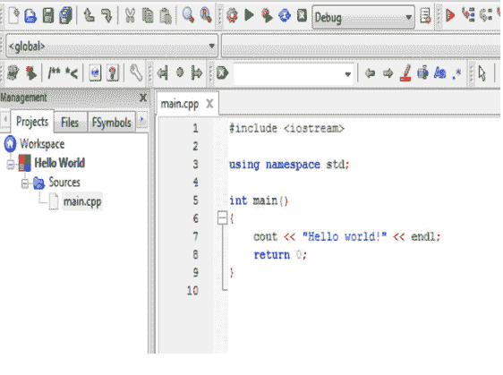

## 下载并安装 Code::Blocks

你将需要：

- 1. 一台笔记本电脑/台式电脑
- 2. 互联网连接
- 3. 诸如 Chrome、Windows Edge 或 Firefox 之类的网络浏览器

访问以下网站并下载 Code::Blocks 应用程序：
[https://www.fosshub.com/Code-Blocks.html?dwl=codeblocks-20.03mingw-setup.exe](https://www.fosshub.com/Code-Blocks.html?dwl=codeblocks-20.03mingw-setup.exe)

只需将链接复制并粘贴到浏览器中。

注意：请确保下载名为 Code Blocks Windows 64 bit（包含编译器）的文件。

这个版本包含我们需要的编译器。

之后，只需安装该应用程序，并在完成后打开它：

你可以通过以下链接访问 Code::Blocks 网站：[https://www.codeblocks.org/](https://www.codeblocks.org/)，以了解更多信息。该网站还包含用户手册，以及用于下载适用于其他操作系统的 IDE 的链接。

## C++ 中的 Hello World

所有程序员在学习一门新编程语言时编写的第一个程序都称为 Hello World。

它基本上就是编写一个在屏幕上显示 'Hello World' 这几个字的程序。既然我们现在是程序员，我们就说我们正在将 'Hello World' 这几个字 *打印* 到屏幕上。

我将给出代码示例，你需要将这些示例输入 Code::Blocks，并点击构建和运行按钮来编译和执行代码，以便查看结果。

### 在 Code::Blocks 中创建项目

要在 Code::Blocks 中运行代码，我们必须先创建一个项目。因此，首先我们需要打开 Code::Blocks。

要创建项目，请点击 **文件 > 新建 > 项目**。

在弹出的窗口中选择 **控制台应用程序**，然后点击 **开始** 按钮。

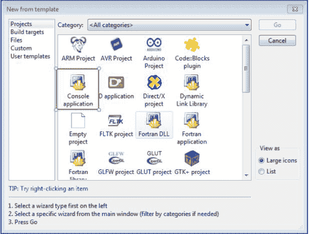

确保在此窗口中选择 **C++**。

在信息窗口中点击 **下一步**。

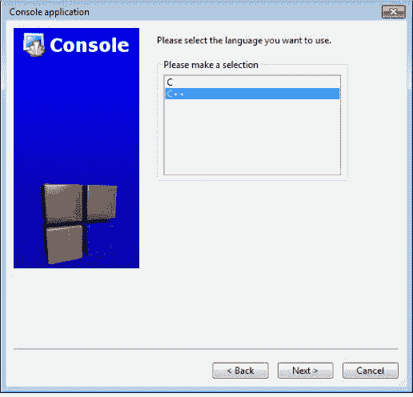

为项目指定一个标题，暂时为 **Hello World**。选择保存项目的文件夹。

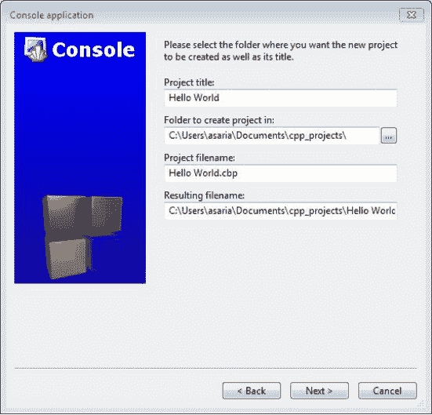

确保已选择 **GNU GCC Compiler** 作为编译器，然后点击 **完成**。

现在，在左侧的 Hello World 下，点击 **Sources** 文件夹旁边的 + 图标，以显示 **main.cpp** 文件。双击该文件，将其显示在右侧的编辑器窗口中。

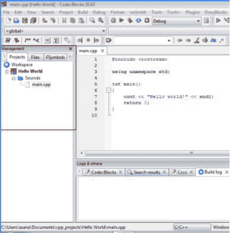

编辑器中的代码如下例所示

### 代码

```cpp
#include <iostream>
using namespace std;

int main()
{
    cout << "Hello World" << endl;

    return 0;
}
```

我相当确定，你第一次看到上面的代码时会觉得它令人不知所措。但经过几章之后，我们就会理解它的全部含义。现在请耐心一点，我会尝试解释这个程序的主要部分。

编程的诀窍就是坚持，因为随着你学得越多，事情会变得越容易。

我们先运行这段代码。

### 运行代码

要运行代码，我们必须先编译它。

在 Code::Blocks 中，我们使用术语 *构建* 而不是编译。这是因为一个项目通常由多个 C++ 文件组成，而我们把编译所有这些文件的过程称为构建。

编辑器顶部有三个按钮，使我们能够构建和运行项目。

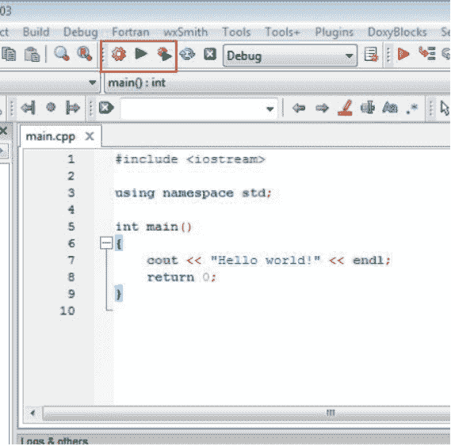

```cpp
#include <iostream>

using namespace std;

int main()
{
    cout << "Hello world!" << endl;
    return 0;
}
```

黄色齿轮按钮用于构建项目，绿色播放按钮用于运行已构建的项目，而第三个按钮是齿轮和播放按钮的组合，用于构建并运行项目。点击这两个按钮的组合来执行项目。

将弹出一个窗口，其中显示 'Hello World' 字样，如下所示。

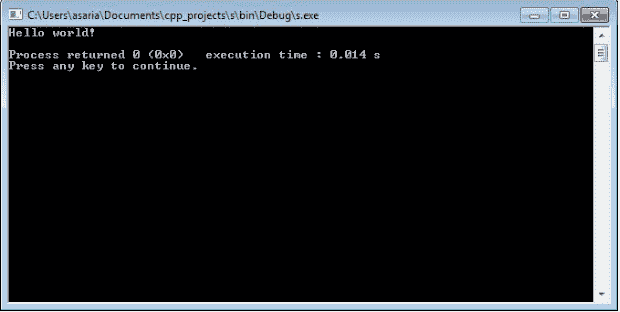

这就是所谓的 **控制台** 或 **终端**。控制台显示 C++ 中的输出。关闭窗口即可将其关闭。

注意：在构建和运行文件之前，请确保保存文件；每次更改后都可以按 **Control-S (Ctrl+S)** 来保存。

### 代码解释

这个程序中的主要行是：

```cpp
cout << "Hello World" << endl;
```

首先，请注意该行以分号（;）结尾，这非常重要，因为它表示这条指令的结束。

**cout** 只是程序员调用屏幕的方式，你可以把它看作 console output（控制台输出）的缩写。

符号 << 只是表示将其后的内容显示在屏幕上。

'Hello World' 是我们要显示在屏幕上的文本。注意，它被双引号包围。双引号是语法的一部分，非常重要。

我们把被双引号包围的文本称为 ***字符串***。

下一个 << 符号表示将其后的内容添加到 'Hello world' 文本中。在编程中，我们称之为 **拼接**，也就是将两个字符串相加。

**endl** 表示添加一个换行符；换行符就像在计算机上输入内容时按下 Enter 键；它会把你带到当前文本下方的下一行。

如你所见，在编写程序时，我们并不只是用普通英语来写，而是遵循一些特定规则，这些规则称为语言的 *语法*。

## 练习

- 1. 修改文本，使程序打印出你的名字，然后构建并运行代码。
- 2. 将代码行 `cout << "Hello World";` 写两次，看看控制台上会打印出什么。这与将 `cout << "Hello World" << endl;` 写两次有什么区别？
- 3. 创建一个新项目，给它取任意你喜欢的名字，并将其存储在不同的文件夹位置。
  - a. 对于这个新项目，点击运行图标，并注意会发生什么。
  - b. 对于这个新项目，分别点击构建齿轮图标，然后点击运行图标，并注意会发生什么。

## 变量

在本章中，我将首先带你了解计算机中对编程很重要的主要部分。

计算机的主要部分称为处理器。它实际上读取你的代码并执行你的指令。

此外，还有一个称为 **RAM** 的存储区域，它代表 **随机存取存储器**。你需要的一切都存储在这里；甚至你的程序也存储在这里。

你可以把它想象成一组带有盒子的货架，你可以在里面存放东西。此外，这些盒子有不同的大小和类型。因此，你可以决定能在其中存储什么。

此外，我们可以给这些盒子贴上标签，以便以后可以轻松地按名称引用它们。

### 变量赋值

变量是赋予存储在内存中的值的名称。

变量名也称为 **标识符**。

你可以把变量看作一个盒子，我们把值放进去；把变量名看作贴在盒子上的标签。

每个盒子还被分配了一种称为数据类型的东西。数据类型是存储在盒子中的信息类型。这意味着特定变量只能存储特定类型的数据。数据类型的示例包括字符串、数字、布尔值等。

下面是一个变量赋值的示例。我们在 Code::Blocks 中新建一个名为 variables 的项目来编写它；按 **Control-S** 保存文件，然后构建并运行。

### 示例代码

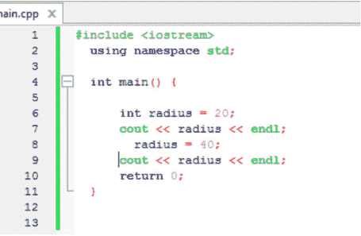

在上面的代码中，我们声明了一个名为 *radius*、数据类型为 int（表示整数）的变量，并将其初始化为值 20。

**int** 就是我们所说的 **数据类型**。用盒子的类比来说，数据类型决定了用于 **存储** 值的盒子的类型。我们存储的值是 20。变量名称为 **radius**，这意味着盒子上的标签是 radius。

只要数据类型相同，变量的值可以在整个程序中改变。在上面的程序中，我们将值改为 40。

这是可以接受的，因为 40 是 int（整数）数据类型。


## 数据类型

以下是可用的数据类型及其所表示的值的种类和范围。每种数据类型都有一个与之关联的示例。

### int

数据类型 **int** 代表整数。整数是一个完整的数，意味着它不能带有小数。整数的示例有 1、0、45、768、23343 等。

示例：int radius = 2;

### long

数据类型 **long** 也是整数，但可使用的数字可以比 int 大得多。long 变量最多可容纳 20 位数字，而 int 变量只能容纳 10 位数字。例如，在下面，x、y 和 **result** 都是 long 变量，可以容纳最多 20 位的数字。

```cpp
#include<iostream>
using namespace std;

int main(){
    long x = 9999991919;
    long y = 4665229;
    long result = x * y;
    cout << result;
    return 0;
}
```

```text
1.242897643
Process returned 0 (0x0)    execution time : 0.020 s
Press any key to continue.
```

### float

表示带小数位的数字。参见下面的示例。pi 是一个 float 变量，值为 3.142，areaOfCircle 是另一个 float 变量。

```cpp
#include<iostream>
using namespace std;

int main(){
    float pi = 3.142;
    int radius = 3;
    float areaOfCircle = pi * radius * radius;
    cout << areaOfCircle;
    return 0;
}
```

```text
28.278
Process returned 0 (0x0)   execution time : 0.034 s
Press any key to continue.
```

### double

double 变量可以容纳包含小数位的数字，并且精度更高，可以容纳更多小数位（最多 15 位小数）。

在下面的示例中，acceleration、mass 和 force 是三个 double 变量，每个都可以容纳最多 15 位小数的数字。

```cpp
#include<iostream>
using namespace std;

int main(){
    double acceleration = 9.91;
    double mass = 30.03;
    double force = acceleration * mass;
    cout << force;
    return 0;
}
```

```text
299.699
Process returned 0 (0x0)    execution time : 0.014 s
Press any key to continue.
```

### bool

它代表布尔值。
它只能保存两个值：**true** 或 **false**。
布尔变量用于条件判断。
在下面的示例中，声明了两个布尔变量 **isHungry** 和 **isSleepy**。
如果 **isHungry** 为 true，程序会在屏幕上打印 **“我饿了”**。
如果 **isSleepy** 为 true，程序会在屏幕上打印 **“我困了”**。

```cpp
#include<iostream>
using namespace std;

int main(){
    bool isHungry = true;
    bool isSleepy = false;
    if(isHungry){
        cout << "I am hungry" << endl;
    }
    if(isSleepy){
        cout << "I am sleepy" << endl;
    }

    isSleepy = true;
    if(isSleepy){
        cout << "I am going to bed" << endl;
    }

    return 0;
}
```

```text
I am hungry
I am going to bed

Process returned 0 (0x0)   execution time : 0.015 s
Press any key to continue.
```

### char

char 代表字符。char 是一个只能保存一个值的变量。该值是一个长度为 1 的字符串。在下面的示例中，**excellent** 是一个 char 变量，保存某学生数学成绩的等级。

```cpp
#include<iostream>
using namespace std;

int main(){
    char excellent = 'A';
    cout << "Congratulations you got an " << excellent << " in maths" << endl;
    return 0;
}
```

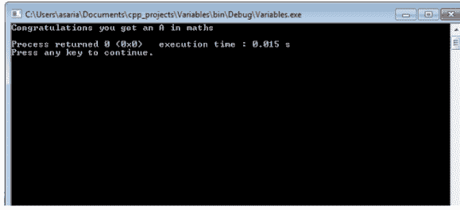

### string

字符串是用于存储文本的变量。它可以保存任意长度的字符串。在下面的示例中，**yourName** 是一个变量，保存值 **“凯瑟琳”**。

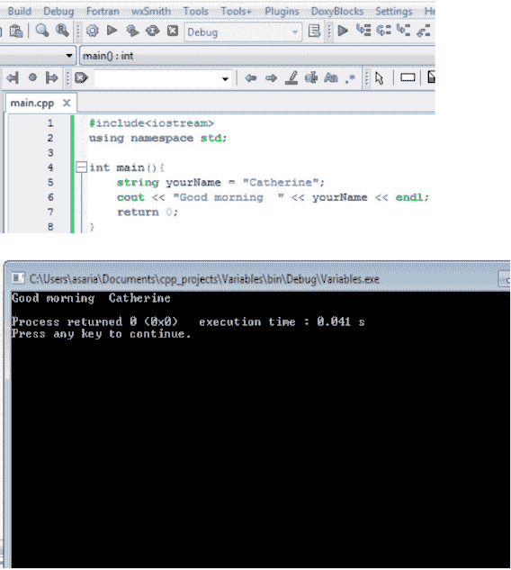

## 变量名

C++ 变量名必须以字母或下划线开头，其余所有字符必须是字母、数字或下划线。

有效变量名的示例包括：

- x
- x1
- x_1_abc
- RATE
- bigBonus_

无效变量名的示例：

- `12`
- `3x`
- `%change data`
- `-1 PROG.CPP`

前三个 `12`、`3x`、`%change` 不被允许，因为它们不以字母或下划线开头。

C++ 还区分大小写，这意味着以下三个是不同的变量名：

- Rate
- RATE
- rate

### 驼峰命名法

驼峰命名法是一种编程实践，其中多个单词在不带空格的情况下书写，并且每个单词的首字母大写（第一个单词除外）。

单词 *汽车的末端* 会变成：`endOfCar`。
驼峰命名法是命名变量时常用的一种编程实践。

### 关键字

关键字是保留给编程语言语法的名称，不能用作变量名。

如果将它们用作变量名，编译器会抛出错误，或者你可能最终改变某些基本函数的基本功能。

关键字的示例包括基本数据类型（如 int、bool 等）以及 struct 和 class 等名称。

### 注释

有时我们想解释自己的代码，以便他人能理解我们做了什么。将来，这些信息会帮助我们在阅读代码时回想起当时做了什么。

在编程中，我们通过在代码中编写注释来实现这一点。注释有两种类型：单行注释和多行注释。

单行注释以两个正斜杠（//）开头，而多行注释位于以下符号之间：/**/

注释示例：

```text
// Test Code
```

```text
/* Line 1 of Comments
Line 2 of Comments */
```

## 声明变量

所有变量在使用前都必须声明或定义。

要声明/定义变量，只需指定数据类型和变量名，后跟分号：

当你声明一个变量而不给它赋值时，我们说该变量是*未初始化*的。未初始化的变量会包含一个随机值。

给未初始化的变量赋值称为*初始化*它。

你也可以同时声明并初始化一个变量。

在本示例中，我们将使用注释并声明一些变量，然后将其值打印到控制台。

在 Code::Blocks 中创建一个新项目，编写以下代码，构建并运行它。

### 示例代码

```cpp
#include <iostream>
using namespace std;

int main() {

    /*
        This is a multiline comment
        As can be seen, it spans
        multiple lines
    */

    int length; // declaring the variable length
    int width;  // declaring the variable width

    length = 20; // initializing the variable length
    width = 20;  // initializing the variable width

    int depth = 40; // declaring and initializing

    cout << length << endl;
    cout << width << endl;
    cout << depth << endl;

    return 0;
}
```

### 解释

在上面的程序中，在代码的主块中，我们首先通过在 `/**/` 之间书写来写一个多行注释。然后我们声明两个 int 类型的变量 *length* 和 *width*，但没有初始化它们，稍后再进行初始化。

然后我们声明并初始化 int 类型的变量 *depth* 为 40。最后，我们将 length、width 和 depth 的值分别打印到控制台，每个值单独一行。

### 练习

- 1. 编写一个程序，其中包含输出五个或六个已定义但未初始化的变量值的语句。编译并运行该程序。输出是什么？解释一下。
- 2. 创建一个包含你姓名的字符串变量，并将其打印到控制台。
- 3. 创建一个 char 变量，并将其打印到控制台。
- 4. 创建一个 bool 变量，并将其打印到控制台。
- 5. 创建一个 float 变量，并将其打印到控制台。
- 6. 创建一个以驼峰命名法命名的 long 变量 `timeOfDay`，并将其打印到控制台。

## 数学运算

在本节中，我们将制作一个小型计算器，它只执行两个数的乘法。程序会要求我们输入两个要相乘的数，并打印相乘的结果。

首先，我们将介绍如何在 C++ 中执行数学运算。

### 加法

加法使用 + 运算符完成。

### 加法示例代码

```cpp
#include<iostream>
using namespace std;

int main()
{
    int x = 1;
    int y = 2;
    int sum = x + y;
    cout << sum;
    return 0;
}
```

代码的输出将是 3，即 x 和 y 的和。

### 减法


### 乘法

乘法使用 * 运算符完成

### 乘法示例代码

```cpp
#include<iostream>
using namespace std;

int main(){

    int x = 3;
    int y = 2;
    int multiplication = x * y ;
    cout << multiplication ;
    return 0;
}
```

代码的输出将是 6

### 除法

除法使用 / 运算符完成，它返回除法的商

### 除法示例代码

```cpp
#include<iostream>
using namespace std;

int main(){

    int x = 3;
    int y = 2;
    int quotient = x / y;
    cout << quotient;
    return 0;
}
```

上述代码的输出将是 1.5

### 余数

要获得除法的余数，请使用取模运算符，它由符号 % 表示。

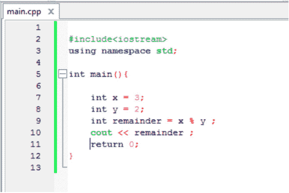

```cpp
#include<iostream>
using namespace std;

int main(){
    int x = 3;
    int y = 2;
    int remainder = x % y;
    cout << remainder ;
    return 0;
}
```

代码的输出将是 **1**，即 x 除以 y 时的余数。

## 从用户获取输入

到目前为止，我们只是一直在向控制台打印内容，而没有接收用户的任何输入。在本节中，我们将通过请求用户输入来让程序更有趣。

### cin

**cin** 用于接受来自键盘的输入，可以把它理解为代表控制台输入

## 一个简单的计算器

我们将需要向用户请求两个要相乘的数字，并向用户显示乘法结果。

### 示例代码

```cpp
#include <iostream>
using namespace std;

int main() {
    int num1;
    int num2;

    // prompt to enter num1
    cout << "Enter a num1: ";

    cin >> num1;

    // prompt to enter num2
    cout << "Enter a num2: ";

    cin >> num2;

    int multiplication = num1 * num2;
    cout << "Result of multiplication: " << multiplication;

    return 0;
}
```

### 解释

我们首先声明两个 int 类型变量，用于存储用户输入，即 num1 和 num2

我们提示用户输入 num1，然后使用 cin 将其存入相应的变量。对 num2 也做同样的操作

然后我们对这两个数执行乘法，并向用户显示结果

### 练习

- 1. 将以下每个数学公式转换为 C++ 表达式，每个变量的值来自用户输入
  - 1. `3x`
  - 2. `3x + y`
  - 3. `(x + y)/7`
  - 4. `(3x + y) / (z + 2)`
- 2. 编写一个程序，使用 6 个输入变量接收 6 门科目的学校成绩。计算这些科目的总分和平均分
- 3. 编写一个程序，从用户那里接收一个整数，并判断它是偶数还是奇数。提示：使用取模

## 函数

函数是一组执行给定任务的代码行。每个函数都被分配了一个名称，并将在程序中通过该名称引用。

在 C++ 中，函数应当返回一个值，而要返回的值的数据类型通常在定义函数时指明。

在本节中，我们将编写一个计算矩形面积的函数

### 函数示例

矩形的面积等于其长度乘以宽度，因此下面是一个计算它的函数

像这样将其写在 main 函数之前：

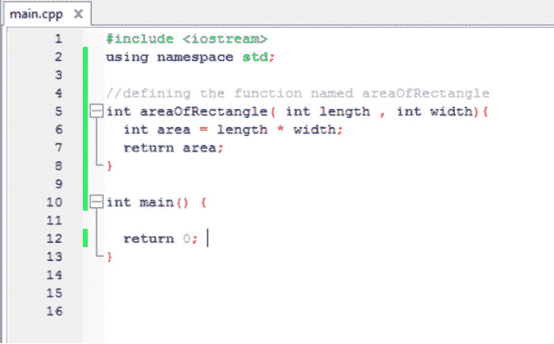

### 解释

**int** 是要返回的值的数据类型，因此我们期望函数在运行时返回一个整数。这由第 7 行右花括号正上方的 **return area;** 行表明。注意变量 **area** 被声明为整数类型，因为这是函数返回的变量。

**areaOfRectangle** 是我们给函数起的名称。注意它采用驼峰命名法书写。

函数名后面跟着一对圆括号，在括号中我们声明两个变量，这些变量称为**参数**。在上面的示例中，**length** 和 **width** 就是参数。

它们将保存我们在运行函数时传递给函数的值，并且可以在函数的代码块中访问。

然后我们将代码放在花括号中，以标记它与该函数名关联的代码行。

最后，我们有 *return* 语句。

### 运行函数

看看下面的代码

```cpp
#include <iostream>
using namespace std;

int areaOfRectangle( int length , int width){
    int area = length * width;
    return area;
}
int main() {

    // calling the areaOfRectangle function
    // length 4 and width 5

    int area = areaOfRectangle(4,5);

    cout << "Area is: " << area << endl;
    return 0;
}
```

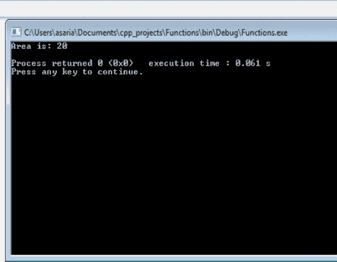

### 解释

当我们想要运行一个函数时，我们通常说我们在**调用**该函数。

有些函数在被调用时会接收值，就像我们的函数一样，我们把这些值称为函数的***实参***。

注意向函数传递实参所用的语法：我们先写函数名，然后在左圆括号和右圆括号之间写实参，用逗号分隔。

因此，在我们的示例中，我们调用函数 ***areaOfRectangle***，传入两个实参，即 4 和 5。
我们期望函数返回一个值，即已计算出的面积，并且计算出的面积值的数据类型为整数。

因此，我们将返回值赋给名为 *area* 的 int 类型变量。

然后我们将结果打印到屏幕上。在这种情况下，矩形的面积是 20，因此这就是屏幕上显示的输出。

### void 函数

称为 void 函数的函数是在被调用后不返回任何内容的函数

### 示例代码

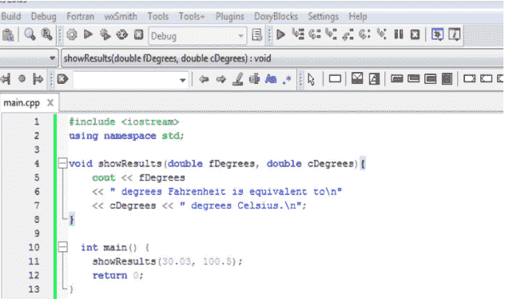

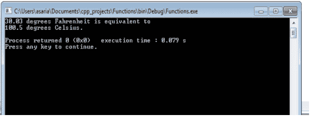

### 解释

注意指定的返回类型是 void，并且我们在函数体中没有使用 return 关键字。

除此之外，我们定义其他非 void 函数的方式没有任何其他区别。

### 练习

- 1. 创建一个名为 Descending() 的函数，它接收四个实参。每个实参都是 int 类型的数字。如果这四个数字按降序排列，函数返回 true；否则返回 false。例如，Descending(4, 3, 3, 1) 和 Descending(3, 2, 2, 1) 都返回 true，而 Descending(2, 1, 3, 2) 返回 false。
- 2. 创建一个名为 isOdd() 的函数，它接收一个 int 类型的实参并返回布尔值。如果输入是奇数，函数返回 true。如果它是偶数，则返回 false。
- 3. 以下程序的输出是什么？

```cpp
#include <iostream>
using namespace std;
void sayhi();
void hide(int audiencenumber);
int main()
{
        sayhi();
        hide(0);
        cout << "Extra time:\n";
        hide(2);
        sayhi();
        cout << "End of program.\n";
        return 0;
}
void sayhi()
{
        cout << "Hello\n";
}
void hide(int audiencenumber)
{
        if (audiencenumber < 5)
        return;
        cout << "Bye\n";
}
```

- 4. 编写一个计算圆周长的函数，它有一个名为 radius 的 int 类型参数，并返回 double 类型。使用 pi 作为值为 3.142 的 double 变量。

## 作者的一段简短留言：

嘿，你喜欢这本书吗？我很想听听你的想法！

许多读者不知道评论有多么难得，也不知道它们对作者有多大帮助。


如果你能花短短 60 秒在 Amazon 上写一条简短评论，哪怕只有几句话，我将无比感激！

[>> 点击此处留下快速评论](#)

感谢你抽出时间分享你的想法！


## 条件语句

我们通常只想在某个条件为真时才做某事。例如，如果外面阳光明媚，我们就出去玩；否则，我们就待在家里。

“外面阳光明媚”这一陈述只能为真或为假。

在编程中，我们有一种只能存储 true 或 false 值的数据类型，这种数据类型称为**布尔类型**。在 C++ 中，我们通常将其简写为 **bool**。

此外，有时我们只想在某个条件为真时运行若干行代码，这时我们使用 if 语句来实现。让我们做一个示例，这会更容易理解

### 示例代码

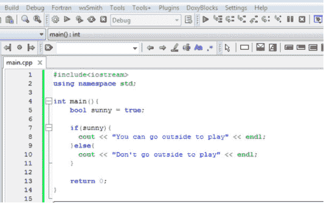

```cpp
#include<iostream>
using namespace std;

int main(){
    bool sunny = true;

    if(sunny){
        cout << "You can go outside to play" << endl;
    }else{
        cout << "Don't go outside to play" << endl;
    }

    return 0;
}
```

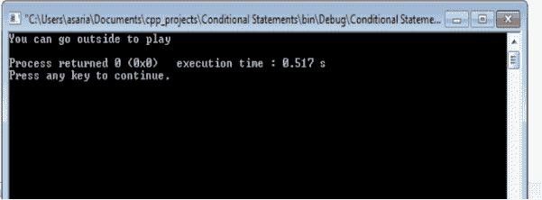

### 解释

在上面的示例中，我们首先创建一个名为 *sunny* 的变量，它保存布尔值，因为它的数据类型是 *bool*。

使用 *if* 语句，我们检查“天气晴朗”是否为真；如果为真，就在屏幕上打印 "You can go outside to play"，否则打印 "Don't go outside to play"

### 练习

将变量 *sunny* 改为 *false*，看看会打印什么。

## 比较运算符

比较运算符比较两个值，并返回 true 或 false

比较运算符的示例包括：

### 小于（<）

如果左边的值小于右边的值，则返回 true；否则返回 false。

### 大于（>）

如果左边的值大于右边的值，则返回 true；否则返回 false。

### 小于或等于（<=）

如果左边的值小于或等于右边的值，则返回 true；否则返回 false。

### 大于或等于（>=）

如果左边的值大于或等于右边的值，则返回 true；否则返回 false。

### 等于（==）

如果左边的值等于右边的值，则返回 true；否则返回 false。

### 不等于（!=）

如果左边的值不等于右边的值，则返回 true；否则返回 false。

### 比较运算符的使用示例

假设如果 x 确实大于 5，你想在屏幕上打印字符串‘x is greater than 5’；否则打印‘x is less than or equal to 5’

```cpp
#include<iostream>
using namespace std;

int main(){
    int x = 3;

    if(x > 5){
        cout << "x is greater than 5" << endl;
    }else{
        cout << "x is less than or equal to 5" << endl;
    }
    return 0;
}
```

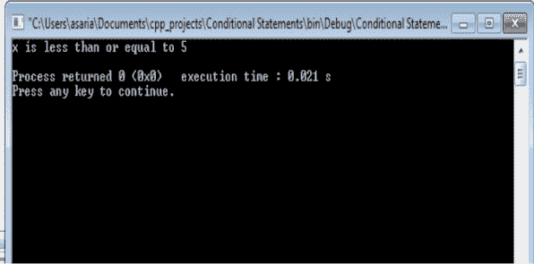

## 构建布尔表达式

**布尔表达式**是只有两个值之一的任何表达式。它要么为 true，要么为 false。它本质上是一个比较两个值并返回 true/false 的表达式。

可以使用“and”运算符组合两个比较，在 C++ 中该运算符为 &&。例如，如果 a 的值大于 5 且 a 小于 10，则以下布尔表达式为 true：

**(5 < a) && (a < 10)**

上述运算在 a 介于 5 和 10 之间（不包括 5 和 10）时返回 true。

当使用 && 连接两个比较时，如果两个比较都为 true，则整个表达式为 true；否则整个表达式为 false。

你也可以使用“or”运算符组合两个比较，在 C++ 中写作 ||。例如，如果 b 小于 2 或 b 大于 9，则以下表达式为 true：

**(b < 2) || (b > 9)**

如果 b 小于 2 或 b 大于 9，则上述表达式返回 true。

在使用 || 运算的表达式中，只要任一比较为 true，该表达式就为 true。如果两个表达式都为 false，则该表达式为 false。

可以使用 ! 运算对布尔表达式取反。例如，如果“a 不大于 b”，则 **!(a > b)** 返回 true。

在大多数情况下，不需要使用感叹号（!）运算符。

例如，**!(a > b) 等同于 a <= b**

## 真值表

以下称为真值表。它表示每个表达式组合的所有可能情况以及由此得到的布尔值。

### 与（AND）

| 表达式1 | 表达式2 | 表达式1 && 表达式2 |
|---|---|---|
| 真 | 真 | 真 |
| 真 | 假 | 假 |
| 假 | 真 | 假 |
| 假 | 假 | 假 |

### 或（OR）

| 表达式1 | 表达式2 | 表达式1 \|\| 表达式2 |
|---|---|---|
| 真 | 真 | 真 |
| 真 | 假 | 真 |
| 假 | 真 | 真 |
| 假 | 假 | 假 |

### 非（NOT）

| 表达式 | ! 表达式 |
|---|---|
| 真 | 假 |
| 假 | 真 |

## 布尔表达式示例

假设你只在饿了并且有钱时才买食物。要在代码中表示这一点，大致如下。

### 示例

```cpp
#include<iostream>
using namespace std;

int main(){
    bool isHungry = true;
    bool hasMoney = true;

    if( isHungry && hasMoney){
        cout << "I will buy food" << endl;
    }else{
        cout << "I can't buy food" << endl;
    }

    return 0;
}
```

```text
I will buy food

Process returned 0 (0x0)    execution time : 0.014 s
Press any key to continue.
```

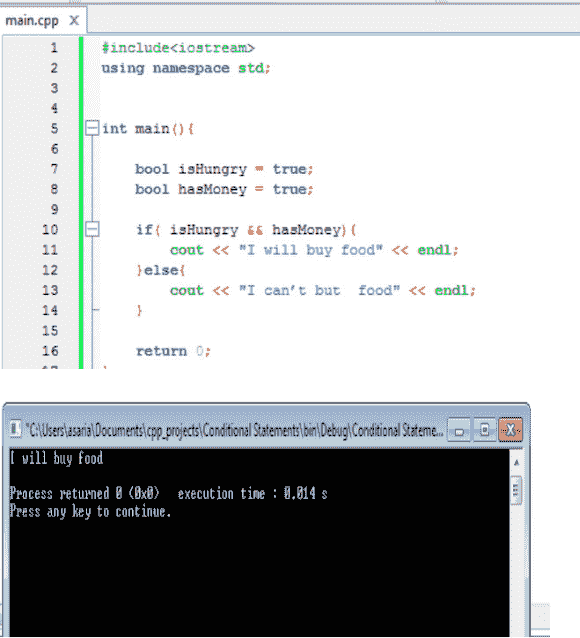

### 解释

只有当变量 **isHungry** 和 **hasMoney** 都为 true 时，才会打印字符串‘I will buy food’。否则，会打印字符串‘I can’t buy food’。修改程序，使 **isHungry** 为 true 或 **hasMoney** 为 true 时打印‘I will buy food’。

### 练习

- 1. 编写一个程序，如果分数小于 10，则输出单词 **Small**；如果分数的值大于 100，则输出 **Big**。
- 2. 编写一个程序，如果变量 **test** 大于或等于 50 且变量 **codingPrograms** 的值大于 5，则输出单词 **Success**。否则，程序输出单词 **failure**。变量 **test** 和 **codingPrograms** 都是 int 类型。
- 3. 编写一个程序，如果变量 **temp** 大于 37，或变量 **press** 的值大于 1，或两者都满足，则输出单词 **Danger**。否则，程序打印单词 **Great**。变量 **temp** 和 **press** 都是 int 类型。

## 循环

循环使我们能够将一组指令重复固定次数。如果愿意，也可以永远重复。

通常有两种类型的循环：*有限循环*和*无限循环*。

有限循环将一组指令重复可计数的次数，而无限循环则永远重复一组指令。

### 如何指定循环

在 C++ 中，声明循环有两种方式。一种是使用 **for** 关键字，另一种是使用 **while** 关键字。

### for 循环

假设你想在控制台中将你的名字打印 10 次，你可能会想到把指令 *'cout << "My name"<< endl;'* 写 10 遍。

使用 for 循环是避免重复相同语句并缩短代码的好方法。

### 示例

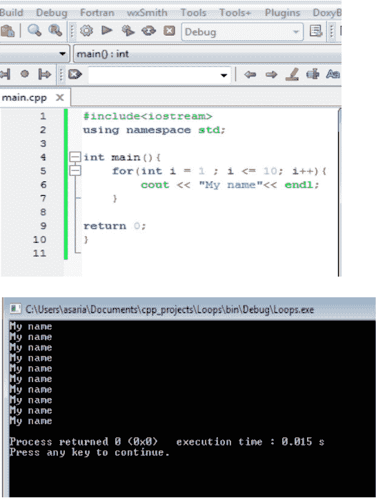

### 解释

要使用 **for 循环**，我们需要指定希望运行与该 for 循环关联的代码块的次数。

与 for 循环关联的代码块位于开大括号和闭大括号之间

```
{
}
```

在我们的代码中，关联的代码块只有这一行：`cout << "My name" << endl;`

在与 *for* 关键字关联的开括号和闭括号内，我们指定三件重要的事情，用两个分号分隔

第一是从哪个数字开始计数；对我们来说，从 1 开始计数，因此声明保存值 1 的整型变量 **i**。

第二部分与第一部分用分号分隔，是条件：只有该条件为 true，才会执行与 for 循环关联的代码块。在这一部分中，我们通常使用 >、<、<=、>= 等比较运算符。

在我们的例子中，`i <= 10` 表示仅当变量 i 的值小于或等于 10 时才运行该代码块；否则停止循环并继续执行程序的其余部分。

最后，第三部分与第二部分用分号分隔，用于递增计数变量；在我们的例子中，使用特殊写法 `i++` 将计数递增 1

此外，这个递增发生在代码块运行之后

### 练习


- 1. 将程序改为对我们的文本循环 100 次

### 在循环内使用计数器的示例

我们可以在关联的代码块内使用已声明的整数，例如，我们可以用下面的代码打印 1 到 10 的值。

```cpp
#include<iostream>
using namespace std;

int main(){

    for(int i = 1 ; i <= 10; i++){
        cout << i << endl;
    }

    return 0;
}
```

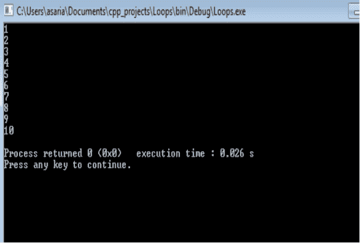

## while 循环

**while** 循环与 *for* 循环类似，唯一区别是，与 while 关键字关联的括号中只包含要满足的条件。

### 示例

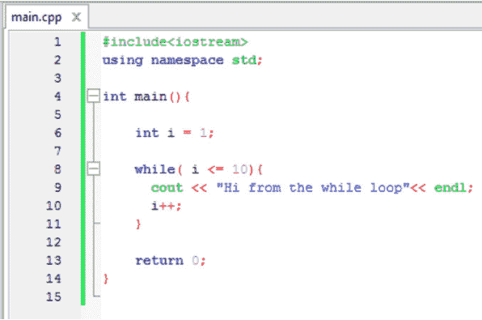

### 解释

我们首先在下面这一行中声明从何处开始计数：**int i = 1;**

**while(i <= 10)** 的意思是，当变量 *i* 的值小于或等于 10 时，运行关联的代码块。

注意，在右花括号之前，我们将 i 的值增加 1。

然后 while 循环会重复检查 i 是否小于或等于 10；如果是，就执行关联的代码块。如果 i 大于 10，则不执行该代码块，程序会继续执行下一条指令。

## 无限循环

当 *for* 循环或 *while* 循环为了决定是否运行其关联代码块而检查的条件始终为 **true** 时，就会发生无限循环。**因此，它基本上会永远运行。**

### 示例

```cpp
#include<iostream>
using namespace std;

int main(){

    while( true ){
        cout << "Hi from the infinite while loop" << endl;
    }

    return 0;
}
```

```
Hi from the infinite while loop
Hi from the infinite while loop
Hi from the infinite while loop
Hi from the infinite while loop
Hi from the infinite while loop
Hi from the infinite while loop
Hi from the infinite while loop
Hi from the infinite while loop
Hi from the infinite while loop
Hi from the infinite while loop
Hi from the infinite while loop
Hi from the infinite while loop
Hi from the infinite while loop
Hi from the infinite while loop
Hi from the infinite while loop
Hi from the infinite while loop
Hi from the infinite while loop
Hi from the infinite while loop
Hi from the infinite while loop
Hi from the infinite while loop
Hi from the infinite while loop
Hi from the infinite while loop
Hi from the infinite while loop
Hi from the infinite while loop
Hi from the infinite while loop
Hi from the infinite while loop
Hi from the infinite while loop
```

### 解释

由于条件始终为 true，因此这将永远运行。

### 无限 for 循环

无限 for 循环的定义如下所示：

```cpp
#include<iostream>
using namespace std;

int main()
{
    for(;;){
        cout << "Hi from the infinite for loop" << endl;
    }

    return 0;
}
```

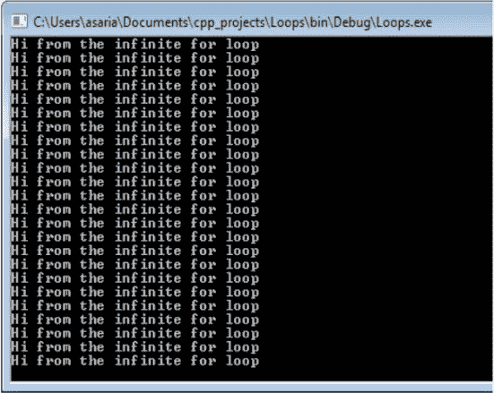

### 解释

注意，要声明无限 for 循环，只需在与 for 关键字关联的括号中写两个分号，即：

```cpp
for(;;){
    //this code will run infinitely
}
```

### 练习

- 1. 将以下循环改写为 for 循环。

  - a.

    ```cpp
    int x = 2;
    while(x <= 200)
    {
        if (x < 10 && x != 1)
            cout << "YY";
        x = x + 2;
    }
    ```

  - b.

    ```cpp
    int a = 2;
    while(a <= 21)
    {
        cout << "YY";
        a++;
    }
    ```

- 2. 以下代码（嵌入完整程序时）的输出是什么？

  ```cpp
  for (int ctr = 2; ctr < 15; ctr++)
      cout << (3 + ctr) << endl;
  ```

- 3. 以下代码的输出是什么？

  ```cpp
  for (int b = 50; b > 2; b = b - 3)
  {
      cout << "Hi ";
      cout << b << endl;
  }
  ```

- 4. 编写一个程序，使用 for 循环无限次打印出你的名字。

## 数组

数组是同一数据类型的值的集合。

集合中的每个值都有一个与之关联的索引，可用于检索该值。

C++ 中的索引从 0 开始，而不是从 1 开始，这被称为***从零开始的索引。*** 这就像从 0 开始计数，而不是从 1 开始。

### 练习

如果我从 0 到 4 给它们编号，我有多少项？

**答案：5**

### 声明数组

声明数组时，我们首先指定数组将保存的值的数据类型，然后是数组的变量名，最后在方括号中指定它将保存的元素数量。

例如：

```cpp
int size[4];
size = {1, 2, 3, 4};
```

### 解释

上面我们声明了一个变量名为 *size* 的数组，它保存 4 个整数类型的值。

```cpp
int size[4];
```

### 从数组中检索值

通过使用索引指定所需值的位置，可以从数组中检索值。

### 示例

假设我们想检索数组中的第一个元素，代码如下：

```cpp
#include<iostream>
using namespace std;

int main(){
    int size[4] = {1, 2, 3, 4};
    int firstElement = size[0];

    cout << firstElement ;
    return 0;
}
```

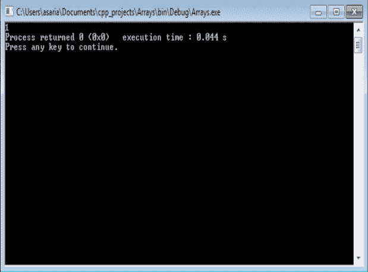

### 解释

这一行 `int firstElement = size[0];` 检索数组中的第一个元素。

注意，由于在 C++ 中我们从 0 开始计数，因此数组中第一个元素的索引是 0。程序会打印 1，因为 size 中的第 1 个元素是 1。

### 练习

检索第四个元素。（提示：索引不是 4）

### 遍历数组中的元素

如果我们想检索数组中的所有元素，可以使用循环来完成。
我们将使用 *for* 循环，因为这是最简单的方法。

### 示例

```cpp
#include<iostream>
using namespace std;

int main(){
    int size[4] = {1, 2, 3, 4};

    for(int i = 0 ; i < 4; i++){
        cout << size[i] ;
    }
    return 0;
}
```

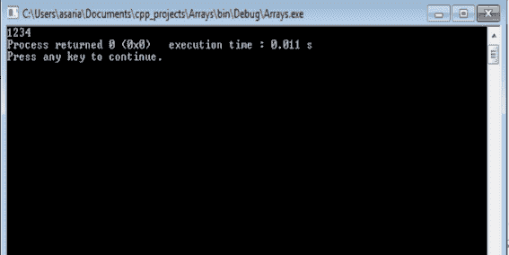

### 解释

注意，我们的计数器从 0 开始，条件是计数器 *i* 的值应小于 4，也就是数组的大小。

### 练习

以下任务需在一个文件中完成：

- 1. 编写一个计算圆面积的函数。
- 2. 创建一个数组，保存 10 个你想知道面积的圆的半径。
- 3. 遍历该数组以计算这些圆的面积，并将结果打印到屏幕上。
- 4. 只计算数组中第四个位置的圆的面积。
- 5. 创建一个包含你名字中字符的数组，并将所有字符打印到屏幕上。

## 结构体

结构体是一组值，使你能够以逻辑方式排列数据，也就是以对你而言合理的方式排列数据。

假设你想收集朋友们的年龄、体重和身高信息。

根据我们目前掌握的知识，我们会这样做：

### 示例代码

```cpp
#include<iostream>
using namespace std;

int main(){
    int kevinAge = 10;
    int kevinWeight = 30;
    int kevinHeight = 1;

    int jessicaAge = 15;
    int jessicaWeight = 20;
    int jessicaHeight = 1;
}
```

结构体使这类信息的组织更容易。

我们首先定义一个结构体。

### 结构体定义

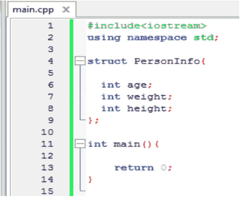

### 解释

结构体在任何函数定义之外定义，包括 main 函数。

我们使用关键字 **struct** 来定义结构体，后面跟着我们想给结构体起的名字，这个名字称为*结构体标记*。

在与结构体标记关联的花括号内，我们声明结构体变量，也称为*成员名*。在上面的示例中，**age**、**weight** 和 **height** 是*成员名*。

注意，右花括号后有一个分号。

### 初始化结构体

```cpp
#include<iostream>
using namespace std;

struct PersonInfo{
    int age;
    int weight;
    int height;
};

int main(){
    // initializing the structure
    PersonInfo kevin = {10, 30, 1};
    PersonInfo jessica = {15, 28, 1};

    return 0;
}
```


### 说明

通过创建结构体，我们创建了一种新的数据类型。

正如我们声明任何变量时通常所做的那样，我们从它将保存的数据类型开始。

在花括号中，我们传入参数，作为所声明结构体变量的值。

参数的顺序很重要。

如果初始化值的数量多于结构体成员，就会报错。

如果值较少，则未出现在列表中的最后几个成员会被初始化为零。

### 访问结构体成员值

要访问结构体成员变量的值，请使用如下所示的点运算符

### 示例代码

```cpp
#include<iostream>
using namespace std;

struct PersonInfo{

    int age;
    int Weight;
    int Height;
};

int main(){

    // initializing the structure
    PersonInfo kevin = {10,50,1};
    PersonInfo jessica = {15,29,1};

    cout << kevin.age << endl;
    cout << jessica.age << endl;

    return 0;
}
```

```text
10
15

Process returned 0 (0x0)    execution time : 0.137 s
Press any key to continue.
```

在上面的输出中，**kevin.age** 和 **jessica.age** 的输出分别是 10 和 15。Age 是结构体的第一个成员。10 和 15 是结构体初始化中的第一个数字，因此它们分别表示凯文和杰西卡的年龄。

### 练习

创建一个名为 Date 的结构体，其中包含成员变量 year、month 和 day。用你当前的日期初始化它，并将所有值打印到屏幕上。

## 最终项目

在最终项目中，我们旨在运用本书中学到的许多技能。

### 任务

设计一个学生管理系统。添加新学生时，输入的信息包括姓名和注册号。用户可以根据注册号搜索特定学生。用户可以查看完整的学生列表，根据注册号删除特定学生，并退出程序。

下面的代码执行该任务；所有任务都会在程序之后清晰解释。

### 代码

```cpp
#include<iostream>
using namespace std;
#include <string>

// search record function to search the record of the student if it exists and then print record
void searchRecord(string name[], string regnum[], string reg, int in) {

    // is found variable to check whether a record exists or not in the array; if it exists set it true
    bool isfound = false;

    // loop till array to check whether a record exists or not
    for(int index = 0; index < in; index = index + 1) {

        // check the every record in array if match then
        if (regnum[index] == reg) {

            // record is found
            isfound = true;

            // printing the record
            cout << "Student Registration Number : " << regnum[index] << "\t" << "Student Name : " << name[index] << endl;
            cout << endl;

            // terminating from loop
            break;
        }
    }

    // if a particular record does not exist then
    if (isfound == false) {

        // display that record does not exist
        cout << "Record is not found : " << endl;
        cout << endl;
    }
}

int main()
{
    // loop control variable; set it true when the user exits from the programme; set cont false
    bool cont = true;

    // registration number array to store the user registration number
    string registrationNum[100];

    // student name array to store the student name
    string name[100];

    // declaring variable to store the user entered option
    int selectedNumber;

    // index to count the total number of added students
    int index = 0;

    // loop till user exit the programme
    while(cont) {

        // printing menu
        cout << "[1] Create New Record \n"
        <<"[2] Search A Record \n[3] View All Record \n[4] Delete a Record \n[5] Exit  \n"<<endl;

        // prompt user to enter the number
        cout << "Select Number : ";

        // store the user entered number in selectedNumber
        cin >> selectedNumber;

        // if the selectedNumber is 1 then add record into array
        if ( selectedNumber == 1) {

            // declare nam and regNum variables to store the user entered nam and regNum
            string nam;
            string regNum;

            // prompt user to enter name
            cout << "Enter your name : ";

            // store the user entered name into nam variable
            cin >> nam;

            // prompt user to enter the registration number
            cout << "Enter your Registration Number : ";
            cin >> regNum;

            // storing the user entered name and regNum into their respective arrays
            registrationNum[index] = regNum;
            name[index] = nam;

            // incrementing index
            index = index + 1;
            cout << endl;
        }

        // check if user entered 2 then
        else if ( selectedNumber == 2)
        {
            // check if there is at least one record in the array then
            if (index > 0) {

                // prompt user to enter registration number
                string renum;
                cout << "Enter Your Registration Number :";

                // storing the user entered registration number into renum variable
                cin >> renum;

                // calling the function which finds a record and prints it
                searchRecord(name,registrationNum,renum,index);
            }

            // if there is no record in the array then
            else {
                // simply print there is no record in the system
                cout << "There is no Record In the System" << endl;
                cout << endl;
            }
        }

        // check if the user entered number 3 then
        else if (selectedNumber == 3) {

            // Printing all the records of students
            for (int i = 0; i < index; i++) {

                // if there is null in the array which means the record is deleted
                if (name[i] == "null")
                {
                    // just ignore that index
                    continue;
                }
                else {
                    // printing all the records of students
                    cout << " Student Registration Number : " << registrationNum[i] <<
                    "\t\t" << " Student Name : " << name[i] << endl;
                }
            }

            // adding space
            cout << endl;
        }

        // check if the user entered the number 4 then
        else if (selectedNumber == 4) {

            // check if there is any record in the array then
            if (index > 0) {

                // declare the variable renum to store the user registration number
                string renum;

                // prompt user to enter registration number
                cout << "Enter Your Registration Number :";
                cin >> renum;

                // is found variable which checks if the record is found or not in array
                bool isfound = false;

                // loop till the end of number of records
                for(int ind = 0; ind < index; ind = ind + 1){

                    // check if the user entered registration number is equal to registration number in array
                    if (registrationNum[ind] == renum) {

                        // set the value of found to true
                        isfound = true;

                        // adding the null to arrays where value is found
                        name[ind] = "null";
                        registrationNum[ind] = "null";

                        // just print that record deleted successfully
                        cout << " Record deleted successfully : " << endl;
                        cout << endl;
                    }
                }

                // if the user entered registration number is not found then
                if (isfound == false) {
                    // print record is not found
                    cout << " Record is not found : " << endl;
                    cout << endl;
                }
            }

            // if there is no record in the array then
            else {
                // print record does not exist
                cout << "There is no record in the system: " << endl;
                cout << endl;
            }
        }

        // check if the user entered the number 5 then
        else if (selectedNumber == 5) {
            // print take care
            cout << " Take Care " << endl;

            // set cont to false so that programme terminate
            cont = false;
        }
        else {
            // if the user did not enter any number from 1-5 then print please enter valid number
            cout << "Invalid entry : " << endl;
            cout << endl;
        }
    }

    return 0;
}
```

### 输出

```text
[1] Create New Record
[2] Search A Record
[3] View All Record
[4] Delete a Record
[5] Exit

Select Number : 1
Enter your name : john
Enter your Registration Number : 44

[1] Create New Record
[2] Search A Record
[3] View All Record
[4] Delete a Record
[5] Exit

Select Number : 1
Enter your name : jimmy
Enter your Registration Number : 66

[1] Create New Record
[2] Search A Record
[3] View All Record
[4] Delete a Record
[5] Exit

Select Number : 1
Enter your name : hussain
Enter your Registration Number : 12

[1] Create New Record
[2] Search A Record
[3] View All Record
[4] Delete a Record
[5] Exit

Select Number : 2
Enter Your Registration Number :12
Student Registration Number  :  12                  Student Name : hussain
```


```
[1] Create New Record
[2] Search A Record
[3] View All Record
[4] Delete a Record
[5] Exit

Select Number : 3
Student Registration Number  :  44                 Student Name : john
Student Registration Number  :  66                 Student Name : jimmy
Student Registration Number  :  12                 Student Name : hussain

[1] Create New Record
[2] Search A Record
[3] View All Record
[4] Delete a Record
[5] Exit

Select Number : 4
Enter Your Registration Number :66
Record deleted successfully :

[1] Create New Record
[2] Search A Record
[3] View All Record
[4] Delete a Record
[5] Exit

Select Number : 3
Student Registration Number  :  44                 Student Name : john
Student Registration Number  :  12                 Student Name : hussain

[1] Create New Record
[2] Search A Record
[3] View All Record
[4] Delete a Record
[5] Exit

Select Number : 5
  Take Care

----------------------------------------
Process exited after 40.77 seconds with return value 0
Press any key to continue . . .
```

### 在数组中添加记录

我们已为学生姓名和学生注册号声明了两个数组。这两个数组分别称为 *registrationNum* 和 *name*。

如果用户输入数字“1”，程序将要求用户输入学生姓名和注册号。然后用户输入姓名和注册号。它们会被存储到各自的数组中。有一个名为 *index* 的计数变量，用于统计已创建的学生数量。每添加一名学生，索引就增加 1。添加记录的过程如下方代码部分所示。

```cpp
if ( selectedNumber == 1) {

    // declare nam and regNum variable to store the user entered nam and regNum
    string nam;
    string regNum;

    // prompt user to enter name
    cout << "Enter your name : ";

    // store the user entered name into nam variable
    cin >> nam;

    // prompt user to enter the registration number
    cout << "Enter your Registration Number : ";
    cin >> regNum;

    // storing the user entered name and regNum into their respective array
    registrationNum[index] = regNum;
    name[index] = nam;

    // incrementing index
    index = index + 1;
    cout << endl;
}
```

### 从数组中搜索记录

用户可以在程序开始时按“2”，使用其登记注册号搜索特定学生。
程序首先检查学生数组是否为空。如果数组不为空，用户随后输入注册号。程序将用户输入的注册号与数组中已有的注册号进行比较。它使用函数 *searchRecord()* 来完成此操作。

```cpp
}
// check if user entered 2 then
else if ( selectedNumber == 2)
{
    // check if there is at least one record in the array then
    if ( index >= 0) {
        // prompt user to enter registration number
        string renum;
        cout << "Enter Your Registration Number :";

        // storing the user entered registration number into renum variable
        cin >> renum;

        // calling the function which find a record and print it
        searchRecord(name,registrationNum,renum,index);
    }
}
// if there is no record in the array then
```

函数 **searchRecord()** 接收姓名数组（**name[]**）和注册号数组（**regnum[]**）作为参数。它还接收两个变量：注册号 **reg** 和索引 **in**。
**reg** 是我们用于搜索学生记录的注册号，而 **in** 是记录数量。
该函数使用 for 循环在数组 **regnum[]** 中搜索注册号 **reg**。
如果找到 **reg**，该函数会打印学生注册号和姓名。
如果未找到 **reg**，该函数会打印“未找到记录”。

```cpp
// search record function to search the record of the student if it exists and then print record
void searchRecord(string name[], string regnum[], int reg, int in) {
    // isfound variable to check whether a record exists or not in the array; if exists set it true
    bool isfound = false;

    // loop through the array to check whether a record exists or not
    for(int index = 0; index < in; index = index + 1) {
        // check every record in array if match then
        if (regnum[index] == reg) {
            // record is found
            isfound = true;

            // printing the record
            cout << "Student Registration Number : " << regnum[index] << "\t\t" << "Student Name : " << name[index] << endl;
            cout << endl;

            // terminating from loop
            break;
        }
    }

    // if a particular record does not exist then
    if (isfound == false) {
        // display that record does not exist
        cout << "Record is not found : " << endl;
        cout << endl;
    }
}
```

### 查看所有记录

要查看所有学生记录，用户在程序开始时按“3”。有一个名为 *index* 的计数变量，用于统计学生数量。使用 for 循环检索每条学生记录，并打印每个学生姓名和注册号。循环持续到达到 *index* 的值，这表示已到达数组末尾。

```cpp
// check if the user entered number 3 then
else if ( selectedNumber == 3 ) {

    // Printing all the records of students
    for (int i = 0; i < index; i++) {

        // if there is null in the array where a record is deleted
        if ( name[i] == "null" )
        {
            // just ignore that index
            continue;
        }
        else {
            // printing all the records of students
            cout << "Student Registration Number : " << registrationNum[i] << "\nStudent Name : " << name[i] << endl;
        }
    }

    // adding space
    cout << endl;
}
```

### 删除记录

如果用户在程序开始时按“4”，可以基于注册号删除特定学生。用户首先将注册号输入名为 *renum* 的变量。程序将检查学生数组是否为空；如果为空，则显示系统中没有记录。如果数组不为空，程序会将 *renum* 与数组 *registrationNum* 中的注册号进行比较。这是通过遍历数组的 for 循环完成的。如果找到该学生，则通过将相关 name 和 registrationNum 设为 null 来从数组中删除该记录。如果未找到该学生记录，程序会打印“未找到记录”。

```cpp
// check if the user entered the number 4 then
else if ( selectedNumber == 4 ) {

    // check if there is any record in the array then
    if ( index >= 0 ) {

        // declare the variable renum to store the user registration number
        string renum;

        // prompt user to enter registration number
        cout << "Enter Your Registration Number :";
        cin >> renum;

        // isfound variable which checks if the record is found or not in the array
        bool isfound = false;

        // loop till the end of number of records
        for(int ind = 0; ind < index; ind = ind + 1 ) {

            // check if the user entered registration number is equal to registration num in array
            if ( registrationNum[ind] == renum ) {

                // set the value of found to true
                isfound = true;

                // assigning null to the arrays where the value is found
                name[ind] = "null";
                registrationNum[ind] = "null";

                // first print that record deleted successfully
                cout << " Record deleted successfully : " << endl;
                cout << endl;
            }
        }

        // if the user entered registration number is not found then
        else {

            // if there is no record in the array then
            else {

                // print record does not exist
                cout << " There is no record in the system: " << endl;
                cout << endl;
            }
        }
    }
}
```

### 退出

如果用户输入数字“5”，则直接跳出循环。


变量 *cont* 被设为 false。这会终止程序，因为程序处于一个 while 循环中，只要 *cont* 为 true，该循环就会继续。

```cpp
// check if the user entered the number 5 then
else if (selectedNumber == 5) {
    // print Take Care
    cout << "Take Care" << endl;

    // set cont to false so that programme terminate
    cont = false;
}
```

## 结论

感谢你阅读这本书。我希望这能帮助你入门 C++ 编程。

如果你想继续深入学习 C++，我建议你看看下面这些 Amazon 上的书。

- [快速学习 C++](https://www.amazon.com/Learn-Quickly-Beginners-Programming-Hands-ebook/dp/B08DZ3NY6Z/)
- [编程：使用 C++ 的原理与实践](https://www.amazon.com/Programming-Principles-Practice-Using-2nd/dp/0321992784/)

如果你对 JavaScript 或 Python 感兴趣，我的产品页面下面还有几本书。

[Bob Mather 产品页面](https://www.amazon.com/kindle-dbs/entity/author/B07HHQZC4Y)

## 结束……还差一点！

评价来之不易。

作为一名营销预算微薄的独立作者，我依靠像你这样的读者在 Amazon 上留下简短评价。

哪怕只是一两句话！

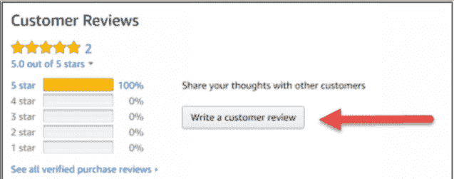

所以，如果你喜欢这本书，请……

>> 点击这里在 Amazon 上留下简短评价。

我非常感谢你的评价，因为它确实意义重大。

衷心感谢你购买这本书并读到最后。

# 第 2 本书：面向 9-15 岁孩子的编程

从零开始学习基础 HTML、CSS 和 JavaScript

## 引言

那是亚特兰大一个阳光明媚的夏日午后；我拿起笔记本电脑，到外面的门廊上观看最新一集《权力的游戏》。当我坐在那把三条腿的椅子上时，我感到后腿晃动了一下。那条腿直接从凳子上脱落，我仰面摔倒在地。听到门廊上传来响亮的砰的一声，我的妻子伊莎贝尔和儿子阿纳德都跑了出来。“你没事吧？”伊莎贝尔倒吸一口气问道。我受了惊吓，但没事，伊莎贝尔把我扶了起来。我走进屋里，拿了一杯水让自己回过神来。令我惊讶的是，透过窗户，我注意到我 9 岁的儿子阿纳德正试着弄清楚如何把它拼回去。他把那条腿装了回去，却发现椅子仍然摇晃。然后他把螺丝换成了好腿上的那颗螺丝；椅子仍然摇晃。最后，他把固定螺丝的滑动机构粘好；这竟然神奇地修好了椅子。哇！！

接下来，我们可以谈谈贝蒂。我们邻居的女儿贝蒂在社会科学这门课上挣扎了很长时间。她的父母已经习惯了她这门课不及格；每次她拿到“D”，他们都会松一口气。所以，想象一下，当贝蒂有一天拿回一张社会科学成绩为“A”的成绩单时，他们有多震惊。是的，贝蒂是个勤奋的女孩，她在某些科目上确实表现不错；但这次转变出乎意料。然后，贝蒂向父母展示了她过去三个月的社会科学提升计划。她列出了每周要学习的主题清单；以及她将如何通过纪录片和小组学习来简化一些较难的主题。她系统地从一个主题推进到另一个主题，直到把所有主题都处理完。

最后，我们来说说卡尔。卡尔高中刚开始时是一名网球选手。他比对手小得多，也弱得多。结果，他在第一次锦标赛中输得很惨。他甚至很难拿到几分。虽然他很难过，但他意识到自己的失败并不是因为缺乏技巧；而是由于当时的情况。他分析了形势；并意识到自己需要提高技术和场上的位置感。他分析对手在场上的移动；并调整自己的击球，总是确保让他们失去平衡。他做了大量瑜伽和其他拉伸运动，以提高柔韧性、平衡感和速度。他开始逐月进步。每个月，他都练习一种不同的击球。几年后，他的身体长开了，变得强壮得多，也更宽壮。由于他的努力，他的技术比对手高得多。高中第三年，他赢得了年度锦标赛，而且真的完全没有竞争对手。

所有这些情况都是假设性的，并且可能因某些孩子天生的特质而发生。此外，编程并不能保证你会学到这些技能。但是，所有这些情况都展示了可以在编程过程中学到的技能。阿纳德系统地检查了椅子及其不同部件；并逐一处理每个部件以找出问题。这与编程中称为“调试”的过程相同。调试是指程序无法运行时进行的处理。它需要对代码进行系统分析，以找出问题并使其正常运行。

贝蒂审视一个问题；并把它组织成实现结果所需的不同部分。这类似于编程中的问题解决。也就是理解解决一个编程问题需要什么；并将代码组织成不同部分，使程序运行起来。

卡尔在做和贝蒂相同的事情；他正在把一个问题拆分成不同部分，以便用简单的方式解决。但除此之外，他还在网球场上对不同技能进行优先级排序。他花时间弄清楚哪些技能对击败对手更重要，并先练习那些技能。在代码被正确组织之后，优先级排序是编程中的一项重要技能。程序员希望优先处理代码中更关键的任务，以便先进行测试。

所有这些技能对编程都至关重要；如果你的孩子要学好编程，就应该学习这些技能。他们是否成为程序员并不重要。这些技能将使你的孩子终身受益。编程还能帮助孩子提高基础数学和阅读能力；此外还能提升逻辑和解决问题的能力。

这些技能，再加上他们在高中培养的沟通能力，正是美国软件工程师年薪中位数达到 112,000 美元（截至 2018 年）的原因。这超过美国平均工资的两倍。

尽管如此，世界各地的高中，甚至富裕地区的高中，都缺乏处理这项任务所需的人员和技术资源。根据 Tech Republic 在 2000 年进行的一项 K-12 教师调查，只有 8% 的教师认为自己有足够的信心教孩子编程。美国有 50% 的孩子在家无法上网。对于美国的女孩和有色人种儿童来说，统计数据更糟；他们可获取的资源和可敬仰的榜样更少。

所以，你需要把这件事掌握在自己手中。

### 不该做什么

你可能想知道要开始该做些什么。有几件事我建议不要做。我建议不要聘请没有教孩子经验的程序员。他们是这个领域的专家；但他们开始编程已经是几十年前的事了；所以，他们无法理解一个以前没学过编程、还在学习基础数学的孩子。接下来要避免的是找一本最新的 JavaScript 教科书；然后读给你的孩子听。这些书对学习编程的有用程度，就像字典对学习一门语言的有用程度一样。它们很贵，而且作为现有程序员的参考工具更有用。我也不推荐编程训练营。这些训练营对少数学生可能有效；但大多数学生会在庞大的学习群体中迷失。一对一的关注是最好的起步方式。

### 入门的第一步

这本书是最好的入门方式。我把编程拆分成一系列基础章节；并将其与现实世界联系起来。第一章将帮助你设置好 JavaScript 和 HTML 文件，以便你开始学习。

我还为每一章提供了代码，你可以复制粘贴后运行。代码的每个方面都解释得很清楚；我还提供了练习，你可以用本章中的概念自己完成。

本书末尾还推荐了一位一对一辅导老师；以及一些可用于拓展知识的其他书籍。


文件 编辑 搜索 视图 编码 语言 设置 工具 宏 运行 插件 窗口 ?

- 新建
- 打开
- 打开所在文件夹
- 在默认查看器中打开
- 在新实例中打开
- 从磁盘重新加载
- 保存
- 另存为...
- 将副本另存为...
- 全部保存
- 重命名...
- 关闭
- 全部关闭
- 关闭多个
- 移到回收站
- 加载会话...
- 保存会话...
- 打印...
- 立即打印
- 1 C:\Users\Administrator\Desktop\Downloads\car.pdf&instruction=Wto - Development model introduction to Web - Development model introduction to Web - Development model introduction to Web&instruction=Try&to&model
- 2 C:\Users\Administrator\Desktop\Downloads\car.pdf&instruction=Wto - Development model introduction to Web - Development model introduction to Web - Development model introduction to Web&instruction=Try&to&model
- 3 C:\Users\Administrator\Desktop\Downloads\car.pdf&instruction=Wto - Development model introduction to Web - Development model introduction to Web - Development model introduction to Web&instruction=Try&to&model
- 4 C:\Users\Administrator\Desktop\Downloads\car.pdf&instruction=Wto - Development model introduction to Web - Development model introduction to Web - Development model introduction to Web&instruction=Try&to&model
- 5 C:\Users\Administrator\Desktop\Downloads\car.pdf&instruction=Wto - Development model introduction to Web - Development model introduction to Web - Development model introduction to Web&instruction=Try&to&model
- 6 C:\Users\Administrator\Desktop\Downloads\car.pdf&instruction=Wto - Development model introduction to Web - Development model introduction to Web - Development model introduction to Web&instruction=Try&to&model
- 7 C:\Users\Administrator\Desktop\Downloads\car.pdf&instruction=Wto - Development model introduction to Web - Development model introduction to Web - Development model introduction to Web&instruction=Try&to&model
- 8 C:\Users\Administrator\Desktop\Downloads\car.pdf&instruction=Wto - Development model introduction to Web - Development model introduction to Web - Development model introduction to Web&instruction=Try&to&model
- 9 C:\Users\Administrator\Desktop\Downloads\car.pdf&instruction=Wto - Development model introduction to Web - Development model introduction to Web - Development model introduction to Web&instruction=Try&to&model
- 10 C:\Users\Administrator\Desktop\Downloads\car.pdf&instruction=Wto - Development model introduction to Web - Development model introduction to Web - Development model introduction to Web&instruction=Try&to&model
- 恢复最近关闭的文件
- 打开所有最近文件
- 清空最近文件列表
- 退出

- 1 C:\Users\Administrator\Desktop\Downloads\car.pdf&instruction=Wto - Development model introduction to Web - Development model introduction to Web - Development model introduction to Web&instruction=Try&to&model
- 2 C:\Users\Administrator\Desktop\Downloads\car.pdf&instruction=Wto - Development model introduction to Web - Development model introduction to Web - Development model introduction to Web&instruction=Try&to&model
- 3 C:\Users\Administrator\Desktop\Downloads\car.pdf&instruction=Wto - Development model introduction to Web - Development model introduction to Web - Development model introduction to Web&instruction=Try&to&model
- 4 C:\Users\Administrator\Desktop\Downloads\car.pdf&instruction=Wto - Development model introduction to Web - Development model introduction to Web - Development model introduction to Web&instruction=Try&to&model
- 5 C:\Users\Administrator\Desktop\Downloads\car.pdf&instruction=Wto - Development model introduction to Web - Development model introduction to Web - Development model introduction to Web&instruction=Try&to&model
- 6 C:\Users\Administrator\Desktop\Downloads\car.pdf&instruction=Wto - Development model introduction to Web - Development model introduction to Web - Development model introduction to Web&instruction=Try&to&model
- 7 C:\Users\Administrator\Desktop\Downloads\car.pdf&instruction=Wto - Development model introduction to Web - Development model introduction to Web - Development model introduction to Web&instruction=Try&to&model
- 8 C:\Users\Administrator\Desktop\Downloads\car.pdf&instruction=Wto - Development model introduction to Web - Development model introduction to Web - Development model introduction to Web&instruction=Try&to&model
- 9 C:\Users\Administrator\Desktop\Downloads\car.pdf&instruction=Wto - Development model introduction to Web - Development model introduction to Web - Development model introduction to Web&instruction=Try&to&model
- 10 C:\Users\Administrator\Desktop\Downloads\car.pdf&instruction=Wto - Development model introduction to Web - Development model introduction to Web - Development model introduction to Web&instruction=Try&to&model

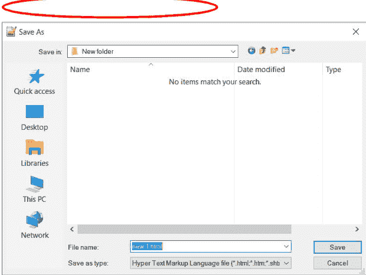

这确保你可以在 Firefox 或 Chrome 等 HTML 浏览器上运行你的程序。

## 测试程序

有一种简单的方法可以测试程序并查看它是否连接到你的浏览器。只需在你的文件中输入随机文本。在我的文件中，我输入了**“测试 1,2,3…….”**。然后点击**文件 > 保存**。之后，根据你使用的浏览器，点击**运行 > 在 Firefox/Chrome/IE 中启动**。如果它正常工作，你输入的文本应该会显示在浏览器窗口中。

### 测试 1,2,3

我知道对某些人来说这可能是一个简单的测试；但在我们进入实际编程之前，确保一切正常工作很重要。

## HTML 简介

### 什么是 HTML？

HTML 代表超文本标记语言。HTML 是人类用来与 Chrome、Internet Explorer、Firefox 等网络浏览器连接的语言。有时，它会由 CSS 和 JavaScript 辅助；但网页的基本结构由 HTML 定义。即使对编程初学者和年幼的孩子来说，它也相当简单且易于掌握。HTML 是使用看起来像箭头两端的简单标签来实现的。

### HTML 标签示例

HTML 标签看起来像这样：

```
<p> - Example of a tag
```

每个 HTML 标签都有一个额外的标签来表示该标签的结束。结束标签除了标签的两端之外，还包含一个斜杠。请参阅下面的简单示例。

```html
<p> - Tag starts
</p> - Tag ends
```

## 基本 HTML 标签及其用途

- `<html>` — 这是开始每一段 HTML 代码的标签。
- `<head>` — 这是在其他任何内容之前首先执行的代码。
- `<title>` — 这是写在浏览器顶部栏中的代码。
- `<body>` — 包含页面上显示的信息。
- `<p>` — 用于正文中显示的一段文本。
- `<h1>, <h2>, <h3>, <h4>, <h5>, <h6>` — 这些用于文本标题，按大小降序排列。`<h1>` 是最大尺寸的标题，`<h6>` 是最小的。
- `<strong>` — 用于将文本加粗。
- `<ul>` — 用于无序列表，例如带项目符号的项。
- `<li>` — 用于在一行文本前添加项目符号图标。
- `<ol>` — 用于有序列表，例如编号为 1、2、3… 的项。
- `<div>` — 这些是较大的内容区块，通常包含若干段落、标题等。
- `<a>` — 用于为文本添加超链接。超链接是指当你点击一段带下划线的文本并链接到另一个页面时发生的情况。
- `` — 用于向网页添加图像。

现在，你可能会想，要学的东西很多。别担心。目前你不需要记住其中任何内容。只需在你编码时将其作为参考。我们将通过一个示例来更好地解释一切。

## HTML 示例

```
<html>
<head>
<title>Greeting to html......</title>
</head>
<body>
<h1>Welcome to your first html website</h1>
<h2>Time to get started....</h2>
<p>Hi. My name is Bob. I am excited to learn about programming a website. Here’s a few things we will learn.</p>
<ul>
<li>Basics of html</li>
<li>CSS</li>
<li>JavaScript</li>
</ul>
</body>
</html>
```

下面的代码相同：（你可以复制并粘贴）

```
<html>
<head>
<title>Greeting to html......</title>
</head>
<body>
<h1>Welcome to your first html website</h1>
<h2>Time to get started....</h2>
<p>Hi. My name is Bob. I am excited to learn about programming a
website. Here’s a few things we will learn.</p>
```


```html
<ul>
<li>Basics of html</li>
<li>CSS</li>
<li>JavaScript</li>
</ul>
</body>
</html>
```

### 这是我们得到的输出

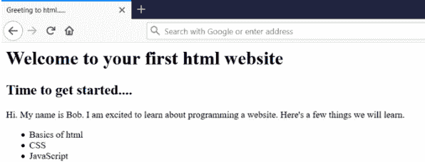

然后让我们将输出与代码中的标签关联起来。

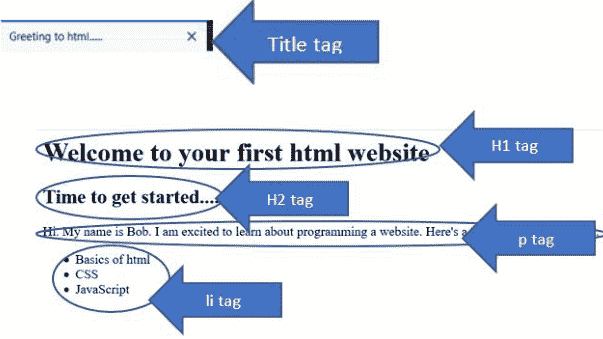

## 练习题

- 1. 创建一个介绍你自己的 HTML 网站。创建一个标题标签，内容为“自我介绍”。使用 h1 和 h2 标签为自己创建一个标题。然后创建一个段落，在其中谈论你自己、你的年龄、学校和家乡。最后，创建一个你爱好的项目符号列表。
- 2. 创建一个谈论你最喜欢的运动队或电视节目的 HTML 网站。创建一个标题标签，内容为节目/运动队的名称。使用 h1 和 h2 标签创建一个标题。然后创建一个段落，在其中谈论你为什么喜欢这个团队/电视节目，以及他们为什么如此棒。最后，创建一个你最喜欢的球员/节目中人物的项目符号列表。

## 灯泡示例 - HTML

### 本项目做什么

这是一个简单的 HTML 项目，它创建一个按钮，可以在页面上打开/关闭灯泡。我们将使用两张灯泡图片来实现这一点。按钮将在两张图片之间切换。

### 本章需要理解的概念

对于这个示例，我们需要理解按钮标签和图像标签。

### 按钮标签

```html
<button onclick=Action >Button text</button>
```

按钮元素有两个元素：动作和按钮文本。按钮文本是显示在按钮上的文本；动作是用户点击按钮时发生的事情。

### 图像标签

```html

```

图像标签有三个元素。

ImageId 是你为图像指定的名称。这个名称用于在代码中引用图像。

ImageUrl 是标签所引用图像的 URL。如果图像与 HTML 文件位于同一文件夹中，那么你可以只使用文件名，而不使用完整 URL。

ImageSize 设置图像的宽度和高度。

### 文件

将灯泡打开和关闭的两张图像包含在我们使用的 HTML 代码的同一文件夹中。你可以点击下面的链接并下载来获取文件：

- [灯泡打开图片](#)
- [灯泡关闭图片](#)

点击“打开灯泡”按钮后：

### 使用 JavaScript 的灯泡

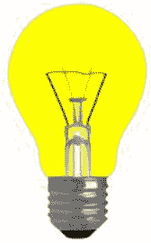

灯泡关闭

灯泡打开

点击“关闭灯泡”按钮后：

### 使用 JavaScript 的灯泡

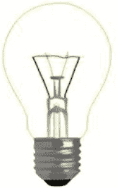

灯泡关闭

灯泡打开

## 练习题：

- 1. 创建一个带有 2 个按钮的程序，按钮标题为“白天”和“夜晚”。当你点击“白天”按钮时，显示一张太阳的图片；当你点击“夜晚”时，显示一张月亮的图片。
- 2. 创建一个有 4 个按钮的程序，这些按钮在 4 种不同的野生动物之间切换。每个按钮的文本分别为“老虎”、“狮子”、“野猪”和“大象”。当你点击每个按钮时，显示相关的动物图片。

## 作者简短留言：

嘿，你喜欢这本书吗？我很想听听你的想法！

许多读者不知道评论多么难得，也不知道它们对作者有多大帮助。

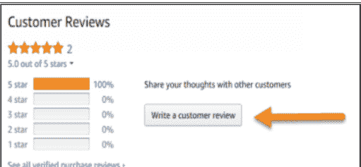

如果你能只花 60 秒在亚马逊上写一段简短评论，即使只有几句话，我也会无比感激！

[>> 点击这里留下快速评论](#)

感谢你抽出时间分享想法！你的评论会真正对我产生影响，并帮助我的作品获得曝光。

## HTML 表单

### 什么是 HTML 表单？

HTML 表单是网页上可以输入信息的空框。就是你在网上看到的那些输入姓名、年龄、密码等的表单。

表单看起来像这样：

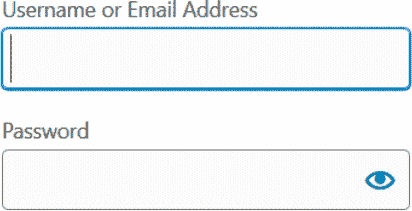

### 表单 HTML 标签格式

下面是一个表单 HTML 标签的示例，它接收姓名、职业和性别。

```html
<form id="form1">
Name: <input name="Enter Name" type="text" id="name" size="20"><br>
Occupation: <input type="text" id="occupation" size="20"><br>
Age: <input type="number" id="gender" size="20"><br>
</form>
```

运行程序后，输出如下所示。你可以在输出的空框中输入任何内容。空框也称为文本框。

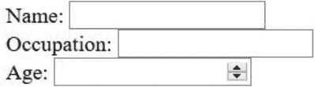

### 表单 HTML 标签的不同部分

`<form id="form1">`

表单 id 标签是表单的名称，将在其余代码中用作引用。

- `Name:`
- `Occupation:`
- `Age:`

这是写在框左侧的文本。它用于向用户描述应该在框中填写什么。

`input type="text"`

这意味着你在框中输入的内容是文本或字符串类型。例如，姓名和职业使用 text，因为你在框中输入字母。

`input type="number"`

这意味着你在框中输入的内容是数字。例如，年龄和电话会使用 number，因为它们完全是数字。

```
id="name"
id="occupation"
id="gender"
```

id 是框在程序其余部分中的名称。我们将在程序其余部分使用 id 来引用该框。

```
size="20"
```

这意味着框的长度是 20 像素。要更改这一点，请更改 size 的值。例如，如果你想把框的长度加倍，请将 size 改为 40。

## JavaScript 示例

### 什么是 JavaScript？

JavaScript 是一种高级编程语言。它最常用于在 HTML 页面上执行用户操作。它还有助于增强用户在网页上的交互。

### 如何在 HTML 中使用 JavaScript

在 HTML 页面上使用 JavaScript 有两种方式：

第一种方式是直接将 JavaScript 代码包含在 `<script>` 标签中。如下所示：

```html
<html>
<head>
<title> </title>
</head>
<body>
<script>
</script>
</body>
</html>
```

JavaScript 代码将位于上方以红色显示的两个 script 标签内。

第二种方式是创建一个 JavaScript 文件并将其保存为 .js 文件。然后你在 HTML 代码中引用该 JavaScript 文件。如下所示。

```html
<html>
<head>
<title> </title>
</head>
<body>
<script src="newfile.js"></script>
</body>
</html>
```

你将把所有 JavaScript 代码包含在 **newfile.js** 文件中。

## 你需要了解的 JavaScript 术语

接下来我们会看几个 JavaScript HTML 代码示例。我们需要了解以下术语才能理解代码。

### 函数

JavaScript 函数是执行任务的一组代码行。函数通常用于执行当用户点击 HTML 按钮时需要发生的任务。每个函数都有一个名称，并在 HTML 代码中被引用。示例如下：

```
function abcd()
```

abcd 是执行特定任务的函数名称。在 HTML 代码中将通过 abcd 引用它。

### 变量

变量用于在 JavaScript 中存储名称或数字。可以把它想象成一个只能存储一个值的盒子。每次需要该值时都会引用这个盒子。定义如下：

```
var flag=1;
```

`flag` 是变量的名称，它存储值 1。因此，每当在 JavaScript 程序中引用 `flag` 时，它的值都是 1（除非你更改 flag 的值）。这个 flag 的值可用于定义其他变量。例如：

```
var king=flag*2;
```

king 现在的值为 1*2=2。因此变量是处理未知量的好方法。

### document.getElementById().value

这个 JavaScript 术语用于获取 HTML 表单文本框中某一项的值。因此，如果你在表单文本框中填写姓名并点击按钮，document.getElementById() 会获取你在框中输入的值。例如：

```
var yname=document.getElementById("name").value;
```

“name”是在 HTML 中定义的表单文本框的 id。要了解这在 HTML 中如何实现，请查看上一章关于 HTML 标签的部分。文本框中输入的任何内容都会存储在名为 `yname` 的变量中。从现在起，在 JavaScript 中将通过 yname 引用它。

### Document.write()

此函数用于在网页浏览器上打印任何内容。
例如，

```
document.write("xyz");
```

在屏幕上打印 **xyz**

你还可以使用“+”按钮添加两个不同的项。

```
document.write("xyz"+"123");
```

在屏幕上打印 **xyz123**。
当你想向变量添加文本时，这很有用。例如。

```
var yname=document.getElementById("name").value;
document.write("My name is "+yname);
```

如果你在文本框中输入了“Matt”，它会在屏幕上打印出 **“我的名字是 Matt”**。


### parseInt()

parseInt() 将数字转换为整数，无论它是否为小数。例如，parseInt(2.8) 将等于 3。parseInt(2) 就只是 2。

### parseFloat()

parseFloat() 与 parseInt() 的作用相反。它将数字转换为小数。例如，parseFloat(2) 将等于 2.0。parseFloat(3.1) 就只是 3.1。

## JavaScript 示例 1

下面的代码创建了一个 HTML 表单，用于接受一个人的姓名、年龄和爱好。有一个 HTML 按钮，点击时会生成 JavaScript 代码。点击时，JavaScript 代码会打印出这个人的姓名、年龄和爱好。JavaScript 代码位于 <script> 标签内。下面展示了代码及其输出；之后还会解释其中几行代码。

```html
<html>
<head>
<title>Print Name and Age......</title>
</head>
<body>
<form id="form1">
Enter Name: <input name="Enter Name" type="text" id="name" size="20"><br>
Enter Favorite Hobby: <input type="text" id="hobby" size="20"><br>
Enter Age: <input type="number" id="age" size="20"><br>
</form>
<button onclick="writename()">Print Intro</button>
<script>
function writename()
{
    var nameValue=document.getElementById("name").value;
    var hobbyValue=document.getElementById("hobby").value;
    var ageValue=document.getElementById("age").value;

    document.write("This is "+nameValue+"! I am "+ageValue+" years old. My favorite hobby is "+hobbyValue);
}
</script>
</body>
</html>
```

### 输出：

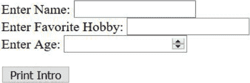

### 输出（已填写）：

输入姓名：Tim

输入爱好：Soccer

输入年龄：10

打印介绍

### 输出（点击“打印介绍”按钮后）

这是 Tim。我 10 岁。我最喜欢的爱好是 Soccer。

### 代码解析：

```
<form id="form1">
Enter Name: <input name="Enter Name" type="text" id="name" size="20"><br>
Enter Favorite Hobby: <input type="text" id="hobby" size="20"><br>
Enter Age: <input type="number" id="age" size="20"><br>
</form>
```

这段 HTML 代码创建了一个包含 3 个表单元素的表单，分别用于姓名、爱好和年龄。它们的长度都是 20 像素。它们通过 id 引用；id 分别为 **name**、**hobby** 和 **age**。

```
<button onclick="writename()">Print Intro</button>
```

这个 HTML 按钮会激活名为 **writename()** 的 JavaScript 函数，按钮上的文本是 **打印介绍**。

```
function writename()
{
    var nameValue=document.getElementById("name").value;
    var hobbyValue=document.getElementById("hobby").value;
    var ageValue=document.getElementById("age").value;
    document.write("This is "+nameValue+". I am "+ ageValue+" years old. My favorite hobby is "+hobbyValue);
}
```

上述 JavaScript 代码在按下按钮时被激活。**nameValue**、**hobbyValue** 和 **ageValue** 存储输入到 id 为 **“name”**、**“hobby”** 和 **“age”** 的表单元素中的值。**document.write** 将介绍内容写到屏幕上。

## JavaScript 示例 2

下面的代码创建了一个 HTML 表单，用于接受两个数字，然后创建 4 个 HTML 按钮。

有 4 个 JavaScript 函数，分别用于对两个数字进行加、减、乘、除。根据点击的按钮，会选择特定的 JavaScript 代码。

下面展示了代码及其输出；之后还会解释其中几行代码。

```html
<html>
<head>
<title>Mini Calculator......</title>
</head>
<body>
<form id="form1">
Enter Number 1: <input type="number" id="num1" size="20"><br>
Enter Number 2: <input type="number" id="num2" size="20"><br>
</form>
<button onclick="sum()">+</button>
<button onclick="subtract()">-</button>
<button onclick="multiply()">*</button>
<button onclick="divide()">/</button>

<script>

function sum()
{
    var number1=parseFloat(document.getElementById('num1').value);
    var number2=parseFloat(document.getElementById('num2').value);
    var total=number1+number2;
    document.write("The sum is "+total);
}
function subtract()
{
    var number1=parseFloat(document.getElementById('num1').value);
    var number2=parseFloat(document.getElementById('num2').value);
    var diff=number1-number2;
    document.write("The difference is "+diff);
}
function multiply()
{
    var number1=parseFloat(document.getElementById('num1').value);
    var number2=parseFloat(document.getElementById('num2').value);
    var multi=number1*number2;
    document.write("The product is "+multi);
}
function divide()
{
    var number1=parseFloat(document.getElementById('num1').value);
    var number2=parseFloat(document.getElementById('num2').value);
    var div=number1/number2;
    document.write("The quotient is "+div);
}
</script>
</body>
</html>
```

### 输出：

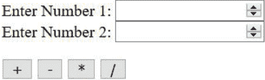

### 输出（已填写）：

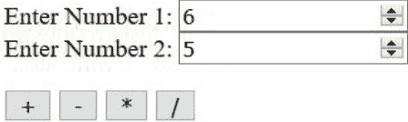

### 答案（+ 按钮）：

和为 11

### 答案（- 按钮）：

差为 1

### 答案（* 按钮）：

积为 30

### 答案（/ 按钮）：

商为 1.2

### 代码解析

```html
<form id="form1">
Enter Number 1: <input type="number" id="num1" size="20"><br>
Enter Number 2: <input type="number" id="num2" size="20"><br>
</form>
```

上述代码创建了一个接受两个数字的表单，id 分别为 num1 和 num2。

```html
<button onclick="sum()">+</button>
<button onclick="subtract()">-</button>
<button onclick="multiply()">*</button>
<button onclick="divide()">/</button>
```

上述代码创建了 4 个按钮。这 4 个按钮分别激活函数 sum()、subtract()、multiply() 和 divide()。

```javascript
function sum()
{
    var number1=parseFloat(document.getElementById('num1').value);
    var number2=parseFloat(document.getElementById('num2').value);
    var total=number1+number2;
    document.write("The sum is "+total);
}
```

number1 和 number2 存储使用 id 为 num1 和 num2 的表单中输入的数字。

Total 存储两个数字的和。

document.write 将总和写到屏幕上。

## 练习题

你可以复制上面的代码并尝试修改。一旦你理解了代码，你就可以创建自己的 JavaScript HTML 函数。这里有几个你可以尝试的练习。

- 1. 编写一个程序，使用 6 个文本框输入 6 门学科的学校成绩。编写两个 JavaScript 函数，分别计算这些学科的总分和平均分。
- 2. 编写一个 JavaScript 程序，输入 5 个不同学生的姓名和爱好，并打印出这些学生的姓名和爱好。

## 条件语句

### 什么是条件语句？

它是一种检查某个条件是否为真的语句。它可以简单到检查一个数字是否小于 10，也可以复杂到检查患者的医学样本以判断某些医疗状况。
在 JavaScript 中，条件语句通过 IF ELSE 语句实现。所以，它基本上检查某件事是否为真，如果为真，则执行一个操作。如果不为真，则执行其他操作。例如，

```
IF (George=="Hungry")
{
    document.write("Give George a Snack");
}
ELSE
{
    document.write("No snack for George");
}
```

在上面的示例中，代码检查 George 是否饿了，并执行两个操作之一。如果 George 饿了，则打印 ‘Give George a snack’。如果没有，则打印 ‘No snack for George’。
这是 JavaScript 中使用 IF ELSE 语句的条件语句的一个简单示例。

### IF ELSE 循环 – 示例 1

```html
<html>
<head>
<title>Check if sum of two numbers is greater than 15.....</title>
</head>
<body>
<form id="form1">
Enter Number 1: <input type="number" id="num1" size="20"><br>
Enter Number 2: <input type="number" id="num2" size="20"><br>
</form>
<button onclick="check10()">Check the sum</button>

<script>

function check10()
{
var num1=parseFloat(document.getElementById("num1").value);
var num2=parseFloat(document.getElementById("num2").value);
    if ((num1+num2)<15)
    {
        document.write('Sum of two numbers is less than 15');
    }
    else
    {
        document.write('Sum of two numbers is greater than or equal to 15');
    }
}

</script>
</body>
</html>
```


### 输出

输入数字1：[数字输入]  
输入数字2：[数字输入]  
[检查总和]

### 输出（用户填写后）

输入数字1：3  
输入数字2：4  
[检查总和]

### 输出（点击“检查总和”按钮后）

两个数字之和小于15

### 输出（填写第二组数字后）

输入数字1：14  
输入数字2：3

检查总和

### 输出（点击“检查总和”按钮后）

两个数字之和大于或等于15

### 代码解析

```javascript
var num1=parseFloat(document.getElementById("num1").value);
var num2=parseFloat(document.getElementById("num2").value);
```

这两行代码将用户输入的两个数字的值分别存储在变量 num1 和 num2 中。

```javascript
if ((num1+num2)<15)
```

这里检查两个数字之和是否小于15。

```javascript
{
document.write('Sum of two numbers is less than 15');
}
```

如果总和小于15，则执行上述循环，并输出“Sum of two numbers is less than 15”。

```javascript
else
{
document.write('Sum of two numbers is greater than or equal to 15');
}
```

如果总和大于或等于15，则执行上述循环，并输出“Sum of two numbers is greater than or equal to 15”。

### IF ELSE 循环 – 示例 2

```html
<html>
<head>
<title>检查数字是否能被2整除.....</title>
</head>
<body>
<form id="form1">
输入数字： <input type="number" id="num1" size="20"><br>
</form>
<button onclick="checkdivby2()">检查整除</button>

<script>
function checkdivby2()
{
var number=parseFloat(document.getElementById("num1").value);
if ((number%2)==0)
{
    document.write(number+" 能被2整除");
}
else
{
    document.write(number+" 不能被2整除");
}
}
```

### 输出

输入数字：[ ]

检查整除

### 输出（填写1）

输入数字：12

检查整除

### 输出（点击“检查整除”按钮后）

12 能被2整除

### 输出（填写2）

输入数字：21

检查整除

### 输出（点击“检查整除”按钮后）

21 不能被2整除

### 代码解析

```javascript
if ((number%2)===0)
```

上面的代码行检查数字是否能被2整除。

```javascript
{
    document.write(number+" 能被2整除");
}
```

如果数字能被2整除，则执行上述代码段。它会输出该数字能被2整除。

```javascript
else
```

```javascript
{
    document.write(number+" 不能被2整除");
}
```

如果数字不能被2整除，则执行上述代码段。它会输出该数字不能被2整除。

### 练习

你可以复制上面的代码并进行修改测试。一旦你理解了代码，就可以创建自己的 JavaScript HTML 函数。这里有几个可以尝试的练习。

- 1. 编写一个程序，使用6个文本框输入6门科目的学校成绩。编写一个 JavaScript 函数，检查平均分并判断学生是否通过。如果分数低于60，则学生不及格。
- 2. 编写一个程序，输入一个年份并判断它是否为闰年。

## 嵌套条件语句

嵌套条件语句基本上就是条件语句中再包含条件语句，也称为嵌套循环。假设你想在 JavaScript 中检查两个条件是否同时为真，然后再执行某个操作；这时就需要把两个 if 循环嵌套在一起。我们沿用上一章的例子：想检查乔治是否饿了，以及他是否有钱，从而决定是否给他买零食。如果条件不成立，则执行其他操作。例如：

```javascript
IF (乔治=="饿了")
{
    IF (乔治=="有钱")
    {
        输出("给乔治买份零食");
    }
    ELSE
    {
        输出("给乔治做份零食");
    }
}
ELSE
{
    输出("不给乔治零食");
}
```

在上面的示例中，代码首先检查乔治是否饿了。如果乔治饿了，则执行第二次检查，检查他是否有钱。如果乔治有钱，就输出“给乔治买份零食”。如果他饿了但没钱，就输出“给乔治做份零食”。如果他不饿，就输出“不给乔治零食”。

这就是 JavaScript 中一个简单的嵌套 IF ELSE 语句示例。

### 嵌套 IF ELSE 循环示例

在这个示例中，我们将输入一个4位数的年份，并判断它是否为闰年。这比我们想象的要复杂一些。我们知道每4年是一个闰年，所以这是我们的第一重检查。例如，1996年应该是闰年。但是，每100年没有闰年，因此1800年和1900年不是闰年。另外，还有一个例外：每400年不是闰年，所以1600年和2000年不是闰年。因此需要进行3重检查。

```html
<html>
<head><title>闰年检查</title></head>
<body>
<form id="form1">
输入年份： <input type="number" id="year" size="20"><br>

</form>
<button onclick="leapyear()">是否为闰年？</button>

<script>

function leapyear()
{
var yr=parseInt(document.getElementById("year").value);
var leapyear=0;
    if ((yr%4)==0)//第一个循环，检查年份是否能被4整除
    {
        lpyear=1;
        if((yr%100)==0)//第二个循环，检查年份是否能被100整除
        {
            lpyear=0;
            if(yr%400==0)//第三个循环，检查年份是否能被400整除
            {
                lpyear=1;
            }
        }
    }
if (lpyear==1)
{
    document.write(yr+" 是闰年");
}
else
{
    document.write(yr+" 不是闰年");
}
}
</script>
</html>
```

### 输出

输入年份：[ ]

是否为闰年？

### 运行 #1

输入年份：1992

是否为闰年？

### 输出

1992 是闰年

### 运行 #2

输入年份：1995

是否为闰年？

### 输出

1995 不是闰年

### 运行 #3

输入年份：1900

是否为闰年？

### 输出

1900 不是闰年

### 运行 #4

输入年份：2000

是否为闰年？

### 输出

2000 是闰年

从上面的代码和结果可以看出，它通过使用3个嵌套的 if 循环正确地计算了闰年。
1992年是闰年，因为它能被4整除。
1995年不是闰年，因为它不能被4整除。
1900年不是闰年，因为它能被100整除。
2000年是闰年，因为它能被400整除。

### 练习

你可以复制上面的代码并进行修改测试。一旦你理解了代码，就可以创建自己的 JavaScript HTML 函数。这里有几个可以尝试的练习。

- 1. 有三个传感器连接到打印设备上，每个传感器连接一个报警器。第一个传感器“A”检测设备是否需要墨水。第二个传感器“B”检测设备是否需要维修。第三个传感器“C”检测设备是否应该卡纸。如果出现两个或更多问题，报警器就会响起。
- 2. 学校根据特定情况决定是否停课（雪天）。如果路面结冰但没有盐，则停课。然而，如果有盐，则不停课。无论是否有盐，只要降雪量超过2英寸，就停课。
- 3. 计算机芯片控制儿童是否可以观看特定的电视节目。如果时间在下午5点之前，电视始终可以播放。但是，如果在下午5点之后，则使用节目的分级。如果分级为普通观众，电视可以播放；然而，如果分级为成人观众，电视则不会打开。

## 循环

循环是一组重复执行一定次数的指令。大多数情况下，会执行某个过程，并有一个计数器，每次递增1。在过程结束时，我们检查计数是否超过了我们需要该过程执行的次数。如果达到了所需次数，则停止循环。

例如，假设你想在屏幕上打印数字1到10。那么可以使用一个从1数到10的循环，每次将计数打印在屏幕上。

在 JavaScript 中，我们使用名为 **FOR** 的函数来实现这种循环。下面我们看一个简单的示例。


### 示例 #1

```html
<html>
<head><title>Print 1 to 20</title></head>
<body>

<button onclick="printtotwenty()">Print To 20</button>

<script>

function printtotwenty()
{

for (i=1;i<=20;i++)
{
    document.write(i+"<br>");
}

}

</script>

</body>
</html>
```

在这个函数中，我们创建了一个函数 `printtotwenty`，它打印从1到20的数字。标题为“打印到20”的按钮激活该函数。
在函数中有一个 for 循环：

`for (i=1; i<=20; i++)`

上面这行代码表示循环从1运行到20；每次递增1。
`document.write` 每次打印 `i` 的值。

下面是结果：


点击按钮后，我们得到：

- 1
- 2
- 3
- 4
- 5
- 6
- 7
- 8
- 9
- 10
- 11
- 12
- 13
- 14
- 15
- 16
- 17
- 18
- 19
- 20

按计划打印出1到20。所以，接下来，我们将做同一个程序的不同版本。不只是打印1到20；我们将让你选择要打印多少个数字。只需在文本框中输入循环长度，它就会打印出来。

### 示例 #2

```html
<html>
<head><title>JavaScript Greetings......</title></head>
<body>
<form id="form1">
Loop Length: <input type="number" id="loop" size="20"><br>
</form>

<button onclick="printttowenty()">Print To 100</button>
<button onclick="printlooplength()">Print Loop Length</button>

<script>

function printttowenty()
{

for (i=1;i<=20;i++)
{
    document.write(i+"<br>");
}

}

function printlooplength()
{
var looplength=parseInt(document.getElementById("loop").value);

var j=1;
for (j=1;j<=looplength;j++)
{
    document.write(j+"<br>");
}
}

</script>

</body>
</html>
```

现在，运行程序后，我们得到：

循环长度：50

打印到100   打印循环长度

所以，现在点击**“打印循环长度！”**

- 1
- 2
- 3
- 4
- 5
- 6
- 7
- 8
- 9
- 10
- 11
- 12
- 13
- 14
- 15
- 16
- 17
- 18
- 19
- 20
- 21
- 22
- 23
- 24
- 25
- 26
- 27
- 28
- 29
- 30
- 31
- 32
- 33
- 34
- 35
- 36
- 37
- 38
- 39
- 40
- 41
- 42
- 43
- 44
- 45
- 46
- 47
- 48
- 49
- 50

所以，它打印从1到50。如果你想打印1到100，那么在文本框中输入100并点击同一个按钮。

上面的程序有一个额外的文本框和额外的按钮。文本框用于接受 `loop` 的长度，按钮链接到一个名为 `printlooplength()` 的函数，该函数打印 for 循环。变量 `looplength` 存储你在文本框中输入的值。for 循环从1运行到 `looplength`。在上面的例子中，`looplength` 是50；所以它从1运行到50。每次运行时，它使用 `document.write` 函数打印计数器。

### 示例 #3

现在，我们将用循环做一些更酷的事情。我们将根据循环长度打印一个星号图案。

```html
<html>
<head><title>JavaScript Greetings......</title></head>
<body>
<form id="form1">
Loop Length: <input type="number" id="loop" size="20"><br>
Star Loop Length: <input type="number" id="starloop" size="20"><br>
</form>

<button onclick="printtwenty()">Print To 100</button>
<button onclick="printlooplength()">Print Loop Length</button>
<button onclick="looplengthstar()">Print Star Loop</button>

<script>

function printtwenty()
{
for (i=1;i<=20;i++)
{
document.write(i+"<br>");
}
}

function printlooplength()
{
var looplength=parseInt(document.getElementById("loop").value);

var j=1;
for (i=1;i<=looplength;i++)
{
document.write(i+"<br>");
}
}
function looplengthstar()
{
var looplength=parseInt(document.getElementById("starloop").value);

for (i=1;i<=looplength;i++) {
    for (j=1;j<=i;j++)
    {
        document.write("*");
    }
    document.write("<br>");
}
}

</script>

</body>
</html>
```

输出如下：

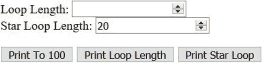

输入20，然后点击“打印星号循环”后，我们得到：

```
*
**
***
****
*****
******
*******
********
*********
**********
***********
************
*************
**************
***************
****************
*****************
******************
*******************
********************
```

上面的程序有一个额外的文本框和额外的按钮。文本框用于接受 `starloop` 的长度，按钮链接到一个名为 `looplengthstar()` 的函数，该函数打印星号循环。`Looplengthstar()` 是一个嵌套的 for 循环，这意味着它有一个循环在另一个循环内部。变量 `looplength` 存储你输入的星号循环长度的值。第一个 for 循环从1到 `looplength`。所以，在上面的例子中，第一个循环从1到20。因此，在其中，还有另一个 for 循环。第二个循环基本上在一行中打印 `*`。它打印 `*` 的次数取决于第一个循环中的计数器。例如，如果第一个循环计数器是5（i==5）；那么第二个循环打印星号5次。类似这样 `*****`。所以，每次第一个循环增加并移动到下一行时，第二个循环都会这样做。

### 练习：

你可以复制上面的示例，一旦你能够运行它们并理解代码；你可以尝试下面的一些问题。

- 1. 斐波那契数列是一组这样的数字：0,1,1,2,3,5,8,13.... 每个数字是前两个数字之和。使用 for 循环，打印序列的前20个数字。
- 2. 编写一个程序，在文本框中输入一个数字，并打印一个倒置的星号循环。
- 3. 编写一个程序，在文本框中输入一个数字，并打印其各位数字之和。

## 数组

### 什么是数组？

数组基本上是一组存储在单个名称下的项目。它们通过该名称的不同索引进行访问。例如，在JavaScript中：

`var name[5]` 是一个大小为5的数组。第一个元素是 `name[0]`，第二个元素是 `name[1]`，依此类推。

所以，如果我们想给数组赋值：

```javascript
var name[5]=["Abhi", "Bob", "Aaron", "Steve", "Mark"]
```

上面创建了一个大小为5的数组。要在JavaScript中打印第一个元素，我们这样做：

```javascript
document.write(name[0]);
```

这会打印出 Abhi，它是数组的第一个元素。

如果我们这样做：

```javascript
document.write(name[4]);
```

这会打印出 Mark，它是数组的最后一个元素。

如果我们想向数组添加一个元素，请使用 push 函数，如下所示：

```javascript
name.push("Carl");
```

```javascript
document.write(name[5]);
```

这会打印出 Carl，它是数组的新元素。

现在，让我们看几个例子：

### 示例 1

在这个例子中，我们在JavaScript中创建3个数组并给它们赋值，然后在屏幕上打印它们。

```html
<html>
<head><title>Arrays 1</title></head>
<body>

<button onclick="createarray()">Create Array</button>

<script>

function createarray()
{
var name = ["Bob","Peter","Nick"];
var age=[32,10,11];
var loc=new Array("New York","Rockford","Kansas");// 2nd way to start array
document.write(name[0]+' lives in '+loc[0]+' and age is '+age[0]+'<br>');
document.write(name[1]+' lives in '+loc[1]+' and age is '+age[1]+'<br>');
document.write(name[2]+' lives in '+loc[2]+' and age is '+age[2]+'<br>');
name.push("Steve");
age.push(20);
loc.push("Miami");
document.write(name[3]+' lives in '+loc[3]+' and age is '+age[3]+'<br>');
}

</script>

</body>
</html>
```

上面的例子中，`createarray()` 创建了3个数组 `name`、`age` 和 `loc`。每个数组分配了三个元素。它们使用 `document.write()` 打印在屏幕上。

之后，我们使用 `push` 为所有3个数组添加第四个元素，然后也将其打印出来。


一旦我们点击“创建数组”按钮：

鲍勃住在纽约，年龄是32  
彼得住在罗克福德，年龄是10  
尼克住在堪萨斯，年龄是11  
史蒂夫住在迈阿密，年龄是20

我们基本上只是打印出数组的所有元素。既然我们知道了如何创建数组，那就用我们输入到文本框中的信息来实践一下吧。

### 示例 2

```html
<html>
<head><title>Arrays 2</title></head>
<body>
<form id="form1">
Enter Name:<input name="name" type="text" id="name" size="20"><br>

Enter Work Day 1:<select style="width: 280px" id="day1" name="Day 1">
<option value="Sunday">Sunday</option>
<option value="Monday">Monday</option>
<option value="Tuesday">Tuesday</option>
<option value="Wednesday">Wednesday</option>
<option value="Thursday">Thursday</option>
<option value="Friday">Friday</option>
<option value="Saturday">Saturday</option>
</select>
<br>

Enter Work Day 2:<select style="width: 280px" id="day2" name="Day 2">
<option value="Sunday">Sunday</option>
<option value="Monday">Monday</option>
<option value="Tuesday">Tuesday</option>
<option value="Wednesday">Wednesday</option>
<option value="Thursday">Thursday</option>
<option value="Friday">Friday</option>
<option value="Saturday">Saturday</option>
</select>
<br>

</form>

<button onclick="assignarray()">Info Array</button>
<script>
function assignarray()
{
var name=document.getElementById("name").value;
var day1=document.getElementById("day1").value;
var day2=document.getElementById("day2").value;
var employeeobj=[name,day1,day2];
document.write(employeeobj[0]+" works on "+employeeobj[1]+" and "+employeeobj[2]);
}
</script>
</body>
</html>
```

上面的代码从1个文本框和2个选择框中获取用户输入。选择框已设置好，你可以从7个工作日（周日到周六）中进行选择，如下所示：


一旦点击“Info Array”按钮，assignarray() 函数就会接收这3个输入，并创建一个名为 employeeobj 的数组。

employeeobj[0] 是第一个元素，被赋值为姓名。  
employeeobj[1] 是第二个元素，被赋值为 day1。  
employeeobj[2] 是第三个元素，被赋值为 day2。

然后我们使用 document.write 将这三个值都打印到屏幕上。现在，让我们运行程序。

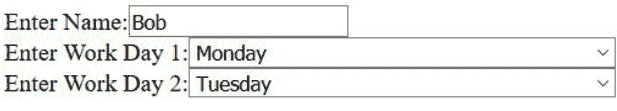

鲍勃在周一和周二工作

你可以复制上面的代码，并在你的计算机上实现同样的程序。现在，一旦你能够做到这一点，让我们再做几道题：

### 练习

你可以复制上面的示例，一旦你能够运行它们并理解代码，就可以尝试下面的一些问题。

- 1. 为你的学校创建5个数组。第一个数组存储学生姓名的值；第二个数组存储他们的数学成绩；第三个数组存储他们的历史成绩；第四个数组存储他们的英语成绩。现在，计算平均分并将其存储到第5个数组中。姓名和3个成绩通过文本框输入，函数将打印出学生姓名和平均分。
- 2. 创建一个大小为12的数组，用于存储一年中的月份。用户可以通过文本框输入月份编号；函数应使用该数组将编号与实际月份关联起来。然后打印出数组中对应的月份。

## 玩转字符串

### 字符串和字符串变量

我们在前面的章节中已经提到过这一点。字符串是程序中使用的任何一段文本。例如，“abcd”是一个字符串；而数字7不是字符串，它是整数。

字符串变量是存储字符串的地方。例如，下面的 st 是一个字符串变量，它存储的值是“abcd”。

```
var st="abcd";
```

现在，让我们运用 JavaScript 和循环的知识来玩转字符串。

### 查找字符串长度

现在，让我们在文本框中输入一个字符串，并查找该字符串的长度。

```html
<html>
<head><title>JavaScript Lesson 4 - Strings</title></head>
<body>
<form id="form1">
Enter Name:<input name="name" type="text" id="name1" size="20"><br>
</form>
<button onclick="strlength()">Name Length</button>
<script>

function strlength()
{
var name2=document.getElementById("name").value;
document.write(name2.length);
}
</script>

</body>
</html>
```

下面的代码允许你通过文本框输入姓名。当你点击按钮时，它会运行 strlength() 函数，该函数计算你姓名的长度。

`name2` 是存储你姓名值的变量。

`name2.length` 获取字符串的长度（你姓名中的字母数）。

让我们看看输出：

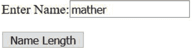

点击**“姓名长度”**按钮后，我们得到：

6

让我们再看一个例子：

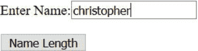

点击**“姓名长度”**按钮后，我们得到：

11

那么，既然我们知道了如何查找字符串的长度，就让我们运用这一知识来反转你的姓名。下面的代码实现了这一点。

```html
<html>
<head><title>JavaScript Lesson 4 - Strings</title></head>
<body>
<form id="form1">
Enter Name:<input name="name" type="text" id="name" size="20"><br>
</form>
<button onclick="strlength()">Name Length</button>
<button onclick="namereverse()">Name Reverse</button>
<script>

function strlength()
{
var name2=document.getElementById("name").value;
document.write(name2.length);
}

function namereverse()
{
var name2=document.getElementById("name").value;
len=name2.length;
for (i=len-1;i>=0;i--)
{
document.write(name2[i]);
}
}

</script>

</body>
</html>
```

下面的代码允许你通过文本框输入姓名。当你点击按钮时，它会运行 `namereverse()` 函数，该函数会反转你的姓名。Name2 存储你输入的姓名值。len 存储你姓名中的字母数。然后我们创建一个从 len-1 到 0 的循环。使用 0 的原因是因为 name2 是一个字母数组。在 JavaScript 中，数组的第一个索引是 0。所以第一个字符是 name2[0]。在循环中，我们向后遍历，每次将计数减1。并且，在循环内，我们打印由计数索引的字符值。现在，让我们运行程序：

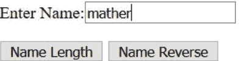

点击**“姓名反转”**按钮后，我们得到

rehtam

现在，如果字符串末尾有很多空格怎么办？让我们通过修剪字符串来解决这个问题。

### 拆分字符串

现在，你知道可以将字符串拆分成元素数组吗？你可以使用 split 函数来实现这一点。现在，让我们尝试一个示例。在下面的代码中，你在文本框中输入一个由逗号分隔的3种动物列表。

split 函数将其分隔成一个包含3个元素的数组，你可以使用 document.write 函数打印出每个元素。

```html
<html>
<head><title>Splitting Strings</title></head>
<body>
<form id="form1">
Enter List of 3 Animals separated by commas:<input name="name" type="text" id="ani" size="20"><br>

</form>
<button onclick="strsplit()">Get Animals</button>

<script>

function strsplit()
{
var animal=document.getElementById("ani").value;
anarray=animal.split(","); // Split on commas
document.write("The first animal is "+anarray[0]+"<br>");
document.write("The second animal is "+anarray[1]+"<br>");
document.write("The third animal is "+anarray[2]+"<br>");
}

</script>
</body>
</html>
```

现在，让我们看看输出：

输入由逗号分隔的3种动物列表：`tiger, lion, wolf`

获取动物

点击**“获取动物”**按钮后，我们得到：

第一种动物是 tiger  
第二种动物是 lion  
第三种动物是 wolf

上面的代码在你输入3种动物时有效。你可能会问，是否有代码可以处理超过3种动物？是的，可以。你需要使用 length 函数找到字符串数组的长度，然后在打印动物时使用 FOR 循环。在**for 循环**中，我们使用 **aninumber** 来跟踪动物计数；并使用 **aniarray[i]** 来跟踪要打印的实际动物。

注意，**aninumber** 总是比 i 大1，因为在 JavaScript 数组中 i 从0开始。

代码如下：

```html
<html>
<head><title>Splitting Strings</title></head>
<body>
<form id="form1">
Enter list of 3 Animals separated by commas:<input name="name" type="text" id="ani" size="20"><br>
</form>

<button onclick="strsplit()">Get Animals</button>

<script>

function strsplit()
{
var animal=document.getElementById("ani").value;
aniarray=animal.split(",");       // Split on commas
var len=aniarray.length;
var aninumber;
for (i=0; i<=len-1;i++)
{
aninumber=i+1;
document.write("Animal "+aninumber+" is "+aniarray[i]+"<br>");
}
}

</script>
</body>
</html>
```


此外，下面是输出结果。

输入以逗号分隔的动物列表：`lion, tiger, wolf, rhino, dog`

[获取动物]

我们输入 5 种动物的名称，然后点击 **获取动物** 按钮。

- 动物 1 是 lion
- 动物 2 是 tiger
- 动物 3 是 wolf
- 动物 4 是 rhino
- 动物 5 是 dog

### 替换字符串

现在，假设你有一个长段落，并且想将某个特定单词替换为另一个单词。你使用 .replace 函数。
在下面的示例中，我们将“Atlanta”替换为“Charleston”。请记住，这只对 Atlanta 的 1 个实例生效。

我们使用一个名为 textarea 的 HTML 表单元素。Textarea 是文本框的更大形式，可以接收用户输入的多行文本。然后我们将修改后的句子写到屏幕上。

```html
<html>
<head><title>Replacing Strings</title></head>
<body>
<form id="form1">
What was your day like?: <textarea name="sentence" cols="20" rows="5" id="sentence"></textarea><br><br>
</form>
<button onclick="strreplace()">Fix Sentence</button>
<script>
function strreplace()
{
var daysdes=document.getElementById("sentence").value;
var daysdesmod=daysdes.replace("Atlanta","Charleston");
document.write(daysdesmod);
}
</script>
</body>
</html>
```

现在，让我们运行程序。

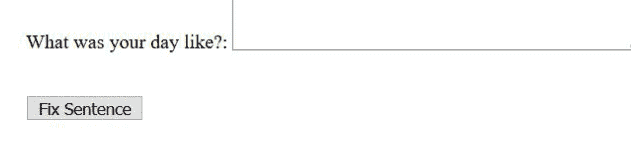

点击 **修复句子** 按钮后，我们得到：

今年夏天我去了 Charleston，度过了一个漫长而愉快的暑假。

### 子字符串与字符串索引

在继续之前，我还想讨论另外几种字符串操作技术。它们是字符串索引和子字符串。

字符串索引给出另一个字符串在某个字符串中出现的位置。例如，boy 在字符串“The boy climbed the tree”中的字符串索引是 4，因为 boy 从整个字符串的第 4 个字符开始。

子字符串允许你从现有字符串中提取一部分。例如，在同一个字符串“The boy climbed the tree”中；如果我们取从 6 到 10 的子字符串，会得到“oy cl”，因为这些是 6 到 10 之间的字符。

现在，让我们看下面的示例：

```html
<html>
<head><title>Substrings and String Index</title></head>
<body>
<form id="form">
What is your day like? <textarea name="sentence" cols="20" rows="5" id="sentence"></textarea><br><br>
What string would you like to find the String Index Of? <input name="text" type="text" size="20"><br><br>
</form>

<button onclick="strindex()">Find Index</button>

<script>

function strindex()
{
var daydesc=document.getElementById("sentence").value;
var str = document.getElementById("text").value;
var ind=daydesc.indexOf(str);
document.write('The String Index is '+ind);
}
</script>
</body>
</html>
```

在上面的示例中，daydesc 是较大的字符串，str 是我们要查找字符串索引的字符串。变量 ind 存储字符串索引的值，然后我们使用 document.write 打印答案。现在，让我们运行程序：

我去 Atlanta 度过了一个
漫长而愉快的
暑假。

你的一天过得怎么样？：
你想查找哪个字符串的字符串索引？：Atlanta

查找索引

点击 **查找索引** 按钮后，我们得到：

字符串索引是 10

好的，现在让我们看下面一个子字符串的示例：

```html
<html>
<head><title>Substrings and String Index</title></head>
<body>
<form id="form1">
What was your day like?: <textarea name="sentences" cols="20" rows="5" id="sentences"></textarea><br><br>
Substring From:<input name="tst string" type="number" id="tstr1" size="20"><br><br>
Substring To?:<input name="test string" type="number" id="tstr2" size="20"><br><br>
</form>

<button onclick="substr()">Find SubString</button>

<script>
function substr()
{
var daydesc=document.getElementById("sentences").value;
var strnum1 = document.getElementById("tstr1").value;
var strnum2 = document.getElementById("tstr2").value;

var sstr=daydesc.substring(strnum1,strnum2);
document.write("The SubString is "+sstr);
}
</script>
</body>
</html>
```

在上面的代码中，strnum1 和 strnum2 是存储子字符串第一个和最后一个元素的变量。这些是用户输入。
sstr 是从 strnum1 到 strnum2 的子字符串，并打印在屏幕上。

我去 Atlanta 度过了一个
漫长而愉快的
暑假。

你的一天过得怎么样？

子字符串起始位置？：10

子字符串结束位置？：20

查找子字符串

点击 **查找子字符串** 按钮后，我们得到答案：

**子字符串是 Atlanta fo**

上面的答案如果包括空格，是 10 个字符。

### 练习题：

你可以复制上面的示例，一旦你能够运行它们并
理解代码；你可以尝试下面的几个问题。

- 1. 编写一个程序，找出某个特定字符串在文本框中输入的较大字符串中出现了多少次？
- 2. 编写一个程序，接收一个包含姓名、数学成绩、英语成绩、物理成绩和地理成绩的字符串。使用 split 函数分隔字符串，并求出该人的平均分。例如，“Mark, 90, 34, 56, 65”将求出 Mark 的 90、34、56、65 的平均分。
  - 提示：你可以使用 parseInt() 将分数转换为数字。

## CSS 简介

### 什么是 CSS？

CSS 代表层叠样式表。CSS 用于设置网站的设计和样式——包括字体、颜色、布局、阴影和配色方案。它们与 HTML 和 JavaScript 配合得很好。

### 如何在 HTML 网站中使用 CSS

使用 CSS 的最佳方式是创建一个单独的 CSS 文件，并在 HTML 头部文件中引用它。

现在，让我们创建一个 CSS 文件。

- 1. 打开一个空白的 Notepad++ 文档。
- 2. 点击“另存为”，选择文件类型为“CSS”。我们将此文件命名为 style

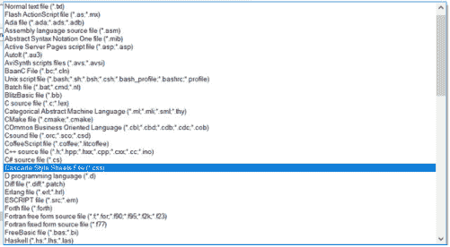

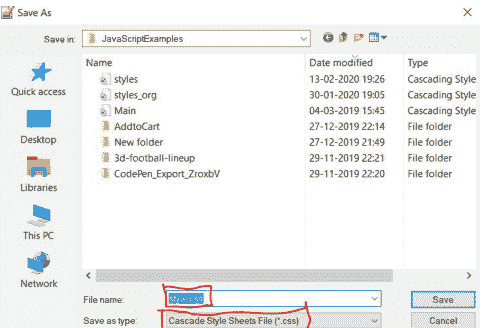

- 3. 点击“保存”
- 4. 转到相关的 HTML，并在头部文件中包含下面这一行。

```html
<link rel="stylesheet" href="style.css" />
```

- 5. （可选）如果你想包含任何按钮 CSS 元素，需要如下定义一个按钮类：

```html
<button class="btn str" onclick="substr()">Find
SubString</button>
```

现在，让我们将样式表插入上一章的示例中。

```html
<html>
<head>
<title>Substrings and String Index</title>
<link rel="stylesheet" href="style.css" />
</head>
<body>
<form id="form1">
What was your day like?: <textarea name="sentence" cols="20" rows="15" id="sentence"></textarea><br><br>
Substring From?:<input name="test string" type="number" id="tstr1" size="20"><br><br>
Substring To?:<input name="test string" type="number" id="tstr2" size="20"><br><br>
</form>

<button class="btn str" onclick="substr()">Find Substring</button>

<script>

function substr()
{
var daydesc=document.getElementById("sentence").value;
var strnum1 = document.getElementById("tstr1").value;
var strnum2 = document.getElementById("tstr2").value;

var sstr=daydesc.substring(strnum1,strnum2);
document.write("The SubString is "+sstr);
}

</script>
</body>
</html>
```

很好。现在我们的 CSS 样式表已链接到 HTML 文件。

## CSS 术语

- **html{}**：上述术语用于为整个 HTML 文件定义 CSS。括号内的任何内容都将在 HTML 代码中使用。
- **body{}**：定义 HTML 代码主体的样式。
- **.btn{}**：为网页中的任何按钮设置样式。你必须在 HTML 代码中为按钮定义一个名为‘btn’的类。参见上面的代码示例。
- **.btn:hover{}**：设置鼠标悬停在网页按钮上时按钮的样式。
- **background-color**：网站的背景颜色。
- **text-decoration**：用于为文本添加装饰，如波浪线、点线、曲线等。
- **text-transform**：用于将整个单词或单词的一部分大写或取消大写。
- **text-align**：可以将文本对齐到页面的左侧、右侧或居中。
- **color**：设置页面上文本的颜色。
- **padding**：设置页面边缘与文本/按钮元素之间的间隙。
- **line-height**：设置文本的行高。
- **font-family**：设置要用于文本的字体类型。
- **font-size**：设置字体大小。
- **font-weight**：可以在需要时将字体设置为粗体。


这些是我们在示例中将使用的一些 CSS 属性。但是，有 1000 多种 CSS 属性可用于各种不同目的。如果你想了解更多，可以在这里查看：[https://www.tutorialrepublic.com/css-reference/css3-properties.php](https://www.tutorialrepublic.com/css-reference/css3-properties.php)

那么，让我们来看一个 CSS 文件的示例：

### CSS 示例

```css
html, body {
    text-decoration: none;
    text-transform: capitalize;
    text-align: center;
    margin: 0;
    padding-top: 100px;
    min-height: 100%;
    color: black;
    background-color: cyan;
    line-height: 1;
    font-family:serif;
    font-size: 20px;
    font-weight: bold;
}
.btn {
    background-color: Crimson;
    border: none;
    color: black;
    padding: 10px 24px;
    text-align: center;
    text-decoration: none;
    display: inline-block;
    font-size: 16px;
}
.btn:hover {
    background-color: MidnightBlue;
    color: white;
}
```

在 CSS 代码的 html 和 body 中，文本被设置为页面居中并首字母大写。它距顶部 100 px，颜色为黑色，行高为 1。它的文字为粗体，字号为 20px。页面背景为 cyan（浅蓝色）。

按钮有单独的 CSS 设置。它的颜色为 Crimson（红色），文本为黑色。文本距顶部 10 px，距两侧 24 px。它居中对齐，字号为 16px。

当我们将鼠标悬停在按钮上时，按钮的背景会变为 MidnightBlue（蓝色），文本会变为白色。

我们可以在下面看到它的外观。让我们以两种方式查看网站，一次在应用 CSS 之前，一次在链接 CSS 文件之后。

### 输出（未使用 CSS）：

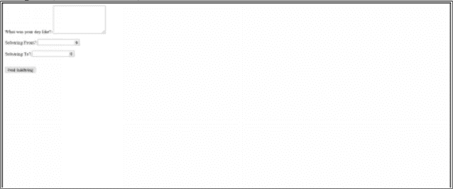

### 输出（使用 CSS）：

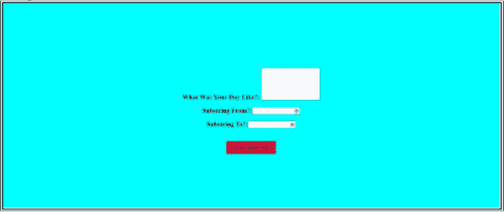

### 输出（使用 CSS 且鼠标悬停在按钮上）：

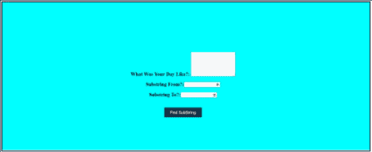

如你所见，这对网站的视觉吸引力有很大影响。你可以自己用不同的文本、背景和按钮颜色来自定义所有这些元素。

## 练习题：

你可以复制上面的示例，一旦能够运行它们并理解代码，就可以尝试下面的几个问题。

- 1. 修改样式元素，找出最适合你的元素。尝试 5 种不同的字体颜色、不同的文本大小和不同的文本形式，以找到最美观的网站。
- 2. 使用 style.css 文件为你目前编写的所有程序创建一个样式表。

## 链接多个网页

现在，你已经设置好一个链接了 CSS 的网页。但你可能注意到，当你点击 Find Substring 按钮时，网页会切换回原始设计。这是因为 JavaScript 部分尚未链接到网页。

回顾一下，我们讨论的代码接收一个字符串，并根据用户的偏好打印一个子字符串。用户指定子字符串的起始和结束位置。代码如下：

```html
<html>
<head>
<title>Substrings and String Index</title>
<link rel="stylesheet" href="style.css" />
</head>
<body>
<form id="form1">
What was your day like?: <textarea name="sentence" cols="20" rows="5" id="sentence"></textarea><br><br>
Substring From?:<input name="txtstr1" type="number" id="txtstr1" size="20"><br><br>
Substring To?:<input name="txtstr2" type="number" id="txtstr2" size="20"><br><br>
</form>

<button class ="btn str" onclick="substr()">Find Substring</button>

<script>
function substr()
{
var daydesc=document.getElementById("sentence").value;
var strnum1 = document.getElementById("txtstr1").value;
var strnum2 = document.getElementById("txtstr2").value;

var str=daydesc.substring(strnum1,strnum2);
document.write("The Substring is "+str);
}
</script>
</body>
</html>
```

如你所见，代码链接到 style.css 样式表以获取当前设计。因此，我们得到下面的输出：

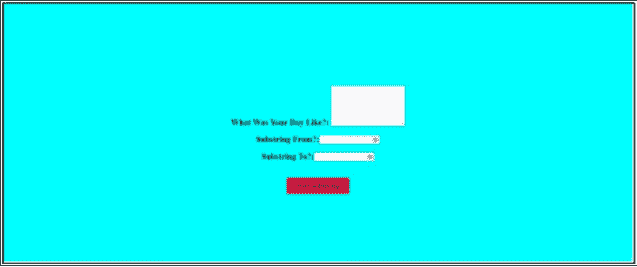

现在，让我们运行程序：


点击 Find Substring 后，我们得到：


如你所见，它又恢复为旧设计。现在，让我们修复这个问题。我们只需在 document.write 之前将下面的代码添加到 JavaScript 函数中。

```javascript
document.write('<link rel="stylesheet" type="text/css" href="styles.css" />');
```

这段代码基本上将样式表写入 JavaScript 函数。

因此，代码变为：

```html
<html>
<head>
<title>Substrings and String Index</title>
<link rel="stylesheet" href="style.css" />
</head>
<body>
<form id="form1">
What was your day like? <input type="text" name="sentence" size="20" id="sentence"><br>
Substring From: <input type="text" name="number" size="10" id="str1"> to <input type="text" name="number" size="10" id="str2"><br>
Substring To? <input type="text" name="number" size="10" id="str2"><br>
</form>

<button class="btn btn" onclick="substr()">Find Substring</button>

<script>
function substr()
{
var daydec=document.getElementById("sentence").value;
var strnum1 = document.getElementById("str1").value;
var strnum2 = document.getElementById("str2").value;

var substr=daydec.substring(strnum1,strnum2);
document.write('<link rel="stylesheet" type="text/css" href="style.css" />');
document.write(substr);
}
</script>
```

添加该行并使用相同文本运行同一程序后，我们得到：


太好了，我们得到了具有相同 CSS 的 JavaScript 输出。现在，你可能想创建另一个子字符串。我们该怎么做？我们需要一个 Home 按钮。

让我们创建它。下面的代码有助于实现这一点。

```html
<html>
<head>
<title>Substringing a String Index</title>
<link rel="stylesheet" type="text/css" href="styles.css" />
</head>
<body>
<form id="form1">
What was your day like? <textarea name="sentence" cols="20" rows="5"></textarea><br><br>
Substring From: <input name="start" type="number" id="str1" size="20" /><br><br>
Substring To: <input name="test string" type="number" id="str2" size="20" /><br><br>
</form>

<button class="btn btn" onClick="substr()">Find Substring</button>

<script>
function substr()
{
var daydesc=document.getElementById("sentence").value;
var str1num=document.getElementById("str1").value;
var strnum2 = document.getElementById("str2").value;

var str=daydesc.substring(str1num,strnum2);
document.write("<link rel=\"stylesheet\" type=\"text/css\" href=\"style.css\" />");
document.write("<br>");
document.write('<button class = "btn home" onclick="redirect()">Home</button>');
}

function redirect()
{
window.location.replace("strcomma.html");
}
</script>
```

`document.write("<br>")` 会在子字符串后创建一个空格，并移到下一行。

```javascript
document.write('<button class = "btn home" onClick="redirect()">Home</button>');
```

上面这一行创建了一个按钮，点击时会执行 redirect 函数。

我们创建一个函数，将用户重定向到我们原来的网页。

```javascript
function redirect()
{
window.location.replace("strcomma.html");
}
```

Strcomma.html 是文件名。因此，它基本上是重新启动该文件。

好了，现在让我们运行程序。这样做并使用相同文本后，我们得到：


点击 Home 后，我们得到：


所以，现在我们知道如何返回原始网页了。

还有另一种链接网页的方法，当你创建两个独立网页时会用到。假设你想在页面 B 上添加一个指向页面 A 的链接。

那么，在页面 B 中，你可以使用以下方式添加链接：

`<a href="PageB.html">`

我们也可以使用相同的 HTML 代码链接任何外部网页：

`<a href=www.google.com>`


## 练习题目

你可以复制上面的示例，一旦能够运行它们并理解代码，就可以尝试下面的一些问题。

- 1. 添加一个主页按钮，并将你最好的 CSS 设计链接到本书中你设计的每一个网页。
- 2. 创建一个根据用户偏好链接到外部网页的程序。

## 数学函数

到目前为止，这一切都很棒。但如果你想制作一个迷你计算器呢？或者教孩子们数学呢？学习如何编写数学函数也是提高孩子理解数学速度的好方法。你可以为你的孩子设置数学测试，并使用 JavaScript 函数来验证。

让我们开始学习一些可以在 JavaScript 中实现的基本数学函数。

**Math.round()**

Math.round() 将小数四舍五入到最接近的整数。例如，Math.round(1.635) 四舍五入为 2，而 Math.round(1.43) 四舍五入为 1。

**Math.ceil()**

Math.ceil() 向上取整为较大的数。它基本上会向上进位到更大的整数。例如，Math.ceil(1.67) 返回 2，而 Math.ceil(2.01) 返回 3。

**Math.floor()**

Math.floor() 向下取整为较小的整数。它基本上会去掉小数部分。所以，Math.floor(1.47) 返回 1，Math.floor(2.34) 也返回 2。

**Math.sqrt()**

Math.sqrt() 返回一个数的平方根。所以，Math.sqrt(9) 返回 3，而 Math.sqrt(16) 返回 4。

**Math.min()**

Math.min() 返回数组中的最小值。只需将数组放在括号内。所以，如果 a = [13, 11, 34, 54, 9]; Math.min(a) 返回 9。

**Math.max()**

Math.max() 返回数组中的最大值。所以，对于上面的示例，Math.max(a) 返回 54。

### Math.random()

Math.random() 是一个很酷的函数。它返回一个介于 0 和 1 之间的随机小数，不包括 1。

所以，Math.random() 第一次可能返回 0.95，第二次返回 0.43。

因此，你可以玩一个 0 到 10 之间的猜数字游戏。只需按照下面的方法操作：

**Math.round(Math.random() * 10)** 会给你一个 0 到 10 之间的随机整数。

## 结论

感谢您花时间阅读本书。

我希望这本书对您有用，并且您已经学会了 HTML、CSS 和 JavaScript 的基础知识。如果您完成了练习，您已经构建了几个 HTML 页面，并学会了如何使用基础的 CSS 来设计它们。

如果您喜欢我的书并想了解更多，请查看下面的我的作者页面。我很快还会出版另一本书，展示如何使用 HTML、CSS 和 JavaScript 从零开始创建一个购物车。

我还建议您看看本部分的其他书籍，尤其是关于人工智能将如何接管世界的书。

如果您对相关主题有任何疑问或建议，请发送电子邮件至：[abiprod.pty.ltd@gmail.com](mailto:abiprod.pty.ltd@gmail.com)

如果您对个性化帮助感兴趣，我也提供在线一对一辅导。

# 第 3 本书：10岁及以上儿童的编程

面向儿童和初学者的编程，使用 HTML、CSS 和 JavaScript

## 引言

Rob 已经在电脑前坐了好几个小时。他正在编写他的 JavaScript 游戏的下一版本。上个月取得了很大进展之后，他现在卡住了。他尝试了很多不同的方法，但仍然无法让它运行。这是编程中的常见问题。学习编程基础是一个好的开始。几个月前，Rob 读了我的第一本编程书（《9-15岁儿童编程》），他非常兴奋。他不仅学好了基础，并成功完成了所有练习，还实现了自己的一些程序和有趣的编程游戏。他热爱编程，而且对此上瘾了。

然而，几个月后，Rob 又卡住了。他开始感到疲惫和无聊。他一遍又一遍地编写类似的程序。他在更高级的主题上遇到了困难。Rob 的故事与全美乃至全世界成千上万的孩子相似。这些孩子拥有继续前进所需的资源和金钱。有些父母花了一个月的工资（有时甚至更多）为孩子买了一台笔记本电脑来编程。然而，父母和孩子们都意识到，他们需要更多才能继续前进。有些东西缺失了。有些东西很难量化。

Rob 和其他孩子的故事激励我写了下一本 JavaScript 书。虽然 Rob 看起来可能正在挣扎，但他的努力值得称赞。我们中有太多人在遇到困难的第一眼就放弃了。我们以小猫玩毛线球的心态，从一个活动转到另一个活动。事实是，在任何活动中，不付出一点努力和痛苦，就不会有进步。Rob 只需要再多一点点，而这正是本书所包含的。

本书首先介绍一些基础知识，以确保你具备继续前进所需的基本知识。我们将讨论如何设置工作区，并进行基本的编程和测试。然而，本书确实非常强调编码游戏、活动和谜题。这些旨在让你更深入地热爱编程所能实现的东西。我们意识到这类编码游戏对学习过程是多么重要。它能带来趣味和好奇心，这对每个参与者来说都非常令人兴奋。书中还有一节非常重要的内容，关于编程中较“软”的一面。这一章讨论如何通过自我发现、团队合作、自律和健康习惯来提高你的编程水平。这些正是能真正帮助 Rob 在编程道路上继续前进的软技能。

## 编程的软技能

我教孩子们编程的经历，以及从 Rob 那里听到的情况，使我深信在编程中，软技能和技术知识同样重要。这些软技能也会帮助你在生活的其他方面不断进步。所以，这完全是一个双赢的局面。

那么，软技能到底是什么？软技能更多地与人如何工作有关。这不同于关注人们工作内容的硬技术技能。软技能与人如何应对心理、身体和人际问题有关。结合良好的技术知识，软技能可以将你的表现提升到一个更高的水平。以下是我所说的一些技能：

- 1. **专注与集中力：** 在一个被社交媒体和其他干扰主导的世界里，专注于手头单一任务的能力是一项难以掌握的技能。多任务处理看起来可能很酷，但从长远来看，它会削弱高质量的工作和高质量的教育。
  - a. 一种帮助你集中注意力的新工具叫做等时音。这是一种特殊的音乐，能让你的大脑进入正确的状态，帮助你集中注意力。你可以通过在 YouTube 或 Google 上搜索“isochronic tones”来免费查看这些音调。
  - b. 另一个工具是每日冥想。每天一开始冥想 5 分钟，可以随着时间的推移帮助你建立专注力。
  - c. 最后，将你的工作分解成 20-30 分钟的时间段可以产生很大的不同。在每个时间段之间散步 5-10 分钟，然后精神焕发地回来。
- 2. **坚持不懈：** 在编程中，坚持不懈并从失败中学习的能力非常重要。程序员通常会尝试破坏代码（或让代码失败），以便了解程序中的弱点并加以改进。你也可以对你的程序和你的编程技能这样做。
- 3. **团队合作：** 独自编码在开始时是必要的，但从长远来看会阻碍你。从别人的错误中学习比从自己的错误中学习要快得多。你可以加入所在城市的本地编程俱乐部；聘请编程导师；加入相关的 Facebook 编程群组；在 Reddit 帖子上发言，并从 GitHub 代码中学习。积极参与这些群组并被视为积极的贡献者非常重要。
- 4. **身体健康：** 这是许多程序员非常低估和忽视的特质。但从长远来看，它确实会伤害业内的人。背部问题、肥胖、腕管综合征是程序员在业内工作 5-10 年或更长时间后遇到的常见健康问题。以下是一些更好地照顾健康的方法。
  - a. 保持良好的坐姿：坐直。确保你的笔记本电脑接近眼睛的高度，这样你就不必低头。确保你的脚与膝盖成一条直线。


- b. 经常休息：我建议每 20–30 分钟休息一次。在休息间隙散散步。
- c. 饮食：保持健康的饮食，富含优质脂肪、蛋白质和复合碳水化合物。尽量减少简单碳水化合物和糖。
- d. 锻炼：保持规律的锻炼习惯或进行一项运动。每周至少锻炼 3–4 次（也许更多）很重要。
- e. 睡眠：每晚至少睡 7–8 小时。如果你无法入睡，请咨询有资质的医生，了解如何改善睡眠。

关于上述每个主题，都可以写成整本书；但这是一本编程书，所以我就此打住。只需记住，上述软技能非常重要，你在编程时也可以加以练习。

## 设置你的工作区

### 你需要什么

你需要一台可连接互联网并已安装网页浏览器的笔记本电脑/台式电脑。我推荐使用 Mozilla Firefox 或 Google Chrome。

### 下载/安装文本编辑软件

下载最新版本的文本编辑软件。我推荐下载 NotePad++。下载后，双击 Setup.exe 文件并按照安装提示操作。

[https://notepad-plus-plus.org/downloads/](https://notepad-plus-plus.org/downloads/)

### 开始使用 NotePad++

从桌面或开始菜单打开 Notepad++


现在，点击 **文件 > 新建** 打开一个新文件。

现在，选择 **文件 > 另存为**，并将文件类型选择为 **.html**


### 测试程序

现在，让我们测试程序是否能与浏览器连接。
只需在文件中随意输入一些文本。在我的文件里，我输入了 **“这是一条测试消息。”**
现在选择 **文件 > 保存。**
之后，根据你使用的浏览器，点击 **运行 > 在 Firefox/Chrome/IE 中启动**。
如果运行正常，你输入的文本应显示在浏览器窗口中。


- 运行... F5
- **在 Firefox 中启动** Ctrl+Alt+Shift+X
- 在 IE 中启动 Ctrl+Alt+Shift+I
- 在 Chrome 中启动 Ctrl+Alt+Shift+R
- 在 Safari 中启动 Ctrl+Alt+Shift+A
- 获取 PHP 帮助 Alt+F1
- 维基百科搜索 Alt+F3
- 在另一个实例中打开文件 Alt+F6
- 通过 Outlook 发送 Ctrl+Alt+Shift+O
- 修改快捷键/删除命令...

结果：


这是一种很好的简单方法，可在继续之前确保程序正常运行。

### 附注：

一些学生遇到过的一个问题是，“在浏览器中运行”选项有时不起作用并报错。这是因为路径设置不正确。如果由于某种原因它不起作用，你仍然可以运行程序。

- 1. 只需将 Notepad++ 文件保存为 HTML 文档。
- 2. 关闭 Notepad++ 文件。
- 3. 转到 HTML 文档所在的文件夹。
- 4. 双击该 HTML 文件，它应该就能正常工作。

## 什么是 HTML？

HTML 代表超文本标记语言（Hyper Text Markup Language）。它是我们通过网页与互联网交互所使用的编程语言。所有网页的基本结构都由 HTML 定义。它足够简单，初学者程序员也能快速掌握。大多数 HTML 编程都是通过称为标签的元素完成的。这些标签以 `<>` 开始，以 `</>` 结束。例如，一个常见标签是段落标签，它以 `<p>` 开始，以 `</p>` 结束。

### 常见 HTML 标签

- **<html>** - 此标签用于每个网页的开头，表示 HTML 代码的开始
- **<head>** - 这段 HTML 代码会在程序其余部分之前执行
- **<title>** - 此标签用于设置网页标题。它会把文本写到网页顶部的标题栏上。
- **<body>** - 这是网页正文中的信息。
- **<h1>** - 用于表示标题标签。这是最大字号的标题标签。
- **<h2>,<h3>,<h4>,<h5>,<h6>** - 用于表示字号依次减小的副标题。
- **<p>** - 用于表示文本段落
- **** - 在网页上显示图像。该图像可以链接到外部网页，也可以链接到内部文件。
- **<strong>** - 用于将文本加粗
- `<ul>` - 用于无序列表。例如项目符号形式的条目列表。
- `<li>` - 向无序列表添加一个项目符号条目。
- `<ol>` - 用于有序列表，例如从 1、2、3…… 开始的编号列表。
- `<div>` - 用于表示较大的文本区块；这些区块包含多个段落。
- `<a>` - 用于将网页中的项目链接到另一个网页。
- `<br>` - 在代码中添加换行，并移到下一行。

### HTML 代码示例

下面是基本 HTML 代码示例。它包含了上述所有 HTML 代码的示例。你可以把这些代码打出来，或者复制粘贴下面的示例。


### 可复制粘贴的 HTML 代码版本

你可以将下面的代码复制粘贴到你的 HTML 浏览器中，看看它是否能运行

```html
<html>
<head>
<title>My first html website......</title>
</head>
<body>
<h1>Welcome to Programming in Javascript (this is a h1 tag)</h1>
<h2>Let’s get started (this is a h2 tag)</h2>
<h3>This is the start of bigger things (this is a h3 tag)</h3>
<p>We’re going over a few basic html tags here but you can feel free to
play around them and experiment.
There are 1000's of html tags that you can learn in the long run. Here's a list
of topics you can learn below (This is a paragraph tag)</p>

<ul> Below is the example of an unordered bulleted list
<li>Basics of html</li>
<li>CSS</li>
<li>JavaScript</li>
<li>Loops</li>
<li>Arrays</li>
<li>Canvas</li>
</ul>
<a href="https://www.google.com">Example of hyperlink to Google</a>
<br>
<a href="https://www.facebook.com">Example of hyperlink to Facebook</a><br>
<a href="https://www.amazon.com">Example of hyperlink to Amazon</a>
<br>
</body>
</html>
```

### 代码输出


现在，让我们分解这些不同的元素：下面是 title 标签 `<title>`。


下面是 heading 标签 `<h1>`、`<h2>`、`<h3>`


下面是段落标签 `<p>`


下面是一个无序项目符号列表 `<ul>` `<li>`

- HTML 基础
- CSS
- JavaScript
- 循环
- 数组
- 类

下面是三个指向三个热门网站的超链接标签 `<a href>`

- [指向 YouTube 的超链接示例](#)
- [指向 Facebook 的超链接示例](#)
- [指向 Instagram 的超链接示例](#)

### 练习题

- 1. 制作一个网站，使用标题标签，并在无序列表中列出杂货商品。使用段落标签说明你对特定商品可能有的任何特殊要求。在列表末尾，使用超链接标签链接到最近的杂货店网站。
- 2. 创建一个网站，列出你足球队的所有球员。使用 title 标签、heading 标签和段落标签来欢迎用户访问你的网站，并描述球队及球队理念。使用有序列表列出球员。
- 3. 制作一个网站，在无序列表中列出你所在地区所有你最喜欢的餐厅和咖啡店。使用 title 标签、heading 标签和段落标签介绍你自己以及你所在地区的餐饮体验。

## 示例 HTML 程序

### 这个项目做什么

这个 HTML 项目会创建两个按钮。这两个按钮在“白天”和“夜晚”的两张图像之间切换。两个按钮分别标记为“白天”和“夜晚”。

这是一个简单的 HTML 项目，它创建一个按钮，可以打开/关闭页面上的灯泡。我们将使用两张灯泡图像来实现这一点。按钮将在两张图像之间切换。


## 日间和夜间按钮

```html
<html>
<body>
<h1>Day and Night Buttons</h1>
<script>

<button onclick="document.getElementById('myImage').src='nightImage.jpg'">Night</button>
</script>
</body>
</html>
```

### 输出

初始时，默认设置为日间图片。


日间　　　　　　　　　　　　　夜间

一旦你点击**夜间**按钮，就会看到：


日间　　　　　　　　　　　　　夜间

然后，当你再次点击日间按钮时，就会看到：


日间　　　　　　　　　　　　　夜间

## HTML 表单

还记得你在网上看到的那些需要输入姓名、年龄和出生日期的表单吗？那些就是 HTML 表单。

今天，我们将学习如何制作这些表单。

在开始制作表单之前，我们需要了解几个基本的表单元素：

- **按钮** `<button>` - 它是一个允许用户在点击时执行操作的元素。
- **文本框** `<input>` - 此元素允许用户在浏览器屏幕上的框中输入文本。它用于收集姓名、城市等小型文本项。
- **文本域** `<textarea>` - 它允许用户输入更多文本。它的尺寸比文本框大。它用于地址、评论等较大的文本项。
- **选项选择** `<select>` - 此元素允许用户在多个可用选项之间进行选择。它基本上是一个下拉框。
- **日期输入** `<input type="date">` - 此元素允许用户从日历下拉框中选择日期。

现在，让我们通过下面的示例表单逐一了解这些示例。

### 示例表单

```html
<html>
<head><title>Sample Form</title></head>
<body>
<form id="form1">
Enter First Name:<input name="firstname" type="text" id="firstname" size="20"><br>
Enter Last Name:<input name="lname" type="text" id="lname" size="20"><br><br>
Enter Address:<textarea name="TextBox" cols="40" rows="5" id="txtbox"></textarea><br><br>
Enter Country: <select id="country" name="country">
               <option value="USA">USA</option>
               <option value="Mexico">Mexico</option>
               <option value="Canada">Canada</option>
               <option value="Australia">Australia</option>
               </select>
Date of Birth: <input type="date" id="start" name="trip-start"
value="2020-07-22"
min="1918-01-01" max="2020-06-31"><br>
<button onclick="">Submit</button>
</form>
</body>
</html>
```

现在，让我们逐一了解代码的每个部分。

```html
<form id="form1">
```

每个表单都以 `<form>` HTML 元素开始。id“form1”是你为表单指定的名称。该 id 用于在程序的其余部分引用该表单。

```html
Enter First Name: <input name="firstname" type="text" id="firstname" size="20"><br>
Enter Last Name: <input name="lname" type="text" id="lname" size="20"><br><br>
```

上面两行是用于名字和姓氏的文本框。type 被指定为“text”，因为姓名是一种文本。id“firstname”和“lname”将在以后需要时用于引用代码。size 被设置为“20”，这意味着它可以接受 20 个字符。你可以根据需要将其更改为更大或更小的尺寸。

```html
Enter Address: <textarea name="txtbox" cols="40" rows="5" id="txtbox"></textarea><br><br>
```

上面的元素是用于地址的 textarea 元素。它有 5 行（rows="5"），每行 40 个字符（cols="40"）。它被标记为“txtbox”。

```html
Enter Country: <select id="country" name="country">
    <option value="USA">USA</option>
    <option value="Mexico">Mexico</option>
    <option value="Canada">Canada</option>
    <option value="Australia">Australia</option>
</select><br>
```

上面的元素是用于选择国家的 select 选项元素。它允许你从包含 4 个不同选项的下拉菜单中选择；美国、墨西哥、加拿大和澳大利亚。它被标记为“country”（id="country"）。

```html
Date of Birth: <input type="date" id="start" name="trip-start"
               value="2020-07-22"
               min="1918-01-01" max="2020-06-31"><br>
```

上面的元素是一个日期输入元素，它允许你选择 1918 年（min="1918-01-01"）到 2020 年（max="2020-06-31"）之间的出生日期。它被命名为“start”（id="start"），并被设置为值 2020-07-22（value="2020-07-22"）。

```html
<button onclick="">Submit</button>
```

上面的元素是一个按钮元素。它上面写有文本“提交”。由于 onclick 函数为空，点击它不会执行任何操作。现在，让我们看看运行程序时会发生什么。

### 输出


我希望你通过这个示例对 HTML 表单的基础知识有所了解。在接下来的几章中，我们将学习如何使用 JavaScript 使用我们输入的信息。事实上，我们将使用同一个示例，并用 JavaScript 将其打印出来。

### 练习题

- 1. 编写一个 HTML 表单，作为大学生的简历。它通过文本框接收名字、姓氏、大学名称；通过下拉菜单接收大学年级。然后有 3 项活动/实习/合作教育经历。每项活动都有一个起始日期元素、结束日期元素，以及一个足够大以描述经历的文本域。最后以一个提交按钮结束。
- 2. 编写一个用于购物清单的 HTML 表单。它接收名字、姓氏、购物日期、地址和城市。它有 5 个下拉菜单，包含 30 种常见杂货商品可供选择。最后，它有一个提交按钮。

以上每一项都将在下一章中用 JavaScript 进一步展开。

## 什么是 JavaScript？

JavaScript 是一种高级编程语言，用于让网页更具交互性和动态性。它基于文本且对用户友好。HTML 用于创建网页结构，CSS 用于网页样式，而 JavaScript 则用于让网页与用户更具交互性。它允许不同的 HTML 元素相互交互、执行计算、动画等。换句话说，它让网页编程变得有趣。

### 将 JavaScript 与 HTML 一起使用

在 HTML 网页中使用 JavaScript 有两种方式。第一种方式是直接将代码添加到 HTML 中的 script 标签内。如下方代码中的蓝色部分所示。

```html
<html>
<head><title>Test file 1</title>
</head>
<body>
<script>
//Enter JavaScript code here
</script>
</body>
</html>
```

第二种方式是创建一个包含代码的外部 JavaScript 文件，并将其保存为 .js 文件。然后，你可以将该文件链接到 HTML 内容。例如，假设你创建了一个名为“test.js”的文件。你可以使用下方代码中的蓝色部分将其链接起来：

```html
<html>
<head><title>Test file 2</title>
</head>
<body>
<script src="test.js"></script>
</body>
</html>
```

## JavaScript 元素

有了这些基础知识，让我们来看看一些基本的 JavaScript 元素。

### 函数

JavaScript 中的函数是一组执行特定任务的代码行。

它在 JavaScript 中定义在 script 标签内，如下所示：

```javascript
function afunc()
{
//Enter function code here
}
```

函数名是 afunc，每次调用 afunc 时都会执行花括号内的代码。当我们想在同一个程序中多次执行相同任务时，使用函数很有用。我们可以直接调用该函数，而不必多次编写相同的代码行。

### 变量

JavaScript 中的变量是一个占位符，用于承载某个值。该值可以在整个程序中更改，并可在代码的其他部分使用。让我们看一个例子：

```javascript
var x=5;
```

x 是定义的变量。它的初始值为 5。

稍后在程序中，它可以被更改为不同的值，如下所示：

```javascript
x=10;
```

现在，x 的值为 10。而且，如果我们执行：

```javascript
x=x-1;
```

那么 x 变为 9。我们刚才展示的是整数变量。我们也可以使用字符串变量来存储文本值，如下所示：

```javascript
var b="abcd"
```


b 是一个保存值 abcd 的变量。

最后，我们还可以有布尔变量，它们只保存 true/false 值。例如：

```
var c = true;
var d = (7>5);
var e = (7<6);
```

变量 c、d 和 e 都是布尔变量。变量 c 被赋值为 true。变量 d 为 true（因为 7 大于 5）。变量 e 为 false（因为 7 不小于 6）。

### document.write()

document.write() 用于在网页上打印元素。括号内的任何内容都会打印在网页上。例如：

```
document.write("Example print");
```

上面的代码会在屏幕上打印出 “Example print” 这些字。

我们也可以在屏幕上打印变量。例如，

```
var a=7;
```

```
document.write(a)
```

上面的代码会在屏幕上打印出 7。

此外，我们还可以使用 “+” 运算符组合不同的元素。例如：

```
var a=7;
```

```
document.write("The number printed is "+a);
```

上面的代码会打印出 “The number printed is 7”。

### alert()

alert() 会在屏幕上弹出一个包含特定消息的弹窗。例如，

```
alert("Hello")
```

上面的代码会弹出一个显示 “Hello” 的弹窗。


### prompt()

prompt() 具有相同的弹窗，但增加了一个允许用户输入的文本框。用户输入可以存储在一个变量中。例如：

```
var name = prompt("What is your name");
```

它会显示一个弹窗。当用户输入他的名字并点击“确定”后，该值会存储在变量 name 中。


### document.getElementById().value

document.getElementById().value 用于将 HTML 元素获取到 JavaScript 变量中。因此，我们需要使用 HTML 元素的 id，并将其放在括号中。让我们看一个例子。

我们来看下面的 HTML 元素：

```
Enter number: <input name="x" type="number" id="test" size="20"><br>
```

JavaScript 代码：

```
var testv=document.getElementById("test").value;
```

这个 HTML 元素是一个表单文本框，用于获取用户输入的数字。在 JavaScript 中，用户输入的数字会被赋值给变量 testv。

## 如何添加注释

注释是添加到代码中用于记录或解释代码的内容。注释不会被执行，也不影响程序。在 JavaScript 中，注释是在注释内容前加两个正斜杠（"//"）来添加的。

```
<html>
<head>
<title>Print Name and Age.....</title>
</head>
<body>
<form id="form1">
Enter Name: <input name="Enter Name" type="text" id="name" size="20"><br>
Enter Favorite Hobby: <input type="text" id="hobby" size="20"><br>
Enter Age: <input type="number" id="age" size="20"><br>
</form>
<input type="button" onclick="writename()" value="Print Intro"></button>

<script>

function writename()
{
    //Creating variables
    var name=document.getElementById("name").value;
    var hobby=document.getElementById("hobby").value;
    var age=document.getElementById("age").value;

    //Prints name on screen
    document.write("Hi! "+name+"! I am "+age+" years old,My favorite hobby is "+hobby);
}

</script>
</body>
</html>
```

下面是注释的一个示例。注释以绿色显示并用红色圆圈标出。

### 示例 1

现在，让我们开始看一些例子。我们将从上一章中的 HTML 表单开始。我们将把所有用户输入赋值给变量，并使用 JavaScript 将它们打印在网页浏览器上。

下面的代码与上一章中的示例类似。添加了一个 JavaScript 函数，用于打印提交表单者的名字和国家。

```
<html>
<head><title>Sample Form</title></head>
<body>
<form id="form1">
Enter First Name:<input name="firstname" type="text" id="firstname" size="20"><br>
Enter Last Name:<input name="lname" type="text" id="lname" size="20"><br><br>
Enter Address: <textarea name="TextBox" cols="40" rows="5" id="txtarea"></textarea><br><br>
Enter Country: <select id="country" name="country">
        <option value="USA">USA</option>
        <option value="Mexico">Mexico</option>
        <option value="Canada">Canada</option>
        <option value="Australia">Australia</option>
        <option value="India">Australia</option>
</select>
Date of Birth: <input type="date" id="dobirth" name="trip-start"
 value="2020-07-01"
 min="1918-01-01" max="2020-06-31"><br>
<button onclick="printcountry()">Submit</button>

<script>
function printcountry()
{
var fname = document.getElementById("firstname").value;
var lname = document.getElementById("lname").value;
var address = document.getElementById("txtarea").value;
var country = document.getElementById("country").value;
var dob = document.getElementById("dobirth").value;
document.write(fname+" lives in "+country);
}
</script>

</body>
</html>
```

### 输出：


点击**提交**后，我们会看到：


### 代码解释

因此，我们添加的主要部分是函数 `printcountry()`。我们还将该函数添加到了按钮的 onclick 元素中。（`onclick="printcountry()"`）。

```
<script type="text/javascript">
<!--
function printName()
{
var fname = document.getElementById('fname').value;
var lname = document.getElementById('lname').value;
var address = document.getElementById('address').value;
var country = document.getElementById('country').value;
var dob = document.getElementById('dob').value;
document.write(fname + " " + dob);
}
//-->
</script>
```

在这个函数中，我们声明了五个变量 [fname](#)、[lname](#)、[address](#)、[country](#)、[dob](#)。这些变量分别被赋值为表单中输入的名字、姓氏、地址、国家和出生日期。这是通过 [document.getElementById()](#) 值的 JavaScript 元素完成的。最后，我们使用 document.write() 打印出表单中输入的名字和出生日期。

### 示例 2

在第二个示例中，我们创建一个简单的 JavaScript 函数，它接收 3 个数字并将它们相乘。

### 输出：

```
<html>
<head><title>Sample Form</title></head>
<body>
<form>
Enter First Number:<input name="number1" type="number" id="num1" size="20"><br>
Enter Second Number:<input name="number2" type="number" id="num2" size="20"><br>
Enter Third Number:<input name="number3" type="number" id="num3" size="20"><br><br>
<input type="button" value="multiplication()" onclick="multiplynum()">
</form>
<script>
function multiplynum()
{
var n1 = document.getElementById("num1").value;
var n2 = document.getElementById("num2").value;
var n3 = document.getElementById("num3").value;
document.write("The product of the three numbers is " + n1*n2*n3);
}
</script>
</body>
</html>
```

一旦我们点击提交，我们会得到：


### 代码解释：

在上面的代码中，我们在表单中接收三个数字，其 id 分别为 num1、num2 和 num3。

当按钮被点击时，它会运行 **multiplynum()** JavaScript 函数。

在函数中，三个变量 n1、n2、n3 分别被赋值为表单中 id 为 num1、num2 和 num3 的三个数字。

最后，我们在最后一行使用 document.write() 打印出这三个数字 n1*n2*n3 的乘积。

## 练习问题

- 1. 创建[上一章的练习问题 1](#)中的表单。像制作一份正式的简历一样，将表单中的所有信息打印到网页上。如果看起来足够好，可以随意打印出来交给雇主。
- 2. 创建[上一章的练习问题 2](#)中的表单。将完整的购物清单打印到 HTML 网页上。然后你可以将它打印在一张纸上，去购物。
- 3. 创建一个接收两个数字的表单。它有 4 个按钮，按钮文本分别为 Add、Subtract、Multiply 和 Divide。这 4 个按钮分别执行 4 个不同的函数，对这两个数字进行加、减、乘、除，并打印出结果。


## 作者的一条简短留言：

嘿，你喜欢这本书吗？我很想听听你的想法！许多读者不知道获得评论有多难，也不知道评论对作者帮助有多大。


如果你能抽出短短60秒在亚马逊上写一条简短评论，哪怕只有几句话，我也会无比感激！

>> 点击这里留下一条快速评论

感谢你抽出时间分享你的想法！你的评论会真正对我产生影响，并帮助我的作品获得更多曝光。

## CSS 简介

### 什么是 CSS？

CSS 是 Cascading Style Sheets（层叠样式表）的缩写。它允许用户设置和修改 HTML 网站的样式。“样式”是一个用于表示字体类型、字体颜色、背景颜色、阴影等的术语。CSS 元素可以通过 HTML 和 JavaScript 访问。

### 创建 CSS 文件并链接到 HTML 文件

创建 CSS 文件并将其链接到 HTML 文档有 5 个步骤。

- 1. 要创建 CSS 文件，请打开一个空白 HTML 文档，并保存为“CSS”文件类型。在本例中，我们将其命名为“samplestyle”。


- 2. 转到相关的 HTML，并在头部文件中包含下面这一行。你可以使用下面这一行来完成。

```html
<html>
<head><title>Sample Form</title></head>
<body>
<link rel="stylesheet" href="samplestyle.css" />
<form id="form1">
Enter First Number:<input name="number1" type="number" id="num1" size="20"><br>
Enter Second Number:<input name="number2" type="number" id="num2" size="20"><br><br>
Enter Third Number: <input name="number3" type="number" id="num3" size="20"></textarea><br><br><br>

<button onclick="multiplynum()">Submit</button>

<script>
function multiplynum()
{
var n1 = document.getElementById("num1").value;
var n2 = document.getElementById("num2").value;
var n3 = document.getElementById("num3").value;
document.write("The product of the three numbers is "+n1*n2*n3);
}
</script>

</body>
</html>
```

- 3. （可选）要让按钮可在 CSS 中编辑，请将文本 `class="btn"` 添加到 HTML 按钮行中，如下所示：

```html
<button class = "btn submit" onclick="multiplynum()">Submit</button>
```

现在，让我们把样式表插入上一章的示例中。

```html
<html>
<head><title>Sample Form</title></head>
<body>
<link rel="stylesheet" href="samplestyle.css" />
<form id="form1">
Enter First Number:<input name="number1" type="number" id="num1" size="20"><br>
Enter Second Number:<input name="number2" type="number" id="num2" size="20"><br><br>
Enter Third Number: <input name="number3" type="number" id="num3" size="20"></textarea><br><br><br>

<button class = "btn submit" onclick="multiplynum()">Submit</button>

<script>
function multiplynum()
{
var n1 = document.getElementById("num1").value;
var n2 = document.getElementById("num2").value;
var n3 = document.getElementById("num3").value;
document.write("The product of the three numbers is "+n1*n2*n3);
}
</script>

</body>
</html>
```

很好。现在我们的 CSS 样式表已经链接到 HTML 文件了。

## CSS 术语

- **html{}, body{}:** html 括号内的代码定义整个 HTML 文件的样式。括号内的 body 代码是 HTML 文件主体的代码。
- **text-decoration:** 可以通过让文本呈波浪形、点状、卷曲状等来修改文本设计。
- **text-transform:** 可以将部分或全部文本大写。
- **text-align:** 可以将文本居中对齐、右对齐或左对齐。
- **margin:** 外边距是元素之间的空间。它以像素为单位表示。例如，margin: 5px 指定 5 像素的外边距。
- **padding:** 内边距是元素内部从外边界开始的空间。它也以像素为单位指定。
- **display:** 可用于完全关闭元素。（例如，display: none 会完全关闭该元素）
- **hidden:** 可用于隐藏元素，同时它仍会占据布局中的空间。
- **font-size:** 指定字体大小。
- **background-color:** 指定元素的背景颜色。可以选择下面链接中各种各样的颜色。

[https://www.quackit.com/css/css_color_codes.cfm](https://www.quackit.com/css/css_color_codes.cfm)

- **color:** 指定书写文本的颜色。
- **border:** 指定元素周围边框的存在与否以及类型/样式。边框可以是隐藏的、点状的、双线的；也可以没有边框。
- **font-weight:** 指定字体的粗细（加粗程度）。
- **min-height:** 指定元素的最小高度。高度以像素为单位。
- **line-height:** 指定一行文本的高度。高度以像素为单位。

### CSS 按钮元素

**.btn{}** – 这指定 HTML 中定义的任何按钮的样式。要让按钮可在 CSS 中访问，我们必须像上一个示例那样在 HTML 定义中包含类名。

我们首先定义代码的 HTML 和 body。文本被大写并设置为居中。它是蓝色背景上的白色。它距离上边距 50 像素。它是 25 px 的常规非加粗无衬线字体。按钮样式用 .btn{} 定义。按钮为黑色背景上的白色文本。文本字体为 16 px，并对齐到按钮中心。当我们将鼠标悬停在按钮上时，样式会发生变化。它变为深红色背景上的黑色文本。

CSS 文件已链接到上一章中的一个示例表单。我们向你展示链接 CSS 文件前后的输出。我们可以看到 CSS 样式带来的巨大差异。这就像一次改头换面 

### 输出（无 CSS）：


## CSS 与 JavaScript

如果一个 HTML 表单链接到 CSS，而 JavaScript 开始在网页上打印文本，你会注意到它不再链接到 CSS。你需要做的是使用下面这一行在 JavaScript 代码中重新链接 CSS：

```javascript
document.write('<link rel="stylesheet" type="text/css" href="samplestyle.css" />');
```

在 JavaScript 中每个函数开始之前输入这段代码。这确保整个程序都会显示 CSS。请参阅下面文本中的示例：

```html
<html>
<head><title>Sample Form</title></head>
<body>
<link rel="stylesheet" type="text/css" href="samplestyle.css" />
<form id="form1">
Enter First Number:<input name="number1" type="number" id="num1" size="20"><br>
Enter Second Number:<input name="number2" type="number" id="num2" size="20"><br><br>
Enter Third Number:<input name="number3" type="number" id="num3" size="20"><br><br>
<button class="btn_submit" onclick="multiplyyn()">Submit</button>

<script>
function multiplyyn()
{
  var n1 = document.getElementById("num1").value;
  var n2 = document.getElementById("num2").value;
  var n3 = document.getElementById("num3").value;
  document.write('<link rel="stylesheet" type="text/css" href="samplestyle.css" />');
}
</script>
</body>
</html>
```

### 输出（在向 JavaScript 添加 CSS 行之前）：


点击 **提交** 按钮后：

三个数字的乘积是 60

### 输出（在向 JavaScript 添加 CSS 行之后）：


点击 **提交** 按钮后：


## 练习题

- 1. 创建一个 CSS 样式表，为所有表单元素和按钮指定样式。将其链接到之前所有练习题，并惊叹于你的创作。
- 2. 创建一个带有 2 个按钮的 HTML 表单。创建两个 CSS 样式表。2 个 HTML 按钮在两个样式表之间切换。

## 用 JavaScript 做数学运算

JavaScript 是一种出色的编程语言，可用于执行计算和分析来自用户的数据。我们将介绍几个有助于你开始使用 JavaScript 的函数。

现在，这一节并不适合所有人。它只适合那些有兴趣在程序中实现大量数学运算的人，或者喜欢数学并希望看到它在 JavaScript 中实现的人。

### ParseInt/ParseFloat

**parseInt** — ParseInt 接收一个字符串变量并返回一个整数。它也接收十进制数并将它们转换为整数。

**ParseFloat** — ParseFloat 与 parseInt 类似，但可处理十进制数。

让我们看下面的示例。

在这个示例中，我们将其中 3 个数字通过 parseInt 处理，并将相同的数字通过 parseFloat 处理。然后我们查看输出。


```html
<html>
<head><title>Sample Form</title></head>
<body>
<form id="form1">

<button onclick="multiplynum()">Parse Integers</button>

<script>
function multiplynum()
{
xi=parseInt("5.2");
yi=parseInt(5.01);
zi=parseInt(5.65);
xf=parseFloat("5.2");
yf=parseFloat(5.01);
zf=parseFloat(5.65);
document.write("xi= "+xi+"<br>");
document.write("yi= "+yi+"<br>");
document.write("zi= "+zi+"<br>");
document.write("xf= "+xf+"<br>");
document.write("yf= "+yf+"<br>");
document.write("zf= "+zf+"<br>");
}
</script>


</body>
</html>
```

### 输出：

```
xi= 5
yi= 5
zi= 5
xf= 5.2
yf= 5.01
zf= 5.65
```

我们可以看到，`parseInt` 和 `parseFloat` 的结果是不同的。对于 `xi` 和 `xf`，我们传入字符串 “5.2”。因为它位于引号内，所以被视为字符串。尽管引号内是数字，但如果不对其执行 `parseInt` 或 `parseFloat`，就无法在任何数学运算中使用它。在执行 `parseInt` 或 `parseFloat` 之后，它就变成了数字。我们还要注意，对于所有值，`parseInt` 会去掉小数点并使其成为整数。它不是向上或向下取整，只是去掉小数部分。`parseFloat` 则保留小数值。所以，如果你想处理小数，请使用 `parseFloat`。如果你不想要小数，则使用 `parseInt`。

## 数字取整 – Math.ceil()、Math.floor() 和 Math.round()

接下来，我们来讨论数字取整。我们会用到函数 **Math.ceil()、Math.floor() 和 Math.round()**。`Math.ceil()` 向上取整到较高的小数值，`Math.floor()` 向下取整到较低的小数值，而 `Math.round()` 则取最接近的值（无论是向上还是向下）。让我们看一个示例程序。

```html
<html>
<head><title>Sample Form</title></head>
<body>
<form id="form1">

<button onclick="multiplynum()">Round numbers</button>

<script>
function multiplynum()
{
xc=Math.ceil(5.2);
yc=Math.ceil(7.8);
zc=Math.ceil(4.5);
xf=Math.floor(5.2);
yf=Math.floor(7.8);
zf=Math.floor(4.5);
xr=Math.round(5.2);
yr=Math.round(7.8);
zr=Math.round(4.5);
document.write("Example of Math.ceil<br>");
document.write("xc= "+xc+"<br>");
document.write("yc= "+yc+"<br>");
document.write("zc= "+zc+"<br>");
document.write("Example of Math.floor<br>");
document.write("xf= "+xf+"<br>");
document.write("yf= "+yf+"<br>");
document.write("zf= "+zf+"<br>");
document.write("Example of Math.round<br>");
document.write("xr= "+xr+"<br>");
document.write("yr= "+yr+"<br>");
document.write("zr= "+zr+"<br>");
}
</script>

</form>
</body>
</html>
```

在代码中，我们将 3 个小数分别传入 `Math.floor()`、`Math.ceil()` 和 `Math.round()`，输出结果展示了这些函数的用法。

### 输出：

```
Example of Math.ceil
xc= 6
yc= 8
zc= 5
Example of Math.floor
xf= 5
yf= 7
zf= 4
Example of Math.round
xr= 5
yr= 8
zr= 5
```

## 加、减、乘、除

这似乎不言自明，但鉴于任何基本计算都至关重要，我还是要介绍一下这 4 种基本数学运算。

```html
<html>
<head><title>Sample Form</title></head>
<body>
<form id="form1">
Enter First Number:<input name="number1" type="number" id="num1" size="20"><br>
Enter Second Number:<input name="number2" type="number" id="num2" size="20"><br><br>

<button onclick="test()">Calculate</button>

<script>
function test()
{
var n1 = parseInt(document.getElementById("num1").value);
var n2 = parseInt(document.getElementById("num2").value);
var sum=n1+n2;
var difference=n1-n2;
var product=n1*n2;
var quotient=n1/n2;

document.write("The sum is "+sum+"<br>");
document.write("The difference is "+difference+"<br>");
document.write("The product is "+product+"<br>");
document.write("The quotient is "+quotient);
}
</script>

</body>
</html>
```

在代码中，我们通过一个 HTML 表单接收两个数字。这两个数字被赋值给变量 `n1` 和 `n2`。

然后我们计算总和、差、积和商，并将它们赋值给 4 个不同的变量。

最后，使用 `document.write()` 将这 4 个变量打印出来。

### 输出：

```
Enter First Number: 3
Enter Second Number: 5
Calculate

The sum is 8
The difference is -2
The product is 15
The quotient is 0.6
```

## 取模运算

取模运算返回两个数之间的余数。它看起来像百分号 `%`。下面是一个示例：

```html
<html>
<head><title>Sample Form</title></head>
<body>
<form id="form1">
Enter First Number:<input name="number1" type="number" id="num1" size="20"><br>
Enter Second Number:<input name="number2" type="number" id="num2" size="20"><br><br>

<button onclick="test()">Calculate Remainder</button>

<script>
function test()
{
var n1 = parseInt(document.getElementById("num1").value);
var n2 = parseInt(document.getElementById("num2").value);
var remainder=n1%n2;

document.write("The remainder when "+n1+" is divided by "+n2+" is "+remainder+"<br>");

}
</script>


</body>
</html>
```

上述代码通过一个 HTML 表单获取两个数字，并计算两者之间的余数，如下面的输出所示。

### 输出：


点击 **“计算余数”** 按钮后


## Math.random()

`Math.random()` 返回一个介于 0 和 1 之间的随机数。如果我们想获得一个介于 0 和 10 之间的随机数，可以将其乘以 10，然后对结果取整（使用 `Math.round()`）。让我们看几个示例。

```html
<html>
<head><title>Sample Form</title></head>
<body>

<button onclick="test()">Random Numbers</button>

<script>
function test()
{
var n1 = Math.random();
var n2 = Math.round(Math.random()*50);
var n3 = Math.round(Math.random()*50);
var n4 = Math.round(Math.random()*1000);

var remainder=n1%n2;

document.write("Random number between 0 and 1 = <strong>"+n1+"</strong><br>");
document.write("1st Random number between 0 and 50 = <strong>"+n2+"</strong><br>");
document.write("2nd Random number between 0 and 50 = <strong>"+n3+"</strong><br>");
document.write("Random number between 0 and 1000 = <strong>"+n4+"</strong><br>");

}
</script>

</body>
</html>
```

在上面的示例中，`n1` 是介于 0 和 1 之间的随机数。`n2` 和 `n3` 是介于 0 和 50 之间的两个不同随机数。你应该能看到 `n2` 和 `n3` 是不同的，因为这两个数字都是随机生成的。`n4` 返回一个介于 0 和 1000 之间的随机数。我们可以在下面的输出中看到结果。由于数字是随机生成的，每次运行程序时我们都会得到不同的结果。

`Math.random()` 是一个有趣的函数，在本书中我们会在很多游戏里用到它。

### 输出：

## 指数和对数

在 JavaScript 中，指数运算使用 `Math.pow()` 函数完成，自然对数使用 `Math.log()` 完成。如果我们要计算以 10 为底的对数，可以使用 `Math.log10()`。

```html
<html>
<head><title>Sample Form</title></head>
<body>

<button onclick="test()">Random Number</button>

<script>
function test()
{
var n1 = Math.pow(6,2);
var n2 = Math.pow(7,3);
var n3 = Math.log(100);
var n4 = Math.log10(100);

document.write("6 raised to the power 2 = <strong>"+n1+"</strong><br>");
document.write("7 raised to the power 3 = <strong>"+n2+"</strong><br>");
document.write("The natural logarithm of 100 is = <strong>"+n3+"</strong><br>");
document.write("Logarithm (to the base 10) of 100 is = <strong>"+n4+"</strong><br>");

}
</script>

</body>
</html>
```

在上面的代码中，我们有两个使用 `Math.pow(x,y)` 的指数示例。基本上，在两种情况下都是 `x` 的 `y` 次幂。`n1` 和 `n2` 给出指数结果。`n3` 显示 100 的自然对数，`n4` 显示 100 的以 10 为底的对数。

### 输出：

6 的 2 次方 = **36**  
7 的 3 次方 = **343**  
100 的自然对数为 = **4.605170185988092**  
100 的以 10 为底的对数为 = **2**

## 平方根

`Math.sqrt()` 用于求平方根，`Math.abs()` 用于求一个数的绝对值。

下面是一些示例：

```html
<html>
<head><title>Sample Form</title></head>
<body>

<button onclick="test()">Test</button>

<script>
function test()
{
var n1 = Math.sqrt(36);
var n2 = Math.sqrt(75);
var n3 = Math.abs(13);
var n4 = Math.abs(-14);

document.write("The square root of 36 = <strong>"+n1+"</strong><br>");
document.write("The square root of 75 = <strong>"+n2+"</strong><br>");
document.write("The absolute value of 13 is = <strong>"+n3+"</strong><br>");
document.write("The absolute value of -14 = <strong>"+n4+"</strong><br>");
}
</script>

</body>
</html>
```

在上面的代码中，`n1` 和 `n2` 是平方根函数的示例；而 `n3` 和 `n4` 是绝对值函数的示例。

如果你还没听说过绝对值函数，它基本上会返回一个正值，无论这个数是正数还是负数。所以，13 和 -13 都会返回绝对值 13。

### 输出：


36 的平方根 = 6  
75 的平方根 = 8.660254037844387  
13 的绝对值是 13  
-14 的绝对值是 14

## 三角函数

是的，JavaScript 也可以用于三角函数。下面是其中几个。

Math.sin(x) 返回 x 弧度的正弦值。如果我们想求 x 度的正弦值，就必须将 x 转换为弧度。因此，我们应该将该函数改为 Math.sin(x * Math.PI / 180)。

另外，请记住，在 JavaScript 中，我们用 Math.PI 表示 π 的值。

我们还可以使用 Math.cos(x) 和 Math.tan(x) 来计算余弦和正切函数，其中 x 以弧度为单位。

下面我们来看一个示例程序：

```html
<html>
<head><title>Sample Form</title></head>
<body>

<button onclick="test()">Test</button>

<script>
function test()
{
var n1 = Math.sin(5);
var n2 = Math.sin(5*Math.PI/180);
var n3 = Math.sin(90*Math.PI/180);
var n4 = Math.cos(10);
var n5 = Math.cos(10*Math.PI/180);
var n6 = Math.cos(0*Math.PI/180);
var n7 = Math.tan(30);
var n8 = Math.tan(30*Math.PI/180);
var n9 = Math.tan(45*Math.PI/180);

document.write("The sine of 5 radians = <strong>"+n1+"</strong><br>");
document.write("The sine of 5 degrees = <strong>"+n2+"</strong><br>");
document.write("The sine of 90 degrees = <strong>"+n3+"</strong><br>");
document.write("The cos of 10 radians = <strong>"+n4+"</strong><br>");
document.write("The cos of 10 degrees = <strong>"+n5+"</strong><br>");
document.write("The cos of 0 degrees = <strong>"+n6+"</strong><br>");
document.write("The tan of 30 radians = <strong>"+n7+"</strong><br>");
document.write("The tan of 30 degrees = <strong>"+n8+"</strong><br>");
document.write("The tan of 45 degrees = <strong>"+n9+"</strong><br>");
}
</script>

</body>
</html>
```

在上面的代码中，我们展示了 3 个正弦、余弦和正切值的示例。并且我们展示了计算角度和弧度的三角函数值之间的差异。例如，对于 n1，我们计算 sin(5 弧度) 的值，而在 n2 中我们计算 sin(5 度) 的值。在 n2 中，我们必须通过 sin(5 * π / 180) 将 5 度转换为弧度。

### 输出：

5 弧度的正弦 = -0.9589242746631385  
5 度的正弦 = 0.08715574274765817  
90 度的正弦 = 1  
10 弧度的余弦 = -0.8390715290764524  
10 度的余弦 = 0.984807753012208  
0 度的余弦 = 1  
30 弧度的正切 = -6.405331196646276  
30 度的正切 = 0.5773502691896257  
45 度的正切 = 0.9999999999999999

## 练习题

1. 编写一个程序，计算一个团队的总工资支付成本。创建一个表单，接收两个输入：员工人数和每名员工的平均工作小时数。使用 parseInt 确保员工人数是整数。将平均工作小时数向上取整到整点（因此，5.2 和 5.6 小时都会变成 6 小时）。将两个输入相乘，并打印支付给员工的总工资。

2. 让我们开始制作一个演示计算器，用上我们学到的所有内容。创建一个表单，接收两个数字，放在 2 个文本框中，并有 15 个按钮。每个按钮都关联一个执行计算的 JavaScript 函数。分别为加法、减法、乘法、除法、取余、指数、自然对数、对数（以 10 为底）、平方根、正弦、余弦、正切、余割、正割、余切各创建一个按钮。其中一些按钮只需要一个数字即可运算（三角函数、平方根、对数），而另一些则需要两个数字。

3. 创建一个程序，使用三角函数计算你正在看的建筑物的高度。该程序在表单中接收两个用户输入。第一个是到建筑物的距离；第二个是到建筑物顶部的视角。使用三角函数（具体是 tan 值）计算建筑物的高度。

## 循环

编程中的循环是重复一定次数的指令序列。

可以把循环想象成自动扶梯。台阶朝一个方向一遍又一遍地运行，直到有人按下停止按钮。

根据执行条件，循环有 3 种类型。它们是：

- a. **IF 循环：** IF 循环包含一系列指令，如果满足某个条件，就会执行这些指令。如果不满足条件，则不执行该循环。
- b. **FOR 循环：** FOR 循环包含一系列指令，这些指令会执行一定次数。例如，从 1 到 10 的 FOR 循环会将循环内的代码执行 10 次。
- c. **WHILE 循环：** WHILE 循环是一系列指令，会一直执行，直到满足某个条件。

现在，让我们通过这几种循环分别来看电梯示例。

假设我们希望电梯仅当建筑物内人数超过 1000 时才运行。然后我们使用 IF 循环检查建筑物内的人数，如果是这种情况，则运行电梯函数。IF 循环示例：

```
if(people>1000)
{
Runelevator();
}
```

现在，如果我们想对电梯进行 1000 次运行测试，看看它是否能承受一定重量；我们使用 FOR 循环。下面的 FOR 循环从 0 开始，到 999 结束，因此将电梯运行 1000 次。

```javascript
for (i=0;i<1000;i++)
{
  Runelevator();
}
```

最后，如果我们想让电梯一直运行到下午 6 点，我们使用 WHILE 循环。

```javascript
while (checktime != 18:00)
{
  Runelevator();
}
```

这些是 3 种循环的简单示例，用于解释循环的概念。这个概念在编程中非常重要。

现在，让我们在 JavaScript 中做一些示例。

### IF 循环示例 1

IF 循环也称为条件语句。条件语句是一段检查某个条件是否已满足的代码。例如，保险公司可能希望在你两个孩子的年龄之和高于 15 时给你更低的费率。因此，你要检查该条件。下面我们使用 IF 循环来看看。

```html
<html>
<head><title>Insurance Test</title></head>
<body>
Enter Age of 1st Kid:<input name="a1" type="number" id="age1" size="20"><br>
Enter Age of 2nd Kid:<input name="a2" type="number" id="age2" size="20"><br><br>

<button onclick="checkinsuranceprice()">Check Price</button>

<script>
function checkinsuranceprice()
{
var incost=0;
var a1 = parseInt(document.getElementById("age1").value);
var a2 = parseInt(document.getElementById("age2").value);

//Check condition
if ((a1+a2)>15)
{
incost=incost+300;
}
else
{
incost=incost+600;
}
document.write("Your annual car insurance is $"+incost);
}
</script>

</body>
</html>
```

在上面的代码中，一个 HTML 表单允许用户输入两个年龄，其 id 分别为“age1”和“age2”。JavaScript 变量 a1 和 a2 存储这些变量的值。IF 语句检查两者之和是否大于 15。如果大于 15，保险费用为 $300；否则为 $600。最后，我们打印出保险费用值。下面是输出。

### 输出 #1：


点击 **检查价格** 时：


### 输出 #2：


点击 **检查价格** 时：


### IF 循环示例 2

再举一个例子。如果你想弄清楚该报名哪家健身房，会怎样呢？你想报名距离在 5 英里以内且每月费用低于 $60 的健身房。因此，你有两个 IF 循环分别检查每个条件。这些循环相互嵌套。这称为嵌套循环。下面我们来看一看。

```html
<html>
<head><title>Gym Test</title></head>
<body>
Enter Name of Gym:<input name="g1" type="text" id="gname" size="20"><br>
Enter Gym Distance from home:<input name="g2" type="number" id="dist" size="20"><br>
Enter Monthly Membership Costs:<input name="g3" type="number" id="memc" size="20"><br><br>

<button onclick="checkgym()">Check Gym</button>

<script>
function checkgym()
{
var name = document.getElementById("gname").value;
var gymdistance = parseInt(document.getElementById("dist").value);
var memberprice = parseInt(document.getElementById("memc").value);

//Check condition
if (gymdistance<5)
{
    if(memberprice<60)
    {
    document.write(name+" is a possible gym");
    }
    else
    {
    document.write(name+" does not work for me");
    }
}
else
{
    document.write(name+" does not work for me");
}
}
</script>

</body>
</html>
```

在上面的代码中，一个 HTML 表单允许用户输入健身房名称（id="gname"）、健身房距离（id="dist"）和健身房价格（id="memc"）。JavaScript 变量 name、gymdistance 和 memberprice 存储用户输入的值。一个 IF 语句检查 gymdistance 是否小于 5。如果大于 5，这家健身房不合适。如果小于 5，则我们使用另一个 IF 检查每月会员价格是否低于 $60。如果是，那么这是一家可能的健身房；否则就不合适。下面是一些示例输出。


### 输出 #1

输入健身房名称：First Fitness
输入健身房离家距离：6
输入每月会员费用：40
检查健身房

First Fitness 不适合我

### 输出 #2

输入健身房名称：Anytime Fitness
输入健身房离家距离：4
输入每月会员费用：50
检查健身房

Anytime Fitness 是一个可能的健身房

### 输出 #3


### FOR 循环示例 1

For 循环的一个简单示例是数到 10 的程序。

```html
<html>
<head><title>Loops.....</title></head>
<body>

<button onclick="printtoten()">Print To 10</button>

<script>

function printtoten()
{
    for (i=1;i<=10;i++)
    {
        document.write(i+"<br>");
    }
}

</script>

</body>
</html>
```

上面的代码是一个 for 循环的简单示例。它有一个按钮，运行函数 printtoten()。printtoten() 有一个 for 循环，通过 document.write() 在屏幕上打印数字 1 到 10。

`for (i=1;i<=10; i++)`

上面这行表示循环从 1 开始（i=1）。每次增加 1（i++）。当 i 达到 10 时循环结束（i<=10）。

### 输出

单击输出中的按钮后，你会看到屏幕上打印出数字 1 到 10。


### FOR 循环示例 2

现在，我们做一个稍有不同的版本。在这个示例中，我们将使用一个表单，为循环输入一个数字。这意味着我们可以让循环任意长。

```html
<html>
<head><title>Loops........</title></head>
<body>

<form id="form1">
How long do you want the loop?: <input name="Loop Number" type="number" id="loop" size="20"><br>

</form>

<button onclick="printto(10)">Print To 10</button>
<button onclick="printlooplength()">Print Loop Length</button>

<script>

function printto()
{

for (i=1;i<=10;i++)
{
    document.write(i+"<br>");
}
}
function printlooplength()
{
var looplength=parseInt(document.getElementById("loop").value);

for (i=1;i<=looplength;i++)
{
    document.write(i+"<br>");
}
}
</script>

</body>
</html>
```

这个程序中添加了一个 HTML 表单。

该表单接收数字输入，并存储到名为 **“loop”** 的变量中。

还有第二个按钮，标签为 **“打印循环长度”**，它运行 **“printlooplength()”** 函数。

在该函数中，我们将表单变量 **“loop”** 赋值给另一个变量 **“looplength”**。然后运行从 1 到 **“looplength”** 的循环。该循环打印 1 到 **“looplength”** 之间的数字。

在下面的示例中，我们在表单中输入 35；可以看到，它打印出 1 到 35 之间的数字。


```text
1
2
3
4
5
6
7
8
9
10
11
12
13
14
15
16
17
18
19
20
21
22
23
24
25
26
27
28
29
30
31
32
33
34
35
```

### FOR 循环示例 3 – 嵌套循环

在最后一个示例中，我们使用 FOR 循环创建星形图案。因此，我们创建第 2<sup>nd</sup> 个按钮，标签为‘打印星形循环’，单击时运行 **starloop()**。在该函数中，looplength 同样具有我们在表单中输入的循环值。因此，首先，我们创建一个从 1 到 looplength 的 FOR 循环。变量 i 保存循环的计数值，并且每次增加 1。然后，我们在其中创建另一个从 1 到 i 的 FOR 循环。第二个 FOR 循环打印星号（“*”）i 次。因此，例如，如果你正在进行第一个循环的第 5<sup>th</sup> 次迭代，i=5。第二个循环打印 *，从 1 到 5（即 5 次）。在下面的示例中，我们打印 looplength 为 23 的星形循环。

### 输出

```html
<html>
<head><title>Loops........</title></head>
<body>
<form id="form1">
Loop Number: <input name="Loop Number" type="number" id="loop" size="20"><br>
</form>
<button class="btn printoten" onclick="printtoten()">Print To 10</button>
<button class="btn printoten" onclick="printlooplength()">Print Loop Length</button>
<button class="btn printoten" onclick="starloop()">Print Star Loop</button>
<script>

function printtoten()
{
for (i=1;i<=10;i++)
{
    document.write(i+"<br>");
}
}
function printlooplength()
{
var looplength=parseInt(document.getElementById("loop").value);

for (i=1;i<=looplength;i++)
{
    document.write(i+"<br>");
}
}
function starloop()
{
var looplength=parseInt(document.getElementById("loop").value);

for (i=1;i<=looplength;i++)
{
    for (j=1;j<=i;j++)
    {
        document.write("*");
    }
    document.write("<br>");
}
}
</script>
</body>
</html>
```


```text
*
**
***
****
*****
******
*******
********
*********
**********
***********
************
*************
**************
***************
****************
*****************
******************
*******************
********************
*********************
**********************
***********************
```

### WHILE 循环示例 1

while 循环在满足某个条件时运行。如果条件不再满足，它就会跳出循环。在下面的示例中，程序执行一个 while 循环，通过 prompt 函数接收用户输入。while 循环持续运行并打印用户文本。当用户输入单词‘STOP’时，循环停止。一旦输入该单词，while 循环就结束，程序停止。

```html
<html>
<head><title>While Loop Test</title></head>
<body>

<button onclick="testwhileloop()">Test</button>

<script>
function testwhileloop()
{
var inputtext = ""
while (inputtext != "STOP")
{
    inputtext = prompt("Enter what you want to do now (Enter in ALL CAPS)");
    document.write("Next Activity = "+inputtext+"<br>");
}
}
</script>

</body>
</html>
```

下面是展示其工作方式的输出。

### 输出


### 练习题

并加到候选人得票总数中。最后有一个提示，询问是否还有更多投票，并接受‘Y/N’值。如果为‘N’，则停止程序并打印获胜者。如果为‘Y’，则再次询问投票并重复该过程。

- 7. 编写一个程序，接收用户输入并输出下面的星形图案。例如，如果用户输入数字‘6’，则输出：

```text
******
*****
****
***
**
*
```

- 8. 编写一个程序，接收用户输入并打印从 1 到该数字的数字之和。例如，如果用户输入 3；和为 1+2+3=6。

## 游戏时间 - 循环

现在，是时候根据我们目前所学设计几个游戏了。学习概念没有比应用它们更好的方法；将其应用到有趣的事情上就更好了。在开始之前，我们讨论一个概念：使用 JavaScript 添加 HTML 元素。

### 使用 JavaScript 添加 HTML 元素

如果我们想在 JavaScript 程序中间添加一个按钮或文本框，该怎么办？是的，你可以在 JavaScript 中使用 document.write() 函数做到这一点。例如，你可以使用以下代码创建一个按钮：

```javascript
document.write('<button onClick="afunction()">Restart</button>');
```

在上面这行中，我们创建了一个按钮，上面有文本‘Restart’。单击按钮时，会运行 afunction()。这在游戏中非常有用，因为我们可以选择继续运行程序而不是停止。现在，让我们看看下面一个类似的程序。

```html
<html>
<head><title>Sample Form</title></head>
<body>
<link rel='stylesheet' type='text/css' href='samplestyle.css' />
<form id='form1'>
Enter First Number:<input name='number1' type='number' id='num1' size='20'><br>
Enter Second Number:<input name='number2' type='number' id='num2' size='20'><br>
Enter Third Number: <input name='number3' type='number' id='num3' size='20'><br><br>
</form>

<button class = "btn submit" onclick="multiplynum()">Submit</button>

<script>
function multiplynum()
{
var n1 = document.getElementById('num1').value;
var n2 = document.getElementById('num2').value;
var n3 = document.getElementById('num3').value;
document.write('<link rel="stylesheet" type="text/css" href="samplestyle.css" />');
document.write('<br>');
document.write('<button onClick="redirect()">Home</button>');
}

function redirect()
{
window.location.replace("form_JavaScript.html");
}
</script>

</body>
</html>
```


上面的程序是上一章中的表单。我们只是添加了两行代码和一个函数。

这两行创建了一个 Home 按钮，它会运行函数 **redirect()**。**redirect()** 函数会再次运行该程序。**'form_JavaScript.html'** 是我们正在运行的文件名。你应将 **'form_JavaScript'** 改为你为 html 文件所起的任意名称。

### 输出 #1


输入数字并点击 Submit 后，我们得到：


现在，点击 Home 按钮后，我们得到：


因此，它基本上是重新启动该 html 程序。

现在，让我们开始我们的第一个游戏。

### 游戏 1 — 猜随机数

在这个游戏中，我们将创建一个表单，通过文本框接收一个数字。该数字介于 0 和 10 之间。然后我们将该数字与通过 JavaScript（使用 Math.random()）生成的随机数进行比较。如果相同，则猜中的数字正确。如果不同，则我们告诉他们正确的数字。用户可以选择点击 Home 按钮并重试。请参见下面的代码和输出。

```html
<html>
<head><title>Guess Number</title>
<link rel="stylesheet" href="samplestyle.css" />
</head>
<body>
<form id="form1">
Guess Number between 0 and 10:<input name="name" type="number" id="num1" size="20"><br>
</form>
<button class="btn a" onclick="guessnumber()">Check</button>
<script>

function guessnumber()
{
var user=document.getElementById("num1").value;
var rand=Math.floor(Math.random()*10);
if (guess==rand)
{
    document.write("Congratulations. You guessed the right number");
}
else{
    document.write("Sorry. You guessed wrong. The correct number is "+rand);
}

document.write('<link rel="stylesheet" type="text/css" href="samplestyle.css" />');
document.write("<br>");
document.write('<button onclick="redirect()">Home</button>');

}

function redirect()
{
window.location.replace("GuessNumber.html");
}

</script>
</body>
</html>
```

### 输出：


如果我们点击 **Home**，就可以再次玩这个游戏。这个程序是练习条件循环和随机数生成器的好方法。

### 游戏 2 – 数学测验游戏

这个程序稍长一些，所以我把它分成了 2 张图片。它基本上会打印出 5 道简单的数学题，并通过表单接收这些题目的答案（它们的 id 为 **num1,num2,num3,num4,num5**）。这些答案会作为变量存储在 JavaScript 中（**answer1,answer2,answer3,answer4,answer5**）。使用 IF 函数将这些答案与正确答案进行比较。每当用户答对一题，计数器就加 1，最后打印计数器以查看用户答对了多少题。

```html
<html>
<head><title>Math Quiz</title></head>
<link rel="stylesheet" href="samplestyles.css" />
<body>
<form id="form1">
5*2 = :<input name="name" type="number" id="num1" size="20"><br>
7/2 = :<input name="name" type="float" id="num2" size="20"><br>
6*5 = :<input name="name" type="number" id="num3" size="20"><br>
14+29 = :<input name="name" type="number" id="num4" size="20"><br>
17-6 = :<input name="name" type="number" id="num5" size="20"><br>
</form>
<button class="btn" onclick="guessnumber()">Check</button>
<script>
function guessnumber()
{
var correct=0;

var answer1=parseInt(document.getElementById("num1").value);
var answer2=parseFloat(document.getElementById("num2").value);
var answer3=parseInt(document.getElementById("num3").value);
var answer4=parseInt(document.getElementById("num4").value);
var answer5=parseInt(document.getElementById("num5").value);

if (answer1==10)
{
    correct=correct+1;
}
if (answer2==3.5)
{
    correct=correct+1;
}
if (answer3==30)
{
    correct=correct+1;
}
if (answer4==43)
{
    correct=correct+1;
}
if (answer5==11)
{
    correct=correct+1;
}
document.write('<link rel="stylesheet" type="text/css" href="samplestyle.css" />');
document.write('You got '+correct+' answers correct');
}
</script>
</body>
</html>
```

### 输出：


点击 **Check** 按钮后，我们得到：


这是一个很棒的练习程序。但你可能会想，孩子们只能使用这个程序一次，因为我们总是使用相同的数字。为了解决这个问题，我们在下一个游戏中生成随机数。

### 游戏 3 – 带随机数的数学测验

在下面的这个程序中，有 5 道数学题由 10 个随机数生成。这 10 个随机数是变量 **number1-number10**。题目的答案会被计算出来，并存储在变量 **answer1-answer5** 中。这 15 个变量被称为全局变量，因为它们位于任何函数之外。这意味着它们的值可以在程序中的任何位置被任何函数访问。

函数 **startquiz()** 使用这 10 个变量 **number1-number10** 将测验写到屏幕上，并创建一个表单来接收 5 个答案，其 id 为 **num1-num5**。点击 **Check** 按钮后，这 5 个答案会被发送到函数 **guessnumber()**，并存储为变量 **guess1-guess5**。使用 5 个不同的 IF 函数，将这 5 个答案（**guess1-guess5**）与计算出的答案（**answer1-answer5**）进行核对。每当有一个正确答案，计数器就会递增。最后，打印计数器以显示正确答案的数量。末尾还有一个 **Home** 按钮，让用户可以选择用全新的题目重新开始程序。这些题目是随机生成的，这意味着用户每次都会得到不同的题目。

```html
<html>
<head><title>Math Quiz</title></head>
<link rel="stylesheet" href="samplestyle.css" />
<body>
<button class="btn" onclick="startquiz()">Start Math Quiz</button>
<script>

var number1=Math.floor(Math.random()*10)+1;
var number2=Math.floor(Math.random()*10)+1;
var number3=Math.floor(Math.random()*10)+1;
var number4=Math.floor(Math.random()*10)+1;
var number5=Math.floor(Math.random()*50)+1;
var number6=Math.floor(Math.random()*50)+1;
var number7=Math.floor(Math.random()*50)+1;
var number8=Math.floor(Math.random()*50)+1;
var number9=Math.floor(Math.random()*50)+1;
var number10=Math.floor(Math.random()*50)+1;
var answer1=number1*number2;
var answer2=number3*number4;
var answer3=number5+number6;
var answer4=number7-number8;
var answer5=number9%number10;

function startquiz()
{
document.write(number1+" * "+number2+" = ");
document.write('<input name="name" type="number" id="num1" size="20"><br>');

document.write(number3+" * "+number4+" = ");
document.write('<input name="name" type="number" id="num2" size="20"><br>');

document.write(number5+" + "+number6+" = ");
document.write('<input name="name" type="number" id="num3" size="20"><br>');

document.write(number7+" - "+number8+" = ");
document.write('<input name="name" type="number" id="num4" size="20"><br>');

document.write(number9+" % "+number10+" = ");
document.write('<input name="name" type="number" id="num5" size="20"><br>');
document.write('<link rel="stylesheet" type="text/css" href="samplestyle.css" />');
document.write('<br>');
document.write('<button class="btn a" onclick="guessnumber()">Check</button><br>');
}
```


点击 **Check** 按钮后，我们得到：


现在，我们知道我们所有答案都正确了。现在，让我们再次点击 **Home**。我们点击 **Start Math Quiz** 再次来到这里，再做一次测验。由于数字是随机化的，我们会得到 5 道完全不同的题目。太棒了！！

- 3 * 8 =
- 9 * 8 =
- 18 + 6 =
- 48 - 21 =
- 2 % 39. 余数 =

Check

### 练习题

- 1. 编写一个程序，生成 0 到 10 之间的两个随机数。该程序计算它们的和与积。它在屏幕上打印出和与积，并要求用户猜这两个数字。用户通过表单输入猜测值，并将其与最初的两个数字进行核对。如果他猜对了，就会收到一条祝贺消息。如果他猜错了，程序会让他知道正确答案。最后，有一个重新启动程序并再次尝试的选项。
- 2. 编写一个程序，生成 0 到 20 之间的一个随机数。它将该数字平方，并在屏幕上打印平方值。然后，它要求用户猜这个数字是什么。用户通过表单输入该数字，程序检查它是否正确。
- 3. 编写一个程序，允许用户通过表单输入 3 个数字。这 3 个数字应当是三角形的 3 条边。然后程序检查这是否是一个直角三角形。程序会让用户知道它是否是直角三角形（提示：使用勾股定理进行检查）。


## 字符串变量

在 JavaScript 编程中，字符串变量用于存储一组字符。

例如：

```javascript
var x = "awe3t5"
```

x 是一个字符串变量，存储值 “awe3t5”。

它是一个长度为 6 的字符串变量。访问字符串时，请记住索引从 0 开始而不是从 1 开始。例如，x[0] 返回 a 的值，x[1] 返回 w，依此类推。

字符串在处理姓名、地址等文本信息时非常有用。

以下是一些可用于处理字符串的实用函数。

- **length** – 返回字符串的长度。在上面的示例中，x.length 返回 6。
- **charAt(y)** – 返回字符串中位置 y 处的字符。例如，在字符串 x 中；如果我们想要第 5 个字符，我们执行 x.charAt(5)，它返回 t。
- **indexOf(y)** – 检查字符 y 在字符串中的索引。例如，x.indexOf("a") 返回 0。
- **lastIndexOf(y)** – 检查字符 y 在字符串中的最后一个索引。例如，x.lastIndexOf('e') 返回 3。这仅在同一个字符串多次出现时有用。
- **.concat(b)** – 将字符串 b 连接到前一个字符串。例如，如果字符串 a = "xyz" 且字符串 b = "lmn"；a.concat(b) 得到 "xyzlmn"。
- **includes(y)** – 检查字符串 y 是否包含在某个字符串中，并返回 true 或 false 值。例如，如果字符串 x = "Hi Peter"；那么 x.includes("Hi") 返回 true，但 x.includes("Home") 返回 false。
- **replace(x,a)** – 基本上将字符串 x 的所有实例替换为字符串 a。例如，如果字符串 str = "Hi Peter"；那么 str.replace("Hi","Hello") 变为 str="Hello Peter"。
- **startsWith(y)** – 检查字符串是否以字符串 y 开头。它返回一个 true 或 false 值的布尔变量。在上面的示例中，str.startsWith("Hi") 返回 true，而 str.startsWith("Hello") 返回 false。
- **toUpperCase()** – 将整个字符串更改为大写。在上面的示例中，str.toUpperCase() 变为 "HI PETER"。
- **toLowerCase()** – 将整个字符串更改为小写。在上面的示例中，str.toLowerCase() 变为 "hi peter"。

### 示例 1 – 玩转你的名字；名字反转游戏

在下面的示例中，我们通过表单输入名字。有两个按钮，一个打印名字的长度；另一个反转名字。第一个按钮运行一个名为 **strlen()** 的函数，**strlen()** 通过表单获取你的名字，并使用 **.length** 函数查找长度。第二个按钮执行一个名为 **namereverse()** 的函数。namereverse() 再次通过表单获取你的名字并查找长度。然后它运行一个 FOR 循环，从最后一个字符开始，不断减 1，直到到达第一个字符。它在每次循环迭代时打印出该字符。这会从最后一个字符到第一个字符打印字母，从而反转名字。下面是代码和输出。

```html
<html>
<head><title>JavaScript Lesson 4 - Strings</title></head>
<body>
<link rel="stylesheet" href="samplestyle.css" />
<form id="form1">
Enter Name:<input name="name" type="text" id="name" size="20"><br>

<button onclick="strlength()">Name Length</button>
<button onclick="namereverse()">Name Reverse</button>

<script>

function strlength()
{
var nm=document.getElementById("name").value;
document.write("Your name is "+nm.length+" characters long");
document.write('<link rel="stylesheet" type="text/css" href="samplestyle.css" />');
document.write("<br>");
}

function namereverse()
{
var nm=document.getElementById("name").value;
len=nm.length;
document.write("Name Reversed ");
for (i=len-1;i>=0;i--)
{
document.write(nm[i]);
}
document.write('<link rel="stylesheet" type="text/css" href="samplestyle.css" />');
document.write("<br>");
}
</script>


</form>

</body>
</html>
```

输出：


点击**姓名长度**后


点击**名字反转**后


### 示例 2 – 地址检查

在下面的程序中，用户通过表单输入姓名和地址。地址通过 textarea 输入，以允许输入更多字符。它接受 5 行、每行 40 个字符（总共 200 个字符）。因此，这个程序的目标是将所有飞抵的纽约居民分配到单独的酒店。该按钮运行一个名为 addcheck() 的函数。Addcheck() 从表单中接收姓名和地址，并将它们赋给变量。


点击**检查地址**后，显示 2 号酒店，因为地址不是来自纽约。


**输出 #2**


点击**检查地址**后，显示 1 号酒店，因为地址是纽约地址。

Timmy 入住 1 号酒店

### 示例 3 – 输入一个字符串并将所有脏话替换为 *****

在下面的代码中，我们通过 textarea 输入一段文本，并将所有脏话替换为五颗星 *****。为了审查目的，我们使用 **“Fudge”** 作为脏话。

该按钮运行 **filterc()** 函数。**filterc()** 函数通过表单中的 textarea id 接收文本。一个使用 **.includes** 和 **.toUpperCase()** 的 IF 函数检查是否找到单词 “Fudge”。使用 **.toUpperCase()** 是因为我们不知道脏话是以小写还是大写输入的。

如果它是脏话，我们使用 **.replace** 将单词 “Fudge” 和 “FUDGE” 替换为 “*****”。最后，我们打印出修改后的字符串。下面是代码和几个输出变体。

```html
<html>
<head><title>JavaScript Lesson 4 - Strings</title></head>
<body>
<link rel="stylesheet" href="samplestyle.css" />
<form id="form1">
Enter Name:<input name="name" type="text" id="name" size="20"><br>
Enter Text: <textarea name="TextBox" cols="40" rows="5" id="phrase"></textarea><br><br>

<button onclick="filterc()">Filter Curse Words</button>

<script>

function filterc()
{
var name=document.getElementById("name").value;
var text=document.getElementById("phrase").value;
var modtext;
if (text.toUpperCase().includes("FUDGE"))
{
modtext=text.replace("FUDGE","*****");
}
document.write("Modified Text ="+modtext);
document.write('<link rel="stylesheet" type="text/css" href="samplestyle.css" />');
document.write("<br>");
}
</script>

</body>
</html>
```

**输出 #1：**


点击**过滤脏话**后……


**输出 #2：**

输入姓名：**Sam**

这里没有需要替换的内容。

输入文本：

过滤脏话

点击**过滤脏话**后……

修改后的文本 =这里没有需要替换的内容。

## 练习题

- 1. 编写一个程序，接收一个字符串，并打印出字符串中每第 2<sup>nd</sup> 个字符。例如，“wfwfwkfnf wbej” 将打印出 “ffkbwj”。
- 2. 编写一个程序，接收一个长句子，并将单词 “red” 的所有实例替换为 “yellow”。
- 3. 编写一个程序，接收一个地址，并检查邮政编码是否包含 5 个字符。如果包含更多或更少，或者没有邮政编码，则打印出 “Invalid Address”。

## 数组

JavaScript 中的数组用于存储一组相似的变量。想一想你会如何使用变量存储人们的年龄。假设有三个人和他们的年龄。我们可以将它们存储在变量 age1、age2 和 age3 中。

```javascript
age1=5;
age2=25;
age3=45;
```

现在，假设我们有 10 个人。我们可以将其存储在变量 age1、age2……age10 中。现在，如果我们要为 100 个人存储呢。你明白了吧。要跟踪的变量太多了。因此，我们使用数组。要存储 10 个年龄，我们只需使用。

```javascript
age=[5,25,45,60,20,23,24,43,34,78];
```

要在 JavaScript 中访问这些值，我们使用数组的索引。第 1ˢᵗ 个元素的索引是 0，第 2ⁿᵈ 个是 1，第 3ʳᵈ 个是 2，依此类推……例如，

**document.write(age[0])** 输出 5；

**document.write(age[1])** 输出 25；

**document.write(age[5])** 输出 23。

### 示例 1 – 在 JavaScript 中创建数组

现在，让我们看看下面的示例。我们在 JavaScript 中为 5 个人的姓名、年龄和州创建 3 个数组。我们使用数组索引将它们打印出来。然后我们使用 **.push()** 功能添加第 6ᵗʰ 个人。请查看下面的代码和输出。


```html
<html>
<head><title>JavaScript Lesson 5 - Arrays</title></head>
<body>
<link rel="stylesheet" href="samplestyle.css" />

<button onclick="createarray()">Print Array</button>

<script>
function createarray()
{
  document.write('<link rel="stylesheet" type="text/css" href="samplestyle.css" />');
  document.write('<br>');
  var nm = ["Jim","Tim","Kim","Bim","Sam"];
  var age=[7,56,40,34,56];
  var state=["Florida","California","Georgia","Illinois","Nevada"];
  document.write(nm[0]+' lives in '+state[0]+' state and age is '+age[0]+'<br>');
  document.write(nm[1]+' lives in '+state[1]+' state and age is '+age[1]+'<br>');
  document.write(nm[2]+' lives in '+state[2]+' state and age is '+age[2]+'<br>');
  document.write(nm[3]+' lives in '+state[3]+' state and age is '+age[3]+'<br>');
  document.write(nm[4]+' lives in '+state[4]+' state and age is '+age[4]+'<br>');
  nm.push("Y");// Adding another index to the array
  age.push(20);
  state.push("California");
  document.write(nm[5]+' lives in '+state[5]+' state and age is '+age[5]+'<br>');
}
</script>
</body>
</html>
```

### 输出


点击**打印数组**后，我们得到……

### 示例 2 – 通过表单为数组赋值

在这个示例中，我们通过 HTML 表单输入姓名、年龄和州。在 JavaScript 中，我们将表单元素赋值给变量。

通过表单输入 3 个姓名、年龄和州位置，并使用 **document.getElementById** 将它们输入到 3 个数组中。

最后使用 **document.write()** 打印数组。

```html
<html>
<head><title>JavaScript Lesson 5 - Arrays</title></head>
<body>
<link rel="stylesheet" href="samplestyle.css" />
Enter Name1 <input name="name" type="text" id="name0" size="20"><br>
Enter Age1 <input name="age" type="number" id="age0" size="20"><br>
Enter State1 <input name="state" type="text" id="state0" size="20"><br>

Enter Name2 <input name="name" type="text" id="name1" size="20"><br>
Enter Age2 <input name="age" type="number" id="age1" size="20"><br>
Enter State2 <input name="state" type="text" id="state1" size="20"><br>

Enter Name3 <input name="name" type="text" id="name2" size="20"><br>
Enter Age3 <input name="age" type="number" id="age2" size="20"><br>
Enter State3 <input name="state" type="text" id="state2" size="20"><br>
<button onclick="createarray()">Start Program</button>

<script>
function createarray()
{
var nm=[];
var age=[];
var state=[];

nm[0]=document.getElementById("name0").value;
age[0]=document.getElementById("age0").value;
state[0]=document.getElementById("state0").value;
nm[1]=document.getElementById("name1").value;
age[1]=document.getElementById("age1").value;
state[1]=document.getElementById("state1").value;
nm[2]=document.getElementById("name2").value;
age[2]=document.getElementById("age2").value;
state[2]=document.getElementById("state2").value;

document.write('<link rel="stylesheet" type="text/css" href="samplestyle.css" />');
document.write('<br>');
document.write(nm[0] + " is " +age[0]+ " years old and lives in " +state[0]+"<br>");
document.write(nm[1] + " is " +age[1]+ " years old and lives in " +state[1]+"<br>");
document.write(nm[2] + " is " +age[2]+ " years old and lives in " +state[2]+"<br>");
}
</script>
```

### 输出

- 输入姓名1：Mather
- 输入年龄1：35
- 输入州1：伊利诺伊州
- 输入姓名2：Timmy
- 输入年龄2：23
- 输入州2：佐治亚州
- 输入姓名3：Mahama
- 输入年龄3：67
- 输入州3：加利福尼亚州
- 启动程序

点击**启动程序**后，我们得到：

Mather 35 岁，住在伊利诺伊州

Timmy 23 岁，住在佐治亚州

Mahama 67 岁，住在加利福尼亚州

### 示例 3 – 猜世界各国首都

在这个程序中，我们编写一个测验，询问用户世界上某个随机国家的首都，并检查答案是否正确。

程序中有一个按钮运行 **worldquiz()** 函数。在该函数中，我们声明两个数组。一个数组包含世界上所有国家；另一个包含所有首都。

你可以从下面获取这些数组的值：

[https://drive.google.com/file/d/1VBnrlk290oVmh3Vn8Jv2EgFBL1w8vSd/view?usp=sharing](https://drive.google.com/file/d/1VBnrlk290oVmh3Vn8Jv2EgFBL1w8vSd/view?usp=sharing)

然后，我们选择 0 到 x 之间的随机数，x 是数组的长度。这个随机数从数组中随机选取一个国家。我们使用 **Math.random()** 和 **Math.floor()** 来实现。

我们使用 **prompt** 接收用户对首都的猜测。我们将用户猜测与实际首都进行比较。然后，我们向用户发送一条消息，告诉他们正确还是错误（如果错误，则附上正确首都）。

然后，用户可以通过运行 **redirect()** 函数的 **主页** 按钮重新启动程序。redirect 函数运行‘**GuessWorldCapitals.html**’，这是文件名。代码和输出如下所示。

```html
<html>
<head><title>Guess World Capitals</title>
<link rel="stylesheet" href="styles.css" />
</head>
<body>
<button class="btn a" onclick="worldquiz()">Start Quiz</button>
<script>
function worldquiz()
{
var countries = ["Afghanistan","Albania","Algeria","Andorra","Angola","Antigua and Barbuda","Argentina","Armenia",
var capitals = ["Kabul","Tirana (Tirane)","Algiers","Andorra la Vella","Luanda","Saint John's","Buenos Aires","Yer
var randomcountrynumber = Math.floor(Math.random() * countries.length);
var chosencountry = countries[randomcountrynumber];
var chosencapital = capitals[randomcountrynumber];
var guess = prompt("What is the capital of "+chosencountry+" ?");
if (guess.toUpperCase()==chosencapital.toUpperCase())
{
    document.write("<p>Congratulations. You are correct.</p>");
}
else
{
    document.write("<p>Wrong. The capital is "+chosencapital+"</p>");
}
document.write('<link rel="stylesheet" type="text/css" href="styles.css" />');
document.write('<br>');
document.write('<button onclick="redirect()">Home</button>');
}
function redirect()
{
window.location.replace("GuessWorldCapitals.html");
}
</script>
</body>
</html>
```

### 输出 #1


点击开始测验


### 输出 #2


错误。首都是亚的斯亚贝巴

[主页]

### 示例 4 – 随机笑话

这个程序打印从笑话列表中随机选取的一个笑话。这个按钮运行 **writejoke()** 函数。在该函数中，我们声明一个包含所有笑话的数组。你可以从下面获取所有值：

[https://drive.google.com/file/d/1xDN9dt2Gvj-mdPmi5ATCnP1tv0ZtZ5/view?usp=sharing](https://drive.google.com/file/d/1xDN9dt2Gvj-mdPmi5ATCnP1tv0ZtZ5/view?usp=sharing)

然后，我们选择 0 到 x 之间的随机数，x 是数组的长度。这个随机数随机选取一个笑话。我们使用 **Math.random()** 和 **Math.floor()** 来实现。

然后，我们使用 **document.write()** 函数打印出笑话。

然后，用户可以通过运行 **redirect()** 函数的 **主页** 按钮重新启动程序。

```html
<html>
<head><title>Random Duck Joke</title>
<link rel="stylesheet" href="samplestyle.css" />
</head>
<body>
<button class="btn a" onclick="writejoke()">Get A Duck Joke</button>
<script>
var duckjokes = [
"Why did the duck cross the road? It was the chicken's day off",
"Why did the duck detective get promoted? He quacked the case",
"Why did the tiger cross the road? To eat the duck and then her",
"What did the duck do when he saw the clown? He started quacking up",
"Why is the duck always standing straight? To hide his butt-quack",
"Which is the heaviest bird? The crane",
"Why did the duck go to prison? He became a quackpot.",
"Why did the bee do his own haircuts? He did buzzcuts",
"Why did the duck lose the race? Because he was a lame duck",
"What happened after the duck got injured? He went to a ducktor!",
"Where did the duck eat breakfast? Quacker barrel",
"Why did the hen keep its nest warm? Because it was eggstremely cold outside",
"Why did the duck not like the soup? Because it had no quackers!",
"Why were the two ducks always together? They were stuck together with duck-tape",
"Why do swans avoid the stock market? Because they're afraid of the black-swan",
"How do ducks know if it's about to rain? Because they checked the feather-forecast",
"What did the duck do on July 4th? It burst quackers",
]
function writejoke()
{
var chosenjoke = duckjokes[Math.floor(Math.random() * duckjokes.length)];

document.write(chosenjoke);
document.write('<link rel="stylesheet" type="text/css" href="samplestyle.css" />');
document.write('<br>');
document.write('<button onclick="redirect()">Home</button>');
}
function redirect()
{
window.location.replace("RandomJoke.html");
}
</script>
</body>
</html>
```

### 输出 #1


### 输出 #2


### 示例 5 – 动物猜词

本程序编写了一个有趣的动物猜词游戏。下面程序中的按钮会启动函数 **animalhangman()**。在该函数中，我们首先声明一个包含所有动物的数组。然后，我们使用 Math.random() 和 Math.floor() 随机挑选一个动物。

我们创建一个存储答案的变量（**answerArray**）。它存储用户作答。它被初始化为下划线（_），长度与原动物单词相同。

变量 **remletters** 表示剩余需要猜测的字母数。创建一个 while 循环，只要 **remletters>0** 就接受用户猜测。

使用 prompt，我们接受用户输入的单个字母。如果输入超过一个字母，我们会设置错误消息，并要求用户只输入一个字母。一旦用户输入一个字母，我们就进入一个循环，将随机动物的每个字母与用户输入的字母进行比对。每次匹配时，我们将 **remletters** 减 1，并用匹配的字母更新 **answerArray** 的相应部分。在 while 循环结束时，用户已经猜出动物，我们会打印一条包含动物名称的祝贺信息。

在 while 循环中的任何时候，如果用户没有输入字母并试图继续，我们就退出程序循环并打印出动物名称。

游戏结束时，用户可以选择使用 **主页** 按钮重新启动程序。下面是代码及一些示例。

```html
<html>
<head>
  <title>Animal Hangman</title>
  <link rel="stylesheet" href="samplestyle.css" />
</head>
<body>
<button class="btn" onclick="animalhangman()">Start Animal Hangman</button>

<script>
function animalhangman()
{
    // Create an array of animals
    var animals = [
      "tiger",
      "lion",
      "monkey",
      "kangaroo",
      "raccoon",
      "flamingo",
      "elephant",
      "porcupine"
    ];
    var chosenanimal = animals[Math.floor(Math.random() * animals.length)];
    var answerArray = [];
    for (var i = 0; i < chosenanimal.length; i++)
      answerArray[i] = "_";

    var remletters = chosenanimal.length;
    while (remletters > 0)
    {
      alert(answerArray.join(" "));
      var guess = prompt("Guess a letter, or click Cancel to stop playing.");
      if (guess == null)
      {
        // Exit the game loop
        break;
      }
      else if (guess.length !== 1)
      {
        alert("Please enter a single letter.");
      }
      else
      {
        // Update the game state with the guess
        for (var j = 0; j < chosenanimal.length; j++)
        {
          if (chosenanimal[j] === guess)
          {
            answerArray[j] = guess;
            remletters=remletters-1;
          }
        }
      }
    } // The end of the game loop
    // Show the answer and congratulate the player
    alert(answerArray.join(" "));
    alert("Good job! The answer was " + chosenanimal);
}
</script>
</body>
</html>
```

### 输出 #1


下面是起点，显示答案的长度。


猜第一个字母。用户输入“t”。


没有“t”。所以我们再试一次。


用户输入“k”。


答案中没有“k”。仍然没有猜对。


现在，用户输入“o”。


最后，用户猜对了。这个单词以“o”结尾，我们可以在更新后的答案中看到这一点。


所以，再猜几次后，我们得到下面的答案。只差最后一次猜测。


用户猜“n”。


猜对了。整个单词是 flamingo。


然后，程序在下面显示正确答案。


### 开始动物猜词

干得好！答案是 flamingo

☐ 阻止此页面创建更多对话框

确定

## 练习题

- 1. 创建一个简历程序，通过表单接收多个候选人的信息，并将它们存储在单独的数组中。一个数组用于姓名，一个用于城市，一个用于大学，一个用于 GPA。打印出位于特定城市的所有姓名。
- 2. 编写一个关于美国总统的测验程序。创建一个包含所有美国总统的数组。创建另一个数组，其中包含关于每位美国总统的一个著名事实。让程序随机选择一条事实呈现给用户；用户来猜这个人是谁。
- 3. 编写一个程序，将经销商拥有的所有汽车列在一个数组中。另一个对应的数组包含这些汽车的所有价格；第三个数组包含制造年份。程序从用户那里接收一个车型年份，并打印出比该年份更新的所有汽车及其价格。
- 4. 编写一个玩体育猜词游戏的程序。选择一项运动；并选择你在该运动中最喜欢的 20 名运动员。将这 20 名运动员放入一个大小为 20 的数组中，让用户像玩猜词游戏一样猜字母。

## 对象

编程中的对象是属性的集合，每个属性都有对应的值。这些属性不必是相同的变量类型。例如，我们可以有一个同时包含字符串和数值属性的对象。

### 示例 1

在下面的示例中，我们为一辆汽车创建一个对象。它有 4 个不同的属性：一个用于名称，一个用于型号，一个用于价格，一个用于车牌号。这些通过表单从用户输入中接收。

它们在 **entercar()** 函数中作为输入接收，然后在 **printcars()** 函数中赋值给一个对象。在 **printcars()** 函数中，通过表单输入的用户数据被赋值给 4 个单独的变量。

这些变量被赋值给对象 car，如下所示。属性与值之间使用 : 分隔，不同的属性/值之间使用逗号（,）分隔。

在下面的示例中，type、model、license 和 price 是属性；而 **carname**、**carmodel**、**carnumber** 和 **carprice** 是相应属性的值。下面的 4 个值来自用户表单。

```javascript
var car={type:carname,model:carmodel,license:carnumber,price:carprice};
```

而要访问对象的值，我们在属性前使用点（.）运算符。例如，**car.type** 会给出赋给对象 **‘car’** 的属性 **‘type’** 的值。

因此，我们通过访问对象属性值来打印汽车类型和价格。

代码及输出如下。

```html
<html>
<head><title>Car Check</title></head>
<link rel="stylesheet" href="samplestyle.css" />
<body>
<button class="btn" onclick="entercar()">Start Car</button>
<script>
function entercar()
{
document.write("Car Name: ");
document.write('<input name="name" type="text" id="carname" size="20"><br>');
document.write("Car Model: ");
document.write('<input name="model" type="text" id="carmodel" size="20"><br>');
document.write("License Plate: ");
document.write('<input name="number" type="text" id="carnumber" size="20"><br>');
document.write("Car price: ");
document.write('<input name="name" type="number" id="carprice" size="20"><br>');
document.write('<link rel="stylesheet" type="text/css" href="styles.css" />');
document.write('<button class="btn" onclick="printcars()">Check Car</button>');
document.write('<link rel="stylesheet" type="text/css" href="samplestyle.css" />');
document.write('<br>');
}
function printcars()
{
var carname=document.getElementById("carname").value;
var carmodel=document.getElementById("carmodel").value;
var carnumber=document.getElementById("carnumber").value;
var carprice=document.getElementById("carprice").value;
var car={type:carname,model:carmodel,license:carnumber,price:carprice};
document.write("Type of car = "+car.type+"<br>");
document.write("Price of car = "+car.price+"<br>");
}
function redirect()
{
window.location.replace("ObjectsCars.html");
}
</script>
</body>
</html>
```


### 输出 1：


点击 **Check** 按钮后，我们会得到：


### 示例 2

在下面的示例中，我们模拟一场 6 名玩家之间的骰子游戏。基本规则是：骰子游戏进行 10 次；根据骰子落在 1-6 之间的哪个数字，给相应玩家加分。例如，如果落在 1，则玩家 1 加 1 分；如果落在 2，则玩家 2 加 1 分，依此类推。骰子的值使用 **Math.random()** 函数在 1 到 6 之间模拟。

在程序开始时，声明了一个对象 **gameplayers**。其属性是玩家姓名，值是该玩家获得的分数。在函数 **dicegame()** 中，有一个 **FOR** 循环，会运行 **gamecalc()** 10 次。在 gamecalc() 中，会选择一个 1 到 6 之间的随机数，用来模拟掷骰子。根据骰子落在哪个数字上，对应玩家的属性值会增加 10。在 **FOR** 循环结束后，我们会在下方打印出每个玩家获得的分数。

代码如下，并附有示例输出。

```html
<html>
<head><title>Game Score Keeper</title></head>
<link rel="stylesheet" href="samplestyle.css" />
<body>
<button class="btn" onclick="dicegame()">Start Playing</button>

<script>
var gameplayers={"Adam": 0,"Bob":7,"Carol":0,"Steve":4,"Mark":2,"Tim":0};

function dicegame()
{

for (i=0;i<10;i++)
{
gamecalc();
}
document.write("<br>");
document.write("Adam scored "+gameplayers["Adam"] + " points.<br>");
document.write("Bob scored "+gameplayers["Bob"] + " points.<br>");
document.write("Carol scored "+gameplayers["Carol"] + " points.<br>");
document.write("Steve scored "+gameplayers["Steve"] + " points.<br>");
document.write("Mark scored "+gameplayers["Mark"] + " points.<br>");
document.write("Tim scored "+gameplayers["Tim"] + " points.<br>");


document.write('<link rel="stylesheet" type="text/css" href="samplestyle.css" />');
document.write('<br>');

document.write('<button class="btn a" onclick="dicegame()">Check</button><br>');

}

function gamecalc()
{
score=Math.floor((Math.random() * 6) + 1);

if(score==1)
{
gameplayers["Adam"]=gameplayers["Adam"]+10;
document.write("Adam won 10 points.<br>");
}
if(score==2)
{
gameplayers["Bob"]=gameplayers["Bob"]+10;
document.write("Bob won 10 points.<br>");
}
if(score==3)
{
gameplayers["Carol"]=gameplayers["Carol"]+10;
document.write("Carol won 10 points.<br>");
}
if(score==4)
{
gameplayers["Steve"]=gameplayers["Steve"]+10;
document.write("Steve won 10 points.<br>");
}
if(score==5)
{
gameplayers["Mark"]=gameplayers["Mark"]+10;
document.write("Mark won 10 points.<br>");
}
if(score==6)
{
gameplayers["Tim"]=gameplayers["Tim"]+10;
document.write("Tim won 10 points.<br>");
}
}

function redirect()
{
window.location.replace("ObjectsCars.html");
}

</script>
</body>
</html>
```

### 输出：

输出的前 10 行显示了在循环的 10 次迭代中谁赢得了骰子游戏。底部 6 行显示了玩家获得的最终分数。

```text
Tim Won 10 Points.
Adam Won 10 Points.
Steve Won 10 Points.
Mark Won 10 Points.
Bob Won 10 Points.
Adam Won 10 Points.
Tim Won 10 Points.
Adam Won 10 Points.
Bob Won 10 Points.
Carol Won 10 Points.

Adam Scored 30 Points.
Bob Scored 27 Points.
Carol Scored 10 Points.
Steve Scored 14 Points.
Mark Scored 12 Points.
Tim Scored 20 Points.
```


## 练习问题

- 1. 编写一个程序，为餐厅菜单创建一个对象。属性包括菜名、烹饪时间和菜品价格。然后访问对象的值，打印出所有价格低于 20 美元且烹饪时间低于 20 分钟的菜品。
- 2. 编写一个模拟篮球投篮练习的程序。玩家姓名作为属性，得分作为赋予该属性的值。程序会检查玩家姓名以及投篮是否在三分线外。根据结果，为相应玩家增加 2 分或 3 分。

## 创建画布

### 什么是画布？

画布是一种 HTML 元素，允许用户使用 JavaScript 绘制图形、形状、图像并运行动画。它是 HTML 页面上的一个矩形区域，我们可以定义其大小。

### 画布示例

画布的大小以像素为单位定义。像素是计算机屏幕上最小的发光单位。最常用的电脑尺寸是 1366 像素宽 × 768 像素高。

下面是示例画布，宽度为 500 像素，高度为 500 像素。画布周围有一个 2 像素的可见边框。

```html
<html>
<head><title>Sample Canvas</title>
</head>
<body>
<canvas id="myCanvas" width="500" height="500" style="border:2px solid"></canvas><br>
<script>
</script>
</body>
</html>
```

**输出：**


### 绘图（带尺寸）：

下图展示了画布相对于普通电脑显示器屏幕的尺寸。绿色标注是电脑屏幕的尺寸，黑色标注是画布的尺寸。只能在画布上绘图，而不能在屏幕的其他部分绘图。


### 在画布上创建圆形

在 JavaScript 中，创建圆形需要 5 个步骤。下面的代码就是这样做的。第一步是使用 document.getElementById 将 HTML 元素转换为 JavaScript 变量。然后使用 getContext("2d") 将其转换为 2D 绘图元素变量。在下面的示例中，变量 c2 就是绘图元素。

在 JavaScript 中，我们可以用 **beginPath()** 开始任何绘图，然后使用 **clearRect** 清除画布。**clearRect** 的工作原理如下面的示例所示：

**clearRect(a,b,c,d)** 表示矩形的左上角从 x 坐标为 **a**、y 坐标为 **b** 处开始；其宽度为 **c**，高度为 **d**。因此，我们从 **(a,b)** 开始，清除宽度为 **c**、高度为 **d** 的画布。在下面的示例中，我们从 **(0,0)** 开始，清除宽度为 **500** 像素、高度为 **500** 像素的整个画布。这使得整个画布变为空白，并准备好进行绘图。

接下来，我们使用 arc 函数绘制圆形。那么，让我们看看它是如何工作的：

**arc(a,b,c,d,e)** 就是我们绘制圆形的方式。**(a,b)** 是圆心；**a** 是 x 坐标，**b** 是 y 坐标。**c** 是圆的半径。**d** 是圆弧的起始部分。**e** 是圆弧的结束部分。

**d** 和 **e** 以弧度为单位。对于一个完整的圆，d 和 e 将分别为 0 和 2π。对于一个半圆，d 和 e 将在 0 到 π 之间。

在下面的示例中，圆 1 的中心在 **(50,50)**，半径为 **20** 像素。圆 2 的中心在 **(250,250)**，半径更大，为 **70**。圆 3 实际上是一个半圆，因为它的弧度从 0 到 π。它更靠近右下角，位于 **(350,350)**，半径为 **50** 像素。

在最后一步，我们使用 stroke() 绘制圆形。如果我们想填充圆形，可以使用 fill()。并且我们可以使用 fillStyle() 更改颜色。

```html
<html>
<head><title>Sample Canvas</title>
</head>
<body>
<canvas id="canvas" width="500" height="500" style="border:2px solid;"></canvas><br>
<button class="btn a" onclick="drawcircle()">Draw Circle</button>

<script>
function drawcircle()
{
var c1 = document.getElementById("canvas");
var c2 = c1.getContext("2d");

//Circle1
c2.beginPath();
c2.clearRect(0, 0, 500, 500);
c2.arc(50,50,20,0,2*Math.PI);
c2.fillStyle = "red";
c2.stroke();
c2.fill();

//Circle2
c2.beginPath();
c2.arc(250,250,70,0,2*Math.PI);
c2.fillStyle = "blue";
c2.stroke();
c2.fill();

//Circle3
c2.beginPath();
c2.arc(350,350,50,0,1*Math.PI);
c2.fillStyle = "green";
c2.stroke();
c2.fill();
}
</script>
</body>
</html>
```


**输出：**


**绘图（测量）：**
这里使用画布坐标来测量圆 2（蓝色圆），仅用于展示一个示例。

圆 #2

### 在画布上创建矩形

绘制矩形的方式与绘制圆相同；从画布和 2D 上下文变量开始。同样，我们使用 **beginPath()** 和 **clearRect()** 来开始这一过程。然后，我们使用一个名为 **fillRect()** 的函数，如下所示：

**fillRect(a,b,c,d)** 表示矩形的左上角从 x 坐标 **a** 和 y 坐标 **b** 开始；其宽度为 **c**，高度为 **d**。因此，我们从 **(a,b)** 开始，并清除宽度为 c、高度为 d 的画布区域。

在下面的示例中，我们从 **(0,0)** 开始，创建一个宽度为 50 像素、高度为 100 像素的矩形。它是一个红色矩形（因为 fillRect 被设置为红色）。

还有第二个 **fillRect()**，它创建一个宽度为 75 像素的正方形（因为宽度和高度都被设置为相同的值 75）。该正方形的左上角从 **(150,150)** 开始。

在这两种情况下，fillRect() 都会自动绘制矩形，并用指定的颜色填充它。

```html
<html>
<head><title>Sample Canvas</title>
</head>
<body>
<canvas id="aCanvas" width="500" height="500" style="border:2px solid"></canvas><br>
<button class="btn a" onclick="drawSquare()">Draw Square</button>

<script>
function drawSquare()
{
var i = document.getElementById("aCanvas");
var c2x = i.getContext("2d");

//Rectangle 1
c2x.beginPath();
c2x.fillStyle = "red";
c2x.clearRect(0, 0, 500, 500);
c2x.fillRect(0, 0, 50, 100);

//Square 1
c2x.beginPath();
c2x.fillStyle = "blue";
c2x.fillRect(150, 150, 75, 75);
}
</script>
</body>
</html>
```

**输出：**


**绘图（矩形 2）：**


### 创建笑脸

在下面的示例中，我们运用关于圆和半圆的知识来创建一个笑脸。

首先，我们在屏幕中央绘制一个半径为 75 像素的黄色圆，作为脸。然后，我们绘制 2 个 10 像素的黑色小圆，作为眼睛。

最后，我们绘制一个半径为 30 像素、填充黑色的半圆。这就是微笑。

很可爱，对吧？你可以发挥创意，制作任何你想要的脸。

```html
<html>
<head><title>Smiley Face</title>
</head>
<body>
<canvas id="accanvas" width="500" height="500" style="border:2px solid"></canvas><br>
<button class="btn" onclick="drawsquare()">Draw Square</button>
<script>
function drawsquare()
{
var i = document.getElementById("accanvas");
var c2x = i.getContext("2d");

//Yellow Face
c2x.beginPath();
c2x.clearRect(0, 0, 500, 500);
c2x.arc(250,250,75,0,2*Math.PI);
c2x.fillStyle = "yellow";
c2x.stroke();
c2x.fill();

//Black Eyes
c2x.beginPath();
c2x.arc(225,225,10,0,2*Math.PI);
c2x.fillStyle = "black";
c2x.stroke();
c2x.fill();

c2x.beginPath();
c2x.arc(275,225,10,0,2*Math.PI);
c2x.fillStyle = "black";
c2x.stroke();
c2x.fill();

//Black Smile

c2x.beginPath();
c2x.arc(250,275,30,0,1*Math.PI);
c2x.fillStyle = "black";
c2x.stroke();
c2x.fill();
}
</script>
</body>
</html>
```

**输出：**

绘制正方形

## 定时器与动画

### 什么是定时器？

JavaScript 中的定时器用于为 JavaScript 代码计时。它允许用户在不同的时间间隔执行代码的不同部分。**setTimeout()** 和 **setInterval()** 函数用于设置定时器。**setTimeout()** 允许在执行代码前有一个固定的停顿；**setInterval()** 允许代码多次执行，且每次执行之间有固定间隔。例如：**setTimeout(a, 1000)** 会在 **1000 毫秒（1 秒）** 后执行函数 **a**。**setInterval(a, 1000)** 会持续执行该函数，每次运行之间停顿 **1000 毫秒（1 秒）**。这些函数是运行 JavaScript 动画的关键。

### 定时器示例

在我们的代码中，只使用 **setInterval()** 函数。在下面的示例中，我们有两个按钮，分别运行两个独立的函数。第一个函数 **writename()** 每隔 2500 毫秒（或 2.5 秒）在屏幕上打印名字“Bob”。函数 **fname()** 通过 **setInterval(fname, 2500)** 运行，并写入名字“Bob”。第二个函数运行 **setcount()**，打印从 1 开始的数字，每次递增 1，间隔为 500 毫秒（0.5 秒）。因此，它会打印 1、2、3、4 等数字，每次打印之间间隔 0.5 秒。

```html
<html>
<head><title>Counting Timer</title>
</head>
<body>
<link rel="stylesheet" href="samplestyle.css" />
<button class="btn a" onclick="setcount()">Count</button>
<button class="btn a" onclick="writename()">Write Name</button>

<script>
function writename()
{
var name="Bob";
setInterval(fname, 2500);
function fname()
{
document.write('<link rel="stylesheet" type="text/css" href="samplestyle.css" />');
document.write(name);
document.write('<br>');
}
}

function setcount()
{
count=0;
setInterval(timeUp, 500);
function timeUp()
{
document.write('<link rel="stylesheet" type="text/css" href="samplestyle.css" />');
count=count+1;
document.write(count);
document.write('<br>');
}
}
</script>
</body>
</html>
```

**输出 1：**


点击 **计数** 后，


**输出 #2**


点击 **计数** 后


### 不断增大的正方形

我们使用 **setInterval** 和 **fillRect** 函数编写一个扩展正方形的程序。点击按钮会运行“不断增大的正方形”函数。在该函数中，我们使用 **setInterval**，每隔 10 毫秒（0.01 秒）运行一次函数 **frame()**。我们声明一个变量 size，并将其设为 10 像素。**Size** 保存正方形的边长。

在函数 frame 中，我们首先使用 **clearRect()** 清除整个画布。然后绘制一个从 (0,0) 开始、边长为 ‘**size**’ 的矩形。每次执行该函数时，**Size** 都会增加 5。一旦 size 大于 500，就将其重新设置为 10。这确保当正方形大于画布后，它会重新从小尺寸开始增大。

```html
<html>
<head><title>Growing Square</title>
</head>
<body>
<canvas id="myCanvas" width="500" height="500" style="border:2px solid"></canvas><br>
<button class="btn a" onclick="growingsquare()">Square</button>
<script>
function growingsquare()
{
var i = document.getElementById("myCanvas");
var c2x = i.getContext("2d");
setInterval(frame, 10);
size=0;
function frame()
{
if (size>500)
{
size=0;
}
c2x.clearRect(0, 0, 500, 500);
c2x.fillRect(0, 0, size, size);
size=size+5;
}
}
</script>
</body>
</html>
```

**输出：**

正方形

**绘图（正方形增大）**


### 不断增大的圆形

我们使用 **setInterval** 和 **arc** 函数编写一个扩展圆形的程序。点击按钮会运行 **不断增大的圆形** 函数。在 growing circle 函数中，我们使用 **setInterval**，每隔 50 毫秒（0.05 秒）运行一次函数 **frame()**。我们声明一个变量 size，并将其设为 10 像素。**Size** 保存圆的半径。

在函数 frame 中，我们首先使用 **clearRect()** 清除整个画布。然后绘制一个以 (250,250) 为中心、半径为 ‘**size**’ 的圆。每次执行循环时，**Size** 都会增加 5。一旦 size 大于 350，就将其重新设置为 10。这确保当圆大于画布后，它会重新从小尺寸开始增大。

```html
<html>
<head><title>Growing Circle</title>
</head>
<body>
<canvas id="myCanvas" width="500" height="500" style="border:2px solid"></canvas><br>
<button class="btn a" onclick="growingcircle()">Circle</button>
<script>
function growingcircle()
{
var c = document.getElementById("myCanvas");
var ctx = c.getContext("2d");
setInterval(frame, 50);
size=10;
function frame ()
{
//Circle
if (size>350)
{
size=10;
}
ctx.beginPath();
ctx.clearRect(0, 0, 500, 500);
ctx.arc(250,250,size,0,2*Math.PI);
ctx.fillStyle = "blue";
ctx.stroke();
ctx.fill();
size=size+5;
}
}
</script>
</body>
</html>
```


### 输出


圆形


圆形

### 绘图（圆形）


### 不断增长的径向圆

径向圆与普通圆非常相似。径向圆控制圆形的颜色、背景色，还可以为圆形与背景之间的边框添加额外颜色。在下面的示例中，我们创建一个颜色为红色、背景为蓝色的径向圆。并且这个红色球体有一个黄色边框，起到圆环的作用。

在下面的示例中，使用 **createRadialGradient()** 来创建圆形。其工作原理如下。

**createRadialGradient(a,b,c,d,e,f)** 创建一个内圆，其 **中心 (a,b)** 的半径为 **c**。第二个圆创建一个 **中心 (d,e)**、半径为 **f** 的圆。如果我们想要一个环形圆，就应让它们位于同一中心，即 **(a,b) = (d,e)**。

在下面的示例中，我们在画布中心 **(250,250)** 处有一个内圆和一个外圆。外圆的半径始终比内圆大 **20** 像素。

内圆颜色使用 **addColorStop(0,"red")** 设置为红色，背景使用 **addColorStop(1,"blue")** 设置为蓝色。最后，外圆颜色使用 **addColorStop(0.5,"yellow")** 设置为黄色。

径向圆每 50 毫秒（0.05 秒）增大 5 像素。如果圆形的大小超出画布，则将其重置为 10 像素。

```html
<html>
<head><title>Growing Circle</title>
</head>
<body>
<canvas id="mCanvas" width="500" height="500" style="border:2px solid"></canvas><br>
<button class="btn" onclick="growingcircle()">Circle</button>
<script>
function growingcircle()
{
var c = document.getElementById("mCanvas");
var c2x = c.getContext("2d");
setInterval(frame, 50);
size=10;
function frame()
{
//circle
if (size>350)
{
size=10;
}
c2x.beginPath();
var grd = c2x.createRadialGradient(250, 250, size, 250, 250, size+20);
grd.addColorStop(0, "red");
grd.addColorStop(0.5, "yellow");
grd.addColorStop(1, "blue");

// Fill with gradient
c2x.fillStyle = grd;
c2x.fillRect(0, 0, 500, 500);
c2x.stroke();
c2x.fill();
size+=5;
}
}
</script>
</body>
</html>
```

### 输出


### 沿不同方向移动的球

在下面的示例中，我们使用计时器和球函数，通过 4 个按钮让球沿 4 个不同方向移动。每个按钮都会运行将球沿特定方向移动的函数。

例如，如果我们按下向下按钮，它会使用 **MoveDown()** 函数让球向下移动。一旦球到达画布底部，它就会再次从顶部重新开始。

在每个函数中，我们设置一个位置变量来指示球的起点。在 MoveUp() 和 MoveDown() 中，我们分别将 y 位置设置为 500 和 0。使用 setInterval 函数，我们每 50 毫秒（0.05 秒）将位置变量增加/减少 5 像素，从而移动球。并且，我们使用 IF 函数检查球是否已到达画布边缘，并将其重置回初始状态。

```html
<html>
<head><title>Growing Circle</title>
</head>
<body>
<canvas id="myCanvas" width="500" height="500" style="border:2px solid"></canvas><br>
<button class="btn a" onclick="moveDown()">Down</button>
<button class="btn a" onclick="moveUp()">Up</button>
<button class="btn a" onclick="moveRight()">Right</button>
<button class="btn a" onclick="moveLeft()">Left</button>

<script>
function MoveDown()
{
var c = document.getElementById("myCanvas");
var ctx = c.getContext("2d");
setInterval(frame, 50);
var loc=10;
function frame()
{
if (loc>500)
{
loc=10;
}
ctx.beginPath();
ctx.clearRect(0, 0, 500, 500);
ctx.arc(250,loc,30,0,2*Math.PI);
ctx.fillStyle = "blue";
ctx.stroke();
ctx.fill();
loc=loc+5;
}
}

function MoveUp()
{
var c = document.getElementById("myCanvas");
var ctx = c.getContext("2d");
setInterval(frame, 50);
locY=500;
function frame()
{
//Circle
if (locY<0)
{
locY=500;
}
ctx.beginPath();
ctx.clearRect(0, 0, 500, 500);
ctx.arc(250,locY,30,0,2*Math.PI);
ctx.fillStyle = "blue";
ctx.stroke();
ctx.fill();
locY=locY-5;
}
}

function MoveRight()
{
var c = document.getElementById("myCanvas");
var ctx = c.getContext("2d");
setInterval(frame, 50);
locX=10;
function frame()
{
//Circle
if (locX>500)
{
locX=10;
}
ctx.beginPath();
ctx.clearRect(0, 0, 500, 500);
ctx.arc(locX,250,30,0,2*Math.PI);
ctx.fillStyle = "blue";
ctx.stroke();
ctx.fill();
locX=locX+5;
}
}

function MoveLeft()
{
var c = document.getElementById("myCanvas");
var ctx = c.getContext("2d");
setInterval(frame, 50);
locx=500;
function frame()
{
//Circle
if (locx<0)
{
locx=500;
}
ctx.beginPath();
ctx.clearRect(0, 0, 500, 500);
ctx.arc(locx,250,30,0,2*Math.PI);
ctx.fillStyle = "blue";
ctx.stroke();
ctx.fill();
locx=locx-5;
}
}
</script>
</body>
</html>
```

### 输出 #1：向下移动

### 位置 1


### 位置 2


### 输出 #2：向左移动

### 位置 1


### 位置 2


### 绘图（向下移动）

如下所示，loc 从 10 开始并不断增大，使其在动画中向下移动。


### 弹跳球

在此示例中，我们将球移向画布边缘，当球碰到画布时会反弹回来。

这是通过修改决定球 x 位置和 y 位置的等式来实现的。

首先，在这种情况下，我们同时让球沿 x 和 y 位置移动。因此，我们有两个独立的变量，**locationx** 和 **locationy**。还有另外 2 个变量决定球移动的方向；**snx** 和 **sny**。如果 snx 为正，则向右移动。如果 snx 为负，则向左移动。因此，locationx 和 locationy 的等式为：

```text
locationx=locationx+snx*5
locationy=locationy+sny*5
```

因此，我们让球沿 x 方向移动 5 像素（向左或向右），并沿 y 方向移动 5 像素（向上或向下）。

如果球到达画布侧边（**locationx=500** 或 **locationx=0**），则改变 x 方向运动的方向（`snx=snx*-1`）。

并且，如果球到达画布上/下边缘（**locationy=500** 或 **locationy=0**），则改变 y 方向运动的方向（`sny=sny*-1`）。

这种方向变化产生了我们在屏幕上看到的反弹效果。

```html
<html>
<head><title>Bouncing Ball</title>
</head>
<body>
<canvas id="myCanvas" width="500" height="500" style="border:2px solid"></canvas><br>
<button class="btn" onclick="bouncingball()">Bounce Ball</button>
<script>
function bouncingball()
{
var c = document.getElementById("myCanvas");
var ctx = c.getContext("2d");
var snx=1;
var sny=1;
setInterval(function ()
locationx=Math.random()*350;
locationy=Math.random()*350;
function frame()
{
//Circle
ctx.beginPath();
ctx.clearRect(0, 0, 500, 500);
ctx.arc(locationx,locationy,20,0,2*Math.PI);
ctx.fillStyle = "red";
ctx.stroke();
ctx.fill();
if (locationx>=500)
{
        snx=snx*-1;
}
if (locationx<=0)
{
        snx=snx*-1;
}
if (locationy>=500)
{
        sny=sny*-1;
}
if (locationy<=0)
{
        sny=sny*-1;
}
locationx=locationx+snx*5;
locationy=locationy+sny*5;
}
}
</script>
</body>
</html>
```

### 输出


弹跳球


弹跳球

### 绘图（底部墙壁反弹）


### 绘图（右侧墙壁反弹）


### 练习题

- 1. 编写一个程序，接受一个数字作为输入，并每隔 0.5 秒打印该数字的一个倍数。例如，如果我们接受 6 作为输入，我们应该打印出：**6** **12** **18** **24……** 以此类推，每隔 0.5 秒。
- 2. 修改 **不断扩大的正方形** 程序，使其从画布中心而不是从一个角开始扩大。提示：你需要为 fillRect 函数的前 2 个坐标添加变量，并每次将它们减少 5，以使角向左上移动。
- 3. 创建一个不断缩小的圆形问题，它从画布大小开始，慢慢缩小到半径为 5 像素。当它达到 5 像素大小时，它会以原始大小重新开始并再次开始缩小。所以，它与我们的“不断扩大的圆形”示例相反。
- 4. 创建 2 个球，它们从画布上的随机位置开始，并沿随机方向移动。它们会从墙上弹开，如果它们相互接触，它们会改变方向。（提示：在“弹跳球”程序中创建第 2 个球，然后添加对两个球之间距离的检查。如果两个球之间的距离很小，则改变两个球的方向）。

## 按键与鼠标点击事件

### 按键元素的作用是什么？

按键元素检测键盘上某个事件何时发生。
键入一个键的动作称为事件。
按键元素是 jQuery 的一部分。jQuery 是一个用于处理事件、动画等的 JavaScript 库。下面是一个按键元素的简单示例。

### 按键示例 1

在我们开始程序之前，我们使用下面的代码将 jQuery 库上传到程序中：

```html
<script src="https://code.jquery.com/jquery-3.6.0.js"></script>
```

在 JavaScript 中，我们创建一个名为 **keyc** 的变量，它包含所有键码。键码是分配给我们在键盘上键入时发生的每个事件的数字。例如，32 是按下空格键事件的键码。要获取所有事件键码的列表，我们可以在下面的链接中查看它们：

[https://keycode.info/](https://keycode.info/)

我们只包含程序中显示的 8 个键码；因为这只是一个测试程序。如果你愿意，可以随意包含更多。然后我们有下面的代码，当按下键时运行函数 **press(event)**。

```html
$("body").keydown(press)
```

在函数内部，我们使用 **keyc[event.keyCode]** 来访问我们按下按钮时发生的事件。请参阅下面的一些示例以了解输出。

### 按键示例 2

在下面的程序中，我们创建 5 个不同的函数，根据键盘上按下的键，将一个小球放置在画布的 5 个不同位置。如果用户按下“空格”，程序运行 **centerballposition()**，将球放置在画布的中心。

如果用户按下“右”，程序运行 **rightballposition()**，将球放置在画布的右上角。

如果用户按下“左”，程序运行 **leftballposition()**，将球放置在画布的左上角。

如果用户按下“下”，程序运行 **downballposition()**，将球放置在画布的右下角。

如果用户按下“退出”，程序运行 **downleftballposition()**，将球放置在画布的左下角。

代码和输出如下。

```html
<html>
<head>
<title>Keyboard input</title>
</head>
<body>
<canvas id="canvas" width="400" height="400" style="border:1px solid #000000;"></canvas>
<script src="https://code.jquery.com/jquery-2.1.0.js"></script>
<script>
var canvas = document.getElementById("canvas");
var cx = canvas.getContext("2d");
var w=canvas.width;
var l=canvas.length;
function rightballposition()
{
  cx.clearRect(0, 0, 400, 400);
  cx.beginPath();
  cx.arc(390, 10, 10, 0, Math.PI * 2);
  cx.fill();
}
function leftballposition()
{
  cx.clearRect(0, 0, 400, 400);
  cx.beginPath();
  cx.arc(10, 10, 10, 0, Math.PI * 2);
  cx.fill();
}
function centerballposition()
{
  cx.clearRect(0, 0, 400, 400);
  cx.beginPath();
  cx.arc(200, 200, 10, 0, Math.PI * 2);
  cx.fill();
}
function downballposition()
{
  cx.clearRect(0, 0, 400, 400);
  cx.beginPath();
  cx.arc(390, 390, 10, 0, Math.PI * 2);
  cx.fill();
}
function downleftballposition()
{
cx.clearRect(0, 0, 400, 400);
cx.beginPath();
cx.arc(10, 390, 10, 0, Math.PI * 2);
cx.fill();
}
var keyc = {
16: "shift",
27: "escape",
32: "space",
37: "left",
38: "up",
39: "right",
40: "down",
46: "delete"
};
$("body").keydown(press);
function press(event)
{
if (keyc[event.keyCode]=="right")
{
rightballposition();
}
if (keyc[event.keyCode]=="left")
{
leftballposition();
}
if (keyc[event.keyCode]=="space")
{
centerballposition();
}
if (keyc[event.keyCode]=="down")
{
downballposition();
}
if (keyc[event.keyCode]=="escape")
{
downleftballposition();
}
}

</script>
</body>
</html>
```

**输出：**

**按下右时：**


**按下左时：**


**按下下时：**


**按下空格时：**


**按下退出时：**


### 鼠标点击元素的作用是什么？

鼠标元素检测鼠标的点击/移动以及事件发生时鼠标光标在 HTML 画布上的位置。它还可以在此时执行某个函数。

### 鼠标点击示例

在下面的示例中，用户检查鼠标是否已在画布上点击。它使用以下行检查点击：

```html
$("#canvas").click(mouse)
```

**canvas** 是 HTML 画布的名称，**mousec** 是点击鼠标时运行的函数的名称。在函数内部，用户写下鼠标已被点击。

```html
<html>
<head>
  <title>Keyboard input</title>
</head>
<body>
  <canvas id="canvas" width="400" height="400" style="border:1px solid #000000;"></canvas>
  <script src="https://code.jquery.com/jquery-2.1.0.js"></script>
  <script>
  $('#canvas').click(mouse);
  function mouse(event)
  {
  document.write("You just clicked the mouse on the canvas");
  }
  </script>
</body>
</html>
```

**输出：**


点击画布后：

```html
<html>
<head>
<title>Find Tim</title>
</head>
<body>
<h1>Find Tim</h1>

<script src="https://code.jquery.com/jquery-3.2.1.js"></script>
<script>
var c=0;
var time=Math.random()*400;
var x=Math.random()*400;

$("#hiddenimage").click(function(event){
function distance(event){
{
dist=Math.sqrt((event.offsetX-time)**2+(event.offsetY-time)**2);
if (dist<50)
{
c=c+1;
alert("<strong>Congratulations!! You found Tim after "+c+" clicks.</strong>");
}
else
{
c=c+1;
alert("You're close! Your distance is "+Math.round(dist));
}
}
}
}
</script>
</body>
</html>
```

**输出：**

**找到 Tim**


与 Tim 的距离是 209

**找到 Tim**


`<strong>Congratulations!</strong> You found Tim after 14 clicks.`

☐ 阻止此页面创建更多对话框

确定

定理。如果距离（dist）小于 75 像素，那么我们改变 x 运动的方向。

```html
<html>
<head>
    <title>Pong Game</title>
</head>
<body>
    <canvas id="canvas" width="800" height="600" style="border:1px solid #000000;"></canvas>
    <script src="https://code.jquery.com/jquery-2.1.0.js"></script>
    <script>
    var canvas = document.getElementById("canvas");
    var cx = canvas.getContext("2d");
    var w=canvas.width;
    var l=canvas.length;
    var yrect=0;
    cx.beginPath();
    cx.clearRect(0, 0, 800, 600);
    cx.rect(10, yrect, 15, 90);
    cx.fill();
    cx.fillStyle = "black";

    setInterval(press , 100);

    //Ball variables
    var snx=;
    var sny=;
    setInterval(frame, 10);
    locationx=Math.random()*350;
    locationy=Math.random()*350;
    </script>
```


```javascript
function movedown()
{
yrect=yrect+30;
if (yrect>570)
{
yrect=yrect-30;
}
cx.beginPath();
cx.clearRect(0, 0, 800, 600);
cx.rect(10, yrect, 15, 90);
cx.fill();
cx.fillStyle = "black";
}
function moveup()
{
yrect=yrect-30;
if (yrect<0)
{
yrect=yrect+30;
}
cx.beginPath();
cx.clearRect(0, 0, 800, 600);
cx.rect(10, yrect, 15, 90);
cx.fill();
cx.fillStyle = "black";
}

var keyc = {
16: "shift",
27: "escape",
32: "space",
37: "left",
38: "up",
39: "right",
40: "down",
46: "delete"
};
$("body").keydown(press);

function press(event)
{
  if (keyc[event.keyCode]=="up")
  {
    moveup();
  }

  if (keyc[event.keyCode]=="down")
  {
    movedown();
  }
}
function frame()
{
  //Circle
  cx.beginPath();
  cx.clearRect(20,0,800,600);
  cx.arc(locationx,locationy,20,0,2*Math.PI);
  cx.fillStyle = "red";
  cx.stroke();
  cx.fill();
  dist=Math.sqrt((locationx-10)**2+(locationy-yrect)**2);
  //document.write(dist);
  if (locationx>=800)
  {
    snx=snx*-1;
  }
  if (dist<75)
  {
    snx=snx*-1;
    locationx=locationx+snx*20;
  }
  if (locationy>=600)
  {
    sny=sny*-1;
  }
  if (locationy<=0)
  {
    sny=sny*-1;
  }
  locationx=locationx+snx*5;
  locationy=locationy+sny*5;
}
</script>
</body>
</html>
```

### 输出：


### 手写计算（球拍与球之间的距离）


$$Dist = \sqrt{(locationy - yrect)^2 + (locationx - 10)^2}$$

## 结论

感谢你购买本书。希望你喜欢它，并从中收获良多。

如果你能够自己完成本书中的练习，那你无疑正走在正确的道路上。

如果你对书中的主题有任何疑问，或有任何建议，请发邮件至：[ahiprod.pyt.ltd@gmail.com](mailto:ahiprod.pyt.ltd@gmail.com)

如果你对个性化辅导感兴趣，我也提供线上一对一辅导。

如果你想要本书更适合初学者的版本，可以下载我的[《用JavaScript为儿童编程》](#)或[《用Python为儿童和初学者编程》](#)。

其他推荐阅读书籍：

- [《JavaScript：The Good Parts》，Douglas Crockford 著](#)
- [更聪明地学习JavaScript](#)
- [《JavaScript：权威指南》](#)

## 结尾……几乎到了！

评论并不容易获得。作为一名营销预算微薄的独立作者，我依赖像你这样的读者在 Amazon 上留下简短评论。哪怕只有一两句话！


所以，如果你喜欢这本书，请……

> 点击此处，在 Amazon 留下简短评论。

我非常感谢你的评论，因为它真的会带来改变。

衷心感谢你购买本书并读到结尾。

## 免费赠品

我们确实希望你在编程方面取得成功。为了确保你成功，我们提供一份免费项目清单，你可以在完成本书后着手实践。

[https://coding.gr8.com/](https://coding.gr8.com/)


# 儿童与初学者 Python 编程

Bob Mather

## 目录

- [免责声明](#disclaimer)
- [引言](#introduction)
- [Python 示例——为什么它很好](#)
- [输入函数](#)
- [条件语句](#)
- [嵌套条件语句](#)
- [循环](#)
- [数组](#)
- [玩转字符串](#)
- [数学函数](#)
- [结论](#)

## 免责声明

**版权所有 © 2020**

**保留所有权利**

未经作者事先书面许可，本电子书的任何部分均不得以任何形式传输或复制，包括印刷、电子、影印、扫描、机械或录音等方式。尽管作者已尽最大努力确保书面内容的准确性，但建议所有读者自行承担风险遵循本文提及的信息。作者不对由这些信息造成的任何个人或商业损失承担责任。鼓励所有读者在需要时寻求专业建议。

## 免费赠品

我们确实希望你在编程方面取得成功。为了确保你成功，我们提供一份免费项目清单，你可以在完成本书后着手实践。

[https://coding.gr8.com/](https://coding.gr8.com/)


## 引言

你想让你的孩子学编程吗？我敢肯定，这感觉像是一项不可能完成的任务，不是吗？它就像学习一门新语言一样难，而这对孩子来说绝对是一次令人生畏的经历。要说服你的孩子学习编程也更难。每位家长都经历过这个阶段。你知道开启一段新旅程有多困难。它相当令人不知所措，也令人害怕。那么，你认为你的孩子对此会有什么感受？他会有无数个问题，例如：

- 我能学会编程吗？
- 我是否会在人生中达到编程变得轻松的階段？
- 我什么时候能使用这项技能？
- 它会在学校帮助我吗？如果不会，我为什么还要做这件事？

这些说法让大多数人止步，因此也会让你的孩子止步。整个学习过程太繁琐了。你首先需要在脑中有一个计划，然后找到合适的课程来学习，确保自己足够优秀，然后创建一个应用或工具。话虽如此，你首先应该决定自己想学什么。你还需要了解关于这个新主题的一切，这样你才知道回报会是什么。做这件事没有轻松的方法，而且这是一项相当具有挑战性的任务。

一项新任务在开始时可能显得不可能完成，如果你不采取必要步骤，你肯定很难实现目标。如果这对你来说都如此困难，你认为对你的孩子来说会有多难？你需要确保你和你的孩子全身心投入。如果你们两人都不投入学习，只会导致挫败感。这也会降低你的孩子坚持完成课程并取得成功的机会。最好让你的孩子从小事开始，花时间学习，并实现可衡量且现实的目标。

如果这就是你想做的，那么你来对地方了。你会找到孩子进一步了解编程并参与其中所需的全部信息。这里有各种游戏化和有趣的练习，能让你的大脑保持投入。要让年轻的大脑投入其中，并激励你的孩子学习全新而复杂的内容，是相当困难的。然而，这些信息和练习让编程变得容易理解。所以，在引导孩子学习编程之前，请务必做到以下几点：

- 向孩子解释为什么学习编程很重要
- 概述编程的好处
- 定义一些关键术语
- 查看不同的示例
- 选择一种编程语言并开始！

简单来说，编程是一种用于与计算机和机器交流的语言。你也可以使用这种语言来构建和运行应用、网站等。

## 如何让孩子学编程？

这个问题有无数答案，但让我们聚焦于它如何帮助你的孩子向前迈进。这并不意味着你的孩子必须迈出巨大的步伐。如果你读过上面的章节，你就知道这只意味着你的孩子需要从小处开始。你唯一必须关注的是，确保你的孩子在编程方面的每一步都有所进步。这就引出了一个问题——为什么我的孩子应该学编程？

孩子应该学编程的想法多年前就被埋下了种子，当时你可能认为这只是炒作。这个概念很新，每所教育机构都想为孩子开设编程课。这个想法

## 2024年高企认定申报全攻略

### 什么是高新技术企业？

高新技术企业是指在《国家重点支持的高新技术领域》内，持续进行研究开发与技术成果转化，形成企业核心自主知识产权，并以此为基础开展经营活动，在中国境内（不包括港、澳、台地区）注册的居民企业。

### 认定条件

- 1. 企业申请认定时须注册成立一年以上；
- 2. 企业通过自主研发、受让、受赠、并购等方式，获得对其主要产品（服务）在技术上发挥核心支持作用的知识产权的所有权；
- 3. 对企业主要产品（服务）发挥核心支持作用的技术属于《国家重点支持的高新技术领域》规定的范围；
- 4. 企业从事研发和相关技术创新活动的科技人员占企业当年职工总数的比例不低于10%；
- 5. 企业近三个会计年度（实际经营期不满三年的按实际经营时间计算，下同）的研究开发费用总额占同期销售收入总额的比例符合如下要求：
  - 最近一年销售收入小于5,000万元（含）的企业，比例不低于5%；
  - 最近一年销售收入在5,000万元至2亿元（含）的企业，比例不低于4%；
  - 最近一年销售收入在2亿元以上的企业，比例不低于3%。

    其中，企业在中国境内发生的研究开发费用总额占全部研究开发费用总额的比例不低于60%；
- 6. 近一年高新技术产品（服务）收入占企业同期总收入的比例不低于60%；
- 7. 企业创新能力评价应达到相应要求；
- 8. 企业申请认定前一年内未发生重大安全、重大质量事故或严重环境违法行为。

### 高企认定评分标准：

| 指标 | 分值 |
| --- | --- |
| 知识产权 | 30 |
| 科技成果转化能力 | 30 |
| 研究开发组织管理水平 | 20 |
| 企业成长性 | 20 |

> 提示：知识产权相关评价指标包括技术的先进程度、对主要产品（服务）在技术上发挥核心支持作用、数量、获得方式以及企业制定标准等情况。


```python
def grade(marks):
    sum = 0
    for mark in marks:
        if mark > 100:
            return "Invalid Mark"
        sum += mark
    average = sum/len(marks)

    if average >= 90:
        return "A"
    elif average >= 80:
        return "B"
    elif average >= 70:
        return "C"
    elif average >= 60:
        return "D"
    else:
        return "F"
```

尽管你可能并不了解 Python，但你可能能够理解代码的某些部分。这正是 Python 的美妙之处。它易于阅读和理解。Python 可用于各种任务。它可用于预测股票价格、构建自动化日常任务的软件、为网站开发 API、开发游戏等。它正被积极应用于机器学习、数据科学和 Web 开发领域。下面列出了一些将 Python 作为其编程语言之一的公司

- Facebook
- Google
- Netflix
- Spotify
- Reddit

这样的例子还有很多。Google 工程师做出了这样的决定：“能在 Python 做的地方就用 Python，必须在 C++ 做的地方就用 C++。”

## 在计算机上安装 Python

- 1. 访问 [https://www.python.org/downloads/](https://www.python.org/downloads/) 并点击“Download Python 3.x.x”。在我的情况下，最新版本是 3.8.4，由于我使用的是 Windows，我将下载适用于 Windows 的 Python。请确保你下载的是适用于你的操作系统的最新版 Python。


- 2. 启动安装程序并等待其加载。勾选“Install launcher for all users”。确保也勾选了“Add Python 3.8 to PATH”。勾选这些复选框后，点击“Install Now”并等待安装完成。


- 3. 安装完成后，搜索“Python Idle”并启动 Python。


下面是 Python IDLE 的截图。


## 探索 Python

试着输入几个像上面那样的简单数学表达式。

上面的窗口称为 Python shell，在 shell 中，Python 会在每条语句之后给出输出消息。你也可以将所有代码写入文件，并使用 Python 运行该文件，这是首选方式，接下来我们将使用基于文件的编码方式。

你可以通过点击“文件 > 新建文件”来创建新文件。


请确保保存文件时以‘.py’结尾，并将类型设为“Python files”。这会告诉计算机该文件包含可使用 Python 执行的代码。

试着在文件中输入几个数学表达式。完成后，按 F5，或者转到运行选项并选择运行模块选项。Python shell 应再次打开，但这一次你无法看到任何输出。我们需要告诉 Python 显式显示输出。我们可以使用 print 语句来做到这一点，这将在下文讨论。

## Python 关键字

### 1. 语法

语法之于 Python，就像语法之于英语。它是一组在编写代码时必须遵循的规则。例如：显示输出有语法，执行复杂数学函数也有语法，等等。

### 2. 注释

注释是 Python 代码会忽略的语句。它们用于向其他用户解释你的代码、描述某段特定代码的用途等。添加注释的语法是：

```python
# Add your comment
```

Python 会忽略以 # 开头的行。

### 3. 变量

变量用于在 Python 中存储名称或值。可以把它想象成一个可以存储值的盒子。每次你需要该值时，都会引用这个盒子。定义变量的语法如下：

```python
var = 10
```

在上面的示例中，var 是变量的名称，它存储值 10。任何时候你在代码中使用名称‘var’，Python 都会将其替换为该值，即 10。

变量可以存储的基本值类型包括：

- 字符串用于存储文本值，例如：var = ‘Python is fun’
- 整数用于存储整数值，例如：var = 10
- 浮点数用于存储小数值，例如：var = 9.81
- 布尔值用于存储 True/False，例如：var = True

变量也可以存储多个值，更多相关内容将在后面讨论。

### 4. 函数

Python 中的函数是一组被赋予名称的代码行。当某段代码需要在多个地方使用时，就会使用函数。你不必每次都输入这些代码行，只需输入函数名即可。当 Python 看到函数名时，它会执行与该函数名关联的代码行。首先，你必须按以下格式定义一个函数：

```python
def my_function( input variables ):
    ........ piece of code ........
    return variables
```

函数可以将变量作为输入（称为参数），对这些变量做一些操作，例如将其增加 20、乘以 4 等，并返回结果。‘return’关键字用于返回结果。在上面的例子中，函数名是‘my_function’。函数并不一定总是接收参数并返回输出，例如：

```python
def new_function():
    ........ piece of code ........
```

上面的内容也是一种有效的函数定义。Python 提供了大量预定义或内置函数供我们使用，例如：print()、min()、max() 等。

当我们想使用一个函数时，只需像这样调用它：

```python
my_function(input variables)
```

如果函数不接收任何参数，我们就不要在括号之间输入任何内容。如果我们期望函数返回结果，就需要将结果存储在一个变量中：

```python
var = my_function()
```

在上面的代码行中，我们假设已经定义了一个名为‘my_function’的函数，它不接收任何参数但返回结果。这个结果存储在变量‘var’中。

### 5. 打印

print() 是 Python 中的内置函数。它接收字符串、变量或字符串与变量的组合作为输入参数，并将其显示在 Python shell 中。下面是一些示例：

```python
print(' Python is Fun')  # Prints 'Python is Fun' in the python shell
print(8+10)  # Prints 18 in the python shell

# below are two variables name and age to store the Name and Age of a
# person
name = 'Peter Parker'
age = 29
print(' My name is {} and my age is {} years'.format(name, age))
# Prints 'My name is Peter Parker, and my age is 29 years' in the shell
# To print a variable we replace the variable with {} in the string and use
# .format() function with the variable as the parameters. The order matters
# and values are replaced respectively
```

```python
# Takes in variables name and age as parameters
def my_function(name, age):
    # Increases age by 10
    new_age = age + 10
    # prints output
    print('Hello {}, your new age is {} years'.format(name, new_age))


name = 'Captain America'
a = 90

# calling my_function with above variables
my_function(n,a)

# calling my_function with new values
my_function('Peter Parker', 20)
```

我们在这段特定代码中使用了上面讨论的所有关键字。函数‘my_function’接收 name 和 age 作为参数，将 age 增加 10，并显示在 Python shell 中。第一次函数调用和第二次函数调用的结果是

```
Hello Captain America, your new age is 100 years
Hello Peter Parker, your new age is 30 years
>>>
```

在函数内部编写代码时，代码需要缩进，即每一行代码前必须有一个制表符空格。任何前面没有制表符空格的行都不会成为函数的一部分。例如：在上面的代码中，变量 n 和 a 的声明不属于函数 my_function 的一部分。


## 输入函数

为了使程序具有交互性，我们需要从用户处获取输入。为了从用户处获取输入，我们使用 input() 函数。通常情况下，我们会将输入存储在变量中，以下是该语句的语法：

```python
name = input("Input your name")
```

### 示例

```python
def func(color):
    print("Your favorite color is {}".format(color))

c = input("What is your favorite color? ")
func(c)
```

在上面的代码中，我们首先询问用户最喜欢的颜色，然后将该颜色作为参数传递给函数 func()。func() 会打印语句“你最喜欢的颜色是 ________”。以下是我们输入最喜欢的颜色为 Blue 时的输出

```text
What is your favorite color? Blue
Your favorite color is Blue
>>>
```

## 练习

- 1. 用 Python 编写一个程序，接收用户的姓名和年龄作为输入，并在 Python shell 中显示出来。提示：你将需要使用 input()、变量和 print()。
- 2. 用 Python 编写一个程序，接收三个数字作为输入，计算这三个数字的和并打印输出。提示：创建三个变量 a1、a2 和 a3，并打印 a1+a2+a3

## 条件语句

条件语句也称为控制语句。它们有助于决定程序的流程。有时我们希望特定的代码块仅在满足某个条件时才执行。例如：我们从用户处获取天气作为输入，如果下雨就打印“别忘了带伞”，如果不下雨就打印“祝你今天愉快”。

```python
weather = input("Input the weather? ")
if weather == "rainy":
    print("Don't forget your umbrella")
else:
    print("Have a nice day")
```

如果用户输入“rainy”，则 print("Don't forget your umbrella") 会被执行，Python 会跳过 else 块中的代码。如果用户输入的不是“rainy”，Python 会跳过 if 块中的代码并执行 else 块中的代码。一般语法为：

```python
if condition is True:
    …… execute this code block ……..
else:
    …….. execute this code block ……..
```

## 条件类型

### 布尔变量

布尔变量可以具有 True 或 False 的值。

```python
boolean = True

if boolean:
    print("The value is True")
else:
    print("The value is False")
```

首先，我们声明一个名为‘boolean’的布尔变量，并将其设置为 True。如果‘boolean’为 True，我们打印“The value is True”。如果它为 false，我们打印“The value is False”。以下是当‘boolean’设置为 True 时的输出

```text
The value is True
>>>
```

### 比较运算符

Python 支持的不同类型的比较运算符有：

- `>` - 大于
- `<` - 小于
- `==` - 等于（注意有两个等号，单个等号用于给变量赋值，两个等号用于比较）
- `!=` - 不等于
- `>=` - 大于或等于
- `<=` - 小于或等于

比较只能在数字或字符串之间进行。不能将数字与字符串进行比较。当我们从用户处获取输入时，得到的是字符串值。如果字符串只包含数字字符，我们可以使用 int() 将其转换为 int。数据类型转换称为类型转换（typecasting）。

```python
number = int(input("Number? "))
if number > 10:
    print("{} is greater than 10".format(number))
else:
    print("{} is not greater than 10".format(number))
```

在上面的代码中，我们从用户处获取输入并将其转换为整数。然后将其与 10 比较并打印一条语句。如果我们输入 8，它小于 10，我们会得到以下输出。

```text
Number? 8
8 is not greater than 10
>>>
```

我们也可以像开头提到的天气示例那样比较字符串。以下是 Python Shell 中的几个比较示例

```text
> 100 == 101
False
> 100 != 101
True
> 10 > 9
True
> 10 < 9
False
> 'a' > 'b'
False
> 'b' > 'a'
True
> 'hello' == 'hello'
True
> 'world' == 'WORLD'
False
>
```

Python 区分大小写，如最后一个示例所示，‘world’ != ‘WORLD’。

### 条件组合

可以使用‘and’、‘or’和‘not’组合多个条件。

```text
>>> True and True
True
>>> True and False
False
>>> False and False
False
>>> False and True
False
>>> True or True
True
>>> True or False
True
>>> False or True
True
>>> False or False
False
>>> not True
False
>>> not False
True
```

## elif 关键字

虽然 if 或 else 代码块中只有一个会执行，但你可能遇到希望根据条件执行多个代码块中的一个的情况。对于这种情况，你可以使用 elif 关键字。elif 关键字大致可译为“else if”。

```python
number = int(input("Number? "))

if number > 10:
    print("{} is greater than 10".format(number))
elif number > 5:
    print("{} is greater than 5".format(number))
else:
    print("{} is not greater than 5 or 10".format(number))
```

上面的代码与我们之前的“数字检查器”代码类似，但现在它还会检查数字是否大于 5。以下是用户输入 8 时的输出

```text
Number? 8
8 is greater than 5
>>> |
```

## 示例

- 1) 一个根据用户输入的分数打印等级的函数

```python
def func(mark):
    mark = int(mark)
    if mark >= 90:
        print("Grade A")
    elif mark < 90 and mark >= 80:
        print("Grade B")
    elif mark < 80 and mark >= 70:
        print("Grade C")
    elif mark < 70 and mark >= 60:
        print("Grade D")
    else:
        print("Grade F")

mark = input("Enter the Mark? ")
func(mark)
```

函数‘func’接受变量 mark 作为参数。它会检查以下条件：

- 如果‘mark’大于或等于 90，则打印“Grade A”
- 如果‘mark’在 80 - 89 范围内（注意是 < 90 而不是 <= 90），则打印“Grade B”
- 如果‘mark’在 70 - 79 范围内，则打印“Grade C”
- 如果‘mark’在 60 - 69 范围内，则打印“Grade D”
- 如果所有条件都不满足，则打印“Grade F”

对于每个输入，只有一个条件会被满足，因此只会执行一个 print 语句。以下是用户输入 65 时的输出

```text
Enter the Mark? 65
Grade D
>>>
```

由于 65 在 60-69 之间，第三个 elif 条件得到满足。

以下是用户输入 90 时的输出

```text
Enter the Mark? 90
Grade A
>>>
```

由于 90 >=90，if 条件得到满足，并执行 if 块。

以下是用户输入为 50 时的输出

```text
Enter the Mark? 50
Grade F
>>>
```

50 不在上述任何范围内。因此，没有任何条件得到满足，并执行 else 块。

## 2. 一个基础计算器

```python
def Calculator(number1, number2, operation):
    number1 = int(number1)
    number2 = int(number2)
    if operation == '+':
        return number1 + number2
    elif operation == '-':
        return number1 - number2
    else:
        return "Operator is not supported"

n1 = input("Enter the first number? ")
n2 = input("Enter the second number? ")
op = input("Enter the operator? ")

print(Calculator(n1,n2,op))
```

上面的代码从用户处获取两个数字和一个运算符作为输入。它根据用户输入的运算符返回和或差。会执行以下检查：

- 如果运算符是‘+’，我们返回两个数字的和
- 如果运算符是‘-’，我们返回两个数字的差
- 如果输入任何其他运算符，我们返回一条错误消息

以下是用户输入 10、20、+ 时的输出

```text
Enter the first number? 10
Enter the second number? 20
Enter the operator? +
30
```

由于运算符是‘+’，if 条件被执行并返回和。

以下是用户输入 20、10、- 时的输出

```text
Enter the first number? 20
Enter the second number? 10
Enter the operator? -
10
>>> |
```

由于运算符是‘-’，elif 条件被执行，并返回差。

以下是用户输入无效运算符时的输出

```text
Enter the first number? 20
Enter the second number? 10
Enter the operator? /
Operator is not supported
>>> |
```

运算符‘/’不满足 if 或 elif 条件，因此执行 else 代码块

## 练习

- 1. 扩展上面的计算器函数，使其支持乘法和除法运算符。
- 2. 编写一个函数，从用户处接收两个数字作为输入，如果数字 1 能被数字 2 整除则返回“Yes”，否则返回“No”。提示：使用取模运算符‘%’。它返回 number1 除以 number2 的余数。如果返回 0，则说明可以整除。


## 嵌套条件语句

当我们希望检查多个条件时，使用关键字“and”和“or”会使代码难以阅读，因此我们使用嵌套条件语句。嵌套条件语句就是在 if、elif 或 else 块内部的 if..else 块。下面是一般语法：

```
if *condition is True*:
    if *condition is True*:
        ...... execute this code block .......
    elif *condition is True*:
        ...... execute this code block .......
    else:
        ...... execute this code block .......
else:
        ...... execute this code block .......
```

### 示例

在这个示例中，我们将接收一个4位年份作为输入，并检查它是否为闰年。现在，这比我们想象的要稍微复杂一些。我们知道每4年是一个闰年。所以这是我们的第一项检查。因此，像1996年这样的年份就是闰年。但是，每100年没有闰年。所以，1800年和1900年不是闰年。此外，还有另一个例外。每400年，它是闰年。所以，1600年和2000年是闰年。因此，共有3项检查。

```python
def check_leap(year):
    year = int(year)
    leap = False
    if year % 4 == 0:
        leap = True
        if year % 100 == 0:
            leap = False
            if year % 400 == 0:
                leap = True
    return leap

year = input("Enter the year ")

if check_leap(year):
    print("It is a leap year")
else:
    print("It is not a leap year")
```

函数 check_leap 接收年份作为参数，并根据条件返回 True 或 False。首先，我们声明一个布尔变量“leap”，并将其初始设为 False。然后我们执行以下检查：

- 如果年份能被4整除，我们将 leap 设为 True 并返回 True。然后进入第二个循环，检查它是否能被100整除。
  - 如果年份能被100整除，我们将 leap 设为 False，因为该年份可能不是闰年。如果它能同时被4和100整除，我们进入第三个循环，检查它是否能被400整除。
    - 如果年份能被400整除，它一定是闰年，因此我们将 leap 设为 True 并返回 True。
    - 如果年份不能被400整除，但能被100整除，则它不是闰年。我们将 leap 设为 False 并返回 False。
  - 如果年份不能被100整除，我们返回 True。
- 如果年份不能被4整除，我们将其设为 False，因为闰年必须能被4整除，并返回 False。

我们从用户那里接收年份作为输入，调用该函数并将输入作为参数传入，然后检查返回值是 true 还是 false。

- 如果 check_leap 返回 True，则该年份是闰年，我们打印“It is a leap year”。
- 如果 check_leap 返回 False，则该年份不是闰年，我们打印“It is not a leap year”。

以下是代码的几次执行：

```text
Enter the year? 1992
It is a leap year
>>>
Enter the year? 1995
It is not a leap year
>>>
Enter the year? 1900
It is not a leap year
>>>

Enter the year? 2000
It is a leap year
>>>
```

从上面的代码和结果可以看出，它使用3个嵌套的 IF 语句准确计算了闰年。

- 1992 年是闰年，因为它能被4整除。
- 1995 年不是闰年，因为它不能被4整除。
- 1900 年不是闰年，因为它既能被100整除，也能被4整除；但不能被400整除。
- 2000 年是闰年，因为它能被4、100和400整除。

### 练习

- 1. 编写一个程序，接收用户输入的降雪英寸数、结冰英寸数以及是否有盐。检查是否应宣布雪假。如果积雪超过15英寸，就是雪假。但是，如果有盐，则不放假。如果冰和雪同时存在，则无论是否有盐，都宣布雪假。
- 2) 编写一个程序，接收电视节目时间、电视节目类型以及父母是否在场。检查孩子们是否可以看电视。孩子们可以在下午6:00到7:00之间的任何时间看电视。7点之后，必须检查电视节目的分级。如果是面向普通观众，且在晚上10点之前，他们可以看电视。如果是面向成人观众，在晚上10点之前且有父母在场，他们可以观看。但是，如果父母不在场，他们就不能观看。晚上10点之后，无论分级如何、父母是否在场，他们都不能看电视。

## 作者短讯：

嘿，你喜欢这本书吗？我很想听听你的想法！

许多读者并不知道获得评价有多难，也不知道评价对作者有多大帮助。


如果你能只花60秒在 Amazon 上写一段简短评价，哪怕只有几句话，我也会非常感激！

[>> 点击此处留下快速评价](#)

感谢你抽出时间分享你的想法！

你的评价会真正对我产生影响，并帮助我的作品获得曝光。

## 循环

Python 中的循环用于我们希望重复执行某段代码的情况。我们通常为代码块的重复设置条件，只要条件满足，代码块就会重复执行。一旦条件不再满足，循环就会结束，代码块也不再重复执行。

Python 有两种循环：

- 1. for 循环
- 2. while 循环

### FOR 循环

当我们知道希望循环执行多少次时，就使用 FOR 循环。for 循环也用于数组，这将在下一章讨论。下面是将代码块重复10次的 for 循环语法。

```
for i in range(0,10):
    ........ block of code ........
```

在上面的代码中，变量“i”最初被设为0，并且每次执行代码块时，“i”都会递增1。在执行代码块之前，会进行检查：如果“i”小于10，则执行循环；如果“i”大于或等于10，则不执行循环，Python 开始执行循环外的代码。一般来说，变量最初被设为 range 中的第一个参数，并在每次执行循环时递增1，直到其值达到第二个参数。

```
for i in range(0,10):
    print(i)
```

在上面的代码中，我们在循环的每次执行期间打印变量“i”的值。下面是输出：

```
0
1
2
3
4
5
6
7
8
9
>>>
```

在“i”=9之后，“i”递增到10，并且由于“i”不再小于10，我们退出循环。

#### 示例 1

我们将编写一个程序，从用户那里接收一个整数作为输入，并返回0到该数字之间所有偶数的和。

```python
def sum_even(number):
    number = int(number)
    sum = 0
    for i in range(0,number):
        if i%2 == 0:
            sum = sum + i
    return sum

number = input("Please input the number? ")
print(sum_even(number))
```

函数 sum_even 接收一个数字作为参数，并返回截至该数字（不包括该数字）的所有偶数之和。执行以下步骤：

- 1. 我们将变量“sum”设为0
- 2. 创建一个循环，从“i”=0开始，一直到“i”等于用户输入的数字，每次递增1
- 3. 在循环内部执行检查，以判断“i”是否为偶数
- 4. 如果“i”是偶数，我们将“sum”的值更新为“sum”+i
- 5. 一旦 i 等于输入的数字，我们就退出循环并返回 sum。

以下是输入为10时的输出

```text
Please input the number? 10
20
>>>
```

0到10之间的偶数是2、4、6、8，且2+4+6+8=20。

以下是输入为20时的输出

```
Please input the number? 20
90
>>>
```

0到20之间的偶数是2、4、6、8、10、12、14、16、18，且2+4+6+8+10+12+14+16+18=90。因此，我们的代码按预期工作。

#### 示例 2

我们将编写一个函数，用于打印一个用星号（*）填充的 $n \times n$ 正方形。

```python
def print_square(number):
    n = int(number)
    for row in range(n):
        for col in range(n):
            print("*",end='')
        print('')

number = input("Please enter the value of n:")
print_square(number)
```

函数 print_square 接收一个数字作为参数，并打印一个用 * 填充的 $n \times n$ 正方形。

- 1. 首先，我们需要一个循环来遍历正方形的每一行，这个迭代器称为“row”，从0到n-1。


*注意：当没有为 range() 提供起始点时，它将从 0 开始并一直到 n-1。*

- 2. 接下来，我们需要遍历每一列，我们将这个迭代器称为 col。
- 3. 使用这两个迭代器，我们可以把这个正方形看作一个 \(n \times n\) 的表格，其中我们必须填充每个块。
- 4. 现在我们必须为一行中的每一列打印“*”。我们需要确保指定 `end=''`，否则 Python 会在每次打印后换到新行，导致所有 * 都位于单独的行上。
- 5. 遍历完一行的每一列后，我们需要在进入下一行之前换到新行，因此我们使用 `print('')`

n = 3 时的输出：

```text
Please enter the value of n: 3
***
***
***
```

n = 10 时的输出：

```text
Please enter the value of n: 10
**********
**********
**********
**********
**********
**********
**********
**********
**********
**********
```

### While 循环

当我们不知道希望循环执行的次数时，就使用 while 循环。只要预定义条件为 True，while 循环就会持续运行；一旦条件为 False，它就退出循环。下面是 while 循环的一般语法。

```python
while condition:
    ........ block of code ........
```

for 循环也可以写成 while 循环。如果我们想打印 0 到 10 之间的数字，但不包括 10，代码如下：

```python
i = 0

while i < 10:
    print(i)
    i = i + 1
```

首先，我们将变量‘i’设置为 0，并且每次执行循环内的代码块时将其增加 1。在执行代码块之前，我们检查 i 的值是否小于 10。如果条件求值为 True，则执行代码；如果求值为 False，则退出循环。下面是输出：

```text
0
1
2
3
4
5
6
7
8
9
>>>
```

和之前一样，当 i = 9 时，循环执行，即我们打印 i 并将 i 增加 1。当 i = 10 时，条件求值为 False，我们退出循环。

### 示例 1

下面是一个从用户处获取输入并打印它的函数。该过程会一直重复，直到用户输入单词‘exit’。

```python
def func():
    status = True
    while status:
        word = input("Enter the word? ")
        if word == 'exit':
            status = False

func()
```

我们定义一个函数 func，用于反复从用户处获取输入并打印到控制台。一旦用户输入‘exit’我们就停止。首先，我们声明一个布尔变量‘status’并将其设置为 True。只要该布尔变量的值为 True，while 循环就会一直运行。

```text
Enter the word? test
Enter the word? Loop
Enter the word? Python is cool
Enter the word? Hello world
Enter the word? exit
>>>
```

如你所见，当我们输入‘test’、‘Loop’、‘Python is cool’、‘Hello world’时，Python 会不断要求我们输入，但一旦我们输入‘exit’，我们就退出 while 循环，程序结束。

### 示例 2

下面是一个接受一个数字 (n) 并将从 1, 2, …, n 的所有整数相加的函数。

```python
def add_numbers(n):
    n = int(n)
    total = 0
    counter = 1
    while counter <= n:
        total = total + counter
        counter = counter + 1
    return total

n = input("Please enter value of n: ")
print("Total sum is", add_numbers(n))
```

Counter 是当前正在相加的数字，从 1 开始。Total 是到目前为止这些数字的总和。每次迭代我们将 counter 增加 1 以改变正在相加的数字，因此 counter 依次为 1、2、3、…、n。当 counter 达到 n + 1 时，while 循环将终止，最后我们返回 total。

n = 3 时的输出，1 + 2 + 3 = 6：

```text
Please enter value of n: 3
Total sum is 6
```

n = 7 时的输出，1 + 2 + 3 + 4 + 5 + 6 + 7 = 28：

```text
Please enter value of n: 7
Total sum is 28
```

### 练习

- 1) 编写一个程序，接受一个数字作为输入，并返回 0 与该数字之间所有奇数的和。

- 2) 编写一个程序，接受一个数字并打印该数字的前 10 个倍数（不包括该数字本身）。因此，如果我们接受 6 作为输入，我们会打印：

```text
6 x 1 = 6
6 x 2 = 12
6 x 3 = 18
6 x 4 = 24
6 x 5 = 30
6 x 6 = 36
6 x 7 = 42
6 x 8 = 48
6 x 9 = 54
6 x 10 = 60
```

- 3) 制作一个猜数字游戏。
  - a) 创建一个变量‘guess’，将其设置为 0 到 10 之间的随机整数，并创建一个变量‘lives’，初始将其设置为 3。

## 数组

数组用于将多个值一起存储。想象你想存储 5 辆汽车的名称，一种方法是创建 10 个不同的变量来存储这些值。这些变量可以是‘car1’、‘car2’、‘car3’、‘car4’、‘car5’。现在如果你必须打印所有名称，你就得为每辆车输入 5 次 print 语句。再想象一下，如果你处理的不是 5 辆车，而是 100 辆车。那将非常繁琐。

数组帮助我们解决这个问题。Python 中的数组称为 List（列表）。下面是声明数组的语法：

```python
carNames = ['Toyota', 'Ford', 'BMW', 'Ferrari', 'Porsche']
```

方括号告诉 Python 该变量是一个列表，并且预期存储多个值。列表中的每个值称为一个元素，即‘Toyota’是一个元素，‘BMW’是一个元素，依此类推。列表中的每个元素都有一个索引，列表中的第一个元素的索引为 0。注意它不是 1，而是从 0 开始。在我们的例子中，最后一个元素的索引为 4。

假设我们想访问索引 x 处的元素，我们使用以下语法：

```python
carNames[x]
```

注意 x 必须是有效索引，即它不能大于列表中元素总数减 1。

```python
carNames = ['Toyota', 'Ford', 'BMW', 'Ferrari', 'Porsche']

print('Car number 1 is', carNames[0])
print('Car number 2 is ', carNames[1])
print('Car number 3 is ', carNames[2])
print('Car number 4 is ', carNames[3])
print('Car number 5 is ', carNames[4])
```

注意索引比元素在列表中的实际位置小 1。下面是这些 print 语句的输出。

```text
Car number 1 is Toyota
Car number 2 is  Ford
Car number 3 is  BMW
Car number 4 is  Ferrari
Car number 5 is  Porsche
>>>
```

这仍然没有解决需要输入多个 print 语句的问题。注意索引总是递增 1，我们可以使用 for 循环并将索引设置为一个变量。

```python
carNames = ['Toyota', 'Ford', 'BMW', 'Ferrari', 'Porsche']

for i in range(0, 5):
    print("Car number", i + 1, "is ", carNames[0])
```

变量‘i’初始为 0，只要‘i’小于 5，循环就会执行，即‘i’取 0 到 5 之间的值，但不包括 5。上述代码的输出将与之前的输出类似。还有一种使用 for 循环访问列表中所有元素的方法。

```python
carNames = ['Toyota', 'Ford', 'BMW', 'Ferrari', 'Porsche']

for car in carNames:
    print("Car is ", car)
```

我们使用‘in’关键字。变量 car 遍历列表并取每个元素的值。

- 在循环第一次执行期间，car 的值为‘Toyota’
- 在循环第二次执行期间，car 的值为‘Ford’
- 在循环第三次执行期间，car 的值为‘BMW’
- 依此类推。

只要列表中还有元素，循环就会继续执行。

列表可以有重复值，也可以包含字符串值、整数值、布尔值、浮点值或混合类型。

```python
list1 = [1, 'test', True, False, 9.1, 1, 'test']
for element in list1:
    print("The element is ", element)
```

在上面的代码片段中，list1 混合了不同类型的变量和重复值。下面是 print 语句的输出。

```text
The element is 1
The element is test
The element is True
The element is False
The element is 9.1
The element is 1
The element is test
>>>
```

Python 为列表提供了许多内置函数，下面列举几个。

- 1) **列表长度**
  
  len(list) 函数返回列表的长度，即列表中元素的数量。

- 2) **向列表末尾添加元素**
  
  list.append(value) 函数允许我们向列表末尾添加一个元素。

- 3) **向列表的指定索引添加元素**
  
  list.insert(index, value) 函数允许我们在列表中的指定索引处添加一个元素。

- 4) **移除列表的最后一个元素**
  
  list.pop() 函数移除列表的最后一个元素。

- 5) **从列表中移除特定值**

`list.remove(value)`函数会移除列表中该值第一次出现的位置。

### 6. 访问列表中的多个元素

我们可以使用‘:’运算符访问列表中的多个元素。

- list[0] 返回第一个元素
- list[0:4] 返回从索引0到索引3的元素；注意索引4不包含在内
- list[0:] 返回从索引0到列表末尾的元素
- list[2:] 返回从索引2到列表末尾的元素

索引-1指的是列表的最后一个元素，-2指的是倒数第二个元素，依此类推。

下面在Python Shell中使用了各种列表函数。

```python
>>> list = [1, 5, 10, 90, 100, 13, 15, 19, 20, 10]
>>> len(list)
10
>>> list.append("New Element")
>>> len(list)
11
>>> list
[1, 5, 10, 90, 100, 13, 15, 19, 20, 10, 'New Element']
>>> list.insert(2, "New Element")
>>> len(list)
12
>>> list
[1, 5, 'New Element', 10, 90, 100, 13, 15, 19, 20, 10, 'New Element']
>>> list.pop()
'New Element'
>>> len(list)
11
>>> list.remove(10)
>>> len(list)
10
>>> list
[1, 5, 'New Element', 90, 100, 13, 15, 19, 20, 10]
>>>
```

- 1) 首先，我们声明一个包含各种整数值的列表
- 2) 我们使用len函数获取列表的长度，结果为10
- 3) 然后我们向末尾追加一个值为‘New Element’的新元素，并打印列表的长度。长度如预期增加1，打印长度后可以看到新元素已插入到列表末尾
- 4) 我们使用.insert()函数在索引2处插入另一个元素，打印列表和长度后，可以看到它按预期工作。
- 5) 然后我们尝试移除最后一个元素，即我们在步骤3中插入的元素。列表长度应减少1，打印长度和列表确认其按预期工作。
- 6) `.remove()`函数移除该元素的第一次出现，因此`.remove(10)`移除列表中10的第一次出现，即索引3。

现在我们尝试访问列表中的多个元素。

```python
>>> list
[1, 5, 'New Element', 90, 100, 13, 15, 19, 20, 10]
>>> list[0]
1
>>> list[0:]
[1, 5, 'New Element', 90, 100, 13, 15, 19, 20, 10]
>>> list[:4]
[1, 5, 'New Element', 90]
>>> list[2:4]
['New Element', 90]
>>> list[-1]
10
```

- 1) `list[0]`打印第一个元素
- 2) `list[0:]`打印从索引0到末尾的所有元素
- 3) `list[:4]`打印从索引0到索引3的所有元素
- 4) `list[2:4]`打印索引2和3处的元素
- 5) `list[-1]`打印最后一个元素

### 示例1

我们将编写一个程序，从用户处接收5个数字作为输入，返回所有数字的总和，并返回所有数字增加10后的结果。

### 示例2

我们将编写一个程序，接收任意数量的输入数字并打印它们的平均值。

```python
input_complete = False
inputs = []
while(not input_complete):
    num = input("Please enter number(enter q to stop):")
    if num == 'q':
        input_complete = True
    else:
        inputs.append(int(num))

print("Input array is ",inputs)

total = 0
count = 0
for i in inputs:
    total = total + i
    count = count + 1

average = total / count
print("Average is: ",average)
```

与上一个示例类似，我们创建一个布尔变量*input_complete*和一个数组*inputs*，并使用while循环获取输入，但这次当我们输入字母‘q’时while循环将停止。获取所有输入后，我们声明一个变量*total*来计算所有输入的总和，并用count来跟踪总输入数量。我们通过使用for循环遍历inputs数组中的每个元素来完成此操作。最后，要得到平均值，我们只需将total除以count。

```text
Please enter number(enter q to stop):2
Please enter number(enter q to stop):3
Please enter number(enter q to stop):5
Please enter number(enter q to stop):4
Please enter number(enter q to stop):q
Input array is [2, 3, 5, 4]
Average is: 3.5
>>>
```

### 示例3

这次我们将编写一个函数，接收一个数组并返回数组中的最大值。

```python
def find_max(inputs):
    max_value = inputs[0]
    for item in inputs:
        if item > max_value:
            max_value = item

    return max_value

maximum = find_max([1, 3, 9, 200, 6, -10])
print("Max in array is: ", maximum)
```

首先我们将max_value设置为数组中的第一个元素。这是临时的。接下来我们遍历数组中的每个元素，并检查该元素是否大于我们设置的最大值，如果是，则将该值设置为新的最大值。一旦遍历完整个数组，max_value应包含数组中的绝对最大值。

对于给定的数组[1, 3, 9, 200, 6, -10]，输出为：

```text
Max in array is:  200
>>>
```

### 练习

- 1. 输入一个学生在5门不同科目中的分数，并打印所有分数的平均值。同时找出科目分数的最小值和最大值。

- 2. 创建一个存储一年中各月份的列表。用户可以输入月份的数字，函数应使用数组将该数字与实际月份关联起来。然后打印数组中相关的月份。

- 3. 创建一个名字列表，检查是否有两个相同的名字。根据是否存在相同的名字返回一个布尔值（True或False）。

## 字符串的乐趣

字符串是字符的数组，即'Hello'可以表示为['H','e','l','l','o']。因此我们也可以在字符串上使用之前讨论的所有数组函数。

```python
string = "Hello"

for character in string:
    print(character)
```

下面是输出。

```text
H
e
l
l
o
>>>
```

下面是一些在处理字符串时有用的函数。

### 拆分

.split()函数接收一个值，并使用该值作为分隔符将字符串拆分为较小的字符串数组。

```python
>>> s = "Python is cool"
>>> s.split(' ')
['Python', 'is', 'cool']
>>> s = 'a,b,c,d,e,f,g'
>>> s.split(',')
['a', 'b', 'c', 'd', 'e', 'f', 'g']
>>>
```

在第一个实例中，我们使用空格作为分隔符拆分字符串，在第二个实例中，我们使用逗号作为分隔符拆分字符串。

### is系列函数

- **isalnum()** - 如果字符串中的所有字符都是字母数字，则返回True
- **isalpha()** - 如果字符串中的所有字符都在字母表中，则返回True
- **islower()** - 如果字符串中的所有字符都是小写，则返回True
- **isnumeric()** - 如果字符串中的所有字符都是数字，则返回True
- **isupper()** - 如果字符串中的所有字符都是大写，则返回True

```python
>>> 'Hello'.isalnum()
True
>>> 'Hello!!!'.isalnum()
False
>>> 'Hello'.isalpha()
True
>>> 'Hello'.isnumeric()
False
>>> '12345'.isnumeric()
True
>>> 'H3ll0'.isnumeric()
False
>>> 'Hello'.islower()
False
>>> 'hello'.islower()
True
>>> 'HELLO'.isupper()
True
>>>
```

- 1. ‘Hello’只包含字母，因此isalnum返回True
- 2. ‘Hello!!’包含感叹号，因此isalnum返回False
- 3. ‘Hello’只包含字母，因此isalpha返回True
- 4. ‘Hello’包含字母而不是数字，因此isnumeric返回False
- 5. ‘12345’包含数字，因此isnumeric返回True
- 6. ‘H3ll0’包含字母，因此isnumeric返回False
- 7. ‘Hello’包含大写字符，因此islower返回False
- 8. ‘hello’包含所有小写字符，因此islower返回True
- 9. ‘HELLO’包含所有大写字符，因此isupper返回True

### 去除空白

lstrip()移除字符串开头的空白字符，rstrip()移除字符串末尾的空白字符，strip()移除字符串开头和末尾的空白字符。

```python
>>> s = '       Hi       '
>>> len(s.lstrip())
9
>>> len(s.rstrip())
9
>>> len(s.strip())
2
>>>
```

‘s’是一个字符串变量，开头有7个空格，末尾有7个空格。因此总长度为16。

- 1) lstrip()移除前7个空格字符，因此长度为9
- 2) rstrip()移除后7个空格字符，因此长度为9
- 3) strip()移除前7个和后7个空格字符，因此长度为2

### 大小写转换


`upper()` 将所有字符转换为大写，`lower()` 将所有字符转换为小写，而 `swapcase()` 将小写字符转换为大写、将大写字符转换为小写。

```python
>>> 'HeLLo'.lower()
'hello'
>>> 'HeLLo'.upper()
'HELLO'
>>> 'HeLLo'.swapcase()
'hELLO'
>>>
```

### 拼接

+ 运算符可用于连接字符串。

```python
>>> s1 = 'Hello'
>>> s2 = 'World'
>>> s1+s2
'HelloWorld'
>>>
```

只能连接两个字符串，不能使用 + 运算符连接字符串和整数。不过，你可以使用 `str()` 将整数转换为字符串，再将其与另一个字符串连接。

```text
>>> 'Hi' + 2
Traceback (most recent call last):
  File "<pyshell#23>", line 1, in <module>
    'Hi' + 2
TypeError: can only concatenate str (not "int") to str
>>> 'Hi' + str(2)
'Hi2'
>>>
```

如你所见，`'Hi' + 2` 会报错，因为 2 是整数；但使用 `str(2)` 将其转换为字符串后，结果为 `'Hi2'`。

### Join（连接）

join 函数用于从列表创建字符串。它接受一个可用作分隔符的值，并将列表中的所有元素连接起来形成字符串。请确保列表中的所有元素都是字符串类型，或已转换为字符串。

```text
>>> ''.join(['Test', 'Join', 'Function', 'Hello', 'World'])
'TestJoinFunctionHelloWorld'
>>> ' '.join(['Test', 'Join', 'Function', 'Hello', 'World'])
'Test Join Function Hello World'
>>> ','.join(['Test', 'Join', 'Function', 'Hello', 'World'])
'Test,Join,Function,Hello,World'
>>>
```

在第一种情况下，我们不传入任何分隔符，它会直接连接字符串，不加任何空格或分隔符。在第二种情况下，我们传入一个空格作为分隔符，因此结果中的单词之间带有空格。在第三种情况下，我们传入逗号，单词之间便带有逗号。

### Find（查找）

find 函数返回单词在字符串中首次出现的索引。如果未找到该单词，则返回 -1。

```text
>>> "Hello World".find("Hello")
0
>>> "Hello World".find("World")
6
>>> "Hello World".find("world")
-1
>>> "Hello World".find("Python")
-1
>>>
```

在第一个实例中，我们尝试在字符串 "Hello World" 中查找 "Hello"，它返回 0，因为 0 是找到 "Hello" 首次出现位置的起始索引。同样，在第二个实例中，它返回 6，因为 6 是起始索引。请注意，Python 区分大小写，因此当我们尝试搜索 "world" 时，它返回 -1。当我们尝试搜索 "Python" 时，它也会返回 -1，因为 "Hello World" 中不存在该字符串。

### Replace（替换）

replace 函数用于将一个字符串替换为另一个字符串，如下例所示：

```python
>>> "Hello World".replace("o" , "2")
'Hell2 W2rld'
>>> "Hello World".replace("Hello" , "*")
'* World'
>>>
```

在第一个实例中，我们将字母 'o' 的所有出现替换为 '2'；在第二个实例中，我们将 "Hello" 替换为 "*"。

### 练习

1. 编写一个程序，找出某个特定字符串在输入的较大字符串中出现了多少次。

2. 编写一个程序，接收一个包含姓名和分数（用逗号分隔）的字符串。拆分该字符串并计算分数的平均值。返回值应为姓名后跟平均值。

3. 编写一个程序，接收姓名和地址，并检查地址中是否包含文本 'Atlanta'。设置一个计数器，每次出现时递增；并在程序结束时打印来自 Atlanta 的人数。

## 数学函数

Math 库让我们能够访问 Python 中一些常见的数学函数和常量。要使用 math 库，我们需要在 Python 文件中输入“import math”来导入它。要访问其任何函数或常量，我们需要在它们前面加上 'math.'。

### 常量

math.pi 返回常量 pi，math.e 返回常量 e 的值。

```python
import math

print(math.pi)
print(math.e)
```

```text
3.141592653589793
2.718281828459045
>>>
```

### exp() 函数

exp() 函数可用于计算 e 的幂。

```python
>>> math.exp(10)
22026.465794806718
>>> math.exp(5)
148.4131591025766
>>>
```

### log() 函数

此函数返回指定数字的对数。自然对数以 e 为底计算。以下示例演示了该函数的用法：

```python
>>> math.log(10)
2.302585092994046
>>> math.log(1)
0.0
>>>
```

它也可以用作 log(x, y)，其中 y 是底数。

```python
>>> math.log(100,10)
2.0
>>> math.log(10,3)
2.095903274289385
>>>
```

### 算术函数

算术函数用于执行数学运算。下面讨论一些最常见的算术函数：

- ceil(a)：返回指定数字的向上取整值。
- fabs(a)：返回指定数字的绝对值。
- floor(a)：返回指定数字的向下取整值。
- gcd(a, b)：返回 a 和 b 的最大公约数。
- pow(a, b)：返回第一个数的第二个数次幂的结果。
- sqrt(a)：返回指定数字的平方根。

```python
>>> import math
>>> math.ceil(3.5)
4
>>> math.floor(3.5)
3
>>> math.fabs(-3.5)
3.5
>>> math.gcd(10,20)
10
>>> math.pow(2,3)
8.0
>>> math.sqrt(9)
3.0
>>>
```

## 结论

感谢你下载本书。希望你喜欢其中的内容，并运用了本书中涵盖的所有知识。这只是帮助你入门并享受编程的第一步。

未来还有更多内容。我之后会推出一些更进阶的书籍。

如果你还希望获得一对一培训，可以通过 [abiprod.pty.ltd@gmail.com](mailto:abiprod.pty.ltd@gmail.com) 联系我。

同时，如果你感兴趣，可以看看下面这些书：

- [Eric Matthes 的《Python 速成课程》](#)
- [Mark Lutz 的《Python 学习手册》](#)
- [John Zelle 的《Python 编程》](#)

如果你想要类似的 JavaScript 基础入门，可以试试我下面这本书：

[少儿 JavaScript 编程](#)，作者 Bob Mather

# 第 4 本书：少儿 Python 编程

## 引言

在 21 世纪，我们周围没有任何东西能在没有计算机的情况下运作。计算机无处不在。手机、笔记本电脑、自动取款机，等等。它们内部都有计算机。此外，还有一些其他机器内部隐藏着嵌入式计算机。这些包括洗衣机、烘干机、冰箱、汽车、车辆、空调和电梯等，它们内部都有某种计算机芯片。我们如何告诉计算机如何工作？通过编程！编程语言是一种机器能够理解并运行以执行各种任务的语言。这就是我们与机器沟通、让它们理解我们想要完成什么的方式。程序是执行任务的逻辑语句序列。程序可以用我们想要的任何编程语言编写。它甚至可以用 1 和 0 表示，而这是计算机唯一能理解的东西。计算机中的一切都是以 1 和 0 表示的。高级编程语言使用类似英语的语言，因此我们可以轻松地为计算机编程。最终，任何语言的任何程序都会被转换为 1 和 0，以便机器能够理解。

技术已经遍布我们的日常生活，并以前所未有的速度增长。所有这些技术都需要被发明、编程和维护！只有通过理解计算机，我们才能完成这一切，并维护和发展技术以更进一步。

世界上有数百种编程语言。尽管许多语言已不再使用，但有些仍然非常流行并被广泛使用，例如 Java、JavaScript、C#、C++、PHP、Python、Swift、SQL、Ruby。

没有人了解所有这些语言，实际上也没有人能学会它们全部，因为它们如此庞杂。好消息是，你不需要全部学会。一门流行且好用的语言就足够了。你可以只用一种语言入门，并编写你需要的代码。一旦你开始上手并学到足够多，任何其他语言都会变得容易，并且应该需要更少的时间。不同编程语言的主要概念和基础都是相似的。

在本书中，我们将使用 Python 编程语言。Python 对初学者来说是一门很棒且易于学习的语言。Python 有许多专属的库和生态系统。

本书侧重于通过实践和实验来学习。书中提供了程序和输出。


建议你实现实际程序，并与书中的代码进行比较。程序运行后，鼓励你根据自身目的调整代码。

每章末尾都有练习，有助于巩固对每个概念的学习并继续前进。这是充分利用本书的最佳方式。

## 为什么 Python 非常适合初学者

Python 是一门非常适合学习的编程语言。它易于学习，是进入编程世界的好起点。Python 由一位名叫 Guido van Rossum 的人发明；他当时正在参与一个教育项目，旨在为编程新手构建一种名为 ABC 的语言。作为这个项目的成果，他创造了 Python 编程语言。Guido 在设计 Python 时考虑了四个主要目标。这些目标是：直观、开源、易于理解，以及用途广泛以缩短开发时间。Python 至今仍在持续发展和成熟。许多爱好者和开发者每天都在使用它完成各种任务。Python 被用于许多任务，如 Web 开发、脚本编写、网页抓取、数据分析和自动化。

以下是 Python 出色的原因：

### 学习曲线平缓

Python 学习起来所需时间很少。这使它成为初学者开始学习编程的优秀语言。这也是它被用于世界各地许多计算机科学入门课程的原因。

### 直观

Python 的语法非常易读。事实上，它读起来与英语非常相似，这是它直观的原因之一。该语言整体上保持一致，并且易于阅读。你不必花时间理解晦涩的符号和语法。代码被阅读的次数远多于被编写的次数。这就是为什么可读性是一种语言的一大优势。

### 样板代码非常少

“Hello World”程序是一种常见的基础程序，只有一行代码。像这样的简单程序只需很少的“起始代码”或附加代码即可编写。Python 内置了强大的数据类型。Python 有列表、字典、元组、集合、字符串。这些数据类型让你无需从头实现那些数据结构，就能轻松立即开始开发。这些数据类型（以及更多类型）有助于缩短开发时间，并让时间安排更灵活。

### 出色的生态系统

一种编程语言仅靠自身价值不大。使一种编程语言被广泛采用并变得有用的是它所拥有的支持社区和库。有许多第三方库和人员可以帮助你。

### 解释型语言

Python 是一种高级脚本语言（如 PHP、Ruby、Perl、JavaScript 等）。这类高级语言通常不需要预先声明变量。它们允许变量类型改变。这称为动态类型。Python 是解释型语言，意味着程序可以直接运行，无需在执行前编译。

### 多用途

Python 有许多应用，包括数据科学、机器学习、Web 开发和游戏开发。

以下是一些 Python 模块的示例。

- [Pandas](https://pandas.pydata.org/) 用于数据整理和分析。
- [matplotlib](https://matplotlib.org/)，一个绘图库，可用于使用多种图表绘制图形。
- [Pygame](https://www.pygame.org/) 用于开发游戏。
- [Django](https://www.djangoproject.com/)，一个用于 Web 开发的框架。

Python 强调基础；该语言的核心哲学是“Python 之禅”。你可以通过在 Python 中输入 `import this` 来获取它们。Python 之禅是：

- 1. 优美胜于丑陋。
- 2. 显式胜于隐式。
- 3. 简单胜于复杂。
- 4. 复杂胜于繁琐。
- 5. 扁平胜于嵌套。
- 6. 稀疏胜于稠密。
- 7. 可读性很重要。

## 设置 Python 工作区

有许多方法可以获得一个用于开始编码的 Python 环境。这里我将说明两种设置 Python 工作区的简单方法。

### 方法 1 – Anaconda

Anaconda 是一个自带 Python 和许多其他预装库的环境。你可以将它们作为一个软件包一次性安装。Anaconda 附带一个名为 Jupyter Lab 的工具。Jupyter Lab 是一种以交互方式运行 Python 的绝佳方式。由于其易用性，它也被广泛用于数据科学和 Python 学习中。

本书主要使用 Jupyter Lab 以交互方式运行 Python 脚本。

要安装 Anaconda，请遵循以下指南。

- 1. 打开链接：https://www.anaconda.com/products/individual

**个人版**

**你的数据科学工具包**

开源个人版（发行版）在全球拥有超过 2000 万用户，是在单台机器上执行 Python/R 数据科学和机器学习的最简单方式。它专为独立从业者开发，是一个让你能够使用数千个开源包和库的工具包。

**下载**


**点击下载按钮，选择与你的系统对应的版本**

**Anaconda 安装程序**

| **Windows** 🪟 | **MacOS** | **Linux** 🐧 |
|---|---|---|
| Python 3.8<br>64 位图形安装程序（466 MB）<br>32 位图形安装程序（397 MB） | Python 3.8<br>64 位图形安装程序（452 MB）<br>64 位命令行安装程序（454 MB） | Python 3.8<br>64 位 (x86) 安装程序（550 MB）<br>64 位（Power8 和 Power9）安装程序（290 MB） |

下载后，按照安装程序的说明进行安装。

安装完成后，在你的系统上找到“Anaconda Prompt (anaconda3)”。


点击 **Anaconda Prompt (anaconda3)** 将其打开。

在命令提示符中，输入“**jupyter notebook**”并按 Enter 键。


应会打开 Jupyter Lab 的浏览器页面。


在右上角的新建框中，点击 Python 3。

现在你可以交互式运行 Python 程序了。

要编写程序，请输入 **`print("hello world")`** 并点击运行，或使用快捷键 Shift + Enter。


恭喜！现在你的第一个程序已经运行起来了。

或者，如果你更喜欢在云端工作，可以使用 Jupyter 网站在线运行 Jupyter Lab。

打开 [https://jupyter.org/try](https://jupyter.org/try)


要编写程序，请输入 **`print("hello world")`** 并点击运行，或使用快捷键 Shift + Enter。

恭喜！现在你的第一个程序已经运行起来了。


### 方法 2 – 安装 Python 和文本编辑器

如果你有较大的 Python 程序，最好使用文本编辑器编辑它们，然后使用 Python 单独运行它们。

**步骤 1：安装 Python**

打开链接 [https://www.python.org/downloads/](https://www.python.org/downloads/) 并下载 Python。


**打开安装程序包并安装 Python。**

**步骤 2：安装 Notepad++**

Notepad++ 是一个易于使用的文本编辑器，用于编写和编辑代码。

打开网址：[https://notepad-plus-plus.org/downloads/v7.9.1/](https://notepad-plus-plus.org/downloads/v7.9.1/)

下载并安装 Notepad++。

在你的系统上找到 Notepad++ 并将其打开。


**编写你的第一个程序：** `print("Hello, World")`


**使用“文件 > 另存为...”保存程序**


**为程序命名，并将保存类型设为 Python 文件。**


要运行程序，请在你的系统上找到命令提示符并将其打开。


通过输入 `cd "folder address"` 进入你的 Python 文件所在的文件夹。如果你的文件在桌面上，那么

***输入 `cd C:\Users\USER_NAME\Desktop`***


USER_NAME 取决于你桌面上的用户名，每台计算机都不相同。


要运行程序，请输入 `python "program_name"`，例如程序名为 run.py。


然后输入 **python "run.py"**

恭喜，现在你的第一个程序已经成功运行了。

## 变量

### 变量简介

可以将变量看作一个用于保存某个值的容器。变量是内存中保存某个值的位置。在 C、C++ 等静态类型编程语言中，必须事先声明变量类型，并且之后变量类型不能改变。这就是为什么我们要先声明变量并指定其值类型，然后再为变量赋值。

下面是在静态类型语言中声明和赋值变量的示例。

```c
int var;    // Variable declaration of type integer.
var = 8;    // Variable assignment to 8.
```

但由于 Python 是动态类型的，你不必先声明变量类型；它会自动为你推断出变量类型。要定义变量，只需使用等号将值赋给变量名。这被称为赋值运算符。下面的代码将三个变量分别赋值为字符串、整数和浮点数。

```python
# variables

lang = "python"
num1 = 2
num2 = 3.4

print(lang)
print(num1)
print(num2)
print('\n')

print(type(lang))
print(type(num1))
print(type(num2))
```

**输出：**

```text
python
2
3.4

<class 'str'>
<class 'int'>
<class 'float'>
```

可以看到，每个变量无需显式定义就具有了类型。字符串变量可以用单引号或双引号声明。我们也可以在一行内定义多个变量，例如 `var1, var2, var3 = 1, 2, 3`。

```python
x, y, z = 1, 2, 3
print(x, y, z)
```

**输出：**

1 2 3

### 变量命名规则

在 Python 中，变量名需要遵循一些规则。这些规则如下：

- 1. 变量名必须以字母或下划线“_”开头。
- 2. 变量名必须由字母或数字组成；不允许使用特殊字符。
- 3. 变量名区分大小写；A 和 a 是不同的变量。

不同变量名的示例。

```python
num = 1
NUM = 2
_2num = 3
num2 = 4
num2_ = 5

print(num, NUM, _2num, num2, num2_)
```

1 2 3 4 5

请注意，在上面的代码片段中，变量名被赋予了有含义的名称。这在编程中非常重要，因为它使程序易于阅读。

### 全局变量与局部变量

在函数外部创建的变量可以被任何函数访问，它们被称为全局变量。全局变量可以被任何函数访问。局部变量是在函数内部定义的变量，无法从函数作用域外部访问。

在下面的代码中，变量“lang”是全局变量，因此 `func()` 函数可以访问它。调用 `func()` 时输出为 Python。

```python
# this variable is global to this scope
lang = "Python"

def func():
    print(lang)

func()
```

Python

```python
# this variable is global to this scope
lang = "Python"

def func():
    # this variable is local to this function
    lang = "C++"
    print(lang)

func()
print(lang)
```

C++

Python

类似地，这里的“lang”变量是全局变量，但同时我们也有一个名为 `lang` 且值等于 C++ 的变量。调用 `func()` 时输出为 C++，因为 `func` 内部的局部变量优先于 `func` 外部的全局变量。然而，当我们打印变量 `lang` 时，发现全局变量并没有改变。这是因为即使我们在 `func` 内外都有 `lang` 变量，它们的作用域是分开的，彼此不会干扰或覆盖。

### 赋值运算符

赋值运算符用于在 Python 中给变量赋值。它们也用于操作和更新变量值。下表展示了赋值运算符及其名称。这些运算符用作其等价形式的简写。

| 运算符 | 名称 | 示例 | 等价形式 |
|---|---|---|---|
| `=` | 赋值运算符 | `j = 2` | `j = 2` |
| `+=` | 加法赋值 | `j += 2` | `j = j + 2` |
| `-=` | 减法赋值 | `j -= 2` | `j = j - 2` |
| `*=` | 乘法赋值 | `j *= 2` | `j = j * 2` |
| `/=` | 除法赋值 | `j /= 2` | `j = j / 2` |
| `%=` | 取模赋值 | `j %= 2` | `j = j % 2` |
| `**=` | 幂赋值 | `j **= 2` | `j = j ** 2` |

```python
a, b, c, d, e, f = 1, 1, 1, 1, 1, 1

a += 2

b -= 2

c *= 2

d /= 2

e %= 2

f **= 2

print("a is ", a)
print("b is ", b)
print("c is ", c)
print("d is ", d)
print("e is ", e)
print("f is ", f)

# Output:
# a is 3
# b is -1
# c is 2
# d is 0.5
# e is 1
# f is 1
```

下面的脚本在第 1 行将变量 a、b、c、d、e、f 都赋值为 1。然后使用赋值运算符更新变量值。请查看输出以理解赋值运算符的工作方式。

### 字符串方法

Python 最强大的特性之一是它开箱即用地提供了强大的函数，无需你重新实现。Python 中的字符串方法非常灵活且功能强大，让你不必花费时间从头实现它们。你可以轻松地使用它们来操作字符串。在本节中，我们将学习一些 Python 字符串方法。

下面是一些常见的 Python 字符串方法列表。

- 字符串拼接：只需使用 `+` 运算符即可将两个字符串拼接在一起。

    ```python
    A = "Hello"
    B = "World"
    A + B  # returns "Hello World"
    ```

    另外，将字符串乘以任意数字 `n` 会将该字符串重复 `n` 次。

    ```python
    A = 5 * "hi"
    A  # returns "hihihihihi"
    ```

- `len(str)` – 长度函数，返回字符串的字符数。

    `len("python is amazing")` 返回 17。请注意，`len` 也会计算空格！

- `str[index]` – 索引运算符，从字符串中选择单个字符。方括号中的数字称为索引，它是一个整数值。Python 中的索引从零开始。

    ```python
    a = "Python"
    a[0]  # value is "P"
    a[5]  # value is "n"
    ```

    你还可以使用负索引，它将从最后一个字符开始向前索引。

    ```python
    a[-1]  # value is "n"
    a[-2]  # value is "o"
    ```

- `str[starting_index: ending_index]` – 切片运算符，从起始索引开始切片，并在结束索引之前一个字符处结束。

    ```python
    a = "Programming is amazing"
    a[0:11]  # value is "Programming"
    a[15:19]  # value is "amaz"
    ```

- `in` – `in` 运算符，如果字符在字符串中则返回 `True`。

    ```python
    lang = "language"
    "a" in lang  # returns True
    ```

- `str.split(char)` — 按字符 `char` 将字符串拆分为字符串列表。

    ```python
    langs = "Python,C++,C"
    langs.split(",")  # returns ['Python', 'C++', 'C']
    ```

- `str.replace(oldval, newval)` – 将字符串 `str` 中的 `oldval` 替换为 `newval`。

    ```python
    A = "Python is powerful"
    A.replace("Python", "C++")  # returns 'C++ is powerful'
    ```

- f-string — 是一种格式化字符串和变量的简便方式；它们易于使用且速度更快。

    ```python
    n = 7
    print("number is ", n)  # outputs "number is 7"
    print(f"number is {n}")  # outputs "number is 7"
    ```

- `str.capitalize()` – 将字符串的首字母大写；如果首字母已大写，则返回原字符串。

    ```python
    sent = "message was sent"
    sent.capitalize()  # returns "Message was sent"
    ```

- `str.count(substring)` – 返回子字符串在 `str` 中出现的次数。

    ```python
    mess = "Life is beautiful"
    mess.count('is')  # returns 1
    ```

- `str.isalnum()` – 如果字符串是字母数字组合（即字母和/或数字的组合），则返回 `True`。

    ```python
    a = 'door2'
    b = 'door'
    c = 'door#$'

    a.isalnum()  # returns True
    b.isalnum()  # returns True
    c.isalnum()  # returns False
    ```

- `str.isalpha()` – 如果字符串中的所有字符都是字母，则返回 `True`。

    ```python
    a = 'door1'
    a.isalpha()  # returns False
    ```

- `str.isdigit()` – 如果 `str` 只包含数字，则返回 `True`。

    ```python
    n = '324235'
    m = 'd4ds'

    n.isdigit()  # returns True
    m.isdigit()  # returns False
    ```

- `str.islower()` – 如果字符串字符全部为小写，则返回 `True`。

    ```python
    s = "People"
    s.islower()  # returns False
    ```

- `str.isupper()` – 如果字符串字符全部为大写，则返回 `True`。

    ```python
    S = "ALL"
    S.isupper()  # returns True
    ```


Python 也提供了字符串比较运算符，就像你可以使用 ==、>、< 等比较数字一样。你也可以使用相同的运算符比较字符串。

| 运算符 | 名称 | 描述 | 示例 | 返回值 |
|---|---|---|---|---|
| `==` | 相等 | 如果字符串相等则返回 True，否则返回 False。 | "Python" == "c++" | False |
| `!=` | 不相等 | 如果字符串不相等则返回 True，否则返回 False。 | "Python" != "c++" | True |
| `>` | 大于 | 如果 len(str1) > len(str2) 则返回 True，否则返回 False | "Python" > "c++" | True |
| `>=` | 大于或等于 | 如果 len(str1) >= len(str2) 则返回 True，否则返回 False | "Python" >= "Python" | True |
| `<` | 小于 | 如果 len(str1) < len(str2) 则返回 True，否则返回 False | "Python" < "c++" | False |
| `<=` | 小于或等于 | 如果 len(str1) <= len(str2) 则返回 True，否则返回 False | "Python" <= "c++" | False |

### 示例 1：字符串方法

下面的脚本使用了我们学过的字符串方法，对字符串执行有趣的操作。这个程序通过 input 函数获取用户名，并对用户名执行有趣的字符串方法。代码中有注释。请阅读并研究代码。理解代码后，尝试修改它。

```python
name = "Nick John"

a = len(name)
index0 = name[0]
indexneg = name[-1]
index0_4 = name[0:4]

# Using f-string to concatenate sentences
job = f"{name} is an Engineer!"
print("using f-string output is", job)

#slicing and indexing
print(f"name length is: {a}")
print(f"name index 0 is {index0}")
print(f"name index -1 is {indexneg}")
print(f"name slice [0:4] is {index0_4}")

# in operation, split, replace, capitalize
is_in = "Nick" in name
print(f"\"Nick\" in name returns {is_in}")
splited = name.split()
print(f"name.split() returns {splited}")
name = name.replace("Nick", "Biden")
print(f"Nick John after replacing with name.replace() is {name}")
print(f"{name} capitalized is {'james'.capitalize()}")
```

```python
# count, isalnum, isalpha, isdigit
name = "Obama Jame"
count = name.count("Nick")
print(f"Nick occurs {count} times in \'{name}\'")

non_alphanum = "eoe12#"
non_alpha = "23"
digit = '223'

print(f"{non_alphanum} is alphanumeric is {non_alphanum.isalnum()}")
print(f"{non_alpha} is alphabetical is {non_alpha.isalpha()}")
print(f"{digit} is only digits {digit.isdigit()}")
```

**输出：**

```python
name = input("Enter your name: ")

n = len(name)
print("The length of your name is ", n)
print()
for char in name :
    print(char,end=".")

print()
print("The reverse is")

for i in range(1, n+1):
    print(name[-i], end=".")
```

```text
Enter your name: James Bond
The length of your name is  10

J.a.m.e.s. .B.o.n.d.
The reverse is
d.n.o.B. .s.e.m.a.J.
```

### 示例 3 – 元音计数器程序

这个程序统计字符串中的元音。它首先将 count 初始化为零，然后将所有文本字符转换为小写，以便我们可以将文本字符与小写元音字符进行比较。然后遍历文本中的字符，检查 char 是否在 vowels 中，如果为真，count 就加一。

```python
vowels = 'aeiou'

# returns the count of vowels in text
def count_vowels(text):
    count = 0
    # convert text to all lowercase so it compares correctly
    # to vowels
    text = text.lower()
    for char in text:
        if char in vowels:
            count += 1
    return count

text = "Learning programming is amazing tool to learn"
count = count_vowels(text)
print(f"There are {count} vowels in text.")
```

文本中有 15 个元音。

### 示例 4 – 从文本中移除负面词汇

这个程序首先使用 str.split() 将单词拆分，然后遍历这些单词。

str.split() 按空格将 negative_words 拆分成单词。例如 "I like CS".split() 返回 ["I", "like", "CS"]。block 函数遍历 negative_words 列表，如果任何单词出现在文本中，我们就用与负面单词长度匹配的星号字符串替换该单词。

```python
# replace all instances negative words with stars matching the length of these words

negative_words = "bad kill haters"

def block(text):
    # split words into list of words
    for negative in negative_words.split():
        if negative in text:
            text = text.replace(negative, len(negative)*'*')
    return text

text = "haters kill love"
blocked_text = block(text)

print(f"Original text : {text}")
print(f"Blocked text : {blocked_text}")
```

```text
Original text : haters kill love
Blocked text : ****** **** love
```

### 练习题

- 1. 回文是一个正读和反读都相同的单词，例如 Civic、Level、Mom、Noon 和 radar。编写一个程序，如果短语是回文则返回 true。
- 2. 编写一个程序，打印给定文本中有多少个单字符重复。
- 3. 编写一个程序，生成随机 n 长度的字母数字密码。
- 4. 编写一个程序，将给定字符串中的逗号替换为点，例如将 "32,323,23" 替换为 "32.323.23"
- 5. 编写一个程序，计算字符串中数字的和，例如 "452" 的数字之和为 11。

## 用 Python 做数学

Python 是一种非常适合执行和分析用户数据的编程语言。我们将介绍几个帮助你熟悉 Python 的函数。现在，这一节并不适合所有人。它适合那些有兴趣在程序中实现数学运算的人，或者喜欢数学并希望看到它在 Python 中实现的人。有些概念在高中教授，所以这一节可能不适合年龄较小的学生。

### int/float

- **int** — 接收字符串变量并返回一个整数；如果传入浮点数，则返回浮点数的整数部分。
- **float** — 接收字符串变量并将其转换为浮点数。

让我们看下面的示例。

在这个示例中，我们将 3 个数字分别传给 int 和 float，并查看输出。

**输出：**

```python
x1 = int(5.2)
y1 = int(5)
z1 = int("5")
xf = float("5.2")
yf = float(5.01)
zf = float(5)

print(f"x1 is {x1} and it's type is {type(x1)}")
print(f"y1 is {y1} and it's type is {type(y1)}")
print(f"z1 is {z1} and it's type is {type(z1)}")
print(f"xf is {xf} and it's type is {type(xf)}")
print(f"yf is {yf} and it's type is {type(yf)}")
print(f"zf is {zf} and it's type is {type(zf)}")
```

```text
x1 is 5 and it's type is <class 'int'>
y1 is 5 and it's type is <class 'int'>
z1 is 5 and it's type is <class 'int'>
xf is 5.2 and it's type is <class 'float'>
yf is 5.01 and it's type is <class 'float'>
zf is 5.0 and it's type is <class 'float'>
```

我们可以从输出中看到 int 和 float 之间的区别。我们可以看到，将字符串传给 int，即把 "5" 传给 int 函数，会返回 int 类型。类似地，float 函数接收浮点数字符串，即 "5.2"，并返回浮点数。注意 "5" 和 "5.2" 是字符串，因为它们带有引号。如果不使用 int 或 float 将它们转换为数字，我们就不能在数学运算中使用它们。

我们还注意到，对于所有值，int 都会去掉小数部分并保留整数部分。它不会向上或向下舍入，只是去掉小数部分。float 会保留小数部分。因此，使用 float 将字符串中的十进制数字转换为实际的浮点数。

### 数字舍入 – math.ceil()、math.floor() 和 round()

Python 有一个名为 math 的内置库，它包含各种有用的数学函数。

要在 Python 中访问一个库，你必须先导入它，这样主程序才能访问库函数。

接下来，我们讨论数字舍入。我们使用 math.ceil()、math.floor() 和 round() 函数。math.ceil() 舍入到大于该小数的第一个整数，math.floor() 舍入到小于该小数的第一个整数，而 round() 舍入到最接近的整数（无论更大还是更小）。让我们看一个示例程序。

```python
# import the library
import math

xc = math.ceil(5.2)
yc = math.ceil(7.8)
zc = math.ceil(4.5)

xf = math.floor(5.2)
yf = math.floor(7.8)
zf = math.floor(4.5)

xr = round(5.2)
yr = round(7.8)
zr = round(4.5)

print(f"Example of math.ceil()")
print(f"xc is {xc}")
print(f"yc is {yc}")
print(f"zc is {zc}")
print()
print(f"Example of math.floor()")
print(f"xf is {xf}")
print(f"yf is {yf}")
print(f"zf is {zf}")
print()
print(f"Example of round()")
print(f"xr is {xr}")
print(f"yr is {yr}")
print(f"zr is {zr}")
```


**输出：**

```text
Example of math.ceil()
xc is 6
yc is 8
zc is 5

Example of math.floor()
xf is 5
yf is 7
zf is 4

Example of round()
xr is 5
yr is 8
zr is 4
```

### 加法、减法、乘法、除法

这似乎不言自明，但由于进行任何基本计算都至关重要，我将介绍 4 种基本数学运算。

```python
n1 = float(input('num1: '))
n2 = float(input('num2: '))

Sum = n1 + n2
difference = n1 - n2
product = n1 * n2
quotient = n1/n2

print()
print(f"The sum is {Sum}")
print(f"The difference is {difference}")
print(f"The product is {product}")
print(f"The quotient is {quotient}")
```

在这段代码中，我们使用 Python 的 input() 函数接收两个数字。这两个数字被赋给两个变量 n1 和 n2。然后我们计算和、差、积和商，并将它们赋给 4 个不同的变量。最后，使用 print() 将这 4 个变量打印出来。

**输出：**

```text
num1: 9
num2: 3

The sum is 12.0
The difference is 6.0
The product is 27.0
The quotient is 3.0
```

### 取模运算

取模运算返回两个数字之间的余数。它看起来像百分号 %。下面是一个示例：

```python
n1 = float(input('num1: '))
n2 = float(input('num2: '))

remainder = n1 % n2
print()
print(f"Remainder is {remainder}")
```

上面的代码通过输入接收两个数字，并求出两者之间的余数；如下面的输出所示。

**输出：**

```text
num1: 9
num2: 2

Remainder is 1.0
```

9 除以 2 的余数确实是 1。

### random.random()

```python
import random

n1 = random.random()
n2 = round(random.random() * 50)
n3 = round(random.random() * 50)
n4 = round(random.random() * 1000)

print(f"Random number between 0 and 1 {n1}")
print(f"1st random number between 0 and 50 {n2}")
print(f"2nd random number between 0 and 50 {n3}")
print(f"Random number between 0 and 1000 {n4}")
```

random.random() 返回 0 到 1 之间的随机数。如果我们想获得 0 到 10 之间的随机数，就乘以 10 并对结果取整（使用 round()）。让我们看几个示例。

在上面的示例中，n1 是 0 到 1 之间的随机数。n2 和 n3 是 0 到 50 之间的两个不同随机数。你应该大概能看出 n2 和 n3 不同，因为这两个数字都是随机生成的。n4 返回 0 到 1000 之间的随机数。我们可以在下面的输出中看到结果。由于数字是随机生成的，每次运行程序时我们都应该得到不同的结果。random.random() 是一个有趣的函数，本书中我们将在不少游戏中使用它。

**输出：**

函数。基本上，在这些情况下，x 被提升到 y 的幂，n1、n2 和 n3 给出指数。n4 显示 100 的自然对数，n5 显示以 10 为底的 100 的对数。

**输出：**

```text
6 raised to the power 2 = 36
7 raised to the power 3 = 343
7 raised to the power 3 = 343
The natural logarithm of 100 is 4.605170185988092
Logarithm base 10 of 100 is 2.0
```

### 平方根

math.sqrt() 用于求平方根，abs() 用于求一个数的绝对值。

注意：你也可以使用运算符 ** 通过将数字提升到 0.5 次幂来求平方根。

下面是一些示例：

```python
import math

n1 = 36 ** 0.5
n2 = 75 ** 0.5
n3 = math.sqrt(75)
n4 = abs(13)
n5 = abs(-14)

print(f"The square root of 36 = {n1}")
print(f"The square root of 75 = {n2}")
print(f"The square root of 75 = {n3}")
print(f"The absolute value of 13 = {n4}")
print(f"The absolute value of -14 = {n5}")
```

在上面的代码中，n1、n2 和 n3 是平方根函数的示例；而 n4 和 n5 是绝对值函数的示例。

如果你没听说过绝对值函数，它基本上会返回一个正值，无论数字是正数还是负数。因此，13 和 -13 都会返回绝对值 13。

**输出：**

```text
The square root of 36 = 6.0
The square root of 75 = 8.660254037844387
The square root of 75 = 8.660254037844387
The absolute value of 13 = 13
The absolute value of -14 = 14
```

### 三角函数

是的，Python 也可以用于执行三角函数。下面是其中一些。`math.sin(x)` 返回 x 弧度的正弦值。如果我们想求 x 度的正弦值，就必须将其转换为弧度。因此，我们应该将函数改为 `math.sin(x*math.pi/180)`。另外请记住，在 Python 中，我们用 `math.pi` 表示 π 的值。我们还可以使用 `math.cos(x)` 和 `math.tan(x)` 执行 cos 和 tan 函数，其中 x 以弧度为单位。让我们看下面的示例程序：

```python
import math

n1 = math.sin(5)
n2 = math.sin(5 * math.pi/180)
n3 = math.sin(90 * math.pi/180)
n4 = math.cos(10)
n5 = math.cos(10 * math.pi/180)
n6 = math.cos(0 * math.pi/180)
n7 = math.tan(30)
n8 = math.tan(30 * math.pi/180)
n9 = math.tan(45 * math.pi/180)

print(f"The sine of 5 radians = {n1}")
print(f"The sine of 5 degrees = {n2}")
print(f"The sine of 90 degrees = {n3}")
print(f"The cosine of 10 radians = {n4}")
print(f"The cosine of 10 degrees = {n5}")
print(f"The cosine of 0 degrees = {n6}")
print(f"The tan of 30 radians = {n7}")
print(f"The tan of 30 degrees = {n8}")
print(f"The tan of 45 degrees = {n9}")
```

在上面的代码中，我们展示了 3 个正弦、余弦和正切值的示例。并且我们展示了计算角度和弧度的三角函数值之间的差异。例如，对于 n1，我们计算 sin(5 弧度) 的值，而在 n2 中我们计算 sin(5 度) 的值。在 n2 中，我们必须通过执行 sin(5 * π/180) 将 5 度转换为弧度。

**输出：**

```text
The sine of 5 radians = -0.9589242746631385
The sine of 5 degrees = 0.08715574274765817
The sine of 90 degrees = 1.0
The cosine of 10 radians = -0.8390715290764524
The cosine of 10 degrees = 0.984807753012208
The cosine of 0 degrees = 1.0
The tan of 30 radians = -6.405331196646276
The tan of 30 degrees = 0.5773502691896257
The tan of 45 degrees = 0.9999999999999999
```

### 练习题

- 1. 编写一个程序，计算员工的工资。该程序通过输入接收员工的时薪和他一个月工作的总小时数。不要忘记 input 函数输出的是字符串输入，你需要将输入解析为 float。使用 round 函数将工资四舍五入到 2 位小数。
- 2. 编写一个计算器，要求用户输入 2 个数字和计算操作符号 *、/、+、^、%、log、平方根、三角函数。注意其中一些操作只需要一个数字，因此请相应地修改程序行为。
- 3. 创建一个程序，在给定到建筑物的距离 D 和角度 α 的情况下计算建筑高度 H。

Python 有用于数字的类型 int 和 float。类似地，它有用于条件值 True 和 False 的类型 bool。Bool 以英国数学家 George Boole 命名，他创立了数学学科布尔代数，这是现代计算机科学的基础。

Bool 类型在 Python 中极其重要，因为它们用于评估条件语句。条件语句是根据某种条件改变程序行为的语句。

```python
print(type(True))
print(type(False))
print(type(true))
```

```text
<class 'bool'>
<class 'bool'>

------------------------------------------------------------
Traceback (most recent call last)
<ipython-input-34-5bfe175a5f35> in <module>
      1 print(type(True))
      2 print(type(False))
----> 3 print(type(true))

NameError: name 'true' is not defined
```

在这个代码片段中，我们打印出 True 和 False 的类型。请注意，True 与 true 不同，因为当尝试打印 true 而不是 True 的类型时，代码会输出错误。布尔表达式是求值为 True 或 False 的表达式。我们使用比较运算符编写布尔表达式。

## 比较运算符

| 运算符 | 名称 | 描述 | 示例 | 返回值 |
|---|---|---|---|---|
| `==` | 相等 | 如果数字相等则返回 True，否则返回 False。 | `5 == 9` | False |
| `!=` | 不相等 | 如果数字不相等则返回 True，否则返回 False。 | `5 != 9` | True |
| `>` | 大于 | 如果 n1 > n2 则返回 True，否则返回 False | `10 > 1` | True |
| `>=` | 大于或等于 | 如果 n1 >= n2 则返回 True，否则返回 False | `10 >= 10` | True |
| `<` | 小于 | 如果 n1 < n2 则返回 True，否则返回 False | `5 < 10` | True |
| `<=` | 小于或等于 | 如果 n1 <= n2 则返回 True，否则返回 False | `1 <= 2` | True |

## 逻辑运算符

Python 有三个逻辑运算符 and、or 和 not。它们各自的作用与其直观含义相似


含义。下面的真值表准确描述了它们的作用。

| X | Y | 非 X | X 或 Y | X 且 Y |
|---|---|---|---|---|
| 真 | 真 | 假 | 真 | 真 |
| 真 | 假 | 假 | 真 | 假 |
| 假 | 真 | 真 | 真 | 假 |
| 假 | 假 | 真 | 假 | 假 |

## 示例 1：比较运算符和逻辑运算符

以下代码片段展示了使用比较运算符和逻辑运算符的一些示例。

```python
# comparison operators

x = 0
y = 10

# number comparisons
print("y == x is", y == x)
print("y > x is", y > x)
print("y < x is", y < x)
print("y <= x is", y <= x)

print()

# logical operators
print("(not True) is", not True)
print("(True and True) is", True and True)
print("(True and False) is", True and False)
print("(True or False) is", True or False)
print("(False or False) is", False or False)

# Output:
y == x is False
y > x is True
y < x is False
y <= x is False

(not True) is False
(True and True) is True
(True and False) is False
(True or False) is True
(False or False) is False
```

## 条件语句

### if 条件语句

条件语句让程序变得智能。计算机能够做出决策，使程序根据某个求值为 True 或 False 的布尔表达式改变其行为。最简单的 if 条件语句形式是：

```python
if expression:
    statement
```

其中，仅当 expression 求值为 True 时才执行 statement。注意，语句必须在 if 语句下方缩进。缩进的空间称为块。

### if else 条件语句

if else 与 if 条件语句非常相似，区别在于我们有一个 else 块，当 expression 为 False 时执行。

```python
if expression:
    statement1
else:
    statement2
```

现在我们有 2 个分支，第一个分支是语句 1，第二个分支是语句 2。程序将执行与逻辑表达式求值结果相对应的分支。可以把分支想象成一条分岔成不同道路的路。

### if elif else 条件语句

如果我们想要多个分支而不是只有两个分支，该怎么办？if elif else 条件语句也称为链式条件语句。在链式条件语句中，只会执行一个分支。elif 代表 else if。根据程序逻辑需要，我们可以有任意数量的 elif 语句。

首先，对 if 的 expression 求值。如果它求值为 False，则程序继续求值属于第一个 elif 的 expression2。程序会持续求值每个表达式，直到某个表达式求值为 True，并执行相应的语句/块。如果所有表达式都求值为 False，则执行 else 块。

```python
if expression:
    statement1
elif expression2:
    statement2
elif expression2:
    statement3
else:
```

### 嵌套条件语句

如果我们想在其他分支内部创建分支，该怎么办？我们可以将 if 条件语句嵌套在其他 if 条件语句中。这称为嵌套条件语句。请记住，过多嵌套条件语句通常会使程序难以阅读，因此仅当你无法使用逻辑运算符的组合来表达程序逻辑时才使用它们。

```python
if expression:
    if expression1:
        statement1
    else:
        statement2
else:
    statement3
```

在这个代码片段中，使用 “and” 逻辑运算符将嵌套条件语句简化为扁平化的 if 条件语句。可以看到，第二个 if 条件语句更易于阅读。

```python
x = -1
y = 5

# nested conditional
if x < 0:
    if y < 10:
        print("nested conditional: x < 0 and y < 10")

print()
# Equivalent version using and
if x < 0 and y < 10:
    print("and version conditional: x < 0 and y < 10")
```

nested conditional: x < 0 and y < 10

and version conditional: x < 0 and y < 10

### 示例 2：条件语句

在这个程序中，我们首先使用简单的 if 条件语句检查 x 是否为正数。使用 if else 条件语句检查 y 是正数还是负数。注意，当 y 为零时有一个未检查的边界情况，因此我们使用 if elif else 检查 z 是正数、负数还是零。

```python
# simple if case
x = 5
y = -3
z = 0

# only check for positivity
if x > 0:
    print("x is positive number !")

print()

# Check if number is positive or negative using if else
if y > 0:
    print("y is positive number !")
else:
    print("y is positive number !")

print()

# Check if number is positive, negative or zero using if elif else
if z > 0:
    print("z is positive number !")
elif z < 0:
    print("z is positive number !")
else:
    print("z is zero !", z)
```

x is positive number !  
y is positive number !  
z is zero ! 0

## 函数

函数是一段可复用的代码块，在被调用时执行特定任务。可以把它们想象成一台机器/黑箱，接收输入并将其转换为输出。每次调用时都会运行这个黑箱。函数有助于将代码拆分成简单、易维护、可复用的模块。事实上，你在本书中一直不知不觉地使用函数。例如，print() 是一个接收字符串输入并将其显示在屏幕上的函数。此外，你在上一章学到的字符串方法也是操作字符串的函数。

表示平方函数的黑箱


### 函数定义

在 Python 中，使用 def 关键字定义函数。

```python
def function_name(input_parameters):
    statements
```

要调用函数，请输入函数名并带上输入参数。

```python
function_name(input_parameters)
```

在下面的代码中，我们定义了一个按名字向用户问候的函数。它接收一个输入（名字），并向该用户名打印 hello。

```python
# function example
my_name = 'Jame'

# say hello to name
def hello(name):
    print("Hello !", name)

# function call
hello(my_name)
```

Hello ! Jame

### return 语句

在之前的脚本中，我们在 hello 函数内部运行了 print 函数，但如果我们需要只向调用者返回一个值，该怎么办？

在这个代码片段中，hello 函数返回一个字符串。首先调用 hello 函数，并将返回的值存储在赋值的变量中。

```python
# function example
my_name = 'Jame'

# return hello to name
def hello(name):
    return "Hello !" + name

# function call
returned_name = hello(my_name)
print(returned_name)
```

Hello !Jame

### 空 return

当函数的 return 语句为空时，它会终止函数运行并返回 None。

在这个示例中，调用 func 时它只执行第 4 行，因为当它到达第 5 行的 return 语句时就会终止。另外请注意，它返回 None。

```python
# None return

def func():
    print("Before return nothing")
    return
    print("After return nothing")

m = func()
print()
print("func returned ", m)

# Output:
# before return nothing
#
# func returned  None
```

值。

### 示例 3：is divisible

在这个示例中，is_divisible 函数检查 a 是否能被 b 整除；如果可以，它会打印一条消息并将 div 设为 true。如果 a 不能被 b 整除，else 语句将处理这种情况，打印一条消息并将 div 设为 false。

```python
# is_divisible
# checks if a is divisible by b, print a message
# return true else false

def is_divisible(a, b):
    div = None
    if a % b == 0:
        print(f"{a} is divisible by {b}")
        div = True
    else:
        print(f"{a} is not divisible by {b}")
        div = False

    return div

n1 = is_divisible(8, 2)
n2 = is_divisible(8, 3)

print(n1)
print(n2)
```

```
8 is divisible by 2
8 is not divisible by 3
True
False
```

### 练习题

- 1. 编写一个程序，找出 1 到 5000 之间能被 11 整除的数。
- 2. 编写一个函数，测试一个数是否为质数。质数是只能被自身和 1 整除的数。
- 3. 编写一个函数，测试一个数是否为奇数。

## 循环

编程中的循环是一系列会重复一定次数的指令。可以把循环想象成一种重复操作，它会一直重复，直到满足某个条件。根据执行条件，循环主要分为 2 种类型。它们是：

- a. **FOR 循环：** FOR 循环包含一系列会执行一定次数的指令。例如，从 1 到 10 的 FOR 循环会将循环内的代码执行 10 次。
- b. **WHILE 循环：** WHILE 循环是一系列会一直执行直到满足某个条件的指令。

现在，如果我们想要执行 execute 函数 1000 次，就使用 FOR 循环。下面的 FOR 循环从 0 开始，到 999 结束，因此会运行 execute 函数 1000 次。

```python
for i in range(1000):
```


```
Execute()
```

最后，如果我们想让 execute() 一直运行到下午 6 点，就使用 WHILE 循环。

```
while (checktime != 18:00):
    Execute();
```

这些是循环的简单示例，用于解释循环的概念。这个概念在编程中非常重要。

现在，让我们用 Python 做一些示例。

### FOR 循环示例 1

For 循环的一个简单示例是数到 10 的程序。

```
for i in range(11):
    print(i)
```

上面的代码可能是 for 循环最简单的示例。循环从 0 运行到 10，因此运行 11 次，每次都打印 i，即循环迭代编号。

**注意：** range(n) 函数使循环从 0 运行到 n-1。

```
for i in range(11)
```

上面这行表示循环从 0 开始（i=0）。每次增加 1。当 i 达到 10 时循环结束。

### 输出：

```text
0
1
2
3
4
5
6
7
8
9
10
```

你可以看到屏幕上打印出 0 到 10 的数字。

### FOR 循环示例 2

现在，我们做一个稍有不同的版本。在这个示例中，我们将使用一个输入，为循环接收一个数字。这意味着我们可以让循环长度随心所欲。

```python
loop_length = int(input("How long? "))
for i in range(loop_length):
    print(i)
```

输入接收一个数字，并存储到名为“loop_length”的变量中。

```
Please enter the loop length: 15
0
1
2
3
4
5
6
7
8
9
10
11
12
13
14
```

循环打印 0 到“loop_length”变量之间的所有数字。在下面的示例中，我们在输入中输入 15；可以看到，它打印出 0 到 14 之间的数字。注意，循环恰好在 n 之前停止，因为 Python 从 0 开始索引，直到但不包括“loop_length”。

### FOR 循环示例 3——嵌套循环

在最后一个示例中，我们使用 FOR 循环创建半金字塔图案。程序要求输入金字塔高度，并将其存储到名为 `pyramid_height` 的变量中。

然后它运行 2 个嵌套循环，其中外层循环迭代金字塔的“层级”，内层循环从零开始在每个层级打印星号。每个层级包含 j 个星号，其中 j 是当前层级编号。

因此，例如，如果你第 5 次执行第一个循环，i=5。第二个循环打印 *，从 0 到 4（即 5 次）。

在下面的示例中，我们为 pyramid_height 为 8 打印一个半金字塔。

```python
pyramid_height = int(input("Please enter the pyramid height: "))

for i in range(pyramid_height):
    for j in range(i):
        print("*", end="")
    print()
```

```text
Please enter the pyramid height: 8

*
**
***
****
*****
******
*******
```

### WHILE 循环示例 1

while 循环在满足某个条件时运行。如果不再满足该条件，就会跳出循环。在下面的示例中，程序执行一个 while 循环，通过 input 函数接收用户输入。while 循环持续运行并打印用户文本。当用户输入单词“STOP”时循环停止。一旦输入该单词，while 循环就结束，程序停止。

```python
text = ''

while(text != 'stop'):
    text = input("What do you want to do now ? ")
    print("Activity is : ", text)
```

### 输出：

```
What do you want to do now ? Read
Activity is : Read
What do you want to do now ? play
Activity is : play
What do you want to do now ? study
Activity is : study
What do you want to do now ? stop
Activity is : stop
```

我们可以看到，while 循环一直要求用户输入，直到用户输入“stop”，while 循环条件得到满足，循环停止执行。

### 练习题

- 1. 编写一个程序，接收两个输入数字 a 和 b，并返回 a 除以 b 的余数。

- 2. 编写一个程序，输出某个数字到 10 的乘法表。例如，如果输入 3，则输出：3、6、9、12、15、18、21、24、27、30

- 3. 编写一个程序，使用 for 循环求给定单词的长度。注意：Python 已经有返回字符串长度的 len() 函数，请尝试同时使用循环和 len()。

- 4. 编写一个程序，统计数字中数字字符的总数。例如，“345abcd32”有 5 个数字。

- 5. 编写一个程序，持续接收用户输入的数字，直到输入偶数时停止。

- 6. 编写一个程序，接收两个数字 a 和 b，然后输出 a 和 b 之间（含 a 和 b）的所有奇数。

- 7. 编写一个程序，接收用户输入的金字塔高度，并输出以下对称金字塔图案。例如，如果用户输入数字“5”，则图案为：

    ```
    *
    **
    ****
    ******
    ********
    ```

- 8. 编写一个程序，求从 1 到 n 的所有数字之和，其中 n 是用户输入的数字。注意：先用 for 循环解决这个问题，然后使用公式 1 + 2 + ... + n = n(n+1) / 2 。

## 游戏时间——循环

现在，是时候根据我们目前所学设计几个游戏了。没有什么比应用概念更好的学习方式；将它们应用到有趣的事情上甚至更好。

### 游戏 1——猜随机数

在这个游戏中，我们将创建一个程序，通过 input 函数接收一个数字。该数字在 0 到 10 之间。然后我们将该数字与通过 random 模块（使用 random.randint）生成的随机数进行比较。如果相同，则猜对了。如果不同，则告诉他们正确的数字。参见下面的代码和输出。

```python
import random

print("You have only three tries to guess number correctly")

# generate random integer between 0 and 10
random_number = random.randint(0, 10)


won = False
for try_num in range(3):
    print()
    print(f"Try number {try_num+1}")
    guessed_number = int(input("Guess a number between 0 and 10 inclusive: "))

    if(guessed_number == random_number):
        won = True
        print("Good job ! You won")
        break

    else:
        print("Incorrect, try again !")

if(won == False):
    print()
    print("You ran out of tries, Good luck next time")
    print("The right number is ", random_number)
```

random.randint(n, m) 生成一个 n 到 m 之间（含 n 和 m）的随机数。这与 random.random() 不同，后者生成 0 到 1 范围内任意位置的随机实数。

这基本上围绕一个 for 循环构建，该循环运行 3 次，给用户 3 次正确猜出随机数的机会。如果用户正确猜出随机数，那么第 15 行的 if 块会将 **won** 变量设置为 **True** 并跳出循环。在 Python 中，要跳出循环，我们使用“break”。第 22 行的 **if** 块用于用户用完尝试次数时。

### 输出：

```text
You have only three tries to guess number correctly

Try number 1
Guess a number between 0 and 10 inclusive: 4
Incorrect, try again !

Try number 2
Guess a number between 0 and 10 inclusive: 4
Incorrect, try again !

Try number 3
Guess a number between 0 and 10 inclusive: 5
Incorrect, try again !

You ran out of tries, Good luck next time
The right number is 9
```

如果用户赢了，这里是一个示例输出：

```text
You have only three tries to guess number correctly

Try number 1
Guess a number between 0 and 10 inclusive: 5
Good job ! You won
```

这个程序是练习条件循环和随机数生成器的好方法。

### 游戏 2——数学测验游戏

这个程序会打印 5 道简单的数学题，并通过 input 接收这些题目的答案，分别是（user_ans1、user_ans2、user_ans3、user_ans4、user_ans5）。答案存储在变量（ans1、ans2、ans3、ans4、ans5）中。这些答案使用 if 条件与真实答案进行比较。每当用户答对一题，计数器 score 就加 1，最后打印计数器，以查看用户答对了多少题。

```python
# Game 2 - Math Quiz Game

print("This is a game where you find basic mathematical operations for 2 integer numbers n1 and n2 \n")
n1 = 8
n2 = 2

ans1 = n1 + n2
ans2 = n1 - n2
ans3 = n1 * n2
ans4 = n1 % n2

user_ans1 = int(input(f"{n1} + {n2} = "))
user_ans2 = int(input(f"{n1} - {n2} = "))
user_ans3 = int(input(f"{n1} * {n2} = "))
user_ans4 = int(input(f"{n1} % {n2} = "))
print()

score = 0

if ans1 == user_ans1:
    score += 1
if ans2 == user_ans2:
    score += 1
if ans3 == user_ans3:
    score += 1
if ans4 == user_ans4:
    score += 1

print(f"You have got {score} answers correct")
```


### 输出：

```
8 + 2 = [        ]
```

这是一个游戏，你需要找出两个整数 n1 和 n2 的基本数学运算

游戏会持续要求输入这 4 个问题的答案，下面是所有答案输入后的最终输出。

```
This is a game where you find basic mathematical operations for 2 integer numbers n1 and n2

8 + 2 = 10
8 - 2 = 6
8 * 2 = 16
8 % 2 = 0

You have got 4 answers correct
```

这是一个很棒的练习程序。但你可能会想，孩子们只能使用这个程序一次，因为我们总是使用相同的数字。为了解决这个问题，我们在下一个游戏中生成随机数。

### 游戏 3 – 随机数数学测验

在下面的程序中，有 5 道数学题由 10 个随机数生成。这 10 个随机数是变量 **n1** 到 **n10**。问题的答案被计算出来并存储在变量 **ans1** 到 **ans5** 中。这 15 个变量被称为全局变量，因为它们位于任何函数之外。这意味着它们的值可以在程序中的任何位置被任何函数访问。函数 **print_ans()** 使用 5 个变量 **ans1** 到 **ans5** 来写出测验答案。这些答案（**answer1-answer5**）会使用 **check_ans** 函数中的 5 个不同 if 条件语句与用户答案（**user_ans1- user_ans5**）进行核对。每当有一个正确答案时，计数器就会递增。最后，打印计数器以显示正确答案的数量。这些问题是随机生成的，这意味着用户每次都会得到不同的问题。

### 程序

```python
#Game 3 - Math Quiz with Random Numbers

import random

Max_int = 10

# Assign random integers between 1 and Max_int inclusive
n1 = random.randint(1, Max_int)
n2 = random.randint(1, Max_int)
n3 = random.randint(1, Max_int)
n4 = random.randint(1, Max_int)
n5 = random.randint(1, Max_int)
n6 = random.randint(1, Max_int)
n7 = random.randint(1, Max_int)
n8 = random.randint(1, Max_int)
n9 = random.randint(1, Max_int)
n10 = random.randint(1, Max_int)

ans1 = n1 + n2
ans2 = n3 - n4
ans3 = n5 * n6
ans4 = n7 * n8
ans5 = n9 % n10

user_ans1 = int(input(f"{n1} + {n2} = "))
user_ans2 = int(input(f"{n3} - {n4} = "))
user_ans3 = int(input(f"{n5} * {n6} = "))
user_ans4 = int(input(f"{n7} * {n8} = "))
user_ans5 = int(input(f"{n9} % {n10} = "))
print()
```

### 输出：

```
7 + 6 = 13
7 - 10 = -3
2 * 1 = 2
6 * 2 = 12
2 % 7 = 0

Answer 1 = 13
Answer 2 = -3
Answer 3 = 2
Answer 4 = 12
Answer 5 = 2
```

你答对了 4 道题。

### 练习题

- 1. 编写一个程序，生成两个 0 到 10（含）之间的随机数。然后输出它们的和、乘积、余数和幂。
- 2. 编写一个随机密码生成器，程序从用户处获取密码长度 n，并创建 n 位长的密码。
- 3. 编写一个程序，从用户处获取三角形的 3 条边长，然后判断它是锐角、直角还是钝角三角形（提示：使用勾股定理进行检查）。

## 列表、元组和字典

### 数据结构简介

数据结构是用于存储和分组数据的结构，以便能够轻松访问并高效操作数据。每种数据结构都有其优缺点。选择特定数据结构取决于你想要优化的方面。有不同方面可以优化，例如访问速度、存储大小或数据修改速度。这些方面中的每一个都需要针对该方面优化的不同类型的数据结构。

在本章中，我们将探索三种基本的 Python 内置数据结构：列表、元组和字典。这些数据结构非常有用。它们使你的程序更易于编写且更高效，而且你不必从头实现自己的数据结构。请注意，这些数据结构也称为容器，因为它们持有/包含其他对象。

### 列表

列表是存储项目集合的序列。列表因其多功能性而成为最常用的容器之一。列表可以保存不同类型的数据。它们是异构的，意味着它们不必存储相似的数据类型。列表是可变的，因此你可以在创建列表后修改它。

要创建列表，请将逗号分隔的值放在方括号中。

```
my_list = []  or
my_list = list()
```

下面的代码创建数字列表、字符串列表，以及同时包含数字和字符串的异构列表。

```python
# create list either by square brackets or list()
my_list = []
my_list = list()

# Define list L1, L2, L3
# list1 sequence of numbers
list1 = [1, 2, 3]

# list2 sequence of strings
list2 = ["Nick", "Tom", "Jane"]

# list3 sequence of numbers and strings
list3 = ["Nick", 10, "Python", 50]

# list4 a list containing other lists
list4 = [list1, list2, list3]

print("list1 is:", list1)
print("list2 is:", list2)
print("list3 is:", list3)
print("list4 is:", list4)

list1 is: [1, 2, 3]
list2 is: ['Nick', 'Tom', 'Jane']
list3 is: ['Nick', 10, 'Python', 50]
list4 is: [[1, 2, 3], ['Nick', 'Tom', 'Jane'], ['Nick', 10, 'Python', 50]]
```

### 列表方法

与前面章节讨论的字符串方法类似。列表附带了有用的方法可供使用。我们将在这里学习常用的列表方法；要查找并学习更多方法，请访问以下 Python 文档链接。
[https://docs.python.org/3/tutorial/datastructures.html](https://docs.python.org/3/tutorial/datastructures.html)

### 基本列表操作

下表总结了基本列表操作。

| 表达式 | 名称 | 输出 |
|---|---|---|
| `len(['a', 'b', 'c'])` | 长度 | `3` |
| `['a', 'b', 'c'] + ['d', 'e', 'f']` | 列表拼接 | `['a', 'b', 'c', 'd', 'e', 'f']` |
| `['Hi!'] * 4` | 重复 | `['Hi!', 'Hi!', 'Hi!', 'Hi!']` |
| `'a' in ['a', 'b', 'c']` | 成员关系 | `True` |
| `for num in [1, 2, 3]:<br>    print(num)` | 列表迭代 | `1<br>2<br>3` |
| `n = ['a', 'b', 'c']<br>n[0] = 'z'<br>print(n)` | 列表元素赋值 | `['z', 'b', 'c']` |

- **list[index]** – 索引运算符，从列表中选择单个值。方括号内的数字称为索引，它是一个整数值。Python 中的索引从零开始。与字符串类似，你也可以使用负索引，此时会从后向前开始索引。

```
list1 = ['Python', 'C++', 'C', 'Java Script']
list1[0] value is 'Python'
list1[2] value is 'C'
list1[-1] value is 'Java Script'
list1[-2] value is 'C'
```

- **list[starting_index: ending_index]** – 切片运算符，从起始索引处切片列表，并在结束索引前一个元素处结束。

```
list1 = ['Python', 'C++', 'C', 'Java Script']
list1[0:2] = ['Python', 'C++']
list1[0:-1] = ['Python', 'C++', 'C']
```

- **list.append(elem)** – *将元素追加到列表。*

```
list1 = [1, 2, 3]
list1.append(4)
list1 value is [1, 2, 3, 4]
```

- **list.clear()** – 清除列表值。

```
list1 = [1,2,3]
list1.clear()
list1 value is []
```

- **list.count(elem)** – 统计元素 elem 在列表中出现的次数。

```
list1 = [1,2,2,2,3,4]
list1.count(2) outputs 3
```

- **list.extend(list2)** — 将 list2 的元素添加到列表中。此方法执行与使用 '+' 运算符进行列表拼接相同的工作。

```
list1 = [1, 2, 3]
list2 = [4, 5]
list1.extend(list2)
list1 is [1,2,3,4,5]
```

- **list.insert(elem_index, elem)** — 将元素 elem 插入到列表中的索引 elem_index 处。

```
list1 = [1, 2, 3]
list1.insert(3, 4)
list1 is [1,2,3,4]
```

- **list.pop()** — 移除列表的最后一个元素。

```
list1 = [1, 2, 3, 4]
list1.pop() removes 4
list1 is [1,2,3]
```

- **list.index(elem)** — 返回 elem 第一次出现的索引。

```
list1 = [1, 2, 3, 4]
list1.index(2) returns 3
```

### 示例 1：列表基本操作

这里我们有一个综合示例，演示上面讨论的各种列表方法。请试验这段代码以理解它。

```python
# List basic operations

# List iteration and indexing
even_nums = [0, 2, 4, 6, 8, 10]

# Length of even_nums list
print("Length of even_nums list is:", len(even_nums))
print('\n')

print("Even numbers are:")
for number in even_nums:
    print(number)

# print 2 new lines, new line symbol is \n
print('\n')

# Slicing
# print even number list less than 5
even_nums_less_5 = even_nums[0:3]
print("Even numbers less than 5 are: ", even_nums_less_5)
print('\n')

# Append additional even number
even_nums.append(12)
print("Even number list after appending is: ", even_nums)
print('\n')

# count how many times 12 is in list
count = even_nums.count(12)
print(f"12 occurs {count} times in even_nums list")
print('\n')
```


```python
print('\n')

# clear list values
even_nums.clear()
print("Even number list after clearing is: ", even_nums)
print('\n')

# extend the empty list
even_nums.extend(['Tom', 1, 'python'])
print("Even number list after extending is: ", even_nums)
print('\n')

# insert new element at index 0
even_nums.insert(0, 'new')
print("Even number list after inserting at index 0 is: ", even_nums)
print('\n')

# pop list last element
even_nums.pop()
print("Even number list after popping is: ", even_nums)
print('\n')

# find the index of 'Tom' and change it to Nick
index_python = even_nums.index('Tom')
even_nums[index_python] = 'Nick'

print("Even number after replacing Tom is: ", even_nums)
```

**输出：**

even_nums 列表的长度是：6

偶数是：
0
2
4
6
8
10

小于 5 的偶数是：[0, 2, 4]

追加后的偶数列表是：[0, 2, 4, 6, 8, 10, 12]

12 在 even_nums 列表中出现了 1 次

清空后的偶数列表是：[]

扩展后的偶数列表是：['Tom', 1, 'python']

在索引 0 处插入后的偶数列表是：['new', 'Tom', 1, 'python']

弹出后的偶数列表是：['new', 'Tom', 1]

替换 Tom 后的偶数是：['new', 'Nick', 1]

### 元组

元组与列表类似，因为它们也存储一组项目。事实上，元组可以被视为不可变列表。元组是不可变的；一旦赋值，它们就不能更改。这使得它们更高效、更快速。元组使用圆括号定义，而列表使用方括号定义。要创建元组，请将逗号分隔的值放在圆括号中。

```python
my_tuple = (1,3,5)
```

对于单值元组，请在值后面加上逗号。如果没有逗号，Python 会将其视为数字。

```python
my_tuple = (1,)
```

在这个代码片段中，我们创建元组并尝试修改它们的值；然而，Python 会抛出类型错误，因为元组是不可变的。

```python
# create a tuple

# single value tuple
tu1 = (1, )

print("Single value tuple: ", tu1)
# Multi values tuple
tu2 = (1, 'a', 'python')
print("Multi value tuple: ", tu2)
print("tuple type is ", type(tu2))

# try modifying tuple
tu2[2] = 'C++'
```

```text
Single value tuple:  (1,)
Multi value tuple: (1, 'a', 'python')
tuple type is  <class 'tuple'>

--------------------------------------------
Traceback (most recent call last):
  File "<ipython-input-7-a5d65c274c9b>", line 13, in <module>
    11
    12 # try modifying tuple
---> 13 tu2[2] = 'C++'

TypeError: 'tuple' object does not support item assignment
```

### 元组方法

与列表类似，元组支持索引、`len`、切片和 `in` 成员运算符等基本方法。元组还支持 `index` 和 `count` 方法。注意，元组的方法不如列表多，因为元组是不可变的。

### 示例 2：元组方法

在本示例中，我们对元组执行基本方法。请注意，这些方法与列表方法相同。

```python
# Basic tuple methods
tu = ('Tom', 'Jane', 'Python', 10, 'Tom')

# len()
print("Tuple length is :", len(tu))

# Element access
print("Last element of tuple is :",tu[-1])

# slicing
print("tu[0:3] is :",tu[0:3])

# index method
print("'Python' is at index:",tu.index('Python'))

# count method
print("'Tom' occurs:",tu.count('Tom'))
```

```text
Tuple length is : 5
Last element of tuple is : Tom
tu[0:3] is : ('Tom', 'Jane', 'Python')
'Python' is at index: 2
'Tom' occurs: 2
```

### 字典

字典是键值对。列表和元组通过位置索引访问，而字典的值通过其对应的键访问。键必须是不可变的，例如字符串、数字甚至元组，但不能是列表，因为列表是可变的。键也是唯一的；不能有两个值具有相同的键。

字典由花括号中逗号分隔的键: 值对定义。

创建空字典：

```python
my_dict = {}
```

或

```python
my_dict = dict()
```

创建基本字典：

```python
num_dict = {'one':1, 'two':2, 'three':3}
```

### 字典基本方法

要访问字典的值，请使用其键。

```python
num_dict = {'one':1, 'two':2, 'three':3}
num_dict['one'] is 1
```

成员资格检查与元组和列表类似，不同之处在于它检查键。

```python
num_dict = {'one':1, 'two':2, 'three':3}
'one' in num_dict returns True
```

要添加新的键值对，请使用赋值运算符。

```python
num_dict = {'one':1, 'two':2, 'three':3}
num_dict['four'] = 4
num_dict now is {'one':1, 'two':2, 'three':3, 'four':4}
```

- `dict.clear` – 清除字典。

    ```python
    num_dict = {'one':1, 'two':2, 'three':3}
    num_dict.clear()
    num_dict now is {}
    ```

- `dict.get(key)` – 通过键检索字典值，如果不存在这样的键则返回 None。

    ```python
    num_dict = {'one':1, 'two':2, 'three':3}
    num_dict.get('one') returns 1
    ```

- `dict.pop(key)` – 删除与 key 对应的键:值对。

    ```python
    num_dict = {'one':1, 'two':2, 'three':3}
    num_dict.pop('three') removes 3
    num_dict now is {'one':1, 'two':2}
    ```

- `dict.items()` – 返回 (key, value) 元组列表。

    ```python
    num_dict = {'one':1, 'two':2, 'three':3}
    num_dict.items() returns [('one', 1), ('two', 2), ('three', 3)]
    ```

- `dict.keys()` – 返回包含所有字典键的 dict_keys 对象。

    ```python
    num_dict = {'one':1, 'two':2, 'three':3}
    num_dict.keys() returns dict_keys(['one', 'two', 'three'])
    ```

- `dict.values()` – 返回字典值的列表。

    ```python
    num_dict = {'one':1, 'two':2, 'three':3}
    num_dict.values() returns [1, 2, 3]
    ```

### 示例 3：字典方法

在示例 3 中，我们使用并试验所学的字典方法。

```python
# create a dictionary of shopping items quantity
shopcart = {'chips':2, 'ink cartridge':1, 'paper':1}

# dictionary length counts key-value pairs
print('Shopcart is:', shopcart)
print('Your shopcart distinct items are ', len(shopcart))
print('\n')

# shop cart include a pens ?
pens_in = 'pens' in shopcart

# membership test
print("There is a pen in shopping cart?", pens_in)
print('\n')

# accessing a value
print("The number of chips items is", shopcart['chips'])
print('\n')

# add a pair
shopcart['orange juice'] = 4
print(shopcart)
print('\n')

# get method
print("Quantity of orange juice is", shopcart.get('orange juice'))
print('\n')

# pop method removes element at a key
shopcart.pop('paper')
print(shopcart)
print('\n')

# get items, keys, values
items = shopcart.items()
keys = shopcart.keys()
values = shopcart.values()

print("Shopcart items are:", items)
print("Shopcart keys are:", keys)
print("Shopcart values are:", values)
```

```text
Shopcart is: {'chips': 2, 'ink cartridge': 1, 'paper': 1}
Your shopcart distinct items are 3

There is a pen in shopping cart False

The number of chips items is 2

{'chips': 2, 'ink cartridge': 1, 'paper': 1, 'orange juice': 4}

Quantity of orange juice is 4

{'chips': 2, 'ink cartridge': 1, 'orange juice': 4}

Shopcart items are: dict_items([('chips', 2), ('ink cartridge', 1), ('orange juice', 4)])
Shopcart keys are: dict_keys(['chips', 'ink cartridge', 'orange juice'])
Shopcart values are: dict_values([2, 1, 4])
```

### 示例 4 – 猜世界首都

在本示例中，我们同时使用列表和字典。字典 `capital_dict` 用于创建国家:首都键值对。然后我们使用 `keys()` 方法获取字典的键，并将它们存储在 `countries` 列表中。这是必要的，这样我们就可以使用 `random.choice()` 函数，该函数接收一个列表并从中随机返回一个值。然后在一个无限 `while` 循环中，使用 `input` 函数要求用户输入首都，并将答案与实际首都进行比较。

```python
# World capital game
import random

# World capitals dictionary
capital_dict={
    'spain':'madrid',
    'france':'paris',
    'germany':'berlin',
    'norway':'oslo',
    'india':'new delhi',
    'egypt':'cairo'
}

# get countries and convert them to a list so we can use random function
countries = list(capital_dict.keys())
print ("Let's learn World Capitals. Enter quit to quit the game.")

while True:
    # pick a random country
    country = random.choice(countries)
    capital = capital_dict[country]

    guess = input(f'What is the capital of {country}.')
    # if user types quit, quit
    if guess.lower() == "quit":
        break
    elif guess.lower() == capital:
        print(f'Correct !')
        break
    else:
        print(f'Incorrect. The capital of {country} is {capital}.')
```


### 输出：

```text
what is the capital of india. [input]

Let's learn World Capitals. Enter quit to quit the game.
```

### 输入错误答案。

```text
Let's learn World Capitals. Enter quit to quit the game.
what is the capital of india.cairo
Incorrect. The capital of india is new delhi.

what is the capital of norway. [input]
```

### 输入正确答案。

```text
Let's learn World Capitals. Enter quit to quit the game.
what is the capital of india.cairo
Incorrect. The capital of india is new delhi.
what is the capital of norway.oslo
Correct!
```

在上面的代码中，Cairo 被输入为印度的首都。由于答案不正确，程序输出 ‘Incorrect. The capital of india is new delhi’。

在程序的第二部分中，输入 ‘oslo’ 作为挪威的正确首都，程序输出 ‘Correct!’。

### 示例 5 – 随机名言

这个示例使用 `random.choice()` 函数，从名言元组中生成一条随机名言。虽然列表也可以实现，但这里使用元组，因为我们从不打算修改名言，它们在整个程序中都保持不变。对于大型不可变对象，元组更高效，也更安全，因为它保证对象在不出错的情况下永远不会改变，从而防止意外修改。

```python
# Random quote
import random

# Since we don't intend to do any operation on quotes we use tuple instead of lists
quotes = (
    "Yesterday was the past, tomorrow's the future, but today is a gift.",
    "The best preparation for tomorrow is doing your best today.",
    "Change your life today.",
    "If you fell down yesterday, stand up today.",
    "Never give up.",
    "Dream as if you'll live forever.",
    "The science of today is the technology of tomorrow.",
    "Did I offer peace today?",
)

rand_quotes = random.choice(quotes)
print("Today's quote is:", rand_quotes)
```

**输出：**

```text
Today's quote is: Change your life today.
```

### 示例 6 – 猜国家名

在这个示例中，我们制作一个类似 hangman 的猜字游戏，要求用户猜出国家名称。我们有一个包含多个国家名称的元组。用户可以在输掉游戏前猜错几次。我们创建一个列表来存放已猜对的字符，每次猜对都会追加到该列表中。当已猜列表的长度等于国家名称的长度时，用户获胜。注意，我们使用列表数据结构来存储已猜字符，因为它会不断更新；而国家名称放在元组中，因为它从不被修改。

```python
# guess a random country

import random

# list of countries
countries = ('france', 'usa', 'spain', 'india', 'brazil', 'norway', 'germany')

# Choose random country from countries
country = random.choice(countries)

# number of turns
turns = 4

# a list to store the guessed characters
guessed = []
while turns > 0:

    # print guessed characters
    for char in country:
        if char in guessed:
            print(char, end='')
        else:
            print('_', end='')

    print()
    print(f"You have {turns} left.")

    # user input
    guess = input("I guess a character:")

    # make sure guess is lowercase
    guess.lower()

    # if guess already made
    if guess in guessed:
        print("You have already made this guess\n")

    # check input with the character in word
    if guess not in country:
        turns -= 1
    else:
        # character is in word, append character
        # the number of times it appear in word
        count = country.count(guess)
        for i in range(count):
            guessed.append(guess)

    # if guessed length match country length then user wins
    # else if ran out of turns user loses
    if len(guessed) == len(country):
        print("Congratulation you guessed correctly!!")
        break
    elif turns == 0:
        print("Good luck next time")
```

### 输出

```text
Guess the characters

You have 4 left.
guess a character:n
n----
You have 4 left.
guess a character:o
no---
You have 4 left.
guess a character:r
nor--
You have 4 left.
guess a character:w
norw-
You have 4 left.
guess a character:a
norwa-
You have 4 left.
guess a character:f
norwa-
You have 3 left.
guess a character:
Congratulation you guessed correctly!!
```

### 练习题

1. 编写一个程序，将字典中的所有值追加到列表中。
2. 编写一个程序，检查给定键是否存在于字典中。
3. 编写一个程序，找出字典中的最大数值。
4. 编写一个程序，接收两个大小相同的列表，并将它们转换为一个字典，其中列表 1 包含键，列表 2 包含值。
5. 创建一个程序，从笑话列表或元组中随机挑选并打印一个笑话。

## 对象

对象是属于某个类的数据结构实例的集合。这些实例可以具有不同的数据类型。可以把类看作生产对象的工厂。

### 示例 1：对象 Shape

在这个示例中，我们创建一个类 shape，该类为对象分配名称（name）、颜色（color）、大小（size）和位置（position）。然后，我们在第 8 行调用该类来创建对象 my_shape。

在第 9 行到第 12 行，我们使用点号‘.’表示法访问对象的值。例如，`my_shape.name` 的值是 circle。

然后，我们通过将对象值重新赋值为不同的值来修改对象值。

```python
# create class
class shape:
    name = 'circle'
    color = 'red'
    size = 5
    position = (0,0)

my_shape = shape()
print("name is: ", my_shape.name)
print("color is: ", my_shape.color)
print("size is: ", my_shape.size)
print("position is: ", my_shape.position)

my_shape.name = 'triangle'
my_shape.color = 'black'
my_shape.size = 10
my_shape.position = (10, 10)

print()
print("my_shape values after reassignment are:")
print()

print("name is: ", my_shape.name)
print("color is: ", my_shape.color)
print("size is: ", my_shape.size)
print("position is: ", my_shape.position)
```

**输出：**

```text
name is:  circle
color is:  red
size is: 5
position is: (0, 0)

my_shape values after reassignment are:

name is:  triangle
color is:  black
size is: 10
position is: (10, 10)
```

### 示例 2：骰子游戏

这是一个两名玩家之间的骰子游戏，骰子会被投掷 1000 次。如果投掷结果为偶数，玩家 1 得一分；如果为奇数，玩家 2 得一分。骰子投掷使用随机数函数实现。

```python
# dice game if it is even player 1 point
# odd player 2 gets 1 point
# import random library
import random

# create class player with score initialize to zero
class player:
    score = 0

# if number is even return True else return False
def is_even(n):
    even = None
    if n % 2 == 0:
        even = True
    else:
        even = False

    return even

# create players
player1 = player()
player2 = player()


# run loop for 1000 times
for i in range(1000):
    # dice flip, return random number between 1 and 6 inclusive
    dice = random.randint(1, 6)

    if is_even(dice):
        player1.score += 1
    else:
        player2.score += 1

print("Player 1 score is: ", player1.score)
print("Player 2 score is: ", player2.score)
```

`randint` 生成 1 到 6（含 1 和 6）之间的数字。类 `player` 创建分数初始化为零的玩家对象。每当一名玩家获胜时，我们访问 `player.score` 并将其加一。

```text
Player 1 score is: 518
Player 2 score is: 482
```

我们可以看到两名玩家的分数很接近，这是意料之中的，因为骰子输出的奇偶比为 1:1，所以每名玩家的获胜概率都是 50%。

### 练习题

1. 编写一个程序，创建一个 vehicle 对象。vehicle 的属性包括名称（name）、型号（model）、颜色（color）、原产国（country of origin）和所有者（owner）。
2. 编写一个程序，模拟学校课程。每门课程都是一个对象，并具有名称（name）、选课学生人数（number of enrolling students）、讲师（lecturer）、教室（hall）、院系（department）等变量。创建 5 门任意课程。

## 使用 pygame 绘制图形

### pygame 简介

学习编程很有趣，但当你真正制作游戏时，它会更加有趣且引人投入。在编写游戏的过程中，你会发现自己正在应用本书中学到的所有思想。


比如循环、条件语句、变量、函数、列表、对象，甚至更多。

对于编写游戏，我们将使用 Python 库 **Pygame**。Pygame 是一个用于制作游戏的 Python 库。它由 Pete Shinners 创建，并拥有广泛的社区支持。

### 安装

**要在你的系统上安装 pygame 库，请按照以下步骤操作。**

**如果你使用的是 anaconda 的 _桌面版 Jupyter lab_**


- **在你的系统上找到“Anaconda Prompt (anaconda3)”。**
- **点击“Anaconda Prompt (anaconda3)”将其打开。**
- 在命令提示符中，输入“**pip install pygame**”并按 Enter。如果安装成功，应显示“**Successfully installed pygame**”消息。


- *如果你使用的是<u>Jupyter lab 在线版</u>，在单元格中输入“**pip install pygame**”并执行该单元格*
- *如果你使用的是<u>与 Python 配合的 Notepad++</u>，请打开命令提示符*
- *要运行你的程序，请在系统上找到命令提示符并打开它。*


输入 **“pip install pygame”** 并按 Enter。


现在你准备好开始编写游戏代码了！让我们开始吧。

### 颜色基础 – RGB 颜色模型

在开始编写游戏代码之前，我们必须了解颜色。毕竟，我们可不是在做黑白灰调的无聊游戏！我们应该能够创造出色彩缤纷、充满生机、充满色彩的有趣游戏。

颜色有成千上万种，但我们在计算机中如何确定颜色呢？答案是 RGB 颜色模型。

RGB 代表红、绿、蓝，使用 3 个对应的数字，每种颜色一个数字。我们可以创建任何想要的颜色。每种颜色的数字范围从 0 到 255，其中 0 表示零强度，255 表示颜色的最大强度。以下是一些典型的颜色值。

| (R, G, B) | 颜色名称 |
| --- | --- |
| (255, 255, 255) | 白色 |
| (255, 0, 0) | 红色 |
| (0, 255, 0) | 绿色 |
| (0, 0, 255) | 蓝色 |
| (0, 0, 0) | 黑色 |

要进一步试验 RGB，你可以在这里找到一个免费的 RGB 计算器
[https://www.w3schools.com/colors/colors_rgb.asp](https://www.w3schools.com/colors/colors_rgb.asp)


*来源：w3schools 中的 RGB 计算器*

### 基本形状创建方法

让我们开始学习创建形状的基本方法。

`pygame.init()` – 初始化 pygame 并授予权限。这一行是启动 pygame 会话所必需的。

`pygame.display.set_mode((X, Y))` – 创建一个尺寸为 (x,y) 的显示窗口表面，其中 x 是宽度，y 是高度。这充当我们的背景。

`pygame.display.set_caption(‘name’)` – 设置显示窗口标题名称。

`display_surface.fill(color)` – 用特定颜色填充显示表面。颜色是 RGB 元组。

`pygame.draw.polygon(surface, color, points_list)` – 接收 display_surface，并绘制一个颜色为 color、顶点在 points_list 中的多边形。points_list 是笛卡尔坐标集合的列表，例如 [(3, 5), (5, 9)]。

`pygame.draw.line(surface, color, start_point, end_point, thickness)` – 绘制一条颜色为 col、起点为 start_point、终点为 end_point、可选粗细为 thickness 的线。

`pygame.draw.circle(surface, color, center, radius, thickness)` - 绘制一个颜色为 color、圆心为 center、半径为 radius、粗细为 thickness 的圆。

`pygame.draw.ellipse(surface, color, bounding_rectangle, thickness)` – 绘制一个由矩形 bounding_rectangle 限定并居中的椭圆，可选粗细为 thickness。bounding_rectangle 由 (x, y, width, height) 给出，其中 x 和 y 是左上角坐标，width 是矩形宽度，height 是矩形高度。

`pygame.draw.rect(surface, col, (x, y, width, height), thickness)` – 绘制一个颜色为 col、坐标在 rectangle_tuple 中、粗细为 thickness 的矩形。(x, y, width, height) 与上文讨论的 bounding_rectangle 相同。

要阅读并学习更多方法，请使用 pygame 文档。程序员读的比写的多得多。他们会阅读他人的代码、文档和手册。这是阅读文档的良好实践。

https://www.pygame.org/docs/ref/draw.html

### pygame 坐标系

Pygame 默认坐标系的原点位于左上角 (0,0) 处，其中正 x 方向向右，正 y 方向向下。


### 示例 1 实现基本绘图方法

```python
# Import pygame module
import pygame

# activate a pygame library init
pygame.init()

# define the RGB value for colors
white = (255, 255, 255)
black = (0, 0, 0)
yellow = (255, 255, 0)
red = (255, 0, 0)
green = (0, 255, 0)
random_color = (120, 38, 58)


# assigning width 600, height 600 to background
dimensions = (600, 600)

# create the display surface object
# of specific dimension..(x, y).
display = pygame.display.set_mode(dimensions)

# pygame window name
pygame.display.set_caption('Basic shapes')

# Fill display surface with white
# with white colour
display.fill(white)

# draw a polygon using draw.polygon()
# pygame.draw.polygon(surface, color, points_list)
pygame.draw.polygon(display, yellow,
                    [(460, 300), (591, 400),
                     (530, 577), (350, 577), (300, 400)])

# draw horizontal line
# pygame.draw.line(surface, color, start_point, end_point, thickness)
pygame.draw.line(display, random_color,
                 (0, 300), (600, 300), 4)
# draw vertical line
pygame.draw.line(display, random_color,
                 (300, 0), (300, 600), 4)

# draw a circle
# pygame.draw.circle(surface, color, center_point, radius, thickness)
pygame.draw.circle(display, red, (150, 150), 50, 0)

# draw a ellipse pygame.draw.ellipse(surface, color, bounding_rectangle, thickness)
pygame.draw.ellipse(display, green, (400, 100, 100, 150), 0)

# draw a rectangle
# pygame.draw.rect(surface, col, (x,y,width,height), thickness)
pygame.draw.rect(display, black, (100, 400, 100, 100))


# infinite loop to keep session on
while True:

    # iterate over the list of Event objects
    # that was returned by pygame.event.get() method.
    for event in pygame.event.get():

        # if event object type is QUIT when corner exit button is clicked
        # then quitting pygame and program
        if event.type == pygame.QUIT:

            # kill pygame session
            pygame.quit()
            # quit the program.
            quit()

    # Draws the objects screen.
    pygame.display.update()
```

在这个示例中，我们实现了本章讨论的基本 pygame 绘图方法。我们创建了圆、椭圆、多边形、正方形和线条。每个形状都有自己的颜色、位置和大小。尝试阅读并理解这个程序。它注释得很好，便于轻松阅读。

### 无限循环（游戏循环）

为什么第 57 行有一个无限循环？Pygame 库用于创建视频游戏。视频只不过是在很短的时间内观看的连续图片流，所以人眼无法察觉差异。循环会不断用新绘制的形状更新屏幕，并保持会话开启。没有这个无限循环，Pygame 会短暂显示形状然后停止运行。这个无限循环被称为游戏循环，因为它是包含游戏主要逻辑的循环，也负责用任何新状态更新屏幕。

### 输出：


输出是一个被分成四个象限的白色背景，每个象限中有一个基本形状。

### 示例 2 皱眉脸

在这个脚本中，我们创建一个愤怒的皱眉脸。这个程序与上一个示例非常相似。只不过我们绘制了不同的形状。皱眉脸基本上由 1 个圆作为脸、2 个圆作为眼睛和 1 条弧线作为嘴巴组成。要理解弧线方法，请阅读 **pygame** 文档。尝试理解弧线如何定向，你会在练习题中用到它。

```python
# import pygame module
import pygame
import math

# activate a pygame library init.
pygame.init()

# define the RGB values for some colors
white = (255, 255, 255)
yellow = (255, 255, 0)
red = (255, 0, 0)

# assigning width 300, height 300 to background
dimensions = (300, 300)

# create the display surface object
display = pygame.display.set_mode(dimensions)

# naming window name
pygame.display.set_caption("Frowny face!")

# Display color is white
display.fill(white)

# Draw face
pygame.draw.circle(display, yellow, (150, 150), 50, 0)

# Draw left eye
pygame.draw.circle(display, red, (130, 140), 10, 0)

# Draw right eye
pygame.draw.circle(display, red, (170, 140), 10, 0)
```

```python
# Draw right eye
pygame.draw.circle(display, red, (170, 140), 10, 0)

# Draw mouth using arc
# arc(surface, color, bounding_rect, start_angle, stop_angle, width=1)
pygame.draw.arc(display, red, (135, 175, 30, 20), 0, math.pi, width=1)

# infinite loop to keep session on
while True:
    # Iterate over the list of Event objects
    # that gets returned by pygame.event.get() method.
    for event in pygame.event.get():

        # if event object type is QUIT with corner exit button is clicked
        # then quitting pygame and program
        if event.type == pygame.QUIT:

            # quit pygame session
            pygame.quit()
            # quit the program
            quit()

    # Draws the objects screen.
    pygame.display.update()
```

### 输出：

😟 皱眉脸！


### 练习题

- 1. 使用前面讨论过的皱眉脸程序，并将其改为笑脸。
- 2. 创建一个 800×800 的显示窗口，创建 4 条边相连的红色边框，并在中心创建一个圆，使该圆被边框外接。
- 3. 挑选 4 个你最喜欢的 emoji，并尝试使用 pygame 绘制它们。
- 4. 创建一个与下方足球场图片相似的形状。


## Pygame 中的动画

动画是通过处理图像使其看起来像运动画面的技术。要制作动画，我们会创建许多连续的图片/形状，并连续查看它们。我们更新屏幕的次数称为每秒帧数（fps）；fps 是每秒显示的帧数/图片数。更高的 fps 数值会使视频/游戏中的过渡更平滑，从而提高质量。前一章讨论的游戏循环负责以每秒 fps 帧更新游戏状态。游戏就是这样制作的：以人眼无法分辨图片实际上是离散的速率，用图片连续更新屏幕。下图展示了一匹奔跑的马的多帧画面。将这些帧组合起来，就会得到一段奔马视频。


*著名的奔马*

### 不断变大的正方形

我们制作一个尺寸不断增大的正方形，直到它填满整个屏幕的右下象限。其逻辑与上一个示例中制作各种形状非常相似，只有两个主要区别。我们创建一个 pygame 时钟实例 `clock=pygame.time.Clock()`，这是 pygame 中用于跟踪时间的方法。我们在程序中使用它，通过 `clock.tick(fps)` 来控制我们想要的每秒帧数（fps）。更快的 fps 会更频繁地更新形状，从而使正方形增长得更快。

第二个区别是正方形的边长不再固定。每次循环迭代时，正方形边长通过 `side = 1.01 * side` 增加，使用 `screen.fill(white)` 清空屏幕（填充为白色），并绘制一个具有新边长的正方形。尝试使用 1.01 这个值，观察增大/减小该值如何影响动画速度。

```python
# growing square
import pygame

# frames per second to control speed
fps = 50

# Define some colors
white = (255, 255, 255)
red = (255, 0, 0)

# A clock instance so we can control frames per second fps
clock = pygame.time.Clock()

# initialize display surface
screen = pygame.display.set_mode((500, 500))
pygame.display.set_caption("Growing square")

pygame.init()
# white background
screen.fill(white)

# initial square side length
side = 50

# game infinite loop
loop = True
while loop:

    # if quit button press event quit
    for event in pygame.event.get():
        if event.type == pygame.QUIT:
            loop = 0

    pygame.draw.rect(screen, red, (250, 250, side, side))

    # update frame
    pygame.display.update()

    # update fps frames per second
    clock.tick(fps)

    side = 1.01 * side
    # clear screen
    screen.fill(white)


pygame.quit()
```

### 输出快照：

不断变大的正方形

不断变大的正方形

不断变大的正方形

不断变大的正方形

### 不断变大的圆形

这个示例与不断变大的正方形示例非常相似。不同之处在于我们绘制的是圆形而不是正方形，并且增加的是半径而不是边长。

```python
# growing circle
import pygame

# frames per second
fps = 50

# Define some colors
white = (255, 255, 255)
red = (255, 0, 0)

# A clock instance so we can control frames per second fps
clock = pygame.time.Clock()

# initialize display surface
screen = pygame.display.set_mode((500, 500))
pygame.display.set_caption("Growing circle")

pygame.init()
# white background
screen.fill(white)

# game infinite loop
loop = True

# initial circle radius
rad = 50

while loop:
    # if quit button press event quit
    for event in pygame.event.get():
        if event.type == pygame.QUIT:
            loop = 0

    pygame.draw.circle(screen, red, (250, 250), rad)
    # update frame
    pygame.display.update()

    # update fps frames per second
    clock.tick(fps)

    rad = 1.01 * rad
    # clear screen
    screen.fill(white)

pygame.quit()
```

### 输出快照：


### 让球向不同方向移动

在这个示例中，我们使用 move_right、move_left、move_up 和 move_down 函数让球向 4 个不同方向移动。逻辑与前面的示例相似，只不过我们不是每一帧都增大形状尺寸，而是每次“增大”对象的位置。球从中心开始，不断移动，直到碰到边界，然后再次从中心重新开始。move_right() 函数通过更新球的坐标来工作。该函数不接受任何输入，因为它直接访问全局作用域中的 x 和 y，因为 x 和 y 被定义为全局变量。每次调用该函数时，x 坐标按 2 像素的步长递增。步长决定了形状移动的平滑程度。该函数通过确保 x 永远不会递增到超过 480 来保证球靠近边界。背景表面大小为 500。如果 x > 480，球的位置会重置到中心。

```python
# global x and y so it have access to outer x and y
# right function
def move_right():
    global x, y

    # if ball is near border reset to center
    if x < 480:
        x = x + 2
    else:
        x = 250
        y = 250
```

其他函数 move_left、move_up 和 move_down 的实现方式类似，只是改变 x 和 y 是递增还是递减，并检测不同的边界。请仔细阅读下面的代码并尝试理解它。

```python
# moving ball
import pygame

# frames per second
fps = 50

# Define some colors
white = (255, 255, 255)
red = (255, 0, 0)

# A clock instance so we can control frames per second fps
clock = pygame.time.Clock()

# initialize display surface
screen = pygame.display.set_mode((500, 500))
pygame.display.set_caption("moving ball")

pygame.init()
# white background
screen.fill(white)

# initial ball position at center
x = 250
y = 250

# global x and y so it have access to outer x and y
# right function
def move_right():
    global x, y

    # if ball is near border reset to center
    if x < 480:
        x = x + 2
    else:
        x = 250
        y = 250

# move left
def move_left():
    global x, y

    # if ball is near border reset to center
    if x > 20:
        x = x - 2
    else:
        x = 250
        y = 250

# move up
def move_up():
    global x, y

    # if ball is near border reset to center
    if y > 20:
        y = y - 2
    else:
        x = 250
        y = 250

# move down
def move_down():
    global x, y

    # if ball is near border reset to center
    if y < 480:
        y = y + 2
    else:
        x = 250
        y = 250

# game infinite loop
loop = True
```


### 大语言模型

大语言模型（Large Language Model，LLM）是一种基于深度学习的人工智能模型，能够理解和生成自然语言。它通过学习海量文本数据，掌握语言的语法、语义和知识，从而在各种任务中表现出色。

LLM 的能力包括：

- 文本生成
- 问答系统
- 机器翻译
- 代码生成

```python
from transformers import pipeline

generator = pipeline('text-generation', model='gpt2')
output = generator('Hello, world!', max_length=50)
print(output)
```

LLM 的应用场景：

- 智能客服
- 内容创作
- 教育与科研

### 输出快照

向右移动


### 示例 4：弹跳球

在这个程序中，我们创建一个不断从边界弹开的球。

球从边界弹开意味着什么？

之前，我们通过将球的 x 和 y 位置增加/减少一个单位步长来持续移动球。

在向右移动球时，我们将 x 增加 1，而要将球向左移动时，我们将 x 减少 1。因此，要让球从给定边界弹开，我们需要检测它撞到了哪条边界，并增加或减少正确的坐标 x 或 y。

在 bounce 函数中，

```python
stepx = -1 * stepx  # flip x direction if right or left borders touched
stepy = -1 * stepy  # flip y direction if top or bottom borders touched
```

每当触及边界时，这些代码行都会翻转相应的坐标。

```python
# bounce function
def bounce():
    global stepx, stepy, x, y

    # right border and left bounce then make horizontal step negative
    if x > 480 or x < 20:
        stepx = -1 * stepx

    # top border and bottom border bounce then make vertical step negative
    if y > 480 or y < 20:
        stepy = -1 * stepy

    # update x and y
    x += stepx
    y += stepy

# game infinite loop
loop = True

while loop:

    # if quit button press event quit
    for event in pygame.event.get():
        if event.type == pygame.QUIT:
            loop = False

    pygame.draw.circle(screen, red, (x, y), 20)
    # update frame
    bounce()
    pygame.display.update()
    # update fps frames per second
    clock.tick(fps)

    # clear screen
    screen.fill(white)

pygame.quit()
```

### 输出快照

从顶部边界弹开。


弹跳球


### 练习题

- 1. 修改不断增长的方块，使其从左上角而不是中心增长。
- 2. 在中心制作一个每 2 秒闪烁一次的红色闪烁圆圈。
- 3. 创建一个不断缩小的圆，其起始半径等于窗口大小，并缩小到半径 10。
- 4. 创建 2 个弹跳球，它们既会从边界弹开，也会在相互碰撞时弹开。
  - 提示：在 bounce 函数中检查球之间的距离，如果足够近就触发弹跳。

## 处理按键和鼠标点击事件

Pygame 主要使用 pygame.event 模块处理用户输入。pygame.event 监听并注册来自键盘或鼠标的所有事件。每当事件发生时，都会创建一个事件对象来记录它。

事实上，我们已经在程序中多次使用 pygame.event。

在这个代码片段中，我们在游戏循环中不断检查来自 pygame.event 的任何新事件。

`pygame.event.get()` 返回自上次调用 `pygame.event.get()` 以来发生的事件列表。

当按下退出按钮时，pygame.event 会将该事件注册为类型为 pygame.QUIT 的事件。

因此，我们遍历所有事件，检查是否有任何事件类型为 pygame.QUIT；如果有，则将循环变量设为 false，以便在下一次迭代中退出循环。

```python
# game infinite loop
loop = True
while loop:
    # if quit button press quit
    for event in pygame.event.get():
        if event.type == pygame.QUIT:
            loop = False
```

要详细了解 pygame 事件，请参阅此链接：

[http://man.hubwiz.com/docset/PyGame.docset/Contents/Resources/Documents/ref/event.html](http://man.hubwiz.com/docset/PyGame.docset/Contents/Resources/Documents/ref/event.html)

下表展示了一些常见的 pygame.event 常量及其属性。

| 常量名 | 属性 |
|---|---|
| QUIT | 无 |
| ACTIVEEVENT | gain, state |
| KEYDOWN | key, mod |
| KEYUP | key, mod |
| MOUSEMOTION | pos, rel, buttons |
| MOUSEBUTTONUP | pos, button |
| MOUSEBUTTONDOWN | pos, button |

### 键盘事件

KEYUP 和 KEYDOWN 事件具有表示键盘按键的 key 属性常量。使用大写 K，后跟下划线和按键名。例如，F1 是 K_F1，w 是 K_w。

在这个代码片段中，我们使用 pygame.KEYDOWN 检查按键何时被按下；我们检查按下了哪个方向键，并打印一条包含按键名称的消息。

```python
for event in pygame.event.get():
    if event.type == pygame.QUIT:
        pygame.quit()
    elif event.type == pygame.KEYDOWN:
        if event.key == pygame.K_UP:
            print("Player moved up")
        elif event.key == pygame.K_LEFT:
            print("Player moved left")
        elif event.key == pygame.K_DOWN:
            print("Player moved down")
        elif event.key == pygame.K_RIGHT:
            print("Player moved right")
```

要查看所有按键绑定，请阅读 pygame 按键文档：

[https://www.pygame.org/docs/ref/key.html](https://www.pygame.org/docs/ref/key.html)

### 鼠标事件

pygame 中有三种类型的鼠标事件：MOUSEBUTTONDOWN、MOUSEBUTTONUP 和 MOUSEMOTION。

当用户按下或移动鼠标时，会接收到 MOUSEBUTTONDOWN、MOUSEBUTTONUP 和 MOUSEMOTION。

它们具有以下属性：

- Button：1 表示左键，2 表示鼠标滚轮，3 表示右键。
- Pos：按下按钮时鼠标的绝对位置 (x,y)

当用户移动鼠标时会接收到 MOUSEMOTION；它有 3 个属性：

- Buttons：鼠标按钮是否按下的元组（左键、滚轮、右键）
- Pos：光标的绝对位置 (x,y)，单位为像素
- Rel：相对于前一位置的位置 (relative_x, relative_y)

在这个示例中，我们使用讨论过的三个鼠标属性来检测鼠标操作。

```python
# detect mouse actions
for event in pygame.event.get():
    if event.type == pygame.QUIT:
        pygame.quit()
    elif event.type == pygame.MOUSEMOTION:
        if event.rel[0] > 0: # 'rel' is a tuple (x, y). 'rel[0]' is the x-value.
            print("Moving the mouse to the right")
        elif event.rel[1] > 0: # pygame origin is at top left corner so higher y-value means it is further down.
            print("Moving the mouse down")
    elif event.type == pygame.MOUSEBUTTONDOWN:
        if event.button == 1:
            print("Left mouse button pressed")
        elif event.button == 3:
            print("Right mouse button pressed")
    elif event.type == pygame.MOUSEBUTTONUP:
        print("Mouse button released")
```

### 示例 1：移动的方块

在这个示例中，我们实现一个与上一章类似的移动方块，但它改为通过键盘按键移动。我们检测类型为 pygame.KEYDOWN 的事件，然后检查该事件。

```python
import pygame
import sys
pygame.init()
fps=30
fpsclock=pygame.time.Clock()
surface=pygame.display.set_mode((500, 500))
pygame.display.set_caption("Moving Square")
white=(255,255,255)
x=10
y=10
step=5
while True:
    surface.fill(white)
    pygame.draw.rect(surface, (255,0,0), (x, y, 70, 65))
    for event in pygame.event.get():
        if event.type == pygame.QUIT:
            pygame.quit()
            sys.exit()
        elif event.type == pygame.KEYDOWN:
            if event.key == pygame.K_LEFT:
                x -= step
            elif event.key == pygame.K_UP:
                y -= step
            elif event.key == pygame.K_RIGHT:
                x += step
            elif event.key == pygame.K_DOWN:
                y += step
    pygame.display.update()
    fpsclock.tick(fps)
```

移动


### 示例：用鼠标移动方块

在这个示例中，我们通过用鼠标光标位置更新方块位置，让方块跟随鼠标。我们使用 pygame.MOUSEMOTION 获取鼠标光标位置；鼠标 x 位置是 event.pos[0]，y 位置是 event.pos[1]。如果使用 pygame.MOUSEBUTTONUP 检测到鼠标左键被点击，我们还会改变方块的颜色。


```python
import pygame
import sys
pygame.init()
fps=30
fpsClock=pygame.time.Clock()
surface=pygame.display.set_mode((500, 500))
pygame.display.set_caption("Moving square by mouse")
white=(255,255,255)
black = (0, 0, 0)
red = (255, 0, 0)
x=10
y=10
step=5
color= red
while True:
    surface.fill(white)
    pygame.draw.rect(surface, color, (x, y, 70, 65))
    for event in pygame.event.get():
        if event.type==pygame.QUIT:
            pygame.quit()
            sys.exit()
        elif event.type == pygame.MOUSEMOTION:        # detect mouse motion
            # assign x,y to cursor position
            x,y = event.pos[0], event.pos[1]        # move square to mouse location
        elif event.type == pygame.MOUSEBUTTONDOWN:
            if event.button == 1:        # while left clicked square color is black else red
                color = black
        elif event.type == pygame.MOUSEBUTTONUP:
            if event.button == 1:
                color = red

    pygame.display.update()
    fpsClock.tick(fps)
```


### 练习题

- 1. 编写一个让球跟随鼠标光标移动的程序。当鼠标左键被点击时，球持续变大。当鼠标右键被点击时，球缩小。
- 2. 制作一个隐藏宝藏寻找游戏：一旦鼠标点击到某个特定的隐藏 10x10 方格，它就会变成红色并打印“找到宝藏”。
- 3. 制作一个信号交通灯。
- 4. 实现一个当按下空格键时弹跳的球。

## Pong 游戏

这个游戏建立在之前讨论的“弹球”游戏基础之上。游戏包含一个在地面上水平移动的挡板，以及一个在游戏窗口边界反弹的球。玩家移动挡板，使球向上弹起，绝不让它碰到“地面”。玩家通过将鼠标指向想要的方向来移动挡板。

在游戏循环（无限循环）中，使用 move_ball() 函数移动球，该函数会更新球的位置。然后，我们在球的新位置绘制球，并将挡板移动到鼠标指针所指的位置。我们以每秒 fps 帧的速度更新显示。fps 设置为每秒 80 帧。我们可以通过增大这个数字来让游戏更具挑战性/速度更快。

阅读任何游戏代码时，采用自顶向下的方法总是一个好主意：首先从主游戏循环开始，了解游戏如何运作的高层概念。然后深入研究函数定义，并逐一理解它们。下面的代码片段是我们的游戏循环。

现在你对游戏已经有了高层次的了解，可以阅读完整程序了。代码中已添加良好的注释，以便阅读。

```python
# pong game
import pygame
from random import choice

# Game frames per second to control game speed
fps = 80

# Define some colors
white = (255, 255, 255)
black = (0, 0, 0)
red = (255, 0, 0)
green = (0, 255, 0)

# initial ball coordinates
x_ball = 500
y_ball = 300

# direction to capture where the ball is heading
horizontal_direction = 'left'
vertical_direction = 'down'

# Each time ball is served, score is incremented
score = 0

# The step where ball position is updated
step = 2

# A clock instance so we can control frames per second fps
clock = pygame.time.Clock()

# initialize display surface
screen = pygame.display.set_mode((500, 500))
pygame.display.set_caption("Pong game")

pygame.init()

while loop:
    # detect pressed keys
    keys = pygame.key.get_pressed()

    # if quit button press event quit
    for event in pygame.event.get():
        if event.type == pygame.QUIT:
            loop = 0

    # get mouse pointer coordinates
    x, y = pygame.mouse.get_pos()

    # move the ball by a step
    move_ball()
    # draw ball
    ball()
    # draw paddle at mouse x coordinate
    paddle(x, 490)
    # is the ball served
    served()
    # update frame
    pygame.display.update()
    # white background
    screen.fill(white)
    # update fps frames per second
    clock.tick(fps)

pygame.quit()
```

```python
# Draw the ball at x_ball, y_ball
def ball():
    pygame.draw.circle(screen, red, (x_ball, y_ball), 10, 10)

# draw paddle at x, y
def paddle(x,y):
    pygame.draw.rect(screen, black, (x, y, 80, 10))

# move ball by a step
def move_ball():
    global x_ball, y_ball, horizontal_direction, vertical_direction
    # if ball is going to left decrement x_ball so it continues left
    if horizontal_direction == "left":
        x_ball -= step

        # if ball is near left border reflect to right
        if x_ball < 10:
            horizontal_direction = "right"

    # if ball is going downward increment y_ball so it continues downward
    if vertical_direction == "down":
        y_ball += step

    # if ball is going upward decrement y_ball so it continues upward
    if vertical_direction == "up":
        y_ball -= step

        # if ball is near upper border reflect downward
        if y_ball < 10:
            vertical_direction = 'down'

    # if ball is going right increment x_ball so it continues right
    if horizontal_direction == "right":
        x_ball += step

        # if ball is near right border reflect left
        if x_ball > 480:
            horizontal_direction = "left"


# function to detect serving the ball by paddle
def served():
    global x_ball, y_ball # ball x and y
    global x, y          # paddle x, y
    global horizontal_direction, vertical_direction, step
    global score

    # detect if ball is heading to paddle
    if horizontal_direction == "left":
        if y_ball > 480:

            # ball is touching the paddle
            if x_ball >= x and x_ball < x + 50:
                print("Good job")
                # increment score
                score += 1
                # flip direction
                vertical_direction = "up"
                step = 1

            # if ball missed reset ball coordinates and decrement score
            else:
                pygame.draw.circle(screen, black, (x_ball, y_ball), 10, 10)
                pygame.display.update()
                x_ball, y_ball = 500, 300
                score -= 1

    # print score in caption
    pygame.display.set_caption(f"Your score is: {score}")
```

### 输出：

🐵 你的得分是：1


### 练习题

- 1. 玩过 Pong 游戏后，你可能已经观察到，当球重置位置时，它总是从相同的位置开始。编写一个函数，使球每次重置时都在不同的随机位置重置。
- 2. 在 Pong 游戏中，修改代码，以便你可以使用键盘方向键移动挡板。
- 3. 在 Pong 游戏中，实现第二名玩家，并在顶部边界上放置一个挡板。每位玩家都必须有自己的得分。

## 结论

恭喜你读完了这本书。你绝对走在正确的道路上。

如果你想要一本对初学者更友好的本书版本，可以下载我的 **《面向儿童和初学者的 Python 编程》**。

如果你对 JavaScript 更感兴趣，可以下载我的 **《9-15 岁儿童编程》** 和 **《10 岁及以上儿童编程》**。

其他推荐进一步阅读的书：

- **《Python 快速入门》**
- **《用 Python 自动化枯燥工作》**
- **《快速学习 Python》。**

## 免费赠品

我们真心希望你在编程方面取得成功。为了确保你的成功，我们免费提供一份项目清单，你可以在完成本书后着手这些项目。

[https://coding.gr8.com/](https://coding.gr8.com/)


