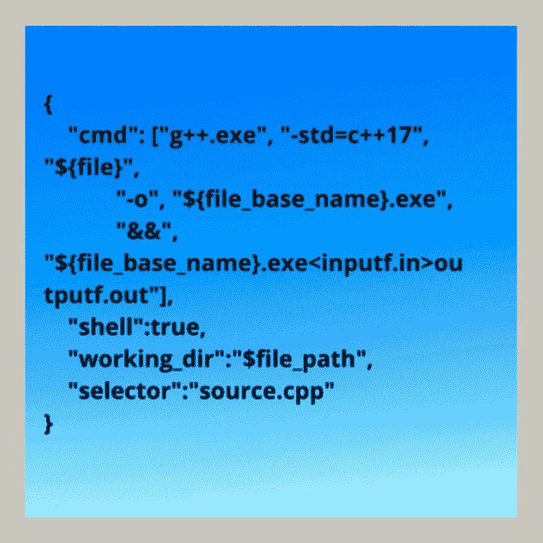
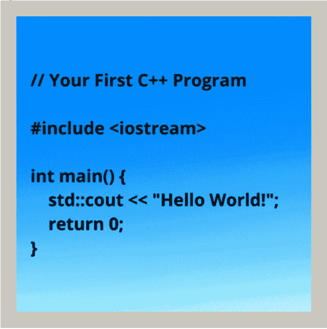
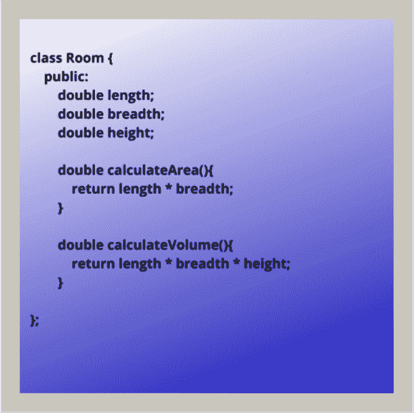

# 儿童编程 C++：儿童学习编程与编写程序的基础指南


## 开始阅读前，请下载你的免费数字资源！

请务必在电脑或移动设备上访问下方网址，获取随本书购买附赠的免费数字资源文件。

这些数字资源将补充书中的内容，并在全书正文中有所引用。

### 在此下载你的资源：

www.GoldInkBooks.com

## 引言

既然任何人都能学习编程，为什么要把孩子落下呢？曾经，编程只局限于计算机工程师，他们默默坐着，不停敲出一行行无尽的代码。然而，得益于技术进步，孩子们如今也能触手可及地享受编程。“手机游戏”“智能手机”“平板电脑”和“电脑游戏”这些词不再是行话。孩子们正在将高科技设备用于教育和娱乐目的。他们掌握这些设备的速度和效率远高于成年人，因为只要利用得当，年轻头脑具有非凡的探索和专注潜力。

编程是当今世界最有价值的能力之一。由于大多数应用和网站都建立在编程的基础之上，编程已成为近年来最需要掌握的关键技能之一。C++ 是最重要的编程语言之一，但许多学生不确定是否应该从它开始学起。

C++ 对孩子来说可能具有挑战性，因为它看起来包含大量数学内容，会让他们对学习编程望而却步。然而，一旦学生掌握了 C++ 的基础，就不会再回头了。你可能会惊讶地发现，大多数伟大的程序员都是从 C++ 开始他们的职业生涯的。

C++ 以学习曲线陡峭著称，但如果你鼓励孩子学习它，这将对他们的编程生涯大有裨益。C++ 将帮助你的孩子培养解决现实问题的能力，同时为编程概念打下坚实基础。C++ 还可以帮助养成扎实的编程习惯，从而形成清晰一致的代码编写风格。

在本书中，我们将介绍一些适合青少年的 C++ 基础主题。我们还将讨论教青少年学习 C++ 的优缺点。

### 为什么选择 C++？

C++ 是一种区分大小写的通用计算机语言。它支持过程式、泛型和面向对象编程。由于兼具低级语言和高级语言的特征，它被归类为中级语言。

让我们看看 C++ 的用途，以便理解这门语言的重要性。

### C++ 的用途是什么？

C++ 是一种面向性能的编程语言，可应对广泛的程序和挑战。它专注于大规模系统编程。它有助于开发 3D 动画、Firefox 和 Chrome 等网络浏览器，以及医疗软件、办公软件等其他应用。它还应用于暴雪游戏、MRI 扫描仪和 PDF 技术等领域。

使用 C++ 编程，我们可以创建各种安全且稳健的应用，例如 Windows 应用、设备驱动程序、嵌入式固件、客户端-服务器应用等。它通过过程式编程对 CPU 的各种功能进行编程。C++ 还广泛用于电子游戏开发。不仅如此，Chrome、Mozilla 和 Firefox 等搜索引擎也使用 C++。由于其应用范围极其广泛，它是一门非常重要的编程语言。

### 关于本指南

本书将介绍 C++ 的基本概念。本手册旨在成为循序渐进的指南，一步一步确保你理解所有内容。首先，你必须理解语句构成的基础，有时也称为语法。接下来的部分将带你了解重要的表达式、函数以及小型 C++ 程序的构建。

此外，本书还涵盖 C++ 的选择结构、运算符、数组、逻辑数据、类、指针和字符串等主题。我很高兴你决定在深入学习 C++ 之前阅读本书。本指南将帮助你：

- C++ 基础知识。
- 编程基础。
- 如何开始 C++ 编程。
- 如何创建 C++ 项目？
- C++ 基础与中级语法
- C++ 鲜明且不可抗拒的特性
- C++ 的众多应用
- C++ 编译器、集成开发环境和文本编辑器。


- 数据类型、变量和运算符。
- C++ 表达式。
- C++ 的面向对象编程（OOP）概念。
- 在 C++ 编程中，你将学习模块创建、异常和数组。
- C++ 库用于存储数据。

### 本指南适合哪些年龄段？

本指南专为初学者设计，尤其适合 12 岁及以上人群。此外，对于希望教孩子 C++ 编程的家长来说，本指南也非常合适。

### 重要建议

如果在阅读本书时尝试编写代码并构建应用程序，本书将更有益处。

本书讨论了一些最重要的 C++ 主题。它是最适合儿童开启编程生涯的编程语言之一。通过掌握 C++，他们可以成为编程天才。希望本书能以有趣的方式帮助你学习 C++。

祝你学习顺利！

## 第 1 章：C++ 入门

Java、C++、Python 和 C 是最常用的语言。这些语言鼓励程序员从计算机编程和实现的角度思考问题，而不是从业务逻辑的角度思考问题。尽管 C++ 已经老旧，但如今仍被广泛使用，这本身就是一项了不起的成就。C++ 仍然被广泛使用，最著名的软件也是基于它构建的。

本章介绍 C++ 的基础知识、高级思想、应用和概念。还讨论 C++ 的背景以及用于进行 C++ 开发的工具。然后，你将学习编写自己的第一个程序。

### 1.1 什么是 C++？

C++ 基本上是一种 OOP 语言。OOP 指面向对象编程语言，由著名计算机科学家 Bjarne Stroustrup 在 C 语言家族的发展过程中开发。C++ 的读音是“See-plus-plus”。它是以 C 的跨平台增强形式创建的，使开发者能够更好地控制内存和系统资源。

C++ 被称为“包含类的 C”，因为 C++ 在 C 基础编程语言的基础上加入了 OOP 技术，包括使用指定的类。事实证明，C++ 不仅对计算机编程很有价值，而且对训练新手程序员如何使用 OOP 也很有价值。

然而，它不仅支持 OOP，还支持函数式编程和过程式编程。

C++ 如今之所以流行，是因为它具有出色的可移植性和易用性，使程序员能够轻松设计可在各种操作系统和平台上运行的应用程序。尽管 C++ 是一种高级语言，但由于它与许多机器语言关系紧密，因此可用于操作底层数据。

#### 简要背景

Bjarne Stroustrup 于 20 世纪 80 年代初在贝尔实验室创建了 C++，旨在融合众多现有语言的最佳特性。他试图将现有 BCPL 的速度、通常具备高级特性的 Simula，以及 Dennis Ritchie 的 C 的通用性与组合性整合到单一软件包中。他借鉴了 ML、Ada 以及 ALGOL 68 等其他语言，构建了一种通用且结构良好的语言，该语言几乎可以编译所有 C 程序，而无需修改其实际源代码。

### 1.2 C++ 的五个基本概念

#### 1. C++ 中的变量

变量是任何编程语言的基本构建块。变量只不过是一种保存数据以供后续使用的手段。通过引用描述该信息的“词”，可以检索这个值或数据。变量一旦被声明和定义，就可以在其被声明和定义的作用域内多次使用。

#### 2. C++ 中的控制结构

程序执行时，编译器会逐行读取代码（从上到下，且大部分情况下从左到右）。这被称为“代码流”。从头到尾读取代码时，可能会遇到必须做出决定的时刻。软件可能会根据该决定跳转到代码的不同区域。甚至可能导致编译器重新运行某一部分，或直接跳过某段代码。

可以把这种方法想象成你正在从各种 Guru99 课程中进行选择。你做出决定，然后点击链接跳过几页。同样，计算机程序也有一套严格的规则来决定程序如何执行。

#### 3. C++ 中的数据结构

让我们以（任何网站上的）课程列表为例！你面前很可能有一份课程表。但是，你认为他们是如何处理它的？课程数量可能很多，不同的人报名不同的课程。每个用户的变量都是以不同方式生成的吗？假设我们需要跟踪十门不同的课程。

**然后是错误的方法：**

如果我们需要保存十门课程，就会定义十个变量。对吧？**错！！！**

在编程领域，试图用十个独立变量来存储是一种糟糕的方法。原因有两个关键因素：

- 程序中需要大量文本。当然，我们现在只有十门课，所以还不算太糟，但如果我们有 1,000 门呢？想想你得输入多少次！别想了！
- 要添加另一门课程，就需要手动调整代码。还得创建变量 course11。这完全疯了！

那么，做事的正确方法是什么？

**使用数据结构来存储它们。**

使用数据结构，你可以避免创建成千上万个变量。C++ 有大量内置数据结构。数组是其中最常用的数据结构，后面将会介绍。

#### 4. C++ 中的语法

语法是一组关于单词、表达式和符号如何组织的规则。这是因为电子邮件地址具有明确定义的语法。你需要字母和数字的组合，中间可能带有下划线（_）或句点（.），还需要 @ 符号以及网站域名（company.com）。

因此，编程语言的语法也非常相似。它们是一组明确定义的规则，使你能够开发出可运行的软件。

如果不遵守编程语言或语法的规则，就会出错。

#### 5. C++ 工具

工具（通常是实体设备）帮助你在现实世界中快速完成任务。这在编程世界中同样适用。编程工具是一种软件，与代码结合使用时，可以让你更快地编程。

在所有编程语言中，可能有着数以万计甚至数以百万计的不同工具。许多人认为 IDE（集成开发环境）是最重要的工具。IDE 是一种让编码变得容易得多的软件。IDE 可以让你的文件和文件夹保持井然有序，并以整洁的方式呈现它们。

### 1.3 什么是代码编辑器及其安装？

#### IDE 到底是什么？

IDE（集成开发环境）是一种用于构建游戏、软件和硬件的数字环境，集成了从调试到编译的一切功能。一些 C++ IDE 只支持单一语言，例如 IDLE 仅支持 Python。另一方面，Apple 的 Xcode 支持多种语言，包括 C、C++、Java 等。

本章将对每个 C++ IDE 进行清晰而基础的说明，以便你选择适合自己的 IDE。你也可以在电脑上试用其他几个 IDE，找出最适合你的那个。

#### Dev-C++

**此 IDE 的功能：**

- Dev-C++ 支持基于 GCC 的编译器，例如 Cygwin、MinGW 等。如果我们的电脑上已经有编译器，可以安装集成了编译器的 Dev-C++ IDE，也可以只安装 IDE。
- 使用此 IDE，我们可以使用集成调试（使用 GDB）。我们可以使用调试器对源代码执行所有标准调试操作。
- 它包含本地化功能，使其能够以多种语言工作。安装后首次启动 IDE 时，我们可以选择语言。我们也可以随时通过设置更改语言。
- 与其他 IDE 一样，此 IDE 为我们编写的代码包含“自动补全”功能。
- 它具有可自定义的语法高亮编辑器，可使源代码更易于理解。
- 可以使用此工具编辑和编译资源文件。
- 项目中有一个工具管理器，提供若干可供使用的工具。
- 此 IDE 还包含查找和替换功能。
- 我们可以使用 Dev-C++ IDE 构建各种程序，包括 Windows 程序、控制台程序、静态库和 DLL。
- 为了建立我们的项目类型，我们还可以构建项目模板。


- Dev-C++ IDE 也可用于生成 Makefile，而 Makefile 负责管理应用程序的构建过程。
- 它同时支持类浏览器和调试变量浏览器。
- 它由项目管理器进行管理。

##### 安装

以下是 Dev-C++ 的分步安装指南。

- 运行安装程序的第一步是选择你想要使用的语言。
- 选择合适语言后，系统会提示你接受出现的许可协议。
- 之后，你必须选择要作为 Dev-C++ 安装的一部分进行安装的组件。系统会提供可安装组件列表，每个组件旁都有一个勾选标记。可以勾选或取消勾选每个复选框，以指示要安装哪些组件。选择完所有组件后，单击“Next”。
- 安装程序现在会询问目标文件夹，Dev-C++ 文件、库和其他文件将复制到该文件夹。指定目标文件夹位置后，单击“Install”。
- 安装完成后，会出现“Finish”提示，表示安装已完成。之后，你可以单击“Finish”来运行 Dev-C++ IDE。

#### Sublime Text 编辑器

Sublime Text 是一款面向程序员的强大文本编辑器。你会喜爱其用户界面的流畅性，以及令人惊叹的功能和性能。不必等待在线 IDE 编译并输出结果，你可以自行完成。你可以使用 Sublime 快速构建和编译程序。

##### 安装

- **安装 Sublime Text 编辑器：** 从此处下载并安装 Sublime Text 编辑器安装文件。
- MinGW 编译器是 GNU 编译器集合（GCC）的原生 Windows 移植版，包含可自由分发的导入库和头文件，用于创建原生 Windows 应用程序。
- 安装 MinGW 的 Basic Setup 中的所有组件。
- 列出所有需要安装的软件包。
- 在“Installation”选项卡下，选择“Apply Changes”选项。
- **创建正确的环境——** 完成上述步骤后，GCC 现在已启动并运行。必须修改环境变量中的 Path。为此，请按照以下说明操作：
- 右键单击“我的电脑”，选择“属性”>“高级系统设置”>“环境变量”。
- 现在在“系统变量”选项卡中查找 Path。要创建新路径，请转到 Path >“编辑”>“新建”。
- 现在转到 C 盘，找到 MinGW 安装文件夹内的 bin 文件夹。
- 应复制 bin 文件夹的路径。默认路径为 `C:\MinGW\bin`。
- 将新路径复制并粘贴到列表中，然后单击“确定”。由于 Path 变量已调整，Sublime Text 现在可以从其终端访问 g++。
- 创建一个文件并将其命名为 CP.sublime-build



- 前面的代码块用于从文件“input.in”读取数据，并将其输出到“output.out”。
- **创建窗口布局——** 按下面描述的顺序新建三个文件，并确保它们都位于同一文件夹中。
- file.CPP：编写代码的文件。
- input.in：这是将提供输入的文件。
- output.out：输出将显示在此文件中。

**现在执行以下操作：**

- 从 View 菜单中选择 View > Layout > Columns。这会将工作区分为三列。将这三个文件分别放入三列。
- 转到 View > Groups > Max Columns，然后从 Tools > Build System > CP 中选择我们刚刚构建的构建系统。
- **准备运行程序——** 预编译头文件：通过预编译所有头文件（包括 bits/stdc++.h 头文件），可以加快编译过程。为此，请执行以下步骤：
- 找到 stdc++.h 头文件。默认情况下，该文件位于“`C:\MinGW\lib\gcc\mingw32\6.3.0\include\c++\mingw32\bits`”。
- 在当前文件夹中打开 PowerShell 或命令窗口。为此，请在按住 Shift 键的同时右键单击。
- 要编译该头文件，请使用以下命令。

```
g++ -std=c++17 stdc++.h
```

### 1.4 C++“Hello, World!”程序

现在，我们将学习如何编写一个名为“Hello World”的简单 C++ 程序。

“Hello, World!”程序是一个在屏幕上显示“Hello, World!”这句话的基础程序。由于它是如此基础的程序，常被用来向初学者教授一门新的编程语言。

让我们看看 C++“Hello, World!”程序是如何运行的。

首先，如果你尚未在计算机上设置好运行 C++ 的环境，请在计算机上安装 C++ 编辑器。

**请记住！**

- 为了在屏幕上打印输出，我们使用 std::cout。
- 如果要使用 std::cout，就必须包含 iostream。
- main() 函数是执行代码的地方。此函数是必需的。这是一个完全有效但什么都不做的 C++ 应用程序。

让我们开始编写你的第一段代码。

#### C++ 程序“Hello, World!”包含的内容

```
// Your First C++ Program
```

C++ 中任何以“//”开头的行都是注释。注释的目的是帮助阅读代码的人理解程序的操作。C++ 编译器会完全忽略它。

```
#include <iostream>
```

预处理器指令 #include 用于在应用程序中包含文件。上述代码包含了 iostream 文件的内容。

这使我们能够在程序中使用 cout 将输出打印到屏幕上。

目前，只需记住使用 cout 需要 #include，它允许我们将输出打印到屏幕上。

```
int main() { }
```

任何有效的 C++ 程序都需要 main() 函数。花括号表示函数的开始和结束位置。

此函数是代码执行开始的地方。

```
std::cout << "Hello, World!";
```

std::cout 会打印引号内的内容。它后面必须跟 <<，然后是格式字符串。在我们的例子中，格式字符串是“Hello World!”

“;”字符表示语句的结束。

```
return 0;
```

return 0; 语句表示程序的“退出状态”。通俗地说，程序以该语句结束。

现在这里是完整代码：



上述代码的输出结果如下。

Hello World!

所以，现在你知道如何编写基本的 C++ 代码了。为了更好地理解，可以尝试更改输出语句中的文字。你可以练习上述代码。

## 第 2 章：C++ 中的变量、数据类型和运算符

数据类型、变量和运算符是 C++ 最基础的概念。某些运算符被视为这种高级计算机编程语言的基本构建块。通常，我们使用它们来编写项目程序，并通过使用它们获得所需结果。数据类型是这三个概念中的核心概念；如果不掌握这三个基本概念，就无法理解 C++ 编程。现在，我们将讨论 C++ 编程中一些必需的变量、运算符和数据类型。

### 2.1 C++ 的变量

在 C++ 中，变量充当内存位置。它们只是容器或元素的名称，这些容器或元素包含程序后续执行所需的数据或值。变量可以使用字符和数字的组合，或下划线（_）等特殊符号，以及 char、int、float 和 double 等数据类型来指定。变量名的首字符必须仅为字母，保留关键字除外。

在任何编程语言中，变量都是最关键的组成部分。没有变量，任何编程语言都是不完整的。我们也可以断言，没有变量程序就无法执行。正如其他任何编程语言一样，C++ 语言也需要变量才能运行。变量用于存储值或字符串，而不是用于运行程序。如果没有存储任何值，应用程序将无法运行。因此，变量被认为是编程语言的支柱。

#### C++ 语言中的变量定义规则和规定

- 变量可以由数字、特殊字符（例如 & 和下划线（_））或字符串组合而成。
- 由于 C++ 是区分大小写的语言，大写和小写会被视为不同的变量。变量 educba 和 eduCBA 将被分别处理。
- C++ 中的变量必须以字符开头。数字不能作为第一个字符。6educba 不是可接受的变量，因为它以数字开头；而 educba6 以字符开头。
- 变量不应使用 C++ 中的关键字。用于此目的的关键字包括 for、this、if、else、while、do、char、this 等。在 C++ 中，某些关键字不能用作变量。
- 变量不得包含任何空格。Edu cba 无效，因为 edu 和 cba 之间有空格。但是，edu_cba 或 educba 都是合法变量，因为使用下划线将它们连接起来。

#### 在 C++ 中，如何声明变量？

在开始编写程序之前，可以声明变量。以下是声明变量的语法。

```
data_type variable_name;
```

其中

**数据类型：** 它描述可用于存储值的数据类型。整数、字符、浮点数、双精度浮点数、短整数以及其他数据类型都是可能的。

**变量名：** 定义变量名。除关键字外，它可以是任何内容。

- 1. 例如 `int taxi;`；
- 2. `float 2.6, 8.3`

例如，int 是数据类型，而 taxi 是变量名。在第二个示例中，我们指定了两个变量，其中 float 是数据类型，2.6 和 8.3 是变量。变量声明后，编译器已为其分配存储空间，因为程序将使用这些变量。

**通过程序说明**


```cpp
#include <iostream>
using namespace std;
int main()
{
    int x, y, z;
    x = 10;
    y = 3;
    z = x + y;
    cout << "Sum of two numbers is: " << z;
    return 0;
}
```

### 2.2 C++ 中的不同数据类型

数据类型决定了数据的类型以及对其执行的操作。C++ 包含多种数据种类，每种数据在计算机内存中以不同方式表示。C++ 中提供派生数据类型、内置数据类型和用户自定义数据类型。

数据类型应在执行前确定，以便编译器知道某些变量所包含的数据类型。整型数据类型只能存储整数值；不能存储浮点或字符串值。

#### 内置数据类型

浮点型、整型和 void 数据类型是 C++ 提供的最基本（基础）数据类型。特别是浮点型和整型数据类型，前面可以加上多种类型修饰符。因此，这些修饰符是改变数据类型大小、范围或两者兼有的关键字。修饰符有 long、short、signed，有时还有 unsigned。这些修饰符默认是有符号的。

除了这些基本数据类型之外，C++ ANSI 现在还引入了两种新的数据类型：wchar_t 和 bool。让我们看看 C++ 语言中包含的所有内置数据类型。

- **整数：** 通常用字母“int”表示。我们可以确定已分配多少 RAM。整型数据类型用于保存整数，它包括（字符）char 和（整数）int 数据类型。
- **字符：** 在 ASCII 字符集中，字符是字母，有时是数字，还有一些其他字符（如 !、@、&、# 等）。由于字符以 0 到 127 的整数值存储，因此在 C++ 中字符数据类型也被视为整型数据类型。char 数据类型占用 1 字节内存（也就是说，它一次只能保存一个字符）。
- **浮点型：** 诸如 4.28、74.7588765、8.991 和 -444.53 之类的实数值使用浮点数据类型存储。此数据类型包括 double 和 float 数据类型。
- **Void：** void 数据类型基本上用于表示函数的空参数列表以及函数的返回类型。当 void 基本上用于标记或指定空参数列表时，它意味着该函数不接受任何参数；而当我们将其用作返回类型时，它意味着该函数不返回任何内容或任何值。不会为 void 分配内存；因此，它不能存储任何值。因此，你不能使用 void 声明简单变量，但可以使用它声明单个泛型指针。
- **Bool：** bool 数据类型只能携带布尔值，即 true 或 false，其中 true 表示 1，false 表示 0。它只需要存储空间中的一位，但在内存中仍作为单个整数保存。因此，它也会被视为一种整型数据类型。bool 类型的数据最常用于表示对数据执行逻辑运算的结果。它也可以用作函数的返回类型，表示函数成功还是失败。

除了字符数据类型之外，C++ 语言还有 wchar_t 数据类型，它基本上用于存储或保存 16 位字符。

#### 派生数据类型

派生数据类型是从某些内置数据类型派生而来的数据类型。数组、函数、引用和指针是 C++ 提供的一些派生数据类型。

**示例：**

- **数组类型：** 数组基本上是一组具有相同名称、且仅由相同数据类型元素组成的集合。给定数组中的每个元素可通过下标值或唯一索引访问，并存储在连续（一个接一个）的内存区域中。下标值表示该元素在数据类型数组中的位置。
- **函数类型：** 函数基本上是一个自包含的程序段，执行单个且定义明确的任务。C++ 中的每个程序都由一个有时多个函数组成，必要时可以从程序的其他部分调用这些函数。
- **引用：** 变量的替代名称称为引用。换言之，引用基本上只是程序中某个变量的别名。变量及其引用可以在程序中交替使用，因为它们都指向同一内存地址。因此，对其中一个的任何修改都会影响另一个。
- **指针：** 指针简单来说是一个变量，可用于跟踪另一个变量的内存地址。指针使得以动态方式使用内存成为可能。使用指针可以在运行时为变量分配或释放内存，这使程序更简单、更高效。

#### 用户自定义数据类型

联合、结构体、枚举和类是 C++ 支持的一些用户自定义数据类型。

- **联合、结构体和类：** C 编程语言最重要的特性是联合和结构体。联合和结构体允许你将相似或不同的数据类型组织在一个标识符下。然而，为了促进面向对象编程，C++ 已经通过在之前的数据类型中集成某些新特性和命令，扩展了联合和结构体的概念。C++ 中的类数据类型是一种独特且新引入的用户自定义数据类型，是 OOP 的基础。类充当模板，用于定义构成类对象的数据、信息和函数。关键字 class 用于声明类。类一经声明，就可以简单地创建该类的对象。
- **枚举类型数据：** 枚举数据类型是一组已命名的整数常量，定义了枚举变量的所有可能值。枚举器是一组允许值。

### 2.3 C++ 中的运算符

在本教程中，我们将借助示例学习 C++ 中不同种类的运算符。编程中的运算符是一种符号，它对值或变量执行操作。

对值和变量执行操作的符号称为运算符。例如，加法运算符 + 用于将数字相加或进行加法运算，减法运算符 - 用于减法运算。

在 C++ 中，有六种不同类型的运算符：

- 算术运算符
- 赋值运算符
- 关系运算符
- 逻辑运算符
- 位运算符
- 其他运算符

#### C++ 中的算术运算符

这些运算符用于对不同变量和数据进行算术运算。

**例如，**

```cpp
X+Y;
```

加法 + 运算符用于将名为 X 和 Y 的两个变量相加。在 C++ 中，有多种算术运算符。

**例如，算术运算符代码**

```cpp
#include <iostream>
using namespace std;

int main() {
    int a, b;
    a = 7;
    b = 2;

    // printing the sum of a and b
    cout << "a + b = " << (a + b) << endl;

    // printing the difference of a and b
    cout << "a - b = " << (a - b) << endl;

    // printing the product of a and b
    cout << "a * b = " << (a * b) << endl;

    // printing the division of a by b
    cout << "a / b = " << (a / b) << endl;

    // printing the modulo of a by b
    cout << "a % b = " << (a % b) << endl;

    return 0;
}
```

**你将得到的输出……**

```text
a + b = 9
a - b = 5
a * b = 14
a / b = 3
a % b = 1
```

正如我们可能推测的那样，运算符 +、- 和 * 分别计算加法、减法和乘法。

#### 递增和递减运算符

因此，C++ 还具有递增运算符和递减运算符：分别为 ++ 和 --。

- ++ 将操作数的值增加 1
- -- 将其减少 1

**例如，**

```cpp
int num = 5;
// increment operator
++num; // 6
```

#### C++ 赋值运算符


在 C++ 中，为了给变量赋值，会使用赋值运算符。例如，

```cpp
// assign 6 to b
b = 6;
```

这里，我们将值 6 赋给变量 b。

以下列出了所有赋值运算符：

| 运算符 | 示例 | 等价于 |
|---|---|---|
| `=` | `a = b;` | `a = b;` |
| `+=` | `a += b;` | `a = a + b;` |
| `-=` | `a -= b;` | `a = a - b;` |
| `*=` | `a *= b;` | `a = a * b;` |
| `/=` | `a /= b;` | `a = a / b;` |
| `%=` | `a %= b;` | `a = a % b;` |

#### C++ 中的关系运算符

为了检查两个操作数之间的关系，会使用关系运算符。例如，

该运算符将检查 a 的值是否大于 b。

```cpp
a > b;
```

因此，在这个句子中，`>` 是 C++ 关系运算符。它将检查 a 的值是否大于 b。

如果该运算符所表示的关系为真，则返回 1；如果为假，则返回 0。在下表中，我们汇总了所有运算符，方便你查阅。

| 运算符 | 含义 | 示例 |
|---|---|---|
| `==` | 等于 | `3 == 5` 的结果为**假** |
| `!=` | 不等于 | `3 != 5` 的结果为**真** |
| `>` | 大于 | `3 > 5` 的结果为**假** |
| `<` | 小于 | `3 < 5` 的结果为**真** |
| `>=` | 大于或等于 | `3 >= 5` 的结果为**假** |
| `<=` | 小于或等于 | `3 <= 5` 的结果为**真** |

#### C++ 中的逻辑运算符

为了判断表达式为真还是假，会使用逻辑运算符。如果表达式为真，则返回 1；如果为假，则返回 0。在 C++ 语言中，逻辑运算符经常用于做出决策。

| 运算符 | 示例 | 含义 |
|---|---|---|
| `&&` | `expression1 && expression2` | 逻辑与。仅当所有操作数都为真时才为真。 |
| `\|\|` | `expression1 \|\| expression2` | 逻辑或。至少一个操作数为真时为真。 |
| `!` | `!expression` | 逻辑非。仅当操作数为假时才为真。 |

#### C++ 中的按位运算符

按位运算符在 C++ 中用于对单个位执行操作。它们仅与 char 和 int 数据类型兼容。

下表中列出了所有按位运算符。

| 运算符 | 描述 |
|---|---|
| `&` | 二进制与 |
| `\|` | 二进制或 |
| `^` | 二进制异或 |
| `~` | 二进制反码 |
| `<<` | 二进制左移 |
| `>>` | 二进制右移 |

## 第 3 章：C++ 中的字符串

### 3.1 什么是字符串？

字符串是 C++ 库中的一项功能，可帮助在程序中执行所有与字符串相关的操作。字符串数据类型也会分配给一个变量，该变量包含由双引号括起来的一串字符。字符串变量是指被分配了连续字符序列的变量。让我们看看 String 数据类型在 C++ 编程语言中是如何使用的。

字符串是 C++ 库中最常用的数据类型之一。字符串是一种变量，用于记录字母或其他字符的序列或列表，例如“嘿！”或“你的作业将于 6 月 10 日到期！”。要创建字符串，我们必须先声明它，然后存储值，就像其他数据类型一样。

C++ 中的字符串不过是由不同字符组成的任意序列，这些字符定义在 C++ 已定义的库集合中。

C++ 允许程序员使用字符串在需要的地方插入文本。字符串可以被反转、连接、传递给先前的函数，等等。

由于 C 代码可以在 C++ 编译器上运行，我们也可以在 C++ 中使用 C 风格字符串。

为了使用字符串数据类型，必须在程序顶部包含 C++ 字符串头文件 `<string>`。此外，无需使用繁琐的命令 `std::string`，你需要使用 `using namespace std;` 使短名称 string 可见。例如，

std 是一个 C++ 命名空间，包含 C++ 中的许多功能。

C++ 库是标准的；就本课关于**命名空间**的目的而言，你不需要了解其他任何内容。因此，你的程序中将包含以下 #include 语句。

以便利用字符串类型

```cpp
#include <string>
```

```cpp
using namespace std;
```

### 字符串的基本操作

让我们详细了解你将最常执行的字符串操作。

#### 统计字符串中的字符数。

在字符串的这一功能中，会统计该字符串包含的字符数。`length()` 方法返回字符串中的字符总数，包括标点和空格。`length()` 是许多字符串操作的成员函数，我们使用点号表示法调用成员函数。接收字符串位于点号左侧，而我们调用的成员函数（例如 `str.length()`）位于右侧。在此类表达式中，我们是在获取变量 str 的长度。示例程序：

```cpp
#include <string>
#include <iostream>
using namespace std;
#include "console.h"
int main() {
    string small, large;
    small = "I am short";
    large = "I, friend, am a long and elaborate string indeed";
    cout << "The short string is " << small.length()
         << " characters." << endl;
    cout << "The long string is " << large.length()
         << " characters." << endl;
    return 0;
}
output:
The short string is 10 characters.
The long string is 48 characters.
```

#### 访问单个字符。

使用方括号，你可以像访问 char 数组一样访问字符串中的单个字符。在字符串 str 中，位置编号从 0 到 str.length() - 1。[] 可用于读取和写入字符串中的字符。

示例程序：

```cpp
#include <cstring>
#include <iostream>
using namespace std;
#include "console.h"
int main() {
    string test;
    test = "I am Q the omnipot3nt";
    char ch = test[5]; // ch is 'Q'
    test[18] = 'e'; // we correct misspelling of omnipotent
    cout << test << endl;
    cout << "ch = " << ch << endl;
    return 0;
}
output:
I am Q the omnipotent
ch = Q
```

#### 字符串的传递、返回和赋值。

就赋值而言，C++ 字符串应当像常规基本类型一样工作。当一个字符串被赋值给另一个字符串时，会创建字符序列的深拷贝。

```cpp
// Makes a fresh duplicate of string
string str1 = "hello";
string str2 = str1;
str1[0] = 'y'; // just affects str1, not str2.
```

当你从函数传递和返回字符串时，字符串会被克隆。除非显式按引用传递字符串，否则在函数内对字符串参数所做的更改在调用函数中不可见。

#### 比较两个字符串。

可以使用 `==` 和 `!=` 运算符比较两个字符串是否相等。假设你询问用户的名字。如果用户是 Julie，应用程序会打印一条友好的问候语。如果用户不是 Neal，应用程序会显示标准通知。最后，如果用户是 Neal，回答则不那么热情。

#### 在字符串中搜索

字符串成员函数 `find()` 用于在字符串中查找某个字符串或字符。例如，`str.find(key)` 会在接收字符串 str 中搜索 key。字符串或字符都可以作为参数 key。（我们说 `find` 成员函数是重载的，因为它可以被多次使用。）常量 `string::npos` 表示未找到 key，返回值要么是找到 key 的起始位置，要么是常量 `string::npos`，表示未找到 key。

有时你可以选择控制检查字符串的哪一部分，例如，在第一次出现之后查找第二次出现。还有一个额外的整数参数可用于查找该出现位置。

#### 提取子字符串

提取子字符串。你可能想从较大的字符串中截取一些片段来组成新字符串。使用 `substr` 成员函数从接收字符串的各个部分创建子字符串。起始位置和

字符数量均由你指定。例如，`str.substr(start, length)` 会创建一个新字符串，其中包含从 str 中位置 start 开始、持续 length 个字符的字符。

该成员函数会创建一个新字符串，其中复制了所提供的字符。因此，它不会影响接收方字符串。

## 第4章：C++中的数组

在任何编程语言中，数组都至关重要。它们不是分别存储变量或一组相似数据类型的集合，而是提供了一种更简单的方法将它们一起存储。数组的值将逐个访问。

因此，在本章中，我们将全面讨论数组，并了解如何在 C++ 代码中使用数组。数组是 C++ 中的重要组成部分，因为它有助于内存管理并提高程序效率。由于能够存储多维数据，它可以以多种方式使用。当你需要存储相同数据类型的值时，数组始终是最佳选择。它不仅节省资源，还缩短程序运行所需的时间。

那么，让我们学习如何使用数组。

### 4.1 数组简介

在 C++ 中，数组是 int、char、float、double 等可比较数据类型的集合，这些值使用索引值存储，并且可以仅通过索引值访问。它使用单个变量存储所有变量实例。在 C++ 中，数组可以通过三种方式定义：指定数组大小、直接初始化数组元素，或指定数组大小及其元素。

为了让任何应用程序能够处理数据，我们必须先将数据输入应用程序。这意味着值应存储在应用程序中的某个位置，直到程序执行。

计算机语言提供变量来履行存储值的功能。变量用于存储值，以便应用程序可以使用它们生成预期结果。由于值存储在变量中，它们会占用分配给应用程序的内存空间。因此，最佳编码策略是确保变量使用尽可能少。数组概念的创建是为了解决因创建大量变量而导致的内存分配问题。数组可以看作相同数据类型值的集合。

#### C++中数组如何工作？

以下描述数组如何工作：

- 数组的用途是存储相同数据类型的值。它的设计工作方式与变量相同，相对于变量唯一优势是它可以同时保存多个值。在 C++ 或任何其他编程语言中创建数组时，我们必须提供希望存储在数组中的变量数量。
- 值得注意的是，数组的大小在应用程序生命周期内保持不变，不能动态更改。一旦确定了数组大小，我们就可以在其中存储相同数量的值。如果数组的数据类型设置为整数，则它不会接受任何非整数值。索引将用于定位数组所保存的值。
- 例如，如果数组可以保存两个值，第二个值将存储在数组的索引一位置，因为数组索引从零开始。我们将在后面学习如何创建数组。

### 4.2 C++中数组的类型

在 C++ 编程语言中，数组的两种基本形式是一维数组和多维数组。一维数组以列表形式存储值，而多维数组以矩阵形式存储值。我们将通过示例查看每种类型。

#### 一维数组

一维数组可以定义为一种数组类型，它可以以列表形式携带单一数据类型的值。它是最基本的数组类型，因为定义和初始化它所需的工作很少。它可以写成 `int a[10]`，其中 `int` 表示数据类型，数组大小。下面的示例将有助于说明这一点。

##### 练习代码

```cpp
#include <iostream>
#include <conio.h>
using namespace std;

void main()
{
    int val_array[3];
    int int_val=1,counter;
    cout<<"Please enter three numbers that you want to multiply"<<endl;
    for(counter=0;counter<3;counter++)
    {
        cin>>val_array[counter];
        int_val = int_val*val_array[counter];
    }
    cout<<"The multiplication of these three numbers is ="<<int_val;
    getch();
}
```

上面的程序创建用于接受用户的三个输入，然后处理这些输入以生成所有三个数的乘积值。`val_array` 是所使用的数组名称，该数组可以保存三个值。循环用于接收数组的值，随后这些值被相乘。`int_val` 变量用于存储乘法结果。该函数不会返回任何值，因为它是 void 类型。

#### 多维数组

多维数组是一种以矩阵方式存储值的数组。二维数组经常使用，随着维数增加，数组变得更加困难。例如，使用二维数组比使用三维数组容易得多。对于二维数组的每个维度，必须定义两个大小。二维数组在程序中可以写成 `int a[5][3]`。值将以五行三列的矩阵形式存储在该数组中。让我们看一个示例来帮助理解。

##### 练习代码

以下是数组传递方法的示例：

要将变量作为参数传递给任何方法，它必须从数据类型和将保留值的变量名接收值。将数组传递给方法的机制与传递任何其他变量相同。唯一的区别是，我们将不必指定单个变量，而是必须使用特定大小的数组来代替。让我们从语法角度看一下。

```cpp
// defining method that accepts an array as a parameter.
int handle_array(int a[6]);
```

`handle_array` 是方法名称，它接受一个数组作为参数。数组由字母 a 指定，最多可以保存六个值。让我们看看如何将参数提供给 `handle_array` 方法。

```cpp
int arr[6] = {1,2,3,4,5,6};
handle_array(arr);
```

我们必须先将数据赋给其他变量，然后再将它们传递给 `handle_array` 方法。赋值后，我们必须以数组作为参数调用 `handle_array` 函数。上面的代码片段中，数组已被赋值并作为参数提供，以传递 `handle_array` 函数所定义的值。

## 第5章：C++指针

变量是计算机内存中的区域，可以通过其标识符访问，如前几章所述。指针消除了程序需要关心数据在内存中物理地址的需要。相反，它通过标识符引用变量。

C++ 应用程序将计算机内存视为一系列内存单元，每个单元都有自己的位置和大小。大于一个字节的数据表示可以存储在地址相邻的内存单元中，因为这些单字节内存单元是以这种方式组织的。

当调用或声明任何变量时，它会被分配一个指定的内存位置，我们需要在该位置保存其内存地址。一般来说，C++ 应用程序不会主动选择其变量所保存的内存的地址。

在本章中，我们将讨论什么是指针、指针如何使用内存、如何将变量分配给指针等等。

### 5.1 什么是指针？

指针是一个变量，其值是另一个变量的地址。指针与任何其他变量或常量一样，必须先声明才能使用。指针变量声明采用以下一般形式：`Type *var-name;` 这里，type 表示指针的基类型，它必须是有效的 C++ 类型，var-name 表示指针变量的名称。用于声明指针的星号也是用于乘法的星号。另一方面，在本句中，星号用于表示变量是指针。

C++ 指针简单且学习起来很有趣。一些 C++ 活动使用指针更容易完成，而另一些活动，例如动态内存分配，没有指针则无法完成。

你可能知道，每个变量都是一个内存位置，每个内存位置都有一个地址，可以使用表示内存地址的与号（&）运算符访问。

- 空指针：C++ 提供了空指针，它是在多个标准库中定义的零值常量。
- 指针算术：指针可以与四种不同的算术运算符一起使用：++、--、+、-。
- 指针与数组：指针和数组关系密切。
- 指针数组：数组可以携带大量指针。
- 指向指针的指针：在 C++ 中可以有一个指向指针的指针，依此类推。
- 将指针传递给函数：通过引用或地址将参数传递给函数，允许被调用函数更改调用函数中提供的参数。
- 从函数返回指针：C++ 中的函数也可以返回指向局部变量、静态变量或动态分配内存的指针。

### 5.2 在 C++ 中声明指针

#### 指针声明

当指针指向 char 时，它具有与指向 int 或 float 时不同的特性，因为指针可以直接引用它所指向的值。解引用后必须知道类型。为此，指针的声明必须指明指针将指向的数据类型。以下语法用于声明指针：

```cpp
type *name
```

上面，`type` 表示指针所指向的数据类型；这是指针将要指向的数据类型，而不是指针本身的类型。

```cpp
int * number;
char * character;
double * decimals;
```

这是三个指针声明。每个指针应该指向不同的数据类型，但它们都是指针，并且它们可能都会占用相同数量的内存空间（指针在内存中的大小取决于程序运行的平台）。然而，它们所指向的数据并不占用相同数量的空间，也不属于相同类型：第一个指向 int，第二个指向 char，第三个指向 double。尽管这三个示例变量都是指针，但根据它们所指向的类型，它们具有不同的类型：`int*`、`char*` 和 `double*`。


double*，分别。

用于声明指针的星号（*）仅表示它是一个指针（它是其类型复合说明符的一部分）。不应将其与解引用运算符混淆，后者同样用星号（*）书写。它们只是由同一符号表示的两个不同事物。

### 实践代码

```cpp
// my first pointer
#include <iostream>
using namespace std;

int main ()
{
    int firstvalue, secondvalue;
    int* mypointer;

    mypointer = &firstvalue;
    *mypointer = 10;
    mypointer = &secondvalue;
    *mypointer = 20;
    cout << "firstvalue is " << firstvalue << '\n';
    cout << "secondvalue is " << secondvalue << '\n';
    return 0;
}
```

#### 输出

firstvalue is 10  
secondvalue is 20

## 第6章：控制语句和循环

在编程语言中，控制语句用于控制程序的流程。它们只不过是程序中用于根据特定条件将控制权传递给另一条语句的一个术语或一组语句。控制语句会评估结果，并根据提供的条件执行必要的语句。

控制语句，也称为 if 语句、if-else 语句、break 语句、continue 语句、for 循环、while 循环和 do-while 循环，是控制程序流程以执行某段代码的语句。本章将讨论 C++ 语言中可用的一些重要控制语句。

### 6.1 语句与流程控制

简单的 C++ 语句是程序的单条指令，例如前面讨论的变量声明和表达式。语句总是以分号（;）结尾，并且按照它们在程序中出现的相同顺序运行。

另一方面，程序并不局限于按顺序执行的一组语句。程序在执行过程中可以重复某些代码部分，或做出决策并产生分支。C++ 为此包含流程控制语句，这些语句指定我们的程序必须做什么、何时做以及在什么条件下做。

本节讨论的许多流程控制语句都需要一个通用（子）语句。该语句可以是简单的 C++ 语句，也可以是复合语句，例如后跟分号（;）的单条指令。复合语句是一组语句（每条语句都以分号结尾），它们全部组合在一个块中，并包含在花括号中：{ }

整个块被视为单条语句（由多个子语句组成）。当通用语句出现在流程控制语句的语法中时，它可以是简单语句或复合语句。

### 6.2 选择语句：if 和 else

当且仅当满足条件时，使用 if 关键字执行一条语句或一个块。其语法如下：

`if (condition) statement`

在此情况下，被求值的表达式称为 condition。如果该条件为真，则执行语句。如果为假，则不会执行该语句（它将被忽略），程序将直接继续执行选择语句之后的代码。

例如，下面的代码段仅当变量 x 中存储的值为 200 时，才打印消息（x is 200）：

```cpp
if (x == 200)
cout<< "x is 200";
```

如果 x 不恰好等于 200，则忽略该语句，并且不打印任何内容。

如果希望在满足条件时执行不止一条语句，请将它们包裹在花括号（{}）中，形成一个块：

```cpp
if (x == 200)
{
cout<< "x is ";
cout<< x;
}
```

通过使用 else 关键字提供替代语句，带 if 的选择语句还可以定义条件不满足时发生的情况。其语法如下：

`if (condition) statement1 else statement2`

如果条件为真，则执行 statement1；如果条件为假，则执行 statement2。

为了验证一个值范围，可以将多个 if + else 结构串联起来。考虑以下情形：

```cpp
if (x > 0)
cout<< "x is positive";
else if (x < 0)
cout<< "x is negative";
else
cout<< "x is 0";
```

通过串联两个 if-else 结构，这会打印 x 是正数、负数还是零。同样，通过将语句组合成用花括号包围的块，本来可以针对每种情况执行不止一条语句。

#### switch 语句

switch 语句的语法有点奇怪。其目标是在一组可能的常量表达式中找到一个值。它类似于串联 if-else 语句，但仅适用于常量表达式。最常见的语法是：

```text
switch (expression)
{
    case constant1:
        group-of-statements-1;
        break;
    case constant2:
        group-of-statements-2;
        break;
    .
    .
    .
    default:
        default-group-of-statements
}
```

switch 会分析 expression，并检查它是否等于 constant1；如果相等，则执行 group-of-statements-1，直到遇到 break 语句。当程序看到这个 break 语句时，会跳转到 switch 语句的末尾（右花括号处）。

如果 expression 不等于 constant1，则将其与 constant2 比较。如果等于，则执行 group-of-statements-2，直到发现 break。

最后，如果 expression 的值与前面给出的任何常量都不匹配（常量的数量可以是任意的），程序将执行 default 后面的语句。

由于使用标签而不是块，switch 语句具有一种可追溯到 C 编译器早期时代的奇怪语法。在最常见的应用（见上文）中，特定标签的每组语句之后都需要 break 语句。如果没有指定 break，则 case 之后的所有语句（包括任何其他标签下的语句）同样会被执行，直到 switch 块结束或遇到跳转语句（例如 break）。

对于检查范围或非常量值，最好使用 if 和 if else 语句的串联。

### 6.3 迭代语句（循环）

循环会重复执行一条语句，直到满足某个条件或达到指定次数。关键字 while、do 和 for 用于引入它们。

#### while 循环

while 循环是最基本的循环类型。其语法如下：

```text
while (expression) statement
```

只要上面的 expression 为真，while 循环就会重复执行该语句。如果在某次语句执行后 expression 不再为真，循环终止，程序继续执行循环之后的代码。考虑以下 while 循环倒计时的示例：

```cpp
// custom countdown using while
#include <iostream>
using namespace std;

int main ()
{
    int n = 10;

    while (n>0) {
        cout << n << ", ";
        --n;
    }

    cout << "liftoff!\n";
}
```

在 main 中，第一条语句将 n 设置为 10。在倒计时中，这是第一个数字。然后 while 循环开始：如果该值满足条件 n>0（即 n 大于零），则执行条件之后的块，并且只要条件（n>0）为真，这个过程就会继续。

使用 while 循环时，请记住循环必须在某个时刻结束。因此，语句必须改变条件中检查的值，以迫使它在某个时刻变为假。否则，循环将无限循环下去。本示例中的循环包含 --n，它将条件中求值的变量（n）的值减一，使得在特定次数的循环迭代后条件（n>0）变为假。更准确地说，经过十次迭代后，n 等于 0，表明条件不再为真，while 循环终止。

#### do-while 循环

do-while 循环是一种在执行某件事的同时进行另一件事的循环。其语法如下：

```text
do statement while (condition);
```

它的行为类似于 while 循环，区别在于条件是在语句执行之后而不是执行之前求值。do-while 循环确保语句至少执行一次，即使条件从未满足。例如，下面的示例应用程序会重复用户输入的任何文本，直到用户说 goodbye：


```cpp
// echo machine
#include <iostream>
#include <string>
using namespace std;

int main ()
{
    string str;
    do {
        cout << "Enter text: ";
        getline(cin,str);
        cout << "You entered: " << str << '\n';
    } while (str != "goodbye");
}
```

在上面的程序中，当语句至少执行一次时，例如当循环末尾要验证的条件在循环语句本身中指定时，do-while 循环通常比 while 循环更受青睐。在前面的示例中，块内的用户输入决定循环是否结束。因此，即使用户想通过输入 goodbye 尽快退出循环，循环中的块也必须至少执行一次以请求输入，并且只有在其执行之后才能确定条件。

#### for 循环

for 循环用于多次迭代。其语法如下：

```cpp
for (initialization; condition; increase) statement;
```

与 while 循环一样，这个循环在条件为真时重复执行语句。然而，for 循环还包含用于初始化和递增表达式的特定位置，它们分别在循环第一次开始之前和每次迭代之后运行。因此，使用计数器变量作为条件特别方便。

以下是使用 for 循环进行倒计时的示例：

## 第7章：函数与变量作用域

借助示例，我们将在本章学习 C++ 函数和函数表达式。现在我们将学习什么是函数以及它的参数是什么。让我们回顾一下什么是局部变量和全局变量。

那么，我们开始吧！！！

### 7.1 C++ 函数

在 C++ 中，函数是一组接收输入、处理输入并返回结果的语句。函数的目的是整合经常执行的常见任务。即使输入不同，你也不必编写两次相同的代码。简而言之，你只需用不同的参数集调用该函数。

main() 函数是每个 C++ 应用程序中都有的函数之一。你的代码可以划分为不同的函数。通过这种划分，每个函数都应执行特定任务。

C++ 标准库包含大量内置函数。这些函数可以在你的程序中调用。

**定义函数意味着什么？**

函数是一组协同工作以完成特定目标的语句。它可以是执行常规操作的语句，也可以是执行诸如打印之类的专门任务的语句。

函数可用于通过将代码拆分成称为函数的更小组成部分来简化代码。使用函数的另一个优点是可以避免我们一遍又一遍地编写相同的代码。我们只需编写一个函数，然后在需要时调用它，而不必一遍又一遍地编写同一组代码行。

**调用函数**

当我们的软件中有一个函数时，我们需要根据需要调用它。只有在被调用时，函数才会执行其语句集以给出所需结果。

可以从程序中的任何位置调用函数。如果软件使用多个函数，则可以从主函数或任何其他函数中调用它。“调用函数”是指调用另一个函数的函数。

在上面的交换整数示例中，swap 函数由主函数调用。因此，主函数现在就是调用函数。

### 7.2 C++ 中的函数类型

如下所示，C++ 中的函数有两种类型。

**内置函数**

库函数是内置函数的另一个名称。这些是 C++ 提供的函数，因此我们不必编写它们。这些例程可以直接在我们的代码中使用。

这些例程可以在 C++ 头文件中找到。例如，头文件 <cmath> 和 <string> 分别包含内置的数学函数和字符串函数。

让我们看一个使用内置函数的程序示例。

```cpp
#include <iostream>
#include <string>
using namespace std;

int main()
{
    string name;
    cout << "Enter the input string:";
    getline (std::cin, name);
    cout << "String entered: " << name << "\n";
    int size = name.size();
    cout<<"Size of string : "<<size<<endl;
}

Output:

Enter the input string: Software Testing Help
String entered: Software Testing Help!
Size of string: 21
```

这里使用了头文件 <iostream> 和 <string>。<iostream> 库定义了数据类型和各种输入/输出方法。<string> 头文件包含诸如 getline 和 size 之类的字符串函数。

**用户自定义函数**

C++ 用户也可以定义自己的函数。这些是用户定义的函数。函数可以在程序中的任何位置定义，然后从代码中的任何位置调用。与变量一样，函数必须先声明后使用。

让我们更仔细地了解用户自定义函数。

以下是用户自定义函数（或简称为函数）的通用语法：

```text
return_type functionName(param1, param2, ... paramn)
{
Function body;
}
```

因此，如上所述，每个函数都具有：

- 函数在完成任务后返回给调用函数的值称为返回类型。
- **functionName**：用于命名函数的唯一标识符。
- **参数列表：** 在上述语法中，这些参数由 param1、param2、... paramn 表示。进行函数调用时，这些就是提供给函数的实参。由于参数列表是可选的，我们可以定义没有参数的函数。
- 执行特定目的的一组语句称为函数体。

如前所述，在使用函数之前，我们必须先“声明”函数。

### 7.3 函数声明与定义

**函数声明**

函数声明会告知编译器函数的返回类型、使用的参数数量以及使用的数据类型。函数声明中包含参数名称是可选的。函数原型等同于函数声明。

为方便起见，我们在下面列出了几个函数声明示例。

```cpp
int sum(int, int);
```

上述声明针对一个 sum 函数，该函数接受两个整数作为输入并返回一个整数值。

```cpp
void swap(int, int);
```

这表明 swap 函数接受两个 int 参数并且不返回任何内容。因此返回类型为 void。

```cpp
void display();
```

display 函数没有参数，也不返回任何类型。

**函数定义**

函数定义包含函数声明中的所有内容，外加用花括号 {} 括起来的函数体。

此外，它还应包含具名参数。当调用函数时，程序的控制权会传递到函数定义处，执行函数代码。当函数执行完成后，控制权返回到调用该函数的位置。

以下是上述声明对应的 swap 函数定义：

```cpp
void swap(int a, int b){
    b = a + b;
    a = b - a;
    b = b - a;
}
```

值得注意的是，函数的声明和定义可以同时进行。如果我们在引用函数之前已经声明了它，就无需单独声明。

我们可以看到，在前面的示例中有一个 swap 函数，它接受两个 int 参数并且不返回任何内容。它的返回类型为 void。我们没有单独声明这个函数，因为它在 main 之前就已定义，而 main 是调用函数。

我们在主函数中读取两个整数，然后将这两个整数传递给 swap 函数来调用它。swap 函数使用常规逻辑交换这两个整数，并报告交换后的值。


### 7.4 变量的作用域

任何事物的作用域都可以描述为其可被使用的范围。在编程中，变量的作用域也定义为变量可被访问、声明或与之交互的程序代码范围。变量作用域分为两类：

- 全局变量
- 局部变量

作用域是程序的一部分，通常可以在三个区域声明变量。

- 局部变量是存在于函数或代码块中的变量。
- 形式参数用于函数参数的定义。
- 全局变量是存在于所有函数之外的变量。

#### 局部变量

局部变量是在函数或代码块中声明的变量。它们只能由该函数或代码块中包含的语句使用。其自身之外的函数无法感知局部变量。以下是使用局部变量的示例。

```cpp
#include <iostream>
using namespace std;

int main () {
    // Local variable declaration:
    int a, b;
    int c;

    // actual initialization
    a = 10;
    b = 20;
    c = a + b;

    cout << c;

    return 0;
}
```

#### 全局变量

全局变量在程序开头、所有函数之外定义。全局变量的值在程序整个生命周期内保持不变。

任何函数都可以访问全局变量。也就是说，一旦声明了全局变量，就可以在整个程序中使用它。以下是使用全局变量和局部变量的示例。

```cpp
#include <iostream>
using namespace std;

// Global variable declaration:
int g;

int main () {
    // Local variable declaration:
    int a, b;

    // actual initialization
    a = 10;
    b = 20;
    g = a + b;

    cout << g;

    return 0;
}
```

使用这些程序进行练习，因为熟能生巧。

## 第8章：C++中的类和对象

本章将通过示例学习对象和类，以及如何在C++中使用它们。

前面的章节学习了函数和变量。有时将相关函数和数据组合在一起更合乎逻辑，也更容易使用。

假设需要根据长、宽、高计算一个长方形房间的面积和体积。

可以使用三个变量（如 length、width、height）以及函数 calculateArea() 和 calculateVolume() 来完成这项工作。

在C++中，与其定义彼此独立的变量和函数，不如将这些相关数据和函数封装到一个位置（通过创建对象）。这种编程范式称为面向对象编程。

然而，在C++中构建和使用对象之前，必须先理解类。

### 8.1 C++ 类

在C++中，类是面向对象编程的基本构建块。它是一种用户定义的数据类型，具有自己的一组数据成员和成员函数，可通过创建类实例来访问和使用。C++类类似于对象的蓝图。

考虑以下场景：考虑汽车类。可能有许多名称和品牌不同的汽车，但它们都有一些基本特征，例如四个车轮、速度限制和里程范围。这里的 Car 是类，而车轮、速度限制和里程是属性。

- 类是用户定义的数据类型，包含数据成员和成员函数。
- 数据成员是数据变量，成员函数是控制这些变量的函数；这些数据成员和成员函数共同定义类中对象的属性和行为。
- 前面 Car 类示例中的数据成员将是速度限制、里程，成员函数将是刹车、加速等。
- C++中类与结构的唯一区别在于，类默认采用私有访问控制，而结构默认采用公有访问控制。
- 面向对象编程的所有特性都围绕C++类展开。这里讨论继承、封装、抽象等概念。
- 类对象中存储数据成员的独立副本。我们可以按需创建任意数量的类对象。
- 类还具有其他特性，例如能够构建抽象类和不可变类，我们将在后面介绍。

**例如**，鸟类中的所有鸟都会飞，并且有翅膀和喙。因此，在这个例子中，飞行是一种习性，翅膀和喙是特征。此外，尽管这个类中有许多不同的鸟，但它们都共享相同的行为和特征。

同样，类不过是一个声明并定义特征和行为的蓝图，例如数据成员和成员函数。这个类中的所有对象都将共享这些特征和行为。

#### 创建类

在C++中，类通过关键字 class 后跟类名来定义。

花括号定义类的主体，末尾跟一个分号。



```cpp
class Room {
public:
    double length;
    double breadth;
    double height;

    double calculateArea(){
        return length * breadth;
    }

    double calculateVolume(){
        return length * breadth * height;
    }
};
```

本节创建了一个名为 Room 的类。
数据成员是类中定义的变量 length、breadth 和 height。函数 calculateArea() 和 calculateVolume() 也被视为类的成员函数。

### 8.2 C++ 对象

类的实例是对象。定义类时不会分配内存；然而，实例化时（创建对象时）会分配内存。

“类”一词指的是蓝图或模板。定义类时，不会分配存储空间。对象是类的实例，包含类中声明的数据变量，成员函数作用于这些变量。每个对象都有多个数据变量。构造函数是用于初始化对象的特殊类函数。构造函数将在后面讨论。

当对象不再处于作用域内时，会调用另一个名为析构函数的特殊类成员函数，以释放对象保留的内存。与 JAVA 不同，C++没有自动垃圾回收器；析构函数承担此功能。

定义类时，它只定义对象的规格；不会分配内存或存储空间。

我们需要创建对象，才能使用类中定义的数据并访问其功能。

“类”一词指一组项目。它是一个逻辑实体。

#### 继承

当一个对象继承其父对象的所有特征和行为时，就发生了继承。它允许代码重用。它用于在运行时实现多态。

#### 多态

当一个任务可以通过多种方式完成时，就发生了多态。例如，为了以不同方式说服买家，绘制某种东西，例如一个矩形形状。为了在C++中实现多态，我们采用函数重载和函数重写。

#### 抽象

抽象是隐藏内部特征而展示功能的过程。例如，我们不知道电话通话在内部是如何处理的。

为了在C++中实现抽象，我们采用抽象类和接口。

#### 封装

封装是将代码和数据组合（或封装）为一个单一实体的过程。例如，胶囊中包裹着多种药物。

**面向对象编程比过程式编程语言具有优势。**

- 面向对象编程简化了开发和维护，而面向过程编程语言在项目规模扩大时难以处理。
- 面向对象编程提供数据隐藏，而在面向过程编程语言中，全局数据可以从任何地方访问。
- 面向对象编程显著提高了模拟现实世界事件的能力。如果使用面向对象编程语言，我们就可以为现实世界问题提出解决方案。


## 结论

学习编程在很多方面类似于学习任何一门语言，或者更准确地说，类似于学习一个语系。所有脚本都必须遵循一套基本规则。此外，每种脚本都有自己的一套规范。

毫不夸张地说，编程是现代世界的 DNA。运行任何网站、手机应用、计算机软件，甚至一些厨房电器，都需要编程。这就是为什么程序员在定义数字时代和未来方面如此不可或缺。

对于有兴趣从事计算机科学职业的人来说，新的市场正在开启。除了物理学家、IT 人员、设计师和艺术家、工程师和数据分析师这些显而易见的例子之外，制造业和金融业的机会也开始涌现。这意味着程序员需求旺盛，而且通常薪酬丰厚。

本书将帮助你熟悉编程；如果你愿意，你可以把它转化为一份高薪工作，甚至一项令人愉快的爱好。即使你不打算在该领域工作，懂得编程也令人印象深刻且极具价值。它会受到青睐。你不仅会在求职时被优先考虑，还能与团队成功互动。

C++ 是一种强大、富有表现力的编程语言，适合初学者，简单易学且易于使用。然而，学习 C++ 编程的书籍可能沉闷、灰暗、无趣，这对任何人来说都不好玩。这就是为什么在本书中，我设计了有趣的方式来学习 C++ 编程，让学习变得有趣。

C++ 为核心编程注入活力，并把你（以及你的父母）带入轻松 C 编程的世界。本书将带你学习基础知识，同时让你动手尝试创新（且常常幽默）的示例程序，这有助于你实践所学。新词会给出定义，代码会着色、剖析并解释，全彩图片让内容轻松愉快。

最后几章中的编程任务将拓展你的思维并提升你的理解。到本书结束时，你将开发出三到四个完整游戏。

我希望读完本书后，你在开始编程之旅时已经学会做以下事情：

- 利用基本数据结构。
- 使用函数和模块，组织并复用代码。
- 使用循环和条件表达式等控制结构。
- 类和对象。
- 面向对象编程的概念及其优势。

## 那么，所有乐趣都应该留给严肃的成年人吗？

本书是你通往计算机编程奇妙世界的通行证。不过，要成为一名完美的程序员，我强烈建议你利用本书中的信息反复练习。我相信你会成为一名熟练的程序员。

别忘了分享你对本书的反馈。如果你喜欢本书，并觉得它在你的编程之旅中有用，请在亚马逊上留下评论。

