# C++ 少儿编程：通过有趣的活动、游戏和谜题学习 C++ 编程


# 免费赠品

我们真心希望你在编程上取得成功。为了确保你的成功，我们为你提供了一份免费的项目列表，你可以在完成这本书后尝试这些项目。
https://coding.gr8.com/


# 引言

## 什么是编程

编程是编写计算机程序的艺术。计算机程序是一组机器可以理解并执行特定任务的指令。计算机编程是人类与机器交流的方式。

计算机非常擅执行我们给它们的指令。

程序简单来说为了实现目标应该遵循的步骤列表。它就像菜谱一样，准备你喜欢的菜肴只需要遵循菜谱上的指令即可。

唯一的问题是计算机不像我们一样会说英语，它们有自己的语言。这种计算机语言被称为机器语言。

计算机上有一个部分叫做解释器，会将我们的指令解释成机器语言，以便计算机能够理解我们给它的指令。这个解释器也被**编译器**。

编译器是编程语言与机器之间的接口。编程语言是一种非常容易学习的语言，世界上有许多编程语言。我们在书中将学习 C++。

如你所知，口语通常有语法。语法是语言中排列单词的方式，以便让说该语言的人理解。编程语言也有语法，我们称之为**语法**。

为了让编译器理解你，你必须使用正确的语法，否则会导致错误。我们最初将花费大量时间学习我们编程语言的语法。

总结一下，我们使用编程语言编写程序。编程语言与编译器通信。编译器将语言翻译成机器语言然后运行程序。计算机读取我们的指令并执行我们告诉它做的事。

你的第一种编程语言通常是最难学的，但在学习它之后，学习其他语言就会变得容易。

# 为什么选择 C++

学习 C++ 后你可以做很多事情。你可以制作游戏、使用 Arduino 开发板制作酷炫的项目，甚至在允许的情况下为飞机编写程序。你唯一的限制就是你的想象力。

C++ 的主要优势是它在不同的操作系统和编译器之间具有非常好的移植性。这意味着相同的代码可以在 Windows、Linux、Opera 等系统中运行。

C++ 拥有强大的社区支持，包括开发者论坛、在线教程、Facebook 社区小组等，这对初学者编程人员来说非常重要。它更容易学习，因为当你遇到困难时，可以向社区其他人其他人教。

C++ 在多种环境中也具有非常强的扩展性和活性。这意味着初学者编程人员和高级专业人士都可以为了不同的目的使用。它还可以用于编写游戏、应用程序、软件和应用。

C++ 在图形领域被广泛使用，现在被用于图像处理、模式识别等新兴技术以及位置追踪等嵌入式系统。

C++ 使用计算机内存的效率更高，因此可以节省你的硬盘空间。

# 为什么要学习编程

编程的核心并不是真的为了解决问题，而是关于学习如何将问题拆解成更小、更易管理的部分。这种技能在生活的许多领域都有用，而不仅仅是软件开发。

编程允许你表达创造力并从零开始构建东西。无论是简单的网站、游戏还是复杂的系统，创造的力量就在你的指尖。

学习编程还能磨练你的逻辑思维和分析能力。它教你如何系统方法地处理问题并找到高效的解决方案。这些技能在职场动力市场中备受推崇。

# 设置工作区

为了编写代码，你至少需要一个文本编辑器和一个编译器。文本编辑器只是一个让你编写和保存代码的程序。

文件通常有扩展名来指示文件的类型。编写 C++ 时，文件扩展名为 `.cpp`，例如 `main.cpp`。

我们将使用一个名为 Code::Blocks 的应用程序来编写、编译和运行程序。Code::Blocks 是我们所说的 IDE。

IDE 在一个地方提供了编写、编译和运行程序所需的所有内容。以下是 CodeBlocks IDE 的布局：

```cpp
#include <iostream>

using namespace std;

int main()
{
    cout << "Hello world!" << endl;
    return 0;
}
```

## 下载并安装 CodeBlocks

你需要：

1. 笔记本电脑/台式机
2. 互联网连接
3. 网页浏览器，如 Chrome、Windows Edge 或 Firefox

访问此网站下载 CodeBlocks 应用程序：
https://www.fosshub.com/Code-Blocks.html?dwl=codeblocks-20.03mingw-setup.exe

注意：请确保下载名为 Code Blocks 64 bit (including compiler) 的文件。

此版本包含了我们需要的编译器。之后只需安装应用程序并打开：

你可以可以通过链接访问 CodeBlocks 网站以获取更多信息：
https://www.codeblocks.org/ 它还包含了用户手册和适用于其他操作系统的下载链接。

# C++ 中的 Hello World

所有编程人员在学习新编程语言时编写的第一个程序被称为 Hello World。

它基本上就是编写一个在屏幕上显示“Hello World”字符串的程序。由于我们现在是程序员了，我们说是在屏幕上打印“Hello World”字符串。

我将提供代码示例，你需要在 Code::Blocks 中输入这些示例，并点击构建并运行按钮来编译并执行代码以查看结果。

## 在 Code::Blocks 中创建项目

为了在 Code::Blocks 中运行代码，我们必须先创建一个项目。首先，我们需要打开 Code::Blocks。要要创建项目，点击 **File > New > Project**

在弹出窗口中选择 **Console application** 并点击 **Go** 按钮。


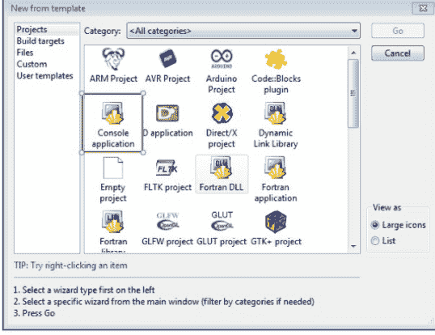

在此窗口中，确保你选择了 C++
在信息窗口上点击“Next”（下一步）

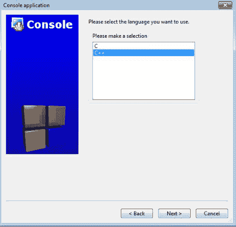

给项目一个标题，目前它是 **Hello World.**。选择你将保存它的文件夹。

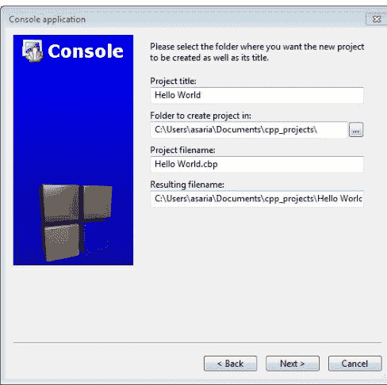

确保你已选择 **GNU GCC Compiler** 作为编译器，并点击“Finish”（完成）。

现在，在左侧的 Hello World 下，点击 **Sources folder** 旁边的 + 图标显示 **main.cpp** 文件。双击它在右侧的编辑器窗口中显示该文件。

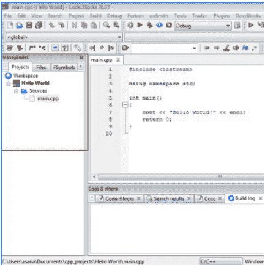

编辑器中的代码看起来如下例所示

### 代码

```cpp
#include <iostream>
using namespace std;

int main()
{
    cout << "Hello World" << endl;
    return 0;
}
```

我很确定，当你第一次看到上面的代码时会觉得眼花缭乱。但在几个章节之后，我们将理解它的所有含义。现在请耐心等待，我会尝试解释这个程序的主要部分。
编程的秘诀在于坚持，随着你学得越越多，事情会变得越来越容易。

让我们先运行代码。

### 运行代码

要运行代码，我们必须先进行编译。

在 Code::Blocks 中，我们使用 *build*（构建）一词而不是 compile（编译）。这是因为一个项目通常包含多个 C++ 文件，我们把编译所有文件的过程称为构建。

编辑器上方有三个按钮，允许我们构建和运行项目。

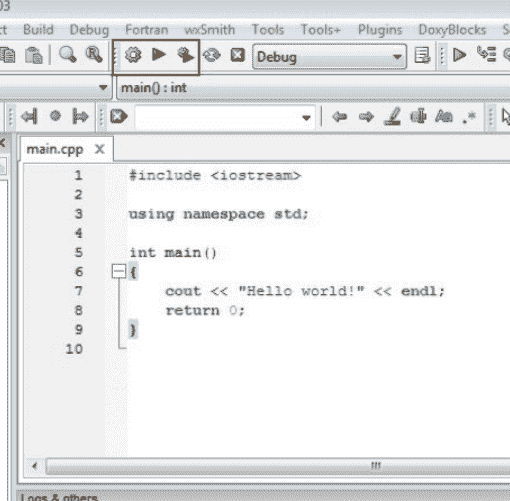

黄色的齿轮按钮允许你构建项目，绿色播放按钮允许你运行构建后的项目，而第三个（齿轮和播放按钮的组合）允许你构建并运行项目。点击这两个按钮的组合来执行项目。

将弹出一个窗口，显示如下所示的文字 "Hello World"。

```
$ C:\Users\asania\Documents\cpp_projects\s\bin\Debug\s.exe
Hello world!
Process returned 0 (0x0)  execution time : 0.014 s
Press any key to continue.
```

这就是所谓的控制台或终端。控制台显示 C++ 的输出。只需关闭窗口即可将其移除。

注意：在构建和运行文件之前，请确保你已保存了文件，这可以通过每次更改后按下 Control-s (Ctrl+s) 来完成

### 代码解释

此程序中的主行是：

```cpp
cout << "Hello World" << endl;
```

首先，注意该行以分号 (;) 结尾，这非常重要，因为它表示该指令的结束。

**cout** 只是程序员调用屏幕的方式，你可以将其想为 console output（控制台输出）的缩写。

符号 << 意味着在屏幕上显示我后面的内容


Hello World' 是我们想要在屏幕上显示的文本。注意它被双引号包围。双引号是语法的一部分，非常重要。

我们将被双引号包围的文本称为 **string**（字符串）。

接下来的 << 符号意味着，将我后面的内容添加到文本 'Hello world' 中。在编程中，我们称之为 **concatenation**（拼接），即把两个字符串相加。

**endl** 意味着添加一个换行符。

在编程中，我们称之为字符串。

现在，请耐心，，，，，，，，，，，，，，非常重要。

### 练习

- 1. 运行代码。
- 2. 运行代码。
- 3. 运行代码。
- a. 运行代码。
- b. 运行代码。

# 类型

- 1. 运行代码。
- 2. 运行代码。
- 3. 运行代码。
- a. 运行代码。
- b. 运行代码。

## 赋值

- 1. 运行代码。
- 2. 运行代码。
- 3. 运行代码。
- a. 运行代码。
- b. 运行代码。

## 变量

- 1. 运行代码。
- 2. 运行代码。
- 3. 运行代码。
- a. 运行代码。
- b. 运行代码。

### 示例

- 1. 运行代码。
- 2. 运行代码。
- 3. 运行代码。
- a. 运行代码。
- b. 运行代码。

## 数据类型

- 1. 运行代码。
- 2. 运行代码。
- 3. 运行代码。
- a. 运行代码。
- b. 运行代码。

### long

- 1. 运行代码。
- 2. 运行代码。
- 3. 运行代码。
- a. 运行代码。
- b. 运行代码。

### float

- 1. 运行代码。
- 2. 运行代码。
- 3. 运行代码。
- a. 运行代码。
- b. 运行代码。

### double

- 1. 运行代码。
- 2. 运行代码。
- 3. 运行代码。
- a. 运行代码。
- b. 运行代码。


```
C:\Users\asaria\Documents\cpp_projects\Variables\bin\Debug\Variables.exe
299.699
Process returned 0 (0x0) execution time : 0.014 s
Press any key to continue.
```

### bool

它代表布尔（boolean）。
它只能包含两个值：true 或 false。
布尔变量用于条件判断。
在下方的示例中，声明了两个布尔变量 `isHungry` 和 `isSleepy`。
如果 `isHungry` 为 true，程序会在屏幕上打印“I am hungry”。
如果 `isSleepy` 为 true，程序会在屏幕上打印“I am sleepy”。

```cpp
#include <iostream>
using namespace std;

int main() {
    bool isHungry = true;
    bool isSleepy = false;
    if (isHungry) {
        cout << "I am hungry" << endl;
    }
    if (isSleepy) {
        cout << "I am sleepy" << endl;
    }

    isSleepy = true;
    if (isSleepy) {
        cout << "I am going to bed" << endl;
    }

    return 0;
}
```

```
C:\Users\asaria\Documents\cpp_projects\Variables\bin\Debug\Variables.exe
i am hungry
i am going to bed
Process returned 0 (0x0) execution time : 0.015 s
Press any key to continue.
```

### char

char 代表字符（character），char 是一个只能包含一个值的变量。该值是一个长度为 1 的字符串。在下面的示例中，`excellent` 是一个 char 变量，用于存储学生数学的成绩。

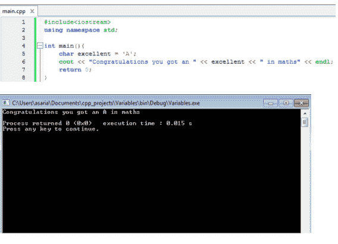

### string

string 是用于存储文本的变量。它可以包含任何长度的字符串。在下面的示例中，**yourName** 是一个存储值为“Catherine”的变量。

```cpp
#include <iostream>
using namespace std;

int main() {
    string yourName = "Catherine";
    cout << "Good morning " << yourName << endl;
    return 0;
}
```

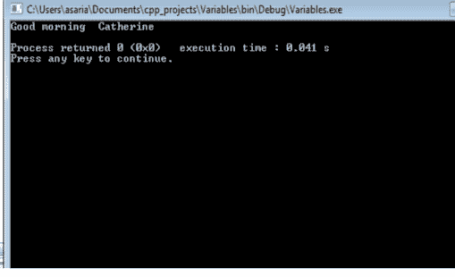

## 变量名

C++ 变量名必须以字母或下划线开头，其余字符必须是字母、数字或下划线。

有效的变量名示例有：

- x
- x1
- x_1_abc
- RATE
- bigBonus_

无效的变量名示例：

- 12
- 3x
- %change data
- -1 PROG.CPP

前三个（12 3x %change）是不允许的，因为它们没有以字母或下划线开头。

C++ 区分大小写，这意味着以下是三个不同的变量名：

- Rate
- RATE

### Rate

### 驼峰命名法 (Camel Case)

驼峰命名法是一种编程实践，多个单词之间不加空格，且每个单词的首字母大写（第一个单词除外）。

单词 "end of car" 会变成：endOfCar
驼峰命名法是命名变量的常用编程实践。

### 关键字

关键字是不能作为变量名的名称，因为它们被保留用于编程语言的语法。

如果你将它们用作变量名，编译器将报错，或者你可能会改变某些基础函数的功能。

关键字的示例包括基础数据类型（如 int、bool 等）以及如 struct 和 class 这样的名称。

### 注释

有时我们想要解释代码，以便他人理解我们做了什么。在将来，这些信息将帮助我们在查看代码时记住自己做了什么。

在编程中，我们通过在代码中编写注释来实现这一点。注释有两种类型：单行注释和多行注释。

单行注释以两个斜杠（//）开头，而多行注释位于以下符号之间：/** ...

注释的示例：

```cpp
// Test Code

/* Line 1 of Comments
Line 2 of Comments */
```

## 声明变量

所有变量在使用之前必须先声明或定义。

要声明/定义变量，只需要指定数据类型和变量名，后面跟一个分号：

当你声明变量但不给它赋值时，我们称该变量是*未初始化的*（uninitialized）。

未初始化的变量将包含一个随机值。

给未初始化的变量赋值被称为对其进行*初始化*（initializing）。

你也可以同时声明并初始化一个变量。

在此示例中，我们将利用注释并声明一些变量，并将它们的值打印到控制台。

在 Code::Blocks 中创建一个新项目，编写以下代码，编译并运行它。

### 示例代码

```cpp
#include <iostream>
using namespace std;

int main() {
    /*
    This is a multiline
    spanning multiple lines
    */
    int length; // declaring the variable
    int width; // declaring the variable

    length = 20; // assigning a value
    width = 10; // assigning a value

    cout << length << endl;
    cout << width << endl;

    return 0;
}
```

### 解析

在上面的代码中，我们声明了两个变量 `length` 和 `width`。然后给它们赋值。最后，我们将这些值打印到控制台。

## 数学运算

在本节中我们将学习如何在 C++ 中执行数学运算。

### 加法

加法使用 + 运算符

### 加法代码

```cpp
#include <iostream>
using namespace std;

int main() {
    int x = 5;
    int y = 10;
    int sum = x + y;
    cout << sum << endl;

    return 0;
}
```

代码输出将为 15，即 x 和 y 的和。

### 减法

减法使用 - 运算符

### 减法代码

```cpp
#include <iostream>
using namespace std;

int main() {
    int x = 10;
    int y = 5;
    int difference = x - y;
    cout << difference << endl;

    return 0;
}
```

代码输出将为 5。

### 乘法

乘法使用 * 运算符

### 乘法代码

```cpp
#include <iostream>
using namespace std;

int main() {
    int x = 4;
    int y = 3;
    int multiplication = x * y;
    cout << multiplication << endl;

    return 0;
}
```

代码输出将为 12。

### 除法

除法使用 / 运算符，它返回除法的商

### 除法代码

```cpp
#include <iostream>
using namespace std;

int main() {
    int x = 10;
    int y = 4;
    int quotient = x / y;
    cout << quotient << endl;

    return 0;
}
```

代码输出将为 2。

### 余数

为了获取除法的余数，使用取模运算符，它由符号 % 表示。

```cpp
#include <iostream>
using namespace std;

int main() {
    int x = 10;
    int y = 3;
    int remainder = x % y;
    cout << remainder << endl;

    return 0;
}
```

代码输出将为 1，即 x 除以 y 的余数。

## 从用户获取输入

到为止，我们只是在向控制台打印内容，而没有用户输入。在本节中，我们将通过请求用户输入来让我们的程序更有趣。

### cin

**cin** 用于接受键盘输入，可以被理解为控制台输入（console input）


### 示例代码

```
#include <iostream>
using namespace std;

int main() {
    int num;

    cout << "Enter a number: ";

    // 获取整数输入
    cin >> num;

    cout << "You entered: " << num;

    return 0;
}
```

### 解释

在这里，我们首先创建了一个名为 *num* 的 int 类型变量，我们将用它来存储从键盘输入获取的值。

我们要求用户输入一些内容，并将其打印回控制台：如果你在控制台输入 1，它会显示 'You entered: 1'。

## 简单的计算器

我们需要要求用户输入两个相乘的数字，
并将相乘结果显示给用户。

### 示例代码

```cpp
#include <iostream>
using namespace std;

int main() {
    int num1;
    int num2;

    // 提示输入 num1
    cout << "Enter a num1: ";
    cin >> num1;

    // 提示输入 num2
    cout << "Enter a num2: ";
    cin >> num2;

    int multiplication = num1 * num2;
    cout << "Result of multiplication: " << multiplication;

    return 0;
}
```

### 解释

我们首先声明了两个 int 类型变量，用于存储用户输入的 num1 和 num2。

我们提示用户输入 num1，然后使用 `cin` 将其存储在相应的变量中。对 num2 执行同样的操作。

然后我们对这两个数进行乘法运算，并将结果显示给用户。

### 练习

- 1. 将每个数学公式转换为 C++ 表达式，每个变量的值都从用户输入获取。
- 1. 3x
- 2. 3x + y
- 3. (x + y)/7
- 4. (3x + y) / (z + 2)

- 2. 编写一个程序，使用 6 个输入变量获取 6 科目的成绩。计算这些科目的总分和平均分。
- 3. 编写一个程序，从用户处获取一个整数并判断它是偶数还是奇数。提示：使用取模（modulo）。

# 函数

函数是执行特定任务的代码组。每个函数都被分配了一个名称，并在程序通过该名称进行引用。

在 C++ 中，函数期望返回一个值，通常在定义函数时会指定要返回的值的数据类型。

在本节中，我们将编写一个计算矩形面积的函数。

## 函数示例

矩形的面积等于其长度乘以宽度，因此下面是一个计算面积的函数。

在 `main` 函数之前按如下所示编写：

```cpp
#include <iostream>
using namespace std;

// 定义名为 areaOfRectangle 的函数
int areaOfRectangle(int length , int width) {
    int area = length * width;
    return area;
}

int main() {
    return 0;
}
```

### 解释

**int** 是函数的数据类型，在我们运行时它会向我们返回一个整数。这通过第 7 行结束大括号上方的 **return area;** 这一行所示。注意变量 **area** 被声明为整数类型，因为它是函数返回的变量。

**areaOfRectangle** 是我们给函数起的名称。注意它是用驼峰命名法（camel case）写的。

函数名后面跟着一对括号，在括号中我们声明了
两个变量，这些变量被称为**参数**（parameters）。

在上面的示例中，**length** 和 **width** 就是参数。

它们将保存我们在运行时传递给函数的值，并且可以通过函数的代码块进行访问。

然后我们用大括号包裹代码，以便将其标记为与该函数名相关的代码行。

最后，我们有 **return** 语句。

## 调用函数

看下面的代码

```cpp
#include <iostream>

using namespace std;

int areaOfRectangle(int length , int width){
    int area = length * width;
    return area;
}

int main() {
    // 调用 areaOfRectangle 函数
    // length = 4  width = 5

    int area = areaOfRectangle(4,5);

    cout << "Area is: " << area << endl;
    return 0;
}
```

```
C:\Users\alex\Documents\cpp_projects\Functions\Debug\Functions.exe
Area is: 20
Process returned 0 (0x0) execution time : 0.061 s
Press any key to continue.
```

### 解释

当我们想要运行一个函数时，通常说我们正在**调用**（calling）该函数。

有些函数在调用时会接收值，就像我们的函数一样，我们将这些值称为函数的**参数**（arguments）。

注意用于向函数传递参数的语法，我们先写函数名，在左括号和右括号之间写参数，并用逗号分隔。

所以，在我们的示例中，我们正在调用函数 **areaOfRectangle** 并传递了两个参数，即 4 和 5。

我们期望函数返回一个值，即计算出的面积，且计算出的面积值应该是...

## 空函数

被称为 void 的函数是在被调用后不返回任何内容的函数。

### 示例代码

```cpp
#include <iostream>
using namespace std;

void showResults(double fDegrees, double cDegrees) {
    cout << fDegrees << " degrees is equivalent to\n";
    cout << cDegrees << " Celsius.\n";
}

int main() {
    showResults(30.0, 100.5);
    return 0;
}
```

### 解释

注意指定的返回类型是 void，且我们在体体内不使用 return 关键字。

除了此以外，定义方式没有区别。

### 练习

- 1. 创建一个名为 Descending 的函数，它接收四个参数。每个参数都是 int。如果数字是递减的，函数返回 true；否则返回 false。例如，Descending(4, 3) 和 Descending(3, 2) 都返回 true。
- 2. 创建一个名为 isOdd 的函数，接收一个 int 参数并返回一个布尔值。如果输入是奇数，函数返回 true；如果是偶数则返回 false。
- 3. 以下程序的输出是什么？

```cpp
#include <iostream>
using namespace std;
void sayhi();
void hide(int audiencumber);
int main()
{
    sayhi();
    hide(6);
    cout << "Extra time:\n";
    hide(2);
    cout << "End of program.\n";
    return 0;
}
void sayhi()
{
```
cout << "Hello\n";
}
void hide(int audiencumber)
{
    if (audiencumber < 5)
        return;
    cout << "Bye\n";
}
```

- 4. 编写一个计算圆周的函数，它包含一个名为 radius 的 int 参数并返回 double 类型。使用 double 变量 pi 作为 3.14。

## 作者的简短信息：

嘿，你喜欢这本书吗？我很想听听你的想法！

如果你能在亚马逊上只花 60 秒写一个简短评价，即使只有几句话，我也将不胜感激！

>> 点击此处留下评价

感谢你花时间分享想法！

# 条件语句

我们通常只想在特定条件成立时做某些事。例如，如果天气晴，我们就出去玩，否则我们就待在家里。

“天气晴”这个陈述只能是真或假。

在编程中，我们有一种只能存储真或假值的数据类型，这种数据类型被称为**布尔**（boolean）。在 C++ 中我们通常将其缩写为 **bool**。


#include <iostream>
using namespace std;

int main() {
    bool sunny = true;

    if (sunny) {
        cout << "You can go outside to play" << endl;
    } else {
        cout << "Don't go outside to play" << endl;
    }
    return 0;
}
```

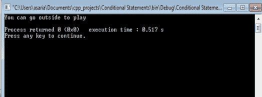

### 解释

在上面的示例中，我们首先创建了一个名为 sunny 的变量，由于它的数据类型是 `bool`，它存储了一个布尔值。

使用 `if` 语句我们检查天气晴是否为真，如果是，我们在屏幕上打印“You can go outside to play”，否则我们打印“Don't go outside to play”。

### 练习

将变量 *sunny* 更改为 *false* 并查看会打印什么内容。

## 比较运算符

比较运算符比较两个值并返回 true 或 false。

比较运算符的示例有：

- 小于 (<)
  如果左侧的值小于右侧的值，则返回 true。否则，返回 false。

- 大于 (>)
  如果左侧的值大于右侧的值，则返回 true。否则，返回 false。

- 小于等于 (<=)
  如果左侧的值小于或等于右侧的值，则返回 true。否则，返回 false。

- 大于等于 (>=)
  如果左侧的值大于或等于右侧的值，则返回 true。否则，返回 false。

### 等于 (==)

如果左侧的值等于右侧的值，则返回 true。否则，返回 false。

### 不等于 (!=)

如果左侧的值不等于右侧的值，则返回 true。否则，返回 false。

### 比较运算符的使用示例

假设你想在 x 确实大于 5 时在屏幕上打印字符串‘x is greater than 5’，否则你打印‘x is less than or equal to 5’。

```cpp
#include<iostream>
using namespace std;

int main() {
    int x = 3;

    if(x > 5){
        cout << "x is greater than 5" << endl;
    } else{
        cout << "x is less than or equal to 5" << endl;
    }
    return 0;
}
```

```
C:\Users\asana\Documents\cpp_projects\ConditionalStatements\bin\Conditional Stateme..\nis is less than or equal to 5
Process returned (0x0)   execution time : 0.021 s
Press any key to continue.
```

## 构建布尔表达式

**布尔表达式**是任何具有两个值之一的表达式。它要么为真要么为假。它基本上是一个比较两个值并返回 true/false 的表达式。

两个比较可以使用“**and**（与）”运算符组合，在 C++ 中表示为 **&&**。例如，如果 a 的值大于 5 且 a 小于 10，则以下布尔表达式为真：

**(5 < a) && (a < 10)**

如果 a 介于 5 和 10 之间（不包含 5, 10），则上述操作返回 true。

当两个比较使用 && 连接时，只要两个比较都为真，整个表达式就为真；否则，整个表达式为假。

你也可以使用“**or（或）”运算符组合两个比较，在 C++ 中拼写为 ||。例如，如果 b 小于 2 或 b 大于 9，则以下为真：

### (b < 2) || (b > 9)

如果 b 小于 2 或 b 大于 9，则上述表达式返回 true。

在使用 || 运算的表达式中，只要其中任一个比较为真，表达式就为真。如果两个表达式都为假，那么该表达式为假。

布尔表达式可以使用 ! 运算进行取反。例如：

### !(a > b)

当“a 不大于 b”时，返回 true。

在大多数情况下，不需要使用感叹号 (!) 运算符。

例如，!(a > b) 等于 a <= b。

### 真值表

以下被称为真值表（truth tables）。它们指示了所有组合的可能性以及产生的结果。

| expression1 | expression2 | AND | |
| :--- | :--- | :--- | :--- |
| true | true | true | true |
| true | false | false | true |
| false | true | false | true |
| false | false | false | false |

| expression1 | expression2 | OR |
| :--- | :--- | :--- |
| true | true | true |
| true | false | true |
| false | true | true |
| false | false | false |

### NOT

NOT 运算符反转值。

| expression1 | NOT |
| :--- | :--- |
| true | false |
| false | true |

### 布尔表达式示例

```cpp
#include<iostream>
using namespace std;

int main() {
    bool isHungry = true;
    bool hasMoney = true;

    if (isHungry && hasMoney) {
        cout << "I will eat" << endl;
    } else {
        cout << "I can't eat" << endl;
    }
    return 0;
}
```

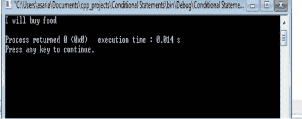

### 解释

要使用 for 循环，我们指定运行与之关联的代码块的次数。

与 for 循环关联的代码块位于大括号和小括号之间：

```cpp
{
}
```

在我们的代码中，关联的代码块只有一行：cout << "My name" << endl;

在 for 关键字的圆括号内，我们通过两个分号指定三个重要的内容：

第一个是从开始数的数字，对于我们来说，从 1 开始计数，因此我们声明整数变量值为 1。

第二个与第一个部分用分号隔开，是执行 for 循环关联代码块所需的真条件。我们通常在此部分使用 > <、>= 等比较运算符。

最后，第三部分用分号与第二个部分隔开，增加计数器的值，在案例中中使用特殊符号 i++。

此外，此递增发生在代码块运行之后。

# 循环

循环允许我们固定次数重复一组指令。通常有两种循环：有限循环和无限循环。

有限循环按计数的次数重复指令，而无限循环永远重复。

## 我们如何指定循环

在 C++ 中有两种声明循环的方法。一种是使用 for 关键字，另一种是使用 while 关键字。

### for 循环

假设你想在控制台上打印 10 次你的名字，你可能会多次编写 'cout << "My name << 指令。使用 for 循环是防止重复相同语句和缩短代码的好方法。

### 示例

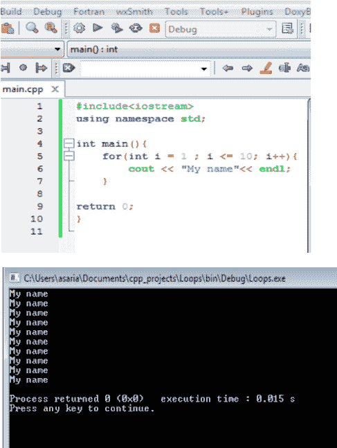

# # 解释

要使用 for 循环，我们指定运行与之关联的代码块的次数。

### 练习

+   1. 修改程序以循环我们的文本 100 次。

### 在循环内部使用计数器的示例

我们可以在关联的代码块中使用声明的整数，例如，我们可以通过下面的代码打印从 1 到 10 的值。


```cpp
#include<iostream>
using namespace std;

int main() {
    for(int i = 1; i <= 10; i++) {
        cout << i << endl;
    }
    return 0;
}
```

```
C:\Users\asania\Documents\cpp_projects\Loops\bin\Debug\Loops.exe
nProcess returned 0 (0x0) execution time : 0.026 s
Press any key to continue.
```

### while 循环 (while loops)

while 循环与 for 循环相似，唯一的区别在于与 while 关键字关联的括号中只有需要满足的条件。

### 示例

```cpp
#include<iostream>
using namespace std;

int main() {
    int i = 1;

    while(i <= 10) {
        cout << "Hi from the while loop" << endl;
        i++;
    }

    return 0;
}
```

### 解释

我们首先在这一行声明我们从哪里开始计数：**int i = 1;**

**while(i <= 10)**，只要变量 **i** 的值小于或等于 10，就会执行关联的代码块。

注意，在闭大括号之前，我们将 i 的值加了 1。

然后 while 循环会重复检查 i 是否小于或等于 10，如果是，则执行关联的代码块。如果 i 大于 10，则不执行代码块，程序将跳转到后续指令。

### 死循环 (Infinite loops)

当 for 循环或 while 循环为了判断是否运行关联代码块而检查的条件始终为真，就会发生死循环。
**所以，它基本上会永远运行。**

### 示例

```cpp
main.cpp
1 #include<iostream>
2  using namespace std;
3
4  int main() {
5
6
7      while (true) {
8          cout << "Hi from the infinite loop" << endl;
9
10     }
11
12     return 0;
13  }
```

```
C:\Users\asaria\Documents\cpp_projects\Loops\Debug\Loops.exe

Hi from the infinite while loop
Hi from the infinite while loop
Hi from the infinite while loop
Hi from the infinite while loop
Hi from the infinite while loop
Hi from the infinite while loop
Hi from the infinite while loop
Hi from the infinite while loop
Hi from the infinite while loop
Hi from the infinite while loop
Hi from the infinite while loop
Hi from the infinite while loop
Hi from the infinite while loop
Hi from the infinite while loop
Hi from the infinite while loop
Hi from the infinite while loop
Hi from the infinite while loop
Hi from the infinite while loop
Hi from the infinite while loop
Hi from the infinite while loop
```

### 解释

由于条件始终为真，这将会永远运行。

### 死 for 循环 (Infinite For Loop)

死 for 循环的定义如下所示：

```cpp
#include<iostream>
using namespace std;

int main() {
    for(;;){
        cout << "Hi from the infinite loop" << endl;
    }
    return 0;
}
```

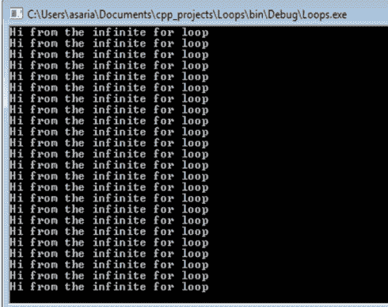

### 解释

注意，要声明一个死 for 循环，只需要与 for 关键字关联的括号内有两个分号，即：

```cpp
for(;;){
  //这段代码将无限运行
}
```

### 练习

- 1. 将以下循环重写为 for 循环。

```cpp
int x = 2;
while(x <= 200)
{
    if (x < 10 && x != 1)
        cout << "Hi";
    x++;
}
```

```
for (int x = 2; x <= 200; x++) {
    if (x < 10 && x != 1)
                cout "Hi";";
}
}
```

2. 下列代码的输出是什么？

```cpp
int a = 2;
while(a < 15)
{
    cout << "Hi";
    a++;
}
```

3. 下列代码的输出是什么？

```cpp
for (int b = 5; b > 2; b--) {
    cout << "Hi";
}
```

# 数组 (Arrays)

数组是相同类型值的集合。

你可以通过索引来访问数组中的元素。索引从 0 开始计数。

```cpp
int arr[] = {1, 2, 3, 4, 5};
cout << arr[0]; // 输出 1
cout << arr[4]; // 输出 5
```

## 数组的初始化

有多种方式初始化数组：

```cpp
int arr[5] = {1, 2, 3, 4, 5}; // 指定大小
int arr[] = {1, 2, 3, 4, 5};    // 自动推导大小
int arr[5] = {1, 2};           // 剩余元素初始化为 0
int arr[5] = {0};              // 所有元素初始化为 0
```

## 遍历数组

我们可以使用循环来遍历数组中的元素。

```cpp
int arr[] = {10, 20, 30, 40, 50};
for (int i = 0; i < 5; i++) {
    cout << arr[i] << endl;
}
```

## 多维数组 (Multidimensional Arrays)

多维数组是数组的数组，例如矩阵。

```cpp
int matrix[2][3] = {
    {1, 2, 3},
    {4, 5, 6}
};
cout << matrix[0][1]; // 输出 2
cout << matrix[1][2]; // 输出 6
```

# 结构体 (Structures)

结构体允许你将不同类型的变量组合在一起。

```cpp
struct Student {
    string name;
    int age;
    double gpa;
};

Student s1 = {"Alice", 20, 3.8};
cout << s1.name; // 输出 Alice
```

## 访问结构体成员

你可以使用点运算符 `.` 来访问或修改结构体的成员。

```cpp
struct Point {
    int x;
    int y;
};

Point p1;
p1.x = 10;
p1.y = 20;
```

## 结构体数组 (Arrays of Structures)

你可以创建一个结构体数组来存储多个结构体。

```cpp
struct Student {
    string name;
    int grade;
};

Student classroom[3] = {
    {"Alice", 90},
    {"Bob", 85},
    {"Charlie", 92}
};

cout << classroom[1].name; // 输出 Bob
```


注意闭合大括号后面有一个分号。

### 初始化结构体

```
#include <iostream>
using namespace std;
struct PersonInfo{
    int age;
    int weight;
    int height;
};

int main() {
    // 初始化结构体
    PersonInfo kevin = {10,30,1};
    PersonInfo jesicca = {15,28,1};

    return 0;
}
```

### 解析

通过创建一个结构体，我们创建一个新的数据类型。

正如我们通常声明任何变量时所做的那样，从它将包含的数据类型开始。

在大括号中，我们传入参数作为所声明结构体变量的值。

参数的顺序是非常重要的。

如果初始化值多于结构体成员，将得到错误。

如果值较少，列表中未列出的最后一个成员将被初始化为零。

### 访问结构体成员值

要访问结构体成员变量的值，你可以使用如下所示的点运算符（.）

### 示例代码

```
#include<iostream>
using namespace std;

struct PersonInfo{
    int age;
    int weight;
    int height;
};

int main(){
    // 初始化结构体
    PersonInfo kevin = {10,30,1};
    PersonInfo jesicca = {15,28,1};

    cout << kevin.age << endl;
    cout << jesicca.age << endl;

    return 0;
}
```

```
C:\Users\asaria\Documents\cpp_projects\StructuresAndClasses\bin\Debug\Structure
10
15
Process returned 0 (0x0) execution time : 0.137 s
Press any key to continue.
```

在上面的输出中，**kevin.age** 和 **jessica.age** 的输出分别为 10 和 15。年龄是结构体的第一个成员。10 和 15 是结构体初始化中的第一个数字，因此它们引用了 Kevin 和 Jessica 的年龄。

### 练习

创建一个名为 `Date` 的结构体，包含成员变量 `year`、`month` 和 `day`。用你的当前日期初始化它并将所有值打印到屏幕上。

# 最终项目

在最终项目中，我们的目的是利用在书中学的大量技能。

## 任务

设计一个学生管理系统。添加新学生时输入包括姓名和注册号在的信息。用户可以根据注册号搜索特定学生。用户可以查看整个学生列表，根据注册号删除特定学生并退出程序。

下面的代码执行了这些任务；并在程序之后详细解释了所有任务。

### 代码

```cpp
#include<iostream>
using namespace std;
#include <string>
string array[];
// 搜索记录函数：搜索学生记录是否存在，存在则打印记录
void searchRecord(string name[], string regnum[], string reg,int in) {
    // isfound 用于检查数组中是否存在记录，如果存在则设置为 true
    bool isfound = false;
    // 循环数组检查记录是否存在
    for(int index = 0; index < in; index = index + 1) {
        // 检查数组中的每个记录，如果匹配则
        if (regnum[index] == reg) {
            // 找到记录
            isfound = true;
            // 打印记录
            cout << "Student Registration Number " << "\t\t" << " Student Name : " << name[index] << endl;
            cout << endl;
            // 终止循环
            break;
        }
    }
    // 如果不存在特定记录
    if (isfound == false) {
        // 显示记录不存在
        cout << "Record does not exist" << endl;
    }
}

int main() {
    // 用于控制循环的变量
    bool cont = true;
    // 存储注册名的数组
    string registrationNum[100];
    string name[100];
    // 记录学生数量
    int index = 0;

    // 循环直到程序退出
    while(cont) {
        // 显示菜单
        cout << "[1] Create New Record \n";
        cout << "[2] Search A Record \n";
        cout << "[3] View All Record \n";
        cout << "[4] Delete a Record \n";
        cout << "[5] Exit \n" << endl;
        cout << "Select Number: ";
        cin >> selectedNumber;

        // 如果选择 1
        if (selectedNumber == 1) {
            // 提示用户输入姓名
            cout << "Enter name: ";
            cin >> name[index];
            // 提示用户输入注册号
            cout << "Enter registration number: ";
            cin >> registrationNum[index];
            // 增加计数
            index++;
            cout << "Record added successfully!" << endl << endl;
        }
        // 如果选择 2
        else if (selectedNumber == 2) {
            // 检查是否有记录
            if (index > 0) {
                // 提示用户输入注册号进行搜索
                cout << "Enter Registration Number: ";
                string reg;
                cin >> reg;
                // 调用搜索函数
                searchRecord(name, registrationNum, reg, index);
            } else {
                // 如果没有记录
                cout << "No records available." << endl;
            }
        }
        // 如果选择 3
        else if (selectedNumber == 3) {
            // 遍历所有记录
            for (int i = 0; i < index; i++) {
                // 如果记录已被删除
                if (name[i] == "null") {
                    continue;
                } else {
                    // 打印学生记录
                    cout << "Student Registration Number " << registrationNum[i] << " Student Name : " << name[i] << endl;
                }
            }
        }
        // 如果选择 4
        else if (selectedNumber == 4) {
            // 检查是否有记录
            if (index > 0) {
                // 提示用户输入要删除的注册号
                cout << "Enter Registration Number: ";
                string reg;
                cin >> reg;

                // 标记是否找到记录
                bool found = false;
                for (int i = 0; i < index; i++) {
                    // 如果当前记录的注册号匹配
                    if (registrationNum[i] == reg) {
                        // 标记为找到
                        found = true;
                        // 将数组中的值设为 null 表示删除
                        name[i] = "null";
                        registrationNum[i] = "null";
                        // 打印删除成功
                        cout << "Record deleted successfully!" << endl;
                        cout << endl;
                    }
                }

                // 如果未找到记录
                if (found == false) {
                    // 打印未找到记录
                    cout << "Record is not found!" << endl;
                    cout << endl;
                }
            } else {
                // 如果没有记录
                cout << "No records available." << endl;
            }
        }
        // 如果选择 5
        else if (selectedNumber == 5) {
            // 打印退出信息
            cout << "Take Care!" << endl;
            // 设置 cont 为 false 终止循环
            cont = false;
        }
        // 如果输入无效
        else {
            cout << "Invalid entry!" << endl;
            cout << endl;
        }
    }
    return 0;
}
```


### 输出

```
[1] 创建新记录
[2] 搜索记录
[3] 查看所有记录
[4] 删除记录
[5] 退出

选择编号 : 1
输入你的姓名 : john
输入你的注册号 : 44

[1] 创建新记录
[2] 搜索记录
[3] 查看所有记录
[4] 删除记录
[5] 退出

选择编号 : 1
输入你的姓名 : jimmy
输入你的注册号 : 66

[1] 创建新记录
[2] 搜索记录
[3] 查看所有记录
[4] 删除记录
[5] 退出

选择编号 : 1
输入你的姓名 : hussain
输入你的注册号 : 12

[1] 创建新记录
[2] 搜索记录
[3] 查看所有记录
[4] 删除记录
[5] 退出

选择编号 : 2
输入你的注册号 : 12
学生注册号 : 12
```

```
[1] 创建新记录
[2] 搜索记录
[3] 查看所有记录
[4] 删除记录
[5] 退出

选择编号 : 3
学生注册号 : 44    学生姓名 : John
学生注册号 : 66    学生姓名 : Jimmy
学生注册号 : 12    学生姓名 : Hussain

[1] 创建新记录
[2] 搜索记录
[3] 查看所有记录
[4] 删除记录
[5] 退出

选择编号 : 4
输入你的注册号 :66
记录删除成功 : 
```

```
[1] 创建新记录
[2] 搜索记录
[3] 查看所有记录
[4] 删除记录
[5] 退出

选择编号 : 3
学生注册号 : 44    学生姓名 : John
学生注册号 : 12    学生姓名 : hussain

[1] 创建新记录
[2] 搜索记录
[3] 查看所有记录
[4] 删除记录
[5] 退出

选择编号 : 5
再见

程序在 40.77 秒后退出，返回值为 0
按任意键继续 . . .
```

## 在数组中添加记录

我们已经为学生姓名和学生注册号声明了两个数组。这两个数组分别称为 `registrationNum` 和 `name`。

如果用户输入数字‘1’，程序将要求用户输入学生姓名和注册号。用户随后输入姓名和注册号。它们被存储在一个名为 `index` 的变量中，该变量用于计数已创建的学生数量。每添加一个学生，`index` 就会加 1。

添加记录的过程在下面的代码所示。

```cpp
if ( selectedNumber == 1) {
    // 声明 name 和 regNum 变量来存储输入的姓名和注册号
    string name;
    string regNum;

    // 用户输入姓名：
    cout << "Enter your name : ";

    // 将用户输入的姓名存入 name 变量
    cin >> name;

    // 用户输入注册号
    cout << "Enter your Registration Number : ";
    cin >> regNum;

    // 将用户输入的姓名和注册号存储到各自的数组中
    registrationNum[index] = regNum;
    name[index] = name;

    // 索引递增
    index = index + 1;
    cout << endl;
}
```

## 从数组中搜索记录

用户可以在程序开始时按‘2’，通过其入学注册号来搜索特定的学生。程序首先检查学生数组是否为空。如果数组不为空，用户将输入注册号。程序会将用户输入的注册号与数组中存在的注册号进行比较。这是通过使用 `searchRecord()` 函数来实现的。

```cpp
} // 如果用户输入了 2，则
else if (selectedNumber == 2) {

     // 检查数组是否至少有一条记录
    if (index >= 0) {

        // 提示用户输入注册号
        string renum;
        cout << "Enter Your Registration Number: ";

        // 将用户输入的注册号存入 renum 变量
        cin >> renum;

        // 调用函数查找并打印记录
        searchRecord(name,registrationNum,renum,index);
    }

    // 如果数组中没有记录，则
```

`searchRecord()` 函数接收一个姓名数组（`name[]`）和一个注册号数组（`regnum[]`）作为参数。它还接收两个变量：注册号 `reg` 和索引 `in`。
`reg` 是我们用于搜索学生记录的注册号，而 `in` 是记录的数量。

该函数使用 `for` 循环通过注册号 `reg` 搜索数组 `regum[]`。
如果找到了 `reg`，函数将打印学生的注册号和姓名。
如果未找到 `reg`，函数将打印“Record is not found”。

```cpp
// 搜索记录函数，根据学生记录是否存在进行搜索
void searchRecord(string name[], string regnum[], string reg, int n) {
    // isfound 变量检查记录是否存在数组中
    bool isfound = false;
    // 遍历数组 regum[] 查找注册号 reg
    for(int index=0; index < n; index++) {
        // 检查注册号匹配
        if (regnum[index] == reg) {
            // 如果找到，将其设为 true
            isfound = true;
            // 打印记录
            cout << "Student Registration Number : " << regnum[index] << endl;
            cout << "Student Name : " << name[index] << endl;
            break;
        }
    }
    // 如果未找到
    if (!isfound) {
        cout << "Record is not found" << endl;
    }
}
```

## 查看所有记录

如果用户按‘3’，程序将显示数组中的所有记录。

```cpp
// 如果用户输入了 3，则
else if (selectedNumber == 3) {
    for (int i = 0; i < index; i++) {
        cout << "Student Registration Number : " << registrationNum[i] << endl;
        cout << "Student Name : " << name[i] << endl;
    }
}
```

## 删除记录

用户可以在程序开始时按‘4’，根据注册号删除特定的学生。程序首先检查数组是否为空。如果数组为空，则显示没有记录。如果数组不为空，程序会将注册号与数组中的注册号进行比较。这是通过循环实现的。如果找到了学生，则通过将 `name` 和 `registrationNum` 为 `null` 来删除记录。如果没有找到学生，程序将打印“Record not found”。

```cpp
// 如果用户输入了 4，则
else if (selectedNumber == 4) {

    // 检查数组是否有记录
    if ( index > 0 ) {

        // 声明变量 renum 存储注册号
        string renum;

        // 用户输入注册号
        cout << "Enter Your Registration Number:";
        cin >> renum;

        // isfound 变量检查记录是否在数组
        bool isfound = false;

        // 循环直到记录结束
        for(int ind = 0; ind < index; ind++) {
            // 检查用户输入的注册号是否等于数组中的注册号
            if (registrationnum[ind] == renum) {
                // 将找到的值设为 true
                isfound = true;
                // 将找到的数组值设为 null
                name[ind] = "null";
                registrationnum[ind] = "null";
                // 打印记录删除成功
                cout << " Record deleted successfully : " << endl;
                break;
            }
        }

        // 如果用户输入的注册号未找到，则
        if (!isfound) {
            cout << " There is no record in the system:" << endl;
        }
    }
}
```

## 退出

如果用户输入数字‘5’，则跳出循环。变量 `cont` 被设为 `false`。这将终止程序，因为程序处于一个 `cont` 为 `true` 的 `while` 循环中。

```cpp
// 如果用户输入了数字 5
else if(selectedNum == 5) {
    // 打印再见
    cout << " Take Care " << endl;

    // 将 cont 设为 false 使程序终止
    cont = false;
}
```


# 结语

感谢阅读本书。
希望这本书能帮助你开启 C++ 编程的大门。

如果你想在 C++ 方面进一步进阶，我推荐亚马逊亚马逊上的以下书籍：

- 快速学习 C++ (Learn C++ Quickly)
https://www.amazon.com/Learn-Quickly-Beginners-Programming-Hands-ebook/dp/B08DZ3NY6Z/

- 程序：使用 C++ 的原理与实践 (Programming: Principles and Practice using C++)
https://www.amazon.com/Programming-Principles-Practice-Using-2nd/dp/0321992784/

如果你对 Javascript 或 Python 感兴趣，我在下方的产品页面上也有几本书。

Bob Mather 产品页面
https://www.amazon.com/kindle-dbs/entity/author/B07HHQZC4Y

# 结束了……几乎是！

好评价并不容易获得。

作为一名营销预算极其有限的独立作者，我依靠像你这样的读者在 Amazon 上留下简短的评论。

即使只有一两句话也可以！


所以，如果你喜欢这本书，请……

>> 点击此处在 Amazon 上留下简短的评论。

我非常感谢你的评论，这真的意义重大。

从心底感谢你购买这本书并阅读到最后。

