# Python 游戏编程：创建专属 Python 游戏的分步可视化指南

### DK UK

- **项目编辑：** Ben Francis Davies
- **资深艺术编辑：** Sunita Gahir
- **顾问编辑：** Craig Steele
- **封面设计开发经理：** Sophia MTT
- **封面编辑：** Claire Gell
- **前期制作制片人：** Gillian Reid
- **高级制片人：** Alex Bell
- **美国编辑：** Jill Hamilton、Kayla Dugger
- **编辑主管：** Lisa Gillespie
- **艺术编辑主管：** Owen Peyton Jones
- **出版人：** Andrew Macintyre
- **副出版总监：** Liz Wheeler
- **艺术总监：** Karen Self
- **设计总监：** Phil Ormerod
- **出版总监：** Jonathan Metcalf

### DK INDIA

- **资深编辑：** Bharti Bedi
- **项目艺术编辑：** Sanjay Chauhan
- **编辑：** Tina Jindal
- **助理艺术编辑：** Richa Ahmad、Simar Dhamija、Sonakshi Singh
- **封面设计师：** Juhi Sheth
- **封面编辑协调员：** Priyanka Sharma
- **封面编辑主管：** Sonali Singh
- **桌面排版设计师：** Sachin Gupta
- **高级桌面排版设计师：** Harish Aggarwal
- **高级编辑主管：** Rohan Sinha
- **艺术编辑主管：** Sudakshina Basu
- **前期制作经理：** Balwant Singh


**CAROL VORDERMAN MBE** 是英国最受欢迎的电视节目主持人之一，并以其数学才能闻名。她主持过众多科学与技术类电视节目，从《明日世界》到《How 2》，并曾在 Channel 4 的《Countdown》担任联合主持人长达 26 年。她毕业于剑桥大学工程专业，热衷于传播科学与技术，尤其对编程感兴趣。


**CRAIG STEELE** 是计算机科学教育专家，帮助人们在有趣且富有创意的环境中培养数字技能。他是苏格兰 CoderDojo 的创始人，该组织为年轻人运营免费编程俱乐部。Craig 曾与 Raspberry Pi 基金会、格拉斯哥科学中心、格拉斯哥艺术学院、BAFTA 以及 BBC micro:bit 项目合作举办数字工作坊。Craig 的第一台电脑是 ZX Spectrum。


**DR. CLAIRE QUIGLEY** 在格拉斯哥大学学习计算机科学，并获得理学学士和博士学位。她曾在剑桥大学计算机实验室和格拉斯哥科学中心工作，目前正参与一个为爱丁堡小学开发音乐与技术资源的项目。她是 CoderDojo Scotland 的导师。


**DANIEL McCAFFERTY** 拥有思克莱德大学计算机科学学位。他曾在从银行业到广播业的大大小小公司担任软件工程师。Daniel 与妻子和两个孩子住在格拉斯哥；不教年轻人编程时，他喜欢骑自行车和陪伴家人。


**DR. MARTIN GOODFELLOW** 是思克莱德大学计算机与信息科学系的教学助理。他还为英国和中国的其他组织开发教育性计算机科学内容和工坊，包括 CoderDojo Scotland、Glasgow Life、编程猫（Codemao）以及 BBC。他目前是英国全国编程周的苏格兰大使。

## 前言

计算机程序员是现代世界的无名英雄。从智能手机到笔记本电脑，从交通系统到银行卡，他们的辛勤工作几乎触及我们生活的方方面面。每一项技术进步背后，都有一支富有创造力的程序员团队。

过去 30 年里，电脑游戏已成为娱乐产业中最令人兴奋、最受欢迎的工作领域之一。成为一名游戏程序员，既需要创作才情来帮助打造游戏所需的故事、图形、音乐和角色，也需要技术诀窍来将它们变为现实。谁知道呢？这本书也许正是你从玩家走向游戏制作者之旅的第一步。

不过，学习编程并不只适合想成为专业程序员的人。编程技能在许多乍看之下似乎与电脑无关的不同工作中都很有用。编程专业知识对于科学、商业、艺术和音乐等多样化的学科领域都至关重要。

本书使用一种名为 Python® 的编程语言，这是一种相当简单的基于文本的语言，非常适合初学者，也可作为从 Scratch™ 进阶的选择。然而，与 Scratch 不同，它并非专门为教授编程而创建。Python 既受编程新手欢迎，也受专业人士青睐，是世界上使用最广泛的专业编程语言之一。它出现在银行业、医学、动画，甚至太空探索中。

学习任何新语言的最佳方式都是沉浸其中，编程语言也不例外。制作自己的电脑游戏是将理论与实践结合起来的有趣方式。如果你是零基础的编程学习者，请从本书开头的基础知识开始，然后随着本书的推进再转向更复杂的游戏。按照分步指南操作，你将了解专业程序员在制作电脑游戏时是如何思考的。认真遵循这些步骤，你很快就能让自己的游戏运行起来。然后，如果你真的想挑战自己，可以尝试调整代码，让你的游戏独一无二。

每个人，无论初学者还是专业人士，都会犯错。没有什么比悄悄潜入程序的错误更能让程序员沮丧了。如果你的某个游戏出了问题，请回头仔细检查你的全部代码。本书通篇都有提示和技巧，能帮助你做到这一点。最重要的是，不要灰心——发现并修复代码中的错误，正是程序员工作的一部分。练习得越多，你的代码中包含的错误就越少，你也能更快地抓住仍然出现的小错误。

最重要的是，玩得开心！完成这些游戏后，你可以向朋友和家人展示——他们会为你做出的作品感到惊叹。本书收录了适合各类读者的游戏，我们希望你喜欢制作和游玩它们，就像我们喜欢为你创作它们一样。

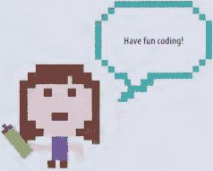

## 入门

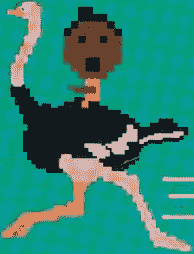


## 什么是 Python？

计算机需要逐步指令来执行不同任务。一组指令或代码可以用不同的编程语言编写。Python 是最流行的编程语言之一。

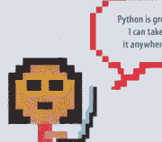

### 为什么选择 Python？

Python 是一种强大的编程语言，你可以用它快速编写简单程序。它不太难学，而且非常适合构建应用和游戏。以下是 Python 对程序员来说是如此出色的工具的一些原因。

#### 可移植

相同的 Python 代码可在 PC、Mac、Linux 机器和树莓派计算机上运行。这些程序在每个平台上的行为方式相似，因此用 Python 创建的游戏可以在世界各地许多机器上玩。

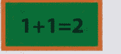

#### 易于理解

与其他一些编程语言不同，Python 不使用复杂的符号。你使用英文单词、字符和数字的组合来输入代码，因此它易于阅读和编写——就像一本书一样。


#### 应用多样

Python 用于为银行、医疗保健、航天工业、教育以及许多其他行业中的许多有趣任务构建系统和工具。


#### 工具齐全

Python 自带立即开始编码所需的一切，因此程序员说它“自带电池”。它包含大量预先编写的代码，称为标准库，你可以在程序中使用。

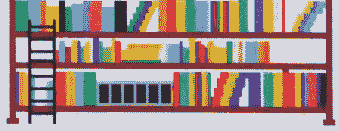

#### 大量帮助

Python 的网站上有大量支持材料帮助你学习如何使用它。它包含入门指南、若干示例代码，以及一个帮助你理解代码的参考部分。

## 从 Scratch 到 Python

Scratch 是一种可视化语言，而 Python 是基于文本的。如果你用过 Scratch，你会认出 Python 中的一些特性和理念。这两种语言看起来可能不同，但 Scratch 中使用的许多元素在 Python 中也有使用。

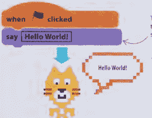

这个积木块会在对话气泡中显示消息。

### 在 Scratch 中输出

在 Scratch 中，“say”积木块用于在屏幕上显示消息。

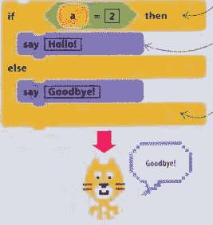

### 在 Scratch 中设置条件

“if-then-else”积木块让你根据条件为 True 还是 False 来选择运行脚本的哪一部分。

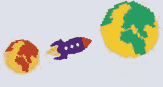

如果 `if` 之后的条件为 True，则执行此命令。

如果答案为 True，则显示此消息。

这是“if-then-else”积木块的结尾。

### 在 Python 中输出

在 Python 中，“print”命令会在屏幕上显示消息。

```python
print("Hello World!")
```

在此输入你的消息。

消息会像这样显示在屏幕上。

```text
Hello World!
```

### 在 Python 中设置条件

在 Python 中，“if-then-else”命令的工作方式完全相同，但它们不使用“then”这个词。

```python
if a == 2:
    print("Hello!")
else:
    print("Goodbye!")
```

如果答案为 False，则显示此消息。

如果 `if` 之后的条件为 False，则执行此命令。

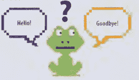

## 用 Python 做游戏

电子游戏是包含许多指令的计算机程序。Python 可用于构建许多不同类型的游戏。使用 Python，每位玩家都能找到适合自己的内容！

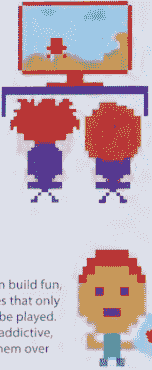

### 游戏类型

计算机游戏有很多不同的类别或类型。这些游戏从简单的一键游戏到更复杂的策略游戏不等。你想先创建哪种类型？

- **一键游戏**：使用 Python，你可以构建只需一个按钮即可游玩的趣味十足、动作丰富的游戏。这些游戏如此令人上瘾，你会想一遍又一遍地玩。

  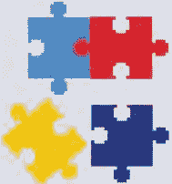

- **益智游戏**：益智游戏是锻炼大脑或测试某人常识的好方法。它们有各种形状和大小，从拼图到文字和数字游戏。

  

- **平台游戏**：平台游戏，例如赛车游戏，通过让背景从玩家视角滚动而过，营造出速度的错觉。游戏玩法通常涉及绕过障碍物或跳过障碍物。

  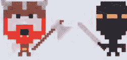

- **多人游戏**：有些游戏你独自玩，但另一些游戏让你与其他玩家竞争。你可以使用 Python 构建多人游戏并挑战你的朋友。

  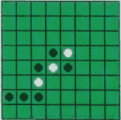

- **策略游戏**：策略游戏关键在于决策。你需要提前规划并做出正确选择才能获胜。

## Python 模块

Python 有称为“模块”的代码包，可帮助你完成常见的编码任务。你可以通过将模块导入程序来使用它们。以下是一些你可能会觉得有用的 Python 模块。

### Pygame

Pygame 是为用 Python 编写游戏而设计的。使用这个模块，你可以轻松添加和控制游戏角色、更新分数和计时器、使用特殊动画和图形，以及在游戏中使用游戏手柄和操纵杆。它不是 Python 内置模块，因此需要单独安装。

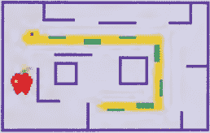

**专家提示**

**下载模块**

Python 自带若干用于开发游戏的内置模块，例如 Pyglet。但其他一些模块，如 Pygame，必须单独下载。

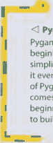

### Pygame Zero

Pygame Zero 是适合初学游戏编程者的绝佳模块。它是 Pygame 的简化版本，通过隐藏 Pygame 一些较复杂的特性，让入门更加容易。它自带若干对初学者有用的工具，但也足够强大，可以构建更令人印象深刻的游戏。

### Math

Math 是标准 Python 模块，可用于在游戏中执行简单计算。不过，你可能需要使用其他模块来进行更复杂的计算。

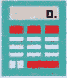

### Random

此模块可以选取随机数或将列表打乱为随机顺序。它非常适合为游戏添加随机性。当你想要模拟掷骰子或为玩家选择随机敌人时，可以使用它。

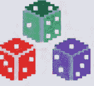


### Time

此模块提供在程序中处理时间和日期的工具。例如，你可能需要计算游戏开始以来已经过了多少秒。

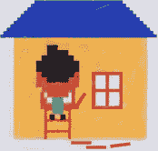

### Tkinter

此工具用于在游戏中构建简单图形，以创建图形用户界面（GUI，发音为“goo-eyes”），让用户与 Python 程序交互并控制它们。

## 安装 Python

本书中的游戏使用 Python 3。它是免费的，你可以从 Python 网站下载。请按照与你的计算机相匹配的说明操作。除非获得计算机所有者的许可，否则切勿安装任何程序。

### 在 Windows 上安装 Python

首先你需要查明你的计算机使用的是 32 位还是 64 位版本的 Windows。转到**开始**菜单，然后依次选择**计算机**、**属性**，如果出现该选项，则选择**系统**。

1. **下载 Python**

   访问 www.python.org 并点击**下载**。点击适用于 Windows 的最新版 Python。版本号应以数字 3 开头。在出现的不同安装程序选项中选择**可执行安装程序**。

   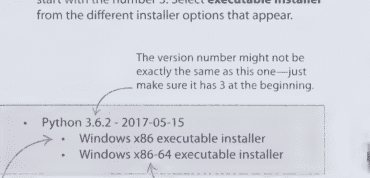

2. **安装 Python**

   打开安装程序文件，然后点击**自定义安装**，再点击**下一步**，直到进入**高级选项**。保持复选框原样，但确保同时勾选“为所有用户安装”和“将 Python 添加到环境变量”。然后在每个提示处点击**安装**和**下一步**。

   

3. **启动 IDLE**

   安装过程完成后，通过搜索 IDLE 或转到**开始**菜单、选择**所有应用**，然后选择 **IDLE** 来打开 IDLE。应出现如下图所示的窗口。

   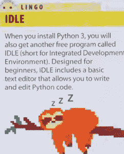

```text
Python 3.6.2 Shell
IDLE   File   Edit   Shell   Debug   Options   Window   Help
Python 3.6.2 (v3.6.2:5fd33b5, Aug 15 2017, 00:45:10) [MSC v.1900 32 bit (Intel)] on win32
Type "copyright", "credits" or "license()" for more information.
>>> 
```


### 在 Mac 上安装 Python

在 Mac 上安装 Python 3 之前，你需要检查你的 Mac 使用哪个操作系统。为此，点击屏幕左上角的 **Apple** 图标，并从下拉菜单中选择 **关于本机**。

1. **下载 Python**

   访问 www.python.org，然后点击 **下载**。点击与你的操作系统匹配的 Python 3 版本。“Python.pkg”文件会自动下载到你的 Mac。

版本号可能与此处显示的不完全一样——只需确保它以 3 开头。


2. **安装 Python**

   双击 **下载** 文件夹中的“.pkg”文件以开始安装。选择 **继续**，然后选择 **安装**，以接受默认设置。

点击该安装包以运行安装程序。


3. **启动 IDLE**

   安装完成后，通过打开 IDLE 程序来检查安装是否成功。在 Spotlight 中搜索它，或者选择 **应用程序** 文件夹，然后选择 **Python** 文件夹，并双击 **IDLE**。应出现类似这样的窗口。

```text
Python 3.6.2 Shell
IDLE   File   Edit   Shell   Debug   Window   Help

Python 3.6.2 (v3.6.2:5fd33b5, Aug 15 2017, 13:38:16)
[GCC 4.2.1 (Apple Inc. build 5666) (dot 3)] on darwin
Type "copyright", "credits" or "license()" for more information.
>>>
```

> **专家提示**
>
> **Raspberry Pi**
>
> 如果你使用的是 Raspberry Pi 电脑，那么可以跳过下载步骤，因为该机器已预装 Python 2 和 Python 3。请记住本书使用 Python 3，因此务必打开正确的版本。你可以在 Raspberry Pi 的 **应用程序** 菜单中找到 Python 3。现在打开它并检查是否能正常工作。

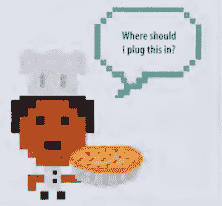

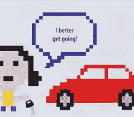

## 安装 Pygame Zero

现在该添加一些额外工具，帮助你制作出色的游戏了。在本书中，你需要两个额外的模块——Pygame 和 Pygame Zero。这些模块未随 Python 附带，因此需要单独安装。

### 在 Windows 上安装 Pygame Zero

按照以下步骤在你的 Windows 计算机上安装最新版本的 Pygame 和 Pygame Zero。你的机器需要连接到互联网才能完成其中一些步骤。

> **专家提示**
>
> **管理员权限**
>
> 确保你以管理员身份登录计算机；否则，系统不会让你正确安装程序。在别人的计算机上安装新软件前，务必先征得许可。

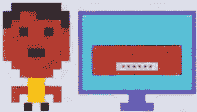

1. **打开命令提示符**

   点击 **开始**。向下滚动并打开 **Windows 系统** 文件夹。点击 **命令提示符**。如果找不到，请尝试搜索它。你需要输入一些命令，并按 **Enter** 运行每一条命令。确保所有内容拼写正确，并在正确的位置留空格，否则命令将无法运行。

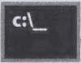

在菜单中留意这个缩略图。

2. **安装包管理器**

   安装 Python 时，应会附带一个名为“pip”的包管理器。这个工具可以让安装 Pygame Zero 和其他 Python 模块更容易。将此命令输入命令提示符，然后按 **Enter**——它会检查你的计算机上是否安装了 pip，如果没有，就会安装它。

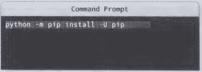

3. **安装 Pygame**

   包管理器安装完成后，输入以下命令并按 **Enter**。这会使用 pip 安装 Pygame。

```bash
pip install pygame
```

4. **安装 Pygame Zero**

   最后，输入此命令。按 **Enter** 后，这将安装 Pygame Zero，简称 pgzero。

```bash
pip install pgzero
```

## 使用 IDLE

在 IDLE 中，你可以在两种不同的窗口中工作。编辑器窗口可用于编写和保存程序，而 shell 窗口会立即运行 Python 指令。

### shell 窗口

打开 IDLE 时，shell 窗口会弹出。这是开始上手的最佳位置，因为你不必先创建新文件。你只需将代码直接输入 shell 窗口即可。

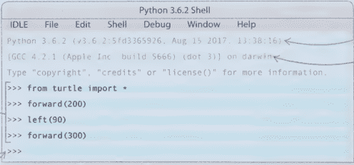

```
>>> from turtle import *
>>> forward(200)
>>> left(90)
>>> forward(300)
```

这四行代码是一个简单的绘图程序——你可以自己试一试。

你在 >>> 提示符处输入代码。

这一行显示你拥有的 Python 版本。

这里的文本将取决于你的操作系统。

### 在 shell 中工作

你可以使用 shell 窗口，在将代码片段加入更大的程序之前先测试它们。你输入的代码可以立即运行，并会显示任何消息或“bug”（错误）。

> **专家提示**
>
> **不同的窗口**
>
> 为了帮助你了解应将代码放入哪个窗口，我们为 IDLE 中的每个窗口设置了不同的颜色。

- shell 窗口
- 编辑器窗口

```
>>> print('You’ve unlocked a new level!')

>>> 123 + 456 * (7 / 8)

>>> ''.join(reversed('Time to play'))
```

### 试运行 shell

将每个代码片段输入 shell 窗口，并在输入每个片段后按 Enter。第一行显示一条消息，第二行执行一次计算。你能看出第三行做什么吗？

### 编辑器窗口

shell 窗口无法保存你的代码，因此当你关闭它时，你输入的代码将永远消失。在制作游戏时，你应该使用 IDLE 的编辑器窗口。这样可以保存你的代码。它还具有内置工具，可帮助你编写程序并排查任何错误。

> **编辑器窗口**
>
> 要在 IDLE 中打开编辑器窗口，请点击顶部的 **文件** 菜单，然后选择 **新建文件**。随后会出现一个空白的编辑器。你将使用编辑器窗口编写本书中游戏的程序。

你在这里输入代码。这个程序会打印一个列表，告诉你哪些数字是偶数，哪些是奇数。

文件名显示在这里。

你可以从此菜单运行 Python 程序，但运行 Pygame Zero 程序的方式会有所不同。

编辑器窗口的菜单栏与 shell 窗口的菜单栏不同。

你让 Python 打印的任何内容都会显示在 shell 窗口中。

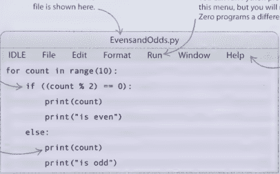

```python
for count in range(10):
    if ((count % 2) == 0):
        print(count)
        print("is even")
    else:
        print(count)
        print("is odd")
```


> **专家提示**
>
> **代码中的颜色**
>
> IDLE 会自动为文本着色，以突出显示代码的不同部分。这些颜色使代码更易于理解，并且在尝试发现错误时很有用。

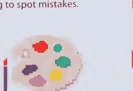

- **符号和名称** —— 大多数代码文本为黑色。
- **输出** —— 程序运行时产生的任何文本为蓝色。
- **内置命令** —— Python 命令（例如 print()）显示为紫色。
- **关键字** —— 某些词（例如 if 和 else）是特殊的 Python 关键字。它们显示为橙色。
- **错误** —— Python 使用红色提醒你代码中的任何错误。
- **引号中的文本** —— 引号中的任何文本为绿色。这些称为字符串。

## 你的第一个程序

安装 Python、Pygame 和 Pygame Zero 后，按照以下步骤编写你的第一个 Python 程序。这个简单的程序将在屏幕上显示一条消息。

> **专家提示**
>
> **仔细输入**
>
> 确保完全按照本书中的写法输入所有代码。网格会帮助你正确输入全部内容。仅仅一行代码中的一个小拼写错误就可能导致整个程序崩溃。

### 工作原理

这个 Python 程序将检查所有设置是否正确，以便你可以开始制作一些游戏。它使用 Pygame Zero 在屏幕上显示“Hello”这个词。

1. **设置文件夹**

   开始之前，在容易找到的位置（例如桌面上）创建一个名为 python-games 的文件夹。在 python-games 文件夹中再创建一个文件夹，并将其命名为 hello。

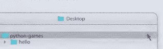

2. **启动 IDLE**

   在你的计算机上打开 IDLE。从文件菜单中选择新建文件，创建一个空白的编辑器窗口，以便编写程序。


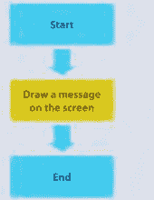

### Hello 流程图

制作游戏时，程序员会使用称为流程图的图表来规划游戏并展示其工作方式。每个步骤都显示在一个框中，并用箭头指向下一步。更复杂的游戏可能会有带问题的步骤，并根据问题的答案，用不止一个箭头指向不同的框。

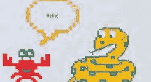


### 3. 输入第一行代码

编写这第一行代码，告诉 Python 在屏幕上显示或“绘制”内容。完成后按 **Enter**。

```python
def draw():
```

这行代码用于在屏幕上显示一些内容。

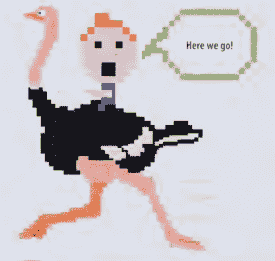

### 4. 输入第二行代码

然后输入这第二行代码。检查它以四个空格开头。这称为“缩进”，没有它，你的代码将无法运行。

```python
def draw():
    screen.draw.text("Hello", topleft=(10, 10))
```

如果 IDLE 没有自动添加，请添加四个空格。

确保这里有两个右括号。

### 5. 保存文件

现在让我们保存文件。转到**文件**菜单并选择**另存为...**。将文件命名为 *hello.py*，并保存到你之前创建的文件夹中。

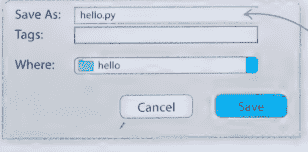

当你保存程序时，IDLE 会自动在末尾添加“.py”，因此你不必手动输入。

### 专家提示

### 缩进

代码第二行的开头应有四个空格。这称为“缩进”。Python 使用它们来分隔不同的代码块。空格和缩进非常重要——如果你的代码遗漏了它们或把它们放错了位置，代码将无法运行。它们是 Python 程序中最常见的错误（bug）之一！

### 专家提示

### 保存代码

在运行代码之前一定要保存，尤其是在做出任何更改之后。否则，Python 将运行过时版本的代码。

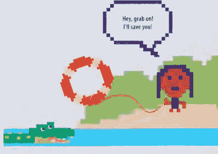

## 运行你的程序

因为你的游戏使用 Pygame Zero，所以你通常需要以不同于普通 Python 程序的方式来运行它们。不过，一旦你习惯了，这并不难。


- **6. 打开命令提示符或终端窗口**

要运行程序，你可以使用命令行。如果你使用的是 Windows 电脑，请在“命令提示符”应用中操作。如果你使用的是 Mac，请打开“终端”应用。


这就是命令提示符图标的样子。

这就是终端窗口图标的样子。

- **7. 输入 Pygame Zero 命令**

要告诉 Pygame Zero 运行游戏，请在命令行中输入 `pgzrun` 并留一个空格，但先不要按 **Enter**！


别忘了在 `pgzrun` 后面留一个空格。

- **8. 拖放 IDLE 文件**

保持应用打开，然后使用资源管理器（Windows）或访达（Mac）转到保存程序的文件夹。找到后，将 `.py` 文件拖放到命令行中。

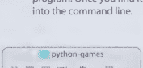


将 `hello.py` 拖放到命令提示符或终端窗口中。

当你放入时，你的 **IDLE** 文件的位置会显示在这里。

- **9. 运行程序**

既然你已经输入了 `pgzrun` 命令，并且你的电脑知道在哪里可以找到 **IDLE** 文件，请按 **Enter**。这将启动 Pygame Zero。

- **10. 最终屏幕**

如果你的程序运行正常，你会看到一个窗口，屏幕左上角显示“Hello”消息。干得好！现在，是时候成为一名 Python 游戏程序员了！

### 专家提示

### 重新运行程序

在编写程序时，你需要经常运行代码来检查 bug。为了节省时间，你可以按命令提示符或终端中的**向上**箭头键查看最近的命令。然后按 **Enter** 再次运行其中的一条命令。如果你的游戏仍在运行，你需要先关闭它，然后才能重新运行代码。否则，什么都不会发生！

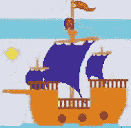

## 使用 IDLE 运行你的程序

可以使用 IDLE 运行你的 Pygame Zero 程序。为此，你需要在代码中添加两行额外的代码。建议等到你写完整个程序后再进行此操作。

- 1. 在程序的最顶部输入 `import pgzrun`，在最后输入 `pgzrun.go()`。你的游戏的全部代码现在应位于这两行之间。

- 2. 要在 IDLE 中运行游戏，请转到**运行**菜单并点击**运行模块**，或直接按 **F5** 键。

```python
import pgzrun

def draw():
    screen.draw.text("Hello", topleft=(10, 10))

pgzrun.go()
```

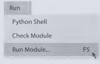

### 重要！

### 修复错误

如果你运行某个程序时什么也没有发生，或者收到错误消息——不要惊慌！在编写程序时遇到错误（称为“bug”）是很正常的。如果出现错误消息，请问自己以下问题：

- 代码是否与给出的示例完全一致？
- 我是否将程序保存到了正确的文件夹中？
- 我是否正确输入了 `pgzrun`？
- Pygame 和 Pygame Zero 是否安装正确？

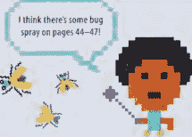

## 创建变量

变量用于存储和标记信息。你会在代码中大量使用它们——例如，保存当前得分或跟踪剩余的生命数。

### 如何创建变量

你需要为每个变量指定一个名称，用来描述其内部存储的数据。变量存储的内容称为“值”。输入名称、等号，然后输入值，各部分之间留一个空格。这称为“给变量赋值”。

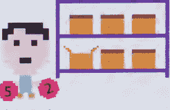

### 存储盒

变量就像一个带有名称标签的盒子。你可以将数据存储在盒子中，然后多次使用它，在需要时再次找到数据。

- **1. 赋值**

打开 IDLE 的 shell 窗口。输入这行代码，创建一个名为 `score` 的变量并为其赋值。

```python
>>> score = 0
```

这是变量的名称。

这是变量中存储的值。

- **2. 打印值**

现在，在步骤 1 中输入的代码之后，在窗口中输入 `print(score)`。按 **Enter** 看看会发生什么。

```python
>>> score = 0
>>> print(score)
0
```

这是 score 的值。

`print()` 函数用于显示括号中变量的值。

### 专家提示

### 变量命名

始终为程序中的每个变量选择一个有意义的名称。例如，用于跟踪玩家剩余尝试次数的变量可以命名为 `attempts_remaining`，而不仅仅是 `attempts` 或 `a`。变量名可以包含字母、数字和下划线，但应始终以字母开头。遵循这些规则，你就不会出错。

- **该做与不该做**
  - 变量名始终以字母开头。
  - 名称中可以使用任何字母或数字。
  - 不允许使用 `-`、`/`、`#`、`@` 等符号。
  - 不要使用空格。可以使用下划线（`_`）代替。
  - 大写字母和小写字母是不同的。Python 会将 `Score` 和 `score` 视为两个不同的变量。
  - 避免使用 Python 或 Pygame Zero 中用作命令的词语，例如“function”或“screen”。

### 使用数字

变量可用于存储数字，然后用于计算。你可以像在数学中一样使用符号对它们进行操作。不过要小心乘法和除法，因为它们使用的符号与你在学校使用的不同。

| 符号 | 含义 |
|---|---|
| + | 加 |
| − | 减 |
| * | 乘 |
| / | 除 |

### 1. 简单计算

把这段代码输入到 shell 窗口。它使用两个变量 x 和 y，它们存储整数来执行一个简单的计算。按 Enter 查看答案。

```text
>>> x = 2
>>> y = x * 3
>>> print(y)
6
```

创建一个新变量 x，并将值 2 赋给它。

乘以 3，并将结果赋给另一个变量 y。

打印赋给 y 的值。

计算的结果。

### 2. 更改值

要更改变量的值，只需为其赋一个新值。在此代码中，将值 5 赋给 x。再次打印赋给 y 的值。你认为结果会是什么？

```text
>>> x = 5
>>> print(y)
6
```

更改 x 的值。

结果没有改变——接下来我们将找出原因。

### 3. 更新值

需要更新 y 的值才能得到正确的结果。为此，你需要再次运行 y = x * 3 的计算。现在，在 x 更改后，代码将新值赋给 y。

```text
>>> x = 5
>>> y = x * 3
>>> print(y)
15
```

你需要重新计算以更新 y 的值。

### 术语

### 整数和浮点数

在编程中，变量可以存储不同类型的数字。不带小数点的数称为“整数”，带小数点的数字称为“浮点数”。整数通常用于计数，例如玩家的得分，而浮点数通常用于测量，例如温度。

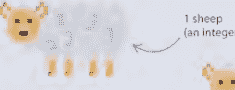

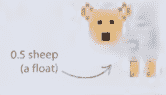


## 处理字符串

字符串是由一系列字母或其他字符组成的数据。单词和句子都以字符串的形式存储。在 Python 中，大多数程序至少会使用一个字符串。你在键盘上能敲出的任何字符都可以存储在字符串中。

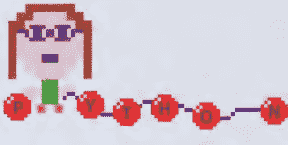

### 变量中的字符串

字符串可以赋值给变量。在 shell 窗口中输入这段代码。它把字符串 **Martin** 赋值给 name 变量，然后将其显示出来。字符串必须写在引号之间，以标明其开始和结束位置。

```python
>>> name = "Martin"
>>> print(name)
Martin
```

引号告诉计算机这是一个字符串。

按 Enter 键打印该字符串。

### 拼接字符串

变量可以组合起来创建新的变量。例如，你可以将两个字符串相加，并将组合结果存储在一个新变量中。在 shell 窗口中输入以下代码来试一试。你可以更改问候语和名字，以创建新的消息。

```python
>>> greeting = "Hello "
>>> name = "Martin"
>>> message = greeting + name
>>> print(message)
Hello Martin
```

记得加上引号，并在 Hello 后面留一个空格。

记得在问候语后面留一个空格。

**+** 符号可用于将字符串拼接在一起。

**message** 是一个新变量，其中包含 greeting 和 **name** 变量。

### 专家提示

#### 字符串的长度

在某些程序中，能够统计字符串中的字符数量会很有用。你可以使用 **len()** 函数来实现这一点。函数是一种有用的操作，它包含多行代码，因此你不必手动输入这些代码。要找出字符串 **Hello Martin** 中的字符数量，请在创建该字符串后，在 shell 中输入以下代码行，然后按 **Enter** 键。

```python
>>> len(message)
12
```

字符数量（包括空格）都会被计算在内。

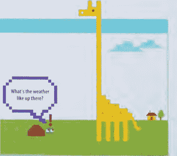

## 创建列表

列表用于存储一组数据。它可以容纳许多不同的值，并保持它们的顺序。例如，列表可以存储游戏中（如“配对”游戏）的一副牌，这样代码就能知道接下来该发哪张牌。列表中每个值的位置都用一个数字标识，从 0 开始。你可以使用这些数字来更改列表中的值。

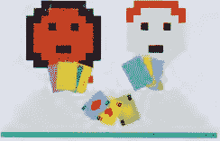

### 1. 多个变量

假设你在编写一个多人游戏，并且想为每张牌设置一个不同的变量。你需要 52 个变量才能存储一整副牌，但现在我们只用 6 张牌来操作。

```python
>>> card1 = "1 hearts"
>>> card2 = "2 hearts"
>>> card3 = "3 hearts"
>>> card4 = "4 hearts"
>>> card5 = "5 hearts"
>>> card6 = "6 hearts"
```

无需输入这段代码。


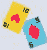

### 2. 变量中的列表

使用列表来存储所有牌的值要比逐个使用这么多变量容易得多。要创建列表，请将你想存储的值用方括号括起来。

```python
>>> cards = ["1 hearts", "2 hearts", "3 hearts", "4 hearts", "5 hearts", "6 hearts"]
```

该列表被赋值给变量 **cards**。

这些值必须用逗号分隔。


### 3. 从列表中获取元素

一旦将所有值放入列表中，操作列表就变得很简单了。要从列表中获取某个元素，请输入列表名称，然后在方括号内输入该元素在列表中的位置。但请注意——在 Python 中，列表的第一个位置是 0，而不是 1。现在试着从你的 cards 列表中取出不同的牌。

```python
>>> cards[0]
"1 hearts"

>>> cards[5]
"6 hearts"
```

这行代码获取列表中的第一个值。

这是我们列表中的最后一个值。

对于我们这个较小的列表，最后一个位置是 5，但对于整副牌的列表，它将是 51。


## 做出决策

玩游戏时需要就下一步做什么做出决策。这些决策通常基于问题的答案。例如，“我还有命吗？”、“有人在追我吗？”、“我打破最高分了吗？”

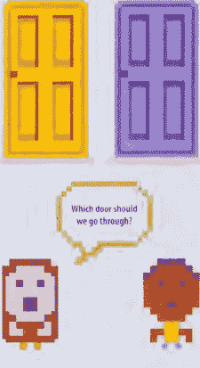

### 比较

计算机也会通过提问来决定下一步做什么。这些问题通常涉及比较两个值。例如，一个数是否比另一个数大？如果是，计算机可能会跳过一块本来会运行的代码。

```python
>>> answer_one = True
>>> answer_two = False
```

变量  
布尔值

#### 布尔值

计算机提出的问题只有两种可能的答案：True 或 False。Python 将这两种值称为布尔值，并且它们必须以大写字母开头。你可以将布尔值存储在变量中。

| 符号 | 含义 |
|---|---|
| `==` | 等于 |
| `!=` | 不等于 |
| `<` | 小于 |
| `>` | 大于 |

#### 逻辑运算符

这里展示的符号和单词被称为“逻辑运算符”，它们帮助计算机进行比较，从而提出问题。

### 专家提示

#### 等号

在 Python 中有两种等号：单个等号 `=` 和双等号 `==`。这两个符号的含义不同。当你想将一个值存储到变量中时，使用单个等号。例如，`lives = 10` 将值 10 存储到变量 lives 中。而当你想比较两个值时，使用双等号。

这会设置变量的值。

这会把你年龄与变量进行比较。

```python
>>> age = 10
>>> if age == 10:
    print("You are ten years old.")
```

如果两者匹配，代码就会打印这条消息。

## 怪物与金币

让我们在 shell 窗口中尝试一个示例。你可以使用变量 **monsters** 和 **coins** 分别表示三个怪物和四枚金币。输入以下代码。

```python
>>> monsters = 3
>>> coins = 4
```

这个值存储在变量 **monsters** 中。

这个变量存储金币的数量。

### 让我们来比较

现在输入以下几行代码来比较这两个变量中的值。每输入一行，按 **Enter** 键，Python 就会告诉你这些语句是 True 还是 False。

```python
>>> coins > monsters
True
```

这个表达式为 True，因为金币的数量大于怪物的数量。

```python
>>> monsters == coins
False
```

这个表达式为 False，因为怪物的数量和金币的数量不相等。

```python
>>> monsters < coins
True
```

这个表达式为 True，因为怪物的数量小于金币的数量。


### 术语

#### 布尔表达式

包含变量和值并使用逻辑运算符的语句，其结果始终是布尔值——True 或 False。因此，这些语句被称为布尔表达式。示例中所有关于怪物和金币的语句都是布尔表达式。

```python
>>> coins > monsters
True
```

coins 是一个变量。

monsters 是一个变量。

> 是一个逻辑运算符。

True 是一个布尔值。

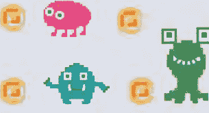

### 多重比较

在 Python 中，你还可以使用逻辑运算符 **and** 和 **or** 来组合多个比较。

```python
>>> (monsters == 3) and (coins == 4)
True
```

使用 **and** 时，所有比较都必须成立，布尔值才是 True。

使用 **or** 时，只要其中一个比较成立，布尔值就是 True。

```python
>>> (monsters == 7) or (coins == 4)
True
```

## 升级

假设你在创建一个有两个关卡的的游戏。要进入第 2 关，你需要至少拥有四只魔法蜗牛，并且分数超过 100 分。此时，你有 110 分，但只有三只魔法蜗牛。使用 shell 窗口看看你是否仍能进入第 2 关。首先，为分数和收集到的蜗牛数量创建变量，并为它们赋予正确的值。然后，将进入第 2 关的规则输入为一个布尔表达式。

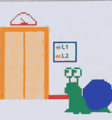

```python
>>> score = 110
>>> snails = 3
>>> (score > 100) and (snails >= 4)
False
```

将值存储在变量中。

这是一个布尔表达式，意为“分数大于 100 且蜗牛数量大于或等于 4”。

这显示你目前还无法进入第 2 关。

## 分支

有时在玩游戏时需要做出决策。你应该向右转去探查图书馆，还是向左转去看看厨房？计算机程序通常包含只在特定情况下运行的代码。这意味着计算机要对运行哪些代码块做出决策。

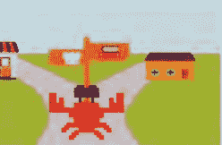

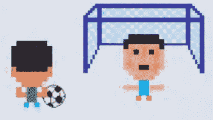

- 盯紧球：假设你在玩一场足球游戏，需要决定朝哪个方向射门。你可以问自己：“守门员是不是在球门的左侧？”如果是，你就朝球门右侧射门；如果不是，你就朝左侧射门。在 Python 中，程序中的不同路径会通向不同的代码块。计算机使用布尔表达式（即条件）来决定运行哪些代码块。


### 单分支

最简单的分支命令类型是 if 语句。它只有一个分支，如果条件为 True，计算机就会执行该分支。


“看好了！我赐予你……‘附魔师’的称号！”

这个比较就是条件。

```python
spells = 11
if (spells > 10):
    print("You gained the title Enchanter!")
```

如果条件为 True，则运行此分支。

#### 工作原理

在这个示例中，程序会检查你已施放的法术数量。如果超过十个，程序会打印“你获得了‘附魔师’称号！”如果你施放的法术数量少于十个，则不会打印该消息。

### 两个分支

如果你希望程序在条件为 True 时做一件事，而在条件为 False 时做另一件事，该怎么办？在这种情况下，你需要一个具有两个可能分支的命令，称为 if-else 语句。

```python
game_over = True
if game_over:
    print("Game Over!")
else:
    print("Keep playing!")
```

如果条件为 False，则运行此代码块。


如果条件为 True，则运行此代码块。

#### 工作原理

在这个示例中，有一个名为 game_over 的变量，它被设置为 True。if 语句会检查 game_over 是否为 True。如果是，程序会打印“Game Over!”；如果不是，else 语句就会运行，打印“Keep playing!”试着将 game_over 设置为 True 再设置为 False 来运行这段代码，看看实际效果。


这是第一个条件。

```python
ghosts = 3
if ghosts > 1:
    print("It’s so spoooky!")
elif ghosts > 0:
    print("Get that ghost!")
else:
    print("Ghosts all gone!")
```

如果第二个条件为 True，则运行此代码块。

如果两个条件都为 False，则运行此代码块。

### 两个以上分支

当可能路径超过两条时，可以在程序中使用 elif 命令（“else-if”的缩写）。在下面的示例中，你需要一次性抓住几个幽灵。

#### 工作原理

在这个程序中，变量 ghosts 已被设置为 3，因此第一个分支为 True，程序会打印“太吓人啦！”但如果 ghosts 的值是 1，第一个分支就会为 False，于是第二个分支会运行，打印“抓住那个幽灵！”如果上述两个分支都不为 True，程序会继续执行第三个分支，打印“幽灵全都没了！”elif 语句必须始终位于 if 之后、else 之前。

## 玩转循环

在编写游戏程序时，你经常需要多次运行同一小段代码，但如果每次都要手动输入，那就太无聊了。幸运的是，你可以使用循环反复运行同一代码块。循环有许多不同的类型。

### “For”循环

当你确切知道希望循环重复多少次时，可以使用 for 循环。在这个示例中，代码会打印“你是最高得分者！”十次。你可以在 shell 窗口中亲自试试这段代码。

```python
>>> for count in range(1, 11):
    print("You are the high scorer!")
```

这是循环变量。

被重复执行的代码称为“循环体”。


#### 循环变量

循环变量记录循环到目前为止已经运行了多少次。在循环开始时，它等于 range 中的第一个数字。第二次循环时，它等于 range 中的第二个数字，依此类推。一旦它完成 range 中倒数第二个数字，循环就会停止。


#### 循环体

在循环中被重复执行的代码块称为循环体。循环体中的命令必须始终相对于启动 for 循环的那一行行首缩进四个空格。

### 专家提示

#### range

在 Python 中，range 一词后面跟括号中的两个数字，表示“列表中从第一个数字到倒数第二个数字的所有数字”。因此，range(1, 5) 包含数字 1、2、3 和 4，但不包含 5，所以循环会运行四次。


### 遍历列表

游戏程序经常使用按列表分组在一起的物品集合。如果你想对列表中的每个项执行某些操作，可以使用 `for` 循环。

> 第 31 页会帮助你了解列表。


#### 列出机器人

在这个示例中，有一个列表，其中包含玩家在游戏中必须逃离的三个机器人的名字。

```python
>>> robots = ["Bing", "Bleep", "Bloop"]
>>> for robot in robots:
    print("I am a robot. My name is " + robot)
```

Python 会在这里添加其中一个机器人的名字。

robot 是一个临时变量，每次循环运行时都会沿着 robots 列表移动。

#### 工作原理

我们创建一个名为 robot 的临时变量，用来保存列表中的单个项。每轮循环都会更新 robot 中的值，使它依次保存 Bing、Bleep，最后是 Bloop。一旦到达列表末尾，循环就会停止。

### 遍历两个列表

Python 可以或多或少自动地从头到尾遍历一个列表。但如果你想同时遍历两个列表，就需要使用一个额外的变量来告诉 Python 依次遍历这两个列表。


#### 带颜色的机器人

在这个示例中，我们有两个列表。一个名为 robots，保存机器人的名字。另一个名为 colors，告诉你每个机器人的颜色。这个程序使用一个名为 index 的变量来遍历这两个列表，打印出每个机器人的名字以及它的颜色。

index 将帮助 Python 按顺序遍历这两个列表。

这一行更新 index，使 Python 在每次循环时遍历列表。

```python
>>> robots = ["Bing", "Bleep", "Bloop"]
>>> colors = ["red", "orange", "purple"]
>>> index = 0
>>> for each in robots:
    print("My name is " + robots[index] + " I am " + colors[index])
    index = index + 1
```

index 变量记录每个列表当前所在的位置。


#### 工作原理

`robots[index]` 和 `colors[index]` 都使用 `index` 的值来决定打印各自列表中的哪一项。由于 `index` 一开始被设置为 0，两个列表都会从第一项开始——记住，Python 列表中的第一个位置总是 0，而不是 1。由于 Bing 位于 robots 列表的位置 0，而 red 位于 colors 列表的位置 0，这意味着 Bing 是红色的。每次循环运行时，它都会给 `index` 加 1，使每个列表移到下一项，因此 Bleep 将是橙色，Bloop 将是紫色。循环会一直持续到列表末尾。

### “While”循环

有时，在编写程序时，你可能并不确切知道希望循环重复多少次。别担心！在这种情况下，你可以使用 while 循环。

#### 循环条件

while 循环包含一个问题，其答案可以是 `True` 或 `False`。这称为循环条件。只有当循环条件的答案为 `True` 时，while 循环才会开始。想象你在玩一个游戏，一座城堡由一条龙守卫，它会检查你是否有魔法钥匙。“你有魔法钥匙吗？”就是循环条件，而城堡就是循环体。如果你有魔法钥匙，循环条件为 `True`，你就可以进入城堡。但如果你没有钥匙，循环条件为 `False`，所以你就无法进入循环！


> 老兄，我们到底什么时候才能停下来？


> 没有魔法钥匙，谁也别想进来！

#### 专家提示

##### 缩进错误

就像 `for` 循环一样，`while` 循环主体中的代码必须比启动循环的那一行再缩进四个空格。如果不这样做，Python 会显示一条错误消息：“unexpected indent”。


## 水球大战

在这个示例中，程序会询问你是否想扔一个水球。如果你的答案是 y，它会打印“Splash!!”，并询问你是否想再扔一个水球。如果你的答案是 n，程序会打印“Goodbye!”并结束。

这一行获取 answer 的值（用于循环条件）。

```python
answer = input("Throw a water balloon? (y/n)")
while answer == "y":
    print("Splash!!")
    answer = input("Throw another water balloon? (y/n)")
print("Goodbye!")
```

这一行获取 answer 的新值（用于循环条件）。

当循环完成时，这一行会打印“Goodbye!”


> “这里真湿！”

### 工作原理

这里的循环条件是 answer == "y"，意思是你要扔一个水球。循环体会打印“Splash!!”以表示扔出一个水球，并询问你是否想再扔一个。如果你的答案是 y，循环条件为 True，循环会重复。如果你的答案是 n（或除 y 以外的任何内容），循环条件为 False，程序会退出循环并打印“Goodbye!”，然后结束。

## 无限循环

有时，你可能希望循环在程序运行期间一直重复。这可以通过无限循环来实现。你可以把循环条件设置为 True 来创建无限循环，这样它就会永远重复执行一段代码！

```python
>>> while True:
    print("This is an infinite loop!")
```

没有 False 选项可以跳出循环。

### 如何跳出

如果你不想运行无限循环，务必确保 while 循环的循环体执行某些可能使循环条件变为 False 的操作。但如果你不小心编写了带无限循环的程序，也不用担心——你可以按住 Ctrl 键，同时按 C 键来跳出。


> “他们逃走了！”

## 函数

函数对所有程序员来说都是非常方便的工具。它们让你可以为有用的代码段命名，这样你就可以反复使用它们，而不必每次都把整段代码打出来——只需输入名称即可！Python 自带一些内置函数，但你也可以编写自己的函数来处理游戏特有的任务。

### 使用函数

当你想使用 Python 的内置函数之一时，只需“调用”它：输入函数名，后面跟一对空括号。这会告诉 Python 运行保存在该函数中的代码。如果你需要给函数提供一些数据，就把数据放在括号内。这称为“参数”。

### 内置函数

Python 自带许多内置函数。它们让你可以执行各种任务，从打印消息到将一种数据类型转换为另一种数据类型。

这一行用字符串参数调用 `print()` 函数。

```python
>>> print("This is a parameter")
This is a parameter
```

字符串参数被打印出来。

### `print()`

最常用的函数之一是 `print()`。这个函数让你在屏幕上显示一个字符串（一系列字母、数字或其他字符）。在这里，字符串就是一个参数。

### 函数术语

- **调用** 当你想使用一个函数时，你通过输入函数名、后面跟括号（括号中可包含参数）来“调用”它。
- **定义** 当你使用 `def` 关键字并为一个函数编写自己的代码时，你就是在“定义”该函数。
- **参数** 参数是你提供给函数使用的一条数据（信息）。
- **返回值** 返回值是你使用 `return` 关键字从函数传回主代码的数据。

> 我需要非常小心地搭建这个！


### `input()`

这个函数让玩家输入信息供游戏使用，而不是由程序员把信息写进原始代码中。例如，假设你正在创建一个游戏，想创建一个变量来存储玩家的名字，但你不知道玩家叫什么。你可以使用 `input()` 让游戏询问玩家的名字。玩家的回答会成为返回值，然后函数会将它赋给 name 变量。

这是一个稍后用来存储玩家名字的变量。

`input()` 询问用户的名字。

```python
>>> name = input("What is your name?")
What is your name? Ben
>>> print(name)
Ben
```

你可以在这里输入自己的名字。

`input()` 已将回答赋给 name 变量。

### 调用函数的另一种方式

某些数据类型（例如整数和字符串）有自己的内置函数，用于操作或修改该数据。这些称为“成员”函数，可以通过在数据后紧跟一个点，再跟函数名和一对括号来调用。请在 shell 窗口中试一试。


```python
>>> "functions are fun".count("fun")
2
```

字符串 **fun** 出现了两次。

### `count()`

这个函数用于字符串。它在一个字符串上调用，并以另一个字符串作为 `count()` 函数的参数。返回值告诉你第二个字符串在第一个字符串中出现了多少次。

```python
>>> "blue".upper()
'BLUE'
```

这是新的字符串，全部为大写。

### `upper()`

这个函数接收一个现有字符串并返回一个新字符串，将所有小写字母替换为大写字母。

一个数字列表被赋给一个变量。

在这个数字列表上调用 reverse 函数。

```python
>>> countdown = [1, 2, 3]
>>> countdown.reverse()
>>> print(countdown)
[3, 2, 1]
```

### `reverse()`

你也可以在变量上调用成员函数。在这个示例中，`reverse()` 函数用于反转存储在变量 `countdown` 中的数字列表的顺序。

这个函数有两个参数，用逗号分隔。

```python
>>> message = "Coding makes me happy"
>>> message.replace("happy", ":D")
'Coding makes me :D'
```

### `replace()`

对于这个函数，你需要两个参数——第一个是字符串中你想替换的部分，第二个是你想用来替换它的内容。函数返回替换后的新字符串。

### 创建你自己的函数

> **专家提示**
>
> ### 为函数命名
>
> 给函数起能准确说明其作用的名称很重要。这有助于你理解代码。名称可以包含字母、数字和下划线，但应始终以字母开头。名称中不能使用空格，因此如果函数名中有多个单词，请用下划线分隔。例如，如果你要创建一个结束游戏的函数，可以将其命名为 game_over()。

并非所有功能都有内置函数，因此你需要知道如何编写或“定义”自己的函数。一个函数应该有一个明确的目的，以及一个描述其作用的名称。按照以下步骤创建一个计算玩家得分的函数。

### 1. 定义函数

我们来创建一个在游戏中记录得分的函数。在 IDLE 中打开一个编辑器窗口，并将其保存为 functions.py。然后输入下面的代码，确保所有缩进都正确。每完成一步后，保存文件，转到 Run 菜单，单击 Run Module。

```python
def fruit_score():
    print(10)

fruit_score()
```

- 使用 def 关键字定义一个函数。
- 这个函数不接受参数。
- 这是你存储在函数中的代码。
- 这一行调用函数，运行你存储在其中的代码。
- 得分显示在 shell 中。

10

### 2. 添加一些参数

这个函数到目前为止运行良好，但如果你希望收集不同水果时得到不同得分，该怎么办？要让函数知道该打印哪个得分，它需要知道你收集的是哪种水果。假设一个苹果得十分，一个橙子得五分。你可以通过给函数添加参数来实现。

```python
def fruit_score(fruit):
    if fruit == "apple":
        print(10)
    elif fruit == "orange":
        print(5)

fruit_score("apple")
fruit_score("orange")
```

- 这个函数现在接受一个参数。
- 这些行给参数赋值。
- 这个函数被调用两次——每次传入一个参数。
- 打印的得分取决于参数是 apple 还是 orange。


10
5


### 3. 返回值

你可能不想直接把分数打印出来，而是想在代码的其他地方使用它。你可以从函数中取出一个值供以后使用，这叫做“返回”一个值。在每个分支中，在想要返回的值前面输入关键字`return`。试着把你的`print`语句改成`return`语句。

```python
def fruit_score(fruit):
    if fruit == "apple":
        return 10
    elif fruit == "orange":
        return 5
```

不要在`return`语句中使用括号。

返回的值供代码后面使用，不会显示在 shell 中。

### 专家提示

#### 缩进错误

Python 使用缩进来判断代码块的开始和结束位置。当代码结构有问题时，会出现“IndentationError”（缩进错误）。记住，如果一行代码以冒号（:）结尾，下一行就需要缩进。如果 Python 没有自动添加缩进，请使用**空格键**手动插入四个空格。


### 4. 使用返回值

你可以在代码的其他地方使用函数的返回值。在这个例子中，我们对函数进行了两次调用——每种水果一次。然后我们把这两个结果相加，得到总分。把这段代码添加到你在第 3 步中写的代码下面，然后前往**运行**菜单并点击**运行模块**。

```python
apple_score = fruit_score("apple")
orange_score = fruit_score("orange")

total = fruit_score("apple") + fruit_score("orange")
print(total)
```

两个返回值被加在一起。


## 修复 Bug

如果代码中出现错误（也就是“bug”），Python 会显示一条错误消息。这些消息有时可能有点令人困惑，但它们会告诉你代码哪里出了问题以及如何修复。


### 错误提示

在 IDLE 中，当发生意外情况时，编辑器和 shell 窗口都会显示错误消息。这条消息会突出显示错误，并告诉你该错误位于哪一行代码。

### 命令提示符/终端中的消息

Pygame Zero 中的错误消息会显示在命令提示符或终端窗口中。当发现错误时，程序会停止运行，并告诉你错误是什么以及应该在代码中哪里查找。

```text
File "/Library/Frameworks/Python.framework/Versions/3.6/bin/python", line 11, in <module>
    load_game(...)
File "/Library/Frameworks/Python.framework/Versions/3.6/lib/python3.6/site-packages/
pygame/runner.py", line 87, in main
    exec(code, mod.__dict__)
                              错误在第 2 行。
File "score.py", line 2, in <module>
    print("Game Over! Score " + score)
                              这是一个类型错误。
TypeError: must be str, not int
```

### 专家提示

#### 捕捉 Bug

当你在命令提示符（Windows）或终端（Mac）中看到错误时，查看行号。回到 IDLE 中的代码，点击文件中的任意位置。行号会显示在屏幕的右下角——例如，Ln: 12。然后使用**上**或**下**箭头找到包含错误的行。


## 语法错误

编程语言中语句的结构被称为语法。语法错误意味着你输入了错误的内容。你可能漏掉了语句的一部分，或者拼写错了某个单词。语法错误是最容易修复的错误。转到出错的那一行，修改你输错的内容。


### 需要注意的错误

- 你的左右括号是否匹配？
- 是否缺少引号？
- 所有单词都拼写正确了吗？
- 这些是导致语法错误的主要原因。

```python
print(score
```

缺少右括号。

```python
horse = Actor("horse)
```

缺少右引号。

```python
hrse.draw()
```

这是一个拼写错误。它本应引用名为“horse”的变量，所以应该是horse.draw()。

## 缩进错误

Python 使用缩进来表示代码块的开始和结束。如果你在代码结构上犯了错误，就会显示缩进错误。如果一行代码以冒号结尾，你必须缩进下一行。Python 会在冒号后自动缩进，但你也可以手动添加四个空格来做到这一点。

```python
if play:
horse.draw()
```

这里没有留任何空格，会导致缩进错误。

```python
if play:
    horse.draw()
```

通过添加四个空格来缩进代码，可以修复这个错误。


### 缩进每个新代码块

Python 程序中通常会有代码块嵌套在其他代码块中，例如循环中的 if 语句。一个代码块中的每一行都必须缩进相同的量。每次缩进可以通过按空格键四次来完成。尽管 Python 会在冒号后自动缩进，你还是应该养成检查缩进是否正确的好习惯。

## 类型错误

当你把错误类型的数据放入代码时，就会出现这些错误。例如，如果代码期望一个数字，但你给它一个字符串，它就无法工作。


```python
lives_remaining = lives_remaining - "one"
```

这行代码用来记录玩家剩余的生命数。

lives_remaining 存储的是整数，所以从中减去字符串“one”是没有意义的。你需要改用数字 1。

```python
score = 100 > "high_score"
```

检查一个数字是否大于一个字符串是没有意义的，因为它们是不同的数据类型。

去掉 high_score 周围的引号，这段代码就能正常工作了。

```python
players = ["Martin", "Craig", "Claire", "Daniel"]
find_highest_score(players)
```

这个函数期望一个整数列表，但实际传入的是一个表示玩家姓名的字符串列表。

### 类型错误的示例

当你编写的代码没有意义时，就会发生类型错误。从数字中减去字符串、比较不同的数据类型，或者试图在字符串列表中查找最大的数字，都属于类型错误。


## 名称错误

当你试图使用一个尚未创建的变量或函数时，就会发生名称错误。为了避免这种错误，你必须记住在使用所有变量和函数之前先定义它们。


### 名称错误示例

如果你在创建变量之前就尝试显示变量的内容，这段代码就会产生名称错误。记住，你需要先创建变量。

```python
print("Welcome " + player_name)
player_name = "Martin"
```

你需要先将“Martin”赋值给变量player_name。

## 逻辑错误

有时你可能不会收到任何错误消息，但代码仍然无法按你期望的方式工作。这是因为在 Python 看来，程序本身没有问题，但代码的逻辑是不正确的。这被称为逻辑错误。你可能遗漏了一行重要的代码，或者把正确的指令放错了顺序。


2 × 2 = 4  
2 × 3 = 6  
2 × 4 = 8  
2 × 5 = 10  
6 × 2 = 12

> “有点不太对劲！我能感觉到！”

```python
print("You lost a life!")
print(lives)
lives = lives - 1
```

> 代码中没有错误，但最后两行的顺序颠倒了。

### 修复逻辑

逻辑错误可能是最难发现和修复的错误。你只能通过更多经验来改进。为了让逻辑错误更容易被发现，请经常运行代码进行测试。如果你认为有错误，请仔细逐行检查代码。例如，在检查程序中不同阶段分配给变量的值时，尝试使用`print()`语句来发现任何错误。

### 你能发现这个 bug 吗？

这段代码运行时不会出现任何错误消息，但它包含一个逻辑错误。当玩家失去一条生命时，屏幕会先显示 lives 的值，然后生命数才减 1。这意味着玩家会看到错误的剩余生命数！要修复它，你必须把`print(lives)`这条语句移到末尾。


### 专家提示

#### Bug 排查清单

编码有时会让人沮丧，你可能觉得自己永远找不到解决办法。但不要放弃！如果你遵循这份实用清单中的提示，你就能识别出大多数错误。

- **问问自己……**
  - 你是否完全按照书中的代码输入了？特别注意缩进和空格。
  - 所有单词都拼写正确吗？
  - 行首是否有多余的空格？
  - 你是否把数字和字母搞混了，比如 0 和 O？
  - 所有字母的大小写都正确吗？
  - 左括号是否有匹配的右括号？`()` `[]`
  - 每个引号都有匹配的结束引号吗？
  - 你是否请别人帮你检查过代码，并与书中的内容对比过？
  - 你最近更改代码后保存了吗？


> “我应该担心吗？”


## 如何制作《射击水果》

这个简单的射击游戏是一种练习瞄准的有趣方式。当苹果出现时，点击它进行“射击”。不过要仔细瞄准，因为如果没击中，游戏就结束了！

### 会发生什么

游戏开始后，屏幕上会出现一个苹果，供你“射击”。如果击中它，就会弹出“Good shot!”消息，然后苹果会出现在屏幕上的另一个位置。但如果没击中，则会显示“You missed!”消息，游戏结束。


游戏屏幕的默认颜色是黑色。

你可以通过更改屏幕上出现的水果来自定义游戏。

△ 瞄准……射击！  
玩这个游戏时，你需要时刻保持警惕。一旦走神，就可能错过射击目标！

### 工作原理

游戏会持续检测你是否点击了鼠标按钮。每次你点击苹果，它都需要在屏幕上的其他位置重新绘制。如果你点击但没有击中苹果，游戏将结束。


### 《射击水果》流程图

这张流程图展示了游戏背后的逻辑。代码的主体是一个循环，用于检查你是否点击了苹果。

### 开始射击！

准备好编写代码了吗？在这个程序中，你将首先在屏幕上绘制一个苹果，然后学习在开始射击之前把它放到随机位置。准备好了吗？让我们开始编码吧！

- **1. 打开 IDLE**  
  在 IDLE 中创建空文件：转到 **File** 菜单并选择 **New File**。


- **2 保存你的游戏**  
  转到 **File** 菜单并点击 **Save As...**。然后将你的程序保存到 python-games 文件夹中。如果还没有创建这个文件夹，现在就创建它。在此文件夹内，再创建一个名为 *shoot-the-fruit* 的文件夹，并将你的 IDLE 文件以 *shoot.py* 为名保存在其中。


- **3 创建图片文件夹**  
  这个游戏需要使用一张苹果图片。在 shoot-the-fruit 文件夹内，右键点击并选择 **New Folder** 创建另一个文件夹，命名为 *images*。它需要与你的 IDLE 文件放在同一位置。


- **4 将图片放入文件夹**  
  前往 dk.com/computercoding，下载 Python Games Resource Pack，或者只下载《射击水果》图片。找到名为 *apple.png* 的文件，把它复制到 images 文件夹中。现在你的文件夹结构应该类似这样。


- **5 认识 Actor**  
  现在你可以开始编写代码了。回到 IDLE，在编辑器窗口中写下这行代码，然后按 **Enter**。

```python
apple = Actor("apple")
```


#### 术语解析：Actor 与 Sprite

在计算机游戏开发中，精灵（sprite）是由代码控制的对象，比如金币或敌人角色。Python 中的 Actor 就像 Scratch 中的 Sprite。Actor 可以被绘制在屏幕上、四处移动，甚至可以与游戏中的其他 Actor 交互。每个 Actor 都会获得一个“脚本”（即 Python 代码），来告诉它在游戏中如何表现。

- **6 在屏幕上绘制苹果**  
  接下来，你需要在屏幕上“绘制”苹果。为此，你可以使用 Pygame Zero 的内置函数 `draw()`。这个函数用于重绘游戏屏幕。例如，如果某个角色移动了或分数发生了变化，你可以使用这个函数来刷新屏幕上的这些变化。将以下代码写在你刚才的代码下面。

```python
apple = Actor("apple")

def draw():
    screen.clear()
    apple.draw()
```

这个函数叫 `draw()`。

这会清空屏幕。

记住，这里需要四个空格。

这行代码将苹果绘制到屏幕上。

- **7 测试代码**  
  现在该测试代码了。在命令提示符或终端窗口中使用命令行来运行程序。如果你需要回想一下具体做法，请翻到第 24–25 页。

```text
pgzrun
```

将你的 shoot.py 文件拖放到这里即可运行。

> 如果你在运行游戏时需要帮助，请查看第 24–25 页。


- **8 第一个画面**  
  如果你的代码运行正常，你应该会看到这个画面。如果没有，或者你收到了错误消息，请返回检查代码，找出并修复任何 bug。


屏幕上应该会出现一个空白游戏窗口，窗口左上角有一个苹果。

- **9 放置苹果**  
  目前，苹果出现在游戏窗口的左上角。你可以修改代码，把苹果放在屏幕上你想要的任意位置。编写下面这个函数，它会把苹果放到坐标 (300, 200) 处。

```python
apple.draw()

def place_apple():
    apple.x = 300
    apple.y = 200
```

苹果将在 x 轴（水平方向）上偏移 300 像素。

苹果将在 y 轴（垂直方向）上向下偏移 200 像素。

> 运行程序前必须先保存你的代码，否则运行时使用的可能还是旧版本。


#### 专家建议：Pygame 中的图形

Python 使用坐标来标识窗口中对象可能出现的所有位置。也就是说，每个位置都可以用两个数字来标识。第一个数字是 x 坐标，表示对象向右的距离；第二个数字是 y 坐标，表示对象向下的距离。坐标写在括号中，x 坐标在前，形式如下：(x, y)。在数学中，坐标 (0, 0) 通常位于左下角，但在计算机图形中，它几乎总是位于左上角。


- **10. 运行函数**  
  编写完放置苹果的函数后，你需要告诉 Python 运行它。添加下面这行代码来调用名为 `place_apple()` 的函数。

```python
def place_apple():
    apple.x = 300
    apple.y = 200

place_apple()
```

这个函数会将苹果放在坐标 (300, 200) 处。


- **11. 再次测试**  
  保存文件，然后从命令行运行代码。记住，你可以在命令行中按 **Up** 方向键来快速选择之前的命令，然后按 **Enter**。这次，苹果将出现在 (300, 200) 这个点。

苹果被放置在坐标 (300, 200) 处。


- **12 处理点击**  
  现在，我们来编写当你按下鼠标时要运行的代码。Pygame Zero 有一个内置函数 `on_mouse_down()`，每次你点击鼠标时它都会运行。在步骤 9 和步骤 10 添加的代码下面输入这段代码，然后从命令行运行它。每次点击鼠标时，你应该都会在命令提示符或终端窗口中看到 “Good shot!” 消息。

```python
def place_apple():
    apple.x = 300
    apple.y = 200

def on_mouse_down(pos):
    print("Good shot!")
    place_apple()

place_apple()
```

程序员有时会添加空行来让代码更整洁，但这不是必须的。Python 会完全忽略空行。

- **13 添加一些逻辑**  
  目前，每次点击鼠标都会显示 “Good shot!” 消息，但我们希望只有在玩家真正击中苹果时才显示它。你可以通过修改步骤 10 和步骤 12 中的代码来加入一条 if 语句。下面的代码会检查苹果和鼠标光标是否在同一位置。如果在同一位置，就显示这条消息。

pos 是点击鼠标时光标所在的位置。

```python
def on_mouse_down(pos):
    if apple.collidepoint(pos):
        print("Good shot!")
        place_apple()
```

确保下面两行现在以八个空格开头。

这个函数用于检查光标是否与苹果在同一位置。

#### 专家建议：缩进

Python 使用缩进来分隔不同的代码块。如果缩进不正确，Python 将无法读取你的代码，最终会出现 bug！每个缩进由四个空格组成，代码可以被缩进一次以上——例如，缩进八个空格。有时 IDLE 会自动为你添加缩进，但如果你要移动代码，比如步骤 13 中的做法，你可能需要自己手动缩进。你可以输入正确数量的空格来实现这一点。

哇！好球！


### 14. 没打中？游戏结束！

给代码再添加一些逻辑：如果你没打中，也就是没有点到苹果，游戏就会退出。试一试吧！

```python
if apple.collidepoint(pos):
    print("Good shot!")
    place_apple()
else:
    print("You missed!")
    quit()
```

这条命令会完全停止程序，从而退出游戏。

### 15. 导入 Random

此时游戏非常简单，因为苹果总是画在屏幕上的同一个位置。你可以使用 Python 的 Random 模块，让苹果每次被绘制时都出现在屏幕上的随机位置，从而使游戏更具挑战性。首先，在程序的最顶部添加这段代码。

```python
from random import randint
apple = Actor("apple")
```

这会从 Python 的 Random 模块中导入函数 randint()。

### 16. 使用 Random

将你在第 9 步中输入的代码改成下面这样。现在，代码将使用 randint() 函数为 x 坐标选取 10 到 800 之间的随机数，并为 y 坐标选取 10 到 600 之间的随机数。

```python
def place_apple():
    apple.x = randint(10, 800)
    apple.y = randint(10, 600)
```

这个函数会为每个坐标选取一个随机数。

### 17. 该射击了！

你做到了！运行程序来玩游戏吧。每次你“射击”苹果时，它都会移动到屏幕上的随机位置，让你再次“射击”。


### 专家提示

#### 随机数

掷骰子、从一副牌中抽一张牌或抛硬币，都是可以通过生成随机数来模拟的动作。要详细了解如何使用 Python 的 Random 模块，请转到 **帮助** 菜单并点击 **Python 文档**。


## 小技巧与调整

既然你已经创建了第一个游戏，现在该想一想如何修改它，让游戏更有趣了。下面有一些小技巧和调整，供你尝试。


```python
kiwi = Actor("kiwi")
```

### 水果沙拉

Actor 不必是苹果！在 Python Games Resource Pack 中找一张其他水果的图片，或者使用在线 8 位编辑器创建一张。保存到 images 文件夹之前，请确保图片尺寸合适。然后给图片命名，并相应修改代码，将新水果用作 Actor。

> 第 28 页会帮助你理解变量！


### 计数

修改代码，使其能够统计你成功点击的次数。以下是一些提示，可帮助你完成。

- 将计数存储在一个变量中。
- 先将该变量设为 0。
- 每次点击苹果时，将计数增加 1。
- 每次苹果绘制到屏幕上时，使用 print() 在命令提示符或终端窗口中显示分数。

### 继续玩

对于想练习使用鼠标的人来说，这个游戏很有趣。不过，如果每次点错位置游戏都会退出，可能会让人感到沮丧。你能找到退出游戏的命令并删除它，让游戏更容易玩吗？


### 不要射击！

为什么不向游戏中添加另一个 Actor 来分散玩家的注意力，希望他们误点到那个对象呢？例如，一个红球可能看起来足够像苹果，从而骗过玩家！


## 硬币收集者


### 如何构建《硬币收集者》

帮助一只狡猾的狐狸在时间耗尽前收集尽可能多的硬币。你收集的硬币越多，得分就越高。快一点！你只有几秒钟来收集它们。

### 会发生什么

屏幕上会出现一只狐狸和一枚硬币。你使用方向键让狐狸朝硬币移动。当狐狸碰到硬币时，你会得到十分，另一枚硬币会出现在其他地方。游戏在七秒后结束，并显示最终得分。

> 我觉得这还不够。我最好再收集一些！


狐狸可以向上、向下、向左和向右移动。

硬币可以出现在屏幕上的任何位置。

### 速度至上

这个基于时间的游戏会考验你的反应速度。你能多快地在时间结束前移动狐狸抓住硬币？

### 工作原理

游戏开始时将分数设为零。如果还有剩余时间，狐狸可以四处移动并收集硬币。时间一到，游戏结束，最终得分会显示在屏幕上。


### 《硬币收集者》流程图

此流程图中的主循环会检查时间是否结束、是否有方向键被按下，以及狐狸是否碰到硬币。

### 开始

按照以下步骤构建游戏。首先新建一个文件并导入相关模块。然后绘制 Actor 并定义运行游戏所需的函数。祝你好运！

### 做好准备

创建一个名为 *coin-collector* 的新文件夹。然后打开 IDLE，转到 **文件** 菜单并选择 **新建文件**，创建一个空文件。从菜单中选择 **另存为...**，将文件保存为 *coin.py*，放在 *coin-collector* 文件夹中。


### 设置图片文件夹

这个游戏使用两张图片——一只狐狸和一枚硬币。在 coin-collector 文件夹中，创建一个名为 images 的新文件夹。记住，这个新文件夹需要与你的 coin.py 文件位于同一位置。


### 将图片放入文件夹

在 Python Games Resource Pack（dk.com/computer coding）中找到名为“coin.png”和“fox.png”的文件。将这两个文件都复制到 images 文件夹中。现在你的文件夹应该如下所示。


### 开始编码

现在你可以开始编码了。这个游戏的运作方式与《射水果》类似，因此你可以复用那个游戏中的一些代码。先设置游戏区域的大小。在文件顶部输入这段代码。

```python
WIDTH = 400
HEIGHT = 400
```

这段代码会让游戏屏幕高 400 像素、宽 400 像素。

### 设置分数

现在，让我们先把分数设为零。你需要使用一个变量来完成。输入下方显示的代码。

```python
WIDTH = 400
HEIGHT = 400
score = 0
```

这会创建一个名为 score 的变量。

**术语**

### 模式

许多电脑游戏都遵循模式。即使两款游戏可能有不同的角色、强化道具或关卡，它们的实际规则也可能非常相似。计算机程序员经常在他们正在编写的程序中寻找模式。如果发现某种模式，他们就可以复用现有程序中的一些代码，从而更轻松、更快捷地构建新程序。这些代码也更不容易出现缺陷，因为它已经经过了测试。


### 游戏结束？

你还需要一个布尔变量（其值可以为 True 或 False 的变量），用来告诉 Pygame Zero 游戏是否结束。在此阶段，将该变量设为 False。

```python
WIDTH = 400
HEIGHT = 400
score = 0
game_over = False
```

### 介绍 Actor

这个游戏将包含两个 Actor——一只狐狸和一枚硬币。要创建它们并设置位置，请在第 6 步输入的代码下方添加这些代码行。

```python
fox = Actor("fox")
fox.pos = 100, 100

coin = Actor("coin")
coin.pos = 200, 200
```

> 硬币的位置是从左上角向右 200 像素、向下 200 像素。

> 这一行使用 images 文件夹中的 fox.png 文件来创建狐狸 Actor。

### 绘制时间

现在你需要使用 draw() 函数在屏幕上显示 Actor、更改背景颜色并显示分数。输入这段代码来完成这些操作。

```python
coin.pos = 200, 200

def draw():
    screen.fill("green")
    fox.draw()
    coin.draw()
    screen.draw.text("Score: " + str(score), color="black", topleft=(10, 10))
```

> 这些代码行会在屏幕上绘制狐狸和硬币。

> 这一行会在屏幕左上角显示分数。


### 试一试

现在测试一下你到目前为止编写的代码。记住，你必须在命令提示符或终端窗口中使用命令行来完成。

```text
pgzrun
```

> 将 coin.py 文件拖到这里来运行它。

> 如果你忘了如何运行代码，第 24–25 页会有所帮助。

### 成功了吗？

你的游戏运行了吗？你应该能在屏幕上看到狐狸和硬币，并且左上角显示分数。你实际上还不能玩这个游戏，但经常运行代码来检查缺陷是个好主意。


### 11. 使用占位符

你需要再编写一些函数才能完成这个游戏。你可以使用关键字 `pass` 添加函数占位符，而不必马上定义它们。输入下面的代码，为自己创建一个所需函数的模板。

```python
coin.draw()
screen.draw.text("Score: " + str(score), color="black", topleft=(10, 10))
```

```python
def place_coin():
    pass

def time_up():
    pass

def update():
    pass
```

为了了解代码的结构，你可以为这些稍后再完成编码的函数使用占位符。


### 12. 导入 randint()

现在来定义这些函数。第一个函数将使用 Python 内置的 `randint()` 函数，所以你需要将它导入到程序中。在代码的最顶部输入这一行来导入它。

```python
from random import randint
```

确保你把这行代码输入在你目前写的所有代码之前。

### 13. 放置金币

接下来修改 `place_coin()` 函数中的代码。这个函数会将金币放在屏幕上的随机位置。删除 `pass`，然后输入这些命令。

```python
def place_coin():
    coin.x = randint(20, (WIDTH - 20))
    coin.y = randint(20, (HEIGHT - 20))
```

金币将被放置在距离屏幕边缘至少 20 个像素的位置。

### 14. 运行函数

记住，仅仅定义函数是不够的，你还需要运行它。在游戏的代码最底部添加这一行。

```python
def update():
    pass

place_coin()
```

这将运行你保存在 `place_coin()` 函数中的代码。

### 专家提示

**Pass**

在 Python 中，如果你还不确定函数中要写什么代码，可以先使用 `pass` 关键字占位，之后再回来补充。这有点像做测验时跳过一道题，但稍后再回来作答。

### 15. 时间到！

现在让我们填充 `time_up()` 函数的代码。在这个函数中，将 `game_over` 布尔变量设置为 `True`，这会在函数被调用时告诉程序退出游戏。输入以下代码。

```python
def time_up():
    global game_over
    game_over = True
```

记得删除 `pass` 关键字，然后添加这些行。

### 16. 设置计时器

既然 `time_up()` 已经定义好了，程序需要运行它。但它需要在游戏开始七秒后运行。你可以使用 Pygame Zero 的内置工具 `clock` 来实现这一点。这个工具让你可以编程在指定时间后调用一个函数。如图所示，在代码中添加这一行。

```python
clock.schedule(time_up, 7.0)
place_coin()
```

这行代码会在游戏开始七秒后运行 `time_up()` 函数。

### 17. 结束游戏

游戏开始，七秒后 `clock.schedule` 将运行 `time_up()` 函数，从而结束游戏。但游戏还需要显示玩家的最终得分。为此，你需要在 `draw()` 函数中再添加一小段代码。


```python
def draw():
    screen.fill("green")
    fox.draw()
    coin.draw()
    screen.draw.text("Score: " + str(score), color="black", topleft=(10, 10))

    if game_over:
        screen.fill("pink")
        screen.draw.text("Final Score: " + str(score), topleft=(10, 10), fontsize=60)
```

如果变量 `game_over` 为 `True`，屏幕将会变成粉红色。

最终得分会显示在屏幕上。

这条命令设置了屏幕上显示文字的大小。

### 18. 使用 update()

你需要定义的最后一个函数是 `update()`。这是 Pygame Zero 的内置函数，这意味着与其他函数不同，你不用担心何时运行它。一旦你定义好它，Pygame Zero 就会自动运行它——每秒钟 60 次！删除 `def update()` 下的 `pass`，并添加这段代码。如果你按下键盘上的左箭头键，狐狸就会向左移动。

```python
def update():
    if keyboard.left:
        fox.x = fox.x - 2
```

按左箭头键时，狐狸会向左移动两个像素。

### 19. 单向移动

现在测试你的代码。你应该能够向左移动狐狸了。但狐狸还需要能够向其他方向移动，所以添加这段代码来实现。


```python
def update():
    if keyboard.left:
        fox.x = fox.x - 2
    elif keyboard.right:
        fox.x = fox.x + 2
    elif keyboard.up:
        fox.y = fox.y - 2
    elif keyboard.down:
        fox.y = fox.y + 2
```

这些 else-if 分支用于根据按下的方向键来移动狐狸。

### 20. 收集金币

最后，你需要添加一些代码，以便在狐狸触碰到金币时更新得分。将这段代码添加到 `update()` 函数中。

确保你将这一行添加到代码的最顶部。

如果狐狸触碰到金币，这个变量将为 `True`。

```python
def update():
    global score

    if keyboard.left:
        fox.x = fox.x - 2
    elif keyboard.right:
        fox.x = fox.x + 2
    elif keyboard.up:
        fox.y = fox.y - 2
    elif keyboard.down:
        fox.y = fox.y + 2

    coin_collected = fox.colliderect(coin)

    if coin_collected:
        score = score + 10
        place_coin()

clock.schedule(time_up, 7.0)
place_coin()
```

这样会使得分增加十分。

### 21. 游戏完成！

你已经写完了所有代码，你的游戏现在可以玩了！测试一下你的游戏，看看在游戏结束前你能收集到多少枚金币。


## 技巧与调整

有很多方法可以修改你的游戏。你可以尝试把狐狸换成你喜欢的其他角色，或者让游戏持续更长时间。


### 不同的角色

你可以使用 Python 游戏资源包中的其他图片，将狐狸替换成其他角色，也可以使用网上提供的 8 位编辑器来制作你自己的角色。记得更新代码，让整个程序都使用新角色的名称。


```python
hedgehog = Actor("hedgehog")
```

### 额外时间

游戏目前会在七秒后结束。要想让游戏更容易，你可以给玩家更多游戏时间。只需修改一行代码即可。


```python
clock.schedule(time_up, 15.0)
```

### 更改游戏区域

你可以通过更改 `WIDTH` 和 `HEIGHT` 的值来调整游戏区域的大小。尝试使用不同的数值，看看会发生什么。你能找出代码中需要修改的部分吗？

### 更快！

你可以调整代码，让狐狸移动得更快。为此，你需要修改 `update()` 函数中的一些代码。目前，每次按下方向键，狐狸会移动两个像素。下面是让它以两倍速度移动的方法。

```python
if keyboard.left:
    fox.x = fox.x - 4
elif keyboard.right:
    fox.x = fox.x + 4
elif keyboard.up:
    fox.y = fox.y - 4
elif keyboard.down:
    fox.y = fox.y + 4
```


## 按数字顺序连线


### 如何构建

### 按数字顺序连线

你能按正确顺序连接所有圆点吗？挑战自己，以最快的速度完成游戏。但要小心——只要点错一次，你就必须重新开始。

### 游戏效果

游戏开始时，屏幕上会随机出现十个圆点，每个圆点旁边都有一个数字。你需要按正确顺序点击这些圆点来连接它们。当你将所有圆点都连接起来后，游戏就结束了。但如果你点错了，所有线条都会消失，你必须重新从第一个圆点开始。


### 圆点与线条

圆点会随机出现在屏幕上的位置。当你点击正确的圆点时，它与你之前点击的那个圆点之间会画出一条线。


每个圆点下方都有一个数字标签。

当你点击正确的圆点时，它和你上一次点击的圆点之间会画出一条线。

你可以将背景更改为你喜欢的任何颜色。

## 连点成线

每次运行这个游戏时，程序都会使用循环在屏幕上的不同位置绘制圆点。

### 工作原理

这个游戏使用 Python 的 `randint()` 函数为每个圆点随机选择 x 和 y 坐标，然后将它们全部放到屏幕上。它使用 `on_mouse_down()` 函数来知道玩家何时点击了圆点。如果玩家点击了正确的圆点，并且它不是第一个圆点，就会在当前圆点和上一个圆点之间画一条线。如果玩家点击了错误的圆点，或者点击了屏幕上的其他任何位置，所有线条都会被删除，玩家必须重新开始。一旦玩家连接了所有圆点，游戏就会结束。


> 这很简单……只要跟着数字走！


> 真的吗？我还是不明白！


### “按数字连线”流程图

这个游戏会检查玩家是否点击了某个圆点，以及该圆点是否与 `next_dot` 变量中的值匹配。程序会继续运行，直到没有更多圆点需要连接。

### 开始吧

现在该开始构建游戏了。首先导入这个游戏所需的 Python 模块。然后编写创建圆点和线条的函数。

- **1. 设置环境**  
  打开 IDLE，转到“文件”菜单并选择 **新建文件**，创建一个空文件。

  

  

- **2. 保存游戏**  
  转到你之前创建的 python-games 文件夹，在其中再创建一个名为 *follow-the-numbers* 的文件夹。转到“文件”菜单，点击 **另存为...**，然后将程序保存为 *numbers.py*。

  

- **3. 设置图像文件夹**  
  这个游戏对所有圆点使用同一张图像。在你的 follow-the-numbers 文件夹中创建一个名为 *images* 的新文件夹。

  

- **4. 将图像放入文件夹**  
  在 Python 游戏资源包（dk.computercoding）中找到名为“dot.png”的文件，并将其复制到 images 文件夹中。现在你的文件夹应该看起来像这样。

  

- **5. 导入模块**  
  现在你可以开始编码了。回到你的 IDLE 文件，在顶部输入这一行。

  ```python
  from random import randint
  ```

  > 这会从 Python 的 Random 模块中导入 randint() 函数。

- **9. 绘制角色**  
  现在使用 draw() 函数在屏幕上显示圆点及其数字标签。screen.draw.text() 函数期望输入一个字符串，但由于 number 中存储的值是整数，你需要使用 str() 函数将其转换为字符串。在步骤 8 的命令下方添加这段代码。

  这会将背景颜色设置为黑色。

  ```python
  dots.append(actor)

  def draw():
      screen.fill("black")
      number = 1
      for dot in dots:
          screen.draw.text(str(number), \
              (dot.pos[0], dot.pos[1] + 12))
          dot.draw()
          number = number + 1
  ```

  这会创建一个变量来跟踪当前数字标签。

  这些行会在屏幕上绘制每个圆点及其数字标签。

- **10. 绘制线条**  
  接下来，将这段代码添加到 draw() 函数的末尾以绘制线条。在玩家点击前两个圆点之前，lines 列表会一直为空，因此该函数不会在屏幕上绘制任何线条。

  ```python
  number = number + 1
  for line in lines:
      screen.draw.line(line[0], line[1], (100, 0, 0))
  ```

  

**专家提示**  
线条函数

这个函数会在屏幕上的两点之间画一条线——从点 x 开始，到点 y 结束。你可以将线条的颜色更改为红色（R）、绿色（G）、蓝色（B），甚至这三种颜色的混合色（RGB）；方法是通过给出 0（没有该颜色）到 255（该颜色的最大值）之间的值来设置颜色。例如，(0, 0, 100) 会将线条颜色设置为蓝色。你可以通过输入某些颜色的名称来使用它们，但 RGB 值可以让你使用许多不同的色调。

```python
screen.draw.line(x, y, (0, 0, 100))
```

这些数字可以根据你为线条选择的颜色而变化。

> 宝蓝色怎么样？或者海军蓝？最好查看第 114–115 页了解它们的 RGB 值。


- **11. 测试代码**  
  我们来测试一下你到目前为止编写的代码。记住，你需要使用命令提示符或终端窗口中的命令行来运行程序。如果需要提醒自己如何操作，请查看第 24–25 页。

  ```
  pgzrun
  ```

  将 `numbers.py` 文件拖到这里即可运行。

- **12. 你看到了什么？**  
  如果程序成功运行，你应该会看到类似下面的屏幕。不过，你的圆点位置可能会略有不同。如果你的屏幕看起来完全不同，或者收到错误消息，请仔细检查代码，看看是否犯了任何错误。

  

  

  > “啊！一个 bug！我最好翻到第 44–47 页寻求帮助。”

  > “哦，我终于能看到它们了！总共有十个圆点。”

  

  每次运行代码时，圆点的位置都会变化。

- **13. 添加新函数**  
  刚才运行程序时，你可能注意到点击圆点没有任何反应。要解决这个问题，请在步骤 10 的代码下方添加 `on_mouse_down(pos)` 函数。

  ```python
  def on_mouse_down(pos):
      global next_dot
      global lines
  ```

  你必须添加这段代码，才能让该函数更改全局变量 `next_dot` 和 `lines` 的值。

- **14. 连接圆点**  
  现在你需要让圆点响应鼠标点击。在步骤 13 的 `def on_mouse_down(pos)` 下方添加这些行。

  ```python
  global lines
  if dots[next_dot].collidepoint(pos):
      if next_dot:
          lines.append((dots[next_dot - 1].pos, dots[next_dot].pos))
          next_dot = next_dot + 1
      else:
          lines = []
          next_dot = 0
  ```

  这一行检查玩家是否点击了序列中的下一个圆点。

  这一行检查玩家是否已经点击了第一个圆点。

  这会将 `next_dot` 设置为下一个数字。

  这会在当前圆点和上一个圆点之间画一条线。

  如果玩家点击了错误的圆点，这会将 `next_dot` 重置为第一个，并删除所有线条。

- **15. 该连接了**  
  完成了！既然你已经写完代码，保存它并从命令行运行，就可以开始玩了。别忘了，你需要尽可能快地连接所有圆点！

  

**专家提示**  
### 碰撞检测

你可以使用 `collidepoint()` 函数来检查鼠标点击的位置是否与某个角色的位置匹配。

这会用圆点图像创建一个角色。

这会将鼠标点击的位置传递给 `on_mouse_down()` 函数。

```python
dot = Actor("dot")

def on_mouse_down(pos):
    if dot.collidepoint(pos):
        print("Ouch")
```

如果鼠标点击位置和圆点位置匹配，shell 中会打印出“Ouch”。

### 技巧与调整

试试下面的想法，让“按数字连线”更具挑战性，也更有趣。


### 更多圆点

你可以向游戏中添加更多圆点，让它更具挑战性。还记得步骤 8 中创建十个圆点的循环吗？你能修改范围来创建更多圆点吗？

设置一个变量来跟踪每一关有多少个圆点。

定义一个函数，向圆点列表中添加两个圆点。

```python
number_of_dots = 10

def next_level():

if next_dot == number_of_dots - 1:
```

提高关卡时，你的程序需要做什么？

### 升级

你可以添加关卡，让游戏在你每次完成一组连接后变得更难。每一关都可以比上一关多两个圆点。试着定义一个 next_level() 函数来实现这一点。这段代码可以帮助你入门。


三振出局！

### 没有更多机会

目前，玩家有无限次尝试来连接圆点。试着修改代码，让玩家一旦犯错游戏就结束。你甚至可以在代码中添加一条“游戏结束！”消息。如果这样做，记得先清除屏幕上的其他所有内容。


### 多组圆点

为了让游戏更具挑战性，你可以添加另一组圆点。资源包的“技巧与调整”部分中有一个红色圆点。要调整游戏，你需要考虑以下事项：

- 为红色圆点创建一个单独的列表。
- 为连接红色圆点的蓝色线条创建一个单独的列表。
- 为红色圆点创建一个 `next_dot` 变量。
- 在开始时设置好红色圆点。
- 绘制红色圆点和蓝色线条。
- 检查是否点击了下一个红色圆点。


### 创纪录时间

你可以使用系统时钟来为玩家连接所有圆点所花的时间计时。然后你可以试着打破朋友们的用时记录！要给游戏计时，你需要使用 `time()` 函数。游戏完成后，你可以在屏幕上显示最终用时。为什么不试着把时钟放在角落呢？记得使用 `str()` 将消息转换为字符串。如果需要提醒自己如何操作，可以查看页面中的第 9 步。不过目前，`draw()` 函数只在玩家点击鼠标时才会被调用，因此时钟只会在每次鼠标点击后更新。要解决这个问题，请添加以下代码。这个函数每秒会被调用 60 次。每次调用也会调用 `draw()` 函数，因此时钟会保持最新。

```python
from time import time
```

将这段代码放在程序顶部，以使用 Time 模块。

```python
def update():
    pass
```

你不需要将 `pass` 替换为任何实际代码。

### 专家提示

#### `time()`

`time()` 函数可能会给出意想不到的结果。它计算的是自“纪元”以来经过的时间，而“纪元”是操作系统认为的“时间起点”。Windows 机器会告诉你自 1601 年 1 月 1 日以来经过了多少秒！你可以使用下面这个简单的计算来算出玩家实际完成游戏用了多长时间。

```python
total_time = end_time - start_time
```

这会计算经过的总时间。

### 专家提示

#### `round()`

`time()` 函数计算出的时间会包含很多位小数。你可以使用 `round()` 函数将其四舍五入到指定的小数位数，这样更便于阅读。`round()` 接受两个参数——要向上或向下舍入的数字，以及要缩短到的小数位数。

```python
>>> round(5.75, 1)
5.8
```

这是你想要四舍五入到的小数位数。

这是你想要四舍五入的数字。


## 红色警报


### 如何构建红色警报

你需要闪电般快速的反应才能击败这个游戏。点击红色星星来让游戏继续。点击红色以外的任何东西都会让你陷入麻烦。

### 会发生什么

游戏开始时，会出现两颗星星并开始向屏幕下方移动。玩家需要在星星到达屏幕底部之前点击红色星星。每次点击红色星星，游戏都会进入下一关。每升一关，都会增加更多绿色和红色星星，而且它们会比之前移动得更快。如果玩家点击了红色星星以外的任何星星，或者星星到达了屏幕底部，游戏就会结束。


星星数量会随着每一关增加。

### 星星

这个游戏为星星 Actor 使用三种颜色——红色、蓝色……


> 这些星星组成了一幅美丽的星座！


星星总是排成一条直线出现。

### 流星

程序使用 Pygame Zero 的 animate() 函数让星星向屏幕下方移动。你可以调整动画的持续时间，让游戏更有趣。星星可以按你喜欢的任何速度缓慢或快速下落！

### 工作原理

这个游戏使用 draw() 和 update() 函数在屏幕上显示星星。每次调用 draw() 函数时，程序都会清除屏幕上的所有内容并重新绘制星星。update() 函数会检查玩家是否点击了星星。

```
Start
Draw and lay out the stars
Animate the stars
Has a star been clicked on?
Has a star reached the bottom of the screen?
Is it red?
Is this the final level?
Add a star and increase the speed
End
N
Y
Y
N
Y
N
Y
N
```


### 红色警报流程图

这个程序使用一个主循环，用来检查星星是否正在向屏幕下方移动，以及玩家是否点击了星星。根据玩家的操作，游戏要么结束，要么进入下一关。

### 5. 导入模块

你需要做的第一件事是导入 Python 的 Random 模块。要导入整个模块，只需输入 `import`，后面跟上模块名称。稍后我们会在代码中的 `choice()` 和 `shuffle()` 函数里使用 Random。

```python
import random
```

这会导入 Random 模块。

### 6. 声明常量

常量是通常在程序开头声明的变量。它们被称为常量，是因为其值在整个程序中不应改变。输入以黑色显示的代码。

```python
import random

FONT_COLOR = (255, 255, 255)
WIDTH = 800
HEIGHT = 600
CENTER_X = WIDTH / 2
CENTER_Y = HEIGHT / 2
CENTER = (CENTER_X, CENTER_Y)
FINAL_LEVEL = 6
START_SPEED = 10
COLORS = ["green", "blue"]
```

- 这设置了游戏结束时显示的消息的字体颜色。
- 这些常量定义了游戏窗口的大小。
- 这个常量定义了游戏中的关卡数量。
- 这设置了星星向屏幕下方移动的速度。
- 这一行设置了不应被点击的星星的颜色。

### 7. 声明全局变量

与常量一样，全局变量通常声明在程序顶部，但与常量不同的是，它们的值可以在整个程序中改变。它们可以在整个代码中使用。在这个游戏中，你将使用这些全局变量来跟踪游戏进度。将以下代码添加到第 6 步的代码行下面。

```python
FINAL_LEVEL = 6
START_SPEED = 10
COLORS = ["green", "blue"]

game_over = False
game_complete = False
current_level = 1
stars = []
animations = []
```

- 这些变量将跟踪游戏是否结束。
- 这个变量将跟踪玩家当前处于哪一关。
- 这些列表将跟踪屏幕上的星星。


### 常量

常量是首次设置后其值不应改变的变量。程序员在命名它们时会使用大写字母，以便让其他程序员知道不要改变它们的值。这被称为“命名约定”——大多数程序员都同意的一条规则，这样每个人的代码看起来都相似，也更容易理解。


### 绘制星星

现在是时候定义第一个函数了。你将使用 draw() 函数来添加一些星星并在屏幕上显示消息。将以下代码添加到第 7 步输入的内容下面。

```python
current_level = 1
stars = []
animations = []

def draw():
    global stars, current_level, game_over, game_complete
    screen.clear()
    screen.blit("space", (0, 0))
    if game_over:
        display_message("GAME OVER", "Try again.")
    elif game_complete:
        display_message("YOU WON!", "Well done.")
    else:
        for star in stars:
            star.draw()
```

- 这些是该函数中使用的全局变量。
- 这会为游戏窗口添加背景图片。
- 当游戏结束或完成时，此代码块会在屏幕上显示相关消息。
- 此代码块会在屏幕上绘制星星。


### 9. 定义 `update()` 函数

除非你创建星星，否则上一步定义的 `draw()` 函数将没有可绘制的内容。接下来定义 `update()` 函数，检查 stars 列表中是否有任何星星。如果没有，它应调用 `make_stars()` 函数。将此代码添加到第 8 步的代码行下方。

```python
star.draw()

def update():
    global stars
    if len(stars) == 0:
        stars = make_stars(current_level)
```

这会检查是否已经创建了任何星星。

如果星星列表为空，则调用此函数。

> 先生，您的名字不在名单上。

> 可我是这场演出的明星！


### 10. 创建星星

接下来需要定义 `make_stars()` 函数。它用于调用游戏中的一些其他函数。将此代码输入到第 9 步的代码之后。

```python
stars = make_stars(current_level)

def make_stars(number_of_extra_stars):
    colors_to_create = get_colors_to_create(number_of_extra_stars)
    new_stars = create_stars(colors_to_create)
    layout_stars(new_stars)
    animate_stars(new_stars)
    return new_stars
```

这会返回一个颜色列表，用于绘制星星。

此函数使用颜色列表作为参数，并为每颗星星创建 Actor。

此函数将星星放置在屏幕上的正确位置。

此函数使星星向下移动。


别忘了保存你的工作。

### 14 创建星星

现在需要在屏幕上创建星星。首先创建一个名为 new_stars 的空列表。然后遍历 colors_to_create 列表中的颜色。每次循环，代码都会为当前颜色创建一个新的星星 Actor，并将其添加到 new_stars 列表中。将 `def create_stars(colors_to_create)` 下的 `return []` 替换为下方黑色显示的代码。

此列表将存储创建的新星星。

这会遍历 colors_to_create 列表。

```python
def create_stars(colors_to_create):
    new_stars = []
    for color in colors_to_create:
        star = Actor(color + "-star")
        new_stars.append(star)
    return new_stars
```

这会返回更新后的 new_stars 列表。

这会组合两个字符串。


> 你觉得这些星星够了吗，还是我应该再多创建一些？

### 15 试一试

检查你的代码，确保没有 bug 混进来。保存代码并从命令行运行。你在屏幕上看到了什么？

此时，两颗星星都会绘制在左上角并相互重叠。


### 16. 放置星星

在这一步中，你将使用 `layout_stars()` 函数将所有星星放置在正确位置。首先需要算出星星之间所需的间隔数。这个数字将比屏幕上的星星数量多一。例如，如果屏幕上有两颗星星，就会有三个间隔。每个间隔的大小可以通过用屏幕宽度除以间隔总数来计算。你还需要打乱星星的位置，这样红色星星就不会每次都出现在同一位置。将 `def layout_stars(stars_to_layout)` 下的 `pass` 替换为下方代码。

这会用屏幕宽度除以间隔数。

```python
def layout_stars(stars_to_layout):
    number_of_gaps = len(stars_to_layout) + 1
    gap_size = WIDTH / number_of_gaps
    random.shuffle(stars_to_layout)
    for index, star in enumerate(stars_to_layout):
        new_x_pos = (index + 1) * gap_size
        star.x = new_x_pos
```

这会计算屏幕上的间隔数。

这会沿 x 轴打乱星星的位置。

此代码块通过将星星在列表中的位置乘以间隔大小，来设置当前星星沿 x 轴的位置。

### 17. 再次测试

再次运行程序，看看代码中有什么变化。

屏幕边缘与每颗星星之间的间隔，与两颗星星之间的间隔大小相同。这个间隔在这里用黄色虚线表示。


### 18 为星星添加动画

现在屏幕上已经有几颗星星了，是时候添加动画，让这个游戏生动起来。你需要编写一些代码让每颗星星向下移动。你还必须定义动画的持续时间，以便随着关卡推进星星移动得更快。你需要将星星的锚点设置为底部，这样星星一到达屏幕底部，动画就会停止。将第 11 步 `def animate_stars(stars_to_animate)` 下的 pass 替换为下方代码。

### 术语

### 锚点

在计算机图形学中，“锚点”指的是形状上的一个点。这个点用于确定形状在屏幕上的位置。例如，如果正方形的锚点是左下角，那么当你将正方形的位置设置为 (0, 0) 时，它的左下角就会正好放在 (0, 0) 坐标处。


这会通过用星星的默认起始速度减去当前关卡来计算动画持续时间。关卡越高，持续时间越短，因此动画越快。

```python
def animate_stars(stars_to_animate):
    for star in stars_to_animate:
        duration = START_SPEED - current_level
        star.anchor = ("center", "bottom")
        animation = animate(star, duration=duration, on_finished=handle_game_over, y=HEIGHT)
        animations.append(animation)
```

这会将星星的锚点设置在星星图像的底部。

这会在动画完成时调用 `handle_game_over()` 函数。

### 19 游戏结束

接下来需要定义 `handle_game_over()` 函数，它会在玩家犯错时结束游戏。将下方黑色显示的代码输入到第 18 步的代码之后。

```python
animations.append(animation)

def handle_game_over():
    global game_over
    game_over = True
```


### 专家提示

#### animate 函数

animate() 是 Pygame Zero 库中非常有用的函数。它让在屏幕上移动 Actor 变得非常容易。此函数接受多个参数：

- 第一个参数始终是你要添加动画的 Actor。
- `tween=` 这个可选参数可用于改变动画的行为。
- `duration=` 此参数是动画持续的秒数。
- `on_finished=` 这是一个可选参数，允许你传入一个函数，在动画完成后调用。在 Red Alert 中，你使用此参数在星星到达屏幕底部时结束游戏。

最后的参数是你要添加动画的 Actor 的属性。属性可以不止一个。例如，如果 Actor 位于 (0, 0) 坐标，而你想将其移动到 (100, 0)，`animate()` 函数会将 Actor 向右移动 100 像素。这个移动将是平滑的，并持续你通过 `duration` 参数设置的秒数。


### 20 处理鼠标点击

现在该创建一个允许玩家与游戏交互的函数了。使用 Pygame Zero 的 `on_mouse_down()` 函数来实现。每当玩家点击鼠标时，都会调用此函数。然后使用 `collidepoint()` 函数检查玩家是否点击了某颗星星。如果点击了，代码将检查那颗星星是否为红色。将此代码输入到第 19 步的代码行下方。

```python
game_over = True

def on_mouse_down(pos):
    global stars, current_level
    for star in stars:
        if star.collidepoint(pos):
            if "red" in star.image:
                red_star_clicked()
            else:
                handle_game_over()
```


### 21 点击一颗红星

在这个游戏中，当玩家点击一颗红星时，程序会停止屏幕上当前这组星星的动画，并将游戏推进到下一关。如果玩家处于最后一关，`game_complete` 会被设置为 `True`，游戏结束。将这段代码添加到第 20 步的代码行之后。

```python
handle_game_over()

def red_star_click():
    global current_level, stars, animations, game_complete
    stop_animations(animations)
    if current_level == FINAL_LEVEL:
        game_complete = True
    else:
        current_level = current_level + 1
        stars = []
        animations = []
```

当玩家点击一颗红星时，这个函数会停止动画。

如果玩家处于最后一关，这个代码块会运行。

这会将当前关卡增加一。

这个代码块会重置屏幕上的星星和动画。

### 22 停止动画

现在需要定义 `stop_animations()` 函数。这个函数会遍历列表，并对每个正在运行的动画调用 `stop()`，从而让星星停止移动。

```python
animations = []

def stop_animations(animations_to_stop):
    for animation in animations_to_stop:
        if animation.running:
            animation.stop()
```

> 我觉得你没法及时筑起一堵墙来阻止它们！


### 23 显示消息

最后，添加一些代码，在游戏结束时显示你在第 8 步写下的消息。将这些代码行添加到第 22 步的代码下方。

```python
animation.stop()

def display_message(heading_text, sub_heading_text):
    screen.draw.text(heading_text, fontsize=60, center=CENTER, color=FONT_COLOR)
    screen.draw.text(sub_heading_text,
                     fontsize=30,
                     center=(CENTER_X, CENTER_Y + 30),
                     color=FONT_COLOR)
```

这些代码会在游戏结束时在屏幕上显示文本。

这是消息第二行的位置。

### 24. 该玩了！

就是这样！保存你的程序，并从命令行运行 IDLE 文件以开始游戏。你能完成多少关？


## 修改与调整

这是你在游戏中留下自己印记的机会。我们建议了一些你可能想尝试的改动。试一试，也许还能把它们与你自己的想法结合起来，做出全新而不同的东西。


> 巴尔蒂，等等！我可以改变。

### 更换角色

你可以通过简单更换角色来改变游戏的外观。在 Python Games Resource Pack 中寻找另一个角色图像，或者使用在线 8 位编辑器创建自己的角色。别忘了更新代码中角色的名称。

### 对速度的需求

让游戏更具挑战性的一种方法是让星星以不同的速度移动。将下面给出的代码添加到 animate_stars() 函数中。它使用 randint() 函数将速度设置为 0、1 或 2。一旦有了用于调整速度的值，就可以将其加到动画持续时间中。添加这段代码后，试着运行游戏。

```python
random_speed_adjustment = random.randint(0, 2)
duration = START_SPEED - current_level + random_speed_adjustment
```


### 两个方向

如果你想让玩家保持警惕，可以让星星从相反的方向出现。首先，你需要将这里显示的代码添加到 layout_stars() 函数中。这会检查当前索引号是奇数还是偶数。当它是奇数时，星星会出现在底部。接下来，你需要更新 animate_stars() 函数，让星星从底部移动到顶部。记得更新星星的锚点。

```python
star.x = new_x_pos
if index % 2 == 0:
    star.y = 0
else:
    star.y = HEIGHT
```

## 大型问答游戏


### 如何构建大型问答游戏

检验你的编程技能，创建一个问答游戏来挑战你的朋友。你是问答主持人，所以可以围绕任何你喜欢的主题出题。

### 游戏流程

游戏开始时，屏幕上会显示第一个问题以及四个可能的答案。玩家有十秒钟时间点击一个答案框。如果答对，游戏会继续到下一个问题。如果玩家选择错误答案，或者时间用完，游戏就会结束，并在屏幕上显示最终得分。

法国的首都是哪里？

巴黎


△ 方框

这个游戏不使用图像。相反，问题、答案和计时器会显示在你用代码创建的彩色方框中。

游戏开始时计时器为十秒。如果计时器降到零，游戏结束。


你准备好参加大型问答游戏了吗？

放马过来！

法国的首都是哪里？7

- 巴黎
- 东京

可能的答案会显示在橙色方框中。如果你愿意，可以将它们改成其他颜色。


**问答时间！**

这个程序使用图形用户界面（GUI，读作“goo-ey”），它是程序中用户与之交互的核心部分。在本例中，你将使用 Pygame Zero 构建一个 GUI。

### 工作原理

所有问题和可能的答案都存储在一个列表中。程序使用 `pop()` 函数从列表中获取第一个问题及其可能的答案，然后显示它们。玩家的得分存储在一个变量中，并随着每个正确答案而增加。最终得分会在游戏结束时显示。

### 大型问答游戏流程图

这个程序的主体是一个循环，用于检查玩家是否在给定时间内选择了正确答案。如果答对了，程序会移动到列表中的下一个问题，并重置计时器。如果答案错误，游戏结束，并显示最终得分。

开始

在屏幕上绘制 GUI

创建问题列表

列表中还有问题吗？

显示列表顶部的问题

玩家答对了吗？

重置计时器

得分加一

显示最终得分

结束

N

Y

N

Y


> 嗯……我有个问题！

### 开动脑筋！

回答问题可能有时间限制，但构建游戏没有！仔细按照这些步骤，构建你自己的问答节目，与朋友和家人一起玩。


- **1. 第一步**  
  在 python-games 文件夹中创建一个名为 big-quiz 的新文件夹。然后打开 IDLE，进入 **File** 菜单并选择 **New File** 来创建一个空文件。从同一菜单中选择 **Save As...**，并将文件保存为 big-quiz 文件夹中的 quiz.py。


- **2. 设置屏幕尺寸**  
  接下来，你需要定义游戏区域的大小。将这段代码添加到程序的最顶部，以设置游戏屏幕的宽度和高度。

```python
WIDTH = 1280
HEIGHT = 720
```

这些值的单位是像素。

- **3. 创建占位函数**  
  这个游戏不需要任何图像，所以你可以直接开始编写代码。首先，为构建问答游戏所需的函数创建占位符。

```python
def draw():
    pass

def game_over():
    pass

def correct_answer():
    pass

def on_mouse_down(pos):
    pass

def update_time_left():
    pass
```

请记住，pass 用作占位符，用于暂时不想定义的函数。

> **查看第 144 页**，了解更多关于占位符的内容。


### 规划界面

构建这个游戏时，你需要考虑它的外观，也就是它的“界面”。玩家需要能够看到问题、可能的答案，以及显示剩余时间的计时器。下面是一个草图，展示了你可能希望界面呈现的样子。


### 线框图

电脑游戏设计师可以使用线框图来规划游戏界面。线框图是展示玩家在屏幕上看到的界面不同部分的图表。它们可以手绘，也可以使用计算机上的简单绘图工具制作。通过这样做，可以在编写代码之前测试界面，并对设计进行任何更改。


### 5. 为界面创建一个盒子

既然你已经规划好界面的外观，现在可以创建组成 GUI 的矩形盒子了。在第 2 步输入的代码下方输入以下代码，为主问题创建一个盒子。

```python
WIDTH = 1280
HEIGHT = 720

main_box = Rect(0, 0, 820, 240)
```

这个函数接收四个参数。前两个数字是盒子左上角的坐标，后两个数字是盒子右下角的坐标。

这将盒子尺寸设置为宽 820 像素、高 240 像素。

### 6. 制作其他盒子

现在你需要为计时器创建一个盒子，并为每个答案盒子分别创建四个盒子。在第 5 步编写的代码下方输入以下代码。

```python
main_box = Rect(0, 0, 820, 240)
timer_box = Rect(0, 0, 240, 240)
answer_box1 = Rect(0, 0, 495, 165)
answer_box2 = Rect(0, 0, 495, 165)
answer_box3 = Rect(0, 0, 495, 165)
answer_box4 = Rect(0, 0, 495, 165)
```

计时器盒子是一个宽 240 像素、高 240 像素的正方形。

所有答案盒子大小相同。

### 7. 移动盒子

目前，所有盒子都会被绘制在左上角并相互重叠。你需要添加一些代码，将它们移动到屏幕上的正确位置。在第 6 步的代码之后立即输入以下代码。

```python
answer_box4 = Rect(0, 0, 495, 165)

main_box.move_ip(50, 40)
timer_box.move_ip(990, 40)
answer_box1.move_ip(50, 358)
answer_box2.move_ip(735, 358)
answer_box3.move_ip(50, 538)
answer_box4.move_ip(735, 538)
```

> 啊！是时候把所有盒子移到正确位置了！

move_ip() 会将每个矩形移动到屏幕上你想要的位置。

每个盒子的左上角将被放置在括号中的坐标处。


### 8. 创建答案盒子列表

这个游戏使用四个盒子来显示每个问题的可能答案。你可以使用列表来跟踪这些盒子。在第 7 步输入的内容之后立即添加以下代码。

```python
answer_box4.move_ip(735, 538)
answer_boxes = [answer_box1, answer_box2, answer_box3, answer_box4]
```

> 这个列表保存所有答案盒子。

### 9. 绘制盒子

既然你已经创建了盒子，现在是时候添加一些代码将它们绘制到屏幕上了。将第 3 步中 def draw() 下的 pass 替换为以下代码。

```python
def draw():
    screen.fill("dim gray")
    screen.draw.filled_rect(main_box, "sky blue")
    screen.draw.filled_rect(timer_box, "sky blue")

    for box in answer_boxes:
        screen.draw.filled_rect(box, "orange")
```

> 这将背景设置为暗灰色。

> 这些行在屏幕上绘制主盒子和计时器，并将它们涂成天蓝色。

> 这会绘制 answer_boxes 列表中的每个盒子，并将它们全部涂成橙色。

### 10. 试一试

保存文件，并在命令提示符或终端窗口的命令行中运行它。你应该能看到你的 GUI，已准备好填入测验问题。如果你的程序未能成功运行，请回到代码中，试着找出那些错误！


> 我不确定如何运行游戏！最好查看第 24–25 页以获取帮助。


### 11. 设置得分

现在界面已经准备好了，你需要开始思考游戏将如何运行。创建一个变量来保存得分，并将其设置为零。在第 8 步编写的代码之后输入以下代码。

```python
answer_boxes = [answer_box1, answer_box2, answer_box3, answer_box4]

score = 0
```


### 12. 设置计时器

你还需要创建一个计时器，用来保存玩家回答每个问题剩余的秒数。你可以通过将变量设置为 10，给玩家十秒钟来作答。

```python
score = 0
time_left = 10
```

这是玩家回答每个问题剩余的秒数。

### 13. 添加第一个问题

是时候创建第一个测验问题了。所有问题都将是多项选择题，这意味着有多个可能答案，但其中只有一个正确。你可以使用列表来存储每个问题的信息。接下来输入以下代码。

这是列表的名称。在这里它表示第 1 题。

这是问题，即列表中的第一项。

```python
q1 = ["What is the capital of France?",
      "London", "Paris", "Berlin", "Tokyo", 2]
```

这些是该问题的所有可能答案。

这个数字表示正确答案的位置。这里它是 2，意味着巴黎是正确答案。

### 14. 更多问题

让我们在第 13 步的代码行下方输入如下方黑色代码所示的内容，来添加更多问题。记住，如果你愿意，也可以创建自己的问题集。你可以根据自己最喜欢的运动队来出题，或者展示你对最喜欢的系列书籍的了解。

```python
q2 = ["What is 5+7?",
      "12", "10", "14", "8", 1]

q3 = ["What is the seventh month of the year?",
      "April", "May", "June", "July", 4]

q4 = ["Which planet is closest to the Sun?",
      "Saturn", "Neptune", "Mercury", "Venus", 3]

q5 = ["Where are the pyramids?",
      "India", "Egypt", "Morocco", "Canada", 2]
```


### 15. 为问题创建列表

接下来你需要添加一些代码，让问题保持顺序。你可以使用列表来完成，就像第 8 步中对答案盒子所做的那样。在第 14 步的代码下方添加这一行。

```python
q5 = ["Where are the pyramids?",
      "India", "Egypt", "Morocco", "Canada", 2]
```

```python
questions = [q1, q2, q3, q4, q5]
```

这将列出所有问题。

### 16. 添加一个函数

在现实生活中的测验中，主持人会先从列表顶部拿起第一个问题。在 Python 中，你可以使用 pop() 函数做同样的事。这个函数会移除列表中的第一项，从而使第二项移到列表顶部。因此，在你的代码中，pop() 会移除 q1，q2 将取代它的位置。接下来输入以下代码。

```python
questions = [q1, q2, q3, q4, q5]
question = questions.pop(0)
```

这会从 questions 列表中获取第一个问题，并将其存储到名为 question 的变量中。

> **专家提示**
>
> ### 弹出栈
>
> 当你将项目放入列表时，Python 会将它们堆叠在一起。列表中的第一项出现在栈顶。使用 pop() 函数会从栈顶移除一项。

### 17. 显示盒子

现在你需要更新 draw() 函数，以在屏幕上显示问题和计时器。使用 for 循环在答案盒子内绘制可能答案。将以下代码添加到第 9 步输入的内容下方的 draw() 函数中。

```python
screen.draw.filled_rect(main_box, "sky blue")
screen.draw.filled_rect(timer_box, "sky blue")

for box in answer_boxes:
    screen.draw.filled_rect(box, "orange")

screen.draw.textbox(str(time_left), timer_box, color=("black"))
screen.draw.textbox(question[0], main_box, color=("black"))

index = 1
for box in answer_boxes:
    screen.draw.textbox(question[index], box, color=("black"))
    index = index + 1
```

这一行在计时器盒子中显示剩余秒数。

这在主盒子中显示问题。

这些行在答案盒子中绘制每个可能答案。

### 18. 再次运行代码

保存代码，并再次从命令行运行它。你应该会看到第一个问题及其四个可能答案。目前，你无法点击任何选项，计时器也固定为十。你很快就会添加实现这些功能的代码。


第一个问题显示在屏幕上。

### 19. 设置最终屏幕

是时候考虑游戏应如何结束了。编写一些代码，在游戏结束时显示最终屏幕。将第 3 步中 `def game_over()` 下的 `pass` 替换为以下代码。

```python
def game_over():
    global question, time_left
    message = "Game over. You got %s questions correct" % str(score)
    question = [message, "", "", "", 5]
    time_left = 0
```

这会创建一条将显示玩家最终得分的消息。

由于这里没有正确答案，所以将其设为 5，而 5 不在列表中。

最终消息会代替另一个问题显示。这会将所有可能答案设置为短横线，因为你不希望玩家能够作答。

这会在游戏结束时将时间设置为零。


### 20. 正确答案

现在你需要告诉 Python，如果玩家答对一题，你希望程序做什么。你需要增加当前得分，然后获取下一道题。如果没有剩余题目，游戏应结束。将第 3 步中 `def correct_answer()` 下方的 `pass` 替换为以下代码。

```python
def correct_answer():
    global question, score, time_left
    score = score + 1
    if questions:
        question = questions.pop(0)
        time_left = 10
    else:
        print("End of questions")
        game_over()
```

- 这会将得分增加一。
- 如果列表中还有更多题目，这会获取下一道题。
- 这会将计时器重置回十秒。
- 如果列表中没有更多题目，此代码块会运行。
- 这会在命令提示符或终端窗口中显示一条消息。

### 21. 回答问题

接下来添加一些代码，当玩家点击答案框时运行。这段代码会检查点击了哪个框，然后在命令提示符或终端窗口中打印结果。将第 3 步中 `on_mouse_down(pos)` 函数下方的 `pass` 替换为以下代码。

这一行检查点击了哪个框。

```python
def on_mouse_down(pos):
    index = 1
    for box in answer_boxes:
        if box.collidepoint(pos):
            print("Clicked on answer " + str(index))
        index = index + 1
```

- 变量 index 保存一个数字，表示答案框在列表中的位置。
- 变量 index 增加一，并移动到列表中的下一个答案框。
- 这会在命令提示符或终端窗口中显示一条消息。

### 22. 点击这些框

再次运行你的代码，并点击屏幕上出现的每个答案框。你应该会在命令提示符或终端窗口中看到消息，告诉你点击了哪个框。


### 23. 检查答案

现在你需要更新第 21 步中 `on_mouse_down(pos)` 函数的主体。添加以下代码，当玩家点击正确答案框时运行。

```python
def on_mouse_down(pos):
    index = 1
    for box in answer_boxes:
        if box.collidepoint(pos):
            print("Clicked on answer " + str(index))
            if index == question[5]:
                print("You got it correct!")
                correct_answer()
        index = index + 1
```

- 这会检查玩家是否点击了正确答案框。
- 每个题目列表中第五个位置的项目是对应正确答案的数字。

> 哇！蒂娜把所有答案都答对了！


### 24. 结束游戏

如果玩家点击错误答案，游戏应结束。最后一次更新 `def on_mouse_down(pos)` 下方的代码，并使用 else 语句在玩家选择错误答案时运行 `game_over()` 函数。添加下方以黑色显示的代码。

```python
def on_mouse_down(pos):
    index = 1
    for box in answer_boxes:
        if box.collidepoint(pos):
            print("Clicked on answer " + str(index))
            if index == question[5]:
                print("You got it correct!")
                correct_answer()
            else:
                game_over()
        index = index + 1
```

如果点击的框不是正确答案，此代码块会运行。

> 再得一分，游戏就结束了！


### 25. 更新计时器

现在你需要更新第 3 步中 `def update_time_left()` 下方的代码。每次运行该函数时，这会将秒数减少一。输入以下代码。

```python
def update_time_left():
    global time_left

    if time_left:
        time_left = time_left - 1
    else:
        game_over()
```

- 如果计时器上还有剩余时间，这会将其减少一。
- 当计时器用完时，这会结束游戏。


### 26. 安排计时器

最后，你需要更新 `update_time_left()` 函数，使其每秒自动运行一次。你可以使用 Pygame Zero 的时钟工具来实现这一点。将这一行代码添加到程序的最底部。

```python
clock.schedule_interval(update_time_left, 1.0)
```

这会每秒调用一次 `update_time_left()` 函数。

### 27. 开始答题吧！

就这样！运行你的游戏并试一试。希望你能正确回答所有问题。记住，如果你的屏幕显示不正常，你需要回到代码并仔细检查。认真阅读每一行，确保你的代码与步骤完全一致。和朋友们一起愉快地答题吧！


玩家需要在时间用完之前点击正确答案。

## 技巧与调整

你已经制作了一款很棒的游戏，但不要只局限于五道题。通过调整一些规则，将“大型测验”提升到新的水平。以下是一些入门建议。


### 获取提示

如果玩家按下 **H** 键，你可以通过在命令提示符或终端窗口中显示正确答案框来给玩家一个提示。以下是一些可用于实现此功能的代码。

```python
def on_key_up(key):
    if key == keys.H:
        print("The correct answer is box number %s" % question[5])
```

### 跳过一道题

你可以向 **on_key_up(key)** 函数添加更多代码，让玩家可以通过按**空格键**跳过一道题。跳过一道题意味着他们继续下一道题，但不得分。以下是一种实现方法。

```python
def on_key_up(key):
    global score
    if key == keys.H:
        print("The correct answer is box number %s" % question[5])
    if key == keys.SPACE:
        score = score - 1
        correct_answer()
```

此代码块首先将玩家得分减少一，然后运行 **correct_answer()** 函数，该函数会将得分增加一，从而保持得分不变。

### 更多题目

你可以反复玩这个游戏，但为了保持趣味性，你可以更改题目，甚至添加更多题目。以下是一些你可能会用到的题目示例。你随时可以添加自己的题目！如果添加额外题目，你还需要更新代码中的哪些其他内容？

```python
q6 = ["What is a quarter of 200?",
      "50", "100", "25", "150", 1]

q7 = ["Which is the largest state in the USA?",
      "Wyoming", "Alaska", "Florida", "Texas", 2]

q8 = ["How many wives did Henry VIII have?",
      "Eight", "Four", "Six", "One", 3]
```

### 增添一抹色彩

你可以通过更改背景、答案框或屏幕上文本的颜色，让界面更具吸引力。以下是一些颜色及其 RGB 值，供你尝试。请查看第 75 页，了解 RGB 值的工作原理。

|  |  |  |  |  |
|---|---|---|---|---|
| **香蕉鞭色**<br>(R 255, G 239, B 213) | **李子色**<br>(R 221, G 160, B 221) | **石板蓝**<br>(R 106, G 90, B 205) |  |  |
| **浅鲑鱼色**<br>(R 255, G 160, B 122) | **亮粉色**<br>(R 255, G 105, B 180) | **桃色**<br>(R 255, G 218, B 185) | **兰花紫**<br>(R 218, G 112, B 214) | **深石板蓝**<br>(R 72, G 61, B 139) |
| **鲑鱼色**<br>(R 250, G 128, B 114) | **深粉色**<br>(R 255, G 20, B 147) | **淡金菊色**<br>(R 238, G 232, B 170) | **中兰花紫**<br>(R 186, G 85, B 211) | **浅绿色**<br>(R 144, G 238, B 144) |
| **浅珊瑚色**<br>(R 240, G 128, B 128) | **中紫红色**<br>(R 199, G 21, B 133) | **黄色**<br>(R 255, G 255, B 0) | **蓝紫色**<br>(R 138, G 43, B 226) | **深海洋绿**<br>(R 143, G 188, B 143) |
| **深红**<br>(R 220, G 20, B 60) | **珊瑚色**<br>(R 255, G 127, B 80) | **金色**<br>(R 255, G 215, B 0) | **深紫色**<br>(R 148, G 0, B 211) | **黄绿色**<br>(R 173, G 255, B 47) |
| **红色**<br>(R 255, G 0, B 0) | **番茄红**<br>(R 255, G 99, B 71) | **卡其色**<br>(R 240, G 230, B 140) | **深兰花紫**<br>(R 153, G 50, B 204) | **查特酒绿**<br>(R 127, G 255, B 0) |
| **耐火砖红**<br>(R 178, G 34, B 34) | **橙红色**<br>(R 255, G 69, B 0) | **深卡其色**<br>(R 189, G 183, B 107) | **深洋红**<br>(R 139, G 0, B 139) | **草坪绿**<br>(R 124, G 252, B 0) |
| **深红色**<br>(R 139, G 0, B 0) | **深橙色**<br>(R 255, G 140, B 0) | **薰衣草紫**<br>(R 230, G 230, B 250) | **紫色**<br>(R 128, G 0, B 128) | **酸橙绿**<br>(R 0, G 255, B 0) |
| **淡紫红色**<br>(R 219, G 112, B 147) | **橙色**<br>(R 255, G 165, B 0) | **蓟色**<br>(R 216, G 191, B 216) | **靛蓝色**<br>(R 75, G 0, B 130) | **酸橙绿**<br>(R 50, G 205, B 50) |
| **粉色**<br>(R 255, G 192, B 203) | **浅黄色**<br>(R 255, G 255, B 224) | **紫罗兰色**<br>(R 238, G 130, B 238) | **中石板蓝**<br>(R 123, G 104, B 238) | **海绿色**<br>(R 46, G 139, B 87) |


|  |  |  |  |  |
|---|---|---|---|---|
| **绿色**<br>(R 0, G 128, B 0) | **浅绿松石色**<br>(R 175, G 238, B 238) | **皇家蓝**<br>(R 65, G 105, B 225) | **玫瑰褐**<br>(R 188, G 143, B 143) | **栗色**<br>(R 128, G 0, B 0) |
| **深绿色**<br>(R 0, G 100, B 0) | **天蓝色**<br>(R 135, G 206, B 235) | **中蓝色**<br>(R 0, G 0, B 205) | **伯利木色**<br>(R 222, G 184, B 135) | **天青色**<br>(R 240, G 255, B 255) |
| **橄榄褐**<br>(R 107, G 142, B 35) | **浅天蓝色**<br>(R 135, G 206, B 250) | **深蓝色**<br>(R 0, G 0, B 139) | **棕褐色**<br>(R 210, G 180, B 140) | **庚斯博罗灰**<br>(R 220, G 220, B 220) |
| **橄榄色**<br>(R 128, G 128, B 0) | **青色**<br>(R 0, G 255, B 255) | **海军蓝**<br>(R 0, G 0, B 128) | **沙棕色**<br>(R 244, G 164, B 96) | **浅灰色**<br>(R 211, G 211, B 211) |
| **深橄榄绿**<br>(R 85, G 107, B 47) | **中绿松石色**<br>(R 72, G 209, B 204) | **午夜蓝**<br>(R 25, G 25, B 112) | **金菊色**<br>(R 218, G 165, B 32) | **银色**<br>(R 192, G 192, B 192) |
| **春绿色**<br>(R 0, G 255, B 127) | **绿松石色**<br>(R 64, G 224, B 208) | **玉米丝色**<br>(R 255, G 248, B 220) | **秘鲁色**<br>(R 205, G 133, B 63) | **深灰色**<br>(R 169, G 169, B 169) |
| **深青色**<br>(R 0, G 139, B 139) | **军校蓝**<br>(R 95, G 158, B 160) | **米色**<br>(R 245, G 245, B 220) | **深金菊色**<br>(R 184, G 134, B 11) | **灰色**<br>(R 128, G 128, B 128) |
| **蓝绿色**<br>(R 0, G 128, B 128) | **深天蓝色**<br>(R 0, G 191, B 255) | **亚麻色**<br>(R 250, G 240, B 230) | **巧克力色**<br>(R 210, G 105, B 30) | **暗灰色**<br>(R 105, G 105, B 105) |
| **中碧绿色**<br>(R 102, G 205, B 170) | **道奇蓝**<br>(R 30, G 144, B 255) | **古董白**<br>(R 250, G 235, B 215) | **鞍棕色**<br>(R 139, G 69, B 19) | **石板灰**<br>(R 112, G 128, B 144) |
| **浅海绿色**<br>(R 32, G 178, B 170) | **钢蓝色**<br>(R 70, G 130, B 180) | **小麦色**<br>(R 245, G 222, B 179) | **赭石色**<br>(R 160, G 82, B 45) | **浅石板灰**<br>(R 119, G 136, B 153) |
| **浅青色**<br>(R 224, G 255, B 255) | **中石板蓝**<br>(R 123, G 104, B 238) | **雾玫瑰色**<br>(R 255, G 228, B 225) | **棕色**<br>(R 165, G 42, B 42) | **黑色**<br>(R 0, G 0, B 0) |

## 气球飞行


### 如何制作气球飞行

控制你自己的热气球，并尽量避免飞行途中迎面而来的障碍物。

### 会发生什么

游戏开始时，屏幕中央会出现一个热气球。你需要使用鼠标按钮让气球上升或下降。挑战在于让气球保持在空中，不要撞到任何鸟、房子或树木。每避开一个障碍物，你将得一分。但一旦撞上，游戏就结束了。

> 多云的背景构成了场景。

Pygame Zero 游戏


◁ **气球** 游戏一开始气球就开始下降。你可以通过点击鼠标让它再次上升。


◁ **障碍物** 障碍物会不断出现在随机位置。玩家需要避开所有障碍物才能继续游戏。

当鸟飞过屏幕时要小心。


云是背景的一部分，所以你不必避开它们。

按住鼠标按钮时气球上升，松开时气球下降。

### 在空中

程序通过让障碍物以随机间隔出现并沿 x 轴移动来制造运动的错觉。

### 工作原理

首先，你要把气球和所有障碍物添加到代码中。程序会检查玩家是否按下鼠标按钮使气球上升，或未按下而让其下降。一旦某个障碍物从屏幕左边缘消失，程序就会在屏幕右边缘外最多 800 像素处随机放置一个新的障碍物，使障碍物以随机间隔出现。如果气球撞到任何障碍物，游戏将结束并显示最高分。


### 气球飞行流程图

该流程图描绘了游戏的进程，它会不断检查障碍物的出现、消失、鼠标点击，以及气球与障碍物之间的碰撞。

### 向上，向上，飞走啦！

在你飞上天空之前，了解构建这个游戏所使用的关键元素很重要。代码有点长而且复杂，所以输入时要格外小心。


- **1. 第一步**  
  前往你之前创建的 python-games 文件夹，并在其中创建一个名为 balloon-flight 的文件夹。现在打开 IDLE，通过转到 File 菜单并选择 New File 来创建一个空文件。将此文件保存为 balloon-flight 文件夹中的 `balloon.py`。

- **2. 设置 images 文件夹**  
  这个游戏使用六张图片。在 balloon-flight 文件夹中新建一个名为 images 的文件夹。在 Python 游戏资源包 (dk.com/computercoding) 中找到气球飞行图片，并将它们复制到 images 文件夹中，如下所示。

  

  

- **3. 创建一个用于存储最高分的文件**  
  接下来在 IDLE 中打开一个新文件，并在其中输入以下代码。从文件菜单中选择 Save As...，然后将文件保存为 balloon-flight 文件夹中的 `high-scores.txt`。确保删除 `.py` 扩展名。

  

  ```text
  0 0 0
  ```

  > 确保每个 0 之间都有一个空格。

- **4. 导入模块**  
  现在文件夹已准备好，可以开始编写代码了。首先需要导入程序中使用的模块。在 balloon.py 的 IDLE 文件顶部输入这一行。

  ```python
  from random import randint
  ```

  > 这个函数将用于生成障碍物在屏幕上的随机位置。

### 5. 设置屏幕大小

接下来需要设置游戏屏幕的大小。在步骤 4 的代码下方输入这段代码。

```python
WIDTH = 800
HEIGHT = 600
```

这将以像素为单位设置屏幕大小。

### 6. 准备气球

现在需要设置角色（Actor）。首先添加玩家控制的热气球。

```python
balloon = Actor("balloon")
balloon.pos = 400, 300
```

这一行使用气球图像创建一个新的角色。

这一行将气球放在屏幕中央。

### 7. 准备障碍物

接下来需要为游戏中的所有障碍物设置角色。为鸟、房子和树各创建一个。

```python
bird = Actor("bird-up")
bird.pos = randint(800, 1600), randint(10, 200)

house = Actor("house")
house.pos = randint(800, 1600), 460

tree = Actor("tree")
tree.pos = randint(800, 1600), 450
```

这一行使用房子图像创建一个新的角色。

这一行使鸟出现在 x 轴上 800 到 1600 像素之间的随机位置，以及 y 轴上 10 到 200 像素之间的随机位置。

这个值使树出现在屏幕底部的草地上。


气球必须避开鸟、房子和树木。

### 专家提示

#### 函数

函数由两部分组成——函数头和函数体。函数头是函数的第一行，包含名称及其任何参数。函数体是函数被调用时运行的代码。

```python
def add(a, b):
    return a + b
```

### 8. 创建全局变量

现在可以设置全局变量了。在步骤 7 的代码后面添加这些行。

```python
tree_pos = randint(800, 1600), 450

bird_up = True

up = False

game_over = False

score = 0

number_of_updates = 0

scores = []
```

这用于记录鸟角色所使用的图像。稍后会在游戏中更改该图像，使鸟看起来像在扇动翅膀。

这一行记录玩家的得分。

这个列表存储游戏的最高三个分数。

这个变量记录游戏更新了多少次，以更改鸟的图像。

### 9. 管理最高分

接下来为管理最高分的函数添加占位符。你需要一个函数来更新分数，另一个函数来显示分数。这些函数的主体稍后添加。

```python
scores = []

def update_high_scores():
    pass

def display_high_scores():
    pass
```

使用 pass 创建函数占位符。你可以稍后定义它。

### 专家提示

#### 屏幕上的障碍物

在气球飞行中，气球停留在屏幕中央，障碍物从它旁边经过。这样看起来就像是气球在移动。为了让障碍物以随机间隔出现，游戏会为每个障碍物选择 800 到 1600 像素之间的随机位置。因为屏幕宽度是 800 像素，所以障碍物最初会出现在屏幕外，因此你不会立即看到它们。稍后，你将添加代码让这些障碍物从右向左移动，因此障碍物放置得离屏幕越远，它出现在屏幕上的时间就越长。上限设为 1600，否则障碍物出现所需的时间会太长。

房子在 y 轴上的位置固定为 460。

```python
house.pos = randint(800, 1600), 460
```

房子可以出现在 x 轴上 800 到 1600 像素之间的任何位置。

> 我必须避开所有这些障碍物！


### 10. 创建 draw() 函数

就像你创建的其他游戏一样，现在你需要向代码中添加一个 draw() 函数。你还要为游戏背景添加一张图片，而不是只用纯色。请在第 9 步的代码之后添加以下代码行。

```python
def draw():
    screen.blit("background", (0, 0))
    if not game_over:
        balloon.draw()
        bird.draw()
        house.draw()
        tree.draw()
        screen.draw.text("Score: " + str(score), (700, 5), color="black")
```

这会添加一张包含天空、草地和云朵的背景图片。

这一行会在屏幕上显示分数。

如果游戏尚未结束，这段代码会在屏幕上绘制角色。

### 11. 显示最高分

在 draw() 函数中，你需要在游戏结束时添加对 display_high_scores() 的调用。请在第 10 步最后一行代码之后立即输入以下内容。

```python
else:
    display_high_scores()
```

记住在 else 前添加四个空格。

这还不会执行任何操作，因为你还没有编写这个函数的主体。

### 12. 测试你的代码

现在尝试运行你的代码。你应该会看到气球位于屏幕中央，当前分数为零。屏幕上暂时不会出现任何障碍物——只有当你添加一些代码让它们移动到屏幕上后，它们才会出现。


你可以在游戏中看到背景图片。

### 专家提示

#### 坐标

在大多数编程语言中，坐标 (0, 0) 指的是屏幕的左上角。在 `on_mouse_down()` 中从 y 坐标减去 50 像素，会使气球在 y 轴上向 0 靠近 50 像素，也就是屏幕顶部。因此，气球会向上移动。

### 13. 响应鼠标点击

现在你需要定义两个事件处理函数——`on_mouse_down()` 用于在玩家按下鼠标按钮时让气球上升，`on_mouse_up()` 用于在玩家松开按钮时让气球下降。将以下代码添加到你在第 11 步输入的内容下方。


这些函数处理鼠标按钮的按下操作。

```python
else:
    display_high_scores()

def on_mouse_down():
    global up
    up = True
    balloon.y -= 50

def on_mouse_up():
    global up
    up = False
```

### 专家提示

#### 简写计算

在 Python 中，你可以使用一个变量执行计算，然后将结果存储到同一个变量中。例如，要给名为 `a` 的变量加 1，你通常会写成：`a = a + 1`。

更短的写法是 `a += 1`，可以得到相同的结果。你也可以对减法、乘法和除法这样做。例如：

- `a = a - 1` 等同于 `a -= 1`
- `a = a / 1` 等同于 `a /= 1`
- `a = a * 1` 等同于 `a *= 1`


### 14. 让鸟扇动翅膀

为了让鸟看起来更逼真，添加一个函数，让它看起来像是在扇动翅膀。你不需要对两张图片都这样做。

```python
def flap():
    global bird_up
    if bird_up:
        bird.image = "bird-down"
        bird_up = False
    else:
        bird.image = "bird-up"
        bird_up = True
```

如果鸟的翅膀朝上，这段代码会将其图像更改为鸟翅膀朝下的图像。

### 专家提示

#### 角色动画

你可以通过为同一个角色使用两张或更多不同的图像，让角色看起来像是在移动。例如，在这个游戏中，鸟有两张图像——一张翅膀朝上，一张翅膀朝下。通过交替使用这两张图像，看起来就像鸟在扇动翅膀。同样的函数也可以让人看起来像是在跳舞，或者让青蛙看起来像是在跳跃！


### 15. 创建 update() 函数

现在你需要创建一个函数来更新游戏。请记住，update() 是一个内置函数，每秒自动运行 60 次，因此你不需要调用它。将以下代码紧接在第 14 步的代码行之后添加。

```python
def update():
    global game_over, score, number_of_updates
```

这一行声明了该函数必须更改的变量。

### 16. 添加重力

接下来添加一些代码，让气球在玩家没有按下鼠标按钮时向下移动。将以下代码添加到第 15 步的 update() 函数中。

```python
global game_over, score, number_of_updates
if not game_over:
    if not up:
        balloon.y += 1
```

如果鼠标按钮没有被按下，这会将气球向下移动一个像素。

### 17. 测试你的代码

让我们再次运行代码。这一次你会看到与第 12 步相同的屏幕，但气球应该会对鼠标点击做出反应。


### 18. 移动鸟

接下来你需要添加一些代码，让鸟看起来像是在一边扇动翅膀一边飞过屏幕。这段代码会将鸟向左移动四个像素，让它看起来像是在飞过屏幕。

```python
balloon.y += 1

if bird.x > 0:
    bird.x -= 4
    if number_of_updates == 9:
        flap()
        number_of_updates = 0
    else:
        number_of_updates += 1
```

如果鸟在右侧，这会将它向左移动。

这段代码会在 update() 函数每被调用十次时让鸟扇动一次翅膀。


### 19. 处理鸟飞出屏幕

当鸟从屏幕左边缘消失时，你需要将它移回屏幕右侧之外的随机位置，就像你在游戏开始时做的那样。鸟出现的高度也需要随机选择。请在第 18 步最后一行代码之后立即添加以下代码。

记住在输入这一行之前添加八个空格。

这段代码将鸟放置在屏幕右侧之外的随机位置。

```python
else:
    bird.x = randint(800, 1600)
    bird.y = randint(10, 200)
    score += 1
    number_of_updates = 0
```

每当一个障碍物从屏幕上消失，这会给玩家的分数加一。

### 专家提示

#### 流畅动画

在 Python 中，update() 函数每秒会自动调用 60 次。如果你在每次调用该函数时都更改鸟的图像，屏幕上只会是一团模糊。为了让动画更流畅，可以添加一段代码，让函数每被调用十次才更改一次图像。如果你愿意，可以更改这个间隔。但如果更新之间的间隔太大，鸟看起来会移动得很慢。


### 20. 移动房子

就像你让鸟在屏幕上移动一样，现在你还需要让房子也移动。将以下代码添加到第 19 步的代码行下方。

```python
else:
    bird.x = randint(800, 1600)
    bird.y = randint(10, 200)
    score += 1
    number_of_updates = 0

if house.right > 0:
    house.x -= 2
else:
    house.x = randint(800, 1600)
    score += 1
```

如果房子从屏幕左边缘消失，这一行会将它放置在右边缘之外的随机位置。

如果房子移出屏幕，这一行会将分数加一。


### 21. 移动树

使用与之前相同的逻辑，在第 20 步的代码下方添加以下代码行，让树在屏幕上移动。

别忘了数一下每行代码前的空格数。

```python
else:
    house.x = randint(800, 1600)
    score += 1

if tree.right > 0:
    tree.x -= 2
else:
    tree.x = randint(800, 1600)
    score += 1
```

### 专家提示

#### 在屏幕上滚动

一旦障碍物从屏幕上消失，你需要将它们移回屏幕右侧。这是为了制造运动的错觉，让屏幕上看起来有很多障碍物出现，而实际上你在代码中每种障碍物只使用了一个角色。让同一个角色在屏幕上滚动，意味着你不需要每次有角色从屏幕上消失时都创建新角色。


### 22. 保持稳定

如果气球碰到屏幕顶部或底部，你的游戏就需要结束。将以下代码输入到第21步的代码行下方。

```python
if balloon.top < 0 or balloon.bottom > 560:
    game_over = True
    update_high_scores()
```

这一行检查气球是否碰到了屏幕顶部或底部。

### 23. 处理与障碍物的碰撞

最后，你需要添加一些代码，以便气球撞到三个障碍物中的任何一个时结束游戏。添加下面的代码。

```python
update_high_scores()

if balloon.collidepoint(bird.x, bird.y) or \
   balloon.collidepoint(house.x, house.y) or \
   balloon.collidepoint(tree.x, tree.y):
    game_over = True
    update_high_scores()
```

这项检查用于判断气球是否撞到了三个障碍物中的任何一个。

如果需要将一行长代码分成多行，请使用反斜杠字符。

这会将 `game_over` 设置为 `True`，从而告诉程序游戏结束了。

如有必要，这会更新高分。

### 24. 测试你的代码

保存程序并从命令行运行它。现在你应该能够玩这个游戏了，但它还没有完全完成！接下来你将了解如何向游戏中添加高分。


现在所有障碍物看起来都会在屏幕上移动。

### 专家提示

#### 记录分数

假设当前的高分是 12、10、8，而一名玩家得了 11 分。如果你的代码只是把每个被超越的分数替换成新分数，你最终会得到 12、11、11，这就不对了。为了避免这种情况，你的代码需要先将玩家的分数与最高分比较。11 小于 12，因此不会替换它。然后它需要继续比较第二高的分数。下一个分数 11 大于 10，因此替换它。现在 11 已经进入排行榜，代码需要检查刚刚被替换的分数是否大于当前第三名的分数。因为 10 大于 8，所以它替换了 8，而 8 被完全移除。


### 27. 找出最高分

现在编写一些代码，检查当前分数是否超过了三个高分中的任何一个。将以下代码添加到第26步的代码行下方。

```python
high_scores = line.split()
for high_score in high_scores:
    if (score > int(high_score)):
        scores.append(str(score) + " ")
        score = int(high_score)
    else:
        scores.append(str(high_score) + " ")
```

这会遍历高分列表。

这会检查玩家的分数是否高于现有的高分。

这会将 score 设置为刚刚被超越的高分。

如果玩家没有超越所讨论的高分，那么当前的高分会被添加到列表中。

如果玩家的分数高于某个现有高分，这会将玩家分数添加到列表中。

### 28. 将高分写入文件

使用 write() 将新的高分写入 high-scores.txt 文件。将以下代码添加到第27步的代码下方。

```python
scores.append(str(high_score) + " ")
with open(filename, "w") as file:
    for high_score in scores:
        file.write(high_score)
```

这个代码块会将新的高分写入 .txt 文件。

这会打开 high-scores.txt 文件以便写入。

### 专家提示

#### 文件处理

在《气球飞行》中，你使用了 .txt 文件来存储高分。这样的文件可以被打开并赋值给一个变量。处理文件所需的主要函数是 open()、read() 和 write()。


- open() 接受两个参数：文件名和“模式”，模式告诉 Python 你想对文件做什么。Python 中有四种模式：r 表示读取，w 表示写入，a 表示追加到文件末尾，r+ 表示读取和写入。

```python
file = open("names.txt", "r")
```

文件名

模式

- 使用 read() 函数读取整个文件。

```python
names = file.read()
```

- 你也可以只读取一行，而不是整个文件。

```python
name = file.readline()
```

- 你甚至可以将所有行添加到一个列表中。

```python
lines = []
for line in file:
    lines.append(line)
```

- 现在使用 write() 函数写入文件。

```python
file = open("names.txt", "w")
file.write("Martin")
```

- 使用完文件后，你应该关闭它，以告诉程序你已经用完了。

```python
file.close()
```

- 如果使用完文件后忘记关闭，部分数据可能不会写入其中。使用 with 语句可以防止这种情况发生。该语句会打开文件，并在执行完 with 语句的主体后自动关闭它。

```python
with open("names.txt", "r") as file:
    name = file.readline()
```

函数主体。


### 29. 显示高分

现在你已经编写了一个收集高分的函数，还需要编写一个在屏幕上显示高分的函数。将第9步中 def display_high_scores() 下方的单词 pass 替换为以下代码。

```python
def display_high_scores():
    screen.draw.text("HIGH SCORES", (350, 150), color="black")
    y = 175
    position = 1
    for high_score in scores:
        screen.draw.text(str(position) + ". " + high_score, (350, y), color="black")
        y += 25
        position += 1
```

这一行会在屏幕上写入 HIGH SCORES。

这一行会在屏幕上写入高分。

这会增加 y 坐标，使每个高分都显示在前一个高分下方 25 像素处。

这一行会在屏幕上显示高分。

## 技巧与调整

有很多方法可以改编这个游戏，使它更复杂。以下是一些你可以尝试的想法。


Pygame Zero 游戏

高分榜
1. 12
2. 9
3. 8
4. 6
5. 3


呼！我还剩两条命。

lives = 3

### 更多高分

目前游戏只存储前三名高分。你能把它改成存储前五名或前十名吗？还记得你在第3步创建的那个包含三个分数的文本文件吗？你怎样才能编辑这个文件来存储更多高分？

### 生命值

为什么不给玩家更多完成游戏的机会呢？引入一个新变量来跟踪玩家的生命值。每次玩家撞到障碍物时，将生命值减一。当没有剩余生命值时，游戏结束。

### 升级

通过添加关卡并让每一关速度更快，使游戏更有趣。为此，你可以将每关的障碍物数量设为十个。要完成关卡，玩家必须清除所有障碍物并获得十分。每当分数达到十的倍数时，就让障碍物移动得更快。在原始游戏中，鸟每次移动四个像素，房子和树每次移动两个像素。如果你想在每一关提高速度，就需要将速度存储在变量中。只要记住，鸟的移动速度应始终是树和房子的两倍。

```python
speed = 2
bird.x += speed * 2
```


### 拉开障碍物间距

有时所有障碍物——树、房子和鸟——可能会出现在 x 轴上的同一位置。这样也能正常运行，但你可能想避免这种情况。尝试修改 update() 函数，使障碍物在发生冲突时选择新的随机 x 坐标。以下代码可以帮助你入门：

```python
if bird.x == house.x
```

## 专家提示

### 取模运算符

当 Python 执行除法时，它会忽略余数。但有时知道是否有余数以及余数是多少会很有用。例如，如果你想测试一个数是否为偶数，可以通过将它除以 2 并检查是否有余数来实现。为此，你可以使用取模运算符 %。

```python
>>> print(2 % 2)
0
```

> 结果为 0，因为 2 除以 2 没有余数。

```python
>>> print(3 % 2)
1
```

> 这是 3 除以 2 的余数。

在《气球飞行》中，你可以使用取模运算符来判断分数是否为 10 的倍数，从而判断玩家是否应该进入下一关。

```python
score % 10
```

> 这会返回分数除以 10 的余数。


## 舞蹈挑战


### 如何构建舞蹈挑战

在这个快节奏的游戏中尽情摇摆吧。观看舞者随着音乐起舞，然后通过重复这些动作来考验你的记忆力。你能连续多久不出错？

### 会发生什么

在这个游戏中，舞者会表演一系列动作。你需要记住这个序列，并使用键盘上的四个方向键让他重复这些动作。


每做出一个正确的动作，你就能获得一分。


**舞者**

这位舞者喜欢炫耀自己的舞步！仔细观察他，才能继续玩下去。


**彩色方块**

每当舞者从一个动作切换到另一个动作时，其中一个方块会以黄色轮廓高亮显示。


你可以为游戏背景使用不同的图片。

舞者通过在不同姿势之间切换来表现出跳舞的样子。

按正确的顺序按下方向键即可得分。

这个舞台图像为你的游戏设定了场景。

**准备摇滚！** 这个程序使用不同的函数来让舞者移动并高亮显示彩色方块。你可以选择倒计时，给玩家时间准备记住这套动作。

### 工作原理

你首先设置一些函数来生成一系列舞蹈动作、创建倒计时，然后在屏幕上显示这些动作。游戏会持续检查你是否按下了方向键，以及按的是否正确。如果你犯了错误，游戏就会结束。

### 专家提示

### 添加音乐

在这个游戏中，你需要添加一些音乐，让舞者随之起舞。Pygame Zero 有一些特殊命令，可以很容易做到这一点。每次向游戏中添加音乐时，都要在游戏的主文件夹中创建一个名为`music`的文件夹，这样 Pygame Zero 就能知道在哪里找到音频文件。


开始 → 开始音乐 → 生成动作 → 显示倒计时 → 显示动作 → 显示“跳舞！” → 检查玩家按下的键 → 是否与动作匹配？ → 如果是，查看下一个要检查的动作；如果否，结束。持续检查，直到序列中的所有动作都被检查完毕。

### 舞蹈挑战流程图

这个简单的流程图展示了游戏是如何组合在一起的，以及你的操作如何影响接下来发生的事情。如果你设法按正确顺序复制了序列中的所有动作，游戏将循环生成一个新序列。这种情况会持续发生，直到你犯了错误。


### 5. 设置音乐文件夹

这个游戏使用一个音频文件，让舞者有音乐可跳。该文件需要自己的文件夹，因此在你的 dance-challenge 文件夹中新建一个名为 music 的文件夹。


### 6. 将音乐文件放入文件夹

返回 Python Games Resource Pack，找到名为“vanishing-horizon.ogg”的文件，并将其复制到 music 文件夹中。你的文件夹结构应如下所示：


### 7. 导入模块

现在准备工作已完成，是时候开始编写代码了。在 IDLE 中打开 dance.py 文件，并在程序顶部输入这行代码。你将使用 randint() 来生成代表不同舞蹈动作的随机数。

```python
from random import randint
```

这会从 Python 的 random 模块中导入 randint() 函数。

### 8. 设置舞台

接下来，你需要定义全局变量。这些变量可以在程序的任何部分使用。接下来添加以下代码。


```python
WIDTH = 800
HEIGHT = 600
CENTER_X = WIDTH / 2
CENTER_Y = HEIGHT / 2

move_list = []
display_list = []

score = 0
current_move = 0
count = 0
dance_length = 4

say_dance = False
show_countdown = True
moves_complete = False
game_over = False
```

- 这些变量定义了游戏窗口的大小。
- 这些变量将包含舞蹈动作的列表。
- 这些变量被赋予游戏所需的整数值。
- 这些是跟踪游戏状态的标志变量。

### 添加演员（Actors）

现在该定义演员（Actors）并设置它们的初始位置了。在步骤 8 中输入的内容下方添加以下代码。

```python
dancer = Actor("dancer-start")
dancer.pos = CENTER_X + 5, CENTER_Y - 40

up = Actor("up")
up.pos = CENTER_X, CENTER_Y + 110
right = Actor("right")
right.pos = CENTER_X + 60, CENTER_Y + 170
down = Actor("down")
down.pos = CENTER_X, CENTER_Y + 230
left = Actor("left")
left.pos = CENTER_X - 60, CENTER_Y + 170
```

游戏开始时，舞者出现在游戏窗口中央的起始位置。

这段代码会将彩色方块排列成十字形，位于舞者下方。

### 绘制演员（Actors）

是时候看看你的游戏会是什么样子了。你可以使用 Pygame Zero 内置的 draw() 函数在屏幕上显示演员。接下来输入以下内容。

```python
def draw():
    global game_over, score, say_dance
    global count, show_countdown
    if not game_over:
        screen.clear()
        screen.blit("stage", (0, 0))
        dancer.draw()
        up.draw()
        down.draw()
        right.draw()
        left.draw()
        screen.draw.text("Score: " +
                         str(score), color="black",
                         topleft=(10, 10))
    return
```

- 这些行告诉 Python 你想在此函数中使用哪些全局变量。
- 此命令仅在游戏未结束时才运行。
- 此行清除之前绘制的内容。
- 使用此函数在游戏窗口中添加背景。
- 这些行绘制所有演员当前位置。
- 这会在屏幕左上角显示得分。

### 运行代码

保存你所做的所有更改，然后转到命令提示符或终端窗口的命令行。输入 pgzrun，并将 dance.py 文件拖入窗口。然后按 Enter。

> 如果你需要提醒自己如何运行游戏，请查看第 24-25 页。


### 12. 第一个屏幕

如果你的代码运行正常，游戏屏幕应该看起来像这样。如果没有，也不必担心。只需返回代码，运用你的调试技能逐行检查可能的错误，例如拼写和空格数量。


### 13. 音乐雕像

你可能已经发现你的舞者有一个问题……他没有动！为你将要用来改变这一状况的函数设置占位符。在步骤 10 中输入的内容下方添加以下代码。


> **记住**
>
> **占位符**
>
> 使用`pass`是列出你需要的所有函数的好方法，这样你就不会遗漏任何东西。


```
def reset_dancer():
    pass

def update_dancer(move):
    pass

def display_moves():
    pass

def generate_moves():
    pass

def countdown():
    pass

def next_move():
    pass

def on_key_up(key):
    pass

def update():
    pass
```

- 此函数会将演员设置回其原始位置。
- 此函数更新演员以显示舞蹈动作。
- 此函数将显示程序生成的最新动作序列。
- 此函数将生成一个舞蹈动作列表。
- 此函数将在每个动作序列之前显示倒计时。
- 此函数将转到列表中的下一个动作。
- 此函数将使程序在你按键时做出反应。
- 这是一个内置的 Pygame Zero 函数。


### 14. 随机数

你的程序需要生成舞蹈动作序列，供你记住并重复。四种可能的动作是**上**、**下**、**左**和**右**。你还没有能生成随机方向的函数，但 `random()` 函数可以让你生成随机数。如果你给每个动作分配一个数字，从 0 开始，就能创建随机的舞蹈动作序列。第15步将向你展示如何做到这一点。


### 15. 动起来吧！

你需要正确定义的第一个函数是 `update_dancer()`。它会更改舞者的图像，使其与舞者应执行的舞蹈动作相匹配。与该动作相对应的彩色方块会变成黄色轮廓。将第13步中 `update_dancer()` 函数下的 `pass` 替换为下面所示的代码。要添加的内容相当多，所以请格外小心！


别忘了保存你的工作。

```python
def update_dancer(move):
    global game_over
    if not game_over:
        if move == 0:
            up.image = "up-lit"
            dancer.image = "dancer-up"
            clock.schedule(reset_dancer, 0.5)
        elif move == 1:
            right.image = "right-lit"
            dancer.image = "dancer-right"
            clock.schedule(reset_dancer, 0.5)
        elif move == 2:
            down.image = "down-lit"
            dancer.image = "dancer-down"
            clock.schedule(reset_dancer, 0.5)
        else:
            left.image = "left-lit"
            dancer.image = "dancer-left"
            clock.schedule(reset_dancer, 0.5)
    return
```

-   这一行告诉 Python 要使用哪个全局变量。
-   这一行用黄色轮廓高亮表示“上”的彩色方块。
-   这个函数会告诉舞者要执行哪个动作。
-   `move` 中的值告诉舞者要做哪个舞蹈动作。这里它被设为 0，表示“上”。
-   这一行会更改舞者的图像。
-   舞者会保持这个动作半秒钟，然后调用 `reset_dancer()`，让他回到起始姿势。


### 16. 重置角色

舞者需要在每次动作后回到起始位置。与他舞蹈动作相对应的黄色轮廓箭头方块也需要恢复正常。要创建一个函数来处理这件事，请将第13步中 `def reset_dancer()` 下的单词 pass 替换为以下代码。

```python
def reset_dancer():
    global game_over
    if not game_over:
        dancer.image = "dancer-start"
        up.image = "up"
        right.image = "right"
        down.image = "down"
        left.image = "left"
    return
```

### 17. 做出动作

接下来，你需要编写一个函数，使得按下键盘上的某个方向键时，舞者执行一个动作。你可以使用 Pygame Zero 的内置工具 `on_key_up()` 来创建一个事件处理函数来完成这件事。将第13步中 `def on_key_up()` 函数下的 pass 替换为以下代码。

```python
def on_key_up(key):
    global score, game_over, move_list, current_move
    if key == keys.UP:
        update_dancer(0)
    elif key == keys.RIGHT:
        update_dancer(1)
    elif key == keys.DOWN:
        update_dancer(2)
    elif key == keys.LEFT:
        update_dancer(3)
    return
```

每次按下方向键时，都会调用 `update_dancer()` 函数并传入一个参数，让舞者执行相应的动作。

### 18. 动动脚

是时候看看你的舞者的动作了！保存文件并从命令行运行它。你将看到与第12步相同的屏幕，但这一次如果你按右方向键，舞者将执行分配给该键的舞蹈动作。右箭头的方块也会高亮显示。半秒钟后，舞者和方块将恢复为初始图像。也请按其他方向键来测试它们的动作。


一个方块会高亮显示，以对应你按下的方向键。

### 19. 给我看看步骤

既然你已经能让舞者用方向键移动，他现在需要显示一些计算机生成的动作，供玩家模仿。首先编写显示一系列需要记住的动作的函数。将第13步中 display_moves() 函数下的 pass 替换为下面所示的代码。

> 想教我跳弗拉门戈舞吗？


```python
def display_moves():
    global move_list, display_list, dance_length
    global say_dance, show_countdown, current_move
    if display_list:
        this_move = display_list[0]
        display_list = display_list[1:]
        if this_move == 0:
            update_dancer(0)
            clock.schedule(display_moves, 1)
        elif this_move == 1:
            update_dancer(1)
            clock.schedule(display_moves, 1)
        elif this_move == 2:
            update_dancer(2)
            clock.schedule(display_moves, 1)
        else:
            update_dancer(3)
            clock.schedule(display_moves, 1)
    else:
        say_dance = True
        show_countdown = False
    return
```

-   这一行检查舞蹈动作列表中是否有内容。
-   这一行将 display_list 中的第一个动作存入变量 this_move。
-   如果 this_move 的值为 0，就把它传递给这个函数。
-   这一行会从 display_list 中移除第一个项目，这样第二个项目现在就会位于位置 0。
-   这一行安排在一秒后调用函数 display_moves()。
-   如果 display_list 为空，这一行会告诉 draw() 函数显示 'Dance!'
-   这一行将全局变量 show_countdown 设置为 False。


### 20. 倒计时

你不希望玩家在显示下一组要记住的动作时把视线移开。添加一个函数，显示 3、2，然后显示 1，每个数字之间暂停一秒。实际上你会从 4 开始倒计时，但由于 `countdown()` 函数一开始就从 `count` 中减去 1，数字 4 在屏幕上停留的时间不够长，所以看不到。将第13步中 `def countdown()` 下的 `pass` 替换为以下代码。

```python
def countdown():
    global count, game_over, show_countdown
    if count > 1:
        count = count - 1
        clock.schedule(countdown, 1)
    else:
        show_countdown = False
        display_moves()
    return
```

-   这一行通过减去 1 来更新 count 中的值。
-   这一行安排在一秒后再次调用 `countdown()` 函数。
-   如果 count 小于或等于 1，这一行会从屏幕上移除倒计时。

### 专家提示

#### 递归函数

`display_moves()` 和 `countdown()` 都是会调用自身的函数。这些被称为递归函数。因为 Pygame Zero 每秒会重绘屏幕数千次，所以你需要让递归函数安排整整一秒后再调用自身。否则，动作和倒计时的显示速度会太快，即使眼力最好的玩家也看不清！


### 21. 显示倒计时

既然你已经为倒计时定义了一个函数，就需要向 `draw()` 函数添加一些代码来显示它。你还需要在显示完一组新的动作后显示“Dance!”，这样玩家就知道何时开始使用方向键输入动作。将以下代码添加到你在第10步中开始编写的 `draw()` 函数中。

```python
screen.draw.text("Score: " + str(score), color="black",
                 topleft=(10, 10))

if say_dance:
    screen.draw.text("Dance!", color="black",
                     topleft=(CENTER_X - 65, 150), fontsize=60)

if show_countdown:
    screen.draw.text(str(count), color="black",
                     topleft=(CENTER_X - 8, 150), fontsize=60)

return
```

-   这一行用黑色在屏幕上绘制单词“Dance!”。
-   这一行用黑色在屏幕上显示 count 的当前值。


### 22. 生成移动序列

接下来，你需要编写一个函数，生成一系列动作并显示在屏幕上。你需要使用一个 for 循环生成 4 个 0 到 3 之间的随机数，每个数字代表你在第 15 步设置的一个动作。每次生成的动作都会被添加到两个列表中——move_list 和 display_list。用以下代码替换第 13 步 `def generate_moves()` 下方的 `pass`。

```python
def generate_moves():
    global move_list, dance_length, count
    global show_countdown, say_dance
    count = 4
    move_list = []
    say_dance = False
    for move in range(0, dance_length):
        rand_move = randint(0, 3)
        move_list.append(rand_move)
        display_list.append(rand_move)
        show_countdown = True
        countdown()
    return
```

这行代码会随机将 0、1、2 或 3 赋值给变量 `rand_move`。

这行代码将每个新动作添加到动作列表的末尾。

这行代码告诉 `draw()` 函数显示 `count` 的值，从而实现倒计时。

### 23. 游戏结束

如果玩家犯了错误，你需要弹出一条“GAME OVER!”（游戏结束）消息。你可以通过在 `if not game_over` 语句中添加一个 `else` 分支来实现这一点。这样，如果 `game_over` 变为 `True`，舞者和方块将消失，取而代之的是“GAME OVER!”消息。将以下代码添加到 `draw()` 函数中，紧邻 `return` 语句上方。

以下代码在 `game_over` 为 `True` 时运行。

```python
    if show_countdown:
        screen.draw.text(str(count), color="black",
                         topleft=(CENTER_X - 8, 150), fontsize=60)
    else:
        screen.clear()
        screen.blit("stage", (0, 0))
        screen.draw.text("Score: " +
                         str(score), color="black",
                         topleft=(10, 10))
        screen.draw.text("GAME OVER!", color="black",
                         topleft=(CENTER_X - 130, 220), fontsize=60)
    return
```

这行代码在左上角绘制得分。

这行代码在屏幕中央用黑色绘制“GAME OVER!”。


### 24. 生成测试

是时候测试你的新函数了，看看它们是否正常工作。在第 13 步中 `update()` 定义的上方添加对 `generate_moves()` 的调用。保存文件并运行。你应该会看到一个倒计时出现，然后你的舞者展示四个动作的序列。完成后应显示“Dance!”字样，但先不要开始跳舞！你还需要添加检查玩家输入动作是否正确的代码。

```python
generate_moves()

def update():
    pass
```

全局变量 `current_move` 用于标识你当前正在处理哪个动作。

### 25. 获取下一个动作

你需要一种方法来遍历计算机生成的动作列表。这样你可以将玩家输入的第一个动作与计算机列表中的第一个动作进行比较，然后依次比较整个列表。你还需要知道何时到达列表末尾。为此，使用全局变量 `current_move` 来标识当前正在处理的动作。用以下代码替换第 13 步 `def next_move()` 下的 `pass`。

```python
def next_move():
    global dance_length, current_move, moves_complete
    if current_move < dance_length - 1:
        current_move = current_move + 1
    else:
        moves_complete = True
        return
```

如果还有剩余动作需要检查，此条件为 `True`。

这行代码将 `current_move` 移到下一个动作。

如果没有更多动作需要检查，则运行 `else` 块。


### 26. 每个动作得分

现在你需要向 `on_key_up()` 函数添加一些代码。当玩家按下按键时，游戏需要检查按下的方向键是否与当前正在检查的动作匹配。如果匹配，玩家得一分，并且 `current_move` 更新到列表中的下一个动作。如果不匹配，游戏结束！将以下代码添加到你在第 17 步开始编写的 `on_key_up()` 函数中。注意要添加在正确的位置。


```python
if key == keys.UP:
    update_dancer(0)
    if move_list[current_move] == 0:
        score = score + 1
        next_move()
    else:
        game_over = True
elif key == keys.RIGHT:
    update_dancer(1)
    if move_list[current_move] == 1:
        score = score + 1
        next_move()
    else:
        game_over = True
elif key == keys.DOWN:
    update_dancer(2)
    if move_list[current_move] == 2:
        score = score + 1
        next_move()
    else:
        game_over = True
elif key == keys.LEFT:
    update_dancer(3)
    if move_list[current_move] == 3:
        score = score + 1
        next_move()
    else:
        game_over = True
return
```

如果玩家按下了正确的按键，此代码块运行。

如果玩家犯了错误，`game_over` 将被设置为 `True`。

### 专家提示

**事件处理**

Dance Challenge 使用名为 `on_key_up()` 的事件处理函数来响应玩家按下方向键的操作。在这种情况下，你不应该将处理按键的代码放在内置的 `update()` 函数中，因为它运行过于频繁。如果你只按下一秒钟按键，`update()` 会告诉游戏你按了数百次。这很可能与舞蹈序列不匹配，因此游戏会立刻结束。

> 别担心！我会处理好的。


### 继续前进！

为了让游戏更具挑战性，每次玩家成功完成一个舞蹈序列后，都需要显示一组新的动作。用下面的代码替换第 13 步 `update()` 函数中的 `pass` 来实现这一点。

```python
def update():
    global game_over, current_move, moves_complete
    if not game_over:
        if moves_complete:
            generate_moves()
            moves_complete = False
            current_move = 0
```

> 我已失控！


这行代码在你完成当前列表中的所有动作后运行。

这行代码生成一系列新动作并显示它们。

### 28. 测试游戏

在添加游戏的最后润色之前，先测试一下。保存代码然后运行。尝试正确完成第一组动作，将得分增加到 4，然后在第二组动作时故意犯一个错误。你在屏幕上看到了什么？


### 29. 开始音乐

目前，你的舞者没有音乐可跳，这不太有趣。在程序中添加一条命令，播放你之前保存到 music 文件夹中的音频文件。在第 24 步输入的命令下方输入以下代码。这将告诉 Pygame Zero 开始播放音乐文件，直到被告知停止。如果玩家在歌曲结束时仍在跳舞，它将循环播放并再次播放这首歌。

```python
generate_moves()
music.play("vanishing-horizon")

def update():
```

### 30. 停止音乐

你不希望游戏结束后音乐继续播放。因此，你需要在 `update()` 函数中的第一个 `if` 语句中添加一个 `else` 分支，以便在游戏结束时停止音乐。将以下代码添加到你在第 27 步输入的代码中。

```python
if not game_over:
    if moves_complete:
        generate_moves()
        moves_complete = False
        current_move = 0
else:
    music.stop()
```

如果 `game_over` 为 `True`，这行代码将停止播放音频文件。

### 31. 准备游玩

你的代码现在已经完成了，穿上你的舞鞋吧！保存文件，运行它，你应该会在命令提示符或终端窗口中看到它，看看你能坚持跳舞多久！


## 技巧与调整

你可以修改代码，让游戏变得更有趣。但前提是你在跳完那么多舞之后还有足够的精力！


- **创建你自己的角色**

  使用网上可用的 8 位编辑器制作你自己的舞者，或者使用 Python Games 资源包中提供的附加图像。你可以设置超过四个舞蹈动作，让变化更加有趣。只需在第 17 步的 `on_key_up()` 函数下添加一些代码，为每个额外动作分配按键即可。

- **与朋友对战！**

  你可以和朋友一起玩这个游戏。修改代码，使所有奇数序列的得分加到玩家 1 的得分上，偶数序列的得分加到玩家 2 的得分上。屏幕顶部应同时显示两个得分，并且你必须在倒计时开始前显示一条消息，告知接下来该哪位玩家操作。在 `on_key_up()` 函数中添加一些代码，让一位玩家使用 **W、A、S** 和 **D** 键输入动作，另一位玩家使用 **上、左、下、右** 方向键。

  

- **更长的舞蹈**

  你可以让游戏更具挑战性。每次你完成三个序列后，将 `dance_length` 增加 1。要找出已完成多少轮，可以将已跳的序列数除以 3。如果余数为零，说明自上次检查以来已成功完成三个序列，因此给 `dance_length` 加 1。你可以使用 Python 的取模运算符来计算余数。取模使用 `%` 符号表示，因此 `4 % 3` 会给出 4 除以 3 的余数。

  ```python
  if (rounds % 3 == 0):
      dance_length = dance_length + 1
  ```

  

- **更换音乐**

  你可以通过从 www.creativecommons.org 下载音频文件来更换游戏音乐。记得寻找 `.ogg` 格式的文件。你不必为音乐付费，但你应该在游戏中注明创作者，添加一行代码，在“GAME OVER!”屏幕上显示曲目名称及其创作者。


## 快乐花园


### 如何打造快乐花园

园艺似乎是一种放松的爱好，但在这个游戏里可不是！你能帮助一只热爱花朵的奶牛给所有植物浇水吗？当心那些可怕的尖牙花，它们会试图电击奶牛。你能帮助它让花园保持快乐多久？

### 会发生什么

游戏开始时，一只拿着洒水壶的奶牛出现在花园里，但只有一朵花。每隔几秒，就会有一朵新花出现，或者一朵已有的花开始枯萎。使用方向键将奶牛移动到枯萎的花朵旁，并按**空格键**给它们浇水。如果任何花朵枯萎超过十秒，游戏就会结束。但如果花园保持快乐超过 15 秒，其中一朵花就会变异成尖牙花，并试图电击奶牛。


◁ **奶牛**

奶牛是游戏中的主角。它的目标是让所有花朵都得到浇水。


◁ **尖牙花**

这种大型食肉植物会在花园里四处移动，并试图电击奶牛。

计数器显示花园保持快乐的秒数。


如果一朵花枯萎超过十秒，游戏就会结束。

随着游戏进行，盛开的花朵会继续随机出现在屏幕上的不同位置。

**继续哞动！**
这个游戏里有很多不同的元素。代码使用多个函数来跟踪它们全部。

### 工作原理

代码首先在花园中设置角色——奶牛和花朵。然后检查是否有任何花朵已经枯萎超过十秒，以及奶牛是否被尖牙花电击。如果其中任一条件为真，游戏就会结束。如果不是，程序会检查其他条件。

开始

添加花园和奶牛；生成并添加第一朵花

花朵枯萎是否超过十秒？

是

否

奶牛是否在花朵旁边？

是

否

结束

空格键是否被按下？

是

否

显示水从洒水壶中流出

奶牛是否在花朵旁边？

否

是

方向键是否被按下？

是

否

按方向键的方向移动奶牛

如果花朵枯萎，则重置花朵

游戏是否已运行超过 15 秒，并且已经出现雨滴？

是

否

将一朵花变异成尖牙花

> 痛痛快快洗个澡总能让我开心！


### 快乐花园流程图

此流程图展示了游戏各个部分如何组合在一起。它还展示了玩家的操作和随机生成的事件如何影响游戏中发生的事情。

### 园艺时间到了！

需要做一些准备工作才能把花园布置好。首先建立文件夹并下载所需的图像。

> 这些在我的花园里一定会很好看。


### 1. 开始

打开 IDLE，点击**文件**菜单并选择**新建文件**，创建一个空文件。


### 2. 保存游戏

转到你的 python-games 文件夹，再创建一个名为 **happy-garden** 的文件夹。从**文件**菜单中选择**另存为...**，将程序保存为 happy-garden 文件夹中的 *garden.py*。


### 3. 设置图像文件夹

在 happy-garden 文件夹内，右键单击并选择**新建文件夹**，创建另一个文件夹。将其命名为 *images*。它将用于存储此游戏所需的所有图像。


### 4. 将图像放入文件夹

在 Python Games Resource Pack（dkl.com/computercoding）中找到快乐花园的图像，并将它们复制到 images 文件夹中。现在你的文件夹应该像这样。


### 5. 导入模块

该开始编码了。回到你的 garden.py 文件，首先导入一些模块。你将使用 randint() 随机选择哪些花会枯萎或变异。Time 模块中的函数将记录花园保持快乐的时间，或任何花朵枯萎的时间。

```python
from random import randint
import time
```

这会导入 Python 的 Time 模块。

这会从 Python 的 Random 模块导入 randint() 函数。

### 6. 声明全局变量

接下来定义全局变量。这些变量将在整个游戏中使用。在步骤 5 添加的代码行下面逐行输入每个变量。

```python
WIDTH = 800
HEIGHT = 600
CENTER_X = WIDTH / 2
CENTER_Y = HEIGHT / 2
```

这些变量定义游戏屏幕的尺寸。

```python
game_over = False
finalized = False
garden_happy = True
fangflower_collision = False
```

这些是标志变量，用于让你了解游戏中正在发生的情况。

```python
time_elapsed = 0
start_time = time.time()
```

这些变量有助于记录时间。

### 7. 添加奶牛

一开始，游戏中唯一的角色是奶牛。输入以黑色显示的代码来添加奶牛并设置其起始位置。

```python
start_time = time.time()

cow = Actor("cow")
cow.pos = 100, 500
```

这些值设置奶牛在屏幕上的起始位置。

### 8. 为其他角色创建列表

游戏中的其他角色——花朵和尖牙花——会随着游戏进行随机生成。由于你不知道会生成多少个，请创建列表来存储出现的每一个。

```python
flower_list = []
wilted_list = []
fangflower_list = []
```

每当创建一个新的花朵角色时，它就会被添加到这个列表中。

这个列表将存储花朵枯萎了多长时间。

这个列表将存储尖牙花角色。

### 9. 跟踪尖牙花

在这个游戏中，你需要特别注意会电击的尖牙花。你需要让它们在花园中移动。它们还需要从游戏窗口边缘反弹，以便始终留在屏幕上。你可以通过跟踪它们在 x 轴和 y 轴上的速度——即物体沿特定方向移动的速度——来实现这一点。将这些代码行添加到步骤 8 的代码之后。

```python
fangflower_vy_list = []
fangflower_vx_list = []
```

这将保存尖牙花沿 y 轴的速度。

这将保存尖牙花沿 x 轴的速度。


### 10. 绘制花园

既然已经设置好这些变量，你需要绘制花园和奶牛。目前还没有花朵或尖牙花可绘制，但请添加在它们创建后将其绘制出来的代码。将这些代码行紧接在步骤 9 的代码之后添加。

```python
def draw():
    global game_over, time_elapsed, finalized
    if not game_over:
        screen.clear()
        screen.blit("garden", (0, 0))
        cow.draw()
        for flower in flower_list:
            flower.draw()
        for fangflower in fangflower_list:
            fangflower.draw()
        time_elapsed = int(time.time() - start_time)
        screen.draw.text(
            "Garden happy for: " +
            str(time_elapsed) + " seconds",
            topleft=(10, 10), color="black"
        )
```

这段代码在屏幕上绘制奶牛。

这段代码将绘制所有花朵。

这将绘制所有尖牙花。

这段代码检查游戏已经运行了多长时间。

### 11. 测试时间

是时候看看你的花园了！保存 IDE 文件，然后在命令提示符或终端窗口中从命令行运行它。

`pgzrun`

在命令提示符或终端窗口中输入此命令，并拖放 garden.py 文件。

### 12. 先睹为快！

如果代码中没有错误，你应该会看到类似这样的屏幕。如果出了问题，别担心！只需运用你的调试技巧，检查是否所有内容拼写正确，并且缩进使用了正确数量的空格。


你应该会看到花园和拿着洒水壶的奶牛。


### 13. 其他函数

你会在本游戏中使用大量函数。现在可以先列出其中一些，稍后在代码中定义它们。使用 pass 可以确保 Python 暂时不执行任何内容。将以下代码输入到第 10 步所添加内容的下方。

```python
def new_flower():
    pass

def add_flowers():
    pass

def check_wilt_times():
    pass

def wilt_flower():
    pass

def check_flower_collision():
    pass

def reset_cow():
    pass

def update():
    pass
```


### 14. 在花园中移动

目前，奶牛会出现在屏幕上，但不会做任何事。添加一些代码，让你可以移动奶牛。将 def update() 下方的 pass 一词替换为以下代码。

当按下**右**方向键时，这会让奶牛向右移动五个像素。

```python
def update():
    global score, game_over, fangflower_collision
    global flower_list, fangflower_list, time_elapsed
    if not game_over:
        if keyboard.left and cow.x > 0:
            cow.x -= 5
        elif keyboard.right and cow.x < WIDTH:
            cow.x += 5
        elif keyboard.up and cow.y > 150:
            cow.y -= 5
        elif keyboard.down and cow.y < HEIGHT:
            cow.y += 5
```


### 15. 另一次测试

测试你刚更新的代码，确保它正确。保存你的 IDLE 文件，并从命令行运行它。现在你应该可以在屏幕上移动奶牛了。

```text
pgzr run
```

在命令提示符或终端窗口中输入这条命令，然后拖放 garden.py 文件。

> 让我们查看第 24–25 页，了解具体做法。


### 16. 添加一朵花

在这一步中，你将创建一个花朵 Actor 供奶牛浇水，并将其添加到 flower_list 的末尾。你还会将值 happy 添加到 wilted_list 的末尾，该列表保存每朵花已经枯萎的时间。happy 值会让程序知道这朵花还没有枯萎。将 new_flower() 函数中的 pass 替换为以下代码。

```python
def new_flower():
    global flower_list, wilted_list
    flower_new = Actor("flower")
    flower_new.pos = randint(50, WIDTH - 50), randint(150, HEIGHT - 100)
    flower_list.append(flower_new)
    wilted_list.append("happy")
    return
```

这些是该函数使用的全局变量。

这一行创建一个新的花朵 Actor。

这一行设置新花朵的位置。

这会让程序知道这朵花没有枯萎。

这会将新花朵添加到花朵列表中。

### 17. 向花园添加更多花

只有一朵花需要浇水会让游戏太简单。你需要添加一些代码，每隔四秒创建一朵新花，让奶牛忙起来。添加以下代码，替换 def add_flowers() 下方的 pass 一词。

```python
def add_flowers():
    global game_over
    if not game_over:
        new_flower()
        clock.schedule(add_flowers, 4)
    return
```

这一行调用 new_flower() 函数来创建一朵新花。

这会每隔四秒添加一朵新花。

> 我想我需要一个更大的花园！


### 18. 开始添加花朵

尽管 `add_flowers()` 会每隔四秒安排一次对自身的调用，但你需要先在程序中调用它一次来启动这个过程。将第 13 步中上方以黑色显示的那一行添加进去（如果已更新！）。保存并运行代码，检查花朵是否开始出现！

```python
def reset_cow():
    pass

add_flowers()

def update():
```

### 19. 盛开的花园

如果代码中没有错误，你会看到屏幕上每隔四秒出现一朵新花。这是 20 秒后屏幕的样子。使用方向键移动奶牛。


### 20. 给花浇水

该让奶牛给枯萎的花浇水了。我们来添加一些代码，让玩家按下**空格键**时奶牛会向花朵洒水。代码还会检查奶牛是否站在一朵花旁边。将以下代码添加到 `update()` 函数中。


```python
global flower_list, fangflower_list, time_elapsed
if not game_over:
    if keyboard.space:
        cow.image = "cow-water"
        clock.schedule(reset_cow, 0.5)
        check_flower_collision()
        if keyboard.left and cow.x > 0:
            cow.x -= 5
```

这会检查是否按下了**空格键**。

这会将奶牛图像更改为水从浇水壶中流出的图像。

这会在半秒后重置奶牛的图像。

这一行会检查奶牛是否在一朵花旁边。

### 21. 停止浇水

第 20 步的代码使用了两个你尚未编写的函数——`reset_cow()` 和 `check_flower_collision()`。我们来添加代码，将奶牛使用浇水壶的图像改回只是拿着浇水壶的版本。将第 13 步中 `reset_cow()` 函数下方的 `pass` 一词替换为下方以黑色显示的代码。

```python
def reset_cow():
    global game_over
    if not game_over:
        cow.image = "cow"
    return

add_flowers()
```

如果游戏尚未结束，这段代码就会运行。

这会将奶牛的图像改回原来的图像。

> 呃……我觉得水已经够了。


### 22. 精准得分！

你需要让代码在按下**空格键**时检查奶牛是否靠近一朵花。如果是，这朵花就会被浇水，并且它在 `wilted_list` 中的“花朵枯萎后经过的时间”值会被设置为 happy。为此，你将使用 Pygame Zero 内置的 `colliderect()` 函数来检查花朵和奶牛是否发生碰撞或彼此相邻。将第 13 步中 `def check_flower_collision()` 下方的 `pass` 替换为如下所示的代码。

```python
def check_flower_collision():
    global cow, flower_list, wilted_list
    index = 0
    for flower in flower_list:
        if (flower.colliderect(cow) and
            flower.image == "flower-wilt"):
            flower.image = "flower"
            wilted_list[index] = "happy"
            break
        index = index + 1
    return
```

这些是你将在该函数中使用的全局变量。

这个变量帮助程序按顺序遍历列表。

这段代码会循环遍历列表中的所有花朵。

如果奶牛与你正在查看的这朵花相邻，就会应用这个条件。

这会将枯萎花朵的图像改回原始版本。

这一行会停止程序计算花朵已经枯萎了多长时间。

这一行会更新 index 的值，以便程序遍历列表。

这会停止循环继续检查其他花朵。

### 23. 让一朵花枯萎

该给你照料花园的奶牛一点挑战了。奶牛不再每三秒让一朵随机的花枯萎，而是必须冲到枯萎的花那里给它浇水。将第 13 步中 `wilt_flower()` 函数里的 `pass` 一词替换为以下代码。

|  | 0 | 1 | 2 | 3 |
|---|---|---|---|---|
| `flower_list` | 🌸 | 🌸 | 🌸 | 🌸 |
| `wilted_list` | happy | 枯萎的花 | happy | 枯萎的花 |

这两个列表在相同索引编号处存储某一朵特定花朵的信息。

```python
def wilt_flower():
    global flower_list, wilted_list, game_over
    if not game_over:
        if flower_list:
            rand_flower = randint(0, len(flower_list) - 1)
            if flower_list[rand_flower].image == "flower":
                flower_list[rand_flower].image = "flower-wilt"
                wilted_list[rand_flower] = time.time()
        clock.schedule(wilt_flower, 3)
    return
```

这一行会将 `wilted_list` 中这朵花的时间重置为当前时间。

这会在三秒后再次安排调用 `wilt_flower()`。

这一行会在花朵列表中生成一个随机索引。

这会检查该索引处的花朵是否已经枯萎。

这会将花朵图像设置为枯萎花朵的图像。

### 24. 不开心的花园！

接下来，你需要检查是否有任何花朵已经枯萎超过十秒。如果有，花园就会不开心，游戏也就结束了！复制第 13 步中的 `check_wilt_times()`，并将 `pass` 替换为这里显示的代码。

```python
def check_wilt_times():
    global wilted_list, game_over, garden_happy
    if wilted_list:
        for wilted_since in wilted_list:
            if (not wilted_since == "happy"):
                time_wilted = int(time.time() - wilted_since)
                if (time_wilted > 10.0):
                    garden_happy = False
                    game_over = True
                    break
    return
```

这会检查 `wilted_list` 中是否有任何项。

这段代码会遍历 `wilted_list` 中的每一项。

这些行会检查花朵是否已经枯萎，并计算它已经枯萎了多长时间。

这一行会检查花朵是否已经枯萎超过十秒。


### 25. 开始枯萎

现在你已经添加了一个让花枯萎的函数，还需要调用它。将这段代码添加到你在第18步中添加的 `add_flowers()` 调用下方。

```python
cow.image = "cow"
return

add_flowers()
wilt_flower()
```

这条命令会让花枯萎。

### 26. 检查幸福状态

现在你需要添加对第24步中定义的 `check_wilt_times()` 函数的调用。转到 `update()` 函数，并添加这一行。

```python
def update():
    global score, game_over, fangflower_collision
    global flower_list, fangflower_list, time_elapsed
    check_wilt_times()
    if not game_over:
```

这会检查花已经枯萎了多长时间。

### 27. 游戏结束！

你的游戏快要完成了！但在测试之前，你需要添加一些代码，让玩家知道如果花枯萎时间过长，游戏就会结束。在你于第10步定义的 `draw()` 函数中，为 `if not game_over` 语句添加一个 else 分支。

```python
str(time_elapsed) + " seconds",
topleft=(10, 10), color="black"
)

else:
    if not finalized:
        cow.draw()
        screen.draw.text(
            "Garden happy for: " +
            str(time_elapsed) + " seconds",
            topleft=(10, 10), color="black"
        )
        if (not garden_happy):
            screen.draw.text(
                "GARDEN UNHAPPY--GAME OVER!", color="black",
                topleft=(10, 50)
            )
        finalized = True
```

这一行显示一条消息，说明花园保持快乐状态了多长时间。

这会显示一条消息，告诉玩家游戏结束了。


### 28. 测试运行

保存你的 IDLE 文件，并在命令提示符（或终端窗口）中从命令行运行它。试着移动奶牛，并给枯萎的花浇水。如果一朵花枯萎超过十秒，你就会看到这里所示的画面。


### 29. 新增威胁

到目前为止，让花园保持快乐虽然困难，但并不危险。如果花开始变异成可怕的尖牙花，在花园里四处移动并试图电击奶牛，会怎么样呢？让我们添加一些控制尖牙花的函数。现在先用占位符，稍后再定义它们。将这段代码输入到你于第21步定义的 `reset_cow()` 函数上方。


```python
index = index + 1
return

def check_fangflower_collision():
    pass

def velocity():
    pass

def mutate():
    pass

def update_fangflowers():
    pass

def reset_cow():
    global game_over
    if not game_over:
        cow.image = "cow"
```

### 30. 变异


现在该让你那些无害的花变成食肉尖牙花了。更糟的是，在第一次变异之后，代码每20秒就会将一朵随机花变成尖牙花。将 `mutate()` 方法下的 `pass` 替换为下面的代码。这里要添加的代码很多，所以要格外小心。

这三个列表将在相同索引编号处存储某个尖牙花的速度。

| 索引 | 0 | 1 | 2 | 3 |
|---|---|---|---|---|
| fangflower_list | fangflower | fangflower | fangflower | fangflower |
| fangflower_vx_list | 2 → | 0 | −1 ← | 3 → |
| fangflower_vy_list | −3 ↑ | 1 ↓ | 0 | 2 ↓ |

如果游戏尚未结束，并且还有花可以变异，这段代码就会运行。

这些是该函数所需的全局变量。

```python
def mutate():
    global fangflower_list, fangflower_vx_list, fangflower_vy_list, game_over
    if not game_over and flower_list:
        rand_flower = randint(0, len(flower_list) - 1)
        fangflower_pos_x = flower_list[rand_flower].x
        fangflower_pos_y = flower_list[rand_flower].y
        del flower_list[rand_flower]
        fangflower = Actor("fangflower")
        fangflower.pos = fangflower_pos_x, fangflower_pos_y
        fangflower_vx = velocity()
        fangflower_vy = velocity()
        fangflower_list.append(fangflower)
        fangflower_vx_list.append(fangflower_vx)
        fangflower_vy_list.append(fangflower_vy)
        clock.schedule(mutate, 20)
    return
```

这一行随机选择一朵花进行变异。

这一行从花列表中移除已变异的花。

这一行将尖牙花设置到它变异前那朵花的相同位置。

这会设置尖牙花在屏幕上左右移动的速度。

这会设置尖牙花在屏幕上上下移动的速度。

尖牙花的速度会被添加到这些列表中。

这一行安排每20秒调用一次变异函数。

这会将新的尖牙花添加到尖牙花列表中。

### 31. 移动尖牙花

与其他花不同，尖牙花不会待在一个地方。它们会在花园里四处移动，试图电击奶牛。在这一步中，你将添加代码来生成每朵尖牙花沿 x 轴和 y 轴的速度。尖牙花会组合使用这两个速度来向上、向下、左右移动或斜向移动。将以下代码添加到第29步的 `def velocity()` 下方。


> 记住，我们在第160页讨论过速度。

这两个速度的组合会影响尖牙花的移动。

这是尖牙花可以移动的八个不同方向之一。

```python
def velocity():
    random_dir = randint(0, 1)
    random_velocity = randint(2, 3)
    if random_dir == 0:
        return -random_velocity
    else:
        return random_velocity
```

这会生成尖牙花尚未确定方向的速度。

如果方向为0，则返回负速度。

这一行生成一个表示尖牙花方向的数字。

如果方向为1，则返回正速度。

### 32. 更新尖牙花

现在该让尖牙花开始移动了。每次运行 `update()` 函数时，都会调用这一步中的代码。它还会让尖牙花从游戏屏幕边缘弹回，从而把它们留在花园内。将第29步中 `def update_fangflowers()` 下的 `pass` 替换为这段代码。这里有很多棘手的代码，所以要仔细输入。

```python
def update_fangflowers():
    global fangflower_list, fangflower_vx_list, fangflower_vy_list, game_over
    if not game_over:
        index = 0
        for fangflower in fangflower_list:
            fangflower_vx = fangflower_vx_list[index]
            fangflower_vy = fangflower_vy_list[index]
            fangflower.x = fangflower.x + fangflower_vx
            fangflower.y = fangflower.y + fangflower_vy
            if fangflower.left < 0:
                fangflower_vx_list[index] = -fangflower_vx
            if fangflower.right > WIDTH:
                fangflower_vx_list[index] = -fangflower_vx
            if fangflower.top < 150:
                fangflower_vy_list[index] = -fangflower_vy
            if fangflower.bottom > HEIGHT:
                fangflower_vy_list[index] = -fangflower_vy
            index = index + 1
    return
```

这些是该函数中使用的全局变量。

这会遍历列表中的所有尖牙花。

这些会获取尖牙花的 x 和 y 速度。

这些会获取尖牙花的新位置。

这个变量帮助程序跟踪它正在处理列表中的哪一项。

如果尖牙花碰到屏幕左边缘，这会让它开始向右移动。

通过改变速度，尖牙花会被带回屏幕内。


### 33. 检查碰撞

现在你的尖牙花已经在移动了，你需要添加一些代码来检查尖牙花是否追上奶牛并电击它！将 `check_fangflower_collision()` 函数中的 `pass` 替换为如下所示的代码。

这些是该函数中使用的全局变量。

```python
def check_fangflower_collision():
    global cow, fangflower_list, fangflower_collision
    global game_over
    for fangflower in fangflower_list:
        if fangflower.colliderect(cow):
            cow.image = "zap"
            game_over = True
            break
    return
```

这会添加一张图片，表示奶牛已被电击。

这会检查尖牙花和奶牛是否紧挨在一起。

这会告诉程序游戏结束了。

这一行会阻止程序继续检查其他尖牙花。

### 34. 绘制结果

如果尖牙花成功电击了奶牛，游戏就结束了。将这段代码添加到 draw() 函数中，以显示游戏结束消息。


别忘了保存你的工作。

```python
    if (not garden_happy):
        screen.draw.text(
            "GARDEN UNHAPPY-GAME OVER!", color="black",
            topleft=(10, 100)
        )
        finalized = True
    else:
        screen.draw.text(
            "FANGFLOWER ATTACK-GAME OVER!", color="black",
            topleft=(10, 50)
        )
        finalized = True
    return
```

如果花园仍然快乐，但奶牛已被电击，这段代码就会运行。

这会在屏幕上绘制一条消息，表示游戏因尖牙花攻击而结束。

这会确保代码不会再次运行。


### 35. 设置更新

食人花已经准备攻击了。你最后需要做的是添加一些代码：如果花园保持快乐状态超过15秒，就启动整个变异过程。转到 `update()` 函数，并按所示添加代码。

```python
def update():
    global score, game_over, fangflower_collision
    global flower_list, fangflower_list, time_elapsed
    fangflower_collision = check_fangflower_collision()
    check_time()
    if not game_over:
        if keyboard.space:
            cow.image = "cow-water"
            clock.schedule(reset_cow, 0.5)
            check_flower_collision()
        if keyboard.left and cow.x > 0:
            cow.x -= 5
        elif keyboard.right and cow.x < WIDTH:
            cow.x += 5
        elif keyboard.up and cow.y > 150:
            cow.y -= 5
        elif keyboard.down and cow.y < HEIGHT:
            cow.y += 5
        if time_elapsed > 15 and not fangflower_list:
            mutate()
        update_fangflowers()
```

> 这里检查花园是否已经快乐超过15秒，以及屏幕上是否还没有出现任何食人花。

> 这一行将一朵花变异为食人花。

### 36. 测试并开始游戏！

准备好你的园艺本领，你的游戏现在可以玩了！从命令行保存并运行文件。确保奶牛在躲避危险的食人花的同时，不忘给花朵浇水。当食人花出现并最终击中奶牛时，你的屏幕看起来是什么样子？

> 我们已经运行了所有测试。  
> 你可以继续了！


## 技巧与调整

你想让游戏更加刺激吗？你可以尝试下面的一些想法，为游戏添加新功能。


### 更换园丁

你可能觉得奶牛当园丁有点不寻常。为什么不去 Python 游戏资源包里找另一个角色呢？你也可以使用在线可用的 8 位编辑器来创建一个新角色。


### 更快的食人花！

你可以通过改变 `random_velocity` 的范围来让食人花移动得更快。尝试使用类似 `randint(4, 6)` 来增大范围。

```python
random_velocity = randint(2, 3)
```


### 更多花朵

你可以改变新花朵出现在屏幕上的频率，从而让游戏变得更容易或更难。更新 `def add_flowers()` 下的代码，改变它调度自身调用的频率。

```python
clock.schedule(add_flowers, 4)
```


### 更多食人花

游戏太难还是太简单？你可以更改 `mutate()` 中的代码，让食人花出现得更频繁或更少。

```python
clock.schedule(mutate, 20)
```

## 沉睡的巨龙


### 如何制作《沉睡的巨龙》

拿起你的盾牌和剑，去寻找巨龙的宝藏吧。把握好移动时机，从巨龙的鼻子底下偷走龙蛋。但要小心，勇敢的骑士——如果它们醒来，你可就有苦头吃了！

### 游戏内容

在这款游戏中，玩家使用四个方向键控制英雄。英雄必须从巨龙的巢穴中收集20颗龙蛋才能获胜。每头巨龙在不同时间睡觉和醒来。如果英雄在巨龙清醒时靠近它，玩家就会失去一条生命。当玩家用完所有生命或收集到足够多的龙蛋时，游戏结束。

- **巨龙**：三头巨龙在睡觉时是无害的。
- **龙蛋**：每头巨龙拥有的龙蛋数量不同。
- **英雄**：无畏的英雄有三条生命来收集20颗龙蛋。


> “为什么你们白天睡觉？”
>
> “因为我喜欢和骑士打架！”


巨龙醒来时会喷火。

地牢背景为你的冒险之旅营造了氛围。

### 地牢中的巨龙

这款游戏使用 Pygame 内置函数来为角色添加动画，并使用 Python 的字典来追踪巨龙及其龙蛋。

### 工作原理

你将使用 `draw()` 函数在屏幕上绘制英雄、巨龙和龙蛋。然后创建 `update()` 函数来检查玩家的操作并更新游戏中的不同元素。这两个函数每秒都会被调用多次，这样你就能为游戏中的角色添加动画。你还将使用 `clock.schedule_interval()` 函数，以固定的时间间隔唤醒巨龙并让它们入睡。


### 《沉睡的巨龙》流程图

这个程序中有两个独立的循环。主循环由 `Pygame` 控制，每秒运行多次。

### 巨龙动画流程图

程序中的第二个循环负责巨龙的睡眠周期。它每秒钟运行一次。


### 开始冒险

首先，你将创建用于追踪游戏进度的变量。然后，你将编写一些代码，在屏幕上绘制所有元素。最后，你将设置函数，让英雄移动、处理巨龙的睡眠周期，并检查英雄是否在没有被抓到的情况下收集了足够的龙蛋。

### 1. 开始动手

打开 IDLE，转到**文件**菜单并选择**新建文件**，创建一个空文件。


### 2. 保存文件

转到你的 python-games 文件夹，在其中新建一个名为 sleeping-dragons 的文件夹。然后转到**文件**菜单并选择**另存为...**，将 IDLE 文件以 dragons.py 为名保存到该文件夹中。


> 我将你命名为玛格丽特。


### 3. 添加图片

这个游戏使用九张图片。在 sleeping-dragons 文件夹内新建一个名为 images 的文件夹。在 Python 游戏资源包（dk.com/computercoding）中找到所有图片，并将它们复制到该文件夹中。


### 4. 导入模块

现在你可以开始编写代码了。首先导入 Python 的 Math 模块。在 IDLE 文件的最顶部输入以下代码。

```python
import math
```

这将导入整个模块。

> 请查看第15页，了解更多关于 Math 模块的内容。


术语

### 常量

常量是用于保存值、决定游戏行为方式的变量。这些变量本身并没有任何特殊机制阻止它们被修改，但程序员在命名时使用大写字母，以告知其他程序员它们不应在整个程序运行期间被更改。

### 5. 声明常量

你需要在游戏开始时声明常量。

在这款游戏中，你将使用常量来确定很多东西，包括英雄的起始位置，以及玩家获胜需要收集的龙蛋数量。所有这些常量都将在后面的代码中使用。在步骤4的代码下方输入以下内容。


别忘了保存你的工作。

```python
import math

WIDTH = 800
HEIGHT = 600
CENTER_X = WIDTH / 2
CENTER_Y = HEIGHT / 2
CENTER = (CENTER_X, CENTER_Y)
FONT_COLOR = (0, 0, 0)
EGG_TARGET = 20
HERO_START = (200, 300)
ATTACK_DISTANCE = 200
DRAGON_WAKE_TIME = 2
EGG_HIDE_TIME = 2
MOVE_DISTANCE = 5
```

- 这些常量定义了游戏窗口的大小。
- 这设置了赢得游戏所需的龙蛋数量。
- 这设置了游戏开始时英雄的位置。
- 这设置了龙蛋被隐藏的秒数。
- 这设置了字体颜色为黑色。
- 这是巨龙能够攻击英雄的距离（以像素为单位）。
- 这是巨龙保持清醒的秒数。
- 这是每次按键时英雄移动的像素数。

### 6. 声明全局变量

在常量之后，你需要声明全局变量。它们和常量很相似，因为通常都在程序顶部声明。但与常量不同的是，它们的值会在整个程序中使用时发生变化，以追踪游戏的进度。接下来输入以下代码。

> 请查看第74页，了解更多关于全局变量的内容。

```python
MOVE_DISTANCE = 5
lives = 3
eggs_collected = 0
game_over = False
game_complete = False
reset_required = False
```

- 这追踪已收集的龙蛋数量。
- 这个变量追踪玩家是否已获胜。
- 这个变量追踪剩余的生命数量。
- 这个变量追踪游戏是否结束。


### 创建龙巢

游戏中的每条龙都有自己的龙巢，里面有特定数量的龙蛋，并对应简单、中等或困难难度等级。你可以使用 Python 的字典来跟踪创建这些龙巢所需的所有元素。每个字典都包含用于龙和龙蛋的 Actor，以及用于跟踪每条龙睡眠周期的变量。首先为最简单的龙巢创建一个字典。请在第 6 步的代码下方仔细输入这些行。

```python
reset_required = False

easy_lair = {
    "dragon": Actor("dragon-asleep", pos=(600, 100)),
    "eggs": Actor("one-egg", pos=(400, 100)),
    "egg_count": 1,
    "egg_hidden": False,
    "egg_hide_counter": 0,
    "sleep_length": 10,
    "sleep_counter": 0,
    "wake_counter": 0
}
```

#### 专家提示

#### 字典

在 Python 中，使用字典是另一种存储信息的方式。它类似于列表，但每个条目都附有一个标签。这个标签称为“键”，它所附着的条目称为“值”。你甚至可以创建一个字典，其中的值是其他字典。这称为“嵌套”，它允许你以结构化的方式存储游戏的各个部分。


### 中等龙巢

接下来为中等难度的龙巢添加一个字典。这段代码与上一步的代码非常相似，但有些值不同。

```python
medium_lair = {
    "dragon": Actor("dragon-asleep", pos=(600, 300)),
    "eggs": Actor("two-eggs", pos=(400, 300)),
    "egg_count": 2,
    "egg_hidden": False,
    "egg_hide_counter": 0,
    "sleep_length": 7,
    "sleep_counter": 0,
    "wake_counter": 0
}
```

- 这些是此龙巢中龙的坐标。
- 这会检查龙蛋当前是否隐藏。
- 这会跟踪龙的睡眠周期。
- 这会设置龙蛋的坐标。

### 9. 困难龙巢

现在你需要添加第三个也是最后一个龙巢。将这段代码添加到你在第 8 步输入的内容之后。

```python
hard_lair = {
    "dragon": Actor("dragon-asleep", pos=(600, 500)),
    "eggs": Actor("three-eggs", pos=(400, 500)),
    "egg_count": 3,
    "egg_hidden": False,
    "egg_hide_counter": 0,
    "sleep_length": 4,
    "sleep_counter": 0,
    "wake_counter": 0
}
```

> 这也太难了！


- 这会设置此龙巢的龙蛋数量。
- 这会跟踪龙蛋已隐藏了多少秒。

### 10. 将龙巢汇集在一起

稍后在代码中你需要遍历所有龙巢。为了更方便，请将它们存储在一个列表中。接下来输入这一行。

```python
lairs = [easy_lair, medium_lair, hard_lair]
```

这个列表包含所有龙巢。

### 11. 英雄诞生

这个游戏所需的最后一个 Actor 是英雄。也就是玩家控制来收集龙蛋的角色。

```python
hero = Actor("hero", pos=HERO_START)
```

这会设置英雄 Actor 的起始位置。

> 我生来就是为了做这个！


### 15. 进入地牢

如果你的代码没有错误，你将看到与此处所示类似的屏幕。你会看到英雄和地牢，但还不能移动英雄。龙和龙蛋将在下一步添加。


英雄出现在起始位置。

### 16. 绘制龙巢

现在需要定义 draw_lairs() 函数。它接受一个名为 lairs_to_draw 的参数。此函数会遍历三个龙巢——easy_lair、medium_lair、hard_lair——并为每个龙巢绘制一条龙。如果龙蛋当前未隐藏，也会绘制它们。要从所有龙巢的字典中获取 Actor，请输入字典名称，后跟方括号中的键。用这段代码替换第 13 步中 draw_lairs(lairs_to_draw) 下的 pass。


不要忘记保存你的工作。

```python
    else:
        hero.draw()
        draw_lairs(lairs)
        draw_counters(eggs_collected, lives)

def draw_lairs(lairs_to_draw):
    for lair in lairs_to_draw:
        lair["dragon"].draw()
        if lair["egg_hidden"] is False:
            lair["eggs"].draw()
```

- 这会遍历每个龙巢。
- 这会为每个龙巢绘制一个龙 Actor。
- 如果龙蛋当前未隐藏，这会为每个龙巢绘制龙蛋。

### 17. 绘制计数器

接下来你将定义 `draw_counters()` 函数。它接受两个参数——`eggs_collected` 和 `lives`。它们的值将显示在游戏屏幕的左下角。用下面所示的代码替换 `draw_counters(eggs_collected, lives)` 中的代码。

```python
def draw_counters(eggs_collected, lives):
    screen.blit("egg-count", (0, HEIGHT - 30))
    screen.draw.text(str(eggs_collected),
                     fontsize=40,
                     pos=(30, HEIGHT - 30),
                     color=FONT_COLOR)
    screen.blit("life-count", (60, HEIGHT - 30))
    screen.draw.text(str(lives),
                     fontsize=40,
                     pos=(90, HEIGHT - 30),
                     color=FONT_COLOR)
```

这会绘制一个图标，表示已收集的龙蛋数量。

> 这些蛋够一天了。


这会绘制一个图标，表示玩家剩余的生命数。

### 18. 移动英雄

一切就绪后，是时候添加一些让英雄在屏幕上移动的代码了。你将使用 `update()` 函数来完成。如果玩家按下方向键，这段代码会让英雄朝该方向移动 `MOVE_DISTANCE` 所指定的像素数。你还需要添加对 `check_for_collisions()` 函数的调用，稍后你会定义它。在第 17 步的代码行之后输入这段代码。

```python
def update():
    if keyboard.right:
        hero.x += MOVE_DISTANCE
        if hero.x > WIDTH:
            hero.x = WIDTH
    elif keyboard.left:
        hero.x -= MOVE_DISTANCE
        if hero.x < 0:
            hero.x = 0
    elif keyboard.down:
        hero.y += MOVE_DISTANCE
        if hero.y > HEIGHT:
            hero.y = HEIGHT
    elif keyboard.up:
        hero.y -= MOVE_DISTANCE
        if hero.y < 0:
            hero.y = 0
    check_for_collisions()
```

> 嘿，让开！  
> 那是我的位置。


### 19. 添加占位符

现在很适合运行游戏并检查是否有任何错误。但在运行之前，你需要为 `check_for_collisions()` 函数设置一个占位符。在第 18 步的代码之后添加这些行。

```python
check_for_collisions()

def check_for_collisions():
    pass
```

### 20. 试一试

保存你的 IDLE 文件并从命令行运行它。如果你的代码中没有隐藏的错误，你将看到如下所示的屏幕。你可以让英雄在屏幕上移动，但还不能收集任何龙蛋。


英雄朝所按方向键的方向移动。

已收集龙蛋和剩余生命的计数器出现在左下角。

### 21. 为龙巢添加动画

现在为龙和龙蛋添加动画，让游戏更有趣。`update_lairs()` 函数将遍历每个龙巢字典，并检查龙是睡着还是醒着。将此代码添加到 `update()` 函数和 `def check_for_collisions()` 占位符之间。


```python
check_for_collisions()

def update_lairs():
    global lairs, hero, lives
    for lair in lairs:
        if lair["dragon"].image == "dragon-asleep":
            update_sleeping_dragon(lair)
        elif lair["dragon"].image == "dragon-awake":
            update_waking_dragon(lair)
        update_egg(lair)

def check_for_collisions():
```

- 这会遍历所有三个龙巢。
- 这个代码块会为龙添加动画。
- 这会为龙蛋添加动画。
- 如果龙正在睡觉，则会调用这个。
- 如果龙醒着，则会调用这个。


### 22. 安排调用

接下来，添加一些代码，让程序每秒调用一次`update_lairs()`函数。在步骤21的代码下方添加这行代码。

```python
clock.schedule_interval(update_lairs, 1)
```

这个函数按固定时间间隔调度对另一个函数的调用。

每次函数调用之间的秒数可以通过更新这个数字来更改。

### 23. 唤醒沉睡的龙

现在你需要检查龙是否已经睡了足够长时间。为此，你需要将该龙的`sleep_counter`与为其设置的`sleep_length`进行比较。如果到了唤醒龙的时间，就会更新沉睡的龙图像，并将`sleep_counter`重置为0。否则，`sleep_counter`将增加1。在步骤22的代码下方添加这段代码。


```python
def update_sleeping_dragon(lair):
    if lair["sleep_counter"] >= lair["sleep_length"]:
        lair["dragon"].image = "dragon-awake"
        lair["sleep_counter"] = 0
    else:
        lair["sleep_counter"] += 1
```

这会检查`sleep_counter`是否大于或等于为该龙设置的`sleep_length`。

这会将龙的`sleep_counter`重置为0。

这会将`sleep_counter`增加1。

### 24. 让龙回去睡觉

如果龙已经醒了足够长的时间，它需要被送回去睡觉。实现这一功能的函数与你上一步定义的函数类似。然而，与所有龙都各不相同的`sleep_length`不同，它们应该保持清醒的时间是相同的，因此你将使用常量`DRAGON_WAKE_TIME`。在步骤23输入的内容下方添加这段代码。


```python
def update_waking_dragon(lair):
    if lair["wake_counter"] >= DRAGON_WAKE_TIME:
        lair["dragon"].image = "dragon-asleep"
        lair["wake_counter"] = 0
    else:
        lair["wake_counter"] += 1
```

这会检查龙是否已经醒了足够长时间。

这会更新龙图像。

这会将龙的`wake_counter`重置为0。

这会将`wake_counter`增加1。

### 25. 让龙蛋重新出现

程序在英雄收集龙蛋时会隐藏它们。你需要检查龙蛋是否已经隐藏了足够长时间，从而需要重新出现。在步骤24的代码行之后立即添加这段代码。

```python
def update_egg(lair):
    if lair["egg_hidden"] is True:
        if lair["egg_hide_counter"] >= EGG_HIDE_TIME:
            lair["egg_hidden"] = False
            lair["egg_hide_counter"] = 0
        else:
            lair["egg_hide_counter"] += 1
```

这个函数检查是否有龙蛋需要保持隐藏。

如果有龙蛋已经隐藏了足够长时间，就会运行这个代码块。

这会将egg_hide_counter增加1。


### 26. 测试代码

保存文件并从命令行运行它。你应该会看到龙睡去和醒来。接下来，你将添加代码，让英雄收集龙蛋时它们消失。


龙会在不同时间醒来。


### 27. 检测碰撞

现在你需要定义第19步中的`check_for_collisions()`函数。这个函数中的代码将遍历每个巢穴字典，并检查英雄是否碰到了龙蛋，以及英雄是否离醒着的龙足够近而会受到攻击。用下面显示的代码替换`def check_for_collisions()`下的`pass`。


```python
def check_for_collisions():
    global lairs, eggs_collected, lives, reset_required, game_complete
    for lair in lairs:
        if lair["egg_hidden"] is False:
            check_for_egg_collision(lair)
        if lair["dragon"].image == "dragon-awake" and reset_required is False:
            check_for_dragon_collision(lair)
```

如果龙蛋没有被隐藏，就会调用这个函数。

如果龙醒着且英雄的位置没有被重置，就会调用这个函数。

这可以确保当英雄被移回起始位置时，玩家不会失去生命。

### 专家提示

#### colliderect()

colliderect()函数的名字由两个词组合而成——collide（碰撞）和rectangle（矩形）。Pygame会在屏幕上的每个元素周围放置一个不可见的矩形。如果你想检测两个物体之间的碰撞，可以检查它们周围的矩形是否相互重叠。有时Pygame会检测到碰撞，即使两个物体看起来稍有分开。这是因为，即使物体没有相互接触，它们周围的矩形仍然可能重叠。


### 28. 龙碰撞

如果英雄离醒着的龙太近，玩家将失去一条生命。你将使用`check_for_dragon_collision()`函数来计算这个距离。在步骤27输入的内容下方添加这段代码。


```python
def check_for_dragon_collision(lair):
    x_distance = hero.x - lair["dragon"].x
    y_distance = hero.y - lair["dragon"].y
    distance = math.hypot(x_distance, y_distance)
    if distance < ATTACK_DISTANCE:
        handle_dragon_collision()
```

这会计算龙与英雄之间的水平距离和垂直距离。

这会求出龙与英雄之间的直线距离。

如果英雄与龙之间的距离小于ATTACK_DISTANCE，就会调用这个函数。

### 29. 重置英雄

如果玩家失去一条生命，英雄的位置需要重置为起始位置。你将使用`animate()`函数来实现这一点。在你的游戏中，这个函数需要三个参数——英雄Actor、英雄的起始位置和subtract_life()函数。添加这里以黑色显示的代码。


```python
def handle_dragon_collision():
    global reset_required
    reset_required = True
    animate(hero, pos=HERO_START, on_finished=subtract_life)
```

当动画完成时，会调用这个函数。

### 30. 龙蛋碰撞

现在你需要添加一个函数来检查英雄是否碰到了龙蛋。这个函数使用colliderect()来检查。如果英雄碰到了龙蛋，egg_count变量将增加该巢穴中龙蛋的数量。如果龙蛋数量达到目标，game_complete变量将被设置为True，玩家将赢得游戏。

```python
def check_for_egg_collision(lair):
    global eggs_collected, game_complete
    if hero.colliderect(lair["eggs"]):
        lair["egg_hidden"] = True
        eggs_collected += lair["egg_count"]
        if eggs_collected >= EGG_TARGET:
            game_complete = True
```

这会将当前巢穴的龙蛋数量加到玩家的龙蛋计数上。

这会检查收集到的龙蛋数量是否大于或等于EGG_TARGET。

### 31. 失去生命

最后，你需要定义subtract_life()函数。每次玩家失去一条生命，这个函数都会更新剩余生命数量。如果没有剩余生命了，game_over变量将被设置为True，游戏将结束。

```python
def subtract_life():
    global lives, reset_required, game_over
    lives -= 1
    if lives == 0:
        game_over = True
        reset_required = False
```

这个变量被设置为False，因为英雄已经在起始位置了。

### 32. 开始游戏

你现在准备好开始冒险了。尝试收集全部20个龙蛋来赢得游戏，但要小心那些龙！


## 技巧与调整

**为任务增加更多挑战，让游戏更加引人入胜。**  
**以下是一些可以帮助你上手的想法。**

```python
if keyboard.d:
    hero2.x += MOVE_DISTANCE
    if hero2.x > WIDTH:
        hero2.x = WIDTH
elif keyboard.a:
    hero2.x -= MOVE_DISTANCE
    if hero2.x < 0:
        hero2.x = 0
elif keyboard.s:
    hero2.y += MOVE_DISTANCE
    if hero2.y > HEIGHT:
        hero2.y = HEIGHT
elif keyboard.w:
    hero2.y -= MOVE_DISTANCE
    if hero2.y < 0:
        hero2.y = 0
```


> 我需要一些帮助！

### 添加另一个英雄

收集这么多蛋，对一个英雄来说可是个大工程。你可以添加另一个英雄来帮忙。为此，你需要添加一些新代码，并修改一些现有代码。首先，改变当前英雄的起始位置，并为新英雄添加一个不同的起始位置。然后，在 draw() 函数中添加一些代码，在屏幕上绘制第二个英雄。现在，将此处显示的代码添加到 update() 函数中，这会让第二个英雄使用一组新按键——W、A、S、D——在屏幕上移动。最后，记得为所有检查碰撞的函数添加一个参数，以便它们同时检查两个英雄的碰撞。

这会让第二个英雄向下移动。

### 让龙更难以预测

目前，预测龙何时醒来相当容易。你可以为每条龙的睡眠周期加入随机因素，让游戏更具挑战性。为此，你首先需要在程序顶部导入 random 模块。然后，你需要在 update_sleeping_dragon() 函数中添加一些代码。这样，每次调用该函数时，都会随机决定是否唤醒龙。为此，请将此处以黑色显示的代码行添加到步骤 23 中。


> 我知道龙接下来什么时候会醒来。
>
> 它们可没你想的那么可预测。

```python
if lair["sleep_counter"] > lair["sleep_length"]:
    if random.choice([True, False]):
        lair["dragon1"].image = "dragon-awake"
```

## 参考


### 项目参考

本节包含本书中每个游戏的完整 Python 代码，但不包括技巧与调整部分。如果你的游戏无法正常运行，请对照此处展示的代码仔细检查脚本。

#### 射击水果（第 48 页）

```python
from random import randint
apple = Actor("apple")


def draw():
    screen.clear()
    apple.draw()


def place_apple():
    apple.x = randint(10, 800)
    apple.y = randint(10, 600)


def on_mouse_down(pos):
    if apple.collidepoint(pos):
        print("Good shot!")
        place_apple()
    else:
        print("You missed!")
        quit()


place_apple()
```

#### 硬币收集者（第 58 页）

```python
from random import randint

WIDTH = 400
HEIGHT = 400
score = 0
game_over = False

fox = Actor("fox")
fox.pos = 100, 100

coin = Actor("coin")
coin.pos = 200, 200

def draw():
    screen.fill("green")
    fox.draw()
    coin.draw()
    screen.draw.text("Score: " + str(score), color="black", topleft=(10, 10))

    if game_over:
        screen.fill("pink")
        screen.draw.text("Final Score: " + str(score), topleft=(10, 10), fontsize=60)

def place_coin():
    coin.x = randint(20, (WIDTH - 20))
    coin.y = randint(20, (HEIGHT - 20))

def time_up():
    global game_over
    game_over = True

def update():
    global score

    if keyboard.left:
        fox.x = fox.x - 2
    elif keyboard.right:
        fox.x = fox.x + 2
    elif keyboard.up:
        fox.y = fox.y - 2
    elif keyboard.down:
        fox.y = fox.y + 2

    coin_collected = fox.colliderect(coin)

    if coin_collected:
        score = score + 10
        place_coin()

clock.schedule(time_up, 7.0)
place_coin()
```

#### 按数字顺序连线（第 68 页）

```python
from random import randint

WIDTH = 400
HEIGHT = 400

dots = []
lines = []

next_dot = 0

for dot in range(0, 10):
    actor = Actor("dot")
    actor.pos = randint(20, WIDTH - 20), \
    randint(20, HEIGHT - 20)
    dots.append(actor)

def draw():
    screen.fill("black")
    number = 1
    for dot in dots:
        screen.draw.text(str(number), \
                         (dot.pos[0], dot.pos[1] + 12))
        dot.draw()
        number = number + 1
    for line in lines:
        screen.draw.line(line[0], line[1], (100, 0, 0))

def on_mouse_down(pos):
    global next_dot
    global lines
    if dots[next_dot].collidepoint(pos):
        if next_dot:
            lines.append((dots[next_dot - 1].pos, dots[next_dot].pos))
            next_dot = next_dot + 1
        else:
            lines = []
            next_dot = 0
```

#### 红色警报（第 80 页）

```python
import random

FONT_COLOR = (255, 255, 255)
WIDTH = 800
HEIGHT = 600
CENTER_X = WIDTH / 2
CENTER_Y = HEIGHT / 2
CENTER = (CENTER_X, CENTER_Y)
FINAL_LEVEL = 6
START_SPEED = 10
COLORS = ["green", "blue"]

game_over = False
game_complete = False
current_level = 1
stars = []
animations = []

def draw():
    global stars, current_level, game_over, game_complete
    screen.clear()
    screen.blit("space", (0, 0))
    if game_over:
        display_message("GAME OVER!", "Try again.")
    elif game_complete:
        display_message("YOU WON!", "Well done.")
    else:
        for star in stars:
            star.draw()

def update():
    global stars
    if len(stars) == 0:
        stars = make_stars(current_level)

def make_stars(number_of_extra_stars):
    colors_to_create = get_colors_to_create(number_of_extra_stars)
    new_stars = create_stars(colors_to_create)
    layout_stars(new_stars)
    animate_stars(new_stars)
    return new_stars

def get_colors_to_create(number_of_extra_stars):
    colors_to_create = ["red"]
    for i in range(0, number_of_extra_stars):
        random_color = random.choice(COLORS)
        colors_to_create.append(random_color)
    return colors_to_create

def create_stars(colors_to_create):
    new_stars = []
    for color in colors_to_create:
        star = Actor(color + "_star")
        new_stars.append(star)
    return new_stars

def layout_stars(stars_to_layout):
    number_of_gaps = len(stars_to_layout) + 1
    gap_size = WIDTH / number_of_gaps
    random.shuffle(stars_to_layout)
    for index, star in enumerate(stars_to_layout):
        new_x_pos = (index + 1) * gap_size
        star.x = new_x_pos

def animate_stars(stars_to_animate):
    for star in stars_to_animate:
        duration = START_SPEED - current_level
        star.anchor = ("center", "bottom")
        animation = animate(star, duration=duration, on_finished=handle_game_over, y=HEIGHT)
        animations.append(animation)

def handle_game_over():
    global game_over
    game_over = True

def on_mouse_down(pos):
    global stars, current_level
    for star in stars:
        if star.collidepoint(pos):
            if "red" in star.image:
                red_star_click()
            else:
                handle_game_over()

def red_star_click():
    global current_level, stars, animations, game_complete
    stop_animations(animations)
    if current_level == FINAL_LEVEL:
        game_complete = True
    else:
        current_level = current_level + 1
        stars = []
        animations = []

def stop_animations(animations_to_stop):
    for animation in animations_to_stop:
        if animation.running:
            animation.stop()

def display_message(heading_text, sub_heading_text):
    screen.draw.text(heading_text, fontsize=60, center=CENTER, color=FONT_COLOR)
    screen.draw.text(sub_heading_text,
                     fontsize=30,
                     center=(CENTER_X, CENTER_Y + 30),
                     color=FONT_COLOR)
```

#### 大型问答游戏（第 98 页）

```python
WIDTH = 1280
HEIGHT = 720

main_box = Rect(0, 0, 820, 240)
timer_box = Rect(0, 0, 240, 240)
answer_box1 = Rect(0, 0, 495, 165)
answer_box2 = Rect(0, 0, 495, 165)
answer_box3 = Rect(0, 0, 495, 165)
answer_box4 = Rect(0, 0, 495, 165)

main_box.move_ip(50, 40)
timer_box.move_ip(990, 40)
answer_box1.move_ip(50, 358)
answer_box2.move_ip(735, 358)
answer_box3.move_ip(50, 538)
answer_box4.move_ip(735, 538)
answer_boxes = [answer_box1, answer_box2, answer_box3, answer_box4]

score = 0
time_left = 10

q1 = ["What is the capital of France?",
      "London", "Paris", "Berlin", "Tokyo", 2]

q2 = ["What is 5+7?",
      "12", "10", "14", "8", 1]

q3 = ["What is the seventh month of the year?",
      "April", "May", "June", "July", 4]

q4 = ["Which planet is closest to the Sun?",
      "Saturn", "Neptune", "Mercury", "Venus", 3]

q5 = ["Where are the pyramids?",
      "India", "Egypt", "Morocco", "Canada", 2]

questions = [q1, q2, q3, q4, q5]
question = questions.pop(0)

def draw():
    screen.fill("dim grey")
    screen.draw.filled_rect(main_box, "sky blue")
    screen.draw.filled_rect(timer_box, "sky blue")

    for box in answer_boxes:
        screen.draw.filled_rect(box, "orange")
```


#### 气球飞行（第 116 页）

```python
from random import randint

WIDTH = 800
HEIGHT = 600

balloon = Actor("balloon")
balloon.pos = 400, 300

bird = Actor("bird-up")
bird.pos = randint(800, 1600), randint(10, 200)

house = Actor("house")
house.pos = randint(800, 1600), 460

tree = Actor("tree")
tree.pos = randint(800, 1600), 450

bird_up = True
up = False
game_over = False
score = 0
number_of_updates = 0

scores = []

def update_high_scores():
    global score, scores
    filename = r"/Users/bharti/Desktop/python-games/balloon-flight/high-scores.txt"
    scores = []
    with open(filename, "r") as file:
        line = file.readline()
        high_scores = line.split()
        for high_score in high_scores:
            if score > int(high_score):
                scores.append(str(score) + " ")
                score = int(high_score)
            else:
                scores.append(str(high_score) + " ")
    with open(filename, "w") as file:
        for high_score in scores:
            file.write(high_score)

def display_high_scores():
    screen.draw.text("HIGH SCORES", (350, 150), color="black")
    y = 175
    position = 1
    for high_score in scores:
        screen.draw.text(str(position) + " - " + high_score, (350, y), color="black")
        y += 25
        position += 1

def draw():
    screen.blit("background", (0, 0))
    if not game_over:
        balloon.draw()
        bird.draw()
        house.draw()
        tree.draw()
        screen.draw.text("Score: " + str(score), (700, 5), color="black")
    else:
        display_high_scores()

def on_mouse_down():
    global up
    up = True
    balloon.y -= 50

def on_mouse_up():
    global up
    up = False

def flap():
    global bird_up
    if bird_up:
        bird.image = "bird-down"
        bird_up = False
    else:
        bird.image = "bird-up"
        bird_up = True

def update():
    global game_over, score, number_of_updates
    if not game_over:
        if not up:
            balloon.y += 1

        if bird.x > 0:
            bird.x -= 4
            if number_of_updates == 9:
                flap()
                number_of_updates = 0
            else:
                number_of_updates += 1
        else:
            bird.x = randint(800, 1600)
            bird.y = randint(10, 200)
            score += 1
            number_of_updates = 0

        if house.right > 0:
            house.x -= 2
        else:
            house.x = randint(800, 1600)
            score += 1

        if tree.right > 0:
            tree.x -= 2
        else:
            tree.x = randint(800, 1600)
            score += 1

        if balloon.top < 0 or balloon.bottom > 560:
            game_over = True
            update_high_scores()

        if balloon.collidepoint(bird.x, bird.y) or \
                balloon.collidepoint(house.x, house.y) or \
                balloon.collidepoint(tree.x, tree.y):
            game_over = True
            update_high_scores()
```

> 记住，你需要将这段灰色代码改为你自己计算机上 high-scores.txt 文件的位置。

#### 舞蹈挑战（第 136 页）

```python
from random import randint

WIDTH = 800
HEIGHT = 600
CENTER_X = WIDTH / 2
CENTER_Y = HEIGHT / 2

move_list = []
display_list = []

score = 0
current_move = 0
count = 4
dance_length = 4

say_dance = False
show_countdown = True
moves_complete = False
game_over = False

dancer = Actor("dancer-start")
dancer.pos = (CENTER_X + 5, CENTER_Y - 40)

up = Actor("up")
up.pos = CENTER_X, CENTER_Y + 110
right = Actor("right")
right.pos = CENTER_X + 60, CENTER_Y + 170
down = Actor("down")
down.pos = CENTER_X, CENTER_Y + 230
left = Actor("left")
left.pos = CENTER_X - 60, CENTER_Y + 170

def draw():
    global game_over, score, say_dance
    global count, show_countdown
    if not game_over:
        screen.clear()
        screen.blit("stage", (0, 0))
        dancer.draw()
        up.draw()
        down.draw()
        right.draw()
        left.draw()
        screen.draw.text("Score: " +
                         str(score), color="black",
                         topleft=(10, 10))
        if say_dance:
            screen.draw.text("Dance!", color="black",
                             topleft=(CENTER_X - 65, 150), fontsize=60)
            if show_countdown:
                screen.draw.text(str(count), color="black",
                                 topleft=(CENTER_X - 8, 150), fontsize=60)
    else:
        screen.clear()
        screen.blit("stage", (0, 0))
        screen.draw.text("Score: " +
                         str(score), color="black",
                         topleft=(10, 10))
        screen.draw.text("GAME OVER!", color="black",
                         topleft=(CENTER_X - 130, 220), fontsize=60)
    return

def reset_dancer():
    global game_over
    if not game_over:
        dancer.image = "dancer-start"
        up.image = "up"
        right.image = "right"
        down.image = "down"
        left.image = "left"
    return

def update_dancer(move):
    global game_over
    if not game_over:
        if move == 0:
            up.image = "up-lit"
            dancer.image = "dancer-up"
            clock.schedule(reset_dancer, 0.5)
        elif move == 1:
            right.image = "right-lit"
            dancer.image = "dancer-right"
            clock.schedule(reset_dancer, 0.5)
        elif move == 2:
            down.image = "down-lit"
            dancer.image = "dancer-down"
            clock.schedule(reset_dancer, 0.5)
        else:
            left.image = "left-lit"
            dancer.image = "dancer-left"
            clock.schedule(reset_dancer, 0.5)
    return

def display_moves():
    global move_list, display_list, dance_length
    global say_dance, show_countdown, current_move
    if display_list:
        this_move = display_list[0]
        display_list = display_list[1:]
        if this_move == 0:
            update_dancer(0)
            clock.schedule(display_moves, 1)
        elif this_move == 1:
            update_dancer(1)
            clock.schedule(display_moves, 1)
        elif this_move == 2:
            update_dancer(2)
            clock.schedule(display_moves, 1)
        else:
            update_dancer(3)
            clock.schedule(display_moves, 1)
    else:
        say_dance = True
        show_countdown = False
        return

def countdown():
    global count, game_over, show_countdown
    if count > 1:
        count = count - 1
        clock.schedule(countdown, 1)
    else:
        show_countdown = False
        display_moves()
        return

def generate_moves():
    global move_list, dance_length, count
    global show_countdown, say_dance
    count = 4
    move_list = []
    say_dance = False
    for move in range(0, dance_length):
        rand_move = randint(0, 3)
        move_list.append(rand_move)
        display_list.append(rand_move)
        show_countdown = True
        countdown()
        return

def next_move():
    global dance_length, current_move, moves_complete
    if current_move < dance_length - 1:
        current_move = current_move + 1
    else:
        moves_complete = True
        return

def on_key_up(key):
    global score, game_over, move_list, current_move
    if key == keys.UP:
        update_dancer(0)
        if move_list[current_move] == 0:
            score = score + 1
            next_move()
        else:
            game_over = True
    elif key == keys.RIGHT:
        update_dancer(1)
        if move_list[current_move] == 1:
            score = score + 1
            next_move()
        else:
            game_over = True
    elif key == keys.DOWN:
        update_dancer(2)
        if move_list[current_move] == 2:
            score = score + 1
            next_move()
        else:
            game_over = True
    elif key == keys.LEFT:
        update_dancer(3)
        if move_list[current_move] == 3:
            score = score + 1
            next_move()
        else:
            game_over = True

    return

generate_moves()
music.play("vanishing-horizon")

def update():
    global game_over, current_move, moves_complete
    if not game_over:
        if moves_complete:
            generate_moves()
            moves_complete = False
            current_move = 0
    else:
        music.stop()
```

#### 快乐花园（第 154 页）

```python
from random import randint
import time

WIDTH = 800
HEIGHT = 600
CENTER_X = WIDTH / 2
CENTER_Y = HEIGHT / 2

game_over = False
finished = False
```


```python
garden_happy = True
fangflower_collision = False

time_elapsed = 0
start_time = time.time()

cow = Actor("cow")
cow.pos = 100, 500

flower_list = []
wilted_list = []
fangflower_list = []
fangflower_y_list = {}
fangflower_x_list = []

def draw():
    global game_over, time_elapsed, finalized
    if not game_over:
        screen.clear()
        screen.blit("garden", (0, 0))
        cow.draw()
        for flower in flower_list:
            flower.draw()
        for fangflower in fangflower_list:
            fangflower.draw()
        time_elapsed = int(time.time() - start_time)
        screen.draw.text(
            "Garden happy for: " +
            str(time_elapsed) + " seconds",
            topleft=(10, 10), color="black"
        )
    else:
        if not finalized:
            cow.draw()
            screen.draw.text(
                "Garden happy for: " +
                str(time_elapsed) + " seconds",
                topleft=(10, 10), color="black"
            )
            if (not garden_happy):
                screen.draw.text(
                    "GARDEN UNHAPPY - GAME OVER!", color="black",
                    topleft=(10, 50)
                )
            finalized = True
        else:
            screen.draw.text(
                "FANGFLOWER ATTACK - GAME OVER!", color="black",
                topleft=(10, 50)
            )
            finalized = True
            return

def new_flower():
    global flower_list, wilted_list
    flower_new = Actor("flower")
    flower_new.pos = randint(50, WIDTH - 50), randint(150, HEIGHT - 100)
    flower_list.append(flower_new)
    wilted_list.append("happy")
    return

def add_flowers():
    global game_over
    if not game_over:
        new_flower()
        clock.schedule(add_flowers, 4)
    return

def check_wilted(times):
    global wilted_list, game_over, garden_happy
    if wilted_list:
        for wilted_since in wilted_list:
            if (not wilted_since == "happy"):
                time_wilted = int(time.time() - wilted_since)
                if (time_wilted > 10.0):
                    garden_happy = False
                    game_over = True
                    break
    return

def wilt_flower():
    global flower_list, wilted_list, game_over
    if not game_over:
        if flower_list:
            rand_flower = randint(0, len(flower_list) - 1)
            if (flower_list[rand_flower].image == "flower"):
                flower_list[rand_flower].image = "flower-wilt"
                wilted_list[rand_flower] = time.time()
    clock.schedule(wilt_flower, 3)
    return

def check_flower_collision():
    global cow, flower_list, wilted_list
    index = 0
    for flower in flower_list:
        if flower.colliderect(cow):
            flower.image = "flower-wilt"
            flower.image = "flower"
            wilted_list[index] = "happy"
            break
        index = index + 1
    return

def check_fangflower_collision():
    global cow, fangflower_list, fangflower_collision
    global game_over
    for fangflower in fangflower_list:
        if fangflower.colliderect(cow):
            cow.image = "zap"
            game_over = True
            break
    return

def velocity():
    random_dir = randint(0, 1)
    random_velocity = randint(2, 3)
    if random_dir == 0:
        return -random_velocity
    else:
        return random_velocity

def mutate():
    global flower_list, fangflower_list, fangflower_xy_list
    global fangflower_vx_list, game_over
    if not game_over and flower_list:
        rand_flower = randint(0, len(flower_list) - 1)
        fangflower_pos_x = flower_list[rand_flower].x
        fangflower_pos_y = flower_list[rand_flower].y
        del flower_list[rand_flower]
        fangflower = Actor("fangflower")
        fangflower.pos = fangflower_pos_x, fangflower_pos_y
        fangflower_vx = velocity()
        fangflower_vy = velocity()
        fangflower = fangflower_list.append(fangflower)
        fangflower_vx_list.append(fangflower_vx)
        fangflower_vy_list.append(fangflower_vy)
        clock.schedule(mutate, 20)
    return

def update_fangflowers():
    global fangflower_list, game_over
    if not game_over:
        index = 0
        for fangflower in fangflower_list:
            fangflower_vx = fangflower_vx_list[index]
            fangflower_vy = fangflower_vy_list[index]
            fangflower.x = fangflower.x + fangflower_vx
            fangflower.y = fangflower.y + fangflower_vy
            if fangflower.left < 0:
                fangflower_vx_list[index] = -fangflower_vx
            if fangflower.right > WIDTH:
                fangflower_vx_list[index] = -fangflower_vx
            if fangflower.top < 150:
                fangflower_vy_list[index] = -fangflower_vy
            if fangflower.bottom > HEIGHT:
                fangflower_vy_list[index] = -fangflower_vy
            index = index + 1

def reset_cow():
    global game_over
    if not game_over:
        cow.image = "cow"
    return

add_flowers()
wilt_flower()

def update():
    global score, game_over, fangflower_collision
    global flower_list, fangflower_list, time_elapsed
    fangflower_collision = check_fangflower_collision()
    check_wilt_times()
    if not game_over:
        if keyboard.space:
            cow.image = "cow-water"
            clock.schedule(reset_cow, 0.5)
            check_flower_collision()
        if keyboard.left and cow.x > 0:
            cow.x -= 5
        elif keyboard.right and cow.x < WIDTH:
            cow.x += 5
        elif keyboard.up and cow.y > 150:
            cow.y -= 5
        elif keyboard.down and cow.y < HEIGHT:
            cow.y += 5
        if time_elapsed > 15 and not fangflower_list:
            mutate()
        update_fangflowers()
```

```python
{
    "egg_count": 3,
    "egg_hidden": False,
    "egg_hide_counter": 0,
    "sleep_length": 4,
    "sleep_counter": 0,
    "wake_counter": 0
}

lairs = [easy_lair, medium_lair, hard_lair]
hero = Actor("hero", pos=HERO_START)

def draw():
    global lairs, eggs_collected, lives, game_complete
    screen.clear()
    screen.blit("dungeon", (0, 0))
    if game_over:
        screen.draw.text("GAME OVER!", fontsize=60, center=CENTER, color=FONT_COLOR)
    elif game_complete:
        screen.draw.text("YOU WON!", fontsize=60, center=CENTER, color=FONT_COLOR)
    else:
        hero.draw()
        draw_lairs(lairs)
        draw_counters(eggs_collected, lives)

def draw_lairs(lairs_to_draw):
    for lair in lairs_to_draw:
        lair["dragon"].draw()
        if lair["egg_hidden"] is False:
            lair["eggs"].draw()

def draw_counters(eggs_collected, lives):
    screen.blit("egg-count", (0, HEIGHT - 30))
    screen.draw.text(str(eggs_collected),
                     fontsize=40,
                     pos=(30, HEIGHT - 30),
                     color=FONT_COLOR)
    screen.blit("life-count", (60, HEIGHT - 30))
    screen.draw.text(str(lives),
                     fontsize=40,
                     pos=(90, HEIGHT - 30),
                     color=FONT_COLOR)

def update():
    if keyboard.right:
        herox.x += MOVE_DISTANCE
        if herox.x > WIDTH:
            herox.x = WIDTH
    elif keyboard.left:
        herox.x -= MOVE_DISTANCE
        if herox.x < 0:
            herox.x = 0
    elif keyboard.down:
        heroy.y += MOVE_DISTANCE
        if heroy.y > HEIGHT:
            heroy.y = HEIGHT
    elif keyboard.up:
        heroy.y -= MOVE_DISTANCE
        if heroy.y < 0:
            heroy.y = 0
    check_for_collisions()


def update_lairs():
    global lairs, hero, lives
    for lair in lairs:
        if lair["dragon"].image == "dragon-asleep":
            update_sleeping_dragon(lair)
        elif lair["dragon"].image == "dragon-awake":
            update_waking_dragon(lair)
    update_egg(lair)


clock.schedule_interval(update_lairs, 1)


def update_sleeping_dragon(lair):
    if lair["sleep_counter"] >= lair["sleep_length"]:
        lair["dragon"].image = "dragon-awake"
        lair["sleep_counter"] = 0
    else:
        lair["sleep_counter"] += 1


def update_waking_dragon(lair):
    if lair["wake_counter"] >= DRAGON_WAKE_TIME:
        lair["dragon"].image = "dragon-asleep"
        lair["wake_counter"] = 0
    else:
        lair["wake_counter"] += 1


def update_egg(lair):
    if lair["egg_hidden"] is True:
        if lair["egg_hide_counter"] >= EGG_HIDE_TIME:
```


```python
lair["egg_hidden"] = False
lair["egg_hide_counter"] = 0
else:
    lair["egg_hide_counter"] += 1

def check_for_collisions():
    global lairs, eggs_collected, lives, reset_required, game_complete
    for lair in lairs:
        if lair["egg_hidden"] is False:
            check_for_egg_collision(lair)
        if lair["dragon"].image == "dragon-awake" and reset_required is False:
            check_for_dragon_collision(lair)

def check_for_dragon_collision(lair):
    x_distance = hero.x - lair["dragon"].x
    y_distance = hero.y - lair["dragon"].y
    distance = math.hypot(x_distance, y_distance)
    if distance < ATTACK_DISTANCE:
        handle_dragon_collision()

def handle_dragon_collision():
    global reset_required
    reset_required = True
    animate(hero, pos=HERO_START, on_finished=subtract_life)

def check_for_egg_collision(lair):
    global eggs_collected, game_complete
    if hero.colliderect(lair["eggs"]):
        lair["egg_hidden"] = True
        eggs_collected += lair["egg_count"]
        if eggs_collected >= EGG_TARGET:
            game_complete = True

def subtract_life():
    global lives, reset_required, game_over
    lives -= 1
    if lives == 0:
        game_over = True
    reset_required = False
```


## 术语表

- **动画** 将图像一张接一张显示，使其看起来像有东西在移动的过程。
- **布尔表达式** 结果为 True 或 False 的语句，会导向两种可能的结果。
- **分支** 程序中可供选择不同选项的节点。
- **错误** 程序代码中的错误，会导致程序以意外的方式运行。
- **调用** 在程序中使用函数。
- **命令行** 让你在命令提示符或终端窗口中输入命令的屏幕。
- **命令提示符** Windows 电脑上的一个应用程序，允许用户输入并执行命令。
- **注释** 添加到程序中的文本说明，使代码更易理解，程序运行时会被忽略。
- **条件** 用于在程序中做出决定的“True 或 False”语句。另见*布尔表达式*。
- **常量** 值在整个程序中应保持不变的变量。程序员命名常量时使用大写字母，以便让其他程序员知道其值不应被更改。另见*变量*。
- **坐标** 用于精确定位的一对数字。通常写作 (x, y)。
- **数据** 信息，例如文本、符号和数值。
- **字典** 成对存储的数据项集合，例如国家及其首都。
- **调试** 查找并纠正程序中的错误。
- **加密** 一种对数据进行编码的方式，使只有特定的人能够读取或访问它。
- **事件** 计算机程序可以对其作出反应的事情，例如按键或点击鼠标。
- **文件** 以名称存储的数据集合。
- **标志变量** 可以取两种状态（例如 True 和 False）的变量。
- **浮点数** 带小数点的数字。
- **流程图** 将程序展示为一系列步骤和决策的图表。
- **函数** 执行特定任务的代码。也称为过程、子程序或例程。
- **全局变量** 可在程序每个部分中使用的变量。另见*局部变量*。
- **图形** 屏幕上的视觉元素，例如文本、图片、图标和符号。
- **GUI** GUI，即图形用户界面，是构成程序可见且可交互部分的按钮和窗口的名称。
- **巧妙改动** 对代码进行巧妙的更改，使其实现新功能或变得更简单。（也指未经许可访问计算机。）
- **黑客** 闯入计算机系统的人。“白帽”黑客为计算机安全公司工作，寻找问题以便修复。“黑帽”黑客闯入计算机系统以造成伤害或从中获利。
- **缩进** 将一块代码放在比前一块更靠右的位置。缩进通常为四个空格。特定代码块中的每一行都必须缩进相同的量。
- **索引号** 分配给列表中项目的编号。在 Python 中，第一项的索引号是 0，第二项是 1，依此类推。

## 索引

**粗体**页码指主要条目。

### A

- **角色** 52
- 动画 126, 127
- 管理员访问权限 18
- 锚点 92
- animate() 函数 83, 93, 193
- 动画 92, 126, 127, 181, 191
  - 停止 94
- 音频文件 141–42

### B

- **气球飞行** 116–35
  - 编码 121–33
  - 流程图 120
  - 巧妙改动与调整 133–35
  - 工作原理 120
  - 生命 133
  - 项目参考 205–207
  - 计分 123, 124, 130–33
  - 会发生什么 118–19
  - *另见* 障碍物
- **大测验** 98–115
  - 编码 103–12
  - 流程图 102
  - GUI 101
  - 巧妙改动与调整 113–15
  - 工作原理 102
  - 界面 104–06
  - 项目参考 203–204
  - 计分 107
  - 计时器 107, 112
  - 会发生什么 100–101
- 鸟 126, 127
- 函数体 122
- 布尔表达式 33
- 布尔值 32
- 方框 100–101, 105–06, 108
- 分支 34–35
- 错误
  - 排查错误清单 47
  - 查找 44
  - 修复 25, 44–47
  - *另见* 巧妙改动与调整

### C

- 计算简写 125
- 时钟工具 112
- 代码
  - 其中的颜色 19
  - 缩进 23, 43, 55
- **硬币收集器** 58–67
  - 流程图 61
  - 入门 61–66
  - 巧妙改动与调整 67
  - 工作原理 61
  - 项目参考 198–199
  - 会发生什么 60
- collidepoint() 函数 77, 93
- colliderect() 函数 165, 192, 194
- 碰撞 77, 129, 165, 172, 192–94
- 颜色 114–15
- 条件 34
- 常量 86, 87, 182, 183
- 坐标 125
- count() 函数 41
- countdown() 函数 148
- 奶牛 156, 160

### D

- **舞蹈挑战** 136–53
  - 编码 141–52
  - 定义卡片 143
  - 流程图 140
  - 巧妙改动与调整 153
  - 工作原理 140
  - 输入方法 145–51
  - 音乐 140, 142, 152, 153
  - 项目参考 207–211
  - 计分 150
  - 会发生什么 138–39
- 做决定 32–35
- 字典 184
- 连接圆点 70–71, 77
- 龙 178–81, 184, 190, 193, 195
  - 动画 181
- draw() 函数
  - 气球飞行 124
  - 大测验 108
  - 硬币收集器 63, 65
  - 舞蹈挑战 143
  - 跟着数字走 75, 79
  - 快乐花园 172, 175
  - 红色警报 87
  - 射水果 53
  - 沉睡的龙 180, 186

### E

- 编辑器窗口 21
  - 其中的消息 44
- 蛋 178, 184, 192
  - 动画 191
- 等号 32
- 错误消息 44
- 错误类型 45–47
- 事件处理 151

### F

- 尖牙花 156, 160, 168–75
- 文件处理 132, 134
- 浮点数 29
- 流程图 22
  - 气球飞行 120
  - 大测验 102
  - 硬币收集器 61
  - 舞蹈挑战 140
  - 跟着数字走 72
  - 快乐花园 158
  - 红色警报 84
  - 射水果 51
  - 沉睡的龙 180–81
- 花 163–69, 174
- 文件夹 52
- **跟着数字走** 68–79
  - 流程图 72
  - 入门 73–77
  - 巧妙改动与调整 78–79
  - 工作原理 72
  - 项目参考 199–200
  - 会发生什么 70–71
- for 循环 36–37
- 函数 30, 40–43, 122
  - 函数体 122, 122
  - 内置 44–45
  - 调用 40, 41
  - 头部 122
  - 创建 42–43
  - 命名 42
  - 使用 40

### G

- 游戏类型 14
- 绘制花园 161
- 全局变量 74, 86, 123
- 图形用户界面——见 GUI
- Pygame 中的图形 54
- 重力 126
- GUI 101
  - 大测验 101

### H

- 巧妙改动与调整
  - 气球飞行 133–35
  - 大测验 113–15
  - 硬币收集器 67
  - 舞蹈挑战 153
  - 跟着数字走 78–79
  - 快乐花园 174–75
  - 红色警报 96–97
  - 射水果 57
  - 沉睡的龙 199
- **快乐花园** 154–75
  - 编码 159–73
  - 流程图 158
  - 巧妙改动与调整 174–75
  - 工作原理 158
  - 项目参考 211–215
  - 计分 165
  - 会发生什么 156–57
- 函数头部 122
- 主角 178, 185, 187, 188, 192–95
- 提示 113
- 房子 128

### I–J

- IDLE 16
  - 代码中的颜色 21
  - 编辑器窗口 21
  - shell 窗口 20
  - 使用 20–21
- 缩进错误 43, 45
- input() 函数 41
- 整数 29
- 界面规划 104
- join 函数 136

### K

- 按键 184

### L

- 巢穴 184–85, 187, 189
- len() 函数 30
- 关卡 34, 78, 92, 135
- line() 函数 75
- 列表推导式 97
- 列表 31
  - 遍历 37
- 生命 133, 193–94
- 局部变量 74
- 逻辑错误 47
- 循环变量 36
- 循环 36–39
  - 跳出 37
  - for 36–37
  - 无限 39
  - while 38–39

### M

- Mac 电脑 17, 19
- 模块 15
  - 下载 15
- 取模运算符 135, 153
- 运动的错觉 119, 128
- 添加音乐 140

### N

- 使用数字 29

### O

- 障碍物 118
  - 与……碰撞 129
  - ……的倍数 134
  - 准备 122
  - 屏幕上 123
  - 间隔排列 135
- on_key_up() 函数 113, 146, 151
- on_mouse_down() 函数 55, 72, 77, 93, 125
- open() 函数 40, 132

### P

- 参数 40
- “pass”关键字 64, 144
- 图案 62
- 占位符 64, 144
- pop() 函数 102, 108
- print() 函数 40
- 程序
  - 重新运行 25
  - 运行 24–25
- Pygame
  - 其中的图形 54
  - 安装 18–19
- Pygame Zero
  - 安装 18–19
- Python
  - 第一个程序 22–23
  - 安装 16–17
  - 为什么使用 12
- Python 3 16

### Q

- 问题
  - 添加 107
  - 回答 110
  - 比较 32
  - 跳过 113
- 测验——见“大测验”

### R

- 雨 175
- randint() 函数 56, 64, 72, 96, 145
- Random 模块 56
- 随机数 56
- range 36
- 树莓派
  - 计算机 17
- read() 函数 132
- 红色警报 80–97


### R
- 编码 85–95
- 流程图 84
- 技巧与调整 96–97
- 工作原理 84
- 项目参考 200–202
- 另见 星星
- replace() 函数 41
- 返回值 40
- reverse() 函数 41
- RGB 值 75, 114–15
- round() 函数 79

### S
- 得分
    - 高分 121, 123, 124, 130–31, 133
    - 保持 131
- Scratch 13
- screen.draw.text() 函数 75
- 屏幕尺寸 74, 103, 122
- 滚动，横跨屏幕 128
- shell 窗口 20
    - 其中的消息 44
- 射击水果 48–57
    - 编码 51–56
    - 流程图 51
    - 技巧与调整 57
    - 工作原理 51
    - 项目参考 198
    - 会发生什么 50
- shuffle() 函数 97
- 沉睡的龙 176–195
    - 编码 181–94
    - 流程图 180–81
    - 技巧与调整 195
    - 工作原理 180–81
    - 项目参考 216–219
    - 失去生命 193–94
    - 会发生什么 178–79
- split() 函数 130
- 精灵 52
- 栈 108
- 星星
    - 制作动画 92
    - 点击 94
    - 创建 90
    - 绘制 87
    - 放置 91
- str() 函数 75
- 字符串 30
    - 长度 30
    - 拆分 130
- 语法错误 45

### T
- 时间 79
- time() 函数 79
- Time 模块 15
- 定时器
    - 调度 112
    - 设置 107
- 树 128
- True/False 语句 32–34
- 类型错误 46

### U
- update() 函数
    - 自动调用 127
    - 气球飞行 126, 135
    - 硬币收集器 65, 67
    - 快乐花园 171, 173
    - 红色警报 84, 88
    - 沉睡的龙 180,
- upper() 函数 41

### V
- 值 184
    - 返回 43
- 变量 28–31
    - 创建 28
    - 全局 74, 86, 123
    - 局部 74
    - 循环 36
    - 命名 28
    - 速度 170

### W
- “while”循环 38–39
- Windows 计算机 16, 18
- 线框图 104
- write() 函数 132

## 致谢

DK Publishing 感谢 Caroline Hunt 进行校对；Jonathan Burd 编制索引；Daniel Pope 创建 Pygame Zero；audionautix.com 的 Jason Shaw 为《舞蹈挑战》提供音乐；Chloe Parry、Phoebe Parry 和 Joshua Parry 进行用户测试；Aashirwad Jain 进行代码测试；以及 Isha Sharma 提供编辑协助。

Python 版权所有 © 2001–2018 Python Software Foundation。
保留所有权利。

想知道制作精彩电脑游戏需要什么吗？从绝对初学者到自信的编程者，任何人都可以直接上手 **《Python 编程游戏®》**，开始打造一整座街机厅，其中包含令人费解的谜题、创意测验、[模糊文字] 以及更多内容。

按照简单的分步指南，学习如何用广受欢迎的编程语言 Python® 编写代码。

提升你的编程技能，学习创建、改编和自定义自己的游戏。

## DK 其他图书


