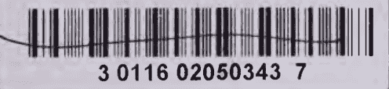
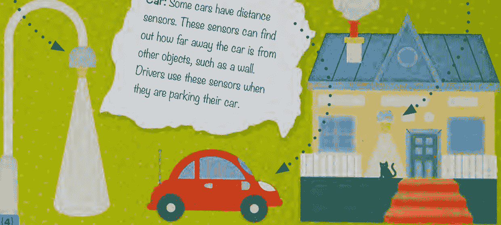
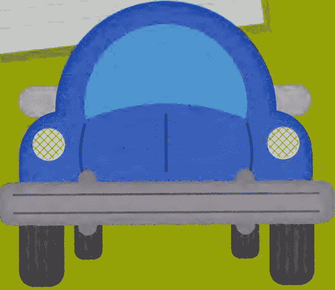
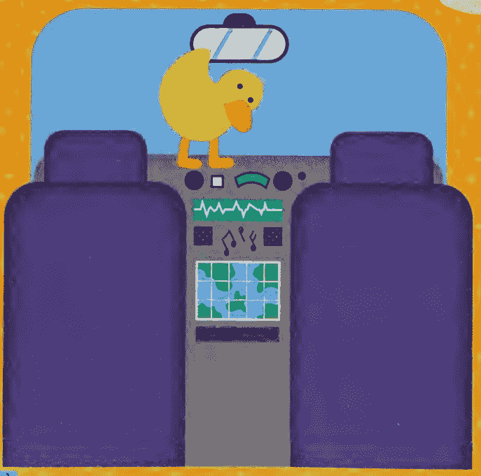
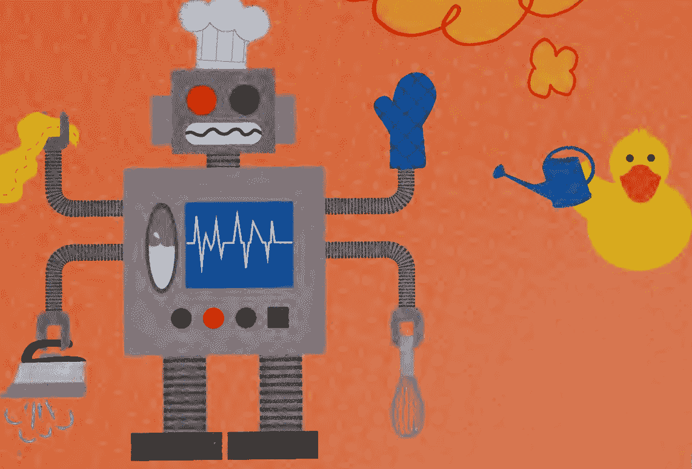
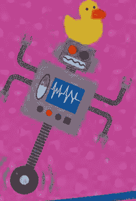
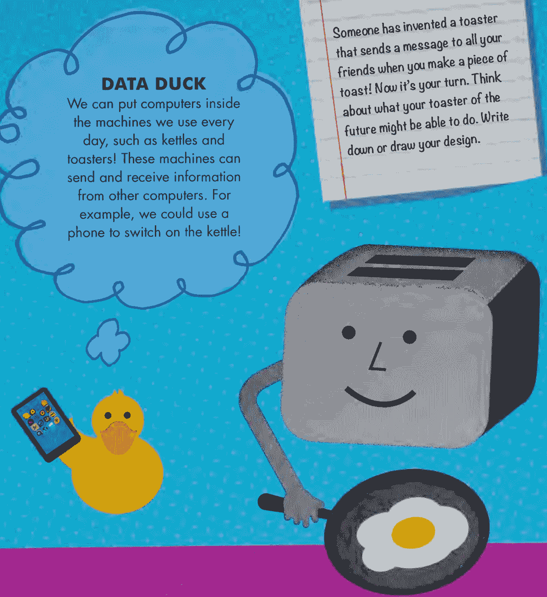

# 现实世界中的编程

**Heather Lyons**




> **注意**：在本书中，大多数活动都需要上网。父母或老师应该监督这一过程，并与孩子讨论网络安全问题。

## 入门

嗨！我是数据小鸭（Data Duck）。我要给你们介绍一下我们周围的电脑。我们并不总是能看到它们，但它们在我们每天的生活中都起着巨大的作用。

在我们周围，有很多电脑控制着机器、车辆、机器人、灯光等许多设备。它们之所以能这样做，是因为它们被编程的方式。当我们为电脑编程时，我们使用代码来告诉它要做什么。

> **数据小鸭**
>
> 代码是一组我们用来告诉电脑该做什么的指令。在这本书中，我们将使用编程块，就像下面这一个。编程块是我们可以组合在一起的指令，用以为电脑创建代码。
>
> `将高度改变 -10 m`
>
> `播放小鸭子叫声`

书中有很多活动供你尝试。此外，还有一些在线活动供你练习。对于在线活动，请访问 `www.blueshiftcoding.com/kidsgetcoding`，并寻找书中对应页码的活动。

## 日常电脑

你知道吗？电脑不仅在我们的家里和学校里。它们几乎一直都在我们身边。电脑控制着路灯、我们的汽车，以及家里周围的灯光和报警器等设备。

在我们周围的许多电脑都包含一种被称为“传感器”的东西。传感器可以感知周围的某些事物。有些可以测量温度，另一些可以判断光线明暗，还有一些可以感知附近是否有物体。

> **房子**：有些房子外面装有运动传感器。它可以发现晚上是否有人向房子走来，并开启灯。
>
> **汽车**：有些汽车配有距离传感器。这些传感器可以发现汽车与其他物体（如墙壁）之间的距离。司机在停车时会使用这些传感器。



## 灯亮了！

当外面天黑时，有些汽车会自动打开大灯。你能猜出汽车使用哪种传感器来做到这一点吗？

- A. 测量自己与前车距离的传感器。
- B. 测量外面光暗程度的传感器。
- C. 测量外面温度的传感器。

> 翻到第 23 页查看答案。



> **数据小鸭**
>
> 传感器有点像我们的感官！你还记得我们的感官是什么吗？想想三种感官以及它们能做什么。


## 汽车还是电脑？

汽车内部有很多电脑——有些汽车甚至有数百个！这些电脑，或者说处理器，都能确保汽车按照预期的方式工作。

有的电脑控制汽车的加热、速度和灯光。有些电脑可以显示汽车所在区域的地图，而另一些可以播放音乐。有些汽车的电脑非常聪明，它们甚至可以自动驾驶！

> **数据小鸭**
>
> 在汽车中，传感器将发现的信息传递给汽车电脑。这被称为“输入”。然后，电脑将信号传递给汽车的其他部分，告诉它们执行某些任务。这被称为“输出”。



## 加油

司机需要知道汽车什么时候需要加油。查看下方的输入和输出，看看哪些可以判断油箱是否需要加油。

### 输入

- 1. 传感器显示油满了。
- 2. 传感器显示油空了。

### 输出

- 1. 电脑闪烁。
- 2. 电脑播放音乐。
- 3. 电脑开启。


## 交通安全

交通灯保护着我们的安全。它们知道什么时候该停车。交通灯通过传感器来工作，它们知道什么时候该移动。

### 传感器

- 路上有行人。
- 路上有汽车。

### 电脑

- 1. 信号灯红灯。
- 2. 信号灯绿灯。
- 3. 信号灯黄灯。

## 变换

交通灯非常重要。它们通过传感器接收信息，知道什么时候需要变换。

> 翻到第 23 页查看答案。

### 传感器信息

- 1. 汽车在路上。
- 2. 行人在路上。
- 3. 行人在路上。

### 电脑信号

- 1. 红灯。
- 2. 红灯。
- 3. 黄灯。

## 甜蜜蜜的家

家里的电脑让我们保持安全和舒适。它们在房间太冷时开启加热。

- **报警系统**：
  - 1. 传感器发现门打开了。
  - 2. 传感器发现有入侵。
- **烟雾报警器**：
  - 1. 传感器发现家里有烟。
- **自动灯光**：
  - 1. 传感器发现外面黑了。


- **温度调节器**：
  - 1. 传感器发现房间太冷。
  - 2. 传感器发现房间太热。

## 发明吧！

你能为你的家里发明一种什么样的电脑吗？它能做什么？你能想到它可能会用到哪些传感器吗？画出你的发明并解释它的工作原理。

> **数据小鸭**
>
> 还有很多很棒的发明可以帮助家里：房间变脏时扫地的微机器人，以及在正确时间给植物浇水的设备。所有的发明都使用了电脑！



## 购物

当我们去商店时，电脑会记录我们买了什么以及付了多少钱。大多数时候，电脑获取这些信息都是得益于所谓的“条码”。

条码是由许多线条和数字组成的图片。你可以在这本书的背面找到条码。电脑可以通过扫描器的帮助来读取条码。

> **数据小鸭**
>
> 在商店的结账台，客户想要购买的所有物品都会被扫描。条码上的信息从扫描器传递到结账台电脑。然后，电脑会计算所有物品的总金额并在结账台屏幕上显示金额。

## 加法时间

想象你是收银机的计算机。如果扫描仪传了以下信息，你会向收银机屏幕发送多少总金额？

> 请翻到第 23 页查看答案。

| 物品 | 价格 |
| --- | --- |
| 奶酪 | £2 |
| 鱼 | £3 |
| 牛奶 | £1 |
| 面包 | £1 |


在商店收银台，我们使用扫描仪和计算机来告诉我们购物需要支付多少钱。当我们付款时，有时还会使用更多的计算机！

人们可以使用银行卡甚至手机支付费用。他们通过将手机或卡片贴在一个名为“读卡器”的小型机器上来操作。

在感应过程中，信息会在读卡器之间传输，这样资金就会从个人的银行账户转到商店。


> **数据小鸭**
>
> 所有的计算机都需要电池（或电力）才能工作。因此，读卡器向银行卡发送电。这意味着卡片获得了电源，现在可以发送和接收信息了。


## 触碰支付

数据小鸭在商店想买一些 £1.50 的鸡蛋。他把卡片贴在读卡器上，但收到了错误信息和哔哔声。他无法用卡片支付。可能发生了什么？

- A. 他的银行账户只剩 £1。
- B. 机器无法连接到银行。
- C. 他的卡片裂了。
- D. 以上任何情况。

> 请翻到第 23 页查看答案。


飞机、直升机，甚至被称为无人机的小型飞行机器人，都需要传感器和计算机才能飞行。没有它们，这些飞行器甚至无法离地。

最重要的传感器之一是距离传感器，它可以测量飞行器与地面之间的距离。飞行员需要这些信息，以确保飞机不会过早着陆或坠毁。


> **数据小鸭**
>
> 飞行器的传感器将其信息发送给处理器（计算机）。然后处理器将信息传递给仪表盘，飞行员可以在那里读取信息。
>
> 查看下方的代码块，选择哪一个应该放在空白处，以便无人机永远不会飞得太高。
>
> 请翻到第 23 页查看答案。

```
If height over 100 m then
Repeat until height under 100 m
```

```
Play duck call
```

```
Change height by -10 m
```

```
Turn to left
```

## 机器人

机器人被用于许多领域，从制造汽车到移动货物。在机器人内部，计算机连接着传感器和电机。电机让机器人移动。

一种使用传感器和电机移动的机器人被称为巡线机器人。它可以沿着地面上的线条移动。这是因为机器人底部有一个传感器，可以发现线条所在的位置。计算机确保机器人在移动时沿着线条走。



> **数据小鸭**
>
> 我们可以编写这些机器人内部计算机的程序来完成各种神奇的事情。有些机器人可以帮助医生进行手术。有些可以制造汽车，甚至可以打乒乓球！


让我们制造自己的机器人！为了让它工作，我们需要确保我们的机器人拥有输入、处理器和输出。查看下方列表并每项选择一个。你的机器人将能够做什么？

**输入**：

**输出**：

- 1. 安装在手臂上的电机 – 这意味着我们的机器人可以执行按灯等的操作
- 2. 安装在轮子上的电机 – 这意味着我们的机器人可以移动


## 未来

计算机无处不在。它们可以小到我们几乎看不见。它们可以向其他设备发送信息，例如智能手表。它们告诉我们我们睡了多久。

我们可以使用 `e21802b3f4809ba10a603c190aef0236_23_0.png` 显示我们有多快。我们可以使用 `e21802b3f4809ba10a603c190aef0236_23_0.png` 来打开水壶。

## 为未来致敬

有人发明了 `e21802b3f4809ba10a603c190aef0236_24_0.png` 来迎接未来！我们可以在机器内部使用 `e21802b3f4809ba10a603c190aef0236_24_0.png`。我们可以使用 `e21802b3f4809ba10a603c190aef0236_24_0.png` 来填充水箱。

> **数据小鸭**
>
> 我们可以编写这些机器人内部计算机的程序来完成各种神奇的事情。有些机器人可以帮助医生进行手术。有些可以制造汽车，甚至可以打乒乓球！



## 扩展活动

查看下方的代码块，选择哪一个应该放在空白处，以便无人机永远不会飞得太高。

> 请翻到第 23 页查看答案。

```
If height over 100 m then
```

```
Play duck call
```

```
Change height by -10 m
```

```
Turn to left
```

## 记忆的单词

| 单词 | 含义 |
| --- | --- |
| code | 指令的排列 |
| dashboard | 飞行员可以读取的面板 |
| input | 输入到计算机的东西 |
| output | 从计算机输出的东西 |
| sensor | 测量的设备 |

- A. 他的银行账户只剩 £1。
- B. 机器无法连接到银行。
- C. 他的卡片裂了。
- D. 以上任何情况。

- A. 机器无法连接到银行。
- B. 他的卡片裂了。
- C. 他的银行账户只剩 £1。
- D. 以上任何情况。

> *(注：由于原文后半部分存在大量重复，以上翻译已按原文出现顺序进行对应处理)*
