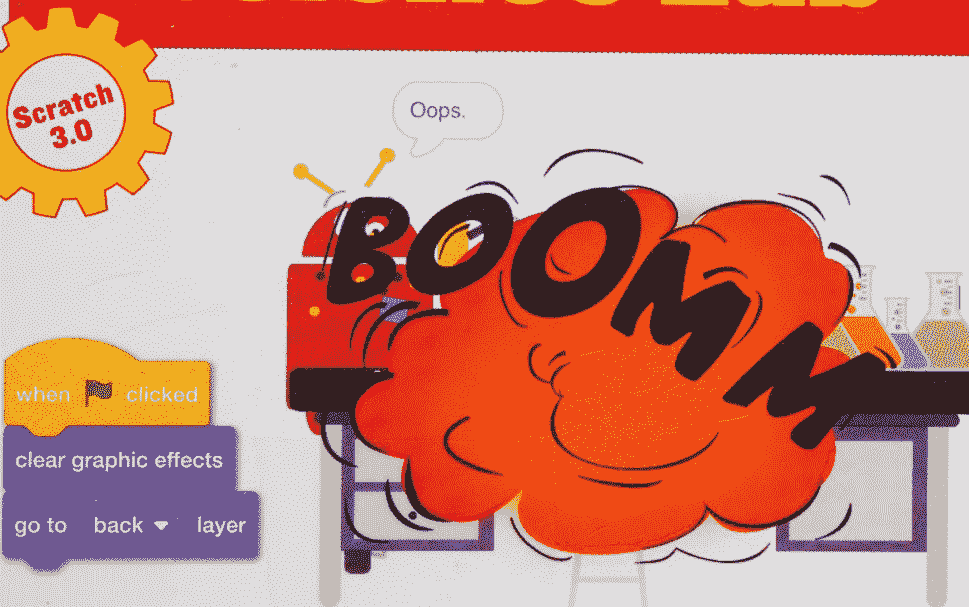
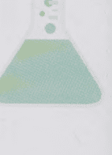
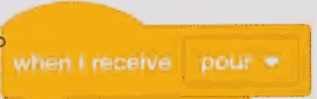
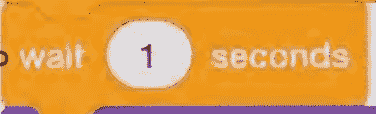
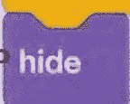
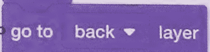
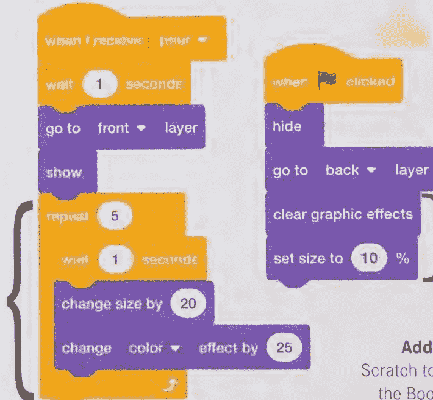
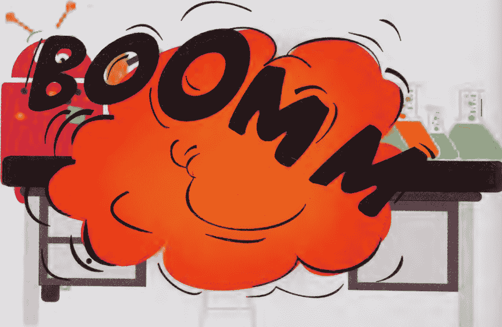

# 科学实验室编程：Scratch 3.0（操作代码）




糟糕。

```
when [flag] clicked
clear graphic effects
go to [back] layer
```


图片鸣谢：©DataBase Center for Life Science (DBCLS)/Wikimedia/Creative Commons Attribution 4.0 International/Changes were made by Cherry Lake Publishing, 4; ©OpenClipart-Vectors/Pixabay, 4, 20; ©UnboxScience/Pixabay, 4, 6, 12, 16, 20; ©DavidRockDesign/Pixabay, 4, 20; 全书各处图片均由 Scratch 提供；音效取自 https://www.zapsplat.com


Cherry Lake Publishing 希望承认 21 世纪学习伙伴关系的工作，该伙伴关系是 Battelle for Kids 的网络。更多信息请访问 http://www.battelleforkids.org/networks/p21。

在美国印刷  
Corporate Graphics

**读者须知：** 使用本书练习你的 Scratch 3 编程技能。如果你从未使用过 Scratch，请让父母、老师或图书管理员帮助你在 *https://scratch.mit.edu* 设置一个账户。阅读网站上的教程以了解 Scratch 的工作原理。然后你就可以准备好进行本书中的活动了！你将练习使用变量、if/then 语句、将代码复制到其他精灵、使用效果改变精灵的外观等等！所有起始和最终程序均可在 *https://scratch.mit.edu/users/CherryLakeCoding* 找到。


## 实验室里的机器人！

Rudy the Robot 在科学实验室里到处乱跑。帮助 Rudy 制造一场大混乱。

要复制我们的起始代码，请访问 https://scratch.mit.edu/projects/319254293。

本项目有五个精灵。实验台和烧杯组是装饰性精灵。我们将使用图层来保持精灵的正确顺序。

### 专业提示！

Scratch 让你可以看到其他人的项目。你甚至可以复制代码使其成为自己的。我们的代码包含本书中将使用的精灵和音效。

程序开始

将绿色烧杯重置到其他精灵前面

将绿色烧杯重置为直立状态

告诉绿色烧杯精灵在做任何事情之前等待 2 秒

将绿色烧杯向右转（“90 度”在 Scratch 中表示“右”）

```
when green flag clicked
```

```
go to front layer
```

```
point in direction 90
```

```
wait 2 seconds
```

```
turn 90 degrees
```



## 倾倒烧杯

Rudy 想混合绿色和黄色烧杯精灵中的液体。

点击绿色烧杯精灵。
添加代码并测试它。你看到绿色烧杯转了吗？

### 专业提示！

测试程序后，你可能需要**重置**你的精灵。这意味着将其放回正确的位置，使其指向正确方向，或确保它在前面（以免其他精灵遮挡它）。图层告诉 Scratch 将哪些精灵放在前面或后面。

我们用三个 30 度的转代替了 turn [90] degrees 运动块。

## 慢下来
那个烧杯！

绿色烧杯在移动，但看起来不像是在倾倒。让我们通过编码三次小转，每次 30 度，使其转动。绿色烧杯仍会转动 90 度，因为 30 + 30 + 30 = 90。这意味着绿色烧杯最终会在同一位置，但动画看起来会更好。

### 专业提示！

当我们使用 repeat 命令块时，我们就在制作一个循环。循环是一组重复的计算机代码。循环是编码者使用更少块并在构建程序时节省时间的一种方式。

```
when flag clicked

go to front layer

point in direction 90

wait 2 seconds

repeat 3
  turn 30 degrees
end

broadcast pour
```

## 发送信号

让我们在绿色烧杯精灵被倒入时改变黄色烧杯精灵的颜色。

一种方法是让绿色烧杯精灵发送一个特殊的信号，称为广播。你可以在事件类别中找到该块。

点击“message1。”选择“New message。”将其命名为“pour。”

### 专业提示！

广播对观众不可见。它们是不可见的，或无法看到的。消息广播后，可以被其他精灵接收。

告诉绿色烧杯精灵广播“pour”

将黄色烧杯精灵的颜色效果改变 25%

程序开始

重置黄色烧杯精灵的外观

确保黄色烧杯精灵永远不会出现在稍后将编码的 Boom 精灵前面

```
when I receive pour
```

```
change color effect by 25
```

```
when flag clicked
```

```
clear graphic effects
```

```
go to back layer
```

告诉 Scratch Boom 精灵应在广播“pour”时出现



告诉 Boom 精灵在“pour”广播后等待 1 秒再出现



使 Boom 精灵出现在所有精灵前面


使 Boom 精灵出现


重置程序


隐藏 Boom 精灵



将 Boom 精灵移至所有图层之后



## 人工智能概述

人工智能（Artificial Intelligence，简称 AI）是研究、开发用于模拟、延伸和扩展人的智能的理论、方法、技术及应用系统的一门新的技术科学。人工智能是计算机科学的一个分支，它企图了解智能的实质，并生产出一种新的能以人类智能相似的方式做出反应的智能机器。

该领域的研究包括机器人、语言识别、图像识别、自然语言处理和专家系统等。人工智能从诞生以来，理论和技术日益成熟，应用领域也不断扩大，可以设想，未来人工智能带来的科技产品，将会是人类智慧的容器。

人工智能可以对人的意识、思维的信息过程的模拟。人工智能不是人的智能，但能像人那样思考、也可能超过人的智能。

- 人工智能的研究方向
- 机器学习
- 深度学习
- 自然语言处理
- 计算机视觉

人工智能是一门极富挑战性的科学，从事这项工作的人必须懂得计算机知识、心理学和哲学。人工智能是包括十分广泛的科学，它由不同的领域组成，如机器学习、计算机视觉等等，总的说来，人工智能研究的一个主要目标是使机器能够胜任一些通常需要人类智能才能完成的复杂工作。


Added: Tells the Boom sprite to wait 1 second before getting bigger and changing colors. This pattern will repeat five times.

Added: Tells Scratch to change the Boom sprite back to its original color. At the beginning, it will start small.



### Making the Explosion Grow

The code works … but the **explosion** doesn't have much pizzazz. What if the Boom sprite started small, then it got bigger and changed colors?

Click on the Boom sprite and add the code shown here. This will give you more practice with the *repeat*, *wait*, and *change color effect* blocks. Then test your code at least twice.

### Pro Tip!

"Color" is just one way to use the *change effect* looks block. You can also try "fisheye," "whirl," "pixelate," "ghost," and more!

### Adding Sound

What’s an explosion without sound? Let’s add some!

We **uploaded** a **custom** sound called “boom sound.” In your Boom sprite code, add [play sound boom sound]. You can find this block in the Sounds category.

Code this block in different places. What happens if you put it inside the repeat Control block?

### Pro Tip!

Ask an adult to help you explore Scratch’s many sound tools at https://en.scratch-wiki.info/wiki/Sound. You can record your own sound, edit how much sound you use, use Scratch's sounds, and more.

Oops.



## Glossary

animation (an-uh-MAY-shuhn) a way of using a series of pictures to create the appearance of movement

beakers (BEE-kurz) special glass containers used in science labs

chaos (KAY-ahs) complete and usually noisy disorder

custom (KUHS-tuhm) unique or one-of-a-kind

decorative (DEK-ur-uh-tiv) something that is just to look at

explosion (ik-SPLOH-zhuhn) when something blows up or splits apart into many pieces

lab bench (LAB BENCH) worktable in a science lab

layers (LAY-urz) ways of talking about which sprites are on top of each other

reset (ree-SET) to put things back the way they were at the beginning

sprites (SPRYTS) characters or objects in Scratch

uploaded (UHP-lohd-id) copied a file from your computer to Scratch, the Web, or another software

## Find Out More

### Books

LEAD Project. *Super Scratch Programming Adventure!*
San Francisco, California: No Starch Press, 2019.

Lovett, Amber. *Coding with Blockly.* Ann Arbor, Michigan:
Cherry Lake Publishing, 2017.

### Websites

#### Scratch

http://scratch.mit.edu
Build your Scratch code online at this site.

#### Scratch Wiki

https://en.scratch-wiki.info
If you get stuck, ask an adult to help you look on this site for advice.

## Index

- animation, 9
- backdrop, 15
- Boom sprite, 12, 14, 15, 16, 17, 19
- broadcast signal, 11, 12–13, 14, 15
- *change color effect* Control block, 11, 12–13, 16, 17
- *clear graphics effects* Looks block, 12–13
- Control block, 9, 16, 17, 19
- Events, 11
- explosion, 15, 17, 19
- *fisheye* Looks block, 17
- *ghost* Looks block, 17
- go to Looks block, 12
- layers, 5, 7
- Looks block, 12, 13, 17
- loops, 9
- Motion block, 6, 8–9
- *pixelate* Looks block, 17
- *point in direction* Motion block, 6
- pouring, 9, 11, 12–13, 14, 15
- *repeat* Control block, 9, 16, 17, 19
- resetting, 6–7, 14, 15
- sound, 5, 19
- sprites, 5, 15
- resetting, 6–7
- testing, 13, 15
- *turn* Motion block, 8–9
- *wait* Control block, 6, 17
- whirl, 17

## About the Authors

Kristin Fontichiaro teaches at the University of Michigan School of Information. She likes working with kids on creative projects from coding to sewing to junk box inventions. She has written or edited almost 100 books for kids.

Colleen van Lent teaches coding and Web design at the University of Michigan School of Information. She has three cool kids and a dog named Bacon. She wishes she could touch her toes.

## Learn to code with Scratch 3.0!

Scratch is a simple block-based programming language designed to teach you the basics of coding. You’ll learn about sequencing, conditionals, coordinates, and more. Code an interactive story, game, or animation and share your work with others. This series will help you improve and gain the necessary skills that will get you coding in no time. Get ready to think creatively and problem solve. What will you code?

## Read all of the Operation Code books

- Coding in the Cafeteria
- Coding in the City
- Coding at the Grocery Store
- Coding Onstage
- Coding on the Playground
- Coding in the Science Lab
- Coding at the Water Park
- Coding at the Zoo

