# 在学校里编程 (Blastoff! Readers, Level 2：编程无处不在)

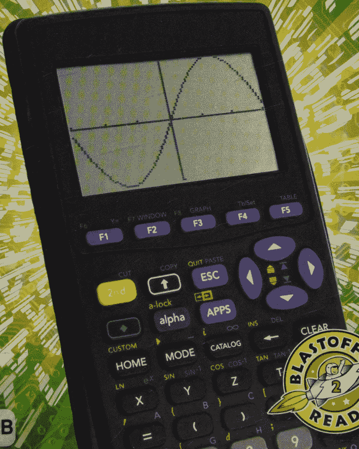

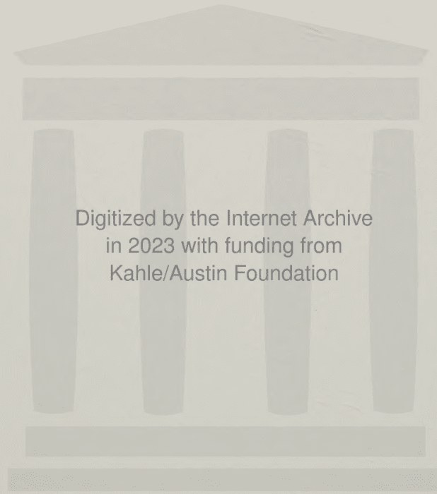

伊丽莎白·诺尔（Elizabeth Noll）著

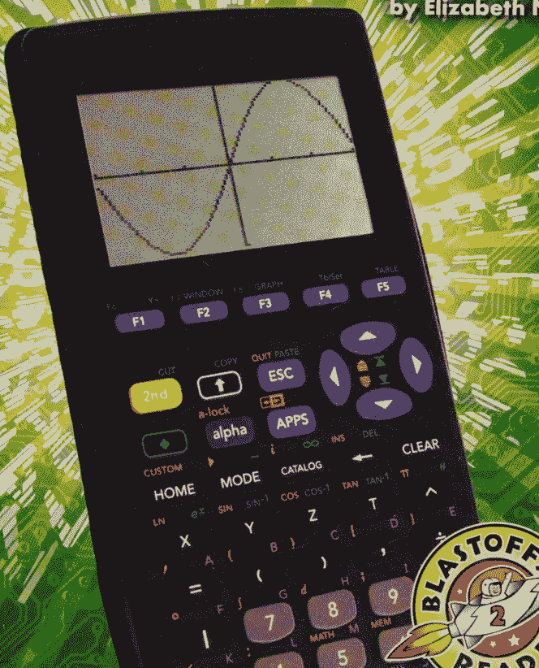

## 起飞！读者

致图书员、老师和家长的说明：
《起飞！读者》由素养专家精心编写，将基于标准的内容与符合发展阶段的文本相结合。

第1级通过重复高频词、简练文本、可预测的句式和强有视觉支持提供最大的帮助。

第2级通过多样的简单句子、增加文本量以及减少对高频词的重复，为早期读者提供更多挑战。

第3级通过增加文本和概念量、减少对视觉效果的依赖、更长的句子和更具文学性的语言，引导早期流利读者向流利迈进。

第4级通过每页更多的文本、增加标点符号的使用、句式的更多变化以及愈发具挑战性的词汇来建立阅读持久。

第5级通过提供更多文本、多样的风格和不熟悉的话题，鼓励孩子从“学习阅读”转向“通过阅读学习”。

无论哪本书最适合你的读者，《起飞！读者》都是建立信心和鼓励终身热爱阅读的完美读物！

平板电脑

你的学校里电脑在哪里？你有媒体中心吗？你使用平板电脑吗？

### 电脑无处不在！

### 电脑是如何工作的？它们遵循被称为“代码”的指令。

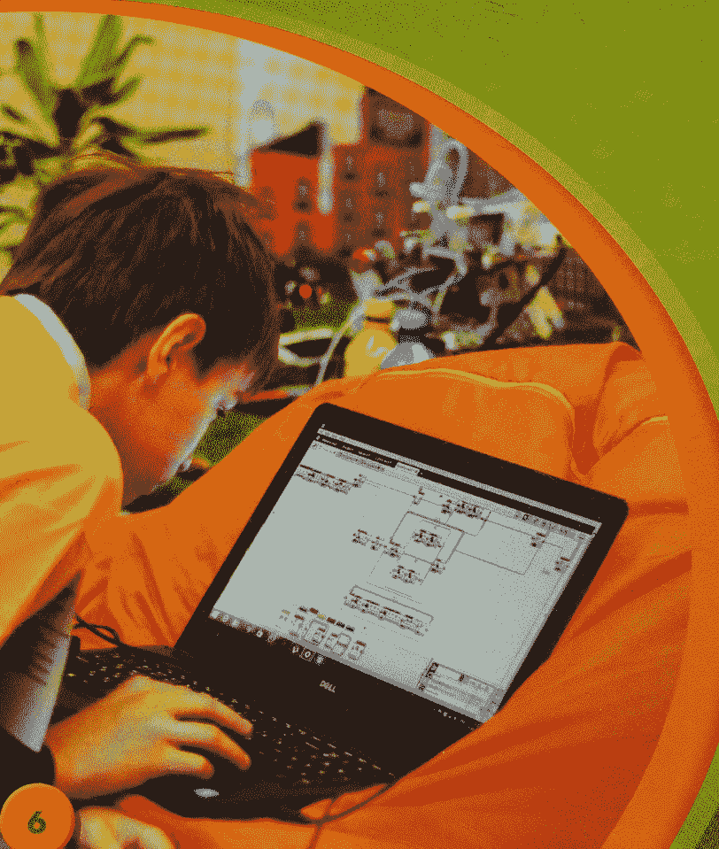

代码指导着电脑上的一切。人们用特殊的编程语言编写代码。

代码指导电脑上的一切。在学校里，网站使用代码。

代码指导电脑上的一切。在学校里，网站使用代码。

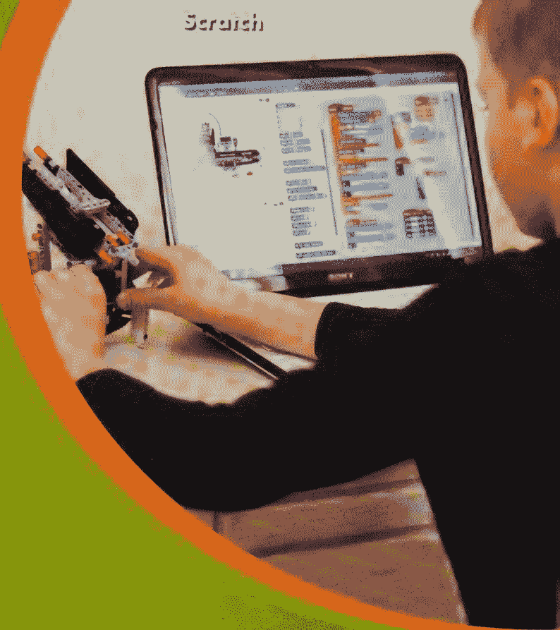

代码指导电脑上的一切。在学校里，网站使用代码。

使用代码。

代码指导电脑上的一切。在学校里，网站使用代码。计算器使用代码。

代码指导电脑上的一切。在学校里，网站使用代码。

器。。

imgimg/b100446633366570522449221_11_0.png)

### 学校的历史的历史

在学校里编程的历史

在 70 年代和 80 年代，电脑变得更小、更强大。学校里有电脑室。现在，大多数学校都有电脑。使用电子板电脑。

### 编程在你的学校里是如何工作的？

代码指导电脑上的一切。

代码指导电脑上的一切。在学校里，网站使用代码。

代码指导电脑上的一切。在学校里，网站使用代码。

代码指导电脑上的一切。在学校里，网站使用代码。

### 借阅一本书

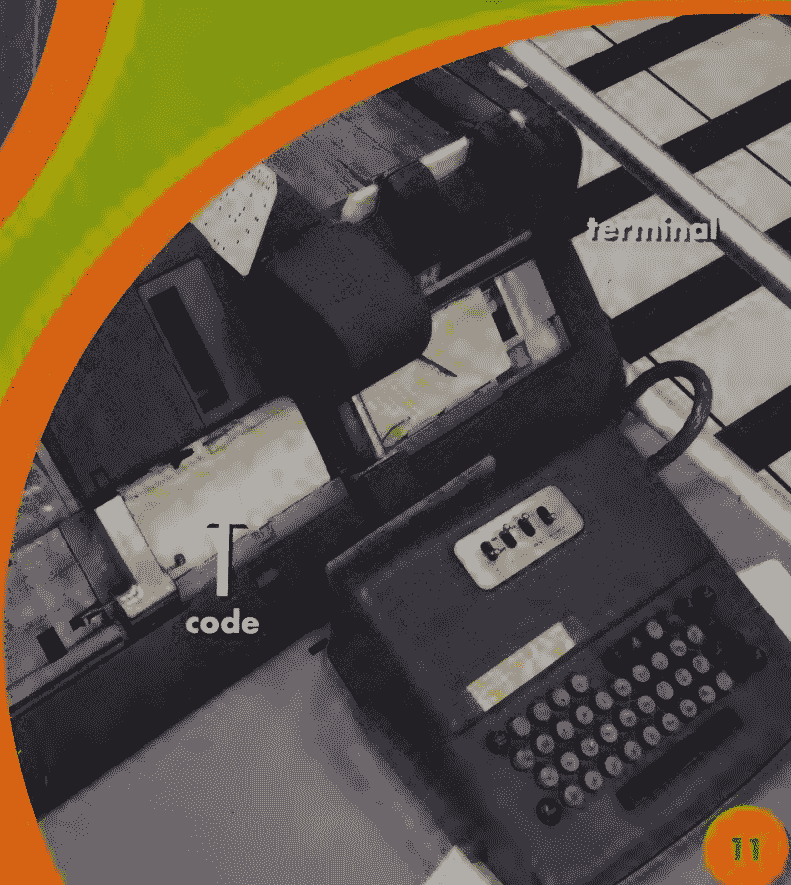

借阅一本书

在书架上查找。

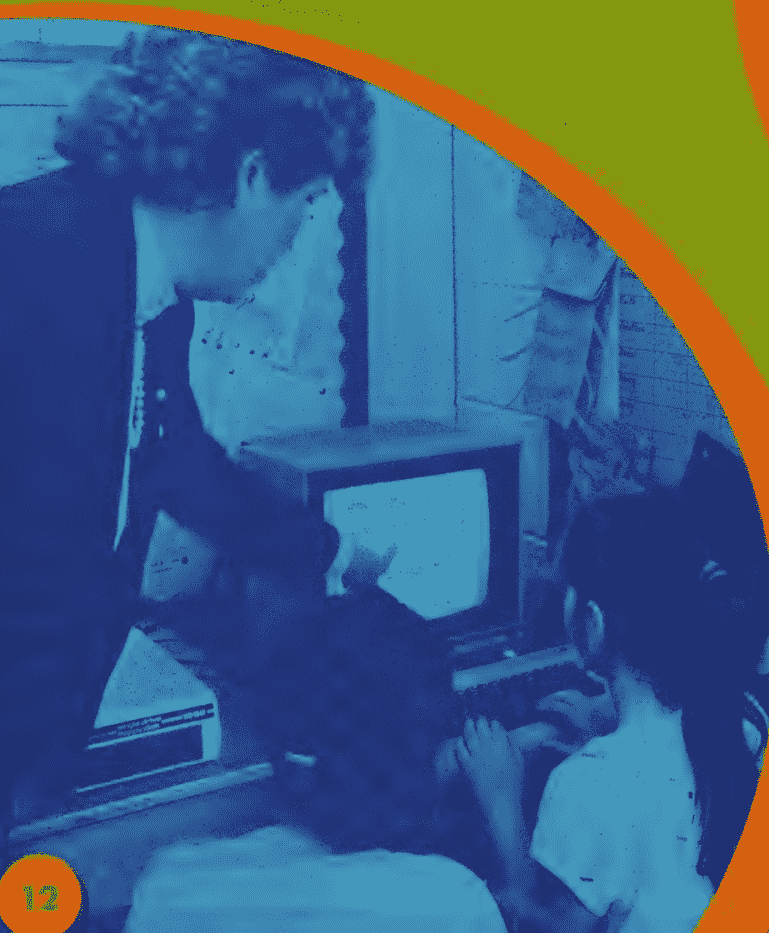

在书架上查找。

## 新技术让孩子学习变得更简单。

新技术让孩子学习变得更简单。

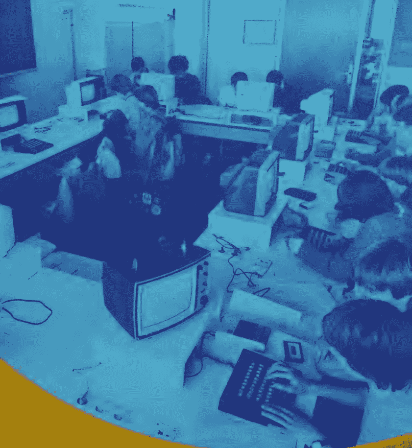

## 词汇表

词汇表

## 了解更多

## 了解更多

### 代码无处不在
第 2 级：早期

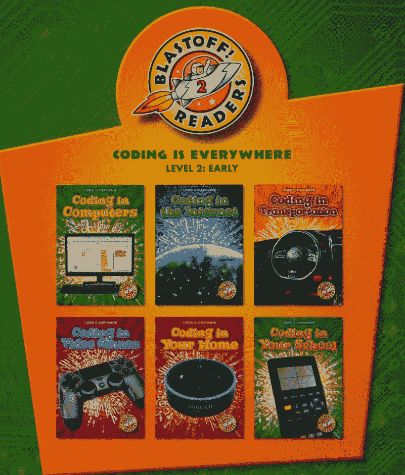
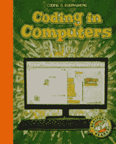
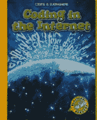
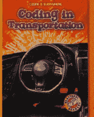

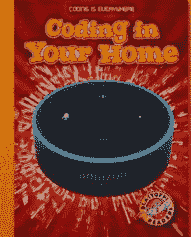
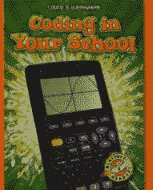

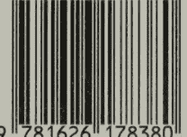

