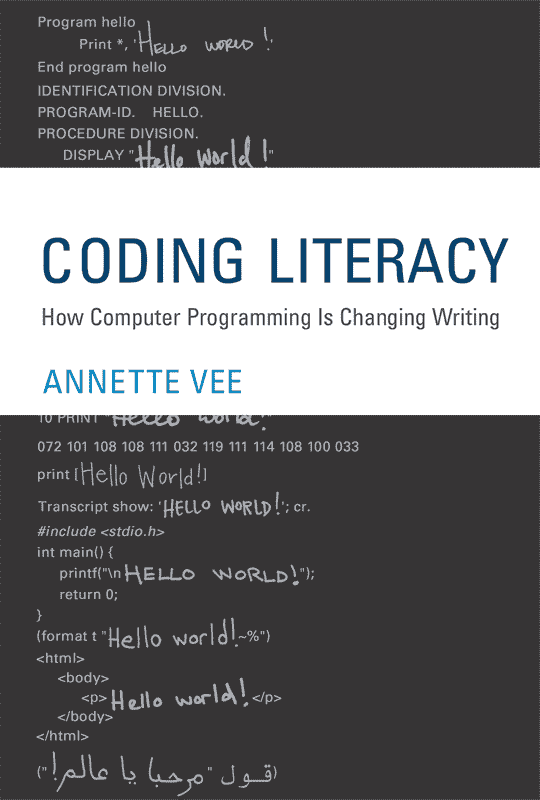
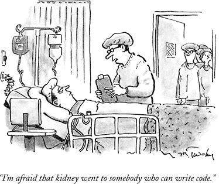
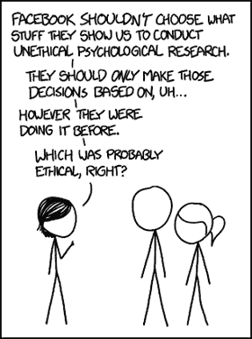
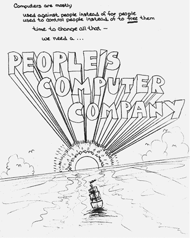
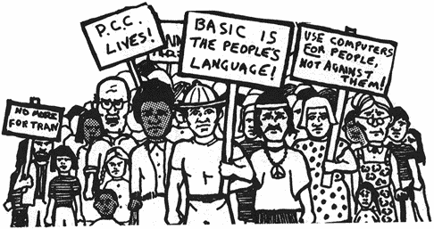
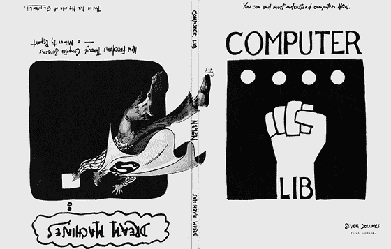
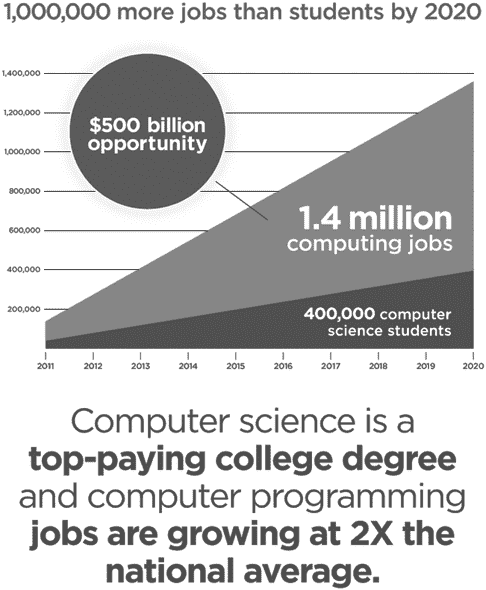
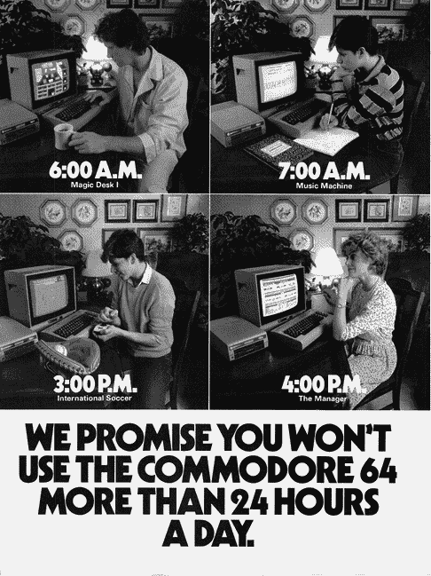
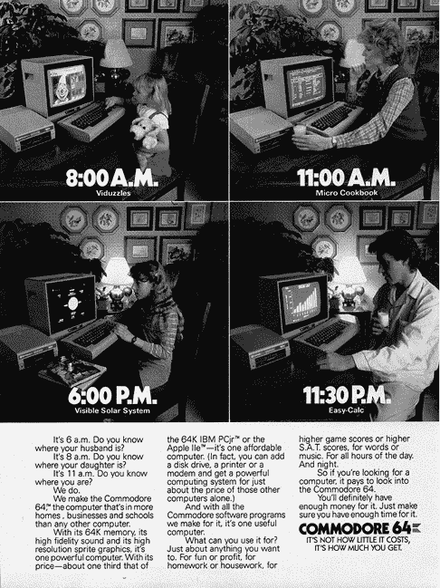
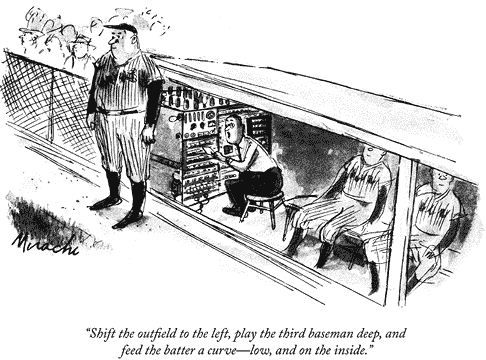

# 编程素养：计算机编程如何改变写作（软件研究）



© 2017 马萨诸塞州理工学院

版权所有。未经出版者书面许可，不得以任何形式的电子或机械手段（包括复印、录制或信息存储与检索）复制此书的任何部分。

本书由 Toppan Best-set Premedia Limited 使用 ITC Stone Serif Std 字体排版。在美国打印并装订。

已有美国国会图书馆编书出版数据。

ISBN: 978-0-262-03624-5

eISBN: `9780262340229`

ePub 版本 1.0

## 系列前言

软件深植于当代生活——无论是经济、文化还是创意领域——以显而易见或隐藏的方式。虽然有很多关于软件如何使用以及它支持和塑造的活动，但对软件本身的思考在很大程度上仍然停留在技术层面。然而，越来越多的艺术家、科学家、工程师、黑客、设计师以及人文和社会科学领域的学者发现，对于他们面临的问题和需要构建的东西，对软件进行扩展理解是必要的。为了这种理解，他们可以利用计算和新媒体历史中的一系列文本，可以参与软件丰富的内涵文化，还可以参与一种新兴的、根本性的跨学科的计算素养的发展。这些构成了软件研究的基础。

软件研究利用并开发文化、理论和实践导向的方法，对软件的对象和过程进行批判性、历史性和实验性的描述（并对其进行干预）。该领域参与并贡献了计算机科学家的研究、软件设计师和工程师的工作以及软件艺术家的创作。它追踪软件如何实质整合到当代文化和社会过程中，围绕其与算法和形式描述及行动的接近程度，重新构建过程、思想、制度和文化对象。软件研究提出了计算文化的历史，并利用计算的知识资源对其纠缠和可能性进行反思性思考。这既出现在人文和社会科学的学术模式中，也体现在计算机科学、艺术和设计的软件创作/研究模式中。

软件研究丛书由麻省理工学院出版，旨在为这一批判性和实验性的领域出版最佳新作品，该领域在文化和技术上都具有素养，反映了当今软件文化的现实。

## 致谢

像所有的专著一样，这本书并非一个人的项目。在它成型的这十年里，我得到了许多人的帮助和资金资助。这本书源于我的博士论文，那篇论文曾由威斯康星大学麦迪逊分校的`Deborah Brandt`教授指导。通过她的关怀、幽默、温柔而精准的批评以及无懈不扣的支持，`Deb`对我来说一直是研究者、教师、作家和人的榜样（在许多其他人中也是如此）。在考虑任何职业决策时，我经常会问自己："如果是 Deb 会怎么做？"然后我就知道了方向在哪里。我关于写作教学的 90% 知识都是来自威斯康星大学麦迪逊分校的写作中心和 Brad Hughes，他在行政和教学中带来了智力上的严谨和细致的研究，并拥有一种超能力，能够同时应对百项任务和数千名学生，同时让周围的每个人都感到聪明且优秀。David Fleming 让我意识到我处于正确的领域并做着正确的工作。Kurt Squire 和 Greg Downey 向我介绍了我专业领域之外的资源，即使在我还是研究生时，他们也把我当同事对待。Mike Bernard-Donals 在我第一门研究生课程上忍受了我这个外来人，并全程支持我完成了论文答辩。他那富有帮助的怀疑态度加强了我的工作；当他说准备好了时，我知道它终于准备好了。

我在威斯康星大学的同学对这本书的实质和风格也至关重要，特别是`Kate Vieira`、`Tim Laquintano`、`Scot Barnett`、`Rik Hunter`和`Adam Koehler`。`Tim`、`Rik`、`Scot`和我一起学习数字素养研究和技术。自 2004 年以来，Kate 一直是我好朋友和指路灯；没有她，我可能无法进入写作领域，也无法完成论文，我的研究生经历无疑会更加枯燥暗淡。`Corey Mead`、`Alice Robison (Daer)`、`Stephanie Kerschbaum`、`Mira Shimabukuro`、`Eric Pritchard`、`Maria Bibbs`、`Chissy Stephenson`和`Mike Shapiro`都是优秀的同伴。`Kate`和`Tim`读了这本书和我其他作品的无数早期草稿。他们无处可见。`Mike Shapiro`对本书初稿的严厉指正帮助我理清了思路和语言。我希望所有研究生都能像我在威斯康星大学那样拥有一群同伴群体。

我很幸运在匹兹堡大学拥有优秀且慷慨的同事。`Ryan McDermott`帮助我寻找额外的来源，并核实了我关于中世纪素养的论点。`Steve Carr`对这本书的文章版本提供了有用的意见。`Jean Ferguson Carr`一直是我慷慨、鼓人心且敏锐的导师，为本书的完成扫清了道路。`Johnny Twyning`和`Don Bialostosky`是我系里支持我的系主任，他们付出了额外的努力支持。`Alison Langmead`是一位出色的合作者，从她身上学到的东西至少不比我们的学生多。匹兹堡的研究生是最好的：我有幸主持过充满他们创意点想法的研讨会。我特别感谢`Kerry Banazek`，她不仅是一个强大且才华的人，愿意担任我的导师并给予我机会，还帮助我校对了了这本书。`Lauren Rae Hall`和`Lauren Campbell`，我在这里引用了你们两位，但我无法列出从你们身上学到的所有知识。我受益于匹兹堡大学的研究假，更重要的是，我的两个孩子出生时休的产假。衷心感谢那些行政人员和其他女性，她们为我铺平道路，让我享受陪伴孩子的特权，同时又不边缘化我的研究或职业，尤其是`Jean Ferguson Carr`、`Phil Smith`和`Jim Knapp`。我希望所有父母，尤其是母亲都能拥有这一权利。

写作与修辞（我认为我的主场）是一个美丽的地方。这里有像`Jim Brown`这样的人，他是好朋友和合作伙伴；`Doug Eyman`，他是数字修辞和出版领域的导师，也是乐助、幽默的导师；`Cheryl Ball`，她全能；`Gail Hawisher`和`Cindy Selfe`，她们铺平了道路；`Brian Ballantine`、`Alanna Frost`和`Suzanne Blum Malley`让会议变得有趣得多；`Christina Haas`和`Elizabeth Losh`都对我的工作提出了明智且具批判性的意见；`Alexandria Lockett`直言不讳地指出问题并激励我做得更好；`Chris Lindgren`将编码和素养的理念付诸实践，并让我结识了优秀的人……还有许多其他人。感谢你们让写作/修辞领域感觉像家一样。

还要感谢我在这个学术小角落之外遇到的人，他们通过接受采访、聘用我或仅仅是因为他们的出色，帮助了这本书的形成。`Kenn Hoekstra`在`Raven Software`给了我一个机会，并教了我足够的 IT 知识，让我（重新）开始了一条被我放弃的道路。`Greg Barr`也亲手手拉着我，带我度过了艰难的学习阶段。`Roxanne Prichard`是一个坚定的同伴，在我需要时帮助我脚踏实地并雇用了我。`Ruth Benca`总是信任我在她的实验室工作，并教我如何成为一名强大的行政人员和倡导者。我与`Libbey White`以及`Why the Lucky Stiff`的短暂合作让我觉得我的工作很重要。数字媒体是我的第二个家，包含了像`Matthew Kirschenbaum`、`Jentery Sayers`、`Wendy Hui Kyong Chun`和`Stephen Ramsay`这样优秀的人，他们一直都是我工作的友好推广者。此处引用的`Mike Silbersack`是在项目成型期间，慷慨抽时间接受我采访的十几个程序员之一。我感谢他们的时间和想法，这些在书中处处可见。

感谢`Doug Sery`和麻理工学院（MIT Press）`Software Studies`系列的编辑们，将这本书放在了我一直希望的位置。匿名审稿人非常有帮助地提供了需要完善和删减的点。`Susan Buckley`和`Katherine Almeida`以敏锐的注意力和效率引导了本书，`Richard Evans`专业地准备了索引，并耐心教了我这一过程。这本书的部分早期版本散落在书中，已发表在 *Literacy in Composition Studies*，感谢他们对我工作的慷慨许可和传播。关于编程作为素养的论点的摘要发表在《The Routledge Companion to Media Studies and Digital Humanities》中的"Programming as Literacy"，由`Jentery Sayers`编（预计 2017 年出版）。匹兹堡大学的`Richard D. and Mary Jane Edwards Endowed Publication Fund`资助了插表复制和索引费用。匹兹堡大学的夏季资助和研究假也帮助我完成了这本书。

最后，最重要的是，我要感谢我的家人，包括许多支持并资助我教育的父母——`Joyce`、`Steve`、`Joy`、`Jeff`和`Bill`，他们耐心等待我找到职业。我确定他们和我一样惊讶，但他们足够慷慨保持沉默。我很自豪能为女性母们的教育成就添上自己的一砖，那些我的祖母和母亲总是告诉我的，我也将告诉我的孩子。感谢`Eleanor`和`Willoughby`，他们推迟了这本书的出版，但使其变得值得。最后，感谢`Nathan`，他的陪伴是这本书最初的灵感来源，并一直支持直到完成。

编程素养运动正进行得火如荼。`Codecademy.org`和`Code.org`等网站已将全民教授计算机编程视为其核心使命。`Code.org`不仅拥有 Facebook 创始人马克·扎克伯格和微软创始人比尔·盖茨的支持，还说服了当时的美国众员埃里克·坎托和美国总统巴拉克·奥巴马录制视频短片，推广"全民编码"的议程。（奥巴马总统在推广`Code.org`的`Hour of Code`倡议时，被称为"首席编码员"。）纽约市长比尔·德·布莱森认为，"有太多的学生在学习打字，而他们本应该在学习编程。"关于"每个人"学习编程的优处，不仅在`Reddit.com`的技术论坛上引发讨论，在国家公共广播电台以及《南方信斯》杂志和《纽约时报》上也存在争议。Google 为`Made with Code`计划捐赠 5000 万美元，旨在鼓励女性编程。MIT 的`Scratch`社区和语言、`codeSpark`的游戏`The Foos`以及可编程机器人`Dot`和`Dash`均旨在教儿童编程。编程甚至进入了孩子在识字之前的学前课程。`Raspberry Pi`、`LilyPad Arduinos`以及其他物理计算工具将编程带入了可穿戴技术和其他物理应用。为了强调计算机编程的普遍性和重要性，编程的宣传材料经常引用"素养"的概念，并将阅读和编写代码与阅读和编写文本进行类比。他们指出，尽管代码技术现在无处不在，但阅读和编写代码的能力并非如此。



[图 1] 根据这张 2015 年的《纽约客潮流》漫画，会编程的人比其他人更有价值。Mike Twohy，《纽约客潮流》，2015 年 6 月 25 日。经康泰纳斯集团许可转载。

### 将计算机编程称为素养意味着什么？

自 19 世纪后期以来，阅读一直作为"素养"这一术语被推广为一种道德良。这种道德良性的传统延续到了关于阅读和写作的公共辩论中，这在关于教育和文盲的文章中观察到的周期性道德恐慌中表现得为明显。以 1975 年《新闻周刊》上一篇臭名昭著的文章《为什么约翰尼不会写字》为典型，这种对学校失败和几代文盲人预示着社会崩溃的恐惧，至少从 19 世纪后期就开始存在了。然而，素养研究表明，美国的素养率并没有下降；相反，我们所认为的素养正在发生。对于素养"是什么"或一个人具备素养需要什么种技能，当代或历史上几乎没有共识。因此，作为一个在道德上良好但未定义的概念，素养可以作为社会所重视的知识的密码。被通俗命名为各种"素养"的各种技能类型反映了社会对必要且良好技能的认知：健康素养、金融素养、文化素养、视觉素养、技术素养等。

然而，所谓的素养反映的不仅仅是大众认知。由于素养具有道德良性的传统，将某物称为素养增加了获取该知识的筹码。缺乏某种通俗认为是素养的知识就是"文盲"。除了与缺失关键类知识相关的实际劣势外，人们还可能因为文盲的"不道德"——即拖累社会——而受到惩罚。金融素养差的人可能不仅无法获得货币资源，还可能无法通过信用检查，从而因为其污名化的身份而被拒绝雇佣。因为素养被认为对国家的地位和财务健康至关重要，文盲意味着是一个生产力较低的公民。因此，将编程——或任何其他事物——称为素养，是通过动员阅读和写作与道德良及经济成功之间长期以来的通俗联系，从而吸引对它的关注和资源，并将编程与国家及其公民的健康联系起来。

但在素养与计算机编程的修辞联系中，还有比实用主义更深的内容。首先，编程与素养相关的想法不仅仅是一种时尚。教育工作者和编程专业人士至少从 1961 年起就建立了写作与编程之间的联系——几乎在计算机在商业和教育上可行后就开始了。计算机编程似乎也与写作有类比，且这种类比超越了它的修辞框架：它是一个社会化的、符号系统，能够实现新的表达方式以及扩大既有通信形式的规模。像写作一样，编程已成为组织信息的根本工具和方法。在世界大部分地区，计算机代码是基础设施：计算机代码层叠在写作技术之上和之下，现在构建了我们的许多现代通信，包括文字处理、电子邮件、万维网、社交网络、数字视频制作和手机技术。我们的就业情况、健康记录和公民身份曾仅以文本形式记录，现在被分类在计算机数据库中。计算的普及化意味着编程正脱出计算机科学的专属领域，渗透到新闻业、生物学、设计等专业领域——并且通过图书馆数据库和数字人文，甚至渗透到文学和历史的研究。由于每种形式的数字通信最终都构建在计算机代码的平台上，编程似乎比其他被称为"素养"的数字技能更基础，特别是那些仅与使用计算机相关的技能。其他素养和活动建立在编程的基础上，因此我们可以将编程视为一种"平台素养"。编程是一种我们可以在其构建其他活动和知识的素养，就像我们在人类语言的阅读和写作上所做的那样。由于其在信息创建、组织和传播方面的优势，编程实践与阅读和写作具有其他显著的相似性。编程和写作都受到其学习和流传环境的社会影响，并在支持和分发它们的技术的物质层上受到塑造。素养无疑是一个分量很沉的词汇。但在编程的情况下，它似乎也是贴切的。

在本书中，我将计算机编程与素养之间这些持久的联系视为一种邀请，引导我们思考关于两者本质的问题。我们该如何理解计算机编程如何改变我们的实践和交流方式？我们又该如何解释素养中新的模式和技术？正如我在后续章节中所做的那样，追求这些问题将改变我们对编程和素养的理解。从素养的角度看编程，从编程的角度看素养，我提出了两个核心论点：(1) 编程向我们展示了素养在深刻变革时刻的样貌；(2) 人类语言的读写历史和实践，可以为当代编程提供有用的比较背景。

我希望这本书的标题——`Coding Literacy`（编码素养）能够反映上述这两个核心论点。`Coding`（`noun`，名词）是一种素养，而编程是对素养的重新编码（`verb`，动词）。换也就是说，计算机编程正在增强日常生活中重要的、已经多样化的交流技能；由于计算机在所有数字素养中起着核心作用，编程对素养的增强从根本上重构了它。素养变得庞大得多，随着它的增长，它所刻画的关系和实践也发生了变化。当素养包含编码时，我们体验、教学以及运用个人技能、社会范式、交流技术和信息的所有方式都发生了位移。

素养是理解交流与技术之间关系的一种理论上丰富的方式，这部分是因为研究素养的人长期以来苦于人类与处于社会环境的、技术化的符号系统协作意味着什么。但当计算机爱好者在呼吁更广泛的编程教学时援用"素养"一词时，他们通常没有传达出其历史或社会价值。从素养的历史、社会和概念背景来看待编程，有助于帮助我们将计算机编程视为一种重要的交流现象，而不仅仅是另一项新技能或新技术。它也帮助我们理解关于"编码作为一种新素养"的修辞。西尔维亚·斯克纳纳（Sylvia Scribner）认为，我们定义素养的方式不仅仅是一个学术问题。落入其范畴的内容会被落实到大型教育计划，并影响大众对谁是有素养的、谁是不素养的认知。反之，教育塑造了人们对素养如何定义的看法，以及被认为不识字字的人所面临的社会后果。

由于编程正遵循一条与社会中读写相似的轨迹，素养的理论工具帮助我们理解编程身份和实践的历史与未来。虽然阅读曾一度是集体进行的，使得整个家庭或社区可以依赖少数人的能力，但我们现在认为每个人都应该能够阅读。而写作曾是一项具有高技术准入门槛的专业技能——人们需要知道如何准备羊皮纸、制作墨水、维护书写工具或装订书籍——但它现在是所有发达社会成员的预期技能。随着读写变得更加通用化，其用途的多样性超越了它们的行政和宗教起源。作者不需要变得"优秀"——即以特定的、狭隘的、学科方式被定义——也能从他们的素养技能中获益。我们大多数人写作是为了平凡但最终强大的活动：购物清单、博客、日记、职场备忘录和报告、给家人和朋友的信件和短信、同人小说以及遗嘱。人们将他们的素养投入各种用途，其中许多是他们所学习的机构和老师所未曾预料到的。

同样，编程的门槛曾要高得多——需要接入昂贵的主机、培训计划或具备数学或工程背景。但现在，随着无处不在的计算设备和在线免费课程，学习编程变得更容易了。与此同时，代码的用途也多样化了。阅读、修改和编写代码的能力不仅对于高关注度的创意或商业应用有用，而且对于组织个人信息、分析文学、发布创意项目、与政府数据对接，甚至仅仅是参与社会都有用。因此，素养研究可以为编程中交织社会技术因素提供新的视角。它还为编程教学提供了新方法——不将编程视为一种解决问题的工具，而是将其视为写作的一个物种。将编程视为素养可能帮助我们为一个可能的未来做准备，即用计算机代码编写符号化和交流文本的能力将变得普及。


将编程视为书面交流的思考，也促使我们正视素养正在发生的方式。素养研究领域现在已接受了大量与视频游戏、音视频合成、网络写作以及许多其他领域、体裁和实践相关的数字素养。然而，这些多种素养通常呈现为原子化的——在不断扩张的数字和全球交流领域中不断增殖并相互碰撞。孤立来看，其多样性让我们目不暇接。哪些素养是持久的，哪些是与可能过时的特定技术绑定的？我们如何在教育计划和我们自身的修养中从这些素养中选择？更仔细的观察表明它们完全并不分离：数字素养作为一个复杂的生态系统在运行。综合来看，所有数字素养的共同点是计算机编程。作为当代写作的基本条件，编程是这些反应发生的基质；它是它们被构建的平台。关注编程让我们更完整地看到这种数字素养的生态系统。我们无需对转瞬即逝的技术赋予长期意义，就可以考虑现在加入各种其他读写工具行列的计算型、可编程设备。由于编程现在揭示了构成当代素养的新型社会实践和技术，它可以向我们展示在深刻变革时刻，一个复杂的素养生态系统的样貌。

为了说明编程如何成为素养的一部分，我在本书中经常使用`coding`（编码）这一口语化术语。`programming`（编程）与`coding`之间的差异存在激烈争论，但这两个词之间并没有明确的界限，它们可以互为同义词。每个术语在关于编程当代用途和相关性的对话中，都涉及到不同的利益相关者——以及不同的利益。

`coding`回响了“学习编码”运动的流行修辞，并标志着编程正在脱离一种职业身份。`Programmer`（程序员）是职位名称中更标准的术语，但`coding`与那些试图让这项实践更时髦的年轻公司相关（例如招聘“忍者编码员”的广告）。`code`一词的简洁性非常有利于宣传——或者更短的 URL，如`Code.org`的案例。

`Scripting`（脚本编写）是有时出现在其中的第三个术语，它可以指的是不需要编译的、特定于某个软件套件、或将更广泛的代码库和函数连接在一起的简单编程。但随着`JavaScript`、`ActionScript`或`TypeScript`等所谓脚本语言的进一步发展，该术语已经褪去了它的技术特殊性，转而获得了一种修辞上的共鸣。`Scripting`现在可以指更简单的代码或库组合，也可以用来贬指那些似乎并不懂编程的人；例如，那些编写恶意或错误代码并在互联网上不加区分地传播的“脚本小子”（script kiddies）。

在通常指代为计算机编写代码这一实践的三个术语中，`coding`最符合本书的重点，因为它让编程面向了更广泛的人群。当我指的是基础行为和概念时，我通常使用`programming`一词；当我讨论为计算机编写代码的更具政治和社会性的方面时，则使用`coding`。不可避免，两者之间存在重叠。

## 语言与素养

正如这场关于术语的辩论所示，当我们谈论计算机编程时，语言至关重要。我们对编程的理解随着我们选择的词汇和视角而改变。当人们用`literacy`（素养）来指代编程时，通常表明他们想要鼓励或强调编程成为一种更被大众持有且通用的技能的现象。

我们使用的词汇可以指示文化思想，这是雷蒙德·威廉姆斯（Raymond Williams）“关键词”项目的核心，该项目并非寻求定义术语或固定术语，而是通过修辞手段对它们进行制图：追踪它们历史、利益相关者，以及动态的文化和社会地理。通过将素养描绘为编程中一个广泛传播的术语进行制图（正如我在第一章中所做的那样），我们可以从全新的角度看待编程的历史和文化意义。

我们可以提出由素养引发的编程问题：谁在编程，谁可以自称为程序员？编程是如何被学习和资助的？编程是如何被使用的？技术和社会因素在编程中是如何交织的？同样，珍特·阿巴特（Janet Abbate）认为，计算机如何被“投射”（cast）——例如，被视为计算器、打字机或精密工程设备——会影响我们认为的它的理想用户。例如，阿巴特观察到，将计算比作数学的隐喻比工程比喻让女性更容易接触：女性在数学专业中占有优势，并且有计算的历史，而她们很大程度上被排斥在工程领域之外。

将素养视为一个“关键词”不仅索引了计算的用户和用途；它还揭示了作为素养的广泛编程教育计划与计算机科学更狭的学科关注点之间的矛盾。我的方法表明，由于编程对于我们现在所说和所做的一切都是如此基础性的，将它交给计算机科学，就像将写作交给英语系或其他语言部门一样。

## 素养中的社会因素

通过素养的角度来看`coding`，调动了我们几十年来在学习素养所涉及的社会因素研究中获得的洞察，帮助我们解释谁在编程、他们是如何做的，以及他们为什么要学习。尽管早期的素养研究将读写能力归功于有组织的政府、西方文化的精髓以及人类智力的巨大飞跃，但自 20 世纪 80 年代以来的研究要谨慎得多，并将素养的技术和认知成就置于社会背景中。结果是，关于书写系统如何被个人、文化和国家学习、传播和使用，得到了更加复杂的画面。

新素养研究（New Literacy Studies）是一种出现于 20 世纪 80 年代的素养社会文化方法，他们发现社会因素对于我们理解素养是什么、谁可以接触它以及什么算有效的素养至关重要。在布莱恩·街（Brian Street）的素养“意识形态模型”中，一个人在一个语境下获得了素养，在另一个语境下可能并不具备功能素养，因为素养无法脱离其意识形态。正如詹姆斯·保罗·吉（James Paul Gee）指出的，即使是阅读阿司匹林瓶这样基础的任务，也是一种利用特定社会背景获取知识的解释性行为。

希莉·布莱·希斯（Shirley Brice Heath）对素养的经典民族志研究表明，素养学习者看到的使用和重视素养的人会影响他们如何接受它。维多利亚·普塞尔-盖茨（Victoria Purcell-Gates）在她关于低素养循环的工作中证明，在文本缺失和素养被边缘化的环境中长大的孩子，很少能将素养融入他们的生活。正如埃尔斯佩斯·斯塔基（Elspeth Stuckey）所论的，素养甚至可以是一种暴力表现，延续了系统性的压迫。

## 变革性获取

如果我们将`coding`视为素养而非职业，这些来自素养研究的洞察显示了我们必须如何批判性地思考以扩大机会。通过这些对社会背景的洞察，编码素养的概念有助于扩大这种机会，或者如修辞学家亚当·班克斯（Adam Banks）所说，支持对编程的“变革性获取”（transformative access）。对于班克斯来说，变革性获取允许人们改变系统的接口，并从根本上改变决定系统如何运作的代码。改变编程的“界面”可能涉及更广泛的教育。但改变“系统如何运作”将超越对教育的物质获取，进入对该教育中所嵌入的价值观和意识形态的批判性审查。

我绝对不是第一个声称编程能力应该更公平地分布的人。我加入了许多大众话语中的其他人，以及媒体研究和教育领域的其他学者的行列——我已经在第一章中概述了这一学术脉络。计算机编程的公平性，特别是在性别方面，一直是计算机科学教育中无数研究项目和资助计划的目标。

我提出的“编码素养”（coding literacy）概念与某些所谓的“程序化素养”（procedural literacy）、“计算素养”（computational literacy）、“计算思维”（computational thinking）或我过去所说的“程序性”（proceduracy）有关，它与其中大多数概念基本兼容。珍内特·黄（Jeannette Wing）的“计算思维”概念可能是这些术语中影响力最大的一个，它依赖于计算机科学（CS）的原理来描述其能力谱。

对于伊恩·博格斯特（Ian Bogost）来说，“程序化素养意味着具有重新配置概念和规则以理解过程的能力，不仅是在计算机上，而且在泛范围内。”在这个定义中，博格斯特将素养更多于阅读而非写作——是对过程的理解而非对其表征。他将“通过过程进行论证创作”归于“程序修辞”（procedural rhetoric）的概念。对于博格斯特来说，理解数字视频游戏的过程或在游戏中重新组合意义块也可以是程序化素养。虽然我同意游戏可以是理解底层软件过程的窗口，但我认为这种对编程的转向规避了编写代码时强大的社会和历史动态。迈克尔·马特亚斯（Michael Mateas）更具体地关注代码，他处理程序化素养的方法与我最相似。尽管他在讨论程序化素养时关注的是新媒体从业者，但他指出“可以认为，程序化素养是每个人的一种基本能力，是充分参与现代社会所要求的。”我接纳并扩展了马特亚斯这种关于程序化素养的广泛愿景。

安德里亚·迪塞萨（Andrea diSessa）对编程本身有着我同样的关注，他支持素养的社会、认知和物质“支柱”模型与我的编码素养方法相兼容。他提出的“计算素养”术语和概念旨在打破局限的以技能为基础的“计算机素养”一词，强调的是计算的动作而非计算机这一制品。马克·古兹尔（Mark Guzdial）也使用了“计算素养”一词，他长期以来一直是任何人都可以也应该学习计算机编程的倡导者，并和迪塞萨一样，认为编程是计算素养不可或缺的一部分。古兹尔认为，编程提供了一种理想的“描述构想机器的语言”，通过它我们可以学习计算。古兹尔指出，我们用数字学习算术，用书面语言学习诗；同样，我们应该通过最代表计算机过程和潜力的符号来学习计算。

我的方法通常与所有其他方法都兼容；最终，我认为我们讨论的基本上是同一个东西，只是在语言和重点上略有不同。古兹尔和迪塞萨的计算素养具有启发性：我认同他们对这种素养是什么以及应该是什么的描述中的几乎每一个细节——我认为计算机科学之外的领域也应该塑造并教授它。与计算素养一样，编码素养指向的是计算机编程素养的底层机制，而非执行该能力的工具。随着计算深层次地嵌入到数字设备中，编码素养的工具已经超出了我们传统意义上的“计算机”范畴；因此，我们需要一种能够从特定工具中抽象出来的素养概念。在本书中，我经常将计算素养与编码素养并用。我在这里没有使用“计算思维”，因为黄强烈强调其与计算机科学的联系，并且没有使用“素养”一词。我认为这不仅仅关乎思考；还关乎阅读、构建和编写。虽然素养的语言对我的论点很重要，但与其搭配的术语重要性小得多。

对于关于程序化/计算/编码素养的讨论，我带来的是素养方面的专业知识，而不是计算机编程或计算机科学方面的知识。因此，与其关注定义构成编码或计算素养的精确技能，我更关注它们的社会历史、框架和传播。正如我们将在下方看到的，素养的教训告诉我们，对素养的规定总是取决于情况的，因此我并不试图为编码素养定下一个标准。无论如何，敲定编码素养或计算思维在课程或教室中的具体面貌并不是本书的重点。

然而，计算机科学教育者提出了一些很好的模型，这些可以作为我论点的通用启发。这里有一个我喜欢的来自德·拉佐夫斯卡（Ed Lazowska）和大卫·帕特森（David Patterson）的模型，它比大多数提供的细节更具体：

> “计算思维”——问题分析与分解、算法思维、算法表达、抽象、建模、逐步故障隔离——在一个日益广泛的领域处于核心。编程不仅是一项极具价值的技能（尽管它确实如此），它是我们教授计算思维的一种基于探究的方法。

黄对计算思维的描述太长，不便在此引用，但她涵盖了从错误检测、为未来使用做准备、简洁准确地描述系统、了解复杂系统的哪些部分可以黑箱化以及在网页上搜索解决方案的所有内容。这两项对计算思维的规定都依赖于计算机科学课程教授的基础概念，这表明教授这种素养或思维形式的唯一责任应该由计算机科学承担。除此之外，他们的描述对于我们这里的目的是很好的。

我在本书中避开的其他规范包括：哪些语言可能最适合培养编程素养，以及素养技能的层次结构可能是什么。Caitlin Kelleher 和 Randy Pausch 针对初学者的编程分类法是特定语言的极佳资源。更广泛地，Yasmin Kafai 和 Quinn Burke 描述了语言需要“低地板、高天花板、宽墙和开放窗户”。也就是说，一种语言应该具有低入门槛（低地板）、为熟练度的提升提供大量空间（高天花板）、为多样化应用留空间（宽墙），并让人们能够分享他们的内容（开放窗户）。虽然大多数计算素养的描述都避免了对如何实现这些目标的具体讨论，但英国教育部发布了一份法定指南，很好地概述了其计算机课程四个关键阶段的目标：第一阶段涉及编写简单程序并理解算法是什么；第二阶段进入`variables`和错误检测；第三阶段要求学生“设计、使用和评估计算抽象，以对现实世界的问题和物理系统的状态和行为进行建模”；第四阶段侧重于计算机领域的独立和创造性开发。尽管概述或提倡特定的编程素养计划不在本书的讨论范围内，但这些网站和其他网站提供了有帮助的指南。

我在书中对编程素养的方法建立在这些计算模型的基础上，提供了一个基于素养实践和社会历史信息的视角。具有多样化应用的编程愿景不仅影响了哪些身份和背景可能与计算机编程相关，还影响了我们更广泛地理解素养的方式。换句话说，正如编程素养重塑了计算机编程，它也重塑了素养。

## 为计算机科学之外的编程留空间

作为实践的编程与作为学科的计算机科学之间的关系，是当代引入素养的编程运动的核心紧张点，因此其历史需要稍微拆解。尽管编程通常是从计算机科学的角度框架化的，但它早于计算机科学。Donald Knuth（唐纳德）将计算机科学领域追溯到 1959 年，当时计算机协会（ACM）声称：“如果计算机编程要成为计算机研发的重要部分，就必须实现编程从艺术向严谨科学的转变。”编程曾是与计算机进行的肮脏、务实、动手的工作，而学术界的计算机科学家往往希望与数学建立更纯洁的理论上的对等关系。随着编程在 20 世纪 70 年代计算机课程中比数学更加中心，Matti Tedre 认为“许多严肃的学者对将学术计算与编程等同的想法感到反感，因为自 20 世纪 50 年代以来，编程就被誉为一种艺术性的、完全不科学的实践。”Knuth 指出，自 20 世纪 50 年代后期，ACM 一直致力于将计算框为科学而非艺术。在向科学领域移动计算的努力的同时，1968 年的一次会议尝试将工程概念应用于软件，并产生了“软件工程”，Mary Shaw 认为这仍然是一个愿景色彩的术语。

随着企业和专业人士试图将复杂的代码问题转化为可预测和可操作的组件——并提升编程从其在二战期间女性打字员起源的地位——他们试图将其专业化。编程直到 20 世纪 50 年代初才成为主导术语，并在 20 世纪 60 年代巩固为一个职业。即便如此，这个职业仍然具有渗透性，因为像 IBM 这样的地方通过能力测试招募未受训练的潜在程序员；大多数编程培训是在工作中完成的。一直尝试对计算机编程进行认证和专业化，正如 Nathan Ensmenger、Janet Abbate 和 Michael Mahoney 关于软件工程的历史性工作所证明的那样。但编程一直抵制整齐地包含在计算机科学内部，随着语言和技术对于计算机相关行业大学和公司之外的人来说变得更容易获取，这一点变得更加明显。

我认为，试图让计算机编程成为仅专业人士领域的尝试已经失败了，因为编程对太多的职业来说太实用了。大学物理学家和生物学家在计算机编程作为一个职业诞生后继续编写自己的代码，现在也是如此。一旦 20 世纪 70 年代使用计算机的财务障碍降低，我们看到了发现计算机有用且有趣的业余爱好者的崛起。终端用户编程的存在和实践几十年来一直是商业和计算机科学领域的一个活跃门的话题。许多大学科学系提供应用编程课程。在正式教育之外，随着万维网的出现以及更易获取的语言如`HTML`、`CSS`、`Javascript`、`Ruby`、`Scratch`和`Python`，以及数千帮助人们自学编程的在线资源，似乎越来越多的人正在这样做。`Codecademy.org`和`Code.org`分别拥有 2500 万和 2.6 亿学习者。诸如`#YesWeCode`、`Black Girls Code`、`Girl Develop It`和谷歌的`Made with Code`等组织针对的是编程作为一种职业中代表性不足的群体。由营利和非营利机构运营的编程训练营通常承诺帮助人们就业，很快可能获得美国的联邦补助。虽然这些编程资源中旨在帮助人们成为专业程序员，但它们吸引的范围广泛得多。

在这些材料以及许多更广泛的编程教学讨论中，计算机科学学科和编程往往被合并为一。这种修辞通常是这样的：由于我们需要比现在更多的程序员，必须招募计算机科学人才来专业地培训他们。这种术语混淆的例子在`Code.org`的使命宣言中，正如我们在第一章讨论的那样，它是广泛编程教育的著名倡导者。其使命宣言从 2013 年到 2015 年的多次修订揭示了这些努力中计算机科学与编程之间的紧张关系。例如，在 2013 年 8 月到 9 月，`Code.org`将其使命从“增长*计算机编程*教育”改为“增长*计算机科学*教育”。

在 2013 年 12 月的一篇博客中，我引起了对当时`Code.org`使命宣言中代码与计算机科学这种修辞性合并的注意：

> Code.org 是一个致力于扩大计算机科学教育的非营利组织，通过在更多学校提供此类教育，并增加女性和少数族学生的参与。我们的愿景是，每所学校的每个学生都应该有机会学习*计算机编程*。我们相信*计算机科学应该是教育核心课程的一部分*，与其他科学、技术、工程和数学（STEM）课程（如生物、物理、化学和代数）并列。

我不禁疑惑为什么他们说想要推广计算机编程，但他们的声明和网站的其他部分似乎都专注于计算机科学。我辩论道：“他们关于 STEM 教育的辞藻、软件工程丰富的就业机会，以及`Hour of Code`计划与`计算机科学教育周`的契合，都反映了`Code.org`以及许多其他支持者和倡议将编程与计算机科学混为一谈的做法。”

`Code.org`的联合创始人 Hadi Partovi 在我的文章评论中澄清道，这种混合是故意的，但并非为了欺骗：

> 我们故意将“代码”和“计算机科学”混在一起，并不是为了骗人，而是因为对大多数人来说这种区别无关紧要。我们的组织品牌名称是“code.org”，因为这是一个短 URL，但我们的调查显示，人们对“计算机科学”这个词感到更舒服，因此我们同时使用这两个词，且几乎互换使用。再次，这并不是因为我们想诱骗人们从一个变成另一个，而是当你对编程或计算机科学一无所知时，它们在实际上是等同且无法区分的。

Partovi 指出，作为实现目标最快捷的方法，`Code.org`只是动员了将编码等同于计算机科学的流行观念。当 Guzdial、Wing 等人主张“全民计算机科学”时，他们并不一定将计算机科学与编程混为一谈；然而，他们确实将编程置于计算机科学之下，这为编程素养在普及处理中的这种混合留下了空间。

### 专业编程 vs 通用编程


在对编程素养努力的批判中，我们可以看到专业软件工程与更通用的编程技能之间存在类似的、成问题的混淆。热门在线编程论坛`Stack Overflow`的联合创始人 Jeff Atwood 声称，我们不需要新一批认为自己可以编写专业软件的人——例如时任的纽约市长迈克尔·布鲁林格（Michael Bloomberg），他在 2012 年承诺参加`Codecademy`每周的学编程邮件。Atwood 写道：“对于那些认为编程是一项我们应该教给孩子的必备技能（其地位与阅读、写作和算术并列）的人来说：你们能向我解释一下，如果迈克尔·布鲁林格某天早上醒来变成了一个顶尖的`Java`程序员，他对于领导美国最大城市的日常工作会有什么帮助吗？”

正如 Atwood 的几位评论者所指出的，他的论点将编程仅视为专业人士的工具，并忽视了编程在其他职业或活动中的潜在益处。即使布鲁林格最终没有在`Java`上达到足以让他获得一份编写代码的工作，他是否能从编程中学习到什么？Mark Guzdial 回复了 Atwood，直击 Atwood 使用的“程序员”和“代码”等语言表述：“并不是每个‘写程序’的人都想被称为‘程序员’。”对于 Guzdial 来说，Atwood 将编程视为一种仅属于职业的观念，忽视了许多终端用户级程序员（end-user-programmers）以及其他非软件工程师，这些人们可能在生活中发现编程很有用。Guzdial 指出：“产生了大量的代码，但几乎没有代码能变成‘产品’。”

## 科学代码与商业代码之间的张力

随着编程与计算机科学和软件工程之外领域的联系越来越密切，传统背景下编写的代码价值与这些背景之外编写的代码价值之间正产生一种紧张关系。在科学领域，代码和算法使研究人员能够处理海量且复杂的数据，关于什么是“恰当的代码”的问题变得非常显著。

例如，《科学美国人》（*Scientific American*）报道，代码并没有随着科学实验中其他方法一起发布，部分原因是科学家可能对他们为自己的研究而编写的“丑陋”代码感到羞耻”。在程序员的热门在线论坛*Hacker News*上对该文章的讨论概述了将软件工程价值应用于科学代码时面临的一些关键紧张点。正如一位评论者所认为的，编写代码的背景至关重要：“科学家为了测试假设而产生的一次性、废弃性代码，与工程师为了商业用途而产生的生产级代码（production code）之间存在着巨大的差异。”

对于一次性实验来说可能没问题的代码——例如包含过长的函数、重复代码或其他各类所谓的“代码气味（code smells）”的代码——可能并不适用于商业软件，因为商业软件通常是由大型程序员团队编写的，或在多个操作系统上维护数十年。卡内基·梅隆大学富有影响力的计算机科学教授、软件工程师 Mary Shaw 指出，区分促进在线聚合（mashups）和棒球统计的软件与控制车辆加速的软件是非常重要的：前者可以由任何人完成而不会造成太大伤害，而后者需要更系统化的方法和监督。如果管理代码关键任务用途的价值观被更广泛地应用，它们可能会忽视非正式、低风险或实验性的代码用途。

## 教育价值与多样化

计算机科学看重设计和抽象的理论原理，而软件工程强调代码的模块化、可重用性和清晰度，以及测试驱动开发等策略，以支持代码库长期运行。在计算机科学中，编程通常（尽管并非总是）通过关于`斐波那契数列（Fibonacci sequence）`和`哈诺塔`的抽象问题集来教授，这使得编程看起来与艺术和科学非常遥。

虽然计算机科学往往强调编程的技术和抽象而非社会方面，但计算机科学教育研究人员注意到，单一且主导的计算机科学方法会让人们望而却步。Jane Margolis 和 Allan Fisher 发现，与现实关注脱节的教学方法倾向于阻碍 20 世纪 90 年代女性在卡内基·梅隆大学主修计算机科学。1990 年，Sherry Turkle 和 Seymour Papert 指出了编程教育中主导价值观的问题，并认为该领域必须为认识论的多元化（epistemological pluralism）留出更多空间。特别是，他们指出学术界如此推崇的抽象和正式思维需要通过应用和具体的编程方法来补充，特别是如果想要吸引更多女性的话。他们描述了克劳德·列维-斯特拉斯（Claude Levi-Strauss）的“拼贴”（*bricolage*）方法的价值：通过重新组合代码块、试错和具体的实验获取知识。尽管这些计算机科学教育研究人员为配置计算机科学的方法提供了见解，但很少有人考虑将编程教育扩展到计算机科学课程之外。

但我在这里的目的并不是要批判计算机科学（CS）课程。相反，我想引起人们对计算机科学和软件工程价值过度延伸到其他编程有用领域的问题的关注。将计算机编程与计算机科学或软件工程混为一谈，限制了计算机编程许多其他潜在价值和可能性。我们可能会同意，将桥梁工程的原理应用于家庭景观设计是过的，在成本和时间上是不可行的；或者，要求所有的写作都遵循学术文学分析的模式可能会限制其他类型写作的实用性和乐趣。仅通过计算机科学领域来汲取代码的生产，就像要求每个人都成为英语专业学生才能学习如何写作一样。

此外，让计算机科学或软件工程的需求来决定我们更广泛评估编码的方式，可能会挤占代码的其他用途，例如现场编程 DJ 演出、原型制作、用于数据处理的一次性脚本，以及视频游戏编程。允许来自艺术和人文领域的编程方法进入，可以为这些用途留出更多空间。这些方法可能包括（但不限于）：

- Noah Wardrip-Fruin 的“表达性处理”（expressive processing）概念，它揭示了电子文学和游戏中软件在程序、文学和视觉创作上的多层可供性；
- Michael Mateas 为新媒体学者提出的程序化素养（procedural literacy）；
- N. Katherine Hayles 的电子文学分析，允许计算成为“一种向我们揭示当代处境影响的有力方式”；
- Fox Harrell 的计算叙事；
- Stephen Ramsay 的“算法批判”，利用编码来揭示文学文本中的解释可能性。

Nick Montfort 的《艺术与人文探索性编程》（*Exploratory Programming for the Arts and Humanities*）提供了`Python`和`Processing`创意编程的介绍，并且与上述方法兼容。这本书已被一些人文和艺术课程采用，计算机科学系偶尔开设创意计算课程，但这些课程仍然是例外。

## 人群的排除

除了排除其他价值之外，这种编程与计算机科学或软件工程的坍塌可能会将整个群体排除在外。在 Atwood 等人的范式中，编程被限于那些在既有专业背景下已受欢迎的人。。对于任何希望编程能力更广泛分布的设来说，这显然是一个问题。计算机科学作为一个学科，编程作为一个职业，一直努力适应某些群体，尤其是女性和有色人种。换句话说，在素养领域历史上处于劣势的群体也发现自己在编程领域同样处于劣势。

当分工在男性工程师、设计师与女性程序员、调试员之间时，编程对女性是欢迎的，但现在它严重由男性主导。作为一个职业，编程抵制了在法律和医学等此前由男性主导的领域中看到的女性参与率增加的普遍趋势。美国劳工统计局报告，2013 年计算机程序员中仅有 23.0% 为女性。在`Google`、`Microsoft`、`Twitter`和`Facebook`等大型科技公司，西班牙裔和黑人技术员工的人数非常低，甚至低于潜在员工池所暗示的水平。技术会议和快节奏初创公司中显而易见的性别歧视现在似乎正在加剧这一问题。

## “极客基因”刻板印象

Nathan Ensmenger 证明了性格分析在 20 世纪 60 年被用于招聘和培训程序员；企业选择“反社交的男性”。尽管现在不再显式地这么这样做，但 Ensmenger 认为，这种性格分析仍然影响着对程序员的刻板印象，即他们是白人、男性且社交笨拙的。这现在有时被称为“极客基因”（geek gene）心态——即认为人们天生就有编程的基因，否则没有。Guzdial 解释了这种心态在向人们介绍计算时如何成为问题：

> “极客基因”假设最危险的部分在于，它为我们提供了一个停止扩大计算参与度的理由。如果人们天生就有编程的基因，那么那些正在编程的人就有这种基因，而不编程的人就一定没有这种基因。相信“极客基因”让我们很容易忽视女性学生和来自代表性少数群体的成员，仅仅认为是因为他们的基因错了。

Margolis 和 Fisher 注意到，计算机科学学生通宵编程的这种痴迷和刻板行为实际上适用于极少数计算机科学学生，而这少数学生更有可能是男性。女性和男性都与这种形象保持距离，为自己开辟一种替代模式，但“极客”的刻板印象对女性的伤害大于男性。在 Google 图片上快速搜索“geek”说明了其中一个原因：我看到一些长相笨拙的人戴着眼镜和纽扣衫，他们几乎全都是白人男性，偶尔是亚洲男性，或者是穿着挑逗性紧身衬衫（写着“我 ♥ geeks”）、戴着眼镜和超短裙的年轻白女性。在最近一次搜索的数百个结果后，我终于看到了一个非裔男性：角色 Steve Urkel，由 Jaleel White 在 1990 年代的情景剧《家庭琐事》（*Family Matters*）中饰演。（我终于放弃了滚动页面，因为没有找到任何明显的拉丁裔或非白人亚洲女性的结果）。

修辞学家 Alexandria Lockett 在一次关于语言和技术中代码切换（code switching）的挑衅性演讲中（题为《我不是计算机程序员》），回顾了这种关于谁是、谁不是“程序员”的、带有性别色彩、种族化且存在问题的修辞。近期“兄弟程序员”（brogrammer）的兴起与初创文化只有部分是玩笑，这表明程序员有了一种新的身份——作为“兄弟们”（bros），即年轻、男性、高社交且乐于冒险的大学兄弟会男生。尽管所谓的“兄弟程序员”的兴起表明编程可以容纳社交笨拙的白人男性以外的人，但也意味着这些被展示的身份仍然狭窄且不充分。

出于所有这些原因，我发现计算机科学和编程在关于编码素养的宣传材料和论点中始终成对出现令人惊讶。Hadi Partovi 建议，对于两者都不了解的人来说，两者是不可区分的，我认为是对的。但当专业程序员和计算机科学家的刻板印象如此强烈地倾向于白人男性“极客”时，为什么要强调这种联系呢？编程对许多职业和活动都是用的，并且可以容纳比大多数与计算机科学相关的人更广泛的兴趣和身份。但即使 Guzdial 在他教授编程的长篇著作中论证计算机科学的编程教学方法过于狭窄并过度强调“极客文化”，也未能想象出在计算机科学之外教授编程的方法。

然而，编程已经在计算机科学（CS）之外领域得到了教学——在图书馆、数字人文课堂、信息科学学院以及文学教室。正如约翰·肯梅（`BASIC`的共同发明者）在论述本科课程时写道，将编程从计算机科学中抽离出来是有益的：“如果在各种课程中惯常地布置计算机作业——并且教员期望学生编写出良好的程序——那么不需要在课程中设置不成比例的计算机科学课程，就能实现计算机素养。”随着编程超越一种专业技能变为一种更通用、更像素养的实践，我们必须拓宽用于描述它的语言和概念。正如肯梅所指出的，在整个课程中教授编码是有益的，计算机科学确实在更广泛的编程倡议中有一席之地。此书的一个主要论点是，素养研究也是如此。

## 编程作为写作

编程确实是计算机科学的一部分。我们也可以通过另一种方式来看待它——通过写作。正如本书所示，通过写作和素养的角度来看编程，使我们能够置于信息管理与表达的更长历史和文化背景中。但我们必须记住编程区别于人类语言写作的特定技术局限性和功能。

编程是编写代码以告诉计算机该做什么的活动和实践。在大多数现代编程语言中，程序员编写的代码与计算机读取的代码是不同的。程序员输入的内容通常被称为`source code`（源代码），对于理解该编程语言的读者来说是可读的。这些代码通常包含英语使用者可能熟悉的单词：jump（跳转）、define（定义）、print（打印）、end（结束）、for、else 等。程序员编写的源代码通常由一个中间程序进行编译或解释，该程序将人类可读的语言翻译成计算机可以解析的语言。这个翻译程序（根据翻译方式的不同被称为`assembler`汇编器、`compiler`编译器或`interpreter`解释器）针对特定的编程语言和机器。编译器对源代码的翻译通常被称为`object code`（目标代码），通过目标代码翻译，计算机就可以遵循程序员编写的指令。计算机解析目标代码，但人类通常对其是不可读的。由于这种原因，许多商业软件以目标代码格式分发，以防止竞争对手特定技术。当然，这只是对代码的一种简化解释；事实上，源代码和机器码之间的层次是多层且多变的——随着机器和编程语言变得日益复杂，这种现象愈发明显。当代编程很大程度上是以“拼贴”（bricolage）完成的：添加函数或变量或更新接口，将库和代码块组合更大的程序。尽管我使用这个基础解释来介绍编程，但野外的编程很少看起来如此干净简单。

编程与写作之间有着复杂的关系；它*是*写作，但它与代码技术和计算设备的联系也使其区别于人类语言的写作。编程是写作，因为它是刻在表面上的符号，并设计用于阅读。但编程*不是*写作，或者说，它不仅仅是写作。构成计算机代码的符号不仅设计用于阅读，还为了让计算机执行，或*运行*（run）。因此，除了是一种写作的类型外，编程还是供计算机执行的过程创作。正如伊恩·博格斯特（Ian Bogost）描述的那样，“人们编写代码来强制规则以生成某种表示形式，而不是编写表示形式本身。”程序员编写代码，指导计算机执行某些操作。因为代码代表了由计算机执行的程序，编程既是一种`action`（动作），也是一种写作。当程序中写入`x = 4`时，该语句告诉程序员`x`等于 4，但它也让该语句变为真实——它将`x`设置为 4。换句话说，计算机代码既是对动作的描述，也是动作本身。代码对动作的描述与动作本身的保真度是一个广受争议的问题。亚历山大·加洛韦（Alexander Galloway）写道“代码是唯一可执行的语言”，这是一个流行但并不完全准确的观点。温迪·慧庆·春（Wendy Hui Kyong Chun）通过马修·基尔申鲍姆（Matthew Kirschenbaum）指出了计算机执行语言时涉及的记忆的物质性。春断言，源代码在逻辑上并不等同于机器码，即使是图灵（Alan Turing）也意识到了这些编程形式之间的距离。虽然代码语言与执行之间的关系是流动的，但代码作为描述和动作的双重身份意味着它既是文本也是机器，既是写作的产物也是工程的产品。

当编程从物理布线和机电的直接表示变为符号表示系统时，它变成了一种写作。最早的机械和电气计算机依赖于布线而非写作来对其进行编程。举一个例子：1946 年于宾夕法尼亚大学完成的`ENIAC`是通过切换电路或物理上将电缆插入真空管来编程的。每次新的计算都需要重新布线，这在本质上使计算机成为针对每种新情况的专用机器。随着 1945 年存储程序概念的发展，计算机可以变成通用机器。计算机的程序可以存储在内存中，与其数据存储在一起。这种启发性的设计在`ENIAC`的继任者`EDVAC`中付诸实践，将编程的概念从布线的物理工程转移到了书面代码的符号表示。在这一刻，计算机变成了写作与工程的炼金术结合，受到电脉冲和写作系统的共同控制。`programming`一词本身揭示了它在电气工程中的血脉：`programming`包含了意为“写作”的希腊根`gram`，最早是由约翰·莫奇利（John Mauchly）在 1942 年对`ENIAC`的描述中从电信号控制的背景下借用的。

在随后的几年里，通过代码控制计算机的趋势继续偏离设备的实体性，转向编写系统的抽象化。例如：在 20 世纪 60 年代，数字设备公司（Digital Equipment Corporation）流行的`PDP`计算机的每一个新版本都需要一种新的编程语言，因为硬件发生了变化；但到了 20 世纪 90 年代，`Java`编程语言的“虚拟机”提供了一个实际上平台无关的编程环境。在过去的 60 年里，许多编程语言设计者试图创建更对编写者友好的语言，以增加代码的语义价值，并让编写者无需了解计算机硬件的细节。编程语言设计路径中的重要变化包括：使用单词而非数字、语言库、代码注释、自动内存管理、结构化程序组织以及用于增强代码可读性的编程环境开发。由于这些细节不断变化，哈尔·阿伯尔森（Hal Abelson）认为，将编程仅仅视为与计算机技术的绑定，就像将几何学仅仅视为与测量仪的绑定一样。随着计算机代码语法变得越来越像人类语言（尤其是英语），编程对精确表达的需求确实发生了变化，但并未消失。

大卫·诺夫雷（David Nofre）、马克·普里斯特利（Mark Priestley）和杰拉德·阿尔伯茨（Gerard Alberts）认为，将编程从特定特定特性中抽象出来，正是我们现在通过语言和写作的隐喻来控制计算机的原因；也就是说，我们用计算机可以*理解*的*语言*进行*编写*。在 20 世纪 50 和 60 年代，大学、工业界和美国共同解决了让各种不兼容的计算机协调并共享代码的关键问题，这最终导致了`ALGOL`的开发。诺夫雷、普里斯特利和阿尔伯茨声称，将编程视为与计算机之间的*通信*，使得人们能够将程序和编程语言视为知识客体。当计算过程可以被抽象并提炼为正式算法（一种数学与写作的结合）时，计算机科学作为一个研究领域得以发展。虽然 20 世纪 50 年代的计算机科学家和`ALGOL`开发者所想象的那种计算机通用语言的梦想并未实现，但计算机控制的抽象、从工程向数学和写作的转变，对我在这里所采用的编程概念方法至关重要。

我将编程视为将复杂过程分解为微小程序的能力，然后使用代码技术来表达——或“编写”——这些程序，而这些代码可以被计算机等非人类实体所“读取”。要编写代码，一个人必须能够用超显式的术语和程序表达一个过程，并可以通过显式逻辑规则进行评估。要读取代码，一个人必须将那些超显式的指令翻译成计算机正在操作的工作模型。编程建立在文本素养能力之上，因为它涉及文本的编写和阅读，但它也包含了与工程实践相似的过程设计和建模。尽管计算机现在是这种过程化写作的典范“阅读者”，但关注计算机本身是短视且具有误导性的，因为计算过程正在进入越来越多的技术中。


编程语言和计算机硬件的发展让许多人认为编程所需的知识很快就会过时；也就是说，一旦计算机能够响应人类自然语言，就不再需要编写代码了。早在 1961 年，彼得·埃利亚斯（Peter Elias）就声称，编程语言的培训将很快停止，因为“本科生面对控制台时，键盘如此自然，语言如此自然，至于编程教学几乎没有什么可以教的，完全没有。[在这一时期，我们]应该希望它能从除少数专家群体之外的所有课程中消失。”乍一看之下，埃利亚斯的观点似乎得到了`iPad`等现代触摸屏界面的支持。成千上万的应用程序、菜单和界面承诺为那些不知道如何编写代码的人提供编程的力量。它们共同暗示，我们可以通过拖放操作来解决软件问题。

埃利亚斯的观点认为，计算机界面和语言将演变成极其复杂，以至于只有极少数人需要知道如何编写或读取代码，这可能是反驳以下观点最有说服力的点：即编程是素养中日益增长的一部分，并在某一天变得像人类语言的读写一样不可。不可避免的是，编程将随着计算和计算机的改变而改变——就像素养随着其底层技术的改变而改变一样。但我在这里概述的编程语言发展的历史轨迹表明，它可能等同于人类语言，也不会摒弃其对精度的要求——以及随之而来的益处（在第二章中详细介绍）。这是 20 世纪 50 年代“自动编程”的梦想，格蕾丝·霍珀（Grace Hopper）坚持认为那是销售部门的梦想——而不是程序员的：“我们仍然必须告诉编译器要编译什么。它不是自动的。销售部门认为我们是让计算机来写程序；他们认为那是自动的。”那时和现在一样，任何形式的编程都需要逻辑思维和对过程显式表达的关注。编程的核心重要性不太随着计算机语言复杂性的增加而削减。

事实上，如果说素养的历史可以作为一种模型——在本书中我主张确实如此——那么更易于获取的编程语言、库、技术和工具的发展将*增加*而非减少对这种新形式素养的压力。对于写作来说，更复杂、更分布的技术似乎对个人素养施加了*更多*而非*更少*的压力，提高了一个人被视为“有素养的”的所需的技能水平。

当然，世界并不并不总是通过书面交流来组织的。在不同的历史时期，写作成为了个人面对面关系中某些功能的替代品。但尽管合同可以代表个人协议，书面信件可以代表口头交谈，人们并没有停止相互交流。换句话说，写作从未完全取代口头语。正如沃尔特·翁（Walter Ong）所指出的：“写作在初次出现时并没有立即接管一切。它自身创造了各种形式的相互依赖和互动。”

同样，`code`和`computation`并没有取代写作。相反，它们层叠在我们写作和读写能力的基础设施之上和之下。政府和雇主现在要求的`databases`往往经常以书面记录的形式向我们展示自己：工资单、社会安全卡。我们的大部分文本写作都是通过`software`在计算机上完成的：`word processing`、`e-mail`、短信。`Code`是写作，但它也是写作的底层支撑。随着我们日益被`computation`所围，在许多方面，我们变得更加深根于写作之中。

所以，写作依然与我们共存。但`code`正在承担我们以前分配给写作和文档工作的许多工作。一个可以在写作和记录帮助下扩大规模的政府大项目可以再次扩大规模。2013 年在犹他州开放的美国国家安全局数据中心可以存储大约一兆字节（yottabyte）的数据，如电话号码、`e-mails`和联系人，存储在其`servers`上。我们实际上并不知道`data`是如何处理的，但我们可以假设它是`computation`和人类阅读的结合：`search strings`、`speech-to-text conversion`以及人类直觉。

股市和`banking`现在高度依赖`computational processes`这一事实，有时会导致奇怪的故障，例如 2010 年 5 月 6 日的`flash crash`。在高波动和对经济的担忧中，一家公司使用`computer-implemented algorithm`执行了一项大额交易，该算法使用`inputs`来决定买卖。这种交易在以前需要 5 小时，但`algorithm`将其缩短到了仅需 20 分钟。其他的`high-frequency trading` `algorithms`随后介入并进行大量反复交易，导致价格螺旋式下跌，使纽约证券交易所仅在几分钟内就暴跌。这些`algorithms`外围的人类花费了更长才弄清楚发生了什么导致市场如此迅速地崩溃。

`code`的使用允许我们加速监控、`finance`、`information`和官僚机构的某些方面，但或许没那么令人恐惧的是，它还能促进更大的问责制。旨在监控支出和政治捐款的应用可以带来更透明的治理，正如文本不仅可以作为公民记录，还可以作为政府官员的`paper trails`。例如，`Sunlight Foundation`致力于“通过让政府信息在线可用来改进对政府信息的获取途径，将‘公共’信息重新定义为‘在线’信息。”他们提供了程序和`apps`，让人们能够追踪账单（`Open States`）、查看组成政治筹款的多次活动和音乐会（`Party Time`），并访问政客已删除的`Tweets`（`whoops`）。

像匹兹堡市等地方政府实施了`open data initiatives`，并聘请了专注于使社区信息更易获取的分析专家。`Western Pennsylvania Regional Data Center`为匹兹堡人提供了方便访问`vehicle crashes`地图、`permit violations`和`vacant lots`的途径。正如 Michele Simmons 和 Jeff Grabill 所解释的，公开获取的信息还可以让人们监控他们社区中潜在的污染者。这种监控的关键在于信息的易访问性；一个`online database`比塞在市政办公室里的文件箱更具可访问性。为了确保可访问性，Simmons 和 Grabill 坚持认为，这些“民主化的数据”即使是数字化和在线的，也需要以一种允许人们检索他们想要的数据并理解其背景（context）的方式进行组织——这涉及到对数据库的设计和编程的关注。字面上将数据民主化的是“MyBO”，这是巴拉克·奥巴马（Barack Obama）的社交网络网站，它帮助他赢得了 2008 年美国总统选举。

在较小规模上，我们将许多个人任务外包给了服务、处理和存储写作的计算机。我们从在线`Yelp`数据库中获取去哪里吃饭的建议，人们在那里编写并分享评论。我们通过在`Allrecipes.com`上搜索“鸡肉茴芬烤”等术语来做晚餐，厨师们在那里上传并评价菜谱——当然，全都是书面形式的。你可以在`Pinterest`上通过图像和文字传播你对装修项目的灵感，在线在银行账户间转移资金，并用你的手机（实际上是一台口袋电脑）跟踪你的日历。当然，从厨房里落灰的盒子里检索菜谱或实地访问银行或保留书面议程仍然是可能的。但许多此类书面或个人的交易下面仍潜伏着计算：`digital print layout`、`bank databases`和记录等等。

正如现在写作在计算层之上流通一样，`computation`的传播一直依赖于写作的基础设施——特别是印刷。在互联网出现之前，手册记录了编程语言。在 20 世纪 70 年代和 80 年代，家用电脑变得流行，计算机程序通过`Compute`或`Dr. Dobb’s`等印刷杂志流传。在追溯 80 年代`BASIC`程序的交换方式时，Nick Montfort 等人解释说，书籍和杂志打印了短程序，让人们用他们新的家用电脑做一些有趣的事。印刷基础设施和共享文化传播了编程知识，以及对`computation`存在和功能的更广泛意识。Montfort 等人写道：“印刷物中`BASIC`程序的传输并不是一个完美顺畅的系统，但它确实鼓励了对`code`的参与、对`code`如何运作的认知，以及意识到`code`可以被修订和重新制作，这是程序员愿景的原材料。”而在这种印刷结构之下，还有另一个熟悉的存储和传输工具：人类记忆。许多`BASIC`程序简单到足以让人们记住它们并背诵给他人听以自己的聪明，并在过程中将它们流传。

在不同历史时期，写作取代了人关系中的某些功能，但它的意义远不止于此：它促进了个人之间以及公民与其政府之间的新互动模式。赋予文学文本的权威性、写给远方家人的信件（有助于移民 116）、以及复杂的监控模式，都不仅仅是早期口头互动的替代品。起初，没有人知道计算机是做什么的——它们是通用机器，我们可以在上面刻下各种东西：教育价值、家庭用途、娱乐等等。当时尚不清楚它们会取代或增强我们日常和生活的哪些方面。现在我们可以看到，它们遮盖了某些面对面的互动和记录形式。但像写作一样，计算也为通信和信息创造了新的关系和可能性。这些新可能性包括一切：从为美国工作的印度技术员工的“虚拟迁移”117，到人们通过 Twitter 媒介与名人直接书面接触，再到人们通过 Facebook 维持的朋友和相识的扩展网络——这种网络可以通过对一张烤鸡和莳茴萝晚餐的照片发表评论，118 突兀地将来自世界各地的高中同学、同事和前男友/女友连接在一起。这些新通信模式中的许多并没有取代写作，而是增强了传递写作的系统，并在过程中改变了写作的受众、获取途径、存储和分发。

## 读写能力的社会物质性

由于通信背景处于不断流动中，读写能力也是如此，这使得定义变得非常困难。读写能力研究人员通常认同：它是受社会塑造和传播的，它依赖于并以物质形式传播，而且个人执行或采用读写能力的方式不可避免地受到这些社会和物质因素的影响。但在这些核心原则之外，还有潜伏在抽象与现实空间之间的“巨龙”。西尔维亚·斯康纳（Sylvia Scribner）指出，人们试图界定读写概念的时间几乎与这个词的使用历史一样长了 119。和她以前的人一样，她无法提供一个固定的定义，而是提议用隐喻来思考读写能力，这些隐喻构成了读写能力概念在社会中所服务的某些功能。这些隐喻的功能与雷蒙德·威廉姆斯（Raymond Williams）的关键词相似，指示了一个社会认为什么价值值得命名为“读写能力”。斯康纳的隐喻指向了读写能力在帮助个人在社会中发挥作用的作用，了读写能力与权力的关系，以及将读写能力构化为道德良好的观点。虽然这些指标在本书使用的读写能力概念中都是有效的，但她关于隐喻本身的概念更有用。读写能力具有许多意义。它的隐喻从未讲述整个故事，但通过允许我们从特定角度切入读写能力，它们向我们展示了社会中通信发生方式的一丝视角 120。因此，在提出`编码读写能力`时，我并不是说我们不能以任何其他方式思考读写能力（或编码）。但我确实想提供一种特别富有成效的方法，来思考读写能力和编程现在是如何运作的。

鉴于对读写能力的任何定义都是受其能阐明什么所驱动的，这是我在书中使用的定义：`读写能力是一套基于基础设施通信技术的、广泛持有的、社会有用且有价值的实践。`这个定义考虑了读写能力研究领域的共识，即读写能力是个人通信技能、物质系统以及其不可避免嵌入其中的社会情境的结合。它还假设读写能力指的是类似于`大众`读写能力；也就是说，一种技能可以做读写能力所做的一切，但如果它没有被更广泛的人群练习，我不认为它是读写能力。根据本书，读写能力既包含功能部分和修辞部分——这使得它既“社会有用又有价值”。读写能力反映了`真实`知识需求（其功能部分），也反映了对在社会中生存所需知识的`感知`（其修辞部分）。这些部分是交织的：人们感知的读写能力不仅影响其社会价值，还影响其社会实用性。换句话说，如果一种技能被认为更有用，它`就`更有用，这部分是因为它所获得的社会声望。

关注“基础设施通信技术”是为了引起对权力相关的读写能力的注意并将其与其他实用技能区分开。苏珊·李·星（Susan Leigh Star）将“基础设施”描述为一种全面的、嵌入社会的结构性标准，对内部人员来说很大程度上是透明的 121。她写道：“在不同的基础设施制度下，我们看到和命名事物的方式不同。技术发展从独立或依赖变量转变为与思想和工作交织的过程和关系。”122](#c10655_000z.xhtml_FN122)。当基础设施发生变化时，建立在其上的技术和实践也会之变化。因此，基础设施的概念允许我们关注日常生活的中心过程。为了被更广泛地持有、有用价值，写作和编程的实践都必须通过基础设施技术进行，从而适合更多人使用：不太贵、不笨重、不易坏。想象一下使用石板进行大众文本读写，或使用 1950 年代的大型机进行大众编程读写。不，我们需要一种更有能力成为基础设施的技术，以便流传和练习写作与编程。写作和编程取决于它们执行的技术，看起来完全不同——羽毛笔、Fortran、笔记本电脑。本书试图追踪在这些技术中保持一致的实践。但请注意，当这些特定技术变得普及且易用时，它们可以促进更广泛的读写能力。

最后，我经常使用`literacy`（素养）一词而非`literacies`（素养）。在每个社会中，素养的形式各不相同，而且大多数社会对素养都有某种概念。此外，素养的实践取决于不断变化和演进的技术。桌面图像编辑软件对视觉设计素养提出了新的强调，在线社交媒体平台产生了文本/社交/视觉结合的素养，而数字音频混音程序为声音素养赋予了新的生命和可能性。因此，当前素养研究的实践是论述“多种素养”，而非一种单一的“素养”，后者通常假设静态的、精英式的素养是常态。随着这些所谓的“新素养”不断增加，要理清哪些素养最重要，以及其中任何一种素养如何与素养的范式核心——阅读和编写人类符号——相关，已变得日益困难。这种将许多具有社会偶然性的素养命名为同等优秀或重要的热忱，削弱了嵌入在不同技术中的权力动力学。正如 Anne Wysocki 和 Johndan Johnson-Eilola 所论证的那样，当我们把一切事物都称为素养时，我们就抽空了该词的解释力。虽然关注这些新素养中的每一个可能是必要的，但我们需要一种更全面的方法来理解素养与技术相互交织的现象。因此，我在这里有时提到单数的`literacy`——这并不是为了否定素养在文化、物质和历史上的多样性，而是为了将注意力集中在任何社会的信息流通和通信至关重要的技能和技术（如写作和`programming`）上。此前我将编程和写作统称为`platform literacies`（平台素养），事实如此：它们共同构成了当代通信生态系统的基础。

许多实践依赖于人类与技术的技能，其中许多实践帮助我们去做新事物、思考新事物。虽然某些人会将这些称为素养，但 Andrea diSessa 止步于此，将它们称为“物质智能”（material intelligences），或“与外部材料协作实现的智能（intelligence[s]）”。根据 diSessa 的观点，一种物质智能要毕业成为素养，需要发生几点：它的物质组成部分或技术必须首先成为社会通信实践的基础；换句话说，实践它所需的材料必须广泛可用且易于使用。其次，利用表征形式进行创作的可能性必须变得广泛且多样。最后，必须有足够多的人精通这种能力，使这种能力本身成为基础性的。也就是说，社会可以开始假设大多数人拥有这种能力，并在此假设的基础上建立机构。例如，在今天的美国，广告、教育、治理、杂货店，甚至是庭院特卖和丢失猫的告示，都假设大多数人能够阅读它们。这使得素养在某种意义上具有物质智能不具备的社会属性：个人可以从物质智能中受益，但素养在流通中获得价值。

因此，根据 diSessa 的观点，`programming`是一种物质智能，但尚未成为素养。然而，计算机和软件已经成为我们社会基础设施和日常生活的一部分，这一事实意味着`programming`可能成为一种素养。乐观地，diSessa 认为它会，并且“一种计算素养将允许文明思考并做对我们来说是新颖的事，就像现代素养社会对前素养文化来说几乎是不可理解的一样。”朝着这一目标，diSessa 概述了一个可能实现这种素养的教育计划。我的目标与之不同：他将`programming`作为素养的假设具体化，而我利用这一前提退后一步，为素养和`programming`提供一个历史和理论的全景。我想：这种计算或编码素养*会*看起来是什么样子的？为了回答这个问题，我深入研究了我们对文本素养的了解。

我们对素养有许多了解，尽管尽管自素养成为一个研究课题以来，我们所知的内容以及研究人员关注的重点已经发生了转变。我将素养视为一种社会物质现象的方法，要求我们回溯素养的早期工作，将注意力集中在新的物质性上。素养的物质性曾是素养研究的唯一焦点：书籍和字母表被认为引发了思维的“革命”。Jack Goody 和 Ian Watt 著名地论证过，西方社会的许多发展可以归因于字母素养。Marshall McLuhan 夸张地根据素养活动在不同时代之间划分了明亮的界限：字母表的发明、印刷机的发明和电报的出现，标志着人类的身份和所处状态发生了关键性的断裂。心理学中的“认知革命”使关于素养的理论（特别是教育）转向了个人。个人不再是某种技术创新，而是研究素养的场所。B. F. Skinner 的工作具有影响力，Janet Emig 以及 Linda Flower 和 John Hayes 的研究考察了个人写作过程。为了回应 McLuhan、Goody 和 Watt 等理论家所认出的技术决定论以及看似孤立主义的认知运动，“新素养研究”（NLS）在 20 世纪 80 年代和 90 年代出现，强调了素养的学习、价值化和实践中的社会因素。NLS 学者坚持认为，素养的影响不能被还原为采纳写作的“结果”，正如 Goody 和 Watt 在 1963 年著名的论证的那样。


布莱恩·街（Brian Street）指责古迪（Goody）和瓦特（Watt）提出的脱离实际、基于技能的素养模型，在口语文化与文字文化之间建立了一道“巨大的鸿沟”，并将西方散文传统视为素养的巅峰。为了反对他所说的古迪的素养“自主模式模型”，街提出了一种素养的“意识形态模型”，该模型展示了口语与书写之间是互惠的而非目的论的关系。他的模型恢复了素养的文化维度，将`literacies`（多元素养）视为多维的、受口语深度影响的，并随着价值体系一起习得。他受到谢莉·布莱斯·希斯（Shirley Brice Heath）在 20 世纪 70 年代对卡罗来纳皮德蒙特地区（Carolina Piedmont）社区广泛民族志研究的影响，这项研究揭示了口语话与文字话语是不可分割的。她的“素养事件”概念捕捉了伴随任何阅读或写作行为的丰富且多样的活动集合。当街和希斯密切观察行动中的素养时，他们各自都看到这种活动不能局限于个人认知，也不应代表与早期话语形式的完全断裂。素养在口头、传统和社会互动中产生意义。詹姆斯·保罗·吉（James Paul Gee）写道：“新伦敦小组（NLS）基于一种观点：阅读和书写只有在社会和文化（我们还可以加上历史、政治和经济）实践的背景下才有意义，而这些行为只是这些实践的一部分。”珍妮·库克-甘珀茨（Jenny Cook-Gumperz）指出，这种对素养的“意识形态视角”揭示了它是“既是理解我们周围世界的实践（其中书面和口语形成了一个连续体），又是关于这些活动价值或必要性的陈述”，这呼应了我的观点，即素养既是真实的，也是修辞的。

在新伦敦小组的另一侧，哈维·格拉夫（Harvey Graff）的历史研究反驳了素养视为进步的流行观点。格拉夫声称，伊丽莎白·艾森斯坦（Elizabeth Eisenstein）和马歇尔·麦卢汉（Marshall McLuhan）所描述的导致字母西方成功的进步叙事，意味着欠发达地区应该重复西方的发展模式。他通过经验历史研究证明，素养本身并不能“提升”个人或社会，格拉夫将这种素养可能有此作用的想法称为“素养神话”。格拉夫、街以及新伦敦小组的其他学者共同证明了书写的学习方式、文化构框架和个人化表演，决定了可能写下的内容以及这些文字的含义。通过强调素养的社会文化偶然性，新伦敦小组将素养从技术技能连续体的主导框架中解救出来，这种框架曾终结于一种狭隘的西方传统。

正如我之前提到的，新伦敦小组以来的素养研究人员很大程度上关注了`literacies`的价值化和传播，描述了跨越物质性、文化和时代的素养的多样性。大卫·巴顿（David Barton）和玛丽·汉密尔顿（Mary Hamilton）对这种多元素养的概念提供了一个视角：

> 素养在所有语境下都是一样的；相反，存在不同的`literacies`。不同素养的概念有几种含义：例如，涉及不同媒体或符号系统（如电影或计算机）的实践可以被视为不同的素养，如`film literacy`（电影素养）和`computer literacy`（计算机素养）。另一种含义是，不同文化和语言中的实践可以被视为不同的素养。在接受这些术语含义的同时，我们在这里使用该概念的主要方式是：素养是素养实践的一贯配置；这些实践集合通常是可以识别和命名的，如`academic literacy`（学术素养）或`work-place literacy`（职场素养），并且它们与文化的特定方面相关联。

这种方法显然考虑了可能实施素养的媒介的多样性，包括计算机。尽管在这里似乎他们将所有符号系统置于同一平面上，但他们后来澄清了：“素养实践受到社会机构和权力关系的制，某些素养比其他素养更具主导性、可见性和影响力。”这种对素养的阐述包含了我自己对编码素养（coding literacy）方法的种子，即将其视为一种既基于计算机又比许多其他素养更有力的素养。

虽然新伦敦小组关注素养的社会方面，将其作为对早期素养研究路径的部分修正，但研究人员也关注了素养的技术问题。新伦敦小组的学者将书写视为一种技术，其特定的功能取决于——但不受限于——它的物质表现。例如，街将素养视为一种复杂的社会*且*技术现象：“素养，当然不仅仅是它所体现的‘技术’。没有任何一种物质特征可以定义素养本身。它是一个社会过程，在特定的制度框架内，使用特定的社会构建技术来实现特定的社会目的。”格拉夫同样承认素养技术构构了素养的社会用途。对于格拉夫来说，文学、宗教材料和学术“在印刷技术的加入下，都以新的、创新的方式得到了加强”，通过这种技术，“素养虽然实际上没有变成政治化或集体行动，但证明是一个用于展示、传播和为诉求争取更广泛观众的有价值、实用的工具。”在对利比利亚瓦族（Vai）人不同文字用途的广泛社会学研究中，西尔维亚·斯克纳纳（Sylvia Scribner）和迈克尔·科尔（Michael Cole）提供了一种基于实践的素养说明，并考虑了技术：“我们将素养视为一组社会组织的实践，这些实践利用符号系统和用于产生和传播符号的技术。素养不仅仅是知道如何读写特定的文字，而在特定的使用语境下将这些知识应用于特定的目的。这些实践的性质（当然包括其技术方面）将决定与素养相关的技能类型（‘后果’）。”“新伦敦小组”是一群在 20 世纪 90 年代后期产生过几部具有影响力的作品的著名素养学者构成的会议小组，他们认为素养教学法应该基于“多元素养”（multiliteracies）的概念。多元素养涵盖了通信技术的不断变化，以及语言（特别是英语）的多样化和全球化。对于这些以及新伦敦小组的研究人员来说，`literacies`是复数的、多维的、受口语深度影响的、随着价值体系一起习得的，*并且*与实施它们的技术交织在一起。

尽管这些研究人员了物质性（materialities），但对读写社会和文化关注的关注往往盖过了这些物质方面。`Barton` 和 `Hamilton` 指出了一个事实：读写的形式因其物质性而异，但他们的主要关注在于社会语境下的“情境化读写”。`Gee` 在 `2000` 年对 `NLS` 的描述没有提到任何关于读写技术（讽刺的是，他目前的研究方向正是关于视频游戏读写）。`Scribner` 和 `Cole` 主要关注的是证明读写对个体产生的心理差异是微不足道的，且 `Vai` 人的读写意义是社会性的。“新伦敦小组”（`New London Group`）承认“新的传播媒体正在塑造我们使用语言的方式”，并设计了他们的教学计划以涵盖持续的变化；然而，他们强调读写的社会情境性，并且对于如何将新技术整合到其教学框架中提供的指导建议极少。因此，在强调读写的社会文化侧面时，`NLS` 研究人员往往忽视了读写的物质或技术层面。有时他们甚至误读了早期工作的技术决定论；例如，`Graff` 将 `Eisenstein` 和 `McLuhan` 归为一类，或者 `Street` 直接拒绝了 `Goody`。所以，尽管 `NLS` 从未否认读写的物质性，但其对社会的关注淡化了这些考虑。

虽然 `NLS` 大部分内容在 `1980` 代和 `1990` 代集中在读写的社会方面，但也有人引领了读写向新技术以及由此产生的读写泛化的方向。`Cynthia Selfe` 和 `Gail Hawisher` 开始提问计算机如何改变写作实践和教学。`Christina Haas` `1996` 年对计算机屏幕和软件阅读功能性示（affordances）的研究，为读写技术研究的特殊性做出了论证。因为“写作是语言的物质化”，她写道“读写的物质性既是读写的核心事实，也是其核心谜题”。`Haas` 指出，读写技术存在于时空中，并且都以自己的方式塑造读写。在他们具有影响力的文章《局部的局限》中，`Deborah Brandt` 和 `Katie Clinton` 查看了特定背景下写作技术的特殊性，但鼓励我们看到对这些特定背景的更广泛的影响。借鉴 `Bruno Latour` 在物质性和物体方面的工作，他们反对对高度局部化读写的短视方法，并主张更加关注影响每种读写的全球性和物质性力量。对于 `Brandt` 和 `Clinton` 来说，物质性是连接人类与非人类以及局部与全球的线索。读写“以物体和技术的形式参与社会实践”，关注读写的物质性让我们能够看到它是如何“旅行、整合和持久”的。读写在特定的技术中循环，如笔、纸和字典；在符号系统中循环，如字母表和体裁；以及在像职场、家庭和学校等社会空间中循环。在写作场景中，物体、人以及他们复杂的关系塑造了读写。这种关注物质性——而不否认社会性的读写研究路线，直接引导了我编码读写（coding literacy）的工作。

`NLS` 的社会转向带来了关键性的见解：读写是由社会结构塑造的；它不受限于其技术，也不标志着一种与口头语根本上不同的认知。但正如对社会的关注抹除了读写重要的全球和物质线索一样，关注个体读写的细节也掩盖了更长的读写转变历史。`Daniel Resnick` 和 `Lauren Resnick` 证明了一个社会认为的读写在历史上是变化的，特别是关于谁应该具备读写能力，以及什么程度和类型的读写构成了读写。读写的历史概念包括没有理解的朗读、对官僚请求的书面回应，或在学术语境下创作原创的分析论文。读写所采取的多种形式不仅受到语言物质化技术的塑造（正如 `Brandt`、`Clinton` 和 `Haas` 所主的），还受到宗教意识形态、教育系统和性别动态等其他社会力量的影响。当我们看到读写更长的历史轨迹时，包括其和社会和物质因素，我们能更好地应对“读写危机”。是的，读写正在变化，正如过去一直如此，而技术正在帮助带来这些变化，正如过去一直如此。

## 读写与权力

`Brandt` 和 `Clinton` 关于读写技术的一个关键点让我们回到了我在书中提出的编码读写：“读写实践依赖于强大且整合的技术——这些技术本身有时会经历剧变，可能动摇任何地方读写的职、用途、价值和意义。”编程是基础设施性的；它支撑了我们*所有*数字通信。它还将它们所有勾连在一起，因为计算机是一个我们经常以重叠模式既读又写文本的工具。即使我们没有在计算机上读写或写，我们处理的也是曾经经过计算机的文本。因此，计算机编程是这些“强大且整合的技术”之一，从根本上改变了“任何地方读写”的意义。换句话说，编程不仅仅是许多读写能力之一；正如我之前称的那样，它是一种平台读写（platform literacy）。关键在于，它的力量不仅限于技术先进社会。世界现在是网络化的，计算、编程和代码构成了这些网络。虽然这些网络在全球范围内并不统一，但任何社会都不可能完全“脱网”。每个人都卷入了全球气候政策、海底电缆、矿产开采、卫星和劳动。因此，无论一个社会是否拥抱编码读写，它都是建立在计算基础之上的。

通过这一更宏观视角，我们可以更清晰地看到读写能力中的权力动态。读写能力具有真实的影响——不一定是对个人认知或社会信息存储的影响，而是对世界上人们的活动和声音的影响。查尔斯·巴泽曼（Charles Bazerman）在评价杰克·古迪（Jack Goody）的作品时指出：“文字虽然移动思想，但思想移动人类，而人类在社会和物质世界中移动。我们交流生活的变化对我们在这些世界中的生活产生了后果。”[^155 这一点在那些获得读写能力困难的人、过度贫困的人、女性或有色人种身上表现得尤为明显。正因如此，凯特·维耶拉（Kate Vieira）承认对人类学家杰克·古迪和文学评论家伊恩·瓦特（Ian Watt）在 1963 年提出的那个大胆且目前不受欢迎的问题表示同情：“读写能力的后果是什么？”[^156 她关注随公民身份、就业和教育文件流动的读写能力的物质形式（这些文件对于 21 世纪移往美国的巴西移民而言），这为读写能力作为一种物质实体提供了证据——一种具有社会起源、但对世界上的人产生物质影响的事物。[^157 读写能力的这些真实和感知的“后果”并非历史上的独特现象。读写能力历史学家大卫·文森特（David Vincent）坚持认为：“人们学习读写是因为他们想要……人们付出巨额代价为孩子安排教育，他们对文盲代价的了解远比那些呼吁终结文盲的人要深得多。”[^158 尽管格拉夫（Graff）的研究表明，我们不能将社会地位的提升归于读写能力，但人们仍然非常看重它——尤其是那些为了获得它而付出了最大牺牲的人。

### 读写能力的社交网络

人们寻求读写能力的一个潜在原因是，它能让人们接触到那些虽然物质实例化但在社会化构建和维护的知识网络。威廉·吉尔默（William Gilmore）描述了这种运作机制：

> 对印刷品和书面通信基本载体的差异化获取，是早期美国人之间最重要的区别之一。在这一方面，机会的极度不平等存在于整个国家早期；信息以截然不同的数量和种类传给人们。在物质和文化生活相当稳定的时期，这可能是一件小事，但随着变化速度的加快，获取印刷品的途径为人们提供了一种确保自己不会在经济、社会和文化转型中被落下的手段。[^159

正如吉尔默所指出的，读写能力允许人们连接到强大且核心的信息网络。这些网络并非无处不在，也并非总是相同；它们取决于该社会中传输信息的技术，以及这些通信如何在社会中进行流流。

### 编程的力量

传递我们通信的计算网络要求我们在任何关于读写能力权力动态的当代讨论中都考虑到编程因素。教学编程的呼声表明，一些教育者和计算机爱好者已经意识到这一事实几十年。像 `iPad` 这样精简的界面以及像 `Dreamweaver` 或 `Weebly` 提供的 Web 模板只能适应有限的设计选择。它们是为了软件的消费而非生产而构建。这意味着程序员和软件设计师（或他们工作的公司）仍然掌握着主动权。丹尼尔·科哈斯基（Daniel Kohanski）警告说，将过多的权力交给程序员——这些控制着完美机器的易错人类——可能是危险的。数字计算机为我们提供的抽象是强大的；如果我们不知道程序员和计算机是如何得出这些抽象的，我们就放弃了对我们世界理解的重大控制权。科哈斯基写道：“只要我们接受计算机处理过的数据而不是自己去寻求数据，我们对世界的认知就是基于不完全的近似，而这些近似是经过某些程序员的主观判断和机器的局限性过滤而来的。”[^160 研究人员在检查代码、计算和算法在我们的日常生活中所扮演的作用时，追溯了我们大多数人现在已经在多大程度上含蓄地将对通信、社交关系、媒体选择、就业和信息收集习惯的控制权，交给了治理这些数字领域的程序。[^161

### 算法控制与争议

最近关于 Facebook 为了（可能是存疑的）研究目的而调整其不透明的“新闻动态”算法的争议，只是算法对我们生活的控制浮出水面的众多时刻之一。漫画家兰达尔·蒙罗罗（Randall Munroe）对这一事件进行了讽刺性的评论，指出，无论这项“研究”在伦理上有多何价值，Facebook 的算法一直在控制一切（参见图 2）。



图 2 考虑到 Facebook 研究算法的争议性调整，热门漫画 xkcd 质疑 Facebook 的算法是否曾具有伦理道德。丹尼尔·蒙罗罗，“研究伦理”，xkcd [漫画]，2014 年 7 月 4 日，[`xkcd.com/1390/`](http://xkcd.com/1390/)。

滚动漫画揭示了蒙罗讽刺评论的另一层含义：“我的意思是，这不像我们可以直接要求查看管理我们生活的代码。我们有什么权利去窥探 Facebook 的私事？”[^162 虽然我们对 `Facebook`、`Tumblr` 或 `Instagram` 等社交网站的主要体验是文本和视听材料，但在我们的个性化“动态”背后是黑箱算法。这些算法由负责的公司不断调整，有时伴随着用户的激烈抗议。[^163 它们的结果很少是完全自动的；它们由人类读者调整，显然是为了考虑到人类偏见或出于政治原因。正如萨菲娅·穆贾·诺布尔（Safiya Umoja Noble）指出的，搜索结果中种族和性别偏见的实体化可以被算法自然化，从表面上免除人类的责任，因为“是计算机做的”。Google 可能声称，黑人女性的性化图像仅仅是社会种族主义的反映，而不是他们算法的结果。然而，被负面方式描绘的主体对自己的形象仍有很小的控制权。[^164 阿尼什·阿尼什（Aneesh Aneesh）描述了工作场所监控程序如何干预员工和主管之间，记录错误或禁止的行为，并在其他方面塑造了一个没有替代方案来按意愿工作的环境。”[^165

我们的关系现在至少部分嵌入了私有算法中，这意味着什么？当我们把许多私人事务托付给 Facebook 等公司运行的程序时，私人与公共之间、或人类偏见与算法偏见之间的界限在哪里？一项计划于 2018 年生效的欧盟法律赋予了人们对针对他们所做的算法决策的“解释权”。代码与我们社会生活的纠缠在法律、社会和伦理上都是复杂的。这些纠缠是软件研究、信息科学和新媒体领域学者关注的焦点。在代码与社会类似的交汇点上，“程序化修辞”的研究探讨了计算程序进行论证的方式。修辞教育的目标之一是帮助学生理解论证的构建方式。如果将类似的目标广泛应用于编程素养（coding literacy），它是否能对我们对算法的理解产生同样的影响？如果每个人真的都学会了编程，这是否有助于将控制思想和信息的权力平衡向用户——所有用户——倾斜？

我在书中将编程与写作之间作的类比告诉了我们关于编程素养的潜在未来，并暗示了教育者和传播专家在塑造这一未来时可能承担的责任。正如文本素养的扩散一样，编程素养并不会沿着种族、年龄、阶级或性别线在人口中均匀分布。当素养变得普及、机构开始建立在许多公民都识字的假设基础之上时，某些人开始被标记为“不识字”。尽管个人可以利用社区的素养资源，但最终“不识字者”因为这个标签以及无法直接接触文化和社会某些方面而遭受了社会和经济后果。有了这一历史先例，教育者特别是必须开始思考如何更公平地分配编程知识。在经济和教育上已经处于劣势的个体正由于缺乏计算素养而变得更加困难。那些不会编程或不懂编程能做什么的人，无法看到编程对其社区关注问题的潜在应用。因此，弱势社区不太拥有适合他们需求的软件。因此，谁在学习编程以及计算知识如何在人口中渗透是一个社会正义问题。是谁在设计对我们生活至关重要的软件？他们为什么要设计？他们正在解决哪些问题？我们应该自己设计它吗？我在书中提供的素养分布与权力的历史先例为这些问题提供了启示。

## 关于本书

在书中，我认为编程正在增强我们所理解的“素养”，并因此改变了我们认为属于素养范畴的技能平衡——范式上，即文本的阅读和写作。我们可以看到，编程通过其在流行话语中的框架、对我们表达知识能力的扩张，以及在通信中加速的作用，正在进入素养领域。

第一章探讨了在编程素养运动中，编程如何在修辞上与素养和写作耦合。通过与大众文本素养运动的比较，我能够强调伴随这种耦合的一些意识形态，这些意识形态塑造了编程被教授、学习和传播的方式。

第二章考虑了写作和编程如何编码并分发信息，从而影响我们如何思考信息和创造知识。


在第 3 章和第 4 章中，写作与编程之间的历史类比揭示了我们正处于一个编程的当代时刻：此时代码是基础设施，但读写代码的能力尚未普及。这些章节共同表明了编程如何成为一种更广泛素养的一部分，而这种素养建立在技术的新配置以及新的社会和文化安排之上。

我们从第一章开始，探讨广泛教授编程的呼声——即“每个人都应该学会编码”的论点。这些许多呼声唤起了素养的概念和术语，并以此来证明这一教育愿景的合理性。`Code.org` 和奥巴马总统近期的建议提供了本书的一些紧迫性，但这些呼声实际上始于 60 年代。我讲述了国家素养运动的历史，以阐明在普及编程呼声中使用的意识形态和方法。从 1964 年达特茅斯学院开发的 `BASIC`，到 70 年代位于伯克利的人民计算机公司，再到 80 年代由冷战推动的将苹果电脑带进教室的 STEM 计划，计算机被编程以来，编程一直在美国普通大众中得到了推广。尽管编程的推广在 90 年代并没有消失，但随着 `Ruby`、`Javascript` 和 `Python` 等 Web 语言的技术推动和普及，以及在线学习机会的出现，它经历了近期的复兴。通过对更广泛实践编程的呼声的探索，本章描绘了编程的画像，它在关于何构构成素养的流行想象中已变得日益核心。

与素养的类比对于寻求推广编程的计算机爱好者来说在修辞上是高效的，但它也非常恰当。第二章解释了编程如何像写作一样作为一种“物质智能”来构建知识。利用 Andrea diSessa 的物质智能理论，本章将编程如何演变为写作的简史，与 J. L. Austin、N. Katherine Hayles 和 Bernard Stiegler 关于写作与编程关系的工作联系起来。我追溯了写作和编程如何在物质上帮助人类思考，但通过织入素养研究的社会物质视角，避开了麦克卢汉等人的技术决定论。编程与写作之间的结构性重叠和共同点有助于证明，它们是在素养这一大范畴下日益交织的实践。

在第 3 章中，我通过追踪计算和写作进入社会通信和信息基础设施的运动，为编程素养建立了一个历史框架。本章与下一章结合，因为它们都涉及到我们理解计算素养的关键历史类比：11 世纪到 13 世纪写作进入英国社会基础设施的转型，以及 18 世纪到 20 世纪大众文本素养的转型。在本章涵盖的第一次转型期间，写作成为了人们生活的中心，因为它帮助了政府官僚机构和法律等新兴机构扩大规模，以适应人口和信息的增长。我利用这一历史视角帮助我们理解代码的轨迹：从 20 世纪 40 和 50 年代的军事和政府基础设施，到航空公司等大型企业，最后通过家用电脑和手机进入个人用途。

在第 3 章的基础上，第 4 章探讨了写作与计算从机构化到家政化，再到确立为素养基础的历史。对于写作而言，这种转变意味着邮政服务、法律体系、公共标识和大众教育等机构可以建立在大多数公民都认字的假设之上。由于被写作包围和定义，社会开始表现出一种“读写心智”，无论个体的识字程度如何。同样地，我认为我们现在拥有一种“计算心智”，尽管编程计算机的能力仍然是一项专业技能。本章的比较历史为编程从专业化向多元化应用的轨迹提供了见解。通信和职场对技术技能日益增长的需求表明，代码正遵循文本的模式，我们正从编程作为一种特殊职业转向编程作为一种更通用的技能。

最后，我将讨论书中关于写作与编程之间我所得出的历史、技术和文化相似性所产生的影响。这种基于素养的视角为那些寻求推广全民编程的人提供了什么启示？如果编程确实在扩展我们对素养的认知，那么主宰我们许多代码是隐藏且不可触及的，这意味着什么？我们该如何处理编码素养分配不均的问题？如果代码被用于裁决纠纷或商业交易，新的基础设施将存在哪些可能性？写作和素养所设定的先例再次为这个奇异世界提供了见解。

我在书中使用的方法必然是混合的。尽管大众媒体一直将编程界定为一种“新素养”，但从素养角度对编程的分析性工作仍然寥寥无几。借鉴语言理论的一些编程方法包括唐纳德·克努斯（Donald Knuth）的“文式编程”、马克·马里诺（Mark Marino）基于文学的“批判性代码研究”、J. L. 奥斯汀（J. L. Austin）的言语行为理论，以及特里·维诺格（Terry Winograd）和费尔南多·弗洛里斯（Fernando Flores）对计算机语言的语言和认知视角。素养是一个整合这些当代关注的核心概念，因为写作是渗透性的，而且素养研究必然是跨学科的。我从大卫·奥尔森（David Olson）那里获得灵感，他指出，由于素养研究适用于多个领域，因此承担“越界的科学技术”。除了素养和编程研究，我还借用了文学理论、技术研究、历史和哲学。

当我们把编程视为一种书面通信模式时，它不再限于计算机科学领域。它的根源不再仅仅在于数学、工程和科学；它们包括书面通信。将编程与计算机科学（CS）解耦，不仅帮助我们理解编程作为通信，也让计算机科学不再被过度等同于其实践之一。计算机科学家彼得·丹宁（Peter Denning）认为，计算机科学领域在任何层次都远不止编程，不仅包括编程范式和语言设计，还人工智能、信息架构、用户界面、网络安全以及无数与编程有微弱联系的其他事物。如果丹宁声将计算机科学仅仅视为编程是局限的，那么将编程仅仅视为计算机科学同样具有局限性。因此，认为它们之间可以完美映射的观点对编程和计算机科学都是无益的。那么，显而易见的是，我并不打算直接为计算机科学学科做出贡献——尽管我希望计算机科学家能发现我的编程方法是有用的的。相反，我将这本书置于计算机科学之外发生的关于计算机编程的对话中，特别是在跨学科领域，如数字人文、比较媒体研究、新媒体研究、写作与修辞以及软件研究。计算不尊重国界、物质或学术边界。像写作一样，编码是渗透性的。

由于这场关于编程的对话溢出了新兴且波动的学科边界，我希望让这篇文本对任何对编程与素养如何互动感兴趣的人易读。通过这种方式，我希望它能加入一项更大的当代努力，寻求弥合科学与人文之间、数字与语言之间、工程与英语之间的概念鸿沟。在大学阶段，这些研究领域在历史上是分裂的，从继承的“三术”（trivium）与四艺”（quadrivium）模型，到 C. P. 斯诺（C. P. Snow）著名的“两种文化”，再到现代大学校园的隔离架构。用人文和社会科学的理论工具处理软件，是软件研究这一新领域的核心项目，我希望这本书对此有所贡献。在我在前面提到的跨学科领域的学者往往旨在缓解这两种文化之间顽固的紧张；我认为，计算机编程成为他们共同分享的研究媒介和焦点绝非偶然。编程是一种结构化和通信信息的方式，不易任何单一学科所限制。其变化不定的状态使其处于大学这两种文化之上和之间，因此对于超越这些历史划分的领域来说更具可用性。这本书对校园这两个端利益交汇的关注，我希望有助于展示它们的利益确实有交集，并且更紧密的协作可能是每个层次素养教育一条富有成效的路径。除了大学和更广泛的教育之外，软件的普及和力量要求我们使用多样的理论工具来揭示生活在算法中意味着什么。通过历史、修辞和基于素养的编程方法，《编码素养》（*Coding Literacy*）寻求为这种理解做出贡献。

# Notes

## 1 全民编程与大众素养的遗产

> 素养并非一种中立的技术。作为个人和和社会变革的工具，它始终受目的支配。
>
> —爱德华·史文斯（Edward Stevens）¹

自 20 世纪 60 年代以来，计算机爱好者一直利用素养的概念来强调为计算机写作以及通过计算机写作的重要性、灵活性力量。计算机科学家艾兰·珀利斯（Alan Perlis）在 1961 年认为，所有的大学生都应该学习编程，就像他们在一年级写作课程中学习写作一样。20 世纪 60 年代的达特茅学院，数学家约翰·肯梅（John Kemeny）和托马斯·库尔茨（Thomas Kurtz）设计并推广了`BASIC`编程语言，让学生和非专业人士为计算机编程。后来，肯梅写道：“总有一天，计算机素养将成为就业的条件，可能是生存的条件，因为不通计算机的人将与大多数信息源隔绝。”²在 1999 年向美国国防高级研究计划署（DARPA）提交的申请书中，`Python`编程语言的创造者吉多·范·罗姆（Guido van Rossum）³利用了素养的积极文化联想，为他的广义编程教育项目获取资金。他写道：

> 我们将大众阅读和书写软件的能力与大众素养相比，并预测社会将发生同样广泛的变化。硬件现在足够快速且廉价，使得大众计算机教育成为可能：下一次大变化发生在大多数计算机用户拥有创建和修改软件的知识和力量时。⁴

2015 年，Mark Guzdial 在关于每个人都应该学会编程的论点中，呼应了 Van Rossum 对读写字能力历史的引述：“印刷机是人类历史上的一次巨大飞跃，但这种飞跃直到更多的人成为识字字后才发生。”⁵ 编程长期以来因其在智、创造和交流方面的可能性，以及对工人、企业和政府应用的实用性而备受推崇——这种修辞通常将其与写作和识字带来的优势联系起来。

编程与识字之间的相似性也进入了大众评论：道格拉斯·鲁什科夫（Douglas Rushkoff）表示，学习编程让人们获得了“进入文明控制面板的”，⁶，而马克·普雷斯斯基（Marc Prensky）则认为，“随着编程变得越来越重要，它将离开后台，成为我们顶尖知识分子和社会阶层的关键技能和属性，就像过去的阅读和写作一样。”⁷ Code.org 是一家成立于 2013 年并获得马克·扎克伯格和比尔·盖斯支持的非营组织，其网站展示了大量来自教育者、技术专家和公众的引言，声称学习编程是一个“公民权利”问题、“第四识字”，以及一种“掌控命运、帮助你的家庭、社区和国家”的方式。Code.org 的宣传视频之一标题为《代码：新的识字能力》。⁸

编程与识字之间的联系经常被用来支持教育倡议。为了支持 2015 年 9 月在纽约市公立学校开展的“全民计算机科学”这一重大教育倡议，市长比尔·德布莱（Bill de Blasio）表示：“计算机科学教育是 21 世纪的识字能力。就像阅读、写作和算术一样，计算机科学是一项基本技能。”⁹ 约翰·诺顿（John Naughton）最近在《卫报》中写道：“从小学开始，来自英国所有背景和每个地区的儿童都应该有机会：学习计算机科学的一些核心思想；理解计算思维；学习编程；并有机会在这些活动中进步到卓越的下一个水平。”¹⁰ 和许多人一样，诺顿和德布莱将计算机科学与编码以及识字能力联系起来。¹¹ 爱沙尼亚实际上实施了一项与诺顿描述类似的计划：得于总统托马斯·亨德里克·伊尔维斯斯（Toomas Hendrik Ilves）支持的“虎跃”计划，编程现在学校的小学和中学阶段就开始教学。¹² 与纽约市的学校一样，美国许多 K–12 学校正在通过较小规模的倡议实施计划，这些计划通过代数法（Bootstrap）、屏幕上的彩色方块（来自麻省的 Scratch）、游戏（CodeCombat）或像 Dash 和 Dot 这样可爱的机器人来教授编码，它们的宣传视频开场白是：“孩子们成长在一个计算机识字能力与阅读、写作和算术一样重要的世界里。”¹³ 这些计划经常借用阅读和写作的类比，来证明其教育方法和议程的合理性。

关于教育的论点总是带有意识形态色彩：它们反映了特定社会和时刻的价值观。由于识字能力在国家建设和个人成功中被认为具有核心作用，关于识字教育的论点可能成为其时代独特且有效的密码。在对识字隐喻的探索中，西尔维亚·斯克纳纳（Sylvia Scribner）指出，我们可以通过观察“该社会为识字发明的各种及其在人口中的分布，来学习关于一个社会的信息。”¹⁴ 珍妮·库克-甘珀尔茨（Jenny Cook-Gumperz）坚持认为，每一个识字的定义都嵌入了指令性元素：我们定义识字的方式暗示了我们应该如何教它以及为什么要教。¹⁵ 因为识字总是被用于某些目的，这个术语和概念反映了文化兴趣和焦虑。识字能力在雷蒙德·威廉姆斯（Raymond Williams）的意义上是一个认识论的“关键词”，“对于思考历史如何被现在所召唤，以及如何被我们在召唤时所使用的语言所界定，特别有用。”¹⁶ 将一种技能称为“识字能力”，是赋予了该技能阅读和写作的道德分量和重要性。

本章关注识字能力被赋予的各种，从历史上对阅读和写作的运动到目前对“全民编码”的推动。我在这里并不是评估这些运动的优劣或成败，而是关注它们的修辞：写作和阅读是如何作为一种识字能力被推广的，以及这对于 21 世纪推动编程识字意味着什么——或可能意味着什么。我概述了从 20 世纪 60 年代至今编程推广修辞中显而易见的某些主流意识形态，并将它们与与识字推广相关的价值观联系起来。识字的修辞结合可能反映了更大的意识形态趋势，特别是当这些运动开始主张编程成为教育课程的标准组成部分时。

至少从宗教改革以来，道德一直是识字能力的意识形态支柱，但在 20 世纪中期，技术超越了道德，成为识字能力的主导意识形态力量。现在的识字更多是关于效率、生产和信息处理，而不是与上帝或国家的道德联系。在本章中，我追踪了识字能力从一种道德品质到技术“善”的转变，以及它与国家经济发展和个人成功的联系。计算是在二战后作为一种识字技术出现的，它与识字能力从道德向技术的转变紧密相连。

我重点介绍了 Code.org 2013–2014 年的“编程小时”（Hour of Code）运动的修辞，既因为它是一次受欢迎的近期运动，也因为它交织了关于编程识字能力的四个主流论点：个人赋能；学习新思维；公民身份和集体进步；以及就业和经济考量。与许多其他运动一样，它以反应性和主动性的方式呈现其论点：“每个人都应该学习编程”，是因为否则他们会被抛弃（反应性），是因为编程很有趣且强大，并帮助你找到工作（主动性）。Code.org 的修辞为观察美国和欧洲的其他编程倡议提供了一个视角，这两个地方是这种修辞最显著的地方，而且巧合的是，计算在这些地方确实产生了巨大影响。（虽然这不在本书的范围内，但研究这种修辞在其他地方如何被采纳或发展将对全球识字对话产生启发。）我将这种当代修辞与其他运动进行对比，包括 20 世纪 60 年代达特茅斯大学大学生对 `BASIC` 编程语言的推动，以及 20 世纪 80 年代小学教室在 Apple II 上安装的 `Logo` 语言，以及更具针对性的当代运动，如 Black Girls Code。在所有这些宣传运动和声明中，我们都看到了历史性识字计划的回声：识字能力和编码都被描描述为对教育、智力发展、国防、公民参与、个人成功和国家经济生产都有益，尽管这些动机的平衡在每个运动中都有所不同。

这些活动经常将编码与素养联系起来，这反映了它们对编码的重视，以及希望编程能力更广泛地普及的兴趣。通过观察 `literacy`（素养）在修辞上被招募用于描述编程在社会中的功能和价值的各种方式，我们不仅可以揭示“学习编码”运动中嵌入的价值观，还能指出哪些技术、技能和思想现在被纳入了“素养”的范畴。关注素养在更长历史进程中的价值¹⁷，有助于解释编程在 20 世纪和 21 世纪社会中不断变化的价值和角色。如果素养在意识形态上与道德和社会健康联系在一起，那么现在在素养的范畴下，编程被赋予了哪些社会财富？这种新所谓“素养”的意识形态是什么？它们对编程或对我们更广义的素养概念意味着什么？这些新的意识形态标志着素养和交流已经发生了巨大变化，它们让谁从中获益，以及可能被用于何种目的。

## 我们所说的素养是指什么？

`literacy` 一词的兴起揭示了素养是一个在修辞上可塑的、具有社会背景的概念，已经到了可以重新定义的阶段。`Illiteracy`（文盲）早于 `literacy` 至少一个世纪：大卫·巴顿（David Barton）观察到，在第一次世界大战之前的字典没有 `literacy` 这个词，尽管 `illiterate` 出现在塞缪尔·约翰逊 1755 年的字典中。与读写能力相关的 `literacy` 直到 19 世纪末才显现，直到 20 世纪，`illiterate` 的意义更像是“未受教育”而非“不能读写”。¹⁸ 二战大战后，“功能性素养”的概念开始出现，也许是因为联合国教育科学文化组织（UNESCO）对该术语的使用以及它在全球范围内促进功能性素养作为一种“人权”的倡议所推动的。但教科文组织的功能性素养并不是严格的技术定义——正如库克-甘普尔茨（Cook-Gumperz）所指出的，任何对素养的定义都无法避免意识形态。作为一个全球组织，教科文组织传播了一种社会偶然性的功能性素养方法，具体取决于每个国家和文化。¹⁹ 二战大战后，我们开始看到素养的其他应用，例如性素养、电影素养、经济素养等，这表明“素养”一词更多指的是“获取信息的途径”，而非纯粹的读写。²⁰ 这个词的历史表明，将素养与仅仅读写文本联系起来的范式关联仅在素养短浅生命中的一个短暂时期内起过作用。即使在那个短暂的时期，一个人要具备素养所需的读写程度也发生了变化。在其余的时间里，以及在该术语产生影响的每一个地方，`literacy` 都服务于许多不同的目的。在本节中，我们将这些素养转变背后的隐喻，以及它们如何与我们对素养技能期望的历史趋势相联系。

### 素养的隐喻

素养在修辞上的可塑性——即它可以被有效地锚定在许多技能和实践上，以及人们有动力这样做——部分源于其丰富的隐喻资源。除了上述描述的词源历史外，大卫·巴顿还刻画了 `literacy` 和 `illiteracy` 被采用的各种社会用途。文盲是一种疾病，是与犯罪的联系，是经济的负担，也是导致失业和个人无法发挥潜能的根源。²¹ 素养是教育的代名词，例如，在“计算机素养”的概念中，它意味着获取信息的途径。虽然人们谈论素养的方式可能与素养在世界中的功能有真实的联系，²²，但素养的修辞有其自己的生命，并能对人们的生活产生自己的影响，特别是通过教育。我们为素养选择何种隐喻会影响我们应对它的方式——例如，将其视为一个需要解决的问题，还是将其视为教育倡议的机会。²³


西尔维亚·斯坎布纳（Sylvia Scribner）命名了驱动素养推广的三大隐喻：作为适应、作为权力或作为恩典状态的素养。[^(24] 第指的是功能性素养，或被认为在社会中成功实现社会经济整合所需的最低素养。这个想法似乎相对没有争议，但功能性素养并不比素养少充满争议。为了确定运作所需的最低素养，我们必须问：哪些活动是至关重要的，哪些是可以放弃的，对于谁来说？功能性素养还意味着展望：我们现在应该实施哪些计划来为未来做打算？^(25]

在斯坎布纳的第二个隐喻中，素养是权力——但以两种对立的方式体现：“历史上，素养一直是某些社会中维持精英和主导阶级霸权的有力工具，同时为其他社会增加社会政治参与奠定了基础。”[^(26] 我们可能在素养推广中更显式地看到后一种形式的权力；然而，素养的霸权力量存在于学校的设计方式中，以及素养活动倾向于推广社会高阶层所拥有的那种素养的方式中。活动可能会感叹：那些人不能做我们知道的事，不是太遗憾了吗？

最后，作为恩典状态的素养：这里是素养作为自我提升工具的德行，从它的宗教联系到其在自学中的作用。所有这些隐喻都可以为素养的正面价值做出贡献，斯坎布纳提出，这些可以帮助我们确定理想的素养可能是：“同时具有适应性、社会赋权和自我提升特征的。”[^(27] 我在稍后分析编程倡议时会回到这些关于“理想素养”的隐喻上。

### 变化的期望

“读写能力”这一术语的变化揭示了一个现象：它具有扩张的倾向。长期以来，所谓“功能性读写能力”的标准一直在提高，因为在过去的百年里，工作和学业成功所需的阅读和写作类型变得复杂得多。体裁和模式的横向转变伴随着对读写能力期望的垂直提升。

曾经足以应付大多数工作的写信、简单的阅读理解和编写文本摘要，现在已是初中学生应掌握的技能。到了大学阶段，我们要求学生能够整合素材、提出原创观点，并用“标准”语法语言清晰地表达自己。读写不再仅仅意味着为了理解而阅读，还意味着为了批判性思维而阅读，以及用复杂的结构和思想进行写作。

正如德博拉·布兰特（Deborah Brandt）指出的，职场读写预期的真实变化会影响人们履行工作能力。个人并不一定会失去读写能力，但读写能力会脱离他们向前发展。在过去的世纪里，读写能力所涵的这种剧烈扩张也与学习和实践读写的技术密切相关，从邮政系统的扩展到书面职位申请，再到计算机。通过这种方式，随着更复杂的通信任务和手段变得普遍，关于读写能力定义的流行观念也发生了变化。我们在这些情况下中可能使用同一个“读写能力”一词或概念，但它的含义是不同的。

所需读写技能复杂性的日益增加，伴随着对这些技能更广泛分布的期望。像分析和论证等复杂的读写技能在最高教育层次中一直是必不可少的，但我们现在期望所有学生都能在读写能力的框架下达到这种水平的技能。例如，经常引起媒体关注的关于“为什么约翰尼不会写字”的流行担忧，只有当我们预期每个“约翰尼”都应该会写时才会出现。

丹尼尔·雷斯尼克（Daniel Resnick）和劳伦·雷斯尼克（Lauren Resnick）认为，这种期望在历史上是独特的。在过去的世纪里，识字社会要么支持广泛的、低级的读写技能，要么支持专业的、高级的读写技能。但像美国这样的发达国家现在期望并要求其全体人口都具备高水平的读写技能。

过去可能不需要读写技能的工作现在需要了。建筑承包商必须谈判联邦法规、编写发票并为工作发送电子邮件估价单。餐厅服务员必须写订单票、将其记录在计算机中，并为联邦税申报小费。政府监管、商业实践和客户期望形成的日益密集的网络驱动了对高中学历和更高读写能力的需求。

现在一个美国人——无论是男性还是女性、拉丁裔、白人、非洲裔、美国原住民或非英语母语者——如果在电脑上使用文字处理程序写出一篇结构良好、有论点的英文论文，可能会在流行媒体中引起“文盲”的警报。我们比以往任何时候都期望更多人从事更多的读写活动。

读写扩展到阅读写作之外的活动也标志着对读写能力期望的提高。读写现在被用于描述各种活动，包括计算机编程。在流行语中，编程与读写能力的日益紧密结合，意味着它日益被视为获取信息的关键形式之一。

这可能反映了当代社会信息形式多样化的现实——在后面的章节中我论证了这一点——但编程与读写能力之间的修辞性联系也很有趣，它是观察计算技术在日常生活中的作用，以及读写与教育在社会中作用的窗口。编程正在改变读写能力的定义，或者说正在对读写能力进行重新编码的一种一种方式。

因此，三个主要因素影响了对读写能力的感知转变：

1. 识字者应当阅读和产出的“写作”类型的变化；
2. 这种写作复杂性的增加；
3. 预期具备读写能力的人范围的扩大。

在所有这些读写能力变化的背后，通常是政治、经济、技术和文化更广泛的变化。通过这种方式，对读写能力的感知——也许更重要的是对文盲的感知——可以反映社会趋势，也能塑造社会趋势。

我们从长期存在的“读写危机”哀声中，或“现在的孩子不会写字”的说法中看到了文盲的动员，在这些观点中，新的写作模式或思维模式被归咎于普通读写能力的所谓下降。

约翰·特姆伯（John Trimbur）描述了几个历史性的读写“危机”，并证明这些危机通常表明了对阶级侵蚀的焦虑。他说，读写危机并不是关于测试分数或表现的真实下降；而是对在教育和语言舞台上上演的中产阶级威胁的回。特姆伯写道：

> “中产阶级对地位丧失和向下流动的焦虑，反复在语言实践和读写教育领域被置换和重构。对于中产阶级来说，读写能力之所以陷入危机，恰恰是因为他们投入了对学校化读写能力的信任，将其视为向上流动和个人成功的最可靠手段，是这种将他们的孩子与工人阶级和穷人孩子隔离开来的一种文化资本。”

对学校及其培养读写能力能力的焦虑，在一些当代的编程活动中也有体现。我们稍后将重温读写与学校教育的关系以及其在维持霸权权力中的作用。

这些不断增加的写作类型、日益提高的标准、多元化的技术以及预计将具备功能素养的人口扩张，改变了我们对“素养”的认知，但它们不仅仅是修辞上的。这些变化也反映了社会对各种职业和日常生活中读写技能日益增长的依赖。

换句话说，`literacy`（素养）一词的流行揭示了人们对某项技能在生活中重要性的模糊共识。如果有足够的人将某物称为`literacy`，它就`becomes`了素养。素养的修辞与现实之间的这种关系有助于说明该术语和概念的复杂性。

一个社会将哪些技能纳入素养的范畴，可以指向学生、工人和公民所要求技能的真实变化，同时也反映出对“什么是高效的公民或工人”这一认知`perceptions`的变化。这些认知的变化会对教育计划产生实际影响，并对具备或不具备被视为素养的人格产生影响。

如果一项被视为素养的技能是某人缺乏的技能，那么这个人被视为“文盲”可能会对其就业前景和社会阶产生真实影响——这与技能缺乏本身带来的任何后果无关。素养的修辞——至少在某种——创造了人们的现实。

近期围绕编程的素养修辞激增表明，它正成为我们所认为的素养的一部分。当我们称某物为素养时，我们的意思是它是重要的，并且应该被广泛教授，甚至可能被纳入正式的公共教育中。

尽管汽车维护、木工和室内装饰等技能非常有用，但我们并没有为不擅长这些技能的人提供特定的词汇，人们也很少声称自己是“汽车文盲”。但那些感到计算机不断融入生活而被抛弃的人经常声称自己是“计算机文盲”。

`non-coder`（非编码员）或`non-programmer`（非程序员）等术语开始出现在关于软件和业务的对话中，以及“面向非编码员的编程”、“面向非编码员的安装帮助”或“非编码员需要了解的 SEO 标记知识”等教程中。正如许多编程运动所主张的那样，非编码员开始发现自己在社交交流、就业和个人信息管理等多个领域领域处于劣势。

素养在修辞上的可塑性使其能够重新用于许多不同的议程、焦虑和社会。在下一节中，我们将回顾素养术语和概念被动的一些历史方式。

## 素养中大众编程意识形态的起源

素养最初是一种宗教美德，是个人与上帝直接联系的一种。然后，随着 19 世纪政府资助大众教育，素养变成了一种公民美德而非宗教美德。

20 世纪，国家性的素养运动可以从字面上“依靠”素养率作为国家进步的指标。二世界大战期间，当计算机开始开发，对士兵、国家和公民的信息需求增加时，素养流传的技术开始在素养价值评估中占据重要地位。正是在此时，读写素养与编程素养开始融合。

### 作为道德财富的素养

素养首次通过与宗教虔诚和救主的联系获得了其道德财富的地位。新教对阅读圣经获得救主的必要性的信念推动了阅读与道德之间的联系。

正如法国素养历史学家弗朗索·富莱（François Furet）和雅克·奥苏夫（Jacques Ozouf）令人记忆深刻的言道，通过“将一种技术发明转化为精神义务”并增加对书文字的需求，“路德使古腾堡实现的可能成为可能”。

富莱和奥苏夫认为，一旦宗教改革确立了素养作为道德财富，天教会就被迫适应。例如，在 17 世纪和 18 世纪的天主教法国，教父负责素养教育，学校旨在灌输基督教道德和“实用道德”。

从 16 世纪开始，德国各邦和苏格兰开展了受马丁·路德启发的素养运动。瑞典在 17 世纪开始了第一次宗教性阅读运动；法国、英国、西班牙等国从 18 世纪开始追随。天主教和新教教会之间的灵魂之战，部分是在素养的基础上进行的。

在北美、英国和西欧的大大部分地区，素养的意义在 19 世纪发生了变化：它仍然是一种道德财富，但是出于公民而非宗教原因。由于缺乏许多欧洲国家具备的宗教共识，美国通过公立学校推广大众素养，在学校中，公民素养保留了其在宗教背景下获得的道德分量。

根据 Resnick 和 Resnick 的说法，19 世纪的教育演练了“一种基于爱国虔诚和公民义务的新教义经”。在美国，Lee Soltow 和 Edward Stevens 将素养作为道德财富的意识形态与 1830 年后学校的普及和素养率的提高起来。

到 19 世纪后半叶，素养与道德的联系具有了多重属性：素养不仅与灵魂的进步相关，还与现代国家的进步相关。

在 1897 年的就职演说中，美国总统威廉·麦金尼（William McKinley）宣布，美国应该“以我们祖先的热情鼓励知识的传播和自由教育。如果我们想要实现我们在天佑下作为世界上最明智国家之首应实现的高远命运，文盲必须从这片土地上被驱逐。”

广泛持有的素养对于推动国家前进是必要的。宗教素养模型被公民模型取代与非宗教公立学校的建立以及向工业经济的转型相一致。因此，对于教会来说，素养与信徒的精神状态有关；对于国家来说，素养代表了公民的道德贡献。

一旦素养在 19 世纪中期积累了这种集体国家价值，文盲就变成了一个社会问题，而不仅仅是一个精神问题。

北美公立学校的教育支出通过感知的社会效益得到了合理化：犯罪率降低、卫生改善和服从被推为素养和教育的结果。

教育改革者加拿大的埃格顿·莱森（Egerton Ryerson）和美国的霍拉斯·曼（Horace Mann）都是素养的激烈倡导者，旨在平息犯罪和人性中低级的部分。事实上，囚犯中的文盲率（现在仍然）高于普通人口。

素养与犯罪之间的因果关系从未被坚定确立，尽管这可能部分是一种自我实现的预言：例如在英国，如果被告能认字，刑罚会较轻。但尽管缺乏证据，素养在整个北美和欧洲被视为道德的堡垒，挡住了许多更糟糕的结果发生。

早期关于义务教育的论点曾指出，它对底层阶级可能是危险的，因为它可能让他们对自己的现状感到不满⁴⁶；然而，精英阶层逐渐意识到，通过大众教育可以强制执行社会结构⁴⁷。

教育促进了识字率，但或许更重要的是它在年轻人身上培养了一系列对工业背景有用的技能，包括时间管理、服从以及在重复任务中的毅力。通过 19 世纪欧洲和美国的学校和工厂，工业革命将经济秩序紧紧固定在了社会秩序之上。工作按阶级进行分层，底层阶级执行半自动任务，而高层阶级则对这些任务做出决策。

在 20 世纪，美国化和成人识字教育努力也支持了工业发展。部分是因为这提高了效率，福特汽车公司和美国钢铁公司都与青年基督教协会（YMCA）合作，为移民和美国出生的工人提供课程。

他们的动机主要是务实的：如果工人精通英语，那么指示正确使用设备和安全规程的告示牌就会更有效⁴⁸。YMCA 在 1913 年为美国钢铁公司开发的计划典型课程如下：

| 项目 | 内容 |
|---|---|
| 开始工作 | 我去工厂开始上班。 |
| 钟楼 | 我先去钟楼。 |
| 卡片架 | 我从卡片架上取我的号码卡。 |
| 去往 | 我去钟表。 |
| 放置 | 我把我的卡片放入钟表里。 |
| 鸣响 | 我拨响钟表。 |
| 显示 | 钟表显示我**开始上班的时间**。 |
| 告示 | 我看到钟楼上的一块**告示**。 |
| 安全规则 | 上面写着**我必须遵守安全规则**⁴⁹ |

在意识形态上，只要教育注入了道德和对社会等级的尊重，它就能给人留下维持这种既定社会经济秩序的重要性。

在欧洲和美国，大众识字在公共支持的学校出现之前就已经存在：人们从文员、母亲、神职人员和巡回导师那里非正式地学习⁵⁰。18 世纪及更早的大众识字推动了工人阶级政治和宗教异见，但大众教育标准化了识字。

库克-甘珀茨（Cook-Gumperz）认为，“从 18 世纪以来的转变，并不是从完全文盲到识字的转变，而是从一种难以估量的多重识字（即一种关于识字的`多元化`观点，将其视为针对许多不同目的和社会不同人群的各种读写技能的复合体），转变为一种单一的、标准化的`受教育的识字’的概念。”⁵¹

学校的益处不在于促进识字本身，而在于学校能够标准化和控制识字的方式⁵²。这种控制是附随教育的巨大经济和国家利益，这为识字被感知的“良好性”又增加了一层维度。

军队和工厂也同样 19 世纪大众教育在“接受训练的训练”方面的益处⁵³。一个受过教育且识字的士兵比未受过教育的士兵能更可靠地执行命令。

因此，军队开始分担识字教育的负担。例如，在 19 世纪中期的法国，军队在陆海军中建立了成人识字班。识字被认为对军官有益，但低级士兵的教育也有望“将这种‘有益的感染传播到家庭’”⁵⁴]。也许对退伍军人也有一种责任感，至少在第一次世界大战期间的美国是这样。在针对退伍军人法案的听证会上，教育专员表示，由于他们对民主的捍卫，“我们欠这些人一些”⁵⁵。

在这些例子中，我们可以看到早期大众教育如何培养爱国主义和对权威的尊重，而不是批判性或原创性的思维。

哈维·格夫（Harvey Graff）认为，美国和英国大众教育时间上的差异解释了为什么向工厂工作模式的转型在英国是暴力的，而在美国不是：在英国，工业化先于大众教育，而在美国，它是在之后发生的⁵⁶。

通过他们的义务教育，美国工厂工人已经习惯了服从命令、进度表和社会等级。理查德·奥曼（Richard Ohmann）将识字与工业和资本联系起来时写道：

> “一旦底层人员被视为大众和阶级，‘识字’一词提供了一个概念化他们属性的方便方法，这种属性可以为了社会秩序的稳定以及多数人的繁荣与安全，向一个方向或另一个方向进行操纵。”⁵⁷

鉴于识字对工业活动的效用，识字在义务教育时代重演了阶级分化并不意外。事实上，教育制造了更细微的阶级差别，并起到了证明这些差异的合理性的作用。

托马斯·莱奎尔（Thomas Laqueur）指出，识字在 18 世纪的英国统一了工人阶级：它是集体权力的来源，也是反压迫的防御。但在大众教育之后，“识字的新文化意义标记了一个断层。它在工人阶级内部制造了裂痕。它第一次成为区分体面穷人与不体面穷人的标志标志。”⁵⁸]

受教育的识字使某人变得体面，部分是因为教育传递了服从和道德的价值观。在 20 世纪，大众获得教育的机会提供了阶级差别的合理性。

如果每个人都能接受教育，那么未能识字就可以被视为个人的失败，并预示其他弱点。当识字成为其他教育的基础时，库克-甘珀茨指出，“一个不识字的人被视为一个`不可教的`的人，而不仅仅是没有受过教育的人。”⁵⁹]

文盲不再是一种情境现象，而是一种个人恶习，一种深层且普遍的缺陷，可以被用来证明一个人在个人优绩排序中处于底部的合理性⁶⁰]。

当读写能力成为统治阶者的资产时，他们开始衡量这一能力。最早的识字率记录源于 17 世纪的瑞典。正如埃吉尔·约翰森（Egil Johansson）所描述的，教会法规定男女都必须能够阅读和背诵某些宗教文章才能结婚——这对于许多公民来说是一个强大的激励。

读写能力与婚姻的联系意味着瑞典女性的识字率与男性相当。每个教区每年都会举行公开考试并记录结果，尽管这些并未在全国范围内汇总。未能通过识字测试所带来的公开羞辱帮助瑞典在西欧其他地区之前实现了近乎全民的阅读能力，即使是在其他地区通常落后于城市的农村地区。

直到 19 世纪，欧洲其他地区才开始全面衡量识字率，当时它被认为不仅对教会有益，对国家也有益。1854 年，法国进行了首项将签名作为反映历史和当代识字率反映进行的研究。

19 世纪后期，法国学校管理员马吉奥洛（Maggiolo）进行了一项回顾性学校调查研究，以确定哪一个法国政府部门对法国广泛的识字普及功不可没。

正如识字历史学家富雷（Furet）和奥苏夫（Ozouf）指出的，这场辩论的有趣之处不在于可能揭示的答案，而在于它所代表的意义：教会和国家都重视普通民众的读写能力。

美国对文盲的首次研究是在于 1870 年结合教育政策进行的，当时读写能力已作为一种公民美德而变得重要。

第一次世界大战期间的美国，通过对征募兵使用标准化测试，识字能力的衡量变得更加系统化——这些测试受到了法国心理学家阿尔弗雷德·比奈（Alfred Binet）智力测试的影响。

在这些测试之前，美国的文盲问题被认为主要是某些孤立群体的问题：移民、非裔美国人和阿拉拉契亚的白人。根据萨曼塔·内坎（Samantha NeCamp）的说法，征募兵在这些测试中的糟糕表现使“文盲问题全国化”，这激发了阿拉拉契亚地区以外的成年识字教育努力。

在第二次世界大战期间，士兵遵循命令仍然很重要，但他们必须承担更多责任。美国军对读写能力采取了不同的观点，考虑了个人士兵日益增长的信息处理需求。

正如德博拉·布兰特（Deborah Brandt）所描述的，士兵的读写技能是一种物资，而文盲成了被拒绝的理由。美国教育部此后产生了许多关于学校青少年阅读技能的报告。

其 1983 年的报告《面临风险的国家》（`Nation at Risk`）在开头使用了战争修辞，呼应了军对读写能力的关注，并浓缩了冷战的一些焦虑——“如果一个不友的外国势力试图给美国施加如今这种平庸的教育表现，我们完全可以将其视为战争行为。”

报告引用了 1897 年麦金利（McKinley）的话，将日本、韩国和德国的竞争威胁到“美国的国际地位”。这种风险的核心是低识字率。

为了应对这种对低识字率的焦虑，1992 年和 2003 年的美国国家成人识字调查提供了关于成人的全面数据。


这些和其他识字率衡量告诉我们的不仅仅是统计数据：国家开始从字面上，将个人读写能力视为一种集体的经济和社会资源。由于公民对国家的贡献难以直接衡量，因此更容易计算的识字率可以代表进步。到 19 世纪中期，读写能力已变得具有图表分析价值，因为因为它被赋予了太多意义——正如后来的理论者所指出的，是太多。通过这种方式，读写能力“从一个‘好’个体的属性转变为一种个人的‘好’”。读写字的能力不仅暗示了个人技能，还暗示了个人的价值——从字面上说，即这个人在国家对其自身价值的计算中值多少钱。

这种关于读写能力的社会性‘好’在识字能力的“起跃理论”中得到了证明——即至少 40%的识字率是经济现代化和发展的必要条件——这是一个毫无根据的断言，经常被重复，也经常受到批评。由于低识字率反映了个人潜力的浪费，以及对国家资源的拖累，文盲不再仅仅是一个个人问题，而是一个个人需要承担一定责任的公共问题。库克·甘珀尔茨（Cook-Gumperz）认为：“在过去一百多年左右的义务教育中，识字率一直起着社会晴雨表的作用，文盲具有了象征意义，反映了人们对教育系统运作乃至对社会本身的任何失望。”

通过这种方式，文盲的社会污名因其集体经济和社会影响而变得加剧。由于编程是读写能力二战后关于生产力、效率和技术的意识形态遗产的一部分，这种被浪费的国家潜力在当代的编程活动中得到了反映。

### 识字运动中实施的意识形态

历史上，对个人文盲的衡量和标记与消除文盲的努力相关。确实，从 19 世纪开始，大规模的识字运动随着国家级的识字措施而激增。这些大规模运动动员了读写能力的多种意义和用途以实现意识形态目标。罗伯特·阿诺维（Robert Arnove）和哈维·格拉夫（Harvey Graff）甚至认为，如果没有意识形态目的的驱动，识字运动可能无法开展。

在这些大多数运动中，“读写能力几乎不是一个孤立或绝对的目标。它是一个更大过程的一部分，是该过程的载体”；例如，大规模宗教转型或政治变革。正如索尔托（Soltow）和斯蒂文斯（Stevens）写道，“识字和变得识字是一个价值观体系的表达。”这并不一定是坏事。玛丽·比布斯（Maria Bibbs）在她的历史研究中提供了一个这种意识形态对个人识字学习影响的具体例子：虽然读写能力可能没有提高黑人的地位，但“读写能力可以提高他们地位”的理念在进步时代的黑人中独立运的，并激励了许多人学习阅读。随读写能力一起包装的意识形态会影响谁来学习以及读写能力如何被使用。

扫盲运动通常是对重大政治变迁的回应——例如，俄罗斯、古巴和中国的革命。这些运动不仅预示着政治结构的重大转变，也预示着社会和信仰体系的转变：它们呼召一种新型的政治或道德个体来参与新社会。

在 19 世纪的美国，共和制政府对受过教育公民的需求是推动大众化教育和识字努力的一部分。正如莎拉·罗宾斯（Sarah Robbins）所描述的那样，通过识字创造新美国公民的工作与受基督教影响的道德观和社会秩序交织在一起。举例来说，通过女性的识字叙事以及文学修辞和趋势，中产阶级的白人女性被赋予了塑造其孩子（尤其是儿子）的任务，使他们成为道德、正直的公民参与国家建设。

与学校产生的大众识字一样，这种非正式的识字教学支持了现有的社会秩序：母亲们的识字工作得到了低阶层仆人的便利，他们负责处理家务；而她们自身的学习目标并非为了自己，而是为了别人的未来，特别是男性。

革命后的俄罗斯为扫盲运动的社会政治维度提供了另一个有用的例证。与英国和美国一样，俄罗斯在 19 世纪巩固并集中了非正式学校，将一个此前去中心化的体系系于新的“现代”国家之上。识字在 1917 年革命中找到了新动力，当时“新社会主义人”需要具备识能力来理解并执行 `USSR` 的理想。

1919 年，《文盲法令》采用了战争围困式的修辞来反对文盲，并对不教或不学的人定为犯罪。识字旨在让新的苏联公民能够反思沙皇政权对其过去的剥削，并参与共产主义下的新社会组织。列宁由于这些原因成为识字的伟大倡导者，并寻求一种非权威的教育方法，以激发学习者的兴趣并推翻现有的社会秩序。

相比之下，斯大林在 20 世纪 30 年代教育扩张期间加强了审查和监控。正如马丁·路德在十六世纪警告的那样，苏联精英阶层害怕不受的识字——即脱离了正确价值观的识字。识字必须与苏联意识形态挂钩才能造福国家。标准的苏联识字教材以这样宣言开头：“我们不是奴隶，我们不是奴隶。”

阿诺夫（Arnove）和格拉夫（Graff）指出，这种教育中的社会主义意识形态模式在 1949 年后的中国大致有所重复，尽管那里的扫盲运动在很大程度上并未成功。

革命热情为尼加拉瓜和古巴成功的扫盲运动提供了动力和比喻：识字工作者是穿着制服的“队员”（brigadistas），正在打响一场反对文盲的战争。古巴运动在这样的修辞中强调了教师和学生的爱国角色，例如：“如果你识字，你就可以教；如果你文盲，你就可以学。”

这项运动由菲德尔·卡斯特罗 1960 年在联合国的一场演讲发起的，他承诺古巴将在一年内消除文盲，该运动旨在通过爱国主义色彩激发全范围内参与识字。识字计划完成后，新获得识字能力的人给卡斯特罗写了信；这成千上万封信（通常感谢社会主义革命让他们获得了识字能力）有的被陈列在古巴纪念这一成功运动的识字博物馆中。

保罗·弗雷雷（Paolo Freire）的哲学对这些运动产生了深远影响，他的哲学关注归纳法学习策略，帮助学生表达自己的目标和挑战，特别是在革命背景下。弗雷雷的“觉醒”方法也影响了 20 世纪 60 年代后的许多其他全球扫盲运动，当时教育更加强调“赋能”。

1975 年在波斯提波利斯举行的具有影响力的国际识字研讨会，正说明了这种对赋能的关注。它宣布：

> 识字……不仅是学习读、写、算术技能的过程，更是对人类解放和其全面发展的贡献。

朱莉·尼尔森·克里斯托夫（Julie Nelson Christoph）对 `ProLiteracy`（美国一个极具影响力的成人识字组织）的研究表明，福音派基督教的意识形态遗产仍植根于大型成人识字项目中。

`ProLiteracy` 前身的创始人弗兰克·劳巴赫（Frank Laubach）在 20 世纪 30 年代菲律宾等地区控制识字和阅读材料的力量。他试图将文盲培养成道德的基督徒，并开发了将阅读和基督教相结合教学的材料。虽然部分由公共资助的 `ProLiteracy` 不再有任何明确的基督教内容，但其材料继续强调避免冲突和维护社会秩序，克里斯托夫认为，这呼应了那些保守的基督教价值观。

劳巴赫还意识到识字可以用来对抗共产主义：他看到贫穷、文盲的人会依附于任何缓解他们处境的意识形态。虽然共产主义（通过苏联运动）在识字竞争中领先，但资本主义也可以通过识字得到促进。劳巴赫也认同路德，认为需要将宗教与知识结合。1964 年他写道：“他们心中需要基督，让头脑中的知识变得安全，手中的权力变得安全。”

美国政府在 20 世纪通过了多项教育法案，反映并强调了识字能力与生产力之间的联系。《1964 年美国经济机会法案》和《1966 年美国成人教育法案》（后者从 1964 年法案中分拆了识字部分）关注的是文盲带来的个人经济劣势。它们专门寻求扩大弱势美国成人的机会，以契合民权运动和总统林登·约翰·约翰逊的“贫困战争”。

但文盲的劣势也是全国性的，这在《1991 年国家识字法》中得到了更直接的说明。1986 年美国人口普查局的一项调查显示，8 个美国人中有一人无法通过基础识字测试，另外 5 人中有一人拒绝测试——据推这主要是为了避免暴露自己不识字。受访者大多数在 50 岁以下，许多人拥有高中学历。

结合《面临风险的国家》报告，这些数据令人震惊并促成了行动。1990 年，乔治·H·W··布什总统首次将成人教育纳入国家目标，该目标乐观地宣称：“到 2000 年，美国每个成年人都将具备识字能力，并拥有在全球经济中竞争和行使公民权利与义务所需的知识和技能。”

国家识字学院根据 1991 年的《国家识字法案》成立（并于 2010 年关闭），其使命书中将不断发展的识字领域与其作为“国家资产”的发展联系起来：

> 自 1991 年成立以来，国家识字学院一直是促进成年人、青少年和儿童在日益普及识字的世界中蓬勃发展的催化剂。在该学院，识字被广义地认为不仅仅是个人的阅读能力。识字是指个人阅读、书写、英语口语、计算以及解决问题的能力，其水平需达到在工作、家庭和社会中履行职责所需的熟练程度。国家识字学院的任务是将识字培养为一种国家资产。⁹⁴

这些陈述表明，美国更加强调作为国家实力的字，尽管这些法案也试图通过鼓励教育和识字来改善个人和家庭的状况。

### 意识形态与识字的张力

在这些示例中，我们看到意识形态与识字之间不可避免的结合如何同时服务于保守和革命目标。我们还能看到个人识字目标与国家或教会等集体实体目标之间内在的张力。

例如，在苏格兰 16 和 17 世纪的识字运动中，拉比·休斯顿（Rab Houston）认为“个人没有权利为了学习而学习。整体目标是社会的进步。”⁹⁵ 苏联对识字的推动将不服从的个人定为犯罪，而尼加拉瓜的运动则迫使城市青年识字者进入农村地区教学（他们有时会因教学而被杀害），这迫使公民为了国家利益参与识字运动。⁹⁶ 然而，拥有识字能力也能造福个人，让他们能够更多地接触各种类型的信息，超越了与运动相关的材料和意识形态。

大多数识字运动依赖于自愿参与以及在学习中投入的时间和资源。学校可以由国家建立，但正如富雷特（Furet）和奥苏夫（Ozouf）在法国背景下指出的，如果没有社会的支持，它们无法成功。⁹⁷ 当法国国家在 19 世纪开展大众教育计划时，教育一直是教会的领域，但也属于几个世纪以来响应识字需求的独立导师和学校。⁹⁸ 在俄罗斯、苏格兰、英国和美国也是如此。

科拉·威尔逊·斯图特（Cora Wilson Stewart）的“月光学校”于 1911 年于肯塔基州并获得了一些州政府和联邦资金，它依靠志愿者教师以及各种不识字成人的参与，并在很大程度上得到了肯塔基妇女协会的支持。⁹⁹ 换句话说，识字运动是由公民和国家共同驱动的，并且可以同时服务两者。

那么，识字属于谁呢？识字既可以是保守的又是革命的，且对国家和公民都有益，这一事实使得识字在修辞和现实中都充满力量。我们稍后将看到，编程的情况也是如此。

### 阅读 vs 写作

识字运动通常聚焦于阅读而非写作。¹⁰⁰ 阅读在新教主义中与救赎密切相关，并使人们能够接收信息，包括教条和宣传。出于这些原因，阅读积累了与识字相关的大部分道德权重。

然而，写作开启了煽动和异端的可能性，因此不太可能被推广。正如富雷特和奥苏夫所的，“如果一个人只是想培养良好的基督徒，那么阅读就足够了。”¹⁰¹ 布兰特（Brandt）观察到，人们对学习读写的记忆可以反映出他们价值取的差异。

阅读的记忆包括坐在母亲膝上，在安全的家庭空间里探索新奇且令人兴奋的世界；相比之下，写作的记忆往往包括在未经授权的空间写作或发表争议性论点而受到的惩罚。¹⁰² 为了社会集体利益而强调写作能力是较近期的现象，并与知识经济中对生产力兴趣的增加有关。

写作变成了一种可以为了个人和国家生产力进行交易的“商品（good）”。正如我们在下一节中看到的，这种从阅读转向写作的转变与另一个转变有关：技术组织识字的方式。

### 技术组织识字

二世界大战期间，识字发生了一些有趣的变化。随着识字成为一种从公民身上开采的国家资源，随着军方努力提高士兵的识字技能，什么才算识字也发生了变化。布兰特认为，在那个时期，“技术而非道德，开始组织识字的含义。”¹⁰³

随着识字对国家经济和军事战略变得越来越重要（特别是在二战期间），它越来越多地与生产力的修辞联系在一起，而生产力又与技术挂钩。技术的速度和进步塑造了识字的衡量和教学方式。

例如，在美国，士兵需要具备识字能力是因为他们需要使用快速发展的通信技术来支持战争。国家的人力需求成为识字的标尺，因此被认为是“识字”的内容就呈现出这些需求的形式。识字变成了一个移动的目标。

布兰特解释道：“尽管过去识字可能通过关注传统知识和紧密的意义中心来实现最佳目标，但在先进的识字时代，识字需要能够在传统与变化的边界进行工作的能力，以及适应、即兴和整合的能力。”¹⁰⁴

随着战后技术的发展，被归入识字范畴的内容迅速扩张。正是在这一时期，我们看到了“其他”识字能力的激增，包括“计算机识字”。在美国，对战争战略信息处理的需求增加驱动了识字倡议，但也驱动了计算研究。

计算机技术和编程在二战期间发展，并增加了美国和英国的战略通信和信息资源。不久之后——我认为这并非偶然——编程作为识字的修辞开始出现。

当识字随着新技术的出现而增加时，识字在修辞上被招募用来指代与笔、纸和印刷以外的技术通信——例如计算机编程。那么，编程技术和写作技术开始在作为国家防御和生产力战略的联系上联系在一起。

第一次广泛的编程教学运动是 20 世纪 60 年初由约翰·凯梅西（John Kemeny）和托马斯·库茨（Thomas Kurtz）发起的，由国家科学基金会资助向达特茅学院的所有大学生教授编程。该运动认为，公民和未来的领导者需要编程来理解现代通信系统。

通过编程实现个人赋能的修辞出现得较晚，是伴随着 70 年代末和 80 年代初进入中产阶级家庭的微型计算机。80 年代的冷战引发了诸如 1983 年《面临风险的国家》（*Nation at Risk*）报告等对传统读写能力的焦虑表现，同时也催生广泛的编程教育。

美国公立学校获得资金教授编程，部分原因是因为这种高科技知识服务于国家。近期许多编程运动由硅谷的领袖驱动，有时还与政府合作。这些运动强调编程如何帮助人们获得工作，以及这些工作如何加强这些国家在世界上的地位。

全球经济因素在出口这些价值观的运动中得到了体现，例如“每个孩子一台电脑”项目，该项目让发展中国地区的孩子也能接触计算机和编程。其他全民编程的倡者，如麻理工理工的米切尔·雷斯尼克（Mitchel Resnick）和佐治亚理工学院的马克·古兹代尔（Mark Guzdial），对某些运动的雇倾向表示担忧，转而强调通过计算机编程可能的思考和构建方式。

仔细思考编程的用途可以帮助我们更好地理解这些计划正在做什么——并可能帮助它们成功。

## 编程是为了什么？

将编程作为一种读写能力的呼声早在个人电脑革命使其看似可行之前，现在这些呼声正在加速。随着计算机技术的快速进步以及代码日益融入我们的工作、家庭和治理，这些呼声对编程有何好处的主张已发生变化。

最初，编程运动关注对公民身份和儿童发展的益处，但现在许多运动强调就业能力。编程在国家防御战略中的作用，以及其所谓的认知益处和个人赋能，自 20 世纪 60 年代以来一直是大众编程修辞的核心。

考虑到我们之前探讨的读写能力运动的历史和意识形态动力，我们现在来看大众编程运动。正如我们所看到的，宗教、政治和经济意识形态构成了将阅读和写作与读写能力概念连接起来的修辞胶水。

读写能力运动是由意识形态驱动的；这些意识形态反映了特定的世界观，并作为鼓励捐赠、机构和个人参与或赞助的理由。正如支持读写能力运动的论点告诉了我们关于读写能力感知的变化，支持编程能力能力运动的论点也是如此。

### 20 世纪 60 年代以来的大众编程运动

1959 年，斯坦福大学数学系的乔治·福瑟西（George E. Forsythe）认为所有学生都应该接触为自动计算机编码。虽然表面上是在为数学专业的学生使用计算机辩护，但福瑟西最终支持为所有大学生开设计算机课程，以便他们“学到[计算机]并不是创造性思维的替代品，但它们可以完成这个世界上许多被视为思维的工作”。他写道：

> 我们认为每个本科数学学生都应该学会如何熟练地编写某些机器的代码。（我也包括所有大学生，因为我觉得计算机革命对我们所有生活的影响将是巨大的，以至于每个大学毕业生都应该深入了解它。可能由于相同的原因，它最终将在九年级被教授。）由于编码并不需要算术之外的数学，因此它可以教给大一学生。我建议开设每周两小时的学期编码课程，尽早修读。

据我所知，这是第一次对我们所说的编码读写能力的公开辩护。

卡内基科技学院计算中心主任阿兰·珀利斯（Alan Perlis）是另一位他认为的大一计算机欣赏课程的早期且富有影响力的倡导者。在 1960 年密歇根大学举行的一个关于“计算机在工程教学中的应用”会议上，他认为计算机是形式推理工具，大一进入大学时就应该可用。

贝尔实验室的理查德·汉明（Richard W. Hamming）详细说明，这门课程将不依赖工程知识，可以教学生计算机音乐、语言和符号操作，而不是算术。汉明认为：“这是一门文科课程，对每个人来说都应该是基础性的，以便学生能更好地理解他们将进入的文明。”

珀利斯在 1961 年麻省理工学院举行的一场名为“计算机与未来世界”的会议上重申了这一愿景，与会者名单就像计算机史上的名人录：范内瓦·布什（Vannevar Bush）、约翰·凯梅西、J. C. R. 莱克莱德（J. C. R. Licklider）、诺伯特·维纳（Norbert Weiner）等。

在这些观众面前，珀利斯提出了一门类似于美国大学仍标准的大一本科写作的计算机课程：

> 学生第一次接触计算机应该越早越好：在学生的大一期间。这种接触应该是分析性的，而不是纯粹描述性的，每个学生在第一门课程期间都应该在计算机上编写并运行（或让他运行）大量问题。……这门课程应该与数学和英语共同承担培养操作读写能力的责任。……在文科计划中，这门课程可以推到大二，但考虑到计算机对我们时代的普遍相关性，它绝对应该纳入此类计划。

考虑到当时计算机的状态，珀利斯向所有大学生（包括文科类学生）教授编程的愿景尤为引人注目。1961 年，只有少数大学校园拥有主机（会议主办方麻省理工就是之一）。但计算机对大型商业和政府（包括国防）变得越来越重要。本科教育中对编程的广泛强调表明，美国的未来领导者应该对这些“普遍相关”的机器有所了解。

Perlis 的提议至少通过 `BASIC` 编程语言和达特茅斯分时系统（Dartmouth Time-Sharing System）得到了部分实现，该系统由 John Kemeny 和 Thomas Kurtz 于 20 世纪 60 年代在达特茅斯学院设计。

Kemeny 可能在 1961 年 MIT 会上听到 Perlis 的演讲后受到了启发。然而，Kemeny 写道，他关于广泛访问计算机的想法最早出现在 1953 年，当时他在 Remington Rand 担任顾问时看到了早期版本的 `FORTRAN`（现为 `Fortran`），并突然想到：“让成千上万的用户能够访问计算机不仅是可能的，而且是合理的。”

通过其相对直观的数学语法，`Fortran` 是一种让科学家和数学家能够更容易地利用计算机处理能力的编程语言——换句话说，就是让那些不是工程师或计算机专家的人。Kemeny 希望通过设计一种具有更直观语法语言和一个允许大型机硬件同时为多个用户服务的系统，让非专业人士能够更容易使用计算机。

与 Perlis 一样，Kemeny 和 Kurtz 认为计算机具有普适性，因此设计 `BASIC` 是让所有本科生都能使用，而不仅仅是工程或物理专业的学生。


`BASIC` 的语法被设计为“足够简单，让完全新手在只上几小时课程后就能编写并运行问题”。配合达特茅斯分时系统（`DTSS`），`BASIC` 在 20 世纪 60 年代为大量的达特茅斯学生和教师开启了编程大门。它从 1964 年秋季开始在一门流行的入门数学课程中教授达特茅斯的新生，到 1968 年，80% 的达特茅斯学生加上数百名教师已经学会了编写计算机程序。电话终端将教师和学生连接到大型机，`DTSS` 管理请求，以便计算资源可以被有效使用和共享，在用户看来，这是“实时”而不是批处理的缓慢反馈循环。Kemeny 和 Kurtz 慷慨的许可条款允许 `DTSS` 和 `BASIC` 在 20 世纪 60 年代传播到纽约大学和其他许多大学。高估 `BASIC` 编程语言在编程素养运动中的影响是不为过的，而且在 20 世纪 80 年代它变得格外重要，因为它被安装在许多家用电脑上。

20 世纪 60 年代，广泛教授编程的努力集中在本科生身上，部分原因是计算机只能在政府办公室、大型企业中心和某些校园内找到。但随着计算技术和文化的传播，这一运动在 20 世纪 70 年代从校园分支出去。Steven Levy 在他的书《黑客》（*Hackers*）中追踪了这一时期创新中心从东岸转向西岸，至少一些向大众推广编程的动力似乎遵循了同样的轨迹。西岸的编程倡议浸淫着 60 年代后旧金山地区的政治：爱好者和黑客蓬勃发展，其典型代表是旧金山地区的酿酒电脑俱乐部（The Homebrew Computer Club）和人民计算机公司（People’s Computer Company）。在这种背景下，大众编程带有一种解放和个人赋能的氛围。

人民计算机公司（`PCC`）成立于加利福尼亚州的梅洛公园，并于 1972 年的一份出版物发布，宣布：“计算机大多被用来人而不是为了人，被用来控制人而不是释放他们。是时候改变这一切了。我们需要一个人民计算机公司。”像 Kemeny 和 Kurtz 一样，PCC 创始人 Bob Albrecht 和 George Firedrake 希望代码是可以自由共享和适应的。他们与 60 年代的反主流文化站在一起，反对企业级计算，而“大蓝”——IBM 正是这种计算的象征。Ted Nelson 曾在 1965 年非常有影响力地描述了一种被他命名为“超文本”（hypertext）的文件结构，他是这股计算机反主流文化运动的一部分。他 1974 年自出版的《计算机自由/梦幻机器》（*Computer Lib/Dream Machines*）设想了一个世界，“技术专家”将不再对计算机和计算的垄断，人们将从像 IBM 这样的巨头的“网络垃圾”中解放出来，他将 IBM 称为“信息集中营”。



[图 1.1] 1972 年第一期《人民计算机公司通讯报》封面宣布计算机是为人民服务的。“人民计算机公司通讯报。”来源 ID：M1141_B9_1:1. 集合：人民计算机公司。由斯坦福大学图书馆特藏馆与大学档案部特提供。



[图 1.2] 人民计算机公司支持 `BASIC` 作为一种易于上手的编程语言。“人民计算机公司通讯报。”来源 ID：M1141_B9_1:1. 集合：人民计算机公司。由斯坦福大学图书馆特藏馆与大学档案部特提供。

他那夸张的辞藻和术语在这本书的这段引言中表现得非常典型：“这本书是为了个人自由，反对限制和强迫……将计算机力量归于人民。反对网络垃圾！”Nelson 坚持认为，人们应该站起来，要求计算机和计算机人员不要控制他们。计算机应该属于每个人。`BASIC` 也属于这个计算时代。PCC 的创始人想要为普通用户推广计算机，而 `BASIC` 是他们的旗舰语言。他们对 Kemeny 和 Kurtz 语言的变体 `TinyBASIC` 在 PCC 的出版物中提供了操作说明，也出现在一本赋予计算机人性的畅销书《当我说 BASIC 时我的计算机喜欢我》（*My Computer Likes Me When I Speak BASIC*）中。`BASIC` 还是哥伦比亚大学教师学院一项实验性高中数学课程的一部分，该课程于 20 世纪 60 年代后期在纽约地区教学，并在 1974 年扩展到全国超过 2.5 万注册学生。



[图 1.3] Ted Nelson 1974 年的《计算机自由/梦幻机器》坚持人们要从技术专家手中夺回权力。经 Ted Nelson（作者兼版权持有）和 Alison Langmead（书籍所有者）许可转载。扫描图像由匹兹堡大学图书馆提供。

在校园环境之外，大众编程的首要障碍是硬件的不可获得性。Kemeny 和 Kurtz 通过大型机分时共享解决了这个问题；然而，20 世纪 70 年代个人电脑浪潮开始兴起。1971 年，麻省理工学院人工智能实验室的 Seymour Papert（西蒙·帕珀）和 Cynthia Solomon 关注作为计算机用户的儿童，并声称：“如果每个孩子都能使用计算机，计算机就会廉价到让每个孩子都用得起。”他们写了关于使用 `Logo` 编程语言“用计算机可以做的二十件事”，包括画人、画鸟粪以及玩 `Spacewar`。1972 年，Alan Kay（阿兰·凯）想象了一种供“所有年龄段儿童”使用的“Dynabook”（笔记本电脑）个人电脑，它是便携的，并会将孩子们与图书馆、学校和商店连接起来。他也关注了成本问题并乐观地予以解决。这两份关于儿童计算机的远见备忘录都假设编程是其配置的一部分。20 世纪 70 年代中期，我们开始看到计算机价格达到了中产阶级美国人能够负担得起的程度，此时，软件易用性与硬件可获得性之间的纠缠变得尤为明显。1975 年 1 月的《流行电子》（*Popular Electronics*）在介绍 `MITS Altair 8800` 时，发表了著名的宣言：“家用电脑已经到来”。随后，`Altair 8800` 配备了一个版本的 `BASIC`，由 Paul Allen 和 Bill Gates 编写，他们违背了免费提供 `BASIC` 的传统，并在此过程中创立了微软。`Altair 8800` 是第一台流行的爱好者级计算机，代表了 70 年代大众编程运动的这一面。它很难运行和编程，功能也寥寥，但它是个人爱好者第一台买得起的计算机。1976 年，《流行科学》（*Popular Science*）声称：“家用电脑已经到来是因为中央处理器的价格……下降了 99%”，并指出数千名美国人购买了如 `Altair` 这样的爱好者套装，而且计算机俱乐部（如 Ted Nelson 创立的南加计算机协会）在过去一年中人数爆炸式增长。1977 年 9 月的《美国科学学报》（*Scientific American*）包含了关于个人电脑以及基于组件小型化带来的计算机科学变革的文章，还刊登了针对商人、家庭和爱好者的十多种类型电脑广告——其中包括一条介绍 `Apple II` 的广告。

由于 20 世纪 70 年代的教育实验、解放修辞和爱好者运动，随着硬件障碍的降低，大众编程运动在 80 年代进入了主流。计算机变得更容易上手了。`Commodore 64`、`Apple II` 以及其他市售机器不再像廉价的爱好者计算机系统那样需要汇编语言编程。许多成年人看到自己的工作场所被重组以适应计算机，计算机科学作为本科专业也走向了顶峰，而像《电脑大大战》（*War Games*）和《电子幻幻》（*Tron*）等电影展示了计算机在战略和娱乐方面的可能性。到 20 世纪 80 年代初，个人电脑已在中产阶级家庭中成为常态。1982 年，《时代》杂志（*Time*）将计算机评为“年度最佳机器”。由于此时的机器在使用时通常需要一些 `BASIC` 知识，简单的计算机编程成了一个相对易接触且有时是必要的爱好。内置编程在家用电脑广告中被作为一项功能进行推销，而 `BASIC` 变成了“家用计算的通用语”。在家用计算的早期几年，计算机使用与计算机编程之间的界限是模糊的。当家用电脑走向主流后，它们褪去了许多爱好者气息，政治赋能的修辞让位给了教育机会、商业竞争和工作效率。

80 年代廉价的计算机将编程带入了家庭和教室，但它们也带来了商品化软件（关于 80 年代计算机如何进入美国家庭，请另参阅第 3 章）。在 80 年代之前，软件通常是免费并与硬件捆绑的。硬件昂贵且专业化，软件并不被认为是可以售卖的。但随着计算机市场的扩大，以及在 80 年代关于软件版权受保护性做出的几项重要法律裁决，软件变成了独立于硬件的商品。为了反抗这种商品化及其随之而来的代码代码的限制，麻省理工学院的 Richard Stallman 在 1985 年发起了自由软件运动。自由和开源软件——在 80 年代之前这是规则而非例外——对大众编程倡议所赖以的物质基础设施做出了巨大贡献。开源软件、编程语言和库随着互联网的分发而变得流行，但在 80 年代，它们是坚定的反文化产。

80 年代负担得起且易用的家用电脑意味着计算机第一次对儿童触手可及。K–12 教育是当时大众编程倡议的重点。家用电脑的广告通常聚焦于其教育价值。将计算机视为儿童工具的理念很大程度上归功于 70 年代开创性的教育研究，特别是 Seymour Papert、Cynthia Solomon 和 Alan Kay 的贡献。1967 年，在 Bolt, Berenek and Newman 公司的 Wallace Feurig 合作下，Papert 开发了 `Logo` 编程语言，这是一种复杂的 `LISP`（现称为 Lisp）语言变体。Papert 在 60 年代末与 Cynthia Solomon 等人开始在教室里试点该语言。70 年代，在位于加利福尼亚的 Xerox PARC，Alan Kay 和 Adele Goldberg 领导一个研究小组制作了 `Dynabook` 笔记本电脑原型以及 `Smalltalk` 编程语言，这两者的设计目的都是让计算和编程对儿童更容易上手。通过 Apple 的资助以及冷战时期对数学、科学和技术倡议的资金支持，日益负担得起的教室内计算机——至少在理论上——能够扩大 Papert 等人的早期努力。编程教育与**素养**（*literacy*）一词的关联在此时变得更加常见，也许是因为素养通常被认为是小学教育的主要目标，而且自 19 世纪大众教育运动以来，儿童往往是衡量素养的标准。80 年代的素养和技术倡议（以及 Whitney Houston 在 1986 年获得的格莱美奖）表明儿童是我们的未来。

到 80 年代，一些大学已经在本科水平实现了 Perlis、Kemeny 和 Kurtz 的计算机素养愿景。呼应 Perlis 在 60 年代的观点，John Kemeny 在 1983 年对大一新生写作做了一个类比：

> 许多大学现在都提供计算机的入门介绍。一个经常被问的问题是，这种入门介绍是否足够？如果不够，如何在已经过度拥挤的课程设置中为进一步的计算机课程留出空间？我们可以通过将计算机素养的成就与写作技能的成就进行比较来回答这个问题。虽然大一英语非常重要，但它不能承担写作教学的全部责任。除非在整个课程中都有分配了大量写作任务的课程，并且教授愿意要求学生写好作业，否则大多数毕业生的写作水平将会很糟糕。同样，如果各种各种课程中都会给出计算机作业——并且教职员工期望学生编写良好的程序——那么即使不在课程设置中增加不成比例的计算机科学课程，也能实现计算机素养。

## 跨学科计算

Kemeny 在这里描述的内容现在通常被称为“跨学科计算”（computing across the curriculum, CAC）。CAC 起于 20 世纪 80 年代，深受“跨学科写作”（writing across the curriculum, WAC）的影响，这是一种流行的教育策略，旨在将写作教学的责任分散到多个学科。与“现在的孩子不会写字”这种假设“写作”是一个单一概念的观点相反，WAC 将写作视为植根于学科之中的。如果多个学科中写作或计算的实践和形式看起来不同，那么每个学科都应该教授它自己的写作或计算方式。Kemeny 的观点意味着，编程教育需要从计算机科学中解耦，就像 WAC 将写作从英语或其他语言部门中解耦一样。尽管 Kemeny 在 1983 年就提出了这一论，但 CAC 仍然相对不常见。

## Web 和 HTML 的兴起

20 世纪 90 年代，大众编程运动的重点转向了新的世界维网，这拓宽了编程的途径。Web 的架构师蒂姆·伯纳斯-李（Tim Berners-Lee）坚持建立技术和组织协议，让每个人都能访问并对其进行编程。如今许多年轻人对编程的初步认知归功于 `HTML`，这是构建 Web 的简单标记语言。`HTML` 并不具备 `Logo` 或 `BASIC` 那种技术能力；它不执行像这些或其他图灵完语言那样的过程。然而，`HTML` 受到 `BASIC` 的启发，并共享了 `BASIC` 的易用性和无处不在。正如 `10 PRINT` 的作者们所写（这是一本基于 20 世纪 80 年代广泛流的 `BASIC` 迷宫程序的合作著作）：

> 尽管 `HTML` 是一种用于格式化的标记语言，而不是用于数据处理和流程控制的程序程序语言，但它复制了 `BASIC` 简单、与自然语言相似、设备无关和透明的模板，成为许多用户接触代码的首次尝试。

`HTML` 的易入门性，加上它能够引导用户学习其他更丰富的语言（如 `Javascript`、`Perl` 和 `PHP`），实现了 Kemeny 和 Kurtz 为 `BASIC` 寻求的那种平缓的从新手到专家的阶梯式增长。

## 软件消费主义与数字鸿沟

20 世纪 90 年代，软件消费主义取代了大众编程运动成为关注焦点，尽管 `HTML` 和 Web 上的编程正在兴起。`Java` 作为一种强调良好软件工程的语言，在计算机科学课堂中占据主导地位，部分因为它与蓬勃发展的 Web 集成。与 `BASIC` 不同，`Java` 是一种专有语言，由太阳系统公司（Sun Microsystems）控制。20 世纪 90 年代中期，计算机科学专业的数量下降。阅读能力低下成为国家更关注的问题，正如我们早些在《国家素养法案》中看到的。20 世纪 90 年代公众对技术的关注在于计算机硬件访问的数字鸿沟，而不是编程。Adam Banks 在他的书《种族、修辞与技术》（*Race, Rhetoric, and Technology*）中分析了 90 年代运作的`访问`（access）概念，特别是对于贫困和少数群体。在政府的《坠落网中》（Falling through the Net）等系列报告中，访问被想象成严格的物质性，关注的是计算机的`使用`，而不是编程等任何转型性活动。在 20 世纪 80 年代初小学随 `Logo` 一起而来的最初热情之后，我们看到从 Kemeny、Papert 和 Kay 丰富的素养概念转向了浅层次的计算机素养概念，后者关注诸如保存文件和在 Web 上搜索资源等计算机用户任务。

## 现代非正式学习

在 20 世纪 90 年代大学和政府对编程赞助的减少后，21 世纪初计算机科学专业的数量再次上升——这是对 20 世纪 90 年代末点点泡沫的延迟响应，该泡沫在破灭后再次下降。在 2000 年代，非正式学习编程的资源前所未有，许多人还寻找了与正式计算机科学和机构几乎没有联系的在线社区。Web 的增长允许开源编程语言的流通，这些语言提供了比 `HTML` 更多的功能和计算可能性，如 `Java`、`Python`、`Perl`、`PHP` 和 `Ruby`。今天，所有这些语言都有强大的库、框架和 Web 社区提供支持和推广。人们可以通过下载语言编译器和开发环境的副本、在论坛上提问、为开源项目贡献并获取反馈、参加大学和教育公司提供的免费大规模开放在线课程（MOOCs），以及观看全球数千人制作的帮助视频和阅读博客文章来学习编程。

随着在线教程视频和论坛的这种去中心化文化，我们看到了无数规模不一的商业和非营利倡议在支持编程教育。其中一个关注发展中国家的倡议是“每个孩子一台电脑”（OLPC）项目。OLPC 是大众编程传统的一部分，因为它强调通过开源软件和语言工具实现计算技术的生产和消费。OLPC 项目包括 `Python` 编程语言在内的多种语言，其开源操作系统（`Sugar`，`Linux` 的一个版本）使得户户能够安装许多其他软件。在发达国家推广大众编程的组织，如 `Code.org`、`Khan Academy` 和 `Codecademy.org`，在网上提供免费的教育资源。它们特色了视频课程、电子书、交互式在线代码检查以及许多对任何想要学习编程的人有用的资源。这些团体通常由硅谷的溢出资金资助，它们呼应了对大众在线教育的兴趣，典型代表包括 `Lynda.com`、来自 `MIT` 和 `UC Berkeley` 的免费讲座、`TED Talks` 以及 `MOOCs`。总而言之，这些私人资助的在线教育倡议通常标志着人们越来越重视大规模、基于技术的教育结构，以取代传统的公共资助课堂教育。（值得注意的是，`Code.org` 一直与 K–12 教师和学区广泛合作，寻求将计算机科学引入学校而非取代课堂教育。）美国的职业培训机构承诺提供某种编程“训练营”（例如 `devbootcamp`、`CodeFellows`、`Code School`）。非营利性的聚会小组也为支持人们学习编程提供了空间（例如 `Code & Supply`、`FreeCodeCamp`、`GirlDevelopIt`）。另一些小组则专门针对年轻人（`CoderDojo`、`Assemble in Pittsburgh`）。这些不同团体的哲学反映在它们的使命宣言和宣传视频中，整合了 20 世纪 60 年代以来大众编程运动的许多不同动机分支，包括对赋权、社会正义和公民权的关注，但许多团体也更强调编程和程序员的市场。学会编程意味着除了获得就业之外的赋权和解放，而且这种者往往存在紧张关系。

在几十年对全民教授编码的关注度起起伏伏中，有一群核心教育工作者一直致力于这一努力，包括（不同时期的）John Kemeny、Thomas Kurtz、Alan Kay、Seymour Papert、Cynthia Solomon、Idit Harel Caperton、Yasmin Kafai、Randy Pausch、Jane Margolis、Maria Klawe、Mitchel Resnick 和 Mark Guzdial。虽然他们支持编程的论点各异，但他们倾向于倡导这项活动的智挑战。


### 是什么驱动了大众编程运动？

就像识字运动一样，大众编码运动背后不可避免地存在动机和意识形态。几种特定的意识形态从大众识字运动延续到了大众编程运动中。正如这些意识形态为大众识字运动提供了理由和资源一样，它们也可以为编码素养运动提供燃料。在修辞上，它们表现为宣传材料中隐含或显式表达的论点，解释了为什么每个人都应该学习编码。它们反映了对编程的作用、谁在做编程以及为什么这么做的内在信念，以及更广泛的计算或编码素养可能如何让个人、群体或国家受益。

在我看来，在大众编程的呼召中有四种主导论点在起作用，任何一个呼召都可能同时利用了其中几种：

* 个人赋权
* 学习新的思考方式
* 公民身份与集体进步
* 就业能力与经济考虑

2013 年 2 月，`Code.org` 启动了一项高关注度的活动，推广广泛的计算机编程教育，整合了这些动机分支。`Code.org` 由一对双胞胎兄弟——Hadi 和 Ali Partovi 创立，他们在伊朗长大，在 `Harvard` 主修计算机科学，并将他们的初创公司以数百万美元的价格卖给了 `Microsoft`。这对兄弟招募了 `Microsoft` 创始人 Bill Gates、`Facebook` 创始人 Mark Zuckerberg、NBA 之星 Chris Bosh 等许多人出现在宣传视频中，视频在两天内就获得了 500 万次观看。2013 年 12 月，`Code.org` 启动了“代码小时”（Hour of Code）活动，鼓励人们只花一小时学习代码。这项活动包含了总统 Barack Obama 和众议院多数党领袖 Eric Cantor 的视频。2013 年 12 月 9 日，Google 首页显示了一个“谷歌涂鸦”（doodle）来庆祝 Grace Hopper 的 107 岁生日，下方是一条标语和链接，写着：“成为一个制造者、一个创造者、一个创新者。现在就开始代码小时吧。”`Code.org` 宣布 2015 年 9 月的“代码小时”是“世界最大的学习活动”，在短短一周内就有近 20 万个注册活动，5000 万学生参与了其中。截至 2016 年 7 月，已有超过 2.6 亿人参与了“代码小时”。

`Code.org` 自 2013 年启动“代码小时”活动以来规模大大扩大，现在提供超过 30 种语言的自学型资源、面向 K–12 教师的在线和面对面职业发展课程，并与 70 多个学区以及计算机科学教育的许多领先人物（如 Mark Guzdial 和 Barbara Ericson）建立了伙伴关系。尽管它的许多资源是针对编程教学，但它的使命重点是将计算机科学作为美国公立学校的一项课程。（参见引言，讨论了这一使命如何从推广编程转变为推广计算机科学。）凭借其国际影响力、对美国课程的影响，以及其长长的教育顾问和企业赞助商名单，`Code.org` 无疑是目前全球排名最高的编程运动。由于 `Code.org` 的高知名度和对其他运动的影响，加之其广为流传的 2013 年视频《学校没有教的内容》作为上述论点的修辞汇集，我将在后面的四个小节中使用该视频来逐一讨论每个论点分支。

### 个人赋权

目前编码素养最主导的动机也许是个人赋权。编程确实是一种强大的个人表达和信息生成技术。随着计算机变得无处不在，编程的能力让个人拥有更多控制和创造的途径。这一分支通常出现在计算机和计算普及之后的大众编程呼书中，尽管一些想要让计算机更易用的愿景家（如 Ted Nelson、People's Computer Company 和 Alan Kay）早就提到了个人赋权。

在讨论他的“通用编程素养”时，计算机科学家 Ken Perlin 使用了这种动机分支的一种常用修辞，即计算机作为“仆人”：“我们这些编程的人知道，我们的技能极大地增加了我们利用计算机力量的能力——计算机变成了一个极其强大且多变的仆人。” `Code.org` 的宣传视频呼应了这种赋权的修辞：

Hadi Partovi (Code.org 联合创始人):

无论你是想赚大钱，还是仅仅想改变世界，计算机编程都是一项极其能赋予个人能力的学习技能。

### Drew Houston (Dropbox 创始人):

“能够提出一个想法，然后看到它出现在自己手中，接着只需按下一个按钮，它就能出现在数百万人的手中……我的意思是，我们是世界上第一代能够拥有这种体验的人类。”

### Gabe Newell (Valve 软件联合创始人):

“未来的程序员将是未来的魔法师。你知道的，与其他人相比，你看起来就像拥有了魔力一样。”

这段视频中的许多主题在其他关于编程和赋能的论点中反复出现，特别是编程允许构思迅速实现大规模化，以及编程与魔法术之间的联想。`Code.org` 的 2015 年《编程一小时》视频中，HoloLens 工程师 Dona Sakar 向观众表示：“通过从今天开始学习编程，你们已经在接管世界方面迈出了领先一步。”正如我们在本章开头看到的，流行技术理论家道格拉斯·鲁什科夫（Douglas Rushkoff）从防御的角度引入了个人赋能，并带有挑衅性地认为：“要么编程，要么被编程。选择前者，你就能获得文明控制面板的权限；选择后者，这可能是你做出的最后一个真实选择。”

对于识字理念而言，个人赋能的修辞是较晚才加入的。它随着 20 世纪的社会主义运动、保罗·弗莱雷（Paolo Freire）的教育哲学以及全球识字运动而出现。它与 20 世纪 60 年更大的社会正义运动有关。爱德华·史文斯（Edward Stevens）引用美国成人教育协会执行主任的话，认为帮助某人获得素养有助于其行使关于“生命、自由和追求幸福”的宪法权利。针对女性和其他全球弱势群体的识字计划通常关注个人赋能的理念，事实上，有大量证据表明，识字班有助于女性获得更大的财务、社会和家庭自主权。鉴于 `Code.org` 吸引更多女性和少数群体参与编程的目标，对赋能的关注并不令人意外。Ali Partovi 写道：“计算机编程给女孩带来的自信心和赋能感，是我能想到的任何其他学习都无法提供的。那些希望女儿长大后有能力在周围世界中发挥积极作用的父母，应该从小就让他们接触编程。”

更直接关注于吸引和赋能代表性不足群体参与编程的是诸如“黑女孩代码”（Black Girls Code）等倡议。在其推广编程的过程中，包含了许多基于识字的论点，其中包括赋能：

> “黑女孩代码”旨在向世界证明，任何肤色的女孩都拥有成为未来程序员的技能。通过推广课程和项目，我们希望增加科技领域中有色人女性的数量，并给弱势女孩一个成为自己技术世界主人的机会……通过教女孩编程和游戏设计，我们希望开启一个终身发展的过程，培养她们对技术真正的热爱，以及通过理解 21 世纪最强大的工具而带来的自信。

编程赋予了这些女孩自信、终身学习的工具以及就业机会。在这个号召中最独特的是，“黑女孩代码”的年轻女性可以“成为自己技术世界的主人”。“黑女孩代码”将“魔法师”和“大师”中男性化和种族色彩的共鸣转向了年轻黑人女性。正如 `#YesWeCode`（该活动面向科技行业中代表性不足的男女），有一种翻转关于编程的主导脚本的感觉。范·琼斯（Van Jones）在与流行巨星普林斯（Prince）交话后创立了 `#YesWeCode`，普林斯在 2012 年特冯·马丁惨遭枪杀后指出，穿连帽衫的白人的刻板形象是马克·扎克伯格，但穿连帽衫的黑人的刻板印象却是暴徒。“更多黑人马克·扎克伯格”是对这种刻板印象的目标之一。通过编程，“黑女孩代码”和 `#YesWeCan` 的参与者可以夺回历史上被用来对他们的力量。

### 学习新的思考方式

福瑟（Forsythe）在 1959 年认为，自动计算机教授精确思维的方式是向所有本科生引入它的理由。在 1968 年的文章《作为通信设备的计算机》中，两位早期计算机愿景家 J. C. R. 里克（Licklider）和罗伯特·泰勒（Robert Taylor）认为，计算机是“智能放大”，因此应该让人们广泛使用。`Logo` 的设计师西摩尔·帕珀特（Seymour Papert）将计算机称为“用来思考的物体”，并鼓励儿童参与编程以学习数学。他 1980 年的著作《思想风暴》（`*Mindstorms*`）仍是关于编程和学习最重要的书籍之一。与 `BASIC` 一样，`Logo` 是 20 世纪 80 年美国学生学习的语言，是冷战教育战略的重要部分。然而，帕珀特的关注点从未防御或民族主义，`Logo` 因其图形化和易用的语法在 K-12 教育中获得了重视。作为让·皮亚杰（Jean Piaget）的学生，帕珀特对认知发展更感兴趣，他的“建构主义”理论认为，通过具体的例子和构建来实现最好的学习，这预示了计算机编程中“创客运动”（maker movement）的特征。帕珀特的遗产在大规模推广编程中随处可见，特别是对于年幼儿童。例如，艾兰·凯（Alan Kay）提到他在设计 `Dynabook` 时深受其深远影响。

约翰·肯梅尼（John Kemeny）对计算机编程如何彻底改变思维也感兴趣。在 1971 年他说：“我们可以预计下一代大学毕业生将习惯性地学会如何使用高速计算机。这可能对人类处理智力任务的方式产生革命性的影响。”1983 年，在他的“关于计算机素养的论证”中，他再次描述编程为改变人们思考方式的工具：

> 我们有一个改进人类思维的独特机会。如果我们认识到人类知识中普通语言不适用的领域，如果我们的学校常规地实现计算机素养，我们就可以追求人类思维达到当今罕见的清晰度和精确度。这种发展对于科学、信息的组织和检索以及所有形式的决策都具有巨大的价值。迫使人类发展这样的思维过程可能是计算机出现的主要额外福利。

艾兰·凯回顾他在 20 世纪 70 年代在施乐克帕罗洛研究中心对笔记本电脑和编程语言的远见性工作时写道：“如果个人电脑真的是一种新媒介，那么使用它实际上将改变整个文明的思维模式。”`Code.org` 在视频开始时引用了史夫·乔布斯的话来呼应这种动机：“这个国家的每个人都应该学会如何编程……因为这教你如何思考。”

对于读写能力，关于其与新思维方式的发展相关的证据一直难以获得。在一项详尽的研究中，西尔维亚·斯坎纳（Sylvia Scribner）和迈克尔·科尔（Michael Cole）证明，我们归功于读写能力的很多实际上归功于学校教育：分类、高阶思维能力等等。要将学校的影响从读写能力中剥出来反之也非常困难，这意味着我们对于读写能力是否真的扩展了认知能力并不知之。然而，读写能力塑造智力这一说法是一种潜性力量，在许多普及读写能力的宣传中也经常被明确提到。

也许因为现在在教育领域声称学习具有广泛的认知益处已不再流行，或者因为无法衡量这些益处，这种动机在当代对大众编程的号召中不如 20 世纪 60 和 70 年代那样显著。内布拉斯加大学推广编程素养的数字人文主义者斯蒂芬·拉姆齐（Stephen Ramsay）写道：“学习编程是因为很有趣，并且会改变你观察世界的方式。然后你会发现，在这句话中，我们可以用任何其他学科来替换‘学习编程’。”在这个巧妙的转折中，拉姆齐捕捉到了许多倡导者现在对编程素养对智力发展的特定益处做出广泛主张所感不安。

今天，我们可以在围绕 `Scratch` 的修辞中看到这一理念的温和版本，`Scratch` 由麻省理工学院（MIT）的“终身学习幼儿园”团队开发。米切尔·雷斯尼克（Mitchel Resnick）等人写道：“由于编程涉及对问题解决过程创建外部表征，编程为你提供了反思自身思考的机会，甚至可以思考思考本身。”受到 `Logo` 和乐高积木创作可能性的启发，`Scratch` 继承了帕珀特（Papert）和凯（Kay）的热情，以及他们对培养儿童想象力和发展的关注。`Scratch` 团队的目标不是培养程序员或未来的员工，而是希望孩子们学习编程是为了表达自我并理解计算原理。在他们与 `Scratch` 讨论的关于“连接代码”和“计算参与”的讨论中，雅斯敏·卡法伊（Yasmin Kafai）和奎恩·伯克（Quinn Burke）将对个人认同的强调扩展到了社会领域。通过这种方式，他们也反映了读写能力研究的最新进展：读写能力不仅仅是一种孤立的认知技能，而在社会互动中获得其意义和力量。

### 公民身份与集体进步

公民身份修辞在普及教育和读写的运动中占据重要地位，特别是在 19 世纪。民主制度——至少在理想情况下——要求知情的公民群体，而当信息以文本形式流传时，知情意味着能够阅读。然而，这种理想化的民主修辞也付出了某些代价：18 世纪多元化的、未受过教育的读写能力（特别是那些支持英国工人权利的读写能力）被同化为更标准化、等级分严的学校读写能力。史文斯（Stevens）认为，随着美国对财产、种族和性别的投票限制最终取消，教育在定义理性公民身份方面承担了更大的权重。因此，读写能力成为投票的资格，因为各州实施了测试来排除文盲者——这种排除并非巧合，它不成比例地落在了贫民、非裔美国人或外国出生的人身上。因此，读写能力与理想化的集体公民身份观念和排他性的国家概念联系在了一起。

公民身份修辞也是大众编程运动的核心，尽管排他性的修辞在主流话语中已经消失。当各团体寻求政府资金时，与阅读和写写能力的类比通常是明确的，因为编程倡导者指出，我们的通信和信息现在除了文本外，还以代码结构化。倡导者认为，就像大众教育运动认为公民操作和理解文本至关重要一样，他们现在需要对代码进行同样的操作。

约翰·肯尼（John Kemeny）和托马斯·库茨（Thomas Kurtz）有力地论证了他们在 20 世纪 60 年代达特茅学院开展的国家科学基金资助项目的动机：“我们认为，对计算机及其实践、其力量和局限性的接触也必须扩展到非科学学生，其中许多人将来将在商业、工业和政府领域担任决策角色。”在反思 1971 年达特茅计划的成功时，肯尼说：

> 直到我们能够培养出一代彻底熟悉计算机力量和局限性、知道哪些问题必须提出和回答、并且在辩论中不被计算机专家所吓的新一代人类，我们才不能希望根本性的变化。我从最近达特茅斯学生的反应中看到了巨大的前景。现在他们大多数人都有计算机的第一手经验，他们接触计算机应用时没有恐惧或迷信，并且对计算机如何服务人类有相当的理解。

肯尼在 1983 年仍在为计算机素养辩护，他引用了强大的印刷机作为社会进步的方式之一，并问道：“一旦人类完全掌握计算机和智能机器的使用，人类将发展出什么样的能力？”

20 世纪 70 年代，泰德·尼尔森（Ted Nelson）在他的 `Computer Lib/Dream Machines` 宣言中提到了民主和权力：“如果你对民主及其未来感兴趣，你就会理解计算机。如果你关心权力及其使用方式，我们不都是如此吗，这两者是一样的。”我们还可以记得吉多·罗罗苏姆（Guido Rossum）关于通过编码实现集体进步的论证：“我们将大众读写软件的能力与大众读写能力相提并论，并预测社会将发生同样深远的变化。”

地方和国家政府对编码计划的投资意味着这种论点不仅仅是门面工程。非营利组织 `Code for America` 程序及其附属的 `Code Brigades` 通过促进程序员与参与的市政府之间的协作来连接民主进程。《纽约时报》 2014 年的报道说，爱沙尼亚、新加坡和英国政府已投资以计算机科学的形式将编程引入 K–12 教育。爱沙尼亚的实施在部分归功于与肯尼和库茨早期推动相关的倡议。1968 年在新泽西州，托马斯·亨德里克·伊尔维斯（Toomas Hendrik Ilves）在我之前提到的哥伦比亚大学教师学院实验数学课程中使用 `BASIC` 学习了编程。他后来成为了爱沙尼亚总统，并在 20 世纪 90 年代领导了爱沙尼亚的互联网连接计划；他认为这一数学课程启发了他启动从一年级开始教授编程的课程。

Will.i.am 的全球公民理念将这种修辞提升到了国家级以上，强调了编程在日常生活和活动中的普遍应用。Hadi Partovi 将 `Code.org` 的使命与美国梦联系起来，这引发了对美国公民受教育权利的关注：“这是一项基本的美国理想——也是全世界人们向往的理想——即教育和机会对所有人应该是平等的。接受计算机科学课程仅供少数特权阶层、且仅占学校数量的 10%，这似乎是不符合美国精神的。这正是我们试图解决的问题。”

关于公民编程素养的论证往往与对社会正义的关注相结合，因为只有一小部分人正在设计美国和其他国家运行的软件。`#YesWeCode` 的创始人范·琼斯（Van Jones）表示，编程素养运动必须关注少数裔和女性在编程领域代表性不足的问题，因为

> 首先，编程是新的素养。它是通往未来的未来。其次，我认为更重要的是，未来不是在华盛顿特区的法律中编写的，而是在硅谷的代码中编写的。那里是发生变革的地方，也是人类向前发展的动力。让极少数的人控制所有构建未来的技术是非常危险的。让创造未来的工具民主化是一个民权问题、一个人权问题，也是一个常识问题。

在这里，琼斯回应了劳伦斯·莱西（Lawrence Lessig）对“东岸代码”（成文法律）与“西岸代码”（代码中的法律）的描述。他还将其与人口结构和民权联系起来，触及了公民和赋能的概念。

为了民主和社会正义而进行大众编程的论证在意识形态上或许是最理想化的，因为它意味着大众编程素养将通过消除政府和工作的机会差距并帮助我们更好地治理，从而以完全积极的方式改变社会。

## 就业能力与经济关注

软件生产在 20 世纪 60 年代经历了危机。那时，软件已成为大型商业企业、国防和银行的必需品，但没有足够的程序员来编写和管理运行这些系统所需的代码。软件危机在今天的美国依然存在：像电子艺（Electronic Arts）和 `Google` 这样的大软件公司与大学合作培训未来的潜在员工，`H1B` 签证被用于引进经过培训的软件工人，而且媒体不断对程序员的就业前景进行报道。

尽管软件危机在 20 世纪 60 年代是美国的国家关注，但它产生的能量投入了专业培训，而非广泛的编码素养计划。今天的情况在两个重要方面有所不同。第一，招聘策略不再像 20 世纪 60 年代那样完全专注于传统上认为是优秀程序员的人群类型。公司正在寻找更多元化的劳动力，并声称对雇佣女性和有色人种感兴趣。然而，这一说法尚未得到证据的充分支持，至少在硅谷是，那里大型科技公司的大多数员工是白人或亚洲裔男性。广泛的编程倡议可以加深潜在的人才库。这是 `#YesWeCode` 的一个明确目标：除了上述的公民目标外，创始人范·琼斯指出对程序员的需求很大，并提议在编程领域进行“高端职业培训”，以“针对非裔美国人、拉丁裔、单亲妈妈、美国原住民和所有肤色的女性”，帮助他们获得这些工作。由 `Google` 资助的 `Made with Code` 有类似的目标：它专注于让女性进入可聘编程人才的储备。


与 20 世纪 60 年代的软件危机相比，第二个主要区别是我们更加全球化的经济，这意味着个人、公司和国家的就业及经济关注以更复杂的方式交织。受过教育的公民可以集体增加国家的经济稳定性，但他们也可以移民。公司还可以通过“虚拟迁移”，即雇佣印度的人在美国实时工作来维持运营。美国科技公司特别关注吸引世界各地的熟练工人。拥有更多美国工人可以使强大的美国科技公司的就业状况更稳定，但拥有更多国际工人则可以帮助公司降低薪资成本。

这条就业/经济线索或许是 `Code.org` 2013 年宣传视频中的主导内容，因为它在展示现代软件危机的同时，也把就业能力作为学习编程的好处。以下是两者的例子：

Drew Houston（`Dropbox` 创始人）：

> 世界对工程师和会写代码的人的需求将比任何时候的供应都要大得多。因此，我们都过着这种非常幸运的生活。[视频：年轻人在明亮、宽敞的办公室里滑滑板] 为了获得最优秀的人才，我们努力让办公室尽可能酷。

由于 `Code.org` 视频的主要受众是可能学习编程的个人（尤其是年轻人），它强调了作为程序员的一些就业福利。`Code.org` 上的信息图、视频和统计数据也强调了会编程者的就业能力。`Code.org` 2013 年 2 月的视频 `Code Stars` 注意，将有 140 万份工作，且缺 100 万人来填。该网上的一张信息图声称，“计算机科学是一个高薪专业，计算机编程工作的增长速度是国家平均水平的 2 倍”（1.4）。这张信息图显示了在提高教育方面国家与个人利益的交织。虽然底部的陈述似乎针对大学毕业后想找好工作的个人，但图表表述的是国家利益：“5000 亿美元的机会”。个人可以获得这 5000 亿机会的一部分，但美国也有兴趣满足这种经济增长和稳定的需求。



图 1.4：使用美国劳部的数据，`Code.org` 强调计算机编程技能具有很高的就业前景。“`Code.org` 统计：这张图有什么问题？”`Code.org`，未标记，访问于 2015 年 6 月 23 日，[`code.org/stats/`](https://code.org/stats/)。数据来自美国劳部并链接自信息图。经 `Code.org` 许可转载。

《纽约时报》2014 年 3 月关于广泛编程教育努力的报告总结了个人工人、科技行业与国家经济稳定性之间复杂的关系：

> 从新加坡到塔林，政府、教育工作者和科技行业倡导者认为，了解在现代生活中发挥如此大作用设备的运作原理已变得至关重要。倡导者说，这种知识不仅对学生未来的职业前景很重要，对他们国家的经济竞争力以及科技行业寻找合格人才的能力也同样重要。

在这里，我们看到将编程纳入课程具有以下三个方面的益处：个人就业、国家经济，以及（全球）科技行业对人力资源的关切。`Code.org` 的联合创始人 `Ali Partovi` 对这种利益的结合提出了一个有趣的视角：“我们觉得编程是新的‘美国梦’，它应该是所有人都能享有的，而不仅仅是少数幸运儿。”在这段简短的陈述中，他将美国国家认同的修辞、个人成功以及编程推广中理想化的民主化倾向联系在了一起。

这种修辞在 2015 年 9 月宣布的纽约市“全民计算机科学”倡议中也得到了呼应。市长得塞（`de Blasio`）将纽约市的学生定位为城市未来的工人，表示：“我们将这一计划命名为`全计算机科学：我们未来的基础`，因为它反映了我们现在所处世界的现实。从硅谷大道（`Silicon Alley`）到华尔街，再到时尚秀场，我们城市的各行各业日益依赖新技术——并需要具有经验的工人来帮助他们取得成功。”同样，奥巴马总统在 2016 年 1 月的最后一次国情演说中宣布了`全计算机科学`倡议，旨在“赋能从幼儿园到高中的所有美国学生，学习计算机科学，并让他们具备所需的计算思维技能，以成为数字经济的创造者而不仅仅是消费者，并成为我们这个技术驱动世界中的活跃公民。”他使用了`empower`（赋能）一词，但这种赋能主要指向一个集体的“数字经济”。支持这一国家级`全民 CS`倡议的理由还包括技术职业和公司需要更多的多样性，以及关于计算机科学相关领域未空职位的统计数据。描述该倡议的白宫博客展示了奥巴马总统在 2014 年参加 `Code.org` 的`编程小时`（`Hour of Code`）倡议的片段，证明了这些倡议之间的联系。

与当前的大规模编程运动一样，早期的识字运动通常将识字能力认为对个人就业和国家经济至关重要。识字能力确实能提高国家生产力，但其符号价值超过了这种经济价值。国家级识字运动如果成功，可以提高发展中国家的国际地位，从而吸引更多的援助和投资。爱沙尼亚的大规模编程运动 `ProgeTiiger` 似乎呼应了这种动机，至少在英语媒体中是这样反映的。个人编程技能为国家进步做出贡献——尽管据所知，任何国家尚未进行过对普通人群编程技能的调查。（我们最接近的只是对终端用户程序员的估算。）因此，我们在大规模编程运动中看到了一种紧张关系，与 `Arnove` 和 `Graff` 在国家识字运动中观察到的个人与集体使用识字能力之间的紧张关系相似。我认为，这种紧张关系与全球经济趋势有关。

## 编程运动与教育及工作中的大趋势

虽然像 `Code.org` 等目前的编程运动强调赋能，但它们在视频、图表和关于大规模编程的论点中表达的意识形态表明，计算素养所扮演的角色比 `Kemeny` 和 `Kurtz` 以及 `Kay` 的等更早的运动更具局限性。这种转变引起了 `Mitch Resnick`、`Mark Guzdial`、`Matti Tedre` 和 `Peter Denning` 等计算机科学教育者的关注，并对此深感遗憾。除了赋能个人之外，大规模编码运动还希望帮助引导更多多样化的劳动力进入美国软件公司，其中某些公司也赞助了这些运动。

当然，为 `Facebook` 和 `Google` 等信息时代巨头创造工人的目标，与教育人们利用这种强大的通信技术来实现个人目的的目标并不一定不兼容，而且软件业的同质化是一个广为人知的问题。但这些目标之间的紧张关系是当代编程运动与过去运动区别的核心。正如 `Kevin Brooks` 和 `Chris Lindgren` 所观察到的，“编码危机的叙事过度强调了全球经济竞争力，而牺牲了计算素养赋能用户表达、审美和修辞能力的能力。”`Brooks` 和 `Lindgren` 也承认他们发现这种“危机叙事”具有诱惑性，因为他们曾利用它为自己的编码倡议赢得了 `Google Rise` 的资助。

`Richard Ohmann` 在其 1985 年的论文《识字、技术与垄断资本》中对“计算机素养”进行了批判。他通过将其与文本识字运动进行类比，将其识别为“自上而下的识字”，这种倾向倾向于固化现有的垄断资本结构。他承认计算机素养具有更具解放性的潜力，但他无法在当时的配置中看到这一点，碰巧的是，那是帕珀特（`Papert`）的建构主义方法转向更具工具性且以用户为中心的计算机素养方法的时期。尽管人们有大量需求学习编程来提升简历并在智力上挑战自我，但运动本身也呼应了这种层级安排。它们可能会赋能人们，但其中几个运动也与资本的关切一致。通过这种方式，这些运动与更广泛的大众教育存在着同样的紧张关系，后者提供了“自上而下的识字”——以及给学生的机会。

编码素养运动中的这种紧张关系因软件领域存在大量资金而进一步加剧。软件工程为资本提供了一个独特机会：软件劳动力是非工会化的，不需要大学等保守机构的资历；它在工人构成和产品分发上都是全球化的；而且它可以提供制造业中无法实现的规模利润，因为制造业中必须购买、加工和运输物理材料。`Anesh Aneesh` 甚至指出“金钱代码都是‘全球性’的，因为它们都通过符号化为劳动和商品提供流动性。”代码跨越网络的能力使其随全球资本一起进行全球化，或者实际上，它允许印度的工人为美国人并为美国编写软件。代码的这种资本属性并不意味着赞助代码倡议的软件公司或其教育顾问显然认同以全球市场为中心的世界观。但这些经济现实为这些倡议声称培训青少年成为未来的软件工人提供了背景——其中许多人确实想分一杯羹。

2013 年 9 月的一篇评论文章主张在匹兹堡公立学校教授编程，这直接反映了这种修辞倾向：作者试图效仿纽约一位教师的自豪，即“他的学生毕业时已经‘谷歌就绪’了——拥有足够加入软件公司的技能”。为了给该计划筹资，匹兹堡可以转向“当地企业和大学，[它们]对培养良好的学生有真正的兴趣”。作者提到的这位纽约市教师 `Michael Zamansky` 对这种为学生提供软件工作培训、可能与通过编程培养高阶思维能力之间的冲突方式非常敏感。纽约市该计划的一位负责人灵感源自 `Zamansky`，但与其愿景有所出入，他解释道：“我们感兴趣的是赋予学生市场竞争力的技能，这样他们完成学习后，就可以获得行业认证并找到工作。”这种工具主义的关注让 `Zamansky` 感到不安，他认为：“但重要的是你如何使用语言。我正试图教授更深层次的思维概念。”尽管 `Zamansky` 和该市的`软件工程学院`教授许多相同的编程语言和概念，但他们对编程教育的目的看法不同：是为了就业进行培训，还是为了智力发展。`Zamansky` 似乎认同我在这里关于读写能力历史的观点——即推动读写能力推广的理念至关重要。他的方法与 `Logo` 和 `Scratch` 谱系的修辞相似。在这个谱系中，`Kafai` 和 `Burke` 写道：“教青少年使用入门编程语言的目的，不是为了帮助他们成为计算机科学家或在 `Google` 或 `Apple` 获得一席之地，而是帮助他们成为更有效的数字媒体创造者和更有眼光的消费者。”

许多当代编程活动和教育课程都依赖于类似于匹兹堡社论者建议的那种公私合作伙伴关系。纽约市长 `Bill de Blasio` 在 2015 年宣布的一个耗资 8100 万美元的项目，其一半的资金将来自私人和企业基金会。企业赞助商之一 `AT&T` 的一位代表表示：“对于像 `AT&T` 这样的公司来说，技能差距是真实的，而且随着我们核心技术的日益复杂，这种差距可能会扩大……我们将其视为对公司未来的一项明智投资。”这些伙伴关系可能会加剧他们与编程相关的意识形态之间的矛盾。它们也应该让教育者深思：是谁或什么决定了教育的？随着教育公共资金的削减，寻求低成本支持学习的教育机构正转向带有政治成本的“免费”服务。`Apple’s iTunes U` 分发讲座，`Google` 在不向大学产生直接费用的情况下处理官方大学电子邮件通信。通过 `Bill Gates` 耗资 1.7 亿美元推动`共同核心（Common Core）`标准，他对美国公共教育的影响力可能超过了任何其他个人。为了这些将教育外包给企业的成本分担措施，地方知识、安全和教学设计往往会被牺牲。

这种教育外包现象正发生在编程领域。英国将在其新的国家课程（包括编程内容）中使用 `Codecademy` 的课程。这种安排对英国是有益的，因为 `Codecademy` 可以帮助英国教师在教学之前先学习编程，而现成的课程意味着他们无需经历从零开始设计的延迟即可实施课程。`Codecademy` 提供这种“免费”服务所获得的收益，在其首席执行官的解释中得到了总结：“首席执行官 `Zach Sims` 希望全球各国都能效仿英国，这确实可能发生。`Codecademy` 的课程完全免费。他说：‘学习的人越多，对公司就越好。’ `Codecademy` 似乎与英国教育者保持密切合作。但正如 `Sims` 在该声明中揭示的，英国学生也是 `Codecademy` 产品的测试市场。这种安排反映了将教育视为一个过程到将其视为一种产品的转变，这种转变在公私教育伙伴关系中很常见——可能正如 `Elizabeth Losh` 所认为的，这正导致了一场针对学习本身的“战争”。事实上，这些编程倡议在技术上的投入往往比人力资源更多，其理念是技术可以支持大规模的学习。自动化的在线课程可以承担教学的大部分重量，并获得当地顾问和教育领域关键伙伴的支持。在当代大众编程的浪潮中，市场逻辑是否正在取代教育动机尚不可知，这些计划的资金现在来自软件公司而非政府拨款。

当代的编程倡议反映了我们目前向灵活工作环境发展的趋势，即个人被要求整合多种技能和领域，但要在自己的时间学习如何这样做。他们可以通过硅谷的赞助——硅谷是经济生产力的新领袖，也是美国全球声誉的主要来源——来实现这一点。但这些工人的市场不仅限于当地或国家。正如在线资源默认在全球范围内分布一样，我们在这里看到了国家边界和国家自豪感的模糊，因为美国公司从世界各地招募最优秀的技术工人，并让他们在美国境内或海外雇佣。对本土技术工人的同时强调可能会削弱工人的自主性并导致工资下降。正如我们之前看到的，19 世纪的读写能力倡议强化了军事和工厂的严格等级制度，那是 19 世纪主导的经济和生产力安排。尽管这些当代编程倡议的初衷是作为“美国梦”的一部分让所有人都能学会编码，但它们有时似乎以与 19 世纪读写能力倡议相同的方式强化了主导的全球市场经济体系。我并不是在说 `Code.org` 或任何其他活动有“秘密阴谋”，也不是说那些为了提高就业能力而学习编程的人是误入的。我的希望是，通过揭示这些代码读写能力活动背后的意识形态和动机，我们至少可以开始考虑这些困难的问题。

## 结论

正如`literacy`（读写能力）一样，`programming`包含了这些运动所暗示的一切：它对就业有用，能丰富思想，并存在于当代结构之中。但历史读写能力的证据表明，我们应该仔细考虑这些意识形态框架如何影响我们对`programming`的思考，以及我们对当代读写能力的思考。正如历史学家文森特（`Vincent`）所说，`literacy`的意义不仅在于解释文本的技术性行为，更是赋予这一过程本身的意义——年幼儿童认为读写是做什么的、他们将读写设想成什么样，这些对他们通往能力之程的影响将远大于他们接受教学的特定方法。`literacy`是解放性的还是霸权的？这在很大程度上取决于构建`literacy`教育的动机。由于读写能力运动中嵌入的价值观反映了当代的关注点，因此在工厂兴建、异质人口威胁传统秩序的时期，大众识字运动中推广阅读的做法引入了公民身份、道德和同质化的理念，这并非偶然。大众运动也反映了它们所在时代的关切：意识到未来的领导者在`1960s`需要理解`computer`；`1970s`黑客和嬉皮士的解放修辞；`1980s`的`minicomputer`革命和自由软件运动；`1990s`对`World Wide Web`和技术消费主义的承诺；以及现在想要改变世界的在线课程、移动应用和风险投资的大规模化扩张。与大众识字运动一样，当代对`programming`的推动似乎预示着一种新的经济和政治秩序。我认为，许多编程倡议现在出现于`Silicon Valley`，这绝非偶然。大量的`code`在`Silicon Valley`被编写和发布，但`software`也侧重于对既有企业和政府结构的“颠覆”。

将`programming`加入我们对`literacy`的通用概念中，意味着将计算技术与印刷和其他通信技术融合在一起。对于那些`noncoders`（非编程人员）来说，这意味着什么？保罗·福特（`Paul Ford`）写道：“如果`coders`不运行世界，他们就运行运行世界的东西。”`coding`作为一种`literacy`是否会通过强化“`programmers`运行世界”的观念来固化阶级划分？还是说`coders`已经运行了世界，而我们实现社会公平的最佳途径是让`code`的人群多样化？我们不会很快脱离一个充满`code`和`computers`的世界。而且，正如我在书中论证的，将`coding`视为一种`literacy`为我们提供了教授`programming`的新方法以及思考它在生活中作用的新视角。但是——尽管`literacy`似乎是一个没有争议且非政治的话题——但将某物称为读写能力可能会加剧该技能所创造的等级制度。如果有足够的人说`coding`是一种`literacy`，并且`noncoders`被遗落在后面，那么他们被抛在后面不仅是因为缺乏技能，还会因为那种修辞。

由于教育无法逃避意识形态，我在这里的观点仅仅是揭示`programming`运动的一些动机，并将它们与我们在读写运动中看到的动机联系起来。虽然我担心当代运动往往反映了科技公司的激励和效率经济学，而非早期运动的抱负性方法，但我仍然赞赏这些努力。如果`programming`确实是扩展后的`literacy`的一部分，那么广泛的吸引力和获取学习手段的途径就至关重要。正如《New York Times》最近的一篇社论警告的，“如果`coding`是新的`lingua franca`，女孩的读写率正在下降。”将`programming`框架化为`literacy`并将其作为标准教育课程的一部分进行推广，能够解决这些差异吗？也许。虽然哈维·格拉夫（`Harvey Graff`）著名的破译了读写能力会自动导致进步的“读写神话”，但他仍然思考保留读写神话是否可能对集体进步有用。尽管存在种种缺陷，大众识字运动和正式教育帮助了女性和其他受压群体获得读写能力，我们`programming`也需要这一点。

虽然本章侧重于在读写的修辞框架下纳入`programming`，下一章将探讨编程读写职职方面，即`programming`如何像`writing`一样运作。我们将观察`programming`和`writing`技术系统的特征，看看它们如何作为构建知识的方式运作，以及`programming`为我们更大的通信库增添了什么。

## Notes

# 2 编程与写作的社会物质性

正如那第一个苹果一样模棱两可，`programming`和`writing`有助于创造和揭示知识。杰克·古迪（`Jack Goody`）将`writing`称为“智力技术”，沃尔特·翁（`Walter Ong`）认为它是“一种重构思想的技术”，而歇尔·麦卢汉（`Marshall McLuhan`）将`writing`视为一种作为“人的延伸”的媒介形式。虽然这些关于`writing`的概念是故意不精确的，甚至是带有占星色彩，但它们暗示了处理知识的工具与处理材料的工具之间的区别。古迪、翁和麦卢汉并没有讲述整个故事，但`writing`——以及`programming`——从根本上与其他让我们生活变得更轻松或帮助我们战斗、进食或保持健康的技术不同。它们帮助我们思考；它们构建了知识。


我依赖安德里亚·迪塞萨（Andrea diSessa）的“物质智能”（material intelligences）概念作为一个框架，因为发现这一概念对于探索编程构建知识的可能以及局限性（特别是在程序方面）非常有成效。根据迪塞萨的说法，“物质智能”将物质组件——一本书、一张纸、字母表——与解释这些物质的能力相结合。他写道：“我们可以将思维的某些方面安装稳定的、可复制、可操作和可传输的物理形式中。这些外部形式在非常真实的意义上，成为了我们思维、记忆和交流的一部分。”当解释其物质组件的能力变得广泛时，物质智能就变成了一种素养（literacy）——写作领域一直是如此，但在编程领域尚未如此。因为物质智能可以成为素养的前身，因此我在这里有时将编程和写作称为素养技术。

根据迪塞萨的观点，任何物质智能或素养都受到三根“支柱”的支持：技术、社会和认知。认知支柱涉及人类智力；例如，人们需要某些认知技能来学习读写。技术则通过素养的物质形式影响其传播的方式，与社会和认知产生交汇。迪塞萨用微积分的例子说明了这一点：我们使用莱布尼茨符号而不是牛顿的符号，因为它更透明、更容易理解。迪塞萨认为，如果微积分的符号像牛顿的那样晦奥，微积分永远无法被如此广泛地教授。因此，一种特定的符号技术使得微积分培养的知识类型被更广泛的人群获取。当然，社会因素也意味着更简单或更透明的技术并不总是胜出，正如 QWERTY 键盘的持久存在所证明的那样。物质智能的概念可以解释特定技术如何影响所培养的认知能力类型以及这些能力在社会中的传播。我在这里关注的是素养的社会和技术（我有时称为“物质”的）支柱，而不是认知支柱。虽然我不认同迪塞萨关于在素养的学习和实践中存在个人认知因素的断言，但我发现我所掌握的人文和历史工具不足以关注这些因素。

在下，我首先将我的观点——即编程和写作是素养技术——与关于技术对社会和认知产生过度决定论“后果”的观点区分开。20 世纪 50 年代和 60 年代在口头语与素养、言语与写作的关系方面做了大量工作——包括古迪（Goody）、翁（Ong）和麦克汉（McLuhan）的工作——随后随后被斥为技术决定论。特别是在 `McLuhan` 的案例中，人们过度强调写作技术是人类社会和个人意识变化的唯一原因。然而，当代修辞学、媒体和素养研究重新复兴了对物质技术的关注，但使用的是“功能可负担”（affordances）的语言，而不是“后果”。正如迪塞萨所论证的那样，我们可以将写作和编程视为使某些类型的思考变得更容易、因此更有可能的技术。

为了理解编程提供的各种功能可负担，详细说明编程是什么以及它如何与写作和言语相关是有帮助的。为此，我勾勒了编程的历史轨迹：它是如何从机器工程的成就转变为一种可以部署在多台计算机和全球网络上的复杂符号系统的。作为嵌入在文本中的符号系统，计算机编程变得与写作相似。但作为一种基于时间的表演（即某种“运行”的东西），编程与言语具有相似之处。写作和言语的理论提供了将编程视为用于编码、通信和执行信息的符号系统的方法。言语行为理论告诉我们，写作与言语之间的差异最好通过程度而非种类来衡量，我主张言语、写作和编程之间也是如此。这三者都是能够改变世界的符号系统，但它们在受众和使用语境上的差异意味着它们的功能运作完全不同。

`code` 影响和在世界中产生变化的复杂方式，部分归因于计算机要求对概念进行明确定义。为了了解这如何与人类语言和写作相关，我使用了维特根斯坦的“在使用语言”理论和伯纳德·斯蒂格勒（Bernard Stiegler）的“语法化”（grammatization）理论——或者说信息的离散化。离散化——例如从模拟到数字的任何移动——总是丢弃一些信息。`code` 减少信息是对其表示过程能力的常见批评来源。但离散性赋予了编程某些复制、分配和规模化的功能可负担。当然，写作也是离散的，这使其能够以言语无法实现的方式传播，尽管剥离了言语表演可能具有的语气和手势细节。形式上的限制（如离散化所提供的限制）可以在编程和写作中培养创造力，甚至是诗歌。在编程中，这些诗意形式往往强调了 `code` 的双重受众：计算机和人类。不同的编程语言和范式在计算机过程表达与程序员对过程的可读性之间提供了不同的权衡。所有这些限制和权衡共同了编程和写作帮助构建知识或作为物质智能运作的方式。

本章提出的论点基于这样一个观点：编程像写作一样，是通过符号语言运行的符号系统。因此，编程遵循特定的语法，编码并传递信息，并受到社会塑造和传播。作为一种符号系统，编程将其与物理技术区分开来。它是马克·波斯特（Mark Poster）所描述的“媒体机器”。媒体机器（如编程和写作）“处理文本、图像和声音”，与作用于木头和铁等自然对象的其他技术形式不同。与具有预设记录事件和思想的物理能力的媒体（如留声机）不同，编程和写作都随着人类产生它们而不断经历的解释性行为，尽管它们显然总是受到某些物理限制。而且与主要记录事件和思想的媒体（如留声机）不同，编程和写作都是解释性的；它们可以用于构建新的思想。

将编程视为一种与写作类似的符号化社会物质系统，这种观点并不能完全涵盖或描述它；没有任何方法能独立做到这一点。然而，这是编程的一个非常有成效的视角，它填补了数学、逻辑、认知科学和工程方法所留下的空白，并为我们提供了将写作和编程视为相关且不可分割的创作形式的方式。将编程和写作放在一起考虑，也指向了人们作为个体和社会如何创造知识和结构化信息的方法。尽管我打算在本章中为某些连接编程与写作的修辞提供辩护，但也将利用它来扩展关于“编码素养”的论证，即编程能够扩展思维和人类能力。正如我在第一章中所观察到的，这种人文主义论点已被编程与经济优势之间的联系所掩盖。我在这里重新复兴了这一论点——也许是理想主义的，但结合了这种认知：即素养意识形态即使是必要的，也不一定是好的。本章为后续章节奠定了理论基础，后续章节将探讨写作和编程塑造社会的历史与现状。

## 与技术思考

瓦内尔·布什（Vannevar Bush）在 1945 年于《大西洋月》发表了具有远见的文章《当我们可能思考时》（As We May Think），概述了计算机帮助我们组织信息并引发新思维方式的一些方法。布什注意到，哥特弗德·莱布尼茨（Gottfried Leibniz）和查尔斯·巴奇（Charles Babbage）在创造计算机器方面都受限于制造限制，布什写道：“世界已经进入了一个廉价、复杂且可靠的设备时代；对此会有所作为。”⁶](#c10655_002.xhtml_FN6) 他所想象的这种“东西”是通过一种他称为“记忆机”（Memex）的技术实现的，他将其作为人类思维的延伸。通过对世界知识宝进行更好的组织和访问，Memex 将允许人们在信息中创建新的“轨迹”，从而通过这些新连接建立新知识。马丁·格林伯格（Martin Greenberger）在 1964 年回顾这篇文章时写道：“到公元 2000 年，人类应该对自己和自己的系统有更好的理解，不是因为他们天生比现在更聪明，而是因为他们学会了如何富有想象力地使用迄今为止发明的最强大的智能放大器。”⁷](#c10655_002.xhtml_FN7) 布什在 1967 年重新提到了他的观点，提醒读者他提议的是一种*个人*设备，而不是当时使用的主机。这种个人设备本应“直接服务于人的日常思想，契合其正常的思维过程，而不仅仅是为他做杂务。”⁸](#c10655_002.xhtml_FN8) J. C. R. 尼克莱德尔（J. C. R. Licklider）在 1960 年设想了类似的“共生关系”，他希望“在不久的几年后，人类大脑和计算机器将紧密结合，由此产生的伙伴关系将以任何人类大脑从未有过的方式进行思考，并以我们所知的信息处理机器无法及的方式处理数据。”⁹](#c10655_002.xhtml_FN9)

尽管这一过程花费了一段时间，但我们现在似乎已经到达了个人计算设备与我们的思维过程“契合”的时刻；我认为计算机正在增强我们的智力。编程现在已变得相对容易上手且广泛适用，它是这些廉价、无处不在的设备作为我们思维延伸的关键链接。为了研究布什、尼克莱德尔和格林伯格所想象的智能增强，我们应该超越对特定设备的讨论，转向计算和编程的功能。

### 什么让某种东西成为“智能”？

在海德格（Heidegger）1949 年最初的演讲《关于技术的的问题》中，他说我们倾向于将技术视为提高效率的工具、一种完成任务的更好方法。但他认为这是错误的。为了超越仅从工具论角度思考技术的局限，海德格声称，我们必须看到“技术的本质绝不是任何技术性的东西。”¹⁰](#c10655_002.xhtml_FN10)相反，技术的本质在于它的“揭示方式”。将写作和编程视为物质智能，我们可以看到它们揭示了通过其他手段可能难以获取的知识。编程中完成的大部分工作也可以通过写作、口语或工程来完成，但编程释放了可能通过其他方法被遮盖的知识属性。

编程所揭示的知识涉及程序。程序员和计算机科学家经常强调，经过编程的计算机揭示了理解和编码程序化知识的方法。当然，程序化知识一直存在于人类推理中，但编程将其突出为理解和代表世界的核心方式。例如，在 1961 年麻理工学院（MIT）技术巨头的一次讨论中，约翰·麦卡锡（John McCarthy）描述了编程如何揭示了一个此前被隐藏的知识过程：“编程是陈述程序的艺术。在数字计算机出现之前，人们不需要精确地陈述程序。现在我们有一个工具可以执行任何程序，只要我们能充分地陈述这个程序。”¹¹](#c10655_002.xhtml_FN11) 尼克莱德尔回应麦卡锡，认为虽然编程是新颖，但它揭示的是更基础的东西：“计算机编程[是]进入思想结构和理解智力过程的一种，这在这个世界上仅仅是一件新事物。”¹²](#c10655_002.xhtml_FN12) 最近，，伊恩·博格斯特（Ian Bogost）指出，尽管在其他地方也可以找到程序化表示，但“计算机放大了创建过程表示的能力。”¹³](#c10655_002.xhtml_FN13) 编程强调了关于程序的知识，这使博格斯特等人声它有助于“程序化素养”。

一些人甚至在将编程表述为人类表达过程的能力时，完全去除了计算机。在他们的开创性编程教材《计算机程序的构造与解释》（Structure and Interpretation of Computer Programs）中，哈尔·阿伯森（Hal Abelson）、杰拉德·苏斯曼（Gerald Sussman）和朱莉·苏斯曼（Julie Sussman）写道：

> 我们对这一主题的方法的基础是相信：“计算机科学”并不是一种科学，它的意义与计算机关系不大。计算机革命是我们思维方式以及表达我们思维方式的革命。这种变化的本质是可能最适合被称为*程序化认识论*（procedural epistemology）的出现——即从命令式观点对知识结构的研究，与经典数学学科所采取的更声明式的观点相反。数学提供了一个精确处理“是什么”的概念的框架。计算提供了一个精确处理“如何做”的概念的框架。”¹⁴](#c10655_002.xhtml_FN14)

阿伯森想象，未来的历史学家回首我们这个时代时，会对我们对计算机的短视感到有些有趣，因为我们对计算机这一特定工具充满了迷拜。他指出，正如地理学家的工作曾仅通过他们的测绘设备来识别一样，计算机的技术和物质存在也掩盖了它封装“如何做”（how-to）知识的能力。而且，这种知识在计算机出现之前就已经存在于编程的概念中了：艾达·洛芙莱斯（Ada Lovelace）对如何编写查尔斯·巴贝奇分析机的描述，详细记录了使机器运行的步骤。由于我们被迫通过代码将程序性的或“如何做”的知识高度显性化以便与计算机通信，这种在计算机出现之前的许多人类活动中存在但属于隐性的知识，在编程中被暴露无遗。

我们可以将编程中的这种程序性知识与第一章中关于编程能够实现某些思维方式的观点联系起来。例如，西摩尔·帕珀特（Seymour Papert）将编程称为一种“用来思考的物体”，将其比作他小时候玩过的齿轮，这些齿轮后来让他对工程和物理学有了感觉。作为让·皮亚杰（Jean Piaget）的学生，帕珀特认为编程是知识的一种“脚手架”，一种提升思维的方式。编程是教师的一种技术版本，帮助孩子们理解超出他们自身能力范围的概念——即处于皮亚杰所谓的“最近发展区”之内的概念。通过让孩子们相互“编程”以规划路径的练习，帕珀特教会了他们比他们独立完成时更复杂的空间和逻辑推理。同样，帕珀特设计了他的 Logo 编程语言，使其成为一个“用来思考的物体”。Logo 编程语言从 20 世纪 70 年代英国少数所学校的试点项目开始，在 80 年代通过与国防相关的教育支出，扩展到美国教室。随着规模扩大并分布在数千个教室和教师手中，Logo 在教授学生帕珀特在试点项目中能够教给他们的概念方面不再那么有效。正如这项教育实验似乎暗示的那样，Logo 编程语言本身并不是一个用来思考的物体。像任何技术一样，它不能独立行动来改变认知。在其他方面，Logo 需要与优秀的教师和支持相结合，以帮助孩子思考程序和解决问题。

编程培养了程序性知识，但正如 Logo 的示例所示，编程本身不能也无法做到这一点。社会环境和代码流的符号表示影响了它培养的思维类型、谁在进行这种思考以及它能变得多么广泛。编程语言很重要。教学很重要。罗伊·皮亚（Roy Pea）和米迪安·库兰（Midian Kurland）在 1984 年对当时关于小学教室教授 Logo 的热潮进行进行批判时，强有力地强调了这些观点。皮亚和库兰指出，编程的认知益处与曾经归功于数学、拉丁语、写作和逻辑的益处是相同的。然而，所谓“自发地与强大的符号系统的体验将产生有益的认知结果”这一主张仅仅是“技术浪漫主义”（technoromanticism），无法通过实证验证。他们说，主要问题在于这些主张将编程视为一种“单一的技能”。然而，

> 像阅读一样，[编程]由许多能力组成，这些能力与学习者的知识库组织、记忆和处理能力、理解策略储备以及通用问题解决能力相互关联。……由于阅读通常等同于解码技能，学校里的“学习编程”通常等同于学习编程语言的词汇和语法。但熟练的编程像阅读一样，是复杂且依赖上下文的。

换句话之，编程——像阅读或写作一样——技术、社会和认知是密不可交织在一起的。在延续与帕珀特的工作之后，迪萨（diSessa）似乎在他的“物质智能”（material intelligences）概念中考虑了皮亚和库兰的一些观点。

### 一种写作技术的社会物质方法

皮亚和库兰对 Logo 主张的批判，以及迪萨的（间接）回应，均源于关于技术对个人认知和社会影响的更广泛辩论背景。对于任何想要主张素养和写作能力的人来说，这都是一个棘手的领域，古迪（Goody）、翁（Ong）和麦克卢汉（McLuhan）的争议证明了这一点。尽管流行话语可能仍然不加批判地接受这些主张，但要证明写作对思维的影响是非常的。关于编程和写作的社会物质性的论点与这些已经过时的、具有技术决定论色彩的写作（及编程）理论不同，因为它关注社会因素，并且对认知“后果”保持了沉默。然而，回顾这些想法的来源以及我们如何获得社会物质素养理论作为一种纠正是有用的。

哈罗德·伊尼斯斯（Harold Innis）在 20 世纪 50 年代认为，法律写在纸上的政府与法律刻在石板上的政府具有不同的特征。这些媒介似乎有不同的“偏向”。例如，石板比纸更难长距离携带，因此纸质政府的地理范围更大。他的学生马歇尔·麦克卢汉进一步推演了通信中“偏向”的概念，断言物质性就是一切，“媒介即讯息”。沃尔特·翁（Walter Ong）专门关注写作，认为它是“一种重构了思想的技术”。杰克·古迪（Jack Goody）和伊恩·瓦特（Ian Watt）在 1963 年发表了一篇极具影响力（且臭名昭彰）的论文《素养的后果》，将素养——特别是读写字母表的能力——归功于西方文明的发展。尽管古迪和瓦特隐含的意图通过将成功定位在他们的写作技术而非人类内在特征上，来反驳某些社会在种族上优于其他社会的观点，但他们关于字母表优越性的论点在很大程度上被认为是民族中心主义的，古迪也回过大幅修改了这些主张。

早期关于写作和读写能力的主张在写作研究的“社会转向”中被瓦解。在后现代主义和后结构主义等大运动的影响下，写作社会理论指出，通信并非完全由其技术决定。写作的学习方式、文化框架以及个人化表现也塑造了可能写作的内容。布莱恩·街特（Brian Street）通过他的读写能力“意识形态模型”，帮助打破了口语社会与读写社会之间所谓的理论“大分裂”，该模型认为读写能力是多维的、连续的，并深受价值观体系的影响。^ 在对利比利亚瓦族（Vai）的一项广泛研究中，西尔维亚·斯克纳（Sylvia Scribner）和迈克尔·科尔（Michael Cole）证明，只有有限的思想变化可以归于读写能力。^ “新读写研究”（NLS）研究人员如街特、斯克纳和科尔的工作，将读写能力从价值中立的、以狭隘西方传统为终点的技能连续体（如古迪和瓦特的描述中所描的那样）中解放了出来，并恢复了读写能力的社会文化属性。因此，在 NLS 工作之后，我们不再能像麦克卢所称的那样，将“读写人”从根本上区别于“口语人”。麦克卢、翁格和古迪强调了技术，却往往忽视了技术在社会中被采纳和传播的方式。

然而，如果我们使用带有 QWERTY 键盘的廉价笔记本电脑打字，而不是费力地用需要不断削尖和昂贵墨水的羽笔手写，这难道没有区别吗？在智能手机的 140 字信息中所说的内容，与手写并邮寄的信件之间，注定会有差异。这些由读写新技术引发的问题促使学者们重新审视翁格、麦克卢等人。^ 作为社会科学和人文领域更广泛“材料转向”的一部分，写作和通信研究正在关注创作的材料：手抄本格式、纸张历史、物理计算机内存的表面、电子书平台。^ 但他们并不是在复活麦克卢的“电子人”，而是问：人们使用数字模式进行通信意味着什么？像麦克卢那样的技术决定论历史已站不住脚，但正如布鲁诺·拉图尔（Bruno Latour）令人信服地论证的那样，纯粹社会历史同样如此。^ 我们拥有的不是技术的“社会性”或“后果”，而是技术的*社会*历史、“新唯物主义”和“媒体考古学”。

然而，仔细观察 NLS 的工作发现，这种对材料的关注一直存在。^ 换之，对写作本质感兴趣的人长期以来一直认为写作是一种技术，其社会影响取决于其材料表现。决定论或“大分裂”理论的问题不在于他们关注读写技术是错误的，而在于它们不够具体，以至于没有用处。^ 大卫·奥尔森（David Olson）早期的工作被指责复制了口语文化与读写文化之间的“大分裂”，他后来撤回了他最大胆的主张并写道：“麦克卢写作的精彩之处源于其宏大的范围；他关于口语人、读写人、电子人等假设的细节仍然是恰当的隐喻，但理论用途有限。我认为，它们的失败并不是因为它们是虚假的，而是因为它们没有精确地指出写作或印刷实际上是如何产生那些效应的。”[^ 在奥尔森的修订中，我们可以看到皮亚和库尔兰论点的回响，即将编程视为一种“单一技能”会忽视其大部分复杂性，以至于否定了对其益处的任何主张。


新读写研究对写作以复杂方式与社会情境交织的方法提供了细致且审慎的观察。`NLS`中更具体地关注技术和社会方面的工作包括：德德波拉·布兰特（Deborah Brandt）展示了当代美国生活中二十世纪读写技术的“重写本”现象；尼科·贝斯尼尔（Niko Besnier）描绘了英语读写能力的全球流传，这体现于纽库拉莱伊岛人们穿着的`T`恤等资本主义物质上；克里斯斯蒂娜·哈斯（Christina Haas）描述了在电脑屏幕与纸张上导航文本的差异；凯特·维耶纳（Kate Vieira）探索了文档技术如何影响移民社区的读写实践；以及提摩西·拉奎基斯塔诺（Timothy Laquintano）揭示了电子书作者限制和扩大其作品流传的策略。^ 对于这些研究人员来说，读写能力在笔、纸和词典等技术中流动；在英语、字母表和体裁等符号系统中流动；在工作场所、家庭、学校和全球邮政系统等网络中流动。读写能力是多元的、多维的，深受口语化的影响，与价值观体系一起习得，*并且*与其实施的技术交织在一起。

这种对读写能力的社会材料视角，与技术社会史学者托马斯·米萨（Thomas Misa）所说的技术对社会影响的“软性”方法产生了共鸣。与其采用麦克卢式的“硬性”决定论或关注技术的“后果”，这种“软性”方法使用了“技术可负担性”（technological affordances）的概念。它由鲁丝·施瓦茨·考恩（Ruth Schwartz Cowan）等技术理论者代表，他们声称技术的设计中嵌入了某些政治和用途——因尼斯（Innis）可能称之为“偏见”。[^ 米萨写道：“此类叙述并不仅仅通过‘技术’解释‘社会’（技术作为一种社会力量），或通过‘社会’解释‘技术’（技术作为一种社会产品）。这些叙述转向了一种解释性框架，将技术同时呈现为社会建构的和塑造社会的。他们将技术视为一个社会过程。”[^ 正是这种方法，我在读写能力的社会材料视角中看到，例如迪萨（diSessa）通过他的物质智能三支柱模型所提供的。

所以，当我说编程构建了新知识时，我的并不是编程技术不可避免地导致某些认知或社会效应。作为一种技术中介的符号系统，编程让某些思维方式比之前的通信技术更容易实现。通过它允许人们构建和表达信息的方式，它揭示了某些内性知识。在这里，我遵循海德格尔的断言，即技术可以*揭示*在其设计和实现中的某些事物。通过同时观察编程和社会和技术方面，我借鉴了读写能力的社会材料理论，并试图避免麦克卢和多伦多派的决定论。编程和写作都是被社会塑造并塑造社会的技术，它们已经“从现实意义上成为我们思考、记忆和交流的一部分。”[^

一些共同特征促进了编程和写作帮助我们构建知识的方式。下面，我概述了这些共同特征和重叠之处，从将编程转变为写作的历史和技术过程开始。（当然，有一个前提是，洛芙莱和图灵在能够运行他们代码的机器出现之前，就已经以写作的方式进行编程了。）这种转变意味着编程可以将写作的大规模、复制和分发能力，与工程学控制机器的能力相结合。随后，我进一步追踪了编程语言的演变，以及它们如何在人类时间、计算机时间以及可读性之间取得平衡。随着更接近人类语言的编程语言层出现出现，我们还能维持编程、写作和言语之间的理论区别吗？答案是肯定的，也是否定的。言语行为理论有助于解释并复杂这些界限。

# 编程语言的简史且不完全的历史

最早的机械和电气计算机完全不受代码的控制：它们依赖于物理工程而非写作来编写程序。它们与航海仪器或工业生产机器（如雅卡尔织机）的关系更为密切。随后，开发出了中间系统，允许人们编写出类似于英语但仍能以二进制数字与计算机通信的内容。随着编程语言和这些中间翻译系统变得越来越复杂，编程代码变得更加抽象、更具符号化——不再关注机器的限制，而是更多关注编程人员想要执行的过程。这种演变让非专业人士能够利用数字计算机的计算能力。它也让编程与写作建立了更紧密的关系。

二战期间的计算机，如哈佛大学的`Mark I`、宾夕法尼亚大学的`ENIAC`和布莱切利公园的`Colossus`，是在继电器、电线或真空管上进行计算的。这些计算机被用于大规模数学计算，例如破解密码或武器弹道学，而且对于每一个新计算，机器都必须重新配置。复杂的计算必须使用加、减等基本函数来完成，而这些操作由电路设计人员分配特定的序列。在开发`ENIAC`时，约翰·冯·诺依曼团队开发了“存储程序”的概念，这允许计算机将指令与其数据一起存储。这种设计意味着计算机不需要为每个新计算重新布线。计算机此后可以成为通用机器；也就是说，它们可以在不进行物理操纵的情况下，用于许多不同的计算。这一发展的影响是巨大的：“冯·诺依曼架构”（现如是之）将编程的概念从物理工程转移到了符号表示。媒体理论家弗里德里希·基特勒将这一转变定位得更早；他认为，当康拉德·齐泽在1938年设计第一台可编程计算机时，“符号的世界真的转变为机器的世界”。随着这些发展，编程变成了对代码的操作，即作为写作系统一部分的符号文本。计算机既是工程技术，也是写作技术。

尽管许多编程基础概念已经形成，但源代码和机器码之间没有区别。那时和现在的计算机真的只理解两个命令：关和开，通常用`0`和`1`表示。二进制编程的概念源于19世纪乔治·布尔的数学逻辑，以及克劳德·香农在1937年对这些理论在通信中的应用。用`1`和`0`表示的二进制操作看起来如下：

```
11000000 0110010111001010 1101001101100100
```

其中`11000000`是操作`ADD`，接两个数字（二进制格式表示）是计算机相加的内容。二进制代码是真空管开/关状态转换为`1`和`0`的直接表示。随着八进制和十六进制数值表示法的引入，程序对编程人员来说变得稍微易读了一些，但仍然相当晦奥。

随后在1948年，剑桥的一小组发现计算机不仅可以理解数字还能理解字母。字母可以转换为数字：人类可读的源代码可以通过他们称为“汇编器”的中间程序转换为计算机可读的机器码。以下是一个现代的汇编语言程序，用于判断数字是否高于平均值：

```
cmp edx,32h
jle wmain+32h
push offset string “Higher than average\n”
jmp wmain+37h
push offset string “Lower than average\n”
call dword ptr [__imp__printf]
```

汇编程序特定于特定机器的架构。虽然它们比二进制或十六进制代码可读，但仍然编程人员为数据分配特定的物理内存位置（例如`wmain+32h`），因此取决于硬件架构。

20世纪50年代，编译器作为新一代的翻译程序，通过让计算机成为更复杂的代码阅读者和编写者，使得源代码被赋予了更多的语义价值。它们是当时被称为“自动编程”努力的一部分，旨在通过将更多的程序负担转移给计算机来消除编程人员。正如格蕾蕾丝·霍珀在1952年所说：“目前的目标是尽可能地用电子数字计算机取代人类大脑。”（她后来软化了这一立场，转而概述了编程人员的各种角色和层次。）自动编程的遗产包括20世纪70年代和80年代`DARPA`的政府资助，以及20世纪90年代`Java`编程语言的一些设计方面。

在处理`UNIVAC`计算机工作时，霍珀在1951年编写了第一个编译器`A-0`。她将`ENIAC`程序员贝蒂·斯奈德（Holbertson）视为她编写编译器的灵感来源，斯奈德编写了一个排序合并生成器——这是第一个编写程序的程序。珍妮特·阿巴特指出，在这些简化编程的早期努力中，女性的比例高得惊人，也许是因为当时她们通常是那个时代计算机的操作员。第一种与编译器工作的成功的高级语言——`FORTRAN`（现为`Fortran`）由`IBM`的约翰·巴库斯在1957年发布。该语言被`IBM`编程人员迅速采纳，因为它允许他们比汇编语言快得多且简洁地编写代码，并对其他编程语言的发展产生了重大影响。这是一段`Fortran`代码片段：

```
A = (x * 2) / Y
```

任何熟悉数学符号的人都可以将其读为`A`等于`x`乘以2再除以`Y`。在`Fortran`中，与其他大多数编程语言一样，等号（`=`）指的是赋值而非方程；因此，该语句将(`x` * 2) / `Y`的值`赋值`赋值给变量`A`。在汇编语言中，数字的加载、存储和除法将是独立的指令，但`Fortran`允许将这些步骤以一种更熟悉、更易读的表示法结合起来。`Fortran`的意思是“公式翻译”（formula translation），这指向了当时计算机的主要用途——计算复杂公式，但它也预示了一种与工程或数学领域联系不那么紧密的编程理念。`Fortran`更具可读性的表示法意味着非专业人士也可以进行编程；物理学家、化学家和其他科学家可以且确实已经使用了计算机，而无需学习特定的汇编语言。换句话之，`Fortran`允许编程离开了计算机专家的独占领域。

`LISP`（现称为`Lisp`）稍后由麻省理工学院的约翰·麦卡锡（John McCarthy）开发，它是许多语言发展的载体，例如动态类型和条件语句。紧随`Lisp`和`Fortran`之后的是`COBOL`（常用面向业务语言），它基于霍珀（Hopper）的`B-0`编译器，并由政府和计算机制造商代表组成的委员会在1959年设计，旨在具有类英语的语法。上述`Fortran`语句的`COBOL`等效形式为：

```
MULTIPLY X by 2 giving TEMP
DIVIDE TEMP by Y giving A
```

`COBOL`对报告布局和大型数据结构更加友好，并使用更多的英语单词来表示指令，因此对经理和企业来说更容易上手。`COBOL`还被设计为与平台无关的——即可以在多个不同制造商的机器上运行——以简化在共享机器周围出现的局部且特有的编程习惯。`COBOL`指向了编程领域日益增加标准化的趋势，但也表明计算机已成为许多不同领域（包括业务领域）更有用、更多用途的工具。`COBOL`成为行业标准，不仅是因为其基于委员会的设计，还因为美国国防部在1960年宣布，如果没有带有`COBOL`编译器，他们将不会租赁或购买计算机。`COBOL`的标准化过程强调了公司和管理层的利益，而非学术界和个体程序员的利益。计算机机械协会（Association for Computer Machinery）对偏向业务的`COBOL`和由`IBM`控制的`Fortran`表示不满，于1992年开发了更“优雅”的语言`ALGOL`。`ALGOL`从未获得其竞争对手那样的普及，在某种程度上是因为国防部的指令以及鼓励采用`COBOL`的社会压力。

在20世纪60年代，社会对编程语言设计的影响在`COBOL`和`ALGOL`适应日益协作的编程工作的方式上显而可见。`COBOL`通过国防部的强制广泛采用实现了这一点，而`ALGOL`则通过其结构化设计促进了协作。在`ALGOL`中开创的“结构化编程”是一种允许程序员追踪程序执行路径的设计。对于任何给定的代码行，程序员都可以知道程序从哪里来，以及下一步将流向何处，使得程序更容易理解和调试。结构化编程还非常适合模块化，程序员可以将程序划分为不同的代码部分，在重新组装它们之前对每个部分进行单独工作。像`COBOL`和`ALGOL`这样具有标准和结构的语言帮助了日益庞大的编程团队协作。结构化风格是商业领域程序员专业化的关键。然而，这种结构对编程风格施加了僵化，这似乎吸引或强制了某些类型的人成为程序员。谢丽·特克尔（Sherry Turkle）认为，结构化编程（特别是70年代和80年代）强调了“一种男性主导的计算机文化，它将一种风格视为编程正确且唯一的方法”。

编程语言的另一个重要进展源于20世纪50年代学术人工智能的研究，以`Lisp`为代表。`Lisp`的创新在于它异常灵活。使用埃隆佐·丘奇（Alonzo Church）λ演算的逻辑原理，它不区分数据和过程——大致相当于编程语言中的名词和动词。`Lisp`的是“列表处理器”（list processor），使用链表来结构化数据和过程。`Lisp`处理数据和过程的方式凸显了编程的递归和符号化特征——当然，这也是人类语言的特征。`Lisp`的特征使其在当时的硬件上实现具有挑战性，但它的许多思想已被后来的语言所吸收。`Lisp`的版本在教育、人工智能和脚本语言中继续流行，并拥有诸如保罗·格拉姆（Paul Graham）和理查·加布里尔（Richard Gabriel）等著名追随者，后者写道：“`Lisp`是美之语言。通过它，伟大的程序员可以创建一个优的、运行的东西，一个通过程序员/艺术家与恰好在计算机上执行的表达媒介互动而有机创建和形成的东西。”阿贝尔（Abelson）、Sussman和Sussman的著作《计算机程序结构与解释》（*Structure and Interpretation of Computer Programs*）是为麻省理工的入门计算机科学课程设计的，它使用名为`Scheme`的`Lisp`版本。

随着20世纪中叶计算机拥有和运行成本变得越来越廉价，程序员的时间比计算机的时间更有价值，语言越来越偏向于人类理解而非计算效率。这种对人类理解的强调意味着编程语言设计已逐渐偏离设备的物质性，转向控制设备的抽象抽象。由20世纪60年代达特茅斯教授约翰·凯梅尼（John Kemeny）和托马斯·库尔茨（Thomas Kurtz）开发（第1章讨论过）的`BASIC`编程语言代表了这种向更大人类理解的转变。`BASIC`代表了面向初学者的编程语言谱系的开始，包括`Logo`、`Etoys`、`Alice`和`Scratch`等语言。通过许多不同的方法——可组合的块、英语语法、图形——初学者语言旨在让编程概念最初变得简单，尽管它们中的大多数并非供专业人士或长期使用。其他视觉化编程语言（如`Blockly`、`Node-RED`、`Max/MSP`和`Modkit`）使得特定任务变得更容易，例如为手机创建应用程序、为物联网、`Arduino`控制以及音乐生成。

对人类友好型抽象的关注在面向对象的语言中得到了体现，例如20世纪60年代挪威计算中心的`Simula`，或者Alan Kay在70年代在思罗达帕克研究中心开发的`Smalltalk`。面向对象的语言通过“黑盒化”程序中的某些细节，允许程序员接入“对象”（即封装好的函数和数据包）来构建更复杂的程序。20世纪90年代，`Java`等面向对象语言中日益健壮的语言库，让个体程序员能够将由其他程序员编写的长系列函数连接起来，创建出可以在几乎任何机器上运行的复杂程序。这种使用语言库进行编写的做法符合了当时企业对编程模块化的需求，同时也让经验较少的程序员能够编写构建在其他更专业程序员工作基础上的程序。

21世纪的00年代`Python`、`Javascript`和`Ruby`等语言的社交传播有所上升，伴随着诸如`Ruby on Rails`或`Django`等框架，允许程序员以极其精简的方式完成特定任务。继续这种“重视程序员时间而非计算机时间”的趋势，这些语言允许程序员非常地编写和运行代码，尽管它们的运行效率通常较低。这些语言之所以流行，是因为它们非常适合`Web`应用，在`Web`应用中，限制因素是网络或数据库访问的时间而非代码的运行效率。这些语言在`Web`的通信集市中蓬勃发展，聚集了丰富它们的社区和代码库。它们还与`Web`的标记语言`HTML`（超文本标记语言）交互。它们的易用性和实现性，加上对`Web`的适用性和与`HTML`的交互，意味着它们经常被非专业程序员在更休闲的背景下学习。

编程语言在自由与限制之间进行不同的权衡，并为工作于各种环境的程序员提供创意、安全性、标准表达方式和可靠性方面的不同功能（affordances）。这些权衡通常与代码对其双重受众（计算机和程序员）的可读性有关。例如，`BASIC`编程语言的可读性和易学性是其流行的原因，尽管它对于计算机执行来说并不是一种特别快速或高效的语言。这些权衡在我之前讨论的编程语言演变中可见一斑，但这些权衡也适用于目前提供的数千种语言。在`Ruby`中运行的软件可能更容易编写，但其运行速度往往比`C`语言语言编写的软件慢，部分是因为`C`为程序员提供的“安全网”较少`C`和`C++`编程语言提供了如直接内存操作、运算符重载以及在预处理器中重新定义关键字等功能，这些功能可以帮助针对特定环境优化程序，但如果程序员不小心，这些特性可能会导致错误检查困难并降低可读性。其中一些有用但“危险”的功能在`Java`等语言中是不可用的。人们进行编程的软件环境（通常称为集成开发环境，或`IDEs`）对于可以表达的内容、甚至对于程序员学习在某种语言中可以表达的内容，也产生了巨大影响。某些`IDEs`会高亮语法并自动以程序员更容易阅读的方式对代码进行标签和组织。成千上万的代码语言、框架、库和支持软件都具有针对特定编程环境定制的功能，并被独特的技术因素所塑造。工具的特异性对编程至关重要，就像对写作一样。

编程语言的技术功能与使用这些语言的社区以及它们流传的空间以复杂的方式交织在一起。正如它们在内存操作和安全性方面的权衡可能暗示的那样，`C`和`C++`用于内存和图形密集型领域，如游戏编程，在这些领域中效率至关重要，且程序员高度专业化。相比之下，`Ruby`用于`Web`和移动软件应用的开发。`Java`的组织结构可以模拟自上而下的官僚体制，类似于其某些商业应用背景。小众语言如用于`iPhone`的`Objective C`和用于艺术和设计的`Processing`，在专业社区中流传，并被这些社区的通信和创作实践所印刻。另一个塑造编程语言的社会因素是它们的流行程度：用更常见的计算机语言编写的文本有更大的传播池，就像用更常见的人类语言编写的文本一样。如果一个软件程序需要在`Web`上广泛流传，它需要用`Javascript`、`PHP`或`Ruby`等语言编写；但如果一个人只是为个人使用编写一个小型程序，或者开发团队不需要广泛流传代码，他们可以使用`Scala`、`Lua`或`Haskell`等不常用的语言来实现他们的程序。


任何编程语言的线性历史都只是故事的一部分。编程语言沿着许多路径演变，这些路径交替合并、并行运行或分叉。流行的编程语言永不消失：`COBOL` 和 `Fortran` 仍然在遗留业务和制造软件中运行着数百万行。然而，我们仍然对这种演变做出一些概括：在过去的 60 年里，编程语言设计者尝试编写更多对作者友好的语言，增加源代码的语义价值，让作者无需了解计算机硬件细节。编程语言设计这条路径上的重要变化包括使用单词而非数字、自动内存管理、结构化程序组织、代码库、代码注释以及为了增强代码可读性的编程环境的发展。硬件角色与许多层软件之间历史上长期存在的权衡，指向了在计算机器物理工程与我们控制它们的许多不同语言之间划分界限的困难。此外，`Lisp` 等语言的兴衰复起表明，语言规范不可避免地与社会和技术因素交织。`Lisp` 是一种学术语言，在处理器能够更高效地运行它之前，它在生产软件中是不行的。我在这里关注的是编程语言的演变而非计算机硬件，但正如 `Lisp` 的流行性所示，这两者是不可分割的。

尽管编程语言不断向更高抽象抽象演进，但要成为“自然语言”还有很长的路要走。随着计算机代码的语法越来越像人类语言（尤其是英语），编程中精确表达的要求发生了变化但并未消失。`Python`、`Ruby` 和 `Javascript` 等高可读语言仍然需要逻辑思维和对显式过程表达的关注。这种精确性的持续要求是我们探索编程作为一种思维工具的关键，也是我们下一次关于编程与人类语言关系讨论的基础。

### 行动中的语言

当编程从物理布线和电机械转向符号表示系统时，它就变成了一种写作。但作为符号系统，写作与编程之间存在着显著差异。编程是写作，因为它是刻在表面上的符号，旨在供人阅读；但编程也被设计成供计算机执行的。因为它代表了要由计算机执行的程序，所以编程既是一种行动，也是一种写作。

代码通过语言使事物发生的能力，使得一些人将其认为从根本上不同于写作和言说，正如亚历山大·加洛威（Alexander Galloway）所称：“代码是唯一一种言出必行的语言。”然而，这种区分就像学者们试图在写作和演讲之间建立的“巨大鸿沟”一样错误。与加洛威的主张相反，肯尼迪·伯克（Kenneth Burke）修辞学中语言作为符号行动的理论，以及 J. L. 奥斯汀（J. L. Austin）的言语行为理论表明，我们无法通过在语言中执行动作的能力来明确区分代码与传统写作。这在法律书面语言和口头承诺语言中体现得最为清楚。但正如伯克所论证：“所有的语言行为都使某种现实具体化。”程序员兼散随作家理查德·加布里尔（Richard Gabriel）也同意：“通过写作或对世界现状或可能性的其他表征进行创作的艺术家，也在为世界可能变成的样子绘制地图。”文本写作和代码既代表世界，也在构建世界。

然而，代码在世界中实现事物的方式与文本或人类语言的方式完全不同。言语行为理论可以帮助我们描述这些差异：代码和文本都有受众、意图和效果，这些因素在两种符号写作系统中的表现方式非常不同。与以往关注语言作为描述的理论不同，奥斯汀指出，诸如“我赌你一美元他下一球会投进”、“我现在宣布你们结婚”或“把我的鞋拿来”之类的陈述不是描述性的，也不是真或假的；相反，它们在世界中执行了某些事。或者说，它们是尝试在世界中执行某些事。许多因素可能会干预并破坏它们的行动；如果有人不接受赌，如果说话者没有结婚夫妇的权限，或者如果目标受众没有听到说话者想要她的鞋，那么隐含的行动就不会发生。奥斯汀将这些失败的陈述称为“不成功”（infelicitous）。要达到“成功”，这类陈述必须在正确的语境下根据其所调用的常规程序进行发表，必须由具有正确权限的人陈述，并且必须被所指向的人听到。奥斯汀在《用语言行事》（How to Do Things with Words）课程开头将此类陈述称为“标记性”（performative），但他最终未能找到将标记性陈述与描述性陈述分开的基础。在系列演讲结束时，他提出所有语言都意味着某种行动。

因此，与其将代码或人类语言看作纯粹的标记或描述性的，不如将它们看作在不同程度上具有标记性和描述性。为了刻画语言具有标记性和描述性的程度，奥斯汀引入了三种力量：言内力量（locutionary）、言外力量（illocutionary）和言后效力（perlocutionary）。具有言内力量的行为描述了某物。言外力量是指说话者在发出该行为时的意图。言后效则是“通过说的话来实现某些效果”，例如说服或警告某人。所有的言语既是言内也是言外的，尽管效果的实现——言后效力——取决于社会语境。扩展奥斯汀的理论，约翰·塞尔（John Searle）认为，我们必须在社会语境下考虑语言规则以理解言语行为。塞尔做了一个类比：尽管棒球受规则支配，但仅限于其正式规则的研究无法告诉我们关于比赛的真相。研究言语行为就是研究整场棒球赛——不仅是它的正式规则，还有它的语境、文化和参与者。对于棒球和言语来说，语境都塑造了在规则系统内执行的含义。

同样，我们必须将编程视为不仅仅是正式规则。正如上述编程语言的使用和发展的历史所示的，编程也是一种社会语言系统。这在某种程度上是因为人类程序员不可避免地运行在社会语境中。雅斯敏·卡法伊（Yasmin Kafai）和奎因·伯克（Quinn Burke）认为，编程的力量和价值源于它在社交网络和社区中的流通。计算机也是社会语境化的；它们是既受语言控制又可用于操纵语言符号的对象。特里·温诺格德（Terry Winograd）和费尔南多·弗洛雷斯（Fernando Flores）探讨了计算机与人类语言之间的联系，认为“计算机不存在于语言之外”。它们的力量及其社会语境源于编程所构建的人类语言。对于温诺格和弗洛雷斯来说，计算机在社会语境受代码语言控制，并可产生社会嵌入文本。他们声称，这些语言对象是言语行为：代码语言就像人类言语一样，在世界上做出承诺和改变。正如人类言语既有言内也有言外力量，计算机代码也是如此。

然而，计算机代码并没有完全坍塌为人类语言。代码的描述功能和标记功能有不同的受众：程序员必须想象程序的执行过程来阅读和编写程序的描述，但计算机实际上在执行它。虽然作家可以并且在操作手册等文档中向人类读者描述程序，但根据写作研究者林达·花尔（Linda Flower）和约翰·海耶斯（John Hayes）的观点，程序是几种“难以用语言捕捉、但有时是必要的非语言表征[之一]”之一。在散文中捕捉程序的困难之处在于，作者需要假设受众已经知道什么，以及他们必须学习什么来执行程序。如果读者没有足够的信息或不想被说服，正如奥斯汀提醒我们的那样，言语或文本的言后效果可能是不成功的。语言的社会属性可能会导致不成功的互动，但也促进了我们所知的文学和人类交流。然而，在编程中，计算机只“知道”它被告知的内容；它具有可预测的言后效。正如阿达·洛芙莱（Ada Lovelace）在她对查尔斯·巴奇（Charles Babbage）原型计算机的注释中所写：“分析机没有任何发明能力。它可以执行任何我们知道如何命令它执行的事情。”

虽然这可以消除一些关于计算机需要被告知什么来执行程序的困惑，但它给作者们带来了另一个挑战：即如何完美地描述一个程序。完美地描述程序并非易事，随着程序复杂性的增加，个人或团队构思整个软件系统和场景的能力变得不再可能。针对阿达·洛夫莱斯（Ada Lovelace）关于计算机预测性的言论，艾兰·图灵（Alan Turing）对这种复杂性暗示一笑，并宣布计算机不会绝对地执行程序员要求它们做的事情；相反，他写道：“机器经常让我感到惊讶。”78) 代码完美的技术言辞效能（perlocutionary affordance）并不能保证软件的结果。

这种编程的这种言辞效能既是代码相对于写作的优势，也是其劣势。在下一节中，我们将探索更多代码与人类语言作为通信形式之间的权衡与交互。

## 代码中形式的效能

正如维特根斯坦（Wittgenstein）所观察到的，人类语言的运作不是通过显性的定义或解释，而是通过使用和交换。换句话说，人类语言是以自下向上和社交的方式运作的：它在用户之间的传播中逐渐积累意义。79) 沃尔特·翁（Walter Ong）将人类语言的这一特性与编程对比：

> 计算机“语言”……在某些方面类似于人类语言……但在某些方面完全不同，因为它们不是源于无意识，而是直接源于意识。计算机语言规则（“语法”）首先被规定，然后才使用。自然语言中语法的“规则”是先被使用的，从在使用中抽象出来并用文字显式表述非常困难，且永远无法完全做到。80)

编程是以正式和自上而下的方式运作的：只有当作者显式定义术语和程序时，它才积累意义。代码必须严格遵守设定格式才能被计算机理解，而人类语言即使细节模糊，也能传达思想的“大意”。沿着这一思路，杰·大卫·波尔特（Jay David Bolter）借鉴查尔斯·皮尔斯（Charles Peirce）的观点，认为计算机编程是一场“应用符号学的练习”，在这个符号系统中，一切都是相对于另一个符号被得的——这是一个闭环系统。81)

代码依赖显式定义和格式的事有时是批评的来源。编程被误解为纯粹的技术实践，一种几乎没有创造潜力的对错性活动。例如，作曲学者乔尔·哈夫纳（Joel Haefner）认为，代码无法捕捉人类语言和经验的细微差别、双重含义和丰富性。在将哈姆雷的“生存还是毁灭”的语句翻译成 C 编程语言中的是/否布尔语句后，他哀叹道：“莎士比亚所要求的并存二元对立——考虑存在与非存在——在代码文本中是不存在的。”82) 尽管哈夫纳承认他的翻译是“刻意的”，但比这更糟；它是具有误导性的。事实上，计算机程序能够提供比哈夫纳所提议的复杂得多的表示。在为计算机反驳像哈夫纳那样的缺乏灵活性的指责时，伊恩·博格斯特（Ian Bogost）写道：“我们认为计算机是令人沮丧、局限和简单的，不是因为它们执行过程，而是因为它们经常被程序为执行简单的过程。”翻译那段演讲更有新意的方法是使用人工智能编程中常见的复杂模糊逻辑。但更好的办法是放过可怜的哈姆雷特，并理解无论是编程还是写作都无法作为对方的直接翻译。我们可以说，对计算机将世界切割得太干净或对用户缺乏深思熟虑的回应的批评，是苏格拉底对写作抱怨的现代版本，他认为写作是一个离开父母（作者）太远的愚笨孩子。虽然苏格拉底那个愚笨的孩子不能直接参与有意义的对话是事实，但沃尔特·翁指出，我们了解苏格拉底的唯一途径是通过柏拉图的著作。84) 如果能亲眼看到苏格拉底的现场对话可能会很好，但文字中的苏格拉底才是那个得以生存世纪的苏格拉底。

演讲和写作都不能完美地代表对方；它们在规模、观众和持续时间上有不同的可能性。同样，代码允许一种不同于写作的表示形式。以写作的标准来衡量编程，就是称它是机械且缺乏细节的；以编程的标准来衡量写作，就是称它是草率且模糊的。从修辞的角度来看，我们可以将演讲、写作和代码表示及传递信息的方式视为其亚里士多德式的“可用手段”。从设计的角度来看，我们可以考虑它们的各种效能。尽管上述论点表明，在演讲、写作和编程的边界很难区分它们，但我们仍然必须根据代码本身来看待它，而不是将其作为演讲或写作的拙劣替代品。下面，我指出了代码形式在表示、扩展以及创意用途方面的一些效能。

### 离散性与抽象、保真度与规模

尽管它可能无法很好表现哈姆雷特犹豫不决的细微差别，但代码的离散性（discrete）赋予了它代表另一种形式性的力量。由于其离散性，代码可以用于构建复杂的、链式的、多层的程序。在运行的代码中，每个过程从计算机的角度来看都是无歧义的，并且具有具体的的位置和描述。计算机解释程序的精确程度与你编写的一样精确（而不是像图灵指出的那样，按照你想要的那样）。85) 因为离散且精确，过程可以相互堆叠，形成复杂且相互关联的系统。通过循环，程序可以连续执行数百万次相同的操作；通过递归，过程可以调用自身，嵌套这些循环。代码的离散表示还允许人们从一个程序复制过程并将其精确复制到另一个程序中，或使用代码库。在这一新语境下，无法保证产生完全相同的代码，但这种程序的完美传输是书面说明书只能追求的。这种完美传输在演讲中更加困难，正如“传声游戏”所证明的那样。代码可以在比演讲或写作更大的尺度上传递和传输有关程序的信息。

当然，写作也是离散的。在书面英语中，26 个字母加上标点符号被常规用于在大尺度上传递复杂思想。观看哈姆雷特的原版舞台演出已不再可能，但我们了解哈姆雷特的文本，是因为它的文本可以跨越空间和时间旅行。要这样旅行，哈姆雷特的书面文本必然消除了哈姆雷特舞台剧中手势、声音和细微的复杂性。而且，正如任何写信者或艾米莉·迪金森学者所证明的那样，手稿到印刷的翻译也牺牲了意义。通过这种牺牲，印刷使得文本的多个相同副本可以在作者的即时语境之外传播。86) 20 世纪 60 年代复印机的出现意味着手稿也可以以复制版的形式传播，尽管这可能说明了书面语言的某些特性，很少出版物需要这种保真度。87)

在过程的连续表示与离散表示之间，保真度与规模之间的权衡不仅限于言语和文字，自卡尔·马克思以来，这一直是关于工业过程的哲学话语的核心。马克斯·韦伯借鉴了马克思，并对工业资本为了扩大生产规模而对信息和行动进行的还原化进行评论，他担心这种实践的“理性化”会导致人类精神的萎缩。马克思将工人与过程知识的这种分离描述为政治和物质性的；而韦伯则将其归咎于工业中无情的磨灭。哲学家伯纳德·斯蒂格勒声称，机器将手势离散化，而写作对 `logos` 做了同样的事。蒂格勒的“文法化”（grammatization）概念将理性化概念从工业过程理论扩展到了编程和写作等符号表示。他借鉴了雅克·德里达的解书学概念、西尔万·奥鲁克斯的“文法化”以及海德格尔的技术理论，主张文法化“涉及所有连续体的离散过程”。他描述了工业机器的文法化——这些机器离散化了工厂工人的手势——以及写作的文法化。写作与这些机器一样，将语言和思想离散化，将其拆解成单词和句子。通过这种方式，写作抛弃了手势、细微差别和语音语调。但作为对这种保真度的交换，它可以规模化；写作可以在其他语境中被完美复制。

蒂格勒将这一文法化过程从写作推向数字技术，并指出了它们的优点。为了探索数字文法化的轨迹和影响，他从韦伯那里获得启发，将理性化追溯到启蒙运动。他观察到，科学的规约导致了可重复的实验和知识的爆炸。但这种理性化还有另一面。正如阿多诺和霍克海默所论的，大屠杀是“世界理性化”的另一个结果，其影响与启蒙运动截然不同。大屠杀将人类剖析为“理性的”和离散的类别，并允许对某些人类类别进行毁灭性的“他者化”。正如韦伯担心工业化会导致人性的丧失，蒂格勒认为数字技术通过其外外化、离散化以及取代使人类生活可能或值得活的“无限性”的方式威胁着我们的思想和记忆。他与柏拉图对写作的焦虑之间的联系显而易见且刻意。事实上，通过德里达对柏拉图的解释，蒂格勒将数字技术对信息的理性化称为 `pharmakon`（药剂），一种既是药又是药。想起马克思，蒂格勒认为，资本主义无情且盲目的力量正驱动着理性化向毒药的方向发展。

但如果只关注理性化过程中丢失的信息，就只讲述了 `pharmakon` 故事中有毒的一面。虽然数字技术“理性化”了某些信息和知识，它们也揭示并实现了新类型知识的创造。在对工业革命的广泛历史分析中，詹姆斯·贝尼格认为，控制危机驱动了人类行动的理性化，从而导致了组织信息的新方法。诸如时钟、工厂和火车等理性化技术——这些韦伯担心偷走我们灵魂的技术——允许西方社会扩大了对日益增长的人口的治理规模，并应对日益复杂的组织需求。在贝尼格的术语中，“控制革命”导致了“信息社会”。为了更细致地阐述这些历史观点：说理性化技术具有 `affordances`（功能性）与说它们导致了种族灭绝或进步是完全不同的。理性化技术使得以前不可能的事情变得可能，至少不是以同样的方式。

与机器制造相对于个人手工艺相比，写作相对于言语、或编程相对于写作的符号表示系统之间存在着复杂的权衡。虽然言语或手写字等模拟、连续表示允许无限的变化，但它们的信息并不易于规模化。写作和编程为了扩大规模，都删减了其低阶表示中的某些上下文信息——它们对其进行了理性化或文法化。编程和写作都为了精确性、可扩展性、交互性和广泛传播而牺牲了更丰富的上下文和细微差别。这些权衡是理解它们功能性（affordances）的关键。即使是那些传播模拟表示的技术——例如复印机、电话或录音机——也只携带了其原件的部分细微差别。但数字信息可以规模化并进行传输：丹尼尔·科汉斯基指出：“数字技术用对原始数据的完美表示，换取了对表示本身的完美保存。”这就是在多次复制后变得模糊的现场音乐录音带与数字 `MP3` 之间的区别。尽管它永远无法完全代表现场表演的细微体验，但数字的离散性正是现代计算的力量所在。

但代码和写作不仅仅是 `reduce`（减少）写作和言语的信息；它们转化了信息。它们将时间信息空间化。在一段转录的演讲中，蒂格勒认为：

> 一种类型行为的文法化包含时间的空间化，因为行为本质上是时间的形式（有意义的词序列、手势的操作序列、感官的感知流等）。时间的空间化意味着，例如，将我此时此刻向你们发表的演讲的 `temporal flow`（时间流）转化为一个 `textual space`（文本空间），即这种演讲的去时间化形式：因此它是使其成为一个空间对象。正如沃尔特·翁格所展示的，从字母文字字到数字技术正发生着这种变化：“写作……启动了印刷和计算机仅仅在延续的进程，即将动态的声音还原为静止的空间。”

翁格在蒂格勒强调的这个句子中使用了 `reduction`（还原）一词，尽管空间并非简单的还原还原。它是完全不同的东西。代码作为数字技术，遵循蒂格勒描述的从言语到文本转换的相同文法化过程。但此外，代码还可以对信息进行 `retemporalize`（重新时间化）。当代码被编写时，它将过程转化为文本。当它运行时，它将文本转化为过程，尽管这是一个数字化的、理性化的、文法化的过程。代码的这种“质变”体现在它在法律中的多方面表现中，即作为文本和机器，或作为描述和过程。


雅克·德里达（Jacques Derrida）为跨模态的信息转换提供了一种丰富的视角。对于德里达来说，写作并没有还原语言，而是超越了语言。德里达打破了索绪将词作为“能指”（signifier）与概念作为“所指”（signified）的区分，他认为如果没有写作，我们根本无法拥有组织过的概念。德里达在《文字学》（*Of Grammatology*）中令人惊讶的观点是：写作优先于语言。N·凯瑟琳·海尔斯（N. Katherine Hayles）更进一步认为，代码超越而非还原写作。代码表示过程的方式让我们以新的方式看待世界，她将这种世界观称为“计算体制”。这种新的世界观将过程视为可能是离散的，就像我们通过写作获得的观点将概念视为离散的一样。和德里达、斯蒂格勒（Stiegler）一样，海尔斯认为模式之间存在复杂且互惠的关系。即使我们不是在使用计算机写作，即使我们不会编程，她观察到我们始终处于`语言加代码`之中：代码对写作的改变，正如写作对语言的改变一样，是永远的。多种模式的存在改变了我们的修辞选择以及我们思考这些选择的方式。

德里达、海尔斯和斯蒂格勒都设定了一个从语言到写作的抽象层级，其影响矢量指向两个方向；海尔斯和斯蒂格勒将语言与写作之间已经建立的层级提升到了编程高度。如果说写作是建立在语言之上的二级符号系统，那么编程就是建立在写作之上的三级符号系统。然而，这种抽象层级并不意味着价值的层级。由于这些模式之间复杂的关系，我们无法在它们之间传递等同的信息。通过声音的语法化，写作可以从语言中剔除语调的微妙和对话性；通过过程的语法化，编程可以从写作或其他源信息中剔除歧性和情感。两者都可以尝试解释这种损失——例如，通过写作中的标点符号、排版或风格，或者通过编程中的模糊逻辑或人工输入。但正如本节所讨论的，语法化是一种提供特定功能性（affordances）的转化。如果我们正在进行一个复杂的论证并希望在不同时间接触大量受众（正如我在本书中所做的那样），我们可能会选择写作而非口说。如果我们想模拟一个希望许多人参与的复杂系统（正如电脑游戏制作者所做的），我们可能会选择编程。代码过程语法化的方式意味着它促进了程序化的思维方式，并允许新类型的信息以新的方式流通。创作中语言、写作和代码的可用性产生了复杂的修辞选择：现在没有哪者是默认选项，所有者都提供了不同的、中介性的支持。复杂的素养——包括与语言、写作和代码交互的能力——现在对于做出这些修辞选择可能是必要的。

## 代码的创造性

尽管代码的编写通常主要是为了其功能价值（由计算机读取）而非其审美价值（由其他程序员读取），但其双重受众引入了创造性的可能。代码中的创造性开发，包括有时被称为“代码作品”（codework）的内容、晦涩语言以及“伪代码”诗歌-代码混合体，证明了它可以完成写作和语言的某些想象性工作。然而，代码的人类与机器双重受众以及其在形式上的独特功能性，允许产生与这些模式不同类型的创造力。批判性代码研究和软件研究领域的重大工作正致力于这些实践，部分是因为代码相对于写作的创造性功能可以通过这些倾向于文学的示例得到最清晰的说明。创造性代码利用代码的文本形式和机器对其过程的解释，凸显了代码的形式与功能以及其受众之间的张力。

虽然这些创造性的软件和编码实践只是当代代码创作景观的一小部分，但日常编码也是一种创造性活动，人们学习以新方式思考的过程——尽管这并不总是被描述。理查德·加布里尔（Richard Gabriel）抱怨道：“写作和编程都是创造性行为，但我们试图将编程标记为工程（仿佛工程没有创造力一样）。”作为编码风格中可能创造性的例子，克里斯塔·维代拉·洛佩斯（Crista Videira Lopes）受雷蒙·奎诺诺（Raymond Queneau）《风格训练》（*Exercises in Style*）启发的《编程风格练习》，通过 33 不同的约束提出了一个常见的编程问题，每个约束在代码中生成一个不同的解决方案。因此，创造性代码指向了关于代码功能的更广泛的现象、不同约束的价值以及编程与人类机器观众之间复杂的关系。正如马特亚斯（Mateas）和蒙福特（Montfort）所论的，混淆语言和奇异语言中固有的游戏性“反驳了程序员的任务是自动的、价值中性的且与世界词汇意义脱节的想法。”代码与“世界词汇”的这种联系提醒我们，各种编程都交织在程序员学习和实践技艺的社会世界之中。

正如维代拉·洛佩斯所出的，代码像诗歌一样，其表达能力的某些来自于形式的限制。对于诗歌和代码的人类读者来说，结构帮助他们解释和欣赏作者在形式内的创造力。提到代码与艺术的限制形式之间的相似之处，前 IBM 程序员兼经理弗雷德里克·布鲁克斯（Frederick Brooks）认为“形式是解放性的”。约束产生创造性的解决方案，而程序和诗歌都提供了在这些形式内工作的灵活工具。在一段经常被引用的段落中，布鲁克斯写道：“在这样易于处理的媒介中工作是一种享受。程序员像诗人一样，工作上仅脱离纯思维素材一点点……很少有创作媒介是如此灵活、如此易于打磨和重做、如此容易地实现宏大的概念结构。”布鲁克斯在他构建宏大概念结构的愿景中，呼应了编程作为知识构建的概念。他进一步区分了程序员和诗人的区别，程序员可以创造实实在的东西：“程序构造与诗人的词汇不同，它在意义上是真实的，因为它会移动和运行，产生独立于构造本身的可视输出。”但正如我们在探索言语行为理论和后结构主义语言理论时看到的，我们无法如此清晰地划分编程与写作之间的界限。

对于标准的编程环境，其目标通常是产生对计算机和人类阅读者来说都清晰且一致的代码，省略计算机不需要的进程，并让活动过程对人类读者变得透明。但正如布鲁克斯（Brooks）所建议的，即使是标准代码也可以诗意的——“优雅的”，当意义和形式以符合美学的方式融合时。强调代码对人类观众的审美价值，富有影响力的计算机科学家唐纳德·金纳（Donald Knuth）提出了著名的“文学化编程（literate programming）”，他认为“程序文学体裁的作品可以由机器执行，但这并不是它的主要目的。真正美丽、有用且盈利的计算机程序必须是人类可读的。”通过文学化编程的思想，金纳关注代码的人类读者，推广了编程既是一项审美活动也是一项功能活动的理念。

在关于“混淆、奇异语言与代码美学”的文章中，Michael Mateas 和 Nick Montfort 关注了人类可读性与计算机可读性之间的权衡，以强调代码作为一种创意表达形式的某些潜力。马提斯和蒙特福认为，编程中的传统价值——优雅和清晰——必须扩展到包含“奇异语言”中所示的趣味代码的备选审美价值和修辞目的。奇异语言通常对业务或生产没有用，但它们向计算机和人类传递不同信息的方式凸显了编程的某些功能性（affordances）。从美学和传播理论出发，马提斯和蒙特福认为“所有编码都不可避免地涉及双重编码（double-coding）。‘良好的’代码在指定机械过程的同时，向人类读者述说这个机械过程。”他们将计算双重编码与在多种语言中具有意义的单词进行类比（例如，法语和英语中都是`dire`）；我们可以将这种类比扩展到俚语和双关语，这些词汇可以通过推动双重含义来索引不同的受众。

## 莎士比亚编程语言 (SPL)

莎士比亚编程语言（`SPL`）对针对人类和计算机的双重编码引起了特别关注。以下是该语言的一个程序，或一个“场景”：

```spl
第二幕：确定可除性。
第一景：一场私密对话。
朱丽叶：你比幽灵还要狡猾吗？
罗米欧：如果是这样，让我们进入第五幕吧。
[罗米欧出]
[哈姆士上]
朱丽叶：你像罗米欧的平方根一样卑鄙！
哈姆士：你像红玫瑰一样美丽。
```

这个`SPL`中的函数或“场景”可能并没有 Haefner 在`C`中“存在或不存在”的布尔演讲更有诗意，但它更具创意。在`SPL`中，变量名是莎士比亚的角色——在这种情况下，是`Romeo`、`Juliet`和`Hamlet`——常量是如`rose`和`codpiece`这样的名词。`SPL`的编译器由一组指定为`1`或`–1`的名词列表构建。具有负面含义的名词被赋予值`-1`，在它们前面加上形容词会使数量翻倍；因此，“可怜的小（codpiece）”的值为`-4`。`SPL`语言允许条件跳转和值比较，正如我们在示例所示；`scene V`是程序其他地方的一个特定位置，而“art thou more cunning …”是一个值比较。`Chef`编程语言是另一个双重编码的例子：`Chef`程序既是食谱也是机器指令。`SPL`、`Chef`和其他奇异语言的点并不是提供在代码中有效解决问题的方法，而是玩弄人类和计算对代码解释之间的界限。正如 Geoff Cox 和 Alex McLean 所说，这些语言表明，“将言语或代码仅仅视为书面文字无法表达人机表达的丰富性。”

## 混淆语言与晦涩语言

与奇异语言一样，所谓的混淆代码或晦涩（esoteric）代码语言是另一种对代码形式的创意游戏。它们不像像戏剧或食谱那样的人类体裁，而是通过变得对程序员来说非常困难但对计算机来说完全解析来实现双重编码。诸如`Brainfuck`这样的语言去除了人类可读性的良好特征，例如有意义的变量和函数名以及空格，从而产生人类几乎无法阅读的代码。一个`Brainfuck` “hello world”程序——一个简单在屏幕上打印“hello world”的程序——如下：

```brainfuck
++++++++++[>+++++++>++++++++++>+++>+<<<<>++.>+.+.+++++++..+++.>++.<<+++++++++++++++.>.+++.------.--------.>+.>..
```

尽管该语言是在`191998`年定义的，但花费了两年的时间并运用了复杂的密码学和人工智能技术才用这种语言编写出一个程序。

对形式的关注对于任何创作对象的处理都至关重要，但这种关注对于阅读或分析基于代码的创作对象来说尤为关键。Mateas 和 Wardrip-Fruin 都认为，如果没有这种关注，我们就无法完全解释创意软件的交互特性。埃斯本·阿塞斯（Espen Aarseth）早期对电子文学的研究提供了一个分析框架，可以同时解释文本的代码及其输出；他将产生动态数字作品的两种不同写作命名为`scriptons`（脚本元）和`textons`（文本元）。`scriptons`本质上运行创意作品的代码，而`textons`是`scriptons`可视的、人类可访问的输出。Aarseth 将这些写作的结合称为“遍历文学”（`ergotic literature`）。同样，在作曲领域，David Rieder 认为我们需要一种能够“承认相互作用并维护两种物种[代码与文本]之间区别”的方法。N·凯瑟琳·海尔（N. Katherine Hayles）将这种代码与文本相互作用的现象称为新媒体的“克里奥尔化”（creolization），并提供“媒介特定性分析”作为分析这种相互作用产生对象的方法。

由于编写和评论这类作品——`ergotic literature`、`weird languages`、`games`、`demos`、`algorave coding`等——需要对代码及其输出都有一定的理解，Mateas 认为“程序化素养”对于任何新媒体从业者或评论员来说都是至关重要的。Mateas 进一步指出，程序化素养不仅对与创意新媒体项目相关的人很重要，它对每个人都是是一项基础的技能。呼应我们在上一章中看到的关于编码素养的论点，Mateas 带我们完成了一个圆圈，将创意编程与我们现在看到的构建了很大程度上世界的代码联系起来。尽管它们在不同的领域流传，但“日常代码”可以受到文学代码所强调的相同创作游戏的影响。而且两者都在人类与机器的共同社会和技术观众中运行。此外，这些例子表明，编程和写作已无法完全分离——这进一步证明了它们正在素养的新迭代中交织在一起。

## 社会化编程

保罗·福特（Paul Ford）在《彭博街商业》（*Bloomberg Business*）对代码的扩展描述中，清晰地解释了编程的许多技术方面，但他同时也关注谁在写代码、他们如何思考，以及这对所编写的软件类型意味着什么。根据福特的观点，理解代码如何运作包括理解其某些社会方面。编程通常被认为一种纯粹的优胜制——如果代码运行，你就很好；如果你为开源软件贡献了良好的补丁，你就很好。虽然程序员有时会谈论通过独立工作和直接与机器交流而获得的权力，但这种去社会化的代码视角是一个神话。导师网络、工作习惯以及关于代码的口口相传是……

即使在加入程序员团队或一个成熟的软件项目之前，程序员也是通过遵循前人的示例来学习编码的。程序员的编码风格是根据他们在特定语言社区或首次学习处理大量代码的工作场所中看到的内容来塑造的。每个编码社区都有自己的风格惯例，加入新社区的程序员不仅必须学习如何与计算机进行成功通信，还要学习如何在该社区内部进行交流。我们可以通过 Gee 对学习次级“话语（Discourses）”学习的描述来思考这种编程的学习过程。对于`Gee`来说，人们在不同的话语社区内部及彼此之间穿梭，每个社区都由一组共同的实践被松散地标记着。这些实践在不断变化，并层叠着既定的惯例。话语并没有正式的定义，而是存在于它们的社区之中，具体来说是存在于居住这些社区的人身上：“每个人每当行动或说话时，都在实例化并赋予话语以实体，从而承载了它并最终随着时间的推移改变了它。”我们的母语言和文化——那些我们轻而易举获得的语言——构成了我们的原生话语社区。而我们明确学习的话语——例如任何形式的读写能力——则是次级的话语。

我们可以将每一位新程序员视为将她的话语表演添加到代码和编码实践的重写板（palimpsest）上。程序员可能倾向于重写代码以实现自己的风格，因为阅读他人的代码有时比从头编写更有挑战性。但由于代码是在社区中编写的，且程序员必须跨越时空协作来维护它，来到项目的新程序员往往受到项目本地话语的限制。当程序员在不同的项目话语中学习和工作时，他们反也被这些话语所塑造。通过这种方式，个体程序员也是重写板——层叠着在学校、互联网以及从工作场所历史中学到的编码实践。当然，这对于个体识字者来说也是如此：我们受到个人教育、阅读和写作历史的影响。随着基于 Web 的应用程序以及通过网络自组织的社区增长并主导人们学习编码的背景，这种对学习的社会影响甚至可能会被放大。

观察一些具体的协作实践将有助于说明代码和程序员被话语以及在其工作之前的代码“言语”塑造的某些方式。我们在这里观察的是“代码审查（code review）”和“结对编程（pair programming）”，这两者都是被称为“敏捷（agile）”软件开发风格的核心。敏捷开发是对“瀑布式”开发的一种流行响应，瀑布开发是一种自上而下的软件设计，它概述整个项目，将其解析为单独编码的子部分，然后在这些子部分完成后组装项目。软件的复杂性可能会阻败瀑布式的滴流过程，而敏捷开发则通过频繁的测试和代码审查承认了这些复杂性的不可避免性。敏捷方法试图在编码中考虑社会因素。

`code review`遵循与写作中的同行评审相似的模式，是大型软件项目中的常见做法。程序员将他们的代码交给同事审查，其中一些同事可能在不同的国家工作。他们并不是在测试代码是否有效，而是阅读其文本，提出与写作同行评审员提出的问题类似的问题，但关注点在于软件编写的协作模型。因此，代码审查者充当了真实的人类读者，评估的不是代码是否可以被计算机执行，而是代码是否符合其预期用途，以及其他程序员是否能够阅读并理解代码是如何运作的。

例如，`Mozilla Development Center`指出代码审查者应该考虑的问题之一是可维护性：“不可读的代码是不可能维护的。如果审查者不得不对某段代码的目的提问，那么它的记录可能不够充分。代码是否遵循编码风格指南？” `Mozilla`在“编码风格指南”中明确概述了其风格，部分原因是因为它遵循开源开发范式，但风格惯例在许多其他工作场所和编码社区中是隐含的，就像在话语社区中一样。以下是`Mozilla Style Guide`的摘，它执行了基于社区的代码审查标准并向新成员引入了它：

> 本文档试图解释`Mozilla`代码库中使用的基本风格和模式。新代码应尝试符合这些标准，使其像现有代码一样易维护。当然，每条规则都有例外，但尽管如此，知道规则是非常重要的！

> 这特别针对进入`Mozilla`代码库的新人，他们正在接受代码审查。在获得审查之前，请阅读本文档并确保您的代码符合此处的建议。

通过执行风格规则和良好的编码实践，`code review`有助于保持开发社区内编写的代码对社区中的所有参与者都是易于理解的。它执行了社区的话语。但`code review`也会影响参与项目的程序员。程序员将开源社区的反馈作为他们参与的主要动力，因为这有助于他们提高技能。

在`pair programming`中（敏捷开发中另一种常见的社会设计实践），代码编写和审查之间的时间被缩短了：程序员对一起编写代码。这种做法不仅有助于程序员预测漏洞，还有助于他们共享特定代码库、本地编程风格以及编程的通用知识。结对编程的代码是集体拥有的而非个人拥有的，就像许多专业写作背景下常见的共同创作。伙伴必须共同理解代码，这迫使他们进行交流。由于其社会属性，`pair programming`及其对编程社会规则的执行对某些程序员来说可能是令人窒息的。然而，许多人在 Jeff Atwood 的流行编程博客关于结对编程好处的辩论中，`Bryan Arendt`写道：“尽管有时感觉像穿着负重鞋跑步，但我能够快速学会一些小技巧、快捷键和其他小窍门，这些是我以前永远不会知道的。而且当我回到独自编程时，感觉就像去掉了脚上的重物。在练习了负重之后，我可以跑得更快。”

`code review`和`pair programming`都强调了一个事实：代码既是技术性的，也是社会性的。计算机对代码的解释只是良好编程的一个因素。代码的可读性及其对其他人类读者的过程也至关重要，代码阅读的价值观是由社会塑造的。


开源软件社区特别展示了编程如何受到社会和技术因素的影响。诸如`Linux`操作系统和`Firefox`浏览器（由`Mozilla`开发，前文已讨论）等大型开源软件项目拥有数千名活跃贡献者，他们利用业余时间、公司时间（无论是批准的还是秘密的）以及学校项目进行编程。这些社区对成员身份有一系列正式和非正式的要求，这些要求通过基于代码的权限结构和项目中的社会情境话语得以执行。正如 Karim Lakhani 和 Robert Wolf 在对 287 个自由或开源软件项目的 684 名软件开发人员的研究报告报告，社区身份在这些项目中非常强大且具有凝聚力，并规范了社区成员的参与方式。人类学家 Gabriella Coleman 描述`Debian` 开源社区的凝聚不仅是因为他们共同的编码项目，还由于“一套道德准则——透明、开放、问责制和非歧视——这些准则被用于为技术生产、许可和社会组织确立正确的程序。”

## 案例研究：FreeBSD

为了在实践中观察这一点，我们可以看看`FreeBSD`操作系统的社区，这是一个活跃维护了 20 多年的开源编程项目。`FreeBSD`是一个基于`UNIX`的专注于安全和稳定的操作系统，因此常用于商业设备中的关键任务服务器和嵌入式计算。NASA 和美国政府其他部门以及`Apple`等公司利用了`FreeBSD`宽松许可的特点，该许可并不要求他们像更常见的开源`GNU 通用公共许可证`（`GPL`）那样向社区回馈。在`FreeBSD`社区和许多其他开源开发社区中，成员身份和边界与其说关乎编写代码，不如说关乎社会协议。

在一次个人访谈中，在社区中担任了 155 年的`FreeBSD`开发者 Mike Silbersack 为想要加入开源项目的程序员提供了建议：“最重要的是找到一个你感兴趣的东西和一个让你感到舒服的社区。而且，就像任何小组一样，你必须加入他们的邮件列表，并只是去吸收。第一个月不要尝试加入对话。在跳进去之前，你必须，你知道，你必须理解周围发生了什么。”换句话说，在`FreeBSD`等开源社区的成员身份不仅取决于所写代码的质量，还取决于人在多大程度上掌握了特定社区的话语。`FreeBSD`项目有一个复杂的参与结构，涉及数百名“提交者”（committers）、一个松散监督项目的九人核心团队，以及目标是支持项目的`FreeBSD 基金`。`提交者`可以指导有兴趣在`FreeBSD`上工作并加入他们行列的新成员。正如 Mike 所描述的，这种导师过程需要双方投入大量精力，但最终会带来更紧密的社会纽带、更强大的社区和更好的代码库。

## 实践共同体

`FreeBSD`及其他开源编程社区的成员身份过程引发了 Jean Lave 和 Etienne Wenger 的“实践共同体”理论。“实践共同体”由话语塑造，并包含了大师、学徒以及处于整个参与水平连续体上的人。开源项目通常依赖于少数性格鲜明的人来维持运行，但成功的社区具有社会强制的结构，以确保新成员可以在他人失去兴趣时加入。通过这种方式，正如 Lave 和 Wenger 所写的那样，“精通不在大师身上，而在于大师所所属的实践共同体的组织中。”Mike 解释道：“没有某个人专门负责`FreeBSD`。”他继续描述了`FreeBSD`项目的去中心化组织：“基本上，一旦你——如果你的话——通过了流程并成为一名`FreeBSD`提交者，你就可以去做任何你想做的，只要人们不反对即可。所以当然，通常你会在你所在学科领域的其他成员之间建立共识。”因此，一个良好的社区成员会高度意识到他的受众——其他在`FreeBSD`上工作的程序员以及该软件的终端用户。

意识到这两个受众涉及到对代码库及其用例的熟练理解。对于我提出的关于什么能让某人成为`FreeBSD`的优秀贡献者的问题，Mike 回答道：

> 首先，如果他们要向系统添加某些东西，他们必须确保——嗯，如果这将会具有破坏性，那么它必须对许多人有用。从社会角度来看，我想当然他们必须意识到其他任何关注他们想要工作的那个领域的人，并尝试先发制地与他们讨论他们将做出的更改。另一方面，如果他们实施了更改，并因此遭到了某种批评，他们必须准备好撤销更改，这在早期对你来说似乎是一件大事。……并且学习谁在给你提供合理的反馈，共识是什么，因为你不能总是让所有人开心。

代码的成功贡献取决于提交者对变化重要性的理解，而这种理解基于对`FreeBSD`用户范围的深刻意识。换句话说，对社区反应范围的修辞意识对于成功参与其中至关重要。Coleman 在另一个开源社区中注意到了类似的现象，在那里伴随提交的“技术修辞”会影响其地位：技术修辞“包括代码的展示、一份随附的书面说明，或关于为什么不应该做出更改的理由。”

对于 Mike 来说，在`FreeBSD`项目的成功转化为了对受众复杂的社会和程序意识：“这确实教会了我如何与一个有许多不同开发者交互的大型代码库工作。并让我意识到我所做的更改如何与他人产生作用。”当他未能充分考虑到这些受众之一时，社区会在公共邮件列表上书面形式对其违规行为进行监管。共享程序话语规范的执行有助于社区感。Mike 解释道：“我从没有被教训太严重。偶尔，我会。你知道的，我真的觉得自己是社区的一部分。”

根据 Lakhani 和 Wolf 的说法，这种作为社区一部分的感觉是程序员享受参与自由或开源软件（F/OSS）乐趣的核心。从成本效益计算的角度来看，外在动机模型无法完全解释 F/OSS 中高强度的参与模式；Lakhani 和 Wolf 指出，在一个具有挑战性且相互支持的社区中工作的乐趣，证明了许多程序员参与 F/OSS 的合理。Ruby 语言社区表现出同样强烈的集体认同。其领导者松本裕弘（Yukihiro Matsumoto，在网上被称为“Matz”）对社区的凝聚力赞誉有加：“令人惊讶的是，Ruby 社区的人们如此多样且规模之大，他们仍然继续保持友好相待。我相信社区是 Ruby 最大的优势。” Matz 也认为，围绕 Ruby 的社区对于该语言的流行至关重要。开源编程项目为编程领域的话语社区提供了一个特别能共鸣的例子。通过这些项目，我们可以看到代码编写如何受到社会和技术双重的影响。

### 编码素养是“溢出型”知识

在一种语境下学会的素养由于其成为个人身份和实践技能的一部分而溢出到其他语境中。Deborah Brandt 将素养描述为“溢出型”知识；素养无法像其他业务资产那样计算，因为公司无法拥有其员工所的知识。然而，公司可以尝试培养和控制在其内部流转的知识。他们可以通过规范写作实践以及“将知识深度嵌入到组织制度和结构中，使其不属于任何个人”来实现这一点。相反，员工在工作中获得的知识也是可迁移的。Brandt 讲述了一些人在工作场所学习了会计知识或信函撰写，然后将这些技能转移到个人和家庭生活中，这成为素养杠杆作用的典范。她研究的美国人利用在工作中学会的素养技能，通过更好的沟通和组织来丰富他们的家庭生活。同样，Sylvia Scribner 描述了利比利亚的瓦伊（Vai）人如何将他们的素养知识转化为私人通信的写作，包括记录梦境、绘制家族谱、为孩子们编写故事，以及追踪宴会和作物情况。当人们拥有素养时，他们会以各种方式使用它。

和其他形式的知识一样，编码素养会随人们移动并溢入新的语境中。正如我们在 `Mozilla` 和 `FreeBSD` 项目的示例中看到的，开源软件社区利用代码提交者权限以及对代码风格和价值观的边界界定来规范编码实践并控制产品。然而，开源项目有动力鼓励参与者产生溢出型知识：如上所述，参与 F/OSS 的一个重要驱动力是，在 F/OSS 项目中学到的技能可以在其他地方被杠杆化。`FreeBSD` 的去中心化策略——Mike 断言没有人真正掌权——可以为 Brandt 所描述的“自资助”学习项目留出空间。自资助型项目可能受益于导师指导，但它们是由学习者发起的，并允许学习者应对市场对其素养技能日益增长的需求。

编码的自资助学习通常依赖于 Web 论坛等当代社会结构来获取指导。在流行的 Web 论坛 `Slashdot` 上，一位印度计算机科学学生在发帖寻求加入一个 F/OSS 项目时，得到了关于自资助的建议：“对于我这样想通过贡献 FOSS 来提高技能的人，你们能提供一份路线图、核心工具链接或几个项目建议吗？”回答者通过指向特定的 F/OSS 项目并讲述他们自己在项目社区的导师经历，向他提供了如何增强其大学教育的技巧。一位 Firefox 开发人员写道他第一次想要“补丁”（贡献）代码库的经历：

```
> I got on IRC [Internet Relay Chat] and asked for help, and a couple very patient developers helped me understand where the code was that needed to be patched, and how to fix the issue. As I found other things that were missing, or things I didn’t like, I wrote more and more patches, each time with less help - probably 99% of the early lines 是由经验更丰富的开发者通过 IRC 编写的，然后由我粘贴到文本编辑器中:-).
```

这里描述的社会实践和信息共享使得这些空间内的代码学习成为可能，但也为程序员在职场和学校等其他语境中利用其编程技能铺平了道路。Lakhani 和 Wolf 写道：“参与 [F/OSS] 的延迟收益包括职业晋升……以及提高编程技能（人力资本）。”在一个公司频繁倒闭、就业不稳定的行业中，通过开源项目获得的社会和技术知识及技能起到了某种职业保险的作用。

在传统的职场中，程序员和管理层之间对于应该投入多少精力学习新编码技能有时存在利益冲突。Brandt 描述了当寻求控制溢出型知识的公司限制了员工通过自资助项目提高自身素养技能的机会（其中一些项目是在公司工作时间进行的）时，可能会产生的紧张关系。我们在编码素养中也能看到同样的紧张关系。Jason 是一位在几家大型游戏公司工作过的游戏设计师，他表示，为了应对技能日益增长的需求，他和其他程序员经常发明自我提升项目，然后将其提交给管理层。Jason 注意到，在游戏编程这样快速发展的领域，这个过程变得如此顺理常化，以至于某些程序员开始相信他们的自我提升项目确实符合公司的利益。他推测，不遵循这种技能发展模式的程序员将永远困在同一工作中，无法在编程市场上杠杆自己的技能。工作的新动态（其中一些我在第一章中描述过）使得这些素养自我提升项目变得必要。在职场中，程序员依靠他们的素养技能进行交易，并且准备好为新的职场和语境修订并增强这些技能。

我们在读写能力上观察到的“泄露性”，对于公司对员工进行的任何知识投资或员工对自身的进行的任何知识投资都是真实存在的。但读写知识由于其在通信和商业中的核心地位，以及它能够跨越信息网络流动，在全球市场中其价值可能高于其他局限于局部材料的知识（例如特定公司政策的知识）。控制读写能力的动力无论对于个人还是群体都是很高的。读写能力的泄露倾向使得个人尽管经常受到公司的施压，但仍可能对自己的职业轨迹掌握部分控制权。在线自助式编程读写学习机会的出现使得这种个人控制成为可能。但是，这些自助式机会是如何设计的、人们如何学会向管理层推销自己的读写提升项目，以及在线社区对那些学习话语术的人有多友好，这些都是编程读写能力的社会属性。本节的示例说明了读写能力内存在于个人同时又受社会塑造和交易的一些复杂方式。

## 结论

创造性编程不仅包括在特定硬件上阅读和编写代码的技术技能，还包括如 algorave（算法狂欢）或 demoscene（演示场景）等社会社区。自由/开源软件（F/OSS）社区在复杂的在线社区中交易和构建关于代码与软件的知识。这些创造性示例强调了代码的人类观众，但*所有*代码都嵌入在人类社会语境中。很少有程序员是独立工作且仅与计算机通信的，许多人在敏捷环境中编程，他们的工作受到定期小组审查或结对编程模式的即时协作工作的影响。即使是那少数独立工作的程序员，使用的编程语言也受到人类编程历史以及嵌入社会历史的设备的塑造。编程——就像写作一样——是符号和技术系统内一种复杂的、性的表达活动。在本章中，语言理论帮助我解释了代码的一些运作方式，以及它的功能性（affordances）允许代码编写者做什么。编程和写作的功能性都包括它们的创造性形式、离散性和可扩展性。这些功能性构建了这些模式如何被用于创建和表现知识。但代码的这些技术方面与其社会语境和循环相互作用。部分由于对写作中交织的社会和技术因素的关注，diSessa 的“物质智能”概念以及新读写研究理论为观察代码提供了一种理论上富有生产的方法。

然而，将编程和写作视为两种独立的技术是误导性的——在许多实际案例中，它们是不可分割的。正如本章所示，代码、语言和文化始终在交汇。自从基于文本的编程语言出现以来，代码既是写作的形式，也是程序的执行。现在我们的大部分写作是通过计算设备完成的，不再可能将写作从编程中完全提取，就像无法将写作从口语中分开，或将读写能力从口头语中分开一样。通过编程探索语言、行动和表达的本质，使能够以不同的方式思考写作与口语的关系，并考虑技术如何结合并促进人类的能力。计算和文本读写能力并非简单的并行能力，而是交叉的，是某种更新型、更大规模的读写能力的一部分。通过这种物质智能和读写能力的框架，我们可以从更长的技术和通信历史中看待编程和写作。在接下来的两个章节中，我将更深入地探讨这段历史。

## 注释

# 3 写作与编程的物质基础设施

> 对其他技术的历史研究之所以重要，并不是为了进行历史类比，而是因为如果没有此类历史分析，我们就无法真正理解当前技术的本质和形状。

>

> — Christina Haas

在 11 世纪至 13 世纪的英国，写作从一种偶然的工具演变为一种用于通信和记录信息的极其有用且具有基础设施性的实践。在之前的几千年里，写作一直帮助记录商业并维持再分配经济，尽管它处于小众地位，且其重要性随着治理和贸易的变迁而波动。但在 13 世纪之后，英国写作在通信和记录信息中的核心作用再也没有减弱——写作的力量“固定”了。集权政府启动了这一转变，但一旦写作开始建立官僚机构，它也波及到重构商业，以及是个人和家庭生活。在这个过程中，记忆、身份和信息的基本概念发生了变化，以适应知识可以存在于个人之外、在没有人类代理的情况下流动并为后世保留的事实。随着写作技术从稀有变为常见，抄写员获得了不同于其他手人的特殊地位。无论人们是否会读写——而大多数人在至少在未来 500 年内都不会——他们看到写作渗透了他们的许多日常交易和活动。正如读写历史学家布莱恩·斯托克（Brian Stock）所说，人们“开始生活在文本之中”。

同样，计算机编程似乎在二世纪的美国社会中“固定”了。虽然计算设备的根追溯到更早，但一旦代码控制的数字计算机在 20 世纪 50 年代被政府和大型公司广泛采用信息处理工具，代码和用于处理它的计算设备就日益成为西方商业、官僚交易和生活实践的基础设施。写作在成为中世纪政府、商业和社会关系的基础设施时重塑了机构和个人生活，而计算机编程现在正在重构我们的生活。我们互相发送电子邮件并在网上支付账单；我们的健康、就业、婚姻、信用和税务记录记录在计算机数据库中；我们依靠计算算法来过滤我们的新闻和购物；我们的空闲时间和际关系受到 Facebook、Twitter、Match.com、Yelp 和 TripAdvisor 等软件的影响。在美国等发达国家，代码日益支持着我们的信息和通信基础设施。随着计算设备变得更加便携并更深地嵌入到我们的物理环境中，并且越来越多的领域受到计算——消费者购买习惯、面部识别、员工绩效评估以及国家安全基础设施和监控——我们日益受到通过计算机编程实施的计算的控制和定义。历史学家迈克尔·马霍尼（Michael Mahoney）写道：“从 20 世纪 50 年代初到现在，各种计算社区将我们世界的大部分——我们对世界的体验以及与世界的互动——翻译成在计算机上执行的计算模型，不仅包括我们直接接触的计算机，还包括我们嵌入到周围物体中以使其变得‘智能’的计算机。”通过无处不在且有时是全能的计算设备和过程，编程已与写作相结合，成为我们作为公民、员工和社会生物生活的基础设施。

对于计算机代码，我们并没有像中世纪英国的居民那样拥有调整以新物质基础设施的奢侈时间。斯托克（Stock）指出，他所描述的 11 世纪和 12 世纪的变化在在一个寿命内可能并不显而易见。⁷ 从 11 世纪到 13 世纪，历史学家迈克尔·克兰奇（Michael Clanchy）发现，“没有证据表明出现突然需要大量识字的危机。因为前识字时代对口头语言的强调一直持续，从口头到识字模式的转变可以在几代人中缓慢且难以察觉地发生。”⁸](#c10655_003.xhtml_FN8) 与人们逐渐习惯写作如何构建其生活的数百年跨度相比，我们对计算机代码的拥抱要快得多，而且往往令人感到痛苦地察觉。正如前两章所示，21 世纪的代码表现出我们与写作相关的某些符号、社会和操作特征。由于代码能够建立在已经通过写作建立的广泛通信基础设施之上，它本身更快地变得基础设施化。它在我们基础设施中的作用使其成为一个需要理解和进行交流的重要符号系统。我们如何利用写作的历史来理解我们社会对计算机代码以及构建它的编程的依赖？我们新的写作与代码的混合基础设施将如何塑造我们建立在其上的制度和生活，以及我们的创作实践？

为了探索这些问题，本章考察了文本成为社会基础设施核心的时期，并利用那段历史来理解我们现在拥抱代码的模式。本章与下一章结合进行，下一章关注写作历史上的第二个关键时代：大众识字能力的诞生。下文详细描述的第一个时代，其特征是采纳写作的物质技术作为组织社会的主要手段。在英国，历史学家将这一转变标记为 11 世纪到 13 世纪。我认为，类似的转变在 20 世纪 50 年代和 60 年代的美国编程技术中发生了。虽然在第一个时代（本章涵盖的内容）中，`inscription technologies`被采纳为物质基础设施，而在第二个时代（第 4 章），这些铭刻技术开始影响普通公民的日常生活：`literacy`被采纳为基础设施。


换句话说，第 3 章和第 4 章利用写作和识字的历史来探索写作和代码是如何以及为何进入我们的日常生活的。对于写作和代码，从物质基础设施到识字基础设施的演变遵循类似的模式。写作和代码首先被中心化机构采纳，是因为它们具有通信、信息处理和存储的潜力，这在前章中已描述。写作和编程的初始物质成本很高，而中心化机构似乎能够吸收这些成本。这些机构的倡议和创新随后将技术推向商业和官僚空间。接下来，技术进入了家庭和个人生活；它被驯化了。最后一个阶段为识字铺平了道路，因为技术变得如此个性化并融入人们的日常生活中，以至于*不*知道如何用它交流将成为一种劣势，而`illiteracy`（文盲）作为一个概念的命名则指向了新兴的大众识字能力。对于写作来说，大量的人群变得熟练运用了这项技术，这意味着文本不再是一个仅属于专家的领域。社会就可以在大多数人都能读写的假设上建立起来。对于西方社会的写作来说，这第二次转变发生在漫长的 19 世纪——即教会和国家开展大众识字运动的时代。对于编程来说，这种向大众识字的转变尚未发生。本书的一个核心观点是，编程正遵循与写作类似的轨迹，并在这一过程中，它改变了识字能力的定义。本章讲述了写作和编程的物质基础设施是如何铺设的，以迎接（潜在的）向大众计算识字能力的转变。

我在这里讲述的这种文本和代码从中心化政府到商业再到个人生活的渗透历史，与任何历史一样，既是过度简化的，也是带有动机的。写作和代码作为物质基础设施的采纳以及识字能力的诞生发生在不同的时间、不同的地点，在某些人口群体之前影响了其他群体，并且在任何时间或地点上都不是线性的或平滑的。它们的轨迹具有相似之处，但它们的物质、社会和历史条件是不同的。然而，我们可以从历史中获得洞察。识字历史学家广泛地标记了我在本章和下一章中强调的两个转变。⁹ 我选择的地点和时刻不仅有详尽的记录，而且它们似乎也是写作和代码采纳过程中其他地点和时期的先锋。¹⁰ 其他历史对比可能会引发其他的观察，但我在这些章节中做的特定对比阐明了我们的当代转型——即代码已成为基础设施，而编程正在成为一种强大且通用的——尽管尚未普及——的能力。考察文本和代码技术的关键转型可以帮助我们理解“生活代码”意味着什么；它还能就新通信基础设施的大规模采纳提供更一般的启示——谁发起了采纳，它下一步移动到哪里，采纳之前存在什么样的压力，以及它产生了什么种结构性转变。

首先，我们回到 11 世纪到 13 世纪的英国，当时写作“立足了”。那个时期的文本表明，教会和国家治理对写作技术的依赖增加。人口普查、合同和普通法以及日常人类互动中对文本产物的使用都指向写作渗透了公民的日常生活。在看了这一时期建立的写作早期基础设施后，我们跳到 20 世纪 50 年代，当时编程在美国社会“立足了”。在战后时代，计算机以及控制它们的代码的快速进步将这些物质技术带入了国防和商业基础设施。这些进步预示了后期编程向家庭活动的转变，以及受计算影响的新心态的开始——第 4 章将接这一线索。

关于我在这里使用的关键概念的几点说明。基础设施的概念部分借用自苏珊·李·星（Susan Leigh Star），对于理解本章和下一章中提出的历史类比至关重要。星根据人们与通信技术交互的民族志工作，命名了基础设施的几个重要方面。¹¹ 基础设施是嵌入的、在故障前是透明的、具有广泛影响的、由标准塑造的并且难以改变。¹² 正如星所说，“在不同的基础设施体制下，我们看待和命名事物的方式不同。”¹³ 换言之，基础设施从根本上塑造了社会的运作方式。¹⁴ 虽然她和合作者关注医学分类系统等基础设施，我则利用这些基础设施的特征来理解更大范围内写作和编程在当代社会中所扮演的核心作用。

`writing` 和 `programming` 这两个词恰好既可以指物质实体，也可以指其创作行为；我在本章中使用这两个词是为了兼顾这种双重含义。当我仅指编程的物质实体时，我通常使用`code`；而指写作的实体时，则使用`text`。

本章的另一个核心概念是“物质智能”（material intelligence），这是我在上一章中引入的。Andrea diSessa 认为，物质技术允许我们把某些思维过程存储在物质形式中，而这些形式随后成为我们思考和交流能力不可或缺的一部分。因为这些技术将我们的思想与其物质性融合在一起，它们变成了物质智能。diSessa 认为，写作是其中一种，编程是另一种。根据 diSessa 的观点，`literacy`（素养）是一种更广泛分布的物质智能：“大量体裁和社会生态领域在一个共同的、底层的代表性形式上的汇聚。”15 我的历史论证与 diSessa 的概念论证是同步的：第 2 章将编程描述为一种物质智能，但由于编程能力尚未普及或通用，编程仅处于迈向素养的边缘。

我还借鉴了集权化官僚制治理的理论，来叙述本章及下一章中平行的历史叙事。正如 Harold Innis 在其具有影响力的著作《帝国与通信》中所写的，对大区域的有效治理依赖于高效通信。16 随着帝国地理区域和人口的增加，对高效信息管理的需求也随之增加。Innis 的工作因技术决定论以及对政府集权化与分配之间冲突力量的简化处理而受到批评。然而，他的框架提供了一种思考通信与治理的有用方法：官僚机构依赖于通信的某种标准化，特别是当管辖区域扩大、关于臣民的信息量增加且多样化时。在 Innis 之后，Jack Goody、Walter Ong、James Beniger 和 Ben Kafka 等学者认为，现代官僚政府是建立在复杂的通信技术（特别是写作）之上的。Beniger 引用 Max Weber 的理论将官僚控制系统描述为`rationalization`（理性化）——对中央政府要处理的信息进行限制。在政府面临他所谓的“控制危机”的时代，理性化变得必不可少，此时“物质流的社会化处理在数量和速度上都威胁要超过系统的容纳能力”。17 控制危机促使信息管理和分配方式发生转变。更大程度的标准化、跨媒体翻译 18 以及“远距离的可理解性”19 的优势，是负责协调远程通信的集权官僚机构实施写作和`code` 以支持其信息处理需求的一些原因。

Beniger 关注 19 世纪的“控制革命”，这场革命为我们带来了火车时刻表和时区等信息技术，用来管理当时的“控制危机”。但我们可以将他的控制革命思想进一步向前追溯到 11 世纪至 13 世纪利用写作来控制英国的人口时期。20 当诺曼人接管英国时，他们是局外人，传统的基于社会和家庭的法律执行方法并不适用于他们。面对控制危机，诺曼人通过写作技术实现了政府的去人格化和整合来予以回应。他们首先进行了一项宏大的人口普查，对人口和土地进行分类。随后是税收记录、遗嘱和成文法继之而至，从而在 13 世纪左右将写作带入了普通公民的生活。诺曼人的控制危机与其说是对外部信息需求的响应，不如说是试图使用一种铭刻技术来帮助控制人口。1066 年诺曼征服引发的文献创新（documentary innovations）不仅建立了一个持久的中央政府，还让人们熟悉了文本记录行动、做出承诺以及定义其社会地位的方式。正如中世纪历史学家 Clanchy 和 Stock 所认为的那样，这种写作的普遍性培养了中世纪晚期英国人的“读写字心态”。

与诺曼入侵一样，第二次世界大战也是一场控制危机，它促使美国、英国和德国探索将计算作为一种新的信息技术。复杂的战场对信息管理产生了深刻的需求，同盟国和协约国都大力加速了自动制表机的制造。射击表、密码学和破译、国际通信以及先进精密武器都推着集权政府（特别是美国、德国和英国）走向`code`，以帮助机器更高效地处理这些信息。20 世纪 40 年代数字计算机和编程的发展在早期的模拟计算中已有预示，这些计算是为了应对工业化以及美国日益增长和多样化的人口的需求。美军与大学之间的联盟始于战争期间的研究，并在`Sputnik`发射后恢复活力，加速了计算机技术和通信的创新。高昂的成本和对专业知识的要求使得计算机在 20 世纪 80 年之前无法进入大多数手中，但那时`code` 已成为政府和商业的基础技术。尽管计算机和编程最初是为了应对现代战争的控制危机、人口增长和更复杂的信息性而开发的，但它们最终变成了商业和个人交易的普及技术。

那么，在我们所认为的控制危机期间，集权政府采用写作和编程是因为它们具有组织、处理和记录信息的能力。在本文强调的这些时代，写作和编程最初是应对信息洪流的管理技术，并演变为基础设施技术。我们可以看到这种书面记录系统在其他时代是如何扩展为基础设施的。在革命法国和 19 世纪的英国帝国，文书是一项官僚制和政府自动化技术。写作使得对个人诉求的处理不再那么取决于个人关系——想象国王听取并审判案件——而更多取决于规则和正当程序。作为基础设施，写作随后可以个人通信。根据 Clanchy 的说法，“普通读写字源于官僚制。”21 世纪后，这种普通读写字帮助创造了对印刷的需求。22

下节将追溯这些写作的历史发展。在本章的后半部分，这段写作历史将帮助我们推测，蓬勃发展的代码官僚制对普通编程素养意味着什么，以及可能引发哪些需求。

书写与编程技术的总体轨迹始于大型官僚机构的采纳，随后这些技术转向商业实体，最后进入了家庭空间。中世纪英国的教会和国家是第一个利用大规模书写功能的群体，他们利用它来追踪臣民及其活动。信息处理与通信领域的基础设施变革随这些创新之后而至。遵循这一轨迹，下文我将从教会和国家开始，然后追踪书写在商业和家庭应用中的演变。

## 教会与国家中的书写

11 世纪，在英国取得决定性胜利的诺曼人入侵者正挣扎着控制这片广阔而陌生的土地。此前那种通过社会机制进行的去中心化治理手段对作为局外人的他们并不有利。为了确立中央政府的权威，他们转向了书写，并从对新领土进行一次雄心勃勃的人口调查开始。从 11 世纪到 13 世纪，国王及其政府实施了合同和法律等改革，这些改革通过书面文本进行编纂。通过这种方式，诺曼人得以建立一个基于书写的官僚体系，推动了英国“从一种通过社会机制管理的复杂的非现代国家形式，转向一种通过行政机构组织的原始现代国家形式”。23 随着郡和城镇被卷入这些官僚文本，个人开始感觉到理解书写的必要性。24 到 13 世纪末，尽管很少有人能读写字，但英国人已经熟悉了文本的功能和力量。

迎接诺曼征服者的政府“社会机制”基于中世纪的“具身记忆”（embodied memory）概念。这种概念建立于希腊和罗马的修辞传统（例如`Rhetorica ad Herennium`、西塞罗的`De Oratore`、亚里士多德的作品），并在中世纪晚期复兴，25 具身记忆与物理动作和视觉辅助密切相关。正如历史学家玛丽·卡鲁瑟斯（Mary Carruthers）和詹·齐奥尔夫斯基（Jan Ziolkowski）所说，记忆是空间性的，而非我们现在所认为的那样是时间性的。26 借自古典传统的中世纪“记忆宫殿”战术最好地说明了这种空间化的记忆方法。通过利用宫殿的空间组织，人们可以记忆长篇文本或概念，将段落或思想附着在房间上，并想象在其中行走。例如，12 世纪极具影响力的神学家和哲学家圣维多的休格（Hugh of St. Victor）声称，概念应当附着在面部表情、手势和物理位置上才能被记住。27 记忆也可以被编纂成图片——最好是一张不超过一页的图像，以便作为一个整体来构想。28 记忆还可以附着于身体表演。盎格鲁-撒克逊时期流行的“巡界”（beating the bounds）物理仪式每几年举行一次，以提醒教区居民财产边界。在地图普及之前，或者至少在大多数人能读懂地图之前，一群人会沿着财产线行走；在边界的关键标记处，他们会击打树木、岩石，甚至是队伍中的小男孩。通过字面上的烙印这些物理身体，他们将边界的位置印在了人们的记忆中。根据表演历史学家吉尔·史蒂文森（Jill Stevenson）的观点，具身的记忆传统也通过《约克循环剧》（York Cycle）和其他中世纪戏剧得到了展示。这些戏剧在特定地点演出，以丰富这些地方与宗教主题之间的联想关系，并帮助镇民记住戏剧的教诲主题。29

这种物理的、具身的方法对于记忆来说可能是有效的，但对诺曼人来说，它有两个明显的缺点。首先，它无法扩展到强大的中央集权政府所要求的水平：无论国王的脑内宫殿有多大，他都无法记住所有的臣民。其次，局外人很难渗透。当政府在 11 世纪强制要求对土地交换进行书面化编纂时，诺曼局外人能够通过这种书写更容易宣称控制权并重新划分财产边界，这比他们依靠可能失败的具身记忆要容易得多。他们不需要再次拔出剑来，而是可以通过修改文件来反映财产的新分配。诺曼政府增加对记录和文本的使用，侵蚀了具身的记忆方法，通过这种方式，一种“原始的现代国家形式”诞生了——官僚机构而非直接统治。书写开始在编制目录和统治人类方面取代人类记忆的某些功能。出于这个原因，克兰奇（Clanchy）将这种转变称为“从记忆到书面记录”的转变。

许多曾经烙印在人类记忆和社会关系中的活动现在被编纂成书写。政府文件在 12 世纪大量激增，封蜡使用量的增加也暗示了这一点。政府正在应对日益增长的人口，但也更多地依赖书写来行使权威。30 例如，在 12 世纪中期，亨利二世国王取代了盎格鲁-撒克逊式的个人调解争议的统治风格，转而采用“一套标准化的令状系统来使法律程序自动化和去人格化”。31 斯托克（Stock）观察到在此期间，“复杂的人类关系最终被简化为一套规范性立法”。32 领主与封臣之间个人建立的封建关系在 11 世纪到 13 世纪日益形式化。33 英国普通法在此期间也经历了编纂，并在过程中同质化并固化了某些社会习俗。34 书面遗嘱在 1258 年首次在伦敦记录，仅在一个代之后，遗嘱的口头证人不再被定期记录，这表明在几十年内完成了从口头证言到书面证据的完全转变。35 爱德华一世在 13 世纪末的 quo warranto 诉讼迫使土地主证明他们是根据什么[书面]特许持有土地，这有效地取代了以前基于记忆的土地所有权。36

反映这种从具身记忆到文本记忆的转变，“deed”一词在 13 世纪开始不仅指代行为（例如，一件办完的事），还指代书面法律合同（例如房产契据）——这表明人们理解行动可以在文本中执行。37 这种从记忆到书面记录转变的一个深刻例子是法律系统处理历史信息方式的变化。按照惯例，法院会将诉讼中可以证明的事件限制在自最近一次加冕以来发生的事件，以此作为对该日期之前的记忆不可靠的承认。然而，理查德一世的加冕日期——1189 年 9 月 3 日，为整个中世纪发挥了这种参考作用，表明文献已超越了人类记忆，成为法律证明的标准。因此，克兰奇认为这一日期“标志着官方记忆时代的正式开始”，并结束了政府对凡人记忆的依赖。38 通过这些方式，书写去人格化并巩固了国家的权威。

天主教教会在许多文献创新方面领先于王室。正如王室为文件建立了某些安全措施一样，教廷也开始认识抄写员的力量，并要求文件要有公证人和证人。在 11 世纪，教会实施了多项重大改革，这些改革都是为了标准化文件并使其更易于获取。现存的第一份完整的教皇登记籍是由教皇`格列高利七世`在 11 世纪完成的，他对教会法产生了深远影响，并认为书面法律应当构成教会行政的基础。在 12 世纪末，梵蒂冈文件拥有了更具一致性的档案政策。坎特伯雷大主教`Hubert Walter`建立了详尽的教会记录，他后来又为王室执行了同样的记录工作。多明尼会修士在 1239 年之前编纂了一部圣经索引。教会对文件的使用既有精神层面的，也有官僚层面的：它通过书面教皇谕进行交流——以及绝罚。

在当时的英国，这种向书面记录转变最具象征意义且广为人知的例子或许是《末日审查报告》（`Domesday Book`），这是由`征服者威廉`于 1085 年委托的一份书面人口普查。人类学家`Jack Goody`指出，从历史角度看，书面普查对于再分配型经济至关重要，它可以追踪人口以便他们向中央权威纳税，正如古代美索不达米和埃及的寺庙和国家一样。在这些时代以及我在这里关注的地方，集权控制随着文字的发展而发展，表明两者之间存在复杂的反馈循环。`威廉`的普查试图通过收集乡村超过 60000 人的证词，将 11 世纪英国的财产所有权规范化。这些口头证词是用方言从陪审团收集的，然后由抄写员翻译成拉丁语并记录在《末日审查报告》中。Clanchy 写道：“陪审员的裁决在方言中是口头且转瞬即逝的，通过王室抄写员的技巧，被转化为持久且可检索的拉丁文文本。”诺曼人普查对土地和资产的清点被称为“末日审查报告”，呼应了基督教的“末日审判”（Doomsday），因为“它在恐怖的严苛性与世界末日的最后审判相媲美”。虽然平民认为这是一种强大的判决形式，但对王室来说，这是将人们纳入书面法律控制的一种戏剧方式。利用书面特许状打破土地继承和交换循环的成功，可能让诺曼人认为，这种全面的书面普查将更稳固地建立他们的统治。在物理上存放该书的王室国库中，它被称为`liber judiciarious`，或“司法之书”。它的拉丁语标题引用了罗马法、教皇法，以及这两个强大传统的权威性。在这一场“方言调查与拉丁语记录制作的双重过程”中，《末日审查报告》象征了后征服时代英国从记忆向书面记录的运动。

《末日审查报告》将方言证词转化为拉丁语记录，对于诺曼政府而言，很大程度上是一个象征意义的文件。`威廉`的雄心因记录如此多细节的实际困难而受挫。因此，《末日审查报告》是不完整的，且在不同地区之间非常不一致。在创建时，它并不是一份实用的文件，但与其调查过程一起，它成为了一种将文字与王权形式联系起来的方式。`Goody`声称，与其在税收方面的实际应用相比，普查可以“代表国家臣民家庭生活的渗透”。在第四章中，我们将看到《末日审查报告》的这种象征力量在 20 世纪 50 年代大型机的象征力量中得到回应：这些巨大的设备应用很少，但影响了公众对计算的认知。

### 写作：从象征到实用

在《末日审查报告》中写作的象征力量转化为实际用途，这是因为政府学会了如何更有效地制作、存储和检索记录。

在 11 世纪的英国，政府文件本质上被视为“珍藏在圣龛中的特殊物品”，而不是记录。但到 12 世纪末，财政部（`Exchequer`）已通过建立中央集中的国库档案组织了这些文件。由财政部产生并持有的文件随后对征收变得至关重要。尽管这些档案最初可能无法使用，但它们表明了人们对书面记录的重视日益增加。针对这些文件的新型安全措施强调了这种重要性：三份副本，以及由多人持有的锁和钥匙。到 1300 年，`爱德华一世`希望文件随时可以被检索，这意味着它们需要被有效地索引。这一转变表明了对文件的一种更实用的方法——写作是为了使用，而不是为了象征力量。从 11 世纪到 13 世纪，财政部和其他王室文件处理方式从象征向实用的转变，表明了它们发挥着日益重要的作用。


为了让写作从一种专业技能转变为一种识字能力，它需要扩散到专门的公民阶层之外——例如，不仅限于神职人员或绅士。正如`Clanchy`所证的，在识字能力扩散到这些专门阶层之前，“一种包含识字心态的识字习惯和假设，必须在不同的社会群体和活动区域扎根。”当写作像这样被一小类人所控制时，`Goody`称该社会对识字能力的使用是受的。也就是说，写作是专门化的而非通用的——用本书的术语来说，它仍然是一种“物质智能”，尚未成为识字能力的一部分。但写作识字开始的迹象可以在我们这里调查的这一时期后半部分找到。从 11 世纪的《末日审查报告》到 13 世纪英国契据和其他功能性文件的转变，加上从作为象征的写作到作为实用的写作的过渡，共同指向了一个不断发展的“识字心态”，并先于识字能力在不同阶层人群中的普遍普及。

文件在普通公民生活中的流通是这一转变的关键。直到至少 13 世纪，政府一直是文件主要的生产者、使用者和保管者。但到了 13 世纪，皇室需要书面契据来证明土地交易的合法性，需要对人口普查进行书面回复，以及法庭上的书面证据和论点。个人和地方通常有责任发布这些文件，并负责对其进行认证、存储和跟踪。文件的激增和官僚体制的出现，意味着政府日益依赖识字者来执行其职能。部分由于国家试图对财务和土地交易进行规范化，农村庄园经理也感受到了为自己保留记录的经济压力。例如，13 世纪存在关于购买牲畜等琐碎交易的文件。记录指出，此时受文件影响的人类生活范围有限但意义重大：“出生与死亡、洗礼与婚礼、成年礼、服务期限、财产转让以及少数公共法和私法问题。”此时的写作已不仅对追踪政府财政和税收有用用，还适用于小规模会计和个人记录。

中世纪图书馆的政策是文本从专业化或神圣向实用性转变的另一个反映。11 世纪的图书管理员每年监督借书一次；每位僧侣全年只有一本书读，并在特定日期在图书管理员的监督下进行交换。13 世纪多明苦会的方法反映了更现代的图书馆概念：书籍应该是触手可及且多份存有的。便携式书籍的创新（尤其是被巡游的多明苦会修士使用）也表明了对文本更具实用性的态度。这种差异至关重要：僧侣们曾反复思考某一组思想，而现在他们可以同时阅读许多便携式书籍。前者的情况鼓励了深度阅读和对特定文本的尊畏，而后者则允许对文本进行更深入的审查，因为读者可以将更广泛的论点汇在一起。对于克兰奇（Clanchy）来说，“[这两种模式下]写作方式的差异……是如此根本，以至于用同一个‘识字者’一词来描述这两者都是具有误导性的。”在晚后的时期，历史学家将这种由于多种、可并排对比的文本可用而导致的态度转变，认为是欧洲启蒙运动以及美国东北部大众识字黎明的原因。虽然这些主张被指责为夸大其词，但至少将文本视为参考材料而非神圣物的做法，似乎为它们创造了更实用的用途。

与他们新的流通模式相符，到 13 世纪，文本也可以在新的地方发现。特别是宗教文本从修院进入了家庭；“文字”的家庭化与“圣言（the Word）”的家庭化同步发生。这一移动至少在两个方面很重要：第一，它让平民女性更容易获得文本；其次，它开始将文本整合到人们的日常生活中。女性在政府和商业交易中遇到文本的可能性低于男性，而这种向家庭空间的移动使得女性能够获得文本，尤其是那些负担得起书籍的高阶层女性。我们对这一时期女性的识字率知之甚少，尽管有一些关于修女是识字的记载。我们确实知道女性作为读者的多于作者；为了精神上的启蒙，高阶层的女性和男性都被要求用拉丁语、法语和英语阅读，并能够解释宗教图像。

然而，无论其阅读的程度如何，13 世纪的精英女性都订购了《祈祷书》（Books of Hours），这些书籍通常带有插图和精美、镶嵌宝石的封面，作为财富的象征。这些《祈祷书》不仅让女性更容易获得书籍，还将一种阅读文化带入家庭。这种阅读文化随后传给家庭中的儿童，为后几代更广泛的识字文化铺平了道路。识字通常是在家里从母亲那里学习的，这种模式在历史的其他地方也反复出现。克兰奇甚至认为，“贵族妇女对教会书籍的‘家庭化’，加之所有阶层母亲对子孩子的抱负，构成了 14 世纪和 15 世纪欧洲识字率增长的基础。”正如我们将在本章后半部分看到的，计算机的家庭化也为编程的传播奠定了舞台。当书籍和电脑供家庭使用时，人们可以与它们互动，并找到将它们融入生活的方法。它们变得个性化了。

《祈祷书》既是物体也是文本。它们包含了文字，以及图像和记忆地图，帮助个人阅读并记住其宗教意义。它们由动物皮制成，其中包含了前任所有者留下的注释和缝入的图像。根据吉尔·斯蒂文森（Jill Stevenson）的观点，文本当然都是物质，但前任所有者的物理痕迹和个人的修改增强了《祈祷书》的触感。在特定的特定的文本《铺路祈祷书》（Pavement Hours）中，她指出缝入了正在读书的女性圣女的图像，以及圣克里斯多多（旅行者的保护者，也与商人相关）的图像，这些图像都反映了书籍的使用者/读者，并“从字面上将书籍的所有者编织进了每段祈祷中”。作为物体，《祈祷书》在崇拜期间可以物理存在，其功能类似于纪念品，帮助人们记住关键事件。在中世纪，朗读传统和彩绘文本充当了口头与文字之间的桥梁，帮助了那些依赖文字但自己无法阅读或写作的人。通过这种方式，写作微妙地编织进了现有的口头和图像模式之中。

其他具有双重特性的器物见证了这种从基于记忆的社会向基于文档的社会的转变。例如，12 世纪的刻字刀刀将物质记忆与记录土地交换的新型文献记录方法联系起来。讽刺的是，诺曼人似乎引进了这种通过物质交换来表征土地交易的策略，同时也引进了更完备的文献记录。一个关于征服者威廉在 1069 年的广为人知的（尽管很可能是虚构的）故事提到，他在一次土地交换中戏剧性地挥舞着一把刀并说：“土地就该是这样给的”，这暗示了数年前他通过武力获得英格兰土地的方式。记录这笔交易的文件写道：“通过这一显而易见的标志，这份礼物是在国王身边的许多贵族见证下做出的。”通过将物质对象和行为作为证据，证人可以凭记忆证明交易确实发生过。

签名印章是这种从记忆向书面记录转变的另一个物质符号。为了参与书面合同和契据的新世界，个人需要学会签名以表示他们对合同的认同。在这一时期，许多人学会了阅读，尽管那些能读的人并不一定会写，因为中世纪的写作技术——纸张、墨水、书写工具和字体——很难掌握。无法签名的人可以使用印章。印章曾仅由国王和贵拥有，后来变成了农奴的普通物品，法律规定到 13 世纪末他们必须拥有一个印章。正因如此，克兰奇（Clanchy）将签名印章称为“识字能力的先驱，因为它是一种将识字模式带入甚至偏远村庄的装置”。

关于阅读和写作的宗教表现也暗示了此时文本力量的日益增长。在 13 世纪之前，圣母玛利亚通常在“报喜”时被描正在纺纱。之后，当天使打扰她时，她通常被描绘为虔诚地阅读。这种表现为当时拥有绘有她形象的《时祷书》的女性提供了模范。正如其他时代一样，阅读的美德与写作的危险形成对比。克兰奇从宗教描写中指出，“魔鬼……在在 3 世纪学会了识字；他还建立了一套与国王或教皇相称的地狱官僚机构。”考虑到 13 世纪依赖书面证词的宗教审判，这种描写尤为阴险。其他图像显示魔鬼在教堂里记录读音错误的祷词，并利用这些变形的词汇作恶。正如这种对魔鬼的描写所暗示的，写作与真理的关系引起了中世纪人的某些焦虑，这一主题我们下一章中探讨。

与文本相结合的图像、物质与文本的《时祷书》、刻字刀以及签名印章，充当了记忆组织的社会与与文档组织的社会之间的“边界对象”。根据杰弗里·鲍克（Geoffrey Bowker）和苏珊·李·星（Susan Leigh Star）的观点，“边界对象”是那些让基础设施相互可见的对象，特别是在转型时期。它们是跨语境的翻译者。朗读等非物质实践也桥起了口头文化与文字文化之间的差距。通过这些边界对象和其他方式，识字和不字的人都能参与日益发展的文字文化。但到 13 世纪末，这不再是一个选择：国家和教会的官僚倡议已将书面文献推入了英格兰人的生命周期——他们的出生、婚姻、死亡记录以及他们的宗教和家庭空间。

在 11 世纪之前，写作只是偶尔发生的，并非商业或法律交易的核心，读写能力是一项与木刻或陶艺的能力并无太大区别的手艺。需要时可以雇佣抄写员或书记，但业务和治理通常通过个人接触进行。当时“识字能力”的概念并不存在，因为知道如何读写是一项高度专业化的技能。但随着写作在 14 世纪初成为基础设施——也就是说，当写作变得如此重要，以至于政府和商业等机构开始依赖它时——文本不再被视为特殊，识字能力也不再是一项专门技能。随着文本更多地嵌入到日常生活的普通活动中，它们预示了另一种转变，我们将在下一章中更详细地探讨：向识字心态的转变。这种识字心态并不标志着普遍的识字率，而是一种由文本的无处不在所塑造的世界观。无处不在的写作技术影响了理解世界的方法、展示自我的方式以及对人与自然关系的理解——类似于计算技术一旦变得更广泛后产生的影响。

## 二世纪美国对计算的采用

在中世纪的英国，教会和国家的“双重官僚机构”历经几个世纪的动员，发展出了复杂的记录系统。在 20 世纪的美国，我们可能认为的政府、工业和大学的“三重官僚机构”动员起来，以推进其计算信息管理系统。我们从“写作政府”转向了“写作与计算政府”。在中世纪英国，是宗教和政府官僚机构；在美国，主要是国防鼓励了计算的传播。在第二次世界大战期间，美国政府经历了一场贝尼格尔式的“控制危机”；准确的武器表、有效的间谍活动和压缩的时间框架将人类和模拟计算器推向了极限。战预算是计算机早期研究的主要资助者，美国政府（特别是军方）是 20 世纪 40 和 50 年代计算机最大的用户。在 20 世纪 50 年代计算机成为治理和防御不可或缺的一部分之后，美国航空等公司发现他们可以通过计算来获得竞争优势。从 20 世纪 70 年代开始，计算机开始小型化和个性化。从 20 世纪 80 年代起，它们开始进入美国人的日常生活：家庭玩电脑游戏，在电子表格中记录财务状况，并使用调制器和其他硬件通过网络与他人连接。我们可能会将这一时刻类比为克兰奇所说的“从记忆到书面记录”的转变——我们经历了从书面记录到计算记录的转变。但正如文本在日常生活中从未完全取代口语一样，计算也没有全范围内取代写作。相反，我们生活在一个书面语言与代码复杂方式交互的世界里。

本章的后半部分关注计算，并遵循了我们刚刚在写作领域追踪的轨迹：从大规模、中心化的用途转向小规模、家庭化的用途。与写作一样，计算机技术的大型初期投资是由集权政府完成的；随后，计算机被企业和大学采用，最后，人们将其带进了家庭和日常生活。正如约翰·肯梅尼（John Kemeny）和托马斯·库尔茨（Thomas Kurtz）致力于让达特茅斯大学的大学生也能接触编程时所观察到的那样，巨大且昂贵的批处理机器必然是专职专家的工具。每当机器变得廉价、便携，且人们不需要成为工程师就能使用，能够学习编程的人群就改变了。每一代计算机都需要不同的编程方式；通过追踪硬件变得更加易于获取和实用的过程，我们可以看到一种与我们在第二章中遇到的编程语言历史平行的发展。只有当计算可以在廉价、微小和个人化的设备上发生时，计算或编码素养的概念才成为可能，因此本章的这半部分必然将支持编程物质智能的机构力量与他们为此而开发的计算技术相结合。因此，它侧重于硬件和基础设施的发展历史，这是计算素养的必要先决。尽管自`BASIC`以来，对完美语言的追求一直持续，但计算设备进入家庭和日常生活的运动消除了许多实现计算素养的物质障碍。

### 政府推动计算研究

尽管第二次世界大战是美国代码和计算机发展的直接原因，但 19 世纪人口普查的信息压力预示了二战的压力。正如《末判日书》（Domesday Book）试图对新征服的英国人口进行分类一样，美国人口普查有助于招募士兵和对新联合国的公民征税。`1790` 年进行的对新共和国人口的首次统计，要求普查员亲自访问新国家的每个住户，记录所有居民。但访问和从每个住户收集数据的任务，对于当时较少的人口来说是不可持续的，正如中世纪的人际关系无法为更集集权的政府进行规模扩张一样。随着国家与其对数据的雄心同步增长，人类执行的写作和数学达到了极限。因此，人口普查再次成为更先进的素养技术的动力。《末判日书》很大程度上利用了已经存在的技术，但美国的人口普查促成了项全新技术的开发：自动计算。

随着美国人口普查在 19 世纪变得更具野心且规模更大，政府寻求更高效的数据处理技术来收集和利用信息。`1830` 年的人口普查实施了标准的打印表格收集数据，以简化制表过程。精简表格使得更多分类成为可能：随后收集了“社会统计”（例如关于工作和阶级的信息）以及来自公司的信息。但数据收集的标准化对制表过程的帮助有限。普查局在数据分析上挣扎，于`1870`年实施了原始计数机。即使有了这台机器，到`1880`年，人口增长得如此迅速，以至于对收集数据的计算花费了整个十大部分的时间。

预见到`1890`年人口普查将带来的信息冲击，在`1880`年人口普查期间为普查局工作的机械工程师兼统计学家赫尔曼·霍瑞立（Herman Hollerith）设计了一种模拟电子计算机。`霍瑞立机`（Hollerith machine）处理带有各种打孔数据点的卡片，当操作员手动喂入时，它的计算速度比统计学家快得多。`霍瑞立机`的变体被用于从`1890`年到`1940`年的人口普查。到`1940`年，已经有很多设计用于解决如普查这类特定数学问题的模拟计算机，但还没有查尔斯·巴贝贝（Charles Babbage）或艾兰·图灵（Alan Turing）想象的那种通用计算机。到`1950`年，美国普查局成为第一批商用数字计算机——`UNIVAC I`的客户。正如普查技术的这种剧变所示，在`1940`年到`1950`年之间，自动计算的研究大大加速。

第二次世界大战是一场信息战；它使许多西方国家陷入了“控制危机”，必须进行更快、更高效的信息处理。具体而言，对武器和战略数据表的紧迫需求导致了冲突双方计算技术的进步。在德国，由于与其他计算机开发隔绝，康拉德·齐泽（Konrad Zuse）从`1930`年代后期开发了一系列计算机。其中最重要的是`Z3`，它执行复杂的算术，并从`1941`年运行到`1943`年，直到在盟军对柏林的轰炸中被摧毁。包括艾兰·图灵在内的英国人专注于密码学，并利用计算破解德国人在战争期间传输关键信息时使用的代码。`1944`年，他们完成了破译机“巨型机”（`Colossus`），并在布莱切利公园运行了十台这样的计算机，将破解代码的时间从几周缩短到了几小时。男性密码员和女子海军服务队（`Wren`）操作员共同工作，破译德国`洛伦兹机`（`Lorenz machine`）的消息。在 D 日之前，他们揭露了希特勒对盟军计划一无所知，艾森豪声称这一关键情报可能缩短了战争。然而，“巨型机”项目直到`1970`年代才解密，因此它和许多操作员没有对计算机的后期发展产生重大影响或参与。

美国人在范内瓦尔·布什（Vannevar Bush）二战期间担任美国科学研究发展办公室局长的推动下，对提高制表机的速度和功率产生兴趣，特别是用于计算射击表和导航表。射击表是当时火力技术进步的限制因素：每门新枪都需要一张射击表供射手考虑弹道轨迹和移动目标，而每张射击表需要一百个人花费一个月来计算。模拟计算机偶尔被用于这种制表，但对更快速结果的需求推动了电子数字计算的研究。`1944`年的`Mark I`在哈佛设计并由 IBM 制造，用于为海军执行计算，它是一台自动机电计算机，由一根 50 英长的旋转轴驱动。约翰·冯·诺依曼在战争期间利用它进行原子弹计算。`1946`年的`ENIAC`是第一台成功的电子计算机。`ENIAC`在美国政府二战期间的资助下，在宾夕法尼亚大学摩学院开发，体现了这一计算研究阶段政府与大学的合作。虽然这台计算机的完成时间晚了几个月，未能对战争努力做出贡献，但其基础研究为后续计算机的发展铺平了道路。

`ENIAC`的一个问题是重新编程所需的时间：它每解决一个新问题时，都需要进行物理上的重新配置。随后，约翰·诺依曼和摩尔学院团队研究了“存储程序计算机”的概念——这种计算机以存储数据相同的方式存储其程序。正如第 2 章所述，这种设计使得计算机成为通用型机器，因为它们无需重新布线即可重新编程。至关重要的是，历史学家马丁·坎贝尔-凯利（Martin Campbell-Kelly）和威廉·阿斯普雷（William Aspray）将 1949 年第一台成功的存储程序计算机`EDSAC`完成称为“计算机时代的黎明”。除了存储程序，二战后还发生了无数其他发展：磁存储、晶体管、直接键盘输入、编译器、调试断点以及编程语言。就像中世纪晚期英国允许政府更容易地存储和访问文档的创新一样，这些物质上的改进使得计算机更加实用，人类也更容易操作。

20 世纪 50 年年代的冷战导致了政府、工业和大学计算机技术的进一步发展，将新技术更深地嵌入到这些机构的官僚体系中。始于 50 年代的`SAGE`（半自动地面环境）导弹防御系统展示了军事力量在战后鼓励代码在美国政府基础设施中传播的方式。`SAGE`防御项目是一个野心勃勃的多地点、集成计算系统，旨在保护美国免受潜在的苏联导弹攻击；它是 50 年代规模最大的软件项目，与二战期间对计算的研究一样，它的开发依赖于工业、政府和大学的共同努力。战后的计算机是批处理控制的，这种方法对于实时飞行和战斗情况下的反馈毫无用处。`MIT`和`IBM`曾研发过一台计算机（`Project Whirlwind`），可以帮助为海军轰炸机提供实时反馈，这种实时技术被整合到了`SAGE`项目中。`SAGE`的意义在于其复杂程度；它结合了通信、计算和武器，以检测、评估和拦截潜在的空中攻击（[图 3.1] 和 [图 3.2]）。


[图 3.1] `SAGE`系统连接了雷达塔并将信息回传到`SAGE`指挥中心，在那里由`AN/FSQ-7`计算机进行处理。由 Chester Beals 于 2009 年的`SAGE`仿真。经马萨诸塞州列克星顿`MIT Lincoln Laboratory`许可转载。


[图 3.2] 如果检测到敌机，`SAGE`指挥中心将指定空基地发动反击并监控飞机的位置。如果飞机突破了初步反击，指挥中心将触发`Nike`地对空导弹发射。由 Chester Beals 于 2009 年制作`SAGE`仿真。经马萨诸塞州列克星顿`MIT Lincoln Laboratory`许可转载。


尽管导弹技术的发展使其成为一个不完美的指挥与控制防御系统，但`SAGE`对计算技术的影响是巨大的，特别是它作为程序员训练场的方式。1955 年，全美只有不到 200 人能进行构建像`SAGE`这样大型系统所需的编程。到 1960 年，为`SAGE`提供软件开发的`RAND`衍生公司`系统开发公司`（`SDC`）已有 3,500 名程序员从事`SAGE`和其他国防部项目，已有 4,000 人离开并加入了私营行业。`SDC`的非营利性质使其能够作为一种“程序员大学”：通常情况下，`SDC`不反对招募人员，这使得程序员在 50 年代和 60 年代扩散到整个商业工业。`SAGE`的巨大规模和人力（该项目总共投入了 1,800 个程序员年）意味着在`SAGE`上接受过训练的程序员出现在 60 年代和 70 年代的每一个其他大型软件项目。除了人员外，来自`SAGE`的技术和组织创新也传播到了整个早期计算行业。除了对 60 年代和 70 年代其他计算项目和人员的影响外，`SAGE`还标志着政府在基础设施上依赖计算机编程迈出了重要一步。`SAGE`防御系统的许多程序员编写的代码从字面上保护了加拿大和美国政府的完整性。`SAGE`系统从 1963 年到 80 年代初，在美国和加拿大的多个地点运行，直到最终被拆除。

虽然苏联导弹对美国安全构成了威胁并导致了`SAGE`防御系统的产生，但 1958 年`Sputnik`的发射象征着苏联对美国科学技术能力的威胁。为了对抗这种智力威胁，美国成立了美国高级研究计划局（`ARPA`），并从国防经费中拨出预算，以促进科学技术的“蓝天”研究。这个新机构的首个项目是促进研究和政府机构之间的通信、信息交换并共享计算资源。当时的计算机运行着独特、专门的操作系统，且界面差异巨大，因此在标准网络上连接它们是一项挑战。负责`ARPA`网络部门的`J. C. R. Licklider`想象了一个“银河网络”，该网络通过依赖标准的“消息处理器”，将人类与计算机共生地结合在一起。在他的指导下，`ARPA`的网络努力最终导致了 1969 年首次实施的`ARPANET`的开发。当时，`ARPANET`依赖协议和标准代码在跨网络节点之间交换数据包，并没有商业应用。但它是互联网的雏形，其基础数据包交换协议是当前万维网架构的关键。

直接或间接地说，目前的许多技术和人类编程专业知识都可以追溯到 20 世纪中叶的大型美国政府项目，如`ARPANET`、`SAGE`和`ENIAC`。几代程序员在 20 世纪 50 年代和 60 年代通过`SAGE`和`ARPANET`等主要由政府资助的大型软件项目学到了他们的手艺，随后流向了`IBM`、`Remington Rand`或较小公司的大型商业项目，进一步传播了他们的代码编写知识。正如历史学家肯尼斯·弗拉姆（Kenneth Flamm）指出的，政府资助倾向于支持基础研究和基础设施（如`ARPANET`），这对行业具有长远利益。*Sputnik*之后，政府资助使`IBM`在 1961 年建立了官方研究部门。1965 年，政府资助占了全美约一半的计算机研发预算。政府对计算机研究的资助在 20 世纪 60 年代和 70 年代依然至关重要，但随着 80 年代冷战的升温，美国在太空探索、技术研究、教育和防御等领域与苏联展开竞争，政府资助再次激增。

不仅仅是大型项目的资金，政府的组织结构也有助于支持计算研究。例如，`ARPANET`连接跨网络不同计算机的协议，可能只有通过美国政府等集权机构的执行力才能实现。20 世纪 60 年代初，在 J. C. R. 利克尔德（J. C. R. Licklider）的领导下，`ARPA`著名的短指挥链使其能够追求诸如`ARPANET`等激进项目。这种组织结构随后被利克尔德的继任者罗伯特·泰勒（Robert Taylor）模仿，他在 70 年代进入`Xerox PARC`影响了另一轮计算研究。集权组织有助于促进中世纪计算的大型项目，但计算也模仿了这种结构。阿格（Jon Agar）认为，集权政府的传统官僚结构是计算机的模拟原型。对于阿格来说，大英帝国对“文字的符号抽象和对事实的监控”的采用导致了计算机作为一种系统化政府官僚手段的概念。政府的资助、组织和执行通过建模和资助促进了代码和计算技术，正如它们过去对待文字那样。反之，这些手段的采用允许政府通过书面或计算官僚制度来扩大规模并系统化信息处理。这种系统化在某些方面是不完全且存在问题的（正如我在第 4 章中描述的），但它确实导致了文字或计算在公民日常生活中更加普及和嵌入。

## 商业拥抱计算机与代码

在 20 世纪后半叶，工业界效仿美国政府，采用计算来处理他们（勉强）通过其他手段管理的信息处理任务。20 世纪 60 年代到 80 年代的几个计算项目提供了说明：具有影响力的`SABRE`航空公司订位系统、`IBM`具有争议但又创新的`OS/360`操作系统，以及在小型机上商业流行的`VisiCalc`电子表格程序。`SABRE`作为首批大型非政府软件项目之一，由`SAGE`的一些程序员构建，它展示了计算如何管理航空公司订位日益增长的信息问题。`OS/360`是`IBM`试图开发一种能够在整个计算机系列上运行相同软件的操作系统的尝试。该项目代表了商业领域蓬勃发展的计算机市场，也是对软件功能和可靠性需求增加的回应。最后，`VisiCalc`是其他发展的一部分，这些发展使得计算对于小型企业变得必要且有用。这款计算电子表格程序是家用电脑的第一个“杀手级应用”；它也说明了商业软件在个人用途上的扩张。这些软件项目提供了一个计算如何从大型中央信息管理项目过滤到小企业和个人的快照。

与导弹防御一样，航空公司订位流程在战后时代也变得越来越复杂。技术进步和财富增加导致更多人选择航空旅行；更多的旅行者乘坐更多的飞机。然而，美国航空（American Airlines）跟踪订位的系统与 20 世纪 20 年代首次实施的情况相比几乎没有变化，在那时，飞机旅行是仅供少数人享受的奢侈品。人工代理在纸质卡片上记录航班和乘客。一旦航空旅行变得流行，这些代理无法再共享一个文件和一张表格时，一个大屏幕在挤满代理的房间里张贴了空闲航班和座位。此时，美国航空的手工订位系统遇到了瓶颈：每 12 次订位中就有一个错误。在 1953 年这一巨大的信息管理问题中，美国航空的总裁发现自己坐在一架飞机上，旁边是一位工作过`SAGE`防御项目的`IBM`高级销售。当两人开始聊天时，他们意识到在航空公司订位问题上合作的潜力。毕竟，订位问题是一个命令和控制问题：分布式代理网络需要从中央系统发送和接收数据。到 1960 年，由`IBM`构建并命名为`Semi-Automated Business Environment`（受`SAGE`启发）的首个航空公司订位系统投入运行。到 1964 年，美国航空所有的订位都由`SABRE`系统处理。为了跟上竞争，达美（Delta）和泛美航空（PanAm）都与`IBM`签约实施了自己的订位系统。

20 世纪 60 年代见证了计算机进入更多业务和企业应用；大型公司使用计算机，并为杂货仓储、酒店和航班订位以及其他业务设计了软件。20 世纪 50 年代末在美国和英国发行的`Datamation`、`Data Systems`和`Data Processing`等杂志旨在向管理层解释计算机，并帮助他们选择管理业务的系统。计算机在 20 世纪 50 年代本质上是一种服务行业，软件成本包含在硬件成本中。这种格局让最老牌硬件制造商`IBM`也主导了软件市场。由于代码本身尚未变现，`IBM`在 1955 年启动的`SHARE`程序帮助`IBM`客户共享计算机程序、操作系统和流程，利用了公司庞大的用户群并连接了原本相互竞争的企业。`IBM`的`SHARE`程序后来被其他制造商模仿。随着 20 世纪 60 年代软件技术的快速发展，软件变成了独立于硬件的产品。第一家软件公司于 1960 年上市，随后其他公司也投入了巨额资本，这反映了公众对这一蓬勃行业的信心。

尽管低成本制造商和独立软件开发公司已经出现，`IBM`仍然拥有巨大的先发优势：最广泛的服务和海量的免费共享代码库。但他们仍然面临着市场压力。在 20 世纪 60 年代，`IBM`通过推出软硬件一体化的产品试图在不断增长的计算机市场中保持领先。当时，每种计算机型号都有独特的操作系统和编程方法。`IBM`的`System/360`是一项令人赞叹的工程成就：一系列可以以类似方式进行编程的计算机，允许企业无需花费巨额费用重写软件即可升级计算机。计划运行该系列计算机的操作系统——`OS/360`——为更标准的计算机接口指明了方向。它的创新以及在开发`OS/360`过程中遇到的臭名昭著的挑战，使其成为 20 世纪 60 年代软件开发的典型。像`OS/360`这样的企业软件项目旨在解决一种信息过载问题，但创造了一个新问题：如何管理一个拥有数百万行代码和数百名程序员共同工作的大型编程项目的通信需求？正如该项目经理弗雷德里克·布鲁克斯（Frederick Brooks）著名的断言，“管理像`OS/360`这样的软件项目没有‘银弹’；即使有良好的管理和工具，软件带来的信息问题仍然难以解决。”

尽管面临预算和漏洞的挑战，但到 20 世纪 60 年代，大型企业已开始依赖软件来组织日常运营。对复杂软件和编写软件的程序员的需求在增加，但没有足够的程序员来编写这些对业务变得日益重要的软件。像`OS/360`这样的大型软件项目经常超支预算并错过了截止日期。一场“软件危机”随之产生——这是许多危机中的第一个。正如 1995 年《科学美国人》（*Scientific American*）一篇关于丹佛国际机场行李路由软件故障的文章所指出的，软件行业自 20 世纪 60 年代以来一直处于持久的危机中。20 世纪 60 年代引发了“软件危机”——即编写行业所需软件的程序员极度短缺——事实表明编程和程序员从那时起就处于核心地位。

这一时期的程序员挣扎于开发和学习既能让计算机理解又能扩展人类能力的编程语言（关于这些权衡的详细说明请参阅第 2 章）。新的编程方法被开发出来以缓解危机。1968 年的加米施软件工程会议试图将软件实践转变为可预测的工程协议。“结构化设计方法论”是当时最广泛的软件工程实践，它通过限制程序员对代码的视野帮助其管理复杂性，并逐渐将注意力引导到越来越低的细节层次。像`Autoflow`等程序帮助实现了软件规划过程的自动化。格蕾丝·霍珀（Grace Hopper）在 20 世纪 50 年代开发的编译器和“自动编程”方法为这项让编程更容易的工作做出了贡献。对程序员时间的溢价呼应了更早的时期，当时抄写员的时间非常宝贵，对书写的压力导致了诸如草书体等节约创新。

20 世纪 60 年代计算机程序员的广告反映了这种劳动力危机；他们招募的不是经验丰富的程序员，而是具有特定技能和性格特征、并愿意参加测试以表明他们是否能成为优秀程序员的人。1966 年，68% 的雇主使用了能力测试，一个针对这些测试的培训家庭手册随之诞生。这些广告有时也直接向女性招手——劳动力短缺的另一个可能迹象。1963 年的一份广告鼓励女性程序员，称她们可以“活跃”办公室而且非常有逻辑。珍妮特·阿巴特（Janet Abbate）指出，这种修辞表明低技能的女性程序员不会破坏公司的常规层级。软件危机威胁要通过商业杠杆让程序员变得强大，但广泛的招募策略和语言的发展减轻了这种力量。

随着在大学和工业界的程序员开发出能更有效表示问题和解决方案的语言，随着技术价格下降，更多的企业能够负担将计算机整合到工作流中的费用。然而，对于小型企业来说，直到 20 世纪 70 年代后期，计算机的好处并不一定值得投入。收银机处理过货币交易，计算器的价格下降且容量增加，足以满足大多数数学需求，而打字机仍然是文字处理的最优技术。但在 1979 年，`VisiCalc`表格程序改变了局面。编写发票、计算工资或有资源进出流的企业——换句话说，大多数企业——那些看到了计算机价值的企业开始将其整合到工作流中。他们终于找到了采用计算机和商业软件来管理既有信息问题的有力理由。因此，计算机在 20 世纪 70 年代开始出现在小型企业中，制造低成本机器的公司激烈竞争。文字处理程序当时也在开发中，尽管直到 20 世纪 80 年代初廉价打印机与如`WordStar`等用户友好程序的出现，基于计算机的文字处理才成为企业不可或缺的一部分。20 世纪 70 年代的另一个商业发展将计算机带入小型企业，对商业基础设施产生了重大影响：通用产品代码（`UPC`）。`UPC`符号是一种集体设计且基于代码的零售产品标签，它简化了销售和库存，但也迫使零售商投资购买计算机来扫描和管理他们的货物。规模较大的零售商更有准备吸收这些成本。这种转型通过巩固零售商和将小型杂货店挤出市场重塑了行业，但坎贝尔·凯利（Campbell-Kelly）等人也声称，这揭示了关于日常生活计算机化中更深层次的命题：

> 随着货物的物理移动，现在有了一个相应的信息流，使计算机能够追踪这些商品的移动。因此，整个制造-分销复合体变得日益整合……在某种意义上，有两个系统并存，一个是物理的，一个是虚拟的。计算机中的虚拟信息系统是物理制造和分销环境中每个物体状态的表示——一直到每一个豌豆罐。如果没有计算机，这可能是可能的，但在经济上是不可行的，因为收集、管理和访问这么多信息的成本将是无法承受的。

`UPC`系统通过在商业语境下象征性地合并物理和信息流重塑了销售，但它让这种虚拟-物质的混合体变成了日常生活的一部分。比起他们预订机票，人们通过购买购物与计算机交互更加频繁。

商业促进了中世纪英国文字的发展与采用，从中央集权的税收系统到农村庄园经理，而美国企业也以类似的方式促进了计算的普及。从复杂的旅行和全球业务管理，到标准化操作系统再到个人会计，商业编程在 20 世纪 80 年代已成为生活的一部分，这进一步将代码嵌入美国社会的基础之中。从政府到行业再到小企业的滴漏效应，导致了随后计算机的家用化，我们将在下一节中进行探讨。

## 计算机个人化

12 世纪和 13 世纪的文字离开了教会和政府，开始通过合同、章程、令状和其他形式的文件在实际和个人层面触及个人；类似地，计算机从大学和政府诞生，并在 20 世纪 80 年代初进入小学和家庭。这一趋势将计算从和个人层面带入了许多美国人的生活中。在此之前，计算机对于美国政府和商业的某些部门至关重要，但其对个人的效用并不明显。计算机曾被边缘化到人口普查、战争和大型企业数据库等信息管理场景中，但对于大多数人来说并不是日常现实。如果情况持续下去，编程可能仅仅保持为一种专业技能，在背景中静默运行——尽管依然强大。但相反，软件已经进入了大多数美国人的生活——我们的工作场所、通信方式和社交生活充满了程序员的工作。对于文字写作而言，这种家用化预示了与技术交流的需求——即对素养能力的需求。对于计算来说，这预示了什么？这目前尚不为人知，但在本节中，我们将从这一平行关系的角度观察计算技术的家用化。

与计算机进行个人交互的种子种于 20 世纪 60 年代。在大学里，学生有时会接触计算机并偶尔编写自己的打孔卡程序。在达特茅斯学院，数学教授约翰·凯梅尼（John Kemeny）和托马斯·库茨（Thomas Kurtz）开发了`BASIC`作为一种易于使用的编程语言，以及一种让本科生可以使用昂贵计算机时间的分时系统（`Dartmouth Time-Sharing System`；`DTSS`）。在 20 世纪 60 年代，达特茅斯以及其他地方（如纽约大学商学院）的许多学生学习了`BASIC`并使用了创新的`DTSS`。这两项创新被证明对几十年后个人获取计算的能力具有深远影响。尽管`BASIC`被埃德格尔·迪杰斯特拉（Edsger Dijkstra）等计算机科学家所嘲笑，但它创造了一群完全全新的计算机用户，“他们可以开发自己的程序，并且计算机对他们来说是一个个人信息工具。”正如第 1 章所描述的，`BASIC`深远地影响了流行编程运动。

在硬件方面，由人民计算机公司（People’s Computer Company）创始人鲍勃·阿尔布雷特（Bob Albrecht）领导的 Dymax 等机构以革命性的精神向公众提供机器。鉴于 20 世纪 70 年代初计算机时间的成本，这令人印象深刻且并不寻常。直到 20 世纪 70 年代中期，高昂的成本和专业知识大多将计算机限于政府、大学和商业应用。这一十年微型计算机的发展标志着一个新时代的到来，不仅将计算机带入了小企业，还带来了爱好者和其他个人。

我们用`Altair 8800`作为微型计算机对家庭用户吸引力的开始，它在 1975 年的一期《流行电子》（*Popular Electronics*）上广为人知地宣布：“家用计算机来了！”编辑的引言提到：“多年来，我们一直在读关于计算机终将成为家用物品的文章。”最后，`Altair`来了，这是一个“手提包可及的复杂微型计算机系统”。他将其与人们熟悉的另一种家用机器进行比较：“不像计算器——而且我们在本期杂志中也介绍了一台低于 90 美元的科学计算器——计算机可以做出`logical`决策。”为“家用计算机”列出的用途（注意，它尚未被称为`个人`计算机）既模糊又多样化：它可以是家庭报警器、机器人大脑、自动驾驶仪或食谱数据库。广告还邀请所有者发明自己的用途。`Altair`需要技术技能来拆装和编写程序，而且它没有配备软件，因此它吸引了乐于摆弄机器并渴望拥有像他们读到过或在工作或大学体验过的计算机的爱好者。它对爱好者来说取得了巨大成功，但其陡峭的学习曲线意味着`Altair`无法占据更大的市场；它在 1975 年仅售出了几千台。然而，比销量数字更重要的是，`Altair`预示了家用计算机市场的爆炸式增长。它还启发了年轻的比尔·盖茨（Bill Gates）和保罗·艾伦（Paul Allen）为计算机编写了一个版本的`Dartmouth BASIC`语言，使其编程变得容易得多——并在此过程中创立了软件巨头微软（Microsoft）。


同样为 20 世纪 80 年代初计算机热潮营造背景的是用户交互研究。斯坦福大学的道格拉斯·恩格尔巴特（Douglas Englebart）在 1968 年联合计算机会议上展示他的在线系统（`On-Line System`）时震惊了观众，包括鼠标的使用、网络和窗口屏幕界面。这些研究中的一部分被施乐帕克中心（Xerox PARC）所吸收，这是由于施乐公司（Xerox Corp）主导复印机市场而成为可能。尽管 `PARC` 未能将其许多技术商业化，但它孵化了面向对象编程语言、桌面隐喻和笔记本电脑的发展。史夫·乔布斯（Steve Jobs）和史蒂夫·沃兹尼亚克（Steve Wozniak）在 20 世纪 80 年代初开发他们的 `Lisa` 和 `Macintosh` 计算机时，能够挖掘并重新创造在 `PARC` 开发的部分技术。

`PARC` 的大部分研究是由富有远见的艾兰·凯（Alan Kay）推动的，他开发了具有影响力的面向对象语言 `Smalltalk` 并开创了对个人计算机的思考。凯所谓的 `KiddiComp` 或 `Dynabook` 是一种孩子们可以易于使用的个人计算机，即使在 20 世纪 70 年代初充满创新的 `PARC` 也被认为是一个极其前卫的想法。1972 年，凯介绍了一份关于“适合所有年龄儿童的个人计算机”的内部备忘录，解释说“它应该被视为科幻小说”。凯关于计算`个人化`的想法在那个年代初期还是“科幻小说”，这说明了 20 世纪 70 年代微型计算机革命带来的范式转移是多么彻底。

1977 年，`Apple II` 问世，使得现成的计算机首次让美国中产阶级家庭负担得起。它的成功部分归功于其外形和包装；与 `Altair` 不同，它的组件（键盘、CPU 和 CRT 屏幕）是预组装的。1977 年的一份《科学美国》（*Scientific American*）广告宣称，`Apple II` 是“一台准备好与你一起工作、游戏和成长的家庭电脑”，其配图暗示 `Apple II` 的最佳使用地点是厨房餐桌上——即美国家庭生活的中心。

同年晚些时候，其他如 `Commodore PET` 和 `TRS-80` 等廉价个人电脑相继发布，每个针对略有不同的市场。《Compute!》等流行杂志关注这些消费级电脑型号，并帮助人们为这些电脑选择和编写软件。到 1980 年，已经有 100 多种不同（且不兼容）的计算机平台。计算机变得越来越流行，尽管 1980 年一次雅达（Atari）营销部副总裁的采访中提到，“雅达在个人电脑市场的竞争对手对公司试图开发‘家庭’电脑市场的尝试付之一笑，面对广泛的市场研究，这些研究显示家庭市场在未来 4 到 5 年内不会‘发生’。”

随着 1979 年 `VisiCalc` 等应用程序出现，家庭电脑变得更有吸引力，它让计算机对企业、追踪个人预算的家庭以及居家办公的人来说变得有用。由于它最初只在 `Apple` 电脑上可用，这有助于这些电脑的销售。`VisiCalc` 是 20 世纪 80 年代初为小型计算机用户提供的强大软件和应用浪潮的一部分。`IBM PC` 于 1981 年同 `Lotus 1-2-3` 和 `MS-DOS` 一起发布，使小型计算机成为一种严肃的生产力系统。

但蓬勃的游戏行业也让机器变得很有趣。像《吃青蛙》（*Frogger*）、《太空入侵者》（*Space Invaders*）和《吃豆人》（*Pac-Man*）等街机游戏可以在家里玩。1982 年，第一部使用电脑动画制作特效的夏季大片《电子幻超时》（*Tron*）描绘了一个勇敢的黑客在时尚且标志性的视频游戏场景中与计算机战斗。《时代》（*Time*）杂志宣布计算机为 1982 年度“年度机器”，家庭电脑的销量飙升。

1982 年 8 月的《Compute!》杂志有一篇关于“家庭电脑的新浪潮”的专题文章，指出 `IBM` 和 `Apple` 在最近的一次电子展上拥有相邻的展位，“在那里，无法判断哪家公司是老牌巨头，哪家是自傲的新兴势力。家庭/个人电脑公司……最终在阳光下拥有了自己的位置。”在谈到 PC 市场的快速发展时，他们表示“没有任何小说家能构想出我们在过去几个月在个人电脑行业看到的这些发展。”

1982 年发布的 `Commodore 64 (C64)` 因其价格廉且易获取而主导了市场。针对 `C64` 的电视和印刷广告暗示，计算机将通过电子表格和文字处理让家庭受益，让孩子们在学校里获得优势，而且全家人都能享受在上面可以玩的游戏。（这也是那台二手 `C64` 进入我家的那年，随同一起的还有几十盘盗版游戏的软盘。）



[图 3.3] 这张 1985 年的广告将 `Commodore 64` 描绘为一个具有多种用途的家庭电脑。广告来自 Archive.org。经 Commodore Computer 版权所有 Cloanto Corporation 许可转载。

正如 Campbell-Kelly 和 Aspray 所解释的，在 20 世纪 80 年代初，计算机达到了转折点，“使得普通技能的人能够使用并想要使用它们。图形用户界面让计算机变得容易用得多，而软件和服务让它们变得拥有价值。”

### 教育应用与数字素养

计算机的教育应用不断增长。20 世纪 80 年代初，转折点的出现，使得普通技能的人能够使用并想要使用它们。图形用户界面让计算机变得容易用得多，而软件和服务让它们变得拥有价值。

计算机的教育应用急剧增长。到 1980 年，计算机变得越来越流行。到 1985 年，计算机素养已经普及。学校里最受欢迎的模型是 `Apple II`。受西摩尔·帕帕特（Seymour Papert）《头脑风暴》（*Mindstorms*，1980）的启发，`Logo` 语言在学校被教授，允许学生为乌龟编程。

### BASIC 的角色

正如 `Logo` 计划所示，当计算机进入家庭和学校时，计算和编程也随之而来。编程工具的广告填满了《Compute!》等杂志。例如，出版商约翰·威 way 兄弟（John Wiley & Sons）1982 年的一份广告写道，“因为你买 `Apple` 不是为了练习打字，”他们提供了“实用的手册，教你如何为了业务、学习和乐趣为你的 `Apple` 编程。”1980 年，一位雅达发言人强调，雅达电脑是为对编程感兴趣或只需要应用程序的人设计的：“越来越多的年轻人正在学习编程和使用更多的应用程序。”

`BASIC` 往往是年轻一代学习的语言，因为它包含在 20 世纪 80 年代初进入家庭的许多计算机中，包括 `C64` 和 `PET`、`Apple II` 系列以及雅达 `400` 和 `800`。与这些机器的交互通常需要输入 `BASIC` 命令，因此用户必须至少对代码如何控制这些机器有基础知识。对于那些想要超越这些基础知识的人，从 20 世纪 70 年代中期开始就有 `BASIC` 的书籍。

在杂志上打印 `BASIC` 代码的文化，加上在电脑展会和朋友之间分享代码，促进了关于家庭电脑编程知识的传播。因此，`BASIC` 是当时许多业余编程者的第一门语言，并在 80 年代成为了“家庭计算的通用语”。

在 20 世纪 80 年代计算机和计算进入许多人的日常生活后，计算机开始塑造我们的自我。编程的广泛适用性以及作为日常生活核心的计算体验，改变了我们感知自我和世界的方式。我们可以将这种新兴的感知转变称为`计算心态`（computational mentality），这就像 13 世纪英国人所经历的类似`读写能力心态`（literate mentality）。下一章将探究这种心态对编程和读写能力的意义，以及计算机和文本驯化所产生的情感影响。

## 结论：从符号到实用，从集中到分布

追踪人口、向他们征收资金以及保护他们都给政府的信息管理系统带来了压力。为了应对这些信息挑战，我们看到在 11 至 13 世纪的英国以及 19 和 20 世纪的美国，出现了一种向更系统化的官僚组织的自觉运动。这种组织转变涉及到对一种记录系统的采用，该系统有助于促进通信和信息管理系统性要求的日益增长。政府对这种记录系统——文字或代码——的接受，帮助了它在商业和个人领域的普及。

作为一种追踪方式的写作——即官僚制度——最初可能在集中的宗教和政府中立足，因为它们面临着最复杂、最丰富的信息。用本尼格（Beniger）的话说，教会和政府首先遭遇了“控制危机”。但集中的机构也许也是唯一强大且有力到能够调动资源启动这种基础设施转型的力量。这在代码更近期的历史中变得显而易见。

正如美英政府对计算的“蓝天”研究的投资所暗示的，这种高风险、高回报的性质可能只能由已经建立起组织基础设施的非常强大、富有且稳定的机构所吸收，例如政府以及（通常是政府资助的）大学和工业研究中心。虽然写作的物质成本可能比计算低（但仍具有意义），但集中的机构仍然提供了支持这种转变的组织结构。

我们可以看到，在完成了一些基础工作且政府开始依赖这项技术后，它通过对官僚要求的改变，迫使商业采用文字或代码。治理对文字或代码技术的使用影响了公民采用这些技术来组织他们自己的事务，并开始将与该技术相关的读写能力建立为一种渴望拥有的技能。

正如富雷（Furet）和奥祖夫（Ozouf）描写 17 至 19 世纪法国读写能力的普及时所写的那：“读写能力的传播诞生于市场经济。”这种“由集权国家机器支撑并依赖于其运作机制的市场经济，扩大了写作作为现代化必要条件的作用。”换句话说，这些官僚要求为记录技术成为人们日常生活的基础铺平了道路。

起初，这些写作的使用通常是符号性的而非功能性的，例如《末日审判书》（*Domesday Book*）的情况。然而，写作在人们与国家和商业互动中日益核心的地位，凸显了写作的重要性——随之而来的是读写能力的重要性，即对此类写作用法的理解和回应能力。

同样，计算机和编程最初是解决复杂政府信息问题的实用方案，在 20 世纪 50 年代之前，它们与美国普通大众保持距离。对于写作和编程来说，最初作为政府等集中机构用于信息管理的技术，随后开始构建了个人生活，并为个人承诺了更多样化的用途。

在这一点，在那种记录技术中写作的能力，用安德里亚·迪塞萨（Andrea diSessa）的话说，是一种“物质智能”。在下一章中，我们将探讨一种写作技术变得如此无处不在，以至于它导致使用和不会使用它的人中产生一种“心态”。对于写作来说，一种广泛的读写心态预示了读写能力成为一项必不可的生活技能。计算心态将导致什么呢？

我在这里讲述并在下一章中继续的故事在某些人看来可能过于目的论，或者过于固守于一种官僚机构利用技术造福公民的进步主义叙事。政府与技术交汇时的信息处理策略无疑已经受到了广泛批判。由于我的目标是正如克里斯蒂娜·哈斯（Christina Haas）建议的那样，追溯历史线索以帮助我们“理解当前技术的本质和形状”，而不是重申这些批判，我将列出政府利用技术来“合理化”公民的几个显著问题。

大卫·戈尔姆比亚（David Golumbia）在批判“计算主义”作为一种福柯式的“治理术”（governmentality）——即一种将政府控制去中心化并隐蔽地植入个人中的新自由主义方法时，对我们关于政府和技术的故事提供了一个警告。

对于戈尔姆比亚来说，“计算主义”是一系列信念，认为世界完全受计算支配，且这是一件好事；例如，托马斯·弗里德曼（Thomas Friedman）对世界“扁平化”的广受争议的描述。计算通常被呈现为一种将个人从沉重的官僚机构中解放出来的方式（例如围绕互联网讨论的“自由”修辞）。但戈尔姆比亚指出，计算长期以来对国家是有利的，特别是对于战争，因此它实际上巩固了而非分配了权力。

春慧庆（Wendy Hui Kyong Chun）也担心“自由”幻象与互联网的结合；对她来说，这种计算网络可能承诺自由，但具有压倒性的监控和控制能力。尽管我注意到，标准化允许在我所研究的时期内以政府要求的方式扩大信息收集、存储和传输的规模，但也意味着人性的丧失，意味着个人特质和过程的机械化。

回到本尼格关于作为控制危机应对的“合理化”描述，信息和人类的简化与标准化可能会删除复杂的社会背景并实施隐性的权力结构。

的确，对于那些受其影响的人来说，从个人化组织向官僚化系统的转型不可避免地引发了对人与技术之间关系的焦虑。我们关注的中世纪英国或许是这些时刻中的第一个，即此前由人类执行的政府流程开始在书面上实现自动化，但随后还有类似的时刻。

根据本·卡夫卡（Ben Kafka）的说法，革命后的法国政府建立了一个复杂的官僚机构，以消除流程的个人化并使其透明化，从而实现更大的`liberté, égalité, fraternité`。但公民可能会深陷这一过程之中，以至于卡夫卡认为，如果任何清醒的人能看到整个系统，他们都会感到愤愤。

乔恩·阿加尔（Jon Agar）认为，随着 19 世纪英国政府从基于个人往来和社交地位的职位转向基于协议和绩效的任用，“这些变化都标志着从个人化向非个人化的转变，从取决于个人的实践向系统性的实践的转变。对绅士的信任部分地转移到了对系统的信任上，”随之产生的是对机械化的不安感。

阿加尔帮助我们建立了书面官僚体制与计算之间的联系。他认为，官僚体制的“政府机器”在 20 世纪随着计算机的出现达到了其“巅峰”，因为计算机以人类公务员设计初衷的方式实现了政府职能，但他们从未真正做到。

20 世纪和 21 世纪的科幻小说为通过计算实现去个人化的焦虑提供了一个窗口：失控的主机（*《2001：太空漫游》、《巨型》*）；反乌托邦网络中的人类数字化（*《黑客帝国》、《矩阵三部曲》*）；以及无处不在的监控（*《少数报告》、《老大哥》、《忧伤的真爱故事》*）。

这些焦虑是有据可查的：计算正在崛起。我们现在发现自己正受限于凯瑟琳·海尔斯（Katherine Hayles）所说的“计算政权”，其方式是我们的人格被翻译成数据，以便被监控、收集，并被用来控制我们或向我们推销。

计算机做出了曾是人类专有的决策，有时会产生灾难性的后果——股市闪崩、无人机意外轰炸、美国安全局（NSA）对名字与通缉恐怖分子相似的旅行者进行标记等等。但是，正如我在第 2 章中描述的那样，计算的供给性（affordances）使其在我们生活中的统治地位可能是不可避免的。

面对支配世界的新信息技术的无力感是这些焦虑的来源之一。另一个焦虑来源是无知：许多人知道`code`和编写代码的人是强大的，但由于他们不理解这种媒介，他们不知道如何处理这个问题，甚至无法意识到这可能是一个问题。

这种无知和焦虑共同反映了计算在我们当前时刻的过渡性本质。我的目标不是像戈伦比亚亚（Golumbia）那样去批判这种计算的崛起，而是为它寻找一个历史先例，或许为我们改变其轨迹并使其更具人性开启可能性。下一章将为编程中的当代时刻通过写作对历史先例进行持续考察，这将引导我们向那个方向更进一步。

## Notes

# 4 日常生活的读写能力

> 我们 20 世纪西方的读写能力并非不变的标准；它与中世纪手稿读写一样，受文化限制并在可用技术（最明显的是计算机）的塑造。将中世纪的规范与现代规范比较，可以让我们对关于读写能力的问题有一个视角。理解现代西方读写心态最好的方式是看它的来源。
>
> —迈克尔·克兰奇，*从记忆到书面记录*¹

> 我们的当代社会可以被定性为`软件社会`，我们的文化可以被合理地称为`软件文化`——因为今天`软件`在塑造构成“文化”的物质元素和许多非物质结构方面，都发挥着核心作用。
>
> —列夫·马诺维奇，*软件主一切*²

到 13 世纪末，英国普通公民已经熟悉了文本塑造世界的方式：他们的出生、婚姻和死亡记录，以及他们的宗教和家庭空间充满了文字。根据杰克·古迪（Jack Goody）的说法，这种官僚体制的兴盛意味着“读写能力渗透到了家庭生活的每一个角落，为家庭事务提供了一个强大的控制工具。”³ 日常生活中的记录外部化并形式化了此前由人际互动主导的人际关系。不识字者利用有识字者的资源来控制自己的事务。人们开始以略不同的方式看待自己在世界中的位置：世界可以是一种文本，是可以待解释的。无论读写能力如何，人们都意识到自己可以在书面上被表现出来。

这就是“读写心态”的开始：一种反映了识字者和不识字者同样面临文字力量的世界观。随着读写能力的优势变得显而易见，教育变得越来越容易获得，人们开始为自己和孩子寻求读写能力。政府和教会鼓励信徒学习读写，以加强集体的精神和经济健康。识字率上升。更多的机构可以在人们具备读写能力的假设基础上建立运作。

随后，当学校、教会和法律等机构开始将读写能力作为参与条件时，`非识字者`（nonliterates）变成了`文盲`（illiterates）——其定义基于缺乏而非差异。因此，文盲早在 13 世纪就成为一种显著状况，尽管直到 19 世纪，人们才可以假设西方大多数人都是识字的。在 19 世纪，`读写能力`成为政府、教育和商业写作基础设施的一部分。威廉·吉尔摩（William Gilmore）将此称为“读写能力成为生活的必需品”的点。⁴

文字素养的历史——从文字的驯化开始，历经其影响世界观的力量，再到成为素养的物质基础——这段历史为我们当代与编程及计算的关系提供了参照，正如它在第 `3` 章中对早期的转变所做的那样。那一章追踪了计算与文字进入家庭空间和生活的轨迹。而本章将视角从技术本身转向了使用技术的人们。当这些技术进入人们的日常生活时，他们世界的思考和生活方式会发生怎样的变化？

布莱恩·斯托克（Brian Stock）等中世纪历史学家声称，一种识字心态伴随着文本的日常使用，社区围绕对文本的解释而形成。识字素养学者大卫·奥尔森（David Olson）认为，不同时代阅读文本的方式导致了思维的革命，包括宗教改革和早期现代科学，以及后现代转折。伊丽莎白·艾森森坦（Elizabeth Eisenstein）对印刷时代也做过类似的主张。

德博波拉·布兰特（Deborah Brandt）认为，在当今，当“写作正在取代阅读成为具有影响力的素养”时，人们对自己的阅读和写作实践正产生不同的思考。丹尼尔·潘代德（Daniel Punday）追踪了自二十世纪以来塑造文学作品的计算与写作之间交织的隐喻。

除文字以外的技术塑造了我们的思想，这一点长期以来一直被认可；例如，路易斯·曼姆福德（Lewis Mumford）认为钟产生了一种新的时间概念，促进了工业革命；或者马丁·海德格尔（Martin Heidegger）声称技术将我们的世界“框架”（enframes）为待处理的资源。

关于技术的重大公共评论关注人际关系和思维如何随现代技术发生转变；例如尼古拉斯·卡尔（Nicholas Carr）和谢丽·特克尔（Sherry Turkle）的作品。我关于人类社会因广泛接触计算技术而正在经历一种新“心态”的断言，也有许多人的先驱。

### 心态的概念


首先，关于描述一种“心态”（mentality）可能意味着什么。“心态”的概念源于上世纪中叶的法国思想家，如罗伯特·曼德鲁（Robert Mandrou）、乔治·杜比（George Duby）、卢西恩·费弗尔（Lucien Febvre）、马塞尔·布洛赫（Marc Bloch）以及后来的雅克·勒·戈夫（Jacques Le Goff），他们共同扩展了杜尔凯的“思维模式”，以描述一个时代特有的、广泛持有的信念集合。心态史通过描述跨越个人的习惯和思维模式，为人们单调的经济和理性历史注入了血肉。作为一种方法，心态的追踪是不精确的；正如勒·戈夫所说，它处理的是历史中“难以言表之处”（`je ne sais quoi`）。尽管心态法被批评为为特定时代提供了同质化的思维风格，但罗杰·夏尔蒂耶（Roger Chartier）指出，追踪心态的历史学家从未声称不同阶级之间的思维是完全相同的，也从未认为心态提供了观察文明思维模式的完美窗口。勒·戈夫坚持，心态在人口中是共享的，但它们与阶级和文化的社会现实相互作用，因此我们必须将它们理解为对社会现实的不完美反映。

由于不精确性可能使这种方法成为“认识论懒惰的借口”，勒·戈夫说，历史学家必须关注他们构建心态史的物质来源。但历史学家也必须关注支持心态的社会结构：“文化系统、信念体系、价值观和知识设备的历史，这些系统是在这些系统内被塑造、体验和演化的。”对于卢西恩·费弗尔来说，心态史有三个关键假设：“推理方法和思维形式不是普遍的；它们首先取决于与特定时代相关的物质工具和概念范畴；以及心理工具的发展并没有以任何持续或必然的进步为标志。”在这些历史学家的作品中，我们可以看到对构建心态的材料的强调。

## 局限性与框架

在这里，当我用“心态”这一概念将我之前几个章节的技术史、语言类比和社会背景框定起来时，我留意了这种框架可能导致过度宽泛的主张。事实上，像沃尔特·翁（Walter Ong）、埃里克·哈维尔洛克（Eric Havelock）、杰克·古迪（Jack Goody）和伊恩·瓦特（Ian Watt）等识字学者所主张的那样，素养对个人和社会心态产生的广泛影响已受到严厉批评，而且这种批评是有根据的。尚未发现任何实证证据支持早期记载中关于口头社会与识字社会之间存在“巨大鸿沟”的巨大主张。很难将教育与素养分开，而素养本身似乎只产生孤立的认知效应。写作可能`facilitate`（促进）某种客观性或某种思维，但它并不能导致或保证这一点。我所描述的“识字心态”（下文的“计算心态”）并不是一种实证现象；遵循费弗尔和勒·戈夫的观点，它广泛存在于文化而非个人识字者之中。

正如夏尔蒂耶所，心态历史学家通常将语言和技术视为信念赖以存在的平台。安德里亚·迪塞萨（Andrea diSessa）的“物质智能”（material intelligences）概念（我们在第二章中探讨过）有助于描述写作作为技术所促进的思维。大卫·奥尔森详细阐道：

> 如果将素养简单视为识别符号或将字母解码为声音、将单词解码为意义的基本技能，那么素养的影响虽然重要，但注定是有限的。如果我们从经典意义上理解素养，视为理解和利用由三千年多样化识字传统所提供的知识资源的能力，那么学习利用这些资源的影响可能是巨大的。

在本章中将识字心态扩展到计算心态时，我参考了奥尔森之后的作品，也参考了迈克尔·克兰奇（Michael Clanchy），后者刻意避开了素养是否在个人心理学或认知层面上重构了思维的问题。克兰奇使用“识字心态”这一术语仅仅是为了描述中世纪英国识字者共同拥有的、并在现存记录中以各种方式表达的态态群。最近，布兰特明确地借鉴了杜尔凯和法国的心态传统，以描述素养重心从阅读向写作的转变如何影响美国日常写作者的处境。同样，我将识字心态视为一种时代精神（zeitgeist），一种共享而非个体的思维模式。

当写作技术开始影响个人生活时，我们看到了这种“读写心态”的出现。政府对写作——或后来的计算——的使用重新定义了“公民”的含义。在家庭和个人背景下使用写作或计算的人们，开始反思其对世界观和自我理论的影响。这些产生的理论是文化现象，并且独立于读写能力水平而被共享。当一种心态开始显现，当文本或`code`成为日常活动的核心时，社区围绕对技术的使用形成了。成员们可以利用诺玛·冈萨雷斯（Norma González）和路易斯·莫尔（Luis Moll）所说的社区“知识资金”，汇聚他们集体的人类资源，在技术治理的空间里穿行``²⁵`]。但在写作的情况下，当日常生活被这种技术饱和时，社区资金就不再足够了。不仅是社区，其成员也因为他们对技术的使用而带有标记：个人可能被贴上“文盲”的标签。对个人读写能力存在与否的标记，预标志着最终向大规模识字教育的转变，以及读写成为“生活必需”的折点。现在，既然已经有人承认或被标记为“计算文盲”，我们是否正走向一个计算技能可能成为“生活必需”的时代？即一个计算素养增强了我们现在所认为的更广义意义上的读写能力的折点？

因为读写心态或计算心态并不是一种“全有全无”的状态，我在下方提供的几个历史时刻的例子可以说明社会中运作的不同程度和类型的读写或计算。我们观察了写作对 13 世纪英国、18 世纪法国以及漫长的 19 世纪人们的影响，在那期间，大众教育和宗教运动推动了整个西方范围内的大规模识字。我认为，计算心态在 20 世纪 50 年代开始在美国出现，当时美国公众开始意识到计算机的出现。它随着计算机在公共和私立生活中的影响而增长。20 世纪 80 年代，计算机进入了许多美国中产阶级家庭；再次在 90 年代，人们通过万维网进行通信时，我们看到它们对日常生活的影响发生了巨大飞跃。现在，计算机嵌入到我们随身携带的手持设备中，计算已经从字面上完全变成了个人化。自 50 年代以来，心灵哲学、社会领域和自我的基本概念似乎日益反映出一种我们正被“计算”的感觉。随着计算机的无处不在，我们正在发展出一种计算心态，这种心态与随着文本普及而出现的读写心态并行。随着写作和计算渗透到日常生活，这些文化和认同的转变，与技术之间一种整合且个人化的关系相契合。

计算和写作对日常生活的侵入为人们理解技术的力量奠定了基础，使他们渴望并寻求读写能力——这是成功的的大写识字运动的先决条件``²⁶`]。读写心态标志了一个社会对文本的依赖，也预示了读写能力在日常生活中更广泛的作用。计算心态意味着什么呢？虽然现在很少有人具备计算素养——即能够读写`code`——但西方的大多数人已经意识到计算是如何塑造我们的日常生活的。某些群体已经感受到了计算素养对其职业和日常生活的压力；除非他们学会编写`code`，否则他们感到自己在计算上是“文盲”的。

## 被写作包围

作为 13 世纪末的一个臣民是什么感觉？男性、女性、犹太人、农奴、工匠和神职人员的经历差异巨大，因此无法描述一个“平均”臣民。但很有可能，无论你在 13 世纪末是谁，你都处于写作的包围。如果你被传唤到法庭，你需要律师来准备你的书面陈述，一份书面记录将记录听证过程``²⁷`]。如果你买卖过房产，你会使用特许状。如果你是一个农奴，因此不太可能买卖房产，你对主主的义务可能会被记录``²⁸`]。如果你是一个庄园经理，你可能使用写作来跟踪你的事务``²⁹`]。如果你是国王行政机构的一员，你将能够接触皇室记录，因为它们是被书写并存储的，并且你可能意识到它们对后世的价值取决于其可访问性``³⁰`]。如果你是一个僧侣，你一次可以接触多本书，以便你除了冥想之外，还能将它们并列进行比较``³¹`]。如果你是一个修女，你可能是识字字的，因为你生活得像（男）僧侣一样。但由于女性的生活受家庭限制且记录不良，我们对中世纪女性的读写能力总体了解并不多``³²`]。然而，如果你是一个高阶女性，你将沉浸在写作中，你可能可以用拉丁语、法语和英语阅读。你甚至可能拥有一本珍贵的《时祷》，它既是文本也是一种审美、虔诚的对象，需要一种超越言语的、视觉的冥想式的阅读。但与你的兄弟或丈夫相比，你阅读字母文本的可能性较低，而写作的可能性则更得多``³³`]。

如上一章所述，在 11 世纪至 13 世纪，写作开始取代人类记忆以及社区与信任的社会机制。由于官僚和商业对写作的使用限制了每一个人，普通的英国公民被迫在生活中承认写作的存在。中世纪历史学家布莱·斯托克（Brian Stock）声称，12 世纪是写作融入日常生活的转折点，此时人们开始感到必须与这种技术互动。随着档案文件的激增、识字能力的传播以及写作对普通生活的普遍渗透，人们开始将文档的功能和重要性吸收到他们的思维和互动模式中。克兰奇（Clanchy）认为，到 1307 年爱德华一世统治结束时，“写作在整个乡村已变得熟悉……这并不是说在 1307 年每个人都能读写字，而是说到那时，识字模式即使对农奴来说也是熟悉的，他们使用特许状来相互转让财产，他们的权利和义务开始被定期记录在庄园卷轴中。那些使用写作的人参与了识字，即使他们并没有掌握书吏的技能。”

至关重要的是，对识字的`参与`与个人识字或大众识字是不同的。它标志着人们被写作包围并受其影响的时刻。由于人们知道自己的生活受到文本的塑造，尽管当时的个人识字率较低，中世纪历史学家通常认为当时的英国社会是识字社会。弗朗茨·鲍姆尔（Franz Bäuml）撰写道：“在 4 世纪到 15 世纪之间，欧洲各阶层的多数人口在某种程度上是文盲的。然而，中世纪文明是一个识字文明；中世纪社会运行不可或缺的知识是通过文字传播的：圣经及其注释、成文法和各种类型的文件。”斯托克描述了“文本社区”，他们汇聚识字资源并在这个识字文明中穿行。尼古拉斯·奥尔梅（Nicholas Orme）声称，13 世纪末的中世纪英国社会是“集体识字”的：“每个人都认识某个识字的人，而且每个人的生活在某种程度上都取决于读写。”出现了一类新的人群：“准识字者”，这类人虽然不会读或写字，但他们可以接触到会读写的人。由于这些识字的流通模式，很难确定谁通过个人关系能够方便地获取文本，即谁是`实际上`识字的。例如，鲍姆尔提醒我们，签名通常用作衡量识字的历史标准，但它是社会化的产物。即使是识字者也可能让专业书吏代他们签署文件，就像现在的秘书有时会代表老板签署文件一样。而且由于中世纪英国的识字因三种语言（英语、法语和拉丁语）的流通而变得复杂，如果不考虑其多种用途和形式的复杂背景，就不可能评估个人的识字水平。观察几百年后同样的集体识字现象，大卫·文森特（David Vincent）指出，我们不能通过 18 和 19 世纪的个人识字率来判断对文本的获取。整个家庭或社会单位只要有一个成员会读或写，就能在一个识字社会中运作。

汇聚资源来应对识字挑战也是一种当代现象，并在民族志研究中有详尽记载。诺玛·贡尔萨斯（Norma González）和路易斯·莫尔（Luis Moll）展示了亚利桑那的墨西哥工人阶级社区利用集体“知识库”来解决问题并支持成员的教育。莎莉·布莱切斯·希斯（Shirley Brice Heath）描述了罗来来纳皮德蒙一个社区的居民如何共同解读重要的学校和健康文件。玛夏·法尔（Marcia Farr）追踪了芝加哥墨西哥裔大家庭网络中识字和语言技能的共享，显示了他们可以共同应对许多可能让任何单一成员感到困扰的文档状况。凯特·维耶拉（Kate Vieira）展示了马萨诸塞葡萄语移民对书面文件的一种类似的集体应对策略。跨越时空的社区能够利用社区资源来克服其文献社会给他们带来的障碍，事实意味着我们必须将识字视为一种社会现象而非个人现象。在任何特定时期，识字的意义将始终由识字、语言、体裁和社区资源的主流与边缘用途所塑造。下，我们将看到这种集体识字如何适用于当前的计算挑战。

## 官僚机构与焦虑：用写作取代人际关系

如第 3 章所述，用于治理的写作在 13 世纪末的英国大大加速。但我们将这一现象追溯到其他时代和地区，包括 18 世纪的法国和 19 世纪的英国。在所有这些，增加治理范围和效率的尝试都导致了官僚机构的扩张和对写作更大程度的依赖。然而，对于那个时期的人来说，文本的变化不仅限于政府。文本开始取代人类行为，例如书面契约或遗嘱。通过这种取代，文本本身变成了一种真理，而不是反映或记录其之外的某种真理。例如，我们现在将书面的土地调查视为对财产的权威描述；如果邻居之间发生冲突，则以书面法律描述为准。但过去并非总是如此。斯托克解释了这一转变：“人们开始认为事实不再仅仅是记录在文本中的，而是体现在文本中的，这种心态的转变对于分类、编码和检索书面信息方法的兴起具有重大意义。”

与诺曼征服类似，法国大革命是推动一种不同政府的动力。本·卡夫卡（Ben Kafka）描述了国家从个人往来向书面往来的转变。在旧政权（ancien régime）时期，公职是通过人际关系获得的；你之所以处于那个位置是因为你认识谁。革命对任亲主义的暴力厌恶废除了该制度，并转而寻求写作来实现更大的`自由（liberté）、平等（égalité）和博爱（fraternité）`。新系统假设写作通过增加操作的透明度可以使国家更高效、更民主。例如，卡夫卡引用了 1793 年的命令，其中包含关于效率的规定，规定“所有公职人员之间的关系不再以书面形式进行”。文书可以便利监督。对政府的监督将消除腐败，对公民的监督将确保治理的效率和公平。至少，这些是强调文档化的表面目标。正如卡夫卡所指出的，公职人员之间所有的关系都通过书面进行是不可能的。

一种类似的通过写作实现的治理自动化发生在大英帝国鼎盛时期。受到他们在美国政府中看到的系统化管理的启发，英国政府的“机械化者”们试图简化行政程序，并收集更多关于英国公民的统计信息。这些改革者希望分工合作，并将政府转变为一台高效且透明的机器。查尔斯·巴别奇（Charles Babbage）在他 1852 年为他的`差分机和分析引擎`寻求资金时，成功地使用了这种管理哲学：“没有理由脑力和体力劳动不能通过机器的帮助来节省。”尽管他的引擎是计算机计算机的重要先驱，但它们并没有帮助治理机械化；相反，响应系统化需求的是公务人员的稳定增长，以及其职责的文档化和标准化。改革者们实施了乔·阿加（Jon Agar）所说的“一种对土地所有权的末判日式汇编，其中土地被测量，权利在书面文件中被清晰地分配”。其目标是让事物变得更简单、更系统。这些去人性化的影响在英国殖民地印度尤为明显，在那里，杰米·边沁（Jeremy Bentham）和詹姆斯·米尔（James Mill）等功利主义哲学家希望用自动化管理取代当地的人治传统，“在这种情况下，统治的是写作的符号抽象和对事实的监控。”

这些从口头交流到书面交流的转变允许政府扩大规模，并避免某些方面的裙缘关系和阶级偏好。政府可以记录、处理和存储更多关于其公民或敌人的信息。但增加文档化的理想并未符合现实。十二世纪的《末判日记》、19 世纪英国对土地所有权的调查，以及法国革命对全面且权威文档的尝试，其雄心都远大于实际应用。这在某种程度上是因为这些努力所收集的信息量极其巨大，无法被完全处理。回望革命，19 世纪的法国百科全书专家皮埃尔·拉鲁斯（Pierre Larousse）曾写过淹没在文工作中的问题：成千上万的办事员像自动人一样生成并签署文件，却完全不阅读它们，其内容根本没有进入过他们的脑海。本·卡夫卡（Ben Kafka）对一个受审的 18 世纪公务员提供了有趣的描述，该官员声称自己签署了但没有阅读某份文件是因为“生理上无法采取其他做法”：落在他桌上的文件量太大，根本无法阅读。然而，政府对书面文档的希望无论多么不可实现，都暗示了写作在这些时代的力量及其与知识的联系。

用纸张取代人际关系可能损害了人性的方面，尽管这未能实现完全的透明化或监控。官僚主义对人类构成的威胁无疑是弗兰兹·卡夫卡（Franz Kafka）到马克斯·韦伯（Max Weber）等作家所关注的共同主题。在我们观察的这些时代，写作可以代表人的想法是令人震惊的。写作可以伪造，可以破坏既有的权力结构，并可能表现出某种自主权力。人类职责与其技术之间不断变化的边界甚至可以改变对人类本身的认知。社会结构中的这种断裂揭示了一个日益依赖写作的社会。

对于一个学习依赖写作的社会来说，伪造可能成为一个重大的社会问题。正如苏格底在柏拉图的《斐德鲁篇》（*Phaedrus*）中所观察到的，写作在被拆穿很久之后仍能声称不真实的事实。这在十二世纪显得尤为真实，当时写作变得具有权威性，但也容易受到操纵；在当时，写作“暗示了作者的不信任，如果说不是欺诈”。例如，作为一个受教育程度较高的阶层，十二世纪的僧侣们知道，“一份陈述不实或不可核实的文件只要该文件存在，就会继续陈述这一点——并使其看起来真实且经过证实。”僧侣们成了臭名昭著的伪造者；他们他们将这些伪造装成对上帝旨意的翻译，但在可疑条款下立了土地和财产的所有权。14 世纪初，针对教皇试图通过一系列教皇谕令显示对法国宗主权的尝试，当时广泛流传的宣传活动展示了“写作被认为具有权威性”与“它可以被操纵”事实之间的紧张关系：“[教皇]可以很容易为自己获得任何事物的权利：因为他只需要写，一旦写完，一切都属于他。”这段虚构对话中的“骑士”声称自己不熟悉字母和大词汇，但他知道在缺乏管辖权的情况下不能发布书面法令。当真理可以体现在文本中时，真理就可以通过伪造或歪曲来加工。如僧侣撰写的伪造品或新法律要求的财产文件，也是中世纪人不信任写作的理由，因为写作已彻底影响了他们的生活。像我们这样受过教育的社会可能信任文件，因为我们认为个人的记忆比我们验证文档的社会制度和技术更不可靠：标准化表格、不可磨灭的签名、反伪造法、水印、数字密码和密码学。在没有这些的情况下，转向写作的社会在真实性和伪造问题上挣挣扎。

关于转向以写作为中心的治理的另一种焦虑在于，它可以破坏传统的阶级制度。写作允许新类型的人员做出决策。许多中世纪贵族对有关书面文档的政策变化感到不满，因为新政策使他们遭受法律没收，而这以前只影响弱势群体。本·卡夫卡指出，新法国国家的办事员能够将写作的新中心角色与他们获取文件的渠道相结合，以获得“某种与其社会政治地位不成比例的权力”。由于资质证明取代了个人推荐，这种职位与权力之间的不平等被放大了。阿加在 19 世纪的英国看到了类似的焦虑。由于公务员不再是因为出身和判断力被选拔，而是基于表面上的功绩制，出身较低的男性——甚至是女性——可以使用写作的力量来做出决策。当时的人在想：如果没有适当文化训练，他们会以“正确”的方式做出决策吗？


或许书面官僚制最令人不安的想法是，技术本身可能会掌握主权，完全取代人类。本·卡夫卡（Ben Kafka）将`bureaucracy`一词的起源追溯到 18 世纪的法国，它是对一种利用技术取代治理中人类角色系统的批判：`demo`-cracy（民主）描述的是人民统治，而`bureau`-cracy（官僚制）描述的是“一件办公家具的统治”。从 19 世纪的英国推测，阿加（Agar）认为计算机是“公务员的巅峰”，因为它完全按照指令执行一切，没有任何个人裁量的余地。通过这种替代，人类与技术之间的界限变得模糊：首先是文字取代了人类的记忆、关系和裁量，其次是计算机取代了人类从事书写工作。弗里德里希·基特勒（Friedrich Kittler）将大众教育视为人类工作与文本之间模糊化的来源之一——教育本身就是一种萌芽官僚制，也是 19 世纪识字率急剧上升的重要贡献者。他写道：“义务教育让人们陷入了纸张中……他们发出和接收的任何东西都是文字。因为只有能被邮寄的东西才存在，身体本身也进入了符号体系。”随着人们变得越来越识字，并越来越深陷官僚体制，文本在他们的生活中以及对他们的生活中变得越来越核心。文字技术与人类社会结构的渗透使人们开始以不同的方式看待自己。

出于充分理由，文字并没有立即被接受为权威或传统社交互动的有效替代方案，正如现在人们对用计算取代这些互动往往持怀疑态度一样。在一种记录形式发展出来到被接受之间，往往存在代代沟。正如大卫·利维（David Levy）所说，如果没有复杂的结构来支持并为其提供背景，文件和文字无法作为人类见证的代理，而建立这些结构需要大量的时间和精力。支持性结构不仅必须通过索引、核实和档案等物质方法建立，还必须在依赖文字的文化中建立。正如奥尔森（Olson）观察到的，仅仅是文字或识字能力的出现，并不意味着对法典或文字或其他潜在功能的理解。只有当文化开始接受文字作为一种权威形式并学会与其相处时，我们才能认为它们拥有一种集体的“识字心态”。

当然，这种文本的主导地位持续了下去。中世纪受书面记录约束的生命领域现在仍然受其约束：结婚证、出生证、公民身份文件和房产契据。也许这些形式的记录已经深深地渗透到了我们的官僚体系中，以至于它们成了最难改变的部分。

### 阅读方式的转变

中世纪不断发展的识字心态影响了科学方法、哲学思想以及治理。文字让演讲者与观点之间保持了一定的距离；在科学领域，这意味着方法可以在不脱离其执行者的情况下受到审查。传统的宇宙观与对世界和自然的科学解释分离开来。在哲学中，记录对事件进行时间位移的方式凸显了“真实发生的事情”与“被认为发生的事情”之间的区别。中世纪围绕文本建立的组织结构，使得现实的“分类、筛选和编码”成为可能。事件可以被编辑和排序，行为的编码规则与实际行为之间的差异也显现出来。斯托克（Stock）证明，对中世纪异端的某些解释就产生于文本与现实之间的这些差异。

奥尔森认为，承认文本可以承载真理是对早期阅读方式的重大改变。在此之前，由于文本更匮乏、识字率更稀有，阅读的范式是对文本的冥想：一个人会反复阅读一个文本，让多个含义浮现。我们可能会把第三章讨论的《时祷书》（Books of Hours）看作许多精英女性可能无法阅读，但可以观察书籍中的符号图像和装饰性文字。然而，个人从文本中汲取的意义泛滥，对经文的宗教权威构成了危险，因此产生了一种源自教会派系的固定文本含义的运动。奥尔森指出，12 世纪的圣维多的休格（Hugh of St. Victor）是字面解释概念的先驱，这一概念后来由托马斯·阿奎那（Thomas Aquinas）13 世纪的《神学大全》（`Summa Theologica`）体现，并导致了马丁·路德对教会所谓的“真理”变成现在的抱怨。因此，12 世纪标志着识字能力的一个关键转折：从文字作为真理的提醒，转变为文字作为真理的表征。一旦字面真理被认为体现在文本中，就可以通过仔细阅读该文本来发现。奥尔森说，这种为了内在真理而“阅读圣经”的方式导致了早期现代科学中“阅读自然之书”，将科学事实从主观解释中剥出来。罗伯特·鲍义（Robert Boyle）的科学实验就是例子。正如任何人都可以努力通过书面文本看到其“正确”含义一样，鲍义的见证者也可以同样地“阅读”事件。

印刷机对标准文本的促进强化了这种字面真理的观念。由于早期印刷时期已得到充分研究，我在这里仅提供几个说明性且经典的例子。克兰奇（Clanchy）指出，《大宪章》（Magna Carta）文本有许多变体，这表明在当时的文档中精确性并不是必要的，甚至是不可能的。他写道：“对绝对字面准确性的坚持是印刷的结果，并受到复印和计算的复合影响。”杰·大卫·波尔特（Jay David Bolter）指出，虽然书法等书写实践将注意力吸引到文本本身，但印刷排版可以标准化文本并弱化其物质性。因此，活字字体似乎导致了更具权威性的文本，以及一种与文本进行可靠、标准互动的理念。奥尔森指出，拉丁语新词`verbatim`（逐字地）产生于 15 世纪，正值印刷术的发明。根据艾森斯坦（Eisenstein）的观点，这种与印刷文本的标准互动直接贡献了启蒙运动。对文本的逐字解释也反映在合同法的转变中，因为法院在 19 世纪从执行合同的知觉意图转变为执行其字面文本。

在奥尔森（Olson）对阅读方式变化的广泛历史综述中，他声称我们对世界、科学和心理学的文化理解都是“我们解释和创造书面文本、生活在纸上世界的方式的副产物”。承认不同形式的文本和文本实践如何塑造不同思维模式的历史细节是重要的。与口头表达相比，书面文本提供的关于如何“理解”文本的线索要少得多；例如，是讽刺地、真诚地还是开玩笑地。读者必须解释文本，为文本本身提供言外之力。奥尔森认为，阅读方式随着文本的可用性和风格的变化而改变，这导致了我们解释世界的方式发生了更广泛的变化。他认为，这种观点与列维-布鲁尔（Levy-Bruhl）所谓的“大分界理论”不同，后者试图刻画一种“原始心态”；也与麦卢汉（McLuhan）不同，后者曾试图区分“口头人”、“识字人”和“电子人”。奥尔森揭示的心态不在于个体认知，而在于一种文化心态以及对自我和世界的共享思维方式。奥尔森解释道：人类一直能够进行推理，但读写能力及其文化背景允许他们对推理进行推理。文本作为表征，无论是真理（现代主义）还是其他表征（后现代主义），都允许抽象推理。结果是产生了与不同阅读方式相对应的不同“读写与心灵理论”。

## 集体读写能力的局限性：作为“生活必需品”的读写能力

在政府政策的推动以及书籍驯化和印刷机技术的辅助下，阅读和写作从西方中世纪到文艺复兴时期，日益成为一种广普及的技能。但直到 18 世纪，我们才看到类似于大众识字的情况，特别是在女性和下层阶级中。从 18 世纪后期开始，读写能力在日常生活中变得如此被需要，以至于人们日益寻求它，因此开始被广泛掌握。随着人们跨越地区、性别和阶层变得识字，读写能力变得更加必要。正如劳伦斯·克里明（Lawrence Cremin）对 19 和 20 世纪美国观察的那样，“在一个不断发展的识字环境中，识字倾向于产生对更多识字的需求。”换句话说，读写能力会自我放大。威廉·吉尔莫尔（William Gilmore）探索了 18 和 19 世纪佛蒙特向大众识字的转变，他将此称为阅读成为“生活必需品”的转折点，因为阅读已经嵌入到大多数人的日常活动中。阅读的重要性通常早于写作，因为阅读意味着一个人可以理解并参与，特别是在宗教方面。当参与这个文字世界的能力——通过阅读甚至可能通过写作——成为一种“生活必需品”时，我们就能看到可以被认为是读写能力的开端。阅读和随后的写作，由于其广泛性、强大性以及现在已成为基础设施的性质，使其与其他重要技能区分开来。

随着阅读和写作形式因应用范围的扩大而变得越来越有用，人们开始将其视为必不可少的个人技能，而不仅仅是某种依靠家庭或雇人来完成的事情。在这里，我们可以看到读写能力的修辞层正在形成，正如第`1`章讨论的那样。德德波拉·布兰特（Deborah Brandt）对个人生活中读写能力的民族志研究强调了这种修辞转变。随着赋予读写能力价值的社会和物质系统发生变化，赋予各种类型读写能力的价值也随之改变。人们所拥有的技能不再被认为是足够的。关于什么是读写能力的概念，随着人们对技能需求的实际和感知变化而同步演变。

当读写能力被广泛认为是生活的必需品时，了解某些形式的阅读和写作对于人们作为公民和工人履行其日常生活，或维持其社会地位来说，就变得至关重要。肯尼斯·洛克里奇（Kenneth Lockridge）认为，在殖民时期的新英格兰，希望维持较高社会地位的殖民者从 18 世纪开始需要读写能力。信息管理和商业交易日益对读写能力提出了要求。正如在中世纪的英国一样，曾经面对面进行的业务（如土地购买）现在开始以书面形式记录。17 世纪的新英格兰，很少有人是识字的，但当时对读写能力的需求也不大——识字需求与读写能力供给之间的差距很小。但在美国革命之后，当新英格兰成年男性的识字率几乎普及时，投票要求、商业以及新公民的其他需求扩大了这一差距。随着读写能力变得越来越普遍，它也变得越来越必要——反之亦然。

公民参与对读写能力的必要性——国家级识字运动的主要理由之一（见第`1`章）——在 19 世纪开始体现在投票程序、法律诉讼对合同法的解释中。随着其他投票要求逐渐被剥夺——出生地、财产所有权、种族，以及后来的性别——读写能力和教育开始取代这些特质来定义什么是美国公民。在《1965 年选举权法案》之前，识字测试被用来剥夺许多非洲裔美国人的投票权，特别是在南方。这些测试往往带有偏见地进行，因此它们本身并不是对阅读能力的测试。然而，它们反映了 19 世纪建立的读写能力公民价值如何为种族剥夺投票权提供掩护。

假设他们通过了所在州的任何识字测试，不识字的选民在秘密投票中又遇到了另一个挑战。爱德华·斯蒂文斯（Edward Stevens）引用了法院对 19 世纪末宾夕法尼亚州某项法律的解释，秘密投票“很好地通过迫使大众学习读写作为行使选举权的先决条件，从而促进了普及教育的事业”。此外，这种选票还会“通过让不识字者在准备选票时公开承认自己的无知来惩罚他们”。19 世纪末的许多案例基本上是对不识字的选民说“自认倒霉”：因为他们的选票和别人一样，他们的个人缺陷是他们自己的不幸。秘密投票将个人读写能力视为默认值。这种识字默认反映了美国选民较高的识字率，但它标记了不识字者，并可能促使他们去追求读写能力。

文盲不仅在投票站上是一场不幸，从 19 世纪开始，在合同法中亦是如此。在整个 18 世纪，法院的家长主义曾保护了那些无意中同意了不公平合同条款的文盲者。但与此同时，`verbatim`（逐字记录）合同的概念占据了主导地位，签署一份糟糕的合同变成了个人的责任。这种转变与识字率的上升有关，因为法院开始假设，无论当事人是否识字，他们都能执行其“合同自由原则”。在 17 世纪，文件在起草时有一半的签署者使用标记而非签名，这种现象并不罕见，这表明识字者和不识字者在商业和法律事务中是混杂在一起的[⁹⁶]。通过 19 世纪的案例，文盲者不再被视为体弱者或无法同意合同的人；然而，他们对合同`literal`（字面）条款的了解程度尚不明确。曾经表现得好像文盲需要被保护的法院，开始假设文盲方有义务找人为他们读合同。那些没有这样做的人被视为疏忽，而法律并不保护疏忽行为[⁹⁷]。斯蒂文斯（Stevens）指出，这在合同执行和评审团挑选方面使文盲成为法院面临的伦理问题。在 19 世纪后期，曾出现过将文盲陪审员标记为可能不胜任的案例[⁹⁸]。目前在美国，无法填写陪审员表格或理解和说英语可能会导致陪审员失格[⁹⁹]。

识字重要性的日益增长，并不意味着文盲者无法在识字社会中生存，也不意味着识字曾一度或现在已完全普及。正如富雷（Furet）和奥苏夫（Ozouf）所叹的：“无论我们从哪里观察，在每一个时期，社会阶层化都主导着识字历史。”[¹⁰⁰]识字的需求和供给在财富阶层以及男女之间存在巨大差异。洛克里奇（Lockridge）指出，“识字与性别、财富和职业紧密相关，而且在很大程度上，这些力量决定了识字，”这至少在大众教育兴起之前如此[¹⁰¹]。17 世纪末，波士顿的上层阶级男性已全部识字，而当时女性的识字率似乎停滞在 45%左右[¹⁰²]。直到 18 世纪中期，农村男性才在某种程度上追上了城市男性[¹⁰³]。英国、宾夕法尼亚州和弗吉尼亚州的阶层分化更为明显。在法国，农村地区、南部以及女性的识字率至少直到 19 世纪末才落后[¹⁰⁴]。在工业地区，孩子们离开学校的年龄更早——在教他们写字之前——因此工厂对识字率产生了负面影响[¹⁰⁵]。即使现在，识字水平在大多数社会和全球范围内分布并不均匀，对其的需求也是如此。在欠发达国家，女性的识字水平落后于男性[¹⁰⁶]，即使在美国这样的近乎全民识字的国家，种族和阶级差异也标志着识字能力的差距[¹⁰⁷]。即使识字变成一种“生活的必需”，它对某些人来说也比对其他人更必要、更容易获得。

正如本节概述的，从 18 世纪末开始并在 19 世纪加速，识字——尤其是阅读识字——由于大众教育和大众普及识字运动、建设国家的修辞、经济活动增加以及个人动机的影响，在整个欧洲和北美变得更加普遍。识字水平的提高对应于文本在日常生活中重要性的增加——记录当地和全球事件的报纸、为农民提供建议的历书，以及追踪债务的账目。文本的泛存在在人们中创造了一种集体的识字心态，无论个体的识字水平如何。随着文本成为文化和知识的核心媒介，阅读变得不仅有用，而且是必不可少的。这似乎在 19 世纪的西方大部分地区（至少在不同程度上）已成为事实。在下一节中，我们将根据这种向大众识字转型的历史，通向大众计算识字能力转型的潜在迹象和影响。

## 被计算环绕

至少从 20 世纪 80 年代以来，计算机和软件已成为大多数人生活中的一部分；它们共同塑造了我们工作、娱乐和维系关系的方式。在我们照片身份证和结婚证等身份凭证背后，是政府、社交网络和雇主所持的大型数字数据库。我们的许多其他日常交易现在建立在运行计算机代码的系统之上——人事记录、银行账户和电子邮件。

在写作历史的平行时期，写作的无处不在促使人们具备文字能力。事实上，计算现在已变得如此无处不在，以至于与之协作的技能——最明显体现在物理形式的计算机上，也体现在官僚和商业表现中——已无法被归入特定的职业。尽管这些技能仍然属于物质智能而非完全的识字，因为它们尚未成为“生活的必需”，但其需求日益增长。为了应对许多职业和 21 世纪的需求，我们需要具备计算技能，至少认识拥有这种技能的人。

在第三章中，我们的历史回顾追踪了计算机从 20 世纪 40 年代到 80 年代在美国职业和个人生活中日益增加的地位，当时计算是与物理计算机相结合的。上面，我们探讨了写作如此普及，以至于人们开始产生文字心态的时代，无论他们是否识字。在本章的后半部分，我认为，正如人们在浸浸文本的时代发展出文字心态一样，今天我们在由计算机主导的社会中可以看到一种“计算心态”。这种计算心态体现在关于思想、自我和社会的主流理论和讨论中，也体现在我们的语言和习惯中。它表明我们正在快速接近集体计算识字的局限，以及这种识字可能进入日常生活的界限。

### 计算机进入公众视野

二战后狂热的岁月里，政府资助的研究提高了用于战争、国防和其他信息处理压力的计算能力。这一时期也将计算机引入了公众视野，并对计算的发展方向引发了乐观和怀疑。这一时期乐观情绪的代表是范内瓦·布什（Vannevar Bush）于 1945 年发表在《大西洋杂志》上的经典文章《我们可能如何思考》。布什对计算机引发了兴奋，他声称未来一种名为`Memex`的设备将是“对记忆的扩大的亲密补充”，并将帮助索引和检索收集的文明知识[¹⁰⁹]。

Mark I 在 1944 年引起了普通大众的想象，根据坎贝尔-凯利（Campbell-Kelly）和阿斯普（Aspray）的说法，它是“计算机时代的图标”。20 世纪 50 年代对计算机的描写呼应了埃德蒙·伯克利（Edmond Berkeley）在其 1949 年的畅销书中提出的：计算机不是自动化，而是“巨大的大脑或思考机器”。伯克利基于 20 世纪 20 年代科学管理和智力测试的思想，以及他在布尔代数和符号逻辑方面的背景，设想计算机能够以系统和理性的方式回答复杂的社会问题。

随后出现了 UNIVAC I，这是由摩尔学院（Moore School）开发 ENIAC 的团队设计的首次商用计算机。UNIVAC 于 1950 年被美国人口普查局使用，并在哥伦比亚广播公司（CBS）上作为著名的电视宣传噱头进行展示，用于预测 1952 年的选举结果，而它确实做到了——而且比民意调查者的预测更准确。坎贝尔-凯利等人指出，“UNIVAC 在选举之夜的出现是计算机历史上的一个关键时刻。”尽管人们以前可能听说过计算机，但他们不太可能广播之前见过它。《新异人》漫画编辑罗伯特·曼科夫（Robert Mankoff）写道：“当 Univac 准确预测出 1952 年总统选举结果时，公众意识到了‘思考机器’的存在，《新异人》的漫画家们开始赋予当时被称为‘电子脑’的东西管理数字之外的能力。”在一个漫画中，一台计算机正在管理一支棒球队。



[图 4.1] 在这张 1955 年的《新异人》漫画中，一台计算机正在指导棒球队，显示计算机不仅是计算机器也是思考机器。约瑟夫·米拉奇（Joseph Mirachi），《新异人》，1955 年 6 月 18 日。经康德纳斯特（Condé Nast）许可转载。

在计算机的另一个流行描绘中——1957 年由斯宾塞·崔瑞（Spencer Tracey）和凯瑟琳·赫普恩（Katherine Hepburn）主演的电影《办公厅》（*Desk Set*）——一台接管电视网络研究部门的计算机发生故障并解雇了所有人。伯纳迪特·隆戈（Bernadette Longo）指出，那个时代的计算机同时被赋予了大脑和机器人的比喻。机器人——这一概念通过 20 世纪 20 年代的戏剧《R.U.R.》成为公众焦点——已经捕捉了改善人类生活的自动化也可以取代人类的思想。当与大脑的比喻相结合时，计算机变得既可怕又令人赞叹：她写道，“我们在拥抱这些新电子助手的同时也对它们感到恐惧。”


美国政府的 SAGE 导弹防御项目代表了这一时代计算幻想的另一个方面。例如，《匹兹堡新闻报》（*Pittsburgh Press*）在 1956 年报道 SAGE 时，标题为“美国揭示按钮防御”，并将其中央计算机称为“一个比普通家庭还要大的闪烁、咔哒作响的怪物”。终端通过指向屏幕的光线枪进行控制，凸显了该系统的未来主义军事应用。

由 IBM 军事产品部制作的一段名为《守卫！》（*On Guard!*）的宣传视频在技术设备和人员的画面上告诉我们：

> 你正在听到 SAGE 计算机的心跳。这个房间里的每一个仪器都在不断地监测、测试、脉脉、控制。因为这是 SAGE 计算机的编程和操作中心，它环绕着计算机。

在一个小女孩睡觉而父母守护着她的画面上，影片总结道：

> 只要我们保持警惕，只要我们准备好展望和迈进，美国的未来就是安全的。

在冷战巅峰，SAGE 对美国民众来说可能既让人感到安心，又感到陌生。

这是“大科学”（Big Science）的年代，其权威性既令人宽慰又令人敬畏。亚瑟·C·克拉克（Arthur C. Clarke）和艾萨萨克·阿西莫夫（Isaac Asimov）等科幻小说作家探讨了计算机的力量及其危险。

电影《2001 太空漫游》（1968 年）基于克拉克 1951 年的一个故事改编，将对太空边疆的探索与能够做出决定的计算机所产生的问题交织在一起。另一部虽然商业成功率较低但仍具有揭示意义的是《巨像：福尔宾计划》（*Colossus: The Forbin Project*，1970 年，基于 1966 年的故事），它让美国和苏联的有意识超级计算机相互对决，结果是灾难性的。

J. C. R. 莱克利德（Licklider）在 20 世纪 60 初与 ARPANET 的工作，为人机交互提供了一种新方法，反对了占据主导且支配性的指挥控制系统视觉。他在富有见地的文章《人机共生》（*Man-Computer Symbiosis*，1960 年）和《作为通信设备的计算机》（*The Computer as Communication Device*，1968 年，与罗伯特·泰勒合作）中将计算机视为人类通信的辅助。

上面的漫画是计算机被描绘为威胁人类理性思考垄断的人脑的早期示例。在这些叙述中，人的本质特质受到了质疑。相比之下，莱克利德在保留人类特殊性的同时，为计算机开辟了重要的角色：

> 在预期的共生伙伴中，人类将设定目标、制定假设、确定标准并进行评估。计算机器将完成必须完成的常规工作，为技术和科学思维中的洞察和决策铺平道路。初步分析表明，这种共生伙伴执行智力操作的能力将比人类单独执行要有效得多。

### 世界计算模型

中世纪催生代码和计算研发的思想导致了思考和对世界建模的新方式。虽然这些模型可能在科学家、技术专家和哲学家之间流传，但它们反映了向更大众化的计算心态发展的趋势。

例如，在 1943 年，埃文·薛定谔（Erwin Schrödinger）提出生命的基础是一种“遗传代码脚本”，类似于摩斯密码。代码脚本是他对生命似乎能够违背热力学第二定律问题的回答；它可以同时允许变异和秩序。虽然遗传密码与薛定谔建议的完全不同，但他的代码模型是开启遗传学某些奥秘的关键。

这也反映了早期代码和计算理论的影响，“细胞自动机”理论——即遵循预设规则的个体计算单元——被用于解释从生物系统到群体行为的各种现象。自动机具有简单的个体规则，但当它们聚集在一起时，就能模拟出“涌现”行为。细胞自动机的简单规则和组合使得它们特别适用于计算——而反之，计算理论也帮助了细胞自动机概念的产生。

细胞自动机理论与计算研究有多重联系：它的灵感来源于图灵 1936 年的“图灵机”模型，约翰·冯·诺依曼（John von Neumann）在 1951 年对其更详细的描述，并在 20 世纪 80 年代由斯蒂芬·沃尔夫（Stephen Wolfram）进行了扩展。

数学家约翰·康威（John Conway）在 1970 年提出了他的“生命游戏”，该模型模拟了从简单规则中涌出的复杂行为。模拟生命游戏现在已成为一项常见的编程练习。贝诺瓦·曼德尔博（Benoit Mandelbrot）的分形生成依赖于类似的简单方程和高处理能力的原理，从而产生了复杂的数学结构。

康拉德·祖泽（Konrad Zuse）——德国计算机的发明者和编程语言创新者——在他的`Rechnender Raum`（计算空间）中建议世界的物理模型可能会受到计算思想的影响。他在 1967 年提出了“数字物理学”，基于宇宙本身就是计算机的想法。多年年后，正如 N·凯瑟琳·海尔斯（N. Katherine Hayles）详细描述的，这种“通用计算机”的思想被塞斯·洛伊德（Seth Lloyd）、爱德华·弗雷德金（Edward Fredkin）等人采用。

对于通用计算机、分形和细胞自动机等系统，不存在通过方程确定过程最终结果的捷径。只有让系统运行——通过计算——我们才能看到涌现什么。因为这种计算模型在执行之前无法被描述，它违背了启蒙运动能够完美描述系统的理想，以及“超越性意义”的预设（德里达（Derrida）将其命名为`logos`或上帝）。

这是一种观察和分析世界的逐步方法：许多相互独立的实体和计算堆积成复杂系统，而不是由自上而地设计或描述复杂性。出于原因，认知科学家弗朗西斯科·瓦雷拉（Francisco Varela）、埃文·汤普森（Evan Thompson）和埃莉诺·罗奇（Eleanor Rosch）认为，这种计算模型标志着我们思考世界的方式发生了一场库恩式的革命。沃尔夫将其称为为“一种新科学”。

沃尔夫等人的工作背后存在着一个重要的紧张关系：计算是世界的某种*模型*，还是它*构成*了世界？对于海尔斯来说，这种紧张关系比其潜在的解决更有趣。它告诉我们“处于一个问题仍不可判决的文化时刻意味着什么——也就是说，当计算作为手段和隐喻不可分割地交织在一起，成为一种生成性文化动态的时刻。”

她指出，作为隐喻部署的计算在世界上具有真实影响，并因此具有了本体论意义。例如，美国军事战略从“指挥与控制”演变为“网络中心战”，这与计算领域的类似发展是同步的。这种策略的结果的结果显然不仅仅是隐喻的，尽管它们初衷是这样。

对于大卫·戈伦比亚（David Golumbia）来说，这种将计算从隐喻提升为模型（他称之为“计算主义”）是危险且全能的。戈伦比亚指出，如果从 DNA 到时空形状的一切都受到计算的影响，“计算的力量和通用应用使得在我们看来，从字面上说，*一切*可能都是由计算构成的。”

戈伦比亚认为这是一件坏事，因为这意味着我们正在用世界的*模型*取代世界本身。通过以更中立的态度对待这种本体论现象，海尔斯将这种“手段与隐喻”的世界模型称为“计算宇宙”。

无论其真实性或道德取向如何，我认为，这种世界模型的仅仅存在就反映了计算思维的运作，至少在社会的科学领域是如此。即使隐喻没有海尔斯提到的那样被实操化为军事战略或 DNA 模型，但它们仍然反映了一种心态。

正如乔治·莱考夫（George Lakoff）和马马克·约翰逊（Mark Johnson）所言，我们“依循隐喻而生活”：

> 我们的概念系统在很大程度上是隐喻的[因此]我们思考的方式、我们的体验以及我们每天做的事情很大程度上都是隐喻的问题。

由于计算机已成为日常物品，计算成为日常过程，它们的隐喻已经进入了我们的日常语言。谢丽·特克尔（Sherry Turkle）将计算机隐喻的激增归于 20 世纪 80 年代的个人电脑机时代。陈慧庆（Wendy Hui Kyong Chun）观察到，最近计算机代码、软件和硬件已成为遗传学、文化、自然和认知的隐喻。

尽管陈反对这些隐喻，尤其是计算机存储与人类记忆的隐喻性融合，但她对计算机所经历各种隐喻的广泛讨论表明，这些隐喻是如何彻底地嵌入到我们对身体、大脑和行为的思维中的。计算机现在在我们用来描述世界的语言和模型中显而易见。

### 心灵与自我的计算模型

在军事应用之后，计算机也成为人类思维模拟以及人类大脑功能科学模型的不可或缺的一部分。正如特克尔解释的，人工智能（`AI`）和人类心理学的研究从 20 世纪 50 年代开始以有趣的方式汇合：自上而下的自我、超我和本我的弗洛伊德模型被受计算机工程概念启发的、分布式认知的新模型所取代。

在语言学中，诺姆·乔姆斯基（Noam Chomsky）提出了语言学习的算法方法。乔姆斯基的“通用语法”运作就像计算机芯片一样，由人类早期的语言环境编程。乔姆斯基的理论与麻省理工学院（MIT）对计算机和人工智能的一系列研究同时发展，这并非巧合。

分析哲学提供了受这一语言分支和计算机兴起影响的心理论。这种观点是，通过发现关于算法的某些特性，我们将理解人类思维的某些方面。根据希拉里·普特南（Hilary Putnam），哲学家们开始问：“思考和指涉与大脑的计算状态是等同的吗？”普特南本人提出了计算机作为心灵的模型。

认知科学通过整合这些学术探究的线索，并以计算机作为心灵的模型而应生。认知主义（Cognitivism）——认知科学的一个分支，常被误认为是其整体——认为认知“是按照数字计算机的方式对符号进行操纵”。它的运作前提是，人类和计算机都仅通过`representations`（表现）而非“现实”运行。

连接主义是认知科学的另一个领域，它指出人类大脑处理现实表现的方式分布在整个网络中。例如，“感知器”理论描述了思维碎块如何在大脑中形成网络，以及计算机如何能够模拟这种思维。

与乔姆斯斯的语言学一样，连接主义与计算机有着紧密的联系：它由塞义尔·帕帕特（Seymour Papert）和马尔文·明斯基（Marvin Minsky）开发，他们在麻省理工从事人工智能工作，并以计算机作为模型。

瓦雷拉（Varela）、汤森（Thompson）和罗施（Rosch）指出，在认知科学中，计算机既是心灵的模型，也是进一步了解心灵的研究工具。正如海尔斯（Hayles）在其“计算宇宙”概念中所建议的那样，自 20 世纪 50 年代以来，心灵和计算机在认知科学和人工智能研究中一直是彼此的模型和模拟对象。

关于计算心灵的想法并不局限于学术探究。瓦雷拉、汤森和罗施指出了特克尔（Turkle）关于人们如何从计算机中看到自我反映的畅销著作，以此说明关于人类认知的计算思想的普及。

特克尔在 2005 年反思道，她 1984 年的书籍《第二个自我》（`The Second Self`）记录了一个历史时刻：来自各各业的人（而不仅仅是计算机科学家和人工智能研究人员）首次面对其行为和操作模式引发心理学解释的机器，同时也促使他们对`人类`思维、记忆和理解产生不同的思考。

计算在每个时代采取的形式影响了所生成的“自我”模型。特克尔声称，与单一的巨型计算机相比，20 世纪 80 年代占据主导的微型计算机和窗口操作系统鼓励人们将自己看作是多重的。

这种多重、碎片化自我的概念在后现代主义和认知科学理论中相呼应。特克尔后的作品追踪了自我概念的转变，这些转变分布在 90 世纪的`MUD`（多用户地下城）游戏平台和 21 世纪初的社交媒体网站中。

扩展她的理论，我们或许可以将移动计算设备追溯到“量化自我”运动的起源，其追随者旨在从自己身上收集大量的日常数据。以“优化”大脑或身体性能为目标，自我追踪者记录他们饮食、运动、睡眠和表现的细微之处以寻找模式。

这种运动已进入主流，诸如流行的`FitBit`或`Apple Watch`等商业计算设备或促进这种追踪的软件应用程序。许多自我追踪者报告说，当他们将自己处理为多个离散的数据而非转瞬即逝且主观的感觉时，他们对自己和度过时间的方式完全不同。

`Facebook`、`LiveJournal`、`Orkut`、`Twitter`和其他社交媒体网站的海量个人信息数据库使得新的自我呈现形式成为可能。例如，在`Facebook`媒介中，关系基于该网站提供的程序结构格式化。

“好友”是二元的——某人是朋友或不是——而且这与现实中交朋友的意义不同。`Facebook 好友`可以是业务熟人、名人，或其他在`IRL`（现实生活中）从未见过的人。

`Facebook`最近扩展了性别和关系的指定方式，但它们仍然被明确编码。“恋爱中”（In a relationship）状态标记了一种社会关系，这种关系在线下可能没有如此强烈和公开地格式化。甚至是对关系的较新“关系复杂”（It’s complicated）定义，也为浪漫纠葛中此前无形态的开始和结束划了界限。

智能手机的普及使得人们可以将文本、视频和图像快速发布到`Facebook`等全球可访问的社交媒体网站，这意味着人们在那里构建的身份和关系与“现实生活”深度整合。在线社交网络随我们移动，我们的现实生活网络在网上得到了回响。

丹娜·博德（danah boyd）观察到，青少年主要利用这些在线社交网络来增强当地社区的社交体验。内森·杰根森（Nathan Jurgenson）认为，至少对于习惯于在网上记录生活的一代人来说，已经无法将他们的在线和线下生活分开。

我们学会了用`Facebook 之眼`来看：

> Facebook 将现在固定为永远的未来过去……社交媒体用户已经时刻意识到，现在是我们可以发布到网上并将由他人消费的东西。

我们根据`Facebook`或`Instagram`或`Twitter`上可能被报道的内容来选择词汇，通过`Yelp`和`Foursquare`报告我们的物理位置和习惯，并将孩子和朋友的活动视为在`Instagram`或`Vine`上观看的视频或图片。

“震惊”视频网站`World Star Hiphop`是一个有趣且令人不安的例子；视频中有时会出现旁观者欢喊着“World Star”，期待该动作稍后在网站上出现。正如`Gothamist`的评论所说：

> 该网站的流行创造了一种窥探式的反馈循环，其中脱离的旁观者立即录制暴力事件视频，并表现得好像他们已经在网上看视频了一样。

戴蒙德·雷诺兹（Diamond Reynolds）选择在 2016 年 7 月 6 日在`Facebook Live`上直播她的男友菲兰多·卡斯蒂尔（Philando Castile）被枪杀的过程，这引发了对警察暴行的立即且广泛的愤怒和抗议。即使在那个悲剧时刻的高潮中，雷诺兹也足够聪明，知道直播的功能可以用来“揭露真相”。

由于这些社交网站的流行程度经常变化，当本书出版时，这些具体的示例可能已经过时了。但只要仍有一些关系工作是在在线社交网络上进行的，这些网站的公司政策就会影响真实关系的状态和自我呈现：我们根据它们的各种功能（affordances），用它们的术语来思考自己。

控制社交媒体网络的这些实体对我们看待自己的方式具有如此影响力，这或许应该关注。自我的、正式的全球性的自我表达——特别是在社交网络网站上——导致了为了在新媒介中展示而进行的某种自我编辑，就像记录所做的那样。

中世纪看到文本进入他们生活的人们发展出了一种读写心态的思维模式、习惯和假设。这些关于我们看待自己、世界和关系的方式发生转变的示例表明，随着计算设备整合到我们的职业和个人生活中，我们已经发展出了一种计算心态。

尽管很少人知道如何编写那些载着`code`和`computation`进入我们生活的设备，但它们的表现无论如何影响着我们。通过各种方式，我们已经学会将自己视为是由我们所依赖的设备和网络所“计算”出来的。

## 从计算心态到读写能力？

当人们现在将自己视为被“计算”的时，他们也开始需要学会如何计算。被所有这些计算包围，许多人发现自己需要接触或获得新的计算技能来应对他们的个人和职业生活。

与写作一样，对这些技能的要求差异很大，从我们可能认为的基础技能到高度复杂的组合和小众知识。由于计算技能通常可以在人与人以及跨群体之间共享，我们尚未达到那种每个人都必须具备计算读写能力的程度。

然而，正如我们之前所看到的，这种为了应对生活基本需求而对读写技能的社会化借，以及基于文本在日常生活中普遍存在的集体读写心态，预示了一个对个人要求具备文本读写能力的时代的到来。

`Code`直最近才成为我们生活的中心，但自`computer code`出生以来，能够编程的人的多性和数量大幅增加。随着重要性的增加，写作也成为了一项更普及的技能。编程的能力不仅对计算机专家有用，对各种职业也有用。

而且，迹象表明，可能会基于“许多人知道如何编程”的假设而建立某些机构。我们还看到了个人由于不会阅读或书写`code`所导致的后果，特别是在政府和商业领域。

编程已成为“生活的必需品”吗？也许还没有，但缺乏计算读写能力的劣势已开始显现。我在下面讨论了这些关于我们可能转向大众计算读写能力的迹象。

### 集体计算读写能力的局限性

与读写技能一样，计算技能通常从一个社区或家庭成员借给另一个。皮尤互联网与美国生活项目报告称，48% 的技术用户在他们的手机、电脑和其他设备故障时需要帮助。18% 遇到计算机故障的人向家人和朋友寻求帮助。

在许多社交或家庭群体中，通常会有一两个“首选”人物来救援，他们在解决问题或与计算机通信方面比其他人更有技巧。他们为电脑感染了病毒或需要重新组织或更换电脑的父母或朋友提供技术支持。

制作网站、数据库和图像编辑的技能也跨小组借用。虽然这些修复课程可能本身不需要编程，但它们要求对`file systems`、`memory organization`、`software conventions`以及可用功能有更深入的了解。被要求执行这些任务的个人可以在学习执行每项新复杂任务时，增加他们的计算读写能力。

在小组内部，一两个人的技能可以方便每个人获得计算读写能力，就像会阅读的人可能会为家人朗读，从而分享他们对文本的获取能力。这种小组内部的技能借用是可能的，因为不同计算读写能力水平的人可以很容易混合，特别是在家庭内部。

具有不同文本读写水平的人在读写能力按性别和年龄划分的时代也自由混合；然而，这在几乎普及的地区已不再常见。现在，文本读写能力水平按阶级和种族划分，并往往在某些群体中比其他群体积累更多。

跨语言的混合可以更容易发生；例如，移民的双语儿童经常充当他们家庭或社区的翻译。尽管现在计算读写能力的各种水平正在混合，但它似乎正在聚集在富裕或已处于优势的群体中——这种现象与有时被称为“数字鸿沟”的问题有关。因此，某些群体比其他群体拥有更多的“知识资金”可以利用。

当集体读写能力在一个完全深陷写作社会的压力下变得吃力时，它激励了个人读写能力。现在我们完全深陷计算之中，我们的集体计算读写能力是否正在达到极限？

也许自然语言编程的承诺、健壮且易于使用的`code libraries`、`WYSIWYG interfaces`以及职业专业化将防止计算读写能力成为生活的必需品。但写作所设定的先例表明事实如此。

心态的转变和计算的普遍性表明，它正在改变“读写”的含义。计算和`coding`现在是许多其他形式的通信和知识的基础。计算越来越多地被用作世界和模型。下一节将探讨计算心态如何导致计算读写能力。

### 编程不再是一项专业技能


其他技能建立在计算读写能力之上是什么样子？它如何从一种专业且小众的能力变为与多种领域和应用相关的东西？随着艺术家、记者和其他对编程兴趣的兴起，编程不再仅仅是计算机科学家的领域。事实上，编程从不是专门属于专家的领域。正如我在第一章描述的那样，编程从一开始就展现了更具通用性的潜力，John Kemeny 和 Thomas Kurtz 在 20 世纪 60 年代的达特茅大学利用了这一点。计算读写能力成为一种*平台能力*（platform literacy）意味着什么？

尽管我们没有关于普通人群编程情况的统计数据，但目前在线编程学习材料的受众和需求表明，各界人士正在自学编程。人们致力于学习编程的原因之一是它在许多职业中正变得越来越有用。克莱·希尔基（Clay Shirky）将编程对就业的这种压力描述为“向下外包”（downsourcing），这是“外包”的一种变体；“向下外包”是指“将编程从一种职位描述转变为一种更广泛的实践性技能”。正如使用软件的需求已开始渗透到职位描述中，在工作中将编程与领域知识相结合的需求也在加速。科学家、经济学家、统计学家、媒体制作人或新闻记者如果他们也懂一些编程，就可以简化或丰富他们的研究和生产工作。

新闻业受这种编程“向下外包”影响最剧烈的职业之一。在线新闻——无论是在博客还是传统新闻机构的网站上——现在都涉及视觉、音频和程序元素的整合，这呼应了德博拉·布兰特（Deborah Brandt）的发现，即职场素养在整个 20 世纪变得日益复杂。除了传统的写作之外，交互式图表和信息显示现在已在*纽约时报*、*Vox*和*FiveThirtyEight*等网站上无处不在，引领了向基于代码的新闻传播方式的发展。

媒体界在焦虑地经历其自身处境的同时，也对其这种状态进行报道，他们敏锐地察觉到了信息传达从字母文本向基于代码的数字媒体的转变。在网络杂志*Gawker*上的一篇文章描述了“新闻记者程序员的兴起”：

> 一个典型的专业博主可能需要处理多项任务，涉及对`HTML`、Photoshop、视频录制、视频剪辑、视频采集、播客和`CSS`的功能性知识，这一切都是为了完成过去属于别人的任务（如果这些任务存在的话）。……编码是这条道路的逻辑下一步……你不需要看太远就能看到编程是如何从写作中自然生长出来的。

换句话说，曾经属于他人职位描述的任务现在已经“向下外包”到了当今典型新闻记者的日常工作中。*Gawker*列出的这类功能性知识在技术要求上有所不同；例如，`HTML`是一种用于显示的文本格式化方法，而不是一种完整的编程语言。但这种知识与计算素养有关：如何向计算机发出正式指令，与各种协议协作，以及构建处理数据的链式过程。

随着编程进入更多领域和职业，它的表现已变得多样化。要定义一个“会编程”的人，与定义一个“会写字”的人一样困难。正如素养研究告诉我们的那样，衡量素养是众为人知的困难。素养资源可以在家庭成员之间共享，让许多人受益于其中一个贡献者的素养。对签名的历史研究仅是功能性素养这一有限概念的指标，而在当代研究中，我们必须提问：在什么体裁上具备素养？面对什么受众？出于什么目的？人们在学术写作、新闻、技术写作、短篇小说、小说、社交媒体写作、书信写作等不同领域可能具备不同水平的素养，而这些每个领域的体裁惯例意味着，素养技能在这些领域之间无法完美转换。

同样，不断增加的编程体裁也增加了我们衡量谁具备计算素养的难度：设计和编写操作系统、电脑游戏、网站或手机应用、编写 Excel 数据表脚本或编写`Firefox`插件，都利用了截然不同的技能，甚至可能调用不同类型的编程语言。然而，正如写作一样，我们可以将这些技能视为同一编程能力体系的一部分。正如杰克·古迪（Jack Goody）用“限制素养”概念建议的那样，正如新素养研究（NLS）的社会转向反映的那样，社会和文化以不同的方式构建和使用素养。编程应用的多样化以不同方式塑造了其实践，这是其具有更广泛且类素养行为的一个迹。

### 公民背景下的计算素养

计算素养在公民背景下变得有用，再次表明了其在专业应用之外的相关性。例如，米歇·西蒙斯（Michele Simmons）和杰夫·格拉比（Jeff Grabill）研究了公民组织，记录了一个社区小组如何利用代码技术挣扎并成功，并得出结论：程序化的数据库操作不再能归属于技术学科。他们认为，计算素养在新形式的公民组织和表达中发挥着日益增长的作用，他们声称：“在并通过复杂的计算机界面进行写作是 21 世纪公民的必要素养。”

为了扩展西蒙斯和格拉比关于公民素养的观点，我们可以看看 2010 年海地地震后世界主要城市建立的“灾难营”，在那里，程序员团队利用来自`Google maps`和`NASA`的地理数据编写了一个类似于`Craigslist`的数据库，将捐赠与需求相匹配，并帮助寻找失踪人员。此外，Code for America 组织（成立于 2009 年）使用“教美国”的模式，将程序员嵌入当地市政府，以帮助简化他们某些特定的官僚流程。`Adopt-a-hydrant`（领养消防栓）是 Code for America 成员设计的应用程序之一，它将芝加哥等城市的消防栓与当地志愿者相匹配，志愿者同意在紧急情况下保持消防栓周围没有积雪。

Code for America 的“遣队”已在许多大城市出现，包括我所在的城市——匹兹堡，那里的会议聚集了对使用城市数据有各种兴趣和技能的人。这些公民活动中的并不需要深厚的编程技能，但都利用了数据库构建和简单代码程序的概念。换句话说，编程的元素支持了能够改变世界的写作。

编程在个人和公民应用中的这些广泛用途，展示了它为个人生活和政府结构带来的某些前景。随着编程整合到我们生活的更多方面，我们也能看到对代码无知的某些危害，特别是在立法方面。1993 年，邦尼·纳迪（Bonnie Nardi）认为，终端用户了解编程是非常重要的，“这样民主社会在面对关于计算机使用的许多决策时（包括隐私、言论自由和公民权利等困难问题），普通公民就可以从更有知识的角度来处理。”

在 20 世纪 90 年代中期关于电子邮件反垃圾法的国会辩论以及 2012 年拟议的《停止在线盗版法案》（`SOPA`）等时刻，我们看到了美国公共官员缺乏纳迪所主张的通用知识会发生什么。在这些情况下，对代码工作原理的根本误解模糊了辩论术语，并几乎导致了瘫痪或无法执行的法律的产生。

# 技术挑战

围绕“网络中立”、Apple Store 开发者许可与数据存储以及社交网络网站上的分享等争论，也给选民带来了技术与伦理的困境。数据包的优先性交换对于一个人的家庭宽带服务意味着什么？限制人们为特定平台编写代码的编程语言是否属于审查？我是否有权对我我所拥有的计算设备进行编程？当我将数据托付给 Facebook 时，它对我的朋友网络拥有什么权利？使用程序化脚本从网站上大规模抓取数据是人们应该被允许的吗？如果不，我们该如何防止它？什么构成了网络安全和非法黑客行为？公职使用私人还是公共服务器发送电子邮件这重要吗？21 世纪的美国公民和立法者每天被迫考虑这些复杂的科技问题。

19 世纪大众普及识字运动的理由之一是，民主社会需要阅读能力，以便考虑他们被要求投票的问题。我们是否应该对编程的运作有足够的了解，以识别并监管这些实践？例如，我们现在必须理解并信任写作技术，才能接受日常官僚文档管理我们生活的方式。然而，正如我们所看到的，当写作的官僚应用发生创新时，这种信任并不总是合理的，也不是由公民自发赋予的。文本开始塑造个人社会和政治关系的方式表明，我们可能还需要更加关注代码编目和监控我们生活的方式。

现在我们看到，当立法者和公民对编程和计算架构不够了解，以至于无法理解其哪些方面是可能的或值得监管的时，治理和通信中出现了关键鸿沟。如果公民和立法者像他们过去应对治理中的文本压力那样做出反应，我们可能会看到“计算素养”被加入我们现在认为是识字率的复杂技能组合中。

## 结论

正如写作通过中心化机构的倡议及其在商业和个人生活中的应用从专业技能转变为通用技能一样，编程——曾是高度专业且局限于大预算运营——现在已成为政府、中小型商业、教育和个人通信的核心。文本渗透到日常生活中意味着人们无论自身的识字水平如何，都参与了识字过程。人们开始承认文本能够塑造生活和行动，并重新定义在世界上作为人的意义。当我们像曾经的人被文字包围一样被计算包围时，我们正在发展出计算心态。我们正在意识到计算在我们生活中扮演的角色，并调整我们的世界模型和自我模型以反映这一角色。

识字心态是写作成为社会基础设施技术的结果之一；对个人识字能力的压力增加是另一个结果。随着写作变得无处不在，读写能力日益被日常活动所需要，这些技能不再能由社会群体共享。集体识字能力达到了极限，现在看来，集体计算素养可能正在发生同样的事情。

尽管代码嵌入了我们工作场所、政府和日常通信的基础设施中，但在美国，编程还不是参与社会、公民和商业生活所必需的技能；它还不是“生活的必需品”。但编程应用的多化、为了理解拟议法律和隐私权而理解计算某些方面的紧迫需求，以及反映这些现象的个人对学习编程的兴趣，所有似乎都指向了编程在日常生活中作用的增强——甚至预示着一个计算素养的未来。

# 计算素养的未来

一个拥有大众计算素养的世界可能是什么样的？我们可能会开始看到在“每个人都能编程”的假设下建立的实践和机构。我们可能会看到针对此前由官僚机构解决的组织问题的计算解决方案。这些转变可能会降低文本识字率的相对价值。在大小方面，大众计算素养可能会动摇建立在文本识字基础上的机构以及沿着文本识字路线建立的阶层制度（例如教育）。

事实证明，我们已经可以看到这些影响的端倪。各种形式的代码网络是我们依赖计算作为基础设施的最显著例子。但这些网络中的少数几个标志着更深层次的：它们深刻地破坏了当前基于识字和官僚体制的阶层制度。由于很难跨国监管代码，这些网络甚至可以削弱或挑战主权国家。虽然大多数网络对于没有计算素养的人来说仍然可以访问，但它们仍然根据我所谓的“识字技能”对参与者进行排序，并且依赖于大量具有计算素养的参与者。

全球网是依赖计算素养广泛传播并打破识字阶层的代码网络最显而易见的例子。自 20 世纪 90 年代初诞生以来，网络允许人们使用简单的代码形式在线发布信息：`HTML`，即超文本标记语言。`HTML` 和 Web 标准的最新发展，以及与`Javascript`等更复杂编程语言的接口，允许用户与复杂的数据库和算法之间进行交互。

模板允许人们在不知道编程的情况下将内容发布到网上，当然，人们聘请 Web 设计公司来建立网站，就像在写作应用受限时人们聘请抄书员来处理写作需求一样。但能够自己构建网站甚至可以自定义`Wordpress`模板以制作独特网站的人，拥有更多的控制权，并在某些领域可能比那些外包这些任务的人更有优势，特别是经济向合同和临时劳动力转型时，人们必须推销自己的工作才能参与其中。

到目前为止，网尚未成为蒂姆·伯纳斯-李最初设想的大众代码编写平台，而是相反变成了一个大众文本写作平台。作为一个结合了文本和代码的平台，它扰动了足够的神经，引发了一批忧虑者的哀叹，他们它是如何降低了文本识字能力并扰乱了基于这些能力的阶层制度的。

构建在 Web 和互联网之上的网络在政治上也一直在动摇稳定性：考虑 Facebook 和 Twitter 在 2009 年摩尔多瓦和伊朗选举中的作用，以及 2010 年在突尼德国开始的阿拉伯之春。这些网络帮助人们跨越国界组织了实体和在线抗议，而且在很大程度上没有高知名度的领袖。尽管国家试图阻止互联网流量，但他们仍无法完全关闭这些通信线路。美国国务院甚至干预，要求 Twitter 延迟网络维护，以便让伊朗抗议者能够继续推文。

虽然个人可以在不具备计算素养的情况下在 Facebook 和 Twitter 上发布内容，但似乎需要大量当地人士建立替代网络来绕过国家试图实施的控制。这些抗议的遗留影响复杂不一，但它们通常成功地实现了推翻既有治理体系的即刻目标，并且确实成功地在全球网络上获取了关注度。近期，网络会议、直播流和 Twitter 帮助传播了有关政府动荡的消息，例如 2016 年 7 月土耳其短暂的政变以及 2016 年 6 月美国众议院关于枪支控制的静坐活动。

加密货币`Bitcoin`代表了对国家权和国际货币体系层级结构的另一种基于代码的破坏。`Bitcoins`是虚拟数字货币，是独特的数值代码，通过网络进行经过计算点对点验证，并在多个 Bitcoin 用户之间流通。交易的中央注册表旨在防止欺诈，而国际监管的缺乏和交易的匿名性便利了几乎任何购买（例如，参见 2011—2013 年间运行的基于`Tor`的丝绸之路市场）。

它在某些国家的合法性是脆弱的，但其数学和计算基础意味着它能够抵抗监管。政府可以使用自己的货币限制官方交易所，但要有效禁止`Bitcoin`，就需要完全禁止计算网络。通过这种方式，`Bitcoin`破坏了集权政府的主要功能和国际银行的层级结构。

在 2008 年金融危机以及人们对投资银行处理货币供应方式的广泛愤慨之后，很难不将`Bitcoin`视为对国际银行体系基于代码的批判，以及一种潜在的破坏性经济（因此也是政治）力量。由于`Bitcoin`依赖于计算系统的信任以及投机和市场工具，因此它倾向于具备计算素养的人，甚至暗示了一种计算思维。`Bitcoin`在程序员中拥有强大的追随者，这并不令人意外。

随着编程用途的日益多样化，以及越来越多的人似乎在为了工作或个人兴趣而学习编程，我们可以开始看到在更广泛的计算素养平台上建立起来的一些倡议和机构。虽然历史发现表明，素养在独立于其他因素的情况下并不能赋予人们力量或让他们脱离低收入或社会阶层，但在文本和素养是日常生活基础设施的世界里，`illiteracy`（不识字）可能成为障碍。

正如史蒂文斯在观察殖民时期的新英格兰时所说，“识字者与其说是命运的创造者，倒不如说是识字者。”现在，看来那些不具备`计算素养`的人在越来越多的情况下中，必须依靠他人来帮助他们应对生活。随着越来越多的通信、社会组织、政府功能和商业通过代码进行，我们看到对使用和编写软件技能的价值日益增加。我们无法将写作的各种功能、技术和历史坍缩为与编程的完美对应。然而，我在过去两章中概述的素养历史模式，为这些关于代码在我们的日常生活中关键作用的本质问题提供了方向。

## Notes

# 结论：推广代码素养——从阅读和写作中汲训

> 代码是我的生活，也是你的生活。现在是理解这一切是如何运作的了。
>
> ——保罗·福特，“什么是代码？”

素养一直处于变动中。它包含什么、预期谁拥有它，以及他们应该达到何种程度才能被认为拥有素养，这些在不同的地区、文化和历史中各异。尽管当代关于素养教育的修辞通常是关于所谓的阅读或写字率下降，但素养是一个移动的目标。取决于我们如何定义素养以及我们的基准衡量，我们可以指向几乎任何地方或任何时间素养率的上升或下降。

但尽管它的波动——或者也许是因为它的波动——素养是一个强大的概念。`literacy`（素养）这一概念和术语的使用支持教育倡议，也可以引发公众的忧虑。素养具有修辞力量，什么被认为是素养会影响任何重视素养的社会。西尔维亚·斯考纳（Sylvia Scribner）认为，我们定义素养的方式决定了我们对不识字问题的评估，以及我们为对抗这一问题而设计的教育计划的目标。

鉴于定义素养的高风险，斯考纳为我们提供了一些值得考虑的问题：“哪些活动是用书面符号进行的？这些符号被赋予了什么意义，参与这些活动的人被赋予什么样的地位？素养是一项社会权利还是一种私人权力？”我们还必须问：这些技能应该如何教，教给谁？斯考纳提出的问题是经验性的，我们可以通过细致的文化分析来回答它们。但如何教或教给谁技能是一个价值观问题。

我们可以重新表述这些问题为：我们*应该*如何定义素养？在本书中，我主张编程*应该*成为我们对素养定义的一部分。

由于定义素养既是一项经验性工作也是一项伦理努力，我在书中使用了一个由物质和修辞成分组成的素养概念：`素养是一套广泛持有的、社会有用且有价值的实践，具有基础设施通信技术。`

素养的各种实践为社会中运作的个人和群体提供了物质优势：人们使用阅读和写作来理解签署合同、在学校学习、跟踪支出、与政府互动、阅读重要事件的新闻，或撰写社论和博客文章。这些活动对个人或社会团体可能有价值，但并非是“广泛持有”的；那么，在安德里亚·迪塞萨的话中，它们是“物质智能”。

素养是否被广泛持有或有用是物质问题。修辞的工作在于询问我们是否重视它们，我们是否认为这些活动是素养的一部分，从而我们是否应该将它们纳入素养的地位和教育矩阵中。我们认为什么是素养，以及我们赋予这些素养何种价值，都是对我们的教育议程产生真实影响的选择。

斯考纳对我们赋予素养的价值观的分析表明，“理想的素养同时是适应的、社会赋能的和自我增强的。”来自素养研究的视角能否帮助我们通过编码更接近这一理想？

我希望如此。我已经从修辞和物质两个方面给出了理由，说明我们可能需要将计算机编程视为新型且扩展的素养的一部分。代码是发达国家大多数生活和基础设施的核心，并被广泛认为是如此。编程能力是强大的，而关于编码是一项“新素养”的断言在流行话语中层出不穷。因此，编码同时具备了构成素养的物质因素和修辞因素。

但正如许多流行文章所问的那样，编码*真的*是一种新素养吗？与其用“是”或“否”来回答这个问题，我认为我们需要开始将编码视为一种素养。无论编码*是否*是质上的素养，它都是计算素养的一部分，也是对素养*应该*是什么的这一更复杂理念的体现。

承认存在所谓的“编码素养”、“计算素养”或这种素养的许多其他名称，可以帮助我们更仔细地思考——并可能改变——代码的编写方式以及由谁编写。这一概念让我们能够接触到“素养”这一术语和概念的修辞力量，审视编码实践社会方面的方法、大众素养教育运动的历史教训、准入障碍，以及完善的素养教育工具和理论。以下我将考虑本书对计算素养的探索对于那些想要鼓励这种素养的人意味着什么。

## 推广计算素养

计算素养的社会属性提醒我们，许多不同因素将影响人们学习它的方式、他们的动机、他们在获得这种素养后会做什么，以及他人如何对其进行评价。因此，理解计算素养的社会属性对于任何寻求推广它的教育项目都是至关重要的。

在国际背景下研究文本素养时，布莱恩·街特（Brian Street）建议首先理解素养的背景是什么，人们想用它做什么，然后才建立支持和尊重这些用途的课程[4。那么，遵循这些素养研究者的建议，意味着计算素养运动可以针对某些结果，但它们也必须征求并回应观众的愿望、想法和既有实践。此类运动还必须准备应对不可避免的情况：无论好坏，人们都会以不可预测的方式运用他们的计算素养技能。


我们可能还会从素养社会方面的研究中观察到，广泛的计算素养不太可能是经济或文化机会不平等的万灵药。与素养运动中“阅读可以改善生活”的修辞相反，素养研究表明，素养并不一定能帮助人们阶层[5]。事实上，素养教育倾向于加剧不平等，因为它通常是以维护霸权结构的方式进行教学的。对素养的需求随着识字率的提高而增加，已有优势的群体往往更快速地获得素养，从而更紧密地追随这种增长的需求。正式教育——儿童获取素养的几种结构之一——往往对中产和上层阶级受益最多，因为它反映了这些文化的价值观和实践。对于来自不利背景的孩子来说，学校的结构往往是疏离的。为什么老师要问一些他们已经知道答案的问题？为什么所有的孩子必须坐在一起并遵循时间表？学校确实很奇怪！但对于习惯了父母向他们提问并遵循工作和娱乐时间表的孩子来说，这感觉更自然，他们更容易学习。这些孩子通常也是那些在家里拥有大量资源通过课外活动和补充学习机会支持素养的孩子。正如水伊美子（Mizuko Ito）等人等人指出的，美国学龄儿童课外学习机会的差距正在扩大，特别是在数字素养领域[6]。通过这样，素养教育倾向于造福那些拥有素养的人，而不是需要它的人。即使是明确关注政治和社会参与的大规模素养运动（通常受革命性教育家保罗·弗雷雷 Paolo Freire 作品的启发），对消除阶级差异也微乎其微。相反，这些运动产生的巨大社会变化导致了不同分布和类型的素养，不平等依然存在[7]。然而，我们不能通过发起*反素养*运动来阻止日益不平等。我们如何在不加剧社会不公的情况下推广编码素养呢？

由于素养是一个社会偶然的概念，在每个群体和个人中呈现不同的形状，因此需要多元化的教育方法。单一的计算素养计划可能会加剧群体现有的技能差距。好消息是，像`#YesWeCode`、`Code.org`、`Globaloria`和`Black Girls Code`等组织，以及`BASIC`、`Logo`、`Python`、`Processing`和`Scratch`等语言，都为编码素养提供了不同的方法，其中一些专门专注于缩小这些差距。这些组织的许多创始人，包括金伯莉·布布兰特（Kimberly Bryant，Black Girls Code）、Hadi 和 Ali Partovi（Code.org）、Van Jones（`#YesWeCode`）、Idit Harel Caperton（Globaloria）以及`Scratch`团队（包括 Mitchel Resnick 和 Yasmin Kafai），他们都表示对平衡编程领域的公平性有个人兴趣，并致力于让代表性不足的群体更容易加入这一行业。正如我在第一章中提到的，这些努力中的每一个都对计算素养的用途做出了隐含的论证；任何针对素养的教育努力在某种程度上都是具有规范性的[8]。

许多努力跨越了正式学校和非正式学习的界限。例如，MIT 的`Scratch`提供了一个人们可以独立分享和评论项目的社区，还有一个专门面向教育者的社区；他们还推广专注于该语言的课后计算机俱乐部[9]。他们对学习的社会方面和代码流通价值的明确关注，使其成为计算素养的稳健模型[10]。`Codecademy`直接在其网站上提供课程，并为教育者提供更广泛课程。这些课程正在进入正式教育，从英国采用`Codecademy`课程，到爱沙尼亚在小学计划中使用`Scratch`和`Logo`，到硅谷学校对`Code.org`课程的采用，以及针对幼儿的`codeSpark`游戏`The Foos`[11]。

随着“全民编程”进入教室，我们可以从读写历史中寻求指导。珍妮·库克-甘珀茨（Jenny Cook-Gumperz）警告说，读写一旦在 19 世纪与大众教育相结合，就会导致同质化。在大众教育之前，“大众读写”容纳了多种价值观和实践，并将人们的家庭与工作生活交织在一起；学校将这些`literacies`统一为一种`literacy`，限制了读写的许多实际用途，并贬低了任何不契合层级化和工厂模式课堂的读写实践。目前，许多此类编码素养倡议有助于多元化和开放社交网络，鼓励人们学习并提高编程技能：如果计算素养目前的多样性被转化为标准的计算机科学课程，是否会被削弱？如果获得更大的接触机会是计算素养倡议的目标，它将如何与正式学校伙伴产生冲突或同步？鉴于读写和学校的历史，我们可能希望对标准计算素养课程的推动进行更严格的审查。正式教育可以学生学生更容易接触读写，但也可能让某些学生优于其他学生，并将读写巩固在狭小的实践范围内。

这些组织对计算素养的活动似乎得到了广泛的政治支持。然而，它们的努力依赖于对数字技术的更广泛参与，而这种参与有时缺乏良好支持，甚至受到阻碍。在预算紧张且面临阅读和数学标准化测试教学压力的学区，数字技术可能被视为昂贵的额外物品。伊藤（Ito）等人对儿童参与数字媒体所面临的政治和社会阻力表示遗憾：“尽管数字媒体具有促进学习的力量，但许多父母、教育者和政策制定者将新媒体视为学术学习、公民参与和未来机会的干扰。”他们认为，公立学校对数字媒体缺乏公共支持“威胁到加剧日益日益教育不平等”，因为公立学校的削减（特别是服务非富裕人口学区）往往会影响提供与数字技术进行有意义接触的课程。学生因此错过了在学校里可能获得的那种批判性接触，而家庭资源较少的学生则被剥夺了一个接触数字技术的关键场所。由于不同社会阶层的学生在校外仍在使用这些技术（手机手机、游戏、社交媒体），当学校忽视这些技术时，他们会觉得学校与他们的日常生活缺乏关联。呼应我们在读写演变中所学的教训（这种变化往往有利于已经读写资源丰富的人群），伊藤等人认为，为了避免进一步疏化与学校最疏远的学生，教育议程必须“从公平问题开始，利用校内和校外学习，并拥抱新媒体提供的学习机会”。他们的“连接学习”方法拥抱而非抵抗学生在校外的数字媒体使用，这可能提供鼓励计算素养所需的接触。

那些贬低年轻人参与电脑游戏和社交网络等数字媒体的相同政治力量，也推动了计算素养的发展。例如，奥巴马总统经常将视频游戏作为孩子浪费时间的负面例子，但他在推广`Code.org`的`Hour of Code`（编程一小时）的视频声明中，鼓励孩子们制作游戏：“不要只是买一个新的视频游戏；要自己做一个。不要只是下载最新的应用；要帮助设计它。”玩游戏和制作游戏当然是不同的活动，但它们对国家价值的差异是惊人的。正如我们在第一章中看到的，当读写成为生产的原材料时，它是社会财富的生成器。（奥巴马总统在视频声明中也通过强调国家拥有充足程序员的价值，呼应了读写的这种国家经济效益。）因此，编码素养可以同时受到推崇，而它的产品——例如视频游戏和社交媒体网络——却矛盾地被指责导致肥胖、懒惰或学业成就低下。

计算素养并不像游戏等媒体的使用那样容易分离。对这些技术的非正式接触可以`lead`人进入更持续的参与：游戏玩家可能对电脑的功能感兴趣，并想学习编程来调整设置或编写自己的游戏。这个过程可以引导走向计算素养。即使约翰·肯梅尼（John Kemeny）和托马斯·库茨（Thomas Kurtz）在 20 世纪 60 年代也维护大型机上编程与游戏的联系：“人们认为用这些巨型机器玩游戏是幼稚的。我们不认这种偏见。消除对机器恐惧最好的方法就是让新手和电脑玩几次游戏……大多数游戏是由我们的学生编写的，这是学习编程的极佳方式。”没有人是为了学习编程而学习编程；计算素养的动机至关重要，它们可能源于并不总是获得社会认可的数字技术用途。因此，伊藤等人推动的连接学习议程强调数字媒体的社会化用途与对媒体深层接触之间的联系，是促进计算素养的有用指南。

获得机会一直是大众读写推广努力的关键挑战和研究领域：获得教育的机会、获得读写物质形态的机会，以及学生可以认同的读写实践模式。计算素养倡议通常关注学习编程的技术和社交障碍——提供教育、材料和榜样。例如，`Black Girls Code`专注于帮助黑人女性相互联系，并与其他黑人女性程序员和计算机科学家建立榜样。`Scratch`社区赞助的课后计算机俱乐部在部分程度上借鉴了西摩尔·帕珀特（Seymour Papert）对巴西桑巴学校的观察——这些课外空间让新手和专家在媒介的表达潜力中自由混合。现在出现在公共图书馆的“创客空间”通常包含计算机或物理计算材料。Yasmin Kafai 和 Quinn Burke 讨论了`eCrafting`圈子，即关注可穿戴计算和“电子纺织品”的聚会，这往往更吸引年轻女性。

编程素养的另一个障碍是，由于技术和法律原因，代码有时难以获取。只有某些软件包含了修改其或访问其代码的方法，而且即使在这些选项可用，它们也可能被深层隐藏。在图形用户界面（`GUI`）兴起时，尼尔·斯蒂芬森（Neal Stephenson）曾叹息`GUI`隐藏了命令行，并随之隐藏了软件与代码之间显而易见的联系。自由开源软件可以为用户提供这些连接，但对许多用户来说这仍然令人望而生畏。商业 Web 软件通常提供应用程序接口（`APIs`），允许用户编写构建在这些程序功能之上的软件。许多`apis`都有良好的文档和社区来支持编写这些辅助程序的人员。但运行在商业服务器上的 Web 软件也隐藏了其许多工作原理以及全部或大部分代码。我们已经见过很多关于这些隐藏但无处不在的对我们的通信和隐私意味着什么的讨论，但对于它们如何影响人们学习编程的动机，或者他们如何获取学习途径，讨论却非常少。如果我们这些高流量 Web 软件（如搜索引擎和社交网络网站）的无缝性削弱了人们对代码工作原理的认知或学习编写代码的动机，那么是否应该鼓励或在法律上要求开放算法和代码？如果我们认为编程是一项素养，那么对于更好地访问私有软件代码和算法，我们可以提出哪些论点？

## 法律障碍与专利法

关于软件的法律也会阻碍人们对代码的物质访问，以及代码所代表的程序访问。在美国及许多其他国家的专利法下，软件流程可以获得专利，从而阻止他人编写执行相同流程的代码。由于专利法的设计考虑了工程背景，它防止了人们“绕过”专利，或创建功能相同但实现方式不同的产品。只有在过去的几十年里，对流程（特别是软件中的流程）获得专利才成为可能。软件专利以质量低劣而臭名昭著，这意味着它们有时会涵盖已经广为人知的流程，或者其描述非常模糊，以至于理论上可以涵盖整一系列流程。所谓的“专利流氓”以及通过发送停止侵权函威胁昂贵法律斗争来激烈捍卫其专利的公司的侵进行为，可能会让人们编写和发布代码具有潜在的危险。虽然大型软件公司每天都在应对专利诉讼，并拥有为此所需的专利组合和法律团队，但开源项目和独立程序员并不能免受这些威胁，而且在应对代码法律战方面的准备并不充分。许多编程素养培养工作寻求支持由小公司、个人或开源项目编写的代码，因此软件专利的法律制度可能会破坏他们的努力。这些访问或编写代码的法律障碍呼应了劳伦·莱西格（Lawrence Lessig）的观点：对创作性原材料的法律访问对于鼓励艺术和写作中的创作工作是必要的。由于目前版权的期限已超过了美国宪法保证的“有限时间”，莱西格声称访问被过度限制了。他在知识共享（Creative Commons）方面的努力以自由开源软件为模型，也旨在通过慷慨的许可来增加作者创作新作品的自由。过严的知识产权法是获取任何创作活动（包括编程）原材料的众周知障碍，但反对这些障碍的论点很少提到它们如何阻碍初学者的能力。鉴于对计算素养作为国家资产的持续强调，我们可能希望在关于编程素养和软件知识产权的论证中开始建立这些联系。

## 访问的重要性

关于素养的研究向我们展示了“访问”在素养教育中的重要性，这包含了对读写工具的物质访问、学习空间的访问，以及对学习者可以认同的熟悉实践和人群的文化访问。这些类型的访问对计算素养也同样相关，尽管软件的技术性质和法律处理使阅读或编写代码的物质访问变得复杂。代码需要在法律、技术和社会上是访问的，以支持编程素养的推广工作；由于这种访问是复杂的，这种访问的责任落在几个不同的领域。正式和非正式学习空间的教育者都有责任将代码作为当代写作的一种重要形式引入。已经具备计算素养的人可以为更广泛的人提供社交上的欢迎，并意识到编程并非有时被想象的那种完美的优绩主义。学生应该能够接触与他们校外生活相关且关联的数字媒体。媒体和文化影响者可以突破程序员作为“极客”的排斥且毫无吸引力的刻板印象，极客通常被呈现和大众想象为白色男性。软件知识产权制度需要适应由于计算素养推广工作而产生的非正式编程。编程素养的概念有助于支持这些工作，同时正如亚当·班克斯（Adam Banks）所描述的这种“转型性”编程访问，这种访问允许人们“既改变该系统的界面，又从根本上改变决定系统运行的代码”。如果编程素养推广工作能够以此开启访问途径，那么编程素养是什么以及能做什么就可以以积极的方式发生转变。

## 展望

这本书旨在为支持计算素养的观点提供历史、修辞和概念证据；即，关于计算素养概念应该存在的论点。关于这种素养，马修·富勒（Matthew Fuller）断言，对于教育者来说，“这种素养可能是什么总是以问题的形式出现，而不是一个计划。然而，为了很好地提出这个问题，拥有允许人们这样提问的词汇是有用的。”正如富勒所建议的，“计算素养是什么？”仍然且永远是一个开放性问题。我或其他人给出的任何答案都是暂时的。因此，我避免了概述任何旨在促进计算或编程素养的特定计划。然而，对于素养和编程的教育者来说，我希望已经提供了一些词汇来很好地提出那个问题。

我在这里提供的词汇很大程度上源于素养研究。在第一章中，我讲述了自 20 世纪 60 年代以来，编程素养如何通过语言、硬件和教育活动得到提升的历史，并引用了一段推广阅读素养努力的平行历史，以凸显这些编程努力在修辞和意识形态方面的特征。我在第二章中关注的是写作和编程的交流与信息功能（affordances）。素养领域的历史研究是我探索编程素养在社会中如何发挥以及可能如何发挥作用的参照。正如我在第三章中所解释的，写作技术首先在政府和商业领域变得基础设施化，使得阅读或写作成为宝贵的技能。一旦这些技能得到更广泛的普及并影响集体心态，一个想法便产生了：阅读和写作是一种被称为`素养`（literacy）的东西，而这一概念汇聚了修辞力量。正如我在第三、第四章中论证的那样，我们正处于代码成为基础设施、对其进行阅读和编写成为宝贵技能的节点。但尽管我们可能已经发展出了计算思维来匹配我们的代码基础设施，但这些技能还没有普及到成为素养的一部分。然而，将编程视为素养——将`编程素养`视为一种真实的存在——使我们能够预见这一时刻，并用更好、更具包容性的教育方法做好准备。

人们可能会认为，编程素养只对那些在技术上深陷其中的文化和群体才重要。但代码的网络效应意味着，无论他们是否积极参与，无论他们是否想参与，代码都会招募文化和人类。我们当代的通信网络是用代码构建的，这一事实使得代码*以及*写作更具有全球性的相关性。通过筹款、治理、战争、教育和全球化劳动力，用代码构建的网络捕捉了那些可能无法直接接触计算机甚至无法写作的群体。正如 Deborah Brandt 和 Katie Clinton 所断定的，“素养实践依赖于强大且具有整合性的技术”，代码的强大且整合的属性使得编程不仅是一项素养实践，而且是一项极具影响力的实践。当只有少数且相对同质的人口在设计和控制这些素养技术时，我们会失去什么？如果我们想要一个更包容、更的社会，代码的编写不应由少数精英或孤立群体负责。编程素养的概念可以帮助我们理解谁在编写代码以及如何编写的代价。

我论证过，阅读和编写代码的能力似乎正在增强素养——这是一个关于符号操作的具有历史性和偶然偶然的概念。如果许多人都掌握了这项技术，或者机构基于许多人已掌握了这项技术的假设进行构建，将会是什么样？我们如何如何塑造这些技能的教育，以帮助它们公平地分布？我们无法将写作的各种功能、技术和历史还原为与编程的完美平行。然而，我在书中概述的素养的历史和文化模式，为这些关于代码和计算在日常生活中作用的关键性当代问题指明了答案。我们需要理解编程如何塑造我们的创作环境和通信环境。这并不意味着我们需要获取每个用程序的源代码，并具备阅读或编写它的能力，但我们确实需要学习代码中实现的程序是如何塑造和限制我们创作和通信的方式的：在我们创作的软件程序中嵌入了关于信息、文本和人的什么假设？软件程序通过收集我们的数据从我们手中夺走了多少控制权？对计算程序的审查可以帮助我们理解我们现在依赖的各种程序的功能和作用。

素养在我们的生活中一直扮演的角色——信息的获取与交流、在公民身份和教育中的核心作用——现在被计算机、代码和编程所改变了。因为编程在我们的创作环境、法律、社交网络和通信中与写作交织，它似乎正在改变 21 世纪具备素养的含义。计算机编程正在重新编码素养。

## Notes

# Bibliography

1. Aarseth, Espen. *Cybertext: Perspectives on Ergodic Literature*. Baltimore, MD: Johns Hopkins University Press, 1997.

2. Abbate, Janet. *Recoding Gender: Women’s Changing Participation in Computing*. Cambridge, MA: MIT Press, 2012.

3. Abelson, Hal. “SICP/What Is Computer Science?” [posted by “LarryNorman”] YouTube video, 2006. [`www.youtube.com/watch?v=zQLUPjefuWA/`](https://www.youtube.com/watch?v=zQLUPjefuWA/).

4. Abelson, Hal, and Gerald Jay Sussman with Julie Sussman. *The Structure and Interpretation of Computer Programs*. 2nd ed. Cambridge, MA: MIT Press, 1996.

5. “About Us.” Code.org, accessed July 21, 2016. [`code.org/about/`](https://code.org/about/).

6. “Adopt-a-Hydrant.” Code for America, n.d. [`www.adoptahydrant.org`](http://www.adoptahydrant.org).

7. Agar, Jon. *The Government Machine: A Revolutionary History of the Computer*. Cambridge, MA: MIT Press, 2003.


8. Akera, Atsushi. “Voluntarism and the Fruits of Collaboration: The IBM User Group, Share.” *Technology and Culture* 42, no. 4 (2001): 710–730.

9. Alt, Casey. “Objects of Affection: Object Orientation a Medium.” In *Media Archaeology*, edited by Erkki Huhtamo and Jussi Parikka, 278–301. Berkeley, CA: University of California, 2011.

10. Andreessen, Marc. “Marc Andreessen on Software Is Eating the World.” *Wall Street Journal*, August 20, 2011. [www.wsj.com/articles/SB1000142405311903480](https://www.wsj.com/articles/SB1000142405311903480)

11. Apple Computer. “Introducing Apple II.” *Scientific American* 237 (3) (1977): 98–99.

12. Arnove, Robert F., and Harvey J. Graff. *National Literacy Campaigns*. New York: Plenum Press, 1987.

13. Aspray, William. *Participation in Computing: The National Science Foundation’s Expansionary Programs. History of Computing*. Basel, Switzerland: Springer, 2016.

14. Atwood, Jeff. “Code Smells.” Coding Horror [blog], May 18, 2006. [`blog.codinghorror.com/code-smells/`](http://blog.codinghorror.com/code-smells/)

15. Atwood, Jeff. “Pair Programming vs. Code Reviews.” Coding Horror [blog], November 18, 2007. [`blog.codinghorror.com/pair-programming-vs-code-reviews/`](https://blog.codinghorror.com/pair-programming-vs-code-reviews/)

16. Atwood, Jeff. “Please Don’t Learn to Code.” Coding Horror [blog], May 12, 2012. [`blog.codinghorror.com/please-dont-learn-to-code/`](http://blog.codinghorror.com/please-dont-learn-to-code/)

17. Barton, David. *Literacy: An Introduction to the Ecology of Written Language*. Oxford, UK: Blackwell Publishers, 1994.

23. Barton, David, and Mary Hamilton. “素养实践。”收于*情境素养：语境中的阅读与写作》，David Barton, Mary Hamilton 和 Roz Ivanic 编，7–15 页。纽约：Routledge，2000。

24. Bauer, F. L., and H. Wössner. “康纳德·策泽的‘Plankalkül’：今日编程语言的先驱。” 回溯计算博物馆（重印自《ACM 通报》，1972）。[`www.catb.org/retro/plankalkuel/`](http://www.catb.org/retro/plankalkuel/)。

25. Baum, Claude. *系统构建者：SDC 的故事*。加州圣圣莫尼卡：系统开发公司，1981。

26. Bäuml, Franz H. “中世纪读写与文盲的种类与后果。” *Speculum* 第 55 卷，第 2 期（1980 年）：237–265 页。

27. Bazerman, Charles. “社会组织的写作与认知的素养化：扩展古迪关于写作的社会影响。”收于*技术、素养与社会的演变：杰克·古迪著作的启示》，David R. Olson 和 Michael Cole 编，215–239 页。新泽西州马瓦瓦：Lawrence Erlbaum，2006。

28. Beniger, James R. *控制革命：信息社会的科技与经济起源*。马萨诸塞州剑剑桥：哈佛大学出版社，1986。

29. Berkes, Howard. “启动：NSA 新数据农场在犹他州生根。” *万事观察》（NPR），2013 年 9 月 23 日。[`http://www.npr.org/sections/alltechconsidered/2013/09/23/225381596/booting-up-new-nsa-data-farm-takes-root-in-utah/`](http://www.npr.org/sections/alltechconsidered/2013/09/23/225381596/booting-up-new-nsa-data-farm-takes-root-in-utah/)。

30. Berners-Lee, Tim. *编织网：万维网的原始设计与最终命运*。旧金山：HarperBusiness，2000。

31. Berto, Francesco, and Jacopo Tagliabue. “细胞自动机。”收于*斯坦福哲学百科书》，Edward N. Zalta 编，2012。[`http://plato.stanford.edu/archives/sum2012/entries/cellular-automata/`](http://plato.stanford.edu/archives/sum2012/entries/cellular-automata/)。

32. Besnier, Nico. *素养、情感与权威：波利尼西亚环礁的阅读与写作*。英国剑桥：剑桥大学出版社，1995。

33. Bibbs, Maria. *非裔美国人的素养神话：进步时代素养的伦理目标，1890-1919。* 博士论文，威斯康星大学麦迪逊分校，2011。ProQuest 3488549。

34. “黑女孩代码：我们所做的事。” Black Girls Code，无日期，访问于 2015 年 6 月 23 日。[`www.blackgirlscode.com/what-we-do.html`](http://www.blackgirlscode.com/what-we-do.html)。

35. Bogost, Ian. *说服性游戏：视频游戏的表达力量*。马萨诸塞州剑桥：麻理工出版社，2007。

36. Bolter, Jay David. *写作空间：计算机、超文本与写作史*。新泽西州希尔斯代尔：Lawrence Erlbaum，1991。

37. Booth, Wayne C. *修辞的修辞*。马萨诸塞州马尔登：布威尔-Blackwell 出版社，2004。

38. Bowker, Geoffrey C., and Susan Leigh Star. *整理事物：分类及其后果*。马萨诸塞州剑桥：麻理工出版社，1999。

39. boyd, danah. *复杂性：网络化青少年的社交生活*。康涅格格州新亥：耶鲁大学出版社，2014。[`www.danah.org/books/ItsComplicated.pdf`](http://www.danah.org/books/ItsComplicated.pdf)。

40. Braithwaite, Reginald. “女性的故事，”访问于 2015 年 9 月 27 日。[`http://braythwayt.com/posterous/2012/03/29/a-womans-story.html`](http://braythwayt.com/posterous/2012/03/29/a-womans-story.html)。

41. Brandt, Deborah. “累积素养。” *College English* 第 57 卷，第 6 期（1995 年）：649–668 页。

42. Brandt, Deborah. “起草美国素养。” *College English* 第 66 卷，第 5 期（2004 年）：485–502 页。doi:10.2307/4140731。

43. Brandt, Deborah. “写作如何重塑阅读。”收于*素养与学习、阅读的反思与社会*，161–176 页。旧金山：Jossey-Bass/John Wiley & Sons，2009。

44. Brandt, Deborah. *美国生活中的素养*。英国剑桥：剑桥大学出版社，2001。

45. Brandt, Deborah. “记忆写作，记忆阅读。” *College Composition and Communication* 第 45 卷，第 4 期（1994 年）：459–479 页。doi:10.2307/358760。

46. Brandt, Deborah. *写作的兴起：重新定义素养*。英国剑桥：剑桥大学出版社，2014。

47. Brandt, Deborah. “为生写作：素养与知识经济。” *Written Communication* 第 22 卷，第 2 期（2005 年）：166–197 页。doi:10.1177/07410883527518。

48. Brandt, Deborah, and Katie Clinton. “局部的局限：扩展作为社会实践的素养视角。” *Journal of Literacy Research* 第 34 卷，第 2 期（2002 年）：337–356 页。

49. Brooks, Frederick P. “没有银弹：软件工程的本质与偶然。” *IEEE Computer* 第 20 卷（第 4 期）（1987 年）：10–19 页。

50. Brooks, Frederick P. *神话般的人月神：软件工程随笔*。马萨诸塞州雷丁：Addison-Wesley，1982。

51. Brooks, Kevin, and Chris Lindgren. “应对编码危机：从代码到计算素养。”收于*策略性话语：（新的）素养危机的政治》，Lynn Lewis 编。洛根：Computers Digital Press/Utah State Press，2015。[`http://ccdigitalpress.org/strategic/`](http://ccdigitalpress.org/strategic/)。

52. Brown, James, Jr. *伦理程序：软件的待之道与修辞*。安娜阿堡：密歇根大学出版社，2015。

53. Brown, James, Jr., and Annette Vee. “修辞与计算。” *Computational Culture*（修辞与计算特刊），2016 年 1 月 15 日。[`http://computationalculture.net/editorial/rhetoric-special-issue-introduction/`](http://computationalculture.net/editorial/rhetoric-special-issue-introduction/)。

54. Budge, Joseph H. “Visical：软件评论。” *Compute*，1980 年 8 月。Archive.org。

55. Burke, Kenneth. *作为符号行动的语言*。加州伯克利：加利福大学出版社，1966。

56. Bush, Vannevar. “正如我们所思考。” *Atlantic*，1945 年 7 月。[`www.theatlantic.com/magazine/archive/1945/07/as-we-think/303881/`](http://www.theatlantic.com/magazine/archive/1945/07/as-we-think/303881/)。

57. Bush, Vannevar. “重访 Memex。”收于*新媒体旧媒体：历史与理论读本》，Wendy Hui Kyong 编，85–95 页。纽约：Routledge，2005。

58. Campbell-Kelly, Martin, William Aspray. *计算机：信息史*。第 2 版。Sloan 系列。Boulder：Westview Press，2004。

59. Campbell-Kelly, Martin, William Aspray, Nathan Ensmenger, and Jeffrey Yost. *计算机：信息史*。第 3 版。[电子书]。Boulder：Westview Press，2013。

60. Carr, Nicholas. “谷歌正在让我们变傻吗？” *Atlantic*，2008 年 8 月。[`www.theatlantic.com/magazine/archive/2008/07/is-google-making-stupid/306868/`](http://www.theatlantic.com/magazine/archive/2008/07/is-google-making-stupid/306868/)。

61. Carruthers, Mary. *记忆之书：中世纪记忆的研究*。第 2 版。英国剑桥：剑桥大学出版社，2008。

62. Carruthers, Mary, and Jan M. Ziolkowski. “总引。”收于*中世纪记忆的工艺》，Mary Carruthers 和 Jan M. Ziolkowski 编，1–31 页。费城：宾夕法尼亚大学出版社，2002。

67. Chilcott, Lesley. “大多数学校没有教的内容” [Code.org 宣传视频]。 Code.org, 2013 年 2 月 26 日。[`www.youtube.com/watch?v=nKIu9yen5nc/`](https://www.youtube.com/watch?v=nKIu9yen5nc/)

68. Christoph, Julie Nelson. “每个人教一个人：成人识字教育中传教精神的遗产。” *Written Communication* 26 (1) (2009): 89。

69. Chun, Wendy Hui Kyong. *控制与自由：光纤时代的权力与偏执*. 马萨诸塞州剑桥: MIT 出版社, 2006。

70. Chun, Wendy Hui Kyong. “可编程性。”收于《软件研究：词汇表》，Matthew Fuller 编，224–229 页。马萨诸塞州剑桥: MIT 出版社, 2008。

71. Chun, Wendy Hui Kyong. *程序化的视觉：软件与记忆。软件研究*. 马萨诸塞州剑桥: MIT 出版社, 2011。

72. “城市宣布启动开放数据平台。[匹兹堡] 市长 William Peduto 办公室，2014 年 7 月 2 日。[`pittsburghpa.gov/mayor/release?id=3255/`](http://pittsburghpa.gov/mayor/release?id=3255/)

73. Clanchy, Michael T. *从记忆到书面记录：1066–1307 年的英国*. 第 2 版。马萨诸塞州马尔登:Blackwell 出版社, 1993。

74. Clanchy, Michael T. *从记忆到书面记录：1066–1307 年的英国*. 第 3 版。新泽西州萨默塞特:John Wiley & Sons 出版社, 2012。

75. Clanchy, Michael T. “读写能力的意义：Brian Stock 著《十一世纪和十二世纪的书面语言与解释模型》[书评]。” *Canadian Journal of History* 18, no. 3 (1983): 403–404。

76. Cobb, Matthew. “生命是什么？那位引发生物学革命的物理学家。” *Guardian*, 2013 年 2 月 7 日。[`www.theguardian.com/science/blog/2013/feb/07/wonders-life-physicist-revolution-biology/`](https://www.theguardian.com/science/blog/2013/feb/07/wonders-life-physicist-revolution-biology/)

77. “CodeCombat - 通过玩游戏学习编程。” CodeCombat, 访问于 2015 年 9 月 29 日。[`codecombat.com/`](http://codecombat.com/)

78. “Code.org 统计：这张图片哪里有问题？” Code.org, 无日期，访问于 2015 年 6 月 23 日。[`code.org/stats/`](https://code.org/stats/)

79. “代码审查常见问题解答。” MDN [Mozilla 开发者网络]，2013 年 3 月 14 日。[`developer.mozilla.org/en-US/docs/Code_Review_FAQ/`](https://developer.mozilla.org/en-US/docs/Code_Review_FAQ/)


80. “带有 Foos 的 CodeSpark 学院”，`codeSpark`，访问于 2016 年 10 月 21 日，[`thefoos.com/`](http://thefoos.com/)

81. Colegrove, Albert M. “美国揭露按钮式防御。” *Pittsburgh Press*, 1956 年 1 月 18 日。[`news.google.com/newspapers?nid=1144&dat=19560118&id=hUEqAAAAIBAJ&sjid=5k0EAAAAIBAJ&pg=6449,383706/`](https://news.google.com/newspapers?nid=1144&dat=19560118&id=hUEqAAAAIBAJ&sjid=5k0EAAAAIBAJ&pg=6449,383706/)

82. Coleman, E. Gabriella. *编码自由：黑客伦理与美学*. 新泽西州普林斯顿:普林斯顿大学出版社, 2012。

83. Coleman, E. Gabriella. “Deb 中的三个道德时刻。”工作论文系列。罗格斯大学批判性分析中心，2005 年。社会科学研究网络。[`dx.doi.org/`](http://dx.doi.org/) 10.2139/ssrn.805287。

84. “电脑是未来，但每个人都需要编程吗？” *All Tech Considered* (NPR),2014 年 1 月 25 日。[`www.npr.org/blogs/alltechconsidered/2014/01/25/266162832/computers-are-the-future-but-does-everyone-need-to-code/`](http://www.npr.org/blogs/alltechconsidered/2014/01/25/266162832/computers-are-the-future-but-does-everyone-need-to-code/)

85. “连接：全球网络。”计算机历史博物馆，2006 年。[`www.computerhistory.org/revolution/19/374/`](http://www.computerhistory.org/revolution/19/374/)

86. Conyers, Grace. “Progeiger 计划。” AAAS MemberCentral，2013 年 3 月 13 日。[`membercentral.aaas.org/blogs/aaas-serves/progetiiger-initiative/`](http://membercentral.aaas.org/blogs/aaas-serves/progetiiger-initiative/)

87. Cooke, Andrew. “Malbolge: Hello World。”Andrew Cooke, 访问于 2015 年 5 月 18 日。[`acooke.org/malbolge.html`](http://acooke.org/malbolge.html)

88. Cook-Gumperz, Jenny. “读写能力与学校教育：没有改变吗？”收于《读写能力的社会构建》。第 2 版，19–49 页。英国剑桥:剑桥大学出版社, 2006。

89. Cook-Gumperz, Jenny. “读写能力的社会构建。”收于《读写能力的社会构建》。第 2 版，19–49 出版社。2006。

90. Covino, William. “读写能力的社会构建。”收于《读写能力的社会构建》。第 2 版，19–49 页。英国剑桥:剑桥大学出版社, 2006。

91. Cowan, Ruth. *计算机的历史*. 英国剑桥:剑桥大学出版社, 1986。

92. Cox, Geoff, and Alex McLean. *写作界面：从数字到书籍*. 马萨诸塞州剑桥:MIT 出版社, 2012。

93. Emig, Janet. *十二年级的写作写作*. 利诺伊伊州伊尔巴纳::国家教师协会, 1971。

94. Croarken, Mary. “十一世纪。” *计算机复兴* 39。[`www.man.ac.uk/39`](http://cs.man.ac.uk/39)

95. Dash, Dot. “帮助孩子们学习的机器人。”Wonder, 访问于 2015 年 9 月 28 日。

96. Duggan, Maeve, Nicole B. Ellison, Cliff Lamhart, and Mary Madden. “社交媒体更新 2014。”Pew 研究中心，2014 年 1 月。[`www.pewinternet.org/2015/01/09/social-media-update-2014/`](http://www.pewinternet.org/2015/01/09/social-media-update-2014/)

97. Del Signore, John. “不要在手机上玩。” *Gothamist*, 2011 年 12 月 9 日。11/16/search_for_in_of。[`gothamist.com/2011/16/search_for_in_of`](http://gothamist.com/2011/16/search_for_in_of)

98. Denning, Peter. “计算机的职业。” *ACM 公报* 51, no. 8 (2008)。

99. Derrida, Jacques. *形文字学*. G. Spivak 译。巴尔的摩:霍普金斯大学出版社, 1998。

100. Dijkstra, Edsger. “我们如何讲述痛苦的真理？”收于《计算机选集》，129–131 页。纽约:Springer 出版社, 1982。

101. diSessa, Andrea. *改变：计算机、学习与读写*. 马萨诸塞州剑桥:MIT 出版社, 2000。

111. Ferguson, Jim. “跨学科课程的计算。” *社会研究* 80, no. 2 (1989): 69–72. doi: 10.1080/00220973.1945.11019944.

112. Field, Kelly. “新玩家可能排队获得联邦学生资助。” 《高等教育纪》，2015 年 7 月 2 日。[`chronicle.com/article/New-Players-Could-Be-in-Line/231333/`](http://chronicle.com/article/New-Players-Could-Be-in-Line/231333/)

113. Fish, Stanley. *这节课里有文本吗？解释性社区的权威性*. 马萨诸塞州剑桥：哈佛大学出版社，1980。

114. Flamm, Kenneth. *对准计算机：政府支持与国际竞争*. 华盛顿特特特区：布鲁金斯学会，1987。

115. Flower, Linda, and John R. Hayes. “写作的认知过程理论。” 《大学写作与交流》 32, no. 4 (1981): 365–387。

116. Flower, Linda, and John R. Hayes. “图像、计划与散文：写作中的意义表。” 《书面交流》 1, no. 1 (1984): 120–160。

117. Flusser, Vilem. *写作还有未来吗？* N. A. Roth 译。明尼阿达波利斯：明尼苏达大学出版社，2011。

118. Folkenflik, David. “民主党议员通过潜望镜和 Facebook 直播进行枪支管制静坐。” 《全方位科技》(NPR)，2016 年 6 月 23 日。[`www.npr.org/sections/alltechconsidered/2016/06/23/483205687/house-democrats-deliver-sit-in-via-digital-platforms/`](http://www.npr.org/sections/alltechconsidered/2016/06/23/483205687/house-democrats-deliver-sit-in-via-digital-platforms/)

119. Ford, Paul. “什么是代码？” 《彭博商业杂志》，2015 年 6 月 11 日。[`www.bloomberg.com/graphics/2015-paul-ford-what-is-code/`](http://www.bloomberg.com/graphics/2015-paul-ford-what-is-code/)

120. Fortune, Stephen. “到底什么是现场编码（Livecoding）？” DazedDigital, 2013 年 5 月。[`www.dazeddigital.com/artsandculture/article/16150/1/what-on-earth-is-livecoding/`](http://www.dazeddigital.com/artsandculture/article/16150/1/what-on-earth-is-livecoding/)

121. FreeBSD. “常见问题解答（FAQ）：第 1 章 引言。” FreeBSD，无日期，2017 年 1 月 3 日访问。[`www.freebsd.org/doc/faq/introduction.html`](https://www.freebsd.org/doc/faq/introduction.html)

122. Fresco, Nir. “计算在认知科学中的解释性作用。” 《心智与机器》 22, no. 4 (2012): 353–380. doi: 10.1007/s11023-012-9286-y.

123. Fuller, Matthew. “引言，软件之物。” 收于《软件研究：词汇表》，Matthew Fuller 编，1–13。马萨诸塞州剑桥：麻省理工学院，2008。

124. “资助革命：政府对计算研究的支持。” 国家科学院出版社，1999。[`www.nap.edu/read/6323/chapter/1`](https://www.nap.edu/read/6323/chapter/1)

125. Furet, François, and Jacques Ozouf. *读与写：从加尔文到朱尔·费里的法国读写能力*。Maison des Sciences de l’Homme 与 Cambridge University Press。英国剑桥：剑桥大学出版社，1982。

126. Gabriel, Richard. “Lisp 的艺术与写作 [《成功的 Lisp：如何理解和使用常用 Lisp》，David B. Lamkins 著序言]。” Dreamsongs，2004。[`www.dreamsongs.com/ArtOfLisp.html`](http://www.dreamsongs.com/ArtOfLisp.html)

127. Galloway, Alexander. *游戏：关于算法文化的散文》。明尼阿达波利斯：明尼苏达大学出版社，2006。

128. Galloway, Alexander. *协议：去中心化后控制如何存在*。Leonardo 系列丛。马萨诸塞州剑桥：麻省理工学院，2004。

129. Gardiner, Beth. “将编程加入课程。” 《纽约时报》，2014 年 3 月 23 日。[`www.nytimes.com/2014/03/24/world/adding-coding-to-curriculum.html?r=0/`](http://www.nytimes.com/2014/03/24/world/adding-coding-to-curriculum.html?r=0/)

130. Gee, James Paul. *社会语言学与读写能力*。第 2 版。教育批判性视角。纽约：Falmer，1996。

131. Gee, James Paul. “新读写能力研究：从‘社会情化’到社会的工作。”收于《情境化读写能力：语境中的读与写》，David Barton, Mary Hamilton, 和 Roz Ivanič 编，180–195。纽约：2000。

132. Gee, James Paul. *视频游戏教了我们关于读写能力的知识*。纽约：Pgrave Macmillan，2003。

133. Gibbs, W. “软件的长期危机。” 《科学美国人》，1994 年 9 月：86–95。

134. Gillespie, Tarleton. “算法的相关性。”收于《媒体技术》，Tarleton Gillespie, Pablo Boczkowski, 和 Kristen Foot 编，167–194。马萨诸塞州剑桥：麻省理工学院，2014。

135. Gilmore, William. *阅读成为生活的必需：1780–1835 年英国乡村物质与文化生活*。诺克斯维尔：田纳西大学出版社，1989。

136. Gitelman, Lisa. *纸知识：迈向文献媒介史*。北卡罗来纳州：杜克大学出版社，2014。

137. Glascott, Brenda. “限制关键词：我们历史中的修辞与读写能力。” 《写作研究中的读写能力》1, no. 1 (2013): 18–25。

138. Golub, David. *计算的文化逻辑*。马萨诸塞州剑桥：哈佛大学出版社，2009。

139. Goody, Jack, 编. *传统社会中的读写能力*。英国剑桥：剑桥大学出版社，1968。

140. Goody, Jack. *野蛮心灵的驯化*。英国剑桥：剑桥大学出版社，1977。

141. Goody, Jack. *写作的逻辑*。英国剑桥：剑桥大学出版社，1986。

142. Goody, Jack, and Ian Watt. “写作的影响。” *社会研究* 5, no. 3 (1963): 304。

143. Google. “女性选择科学——到底什么重要。”2014 年 5 月。[`static.googleusercontent.com/media/wenca/us/pdf/women-choose-really`](https://static.googleusercontent.com/media/wenca/us/pdf/women-choose-really)

144. Graff, Harvey. *读写能力的迷思：历史与现状*。新泽西州州：Transaction Publishers，1995。

145. Graff, Harvey. “读写能力迷思的 30 年。” *社会历史* 43, no. 3 (2010): 635–661。

146. Graff, Harvey. *读写能力的迷思：社会整合*。新泽西州州：Transaction Press，1991。

147. Graham, Paul. *黑客与画家：计算机时代的大思想*。加州斯坦福：O'Reilly Media，2004。

148. Greenberger, Martin, 编. *未来的计算机*。马萨诸塞州剑桥：麻省理工学院，1962。

149. Greenberger, Martin. “未来的计算机。” 《大西洋月刊》，1964 年 5 月。[`www.theatlantic.com/past/unbound/flashks/greenbf`](http://www.theatlantic.com/past/unbound/flashks/greenbf)

150. Grier, David Alan. “ENIAC 与‘程序’一词的出现。” *IEEE 计算史年鉴* 18, no. 1 (1996): 51–55。

151. Griswold, Alison. “在技术多样性方面，公司找到了安全感。” 《Slate》，2014 年 6 月 27 日。[`www.slate.com/blogs/moneybox/2014/06/27/tech_diversity_data_facebook_follows_google_yahoo_in_releasing_the_stats`](http://www.slate.com/blogs/moneybox/2014/06/27/tech_diversity_data_facebook_follows_google_yahoo_in_releasing_the_stats)

152. Guzdial, Mark. “任何人都可以学习编程：教学遗传。” Blog@CACM，2014 年 10 月 14 日。[`cacm.acm.org/blogs/blog-cacm/179347-anyone-can-learn-programming-teaching-genetics/fulltext/`](http://cacm.acm.org/blogs/blog-cacm/179347-anyone-can-learn-programming-teaching-genetics/fulltext/)

154. Guzdial, Mark. “如何在跨学科中教授计算机：为什么不使用 Logo？” 计算教育博客, 2012 年 4 月 13 日. [`computinged.wordpress.com/2012/04/13/how-to-teach-computing-across-the-curriculum-why-not-logo/`](https://computinged.wordpress.com/2012/04/13/how-to-teach-computing-across-the-curriculum-why-not-logo/)。

155. Guzdial, Mark. *以学习者中心的计算机教育设计：全民计算的研究*. 人机信息学综合讲义 (Synthesis Lectures on Human-Centered Informatics)。 加利福尼亚州圣拉斐尔: Morgan & Claypool 出版社，2015 年。


156. Guzdial, Mark. “向所有人教授计算机。” *ACM 报 (Communications of the ACM)* 52, no. 5 (2009): 31. doi: `10.1145/1506409.1506420`。

157. Guzdial, Mark, 和 Eliot Soloway. “计算机科学比微积分重要：发挥潜力的挑战。” *SIGCSE 公报 (SIGCSE Bulletin)* 35, no. 2 (2003): 5–8。

158. Haas, Christina. *写作技术：素养能力的物质性研究*. 新泽西州马霍瓦: Lawrence Erlbaum 出社，1996 年。

159. Haefner, Joel. “代码的政治。” *计算机与写作 (Computers and Composition)* 16, no. 3 (1999): 325–339。

160. Hafner, Katie. “赋予女性访问代码。” *纽约时报*, 2012 年 4 月 2 日. `[www.nytimes.com/2012/04/03/science/giving-women-the-access-code.html](http://www.nytimes.com/2012/04/03/science/giving-women-the-access-code.html)`。

161. Hafner, Katie, 和 Matthew Lyon. *魔法师们熬夜的地方：互联网的起源*. 纽约: Simon and Schuster 出版社，1996 年。

162. Halfhill, Tom R. “家用电脑的新浪潮。” 24–40. *Compute* 杂志, 1982 年 8 月. Archive.org。

163. Hallinan, Blake, 和 Ted Striphas. “为你推荐：Netflix 奖金赛与算法文化的生产。” *新媒体与社会 (New Media & Society)*, 2014 年 6 月 23 日. doi: `10.1177/1461444814538646`。

164. Harlan, Josh. “希拉里·普特南：论心灵、意义与现实，与 Josh Harlan 的访谈。” *哈佛哲学评论 (Harvard Review of Philosophy)*, 春季 (1992): 20–24。

165. Harrell, D. Fox. *幻影媒体：一种想象、计算与表达的方法*. 马萨诸塞州剑桥: MIT 出版社，2013 年。

166. “哈佛马克一/IBM ASCC。” 计算机历史博物馆, 访问于 2015 年 9 月 30 日. `[www.computerhistory.org/revolution/birth-of-the-computer/4/86/350/](http://www.computerhistory.org/revolution/birth-of-the-computer/4/86/350/)`。

167. Hasselström, Karl, 和 Jon Åslund. “莎士比亚编程语言。” SourceForge, 2001 年 8 月 21 日. `[shakespearelang.sourceforge.net/report/shakespeare/shakespeare.html#sec:hello/](http://shakespearelang.sourceforge.net/report/shakespeare/shakespeare.html#sec:hello/)`。

168. Havelock, Eric. *柏拉图序言*. 马萨诸塞州剑桥: 哈佛大学出版社，1963 年。

169. Hawisher, G., 和 C. Selfe, 编辑. *计算机与写作写作的批判视角*. 纽约: Teachers College 出版社，1989 年。

170. Hayles, N. Katherine. *电子文学：文学的新地平线*. 印第安纳州南本: 圣母大学大学出版社，2008 年。

171. Hayles, N. Katherine. *我的母亲是计算机：数字主体与文学文本*. 芝加哥: 芝加大学出版社，2005 年。

172. Hayles, N. Katherine. “打印是平面的，代码是深层的：媒介特定分析的重要性。” *今日诗学 (Poetics Today)* 25, no. 1 (2004): 67–90. doi: `10.1215/03335372-25-1-67`。

173. Heath, Shirley Brice. *言语之道：社区与教室中的语言、生活与工作*. 纽约: 剑桥大学出版社，1983 年。

174. Heidegger, Martin. “技术的问题。” 收录于 *存在与时间的基本著作 (1927) 与思考的任务 (1964)* (Basic Writings from Being and Time and the Task of Thinking), David Farrell Krell 编, 283–317. 纽约: Harper and Row 出版社，1977 年。

175. Helmond, Anne. “链接的算法化。” *计算文化 (Computational Culture)*, no. 3 (2013 年 11 月). `[computationalculture.net/article/the-algorithmization-of-hyperlink/](http://computationalculture.net/article/the-algorithmization-of-hyperlink/)`

176. Henn, Steve. “当女性停止编程时。” *金钱星球 (NPR)*, 2014 年 10 月 21 日. `[www.npr.org/sections/money/2014/10/21/35762975/when-stopped-coding/](http://www.npr.org/sections/money/2014/10/21/35762975/when-stopped-coding/)`

177. Hiltzik, Michael. *光之交易者：Xerox PARC 与计算机时代的黎明*. 纽约: Harper 出版社，2000 年。

178. Hipwell, Chris. “大型机时代。” *计算机复兴：计算机协会公报 (Computer Resurrection)* 39 (2007). `[www.cs.man.ac.uk/CCS/res39.htm](http://www.cs.man.ac.uk/CCS/res39.htm)`。

179. Hopper, Grace. “计算机的教育。” 收录于 *1952 年 ACM 会议论文集*, 243. 宾夕法尼亚州纽约: ACM。

180. Horrigan, John B., 和 Sydney. “停止.” 皮尤研究中心, 2008 年. `[www.npr.org/sections/money/2014/10/21/35762975/when-stopped-coding/](http://www.npr.org/sections/money/2014/10/21/35762975/when-stopped-coding/)`

181. Houston, James. “素养运动。” 皮尤研究中心, 2008 年。

182. Jenkins, Henry. “数字素养。” 皮尤研究中心, 2009 年。

183. Jenkins, Henry. “参与式文化。” 皮尤研究中心, 2006 年。

184. Jenkins, Henry. “跨媒介传播。” 皮尤研究中心, 2006 年。

185. Jenkins, Henry. “游戏叙事。” 皮尤研究中心, 2007 年。

186. Jenkins, Henry. “游戏作为学。” 皮尤研究中心, 2005 年。

187. Jenkins, Henry. “粉丝文化。” 皮尤研究中心, 2006 年。

188. Jenkins, Henry. “集体智性。” 皮尤研究中心, 2006 年。

189. Jenkins, Henry. “身份认同。” 皮尤研究中心, 2009 年。

190. Jenkins, Henry. “技术人文主义。” 皮尤研究中心, 2009 年。

191. Jenkins, Henry. “混合文化。” 皮尤研究中心, 2006 年。

192. Jenkins, Henry. “数字叙事。” 皮尤研究中心, 2006 年。

193. Jenkins, Henry. “粉丝文化。” 皮尤研究中心, 2006 年。

194. Jenkins, Henry. “跨媒介性。” 皮尤研究中心, 2006 年。

195. Jenkins, Henry. “数字空间。” 皮尤研究中心, 2006 年。

196. Kamenetz, Anya. “上代码课，然后午睡：针对幼儿园的计算机科学。” NPR.org, 访问于 2015 年 9 月 18 日 `[www.npr.org/sections/ed/2015/09/18/441122285/learning-to-code-in-preschool/](http://www.npr.org/sections/ed/2015/09/18/441122285/learning-to-code-in-preschool/)`。

197. Kang, Cecilia, and Todd C. Frankel. “硅谷正力攻克其多样性问题。” *华盛顿邮报*，2015 年 7 月 16 日。`[www.washingtonpost.com/business/economy/silicon-valley-struggles-to-hack-its-diversity-problem/2015/07/16/0b0144be-2053-11e5-84d5-eb37ee8eaa61_story.html](https://www.washingtonpost.com/business/economy/silicon-valley-struggles-to-hack-its-diversity-problem/2015/07/16/0b0144be-2053-11e5-84d5-eb37ee8eaa61_story.html)`。

198. Katsen, Paul. “编程！= 编写代码，”访问于 2015 年 7 月 14 日。`[katsenblog.com/post/119256226994/programming-writing-code/](http://katsenblog.com/post/119256226994/programming-writing-code/)`。

199. Kay, Alan. “适合所有年龄儿童的个人电脑。” 施克斯韦帕洛阿尔托研究中心，1972 年 8 月。`[www.mprove.de/diplom/gui/Kay72a.pdf](http://www.mprove.de/diplom/gui/Kay72a.pdf)`。

200. Kay, Alan. “用户界面：个人观点。” 收于《人机交互设计的艺术》，Brenda Laurel 编，191–207 页。马萨诸塞州 Reading：Addison-Wesley，1990。

201. Kay, Alan, and Adele Goldberg. “个人动态媒体。”*Computer* 10, 第 3 期 (1977): 31–41。

202. Kelleher, Caitlin, and Randy Pausch. “降低编程门槛：初学者编程环境与语言的分类法。”*ACM Computing Surveys* 37, 第 2 期 (2005): 83–137。

203. Kemeny, John. *人与计算机*。纽约：Scribner，1972。

204. Kemeny, John. “计算机 literacy 的必要性。”*Daedalus* 112, 第 2 期 (1983): 211–230。

205. Kemeny, John, and Thomas Kurtz. “达特茅斯分时系统。”*Science* 162 (1968): 223–228。

206. Kemeny, John, and Thomas Kurtz. *达特茅斯分时计算系统最终报告*。课程内容改进计划。新罕布什州 Dartmouth：达特茅斯学院，1967。

207. Khan, Yasmeen. “城市想花费数百万美元让学生精通技术。” WNYC，访问于 2015 年 9 月 18 日。`[www.wnyc.org/story/mayors-plan-will-require-all-nyc-schools-offer-computer-science/](http://www.wnyc.org/story/mayors-plan-will-require-all-nyc-schools-offer-computer-science/)`。

208. Khan, Yasmeen. “德布西奥表示要解决不平等问题，学生必须回归基础。” WNYC，访问于 2015 年 9 月 18 日。`[www.wnyc.org/story/de-blasio-tackles-inequity-nyc-schools-computer-science/](http://www.wnyc.org/story/de-blasio-tackles-inequity-nyc-schools-computer-science/)`。

209. Kidder, Tracy. *新机器的灵魂*。纽约：Back Bay Books / Little, Brown，2000。

210. Kirschenbaum, Matthew. *机制：新媒体与法医学想象*。马萨诸塞州 Cambridge：MIT Press，2008。

211. Kirsch, Irwin S., Ann Jungeblut, Lynn Jenkins, and Andrew Kolstad. “美国成人读字率：国家成人读字调查结果初探。” 美国教育部教育研究与改进办公室，2002 年 4 月。`[nces.ed.gov/pubs93/93275.pdf](https://nces.ed.gov/pubs93/93275.pdf)`。

212. Kitchin, Rob, and Martin Dodge. *代码/空间：软件与日常生活*。马萨诸塞州 Cambridge：MIT Press，2014。

213. Kittler, Friedrich A. *留声、电影、打字机*。加利福尼亚州 Stanford：斯坦福大学出版社，1999。

214. Knuth, Donald. *文学化编程*。加利福尼亚州 Stanford：语言与信息研究中心，1992。

215. Ko, Andrew J., Brad Myers, Beth Rosson, Susan Wiedenbeck, Robin Abraham, 等。“终端用户工程的现状。”*ACM Computing Surveys* 43 (2011): 1–44。

216. Kohanski, Daniel. *哲学家程序员：对机器的反思*。纽约：St. Martin’s Press，1998。

217. “来自当前人口调查的劳动力统计。” 劳工部，2014 年 2 月 26 日。`[www.bls.gov/cps/cpsaat11](http://www.bls.gov/cps/cpsaat11)`。

218. lakhani, Karim R., and Robert Wolf. “为什么黑客要做他们做的事：理解动机与努力。”收于《自由与开源的视角》，Joseph Feller 编，Scott A., Karim R. Lakhani，21–35 页。马萨诸塞州 Cambridge：MIT Press，2005。

219. Lakoff, George, and Mark Johnson. *我们赖以隐喻*。芝加哥：芝加大学出版社，2008。

220. Langmead, Alison, and David Birnbaum. “数字人文中的任务驱动教学。”收于《计算的新方向：学科嵌入》，Samuel B., Amanda Holland-Minkley, Thomas Lombardi 编。纽约：Springer，即将出版。

221. Lapowsky, Issie. “这家初创公司带入世界教室。”*Wired*，2014 年 5 月 22 日。`[www.wired.com/2014/05/codecademy/](http://www.wired.com/2014/05/codecademy/)`。

222. Laqueur, Thomas. “英国大众读字能力的文化起源：1500-1850。”*牛津教育评论* 2, 第 3 期 (1976): 255–275。

223. Laquintano, Tim. “持续的作者身份：数字写作、自出版与*书面交流*” 27, 第 4 期 (2010): 469–493。

224. Laquintano, Timothy. *大众写作与自出版的兴起*。爱荷华市 Iowa City：爱荷华大学，2016。

225. Lastowka, Greg. “版权法与视频游戏：交互媒介的简史。”收于《SAGE 知识产权手册》，Matthew David and Debora Halbert 编。加利福尼亚州 Thousand Oaks：Sage Publications，2015。`[sk.sagepub.com/reference/the-sage-handbook-of-intellectual-property/i3554](http://sk.sagepub.com/reference/the-sage-handbook-of-intellectual-property/i3554)`。

226. Latour, Bruno. *重组社会：行动网络理论导论*。英国 Oxford：牛津大学出版社，2005。


227. Lauricella, Tom, Kara Scannell, and Jenny Strasburg. “算法如何出错。”*华尔街日报*，2010 年 10 月 2 日。[`www.wsj.com/articles/SB1000142405274870402930455526390162/`](http://www.wsj.com/articles/SB10001424052748704029300162/)。

228. Lave, Jean, and Etienne Wenger. *情境学习：合法的边缘参与*。英国 Cambridge：剑桥大学出版社，1991。

229. Layton, Lyndsey. “比尔·盖斯要求教师捍卫共同核心。”*华盛顿邮报*，2014 年 3 月 14 日。[`www.washingtonpost.com/local/education/bill-gates-calls-on-teachers-defend-common-core/2014/03/14/395b130a-aafa-11e5-84d5-eb37ee8eaa61_story.html`](https://www.washingtonpost.com/local/education/bill-gates-calls-on-teachers-defend-common-core/2014/03/14/395b130a-aafa-11e5-84d5-eb37ee8eaa61_story.html)。

230. Lazowska, Ed, Eric Roberts, and Jim Kurose. “海啸还是变革？应对对计算机科学兴趣的爆发。”发表于国家妇女与信息中心 10 周年峰会 / 计算研究协会会议，犹他州 Snowbird，2014 年 5 月。`http://lazowska.cs.washington.edu/NCWIT.pdf`](http://lazowska.cs.washington.edu/NCWIT.pdf)。

231. Lazowska, Ed, and David Patterson. “所有专业的学生都应该学习计算机。”*高等教育纪*，2013 年 11 月 26 日。[`chronicle.com/blogs/letters/students-of-all-majors-should-study-computer-science/`](http://chronicle.com/blogs/letters/students-of-all-majors-should-study-computer-science/)。

232. Le Goff, Jacques. “心态史：历史学的一个新领域。” Michael Fineberg 译。*社会科学信息 (Information Sur les Sciences Sociales)* 13, 第 1 期 (1974): 81–97。

233. Lenhart, Amanda. “青少年、社交媒体与技术 2015 年概览。” 皮尤研究中心，2015 年 4 月。[`www.pewinternet.org/2015/04/09/mobile-access-shifts-social-media-use-and-other-online-activities/`](http://www.pewinternet.org/2015/04/09/mobile-access-shifts-social-media-use-and-other-online-activities/)。

234. Lessig, Lawrence. *代码：以及网络空间的其他法律*。纽约：Basic Books, 2000。

235. Lessig, Lawrence. *自由文化：创造力的本质与未来*。纽约：Penguin Books, 2004。

236. Levy, David. *向前滚动*。纽约：Arcade Publishing, 2001。

237. Levy, Steven. *黑客：计算机革命的英雄*。纽约：Dell Publishing, 1984。

238. Licklider, J. C. R. “人机共生。”*IRE 电子领域人类因素汇报*，no. 1 (1960): 4–11。doi: `10.1109/THFE.1960.4503259`。

239. Licklider, J. C. R., 与 W. Robert Taylor. “作为通信设备的计算机。”*科学与技术* 76, no. 2 (1968): 21–41。

240. Liu, Alan. “对‘论构建’的评论”，Stephen Ramsay [博客]，2011 年 1 月 11 日，[`stephenramsay.us/text/2011/01/11/on-building/#comment-223113606`](http://stephenramsay.us/text/2011/01/11/on-building/#comment-223113606)。

241. Lockett, Alexandria. “我不是计算机程序员。”*文化化*，2012 年 10 月 12 日。[`www.enculturation.net/node/5270/`](http://www.enculturation.net/node/5270/)。

242. Lockheed, Marlaine E., 与 Ellen B. Mandinach. “教育计算的趋势：兴趣下降与教学重点的转移。”*教育研究者* 15, no. 5 (1986): 21–26。

243. Lockridge, Kenneth. *殖民地新英格兰的读写能力：对现代西方读写社会背景的探*。纽约：W.W. Norton, 1975。

244. “Logo 历史。” Logo 基金会，不限，2017 年 1 月 3 日访问。[`el.media.mit.edu/logo-foundation/what_is_logo/history.html`](http://el.media.mit.edu/logo-foundation/what_is_logo/history.html)。

245. Longo, Bernadette. “埃德蒙德·伯克利、计算机与现代思维方式。”*IEEE 计算史年报* 26, no. 4 (2004): 4–18。doi: `10.1109/MAHC.2004.28`。

246. Longo, Bernadette. “隐喻、机器人与计算机向平民生活的转移。”*比较技术转移与社会* 3, no. 5 (2007): 253–273。

247. Lopes, Cristina Videira. *编程风格练习*。博卡拉顿顿：Chapman and Hall/CRC, 2014。

248. Losh, Elizabeth. *学习之战*。马萨诸塞剑：MIT Press, 2014。

249. Lovelace (伯爵夫人), Augusta Ada. “关于查尔斯·巴贝发明的分析机草图笔记”，1842。[`www.fourmilab.ch/babbage/sketch.html`](https://www.fourmilab.ch/babbage/sketch.html)。

250. Luckerson, Victor. “Twitter 是如何杀掉那条鲸的。”*时代*，2015 年 9 月 30 日访问。[`business.time.com/2013/11/06/how-twitter-slayed-the-whale/`](http://business.time.com/2013/11/06/how-twitter-slayed-the-whale/)。

251. MacBird, Bonnie. “TRON 创作的开创性与工具性工作。”Amazon 评论，2011 年 8 月 21 日。[`www.amazon.com/review/R36QFVARFSWA1/ref=cm_cr_dp_title?ie=UTF8&ASIN=B003OB14Q&channel=detail-glance&nodeID=283155&store=books`](http://www.amazon.com/review/R36QFVARFSWA1/ref=cm_cr_dp_title?ie=UTF8&ASIN=B003OB14Q&channel=detail-glance&nodeID=283155&store=books/)。

252. Mackenzie, Adrian. *切割代码：软件与社会性*。伯尔尼：Peter Lang Academic Publishers, 2006。

253. “用代码制作。” Made W/ Code，2015 年 6 月 23 日访问。[`www.madewithcode.com`](https://www.madewithcode.com)。

254. Mahoney, Michael. “计算的历史。”*跨学科科学评论* 30, no. 2 (2005): 119–135。

255. Mahoney, Michael. “软件工程的历史。”*IEEE 计算史年报* 26, no. 1 (2004): 8–19。

256. “Malbolge。” Esolang，奇异编程语言百科，2013 年 11 月 12 日访问。[`esolangs.org/wiki/Malbolge/`](http://esolangs.org/wiki/Malbolge/)。

257. Mankoff, Robert. “计算机游戏。”*Bob Mankoff 的桌面* [博客]，*纽约客人*，2011 年 2 月 23 日。[`www.newyorker.com/from-the-desk-of-mankoff/computer-games/`](http://www.newyorker.com/from-the-desk-of-mankoff/computer-games/)。

258. Manovich, Lev. *软件主宰*。Software Studies Initiative，2008 年 11 月 20 日。[`softwarestudies.com/softbook/manovich_softbook_11_2008.pdf`](http://softwarestudies.com/softbook/manovich_softbook_11_2008.pdf)。

259. Mansel, Tim. “爱沙尼亚如何变成电子之国。”*BBC 新闻*，2013 年 5 月 16 日。[`www.bbc.com/news/business-22317297/`](http://www.bbc.com/news/business-22317297/)。

260. Margolis, Jane, 与 Allan Fisher. *解锁俱乐部：计算机领域的女性*。马萨诸塞剑：MIT Press, 2003。

261. Marwick, Alice E., 与 danah boyd. “我诚实地推文，我激情地推文：Twitter 用户、语境崩溃与想象的受众。”*新媒体与社会* 20, no. 10 (2010): 1–20。doi: `10.1177/1461444810365313`。

262. Mateas, Michael. “过程读写能力：培养新媒体从业者。”*地平线*（学习语境下游戏、仿真和交互媒体未来特刊）13, no. 1 (2005): 1–15。

263. Mateas, Michael, 与 Nick Montfort. “暗黑之盒：混淆、奇异语言。”*第 6 届数字艺术与文化会议集*，哥本哈根大学，144–153。

264. McAllister, Neil. “认识 Arabic：使用脚本的编程语言。”*Register*，2013 年 1 月 25 日。[`nickm.com/2013/01/a_darkly`](http://nickm.com/2013/01/a_darkly)。

265. McCarthy, John. “LISP——关于其过去与未来。”McCarthy 的主页（斯坦福大学），1999 年 3 月 22 日。[`www-formal.stanford.edu/lisp2th`](http://www-formal.stanford.edu/lisp2th)。

266. McKinley, William. “首次就职演讲。”耶尔法学院莉莉安·戈尔曼图书馆，2016 年 10 月 12 日访问。[`avalon.yale.edu/19th_century/mckin1`](http://avalon.yale.edu/19th_century/mckin1)。

267. McLuhan, Marshall. *古登堡星*。多伦多：大学出版社，1962。

268. McLuhan, Marshall. *理解媒介：人的延伸*。MIT Press 第一版。马萨诸塞剑：MIT Press, 1994。

269. McMillan, Robert. “Oracle 让 Java 比任何时候都重要。”*Wired*，2013 年 9 月 25 日。[`www.wired.com/2013/09/oracle_java/`](http://www.wired.com/2013/09/oracle_java/)。

270. Miller, Jennifer. “老师的愿景，但纽约式的方式。”*纽约时报*，2013 年 3 月 29 日。[`www.nytimes.com/2013/03/31/nyregion/software-engineering-school-was-teachers-idea-but-its-been-done-citys-way.html`](http://www.nytimes.com/2013/03/31/nyregion/software-engineering-school-was-teachers-idea-but-its-been-done-citys-way.html)。

271. Minsky, Marvin, 与 Seymour Papert. *感知机：计算几何引论*。扩展版。马萨诸塞剑：MIT Press, 1987。

272. Misa, Thomas, 编。 *性别代码：为什么女性离开计算机领域*。新泽西霍霍肯：Wiley-IEEE 学会，2010。

273. Misa, Thomas. “机器如何制造历史，以及历史学家（其他人）如何帮助它们这样做。”*科学、技术与人类价值* 13, no. 3/4 (1988): 308–331。

12. Moll, Luis, and Norma González. “从与少数裔儿童的研究中获得的经验”。在*阅读能力：批判性来源丛*，Ellen Cushman, Eugene Kintgen, Barry Kroll, and Mike Rose 编辑，156–171。波士顿: Bedford/St. Martins Press, 2001.

13. Montfort, Nick. *艺术与人文领域的探索性编程*. 马萨诸塞 Cambridge：MIT Press, 2016.

14. Montfort, Nick, Patsy Baudoin, John Bell, Ian Bogost, Jeremy Douglass, Mark C. Marino, Michael Mateas, Casey Reas, Mark Sample, and Noah Vawter. *10 PRINT CHR$(205.5+RND(1)); GOTO 10*. 马萨诸塞 Cambridge：MIT Press, 2014.

15. Mumford, Lewis. *技术与文明*。Langdon Winner 撰写新序。芝加哥: University of Chicago Press, 2010.

16. Munroe, Randall. “研究伦理” [漫画]。xkcd.com, 2014 年 7 月 4 日。[`xkcd.com/1390/`](http://xkcd.com/1390/).

17. Nardi, Bonnie. *编程的小事：终端用户计算的视角*. 马萨诸塞 Cambridge：MIT Press, 1993.

18. “国家识字学院”。《联邦登记公报》，访问于 2015 年 6 月 19 日。[`www.federalregister.gov/agencies/national-institute-for-literacy/`](https://www.federalregister.gov/agencies/national-institute-for-literacy/).

19. Naughton, John. “为什么我们所有的孩子都应该学会编程”。《卫报》，2012 年 3 月 31 日。[`www.theguardian.com/education/2012/mar/31/why-kids-should-be-taught-code/`](https://www.theguardian.com/education/2012/mar/31/why-kids-should-be-taught-code/).

20. NeCamp, Samantha. *成年识字与美国身份：月光学校与美国化计划*. Carbondale: Southern Illinois University Press, 2014.

21. Neely, Brett. “在他们的笔记本上设计援助计划”。Marketplace, American Public Media, 2010 年 1 月 18 日。[`www.marketplace.org/2010/01/18/your-money/devising-aid-programs-their-laptops/`](http://www.marketplace.org/2010/01/18/your-money/devising-aid-programs-their-laptops/).


22. Nelson, Katie. “谷歌投入 5000 万美元鼓励女孩学习编程”。Mashable, 2014 年 6 月 20 日。[`mashable.com/2014/06/20/google-made-with-code/#6WOwloNGyPqn/`](http://mashable.com/2014/06/20/google-made-with-code/#6WOwloNGyPqn/).

23. Nelson, Theodore Holm. *计算机自由/梦想机器*. 加利福尼亚州 Redmond：Microsoft Press, 1987.

24. Noble, Safiya Umoja. “谷歌搜索：过度可见性作为使黑人女性和女孩隐形的手段”。*隐藏文化* 19 (2013).[`ivc.lib.rochester.edu/google-search-hyper-visibility-as-a-means-of-rendering-black-women-and-girls-invisible/`](http://ivc.lib.rochester.edu/google-search-hyper-visibility-as-a-means-of-rendering-black-women-and-girls-invisible/).

25. Nofre, David, Mark Priestley, and Gerard Alberts. “当技术成为语言：计算机编程的语言概念的起源，1950–1960”。*技术与文化* 55, no. 1 (2014): 40–75.

26. Nunez, Michael. “前 Facebook 员工：我们经常性地压制保守派新闻”。Gizmodo, 2016 年 5 月 9 日。[`gizmodo.com/former-facebook-workers-we-routinely-suppressed-conser-1775461006/`](http://gizmodo.com/former-facebook-workers-we-routinely-suppressed-conser-1775461006/).

27. Obama, Barack. “奥巴马给美国医学协会（AMA）的演讲稿”。WSJ 博客—健康博客，2009 年 6 月 15 日。[`blogs.wsj.com/health/2009/06/15/text-of-obamas-speech-before-the-ama/`](http://blogs.wsj.com/health/2009/06/15/text-of-obamas-speech-before-the-ama/).

28. 市长办公室 [Bill de Blasio]。“全员计算机科学：我们未来的基石”。纽约市官方网站，访问于 2015 年 9 月 18 日。[www1.nyc.gov/office-of-the-mayor/education-vision-2015-computer-science.page](http://www1.nyc.gov/office-of-the-mayor/education-vision-2015-computer-science.page).

29. Ohmann, Richard. “识字、技术与垄断资本”。*大学英语* 47, no. 7 (1985): 675–689. doi: 10.2307/376973.

30. Olson, David. *纸上的世界：写作与阅读的概念与认知影响*.英国 Cambridge：Cambridge University Press, 1994.

31. Ong, Walter. *口头语与读写：语言的技术化*.伦敦：Routledge, 1982.

32. Ong, Walter. “[评述]读写能力的影响”。*Manuscripta* 28, no. 2 (1984): 108–109.

33. Ong, Walter. “写作是一种重构思维的技术”。在*阅读能力：批判性来源丛*，Ellen Cushman, Eugene Kintgen, Barry Kroll, and Mike Rose 编辑，19–31。波士顿: Bedford/St. Martins Press, 2001.

34. “我们的使命”。*Sunlight Foundation*，不详，访问于 2015 年 7 月 1 日。[`sunlightfoundation.com/about/`](http://sunlightfoundation.com/about/).

35. Papert, Seymour. “教育计算：我们做得如何？”[教育中的技术视野] *T.H.E. Journal* 24, no. 11 (1997): 78–80.

36. Papert, Seymour. *脑风：孩子、计算机与强大的思想*.纽约：Basic Books, 1980.

37. Papert, Seymour, and Cynthia Solomon. “计算机的 20 件事”。人工智能实验室，MIT, 1971 年 6 月 19 日。[www.stager.org/](http://www.stager.org/).

38. Papert, Seymour, and Cynthia Solomon. “计算机的 20 件事”。人工智能实验室，MIT, 1971 年 6 月 19 日。[www.stager.org/](http://www.stager.org/).

39. Papert, Seymour, and Cynthia Solomon. “计算机的 20 件事”。人工智能实验室，MIT, 1971 年 6 月 19 日。[www.stager.org/](http://www.stager.org/).

40. Papert, Seymour, and Cynthia Solomon. “计算机的 20 件事”。人工智能实验室，MIT, 1971 年 6 月 19 日。[www.stager.org/](http://www.stager.org/).

51. Raja, Tasneem. “编程是新的素养吗？”《母亲琼斯》（*Mother Jones*），2014 年 6 月。[www.motherjones.com/media/2014/06/computer-science-programming-code-diversity-sexism-education/](http://www.motherjones.com/media/2014/06/computer-science-programming-code-diversity-sexism-education/)。

52. Ramdas, Lalita. “女性与素养：正义的追求。” 收《素养：批判性资源汇》（*Literacy: A Critical Sourcebook*），Ellen Cushman, Eugene Kintgen, Barry Kroll 和 Mike Rose 编，629–643。波士顿：Bedford/St. Martins Press，2001 年。

53. Ramsay, Stephen. “关于构建。” Stephen Ramsay [博客]，2011 年 1 月 11 日。[`stephenramsay.us/text/2011/01/11/on-building/`](http://stephenramsay.us/text/2011/01/11/on-building/)。

54. Ramsay, Stephen. 《阅读机器：迈向算法批判》（*Reading Machines: Toward an Algorithmic Criticism*）。乌尔巴纳：伊利诺伊大学出版社，2011 年。

55. Rangel, Jasmine. “课堂配对新闻，计算机科学学生将开发项目。” 西西北大学梅迪尔新闻学院，2013 年 12 月 9 日。[www.medill.northwestern.edu/experience/news/2013/fall/news-class-pairs-journalism-computer-science-students-to-develop-projects.html](http://www.medill.northwestern.edu/experience/news/2013/fall/news-class-pairs-journalism-computer-science-students-to-develop-projects.html) 。

56. Reimer, Jeremy. “总份额：30 年个人电脑市场份额数据。”《阿尔斯技术杂志》（*Ars Technica*），2005 年 12 月 15 日。[`arstechnica.com/features/2005/12/total-share/`](http://arstechnica.com/features/2005/12/total-share/) 。

57. Resnick, Daniel P., 和 Lauren B. Resnick. “素养的本质：一种历史解释。”《哈佛教育评论》（*Harvard Educational Review*）47, no. 3 (1977): 370–385。

58. Resnick, Mitchel, 和 David Siegel. “编程的不同方法：孩子们如何从零开始创造并重塑。” Medium.com，2015 年 11 月 10 日。[`medium.com/bright/a-different-approach-to-coding-d679b06d83a/`](https://medium.com/bright/a-different-approach-to-coding-d679b06d83a/) 。

59. Resnick, Mitchel, John Maloney, Andrés Monroy-Hernández, Natalie Rusk, Evelyn Eastmond, Karen Brennan, Amon Millner, 等。“Scratch：面向所有人的编程。《ACM 通信》（*Communications of the ACM*）52, no. 11 (2009): 60–67。

60. Resnick, Mitchel, Brad Myers, Kumiyo Nakakoji, Randy Pausch, Ben Shneiderman, Ted Selker, 和 Mike Eisenberg。“支持创造性思维工具的设计原则。”工作论文，Research Showcase @ CMU，卡内基梅隆大学软件研究所与计算机科学学院，宾夕法尼亚州匹兹堡，2005 年 10 月 30 日。[`repository.cmu.edu/cgi/viewcontent.cgi?article=1822&context=isr/`](http://repository.cmu.edu/cgi/viewcontent.cgi?article=1822&context=isr/) 。

61. Richards, Martin. “EDSAC 初始平方程序。”剑桥大学计算机实验室，无。[www.cl.cam.ac.uk/~mr10/edsacposter.pdf](http://www.cl.cam.ac.uk/~mr10/edsacposter.pdf) 。

62. Rieder, David M. “脚本化写作：探索 Flash Actionscript 中写作的生成维度。” 收《小技术：数字工具的文化》（*Small Tech: The Culture of Digital Tools*），Byron Hawk, David M. Rieder 和 Ollie O. Oviedo 编，86。明尼阿利斯：明尼苏达大学出版社，2008 年。

63. Robbins, Sarah. 《管理素养，母亲美国》（*Managing Literacy, Mothering America*）。宾夕法尼亚州匹兹堡：匹堡大学出版社，2004 年。

64. Roberts, H. Edward, 和 William Yates. “ALTAIR 8800 史上最强大的微型计算机项目——成本低于 400 美元。”封面，33–38，73，《科学美国人》（*Scientific American*），1975 年 1 月。

65. Rushkoff, Douglas. 《程序或被程序》（*Program or Be Programmed.*）。Kind 版。纽约：OR Books，2010 年。

66. Russell, Jon. “门头交易所客户现在可以为其丢失的比特币提出索赔。” TechCrunch，2015 年 4 月 22 日。[`techcrunch.com/2015/04/22/mt-gox-claims/`](https://techcrunch.com/2015/04/22/mt-gox-claims/) 。

67. “SAGE：半自动地面环境防空系统。” 麻省理工学院（MIT）林实验室，2015 年。[www.ll.mit.edu/about/History/SAGE_TOCpage.html](http://www.ll.mit.edu/about/History/SAGE_TOCpage.html) 。

68. Salsberg, Art. “家用电脑来了！”[社论]《流行电子》（*Popular Electronics*），1975 年 1 月，4。

69. Salter, Anastasia. “代码先于内容？游戏和电子文学中的‘程序员文化’。” 发表于电子文学组织（Electronic Literature Organization），加拿大不列颠哥伦比亚省温哥华，2016 年 6 月 10 日。[www.slideshare.net/anastasiasalter/code-before-content-elo-slides](http://www.slideshare.net/anastasiasalter/code-before-content-elo-slides) 。

70. Salvatori, Mariolina. “新素养研究：一些关注的问题。《写作研究中的素养》（*Literacy in Composition Studies*）1, no. 1 (2013)。

71. Safford, Christopher, 和 Brad Myers. “一种工程学的分类方法。《软件》（*Software*）30, no. 4 (2005)。

72. Schmandt, Denise. “SAGE：半自动地面环境防空系统。” 麻省理工学院（MIT）林实验室，2015 年。[www.ll.mit.edu/about/History/SAGE_TOCpage.html](http://www.ll.mit.edu/about/History/SAGE_TOCpage.html) 。

73. Schmiduber, Jürgen. “宇宙是一个计算机。” 德克萨斯大学，无。[`people.idsia.com/physics`](http://people.idsia.com/physics) 。

74. 《科学美国人》（*Scientific American*），第 237 卷。[www.scientificamerican.com/09-01](http://www.scientificamerican.com/09-01) 。

75. Scribner, Sylvia. “Scratch，” 马萨诸塞理工学院（MIT）。[`scratch.mit.edu`](https://scratch.mit.edu) 。

76. Scribner, Sylvia. “三个比喻中的素养。《美国教育杂志》（*American Journal of Education*）93, no. 1 (1984)。

77. Solomon, Cynthia. 《儿童计算机环境：对学习与教育理论的反思》（*Computer Environments for Children: A Reflection on Theories of Learning and Education*）。马萨诸塞州剑桥：MIT 出版社，1986 年。

78. Searle, John. 《言语行为》（*Speech Acts*）。英国剑桥，1969 年。

79. Shaw, Mary. “迈向工程学。” 发表于 SPLASH/PLoP，宾夕法尼亚州匹兹堡，2015 年 10 月 26 日。[`2015.splashcon.org/event/keynote-address-mary-shaw/`](http://2015.splashcon.org/event/keynote-address-mary-shaw/) 。

80. Shaw, Mary. “工程学学科的前景。《IEEE 软件》（*IEEE Software*）7, no. 6 (1990)。

81. Sheils, Merrill. “为什么约翰尼不会写作。《新闻周刊》（*Newsweek*），1975 年 12 月 8 日。

82. Shirky, Clay. “情境软件。” Clay Shirky 关于互联网的写作[博客]，2004 年 3 月 30 日。[`shirky.com/writings/herecomesebody/situated_software.html`](http://shirky.com/writings/herecomesebody/situated_software.html) 。

83. “展示，” 西宾法尼亚西部数据中心，2016 年 10 月 9 日。[`www.wprdc.org/category/showcase/`](http://www.wprdc.org/category/showcase/) 。


84. Simmons, W. Michele, 和 Jeffrey Grabill. “技术与科学复杂地区的公民修辞：发明、表演与参与。《大学写作与交流》（*College Composition and Communication*），2007。

85. Simon, Stephanie. “寻找编码员：科技巨头转向学校。《政治杂志》，2014 年 12 月 9 日。[www.politico.com/story/2014/12/hour-of-code-schools-11348](http://www.politico.com/story/2014/12/hour-of-code-schools-11348) 。

86. “软件成为产品，” 计算机历史博物馆，访问于 2015 年 9 月 27 日。[www.computerhistory.org/revolution/mainframe-computers/7/172/](http://www.computerhistory.org/revolution/mainframe-computers/7/172/) 。

87. Solomon, Cynthia. 《儿童计算机环境：对学习与教育理论的反思》（*Computer Environments for Children: A Reflection on Theories of Learning and Education*）。马萨诸塞州剑桥：MIT 出版社，1986 年。

88. Soloway, Eliot, 和 James C. Spohrer. 《研究初级程序员》（*Studying the Novice Programmer*）。新泽西州希尔斯代：Lawrence Erlbaum，1988 年。

89. Soper, Taylor. “分析：计算机科学教育需求的爆发以及美国为何需要跟上。” GeekWire，2014 年 6 月 6 日。[www.geekwire.com/2014/analysis-examining-computer-science-education-explosion/](http://www.geekwire.com/2014/analysis-examining-computer-science-education-explosion/) 。

90. Soltow, Lee, and Edward Stevens. *美国读写能力的兴起与公立学校：至 1870 年的社会经济分析*。芝加哥：芝加哥大学出版社，1982。

91. Stallman, Richard. “GNU 项目。”GNU 操作系统，1998。[www.gnu.org/gnu/thegnuproject.html](http://www.gnu.org/gnu/thegnuproject.html)。

92. Star, Susan Leigh. “基建的民族志。” *美国行为科学家* 43 卷, no. 3 (1999): 377–391。

93. Starosielski, Nicole. *海底网络*。北卡罗来纳州杜伦：杜克大学出版社，2015。

94. Steinkuehler, Constance, and Barbara Z. Johnson. “在线游戏中的计算素养：Mod 的社会生活。” *国际游戏与计算机媒介模拟期刊* 1 卷, no. 1 (2009): 53–65。

95. Stelter, Brian. “菲兰多·卡斯蒂尔与 Facebook 直播的力量。” *CNN 财经*，2016 年 7 月 7 日。[`money.cnn.com/2016/07/07/media/facebook-live-streaming-police-shooting/`](http://money.cnn.com/2016/07/07/media/facebook-live-streaming-police-shooting/)。

96. Stephenson, Neal. *命令行起源*。纽约：Avon 图书，1999。

97. Stevens, Edward. *读写能力、法律与社会秩序*。德卡布：北方伊利诺伊州大学出版社，1988。

98. Stevenson, Jill. *表演、认知理论与崇拜文化*。纽约：帕格维尔·麦克林出版社，2010。

99. Stewart, Bruce. “访谈 Ruby 创造者 [本谷裕弘]。”O’Reilly Linux 开发中心，2001 年 11 月 29 日。[www.linuxdevcenter.com/pub/a/linux/2001/11/29/ruby.html](http://www.linuxdevcenter.com/pub/a/linux/2001/11/29/ruby.html)。

100. Stiegler, Bernard. “哲学工程时代的启蒙。” Daniel Ross 译本。 *计算文化* 2 卷 (2012)。[`computationalculture.net/comment/die-aufklarung-in-the-age-of-philosophical-engineering/`](http://computationalculture.net/comment/die-aufklarung-in-the-age-of-philosophical-engineering/)。

101. Stiegler, Bernard. “互客体性与跨个体化。” *Open!! 艺术、文化与公共领域平台*，2012 年 9 月 28 日。[`www.onlineopen.org/interobjectivity-and-transindividuation/`](http://www.onlineopen.org/interobjectivity-and-transindividuation/)。

102. Stiegler, Bernard. *技术与时间，1：普罗米修斯的过错*。R. Beardsworth 和 G. Collins 译本。加利福尼亚州斯坦斯坦福：斯坦福大学出版社，1998。

103. Stock, Brian. *倾听文本：论过去的用途*。马里兰州巴尔的摩：约翰·霍普金斯大学出版社，1990。

104. Stock, Brian. *读写能力的意义：11 和 12 世纪的书面语言与解释模型*。新泽西州普林斯顿：普林斯大学出版社，1983。

105. Street, Brian V. *理论与实践中的读写能力*。英国，剑桥：剑桥大学出版社，1985。

106. Stuckey, J. Elspeth. *读写能力的暴力*。新罕什尔州波斯茅斯：Boynton/Cook，1991。

107. Tate, Ryan. “黑客到黑客：记者程序员的兴起。”Gawker，2010 年 1 月 14 日。[`gawker.com/5448635/hack-to-hacker-rise-of-the-journalist-programmer/`](http://gawker.com/5448635/hack-to-hacker-rise-of-the-journalist-programmer/)。

108. Tathagata. “加入开源项目的好方法？”Slashdot，2007 年 6 月 22 日。[`ask.slashdot.org/story/07/06/22/1526234/good-ways-to-join-an-open-source-project/`](https://ask.slashdot.org/story/07/06/22/1526234/good-ways-to-join-an-open-source-project/)。

109. “在课堂里教代码。” *辩论空间*，2014 年 5 月 12 日。[www.nytimes.com/roomfordebate/2014/05/12/teaching-code-in-the-classroom/](http://www.nytimes.com/roomfordebate/2014/05/12/teaching-code-in-the-classroom/)。

110. Tedre, Matti. *计算科学：塑造一个学科*。佛罗里达州博卡·拉顿：CRC Press，Taylor & Francis 集团，2015。

111. Tedre, Matti, and Peter Denning. “计算思维的长期追求，”第 16 届 Koli Calling 计算教育研究会议论文集，2016 年 11 月 24-27 日，芬兰，科里。

112. 新伦敦小组. “多元素养的教学法：设计社会未来。”收录 *多元素养：读写能力学习与社会未来的设计*，Bill Cope 和 Mary Kalantzis 编，9–38 页。伦敦：Routledge，2000。

113. “人民电脑公司报。” *Dymax*，1972 年 10 月。斯坦福大学。[`stacks.stanford.edu/file/druid:ht121fv8052/ht121fv8052_31_0000.pdf`](https://stacks.stanford.edu/file/druid:ht121fv8052/ht121fv8052_31_0000.pdf)。

114. Thomas, Kaya. “隐形天才。”NewCo Shift，2016 年 7 月 14 日。[`shift.newco.co/invisible-talent-409a085bee9c`](https://shift.newco.co/invisible-talent-409a085bee9c)。

115. Thornburg, David. “月刊专栏：计算机与社会。” *Compute 27*，1982 年 8 月，14–16 页。Archive.org。

116. Tierney, Brian. *教与政权的危机，1050–1300*。新泽西州恩格利伍德克里夫：Prentice Hall，1964。

117. Tiku, Nitasha. “如何让女孩进入编程。” *纽约时报*，2014 年 5 月 31 日。[www.nytimes.com/2014/06/01/opinion/sunday/how-to-get-girls-into-coding.](http://www.nytimes.com/2014/06/01/opinion/sunday/how-to-get-girls-into-coding.)。

118. “计算机历史。”计算机历史，未标记，访问 2017 年 1 月 3 日。[www.computerhistory.org/](http://www.computerhistory.org/)。

119. Tomczyk, Michael. “雅达营销副总裁的访谈。” *Compute 5*，1980 年 8 月。

120. Trapani, Gina. “极客生活：如何修理父母的电脑。”LifeHacker，2005 年 11 月 18 日。[`lifehacker.com/138113/geek-to-live-how-fix-mom-and-computer/`](http://lifehacker.com/138113/geek-to-live-how-fix-mom-and-computer/)。

121. Trimbur, John. “读写能力的话语。”收录 *高等教育写作教学政治*，Richard Bullock 和 John Trimbur 编，277–295 页。新罕什尔州：Heinemann，1991。

122. Tufci, Zeynep. “互联网拯救了土耳其恨互联网的总统。” *纽约时报*，2016 年 7 月 18 日。[www.nytimes.com/2016/07/20/opinion/how-the-internet-saved-turkeys-hating-president.](http://www.nytimes.com/2016/07/20/opinion/how-the-internet-saved-turkeys-hating-president.)

123. Turing, Alan. “机器与智能。” *Mind* 59 卷, no. 236 (1950): 433–460。

124. Turkle, Sherry. *群体孤独：为什么我们对技术期待越多，对彼此却越少*。纽约：Basic Books，2012。

125. Turkle, Sherry. *屏幕生活*。马萨诸塞州斯坦福：MIT 出版社，1995。

126. Turkle, Sherry. *第二个自我：计算机与人类精神*。20 周年版。马萨诸塞州斯坦福：MIT 出版社，2005。

127. Turkle, Sherry, and Seymour Papert. “认识论多元主义：计算机文化中的风格与声音。” *Signs* 16 卷, no. 1 (1990): 128–157。

128. “乌干达——通过功能性成人读字赋能农村妇女。”IFAD [国际农业发展基金，联合国专门机构]，未标记，访问 2017 年 1 月 3 日。[`www.ifad.org/topic/tools/tags/gender/gender/knowledge_note/2594004/`](https://www.ifad.org/topic/tools/tags/gender/gender/knowledge_note/2594004/)。

130. 英国教育部。“英格兰国家课程：计算机学习计划。” 法性指南。英国教育部，2013 年 9 月 11 日。[`www.gov.uk/government/publications/national-curriculum-in-england-computing-programmes-of-study/national-curriculum-in-england-computing-programmes-of-study`](https://www.gov.uk/government/publications/national-curriculum-in-england-computing-programmes-of-study/national-curriculum-in-england-computing-programmes-of-study) [sic]。

131. 美国版权权保护作品新技术使用国家委员会 (CONTU)。“受版权权保护作品新技术使用国家委员会最终报告。”《*计算机/法律杂志*》3 (1) (1981): 53–104。

132. 美国教育部。《面临国家的风险》，1983 年。[www2.ed.gov/pubs/NatAtRisk/risk.html](http://www2.ed.gov/pubs/NatAtRisk/risk.html)。

133. 美国教育部，职业与成人教育办公室。《美国遗产——联邦成人教育：1964-2013 年立法史》。华盛顿特哥特区：美国教育部，2013 年。[`lincs.ed.gov/publications/pdf/Adult_Ed_History_Report.pdf`](http://lincs.ed.gov/publications/pdf/Adult_Ed_History_Report.pdf)。

134. 美国人口普查局。“历史：概述。”美国人口普查局，于 2010 年 1 月 5 日访问。[www.census.gov/history/www/through_the_decades/overview/index.html](http://www.census.gov/history/www/through_the_decades/overview/index.html)。

135. 美国人口普查局。“UNIVAC I。”美国人口普查局，于 2010 年 4 月 23 日访问。[www.census.gov/history/www/innovations/technology/univac_i.html](http://www.census.gov/history/www/innovations/technology/univac_i.html)。

136. Vam, Pedro。“康威的生命游戏。”于 2015 年 7 月 1 日访问。[`pmav.eu/stuff/javascript-game-of-life-v3.1.1/`](http://pmav.eu/stuff/javascript-game-of-life-v3.1.1/)。

137. Van Rossum, Guido。《面向大家的计算机编程（修订建议）》。弗吉尼亚州雷斯顿：国家研究倡议协会，1999 年。[`legacy.python.org/doc/essays/cp4e.html`](http://legacy.python.org/doc/essays/cp4e.html)。

138. Varela, Francisco J., Evan Thompson, 和 Eleanor Rosch。《具心：认知科学与人类经验》。[MIT 出版社第一平装本]马萨诸塞州剑桥市：MIT 出版社，1993 年。

139. Vee, Annette。“划分公地：软件专利法如何影响我们的数字创作环境。”《*计算机与写作*》第 27 卷，第 3 期 (2010): 179–192。

140. Vee, Annette。“编码是新的素养吗？超越‘是’与‘否’。”*Nettework*，2013 年 12 月 11 日。[www.annettevee.com/blog/2013/12/11/is-coding-the-new-literacy-everyone-should-learn-moving-beyond-yes-or-no/](http://www.annettevee.com/blog/2013/12/11/is-coding-the-new-literacy-everyone-should-learn-moving-beyond-yes-or-no/)。

141. Vee, Annette。“程序性：为计算机以及向计算机写作。”于 2008 年 10 月在肯塔基州路易斯维尔沃森会议上报告。


142. Vee, Annette。“全球背景下的软件专利法：技术写作专者的入门。”收录于《全球背景下的法律问题：国际时代的技术传播视角》，Martine Courant Rife 和 Kirk St. Amant 编，169–190 页。纽约州阿米蒂维尔：Baywood Publishing，2014 年。

143. Vee, Annette。“文本、语音、机器：法律中计算机代码的隐喻。”《计算文化》第 2 卷 (2012)。[`computationalculture.net/article/text-speech-machine-metaphors-for-computer-code-in-the-law/`](http://computationalculture.net/article/text-speech-machine-metaphors-for-computer-code-in-the-law/)。

144. Victor, Bret。“可学习编程：设计用于理解编程的系统。”Worry Dream [博客]，2012 年 9 月。[`worrydream.com/#!/LearnableProgramming/`](http://worrydream.com/#!/LearnableProgramming/)。

145. Vieira, Kate。《纸上的美国人：文件对移民素养的重要性》。明尼苏达州明尼阿波：明尼苏达大学出版社，2016 年。

146. Vieira, Kate。“论素养的社会后果。”《写作中的素养》第 1 卷，第 1 期 (2013): 26–32。

147. Vincent, David。《大众素养的兴起：现代欧洲的读与写》。历史主题系列。英国剑桥：Polity，2000 年。

148. Von Neumann, John。“EDVAC 报告初稿，”由 Michael D. Godfrey 编。《IEEE 计算机史年报》第 15 卷，第 4 期 (1993): 27–75。

149. Wardrip-Fruin, Noah。《表达性处理：数字虚构、计算机游戏与软件研究》。马萨诸塞州剑桥市：MIT 出版社，2009 年。

150. Weber, Steve。《开源的成功》。马萨诸塞州剑桥市：哈佛大学出版社，2004 年。

151. “当专利攻击时！”《American Life》，2011 年 7 月 22 日。[`www.thisamericanlife.org/radio-archives/441/when-patents-attack`](http://www.thisamericanlife.org/radio-archives/441/when-patents-attack)。

152. “小编码者的困境。”《Advogato》，2003 年 6 月 11 日。[`www.advogato.org/article/671.html`](http://www.advogato.org/article/671.html)。

153. Williams, Kathleen Broome。《格蕾丝·霍珀：网络将领》。马里兰州安纳波利斯市：海军学院出版社，2004 年。

154. Wing, Jeannette。“计算思维。”《ACM 通报》第 49 卷，第 3 期 (2006): 33–35。

155. Winograd, Terry, 和 Fernando Flores。《理解计算机与认知》。新泽西州诺伍德：Ablex 出版社，1986 年。

156. Wolf, Gary。“认识你自己：追踪生活的每一个方面，从睡眠到情绪再到疼痛，24/7/365。”《Wired》，2009 年 6 月。[`www.wired.com/2009/06/know-thyself/`](https://www.wired.com/2009/06/know-thyself/)（注：原文链接不完整，此处按格式保留）。

157. Wysocki, Anne, 和 John-Eiola。“盲目的素养作为隐喻？”收录于《21 世纪的激情、教学与技术》，Gail Hawisher 编，349–368 页。犹他州洛根：犹他大学出版社，1999 年。

158. Zuckerman, Daniel。“所有匹兹堡学生都应该学习编程[社论]。”《匹兹堡纪报》，2013 年 9 月 8 日。[`www.post-gazette.com/opinion/2013/09/08/all-students-learn-computer-programming/`](http://www.post-gazette.com/opinion/2013/09/08/all-students-learn-computer-programming/)。

159. Zuse, Konrad。《计算空间：德译本]。MIT 项目，1970 年。[`www.idsia.org/rechnender-raum.pdf`](http://www.idsia.org/rechnender-raum.pdf)（注：原文域名为 ftp/，此处修正为 http）。

# 索引

**注：**包含“n”的定位符表示脚注。

- Aarseth, Espen, 126
- Abbate, Janet
  - 软件工程，12
  - 关于早期计算的女性，108
  - 关于女性职业生涯，165
- Abelson, Hal
  - 代码与语言的相似性，21, 237n96
  - 《程序结构与解释》，100–101, 110, 237n96
- Abstraction
  - 代码中的形式功能，118–122
  - 从语音到写作的层次结构，121
- ACM（美国计算机学会），11–12
- 1966 年成人教育法，60
- 成人素养组织，60
- 高级研究计划署（ARPA），161
- 负担能力以及 20 世纪美国计算机的商业用途，166
- Affordances
  - 计算机屏幕的功能，33
  - *对比*后果，97
  - 由编程提供的，97, 112
- Affordances of form in code
  - 抽象，118–122
  - 代码写作，121
  - 代码减少写作，120–121
  - 创造力（参见代码中的创造力）
  - 数字技术与数据保存，120–121
  - 离散性，118–122
  - 保真度，118–122
  - 语法化，119–121
  - 文法学，118–119
  - 从语音到写作的抽象层次结构，121
  - 人类语言 *对比*编程，116–118, 263n79
  - 循环，118
  - 概述，116–118
  - 代码的完美执行，118–122, 264n85
  - 代码中的权力结构，264n85
  - 编程作为一种应用符号学的练习，117
  - 通过数字技术实现信息的理性化，119–120
  - 规模，118–122
  - 时间信息的空空化，121
  - 跨越时空的文本，118–119
  - 写作与编程之间的权衡，120
  - 跨模式的信息翻译，121
- Wysocki, Anne, 和 John-Eiola。“盲目的素养作为隐喻？”收录于《21 世纪的激情、教学与技术》，Gail Hawisher 编，349–368 页。犹他州洛根：犹他大学出版社，1999 年。
- Zuckerman, Daniel。“所有匹兹堡学生都应该学习编程[社论]。”《匹兹堡纪报》，2013 年 9 月 8 日。
- Zuse, Konrad。《计算空间：德译本]。MIT 项目，1970 年。

## 阿加，乔（Agar, Jon）

- 官僚结构作为计算机的前驱，162
- 计算机作为公务员的巅峰，190
- 土地所有权的《末日审判》编年，188
- 从书面官僚到计算，176–177

## 敏捷开发（Agile development），130–131, 267n132

## 阿尔布雷希，鲍勃（Albrecht, Bob），67

## ALGOL 语言，21, 109, 261n52, 265n103

## Algoraves 代码表演，126

## 算法批判（Algorithmic criticism），16

## Alice 语言（Alice language），110

## 艾伦，保罗（Allen, Paul），70, 169

## 字母读写能力（Alphabetic literacy），30

## 阿尔泰 8800，70, 168

## 美国航空预订系统（American Airlines reservation system），163, 276n129

## 美国国家成人读写能力调查（American National Adult Literacy Surveys），57, 247n72

## 分析机（Analytical Engine），187

## 安德森森，马克（Andreessen, Marc），23

## 中世纪英国的盎格鲁-诺尔曼语（Anglo-Norman language in medieval England），271n50

## 反垃圾邮件法（Anti-spam laws），210

## APIs（应用程序接口），221

## 苹果二（Apple II），169, 171

## 程序员的天赋测试（Aptitude tests for programmers），165–166

## 阿奎那斯，托马斯（Aquinas, Thomas），191

## 阿拉伯编程语言（Arabic programming language），262n62

## 阿拉伯之春（Arab Spring），213

## 街机游戏（Arcade games），170

## 阿尔诺，诺埃尔（Arnaud, Noël），265n103

## 阿诺夫，罗伯特（Arnove, Robert），58, 59

## ARPA（高级研究计划署），161

## ARPANET 的发展，161, 199。*另参见* Internet

## 人工智能与人类心理学（Artificial intelligence and human psychology），202–203

## 编程教育课程的艺术与人文方法，16

## 阿斯普雷，威廉（Aspray, William），158, 170, 197

## 匹兹堡的汇编（Assemble in Pittsburgh），75

## 汇编程序（Assembly programs），19, 107, 261n42

## 计算机机器学会（ACM），11–12

## 《我们可能思考的方式》（As We May Think），98–99, 197

## 雅达达（Atari），170–171

## 阿特伍德，杰夫（Atwood, Jeff），14, 17, 131

## 欧鲁克斯，西尔万（Auroux, Sylvan），119

## 奥斯汀，J. L.（Austin, J. L.），114–116

- 通过过程进行论证创作（Authoring arguments through processes），9
- 自动流程序（Autoflow program），165
- 自动编程（Automatic programming），23, 107–108, 165
- 通过写作实现治理自动化（Automation of governance through writing），187
- 读写能力的自主模型（Autonomous model of literacy），30, 240n148, 259n31

## 巴贝奇，乔治（Babbage, Charles）

- 分析机（Analytical Engine），101, 187
- 差分机（Difference Engine），187
- 蕾夫人对分析机的注释，116
- 计算机生产的制造限制，116

## 巴克斯，约翰（Backus, John），108

## 巴赫金，米哈伊尔（Bakhtin, Mikhail），128–129

## 银行。*参见* 股票市场与银行

## 银行，亚当（Banks, Adam）

- 种族、修辞与技术，74
- 编程的变革性接入，8

## 编程的障碍（Barriers to programming），5, 12

## 巴顿，大卫（Barton, David）

- 关于读写能力，46–47
- 读写能力的隐喻，238n118
- 情境化读写能力（situated literacies），32–33

## BASIC 语言

- 在阿尔泰 8800 上，70
- 在年轻一代中，171
- 发展，43
- 在编程语言史中，110–112, 168–169
- 家用计算的通用语，71, 174
- 《当我说 Basic 时我的电脑喜欢我》（My Computer Likes Me When I Speak Basic），68
- 与 DTSS 配对，66–67
- 计算读写能力，218
- 目的，66
- 20 世纪 80 年代的程序交换，26
- TinyBASIC 语言，68

## 贝泽曼，查尔斯（Bazerman, Charles），35, 239n123

## 巡界活动（Beating the bounds），147

## 贝尔实验室（Bell Laboratories），65

## 贝尼格尔，詹姆斯（Beniger, James）

- 通信与治理，144
- 控制革命，120, 144
- 中世纪英国的写作，144

## 边沁，杰里（Bentham, Jeremy），188

## 伯克利，埃德蒙（Berkeley, Edmond），197

## 伯纳斯-李，蒂姆（Berners-Lee, Tim），73, 213

## 偏见（Bias）

- 在通信中，102–103
- 编程语言中的文化，262n62
- 搜索中的性别偏见，37（*参见*搜索结果）
- 写作，105

## 圣经索引（Biblical concordance），148

## 蓝巨人（Big Blue）。*参见* IBM

## 二进制编程（Binary programming），107

## 贝内特，阿尔弗雷（Binet, Alfred），57

## 比特币（Bitcoin），213–214, 290n75

## 黑（Black）。*参见*有色人种

## 黑盒（Black boxes），111

## 黑女孩代码计划（Black Girls Code）

- 促进计算读写能力，218
- 针对少数族的编程，13, 78

## 布莱奇利公园（Bletchley Park），106

## 布洛克利语言（Blockly language），111

## 布隆伯格，迈克尔（Bloomberg, Michael），14

## 边界的模糊，90–91

## 博格斯特，伊恩（Bogost, Ian）

- 通过过程进行论证创作，9
- 计算机的灵活性，117
- 程序化读写能力，9, 100
- 程序化修辞，9
- 写作，20

## 鲍尔特、贝内克和纽曼（Bolt, Berenek and Newman），72

## 沃尔特，杰伊·大卫（Bolter, Jay David），117, 192

## 书（Books），女性的可获得性，152

## 书与出版（Books and publications）。*参见*视频与电影

- Algol，265n103
- 《读写之书》（Books of Hours），152, 184, 191
- 《计算!》，26, 169, 171
- 计算机作为通信，79, 199
- 计算机库/机器，67, 70, 82
- 《电脑在此》（THE HOME IS HERE）
- 《时代》杂志，170
- 《我们可能思考的方式》（As We May Think），98–99, 197
- 《约翰尼为什么不会写》（Why Johnny Can’t Write）
- xkcd，36–37

## 《读写之书》，152, 184, 191

## 布尔，乔治（Boole, George），107

## 编程学习训练营（Boot camps for learning programming），75

## 引导程序（Bootstrap program），44

## 鲍什，克里斯（Bosh, Chris），76

## 边界对象（Boundary objects），154

## boyd, danah，204, 238n18

## 鲍尔，罗伯特（Boyle, Robert），192

## Brainfuck 语言（Brainfuck language），125

## 布兰特，德博拉（Brandt, Deborah）

- 读写能力的预期变化，48–49
- 关于编码作为一种读写实践，224
- 代码读写能力作为易漏知识，134–135
- 士兵中的文不识字，57
- 读写运动，62
- 读写技术，228n11
- 关于读写能力的物质性，33–34
- 写作的社会物质方法，104
- 技术组织读写能力，62–63
- 职场读写能力，208
- 写作作为后果性读写能力，180, 182

## 拼贴法（Bricolage）

- 编程教育的方法，16, 234n68
- 定义，19

## 布鲁克斯，弗雷德里克（Brooks, Frederick），123, 128, 164

## 朗（Brown）。*参见*有色人种

## 布莱特，金伯利（Bryant, Kimberly），218

## 官僚制（Bureaucracy）

- 官僚控制，144
- 在读写心态中的作用，179
- 词源，190
- 对书面内容的焦虑，188–191

## 伯克，昆因（Burke, Quinn）

- 连接代码，231n45
- 关于电子创作圈子（eCrafting circles），221
- 低地板、高天花板、宽墙和开窗，11, 231n45
- 在 K-12 学校中推广编程的隐喻，252n145
- 编程作为一种社会语言系统，115


# 索引

## 丛（Bush）相关条目

- `Scratch 语言`（Scratch language），81
- 丛，乔治·H.W.（Bush, George H. W.），61
- 丛，范内（Bush, Vannevar）
    - 计算机与未来世界
    - 设计计算机，158
    - 《我们可能思考的方式》（As We May Think），98–99, 197

## `跨课程计算（CAC）`，72–73

- `空间计算`（*Rechnender Raum*），201, 287n126
- `微积分记法`，96
- `Campbell-Kelly, Martin`
    - 计算机时代的黎明，158
    - 图形用户界面，170
    - 作为计算机时代标志的`Mark I`，197
    - 1950 年美国人口普查中的`UNIVAC`计算机，198

- `Cantor, Eric`，1, 76
- `Caperton, Idit Harel`，75, 218
- `卡内基·梅隆大学`，15–16
- `卡内基科技学院`，65
- `Carr, Nicholas`，180, 280n10

## 漫画

- 计算机教练棒球，198
- `Facebook 算法`，37
- 肾脏移植，2
- 程序员的价值，2

## 其他 C 开头条目

- `Castile, Philandro`，205
- `卡斯特罗, Fidel`，59

## 天教会及识字相关

- 教皇谕，271n40
- 在将识字视为一种道德财富方面的作用，52
- 文档的标准化，148–150
- 中世纪英国的写作，148–150

## `细胞自动机`，200–201

## 人口普查

- 古埃及，272n57
- 古美索不达米亚，272n57
- 机械化者，275n100
- 美国人口普查，1950 年，157
- 十九世纪的美国人口普查，156–157, 275n100
- 美国人口普查局1986 年调查，60–61
- 书面形式，历史用途，149

## 更多 C 开头条目

- `Chartier, Roger`，181–182
- `Chef 语言`，125

## 儿童与计算机

- 作为工具的计算机，69, 71–72
- 学习编程，1, 218
- `OLPC`（每个孩子一台电脑）项目，74–75

## 乔姆斯基与相关学者

- `乔姆斯基, Noam`，202–203
- `Chun, Wendy Hui Kyong`
    - 代码作为可执行语言，20
    - 计算，巩固国家权力，176
    - 世界的计算模型，202
    - 关于代码的完美执行，264n85

- `Church, Alonzo`，110

## 公民背景与参与

- 计算素养的公民背景, 209–211
- 公民参与，作为要求的识字能力，194
- 公务员，审判，188

## `Clanchy, Michael`

- 官方记忆纪元的开始，148
- 计算心态的定义，182
- 关于魔鬼与识字，154
- 中世纪治理中的文献记录，283n55
- 关于《末日审判书》，149
- 关于教会书籍的世俗化，152
- 中世纪文献抄本的准确性，192
- 官僚机构之外的平识字，145
- 识字习惯与假设，150–151
- 识字心态，150
- 关于便携式书籍，151
- 关于签名印，153
- 中世纪英国的写作，140–141, 144, 185

## 编程语言

- `C 语言`，112
- `C++语言`，112

## 其他条目

- `牧师与骑士`, 189–190, 283n62
- `克林顿, Katie`，33–34, 224
- `COBOL 语言`，108–109, 113, 261n52

## 代码

- 访问代码，221–222
- 形式的可负担性（参见`代码中的形式规范`）
- 创造力（参见`代码创造力`）
- 调试（参见`代码调试`）
- 定义，143
- 超过写作，121
- 作为可执行语言，20
- 实验性用途（参见`编程`中的科学实验）
- 人类可读，107, 250n113
- 与写作交织，23–26
- 网络效应，224, 292n27
- 减少写作，120–121
- 取代写作，24
- 与人类语言的相似性，21, 250n113
- 组织结构，131–134

## 代码相关组织与项目

- “代码：新识字能力”视频，44
- `代码兵团计划`，82
- `Codecademy.org`
    - 在线教育资源，75
    - 推广计算素养，218
    - 在英国国家课程中，90

- `CodeCombat 游戏`，44
- `CodeFellows`，75
- `Code for America 计划`，82
- `Code.org`。另见`编程教育计划；代码小时`
    - “代码：新识字能力”视频，44
    - “代码之星”视频，85
    - 学校里的计算机科学，75
    - 关注计算机科学，232n56
    - 创办，44, 76
    - 目标，232n56
    - 学习编程的重要性，44
    - 大规模编程运动的历史，75
    - 使命宣言，13, 232n56
    - 编程教育中的激励趋势，76
    - 推广识字能力
    - 一个短 URL，6, 14, 228n15
    - 在硅谷，85
    - 对有色种学生的拓展服务，13
    - 来自`巴拉克·奥巴马`的支持，76
    - 视频推广，44, 77, 82, 85, 253n16
    - “大多数学校没教的”视频，77, 82
    - 对女性的拓展服务，13

- `CoderDojo`，75
- `代码审查`，130
- `首席程序员（巴拉克·奥巴马）`，1
- `程序员的价值（漫画）`，2
- `代码学校`，75
- `代码气味，代码调试`，15
- `codeSpark, Foos 游戏`，1, 218
- “代码之星”视频，85
- `Code & Supply`，75
- `代码工作`，122
- `英国法律的成文化化`，148

## 编码

- 作者的定义，6
- 协作式地（参见`协作式编码`）
- 作为一种识字实践，224
- 在在线编码中（参见`开源社区`）
- 程序员对其的影响
- 与编程的对比，6
- 社会性的，127
- 对代码的影响，128

## 编码相关概念

- `编码营`，13

## 编码能力

- 论证，45–46
- 基础，11
- `Code.org`，学习的重要性，44, 76
- 词源，44
- 基础，65
- 写作的，134

## 计算与编程

- 历史（参见`二十世纪的美国计算`；`编程语言，历史`）
- 与写作交织，23–26
- 取代写作，24

## 二十世纪的美国计算

- 二次世界大战期间进展，144–145
- `Sputnik` 发射后，145
- 自动化计算，156–157
- 控制危机，155, 157
- 对反乌托邦的观点，177
- 政府研究，156–162
- 掌握在手中，145
- 概览，155–156
- 社会统计学，157
- 标准化数据收集，157
- 第二次世界大战，155–156

## 计算素养

- 用于公民语境，209–211
- 集体的，局限性，206–207
- 未来，223–225

## 计算素养的促进

- 获取代码的途径，221–222
- 获取教育的途径，220–223
- `APIs`（应用程序接口），221
- 学习障碍，220–221
- 黑人女孩代码倡议，13, 78–79, 218
- 知识共享（Creative Commons），222
- 教育机会，217–219, 291n4
- 课外活动，221
- 创客空间（makerspaces），221
- 概览，217–223
- 政治支持，219–220, 257n214
- 优缺点，217
- 与游戏分离，220
- 软件法律，221–222

## 计算心态

- 20 世纪 50 年代的美国，183
- 计算机作为人类记忆的补充，197
- 计算机作为思考机器，198, 200
- 公众意识中的计算机，197–200
- 媒体中呈现的计算机，197–199
- 定义，182
- 通向读写能力，205–206

## 心理与自我的计算模型

- 人工智能与人类心理学，202
- 认知主义，203, 287n141
- 大脑的计算状态
- 连接主义，203
- 弗洛伊德模型，202
- 语言学，202–203
- 概览，202–205
- 智能手机，204
- 社交媒体，204, 288n152
- 通用语法，202–203

## 世界的计算模型

- 200–202, 206, 287n126

## 其他计算相关条目

- 计算叙事，16
- 计算参与，81
- 大脑的计算状态，203
- 计算思维，9–11
- 计算宇宙，202
- 计算主义，202
- `Compute!`，26, 169, 171
- “作为通信设备的计算机”，79, 199

## 计算机与文化

- 计算机反文化运动，67–69
- 计算机文盲，定义，53
- `Computer Lib/Dream Machines`，67, 70

## 计算机素养

- 批判，88
- 重要性，43
- Kemeny 对此的辩护，79–80
- 在本科水平，72

## 计算机

- 教练棒球，动画，198
- 适合所有人，67–68
- 演变，20–21（*参见*也*`编程语言，历史`）
- 作为隐喻或模型，202
- 作为思考的工具，79
- 公众意识中的计算机，197–200
- 媒体中呈现的计算机，197–199
- 社会背景，115
- 存储程序控制概念，20–21, 236n93
- 作为人类记忆的补充，197
- 作为思考机器，198, 200
- 作为儿童的工具，69, 71–72

## 二十世纪的美国计算机

- 冷战（20 世纪 50 年代），158–162
- 商业用途（*参见*`计算机的商业化`）
- 计算机时代的黎明，158
- `ARPANET` 的发展，161
- 政府用途，155–162, 274n97
- 政府资金，161–162, 276n126
- `ARPA`（高级研究计划）的启动，161
- 个人用途（*参见*`个人计算机`）
- 互联网的先驱，161
- `SAGE`（半自动地面环境）导弹防御，159–161, 199
- `Sputnik` 发射，161
- 存储程序，第一台机器，158, 275n110

## 计算机科学 (CS)

- 适合所有人，14
- 过度扩展，16
- 与编程分离，18–19
- *对比* 软件工程，15

## 计算机科学相关主题

- 全民计算机倡议，85–87
- 计算机科学*对比*编程，18–19
- 计算机屏幕*对比*纸张，104
- 计算机时间*对比*程序员时间，110–111

## `Connected Code`，81, 231n45

- 连接主义，203

## 后果

- *对比* 负担性（affordances），97
- 读写能力的影响，35
- “读写能力的后果”，103, 259n28

## 其他条目

- 语境崩溃，238n18
- 合同法，文盲，195
- `Conway, John`，201

## `Cook-Gumperz, Jenny`

- 读写能力的定义，45
- 文盲被视为个人缺陷，55
- 衡量读写能力，57–58
- 读写能力的社会物质性，31
- 关于学校化读写能力，54
- 关于计算机素养的标准化教学，218–219

## 软件版权法

- 计算机游戏，251n29
- `CONTU` 报告，264n87
- *对比* 复印机版权法，264n87
- 宽宽，222
- 起于 20 世纪 80 年代，71, 251n29

## 其他

- `Cowan, Ruth Schwartz`，105
- 知识共享（Creative Commons），222

## 代码创造力

- algoraves 代码表演，126
- 对形式关注，126–127
- `Brainfuck` 语言，125
- `Chef` 语言，125
- 代码创作（codework），122
- 媒体的杂糅化，127
- demoscene 代码表演，126
- 双重编码，124–125
- 苦读文学，126
- 晦涩代码语言，125
- 用`C`语言渲染的哈姆叶，117
- 读写编程，124
- 现场代码表演，126
- `Malboge` 语言，125–126
- 代码混淆语言，125
- 概览，122–127
- 伪代码，122
- 限制代码，123, 265n103
- 脚本标记（scriptons），126–127
- `SPL`（莎士比亚编程语言），124–125
- 文本标记（textons），126–127
- 怪异语言，124

## 媒体的杂糅化，126–127


## 犯罪与读写能力的关系，53

## 控制危机，144

## 危机营地，209

## 加密货币，213–214

## 第二次世界大战期间的密码学，157, 275

## CS（计算机科学）。*另见* 计算机科学

## 古巴，读写运动，59

## 蒙特彼学院。*另见* `DTSS` 蒙特彼共享系统

- `BASIC` 语言，43, 168
- 计算机素养倡议，81–82, 254n17
- 读写能力倡议，81–82
- 大规模编程运动的历史，65–67

## 蒙特彼共享系统 (`DTSS`)。*另见* `DTSS` 蒙特彼共享系统

## Dash and Dot 机器人，44

- 20 世纪 50 年代发起的期刊，164
- 计算机时代的黎明，158

## Debian，132

## de Blasio, Bill

- 关于计算机素养，44
- 全民计算机倡议，85–87
- 对编码素养的支持，1

## 代码调试，代码异味，15

## `DEC`（数字设备公司）PDP 计算机。*参见* PDP 计算机

## 文盲令，59

## 契约（合同）

- 演变，148, 151
- 文本作为人类行动的替代，187

## 三角洲预留系统，163

## 民主，词源，190

## 民主化数据，25

## demoscene 代码表演，126

## Denning, Peter，87–88

## Derrida, Jacques

- 世界的计算模型，201
- 《形文字学》，119, 221
- 从言语到写作的抽象层级，121
- 超验所指，201
- 跨模式信息翻译，121
- 描述性陈述*对比*表现性语句，114–116

## *Desk Set*，198

## devbootcamp，75

## 差分机，187

## 数字移民，260n32

## 数字素养，6

## 数字土住民，260n32

## 数字物理学，201

## 数字技术与数据保护，120–121

## Dijkstra, Edsger，168

## 话语，128–129

### 离散性，代码中形式的可供性，118–122

### diSessa, Andrea

- 计算素养，9–10
- 素养的定义，216, 239n127
- 素养，定义，143
- 将物质智能转化为素养，29, 96–97, 102, 143
- 关于微积分符号法，96
- 素养的支柱，9, 96, 228n11
- 写作，作为物质智能的贡献，182

### Django 语言，111

### 《末日审判书》(Domesday Book），149, 188, 271n50

### 多米尼克素养方法，151

### 点与线机器人 (Dot and Dash robots)，1

### 双重编码，124–125

### 外包程序员，208

### Dr. Dobb’s，26

### `DTSS`（达特茅时分共享系统）。*另见* 达特茅学院

- 关于达特茅倡议的最终报告，254n177
- 与 `BASIC` 配对使用，66–67
- 个人电脑的前驱，168
- 主要目标，249n105

### Dynabook 个人电脑

- 早期愿景，69, 169
- 对 Papert 的影响，79
- 原型，72

### 电子书，104

### 1964 年《经济机会法》，60

### EDSAC 计算机，158

### 教育

- 获取途径，220–223
- 学习障碍，220–221
- 教育机会，217–219, 291n4
- 课外活动，221

### 个人电脑的教育应用，171

### 编程教育计划。*另见* Code.org；编程，学习

- 来自艺术和人文的方法，16
- 黑人女孩代码 (Black Girls Code)，13, 78–79
- 编程训练营，13
- 全民计算机科学计划 (Computer Science for All)，85–87
- 面向每个人的 CS，14
- Girl Develop It，13, 75
- 学习编程网站，13
- Made with Code 倡议，13
- 计算机科学之外领域，11–19
- 流行编程*对比*专业用途，14
- 自学，12–13
- 英国教育部，关键阶段，11
- 英国英格兰国家大课程，230n43
- #YesWeCode，13

### EDVAC，21

### 爱德华一世，国王，148

### 埃及

- 古代人口普查，272n57
- 早期文字，269n10

### 艾森斯坦，Elizabeth Eisenstein

- Harvey Graff 的观点，33
- 作为进步的素养，31
- 印刷时代的意义，180
- 文本的逐字阐释

### 电子文学分析，16

### “电子人”，104, 192

### Elias, Peter，22–23

### Emig, Janet，30

### 帝国与通信，143

### 程序员的就业能力

- Ali Partovi 的观点，85
- 工程师和程序员的供，84
- 教育与工作的趋势，87–91
- 美国劳工统计局图表，86

### 教育中的赋权，60

### 恩格尔巴特 (Douglas Engelbart)，169

### 英语作为编程语言的通用语言，236n85, 262n62

### 英国普通法的法典化，148

### ENIAC 计算机，20–21, 106, 158

### 恩斯梅格 (Nathan Ensmenger)

- 关于遗留代码维护，128
- 程序员的性格分析，17
- 作为软件工程的编程，12

### 平等机会

- 行业内（*见* 特定特定）
- 编程中（*见* 编程，平等机会）

### 逻辑学文学，126

### Ericson, Barbara，76

### 晦涩代码语言，125

### 爱沙尼亚，在当地教学

- 总统 Toomas Hendrik Ilves，44, 82, 250n120
- K-12 教育，82
- Logo 语言，218
- 大规模编程运动，250n120
- ProgeTiiger 编程运动，87
- Scratch 语言，218
- 虎之跃 (Tiger’s Leap) 倡议，44

### 素养的民族志研究。*另见* 素养社会学研究

### Etoys 语言，110

### 执行代码，20

### 编程风格练习，123

### 风格练习，123

### 艺术与人文的探索性编程，16–17

### 表意性处理，16

### Facebook

- 算法，漫画，37
- 添加好友，204–205
- 新闻推送算法，36–37
- 技术员工，多样性，17

### “坠入网中”(Falling Through the Net)

### Farr, Marcia，186

### Febvre, Lucien，181–182

### Feurig, Wallace，72

### 代码形式的可供性，118–122

### Firedrake, George，67

### Firefox，132

### 《关于 EDVAC 的报告草案》，236

### Fisher, Allan

- 计算机科学中的障碍，15
- 男学生的刻板印象，17

### Flusser, Vilem，237

### Ford, Paul

- 关于程序员的未来，92
- 社交编程，127

### 福特公司 (Ford Company)，54

### Forsythe, George，65

### 分形生成 (Fractal generation)，66–108

### FreeCode，134–136

### Free Software，75

### 自由软件，71

- 作为人权的素养，47

### Furet, François

- 中世纪的素养，175
- 心理性，181

### 功能性素养，52

### Gabriel, Richard，110

### Galloway, Alexander

- 二十世纪美国的计算机使用，155–162

### Gates, Bill

- 二十世纪美国的计算机资金，161–162, 276n126
- Code.org，44
- 推广 Code.org，7
- 支持编程素养，1

### Gee, James Paul

- 自主素养模型，30
- 话语，128–129
- 写作技术方法，102–103
- 智力，95

### González, Norma，182, 186

### Goldberg, Adele，72

### Goody, Jack

- 关于字母字素养，30
- 关于口普查，149, 272n57
- 关于艾森斯坦和麦卢，33
- 关于素养运动，58, 59
- 读写能力的社会提升，35
- “读写能力神话”，31, 93

### Graham, Paul，110

### 语法化

- 工业机器，119
- 信息，119
- 声音，121

### 文字学，118–119

### 口头传文化与读写文化之间的巨大鸿沟，114, 181–182, 192

### 希腊修辞传统，146

### Greenberger, Martin，99

### 格列高七世（教皇），148

### GUIs（图形用户界面），170, 221

### Guzdial, Mark

- 计算读写能力，9–10
- “代码小时”（Hour of Code）活动贡献者，76
- 人人皆计算机科学（CS for everyone），14
- “极客基因”
- 关于学习编程，43–44
- 学习编程的雇佣兵焦点，64
- 对极客文化的过度强调，18
- 流行编程*对比*专业级使用，14
- 对学习编程的支持，75
- 教育与工作的趋势，87–88

### Haas, Christina

- 电脑屏幕的赋能性，33
- 读写能力技术，228n11
- 写作的社会物质方法，104
- 阅读软件，33

### Hacker News，15

### 黑客，67

### Harrell, Fox，16

### 哈佛大学，106, 158

### Havelock, Eric，181

### Hawisher, Gail，33–34

### Hayles, N. Katherine

- 计算宇宙，202–203
- 媒体的克里尔化，126–127
- 电子文学分析，16
- 从言语到写作的抽象层级，121
- 世界的媒介比喻模型，202
- “计算政权”，121, 177
- 跨模式的信息翻译，121
- 通用计算机，201

### Heath, Shirley Brice，8, 30–31, 186

### 海德格尔, Martin

- 《关于技术的提问
- 写作的社会物质方法
- 技术对我们世界的构架，180
- 技术理论，119

### 亨利二世（国王），147

### 从言语到写作的抽象层级，121

### 高天花板，11, 231n45

### 大型科技公司的西班牙裔技术员工，17

### 霍勒礼斯, Herman，157

### 大大屠杀，119

### 家用电脑。*参见* 二十世纪美国的个人电脑

### Hopkins, Sharon，265n103

### 霍珀, Grace

- 自动编程，23, 108, 165
- 支票簿平衡，260n41
- 第一个编译器，108
- 107 岁生日，76

### 代码小时（Hour of Code）

- 编程的论点，45–46
- 目前的课程，76–77
- 关于读写能力的个人赋能，78

### Houston, Drew

- 关于编程读写能力的个人赋能，77
- 关于代码员的供需，84

### 用言语办事（How to Do Things with Words），114

### HTML（超文本标记语言），73, 111

### 圣维多的休，146, 191

### 人类语言*对比*编程，116–118, 250n79

### 人类可读代码，107, 250n13

### 超文本，67

### IBM

- 反垄断诉讼，277n135
- 作为信息的集中营
- Fortran 语言开发，108
- 建立研究部门，162
- Mark I，158
- OS/360 操作系统，162–164
- 旋风项目，159
- SABRE 航空订位系统，164
- SHARE 计划，64
- 企业计算的象征，67
- System/360 计算机，164

### IBM PC，170

### 理想的读写能力，48

### 关于教育的意识形态论点，44–45

### 读写能力的意识形态模型，8, 103, 259n1

### IDEs（集成开发环境），112

### 文盲

- 囚犯中，53
- 士兵中，57
- 选民中，194
- 在合同法中，195
- 定义，2
- 取消陪审团员资格，195
- 历史社会用途，47
- 不道德性，2
- 衡量，56–58
- 在中世纪的英国，141
- *对比* 非读写能力者，180
- 社会分层，195–196

### 文盲的

- 该术的词源，47
- 关于计算机，53

### 言行力，115–116

### Ilves, Toomas Hendrik，44, 82, 250n20

### 移民社区，写作的社会物质方法，104

### 文档索引，150

### 读写能力的基础

- 基于文化读写能力，239n23
- 定义，28, 143
- 属性，239n21

### 初始指令程序（Initial Orders program），261n42

### 英尼斯, Harold，102, 143

### 刻字刀，153

### 远距离的可理解性，144

### 国际读写能力研讨会，60

### 互联网的前身，161。*亦见* ARPANET

### Interpre，19

### 伊朗选举，213

### 伊藤美子, Mizuko Ito，217–219

### Java 语言，21, 73–74, 108, 111–112, 234n61

### Javascript 语言，12, 73, 111–112

### 工作。*参见* 代码员的就业

### 乔布斯, Steve，80, 169

### 约翰逊, Lyndon B.，60, 264n87

### 约翰逊, Samuel，47

### John Wiley & Sons，171

### 琼斯, Van，79, 83, 218

### 作为代码编写者的记者，289n64

### 司法书籍（*liber judiciarios*）。*参见* 审判日书（Domesday Book）

### Kafai, Yasmin

- 连接代码，231n45
- 关于 eCrafting 圈，221
- 低地板、高天花板、宽墙和开放窗户，11, 231n45
- 作为社会语言学系统的编程，115
- 促进读写能力，218
- Scratch 语言，81
- 对编程的支持，75

### Kafka, Ben

- 通过写作进行治理，187
- 官僚主义，190
- 交流，144
- 民主词源，190
- 文档，283n62
- 关于读写者的力量，189–190
- 程序员的权力，36–38

### Kay, Alan

- 儿童的电脑，72
- *参见* 《每个年龄的电脑》（A Computer for Ages）
- 设计 Dynabook，69
- 关于读写能力的个人赋能，77
- 关于学习新方法，80
- 对帕珀特的影响，79
- 关于 Dynabook，72
- 原型化 Dynabook，72
- 转移焦点，74
- Smalltalk 语言，111
- 对编程的支持，75
- 教育与工作的趋势，87–88
- 跨学科写作（WAC），73, 252n35
- 关于广泛使用计算机，66

### Kelleher, Caitlin，11, 262n5

### Kemeny, John

- 参加《计算机与未来》
- BASIC 语言，43, 66
- 跨学科计算（CAC），72–73
- 读写能力的论据，79–80
- 本科水平的读写能力，72
- 编程与游戏的联系，220
- 丹特律读写能力计划，81–82, 156
- 教学编程的动力，63–64
- 关于计算机和智能机器的未来，82
- 读写能力的重要性，43
- 在爱沙尼亚学习编程，82
- 在计算机科学之外学习编程，18–19
- 编程从新手到专家的进阶，73


* 对编程的支持，75
* 教育与工作的趋势，87–88
* 关键词（Keywords）
* 关键词比喻，27, 238n20。*亦见* 读写能力的比喻
* 关键词项目，7, 229n16
* KiddiComp 电脑，169
* 肾移植，漫画，2
* 孩子。*参见* 儿童
* 杀手级应用，163
* Kirschenbaum, Matthew, 20, 264n85
* Kittler, Friedrich, 106, 190
* Klawe, Maria, 75
* 骑士与牧师，189–190, 283n62
* 刻字刀，153
* Knuth, Donald
  * 计算机科学（CS）的历史，11–12
  * 文学化编程，124
* Kohanski, Daniel
  * 关于数字技术和数据保护，120–121
  * 程序员的权力，36–38
* Kurland, D. Midian
  * 作为统一技能的编程，104
* 写作的社会物质方法，101–102, 104
* Kurtz, Thomas
  * `BASIC` 语言，43, 66, 110, 168
  * 本科水平的计算机素养，72
  * 编程与游戏之间的联系，220
  * 达特茅计算机素养倡议，81–82, 156
  * 教学编程的动力，63–64
  * 在爱沙尼亚学习编程，82
  * 编程从初学者到专家的进阶，73
  * 对学习编程的支持
  * 教育与工作中的趋势，87–88
  * 关于计算机的广泛访问，66
* 语言库，111
* 语言，编程。*参见*编程；*特定语言*
* Larousse, Pierre, 188
* 拉丁语
  * 在中世纪的英国，149, 152, 184–186, 245n44, 271n50
  * 在教育中的价值，102
* Latour, Bruno, 33, 104
* Laubach, Frank, 60
* 泄漏性知识，134–137
* 学习新的思维方式，79–81, 89–90, 242n170
* 学习编程。*参见*编程，学习
* 学习编程运动，46, 244n17
* 学习编写网站，13
* 遗留代码，128–129
* 立法，追踪州法案，25。*另见*政府，信息透明度
* Le Goff, Jacques, 181–182, 281n14
* Leibniz, Gottfried, 99
* Lessig, Lawrence
  * 东岸代码 *对比* 西岸代码，83
  * 关于原始材料的合法访问，222
* Levi-Strauss, Claude, 16, 234n68
* *Liber judiciarious*（司法书籍）。*参见*《末日审簿》
* 图书政策，151, 273n72
* Licklider, J.C.R.
  * 参加“计算机与未来世界”
  * “计算机作为通信设备”
  * ARPANET 的开发，161–162, 199
  * 关于编程的本质
  * 关于人机共生，99
* 通用语 (Lingua franca)
  * `BASIC`，家庭计算，71, 174
  * 作为编码，92
  * 大多数编程语言中的英语，236n85, 262n62
* 语言学，202–203
* Linux，131
* Lisa Lisa，169
* Lisp 语言，72, 108–110
* 素养。*另见*编码素养；计算机素养；素养的隐喻；阅读；素养的社会物质性；写作
  * 抽离特定工具，10
  * 作为信息的获取途径，47
  * 跨越物质性、文化和时代，31
  * 跨越种族和阶级，244n17
  * 应用于计算机，43
  * 天主教的角色，52
  * 性质的变化，2, 5–6
  * 教士与骑士，189–190, 283n62
  * 义务教育与阶级划分，54–55
  * 来自计算思维，205–206
  * 作为采纳写作的后果，30
  * 以及家庭事务的控制，179
  * 以及犯罪，53, 245n44
  * 循环，8
  * David Barton 关于此，46–47
  * 定义，2, 4, 45–47, 228n9
  * 作为公民身份的定义，81
  * 以及西方文明的发展，103
  * 以及魔鬼，154
  * 数字的，6
  * 公民素养模式的出现，53
  * 作为认识论关键词，45
  * 对此的民族志研究，8, 186, 193
  * 该术语的词源，46–47
  * 功能性的（*见*功能素养）
  * 历史目的，45–47
  * 理想的，48
  * 意识形态模型，8, 30–31, 103, 259n31
  * 基础设施的定义，143
  * 平民素养产生于官僚体制，145
  * *对比* 多重素养，28
  * 映射，7, 229n16
  * 马丁·路德的角色，52
  * 这里的物质智能，29
  * 测量，56–58（*另见*素养率；测量素养）
  * 中世纪欧洲，52
  * 隐喻，27, 48, 238n120
  * 在军队中，54–55
  * 作为计算思维的模型，9–11
  * 道德基础，45
  * 道德上的善，52–56
  * 从道德品质到技术良，45–46, 52–56
  * 多重素养，32
  * 在国家经济发展中，45–46
  * 作为生活的必需品，180, 193–196
  * 19 世纪的欧洲，52
* 在中世纪晚期的英国人，144
* 通过写作实现治理自动化，187–188
* 的开始，179–180
* 在官僚机构中的作用，179
* 伪造，188–189, 283n62
* 法国大革命，187
* 文本读写能力的历史，180
* 其前驱，150
* 打印机的作用，191–192
* 文本作为人类行为的替代品，187–188
* 写作作为真理的体现，191–192
* 对书面官僚体制的焦虑，188–191
* 可读编程（Literate programming），124
* *小兄弟*（Little Brother），177
* 现场代码表演（Live code performances），126
* 地方市政府，计算素养，210
* 言语行为（Locutionary force），115–116
* `Logo` 语言
  * 面向儿童，79
  * 对其批判，101–102, 258n19
  * 发展，72
  * 在爱沙尼亚学校倡议中，218
  * 侧重学习，254n162
  * 面向初学者，110
  * 作为一种思考的工具，101
  * 促进计算素养，218
  * 在学校中，171
* 循环（Loops），118
* 洛伦兹机（Lorenz machine），157
* `Lotus 1-2-3` 表格程序，170
* 爱德莱丝，阿达（Lovelace, Ada），101, 114–116
* 低门槛，11, 231n45
* 低地板（Low floors），11, 231n45
* 马丁·路德（Luther, Martin）
  * 读写能力从道德品质向技术良的演变，52
  * 关于读写能力运动，59
  * 关于教会中的真理，191
* 机器码 `vs.` 源代码，19–20, 107
* 1982 年“年度奖机器”，170
* Macintosh 电脑，169
* Made with Code 倡议，13
* 迈克尔·马霍尼（Mahoney, Michael）
  * 20 世纪美国编程的演变，140–141
  * 作为软件工程的编程，12
* 代码的可维护性，130
* `Malbolge` 语言，125–126, 266n115
* 男性主导的计算机文化，17, 110
* 编程中的男性刻板印象，17–18
* 软件项目管理
  * `Autoflow` 程序，165
  * 自动编程，165
  * 其“银弹”，164
  * 软件规划，165
* 曼彻斯特婴儿（Manchester Baby Computer），275n110
* “人机共生”（Man-Computer Symbiosis）
* 霍勒斯·曼（Mann, Horace），53
* 制造-分销复合体，166–167
* 读写能力映射（Mapping literacy），7, 229n16
* 简·马格利斯（Margolis, Jane）
  * 女性进入计算机科学的阻碍，15, 17–18
  * 对学习编程的支持，75
* 一型机（Mark I computer），106, 158, 197
* 特雷冯·马丁（Martin, Trayvon），79
* 大规模开放在线课程（MOOCs），74
* 校园外的大众编程，69–72
* 大众编程运动。*另见* 编程，学习
  * 对计算机读素养的批判，88–89
  * 在 K-12 学校中推广编程的隐喻，252n145
  * 为软件工作培训学生，89–90
  * 教育与工作中的趋势，87–91
* 大众编程运动的历史
  * 贫困和少数族体的获取机会，74
  * 贝尔实验室，65
  * 卡内基科技学院（Carnegie Tech），65
  * `Code.org`，75
  * 计算机反文化运动，67
  * “计算机与未来世界”
  * 全民计算机，67–68
  * 达特茅学院，65–67
  * 首次将编码作为读写能力的公开论证，65
  * 侧重万维网，73
  * 免费在线资源，75
  * 大一计算机欣赏课程，65–66
  * `HTML`，73
  * `Java`，73–74
  * 麻省理工学院（MIT），65
  * MOOCs（大规模开放在线课程），74
  * `OLPC`（每个孩子一台电脑）项目，74–75
  * `PCC`（人民计算机公司），67–68
  * 计算机科学专业的数量增加，74
  * 软件消费主义，73–74
  * 斯坦福大学数学系，65
  * 密歇根大学，65
  * “工程课堂教学中使用计算机”
  * 西海岸编程倡议，67
* 大众编程运动的意识形态驱动力
  * 公民身份，81–83
  * 集体进步，81–83
  * 作为仆人的计算机，77–79
  * 东海岸 `vs.` 西海岸代码，83
  * 关注，83–87
  * 就业能力，83–87
  * 个人赋权，77–79
  * 引言，75
  * 70 年代
* 迈克尔·马特（Mate, Michael）
  * 通过代码进行创造力，123–124
  * 在官僚机构中的作用，182
* 物质性（Materiality）
  * 读写能力，216
  * 支柱，96
  * 读写能力的体现，99–102
  * 作为代码的延伸，99–102
* 材料智能（Material intelligence）
  * 定义，33–34
  * 读写能力的材料，33
  * 作为代码的，99–102
* *矩阵*（The Matrix），177
* 松本裕纪（Matsumoto, Yuki (Matz)），134
* 麦卡锡（McCarthy, John）
  * `Lisp` 语言的发展，100
  * 编程中的，111
* 威廉·麦金尼利（McKinley, William）
  * 57
  * 关于道德质量，54
* 马歇尔·麦卢汉（McLuhan, Marshall）
  * 媒介即信息
  * 交流的偏见，102–103
  * 电子时代，92
  * 口头与书面文化的差异，92
  * 70 年代
  * 读写能力的时代，81
  * 读写能力的运动，59
  * 76
  * 79
  * 80–81
  * 84–90
  * 95
  * 96
  * 99
* 记忆宫（Memory palace）
  * 中世纪，146–147
* 记忆性心态
  * 51
  * 56
  * 57
  * 60 年代
* 测量读写能力（Measuring literacy）
  *另另见* 读写能力调查
  * 适应，48
  * 定义，48
  * 功能性读写能力，48
  * 推广，48
  * 社会，48
  * 权力，48
  * 在--12 学校中的推广，252
  * **   ，，
* 微软（Microsoft）
  * 多样性，17
  * 启动，169
* 军事中的读写能力，54–55
* 詹姆斯·米尔（Mill, James）
  * 官僚机构中的，188
* 心灵与自我（Mind and self）
  *另见* 计算机的心灵模型
* *思维风暴*（Mindstorms），79, 171, 254
* 技术岗位中的少数群体，17
* *少数群体报告*（Minority Report），177
* 马文·明斯斯基（Minsky, Marvin），203
* 使命使命宣言
  * `Code.org`，13, 232
  * 国家读写学院，61
* 麻省理工学院（MIT）
  * 人工智能与人类心理学，203
  * Altair 800 上的 BASIC，70
  * 自由软件运动，71
  * SAGE 项目的历史，276
  * 终身学习小组，80
  * 大众编程运动的历史，65
  * 旋转风机项目，159
  * 促进计算素养，218
  * `Scratch` 语言，1, 44, 80–81, 110
* 现代主义 `vs.` 后现代主义，284
* `Modkit` 语言，111
* 计算机的模块化，109
* 摩尔多瓦选举，213
* 路易斯·莫尔（Moll, Luis），182, 186
* 尼克·蒙特福（Montfort, Nick），16
  * 通过代码进行创造力，123–124, 126
  * *艺术与人文的探索性编程*，16–17
  * 使用 Python 的编程入门，16–17
  * 1980 年代的 BASIC 程序交换，26
* MOOCs（大规模开放在线课程），74
* 月光学校（Moonlight Schools），62
* 读写能力的道德基础，45
* 电影。*另见* 视频、电视和电影
* Mozilla 开发中心，130
* Mozilla 风格指南，130–131
* `MS-DOS` 操作系统，170
* 多读写能力（Multiliteracies），32\. *另见* 读写能力的社会物质性
* Mumford, Lewis, 180
* Munroe, Randall, 36–37
* MyBO (巴拉克·奥巴马个人网站), 25
* 《当我我说 Basic 时，计算机喜欢我》,68
* Nasser, Ramsay, 262n62
* 国家素字协会, 使命宣言, 61
* 1991 年国家素字法案, 60–61
* 国家科学基金会驱动计划, 63
* 危中的国家, 57, 61, 64
* 自然语言程序, 113
* Naughton, John, 44, 243n11
* Nelson, Ted
  * 计算机反文化运动, 67–69
  * 《计算机自由/梦想机器》, 67, 82
  * 超链接的发者, 67–69
  * 将 IBM 视为“信息的集中营”
  * 关于编程素养的个人赋权, 77
  * 《当我我说 BASIC 时，计算机喜欢我》, 67
  * 南加州计算机协会, 70
* 网络中立性, 210
* 代码的网络效应, 224, 292n27
* 《纽约客》杂志漫画, 2, 198
* Newell, Gabe, 77
* 《一种新科学》
* 新伦敦小组, 32–33
* 新物质主义, 104
* 家庭电脑的新浪潮
* 尼加拉瓜, 素字运动, 59, 61
* NLS (新素字研究). *另见* 素养的社会物质性
  * 兴起, 30
  * 关注素养的社会文化方面, 31–32, 33
  * 关于素养, 31–32
  * 作为进步的素养, 31
  * 多元素养, 32


* 受限的素养, 209
* 写作的社会物质方法, 103–104
* 核心原则, 30–31
* 写作作为技术, 32
* `Node-RED` 语言, 111
* 非代码人员, 50
* 非素字者 vs. 文盲, 180
* 非程序员, 50
* 诺曼人对中世纪英国的统治, 144, 146–147
* 初学者
  * `Logo` 语言, 110
  * 面向初者的编程语言, 11, 110–111
  * 教学方法分类, 262n58
* 编程中从学者到专家的进阶, 73
* 奥巴马, 巴拉克
  * 首席编码员, 1
  * 全民计算机科学倡议, 87
  * 推广 `Code.org`, 76
  * 社交网络网站, `MyBO`, 25
  * 对编程素养的支持, 1
  * 关于视频游戏, 220
* 肥胖症与视频游戏的联系, 220, 291n14
* 混淆代码语言, 125
* `Objective C` 语言, 112
* 面向对象的语言
  * 优势, 262n60
  * `Smalltalk`, 111, 169
* 《文字解构》, 119, 121
* `Ohmann, Richard`
  * 关于义务教育与阶级分划分, 55
  * 《素养、技术与垄断资本》
  * 关于素字运动, 247n76
* 古英语/中世纪英语, 271n50
* `OLPC` (每个孩子一台电脑) 项目, 64, 74–75
* `Olson, David`
  * 计算心态的定义, 182
  * 口头文化与素字文化之间的巨大鸿沟, 104, 192
  * 现代主义 vs. 后现代主义, 284n80
  * 关于阅读方式的转变, 180, 191–193
  * 文本作为真理的呈现, 192–193
  * 关于素字心态的门槛, 190–191
  * 字面记录，词源, 192
  * 写作作为物质智能的贡献, 182
* `Ong, Walter`
  * 通信与治理, 144
  * 人类语言 vs. 编程, 116–117
  * 关于素字心态, 181
  * 关于柏拉图, 284n69
  * 写作技术的社会物质方法, 102–103
  * 关于苏格拉底, 117
  * 时间的空间化, 121
  * 作为重构思维技术的写作, 95, 103
  * 写作与口语, 24
* 在线新闻, 编程, 208
* 在线资源. *另见* `Code.org`
  * 免费资源, 75
  * 自学编程, 12–13
  * `Stack Overflow`, 14
* 开源软件
  * 实践共同体, 133
  * 社区认同, 132
  * `Debian`, 132
  * `Firefox`, 132
  * `F/OSS` (自由或开源软件), 71, 134–136
  * `FreeBSD` 操作系统, 132–133
  * `GPL` (`GNU` 通用公共许可证), 132
  * `Linux`, 131
  * 起于 20 世纪 80 年代, 71
  * `Ruby` 语言, 134
  * 代码的社会组织, 131–134
* 窗口, 11, 231n45
* “口头人”, 103, 192
* 俄勒冈之路游戏, 171
* `OS/360` 操作系统, 162–164, 277n136
* 外包教育, 90
* `Ozouf, Jacques`
  * 中世纪的法国素字, 175
  * 素字与社会分层, 195
  * 素字作为道德财富, 52
  * 素字运动, 61, 62
  * 衡量素字, 56
* 结对编程, 130–131, 267n138
* 重写本代码, 128–129
* `PanAm` 订位系统, 163
* `Papert, Seymour`
  * 人工智能, 203
  * 儿童作为计算机用户, 69, 72
  * 作为思考工具的计算机, 79
  * 关于课外活动, 221
  * 对 `Dynabook` 笔记本设计的影响, 79
  * `Lisp` 语言, 72
  * 使计算机科学对更多女性有吸引, 15–16
  * 《头脑风暴》, 79, 171, 254n162
  * 作为思考工具的编程, 101
  * 转移焦点, 74
  * 对学习编程的支持
* `Papert, Seymour`, `Logo` 语言
  * 在冷战教育策略中, 79
  * 对其批判, 258n19
  * 开发, 72
  * 在学校中, 171
* 纸张 vs. 屏幕, 104
* `Partovi, Ali`
  * 关于吸引女性和少数群体参与编程, 78
  * 关于编码者的就业能力, 85
  * `Code.org` 的创立
  * 推广素字能力
  * 视频, 76, 253n146
* `Partovi, Hadi`
  * `Code.org` 网址, 14, 228n15
  * 计算机科学 vs. 编程, 18
  * `Code.org` 的创立, 76
  * 赋权, 77
  * 素字能力, 218
  * 视频, 76, 253n146
* 专利流氓, 222
* `Pausch, Randy`
  * 面向初者的语言, 11, 262n58
  * 支持学习编程, 75
* `PCC` (人民公司)
  * 第一期杂志封面艺术, 68
  * 创立, 67
  * 关于编程素养的个人赋权, 77
  * 对 `BASIC` 的支持, 69
* 《人民计算机杂志》
* 代码的完美执行, 264n85
* 执行性话语 vs. 描述性话语, 114–116
* `Perlis, Alan`
  * 本科水平的素字能力, 72
  * 新生赞助课程, 65–66
  * 关于素字能力的重要性, 43
  * 对 `BASIC` 和 `DTSS` 的启发, 66
  * 关于计算的普及, 66
* 言语效力, 115–116
* 适合所有年龄段儿童的个人计算机 (`A Personal Computer for Children of All Ages`)
* 二十世纪美国的个人计算机
  * `Altair 8800`, 168
  * `Apple II`, 169, 171
  * 街机游戏, 170
  * `Atari`, 170–171
  * `BASIC` 语言, 168–169, 171, 174
  * `Commodore 64`, 170–173
  * `Commodore PET`, 169, 171
  * 通用语言, 171 (*另见* 特定语言*)
  * 教育应用, 171
  * 在小学和家庭
  * 游戏行业, 170
  * 游戏, 171
  * 图形用户界面, 170
  * `IBM PC`, 170
  * `KiddiComp` 计算机, 169
  * `Lisa` 计算机, 169
  * 学校中的 `Logo` 语言, 171
  * `Lotus 1-2-3` 表格软件, 170
  * 1982 年“年度机器”, 170
  * `Macintosh` 计算机, 169
  * 电影特效, 170
  * `MS-DOS` 操作系统, 170

## 家电脑的新浪潮

* `俄勒冈之路游戏 (Oregon Trail game)`, 171
* 概述, 167–174
* 编程工具, 171
* 用户交互研究, 169
* ……的种子, 168
* `Smalltalk` 语言, 169
* 转折点, 170
* `TRS-80`, 169
* 用途, 168–169
* `VisiCalc` 电子表格程序, 170

## 程序员的人格特征分析，17

* `Pharmakon`, 120
* 物理技术 vs. 编程, 98
* 皮亚杰 (`Piaget, Jean`), 79, 101
* 皮尔斯 (`Pierce, Charles`), 117

## 读素养与物质智能的支柱

* 安德亚·迪塞萨 (`Andrea diSessa`), 9
* 微积分符号, 96
* 认知的, 96, 102
* 社交的, 96, 102
* 技术的, 96, 102
* 匹兹堡，访问公共信息, 25

## 平台素养

* 作为计算素养的, 207
* 作为编程的, 3, 34–35

## 图

* 对写作的焦虑, 120, 284n69
* 《斐德鲁斯篇》, 189
* 论苏格拉底, 117, 189
* 对计算素养的政治支持, 219–220
* 资源池, 182, 186

## 贫困与少数群体

* 针对……的大众编程运动, 74
* 挣扎获取素养与权力, 35–36
* 作为技术员工, 17
* 便携式书籍, 151
* 后现代主义 vs. 现代主义, 284n80
* 代码中的权力结构, 264n85

## 普雷斯基 (`Prensky, Marc`)

* 数字移民 vs. 数字原住民, 260n32
* 论学习编程的重要性, 44
* 王子 (`Prince`), 79

```
10 PRINT CHR$(205.5+RND(1)); : GOTO 10*
```

* 打印时代的，意义, 180
* 印刷机在读写心态中的作用, 191–192
* 过程程序性 (`Proceduracy`), 9
* 程序化认识论, 100
* 程序化知识, 100
* 程序化素养, 9, 16, 100
* 程序化修辞, 9
* 作为行动的过程, 20
* 处理语言, 218
* 编程的专业化, 12
* 程序员的人格分析, 17

## 程序员

* 针对……的倾向测试, 165–166
* 定义, 209
* 职位名称, 6
* 人格分析, 17
* 1960 年代的招募, 165–166
* 1960 年代的，女性, 165–166
* 程序员时间 vs. 计算机时间, 110–111

## 编程。另见：代码编码 (`Coding`)

* 作者的定义, 6–7
* 自动的, 23
* ……的障碍, 5, 12
* 构建新知识, 105
* vs. 代码编码, 6
* 读写对比的背景, 3–5
* vs. 计算机科学, 18–19
* 定义, 143
* 以及民主进程, 82
* 能力的公平分配
* 作为一项基本技能, 14
* 演变为素养, 29
* 作为一种符号学的练习, 117
* 与写作的类相似性, 139–145
* ……的历史, 11–13
* vs. 人类语言, 116–118, 250n113
* 降低……的障碍, 12
* 作为物质智能, 29
* 作为思考的工具, 101
* 用于新闻业, 208
* 作为平台素养, 3, 34–35
* vs. 职业用途, 14
* 作为一种职业, 12
* ……的目的, 64–65
* 作为知识的支架, 101
* 软件工程, 12
* 作为一种专门技能, 207–209
* 写作与编程之间的权衡, 120
* 对……的转型性获取, 8
* 从艺术向科学的过渡, 12
* 丑代码, 15
* 作为一种统一技能, 104
* ……起源中的，女性, 12
* 作为书面交流, 5–6

## 编程，一种社会物质性

* ……的认知收益, 102
* 与写作的共性, 95
* 作为物质智能, 99–102
* 作为思考的工具, 101
* vs. 物理技术, 98
* 程序化知识, 100
* 作为知识的支架, 101
* 技术崇拜 (`technoranticism`), 102
* 作为一种统一技能, 102

## 编程，机会机会

* `Black Girls Code`, 13, 78–79
* `brogrammer` 身份, 18
* 对女性的阻碍, 15, 17–18
* 弱势群体, 17
* 极客基因 (`geek gene`)
* 男性主导, 17, 110
* 与素养的相似性, 44
* 有色人种, 17
* 程序员身份, 18
* 美国劳工统计局, 17, 235n73
* 女性与少数群体, 17, 78
* 早期计算中的，女性, 108
* `#YesWeCode`, 79

## 学习编程。另见：教育计划；大众编程

* 匹兹堡集合, 75
* 国家边界的模糊, 90–91
* 针对……的训练营, 75
* `Bootstrap` 计划, 44
* 拼凑式的教育方法, 16, 234n68
* 儿童（见学习代码）
* `Codecademy.org`, 75, 90
* `CodeCombat` 游戏, 44
* `CodeFellows`, 75
* `CoderDojo`, 75
* `Code School`, 75
* `Code & Supply`, 75
* 程序员与管理之间的利益冲突, 136
* `Dash and Dot` 机器人, 44
* 爱沙尼亚（见在爱沙尼亚教学编程）
* `devbootcamp`
* `FreeCodeCamp`, 75
* `Girl Develop It`, 75
* 关于教育的意识形态论, 44–45
* ……的重要性, 44
* `Khan Academy`, 75
* “学习代码运动”
* 雇佣式的, 64
* 国家科学基金会驱动, 63
* 从新手到专家的进, 73
* `One Laptop Per Child` 项目
* 计算机科学之外, 18–19
* 外包, 90
* 作为一项基本技能, 14
* `Scratch` 计划, 44
* 在新加坡, 82
* 硅谷, 64
* 在英国, 82
* 职业训练, 75
* 女性（见学习代码）

## 编程，向大众转型

* 在公民的日常生活, 139–145
* 概述, 139–145

## 编程作为素养

* ……的核心论点, 4
* 道德之遗产, 1–3
* ……的重要性, 9
* 其他构建在……上的, 3
* 术语很重要, 7

## 编程作为写作。另见：写作

* 汇编器, 19
* 自动编程, 23
* `Bogost` 的, 20
* 拼凑, 19
* 作为可执行语言的代码, 20
* 与计算机及跨计算机通信, 21–22
* 编译器, 19
* 该术语的词源, 21
* ……的演变, 20–22
* 执行代码, 20
* 日益增长的必要性, 22–23
* 解释器, 19
* 引言, 19
* 机器码, 19–20
* 目标代码（见机器码）
* 作为行动的过程, 20
* 运行代码, 20
* 代码与人类语言的相似性, 21, 250n113
* 源代码, 19–20
* 翻译程序, 19, 236n85

## 编程语言。另见：计算机的演变

* `ALGOL` 语言, 109, 261n52
* `Alice` 语言, 110
* 阿拉伯语, 262n62
* 汇编程序, 107, 261n42
* 自动编程, 107–108
* `BASIC` 语言, 110–112
* 二进制编程, 107
* 黑盒, 111
* `Blockly` 语言, 111
* `C` 语言, 112
* `C++` 语言, 112
* `COBOL` 语言, 108–109, 113, 261n52
* `Colossus` 计算机, 106
* 编译器, 107–108
* `Django` 语言, 111
* 早期机械电计算机, 106
* 英语作为通用语, 236n85, 262n62
* `ENIAC` 计算机, 106, 161


- `Etoys`语言，110
- 侧关注初学者，110–111
- Fortran（公式翻译），108, 113
- 高天花板，11, 231n45
- HTML（超文本标记语言），111
- 人可读的代码，107
- IDEs（集成开发环境），112
- 社会因素的影响，112
- 初始订单（Initial Orders），261n42
- Java语言，112
- JavaScript语言，111
- 语言库，111
- Lisp语言，108–110
- Logo语言，110
- 低入门门槛，11, 231n45
- 低矮的地板（low floors），11, 231n45
- Mark I计算机，106
- Max/MSP语言，111
- 20世纪中叶，110–111
- Modkit语言，111
- 模块化，109
- 自然语言程序，113
- Node-RED语言，111
- Objective C语言，112
- 面向对象的语言，111
- 开放窗口，11, 231n45
- 概述，106–113
- 当代，112–113
- 程序员时间 vs. 计算机时间，110–111
- Python语言，111
- 多样化应用空间，11, 231n45
- 成熟度增长空间，11, 231n45
- Ruby语言，111–112
- Ruby on Rails语言，111
- Scheme语言，110
- Scratch语言，110
- 共享，11, 231n45
- Simula语言，111
- Smalltalk语言，111
- 源代码 vs. 机器码，107
- 存储程序，106
- 结构化编程，109
- 技术可负担性（technical affordances），112
- 自由与约束之间的权衡，111–112
- UNIVAC计算机，108
- 视觉编程语言，111, 262n59
- 冯·诺依曼架构，106
- 宽墙（wide walls），11, 231n45
- 二世界大战时期，106

## 编程工具，171

## 编程 vs. 写作

- 差异，113–114
- 口头文化与文字文化之间的巨大鸿沟，114
- 说话之力（illocutionary force），115–116
- 话之力（locutionary force），115–116
- 执行性陈述 vs. 描述性陈述，114–116
- 效果之力（perlocutionary force），115–116
- 作为一种社会语言学系统的编程，115
- 计算机的社会背景，115
- 言语行为理论，97, 106, 114
- 言语规则，115

- 程序，调试。*参见*调试代码（Debugging code）
- 旋风项目（Project Whirlwind），159
- ProLiteracy，60
- 属性边界，中世纪的英国，147, 148
- 伪代码，122
- 出版。*参见*书与出版（Books and publications）
- 公共信息。*亦见*政府，信息透明
  - 民主化数据，25
  - 匹兹堡地区，25
  - 追踪，25

## Python语言

- 创建者，43
- 定义，243n3
- *艺术与人文的探索性编程*（Exploratory Programming for the Arts and Humanities），16–17
- 使用其进行编程入门，16–17
- 在每个孩子一台电脑（OLPC）项目中，74
- 提升计算素养
- 阅读素养在创作中的作用，43–44

- 量化自我运动，204
- 准素养（Quasi-literacy），185–186
- 雷蒙·奎诺奥（Raymond Queneau），123
- 《技术的疑问》
- 《种族、修辞与技术》（Race, Rhetoric, and Technology），74
- 斯蒂芬·拉姆齐（Ramsay）
  - 算法批判，16
  - 关于数字人文主义，234n68
  - 关于学习新的思维方式，80
- 树莓派，在可穿戴技术中，1, 227n6
- ……合理化
  - 官僚控制，144
  - 通过数字技术获取信息，120
  - 世界，119
- 阅读。*亦见*写作（Writing）
  - 编程的比较背景，4–5
  - 道德良性的遗产，1–3
  - 历史，5
  - 作为素养，47
  - 方法的转变，191–193
  - 用于……的软件，33
  - ……的技术，228n9
  - vs. 写作，素养的焦点，62
  - `Rechnender Raum`（计算空间），201, 287
  - “计算政体”（The Regime of Computation），121, 177
- 宗教，素养的驱动力，59
- 宗教表现，中世纪的英国，153
- 雷斯尼克（Resnick）
  - 学习新的思维方式，80
  - 编程的雇佣兵动力，64
  - 提升计算素养，218
  - 对编程的支持，75
  - 在教育中的趋势，87–88
- 资源。*参见*书与出版；在线；电影
  - 受限的代码，123, 265
  - 受限的素养，150, 209
  - 中世纪英国的可检索文档，150, 272
  - 针对……的关注，n57
  - 理查德·金（Richard King），146
  - ……的兴起
- 语言传统，150
- 罗施（Rosch）
  - 心智计算模型，203
  - 世界的计算模型，201
  - Ruby语言，111–112, 134
  - Ruby on Rails语言，111, 262
- 运行代码，20
- ……的执行性陈述，《第二个自我》，198
- 鲁什夫（Rushoff）
  - 对编程的重要性，44
  - 编程的素养动力，78
  - 学习的素养，59
- 埃尔顿·斯克伯（Scribner）
  - 提升计算素养，53
  - 个人素养，33
  - 对……的素养，215
  - 编程的社会学研究，6
  - ……的素养，228
  - ……的素养，n9
  - ……的素养，45
  - 对……的社会学方法，32
  - 利比利亚之人的社会学研究，30, 186, 135
  - ……的素养，n4
- 脚本化（Scripting），6
- 脚本小子（Script kiddies），6
- 代码的组织，127–128
- SDC（系统开发公司），160–161
- 封蜡，147
- 搜索结果
  - 结果中的性别偏见，37
  - 黑色女性图像，37
  - “解释权”法律，38
  - “极客”的搜索
- 约翰·塞尔（John Searle），115
- 《第二个自我》（The Second Self），203
- 自我模型。*参见*心智计算模型
- 辛西亚·塞尔夫（Selfe），33–34
- 自助学习，135
- 自学编程，12–13
- 半自动地面环境（SAGE）防御系统，159–161, 199, 276
- 性别歧视。*参见*编程，机会机会；特定案例
- 莎士比亚语言（SPL），124–125
- 柯德·香农（Claude Shannon），107
- SHARE计划，164
- 玛丽·肖（Shaw）
  - 流行编程 vs. 专业使用，15
  - 作为软件工程的编程，12
- 签署密封，153
- 签名，186, 209
- 硅谷学习编程运动，64
- 软件项目的银弹法，164
- Simula语言，111
- 新加坡学习编程，82
- 情境素养，32–33
- 编码素养所需的技能，11
- B.F.斯金纳（Skinner），30
- Smalltalk语言，111, 169, 254n162
- 智能手机，204
- C.P.史（Snow），42, 243n11
- 《黑客》（Snow Crash），177
- 贝蒂·斯奈德（Snyder），108
- 社会化编程，127–128
- 计算机的社会背景，115
- 社会因素对编程语言的影响，112
- 教育中的社会主义意识形态，素养运动的驱动力，59
- 社交媒体，心智计算模型，204, 288n152
- 代码的组织，131–134
- 素养的支柱，9, 96
- 社会提升，31
- 素养的社会学研究
  - 卡罗来纳皮德地区，30, 186
  - 素养的人类学研究，8

### 利比里亚的`Vai`人，32, 33, 103, 135

### 社会物质性

- 编程的（*参见*`Programming`，一种社会物质方法）
- 写作的（*参见*`Writing`，一种社会物质方法）

### 素养能力的社会物质性

*另见*`Literacy`，定义；`NLS`（新素养研究）

- 心理学中的认知革命，30
- 通信媒体塑造我们对语言的使用，33
- 计算机如何改变写作，33–34
- 素养能力发展的时代，30
- 口头文化与读写文化之间的巨大鸿沟，30, 181–182
- 意识形态视角，31
- 基础设施通信技术，28
- 基础设施，定义，28, 239n121
- 引言，27
- 提升个人或社会，31
- 素养能力作为采用写作的结果，30
- 素养能力作为社会和技术现象，32
- 素养能力危机，34, 50
- “素养能力神话”，31, 93
- 社会结构塑造的素养能力，34
- 素养能力 *对比* 多元素养能力，28
- 将物质智能转化为素养能力，29
- 素养能力的隐喻，27, 238n120
- 多元素养，32
- 新物质性，30
- 新技术催生素养能力，33–34
- 对素养能力的过度宽泛定义，28–29
- 个体间的心理差异，33
- 区分口头话语与读写话语，30
- 历史中素养能力的社会定义，34
- 社会提升，31

### `苏格拉底`

- 在柏拉图的《斐德篇》中，189
- 关于写作如同一迟钝的孩子，117

### `软件`

- 作为一种商品，71
- 消费主义，73–74
- 用于阅读的，33

### `软件危机`，165, 277n136

### `软件工程`

- *对比*计算机科学，15
- 过度扩展，16
- 作为编程的，12

### `软件法律`，221–222

*另见*`版权法`，`软件`

### `软件规划`，管理软件项目，165

### `辛西娅·所罗门`

- 儿童作为计算机用户，69
- 给儿童的计算机，72
- 对学习编程的支持，75

### `李·索尔托`

- 素养能力作为一种道德之善，52–53
- 关于素养运动，58, 247n76

### 2012年`SOPA`（停止在线盗版法案），210

### `源代码`，19–20, 107

### `南加利尼亚计算机协会`，70

### `苏联意识形态`，素养运动的动力，59, 61

### `时间信息的空间化`，121

### `空间记忆对比时间记忆`，146

### `1960年代`（`PDP`计算机需要新的编程语言），21

### `言语行为理论`，97, 106, 114

### `言语体`，在协作编码中，128–129

### `言语规则`，115

### `SPL`（莎士比亚编程语言），124–125

### `斯普尼克`，145, 161

### `Stack Overflow`，14

### `理查德·斯尔曼`，71

### `标准化学校素养能力`，54

### `计算机素养能力的标准化教学`，218–219

### `标准`的政治本质，261n50

### `斯坦福大学数学系`，65

### `苏珊·莱伊·星`

- 边界对象，154
- 素养能力基础设施的定义，28, 143
- 素养能力基础设施的属性，239n121

### `尼尔·史蒂文森森`，221

### `爱德华·史蒂文斯`

- 关于编码素养能力的个人赋权，78
- 素养能力与合同法，195
- 素养能力作为一种道德之善，52–53
- 素养能力作为投票资格，81
- 素养能力作为公民身份定义，81
- 关于素养运动，58, 247n76
- 投票的素养测试，194

### `吉尔尔·史蒂文森`，147, 152

### `科拉·威尔尔逊·斯图特`，62

### `伯 Bernard·斯蒂格勒`

- 信息的语法化，97, 119–120
- 从言语到写作的抽象层级，121
- 时间信息的空间化，121

### `布莱恩·斯托克`

- 中世纪英国的文献，151
- 体现在文本中的事实，187
- 读写心态，144, 180
- 人们开始生活文本，139–140
- 文本社区，185
- 中世纪英国的写作，185

### `股票市场与银行，2010年闪崩`，24

### 2012年`SOPA`（停止在线盗版法案），210

### `存储程序控制`，106

### `存储程序`

- 首次概念，20–21, 236n93（*另见*`冯·诺依曼架构`）
- 第一台机器，158, 275n110
- `曼彻斯特婴儿计算机`，275n110

### `布莱恩·斯里特`

- 素养能力的自主模型，240n148, 259n31
- 对古迪的否定，33
- 口头文化与读写文化之间的巨大鸿沟，30, 103
- 素养能力的意识形态模型，8, 30–31, 103, 259n31
- 素养能力作为社会和技术现象，32
- `素养能力的理论与实践`，259n31
- 推广计算机素养能力，217
- 关于素养能力的起飞理论，247n71

### `计算机程序的结构与解释`，100, 110, 237n96

### `结构化编程`，109

### `代码风格指南`，130–131, 267n134

### `神学大全`，191

### `阳光基金会`，25

### `太阳太阳公司`，73–74

### `忧伤的真实的爱情故事`，177

### `对学习编程的支持`，75

### `杰拉德·苏斯曼`，100

### `朱莉·苏斯曼`，100

### `System/`，164

### `系统开发公司 (SDC)`，160–161

### `TinyBASIC`，68

### `追踪公共信息`，25

### `先验所指`，201

### `编程的变革性接入`，8

### `翻译`

- 跨模式信息，121
- 程序，19, 236n86

### `约翰·特姆伯`，50

### `电子`，170, 251n126

### `TRS-80`，169

### `教会中的真理`，191

### `阿兰·图灵`

- 源代码对比机器码，20
- 关于计算机的不可预测性，116, 118
- 二战密码学，157, 275n110

### `图灵机`，201

### `谢莉·特克尔`

- 人工智能与心理学，202
- 心与自我的计算模型，203–204
- 世界的计算模型，202
- 让计算机科学对更多女性力，15–16
- 关于男性主导的计算机文化，110
- 《第二个自我》，203
- 技术对人类关系和思维的影响，180

### `电视`

*参见*`视频、电视与电影`

### `Twitter`

- 基于 Ruby on Rails 构建，262n61
- 平等机会，17
- 故障鲸，262n61
- 规模扩张，262n61
- 自我呈现，204
- 技术员工的多样性，17

### “两种文化”冲突问题，42, 243n11

### `2001太空漫游`，177, 199

### `乌干达`，女性素养班，253n155

### `丑陋代码`，15

### `英国教育部`

- 编程教育计划，11
- 学习编程，82
- 英国国家课程，230n43
- 联合国文组织（联合国教育、科学及文化组织），47
- UNIVAC计算机
  - 预测1952年总统大选结果，198
  - 1950年美国人口普查，157, 197
- 通用计算机，201
- 通用语法，202–203
- 密歇根大学，65
- 宾夕法尼亚大学摩尔学院，158
- UPC（通用产品代码）符号，166–167
- Code.org的URL，6
- 史蒂夫·厄凯尔（由杰利尔·怀特粉饰），18
- 美国成人教育协会，78
- 美国劳工统计局
  - 程序员的就业能力，图表，86
  - 技术岗位中的少数群体，17, 235n73
- 美国教育部，57
- 美国钢铁公司，54
- 《工程类课堂教学中计算机的使用》
- 用户交互，研究，169
- 计算机的用途，168–169
- 利比利亚的瓦伊人，社会学研究，32, 33, 103, 135
- 程序员的价值，漫画，2
- 古多·范·罗姆，43
- 弗朗西斯科·瓦雷拉
  - 心理与自我的计算模型，203
  - 世界的计算模型，201
- 妮特·维
  - 字读能力的定义，27
  - 字读能力 vs. 多元化字读能力，28
  - 新物质性，30
- Verbatim（逐字记录），词源，192
- 文本的逐字翻译，192
- 布莱特·维克多，254n162
- 视频、电视与电影。*另见*书籍与出版物
  - 《2001太空漫游》，177, 199
  - Code.org宣传视频，76, 253n146
  - “代码之星”视频，85
  - 《巨型计算机：福宾计划》，177, 199
  - 点线机器人，44
  - 《办公桌套装》，198
  - 《家庭琐事》，18
  - 《小兄弟》，177
  - 《黑客帝国三部曲》，177
  - 《少数报告》，177
  - 电影特效，170
  - 《雪崩》，177


- 《超级忧伤真爱情故事》, 177

- “大多数学校没教的知识”, 77, 82

- 视频游戏

    - 街机游戏, 170

    - 与肥胖的关系, 220, 291n14

    - 与编程的关系, 220

    - 软件版权法, 251n129

    - 个人电脑, 171

    - 推广计算素养, 220

    - 与计算素养分离, 220

    - 教孩子写代码, 1

- 凯特·维埃拉, 104, 186, 259n28, 284n74

- 大卫·文森特

    - 字读能力的自主模型, 240n148, 259n31

    - 字读能力的后果, 35

    - 对个人字读能力的影响, 186

    - 对字读能力意义的影响, 91

- 圣母玛利亚的描绘, 153–154

- 虚拟货币, 213–214

- 虚拟迁移, 26

- `VisiCalc` 电子表格程序, 162–163, 170

- 可视化语言, 111, 262n59

- 职业训练, 75

- 约翰·冯·诺依曼

    - 原子弹计算, 158

    - 《关于 EDVAC 的报告草》, 236n93

    - 存储程序, 158

    - 图灵机, 201

- 冯·诺依曼架构, 106, 236n93。*另见*存储程序的最初概念

- 古多·范·罗苏姆, 82

- 非文盲者, 194

- 1965 年选举权法法案, 194

- WAC（跨课程写作）, 73, 252n135

- 亨伯特·沃尔特, 148

- 诺亚·沃德里普-弗鲁因, 16, 126

- 学习战争, 90

- 贫困战争, 60

- 瀑布式开发, 130

- 伊恩·瓦特

    - 关于字母字读能力, 30

    - 字读能力的后果, 35

    - 《字读能力的后果》, 103, 259n28

    - 字读能力与西方文明的发展, 103

    - 作为采纳写作结果的字读能力, 30

    - 关于识字心态的, 181

    - 写作的社会材料方法, 103

- 可穿戴技术, 1

- 马克斯·韦伯, 119, 144

- 诺伯特·维纳, 65

- 奇异语言, 124

- 西岸编程倡议, 67

- 宾夕法尼亚西部区域数据中心, 25

- “大多数学校没教的知识”, 77, 82

- 苏珊·惠勒, 265n103

- 杰利尔·怀特（饰演史蒂夫·厄凯尔）, 18

- “为什么约翰不会写字”, 1-2, 49

- 宽墙, 11, 231n45

- `Will.i.am` 对大众编程的倡导, 82–83

- 雷蒙德·威廉姆斯

    - 关键词隐喻, 27, 45

    - 关键词项目, 7, 229n16

    - 关于字读能力的隐喻, 27, 238n120

- 征服者威廉, 149, 153

- 书面遗嘱, 148, 187

- 珍内特·温

    - 计算思维, 9–11

    - 每个人的计算机科学, 14

- 泰瑞·维诺格德, 115

- 鲁德维希·维特根斯坦, 97, 116

- 罗伯特·沃尔夫, 132, 134, 136

- 斯蒂芬·沃尔夫姆, 201

- 女性

    - `Code.org` 拓展服务, 13

    - 卡内梅隆大学的计算机科学专业, 15–16

    - 早期计算阶段, 108

    - 作为极客的刻板印象, 18

    - 搜索结果中的性别偏差, 37

    - 使计算机科学更具吸引力, 15–16

    - 编程的起源, 12

    - 搜索结果中的黑人女性, 37

    - 软件职业, 165

    - 对字读能力与权力的斗争, 35–36

- 编程中的女性

    - 障碍, 15, 17–18

    - 早期计算阶段, 108

    - “极客基因”

    - 使计算机科学对女性更有吸引力, 15–16

    - 男性主导, 17, 110

    - 男性刻板印象, 17–18

    - 数学对比工程, 7, 244n17

    - 人格分析, 17

    - 20 世纪 60 年代, 165

    - 美国劳工统计局, 17, 235n73

- 女性字读率

    - 世纪末, 195

    - 英国, 152, 184

    - 欠发达国家, 196

- 女性学习编程

    - 女生编程, 13

    - `Google` 捐, 13

    - `Google` 的支持, 13

    - `#黑客`, 15

    - `Made with Code`, 13

    - 在线代码营, 75

    - 自学编程, 14

    - `Stack Overflow`, 14

    - `#YesCode`

- 工作场所监控, 37

- 沃兹尼亚克, 169

- 写作。*另见*文本

    - 作为字读能力的基础, 182

    - 时代的开启, 148

    - 受计算机影响的 33–34

    - 对字读能力的期望, 49–50

    - 与编程的共同性, 95

    - 编程的对比背景, 4–5

    - 作为材料智能的贡献, 182

    - 定义, 143

    - 信息的离散化, 97–98

    - 在埃及和美索不达米亚, 269n10

    - 作为人的延伸, 95

    - 伪造, 188–189, 283n62

    - 道德良知的遗产, 1–3

    - 历史框架, 139–145

    - 与编程的历史平行性, 139–145

    - 历史, 5 (*另见*英国的写作）

    - 与代码交织, 23–26

    - 与计算交织, 23–26

    - 作为字读能力, 47

    - 作为采纳写作结果, 30

    - 识字结果, 180

    - 作为材料智能, 99–102

    - 生活的必需, 182 (*另见*作为生活的必需字读能力）

    - 纸上对比石刻, 102

    - 与编程对比 (*另见*编程对比写作）

    - 编程作为 (*另见*编程作为写作）

    - 作为书面交流的编程, 5–6 (*另见*编程作为写作）

    - 用代码替换, 24

## 写作：一种社会物质方法

- 认知后果，102

- 电脑屏幕对比纸张，104

- 决定论（参见口头文化与读写文化之间的巨大鸿沟）

- 关于电子书，104

- 嵌入偏见，105

- 口头文化与读写文化之间的巨大鸿沟，103–104, 181–182

- 读写意识形态模型，103, 259n31

- 在移民社区中，104

- 读写能力与西方文明的发展，103

- 麦卢汉的“读写字的人”对比“口头人”、“电子人”

- 媒体考古学，104

- 新物质主义，104

- 概述，102–105

- 编程构建了新知识，105

- 在 T 恤上，104

- 纸上写作对比石碑上刻字，102

## 写作，作为一种技术

- 人的延伸，95

- 智力的延伸，95

- NLS（新读写研究），32

- 重构思维的，95

## 写作，在中世纪的英国

- 盎格-诺曼语，271n50

- 文本的可用性，151, 273n74

- 对于普通人，184

- 巡界仪式（beating the bounds），147

- 圣经汇编，148

- 书籍，女性的接触性，152, 273n77

- 《时祷书》（Books of Hours），152, 184, 191

- 天主教教会，148–150

- 在教会与国家中，146–150

- 英国普通法的成典化，148

- 集体读写能力，185–186, 193–196

- 契约（合同），148, 151, 187（亦参见财产边界）

- 中世纪治理中的文献记录，283n55

- 《末日审判书》（Domesday Book），149, 188, 271n50

- 多明尼会方法，151

- 英语，271n50

- 英语的演变，139–145

- 政府文件，147

- 希腊和罗马修辞传统，146

- 文档索引，150

- 刻字刀，153

- 拉丁语，271n50

- 图书馆政策，151, 273n72

- 女性识字率，152, 184

- 读写心态，144, 150, 154–155

- 记忆法，146–147

- 记忆宫殿，146

- 在诺曼人控制下，144, 146–147

- 古英语/中世纪英语，271n50

- 概述，139–145

- 演变速度，140–141

- 教皇谕令（papal bulls），271n40

- 读写能力的参与，185–186

- 圣母玛利亚的描绘，153–154

- 财产边界，147, 148（亦参见契约的演变）

- 准读写能力，185–186

- 宗教表征，153

- 可检索文档，150, 272n57

- 封蜡，147

- 从记忆到书面记录的转变，269n10

- 签名章，153

- 签名，186, 209

- 空间记忆对比时间记忆，146

- 从符号到实用，150–155

- 一个转折点，185

- 本地语言，271n50

- 书面遗嘱，148

## 跨课程写作 (WAC)，73, 252n135

## 中世纪英国的书面遗嘱，148, 187

## 威索斯基 (Wysocki, Anne)，28

## Xerox PARC

- `Dynabook` 笔记本电脑项目，72

- 对思维模式的影响，80

- 用户交互研究，169

- `Smalltalk` 语言，111

## xkcd，36–37

## #YesWeCode，13, 83, 218

## Y2K 危机，261n52

## YMCA，54

## 扎曼斯斯基 (Zamansky, Michael),89–90

## Z3 计算机，157

## 近发展区，101

## 扎克伯格 (Zuckerberg, Mark)

- `Code.org` 的创立，44

- 推广 `Code.org`，1, 76

## 泽泽 (Zuse, Konrad)

- 世界计算模型，201

- 数字物理学，201

- 数字物理学的解释，287n126

- 第一台可编程计算机，106

## Z3 计算机，157
