# Python 编程项目（儿童计算机编程）


```python
root.withdraw()
```

**CAROL VORDERMAN MBE** 是英国最受欢迎的电视节目主持人之一，以数学才能闻名。她主持过众多科技类电视节目，从 *明日世界* 到 *How 2*，并担任第 4 频道 *倒计时* 的联合主持人长达 26 年。她毕业于剑桥大学工程专业，热衷于传播科学技术，对编程有浓厚兴趣。


**CRAIG STEELE** 是计算机科学教育专家。他是苏格兰 CoderDojo 的项目经理，该组织为年轻人提供免费编程俱乐部。Craig 曾在树莓派基金会、格拉斯哥科学中心和 BBC micro:bit 项目工作。他的第一台电脑是 ZX Spectrum。


**DR. CLAIRE QUIGLEY** 在格拉斯哥大学学习计算机科学，并获得学士和博士学位。她曾在剑桥大学计算机实验室和格拉斯哥科学中心工作，目前正在参与一个为爱丁堡小学开发音乐与科技资源的项目。她是苏格兰 CoderDojo 的导师。


**DR. MARTIN GOODFELLOW** 拥有计算机科学博士学位，并有在大学层面教授编程的经验。他为苏格兰 CoderDojo、苏格兰技能发展署、格拉斯哥生活公司以及高地与群岛企业局开发教育内容和研讨会，并为 BBC 的数字内容提供咨询。他目前担任全国编程周的苏格兰大使。


**DANIEL McCAFFERTY** 拥有斯特拉斯克莱德大学计算机科学学位。他曾在从银行业到广播业的各类大小公司担任软件工程师。Daniel 与妻子和女儿住在格拉斯哥，不教年轻人编程时，他喜欢骑自行车和家人共度时光。


**DR. JON WOODCOCK** 在牛津大学学习物理学，并在伦敦大学学习计算天体物理学。他从八岁起便热衷于编程，给各种电脑编过程序，从单片机微控制器到世界级超级计算机，无所不包。他是 DK 畅销书 *Scratch 游戏编程* 的作者，并撰写或参与撰写了另外六本 DK 编程书籍。
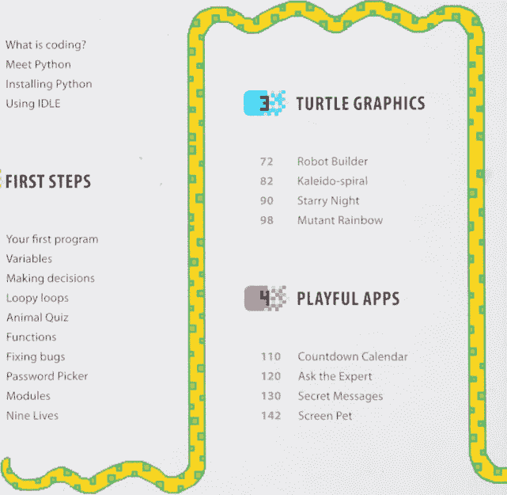

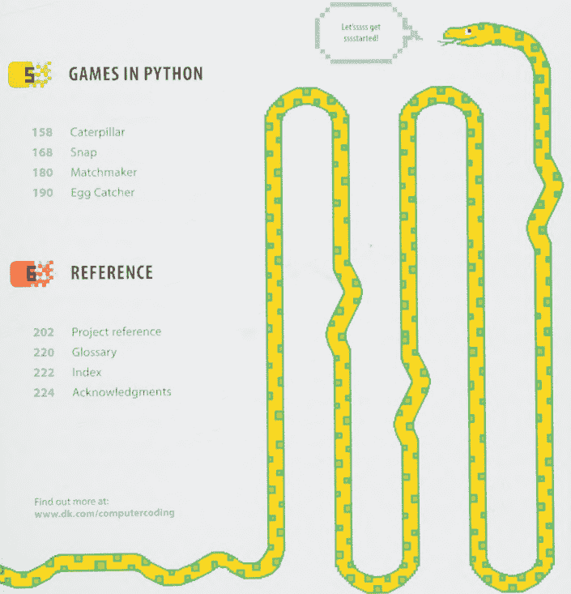

## 前言

我们生活在一个数字世界，电脑几乎是我们所做一切的一部分。不久之前，电脑还是笨重、嘈杂、主要摆在桌上的机器，但现在它们变成了藏在手机、汽车、电视甚至手表里的微小无声设备。我们用它们工作、玩游戏、看电影、购物，并与亲朋好友保持联系。

如今的电脑使用起来非常简单，任何人都能操作。但知道如何编写让它们运行的代码的人就不那么多了。成为一名程序员，你就能深入底层，看到电脑真正的工作原理。稍加练习，你就能构建自己的应用、编写自己的游戏，或者修改别人的程序，定制自己独创的精彩作品。

编程不仅是一种令人上瘾的爱好，也是一项全球需求旺盛的技能。学会编程，无论你的人生走向何方，也无论你对科学、艺术、音乐、体育还是商业感兴趣，它都会让你受益匪浅。

如今，你可以学习数百种编程语言，从 Scratch™ 这样简单的拖放式语言，到 JavaScript® 这类网页编程语言。本书基于 Python®，它是全球使用最广泛的编程语言之一。Python 在学生和专业人士中同样受欢迎，易学易用，却又强大而灵活。无论你是初学者，还是从 Scratch 这样的简单语言进阶而来，它都是一个很好的学习选择。

学习编程最好的方式是沉浸其中，这也是本书的设计初衷。只需按照编号步骤操作，你很快就能构建应用、游戏、图形和谜题。如果学习过程充满乐趣，编程会更容易掌握，因此我们尽可能让项目变得有趣。

如果你刚接触编程，请从头开始，一步步读下去。不必担心无法理解每个细节——这没关系。你完成的项目越多，水平就会越高。也不要担心程序第一次运行不成功。即便是专业人士也需要调试他们的作品。

每完成一个项目，都会有如何调整和改进它的建议。你可以尽情尝试自己的修改。只要稍加想象力和技巧，程序员能取得的成就是无限的。

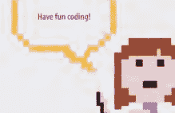

1

## Python 入门

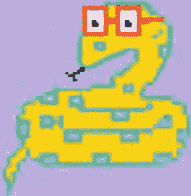

### 什么是编程？

计算机程序员，或称“编程者”，是编写逐步指令让电脑执行任务的人。程序员可以让电脑做加法、创作音乐、让机器人穿过房间，或者送火箭飞向火星。

### 黑盒子

电脑不会主动做任何事——在被明确告知要做什么之前，它只能像一只笨盒子一样待着。因为电脑无法自己思考，只能按指令行事，程序员必须替它们思考，并仔细编写指令。

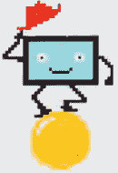

### △ 会表演的宠物

通过学习编程，你就能编写自己的程序，让电脑做你想做的事。这有点像养了一只电子宠物，你可以教它表演把戏！

### 编程语言

要让电脑做什么，你需要学习一种编程语言。可视化语言对初学者来说容易上手，而专业程序员使用文本型语言。本书基于广受欢迎的文本型语言 Python。


### ▽ Scratch

Scratch 是一种可视化编程语言。它非常适合创建游戏、动画和交互式故事。在 Scratch 中，你可以通过拼接指令积木来编写代码。

### ▽ Python

Python 是一种文本型编程语言。在 Python 中，程序员使用单词、缩写、数字和符号编写代码。指令通过电脑键盘输入。

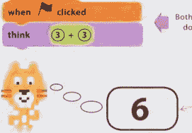

```
when [flag] clicked
think [3 + 3]
```

这两段代码做的事情相同。

算式的结果会显示在屏幕的“思考”气泡中。


```
>>> 3 + 3
6
```

按回车键即可看到结果。


## 人人都能编程

要成为程序员，你只需学习一些基本规则和命令，然后就可以开始编写适合自己技能和兴趣的程序。例如，如果你喜欢科学，可以制作一个应用，根据实验结果绘制图表。或者，你可以运用自己的艺术技能，为自己的电子游戏设计一个外星世界。

### 逻辑思考

程序员需要逻辑清晰、细致谨慎，才能编写出优秀的代码。如果指令不完全正确，或者步骤顺序错误，程序就无法正常运行。仔细思考每一个步骤，确保事情按逻辑顺序进行——毕竟，你不会先穿外套再穿毛衣，对吧！

### 注重细节

如果你擅长找不同谜题，你很可能成为一名出色的程序员。编程的一项重要技能是发现代码中的错误。这些错误被称为程序错误（bug），即使是微小的错误也可能引发大问题。目光敏锐的程序员能找出拼写错误，以及指令逻辑或顺序上的问题。调试程序可能很棘手，但从错误中学习是提升编程能力的好方法。

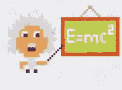


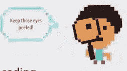

### 术语

**程序错误（Bugs）** — 程序错误是代码中的错误，会让程序以意料之外的方式运行。它们之所以被称为“bugs”，是因为早期计算机有时会因昆虫卡在电路里而出故障！

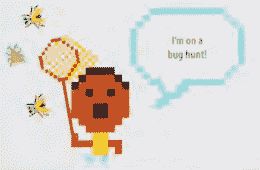

### 开始编程

编程听起来可能令人生畏，但学习如何编程其实很简单。秘诀就是直接动手。本书旨在通过引导你完成简单项目来教你如何编程。只需按照编号步骤操作，你很快就能创作游戏、应用和数字艺术。


## 认识 Python

Python 是世界上最受欢迎的计算机编程语言之一。它最初于 20 世纪 90 年代发布，如今被用于构建数以百万计的应用、游戏和网站。

### 为什么选择 Python？

Python 是入门计算机编程的绝佳语言。许多学校和大学用它来教授编程。以下是 Python 如此有用的一些原因。

### 术语 — 为什么选择 Python？

Python 并非以那种蛇命名。它实际上是以英国喜剧团体“蒙提·派森的飞行马戏团”命名的。Python 的创造者吉多·范罗苏姆是该团体的忠实粉丝，也很喜欢他们古怪的幽默。Python 程序员经常在代码中使用该团体的笑话和名言，以此致敬。


- **易于阅读和编写** — Python 是一种基于文本的计算机编程语言。你使用英语单词、标点符号、符号和数字的组合来发出指令。这使得 Python 代码易于阅读、编写和理解。
- **自带电池** — 程序员说 Python“自带电池”。这是因为它自带立即开始编程所需的一切。


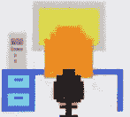

- **处处可用** — Python 是可移植的。这意味着你可以在许多不同的计算机上编写和运行 Python 代码。相同的 Python 代码可在 PC、Mac、Linux 机器和树莓派计算机上运行。程序在每台机器上的行为都相同。
- **便捷工具** — Python 内置了许多有用的工具和预编程代码，你可以在自己的程序中使用。这被称为标准库。使用这些工具可以让你更轻松、更快速地构建自己的程序。
- **出色的支持** — Python 拥有编写良好的文档。它包含入门指南、用于查询含义的参考部分，以及大量示例代码。

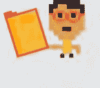

## Python 的实际应用

Python 不仅仅是教学工具。它是一款如此强大的程序，被用于商业、医学、科学和媒体领域许多有趣而激动人心的任务。它甚至可以用来控制家中的灯光和供暖。

### 专家提示

**解释器** — 有些编程语言使用解释器。解释器是一种可以将一种编程语言翻译成另一种编程语言的程序。每次运行 Python 程序时，解释器都会把每一行 Python 代码翻译成计算机能够理解的特殊代码，即机器码。

- **网络爬取** — Python 在互联网上被广泛使用。Google 搜索引擎的很大一部分是用 Python 编写的。YouTube 的很大一部分也是使用 Python 代码构建的。

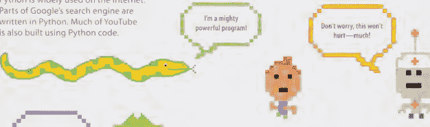

- **重要业务** — Python 帮助银行追踪账户中的资金，也帮助大型连锁商店为所售商品定价。

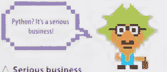

- **医学奇迹** — Python 可用于为机器人编程，以执行高难度手术。用 Python 编程的机器人外科医生可以比人类外科医生工作得更快、更准确，也更不容易出错。

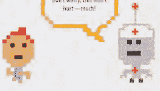

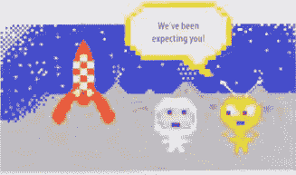

- **超越地球** — 软件工程师使用 Python 为 NASA 任务控制中心创建工具。这些工具帮助机组人员为每次任务做准备，并监控任务进展。

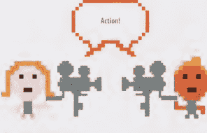

- **电影中的应用** — 迪士尼使用 Python 自动化动画过程中重复性的部分。动画师不必一遍又一遍地执行相同步骤，而是使用 Python 程序自动重复这些步骤。这节省了工作量，缩短了制作电影所需的时间。

## 安装 Python

本书中的所有项目都使用 Python 3，因此请务必从网站下载正确的版本。请按照与你的计算机相匹配的说明操作。

### 在 Windows 上安装 Python

在 Windows PC 上安装 Python 3 之前，请先确认它使用的是 32 位还是 64 位版本的 Windows。单击“开始”，右键单击“计算机”，然后左键单击“属性”。如果出现“系统”选项，请选择它。

### IDLE

IDLE（集成开发环境的缩写）是安装 Python 时附带的一款免费应用。IDLE 专为初学者设计，包含一个基本的文本编辑器，可让你编写和编辑 Python 代码。

1. **访问 Python 网站**

   在网页浏览器中输入下面的地址，前往 Python 网站。然后点击“Downloads”打开下载页面。

   `https://www.python.org/`

2. **下载 Python**

   点击适用于 Windows 的最新 Python 版本，版本号以数字 3 开头。安装程序文件会自动下载。在不同安装程序选项中，选择可执行安装程序。

   - Python 3.6.0a4 - 2016-08-15
   - Windows x86 可执行安装程序
   - Windows x86-64 可执行安装程序

3. **运行安装程序**

   双击安装程序文件以安装 Python。选择“为所有用户安装”，并在每个提示处点击“下一步”，不要更改默认设置。

   

   点击安装程序。

   如果你的 Windows 是 32 位版本，请使用此安装程序。

   如果你的 Windows 是 64 位版本，请使用此安装程序。

4. **打开 IDLE**

   安装完成后，打开 IDLE 程序以检查是否安装成功。转到“开始”菜单，选择“所有应用”，然后选择 IDLE。应会打开一个类似下图的窗口。

   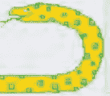

```text
Python 3.6.0a4 Shell
IDLE    File    Edit    Shell    Debug    Window    Help
Python 3.6.0a4 (v3.6.0a4:017f260936, Aug 15 2016, 00:45:10) [MSC v.1900 32 bit (Intel)] on win32
Type "copyright", "credits" or "license()" for more information.
>>>
```

### 在 Mac 上安装 Python

在 Mac 上安装 Python 3 之前，请检查计算机使用的操作系统。点击屏幕左上角的 Apple 图标，然后从下拉菜单中选择“关于本机”。

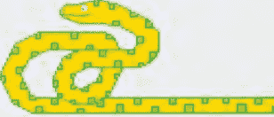

1. **访问 Python 网站**

   在网页浏览器中输入下面的地址，前往 Python 网站。然后点击“Downloads”打开下载页面。

   `https://www.python.org/`

2. **下载 Python**

   在下载选项中，点击与你的操作系统匹配的最新 Python 3 版本。Python.pkg 文件会自动下载到你的 Mac。

   - Python 3.6.0a4 - 2016-08-15
   - 下载 macOS X 64 位/32 位安装程序。

   版本号可能与此不完全相同——只需确保下载以 3 开头的版本即可。

3. **安装 Python**

   你会在“下载”文件夹中找到 .pkg 文件。它的图标看起来像一个打开的包裹。双击以开始安装。在提示处点击“继续”，然后点击“安装”，以接受默认设置。

   

   点击软件包以运行安装程序。

   > **请求许可**
   > 除非获得计算机所有者的许可，否则绝不要安装 Python 或任何其他程序。安装过程中，你可能还需要请所有者提供管理员密码。

4. **打开 IDLE**

   安装完成后，打开 IDLE 程序以检查是否安装成功。打开“应用程序”文件夹，然后打开“Python”文件夹。双击“IDLE”，应会出现类似下图的窗口。

   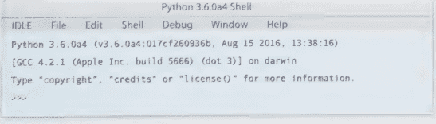

```text
Python 3.6.0a4 (v3.6.0a4:017c?..., Aug 15 2016, 13:38:16)
[GCC 4.2.1 (Apple Inc. build 5666) (dot 3) on darwin]
Type "copyright", "credits" or "license()" for more information.
>>>
```

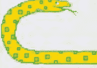


## 使用 IDLE

IDLE 有两个可供你工作的不同窗口。编辑器窗口可用于编写和保存程序，而 Shell 窗口会立即运行 Python 指令。

### Shell 窗口

打开 IDLE 时，Shell 窗口会弹出。这是开始学习 Python 的最佳场所，因为你不必先创建新文件。只需将代码直接输入 Shell 窗口即可。

**在 Shell 中工作**

你输入的代码可以立即运行，任何消息或“bug”（错误）都会显示出来。你可以把 Shell 窗口当作记事本来使用，在将代码片段加入更大的程序之前先测试它们。

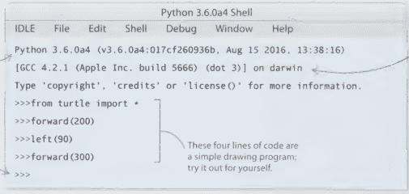

这一行显示你拥有的 Python 版本。

你在 >>> 提示符处输入代码。

这里的文本取决于你使用的操作系统。

这四行代码是一个简单的绘图程序；自己试一试吧！

```python
>>> from turtle import *
>>> forward(200)
>>> left(90)
>>> forward(300)
>>> 
```

**测试一下 Shell**

将这些代码片段逐一输入 Shell 窗口，并在每输入一个后按回车/换行。第一行显示一条消息，第二行执行计算。你能弄明白第三行做什么吗？

```python
>>> print('I am 10 years old')

>>> 123 + 456 * 7 / 8

>>> ''.join(reversed('Time to code'))
```

**专家提示**

**不同的窗口**

为了帮助你了解应该在哪个窗口中输入代码，我们为 IDLE 中的每个窗口设置了不同的颜色。

- Shell 窗口
- 编辑器窗口

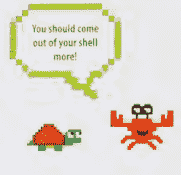

### 编辑器窗口

Shell 无法保存你的代码，因此当你关闭 Shell 窗口时，输入的代码会永久丢失。这就是为什么在开发项目时应该使用 IDLE 的编辑器窗口。这个窗口可以让你保存代码。它还有内置工具，可帮助你编写程序并排查任何错误。

**▽ 编辑器窗口**

要在 IDLE 中打开编辑器窗口，请单击顶部的 File 菜单，然后选择 New File。随后会出现一个空的编辑器窗口。你将使用编辑器窗口来编写和运行本书中各项目的程序。

你在这里输入代码。这个程序会打印一个列表，告诉你哪些数字是偶数、哪些是奇数。

文件名显示在这里。

你可以从这个菜单运行程序。

编辑器窗口的菜单栏与 Shell 窗口的菜单栏不同。

```python
EvenOdd.py
IDLE   File   Edit   Format   Run   Window   Help

for counter in range(10):
    if (counter % 2) == 0:
        print(counter)
        print('is even')
    else:
        print(counter)
        print('is odd')
```

你让 Python 打印的任何内容都会显示在 Shell 窗口中。

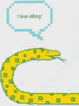

**专家提示**

**代码中的颜色**

IDLE 会自动为文本着色，以突出代码的不同部分。这些颜色让代码更易于理解，并且在你要找出错误时很有用。

- **符号和名称**——大多数代码文本被着色为黑色。
- **关键字**——某些词，例如“if”和“else”，是 Python 使用的特殊词。它们被称为关键字，并显示为橙色。
- **输出**——程序运行时产生的任何文本都是蓝色。
- **引号中的文本**——引号中的文本是绿色。文本周围出现绿色括号表示你缺少一个引号。
- **内置命令**——Python 命令，例如“print”，显示为紫色。
- **错误**——Python 用红色提醒你代码中的任何错误。

## 第一步


**4. 保存文件**

会弹出一个对话框。为你的程序输入名称，例如“helloworld.py”，然后单击 Save。

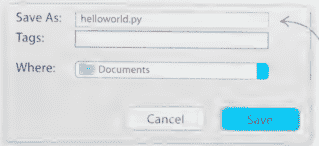

**术语**

**.py 文件**

Python 程序的名称通常以“.py”结尾，这使它们易于识别。保存程序时，Python 会自动在末尾添加“.py”，因此你不需要自己输入。

**5. 检查是否正常运行**

现在运行程序的第一行，看看是否正常工作。打开“Run”菜单并选择“Run Module”。你应该会在 Shell 窗口中看到消息“Hello, World!”。

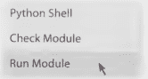

```text
>>> 
Hello, World!
>>>
```

消息将出现在 Shell 中。

**6. 修正错误**

如果代码无法运行，保持冷静！每个程序员都会犯错，而找到这些“bug”对于想成为编程专家的人来说至关重要。返回去检查代码是否有输入错误。你包含括号了吗？你把“print”这个词拼写正确了吗？修正任何错误，然后再次尝试运行代码。

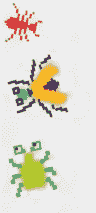

**专家提示**

**键盘快捷键**

从编辑器窗口运行程序的一个便捷快捷键就是按键盘上的 F5。这比选择“Run”再选择“Run Module”快得多。

**7. 添加更多行**

回到编辑器窗口，再向脚本中添加两行。现在中间一行询问你的名字，然后将其存储在一个变量中。最后一行使用你的名字打印新的问候语。如果你愿意，可以将其改成不同的问候语——想多礼貌或多粗鲁都可以！

```python
print('Hello, World!')
person = input('What’s your name?')
print('Hello, ' + person)
```

这一行询问用户的名字，并将其存储在名为“person”的变量中。

**8. 最终任务**

再次运行代码以检查它。当你输入名字并按回车/换行键时，Shell 应显示个性化消息。恭喜你完成第一个 Python 程序！你已经迈出了成为强大程序员的第一步。

```text
Hello, World!
What’s your name? Josh
Hello, Josh
```

用户的名字

## 变量

如果你想编写有用的代码，就需要能够存储和标记信息。这就是变量的作用。变量适用于各种事情——从跟踪游戏中的得分到执行计算和保存项目列表。


### 如何创建变量

变量需要一个名称。想一个能提醒你变量里面是什么的名称。然后决定你想在变量中存储什么。这就是变量的值。输入名称，接着输入等号，再输入值。我们把这称为给变量“赋值”。

**存储盒**

变量就像一个带有名称标签的盒子。你可以将数据存储在盒子里，然后在需要使用数据时通过名称再次找到它。

- 1. **赋值**  
   在 Shell 窗口中，输入这行代码以创建变量 `age` 并为其赋值。如果你愿意，可以使用你自己的 `age`。

```python
>>> age = 12
```

这个值将存储在变量中。

这是变量的名称。

- 2. **打印值**  
   现在将右侧显示的代码行输入 Shell 窗口。按回车/换行键看看会发生什么。

```python
>>> print(age)
12
```

age 的值

`print()` 函数将变量的值打印到屏幕上。

**专家提示**

**命名变量**

| 命名变量 | 该做与不该做 |
|---|---|
| 选择好的变量名会让程序更易于理解。例如，跟踪游戏中玩家生命的变量可以命名为 `lives_remaining`，而不是只叫 `lives` 或 `l r`。变量名可以包含字母、数字、下划线，但应以字母开头。遵循此处显示的规则，你就不会出错。 | • 变量名以字母开头。<br>• 名称中可以使用任何字母或数字。<br>• 不允许使用 `-`、`%` 或 `@` 等符号。<br>• 不能使用空格。<br>• 可以使用下划线（`_`）代替空格。<br>• 大写字母和小写字母是不同的。Python 会将“Score”和“score”视为两个不同的变量。<br>• 避免使用 Python 用作命令的词，例如 `print`。 |


**术语**

## 整数与浮点数

在编程中，整数被称为“integers”（整数），而带小数点的数被称为“floats”（浮点数）。程序通常使用整数来计数。浮点数更常用于测量。


## 使用数字

变量可用于存储数字并进行求和。你可以像在数学中那样，用符号来进行计算。其中一些符号你会很熟悉，但要注意表示“乘”和“除”的符号——它们与你在课堂上使用的符号略有不同。

| 符号 | 含义 |
|---|---|
| `+` | 加 |
| `-` | 减 |
| `*` | 乘 |
| `/` | 除 |

一些 Python 数学符号

### 1. 简单计算

在 shell 窗口中输入这段代码。它使用存储在名为 x 和 y 的两个变量中的数字来执行简单的乘法。按回车键获取答案。

```python
>>> x = 6
>>> y = x * 7
>>> print(y)
42
```

- 创建一个新变量 x，并赋值为 6。
- 将 x 乘以 7，并将结果存入 y。
- 打印 y 的值。
- 计算的结果。

### 2. 更改值

要更改变量的值，只需给它赋一个新值。在你的代码中，将 x 的值改为 10，然后再次运行计算。你预期结果会是什么？

```python
>>> x = 10
>>> print(y)
42
```

- 更改 x 的值。
- 结果没有变化；接下来我们会查明原因。

### 3. 更新值

需要更新 y 的值才能得到正确结果。输入这些行。现在，代码在 x 更改之后将新值赋给 y。如果你在自己的程序中更新了一个变量的值，一定要检查是否需要更新其他变量。

```python
>>> x = 10
>>> y = x * 7
>>> print(y)
70
```

- 更新 y 的值。

## 处理字符串

程序员用“字符串”一词来表示由一系列字母或其他字符组成的任何数据。单词和句子都以字符串形式存储。几乎所有程序都会在某个时候用到字符串。你在键盘上能输入的每个字符，甚至不能输入的字符，都可以存储在字符串中。

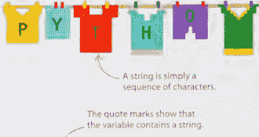

引号表示该变量包含一个字符串。

### 1. 变量中的字符串

字符串可以放入变量中。在 shell 窗口中输入这段代码。它将字符串 'Ally Alien' 赋给变量 `name`，然后显示它。字符串的开头和结尾必须始终带有引号。

```python
>>> name = 'Ally Alien'
>>> print(name)
Ally Alien
```

按回车键打印该字符串。

### 2. 合并字符串

当你将变量组合成新变量时，变量就会变得非常有用。如果将两个字符串相加，你可以将合并结果存储在一个新变量中。试试看。

```python
>>> name = 'Ally Alien'
>>> greeting = 'Welcome to Earth, '
>>> message = greeting + name
>>> print(message)
Welcome to Earth, Ally Alien
```

- 记住引号。
- `+` 符号将一个字符串与另一个字符串连接起来。
- 打印字符串时不会显示引号。

**专家提示**

### 字符串的长度

你可以使用一个方便的技巧 `len()` 来统计字符串中的字符数（包括空格）。`len()` 命令就是程序员所说的函数的一个例子。（你会在本书中使用许多函数。）要查明 “Welcome to Earth, Ally Alien” 中有多少个字符，请在创建该字符串后，将下面一行输入 shell，然后按回车键。

```python
>>> len(message)
28
```

统计出的字符数

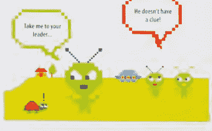

## 列表

当你想存储大量数据，或者数据的顺序很重要时，你可能需要使用列表。列表可以将许多项目放在一起，并按顺序保存它们。Python 会为每个项目分配一个数字，以显示其在列表中的位置。你可以随时更改列表中的项目。


### 1. 多个变量

想象你正在编写一个多人游戏，并想存储每支队伍中玩家的名字。你可以为每位玩家创建一个变量，可能如下所示……

每队有三名玩家时，你需要六个变量。

```python
>>> rockets_player_1 = 'Rory'
>>> rockets_player_2 = 'Rav'
>>> rockets_player_3 = 'Rachel'
>>> planets_player_1 = 'Peter'
>>> planets_player_2 = 'Pablo'
>>> planets_player_3 = 'Polly'
```

### 2. 将列表存入变量

……但如果每队有六名玩家呢？管理和更新这么多变量会很困难。更好的做法是使用列表。要创建列表，请用方括号将要存储的项目括起来。在 shell 中试试这些列表。

```python
>>> rockets_players = ['Rory', 'Rav',
'Rachel', 'Renata', 'Ryan', 'Ruby']
>>> planets_players = ['Peter', 'Pablo',
'Polly', 'Penny', 'Paula', 'Patrick']
```

- 列表项必须用逗号分隔。
- 这个列表存储在变量 planets_players 中。

### 3. 从列表中获取项目

一旦数据进入列表，处理起来就很容易。要从列表中取出一个项目，首先输入列表的名称。然后加上该项目在列表中的位置，并将其放在方括号内。注意：Python 从 0 而不是 1 开始计数列表项目。现在试着从你的队伍中获取不同玩家的名字。第一位玩家位于位置 0，而最后一位玩家位于位置 5。

```python
>>> rockets_players[0]
'Rory'
>>> planets_players[5]
'Patrick'
```

- 这一行从位置 0 获取列表中的第一个项目。
- 这一行从位置 5 获取列表中的最后一个项目。
- 按回车键取回该项目。

## 做出决策

每天，你都会根据自己提出的问题的答案来决定接下来做什么。例如，“在下雨吗？”“我做完作业了吗？”“我是一匹马吗？”计算机也会通过提问来做出决策。

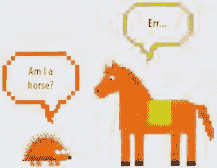

> “我是一匹马吗？”
> “呃……”

### 进行比较的问题

计算机问自己的问题通常涉及将一件事物与另一件事物进行比较。例如，计算机可能会问一个数字是否比另一个数字大。如果是，计算机随后可能会决定运行一段原本会被跳过的代码。


> “你确定要这样做吗？”

### 布尔值

计算机所提问题的答案只有两种可能的值：True 或 False。Python 将这两个值称为布尔值，它们必须始终以大写字母开头。你可以将布尔值存储在变量中。

```python
>>> answer_one = True
>>> answer_two = False
```

变量

布尔值

### 逻辑运算符

这些符号告诉计算机进行比较。程序员称它们为逻辑运算符。你可能在数学中用过其中一些。单词 “and” 和 “or” 也可以在计算机代码中用作逻辑运算符。

| 符号 | 含义 |
|---|---|
| `==` | 等于 |
| `!=` | 不等于 |
| `<` | 小于 |
| `>` | 大于 |

**专家提示**

### 等号

在 Python 中，你可以使用单等号或双等号。它们的含义略有不同。当你想设置变量的值时，使用单等号。例如，输入 `age = 10` 会将变量 age 的值设为 10。当你想比较两个值时，使用双等号 `==`，如下例所示。

```python
>>> age = 10
>>> if age == 10:
    print('You are ten years old.')
```

- 这一行设置变量的值。
- 这一行将你的年龄与该变量进行比较。
- 如果两者匹配，代码会打印该消息。


> “我比你大！”

## 菠萝与斑马

让我们在 shell 中尝试一个示例。我们可以使用变量 `pineapples` 和 `zebras` 来表示有五个菠萝和两只斑马。在 shell 中输入这些行。

```text
>>> pineapples = 5
>>> zebras = 2
```

- 这个变量存储菠萝的数量。
- 这个变量存储斑马的数量。

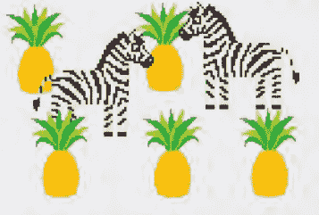

### 进行比较

现在试着输入以下代码行，比较这两个变量的值。输入每一行后，按回车键，Python 会告诉你这些语句是 True 还是 False。

```text
>>> zebras < pineapples
True
```

斑马的数量小于菠萝的数量。

```text
>>> pineapples > zebras
True
```

菠萝的数量大于斑马的数量。

```text
>>> pineapples == zebras
False
```

菠萝的数量与斑马的数量不相等。

**术语**

### 布尔表达式

使用逻辑运算符对变量和值进行陈述的语句总是会给出一个布尔值，例如 True 或 False。因此，这些语句被称为布尔表达式。我们所有关于菠萝和斑马的语句都是布尔表达式。

变量

逻辑运算符

```text
>>> pineapples != zebras
True
```

布尔值

变量

### 多重比较

你可以使用 `and` 或 `or` 来组合多个比较。如果使用 `and`，比较的两个部分都必须正确，语句才为 True。如果使用 `or`，只需要其中一个部分正确。

```text
>>> (pineapples == 3) and (zebras == 2)
False
```

其中一个部分（pineapples == 3）不正确，因此该语句为 False。

```text
>>> (pineapples == 3) or (zebras == 2)
True
```

其中一个部分正确（zebras == 2），因此该语句为 True。


## 乘坐过山车

主题公园的一块标牌上写着：要乘坐过山车，必须超过8岁，且身高超过4英尺7英寸。米娅10岁，身高5英尺。让我们用 shell 来检查她能否乘坐。输入以下代码行，为米娅的年龄和身高创建变量，并为它们分配合适的值。将乘坐过山车的规则输入为布尔表达式，然后按回车/返回键。

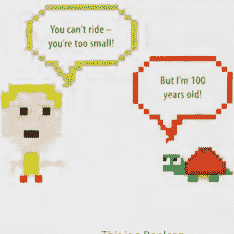

> “你不能乘坐——你太矮了！”
>
> “可我都100岁了！”

下面两行代码为这些变量赋值。

```python
>>> age = 10
>>> height = 1.5

>>> (age > 8) and (height > 1.4)
True
```

这是一个布尔表达式，表示年龄大于8岁且身高超过4英尺7英寸。

米娅可以乘坐过山车了！

## 分支

计算机经常需要决定运行程序的哪些部分。这是因为大多数程序被设计为在不同情况下做不同的事情。程序中的路线会分叉，就像一条小路分出多条支路，每条支路通向不同的地方。

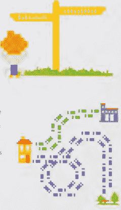

### 条件

条件是一个布尔表达式（真或假的比较），帮助计算机在代码中到达分支时决定走哪条路线。

- **学校还是公园？**

  想象一下，你必须根据“今天是工作日吗？”这个问题的答案来决定每天走哪条路线。如果是工作日，你就走通往学校的路线；如果不是，你就走通往公园的路线。在 Python 中，程序中的不同路线通向不同的代码块。一个代码块可以是一条语句，也可以是多条语句，全部缩进四个空格。计算机使用一种称为条件的测试来判断接下来应该运行哪些代码块。

### ▷ 单分支

最简单的分支命令是 **if** 语句。它只有一个分支，如果条件为 True，计算机就会走这个分支。这个程序要求用户说明外面是否天黑了。如果天黑了，程序就假装计算机要睡觉了！如果天不黑，`is_dark == 'y'` 为 False，所以不会显示“晚安！”消息。

这一行要求用户回复“y”（是）或“n”（否）。

```python
is_dark = input('Is it dark outside? y/n')
if is_dark == 'y':
    print('Goodnight! zzzzzzzzzzzzzz...')
```

条件

如果条件为 True，就走这个分支。

代码会在 shell 窗口中显示这条消息。

### ▷ 双分支

你希望程序在条件为 True 时做一件事，在条件为 False 时做另一件事吗？如果是，就需要一个带两个分支的命令，称为 **if-else** 语句。这个程序询问用户是否有触手。如果回答“Yes”，它就认定用户一定是章鱼！如果回答“No”，它就认定用户是人类。每种判断都会打印不同的消息。

```python
tentacles = input('Do you have tentacles? (y/n)')
if tentacles == 'y':
    print('I never knew octopuses could type!')
else:
    print('Greetings, human!')
```

条件

如果条件为 True，就运行这个代码块。

如果条件为 False，就运行这个代码块。

### ▷ 多分支

当可能的路径超过两条时，**elif** 语句（“else-if”的缩写）就派上用场了。这个程序要求用户输入天气预报：可以是“rain”（雨）、“snow”（雪）或“sun”（晴）。然后它会选择三个分支之一以及相应的天气条件。

```python
weather = input('What is the forecast for today? (rain/snow/sun)')

if weather == 'rain':
    print('Remember your umbrella!')
elif weather == 'snow':
    print('Remember your woolly gloves!')
else:
    print('Remember your sunglasses!')
```

第一个条件

如果第一个条件为 True，就运行这个代码块。

第二个条件

如果第二个条件为 True，就运行这个代码块。

如果两个条件都为 False，就运行这个代码块。

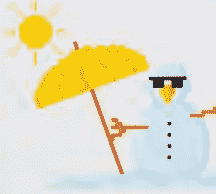

### △ 工作原理

elif 语句必须始终位于 if 之后、else 之前。在这段代码中，只有当 if 语句设置的条件为 False 时，elif 才会检查是否为雪天。你可以插入更多 elif 语句来检查更多天气类型。

## 循环

计算机非常擅长毫无怨言地完成枯燥任务。程序员可不擅长，但他们很擅长让计算机替自己完成重复性工作——通过使用循环。循环会一遍又一遍地运行同一个代码块。循环有几种不同类型。

### for 循环

当你知道要运行某个代码块多少次时，可以使用 for 循环。在这个示例中，艾玛编写了一个程序，为她的房门制作标牌。它会将“Emma's Room—Keep Out!!!”（艾玛的房间——请勿入内！！！）打印十次。在 shell 中亲自试一试你的代码。（输入代码并按回车/返回后，按退格键删除缩进，然后再次按回车/返回。）

这是循环变量。

循环运行 10 次。

```python
>>> for counter in range(1, 11):
    print('Emma\'s Room - Keep Out!!!')
```

将循环体中的命令缩进 4 个空格。

重复执行的那一行称为循环体。

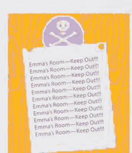

### 循环变量

循环变量记录到目前为止我们已经绕循环了多少次。第一轮时，它等于 range(1, 11) 所指定列表中的第一个数字。第二轮时，它等于列表中的第二个数字，依此类推。当列表中的所有数字都用完后，我们就停止循环。

| 第一轮循环 | 第二轮循环 | 第三轮循环 |
|---|---|---|
| 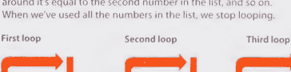 |  |  |
| 循环变量 = 1 | 循环变量 = 2 | 循环变量 = 3 |

### 专家提示：Range

在 Python 代码中，单词“range”后跟括号内的两个数字，表示“从第一个数字到比第二个数字小 1 的所有数字”。因此 range(1, 4) 表示数字 1、2 和 3——但不包括 4。在艾玛的“请勿入内”程序中，range(1, 11) 表示数字 1、2、3、4、5、6、7、8、9 和 10。

### 专家提示：转义字符（\\\\）

`Emma\'s Room` 中的反斜杠告诉 Python 忽略撇号，这样就不会把它当作结束整个字符串的引号。这样使用的反斜杠称为转义字符。它告诉 Python 在判断该行是否有意义或是否包含错误时，不要计入下一个字符。

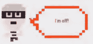


### while 循环

如果你不知道想重复一段代码多少次，该怎么办？你需要水晶球或其他能预见未来的方法吗？不，没关系！你可以使用 **while** 循环。

### ▷ 循环条件

while 循环没有设置为某个值范围的循环变量。相反，它有一个循环条件。这是一个布尔表达式，可以是 True 或 False。这有点像迪斯科舞厅的保安问你是否持有门票。如果你有（True），就直接走向舞池；如果你没有（False），保安不会让你进去。在编程中，如果循环条件不为 True，你就进不了循环！

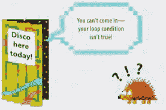

### ▽ 平衡表演

在这个示例中，艾哈迈德编写了一个程序，用来记录他的杂技河马剧团中有多少只河马叠在一起保持平衡，搭成一座塔。通读代码，看看你能否弄明白它是如何工作的。

这个变量存储河马的数量。

这个变量存储问题“Add another hippo?”的答案。

循环条件

这一行显示一条消息，给出保持平衡的河马总数。

艾哈迈德的回复会成为 answer 的新值。

在保持平衡的数量上再加一只河马。

```python
>>> hippos = 0
>>> answer = 'y'
>>> while answer == 'y':
...     hippos = hippos + 1
...     print(str(hippos) + ' balancing hippos!')
...     answer = input('Add another hippo? (y/n) ')
```

### ▷ 工作原理

艾哈迈德程序中的循环条件是 `answer == 'y'`。这意味着用户想添加一只河马。在循环体中，我们将现有河马数量加一，然后询问用户是否想再添加一只。如果他们输入“y”（表示是），循环条件为 True，所以我们再次绕循环执行。如果他们回答“n”（表示否），循环条件为 False，程序就离开循环。

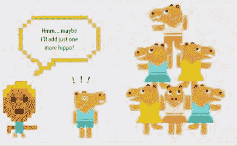

### 无限循环

有时你可能希望 `while` 循环在程序运行期间一直持续下去。这种循环称为无限循环。许多电子游戏程序使用一种称为主循环的无限循环。

```python
>>> while True:
    print('This is an infinite loop!')
```

没有可退出循环的 False 选项。

### △ 进入无限

通过将循环条件设置为常量值 True，就可以创建无限循环。因为这个值永远不变，所以循环永远不会退出。在 shell 中试一试这个 `while` 循环。它没有 False 选项，因此循环会不停地打印“This is an infinite loop!”，直到你退出程序。

### ▽ 逃离无限

你可以有意使用无限循环来获取用户输入。这个（烦人的）程序会询问用户是否感到无聊。只要用户输入“n”，它就会一直问这个问题。如果他们受够了并输入“y”，程序会说他们没礼貌，并使用 `break` 命令离开循环！

```python
>>> while True:
    answer = input('Are you bored yet? (y/n)')
    if answer == 'y':
        print('How rude!')
        break
```

True 条件对应用户还没无聊（`'n'`）。

False 条件（`'y'`）会触发 `break` 命令。

### 专家提示：停止循环

如果你不想要无限循环，重要的是确保 `while` 循环的循环体做出可能使循环条件变为 False 的操作。但别担心——如果你不小心写出了无限循环，可以按住 Ctrl（control）键的同时按 C 键来退出。你可能需要按几次 Ctrl+C 才能退出循环。

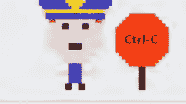


## 循环中的循环

循环体内部还能再有一个循环吗？可以！这称为嵌套循环。它就像俄罗斯套娃，每个娃娃都装在更大的娃娃里面。在嵌套循环中，内层循环在外层循环内部运行。

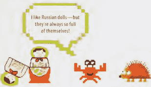

> 就像俄罗斯套娃——不过它们总是那么自命不凡！

### 专家提示

**缩进循环体**

循环体中的代码应缩进四个空格。如果没有缩进，Python 会显示错误信息，代码将无法运行。对于嵌套循环（一个循环套在另一个循环中），内层循环的循环体必须再额外缩进四个空格。Python 会自动缩进循环中的新行，但你始终应检查每一行是否缩进了正确的空格数。

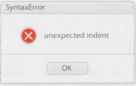

### 一个循环套另一个循环

在这个示例中，Emma 把她的“Keep Out”程序改成了一个“Three Cheers”程序，会打印三次“Hip, Hip Hooray!”。因为每次欢呼都包含两次“Hip”，所以她使用嵌套循环来打印它。

```python
>>> for hooray_counter in range(1, 4):
...     for hip_counter in range(1, 3):
...         print('Hip')
...         print('Hooray!')
```

外层循环的循环变量是 hooray_counter。

内层循环的循环变量是 hip_counter。

外层循环的循环体缩进了 4 个空格。

内层循环的循环体又额外缩进了 4 个空格。

```text
hooray_counter = 1

Hip
Hip
Hooray!

hip_counter = 1
hip_counter = 2

hooray_counter = 2

Hip
Hip
Hooray!

hip_counter = 1
hip_counter = 2

hooray_counter = 3

Hip
Hip
Hooray!

hip_counter = 1
hip_counter = 2
```

### 工作原理

整个内层 for 循环都位于外层 for 循环的循环体内部。外层循环每重复一次，内层循环就要重复两次。这意味着外层循环的循环体总共运行三次，而内层循环的循环体运行六次。

## 动物问答

你喜欢问答游戏吗？想自己做一个吗？在这个项目中，你将制作一个动物问答游戏。尽管问题都是关于动物的，但这个项目可以很容易地改成关于任何其他主题。

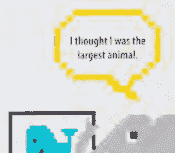

我以为我是最大的动物。

这是游戏的样子——一切都发生在 shell 窗口中。

### 运行效果

程序会向玩家提出一些关于动物的问题。每道题有三次回答机会——你可不想让测验太难！每答对一题得一分。测验结束时，程序会显示玩家的最终得分。

```text
Python 3.5.2 Shell

Guess the Animal!
Which bear lives at the North Pole? polar bear
Correct answer
Which is the fastest land animal? cheetah
Correct answer
Which is the largest animal? giraffe
Sorry, wrong answer. Try again. elephant
Sorry, wrong answer. Try again. rhinoceros
The correct answer is blue whale
Your score is 2
```

在这里输入你的答案。

如果猜错，你还有一次机会。

三次猜错后，程序会显示正确答案。

这是你的得分，满分 3 分。

### 工作原理

这个项目使用了函数——一段有名称、执行特定任务的代码块。函数让你可以重复使用相同的代码，而不必每次都全部重新输入。Python 有许多内置函数，但也允许你创建自己的函数。

### 调用函数

当你想要使用函数时，只需在代码中输入它的名称即可“调用”它。在“动物问答”中，你将创建一个函数，把玩家的猜测与正确答案进行比较，判断是否正确。测验中的每道题都会调用它。

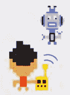

### 术语

**忽略大小写！**

在把玩家的猜测与正确答案进行比较时，玩家输入大写字母还是小写字母都不应有影响——重要的是单词相同。并非所有程序都如此。例如，如果检查密码的程序忽略大小写，密码可能变得更容易被猜到，安全性也会降低。不过，在“动物问答”中，玩家回答“bear”还是“Bear”都无所谓——两者都会被判定为正确。


### 动物问答流程图

程序会不断检查是否还有问题要问，以及玩家是否已用完所有机会。游戏过程中，得分存储在一个变量中。所有问题都回答完后，游戏结束。

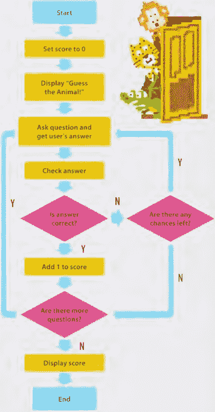

### 整合起来

现在该构建你的问答游戏了！首先，你要创建问题以及用于核对答案的数字。然后，你要添加让玩家每道题有三次作答机会的代码。

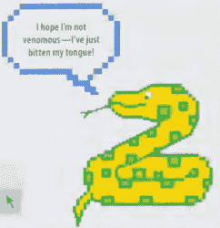

- **1. 创建新文件**

打开 IDLE。在 File 菜单中选择 New File。将文件保存为“animal_quiz.py”。


- **2. 创建得分变量**

输入这里显示的代码，创建一个名为 `score` 的变量，并将其初始值设为 0。

```python
score = 0
```

你将使用这个变量来记录玩家的得分。

- **3. 介绍游戏**

接下来，创建一条向玩家介绍游戏的消息。这将是玩家在屏幕上看到的第一条内容。

```python
score = 0
print('Guess the Animal!')
```

这句话将显示在 shell 窗口中。

- **4. 运行代码**

现在尝试运行代码。从 Run 菜单中选择 Run Module。接下来会发生什么？你应该会在 shell 窗口中看到欢迎消息。

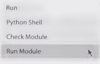


- **5. 提问（用户输入）**

下一行代码会提出一个问题，并等待玩家回答。答案（用户输入）会保存在变量 `guess1` 中。运行代码，确保问题出现。

```python
print('Guess the Animal!')
guess1 = input('Which bear lives at the North Pole? ')
```

变量 `guess1` 会存储用户输入的任何内容。

- **6. 构建检查函数**

下一个任务是检查玩家的猜测是否正确。在你的脚本顶部、`score = 0` 之前输入这段代码。代码会创建一个名为 `check_guess()` 的函数，用来检查玩家的猜测是否与正确答案匹配。括号中的两个词是“参数”——函数需要的一些信息。调用函数时，你要为其参数赋值（提供值）。

```python
def check_guess(guess, answer):
    global score
    if guess == answer:
        print('Correct answer')
        score = score + 1
score = 0
```

第一行给函数命名并定义参数。

这一行说明 score 变量是全局变量。它确保对该变量值的更改可以在整个程序中可见。

将玩家的得分加 1。

不要忘记括号。

- **7. 调用函数**

现在在脚本末尾添加一行，以“调用”（运行）`check_guess()` 函数。这段代码告诉函数：将玩家的猜测作为第一个参数，将短语“polar bear”作为第二个参数。

```python
guess1 = input('Which bear lives at the North Pole? ')
check_guess(guess1, 'polar bear')
```

正确答案


- **8. 测试代码**

再次尝试运行代码，并输入正确答案。shell 窗口应如下所示。

```text
Guess the Animal!
Which bear lives at the North Pole? polar bear
Correct answer
```

- **9. 添加更多问题**

只靠一个问题可做不成问答游戏！按照之前的相同步骤，再向程序中添加两个问题。我们将把玩家的答案存储在变量 guess2 和 guess3 中。


```python
score = 0
print('Guess the Animal!')
guess1 = input('Which bear lives at the North Pole? ')
check_guess(guess1, 'polar bear')
guess2 = input('Which is the fastest land animal? ')
check_guess(guess2, 'cheetah')
guess3 = input('Which is the largest animal? ')
check_guess(guess3, 'blue whale')
```

第一个问题

这告诉程序检查 guess1。

这告诉程序检查 guess3。

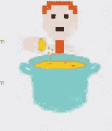


### 10 显示得分

下一行代码将在测验结束时显示玩家的得分。将它添加到文件的底部，放在最后一个问题下面。

```python
guess = input('Which is the largest animal: ')
check_guess(guess3, 'blue whale')

print('Your score is ' + str(score))
```

### 工作原理

在这一步中，你必须使用 `str()` 函数将数字转换为字符串。这是因为如果你尝试将字符串和整数（整数）相加，Python 会报错。

这会创建一条包含玩家得分的消息，并将其显示在屏幕上。

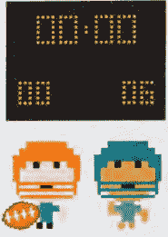

### 11 忽略大小写

如果玩家输入的是“Lion”而不是“lion”，会发生什么？他们还能得分吗？不能，代码会告诉他们这是错误的答案！为了解决这个问题，你需要让代码更智能。Python 有一个 `lower()` 函数，它可以将单词转换为全小写字符。在你的代码中，将 `if guess == answer:` 替换为右侧以粗体显示的那一行。

```python
def check_guess(guess, answer):
    global score
    if guess.lower() == answer.lower():
        print('Correct answer')
        score = score + 1
```

更改这一行。

### 工作原理

猜测和答案都将在检查之前转换为小写字符。这确保了无论玩家使用全大写、全小写还是大小写混合输入，代码都能正常工作。

### 12 再次测试代码

第三次运行你的代码。尝试使用大写和小写混合输入正确答案，看看会发生什么。

```text
Guess the animal!

Which bear lives at the North Pole? polar bear
Correct answer
Which is the fastest land animal? Cheetah
Correct answer
Which is the largest animal? BLUE WHALE
Correct answer
Your score is 3
```

在判断答案是否正确时，大小写会被忽略。

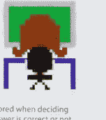

### 13 给玩家更多机会

目前玩家只有一次答对的机会。你可以通过给玩家三次回答问题的机会来让游戏更轻松一些。将 `check_guess()` 函数改为如下所示。

别忘了保存你的工作。

```python
def check_guess(guess, answer):
    global score
    still_guessing = True
    attempt = 0
    while still_guessing and attempt < 3:
        if guess.lower() == answer.lower():
            print('Correct answer')
            score = score + 1
            still_guessing = False
        else:
            if attempt < 2:
                guess = input('Sorry wrong answer. Try again. ')
            attempt = attempt + 1

    if attempt == 3:
        print('The correct answer is ' + answer)

score = 0
```

这个变量将只保存两个值之一：True 或 False。

`while` 循环会运行三次检查代码，或者直到玩家答对为止——以先到者为准。

确保每一行代码都有正确的缩进。

`else` 分支会在玩家答错时要求他们输入另一个答案。

将玩家已经猜过的次数加 1。

这段代码会在三次猜错后显示正确答案。

### 工作原理

要知道玩家是否答对了，你需要创建一个名为 `still_guessing` 的变量。然后将变量设置为 `True`，表示正确答案尚未找到。当玩家答对时，它被设置为 `False`。

最大的动物？我不知道。给我三次猜测机会！

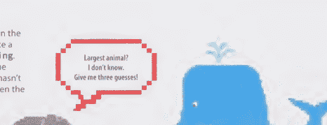

### 技巧与调整

让你的测验更加多样化！把它变得更长或更难，使用不同类型的题目，甚至改变测验的主题。你可以尝试任何或所有这些技巧和调整，但记得将每一个单独保存为独立的 Python 文件，以免弄乱原始游戏。


### 让测验更长

向测验中添加更多问题。例如：“哪种动物有长鼻子？”（大象）或“哪种哺乳动物会飞？”（蝙蝠）。或者更难一点：“章鱼有几颗心脏？”（三颗）。

如果你需要将一行很长的代码分成两行，可以使用反斜杠字符。

```python
guess = input('Which one of these is a fish? \\\nA) Whale B) Dolphin C) Shark D) Squid. Type A, B, C, or D')
check_guess(guess, 'C')
```

### 制作选择题测验

这段代码展示了如何创建选择题问题，为玩家提供几个可能的答案供其选择。

**记住**

### 换行

你可以使用 `\n` 在任何位置换行。如果问题和可能的答案显示在不同的行上，选择题会更容易理解。要以选项列表的形式显示鱼类问题，请像这样输入。

```python
guess = input('Which one of these is a fish?\n \\\nA) Whale\n B) Dolphin\n C) Shark\n D) Squid.\n \\\nType A, B, C, or D ')
check_guess(guess, 'C')
```


```text
Which one of these is a fish?
A) Whale
B) Dolphin
C) Shark
D) Squid
Type A, B, C, or D
```

问题在 shell 窗口中的显示效果如下。

```python
while still_guessing and attempt < 3:
    if guess.lower() == answer.lower():
        print('Correct Answer')
        score = score + 3 - attempt
        still_guessing = False
    else:
        if attempt < 2:
            score = score + 1
```

### 尝试次数越少得分越高

奖励用更少猜测次数答对的玩家。如果一次答对得 3 分，需要两次尝试得 2 分，使用全部三次机会得 1 分。对更新得分的行进行如下修改。现在它将给予 3 分减去未成功尝试的次数。如果玩家第一次就答对，则加上 3 − 0 = 3 分；第二次猜对，则加上 3 − 1 = 2 分；第三次猜对，则加上 3 − 2 = 1 分。

这一行替换了之前的得分计算。

### 制作判断题测验

这段代码展示了如何创建是非题问题，这类问题只有两个可能的答案。

```python
guess = input('Mice are mammals. True or False?')
check_guess(guess, 'True')
```

### 调整难度

要让测验更难，就给玩家更少的答对机会。如果是判断题测验，你可能希望每个问题只有一次猜测机会；如果是选择题测验，也许每个问题不超过两次猜测机会。你能想出对于判断题或选择题，需要将高亮的数字改成什么吗？

```python
def check_guess(guess, answer):
    global score
    still_guessing = True
    attempt = 0
    while still_guessing and attempt < 3:
        if guess.lower() == answer.lower():
            print('Correct Answer')
            score = score + 1
            still_guessing = False
        else:
            if attempt < 2:
                guess = input('Sorry wrong answer. Try again. ')
                attempt = attempt + 1
            if attempt == 3:
                print('The correct answer is ' + answer)
```

更改此数字。

更改此数字。

更改此数字。


### 选择其他主题

创建一个不同主题的测验，例如常识、体育、电影或音乐。你甚至可以制作一个关于家人或朋友的测验，并加入一些调皮的问题，比如“谁的笑声最烦人？”


## 函数

程序员喜欢能让编写代码更简单的捷径。最常见的捷径之一是为具有特别有用功能的代码块命名。这样，每次需要时就不必键入整个代码块，只需键入它的名称即可。这些命名的代码块称为函数。

### 如何使用函数

使用函数也称为“调用”函数。要调用函数，只需键入函数名，后跟一组括号，括号内包含你想要函数处理的任何参数。参数有点像属于函数的变量，它们允许你在程序的不同部分之间传递数据。当函数不需要任何参数时，括号留空。

### 行话

### 函数术语

- **调用** 使用函数。
- **定义** 当你使用 `def` 关键字并编写函数代码时，程序员称之为“定义”函数。你首次设置变量值也是在定义变量。
- **参数** 你提供给函数使用的一条数据（信息）。
- **返回值** 你从函数传递回主代码的数据。使用关键字 `return` 获得它。

### 内置函数

Python 有许多可以在代码中使用的内置函数。这些是有用的工具，可以让你完成许多任务，从输入信息和在屏幕上显示消息，到将一种数据类型转换为另一种。你已经使用过一些 Python 的内置函数，例如 `print()` 和 `input()`。看看这些示例。为什么不在 shell 中试一试呢？

```python
>>> name = input('What is your name?')
What is your name? Sara
>>> greeting = 'Hello ' + name
>>> print(greeting)
Hello Sara
```

这会让用户输入他们的姓名。

这会在屏幕上显示变量 greeting 的内容。


### ⚠ `input()` 和 `print()`

这两个函数就像一对相反的操作。`input()` 函数允许用户通过输入向程序提供指令或数据。`print()` 函数通过在屏幕上显示消息或结果来向用户发送输出。


### max()

max() 函数会从你传给它的参数中选出最大值。按 Enter/Return 键，就能在屏幕上看到该值。这个函数接受多个参数，参数之间必须用逗号分隔。

```python
>>> max(10, 16, 30, 21, 25, 28)
30
```

最大值就是括号中最高的数字。

多个参数之间始终要用逗号分隔。

### min()

min() 函数的作用与 max() 相反。它会从你放在括号里的参数中选出最小值。你可以自己动手试验 max() 和 min() 函数。

```python
>>> min(10, 16, 30, 21, 25, 28)
10
```

当你按 Enter/Return 键时，代码会显示最低的数字。

### 另一种调用方式

到目前为止，我们遇到的一些不同类型的数据（例如整数、字符串和列表）都有自己的函数。这些函数必须以特殊方式调用。你先输入数据，或保存该数据的变量名，然后输入一个点、函数名，最后加上括号。请在 shell 中测试这些代码片段。


不要忘记那个点。

```python
>>> 'bang'.upper()
'BANG'
```

这是新的字符串，全部为大写字母。

空括号表示不需要参数。

### upper()

upper() 函数接收一个现有字符串，并返回一个新字符串，其中所有小写字符都变成了大写（大写字母）。

### replace()

这个函数有两个参数。该函数需要两个参数：第一个是你想替换的字符串部分，第二个是你想用来替换它的字符串。函数会返回完成替换后的新字符串。

```python
>>> message = 'Python makes me happy'
>>> message.replace('happy', ':D')
'Python makes me :D'
```

新字符串用 :D 替换了 happy。

### reverse()

当你想反转列表中各项的顺序时，可以使用这个函数。在这里，它用来反转存储在变量 countdown 中的数字列表。该函数不会把列表打印为 [1, 2, 3]，而是让它打印为 [3, 2, 1]。

存储在变量 countdown 中的数字列表：

```python
>>> countdown = [1, 2, 3]
>>> countdown.reverse()
>>> print(countdown)
[3, 2, 1]
```

现在列表已反转。

## 创建函数

最好的函数都有明确的目的，以及能说明其作用的好名字——想想你在 Animal Quiz 中使用过的 `check_guess()` 函数。按照以下说明创建（或“定义”）一个函数，用来计算一天有多少秒，然后把答案打印到屏幕上。

### 1 定义函数

在 IDLE 中新建一个文件。将其保存为“functions.py”。在编辑器窗口中输入这些代码行。函数中每一行的开头都会添加一个缩进。再次保存文件，然后运行代码，看看会发生什么。

函数的名称

目前还没有参数。

```python
def print_seconds_per_day():
    hours = 24
    minutes = hours * 60
    seconds = minutes * 60
    print(seconds)

print_seconds_per_day()
```

变量

这一行会打印变量 seconds 的值。

关键字 `def` 告诉 Python，这个代码块是一个函数。

名称后面的各行必须缩进 4 个空格，以便向 Python 表明它们是函数的一部分。

这条命令调用该函数。

86400

一天中的秒数会显示在 shell 中。

### 2 添加参数

如果你想让函数使用一些值，就把它们作为参数放在括号里。例如，要计算特定天数内总共有多少秒，请将代码改成下面这样。这个函数现在有一个参数 `days`。你可以在调用函数时指定天数。自己试一试吧。

```python
def print_seconds_per_day(days):
    hours = days * 24
    minutes = hours * 60
    seconds = minutes * 60
    print(seconds)

print_seconds_per_day(7)
```

函数的参数

这一行使用了参数 `days`。

给参数 days 一个值（7）

已有代码行以灰色显示，新代码行以粗体显示。

604800

7 天中的秒数。

### 专家提示

**重要建议**

务必先在主代码中使用函数之前定义它们。当你学习用 Python 编程时，把函数放在文件顶部、所有 import 语句之后会很有帮助。这样做，你就不会犯在定义函数之前就尝试调用它的错误。


### 3. 返回值

一旦你有了一个能完成有用任务的函数，你就会想在代码的其他部分使用该函数的结果。你可以通过“返回”值来从函数中取出值。像这里所示那样修改代码，以获取函数的返回值。你应该重命名该函数，使其与新用途相匹配。暂时不要尝试运行这段代码。

```python
def convert_days_to_seconds(days):
    hours = days * 24
    minutes = hours * 60
    seconds = minutes * 60
    return seconds
```

函数的新名称

关键字 `return` 会给出变量 `seconds` 的值。

调用该函数的那一行已被删除，因为该函数现在有了新的名称和用途。

### 4. 存储并使用返回值

你可以将函数的返回值存储在变量中，以便稍后在代码中使用。将这段代码添加到函数下方。它会存储返回值，并用它来计算毫秒数（千分之一秒）。试一试，并试验不同的天数。

```python
def convert_days_to_seconds(days):
    hours = days * 24
    minutes = hours * 60
    seconds = minutes * 60
    return seconds

total_seconds = convert_days_to_seconds(7)
milliseconds = total_seconds * 1000
print(milliseconds)
```

这会调用函数，并给参数 `days` 一个值（7）。

返回值存储在变量 `total_seconds` 中。

604800000

这一行会打印 `milliseconds` 的值。

总秒数被转换为毫秒，并存储在变量 `milliseconds` 中。

这是 7 天中的毫秒数。

### 专家提示

### 为函数命名

在第 3 步中，你把函数名从 `print_seconds_per_day()` 改成了 `convert_days_to_seconds()`。就像变量一样，你使用的名称必须准确说明函数的作用，这一点很重要。这会让你的代码更容易理解。

函数命名规则与变量命名规则类似。函数名可以包含字母、数字和下划线，但应以字母开头。如果名称中有多个单词，单词之间应使用下划线分隔。

## 修复错误

如果你的代码有问题，Python 会尝试通过显示错误消息来提供帮助。这些消息起初可能看起来有点令人困惑，但它们会给你线索，说明程序为什么无法运行以及如何修复。

### 错误消息

如果检测到错误，IDLE 编辑器和 shell 窗口都能显示错误消息。错误消息会告诉你发生了什么类型的错误，以及应该在代码的哪里查找。

### shell 中的消息

Python 会在 shell 窗口中以红色文本显示错误消息。出现错误消息时，程序会停止运行。该消息会告诉你哪一行代码导致了错误。

这个弹出框告诉你存在语法错误，这意味着有输入错误。

### IDLE 编辑器中的消息

弹出框会警告你有错误。单击“确定”返回程序。错误处或错误附近会有红色高亮显示。


```text
>>>
Traceback (most recent call last):
    File "Users/Craig/Developments/top-secret-python-book/age.py", line 21, in <module>
        print('I am'+ age + 'years old')
TypeError: Can't convert 'int' object to str implicitly
```

这一行告诉你这是一个类型错误（见第 50 页）。

错误位于第 21 行。


### 专家提示——查找错误

当 shell 中出现错误消息时，右键单击它，然后在弹出菜单中选择“Go to file/line”。IDLE 编辑器会直接跳转到那一行代码，这样你就可以开始调试了。


### 语法错误

当你看到语法错误提示时，这意味着你输入的代码可能有问题。也许是手指打滑，按错了字母？别担心——这类错误是最容易修复的。仔细检查你的代码，试着找出哪里出了问题。

这里缺少右括号——需要再补一个圆括号。

```python
input('What is your name?')
```

这里缺少第一个引号。它需要是一个单引号才能匹配。

```python
print(It is your turn')
```

这是一个拼写错误——应该是 short_shots。

```python
total_score = (long_shots * 3) + (short_shots * 2)
```

### 需要注意的地方

你是不是漏掉了括号或引号？你的括号和引号是否成对匹配？是否出现了拼写错误？所有这些都可能导致语法错误。

### 缩进错误

Python 使用缩进来判断代码块的开始和结束位置。缩进错误意味着代码的结构方式有问题。请记住：如果一行代码以冒号（:）结尾，那么下一行必须缩进。按四次空格键可以手动缩进一行。

### 缩进每个新代码块

在你的 Python 程序中，经常会有一个代码块嵌套在另一个代码块中，比如函数内部包含循环。特定代码块中的每一行都必须缩进相同的量。虽然 Python 会在冒号后自动缩进以提供帮助，但你仍然需要检查每个代码块的缩进是否正确。

```python
if weekday == True:
print('Go to school')
```

这行代码会触发一个缩进错误提示。

```python
if weekday == True:
    print('Go to school')
```

四个空格

你需要像这样缩进第二行的代码来修复错误。


### 类型错误

类型错误不是“打字错误”——它意味着你的代码混淆了不同的数据类型，例如把数字和字符串混用。这就像试图在冰箱里烤蛋糕——行不通，因为冰箱不是用来烤东西的！如果你让 Python 做一些不可能的事情，它不配合可别惊讶！

```python
budget = 'Fifty' * 'Five'
```

在 Python 中，你可以将两个数字相乘，但不能对字符串做乘法运算。

```python
hot_day = '20 degrees' > 15
```

Python 无法判断字符串是否大于数字，因为它们是不同的数据类型。

```python
list = ['a', 'b', 'c']
find_biggest_number(list)
```

这个函数期望你给它一个数字列表，但你却给了一个字母列表！

### 类型错误的示例

当你让 Python 做对它来说没有意义的事情时，就会出现类型错误，例如用字符串做乘法、比较两种完全不同的数据类型，或者让它在一个字母列表中查找数字。


### 名称错误

如果代码中使用了尚未创建的变量或函数的名称，就会出现名称错误提示。为了避免这种情况，一定要先定义变量和函数，再编写使用它们的代码。一个好的习惯是把所有函数定义在程序开头。

### 名称错误

这段代码中的名称错误会让 Python 无法显示“I live in Moscow”这条消息。你需要在调用 `print()` 函数之前先创建变量 `hometown`。


`print()` 指令需要放在变量定义之后。

```python
print('I live in ' + hometown)
hometown = 'Moscow'
```

### 逻辑错误

有时候，即使 Python 没有给出错误提示，你也能察觉到出了问题，因为程序并没有按你预期的方式运行。这可能是你遇到了逻辑错误。你输入的代码本身也许正确，但如果漏掉了某行重要代码，或者指令顺序搞错了，程序就无法正常运行。


```python
print("Oh no! You've lost a life!")
print(lives)
lives = lives - 1
```

所有代码行都是正确的，但有两行的顺序不对。

### 你能找出这个缺陷吗？

这段代码运行时不会出现任何错误提示，但其中存在一个逻辑错误。`lives` 的值在生命数减少 1 之前就显示在了屏幕上。游戏玩家会看到错误的剩余生命数！要修复它，请把 `print(lives)` 指令移到末尾。


### 逐行排查

逻辑错误可能很难找出，但随着经验增长，你会越来越擅长定位它们。试着逐行、缓慢地检查代码，以识别逻辑错误。保持耐心，慢慢来——你最终会找到问题所在的。

### 专家提示

### 缺陷排查清单

有时候你可能会觉得某个程序永远无法运行成功，但不要放弃！如果按照这份实用清单中的建议去做，你将能够找出大多数错误。

### 问问自己……

-   如果按照本书中的一个项目进行构建却无法运行，请检查你输入的代码是否与书中完全一致。
-   所有单词的拼写是否正确？
-   是否在一行开头添加了不必要的空格？
-   是否把数字和字母弄混了，比如 0 和 O？
-   是否在正确的位置使用了大小写字母？
-   所有左括号是否都有匹配的右括号？`( ) [ ] { }`
-   所有单引号和双引号是否都有匹配的结尾？`' "`
-   你是否请过别人帮你对照书检查代码？
-   自从上次修改之后，你是否保存过代码？


### 4. 运行代码

运行你的代码。欢迎消息应该会出现在 shell 窗口中。

Welcome to Password Picker!

列表存储在变量 adjectives 中。

每个条目都是一个字符串。

每个条目后面加逗号。

```python
import random

adjectives = ['sleepy', 'slow', 'smelly',
              'wet', 'fat', 'red',
              'orange', 'yellow', 'green',
              'blue', 'purple', 'fluffy',
              'white', 'proud', 'brave']

print('Welcome to Password Picker!')
```

列表放在方括号中。

### 5. 制作一个形容词列表

你需要形容词和名词来生成新密码。在 Python 中，你可以把一组相关的东西放在一个列表中。首先，通过在第 4 步的 `print()` 命令和 import 语句之间输入这段新代码块，创建存储列表的变量 adjectives。把整个列表放在方括号中，并用逗号分隔每个条目。

### 6. 制作一个名词列表

接下来创建一个存放名词列表的变量。把它放在形容词列表下面、`print()` 命令上面。记得像第 5 步那样使用逗号和方括号。

```python
'white', 'proud', 'brave']

nouns = ['apple', 'dinosaur', 'ball',
         'toaster', 'boat', 'dragon',
         'hammer', 'duck', 'panda']

print('Welcome to Password Picker!')
```

使用逗号和方括号。

### 专家提示

### 随机数

掷骰子、从牌堆中抽牌或抛硬币，这些都可以通过生成随机数来模拟。你可以在“帮助”菜单的“文档”部分阅读更多关于如何使用 Python random 模块的内容。


### 7. 选择单词

要生成密码，你需要随机选择一个形容词和一个名词。这可以通过 random 模块中的 `choice()` 函数来完成。在 `print()` 命令之后输入这段代码。每当你想要从列表中随机选择一个条目时，都可以使用这个函数。只需把包含这些条目的变量传给它即可。

```python
print('Welcome to Password Picker!')

adjective = random.choice(adjectives)
noun = random.choice(nouns)
```

这个变量存放着从形容词列表中随机选出的一个单词。

从名词列表中选出的一个名词被存放到这个变量中。


### 8. 选择一个数字

现在使用 random 模块中的 randrange() 函数，从 0 到 100 中选择一个随机数。将这一行放到代码底部。

```python
noun = random.choice(nouns)
number = random.randrange(0, 100)
```

### 专家提示

### 常量

常量是一种特殊类型的变量，其内容不能更改。常量 string.punctuation 保存着用于标点符号的一串字符。要查看它包含什么，请在 shell 中输入 import string，然后输入 print(string.punctuation)。

```python
>>> import string
>>> print(string.punctuation)
!"#$%&'()*+,-./:;<=>?@[\]^_`{|}~
```

此常量中的字符

### 9. 选择一个特殊字符

再次使用 random.choice() 函数，添加这一行来随机选取一个标点字符。这会让你的密码更难被破解！

```python
number = random.randrange(0, 100)
special_char = random.choice(string.punctuation)
```

这是一个常量。

### 10. 创建新的安全密码

现在是时候将所有不同部分组合起来，创建新的安全密码了。在你的程序末尾输入这两行代码。

你的安全密码将存储在此变量中。

这会把随机数转换为字符串。

```python
password = adjective + noun + str(number) + special_char
print('Your new password is: %s' % password)
```

这会在 shell 中显示新密码。

### 专家提示

### 字符串和整数

str() 函数会将整数（integer）转换为字符串。如果不使用此函数，当你尝试将整数与字符串相加时，Python 会显示错误。测试一下：在 shell 窗口中输入 print('route ' +66)。

```python
>>> print('route ' +66)
Traceback (most recent call last):
  File "<pyshell#0>", line 1, in <module>
    print('route ' +66)
TypeError: Can't convert 'int' object to str implicitly
```

错误消息

为避免此错误，请先使用 str() 函数将数字转换为字符串。

```python
>>> print('route ' +str(66))
route 66
```

数字放在 str() 函数的括号内。

### 11. 测试程序

现在是测试代码的好时机。运行它，并在 shell 中查看结果。如果出现错误，别担心。仔细回看你的代码，找出任何错误。

```text
Welcome to Password Picker!
Your new password is: bluegoat92=
```

你的随机密码可能会有所不同。


### 12. 再来一个？

你可以使用 while 循环，在用户表示想要一个不同的密码时生成另一个密码。将这段代码添加到你的程序中。它会询问用户是否需要新密码，然后将回复存储在名为 response 的变量中。

```python
print('Welcome to Password Picker!')

while True:
    adjective = random.choice(adjectives)
    noun = random.choice(nouns)
    number = random.randrange(0, 100)
    special_char = random.choice(string.punctuation)

    password = adjective + noun + str(number) + special_char
    print('Your new password is: %s' % password)

    response = input('Would you like another password? Type y or n: ')
    if response == 'n':
        break
```

**while** 循环从这里开始。

你需要缩进这些已有代码行，确保它们位于 **while** 循环中。

**while** 循环在这里结束。

input() 函数要求用户在 shell 中输入回复。

如果回答是“yes”（y），循环会返回开头。如果回答是“no”（n），程序会退出循环。

### 13. 挑选一个完美的密码

就是这样——你完成了。现在你可以创建难以破解且便于记忆的密码了！

```text
Welcome to Password Picker!
Your new password is: yellowapple42?
Would you like another password? Type y or n: y
Your new password is: greenpanda13*
Would you like another password? Type y or n: n
```

在此提示符处输入“y”以获取新密码。

在此提示符处输入“n”以退出程序。

### 技巧与调整

试着改造你的程序以添加这些额外功能。你能想到其他让它更难被破解的方法吗？


### 添加更多单词

要增加可能密码的数量，请向名词和形容词列表中添加更多单词。想一些不寻常或滑稽的单词，如果它们出现在密码中，会让你印象深刻。

```python
nouns = ['apple', 'dinosaur', 'ball',
         'toaster', 'goat', 'dragon',
         'hammer', 'duck', 'panda',
         'telephone', 'banana', 'teacher']
```

### 获取多个密码

修改代码，使程序一次创建并显示三个密码。你需要使用 for 循环。把它放在 while 循环内。

```python
while True:
    for num in range(3):
        adjective = random.choice(adjectives)
        noun = random.choice(nouns)
        number = random.randrange(0, 100)
        special_char = random.choice(string.punctuation)

        password = adjective + noun + str(number) + special_char
        print('Your new password is: %s' % password)

    response = input('Would you like more passwords? Type y or n: ')
```

for 循环运行 3 次，并选择 3 个不同的密码。

保持这些行缩进。


### 让它更长

通过向每个密码中添加另一个单词，使密码更长、更安全。你可以创建一个颜色列表，然后随机选择一种颜色添加到每个密码中。

```text
Add a random colour ...

Your new password is: hairybluepotato33%
```

## 模块

模块是代码包，帮助你处理常见的编程挑战。模块提供不太有趣的代码部分，让你专注于有趣的内容。此外，由于模块被很多人使用，它们往往运行良好且没有错误。

### 内置模块

Python 包含许多有用的模块。这些模块的集合称为标准库。以下是库中一些你可能想尝试的有趣模块。


- **statistics**：使用 `statistics` 计算平均值，或在数字列表中查找最常见的值。如果你需要计算游戏中的平均分，它会很方便。
- **datetime**：此模块让你处理日期。你可以获取今天的日期，或计算距离某个特殊日子还有多长时间。


- **random**：你在密码选择器中使用了此模块进行随机选择。它非常适合为游戏或程序添加随机因素。


- **webbrowser**：你可以使用此模块控制计算机的 Web 浏览器，从而直接从代码中打开网页。


- **socket**：socket 模块允许程序跨网络和互联网通信。它可用于创建在线游戏。


### 使用模块

要在代码中使用模块，你必须告诉 Python 你想包含它。你使用 import 语句指示 Python 要包含哪些模块。根据你从模块中需要什么，有几种不同的方法可以做到这一点。


### import...

输入关键字 import 可以让你使用模块的所有内容。但是，你需要在使用的任何函数前加上模块名。这段代码导入整个 webbrowser 模块，并使用其 open() 函数在计算机的浏览器中打开 Python 网站。

```python
>>> import webbrowser
>>> webbrowser.open('https://docs.python.org/3/library/')
```

这一行导入整个 webbrowser 模块。

模块名位于函数之前。

### from... import...

如果你只想使用模块的特定部分，可以通过添加 from 关键字只导入该部分。现在你可以单独使用该函数。这段代码导入 random 模块的 choice() 函数。该函数会从你提供的任何列表中随机挑选一项。

```python
>>> from random import choice
>>> direction = choice(['N', 'S', 'E', 'W'])
>>> print(direction)
W
```

只从 random 模块导入 choice 函数。

不需要模块名。

代码会打印一个随机方向。

### from... import... as...

有时你可能想更改导入模块或函数的名称，也许是因为你已经使用过该名称，或者它不够清晰。要做到这一点，请使用关键字 as，后面跟新名称。在此处显示的示例中，time() 函数（我们已将其重命名为 time_now()）给出当前时间。所给时间是自 1970 年 1 月 1 日 00:00 起的精确秒数——大多数计算机将此日期用作时钟的起点。

```python
>>> from time import time as time_now
>>> now = time_now()
>>> print(now)
1478092571.003539
```

这一行导入并重命名 time() 函数。

此变量使用该函数的新名称。

自 1970 年 1 月 1 日 00:00 起的秒数


## 九条命

在这个令人神经紧绷的游戏中，你必须一次猜一个字母来猜出秘密单词。如果猜错，你就会失去一条命。请谨慎选择字母，因为你只有九条命。失去所有命，游戏就结束了！

### 会发生什么

程序会向你展示一个神秘单词，其中的字母都被问号替换。如果你猜对一个字母，程序会用正确的字母替换问号。当你认为自己知道这个单词是什么时，把它完整地输入。一旦你输入正确的单词或没有剩余的命，游戏就会结束。

线索用问号显示神秘单词。

剩余命数用心形显示。

```
['?', '?', '?', '?', '?']
Lives left: ♥♥♥♥♥♥♥♥♥
Guess a letter or the whole word: a
['?', '?', '?', '?', 'a']
Lives left: ♥♥♥♥♥♥♥♥♥
Guess a letter or the whole word: y
['?', '?', '?', '?', 'a']
Lives left: ♥♥♥♥♥♥♥♥♥
Guess a letter or the whole word: p
Incorrect. You lose a life
['?', '?', '?', '?', 'a']
Lives left: ♥♥♥♥♥♥♥♥
Guess a letter or the whole word: p
['p', '?', '?', '?', 'a']
Lives left: ♥♥♥♥♥♥♥♥
Guess a letter or the whole word: z
Incorrect. You lose a life
['p', '?', '?', '?', 'a']
Lives left: ♥♥♥♥♥♥♥
Guess a letter or the whole word: pizza
You won! The secret word was pizza
```

每猜对一个字母，就会揭示秘密单词中的一个或多个字母。

每次猜错都会让一颗心消失。

如果你知道这个单词，输入它即可赢得游戏。


### 工作原理

首先，你将创建两个列表：一个用来存储秘密单词，另一个用来存储由问号组成的线索。然后，使用 **random** 模块，从秘密单词列表中随机选择一个。接下来，你将构建一个循环来检查玩家的猜测，并创建一个函数，在单词被逐渐揭示时更新线索。


**◁ 九条命流程图**

流程图看起来复杂，但这个游戏的代码相对较短。程序的主体是一个循环，它检查猜出的字母是否属于秘密单词，以及玩家是否还有剩余的命。

> 我已经有九条命了！


### 专家提示

#### Unicode 字符

可以在计算机上显示的字母、数字、标点和符号称为字符。世界上大多数语言都有对应的字符，简单图片（包括表情符号）也有特殊字符。字符以集合形式存在。例如，ASCII（美国信息交换标准代码）字符集用于英语。在这个项目中，心形将使用 Unicode 字符集，它包含许多不同的符号，包括下面这些。


### 设置

你将分两个阶段构建“九条命”。首先，导入程序所需的模块并创建几个变量。然后，编写程序的主要代码。


- **1. 创建一个新文件**

  打开 IDLE 并创建一个新文件。将其保存为“nine lives.py”。

  

- **2. 导入模块**

  本项目使用 Python 的 random 模块，因此先输入此处显示的代码行来导入它。

  ```python
  import random
  ```

- **3. 创建一个变量**

  在导入行下方，创建一个名为 `lives` 的变量，用来记录玩家剩余的命数（猜测次数）。

  ```python
  import random

  lives = 9
  ```

  玩家一开始有九条命。

- **4. 创建一个列表**

  程序只会知道您提供给它的单词。你需要将这些单词放入一个列表，因此将列表存储在名为 `words` 的变量中。在 `lives` 变量下方添加这一行。

  ```python
  lives = 9
  words = ['pizza', 'fairy', 'teeth', 'shirt',
           'otter', 'plane']
  ```

  列表中的每一项都是由五个字符组成的字符串。

- **5. 选择一个秘密单词**

  每局游戏开始时，程序会随机挑选玩家需要猜的单词，并将其存储在名为 `secret_word` 的变量中。添加一行来创建这个新变量。

  ```python
  words = ['pizza', 'fairy', 'teeth', 'shirt',
           'otter', 'plane']
  secret_word = random.choice(words)
  ```

  这个变量使用了 random 模块的 choice 函数。

  

- **6. 存储线索**

  现在创建另一个列表来保存线索。未知字母以问号存储。当玩家猜对一个字母时，这些问号将被替换。游戏开始时，整个列表都是问号。你可以将其写为 `clue = list(['?', '?', '?', '?', '?'])`，为秘密单词中的每个字母输入一个问号，但下面的代码是更快的写法。在 `secret_word` 变量之后添加这一行。

  ```python
  secret_word = random.choice(words)
  clue = list('?????')
  ```

  

- **7. 显示剩余命数**

  本项目使用 Unicode 心形字符来显示还剩多少条命。为了让程序更易于阅读和编写，添加下一行代码，将该字符存储在一个变量中。

  ```python
  clue = list('?????')
  heart_symbol = u'\u2764'
  ```

- **8. 记住结果**

  现在创建一个变量，用来存储玩家是否猜对了单词。该变量一开始设为 False，因为游戏开始时玩家并不知道单词。在心形符号的代码下方输入这一行。

  ```python
  heart_symbol = u'\u2764'
  guessed_word_correctly = False
  ```

  这是一个布尔值（True 或 False）。

### 专家提示

#### 单词长度

注意只添加五个字母长的单词。存储线索的列表只有五个字符的空间。如果你添加超过五个字母的单词，当程序试图将第五个之后的任何字母写入线索时，你会看到一条错误消息。

```
IndexError: list assignment index out of range
```

如果你尝试添加少于五个字母长的单词，程序仍会运行，但玩家仍然会看到五个问号。他们会认为答案必须是五个字母长。例如，如果你使用“car”，程序会看起来像这样。

```
['?', '?', '?', '?', '?']
Lives left: ♥♥♥♥♥♥♥♥
Guess a letter or the whole word: c
['c', '?', '?', '?', '?']
Lives left: ♥♥♥♥♥♥♥♥
Guess a letter or the whole word: a
['c', 'a', '?', '?', '?']
Lives left: ♥♥♥♥♥♥♥♥
Guess a letter or the whole word: r
['c', 'a', 'r', '?', '?']
Lives left: ♥♥♥♥♥♥♥♥
Guess a letter or the whole word: l
```

最后两个问号不代表任何字母，因此它们永远不会消失。

玩家永远无法获胜，因为无论猜什么字母，最后两个问号都会保留！


### 主循环

### 专家提示

#### 重复字符串

代码 `print('Lives left: ' + heart_symbol * lives)` 使用了一个巧妙技巧，为每条剩余的命显示一颗心。你可以通过将字符串乘以一个数字，告诉 Python 重复该字符串特定次数。例如，`print(heart_symbol * 10)` 会显示十颗心。在 shell 中试试这段代码。

```python
>>> heart_symbol = u'\u2764'
>>> print(heart_symbol * 10)
♥♥♥♥♥♥♥♥♥♥
```

- **11. 你赢了吗？**

  游戏结束时，你需要判断玩家是否获胜。如果 `guessed_word_correctly` 变量为 `True`，你就知道循环在玩家耗尽命数之前结束了——所以他们赢了游戏。否则（`else`），他们就输了。将此代码添加到程序末尾。

  

  > 耶，我赢了！

  ```python
  lives = lives - 1

  if guessed_word_correctly:
      print('You won! The secret word was ' + secret_word)
  else:
      print('You lost! The secret word was ' + secret_word)
  ```

  这是 `if guessed_word_correctly == True` 的简写

  

  别忘了保存你的工作。

- **12. 测试你的代码**

  试玩这个游戏，确保它能正常运行。如果有问题，仔细检查代码中的错误。当它能正常工作时，邀请你的朋友来挑战“九条命”！

  ```
  ['?', '?', '?', '?', '?']
  Lives left: ♥♥♥♥♥♥♥♥♥♥
  Guess a letter or the whole word:
  ```

  只需输入一个字母即可开始游戏！

  > 我想试玩一下。

  

  

  


### 技巧与调整

你可以通过许多方式重新组合和改编这个游戏。你可以添加新单词、改变单词长度，或者让游戏变得更容易或更难。


### 添加更多单词

试着向程序的单词列表中添加更多单词。你想加多少都可以，但请记住只使用五个字母长的单词。

```python
words = ['pizza', 'fairy', 'teeth', 'shirt', 'otter', 'plane', 'brush', 'horse', 'light']
```

### 改变生命数

你可以通过给玩家更多或更少的生命，让游戏变得更容易或更难。要做到这一点，只需修改你在第 3 步中创建的 lives 变量。


### 使用更长的单词

如果你认为只使用五个字母的单词会让游戏太简单，可以改用稍长一些的单词——但请记住让它们长度全都相同。若想把游戏变得极其困难，可以在词典中搜索你能找到的最长、最不寻常的单词！

### 添加难度等级

为了让游戏更有趣，让玩家在游戏开始时选择难度等级。较简单的设置会给玩家更多生命。


### 获取等级

将这段代码放在主程序的开头，就在 while 循环上方。它会要求玩家选择一个等级。

```python
difficulty = input('Choose difficulty (type 1, 2, or 3):\n 1. Easy\n 2. Normal\n 3. Hard\n')
difficulty = int(difficulty)

while lives > 0:
```

difficulty 目前是一个字符串。这一行将它改为整数。

### 测试代码

运行程序，检查这一改动是否有效。你应该会在 shell 窗口中看到这条消息。

- 选择难度（输入 1、2 或 3）：
- 1. 简单
- 2. 普通
- 3. 困难

### 设置等级

现在我们已经有了 `if` 和 `else` 语句，让我们为每个等级设置生命数。试试简单用 12 条命、普通用 9 条命、困难用 6 条命。如果你测试后对等级的难易程度不满意，可以再修改生命数。在要求玩家选择等级的那一行之后添加这段代码。


```python
if difficulty == 1:
    lives = 12
elif difficulty == 2:
    lives = 9
else:
    lives = 6
```

### 长度不一的单词

如果你想要玩一个单词长度不一的游戏，该怎么办？如果你在程序运行前不知道秘密单词的长度，你就不知道应该把保存线索的列表做多长。有一个巧妙的修复方法可以解决这个问题。


### 使用空列表

当你创建保存线索的列表时，不要用问号填充它——只需让列表保持为空。对线索列表做这个修改。

```python
clue = []
```


### 添加一个新循环

为了让线索在秘密单词被选中后具有正确的长度，请使用这个简单的循环。它会统计单词中有多少个字母，并为每个字母添加一个问号。

```python
clue = []
index = 0

while index < len(secret_word):
    clue.append('?')
    index = index + 1
```

append() 函数只是把一个项添加到列表末尾。

### 让结尾更智能

目前，游戏要等你把单词完整输入出来才会结束。让我们把代码改得更智能，这样当你猜出最后一个字母时游戏就会结束。

- **1. 创建另一个变量**

首先创建一个变量来记录还有多少个字母未知。在 update_clue 函数上方添加这段代码。

```python
unknown_letters = len(secret_word)
```

- **2. 编辑函数**

接下来按如下所示修改 update_clue() 函数。现在，每当玩家猜一个字母时，程序都会从 unknown_letters 中减去该字母在秘密单词中出现的次数。


一开始所有字母都是未知的。

```python
def update_clue(guessed_letter, secret_word, clue, unknown_letters):
    index = 0
    while index < len(secret_word):
        if guessed_letter == secret_word[index]:
            clue[index] = guessed_letter
            unknown_letters = unknown_letters - 1
        index = index + 1

    return unknown_letters
```

将这个新参数添加到 update_clue 函数中。

每当猜中的字母出现在单词中时，这段代码就会从 unknown_letters 中减去 1。

这一行让函数返回未知字母的数量。


> 我猜这个单词是“assist”。

### 工作原理

为什么必须在 `update_clue()` 函数中更新 `unknown_letters`？为什么不能在知道猜中的字母在秘密单词中时只减去 1？如果每个字母在秘密单词中只出现一次，这样做是可行的。但如果该字母出现多次，就会使你的计数出错。通过在函数中更新这个变量，每当该字母出现在秘密单词中时，代码都会从 `unknown_letters` 中减去 1。这是因为函数会检查秘密单词中的每一个字母，看它是否与猜中的字母匹配。

- **3. 调用函数**

你还需要修改 `update_clue()` 函数，传入 `unknown_letters` 变量并保存新的值。


> 你好，能请帮我接通这个函数吗？

```python
unknown_letters = update_clue(guess, secret_word, clue, unknown_letters)

else:
    print("Incorrect. You lose a life")
    lives = lives - 1
```

这会传入 `unknown_letters` 变量。

这一行将新值赋给 `unknown_letters` 变量。

- **4. 赢得游戏**

当 `unknown_letters` 达到 0 时，用户就正确猜出了单词。在主循环末尾添加这段代码。现在，当你猜出所有字母后，游戏会自动宣布你获胜。

```python
lives = lives - 1

if unknown_letters == 0:
    guessed_word_correctly = True
    break
```

当玩家猜出正确单词时，`break` 语句会退出循环。


> 哇哦！我猜出了最后一个字母！


## 机器人建造者

在 Python 中创建图形很容易。Python 的 Turtle Graphics 模块让你可以在屏幕上移动一个机器人“海龟”，它一边移动一边用画笔绘制图片。在这个项目中，你将编写程序让海龟建造更多机器人——或者至少是机器人的图片！

### 会发生什么

运行程序时，Python 的海龟会在屏幕上快速爬动，绘制出一个友好的机器人。看着它用不同的颜色把机器人一块一块地组装起来。


你可以把机器人的配色方案改成你喜欢的任何样式。

通过改变组成机器人身体各部分的矩形大小，来自定义你的机器人。

### 绘制矩形

我们先导入 Turtle 模块，并用它创建一个绘制矩形的函数。

- **1. 创建一个新文件**

打开 IDLE 并创建一个新文件。将其保存为“robot_builder.py”。


- **2. 导入 Turtle 模块**

在程序顶部输入这一行。命令 `import turtle as t` 让你可以使用 Turtle 模块中的函数，而不必每次都完整输入“turtle”。这就像把名叫 Benjamin 的人简称为“Ben”一样。

```python
import turtle as t
```

这给 Turtle 模块起了个绰号“t”。

- **3. 创建一个矩形函数**

现在创建用来绘制积木块的函数，你将用这些积木块来建造机器人。该函数有三个参数：水平边的长度、垂直边的长度和颜色。你将使用一个循环，每次运行时绘制一条水平边和一条垂直边，并让它运行两次。把这个 rectangle 函数放在你在第 2 步添加的代码下面。

和所有编程语言一样，Python 使用美式拼写“color”。

```python
def rectangle(horizontal, vertical, color):
    t.pendown()
    t.pensize(1)
    t.color(color)
    t.begin_fill()
    for counter in range(1, 3):
        t.forward(horizontal)
        t.right(90)
        t.forward(vertical)
        t.right(90)
    t.end_fill()
    t.penup()
```

将海龟的画笔放下以开始绘制。

使用 range(1, 3) 会让循环运行两次。

将海龟的画笔重新抬起以停止绘制。


这个代码块绘制矩形。

海龟按这里显示的顺序绘制各条边。

### 专家提示

### 海龟模式

你将使用海龟的标准模式。这意味着海龟一开始面向屏幕右侧。如果你把朝向（heading，即方向的另一种说法）设为 0，它就会面向右侧。将朝向设为 90 会让它指向屏幕顶部，180 指向左侧，270 则让它指向屏幕底部。


海龟通常看起来像一个箭头。这一行会把它改成海龟形状。

```python
t.shape('turtle')
t.setheading(0)
t.forward(80)
```


### 专家提示

### 海龟速度

你可以通过使用 `.speed()` 命令，将海龟的绘制速度设置为以下值之一来控制它：“slowest”、“slow”、“normal”、“fast”和“fastest”。


### 4. 设置背景

接下来，让海龟准备好开始绘制，并设置窗口的背景色。你需要让海龟一开始就抬起笔，这样在你需要它绘制之前，它不会画出线条。只有到达机器人的脚时（步骤 5），它才会开始绘制。在步骤 3 添加的代码下方输入以下代码。

```python
t.penup()
t.speed('slow')
t.bgcolor('Dodger blue')
```

抬起海龟的笔。

将海龟的速度设为慢速。

将窗口背景设为“道奇蓝”。

### 搭建机器人

现在你已经准备好开始搭建机器人了。你将一块一块地制作它，从脚开始，逐步向上。整个机器人将由不同大小和颜色的矩形组成，每个矩形都从海龟窗口中的不同起点绘制。


### 5. 绘制脚

你需要将海龟移动到你想开始绘制第一只脚的位置，然后使用你的 rectangle 函数来绘制它。第二只脚也需要做同样的操作。在步骤 4 添加的代码下方输入这些行，然后运行程序，看看机器人的脚出现。

```python
# feet
t.goto(-100, -150)
rectangle(50, 20, 'blue')
t.goto(-30, -150)
rectangle(50, 20, 'blue')
```

这条注释说明你正在绘制机器人的哪个部分。

将海龟移动到位置 x = −100，y = −150。

使用 rectangle 函数绘制一个宽 50、高 20 的蓝色矩形。

### 专家提示

### 注释

你会注意到这个程序中有几行以 `#` 符号开头。`#` 后面的文字是注释，添加它是为了让用户更容易阅读和理解代码。Python 知道应该忽略它们。

### 专家提示

### 海龟坐标

Python 会调整海龟窗口以适应你的屏幕，但我们用一个 400 像素 × 400 像素的例子。Python 使用坐标来标识窗口中海龟可能所在的每一个位置。这意味着窗口上的每个位置都可以用两个数字找到。第一个数字是 x 坐标，表示海龟距离中心向左或向右多远。第二个数字是 y 坐标，表示海龟距离中心向上或向下多远。坐标写在括号中，x 坐标在前，像这样：(x, y)。


### 6. 绘制腿

程序的下一部分会让海龟移动到开始绘制腿的位置。在步骤 5 添加的代码下方输入这些行。现在再次运行代码。

海龟移动到位置 x = −25，y = −50。

```python
# legs
t.goto(-25, -50)
rectangle(15, 100, 'grey')
t.goto(-55, -50)
rectangle(-15, 100, 'grey')
```

绘制左腿。

绘制右腿。

### 7. 绘制身体

在步骤 6 添加的代码下方输入这段代码。运行程序，你应该会看到身体出现。

```python
# body
t.goto(-90, 100)
rectangle(100, 150, 'red')
```

绘制一个宽 100、高 150 的红色矩形。


### 8. 绘制手臂

每条手臂分两部分绘制：首先是上臂，从机器人的肩膀到肘部；然后是小臂，从肘部到手腕。在步骤 7 添加的代码下方输入这段代码，然后运行它，看看手臂出现。

```python
# arms
t.goto(-150, 70)
rectangle(60, 15, 'grey')
t.goto(-150, 110)
rectangle(15, 40, 'grey')

t.goto(10, 70)
rectangle(60, 15, 'grey')
t.goto(55, 110)
rectangle(15, 40, 'grey')
```

左上臂

右上臂

右下臂

左下臂

### 9. 绘制脖子

该给你的机器人加个脖子了。在步骤 8 添加的代码下方输入这些绘制脖子的命令。

```python
# neck
t.goto(-50, 120)
rectangle(15, 20, 'grey')
```

### 10. 绘制头

哎呀——你画了一个无头机器人！要给你的机器人一个头，请在步骤 9 添加的代码下方输入这些命令。

```python
# head
t.goto(-85, 170)
rectangle(80, 50, 'red')
```


别忘了保存你的作品。


> “终于，我们造出了完美的机器人！”

> “呃……还不太算。”

### 11. 绘制眼睛

让我们加一些眼睛，这样机器人就能看到自己要往哪里走了。为此，你将绘制一个大的白色矩形，里面有两个较小的正方形（作为瞳孔）。你不需要编写新函数来绘制正方形，因为正方形就是所有边长度都相同的矩形。在步骤 10 添加的代码下方插入这些命令。

```python
# eyes
t.goto(-60, 160)
rectangle(30, 10, 'white')
t.goto(-55, 155)
rectangle(5, 5, 'black')
t.goto(-40, 155)
rectangle(5, 5, 'black')
```

绘制眼睛的白色部分。

绘制左瞳孔。

绘制右瞳孔。

> “我有眼睛了，但还是总撞到东西！！”


### 12. 绘制嘴巴

现在给机器人一个嘴巴。在步骤 11 添加的代码下方输入这些命令。

```python
# mouth
t.goto(-65, 135)
rectangle(40, 5, 'black')
```

### 13. 隐藏海龟

最后，隐藏海龟，这样它坐在机器人脸上就不会显得奇怪。在步骤 12 添加的代码后面输入这一行。运行程序，看看整个机器人被搭建出来。

```python
t.hideturtle()
```

这会让海龟不可见。

> 我需要休假！

> 我喜欢看这些机器人被搭建起来！


### 技巧与调整

现在你的项目已经运行起来了，这里有一些修改代码的想法，以便你可以自定义搭建的机器人。

### 更改颜色

你创建的机器人已经相当色彩丰富，但肯定还有改进空间。你可以修改代码，搭建一个与你房间或你最喜欢的足球队球衣颜色相匹配的机器人，或者创建一个完全多彩的机器人！右侧是一些海龟能识别的颜色。

|  |  |  |
|---|---|---|
| 草坪绿 | 贝壳色 | 蓝色 |
| 紫色 | 浅蓝色 | 黄色 |
| 金菊色 | 亮粉色 | 蓟色 |


### 更改面部表情

你可以通过重新排列机器人面部的各个特征来改变它的表情。要让它有歪歪扭扭的眼睛和嘴巴，请使用右侧的代码。


```python
# eyes
t.goto(-60, 160)
rectangle(30, 10, 'white')
t.goto(-60, 160)
rectangle(5, 5, 'black')
t.goto(-45, 155)
rectangle(5, 5, 'black')

# mouth
t.goto(-65, 135)
t.right(5)
rectangle(40, 5, 'black')
```

这一行移动机器人的右瞳孔，让它看起来像在翻白眼。

海龟稍微右转，使嘴巴倾斜。

### 助人之手

添加这段代码，为你的机器人加上 U 形抓握手。你可以重新调整手的形状，使其看起来像钩子、钳子或任何你喜欢的样子。放飞想象力，创建你自己的版本！

```python
# hands
t.goto(-155, 130)
rectangle(25, 25, 'green')
t.goto(-147, 130)
rectangle(10, 15, t.bgcolor())
t.goto(50, 130)
rectangle(25, 25, 'green')
t.goto(58, 130)
rectangle(10, 15, t.bgcolor())
```


为手的主体部分绘制一个绿色正方形。

用背景色绘制一个小矩形，形成抓握形状。

### 一体化手臂

分几部分绘制手臂会让重新定位或添加额外手臂变得麻烦。在这个技巧中，你将编写一个一次性绘制整条手臂的函数。

### 创建手臂函数

首先添加这个新函数，它绘制手臂形状并为其着色。


```python
t.penup()

def arm(color):
    t.pendown()
    t.begin_fill()
    t.color(color)
    t.forward(60)
    t.right(90)
    t.forward(50)
    t.right(90)
    t.forward(10)
    t.right(90)
    t.forward(40)
    t.left(90)
    t.forward(50)
    t.right(90)
    t.forward(10)
    t.end_fill()
    t.penup()
    t.setheading(0)
```

这一行会填充后续移动所形成形状的颜色。

设置颜色。

海龟按照这些命令绘制手臂。

停止填充形状颜色。

重置海龟，使其再次面向右侧。


### 2. 添加手臂

接下来，将原先位于注释行 `# arms` 和注释行 `# neck` 之间的代码替换为下面显示的代码。它使用 arm 函数绘制三条手臂。

```python
# arms
t.goto(-90, 85)
t.setheading(180)
arm('light blue')

t.goto(-90, 20)
t.setheading(180)
arm('purple')

t.goto(10, 85)
t.setheading(0)
arm('goldenrod')
```

-   将海龟设置为指向机器人的右侧（窗口的左边缘）。
-   使用 arm 函数绘制一条浅蓝色的手臂。
-   将海龟设置为指向机器人的左侧（窗口的右边缘）。

### 专家提示

**反复试验**

当你设计机器人或为现有机器人添加新功能时，可能需要反复试验才能让一切完全符合你的想法。如果你在 `t.speed('slowest')` 这一行之后添加 `print(t.window_width())` 和 `print(t.window_height())` 这两行，Python 将在 shell 中显示 Turtle 窗口的高度和宽度。然后在方格纸上标出该尺寸的网格，以帮助你算出每个身体部位的坐标。


### 移动手臂

现在你可以一次性绘制整条手臂，因此可以改变它的位置，让机器人看起来像在挠头，或者可能在跳高地舞！为此，在开始绘制手臂时，使用 `setheading()` 函数改变海龟的朝向。

```python
# arms
t.goto(-90, 80)
t.setheading(135)
arm('hot pink')

t.goto(10, 80)
t.setheading(315)
arm('hot pink')
```

-   将海龟设置为指向窗口的左上角。
-   使用 arm 函数在右侧绘制一条手臂。
-   将海龟设置为指向窗口的右下角。
-   使用 arm 函数在左侧绘制一条手臂。

> “可以请你跳下一支舞吗？”


## 万花筒螺旋

正如简单的代码行可以组成优秀的程序一样，简单的形状也可以组成复杂的画面。通过代码将形状和颜色组合起来，万花筒螺旋将帮助你创作一幅足以登上艺术画廊的数字艺术杰作！

### 会发生什么

Python 的 turtle 在屏幕上一个接一个地画圆。每画一个圆，海龟都会改变下一个要画的圆的位置、角度、颜色和大小。一个图案逐渐显现出来。


代码会隐藏海龟，因此它在画圆时不会被看到。


**△ 移动的螺旋**

随着圆圈层层叠叠，它们不断变化的位置形成了一条从中心蜿蜒而出的螺旋。

每个圆的大小和颜色都与前一个不同。


它们都是杰作！


海龟从屏幕中心开始绘制。

**◁ 可调整的程序**

万花筒螺旋运行的时间越长，屏幕上的图案就越复杂。通过更改画圆函数的参数，你可以创造出更令人惊叹的图案。

### 工作原理

在这个项目中，你将使用 `turtle` 模块和一种巧妙的循环技术，以螺旋模式将圆圈层层叠加。每画一个圆，程序都会稍微增加画圆代码的参数。每个新圆都与上一个不同，使图案更加有趣。

### 万花筒螺旋流程图

程序会设置一些始终保持不变的值，例如海龟的速度，然后开始循环。循环会选择新的画笔颜色、画一个圆、转动并移动海龟，然后重复。当你退出程序时，循环停止。


### 专家提示

**循环**

为了让图案色彩丰富，这个项目使用了 `itertools` 模块中名为 `cycle()` 的函数。`cycle()` 函数允许你一遍又一遍地循环使用一个包含不同颜色的列表。这样就能轻松地为每个圆使用不同的画笔颜色。


### 开始绘制！

你将在屏幕上绘制的第一样东西是一个简单的圆。接下来，你将重复这个圆，但稍作改变。最后，你将调整代码，使图案更加丰富多彩、更有趣。

1.  **创建一个新文件**
    打开 IDLE 并创建一个新文件。将其保存为 `kaleido-spiral.py`。

### 导入 turtle

首先需要导入 turtle 模块。这将是你使用的主要模块。在程序顶部输入这一行。

```python
import turtle
```

加载整个 turtle 模块。

### 设置海龟

这里显示的代码调用 turtle 模块中的函数来设置背景颜色，以及海龟的速度和大小。

```python
import turtle

turtle.bgcolor('black')
turtle.speed('fast')
turtle.pensize(4)
```

背景颜色

海龟的速度

海龟轨迹的粗细

### 选择画笔颜色，画一个圆

接下来设置海龟轨迹的颜色，并通过画一个圆来测试代码。将这两行添加到代码末尾并运行程序。

```python
import turtle

turtle.bgcolor('black')
turtle.speed('fast')
turtle.pensize(4)

turtle.pencolor('red')
turtle.circle(30)
```


画笔颜色

这会告诉海龟画一个圆。

### 绘制更多圆

现在你应该能看到一个单独的圆，但我们需要更多圆。巧妙的地方来了。将绘制红色圆的命令放入一个函数中，但添加一行让该函数调用自身。这种技巧称为递归，它使函数重复执行。记住，函数需要先定义再使用，因此你需要将 turtle 移到调用它的那一行上方。

```python
import turtle

def draw_circle(size):
    turtle.pencolor('red')
    turtle.circle(size)
    draw_circle(size)

turtle.bgcolor('black')
turtle.speed('fast')
turtle.pensize(4)
draw_circle(30)
```

这一行使用 size 参数。

函数调用自身，从而使其无休止地重复。

这一行第一次调用该函数。


### 专家提示

**递归**

当一个函数调用自身时，这称为递归。这是在你的程序中创建循环的另一种方式。在大多数递归用法中，每次调用函数时，函数的参数都会改变。例如，在万花筒螺旋中，每次调用函数时，圆的大小、角度和位置都会改变。


### 6. 测试你的代码

运行程序。你会看到海龟一遍又一遍地画同一个圆。别担心——你将在下一步解决这个问题。


### 7. 改变颜色，增大尺寸

要创建更令人兴奋的图案，请对代码进行以下更改，以增大圆的尺寸并改变其颜色。这段代码使用了 `cycle()` 函数，它接受一个值列表作为参数，并返回一种特殊类型的列表，你可以在 `next()` 函数中无休止地循环使用它。再次运行代码。

```python
import turtle
from itertools import cycle

colors = cycle(['red', 'orange', 'yellow', 'green', 'blue', 'purple'])

def draw_circle(size):
    turtle.pencolor(next(colors))
    turtle.circle(size)
    draw_circle(size + 5)

turtle.bgcolor('black')
turtle.speed('fast')
turtle.pensize(4)
draw_circle(30)
```

导入 `cycle()` 函数。

这一行创建列表中颜色的循环。

使用循环中的下一种颜色。

将上一个圆的尺寸增加 5。


### 8. 改进图案

既然你已经更改了圆圈的颜色和大小，还可以再尝试几件事来改进图案。让我们通过改变绘制每个圆圈的角度和位置，给它来一个古怪的变化。在下面的代码中做出高亮显示的更改，然后运行程序，看看会发生什么。


别忘了保存你的工作

```python
def draw_circle(..., angle, shift):
    ...
    turtle.right(angle)
    turtle.forward(shift)
    ...
    draw_circle(..., angle + 1, shift + 1)

...
draw_circle(..., 0, 1)
```

添加这些新参数

海龟顺时针转动

海龟向前移动

每绘制一个圆圈，角度和位移都会增加

设置新参数的起始值

### 技巧与调整

一旦一切顺利运行，你就可以随意调整代码，让图案更加奇妙。


### 粗画笔

试着增大画笔尺寸，看看它会对你的图案产生什么影响。你最初用下面的代码把它设置为 4。如果设为 40 会是什么样？

```python
turtle.pensize(40)
```

增大画笔尺寸后，圆圈会变得更粗大

### 寻找新图案

图案的外观取决于每次调用函数时给其参数增加多少。试着在尺寸、位移和角度上比现在增加得更多或更少，看看这些变化会如何影响图案。

### 疯狂的颜色

如果你在每次循环时同时更改背景色和画笔颜色，会怎么样？可能会得到一些狂野的效果！要让背景色每次都变化，请将设置背景色的那行代码移到 draw_circle() 函数中。你还需要使用颜色循环，在每次循环时选择一种新颜色。

```python
def draw_circle(size, angle, shift):
    turtle.bgcolor(next(colors))
    turtle.pencolor(next(colors))
    turtle.circle(size)
    turtle.right(angle)
    turtle.forward(shift)
    draw_circle(size + 5, angle + 1, shift + 1)


turtle.speed('fast')
turtle.pensize(4)
draw_circle(30, 1, 1)
```

> 现在背景色是在循环内部设置的。


尺寸 +10，角度 +10，位移 +1


尺寸 +5，角度 +20，位移 -10


你可以修改代码来添加不同的形状。


### 变形

如果程序除了圆圈还能绘制其他形状，图案会是什么样？每隔一次添加一个正方形，可能会形成有趣的图案。下面是一些可以帮助你的代码。注意——函数名已经变了！

```python
import turtle
from itertools import cycle

colors = cycle(['red', 'orange', 'yellow', 'green', 'blue', 'purple'])

def draw_shape(size, angle, shift, shape):
    turtle.pencolor(next(colors))
    next_shape = ''
    if shape == 'circle':
        turtle.circle(size)
        next_shape = 'square'
    elif shape == 'square':
        for i in range(4):
            turtle.forward(size * 2)
            turtle.left(90)
        next_shape = 'circle'
    turtle.right(angle)
    turtle.forward(shift)
    draw_shape(size + 5, angle + 1, shift + 1, next_shape)

turtle.bgcolor('black')
turtle.speed('fast')
turtle.pensize(4)
draw_shape(30, 0, 1, 'circle')
```

添加一个新参数 shape。

循环运行 4 次，正方形每边一次。

海龟旋转。

海龟向前移动。

这使海龟在圆圈和正方形之间交替绘制。

第一个形状是圆圈。

## 满屏星星

你可以选择任意背景色，但星星在像这种蓝色这样强烈、深色的背景上可能最好看。

海龟（黄色箭头）仍在绘制这颗星星。当星星绘制完成后，Python 会为其填充颜色。


> 我看到星星了！


每颗星星都绘制在随机位置。

使用三个随机数为每颗星星选择一种新颜色。

你可以使用代码更改每颗星星的大小和角数。

星夜项目会一颗接一颗地绘制星星，但由于它使用无限 while 循环，所以会一直绘制下去！你可以通过调整代码中随机数的范围来改变星星的大小范围。


### 工作原理

这个项目的代码会绘制星形，并将它们放置在 Turtle Graphics 窗口中的随机位置。你可以使用这些代码创建一个能够绘制星星的函数。然后制作一个循环来重复调用它，在天空中绘制许多不同的星星。

### 星夜流程图

这个流程图相当简单，不需要提问或做出决定。一旦海龟绘制完第一颗星星，程序就会循环回来，不停重复绘制星星的步骤，直到你退出。

- 1. 开始
- 2. 绘制天空
- 3. 为星星随机选择角数
- 4. 随机选择一种颜色
- 5. 在天空中随机选择一个位置


### 绘制星星

在创建函数之前，你需要知道如何在 Turtle 中绘制星星。掌握这一点后，你就能构建项目其余代码。

### 1. 创建新文件

打开 IDLE。转到 File 菜单，然后选择 New File。将文件保存为“starry_night.py”。

### 2. 导入 turtle

### 3. 编写一些指令

现在在导入 Turtle 的命令下方添加这段代码。它会创建变量来设置星星的大小和形状。它还会告诉海龟如何在窗口中移动以绘制星星。

```python
import turtle as t

size = 300
points = 5
angle = 144

for i in range(points):
    t.forward(size)
    t.right(angle)
```

这是每个星角形成的角度，以度为单位显示。

这些是设置星星大小和形状的指令。

这个 for 循环让海龟对星星的每个角重复相同的动作。

### 4. 绘制测试星星

从 IDLE 菜单中，选择“Run”，然后选择“Run Module”来测试项目。海龟绘图窗口会出现（它可能位于另一个窗口后面），你会看到海龟箭头开始绘制你的星星。


海龟箭头在窗口中移动，一边移动一边绘制星星。

星星是一次绘制一条线。


别忘了保存你的工作

### 5. 添加角度计算器

如果能绘制不同角数的星星，那就更好了。对代码做这个更改。它将计算海龟绘制你所选任意角数星星时需要转动的角度。

```python
import turtle as t

size = 300
points = 5
angle = 180 - (180 / points)

for i in range(points):
    t.forward(size)
    t.right(angle)
```

角度取决于星星的角数。

### 给它上色！

你已经绘制了一颗漂亮、整洁的星星，但它现在看起来相当单调。让我们添加一些颜色，使它更有吸引力。按右侧所示更改代码，把你的星星涂成黄色。


### 运行项目

海龟应该会绘制一颗黄色星星。看看你能否通过编辑代码来更改星星的颜色。


```python
import turtle as t

size = 300
points = 5
angle = 180 - (180 / points)

t.color('yellow')
t.begin_fill()
for i in range(points):
    t.forward(size)
    t.right(angle)

t.end_fill()
```

这会将星星的颜色设置为黄色。

这会为星星填充颜色。


### 绘制不同的星星

尝试更改变量 points 中等号后面的数字，你会发现可以绘制不同的星星。请注意，这段代码只适用于角数为奇数的星星。偶数会把事情搞乱。


### 专家提示

### 带洞的星星

在某些计算机上，你的星星可能看起来略有不同，甚至中间有一个洞。Python 的海龟绘图外观可能因你使用的计算机类型而异，但这并不意味着你的代码有错误。


### 星空

接下来的步骤会把你的星星封装成一个 Python 函数。然后你就可以使用该函数来绘制一片布满星星的天空。

`draw_star()` 函数使用五个参数来定义星星的形状、大小、颜色和位置。

### 9. 创建星星函数

按此处所示编辑代码。它会用新版本替换几乎你现有的所有代码。这一大块代码把所有绘制星星的指令封装起来，并将它们整齐地组合成一个函数。现在你可以在主代码中使用这个函数绘制一颗星星，而无需编写一行 Python 代码，只需调用 `draw_star()`。

```python
import turtle as t

def draw_star(points, size, col, x, y):
    t.penup()
    t.goto(x, y)
    t.pendown()
    angle = 180 - (180 / points)
    t.color(col)
    t.begin_fill()
    for i in range(points):
        t.forward(size)
        t.right(angle)
    t.end_fill()

# Main code
t.Screen().bgcolor('dark blue')
draw_star(5, 50, 'yellow', 0, 0)
```

x 和 y 坐标设定星星在屏幕上的位置。

这会将背景颜色设置为深蓝色。

海龟会在窗口中央绘制一颗尺寸为 50 的黄色五角星。

这条以井号（`#`）开头的“注释”行不是 Python 运行的代码的一部分。它就像一个标签，帮助你理解程序。

这一行调用（运行）该函数。

### 10. 运行项目

海龟应该在蓝色背景上绘制一颗黄色星星。


### 记住

#### 注释

程序员经常在代码中添加注释，以提醒自己程序不同部分的作用，或解释项目中棘手的部分。注释必须以 `#` 开头。Python 会忽略你在 `#` 之后同一行输入的任何内容，不会将其视为代码的一部分。在自己的项目中编写注释（例如上面显示的 `# Main code` 行）在你离开一段时间后再回来看程序时，会非常有帮助。

### 11. 添加随机数

现在通过向代码中添加一些随机数来增加变化。在导入 Turtle 的那一行下面输入这一行。它会从 Python 的 random 模块中引入 randint() 和 random() 函数。

```python
import turtle as t
from random import randint, random

def draw_star(points, size, col, x, y):
```

### 12. 创建循环

对 #Main code 部分做此修改。它会添加一个 while 循环，不断随机化用于设置星星大小、形状、颜色和位置的参数。

ranPts 行将星星的角数限制为 5 到 11 之间的奇数。

这一行也有变化。当它调用 draw_star() 函数时，现在会使用 while 循环中的随机变量。

```python
# Main code
t.Screen().bgcolor('dark blue')

while True:
    ranPts = randint(2, 5) * 2 + 1
    ranSize = randint(10, 50)
    ranCol = (random(), random(), random())
    ranX = randint(-350, 300)
    ranY = randint(-250, 250)

    draw_star(ranPts, ranSize, ranCol, ranX, ranY)
```

### 13. 再次运行项目

随着海龟绘制一颗又一颗颜色、形状和大小各异的星星，窗口应该会慢慢被填满。

### 记住！

如果你不想看到海龟，请记住有一个命令可以让它隐形。将这行添加到程序中，你的星星就会神奇地出现，而不会有一只隐形的海龟！

```python
# Main code
t.hideturtle()
```


海龟随机绘制星星。


### 技巧与调整

现在你可以按需创建星星了。为什么不试试在自己的项目中使用 `draw_star()` 代码呢？这里有几个想法。


- **△ 改变你的星星**

  要改变星星的多样程度，可以修改 while 循环中 `ranPts` 和 `ranSize` 变量括号里的数字。

- **▷ 点击生成星星**

  与其让海龟随机绘制星星，不如试试使用 `turtle.onscreenclick()` 函数，在你用鼠标点击的任何位置绘制一颗星星。

  

- **▽ 加速海龟**

  你可以通过创建 `speed()` 函数来改变海龟绘制星星的速度。只需在主代码开头添加 `t.speed(0)`，就能让海龟更快。你可以在 Python 的“帮助”部分查看 turtle 包的所有函数。

- **▽ 设计星座**

  星座是夜空中星星的图案。试着为你自己设计的星座创建一个包含星星 (x, y) 位置的列表。然后使用 `for` 循环在这些位置绘制星星。

  

  

  

  

  

  

- **▷ 绘制一些行星**

  研究 `turtle.circle()` 函数，看看能否用它编写一些绘制行星的代码。下面是一些帮助你入门的代码。

```python
def draw_planet(col, x, y):
    t.penup()
    t.goto(x, y)
    t.pendown()
    t.color(col)
    t.begin_fill()
    t.circle(50)
    t.end_fill()
```

## 变异彩虹

你可以编写 Python 海龟程序来绘制各种图案和设计。但要小心！这个项目里的海龟似乎有点失控了——你在天空中可看不到这样的彩虹！

### 会发生什么

程序会要求你选择海龟绘制线条的长度和粗细。然后海龟会在屏幕上快速移动，直到你停止程序，一边移动一边绘制彩色线条。它生成的图案类型会因线条长度和粗细而变化。


Python 海龟图形

海龟有一支“笔”，当它在窗口上移动时会画出线条。

### 专家提示

#### 下一种颜色是什么？

在“变异彩虹”中，当你让海龟画线时，你会使用 Python 的 random 库中的 `choice()` 函数来选择颜色。这意味着你无法真正预测海龟每次会使用哪种颜色。

```python
t.pencolor(random.choice(pen_colors))
```

海龟会从你放入列表 `pen_colors` 的六种颜色中进行选择。

> 这是充满可能性的彩虹！


海龟可以涂绘绿色、红色、橙色、黄色、蓝色和紫色。

海龟可以向右转 0 到 180 度。

你可以使用 `line_length()` 函数让海龟绘制长线、中线或短线。

#### 色彩展示

因为这个程序使用无限 `while` 循环，所以海龟会一直绘制，直到你关闭它的窗口。你不仅可以改变线条的颜色、宽度和长度，还可以改变海龟本身的形状、颜色和速度。

### 工作原理

这个项目中的每个图案都不同，因为程序会在绘制每条线之前让海龟朝向一个随机的新方向。每条线的颜色也是从你编码的可能颜色列表中随机选择的。所以你永远无法准确预测海龟会做什么！


长而粗


中等而细


短而超粗

> 一只神奇的海龟？我一定要弄一只！


### 变异彩虹流程图

该程序使用无限循环，只要程序运行，就会不断绘制彩色线条。只有当你关闭窗口时，海龟才会停止它疯狂的游荡。


### ◁ 逃跑的海龟！

如果让海龟完全自由地漫游，它往往会游荡到窗口之外。在搭建程序的过程中，你会编写一些代码来检查海龟的位置，并阻止它偏离太远。否则，这个项目就会变成“消失的海龟”项目！

### 开始

首先，新建并保存一个文件，导入程序所需的模块，并编写几个用于获取用户输入的有用函数。


- **1. 创建新文件**

  打开 IDLE 并新建一个文件。将其保存为 `rainbow.py`。

- **2. 添加模块**

  在文件顶部输入这两行，以导入 Turtle 模块和 random 模块。记住要使用 `import turtle as t`，这样每次想使用 Turtle 模块中的函数时，就不必输入“turtle”这个词。你只需称它为 `t`。

```python
import random
import turtle as t
```


### 指定线条长度

接下来编写一个函数，让用户决定海龟绘制长线、中线还是短线。直到第 4 步才会用到它，但这会让程序为你需要时做好准备。将这段代码输入到第 1 步代码的下方。

```python
def get_line_length():
    choice = input('Enter line length (long, medium, short): ')
    if choice == 'long':
        line_length = 250
    elif choice == 'medium':
        line_length = 200
    else:
        line_length = 100
    return line_length
```

这会要求用户选择线条的长度。

对于短线，将 `line_length` 设置为 100。

此命令会将 `line_length` 传回调用该函数的代码。


### 定义粗细

在这一步中，你将创建一个函数，让用户选择海龟绘制超粗、粗还是细线。与 `get_line_length()` 函数一样，直到第 5 步才会使用它。在你在第 3 步添加的代码下方，输入此处显示的代码。

```python
return line_length
```

```python
def get_line_width():
    choice = input('Enter line width (superthick, thick, thin): ')
    if choice == 'superthick':
        line_width = 40
    elif choice == 'thick':
        line_width = 25
    else:
        line_width = 10
    return line_width
```

这会要求用户选择线条的粗细。

如果选择细线，这会将 `line_width` 设为 10。

此命令将 `line_width` 传回使用该函数的代码。

### 使用这些函数

现在你已经构建了两个函数，可以使用它们来获取用户对线长和线宽的选择。在代码末尾输入这些行，然后保存你的工作。

```python
return line_width

line_length = get_line_length()
line_width = get_line_width()
```

用户输入

### 测试程序

运行代码，在 shell 中查看新函数的实际效果。它们会要求你选择线条的长度和宽度。

```text
Enter line length (long, medium, short): long
Enter line width (superthick, thick, thin): thin
```

### 召唤海龟！

是时候编写创建图形窗口并引入海龟进行绘制的代码了。


海龟的标准形状是箭头。这将它改成海龟形状。

### 打开窗口

在你在第 5 步添加的代码下方，输入此处显示的行。这段代码控制窗口的背景颜色、海龟的形状、颜色和速度，以及海龟绘图所用画笔的宽度。

```python
line_width = get_line_width()
t.shape('turtle')
t.fillcolor('green')
t.bgcolor('black')
t.speed(5)
t.pensize(line_width)
```

这会将画笔宽度设为用户的选择。

这会将海龟设为绿色。

这会将背景设为黑色。

这会设置海龟的速度。

### 8. 运行项目

如果你再次运行代码，在 shell 窗口中输入线条尺寸后，会出现一个窗口。现在你会看到海龟。好好看看它，因为它不会静止太久！


海龟从窗口中央开始。

### 9. 保持在边界内！

为了防止海龟偏离，我们设置一个从窗口边缘向内 100 步的边界。创建这个函数来检查海龟是否在边界内。在你在第 4 步的代码下方、第 5 步的代码上方输入此处显示的代码。

```python
return (line_width)

def inside_window():
    left_limit = (-t.window_width() / 2) + 100
    right_limit = (t.window_width() / 2) - 100
    top_limit = (t.window_height() / 2) - 100
    bottom_limit = (-t.window_height() / 2) + 100

    x, y = t.pos()
    inside = left_limit < x < right_limit and bottom_limit < y < top_limit
    return inside

line_length = get_line_length()
```

这是从左边缘向右 100 步。

距离右边缘 100 步。

距离顶部 100 步。

距离底部 100 步。

如果海龟在边界内，这会将 `inside` 设为 True；如果不在，则设为 False。

通过这一行，程序获取海龟当前的 x 和 y 坐标。

此命令将 `inside` 传回使用该函数的代码。

### ▷ 工作原理

代码检查海龟的 x 坐标是否在左右边界之间，以及它的 y 坐标是否在上下边界之间。


这里显示蓝色方块是为了告诉你边界在哪里——它不会在你的屏幕上显示。


别忘了保存你的工作。

### 让海龟动起来！

现在你可以编写让海龟动起来的函数了。代码的最后一部分将是一个 while 循环，让海龟开始绘制变异彩虹！


### 10 变异线条

将这段代码添加到你在第 9 步输入的代码下方、第 5 步输入的代码上方。这个函数会让海龟转向并朝新方向前进，同时绘制一条随机颜色的线。你的主程序将反复使用它来绘制变异彩虹。如果海龟越过你在第 9 步设置的边界，这个函数会把它带回来。

画笔可以使用的不同颜色存储在一个列表中。

如果需要将一行长代码拆成两行，请使用反斜杠字符。

### 工作原理

代码调用 inside_window() 函数来查看海龟是否在窗口边界内。如果在，海龟会向右随机旋转 0 度（完全不转）到 180 度（面向相反方向）之间的一个角度，然后再次移动。如果它离边界太远，就会向后退。

```python
return inside
def move_turtle(line_length):
    pen_colors = ['red', 'orange', 'yellow', 'green',
                  'blue', 'purple']
    t.pencolor(random.choice(pen_colors))
    if inside_window():
        angle = random.randint(0, 180)
        t.right(angle)
        t.forward(line_length)
    else:
        t.backward(line_length)
```

画笔随机选择一种颜色。

这会检查海龟是否在设定的边界内。

海龟按随机角度向右转。

这会选择 0 到 180 度之间的随机角度。

如果海龟在边界外，它会向后退。

海龟向前移动 `line_length` 步。

```python
line_length = get_line_length()

t.speed('fastest')
t.pensize(line_width)

while True:
    move_turtle(line_length)
```

这一行启动一个无限循环，让海龟不停地绘制。

海龟绘制一条线。

### 11 冲吧，海龟，冲！

最后，添加真正启动海龟绘制的代码。在代码的最底部、你在第 7 步添加的命令下方输入这两行。然后保存并运行代码，看看你的第一道变异彩虹！

### 技巧与调整

你的彩虹够变异吗？不够？这里有一些可以尝试的想法，让它们更加奇异！


### ▽ 颜色惊喜！

在 Python 中，颜色也可以用 RGB 值来描述——RGB 代表红、绿、蓝。为颜色中的红、绿、蓝分量随机选择值，意味着颜色本身将完全随机。尝试将 move_turtle() 函数中的代码替换为使用 RGB 值而不是颜色名称的新代码。现在运行代码，看看会出现什么颜色！

```python
pen_colors = ['red', 'orange', 'yellow', 'green', 'blue', 'purple']
t.pencolor(random.choice(pen_colors))
```

将这两行替换为……

```python
t.colormode(255)
red = random.randint(0, 255)
blue = random.randint(0, 255)
green = random.randint(0, 255)
t.pencolor(red, green, blue)
```

### ▽ 打乱线条

不要只使用一种线宽——用这个技巧绘制更加混乱的彩虹！线条会从非常细到超粗以及两者之间的所有宽度随机变化。在设置 t.pencolor 之后，将这段代码添加到 move_turtle() 函数中。

```python
t.pensize(random.randint(1,40))
```

### 专家提示 — RGB 颜色

海龟颜色“蓝色”的 RGB 值是 (0, 0, 255)，因为它由最大量的蓝色组成，没有红色或绿色。如果你想为海龟的画笔颜色使用 RGB 值，需要通过命令 t.colormode(255) 让 Python 知道，否则它会期望一个字符串并报错。

这个数字表示颜色中红色的量（在 0 到 255 之间）。绿色的量。蓝色的量。

```python
t.pencolor(0, 0, 255)
t.pencolor('blue')
```


### 给海龟盖章！

使用 Turtle 模块的 `stamp()` 函数，把海龟的图片添加到每条线的开头，从而将彩虹的各条线“铆接”在一起。（你也可以用海龟绘制一条完全由盖章海龟组成的线，并用它代替 `t.forward` 和 `t.backward`。）把这些新代码行添加到 `move_turtle()` 函数中，放在画笔命令之后，就可以开始铆接了！


海龟印章看起来就像把各条线固定在一起的铆钉。

```python
def move_turtle():
    t.fillcolor(random.choice(pen_colors))
    t.shapesize(3,3,1)
    t.stamp()
```

- 输入这行代码，在屏幕上盖上一个海龟图案。
- 这会让海龟比平常大三倍。
- 这些代码把海龟的颜色设为随机颜色。

### 大转弯还是小转弯？

你可以添加一个提示，让用户决定海龟转弯的角度。转弯可以是大角度、直角或小角度。按照以下步骤操作，看看这会如何改变图案。

### 创建一个函数

创建一个让用户选择转弯大小的函数。把它添加到你已在主项目第 3 步中添加的 `get_turn_size()` 函数中。


```python
def get_turn_size():
    turn_size = input('Enter turn size (wide, square, narrow): ')
    return turn_size
```

### 2. 不同的移动方式

用这里显示的新版本替换 `move_turtle()` 函数。它会在你使用该函数时，把 `turn_size` 添加到传给函数的参数中。它还会把 `angle = random.randint(0, 180)` 这一行替换为根据 `turn_size` 的值选择不同转弯角度的代码。

```python
def move_turtle(line_length, turn_size):
    pen_colors = ['red', 'orange', 'yellow', 'green', \
                  'blue', 'purple']
    t.pencolor(random.choice(pen_colors))
    if inside_window():
        if turn_size == 'wide':
            angle = random.randint(120, 150)
        elif turn_size == 'square':
            angle = random.randint(80, 90)
        else:
            angle = random.randint(20, 40)
        t.right(angle)
        t.forward(line_length)
    else:
        t.backward(line_length)
```

- 直角转弯在 80 到 90 度之间。
- 小角度转弯在 20 到 40 度之间。
- 大角度转弯在 120 到 150 度之间。

### 3. 用户输入

接下来，在程序主体部分添加一行代码，使用 `get_turn_size()` 函数获取玩家选择的转弯大小。

```python
line_length = get_line_length()
line_width = get_line_width()
turn_size = get_turn_size()
```

### 4. 主程序

最后，修改使用 `move_turtle()` 函数的那一行，加入 `turn_size`。

```python
while True:
    move_turtle(line_length, turn_size)
```


- 短、粗、小角度
- 中等、超粗、直角
- 长、细、大角度

## 4. 倒计时日历

当你期待某个激动人心的活动时，知道还要等多久会很有帮助。在这个项目中，你将使用 Python 的 Tkinter 模块构建一个方便的程序，为那个重要日子倒计时。


> 好耶！距离我的生日还有 0 天！

### 会发生什么

运行程序时，它会显示未来事件列表，并告诉你距离每个事件还有多少天。第二天再次运行，你会看到它已从每个“距离……还有”数字中减去一天。把即将到来的冒险日期填进去，你就再也不会错过重要日子——或作业截止日期了！

给你的日历起一个个性化的标题。

```text
My Countdown Calendar

It is 20 days until Halloween
It is 51 days until Spanish Test
It is 132 days until School Trip
It is 92 days until My Birthday
```

运行程序时会弹出一个小窗口，每个事件占一行。

### 工作原理

程序通过从文本文件读取信息来获知重要事件——这称为“文件输入”。文本文件包含每个事件的名称和日期。代码使用 Python 的 `datetime` 模块计算从今天到每个事件的天数。它把结果显示在由 Python 的 `Tkinter` 模块创建的窗口中。

### ▽ 倒计时日历流程图

在这个项目中，重要事件列表作为文本文件与代码分开创建。程序首先从该文件读取所有事件的列表。一旦所有天数都计算并显示完毕，程序就会结束。

### ▷ 使用 Tkinter

`Tkinter` 模块是 Python 程序员用来显示图形和获取用户输入的一组工具。`Tkinter` 可以把结果显示在一个单独的窗口中，而不是在 shell 中显示输出；你可以自行设计和设置该窗口的样式。


### 图形用户界面

Tkinter 非常适合创建程序员所说的 GUI（发音为“gooey”）。GUI（图形用户界面）是程序中人们与之交互的可见部分，例如你在智能手机上使用的图标和菜单系统。Tkinter 可以创建弹出窗口，你可以向其中添加按钮、滑块和菜单。


智能手机的 GUI 使用图标来显示 WiFi 信号的强弱以及电池电量的多少。

```text
Start

Get today's date

Get the lists of important events from the text file

Get an event

Calculate the number of days until the event

Display the result

Calculated all events?

N

Y

End
```

### 创建并读取文本文件

倒计时日历的所有信息都必须存储在文本文件中。你可以使用 IDLE 创建它。

### 1. 创建一个新文件

打开一个新的 IDLE 文件，然后输入几个对你来说重要的即将发生的事件。每个事件占一行，并在事件和日期之间输入逗号。确保逗号和事件日期之间没有空格。


events.txt

```text
Halloween,31/10/17
Spanish Test,01/12/17
School Trip,20/02/18
My Birthday,11/01/18
```

事件名称在前。

日期按日/月/年的格式输入。

### 2. 将其保存为文本文件

接下来，将文件保存为文本文件。单击“文件”菜单，选择“另存为”，并将文件命名为“events.txt”。现在你可以开始编写 Python 程序了。


- 关闭
- 保存
- 另存为...
- 保存副本为...

### 3. 打开一个新的 Python 文件

现在你需要为代码创建一个新文件。将其保存为“countdown_calendar.py”，并确保它与你的“events.txt”文件位于同一文件夹中。


### 4. 设置模块

这个项目需要两个模块：Tkinter 和 datetime。Tkinter 将用于构建简单的 GUI，而 datetime 可以让你轻松进行日期计算。在新程序顶部输入以下两行来导入它们：

```python
from tkinter import Tk, Canvas
from datetime import date, datetime
```

导入 Tkinter 和 datetime 模块。

### 5. 创建画布

现在设置用于显示重要事件以及距离每个事件还有多少天的窗口。把这段代码放在你在第 4 步添加的代码行下面。它会创建一个包含“画布”的窗口——画布是一个空白矩形，你可以向其中添加文本和图形。

```python
root = Tk()
c = Canvas(root, width=800, height=800, bg='black')
c.pack()
c.create_text(100, 50, anchor='w', fill='orange', \
font='Arial 28 bold underline', text='My Countdown Calendar')
```

- 此命令将画布打包到 Tkinter 窗口中。
- 创建一个 Tkinter 窗口。
- 创建一个名为 c 的画布，宽 800 像素、高 800 像素。
- 这一行向画布添加文本。文本从 x = 100、y = 50 处开始。起始坐标位于文本的左侧（西侧）。

### BINGO：画布

在 Tkinter 中，画布是一个区域，通常是矩形，你可以在其中放置不同的形状、图形、文本或图像，供用户查看或交互。可以把它想象成艺术家的画布——只不过你是用代码而不是画笔来创作！

### 6. 运行代码

现在试着运行代码。你会看到一个窗口出现，上面显示程序标题。如果运行不成功，记得阅读所有错误信息，并仔细检查代码以找出可能的错误。


你可以通过修改代码中的 `c.create_text()` 这一行来更改颜色。

### 7. 读取文本文件

接下来创建一个函数，用于读取并存储文本文件中的所有事件。在代码顶部、导入模块之后，创建一个名为 `get_events` 的新函数。函数内部有一个空列表，用于在文件读取后存储事件。

```python
from datetime import date, datetime

def get_events():
    list_events = []
root = Tk()
```

创建一个名为 `list_events` 的空列表。


### 8 打开文本文件

下面这段代码将打开名为 events.txt 的文件，以便程序可以读取它。在第7步的代码下方输入这一行。

```python
def get_events():
    list_events = []
    with open('events.txt') as file:
```

这一行打开文本文件。

### 9 开始循环

现在添加一个 for 循环，将文本文件中的信息带入程序。该循环将对 events.txt 文件中的每一行运行。

```python
def get_events():
    list_events = []
    with open('events.txt') as file:
        for line in file:
```

对文本文件中的每一行运行该循环。

### 10 移除不可见字符

在第1步将信息输入文本文件时，你在每行末尾按下了 Enter/Return 键。这会在每行末尾添加一个不可见的“换行”字符。虽然你看不到这个字符，但 Python 能看到。添加下面这行代码，它告诉 Python 在读取文本文件时忽略这些不可见字符。

```python
with open('events.txt') as file:
    for line in file:
        line = line.rstrip('\n')
```

从每一行中移除换行符。

换行符在 Python 中表示为 ('\n')。

### 11 存储事件详情

此时，名为 line 的变量以字符串形式保存每个事件的信息，例如 Halloween, 31/10/2017。使用 split() 命令将这个字符串切成两部分。逗号前后的部分将成为单独的项目，你可以将它们存储在一个名为 current_event 的列表中。在第10步的代码之后添加这一行。

```python
for line in file:
    line = line.rstrip('\n')
    current_event = line.split(',')
```

在逗号处将每个事件分成两部分。

### 专家提示

### datetime 模块

如果你想进行涉及日期和时间的计算，Python 的 datetime 模块非常有用。例如，你知道你出生那天是星期几吗？试着在 Python shell 中输入以下内容来找出答案。

按以下格式输入你的生日：年、月、日。

```python
>>> from datetime import date
>>> print(date(2007, 12, 4).weekday())
1
```

这个数字表示星期几，其中星期一是 0，星期日是 6。因此，2007年12月4日是星期二。

### 记住——列表位置

当 Python 为列表中的项目编号时，它从 0 开始。因此，current_event 列表中的第一项“Halloween”位于位置 0，而第二项“31/10/2017”位于位置 1。这就是代码将 current_event[1] 转换为日期的原因。


### 12 使用 datetime

事件 Halloween 作为包含两个项目的列表存储在 current_event 中：“Halloween”和“31/10/2017”。使用 datetime 模块将列表中的第二项（位于位置 1）从字符串转换为 Python 能理解为日期的形式。在函数底部添加这些代码行。

将列表中的第二项从字符串转换为日期。

```python
        current_event = line.split(',')
        event_date = datetime.strptime(current_event[1], '%d/%m/%y').date()
        current_event[1] = event_date
```

将列表中的第二项设置为事件的日期。

### 13 将事件添加到列表

现在 current_event 列表保存两项内容：事件名称（作为字符串）和事件日期。将 current_event 添加到事件列表中。以下是 get_events() 函数的完整代码。

```python
def get_events():
    list_events = []
    with open('events.txt') as file:
        for line in file:
            line = line.rstrip('\n')
            current_event = line.split(',')
            event_date = datetime.strptime(current_event[1], '%d/%m/%y').date()
            current_event[1] = event_date
            list_events.append(current_event)
    return list_events
```

运行这一行后，程序会循环回去从文件中读取下一行。

读取完所有行后，该函数会将完整的事件列表交给程序。

### 设置倒计时

在构建倒计时日历的下一阶段，你将创建一个函数来计算今天与你重要事件之间的天数。你还会编写代码在 Tkinter 画布上显示事件。

### 14 计算天数

创建一个函数来计算两个日期之间的天数。datetime 模块让这变得简单，因为它可以将日期相加或相减。在 get_events() 函数下方输入此处所示的代码。它会将天数作为字符串存储在变量 time_between 中。

```python
def days_between_dates(date1, date2):
    time_between = str(date1-date2)
```

该函数接收两个日期。

这个变量将结果存储为字符串。

将日期相减以得出它们之间的天数。


### 15 拆分字符串

如果距离 Halloween 还有 27 天，则存储在 time_between 中的字符串将如下所示：'27 days, 0:00:00'（零分别表示小时、分钟和秒）。只有字符串开头的数字重要，因此你可以再次使用 split() 命令获取你需要的部分。在第14步的代码之后输入下面突出显示的代码。它将字符串转换为包含三个项目的列表：'27'、'days'、'0:00:00'。该列表存储在 number_of_days 中。

```python
def days_between_dates(date1, date2):
    time_between = str(date1-date2)
    number_of_days = time_between.split(' ')
```

这一次，字符串在每个空白处被拆分。


### 16 返回天数

要完成这个函数，你只需返回存储在列表位置 0 的值。对于 Halloween 来说，就是 27。将这行代码添加到函数末尾。

```python
def days_between_dates(date1, date2):
    time_between = str(date1-date2)
    number_of_days = time_between.split(' ')
    return number_of_days[0]
```

两个日期之间的天数保存在列表中的位置 0。

### 获取事件

既然你已经编写了所有函数，就可以使用它们来编写程序的主要部分。将这两行放在文件底部。第一行调用（运行）`get_events()` 函数，并将日历事件列表存储在名为 `events` 的变量中。第二行使用 `datetime` 模块获取今天的日期，并将其存储在名为 `today` 的变量中。

如果需要将一长行代码分成两行，请使用反斜杠字符。

```python
c.create_text(100, 50, anchor='w', fill='orange', \
font='Arial 28 bold underline', text='My Countdown Calendar')
```

```python
events = get_events()
today = date.today()
```


### 显示结果

接下来计算距离每个事件还有多少天，并将结果显示在屏幕上。你需要对列表中的每个事件执行此操作，因此使用 `for` 循环。对于列表中的每个事件，调用 `days_between_dates()` 函数，并将结果存储在名为 `days_until` 的变量中。然后使用 `Tkinter create_text()` 函数在屏幕上显示结果。将此代码紧接在第17步的代码之后添加。

```python
for event in events:
    event_name = event[0]
    days_until = days_between_dates(event[1], today)
    display = 'It is %s days until %s' % (days_until, event_name)
    c.create_text(100, 100, anchor='w', fill='lightblue', \
                font='Arial 28 bold', text=display)
```

该代码对名为 events 的列表中的每个事件运行。

获取事件名称。

使用 `days_between_dates()` 函数计算事件与今天日期之间的天数。

创建一个字符串来保存我们想在屏幕上显示的内容。

这个字符使代码延伸到两行。

在屏幕上的位置 (100, 100) 处显示文本。

### 测试程序

现在尝试运行代码。看起来所有文本行都重叠写在一起了。你能找出哪里出错了吗？你会如何解决？


### 排序！

你可以调整代码，让事件按照它们将要发生的顺序排序。在 for 循环之前添加这一行代码。它使用 sort() 函数将事件按升序排列，从剩余天数最少到最多。

```python
vertical_space = 100
events.sort(key=lambda x: x[1])
for event in events:
```

按剩余天数而不是事件名称对列表进行排序。

### 重新设置文本样式

通过更改标题文本的大小、颜色和样式，让你的用户界面焕然一新。


选择你最喜欢的颜色。

```python
c.create_text(100, 50, anchor='w', fill='pink', font='Courier 36 bold underline', \
    text='Sam\'s Diary Dates')
```

如果你愿意，也可以更改标题。

尝试一种不同的字体，例如 Courier。

### 设置提醒

突出显示即将发生的事件可能会很有用。修改你的代码，让下周内发生的任何事件都显示为红色。


```python
for event in events:
    event_name = event[0]
    days_until = days_between_dates(event[1], today)
    display = '%s in %s days' % (days_until, event_name)
    if (int(days_until) <= 7):
        text_col = 'red'
    else:
        text_col = 'lightblue'

    c.create_text(100, vertical_space, anchor='w', fill=text_col, \
        font='Arial 28 bold', text=display)
```

int() 函数将字符串转换为数字。例如，它将字符串 '5' 转换为数字 5。

符号 <= 表示“小于或等于”。

使用正确的颜色显示文本。

## 请教专家

你能说出世界上所有首都的名字吗？或者你最喜欢的运动队里的球员？每个人都是某个领域的专家。在这个项目中，你将编写一个程序，它不仅能回答你的问题，还能学习新知识并成为专家。

### 会发生什么

一个输入框要求你输入一个国家的名称。当你输入答案时，程序会告诉你首都是什么。如果程序不知道，它会要求你把正确答案教给它。使用这个程序的人越多，它就越聪明！


输入国家名称

如果程序不知道答案，它会向你询问。

### 工作原理

程序从文本文件中获取关于首都的信息。你将使用 Tkinter 模块创建弹出框，让程序与用户进行交流。当用户输入新的首都时，信息会被添加到文本文件中。

### 通信

程序使用了两个新的 Tkinter 控件。第一个是 simpledialog()，它会创建一个弹出框，要求用户输入一个国家的名称。第二个是 messagebox()，它显示首都名称。


**术语**

### 专家系统

专家系统是一种计算机程序，它是某个特定主题的专家。就像人类专家一样，它知道许多问题的答案，还能做出决策并给出建议。它能做到这一点，是因为程序员已经将所有需要的数据以及如何使用这些数据的规则编写进了程序。


### 汽车向导

汽车公司创建的专家系统包含了大量关于其汽车如何运作的信息。如果你的汽车坏了，机械师可以使用这些系统来解决问题。这就像有一百万名专家机械师来检查问题，而不是只有一名！


### 字典

你将把国家名称及其首都存储在字典中。字典的工作方式有点像列表，但字典中的每一项都有两个部分，称为键和值。在字典中查找内容通常比在长列表中查找内容更快。

### “请教专家”流程图

程序启动时，它会从文本文件中读取数据。然后它使用无限循环不断提问，只有当用户退出程序时才会停止。


### 第一步

按照以下步骤使用 Python 构建你自己的专家系统。你需要编写一个包含国家首都的文本文件，打开一个 Tkinter 窗口，并创建一个字典来存储所有知识。


- **1. 准备文本文件**

首先制作一个文本文件，用来保存世界首都列表。在 IDLE 中创建一个新文件，并输入以下事实资料。


- **2. 保存文本文件**

将文件保存为 “capital_data.txt”。程序将从这个文件中获取它的特殊知识。

在文件名末尾输入 “txt”，而不是 “py”。


- **3. 创建 Python 文件**

要编写程序，请创建一个新文件并将其保存为 “ask_expert.py”。确保将其保存在与文本文件相同的文件夹中。


> “你是专家吗？”

- **4. 导入 Tkinter 工具**

要制作这个程序，你需要 Tkinter 模块中的一些控件。在程序顶部输入这一行。

```python
from tkinter import Tk, simpledialog, messagebox
```

从 Tkinter 模块中加载这两个控件。


- **5. 启动 Tkinter**

接下来添加以下代码，以在 shell 中显示项目标题。Tkinter 会自动创建一个空窗口。这个项目不需要它，所以用一行巧妙的代码把它隐藏起来。

```python
print('Ask the Expert - Capital Cities of the world')
root = Tk()
root.withdraw()
```

隐藏 Tkinter 窗口。

创建一个空的 Tkinter 窗口。

- **6. 测试代码**

尝试运行你的代码。你应该会看到项目名称显示在 shell 中。

> 测试！测试！


- **7. 设置字典**

现在，在第 5 步编写的代码之后输入这一行代码。新代码会建立一个字典，用来存储国家名称及其首都。

```python
the_world = {}
```

这会创建一个名为 the_world 的空字典。

使用花括号。

> 我会把所有信息都存储在这里。


### 使用字典

字典是 Python 中存储信息的另一种方式。它类似于列表，但每一项都有两个部分：键和值。你可以在 shell 窗口中输入以下内容来测试它。

```python
favorite_foods = {'Simon': 'pizza', 'Jill': 'pancakes', 'Roger': 'custard'}
```

这是键。

这是值。

键后面紧跟着一个冒号。

字典中的每一项用逗号分隔。

字典使用花括号。

- **1.** 要显示字典的内容，必须将它打印出来。试着打印 `favorite_foods`。

```python
print(favorite_foods)
```

在 shell 中输入这个并按回车。

- **2.** 现在向字典中添加一个新项：Julie 和她最喜欢的食物。她喜欢饼干。

```python
favorite_foods['Julie'] = 'cookies'
```

键

值

- **3.** Jill 改变了主意——她现在最喜欢的食物是墨西哥卷饼。你可以在字典中更新这条信息。

```python
favorite_foods['Jill'] = 'tacos'
```

更新后的值

- **4.** 最后，你可以直接使用 Roger 的名字作为键，在字典中查找他最喜欢的食物。

```python
print(favorite_foods['Roger'])
```

使用键来查找值。

### 函数时间到！

项目的下一阶段涉及创建你将在程序中使用的函数。

- **8. 文件输入**

你需要一个函数来读取文本文件中存储的所有信息。它将类似于你在“倒计时日历”中用来从事件文件读取数据的函数。在 Tkinter 导入行之后添加这段代码。


```python
from tkinter import Tk, simpledialog, messagebox

def read_from_file():
    with open('capital_data.txt') as file:
```

这一行打开文本文件。


### 9. 逐行处理

现在使用 for 循环逐行遍历文件。就像在倒计时日历中一样，必须移除不可见的换行符。然后需要将 country 和 city 的值存入两个变量。使用 split 命令，代码将返回这两个值。你可以用一行代码将这两个值存入两个变量。

```python
def read_from_file():
    with open('capital_data.txt') as file:
        for line in file:
            line = line.rstrip('\n')
            country, city = line.split('/')
```

这会移除换行符。

这会将“/”之前的单词存入变量 country。

这会将“/”之后的单词存入变量 city。

“/”字符会分割这一行。


### 10. 将数据添加到字典

此时，变量 `country` 和 `city` 保存着需要添加到字典中的信息。对于文本文件中的第一行，`country` 将保存“India”，`city` 将保存“New Delhi”。下一行代码会将它们添加到字典中。

```python
def read_from_file():
    with open('capital_data.txt') as file:
        for line in file:
            line = line.rstrip('\n')
            country, city = line.split('/')
            the_world[country] = city
```

这是值。

这是键。


### 11. 文件输出

当用户输入程序不知道的首都时，你希望程序将这条新信息插入文本文件。这称为文件输出。它的工作方式与文件输入类似，但不是读取文件，而是向文件中写入。在第 10 步输入的代码之后输入这个新函数。

```python
def write_to_file(country_name, city_name):
    with open('capital_data.txt', 'a') as file:
```

这个函数会将新的国家和首都名称添加到文本文件。

`a` 表示“append（追加）”，也就是将新信息添加到文件末尾。

### 12. 写入文件

现在添加一行代码，将新信息写入文件。首先，代码会添加一个换行符，告诉程序在文本文件中开始新的一行。然后写入国家名称，后接正斜杠（`/`）和首都名称，例如 `Egypt/Cairo`。信息写入后，Python 会自动关闭文本文件。

```python
def write_to_file(country_name, city_name):
    with open('capital_data.txt', 'a') as file:
        file.write('\n' + country_name + '/' + city_name)
```


### 编写主程序

你已经写好了所需的所有函数，现在该开始编写主程序了。

### 13. 读取文本文件

你希望程序做的第一件事是从文本文件读取信息。在第 7 步编写的代码之后添加这一行。

```python
read_from_file()
```

### 14. 启动无限循环

接下来添加下面的代码来创建无限循环。循环内部是 Tkinter 模块中的一个函数：`simpledialog.askstring()`。这个函数会在屏幕上创建一个框，显示一条消息，并留出空间让用户输入答案。再次测试代码。会出现一个框，要求你输入国家名称。它可能隐藏在其他窗口后面。

```python
read_from_file()

while True:
    query_country = simpledialog.askstring('Country', 'Type the name of a country')
```


### 15. 知道答案吗？

现在添加一个 if 语句，看看程序是否知道答案。这会检查国家和其首都是否存储在字典中。


```python
while True:

    query_country = simpledialog.askstring('Country', 'Type the name of a country:')

    if query_country in the_world:
```

如果用户输入的国家存储在 `the_world` 中，将返回 `True`。

### 16. 显示正确答案

如果国家在 `the_world` 中，你希望程序查找正确答案并显示在屏幕上。为此，请使用 Tkinter 模块中的 `messagebox.showinfo()` 函数。这会在一个带“确定”按钮的框中显示消息。在 if 语句内输入以下内容。


这一行使用 `query_country` 作为键，从字典中查找答案。

```python
if query_country in the_world:

    result = the_world[query_country]
    messagebox.showinfo('Answer',
                       'The capital city of ' + query_country + ' is ' + result + '!')
```

这是框的标题。

这个变量存储答案（字典中的值）。

这条消息将显示在框内。

### 17. 测试一下

如果你的代码有错误，现在是发现它的好时机。当它要求你输入一个国家名称时，输入“France”。它给出正确答案了吗？如果没有，请仔细回看你的代码，看看能否找出哪里出错了。如果你输入一个不在文本文件中的国家，会发生什么？试一试，看看程序如何响应。


### 18. 教会它

最后，在 `if` 语句之后再加几行代码。如果国家不在字典中，程序会要求用户输入其首都名称。这个首都会被添加到字典中，以便程序下次记住它。然后，`write_to_file()` 函数会将城市添加到文本文件。

```python
if query_country in the_world:
    result = the_world[query_country]
    messagebox.showinfo('Answer',
                        'The capital city of ' + query_country + ' is ' + result + '.')
else:
    new_city = simpledialog.askstring('Teach me',
                                      "I don't know! "
                                      'What is the capital city of ' + query_country + '?')
    the_world[query_country] = new_city
    write_to_file(query_country, new_city)

root.mainloop()
```

> 要求用户输入首都，并将其存储在 `new_city` 中。

> 这会使用 `query_country` 作为键，将 `new_city` 添加到字典中。

> 将新的首都写入文本文件，以便将其添加到程序的知识中。


### 19. 运行它

就是这样。你创建了一个数字专家！现在运行代码，开始考考它吧！


### 技巧与调整

尝试以下建议，让你的程序更上一层楼，变得更聪明。

- **环游世界**
  创建一个包含世界上每个国家及其首都的文本文件，让你的程序成为地理天才。记得将每个条目按以下格式放在新的一行：国家名称/首都。


## 秘密消息

使用密码术与朋友交换消息——改变消息文本，让不知道你秘密方法的人无法理解！

### 会发生什么

程序会询问你是想创建秘密消息，还是揭示秘密消息的内容。然后它会要求你输入消息。如果你选择创建秘密消息，你的消息将变成看起来完全无意义的内容。但如果你选择揭示消息，无意义的内容将变成你能读懂的文本！

### 密码术

cryptography 一词来自古希腊语中表示“隐藏”和“书写”的词语。近 4000 年来，人们一直使用这种技术发送秘密消息。以下是密码术中用到的一些特殊术语——

#### 术语表

- **密码：** 一组用于改变消息以隐藏其含义的指令。
- **加密：** 隐藏秘密消息。
- **解密：** 揭示秘密消息。
- **密文：** 加密后的消息。
- **明文：** 加密前的消息。


#### 分享代码

如果你与朋友分享你的 Python 代码，你们就能互相传递秘密消息。


### 工作原理

该程序会重新排列消息中字母的顺序，使其无法被理解。它通过判断哪些字母位于偶数位置或奇数位置来实现这一点。然后，它交换消息中每一对字母的位置，从开头两个字母开始，接着是接下来两个，依此类推。该程序还能通过把字母换回它们最初的位置，让加密后的消息重新变得可读。


> 我把所有字母都弄乱了。

在 Python 中（它以一种奇怪的方式计数，从 0 开始），单词的第一个字母位于偶数位置。


△ **加密**

当你对消息运行代码时，程序会交换每一对字母，使含义变得混乱。

△ **解密**

当你或朋友解密消息时，程序会把字母换回原来的位置。

### 消息解密器


> 我会把这条消息交给解密器来还原它！


> 现在它完全说得通了。多么巧妙的机器！

### 秘密消息流程图

该程序使用一个无限循环，询问用户是要加密还是解密。用户的选择决定程序随后走哪条路径。对话框从用户那里获取文本，而信息框向他们显示加密和解密后的消息。如果用户输入除“encrypt”或“decrypt”以外的任何内容，程序就会结束。

- 开始
- 用户选择要做什么：“encrypt、decrypt，还是其他任何内容？”
- 加密
  - 获取要加密的秘密消息
  - 加密消息
  - 显示加密后的消息
- 解密
  - 获取要解密的秘密消息
  - 解密消息
  - 显示解密后的消息
- 用户输入除“encrypt”或“decrypt”以外的任何内容
- 结束


### 神秘 x

程序需要消息具有偶数个字符。它会检查消息并统计字符数。如果字符数是奇数，它就在末尾添加一个 x，使其变为偶数。你和你的秘密特工同伴会知道忽略这个 x，所以你们不会上当！

秘密消息的明文是：

```
come to my party saturday afternoonx
```

确定

### 制作 GUI

你将分两部分编写代码。首先设置一些从用户那里获取输入的函数，然后编写执行加密和解密的代码。现在开始吧——你永远不知道自己什么时候可能需要给某人发送秘密消息！


### 1. 创建一个新文件

打开 IDLE 并创建一个新文件。
将其保存为“secret_messages.py”。


### 2. 添加模块

你需要从 Python 的 Tkinter 模块中导入一些控件。这样你就能使用它的一些 GUI 功能，例如用 messagebox 向用户显示信息，用 simpledialog 向他们提问。在你的文件顶部输入这一行。

```python
from tkinter import messagebox, simpledialog, Tk
```

### 3. 加密还是解密？

现在创建一个函数 get_task()，打开一个对话框，询问用户是要加密还是解密消息。将函数添加到你在第 2 步添加的代码下方。

```python
def get_task():
    task = simpledialog.askstring('Task', 'Do you want to encrypt or decrypt?')
    return task
```

这一行要求用户输入“encrypt”或“decrypt”，然后把他们的回答保存在变量 task 中。

将 task 中的值返回给使用此函数的代码。

这个词将作为标题显示在对话框中。

### 4. 获取消息

创建一个新函数 get_message()，打开一个对话框，要求用户输入他们想要加密或解密的消息。将函数添加到你在第 3 步添加的代码下方。

```python
def get_message():
    message = simpledialog.askstring('Message', 'Enter the secret message: ')
    return message
```

这一行要求用户输入消息，然后将其保存在变量 message 中。

将 message 中的值返回给使用此函数的代码。

### 5. 启动 Tkinter

这个命令会启动 Tkinter 并创建一个 Tkinter 窗口。将其输入到你在第 4 步创建的函数下方。

```python
root = Tk()
```

如果你觉得 Tkinter 窗口会分散注意力，请添加你在“请教专家”中用过的 root.withdraw 行。


### 6. 启动循环

现在你已经创建了界面函数，添加这个无限 while 循环，以正确的顺序调用（运行）它们。将这段代码插入到你在第 5 步输入的命令下方。

```python
while True:
    task = get_task()
    if task == 'encrypt':
        message = get_message()
        messagebox.showinfo('Message to encrypt is:', message)
    elif task == 'decrypt':
        message = get_message()
        messagebox.showinfo('Message to decrypt is:', message)
    else:
        break
root.mainloop()
```

- 查明用户想要做什么。
- 获取要加密的秘密消息。
- 在信息框中显示该消息。
- 获取要解密的秘密消息。
- 在信息框中显示该消息。
- 如果用户没有输入“encrypt”或“decrypt”，就停止循环。
- 让 Tkinter 保持运行。
- 输入你想做的事情。

### 7. 测试代码

试着运行代码。它首先会显示一个输入框，询问你是要加密还是解密。然后会出现另一个输入框，供你输入秘密消息。最后，它会在信息框中显示加密或解密后的消息。如果有问题，请仔细检查你的代码。


如果看不到输入框，请查看代码窗口和 shell 窗口后面。


输入秘密消息。

避免使用大写字母，这样更难猜出加密后的消息。


单击“确定”之前，请检查消息是否正确。

### 打乱消息！

现在你的界面已经能正常工作了，是时候编写代码来加密并随后解密你的秘密消息了。


### 8. 它是偶数吗？

你需要创建一个函数，告诉程序你的消息中字符数是否为偶数。该函数将使用取模运算符（%）检查数字能否被 2 整除且没有余数。如果可以（True），那么这个数字就是偶数。将函数添加到你在第 2 步输入的代码下方。

```python
def is_even(number):
    return number % 2 == 0
```

如果数字是偶数，这将为 True。

将 True 或 False 值返回给代码。

### 专家提示

#### 取模运算符（%）

如果将取模运算符（%）放在两个数字之间，Python 会告诉你第一个数字除以第二个数字后的余数。所以 4 % 2 是 0，但 5 % 2 是 1，因为 5 除以 2 会剩下 1。如果想试一试，可以在 shell 中输入这些例子。

### 9. 获取偶数位置的字母

在这一步中，你将创建一个函数，它接收一条消息，并生成一个包含所有偶数位置字母的列表。该函数使用一个 for 循环，其范围从 0 到 len(message)，以便检查字符串中的所有字母。将函数添加到第 8 步的代码下方。


```python
def get_even_letters(message):
    even_letters = []
    for counter in range(0, len(message)):
        if is_even(counter):
            even_letters.append(message[counter])
    return even_letters
```

- 创建一个列表变量来存储偶数位置的字母。
- 遍历消息中的每个字母。
- 如果这是位于偶数位置的字母，Python 会把它添加到字母列表中。
- 将字母列表返回给调用此函数的代码。


别忘了保存你的工作。


### 10  获取奇数位置的字母

接下来，你需要创建一个类似的函数，用于生成消息中所有奇数编号字母的列表。请把这个函数放在第9步代码的下面。

```python
def get_odd_letters(message):
    odd_letters = []
    for counter in range(0, len(message)):
        if not is_even(counter):
            odd_letters.append(message[counter])
    return odd_letters
```


### 记住：列表和长度

在列表和字符串中，Python 从 0 开始计数，并使用函数 len() 来获取字符串的长度。例如，如果你输入 len('secret')，Python 会告诉你字符串 'secret' 有 6 个字符长。但因为第一个字母在位置 0，所以最后一个字母在位置 5，而不是 6。

### 11  交换字母顺序

现在你已经把偶数位字母放在一个列表中，奇数位字母放在另一个列表中，可以用它们来加密消息了。下一个函数将交替从这两个列表中取出字母，并放入一个新列表。但它不会按原始顺序组装，而是以奇数位字母开头，而不是偶数位字母。请把这个函数放在第10步代码的下面。

```python
def swap_letters(message):
    letter_list = []
    if not is_even(len(message)):
        message = message + 'x'
    even_letters = get_even_letters(message)
    odd_letters = get_odd_letters(message)
    for counter in range(0, int(len(message)/2)):
        letter_list.append(odd_letters[counter])
        letter_list.append(even_letters[counter])
    new_message = ''.join(letter_list)
    return new_message
```

如果消息的字母数为奇数，就额外地添加一个 x。

循环遍历奇数位和偶数位字母列表。

将下一个奇数位字母添加到最终消息。

将下一个偶数位字母添加到最终消息。

join() 函数把字母列表转换成字符串。

### ▷ 工作原理

swap_letters() 函数把所有奇数位和偶数位字母交替放入一个新列表。它从单词的第一个字母开始构建列表，而 Python 将这个位置计为奇数号。


### 专家提示

**整数位置**

你在循环范围中使用了 len(message) / 2，因为偶数位和奇数位字母列表的长度都是原消息的一半。你通过让程序在必要时添加一个 x，确保消息的长度总是偶数，这样它就能被 2 整除。然而，结果将是浮点值（带小数点，如 3.0 或 4.0），而不是整数（整数，如 3 或 4）。如果你尝试用浮点数作为列表项的位置，Python 会报错，所以要用 int() 函数将它转换为整数。

```
>>> mystring = 'secret'
>>> mystring[3.0]
Traceback (most recent call last):
  File "<pyshell#1>", line 1, in <module>
    mystring[3.0]
TypeError: string indices must be integers
```

如果你使用了浮点数（如 3.0）而不是整数（如 3），Python 就会给出这样的错误消息。

### 12  更新循环

swap_letters() 函数有一个非常实用的特性：如果你对加密后的消息运行它，它就会将其解密。因此，你可以根据用户的需要，用这个函数来加密或解密消息。请对你第6步创建的 while 循环进行以下修改。


```python
while True:
    task = get_task()
    if task == 'encrypt':
        message = get_message()
        encrypted = swap_letters(message)
        messagebox.showinfo('Ciphertext of the secret message is:', encrypted)
    elif task == 'decrypt':
        message = get_message()
        decrypted = swap_letters(message)
        messagebox.showinfo('Plaintext of the secret message is:', decrypted)
    else:
        break
root.mainloop()
```

使用 swap_letters() 加密消息。

显示加密后的消息。

使用 swap_letters() 解密消息。

显示解密后的消息。

### 13  运行加密

测试你的程序。在任务窗口中选择“encrypt”。当消息窗口弹出时，输入间谍可能想保密的那种消息。试试输入：“中午在公园的秋千旁见我”。

### 14  运行解密

如果你选中加密后的文本并复制它，就可以在下一次循环时选择“decrypt”选项。在消息窗口中粘贴加密后的消息，并点击 OK。然后你就会再次看到原始消息。


### 15  解密这串文本！

你的加密程序现在应该可以正常工作了。为了确认，尝试解密下面显示的文本。现在，你可以把 Python 代码分享给朋友，并开始发送秘密消息了！


### 技巧与调整

下面是一些点子，可以让你的秘密消息即使被敌方特工——比如爱多管闲事的兄弟姐妹——截获，也更难被读懂！

- **去除空格**

  让加密更安全的一种方法是去掉空格和所有标点字符，比如句号和逗号。为此，在输入消息时不要包含空格和标点。只要确保与你交换消息的朋友知道这个约定就行。


### 交换后反转

为了让人更难破解你的加密，可以在用 `swap_letters()` 加密之后，再将消息反转。为此，你需要创建两个不同的函数——一个用于加密，一个用于解密。

1. **加密函数**

   `encrypt()` 函数先交换字母，然后反转字符串。这几行代码使用了 `swap_letters()` 函数。

   ```python
   def encrypt(message):
       swapped_message = swap_letters(message)
       encrypted_message = ''.join(reversed(swapped_message))
       return encrypted_message
   ```

   在字母被交换后，将消息反转。

2. **解密函数**

   `decrypt()` 函数位于 `encrypt()` 函数下方。它首先反转加密后的消息，然后使用 `swap_letters()` 将字母放回正确的顺序。

   ```python
   def decrypt(message):
       unreversed_message = ''.join(reversed(message))
       decrypted_message = swap_letters(unreversed_message)
       return decrypted_message
   ```

   通过再次反转消息，来撤销加密函数的反转操作。

   这一行将字母放回正确的顺序。

3. **使用新函数**

   现在，你需要更新程序中的无限循环部分，用这些函数来代替 `swap_letters()` 函数。

   ```python
   while True:
       task = get_task()
       if task == 'encrypt':
           message = get_message()
           encrypted = encrypt(message)
           messagebox.showinfo('Ciphertext of the secret message is:', encrypted)
       elif task == 'decrypt':
           message = get_message()
           decrypted = decrypt(message)
           messagebox.showinfo('Plaintext of the secret message is:', decrypted)
       else:
           break
   ```

   新的 `encrypt()` 函数取代了 `swap_letters()`。

   新的 `decrypt()` 函数取代了 `swap_letters()`。

   别忘了保存你的工作。


### 添加“假”字母

另一种加密消息的方法是在每两个字母之间插入随机字母。因此，单词“secret”可能会变成“stegcarielta”或“shcvcarieste”。和“交换后反转”的技巧一样，你需要两个不同的函数——一个用于加密，一个用于解密。

> shcvcarieste!


所有绿色的字母都是假字母。

1. **添加另一个模块**

   从 `random` 模块中导入 `choice()` 函数。这使你可以从字母列表中随机选取假字母。把这行代码输入到文件顶部附近，位于导入 Tkinter 函数的命令之下。

   ```python
   from tkinter import messagebox, simpledialog, Tk
   from random import choice
   ```

2. **加密**

   要加密消息，你需要准备一个假字母列表，用来插入到真实字母之间。下面的代码将循环遍历消息，每轮向 `encrypted_list` 中添加一个真实字母和一个假字母。

   > 这是一个假字母吗？

   

   ```python
   def encrypt(message):
       encrypted_list = []
       fake_letters = ['a', 'b', 'c', 'd', 'e', 'f', 'g', 'i', 'r', 's', 't', 'u', 'v']
       for counter in range(0, len(message)):
           encrypted_list.append(message[counter])
           encrypted_list.append(choice(fake_letters))
       new_message = ''.join(encrypted_list)
       return new_message
   ```

   在真实字母之间添加假字母。

   将消息中的一个字母添加到 `encrypted_list`。

   将一个假字母添加到 `encrypted_list`。

   将 `encrypted_list` 中的字母连接成一个字符串。


### 3 解密

解密消息非常容易。在你的消息的加密版本中，所有偶数位置上的字母都是原始消息中的字母。因此，你可以使用 `get_even_letters()` 函数来获取它们。

> 解密字母很简单。


```python
def decrypt(message):
    even_letters = get_even_letters(message)
    new_message = ''.join(even_letters)
    return new_message
```

获取原始消息中的字母。

将 `even_letters` 中的字母连接成一个字符串。

### 4 使用新函数

现在你需要更新程序中的无限循环部分，改用新的 `encrypt()` 和 `decrypt()` 函数，而不是 `swap_letters()`。为此，请对代码进行这些更改。

> 我必须更新我的无限循环！


```python
while True:
    task = get_task()
    if task == 'encrypt':
        message = get_message()
        encrypted = encrypt(message)
        messagebox.showinfo('Ciphertext of the secret message is:', encrypted)
    elif task == 'decrypt':
        message = get_message()
        decrypted = decrypt(message)
        messagebox.showinfo('Plaintext of the secret message is:', decrypted)
    else:
        break
root.mainloop()
```

新的 `encrypt()` 函数取代 `swap_letters()`。

新的 `decrypt()` 函数取代 `swap_letters()`。

### 多重加密

为了让事情更复杂，你可以修改代码，把本节中所有不同的技巧和调整组合起来。例如，它可以添加假字母、交换字母，然后再将它们反转！

> 我的密码现在更安全了！


## 屏幕宠物

你是否曾希望在做电脑作业时有一只宠物陪伴你？在这个项目中，你将创建一只“住”在电脑屏幕角落的宠物。它会让你忙起来，因为你需要照顾它，让它保持开心。

### 会发生什么

当你启动程序时，屏幕宠物会坐在那里，脸上带着一丝微笑，朝你眨眼。这只可爱的天蓝色伙伴会根据你在屏幕上与它的互动，把表情从正常（下图）变为开心、调皮或难过。但别担心，它很友好——即使无聊了也不会咬人！


**开心的脸**  
如果你用鼠标指针“抚摸”它，屏幕宠物会笑容满面并脸红。


**调皮的脸**  
如果你双击它来“挠痒痒”，这只调皮的宠物会伸出舌头。


**难过的脸**  
如果你不理它，屏幕宠物会变得难过。抚摸它会让它重新振作起来。

屏幕宠物会出现在一个 Tkinter 窗口中。

### 绘制你的屏幕宠物

我们开始吧。首先你需要创建屏幕宠物将要居住的窗口。然后你要编写一些代码，在屏幕上绘制这只宠物。

- 1. **新建文件**  
  打开 IDLE。转到“文件”菜单，选择“新建文件”，然后将文件保存为“screen_pet.py”。

- 2. **添加 Tkinter 模块**  
  你需要在程序开头导入 Python 的 Tkinter 模块中的部分内容。输入这段代码以引入 Tkinter，并打开一个窗口，让你的屏幕宠物住在里面。

- 3. **新建画布**  
  在窗口中创建一个名为“c”的深蓝色画布，你将在上面绘制宠物。把这行代码添加到打开 Tkinter 窗口的那行代码之后。这四行新代码是程序主要部分的开始。

- 4. **运行它**  
  现在试着运行程序。你注意到了什么？代码应该只会显示一个普通的深蓝色窗口。此刻它看起来有点单调和空荡——你需要的是一只宠物！


> “我给你画像时别动！”

这一行导入本项目所需的 Tkinter 模块部分。

```python
from tkinter import HIDDEN, NORMAL, Tk, Canvas
root = Tk()
```

这一行启动 Tkinter 并打开一个窗口。

画布宽 400 像素，高 400 像素。

背景颜色将是深蓝色。

```python
from tkinter import HIDDEN, NORMAL, Tk, Canvas
root = Tk()
c = Canvas(root, width=400, height=400)
c.configure(bg='dark blue', highlightthickness=0)
c.pack()
root.mainloop()
```

任何以 c. 开头的命令都与画布有关。

此命令在 Tkinter 窗口中安排内容。

这一行启动用于监视事件（例如鼠标点击）的函数。


别忘了保存你的工作。

### 开始绘制

要绘制宠物，请把这些指令添加到代码最后两行之上。每个身体部位都有一条单独的命令。这些数字称为坐标，用来告诉 Tkinter 要绘制什么以及在哪里绘制。

将身体颜色存储在变量 c.body_color 中，意味着你不必反复输入 'SkyBlue'。

```python
c.configure(bg='dark blue', highlightthickness=0)
c.body_color = 'SkyBlue'

body = c.create_oval(35, 20, 365, 350, outline=c.body_color, fill=c.body_color)
ear_left = c.create_polygon(75, 80, 75, 165, 10, 70, outline=c.body_color, fill=c.body_color)
ear_right = c.create_polygon(255, 85, 255, 165, 320, 70, outline=c.body_color, fill=c.body_color)

foot_left = c.create_oval(65, 320, 145, 360, outline=c.body_color, fill=c.body_color)
foot_right = c.create_oval(250, 320, 330, 360, outline=c.body_color, fill=c.body_color)

eye_left = c.create_oval(130, 110, 160, 170, outline='black', fill='white')
pupil_left = c.create_oval(140, 145, 150, 155, outline='black', fill='black')
eye_right = c.create_oval(230, 110, 260, 170, outline='black', fill='white')
pupil_right = c.create_oval(240, 145, 250, 155, outline='black', fill='black')

mouth_normal = c.create_line(170, 250, 200, 272, 230, 250, smooth=1, width=2, state=NORMAL)

c.pack()
```

在代码中，“left”和“right”指的是你观看窗口时的左侧和右侧。

这些坐标对定义了嘴巴的起点、中点和终点。

嘴巴是一条平滑的线，宽 2 像素。

### 专家提示

#### Tkinter 坐标

绘图指令使用 x 和 y 坐标。在 Tkinter 中，x 坐标从左侧的 0 开始，随着你在窗口中向右移动而增大，直到最右侧达到 400。y 坐标也从顶部的 0 开始。随着你向下移动，它们会变大，直到最底部达到 400。

坐标以成对形式书写，x 坐标在前。


### 再次运行

再次运行程序，你应该会看到屏幕宠物坐在 Tkinter 窗口的中间。

### 眨眼的宠物

你的屏幕宠物看起来很可爱，但它什么也没做！我们来写一些代码让它眨眼。你需要创建两个函数：一个用来睁开和闭上眼睛，另一个用来告诉眼睛保持睁开和闭上多长时间。


#### 睁开和闭上眼睛

在文件顶部、第一行代码下方创建这个函数 toggle_eyes()。它通过隐藏瞳孔并用与身体相同的颜色填充眼睛，让眼睛看起来是闭着的。它还会在睁开和闭上两种状态之间切换眼睛。

首先，代码检查眼睛的当前颜色；白色表示睁开，蓝色表示闭上。

这一行将眼睛的新颜色设置为相反的值。

为了眨眼，眼睛会填充天蓝色，瞳孔会消失。

```python
from tkinter import HIDDEN, NORMAL, Tk, Canvas

def toggle_eyes():
    current_color = c.itemcget(eye_left, 'fill')
    new_color = c.body_color if current_color == 'white' else 'white'
    current_state = c.itemcget(pupil_left, 'state')
    new_state = NORMAL if current_state == HIDDEN else HIDDEN
    c.itemconfigure(pupil_left, state=new_state)
    c.itemconfigure(pupil_right, state=new_state)
    c.itemconfigure(eye_left, fill=new_color)
    c.itemconfigure(eye_right, fill=new_color)
```

现在代码检查瞳孔的当前状态是 NORMAL（可见）还是 HIDDEN（不可见）。

这一行将瞳孔的新状态设置为相反的值。

这些行改变瞳孔的可见性。

这些行改变眼睛的填充颜色。

#### 切换

在两种状态之间切换称为“切换”（toggling）。所以，当你打开和关闭家里的灯时，你就是在“切换”灯。切换可以让屏幕宠物的眼睛在睁开和闭上之间转换，或者说切换。如果运行程序时眼睛是闭着的，它们会变成睁开的。如果它们是睁开的，就会变成闭着的。

打开灯！

再把那盏灯切换回关闭状态！


### 8. 逼真的眨眼

眼睛只需要短暂闭合，并在两次眨眼之间保持睁开一会儿。将 `blink()` 这个函数添加到你第 7 步输入的代码下方。它会让眼睛眨动四分之一秒（250 毫秒），最后用一条命令告诉 `mainloop()` 在 3 秒（3,000 毫秒）后再次调用它。

```python
c.itemconfigure(eye_right, fill=new_color)

def blink():
    toggle_eyes()
    root.after(250, toggle_eyes)
    root.after(3000, blink)

root = Tk()
```

- 闭上眼睛。
- 等待 250 毫秒，然后睁开眼睛。
- 等待 3,000 毫秒，然后再次眨眼。

### 9. 动画效果！

将这行代码放在程序的主体部分，紧挨着最后一行上方。现在运行程序。你的宠物会“活”1 秒钟（1,000 毫秒），然后一直坐在那里眨眼，直到你关闭窗口。

```python
root.after(1000, blink)
root.mainloop()
```

- 等待 1,000 毫秒，然后开始眨眼。

### 改变心情

屏幕宠物现在看起来很开心，带着小小的微笑，但让我们让它更开心一些。我们会给它一个更灿烂的大笑容和明亮红润的脸颊。


### 10. 制作开心的表情

将这段代码添加到程序中绘制屏幕宠物的部分，放在创建“正常”嘴巴的代码行后面。除了开心的嘴巴和粉色的脸颊外，它还会绘制一张悲伤的嘴巴。它们目前都保持隐藏状态。

- 创建一个开心的嘴巴。
- 创建一个悲伤的嘴巴。

```python
mouth_normal = c.create_line(170, 250, 200, 272, 230, 250, smooth=1, width=2, state=NORMAL)
mouth_happy = c.create_line(170, 250, 200, 282, 230, 250, smooth=1, width=2, state=HIDDEN)
mouth_sad = c.create_line(170, 250, 200, 232, 230, 250, smooth=1, width=2, state=HIDDEN)

cheek_left = c.create_oval(70, 180, 120, 230, outline='pink', fill='pink', state=HIDDEN)
cheek_right = c.create_oval(280, 180, 330, 230, outline='pink', fill='pink', state=HIDDEN)

c.pack()
```

这几行代码会创建粉红色的、泛红的脸颊。

### 11. 显示开心的表情

接下来，创建一个名为 `show_happy()` 的函数，当你像抚摸屏幕宠物一样将鼠标指针移到它上面时，它会显示开心的表情。将这段代码输入到你在第 8 步添加的 `blink()` 函数下方。


### 事件处理程序

`show_happy()` 函数是一个事件处理程序。这意味着它只在特定事件发生时被调用，以便处理该事件。在你的代码中，抚摸宠物会调用 `show_happy()`。在现实生活中，你可能会调用一个“拖地”函数来处理“打翻饮料”事件！


这个 `if` 行用于检查鼠标指针是否位于宠物上方。

```python
root.after(3000, blink)

def show_happy(event):
    if (20 <= event.x <= 350) and (20 <= event.y <= 350):
        c.itemconfigure(cheek_left, state=NORMAL)
        c.itemconfigure(cheek_right, state=NORMAL)
        c.itemconfigure(mouth_happy, state=NORMAL)
        c.itemconfigure(mouth_normal, state=HIDDEN)
        c.itemconfigure(mouth_sad, state=HIDDEN)
    return
```

- event.x 和 event.y 是鼠标指针的坐标。
- 显示粉色的脸颊。
- 显示开心的嘴巴。
- 隐藏正常的嘴巴。
- 隐藏悲伤的嘴巴。

### 专家提示——焦点

除非窗口处于“焦点”状态，否则 Tkinter 无法看到你将鼠标指针移到窗口上来抚摸屏幕宠物。你可以通过在窗口中的任意位置单击一次来让窗口获得焦点。


### 12. 开心的动作

程序启动时，屏幕宠物会在你什么都不做的情况下眨眼。但要想让它在被抚摸时表现出开心的样子，你需要告诉它需要关注什么事件。Tkinter 将鼠标指针在窗口上移动称为 `<Motion>` 事件。你需要使用 Tkinter 的 `bind()` 命令将其链接到处理函数。将这行代码添加到程序的主体部分。然后运行代码并抚摸宠物来试试看。

```python
c.pack()
c.bind('<Motion>', show_happy)
root.after(1000, blink)
root.mainloop()
```

这条命令将移动的鼠标指针与开心的表情关联起来。

### 13. 隐藏开心的表情

你只希望在真正抚摸屏幕宠物时，它才看起来非常开心。在 `show_happy()` 代码下方添加一个新函数 `hide_happy()`。（这些新代码会将屏幕宠物的表情恢复为正常。）

```python
def hide_happy(event):
    c.itemconfigure(cheek_left, state=HIDDEN)
    c.itemconfigure(cheek_right, state=HIDDEN)
    c.itemconfigure(mouth_happy, state=HIDDEN)
    c.itemconfigure(mouth_normal, state=NORMAL)
    c.itemconfigure(mouth_sad, state=HIDDEN)
    return
```

- 隐藏粉色的脸颊。
- 隐藏开心的嘴巴。
- 显示正常的嘴巴。
- 隐藏悲伤的嘴巴。


别忘了保存你的工作。

### 14. 调用函数

输入这行代码，以便在鼠标指针离开窗口时调用 `hide_happy()`。它将 Tkinter 的 `<Leave>` 事件与 `hide_happy()` 关联起来。现在测试你的代码。

```python
c.bind('<Motion>', show_happy)
c.bind('<Leave>', hide_happy)

root.after(1000, blink)
```

### 真调皮！

到目前为止，你的宠物一直表现得很乖。让我们给它一个调皮的性格吧！你可以添加一些代码，让屏幕宠物在你双击逗它时吐出舌头并斗鸡眼。


### 15. 绘制舌头

将这些代码行添加到绘制屏幕宠物的代码中，放在创建悲伤嘴巴的代码行下方。程序将分两部分绘制舌头，一个矩形和一个椭圆形。

```python
mouth_sad = c.create_line(170, 250, 200, 232, 230, 250, smooth=1, width=2, state=HIDDEN)
tongue_main = c.create_rectangle(170, 250, 230, 290, outline='red', fill='red', state=HIDDEN)
tongue_tip = c.create_oval(170, 285, 230, 300, outline='red', fill='red', state=HIDDEN)

cheek_left = c.create_oval(70, 180, 120, 230, outline='pink', fill='pink', state=HIDDEN)
```

### 16. 设置标志

在代码中添加两个标志变量，用来跟踪屏幕宠物的眼睛是否交叉（斗鸡眼）或舌头是否伸出。将它们输入到告诉屏幕宠物开始眨眼的代码行上方，也就是你在第 9 步添加到主程序部分的那一行。

```python
c.eyes_crossed = False
c.tongue_out = False

root.after(1000, blink)
```

这些是用于瞳孔和舌头的标志变量。

### 17. 切换舌头

这个函数会在屏幕宠物的舌头伸出和缩回之间进行切换。将下面显示的代码放在你在第 11 步创建的 `show_happy()` 函数上方。

```python
def toggle_tongue():
    if not c.tongue_out:
        c.itemconfigure(tongue_tip, state=NORMAL)
        c.itemconfigure(tongue_main, state=NORMAL)
        c.tongue_out = True
    else:
        c.itemconfigure(tongue_tip, state=HIDDEN)
        c.itemconfigure(tongue_main, state=HIDDEN)
        c.tongue_out = False

def show_happy(event):
```

- 代码检查舌头是否已经伸出。
- 如果舌头没有伸出，这些行会将其显示出来。
- 这行代码设置一个标志变量，表示舌头现在已伸出。
- 舌头已经伸出（else 分支）。
- 这行代码设置一个标志变量，表示舌头没有伸出。
- 这些行再次隐藏舌头。

### 专家提示：使用标志变量

标志变量可以帮助你跟踪程序中可能处于两种状态之一的某个东西。当你改变状态时，就更新标志。厕所门上的“使用中 / 空闲”标志就是一个标志——锁门时设置为“使用中”，开锁时再设回“空闲”。


### 18. 切换瞳孔

为了做出斗鸡眼的表情，瞳孔需要向内转动。这个 `toggle_pupils()` 函数将在屏幕宠物的瞳孔向内转动和正常外观之间切换。将它输入到你在第 8 步添加的 `blink()` 函数下方。

```python
root.after(3000, blink)

def toggle_pupils():
    if not c.eyes_crossed:
        c.move(pupil_left, 10, -5)
        c.move(pupil_right, -10, -5)
        c.eyes_crossed = True
    else:
        c.move(pupil_left, -10, 5)
        c.move(pupil_right, 10, 5)
        c.eyes_crossed = False
```

- 代码检查眼睛是否已经交叉（斗鸡眼）。
- 如果瞳孔没有交叉，这行代码会将它们向内移动。
- 这行代码设置一个标志变量，表示眼睛已交叉。
- 眼睛已经交叉（else 分支）。
- 这些行将瞳孔移回正常位置。
- 这行代码设置一个标志，表示眼睛没有交叉。

### 19. 协调调皮动作

现在创建一个函数，让屏幕宠物同时伸出舌头并交叉眼睛。将这段代码输入到你在第 17 步添加的 `toggle_tongue()` 函数下方。使用 `root.after()` 函数让屏幕宠物在 1 秒（1,000 毫秒）后恢复正常，就像你在 `blink()` 中所做的那样。

```python
def cheeky(event):
    toggle_tongue()
    toggle_pupils()
    hide_happy(event)
    root.after(1000, toggle_tongue)
    root.after(1000, toggle_pupils)
    return
```

- 伸出舌头。
- 交叉瞳孔。
- 隐藏开心的表情。
- 1,000 毫秒后收回舌头。
- 1,000 毫秒后恢复瞳孔。


别忘了保存你的工作。

### 20. 将双击关联到调皮动作

要触发屏幕宠物的调皮表情，请将任何双击事件关联到 `cheeky()` 函数。将这一行放在你在第 14 步添加的用于隐藏屏幕宠物开心表情的代码行下方。运行代码并双击，看看调皮的效果吧！

```python
c.bind('<Motion>', show_happy)
c.bind('<Leave>', hide_happy)
c.bind('<Double-1>', cheeky)
```

`<Double-1>` 是 Tkinter 对在窗口中使用鼠标双击事件的命名。


#### 伤心宠物

最后，让屏幕宠物注意到你是否完全没有关注它。将近一分钟没有被抚摸后，你那可怜、被冷落的宠物就会露出伤心的表情！


当宠物以快乐值 10 启动时，它看起来是这样的。

- **21. 设置快乐值**

将这行代码放在第 16 步添加到程序主体的 flap 变量正上方。它会为屏幕宠物创建一个快乐值，并在你运行程序并绘制宠物时将该值设为 10。

```python
c.happy_level = 10
```


- **22. 创建新命令**

将这行输入到第 9 步添加的、让屏幕宠物开始眨眼的命令下方。它告诉 mainloop() 在 5 秒（5,000 毫秒）后调用你将在第 23 步添加的函数 sad()。

```python
root.after(5000, sad)
```

- **23. 编写 sad 函数**

将函数 sad() 添加到 hide_happy() 下方。它会检查 c.happy_level 是否已经为 0。如果是，就把屏幕宠物的表情改成伤心的表情。如果不是，就从 c.happy_level 中减去 1。和 blink() 一样，它会提醒 mainloop() 在 5 秒后再次调用它。

```python
def sad():
    if c.happy_level == 0:
        c.itemconfigure(mouth_happy, state=HIDDEN)
        c.itemconfigure(mouth_normal, state=HIDDEN)
        c.itemconfigure(mouth_sad, state=NORMAL)
    else:
        c.happy_level -= 1
        root.after(5000, sad)
```

这一行检查 c.happy_level 的值是否为 0。

如果 c.happy_level 达到 0，代码会隐藏开心和中性表情。

这三行将屏幕宠物的表情设为伤心。

从 c.happy_level 的值中减去 1。

在 5,000 毫秒后再次调用 sad()。

- **24. 振作起来，屏幕宠物！**

有什么办法能阻止屏幕宠物变得伤心吗？或者在它难过时让它振作起来？幸运的是，有办法——你只需点击进入它的窗口并抚摸它。将这行代码添加到你在第 11 步编写的 show_happy() 函数中。现在，该函数会将变量 c.happy_level 的值重置回 10，并让屏幕宠物再次显示开心的表情。运行代码，看看你的宠物变得伤心，然后通过抚摸它让它振作起来。

```python
c.itemconfigure(mouth_normal, state = HIDDEN)
c.itemconfigure(mouth_sad, state = HIDDEN)
c.happy_level = 10
return
```

这一行将快乐值重新提高到 10。


### 技巧与调整

现在屏幕宠物是你理想中的宠物了吗？如果不是，你可以改变它的行为方式，或添加一些额外功能！这里有一些让你的屏幕宠物个性化的想法。

### 要友好，不要调皮

也许你并不想要一只调皮的宠物？那就让屏幕宠物在你双击它时友好地眨眨眼，而不是做个粗鲁的鬼脸。

**专家提示**

### 额外快乐

> 如果你在做作业时必须不停地抚摸和挠屏幕宠物，可能会分散注意力。为了让它不那么频繁地变得伤心，可以在开始时把 c.happy_level 的值设得更高。

```python
c.happy_level = 10
c.eyes_crossed = False
```

- **1. 将此函数添加到 blink() 函数下方。** 它与 blink() 代码类似，但只会切换一只眼睛。

```python
def toggle_left_eye():
    current_color = c.itemcget(eye_left, 'fill')
    new_color = c.body_color if current_color == 'white' else 'white'
    current_state = c.itemcget(pupil_left, 'state')
    new_state = NORMAL if current_state == HIDDEN else HIDDEN
    c.itemconfigure(pupil_left, state=new_state)
    c.itemconfigure(eye_left, fill=new_color)
```

- **2. 下一个函数会让左眼闭上再睁开一次，从而让屏幕宠物眨眼。** 将它输入到 `toggle_left_eye()` 下方。

```python
def wink(event):
    toggle_left_eye()
    root.after(250, toggle_left_eye)
```

- **3. 记得在程序主体中把绑定双击事件（`<Double-1>`）的命令改为 `wink()`，而不是 `cheeky()`。**

```python
c.bind('<Double-1>', wink)
```

在这里将 cheeky 改为 wink。

### 彩虹宠物

通过更改 `c.body_color` 的值，可以轻松地把屏幕宠物变成不同的颜色。如果你决定不了选什么颜色，可以添加一个函数，让屏幕宠物的颜色不停地变化！


- **1. 添加一行来导入 Python 的 `random` 模块。** 将它放在加载项目 Tkinter 功能的那一行下面。

```python
from tkinter import HIDDEN, NORMAL, Tk, Canvas
import random
```

- **2. 现在，在代码主体正上方输入一个新函数 `change_color()`。** 它会从宠物颜色列表中为 `c.body_color` 选取一个新值。然后使用新颜色重绘屏幕宠物的身体。因为它使用了 `random.choice`，所以你永远无法确定宠物接下来会是什么颜色！

```python
def change_color():
    pet_colors = ['SkyBlue1', 'tomato', 'yellow', 'purple', 'green', 'orange']
    c.body_color = random.choice(pet_colors)
    c.itemconfigure(body, outline=c.body_color, fill=c.body_color)
    c.itemconfigure(ear_left, outline=c.body_color, fill=c.body_color)
    c.itemconfigure(ear_right, outline=c.body_color, fill=c.body_color)
    c.itemconfigure(foot_left, outline=c.body_color, fill=c.body_color)
    c.itemconfigure(foot_right, outline=c.body_color, fill=c.body_color)
    root.after(5000, change_color)
```

屏幕宠物可选颜色列表

这一行从列表中随机选择另一种颜色。

这些行将屏幕宠物的身体、脚和耳朵设为新颜色。

程序会在 5,000 毫秒（5 秒）后再次调用 `change_color()`。

- **3. 最后，将这行添加到程序主体的最后一行正上方，以便让 mainloop() 在程序启动 5 秒（5,000 毫秒）后调用 change_color()。**

```python
root.after(5000, change_color)
```

你的宠物会在程序启动 5 秒后开始变色。

- **4. 你可能想修改代码中的值，让屏幕宠物变色不那么快。** 你也可以把列表中的颜色改成你更喜欢的颜色，或者添加额外的颜色。


### 喂我！

宠物需要食物，也需要抚摸和挠痒。你能想出给宠物喂食并让它保持健康的方法吗？


一只正在成长的屏幕宠物需要大量健康食物！

- **1. 也许可以尝试在屏幕宠物的窗口中添加一个“喂我！”按钮，以及一个在点击按钮时调用的 feed() 函数。**

- **2. 你甚至可以让屏幕宠物在点击“喂我！”一定次数后长大。** 这行代码会让它的身体变大。

```python
body = c.create_oval(15, 20, 395, 350, outline=c.body_color, fill=c.body_color)
```

这段代码会重塑构成屏幕宠物身体的椭圆。

- **3. 然后试着编写一些代码，让宠物在得不到足够食物时身体再次缩小回原来的大小。**

### 把它清理干净！

给屏幕宠物喂食的问题在于，它也需要拉便便！编写一些代码，让它在被喂食后过一会儿拉便便。然后添加一个“清理”按钮。点击“清理”应调用一个处理函数来移除便便。


**专家提示**

### 更大的窗口

如果你向屏幕宠物的窗口添加按钮或其他额外功能，窗口可能会有点拥挤，让你的宠物不舒服。如果是这样，你可以放大 Tkinter 窗口。要做到这一点，请更改主程序开头创建画布的命令中的 width 和 height 值。

## Python 游戏


## 毛毛虫

如果这些编程已经让你胃口大开，那你并不孤单——这个项目的主角就是一只饥饿的毛毛虫。使用 Python 的 turtle 模块，你将了解如何为游戏角色制作动画，并用键盘在屏幕上控制它们。

### 会发生什么

你使用四个方向键在屏幕上操控毛毛虫，让它“吃”叶子。每片叶子给你一分，但也会让毛毛虫变得更大、更快，使游戏更难。让毛毛虫保持在游戏窗口内，否则游戏就结束了！


> 也许是时候翻开新的一页了！


你的分数显示在游戏窗口顶部。

叶子被吃掉后会消失，然后另一片新叶子会出现在别处。

要开始游戏，玩家必须先点击屏幕，然后按空格键。

### 难度递增

毛毛虫吃掉的叶子越多，游戏就变得越难。随着毛毛虫变得更长、更快，你的反应也必须加快；否则，你的毛毛虫会冲出屏幕。


### 工作原理

这个项目使用两只主要的海龟：一只绘制毛毛虫，另一只绘制叶子。代码会将每片新叶子放在随机位置。当程序检测到叶子被吃掉时，用于存储分数、毛毛虫速度和长度的变量会增加。一个函数会判断毛毛虫是否已移动到窗口外，这将表示游戏结束。

### ◁ 毛毛虫流程图

要让毛毛虫在屏幕上移动，你将使用一个无限循环。每次循环运行时，毛毛虫都会向前移动一点。当循环快速重复时，这些微小的移动会营造出毛毛虫正在爬行的错觉。

### 第一步

对于这样一个有趣的游戏，代码却出奇地简单。你将先设置海龟，然后进入主游戏循环，最后处理键盘控制。

- 1. **开始**  
  打开 IDLE 并创建一个新文件。将其保存为“caterpillar.py”。
- 2. **导入模块**  
  添加这两条 import 语句，告诉 Python 你需要 turtle 和 random 模块。第三行设置游戏窗口的背景颜色。

这会添加黄色背景。

```python
import random
import turtle as t

t.bgcolor('yellow')
```

### 创建毛毛虫海龟

现在创建将变成毛毛虫的海龟。添加这里显示的代码。它会创建海龟并设置其颜色、形状和速度。函数 `caterpillar.penup()` 会禁用海龟的画笔，让你可以在屏幕上移动海龟而不会沿途画线。

```python
caterpillar = t.Turtle()
caterpillar.shape('square')
caterpillar.color('red')
caterpillar.speed(0)
caterpillar.penup()
caterpillar.hideturtle()
```

为毛毛虫创建一只新海龟。

我们不希望海龟在游戏开始前移动。

此命令隐藏海龟。

### 创建叶子海龟

在第 3 步的代码下方，输入这些行来设置第二只海龟，它将绘制叶子。代码使用一个包含六组坐标对的列表来绘制叶子形状。一旦你告诉海龟这个形状，它就可以复用这些细节来绘制更多叶子。这里调用 `hideturtle` 会让这只海龟在屏幕上不可见。

```python
leaf = t.Turtle()
leaf_shape = ((0, 0), (14, 2), (18, 6), (20, 20), \
              (6, 18), (2, 14))
t.register_shape('leaf', leaf_shape)
leaf.shape('leaf')
leaf.color('green')
leaf.penup()
leaf.hideturtle()
leaf.speed(0)
```

这只海龟将绘制叶子。

叶子形状的坐标。

如果需要将一行长代码拆成两行，请使用反斜杠字符。

这一行告诉海龟叶子形状。

### 添加一些文本

现在再设置两只海龟，为游戏添加文本。一只会在动作开始前显示消息，告诉玩家按空格键开始。另一只会在窗口角落写分数。在叶子海龟代码之后添加这些行。

```python
game_started = False
text_turtle = t.Turtle()
text_turtle.write('Press SPACE to start', align='center',
                 font=('Arial', 16, 'bold'))
text_turtle.hideturtle()
score_turtle = t.Turtle()
score_turtle.hideturtle()
score_turtle.speed(0)
```

你稍后需要知道游戏是否已经开始。

这一行在屏幕上绘制一些文本。

这会隐藏海龟，但不会隐藏文本。

添加一只海龟来写分数。

这只海龟需要留在原地，以便更新分数。

### 主循环

你的海龟现在已经设置好并准备就绪。让我们编写让游戏活起来的代码。

### 占位函数

你可以使用 `pass` 关键字把函数的定义推迟到以后。在海龟相关代码下方，添加以下占位函数，你将在后续步骤中用代码填充它们。

```python
def outside_window():
    pass


def game_over():
    pass


def display_score(current_score):
    pass


def place_leaf():
    pass
```

为了更快地让程序的基本版本运行起来，你可以为稍后要完成编码的函数使用占位符。

### 专家提示

**pass**

在 Python 中，如果你还不确定函数内部要写什么代码，可以直接输入 `pass` 关键字，然后再回来处理。这有点像在测验中跳过一个问题。

### 游戏启动

在四个占位函数之后是 `start_game()` 函数，它会设置一些变量，并在主动画循环开始前准备好屏幕。你将在下一步中添加主循环的代码，这部分代码构成该函数的其余部分。

```python
def start_game():
    global game_started
    if game_started:
        return

    game_started = True

    score = 0
    text_turtle.clear()

    caterpillar_speed = 2
    caterpillar_length = 3
    caterpillar.shapesize(1, caterpillar_length, 1)
    caterpillar.showturtle()
    display_score(score)
    place_leaf()
```

如果游戏已经开始，`return` 命令会让函数退出，从而不会第二次运行。

清除屏幕上的文本。

这一行将第一片叶子放到屏幕上。

海龟拉伸成毛毛虫的形状。


### 填补空白

现在该用实际代码替换占位函数中的 `pass` 了。添加每个函数的代码后，运行游戏看看会有什么变化。

### 保持在窗口内

用这段代码填充 `outside_window()` 函数。首先计算每面墙的位置。然后向毛毛虫询问其当前位置。通过比较毛毛虫的坐标和墙的坐标，它可以判断毛毛虫是否已经离开窗口。运行程序检查函数是否有效——毛毛虫到达边缘时应该停止。


```python
left_wall = -t.window_width() / 2
right_wall = t.window_width() / 2
top_wall = t.window_height() / 2
bottom_wall = -t.window_height() / 2
(x, y) = caterpillar.pos()
outside = \
    x < left_wall or \
    x > right_wall or \
    y < bottom_wall or \
    y > top_wall
return outside
```

这个函数返回两个值（一个元组）。

如果上述四个条件中的任何一个为 True，那么 `outside = True`。

### 工作原理

窗口中心的坐标是 (0, 0)。由于窗口宽度为 400，右墙位于距中心半个宽度处，即 200。代码通过从 0 中减去半个宽度来得到左墙的位置。换句话说，0 − 200，即 −200。它用类似的方法求出顶部和底部墙的位置。

### 游戏结束！

当毛毛虫离开屏幕时，显示一条消息告诉玩家游戏已结束。用这段代码填充 `game_over()` 函数。调用时，该函数会隐藏毛毛虫和叶子，并在屏幕上写入“GAME OVER!”。


```python
def game_over():
    caterpillar.color('yellow')
    leaf.color('yellow')
    t.penup()
    t.hideturtle()
    t.write('GAME OVER!', align='center', font=('Arial', 30, 'normal'))
```

文本应居中。

### 13. 显示分数

函数 `display_score()` 指示分数海龟重写分数，将最新总分放到屏幕上。每当毛毛虫到达叶子时，就会调用这个函数。

```python
def display_score(current_score):
    score_turtle.clear()
    score_turtle.penup()
    x = (t.window_width() / 2) - 50
    y = (t.window_height() / 2) - 50
    score_turtle.setpos(x, y)
    score_turtle.write(str(current_score), align='right', \
        font=('Arial', 40, 'bold'))
```

距右侧 50 像素

距顶部 50 像素

### 14. 新叶子

当到达叶子时，会调用函数 `place_leaf()` 将叶子移动到一个新的随机位置。它选择两个介于 −200 和 200 之间的随机数。这些数字成为下一片叶子的 x 和 y 坐标。

```python
def place_leaf():
    leaf.ht()
    leaf.setx(random.randint(-200, 200))
    leaf.sety(random.randint(-200, 200))
    leaf.st()
```

`ht` 是 `hideturtle` 的缩写。

选择随机坐标来移动叶子。

`st` 是 `showturtle` 的缩写。

### 15. 让毛毛虫转向

接下来，要将键盘按键连接到毛毛虫，在 `start_game()` 函数之后添加四个新的方向函数。为了让游戏稍微更棘手一些，毛毛虫只能进行 90 度转向。因此，每个函数都会先检查毛毛虫正在朝哪个方向移动，然后再改变其路线。如果毛毛虫方向不对，函数会使用 `setheading()` 让它面向正确的方向。

```python
game_over()
    break

def move_up():
    if caterpillar.heading() == 0 or caterpillar.heading() == 180:
        caterpillar.setheading(90)

def move_down():
    if caterpillar.heading() == 0 or caterpillar.heading() == 180:
        caterpillar.setheading(270)

def move_left():
    if caterpillar.heading() == 90 or caterpillar.heading() == 270:
        caterpillar.setheading(180)

def move_right():
    if caterpillar.heading() == 90 or caterpillar.heading() == 270:
        caterpillar.setheading(0)
```

检查毛毛虫是朝左还是朝右前进。

方向角为 270 会使毛毛虫朝屏幕下方移动。


### 监听按键

最后，使用 `onkey()` 将方向函数与键盘按键关联起来。将下面这些代码行添加到你在第 9 步中进行的 `onkey()` 调用之后。运行代码后，游戏就完整了。祝你玩得开心，并刷新你的最高分！

```
t.onkey(start_game, 'space')
t.onkey(move_up, 'Up')
t.onkey(move_right, 'Right')
t.onkey(move_down, 'Down')
t.onkey(move_left, 'Left')
t.listen()
```

> 当按下“上”方向键时，调用 `move_up` 函数。

### 修改与调整

现在你的毛毛虫游戏已经能运行了，修改它，甚至加入一只帮手毛毛虫或对手毛毛虫，都不会太难！

### 把它变成双人游戏

通过创建第二条带独立键盘控制的毛毛虫海龟，你和朋友可以合作让毛毛虫吃掉更多叶子！


- **1. 创建一条新毛毛虫**

首先，你需要添加一条新毛毛虫。将这些代码行输入到程序顶部附近、创建第一条毛毛虫的代码下方。

```
caterpillar2 = t.Turtle()
caterpillar2.color('blue')
caterpillar2.shape('square')
caterpillar2.penup()
caterpillar2.speed(0)
caterpillar2.hideturtle()
```

- **2. 添加一个参数**

要为两条毛毛虫复用 `outside_window()` 函数，请给它添加一个参数。现在你可以告诉它要检查哪条毛毛虫。

```
def outside_window(caterpillar):
```

- **3. 隐藏 caterpillar2**

调用 `game_over()` 函数时，它会隐藏第一条毛毛虫。我们再添加一行代码，把第二条毛毛虫也隐藏起来。

```
def game_over():
    caterpillar.color('yellow')
    caterpillar2.color('yellow')
    leaf.color('yellow')
```

### 修改主函数

你需要把 caterpillar2 的代码添加到主函数 `start_game()` 中。首先在代码片段中设置它的起始形状和朝向，方向与第一条毛毛虫不同。然后把它加入 `while` 循环，让它移动，并添加 `if` 语句检查它是否吃到了叶子。你还需要添加一行代码让它变长。最后，修改第二个 `if` 语句中对 `outside_window()` 函数的调用，以判断游戏是否结束。


```python
score = 0
text_turtle.clear()

caterpillar_speed = 2
caterpillar_length = 3
caterpillar.shapesize(1, caterpillar_length, 1)
caterpillar.showturtle()
caterpillar2.shapesize(1, caterpillar_length, 1)
caterpillar2.setheading(180)
caterpillar2.showturtle()
display_score(score)

while True:
    caterpillar.forward(caterpillar_speed)
    caterpillar2.forward(caterpillar_speed)
    if caterpillar.distance(leaf) < 20 or leaf.distance(caterpillar2) < 20:
        caterpillar_length = caterpillar_length + 1
        caterpillar.shapesize(1, caterpillar_length, 1)
        caterpillar2.shapesize(1, caterpillar_length, 1)
        caterpillar_speed = caterpillar_speed + 1
        score = score + 10
        display_score(score)
    if outside_window(caterpillar) or outside_window(caterpillar2):
        game_over()
```

这会设置 caterpillar2 的起始形状。

Caterpillar2 开始朝左。

程序每次循环时，caterpillar2 都会向前移动。

这会检查 caterpillar2 是否吃到了叶子。

Caterpillar2 会变长。

Caterpillar2 离开屏幕了吗？

### 额外控制键

现在为第二位玩家分配用于控制新毛毛虫的按键。这里的代码使用“w”表示上、“a”表示左、“s”表示下、“d”表示右，不过你也可以随意尝试其他选择。你需要四个新函数，并使用四次 onkey，把新按键绑定到新函数上。

```python
def caterpillar2_move_up():
    if caterpillar2.heading() == 0 or caterpillar2.heading() == 180:
        caterpillar2.setheading(90)

def caterpillar2_move_down():
    if caterpillar2.heading() == 0 or caterpillar2.heading() == 180:
        caterpillar2.setheading(270)

def caterpillar2_move_left():
    if caterpillar2.heading() == 90 or caterpillar2.heading() == 270:
        caterpillar2.setheading(180)

def caterpillar2_move_right():
    if caterpillar2.heading() == 90 or caterpillar2.heading() == 270:
        caterpillar2.setheading(0)

t.onkey(caterpillar2_move_up, 'w')
t.onkey(caterpillar2_move_right, 'd')
t.onkey(caterpillar2_move_down, 's')
t.onkey(caterpillar2_move_left, 'a')
```


### 让它具有竞争性

看看你能否想办法调整这个双人游戏，记录每位玩家的得分，并在最后宣布获胜者。提示：你需要一个新变量来跟踪第二位玩家的得分。当某条毛毛虫吃到叶子时，你只需给那条毛毛虫的得分加一分。最后，游戏结束时，你可以比较得分，看看谁赢了。

### 让游戏更难或更简单

如果你修改循环中增加毛毛虫长度（+1）和速度（+2）的值，就可以改变游戏的难度。数字越大，游戏越难；数字越小，游戏越简单。


## 抢拍（Snap）

向你的朋友们发起一场数字版抢拍游戏挑战吧。这款快节奏的双人游戏需要敏锐的眼力和闪电般的反应速度。它的玩法就像纸牌游戏一样，但使用的是屏幕上出现的彩色形状，而不是发到手中的纸牌。

### 游戏规则

不同的形状会以黑色、红色、绿色或蓝色随机出现在屏幕上。如果同一种颜色连续出现两次，就按抢拍键。玩家 1 按“q”键抢拍，玩家 2 按“p”键抢拍。每次正确抢拍得一分。抢拍时机错误则扣一分。得分最高的玩家获胜。

### 开始游戏

这个游戏运行在 Tkinter 窗口中。启动程序时，Tkinter 窗口可能会被桌面上的 IDLE 窗口挡住。把这些窗口移开，这样你就能看到游戏。不过要快：运行程序 3 秒后，抢拍形状就会开始出现。


这是一次抢拍，因为颜色相同，尽管形状不同。


虽然这些形状相同，但它们的颜色不同，所以不能抢拍。

### 工作原理

本项目使用 Tkinter 创建形状。Tkinter 的 mainloop() 函数会调度一个由你创建的函数来显示下一个形状。random 模块的 shuffle() 函数确保形状以不同的顺序出现。“q”和“p”键被绑定（关联）到 snap() 函数，因此每次按下其中一个键时，它都会更新相应玩家的得分。

### ▷ 抢拍流程图

只要还有形状需要显示，程序就会持续运行。当玩家认为自己看到可以抢拍的组合时，程序会响应他们按下的键。当没有更多形状时，程序会宣布获胜者并结束游戏。

### 专家提示

### 休眠

计算机的运行速度比你快得多。有时这会引发问题。如果你让计算机向用户显示一个形状，然后紧接着又把它隐藏起来，中间没有停顿，计算机会执行得太快，以至于人根本看不到这个形状。为了解决这个问题，Snap 使用了 time 模块的 sleep() 函数，它会让程序暂停设定的秒数：例如，time.sleep(1) 会让程序休眠 1 秒，然后再运行下一行代码。


### 开始动手

首先，你需要导入相关模块并创建图形用户界面（GUI）。然后，你需要创建一个画布，用来绘制形状。


- **1. 创建新文件**

打开 IDLE。创建一个新文件，并将其保存为“snap.py”。

- **2. 添加模块**

首先导入 random 和 time 模块，以及 Tkinter 的部分内容。time 模块让你可以创建延迟，以便玩家能在显示下一个形状之前读到“抢拍！”或“错了！”消息。HIDDEN 让你可以隐藏每个形状，直到你想用 NORMAL 显示它——否则游戏一开始，所有形状都会出现在屏幕上。

```python
import random

import time

from tkinter import Tk, Canvas, HIDDEN, NORMAL
```

你将使用 random 模块来打乱形状。

使用 Tkinter 创建 GUI。

- **3. 设置 GUI**

现在输入这里显示的代码，创建一个标题为“Snap”的 Tkinter 窗口（也称为根部件）。运行代码进行检查。这个窗口可能会被桌面上的其他窗口挡住。

```python
root = Tk()

root.title('Snap')
```

- **4. 创建画布**

输入这一行代码来创建画布——形状将出现在这块空白区域上。

```python
c = Canvas(root, width=400, height=400)
```

### 制作形状

下一阶段是使用 Tkinter 的 Canvas 部件中的函数来创建彩色形状。你将绘制圆形、正方形和长方形，每种形状都有四种不同的颜色。


- **5. 创建一个形状存储列表**

你需要创建一个列表，以便把所有形状存放在某个地方。将这一行添加到文件底部。

```python
shapes = []
```


### 创建圆形

要绘制圆形，请使用 Canvas 小部件的 `create_oval()` 函数。在形状列表下方输入以下代码。它会创建四个大小相同的圆形——分别为黑色、红色、绿色和蓝色——并将它们添加到形状列表中。

将状态设置为 `HIDDEN`，这样程序启动时该形状不会出现在屏幕上。它需要等待轮到它出现。

这些是 `(x0, y0)` 坐标（见方框）。

这些是 `(x1, y1)` 坐标（见方框）。

```python
circle = c.create_oval(35, 20, 365, 350, outline='black', fill='black', state=HIDDEN)
shapes.append(circle)
circle = c.create_oval(35, 20, 365, 350, outline='red', fill='red', state=HIDDEN)
shapes.append(circle)
circle = c.create_oval(35, 20, 365, 350, outline='green', fill='green', state=HIDDEN)
shapes.append(circle)
circle = c.create_oval(35, 20, 365, 350, outline='blue', fill='blue', state=HIDDEN)
shapes.append(circle)
c.pack()
```

这一行将形状放到画布上。如果没有它，任何形状都不会显示出来。

圆形的颜色由 `outline` 和 `fill` 决定。

### 专家提示 — 创建椭圆

`create_oval()` 函数会绘制一个仿佛位于一个隐形方框内部的椭圆。括号内的四个数字决定了圆形在屏幕上的位置。它们是方框两个相对角的坐标。两对数字之间的差值越大，圆形就越大。

第一对数字 `(x0, y0)` 表示方框左上角的位置。

`(x1, y1)` 表示右下角的位置。


### 显示圆形

试着运行程序。你看到任何形状了吗？记住，你把它们的状态设置成了 `HIDDEN`。将其中一个形状的状态改为 `NORMAL`，然后再次运行代码。现在你应该能在屏幕上看到那个形状了。注意不要将多个形状都设置为 `NORMAL`。如果这样做，它们会同时显示，并且一个叠在另一个上面。


### 10. 洗牌（打乱顺序）

为了确保形状不会每次都按相同的顺序出现，你需要将它们打乱——就像洗一副牌那样。`random` 模块中的 `shuffle()` 函数可以帮你完成这件事。在 `pack()` 之后插入这行代码。

```python
random.shuffle(shapes)
```

### 准备工作

在构建的下一部分中，你将设置几个变量并编写一些代码，让游戏做好开始准备。不过，在最后阶段添加这些函数之前，它还不会生效。

### 专家提示 — 无所谓（Nothing really matters）

程序员经常需要将变量设置为初始值 0，比如这个游戏中的分数。但如果变量保存的是字符串而不是数字，该怎么做呢？答案是使用一对中间没有任何内容的引号。同样，有些变量没有明显的默认值（如 0 或空字符串），在这种情况下，你可以使用单词 `None`，就像我们下面所做的那样。


### 11. 设置变量

你需要变量来跟踪程序运行过程中的各种状态，包括当前形状、上一个和当前颜色，以及两位玩家的得分。

```python
random.shuffle(shapes)

shape = None
previous_color = ''
current_color = ''
player1_score = 0
player2_score = 0
```

`shape` 变量暂时没有值。

颜色变量保存的是一个空字符串。

游戏开始时两位玩家都没有分数，因此两者的值都设置为 0。

### 12. 添加延时

现在添加一行代码，在第一个形状出现之前创建 3 秒的延时。这给了玩家时间找到 Tkinter 窗口，以防它被桌面上的其他窗口遮挡。你将在第 16 和 17 步中创建 `next_shape()` 函数。

```python
player2_score = 0

root.after(3000, next_shape)
```

程序在显示下一个形状之前会等待 3,000 毫秒，也就是 3 秒。

### 13. 响应拍击

接下来在代码中添加这两行。`bind()` 函数告诉图形用户界面（GUI）监听 `q` 或 `p` 键的按下，并在每次发生时调用 `snap()` 函数。你将在后面创建 `snap()` 函数。

```python
root.after(3000, next_shape)
c.bind('q', snap)
c.bind('p', snap)
```

### 14. 将按键事件发送到 GUI

`focus_set()` 函数让按键事件发送到画布。如果不调用这个函数，GUI 将不会对按下 `q` 和 `p` 键做出反应。在 `bind()` 函数调用下方输入这行代码。

```python
c.focus_set()
```

### 15. 启动主循环

在文件的末尾添加这一行。一旦我们添加了 `next_shape()` 和 `snap()` 函数，主循环就会用下一个形状更新 GUI，并监听按键事件。

```python
root.mainloop()
```

### 专家提示 — 局部变量与全局变量

变量可以是局部的，也可以是全局的。局部变量只存在于特定函数内部，这意味着程序的其他部分无法使用它。在主程序中、函数外部创建的变量称为全局变量，可以在代码的任何部分使用。但是，如果你想在函数中给全局变量赋一个新值，需要在函数中键入变量名之前添加关键字 `global`。这就是我们在第 16 步中所做的。


### 编写函数

最后一个阶段是创建两个函数：一个用于显示下一个形状，另一个用于处理拍击。将它们输入到程序顶部，就在 import 语句下方。

### 16. 创建函数

`next_shape()` 函数一个接一个地显示彩色形状，就像发牌一样。开始定义函数时，输入下面的代码。它将你的一些变量标记为全局变量（见左侧方框），并更新 `previous_color`。

使用 `global` 关键字可以确保对变量的修改在整个程序中生效。

```python
def next_shape():
    global shape
    global previous_color
    global current_color

    previous_color = current_color
```

这一行在下一个形状获得下一种颜色之前，将 `previous_color` 设置为 `current_color`。

### 17. 完成函数

现在输入函数的其余部分。要显示一个新形状，我们需要将其状态从 `HIDDEN` 改为 `NORMAL`。下面的代码使用 Canvas 的 `itemconfigure()` 函数来实现这一点。它还使用了另一个 Canvas 函数 `itemcget()` 来更新 `current_color` 变量，该变量将用于检查是否发生了拍击。

```python
c.delete(shape)
if len(shapes) > 0:
    shape = shapes.pop()
    c.itemconfigure(shape, state=NORMAL)
    current_color = c.itemcget(shape, 'fill')
    root.after(1000, next_shape)
else:
    c.unbind('q')
    c.unbind('p')
    if player1_score > player2_score:
        c.create_text(200, 200, text='Winner: Player 1')
    elif player2_score > player1_score:
        c.create_text(200, 200, text='Winner: Player 2')
    else:
        c.create_text(200, 200, text='Draw')
    c.pack()
```

删除当前形状，这样下一个形状就不会显示在它上面，并且它也不会再次被显示。

如果还有剩余的形状，就取出下一个形状。

将 `current_color` 赋值为新形状的颜色。

等待 1 秒后再显示下一个形状。

这些行让程序在游戏结束后不再响应拍击。

这段代码显示谁是赢家，或者宣布比赛平局。

### 专家提示 — 配置 Canvas 项目

你可以使用 Canvas 的 `itemconfigure()` 函数来更改 Canvas 上显示的内容。例如，在这个游戏中，你使用 `itemconfigure()` 将形状从隐藏改为可见，但你也可以用它来更改其他特征。要使用 `itemconfigure()`，请将想要更改的项目的名称放在括号中，后面跟一个逗号，然后是特征及其新值。

```python
c.itemconfigure(shape, state=NORMAL)
```

- 被更改的特征
- 你想要更改的 Canvas 项目的名称
- 新值


### 18 是抢拍吗？

要完成游戏，创建最后一个函数：`snap()`。这个函数将检查哪个玩家按下了自己的按键，以及这次抢拍是否有效（正确）。然后它会更新分数并显示一条消息。在 `next_shape()` 函数下方添加这段代码。


别忘了保存你的工作。

```python
def snap(event):
    global shape
    global player1_score
    global player2_score
    valid = False

    c.delete(shape)

    if previous_color == current_color:
        valid = True

        if valid:
            if event.char == 'q':
                player1_score = player1_score + 1
            else:
                player2_score = player2_score + 1
            shape = c.create_text(200, 200, text='SNAP! You score 1 point!')
        else:
            if event.char == 'q':
                player1_score = player1_score - 1
            else:
                player2_score = player2_score - 1
            shape = c.create_text(200, 200, text='WRONG! You lose 1 point!')
    c.pack()
    root.update_idletasks()
    time.sleep(1)
```

将这些变量标记为全局变量，以便函数可以修改它们。

检查这次抢拍是否有效（即前一个形状的颜色是否与当前形状的颜色匹配）。

如果抢拍有效，检查是哪个玩家抢拍的，并给其分数加 1。

这一行在玩家有效抢拍时显示一条消息。

否则（else），从抢拍的玩家分数中减去一分。

这一行在玩家抢拍时机错误时显示一条消息。

这一行强制程序立即用抢拍消息更新 GUI。

### 19 测试你的代码

现在运行程序检查它是否正常工作。记住，你需要先点击 Tkinter 窗口，它才会响应“q”和“p”键。

等待 1 秒，让玩家阅读消息。

### 技巧与调整


Tkinter 除了圆形、正方形和矩形之外，还可以显示许多不同的颜色和形状，因此有充足的空间来自定义你的游戏。这里有一些可以尝试的想法——包括让游戏防作弊！

### 彩色轮廓

程序在判断是否进行了有效抢拍时，看的是 `fill` 参数，而不是 `outline`。你可以给形状设置不同颜色的轮廓，只要它们的填充颜色匹配，仍然可以抢拍成功。

### 加快游戏速度

你可以随着游戏进行，缩短每个形状之间的时间延迟，让游戏稍微难一点。试着把时间存储在一个变量中，从 1000 开始，每显示一个形状就减去 25。这些数字只是建议——请自行试验，看看哪种效果最好。


### 添加更多颜色

你可能已经注意到抢拍游戏相当短。为了延长游戏，可以添加使用不同颜色的额外正方形、矩形和圆形。

### 制作新形状

你可以更改 `create_oval()` 的参数，生成椭圆而不是圆形。Tkinter 还可以绘制弧线、线条和多边形。试试这里展示的示例，并摆弄这些参数。记住将 `state` 保持为 `HIDDEN`，以便在需要显示形状之前将其隐藏。


### 绘制弧线

使用 `create_arc()` 函数绘制弧线。除非你给弧线指定样式，否则绘制的是实心弧线。要使用 Tkinter 的不同弧线样式，请通过更改程序的第三行来导入 `CHORD` 和 `ARC`，如下所示。然后如下页所示，将一些弦形和弧线添加到你的形状列表中。

试试这个来修改弧线样式。

```python
from tkinter import Tk, Canvas, HIDDEN, NORMAL, CHORD, ARC
```

```python
arc = c.create_arc(235, 120, 365, 370, outline='black', \
    fill='black', state=HIDDEN)
```


```python
arc = c.create_arc(235, 120, 365, 370, outline='red', \
    fill='red', state=HIDDEN, style=CHORD)
```


```python
arc = c.create_arc(235, 120, 365, 370, outline='green', \
    fill='green', state=HIDDEN, style=ARC)
```


### 绘制线条

现在尝试使用 `create_line()` 函数向我们的形状列表中添加一些线条。

```python
line = c.create_line(35, 200, 365, 200, fill='blue', state=HIDDEN)
```


```python
line = c.create_line(35, 20, 365, 350, fill='black', state=HIDDEN)
```


### 绘制多边形

接下来尝试使用 `create_polygon()` 为你的形状集合制作一些多边形。你需要为多边形的每个角提供坐标。

代码中的三对数字给出了三角形三个角的坐标。

```python
polygon = c.create_polygon(35, 200, 365, 200, 200, 35,
    outline='blue', fill='blue', state=HIDDEN)
```


### 阻止玩家作弊

现在，如果调用了一个形状，并且两个玩家同时按下各自的形状键，他们都会得到一分。事实上，在下一个形状显示之前，他们仍然能够得分，因为前一个形状和当前形状仍然相同。试试这个技巧来阻止玩家作弊。

### 1. 设为全局变量

现在我们需要在 `snap()` 函数中设置 `previous_color` 和 `current_color` 变量，因为除非将它们设为全局变量，否则在函数内部无法访问它们。

```python
global previous_color
```

### 2. 阻止多次抢拍

接下来，在 `snap()` 函数中添加下面这一行，在正确抢拍后将 `previous_color` 的值设置为空字符串（`''`）。现在，如果玩家在下一个形状显示之前再次按下按键，他们将失去一分。这是因为 `''` 永远不会等于当前颜色，除非是在第一个形状显示之前。

```python
shape = c.create_text(200, 200, text='SNAP!')  # scored 1 point!
previous_color = ''
```


> 关于多次抢拍，没有我不知道的！

### 3. 防止提前抢拍

由于游戏开始时 `previous_color` 和 `current_color` 相等，玩家仍然可以在第一个形状出现之前按下按键来作弊。要解决这个问题，请在开始时将这两个变量设置为不同的字符串。将它们的值改为“a”和“b”。

```python
previous_color = 'a'
current_color = 'b'
```

> 以不同的字符串开始，意味着在形状出现在屏幕上之前无法进行抢拍。

### 4. 更改消息

如果两个玩家几乎同时按下按键，可能会让人搞不清谁得分或谁失分。要解决这个问题，你可以更改玩家尝试抢拍时显示的消息。


别忘了保存你的工作。

```python
if previous_color == current_color:
    if event.char == 'q':
        player1_score = player1_score + 1
        shape = c.create_text(200, 200, text='SNAP! Player 1 scores 1 point!')
    else:
        player2_score = player2_score + 1
        shape = c.create_text(200, 200, text='SNAP! Player 2 scores 1 point!')
    previous_color = current_color
else:
    if event.char == 'q':
        player1_score = player1_score - 1
        shape = c.create_text(200, 200, text='WRONG! Player 1 lost 1 point!')
    else:
        player2_score = player2_score - 1
        shape = c.create_text(200, 200, text='WRONG! Player 2 lost 1 point!')
```

## 配对游戏

你的记忆力有多好？在这个有趣的游戏中测试一下吧，你需要找到成对的匹配符号。看看你能多快找到全部 12 对匹配项！

### 会发生什么

运行程序时，它会打开一个窗口，显示一个按钮网格。成对点击按钮以揭示隐藏的符号。如果两个符号相同，你就找到了一对匹配项，这些符号会保持在屏幕上可见。否则，这两个按钮会被重置。试着记住每个隐藏符号的位置，以便快速找到所有配对。


网格显示 24 个按钮，排列成四行六列。

点击一个按钮以揭示一个符号。

每个符号只有两个。

GUI 窗口

网格窗口是由 Python 的 Tkinter 模块创建的图形用户界面（GUI）。

如果匹配错误，符号会再次隐藏。

匹配的符号会留在网格上显示。


### 工作原理

本项目使用 Tkinter 模块来显示按钮网格。Tkinter 的 `mainloop()` 函数监听按钮按下，并用一种特殊类型的函数——称为 **lambda** 函数——来处理它们，该函数会显示一个符号。如果已经显示了一个未匹配的符号，程序会检查第二个符号是否匹配。项目将按钮存储在字典中，将符号存储在列表中。

### 实验
### lambda 函数

与 `def` 一样，关键字 `lambda` 用于定义函数。lambda 函数全部写在一行中，并且可以在任何需要函数的地方使用。例如，数字 lambda `x: x*2` 会将一个数字翻倍。你可以将它赋给一个变量，例如 `double = lambda x: x*2`。然后你可以使用 `double(x)` 调用它，其中 x 是一个数字。因此 `double(2)` 会返回 4。lambda 函数在 GUI 编程中非常有用，其中多个按钮可能需要使用不同参数调用同一个函数。在 Matchmaker 中，你将不得不为每个按钮创建一个不同的函数——那就是 24 个函数！

### Matchmaker 流程图

在打乱符号并创建网格后，程序会花时间监听按钮按下。当所有匹配对都被找到时，程序结束。


### 开始

在项目的第一部分，你将设置图形用户界面（GUI），并添加将被按钮隐藏的符号对。

- **1. 创建一个新文件**

打开 IDLE。创建一个新文件并将其保存为 “matchmaker.py”。


- **2. 添加模块**

现在在文件顶部输入这段代码，以导入本项目所需的模块。你将使用 `random` 来打乱符号，使用 `time` 来暂停程序，并使用 `Tkinter` 来创建 GUI。

```python
import random
import time
from tkinter import Tk, Button, DISABLED
```

`DISABLED` 会在按钮的符号匹配后阻止按钮响应。

`Button` 在 Tkinter 窗口中创建按钮。

- **3. 设置 GUI**

在导入命令下方添加这段代码，它将设置 GUI。`root.resizable()` 函数会阻止玩家调整窗口大小。这很重要，因为改变窗口大小会破坏你稍后创建的按钮布局。

```python
root = Tk()
root.title('Matchmaker')
root.resizable(width=False, height=False)
```

这些行创建一个 Tkinter 窗口并给它一个标题。

这一行使窗口保持其原始大小。

- **4. 测试你的代码**

现在运行代码。你应该会看到一个标题为 “Matchmaker” 的空 Tkinter 窗口。如果你看不到它，它可能被其他窗口遮挡了。


别忘了保存你的工作。

### 5. 创建一些变量

在第 3 步的代码下方，添加程序所需的变量，并创建一个字典来存储按钮。对于每次匹配尝试，你需要记住它是匹配中的第一个还是第二个符号。你还需要跟踪第一次按钮按下，以便将其与第二次按钮按下进行比较。

```python
root.resizable(width=False, height=False)

buttons = {}
first = True
previousX = 0
previousY = 0
```

这是字典。

此变量用于检查该符号是否为匹配中的第一个。

这两个变量跟踪最后按下的按钮。

### 6. 添加符号

接下来输入下面的代码，以添加游戏将使用的符号。与 Nine Lives 项目一样，程序使用 Unicode 字符。共有 12 对，总计 24 个。在第 5 步添加的变量下方添加这段代码。


```python
previousY = 0

button_symbols = {}
symbols = [u'\u2702', u'\u2702', u'\u2705', u'\u2705', u'\u2708', u'\u2708',
           u'\u2709', u'\u2709', u'\u270A', u'\u270A', u'\u270B', u'\u270B',
           u'\u270C', u'\u270C', u'\u270F', u'\u270F', u'\u2712', u'\u2712',
           u'\u2714', u'\u2714', u'\u2716', u'\u2716', u'\u2728', u'\u2728']
```

每个按钮的符号存储在这个字典中。

此列表存储游戏中将使用的 12 对符号。

### 7. 打乱符号

你不希望符号每次都出现在相同的位置。玩过几次后，玩家会记住它们的位置，并且每次都能在第一次尝试时全部匹配。为防止这种情况，你需要在每局游戏开始前打乱符号。在符号列表之后添加这一行。

```python
random.shuffle(symbols)
```

`random` 模块中的 `shuffle()` 函数会打乱这些图形。


### 嵌套循环

你可能记得在第 35 页读到过嵌套循环。你可以按需要将任意多个循环彼此嵌套。在这个项目中，外层循环运行六次。每次外层循环运行时，内层循环运行四次。因此，内层循环总共运行 6 x 4 = 24 次。


### 9. 启动主循环

现在启动 Tkinter 的 mainloop。一旦这个循环开始，GUI 将显示出来，并开始监听按钮按下。在第 8 步添加的代码之后输入这一行。

```python
root.mainloop()
```

### 10. 测试你的代码

再次运行程序。你的 Tkinter 窗口现在应该填满 24 个按网格排列的按钮。如果它看起来与这里显示的图片不相似，请仔细检查代码是否有任何错误。


### 显示符号

最后，你需要创建处理按钮按下的函数。这个函数将始终显示一个符号，但它的工作方式取决于它是匹配尝试中的第一轮还是第二轮。如果是第一轮，函数只需要记住按下了哪个按钮。如果是第二轮，它需要检查符号是否匹配。不匹配的符号会被隐藏。匹配的符号会保持显示，并且它们的按钮会被禁用。

```python
from tkinter import Tk, Button, DISABLED

# The x and y values tell the function which button has been pressed.
def show_symbol(x, y):
    # These lines tell the program that the variables are global
    global first
    global previousX, previousY
    # These lines show the symbol.
    buttons[x, y]['text'] = button_symbols[x, y]
    buttons[x, y].update_idletasks()

    if first:
        # If it's the first turn, the code remembers the button press by storing
        # the x and y coordinates.
        previousX = x
        previousY = y
        first = False
    # Second turn. This line includes a check to stop the player cheating by
    # pressing every button twice!
    elif previousX != x or previousY != y:
        # If the symbols don't match...
        if buttons[previousX, previousY]['text'] != buttons[x, y]['text']:
            # Wait 0.5 seconds to give the player time to see the symbols,
            # then hide them.
            time.sleep(0.5)
            buttons[previousX, previousY]['text'] = ''
            buttons[x, y]['text'] = ''
        else:
            # If the symbols match...
            # Disable the pair of matching buttons so the player can't press them again.
            buttons[previousX, previousY]['command'] = DISABLED
            buttons[x, y]['command'] = DISABLED
            # This line gets the function ready for the first button press of the next attempt.
            first = True
```

### 工作原理

该函数通过将按钮的文本标签更改为我们随机分配给它的 Unicode 字符来显示按钮的符号。我们使用 `update_idletasks()` 告诉 Tkinter 立即显示这个符号。如果是第一轮，我们只需将按钮的坐标存储在变量中。如果是第二轮，我们需要检查玩家是否没有试图通过两次按下同一个按钮来作弊。如果没有，我们检查符号是否匹配。如果符号不匹配，我们通过将文本设置为空字符串来隐藏它们；如果匹配，我们让它们保持显示但禁用按钮。


### 技巧与调整

你可以通过多种方式调整这个游戏。你可以显示完成游戏所用的步数，这样玩家就可以尝试打破自己的成绩或挑战朋友。你也可以添加更多符号，让游戏更难。

### 显示步数

目前，玩家无法知道自己表现如何，也无法知道自己是否比朋友做得更好。我们怎样才能让游戏更有竞争性？让我们添加一个变量，用来统计玩家完成游戏需要多少步。然后玩家就可以比赛，看谁获得的分数最低。


> 让我们把游戏变得更有竞争性！

- 1. **添加新模块**

   *你需要导入 Tkinter 的 messagebox 组件，以便在游戏结束时显示步数。在导入行中，在 DISABLED 后面添加 messagebox 一词。*

```python
from tkinter import Tk, Button, DISABLED, messagebox
```

- 2. **创建新变量**

   这个技巧需要你额外创建两个变量。一个变量用来记录玩家进行的步数，另一个变量用来记住已经找到了多少对。将它们的初始值都设为 0。把这些行放在变量 previousY 下面。

```python
previousY = 0
moves = 0
pairs = 0
```

玩家还没有进行任何移动，也没有找到任何一对，所以这些值都是 0。

- 3. **声明为全局变量**

   moves 和 pairs 变量是全局变量，它们需要由 show_symbol() 函数修改。把这两行放在函数顶部附近，让 show_symbol() 知道这一点。

```python
global first
global previousX, previousY
global moves
global pairs
```

- 4. **统计步数**

   一次移动是按下两个按钮（一次配对尝试）。因此，你只需要在 show_symbol() 函数因第一次或第二次按钮按下而被调用时给 moves 值加 1——而不是两次都加。我们就在第一次按钮按下时加吧。将 show_symbol() 函数改成这样。

```python
if first:
    previousX = x
    previousY = y
    first = False
    moves = moves + 1
```

- 5. **显示消息**

   现在，在 show_symbol() 函数底部附近添加以下代码。它会跟踪找到的对数，并在游戏结束时显示一个消息框，告诉玩家他们用了多少步。当玩家点击消息框的“确定”按钮时，代码会调用 close_window() 函数，我们接下来会添加它。


```python
buttons[x, y]['command'] = DISABLED
pairs = pairs + 1
if pairs == len(buttons)/2:
    messagebox.showinfo('Matching', 'Number of moves: ' +
                        str(moves), command=close_window)
```

将找到的对数加 1。

这一行显示一个显示步数的消息框。

如果所有对都已找到，就运行这一行下面的代码。

**△ 工作原理**

有 12 对符号，所以你本可以在技巧中直接输入 pairs == 12。不过，你的代码比这更聪明。它通过 pairs = len(buttons) / 2 计算对数。这样，你就可以向游戏中添加更多按钮，而不必更新这段代码。

- 6. **关闭窗口**

   最后，你需要创建一个 close_window() 函数，让程序在玩家点击“步数”消息框上的“确定”按钮时退出游戏。将这段代码添加到导入模块的那一行下面。

```python
def close_window(self):
    root.destroy()
```

这条命令会关闭窗口。

### 添加更多按钮

我喜欢真正挑战玩家。让我们向游戏中添加按钮、更多按钮和符号。


- 1. **额外符号**

   你需要添加更多符号。在下面的图表中找到你最喜欢的符号。


```python
symbols = [
  'U+2733', 'U+2734', 'U+2744', 'U+2723', 'U+2727', 'U+2729',
  'U+2732', 'U+2735', 'U+2736', 'U+2738', 'U+2739', 'U+2740',
  'U+2741', 'U+2742', 'U+2743', 'U+2745', 'U+2746', 'U+2747',
  'U+2748', 'U+2749', 'U+274A', 'U+274B', 'U+274C', 'U+274D',
  'U+2733', 'U+2733', 'U+2734', 'U+2734', 'U+2744', 'U+2744'
]
```

将新符号添加到游戏中。

- 2. **额外按钮**

   现在让我们添加一些额外按钮。为此，你只需要更改按钮列表中的 y 范围。

```python
for y in range(4):
    for x in range(5):
```

这一行会让另一行按钮出现。

- 3. **还要更大？**

   你可以制作很多按钮。在下面的示例中，还有更多可以使用的符号。你还可以通过更改行数和列数来添加更多符号和不同的按钮布局。


## 接蛋游戏

这个游戏将考验你的注意力和反应速度。不要在压力下崩溃——尽可能多地接住蛋，以获得高分。挑战你的朋友，看看谁是接蛋冠军！

### 会发生什么

沿着屏幕底部移动接蛋器，在每个蛋落地之前接住它们。接住一个蛋就能得分，但如果漏掉一个蛋，你就会失去一条命。注意：你接住的蛋越多，屏幕顶部出现新蛋的频率就越高，它们下落的速度也越快。失去全部三条命，游戏就会结束。

**专家提示**

### 时机

屏幕上动作的时机很重要。起初，每 4 秒才添加一个新蛋；否则蛋会太多。最初，蛋每半秒向下移动一点。如果间隔更小，游戏就会太难。程序每十分之一秒检查一次是否接住——再慢一点，就可能错过。随着玩家得分增加，蛋的速度和数量也会增加，使游戏更具挑战性。


每接住一个蛋得 10 分。

按左右方向键来回移动接蛋器。

程序使用 Tkinter 绘制和移动形状，并使用 random 模块将它们放置在屏幕上。

新蛋会出现在屏幕顶部的随机位置。

> 让我们接一些蛋吧！


生命：2

这个计数器显示你还剩多少条命。

你可以向屏幕添加静态形状（例如草），来创建背景景色。

如果一个蛋碰到屏幕底部，你就会失去一条命。

### 街机风格游戏

最后一个项目将把你所有的编程技能结合起来，创建一个令人印象深刻的街机风格游戏。代码相当复杂，所以每个阶段都要仔细检查代码中的错误，如果过程中犯了几个错误，也不要气馁。一旦你攻克了接蛋游戏，你就可以开始制作自己的游戏了。

### 工作原理

背景创建后，蛋会逐渐向屏幕下方移动，从而营造出它们正在下落的错觉。代码使用循环不断检查蛋的坐标，看它们是否已经碰到屏幕底部，或者是否被接蛋器接住。当一个蛋被接住或漏掉时，它会被删除，程序会调整分数或剩余生命数。


```text
Start
Create a new egg at the top of the screen with a random horizontal position

Wait 4 seconds

Move all the eggs on the screen down a bit

Have any of the eggs hit the bottom?

N → Wait half a second
Y → Remove the egg and subtract a life

Has the player run out of lives?

N → Continue checking
Y → Display the "Game Over!" message

Has the catcher caught an egg?

N → Wait half a second
Y → Remove the egg and add 10 to the score

Increase the eggs' speed and frequency

Wait a tenth of a second

End
```

**⚠ 接蛋游戏流程图**

这个游戏中有三个不同的循环：一个用于创建新蛋，另一个用于检查接蛋器是否接住了蛋，第三个用于移动蛋并检查蛋是否碰到屏幕底部。这三个循环各自以不同的速度重复。


### 准备工作

首先，你需要导入本项目所需的 Python 模块。然后完成设置，以便编写游戏的主要函数。

### 1. 创建文件

打开 IDLE 并创建一个新文件。将其保存为“egg_catcher.py”。


### 2. 导入模块

Egg Catcher 使用三个模块：itertools 用于循环使用一些颜色；random 用于让鸡蛋出现在随机位置；tkinter 用于通过在屏幕上创建形状来制作游戏动画。在文件顶部输入以下代码行。

```python
from itertools import cycle
from random import randrange
from tkinter import Canvas, Tk, messagebox, font
```

这段代码只导入你需要的模块部分。

### 3. 设置画布

在导入语句下方添加这段代码。它为画布的宽度和高度创建变量，然后用这些变量创建画布本身。为了给游戏添加一点场景，它绘制一个矩形来表示草地，并绘制一个椭圆来表示太阳。

```python
from tkinter import Canvas, Tk, messagebox, font

canvas_width = 800
canvas_height = 400

root = Tk()

c = Canvas(root, width=canvas_width, height=canvas_height, \
background='deep sky blue')

c.create_rectangle(-5, canvas_height - 100, canvas_width + 5, \
canvas_height + 5, fill='sea green', width=0)
c.create_oval(-80, -80, 120, 120, fill='orange', width=0)

c.pack()
```

如果需要将一行长代码分成两行，请使用反斜杠字符。

画布将是天蓝色，尺寸为 800 x 400 像素。

这会创建一个窗口。

这会创建草地。

pack() 函数告诉程序绘制主窗口及其所有内容。

这一行创建太阳。

### 4. 查看画布

运行代码，看看画布的效果。你应该会看到一片绿草、蓝天和明亮太阳的场景。如果你有信心，可以尝试用不同颜色或大小的形状制作自己的场景。如果遇到问题，你随时可以回到上面的代码。


### 5. 设置鸡蛋

现在创建一些变量，用于存储鸡蛋的颜色、宽度和高度。你还需要一些变量来存储分数、下落鸡蛋的速度，以及新鸡蛋出现在屏幕上的间隔。它们每次变化的幅度由 difficulty_factor 决定——该变量的值越低，游戏实际上越难。

cycle() 函数让你可以依次使用每种颜色。

```python
color_cycle = cycle(['light blue', 'light green', 'light pink', 'light yellow', 'light cyan'])
egg_width = 45
egg_height = 55
egg_score = 10
egg_speed = 500
egg_interval = 4000
difficulty_factor = 0.95
```

每接住一个鸡蛋得 10 分。

每 4,000 毫秒（4 秒）出现一个新鸡蛋。

这是每次接住后速度和间隔的变化幅度（越接近 1 越容易）。

### 6. 设置接蛋器

接下来添加接蛋器的变量。除了用于其颜色和大小的变量外，还有四个变量存储接蛋器的起始位置。这些值使用画布和接蛋器的尺寸计算得出。计算完成后，它们被用来创建游戏用于接蛋器的弧线。


不要忘记保存你的工作。

```python
catcher_color = 'blue'
catcher_width = 100
catcher_height = 100
catcher_start_x = canvas_width / 2 - catcher_width / 2
catcher_start_y = canvas_height - catcher_height - 20
catcher_start_x2 = catcher_start_x + catcher_width
catcher_start_y2 = catcher_start_y + catcher_height

catcher = c.create_arc(catcher_start_x, catcher_start_y,
                       catcher_start_x2, catcher_start_y2, start=200, extent=140,
                       style='arc', outline=catcher_color, width=3)
```

这是用于绘制弧线的圆的高度。

这些代码行让接蛋器从画布底部附近、窗口中央开始。

在圆上从 200 度开始绘制。

绘制 140 度。

绘制接蛋器。

### 工作原理

你使用一个角色来表示接蛋器。弧是整个圆的一部分。Tkinter 会在一个不可见的方框内绘制圆。前两个 `catcher_start` 坐标（x1 和 y1）标出方框一个角应处的位置。后两个坐标（x2 和 y2）标出方框对角的位置。`create_arc()` 函数有两个参数，均以度（°）为单位，用于说明在圆中的何处绘制弧线：`start` 表示从哪里开始绘制，而 `extent` 表示绘制多少度后停止。


整个圆是 360°。代码从圆上刚过一半的位置，即 200°，开始绘制弧线。


### 分数和生命计数器

在设置接蛋器的代码行下方添加这段代码。它将初始分数设为 0，并创建在屏幕上显示分数的文本。它还将剩余生命设为三条并显示这个数字。要检查代码是否正常工作，请在最后添加 `root.mainloop()`，然后运行代码。检查完毕后，删除这一行——稍后需要时你会再次添加它。


```python
catcher = c.create_arc(catcher_start_x, catcher_start_y,
                       catcher_start_x2, catcher_start_y2, start=200, extent=140,
                       style='arc', outline=catcher_color, width=3)

game_font = font.nametofont('TkFixedFont')
game_font.config(size=18)

score = 0
score_text = c.create_text(10, 10, anchor='nw', font=game_font, fill='darkblue',
                           text='Score: ' + str(score))

lives_remaining = 3
lives_text = c.create_text(canvas_width - 10, 10, anchor='ne', font=game_font,
                           fill='darkblue', text='Lives ' + str(lives_remaining))
```

这一行选择一种很酷的计算机风格字体。

你可以通过更改这个数字来放大或缩小文本。

玩家有三条命。

### 下落、得分、掉落

你已经完成了所有设置任务，所以现在该编写运行游戏的代码了。你需要一些函数来创建鸡蛋并让它们下落，还需要更多函数来处理接住鸡蛋和鸡蛋掉落的情况。

### 8. 创建鸡蛋

添加这段代码。一个列表跟踪屏幕上的所有鸡蛋。create_egg() 函数决定每个新鸡蛋的坐标（x 坐标总是随机选择）。然后它将鸡蛋创建为椭圆，并添加到鸡蛋列表中。最后，它设置一个计时器，在暂停后再次调用该函数。

```python
lives_text = c.create_text(canvas_width - 10, 10, anchor='ne', font=game_font, fill='darkblue',
    text='Lives: ' + str(lives_remaining))

eggs = []

def create_egg():
    x = randrange(10, 740)
    y = 40
    new_egg = c.create_oval(x, y, x + egg_width, y + egg_height, fill=next(color_cycle), width=0)
    eggs.append(new_egg)
    root.after(egg_interval, create_egg)
```

这是一个用于跟踪鸡蛋的列表。

在画布顶部为新鸡蛋随机选择一个位置。

这一行代码创建椭圆。

该形状被添加到鸡蛋列表中。

在 egg_interval 中存储的毫秒数后再次调用此函数。

### 9. 移动鸡蛋

创建鸡蛋后，添加下一个函数 move_eggs() 让它们动起来。它会遍历屏幕上所有鸡蛋的列表。对于每个鸡蛋，y 坐标都会增加，使鸡蛋向屏幕下方移动。鸡蛋移动后，程序会检查它是否碰到屏幕底部。如果碰到，就说明鸡蛋掉落了，并调用 egg_dropped() 函数。最后，设置一个计时器，在短暂暂停后再次调用 move_eggs() 函数。


```python
root.after(egg_interval, create_egg)

def move_eggs():
    for egg in eggs:
        (egg_x, egg_y, egg_x2, egg_y2) = c.coords(egg)
        c.move(egg, 0, 10)
        if egg_y2 > canvas_height:
            egg_dropped(egg)
    root.after(egg_speed, move_eggs)
```

遍历所有鸡蛋。

这一行获取每个鸡蛋的坐标。

鸡蛋每次向屏幕下方移动 10 像素。

鸡蛋是否到达屏幕底部？

如果是，则调用处理掉落鸡蛋的函数。

在 egg_speed 中存储的毫秒数后再次调用此函数。


### 13 增加得分

得分会按照分数参数的值增加。接下来，通过将速度值和间隔值乘以难度系数，计算出新的鸡蛋下落速度和间隔。最后，屏幕上的文字会更新为新的得分。在 `check_catch()` 函数下方添加这个新函数。

```python
def increase_score(points):
    global score, egg_speed, egg_interval
    score += points
    egg_speed = int(egg_speed * difficulty_factor)
    egg_interval = int(egg_interval * difficulty_factor)
    c.itemconfigure(score_text, text='Score: ' + str(score))
```

将分数添加到玩家的得分中。

这一行会更新显示得分的文字。


### 接住那些鸡蛋！

现在你已经拥有了游戏所需的所有图形和函数，剩下的只需要为接蛋器添加控制，并添加启动游戏的命令。

### 14 设置控制

`move_left()` 和 `move_right()` 函数使用接蛋器的坐标来确保它不会离开屏幕。如果左侧还有移动空间，它就会水平移动 20 像素。这两个函数通过 `bind()` 函数与键盘上的左、右箭头键关联。`focus_set()` 函数允许程序检测按键。请在 `increase_score()` 函数下方添加这些新函数。

```python
def move_left(event):
    (x1, y1, x2, y2) = c.coords(catcher)
    if x1 > 0:
        c.move(catcher, -20, 0)

def move_right(event):
    (x1, y1, x2, y2) = c.coords(catcher)
    if x2 < canvas_width:
        c.move(catcher, 20, 0)

c.bind('<Left>', move_left)
c.bind('<Right>', move_right)
c.focus_set()
```

如果不是，则将接蛋器向左移动。

如果不是，则将接蛋器向右移动。

接蛋器是否到达了右边缘？

这几行会在按下按键时调用相应的函数。

### 15. 开始游戏

三个循环函数通过定时器启动。这样可以确保它们不会在主循环开始之前运行。最后，`mainloop()` 函数启动 Tkinter 主循环，它管理着你的所有循环和定时器。大功告成——享受游戏吧，别让那些鸡蛋摔碎！

```python
root.after(1000, create_egg)
root.after(1000, move_eggs)
root.after(1000, check_catch)
root.mainloop()
```

三个游戏循环在短暂的 1000 毫秒（1 秒）暂停后开始。

这一行启动 Tkinter 主循环。

### 奇思妙想与调整

为了让游戏看起来更好，你可以尝试添加一些自己的炫酷场景。有趣的声音和音乐也是让游戏更刺激的好办法。

### 专家提示

### 安装模块

一些最有用的 Python 模块——例如 Pygame——并不包含在标准 Python 库中。如果你想使用这些其他模块，你需要先安装它们。查找模块安装说明的最佳位置是模块的官方网站。在 https://docs.python.org/3/installing/ 上有一些有用的提示。


### 设置场景

Tkinter 允许使用自定义图片作为画布的背景。如果你的文件是 GIF 格式，你可以使用 `tk.PhotoImage` 加载该文件。如果你的图片是其他格式，你可能需要了解一下 Pillow——一个很有用的图像处理模块。

### 制造一些声音

要让游戏真正活起来，可以添加背景音乐，或者在接住鸡蛋或失去一条命时加入音效。添加声音所使用的模块是 `pygame.mixer`。请记住，pygame 不是标准的 Python 模块，所以你需要先安装它。你还需要一份想要播放的声音文件，并将其放在与代码文件相同的文件夹中。一切就绪后，播放声音只需要几行代码。

```python
import time

from pygame import mixer

mixer.init()
beep = mixer.Sound("beep.wav")
beep.play()
time.sleep(5)
```

让 mixer 准备好播放声音。

告诉 mixer 要播放哪个声音。

让程序保持运行足够长的时间，以便听到声音。

播放声音。


## 项目参考

这里你可以找到本书中每个项目的完整 Python 代码，但“奇思妙想与调整”部分除外。如果你的项目无法正常运行，请仔细对照此处展示的代码检查你的脚本。

### 动物问答（第 36 页）

```python
def check_guess(guess, answer):
    global score
    still_guessing = True
    attempt = 0
    while still_guessing and attempt < 3:
        if guess.lower() == answer.lower():
            print('Correct Answer')
            score = score + 1
            still_guessing = False
        else:
            if attempt < 2:
                guess = input('Sorry wrong answer. Try again ')
                attempt = attempt + 1

    if attempt == 3:
        print('The correct answer is ' + answer)

score = 0
print('Guess the Animal')
guess1 = input('Which bear lives at the North Pole? ')
check_guess(guess1, 'polar bear')
guess2 = input('Which is the fastest land animal? ')
check_guess(guess2, 'cheetah')
guess3 = input('Which is the largest animal? ')
check_guess(guess3, 'blue whale')

print('Your score is ' + str(score))
```

### 密码生成器（第 52 页）

```python
import random
import string

adjectives = ['sleepy', 'slow', 'smelly',
              'wet', 'fat', 'red',
              'orange', 'yellow', 'green',
              'blue', 'purple', 'fluffy',
              'white', 'proud', 'brave']
nouns = ['apple', 'dinosaur', 'ball',
         'toaster', 'goat', 'dragon',
         'hammer', 'duck', 'panda']

print('Welcome to Password Picker!')

while True:
    adjective = random.choice(adjectives)
    noun = random.choice(nouns)
    number = random.randrange(0, 100)
    special_char = random.choice(string.punctuation)

    password = adjective + noun + str(number) + special_char
    print("Your new password is: %s" % password)

    response = input('Would you like another password? Type y or n: ')
    if response == 'n':
        break
```

### 九条命（第 60 页）

```python
import random

lives = 9
words = ['pizza', 'fairy', 'teeth', 'shirt', 'otter', 'plane']
secret_word = random.choice(words)
clue = list('?????')
heart_symbol = u'\u2764'
guessed_word_correctly = False

def update_clue(guessed_letter, secret_word, clue):
    index = 0
    while index < len(secret_word):
        if guessed_letter == secret_word[index]:
            clue[index] = guessed_letter
        index = index + 1

while lives > 0:
    print(clue)
    print('Lives left: ' + heart_symbol * lives)
    guess = input('Guess a letter or the whole word: ')

    if guess == secret_word:
        guessed_word_correctly = True
        break

    if guess in secret_word:
        update_clue(guess, secret_word, clue)
    else:
        print('Incorrect. You lose a life')
        lives = lives - 1

if guessed_word_correctly:
    print('You won! The secret word was ' \
          + secret_word)
else:
    print('You lost! The secret word was ' \
          + secret_word)
```

### 机器人建造者（第 72 页）

```python
import turtle as t

def rectangle(horizontal, vertical, color):
    t.pendown()
    t.pensize(1)
    t.color(color)
    t.begin_fill()
    for counter in range(1, 3):
        t.forward(horizontal)
        t.right(90)
        t.forward(vertical)
        t.right(90)
    t.end_fill()
    t.penup()

t.penup()
t.speed('slow')
t.bgcolor('Dodger blue')

# feet
t.goto(-100, -150)
rectangle(50, 20, 'blue')
t.goto(-30, -150)
rectangle(50, 20, 'blue')

# legs
t.goto(-25, -50)
rectangle(15, 100, 'grey')
t.goto(-55, -50)
rectangle(-15, 100, 'grey')

# body
t.goto(-90, 100)
rectangle(100, 150, 'red')

# arms
t.goto(-150, 70)
rectangle(60, 15, 'grey')

t.goto(-150, 110)
rectangle(15, 40, 'grey')

t.goto(10, 70)
rectangle(60, 15, 'grey')
t.goto(55, 110)
rectangle(15, 40, 'grey')

# neck
t.goto(-50, 120)
rectangle(15, 20, 'grey')

# head
t.goto(-85, 170)
rectangle(80, 50, 'red')

# eyes
t.goto(-60, 160)
rectangle(30, 10, 'white')
t.goto(-55, 155)
rectangle(5, 5, 'black')
t.goto(-40, 155)
rectangle(5, 5, 'black')

# mouth
t.goto(-65, 135)
rectangle(40, 5, 'black')

t.hideturtle()
```

### 万花筒螺旋（第 82 页）

```python
import turtle
from itertools import cycle

colors = cycle(['red', 'orange', 'yellow', \
                'green', 'blue', 'purple'])

def draw_circle(size, angle, shift):
    turtle.pencolor(next(colors))
    turtle.circle(size)
    turtle.right(angle)
    turtle.forward(shift)
    draw_circle(size + 5, angle + 1, shift + 1)

turtle.bgcolor('black')
turtle.speed('fast')
turtle.pensize(4)
draw_circle(30, 0, 1)
```


### 星空（第90页）

```python
import turtle as t
from random import randint, random

def draw_star(points, size, col, x, y):
    t.penup()
    t.goto(x, y)
    t.pendown()
    angle = 180 - (180 / points)
    t.color(col)
    t.begin_fill()
    for i in range(points):
        t.forward(size)
        t.right(angle)
    t.end_fill()

# Main code
t.Screen().bgcolor('dark blue')

while True:
    ranPts = randint(2, 5) * 2 + 1
    ranSize = randint(10, 50)
    ranCol = (random(), random(), random())
    ranX = randint(-350, 300)
    ranY = randint(-250, 250)

    draw_star(ranPts, ranSize, ranCol, ranX, ranY)
```

### 变异彩虹（第98页）

```python
import random
import turtle as t

def get_line_length():
    choice = input('Enter line length (long, medium, short): ')
    if choice == 'long':
        line_length = 250
    elif choice == 'medium':
        line_length = 200
    else:
        line_length = 100
    return line_length

def get_line_width():
    choice = input('Enter line width (superthick, thick, thin): ')
    if choice == 'superthick':
        line_width = 40
    elif choice == 'thick':
        line_width = 25
    else:
        line_width = 10
    return line_width

def inside_window():
    left_limit = (-t.window_width() / 2) + 100
    right_limit = (t.window_width() / 2) - 100
    top_limit = (t.window_height() / 2) - 100
    bottom_limit = (-t.window_height() / 2) + 100
    (x, y) = t.pos()
    inside = left_limit < x < right_limit and bottom_limit < y < top_limit
    return inside

def move_turtle(line_length):
    pen_colors = ['red', 'orange', 'yellow', 'green', 'blue', 'purple']
    t.pencolor(random.choice(pen_colors))
    if inside_window():
        angle = random.randint(0, 180)
        t.right(angle)
        t.forward(line_length)
    else:
        t.backward(line_length)

line_length = get_line_length()
line_width = get_line_width()

t.shape('turtle')
t.fillcolor('green')
t.bgcolor('black')
t.speed('fastest')
t.pensize(line_width)

while True:
    move_turtle(line_length)
```

### 倒计时日历（第110页）

```python
from tkinter import Tk, Canvas
from datetime import date, datetime

def get_events():
    list_events = []
    with open('events.txt') as file:
        for line in file:
            line = line.rstrip('\n')
            current_event = line.split(',', 1)
            event_date = datetime.strptime(current_event[1], '%d/%m/%y').date()
            current_event[1] = event_date
            list_events.append(current_event)
    return list_events

def days_between_dates(date1, date2):
    time_between = str(date1 - date2)
    number_of_days = time_between.split(' ')[0]
    return number_of_days[0]

root = Tk()
c = Canvas(root, width=800, height=800, bg='black')
c.pack()
c.create_text(100, 50, anchor='w', fill='orange', font='Arial 28 bold underline', \
             text='My Countdown Calendar')

events = get_events()
today = date.today()

vertical_space = 100

for event in events:
    event_name = event[0]
    days_until = days_between_dates(event[1], today)
    display = 'It is %s days until %s' % (days_until, event_name)
    c.create_text(100, vertical_space, anchor='w', fill='lightblue', \
                 font='Arial 28 bold', text=display)

    vertical_space = vertical_space + 30
```

### 请教专家（第120页）

```python
from tkinter import Tk, simpledialog, messagebox

def read_from_file():
    with open('capital_data.txt') as file:
        for line in file:
            line = line.rstrip('\n')
            country, city = line.split('/')
            the_world[country] = city

def write_to_file(country_name, city_name):
    with open('capital_data.txt', 'a') as file:
        file.write('\n' + country_name + '/' + city_name)

print('Ask the Expert - Capital Cities of the World')
root = Tk()
root.withdraw()
the_world = {}

read_from_file()

while True:
    query_country = simpledialog.askstring('Country', 'Type the name of a country:')

    if query_country in the_world:
```

```python
def get_message():
    message = simpledialog.askstring('Message', 'Enter the secret message: ')
    return message

root = Tk()

while True:
    task = get_task()
    if task == 'encrypt':
        message = get_message()
        encrypted = swap_letters(message)
        messagebox.showinfo('Ciphertext of the secret message is:', encrypted)
    elif task == 'decrypt':
        message = get_message()
        decrypted = swap_letters(message)
        messagebox.showinfo('Plaintext of the secret message is:', decrypted)
    else:
        break
root.mainloop()
```

### 屏幕宠物（第142页）

```python
from tkinter import HIDDEN, NORMAL, Tk, Canvas

def toggle_eyes():
    current_color = c.itemcget(eye_left, 'fill')
    new_color = c.body_color if current_color == 'white' else 'white'
    current_state = c.itemcget(pupil_left, 'state')
    new_state = NORMAL if current_state == HIDDEN else HIDDEN
    c.itemconfigure(pupil_left, state=new_state)
    c.itemconfigure(pupil_right, state=new_state)
    c.itemconfigure(eye_left, fill=new_color)
    c.itemconfigure(eye_right, fill=new_color)

def blink():
    toggle_eyes()
    root.after(250, toggle_eyes)
    root.after(3000, blink)

def toggle_pupils():
    if not c.eyes_crossed:
        c.move(pupil_left, 10, -5)
        c.move(pupil_right, 10, -5)
        c.eyes_crossed = True
    else:
        c.move(pupil_left, -10, 5)
        c.move(pupil_right, -10, 5)
        c.eyes_crossed = False

def toggle_tongue():
    if not c.tongue_out:
        c.itemconfigure(tongue_tip, state=NORMAL)
        c.itemconfigure(tongue_main, state=NORMAL)
        c.tongue_out = True
    else:
        c.itemconfigure(tongue_tip, state=HIDDEN)
        c.itemconfigure(tongue_main, state=HIDDEN)
        c.tongue_out = False

def cheeky(event):
    toggle_tongue()
    toggle_pupils()
    hide_happy(event)
    root.after(1000, toggle_tongue)
    root.after(1000, toggle_pupils)
    return

def show_happy(event):
    if (20 <= event.x and event.x <= 350) and (20 <= event.y and event.y <= 350):
        c.itemconfigure(cheek_left, state=NORMAL)
        c.itemconfigure(cheek_right, state=NORMAL)
        c.itemconfigure(mouth_happy, state=NORMAL)
        c.itemconfigure(mouth_normal, state=HIDDEN)
        c.itemconfigure(mouth_sad, state=HIDDEN)
        c.happy_level = 10
        return

def hide_happy(event):
    c.itemconfigure(cheek_left, state=HIDDEN)
    c.itemconfigure(cheek_right, state=HIDDEN)
    c.itemconfigure(mouth_happy, state=HIDDEN)
    c.itemconfigure(mouth_normal, state=NORMAL)
    c.itemconfigure(mouth_sad, state=HIDDEN)
    return

def sad():
    if c.happy_level == 0:
        c.itemconfigure(mouth_happy, state=HIDDEN)
        c.itemconfigure(mouth_normal, state=HIDDEN)
        c.itemconfigure(mouth_sad, state=NORMAL)
    else:
        c.happy_level -= 1
    root.after(5000, sad)

root = Tk()
c = Canvas(root, width=400, height=400)
c.configure(bg='dark blue', highlightthickness=0)
c.body_color = 'SkyBlue1'

body = c.create_oval(35, 20, 365, 350, outline=c.body_color, fill=c.body_color)
ear_left = c.create_polygon(75, 80, 75, 10, 165, 70, outline=c.body_color, fill=c.body_color)
ear_right = c.create_polygon(255, 45, 255, 10, 320, 70, outline=c.body_color, fill=c.body_color)
foot_left = c.create_oval(65, 320, 145, 360, outline=c.body_color, fill=c.body_color)
foot_right = c.create_oval(252, 320, 360, 360, outline=c.body_color, fill=c.body_color)

eye_left = c.create_oval(130, 110, 160, 170, outline='black', fill='white')
pupil_left = c.create_oval(140, 145, 150, 155, outline='black', fill='black')
eye_right = c.create_oval(230, 110, 260, 170, outline='black', fill='white')
pupil_right = c.create_oval(240, 145, 250, 155, outline='black', fill='black')

mouth_normal = c.create_line(170, 250, 200, 272, 230, 250, smooth=1, width=2, state=NORMAL)
mouth_happy = c.create_line(170, 250, 200, 282, 230, 250, smooth=1, width=2, state=HIDDEN)
mouth_sad = c.create_line(170, 250, 200, 232, 230, 250, smooth=1, width=2, state=HIDDEN)
tongue_main = c.create_rectangle(170, 250, 230, 290, outline='red', fill='red', state=HIDDEN)
tongue_tip = c.create_oval(170, 285, 230, 300, outline='red', fill='red', state=HIDDEN)

cheek_left = c.create_oval(70, 180, 120, 230, outline='pink', fill='pink', state=HIDDEN)
cheek_right = c.create_oval(280, 180, 330, 230, outline='pink', fill='pink', state=HIDDEN)

c.pack()

c.bind('<Motion>', show_happy)
c.bind('<Leave>', hide_happy)
c.bind('<Double-1>', cheeky)

c.happy_level = 10
c.eyes_crossed = False
c.tongue_out = False

root.after(1000, blink)
root.after(5000, sad)
root.mainloop()
```

### 毛毛虫（第158页）

```python
import random
import turtle as t

t.bgcolor('yellow')

caterpillar = t.Turtle()
caterpillar.shape('square')
caterpillar.color('red')
caterpillar.speed(0)
caterpillar.penup()
caterpillar.hideturtle()

leaf = t.Turtle()
```


```python
leaf_shape = ((0, 0), (14, 2), (18, 6), (20, 20), (6, 18), (2, 14))
t.register_shape('leaf', leaf_shape)
leaf.shape('leaf')
leaf.color('green')
leaf.penup()
leaf.hideturtle()
leaf.speed(0)

game_started = False
text_turtle = t.Turtle()
text_turtle.write('Press SPACE to start', align='center', font=('Arial', 16, 'bold'))
text_turtle.hideturtle()

score_turtle = t.Turtle()
score_turtle.hideturtle()
score_turtle.speed(0)

def outside_window():
    left_wall = -t.window_width() / 2
    right_wall = t.window_width() / 2
    top_wall = t.window_height() / 2
    bottom_wall = -t.window_height() / 2
    (x, y) = caterpillar.pos()
    outside = \
        x < left_wall or \
        x > right_wall or \
        y < bottom_wall or \
        y > top_wall
    return outside

def game_over():
    caterpillar.color('yellow')
    leaf.color('yellow')
    t.penup()
    t.hideturtle()
    t.write('GAME OVER!', align='center', font=('Arial', 30, 'normal'))

def display_score(current_score):
    score_turtle.clear()
    score_turtle.penup()
    x = (t.window_width() / 2) - 50
    y = (t.window_height() / 2) - 50
    score_turtle.setpos(x, y)
    score_turtle.write(str(current_score), align='right', font=('Arial', 40, 'bold'))

def place_leaf():
    leaf.ht()
    leaf.setx(random.randint(-200, 200))
    leaf.sety(random.randint(-200, 200))
    leaf.st()

def start_game():
    global game_started
    if game_started:
        return
    game_started = True

    score = 0
    text_turtle.clear()

    caterpillar_speed = 2
    caterpillar_length = 3
    caterpillar.shapesize(1, caterpillar_length, 1)
    caterpillar.showturtle()
    display_score(score)
    place_leaf()

    while True:
        caterpillar.forward(caterpillar_speed)
        if caterpillar.distance(leaf) < 20:
            place_leaf()
            caterpillar_length = caterpillar_length + 1
            caterpillar.shapesize(1, caterpillar_length, 1)
            caterpillar_speed = caterpillar_speed + 1
            score = score + 10
            display_score(score)
        if outside_window():
            game_over()
            break

def move_up():
    if caterpillar.heading() == 0 or caterpillar.heading() == 180:
        caterpillar.setheading(90)

def move_down():
    if caterpillar.heading() == 0 or caterpillar.heading() == 180:
        caterpillar.setheading(270)

def move_left():
    if caterpillar.heading() == 90 or caterpillar.heading() == 270:
        caterpillar.setheading(180)

def move_right():
    if caterpillar.heading() == 90 or caterpillar.heading() == 270:
        caterpillar.setheading(0)

t.onkey(start_game, 'space')
t.onkey(move_up, 'Up')
t.onkey(move_right, 'Right')
t.onkey(move_down, 'Down')
t.onkey(move_left, 'Left')
t.listen()
t.mainloop()
```

### Snap（第 168 页）

```python
import random
import time
from tkinter import Tk, Canvas, HIDDEN, NORMAL

def next_shape():
    global shape
    global previous_color
    global current_color

    previous_color = current_color

    c.delete(shape)
    if len(shapes) > 0:
        shape = shapes.pop()
        c.itemconfigure(shape, state=NORMAL)
        current_color = c.itemcget(shape, 'fill')
        root.after(1000, next_shape)
    else:
        c.unbind('q')
        c.unbind('p')
        if player1_score > player2_score:
            c.create_text(200, 200, text='Winner: Player 1')
        elif player2_score > player1_score:
            c.create_text(200, 200, text='Winner: Player 2')
        else:
            c.create_text(200, 200, text='Draw')
        c.pack()

def snap(event):
    global shape
    global player1_score
    global player2_score
    valid = False

    c.delete(shape)
    if previous_color == current_color:
        valid = True

    if valid:
        if event.char == 'q':
            player1_score = player1_score + 1
        else:
            player2_score = player2_score + 1
        shape = c.create_text(200, 200, text='SNAP! You score 1 point!')
    else:
        if event.char == 'q':
            player1_score = player1_score - 1
        else:
            player2_score = player2_score - 1
        shape = c.create_text(200, 200, text='WRONG! You lose 1 point!')
    c.pack()
    root.update_idletasks()
    time.sleep(1)

root = Tk()
root.title('Snap')
c = Canvas(root, width=400, height=400)

shapes = []

circle = c.create_oval(35, 20, 365, 350, outline='black', fill='black', state=HIDDEN)
shapes.append(circle)
circle = c.create_oval(35, 20, 365, 350, outline='red', fill='red', state=HIDDEN)
shapes.append(circle)
circle = c.create_oval(35, 20, 365, 350, outline='green', fill='green', state=HIDDEN)
shapes.append(circle)
circle = c.create_oval(35, 20, 365, 350, outline='blue', fill='blue', state=HIDDEN)
shapes.append(circle)

rectangle = c.create_rectangle(35, 100, 365, 270, outline='black', fill='black', state=HIDDEN)
shapes.append(rectangle)
rectangle = c.create_rectangle(35, 100, 365, 270, outline='red', fill='red', state=HIDDEN)
shapes.append(rectangle)
rectangle = c.create_rectangle(35, 100, 365, 270, outline='green', fill='green', state=HIDDEN)
shapes.append(rectangle)
rectangle = c.create_rectangle(35, 100, 365, 270, outline='blue', fill='blue', state=HIDDEN)
shapes.append(rectangle)

square = c.create_rectangle(35, 20, 365, 350, outline='black', fill='black', state=HIDDEN)
shapes.append(square)
square = c.create_rectangle(35, 20, 365, 350, outline='red', fill='red', state=HIDDEN)
shapes.append(square)
square = c.create_rectangle(35, 20, 365, 350, outline='green', fill='green', state=HIDDEN)
shapes.append(square)
square = c.create_rectangle(35, 20, 365, 350, outline='blue', fill='blue', state=HIDDEN)
shapes.append(square)
c.pack()

random.shuffle(shapes)

shape = None
```

```python
symbols = ['\u2705', '\u270C', '\u270F', '\u2721', '\u2724',
           '\u2714', '\u2716', '\u2717', '\u2718', '\u2728']
random.shuffle(symbols)

for x in range(6):
    for y in range(4):
        button = Button(command=lambda x=x, y=y: show_symbol(x, y), width=3, height=3)
        button.grid(column=x, row=y)
        buttons[x, y] = button
        button_symbols[x, y] = symbols.pop()

root.mainloop()
```

### Egg Catcher（第 190 页）

```python
from itertools import cycle
from random import randrange
from tkinter import Canvas, Tk, messagebox, font

canvas_width = 800
canvas_height = 400

root = Tk()
c = Canvas(root, width=canvas_width, height=canvas_height, background='deep sky blue')
c.create_rectangle(-5, canvas_height - 100, canvas_width + 5, canvas_height + 5, \
                   fill='sea green', width=0)
c.create_oval(-80, -80, 120, 120, fill='orange', width=0)
c.pack()

color_cycle = cycle(['light blue', 'light green', 'light pink', 'light yellow', 'light cyan'])
egg_width = 45
egg_height = 55
egg_score = 10
egg_speed = 500
egg_interval = 4000
difficulty_factor = 0.95

catcher_color = 'blue'
catcher_width = 100
catcher_height = 100
catcher_start_x = canvas_width / 2 - catcher_width / 2
catcher_start_y = canvas_height - catcher_height - 20
catcher_start_x2 = catcher_start_x + catcher_width
catcher_start_y2 = catcher_start_y + catcher_height

catcher = c.create_arc(catcher_start_x, catcher_start_y, \
                       catcher_start_x2, catcher_start_y2, start=200, extent=240, \
                       style='arc', outline=catcher_color, width=3)

root.after(100, check_catch)

def increase_score(points):
    global score, egg_speed, egg_interval
    score += points
    egg_speed = int(egg_speed * difficulty_factor)
    egg_interval = int(egg_interval * difficulty_factor)
    c.itemconfig(score_text, text='Score: ' + str(score))

def move_left(event):
    (x1, y1, x2, y2) = c.coords(catcher)
    if x1 > 0:
        c.move(catcher, -20, 0)

def move_right(event):
    (x1, y1, x2, y2) = c.coords(catcher)
    if x2 < canvas_width:
        c.move(catcher, 20, 0)

c.bind('<Left>', move_left)
c.bind('<Right>', move_right)
c.focus_set()

root.after(1000, create_egg)
root.after(1000, move_eggs)
root.after(1000, check_catch)
root.mainloop()
```


## Glossary

- **ASCII** — “美国信息交换标准码”——一种用于将文本字符存储为二进制代码的编码。
- **布尔表达式** — 一种真或假的陈述，产生两种可能的结果。
- **分支** — 程序中存在两个不同选项可供选择的点。
- **程序错误** — 程序代码中的错误，使其行为出现意外。
- **调用** — 在程序中使用函数。
- **注释** — 添加到程序中的文本说明，使代码更易于理解，程序运行时会被忽略。
- **条件** — 程序中用于决策的“真或假”语句。另见*布尔表达式*。
- **常量** — 不能更改的固定值。
- **坐标** — 一对精确定位某个位置的数字。通常写成 (x, y)。
- **数据** — 信息，如文本、符号和数值。
- **字典** — 以成对形式存储的数据项集合，例如国家和它们的首都。
- **调试** — 查找并纠正程序中的错误。
- **加密** — 对数据进行编码的一种方法，使只有特定的人才能访问或读取。
- **事件** — 计算机程序可以响应的内容，例如按键或鼠标点击。
- **文件** — 以名称存储的数据集合。
- **标志变量** — 可以有两种状态的变量，例如真和假。
- **浮点数** — 含有小数点的数字。
- **流程图** — 以一系列步骤和决策的形式展示程序的图表。
- **函数** — 执行特定任务的代码，就像程序中的程序。也称为过程、子程序或子例程。
- **全局变量** — 在程序每个部分中都起作用的变量。另见*局部变量*。
- **图形** — 屏幕上非文本的可视元素，例如图片、图标和符号。
- **GUI** — GUI，即图形用户界面，是构成程序中你可以看到并与之交互的按钮和窗口的名称。
- **技巧（hack）** — 对代码的巧妙修改，使其实现新功能或简化代码。（也指未经许可访问计算机。）
- **黑客** — 入侵计算机系统的人。“白帽”黑客为计算机安全公司工作，寻找问题以便修复它们。“黑帽”黑客入侵计算机系统以造成损害或从中牟利。
- **缩进** — 当一块代码比前一块代码放置得更靠右时。缩进通常是四个空格。特定代码块中的每一行都必须缩进相同的量。
- **索引编号** — 列表中某个项目的编号。在Python中，第一项的索引编号为0，第二项为1，依此类推。
- **输入** — 输入计算机的数据。键盘、鼠标和麦克风可用于输入数据。
- **整数** — 一个整数。整数不包含小数点，也不写成小数。
- **界面** — 用户与软件或硬件交互的方式。参见GUI。
- **库** — 可在其他项目中重复使用的函数集合。
- **列表** — 按编号顺序存储的项目集合。
- **局部变量** — 仅在程序的有限部分（如函数）内起作用的变量。另见*全局变量*。
- **循环** — 程序中重复自身的一部分，无需多次输入同一段代码。
- **模块** — 一个已编写好的代码包，可以导入Python程序，从而提供许多有用的函数。
- **嵌套循环** — 另一个循环内部的循环。
- **操作系统（OS）** — 控制计算机上所有内容的程序，例如Windows、macOS或Linux。
- **运算符** — 执行特定功能的符号：例如“+”（加法）或“−”（减法）。
- **输出** — 由计算机程序产生并由用户查看的数据。
- **参数** — 赋予函数的值。参数的值在调用函数的代码中赋值。
- **像素** — 构成数字图像的微小点。
- **程序** — 计算机为完成任务而执行的一组指令。
- **编程语言** — 用于向计算机发出指令的语言。
- **Python** — 由吉多·范罗苏姆创建的流行编程语言，非常适合初学者学习。
- **随机（random）** — 计算机程序中的一种函数，可产生不可预测的结果。在创建游戏时很有用。
- **递归** — 通过让函数调用自身来创建循环。
- **返回值** — 函数被调用（运行）后传回的变量或数据。
- **运行** — 使程序启动的命令。
- **软件** — 在计算机上运行并控制其工作方式的程序。
- **语句** — 编程语言可以分解成的最小完整指令。
- **字符串** — 一系列字符。字符串可以包含数字、字母或符号，例如冒号。
- **语法** — 决定代码必须如何编写才能正常运行的一组规则。
- **切换** — 在两种不同的设置之间切换。
- **元组** — 由逗号分隔并用括号括起来的项目列表。元组类似于列表，不同之处在于创建后不能更改它们。
- **海龟绘图** — 一个Python模块，允许你通过在屏幕上移动一个机器海龟来绘制形状。
- **Unicode** — 计算机用来表示成千上万符号和文本字符的通用编码。
- **变量** — 程序中用于存储可变数据（如玩家得分）的位置。变量有名称和值。
- **控件（widget）** — 执行特定功能的Tkinter GUI（图形用户界面）的一部分，例如按钮或菜单。

## Index

页码以**粗体**表示主要条目。

### A
- 角度，计算 93
- 动物问答 **36–43**
  - 流程图 37
  - 技巧与改进 42–43
  - 工作原理 37
  - 综合应用 38–41
  - 会发生什么 36
- append 函数 68
- 街机风格游戏 191
  - 另见 接蛋游戏
- 圆弧，绘制 177–78
- ASCII 字符 61
- 求教专家 **120–29**
  - 起步 122–24
  - 流程图 121
  - 技巧与改进 128–29
  - 工作原理 121
  - 会发生什么 120

### B
- 背景，设置颜色 75, 88
- 布尔表达式 29
- 布尔值 28
- 括号
  - 坐标 76
  - 花括号 123, 124
  - 绿色文本 19
  - 匹配 51
  - 参数 39, 44–46
  - 方括号 27
  - 变量 24
- 分支 30–31
- 错误 13
  - 错误排查清单 51
  - 查找 49
  - 修复 23, 48–51
  - 另见 技巧与改进
- 按钮控件 184

### C
- 画布 113, 144
  - 放大 155
  - 重绘 118
- 画布控件 170
- 大写 129
- capitalize 函数 129
- 大小写，忽略 37, 40
- 毛毛虫 **158–67**
  - 起步 159–60
  - 流程图 159
  - 技巧与改进 165–67
  - 工作原理 159
  - 主循环 161–62
  - 双人游戏 165–67
  - 会发生什么 158
- 字符
  - ASCII 61
  - Unicode 61
- choice 函数 54, 59, 62, 98, 140
- 密码 130
- 密文 130
- 圆形，绘制 82–85, 171
- 代码，缩进 35
- 编程人员，技能 13
- 编程，是什么 12–19
- 颜色 79
  - 创建 90
  - RGB 105
- 注释 75, 95
- 比较 28–29
  - 多重 29
- 条件 30
- 常量 55
- 坐标 76, 94, 145
- 倒计时日历 **110–19**
  - 流程图 111
  - 技巧与改进 118–19
  - 工作原理 111
  - 会发生什么 110
- 破解者 52
- create_egg 函数 196
- create_oval 函数 **17**, 177
- create_rectangle 函数 172
- 密码学 130
- cycle 函数 84, 86, 194

### D
- datetime 模块 58, 111, 114
- 解密 130, 131
- 延迟，添加 170, 173
- 字典 121
  - 添加数据 125
  - 设置 123
  - 使用 124
- 难度变化
  - 动物问答 42–43
  - 毛毛虫 158, 167
  - 接蛋游戏 194, 198
  - 九条命 66–67

### E
- 编辑器窗口 19
- 接蛋游戏 **190–99**
  - 下落、计分、掉落 196–98
  - 流程图 192
  - 技巧与改进 199
  - 工作原理 192
  - 会发生什么 190–91
- 空字符串 173
- 加密 130, 131
  - 多重加密 141
- 等号 28
- 错误消息 48
- 错误，类型 49–51
- 转义字符 33
- 事件驱动程序 143
- 事件处理器 148
- 专家系统 121

### F
- 事实检查 129
- 文件输入 111
- 文件输出 125
- 标志变量 150
- 浮点数 25
- 流程图 22
  - 动物问答 37
  - 求教专家 121
  - 毛毛虫 159
  - 倒计时日历 111
  - 接蛋游戏 192
  - 万花筒螺旋 84
  - 配对游戏 181
  - 迷你彩虹 100
  - 九条命 61
  - 密码生成器 53
  - 机器人搭建者 73
  - 屏幕宠物 145
  - 秘密信息 132
  - 对牌游戏 168
  - 星空 92
- 焦点 118
- for 循环 32–33
- 函数 26, 44–47
  - 内置 44
  - 调用 37, 44, 45
  - 调用自身 55, 86
  - 创建 46–47
  - 命名 47
  - 放置在文件中 46

### G
- 游戏 158–99
  - 另见 毛毛虫、接蛋游戏、配对游戏、对牌游戏
- 全局变量 174
- 图形用户界面
  - 参见GUI
- GUI 111
  - 配对游戏 182–84
  - 秘密信息 133–34
  - 对牌游戏 170

### H
- 技巧与改进
  - 动物问答 42–43
  - 求教专家 128–29
  - 毛毛虫 165–67
  - 倒计时日历 118–19
  - 接蛋游戏 199
  - 万花筒螺旋 85–90
  - 配对游戏 185–89
  - 突变彩虹 105–07
  - 九条命 66–69
  - 密码生成器 57
  - 机器人搭建者 79–81
  - 屏幕宠物 153–55
  - 秘密信息 138–41
  - 对牌游戏 177–79
  - 星空 97
- 井号（#）符号 78
- 页眉/页脚 78, 96


### I
- IDLE 16
  - 编辑器窗口 19
  - 编辑器中的消息 48
  - shell 窗口 18
  - 使用 18–19
- if，代码中的冒号 19
- import 语句 59
- 缩进错误 49
- input 函数 44, 56
- 整数位置 137
- 整数 25, 55
- 解释器 15
- int 函数 118, 137
- inter... 函数 175

### J
- join 函数 136

### K
- Kaleido-spiral 82–89
  - 绘制 84–87
  - 流程图 84
  - 技巧与调整 87–89
  - 工作原理 84
  - 会发生什么 82–83

### L
- lambda 函数 181, 184
- len 函数 26, 136
- 行，换行 42
- 线条
  - 绘制 178
  - 绘画 98–107
- listen 函数 162
- 列表 27, 136
  - 位置 115
- 局部变量 174
- 逻辑错误 51
- 循环控制 33
- 循环 32–35
  - for 32–33
  - 无限 34
  - 内部循环 35, 185

### M
- Mac 电脑 17
- mainloop 函数 169, 181, 199
- Matchmaker 180–89
  - 流程图 181
  - GUI 182, 184
  - 技巧与调整 187–89
  - 工作原理 181
  - 会发生什么 180
- max 函数 45
- messagebox 控件 126, 187
- min 函数 45
- 模块 58–59
  - 内置 58
  - 安装 199
  - 使用 59
- 取模运算符 (%) 135
  - Screen Pet 142, 144, 148–49, 151
  - Starry Night 97
- 音乐，播放 199
- Mutant Rainbow 98–107
  - 流程图 100
  - 技巧与调整 105–07
  - 工作原理 100–01
  - 会发生什么 98–99

### N
- 名称错误 50
- 嵌套循环 35, 185
- 换行符，移除 114, 125
- Nine Lives 60–69
  - 流程图 61
  - 技巧与调整 66–69
  - 工作原理 61
  - 会发生什么 60
- 噪声，制造 199
- None 173
- 数字，使用 25

### O
- onkey 函数 162, 165, 167
- open 函数 59
- outside window 函数 162, 163, 165–66
- 椭圆，绘制 171, 177

### P
- 绘画 108
  - Countdown Calendar 108
  - Mutant Rainbow 98–102
  - Starry Night 94
  - Screen Pet 144
- 参数 44
- pass 关键字 161, 163
- Password Picker 52–57
  - 流程图 53
  - 技巧与调整 57
- 密码 52–56
  - 破解程序 52
  - 加长 57
  - 多个 57
  - 提示 52
- 图案，寻找新的 88
- 笔
  - 颜色 85
  - 大小 87
- 像素 90
- 明文 130
- 多边形，绘制 178
- print 函数 44
- 编程语言 12
  - 另见 Python；Scratch
- 程序，运行快捷方式 23
  - .py 文件 23
- pygame 模块 199
- Python 12
  - 实际应用 15
  - 第一个程序 22–23
  - 安装 16–17
  - 网站 16
  - 为何使用 14
- Python 3 16

### Q
- 问题，比较 28
- 测验
  - 动物，参见 Animal Quiz
  - 技巧与调整 42–43
  - 多项选择 42
  - 判断正误 43
- 引号
  - 空 173
  - 绿色文本 19
  - 匹配 49, 51
  - 字符串 26, 173

### R
- randint 函数 96
- random 函数 96
- random 模块 53, 54, 58
- 随机数 54
- range 函数 55
- range 32
- 矩形，绘制 74–75, 172
- 递归 85, 86
- replace 函数 45
- reverse 函数 45
- RGB 颜色 105
- Robot Builder 72–81
  - 流程图 73
  - 技巧与调整 79–81
  - 工作原理 73
  - 会发生什么 72
- root.mainloop 函数 143
- root 控件 113, 123, 134, 144, 170, 182, 193
- “Run”菜单 23, 38

### S
- 场景，设置 199
- 分数，显示 161, 164, 166
- score 变量 38
- Scratch 12

西雅图公共图书馆


0 01 00 9121514 4

