# 编程（科技字节：高科技）


## 计算机的世界

数百年来，机器让人们的生活更加便利。19世纪，火车让长途运输货物和乘客变得更加容易。20世纪，家用电器让储存和准备食物变得更加方便。如今，对人们日常生活影响最大的机器是计算机。

计算机让各种各样的任务变得更容易。人们用它们发送和接收消息、图片和视频。学生用它们写论文，工作人员用它们制作预算。计算机也用于放松。人们在上面看电影、玩游戏。计算机最有用的特点之一是它们可以用于如此多的任务。这种灵活性来自程序和编程。

程序是计算机执行的一组指令。有些程序让用户创建文档或电子表格。其他程序播放电影或音乐。有些则是刺激的电子游戏。编程是编写构成这些程序的指令的过程。通过构思新型程序，程序员拓展了计算机的潜力。

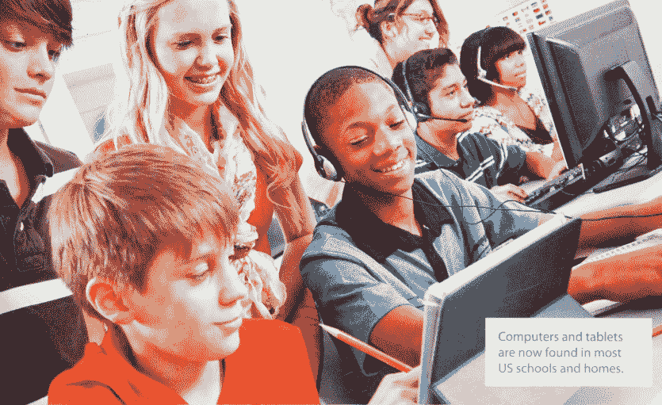

*计算机和平板电脑出现在美国大多数学校和家庭中。*

计算机无法理解用普通英语写成的指令。程序员必须学会以计算机能理解的方式编写程序。程序员用各种不同的编程语言编写程序。这些语言使用不同的单词、数字和符号组合来构成指令。如今有数百种编程语言在使用中。

### 代码长什么样？


每种编程语言看起来都略有不同。许多语言使用符号和特殊缩略词。对于未受过训练的程序员来说，编程指令往往可能难以阅读。下面是 Java 编程语言的一个示例。这段代码在屏幕上写出“Hello World!”这几个字。编写“Hello World”程序是程序员学习一门新编程语言时常见的第一个步骤。

```java
public class HelloWorld {
    public static void main(String[] args) {
        System.out.println("Hello World!");
    }
}
```

现代计算机出现只有几十年，但编程语言的思想已有悠久历史。最早思考编程的人之一是先驱阿达·洛芙莱斯。她在19世纪初开展了自己的工作。

### 创造最初的代码

洛芙莱斯出生于1815年。她接受的是非传统的成长教育。与同时代大多数女孩不同，她受到鼓励去学习数学和科学。在学习期间，她结识了科学家查尔斯·巴贝奇。巴贝奇设计了一种可用于数学计算的机械装置。

巴贝奇的机器被称为差分机。它与今天的计算机大不相同。它不使用电力、电路和微芯片，而是使用杠杆和齿轮。它可以快速完成一个人手工计算需要数小时的数学问题。用户会为问题设置装置的初始参数，然后转动曲柄让机器运转起来。

然而，完整的机器在巴贝奇有生之年并未建成。

### 你知道吗？

> 阿达·洛芙莱斯是英国著名诗人拜伦勋爵的女儿。阿达年幼时，拜伦离开了家庭。她的母亲担心阿达会像父亲一样喜怒无常、难以捉摸。她认为让阿达专注于学习数学和科学可以防止这种情况。

### 制造更复杂的机器

自洛芙莱斯时代以来，计算机和编程已经取得了长足发展。20世纪40年代，德国发明家康拉德·楚泽创造了被认为是第一台现代计算机的机器。它被称为 Z3，能够存储并执行指令。

美国编程先驱格蕾丝·霍珀在第二次世界大战期间从事早期计算机工作。她后来帮助开发了 UNIVAC I 计算机和一种名为 COBOL 的编程语言。霍珀曾在美国海军预备役服役，帮助美国海军开发和使用早期计算机。她最终晋升为海军少将。

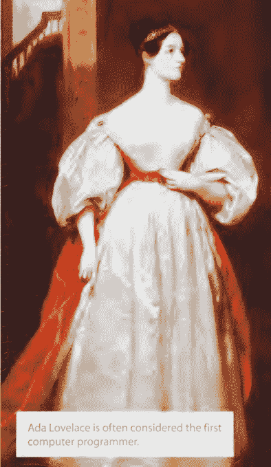

阿达·洛芙莱斯常被认为是第一位计算机程序员。

### 你知道吗？


> 康拉德·楚泽独自制造了他的早期计算机和编程语言。他在20世纪40年代工作，当时德国正在参加第二次世界大战。他的一些发明在战争期间被炸弹摧毁。

科学家和工程师继续制造改进的计算机。到20世纪50年代，编程语言出现了爆炸式增长。计算机公司 IBM 于1957年发布了 FORTRAN。这种语言的更新版本至今仍在使用。20世纪60年代，编程超出了解决数学问题的范围。计算机变得足够强大，程序员可以制作绘图或动画。这些早期根源最终促成了现代计算机动画电影。

20世纪70年代和80年代，个人计算机变得广泛可用。数以百万计的人现在家里有了计算机。编程不再只是实验室或大学专家的专利。人们可以学习创建自己的游戏或其他程序。

20世纪90年代带来了互联网，永远改变了计算机世界。互联网是连接世界各地计算机的框架。数据在这个庞大网络中从一台计算机传输到另一台计算机。其中一个主要用途


### 第一代家用电脑

苹果和IBM公司制造了早期的个人电脑。一些广告展示电脑在厨房中有用。用户可以存储食谱并用它们制定膳食计划。其他广告展示了电脑对家庭预算多么有用。这些早期电脑不像今天的机器那样易于使用。用户通常需要具备编程知识才能使用它们。如今，大多数用户从不会看到所用程序背后的代码。所有这些指令都在幕后执行。

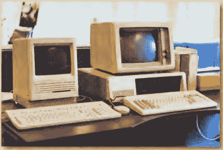

*早期的个人电脑比现在使用的电脑笨重得多。*

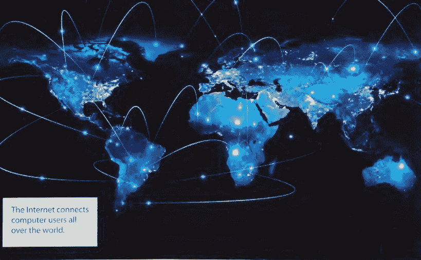

*互联网连接着世界各地的计算机用户。*

互联网的一部分是万维网。它是一组相互连接的页面，互联网用户可以在线访问。互联网的另一个用途是电子邮件，一种发送和接收消息的系统。使用互联网，程序员现在可以与其他用户共享程序。他们也可以为万维网编写程序。

**智能手机**和平板电脑在2000年代改变了编程格局。程序（也称为应用程序）将这些设备变成了工作和娱乐的强大工具。新的编程工具使编程比以往任何时候都更容易被更多人使用。

如今，编程的未来是光明的。计算机、智能手机和平板电脑几乎可以在社会的每个角落找到。这些机器使现代生活更高效、更有趣。有创造力的程序员将继续取得新进展，创造出创新程序，释放我们计算机化世界的潜力。


*一些智能手机应用让用户听音乐。*

## 什么是代码？

使用计算机时，人会与两个相关事物互动：硬件和软件。计算机硬件由其物理部件组成。屏幕、键盘和鼠标都是硬件。计算机内部的部件，如处理器和内存，也是硬件。

计算机软件由它运行的所有程序组成。一些程序管理硬件和软件如何协同工作。这些被称为**操作系统**。其他程序包括文字处理器、**网络浏览器**和游戏。

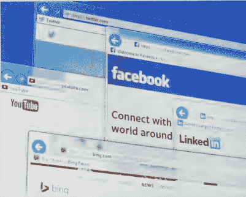

*网络浏览器允许用户访问社交媒体、视频、搜索引擎等。*

每种编程语言都有自己的优缺点，每种都最适合不同种类的程序。有些很适合制作电子游戏，而另一些则更适合台式电脑上的简单程序。当今一些主要语言包括C#、Python、Java和Swift。

> **你知道吗？**
>
> 美国第一个计算机科学系在印第安纳州的普渡大学。1962年10月，该系开门招生。如今，几乎每所大学和学院都有自己的计算机科学项目。

无论使用哪种语言，所有代码都有相同的基本功能。代码是供计算机处理器遵循的指令列表。处理器只能以**二进制**——由一和零组成的长序列——处理指令。最基本的编程语言——机器码——仅由一和零组成。二进制指令对程序员来说可能极难编写和阅读。为了让编程更容易，人们开发了使用符号、字母和单词的编程语言。在这些指令进入处理器之前，它们会被转换成等价的一和零序列。


*查找错误可能是编程中具有挑战性的一部分。*

### 查找错误

程序员使用编译软件将程序转换为二进制。他们输入自己编写的代码，编译器输出处理器能理解的一和零。编译软件还帮助程序员查找代码中的错误。如果某处输入错误或格式不正确，编译器通常能发现该问题。这被称为语法错误。一个软件可能有数千行代码，因此出现错误并不罕见。

代码中的错误看起来与普通文本中的拼写错误不同。C#语言使用诸如%、{、}、&和\*之类的符号。这些符号可以告诉程序去特定区域查找信息。意外漏掉一个\*可能会让程序突然停止。当程序员尝试运行软件而它完全无法工作时，他或她知道代码某处可能潜伏着语法错误。

另一种编程错误称为运行时错误。这是程序运行时发生的问题。程序一开始可能看起来运行正常，但它的某些功能可能没有正确工作。这类问题也称为漏洞。

> **你知道吗？**
>
> 大型程序，例如操作系统，可能包含大量代码。这会使查找微小错误变得困难。微软的Windows XP操作系统由4500万行代码组成！

### 处理漏洞

用bug一词描述一般错误早于计算机。它在计算机错误中的早期使用之一来自1947年9月的一次事件。技术人员当时正在研究一台美国军用计算机。那时，计算机有整个房间那么大。计算机出了故障，工作人员查找问题。他们发现一只飞蛾卡在其中一个部件中并导致了该问题。计算机先驱格蕾丝·霍珀在日志中写道：“第一次实际发现bug的案例。”

在计算机中，漏洞可能导致游戏崩溃。它可能使音乐应用突然跳过歌曲。它可能让视频聊天突然断开。但有些漏洞可能严重得多。其中一次发生在1983年9月23日。

那一天，一个俄罗斯军事基地响起了警报。该基地的软件称美国刚刚向俄罗斯发射了核导弹。指挥官们认为他们可能需要发射自己的导弹。这将导致一场毁灭性的战争。但斯坦尼斯拉夫·彼得罗夫中校认为导弹并不是真的来袭。结果发现是软件漏洞触发了警报。一个软件错误本可能导致战争。相反，彼得罗夫能够猜到事情有些不对劲。

生活在计算机世界中意味着要知道有时软件不会按预期工作。代码中会有错误和失误。在称为调试的过程中，程序员查找并修复这些错误，使他们的软件更好地工作。

### 像程序员一样思考

编程不仅仅是一份工作。它也是一种思维方式。像程序员一样思考可以更容易地成功编写代码。

像程序员一样思考涉及许多方面。首先，程序员应该记住，他们编写的代码需要被计算机理解。除非硬件存在缺陷，否则计算机不会犯错。它们完全按照指令行事。这些指令中的错误才是问题的根源。程序员必须逻辑地思考计算机将如何解释他们的指令，以防止此类问题。

### HTML

在万维网上书写内容最常见的方式之一涉及超文本标记语言（HTML）。起初HTML可能看起来像代码，但它实际上只是描述网站将是什么样子。HTML给网络浏览器提供关于在线文本和图片的大小、字体、排列和格式的指令。虽然HTML不是编程语言，但它与编程语言协同工作，制作出令人兴奋的网站。一种称为JavaScript的编程语言用于使网站更具交互性。JavaScript不同于名称相似的Java编程语言。JavaScript代码有时直接添加到构成网站的HTML文本中。

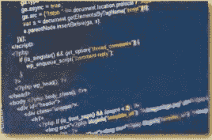

*HTML是构成大多数网站的语言。*


### 林纳斯·托瓦兹

大多数人拿到新电脑时，都会使用电脑预装的操作系统。如今最常见的操作系统是 Windows 和 macOS。另一个流行的操作系统 Linux 可以追溯到 1991 年。那一年，一位名叫林纳斯·托瓦兹的芬兰学生决定自己做一个操作系统。它很快以 Linux 之名广为人知。托瓦兹让它免费使用。托瓦兹的主要创新在于，其他程序员可以很容易地对 Linux 进行修改。这些修改会在网上共享。随着时间推移，Linux 的开发分成了几个不同的分支。不同的程序员群体把这个操作系统带向了不同的方向。这些不同版本的 Linux 被称为发行版。如今使用的主要发行版包括 Fedora 和 Ubuntu。


*托瓦兹与 Linux 的吉祥物——一只企鹅*

像程序员一样思考，不仅对程序员有用。在处理任何日常任务时，逻辑思考、拆分问题以及与他人协作，对任何人来说都是有益的做法。

## 现实世界中的编程

编程确实无处不在。由于世界上大部分事务都依赖计算机运行，编程是保障信息安全的重要一环。但犯罪分子——有时被称为黑客——可能利用他们的编程技能违法。大型企业也需要编程技能来跟踪海量数据。与此同时，代码还在娱乐大众方面发挥作用，让令人惊叹的特效成为可能。

### 加密

安全是网络上的一个重大问题。人们可能会发送包含敏感信息的电子邮件。他们可能会查询个人医疗数据或访问自己的银行账户。如果这些系统不安全，有人就可能窃取数据甚至金钱。幸运的是，程序员已经开发出**加密**程序，帮助保障网上信息安全。

加密软件的工作原理是隐藏网上发送信息的真实内容。例如，程序可能把消息中的每个字母转换成另一个字母。每个 *A* 可能变成 *B*，每个 *N* 可能变成 *Q*。单词 *an* 则会显示为 *bq*。接收消息的人会拥有知道字母对应关系的软件。消息会被还原。但如果有人截获了这条消息，他们只会看到无法读取的加密消息。

从事加密软件工作的程序员必须适应新情况。犯罪分子或间谍可能试图破解加密系统。如果他们得逞，就能读取加密文本，其中可能包含密码、银行账号和敏感信息。加密软件必须始终保持前沿，才能保障数据安全。


网上银行和购物需要加密来保障人们的数据安全。

### 拯救生命的应用程序


作为程序员的一部分工作，就是思考如何用代码解决现实世界中的问题。其中一些问题很简单。例如，需要控制预算的人可能会开发一个预算管理程序。其他类型的程序则可能旨在拯救生命。有一款这样的应用程序提供如何从自然灾害中幸存的信息。另一款则汇集了大量急救信息，以备紧急情况之需。许多应用程序还专为医生使用而设计，尤其是在农村地区。有些应用程序可用于辅助诊断疾病。例如，有人开发了一款应用程序，用来识别图片中出现的乳白色眼睛。这可能是某种眼癌的征兆。通过始终关注世界上的问题，程序员可以创造出帮助人们更安全、更健康地生活的软件……

### 黑客行为

并非所有程序员都心怀善意。有些程序专门设计来让用户获取他们本不应看到的信息。还有些程序旨在骚扰用户，甚至窃取钱财。这些被称为恶意软件。其中一种主要的恶意软件被称为病毒。

病毒是通常隐藏在另一个文件中的代码片段。例如，程序员可能把病毒代码添加到音乐文件中。当一个人下载该文件并播放歌曲时，计算机也会执行病毒代码中的指令。一旦进入计算机，病毒就可能造成严重破坏。它们可能删除文件或窃取信息。它们可能让计算机无法使用，直到用户向黑客付钱。它们甚至可能让黑客控制计算机。公司开发杀毒软件来查找并删除计算机中的病毒。黑客与杀毒软件程序员之间始终存在着一场持续的斗争。

### 大数据

近年来，计算机程序员一直在应对被称为大数据的现象。社交网络、企业、学校、科学家以及其他各方无时无刻不在收集海量数据。程序员已经学会如何管理所有这些信息并使其发挥作用。

地球上最大的数据集之一归 Facebook 所有。这个社交网站始于 2004 年，到 2016 年已拥有约 18 亿用户。这些用户分享照片、与朋友交谈，并在个人资料页面上填满他们最喜欢的名人和品牌。Facebook 利用所有这些数据帮助广告商瞄准用户的具体兴趣。该公司还收集人们如何使用 Facebook 的信息，甚至记录用户将鼠标停留在页面某些部分的时间。它在重新设计网站外观时会利用这类信息。

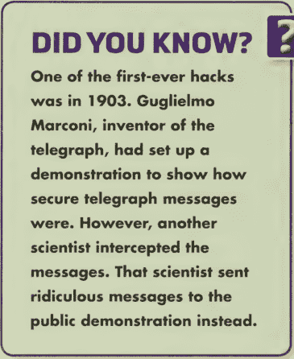


社交媒体应用程序通常会存储大量关于其用户的数据。

### 用代码制作电影

计算机和编程彻底改变了电影行业。这场革命在当今令人难以置信的特效中清晰可见。这一领域的程序员往往同时也是艺术家和设计师。计算机生成的特效最早于20世纪70年代进入电影。最早的重大里程碑之一是1973年的电影*《西部世界》*。在那部电影中，艺术家与程序员合作，创造了一个从机器人视角出发的场景。机器人能够感知体温。程序员制作了一段短镜头：整个屏幕都是红色的，只有一个人站立的位置呈现一片黄色和橙色。

> **你知道吗？**
>
> Facebook 将其收集的所有数据存储在称为数据中心的大型设施中。到 2016 年，它已建成四个数据中心。其中一个是一座面积为 307,000 平方英尺（28,500 平方米）的建筑。这比五个足球场还要大！

另一个重大里程碑是**三维计算机图形**。程序员面临的一大挑战是，如何让电影中的虚拟生物在真人旁边看起来栩栩如生。1993年的电影*《侏罗纪公园》*是第一部展示这项新技能的电影。艺术家绘制并雕刻出不同姿态的恐龙。这些作品被扫描进计算机。程序员使用动画软件让恐龙模型动起来。其他艺术家创作皮肤纹理，使恐龙看起来逼真。所有这些元素结合在一起，创造出一只可以放入场景中的恐龙。

> **你知道吗？**
>
> 1995年，第一部完全由计算机动画制作的电影*《玩具总动员》*登陆影院。这部电影由皮克斯创作，一经上映便大获成功。自那以后，皮克斯又发行了超过15部电影。每一部都为计算机动画世界带来了新的创新。

有些电影完全由计算机生成。皮克斯和梦工厂等公司完全在计算机上创作动画电影。他们使用专为此任务开发的软件。制作这种动画软件的程序员想办法让物体以逼真的方式运动。他们还研究如何让场景中的光线和阴影看起来真实。在电影世界里，艺术家和程序员携手合作，制作出精美的影片。

### 游戏

编程是电子游戏行业的核心部分。在某些方面，为电子游戏编程与程序员为电影所做的工作相似。这两个领域通常都涉及创建虚拟

每个步骤都需要复杂的编程，以确保所有部分能够组合在一起。


## 编程训练营

编程岗位众多，对优秀程序员的需求与日俱增。虽然人们可以通过大学获得编程学位，但其他教育途径也相继出现。其中一种方式就是编程训练营。训练营是强度大、沉浸式的编程课程，有些只有九周时间。它们通常专注于某项工作所需的特定编程技能。例如，如果一个人想找编写移动应用的工作，训练营就会专注于应用编程。训练营在年轻人中以及发展中国家尤其流行。在失业率高的地方，这种培训方式可以成为快速找到新职业的途径。

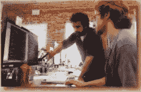

一位教师在一家编程训练营中指导学生。

无论是数据研究，还是一部娱乐电影或电子游戏，代码都是我们世界的重要组成部分。了解代码的运作方式，对于理解计算机如何改变现代生活至关重要。编程的灵活性意味着计算机几乎可以处理程序员能想到的任何任务。

## 为明天而编程

学生在学校里学习阅读和写作。但如果他们也学习编程呢？许多学校开始在课堂上教授编程。各个年龄段的学生都可以利用在线工具，在空闲时间开始学习编程。随着计算机不断渗透到日常生活的几乎每个角落，学习代码变得越来越重要。即使学生不想成为程序员，了解代码的运作方式也能帮助他们理解自己所生活的世界。

### 编程一小时

2013年，一个名为Code.org的组织成立。它的目标是为尽可能多的人提供编程教育。该组织特别关注那些原本可能无法接受计算机科学教育的学生。他们的许多活动都致力于招募女孩和有色人种参与。由于编程是数字世界如此重要的组成部分，确保每个人都有平等机会学习编程至关重要。

Code.org是“编程一小时”活动的发起方。这个60分钟的项目旨在向各个年龄段的学生介绍编程和计算机科学。如果学生感兴趣，可以继续学习更高级的编程课程。到2017年，全球已有超过3亿人尝试过“编程一小时”。

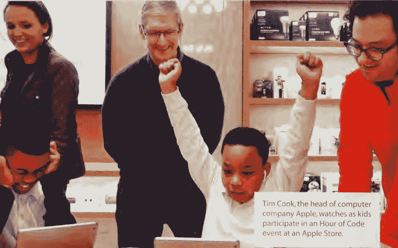

电脑公司苹果的负责人蒂姆·库克在苹果专卖店里观看孩子们参加“编程一小时”活动。

人们可以在家参与“编程一小时”，但每年Code.org也会举办一次全球性的“编程一小时”活动。该活动于12月初的计算机科学教育周期间举行。迪士尼、苹果和谷歌等合作伙伴帮助宣传活动。2016年，迪士尼根据动画电影《海洋奇缘》制作了一堂新的“编程一小时”课程。微软制作了与热门游戏《我的世界》相关的几个教程。包括科比·布莱恩特和塞雷娜·威廉姆斯在内的一组运动员帮助推广了一堂体育主题课程。而在世界各地的苹果专卖店里，学生们都可以参加一小时的编程课。

### 你知道吗？

编程网站有时会设置挑战，帮助学生磨练技能。它们为用户提供现实世界中的编程问题来攻克，帮助他们学会像程序员一样思考。

这些早期的编程课程通常使用一种叫模块化编程的概念。这意味着学生不必直接跳入代码编写，而是把带有命令的模块在屏幕上移动。这些模块上可能写着“向前移动”或“向左转”，屏幕上的角色随后会按照这些指令行动。这有助于学生理解向计算机发出逻辑指令的基本过程。随着课程推进，挑战会变得更加复杂，并加入更多模块命令。最终，学生们开始编写真正的代码。

## 在学校学习编程

在全国各地的学校中，编程正成为一门常见课程。除了数学和社会研究外，孩子们也在学习如何编写计算机程序的基础知识。这些课程大多设在初中和高中。提供编程课程的学校数量预计在未来几年还会增加。

学生们还通过课外班和暑期项目学习编程。其中之一是在南加州大学举办的CS@SC夏令营。这个为期一周的夏令营旨在让从学龄前到高中的学生尽早接触编程，帮助他们思考计算机在日常生活中的作用。学生们了解什么是计算机科学以及程序是如何编写的，还能提前感受一下大学生活。

学习编程除了为学生从事编程职业做好准备外，还有其他好处。它还能教导学生像程序员一样思考，从而提高他们在其他领域解决问题的能力。编程可以为学生提供另一套批判性思维工具，尤其是在思考如何应对各类大型项目时。

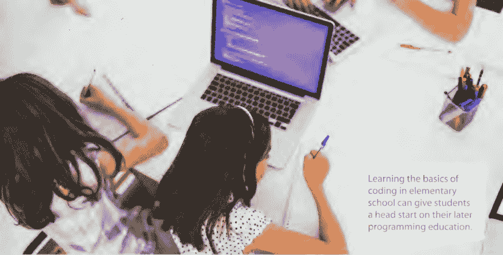

专家预测，未来对程序员的需求将会很大。高中时期没有接触过编程的学生，可能没有机会发现自己是否对此感兴趣。让学生尽早有机会编程，意味着更多人可能会选择学习计算机科学。这有助于满足未来对编码人才的需求。

## 面向移动未来的编程

### 你知道吗？

计算机与编程催生了好莱坞电影中的一种新型表演方式，即动作捕捉。演员身上贴满白色或绿色的点在演员表演某个场景时，特殊传感器会记录这些点的移动方式。随后，面部动作会被转换到数字角色上，比如外星人或魔法野兽。最终效果就像戴着一副高科技面具在表演。

到2010年代末，最热门的趋势是可穿戴技术。FitBit（健康手环）或Apple Watch（苹果手表）等设备佩戴在手腕上。有些设备追踪健康信息，如心率或跑步距离；有些则能发送消息或播放音乐。未来可能会带来更小、功能更强大的设备。想象一下珠宝与手机相连。一个人只需轻触耳环就能接听电话。为这些设备编写代码需要大量创造性思维。可穿戴技术最大的障碍之一是电池续航能力。小型设备只能容纳小电池。智能而高效的编程可以帮助这些设备以更低的功耗运行，从而延长电池寿命。

## 为虚拟空间编程

另一个需要创造性编程的领域是虚拟现实。虚拟现实将用户完全沉浸在一个截然不同的世界里。用户戴上头戴式显示器，就会被传送到一个虚拟地点。眼前的小屏幕营造出三维环境的错觉。耳机产生的声音听起来像是从特定方向传来的。当用户转动头部时，屏幕和耳机协同工作，在虚拟世界中匹配这一动作。

在虚拟现实中，用户在场景中移动并与虚拟物体互动。例如，戴上头戴设备后，用户可能正在探索一栋房子。当用户想要开门时，他或她会伸手去抓门把手。当然，门并不真正存在。程序员必须编写代码，在正确的位置显示门把手，并在用户抓握时使其转动。换句话说，游戏必须对用户所看到的和所做的事情都做出反应。

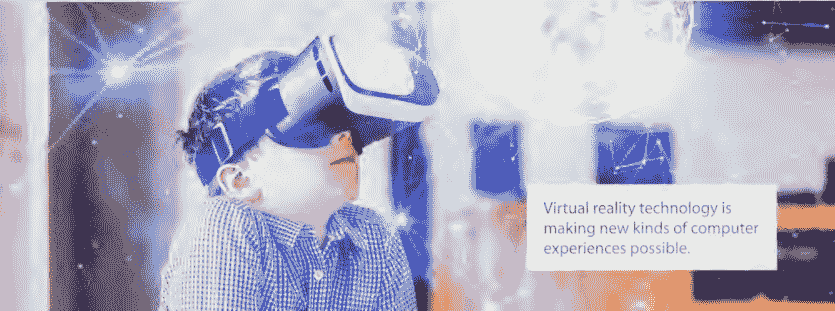


《精灵宝可梦GO》在2016年发布时，成为了增强现实迄今为止最热门的应用。

增强现实有类似的需求，但运作方式略有不同。虚拟现实涉及完全由计算机创造的世界，而增强现实则将计算机编程与现实世界相融合。最好的例子之一就是手机游戏《精灵宝可梦GO》。这款游戏在2016年夏天风靡全球。在《精灵宝可梦GO》中，用户会看到周围区域的地图。生物出现在地图上的特定位置。当用户点击一个生物时，地图消失，手机通过摄像头显示实时画面。一个三维渲染的生物出现在屏幕上，覆盖在摄像头画面之上。看起来就像


## HoloLens：将增强现实带入家庭

计算机公司微软创造了一款名为 HoloLens 的增强现实设备。HoloLens 是一副用户可佩戴的大眼镜。透过眼镜，用户能在自身环境中看到三维物体。想象一块手机屏幕悬浮在半空中。你可以点击电子邮件应用，它就会打开，让你无需使用键盘即可撰写信息。微软还认为，增强现实技术可以供艺术家使用。雕塑家可以在 HoloLens 应用中设计一座马雕像。然后，这座雕像可以由三维打印机制作出来。HoloLens 带来的编程机会巨大，但需要大量工作。由于 HoloLens 旨在供普通人使用，程序员将让大量用户测试他们的作品。

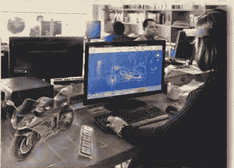

*这张微软宣传照片展示了一位摩托车设计师使用 HoloLens 在桌面上查看她的创作。*

这个生物确实存在于用户的环境中。

然而，程序员使用增强现实不仅仅是为了制作游戏。有些人设计了一种观察旧世界的新方式。当考古学家发现古代遗迹时，他们可能会尝试描述或勾勒这些遗迹曾经可能的样子。借助增强现实程序，他们可以看到这些复原景象叠加在遗迹本身上。走在希腊遗迹中的人可以举起手机或平板电脑，看到这个地方在公元前500年时的样子。

### 你知道吗？

真正智能的机器人所需的人工智能将不仅仅拥有知识。它还需要拥有情感。未来最逼真的机器人将被编码为懂得何时表现出悲伤、暴躁或快乐。

## 人工智能

当今编程领域的一个主要研究领域是人工智能。在这一领域，程序员致力于创建能够自行解决问题并适应新情况的智能软件。简单版本的人工智能造就了现代电子游戏中富有挑战性的电脑对手。这些对手经过编程，能够适应玩家行为所造成的新情况。例如，在橄榄球游戏中，人工智能可能会根据用户的比赛风格调整其球队的防守。制造更智能的机器人是人工智能的另一项应用。机器人吸尘器会学习如何清洁房间、如何避开障碍物，以及何时返回基座为电池充电。


然而，程序员还有许多其他方式将智能技术带给世界。计算机 Watson 是最著名的人工智能机器之一。它由 IBM 公司经过多年硬件和软件开发而打造。Watson 于2011年参加了智力竞赛节目 *《危险边缘》*。它击败了两名人类选手。IBM 后来调整 Watson，使其智能应用于医疗保健领域。它会分析各种各样的患者数据，然后向医生提出建议。2016年，IBM 宣布 Watson 也将开始从事天气预报工作。


### 自修改代码

当一个程序成为自己的程序员时，会发生什么？尽管人类程序员努力使软件完美运行，但他们无法预见可能出现的每一个问题。与其让程序员返回并重写代码，自修改程序可以直接重写自己的代码。人们希望这种智能软件能够自我调整以执行复杂任务。例如，美国政府希望制造出能够基于大量复杂信息评估形势的自学习计算机。计算机能存储的数据量远超人类分析师。一台能够访问所有这些信息的智能、可适应计算机，或许能够在自然灾害或战争等高风险情境中提出最佳决策建议。

### 编码新世界

随着计算机和电子设备变得越来越复杂，编码也必须随之调整。程序员将继续开发创新的新软件，以便在这些机器上运行。从动画电影到虚拟电子游戏再到天气预报，代码在我们数字化的未来中有着几乎无穷无尽的用途。

## 词汇表

- **二进制**（BYE-nary）：一种仅由1和0组成的数字系统。
- **编译器**（com-PIE-ler）：一种将代码转换为可在计算机上运行程序的软件程序。
- **加密**（en-CRIP-shun）：将信息转换为一种防止其被读取的形式的过程。
- **操作系统**（OP-er-ay-ting SIS-temz）：计算机上最基础的软件，帮助其他软件与硬件协同工作。
- **处理器**（PRAW-sess-er）：计算机中执行程序指令的部分。
- **智能手机**（SMART-fonez）：具有大触摸屏和强大处理器、可运行应用的手机。
- **三维的**（three-duh-MENSH-un-uhl）：具有高度、宽度和深度。
- **网络浏览器**（WEB brow-zerz）：允许用户访问万维网（互联网的一部分）的软件程序。

## 更多信息

### 书籍

- 希瑟·莱昂斯和伊丽莎白·特威代尔，*《学习编程》*。明尼苏达州明尼阿波利斯：Lerner Publications，2017年。本书为初学程序员提供了一些基础知识，解释了算法、循环和变量等概念。
- 乔恩·伍德科克，*《Scratch 编程游戏：构建你自己的计算机游戏的逐步可视化指南》*。纽约：DK，2016年。这本面向新程序员的指南展示了如何使用 Scratch 编程语言构建程序。用户可以创建拼图、迷宫和其他互动游戏。
- 肖恩·麦克马纳斯，*《10堂简单课程教你编程：学习如何设计和编写你自己的计算机游戏》*。加利福尼亚州莱克福里斯特：Walter Foster Jr.，2015年。这本实用指南分解了新程序员应学习的十项关键技能。读者将能够创建游戏和网页。
- 塔米·加涅，*《计算机科学中的女性》*。明尼苏达州明尼阿波利斯：Abdo Publishing，2017年。本书收录了女性在计算机科学许多领域（包括编程）做出非凡工作的例子。
- 特蕾丝·纳伯，*《计算机如何改变历史》*。明尼苏达州明尼阿波利斯：Abdo Publishing，2016年。在本书中，探索计算机如何从昂贵的、房间大小的机器变成数百万人每天随身携带在口袋里的东西这一惊人故事。

### 网站

- **代码学院**（https://www.codecademy.com/）代码学院网站提供许多不同编程语言的免费课程，包括 Python、Java 和 Ruby。
- **Made w/Code**（https://www.madewithcode.com/）由科技公司谷歌运营的 Made w/Code 网站收录了许多有趣好玩的编程项目。
- **编程一小时**（https://code.org/learn）编程一小时的网站提供了数十个编程教程的链接。许多教程以热门角色为主角，例如《星球大战》电影和《我的世界》中的角色。
- **Scratch**（https://scratch.mit.edu/）麻省理工学院（MIT）运营这个编程网站，该网站使用一种名为 Scratch 的易学编程语言向用户介绍编程概念。
- **Lightbot**（https://lightbot.com/）在 Lightbot 网站上，用户可以使用基本编程概念解决谜题，从而帮助自己像程序员一样思考。

**A**

- 分析机，8
- 苹果公司，11，33，36
- 应用，13，18，20，23，30，39
- 人工智能，40–42
- 增强现实，38–40

**B**

- 查尔斯·巴贝奇，7–8
- 大数据，25–26
- 二进制，15–16
- 科比·布莱恩特，33
- 程序错误，17–18

**C**

- 编程
  - 训练营，30
  - 在学校中，34–35
- 编译器，16
- 计算机
  - 硬件，14，18，41
  - 软件，14–15，16–17，18，23–24，40

**D**

- 数据中心，27
- 差分机，7，8

**E**

- 电子邮件，12，22，39
- 加密，22–24
- 错误，16–18
  - 运行时错误，17
  - 语法错误，16–17

**F**

- Facebook，26，27
- 健身设备，36

**G**

- 游戏，4，10，15，18，20，28–30，33，38，40–42
- 谷歌，33

**H**

- 黑客，24–25
- “Hello World”程序，6
- 格蕾丝·霍珀，9，17
- 编程一小时，31–33
- HTML，19

**I**

- IBM，10，11，41–42
- 互联网，10，12–13

**L**

- Linux，21
- 拜伦勋爵，7
- 阿达·洛芙莱斯，6–9

**M**

- 恶意软件，24–25
- 古列尔莫·马可尼，25
- 路易吉·费德里科·梅纳布雷亚，8
- 微软 HoloLens，39
- 微软 Windows XP，17
- 《我的世界》（游戏），33


### M

- 动作捕捉，36
- 电影，26–28，36

### N

- 全国 STEM 电子游戏挑战赛，20

### O

- 操作系统，17，21

### P

- 个人电脑，10–11
- 彼得罗夫，斯坦尼斯拉夫，18
- *宝可梦 GO*（游戏），38
- 编程语言，6
  - C#，15
  - COBOL，9
  - FORTRAN，10
  - Java，6，15
  - JavaScript，19
  - Python，15
  - Swift，15
- 普渡大学，15

### R

- 机器人，27，40，41

### S

- 自修改代码，42
- 智能手机，13，35
- 社交网络，25–26

### T

- 平板电脑，13，40
- 电报，25
- 像程序员一样思考，18–21
- 三维计算机图形学，27–29
- 托瓦兹，林纳斯，21
- 玩具总动员（电影），28

### U

- UNIVAC I，9

### V

- 虚拟现实，37，38
- 病毒，24–25

### W

- 沃森（计算机），41–42
- 网页浏览器，15，19
- *西部世界*（电影），27
- 威廉姆斯，塞雷娜，33
- 第二次世界大战，9，10
- 万维网，12–13，19

### Z

- Z3，9
- 楚泽，康拉德，9，10

惊人的技术突破时刻都在发生。科学家和工程师将新想法变为现实，企业则将其付诸实践。《科技快讯：高科技》探索了一些正在改变现代世界的非凡设备和系统。探索这些高科技发明的历史、发明者在过程中遇到的障碍，以及这些技术如何融入社会文化。每本书都包含快速事实、词汇表、索引以及获取更多信息的资源。

## 编程

编程是用计算机能理解的语言向计算机发出指令的过程。它释放了现代技术的力量，使计算机能够完成程序员所能设想的任何任务。学习编写代码正成为我们高科技世界中一项重要技能。

### 你知道吗？

- 程序员使用的编程语言有数百种。
- 单个计算机程序可以包含数百万行代码。
- 计算机上发生的一切，从电子游戏到电子表格再到浏览互联网，背后都有代码使其运行。

