# Anna 与 Elsa 的编程之旅：冰雪奇缘 Blockly指南 (迪士尼冰雪奇缘)


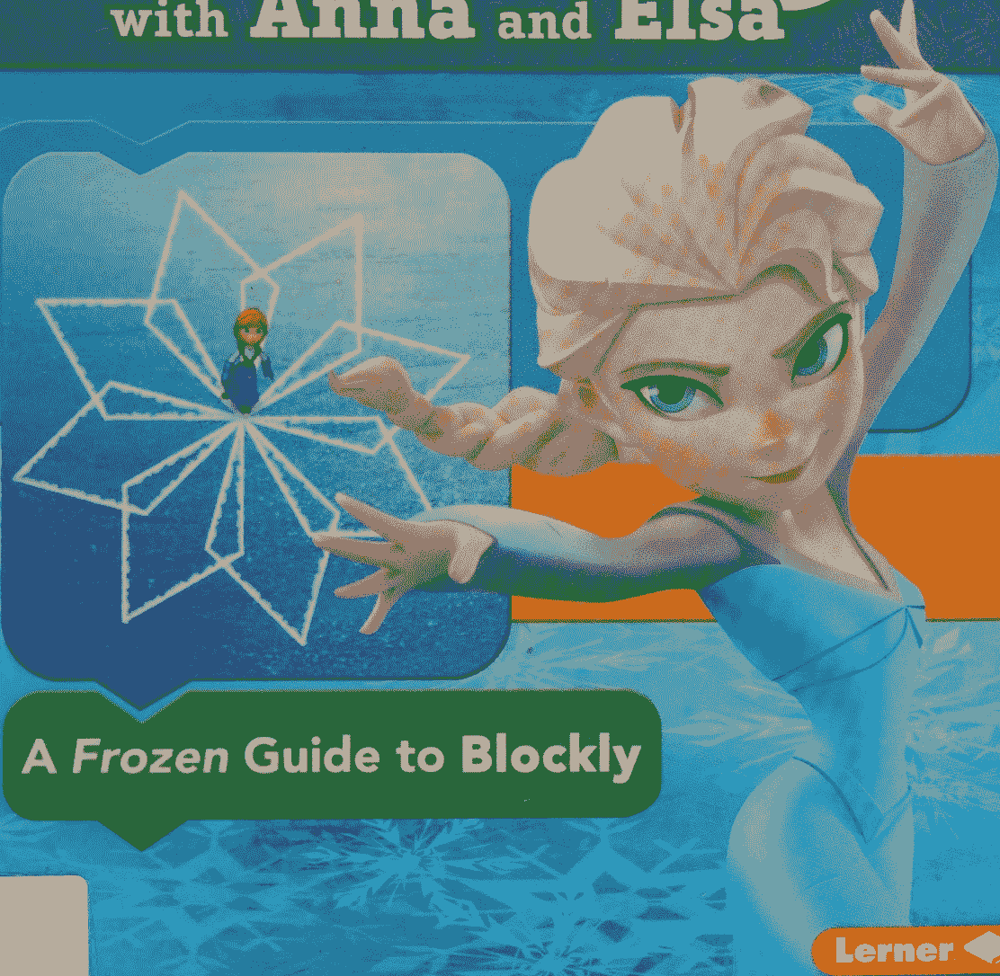


## 你想学习一种可以帮助你构建自己计算机程序的特殊语言吗？
加入安娜和艾莎的行列，发现如何编写代码来让你创造出惊人的绘画和设计吧？

## 引言

世界各地的人依靠计算机程序以各种方式进行交流。这些程序是如何创建的？又是什么让它们在计算机上运行的呢？

在这书中，你将学习如何使用代码块来告诉计算机做什么。但在之前，请通过阅读第 4 页和第 5 页来了解更多关于编程世界的内容。然后讨论下方的的问题和词汇表。

## 漫游书籍

- 看看封面上的图片。你认为这本书是关于什么的？你认识这些角色是谁吗？你熟悉《冰雪奇缘》吗？
- 这本书的标题是《和安娜、艾莎一起编程》。它完全是关于一种“告诉”计算机如何做决策的编程。你认为《冰雪奇缘》中的角色在这场冒险中扮演什么样的角色？
- 找到目录页并查看每个章节的标题。有你已经认识的术语吗？你以前在哪里见过它们？
- 这书中共有 24 个编程活动。浏览第 8 到第 45 页。每个章节的活动有什么相似之处？你认为角色在每个章节中扮演什么样的角色？
- 阅读第 6 页顶部的两个段落。根据提供的信息，你认为将使用这本书学习编程？

## 词汇表

当你使用计算机语言时，将学习许多新词。这里是一些你需要知道的重要词汇。跳过前 16 页。你能找到这些词汇吗？接下来，在第 48 页的词汇表中找到它们。如果你需要理解书中的一些新词，请使用词汇表。

```
block-based
code
debug
parameter
pixel
remix
sequence
```

## 现在，让我们编程吧！


作者 Kiki Prottsman

特别感谢 Marie Thomas, Simon Tatom 以及 Code.org。


Minneapolis, MN 55401 USA


美国制造

1-44852-35722-4/18/2018

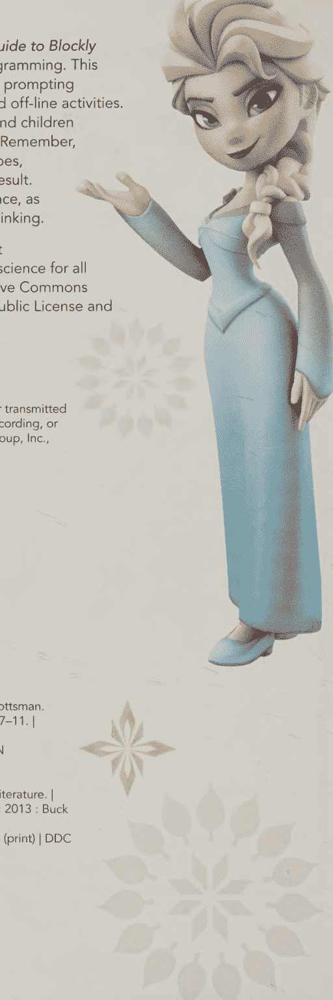


### 为什么要编程？

我们每天使用的许多设备都需要代码来工作。计算机是装满了从一个区域到另一个区域移动电流的盒子。没有代码，它们并不高明。只有通过代码，计算机才能理解如何播放音乐、显示图像或运行游戏。

编程开启了无限可能的大门！当你使用应用程序、看到交通信号变化甚至汽车时，代码都在运行。使用块编程来创作惊人的图画。准备一个笔记本和书写工具。当你进行项目时，你会把大问题拆成更小的部分。这使得它们更容易解决。通过一些练习，你会发现现实世界中的挑战也可以同样的方式处理！


### 游览

编写程序并观察它们运行太有意思了！我们将使用 Code.org 上的冰雪项目网站来创建我们的程序。访问该网站请前往 studio.code.org/projects/frozen/。

你准备好和艾莎（Elsa）和安娜（Anna）一起画画了吗？太好了！你要做的第一件事是了解你将空间。让我们之旅这个编程网站。三个主要的区域可以探索。

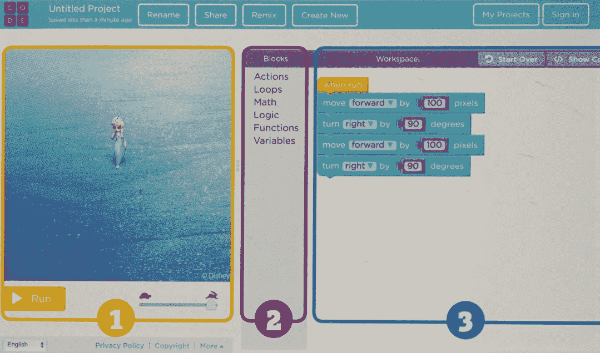

#### 播放区域：
这是你的代码运行的地方。在你构建好程序后，点击 **Run**（运行）按钮查看你的代码的作用！

#### 工具箱：
这里存储了所有的代码块。代码块根据描述其工作类型的标签进行组织。例如，你会在 **Actions**（动作）标签下找到 **move forward**（向前移动）代码块。

#### 工作区：
这是你构建代码来画画的地方。从工具箱中拖出一个代码块到这里，并点击它将其添加到程序中。如果你想删除任何代码块，将它们拖回工具箱即可。

### 有用提示

* 如果你想保存你的项目，需要在开始之前创建一个账户。请确保获得成人的许可和帮助。

* 要开始新项目，请使用页面顶部的 **Create New**（新建）按钮。

* 使用 **Rename**（重命名）按钮给你的项目起一个描述其功能的名称。选择一个有趣且好记的名字！

* 在点击 **Run** 按钮后，它会变成 **Reset**（重置）按钮。使用 **Reset** 清空播放区域并继续编写你的程序。

* 注意 **Run** 按钮右侧的滑块。如果你想让画画得快一点，将滑块向兔子移动。如果你想让画画得慢一点，将滑块向乌龟移动。

* 冰雪项目网站提供多种语言。语言选择器位于播放区域下方、左下角。点击按钮查看可用语言。然后选择你想要的语言。

| 阿拉语 |
| :--- |
| 阿塞拜疆语 |
| 保尔利亚语 |
| 波斯尼亚语 |
| 加泰罗尼亚语 |
| 捷克语 |
| 丹麦语 |
| 德语 |
| 希腊语 |
| 英语 |
| 西班牙语（西班牙） |
| 西班牙语（墨西哥） |


## 我们开始吧！

阿伦德尔王国是一个美丽的冬日。艾莎女王和安娜公主非常兴奋。她们正在举办一场冰画活动，以感谢王国的冰块采集者。让我们帮助他们让这次活动成为难忘的记忆！

* 1 点击 **Create New** 按钮。这将启动一个新项目。使用 **Rename** 按钮将你的项目命名为“Warm-Up”（热身）。

* 2 帮助艾莎在行走时在冰上画一条直线。首先，点击 **Actions** 标签。然后将 `move forward by 100 pixels` 拖到工作区。计算机图像是由微小的彩色像素组成的。`move forward` 代码块告诉电脑艾莎将移动多少像素。将其连接到 `when run` 代码块的底部。点击 **Run** 按钮时会发生什么？

* 3 很难看到我们刚刚画的线，因为艾莎站在它前面！拖出一个 `turn right by 90 degrees` 代码块。将其插入到 `when run` 代码块和 `move forward by 100 pixels` 之间。点击 **Reset** 按钮。然后运行你的程序。


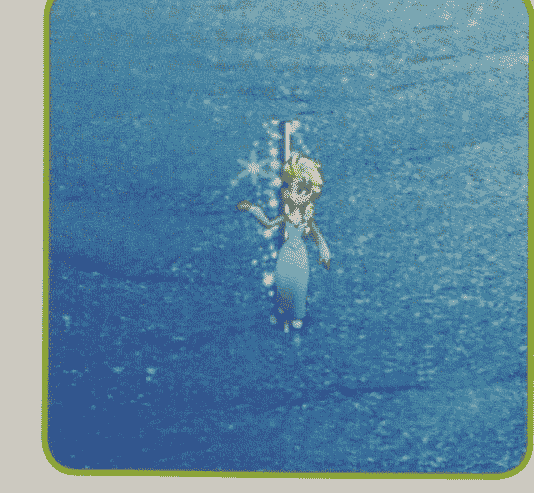

| when run |
| :--- |
| turn right by 90 degrees |
| move forward by 100 pixels |

现在让我们让安娜试试！在 **Actions** 标签下找到 `set character to Anna` 代码块。将其拖入工作区。将其连接在 `when run` 代码块和 `turn right by 90 degrees` 之间。点击 **Run** 看着安娜画出她的线。让我们看看改变参数时会发生什么。将 `jump backward` 参数改为“75”。将 `move forward` 参数改为“150”。然后点击 **Run**。发生了什么？安娜想在冰上的某个地方画她的线！在 **Actions** 下取出一个 `jump forward by 100 pixels` 代码块。将其点击到你程序中 `set character` 代码块的下方。你看到“forward”一词旁边的小箭头了吗？点击它，你将看到一个有两个选项的下拉菜单。点击单词“backward”。现在你有了一个 `jump backward by 100` 的代码块。


| jump forward by 100 | backward |
| :--- |
| set character to Anna |
| when run |
| backward by 75 |
| turn right by 90 |
| move forward by 150 |

你会注意到很多代码块都有你可以更改的内容。这些被称为**参数**（parameters），它们让你以多种方式使用一个代码块。`jump` 代码块还有一个参数：像素的数量。通过更改参数来尝试！

### 顺序

奥拉夫等不及要展示他的设计了！看看这些画。它们是用相同的代码创建的，但以不同的**顺序**（sequence）。在你的笔记本上，匹配这些代码。提示：奥拉夫正对着播放区域的开始。

```
move forward by 50
turn left by 90
move forward by 50
turn right by 90
move forward by 50
```

### A

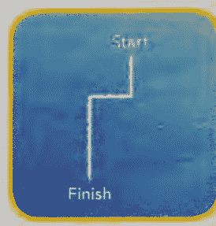

```
turn left by 90
move forward by 50
turn right by 90
move forward by 50
```

### B

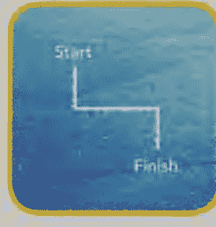

```
move forward by 50
turn right by 90
move forward by 50
turn left by 90
```

### C

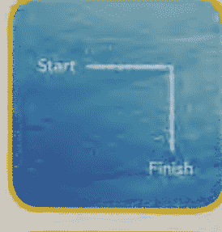

```
move forward by 50
turn left by 90
move forward by 50
turn right by 90
```

### D

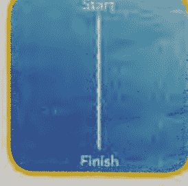

1
2
3

### 解决问题

安娜画了一个迷宫。你可以帮助他找到出口吗？创建一个这个页面的副本。提示：奥拉夫在播放区域的底部。逐行阅读程序。找出出错的代码块。在你的副本中，什么发生了什么？哪些代码块需要交换？

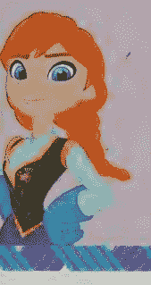

| turn right by 90 | move forward by 100 |
| :--- | :--- |
| move forward by 100 | turn right by 90 |
| move forward by 100 | turn right by 90 |
| move forward by 150 | turn right by 90 |
| move forward by 200 | |

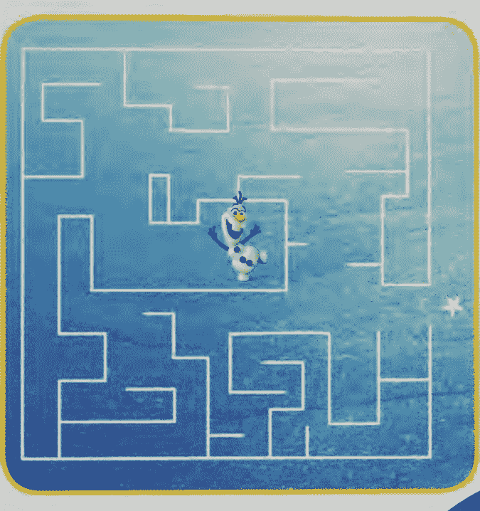

### 你知道吗？

* 每个程序员都会犯错。重要的是能够发现并修复它们！这个过程被称为**调试**（debugging），因为你正在消除程序中的错误（bugs）。

### 画方形

艾莎在冰上创作设计非常开心。让我们帮助她画一些冰立方。从正面看，冰立方就像一个正方形。你可以利用所学的知识找出如何画一个正方形吗？

* 1. 创建新项目并将其命名为“Square”。

* 2. 研究这张图片，找出你需要哪些代码块。在笔记本上规划你的程序。

* 3. 完成后，在线构建你的程序并运行它。如果画作不像你预期的那样，不要担心！只需进行一点调试找出哪里出了问题。你会可以的！

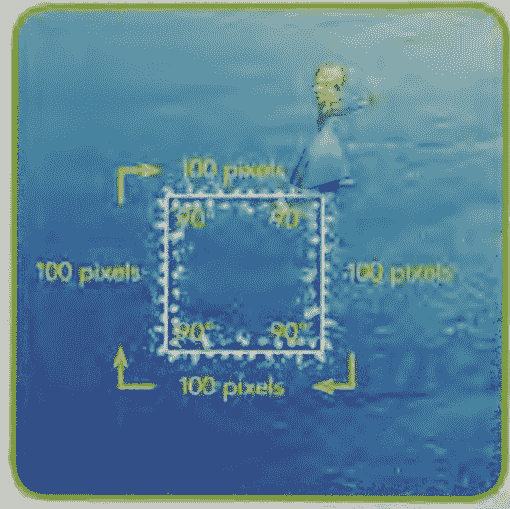

> **有用提示** 当你混用（remix）一个项目时，它会创建一个副本供你玩。这可以保持原始项目代码的安全。

4 现在在第一个正方形旁边画另一个。点击页面顶部的 Remix 按钮。这将创建一个项目的副本。将项目重命名为“Two Squares”。通过复制第一个正方形的代码来添加代码块。你的程序应该是这样的：

5 再次查看你的代码。你需要做什么才能得到这样的画作？提示：第二个正方形的每边只有 50 像素长。

```
move forward [100] pixels
turn right by [90] degrees
move forward by [100] pixels
turn right by [90] degrees
move forward by [100] pixels
turn right by [90] degrees
move forward by [100] pixels
turn right by [90] degrees
move forward by [100] pixels
turn right by [90] degrees
move forward by [100] pixels
```

6 你需要在哪里添加一个 `jump forward by 100 pixels` 代码块来创建这样的画作？

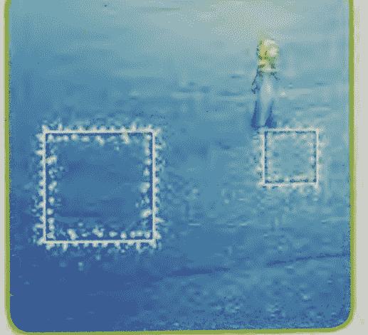


### 添加一个三角形

Anna 喜欢 Elsa 画的画！她想更进一步，添加一个不同的形状。让我们帮助她创建一个包含正方形和三角形的设计。

- 因为 Anna 想在她的设计中包含一个正方形，让我们复用你“Square（正方形）”项目的代码。首先，打开你的“Square”项目。重混该项目并将其重命名为“Sisters Design”。

- 你会发现项目已经有了画正方形所需的代码。这是一个很棒的快捷方法！在这个活动中，我们将和 Anna 一起画画，将 **set** 角色拖到 **run** 和 **move forward** 块中。将它放在 when run 块之间。

- 现在添加代码块来画一个与正方形重叠的三角形。这里是程序可能性的示例。你可以随意调整参数。尝试让设计变大或变小，直到你满意为止。

```
set characters to Anna
move forward by 100 steps
turn right by 90 degrees
move forward by 100 steps
turn right by 90 degrees
move forward by 100 steps
turn right by 90 degrees
move forward by 100 steps
turn right by 120 degrees
move forward by 120 steps
```

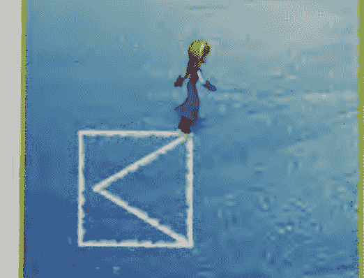

模式是重复的东西。帮助 Anna 用她的设计创建一个模式。重混你的项目并将其重重命名为“Sisters Pattern”。如果你想让 Anna 画三次这个设计，你会如何修改代码？

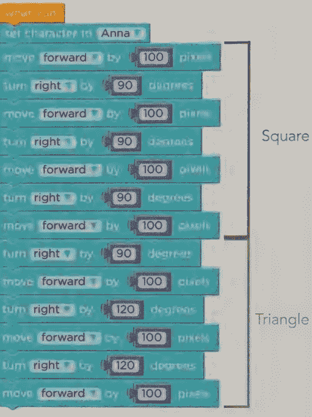

### 你知道吗？

角度告诉我们旋转的角度有多大。你可能已经知道一些关于角度的信息了。例如包括：

- 正方形的每个角都是 90 度。
- 直线的度数是 180 度。
- 圆形的总度数是 360 度。
- 等边三角形的每个角都是 60 度。

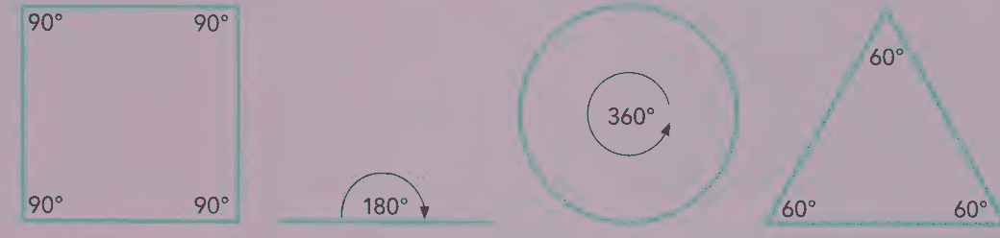

你会注意到 Anna 在“Sisters Design”中画了一个等边三角形。你是否好奇为什么我们程序化的旋转是 120 度而不是 60 度？问得好！当 Anna 和 Elsa 在你的程序中画形状时，它们是在形状外面。它们沿着外面画角。我们为该形状使用外角。外角与内角不同。

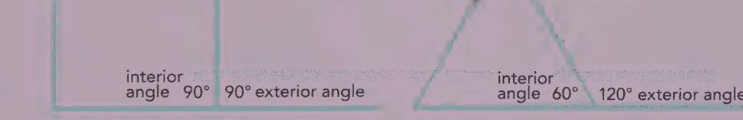

假设我们要创建一个内角为 60 度的形状。我们必须在形状的外部旋转 120 度。这是因为 120 度 + 60 度 = 180 度。这两个角度相加形成一条直线，度数为 180 度。

这样想：Elsa 正在直线上行走。然后她向左转了 120 度并继续走。她刚刚形成的角度的右侧是 120 度。角度的左侧是 60 度。

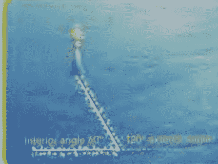

### 调试

你想画一个雪人吗？Olaf 当然想！但他的画作中有些不对劲。通过调试下面的代码帮助 Olaf 修复画作。每幅画都有一个不属于它的元素。看代码。复制此页面。然后划掉为了让绘画正确需要删除的块。

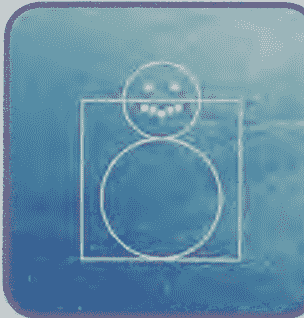

1

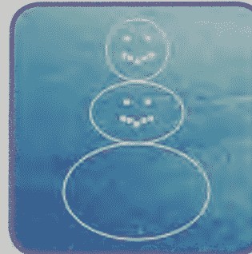

2

- when run
- when run
- Draw Head
- Draw Head
- Draw Face
- Draw Face
- Draw Body
- Draw Medium Oval
- Draw Square
- Draw Face
- Draw Large Oval


3

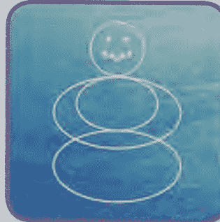

4

- when run
- when run
- Draw Head
- Draw Head
- Draw Face
- Draw Face
- Draw Large Oval
- Draw Medium Oval
- Draw Large Oval

### 重复循环

Anna 下方的设计使用了重复循环。此块内部的代码是一个循环，将按照你指定的次数运行。这使得重复执行某些操作变得简单。在你的笔记本上，将每个程序与正确的设计匹配。提示：Anna 开始时面向游戏区域的底部。尝试在通过代码时用手指追踪设计。

```
repeat 4 times
  move forward by 40 steps
  turn right by 90 degrees
  move forward by 40 steps
  turn left by 90 degrees
```

repeat 4 times

1

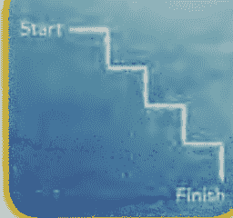

```
repeat 4 times
  turn left by 90 degrees
  move forward by 40 steps
  turn right by 90 degrees
```

2

B

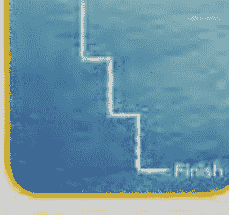

```
repeat 3 times
  turn right by 90 degrees
  move forward by 60 steps
  turn left by 90 degrees
```

3

C

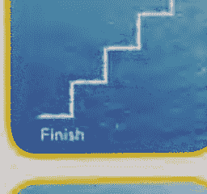

```
repeat 3 times
  turn left by 90 degrees
  move forward by 30 steps
  turn right by 90 degrees
```

4

D


### 重复的模式

Anna 喜欢制作模式。她正在考虑使用阶梯设计创建一个钻石。

- 创建一个新项目并将其命名为“Diamond Stairs”。

- 现在是让 Anna 从游戏区域顶部到到底创建阶梯了。在工作区中添加这些代码。

```
set character to Anna
move backward by 150 steps
turn right by 90 degrees
move forward by 150 steps
turn left by 90 degrees
```

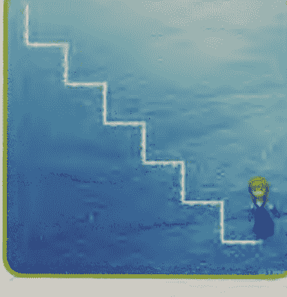

```
repeat 6 times
  move forward by 50 steps
  turn left by 90 degrees
  move forward by 50 steps
  turn right by 90 degrees
```

> 你知道吗？
> 循环可以节省我们大量的工作。想象一下如果我们不用重复循环来编写 Anna 的阶梯设计，我们需要逐行编码！循环为我们提供了强大的快捷方法。

为了完成这个设计，让 Anna 旋转 180 度。然后再次运行阶梯代码。太棒了！

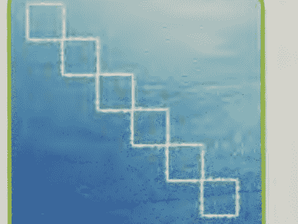

```
repeat 6 times
  move forward by 50 steps
  turn left by 90 degrees
  move forward by 50 steps
  turn right by 90 degrees
```

尝试这些额外挑战！

- 如果 Anna 在重复循环之间旋转 180 度会怎样？你认为为什么会那样？
- 如果 Anna 在重复循环之间旋转 170 度会怎样？
- 重混你的项目并调整你的参数。尝试在每个阶梯模式中使用 80 度代替 90 度。尝试让每个阶梯变长或变短。尝试不同的绘画位置。更改向前/向后和向左/向右参数。更改重复循环中的数字。去吧！

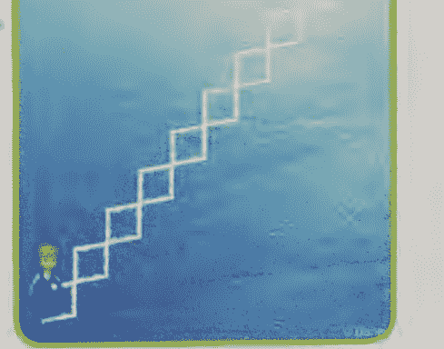

### 带循环的“Sisters Design”

Elsa 非常喜欢 Anna 创建的阶梯设计。她想她是否可以使用类似的策略来画“Sisters Design”。

- 找到你的“Sisters Design”项目。重混该项目并将其重命名为“Sisters Loop”。

- 将 set character 参数改为“Elsa”。

- 将一个重复循环拖入工作区。将参数改为“4”。将正方形的前两行代码放入循环中。现在你可以从工作区中删除剩余的正方形代码。

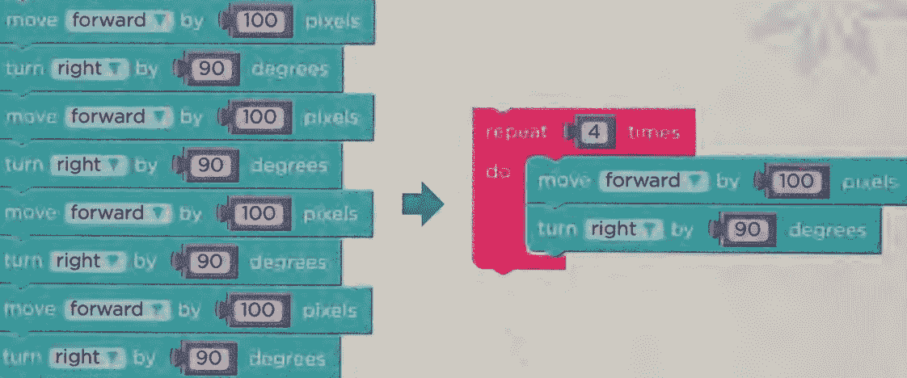


## 将另一个重复循环拖到工作区。将参数更改为“3”。
将三角形的前两行代码放入循环中。删除三角形的其他代码。

```
move forward 100 pixels
turn right 120 degrees
move forward 100 pixels
turn right 120 degrees
```

```
repeat 3 times
do move forward 100 pixels
turn right 120 degrees
```

将你的两个重复循环放置在设置角色区块下方。你的程序看起来像这样：

```
when run
set character to Elsa
repeat 4 times
do move forward 100 pixels
turn right 90 degrees
repeat 3 times
do move forward 100 pixels
turn right 90 degrees
```

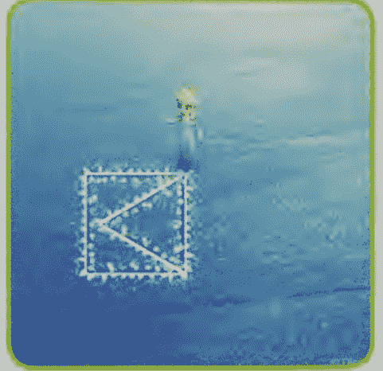

现在运行你的代码。你会发现 Elsa 的设计和第 14 页的 Anna 的是一样的。你还会注意到，使用重复循环可以让我们少写几行额外的代码。这些循环真的有用！

> **你知道吗？**
即使它们创建了相同的设计，Elsa 和 Anna 的画看起来略有不同。这是因为每个人都有独特的绘画风格。Elsa 使用冰雪魔法创作，而 Anna 使用冰鞋创作。

## 嵌套循环

看到 Elsa 使用“姐妹花设计”工作让 Anna 有了一个灵感。她认为这可以用来制作一个漂亮的雪花！

- 当你点击运行时，Anna 将画六次“姐妹花”图案，每次之间旋转 60 度。你帮助 Anna 制作了一个有趣的雪花！

- 将角色参数设置为“Anna”。然后在你的代码末尾添加一个向右转区块。将角度参数改为“60”。

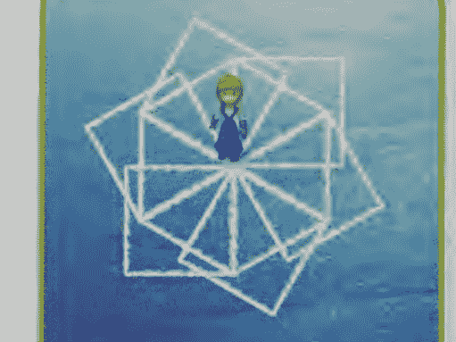

- 将一个重复循环拖入工作区，并将参数更改为“6”。将重复循环直接放在设置角色区块下方。然后将剩余的代码块拖入重复循环内部。

```
when run
set character to Anna
repeat 6 times
  repeat 4 times
    move forward 100 pixels
    turn right 90 degrees
  repeat 3 times
    move forward 100 pixels
    turn right 120 degrees
turn right by 60 degrees
```

如果你想让“姐妹花”图案重复七、八或九次，你需要更改什么？

### 你知道吗？

要确定一个形状旋转多少度才能绕一整圈并不难。你只需要一点数学知识！

- 计算出你想让形状绕圈几次。

- 将 360 度（圆圆周的角度数）除以那个数字。结果就是你需要旋转的角度数！

以 Anna 使用“姐妹花设计”画的雪花为例。她让该设计旋转了 6 次。360 度 / 6 = 60 度。这就是为什么我们在代码中使用 60 度的原因。

看下方的 Elsa 的设计。它使用了 8 个正方形。360 度 / 8 = 45 度。这意味着我们在每个正方形后需要旋转 45 度。

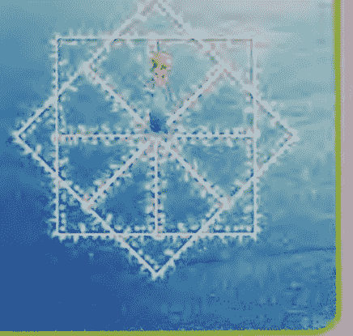

如果我们想让正方形旋转 10 次，我们会使用多少度？在你的笔记本上完成这个方程式找到答案：

360 degrees / ___ = ____

```
set character to Elsa
repeat 8 times
  repeat 4 times
    do move forward 100 pixels
    turn right 90 degrees
turn right 45 degrees
```

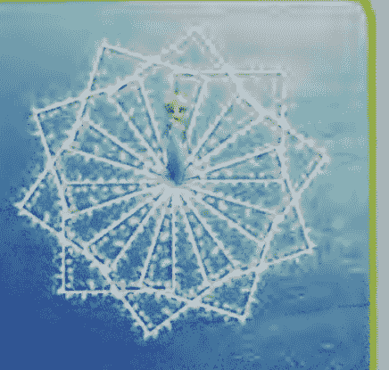

```
set character to Elsa
repeat 10 times
  do repeat 4 times
    do move forward 100 pixels
    turn right 90 degrees
turn right ?? degrees
```

### 嵌套设计

Olaf 被 Anna 和 Elsa 启发了。他想创建一些自己的酷炫设计。复制此页面。下面的画使用了嵌套循环。你需要重复每个代码块几次来得到每个图像？

#### 绘画

#### 重复外层循环

1

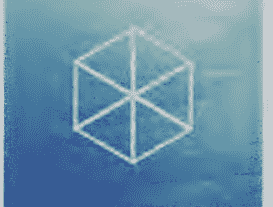

```
repeat 7 times
  repeat 3 times
    move forward by 100 pixels
    turn right by 120 degrees
  turn right by 60 degrees
```
次

2

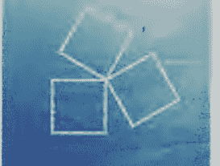

```
repeat 7 times
  repeat 4 times
    move forward by 100 pixels
    turn right by 90 degrees
  turn right by 120 degrees
```
次

3

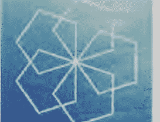

```
repeat 7 times
  repeat 5 times
    move forward by 100 pixels
    turn right by 72 degrees
  turn right by 120 degrees
```
次

4

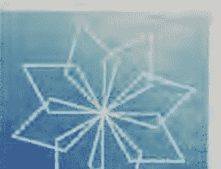

```
repeat 7 times
  repeat 2 times
    move forward by 100 pixels
    turn right by 60 degrees
  turn right by 120 degrees
```
次

## 函数

当你想要多次重复相同的动作时，循环非常棒。但如果你想把这些动作组合在一起呢？那就是你使用函数的时候。你可以对一组代码并给它一个名称，然后在程序的任何地方调用该函数。这可以避免你反复编写相同的代码。这里有一些你可以调用的函数：

```
Draw Circle
```

```
Draw Diamond
```

```
Draw Star
```

### 使用函数画花

冰雪王国的人喜欢花，即使在冬天！Anna 想画一束花。你能帮她吗？画花可能很难，而且需要大量代码。现在我们使用函数来节省代码。

- 1. 创建新项目，将其命名为“Flower”。添加设置角色区块。
- 2. 转工具栏的 Functions 下，点击 Create Function（创建函数）按钮。
- 3. 一个名为函数编辑器的窗口将会出现。在这里你可以命名函数并定义它的功能。
- 4. 给函数起一个清晰描述它的名称，例如“Draw Flower”。


函数名称：
你的函数应该做什么？

将画花的所有代码放入函数编辑器的绿色区块中。你可以自己编写，也可以使用如下代码：

```
Draw Flower
```

- repeat 6 times
  repeat 2 times
    move forward 20 pixels
    turn right 60 degrees
  move forward 30 pixels
  turn right 120 degrees
turn right 260 degrees

运行你的程序。你的花看起来像什么？如果不满意，点击 Flower 函数区块上的编辑。尝试更改某些参数。你可以继续编辑函数直到对对花设计满意。

准备好看到函数的威力了吗？让我们用跳转区块移动 Anna 并多次调用函数。尝试使用重复循环甚至嵌套循环！尝试用花填满工作区。你能创建一个像这样的画吗？（等待图片）

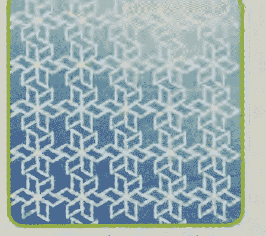

点击 Close 关闭函数编辑器。

回到主窗口，查看工具栏中的 Functions 标签。找到现在出现的 Draw Flower 区。将该区块拖到工作区的设置区块下方。

尝试并创作你自己的设计和代码！（查看答案密钥以查看创建图画的代码。）

### 小贴士

如果你在第一次创建函数时运行程序，它将无法工作。因为运行按钮不会运行你在函数编辑器中看到的内容。它运行的是与 when run 区块连接的程序。在此关闭函数编辑器并将函数调用区块添加到主程序中。

想要更改函数代码？点击函数调用区块上的蓝色编辑按钮。这将再次打开函数编辑器。


### 使用函数绘制更多花

阿伦德尔的孩子们加入了安娜的行列，在冰面上画花朵。他们正在创造一个美丽的冰花花园！通过创建更多函数，帮助安娜和孩子们用不同的花朵填充他们的花园。

- 1. 混合（Remix）你的“Flower”项目，并将其重命名为“More Flowers”。
- 2. 遵循上一个活动的指令，再创建三个花卉函数。将它们命名为“Draw Flower 2”、“Draw Flower 3”和“Draw Flower 4”。你可以编写自己的代码，也可以创建如下的函数：

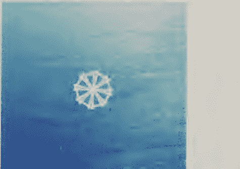

```
Draw Flower 2
repeat 8 times
  repeat 3 times
    move forward by 40 pixels
    turn right by 120 degrees
turn right by 45 degrees
```

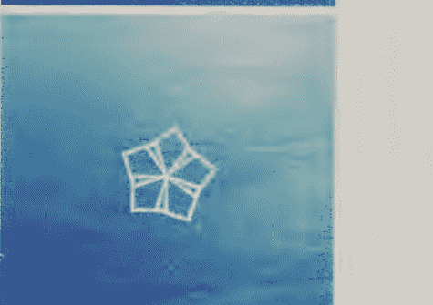

```
Draw Flower 3
repeat 5 times
  repeat 4 times
    move forward by 40 pixels
    turn right by 90 degrees
turn right by 72 degrees
```

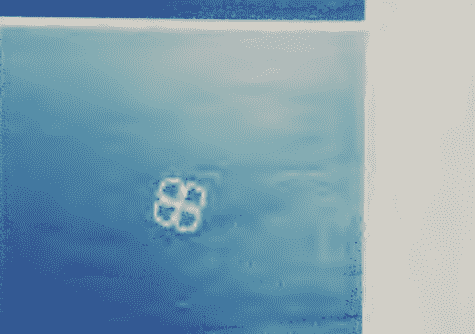

```
Draw Flower 4
repeat 4 times
  repeat 6 times
    move forward by 15 pixels
    turn right by 60 degrees
turn right by 70 degrees
```

一旦你定义了所有的四个花卉函数，回到你的主程序。

调整代码以调用每个花卉函数。尝试创建类似这样的效果：

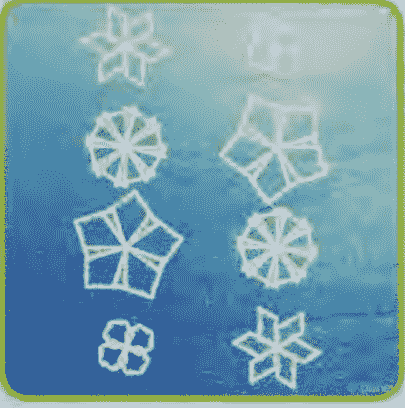

（查看答案密钥以获取创建上述图形的代码。）

进行实验并用不同的花朵填充播放区域！

### 小贴士

当你喜欢在循环中绘制曲线时，循环会帮助你记忆。要绘制曲线，请移动并旋转特定角度。重复循环 160 次将给你一个几乎可以绘制任何形状的形状。

### 嵌套函数

艾莎低头看，发现同一个位置画了两朵不同的花。组合后的设计看起来像一个闪烁的雪花！通过在一个函数内部使用函数，帮助艾莎画花朵雪花！这些被称为**嵌套函数**。

- 1. 混合你的“More Flowers”项目，并将其重命名为“Flower Snowflakes”。
- 5. 回到工作区，删除 **set character** 块之后的所有代码。
- 2. 将 **set character** 参数设置为“Elsa”。
- 6. 在 **set character** 块下方添加 **Draw Flower Snowflake** 块。运行程序。你的花朵雪花看起来什么样？在程序中添加代码，用花朵雪花填充播放区域！
- 3. 在工具箱的 **Functions** 标签下，点击 **Create a Function** 按钮。
- 7. 混合你的项目，并将其重命名为“More Flower Snowflakes”。
- 4. 在函数编辑器中，将你的函数命名为“Draw Flower Snowflake”。将两个花卉函数画入你的“Draw Flower Snowflake”函数中。例如，
- 8. 创建更多花朵雪花函数。第 31 页显示了艾莎的一些花卉组合。你能创建一些类似的设计吗？提示：参考第 28 页的代码。调整参数直到你对设计满意。然后思考不同的方法将你的花卉函数组合成雪花函数。

```
Draw Flower Snowflake
Draw Flower 2 edit
Draw Flower 4 edit
```

关闭函数编辑器。

- 9. 创建一个调用所有花朵雪花函数的程序。用你的设计填充播放区域。看起来像阿伦德尔的一场暴风雪吗？

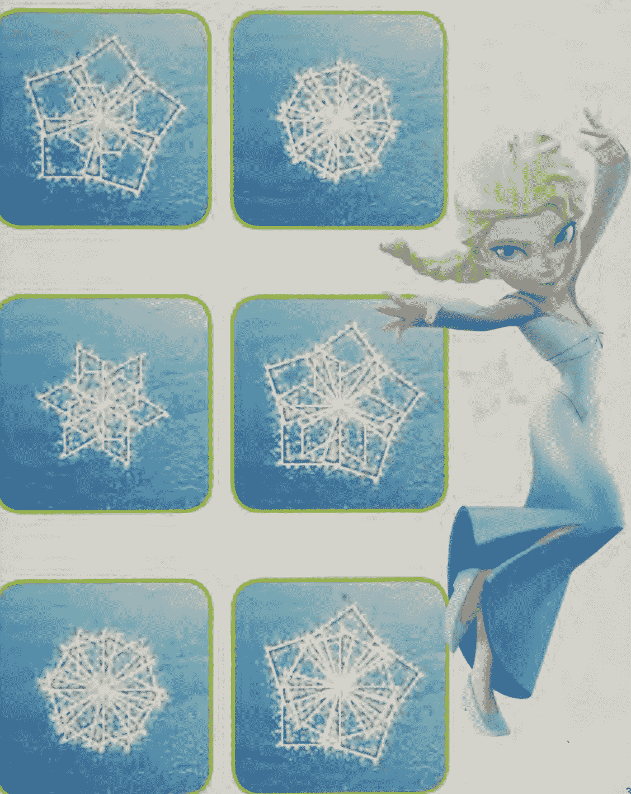

### 使用函数简化

简化程序的一种方法是寻找可以提取到函数中的代码。研究这段程序。找到重复的部分。在你的笔记本上为这段代码编写一个函数。然后使用函数编写简化后的程序。

```
when run
  jump to 100 over 100
  turn left by 140 degrees
  repeat 2 times
  do:
    move forward by 50 pixels
    turn left by 80 degrees
    move forward by 50 pixels
    turn left by 100 degrees
  turn right by 50 degrees
  jump to 200 over 200
  turn left by 50 degrees
  repeat 2 times
  do:
    move forward by 50 pixels
    turn left by 80 degrees
    move forward by 50 pixels
    turn left by 100 degrees
  turn right by 50 degrees
  jump to 300 over 300
  turn left by 50 degrees
  repeat 2 times
  do:
    move forward by 50 pixels
    turn left by 80 degrees
    move forward by 50 pixels
    turn left by 100 degrees
  turn right by 50 degrees
  jump to 400 over 400 (文字写的是 300 over 300) 
等等，让我们重新读一下：
jump to 300 over 300
turn left by 50 degrees
repeat 2 times
do:
  move forward by 50 pixels
  turn left by 80 degrees
  move forward by 50 pixels
  turn left by 100 degrees
turn left by 100 degrees

## For 循环

是时候学习 for 循环了！这些循环使用计数器从起始值到结束值，按增量进行变化。这个程序使用 for 循环在螺旋中绘制点。看它是如何从画一个点开始，画三个点结束，并每次增加一个点的。下面的图形使用了该程序的所有代码。区别在于 for 循环中的参数。在你的笔记本上，填写 for 循环以得到每个图。提示：数数螺旋每一边的点。每个图都从螺旋中心开始。

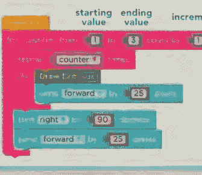

### 1
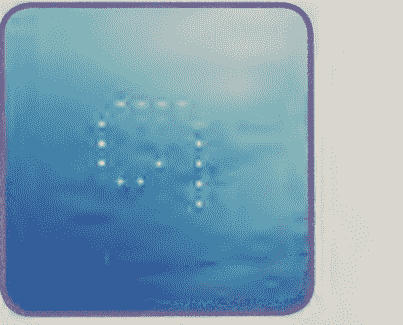
for counter from \_\_ to count by \_\_

### 2
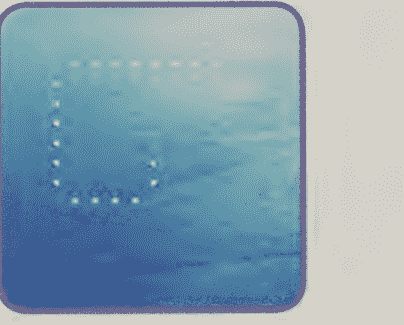
for counter from \_\_ to count by \_\_

### 3
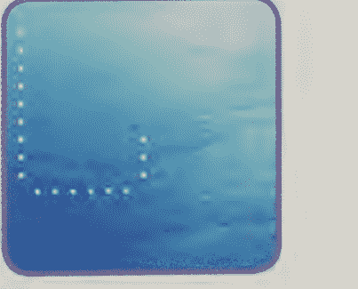
for counter from \_\_ to count by \_\_

### 4
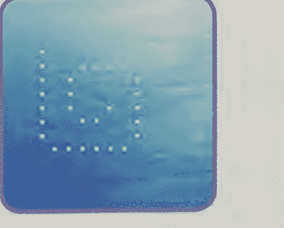
for counter from \_\_ to count by \_\_

## For 循环螺旋

艾莎正在练习她的螺旋。冰在旋涡中看起来非常优雅！你想帮她用 for 循环创建一个惊艳的设计吗？让我们试试吧！

- 1. 创建新项目，并将其命名为“Square Spiral”。
- 2. 将 for 循环拖入工作区，并在 when run 块下方点击它。你会在工具箱的 Loops 标签下找到 for 循环。
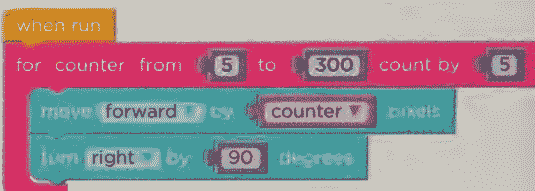
- 3. 接下来，将 move forward 块和 turn right 块拖入 for 循环。
- 4. 取出 move forward 块内的紫色数字块，将其拖回工具箱。
- 5. 在工具箱的 Variables 标签下找到计数 块。将其拖入 move forward 块。这告诉艾莎每次循环时移动与你的计数器相同的距离。
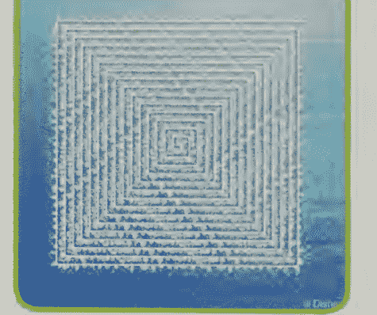
- 6. 最后，将 for 循环的起始值设置为“5”，结束值设置为“300”。将增量设置为“5”。这就是完成后的代码的样子

是时候玩玩你的代码了！混合你的项目，并将其重命名为“Square Spiral 2”。假设你想让螺旋线之间的空间更大。没问题！只需更改 for 循环中的参数。将起始值设置为“10”，增量设置为“10”。你喜欢这个螺旋吗？

你能看出要在程序中添加哪个块来创建这个图形吗？正确！只需在 for 循环之前添加一个 turn right 块，并将参数设置为“45”。

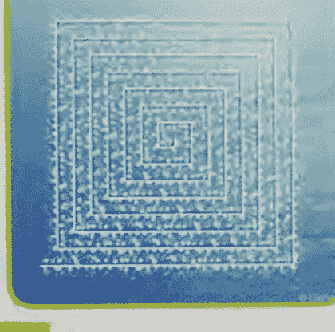
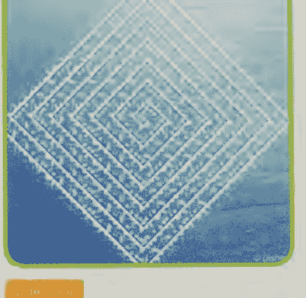

```
for counter from 10 to 300 count by 10
move forward by counter pixels
turn right by 90 degrees
```

```
turn right by 45 degrees
for counter from 10 to 300 count by 10
move forward by counter pixels
turn right by 90 degrees
```

尝试参数，创建你自己的螺旋设计。

> 你知道吗？
> repeat 循环，for 循环是一个强大的工具。只需几行代码，你就可以创建像这里复杂的图形。你能想到其他使用 for 循环的方法吗？

### 更多螺旋设计

安娜想对艾莎的螺旋设计尝试一些不同的。她想如何制作不是完美的螺旋。使用你的编程技能帮助安娜创建一个独特的设计！

- 1. 混合你的“Square Spiral”项目，并将其命名为“More Spirals”。
- 2. 在 when run 块和 for 循环之间添加 set character to Anna 块。
- 3. 不要旋转 90 度，尝试稍微不同的角度。
- 4. 调整参数直到你有你喜欢的设计。
- 5. 接下来，尝试改变线条的颜色，让你的螺旋更有个性！你可以在工具箱的 Actions 标签下找到 set color 块。

```
when run
set character to Anna
for counter from 5 to 300 count by 5
move forward by counter pixels
turn right by 89 degrees
```

这些图形分别使用了 89 度和 91 度。看看这些图形与艾莎的螺旋有多不同。而唯一的改变是每次旋转的角度差了 1 度！


6 现在更改 `for` 循环中的增量参数。当你把增量变大或变小时会发生什么呢？这里有一些你可以尝试的螺旋设计：


```
when run
set character to Anna
set color
for counter from 5 to 300 count by 2
move forward by counter pixels
turn right by 91 degrees
```


```
when run
set character to Anna
set color
for counter from 3 to 300 count by 3
move forward by counter pixels
turn right by 93 degrees
```

7 不断实验，直到你对独特的螺旋设计感到满意。

### 一朵巨大的雪花

当阿伦德尔王国的人们喜欢在冰上作画时，雪花开始从天空飘落。轻柔的雪花激发了艾莎画出一个复杂雪花的灵感。

帮助艾莎创建一个由不同大小形状重叠的设计。回想一下你制作形状并让它们绕圆旋转的过程。`for` 循环让你以许多尺寸来实现。尝试一下吧！

- 1. 创建新项目，命名为“巨大的雪花”。
- 2. 将下面的代码添加到你的工作区。点击“运行”，看看艾莎画出一个由不同大小五边形组成的雪花。多漂亮啊！


```
when run
  for counter from 100 to 25 count by 25
    set color to random color
    repeat 5 times
      repeat 5 times
        move forward 72 pixels
        turn left 72 degrees
```

- 3. 也许你希望雪花由不同的形状组成。你可以同样地使用三角形、正方形、六边形甚至是八边形！只需更改最内层循环的参数即可创建一个新形状。

### 尝试不同的参数，直到你对你的巨大的雪花感到满意。

### 边数 
代码

```
repeat 3 times
  move forward by counter steps
  turn left by 120 degrees
```


### 3

```
repeat 4 times
  move forward by counter steps
  turn left by 90 degrees
```


### 4

```
repeat 6 times
  move forward by counter steps
  turn left by 60 degrees
```


#### 6

```
repeat 8 times
  move forward by counter steps
  turn left by 45 degrees
```

#### 8


假设你想更改每次运行 `for` 循环时形状被绘制的次数。你需要更改哪些参数？提示：你有两个参数需要调整。第 38 页的代码在每次 `for` 循环的迭代中都绘制了 5 次形状。

## 遵循代码

奥拉夫、安娜和艾莎在冰上玩得太开心了，以至于不小心画了别人的设计。噢天哪！这幅画由三个不同的设计组成。你能认出哪一部分是奥拉夫画的吗？看看下面奥拉夫设计的代码。复制此页，并在空白方框中画出他的设计。提示：方框中间的点显示了奥拉夫在开始画之前的位置。他位于底部。


| 奥拉夫的设计 |
| :--- |
| counter from 30 to 60 count by 30 |
| repeat 4 times |
| do move forward by counter pixels |
| turn left by 90 degrees |
| counter from 30 to 60 count by 30 |
| repeat 4 times |
| do move forward by counter pixels |
| turn left by 90 degrees |

 每个网格代表 30 像素宽和 30 像素高。

## 复习

太阳低挂在天空，冰上绘画结束了。艾莎、安娜和奥拉夫与阿伦德尔的人们一起工作。大家都度过了美好的一天。他们会记住这美好的一。你应该对你在书中探索的所有内容感到自豪！看看下面用于画画的代码。复制此页并完成以下任务。


- 画一个指向代码中 `repeat` 循环的箭头。
- 在 `for` 循环上方画一个勾号。
- 在 `for` 循环旁边画一个三角形。
- 在此程序的参数周围画一个矩形。


```
when run
for counter from 15 to 140 count by 5
  move forward by counter pixels
  turn left by 45 degrees
  set color to random
  repeat 5 times
    move forward by 8 pixels
    move backward by 8 pixels
    turn left by 72 degrees
```

## 获取灵感！

恭喜你完成了冒险！让我们用一些代码块制作什么样的创意画。复制这些页面。下面的每个活动提供了五个代码块。将它们包含在你自己的程序中创建一个特殊的画。你可以按照你喜欢的方式排列这些块。也可以包含其他块。调整代码直到你对你的画感到满意。完成后，画出你创建的图像。

```
move forward by 30 pixels
turn right by 120 degrees
repeat 2 times
do
move forward by 30 pixels
turn right by 60 degrees
```

```
repeat 5 times
do
turn right by 72 degrees
move forward by 40 pixels
move forward by 10 pixels
turn right by 90 degrees
```


## 自己来尝试！

正如你所学的，你可以用代码做一些神奇的事情。准备好接受更多挑战了吗？看看下面的图片，尝试编写画类似内容的代码。利用你在书中探索的想法自己画一些画。复制第 45 页与朋友们分享！


### 1


### 2


### 3


### 4


## 答案

### 10
- 1. B
- 2. C
- 3. A
- 4. D

### 17
- 1. C
- 2. A
- 3. D
- 4. B
when run
skateboard by Anna
jump backward by 150 pixels
turn right by 90 degrees
jump forward by 75 pixels
turn left by 90 degrees

### 24
- 1. 6
- 2. 3
- 3. 5
- 4. 8
repeat 2 times
Draw Diamond
move forward by 100 pixels
Draw Flower 2
move forward by 75 pixels
Draw Flower 3
turn left by 90 degrees
turn left by 90 degrees

### 25
when run
Draw Diamond
Draw Diamond
Draw Circle
Draw Star
Draw Circle
Draw Diamond


### 16

### 27

### 32
- 1. when run
Draw Face
Draw Body
Draw Repeat
- 2. when run
Draw Head
Draw Face
Draw Oval
Draw Large Oval
- 3. when run
Draw Head
Draw Face
Draw Oval Body
Draw Feel
- 4. when run
Draw Head
Draw Face
Draw Medium Oval
Draw Large Oval

when run
set character to Anna
backward by 225 pixels
turn right by 90 degrees
jump backward by 150 pixels
turn left by 90 degrees
repeat 6 times
repeat 6 times
Draw Flower
forward by 75 pixels
turn right by 90 degrees
turn backward by 90 degrees
repeat 6 times
Draw Diamond Cone
move forward by 75 pixels
turn left by 90 degrees
turn left by 90 degrees

重复代码
repeat 2 times
move forward by 50 pixels
turn left by 80 degrees
move forward by 50 pixels
turn left by 100 degrees
turn left by 90 degrees

## 命名你的函数

Draw Diamond*

## 简化后的程序

when run
jump to 100 over 100 dun
turn left by 140 degrees
Draw Diamond
turn right by 50 degrees
jump to 200 over 200 dun
turn left by 50 degrees
Draw Diamond
turn right by 50 degrees
jump to 300 over 200 dun
turn left by 50 degrees
Draw Diamond


47


1. 计数器从 1 到 5，每次递增 1
2. 计数器从 2 到 8，每次递增 2
3. 计数器从 3 到 9，每次递增 3
4. 计数器从 1 到 7，每次递增 1


- 你可能给函数取了一个不同的名称。只要你的函数调用与你的名称匹配，程序就能正常运行。


## 词汇表

**angle (角度):**
线条在角处转过的度数。


**for loops (for 循环):**
你可以控制起始值、结束值和递增量的循环。

**play space (运行区域):**
网站上用于查看代码运行效果的区域。

**block-based language (基于块的语言):**
一种使用类似拼图的代码块来创建程序的编程语言。

**function (函数):**
一段命名的代码，你可以在程序中任何需要的时候调用它。

**program (程序):**
一组给计算机的指令。

**Blockly:**
一种视觉化编程语言，允许你通过拖放和放置代码来创建程序。

**function editor (函数编辑器):**
一个弹出的框，允许你创建或编辑函数内部的代码。

**remix (混编/重制):**
保存程序的副本并将其构建成新的内容。这允许你使用已经创建的函数和代码段，而不是从头开始构建。

**call a function (调用函数):**
要求计算机运行函数内部的代码。

**increment (递增):**
在循环每次执行时，你的计数器增加（或减少）的数值。

**repeat loop (重复循环):**
允许你按照指定的次数重复执行一段代码序列的块。

**code (代码):**
给计算机的指令。

**coding (编码):**
创建代码的过程。

**inner angles (内角):**
从形状内部测量的角度。

**sequence (序列/顺序):**
事物排列的顺序。

**computer science (计算机科学):**
对计算机和计算机相关概念的研究。

**loop (循环):**
一段反复运行的代码，其间不执行任何其他操作。

**software (软件):**
运行在机器或计算机上的程序。

**counter (计数器):**
一个占位符，用于跟踪每次循环中增加（或减去）的数值。

**nested functions (嵌套函数):**
放置其他函数内部的函数。

**starting value (起始值):**
计数器在循环中开始的值。

**debugging (调试):**
发现并修复程序中的错误。

**nested loop (嵌套循环):**
放置另一个循环内部的循环。

**toolbox (工具箱):**
网站上用于查找程序代码的区域。

**define the function (定义函数):**
将代码放入函数块中，告诉计算机当程序内部调用该函数时应该做什么。

**parameters (参数):**
允许你自定义块以不同方式执行功能的特殊位置。

**workspace (工作区):**
网站上用于通过拖动代码来创建程序的区域。

**ending value (结束值):**
计数器在循环中停止计数的值。

**pattern (模式):**
重复多次的事物。

**pixels (像素):**
排列在网格中组成图像的小正方形。像素也可以作为指定物体移动距离的测量单位。

**exterior angles (外角):**
角度外部的测量值。

## 找到答案了吗？

这本书的标题是*《与 Anna 和 Elsa 一起编程：冰雪奇缘 Blockly 指南》。什么是 Blockly？它在本书中是如何使用的？

什么是嵌套循环？你能解释你是如何使用嵌套循环来帮助安娜创造一片雪花的吗？安娜想为艾德尔王国的人们画花，但制作一束花需要时间。你能描述如何使用函数来加快这个过程吗？

像素和角度是如何在计算机上创建图像的？

什么时候使用重复循环是有帮助的？

函数的定义是什么？函数在编码中是如何使用的？


## 继续吧，安娜！


安娜学会了如何使用正方形和三角形进行设计。她想通过向这张图添加另一个正方形和三角形来继续她的设计。

使用第 14 页的信息来帮助安娜完成她的画。

> ### 恭喜！
> 你创建了一个对称形状。了解什么是对称形状并尝试自己画一些。

## 反思

- 构建程序并观察它们运行有趣吗？
- 你最喜欢哪些活动？为什么？
- 绘画是使用代码的方式之一。现在你已经学习了一些基础知识，你认为还会学习更多计算机编程吗？


## 以冰雪奇动的动的课程让你开始学习编码！

- 使用代码与安娜、艾莎和奥拉一起创作酷的冰画。
- 使用 Blockly，一种非常适合初学者的视觉化编程语言。
- 探索计算机编程，包括序列、循环和函数。
- 增强逻辑、数学和解决问题的能力。

去尝试并为书中有趣的项目加入你自己的见解！你将创造出什么样的惊奇冰画？


