# Python 编程（预备，开始，编码！）


## 什么是 Python？

编程语言是与计算机交流的一种特定方式。它是你交给计算机使用的一组指令。Python 是一种类型化编程语言，可让你创建动画、图形和游戏。Python 的优点之一是，与许多其他编程语言相比，你可以用更少的代码完成工作。

许多著名机构，如 Google、YouTube、NASA 和 Yahoo，都在使用 Python。它曾被用于制作 *哈利·波特* 和 *加勒比海盗* 系列电影的特效。

### Trinket

本书中的所有项目都将使用 Trinket Blocks 来创建和运行 Python 项目。这意味着你不需要键入代码；只需拖拽、放下并拼接编程积木块即可！

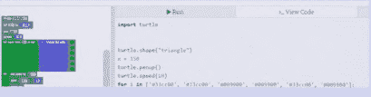

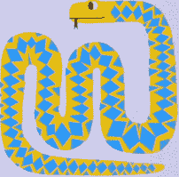

### 给家长的话

要使用 Trinket，请访问：https://trinket.io/。

Trinket 可让你的孩子在网页浏览器、桌面电脑或 iPad 上创建和运行 Python 项目。本书中的说明假定用户是在桌面电脑上进行创作。无需安装任何软件。孩子们可以并排查看他们的 Python 代码及其输出。孩子们还可以将代码保存在网上，或通过链接与他人分享。Trinket Blocks 是 Trinket 的一项免费功能。

### 创建 Trinket 账户

为 13 岁以下儿童创建账户需要家长许可。建议由家长或负责任的成年人创建 Trinket 账户。

使用 Trinket 无需下载插件或安装软件。为了让你的孩子能够保存并分享其项目，你需要注册并创建用户名和密码。

### Trinket

打开新的 Trinket Blocks 项目时，你会看到以下主要功能：

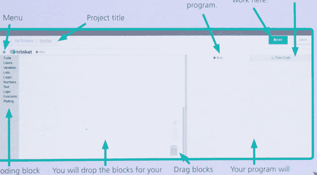

- 菜单
- 项目标题
- 单击此处运行程序。
- 在此保存你的作品。
- 单击此处以文本形式查看你的 Python 程序。
- 编程积木块菜单
- 将程序的积木块拖放到这块白色画布上。
- 将积木块拖到此处以删除。
- 程序将在此处运行。

### 注意分享安全

用户名和密码属于个人信息，就像你的牙刷一样，你绝不能与任何人分享它们！

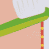

# 海龟对话

## 让你的海龟聊起来！

## 准备

在这个项目中，你将使用 Python 创建两只海龟交谈的动画。在 Python 中，海龟用于向你显示程序在画布上的位置。

> **你知道吗？**
>
> 海龟自恐龙时代起就生活在地球上——距今超过 2 亿年！

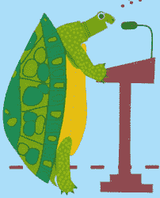

### 1. 开始

前往 Trinket：https://trinket.io/ 并登录。


输入你的用户名和密码。

### 设置

现在你已经打开 Trinket，该开始一个新程序了。

### 2. 打开一个新的 Trinket

点击 Trinket，你会看到以下下拉菜单。点击 Blocks。

你会看到以下窗口。点击 Turtle。

你将把程序的积木块拖放到这块白色画布上。

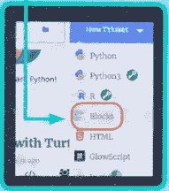

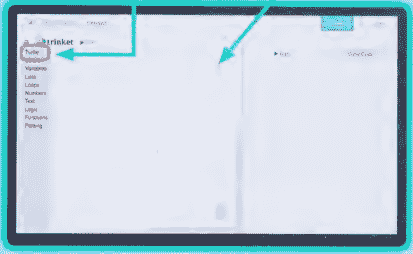

点击 Turtle 后，右侧会打开以下菜单。将 `shape turtle` 积木块拖到白色画布上。现在你可以开始编码了。

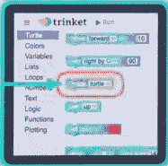

> **你知道吗？**
>
> 陆龟和海龟都是爬行动物。它们都产卵，并拥有坚硬、骨质的壳。陆龟的背比海龟更平，它们生活在陆地上的沙漠、草原和森林中。海龟有用于游泳的蹼足，生活在河流、湖泊或海洋中。

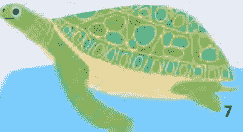

> **你知道吗？**
>
> 海龟有坚硬的壳，像盾牌一样保护它们。这种上壳称为背甲。海龟还有下壳，称为腹甲。许多海龟物种在受到捕食者攻击时能把头缩进壳里。

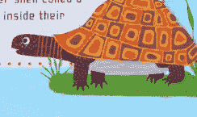

## 编码！

现在你可以开始为海龟编程了。

如果选错了积木块，可以把它拖回左侧的积木块区域，或拖放到右下角的垃圾桶中将其删除。


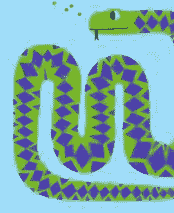

### 3. 用 Python 编写

从 Turtle 菜单添加以下积木块，并在引号内输入："Hello! What are you doing?"。你的程序应该如下所示：

```
when turtle
write "Hello! What are you doing?" font size 14
```

按 ▶ 运行测试程序。你会看到消息从屏幕右侧消失，一个海龟与第一个词重叠。

### 4. 定位文本

我们把文本定位到屏幕左侧。从 Turtle 菜单中将 **转到** 积木块添加到程序中：点击并拖动每个积木块，放到下方所示的位置。将两个紫色积木块中的数字改为：**-50, 40**。

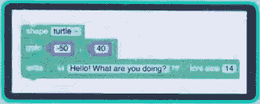

按 ▶ **运行** 测试程序。你应该会看到文本出现在屏幕右侧。

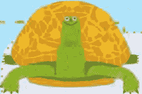

> **你知道吗？**
>
> 普通箱龟有一个独特的带铰链的下壳（箱壳），使它能够完全把自己封闭起来。它生活在美国东部大部分地区的林地、沼泽草甸、洪泛平原、灌木林和草原中。

### 5. 使用抬笔积木块

海龟移动时会画线。要让海龟移动时不画线，需要使用 Turtle 菜单中的 **抬笔** 积木块。你的程序应该如下所示：

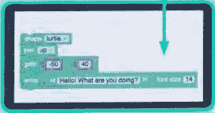

按 ▶ **运行** 测试程序。

### 6. 设置速度

向程序中添加一个 **速度 10** 积木块，让海龟移动得更快。

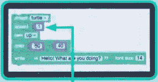

此积木块中的数字将设置海龟的速度。数字越大，海龟移动得越快。

按 ▶ **运行** 测试程序。

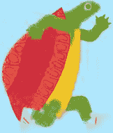


### 7. 使用图章积木并设置程序颜色

`stamp` 积木会生成你在程序中使用的角色（一只海龟）的图像，并将其盖印到白色画布上。

向程序中添加 `stamp` 和 `set color to` `yellow` 积木，以制作一个图章并将其颜色设为红色。再添加一个 `go to x: 0 y: 0` 积木来定位图章。

```text
when green flag clicked
pen up
go to x: 250 y: 40
set color to yellow
stamp
go to x: -20 y: 40
say "Hello! What are you doing?" for 2 seconds
```

按 ▶ 运行来测试你的程序。

### 8. 添加另一只海龟

现在你可以添加另一只海龟来与第一只对话。你需要让它看起来与第一只不同，因此需要使用不同的颜色。在步骤 7 的程序下方添加以下积木：

```text
pen up
go to x: 250 y: -10
set color to green
stamp
go to x: -20 y: -10
say "I am coding with Python!" for 1 second
```

按 ▶ 运行来测试你的程序。

> `pen up` 积木可以拼接到上一步的 `go to x: 0 y: 0` 积木下方，也可以就放在下面并保持分开。

> **你知道吗？**
> 
> 最大的海龟是棱皮龟。它的体重可超过 1,900 磅！

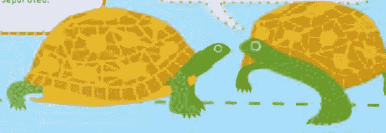

## 完成对话

要完成海龟之间的对话，请向程序中添加以下积木。

```text
get [say] [Hello!]
when [green flag clicked]
say [Hello!]
wait [2] seconds
say [What can you code?]
wait [4] seconds
```

> 你可以右键单击白色画布中的任意积木并复制它。

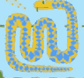

### 挑战

向程序中添加更多语句，让海龟进行更长的对话。

- 你好！你在做什么？
- 我正在用 Python 编程。
- 你能编什么程序？
- 一个圆
- 哇！太棒了。
- 谢谢。

# 画一个圆

在对话结束时，蓝色海龟将画一个圆。添加以下积木：

```text
pen up
move [20] steps
pen down
set color to [orange]
forward [25]
turn right [20]
```

按 ▶ 运行来测试你的程序。

## 故障排除

如果你希望文本居中，请使用 [go to x: 0 y: 0] 积木将对话定位到屏幕中间。尝试为 x 坐标使用 [go to x: 0 y: 0]。

# 阿根廷

制作国旗并发现一些关于阿根廷的有趣事实！

## 准备

在这段代码中，你将通过绘制不同颜色的矩形来制作阿根廷国旗。

### 开始

- 1. 访问 Trinket：https://trinket.io/ 并登录。
- 2. 输入你的用户名和密码。

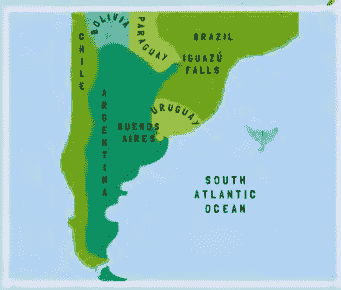

> 阿根廷是南美洲仅次于巴西的第二大国，也是世界第八大国。

### 你知道吗？

莱昂内尔·梅西出生于阿根廷罗萨里奥。11 岁时，他随父亲搬到巴塞罗那。他现在保持着巴塞罗那的大部分进球纪录，并且是阿根廷历史最佳射手。


## 设置

在开始编码之前，你需要打开一个新的 Trinket。

> **你知道吗？**
> 
> 阿根廷这个名字来自拉丁语中表示银的词：argentum。

### 打开新的 Trinket

单击 **新建 Trinket**，然后单击 Blocks。

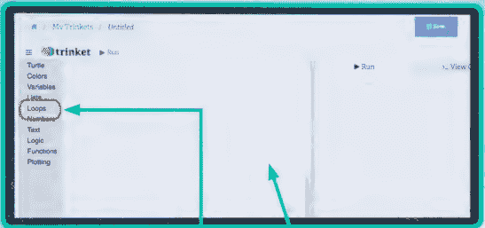

你将看到以下窗口。单击 Loops。

你将把程序所需的积木拖放到这个白色画布中。

以下菜单将会打开。

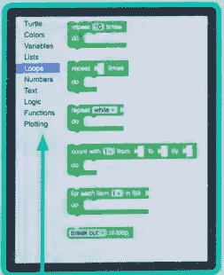

> **什么是循环？**
> 
> 循环是重复的命令或命令集。循环会重复执行动作。


当你单击左侧的任何其他选项时，会打开不同的菜单。

## 编码！

现在你需要创建彩色矩形来组成你的国旗。


### 3. 使用循环绘制矩形

使用 Loops 和 Turtle 菜单向程序中添加以下积木：

```text
repeat 2 times
do
  turn right by 90
  move forward by 50
  turn right by 90
  move forward by 150
```

按 ▶ 运行来测试你的程序。你应该会在屏幕右侧看到一个矩形。

### 4. 给矩形上色

使用 Turtle 菜单在程序的开头和结尾添加以下三个积木：

这个积木将设置程序的颜色。

```text
set color to blue
repeat 2 times
do
  turn right by 90
  move forward by 50
  turn right by 90
  move forward by 150
```

这个积木将给矩形上色。

按 ▶ 运行来测试你的程序。你应该会在屏幕右侧看到一个蓝色矩形。


函数就像食谱。例如，煮米饭需要遵循一系列指令：烧水、加盐、倒入大米、炖煮 20 分钟、沥干剩余的水，并用叉子把米饭拨松。函数让程序员可以把所有这些指令放在一个积木下，并给它起个名字，例如“Rice”。每次需要煮米饭时，你都可以使用“Rice”函数。

### 创建函数

阿根廷国旗分为三个水平矩形，颜色依次为蓝色、白色、蓝色。使用 Functions 菜单向程序中添加以下积木：让我们通过删除“do something”并将函数命名为“蓝色矩形”来创建一个函数。

从 Functions 菜单中，将你刚刚创建的 **蓝色矩形** 函数添加到程序旁边，如下所示：

按 ▶ 运行来测试你的程序。你仍应看到与步骤 4 相同的矩形，但它现在是一个函数，你将在下一步再次使用它。

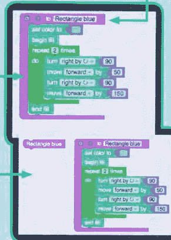

### 复制函数

右键单击步骤 5 开头使用的积木，然后选择 Duplicate。

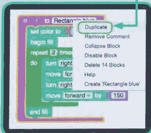

> 探戈舞蹈和音乐诞生于阿根廷布宜诺斯艾利斯。


### 7. 更改函数的颜色

你可能记得阿根廷国旗有两种颜色和三个矩形，因此你需要更改第二个函数的颜色。单击你在步骤 6 中创建的第二个函数中的 **颜色** 积木，然后选择白色。

将函数名从“蓝色矩形2”改为“白色矩形”。

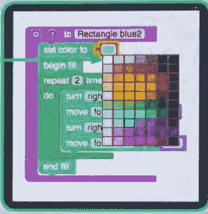

### 8. 使用函数绘制国旗

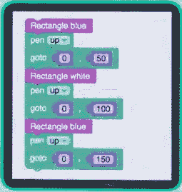

### 使用函数绘制国旗

将函数放在白色画布的一侧，并使用 Turtle 和 Functions 菜单，在你在步骤 5 末尾创建的蓝色矩形积木下方添加以下积木。请记住，紫色积木位于 Functions 菜单中；浅绿色积木位于 Turtles 菜单中。

按 ▶ 运行来测试你的程序。

> **你知道吗？**
> 
> 伊瓜苏瀑布位于阿根廷和巴西边境，是世界上最大的瀑布系统。伊瓜苏瀑布由 275 个瀑布组成，落差达 246 英尺。

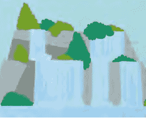

### 添加彩色消息

让我们添加一条彩色文本消息。

向程序中添加以下积木：

这条消息将显示在国旗上方。

字体大小将自动设置为 14，但你可以将其更改为任意大小。

```text
    when flag clicked
    set size to 14
    go to x: -150 y: 50
    say 'This is the Argentine flag!' for 2 secs
```

按 ▶ 运行来测试你的程序。

### 你知道吗？

卢西亚娜·艾马尔是一位退役的阿根廷曲棍球运动员。她是历史上唯一一位八次获得年度最佳球员奖的球员，并被认为是史上最优秀的女子曲棍球运动员之一。


### 10. 添加文本

现在我们可以使用 Text 菜单中的 print 积木添加一些事实：

这些行将分别显示在屏幕底部。

```text
    when flag clicked
    go to x: -150 y: 50
    set size to 14
    print 'This is the Argentine flag!'
    print 'The capital of Argentina is Buenos Aires.'
    print 'The official language is Spanish.'
    print 'Lionel Messi was born in Argentina.'
```

按 ▶ 运行来测试你的程序。

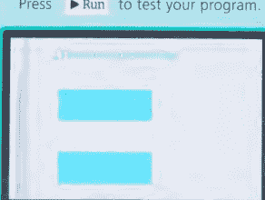

### 挑战

运用你的 Python 编写技巧以及你在本项目读到的事实，向程序中添加关于阿根廷的信息。尝试将这些事实放在屏幕上的不同位置。

### 故障排除

如果消息“这是阿根廷国旗。”没有正好位于国旗上方，请更改这些积木中的坐标：

```text
    when flag clicked
    set size to 14
    go to x: -150 y: 50
    say 'This is the Argentine flag!'
```


# 罂粟花

## 是时候感受花的力量了！

## 准备

你将使用函数和循环画一朵罂粟花。

罂粟花有许多不同的颜色，例如白色、粉色、黄色、橙色、红色或蓝色。

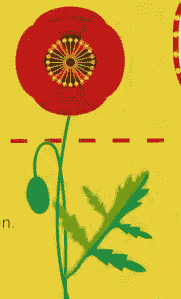

### 1. 开始

访问 Trinket：https://trinket.io/ 并登录。

输入你的用户名和密码。

### 设置

### 2. 打开新的 Trinket

点击 **New Trinket**，然后点击 Blocks。

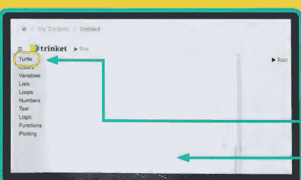

你将看到以下窗口。

点击 **Turtle**。

你将在白色画布中拖放程序所需的积木。

从 Turtle 菜单中选择 **shape**。点击下拉菜单并选择 **circle**。我们将使用圆形来创建花朵图案。

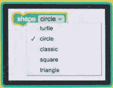

**你知道吗？**

金罂粟，或称加州罂粟，是加利福尼亚州的州花。它野生生长于加州各地，并于 1903 年成为州花。


## 编码！

你可以使用许多不同的圆形来画出你的罂粟花。


**你知道吗？**

每年 11 月 11 日，人们会纪念第一次世界大战的结束。常见的田野罂粟已成为这种纪念的象征，因为战争结束时，这些花开始在战场上生长。

### 3. 用 Python 编写

将以下积木添加到你的程序中：

- 按 **Run** 测试你的程序。
- 你应该会在屏幕右侧看到一个大圆形。

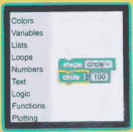

```python
stamp Circle()
color 100
```

### 4. 制作花瓣

这个圆形内部没有颜色，而且对于屏幕来说有点大。让我们通过将以下积木添加到程序中来修正这一点：

点击框内并输入新数字覆盖旧数字，从而更改这个数字。

按 ▶ Run 测试你的程序。

```
shape circle
begin fill
set color to [red]
circle 25
end fill
```

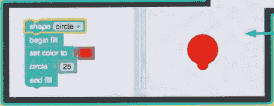

你应该会在屏幕上看到一个红色圆形。

### 5. 创建函数

点击 Functions，并将“do something”积木添加到你的程序中。

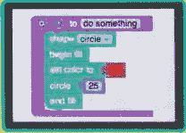

### 6. 命名函数

给函数命名很重要，这样你才能知道可以用它做什么。点击写着“do something”的框，删除它，然后输入“Petal”。之后，再次点击 Functions，你会看到一个名为“Petal”的积木。这就是你刚刚创建的函数。

从现在开始，每次你想画一片花瓣时，只需要使用函数 Petal。

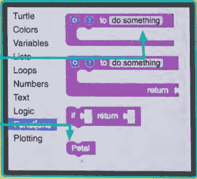

### 使用循环

一朵罂粟花有四片花瓣。程序员可以使用循环来多次重复相同的指令。使用 Functions、Loops 和 Turtle 菜单，将以下代码添加到你的程序中：

按 ▶ Run 测试你的程序。

你应该会在屏幕右侧看到一朵红色的花。

```
repeat 4 times
    do Petal
    turn right by 90
```

函数

```
to Petal
    shape circle
    begin fill
    set color to red
    circle 25
    end fill
```

程序

```
repeat 4 times
    do Petal
    turn right by 90
```


### 创建花心

你需要再添加一个圆形来制作花心。这次圆形将是黑色的。将以下积木添加到你的程序中：

按 ▶ Run 测试你的程序。

这个位置积木会把黑色圆形正好放在花朵的中心。

```
repeat 4 times
    do Petal
    turn right by 90
goto 0 -15
set color to black
begin fill
circle 15
end fill
```

### 9. 添加花茎

要完成你的花，你需要添加花茎。将以下积木添加到你的程序中，以完成罂粟花：

这个积木会让程序停止绘制。

这个积木会让程序继续绘制。记得使用下拉菜单来选择它。

按 ▶ Run 测试你的程序。

你的程序应该像这样：

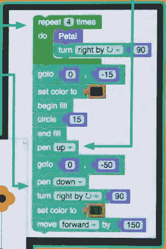

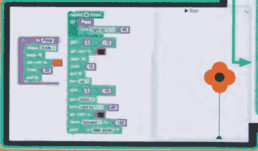

### 10. 使用文本块

在 Trinket 中，你可以使用 Text 块在屏幕底部写一条消息。

使用这两个积木来写下你的消息。

按 ▶ Run 测试你的程序。

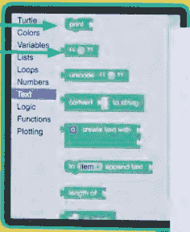

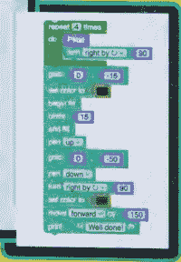

### 故障排除

如果花瓣太小，你需要更改函数中圆形的大小。

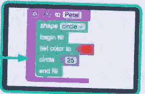

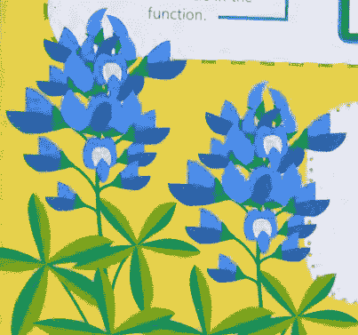

**你知道吗？**

蓝帽花罂粟是德克萨斯州的州花。在德克萨斯州中部和南部的田野以及道路旁，很容易找到它们。

### 挑战

运用你关于函数的知识，创建一朵金罂粟（见第 20 页）和一朵蓝帽花罂粟（见上图）。使用“set color”积木来更改罂粟花的颜色，并使用“change size by”积木来更改花瓣的大小。

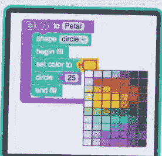

# 毛毛虫

## 准备好体验爬虫的奇妙乐趣吧！

## 准备

你将使用变量和循环创建一个程序来画一条毛毛虫。

**你知道吗？**

毛毛虫是蛾或蝴蝶的幼虫。毛毛虫在形成坚硬的外壳（称为蝶蛹）之前会吃很多食物。在蝶蛹内部，毛毛虫发育成蝴蝶。

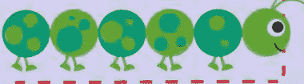

### 1. 开始

访问 Trinket：https://trinket.io/ 并登录。

输入你的用户名和密码。

### 蝴蝶的生命周期

- **1. 卵**：雌性会产下许多小小的圆形卵，并将它们附着在叶子或茎上。
- **2. 毛毛虫（或幼虫）**：卵发育成毛毛虫。
- **3. 蝶蛹（常称为蛹）**：这是一个休息阶段，毛毛虫会发育出坚硬的外壳。在蝶蛹内部，毛毛虫发生变化并成为蝴蝶。
- **4. 蝴蝶**：一旦蝴蝶准备好出现，蝶蛹周围的外壳就会裂开。

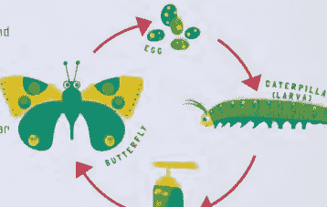

### 设置

### 2. 打开新的 Trinket

点击 `New Trinket`，然后点击 Turtle。

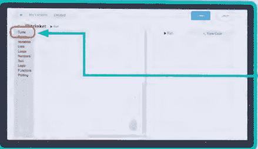

点击 Turtle。

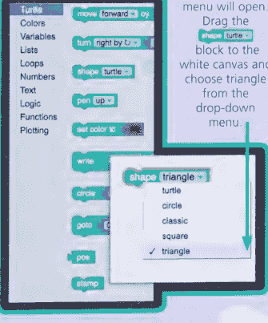

将打开以下菜单。将 `shape: turtle` 积木拖到白色画布上，然后从下拉菜单中选择 triangle。

变量是计算机内存中的一块空间，可用于存储数字、文本或数字和文本列表等信息。要创建变量，你需要给它命名。

## 编码！

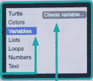

### 创建变量

点击 Variables 菜单，然后选择“Make a Variable”。

屏幕顶部将出现以下消息：

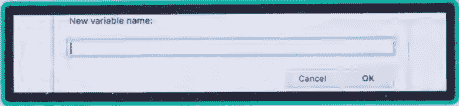

输入“x”并点击 OK。“x”是变量的名称，它会像这样出现在 Variables 菜单中：

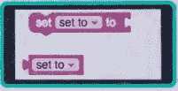

再添加两个变量：一个命名为 x，另一个命名为 y。

### 使用变量

从 Variables 菜单中拖放积木到 shape 积木下方。点击下拉菜单并选择 x。

然后转到 Numbers 菜单。选择并将第一个积木拖入你的程序中，然后输入 150。

从 Turtle 菜单中再添加两个积木到你的程序中：

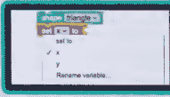

这个变量将使三角形沿屏幕水平移动。

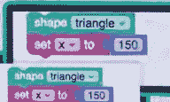


编程中的坐标是指横跨屏幕（水平方向）的像素数（每个形成图像的小色块）以及向下（垂直方向）的像素数。


### 你知道吗？

毛毛虫的身体里有多达4000块肌肉。


### 5. 使用循环创建列表

点击“循环”菜单，将这个积木拖到白色画布上。


现在转到“列表”菜单，选择`create list with`积木。你的程序应该像这样。


### 6. 向列表中添加项目

毛毛虫的身体由几个部分组成。你在上一步中创建的列表将帮助你把这些身体部分添加到绘图中。点击`create list with`积木中的列表图标来添加项目。

```
create list with
```

你需要拖动`item`积木，并将其放入弹出的列表中的列表积木内。添加`item`，直到列表积木中有六个。这些项目将作为六个拼图插槽出现在`create list with`积木中。

```
create list with
```


### 你知道吗？

大多数毛毛虫呈绿色或棕色，体表相对无毛，但有些毛毛虫毛很多且颜色鲜艳。


### 绘制毛毛虫的头部

将以下积木添加到你的程序中：

```scratch
when green flag clicked
set size to 50%
go to x: 0 y: 25
set pen size to 10
set color to [selected color]
pen down
repeat 25
  move 10 steps
  turn right 15 degrees
  move 10 steps
  turn left 15 degrees
pen up
```

这个积木将定位毛毛虫的头部。

为你的毛毛虫的头部选择任何合适的颜色。

按下 ▶ 运行来测试你的程序。


> **你知道吗？**
>
> 毛毛虫是吃货机器！它们喜欢吃荨麻、野草和花朵。在它们生命的第一阶段——幼虫阶段——毛毛虫能吃下相当于自身体重27,000倍的食物！


### 故障排除

如果组成毛毛虫身体的圆圈有些分离，你可以通过减小变量中的数值来解决这个问题。

```scratch
repeat [triangle]
  move 10 steps
set [x] to [45]
```

### 挑战

运用你绘制圆形的知识，在毛毛虫旁边画一个橙子或苹果。记住，它们总是很饿！

# 词汇表

- **画布**：屏幕上用于绘制的区域
- **像素**：屏幕上的一个点，是计算机能绘制的最小点。
- **坐标**：像素在屏幕上的位置。它是横跨屏幕的像素数（x轴/水平方向）和纵向的像素数（y轴/垂直方向）。
- **海龟**：显示程序在白色画布上位置的图像
- **函数**：一组可用于执行某项操作的指令
- **变量**：计算机程序中存储数据的位置，它有名称和值。
- **循环**：不断重复的一条或一组指令


# 更多信息

## 图书

- *孩子学编程*，希瑟·莱昂斯和伊丽莎白·特威德尔著（勒纳出版社，2018年）
- *生成代码：我是Python程序员*，马克斯·温赖特著（韦兰出版社，2017年）

## 网站

- https://trinket.io/
- https://www.python.org/


## 网络安全

互联网是一个很棒的资源，它帮助你连接、交流和发挥创造力。

然而，你需要确保上网安全。始终记住：

1. 如果你在网上看到任何让你感到不舒服或不开心的事情，立刻告诉一位成年人。
2. 绝不要在网上与任何人分享你的个人信息，例如你的全名、地址或出生日期。
3. 记住，网上的人可能并不总是他们所说的那个人。除非你确定自己知道他们是谁，否则绝不要与网上的人分享任何东西。

## 给家长的提示

建议您：

- 使用过滤软件阻止不需要的内容
- 熟悉您设备的隐私设置
- 设置密码以保护个人信息。

# 索引

- “挑战”面板，11、17、23、29
- 角色
  - 添加/创建，7、10、19、25、27
  - 移动，9
- 颜色
  - 添加，10、14、17、20、23、28–29
  - 更改，16、23
- 坐标，11、17、26、30
- 绘制
  - 圆形，19–21、28–29
  - 矩形，14–16
- 菜单积木
  - 颜色，28
  - 函数，14–16、20、23、30
  - 列表，27
  - 循环，13–14、21、27、30
  - 数字，28–29
  - 文本，8–9、11、17
- 海龟，7–11、14、16、19、25、28、30
- 变量，24–25、28、30
- 速度，9
- 文本
  - 更改颜色，17
  - 定位，9、11
  - 书写，8、17、22
- 故障排除，11、17、23、29


# 预备，开始，编码！

## 使用Python编程

*在《使用Python编程》中*，你可以与海龟对话，前往南美洲，画一朵花，并在不使用纸、铅笔或颜料的情况下创建一只毛毛虫。

简单易懂、循序渐进的说明将指导你完成这些精彩项目的编程。一旦掌握了要领，你还可以选择不同的挑战来真正测试你的编程技能，并在需要时获得故障排除提示。

有了“预备，开始，编程！”，你很快就会为编程世界做好准备。


# 预备，开始，编码！

- 使用HOPSCOTCH编程
- 非官方MINECRAFT编程指南
- 使用Python编程
- 使用Scratch编程

ISBN 978-1-5415-3876-4
90000
9 781541 538764

勒纳出版社
www.lernerbooks.com

