# Scratch 编程入门指南：学习基础、游戏与项目


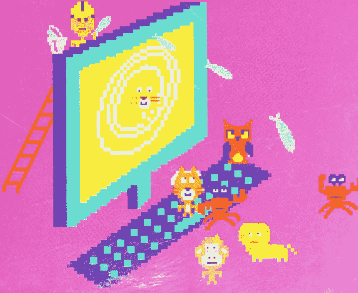


作者：
Jon Woodcock & Steve Setford


作者：
Steve Setford & Jon Woodcock
编辑：Radhika Haswani, Steve Setford
加拿大编辑：Barbara Campbell
设计：Peter Radcliffe
艺术编辑：Kanika Kalra
书封设计：Dheeraj Arora
执行编辑：Soma B. Chowdhury
艺术总监：Martin Wilson
DTP 设计：Dheeraj Singh
制作（前期制作）：Dragana Pupavic
制作：Priscilla Reby
出版：Sarah Larter
出版总监：Sophie Mitchell


详情请联系：
specialmarkets@dk.com

在中国印刷并装订

Scratch 由 MIT 媒体实验室的 Lifelong Kindergarten 小组开发。访问 http://scratch.mit.edu

思想的世界：
你所需要的一切

www.dk.com


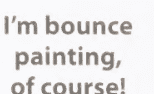

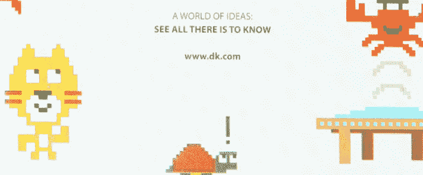


> 当你完成每个项目时，给自己一个星星吧！


> 我最喜欢这一页。


Scratch 向你提出难题。你能回答多少个？


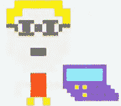

## 答案

# 词表与给家长的说明

## 什么是 Scratch？

计算机没有像你一样的大脑，所以你想做的每件事都必须分解成称为程序的简单指令。给计算机下指令被称为编程或编码。

- 你将学习：
- 为了完成任务，计算机需要称为程序的指令
- Scratch 是开始编程的好地方
- Scratch 项目的元素有
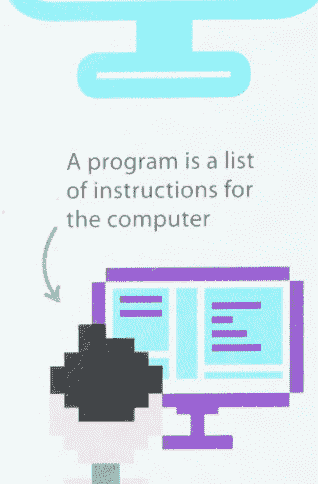

## 计算机理解什么？

计算机指令必须按照计算机理解的单词和规则来编写。这些单词和规则构成了“编程语言”。有很多不同的编程语言，许多有趣的名字，例如 JavaScript、C++ 和 Python。

程序是给计算机的指令列表
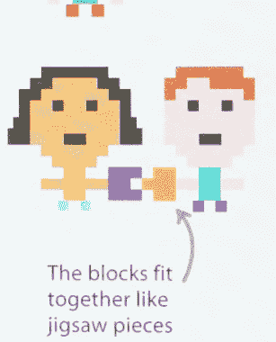

## 什么是 Scratch？

Scratch 是一种初学者易用的计算机编程语言。在 Scratch 中，程序通过鼠标连接积木块制作。这些积木块告诉屏幕上的角色做什么。Scratch 是免费、安全且有趣的实验工具。积木块像拼图一样组合在一起。

## Scratch 项目

通过 Scratch，你可以制作自己的互动故事、动画、音乐和艺术。Scratch 拥有大量的图形和声音集合（“库”），以及你可以玩的角色和背景。让你的想象力飞翔——你将学会所需的编码技能！

> 我们可以发出很多声音！

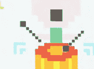

# Scratch 项目由什么组成？

这是一个 Scratch 项目。把它想象成一出戏。动作发生在名为“舞台”的区域。“演员”（角色）由指令列表（脚本）控制。背景的后面是“场景”，是可以更改的。

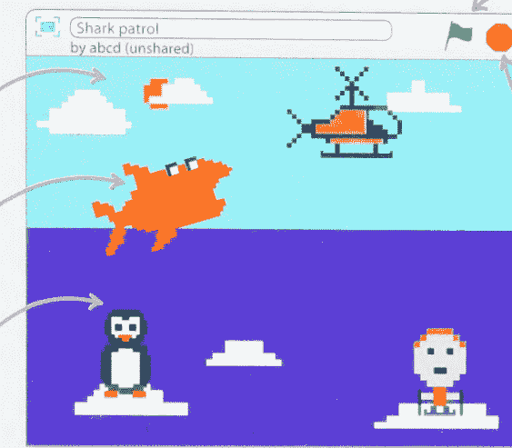

- 点击绿色旗帜运行（启动）程序
- 背景（背景图片）
- 点击红色按钮停止程序
- 添加脚本让鲨鱼角色移动
- 角色用于我们想要移动或控制的所有对象

这是舞台

```
when clicked
forever
next costume
wait 0.25 secs
move 10 steps
if edge, bounce
```

# 角色的脚本

这是一个脚本示例。它让鲨鱼角色在舞台上弹跳，开合嘴巴。每个积木块都给角色一个指令。积木块可能会告诉角色移动、改变外观、在气泡中说话、对其他角色做出反应或发出声音。

# 你知道什么

填空以练习 Scratch 的核心语言。

1. 一个 ................................ 是 Scratch 中的一组指令（程序）。
2. 在项目中执行动作的对象被称为 ....................................
3. 在 Scratch 项目中，动作发生在 ....................................
4. 启动程序被称为 .................................................它。
5. 声音或图形的集合被称为 ....................

# 获取 Scratch

你可以在 Scratch 网站上在线编程，但如果你不是总是连接互联网，就可以将其安装在计算机上。请一位大人帮助你。你需要较新版本的 Scratch 2.0，而不是旧的 Scratch 1.4。

- 你将学习：
- 你需要 Scratch 2.0
- 如何使用 Scratch
- 如何加入 Scratch 网站
- 如何保存你的项目


# 在线使用 Scratch

如果你注册了 Scratch 账户，就可以在线保存项目并与朋友分享。

1. 注册 Scratch
访问 scratch.mit.edu 并加入 Scratch 获取如何注册的说明。你需要拥有电子邮件地址的成人许可。

2. 在 Scratch 中创建
想使用 Scratch 时，访问 Scratch 网站并点击创建。这将打开 Scratch 编辑器窗口。

> 点击此文件查看你的项目

3. 保存项目
如果你登录 Scratch 账户，项目会自动保存。你可以通过点击屏幕右上带有“S”字母的文件来查看已保存的项目。

来自 Scratch 猫猫的小贴士
需要“右键点击”但鼠标只有一个按钮？通常你可以在点击时按住键盘上的控制 (CTRL) 键或 Shift 键。不起作用？那就请教计算机所有者。


# 在计算机上安装 Scratch

如果你无法访问互联网或想离线工作，你将需要 Scratch 安装程序。请前往 scratch.mit.edu/scratch2download 并按照安装说明操作。

要启动 Scratch，只需双击桌面上的 Scratch 2.0 图标。

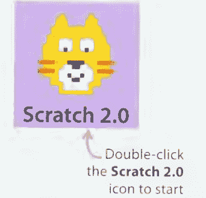

## 操作系统

检查你的电脑的操作系统是否能够运行 Scratch。

- Scratch 2.0 的在线版本可以在 Windows (PC)、OS X (Macs) 和某些 Linux 电脑上运行。
- 离线版本可能无法在某些 Linux 电脑上运行。
- 树莓派目前无法运行 Scratch 2.0。

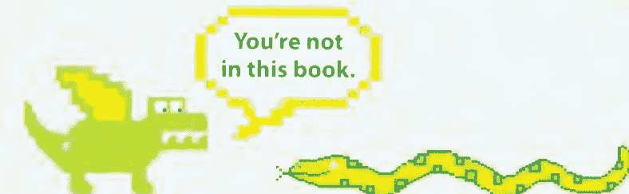

## Scratch 在线社区

在 Scratch 网站上，你可以分享你的项目并尝试其他编码者的 Scratch 作品。更棒的是，你可以探索每个项目是如何运作的，甚至可以修改（“重混”）它们。请注意下方显示的按钮。

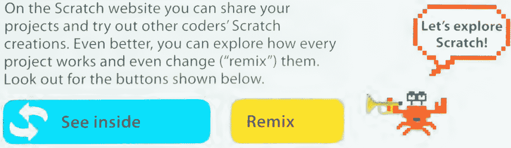

## 探索 Scratch

在你的电脑上打开 Scratch，你将看到这些。在这个屏幕上，你创建和运行 Scratch 项目所需的所有内容。观察一下吧。

> 实验！
> 点击按钮和标签来尝试 Scratch。别担心，你不会弄坏电脑的！

- 更改语言
- 保存到这里
- 删除角色或脚本。
- 帮助工具。

点击此处进入全屏查看

猫头鹰和小猫
作者 stilton181 (未分享)

这是舞台——在这里运行项目并查看动作

点击这些按钮来开始（运行）和停止项目

点击舞台上或角色列表中的角色来选中它


点击 ![]( 获取详细的角色信息。

角色由脚本控制

你也可以选择舞台并编辑（更改）它的脚本、背景和声音

角色
新角色：

舞台
1 个背景
猫
乌龟
猫头鹰

新背景：
添加新角色的按钮

移除新背景（背景图片）的按钮

在你选中的角色周围会出现一个蓝色方框

## Scratch 概览

舞台是运行项目的地方。角色列表显示了项目所有的角色。脚本块可以在区块面板中找到。在脚本区域构建脚本。

画散标签——使用此标签更改角色的外观

声音标签——使用此标签更改角色发出的声音

点击此处查看步骤指南和技巧

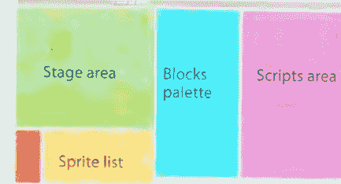

舞台信息

背包


已保存

stilton181

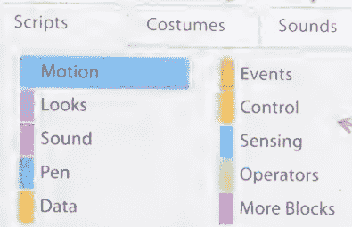

选择不同类型的区块

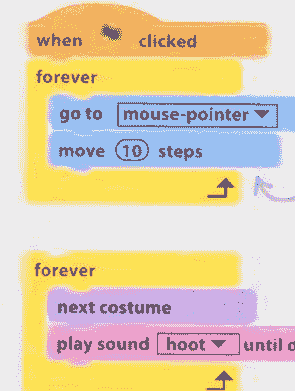

```
when clicked
forever
goto mouse-pointer
move [10] steps
```

区块可以吸附在一起——使用鼠标移动它们

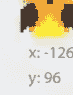

```
forever
next costume
play sound [hoot] until done
```

每个区块都是一个不同的 Scratch 指令

这些脚本控制着猫头鹰角色


背包用于在项目之间复制角色、画散、脚本和声音

从这里将区块拖入脚本区域以制作脚本

构建脚本

## 学习基础知识

你知道如何构建脚本、创建循环并制作动画吗？别担心，在这一节中你将学习所有这些以及更多。让我们开始编程吧！

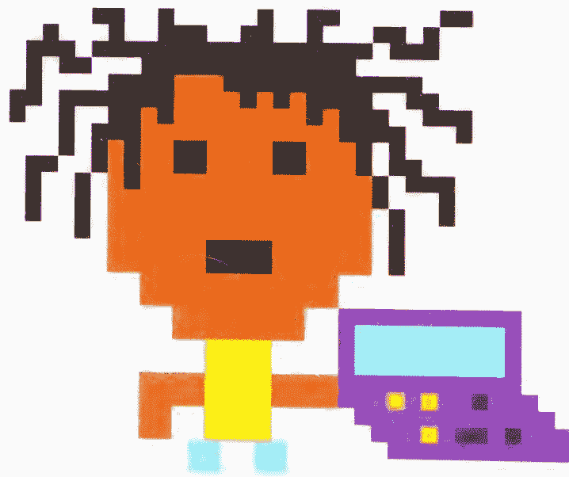

## 让我们探索 Scratch！

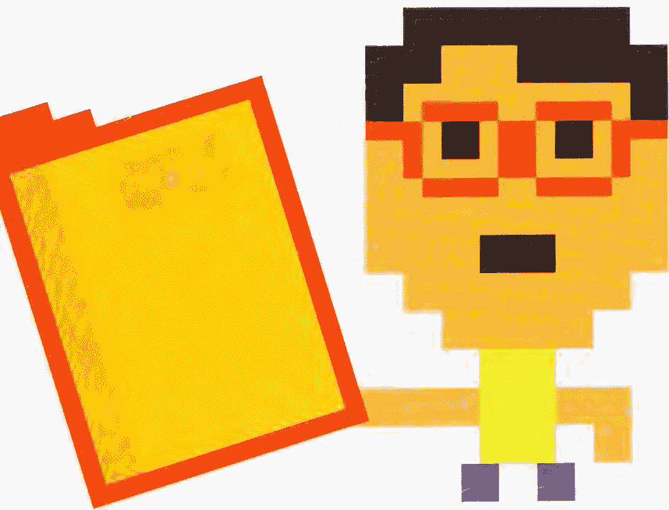

## 你的第一个项目

是时候开始我们的第一个 Scratch 项目了。我们将创建一些简单的指令让猫咪说话。通过用鼠标移动彩色区块，我们可以构建一个名为脚本的简单程序。

- 你将学习：
- 角色由脚本控制
- 如何从区块构建脚本
- 脚本中的内容会逐一个区块地发生
- 你可以阅读 Scratch 来了解它的作用

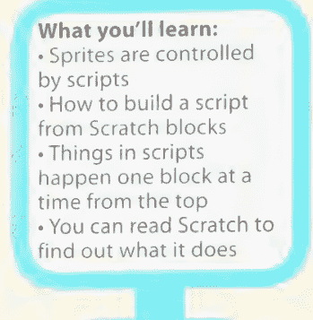

## Scratch——友好的猫

首先，在 Scratch 网站上打开编辑器，或者点击电脑上的 Scratch 图标。你会看到猫站在舞台上。让我们做一个脚本来告诉猫做什么。

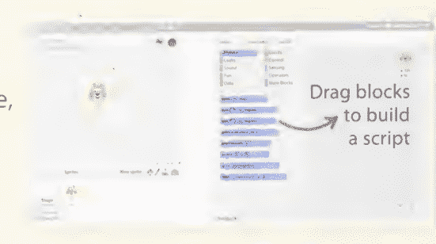

点击 Looks

- 开始一个新脚本
我们将通过让编辑器中 Scripts 标签下的猫说“Hello!”来开始

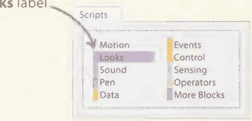

- 选择一个 say 区块
编辑器中间的区块列表会变化。用鼠标点击 say Hello!区块将其拖到脚本区域。


- 再次操作！
将一个 say Hello!区块拖入脚本区域。当区块重叠时释放鼠标，它们像拼图一样锁在一起。


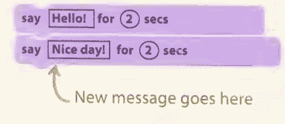

## 学习基础知识

棕色区块位于语音区块上方

## 完成你的脚本

点击 Events 标签。将列表顶部的棕色区块拖到右侧脚本区域。悬停在 say区块上，然后松鼠标。棕色区块会吸在语音区块上。


点击绿旗运行脚本

## 阅读整个脚本

脚本告诉我们，要开始这一切，我们需要点击舞台左上角的绿旗。这被称为“运行”脚本。

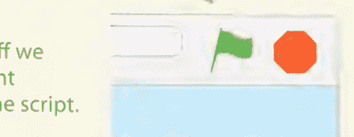


## 观察动作

当你点击绿旗时，Scratch 猫会说“Hello!”两秒。然后它会说“Nice day!”两秒。


> 区块是如何按顺序工作的——猫依次执行每个动作。

## 保存它！

做得好！你构建了你的第一个 Scratch 项目！点击 File 菜单并选择 Save 或 Save All 来保存。

## Scratch 谜题

我们为猫挑选了一些区块进行尝试。从每个区块连到猫将执行的操作的正确图片。

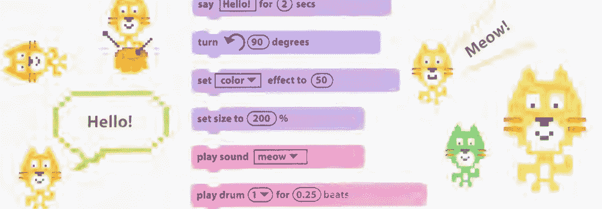

## 动起来！

现在该采取行动了。让我们使用深蓝色区块让猫动起来。Scratch 以“步”为单位测量距离。舞台宽480步，高360步。有一个区块可以防止角色卡在墙上。它们只会从墙上弹回来！

- 你将学习：
- 如何让角色移动
- Scratch 以步数测量距离
- 如何保持角色直立

## 让猫动起来

开始一个新项目。点击舞台上方的 File 并选择 New。添加这个脚本并思考区块的作用。


点击绿旗运行脚本。猫会向右移动一小。尝试几次。


点击 move 区块中的 10 并输入 100。现在猫每次移动的距离要远得多。尝试不同的步数进行实验。

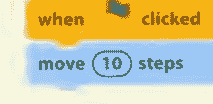

## 在墙上反弹

现在将你的脚本改为这样。阅读脚本。你认为它会做什么？forever 区块重复内部的区块——永远！if on edge, bounce 让猫在舞台边缘转弯。

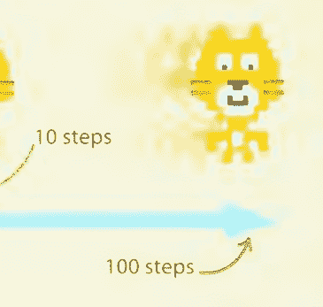

运行新脚本。猫现在会在舞台上向右跑，再向左跑。实验——每次移动的步数越多，猫跑得越快。


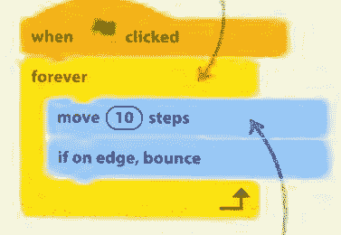


# 学习基础 | 17

别再倒立着了！
这只可怜的猫有一半时间都是倒过来的——太糟糕了！为了停止这一点，点击角色列表角的角的蓝色 i。将会显示关于该角色的额外信息。将旋转样式改为 <->。尝试其他的旋转样式，看看猫会做什么。

倒着向左移动


猫面向它行走的方向，有时会是倒立的。

正立向右移动

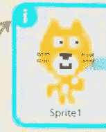

点击这里获取关于角色的信息


| 角色1 | 方向: -90 |
|---|---|
| x: 84 y: 69 |
| 旋转样式: 玩家: ↻ |

猫面向左或向右，并且始终是正立的

猫完全不旋转

# 展示你的才华

这个测验你能答到多远？一直到最后

- 1. 运动模块块（Motion blocks）是什么颜色的？
2. Scratch 使用名为……的单位来测量距离。
2a. 舞台宽度是多少个这些单位？
2b. 舞台高度是多少个这些单位？
3. 程序中的错误被称为“bug（虫子）”。

这个脚本应该让猫缓慢地穿过舞台，但当我点击绿色旗帜运行它时，什么都没有发生！出什么了？

```scratch
forever
  move 2 steps
  if edge, bounce
```

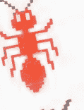


我们喜欢 bug！


## 哪边？

当你想要移动一个角色时，你需要知道两件事：多远和向哪个方向。每个角色都有一个内置的方向箭头。当脚本运行到深蓝色的移动块时，那就是角色将去的方向。

### 你将学习：
- 如何让角色指向不同的方向
- 如何让角色移动

### 猫跟随鼠标！
让我们让猫向所有可能的方向旋转。在 Scratch 编辑器中打开一个新项目。为猫角色构建此条脚本。阅读这个脚本。你认为它在做什么？如果你猜对了，点击绿色旗帜。

来自棕色的事件（Events）模块、来自黄色的控制（Control）模块、深蓝色的模块

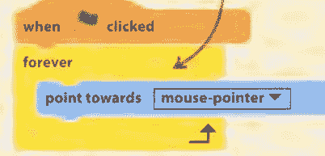

在舞台上移动鼠标指针并观察猫绕着它旋转，它始终指向指针。**重复（forever）**块反复运行**指向鼠标指针（towards mouse-pointer）**块。

猫将跟随鼠标指针

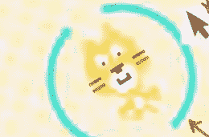

如果不起作用，请检查旋转样式

# 方向：–90°

### 角色知道要去向哪里！

角色信息面板上显示的方向圆

每个角色都知道自己指向哪个方向。当你点击蓝色 ⓘ 时，角色信息面板会显示它的方向。

方向 -90° 意味着“左”

方向 0° 意味着“上”

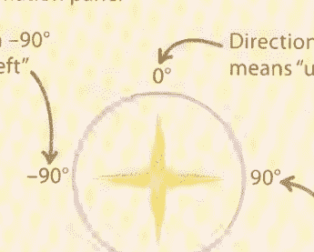

随着猫旋转，你会看到它的方向值发生变化，蓝色指针在方向圆上移动。

使用这里显示的“指南针”来解码方向数字。

方向 180° 意味着“下”，

方向 90° 意味着“右”，

## 选择角色的方向

我们也可以使用**指向方向（point in direction）**块上的窗口来设置角色的方向。你可以点击数字旁的小三角形来获取有用的方向，或者直接点击窗口并输入数字。

## 再次在墙壁上反弹

将**指向方向 45（point in direction 45）**块添加到第 16 页的“在墙壁上反弹”脚本中。把它放在**当点击绿色旗帜（when green flag clicked）**块之后，**重复（forever）**块之前。运行脚本。猫将沿对角线出发。尝试使用方向和旋转样式。

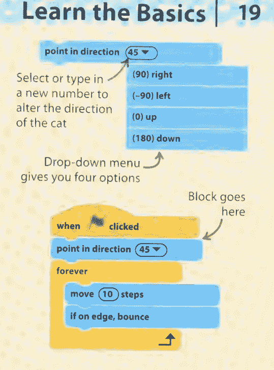

# 展示你的才华

熟悉 Scratch 吗？

- 1. 应该用什么数字来设置方向：
上 = ............................
左 = ............................
下 = ............................
右 = ............................
- 2. 这个脚本在做什么？仔细阅读并测试你的能力！

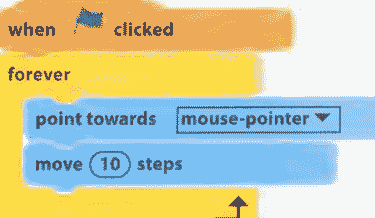

## 学习基础

# 循环

在程序中，我们经常多次执行相同的指令。为了避免多次放置相同的块，可以使用循环。

### 你将学习：
- 循环的类型
- 重复（forever）和重复（repeat）之间的区别
- 如何使用循环

启动一个项目并查看橙色模块。

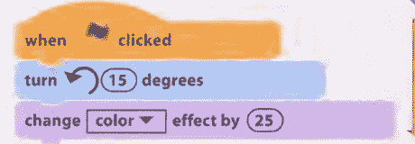

随着猫旋转，你会看到它的方向值发生变化，蓝色指针在方向圆上移动。

使用这里显示的“指南针”来解码方向数字。

方向 180° 意味着“下”，

方向 90° 意味着“右”，

## 重复循环

forever块反复运行内部的块。你可以点击红色停止按钮停止它。

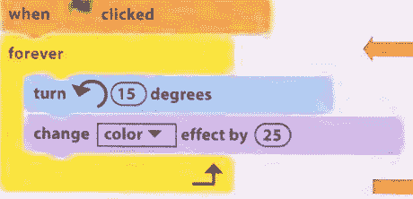

## 重复循环

如果我们只想重复几次块，可以使用重复（repeat）块。尝试更改重复的次数。

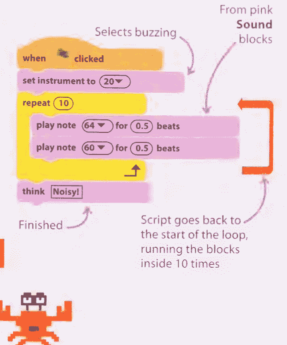

# 展示你的才华

你了解循环吗？通过这个测试一下。

- 1. 循环用于...........一组块。
- 2. 两种 Scratch 循环是...........
- 3. 你可以通过点击...........停止循环。
- 4. 在哪个部分找到粉色的？
- 5. 哪个块有它？

找虫子！这个脚本应该画出正方形的四条边，但在运行时什么都没有发生。你能发现并建议修复吗？

## 学习基础

# 动画

动画中的角色似乎在移动，但实际上你只是在看许多略不同的图片，欺骗你的大脑让你看到运动。这被称为动画。角色也可以以相同的方式制作动画。

你将学习：
- 如何为角色制作动画
- 角色可以改变外貌
- 如何使用服装
- 如何从 Scratch 库加载新角色

## 切换服装

我们的猫角色有两个不同的图片，或者说“服装”，可以显示。启动一个新的 Scratch 项目，并点击块列表上方的服装（Costumes）标签。你将看到猫角色可以“穿”的两个服装。

## 让猫走路

选择下一个服装

```

要为猫制作动画，构建并运行此脚本。重复循环重复下一个服装块。角色图片每半秒变化一次，这让猫看起来像在走路。尝试在循环中添加一个移动块来改进动画。

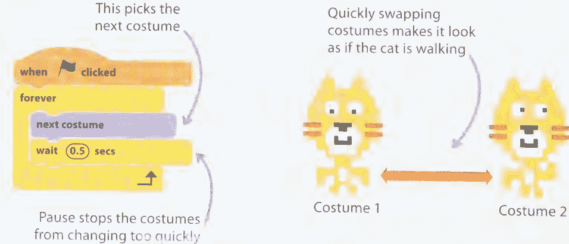


# 学习基础 | 23

跳舞的芭蕾娜
你可以使用相同的脚本让其他角色也跳起来！让我们把芭蕾娜角色添加到项目中吧。点击角色列表顶部的**从库中选择角色**（Choose sprite from library）。然后选择芭蕾娜并点击**确定**（OK）。

将切换服装的脚本添加到芭蕾娜的脚本区域。她有四套服装。点击**服装**（Costumes）标签页来查看它们。当你运行脚本时，她会在舞台上跳舞时切换使用所有的服装。

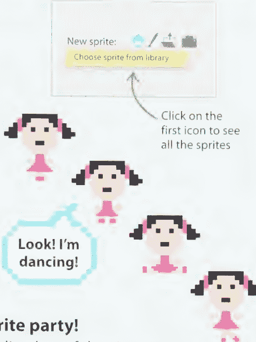

新角色：
从库中选择角色

点击第一个图标查看所有角色

看！我正在跳舞！

角色派对！

尝试向你的项目添加许多正在跳舞的角色。选择具有两个或更多服装的角色。尝试选择 Dinosaur1（恐龙1）或一些正在跳舞的小孩。

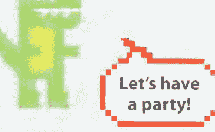

## 展示你的所学知识

你可以让角色跳舞。你也能解决这些问题吗？

- 1. 角色在舞台上显示的不同图片叫做 ....................................................
- 2. ............................................是通过显示顺序略有不同的图片来让角色看起来像在移动。
- 3. 你能重新排列下面的角色来制作一个跳跃小马的动画吗？
在框中填写数字 1 到 5 以显示正确的顺序。

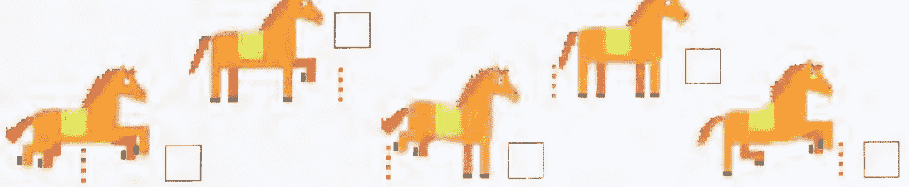

## 学习基础

## 派对时间！

我们学习了许多关于让角色执行动作，但如果这一切发生在安静的白色舞台上，那么项目就是不完整的！让我们看看如何从 Scratch 库中为项目添加一些场景和音乐来活跃气氛。

- 你将学习到：
- 如何更改背景图片
- 如何为背景添加效果
- 如何为你的项目添加音乐


## 添加场景——背景

就像角色可以有很多件服装一样，舞台也可以有多个背景图片，或背景（backdrop）。点击舞台信息区域左下角的**从库中添加新背景**（Add new backdrop from library）按钮。

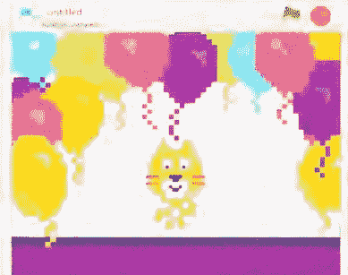

现在是小猫的生日，所以选择“派对”（party）舞台。你会在舞台上看到那只猫！你可以加载多个背景。尝试加载 **underwater2**（水下2）。

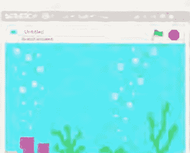

你可以在任何脚本中使用**外观**（Looks）部分中的**切换背景**（switch backdrop）或**下一个背景**（next backdrop）模块来切换背景。

```
switch backdrop to party
next backdrop
```

underwater2 舞台

使用这些模块来切换背景

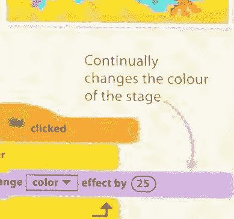

不断改变舞台的颜色

## 灯光秀！

我们可以为舞台添加脚本：点击舞台信息区域顶部舞台区域的小图。尝试用你的派对背景运行这个脚本，让它活跃起来。

```
when clicked
forever
change color effect by 25
```

# 学习基础 | 25

音乐
没有音乐的派对不是派对！
声音可以加载到角色或舞台中。但你必须在脚本区域编写脚本来播放它们。

点击**声音**（Sounds）标签页下的喇器图标将带你进入声音库

## 加载音乐

再次点击舞台。然后点击模块上方的**声音**标签页，选择**从库中选择声音**（Choose sound from library，即喇器符号）。

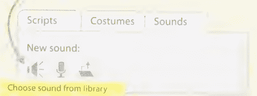

新声音：


## 选择一段旋律

选择一个音乐循环，例如“dance”（跳舞），并点击右下角的确定进行加载。声音将出现在声音列表中。

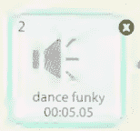

选择你的节奏！
在进入下一个模块之前播放声音

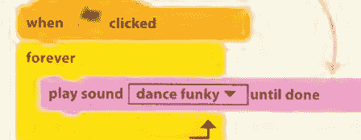

## 编写、阅读并运行脚本
点击**脚本**（Scripts）标签页并制作这个脚本。阅读脚本并运行它。你应该能听到结束音乐！

## 展示你的所学知识
小猫想参加派对。你想做个测验吗？

- 1. 舞台上的背景图片叫做 ....................................
- 2. 在进入下一个模块之前播放声音的模块是：
```
play sound
```
```
play sound
```
- 3. 对还是错？
- a. 只有背景可以 ....................
- b. 角色可以是 ....................
- c. 舞台可以 ....................
- d. 一旦加载了背景，就 ....................
- e. 使用背景的舞台可以 ....................

## 学习基础

## 如果-那么

我们学习了许多关于让角色执行动作，但如果这一切发生在安静的白色舞台上，那么项目就是不完整的！让我们看看如何从 Scratch 库中为项目添加一些场景和音乐来活跃气氛。

- 你将学习到：
- 如何更改背景图片
- 如何为背景添加效果
- 如何为你的项目添加音乐

## 添加场景——背景

就像角色可以有很多件服装一样，舞台也可以有多个背景图片，或背景。

正如计算机非常擅长存储信息，或者说数据（data）。

- 脚本区域：
- 脚本区域
- 脚本区域
 脚本（Scripts）的。


## 学习基础

## 派对时间！

我们学习了许多关于让角色执行动作，但如果这一切发生在安静的白色舞台上，那么项目就是不完整的！让我们看看如何从 Scratch 库中为项目添加一些场景和音乐来活跃气氛。

- 你将学习到：
- 如何更改背景图片
- 如何为背景添加效果
- 如何为你的项目添加音乐


## 倒计时猫

是时候看看变量是如何运作的。
启动新项目。

在橙色的“数据（Data）”区域，创建两个名为 `count` 和 `message` 的变量。
始终为你的变量命名能够解释其中存储内容的名称。

添加此脚本。确保你将带有 `count` 和 `message` 的橙色小积拖到“说（say）”积的窗口中。不要直接在“说”积窗口中输入单词。如果你这样做，猫会说出变量的名字，而不是变量中存储的内容。

阅读这段脚本。你能推导出将发生什么吗？现在运行脚本。

尝试修改脚本中的数字和文本。你能让猫向上数数而不是向下数吗？

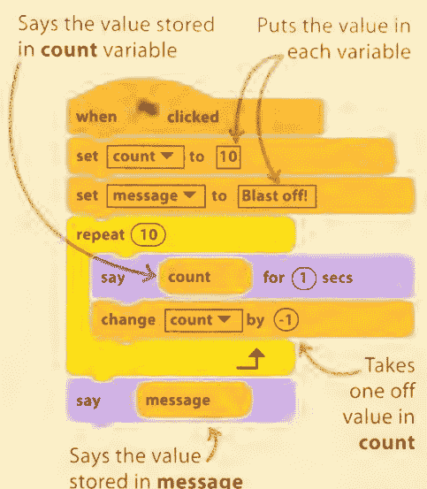

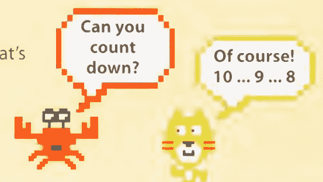

## 展示你的所学

测试一下你存储在“脑盒”中的 Scratch 数据。

- 1. 变量有一个名称和一个 ....................................
- 2. “建立变量（Make a Variable）”按钮位于橙色的 ............................ 积木区域。
- 3. 为这些积木组填充对话框：

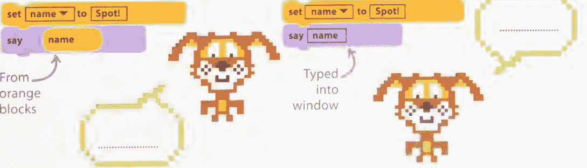

# 学习基础知识：数学

Scratch 可以完成你熟悉的所有数学运算。但它使用的一些符号有所不同，以适应电脑键盘的布局。我们可以在 Scratch 中建立方程并在其中使用变量。Scratch 甚至可以为我们掷骰子。

- 你将学习：
- 如何在 Scratch 中进行数学运算
- 计算机使用的数学符号
- 如何使用变量建立方程
- 如何使用电脑掷骰子


## 数学工具

要进行数学运算，你需要绿色的“运算符（Operator）”积木。每个积木都会对两个窗口中的数字进行不同的运算。

`+` 积木会将两个数字相加。

`-` 积木会将第二个数字减去第一个数字。

## 放置运算符

无论你把运算符积木放在哪里，它都会给出问题的答案。所以，如果你把它放在“说”的窗口里，猫就会说出答案。

## 乘 (*)

Scratch 使用 `*` 符号，因为 "x" 看起来像一个字母。

## 除 (/)

键盘上没有除号。Scratch 使用 `/` 代替。

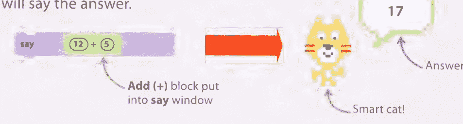

## 数学与变量

我们可以使用运算符积木来解决变量问题。例如，为了找到宠物的总数，我们可以使用加法 (+) 积木将变量 `dogs` 和 `cats` 的值相加，并将答案存储在名为 `pets` 的变量中。

加法 (+) 积木放入设置（set）积的窗口中


## 学习基础知识

随机数是我们无法预测的数字。它就像我们掷骰子时得到的数字——在掷之前，我们并不知道数字会是多少。Scratch 可以像骰子一样为我们“掷数”。在新项目中尝试这个脚本。

阅读脚本，然后运行它。猫在思考这些数字时，会向你展示四个随机数。随机数在游戏中非常有用，因为它们让动作变得难以预测。


## 展示你的所学

尝试这些数学题。

- 1. 你是电脑！计算这些积木的值。

- 2. 这些积木使用了变量。你能算出答案吗？

- 3. 写下存储在这些变量中的值。

# 学习基础知识：输入与事件

输入程序的数据（例如当 Scratch 提问时你输入的）被称为输入。事件是发生的动作，如点击或按键，Scratch 可以利用这些来运行脚本。

- 你将学习：
- 如何提问并使用答案
- 什么是事件（Event）积木
- 如何通过按键或点击运行脚本


## 询问

角色可以使用“传感（Sensing）”标签下的蓝色“询问（ask）”和“回答（answer）”积木来提问和获取答案。启动新项目并添加此脚本。阅读脚本。你认为它会做什么？


猫在提问


你输入“猫粮”


## Scratch 的午餐时间！

猫提问并等待你使用键盘输入回复。当你按下回车键（enter）时，你输入的内容就变成了“回答”积木的值。


## 答案就像变量

“回答”积木的工作方式就像变量。无论你把“回答”积木放在哪里，它都会被你对问题的回答替换。脚本中的绿色“拼接（join）”积木获取窗口中的内容并将它们连接成一个整体。


## 事件触发脚本

事件是计算机可以告知 Scratch 的事情，例如按键和鼠标点击。棕色的“事件（Events）”头部积木在选定事件发生时开始运行，就像绿旗按钮被点击时可以启动脚本一样。


## 构建一套鼓组

创建这样的脚本列表。为每个版本的脚本选择不同的按键和不同的鼓。当你按下正确的按键时，事件脚本头部下方的积木运行。使用你选择的按键演奏一场史诗级的独奏！


## 展示你的所学

你能回答这些关于输入和事件的问题吗？

- 1. 哪个蓝色的传感积木让角色提问问题？...................................
- 2. 哪个积木持有对问题的回答？...................................
- 3. 发生于计算机上的事情（如鼠标点击或按键）被称为 ....................................
- 4. 如果我点击这个脚本会发生什么？...................................
- 5. 可以同时运行多个脚本吗？.....................................


# 学习基础知识：如果-那么-否则

让我们认识“如果-那么-否则（if-then-else）”积木。这个积木使用一个问题或条件在两组积木之间进行选择。我们还将查看一些实用的条件积木，它们使用变量和值来询问“真”还是“假”？

- 你将学习：
- 如何比较数字、回复和变量来做决策
- if-then-else 积木是如何工作的


## 比较

另一种类型的积木会询问“真或假”的问题。在绿色的“运算符”中，有三个积木可以比较两个窗口中的内容。要读取它们，你需要知道这些符号：=、< 和 >。

| 表达式 | 含义 | 结果 |
| :--- | :--- | :--- |
| 3 = 3 | 意味着“相同” | True |
| 3 = 2 | | False |
| 2 < 5 | 意味着“小于” | True |
| 7 < 3 | | False |
| 5 > 1 | 意味着“大于” | True |
| 6 > 9 | | False |


## 密码检查

“如果-那么-否则”积木内部有两个积木组。如果条件为真，它运行第一组；如果条件为假，它运行第二组。我们可以用它来检查密码。

```
当点击时
问密码？并等待
if answer = dragon then
say 欢迎朋友！
else
say 请离开！
```

如果答案是 "dragon"
如果答案不是 "dragon"


## 一个游戏：巨龙！

到目前为止，我们学习了很多 Scratch。现在，让我们把所学整合成一个游戏。你是那只猫。你可以使用电脑鼠标来控制自己在舞台上的位置。尽可能避开那条凶恶的巨龙吧！

- 你将学到：
- 如何将角色和脚本组合成游戏
- 如何检测两个角色何时触碰
- 脚本如何停止


## 引入巨龙

向项目添加“Dragon”（龙）角色。为所有角色添加一个变量，并将其命名为 `speed`（速度）。

保持勾选此框


## 让巨龙跳起来

在角色列表中选择巨龙并添加此脚本。这是我们之前使用过的弹跳脚本，但有一处微小的变化。我们用变量来控制巨龙的速度，并在每次游戏中都让巨龙向不同的方向出发。阅读并运行脚本。巨龙会在舞台上来来跳去。

运行时让巨龙指向新方向


## 鼠标控制小猫！

现在在角色列表中选择猫并添加此脚本。仔细阅读该脚本。它会让小猫“粘”在鼠标指针上。在循环内部，它还会检查我们是否触碰了巨龙。如果是，它就会停止项目——游戏结束！运行脚本检查它是否能正常工作。

等待积木让巨龙远离

如果为真，则停止所有脚本


# 学习基础 | 37

一个真正的游戏需要分数和挑战。为所有角色添加一个名为 `score`（分数）的新变量。保持勾选，以便它显示在舞台上。

给猫添加此脚本。阅读它。每避开巨龙 3 秒，你就能得到 1 分。但每当你得分，巨龙的速度就会增加 1！

运行游戏看看它是否符合你的预期。如果不符合，请从头开始检查一切。现在和你的朋友竞争获得最高分吧。为什么不加一个背景和一些音乐呢？


```
when clicked
set score to 0
forever
  wait 3 secs
  change score by 1
  change speed by 1
```


> 分数越高，巨龙移动得越快

你喜欢 Scratch 吗？

只有当我点击时！

## 展示你的所学

回答测验——会得到高分还是“游戏结束”？

1. 为什么我们要保持 `score` 变量的勾选框处于选中状态？
2. 你如何让巨龙在开始时以半速运行？
3. 你可以在猫的 `forever` 循环中添加哪个积木让它看起来像在走路？
4. 巨龙有多少个造型？
5. 如果你在角色列表右键点击巨龙并选择“复制”，会发生什么？

## 游戏

跳动的西瓜、幽灵的鬼魂和踢足球的鱼？让我们开心制作一些游戏吧！

**提醒框（Reminder boxes）**将帮助你记住在上一节掌握的技能，而**新技能框（New Skill boxes）**将你的学习提升一个层次！


## 鱼球大战 (Fishball)

你准备好构建 Fishball 你的第一个复杂的游戏了吗？不要担心，你不需要一次性完成。只需按照编号步骤操作，部分地组装项目。

- 你将学到：
- 如何构建简单的脚本来制作游戏
- 如何添加角色、背景和声音来改进你的游戏
- 如何追踪时间和分数

游戏中的分数和剩余时间显示在这里

鱼在舞台上跟随球移动

使用绿旗和红色按钮开始和停止游戏。


开球点

猫由鼠标指针控制

球会在猫和鱼之间弹跳

进球

## 游戏

Scratch 小猫正在踢足球。使用鼠标指针让他在舞台上移动，并将球拨向绿色圆圈得分。但要注意鱼守门员——她会竭尽全力阻止你！

## 控制你的猫！

我们将从创建一个简单的脚本来控制猫角色开始。它会让小猫像胶水一样粘在鼠标指针上！

- 打开 Scratch 编辑器：在 Scratch 网站上创建，或者在电脑上点击 Scratch 图标。将项目命名为“Fishball”。


- 在脚本标签页下，进入蓝色的“动作”（Motion）积木区。点击“移动鼠标指针”并将其拖到脚本区域。


- 现在点击黄色的“控制”（Control）积木区并选择 `forever` 积木。将“移动鼠标指针”放在里面。这两个积木组合在一起。


- 接下来，选择棕色的“事件”（Events）积木区。点击“绿旗被点击”并将其添加到 `forever` 积木上方。阅读脚本。你认为它在做什么？


> 提醒：Forever 循环是重复执行的代码。`forever` 循环会重复其内部的积木！在你控制猫的脚本中，`forever` 循环让猫在整个游戏中“粘”在鼠标指针上。
- 点击舞台顶部的绿旗开始运行脚本。猫应该随着鼠标指针移动。如果没有，检查步骤 1 到 4。


## 游戏

## Scratch 小猫需要一个球

进入角色列表并点击“从库选择”（角色符号）。在库中选择“Soccer Ball”（足球）并点击确定。球将出现在角色列表中。

现在你可以控制猫了，该给它一个球来玩。你需要为球创建一个脚本，让它在舞台上并在猫身上弹跳。

点击角色符号

# 提醒：菜单和窗口

有些积木有一个下拉菜单，例如“碰到？”。点击三角形查看选项。然后选择你想要的那个。

接下来，将这些积木组合在球的脚本区域。记住积木的颜色会告诉你它在面板面板的哪个部分。


配合其他积木，如“旋转”，你点击窗口并输入一个数字。


移动球一段距离


在舞台边缘改变球的方向

点击窗口并输入 `如果...那么` 积木，其中有一个窗口，你可以拖入另一个提问题的积木。

点击绿旗，观察球在碰到舞台边缘时的弹跳。它现在还没有注意猫。绿旗同时启动球和猫的脚本并运行它们。


拖入指向窗口

我在忽略猫！


你可以通过重命名猫来让你的脚本更易理解。在角色列表（舞台下方），选择猫并点击其上角的蓝色 (i)。在角色信息面板的窗口中输入“Cat”而不是“Sprite1”。

## 提醒：如果...那么

`如果...那么` 积木包裹着其他积木并使用“真或假？”的问题来控制积木的运行。当 Scratch 到达 `如果...那么` 积木时，只有当答案为真时它才会运行内部的积木。

在此窗口中输入“Cat”来更改角色名称

球碰到猫了吗？


现在选择足球角色并组合这些积木添加到你的脚本中。将它们放在 `forever` 循环中，放在 `如果碰到边缘，弹跳` 之后。当球碰到猫时，脚本会播放“pop”的声音并让球看起来是从猫身上弹开的。

`如果...那么` 积木检查球是否碰到猫


这些积木让球从猫身上“弹开


如果球没有碰到猫，脚本将忽略 `如果...那么` 积木内部的指令


## 44 | 游戏

开球
小猫（Scratch Cat）需要一个开球点和一个得分的球门。一种被称为**变量**的特殊积木将帮助你记录游戏过程中进了多少个球。

从资源库中加载两个新角色：“Button1”（绿色圆形）和“Button5”（黑色 X）。将 Button1 拖到舞台右侧的中间位置，并将其重命名为“Goal”（球门）。然后将 Button5 拖到左侧的中间位置并重命名为“Start”（开始）。


### 鱼球大战
作者 HappyShrimp123 (未分享)

新角色：


这两个角色不需要脚本——它们只是你可以用来发送给其他角色的标记。

新角色将出现在角色列表中

在橙色的“数据”分类中，点击“建立变量”。在弹出的窗口中输入变量名称为“Score”并点击确定。当 Score 变量积木出现在数据区域时，确保它旁边的复选框已勾选。

## 提示：变量

变量就像一个带标签的盒子，你可以在其中存储数据，例如单词或数字。存储在变量中的数据称为它的值。你创建的新变量有一个标签，即 Score。它存储了猫在“鱼球大战”游戏中的进球数。球数就是变量的值。

在此窗口中

选择“所有角色”


勾选此框将在舞台上显示比分

建立变量


接下来，将这两个积木放入足球的脚本中，放在“当绿旗被点击”之后、“重复”循环之前。橙色的“将”积木在游戏开始时将分数设置为零。深蓝色的“去到”积木将球发送到黑色 X 准备开球。


将比分重置为 0


将足球送回起始角色

你可以添加一个声音来作为进球信号。选择足球，切换到“声音”标签页，点击“从库中选择”（喇声器符号）。在库中选择“rattle”（沙沙声）并点击确定将其加载到项目中。

角色的声音可以在此标签下查看


点击喇声器符号进入声音库

“rattle”声音将出现在“声音”标签下


点击“脚本”标签页，并将下方的积木组插入足球的脚本中。将其放在第一个“如果-那么”组下方，但不要放在它内部。确保它仍在“重复”循环内部。你可以在下一步中看到整个脚本。


这个来自“侦测”的积木检测球是否碰了球门

每次进球都会播放沙沙声

“如果-那么”内部的积木只有在球碰到球门时才会运行

```
if touching Goal
  play sound rattle
  change Score by 1
  wait 1 secs
  go to Start
```

将 Score 的值加 1。一秒后，球会回到黑色 X

足球的脚本现在看起来应该是这样的。运行脚本并观察发生了什么。球现在从黑色 X 开始。Scratch 将球踢进绿色球门，分数增加一分，球返回起始位置。

```
when clicked
set Score to 0
go to Start
forever
  move 10 steps
  if on edge, bounce
    play sound pop
    point towards Cat
    turn 180 degrees
  move 10 steps
  if touching Goal
    play sound rattle
    change Score by 1
    wait 1 secs
    go to Start
```

你的脚本中包含了所有正确的积木，并且它们的顺序所示所示

让我们玩玩吧！


压力来了！在压力下游戏更加困难。增加时间限制会让“鱼球大战”更具挑战性。当绿旗被点击时，将开始 30 秒倒计时。

鱼球大战
作者 HappyShrimp123 (未分享)
Score | 0
Time | 0


为所有角色创建一个名为“Time”的新变量。勾选它以便在舞台上显示。玩家现在知道游戏还剩多少时间，以及分数是多少。确保此框已勾选

```
Make a Variable [Score]
[Time]
```

将此脚本添加到猫猫角色。它将与其他脚本独立运行，但在时间上。提示：“重复”循环会执行内部固定次数的内容，然后执行下一个积木。在你的时间限制代码中，循环将 Time 的值减去 30 次，然后执行下一个积木（停止）。


设置时间限制
在循环内重复 30 次
Time 递减 1 秒
当计数达到 0 时停止所有角色脚本！


现在尝试游戏。30 秒内你可以进几个球？


## 鱼危机

游戏变得更加困难了！你将添加一条鱼守门员来阻止小猫得分！


去角色库加载“Fish1”。在鱼的脚本区域构建右侧所示的脚本。鱼现在应该向球游。


从球门开始
让鱼跟随球

选择足球。将这组积木添加到足球的脚本中，使其弹开鱼。这与让球碰到猫的代码相同，但将“Cat”两次改为“Fish1”。将其放在两个“如果-那么”积木之间，而不是放在其中任何一个内部。

| touching Fish1 ? then |
| play pop |
| point towards Fish1 |
| turn 180 degrees |
| move 10 steps |


除非“如果-那么”的问题为真，否则球将一直在舞台上跳动

足球的脚本现在完成了。它应该是这样的。仔细阅读脚本。运行脚本并检查它是否正常工作。

如果球碰到猫，它会从猫那里反弹。它旋转 180 度并离开猫

如果球碰到鱼，它会从鱼那里反弹。它旋转 180 度并离开鱼

如果球碰到球门（绿色圆形），会发出沙沙声且分数加 1。球回到起始位置（黑色 X）

要让 Facebook 看起来像足球游戏，点击屏幕左下角舞台区域的“从库中选择背景”按钮。选择“goal1”、“goal2”或“playing field”。点击确定加载你的背景。

点击此处进入背景库

做得好——你制作了一个 Scratch 游戏！玩得开心！在制作 Facebook 时学到的技能将帮助你构建书中的其他游戏——甚至发明你自己的游戏。

舞台 1 背景
新背景：


## 展示你的所学
你已经精通了“鱼球大战”，但你能通过这个小测验得分吗？

1. 使用地图下方的标记标记这张 Scratch 编辑器地图。为每个彩色区域写一个字母。


A 舞台区域   B 积木面板   C 脚本区域   D 角色列表   E 舞台信息   F 道具箱

2. 一个............................... 不断地重复其内部的积木。
3. 一个.................................. 积木要么跳过要么运行其内部的积木。
4. 一个........................................... 是存储数据的积木。
5. 目前，鱼每次移动 4 步。对鱼的移动积木进行这些更改会让它游得更快还是更慢？圈出你的答案。

现在   更改 1   更改 2

鱼 4 步   鱼 2 步   鱼 6 步
鱼移动 4 步   更快 / 更慢   更快 / 更慢

6. 你可以如何让球移动得慢一点？...........................................

7. 你可以如何将游戏时间限制增加到 40 秒？....................................


# 50 | 游戏

## 幽灵猎手 (Ghost Hunt)

这款游戏变得诡异起来！你是一个骑着扫帚的女巫，晚上在城市中穿梭，寻找友好的幽灵。“幽灵猎手”将考验你的键盘技巧！

游戏中的得分和剩余时间显示在

幽灵在屏幕上不断滑过

使用绿色旗帜和红色按钮开始和停止游戏


你可以使用键盘上的方向键让女巫在屏幕任意地方移动

## 玩游戏

使用方向键让女巫追逐幽灵。当你触碰到幽灵时，它会随着“砰”的一声消失，并给你一分。但狡猾的幽灵可能会在任何地方重新出现并在舞台上随机漂浮！你有 30 秒的时间尽可能获得高分。

## 再见了 Scratch 小猫，你好，女巫！

这个游戏的玩家角色将是女巫。你不需要在舞台上使用小猫，所以最好把它删掉。

- 创建一个新项目。点击“文件”菜单并选择“新建”。将项目命名为“Ghost Hunt”。像往一样，你会看到 Scratch 小猫出现在舞台上。
- 进入角色列表。用电脑鼠标右键点击小猫。在弹出的菜单中选择“删除”。


点击角色列表顶部的角色符号进入库。选择“女巫”（Witch）角色并点击“确定”将其加载到你的游戏中。


## 新技能：坐标

Scratch 使用一对数字称为 x-y 坐标，用来精确定角色在舞台上的位置。x 坐标告诉你角色在舞台上的横向位置（左或右）。y 坐标显示它的上下位置。右侧和上方坐标为正数，左侧和下方为负数。在“幽灵猎手”中，你将坐标将角色发送到舞台的不同部分。


- x 坐标总是先写
- y 轴范围从 -180 到 180
- x 轴范围从 -240 到 240

在选中女巫的情况下，构建此脚本，以便你可以使用方向键让她在舞台上移动。

- 浅蓝色的“感应”模块块检测方向键是否被按下
- 此模块块让女巫向下移动 10 步 (-10)
- “重复”循环让脚本反复检查按键按下
- 所有“如果-那么”模块块必须放在“重复”循环内部。


现在运行项目。你应该能够使用四个方向键让女巫在整个舞台上移动。如果不起作用，请检查你是否拥有所有正确的模块，以及它们是否都处于正确的位置。


## 城市里的幽灵

是时候引入友好的幽灵并让它在舞台上滑行了。但首先，添加一些场景让游戏看起来更好。

- 当按下方向键时，沿方向移动 10 步
- 点击“确定”将其加载到项目
- 进入舞台信息区域并点击第一个符号（从库中选择背景）。在库中选择“夜城”（night city）并按“确定”将其加载到你的项目中
- 点击此处打开背景库


## 游戏 | 53

点击角色列表顶部的角色符号打开角色库。然后选择“Ghost1”并点击“确定”将其添加到你的项目中。

## 随机数

随机数是你无法提前预测的数字。在游戏中（例如掷骰子），你可以使用随机数来让动作变得难以预测。

接下来，在 Ghost1 的脚本区域构建以下脚本。此脚本使用“随机选择”让幽灵在舞台上不可预测地漂浮。运行该脚本。


```
当点击时
显示
重复
滑行 1 秒到 x: 随机的 -200 到 200
y: 随机的 -150 到 150
```
- 让幽灵在游戏开始时出现
- 随机选取范围内的数字
- 滑行模块让幽灵平滑移动到新的 x-y 位置
- 重复循环让幽灵每秒改变方向

## 时间快到了！

## 评分、计时和音乐

目前你有两个角色和一个漂亮的背景。为了让这个项目变成一个游戏，你需要评分系统和时间限制。添加一些音乐会让游戏变得有趣

选择女巫，进入橙色的“变量”部分。创建两个变量并命名为“分数”（Score）和“时间”（Time）。勾选它们的复选框以便它们在舞台上显示。现在为女巫添加此脚本。在开始时将分数设置为零。

```
当点击时
设置分数为 0
设置时间为 30
重复 30
等待 1 秒
将时间增加 -1
```
- 分数始终从 0 开始
- 脚本在此等待

## 54 游戏

运行游戏。你可能会发现角色太大，很容易互相碰撞。现在和你的朋友一起玩——看谁能抓到幽灵？

```
当点击时
重复
  如果 <碰到幽巫?>
    将分数增加 1
    播放[砰]声音
    隐藏
  等待 2 秒
```
- 音乐在游戏运行期间持续播放
- 当幽灵消失时播放“砰”的声音
- 让幽灵在重新出现前等待一小会儿

```
当点击时
滑行 1 秒到 x: 随机的 -200 到 200
y: 随机的 -150 到 150
```
- 让幽灵在游戏开始时出现
- 随机选取范围内的数字
- 滑行模块让幽灵平滑移动到新的 x-y 位置
- 重复循环让幽灵每秒改变方向

```
当点击时
重复
  播放[舞蹈魔法]声音直到完成
```
- 音乐在游戏运行期间不断播放


## 展示你的知识

你是一个顶级的幽灵猎手，但这些脑筋急转弯难倒你吗？

- 1. 坐标的顺序是 (x, y) 还是 (y, x)？......................
- 2. 图中黑色 x 的坐标是多少？......................
  A. ( __ , ) B. ( __ , ) C. ( __ , ) D. ( __ , )


- 3. 在舞台这些坐标处添加 x 并标记为 a, b, c, d：
  a. (100, 0)
  b. (0, 50)
  c. (-100, -100)
  d. (-200, -50)

- 4. 这些模块块向哪个方向移动角色：上、下、左还是右？
  ```
  change x by 100
  ```
  ```
  change y by -150
  ```
  ```
  change y by 50
  ```
  ```
  change x by -200
  ```

- 5. 圈出让角色平滑移动到特定 x–y 位置的模块。
  ```
  go to x: 0 y: 0
  ```
  ```
  glide 1 secs to x: 0 y: 0
  ```
  ```
  change x by 10
  ```

- 6a. 你如何让幽灵加速？......................
- 6b. 你如何让女巫减速？......................

7. 你应该在女巫的主脚本中哪里放置“面向 90 度”模块块和“面向 -90 度”模块块，以便在按下左、右方向键时面朝正确的方向？尝试你的想法。


## 56 | 游戏

## 快速反应

在这个游戏中，两名玩家竞争，看谁的反应速度最快。以闪电般的速度按下按键即可胜。如果你只犹豫一分之一秒，也会尝到失败的苦果！

- 你将学到：
- 如何绘制精灵和绘制背景
- 如何在游戏中使用 Scratch 计时器
- 如何编写游戏指令并在舞台上显示它们

玩家 1 的时间显示在这里

绿色圆圈告诉你哪位玩家赢了

玩家 2 的时间显示在这里


玩家 1 获胜！

“快速反应”只有一个精灵——一个从红色变成绿色的圆

## 玩游戏

点击绿色旗帜会在舞台上显示指令。每位玩家都有不同的按键要按：玩家 1 按“Z”键，玩家 2 按“M”键。当你准备好玩时，按下空格键。等待红色圆圈变成绿色，然后按得最快的人就会获胜。

## 创建大圆圈

这个游戏中只有一个精灵。这是一个简单的彩色圆圈，你可以使用 Scratch 的画笔编辑器自己绘制。圆圈开始是红色的，告诉玩家在按下之前等待。然后一些魔法会把它变成绿色，信号“开始！”。


红色说：
“等待！”

绿色说：
“开始！”

- 创建一个新项目并命名为“快速反应”。点击精灵列表顶部的画笔符号打开画笔编辑器。

新精灵：
点击此处
绘制新精灵

圆形工具

- 检查画笔编辑器右下角选择了位图模式（Bitmap Mode）。然后在调色板上选择红色。

- 点击左侧的圆形工具。
然后在画笔编辑器左下角选择实色形状（而不是轮廓）。


实色
形状

为圆圈
选择红色

此处应显示
位图模式


位图模式
转换为矢量

- 按住 shift 键，
点击并拖动鼠标
画出一个圆圈。圆圈应该比
猫大一点。点击圆圈外部。
查看舞台，将你的圆圈和猫。当你对圆圈的大小满意时，将其拖到舞台中心。然后右键点击猫并选择删除。

## 新技能：调整圆圈大小

你可以使用 Scratch 屏幕顶部的
缩小（Shrink）和放大（Grow）工具
让你的圆圈变小或变大。
点击工具，然后点击你想缩小或放大的物体。


后见！


缩小

放大

## 精灵脚本

你将在圆圈精灵的区域构建“快速反应”的大部分代码。这个游戏使用了 Scratch 内置的计时器。你可以在浅蓝色的感知（Sensing）区域找到计时器区块。

在数据（Data）标签中，为所有精灵创建三个变量：“玩家 1 时间”、“玩家 2 时间”和“按下”。取消勾选“按下”的复选框。将此脚本添加到圆圈精灵。按下空格键后，它会记录玩家 1 按下“Z”键的时间。它还会检查玩家 1 是否先有反应。
“Z”运行剩余的脚本


```
当按下空格键
等待直到
将玩家 1 时间设置为计时器
显示变量 玩家 1 时间
将 按增加 1
如果 按下 =
说 玩家 1 获胜！
```

将时间复制到玩家 1 时间变量，然后在舞台上显示

将 按下增加 1，计算按键次数

“Z”是第一个按下的键，脚本说玩家 1 是获胜者

提醒：运算符

在运算符（Operators）区域有三个绿色区块用于比较两个窗口的内容。你可以在如果-那么区块中使用比较运算符来决定何时运行。现在构建记录玩家 2 反应的脚本。它与上一个脚本几乎相同，只是由“M”键触发并使用玩家 2 时间变量。

```
当按下空格键
等待直到按下 m
将玩家 2 时间设置为计时器
显示变量 玩家 2 时间
将 按下增加 1
如果 按下 =
说 玩家 2 获胜！
```

脚本在按下空格键后等待 3 秒再改变圆圈的颜色


外观（Looks）区域的此区块将红色圆圈变成绿色

如果两个玩家同时按下，精灵将宣布平局

当圆圈改变时将计时器重置为 0


此区块在圆圈变绿色之前按下时停止胜利

点击绿色旗帜时显示

## 指令

为了让玩家知道“快速反应”的规则，你可以创建一个特殊的精灵，在游戏开始时显示指令。取消设置颜色为0的区块点击大的“T”，


## 60 | 游戏

从调色板选择黑色作为字体颜色。点击绘制区域并输入右侧显示的指令。

## 谁的反应最快？

当圆圈变绿色：
玩家 1 按 Z
玩家 2 按 M

按下空格键开始

你可以通过点击画笔编辑器左下角的字体（Font）来更改舞台上的文字外观。有六种可选。如果文字不合适，使用选择工具（手）来调整大小。在文字周围画一个框，向内或向外拉框的角。完成后，点击框外部停止

给指令精灵这些脚本。它们在游戏开始时显示指令，按下空格键时隐藏。运行游戏检查脚本是否工作正常

现在去舞台。点击玩家 2 时间窗口。将其拖到右上角。这将帮助每位玩家清晰地看到自己的时间。

最后，添加彩色背景。要打开画笔编辑器，点击舞台信息区域（屏幕左下角）的画笔。选择一种颜色，选择填充工具（油漆桶），点击绘制区域。这样就完成了——你准备好玩“快速反应”了！！[](img/b061febeb032d536c8c7de6511458796_61_3.png)

## 展示你的知识

当你应对这些棘手的问题时会有什么反应？

- 1. 你可以使用舞台上方、Scratch屏幕顶部的........................和................工具来调整精灵大小。
- 2. 这些工具中哪一个在 Scratch 画笔编辑器中找不到？标记你的答案。
- 3. 在哪个区域你会找到计时器区块？................................................
- 4. 正或错：取消勾选变量的复选框会让它显示在舞台上。................................................
- 5. 哪些坐标可以让精灵在舞台上居中？圈出你的答案。................................


6. 尝试将这些数字放入设置颜色效果的窗口中。当红色圆圈改变时，你会得到什么颜色？

20 ......................... 30 ......................... 100 .........................
130 ......................... 150 ......................... 180 .........................

7. 这三个运算符区块意味着什么？

a ................................. b c ........................ d ................................. e

8. 为了让游戏更有趣，你可以在玩家按键时播放声音。你会把这两个区块放在玩家脚本的什么位置？在 Scratch 中尝试你的想法。


# 西瓜接接

猫猫（Scratch Cat）必须阻止掉落的西瓜碰到地面，但他不知道它们会在哪里出现，或者哪一个西瓜会先掉！帮助他让西瓜留在空中。

+ 你将学习到：
- 如何通过快速切换造型来让角色制作动画
- 如何创建角色及其脚本的副本
- 延时可以让游戏更有趣

每个西瓜开始时都在一个随机位置。

西瓜会从猫身上反弹并跳回空中。

西瓜会一个一个落下。


当西瓜撞击舞台底部时，你会听到���声，游戏结束了。

使用左、右方向键左右移动猫。

## 玩游戏

使用方向键让猫猫在舞台上左右移动，以碰到掉落的西瓜。游戏每持续一秒你就能得到一分。西瓜跳动得越久，得分就越高！

## 让猫动起来 63

首先，编写一些代码，让猫猫可以在舞台底部巡逻，清除地上的西瓜。

+ 1 开启新项目并将其命名为“西瓜接接”。将猫的名字从“Sprite1”更改为“Cat”。


2 查看猫的“造型”（Costume）标签页。你会看到两个造型。如果你让它反复切换，它看起来就像像在走路。这被称为动画。


快速的造型切换会让猫看起来像在走路。


```
when clicked
go to x: (-180) y: (-120)
forever
  if right arrow pressed? then
    change y by 10
    next costume
  if left arrow pressed? then
    change x by (-10)
    next costume
```

+ 3 创建此脚本，这样你就可以使用左右方向键沿舞台底部移动猫了。紫色的“下一个造型”模块每隔10步就会改变一次猫的造型。

## 多个西瓜

为了制作四个西瓜，你需要加载一个角色，给它一个脚本，并创建它的三个副本。

+ 4 在角色列表中，点击角色符号（从库中选择角色）。加载“西瓜”（Watermelon）角色。


+ 5 为西瓜落地地时添加一个声音。在西瓜的“声音”（Sounds）标签页下，点击喇声器符号（从库中选择声音）。加载“���声”（cymbal）声音。


# 64 游戏


让角色始终面向同一个方向。
西瓜从 y: 150 和 x: -180 到 x: 180 之间的某个位置开始。


为西瓜构建上面的脚本。
游戏开始时，西瓜将位于舞台顶部附近的 y: 150 处。但它将占据 x: -180 到 x: 180 之间的随机左右位置。

西瓜的左右/范围。
猫从 x: -180, y: -120 开始。


将以下模块添加到西瓜脚本的末尾。使用“与”（and）模块来确保只有当与模块的两个部分都为真时，“如果-那么”模块中的动作才会发生。运行游戏进行测试。

在西瓜落下前等待10秒。

方向模块来自“移动”（Motion）部分。

如果掉落的西瓜碰到舞台底部，游戏结束。


上升中。


落下。


如果西瓜碰到猫，让它向上弹。
如果上升的西瓜碰到舞台顶部，它会落下。
为了让游戏更有挑战性，增加三个西瓜。右键点击西瓜并在弹出菜单中选择“复制”，重复三次，这样你有四个西瓜。修改三个副本脚本中的“等待10秒”模块，将等待时间改为15、20和25秒。

## 西瓜 2
## 西瓜 3
## 西瓜 4

## 评分与背景

你几乎完成了“西瓜接接”。剩下的是创建一个脚本来评分并为舞台添加一些背景。

```
when clicked
set Score to 0
forever
  wait 1 secs
  change Score by 1
```

进入舞台并点击背景符号（从库中选择背景）。点击确定。游戏现在完成了。让那些西瓜留在空中！
背景出现在舞台的“背景”（Backdrops）标签下。


# 66 | 游戏

展示你的所学
既然你已经精通了西瓜，尝试这些挑战。

1. 模块面板中这些部分是什么颜色的？数据（Data）、声音（Sound）、事件（Events）、移动（Motion）、控制（Control）、外观（Looks）

2. 快速切换角色造型让它看起来像在跑步叫做____

3. 让猫变快会让游戏变得更容易还是更难？
4. 你如何让西瓜掉得更快？
5. 你如何让西瓜变小？
6. 你如何向游戏中添加西瓜？
7. 西瓜开始时偶尔会聚集，这让游戏变得太简单。你可以通过更改西瓜脚本中“移到x”模块的随机范围来修复，如下所示。自己试一下。


这如何解决聚集问题？____

8. 尝试构建一个游戏运行时播放音乐的短脚本。将其添加到猫角色中。测试你的脚本。


## 项目

现在你是一个 Scratch 专家了，让我们看看你能做什么！利用你的技能制作古怪的音乐、搞怪的艺术和有趣的测验来挑战你的朋友。


## 项目

## 古怪的音乐

你准备好制作“古怪音乐”并用你的乐作品惊艳你的家人了吗？按照编号步骤操作，一步一步组装项目。

+ 你将学习到：
- 如何构建简单的脚本来制作项目
- 如何控制角色
- 如何在 Scratch 中播放音乐
- 如何制作角色
- 如何更改大小和颜色

将指向鼠标指针。
在这里输入你的项目名称。

方向显示了猫指向哪里。


彩色的背景 - 这一个叫做“闪烁”
猫始终面向鼠标指针。

## 你做什么

这个项目让舞台变成了一个奇怪的乐器。点击鼠标旋转旋转改变颜色和大小！

## 让猫旋转起来！

首先，我们将编写一个脚本来控制猫。它将留在舞台中心，但不会停下来！

它留在舞台中心，但不会停下来。

# 项目 | 71


+ 打开 Scratch 编辑器：在 Scratch 网站上点击创建，或点击电脑上的 Scratch 符号。将你的项目命名为“古怪音乐”。

点击箭头并选择鼠标指针

+ 在脚本标签页下，查看深蓝色移动模块面板。点击“指向”模块并将其拖动到右侧的脚本区域。从下拉菜单中选择鼠标指针。

```
point towards
```

+ 点击黄色控制部分并选择“循环”模块。将其拖到“指向”模块上方，然后松开。模块将锁定在一起。接下来，点击棕色事件部分。将“点击此”模块拖到循环模块的顶部。

点击标志时从顶部开始脚本

```
when clicked
forever
point towards mouse pointer
```

+ 点击舞台顶部的绿色标志来启动（运行）猫应该旋转面向鼠标指针。如果不是，请检查你的脚本。

不断重复模块


## 项目

## 播放音符

接下来，我们将为小猫猫（Scratch Cat）编写第二个脚本。这个脚本将允许我们在各种乐器上播放音符。


- 进入粉色的“声音”（Sound）分类，将“将乐器设置为”（set instrument）模块拖到猫的脚本区域。这将是你第二个脚本的第一个模块。模块窗口中的模块允许你选择不同的乐器。暂时让它保持为 1（钢琴）。


(1) 钢琴
(2) 电钢琴
(3) 管风琴
(4) 吉他
(5) 电吉他
(6) 贝斯

列表以此类推：总共有 21 种乐器可以选择。

- 从“声音”分类的底部添加这个粉色的“播放音符”（play note）模块，并将其连接到“将乐器设置为”模块。它允许你选择播放哪个音符以及持续多久。保持它为音符 60 和 0.5 节拍。


音符 60 播放的是“中音”——即钢琴键盘中央的音符。

- 使用你的两个粉色模块构建此处所示的第二个脚本。你可以在黄色的“控制”（Control）分类中找到“等待直到”（wait until）模块和“重复”（forever）循环。在浅蓝色的“感应”（Sensing）分类中找到“鼠标按下？”（mouse down?）模块。


在鼠标点击按下之前，什么都不会发生。

在钢琴上播放半个节拍的中音。


- 点击绿色旗帜运行项目。当你点击鼠标时，钢琴应该会弹出一个音符。如果没有播放，请检查你的脚本是否正确。尝试播放不同长度的不同音符进行实验，并看看其他乐器听起来是什么样的。

## 制作音乐

让我们微调一下主脚本。你播放的音符及其响度（音量）将由猫到鼠标指针的距离和方向来控制。

### 提示：
算术运算符

绿色的“运算符”（Operators）分类中有四个模块，可以对你输入的任何数字进行数学运算。你还可以将变量和其他模块放入它们的窗口中进行计算。

为了理解方向在舞台上是如何工作的，请看下方的图片。Scratch 用度（°）来描述角色面向的方向，因此我们的乌龟面向右侧（90°）。

| 7 + 22 | 64 - 28 |
| :--- | :--- |
| 加 (+) | 减 (-) |
| 11 * 10 | 120 / 4 |
| 乘 (x) | 除 (/) |

方向 -90° 意味着“左”
方向 0° 意味着“上”


你可以将一个算术运算符放在另一个内部，进行更复杂的计算。

方向 180° 意味着“下”
方向 90° 意味着“向右”


然后使用模块。将这些模块堆叠在“播放音符”模块的左侧窗口中。方向模块进入除法运算符，除法运算符再插入加法运算符中。


来自“动作”（Motion）分类：在这里输入“10”。我们在“播放音符”窗口中放入了新指令。


在这里输入“70”。将你脚本中的“将乐器设置为”模块替换为粉色的“将值设置为”（set value）模块。将这两个模块堆叠在它的窗口中，如下所示。


来自“感应”分类：这个模块替换了“将乐器设置为”模块。


在这里输入“2”

## 项目

你的脚本现在看起来应该是这样的。运行项目。当你在舞台上移动鼠标指针时，你播放的音符会改变。离猫越远，音量也会越大。


```scratch
```


# 第 78 个项目

在橙色的“数据”区域中，点击“制作变量”。在弹出的窗口中输入“Width”作为变量名称，并点击“确定”。当变量 Width 的积块出现在“数据”区域时，请确保它旁边的复选框已勾选，这样它就能在舞台上显示。

> 提示：变量
> 变量就像一个带有标签的盒子，你可以在其中存储数据，例如单词或数字。存储在变量中的数据称为它的值。你创建的变量标签为 Width。它存储的值是喷溅图案的宽度，以跨舞台的步数为单位测量。

在此处输入：

用于所有角色
新建变量
变量名称：Width
用于所有角色 [ ] 仅用于此角色
确定 取消


勾选此框将在舞台上显示该变量


## 喷洒一些颜色

现在是时候创建喷溅效果了。我们可以通过对小球的主脚本进行一些细微修改来实现。

在此窗口中输入“5”来设置喷溅的宽度

- 将这些积木添加到小球的主脚本中。将“将 Width 设置为”的积木放在“重复执行”循环之外。点击绿色旗帜开启喷溅效果。

```
when clicked
set size to 10 %
set Width to 5
forever
if mouse down then
go to mouse-pointer
point in direction
pick random -180 to 180
move pick random 0 to Width steps
stamp
```

# 项目 | 第 79

创建一个名为“Colour”的新变量。确保它的复选框已勾选，这样该变量就会出现在舞台上。

此框应该是被勾选状态。


将此积木添加到主脚本中。它会将喷溅图案的颜色设置为你通过 Colour 滑块所选择的任何颜色。（接下来我们将制作滑块。）


将此放在“如果-那么”积木之前

只有在按住鼠标按钮时，才在舞台上喷洒出一个图案（小球角色的图像）

滑块允许你在舞台上更改变量的值。右键点击每个数值显示处，从弹出菜单中选择“滑块”。Width 滑块会改变喷溅图案的颜色范围，使其分散或聚集在一起。运行项目并对滑块进行实验。


为了确保你有最广泛的颜色可以使用，右键点击 Colour 滑块并选择“设置滑块最小值和最大值”。在“滑块范围”框中将值改为 0（最小值）和 200（最大值），然后点击“确定”。


点击此处查看背景库

最后，前往舞台信息区域，位于舞台的左侧。选择“背景库”。现在准备好创建一个多彩的夜晚！


## 第 80 个项目

测试自己

回答以下问题

- 什么是变量？
- 在哪里可以找到变量积木？
- 为什么要勾选变量旁边的复选框？
- 滑块是做什么的？
- 在哪里可以找到“盖章”和“清除”积木？
- “盖章”积木是做什么的？
- “清除”积木是做什么的？
- 在“如果-那么”积木中，请使用以下词完成句子：
  - 如果答案是正确的（是），那么就会执行积木内部的程序。
  - 如果答案是错误的（否），那么就会跳过积木内部的执行。
- 9. 如果你将以下脚本添加到小球中，按下空格键会发生什么？

```
when space pressed
set color to pick random (0) to 200
```
运行项目看看你是否正确

- 10. 变量的范围是 0 到 200。滑块的范围是 0 到 200。你能描述这个范围吗？
  - a. 变量的范围是 0 到 200。
  - b. 滑块的范围是 0 到 200。
  - c. 变量的范围是 0 到 200。
  - d. 滑块的范围是 0 到 200。

## 第 81 个项目

测试自己

回答以下问题

- 什么是变量？
- 在哪里可以找到变量积木？
- 为什么要勾选变量旁边的复选框？
- 滑块是做什么的？
- 在哪里可以找到“盖章”和“清除”积木？
- “盖章”积木是做什么的？
- “清除”积木是做什么的？
- 在“如果-那么”积木中，请使用以下词完成句子：
  - 如果答案是正确的（是），那么就会执行积木内部的程序。
  - 如果答案是错误的（否），那么就会跳过积木内部的执行。
- 9. 如果你将以下脚本添加到小球中，按下空格键会发生什么？

```
when space pressed
set color to pick random (0) to 200
```
运行项目看看你是否正确

- 10. 变量的范围是 0 到 200。滑块的范围是 0 到 200。你能描述这个范围吗？
  - a. 变量的范围是 0 到 200。
  - b. 滑块的范围是 0 到 200。
  - c. 变量的范围是 0 到 200。
  - d. 滑块的范围是 0 到 200。

## 第 82 个项目

测试自己

回答以下问题

- 什么是变量？
- 在哪里可以找到变量积木？
- 为什么要勾选变量旁边的复选框？
- 滑块是做什么的？
- 在哪里可以找到“盖章”和“清除”积木？
- “盖章”积木是做什么的？
- “清除”积木是做什么的？

## 第 83 个项目

## 第 84 个项目

前往舞台信息区域，位于 Scratch 编辑器的左侧。

现在你已经准备好去创建一个多彩的夜晚了！快乐创作！


## 项目

你还需要编写这段代码。将其放在重复循环中，位于提问（ask）模块之后。如果你输入了正确答案，猫咪会说“正确！”，并且你的得分会加分。如果不正确，猫咪会说“错误！”，并告诉你正确答案。

> 提示：
> if-then-else

`if-then-else` 模块有点像 `if-then` 模块，但它包含两组代码块。它会问一个问题，如果答案是“是”，就运行一组代码块；如果答案是“否”，则运行另一组代码块。

这个回答（answer）模块
存储你输入的内容


在此模块的窗口中输入
“正确！”

答案显示在
舞台上
 持续 2 秒

在这里输入
“错误！正确答案是”（在“是”后面包含一个空格）

你的脚本现在已经完成了，看起来应该这样。运行它——运行得正常吗？如果没有运行正常，请检查是否所有正确的模块都按正确的顺序排列。挑战你的朋友，看看是谁是乘法大师！


设置问题并计算出
答案

提出问题

响应你输入的
答案

检查答案是否正确

和你比比
下一个
项目！


# 项目 | 85

展示你的才华
你觉得自己是问答专家吗？快试试这道题表现如何！

1. 你能将这些 Scratch 算运算符（Operator）模块与显示的计算式匹配吗？从每个模块画一条线到正确的单词。


a. 加法 (Add)
b. 减法 (Subtract)
c. 除法 (Divide)
d. 乘法 (Multiply)

2. 你如何让问答问题一直增加到 20 x 20？

3. 你如何停止那些简单的 1 x x 或 x 1 的问题出现？

4. 你如何将将问答中的问题数量增加到 20 个？

5. 当你在提问（ask）模块中回答问题时，Scratch 将你输入的内容存储在哪里？

6. 你可以把这些模块放在代码的哪个位置，以便在答案正确时播放高音，在答案错误时播放低音？


a.
b.

7. 你能画箭头来显示每段代码应该放在哪里，让 Scratch 猫用你的名字向你打问候吗？


# 86 | 项目

## 宠物派对

用这个疯狂的项目给你的宠物大变身吧！“宠物派对”非常有趣，它会教你一些实用的 Scratch 技巧——特别是如何制作你自己的角色（sprites）。

> 你将学到
- 创建角色
- 添加造型（costumes）
- 使用循环
- 添加声音
- 绘制新造型

通过将一顶彩色的帽子拖到它宠物的头上，让它加入派对。

尝试在它的脸上画上胡子。


你如何在这个项目中使用画刷？

嘴巴打开可以吃食物。

掉落食物会让它开心。

## 你做什么

在这个项目中，你将绘制角色并使用它们为宠物或其他动物的照片添加有趣的特征，比如大眼睛和派对帽子。你还可以喂养宠物并看它吞下食物。

## 制作一些有趣的特征

从给你的宠物戴上大大的眼睛和一个精致的派对帽子开始。
- 首先，使用相机或手机拍摄你的宠物照片。拍一张竖像的（直的），而不是横向的（水平的）。将相机或手机的照片上传到电脑。你可能需要父母帮助你。
- 创建一个名为“宠物派对”的新 Scratch 项目。进入角色列表删除 Scratch 猫。然后点击“从文件上传角色”（文件图标）。选择你的宠物照片。你的宠物将出现在角色列表中。
 如果你的照片标题是一个数字，你需要重命名宠物。选择它并点击顶部的蓝色 (i)。在角色信息窗口中输入你宠物的名字。
- 使用鼠标将照片拖到舞台的左侧。右侧为骨头和帽子留出空间。

 使用竖像照片，谢谢！

 点击文件图标。
新角色：
从文件上传角色

 在此窗口中输入


- 为了画眼睛，首先点击角色列表顶部的绘制新角色（画刷图标）打开画笔。
点击此处绘制新角色


## 图片问题

如果你没有如果你没有宠物，也没有相机或手机拍照，请让父母帮助你在互联网上找到无版权的公有领域照片。或者，你可以绘制或描摹动物的照片并将其保存到电脑上。


# 88 项目

6 检查画笔编辑器右下角是否选择了“位图模式”（Bitmap Mode）（见下方），以及调色板上是否选择了黑色。

7 接下来，点击画笔编辑器左侧的圆形工具。确保左下角选择了“轮廓形状”而不是“填充颜色”。

圆形工具
选择轮廓形状

选择黑色画眼睛
此处应显示“位图模式”


 位图模式
转换为矢量

8 按住 shift 键，点击并画一个圆。选择“填充颜色”工具（油漆桶）并在调色板上选择白色。要添加瞳孔，选择圆形工具、填充形状和调色板上的黑色。在眼睛内部靠近边缘的地方，在“3 点钟”位置画一个小圆。

填充颜色
在“3 点钟”位置画瞳孔


 用白色填充眼睛

9 为了让眼睛正常旋转，你需要让它居中。设置造型中心工具（在画笔编辑器右上角），然后点击眼睛的正中心。

设置造型中心工具


点击眼睛角色的中心


- 当点击时
永远
移到前方
面向鼠标指针

显示在照片前的眼睛
面向鼠标指针

10 将此脚本添加到眼睛角色。它让眼睛指向鼠标指针，无论鼠标指针在舞台的哪里。

## 项目

11 右键点击眼睛角色，从下拉菜单中选择复制。这将复制眼睛及其脚本。

12 点击并拖动眼睛的位置。如果你对它们的大小不满意，使用 Scratch 编辑器顶部的“放大”和“缩小”工具让它们变大或变小。


13 现在点击绿旗运行眼睛脚本。当你环绕舞台时，两只眼睛都应该跟随鼠标指针旋转。


14 再次点击绘制新角色（画刷图标）打开画笔编辑器。制作另一个新角色——帽子。完成后，让你的角色居中（见 9）。

> 如果眼睛旋转，检查你的脚本

使用画刷工具制作流苏
使用油漆桶填充颜色
使用线条工具制作条纹


15 在角色列表中，选择帽子并点击它顶部的蓝色 (i)。重命名角色为“帽子”。检查信息面板中的“可拖动玩家”选择框，这样你就可以把帽子拖到宠物的头上了。


勾选此处可以在全屏模式下移动帽子

将帽子发送舞台右侧

16 给帽子编写代码。数字（坐标）告诉帽子开始时出现在舞台的哪个位置。点击绿旗尝试一下。


## 项目

进饭时间到！你的宠物肚子咕咕叫。你需要为它画一些食物来吃，并画一个嘴巴，这样你的宠物就能“嘎嚓”一下把食物吃掉了。

再次点击“画一个新角色”来画一个食物角色。它可以是狗的骨头、马的胡萝卜，或者是兔的生菜。将角色居中（参见步骤 9），然后为它重命名。

将棕色的`广播消息`和`等待`积木拖到食物角色的脚本中。点击窗口中的箭头，从下拉菜单中选择“新消息”。 然后在弹出框中输入“Eat”。点击确定。


在这里输入“Eat”


为食物角色（在此情况下是骨头）构建此脚本。运行项目。当你把食物拖到图片上时，脚本应该让食物消失并向嘴巴角色发送“Eat”消息。（接下来我们将制作嘴巴角色。）

- 将食物发送到舞台的右下角
- 此积木会让食物一直留在角落，直到你用鼠标指针将其“捡起”


- 让食物粘附在鼠标指针上，直到你松开嘴巴按钮
- 当食物碰到图片时，这些积木会隐藏食物，发送消息“Eat”，并等待嘴巴响应


# 项目 | 91

20 现在再画另一个新角色——宠物的嘴巴。这个角色可以只是嘴巴的形状。如果你擅长画角色，可以尝试添加牙齿和舌头。重命名角色并将其拖到图片上的相应位置。


> 你的牙齿真漂亮！


- 当你的角色出现在角色列表中时，重命名它


- 点击“声音”标签页下的扬声器将带你进入声音库


21 让我们给嘴巴添加一个可以吃的食物。选中嘴巴后，进入“声音”标签页并点击“从库中选择声音”（扬声器符号）。在库中选择“chomp”，然后点击确定。

| 脚本 | 造型 | 声音 |
|---|---|---|
| 新声音： | | |

22 为嘴巴构建此代码。当脚本接收到消息“Eat”时，它会播放东西的声音，并让嘴巴看起来像在吞下食物（食物消失）。恭喜你——你完成了“宠物派对”！点击绿旗试试看。为什么不制作你自己的功能并添加到项目中呢？

## 新技能：消息

Scratch 角色可以使用消息来相互“对话”。

```
当我收到 Eat
```

此积木广播（发送）一条消息，告诉其他角色执行某些事。

```
广播 Eat 并等待
```

此积木告诉其他角色执行某些事，但会等待它们完成后再继续。


- 点击箭头并选择“Eat”

```
when I receive
go go to
repeat 5
play sound chomp
hide
wait 0.1 seconds
show
wait 0.1
```

- 点击箭头并选择“chomp”
- 在`wait`积木的窗口中输入“0.1”

```
当我收到 Eat
```

此积木在接收到特定的广播消息时，运行其下方的任何脚本。


## 项目

展示你的知识
你的宠物已经准备好派对了——但你准备好接受这个测试了吗？

1. `当我收到`积木只有在收到来自 ............................................ 积木的消息时才会运行其下方的脚本。
2. ............................ 是你画新角色的地方。
3. 你可以使用 ............................ 和 ............................ 工具来调整角色的大小。
4. 哪个积木让角色从舞台上消失？...................................
5. 如果你在画画编辑器中这样画眼睛，当你运行它的脚本时会发生什么？在 Scratch 中尝试你的想法。


- a. ....................................................................................................................
- b. ....................................................................................................................
- c. ....................................................................................................................
6. 你在`移到 x:y:`积木中使用坐标将角色放置在舞台上。画线条将这些角色连接起来。


7. 你如何为狗角色添加一个短脚本，让它在被点击时会叫？

## 跳动绘画

Scratch 有一种神奇的画笔，可以在角色任何地方画线。在这个项目中，你将创建两个在舞台上跳动的球。你将学习到：
- Scratch 有一种画笔可以在角色移动时画线
- 局部变量让角色副本存储不同的数据

这个项目看起来极了！两个球在舞台上跳动。每当球移动时，它们之间就会画一条彩色的线


- 线条每次变化以产生彩色的图案
- 深色或黑色的背景显示效果最好
- 你只需点击绿旗让球动起来。它们总是以随机的速度和方向开始，所以永远不会重复图案。过一段时间，屏幕填满了，所以项目有一个脚本来清除舞台。

# 94 项目

球跳动起来！我们将从让球在舞台上跳动开始。我们现在还不画图案——稍后再处理。
- 开始一个名为“跳动绘画”的项目。删除猫角色，然后从库加载“Ball”角色。


- 进入“变量”积木并点击“创建变量”。在弹出框中输入“Speed”。选择“此角色”，然后点击确定。在数据部分，取消勾选复框让它不显示在舞台上。


- 为此球制作此脚本。点击广播积木的箭头并选择新消息。在弹出框中输入“Go”并点击确定。


- 点击这里并选择“Go”
- 重置球
- 为此角色设置随机速度


现在为球构建此脚本。它由“Go”消息触发，并让球不停跳动。

- 选取随机方向
- 让球一直跳动


你为单个角色创建一个变量，然后复制角色，每个角色都有自己的版本。两个版本可以不同，允许球以不同的速度移动。程序员将此称为“局部变量”。

## 局部变量

画线条，整理

下一个任务是在球之间画彩色的线。然后我们将加深背景。最后，我们将制作一个脚本在舞台填满时清除舞台。

点击“画一个角色”创建一个新的空角色来画线。将其命名为“Line Draw”。我们不需要使用这个角色，所以我们不画造型！

将此脚本添加到“Line Draw”角色中。它在两个球之间画一条彩色的线，但每次都会稍微改变线条的颜色。运行项目进行测试。新角色不需要造型。

```
when clicked
forever
go to Ball
down
go to Ball2
up
```

- 移动到Ball角色而不画线
- 在 Line Draw 角色所在处开始画线
- 停止画线
- 移动到 Ball2角色，边移动边画

```
change pen color by 1
```

点击舞台信息区域的背景，然后点击“背景”标签页。在画画编辑器中，选择“填充颜色”工具（油桶）。选择一种深色或黑色，然后点击绘图区域进行填充。

点击这里选择背景


完全随机！过一段时间，舞台就会变得杂乱。将此脚本添加到“Line Draw”角色中。它会经常清除舞台，准备好新的图案。点击绿旗查看它是如何运作的。好了——你完成了。该开始画画了！

每次为线条设置随机的粗细

```
when clicked
forever
set pen size to
pick random 1 to 15
clear
broadcast Go
pick random 15 to 30
secs
```

清除舞台

每 15 到 30 秒重置一次绘画


## 展现你的才华

用这些趣味的问题让你的脑细胞活跃起来吧！

- 1. 画一条线，将每个画笔区块与其正确的含义连接起来。


擦除舞台上所有的画笔轨迹


在角色移动时开始画画


在角色移动时停止画笔


设置画笔线条的宽度

- 2. 如果我们复制了 Ball2，这个角色会被称作什么名字？

- 3. 如果有三个球，你会把这两个 `去到` 块放在下面的脚本什么位置，以让它画出三角形而不是线条？


画一个箭头显示这些区块所在的位置（提示：将它们成对保持）

- 4. 你会如何让角色到达线条处并让颜色变化速度快十倍？

- 5. 如果在`更改画笔颜色`区块下方添加一个`将画笔色调变化10`的区块，会发生什么？

- 6. 逐一选择每个球角色，进入“数据”部分，并勾选其速度变量的复选框。运行项目。你发现了什么？

## 答案

做得好，你已经完成了所有任务！现在是检查你的“展现才华”答案了。你表现得如何？你现在是 Scratch 天才了吗？

第 6–7 页 什么是 Scratch？

- 1. 脚本是 Scratch 中的一组指令（程序）。
- 2. 在项目中执行动作的对象被称为“角色”（sprites）。
- 3. 在 Scratch 程序中，动作是在舞台上发生的。
- 4. 启动程序被称为“运行程序”。
- 5. 声音或图形的集合被称为“库”。

第 14–15 页 你的项目


第 16–17 页 让它动起来！

- 1. 运动区块是什么颜色的？深蓝色
- 2. Scratch 使用“步”（steps）作为单位测量距离。
- 2a. 舞台的宽度是多少个单位？480
- 2b. 舞台的高度是多少个单位？360

## 第 98 页答案

- 3. 程序中的错误被称为“漏洞”（bug）。这个脚本本应该让猫缓慢地穿过舞台，但当我点击绿色旗帜运行它时，什么都没有发生！怎么了？缺少了`当点击绿色旗帜`区块。


你需要在顶部添加`当点击绿色旗帜`区块

第 18–19 页 哪个方向？

- 1. 应该用哪个数字替换区块中的 ? ，以将角色的方向设置为：


上 = 0
下 = 180
左 = -90
右 = 90

- 2. 测试你的 Scratch 脚本阅读能力！这个脚本是做什么的？仔细阅读并尝试在脑海中模拟区块的动作。


该脚本让猫向舞台上的鼠标指针运行。

第 20–21 页 循环

- 1. 循环用于重复一组区块。
- 2. Scratch 的两种循环类型是“重复”（forever）和“重复”（repeat）。
- 3. 你可以通过点击红色按钮来停止“重复”循环。
- 4. 你在哪个部分找到粉色的区块？声音
- 5. 循环在哪个区块分类中？控制

## 答案

- 6. 找漏洞！这个脚本本应该画出正方形的四边，但运行时什么都没有发生。你能发现并为这个漏洞提供修复建议吗？程序员称之为“调试”（debugging）。

`重复`循环没有说明重复多少次。在它的窗口中输入“4”来修复漏洞。


第 22–23 页 动画

- 1. 在舞台上显示的不同图片角色被称为“造型”（costume）
- 2. 动画是按顺序显示略有不同的图片，使角色看起来像在移动。
- 3. 你能重新排列下面的角色来让跳跃的小马动起来吗？在框子里写数字 1 到 5 以显示正确的顺序。


第 24–25 页 派对时间！

- 1. 舞台上的图片被称为“背景”（backdrop）。
- 2. 圈出在继续之前播放整个声音的区块


- 3. 对还是错？
  a. 项目可以有一个背景。
  b. 只有加载的角色可以播放它。
  c. 舞台可以有声音。正确
  d. 一旦你选择了背景，就无法更改它。
  e. 角色可以使用脚本改变舞台。正确

第 26–27 页 如果

这个脚本本会在你按下空格时让角色改变颜色，但角色一直在变。你可以发现这个“漏洞”——`将特效变为 25` 需要放在`如果`区块内部。


第 28–29 页 变量

- 1. 变量有一个名称和一个值。
- 2. “建立变量”按钮位于橙色的“数据”部分。
- 3. 填充这些区块的气泡：


橙色变量区块让狗说“！”（变量的值）。如果你输入“name”，它就会说“name!”（始终使用橙色变量区块获取变量的值。）# 答案

第 30–31 页 数学

- 1. 你是电脑！计算这些区块的值。


- 2. 这些区块使用了变量。你能算出答案吗？


- 3. 写下存储在这些变量中的值。


狗: 10
每个骨: 4
总骨: 14

第 32–33 页 输入与事件

- 1. 哪个蓝色的“感知”区块让角色提问？`询问...`
- 2. 哪个区块存储对问题的回答？`回答`
- 3. 电脑上发生的事情，如鼠标点击或按键，被称为“事件”。
- 4. 如果我点击带有这个脚本的角色，会发生什么？


角色说：“你点击了 me！”

- 5. 多个脚本可以同时运行吗？可以。（许多脚本可以同时在多个角色上运行。）

第 34–35 页 如果...否则

- 1. 什么形状的区块进入`如果...`或`如果...否则`区块的条件窗口？


- 2. 查看下方的变量，然后圈出值为“true”（是）的绿色运算符区块。


第 36–37 页 一个游戏：龙！

- 1. 为什么我们让分数变量上的复选框保持勾选？勾选是为了让分数显示在舞台上。
- 2. 你如何让龙在开始时以半的速度移动？将将速度设置为 10`改为`将速度设置为 5`。
- 3. 你可以在猫的“重复”循环内部添加哪个区块让它看起来像在走路？来自“外观”的`下一个造型`区块。
- 4. 龙有多少个造型？2（你可能想修改游戏，让龙在碰到猫时变换造型。）
- 5. 如果你右键点击龙并选择“复制”，会发生什么？你会发现自己被追逐，这会让游戏变得困难！

第 40–49 页 鱼球

- 1.


A. 舞台区域
B. 区块面板
D. 舞台列表
E. 舞台信息
F. 背包

- 2. `重复`循环不停地执行内部的区块。
- 3. `如果`区块要么跳过要么执行内部的区块。
- 4. `变量`是存储数据的区块。
- 5. 增加 1
- 增加 2


- 6. 为了让球移动得慢一点，将它的三个区块中的数字都改为小于 10。例如，如果你输入 5，球将以一半的速度移动。


任何小于 10 的数字都会让球慢下来

- 7. 为了将游戏时间延长到 40 秒，将计时脚本中的两个 30 值都改为 40。要让游戏变短，输入小于 30 的值。


你需要将这两个值都改为 40


# 104 | 答案

第 50–55 页 鬼魂猎

- 1. 坐标总是写为 (x, y)。
- 2. A. (200, 50) B. (-150, 100) C. (200, -150) D. (-50, -100)
- 3. 你画的 x 位置应该与此处显示的红色 x 大相同。


- 4.
  将 x 变化 (100)
  将 y 变化 (-150)
  将 x 变化 (50)
  将 x 变化 (-200)

  右
  下
  上
  左

- 5.
  移到 x: (0) y: (0)
  滑行 (1) 秒到 x: (0) y: (0)
  将 x 变化 (10)

- 6a. 要让鬼魂加速，请减少滑行块中的滑行时间。

```
glide (1) secs to x: pick random (-200) to (200) y: pick random (-150) to (150)
```
如果你将其改为 0.5 秒，鬼魂的移动速度将快一倍。

- 6b. 要让巫巫减速，将“将 x 变化”和“将 y 变化”块中的 10 和 –10 步改为较小的值，例如 5 和 -5。

- 7. 在巫巫的右箭头“如果...那么”块中放置“面向方向 90”块。将“面向方向 -90”的块放在她的左箭头“如果...那么”块中。

## 答案 | 15


将每个“面向方向”块放在“如果...那么”块内部的第一个块，位于“将 x 变化”块之前。

现在，每当按下左箭头键时，巫巫都会面向左侧。

你会发现可怜的巫巫现在一半的时间都是倒过来的！要修复这个问题，在角色列表中选中她，点击蓝色的 (i)，并将她的旋转样式改为“左/右”。


选择中间的旋转样式

第 56–61 页 快速反应

- 1. 你可以使用 Scratch 屏幕上方舞台上方的“放大”和“缩小”工具来调整角色大小。
- 2. “剪刀”符号是舞台上方栏中的删除工具。
- 3. 计时器块位于区块面板的“感应”部分。
- 4. 错误：取消勾选变量的选择框会隐藏变量，而不是显示它。
- 5. 坐标 x:0, y:0 标记了舞台的正中心。


- 6. 20 橙色 130 深蓝 30 黄 150 紫 100 浅蓝 180 粉红

## 106 答案

- 7. a 大于 b 小于 d 等 e
- 8. 将“播放声音”块放在玩家的“如果...那么”块中。记住，如果你想将这段代码添加到你的游戏中，你需要从库中加载这两种声音。


62–66 西瓜弹跳

- 数据块是橙色的，事件块是棕色的，感应块是浅蓝色的，动作块是深蓝色的，控制块是黄色的，运算符块是绿色的。
- 快速切换开关的造型使其看起来像是在行走或跑步被称为动画。
- 3. 让猫移动得更快会让游戏变得更容易。
- 4. 你可以通过增加“移动 10 步”块中的步数来让西瓜落得更快。
- 5. 你可以通过舞台上方的“缩小”工具点击西瓜来让它们变小。你也可以在脚本开头添加紫色的“将大小变为”块来调整大小。输入你想要减少的百分比。


## 答案 107

- 6. 要向游戏中添加额外的西瓜，在角色列表中选择一个西瓜。然后右键点击并在弹出菜单中选择“复制”。
- 7. 对西瓜“随机选取”块的修改使得两个西瓜保持在舞台的左半部分，另外两个保持在右半部分。这防止了四个西瓜聚集在一起。
- 8. 你可以基于为“鬼魂猎”游戏构建的脚本编写音乐脚本。从声音库中选择你喜欢的任何音乐并加载到猫角色中。


第 70–75 页 怪异音乐

- 1. 造型块是紫色的。
- 2. “重复”循环不断重复其内部的块。
- 3. (17) + (2) a. 19
  (9) - (4) b. 5
  (3) * (4) c. 12
  (15) / (3) d. 5
  (8) + (2) * (3) e. 30
  (3) + (8) f. 19
  (对于 e 和 f，先计算内部块，然后使用结果计算外部块。）
- 4.


- 5. 当按住鼠标键时，Scratch 会播放一段音符。当你松开鼠标键时它停止。

# 81–85 测验时间


- 2. 要让测验更快，更改随机块的上限。
- 3. 要让测验更慢，更改随机块的下限。
- 4. 要让测验更难，增加随机块的范围。
- 5. 要让测验更容易，减少随机块的范围。

# 76–80 天空时间

- 1. 变量用于存储数据。
- 2. 变量块位于橙色部分。
- 3. 坐标 x:0, y:0 标记了舞台的正中心。
- 4. 画笔块位于区块面板的绿色部分。
- 5. “清除”块位于紫色部分。
- 6. “盖章”块位于紫色部分。
- 7. “克隆”块位于紫色部分。
- 8. “大小”块位于紫色部分。
- 9. “重复”块位于区块面板的橙色部分。
- 10. “重复”块位于区块面板的橙色部分。

# 86–92 宠物派对

- 1. “当接收”块只有在从“广播”块接收消息时才会运行其下方的脚本。
- 2. 画画编辑器是你绘制新角色的地方。
- 3. 你可以使用“放大”和“缩小”工具调整角色大小。
- 4. “隐藏”块会让角色从舞台上消失。
- 5a. 如果你将瞳孔画在眼睛的正中心，你就不会眼睛放大。
- 5b. 如果你把瞳孔画在“3点钟”的位置而不是“3点钟”，眼睛会转动，但看起来不像在跟随鼠标指针。
- 5c. 如果眼睛没有对齐，整个眼睛将绕中心旋转，这会让你可怜的宠物看起来非常奇怪！


# 答案 | 111

- 1. 画一条线将每个画笔积与其正确的含义连接起来。


- 2. 如果你复制了 Ball2，新的角色将被命名为 Ball3。
- 3. 如果你在 `go to Ball2` 和 `pen up` 积之间添加这两个额外的 `go to` 积，这三个球就会画出三角形。


- 4. 要让线条颜色变化的速度快十倍，请将 `change pen color by` 积中的 `1` 改为 `10`。
- 5. 如果你在 `change pen color by` 积的下方添加一个 `change shade by 10` 画笔积，它会同时改变亮度和颜色，使图片变成条纹状。
- 6. 如果你勾选每个球的 `Speed` 变量复选框，两个球的名字和速度将在舞台上移动。你会注意到它们移动的速度不同，因为每个球都有自己的变量副本。亲自试一下看看吧。

# 术语表

- 动画 (animation): 通过快速切换图片使物体在屏幕上看起来在移动。
- 背景 (backdrop): 舞台上角色背后的图片。
- 调试 (debug): 移除错误；找到并修复程序中的错误。
- 操作系统 (OS): 控制电脑上一切的程序，例如 OS X 或 Windows。
- 背包 (backpack): 在 Scratch 项目之间复制内容的方法。
- 事件 (event): 计算机上发生的事情，例如鼠标点击。
- 运行 (run): 启动程序。
- 积 (block): Scratch 中的指令。积木可以组合在一起。
- 输入 (input): 进入程序的数据数据；例如来自键盘的数据。
- 脚本 (script): 按顺序排列的一系列指令栈。
- 漏洞 (bug): 程序中的错误。这个词源于是因为昆虫进入了第一批计算机的布线，导致了错误。
- 角色 (sprite): 舞台上的图片，脚本可以移动和改变它。
- 库 (library): 角色、声音或服装的集合。
- 舞台 (stage): 包含角色的区域，Scratch 项目运行的地方。
- 条件 (condition): 用于在计算机程序中决策的“真或假？”问题。
- 循环 (loop): 让其他指令重复执行的指令。
- 字符串 (string): 程序员用于包含单词的数据术语。
- 程序 (program): 告诉计算机做什么的指令列表。
- 变量 (variable): 程序中用于存储数据的地方。变量总有一个名称和一个值。
- 服装 (costume): 角色在舞台上显示的图片。
- 运算符 (operator): 从数据计算结果的积木，例如将两个数字相加。
- 数据 (data): 信息——例如数字或单词。

> 给家长的建议
帮助您的孩子逻辑性地解决任何困难。对于明显的错误，例如脚本中交换了相似的积木。还要检查脚本是否控制了正确的角色。不要忘记使用 Scratch 应该是很有趣的。Scratch 网站由马诸塞理工学院（MIT）运行，旨在供儿童安全使用。亲自尝试一下吧！


# 轻松学会 Scratch 编程

## 准备好学习一种全新的语言：计算机编程！

在这本编程工作书中，激发你的灵感，学习编码，并练习在 Scratch 中工作的基础知识。

- 对 Scratch（一个免费的在线编程平台）进行趣味性介绍，包括学习基础知识、编写游戏和其他有趣的项目
- 帮助培养处理代码所需的必备技能，包括解决问题的能力和批判性思维
- 非常适合初学者，具有清晰的指令、实用的插图，且没有复杂的术语

同样 DK 出品


$15.99 加拿大

加拿大版


