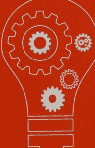
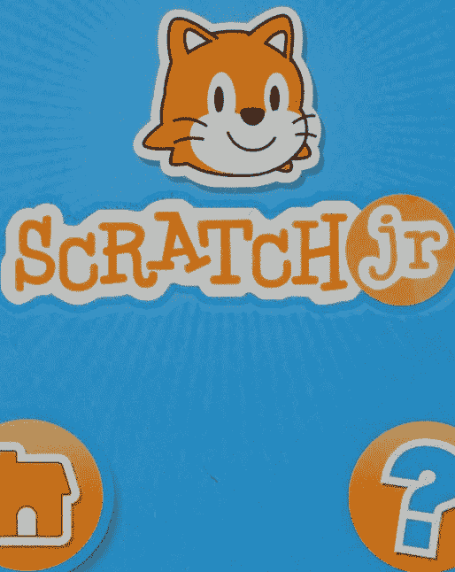
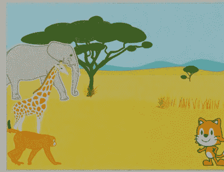
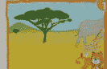
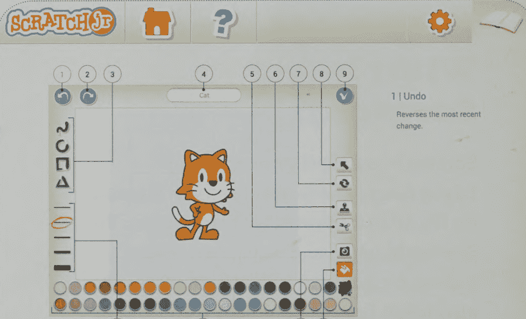

# Scratchjr 编程（21 世纪技能创新系列：创作者即创新者）


# 已撤回





> 给大人的提示：在允许孩子进行书中的活动之前，请务必审阅说明。
对于任何您认为孩子无法独立安全完成的活动，请务必提供他们帮助。

> 给小朋友的提示：需要时，请务必向大人寻求帮助。
始终将安全放在第一！




ScratchJr 是非常容易使用的。

# 谁可以编写计算机程序？

我们的世界充满了计算机。你可以通过**代码块**来创作。

# ScratchJr

猫

长颈鹿

猴子





ScratchJr 有很多有趣的块。大象

## 什么是 ScratchJr？

ScratchJr 是为了孩子们设计的语言。你可以在 iPad 上使用它来创作故事。

## 什么是编程语言？

编程语言是一套单词、符号和规则。有趣的。

- 撤销
- 关于 ScratchJr
- 界面指南
- 画板指南

## ScratchJr 是如何工作的？

ScratchJr 项目由三部分组成。这些是角色、背景和代码块。代码块告诉角色和背景该做什么。

### 角色

角色是项目中任何移动、说话或改变的东西。它们可以是人、动物或物体。甚至是星星。

### 背景

故事发生在哪里？有很多背景可供选择。在 ScratchJr 库中找不到你想要的背景？没问题！使用画板创建自己的。

### 颜色编码的代码块

你如何知道使用哪种块？颜色编码有助于你记住它们的作用。

- 黄色块开始程序。
- 红色块结束程序。
- 蓝色块移动角色。
- 紫色块改变外观。
- 绿色块让你添加声音。

## SCRATCHJR

等待
-暂停指定的时间（秒）。

-停止所有脚本。

设置速度
-更改某些块的运行速率。
- 运行指定次数的块。

重复
-无限运行。

```
结束块
```

### 控制块

橙色代码块被称为控制块。橙色块是负责的！你想让猫旋转五圈吗？使用橙色的“重复”块。你想让大象输掉比赛吗？使用橙色的“设置速度”块让它移动得慢一点。

## 亲手制作！


## 术语表

code blocks (KODE BLOKS) ScratchJr 程序的最小单元，每个单元包含一条指令

gallery (GAL-ur-ee) ScratchJr 中所有可可用角色或背景的图片列表

instructions (in-STRUK-shuhnz) 关于如何做某事的指导说明

programming language (PROH-gram-ing LANG-wij) 用于为计算机编写指令的单词、符号和规则集合

programs (PROH-gramz) 告诉计算机如何完成任务的指令

symbols (SIM-buhlz) 代表其他含义的设计或对象

## 了解更多

**书籍**
Bers, Marina Umaschi, and Mitchel Resnick. *The Official ScratchJr Book: Help Your Kids Learn to Code!* San Francisco: No Starch Press, 2016.

**网站**
Scratch
scratch.mit.edu
当你准备就绪时，可以使用 ScratchJr 的大哥 Scratch 编写更复杂的程序。

**ScratchJr**
www.scratchjr.org
学习关于使用 ScratchJr 的所有知识，观看视频并尝试实践活动。

# 索引


# 关于作者

Adrienne Matteson 是一位学校管理员。她大部分时间都花在玩机器人以及帮助她的学生编写关于独角兽的程序。

```
31901060623289
```

# 你将制作什么？

今天一些最惊人的发明都是创作者们的作品。这些人将创意应用于最新技术，构建各种自制设备。无论是为微型计算机编程、设计自己的桌面游戏，还是为塑料寻找新用途，创作者们共同努力，分享新的想法和技术。你将制作什么？


IFLOAT

