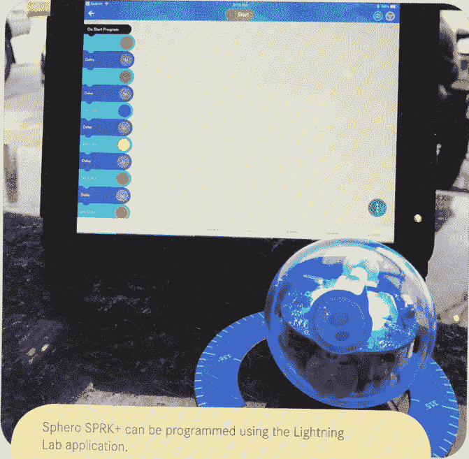
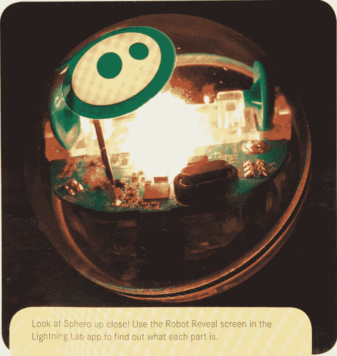
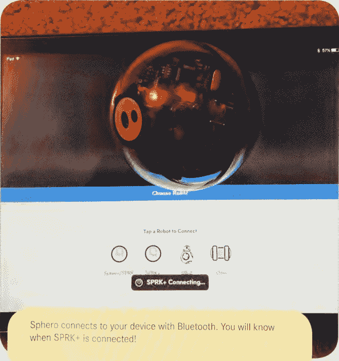
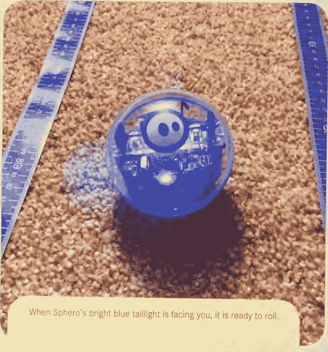
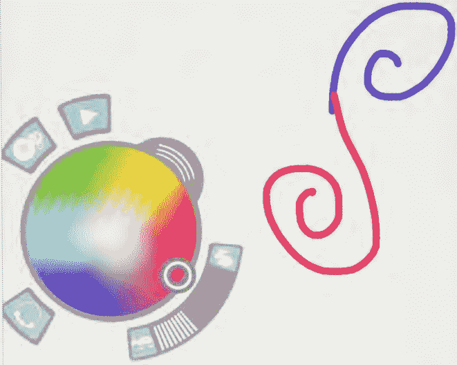
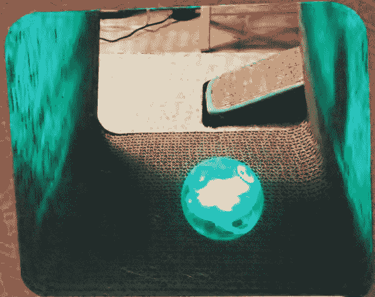
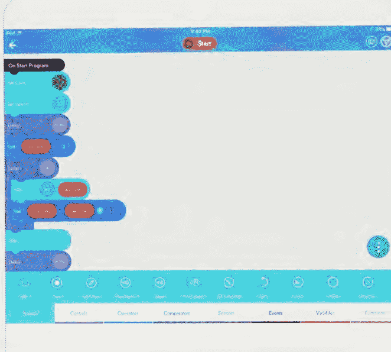
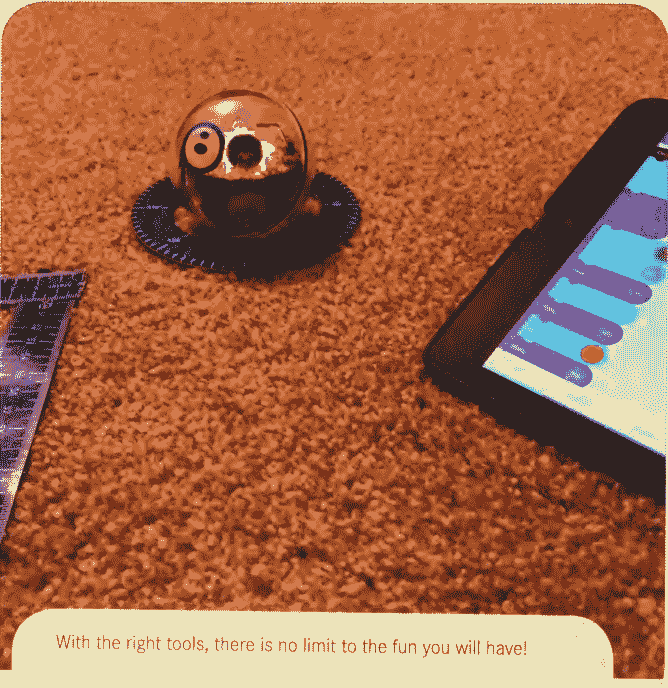

# Sphero 编程（21 世纪技能创新图书馆：少年创客）




Sphero SPRK+ 可以使用 Lightning Lab 应用程序进行编程。

## 认识 Sphero

你是否曾想过拥有一个属于自己的机器人？来认识 Sphero 吧！Sphero 是一个可以通过平板电脑或智能手机控制的机器人球。Sphero 最初是一个玩具。现在，它被用来教孩子们如何编写计算机程序。



近距离观察 Sphero！使用 Lightning Lab 应用中的“机器人揭秘”屏幕，了解每个部件是什么。

## Sphero 的工作原理

Sphero 的外壳是由非常坚固的塑料制成的硬壳。内部是一个机器人，当周围的塑料球滚动时，它能保持直立。它通过两个电机和一个**陀螺仪**来实现这一点。球体内部还有可以变色的 **LED** 灯。



点击机器人以连接！

SPRK+ 正在连接……

Sphero 通过蓝牙连接到你的设备。当 SPRK+ 连接成功时，你就会知道！

## 开始使用

你需要一台平板电脑或智能手机来使用 Sphero。首先通过将 Sphero 与你的设备**配对**来开始。点击 Sphero 将其开启。然后打开你设备上的 Sphero Go 或 Lightning Lab 应用。该应用会搜索附近的机器人。当你的 Sphero 出现在屏幕上时，选择它。

### 其他 Sphero 机器人

- **Ollie：** 这款 Sphero 专为竞速而设计。Ollie 的时速可达 14 英里（22.5 公里）！
- **BB-8：** 这款 Sphero 的外形和移动方式都像 *星球大战：原力觉醒* 中的机器人。



当 Sphero 明亮的蓝色尾灯面向你时，它就准备好滚动了。

## 出发吧，Sphero，出发！

在驾驶 Sphero 之前，你需要调整它的尾灯。尾灯是 Sphero 上的一个小蓝灯。它显示机器人背面所在的位置。当灯光指向你时，Sphero 就准备好行驶了。

使用设备屏幕控制 Sphero。向上推以前进，向下推以后退。



在 Draw N’ Drive 应用中，你画出图案，Sphero 就会沿着它行驶。试着改变颜色或写下你的名字！

## 为玩乐而生

有很多方式可以玩 Sphero。像握持 *Exile* 等电子游戏的控制器一样把它握在手中。把它驶入杯子来玩 Sphero 高尔夫。你甚至可以使用 Draw N’ Drive 应用在设备屏幕上画出一条路径，让 Sphero 沿着它行驶。



Sphero 能感知到自己何时撞到另一个物体，甚至能感知到自己何时正在下落。

## 敏感的机器人

Sphero 机器人使用**传感器**来追踪自己的运动方式。它能知道自己移动得多快以及朝哪个方向移动。它能知道自己是否撞到另一个物体，或者是否正在空中下落。你可以利用 Sphero 的传感器为它编程，让它以不同方式做出反应。

### Sphero 的发明者

发明者 Ian Bernstein 和 Adam Wilson 一直热爱制造机器人。他们在 2010 年合作创造了 Sphero。他们制造这个机器人，是因为想创造出一种能用智能手机控制的、有趣的东西。

**图 8**

```text
Tone of 500 Hz for 0.5 s
RGB 1, 0, 0, 0
Back LED 1, 0, 0
Stabilization 0.5 s
Delay 2.0 s
Tone of 500 Hz for 0.5 s
Back LED 0, 0, 0
Tone of 500 Hz for 0.5 s
Set Orientation 0°
Stabilization 0.5 s
Delay 2.0 s
Tone of 500 Hz for 0.5 s
Roll 0.5 s
Delay 0.5 s
RGB 1, 0, 0, 0
Tone of 500 Hz for 0.5 s
```

你可以在 MacroLab 中编写程序。这个宏（即程序）能让 Sphero 按 8 字形行驶。

## MacroLab

如果你准备好接受挑战，试着在 MacroLab 应用中创建一个宏。宏是一种简单的计算机程序，用来告诉 Sphero 该做什么。MacroLab 使用符号来表示给 Sphero 的指令。例如，箭头告诉 Sphero 滚动。停止标志告诉它停下。



SPRK Lightning Lab 是你为 Sphero 编写程序的地方。这是一个让 Sphero 旋转的程序！

## Lightning Lab

为 Sphero 编写程序的另一种方法是使用 Lightning Lab 应用。Lightning Lab 让你把彩色积木块拼接在一起以创建程序。不同颜色的积木块有不同的功能。蓝绿色的“动作”积木块会改变 Sphero 的运动或灯光。紫色的“控制”积木块告诉 Sphero 何时执行某个动作。



有了合适的工具，你将获得无穷无尽的乐趣！

## 试一试！

该试一试了！开始编程的最佳方式是借用已经制作好的程序。MacroLab 和 Lightning Lab 都附带示例程序供你尝试。选择一个，然后试着做一些小改动，看看会发生什么。每个**创客**都必须准备好动手捣鼓！

### 面向创客的 Sphero

Sphero 是能为可移动或旋转的发明提供动力的绝佳引擎。试着让 Sphero 驱动一辆汽车。Sphero 还能游泳。Sphero 甚至能画画。有了富有创意的程序，你能做的事情没有极限。


## 术语表

-   **陀螺仪**（JYE-ruh-skope）一种位于 Sphero 及其他物体内部、用于测量运动和方向的装置
-   **LED**（EL EE DEE）一种能耗极低、发热很少的小型灯；LED 是“light-emitting diode”（发光二极管）的缩写
-   **创客**（MAY-kur）一个有创造力的人，能制作从艺术品、实用物品到机器人和计算机程序等各种东西
-   **配对**（PAIR-ing）使用蓝牙等无线通信方式连接两台设备
-   **传感器**（SEN-surz）能够检测和测量变化，并将信息传输到控制设备的仪器

## 了解更多

### 图书

-   Lovett, Amber. *用 Blockly 编程*。Ann Arbor, MI: Cherry Lake Publishing, 2017.
-   Lovett, Amber. *控制 Ozobot*。Ann Arbor, MI: Cherry Lake Publishing, 2017.
-   Matteson, Adrienne. *用 ScratchJr 编程*。Ann Arbor, MI: Cherry Lake Publishing, 2017.

### 网站

-   **闪电实验室**  
    *http://edu.sphero.com*  
    查看一些 Sphero 项目创意并下载示例程序。
-   **Sphero**  
    *www.sphero.com*  
    查看不同的 Sphero 型号，并观看这些机器人实际运行的视频。

## 索引

-   “动作”积木，19
-   “控制”积木，19
-   控制项，5、11、15、19
-   方向，15
-   Draw N' Drive 应用，13
-   引擎，21
-   *Exile* 游戏，13
-   游戏，13
-   陀螺仪，7
-   LED 灯，7、11
-   Lightning Lab 应用，9、19、21
-   MacroLab 应用，17、21
-   马达，7
-   Ollie，9
-   配对，9
-   塑料，7
-   编程，15、17、19、21
-   传感器，15
-   智能手机，5、9、11、15
-   速度，9、15
-   Sphero Go 应用，9
-   平板电脑，5、9、11
-   尾灯，11

## 关于作者

Adrienne Matteson 是一名学校图书馆员。她大部分时间都在玩机器人，并帮助她的学生编写关于独角兽的程序。
