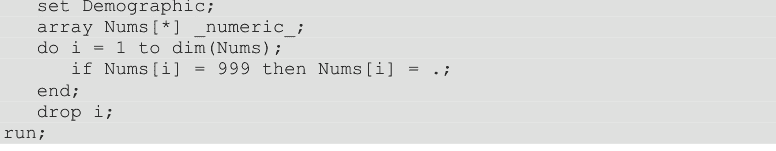

# Cody 的常用 SAS 编程任务及解决方案集

SAS Institute Inc. 提供了完整的书籍和电子产品选择，帮助客户充分发挥 SAS 软件的潜力。欲需更多关于我们的电子书、在线学习产品、CD 和纸质书籍的信息，请访问 SAS Books 网站 `support.sas.com/bookstore` 或拨打 1-800-727-3228。

SAS 以及所有其他 SAS Institute Inc. 产品或服务名称均为美国及其他国家的注册商标或 SAS Institute Inc. 的商标。® 表示 SAS 注册。

其他品牌和产品名为各自公司的注册商标或商标。

引言.................................................................................................. 13

引言.................................................................................................. 21

引言.................................................................................................. 37

引言.................................................................................................. 57

引言.................................................................................................. 65

引言.................................................................................................. 75

引言.................................................................................................................................. 83

引言.................................................................................................................................. 87

宏的工作原理 .......................................................................................................... 94

引言.................................................................................................................................. 97

引言................................................................................................................... 101

引言......................................................................................................................... 116

程序列表

- 程序 3.10: 使用 `PROC SQL` 合并汇总信息与详细数据................................................................31
- 程序 7.2: 将一个观测值的数据集转换为每个受试者多个观测值的数据集（使用 `PROC TRANSPOSE`） ................................................................................................................ 78
- 程序 8.2: 给定月、日、年值显示 SAS 日期（即使日期缺失）。.... 85
- 程序 9.2: 提供用于数值变量范围检查的宏 89
- 程序 9.4: 调用 Errors 和 Report 宏91
- 程序 9.6: 测试 Outliers 宏95
- 程序 11.5: 演示 First 和 Last 变量................106
- 程序 12.16: 从包含姓名（可能包含中间名或缩写）的单个变量中提取姓名（可能包含中间名或缩写）........................................................................................................................... 131

# 关于本书书

## 目的

在你的编程生涯中的某个时刻，会有相当编程任务是你需要完成其中之一的。例如，你可能需要将字符值转换为数值值，或将汇总数据与详细数据合并。每当你需要完成这些任务之一时，为什么要“重复发明轮子”呢？这正是本书的核心所在——它包含了注释程序，用于解决你每天面临的许多常见编程任务。

## 这本书适合你吗？

本书对于从初学者到专家的所有水平的程序员都有用。

## 前提条件

要从书中受益，你需要能够使用 Base SAS Enhanced Editor 或 SAS Enterprise Guide 编写 SAS 程序。

## 本书的范围

全书共 12 章，涵盖了许多热门的编程任务。在很多情况下，书中提供了一个解决任务的宏（macro），同时也提供了一个能够自动执行该任务的宏。你将在书中发现几个宏，它们将节省你数小时枯燥的编程时间。许多任务（例如确定 SAS 数据集中的观测值数量）通过四或五种不同的方法解决。这允许你选择自己喜欢的方法，并提供了一个“教学时刻”，来探索你可能从未见过的编程技术。

## 亮点

你是否收到过一个包含身高、体重或年龄等变量的 SAS 数据集，而它们全都是字符值？如果是，请加入我们吧。书中的一个任务向你展示了如何将字符变量转换为数值变量。更棒的是，我们包含了一个宏，允许你指定输入和输出数据集名称，以及需要转换的字符变量列表，该宏会自动创建一个新数据集，将所有字符转换为数值变量，同时保持原始变量名。

你是否曾经需要检查数值值中的错误？如果是，你将在书中找到两个宏可以帮助你。其中一个允许你为每个数值变量指定范围，并对任何超出指定范围的观测值生成错误报告。另一个宏使用自动离群值检测来报告可能的数据错误。

## 关于本书

你是否曾经需要合并两个 SAS 数据集？带有详细数据。你当然需要过！使用 `SET` 语句或 `PROC APPEND` 可以轻松实现。如果两个数据集中的字符变量长度不相同呢？这个问题通过一个宏解决，该宏合并两个数据集，使用两个数据集中不同字符变量的较长长度。

在 SAS 数据集的每个数值变量或每个字符变量上执行操作是非常方便的。例如，你可能想将所有数值 999 转换为 SAS 空值，或你可能想将所有字符变量转换为大写。这些任务在书中都有演示。

合并数据（可能是所有观测值的平均值）如何？其中一章为你展示了完成此类任务的几种有趣方法。

将数据集从一个观测值重构为许多个或反之是一个常见的编程需求。你将发现使用 `DATA` 步骤执行这些任务的程序。

## 作者页面

你可以访问 `support.com.com/cody` 查看本书的作者页面。

该页面包含了该作者编写的所有 SAS Press 书籍。关于本书特定的功能，请查看本书的封面缩略图。书下的链接将带你进入免费章节、示例代码和数据、评论等。

## 示例代码和数据

你可以通过链接 `support.sas.com/cody` 的作者页面访问本书的示例代码和数据。寻找本书的封面缩略图，并选择“示例代码和数据”以显示书中包含的 SAS 程序。

要查看所有提供示例代码和数据的书籍的字母列表，请访问 `support.sas.com/bookcode`。选择一个标题显示该书籍的示例代码。

如果你无法通过网站访问代码，请发送电子邮件至 `sasprass@sas.com`。

## 通过 SAS Press 联系作者

通过邮寄：

通过电子邮件：`saspress@sas.com`

通过网络：`support.sas.com/author_feedback`

## SAS 书籍

要查看通过 SAS 提供的完整书籍列表，请访问 `support.sas.com/bookstore`。

电话：1-800-727-3228

传真：1-919-677-8166

电子邮件：`sasbook@sas.com`

## SAS 书籍报告

通过订阅 SAS Book Report 每月电子报，通过电子邮件接收所有新 SAS 出版的最新信息。访问 `support.sas.com/sbr`。

## 关于作者

Ron Cody, EdD 是来自罗伯特·约翰逊学院的退休教授，现担任私人顾问。自1977年以来 SAS 用户，他丰富的知识和创新的风格使其成为当地、区域和国家 SAS 会议上的受欢迎演讲者。他编写或合著了许多书籍。访问 `support.sas.com/cody` 了解更多关于该作者的信息。在那里你可以下载免费章节、访问示例代码和数据、阅读评论。

## 谢谢

似乎我编写的每一本书，都需要更多的人来将书籍从概念推向最终产品。在“过去”，SAS Press 只需要制作书籍——纸质书。今天，书籍可以在 Kindle、iPad 等多种设备上提供，这增加了许多额外工作。

在所有章节完成后，一组评审人员（部分来自 SAS Institute，部分来自外部）阅读了书籍全部或部分内容以检查技术错误。这组技术评审人员在发现错误（谁说的？）方面表现出色，有时为我的任务提供一些聪明优雅的解决方案。诚心感谢以下评审人员：Amber Elam, Paul Grant, Mark Jordan, Bari Lawhorn, Jerry Leonard, Kathryn Lawhorn, Ginny Piechola, Jan Squice, Russ Tydall 和 Kim Wilson。

这是我由 John West 作为关键人物编写的第三本书，负责协调制作书籍的许多任务。John，非常感谢。特别感谢志愿者进行校对的 Mary Beth Steinbach。其他参与我书籍工作的 SAS ，我要感谢他们：

- Jennifer D Willey，图形设计和封底设计
- Candy Farrell，技术出版专家
- Luis Franco，封面设计
- Stacey Hamilton，市场
- Julie Platt，总编辑
- Aimee Rodriguez，市场

在如此才华且敬业的人的支持下写作是一种荣幸。感谢 SAS Press！

# 第一章：涉及转换的任务：字符转数值、特定值转缺失值以及大小写转换

- 引言 ............................................................................................................1
- 任务：将字符值转换为数值...............................................................2
- 任务：使用宏将字符值转换为数值.........................................................3
- 任务：将 SAS 数据集中所有数值型变量的 999 等特定值转换为缺失值................................................................5
- 任务：将 SAS 数据集中所有字符变量的 'NA' 等特定文本转换为缺失值................................................................7
- 任务：将所有字符值转换为大写、小写或首字母大写................................................................8
- 任务：读取包含 Lbs. 或 Kgs. 等单位的数值................................................................................9
- 任务：使用 Perl 正则表达式解决上一个任务的部分......10
- 结论 ............................................................................................................1

## 引言

本章包含了执行字符到数值转换的程序，这是你作为 SAS 程序员将面对的常见任务之一。你将看到一个示例程序以及一个实现此目标的实用宏。

你可能面临的另一个任务是将 999 等特定数值值或 'NA' 等特定文本值转换为 SAS 缺失值。

在本章中，你还将看到如何将每个字符变量转换为特定的大小写（例如大写）。

本章的最后一个任务演示了如何读取包含单位（如 100Lbs. 或 50Kgs.）的数据值，并创建一个具有相同单位的所有值的数值变量。

## 任务：将字符值转换为数值

### 关键词

- 字符转数值转换
- 交换与删除 `Swap and Drop`

你曾多少次收到一个包含 Height 或 Weight 等变量的 SAS 数据集，而不是数值型变量？下面的示例描述了如何将这些字符变量转换为数值变量，同时保留原始变量名。

在此示例中，你从一个名为 `Char_values` 的 SAS 数据集开始。以下是列表：

| Age | Weight | Gender | DOB |
|---|---|---|--|
| 23 | 150 | M | 10/21/1983 |
| 67 | 220 | M | 09/02/2001 |
| 77 | 101 | F | 05/06/1977 |

如果你对该数据集运行 `PROC CONTENTS`，你会发现 `Age` 和 `Weight` 是字符变量。以下程序执行了转换：

### 程序 1.1：将字符值转换为数值

```
*Converting character values to numeric;
data NewM;
  set Char_Values(rename=(Age = C_Age
  Weight = C_Weight));
  Age = input (C_Age,best12);
  Weight = input (C_Weight,best12);
  drop C_;
run;
```

这里的“技巧”是在从输入数据集读取变量时对其重命名。这允许你在生成的数值变量中使用原始变量名。字符到数值的转换是通过 `INPUT` 函数完成的。你不需要担心 `INPUT` 函数中使用的 `FORMAT` 数字位数比你需要的多——与 `INPUT` 语句不同，使用 `INPUT` 函数时，永远不会读取超过字符值的末尾。

注意 `DROP` 语句中的变量列表 `C:`：冒号充当通配符后缀，`C:` 代表所有以字符 `C` 开始后跟下划线的变量。

生成的数据集与原始数据集具有相同的变量，但 `Age` 和 `Weight` 两个变量现在是数值型的。`PROC CONTENTS` 部分列表证实了这一点：

| Alphabetic List of Variables and Attributes |
| # Variable | Type | Len | Format |
| 3 Age | Num | 8 | |
| 2 DOB | Num | 8 | MDDDY10. |
| 1 Gender | Char | 1 | |
| 4 Weight | Num | 8 | |

## 任务：使用宏将字符值转换为数值

### 关键词

- 字符转数值转换
- 转换宏

由于在许多情况下都需要字符到数值的转换，本章为你提供了一个自动执行此转换的宏。在上一个程序中，生成的数据集使用了与包含字符变量的原始数据集相同的变量名。以下是宏及其：

### 程序 1.2：演示一个执行字符到数值转换的宏

```
*Macro to convert selected character variables to
numeric variables;
/*Name of the input data set*/
macro char_to_num(In_dsn,
/*Name of the output data set*/
Out_dsn,
/*List of character variables that you
want to convert character to
numeric, separated by spaces*/

/*Check for null list */
if &var_list ne %then do;
/*Count the number of variables in the list */
let len=%sysfunc(countw(&var_list));
data &Out_dsn;
set &In_dsn(rename=(
%do i=1 to %len
  %scan(&var_list, &i) = C_%scan(&var_list, &i)
%end
));
%do i=1 to %len
  %scan(&var_list, &i) = input(C_%scan(&var_list, &i),best12);
%end;
drop C_;
run;
%mend char_to_num;
```

调用语句为：

```
char_to_num(char_values, NewM, Age Weight);
```


（注：此处文本包含大量 OCR 错误和页眉脚干扰，已根据标准 SAS 宏模式进行了逻辑清理）。

## Cody 的常用 SAS 编程任务集及解决方法

| Subj | Score | Weight | Heart_Rate | DOB | Gender | Party |
|---|---|---|---|---|---|---|
| 14 | 999 | 140 | 79 | 01OCT1950 | NA | na |
| 15 | 999 | 124 | 999 | 12OCT1950 | NA | na |
| 16 | 44 | 194 | 72 | 31DEC1952 | Female | republican |
| 17 | 62 | 196 | 68 | 09MAR1951 | Female | democrat |
| 18 | 57 | 133 | 72 | 15SEP1951 | Female | Democrat |
| 19 | 45 | 137 | 86 | 16NOV1951 | NA | Republican |
| 20 | 90 | 170 | 80 | 01OCT1951 | Female | Republican |

你将在本章的几个任务中使用此数据集。例如，请注意变量 `Score`、`Weight` 和 `Heart_Rate` 变量中存在 `999` 的值。

以下是执行转换的代码：

## 程序 1.4：将 SAS 数据集中所有数值变量的特定值（如 999）转换为缺失值

> *将 SAS 数据集中所有数值变量的特定值（如 999）转换为缺失值；

```
data Num_missing;
  set Demographic;
  Array Num [_numeric];
  do i = 1 to dim(Nums);
    if Num[i] = 999 then Num[i] = .;
  end;
  drop i;
run;
```

此操作以及后续程序的关键在于使用 `_NUMERIC` 关键字创建一个数组。在 DATA 步中使用时，`_NUMERIC` 代表到该 DATA 步为止定义的所有数值变量。`ARRAY` 语句设置了名称，并包含了 `Demographic` 数据中的所有变量（`Subj`、`Score`、`Heart_Rate` 和 `DOB`）。为了清楚说明这一点，如果你将 `ARRAY` 语句放在 `SET` 语句之前，该数组将不包含任何变量。

你肯定不想去数大型数据集中所有的数值变量。因此，你在数组名称的括号中使用星号 `*`。这样做，SAS 会为你计算变量的数量。但是，你在 `DO` 循环中使用什么值呢？你可以使用 `DIM`（维度）函数来确定数组中有多少个变量。你的工作几乎完成了。你只需要检查值为 `999` 的值并将其转换为 SAS 数值。不要忘记删掉循环计数器。



接下来显示了 `Num_missing` 数据集中的前五个观测值，以证明程序按预期运行：

| Subj | Score | Heart_Rate | DOB | Gender | Party |
|---|---|---|---|---|---|
| 1 | 70 | | 76 | 04NOV1955 | Male | NA |
| 2 | 26 | 160 | 62 | 08APR1955 | NA | NA |
| 3 | 71 | 195 | 71 | 20JUL1955 | male | na |
| 4 | 40 | 132 | 74 | 08JAN1955 | Male | Republican |
| 5 | | 181 | 62 | 15AUG1955 | Female | Democrat |

## 任务：将 SAS 数据集中所有字符变量的特定值（如 'NA'）转换为缺失值

### 关键字

Character variables

此任务与上一个任务相似。不同在于你想将指定的字符值转换为 SAS 缺失值。你只需要使用 `CHARACTER` 关键字创建所有字符变量的数组。以下是程序：

### 程序 1.5：将 SAS 数据集中所有字符变量的特定值（如 'NA'）转换为缺失值

```
data Char_missing;
*将 SAS 数据集中所有字符变量的特定值（如 "NA”）转换为缺失值;
set Demographic;
array Chars[*] character;
do i = 1 to dim(Chars);
if Char[i] = 'NA' then Char[i] = ;
end;
drop i;
run;
```

数组包含了 `Demographic` 数据中的所有字符变量（`Gender` 和 `Party`）。与上一个任务一样，`DIM` 函数返回数组中的变量数量。为了使程序更通用，它查找 'NA' 的大写或小写值。以下是 `Char_missing` 数据集的前五个观测值：

| Subj | Score | Weight | Heart_Rate | DOB | Gender | Party |
|---|---|---|---|---|---|---|
| 1 | 70 | 999 | 76 | 04NOV1955 | Male | |
| 2 | 26 | 160 | 62 | 08APR1955 | | |
| 3 | 71 | 195 | 71 | 20JUL1955 | male | na |
| 4 | 40 | 132 | 74 | 08JAN1955 | Male | Republican |
| 5 | | 181 | 62 | 15AUG1955 | Female | Democrat |

## 任务：将所有字符值转换为大写、小写或首字母大写

### 关键字

- Uppercase
- Lowercase
- Proper case
- character

与之前的程序类似，你可以使用所有字符变量数组将它们全部转换为大写、小写或首字母大写。可以看到，此程序将数据集中的所有字符值转换为大写。另外两个将字符值转换为小写或大小大小写的函数分别是 `LOWERCASE` 和 `PROCASE`。以下是程序：

### 程序 1.6：更改 SAS 数据集中所有的字符变量

```
data Char_upper;
*将所有字符值转换为大写（或小写或首字母大写);
set Demographic;
array Chars[*] character;
do i = 1 to dim(Chars);
Chars[i] = upcase(Chars[i]);
end;
drop i;
run;
```

如果字符变量处理的是姓名和地址，在将所有值转换为一致的大小后，你可能希望使用 `COMPBL` 函数将多个空格转换为单个空格，以帮助标准化姓名和地址。

## 任务：读取包含 Lbs. 或 Kgs. 单位的数值值

### 关键字

- 字符转数值转换
- 从值中删除单位
- 从字符串中提取数字
- `COMPRESS` 函数
- `SCAN` 函数

数据集 `Units` 包含一个名为 `Height` 的字符变量，包括 Lbs. 和 Kgs.（磅和公斤）等单位。此外，`Height` 变量也包含单位并以英尺和英寸表示（有时英寸值缺失，值为0）。这里是 `Units` 数据集的列表：

| Subj | Weight | Height |
|---|---|---|
| 001 | 80kgs | 5ft 3in |
| 002 | 190lbs | 6ft 1in |
| 003 | 70KG. | 5ft 11in |
| 004 | 177Lbs. | 5ft 11in |
| 005 | 100kgs | 6ft |

注意 `Weight` 的单位并不总是相同的大小写，某些单位以点号结尾。对于 `Height`，使用了缩写 'ft' 或 'in'；有时单引号和双引号代表英尺和英寸。

你想创建两个新变量（`Weight_Lbs` 和 `Height_Inches`），它们是数值变量，分别等于磅为单位重量和英寸单位的高度。以下是程序：

### 程序 1.7：读取包含单位的数据值

```
*读取包含单位的数据值;
  data No_Units;
  set Units;
  Weight_Lbs = input(compress(Weight,'kd'),12);
  if find(Weight,'k',i) then Weight_lbs = Weight*2.2;
  Height = compress(Height,'ks');
  Feet = input(scan(Height,1,' '),12);
  Inches = input(scan(Height,2,' '),12);
if missing(Inches) then Inches = 0;
  Height_Inches = 12*Feet + Inches;
  drop Feet;
run;
```

你开始使用带有修饰符 'kd'（保留数字）的 `COMPRESS` 函数从 `Weight` 中提取数字。在 `COMPRESS` 函数的第一个参数之前包含两个逗号很重要，这样函数会将 'kd' 解释为修饰符，而不是 `COMPRESS` 函数的第二个参数（该参数用于列出你想要从字符串中压缩的字符）。由于 `COMPRESS` 函数的结果是字符值，你使用 `INPUT` 函数执行字符到数值的转换。

## 使用 Perl 正则表达式解决上一个任务的一部分

如果没有 `COMPRESS` 和 `SCAN` 函数，解决这个任务无疑将是一个挑战——有了这些函数，就轻而易举。

# 第1章：涉及转换的任务

我的儿子是一名学习编程的学生，他建议我使用 Perl 正则表达式来解决这个问题。这个解决方案并不比之前的方案简单，但它展示了正则表达式的灵活性。

首先，你使用 `PRXPARSE` 来编译正则表达式：

`/^(\d+)(\D)/`

这个正则就是 Perl 所说的正则表达式，它在寻找一个或多个数字，后面紧跟一个非数字字符。表达式开头的 "^" 表示从字符串的开头开始搜索。数字和非数字值将被置于捕获缓冲区（capture buffers）中，因为这些表达式每一个都是一组括号。你使用 `PRMATCH` 函数来搜索数字后跟非数字的模式。使用 `PRXPOSN` 函数提取每个捕获缓冲区中的值。`INPUT` 函数执行与上一个任务相同的字符到数字的转换。

如果捕获缓冲区中的值为 'K'，则执行从千克到磅的转换。

### 程序 1.8：使用 Perl 正则表达式提取捕获变量的数字和单位部分

```
*Solution using Perl regular expressions;
Data Units:
  set Units (drop=Height);
  if n = 1 then do
    Regex = "(\d+)(\D)
```

结果的数据集包含 `Weight_Lbs` 的值，这与上一个任务相同。

# 结论

你很可能需要定期执行本章中描述的任务之一。字符到数字的转换是最常见的任务之一，你可以选择将此转换存储在你的宏库中。

此外请记住，使用特殊关键字 `_NUMERIC_` 和 `_CHARACTER` 来定义数组，当你对数据中的所有字符或数值变量进行操作时，可以节省大量时间。

- 引言 ..................................................................................................... 13
- 任务：使用 IF-THEN-ELSE 语句对值进行分组 ........................................... 13
- 任务：使用自定义格式对值进行分组 ................................................ 14
- 任务：使用 PROC RANK 创建组 ................................................................ 15
- 结论 ............................................................................................................... 19

## 引言

本章描述了如何使用年龄或收入等单个值，并创建代表组的新变量。例如，你可能想按 20 年一个间隔对年龄进行分组，或者你可能想将收入转换为十分分位数。在本章中，你将看到实现这些目标的几种方法。

## 任务：使用 IF-THEN-ELSE 语句对值进行分组

- 关键字
- 值分组
- If-Then-Else 语句

在这个示例中，你有一个名为 `Heart_Rate` 的变量，代表人的每分钟心跳次数。在所有的 SAS 编程中，假设 `Heart_Rate` 可能是缺失值。以下是代码：

### 程序 2.1：使用 IF-THEN-ELSE 逻辑对值进行分组

```
*Grouping values using if-then-else statements;
data Grouped;
length HR_Group ($10);
set Blood_Pressure(keep=Sub Heart_Rate);
if missing(Heart_Rate) then HR_Group = ' ';
else if Heart_Rate < 40 then HR_Group = '<40';
else if Heart_Rate < 60 then HR_Group = '40-60';
else if Heart_Rate < 80 then HR_Group = '60-80';
else if Heart_Rate < 100 then HR_Group = '80-100';
else HR_Group = '100+';
run;
```

第一步是使用 `LENGTH` 语句定义 `HR_Group` 变量的长度。我们使用 `MISSING` 函数测试 `Heart_Rate` 是否缺失。如果是，则将 `HR_Group` 设置为字符值。一旦这样做，就可以直接测试 `Heart_Rate` 值并创建 `HR_Group` 变量了。以下是来自 `Grouped` 数据的前 10 条观测值：

数据集 `Grouped` 的列出

| HR_Group | Subj | Heart_Rate |
|---|---|---|
| 60-<80 | 1 | |
| 60-<80 | 2 | |
| 60-<80 | 3 | |
| 60-<80 | 4 | |
| 60-<80 | 5 | |
| 80-<100 | 6 | |
| 40-<60 | 7 | |
| 40-<60 | 8 | |
| 40-<60 | 9 | |
| 60-<80 | 10 | |

## 任务：使用自定义格式对值进行分组

- 关键字
- 数据分组
- 格式
- `PUT` 函数

你可以使用格式配合 `PUT` 函数来实现与上一个示例相同的目标。这种方法易于编程，第一步是使用格式定义所需的范围。然后你可以使用 `PUT` 函数创建代表组的变量。以下是使用格式的值的示例：

### 程序 2.2：使用格式对值进行分组

```
*Grouping values using-formats;
proc format;
value HRGrp
  0 - 39 = '<40'
  40 - 59 = '40-60'
  60 - 79 = '60-80'
  80 - 99 = '80-100'
  100 - high = '100+';
run;

data Grouped;
  set Blood_Pressure(keep=Sub Heart_Rate);
  HR_Group = put(Heart_Rate, HRGrp);
run;
```

如果捕获缓冲区中的值为 'K'，则执行千克到磅的转换。

（注：一旦你这样做，就可以直接测试 `Heart_Rate` 值并创建 `HR_Group` 变量了。）

此外，你使用 `PRXPOSN` 函数提取每个捕获缓冲区中的值。`INPUT` 函数执行与上一个任务相同的字符到数字的转换。

如果捕获缓冲区中的值为 'K'，则执行千克到磅的转换。

### 程序 1.8：使用 Perl 正则表达式提取捕获变量的数字和单位部分

```
*Solution using Perl regular expressions;
Data Units:
  set Units (drop=Height);
  if n = 1 then do
    Regex = "(\d+)(\D)
```

结果的数据集包含 `Weight_Lbs` 的值，这与上一个任务相同。

# 结论

你很可能需要定期执行本章中描述的任务之一。字符到数字的转换是最常见的任务之一，你可以选择将此转换存储在你的宏库中。

此外请记住，使用特殊关键字 `_NUMERIC_` 和 `_CHARACTER` 来定义数组，当你对数据中的所有字符或数值变量进行操作时，可以节省大量时间。

- 任务：使用 IF-THEN-ELSE 语句对值进行分组 ........................................... 13
- 任务：使用自定义格式对值进行分组 ................................................ 14
- 任务：使用 PROC RANK 创建组 ................................................................ 15
- 结论 ............................................................................................................... 19

## 引言

本章描述了如何使用年龄或收入等单个值，并创建代表组的新变量。例如，你可能想按 20 年一个间隔对年龄进行分组，或者你可能想将收入转换为十分分位数。在本章中，你将看到实现这些目标的几种方法。


## 任务：使用 IF-THEN-ELSE 语句对值进行分组

- 关键字
- 值分组
- If-Then-Else 语句

在这个示例中，你有一个名为 `Heart_Rate` 的变量，代表人的每分钟心跳次数。在所有的 SAS 编程中，假设 `Heart_Rate` 可能是缺失值。以下是代码：

### 程序 2.1：使用 IF-THEN-ELSE 逻辑对值进行分组

```
*Grouping values using if-then-else statements;
data Grouped;
length HR_Group ($10);
set Blood_Pressure(keep=Sub Heart_Rate);
if missing(Heart_Rate) then HR_Group = ' ';
else if Heart_Rate < 40 then HR_Group = '<40';
else if Heart_Rate < 60 then HR_Group = '40-60';
else if Heart_Rate < 80 then HR_Group = '60-80';
else if Heart_Rate < 100 then HR_Group = '80-100';
else HR_Group = '100+';
run;
```

第一步是使用 `LENGTH` 语句定义 `HR_Group` 变量的长度。我们使用 `MISSING` 函数测试 `Heart_Rate` 是否缺失。如果是，则将 `HR_Group` 设置为字符值。一旦这样做，就可以直接测试 `Heart_Rate` 值并创建 `HR_Group` 变量了。以下是来自 `Grouped` 数据的前 10 条观测值：

数据集 `Grouped` 的列出

| HR_Group | Subj | Heart_Rate |
|---|---|---|
| 60-<80 | 1 | |
| 60-<80 | 2 | |
| 60-<80 | 3 | |
| 60-<80 | 4 | |
| 60-<80 | 5 | |
| 80-<100 | 6 | |
| 40-<60 | 7 | |
| 40-<60 | 8 | |
| 40-<60 | 9 | |
| 60-<80 | 10 | |

## 任务：使用自定义格式对值进行分组

- 关键字
- 数据分组
- 格式
- PUT 函数

你可以使用格式配合 `PUT` 函数来实现与上一个示例相同的目标。这种方法易于编程，第一步是使用格式定义所需的范围。然后你可以使用 `PUT` 函数创建代表组的变量。以下是使用格式的值的示例：

### 程序 2.2：使用格式对值进行分组

```
*Grouping values using-formats;
proc format;
value HRGrp
  0 - 39 = '<40'
  40 - 59 = '40-60'
  60 - 79 = '60-80'
  80 - 99 = '80-100'
  100 - high = '100+';
run;

data Grouped;
  set Blood_Pressure(keep=Sub Heart_Rate);
  HR_Group = put(Heart_Rate, HRGrp);
run;
```

Rank_X 现在执行的是分组而非排序。当你使用 `GROUPS=n` 选项时，`PROC RANK` 会从零开始对组编号。如果你使用 `GROUPS=10`，你将获得从 0 到 9 的组。

既然你已经了解 `PROC RANK` 的工作原理，就可以结合 `Blood_Pressure` 数据集创建心率的五分位数，如下所示：

### 程序 2.5：使用 PROC RANK 创建 Heart_Rate 的五分位数

```
*使用 PROC RANK 进行分组;
proc rank data=Blood_Pressure(Keep=Subj Heart_Rate)
  out=Grouped groups=5;
  var Heart_Rate;
  ranks HR_Group;
run;
```

以下是 `Grouped` 数据集中前 12 条观测值：

| Sub | Heart_Rate | HR_Group |
|---|---|---|
| 1 | 71 | 2 |
| 2 | | - |
| 3 | 78 | 3 |
| 4 | 60 | 1 |
| 5 | 79 | 3 |
| 6 | 96 | 4 |
| 7 | 51 | 1 |
| 8 | | - |
| 9 | 54 | 1 |
| 10 | 65 | 1 |
| 11 | 55 | 1 |
| 12 | 48 | 0 |

记住，组号是从零开始的。在这个列表中，你有五个心率组，值范围从 0 到 4。

带有 `GROUPS=` 选项的 `PROC RANK` 是是将任何变量划分为组的非常简单的方法。

Cody, Ron. Cody's Collection of Popular SAS® Programming Tasks and How to Tackle Them. Copyright © 2012, SAS Institute Inc., Cary, North Carolina, USA. ALL RIGHTS RESERVED. 更多 SAS 资源，请访问 support.sas.com/bookstore。

# 结论

你可以使用多种方法创建代表连续变量分组的变量。

尽管 DATA step 中的 `IF-THEN-ELSE` 语句是分组最常用的方法，但请记住，用户自定义格式结合 `PUT` 函数是创建分组的简单且高效的方法。如果你想创建等等数量的组，请记住 `PROC RANK`。

Cody, Ron. Cody's Collection of Popular SAS® Programming Tasks and How to Tackle Them. Copyright © 2012, SAS Institute Inc., Cary, North Carolina, USA. ALL RIGHTS RESERVED. 更多 SAS 资源，请访问 support.sas.com/bookstore。

## 第 3 章：数据摘要

- 引言
- 任务：使用 PROC MEANS 创建包含汇总信息的数据集
- 任务：按另一个变量的值细分计算变量的平均值：使用 BY 变量
- 任务：按另一个变量的值计算变量的平均值：使用 CLASS 语句
- 任务：让 PROC MEANS 自动命名输出数据集中的变量（AUTENAME 选项）
- 任务：从 PROC MEANS 创建多个输出数据集，每个具有不同的 CLASS 变量组合
- 任务：将汇总信息（单个平均值）与详细数据合并：使用条件 SET 语句
- 任务：将汇总信息（单个平均值）与详细数据合并：使用 PROC SQL
- 任务：将汇总信息（单个平均值）与详细数据合并：不使用 PROC MEANS 的 PROC SQL
- 任务：将汇总信息（单个平均值）与详细数据合并：使用 BY 变量
- 任务：将汇总信息（单个平均值）与详细数据合并：按变量
- 结论

## 引言

你可以使用 `PROC MEANS`、`PROC UNIVARIATE` 和 `PROC TABULATE` 等过程生成平均值、中位数、标准差等汇总信息，但在某些情况下你需要这些信息放入数据集。本章将介绍如何完成这些任务。

## 任务：使用 PROC MEANS 创建包含汇总信息的数据集

关键字

`PROC MEANS`

汇总数据集

*平均值

让我们从计算所有观测值的平均值并将其输出到数据集开始。在本章后面，你将看到如何合并。

### 程序 3.1：计算所有观测值的平均值并输出到数据集

```
*计算所有观测值的平均值并输出到数据集;
proc means data=Blood_Pressure noprint;
var Heart_Rate;
out=Summary(keep=Mean_HR) mean=Mean_HR;
run;
```

`noprint` 选项指示不要产生任何输出，因为你只需要数据集。该程序使用 `Blood_Pressure` 数据集并计算 `Heart_Rate`。注意，在这种情况下没有使用 `KEEP=` 数据集选项。这让你看到 `PROC MEANS` 在输出数据集中放置了什么。这里是：

| Mean_HR |
|---|
| 69.3448 |

该数据集包含一个观测值和一个变量（平均值）。

Cody, Ron. Cody's Collection of Popular SAS® Programming Tasks and How to Tackle Them. Copyright © 2012, SAS Institute Inc., Cary, North Carolina, USA. ALL RIGHTS RESERVED. 更多 SAS 资源，请访问 support.sas.com/bookstore。

## 任务：按另一个变量的值细分计算变量的平均值：使用 BY 变量

关键字

`PROC MEANS`

`BY` 变量

汇总数据集

下一个任务与上一个任务类似，但这次你想输出每个 BY 变量的平均值。你首先需要对数据集进行排序（在本例中按 `Drug`），然后运行 `PROC MEANS`。以下是代码：

```
*为每个 BY 变量计算平均值;
proc sort data=Blood_Pressure;
by Drug;
run;

proc means data=Blood_Pressure noprint;
var Heart_Rate;
output out=Summary mean=Mean_HR;
run;
```

程序 3.2：为每个 BY 变量计算平均值

注意，在这种情况下没有使用 `KEEP=` 数据集选项。这让你看到 `PROC MEANS` 在输出数据集中放置了什么。这里是列出内容：

| Drug | TYPE | FREQ | Mean_HR |
|---|---|---|---|
| Drug A | 0 | 20 | 73.3000 |
| Drug B | 0 | 20 | 65.3500 |
| Placebo | 0 | 20 | 69.3889 |

该数据集包含了三个 `Drug` 值的每个 `Heart_Rate` 平均值。

当你使用 BY 语句通过 `PROC MEANS` 创建数据集时，`TYPE` 变量始终为零。稍后当你使用 `CLASS` 语句时，它将取不同的值并非常有用。`FREQ` 变量告诉你每个 `Drug` 组的观测值数量（包含缺失和非缺失）。

## 任务：按另一个变量的值计算变量的平均值：使用 CLASS 语句

## 关键词

- `PROC MEANS`
- `CLASS` 语句
- 摘要数据集

你可以通过 `CLASS` 语句代替 BY 语句来完成与上一个示例相同的目标。然而，生成的数据集是不相同的。这一点很重要。

当使用 `CLASS` 语句时，不需要对数据进行排序。以下是代码，随后是输出数据集的列表：

### 程序 3.3：使用 PROC MEANS 和 CLASS 语句创建摘要数据集

```sas
*Using PROC MEANS 创建摘要数据集;
proc means data=Blood_Pressure noprint;
class Drug;
var Heart_Rate;
output out=Summary mean=Mean_HR;
run;
```

以下是数据集 `Summary` 的列表：

| Drug | _TYPE_ | FREQ | Mean_HR |
|---|---|---|---|
| | 0 | 60 | 69.3448 |
| Drug A | 1 | 20 | 73.3000 |
| Drug B | 1 | 20 | 65.3500 |
| Placebo | 1 | 20 | 69.3889 |

注意，此数据集包含比使用 BY 语句创建的数据集更多的观测值。第一个观测值 `_TYPE_ = 0` 是所有非缺失观测值的平均值。`Blood_Pressure` 数据集中 Heart Rate 代表每个 `Drug` 值的平均 `Heart_Rate`。由于你可能不需要在输出数据集中总平均值，因此在 `PROC MEANS` 中使用了 `NWAY` 选项。该选项指示过程仅输出每个 `CLASS` 变量（或变量组合）的平均值。

下一个程序与此程序相同，但包含了 `NWAY` 选项：

### 程序 3.4：演示 PROC MEANS 的 NWAY 选项

```sas
*Demonstrating the NWAY option;
proc means data=Blood_Pressure noprint nway;
class Drug;
var Heart_Rate;
output out=Summary mean=Mean_HR;
run;
```

以下是生成的输出数据集：

| Drug | TYPE | FREQ | Mean_HR |
|---|---|---|---|
| Drug A | 1 | 20 | 73.3000 |
| Drug B | 1 | 20 | 65.3500 |
| Placebo | 1 | 20 | 69.3889 |

此数据集仅包含每个 `Drug` 值的 `Heart_Rate`——不再包含总平均值。

## 任务：让 PROC MEANS 自动为输出数据集命名命名（AUTENAME 选项）

## 关键词

- `AUTENAME`
- `PROC MEANS`
- 摘要数据集

你可以通过使用名为 `AUTENAME` 的 OUTPUT 选项请求 `PROC MEANS` 为输出数据集中的所有变量命名。该选项通过使用 VAR 语句中的变量名并添加与请求统计相关的后缀，在输出数据集中创建变量名。例如，如果你有一个名为 `Heart_Rate` 的变量并请求平均值（mean），`PROC MEANS` 创建的变量名就是 `Heart_Rate_Mean`。也就是说，它获取统计信息的名称，添加一个下划线，然后是请求的统计信息的名称。以下程序请求了四种统计数据（n, mean, min 和 max），并使用 `AUTENAME` 选项命名新创建的变量：

### 程序 3.5：在 PROC MEANS 的 OUTPUT 语句中演示 AUTONAME 选项

```sas
*Demonstrating the AUTONAME option;
proc means data=Blood_Pressure noprint nway;
class Drug;    var Heart_Rate;
output out=Summary(drop=_type_ _freq_)
    n= mean= min max= / autoname;
run;
```


由于 `AUTONAME` 是 `OUTPUT` 语句上的选项，你将该选项放在正斜杠之后。注意，你在每个统计量后面跟一个等号，但在等号后面不包含任何变量名。这是一个非常有用的选项，通过使用它，你的变量中将始终拥有一致的名称。由于你不需要输出数据集中的 `_TYPE_` 变量，你也可以像本程序所示丢弃 `_FREQ_`。以下是数据集 Summary 的列表：

| Drug | Heart_Rate_N | Heart_Mean | Heart_Min | Heart_Rate_Max |
|---|---|---|---|---|
| Drug A | 20 | 73.3000 | 42 | 98 |
| Drug B | 20 | 65.3500 | 37 | 89 |
| Placebo | 18 | 69.3899 | 38 | 116 |

## 任务：从 PROC MEANS 创建多个输出数据集，每个数据集具有不同的 CLASS 变量组合

### 关键词

- `PROC` 选项
- `CHARTYPE` 选项
- 摘要数据集 (Summary data set)

有时你可能需要 `CLASS` 变量的各种组合的摘要数据集。例如，你可能想查看每个 `Drug` 级别、每个 `Gender` 级别以及 `Drug` 和 `Gender` 的每个组合的平均心率。正如你之前一样，如果你省略 `NWAY` 选项，输出数据集将包含所有这些值，并带有 `_TYPE_`。

`_TYPE_` 值的解释相当复杂。为了方便起见，请使用 `CHARTYPE` 过程将 `_TYPE_` 转换为零和一的字符字符串。输出后提供了对该字符串的解释。

### 程序 3.6：在 PROC MEANS 中演示 CHARTYPE 选项

```sas
*Demonstrating the CHARTYPE option;
proc means data=Blood_Pressure noprint chartype;
class Drug Gender;
var Heart_Rate;
output out=Summary mean=Mean_HR;
run;
```

列表如下：

|  | Gender | _TYPE_ | FREQ | Mean_HR |
|---|---|---|---|---|
|  | 0 | 60 | 69.3448 |
| Drug A | 0 | 20 | 73.3000 |
| Drug B | 0 | 20 | 65.3500 |
| Placebo | 0 | 20 | 69.3889 |
| Drug A | 1 | 20 | 73.3000 |
| Drug B | 1 | 20 | 65.3500 |
| Placebo | 1 | 20 | 69.3889 |
|  | 1 | 60 | 69.3448 |

（注：此处根据逻辑推测了部分表格内容，原文中表格显示不全，但翻译应保持结构一致）

*抱歉，原文提供的文本表格似乎错乱，我将根据逻辑结构输出。*

（重新对齐 3.6 表格输出逻辑）：

|  | Gender | _TYPE_ | FREQ | Mean_HR |
|---|---|---|---|---|
|  | 0 | 60 | 69.3448 |
| Drug A | 0 | 20 | 73.3000 |
| Drug B | 0 | 20 | 65.3500 |
| Placebo | 0 | 20 | 69.3889 |
| Drug A | 1 | 20 | 73.3000 |
| Drug B | 1 | 20 | 65.3500 |
| Placebo | 1 | 20 | 69.3889 |
|  | 1 | 60 | 69.3448 |

### 程序 3.7：使用 _TYPE_ 变量将摘要数据发送到单独集

```sas
data Grand(drop Drug Gender)
ByGender(drop=Gender)
ByDrug(drop=Drug)
ByGender;
drop _type _freq_
set Summary;
if _type_ = '00' then output Grand;
else if _type_ = '01' then output ByGender;
if _type_ = '10' then output ByDrug;
if _type_ = '11' then output ByGender;
run;
```

你现在可以看到 `CHARTYPE` 选项有多好用了。

# Cody 收集的 30 个常用 SAS 编程任务及解决方案

首先，你使用 `PROC MEANS` 创建输出数据集。你使用 `NOPRINT` 选项，因为你不需要任何打印输出，只需要摘要数据集。摘要数据集（Summary data set）包含包含一个观测值和一个变量（`Mean_HR`）。技巧之处在于如何将这个唯一的值添加到原始 `Blood_Pressure` 数据集的每个观测值中。许多程序员会想尝试使用 `MERGE` 语句。这种解决方案的缺点是没有 `BY` 变量。你可以像下面的 `DATA` 步所示，使用条件语句来完成你的目标：

### 程序 3.9：演示条件 SET 语句（将数据集与明细数据集合并）

```sas
data Percent_Of_Mean;
set Blood_Pressure(keep=Heart_Rate Subj);
if _N = 1 then summary;
Percent = round(100*(Heart_Rate / Mean_HR));
run;
```

准确理解这里发生了什么，以及为什么你只需要设置一次摘要数据集是非常重要的。在 `DATA` 步的第一次迭代中，你从 `Blood_Pressure` 数据集中引入了第一个观测值（包含 `Heart_Rate` 和 `Subj` 两个变量）。由于这是 `DATA` 步的第一次迭代，`_N` 等于 1，`IF` 语句为真，执行 `SET summary` 语句，从摘要集中引入了（也是唯一的）观测值。

在 `DATA` 步的第二次迭代中，你首先从 `Blood_Pressure` 数据集中引入了第二个观测值。由于 `_N` 等于 2，`IF` 语句不成立，`SET` 语句执行。你可能认为这是一个缺失值。但 SAS 只有在 `DATA` 步开始时从原始数据读取的值或赋值语句中定义的值才被视为缺失。`Mean_HR` 的值来自 SAS 数据集——因此它被保留了。该值没有被初始化为缺失，因为 `SET` 语句只执行一次，`Mean_HR` 的值保留在 PDV（程序数据区）中，并被添加到 `Percent_Of_Mean` 数据集的每个观测值中。

为了演示你想要合并明细数据和摘要数据的实际原因，程序计算了一个名为 `Percent` 的变量，代表该个人心率占所有心率平均值的百分比。

以下是 `Percent_Of_Mean` 数据集中的五个观测值：

| Subj | Heart_Rate | Mean_HR | Percent |
| :--- | :--- | :--- | :--- |
| 1 | 71 | 69.3448 | 102 |
| 2 |  | 69.3448 | - |
| 3 | 78 | 69.3448 | 112 |
| 4 | 60 | 69.3448 | 87 |
| 5 | 79 | 69.3448 | 114 |

Cody, Ron. Cody's Collection of Popular SAS® Programming Tasks and How to Tackle Them. Copyright © 2012, SAS Institute Inc., Cary, North Carolina, USA. ALL RIGHTS RESERVED. 更多 SAS 资源，请访问 support.sas.com/bookstore。

你可能会问，为什么我需要条件 `set` 语句？如果我只写：会发生什么？

```sas
set Summary;
```

第一个观测值没有问题。然而，在 `DATA` 步的第二次迭代中，SAS 将尝试读取 `Summary` 中的第二个观测值——而那里并没有第二个值。这导致 `DATA` 步停止，你得到一个只有一个观测值的数据集。通常情况下，任何数据集在 `DATA` 步到达文件末尾时，`DATA` 步都会停止。

## 任务将摘要信息（单个平均值）与明细数据合并：使用 PROC SQL

### 关键字

- 总平均值 (Grand mean)
- 合并摘要和明细数据
- `PROC SQL`
- 笛卡尔积 (Cartesian product)

合并摘要和明细数据的非常简单且优雅的解决方案是使用 `PROC SQL` 和所谓的“笛卡尔积”。笛卡尔积是一个数据集中的每个观测值与另一个数据集中的每个观测值的组合。例如，如果一个数据集有 10 个观测值，另一个数据集有 15 个观测值，那么笛卡尔积数据集将拥有 $10 \times 15 = 150$ 个观测值。由于该数据集只有一个观测值，笛卡尔积数据集会将这一个观测值添加到明细数据集的每个观测值中。以下是代码：

### 程序 3.10：使用 PROC SQL 将摘要信息与明细数据合并

```sas
proc sql;
create table Percent_of_Mean as
select Subj,Heart_Rate,Mean_HR
from Blood_Pressure,Summary;
quit;
```

如果你不熟悉 `PROC SQL`，`CREATE TABLE` 语句类似于 `DATA` 语句。你使用 `SELECT` 子句告诉 `PROC SQL` 你想要选择哪些变量，并使用 `FROM` 子句命名它将用于创建笛卡尔积的数据集。前前五个观测值的列表：

| Subj | Heart_Rate | Mean_HR |
| :--- | :--- | :--- |
| 1 | 71 | 69.3448 |
| 2 |  | 69.3448 |
| 3 | 78 | 69.3448 |
| 4 | 60 | 69.3448 |
| 5 | 79 | 69.3448 |

你可以看到 `Heart_Rate` 的平均值已添加到 `Blood_Pressure` 数据集的每个观测值中。

## 任务将摘要信息（单个平均值）与明细数据合并：不使用 PROC MEANS 使用 PROC SQL

### 关键字

- 总平均值 (Grand mean)
- 合并摘要和明细数据
- `PROC SQL`
- 笛卡尔积 (Cartesian product)

如果你熟悉 `PROC SQL`，可以使用它来代替 `PROC MEANS` 来合并摘要信息并将平均值添加到每个观测值中。在这个例子中，我们在 `SELECT` 子句中直接计算心率占总平均值的百分比。

### 程序 3.11：使用 PROC SQL 不使用 PROC MEANS 合并数据

```sas
proc sql;
create table Percent_of_Mean
select Subj,Heart_Rate,round(100*(Heart_Rate / mean(Heart_Rate))) as Percent
from Blood_Pressure;
quit;
```

`PROC SQL` 首先需要通过 `mean` 函数计算平均值。如果你查看 SAS 日志，你会注意到：查询需要将统计信息合并回原始数据。输出结果与之前的任务相同。

## 程序 3.12：使用宏变量将摘要信息（单个平均值）与明细数据合并

### 关键字

- 总平均值 (Grand mean)
- 合并摘要和明细数据
- 宏变量
- `CALLPUTX`

一旦你使用 `PROC MEANS` 创建了摘要数据集，就可以运行一个 `NULL` 步将平均值赋值给宏变量。你可以在任何后续的 `DATA` 或 `PROC` 步中使用该宏变量。提交以下 `DATA` 步来创建宏变量：

```sas
*使用宏变量的解决方案
data _null;
set summary;
run;
```

`CALLPUTX` 的两个参数是宏变量名和包含该值的数据变量。在这个例子中，你想将 `Mean_HR` 的值赋值给宏变量 `Macro_Mean`。另一种优雅的解决方案是由老兵 Mark Jordan 建议的。通过使用 `INTO` 子句，你可以直接用 `PROC SQL` 创建宏变量：

### 程序 3.13：使用 PROC SQL 创建宏变量

```sas
proc sql noprint;
  select mean(Heart_Rate)
into :Macro_Mean
from Blood_Pressure;
quit;
```

为了演示如何使用宏变量，接下来的短 `DATA` 步完成了 `Blood_Pressure` 数据集中使用的平均百分比计算：

### 程序 3.14：演示如何在 DATA 步中使用宏变量

```sas
data Percent_Of_Mean;
set Blood_Pressure(keep=Heart_Rate Subj);
  Percent = round(100*(Heart_Rate / &Macro_Mean));
run;
```

条件 `SET` 语句可能是将单个观测值与明细数据集中的每个观测值合并的最经典的方法。然而，这里演示的任何替代方法都是很好的。使用你最熟悉的即可。

## 任务按 BY 变量的分类合并摘要数据与明细数据

### 关键字

- 合并摘要和明细数据
- `BY` 变量
- `Merge`

当你为每个变量的值（例如 `Gender`）计算平均值时，你可以使用简单的 `MERGE` 语句将摘要数据与明细数据合并，因为你现在有可以使用的 `BY` 变量了。接下来的示例比较了男性和女性的平均 `Heart_Rate`，并利用这些值来比较个人心率占同性别所有受者平均值的百分比。

### 程序 3.15：使用 CLASS 语句通过 PROC MEANS 创建摘要数据集

```sas
*程序比较每个人的心率与每个
性别 值的平均心率比较;

proc means data=Blood_Pressure noprint nway;
  class Gender;
  var Heart_Rate;
  output=By_Gender (keep=Gender Mean_HR) mean=Mean_HR;
run;
```

# 第3章：数据汇总 35

此示例使用 `CLASS` 语句来计算每个 `Gender`（性别）取值的平均 `Heart_Rate`（心率）。你需要使用 `NWAY` 选项，因为你并不想要合并两个性别的平均值。另一种方法是使用 `PROC SORT`（按 `Gender`）和 `BY` 语句代替 `CLASS` 语句。

以下是 `By_Gender` 数据集的列表：

| Gender | Mean_HR |
| :--- | :--- |
| F | 71.3846 |
| M | 67.4000 |

现在你只需要做的是使用 `Gender` 作为你的 `BY` 变量，将 `By_Gender` 数据集与 `Blood_Pressure` 数据集合并。当然，你需要先对 `Blood_Pressure` 数据集排序。（注意：你不需要对 `By_Gender` 数据集排序，因为 `PROC MEANS` 会按照 `CLASS` 变量的顺序对其排序。）以下是代码：

# 程序 3.16：将 BY 变量每个别的汇总数据与详细数据合并

```
proc sort data=Blood_Pressure;
by Gender;
run;
data Percent_of_Mean;
merge Blood_Pressure (keep=Heart_Rate Gender Subj);
by Gender;
Percent = round(100*(Heart_Rate / Mean_HR));
run;
* 将观测值恢复到 Subj 顺序;
proc sort data=Percent_of_Mean;
by Subj;
run;
```

最后，是 `Percent_of_Mean` 数据集的前五个观测值的列表：

| Subj | Gender | Heart_Rate | Mean_HR | Percent |
| :--- | :--- | :--- | :--- | :--- |
| 1 | M | 71 | 67.4000 | 105 |
| 2 | F |  | 71.3846 |  |
| 3 | M | 78 | 67.4000 | 116 |
| 4 |  | 60 |  |  |
| 5 | M | 79 | 67.4000 | 117 |

Cody, Ron. *Cody's Collection of Popular SAS® Programming Tasks and How to Tackle Them*. Copyright © 2012, SAS Institute Inc.

ary, North Carolina, USA. ALL RIGHTS RESERVED. 欲更多 SAS 资源，请访问 support.sas.com/bookstore.

Cody's Collection of Popular SAS Programming Tasks and How to Tackle Them

受试者 2 的 `Percent` 缺失是因为 `Heart_Rate` 缺失——受试者 4 的 `Percent` 缺失是因为 `Gender` 缺失。

# 结论

在本章中，你学习了如何使用 `PROC MEANS` 创建汇总数据集，以及将这些汇总数据与原始数据的详细数据合并的各种方法。对于 SAS 编程的大多数方面，都有几种不同的方法来解决问题。我预计你从本章讨论的方法中选择的将是你最熟悉的方法。如果你正在处理非常大的数据集，你可能会尝试几种解决方案并选择效率最高的一个。

# 第 4 章：合并和更新 SAS 数据集

- 引言 ................................................................................. 37
- 任务：合并两个 SAS 数据集——使用 SET 语句 ...................... 38


- 任务：合并两个 SAS 数据集——使用 PROC APPEND .................s 40

- 任务：合并具有不同长度字符变量的两个 SAS 数据集 ................................................................................ 40

- 任务：合并包含不同长度字符变量的两个 SAS 数据集并控制字符变量的长度 ................................................ 42

- 任务：开发一个宏来合并包含不同长度字符变量的两个 SAS 数据集 ............................ 43

- 任务：使用事务数据集更新 SAS 数据集 .................... transaction file ................................................................................ 47

- 任务：使用通过名为 input 的 INPUT 方法创建的事务文件使用多个变量 ................................... 50

- 任务：匹配两个 SAS 数据集中的名称，这些名称拼写可能不相同（模糊合并） ........................................ 53

- 结论 ....................................................................................... 56

# 引言

本章向你展示了合并 SAS 数据或向现有数据集添加新数据的方法。使用简单的 `SET` 语句列出你想要合并的数据集是其中方法。在适当的情况下，`PROC APPEND` 提供了一个极其高效的解决方案。如果你的两个数据集包含相同的变量，但某些字符变量的长度在两个数据集中不一致，问题就会变得更加复杂。本章将讨论如何完成最后一项任务，并开发一个宏来自动化该过程。

另一个常见任务涉及用新值更新数据集。例如，你可能有一个包含产品标识符和价格的数据集，你想更新某些价格。你将看到完成此任务的几种创新方法。你也可以使用相同的技术修正 SAS 数据集中的数据错误。

最后，本章的最后一个任务讨论了如何执行“模糊”匹配——匹配两个 SAS 数据集中的名称，这些名称的拼写可能完全不同。

## 任务：合并两个 SAS 数据集——使用 SET 语句

### 关键词

- 合并数据集
- `SET` 语句

假设有两个数据集 `Name1` 和 `Name2`，你想将 `Name2` 的数据添加到 `Name1` 中。为了帮助可视化该过程，这里是两个数据集的列表：

Name1 列表

| Name | Gender | Weight |
| :--- | :--- | :--- |
| Horath | F | 63 |
| Chien | M | 64 |
| Morgan | F | 72 |
| Hicks | M | 66 |
| Bailey | F | 69 |

Name2 列表

| Name | Gender | Weight |
| :--- | :--- | :--- |
| Snow | M | 51 |
| Hillary | F | 35 |

将这些数据集合并并创建一个新数据集的最直接方法是使用 `SET` 语句。在合并这些数据集之前，考虑字符变量的长度。如果有差异，第一个数据集的长度将决定新创建数据集的长度。

这两个文件的字符变量长度是相同的。在本章后面，你将看到在长度不同的情况下处理此任务。

现在你可以如下所示使用 `SET` 语句合并两个文件：

### 程序 4.1：使用 SET 语句合并数据集

```
*合并 SAS 数据集;
data Combined;
set Name Name2;
run;
```

数据集 `Combined` 包含六个观测值，四个来自 `Name1`，两个来自 `Name2`。

# 任务：合并两个 SAS 数据——使用 PROC APPEND

## 关键词

- 合并数据集
- `PROC APPEND`

程序 4.1 要求 SAS 读取 `Name1` 以及 `Name2` 的所有观测值。如果第一个数据集 `Name1`（示例中）很大，这将消耗大量的计算资源。另一种方法是使用 `PROC APPEND` 将 `Name2` 的观测值添加到数据集末尾。`PROC APPEND` 直接跳转到 `Name1` 的末尾并开始添加 `Name2` 的观测值。在这种情况下，两个数据集具有相同的变量和属性，这是一个非常高效的解决方案。

由于 `PROC APPEND` 将新数据添加到第一个集合（并更改了它），你无法撤销该过程。你可能会在运行 `PROC APPEND` 之前考虑为第一个数据集备份。

程序 4.2 展示了如何使用 `PROC APPEND` 合并两个数据集：

```
*方法2 - 使用 PROC APPEND;
proc append base=Name1 data=Name2;
run;
```

你使用 `BASE=` 选项命名第一个数据集，使用 `DATA=` 选项命名要添加的数据。运行此程序后，`Name1` 数据包含六个观测值。

## 任务：合并具有不同长度字符变量的两个 SAS 数据

### 关键词

- 合并数据集
- `PROC APPEND`
- `FORCE` 选项

为了演示当合并的两个数据集具有不同长度的字符变量会发生什么，创建了一个新的数据集 `Name3`。数据集列表以及显示变量属性的 `PROC CONTENTS` 输出如下：

# 第 4 章：合并与更新 SAS 数据集 41

数据集 `Name3` 的列表

| Name | Gender | Age | Height | Weight |
|---|---|---|---|---|
| Zemlchenko | M | 55 | 72 | 220 |
| Reardon | M | 27 | 75 | 180 |

来自 `Name3` 的文件属性

| 数据集名称 | WORK.NAME3 | 观测值 |
|---|---|---|
| | | 2 |

变量和属性的数值列表

| # | 类型 | 长度 |
|---|---|---|
| 3 Age | Num | 8 |
| 2 Gender | Char | 2 |
| 4 Height | Num | 8 |
| 1 Name | Char | 18 |
| 5 Weight | Num | 8 |

数据集 `Name1` 和 `Name2` 中 `Name` 的长度为 10。在数据集 `Name3` 中，其长度为 18；数据集 `Name2` 中 `Gender` 的长度为 1，而数据集 `Name3` 中 `Gender` 的长度为 2。如果你尝试使用数据集 `Name2` 和 `Name3` 运行 `PROC APPEND`，你会在 SAS 日志中看到以下内容：

```
WARNING: Variable Name has different lengths on BASE and DATA files (BASE 10 DATA 18).
WARNING: Variable Gender has different lengths on BASE and DATA files (BASE 1 DATA 2).
ERROR: No appending because of anomalies listed above. Use FORCE option to append these files.
NOTE: 0 observations added.
```

由于数据集 `Name2` 中 `Name` 的长度短于数据集 `Name3` 中 `Name` 的长度，因此来自 `Name3` 数据集的名称可能会被截断。尽管 `Name3` 中 `Gender` 的长度更长，但所有的 `Gender` 值都是单字母。要让 SAS 即使在两个文件长度不同也继续运行 `PROC APPEND`，你需要使用以下 `FORCE` 过程选项：

Cody, Ron. 《 Cody's Collection of Popular SAS® Programming Tasks and How to Tackle Them. Copyright © 2012, SAS Institute Inc., Cary, North Carolina, USA. ALL RIGHTS RESERVED. 如需更多 SAS 资源，请访问 support.sas.com/bookstore。

### 程序 4.3：使用 FORCE 选项运行 PROC APPEND

```
*尝试使用 FORCE 选项合并具有不同长度字符变量的数据集
proc append base=Name2 data=Name3 force;
run;
```

`PROC APPEND` 现在运行并合并了两个数据集。字符变量的存储长度源自 `BASE` 数据集（在本例中为 `Name2`）。`PROC CONTENTS` 的部分显示合并后数据集中的变量属性如下：

| 变量和属性的字母列表 | | |
| # 变量 | 类型 | 长度 |
|---|---|---|
| 3 Age | Num | 8 |
| 2 Gender | Char | 1 |
| 4 Height | Num | 8 |
| 1 Name | Char | 10 |
| 5 Weight | Num | 8 |

注意 `Name` 的长度为 10，`Gender` 的长度为 1。

## 任务：合并包含不同长度字符变量的两个 SAS 数据集并控制字符变量的长度

### 关键字

- 合并 SAS 数据集
- `SET` 语句
- `LENGTH` 语句

当你想要合并的两个数据集具有不同长度的字符变量时，该怎么办？如果第一个数据集中的所有长度都比第二个数据集长，可以使用简单的 `SET` 语句按顺序列出数据集，或者使用带有 `FORCE` 选项的 `PROC APPEND`。当然，生活从不是那么简单。根据墨菲定律，你可以确定第一个数据集中的某些长度较长，而第二个数据集中的某些长度较长。

下一个程序显示了如何在 `SET` 语句之前使用 `LENGTH` 语句来为选定的字符变量分配长度。以下是该程序：

# #### 程序 4.4：在 SET 语句之前使用 LENGTH 语句分配适当长度

```
Data Combined;
length Gender $2 Name $18;
set Name2 Name3;
run;
```

由于 `LENGTH` 语句在 `SET` 语句之前，因此 `Name` 的长度为 18，`Gender` 的长度为 2。

运行程序 4.4 后，新创建数据集 (`Combined`) 中的变量 `Name` 的长度为 18，`Gender` 的长度为 2。

## 任务：开发一个宏来合并包含不同长度字符变量的两个 SAS 数据集

### 关键字

- 合并 SAS 数据集
- 合并宏

任务中开发的宏合并了两个数据集，并自动为每个字符变量分配适当长度。

该宏使用了一种有趣的技术：它将 SAS 程序写入外部文件，并使用 `%INCLUDE` 语句执行该程序。

是该方法的总结：

- 使用 `PROC CONTENTS` 输出包含合并数据集中所有字符变量长度的数据集。
- 比较两个数据集的长度，并为每个字符变量选择较长的长度。
- 使用这些长度编写 `LENGTH` 语句。
- 使用 `PUT` 语句使用这些长度编写一个短 `DATA` 步骤。
- 使用 `%INCLUDE` 语句运行此程序。

为了自动化此过程，第一步是使用 `PROC CONTENTS` 确定两个数据集中所有字符变量的长度：

### 程序 4.5：使用 PROC CONTENTS 输出字符变量存储长度的数据集

### 程序 4.7：由程序 4.6 创建的 SAS 程序列表

```sas
Data Combined;
length Gender $ 2;
length Name $ 18;
set Name2;
run;
```

将此程序转换为宏是非常直接的。你需要为输入的 SAS 数据集和合并后的数据集替换宏变量。因此，最后，这里是该宏：

### 程序 4.8：一个用于合并两个具有不同长度变量值的 SAS 数据集的宏

```sas
%macro concatenate
(Dsn1=/*第一个数据集的名称 */
Dsn2=/*第二个数据集的名称 */
Out=/*合并数据集的名称 */)

proc contents data=&Dsn1 noprint
out=out1(keep=Name Type where=(Type=2));
run;

proc contents data=&Dsn2 noprint
out=out2(keep=Name Type where=(Type=2));
run;

data out1;
set out1;
Name = propcase(Name);
run;

data out2;
set out2;
Name = propcase(Name);
run;

data null;
file "c:\tasks\combined.sas";
merge out1 out2(rename=(Length=Length2)) end=Last;
by Name;
if n_ = 1 then put "Data out";
Length = max(Length, Length2);
put length Name "$ L 2.";
if Last then do;
put set &Dsn1 &Dsn2;
put "run";
end;
run;

%include "c:\tasks\Combined.sas";
%mend concatenate;
```

## 第 4 章：合并和更新 SAS 数据集

该宏多了一个将所有变量名转换为属性大小写（proper case）的步骤，因为如果每个数据集中的大小写不相同，`MERGE` 将无法工作。

让我们使用两个数据集 `Name2` 和 `Name3` 测试该宏：

### 程序 4.9：测试 Concatenate 宏

```sas
*测试宏;
%Concatenate(Dsn1=Name2, Dsn2=name3, out=Combined)

title "Contents of COMBINED";
proc contents data=combined;
run;
```

接下来的 `PROC CONTENTS` 输出部分表明该宏按预期工作了。`Name` 的长度为 18，`Gender` 的长度为 2。

| 数据集名称 | WORK.COMBINED | 观测值 |
| :--- | :--- | :--- |
| 变量和属性的字母列表 | | |
| 变量 | 类型 | 长度 |
| :--- | :--- | :--- |
| 3 Age | Num | 8 |
| 1 Gender | Char | 2 |
| 4 Height | Num | 8 |
| 2 Name | Char | 18 |
| 5 Weight | Num | 8 |

你可能想将此宏的副本放在你的宏库中以解决这个常见任务。

## 任务：使用事务数据集更新 SAS 数据集

### 关键词

- `UPDATE`
- 事务数据集

在本示例中，你有一个主文件（`Hardware`），它包含项目编号（`Item_Number`）和价格（`Price`）。该数据集的列表如下所示：

## 48 Cody 的热门 SAS 编程任务集及解决方法

| Item_Number | Description | Price |
| :--- | :--- | :--- |
| 1238 | 18 英寸横锯 | $18.75 |
| 1122 | 24 英寸横锯 | $23.95 |
| 2001 | 10 分制钉子 | $5.57 |
| 2002 | 8 分制钉子 | $4.59 |
| 3003 | 圆头尖钳 | $12.98 |
| 3035 | 剪钳 | $15.99 |
| 4005 | 6 磅锤子 | $12.98 |
| 4006 | 8 磅锤子 | $15.98 |
| 4007 | 大铁锤 | $19.98 |

你想更改项目编号 2002 和 4006 的价格。你首先创建一个包含这些项目和新价格的数据集。

### 程序 4.10：使用事务文件更新主文件

```sas
*使用事务数据集更新 SAS 数据集中的值;
Data New_Prices;
  input Item_Number : $4;
datalines;
  2002 5.98
  4006 16.98
;
```

这里是 `New_Prices` 数据集的列表：

| 项目编号 | 价格 |
| :--- | :--- |
| 2002 | 5.98 |
| 4006 | 16.98 |

下一步是对 `Hardware` 和 `New_Prices` 数据集进行排序，如下：

```sas
proc sort data=Hardware;
  by Item_Number;
run;

proc sort data=New_Prices;
  by Item_Number;
run;
```

Cody, Ron. Cody's Collection of SAS® Programming Tasks and How to Tackle Them. Copyright © 2012, SAS Institute Inc. Cary, North Carolina, USA. ALL RIGHTS RESERVED. 更多 SAS 资源，请访问 support.sas.com/bookstore。

## 第 4 章：合并和更新 SAS数据集 49

你可以更新原始数据集，也可以创建一个。为更新后的数据使用不同的名称是一个好主意。在显示程序的后续部分之前，让我们花一点时间回顾 `UPDATE` 语句。与 `MERGE` 不同，右侧数据集（`New_Prices`）中的缺失值不会替换左侧数据集（`Hardware`）中的值。此外，与 `MERGE` 不同，你必须在 `UPDATE` 语句后跟随 `BY` 语句。

```sas
Hardware_June2012;
update New_Prices;
by Item_Number;
run;
```

以下列表显示两个项目（2002 和 4006）的价格已更新：


## Hardware_June2012 数据集列表

| Item_Number | Description | Price |
| :--- | :--- | :--- |
| 1122 | 24 英寸横锯 | $23.95 |
| 1238 | 18 英寸横锯 | $18.75 |
| 2001 | 10 分制钉子 | $5.57 |
| 2002 | 8 分制钉子 | $5.98 |
| 3003 | 圆头尖钳 | $12.98 |
| 3035 | 剪钳 | $15.99 |
| 4005 | 6 磅锤子 | $12.98 |
| 4006 | 8 磅锤子 | $16.98 |
| 4007 | 大铁锤 | $19.98 |

Cody, Ron. Cody's Collection of Popular SAS Programming Tasks and How to Tackle Them. Copyright © 2012, SAS Institute, Inc., Cary, North Carolina, USA. 更多 SAS 资源，请访问 support.sas.com/bookstore。

## 任务：使用事务文件更新主文件

### 关键词
- `Modify`
- 事务文件

如果你喜欢使用事务文件更新原始 SAS 数据，可以使用 `MODIFY` 语句。与 `UPDATE` 不同，它不会创建一个新数据集，而是修改原始数据集。在使用 `MODIFY` 语句后跟随 `BY` 语句，这将提高效率。以下短程序显示了如何使用 `MODIFY` 从事务文件更新主文件：

#### 程序 4.11：使用 MODIFY 语句从事务文件更新主文件

```sas
data Hardware;
modify New_Prices;
run;
```

运行此程序后，SAS 数据集 `Hardware` 将与上一个任务创建的 `Hardware_June2012` 相同。

## 任务：使用命名输入方法通过事务文件更新多个变量

### 关键词
- 数据清洗
- 更新
- 命名输入

如果你需要更改多个变量，创建事务文件可能会变成一个问题。例如，假设你想更改数据集中若干对象的 `Score`、`Weight`、`Heart_Rate`、`DOB` 和 `Party`，如下：

## 第 4 章：合并和更新 SAS数据集 51

| Subj | Score | Weight | Heart_Rate | DOB | Gender | Party |
| :--- | :--- | :--- | :--- | :--- | :--- |
| 1 | 70 | 999 | 76 | 04NOV1955 | Male | NA |
| 2 | 26 | 160 | 62 | 08APR1955 | NA | NA |
| 3 | 71 | 195 | 71 | 27JUL1955 | male | na |
| 4 | 40 | 132 | 74 | 08JAN1955 | Male | Republican |
| 5 | 999 | 181 | 62 | 15AUG1951 | Female | Democrat |
| 6 | 62 | 71 | 52 | 24JAN1950 | Male | democrat |
| 7 | 24 | 136 | 72 | 26NOV1950 | Female | democrat |
| 8 | 5 | 174 | 71 | 08NOV1950 | Female | democrat |
| 9 | 5 | 172 | 47 | 28DEC1951 | Male | Democrat |
| 10 | 94 | 173 | 999 | 06MAY1953 | Male | republican |
| 11 | 99 | 170 | 63 | 27FEB1950 | na | NA |
| 12 | 10 | 133 | 63 | 18MAR1954 | Male | democrat |
| 13 | 6 | 131 | 60 | 26MAR1951 | Female | republican |
| 14 | 999 | 140 | 79 | 01OCT1950 | NA | na |
| 15 | 999 | 124 | 999 | 12OCT1950 | NA | na |
| 16 | 44 | 194 | 72 | 31DEC1952 | Female | republican |
| 17 | 62 | 196 | 68 | 09MAR1951 | Female | democrat |
| 18 | 57 | 133 | 72 | 15SEP1951 | Female | Democrat |
| 19 | 45 | 137 | 86 | 16NOV1951 | NA | Republican |
| 20 | 20 | 170 | 80 | 01OCT1951 | | Republican |

# 52 Cody 的常用 SAS 编程任务集及解决方案

以下是使用命名输入（named input）的程序：

#### 程序的 4.12：使用命名输入 "Input" 方法创建事务数据集

这看起来可能工作量很大，但通过使用这种形式的输入，你不需要计算列数。顺便说一下，你可以以任何顺序使用命名输入进行输入。

接下来的列出了数据集 `New_Values`：

| Gender | Subj | Score | Weight | Heart_Rate |
|---|---|---|---|---|
| Republican | 2 | 72 | | |
| 26Nov1951 | 7 | | 140 | |

注意，任何未赋值的变量都被设置为缺失值。现在你已经准备好使用 `UPDATE` (`MODIFY`) 来更改 `Demographic` 数据集中的值。

#### 程序 4.13：使用通过命名输入创建的事务文件更新主文件

```sas
proc sort data=Demographic;
by Subj;
run;
proc sort data=New_Values;
by Subj;
run;
data Demographic_June2012;
update Demographic New_Values;
by Subj;
run;
```

新创建的数据集 `Demographic_June2012` 与旧的 `Demographic` 数据集相同，但主题 2 和 7 的值已更新。

## 任务：从两个 SAS 数据集中匹配名称，这些名称的拼写可能不同（模糊合并）

### 关键词
- 模糊合并 (Fuzzy merge)
- 不精确匹配 (Inexact matching)
- `SPEDIS` 函数

当你被要求从两个 SAS 数据集中合并数据，但在这两个文件中都没有一个唯一的标识符时，有时你不得不求助于使用名称（以及变量）来确定两个数据集中哪些观测值属于同一组。

执行此任务的两个有用工具是 `SPEDIS` 函数（全意为拼写距离），它可以帮助你确定拼写相似但不是完全匹配的单词；以及 `PROC SQL`，它可以执行笛卡尔积。

`SPEDIS` 函数接受两个参数。如果这两个参数完全相同，该函数将返回 0。对于每种类型的拼写错误，函数会分配惩罚分。某些拼写错误比其他错误更严重，会被分配更多的惩罚分。例如，如果两个字符串的首字母不同，函数会分配很大的惩罚。增加一个字母或改变两个字母的位置（例如 `ie` 与 `ei`），函数会分配较小的惩罚。

在函数相加所有惩罚分后，它会将总惩罚分除以第一个参数的长度。这是有意义的，因为在一个三个字母的单词中错一个字母比在一个十个字母的单词中错一个字母要严重得多。

决定什么是你认为是“较大的拼写错误”是一个尝试的过程。如果你尝试匹配两个名称并允许较大的距离，你可能会匹配到两个实际上不同的名称——如果你在认为两个名称匹配之前，坚持只允许有极小的拼写错误，你可能无法匹配两个实际上属于同一个人的名称。

`PROC SQL` 可以在两个数据集之间创建笛卡尔积。这是通过创建一个数据集中的每个观测值与第二个数据集中的每个观测值的所有组合来实现。

# 54 Cody 的常用 SAS 编程任务集及解决方案

为了帮助直观理解，接下来的列出了两个 SAS 数据集 `Name_One` 和 `Name_Two`：

### Name_One 列表

| Name1 | DOB1 | Gender |
| --- | --- | --- |
| Friedman | 14JUL1946 | M |
| Chien | 21OCT1965 | F |
| MacDonald | 12FEB2001 | M |
| Fitzgerald | 04AUG1966 | M |
| GREGORY | 05FEB1955 | F |

### Name_Two 列表

| Name2 | DOB2 | Gender |
| --- | --- | --- |
| Friedman | 14JUL1946 | M |
| Chen | 21OCT1965 | F |
| McDonald | 12FEB2001 | M |
| Fitzgerald | 04AUG1966 | M |
| Gregory | 05FEB1955 | F |

这两个数据集 `Name_One` 和 `Name_Two` 的笛卡尔积的前 13 个观测值如下所示：

| Name1 | DOB1 | Gender | Name2 | DOB2 | Gender |
| --- | --- | --- | --- | --- | --- |
| Friedman | 14JUL1946 | M | Friedman | 14JUL1946 | M |
| Friedman | 14JUL1946 | M | Chen | 21OCT1965 | F |
| Friedman | 14JUL1946 | M | McDonald | 12FEB2001 | M |
| Friedman | 14JUL1946 | M | Fitzgerald | 04AUG1966 | M |
| Friedman | 14JUL1946 | M | Gregory | 05FEB1955 | F |
| Chien | 21OCT1965 | F | Friedman | 14JUL1946 | M |
| Chien | 21OCT1965 | F | Chen | 21OCT1965 | F |
| Chien | 21OCT1965 | F | McDonald | 12FEB2001 | M |
| Chien | 21OCT1965 | F | Fitzgerald | 04AUG1966 | M |

# 第4章：合并与更新数据集

| Name1 | DOB1 | Gender | Name2 | DOB2 | Gender |
|---|---|---|---|---|---|
| Friedman | 14JUL1946 | M | Friedman | 14JUL1946 | M |
| Friedman | 14JUL1946 | M | Chen | 21OCT1965 | F |
| Friedman | 14JUL1946 | M | McDonald | 12FEB2001 | M |
| Friedman | 14JUL1946 | M | Fitzgerald | 04AUG1966 | M |
| Friedman | 14JUL1946 | M | Gregory | 05FEB1955 | F |
| Chien | 21OCT1965 | F | Friedman | 14JUL1946 | M |
| Chien | 21OCT1965 | F | Chen | 21OCT1965 | F |
| Chien | 21OCT1965 | F | McDonald | 12FEB2001 | M |
| Chien | 21OCT1965 | F | Fitzgerald | 04AUG1966 | M |

| Name1 | DOB1 | Gender | Name2 | DOB2 | Gender |
|---|---|---|---|---|---|
| Chien | 21OCT1965 | F | Friedman | 14JUL1946 | M |
| Chien | 21OCT1965 | F | Chen | 21OCT1965 | F |
| Chien | 21OCT1965 | F | McDonald | 12FEB2001 | M |
| Chien | 21OCT1965 | F | Fitzgerald | 04AUG1966 | M |
| Chien | 21OCT1965 | F | Gregory | 05FEB1955 | F |

| Name1 | DOB1 | Gender | Name2 | DOB2 | Gender |
|---|---|---|---|---|---|
| MacDonald | 12FEB2001 | M | Friedman | 14JUL1946 | M |
| MacDonald | 12FEB2001 | M | Chen | 21OCT1965 | F |
| MacDonald | 12FEB2001 | M | McDonald | 12FEB2001 | M |
| MacDonald | 12FEB2001 | M | Fitzgerald | 04AUG1966 | M |
| MacDonald | 12FEB2001 | M | Gregory | 05FEB1955 | F |

| Fitzgerald | 04AUG1966 | M | Friedman | 14JUL1946 | M |
| Fitzgerald | 04AUG1966 | M | Chen | 21OCT1965 | F |
| Fitzgerald | 04AUG1966 | M | McDonald | 12FEB2001 | M |
| Fitzgerald | 04AUG1966 | M | Fitzgerald | 04AUG1966 | M |
| Fitzgerald | 04AUG1966 | M | Gregory | 05FEB1955 | F |

| GREGORY | 05FEB1955 | F | Friedman | 14JUL1946 | M |
| GREGORY | 05FEB1955 | F | Chen | 21OCT1965 | F |

为了执行此任务，在两个数据集之间的拼写距离小于设定值 25。

| Name1 | DOB1 | Gender | Name2 | DOB2 | Gender |
|---|---|---|---|---|---|
| Friedman | 14JUL1946 | M | Friedman | 14JUL1946 | M |
| Friedman | 14JUL1946 | M | Chen | 21OCT1965 | F |
| Friedman | 14JUL1946 | M | McDonald | 12FEB2001 | M |
| Friedman | 14JUL1946 | M | Fitzgerald | 04AUG1966 | M |
| Friedman | 14JUL1946 | M | Gregory | 05FEB1955 | F |
| Chien | 21OCT1965 | F | Friedman | 14JUL1946 | M |
| Chien | 21OCT1965 | F | Chen | 21OCT1965 | F |
| Chien | 21OCT1965 | F | McDonald | 12FEB2001 | M |
| Chien | 21OCT1965 | F | Fitzgerald | 04AUG1966 | M |

| Name1 | DOB1 | Gender | Name2 | DOB2 | Gender |
|---|---|---|---|---|---|
| MacDonald | 12FEB2001 | M | Friedman | 14JUL1946 | M |
| MacDonald | 12FEB2001 | M | Chen | 21OCT1965 | F |
| MacDonald | 12FEB2001 | M | McDonald | 12FEB2001 | M |
| MacDonald | 12FEB2001 | M | Fitzgerald | 04AUG1966 | M |
| MacDonald | 12FEB2001 | M | Gregory | 05FEB1955 | F |

| Fitzgerald | 04AUG1966 | M | Friedman | 14JUL1946 | M |
| Fitzgerald | 04AUG1966 | M | Chen | 21OCT1965 | F |
| Fitzgerald | 04AUG1966 | M | McDonald | 12FEB2001 | M |
| Fitzgerald | 04AUG1966 | M | Fitzgerald | 04AUG1966 | M |
| Fitzgerald | 04AUG1966 | M | Gregory | 05FEB1955 | F |

| GREGORY | 05FEB1955 | F | Friedman | 14JUL1946 | M |
| GREGORY | 05FEB1955 | F | Chen | 21OCT1965 | F |

为了执行此任务，在两个数据集之间的拼写距离小于设定值 0（但不是零，即是精确匹配）。为了确保名称的大小写一致，对两个名称使用 `UPCASE` 函数。这里是产生可能匹配和精确匹配的代码：

```sas
proc sql;
select *
from Name_One, Name_Two
where speris(upcase(Name1), upcase(Name2)) < 25;
```


```sas
proc sql;
select *
from Name_One, Name_Two
where speris(upcase(Name1), upcase(Name2)) = 0;
```

这里是两个数据集的列表：

### Name_One 列表

| Name1 | DOB1 | Gender |
| --- | --- | --- |
| Friedman | 14JUL1946 | M |
| Chien | 21OCT1965 | F |
| MacDonald | 12FEB2001 | M |
| Fitzgerald | 04AUG1966 | M |
| GREGORY | 05FEB1955 | F |

### Name_Two 列表

| Name2 | DOB2 | Gender |
| --- | --- | --- |
| Friedman | 14JUL1946 | M |
| Chen | 21OCT1965 | F |
| McDonald | 12FEB2001 | M |
| Fitzgerald | 04AUG1966 | M |
| Gregory | 05FEB1955 | F |

`Possible_Matches`数据集显示了拼写不同但可能属于同一组的名称。

在职业生涯的某些时候，你将需要完成本章描述的大部分任务。记住，`PROC APPEND`比使用`SET`语句要高效得多。当你想要合并包含不同字符变量的数据集时，请尝试`Concatenate`宏。最后，当你想要创建一个在大量变量中只有少数非缺失值的事务文件时，考虑使用命名输入。

# 第5章：从SAS数据集创建格式

- 引言 ................................................................................................57
- 任务：使用 SAS 数据集创建格式（通过创建控制数据集） ....................................................57
- 任务：向现有格式添加新格式值.............................................................62
- 结论 .................................................................................................................63

## 引言

创建自定义格式或信息的的基本方法是运行`PROC FORMAT`并为每个值或取值范围提供标签。有时这会变得非常繁琐。如果你创建格式所需的信息已经存储在 SAS 数据集中，你可以将该数据集转换为控制数据集，然后用它来创建格式。本章演示了如何创建控制数据集以及如何向现有格式添加值。

## 任务：使用 SAS 数据集创建格式（通过创建控制数据集）

关键词

- `PROC FORMAT`
- 控制数据集

数据集包含疾病代码和这些代码的描述。以下是`Codes`数据集的列表：

| ICD9 | Description |
|---|---|
| 020 | Plague |
| 022 | Anthrax |
| 390 | Rheumatic fever |

# Cody 的常用 SAS 编程任务集及解决方案

| ICD9 | 描述 |
|---|---|
| 410 | 心肌梗死 |
| 493 | 哮喘 |
| 540 | 阑尾炎 |

变量`ICD9`（代表第 9 版疾病分类）是`Description`中存储的每种医疗状况的代码。你希望使用`Description`的值作为格式标签，为每个`ICD9`代码创建一个格式。

第一步是从`Codes`数据集中创建一个控制数据集（control data set）。控制数据集中的变量如下：

| 变量名 | 描述 |
|---|---|
| `Fmtname` | 字符变量，包含你想要创建的格式的名称。如果你想创建一个字符格式，此值应以美元符号 ($) 开头。 |
| `Type` | Type 的取：字符格式为 'C'，数值格式为 'N'。如果`Fmtname`以 $ 开头，则该变量是可选的。 |
| `Start` | 这是一个单个值或范围内的起始值。 |
| `End` | 如果你指定了一个范围，`End`是结束值。 |
| `Label` | 该字符变量持有格式标签。 |
| `HLO` | 此变量允许你为关键字 High、Low 或 Other 指定值。 |

对于此任务，需要将变量`ICD9`重命名为`Start`，将`Description`重命名为`Label`。如果你想对其进行格式化，将此值`$ICDFMT`赋值给`Fmtname`。你将在下一个任务中看到如何使用`HLO`变量。

以下`DATA`步从`Codes`创建控制数据集：

### 程序 5.1：从包含代码和标签的数据集创建控制数据集

```
*从 SAS 数据集创建控制数据集集的程序；
data Control;
  set Codes(rename=
    (ICD9 = Start
    Description = Label));
  retain Fmtname '$ICDFMT'
  Type 'C';
run;
```

Cody, Ron. Cody 的常用 SAS® 编程任务集及解决方案。Copyright © 2012, SAS Institute Inc., Cary, North Carolina, USA. 版权所有。需更多 SAS 资源，请访问 support.sas.com/bookstore。

你使用`RENAME=`数据集选项来重命名两个变量：`ICD9`和`Description`。`Fmtname`的值使用`RETAIN`语句赋值。这比使用赋值语句更高效，因为赋值语句会在`DATA`步的每次迭代中执行，而`RETAIN`语句只执行一次。你还将`Type`设置为 'C'（代表字符）。虽然这并不是必要的，因为格式名称已以美元符号开头，但你可能仍然想包含它。

以下是数据集列表：

| Start Label | Fmtname | Type |
|---|---|---|
| 020 | 瘟疫 | $SICDFMT | C |
| 022 | 炭疽 | $SICDFMT | C |
| 390 | 风湿性热 | $SICDFMT | C |
| 410 | 心肌梗死 | $SICDFMT | C |
| 493 | 哮喘 | $SICDFMT | C |
| 540 | 阑尾炎 | $SICDFMT | C |

下一步是使用`CNTLIN=`选项指定控制数据集运行`PROC FORMAT`，如下所示：

### 程序 5.2：使用控制数据集创建格式

```
proc format cntlin=Control;
select $SICDFMT;
run;
*使用 CNTLIN= 创建的数据集；
data disease;
input ICD9 = $5. @@;
datalines;
020 410 500 493
ntitle "Listing of DISEASE";
proc report data=disease headline;
columns ICD9-Unformatted ICD9;
define ICD9 / "格式化值" width=11 format=$SICDFMT;
define Unformatted / "原始未格式化值" width=11;
run;
```

你使用`CNTLIN=Control`选项运行`PROC FORMAT`。程序中的`SELECT`语句创建格式并不是必需的——它是为了文档目的而列出格式的内容。它产生了以下输出：

| 格式名称: $SICDFMT 长度: 21 值的数量: 6 |
| 最小长度: 1 最大长度: 40 默认长度: 21 模糊性: 0 |
| START | LABEL (VER, V7|V8) 19MAR2012:09:07:25) |
| 020 | 020 | 瘟疫 |
| 022 | 022 | 炭疽 |
| 390 | 390 | 风湿性热 |
| 410 | 410 | 心肌梗死 |
| 493 | 493 | 哮喘 |
| 540 | 540 | 阑尾炎 |

最后，程序中的简短`DATA`步和`PROC REPORT`部分演示了`SICDFMT`格式的工作工作。使用`PROC REPORT`而不是`PROC PRINT`是为了让你看到变量`ICD9`的未格式化值和格式化值。以下是列表：

| 原始未格式化值 | 格式化值 |
| 020 | 瘟疫 |
| 410 | 心肌梗死 |
| 500 | |
| 493 | 哮喘 |

三个`ICD9`代码格式化正确；然而，`ICD9`代码 500 没有对应的标签。要向你的格式中添加类别，你需要将`HLO`设置为 'O' 并按如下方式提供标签：

### 程序 5.3：为你的格式添加类别

```
*为你的格式添加类别；
data Control;
  set Codes(rename=
    (ICD9 = Start
    Description = Label));
  retain Fmtname '$ICDFMT'
  Type 'C';
run;

title "添加 OTHER类别";
proc format cntlin=Control;
select $SICDFMT;
run;
```

你需要在你的格式中添加类别，将`HLO`设置为 'O' 并按如下方式提供标签：

| 格式名称: $SICDFMT 长度: 21 值的数量: 6 |
| 最小长度: 1 最大长度: 40 默认长度: 21 模糊性: 0 |
| START | LABEL (VER, V7|V8) 19MAR2012:09:07:25) |
| 020 | 020 | 瘟疫 |
| 022 | 022 | 炭疽 |
| 390 | 390 | 风湿性热 |
| 410 | 410 | 心肌梗死 |
| 493 | 493 | 哮喘 |
| 540 | 540 | 阑尾炎 |
| 500 | | |

注意`ICD9`代码 500 没有对应的标签且没有被格式化。要向你的格式中添加类别，你需要将`HLO`设置为 'O' 并按如下方式提供标签：

### 程序 5.4：向现有格式中添加新格式

```
*向现有格式中添加新格式；
data ControlOut;
  set Codes(rename=
    (ICD9 = Start
    Description = Label));
  retain Fmtname '$ICDFMT'
  Type 'C';
run;

title "添加 OTHER 类别";
proc format cntlin=ControlOut;
select $SICDFMT;
run;

data disease;
  input ICD9 = $5. @@;
  datalines;
020 410 500 493
ntitle "Listing of DISEASE";
proc report data=disease headline;
columns ICD9-Unformatted ICD9;
define ICD9 / "格式化值" width=11 format=$SICDFMT;
define Unformatted / "原始未格式化值" width=11;
run;
```

# 结论

在两种情况下，从 SAS 数据集中创建格式非常方便。一种是你已经有一个包含代码和标签的 SAS 数据集（且相对较大）。另一种是你想使用格式进行表查找，且查找值存在于现有的 SAS 数据集中。在这两种情况下，控制数据集都会为你节省时间。

## 第 6 章：表查找技术

- 引言 ................................................................................................................65
- 任务：使用 MERGE 语句执行单向表查找..................................................65
- 任务：使用自定义 informats 执行单向表查找.........................................67
- 任务：使用控制数据集创建 INFORMAT..................................................................69
- 任务：使用临时数组执行单向表查找..................................................70
- 任务：使用临时数组执行双向表查找...............................................71
- 结论 .......................................................................................................................73

## 引言

表查找是指使用一个或多个键值（如项目编号），将其与另一个值（如项目价格）关联的过程。SAS 有多种执行单向或多向表查找的方法。一种简单直接的方法是使用`MERGE`语句。其他更高效的方法，如临时数组、格式（formats）或输入格式（informats），会将表信息存储在内存中。你将在本章中看到所有方法的示例。

## 任务：使用 MERGE 语句执行单向表查找

- **关键词**
  表查找
  `MERGE`

你的`Sales`数据集中有按年份排列的销售数据，`Goals`数据集中存有同样按年份排列的年度目标数据。以下是这些数据集的前五个观测值列表：

Sales 数据集列表

| Sales_ID | Year | Sales |
| --- | --- | --- |
| 1234 | 2004 | 20.5 |
| 1234 | 2005 | 22.0 |
| 1234 | 2006 | 26.0 |
| 1234 | 2007 | 27.0 |
| 1234 | 2008 | 37.0 |

Goals 数据集列表

| Year | Goal |
| --- | --- |
| 2004 | 20 |
| 2005 | 21 |
| 2006 | 24 |
| 2007 | 28 |
| 2008 | 34 |

你可以使用`MERGE`语句将`Goal`值添加到`Sales`数据集的每个观测值中，如下：

### 程序 6.1：使用 MERGE 执行表查找

```
proc sort data=Goals;
  by Year;

proc sort data=Sales;
  by Year;

data Sales_Goals;
  merge Goals Sales;
  by Year;
  Difference = Sales - Goal;

proc sort data=Sales_Goals;
  by Sales_ID;
```

首先，你需要按`Year`对每个数据集进行排序（如果尚未按正确顺序排列）。接下来，在两个数据集之间执行`MERGE`，并将`Year`作为`BY`变量。在本例中，你想查看每个人实际销售额与目标之间的差异。最后的排序按`Sales_ID`顺序放置观测值。生成的数据所示：

| Year | Goal | Sales_ID | Sales | Difference |
| --- | --- | --- | --- | --- |
| 2004 | 20 | 1234 | 20.5 | 0.5 |
| 2005 | 21 | 1234 | 22.0 | 1.0 |
| 2006 | 24 | 1234 | 26.0 | 2.0 |
| 2007 | 28 | 1234 | 27.0 | -1.0 |
| 2008 | 34 | 1234 | 37.0 | 3.0 |

你可以通过使用临时数组或格式（或 informats）来提高此操作的效率。这是下一个的话题。

## 任务：使用自定义 informats 执行单向表查找

- **关键词**
  表查找
  Informats
  `Input`函数

自定义格式和输入格式（informats）为你提供了一个非常强大的表查找工具。这种技术的优点之一是格式存储在内存中，从而使任务更快。你可能倾向于使用 informat 而不是格式，是因为可以在`INPUT`函数中创建数值变量。如果你使用格式和`PUT`函数，将创建一个字符变量。第一个示例显示了如何创建 informat 并使用它进行查找。完成此任务后，你将看到如何使用 SAS 数据集创建 informat。

创建 informat 的方式与创建格式非常相似。不是使用`VALUE`语句，而是使用`INVALUE`语句。名为`goalfmt`的 informat 在短程序中创建：

### 程序 6.2：创建用于表查找的自定义 informat

```
* 使用 PROC FORMAT 手动创建 informat
proc format;
invalue goalfmt
2004=20
2005=21
2006=24
2007=28
2008=34
2009=40
2010=49
2011=60
2012=75;
run;
```

注意这段代码与创建格式相似。有两个不同：你使用了`INVALUE`而不是`VALUE`，并且你没有给值加引号。`goalfmt`是一个数值 informat。下一步是在`DATA`步中使用此 informat 进行查找：

### 程序 6.3：使用 informat 执行表查找


```
data Sales_Goals;
set Sales;
Goal = input(Year,4.$goalfmt);
Difference = Sales - Goal;
run;
```

`INPUT` 函数将 SAS 值作为第一个参数，并使用 `INFORMAT` 作为第二个参数“读取”它。在本例中，你需要 `PUT` 函数是因为第一个参数必须是字符值。（你可以省略它，SAS 将自动执行字符到数值的转换并打印到 Log，但不建议这样做。）假设 `Sales` 数据集的第一个年份是 2008。`goalfmt` 将此值转换为数值 34，并将此值分配给 `Goal`。由于创建 informat（或格式）可能很麻烦，下一节将描述如何使用控制数据集。

## 任务：使用控制数据集创建 INFORMAT

- **关键词**

  控制数据集

  Informats

你可以使用控制数据集创建格式或 informat。在上一章介绍了如何使用控制数据集创建格式。在这里，你将看到如何使用相同的技术创建 informat。

如果你想创建 informat 而不是格式，informat 名称必须以 `@` 符号开头，名为 `Type` 的变量必须设置为 "I"代表 Informat）。你可以通过重命名 `Fmtname` 和 `Type` 变量从 `Goals` 数据集创建一个控制数据集。以下是代码：

### 程序 6.4：使用控制数据集创建 informat

```
* 使用 CNTLIN 数据集创建 INFORMAT
data Control;
  set Goals(rename=(Year=Start Goal=Label));
  retain Fmtname '@goalfmt' Type 'I';
run;

proc cntlin=Control;
  select @goalfmt;
run;
```

你希望 `Year` 是起始值（如果是范围而不是单个值，你还需要定义一个 End 值），`Goal` 是标签。分配 `Fmtname` 和 `Type` 值的有效方法是使用 `RETAIN` 语句（如第 5 章第一个任务中所述）。

现在你有了结构良好的控制数据集，带有 `CNTLIN=Control` 运行 `FORMAT`。`SELECT` 语句提供了以下输出：

| INFORMAT NAME: @goalfmt LENGTH: 12 NUMBER OF VALUES: 9 |

| MIN LENGTH: 1 MAX LENGTH: 40 DEFAULT LENGTH: 12 FUZZ: 0 |

| START END INVALUE(VER., V7|V8) 12APR2012:10:47:22) |

| 2004 2004 20 |

| 2005 2005 21 |

| 2006 2006 24 |

| 2007 2007 28 |

| 2008 2008 34 |

| 2009 2009 40 |

| 2010 2010 49 |

| 2011 2011 60 |

| 2012 2012 75 |

## 任务：使用临时数组执行单向表查找

- **关键词**

  临时数组

  表查找

你可以使用临时数组来存储用于表查找的值。这是我喜欢的方法之一。临时数组通过 `ARRAY` 语句定义，并在数组名后跟 `TEMPORARY` 关键字。临时数组没有任何关联变量——当你存储值时，它们只是被订阅并存储在内存中（非常快）。你可以通过定义数组时分配初始值来加载临时数组，或者从原始数据或 SAS 数据集加载数组。

你可以像处理普通数组一样调整临时数组的边界。此外，你还可以拥有多维数组，并根据两个或多个值执行表查找。你将在本章末尾看到这种示例。

对于此示例，你加载 2004 年到 2012 年的销售目标临时数组（与之前的示例相同）。一旦这样做，你就可以使用年份作为数组下标获取任何年份的销售目标。

## 第6 章：表查找技术 71

### 程序 6.5：使用临时数组执行表查找

```sas
*将 Goals 数据加载到临时数组中
data Sales_Goals;
array Goalsarray[2004:2012] _temporary;
if _n = 1 then do Year = 2004 to 2012;
set Goals;
goalsarray[Year] = Goal;
end;

set Sales;
Difference = Sales - Goalsarray[Year];
run;
```

2004 年到 2012 年的目标存储在 `Goals` 数据集中。你创建了一个名为 `Goalsarray` 的临时数组，并将数组边界设置为 2004 到 2012。随后，你输入关键字 `_TEMPORARY`。

在 DATA 步的第一次迭代中（当自动变量 `_N_` 等于 1 时），你将九个销售目标读入九个数组元素中。任何年份的目标只需要访问下标为所需年份的数组元素。

### 任务：使用临时数组执行双向表查找

### 关键字

- 表查找 (`Table lookup`)
- 双向表查找 (`Two-way table lookup`)
- 临时数组 (`Temporary array`)

由于你现在每个四个工作类别都有独立的销售目标，这个示例与之前的相似。这些信息存储在 SAS 数据集 `Goals_Job` 中，这里是前 10 条观测值：

Cody, Ron. Cody's Collection of Popular SAS® Programming Tasks and How to Tackle Them. Copyright © 2012, SAS Institute, Inc. Cary, North Carolina, USA. ALL RIGHTS RESERVED. 更多 SAS 资源请访问 support.sas.com/bookstore。

### 数据集 Goals_Job 的前 10 条观测值列出

| 年份 (`Year`) | 类别 (`Category`) | 目标 (`Goal`) |

|---|---|---|

| 2004 | 1 | 20 |

| 2004 | 2 | 21 |

| 2004 | 3 | 24 |

| 2004 | 4 | 28 |

| 2005 | 1 | 34 |

| 2005 | 2 | 40 |

| 2005 | 3 | 49 |

| 2005 | 4 | 60 |

| 2006 | 1 | 75 |

| 2006 | 2 | 21 |

一旦你用这些值加载了一个二维数组，就可以通过访问数组元素作为第一个维度、工作类别作为第二个维度来获取任何年份和工作类别的销售目标。以下是代码：

### 程序 6.6：演示双向数组执行表查找

```sas
*使用临时数组进行双向表查找
data Two_Way;
array Goals_Job[2004:2012,4] _temporary_;
if _n = 1 then do Year = 2004 to 2012;
do Job = 1 to 4;
set Goals_Job;
Goals_Job[Year,Job] = Goal;
end;

set Sales_Job;
drop Goals_Job;
Difference = Sales - Goals_Job[Year,Job];
run;
```

与上一个程序一样，你使用冒号来定义数组第一维的边界（代表年份），并使用逗号指定第二个维度有四个值（代表四个工作代码中的每一个）。在 DATA 步的第一次迭代中，你从 `Goals` 数据集中将值加载到临时数组。然后，给定任何 `Year` 和 `Job` 的值，数组元素都会返回 `Goal` 值。生成的数据集 `Two_Way` 列出如下：

| 年份 (`Year`) | 销售 ID (`Sales_ID`) | 销售 (`Sales`) | 差异 (`Difference`) |

|---|---|---|---|

| 2004 | 1234 | 20.5 | 0.5 |

| 2005 | 1234 | 22.0 | -12.0 |

| 2006 | 1234 | 26.0 | -49.0 |

| 2007 | 1234 | 27.0 | -3.0 |

| 2008 | 1234 | 37.0 | -30.0 |

| 2009 | 1234 | 45.0 | 16.0 |

| 2010 | 1234 | 55.0 | -7.0 |

| 2011 | 1234 | 61.0 | 23.0 |

| 2012 | 1234 | 72.0 | 12.0 |

| 2004 | 7477 | 18.0 | -3.0 |

使用多维临时数组是执行表查找的一种简单优雅的方法。

# 结论

格式（Formats）和临时数组是执行表查找的高效方法。格式（Formats）和输入格式（Informats）似乎是 SAS 程序员使用的最流行的方法之一。然而，下次当你遇到表查找问题时，尝试使用临时数组，你可能会成为这项技术的粉丝。

Cody, Ron. Cody's Collection of Popular SAS® Programming Tasks and How to Tackle Them. Copyright © 2012, SAS Institute Inc., Cary, North Carolina, USA. ALL RIGHTS RESERVED. 更多 SAS 资源请访问 support.sas.com/bookstore.

## 第7 章：重构（转置）

SAS 数据集

引言 ...................................................................................................................................................75

- 任务：将每个受主体一个观测值的数据集转换为每个受主体多个观测值的数据集（使用 DATA 步）。......76

- 任务：将每个受主体一个观测值的数据集转换为每个受主体多个观测值的数据集（使用 PROC TRANSPOSE）。...............................77

- 任务：将每个受主体多个观测值的数据集转换为每个受主体一个观测值的数据集（使用 DATA 步）。.........................................79

- 任务：将每个受主体多个观测值的数据集转换为每个受主体一个观测值的数据集（使用 PROC TRANSPOSE） ..........80

结论 ................................................................................................................................................81

## 引言

在编程生涯的某个时刻，你将需要重构数据集。例如，你可能有一个这样的的数据集：

数据集 `OnePer` 的列出

| 主体 (`Subj`) | Dx1 | Dx2 | Dx3 |

|---|---|---|---|

| 001 | 450 | 430 | 410 |

| 002 | 250 | 240 | |

| 003 | 410 | 250 | |

| 004 | 240 | | |

你想创建一个这样的数据集：

数据集 `ManyPer` 的列出

| 主体 (`Subj`) | 访问 (`Visit`) | 诊断 (`Diagnosis`) |

|---|---|---|

| 001 | 1 | 450 |

| 001 | 2 | 430 |

| 001 | 3 | 410 |

| 002 | 1 | 250 |

| 002 | 2 | 240 |

| 003 | 1 | 410 |

| 003 | 2 | 250 |

| 003 | 3 | 500 |

| 004 | 1 | 240 |

你可能也想反转过程，从每个受主体多个观测值的数据集转换为每个受主体一个观测值的数据集。在本章中，你将看到如何使用 DATA 步或 PROC TRANSPOSE 完成。

### 任务：将每个受主体一个观测值的数据集转换为每个受主体多个观测值的数据集（使用 DATA 步）

### 关键字

- 转置 (`Transpose`)
- 重构 (`Restructure`)
- 每个受主体多个观测值 (`Multiple observations per subject`)

此任务任务是从每个受主体一个观测值的数据集开始，创建一个每个受主体多个观测值的数据集。数据 步方法：

```sas
data ManyPer;
set OnePer;
array Dx[3];
do Visit = 1 to 3;
if not missing(Dx[Visit]) then do
Diagnosis = Dx[Visit];
output;
end;
run;
```

### 任务：将每个受主体一个观测值的数据集转换为每个受主体多个观测值的数据集（使用 PROC TRANSPOSE）

### 关键字

- 转置 (`Transpose`)
- 重构 (`Restructure`)
- 每个受主体多个观测值 (`Multiple observations per subject`)

你可以通过 PROC TRANSPOSE 实现与上任务相同的结果。然而，你将对其进行调整，以使新数据集与数据 步的结果一致。

```sas
*PROC TRANSPOSE 解决方案
*第一次尝试;
  proc transpose data=oneper
      out=manyper;

    by Subj;
    var Dx1-Dx3;
  run;
```

生成的数据如下：

| 主体 (`Subj`) | _NAME_ | COL1 |

|---|---|---|

| 001 | Dx1 | 450 |

| 001 | Dx2 | 430 |

| 001 | Dx3 | 410 |

| 002 | Dx1 | 250 |

| 002 | Dx2 | 240 |

| 003 | Dx1 | 410 |

| 003 | Dx2 | 250 |

| 003 | Dx3 | 500 |

| 004 | Dx1 | 240 |

## 第 7 章：重构（转置）SAS 数据集 79

这已经接近你想要的结果了。你需要将 Coll1 重命名为 Diagnosis，删除变量 `_Name_`，并移除 Dx 为缺失值的观测值，如下程序所示：

### 程序 7.3：对 PROC TRANSPOSE 程序进行几处修改以生成你需要的输出集

```sas
proc transpose data=OnePer
    out=ManyPer (rename=(coll=Diagnosis)
    drop=_name_
    where=(Diagnosis is not null));
  by Subj;
  var Dx1-Dx3;
run;
```

你使用数据集选项来重命名 Coll 并删除变量 `_Name_`，使用 WHERE 集合选项来移除 Diagnosis 为缺失值的观测值。生成的数据集与 DATA 步生成的 ManyPer 数据集几乎完全相同——唯一的区别是 Visit 变量不在 PROC TRANSPOSE 创建的数据集中。

## 任务：将每个主题具有多个观测值的数据集转换为每个主题只有一个观测值的数据集（使用 DATA 步）

### 关键字

- **转置 (`Transpose`)**
- **重构 (`Restructure`)**
- 每个主题多个观测值

这是本节中描述的第一个任务的反向操作。使用 DATA 步的方法是创建一个变量数组，用于存储输入数据集中多个观测值值。因为在 DATA 步的每次迭代中，你都会为每个数组添加一个值，因此你需要保留构成该数组的所有变量。注意！如果你没有为每个主题将所有新变量都设置为缺失值，你可能会得到来自上一个主题的非缺失值。以下程序实现了此点：

### 程序 7.4：将每个主题具有多个观测值的数据集转换为每个主题只有一个观测值的数据集（使用 DATA 步）

> *从每个主题有几个观测值的数据集转换为每个主题只有一个观测值的数据集.*

```sas
proc sort data=ManyPer;
    by Subj Visit;
run;
```

Cody, Ron. Cody's Collection of Popular SAS® Programming Tasks and How to Tackle Them. Copyright © 2012, SAS Institute Inc., Cary, North Carolina, USA. ALL RIGHTS RESERVED. 如需更多 SAS 资源，请访问 support.sas.com/bookstore.

## 80 Cody 收集的常用 SAS 编程任务及解决方法

```sas
data OnePer;
set ManyPer;
by Sub;
array Dx[3];
retain Dx1-Dx3;
if first.Sub then call missing(of Dx1-Dx3);
Dx[Visit] = Diagnosis;
if last.Sub then output;
keep Sub Dx1-Dx3;
run;
```

你需要按照 `Sub` 对 ManyPer 数据进行排序，以便创建两个自动的 BY 组变量 `First.Sub` 和 `Last.Sub`。每当你读取一个主题的第一个观测值时，你将每个 Dx 变量都设置为缺失值（使用 `CALL MISSING` 语句）。接下来，你将数组的每个元素设置为 `Diagnosis`。最后，当你读取每个主题的最后一个观测值时，输出该观测值。生成的数据集与本章“引言”部分列出的 OnePer 数据集相同。

## 任务：将每个主题具有多个观测值的数据集转换为每个主题只有一个观测值数据集（使用 PROC TRANSPOSE）

### 关键字

- 转置 (`Transpose`)
- 重构 (`Restructure`)


本节的最后一个任务与上一个任务相同，只是你使用 `PROC TRANSPOSE` 来执行转换。接下来的程序包含了创建 `OnePer` 数据集所需的所有选项和数据集选项，这与上一个任务相同。这里是代码：

## 问题 7.5：将每个主题具有多个观测值的数据集转换为每个主题只有一个观测值数据集（使用 `PROC TRANSPOSE`）

```sas
proc data=ManyPer out=OnePer(drop=Name_)
prefix=Dx;
by Sub;
id Visit;
var Diagnosis;
run;
```

带有 SAS 作为 ID 变量的 `PREFIX=` 选项告诉 `PROC TRANSPOSE` 将前缀 (`Dx`) 与 `Visit` 的值 (`1,2,3`) 结合，以创建三个变量 `Dx1`、`Dx2` 和 `Dx3`。也就是说，`PREFIX=` 和 `ID` 语句相互作用，创建了输出数据集中转换后变量的名称。`VAR` 语句允许你选择数据集中想要转置的哪些变量。由于 `ManyPer` 数据中的所有变量已经在 `BY` 和 `ID` 语句中被识别，因此在此示例中你不需要包含 `VAR DIAGNOSIS` 语句。如果输入数据集中还有其他变量，则 `VAR` 语句将是必要的。在这里包含它是是因为在大多数现实问题中，输入数据集中会有你不想转换的变量。

# 结论

重构或转换数据集（无论是从一对多还是多对一）都是大多数 SAS 程序员在职业生涯某个阶段都会面临的任务。使用 `DATA` 步来实现你的目标可以提供更大的灵活性。如果你频繁使用 `PROC TRANSPOSE` 并且不需要每次使用时都依赖 SAS 帮助（像作者我这样），你可能会发现与 `DATA` 步相比，使用 `PROC TRANSPOSE` 可以更快地解决转置问题。这感觉很不错。

## 第 8 章：涉及日期的任务

- 引言 ............................................................................83
- 任务：给定出生日期计算一个人的年龄 ................................................83
- 任务：给定月份和年份计算 SAS 日期（即使日期缺失）..................................................................84
- 结论 .................................................................................85

## 引言

这个简短的章节包含了一个最常见的任务之一——计算人的年龄。讨论的另一个任务是给定月份和年份计算 SAS 日期。为了让任务变得有点趣，这里的程序使用了 15 号。让我们开始吧。

## 任务：给定出生日期计算一个人的年龄

- 年龄计算
- `YRDIF` 函数
- `TODAY` 函数

对于此任务，你想计算截至 2012 年 1 月 1 日的年龄。在“旧”方法中，你通过计算 2012 年 1 月 1 日与 `DOB` 之间的差并除以 365.25 来解决这个问题。

## 程序 8.1：给定出生日期计算一个人的年龄

```sas
*给定出生日期计算人的年龄;
data Compute_Age;
    set Demographic;
    Age_Exact = yrdif(DOB,'01jan2012'd);
    Last_Birthday = int(Age_Exact);
run;
```

## 第 8 章：涉及日期的任务 85

这里介绍的程序使用了实现此目标的简单方法——而第二个程序则使用了一种巧妙且优雅的方法。数据集 `MoDayYear` 包含 `Month`、`Day` 和 `Year` 变量，但它不包含 SAS 日期。

以下是第一个程序：

### 程序 8.2：给定月、日、年值计算 SAS 日期（即使日期部分缺失）

```sas
*当日期部分可能缺失时创建 SAS 日期；
data ComputeDate;
  set MoDayYear;
  if missing(Day) then Date = MDY(Month, 15, Year);
  else Date = MDY(Month, Day, Year);
  format Date date9;
run;
```

我喜欢这个程序，因为它使用了我最喜欢的函数之一 `MISSING` 函数。该函数可以接受字符或数值参数。如果参数缺失，它返回值 1（真）；如果参数缺失，则返回值 0（假）。

下一个程序使用了 `COALESCE` 函数。你为该函数提供一个值列表，它会返回列表中第一个非缺失的值。我要感谢 SAS 讲师 Mark Jordan，他想出了这种解决方案，如下所示：

### 程序 8.3：给定月、日、年值计算 SAS 日期（使用 `COALESCE` 函数）

```sas
*Mark Jordan 提供的替代（优雅）解决方案；
data ComputeDate;
  set MoDayYear;
  Date = MDY(Month, coalesce(Day, 15), Year);
  format Date date9;
run;
```

在该程序中，`Day` 的值要么是实际值，要么在 `Day` 为缺失值为 15。

# 结论

尽管本章只涵盖了两个涉及日期的任务，但你会发现这两个任务对于你编写的许多程序至关重要。

## 第 9 章：数据清洗任务

- 引言 ................................................................................................................87
- 任务：使用给定范围查找可能的数据错误 .................................................................88
- 任务：演示使用固定范围报告离群值的宏..................89
- 任务：演示执行自动离群值检测的宏......92
- 宏的工作原理 ...................................................................................................................................94
- 结论 ...................................................................................................................................96

## 引言

数据分析师的首要任务之一是检查可能的无效数值。对于某些变量，如果一个值不在给定范围内，你就可以判断该值是否可能是错误。例如，如果静息心率的值为 40 或 100 以上，那将是不常的。

识别可能的离群值的另一种方法是看给定的数据值是否看起来“属于”其他值。常用方法是计算平均值和标准差，如果一个值比平均值高或低若干个标准差，则将其宣布为离群值。许多统计学家使用两个或三个标准差来识别可能的离群值。

正如你将看到的，如果存在较大的数据错误，使用从整个数据集计算出的平均值和标准差进行自动离群值检测可能无效。你将看到如何克服这个问题，以便你对许多数值变量使用自动离群值检测。

Cody, Ron. Cody’s Collection of Popular SAS® Programming Tasks and How to Tackle Them. Copyright © 2012, SAS Institute, Inc. ary, North Carolina, USA. ALL RIGHTS RESERVED. 更多 SAS 资源，请访问 support.sas.com/bookstore.

## 任务：使用给定范围查找可能的数据错误

### 关键字

- 离群值
- 范围检查

如果你能为某些数值变量确定一个合理的范围，你可以编写类似下面的程序来识别可能的数据错误：

### 程序 9.1：使用给定范围查找可能的数据错误

```sas
*使用已知范围的方法；
title "患者编号和无效数值列表";
data null_;
set Blood_Pressure;
file print;
***检查心率;
if (Heart_Rate lt 40 and not missing(Heart_Rate)) or Heart_Rate gt 100 then Subj=10 Heart_Rate=;
***检查收缩压;
if (SBP lt 80 and not missing(SBP)) or SBP gt 200 then Subj=10 SBP=;
***检查舒张压;
if (DBP lt 60 and not missing(DBP)) or DBP gt 120 then Subj=10 DBP=;
```

该程序从 `Blood_Pressure` 数据集中读取数据，并为任何心率、收缩压或舒张压不在预定范围内的主体打印输出。该程序的输出如下：

患者编号和无效数值列表

Subj=16 Heart_Rate=36

Subj=17 Heart_Rate=16

Subj=39 DBP=130

Subj=42 Heart_Rate=37

Subj=45 Heart_Date=38

Subj=47 Heart_Rate=38

Subj=49 Heart_Rate=38

如果你只有几个变量需要测试，这个解决方案是可以行的，但当你有大量变量时，它会变得繁琐。

## 任务：演示使用固定范围报告离群值的宏

### 关键字

- 离群值
- 范围检查
- 离群值
- 范围检查

名为 `Errors` 的宏允许你为数值变量指定下限和上限。你为每个变量运行 `Errors` 宏，完成后，调用另一个宏（后文所示）来生成报告。

### 程序 9.2：用于范围检查的宏

```sas
*对数值变量进行范围检查的宏；
%macro Errors(Var, /* 要测试的变量 */
Low=, /* 低值 */
High=, /* 高值 */
Missing=IGNORE /* 处理缺失值 */);

data Temp;
set Dsn(Var);
length $10 $32;
Variable = "&Var";
Value = &Var;
if &Var lt Low and not missing(&Var) then do;
Reason='Low';
output;
end;
else if missing(&Var) then do;
Reason='Missing';
output;
end;
else if &Var gt High then do;
Reason='High';
output;
end;
drop &Var;
run;

proc append base=Errors data=Tmp;
run;
%mend errors;
```

对于 `Errors` 宏，你首先需要使用 `%LET` 为宏变量 `Dsn`（数据集）和 `Idvar`（变量名）赋值。由于你会多次调用该宏，使用 `%LET` 语句分配这些值可以避免每次调用时都重新输入的麻烦。

你调用 `Errors` 宏时，传入 `Var`（你想测试的变量）、`Low`（下限）、`High`（上限），以及 `Missing`（值为 `IGNORE`）以忽略缺失值，或者传入任何等于 `IGNORE` 的值将缺失值视为错误。

### 程序 9.3：在 `Errors` 宏运行后生成报告的宏

```sas
*在 errors 宏运行后生成错误报告的宏；
%macro report;
proc sort data=errors;
by &Idvar;
run;
proc print data=errors;
title "数据集 &Dsn 的错误报告";
id &Idvar;
var Variable Value Reason;
run;
proc datasets library=work nolist;
delete errors;
delete tmp;
run;
quit;
%mend report;
```

# 第 9 章：数据任务 91

假设你想对数据集 `Blood_Pressure` 执行以下测试：

- 1. `Heart_Rate` 介于 40 到 100 之间，且缺失值被视为错误。
- 2. `SBP`（收缩压）应在 80 到 200 之间，并忽略缺失值。
- 3. `DBP`（舒张压）应在 60 到 120 之间，并忽略缺失值。

该集合中的 ID 变量名为 `Sub`。运行以下代码行以完成这些目标：

```sas
*Test the macro;
%let Dsn = Blood_Pressure;
%let How = Sub;
%errors(Var=Heart_Rate, Low=40, High=100, Missing=error)
%errors(Var=SBP, Low=80, High=200, Missing=ignore)
%errors(Var=DBP, Low=60, High=120, Missing=ignore)
%report
```

你可以调用 `errors` 宏 三次，每个变量调用一次。然后你可以调用 `Report` 宏生成最终报告，如下所示：

| Sub 变量 | 值 | 原因 |
|---|---|---|
| 2 Heart_Rate | | 缺失 |
| 8 Heart_Rate | | 缺失 |
| 16 Heart_Rate | 38 | 低 |
| 17 Heart_Rate | 116 | 高 |
| 39 DBP | 130 | 高 |
| 42 Heart_Rate | 37 | 低 |
| 45 Heart_Rate | 38 | 低 |
| 47 Heart_Rate | 38 | 低 |
| 49 Heart_Rate | 38 | 低 |

注意，两个 `Heart_Rate` 缺失的受试者列出了，但 `SBP` 和 `DBP` 的缺失值被忽略，未作为错误列在报告中。

Cody, Ron. Cody's Collection of Popular SAS® Programming Tasks and How to Tackle Them. Copyright © 2012, SAS Institute Inc., Cary, North Carolina, USA. ALL RIGHTS RESERVED. 如需更多 SAS 资源，请访问 support.sas.com/bookstore

## 任务：演示执行自动离群值检测的宏

## 关键词

- 离群值
- 自动离群值检测
- 修剪统计量

对于某些变量，可以在不指定范围的情况下识别可能的离群值。你可以计算平均值和标准差，如果数据点比平均值高或低超过给定倍数的标准差，则将其识别为可能的离群值。这个概念存在几个问题。首先，如果你有一个高度偏态的分布，这种技术可能不起作用。其次，如果你有少数极端的数据错误（例如，小数点位置错误），标准差可能会被过度放大，以至于该技术无法识别数据错误。

解决后一个问题的方法之一是使用修剪统计量（trimmed statistics）。尽管听起来很复杂，但概念实际上非常简单。也就是说，在计算平均值和标准差之前，丢弃分布两端的值。

`PROC UNIVARIATE` 具有计算修剪统计量的能力。接下来显示的宏使用 `PROC UNIVARIATE` 计算修剪统计量，并使用 `ODS` 将这些值输出到 SAS 数据集中。来自 `TrimmedMeans` 对象的输出数据集包含修剪平均值，但不包含标准差。相反，你将找到修剪标准误（标准差除以样本量的平方根）和自由度（在这种情况下为样本量减 1）的值。

除了这些细微的问题外，你还需要重构（转换）你的原始数据集，以便能与 `ODS` 获取的数据集合并。

展示 `Auto Outlier` 宏的目的是让你复制并使用它。对于对该宏内部原理感兴趣的读者，文中包含了说明。

要调用 `Auto Outlier`，你需要识别你的数据名称、ID 变量以及你想要测试的变量列表（用空格分隔）。另外两个可选参数是你想要修剪的量以及想要声明为离群值的标准差倍数。你可以自由选择如何指定修剪变量的程度：如果你输入一个比例（小于 .5），则该比例将从分布的两端各进行修剪；如果你指定一个整数，则将从分布的每个末端修剪掉相应数量的值。

以下是 `Auto_Outlier` 宏的列举：

# 第 9 章：数据清洗任务 93

### 程序 9.5：展示一个用于自动检测可能离群值的宏

```sas
* using automatic outlier detection
%macro AutoOutliers(
Dsn, /* Data set name */
ID, /* Name of ID variable */
Var_list, /* List of variables to check */
  /* separate names with spaces */
Trim=.1, /* Integer 0 to n = number to trim */
  /* from each tail; if between 0 and .5, */
  /* proportion to trim in tail */
Nd=2 /* Number of standard deviations */
);
ods listing close;
ods output data=Trimmed(keep=VarName Mean StdMean DF);
var Var_list;
proc univariate data=&Dsn trim=Trim;
run;
ods output close;
data Restructure;
set &Dsn;
length Vname $ 32;
array vars[] = &Var_list;
 i=1 to dim(vars);
  VarName = varm(vars[i]);
  Value = vars[i];
  output;
end;
```


此调用使用了 `.1` 作为修剪值的默认值，并使用 `2.5` 作为标准差个数（覆盖了默认值 `2.0`）。你可以在下面的列表中看到运行此宏的结果：

| 主题 | 变量名 | 数值 | 原因 |
|---|---|---|---|
| 3 | DBP | 62 | 低 |
| 12 | SBP | 188 | 高 |
| 16 | SBP | 196 | 高 |
| 17 | Heart_Rate | 116 | 高 |
| 24 | SBP | 180 | 高 |
| 30 | SBP | 82 | 低 |
| 39 | SBP | 130 | 高 |
| 49 | DBP | 112 | 高 |
| 54 | SBP | 176 | 高 |

如果你有高度偏斜的数据，或者你怀疑有很多极值值，选择较大的修剪值可能会对你有益。如果你在大型数据集上运行此宏，可能还想对标准差个数使用更大的值。

# 结论

在对数据进行统计测试之前，考虑运行本章介绍的一个或两个数据清洗宏。你还应该对所有数值型变量运行 `PROC UNIVARIATE`（包括 `HISTOGRAM` 语句）。

## 第 10 章：使用自定义 INFORMATS 读取数据

- 引言 ............................................................................................................................97
- 任务：读取字符和数值数据的组合 ................................97
- 结论 .................................................................................................................100

## 引言

几乎每个 SAS 程序员都能创建和使用格式（formats）。但没有那么多多的 SAS 程序员使用 `PROC FORMAT` 来创建他们自己的输入格式（informats）。这是 SAS 的一个非常强大的功能。这非常容易——如果你知道如何编写格式，你只需要学习几点就能编写出输入格式。

## 任务：读取字符和数值数据的组合

- 关键字
- `PROC FORMAT`
- 输入格式 (Informat)
- 增强型数值输入格式

对于第一个任务，你想读取人们的口温。与其输入 `98.6`（一个正常体温），你希望输入大写或小写的 'n'（为了节省一些打字时间）。第一个程序使用传统方法处理此问题：

### 程序 10.1：读取字符和数值数据的组合（传统方法）

```
*使用传统方法读取字符和数值数据的组合方法;
data Temperature;
input Dummy $ 8;
if upcase (Dummy) = 'N' then Temp = 98.6;
else Temp = input (Dummy, 8);
if Temp gt 10 or Temp lt 96 then Temp = .;
drop Dummy;
datalines;
101 97.3 111 n 104.5 85
;
```

首先，你将每个值读取为字符。接下来，测试该值是否是大写或小写的 'n'。如果是，你将 `Temp` 的值设置为 `98.6`。如果不是，则使用 `INPUT` 函数执行字符到数值的转换。

以下是数据集 `Temperatures` 的列表：

| Temp |
|---|
| 101.0 |
| 98.6 |
| 97.3 |
| - |
| 98.6 |
| 98.6 |
| 104.5 |
| - |

你可以通过如下所示创建你自己的输入格式来实现相同的目标：

### 程序 10.2：读取字符和数值数据的组合（使用自定义输入格式）

```
*使用增强型输入格式读取字符和数值数据的组合;
proc format;
invalue readtemp (upcase)
96 - 106 = _same
'*N*' = 98.6
other = .;
run;
```

```
data Temperatures;
input Temp : readtemp5. @@;
datalines;
101 N 97.3 111 n 67 104.5 85
;
```

你使用一个值来创建一个格式——使用 `INVALUE` 语句来创建一个输入格式。因为 'n' 可能是小写的，所以你使用 `UPCASE` 选项（放在输入格式名称后的括号内）将所有字母转换为大写。96 到 106 之间的值保持不变（`_SAME` 关键字执行了此操作）。`98.6` 的值被原样保留。

Cody, Ron. Cody's Collection of Popular SAS® Programming Tasks and How to Tackle Them. Copyright © 2012, SAS Institute Inc., Cary, North Carolina, USA. ALL RIGHTS RESERVED. 更多 SAS 资源，请访问 support.sas.com/bookstore.

## 第 10 章：使用自定义 INFORMATS 读取数据 99

以下是数据集 `School` 的列表：

| ID | Grade |
|---|---|
| 001 | 97 |
| 002 | 99 |
| 003 | A |
| 004 | C |
| 005 | 72 |
| 006 | f |
| 007 | b |

你可以通过创建你自己的输入格式来实现相同的目标，如下所示：

当你遇到重复数据时，这种方法非常有效。

## 第 11 章：涉及多个观测值的任务

- 引言 .....................................................................................................101
- 任务：使用 PROC SORT 检测重复值或记录 ........................................................102
- 任务：提取每个主题的第一或最后一个观测值 ................................106
- 任务：使用 DATA 步检测重复值 ................................................108
- 任务：确定每个主题具有特定 'n' 个观测值 ................................109
- 任务：计算观测值之间的差异 ................................................110
- 任务：计算每个主题第一次和最后一次观测值之间的差异.......112
- 结论 .................................................................................................114

## 引言

本章演示了当你有多个观测值时需要的一些技术。例如，你可能有一个包含访问数据的 SAS 数据集。每个患者可能有不同数量的访问记录。你可能想要执行的一些任务包括选择每个患者第一次或最后一次访问、计算访问之间的差异，或者计算从第一次到最后一次访问的差异。另一个常见任务是确定每个患者的访问次数。你将在本章找到这些任务的解决方案。

## 任务：使用 PROC SORT 检测重复值或记录

- 关键字
- `PROC SORT`
- 重复 (Duplicates)
- `NODUPKEY`

`Duplicates` 数据集用于演示检测数据集中的重复变量或重复观测。以下是列表：

| 主题 | 性别 | 年龄 | 身高 | 体重 |
|---|---|---|---|---|
| 001 | M | 23 | 63 | 122 |
| 002 | F | 44 | 59 | 109 |
| 002 | F | 44 | 59 | 109 |
| 003 | M | 87 | 67 | 200 |
| 004 | F | 100 | 53 | 112 |
| 004 | F | 50 | 59 | 201 |
| 005 | M | 45 | 69 | 188 |

有些主题只有一个观测值。主题 002 有重复观测值（所有变量的值相同），而主题 004 有相同主题编号但其他变量值不同的观测。你可以使用 `PROC SORT` 检测这两种情况并移除任何类型的重复。

你可以使用 `NODUPKEY` 选项移除在 BY 变量上具有重复值的观测值。假设你想为 `Duplicates` 集中每个主题一个观测值。如下所示使用 `NODUPKEY` 选项：

### 程序 11.1：演示 PROC SORT 的 NODUPKEY 选项

```
*使用 PROC SORT 检测重复的 By 值;
proc sort data=Duplicates out=nodupkey;
  by Subj;
run;
```

## 第 11 章：涉及每个主题多个观测值的任务

由于只列出了一个 BY 变量，输出的数据集（Sorted）将保留每个主题的第一个观测值，并删除所有具有相同主题编号的其他观测值。`PROC SORT` 对 Log 中的信息进行排序，如下：

NOTE: 从数据集 WORK.DUPLICATES 读取了 7 个观测值。

NOTE: 删除了 2 个具有重复键值的观测值。

NOTE: 数据集 WORK.SORTED 具有 5 个观测值和 5 个变量。

你在这里看到两个具有重复键（BY）值的观测值被删除了。以下是列表：

| Subj | Gender | Age | Height | Weight |
|---|---|---|---|---|
| 001 | M | 23 | 63 | 122 |
| 002 | F | 44 | 59 | 109 |
| 003 | M | 87 | 67 | 200 |
| 004 | F | 100 | 53 | 112 |
| 005 | M | 45 | 69 | 188 |

下一个程序演示了 `NODUPRECS` 选项。

`NODUPRECS` 选项（也称为 `NODUP`）会删除重复观测值，即所有变量值都相同的观测值。在以前的 SAS 版本中，此选项被称为 `NODUP`，你仍然可以使用它。然而，本文作者认为使用 `NODUPRECS` 更好，因为它让阅读程序的人更清楚地知道你正在删除重复的观测值（记录）。

下一个程序演示了该选项：

### 演示 PROC SORT 的 NODUPRECS 选项

```sas
*Using PROC SORT 检测重复记录;
proc sort data=Duplicates out=noduprecs;
by Subj;
run;
```

生成的 SAS Log 和输出所示：

NOTE: 从数据集 WORK.DUPLICATES 读取了 7 个观测值。

NOTE: 删除了 1 个重复观测值。

NOTE: 数据集 WORK.SORTED 具有 6 个观测值和 5 个变量。

Cody, Ron. Cody's Collection of Popular SAS® Programming Tasks and How to Tackle Them. Copyright © 2012, SAS Institute Inc.

Cary, North Carolina, USA. ALL RIGHTS RESERVED. 更多 SAS 资源，请访问 support.sas.com/bookstore.

Cody's Collection of Popular SAS Programming Tasks and How to Tackle Them

这次只删除了一个观测值（来自 Subj 002）。以下是列表：

| Subj | Gender | Age | Height | Weight |
|---|---|---|---|---|
| 001 | M | 23 | 63 | 122 |


| 002 | F | 44 | 59 | 109 |

| 003 | M | 87 | 67 | 200 |

| 004 | F | 100 | 53 | 112 |

| 004 | F | 50 | 59 | 201 |

| 005 | M | 45 | 69 | 188 |

当你使用 `NODUPRECS` 选项时存在可能的问题。首先查看数据集 `Multiple` 的列表：

| Subj | X | Y |

|---|---|--|

| 001 | 1 | 2 |

| 001 | 3 | 2 |

| 001 | 1 | 2 |

| 002 | 5 | 7 |

| 003 | 7 | 8 |

| 003 | 7 | 8 |

| 005 | 4 | 5 |

**加粗**的所有观测值都代表重复观测值。让我们看看运行带有 `NODUPRECS` 选项的 `PROC SORT` 会发生什么：

### 程序 11.3：演示 `NODUPRECS` 选项的一个可能问题

```sas
*Demonstrating a feature of noduprecs features;
proc sort data=Multiple out=Features noduprecs;
by Subj;
run;
```

Cody, Ron. Cody's Collection of Popular SAS® Programming Tasks and How to Tackle Them. Copyright © 2012, SAS Institute, Inc.

North Carolina, USA. ALL RIGHTS RESERVED. 更多 SAS 资源，请访问 support.sas.com/bookstore.

## 第 11 章：涉及每个主题多个观测值的任务

这里是令人惊讶的结果：

## 数据集 Features 的列表

| Subj | X | Y |

|---|---|---|

| 001 | 1 | 2 |

| 001 | 3 | 2 |

| 001 | 1 | 2 |

| 002 | 5 | 7 |

| 003 | 7 | 8 |

| 005 | 4 | 5 |

主题 003 的重复观测值被删除了，但主题 001 仍然有一个重复观测值。这是什么？

如果你阅读关于 `PROC SORT` `NODUPRECS` 选项的文档，你会发现 `NODUPRECS` 移除连续的重复值。这意味着什么？当你按主题排序观测值时，主题 001 的两个重复观测值并不是连续的。确保重复观测值是连续的简单方法是按所有的 BY 变量进行排序。因此，如果你这样重写程序 11.3：

### 程序 11.4：使用 `NODUPRECS` 解决问题

```sas
*solution to the problem;
proc sort data=Multiple out=Features noduprecs all;
run;
```

你将得到如下结果：

| Subj | X | Y |

|---|---|---|

| 001 | 1 | 2 |

| 001 | 3 | 2 |

| 002 | 5 | 7 |

| 003 | 7 | 8 |

| 005 | 4 | 5 |

在实践中，当你使用 `NODUPRECS` 选项时存在一个可能的问题。首先查看数据集 `Multiple` 的列表：

（此处重复了 Multiple 列表内容）

按所有 BY 变量进行排序是确保重复观测值是连续的简单方法。

### 任务：提取每个主题的第一个和最后一个观测值

First variables

Last variables

在处理每个主题多个观测值时，SAS 提供了非常有用的工具。这些变量在 DATA 语句期间临时存在，并允许你在读取主题的最后一个观测值时进行操作。

下一个程序演示了它是如何工作的：

### 程序 11.5：演示 First. 和 Last 变量

```sas
proc sort data=Duplicates out=Sorted_Duplicates;
  by Subj;
run;
data _null;
  set Sorted_Duplicates;
  by Subj;
  put Subj=First.Subj Last.Subj;
run;
```

`BY` 语句创建了 `First.Subj` 和 `Last.Subj`。正如你所期的，`First.Subj` 在读取主题的第一个观测值时真，`Last.Subj` 在读取主题的最后一个观测值时真。以下是显示这两个变量值的 SAS Log 部分：

```
Subj=001 FIRST.Subj=1 LAST.Subj=1
Subj=002 FIRST.Subj=1 LAST.Subj=0
Subj=002 FIRST.Subj=0 LAST.Subj=1
Subj=003 FIRST.Subj=1 LAST.Subj=1
Subj=004 FIRST.Subj=1 LAST.Subj=0
Subj=004 FIRST.Subj=0 LAST.Subj=1
Subj=005 FIRST.Subj=1 LAST.Subj=1
```

`First` 变量非常有用。你可能需要在读取主题的第一个观测值时执行某些操作（例如初始化计数器），并在读取主题的最后一个观测值时执行操作（例如输出观测值）。

例如，如果你想输出每个主题的最后一个观测值，按以下步骤操作：

### 程序 11.6：选择每个主题的最后一个观测值

```sas
proc sort data=Duplicates out=Sorted_Duplicates;
  by Subj;
run;
data Last;
set Sorted_Duplicates;
by Subj;
if Last.Subj;
run;
```

`BY` 语句创建了 `First.Subj` 和 `Last.Subj`。子集 IF 语句仅在读取每个主题的最后一个观测值时真（它等同于：if `Last.Subj` = 1），生成的数据集包含每个主题的最后一个观测值，如下所示：

| Subj | Gender | Age | Height | Weight |

|---|---|---|---|---|

| 001 | M | 23 | 63 | 122 |

| 002 | F | 44 | 59 | 109 |

| 003 | M | 87 | 67 | 200 |

| 004 | F | 50 | 59 | 201 |

| 005 | M | 45 | 69 | 188 |

你也可以使用类似的技术来输出每个主题的第一个观测值。

# 任务：使用 DATA step 检测重复的 BY 值

关键字

- `PROC SORT`
- 重复的 BY 值
- `First.` 变量
- `Last.` 变量

你可以使用上一节中描述的 `First.` 和 `Last.` 变量来执行涉及重复值和每个受试者多个观测值的任务。

如果你想确定 `Duplicates` 数据集中每个 `Subj` 是否存在任何重复值（并将其输出到 SAS 数据集中），请按照以下步骤操作：

## 程序 11.7：使用 DATA step 检测重复的 BY 值

```sas
*Using a DATA step to detect duplicate BY values;
proc sort data=Duplicates out=Sorted_Duplicates;
  by=Subj;
run;
data Dups;
  set Sorted_Duplicates;
  by=Subj;
  if First.Subj and last.Subj then delete;
run;
```

如果某个 `Subj` 的值只有一个观测值，那么 `First.Subj` 和 `Last.Subj` 都为真（true）。如果你删除了这些观测值，就会剩下的一个包含重复 BY 值的数据集，如下列表所示：

| Subj | Gender | Age | Height | Weight |

|---|---|---|---|---||

| 002 | F | 44 | 59 | 109 |

| 002 | F | 44 | 59 | 109 |

| 004 | F | 100 | 53 | 112 |

| 004 | F | 50 | 59 | 201 |

# 任务：识别每个受试者恰好有 'n' 个观测值

关键字

- 每个受试者多个观测值
- 每个受试者 'n' 个观测值

在某些情况下，预期每个受试者（或其他 BY 变量）有固定数量的观测值。你可以通过读取每个受试者的第一个观测值时初始化计数器，为每个具有相同受试者编号的后续观测增加计数，并在读取每个受试者的最后一个观测值时检查计数器来完成此任务。

创建了数据集 `TwoRecords` 来演示此任务。列表如下：

| Subj | Weight |

|---|---|

| 001 | 200 |

| 001 | 190 |

| 002 | 155 |

| 002 | 157 |

| 003 | 123 |

| 004 | 220 |

| 004 | 221 |

| 005 | 111 |

| 005 | 112 |

受试者 001、002 和 005 分别有两个观测值。你可以使用以下程序输出所有恰好具有两个观测值的受试者的观测值：

## 程序 11.8：识别恰好具有两个观测值的受试者

```sas
proc sort data=Two_Records;
  by Subj;
  run;

data Not_Two;
  set Two_Records;
  by subj;
  if first.Subj then n=0;
  n + 1;
  if last.Subj and n ne 2 then output;
run;
```

每当你处理一个受试者的第一个观测值时，你将计数器（`n`） 设置为零。然后，你使用 `SUM` 语句增加计数器。最后，当你到达每个受试者的最后一个观测值且 `n` 不等于 2 时，你就输出该观测值。

以下列表显示了所有恰好具有两个观测值的受试者：

| Subj | Weight | n |

|---|---|---|

| 003 | 123 | 1 |

| 004 | 210 | 3 |

# 任务：计算观测值之间的差异（针对每个受试者）

关键字

- 观测值之间的差异
- `LAG` 函数

当每个受试者有多个观测值时，最常见的要求之一是计算观测值之间的差异。为了演示这一点，请查看 `Visits` 数据集。（每个受试者的 `Patient` 变量都有唯一值。）

| Patient | Visit | Weight |

|---|---|---|

| 001 | 1 | 120 |

| 001 | 2 | 124 |

| 001 | 3 | 124 |

| 002 | 1 | 200 |

| 003 | 1 | 310 |

| Patient | Visit | Weight |

|---|---|---|

| 003 | 2 | 305 |

| 003 | 3 | 298 |

| 003 | 3 | 290 |

| 004 | 1 | 160 |

| 004 | 2 | 162 |

每个患者有一次到三次访问。你想查看每个患者从一次访问到下一次访问的体重变化。简单的方法是使用 `LAG` 函数，如下：

### 程序 11.9：使用 `LAG` 函数

[Note: The original text ends at this point without the code block for 11.9]

# 结论

尽管 SAS 是一种基于观测值的语言，但在分析每个对象包含多个观测值的数据集时，它提供了你所需的所有工具。

## 第 12 章：杂任务

引言 ................................................................................................................................ 116

任务：确定 SAS 数据集中的观测数（使用 NOBS= SET 选项）..................................... 116

任务：确定 SAS 数据集中的观测数并将值赋值给宏变量 ........................................ 117

任务：确定 SAS 数据集中的观测数（使用库表）。..................................................... 118

任务：确定 SAS 数据集中的观测数（使用 SAS 函数） .......................................... 119

任务：在变量列表中统计特定响应的次数 ................................................................... 120

任务：计算移动平均值...................................................................................................................... 122

任务：演示用于计算移动平均值的宏 ................................................................................ 124

任务：用星号替换信用卡号的前八位数字.................................................................. 126

任务：在观测内进行排序（使用 ORDINAL 函数） ................................................................ 127

任务：在观测内进行排序（使用 CALL SORTN） ....................................................... 128

任务：计算前 'n' 个高分的平均值.................................................. 129

任务：从包含姓、名（以及可能的中间名）的单个变量中提取姓、名（以及可能的中间名） .......................................................... 130

结论 .......................................................................................................................... 131

## 引言

由于“杂任务”一词出现在本章标题中，不要被误认为这些任务没有用处——它们只是不符合任何方便的分类而已。

## 任务：确定 SAS 数据集中的观测数（使用 NOBS= SET 选项）

## 关键词

- 观测数
- `NOBS`

有几种方法可以确定 SAS 数据集的观测数。最常用的方法之一是在 SET 语句中使用 `NOBS=variable_name` 选项。在编译时，`variable_name` 等于 SET 语句中指定的数据集的观测数。

在这个示例中，你想要确定 `Stocks` 数据集中的观测数。

### 程序 12.1：使用 NOBS= SET 选项确定 SAS 数据集中的观测数

```sas
*Determining the number of observations in a SAS data set;
*Using the SET option NOBS;
data New;
  set Stocks nobs=Number_of_obs;
  if _n =1 then
    put "The number of observations in data set STOCKS: " 
      Number of obs;
    How_Var = _n / Number_of_obs;
run;
```

你在 SET 语句上使用 `NOBS=` 选项来获取 `Stocks` 数据集的观测数（并将此值赋值给 `Number_Obs`）。在这个示例中，你想计算 `Stocks` 数据集中总观测数的倒数。你还使用 `PUT` 语句将此数字输出到 SAS Log中。这里显示了 New 数据集中前八个观测值的列表：

| Date | Price | How_Far |

|---|---|---|

| 02JAN2012 | 24 | 0.02381 |

| 03JAN2012 | 24 | 0.04762 |

| 04JAN2012 | 33 | 0.07143 |

| 05JAN2012 | 25 | 0.09524 |

| 06JAN2012 | 25 | 0.11905 |

| 09JAN2012 | 24 | 0.14286 |

| 10JAN2012 | 33 | 0.16667 |

| 11JAN2012 | 34 | 0.19048 |

SAS Log 的一个部分显示 `Stocks` 数据集中有 42 个观测值：

The number of observations in data set STOCKS is: 42

## 任务：确定 SAS 数据集中的观测数并将值赋值给宏变量

## 关键词

- 观测数
- `NOBS`

你可能想设置一个宏变量等于 SAS 数据集中的观测数。看看下面非常有趣的程序：

### 程序 12.2：将 SAS 数据集中的观测数放入宏变量

```sas
*Putting the number of observations in a SAS data set into
macro variable;
data _null;
  if 0 then Stocks nobs=Number_of_obs;
    call putx('N of obs',Number_of_obs);
  put "The number of observations in STOCK is &N_of_obs";
  stop;
run;
```


是的，`IF` 语句看起来确实是假的，`SET` 语句从不执行。`NOBS=` 选项在编译时起了作用。`CALL SYMPUTS` 将 `Number_of_obs` 的值赋值给宏变量 `N_of_obs`。

## 任务：确定 SAS 数据集中的观测数（使用库表）

### 关键词

- 观测数
- 库表

`SAS` 表包含与你的数据集相关的元数据，你可以通过指定 `LIBNAME` 和数据集名称从 `SAS8.VTABLE` 中获取这些信息。这种确定观测数的方法比到目前为止描述的其他方法具有优势。即，如果你（或其他人）正在修改数据集，你需要知道总观测数，以及被标记为删除的观测数（但在使用 `NOBS=` 选项时它们仍会被计入内）。

### 程序 12.4：使用库表确定数据集的观测数

```sas
data _null;
set sashelp.vtable;
where libname="WORK" and memname="STOCKS";
Note:you必须对 libname 和 memname 使用大写值;
**Num_nobs= 总观测数，包括已删除的
Delobs 是已删除的观测数；
put Delobs: = num_obs;
run;
```

## 任务：确定 SAS 数据集中的观测数（使用 SAS 函数）

### 关键词

- 观测数
- `Exist` 函数
- `Attrn` 函数

还有什么方法可以确定 SAS 数据集的观测数？文件 I/O 类别中的一组函数允许你获取有关 SAS 数据集的信息。

# 120 Cody 常用 SAS 编程任务合集及解决方案

以下是程序，随后附有相关解释：

## 程序 12.5：使用 SAS 函数确定 SAS 数据集中的观测值数量

```sas
*Using SAS functions;
data_null;
  Exist = exist("Stocks");
  if Exist then do;
    Num_obs = attrn(Dsid,"Nobs");
    *Nobs 是逻辑观测值的数量，
      未标记为删除的观测值；
    put "Number of observations in STOCK is: " Num_obs;
  end;
  else put "Data set STOCK does not exist";
  RC = close(Dsid);
run;
```

当数据集存在时，`EXIST` 函数返回真值，不存在则返回假值。接下来，使用 `OPEN` 函数打开数据集。该函数返回一个数据 ID，你可以将其与其他 I/O 函数一起使用。将数据集 ID 作为 `ATTR` 函数的第一个参数，并将该函数的多个字符值中的任何一个作为第二个参数。`NLOBS` 给你逻辑观测值的数量（未标记为删除的观测值）。该第二个参数的另一个有用值是 `NVAR`，它返回数据集中变量的数量。

此程序中由 `PUT` 语句在 SAS 日志中产生的行如下：

`Number of observations in STOCK is: 42`

建议在完成后关闭该数据集（使用 `CLOSE` 函数）。

## 任务：在变量列表中统计特定响应的数量

### 关键词

- `CATS` 函数
- `COUNTN` 函数

在变量列表中统计特定值

在示例示例中，你有一个包含五个变量（`Q1`–`Q5`）的数据集（`Questionnaire`）。每个变量为‘Y’或‘N’（是或否），且这些值可能是大写的，也可能是小写的。任务是统计 Y 和 N 的数量。此第一个程序演示了实现这一目标的“旧式”方法。以下是该程序：

`Cody, Ron. Cody’s Collection of Popular SAS® Programming Tasks and How to Tackle Them. Copyright © 2012, SAS Institute Inc., Cary, North Carolina, USA. ALL RIGHTS RESERVED. 更多 SAS 资源，请访问 support.sas.com/bookstore.`

## 第 12 章：杂项任务 121

### 程序 12.6：统计 SAS 变量列表中 Y 和 N 的数量（使用数组和循环）

```sas
*Counting the number of a specific response in a list of variables;
*Old Fashioned; solution;

data Count_YN;
  set Questionnaire;
  array Q[5];
  Num_Y = 0;
  Num_N = 0;
  do i = 1 to 5;
    if upcase(Q[i]) eq 'Y' then Num_Y = Num_Y + 1;
    else if upcase(Q[i]) eq 'N' then Num_N = Num_N + 1;
  end;
  drop i;
run;
```

你首先创建一个包含五个变量的数组。接下来，你将存储计数的两个变量 `Num_Y` 和 `Num_N` 初始化为零。最后，你使用 `DO` 循环检查每个变量的值，并检查它是否为 'Y' 或 'N'。需要使用 `UPPERCASE` 函数，因为某些值可能是小写的。

下面是 `Q_YN` 数据集的列出：

| Subj | Q1 | Q2 | Q3 | Q4 | Q5 | Num_Y | Num_N |
| :--- | :--- | :--- | :--- | :--- | :--- | :--- | :--- |
| 1 | y | n | n | y | | 3 | 2 |
| 2 | N | n | Y | n | | 1 | 3 |
| 4 | y | Y | n | Y | | 3 | 2 |
| 5 | y | Y | n | y | | 5 | 0 |

该任务更优雅的解决方案是使用两个 SAS 函数：`CATS` 和 `COUNTC`。`CATS` 函数可以接受每个参数，去除首部和尾的空格，并拼接字符串。`COUNTC` 函数统计特定字符（或多个字符）在字符串中出现的次数。这两个函数共同提供了一个非常紧凑且优雅的解决方案，如下所示：

## 程序 12.7：使用 CATS 和 COUNTC 函数统计响应

```sas
*Solution using the Count and Cats functions;
data Count_YN;
  set Questionnaire;
  Num_Y = countc(cats of Q1-Q5),'Y','i');
  Num_N = countc(cats of Q1-Q5),'N','i');
run;
```

`Cody, Ron, Cody's Code of Popular SAS® Programming Tasks and How to Tackle Them. Copyright © 2012, SAS Institute Inc., Cary, North Carolina, USA. ALL RIGHTS RESERVED. 更多 SAS 资源，请访问 support.sas.com/bookstore.`

`COUNTC` 函数的第一个参数是你想要查询的字符串，第二个参数指定了你想要统计的一个或多个字符，第三个参数是修饰符。'I' 修饰符意味着忽略大小写。运行此程序的输出与之前描述的较长程序相同。

`Cody 常用 SAS 编程任务合集及解决方案`

## 任务：计算移动平均值

### 关键词

- 移动平均
- `LAG` 函数

移动平均用于观察可能存在大幅波动的数据趋势。在示例中，你希望平均三天的数据以观察波动难以观察的趋势，第二个是四天，以此类推。由于你需要平均三个观测值，可以使用 `LAG` 函数来获取：

### 程序 12.8：计算移动平均值

```sas
*To compute average;
set Stocks;
Last = lag(Price);
Twoback = lag(Price);
if _n >= 3 then Moving = mean(Last, Twoback);
```

`Cody, Ron. Cody's Collection of Popular SAS® Programming Tasks and How to Tackle Them. Copyright © 2012, SAS Institute Inc., Cary, North Carolina, USA. ALL RIGHTS RESERVED. 更多 SAS 资源，请访问 support.sas.com/bookstore.`

`Cody, Ron. Cody's Collection of Popular SAS Programming Tasks and How to Tackle Them. Copyright © 2012, SAS Institute Inc., Cary, North Carolina, USA. ALL RIGHTS RESERVED. 更多 SAS 资源，请访问 support.sas.com/bookstore.`

为了帮助观察点和移动平均值之间的差异，可以使用下方的 `PROCPLOT`：

## 价格与日移动平均图


你可以看到，代表移动平均的虚线没有原始数据那么波动。

`Cody, Ron. Cody’s Collection of Popular SAS® Programming Tasks and How to Tackle Them. Copyright © 2012, SAS Institute Inc., Cary, North Carolina, USA. ALL RIGHTS RESERVED. 更多 SAS 资源，请访问 support.sas.com/bookstore.`

124 `Cody 常用 SAS 编程任务合集及解决方案`

## 任务：提供一个用于计算移动平均的宏

### 关键词

移动平均

如果你经常需要计算移动平均值，或者你想对大量数据点的平均值，你可能希望使用这里提供的宏。调用宏 `Moving_Ave` 时需要输入数据集名称、包含输入数据集所有变量以及移动平均值的新数据集名称、要赋值的变量名称，以及每个平均值包含的观测值数量。

随后是该宏工作原理的简要说明：

### 程序 12.9：提供一个用于计算移动平均的宏

```sas
*Presenting a macro to compute a moving average;
*macro Moving_ave(In_ds=, /*输入数据集 */
Out_ds=, /*输出数据集 */
Var=, /*计算平均值的变量 */ /*移动平均值变量 */
Moving=, /*计算平均值的观测值数量 */);
data &Out_ds;
set &In_ds;
n=1;
var &Var;
do i = 1 %to &n - 1;
let Num = %eval(&i + 1);
&xNum = lag(Num)(&&Var);
end;

****如果观测值数量大于或等于计算平均值所需的数量，输出;
if _n >= &n then do;
&Moving = mean(_x1 - _xn);
output;
end;
drop _x_;
run;
%end Moving_ave;
```

你从一个 `DATA` 步开始，从数据引入每个观测值。你需要为原始变量及其每个延迟值赋值。你使用变量 `_x1` 作为非延迟值，使用 `_x2` 作为 `LAG1` 值，`_x3` 作为 `LAG2` 值。

## 第 12 章：杂项任务 125

以此类推。`_x1` 的值在 `%DO` 循环外部设置，而其他每个 `_x` 值都是通过连接前缀 `_x` 与 `%DO` 循环计数器加 1 来分配的。例如，在 `%DO` 循环的第一次迭代中，`i` 等于 1、2，赋值语句解析为 `_x2 = lag(variable)`。一旦你计算了所有的 lag 值，你就可以使用 `MEAN` 函数来计算移动平均值。

为了直观地了解它的工作原理，让我们把这个宏命名为：

### 程序 12.10：调用 moving_ave 宏

```
*Testing the macro;
moving_Ave(In_name=Stocks,
out=moving_stocks,
Var=Price,
Moving=Average,
n=5)
```

并检查 SAS 日志以查看宏生成的代码（通过开启 `MPRINT` 选项实现）。以下是生成的代码：

```
MPRINT (MOVING_AVE) : data Moving_Stocks;
MPRINT (MOVING_AVE) : set Stocks;
MPRINT (MOVING_AVE) : **compute the lags;
MPRINT (MOVING_AVE) : x1 = Price;
MPRINT (MOVING_AVE) : x2 = lag(Price);
MPRINT (MOVING_AVE) : x3 = lag2(Price);
MPRINT (MOVING_AVE) : x4 = lag3(Price);
MPRINT (MOVING_AVE) : x5 = lag4(Price);
MPRINT (MOVING_AVE) : **if the number is greater than or
equal to the number of values needed for the moving average, output;
MPRINT (MOVING_AVE) : if n_ = 5 then do;
MPRINT (MOVING_AVE) : Average = mean of (_x1 _x5);
MPRINT (MOVING_AVE) : output;
MPRINT (MOVING_AVE) : end;
MPRINT (MOVING_AVE) : drop _x;
MPRINT (MOVING_AVE) : run;
```

记住，你可以通过 SAS 网站 (`support.sas.com/cody`) 复制此宏以及书中的所有程序。

`Cody, Ron. Cody's Collection of Popular SAS® Programming Tasks and How to Tackle Them. Copyright © 2012, SAS Institute Inc.`

`Cary, North Carolina, USA. ALL RIGHTS RESERVED. 如需更多 SAS 资源，请访问 support.sas.com/bookstore。`

## 任务：用星号替换信用卡号的前八位数字

### 关键字

- 掩码字符
- `SUBSTR` 函数
- `CATS` 函数
- 符号左侧的 `SUBSTR` 函数

此任务不仅限于掩码信用卡号中的数字——你任何想要替换字符串中字符的时刻都可以使用这种技术。你将看到此任务的两种解决方案：一个简单直观，另一个非常优雅。

在第一个解决方案中，你使用 `SUBSTR` 函数提取信用卡号的最后 4 位数字，然后使用 `CATS` 函数将星号与这四个数字连接起来。以下是代码：

```
Program 12.11: Replacing the first eight digits of a credit card number with asterisks (method 1)
*Replacing the first 8 digits of a credit card number
with asterisks;
*Using substrings and concatenation functions;
data Credit_Report;
length Last_Four $ 12;
set Credit;
Last_Four = cats('******',substr(Account, 9));
run;
```

一个更优雅的解决方案是像这样在等号左侧使用 `SUBSTR` 函数：

```
Program 12.12: Replacing the first eight digits of a credit card number with asterisks (method 2)
*Using the SUBSTR function on the left-hand side of the equal sign;
data Credit_report;
set Credit;
Last_Four = Account;
substr(Last_Four,1,8) = '******';
run;
```

回顾一下，等号左侧的 `SUBSTR` 函数将等号右侧字符放入等号左侧命名的变量中，起始位置由函数的第二个参数指定，长度由函数的第三个参数指定。是的，这个程序只比上一个程序少了一行，但这位作者认为这是一个更优雅的解决方案——难道编写优雅的程序不是你的目标吗？

## 任务：在观测值内排序（使用 ORDINAL 函数）

### 关键字

- 观测值内排序
- `Ordinal` 函数

在许多情况下，你希望对观测值内的值进行排序。例如，你可能有每个人的若干分数，并希望从低到高对分数排序。这里提供的第一个解决方案使用 `ORDINAL` 函数来实现此目标。该函数接受数字作为第一个参数，并将值列表作为剩余参数。当数字等于 1 时，函数返回最小的值；当数字等于 2 时，函数返回第二小的值；当数字不忽略缺失值时，最小值可能是一个缺失值。另一个排序函数 `SMALLEST` 则会忽略缺失值——它返回值列表中的最小值，不计算任何缺失值。

你想对 10 个分数（`Score1-Score10`）从低到高排序。这些分数存储在数据中，如下所示：

| Name | Score1 | Score2 | Score3 | Score4 | Score5 | Score6 | Score7 | Score8 | Score9 | Score10 |
| :--- | :--- | :--- | :--- | :--- | :--- | :--- | :--- | :--- | :--- | :--- |
| John | 95 | 92 | 87 | 100 | 96 | 88 | 89 | 78 | | 95 |
| Mary | | 98 | 96 | 93 | 89 | 95 | 94 | | 99 |


| Sarah | | 84 | 87 | 88 | 80 | | 81 | 77 | 72 |

| Sophie | | 78 | 79 | 81 | 82 | 84 | 85 | 88 | 90 | 95 |

对于此任务，你想创建 10 个新变量（`Sorted1`-`Sorted10`）。

### 程序 12.13：使用 `ORDINAL` 函数在观测值内排序

```
* Sorting within an observation
data test;
set test_data;
array Score[10];
array Sorted[10];
do i = 1 to 10;
  Sorted[i] = ordinal(i, Score);
end;
drop i;
```

## 任务：从包含姓、名（以及可能包含中间名）的单个变量中提取第一个名和姓（以及可能包含中间名）

## 关键词

- 提取姓（Extract last name）
- 字符串解析
- `SCAN` 函数

本章的最后一个任务解决了一个常见问题：你有一个单个变量，其中包含了名、姓，并且可能还包含中间名（或字母首字母）。

解决此问题的方法是使用 `SCAN` 函数提取每个名字，并将它们分别赋值给不同的变量。该函数接受一个字符字符串作为第一个参数，并将你想要单词的序号作为第二个参数。可选的第三个参数允许你指定一个分隔符列表。在本例中，由于名、中间名和姓之间是用空格分隔的，因此你将空格指定为分隔符。

以下是数据集 `Full_Name` 的列表：

| Name (姓名) |
| :--- |
| Jane Ireland |
| Ronald P. Cody |
| Robert Louis Stevenson |
| Daniel Friedman |
| Louis H. Horvath |
| Mary Williams |

注意，有些名字只包含名和姓——有些名字包含中间名或首字母。

你可以通过请求 `Name` 变量中的第一个单词来提取名。姓将是第三个单词（如果有中间名或首字母的话），或者是第二个单词（如果没有的话）。如果你在 `SCAN` 函数的第二个参数中输入负数，该函数将从右到左搜索单词。因此，为了获取姓，请在第二个参数中使用负号。以下是该程序：

# 第 12 章：杂项任务

程序 12.16：从包含名、姓（可能包含中间名或首字母）的单个变量中提取第一个名和姓（可能包含中间名或首字母）

```
*Extracting the first and last name (possibly a middle initial) from a variable containing first (possibly middle) and last name in a single variable;
Data Separator;
set Full Name;
First = Scan(Name,1, ' ');
Last = Scan(Name,-1, ' ');
Middle = scan(Name,2, ' ');
if missing(Scan(Name,3)) then Middle = ' ';
run;
```

你通过提取字符串中的第一个单词获取名，通过向 `SCAN` 函数的第二个参数输入 1 来获取姓。如果有中间名，它将是第二个单词。然而，如果没有中间名，就没有第三个单词。情况下，`SCAN` 函数会返回缺失值。因此，如果你获取第三个单词的缺失值，你就知道没有中间名，并将变量 `Middle` 设置为缺失值。

数据分隔列表如下：

| Name (姓名) | First (名) | Last (姓) | Middle (中间名) |
| :--- | :--- | :--- | :--- |
| Jane Ireland | Jane | Ireland | |
| Ronald P. Cody | Ronald | Cody | P. |
| Robert Louis Stevenson | Robert | Stevenson | Louis |
| Daniel Friedman | Daniel | Friedman | |
| Louis H. Horvath | Louis | Horvath | H. |
| Mary Williams | Mary | Williams | |

现在你有了一个非常常见的编程任务的解决方案。

# 结论

尽管本章包含了各种类型的任务，但它们仍然是相当常见的任务。许多任务都从几个方面提供了帮助——有些简单直观，有些很优雅。

我希望这本书能在几个方面对你有所帮助：其是实用性的——你可以复制或修改任务解决方案来解决你自己的问题。我也希望通过阅读这本书，我让你熟悉了你可能从未见过的编程技术。

Cody, Ron. Cody's Collection of Popular SAS® Programming Tasks and How to Tackle Them. Copyright © 2012, SAS Institute Inc., Cary, North Carolina, USA. ALL RIGHTS RESERVED. 如需更多 SAS 资源，请访问 `support.sas.com/bookstore`。

# 索引

# A

- 使用出生日期计算年龄 83–84
- `ALL`, sort 选项 105–106
- `APPEND` 过程 37, 40, 41–42, 56, 90
- 数组 (`arrays`)，临时移动 70–73
- `ARRAY` 语句 6, 70, 128
- `ATTEN` 函数 120
- `Auto.Outlier` 宏 92–96
- 自动离群值检测 92–96
- `MEANS` 过程的 `AUTONAME` 选项 25–26
- 平均值，计算，提取 122–123, 124–125
- n 个最高数的平均值，计算 129

# B

- 空格，将多个转换为单个 8
- `BY` 组，提取第一个或最后一个观测值 106–107
- `BY` 语句 35, 49, 78, 106–107
- `BY` 值，检测重复 102–106, 108
- `BY` 变量 23, 34, 35–106, 109–110

# C

- `CALL SORTN` 例程 128–129
- `CALL SYMPUT` 语句 33, 117–118
- `Cartesian` 过程 31, 53–54
- case，更改变量 5, 8, 55, 121
- `CATS` 函数 121, 126
- `_CHARACTER`, 关键字 7–11
- 携带数据
- 7 个数组
- 转换 5, 8
- 转换 5, 8
- 转换 5, 8
- 转换 5, 8
- 转换 5, 8
- 转换 5, 8
- 转换 5, 8
- 转换 5, 8
- 转换 5, 8
- 转换
- 转换数据中的所有变量 5
- 转换为数值值 2–4, 5–9, 10, 68
- 转换为特定值 5, 7–8
- 掩码 126
- 使用空格读取 98–100
- 使用传统方法读取 97
- 替换 126
- 使用空格创建 67
- `MEANS` 过程中的 24–29
- `CLASS` 语句 34
- `CLOSE` 函数 20
- `FORMAT` 过程中的 `CNTLIN` 59–60
- `FORMAT` 过程中的 `CNTLO`
- `COALESCE` 函数 85
- `COMPLE` 10
- 合并数据 37, 38, 40–47
- 条件语句 29, 31
-- 过程中的 57–61, 63
- 70
- 汇总数据 14–15
- 日期 83–85
- 决定 30
- 差异 111
- 提取从字符串中 9–10
- `DIM` (维度) 函数 6, 7
- `DROP` 选项 79
- `MEANS` 过程中的 `DROP=`
- `BY` 值 102–106, 108
- 重复 102–106, 108
- 动态命名变量 28

# E

- `END=` 语句 45
- `END=` 语句 61–62
- 变量中的 `END=` 58–69
- 增强数值格式 99
- 错误 44–91
- 检查宏 89–91
- `%VAL` 函数 118
- `EXIST` 函数 120

# F

- 文件/输出 命令 119–120
- `FINDC` 函数 110
- `FIRSTOBS` 选项 116–118
- 第一个观测值 106–107
- 第一个值 106–107
- 变量中的 `Fname` 58–69
- 强制 选项 41–42
- `FORMAT` 过程 59–63, 98–100
- 格式
- 添加格式 62–63
- 创建 67, 68, 99
- 分组值 14–15
- 使用控制集 57–70
- `FQ_` 变量 23, 26
- 模糊匹配 38, 53–56
- 模糊合并 53–56

# D

- `TRANSPOSE` 过程的 `DATA=` 属性 78
- 数据清洗 50–52, 56, 89–91, 92–96
- 错误
- 数据中的所有数值变量 5–7
- 字符转换为数值 2–4, 5–7, 9–10, 11, 68
- 宏变量长度 37, 38
- 期望的 5, 55, 121
- 特定值 5, 7–8
- 数据错误 37, 87, 88, 89–91
- 添加到现有数据 37
- 与 `APPEND` 过程合并 42
- 合并时不同字符长度 37, 38
- 使用 `APPEND` 过程合并 40–42
- 使用不同变量长度合并 43–47
- 使用 `SET LENGTH` 语句合并不同字符长度 42–43, 42–43
- 使用 `SET` 语句合并 37, 38–43–120

# 索引 135

- `RANK` 过程中的 `GROUPS` 选项 16, 17–18
- 库表，确定观测值数量 118–119

## H

- `LOWCASE` 函数 8
- 小写，将字符转换为8
- Units 中的 `Height` 变量 9–10
- `HISTOGRAM` 语句 96
- 控制集中的 `HLO` 变量 58, 60–61, 62

## I

- if-then-else，值的分组 13–14
- `%INCLUDE` 语句，用于连接具有变量长度的数据集 43
- 不精确匹配 38, 53
- 告知（informs） 57–41, 67–70, 98–100
- `INFORMAT` 语句，在 `INPUT` 语句中 51
- `INPUT` 函数
    - 创建格式 68
    - 在 67 中告知
    - 命名输入 50–52, 56
    - 读取字符部分，无法将值转换为数值 10, 11
- 输入/输出 (I/O) 函数 119–120
- `INVALUE` 语句，用于创建 68, 99
- 宏
- 连接具有不同变量长度的数据集 43–47
- 将字符值转换为数值 3–4
- 转换转换 46
- 移动平均 124–125
- 查看代码的 `MPrint` 选项 125
- 异常值检测，92–96
- 范围检查 59–91
- 报告 89–94
- `%SCAN` 函数 4
- 宏变量 33–34, 117–118
- 掩码字符 126
- 从事务文件主更新 50–52
- `MDY` 函数 84–85
- 平均值 32–33
- `MEAN` 语句 32–33, 125, 129
- `MEANS` 过程
    - 输出中变量的自动命名 25–29
    - `BY` 语句 35
    - `BY` 变量 23
    - `CLASS` 语句 24–35
    - 通过另一个变量的值计算平均值 24–25
    - 创建输出数据集 26–99
    - 选项 22, 23, 24, 30, 35
    - `OUTPUT` 语句 22, 25–26
    - 排序 35
    - 作为替代的 `SOL` 过程 32–33
    - 数据汇总 22, 23–24
    - 变量 23, 24, 26–27, 28
    - `VAR` 语句 22
- `memname` 格式 119
- 模糊合并 53–56
- `MERGENOBY` 系统选项 44–45
- `MERGE` 语句 30, 34–36, 44–45, 65–67

## J

- Jordan, Mark 33, 85
- `JUST`, 在 `INPUT` 语句中 99

## K

- `RANK` 过程中的 `KEEP=` 选项 17
- `MEANS` 语句的 `KEEP=` 选项 22, 23
- 公斤，转换为磅 10

## L

- 数据集 `Label` 变量 58, 61
- `LAG` 函数 111, 113, 122, 124–125
- Langston, Rick 129
- 最后一次观测值 106–107, 113
- `Last`，变量 106–107, 108
- `LENGTH` 语句 14, 43, 45, 51, 62
- `%LET` 语句 90, 118
- `libnames` 格式 119
- 元数据，获取数据集 118–119
- `MISSING` 函数 14, 85, 122
- 缺失值 5–8, 30, 127
- `MODIFY` 语句，使用事务文件更新 50, 52
- 计算的移动平均 122–123, 124–125
- 查看宏生成代码的 `MPRINT` 选项 125
- 每个集合多个观测值 76–81, 101, 110–113

## O

- `ODS OUTPUT` 语句 94
- 单向表查找，使用临时数组 70–71
- `OPEN` 函数 120
- `ORDINAL` 函数 127–128, 129
- `TRANSPOSE` 过程 `OUT=` 属性 78
- `MEANS` 过程 `OUT=` 关键字 22, 78
- 异常值，数据 87, 88, 92–96
- `OUTPUT` 语句 22, 25–26, 44

## N

- 命名输入方法 50–52, 56
- 名称，部分1 130–131
- `ATTRN` 函数的 `NLOBS` 参数 120
- `SET` 语句的 `NOBS=` 选项 116–118, 119
- 每个集合 "n" 个观测值 109–110
- 库表中无变量 119
- `SORT` 过程中的 `NODUPKEY` 选项 102–103
- `SORT` 过程中的 `NODPRECS` 选项 103
- `MEANS` 过程 `NOPR` 选项 22, 30
- `WARN MERGENOBY` 选项 44–45
- 每个对象的观测值 109–110, 118, 119
- `_NUMERIC_` 关键字 6, 11
- 数值格式，增强 99
- 数据集中所有数值值 5–7
- 从字符值转换 2–4, 5–7, 9–10
- 从宏变量转换 118
- 使用格式创建 68
- 从字符串中提取 9–100, 11
- 数值变量，计数 6
- `ATTRN` 函数的 `NVAR` 参数 120
- `MEANS` 过程 `NWAY` 选项 24–25, 26, 35

## P

- 解析字符串 130–131
- `PDV` (程序数据向量)，观测值的影响 106
- 正则表达式 (regex)，提取数字 106
- `TRANSPOSE` 过程 `PREFIX=` 选项 80–81
- `PRINT`, `REPORT` 过程 60
- 程序数据向量 (`PDV`)，观测值的影响 106
- `PROCASE` 函数 8
- 适当大小，字符转换为 8
- `PRMATCH` 函数 11
- `PRXPARSE` 函数 11
- `PRXPOSN` 函数 11
- `PUT` 函数 14–15, 67, 68

## Q

- 问卷，列表中特定值 120–122

## R

- 范围检查 88, 89
- `RANK` 过程 15–18
- `RANK` 过程中的 `RANK` 语句 16, 17
- 读取数据 2, 97–100
- 正则表达式 (regex) 1
- 从值中移除 * 9–10
- `RENAME=` 数据集选项 59, 79
- 重命名 2, 3–4
- 观测值 109–113, 116–120
- 用于报告的宏 89, 90–91
- `REPORT` 过程 60
- `SAS` 资源 125
- 数据集重构：每个对象的多个观测值到每个对象一个观测值 79–81
- 75–76
- 每个对象的观测值到每个对象的多个观测值 76–79
- `RETAIN` 语句 59, 106, 112–113
- 统计方法，识别异常值 87, 92
- `DATA` step 中的 `STOP` 语句 118
- 字符串 9–10, 11, 12, 130–131
- `SUBSTR` 函数 126
- `SUGI` (SAS用户协会) 29
- 汇总数据与详细数据的条件 `SET` 语句 29–31
- `DATA` step 34
- 宏变量 33–34
- `MERGE` 语句 34–36
- `SQL` 过程 31–34
- `DATA` step 中的值汇总 30, 31
- 宏变量 33–34
- `MEANS` 过程 22, 24, 29
- `SQL` 过程 31–33
- 使用 22
- `SUM` 语句 110
- 交换和删除 2–3
- `SYMPUX` 调用 33, 117–118

## S

- `INVALUE` 语句中的 `SAME` 关键字 99
- `SAS` 9.3 版本更改 84
- 使用 `MDY` 函数计算 `SAS` 日期 84–85
- `SAS` Global Forum 29
- `SASHELP VTABLE`，获取元数据 118–119
- `SAS` 用户协会 (`SUGI`) 29
- `SCAN` 函数 4, 10, 130–131
- 用于的 `SELECT` 语句 60
- `SET` 语句
    - 添加到数据集 37
    - `APPEND` 过程 56
    - `ARRAY` 语句 6
    - 连接数据集 37, 38, 40, 42–条件 29–31, 34
    - 紧跟 `BY` 语句 106–107
    - 选项 61, 62, 116, 118–119
- `SET SUMMARY` 语句 30, 31
- 从每个对象的多个观测值数据集转换为每个对象的单次观测值 79–81
- 转换为每个对象的多个观测值数据集 76–79


## SMALLEST 函数
- `SMALLEST` 127

## 排序
- 排序 35, 66–67, 127–129

## SORT 调用
- `SORT` 调用 128–129

## SORT 过程
- `SORT` 过程 35, 102–108

## SPEDIS (解释距离函数)
- `SPEDIS` (解释距离函数) 53, 55

## SQL 过程
- `SQL` 过程 31–34, 53–54

## 控制数据集中的 Start 变量
- 控制数据集中的 `Start` 变量 58, 69

## T

- 表查找 65–68, 70
- 使用 `SQL` 过程创建表 31
- `TABULATE` 过程 21
- `ARRAY` 语句中的 `TEMPORARY` 关键字 70
- 临时行 70–73
- 事务数据集，更新数据集 47–49
- 事务文件，使用 50–52 更新主文件
- `TRANS` 过程 77–81
- 转置数据集
- 趋势，122–123, 124–125
- 用于异常值检测的修剪值 92, 93
- 双向表查找，使用临时数组 71–73

## U

- 从值中移除单位 9–10, 11
- `Units` 数据集 9
- `UNIVARIATE` 函数 21, 92
- `INVALUE` 语句中的 `UPCASE` 选项 99
- `UPDATE` 语句 49, 52

## V

- 值分组 13–17
- `VALUE` 语句，用于创建 68, 99
- 变量宏 33–34, 117–118
- 代表组的变量 13–17, 19
- `MEANS` 过程中的 `VAR` 语句 22
- `RANK` 过程中的 `VAR` 语句 16, 17
- `TRANSPOSE` 过程中的 `VAR` 语句 80
- `VNAME` 函数 94

## Y

- `YRDIF` 函数 84

*Cody, Ron. Cody’s Collection of Popular SAS® Programming Tasks and How to Tackle Them. Copyright © 2012, SAS Institute Inc., cary, North Carolina, USA. ALL RIGHTS RESERVED. For additional SAS resources, visit support.sas.bookstore.*

Cody, Ron. Cody's Collection of Popular SAS® Programming Tasks and How to Tackle Them. 版权 © 2012, SAS Institute Inc., Cary, North Carolina, USA. 保留所有权利。如需更多 SAS 资源，请访问 support.sas.com/bookstore。
