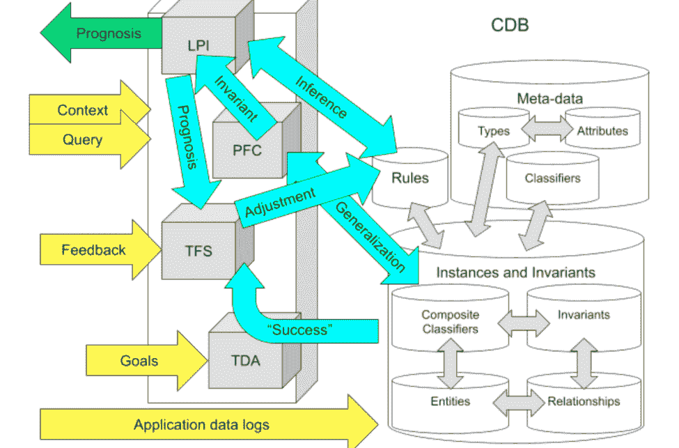

# 基于脑原理编程的决策认知架构

Anton Koloninᵃ¹, Andrey Kurlatovᵃᵇ, Artem Molchanovᵇ, Gennadiady Aeryanovovᵇ

^俄罗斯，诺沃西伯尔克州立大学，Novosibirsk 2, 630090

^俄罗斯，俄罗斯联邦储银行，神经科学实验室，Vavilov 19, 莫斯科, 117312

## 摘要

我们描述了一种旨在根据已知的脑活动原理解决广泛问题的认知架构，这些原理在三个子系统中得到了实现：逻辑概率推理、概率形式概念和功能系统。构建架构涉及一种任务驱动方法（TDA）的实现，该方法允许将应用程序的目标函数定义为在相应任务的操作环境中形成的任务，并由本体论进行表示。我们为若干实际应用以及基于其构建的主题本体提供了基础本体，描述了所提出的架构，并这些这些架构在实践中执行的可能示例。

*关键词：* 脑编程；认知架构；形式概念；功能系统理论；概率逻辑；主题领域本体；任务驱动方法

# 1. 认知内核的概念——五大原理，一种方法，三个组件

我们提议在任务驱动方法（TDA）[3,4,5]的框架内，根据“原理编程”（BPP）[1,2]的脑活动 5 大原理，构建一个通用的决策系统。这些原理实现在针对任意给定环境定义的认知架构[6]中，该架构基于逻辑概率推理（LPI）[7]、概率形式概念（PFT）[8]以及功能系统（TFS）[3,4,5]运行。

* 通讯作者。电话：+71939250058。

电子邮箱：akolmann@gmail.com

## 1.1. 脑活动的五大原理

[1,2]中阐明的脑活动五大原理表明，在大多数认知过程中，所有原理都是同时参与的。也就是说，在任何新情况下做出决策时，会发生以下情况：1）“复杂性生成”原理导致根据情境的扩展上下文，针对各种模态的有限数量刺激或感知生成假设；2）“关系”原理使得不同的刺激和假设能够相互关联，同时放大某些并排除其他的；3）“接近本质”原理使得能够连接过去经验中由刺激和现象介导的部分中介；4）“局部-分布”原理确保了基于一组一种或多种模态的特定刺激和概念“组装”成完整的集成上下文；5）“重量”原理要求产生与最可能假设相对应的主导上下文。

例如，主体在闭眼的情况下关于一个圆体物体的情景，允许产生多个假设。由于“复杂性生成”原理，该未知物体被赋予了各种属性，那些未满足的属性通过一系列假设得到确认（如：那个橙子、一个台球、一个红苹果、一个绿苹果）。“关系”原理允许我们让不同的刺激和假设相互关联，放大某些并排除其他的；橙子的柔软与感知到的物体的硬度不对应，然而，仅仅是台球的重量并不与实际感知相符。苹果的光滑和轻便使得“局部-分布”原理允许主体从多个模态中创建一个单一图像：光滑坚硬表面的感觉来自前臂，气味来自嗅觉器官，然而由于处在故事中（而不是在台球俱乐部）——来自短期记忆。由于“重量”原理，“苹果”成为主导，抑制了“橙子”和“台球”假设。最后，“接近本质”原理在主体的思想中结晶出一个实体刻板印象的形象，允许主体给出正确答案。

## 1.2. 任务驱动方法

[3,4,5]基于功能系统（TFS）形成的人工智能问题任务驱动方法（TDA），暗示了解决广泛任务的可能性。在本体论的适当空间对这些任务进行形式化的必要条件，应当允许描述问题以及可实现结果的图像，并考虑到实现结果的标准。通过使用环境引入“成功”函数（问题解决）或“效用”函数（任务解决）来完成任务，解决它的初始和最终阶段步骤（业务流程、决策规则）也应该用本体来表示。早期研究[6]显示了通过经验学习的可能性解决任务的根本可能性。关于任务驱动方法，我们建议通过任务导向（或“活动”）本体来表示后者，前者是逻辑概率推理表示的“智能对象”和“实例”。

## 1.3. 逻辑概率推理

前者是稳定的，在空间和时间上表示，而后者是识别前者的“证据”，另一方面，“智能函数”是这样表示的。

基于前述原理的任务驱动（TDA）方法的实现，被固定在三种计算方法上：逻辑概率推理（LPI）[7]、概率形式概念（PFT）[8]以及功能系统理论（TFS）[3,4,5]。

逻辑概率推理方法（LPI）[7] 结合原子推理系统（NARS）和概率逻辑网络（PLN），允许解决学习、识别和预测认知问题。这些方法传统上与回归模型（包括神经网络）相关。此类方法的预期优势是其预测的可解释性，以及模型本身的可解释性，因为它们都是基于本体的，即信息的语义表示。LPI 的额外优势是，该方法与神经网络不同，允许对脑神经元的功能进行建模，并与其它方法（PFC 和 TFS）具有可比性。

LPI 方法结合 NARS 和 PLN 基于计算概率的基本操作，例如“修订”（考虑累积的经验以形成因果）、“演绎”（基于获得的经验进行预测，以及基于现有经验推导出新规则）、“归纳”（在不确定性下的预测以及基于现有原因对可能结果的假设生成）以及“溯因”（由于结果对可能结果的假设生成）。

例如，信息的累积允许将营养不良与免疫系统虚弱联系起来，这为通过“修订”操作连接这两个状态的概率提供了基础。此外，免疫系统虚弱的存在会导致“演绎”出低温症风险的增加。建立将营养不良与低温症风险增加（“归纳”）起来的规则，允许我们构建关于免疫系统减弱关系的假设。最后，由于低温症引发的“归纳”，在存在免疫力下降信息的情况下，允许我们通过“溯因”提出关于后者与低温症联系的假设。

## 1.4. 概率形式概念

概率形式概念方法（PFC）[8,15]是上述著名的形式概念分析（Formal Concept Analysis）方法的扩展。该方法使得可以将特征和上下文的重要组合识别为相互关联的因果关系，这些关联在霍夫尔德网络的神经网络动力学方面可以解释为“固定点”或“吸引子”，基于观测到的或感知的实例（包括时间限制的先例）。这些不变性可以被视为在应用该方法识别出的显著特征空间内给定时期的物体或现象类别。此外，该方法还允许构建此类概念作为概念系统的层次结构，以及定义这些概念的特征本身的层次结构，包括在这些类别领域范围内定义的值。

Anton Kolomin 等人 Procedia Computer Science 213 (2022) 180-189

在水果识别问题的示例中，通过对感知数据处理并对台上所有的水果进行手动分类和检查，将揭示高层不变性，例如水果和浆果；其中水果可以包括橙子、苹果和梨的不变性，而苹果可以进一步分为绿色、黄色苹果和红色苹果的不变性。同时，该系统的显著特征将是重量、大小、硬度和光滑度以及颜色，因为不同的顶层不变性的可能颜色值区域也不同（例如，柑橘类只能是绿色、橙色或黄色，而不能蓝色）。

## 1.5. 功能系统理论

基于功能系统理论（TFS）[3,4,5]的开发开发旨在解决机器学习中所谓的“强化学习（RL）”生成问题。传统上，RL 涉及基于环境提供的正反馈或负反馈，在解决某些问题失败时的正向强化进行学习。目前大多数 RL 模型不具有可解释性，更重要的是缺乏可解释性。同时，TFS 扩展了外部强化很少显式出现或完全不存在且需要自监督学习的问题类别。在 TFS 中，这是通过基本机制实现的，即强化系统以实现任务预期结果，该结果在任务开始时创建，并在由任务接受者评估时确认。这对应于“实验学习”（EL）[6]，它包含了通过尝试学习以及基于环境/或任务提供的显式正负强化而进行学习。

以 EL [6] 解释的 RL 问题著名公式中自学打乒乓球的为例，学习的第一阶段可能包括区分运动物体（球和球拍）与静态物体的能力（通过 PFC 方法）；第二阶段是学习如何控制球拍，将函数的使用与运动对象的重新排列联系起来；第三阶段是击球，根据球拍相对于球的空间配置改变球的轨迹；第四阶段也是最后一个阶段，是学习游戏所需的实际规则，以便在获胜时获得最终强化。

# 2. 统一活动本体论

## 2.1. 上层（基础）本体论

为了确保能够基于上述方法构建一系列基于认知架构的应用程序，我们断定存在一个关注实际活动的简单上层（基础）本体论 [10]，它允许我们描述整个系列应用程序的的元数据，下面描述了其中的三个。作为元数据结构的基础，遵循 `OWL` (`https://www.w3.org/2002/07/owl-schema.org/`)，我们接受了实体（Thing）和过程（Process）的基本概念。我们的概念在其下方断言了类的层次结构，考虑到了我们对智能对象（IO）理解为拥有一组属性的通用实体。在理解上，遵循活动或过程为导向的本体论 [10] 的概念，IO 可以是唯一实例集的唯一实例或每个唯一实例的抽象。

实例可以是特定的值（数字、日期、类型、物理或社会对象），也可以固定在时间的单个事件（Events）的呈现，统一巧合（Coincidences）时刻以及在时间上相互连接的延伸过程——连接不同时间的事件及其巧合。值可以由领域空间内的复杂实体（Entities）表示（例如，著名的物理对象或特定银行的特定客户），用于识别和描述实体的特定原子类别（例如，红色或男性），或者是在主体领域内唯一固定的任意关系，用于连接各种实体（例如，特定客户之间的亲属关系）。事件可以进一步细分为在特定时间点固的状态（States，例如账户余额或客户年龄）或改变这些状态的动作（Actions，如财务交易或生日比萨外送）。反之，不变性也分为其值不变的抽象属性（Properties）以及事件、巧合和过程的永恒不变性。我们称事件出现为“呈现”（Appearances），过程不变性为“场景”（Scenarios），而巧合不变性可以多次一起出现。因此，作为合集，使用对应于多次巧合事件的“呈现”。因此，作为析集，使用对应于同一场景不同阶段可能的不同事件的备选“呈现”，这些事件记录在不同的过程中（例如，在商店购买商品时的刷卡支付）。在较低层级上，类别值的不变性是分类器（Classifiers）（例如，颜色属性分类器定义了一个具有红、黄、绿域值的域），而特定实体的不变性是它们的抽象图像（Images）。

## 2.2. 认知行为治疗模型

在 [9] 背景下，在认知行为疗法（CBT）框架内解决诊断问题的特定案例中，从 TDA 的角度考虑做出诊断（Diagnosis）的任务，这是一种不变性，它将多个分类器的值——如情绪（Emotion）、情绪（Psycho-type）、社会情境（Social Situation）和认知扭曲（Cognitive Distortion）[16]——与相应的域值连接类别根据心理治疗学派或实践定义。任务在心理治疗会话框架内解决，由会话记录（Session Precedent，过程子类）记录，而许多会话可以根据一个方案（Protocol，会话子类）进行。任务的解决方案在客户（Client）和治疗师（实例子类）之间的对话中执行——通过在会话环境中执行动作（Actions）。治疗师可以执行诊断或治疗动作，客户可以通过反应（Reactions）对其做出响应。所有具有上述某些分类器的动作都具有模式（Patterns）[16]的特征；在此模型中，在会话交互的情况下，治疗师执行初始动作，刺激客户做出反应，使得在成功的情况下能够识别出诊断不变性。需要注意的是，这种格式中会话的形式失败可能意味着不同的含义：a）治疗师未能识别出客户的真实问题；b）客户没有真实问题；c）成功识别了客户的问题。在这两种情况下，TDA 不仅允许做出诊断（在形式成功的情况下），还能最大化疗愈效果，确保在可能的情况下移除所有可能的诊断，然后验证其缺失。

## 2.3. 企业客户关系管理模型

在企业作为客户关系管理（CRM）向客户形成报价（Offers）的特定案例中，从 TDA 的角度来看，是形成一个报价，客户将很有概率对其做出积极响应，这将记录为对所提产品的订阅（Subscription）。报价和订阅在所提的本体论中都是动作（Actions），就像 CBT案例中一样，处于某些长期交互的上下文中（客户与企业的接触或企业给客户的电话）。一次交互可以是客户互动片段（Episode）的一部分（例如长时间在某个办公室使用某条服务），而一个片段可以是长期客户历史的一部分（包括客户使用企业服务期间的所有片段）。客户本身，正如 CBT 中一样，可以在大量分类器的多维空间中定义，例如性别、收入、社会地位、婚姻状况等，并可以通过当前订阅与企业产品建立联系。

关于积累向客户提供的报价（Offers）以及客户在当前订阅背景下进行的订阅（Subscriptions）的历史记录过程，这些记录可以存储为客户故事（Client Stories）。这些信息的聚合使得将典型历史、典型片段和典型行为识别为情景-不变性（Scenarios - Invariants）成为可能从而描述每个客户画像（Client Images）。

根据可用信息，从任务驱动架构（TDA）的角度来看，任务可以规范为：针对任何给定的客户生成特定产品及产品类型的报价，以最大化对所提产品的订阅概率，并通过评估向客户交付报价的结果，由“行为结果接受者”[3] 确认。

# 3. 用于于决策的认知架构

基于本体论模型和概率逻辑的认知架构剪枝了非公理推理搜索（NARS）[12] 和 OpenCog [17]。在这些系统中，存在以非公理逻辑 [11] 和概率逻辑网络（PLN）[13] 形式存在的与 LPI 相似的算法能力。然而，它们并没有完全提供我们在之前的工作中通过 TDA、PFC 和 TFS 提供的属性，如我们先前的工作所示 [3,6]。在我们提出的架构框架内，假设所有特定应用都使用一个“认知内核”（CK），该内核在相关领域的私有本体的基础上执行，并在基于“认知数据库”（CDB）的 TDA 框架内为顶层应用提供 LPL、PFC 和 TFS 的能力。

CDB 本身如图 1 所示，用于根据所述的高层本体存储数据和元数据，并可以指定其他主题领域，为 CK 的认知功能 - LPL、PFC、TFS 和 TDA 提供适当编程接口（API）。

CK 的近似组成可以描述为下述的一系列服务，这些服务相互以及向“外部”应用程序提供 API 函数。因此，可以在基于单个 CDB 的 LPL、PFC、TFS 和 TDA 服务，在所谓的“微服务”架构范围内实现该系统。

## 3.1. 认知数据库

认知数据库（CDB）包括图 1 右侧所示的以下三个组件。

元数据基础（MDB）旨在存储实例（Instances）和不变性（Invariants）的本体模式（通过描述它们的类型和属性），以及分类器的领域值。在内存数据库或专门的缓存系统中对 MDB 进行完全或部分缓存，以便在应用层快速访问，其用于：

- a) 获取实例、不变性及其属性的存储；
- b) 获取数据对象的值（最重要的是分类器的领域值），作为用户界面侧视觉操作的元类型（Meta-Types）和属性。

数据对象基础（DOB）旨在根据上述 MDB 中描述的结构，维护由应用程序记录的实例及其相互关系的信息，以及它们的派生投影（projections），提供如下功能：

- a) 初始检索与已解决任务结构对应的关系关系归一化投影；
- c) 在对应于已解决任务结构的关系关系归一化投影中检索并存储不变性；

规则基础（RB）用于存储条件的合取-析取规则与由 LPI 推断的后置条件发生的概率估计之间的连接，这种推断与 PFC 发现的前驱项（precedents）和不变性有关，同时确保：

- 保持已识别规则的检索，根据给定的前置条件和后置条件准则检索相关规则。

如图 3 所示，MDB 中带有属性的类型描述了 DOB 中对象（实例和不变性）的结构，包括它们之间的关系以及复合分类器（Composite Classifiers），这些分类器可以基于对原始原始分类器值的监督创建（基于 PFC 识别的不不变性派生），且 RB 规则可以与根据 LPI 推断显现的不不变性相关联。

## 3.2. 逻辑-概率推理 (LPI) 服务

根据 [7,11] 实现的 LPI 服务提供以下功能：

- a) 根据 DOB 中的实例（和前驱项）形成规则并将其保存到 RB 中；
- b) 基于呈现的现状，结合使用 RB 中的规则和相应的不变性，构建预测并发布建议；
- c) 结合 PFC，实现按“概率”（从 [7,11] 的角度来看）和“统计显著性”（费希尔准则）对预测进行排名的可能性的，以及两者的结合。所提供的预测可以传输到外部系统供实际使用，并传输到 TFS 服务以根据反馈纠正以 RB 规则形式包含的认知行为模型。该服务既可以通过外部应用程序的显式（随时的）请求控制，也可以通过定期更新 RB 的后台任务控制。在这种情况下，显式请求和后台任务都可以带有完善请求的额外上下文信息。

## 3.3. 概率形式概念 (PFC) 服务

根据 [8,15] 实现的 PFC 服务用于：

- a) 根据 DOB 中实例（和前驱项）的数据识别显著的不不变性；
- b) 在 DOB 中保留已识别的不不变性。

该服务的操作可以作为后台任务进行管理，用于定期更新 DOB 不变性以及相关的 BP 规则。同时，后台任务可以带有额外的上下文。

图 1. 认知内核（CK）方案，包含 LPI、PFC、TFS 和 TDA 服务。

## 3.4. 功能理论 (TFS) 服务

根据 [7,11] 实现的 TFS 服务提供以下功能：a) 根据 DOB 中实例（和前驱项）的数据识别显著的不不变性并将其保存到 RB 中；b) ... 传输到 TFS 服务以根据反馈纠正以 RB 规则形式包含的认知行为模型。该服务既可以通过外部应用程序的显式（随时的）请求控制，也可以通过定期更新 RB 的后台任务控制。在这种情况下，显式请求和后台任务都可以带有额外的上下文信息。

## 3.5. 任务驱动应用 (TDA) 服务

根据 [3,4,5] 实现的 TDA 服务旨在实现为一个“认知内核”（CK），该内核在相关领域的私有本体的基础上执行，并在基于“认知数据库”（CDB）的 TDA 框架内为顶层应用提供 LPL、PFC 和 TFS 的能力。

# 4. 示例

### 4.1. 认知行为疗法 (CBT) 中的话诊断

让我们考虑一个应用程序示例——“心理医生”聊天机器人，它用于对寻求帮助的客户进行初步诊断，如图 2 所示。该应用程序包含以下功能部分：

- a) 聊天机器人的实际功能，支持 Telegram 和 Slack 等即时通讯工具；
- b) 检测确认（“是的”、“没错”等）、否定（“不”、“由于”等）以及模式（基于模式检测技术 [18]），以识别 DOB 中的语言模式；
- c) 基于上述认知架构的认知（CN）本身，用于获取心理医生响应客户语言模式时所建议的认知影响语言模式；
- d) 一个基于 CK 识别的模式生成交互式流的模块（使用基于“转换器” [20] 的预训练语言模型）；

### e) 当前客户模型
用于跟踪会话历史、所有记录的操作（包括重复）并存储当前上下文，包括排除和确认的分类器。

从图 2 可以看出，对话从心理医生的正式问候开始。客户在两个分类器空间内做出初步诊断的首次反应是“个人化”[16]（认知扭曲）关于“被解雇”（社会情境）。客户的后续反应确认了初步诊断，但一次显式的尝试将诊断改为

“灾难化思维”。在对话结束时，心理治疗师针对“被解雇”的“灾难化”思维完成了对“焦虑”的最终诊断，客户也确认了这一点，这为通过健康的干预来纠正后续思维提供了线索。

P: 嗨！你好吗？

B: 糟糕了。他们把 `#啤酒` 赶出去了！（初步诊断为 `#被解雇` 和 `#个人化`）

P: 那是怎么搞的？是谁干的？（澄清社交情境）

B: 是因为我的工作问题。我被解雇了，因为（确认 `#被解雇`）

P: 这让你感到焦虑，还是让我感到生气？（澄清情绪 - `#焦虑` 或 `#愤怒`）

B: 焦虑，我得付房贷。（确认 `#焦虑`, `#责任`）

P: 你从工作岗位被解雇了，你担心将无法付账单（`#被解雇`, `#焦虑`）

B: 是的（就社交情境和情绪进行确认）

P: 你认为原因是什么？

B: 我觉得是因为他离开了公司。（诊断为 `#个人化`）

B: 那是恐惧，我感觉我的生活全毁了（转变为 `#灾难化思维`）

P: 你很焦虑，担心被解雇后找不到新工作（`#焦虑`, `#被解雇`, `#灾难化`）

B: 确实如此。事实上我是一个经验丰富的专业人士。（就情绪、社交情境和认知痛苦进行确认，并转向健康的干预进行纠正）

图 2. 认知行为疗法（CBT）自动会话方案的一个示例。P：心理治疗师回答，C：客户回答。括号中给出了设计系统行为的解释。井号表示此类分类器（如情绪、社交情境和认知扭曲）的取值（类别）。

## 4.2. 客户关系管理 (CRM) 中方案的形成

在客户关系管理（CRM）领域，所提认知架构的一个示例是客户群的细分。这可以通过预测客户特征（如 [2] 中所述）来实现，目的是为企业生成相应的优惠方案（Offers）。

[2] 的附录显示，基于 `PFC` 的统计近似算法可以揭示 2784 名社交网络受访者（用户）对个体客户不变特征（Invariants）的表达性关注；该研究是在 36 个客户用户的背景下进行的，每个特征都对应一个分类器，如性别、种族、出生地、价值观和坏习惯属性。基于 `PFC` 的统计近似算法识别出 21 个不变特征，它们是客户群可区分的代表性特征。其中大多数是第 8 和第 9 个不变特征。第 8 个不变特征可以描述为：住在家里的未婚男性，家庭和孩子优先，看重人的善良和诚实，对酒精和吸烟持负面态度，优先考虑视频和音频文件的数量。例如，第 9 个不变特征可以描述为：未婚男性，可能是青少年，他们也看重人的善良和诚实，首要任务是自我提升，对吸烟和酒精持中立。

客户群的细分涉及多个客户画像（Client Images），结合针对相同产品生成的客户订阅优惠方案形成日志，可能允许 `LPI` 对其他客户是否会接受或拒绝特定产品的优惠做出预测，同时考虑了客户与特定客户画像之间的接近程度，以及他们接受该画像下每个产品优惠的概率。

我们已经证明，大脑架构原理（BPP）可以在任务驱动方法（TDA）的框架内实现，该框架构建在概率推理（LPI）、概率概念（FC）和功能系统（TFS）方法的认知架构之上。我们证明了概率架构在基于基础活动本体的相应学科领域本体中表述的许多应用任务中具有基础适用性。在未来的工作中，我们计划开发该概率架构并在实际问题上对其进行全面测试。

## 参考文献

- [1] Vedyakinin A., 等人. (2021) “人工智能：通往超级风口之路”, M.: Intellectual Literature, ISBN 978-5-907394-18-6, 22 页.

- [2] Evgeniy Aitov, Antonin, Andrey Kurepat, Artem Molchanov. (2022) “大脑原理”, arXiv:2202.12710 [bio] https://arxiv.org/pdf/2202.12710

- [3] Vitaly. E., Demenko, A. V., Kolonin, A. V. (2020) “生物启发式认知架构”, In: Goertzel, B., Patoev, A., Yampolskii, R. (eds) 人工通用智能. AGO 2020 Notes in Computer Science, 第 717 . Springer, Cham., pp. 385–399.

- [4] Vitaly. E., Demenko, A. V., Kolonin, A. V. (2020) “生物启发式认知架构”, In: Goertzel, B., Patoev, A., Yampolskii, R. (eds) 人工通用智能. AGO 2020 Notes in Computer Science, 第 717 . Springer, Cham., pp. 385–399.

- [5] Vitaly. E., Demenko, A. V., Kolonin, A. V. (2020) “生物启发式认知架构”, In: Goertzel, B., Patoev, A., Yampolskii, R. (eds) 人工通用智能. AGO 2020 Notes in Computer Science, 第 717 . Springer, Cham., pp. 385–399.

- [6] Vitaly. E., Demenko, A. V., Kolonin, A. V. (2020) “生物启发式认知架构”, In: Goertzel, B., Patoev, A., Yampolskii, R. (eds) 人工通用智能. AGO 2020 Notes in Computer Science, 第 717 . Springer, Cham., pp. 385–399.

- [7] Vitaly. E., Demenko, A. V., Kolonin, A. V. (2020) “生物启发式认知架构”, In: Goertzel, B., Patoev, A., Yampolskii, R. (eds) 人工通用智能. AGO 2020 Notes in Computer Science, 第 717 . Springer, Cham., pp. 385–399.

- [8] Vitaly. E., Demenko, A. V., Kolonin, A. V. (2020) “生物启发式认知架构”, In: Goertzel, B., Patoev, A., Yampolskii, R. (eds) 人工通用智能. AGO 2020 Notes in Computer Science, 第 717 . Springer, Cham., pp. 385–399.

- [9] Vitaly. E., Demenko, A. V., Kolonin, A. V. (2020) “生物启发式认知架构”, In: Goertzel, B., Patoev, A., Yampolskii, R. (eds) 人工通用智能. AGO 2020 Notes in Computer Science, 第 717 . Springer, Cham., pp. 385–399.

- [10] Vitaly. E., Demenko, A. V., Kolonin, A. V. (2020) “生物启发式认知架构”, In: Goertzel, B., Patoev, A., Yampolskii, R. (eds) 人工通用智能. AGO 2020 Notes in Computer Science, 第 717 . Springer, Cham., pp. 385–399.

- [11] Vitaly. E., Demenko, A. V., Kolonin, A. V. (2020) “生物启发式认知架构”, In: Goertzel, B., Patoev, A., Yampolskii, R. (eds) 人工通用智能. AGO 2020 Notes in Computer Science, 第 717 . Springer, Cham., pp. 385–399.

- [12] Vitaly. E., Demenko, A. V., Kolonin, A. V. (2020) “生物启发式认知架构”, In: Goertzel, B., Patoev, A., Yampolskii, R. (eds) 人工通用智能. AGO 2020 Notes in Computer Science, 第 717 . Springer, Cham., pp. 385–399.

- [13] Vitaly. E., Demenko, A. V., Kolonin, A. V. (2020) “生物启发式认知架构”, In: Goertzel, B., Patoev, A., Yampolskii, R. (eds) 人工通用智能. AGO 2020 Notes in Computer Science, 第 717 . Springer, Cham., pp. 385–399.

- [14] Vitaly. E., Demenko, A. V., Kolonin, A. V. (2020) “生物启发式认知架构”, In: Goertzel, B., Patoev, A., Yampolskii, R. (eds) 人工通用智能. AGO 2020 Notes in Computer Science, 第 717 . Springer, Cham., pp. 385–399.

- [15] Vitaly. E., Demenko, A. V., Kolonin, A. V. (2020) “生物启发式认知架构”, In: Goertzel, B., Patoev, A., Yampolskii, R. (eds) 人工通用智能. AGO 2020 Notes in Computer Science, 第 717 . Springer, Cham., pp. 385–399.

- [16] Vitaly. E., Demenko, A. V., Kolonin, A. V. (2020) “生物启发式认知架构”, In: Goertzel, B., Patoev, A., Yampolskii, R. (eds) 人工通用智能. AGO 2020 Notes in Computer Science, 第 717 . Springer, Cham., pp. 385–399.

- [17] Vitaly. E., Demenko, A. V., Kolonin, A. V. (2020) “生物启发式认知架构”, In: Goertzel, B., Patoev, A., Yampolskii, R. (eds) 人工通用智能. AGO 2020 Notes in Computer Science, 第 717 . Springer, Cham., pp. 385–399.
